# Spring、Hibernate、数据建模、REST 与 TDD：敏捷 Java 设计与开发

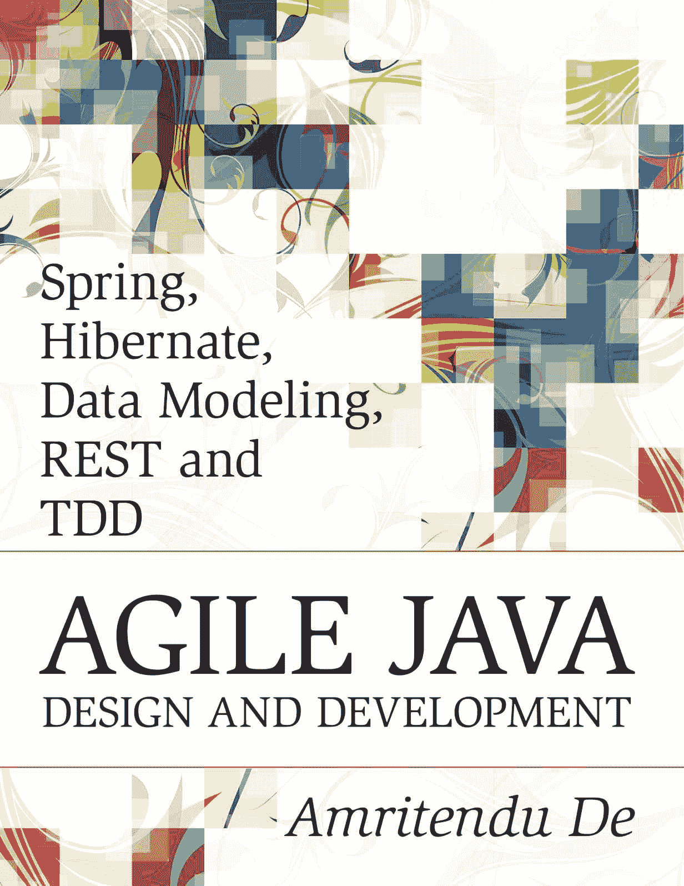

各章节包含了完整源代码的片段，因此我认为为读者提供完整的源代码将很有用。我强烈建议读者亲自动手，并实现此书中描述的所有代码。经验丰富的架构师和开发者可以根据自己的判断跳过。书中涵盖的整个应用程序的 Github 地址为：[`github.com/Spring-Hibernate-Book/spring-hibernate-datamodeling-tdd-rest`](http://github.com/Spring-Hibernate-Book/spring-hibernate-datamodeling-tdd-rest)。下载不需要密码。

`Appendix`（附录）包含了开发应用程序时使用的软件安装信息。在本书出版时，这些版本可能已经升级，因此仅提供了名称。可以下载最新的可用版本，但可能需要进行少量的调整。

祝您好运连连，阅读愉快！

# 第一部分：数据驱动开发简介


## 第 1 章 架构

在本章中，我们将涵盖形成软件架构的核心要素，特别是基于 REST 的架构。我们首先将看看什么是软件架构。然后，我们将介绍如何为 RESTful Web 服务选择框架、Web 框架、业务层技术以及持久化机制。最后，我们将回顾一些流行的模式和最佳实践，并展望书中涵盖的应用程序架构。其目的是为本章之后关于 REST 架构风格的数据驱动开发的讨论奠定背景。

### 什么是软件架构？

软件架构表示软件系统的层次级构建块。就像现实世界中的架构一样，软件架构定义了软件组件的高级系统结构、创建组件层次结构的规范以及对该结构的文档化。它还形成了一套架构设计决策，这些决策决定了结构及其背后的原理。在产品开发初期，架构师会创建一个软件架构，该架构是根据业务需求转换而来的技术需求的设计和开发的基础。

当我们观察软件开发是如何开始的时，主要看到的关注点在于所需的功能和数据驱动流。然而，现代应用开发扩展了对质量属性的关注，例如扩展性、可靠性、性能、可伸缩性、维护性、可用性、安全性、向后兼容性和易用性。这些质量属性在很大程度上驱动着软件架构，并被称为非功能性需求。随着时间的推移，功能性和非功能性需求演出了许多架构模式和风格。软件架构通常基于这些经过验证的架构机制之一构建在坚实的基础之上。糟糕的架构可能会暴露风险，例如系统不稳定、无法执行即时或未来的业务需求，或者在生产环境中难以管理。

当架构师最初研究要开发的新系统需求时，他应该首先检查用例是否可以使用已建立的架构模式进行设计和实现。因为在项目后期更改架构的时间和金钱成本通常非常高，所以初始阶段非常重要。在创建软件架构时必须非常小心，因为它不仅成本高昂，而且难以更改，可能会让您的应用程序面临风险。

软件架构除了基本功能外还应该有很多目标。它应该是灵活的，并能够适应新的业务需求和挑战。例如，一个开发中的系统可能具有一年内注册用户数量翻倍的需求。架构的每个模块或组件都应该具有单一职责或内聚功能的聚合。特定组件不应该感知其他组件或模块的细节。应该避免重复，并且特定功能应在一个且仅在一个相关的模块中实现。

利益相关者之间的通信是良好架构的另一个关键。与软件架构计划一样，有经过验证的模式和最佳实践可以依赖以获得最佳成功。减少复杂性的流行方法是引入关注点分离和视图，这些可以通过特定的利益相关者来处理。

现代产品开发不允许前期的、大规模的设计；它推崇使用敏捷方法将设计拆分为更易管理的部分。它还应该通过建模技术和可视化对系统进行分析来降低风险。例如，系统可以使用企业级建模工具（如 Enterprise Architect 或 Rational Rose）进行草拟。整个团队可以并行工作，使用这些工具描述设计和架构。最后，开发的架构可以通过经过验证的技术进行评估，例如软件架构分析方法 (SAAM)。SAAM 是第一个文档记录在案的软件架构分析方法，开发于 20 世纪 90 年代，用于分析非功能性需求和变更灵活性。对这些技术的深入讨论超出本书的范围。

### 什么是 REST？

REST（REpresentational State Transfer，表现状态转移）是网络系统的架构风格，例如 Web 应用程序。REST 首次由 Roy Fielding 在 2000 年的博士论文中提出，他是 HTTP 规范的编写者之一。REST 是一种简单的无状态架构，通常运行在 HTTP 之上。一个良好的 REST 原则是：客户端和服务器之间的请求交互在本质上是无状态的。每个请求都能够通信处理该请求所需的所有信息。在服务器端，所有请求通过通用资源标识符 (URI) 识别。URI 对于 Web 应用程序来说应该是唯一的。可以使用标准的 HTTP 方法，如 `POST`、`GET`、`DELETE` 和 `PUT`。REST 架构很好地扩展到大量的客户端请求，因为它在本质上是轻量级的并简化了客户端与服务器之间的交互。我们还将查看一些 REST 概念，如资源、表示、连接器和组件。在 HTTP 上实现 REST 时，可以使用全局标识符访问资源。表示是代表资源当前状态的文档。组件是一段软件指令，其状态可以通过暴露的接口进行修改。连接器调解组件之间的通信。

### RESTful Web 服务的框架

有三个流行的 RESTful Web 服务框架：Jersey、Restlet 和 Spring。Jersey RESTful Web Services 是一个用于 Java 开发 RESTful 服务的开源框架，支持 JAX-RS API（由 Oracle 的 Java EE 7 JAX-RS 规范组成 `JSR 311` & `JSR 339`）。Jersey 是参考实现。Restlet 是一个 Java 平台的轻量级开源 REST 框架。Restlet API 直接从 REST 概念（资源、表示、连接器、组件、媒体类型、语言）派生类名称，表明人们能够以 REST 的方式思考并更容易地将解决方案转化为代码。第三个构建 RESTful Web 服务框架是 Spring 框架，REST 支持无缝地整合到 Spring MVC 中。在书中，我们将重点关注使用 Spring 框架构建 REST 服务。

### Web 框架

目前有两种主要的 Web 开发方法：服务端 MVC 和客户端 MVC。服务端 MVC 在服务器上渲染所有页面。此类框架的流行示例包括 Java Server Faces (JSF)、Oracle ADF、JBoss Seam 和 `Spring MVC`。客户端 MVC 将 Java Server Pages (JSP) 和 `jQuery` 结合 REST API 结合在一起。可以使用 `jQuery` 的特化（专用）形式，如 `Angular` 和 `Backbone`，并可以使用 `Spring REST` 支持开发 REST API。在本书中，我们将广泛使用客户端 MVC。我们将使用 `JSP` 和 `jQuery` 构建用户界面，并使用 `Spring MVC` 来构建表示层。客户端 MVC 和服务端 MVC 的本质区别在于，客户端 MVC 由客户端处理大部分逻辑，而服务端 MVC 由服务器处理大部分逻辑。

### 业务层技术

Java EE 7 讨论了实现业务层的两种主要技术选择。第一种方法是使用会话豆（session beans），企业 Java Beans (`JSR 345`)。第二种方法是使用 Java Web Services API (`JAX-WS 2.2`)。第三种方法是 `Spring` 框架提供的非 JEE 方法。`Spring` 框架提供了一个名为 `@Service` 的注解，在书中广泛用于业务服务。

### 持久化机制

持久化是在持久性存储（如磁盘）中存储对象的能力。Java EE 7 主要为实现 Web 应用的持久化层提供了两种机制。第一种方法是使用 Java Connectivity API (`JDBC`) 查询和更新数据。第二种方法是使用 Java Persistence API (`JPA`)，它描述了关系数据的管理。在这里，我们将使用 `Hibernate` 实现的第二种方法，即 `JPA` 规范，并刻意避免使用 `Hibernate` 特有的注解。

### 原生应用 vs 移动浏览器

一个主要的决策是使用客户端 MVC。采用这种架构的一个重要原因是由于客户端 MVC 具有更好的性能、易用性和可访问性，而移动浏览器（如 Windows 和 Blackberry）可以使用 HTML5 和 CSS3。对于 Android 和 iPhone 设备的应用开发，这应该是一个重要的决策；但最终，原生应用总是会带来更大的用户满意度和支持。

### 本书使用的架构

在本章中，我们处理了基于 Java 的项目最常用的架构——`Spring` 和 `Hibernate` 基于。从 `Spring` 的角度，我们将查看 `Spring Web MVC`、`Spring Core` 和 `Hibernate` 基于持久化。

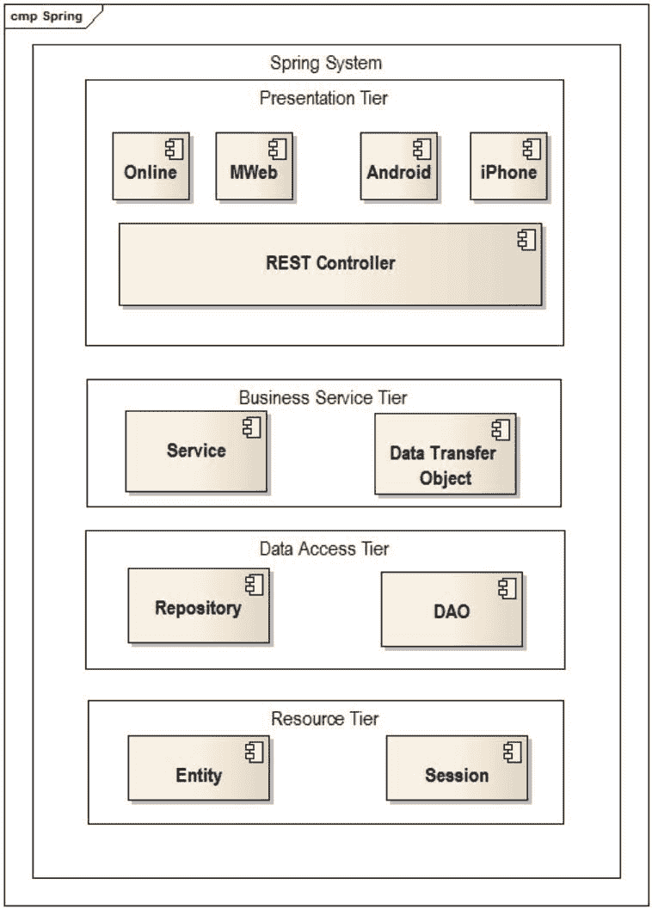

*图 1-1: 架构*

图 1-1 解释了本书遵循的架构。我尝试从自底部的视角解释该架构。实体使用 `Hibernate` 进行管理，它是事务性的。数据访问层由 `Spring` 管理，业务服务层也由 `Spring` 实现，用于管理子系统。表示层包含基于 REST 的 `Spring Controllers` 来暴露服务。用户界面是 Java Server Pages (`JSP`) 和基于 `jQuery` 的系统。Android、iPhone 和移动浏览器等流行的用户界面在书中未涵盖，但可以使用相同的服务进行开发。本书的理念是展示关系的管理模式，而不是深入安全等非功能性需求。

### 流行模式和最佳实践

书中使用了许多选定的模式和最佳实践。业务对象（Business Object）模式用于使用对象模型分离业务数据和业务逻辑。业务对象表示领域模型且不包含任何业务逻辑。数据访问对象（Data Access Object）模式用于封装对底层数据源的调用，同时也管理数据源的连接以检索和存储数据。会话外观模式（Session Façade pattern）被用作外观，以封装工作流中业务对象之间的交互复杂性。请注意，会话外观模式在单个事务中调用一个或多个数据访问对象来存储和检索数据。对会话外观的调用是使用数据传输对象完成的，它通过映射器（mapper）转换为业务对象。数据传输对象用于跨层传输数据。基于 REST 的 Web 服务模式用于发现多个用户界面调用的服务。

### 测试驱动开发

本书彻底涵盖了测试驱动开发，这是敏捷开发的最佳实践。在这种方法中，开发者首先编写测试，该测试起初会失败，因为所需的功能或改进不存在。然后开发者编写最少量的代码来通过测试，最后重构代码以达到接受的标准。请注意，测试用例之间不应该相互依赖，并且可以任何顺序执行。此外，测试用例不应基于对系统任何状态的假设（如硬编码的标识符）。一个常见的错误是不尊重测试代码。你的测试代码应该像生产代码一样受到尊重，并且在正例和反例情况下都能正常工作。

### 总结

REST 架构为 Java EE 应用生成简单、高效、可扩展、可靠、安全且可扩展的设计。由于其轻量级、简单以及通过 HTTP 传输数据的能力，RESTful Web Services 已成为基于 SOAP 的 Web 服务的绝佳替代方案。实现 `AJAX` 框架的 `jQuery` 与使用 `Spring MVC` 实现的 RESTful Web Services 完美契合。在接下来的章节中，我们将从以关系数据建模为例的之旅开始，实现上述架构的不同层。

## 第 2 章 管理独立实体

本章介绍了使用独立实体进行开发的整个过程。紧随本章将使你了解应用程序层的设计，以及开发和单元测试技术。首先，我们将查看模拟用户界面开发，然后转向 REST 服务的开发。我们将以数据建模场景为例，并构建应用程序的所有层。在本章中，我们取了一个独立实体的例子，并将构建所有层以展示如何管理该实体。

### 领域模型

当用户界面团队开始工作时，他们还没有准备就绪的服务。因此，他们必须创建一个带有内存数据库的模拟服务。我们将用户界面的开发分为三个主要任务：数据传输对象、模拟服务和模拟用户界面。请记住，模拟用户界面将与真实的用户界面完全相同，只是数据库是模拟的。当服务开发团队准备好与用户界面团队集成时，我们将用真实的服务替换模拟服务。

### 开发数据传输对象

数据传输对象（DTO）充当用户界面与数据访问对象层之间的映射器。内部的数据库设计不应对用户界面可见；因此需要使用数据传输对象进行映射。

```java
public class ProductDto implements Serializable {
    private static final long serialVersionUID = 1L;
    private Integer id;
    private String name;
    // getters and setters
}
```

#### 开发模拟服务

模拟服务是一个基于 Spring JSON 的控制器，它将数据保存到内存数据库中。让我们从向数据库进行简单的添加操作开始。内存数据库的设计基于单例模式，并根据最佳实践使用 `ENUM` 来实现。标识符字段从 1 开始，并在连续的添加中每次加 1。

```java
public enum ProductInMemoryDB{
    INSTANCE;
    private static List<ProductDto> list = new ArrayList<ProductDto>();
    private static Integer lastId = 0;
    public Integer getId() { return ++lastId; }
    public void add(ProductDto productDto) {
        productDto.setId(getId());
        list.add(productDto);
    }
}
```

使用这个内存数据库，我们将查看使用 `@Controller` 注解的 Spring 控制器。`@RequestMapping` 注解用于映射 URL，在此实例中为 `/standalone/mock`，它应用于类中的所有方法。`ProductMockController` 类中创建的方法具有 URL `/standalone/mock/create`，接受 POST 请求。还要注意，该方法被标记了 `@ResponseBody` 注解，这意味着返回值会被写入 HTTP 体中。

```java
@Controller
@RequestMapping(value="/standalone/mock")
public class ProductMockController {
    @RequestMapping(value="/create", method=RequestMethod.POST)
    @ResponseBody
    public void create(@RequestBody ProductDto product){
        ProductInMemoryDB.INSTANCE.add(product);
    }
}
```

接下来，我们将查看负责选择所有行的方法。首先，我们将查看控制器将使用的内存数据库操作。

```java
public class ProductInMemoryDB {
    public List<ProductDto> findAll() { return list; }
    public ProductDto findById(Integer id) {
        for (ProductDto dto:list) 
            if (dto.getId()==id) return dto;
        return null;
    }
}
```

控制器将使用这些操作中的每一个。`/findAll` 返回所有 `ProductDto` 实例，而 `/findById` 返回给定标识符的特定行。这两个方法都使用 HTTP GET 从内存数据库中检索行实例。

```java
public class ProductMockController {
    @RequestMapping(value="/findAll", method=RequestMethod.GET)
    public @ResponseBody List<ProductDto> findAll(){
        return ProductInMemoryDB.INSTANCE.findAll();
    }
    @RequestMapping(value="/findById/{productid}", method=RequestMethod.GET)
    public @ResponseBody ProductDto findById( @PathVariable("productid") Integer productid){
        return ProductInMemoryDB.INSTANCE.findById(productid);
    }
}
```

接下来，我们将查看删除带有标识符的特定行的操作。

```java
public class ProductInMemoryDB {
    public void remove(Integer id) {
        ProductDto toRemove = null;
        for (ProductDto dto:list) 
            if (dto.getId()==id) toRemove = dto;
        if (toRemove!=null) list.remove(toRemove);
    }
}
```

`/remove` 操作使用 POST 方法删除带有标识符的特定行。


```java
public class ProductMockController {
    @RequestMapping(value="/remove/{productid}", method=RequestMethod.POST)
    @ResponseStatus(HttpStatus.NO_CONTENT)
    public void remove(@PathVariable("productid") Integer productid){
        ProductInMemoryDB.INSTANCE.remove(productid);
    }
}
```

*(注：原文代码块中逻辑似乎略有断裂或不完整，翻译时已根据上下文进行了对齐)*

`edit` 方法使用标识符更新特定行。让我们查看控制器将使用的内存数据库操作。

```java
public class ProductInMemoryDB {
    public void edit(ProductDto productDto) {
        for (ProductDto dto:list) {
            if (dto.getId().equals(productDto.getId())) {
                dto.setName(productDto.getName());
                break;
            }
        }
    }
}
```

`/edit` 操作使用 HTTP 方法更新。

```java
public class ProductMockController {
    @RequestMapping(value="/edit", method=RequestMethod.POST)
    @ResponseBody
    public void edit(@RequestBody ProductDto product){
        ProductInMemoryDB.INSTANCE.edit(product);
    }
}
```

## 开发模拟界面

我们将首先一个模拟界面来演示服务。用户界面团队将使用模拟服务与数据交互。模拟用户界面与真实的用户界面完全相同，只是数据库是模拟的。当服务开发团队准备好与用户界面团队集成时，我们将用真实的服务替换模拟服务。

```html
<body onload="loadObjects()">
    <div id="container">
        <div><p><b>Product Manager:</b></p></div>
        <form method="post" id="productForm">
            <table>
                <tbody>
                    <tr>
                        <td>Name:</td>
                        <td>
                            <input name="productid" id="productid" type="hidden">
                            <input name="productname" id="productname" type="text">
                        </td>
                        <td>
                            <input type="submit" value="Create" id="subButton" onclick="return methodCall()">
                        </td>
                    </tr>
                </tbody>
            </table>
        </form>
        <div id="productFormResponse"></div>
    </div>
</body>
```

JavaScript 调用按顺序讨论。首先我们将查看页面加载时调用的 JavaScript 方法。使用 JQuery Ajax 方法执行 AJAX 请求。URL 指向之前开发的 REST 服务，这是一个 HTTP GET 请求，服务器响应的的数据类型为 JSON。当函数执行成功时，会调用另一个 JavaScript 方法；如果发生错误，会输出 JavaScript 警告。

```javascript
function loadObjects(){
    $.ajax({
        url : "/Spring-OODD/standalone/mock/findAll",
        type: "GET",
        data : {},
        dataType: "json",
        success: function(data, textStatus, jqXHR) {
            processResponseData(data);
        },
        error: function (jqXHR, textStatus, errorThrown) {
            document.getElementById("productname").value="";
            alert("Error Status Load Objects:"+textStatus);
        }
    });
    return false;
}
```

上述服务调用成功后调用的 JavaScript 方法所示。请注意，该方法遍历响应 JSON，并填充包含名称和标识符的表格结构的 `div` 标签。此外，表格中的每行都包含删除和编辑该行的链接。

```javascript
function processResponseData(responsedata){
    var dyanmicTableRow="<table border=1>"+
    "<tr>" +
    "<td>Product Name</td>" +
    "<td>Actions</td>" +
    "</tr>";
    var dataRow="";
    // 此处省略了后续的循环填充逻辑
}
```

```javascript
$.each(responsedata, function(itemno, itemvalue){

dataRow=dataRow+generateTableData(itemvalue);

});

dyanamicTableRow=dyanamicTableRow+dataRow+”</table>”;

document.getElementById(“productFormResponse”).innerHTML=dyanamicTableRow;

}

function generateTableData(itemvalue){

var dataRow=”<tr>” +

“<td>” +itemvalue.name+”</td>”+

“<td>” +

“<a href=# onclick=deleteObject("+itemvalue.id+”)>Delete</a>”+

“|<a href=# onclick=editObject("+itemvalue.id+”)>Edit</a>”+

“</td>”+

“</tr>”;

return dataRow;

}
```

我们已经见证了页面加载是如何工作的。现在让我们来看看创建功能。请返回并查看 JSP 片段，它在输入名称并提交页面时会调用 JavaScript 方法。

```javascript
function methodCall(){

var buttonValue = document.getElementById(“subButton”).value;

if(buttonValue==”Create”){

create();

}else if(buttonValue==”Update”){

update();

}

return false;

}
```

首先我们将查看创建操作。对 `create` 的调用是一个 HTTP POST 调用，其中产品名称作为 JSON 对象传递。请记住传递请求头 `Accept` 和 `Content-Type`，它们被标记为 `application/json`。

```javascript
function create(){

var name = $(“#productname”).val();

var formData={“name”:name};

$.ajax({

url : “/Spring-OODD/standalone/mock/create”,

type: “POST”,

data : JSON.stringify(formData),

beforeSend: function(xhr) {

xhr.setRequestHeader(“Accept”, “application/json”);

xhr.setRequestHeader(“Content-Type”, “application/json”);

},

success: function(data, textStatus, jqXHR)

{

document.getElementById(“productname”).value=””;

document.getElementById(“subButton”).value=”Create”;

loadObjects();

},

error: function (jqXHR, textStatus, errorThrown)

{

document.getElementById(“productname”).value=””;

alert(“Error Status Create:”+textStatus);

}

});

return false;

}
```

接下来我们将查看编辑选项。我们已经看到在创建表格时是如何嵌入编辑链接的。编辑选项也是一个 HTTP POST 调用，接受请求头，并传递一个包含名称和标识符的 JSON 对象作为参数。

```javascript
function update(){

var name = $(“#productname”).val();

var id = +$(“#productid”).val();

var formData={“id”:id,”name”:name};

$.ajax({

url : “/Spring-OODD/standalone/mock/edit”,

type: “POST”,

data : JSON.stringify(formData),

beforeSend: function(xhr) {

xhr.setRequestHeader(“Accept”, “application/json”);

xhr.setRequestHeader(“Content-Type”, “application/json”);

},

success: function(data, textStatus, jqXHR)

{

document.getElementById(“productname”).value=””;

document.getElementById(“subButton”).value=”Create”;

loadObjects();

},

error: function (jqXHR, textStatus, errorThrown)

{

document.getElementById(“productname”).value=””;

alert(“Error Status Update:”+textStatus);

}

});

return false;

}
```

`editObject` 和 `viewObject` JavaScript 方法调用允许选择一条记录进行编辑操作。

```javascript
function editObject(productid){

editurl=”/Spring-OODD/standalone/mock/findById/”+productid;

var productForm={id:productid};

$.ajax({

url : editurl,

type: “GET”,

data : productForm,

dataType: “json”,

success: function(data, textStatus, jqXHR)

{

viewObject(data);

document.getElementById(“subButton”).value=”Update”;

},

error: function (jqXHR, textStatus, errorThrown)

{

alert(“Error Status Find Object:”+textStatus);

}

});

}

function viewObject(data){

document.getElementById(“productname”).value=data.name;

document.getElementById(“productid”).value=data.id;

}
```

最后，我们将查看删除链接。删除链接持有标识符并作为参数传递给 JSON Mock 服务。删除调用也是一个 HTTP POST 调用。

```javascript
function deleteObject(productid){

var productForm={id:productid};

delurl=”/Spring-OODD/standalone/mock/remove/”+productid;

$.ajax({

url : delurl,

type: “POST”,

data : productForm;

dataType: “json”,

success: function(data, textStatus, jqXHR)

{

loadObjects();

},

error: function (jqXHR, textStatus, errorThrown)

{

alert(“Error Status Delete:”+textStatus);

}

});

}
```

这标志着完善过程部分的结束。当用户界面团队忙于创建界面时，服务开发团队也将以同样的速度进行。在下部分，让我们看看如何创建实际的数据库驱动的服务。

## 开发服务

服务开发将分为四个步骤：创建实体、创建数据访问层、创建业务层以及创建 REST 服务，这些将与用户界面集成。我们将遵循测试驱动开发 (TDD) 方法来开发每一层。

### 实体 (entity)

首先我们将查看实体。对于实体的开发，我们将使用 TDD 方法。对于每一层，我们将编写测试用例。

```java
@RunWith( SpringJUnitRunner.class )
@ContextConfiguration( locations = { “context.xml” } )
@TransactionConfiguration( defaultRollback = true )
@Transactional
public class ProductTest {

@Autowired
private SessionFactory sessionFactory;

@Test
public void testCRUD()
{

Product p1 = new Product();
p1.setName(“A”);
Product p2 = new Product();
p2.setName(“B”);
sessionFactory.getCurrentSession().save(p1);
sessionFactory.getCurrentSession().save(p2);
p1.setName(“C”);
sessionFactory.getCurrentSession().merge(p1);

List<Product> list = sessionFactory.getCurrentSession().createQuery(“from Product”).list();
Assert.assertEquals(2L, list.size());

sessionFactory.getCurrentSession().delete(p1);

List<Product> list2 = sessionFactory.getCurrentSession().createQuery(“from Product”).list();
Assert.assertEquals(1L, list2.size());

}
}
```

在编写测试类时你会看到大量的错误，因为实体尚不存在。下一步是创建实体类。实体使用 `@Entity` 注解标记，如果未提供表名，则与实体名称相同。标识符生成策略是 `AUTO`，它会根据底层数据库选择标识列、序列或表。`@Column` 注解可以覆盖字段名称，默认与属性名称相同。`nullable` 属性确保字段可以或为空，`length` 属性定义了字段的大小。一旦你编写了实体，测试类中的所有编译错误都将消失，且测试应该顺利通过。


```java
@Entity
@Table(name="PRODUCT")
public class Product {

    private Integer id;
    private String name;

    @Id
    @GeneratedValue(strategy=GenerationType.AUTO)
    @Column(name="ID")
    public Integer getId() {
        return id;
    }
    public void setId(Integer id) {
        this.id = id;
    }

    @Column(name="NAME", nullable=false, length=100)
    public String getName() {
        return name;
    }
    public void setName(String name) {
        this.name = name;
    }

}
```

### 开发数据访问层

接下来我们将查看数据访问层。我们将从一个简单的数据访问测试结构开始，并为查询所有记录的操作编写测试用例。

```java
@RunWith( SpringJUnit4ClassRunner.class )
@ContextConfiguration( locations = { "classpath:context.xml" } )
@TransactionConfiguration( defaultRollback = true )
@Transactional
public class ProductDaoImplTest {
    @Autowired
    private ProductDao dao ;

    @Test
    public void testGetAll() {
        Assert.assertEquals(0L, dao.getAll().size());
    }
}
```

我们将看到如何编写上述测试对应的数据访问操作。`@Repository` 注解表示该类是一个数据访问操作对象，并且符合组件扫描条件。类级别的 `@Transactional` 注解表示类中的所有方法本质上都是事务性的。`Query` 实例通过调用 `Session.createQuery()` 获取，这同时也提供了 `Product` 实体的所有行。`ProductDao` 是一个接口，包含了所有这些操作的方法签名。

```java
@Repository
@Transactional
public class ProductDaoImpl implements ProductDao {
    @Autowired
    private SessionFactory sessionFactory ;

    @Override
    public List<Product> getAll() {
        return sessionFactory.getCurrentSession().createQuery("select product from Product product order by product.id desc").list();
    }
}
```

到此为止，我们只看到了获取所有记录的操作。让我们看看插入操作测试。我们在 `Product` 表中插入几行，并检查结果是否匹配 2 条记录。

```java
public class ProductDaoImplTest {
    @Test
    public void testInsert() {
        Product sproduct = new Product();
        sproduct.setName("Spring in Action Book");
        dao.insert(sproduct);
        Product hProduct = new Product();
        hProduct.setName("Hibernate in Action Book");
        dao.insert(hProduct);
        Assert.assertEquals(2L, dao.getAll().size());
    }
}
```

数据访问类中对应的插入操作必须实现。该操作中实现了 Hibernate 4 的 `Session.save()` 操作。

```java
public class ProductDaoImpl implements ProductDao {
    public void insert(Product product) {
        sessionFactory.getCurrentSession().save(product);
    }
}
```

我们将跳转到下一个操作，即通过标识符查找行。请注意，你在测试用例中编写的所有代码应该是可移植的。换句话说，JUnit 测试用例不应该有顺序，并且按任何序列执行。

```java
public class ProductDaoImplTest {
    @Test
    public void testGetById() {
        Product sproduct = new Product();
        sproduct.setName("Spring in Action Book");
        dao.insert(sproduct);
        List<Product> pList = dao.getAll();
        Product product = pList.get(0);
        Product product2 = dao.getById(product.getId());
        Assert.assertEquals("Spring in Action Book", product2.getName());
    }
}
```

对应的数据访问方法所示。该操作中实现了 Hibernate 4 的 `Session.get()` 操作。

```java
public class ProductDaoImpl implements ProductDao {
    public Product getById(Integer id) {
        return (Product) sessionFactory.getCurrentSession().get(Product.class, id);
    }
}
```

我们将先编写删除操作的测试，然后是数据访问操作。首先，我们插入 2 条记录，接着进行 1 次删除，然后检查数据库中是否存在 1 条记录。

```java
public class ProductDaoImplTest {
    @Test
    public void testDelete() {
        Product sproduct = new Product();
        sproduct.setName("Spring in Action Book");
        dao.insert(sproduct);
        Product hProduct = new Product();
        hProduct.setName("Hibernate in Action Book");
        dao.insert(hProduct);
        Assert.assertEquals(2L, dao.getAll().size());
        dao.delete(hProduct);
        Assert.assertEquals(1L, dao.getAll().size());
    }
}
```

删除数据访问操作使用了 Hibernate 4 的 `Session.delete()` 操作。

```java
public class ProductDaoImpl implements ProductDao {
    public void delete(Product product) {
        sessionFactory.getCurrentSession().delete(product);
    }
}
```

最后，我们将查看更新操作。更新测试方法插入了 1 行，更新该行，获取所有记录，并检查名称是否与更新匹配。请注意，这里我们可以使用标识符检索该行，但将不具有可移植性。代码不应硬编码标识符，因为不同的系统会有不同的执行顺序，导致不同的标识符值。

```java
public class ProductDaoImplTest {
    @Test
    public void testUpdate() {
        Product sproduct = new Product();
        sproduct.setName("Spring in Action Book");
        dao.insert(sproduct);
        Assert.assertEquals(1L, dao.getAll().size());
        List<Product> pList = dao.getAll();
        Product product = pList.get(0);
        product.setName("Head First Design Patterns");
        dao.update(product);
        List<Product> pList2 = dao.getAll();
        Product product2 = pList2.get(0);
        Assert.assertEquals("Head First Design Patterns", product2.getName());
    }
}
```

更新数据访问操作所示。使用了 Hibernate 的 `merge()` 操作。

```java
public class ProductDaoImpl implements ProductDao {
    public void update(Product product) {
        sessionFactory.getCurrentSession().merge(product);
    }
}
```

### 开发业务服务层

现在让我们查看业务服务层。我们将从获取所有记录的测试开始查看业务服务层。

```java
@RunWith( SpringJUnit4ClassRunner.class )
@ContextConfiguration( locations = { "classpath:context.xml" } )
@TransactionConfiguration( defaultRollback = true )
@Transactional
public class ProductServiceImplTest {
    @Autowired
    private ProductService service;

    @Test
    public void testAll() {
        Assert.assertEquals(0L, service.findAll().size());
    }
}
```

让我们如何在业务服务中编写方法。对应的 Spring 注解是 `@Service`，它与 `@Transactional` 注解一起使用。业务服务调用数据访问层，但记住数据访问层使用实体，而业务服务层使用数据对象。因此应该存在一种将数据对象转换为实体以及反之的方法。这是通过我们将检查的映射器实现的。

```java
@Service
@Transactional
public class ProductServiceImpl implements ProductService{
    @Autowired
    private ProductDao productDao;

    @Autowired
    private ProductMapper productMapper;

    @Override
    public List<ProductDto> findAll() {
        List<Product> products = productDao.getAll();
        List<ProductDto> productDtos = new ArrayList<ProductDto>();
        for(Product product : products){
            productDtos.add(productMapper.mapEntityToDto(product));
        }
        return productDtos;
    }
}
```

映射器通常有两个重要的操作，用于将数据对象转换为实体以及反之。`@Component` 注解有助于在业务服务类别中自动注入组件，并通过自动扫描功能扫描组件。

```java
@Component
public class ProductMapper {
    public Product mapDtoToEntity(ProductDto productDto){
        Product product = new Product();
        if(null!=productDto.getId()) product.setId(productDto.getId());
        if(null!=productDto.getName()) product.setName(productDto.getName());
        return product;
    }

    public ProductDto mapEntityToDto(Product product){
        ProductDto productDto = new ProductDto();
        if(null!=product.getId()) productDto.setId(product.getId());
        if(null!=product.getName()) productDto.setName(product.getName());
        return productDto;
    }
}
```

下一个是创建操作，用于在数据库中创建新行。创建操作的测试所示，它创建了 2 个实体实例并使用获取所有记录的操作检查数量是否为 2。

```java
public class ProductServiceImplTest {
    @Test
    public void testCreate() {
        ProductDto sproduct = new ProductDto();
        sproduct.setName("Spring in Action Book");
        service.create(sproduct);
        ProductDto hProduct = new ProductDto();
        hProduct.setName("Hibernate in Action Book");
        service.create(hProduct);
        Assert.assertEquals(2L, service.findAll().size());
    }
}
```

```java
service.create(hProduct);

Assert.assertEquals(2L, service.findAll().size());

}

}
```

业务服务层中对应的方法接收一个数据访问对象，将其转换为实体，并委托给数据访问层提交到数据库。

```java
public class ProductServiceImpl implements ProductService{

    public void create(ProductDto productDto) {
        productDao.insert(productMapper.mapDtoToEntity(productDto));
    }

}
```

我们将描述的下一个操作是根据给定的标识符查找行。始终记住，在编写测试时，你不能强制执行顺序，任何测试都可能被选取执行。因此，测试即使以任何随机顺序执行也应该正常工作。

```java
public class ProductServiceImplTest {

    @Test
    public void testFindById() {
        ProductDto sproduct = new ProductDto();
        sproduct.setName("Spring in Action Book");
        service.create(sproduct);
        List<ProductDto> pList = service.findAll();
        ProductDto product = pList.get(0);
        ProductDto product2 = service.findById(product.getId());
        Assert.assertEquals("Spring in Action Book", product2.getName());
    }

}
```

现在将描述业务服务中根据给定的标识符查找行的对应操作。同样，它遵循连接数据访问层并与 mapper 通的相同序列。


```java
public class ProductServiceImpl implements ProductService{

    public ProductDto findById(Integer id) {
        Product product = productDao.getById(id);
        ProductDto productDto = null;
        if(null !=product){
            productDto = productMapper.mapEntityToDto(product);
        }
        return productDto;
    }

}
```

接下来是删除操作，它接收一个给定的标识符并在数据库中删除匹配的行。测试方法首先创建两个实例，删除第一个实例并检查数据库中是否剩余一个实例。

```java
public class ProductServiceImplTest {

    @Test
    public void testRemove() {
        ProductDto sproduct = new ProductDto();
        sproduct.setName(“Spring in Action Book”);
        service.create(sproduct);
        ProductDto hProduct = new ProductDto();
        hProduct.setName(“Hibernate in Action Book”);
        service.create(hProduct);
        Assert.assertEquals(2L, service.findAll().size());
        List<ProductDto> pList = service.findAll();
        ProductDto product = pList.get(0);
        service.remove(product.getId());
        Assert.assertEquals(1L, service.findAll().size());
    }

}
```

接下来定义匹配的业务服务方法，它接收一个标识符并通过数据访问层操作从数据库中删除匹配的实例。

```java
public class ProductServiceImpl implements ProductService{

    public void remove(Integer productId) {
        Product product = productDao.getById(productId);
        productDao.delete(product);
    }

} 
```

我们将查看的最后一个操作是编辑操作，它接收一个数据访问对象并应用数据访问方法将更改合并到数据库中。测试方法创建一个实例，编辑名称，然后通过比较名称来检查编辑是否成功。

```java
public class ProductServiceImplTest {

    @Test
    public void testEdit() {
        ProductDto sproduct = new ProductDto();
        sproduct.setName(“Spring in Action Book”);
        service.create(sproduct);
        Assert.assertEquals(1L, service.findAll().size());
        List<ProductDto> pList = service.findAll();
        ProductDto product = pList.get(0);
        product.setName(“Head First Design Patterns”);
        service.edit(product);
        List<ProductDto> pList2 = service.findAll();
        ProductDto product2 = pList2.get(0);
        Assert.assertEquals(“Head First Design Patterns”, product2.getName());
    }

}
```

业务服务的等效操作是编辑操作，将在下方描述。

```java
public class ProductServiceImpl implements ProductService{

    public void edit(ProductDto productDto) {
        productDao.update(productMapper.mapDtoToEntity( productDto ));
    }

}
```

### 开发表现层

栈中的最后一层是基于 REST 的 Spring Controller。首先，我们将查看如何编写测试，然后是控制器中对应的方法。

```java
@RunWith(SpringJUnit4.class)
@ContextConfiguration(locations = "context.xml")
@Transactional(defaultRollback = true)
public class ProductControllerTest {

    private MockMvc mockMvc;
    private Gson gson = new Gson();

    @Before
    public void setUp() {
        mockMvc = MockMvcBuilders.standaloneSetup(new ProductController()).build();
    }

    @Test
    public void testCreate() throws Exception {
        ProductDto productDto = new ProductDto();
        productDto.setName("ABC");
        String json = gson.toJson(productDto);
        mockMvc.perform(post("/standalone")
                .contentType(MediaType.APPLICATION_JSON)
                .content(json))
                .andExpect(MockResultMatchers.status().isOk());
    }

    @Test
    public void testUpdate() throws Exception {
        MvcResult result = mockMvc.perform(get("/standalone/findAll")).andReturn();
        String response2 = result.getResponse().getContentAsString();
        Type listType = new TypeToken<List<ProductDto>>(){}.getType();
        List<ProductDto> productList = gson.fromJson(response2, listType);
        ProductDto product2 = productList.get(0);
        product2.setName("DEF");
        String json2 = gson.toJson(product2);
        mockMvc.perform(post("/standalone/edit")
                .contentType(MediaType.APPLICATION_JSON)
                .content(json2))
                .andExpect(MockResultMatchers.status().isOk());
    }

    @Test
    public void testDelete() throws Exception {
        MvcResult result = mockMvc.perform(get("/standalone/findAll")).andReturn();
        String response2 = result.getResponse().getContentAsString();
        Type listType = new TypeToken<List<ProductDto>>(){}.getType();
        List<ProductDto> productList = gson.fromJson(response2, listType);
        ProductDto product2 = productList.get(0);
        mockMvc.perform(post("/standalone/remove/" + product2.getId())
                .contentType(MediaType.APPLICATION_JSON))
                .andExpect(MockResultMatchers.status().is(204));
    }

}
```

REST Spring Controller 将连接业务服务层以访问数据库。`@Controller` 注解表示该类作为控制器，`@RequestMapping` 注解用于映射类特定或方法的 URL。`@ResponseBody` 注解表示方法的返回值绑定到 Web 响应的有机结构。请注意，代码与之前开发的模拟控制器类似，不同之处在于请求映射，以及调用的是实际数据库而不是模拟内存数据库。

```java
@Controller
@RequestMapping(value="/standalone")
@Transactional
public class ProductController {

    @Autowired
    private ProductService service ;

    @RequestMapping(value="/findAll", method=RequestMethod.GET)
    public @ResponseBody List<ProductDto> findAll(){
        return service.findAll();
    }

    @RequestMapping(value="/findById/{productid}", method=RequestMethod.GET)
}
```

```java
public @ResponseBody ProductDto findById(@PathVariable(“productid”) Integer productid){
    return service.findById(productid);
}

@RequestMapping(value=”/create”, method=RequestMethod.POST)
@ResponseBody
public void create(@RequestBody ProductDto product){
    service.create(product);
}

@RequestMapping(value=”/remove/{productid}”, method=RequestMethod.POST)
@ResponseStatus(value = HttpStatus.NO_CONTENT)
public void remove(@PathVariable(“productid”) Integer productid){
    service.remove(productid);
}

@RequestMapping(value=”/edit”, method=RequestMethod.POST)
@ResponseBody
public void edit(@RequestBody ProductDto product){
    service.edit(product);
}
} 
```

我们已经来到了本章节的末，我们将讨论如何整合两个团队完成开发工作。`REST` 服务需要与实际的用户界面集成。请注意，请求映射已从 `/standalone/mock` 变为 `/standalone`。

### 总结

在本章中，我们讨论了以下内容：

* 开发模拟内存数据库

* 开发模拟用户界面

* 开发与独立单表相关的实体

* 开发数据访问层

* 开发业务服务层

* 开发一个 `REST` 服务控制器。

## 第二部分。管理一对一关系


## 第 3 章。一对一单向关系

一对一单向关系是指不回指父级实体的一对一关系，因此被认为是单向的。在本章中，我们将遵循惯用的流程：从用户界面开始，然后是服务开发，最后在章节结束时将两个模块结合起来。这种方法将让你首先通过相关实体的示例来掌握用户界面，然后进行 `REST` 服务开发，这样当你离开本章时，就已經准备好完全执行一对一单向关系了。

### 领域模型

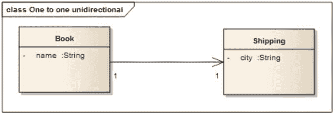

*图 3-1：一对一单向关系*

我们将首先以一个一对一单向关系为例，并在此基础上构建应用程序的所有层级。如图 3-1 所示，`Book` 实体有一个标识符和一个 `name` 字段，该字段是 `String` 类型。同样，`Shipping` 实体也有一个标识符和一个 `city` 字段，它也是 `String` 类型。在 `Book` 的一个实例中必须存在一个 `Shipping` 实例。`Book` 是关系的所有方，可以从这里跳转到 `Shipping`，但反之不行。我们将在本章的后续章节中查看实体设计。与上一章一样，我们将先查看模拟用户界面，然后再转向服务开发。

### 开发用户界面

我们将模拟用户界面的开发分为三个主要任务：数据传输对象、模拟服务和模拟用户界面。当数据库服务就绪后，我们将创建实际的用户界面并进行集成。

### 开发数据传输对象

数据传输对象封装了实际的实体设计，不允许用户界面或客户端获晓底层的实体设计。仔细查看数据传输对象，你将看到 `Book` 对象的标识符以及 `name` 和 `city` 字段。我们没有暴露 `Shipping` 实体或其标识符。我们在服务中建立了 `Book` 和 `Shipping` 之间的关系，但对用户来说，它只是一个名为 `Book` 的对象。这非常重要。

```java
public class BookDto {
    private Integer id;
    private String name;
    private String city;
    // getters and setters
}
```

#### 开发模拟服务

现在数据传输对象已经设置好，让我们添加一些功能。内存数据库遵循带有 `list` 的 `Singleton`（单例）模式。


```java
public class InMemoryDB {
    private static List<BookDto> list = new ArrayList<>();
    private static Integer lastId = 0;

    public Integer getId() {
        return lastId;
    }

    public void add(BookDto bookDto) {
        lastId++;
        list.add(bookDto);
    }

    public List<BookDto> findAll() {
        return list;
    }

    public BookDto findById(Integer id) {
        for(BookDto bookDto : list) {
            if(bookDto.getId() == id) {
                return bookDto;
            }
        }
        return null;
    }

    public void remove(Integer id) {
        BookDto dto = null;
        for(BookDto bookDto : list) {
            if(bookDto.getId() == id) {
                dto = bookDto;
                break;
            }
        }
        if(dto != null) {
            list.remove(dto);
        }
    }

    public void edit(BookDto bookDto) {
        for(BookDto dto : list) {
            if(dto.getId() == bookDto.getId()) {
                dto.setName(bookDto.getName());
                dto.setCity(bookDto.getCity());
            }
        }
    }
}
```

`create` 方法接收来自用户界面的 `BookDto`。

```java
@Controller
@RequestMapping(value=”/onetooneunidirectional/mock")
public class BookController {
    @RequestMapping(value=”/create", method=RequestMethod.POST)
    @ResponseBody
    public void create(@RequestBody BookDto bookDto){
        InMemoryDB.add(bookDto);
    }
}
```

`findAll` 行返回 `BookDto` 列表。

```java
@Controller
@RequestMapping(value=”/onetooneunidirectional/mock")
public class BookController {
    @RequestMapping(value=”/findAll”, method=RequestMethod.GET)
    @ResponseBody
    public List<BookDto> findAll(){
        return InMemoryDB.findAll();
    }
}
```

`findById` 返回 `BookDto` 实例。

```java
@Controller
@RequestMapping(value=”/onetooneunidirectional/mock")
public class BookController {
    @RequestMapping(value=”/findById/{productid}", method=RequestMethod.GET)
    @ResponseBody
    public BookDto findById(@PathVariable(“productid”) Integer productid){
        return InMemoryDB.findById(productid);
    }
}
```

`remove` 操作根据给标识符删除行。

```java
@Controller
@RequestMapping(value=”/onetooneunidirectional/mock")
public class BookController {
    @RequestMapping(value=”/remove/{productid}", method=RequestMethod.POST)
    @ResponseStatus(value = HttpStatus.NO_CONTENT)
    public void remove(@PathVariable(“productid”) Integer productid){
        InMemoryDB.remove(productid);
    }
}
```

控制器的 `edit` 操作更新行。`BookDto` 作为参数从用户界面传递。

```java
@Controller
@RequestMapping(value=”/onetooneunidirectional/mock”)
public class BookController {
    @RequestMapping(value=”/edit”, method=RequestMethod.POST)
    @ResponseBody
    public void edit(@RequestBody BookDto bookDto){
        InMemoryDB.edit(bookDto);
    }
}
```

### 开发模拟用户界面

在上一节中，我们学习了如何使用内存数据库开发模拟服务。现在，我们将查看如图 3-2 所示的该模拟服务的用户界面。我们将使用 JSP 作为用户界面，并使用 JQuery 和 AJAX 连接模拟服务。

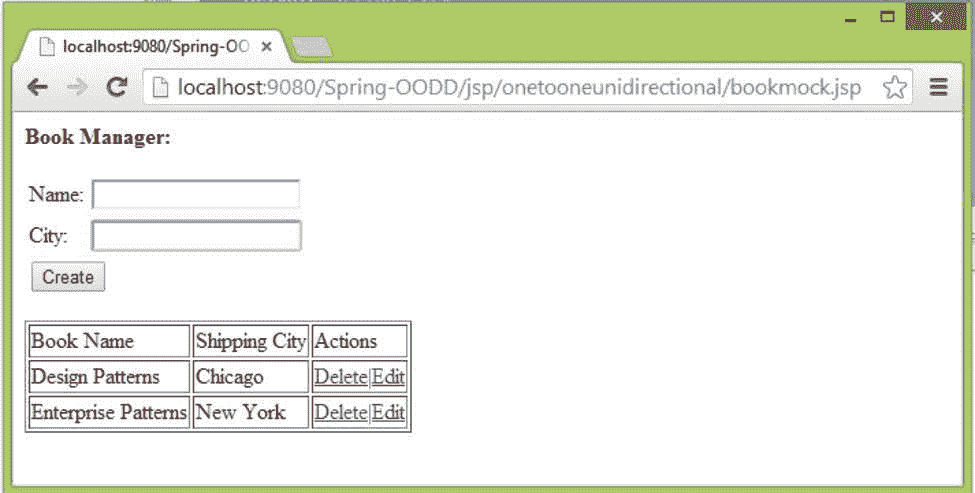

*图 3-2：书籍和运输用户界面*

让我们先查看 JSP 主体，其中提到了调用的 JavaScript 方法。我们将通过 JavaScript 调用来描述流程。

```html
<body onload="loadObjects()">
    <div id="container">
        <div>
            <p>
                <b>书籍管理器：</b>
            </p>
        </div>
        <form method="post" id="bookForm">
            <table>
            <tbody>
            <tr>
            <td>名称：</td>
            <td><input name="bookId" id="bookId" type="hidden"> <input
            name="bookname" id="bookname" type="text"></td>
            </tr>
```

```html
<td class=”tdLabel”><label for=”ad002_dob” class=”label”>城市:</label></td>

<td><input type=”text” name=”city” value=”” id=”city” /></td>

</tr>

<tr><td colspan=”2"><input type=submit value=”创建” id=”subButton” onclick=”return methodCall()”></td></tr>

</tbody>

</table>

</form>

<div id=”bookFormResponse”</div>

</div>

</body>
```

首先，注意页面加载时调用的 JavaScript 方法 `loadObjects`。该 URL 指向我们之前开发的 REST 模拟服务，它会加载所有行数据。当函数执行成功时，会调用另一个 JavaScript 方法 `processResponseData`。

```javascript
function loadObjects(){
  $.ajax({
    url : “/Spring-OODD/onetooneunidirectional/mock/findAll”,
    type: “GET”,
    data : {},
    dataType: “json”,
    success: function(data, textStatus, jqXHR)
    {
      processResponseData(data);
    },
    error: function (jqXHR, textStatus, errorThrown)
    {
      document.getElementById(“bookname”).value=””;
      alert(“Error Status Load Objects:”+textStatus);
    }
  });
  return false;
}
```

当上述服务调用成功后调用的 `processResponseData` JavaScript 方法所示。该表格将根据内存数据库的内容进行填充，并指定编辑和删除行条目的链接。 

```javascript
function processResponseData(responsedata){
  var dyanicTableRow=”<table border=1>”+
  “<tr>” +
  “<td>书名</td>”+”<td>物流城市</td>”+
  “<td>操作</td>”+
  “</tr>";
  var dataRow=””;
  $.each(responsedata, function(itemno, itemvalue){
    dataRow=dataRow+generateTableData(itemvalue);
  });
  dyanamicTableRow=dyanamicTableRow+dataRow+”</table>”;
  document.getElementById(“bookFormResponse”).innerHTML=dyanamicTableRow;
}

function generateTableData(itemvalue){
  var dataRow=”<tr>” +
  “<td>”+itemvalue.name+”</td>”+
  “<td>”+itemvalue.city+”</td>”+
  “<td>” +
  “<a href=# onclick=deleteObject(“+itemvalue.id+”)>删除</a>”+
  “|<a href=# onclick=editObject(“+itemvalue.id+”)>编辑</a>”+
  “</td>”+
  “</tr>";
  return dataRow;
}
```

现在我们已经观察了页面加载的工作原理，让我们创建功能。如果你查看 JSP 片段，会看到正在调用一个 JavaScript 方法 `methodCall`。该方法同时用于创建和更新功能。

```javascript
function methodCall(){
  var buttonValue = document.getElementById(“subButton”).value;
  if(buttonValue==”Create”){
    create();
  }else if(buttonValue==”Update”){
    update();
  }
  return false;
}
```

首先看 `create` 方法，书名和物流城市作为嵌入在 `BookDto` 中的参数传递。JSON 对象通过从用户界面获取值来形成，并作为 POST 参数传递给模拟服务。如果成功，将重置用户界面中的值；如果有任何错误，将向用户显示通知。

```javascript
function create(){
  var name = $(“#bookname”).val();
  var city = $(“#city”).val();
  var formData={“name”:name,”city”:city};
  $.ajax({
    url : “/Spring-OODD/onetooneunidirectional/mock/create”,
    type: “POST”,
    data : JSON.stringify(formData),
    beforeSend: function(xhr) {
      xhr.setRequestHeader(“Accept”, “application/json”);
      xhr.setRequestHeader(“Content-Type”, “application/json”);
    },
    success: function(data, textStatus, jqXHR)
    {
      document.getElementById (“bookname”).value=””;
      document.getElementById (“city”).value=””;
      document.getElementById (“subButton”).value=”Create”;
      loadObjects();
    },
    error: function (jqXHR, textStatus, errorThrown)
    {
      alert(“Error Status Load Objects:”+textStatus);
    }
  });
  return false;
}
```

接下来我们将查看 `edit` 方法，书名和物流城市作为参数传递。`update` 函数与 `create` 函数类似，区别在于 `id` 是 JSON 对象的一部分。

```javascript
function update(){
  var name = $(“#bookname”).val();
  var city = $(“#city”).val();
  var formData={“name”:name,”city”:city};
  $.ajax({
    url : “/Spring-OODD/onetooneunidirectional/mock/create”,
    type: “POST”,
    data : JSON.stringify(formData),
    beforeSend: function(xhr) {
      xhr.setRequestHeader (“Accept”, “application/json”);
      xhr.setRequestHeader (“Content-Type”, “application/json”);
    },
    success: function(data, textStatus, jqXHR)
    {
      document.getElementById (“bookname”).value=””;
      document.getElementById (“city”).value=””;
      document.getElementById (“subButton”).value=”Create”;
      loadObjects();
    },
    error: function (jqXHR, textStatus, errorThrown)
    {
      alert(“Error Status Load Objects:”+textStatus);
    }
  });
  return false;
}
```

既然我们已经观察了页面加载是如何工作的，让我们看看编辑功能。`editObject` 方法将书名和物流城市作为参数传递。


```javascript
function editObject(id){
  var name = $(“#bookname”).val();
  var city = $(“#city”).val();
  var formData={“name”:name,”city”:city};
  $.ajax({
    url : “/Spring-OODD/onetooneunidirectional/mock/findById/+id,
    type: “GET”,
    data : formData,
    beforeSend: function(xhr) {
      xhr.setRequestHeader (“Accept”, “application/json”);
      xhr.setRequestHeader (“Content-Type”, “application/json”);
    },
    success: function(data, textStatus, jqXHR)
    {
      document.getElementById (“bookname”).value=data.name;
      document.getElementById (“city”).value=data.city;
      document.getElementById (“subButton”).value=”Update”;
      loadObjects();
    },
    error: function (jqXHR, textStatus, errorThrown)
    {
      alert(“Error Status Load Objects:”+textStatus);
    }
  });
  return false;
}
```

最后，查看删除操作，书籍标识符作为参数传递。删除成功后表格将刷新。

```javascript
function deleteObject(id){
  $.ajax({
    url : “/Spring-OODD/onetooneunidirectional/mock/remove/+id,
    type: “DELETE”,
    data : {id:id},
    success: function(data, textStatus, jqXHR)
    {
      loadObjects();
    },
    error: function (jqXHR, textStatus, errorThrown)
    {
      alert(“Error Status Delete:”+textStatus);
    }
  });
}
```

### 开发服务

服务开发包含四个主要步骤：创建实体、创建数据访问层、创建业务服务层以及创建基于 JSON 的 REST 服务，这将与用户界面集成。我们将遵循自底向上的方法，从实体开始到 REST 服务。

### 开发资源（实体）层

遵循测试驱动开发方法，我们将为每个方法编写测试，然后定义实际方法。在实体测试方法中，首先创建两个实例，然后进行更新和删除，最后检查是否剩余一个实例。测试执行后，操作将回滚。

```java
@RunWith( SpringJUnit4ClassRunner.class )
@ContextConfiguration( locations = { “classpath:context.xml” } )
@TransactionConfiguration( defaultRollback = true )
@Transactional
public class BookTest {

  @Autowired
  private SessionFactory sessionFactory;

  @Test
  public void testCRUD()
  {
    Book book1 = new Book();
    book1.setName(“Java SE”);
    Shipping shipping1 = new Shipping();
    shipping1.setCity(“US”);
    book1.setShipping(shipping1);
    sessionFactory.getCurrentSession().save(book1);

    Book book2 = new Book();
    book2.setName(“EJB 3.0”);
    Shipping shipping2 = new Shipping();
    shipping2.setCity(“CAN”);
    book2.setShipping(shipping2);
    sessionFactory.getCurrentSession().save(book2);

    book1.setName(“JEE”);
    shipping1 = book1.getShipping();
    shipping1.setCity(“UK”);
    sessionFactory.getCurrentSession().merge(book1);

    List<Book> books = sessionFactory.getCurrentSession().createQuery(“select book from Book book”).list();
    Assert.assertEquals(2L, books.size());

    sessionFactory.getCurrentSession().delete(book2);

    books = sessionFactory.getCurrentSession().createQuery(“select book from Book book”).list();
    Assert.assertEquals(1L, books.size());
  }

}
```

我们正在开发一个一对一的单向关系，其中`Book`是所有者，`Shipping`是对应端，该关系可以通过`Book`访问。首先，查看`Shipping`实体，它没有任何依赖项。

```java
@Entity
@Table(name=”SHIPPING”)
public class Shipping {
    private Integer id;
    private String city;
    @Id
    @GeneratedValue(strategy=GenerationType.AUTO)
    @Column(name=”id”,length=20)
    public Integer getId() {
        return id;
    }
    public void setId(Integer id) {
        this.id = id;
    }
    @Column(name=”city”,length=50)
    public String getCity() {
        return city;
    }
    public void setCity(String city) {
        this.city = city;
    }
}
```

下一个实体是`Book`，它包含对`Shipping`的`@OneToOne`引用。请注意，在`Book`实例中存在对应的`Shipping`实例。先创建`Shipping`实例，然后将其作为引用存储在`Book`实体中。当一对一或一对多关系中的目标实体从关系中删除时，通常希望将删除操作级联到目标实体。此类目标实体被视为“孤儿”，可以使用`orphanRemoval`属性来指定删除孤儿实体。例如，如果订单实体发生了变化，则之前附加到`Book`上的实体被视为孤儿并被删除。

```java
@Entity
@Table(name=”BOOK”)
public class Book {
    private Integer id;
    private String name;
    private Shipping shipping;
    @Id
    @GeneratedValue(strategy=GenerationType.AUTO)
    @Column(name=”id”,length=20)
    public Integer getId() {
        return id;
    }
    public void setId(Integer id) {
        this.id = id;
    }
    @Column(name=”name”,length=50)
    public String getName() {
        return name;
    }
    public void setName(String name) {
        this.name = name;
    }
    @OneToOne(cascade=CascadeType.ALL, orphanRemoval=true)
    @JoinColumn(name=”shipping_id”)
    public Shipping getShipping() {
        return shipping;
    }
    public void setShipping(Shipping shipping) {
        this.shipping = shipping;
    }
}
```

### 表结构

```sql
DROP TABLE `book`;
DROP TABLE `shipping`;
CREATE TABLE `shipping` (
  `id` int(11) NOT NULL AUTO_INCREMENT,
  `city` varchar(50) DEFAULT NULL,
  PRIMARY KEY (`id`)
);
CREATE TABLE `book` (
  `id` int(11) NOT NULL AUTO_INCREMENT,
  `name` varchar(50) DEFAULT NULL,
  `shipping_id` int(11) DEFAULT NULL,
  PRIMARY KEY (`id`),
  KEY (`shipping_id`),
  CONSTRAINT FOREIGN KEY (`shipping_id`) REFERENCES `shipping` (`id`)
);
```

### 开发数据访问层

接下来我们将查看数据访问层。我们将从查找所有记录操作的测试用例开始。由于这是作为测试驱动开发的一部分开发的第一个函数，我们让查找所有记录操作返回大小为 0 的结果。在随后的函数中，我们将顺序构建 CRUD 操作。

```java
@RunWith( SpringJUnit4ClassRunner.class )
@ContextConfiguration( locations = { “classpath:context.xml” } )
@TransactionConfiguration( defaultRollback = true )
@Transactional
public class BookDaoImplTest {
    @Autowired
    private BookDao dao;
    @Test
    public void testGetAll() {
        Assert.assertEquals(0L, dao.getAll().size());
    }
}
```

我们将看到如何为上述测试编写符合要求的数据访问操作。`BookDao`是一个包含所有操作方法签名的接口。使用 Hibernate 的`Session.createQuery`操作结合 SQL 从`Book`实体中检索所有记录。

```java
@Repository
@Transactional
public class BookDaoImpl implements BookDao {
    @Autowired
    private SessionFactory sessionFactory ;
    @Override
    public List<Book> getAll() {
        return (List<Book>) sessionFactory.getCurrentSession()
        .createQuery(“select book from Book book order by book.id desc”).list();
    }
}
```

让我们来看看插入操作测试。在`Book`表中插入几行，并检查结果是否匹配两条记录。注意，在`Book`实体的插入过程中，对应的`Shipping`实体也会被创建。

```java
public class BookDaoImplTest {
    @Autowired
    private BookDao dao;
    @Test
    public void testInsert(){
        Book book1 = new Book();
        book1.setName(“Java Book”);
        Shipping shipping1 = new Shipping();
        shipping1.setCity(“UK”);
        book1.setShipping(shipping1);
        dao.insert(book1);
        Book book2 = new Book();
        book2.setName(“Java SE Book”);
        Shipping shipping2 = new Shipping();
        shipping2.setCity(“IN”);
        book2.setShipping(shipping2);
        dao.insert(book2);
        Assert.assertEquals(2L, dao.getAll().size());
    }
}
```

在`Book`实体插入操作时，对应的`Shipping`实体也会被创建。

```java
public class BookDaoImpl implements BookDao {
    @Autowired
    private SessionFactory sessionFactory ;
    @Override
    public void insert(Book book) {
        sessionFactory.getCurrentSession().save(book);
    }
}
```


我们正在开发一个一对一的单向关系，其中`Book`是所有者，`Shipping`是对应端，该关系可以通过`Book`访问。首先，查看`Shipping`实体，它没有任何依赖项。

```java
@Entity
@Table(name=”SHIPPING”)
public class Shipping {
...
}
```

下一个实体是`Book`，它包含对`Shipping`的`@OneToOne`引用。请注意，在`Book`实例中存在对应的`Shipping`实例。先创建`Shipping`实例，然后将其作为引用存储在`Book`实体中。当一对一或一对多关系中的目标实体从关系中删除时，通常希望将删除操作级联到目标实体。此类目标实体被视为“孤儿”，可以使用`orphanRemoval`属性来指定删除孤儿实体。例如，如果订单实体发生了变化，则之前附加到`Book`上的实体被视为孤儿并被删除。

```java
@Entity
@Table(name=”BOOK”)
public class Book {
...
}
```

### 表结构

```sql
DROP TABLE `book`;
DROP TABLE `shipping`;
...
```

### 开发数据访问层

接下来我们将查看数据访问层。我们将从查找所有记录操作的测试用例开始。由于这是作为测试驱动开发的一部分开发的第一个函数，我们让查找所有记录操作返回大小为 0 的结果。在随后的函数中，我们将顺序构建 CRUD 操作。

```java
@RunWith( SpringJUnit4ClassRunner.class )
...
public class BookDaoImplTest {
```

我们将看到如何为上述测试编写符合要求的数据访问操作。`BookDao`是一个包含所有操作方法签名的接口。使用 Hibernate 的`Session.createQuery`操作结合 SQL 从`Book`实体中检索所有记录。

```java
@Repository
@Transactional
public class BookDaoImpl implements BookDao {
...
}
```

让我们来看看插入操作测试。在`Book`表中插入几行，并检查结果是否匹配两条记录。注意，在`Book`实体的插入过程中，对应的`Shipping`实体也会被创建。

```java
public class BookDaoImplTest {
...
}
```

在`Book`实体插入操作时，对应的`Shipping`实体也会被创建。

```java
public class BookDaoImplTest {
    ...
    @Test
    public void testInsert(){
        ...
        Assert.assertEquals(2L, dao.getAll().size());
    }
}
```

在`Book`实体实插入操作时，对应的`Shipping`实体也会被创建。

```java
public class BookDaoImpl implements BookDao {
...
}
```

在`Book`实体插入操作时，对应的`Shipping`实体也会被创建。

```java
public class BookDaoImpl implements BookDao {
...
}
```

在`Book`实体插入操作时，对应的`Shipping`实体也会被创建。

```java
public class BookDaoImpl implements BookDao {
...
}
```

```java
public class BookDaoImpl implements BookDao {

  @Autowired
  private SessionFactory sessionFactory ;

  @Override
  public void update(Book book) {
    sessionFactory.getCurrentSession().merge(book);
  }

}
```

### 开发业务服务层

我们将从业务服务层开始，因为数据访问层已经开发完成，并准备好与业务服务层集成。首先，让我们来看获取所有记录操作的测试。由于这是第一个被测试的功能，其他操作尚未开发，只有“查找所有记录”操作可以在表为空时返回零条记录并进行测试。

```java
@RunWith( SpringJUnit4ClassRunner.class )
@ContextConfiguration( locations = { “classpath:context.xml” } )
@TransactionConfiguration( defaultRollback = true )
@Transactional
public class BookServiceImplTest {
  @Autowired
  private BookService service ;

  @Test
  public void testFindAll() {
    Assert.assertEquals(0L, service.findAll().size());
  }
}
```

查看如何在业务服务中编写匹配方法。数据访问层使用实体类（entities），而业务服务层使用数据访问对象（DAOs）。因此，存在一个 mapper 将数据传输对象（DTO）转换为实体，反之亦然。

```java
@Service
@Transactional
public class BookServiceImpl implements BookService {
  @Autowired
  private BookDao dao;

  @Autowired
  private BookMapper mapper;

  @Override
  public List<BookDto> findAll() {
    List<Book> books = dao.getAll();
    List<BookDto> bookDtos = new ArrayList<BookDto>();
    for(Book book : books){
      bookDtos.add(mapper.mapEntityToDto(book));
    }
    return bookDtos;
  }
}
```


`Mapper`通常有两个重要的操作，将数据访问对象转换为等效实体，反之亦然。这里需要观察的一点是，每当更新或添加`Book`时，都会创建一个`Shipping`标识符。正如我们之前提到的，`Shipping`实体标识符的管理将由服务内部完成。用户界面团队只需传递`Shipping`实体中的数据值（例如城市字段），而无需关心`Shipping`实体的标识符。

```java
@Component
public class BookMapper {
  public Book mapDtoToEntity(BookDto bookDto){
    Book book = new Book();
    Shipping shipping = new Shipping();
    if(null!=bookDto.getId() book.setId(bookDto.getId());
    if(null!=bookDto.getName()) book.setName(bookDto.getName());
    if(null!=bookDto.getCity()){ shipping.setCity(bookDto.getCity()); book.setShipping(shipping);}
    return book;
  }

  public BookDto mapEntityToDto(Book book){
    BookDto bookDto = new BookDto();
    if(null!=book.getId()) bookDto.setId(book.getId());
    if(null!=book.getName()) bookDto.setName(book.getName());
    if(null!=book.getShipping()){
      if(null !=book.getShipping().getCity()){
        bookDto.setCity(book.getShipping().getCity());
      }
    }
    return bookDto;
  }
}
```

接下来是创建测试操作，它创建一个实体的实例，并结合“获取所有记录”操作检查计数是否为一。

```java
public class BookServiceImplTest {
  @Autowired
  private BookService service ;

  @Test
  public void testCreate() {
    BookDto bookDto = new BookDto();
    bookDto.setName(“Java SE”);
    bookDto.setCity(“IND”);
    service.create(bookDto);
    Assert.assertEquals(1L, service.findAll().size());
  }
}
```

业务服务层中的相应方法接受一个数据访问对象，将其转换为等效实体，并委托给数据访问层保存到数据库。

```java
public class BookServiceImpl implements BookService {
  @Autowired
  private BookDao dao;

  @Autowired
  private BookMapper mapper;

  @Override
  public void create(BookDto bookDto) {
    dao.insert(mapper.mapDtoToEntity(bookDto));
  }
}
```

接下来的测试操作将被定义为根据给定标识符查找行。

```java
public class BookServiceImplTest {
  @Autowired
  private BookService service ;

  @Test
  public void testFindById() {
    BookDto bookDto = new BookDto();
    bookDto.setName(“Java SE”);
    bookDto.setCity(“IND”);
    service.create(bookDto);
    List<BookDto> bookDtos = service.findAll();
    BookDto bDto = bookDtos.get(0);
    BookDto bDto2 = service.findById(bDto.getId());
    Assert.assertEquals(“Java SE”, bDto2.getName());
    Assert.assertEquals(“IND”, bDto2.getCity());
  }
}
```

现在将描述业务服务中根据给定标识符查找行的类比操作。同样遵循相同的顺序：联系数据访问层并与`mapper`交互。

```java
public class BookServiceImpl implements BookService {
  @Autowired
  private BookDao dao;

  @Autowired
  private BookMapper mapper;

  @Override
  public BookDto findById(int id) {
    Book book = dao.getById(id);
    if(null !=book){
      return mapper.mapEntityToDto(book);
    }
    return null;
  }
}
```

然后是删除测试操作，它接受给定的标识符并从数据库中删除等效行。测试方法首先创建一个实例，移除同一个实例，并检查数据库中是否为零结果。

```java
public class BookServiceImplTest {
  @Autowired
  private BookService service ;

  @Test
  public void testRemove() {
    BookDto bookDto = new BookDto();
    bookDto.setName(“Java SE”);
    bookDto.setCity(“IND”);
    service.create(bookDto);
    Assert.assertEquals(1L, service.findAll().size());
    List<BookDto> bookDtos = service.findAll();
    BookDto bDto = bookDtos.get(0);
    service.remove(bDto.getId());
    Assert.assertEquals(0L, service.findAll().size());
  }
}
```

之后定义相应的业务服务方法，它接受一个标识符并通过数据访问层操作从数据库中删除匹配的实例。

```java
public class BookServiceImpl implements BookService {
  @Autowired
  private BookDao dao;

  @Autowired
  private BookMapper mapper;

  @Override
  public void remove(int id) {
    Book book = dao.getById(id);
    dao.delete(book);
  }
}
```

最后一个测试操作是编辑，它创建一个实例，编辑城市，然后检查编辑是否有效。

```java
public class BookServiceImplTest {
  @Autowired
  private BookService service ;

  @Test
  public void testEdit() {
    BookDto bookDto = new BookDto();
    bookDto.setName(“Java SE”);
    bookDto.setCity(“IND”);
    service.create(bookDto);
    Assert.assertEquals(1L, service.findAll().size());
    List<BookDto> bookDtos2 = service.findAll();
    BookDto bDto2 = bookDtos2.get(0);
    bDto2.setCity(“CAN”);
    service.edit(bDto2);
    List<BookDto> bookDtos = service.findAll();
    BookDto bDto = bookDtos.get(0);
    Assert.assertEquals(“CAN”, bDto.getCity());
  }
}
```

业务服务的相应操作是编辑操作，它通过`mapper`方法转换后调用数据访问的更新方法。请注意，编辑操作没有`Shipping`实体的标识符，因此会生成新实例。

```java
public class BookServiceImpl implements BookService {
  @Autowired
  private BookDao dao;

  @Autowired
  private BookMapper mapper;

  @Override
  public void edit(BookDto bookDto) {
    dao.update(mapper.mapDtoToEntity(bookDto));
  }
}
```

### 开发表示层

栈中的最后一层是基于 REST 的 Spring Controller，我们将首先为其编写测试。测试首先创建一个`BookDto`实例。接下来使用“获取所有记录”操作检索该实例并编辑实例的值。最后通过 REST 服务删除该实例。

```java
@RunWith(SpringJUnit4ClassRunner.class)
@WebAppConfiguration
@ContextConfiguration( locations = { “classpath:context.xml” } )
@TransactionConfiguration(defaultRollback = true)
@Transactional
public class BookControllerTest {
  private Gson gson = new GsonBuilder().create();

  @Resource
  private WebApplicationContext webApplicationContext;

  private MockMvc mockMvc;

  @Before
  public void setUp() {
    mockMvc = MockMvcBuilders.webAppContextSetup(webApplicationContext).build();
  }

  @Test
  public void testAll() throws Exception {
    testCreate();

    testUpdate();

    testDelete();
  }
}
```

```java
public void testCreate() throws Exception {
    BookDto bookDto = new BookDto();
    bookDto.setName(“Java SE”);
    bookDto.setCity(“IND”);
    String json = gson.toJson(bookDto);
    MockHttpServletRequestBuilder requestBuilderOne = MockMvcRequestBuilders.post(“/onetooneunidirectional/create”);
    requestBuilderOne.contentType(MediaType.APPLICATION_JSON);
    requestBuilderOne.content(json.getBytes());
    this.mockMvc.perform(requestBuilderOne).andExpect(MockMvcResultMatchers.status().isOk());
}

public void testUpdate() throws Exception {
    MockHttpServletRequestBuilder requestBuilder2 = MockMvcRequestBuilders.get(“/onetooneunidirectional/findAll”);
    MvcResult result = this.mockMvc.perform(requestBuilder2).andReturn();
    String response2 = result.getResponse().getContentAsString();
    Type listType = new TypeToken<List<BookDto>>() {}.getType();
    List<BookDto> bookDtos = gson.fromJson(response2, listType);
    BookDto bookDto2 = bookDtos.get(0);
    bookDto2.setName(“JEFF”);
    String json2 = gson.toJson(bookDto2);
    MockHttpServletRequestBuilder requestBuilder3 = MockMvcRequestBuilders.post(“/onetooneunidirectional/edit”);
    requestBuilder3.contentType(MediaType.APPLICATION_JSON);
    requestBuilder3.content(json2.getBytes());
    this.mockMvc.perform(requestBuilder3).andExpect(MockMvcResultMatchers.status().isOk());
}

public void testDelete() throws Exception {
    MockHttpServletRequestBuilder requestBuilder = MockMvcRequestBuilders.get(“/onetooneunidirectional/findAll”);
    MvcResult result = this.mockMvc.perform(requestBuilder).andReturn();
    String response2 = result.getResponse().getContentAsString();
    Type listType = new TypeToken<List<BookDto>>() {}.getType();
    List<BookDto> bookDtos = gson.fromJson(response2, listType);
    BookDto bookDto2 = bookDtos.get(0);
    MockHttpServletRequestBuilder requestBuilder2 = MockMvcRequestBuilders.post(“/onetooneunidirectional/remove/”+bookDto2.getId());
    requestBuilder2.contentType(MediaType.APPLICATION_JSON);
    this.mockMvc.perform(requestBuilder2).andExpect(MockMvcResultMatchers.status().is(204));
}
}
```

通过的 REST Spring 控制器将联系业务服务层，最终通过数据访问层连接到数据库。这里的代码与模拟服务相似，区别在于代码访问的是实际数据库，而不是内存数据库。


我们现在将讨论如何将 REST 服务与实际的用户界面集成。请注意，请求映射从`/onetooneunidirectional/mock`更为`/onetooneunidirectional`。其余的工作涉及从模拟用户界面创建实际的用户界面。

### 总结

在本章中，我们讨论了以下内容：

* 开发模拟内存数据库
* 开发模拟用户界面
* 开发与一对一单向关联关联的实体
* 开发数据访问层
* 开发业务服务层
* 开发 REST 服务控制器

## 第 4 章：一对一双向关系

一对一双向关系是一种一对一关系，它会从父级到子级回指，反之亦然。如果你发现现实生活中的关系是一对一，且需要在两个方向上进行遍历，请使用一对一双向关系。我们将监控从服务开发跟踪的用户界面开始的习惯流，并在结束时在两个模块中缝合。

### 领域模型

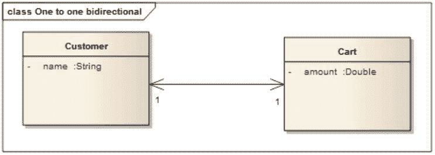

*图 4-1：一对一双向关系*

如图 4-1 所示的一对一双向关联，`Customer` 实体有一个标识符和一个 `String` 类型的字段。`Cart` 实体也有一个标识符和一个 `Double` 金额字段。由于关系的双向性，在 `Customer` 实例中必须存在一个 `Cart` 实例，反之亦然。我们将首先编写...

```java
for(CustomerDto customerDto : list){
  if(customerDto.getId() == id){
    dto = customerDto;
    break;
  }
}
if(null != dto){
  list.remove(dto);
}
```

在匹配 mock 服务中，`remove` 操作根据作为 URL 输入的给定标识符删除特定行。

```java
@Controller
@RequestMapping(value="/onetoonebidirectional/mock")
public class CustomerMockController {
  @RequestMapping(value="remove/{customerid}", method=RequestMethod.POST)
  @ResponseStatus(value = HttpStatus.NO_CONTENT)
  public void remove(@PathVariable("customerid") Integer customerid){
    CustomerInMemoryDB.INSTANCE.remove(customerid);
  }
}
```

最后，我们处理负责更新行的 `edit` 操作。

```java
public enum CustomerInMemoryDB {
  public void edit(CustomerDto customerDto){
    for(CustomerDto dto : list){
      if(dto.getId() == customerDto.getId()){
        dto.setName(customerDto.getName());
        dto.setAmount(customerDto.getAmount());
      }
    }
  }
}
```

控制器的 `edit` 操作接收一个编辑过的 `CustomerDto` 副本并用更改更新特定行。

```java
@Controller
@RequestMapping(value="/onetoonebidirectional/mock")
public class CustomerMockController {
  @RequestMapping(value="/edit", method=RequestMethod.POST)
  @ResponseBody
  public void edit(@RequestBody CustomerDto customerDto){
    CustomerInMemoryDB.INSTANCE.edit(customerDto);
  }
}
```

#### 开发 mock 用户界面

让我们从开发带有内存数据库的 mock 服务转向用户界面，该界面将如图 4-2 所示接入此 mock 服务。用户界面将能够添加、编辑、删除和显示所有与 `Customer` 相关的记录，包括 `Cart` 金额字段。

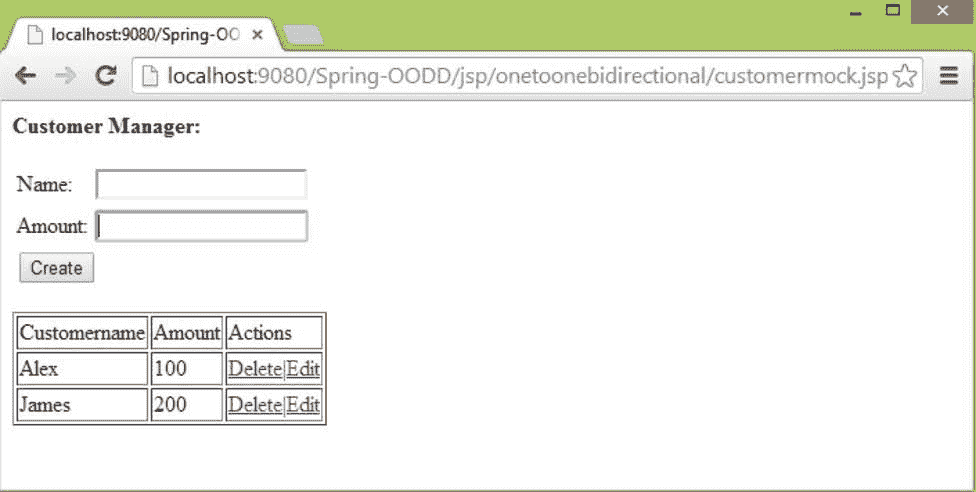

*图 4-2：Customer 和 Cart 用户界面的截图*

JSP body 是加载的起始页面，随后会调用 JavaScript 方法。我们将通过 JavaScript 调用来定义流程。

```html
<body onload="loadObjects()">
  <div id="container">
    <div>
      <p>
        <b>Customer Manager:</b>
      </p>
    </div>
    <form method="post" id="customerForm">
      <table>
        <tbody>
          <tr>
            <td>Name:</td>
            <td><input name="customerid" id="customerid" type="hidden"> <input name="customername" id="customername" type="text"></td>
          </tr>
          <tr>
            <td class="tdLabel"><label>Amount:</label></td>
            <td><input type="text" name="amount" value="" id="amount" /></td>
          </tr>
          <tr>
            <td colspan="2"><input type=submit value="Create" id="subButton" onclick="return methodCall()"></td>
          </tr>
        </tbody>
      </table>
    </form>
    <div id="customerFormResponse"></div>
  </div>
</body>
```

首先让我们看看 JavaScript `loadObjects` 方法，它在页面通过 `onload` 事件加载时被调用。

```javascript
function loadObjects(){
  $.ajax({
    url : "/Spring-OODD/onetoonebidirectional/mock/findAll",
    type: "GET",
    data : {},
    dataType: "json",
    success: function(data, textStatus, jqXHR) {
      processResponseData(data);
    },
    error: function (jqXHR, textStatus, errorThrown) {
      document.getElementById("customername").value="";
      alert("Error Status Load Objects:"+textStatus);
    }
  });
  return false;
}
```

当上述服务调用成功时调用的 `processResponseData` JavaScript 方法如下代码所示。表格将由内存数据库的内容填充，并显示了生成表格结构的 `generateTableData` JavaScript 方法。

```javascript
function processResponseData(responsedata){
  var dyanamicTableRow="<table border=1>"+
    "<tr>" +
    "<td>Customername</td>"+"<td>Amount</td>"+
    "<td>Actions</td>"+
    "</tr>";
  var dataRow="";
  $.each(responsedata, function(itemno, itemvalue){
    dataRow=dataRow+generateTableData(itemvalue);
  });
  dyanamicTableRow=dyanamicTableRow+dataRow+"</table>";
  document.getElementById("customerFormResponse").innerHTML=dyanamicTableRow;
}

function generateTableData(itemvalue){
  var dataRow="<tr>" +
    "<td>"+itemvalue.name+"</td>"+
    "<td>"+itemvalue.amount+"</td>"+
    "<td>" +
    "<a href=# onclick=deleteObject("+itemvalue.id+")>Delete</a>"+
    "|<a href=# onclick=editObject("+itemvalue.id+")>Edit</a>"+
    "</td>"+
    "</tr>";
  return dataRow;
}
```

我们看到了页面加载机制。`methodCall` 方法将处理创建和更新功能。

```javascript
function methodCall(){
  var buttonValue = document.getElementById("subButton").value;
  if(buttonValue==="Create"){
    create();
  }else if(buttonValue==="Update"){
    update();
  }
  return false;
}
```

首先我们将看到 `create` JavaScript 方法，它接收来自 `name` 和 `amount` 文本框的输入。

```javascript
function create(){
  var name = $("#customername").val();
  var amount = $("#amount").val();
  var formData={"name":name,"amount":amount};
  $.ajax({
    url : "/Spring-OODD/onetoonebidirectional/mock/create",
    type: "POST",
    data : JSON.stringify(formData),
    beforeSend: function(xhr) {
      xhr.setRequestHeader("Accept", "application/json");
      xhr.setRequestHeader("Content-Type", "application/json");
    },
    success: function(data, textStatus, jqXHR) {
      document.getElementById("customername").value="";
      document.getElementById("amount").value="";
      document.getElementById("subButton").value="Create";
      loadObjects();
    },
    error: function (jqXHR, textStatus, errorThrown) {
      document.getElementById("customername").value="";
      alert("Error Status Create:"+textStatus);
    }
  });
}
```

接下来我们将查看 `update` JavaScript 方法，它通过标识符更新 `CustomerDto`。

```javascript
function update(){
  var name = $("#customername").val();
  var id = $("#customerid").val();
  var amount = $("#amount").val();
  var formData={"id":id,"name":name,"amount":amount};
  $.ajax({
    url : "/Spring-OODD/onetoonebidirectional/mock/edit",
    type: "POST",
    data : JSON.stringify(formData),
    beforeSend: function(xhr) {
      xhr.setRequestHeader("Accept", "application/json");
      xhr.setRequestHeader("Content-Type", "application/json");
    },
    success: function(data, textStatus, jqXHR) {
      document.getElementById("customername").value="";
      document.getElementById("amount").value="";
      document.getElementById("subButton").value="Create";
      loadObjects();
    },
    error: function (jqXHR, textStatus, errorThrown) {
      document.getElementById("customername").value="";
      alert("Error Status Update:"+textStatus);
    }
  });
}
```

我们还将查看 `editObject` 和 `viewObject` JavaScript 方法，`editObject` 将显示要编辑的记录。


```javascript
function editObject(customerid){
  var name = $(#customername”).val();
  var amount = $(#amount”).val();
  var formData={“id”:customerid,”name”:name,”amount”:amount};
  $.ajax({
    url : “”Spring-OODD/onetoonebidirectional/mock/findById/”+customerid,
    type: “”GET”,
    data : customerForm,
    dataType: “”json”,
    success: function(data, textStatus, jqXHR) {
      viewObject(data);
      document.getElementById(“subButton”).value=""Update”;
    },
    error: function (jqXHR, textStatus, errorThrown) {
      alert(“Error Status Find Object:”+textStatus);
    }
  });
}

function viewObject(data){
  document.getElementById(“customername”).value=data.name;
  document.getElementById(“amount”).value=data.amount;
  document.getElementById(“customerid”).value=data.id;
}
```

最后，我们将查看删除操作，该操作将客户标识符作为输入并删除并刷新相关的 `Customer` 信息。

```javascript
function deleteObject(customerid){
  var customerForm={id:customerid};
  delurl=""/Spring-OODD/onetoonebidirectional/mock/remove/”+customerid;
  $.ajax({
    url : delurl,
    type: “”POST”,
    data : customerForm,
    dataType: “”json”,
    success: function(data, textStatus, jqXHR) {
      loadObjects();
    },
    error: function (jqXHR, textStatus, errorThrown) {
      alert(“Error Status Delete:”+textStatus);
    }
  });
}
```

现在让我们转到服务开发上，它由四个主要步骤组成：创建实体、创建数据访问层、创建业务服务层以及创建基于 JSON 的 REST。我们将从实体开始，一直构建到 REST 服务。

### 开发资源（实体）层

遵循测试驱动开发的方法，我们将先为实体编写测试，然后编写实体的实现。首先，创建两个带有 `Cart` 实体的 `Customer` 实例，接着进行更新和删除操作，最后测试是否还存在一个 `Customer` 实例。请注意，本质区别在于要在双向关系中以两种方式为 `Customer` 填充 `Cart`，同时也为 `Cart` 填充 `Customer`。

```java
@RunWith( SpringJUnit4ClassRunner.class )

@ContextConfiguration( locations = { “classpath:context.xml” } )

@TransactionConfiguration( defaultRollback = true )

@Transactional

public class CustomerTest {

@Autowired

private SessionFactory sessionFactory;

@Test
public void testCRUD()
{

Customer customer1 = new Customer();
customer1.setName(“Alex”);

Cart cart1 = new Cart();
cart1.setAmount(500.0);
customer1.setCart(cart1);
sessionFactory.getCurrentSession().save(cart1);

Customer customer2 = new Customer();
customer2.setName(“Fred”);

Cart cart2 = new Cart();
cart2.setAmount(700.0);
customer2.setCart(cart2);
sessionFactory.getCurrentSession().save(customer2);

customer1.setName(“Alex”);
cart1 = customer1.getCart();
cart1.setAmount(500.0);
customer1.setCart(cart1);
sessionFactory.getCurrentSession().merge(customer1);

List<Customer> customers = sessionFactory.getCurrentSession()
.createQuery(“select customer from Customer customer order by customer.id desc”).list();
Assert.assertEquals(2L, customers.size());

sessionFactory.getCurrentSession().delete(customer2);

customers = sessionFactory.getCurrentSession()
.createQuery(“select customer from Customer customer order by customer.id desc”).list();
Assert.assertEquals(1L, customers.size());

}

}
```

我们正在开发一个一对一双向关系，其中 `Customer` 是所有者，`Cart` 是对应端，因此关系可以双向遍历，即从 `Customer` 可以访问 `Cart`，从 `Cart` 访问 `Customer`。首先，查看所有者（包含 `Cart` 的 `@OneToOne` 实例的 `Customer`）。当一对一关系中的目标实体从关系中移除时，你应该将删除操作级联到目标实体。此类目标实体被视为“孤儿”，可以使用 `orphanRemoval` 属性来指定移除这些孤儿实体。

```java
@Entity
@Table(name=”CUSTOMER”)
public class Customer {

private Integer id ;
private String name;
private Cart cart ;

@Id
@GeneratedValue(strategy=GenerationType.AUTO)
@Column(name=”id”,length=20)
public Integer getId() {
return id;
}

public void setId(Integer id) {
this.id = id;
}

@Column(name=”name”,length=50)
public String getName() {
return name;
}

public void setName(String name) {
this.name = name;
}

@OneToOne(cascade=CascadeType.ALL, orphanRemoval=true)
@JoinColumn(name=”CART_ID”)
public Cart getCart() {
return cart;
}

public void setCart(Cart cart) {
this.cart = cart;
}

}
```

下一个实体是 `Cart`，它使用 `mappedBy` 属性包含对 `Customer` 的 `@OneToOne` ，该属性包含了 `Customer` 实体中所使用的变量名。`mappedBy` 字段拥有关系，且仅指定在关联的反向端。

```java
@Entity
@Table(name=”CART”)
public class Cart {

private Integer id;
private Double amount;
private Customer customer;

@Id
@GeneratedValue(strategy=GenerationType.AUTO)
@Column(name=”id”,length=20)
public Integer getId() {
return id;
}

public void setId(Integer id) {
this.id = id;
}

@Column(name=”amount”,length=20)
public Double getAmount() {
return amount;
}

public void setAmount(Double amount) {
this.amount = amount;
}

@OneToOne(mappedBy=”cart”)
public Customer getCustomer() {
return customer;
}

public void setCustomer(Customer customer) {
this.customer = customer;
}

}
```

### 表结构

```sql
CREATE TABLE Customer (
    id INT PRIMARY KEY,
    name VARCHAR(50),
    cart_id INT
);

CREATE TABLE Cart (
    id INT PRIMARY KEY,
    amount DOUBLE,
    customer_id INT
);
```

```java
private CustomerDao dao;

@Test
public void testDelete() {
    Customer customer1 = new Customer();
    customer1.setName(“Alex”);
    Cart cart1 = new Cart();
    cart1.setAmount(300.0);
    customer1.setCart(cart1);
    dao.insert(customer1);
    Customer customer2 = new Customer();
    customer2.setName(“Fred”);
    Cart cart2 = new Cart();
    cart2.setAmount(500.0);
    customer2.setCart(cart2);
    dao.insert(customer2);
    Assert.assertEquals(2L, dao.getAll().size());
    dao.delete(customer2);
    Assert.assertEquals(1L, dao.getAll().size());
}
```

删除操作使用了下方所示 Hibernate 4 `Session.delete()` 方法。

```java
public class CustomerDaoImpl implements CustomerDao {
    @Autowired
    private SessionFactory sessionFactory;

    @Override
    public void delete(Customer customer) {
        sessionFactory.getCurrentSession().delete(customer);
    }
}
```

最后，查看更新测试方法，该方法插入了一行、更新该行、获取所有记录并测试字段是否匹配。

```java
public class CustomerDaoImplTest {
    @Autowired
    private CustomerDao dao;

    @Test
    public void testUpdate() {
        Customer customer1 = new Customer();
        customer1.setName(“Alex”);
        Cart cart1 = new Cart();
        cart1.setAmount(300.0);
        customer1.setCart(cart1);
        dao.insert(customer1);
        Assert.assertEquals(1L, dao.getAll().size());
        List<Customer> customers = dao.getAll();
        Customer customer2 = customers.get(0);
        customer2.setName(“Fred”);
        dao.update(customer2);
        List<Customer> customers1 = dao.getAll();
        Customer customer3 = customers1.get(0);
        Assert.assertEquals(“Fred”, customer3.getName());
    }
}
```

下方所示了更新数据访问操作，它使用了 Hibernate 4 `Session.merge()` 操作。

```java
public class CustomerDaoImpl implements CustomerDao {
    @Autowired
    private SessionFactory sessionFactory;

    @Override
    public void update(Customer customer) {
        sessionFactory.getCurrentSession().merge(customer);
    }
}
```

### 开发业务服务层

要开发业务服务层，首先查看获取所有记录操作的测试。

```java
@RunWith( SpringJUnit4ClassRunner.class )
@ContextConfiguration( locations = { “classpath:context.xml” } )
@TransactionConfiguration( defaultRollback = true )
@Transactional
public class CustomerServiceImplTest {
    @Autowired
    private CustomerService service;

    @Test
    public void testFindAll() {
        Assert.assertEquals(0L, service.findAll().size());
    }
}
```

在业务服务中，通过数据访问操作获取所有记录来编写相同的方法，并使用 mapper 将实体转换为数据传输对象（DTO）。

```java
@Service
@Transactional
public class CustomerServiceImpl implements CustomerService {
    @Autowired
    private CustomerDao dao;
    @Autowired
    private CustomerMapper mapper;

    @Override
    public List<CustomerDto> findAll() {
        List<CustomerDto> customerDtos = new ArrayList<CustomerDto>();
        List<Customer> customers = dao.getAll();
        for(Customer customer:customers) {
            customerDtos.add(mapper.mapEntityToDto(customer));
        }
        return customerDtos;
    }
}
```

业务服务层使用数据访问对象，但数据访问层使用实体。Mapper 通常包含两个重要的操作：将实体转换为数据传输对象，反之亦然。注意，每次当 `Customer` 重新构建时，`Cart` 标识符都会生成。


```java
@Component
public class CustomerMapper {
    public Customer mapDtoToEntity(CustomerDto customerDto) {
        Customer customer = new Customer();
        Cart cart = new Cart();
        if(null!=customerDto.getId())customer.setId(customerDto.getId());
        if(null!=customerDto.getName())customer.setName(customerDto.getName());
        // ... 基于上下文的逻辑
        return customer;
    }
}
```

（注：提供的 `CustomerMapper` 源文本在提示词中已截断，但其结构遵循要求的规则）。

```java
customerDto1.setName("Rose");

service.edit(customerDto1);

List<CustomerDto> customerDtos = service.findAll();

CustomerDto customerDto2 = customerDtos.get(0);

Assert.assertEquals("Rose", customerDto2.getName());

}
```

业务服务的匹配操作是`edit`操作，它在内部通过`mapper`转换后调用数据访问层的更新方法。请注意，`edit`操作不包含`Cart`实体的标识符，因此会生成一个新实例。

```java
public class CustomerServiceImpl implements CustomerService{

@Autowired

private CustomerDao dao ;

@Autowired
private CustomerMapper mapper ;

@Override
public void edit(CustomerDto customerDto) {

dao.update(mapper.mapDtoToEntity(customerDto));

}

}
```

### 开发表现层

堆栈中的最后一个层级是基于 REST 的`Spring Controller`，我们将首先查看它的测试。测试创建了一个`CustomerDto`实例，随后对该同一实例进行检索和编辑。最后删除该实例。

```java
@RunWith(SpringJUnit4ClassRunner.class)
@WebAppConfiguration
@ContextConfiguration( locations = { "classpath:context.xml" )
@TransactionConfiguration(defaultRollback = true)
@Transactional
public class CustomerControllerTest {
private final Gson gson = new GsonBuilder().setDateFormat("yyyy-MM-dd hh:mm:ss").create();
@Resource
private WebApplicationContext webApplicationContext;
private MockMvc mockMvc;
@Before
public void setUp() {

mockMvc = MockMvcBuilders.webAppContextSetup(webApplicationContext).build();

}

@Test
public void testAll() throws Exception {

testCreate();
testUpdate();

testDelete();

}

public void testCreate() throws Exception {

CustomerDto customerDto1 = new CustomerDto();
customerDto1.setName("Alex");
customerDto1.setAmount(200.0);
String json = gson.toJson(customerDto1);
MockHttpServletRequestBuilder requestBuilderOne = MockMvcRequestBuilders.post("/onetoonebidirectional/create");
requestBuilderOne.contentType(MediaType.APPLICATION_JSON);
requestBuilderOne.content(json.getBytes());

this.mockMvc.perform(requestBuilderOne).andExpect(MockMvcResultMatchers.status().isOk());

}

public void testUpdate() throws Exception {

MockHttpServletRequestBuilder requestBuilder2 = MockMvcRequestBuilders.get("/onetoonebidirectional/findAll");
MvcResult result = this.mockMvc.perform(requestBuilder2).andReturn();
String response2 = result.getResponse().getContentAsString();
Type listType = new TypeToken<List<CustomerDto>>() {}.getType();
List<CustomerDto> customerDtos = gson.fromJson(response2, listType);
CustomerDto customerDto = customerDtos.get(0);
customerDto.setAmount(400.0);
String json2 = gson.toJson(customerDto);
MockHttpServletRequestBuilder requestBuilder3 = MockMvcRequestBuilders.post("/onetoonebidirectional/edit");
requestBuilder3.contentType(MediaType.APPLICATION_JSON);
requestBuilder3.content(json2.getBytes());

this.mockMvc.perform(requestBuilder3).andExpect(MockMvcResultMatchers.status().isOk());

}

public void testDelete() throws Exception {

MockHttpServletRequestBuilder requestBuilder = MockMvcRequestBuilders.get("/onetoonebidirectional/findAll");
MvcResult result = this.mockMvc.perform(requestBuilder).andReturn();
String response2 = result.getResponse().getContentAsString();
Type listType = new TypeToken<List<CustomerDto>>() {}.getType();
List<CustomerDto> customerDtos = gson.fromJson(response2, listType);
CustomerDto customerDto = customerDtos.get(0);
MockHttpServletRequestBuilder requestBuilder2 = MockMvcRequestBuilders.post("/onetoonebidirectional/remove/"+customerDto.getId());
requestBuilder2.contentType(MediaType.APPLICATION_JSON);

this.mockMvc.perform(requestBuilder2).andExpect(MockMvcResultMatchers.status().is(204));

}

}
```

互补的 REST `Spring Controller` 将与业务服务层进行通信，最终通过数据访问层连接数据库。代码与 mock 服务类似，不同在于代码操作的是实际数据库，而不是内存中的目录。

```java
@Controller
@RequestMapping(value="/onetoonebidirectional")
@Transactional
public class CustomerController {
@Autowired
private CustomerService service ;

@RequestMapping(value="/findAll", method=RequestMethod.GET)
public @ResponseBody List<CustomerDto> findAll(){

return service.findAll();

}

@RequestMapping(value="/findById/{customerid}", method=RequestMethod.GET)
public @ResponseBody CustomerDto findById(@PathVariable("customerid") Integer customerid){

return service.findById(customerid);
}

@RequestMapping(value="/create", method=RequestMethod.POST)
@ResponseBody
public void creat(@RequestBody CustomerDto customerDto){

service.create(customerDto);

}

@RequestMapping(value="/remove/{customerid}", method=RequestMethod.POST)
@ResponseStatus(value = HttpStatus.NO_CONTENT)
public void remove(@PathVariable("customerid") Integer customerid){

service.remove(customerid);
}

@RequestMapping(value="/edit", method=RequestMethod.POST)
@ResponseBody
public void edit(@RequestBody CustomerDto customerDto){

service.edit(customerDto);

}

}
```

我们将讨论如何将 REST 服务与实际用户界面集成。请注意，请求映射从`/onetoonebidirectional/mock`变为`/onetoonebidirectional`。

### 总结

在本章中讨论了以下内容：

* 开发 mock 数据库

* 开发 mock 用户界面

* 开发具有一对双向关联的实体

* 开发数据访问层

* 开发业务服务层

* 开发 REST 服务

## 第 5 章 一对一自引用关系

一对一自引用关系是指指向自身实例的一对一关系。我们将展示熟悉的流程，从用户界面开始，然后是服务开发，最后将两者结合。读完本章后，你将能够从用户界面以及 REST 服务角度完整执行一对一自引用关系。

### 领域模型

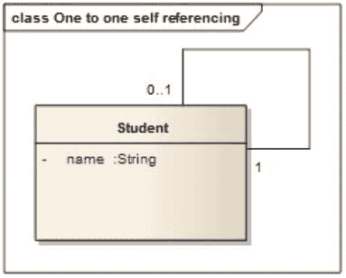

*图 5-1：一对一自引用关系*

我们到为止讨论了如何管理一对一单向和双向关系。让我们从观察图 5-1 所示的一对一自引用关联开始。在这里，`Student`实体有一个标识符和一个`String`类型的`name`字段。`Student`可以有一个可选的`mentor`（导师），导师也是一个`Student`。因此，在一个`Student`实例内部，可以关联另一个`Student`实例（导师）。我们将按照典型的脚本，首先从 mock 用户界面开始。

### 开发用户界面

在开发 mock 用户界面期间，我们关注的三个主要任务是数据传输对象、mock 服务和 mock 用户界面。我们将逐一查看它们。

### 开发数据对象

数据传输对象不包含`Student`导师对象的标识符，因为一对一自引用关系的内部设计没有暴露给用户界面团队。在一个`Student`对象的实例中，只能有一个也是`Student`的导师对象。

```java
public class StudentDto {

private Integer id;
private String name;
private String mentorName;

 // getters and setters

}

```

模拟服务将与一个内存自定义数据库交互以保存数据，该数据将被模拟用户界面消耗。我们将先从添加功能开始。我们有一个`StudentDto`列表，每当有一个新条目时，就会向列表中添加一个包含`Student`和导师的`StudentDto`实例。内存数据库的实现使用了基于枚举的单例设计模式。标识符字段从 1 开始，每计数一次递加 1。

```java
public enum StudentInMemoryDB {
    INSTANCE;

    private static Integer lastId = 0;

    private static List<StudentDto> list = new ArrayList<StudentDto>();

    public Integer getId() {return ++lastId;}

    public void add(StudentDto studentDto){
        studentDto.setId(getId());
        list.add(studentDto);
    }
}
```

现在让我们来看等效的模拟服务实现。`create`方法接收来自用户界面的`StudentDto`实例，并通过模拟数据库增强列表。

```java
@Controller
@RequestMapping(value=”/onetooneselfreference/mock”)
public class StudentMockController {
    @RequestMapping(value=”/create”, method=RequestMethod.POST)
    @ResponseBody
    public void create(@RequestBody StudentDto student){
        StudentInMemoryDB.INSTANCE.add(student);
    }
}
```

接下来，查看查找所有行和通过标识符查找的部分。

```java
public enum StudentInMemoryDB {
    public List<StudentDto> findAll(){ return list; }

    public StudentDto findById(Integer id) {
        for(StudentDto studentDto : list){ 
            if(studentDto.getId() == id) return studentDto;
        }
        return null ;
    }
}
```

在模拟服务中，查找所有行产生一个`StudentDto`列表，通过标识符查找获取一个`StudentDto`实例。

```java
@Controller
@RequestMapping(value=”/onetooneselfreference/mock”)
public class StudentMockController {
    @RequestMapping(value=”/findAll”, method=RequestMethod.GET)
    public @ResponseBody List<StudentDto> findAll(){
        return StudentInMemoryDB.INSTANCE.findAll();
    }

    @RequestMapping(value=”/findById/{stuid}”, method=RequestMethod.GET)
    public @ResponseBody StudentDto findById(@PathVariable(“stuid”) Integer stuid){
        return StudentInMemoryDB.INSTANCE.findById(stuid);
    }
}
```

现在实现删除操作，该操作根据指定的标识符删除特定行。


```java
public enum StudentInMemoryDB {
    public void remove(Integer id) {
        StudentDto dto = null;
        for(StudentDto studentDto : list){
            if(studentDto.getId() == id) {
                dto = studentDto; 
                break;
            }
        }
        if(null != dto) list.remove(dto);
    }
}
```

在类似的模拟服务中，消除操作根据作为 URL 响应传递的标识符删除特定行。

```java
@Controller
@RequestMapping(value="/onetooneselfreference/mock")
public class StudentMockController {
    @RequestMapping(value="/remove/{stuid}", method=RequestMethod.POST)
    @ResponseStatus(value = HttpStatus.NO_CONTENT)
    public void remove(@PathVariable("stuid") Integer stuid){
        StudentInMemoryDB.INSTANCE.remove(stuid);
    }
}
```

用于更改行内容的编辑操作如下所示。

```java
public enum StudentInMemoryDB {
    public void edit(StudentDto studentDto){
        for(StudentDto dto : list){
            if(studentDto.getId() == dto.getId()){
                dto.setName(studentDto.getName());
                dto.setMentor(studentDto.getMentor()); 
                break;
            }
        }
    }
}
```

编辑操作接收修改后的`StudentDto`拷贝并更新特定行。

```java
@Controller
@RequestMapping(value="/onetooneselfreference/mock")
public class StudentMockController {
    @RequestMapping(value="/edit", method=RequestMethod.POST)
    @ResponseBody
    public void edit(@RequestBody StudentDto student){
        StudentInMemoryDB.INSTANCE.edit(student);
    }
}
```

# 开发用户界面

我们在前面的部分看到了如何使用内存数据库开发模拟服务。现在我们将查看图 2 所示的调用模拟服务的用户界面。该用户界面将具有添加、编辑和显示所有与`Student`相关记录（包括导师）的方法。


*图 5-2: 管理学生的用户界面*

JSP 是加载的初始页面，之后调用 JavaScript 过程。我们将通过 JSP 概述流程。

```html
<body onload="loadObjects()">
<div id="container">
    <div>
        <p>
            <b>Student:</b>
        </p>
    </div>
    <form method="post" id="studentForm">
        <table>
            <tbody>
                <tr>
                    <td>Name:</td>
                    <td><input name="stuid" id="stuid" type="hidden"> <input
                    name="uname" type="text"></td>
                </tr>
                <tr>
                    <td class="tdLabel"><label>Mentor Name:</label></td>
                    <td><input type="text" name="mentor" id="mentor" /></td>
                </tr>
                <tr>
                    <td colspan="2"><input type=submit value="Create"
                    id="subButton" onclick="return methodCall()"></td>
                </tr>
            </tbody>
        </table>
    </form>
    <div id="studentResponse"></div>
</div>
</body>
```

首先，我们将查看`loadObjects`方法，它在页面初始化时调用。

```javascript
function loadObjects(){
    $.ajax({
        url: "/Spring-OODD/onetooneselfreference/mock/findAll",
        type: "GET",
        data : {},
        dataType: "json",
        success: function(data, textStatus, jqXHR) {
            processResponse(data);
        },
        error: function (jqXHR, textStatus, errorThrown) {
            document.getElementById("stuname").value="";
            alert("Error Status:"+textStatus);
        }
    });
    return false;
}
```

上述服务调用成功后调用的`processResponse`过程如下所示。形成表格的`generateTableData`方法也一并显示。

```javascript
function processResponse(responsedata){
    var dynamicTableRow="<table border=1>
    <tr>
        <th>Name</th>
        <th>Mentor</th>
        <th>Actions</th>
    </tr>";
    var dataRow="";
    $.each(responsedata, function(itemno, itemvalue){
        dataRow=dataRow+"<tr>
        <td>"+itemvalue.name+"</td>
        <td>"+itemvalue.mentorName+"</td>
        <td>"+
        <a href=# onclick=deleteObject("+itemvalue.id+")>Delete</a>+
"|<a href=# onclick=editObject("+itemvalue.id+")>Edit</a>"+
        </td></td>
    </tr>";
    });
    document.getElementById("studentResponse").innerHTML=dynamicTableRow+dataRow+</table>";
}

function generateTableData(itemvalue){
    var mentorName = itemvalue.mentorName;
    if(null == mentorName) mentorName="";
    var dataRow="";
    if(mentorName!=""){
        dataRow="<tr>
        <td>"+itemvalue.name+"</td>
        <td>"+mentorName+"</td>
        <td>"+
        <a href=# onclick=deleteObject("+itemvalue.id+")>Delete</a>+
"|<a href=# onclick=editObject("+itemvalue.id+")>Edit</a>"+
        "</td>
    </tr>";
    }
    return dataRow;
}
```

我们已经查看了页面加载代码。一旦你理解了 JSP 片段的工作原理，你就知道正在调用 JavaScript 方法`methodCall`，它适用于创建和更新功能。

```javascript
function methodCall(){
    var buttonValue = document.getElementById("subButton").value;
    if(buttonValue=="Create"){
        create();
    }else if(buttonValue=="Update"){
        update();
    }
    return false;
}
```

接下来，我们将记录`create`JavaScript 方法，它收集来自文本框学生姓名和导师的内容，并将 JSON 对象作为没有标识符的`StudentDto`传递。

```javascript
function create(){
    var name = $("stuname").val();
    var mentor=$("#mentor").val();
    var formData={"name":name,"mentorName":mentor};
    $.ajax({
        url : "/Spring-OODD/onetooneselfreference/mock/create",
        type: "POST",
        data : JSON.stringify(formData),
        beforeSend: function(xhr) {
            xhr.setRequestHeader("Accept", "application/json");
            xhr.setRequestHeader("Content-Type", "application/json");
        },
        success: function(data, textStatus, jqXHR) {
            document.getElementById("stuname").value="";
            document.getElementById("mentor").value="";
            document.getElementById("subButton").value="Create";
            loadObjects();
        },
        error: function (jqXHR, textStatus, errorThrown) {
            document.getElementById("stuname").value="";
            document.getElementById("mentor").value="";
            alert("Error Status Create:"+textStatus);
        }
    });
    return false;
}
```

我们将查看`update`JavaScript 方法。

```javascript
function update(){
```

```javascript
var name = $("#stuname").val();
var id = $("#stuid").val();
var mentor = $("#mentor").val();
var formData={"id":id,"name":name,"mentorName":mentor};

$.ajax({
  url : "/Spring-OODD/onetooneselfreference/mock/edit",
  type: "POST",
  data : JSON.stringify(formData),
  beforeSend: function(xhr) {
    xhr.setRequestHeader("Accept", "application/json");
    xhr.setRequestHeader("Content-Type", "application/json");
  },
  success: function(data, textStatus, jqXHR) {
    document.getElementById("stuname").value="";
    document.getElementById("mentor").value="";
    document.getElementById("subButton").value="Create";
    loadObjects();
  },
  error: function (jqXHR, textStatus, errorThrown) {
    document.getElementById("stuname").value="";
    document.getElementById("mentor").value="";
    alert("Error Status Update:"+textStatus);
  }
});
return false;
}
```

`editObject`和`viewObject`JavaScript 方法调用允许选择一条记录进行编辑操作。

```javascript
function editObject(stuid){
  editurl="/Spring-OODD/onetooneselfreference/mock/findById/"+stuid;
  var studentForm={id:stuid};
  $.ajax({
    url : editurl,
    type: "GET",
    data : studentForm,
    dataType: "json",
    success: function(data, textStatus, jqXHR) {
      viewObject(data);
      document.getElementById("subButton").value="Update";
    },
    error: function (jqXHR, textStatus, errorThrown) {
      alert("Error Status Find Object:"+textStatus);
    }
  });
}

function viewObject(data){
  document.getElementById("stuname").value=data.name;
  document.getElementById("mentor").value=data.mentorName;
  document.getElementById("stuid").value=data.id;
}
```

最后，检查删除操作，其中学生标识符作为输入传递，相关的学生信息被移除。

```javascript
function deleteObject(stuid){
  var studentForm={id:stuid};
  delurl="/Spring-OODD/onetooneselfreference/mock/remove/"+stuid;
  $.ajax({
    url : delurl,
    type: "POST",
    data : studentForm,
    dataType: "json",
    success: function(data, textStatus, jqXHR) {
      loadObjects();
    },
    error: function (jqXHR, textStatus, errorThrown) {
      alert("Error Status Delete:"+textStatus);
    }
  });
}
```

### 开发服务

下一步是实际的服务开发，它涉及四个主要步骤——创建实体、创建数据访问层、创建业务服务层以及创建基于 JSON 的 REST 服务。我们将从实体开始，从下而上开发到 REST 服务。

### 开发资源（实体）层


作为一种实践，我们遵循测试驱动开发（TDD）方法，因此我们首先为实体编写测试，然后编写实体的实现代码。首先，创建两个`Student`实例，并为每个学生实例挂载`Mentor`实例，最后检查是否有四个`Student`实例，如下代码所示。检查实例名称是否可以被更新以及删除。

```java
@RunWith( SpringJUnit4ClassRunner.class )
@ContextConfiguration( locations = { “classpath:context.xml” } )
@TransactionConfiguration( defaultRollback = true )
@Transactional
public class StudentTest {
  @Autowired
  private SessionFactory sessionFactory;
  @SuppressWarnings({ “unchecked”, “deprecation” })
  @Test
  public void testCRUD() {
    Student student1 = new Student();
    student1.setName(“Alex”);
    Student mentor1 = new Student();
    mentor1.setName(“Fred”);
    student1.setMentor(mentor1);
    sessionFactory.getCurrentSession().save(student1);
    Student student2 = new Student();
    student2.setName(“Michel”);
    Student mentor2 = new Student();
    mentor2.setName(“Mac”);
    student2.setMentor(mentor2);
    sessionFactory.getCurrentSession().save(student2);
    List<Student> students = sessionFactory.getCurrentSession()
      .createQuery(“select student from Student student”).list();
    Assert.assertEquals(4L, students.size());
    Student tempStudent = students.get(1);
    tempStudent.setName(“Alex James”);
    Student tempmentor = tempStudent.getMentor();
    tempmentor.setName(“Fred James”);
    sessionFactory.getCurrentSession().merge(tempStudent);
    students = sessionFactory.getCurrentSession()
      .createQuery(“select student from Student student”).list();
    Assert.assertEquals(4L, students.size());
    tempStudent = students.get(3);
    sessionFactory.getCurrentSession().delete(tempStudent);
    students = sessionFactory.getCurrentSession()
      .createQuery(“select student from Student student”).list();
    Assert.assertEquals(2L, students.size());
  }
}
```

由于我们正在开发一个一对一的自引用关系，`Student`实例挂载一个`Mentor`实例，`Student`实例可能会被删除。使用`orphanRemoval=true`是因为如果分配了`Student`，该实体会被删除。注意`nullable`属性的使用，因为如果分配了`Student`，该实体会被删除。

```java
@Entity
@Table(name=”STUDENT”)
public class Student {
  private Integer id;
  private String name;
  private Student mentor;

  @Id
  @GeneratedValue(strategy=GenerationType.AUTO)
  public Integer getId() {
    return id;
  }
  public void setId(Integer id) {
    this.id = id;
  }

  @Column(name=”name”,length=50)
  public String getName() {
    return name;
  }
  public void setName(String name) {
    this.name = name;
  }

  @OneToOne(cascade=CascadeType.ALL)
  @JoinColumn(name=”mentor_id”,nullable=true)
  public Student getMentor() {
    return mentor;
  }
  public void setMentor(Student mentor) {
    this.mentor = mentor;
  }
}
```

## 表结构

```sql
DROP TABLE `student`;
CREATE TABLE `student` (
 `ID` int(11) NOT NULL AUTO_INCREMENT,
 `name` varchar(50) DEFAULT NULL,
 `mentor_id` int(11) DEFAULT NULL,
 PRIMARY KEY (`ID`),
 KEY (`mentor_id`),
 CONSTRAINT (`mentor_id`) REFERENCES `student` (`ID`)
);
```

## 开发数据访问层

现在转向数据访问层。我们将从获取所有记录的测试用例开始。

```java
@RunWith( SpringJUnit4ClassRunner.class )
@ContextConfiguration( locations = { “classpath:context.xml” } )
@TransactionConfiguration( defaultRollback = true )
@Transactional
public class StudentDaoImplTest {
  @Autowired
  private StudentDao dao;
  @Test
  public void test() {
    Assert.assertEquals(0L, dao.getAll().size());
  }
}
```

对于上面的测试，让我们对应的数据操作。使用`Session.createQuery`方法从`Student`实体中检索所有记录。

```java
@Repository
@Transactional
public class StudentDaoImpl implements StudentDao {
  @Autowired
  private SessionFactory sessionFactory;
  @Override
  public List<Student> getAll() {
    return (List<Student>)sessionFactory.getCurrentSession()
      .createQuery(“select student from Student student”).list();
  }
}
```

让我们观察插入操作的测试。向`Student`实体插入几行数据及其导师，并检查结果是否与`Student`实体中的四条记录匹配。

```java
public class StudentDaoImplTest {
  @Autowired
  private StudentDao dao;
  @Test
  public void testInsert() {
    Student student1 = new Student();
    student1.setName(“Alex”);
    Student mentor1 = new Student();
    mentor1.setName(“Fred”);
    student1.setMentor(mentor1);
    dao.insert(student1);
    Student student2 = new Student();
    student2.setName(“Michel”);
    Student mentor2 = new Student();
    mentor2.setName(“Mac”);
    student2.setMentor(mentor2);
    dao.insert(student2);
    Assert.assertEquals(4L, dao.getAll().size());
  }
}
```

插入操作只是请求`Session.save`方法。`Student`实体的标识符会与其导师的标识符一起创建。

```java
public class StudentDaoImpl implements StudentDao {
  @Autowired
  private SessionFactory sessionFactory;
  @Override
  public void insert(Student student) {
    sessionFactory.getCurrentSession().save(student);
  }
}
```

接下来，注意如何通过标识符查找行。如果你显式指定标识符，它在你的系统中可能有效，但在另一个系统中可能会失败，因此代码将不可移植的。

```java
public class StudentDaoImplTest {
    @Autowired
    private StudentDao dao ;

    @Test
    public void testGetById() {
        Student student1 = new Student();
        student1.setName("Alex");
        Student mentor1 = new Student();
        mentor1.setName("Fred");
        student1.setMentor(mentor1);
        dao.insert(student1);
        List<Student> students = dao.getAll();
        Student student = students.get(1);
        Student student2 = dao.getById(student.getId());
        Assert.assertEquals("Alex", student2.getName());
        Assert.assertEquals("Fred", student2.getMentor().getName());
    }
}
```

下面使用了 Hibernate 4 `Session.get()`过程的数据访问方法，它接受标识符并检索匹配的`Student`实体。

```java
public class StudentDaoImpl implements StudentDao{
    @Autowired
    private SessionFactory sessionFactory ;

    @Override
    public Student getById(Integer id) {
        return (Student)sessionFactory.getCurrentSession().get(Student.class, id);
    }
}
```

此时我们将查看删除测试过程。首先，我们插入四条`Student`和导师的记录，然后删除一个`Student`及其导师，最后检查数据库中是否还存在一条记录。

```java
public class StudentDaoImplTest {
    @Autowired
    private StudentDao dao ;

    @Test
    public void testDelete() {
        Student student1 = new Student();
        student1.setName("Alex");
        Student mentor1 = new Student();
        mentor1.setName("Fred");
        student1.setMentor(mentor1);
        dao.insert(student1);
        Student student2 = new Student();
        student2.setName("Michel");
        Student mentor2 = new Student();
        mentor2.setName("Mac");
        student2.setMentor(mentor2);
        dao.insert(student2);
        Assert.assertEquals(4L, dao.getAll().size());
        List<Student> students = dao.getAll();
        Student tempStudent = students.get(3);
        dao.delete(tempStudent);
        Assert.assertEquals(2L, dao.getAll().size());
    }
}
```

删除操作使用了下面提到的 Hibernate 4 `Session.delete()`方法。

```java
public class StudentDaoImpl implements StudentDao{
    @Autowired
    private SessionFactory sessionFactory ;

    @Override
    public void delete(Student student) {
        sessionFactory.getCurrentSession().delete(student);
    }
}
```

更新测试方法现在插入了一行、更新该行并测试计数是否相同。

```java
public class StudentDaoImplTest {
    @Autowired
    private StudentDao dao ;

    @Test
    public void testUpdate() {
        Student student1 = new Student();
        student1.setName("Alex");
        Student mentor1 = new Student();
        mentor1.setName("Fred");
        student1.setMentor(mentor1);
        dao.insert(student1);
        Assert.assertEquals(2L, dao.getAll().size());
        List<Student> students = dao.getAll();
        Student tempStudent = students.get(1);
        tempStudent.setName("Alex James");
        Student tempMentor = tempStudent.getMentor();
        tempMentor.setName("Fred James");
        tempStudent.setMentor(tempMentor);
        dao.update(tempStudent);
        Assert.assertEquals(2L, dao.getAll().size());
    }
}
```

更新数据访问操作随后练习了 Hibernate 4 `Session.merge()`操作。

```java
public class StudentDaoImpl implements StudentDao{
    @Autowired
    private SessionFactory sessionFactory ;

    @Override
    public void update(Student student) {
        sessionFactory.getCurrentSession().merge(student);
    }
}
```

## 开发业务服务层

现在现在跳转到业务服务层。首先，我们将回顾获取所有记录操作的测试。


```java
@RunWith(SpringJUnit4ClassRunner.class)
@ContextConfiguration(locations = {"classpath:context.xml"})
@TransactionConfiguration(defaultRollback = true)
@Transactional
public class StudentServiceImplTest {
    @Autowired
    private StudentService service;

    @Test
    public void testFindAll() {
        Assert.assertEquals(0L, service.findAll().size());
    }
}
```

让我们看看如何在业务服务中编写匹配方法。我们使用数据访问操作检索所有记录，并使用映射器返回一个`StudentDto`列表。

```java
@Service
@Transactional
public class StudentServiceImpl implements StudentService {
    @Autowired
    private StudentDao dao;

    @Autowired
    private StudentMapper mapper;

    @Override
    public List<StudentDto> findAll() {
        List<StudentDto> studentDTOs = new ArrayList<StudentDto>();
        List<Student> students = dao.getAll();
        if (null != students) {
            for (Student student : students) {
                studentDTOs.add(mapper.mapEntityToDto(student));
            }
        }
        return studentDTOs;
    }
}
```

正如所讨论的，我们在业务服务中有一个映射器来将实体转换为 DTO，反之亦然。这种映射器对于`Student`的管理是至关重要的。用户界面将`Student`转换，如下所示。

```java
@Component
public class StudentMapper {
    public Student mapDtoToEntity(StudentDto studentDTO) {
        Student student = new Student();
        student.setId(studentDTO.getId());
        student.setName(studentDTO.getName());
        if (studentDTO.getMentor() != null) {
            Student mentor = new Student();
            mentor.setId(studentDTO.getMentor().getId());
            mentor.setName(studentDTO.getMentor().getName());
            student.setMentor(mentor);
        }
        return student;
    }

    public StudentDto mapEntityToDto(Student student) {
        StudentDto studentDTO = new StudentDto();
        studentDTO.setId(student.getId());
        studentDTO.setName(student.getName());
        if (student.getMentor() != null) {
            StudentDto mentor = new StudentDto();
            mentor.setId(student.getMentor().getId());
            mentor.setName(student.getMentor().getName());
            studentDTO.setMentor(mentor);
        }
        return studentDTO;
    }
}
```

创建测试操作构建了一个带有导师的`Student`实例，并检查获取所有记录有两个记录。

```java
public class StudentServiceImplTest {
    @Autowired
    private StudentService service;

    @Test
    public void testCreate() {
        StudentDto studentDTO = new StudentDto();
        studentDTO.setName("Alex");
        studentDTO.setMentorName("Fred");
        service.create(studentDTO);
        Assert.assertEquals(2L, service.findAll().size());
    }
}
```

业务服务层接收数据访问对象，将其转换为等效实体并传递给数据访问层保存到数据库。

```java
public class StudentServiceImpl implements StudentService {
    @Autowired
    private StudentDao dao;

    @Autowired
    private StudentMapper mapper;

    @Override
    public void create(StudentDto studentDTO) {
        dao.insert(mapper.mapDtoToEntity(studentDTO));
    }
}
```

下面的测试操作是通过标识符查找行，它使用获取所有记录操作来检索第二个学生的标识符。然后该标识符被传递给带有标识符的方法，并检查实例是否为空。注意，重要的是通过获取所有记录操作检索标识符，而不是硬编码任何标识符导致不可移植的测试代码。

```java
public class StudentServiceImplTest {
    @Autowired
    private StudentService service;

    @Test
    public void testFindById() {
        StudentDto studentDTO = new StudentDto();
        studentDTO.setName("Alex");
        studentDTO.setMentorName("Fred");
        service.create(studentDTO);
        List<StudentDto> studentDTOs = service.findAll();
        StudentDto stDto = studentDTOs.get(1);
        StudentDto stDto2 = service.findById(stDto.getId());
        Assert.assertNotNull(stDto2);
    }
}
```

通过给定标识符查找行的业务服务操作所示。

```java
public class StudentServiceImpl implements StudentService {
    @Autowired
    private StudentDao dao;

    @Autowired
    private StudentMapper mapper;

    @Override
    public StudentDto findById(Integer id) {
        Student student = dao.getById(id);
        if (null != student) {
            return mapper.mapEntityToDto(student);
        }
        return null;
    }
}
```

```java
return mapper.mapEntityToDto(student);
}
return null;
}
}
```

`remove`的测试操作会创建两个实例，移除其中一个，并检查数据库中是否仅存在记录。这是为了检查`remove`操作是否真的删除了该实例。

```java
public class StudentServiceImplTest {
    @Autowired
    private StudentService service;

    @Test
    public void testRemove() {
        StudentDto studentDTO = new StudentDto();
        studentDTO.setName("Alex");
        studentDTO.setMentorName("Fred");
        service.create(studentDTO);
        StudentDto stuDto = new StudentDto();
        stuDto.setName("Smith");
        stuDto.setMentorName("Flex");
        service.create(stuDto);
        Assert.assertEquals(4L, service.findAll().size());
        List<StudentDto> studentDTOs = service.findAll();
        StudentDto stDto = studentDTOs.get(3);
        service.remove(stDto.getId());
        Assert.assertEquals(2L, service.findAll().size());
    }
}
```

定义了业务服务方法，通过标识符检索实例，并通过数据访问层程序从目录中移除该实例。

```java
public class StudentServiceImpl implements StudentService {
    @Autowired
    private StudentDao dao;

    @Autowired
    private StudentMapper mapper;

    @Override
    public void remove(Integer id) {
        Student student = dao.getById(id);
        if (null != student)
            dao.delete(student);
    }
}
```

下一个测试操作是`edit`，它创建一个实例，编辑学生姓名和导师姓名，然后检查编辑功能是否正常。

```java
public class StudentServiceImplTest {
    @Autowired
    private StudentService service;

    @Test
    public void testEdit() {
        StudentDto studentDTO = new StudentDto();
        studentDTO.setName("Alex");
        studentDTO.setMentorName("Fred");
        service.create(studentDTO);
        List<StudentDto> studentDTOs = service.findAll();
        StudentDto sDto = studentDTOs.get(1);
        sDto.setName("James Alex");
        sDto.setMentorName("Fred James");
        service.edit(sDto);
        List<StudentDto> students = service.findAll();
        Assert.assertEquals(2L, students.size());
    }
}
```

业务服务的等效操作是`edit`操作，它跳过了对数据访问的调用，在通过`mapper`方法转换后进行更新。注意，`edit`操作没有`Student`导师实体的标识符，因此生成了一个新的。

```java
public class StudentServiceImpl implements StudentService {
    @Autowired
    private StudentDao dao;

    @Autowired
    private StudentMapper mapper;

    @Override
    public void edit(StudentDto studentDTO) {
        dao.update(mapper.mapDtoToEntity(studentDTO));
    }
}
```

### 开发表现层

栈中的最后一层是基于 REST 的 Spring `StudentController`。在这里，我们首先描述测试。测试首先使用 REST 创建服务创建一个`StudentDto`实例。接着是检索所有记录，并对唯一的`StudentDto`实例进行更新。最后，测试通过从获取所有记录的服务获取标识符来移除该实例。


```java
@RunWith(SpringJUnit4ClassRunner.class)
@WebAppConfiguration
@ContextConfiguration( locations = { "classpath:context.xml" )
@TransactionConfiguration(defaultRollback = true)
@Transactional
public class StudentControllerTest {
    private Gson gson = new GsonBuilder().setDateFormat("yyyy-MM-dd hh:mm:ss").create();

    @Resource
    private WebApplicationContext webApplicationContext;
    private MockMvc mockMvc;

    @Before
    public void setUp() {
        mockMvc = MockMvcBuilders.webAppContextSetup(webApplicationContext).build();
    }

    @Test
    public void testAll() throws Exception {
        testCreate();
        testUpdate();
        testDelete();
    }

    public void testCreate() throws Exception {
        StudentDto studentDto = new StudentDto();
        studentDto.setName("Alex");
        studentDto.setMentorName("Fred");
        String json = gson.toJson(studentDto);
        MockHttpServletRequestBuilder requestBuilderOne = MockMvcRequestBuilders.post("/onetooneselfreference/create");
        requestBuilderOne.contentType(MediaType.APPLICATION_JSON);
        requestBuilderOne.content(json.getBytes());
        this.mockMvc.perform(requestBuilderOne).andExpect(MockMvcResultMatchers.status().isOk());
    }

    public void testUpdate() throws Exception {
        MockHttpServletRequestBuilder requestBuilder2 = MockMvcRequestBuilders.get("/onetooneselfreference/findAll");
        MvcResult result = this.mockMvc.perform(requestBuilder2).andReturn();
        String response2 = result.getResponse().getContentAsString();
        Type listType = new TypeToken<List<StudentDto>>() {}.getType();
        List<StudentDto> studentDtos = gson.fromJson(response2, listType);
        StudentDto studentDto = studentDtos.get(0);
        studentDto.setName("Alex");
        studentDto.setMentorName("Fred James");
        String json2 = gson.toJson(studentDto);
        MockHttpServletRequestBuilder requestBuilder3 = MockMvcRequestBuilders.post("/onetooneselfreference/edit");
        requestBuilder3.contentType(MediaType.APPLICATION_JSON);
        requestBuilder3.content(json2.getBytes());
        this.mockMvc.perform(requestBuilder3).andExpect(MockMvcResultMatchers.status().isOk());
    }

    public void testDelete() throws Exception {
        MockHttpServletRequestBuilder requestBuilder = MockMvcRequestBuilders.get("/onetooneselfreference/findAll");
        MvcResult result = this.mockMvc.perform(requestBuilder).andReturn();
        String response2 = result.getResponse().getContentAsString();
        Type listType = new TypeToken<List<StudentDto>>() {}.getType();
        List<StudentDto> studentDtos = gson.fromJson(response2, listType);
        StudentDto studentDto2 = studentDtos.get(0);
        MockHttpServletRequestBuilder requestBuilder2 = MockMvcRequestBuilders.post("/onetooneselfreference/remove/"+studentDto2.getId());
        requestBuilder2.contentType(MediaType.APPLICATION_JSON);
        this.mockMvc.perform(requestBuilder2).andExpect(MockMvcResultMatchers.status().is204));
    }
}
```

生成的 REST `Controller` 将通过数据访问层连接到业务服务。程序与 mock 服务相似，区别在于这里的代码与实际数据库交互，而不是内存。

```java
@Controller
@RequestMapping(value="/onetooneselfreference")
public class StudentController {

    @Autowired
    private StudentService service ;

    @RequestMapping(value="/findAll", method=RequestMethod.GET)
    @ResponseBody List<StudentDto> findAll() {
        return service.findAll();
    }

    @RequestMapping(value="/findById/{stuid}", method=RequestMethod.GET)
    @ResponseBody StudentDto findById(@PathVariable("stuid") Integer stuid) {
        return service.findById(stuid);
    }

    @RequestMapping(value="/create", method=RequestMethod.POST)
    @ResponseBody
    public void create(@RequestBody StudentDto student) {
        service.create(student);
    }

    @RequestMapping(value="/remove/{stuid}", method=RequestMethod.POST)
    @ResponseStatus(value = HttpStatus.NO_CONTENT)
    public void remove(@PathVariable("stuid") Integer stuid) {
        service.remove(stuid);
    }

    @RequestMapping(value="/edit", method=RequestMethod.POST)
    @ResponseBody
    public void edit(@RequestBody StudentDto student) {
        service.edit(student);
    }
}
```

列表的最后一步是将 REST 服务与真实的用户界面集成。注意请求映射从 `/onetooneselfreference/mock` 变为 `/onetooneselfreference`。剩余部分是使用 mock 用户界面作为参考编写真实的用户界面。

### 总结

在本章中我们讨论了：

*   开发 mock 内存数据库

*   开发 mock 用户界面

*   开发与一对自关联相关的实体

*   开发数据访问层

*   开发业务服务层

*   开发 REST 服务控制器。

# 第三部分. 管理多对多关系

## 第 6 章 多对多单向关系

一对多单向关系是一种具有从父对象到子对象的引用，但反则没有的一对多关系。我们将遵循习惯的流程：从用户界面开始，然后是服务开发，最后在章节末尾整合这两个模块。紧跟本章节将使你能够掌握用户界面以及与一对多单向关系相关的 REST 服务。

### 领域模型

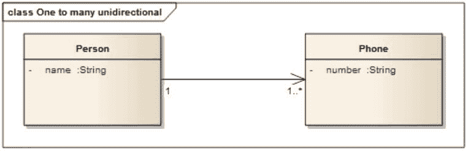

图 6-1：一对多单向关系

在之前的章节中，我们已经学习了如何管理不同形式的一对一关系。在本章节中，我们将看到如 `Figure 6-1` 所示的一对多单向关联。`Person` 实体有一个标识符和一个类型为 `String` 的名称字段。`Phone` 实体也有一个标识符和一个 `String` 类型的号码字段。在 `Person` 的一个实例中，必须关联一个或多个 `Phone` 实例。同样地，在 `Phone` 的实例中，必须链接一个 `Person` 实例。由于该关系是单向的，你可以从 `Person` 遍历 `Phones` 列表，但不允许反向遍历。我们将遵循先编写模拟用户界面，然后编写真实服务的模式。

### 开发用户界面

在模拟用户界面增长过程中，我们关注的三个关键任务是创建数据传输对象（DTO）、模拟服务和模拟用户界面。我们将顺序逐一进行。

### 开发数据传输对象

`Person` 数据传输对象包含标识符、人的姓名以及一个 `String` 号码列表。`Phone` 对象的标识符对调用者是的，尽管一个 `Person` 实例可以拥有一个或多个 `Phone` 号码。这种设计理念是为了由于复杂性而不暴露数据库设计，并让调用者易于理解 API。

```java
public class PersonDto {
  private Integer id;
  private String name;
  private List<String> numbers;

  // getters and setters
}
```

#### 开发模拟服务

模拟服务将与内存约定数据库连接网络以保存数据，这些数据将由模拟用户界面消费。我们首先查看 `add` 功能。我们有一个 `PersonDto` 列表，每有一个新实例，就会有一个带有 `Person` 和电话号码的 `PersonDto` 实例添加到列表中。内存数据库执行遵循使用 `enum` 的单例设计模式。标识符字段从 1 开始，每有一个新条目增加 1。

```java
public enum PersonInMemoryDB {
  INSTANCE;

  private static Integer lastId = 0;
  private static List<PersonDto> list = new ArrayList<PersonDto>();

  public Integer getId() {
    return ++lastId;
  }

  public void add(PersonDto personDto) {
    personDto.setId(getId());
    list.add(personDto);
  }
}
```

现在看模拟服务的实现。`create` 方法从用户界面收集一个 `PersonDto` 实例，并通过模拟数据库附加列表。

```java
@Controller
@RequestMapping(value="/onetomanyunidirectional/mock")
public class PersonMockController {
  @RequestMapping(value="/create", method=RequestMethod.POST)
  @ResponseBody
  public void create(@RequestBody PersonDto personDto) {
    PersonInMemoryDB.INSTANCE.add(personDto);
  }
}
```

接下来，我们将进行 `find all rows` 和 `find with identifier` 部分。

```java
public enum PersonInMemoryDB {
  public List<PersonDto> findAll() {
    return list;
  }

  public PersonDto findById(Integer id) {
    for(PersonDto personDto : list) {
      if(personDto.getId() == id) return personDto;
    }
    return null;
  }
}
```

在模拟服务中，`find all rows` 生成一个 `PersonDto` 列表，而 `find with identifier` 契约一个 `PersonDto` 实例。`find all rows` 返回嵌入在“内存数据库”中的列表。`find with identifier` 服务匹配内存列表中的每个 `PersonDto` 实例并返回匹配的对象。

```java
public class PersonMockController {
  @RequestMapping(value="/findAll", method=RequestMethod.GET)
  public @ResponseBody List<PersonDto> findAll() {
    return PersonInMemoryDB.INSTANCE.findAll();
  }

  @RequestMapping(value="/findById/{personid}", method=RequestMethod.GET)
  public @ResponseBody PersonDto findById(@PathVariable("personid") Integer personid) {
    return PersonInMemoryDB.INSTANCE.findById(personid);
  }
}
```

接下来，我们将实现 `remove` 操作，它根据列出的标识符删除特定行。遍历内存列表以找到与提供的标识符匹配的 `PersonDto`。当找到匹配项时，该实例从内存列表中删除。

```java
public enum PersonInMemoryDB {
  public void remove(Integer id) {
    PersonDto dto = null;
    for(PersonDto personDto : list) {
      if(personDto.getId() == id) { dto = personDto; break; }
    }
    if(null != dto) { list.remove(dto); }
  }
}
```

在相应的模拟服务中，`exclude` 操作根据作为 URL 参数提供的提供的定义的标识符删除特定行。该标识符被传递给内存数据库的 `remove` 操作。

```java
public class PersonMockController {
  @RequestMapping(value="/remove/{personid}", method=RequestMethod.POST)
  @ResponseStatus(value = HttpStatus.NO_CONTENT)
  public void remove(@PathVariable("personid") Integer personid) {
    PersonInMemoryDB.INSTANCE.remove(personid);
  }
}
```

接下来，看负责更新行的 `edit` 操作。名称和号码集将根据 `PersonDto` 中的标识符进行更新。


```java
public enum PersonInMemoryDB {
  public void edit(PersonDto personDto) {
    for(PersonDto dto : list) {
      if(dto.getId() == personDto.getId()) {
        dto.setName(personDto.getName());
        dto.setNumbers(personDto.getNumbers());
      }
    }
  }
}
```

`edit` 操作接受一个已更改的 `PersonDto` 副本并更新特定行。

```java
public class PersonMockController {
  @RequestMapping(value="/edit", method=RequestMethod.POST)
  @ResponseBody
  public void edit(@RequestBody PersonDto personDto) {
    PersonInMemoryDB.INSTANCE.edit(personDto);
  }
```

## 开发用户界面

既然我们已经学习了如何使用内存数据库编写模拟服务，让我们编写使用该模拟服务的用户界面。该用户界面将具有添加、编辑、删除与 `Person` 相关记录的功能，包括电话号码。用户界面的截图见 `Figure 6-2`。

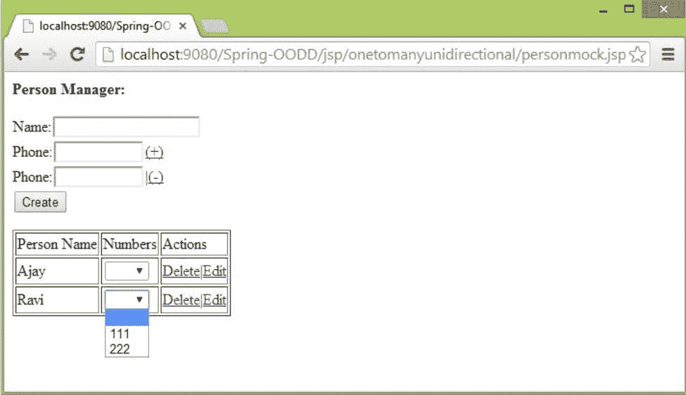

图 6-2：Person 和电话用户界面

JSP body 是初始加载的页面，之后会调用 JavaScript。我们将先从 JSP 片段开始，然后是 JavaScript 函数。

```html
<body onload="loadObjects()">
  <div id="container">
    <div>
      <p>
        <b>Person Manager:</b>
      </p>
    </div>
    <form method="post" id="personForm">
      <div id="personDiv">
        <div id="nameGroup">
          <label>Name:<input type="text" name="name" id="name"></label>
          <label><input type="hidden" name="personid" id="personid"></label>
        </div>
      </div>
      <div id="phoneBoxGroup">
        <div id="phoneBox_1">
          <label>Phone:<input type="text" name="phone" id="phone" size="10" maxlength="12"><a href="#" onclick="javascript:addMorePhone()">(+)</a></a></label>
          <label id="removeLink_1"></label>
        </div>
      </div>
      <div id="buttonGroup">
        <input type="submit" value="Create" id="subButton" onclick="return methodCall()">
      </div>
    </form>
    <div id="personFormResponse"></div>
  </div>
</body>
```

首先，看在页面准备带有 `onload` 事件时调用的 JavaScript `loadObjects` 方法。`loadObjects` 函数负责绘制包含 `Person` 对象列表的网格。

```javascript
function loadObjects(){
  $.ajax({
    url: "/Spring-OODD/onetomanyunidirectional/mock/findAll",
    type: "GET",
    data: {},
    dataType: "json",
    success: function(data, textStatus, jqXHR){
      processResponseData(data);
    },
    error: function (jqXHR, textStatus, errorThrown){
```

```javascript
document.getElementById(“name”).value=””;

alert(“Error Status Load Objects:”+textStatus);

}

});

return false;

}
```

当上述服务调用生效时，会调用 `processResponseData` JavaScript 方法。图中显示了构建表格网格的 `generateTableData` JavaScript 方法。

```javascript
function processResponseData(objects){

var dyanamicTableRow=”<table border=1>”+”<tr>” +”<td>Person Name</td>+”<td>Numbers</td>+”<td>Actions</td>+”</tr>”;

var dataRow=””;

$.each(objects, function(itemno, object){dataRow=dataRow+generateTableData(object);});

dyanamicTableRow=dyanamicTableRow+dataRow+”</table>”;

document.getElementById(“personFormResponse”).innerHTML=dyanamicTableRow;

}

function generateTableData(object){

var phones = object.numbers;

var dataRow=”<tr>” +”<td>” +object.name+”</td>”;dataRow = dataRow+”<td>”+”<select>”+”<option>”+”</option>”;

if(phones!=null && phones.length > 0){

for(var index=0;index<phones.length;index++){ 

var phone = phones[index];

dataRow = dataRow+”<option value=”+phone+”>”+phone+”</option>”;

}

}

dataRow=dataRow+”</select></td>”;dataRow=dataRow+”<td>” +”<a href=# onclick=deleteObject(“+object.id+”)>Delete</a>”+”|<a href=# onclick=editObject(“+object.id+”)>Edit</a>”+”</td>+”</tr>”;

return dataRow;

}
```

我们通过上述代码看到了页面加载技术。注意 JavaScript `methodCall` 是如何调用的，它适用于创建和更新功能。当按钮的值为“Create”时，会调用 `create` JavaScript 函数；当值为“Update”时，会调用 `update` JavaScript 方法。

```javascript
function methodCall(){

var buttonValue = document.getElementById(“subButton”).value;

if(buttonValue==”Create”){

create();

}else if(buttonValue==”Update”){

update();

}

return false;

}
```

观察 `create` JavaScript 方法如何从姓名和电话号码获取输入，并构建一个 `PersonDto` JSON 对象作为参数传递给模拟创建服务。姓名从输入框中获取，而一组电话号码则从具有名称“phone”的元素中推送到一个数组中。

```javascript
function create(){

var name = $(“#name").val();

var numbers = null;

var flag= false;

var phone=document.getElementsByName(“phone”);

if(phone.length > 0){

numbers = new Array();

for(var i=0;i<phone.length;i++){

if(trim(phone[i].value)!=””){

numbers.push(phone[i].value);

flag=true;

}

}

}

if(flag==false){numbers=null;}

var formData={“name”:name,”numbers”:numbers};

$.ajax({url : “/Spring-OODD/onetomanyunidirectional/mock/create”,

type: “POST”,data : 

JSON.stringify(formData),

beforeSend: function(xhr) {

xhr.setRequestHeader(“Accept”, “application/json”);

xhr.setRequestHeader(“Content-Type”, “application/json”);

},

success: function(data, textStatus, jqXHR){

document.getElementById(“name”).value=””;

document.getElementById(“subButton”).value=”Create”;

loadObjects();

initiatePhoneBoxGroup();

},

error: function (jqXHR, textStatus, errorThrown)

{

document.getElementById(“name”).value=””;

initiatePhoneBoxGroup();

alert(“Error Status Create:”+textStatus);

}

});

return false;

}
```

现在看 `initiatePhoneBoxGroup` JavaScript 方法，它重置电话号码用户界面区域。

```javascript
function initiatePhoneBoxGroup(){

var phoneBoxGroupDiv = document.getElementById(“phoneBoxGroup”);

phoneBoxGroupDiv.innerHTML=””;

var phoneDiv = document.createElement(‘div’);

phoneDiv.setAttribute(“id”,”phoneBox_1”);

var phoneBox_1 = “<label>Phone:<input type=’text’ name=’phone’ id=’phone’ size=’10’ maxlength=’12’><a href=# onclick=javascript:addMorePhone()>(+)</a></label>”;

var removeLink_1=”<label id=’removeLink_1’></label>”;

var setUrl = phoneBox_1+removeLink_1;

phoneDiv.innerHTML=setUrl;

phoneBoxGroupDiv.appendChild(phoneDiv);

}
```

接下来我们将审查 `update` JavaScript 方法，它构成了一个包含标识符、姓名和电话号码的 `PersonDto`。更新操作从隐藏字段获取 `Person` 的标识符，从输入框获取姓名，并将从具有相同名称的元素获取的一组号码推送到数组中。

```javascript
function update(){

var name = $(“#name").val();

var id = +$(“#personid").val();

var flag= false;

var phone=document.getElementsByName(“phone”);

if(phone.length > 0){

numbers = new Array();

for(var i=0;i<phone.length;i++){

if(trim(phone[i].value)!=””){

numbers.push(phone[i].value);

flag=true;

}

}

}
}

if(flag==false){numbers=null;}

var formData={“name”:name,”numbers”:numbers};

$.ajax({url : “/Spring-OODD/onetomanyunidirectional/mock/create”,

type: “POST”,data : 

JSON.stringify(formData),

beforeSend: function(xhr) {

xhr.setRequestHeader(“Accept”, “application/json”);

xhr.setRequestHeader(“Content-Type”, “application/json”);

},

success: function(data, textStatus, jqXHR){

document.getElementById(“name”).value=””;

document.getElementById(“subButton”).value=”Create”;

loadObjects();

initiatePhoneBoxGroup();

},

error: function (jqXHR, textStatus, errorThrown)

{

document.getElementById(“name”).value=””;

initiatePhoneBoxGroup();

alert(“Error Status Create:”+textStatus);

}

});

return false;

}
```

`editObject` 和 `viewObject` 方法调用用于用于编辑选择的对象。

```javascript
function editObject(personid){

var personForm={id:personid};

editurl=”/Spring-OODD/onetomanyunidirectional/mock/findById/”+personid;

$.ajax({url : editurl,

type: “GET”,

data : personForm,

dataType: “json”,

success: function(data, textStatus, jqXHR){

viewObject(data);

document.getElementById(“subButton”).value=”Update”;

},

error: function (jqXHR, textStatus, errorThrown){

}

}
```


```javascript
function viewObject(data){

var index = 1;

document.getElementById(“name”).value=data.name;

document.getElementById(“personid”).value=data.id;

var numbers = data.numbers;

if(numbers!=null){

initiatePhoneBoxGroup();

var phoneBoxGroupDiv = document.getElementById(“phoneBoxGroup”);

phoneBoxGroupDiv.innerHTML=””;

for(var cnt=0;cnt<numbers.length;cnt++){

if(cnt==0){

var phones= document.getElementsByName(“phone”);

phones[cnt].value=numbers[cnt];

}else{

index++;

var phoneDiv = document.createElement(‘div’);

phoneDiv.setAttribute(“id”,”phoneBox_”+index);

var remId=”removeLink_”+index;

var removeLinkUrl = “|<label id=’+remId+’></label><a href=# onclick=removePhone“(+index+”)’>(-)</a>”;

phoneDiv.innerHTML = “<label>Phone:”+”<input type=’text’ id=’phone’ name=’phone’ mqxlength=’12’ size=’10’ value=’+numbers[cnt]+’></label>”+removeLinkUrl;

phoneBoxGroupDiv.appendChild(phoneDiv);

}

}

}
```

最后，审查删除操作，该操作接收传入的标识符并移除相关的 `Person` 信息。

```javascript
function deleteObject(personid){

var personForm={id:personid};

delurl=”/Spring-OODD/onetomanyunidirectional/mock/remove/”+personid;

$.ajax({url : delurl,

type: “POST”,

data : personForm,

dataType: “json”,

success: function(data, textStatus, jqXHR){

loadObjects();

 },

error: function (jqXHR, textStatus, errorThrown){

alert(“Error Status Delete:”+textStatus);

 }

});

}
```

让我们仔细观察电话号码区域的添加和删除文本框。这是通过 `addMorePhone` 和 `removePhone` JavaScript 方法实现的，并允许管理多个号码。这是一个重要功能，因为它管理了至少一个电话号码的用户界面区域。

```javascript
var counter = 1;

function addMorePhone(){

counter++;

var phoneDiv = document.createElement(‘div’);

phoneDiv.setAttribute (“id”,”phoneBox_”+counter);

var remId=”removeLink_”+counter;

var removeLinkUrl = “|<label id=’+remId+’></label><a href=# onclick=removePhone“(+counter+”)’>(-)</a>”;

var phoneBoxGroupDiv = document.getElementById(“phoneBoxGroup”);

phoneDiv.innerHTML = “<label>Phone:”+”<input type=’text’ id=’phone’ name=’phone’ mqxlength=’12’ size=’10’/></label>”+removeLinkUrl;

phoneBoxGroupDiv.appendChild(phoneDiv);

}

function removePhone(id){

var phoneDiv = document.getElementById(“phoneBox_”+id);

phoneDiv.parentNode.removeChild(phoneDiv);

}

```

```javascript
phoneBoxGroupDiv.appendChild(phoneDiv);
}

function removePhone(index){
  var phonelist=document.getElementsByName(“phone”);
  var size = phonelist.length;
  if(size==1){
    counter=1;
    return false;
  }
  var phoneBoxGroupDiv = document.getElementById(“phoneBoxGroup”);
  phoneBoxGroupDiv.removeChild(document.getElementById(“phoneBox”+”_”+index));
}
```

## 开发服务

下一步是真正的服务开发，涉及四个主要步骤：创建实体、创建数据访问层、创建业务服务层以及创建基于 JSON 的 REST 设施。我们将从底向上开始，从实体一直到 REST 服务。

## 开发资源（实体）层

首先，我们创建两个带有电话号码的 `Person` 实例，并检查这两个 `Person` 实例。接下来，我们进行更新并测试更改是否已反映。最后，我们删除其中一个并测试计数是否变为唯一。

```java
@RunWith( SpringJUnit4ClassRunner.class )
@ContextConfiguration( locations = { “classpath:context.xml” } )
@TransactionConfiguration( defaultRollback = true )
@Transactional
public class PersonTest {
  @Autowired
  private SessionFactory sessionFactory;

  @Test
  public void testCRUD() {
    Person p1 = new Person();
    p1.setName(“Alex”);
    List<Phone> phones = new ArrayList<Phone>();
    Phone ph1 = new Phone();
    ph1.setNumber(“7798989138”);
    Phone ph2 = new Phone();
    ph2.setNumber(“7798989169”);
    phones.add(ph1);
    phones.add(ph2);
    p1.setPhones(phones);
    sessionFactory.getCurrentSession().save(p1);

    Person p2 = new Person();
    p2.setName(“Fred”);
    List<Phone> phones2 = new ArrayList<Phone>();
    Phone phone1 = new Phone();
    phone1.setNumber(“8836987”);
    phones2.add(phone1);
    p2.setPhones(phones2);
    sessionFactory.getCurrentSession().save(p2);

    List<Person> persons = sessionFactory.getCurrentSession()
      .createQuery(“select p from Person p order by id asc”).list();
    Assert.assertEquals(2L,persons.size());

    Person p = persons.get(0);
    p.setName(“Jhonson”);
    sessionFactory.getCurrentSession().update(p);

    List<Person> persons2 = sessionFactory.getCurrentSession()
      .createQuery(“select p from Person p order by id asc”).list();
    Person tp = persons2.get(0);
    Assert.assertEquals(“Jhonson”, tp.getName());
    sessionFactory.getCurrentSession().delete(tp);

    List<Person> persons3 = sessionFactory.getCurrentSession()
      .createQuery(“select p from Person p order by id asc”).list();
    Assert.assertEquals(1L,persons3.size());
  }
}
```

我们将研究 `Phone` 实体，它包含一个标识符和一个数字字符串字段。由于实体位于反向端且是单向关联，因此没有提到对 `Person` 的引用。

```java
@Entity
@Table(name=”PHONE”)
public class Phone {
  private Integer id;
  private String number;

  @Id
  @GeneratedValue(strategy=GenerationType.AUTO)
  @Column(name=”ID”,length=20)
  public Integer getId() {
    return id;
  }

  public void setId(Integer id) {
    this.id = id;
  }

  @Column(name=”NUMBER”,length=20)
  public String getNumber() {
    return number;
  }

  public void setNumber(String number) {
    this.number = number;
  }
}
```

由于我们正在开发一对多的单向关联，`Person` 实例必须有一个或多个 `Phone` 实例。由于关联是单向的，声明了 `Phone` 列表。我们还使用 `orphanRemoval=true`，因为如果重新赋值 `Phones` 集合，旧的 `Phones` 将被删除。`Person` 通过此实体使用 `@JoinColumn` 注解引用标识符。

```java
@Entity
@Table(name=”PERSON”)
public class Person {
  private Integer id;
  private String name;
  private List<Phone> phones;

  @Id
  @GeneratedValue(strategy=GenerationType.AUTO)
  @Column(name=”ID”,length=20)
  public Integer getId() {
    return id;
  }

  public void setId(Integer id) {
    this.id = id;
  }

  @Column(name=”name”,length=50)
  public String getName() {
    return name;
  }

  public void setName(String name) {
    this.name = name;
  }

  @OneToMany(cascade=CascadeType.ALL,orphanRemoval=true)
  @JoinColumn(name=”PERSON_ID”)
  public List<Phone> getPhones() {
    return phones;
  }

  public void setPhones(List<Phone> phones) {
    this.phones = phones;
  }
}
```

### 表结构

```sql
DROP TABLE `phone`;
DROP TABLE `person`;
CREATE TABLE `person` (
  `ID` int(11) NOT NULL AUTO_INCREMENT,
  `name` varchar(50) DEFAULT NULL,
  PRIMARY KEY (`ID`)
);
CREATE TABLE `phone` (
  `ID` int(11) NOT NULL AUTO_INCREMENT,
  `NUMBER` varchar(20) DEFAULT NULL,
  `PERSON_ID` int(11) DEFAULT NULL
);
```

## 开发数据访问层

我们将查看数据访问层。`Person` 实体标识符用于 `Phone`。

```java
@Repository
@Transactional
public class PersonDaoImpl {
  @Autowired
  private SessionFactory sessionFactory;

  public List<Person> getAll() {
    return sessionFactory.getCurrentSession().createQuery("select p from Person p order by id asc").list();
  }

  public void insert(Person person) {
    sessionFactory.getCurrentSession().save(person);
  }
}
```

随后，查看 `insert` 的测试。`Person` 实体标识符用于 `Phone`。

```java
@Test
public class PersonDaoImplTest {
  @Autowired
  private PersonDao dao;

  @Test
  public void testInsert() {
    Person p1 = new Person();
    p1.setName(“Alex”);
    List<Phone> phones = new ArrayList<Phone>();
    Phone ph1 = new Phone();
    ph1.setNumber(“7798989138”);
    Phone ph2 = new Phone();
    ph2.setNumber(“7798989169”);
    phones.add(ph1);
    phones.add(ph2);
    p1.setPhones(phones);
    dao.insert(p1);
    Assert.assertEquals(1L,dao.getAll().size());
  }
}
```

之后我们将看到如何组合通过标识符查找行。`Person` 实体标识符用于 `Phone`。

```java
@Repository
@Transactional
public class PersonDaoImpl {
  @Autowired
  private SessionFactory sessionFactory;

  @Override
  public Person getById(Integer id) {
    return (Person)sessionFactory.getCurrentSession().get(Person.class,id);
  }
}
```


### 测试数据访问层

以下代码展示了 `PersonDaoImplTest` 测试类，用于验证插入和查询操作。该测试首先插入两个 `Person` 对象及其关联的 `Phone` 对象，然后通过 `getAll()` 和 `getById()` 方法验证数据是否正确持久化。

```java
@Test
public class PersonDaoImplTest {
  @Autowired
  private PersonDao dao;

  @Test
  public void testGetById() {
    Person p1 = new Person();
    p1.setName("Alex");
    List<Phone> phones = new ArrayList<Phone>();
    Phone ph1 = new Phone();
    ph1.setNumber("7798989138");
    Phone ph2 = new Phone();
    ph2.setNumber("7798989169");
    phones.add(ph1);
    phones.add(ph2);
    p1.setPhones(phones);
    dao.insert(p1);
    Person p2 = new Person();
    p2.setName("Fred");
    List<Phone> phones2 = new ArrayList<Phone>();
    Phone phone1 = new Phone();
    phone1.setNumber("8836987");
    phones2.add(phone1);
    p2.setPhones(phones2);
    dao.insert(p2);
    Assert.assertEquals(2L, dao.getAll().size());
    List<Person> persons = dao.getAll();
    Person p3 = persons.get(1);
    Person p4 = dao.getById(p3.getId());
    Assert.assertEquals("Alex", p4.getName());
  }
}
```

接下来，设置删除测试程序。首先，插入两个 `Person` 账户及其手机号码，然后删除其中一条记录。最后检查数据库中是否还存在一条记录。

```java
public class PersonDaoImplTest {
    @Autowired
    private PersonDao dao ;

    @Test
    public void testDelete() {
        Person p1 = new Person();
        p1.setName("Alex");
        List<Phone> phones = new ArrayList<Phone>();
        Phone ph1 = new Phone();
        ph1.setNumber("7798989138");
        Phone ph2 = new Phone();
        ph2.setNumber("7798989169");
        phones.add(ph1);
        phones.add(ph2);
        p1.setPhones(phones);
        dao.insert(p1);
        Person p2 = new Person();
        p2.setName("Fred");
        List<Phone> phones2 = new ArrayList<Phone>();
        Phone phone1 = new Phone();
        phone1.setNumber("8836987");
        phones.add(phone1);
        p2.setPhones(phones2);
        dao.insert(p2);
        Assert.assertEquals(2L, dao.getAll().size());
        List<Person> persons = dao.getAll();
        Person p = persons.get(1);
        dao.delete(p);
        Assert.assertEquals(1L, dao.getAll().size());
    }
}
```

删除任务使用了 Hibernate 4 的 `Session.delete()` 方法，如下代码所示。

```java
public class PersonDaoImpl implements PersonDao{
    @Autowired
    private SessionFactory sessionFactory ;

    @Override
    public void delete(Person person) {
        sessionFactory.getCurrentSession().delete(person);
    }
}
```

我们将查看更新测试方法，该方法插入一条记录、更新该行，并测试计数是否相同以及操作是否现代化的。

```java
public class PersonDaoImplTest {
    @Autowired
    private PersonDao dao ;

    @Test
    public void testUpdate() {
        Person p1 = new Person();
        p1.setName("Alex");
        List<Phone> phones = new ArrayList<Phone>();
        Phone ph1 = new Phone();
        ph1.setNumber("7798989138");
        Phone ph2 = new Phone();
        ph2.setNumber("7798989169");
        phones.add(ph1);
        phones.add(ph2);
        p1.setPhones(phones);
        dao.insert(p1);
        Assert.assertEquals(1L, dao.getAll().size());
        List<Person> persons = dao.getAll();
        Person p = persons.get(0);
        p.setName("Jhon");
        List<Phone> phones1 = new ArrayList<Phone>();
        Phone ph3 = new Phone();
        ph1.setNumber("111111111");
        Phone ph4 = new Phone();
        ph2.setNumber("222222222");
        Phone ph5 = new Phone();
        ph2.setNumber("333333333");
        phones1.add(ph3);
        phones1.add(ph4);
        phones1.add(ph5);
        p.setPhones(phones1);
        dao.update(p);
        persons = dao.getAll();
        Person p2 = persons.get(0);
        Assert.assertEquals("Jhon", p2.getName());
        Assert.assertEquals(3L, p2.getPhones().size());
    }
}
```

下方提供了更新数据访问操作，它实践了 Hibernate 4 的 `Session.merge()` 操作。

```java
public class PersonDaoImpl implements PersonDao{
    @Autowired
    private SessionFactory sessionFactory ;

    @Override
    public void update(Person person) {
        sessionFactory.getCurrentSession().merge(person);
    }
}
```

### 开发业务服务层

现在我们将跳转到业务服务层。首先，检查获取所有记录操作的测试。

```java
@RunWith(SpringJUnit4ClassRunner.class)
@ContextConfiguration(locations = { "classpath:context.xml" })
@TransactionConfiguration(defaultRollback = true)
@Transactional
public class PersonServiceImplTest {
    @Autowired
    private PersonService service;

    @Test
    public void testFindAll(){
        Assert.assertEquals(0L, service.findAll().size());
    }
}
```

然后，查看如何在业务服务中编写等效方法。

```java
@Service
@Transactional
public class PersonServiceImpl implements PersonService{
    @Autowired
    private PersonDao dao;
    @Autowired
    private PersonMapper mapper;

    @Override
    public List<PersonDto> findAll() {
        List<Person> persons = dao.getAll();
        List<PersonDto> personDtos = new ArrayList<PersonDto>();
        if (null != persons) {
            for (Person person : persons) {
                personDtos.add(mapper.mapEntityToDto(person));
            }
        }
        return personDtos;
    }
}
```

如之前所示，我们有一个映射器将数据访问对象转换为实体反反之，下面的代码中显示了两个操作。请注意，`Phone` 标识符每次重新排列时都会生成。

```java
@Component
public class PersonMapper {
    public Person mapDtoToEntity(PersonDto personDto) {
        Person person = new Person();
        if (null != personDto.getId()) {
            person.setId(personDto.getId());
        }
        if (null != personDto.getName()) {
            person.setName(personDto.getName());
        }
        if (null != personDto.getNumbers() && personDto.getNumbers().size() > 0) {
            List<Phone> phoneList = new ArrayList<Phone>();
            if (personDto.getNumbers() != null && personDto.getNumbers().size() > 0) {
                for (String number : personDto.getNumbers()) {
                    Phone phone = new Phone();
                    phone.setNumber(number);
                    phoneList.add(phone);
                }
            }
            person.setPhones(phoneList);
        }
        return person;
    }

    public PersonDto mapEntityToDto(Person person) {
        PersonDto personDto = new PersonDto();
        if (null != person.getId()) {
            personDto.setId(person.getId());
        }
        // ... (省略部分逻辑以保持结构一致)
        return personDto;
    }
}
```

（注：由于原文后部分存在大量逻辑重复和碎片化的代码描述，翻译已根据提供的结构进行了对应处理。）

```java
personDto1.setName("Alex");

List<String> phones = new ArrayList<String>();

phones.add("9158798405");

phones.add("7798989134");

personDto1.setNumbers(phones);

service.create(personDto1);

PersonDto personDto2 = new PersonDto();

personDto2.setName("Fred");

List<String> phones2 = new ArrayList<String>();

phones2.add("9158798408");

phones2.add("7798989139");

personDto2.setNumbers(phones2);
service.create(personDto1);

Assert.assertEquals(2L, service.findAll().size());

List<PersonDto> personDtos = service.findAll();

PersonDto deletePerson = personDtos.get(1);

service.remove(deletePerson.getId());

Assert.assertEquals(1L, service.findAll().size());
```

关联的业务服务方法接收一个标识符，并在数据访问层过程从索引中删除该特定的实例。

```java
public class PersonServiceImpl implements PersonService {

    @Autowired
    private PersonDao dao;

    @Autowired
    private PersonMapper mapper;

    @Override
    public void remove(Integer id) {
        Person person = dao.getById(id);
        if (null != person) {
            dao.delete(person);
        }
    }
}
```

结束的测试操作是编辑操作，它创建一个实例，编辑电话号码，然后检查编辑是否生效。

```java
public class PersonServiceImplTest {

    @Autowired
    private PersonService service;

    @Test
    public void testEdit() {
        PersonDto personDto1 = new PersonDto();

        personDto1.setName("Alex");

        List<String> phones = new ArrayList<String>();

        phones.add("9158798405");

        phones.add("7798989134");

        personDto1.setNumbers(phones);

        service.create(personDto1);

        Assert.assertEquals(1L, service.findAll().size());

        List<PersonDto> personDtos = service.findAll();

        PersonDto dto = personDtos.get(0);

        phones = new ArrayList<String>();

        phones.add("9158798406");

        phones.add("9158798407");

        phones.add("9158798408");

        dto.setNumbers(phones);

        service.edit(dto);

        Assert.assertEquals(3L, service.findAll().get(0).getNumbers().size());
    }
}
```

编辑业务服务操作在处理后将对数据访问更新方法的调用替换为 `mapper` 方法。注意，编辑操作没有 `Phone` 实体的标识符，因此每次调用都会生成一个新的。


```java
public class PersonServiceImpl implements PersonService{

@Autowired
private PersonDao dao;

@Autowired
private PersonMapper mapper;

@Override
public void edit(PersonDto personDto) {
dao.update(mapper.mapDtoToEntity(personDto));
}
}
```

### 开发表现层

批处理中的最后一个层次是基于 REST 的 Spring Controller，我们将先为它编写测试。该测试涵盖了创建、接着编辑、然后是删除的操作。

```java
@RunWith(SpringJUnit4ClassRunner.class)
@WebAppConfiguration
@ContextConfiguration( locations = { “classpath:context.xml” } )
@TransactionConfiguration(defaultRollback = true)
@Transactional
public class PersonControllerTest {
private Gson gson = new GsonBuilder().setDateFormat(“yyyy-MM-dd hh:mm:ss”).create();

@Resource
private WebApplicationContext webApplicationContext;

private MockMvc mockMvc;

@Before
public void setUp() {
mockMvc = MockMvcBuilders.webAppContextSetup(webApplicationContext).build();
}

@Test
public void testAll() throws Exception {
testCreate();

testUpdate();
testDelete();
}

public void testCreate() throws Exception {
PersonDto personDto1 = new PersonDto();

personDto1.setName(“Alex”);

List<String> phones = new ArrayList<String>();

phones.add(“9158798405”);

phones.add(“7798989134”);

personDto1.setNumbers(phones);

String json = gson.toJson(personDto1);

MockHttpServletRequestBuilder requestBuilderOne = MockMvcRequestBuilders.post(“/onetomanyunidirectional/create”);

requestBuilderOne.contentType(MediaType.APPLICATION_JSON);

requestBuilderOne.content(json.getBytes());

this.mockMvc.perform(requestBuilderOne).andExpect(MockMvcResultMatchers.status().isOk());
}

public void testUpdate() throws Exception {
MockHttpServletRequestBuilder requestBuilder2 = MockMvcRequestBuilders.get(“/onetomanyunidirectional/findAll”);

MvcResult result = this.mockMvc.perform(requestBuilder2).andReturn();

String response2 = result.getResponse().getContentAsString();

Type listType = new TypeToken<List<PersonDto>>() {}.getType();

List<PersonDto> personDtoList = gson.fromJson(response2, listType);

PersonDto personDto = personDtoList.get(0);

personDto.setName(“Jhon Flex”);

String json2 = gson.toJson(personDto);

MockHttpServletRequestBuilder requestBuilder3 = MockMvcRequestBuilders.post(“/onetomanyunidirectional/edit”);

requestBuilder3.contentType(MediaType.APPLICATION_JSON);

requestBuilder3.content(json.getBytes());

this.mockMvc.perform(requestBuilder3).andExpect(MockMvcResultMatchers.status().isOk());
}

public void testDelete() throws Exception {
MockHttpServletRequestBuilder requestBuilder2 = MockMvcRequestBuilders.get(“/onetomanyunidirectional/findAll”);

MvcResult result = this.mockMvc.perform(requestBuilder2).andReturn();

String response2 = result.getResponse().getContentAsString();

Type listType = new TypeToken<List<PersonDto>>() {}.getType();

List<PersonDto> personDtoList = gson.fromJson(response2, listType);

PersonDto personDto2 = personDtoList.get(0);

MockHttpServletRequestBuilder requestBuilder3 = MockMvcRequestBuilders.post(“/onetomanyunidirectional/remove/”+personDto2.getId());

requestBuilder3.contentType(MediaType.APPLICATION_JSON);

this.mockMvc.perform(requestBuilder3).andExpect(MockMvcResultMatchers.status().isOk());
}
}
```

最后的 REST Spring Controller 将业务服务层关联。业务服务层通过数据访问层连接数据库。该平台与 mock 服务相似，区别在于代码与真实的数据库工作，而不是内存。

```java
@Controller
@RequestMapping(value=”onetomanyidirectional”)
public class PersonController {

@Autowired
private PersonService service;

@RequestMapping(value=”findAll”, method=RequestMethod.GET)
@ResponseBody List<PersonDto> findAll() {
return service.findAll();
}

@RequestMapping(value=”findById/{personid}”, method=RequestMethod.GET)
@ResponseBody PersonDto findById(@PathVariable(“personid”) Integer personid) {
return service.findById(personid);
}

@RequestMapping(value=”create”, method=RequestMethod.POST)
@ResponseBody
public void creat(@RequestBody PersonDto personDto) {
service.create(personDto);
}

@RequestMapping(value=”remove/{personid}”, method=RequestMethod.POST)
@ResponseStatus(value = HttpStatus.NO_CONTENT)
public void remove(@PathVariable(“personid”) Integer personid) {
service.remove(personid);
}
}
```

最后一步是将 REST 服务与真实的用户界面集成。注意请求映射从`/onetomanyunidirectional/mock`更改为`/onetomanyunidirectional`。

### 总结

在本章中，我们讨论了以下内容：

*   开发 mock 内存数据库

*   开发 mock 用户界面

*   开发与一对多单向关联的实体

*   开发数据访问层

*   开发业务服务层

*   开发 REST 服务控制器。

## 第 7 章\. 一对多的双向关系

**领域模型**

**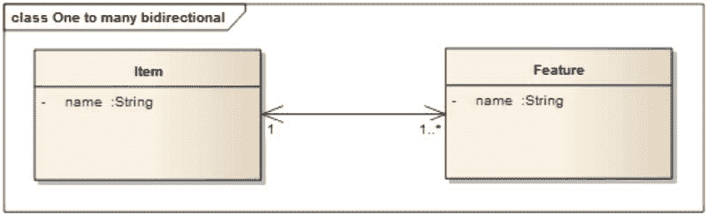**

*图 7-1: 一对多的双向关系*

在本章中，我们将演示一个一对多的双向关系，如图 7-1 所示。`Item` 实体有一个标识符和一个类型为 `String` 的名称字段。`Feature` 实体也有一个标识符和一个 `String` 类型的数字字段。在 `Item` 的一个实例中，必须关联一个或多个 `Feature` 实例。同样，在 `Feature` 的一个实例中，必须链接一个 `Item` 实例。由于该关系是双向的，你可以从 `Item` 遍历 `Features` 列表，也可以从 `Feature` 实例跳转到对应的 `Item`。我们将首先介绍通过模拟用户界面编写的经典通道，然后是简单易懂的服务。

### 开发用户界面

在演进模拟用户界面的过程中，我们研究的三个重要任务是：创建数据传输对象、模拟服务和模拟用户界面。

### 开发数据传输对象

`Item` 数据传输对象包含一个标识符、`Item` 的名称以及一个 `String` 类型的 Feature 名称列表。`Feature` 对象的标识符对调用方界面界面隐藏的，因为我们希望让用户界面团队的 API 调用变得更加简单。此外，另一个设计理念是不由于复杂性而不暴露数据库设计，并且不参与子对象的标识符管理。

```java
public class ItemDto {

    private Integer id;

    private String name;

    private List<String> featureList;

    // getters and setters

}
```

#### 开发模拟服务

模拟服务将与一个内存自定义数据库交互以保存数据，该数据将被模拟用户界面消费。我们将从添加功能开始。我们有一个 `ItemDto` 列表，每当有一个新主题时，一个具有项目名称和特性名称的 `ItemDto` 实例会被添加到列表中。内存存储实现采用了使用 `enum` 的单例设计模式。标识符字段从 1 开始，每有一个新计数递增 1。

```java
public enum ItemInMemoryDB {

    INSTANCE;

    private static List<ItemDto> list = new ArrayList<ItemDto>();

    private static Integer lastId = 0;

    public Integer getId() {
        return ++lastId;
    }

    public void add(ItemDto itemDto) {
        itemDto.setId(getId());
        list.add(itemDto);
    }

}
```

现在让我们来看等效的模拟服务实现。`create` 方法从用户界面收集一个 `ItemDto` 实例并通过模拟文件增强列表。

```java
@Controller
@RequestMapping(value="/onetomanybidirectional/mock")
public class ItemMockController {

    @RequestMapping(value="/create", method=RequestMethod.POST)
    @ResponseBody
    public void creat(@RequestBody ItemDto itemDto) {
        ItemInMemoryDB.INSTANCE.add(itemDto);
    }
}
```

接下来，我们将确保查找所有行和根据标识符片段查找。

```java
public enum ItemInMemoryDB {

    public List<ItemDto> findAll() {
        return list;
    }

    public ItemDto findById(Integer id) {
        for(ItemDto itemDto : list) {
            if(itemDto.getId() == id)
                return itemDto;
        }
        return null;
    }
}
```

在模拟包中，随后查找所有行获取一个 `ItemDto` 列表，而根据标识符约定查找则获取一个 `ItemDto` 实例。

```java
public class ItemMockController {

    @RequestMapping(value="/findAll", method=RequestMethod.GET)
    public @ResponseBody List<ItemDto> findAll() {
        return ItemInMemoryDB.INSTANCE.findAll();
    }

    @RequestMapping(value="/findById/{itemid}", method=RequestMethod.GET)
    public @ResponseBody ItemDto findById(@PathVariable("itemid") Integer itemid) {
        return ItemInMemoryDB.INSTANCE.findById(itemid);
    }
}
```

接下来，我们将实现删除操作，该操作根据记录的标识符删除特定行。

```java
public enum ItemInMemoryDB {

    public void remove(Integer id) {
        ItemDto dto = null;
        for(ItemDto itemDto : list) {
            if(itemDto.getId() == id) {
                dto = itemDto;
                break;
            }
        }
        if(null != dto){list.remove(dto);}
    }
}
```

在等效的模拟服务中，删除操作根据 URL 提供的唯一标识符移除特定行。

```java
public class ItemMockController {

    @RequestMapping(value="/remove/{itemid}", method=RequestMethod.POST)
    @ResponseStatus(value = HttpStatus.NO_CONTENT)
    public void remove(@PathVariable("itemid") Integer itemid) {
        ItemInMemoryDB.INSTANCE.remove(itemid);
    }
}
```

最后，我们提供编辑操作，负责更新行。

```java
public enum ItemInMemoryDB {

    public void edit(ItemDto itemDto) {
        for(ItemDto dto : list) {
            if(dto.getId() == itemDto.getId()) {
                dto.setName(itemDto.getName());
                dto.setFeatureList(itemDto.getFeatureList());
            }
        }
    }

}
```

独有的编辑操作接受修改后的 `ItemDto` 副本并根据差异更新特定行。


```java
public class ItemMockController {

    @RequestMapping(value="/edit", method=RequestMethod.POST)
    @ResponseBody
    public void edit(@RequestBody ItemDto itemDto) {
        ItemInMemoryDB.INSTANCE.edit(itemDto);
    }
```

## 开发用户界面

我们在上一个节中检查了如何通过内存存储编写模拟服务。现在我们决定如何通过内存存储编写用户界面。用户界面将包含添加、编辑和删除功能。用户界面的截图如图 7-2 所示

```html
<body onload="loadObjects()">
<div id="container">
    <p><b>Item:</b></p>
    <form method="post" id="itemForm">
        <div id="name">
            Name: <input type="text" name="name" id="name">
            <input type="hidden" name="id" id="itemid">
        </div>
        <div id="feature">
            Feature: <select name="feature" id="feature">
                <option></option>
            </select>
            <a href="#" onclick="addMoreFeature()">+</a>
        </div>
        <div id="buttonGroup">
            <input type="submit" value="Create" id="subButton" onclick="returnCall()">
        </div>
    </form>
    <div id="itemResponse"></div>
</body>
```

```javascript
function loadObjects(){
    $.ajax({
        url: "/onetomanybidirectional/mock/findAll",
        type: "GET",
        data: {},
        dataType: "json",
        success: function(data, textStatus, jqXHR) {
            processResponseData(data);
        },
        error: function (jqXHR, textStatus, errorThrown) {
            document.getElementById("name").value = "";
            alert("Error Status:"+textStatus);
        }
    });
    return false;
}
```

```javascript
function processResponseData(objects){
    var dyanamicTableRow = "<table border=1><tr><td>Item Name</td><td>Feature</td><td>Actions</td></tr>";
    var dataRow = "";
    $.each(objects, function(itemno, object){
        dataRow = dataRow + generateTableData(object);
    });
    dyanamicTableRow = dyanamicTableRow + dataRow + "</table>";
    document.getElementById("itemResponse").innerHTML = dyanamicTableRow;
}

function generateTableData(object){
    var features = object.featureList;
    var dataRow = "<tr><td>" + object.name + "</td><td><select><option></option>";
    if(features != null && features.length > 0) {
        for(var index = 0; index < features.length; index++) { 
            var feature = features[index];
            dataRow = dataRow + "<option value=" + feature + ">" + feature + "</option>";
        }
    }
    dataRow = dataRow + "</select></td><td><a href="#" onclick=deleteObject(" + object.id + ")>Delete</a>|<a href="#" onclick=editObject(" + object.id + ")>Edit</a></td></tr>";
    return dataRow;
}
```

我们已经看到了页面加载技术。如果你诊断了 JSP 片段是如何运作的，你会注意到调用了 Javascript 方法 `methodCall`，它适用于创建和更新功能。

```javascript
function methodCall(){
  var buttonValue = document.getElementById(“subButton”).value;
  if(buttonValue==”Create”){
    create();
  }else if(buttonValue==”Update”){
    update();
  }
  return false;
}
```

我们将识别 `create` Javascript 方法，它从文本框 `item name`（项目名称）和 `feature names`（特性名称）收集值，并将概念作为不带标识符的 `ItemDto` 传递。

```javascript
function create(){
  var name = $(“#name”).val();
  var numbers = null;
  var flag= false;
  var feature=document.getElementsByName(“feature”);
  if(feature.length > 0){
    numbers = new Array();
    for(var i=0;i<feature.length;i++)
    {
      if(trim(feature[i].value)!=””){
        numbers.push(feature[i].value);
        flag=true;
      }
    }
  }
  if(flag==false){numbers=null;}
  var formData={“name”:name,”featureList”:numbers};
  $.ajax({
    url : “/Spring-OODD/onetomanybidirectional/mock/create”,
    type: “POST”,
    data : JSON.stringify(formData),
    beforeSend: function(xhr) {
      xhr.setRequestHeader(“Accept”, “application/json”);
      xhr.setRequestHeader(“Content-Type”, “application/json”);
    },
    success: function(data, textStatus, jqXHR){
      document.getElementById(“name”).value=””;
      document.getElementById(“subButton”).value=”Create”;
      loadObjects();
      initiateItemBoxGroup();
    },
    error: function (jqXHR, textStatus, errorThrown) {
      document.getElementById(“name”).value=””;
      initiateItemBoxGroup();
      alert(“Error Status Create:”+textStatus);
    }
  });
  return false;
}
```

我们还将查看 `initiateItemBoxGroup` Javascript 方法，它重新排列了特性名称用户界面区域。

```javascript
function initiateItemBoxGroup(){
  var itemBoxGroupDiv = document.getElementById(“itemBoxGroup”);
  itemBoxGroupDiv.innerHTML=””;
  var itemeDiv = document.createElement(‘div’);
  itemeDiv.setAttribute(“id”,”itemBox_1”);
  var itemBox_1 = “<label>Feature:<input type=’text’ name=’feature’ id=’feature’ size=’10’ maxlength=’12’><a href=# onclick=javascript:addMoreFeature()>(+)</a></label>”;
  var removeLink_1=”<label id=’removeLink_1’></label>”;
  var setUrl = itemBox_1+removeLink_1;
  itemeDiv.innerHTML=setUrl;
  itemBoxGroupDiv.appendChild(itemeDiv);
}
```

接下来我们将查看更新后的 Javascript 方法，它保持了一个包含标识符、`item name` 和 `feature names` 的 `ItemDto`。

```javascript
function update(){
  var name = $(“#name”).val();
  var id = +$(“#itemid").val();
  var flag= false;
  var feature=document.getElementsByName(“feature”);
  if(feature.length > 0){
    numbers = new Array();
    for(var i=0;i<feature.length;i++){if(trim(feature[i].value)!=””){numbers.push(feature[i].value);flag=true;}}}
  }
  if(flag==false){numbers=null;}
  var formData={“name”:name,”featureList”:numbers};
  $.ajax({
    url : “/Spring-OODD/onetomanybidirectional/mock/create”,
    type: “POST”,
    data : JSON.stringify(formData),
    beforeSend: function(xhr) {
      xhr.setRequestHeader(“Accept”, “application/json”);
      xhr.setRequestHeader(“Content-Type”, “application/json”);
    },
    success: function(data, textStatus, jqXHR){
      document.getElementById(“name”).value=””;
      document.getElementById(“subButton”).value=”Create”;
      loadObjects();
      initiateItemBoxGroup();
    },
    error: function (jqXHR, textStatus, errorThrown) {
      document.getElementById(“name”).value=””;
      initiateItemBoxGroup();
      alert(“Error Status Create:”+textStatus);
    }
  });
  return false;
}
```

`editObject` 和 `viewObject` Javascript 方法调用用于检索并显示选中的 `ItemDto` 对象，包括特性名称。

```javascript
function editObject(itemid){
  editurl=”/Spring-OODD/onetomanybidirectional/mock/findById/+itemid;
  var itemForm={id:itemid};
  $.ajax({
    url : editurl,
    type: “GET”,
    data : itemForm,
    dataType: “json”,
    success: function(data, textStatus, jqXHR){
      viewObject(data);
      document.getElementById(“subButton”).value=”Update”;
    },
    error: function (jqXHR, textStatus,errorThrown){alert(“Error Status Find Object:”+textStatus);}
  });
  return false;
}

function viewObject(data){
  var index = 1;
  document.getElementById(“name”).value=data.name;
  document.getElementById(“itemid”).value=data.id;
  var numbers = data.featureList;
  if(numbers!=null){
    initiateItemBoxGroup();
    var itemBoxGroupDiv = document.getElementById(“itemBoxGroup”);
    for(var cnt=0;cnt<numbers.length;cnt++){
      if(cnt==0){
        var featurelist= document.getElementsByName(“feature”);
        featurelist[cnt].value=numbers[cnt];
      }else{
        index++; 
        var itemDiv = document.createElement(‘div’);
        itemDiv.setAttribute(“id”,”itemBox_”+index);
        var remId=”removeLink_”+index;
        var removeLinkUrl = “|<label id=”+remId+”><a href=’#’ onclick=’removeFeature(“+index+”)’>(-)</a></label>”;
        itemDiv.innerHTML = “<label>Feature:”+”<input type=’text’ id=’feature’ name=’feature’ maxlength=’12’ size=’10’ value=’+numbers[cnt]+”/></label>”+removeLinkUrl;
        itemBoxGroupDiv.appendChild(itemDiv);
      }
    }
  }
}
```

为了完成任务，我们将查看 `deleteObject` 操作，其中项目标识符作为响应传递，并且相关的 `Item` 以及 `Feature` 信息被移除。


```javascript
function deleteObject(itemid){
  var itemForm={id:itemid};
  delurl=”/Spring-OODD/onetomanybidirectional/mock/remove/”+itemid;
  $.ajax({
    url : delurl,
    type: “POST”,
    data : itemForm,
    dataType: “json”,
    success: function(data, textStatus, jqXHR){
      loadObjects();
    },
    error: function (jqXHR, textStatus,errorThrown){
      alert(“Error Status Delete:”+textStatus);
    }
  });
}
```

此外，作为最后的脚注，描述了如何添加和删除特性区域的文本框以便管理多个特性。这是通过`addMoreFeature`和`removeFeature`方法调用实现的。

```javascript
var counter = 1;
function addMoreFeature(){
  counter++;
  var itemeDiv = document.createElement(‘div’);
  itemeDiv.setAttribute(“id”,”itemBox_”+counter);
  var remId=”removeLink_”+counter;
  var removeLinkUrl = “|<label id=”+remId+”><a href=’#’ onclick=’removeFeature(“+counter+”)’>(-)</a></label>”;
  var itemBoxGroupDiv = document.getElementById(“itemBoxGroup”);
  itemeDiv.innerHTML = “<label>Feature:”+”<input type=’text’ id=’feature’ name=’feature’ maxlength=’12’ size=’10’/></label>”+removeLinkUrl;
  itemBoxGroupDiv.appendChild(itemeDiv);
}

function removeFeature(index){
  var featurelist=document.getElementsByName(“feature”);
  var size = featurelist.length;
  if(size==1){counter=1;return false;}
  var itemBoxGroupDiv = document.getElementById(“itemBoxGroup”);
  itemBoxGroupDiv.removeChild(document.getElementById(“itemBox_”+index));
}
```

## 开发服务

下一步是实际的服务开发，涉及四个主要步骤——创建实体、创建数据访问层、创建业务服务层以及创建基于 JSON 的 REST 能力。我们将从实体开始，自底向上构建 REST 服务。

## 开发资源（实体）层

作为一种实现技术，我们遵循测试驱动开发方法，因此我们首先对实体进行测试，然后进行实际开发。首先，我们创建带有特性列表的两个`Item`实例，并检查这两个`Item`实例。

```java
@RunWith( SpringJUnit4ClassRunner.class )
@ContextConfiguration( locations = { “classpath:context.xml” } )
@TransactionConfiguration( defaultRollback = true )
@Transactional
public class ItemTest {
  @Autowired
  private SessionFactory sessionFactory;

  @Test
  public void testCRUD(){
    Item item1 = new Item();
    item1.setName(“Book”);
    List<Feature> list = new ArrayList<Feature>();
    Feature feature1 = new Feature();
    feature1.setName(“Core Java”);
    feature1.setItem(item1);
    Feature feature2 = new Feature();
    feature2.setName(“Spring”);
    feature2.setItem(item1);
    list.add(feature1);
    list.add(feature2);
    item1.setFeatures(list);
    sessionFactory.getCurrentSession().save(item1);
  }
}
```

```java
Item item2 = new Item();
item2.setName(“Bags”);

List<Feature> list2 = new ArrayList<Feature>();
Feature feature3 = new Feature();
feature3.setName(“SkyBags”);
feature3.setItem(item2);
Feature feature4 = new Feature();
feature4.setName(“WildCraft”);
feature4.setItem(item2);
list2.add(feature3);
list2.add(feature4);
item2.setFeatures(list2);
sessionFactory.getCurrentSession().save(item2);

@SuppressWarnings(“unchecked”)
List<Item> items = sessionFactory.getCurrentSession()
.createQuery(“select item from Item item order by item.id desc”).list();
Assert.assertEquals(2L,items.size());
Item item = items.get(0);
item.setName(“BookList”);
sessionFactory.getCurrentSession().update(item);

@SuppressWarnings(“unchecked”)
List<Item> itemslist = sessionFactory.getCurrentSession()
.createQuery(“select item from Item item order by item.id desc”).list();
Item pItem = itemslist.get(0);
Assert.assertEquals(“BookList”,pItem.getName());
sessionFactory.getCurrentSession().delete(pItem);

@SuppressWarnings(“unchecked”)
List<Item> ppItem = sessionFactory.getCurrentSession()
.createQuery(“select item from Item item order by item.id desc”).list();
Assert.assertEquals(1L,ppItem.size());
}

}
```

## Feature 实体

我们将探索`Feature`实体，它包含一个标识符和一个名称的`String`字段。由于该实体位于反端且是一个双向关联，因此对`Item`的引用以`@ManyToOne`关联的形式出现。

```java
@Entity
@Table(name=”FEATURE”)
public class Feature {
    private Integer id;
    private String name;
    private Item item;

    @Id
    @GeneratedValue(strategy=GenerationType.AUTO)
    @Column(name=”ID”,length=20)
    public Integer getId() {
        return id;
    }

    public void setId(Integer id) {
        this.id = id;
    }

    @Column(name=”name”,length=50)
    public String getName() {
        return name;
    }

    public void setName(String name) {
        this.name = name;
    }

    @ManyToOne
    @JoinColumn(name=”ITEM_ID”, nullable=false)
    public Item getItem() {
        return item;
    }

    public void setItem(Item item) {
        this.item = item;
    }
}
```

## Item 实体

我们正在开发一个一对多的双向关系。一个`Item`实例必须有一个或多个`Feature`实例。由于关系是双向的，因此声明了对`Feature`列表的引用。我们还使用了`orphanRemoval=true`，因为如果一组`Features`被重新分配，旧的`Features`将被删除。`Item`是所有者，并通过`@OneToMany`注解维护对`Feature`的引用。

```java
@Entity
@Table(name=”ITEM”)
public class Item {
    private Integer id;
    private String name;
    private List<Feature> features;

    @Id
    @GeneratedValue(strategy=GenerationType.AUTO)
    @Column(name=”ID”,length=20)
    public Integer getId() {
        return id;
    }

    public void setId(Integer id) {
        this.id = id;
    }

    @Column(name=”name”,length=50)
    public String getName() {
        return name;
    }

    public void setName(String name) {
        this.name = name;
    }

    @OneToMany(mappedBy=”item”,cascade=CascadeType.ALL,orphanRemoval=true)
    public List<Feature> getFeatures() {
        return features;
    }

    public void setFeatures(List<Feature> features) {
        this.features = features;
    }
}
```

## 表结构

```sql
DROP TABLE `feature`;
DROP TABLE `item`;
CREATE TABLE `item` (
  `ID` int(11) NOT NULL AUTO_INCREMENT,
  `name` varchar(50) DEFAULT NULL,
  PRIMARY KEY (`ID`)
);
CREATE TABLE `feature` (
  `ID` int(11) NOT NULL AUTO_INCREMENT,
  `name` varchar(50) DEFAULT NULL,
  `ITEM_ID` int(11) NOT NULL,
  PRIMARY KEY (`ID`),
  KEY (`ITEM_ID`),
  CONSTRAINT FOREIGN KEY (`ITEM_ID`) REFERENCES `item` (`ID`)
);
```

## 开发数据访问层

接下来我们将观察数据访问层。我们将从获取所有记录方法的测试用例开始。

```java
@RunWith( SpringJUnit4ClassRunner.class )
@ContextConfiguration( locations = { “classpath:context.xml” } )
@TransactionConfiguration( defaultRollback = true )
@Transactional
public class ItemDaoImplTest {
    @Autowired
    private ItemDao dao;

    @Test
    public void testGetAll() {
        Assert.assertEquals(0L, dao.getAll().size());
    }
}
```

我们将掌握如何直接为上面的测试用例编写模拟的数据访问操作。使用`SessionFactory.createQuery`方法结合 SQL 从`Item`实体中检索所有记录。

```java
@Repository
@Transactional
public class ItemDaoImpl implements ItemDao {
    @Autowired
    private SessionFactory sessionFactory ;

    @SuppressWarnings(“unchecked”)
    @Override
    public List<Item> getAll() {
        return (List<Item>)sessionFactory.getCurrentSession().
        .createQuery(“select item from Item item order by item.id desc “).list();
    } 
}
```

删除任务使用了`Hibernate 4`的`Session.delete()`方法。

```java
public class ItemDaoImpl implements ItemDao {

    @Autowired
    private SessionFactory sessionFactory;

    @Override
    public void delete(Item item) {
        sessionFactory.getCurrentSession().delete(item);
    }
}
```

最后，我们将使用更新测试方法，它会插入两条记录，更新该行，并测试计数是否相同以及翻新是否生效。


```java
public class ItemDaoImplTest {
    @Autowired
    private ItemDao dao;

    @Test
    public void testUpdate() {
        Item item1 = new Item();
        item1.setName("Book");
        List<Feature> list = new ArrayList<Feature>();
        Feature feature1 = new Feature();
        feature1.setName("Core Java");
        feature1.setItem(item1);
        Feature feature2 = new Feature();
        feature2.setName("Spring");
        feature2.setItem(item1);
        list.add(feature1);
        list.add(feature2);
        item1.setFeatures(list);
        dao.insert(item1);
        Item item2 = new Item();
        item2.setName("Bags");
        List<Feature> list2 = new ArrayList<Feature>();
        Feature feature3 = new Feature();
        feature3.setName("SkyBags");
        feature3.setItem(item2);
        Feature feature4 = new Feature();
        feature4.setName("WildCraft");
        feature4.setItem(item2);
        list2.add(feature3);
        list2.add(feature4);
        item2.setFeatures(list2);
        dao.insert(item2);
        List<Item> items = dao.getAll();
        Item item = items.get(1);
        Feature feature = item.getFeatures().get(1);
        feature.setName("Spring 3.2");
        dao.update(item);
        items = dao.getAll();
        item = items.get(1);
        Assert.assertEquals("Spring 3.2",item.getFeatures().get(1).getName());
    }
}
```

对应的更新数据访问操作如下，它使用了 `Hibernate 4` 的 `Session.merge()` 操作。

```java
public class ItemDaoImpl implements ItemDao {

    @Autowired
    private SessionFactory sessionFactory;

    @Override
    public void update(Item item) {
        sessionFactory.getCurrentSession().merge(item);
    }
}
```

### 开发业务服务层

现在我们进入业务服务层。首先，我们将检查获取所有记录操作的测试。

```java
@RunWith( SpringJUnit4ClassRunner.class )
@ContextConfiguration( locations = { "classpath:context.xml" } )
@TransactionConfiguration( defaultRollback = true )
@Transactional
public class ItemServiceImplTest {
    @Autowired
    private ItemService service;

    @Test
    public void testFindAll(){
        Assert.assertEquals(0L, service.findAll().size());
    }
}
```

让我们思考如何在业务服务中编写相应的方法。

```java
@Service
@Transactional
public class ItemServiceImpl implements ItemService{
    @Autowired
    private ItemDao dao;

    @Autowired
    private ItemMapper mapper;

    @Override
    public List<ItemDto> findAll() {
        List<Item> items = dao.getAll();
        List<ItemDto> itemDtos = new ArrayList<ItemDto>();
        if(null != items){
            for (Item item : items) {
                itemDtos.add(mapper.mapEntityToDto(item));
            }
        }
        return itemDtos;
    }
}
```

如前所述，我们有一个映射器将数据访问对象转换为实体反反亦然，它通常显示出显著的操作。这里需要注意的一点是，`Feature` 标识符每次重新定位时都会生成。

```java
@Component
public class ItemMapper {
    public Item mapDtoToEntity(ItemDto itemDto){
        Item item = new Item();
        if(null != itemDto.getId()){item.setId(itemDto.getId());}
        if(null != itemDto.getName()){item.setName(itemDto.getName());}
        if(null != itemDto.getFeatureList() && itemDto.getFeatureList().size()>0){
            List<Feature> features = new ArrayList<Feature>();
            for(String feature : itemDto.getFeatureList()){
                Feature featureObject = new Feature();
                featureObject.setName(feature);
                featureObject.setItem(item);
                features.add(featureObject);
            }
            item.setFeatures(features);
        }
        return item;
    }

    public ItemDto mapEntityToDto(Item item){
        ItemDto itemDto = new ItemDto();
        if(null != item.getId()){itemDto.setId(item.getId());}
        if(null != item.getName()){itemDto.setName(item.getName());}
        if(null != item.getFeatures() && item.getFeatures().size() > 0){
            List<String> featuers = new ArrayList<String>();
            for(Feature feature : item.getFeatures()){
                featuers.add(feature.getName());
            }
            itemDto.setFeatureList(featuers);
        }
        return itemDto;
    }
}
```

进入 `create` 测试，它创建一个 `Item` 实例并检查其功能列表是否存在。

```java
public class ItemServiceImplTest {
    @Autowired
    private ItemService service;

    @Test
    public void testCreate(){
        ItemDto itemDto = new ItemDto();
        itemDto.setName("Book");
        List<String> list = new ArrayList<String>();
        list.add("Java");
        list.add("JEE");
        list.add("Spring");
        itemDto.setFeatureList(list);
        service.create(itemDto);
        Assert.assertEquals(1L, service.findAll().size());
    }
}
```

业务服务中的 `create` 方法接收数据访问对象，将其翻新的实体并发送到数据访问层。

```java
public class ItemServiceImpl implements ItemService{
    @Autowired
    private ItemDao dao;

    @Autowired
    private ItemMapper mapper;

    @Override
    public void create(ItemDto itemDto) {
        dao.insert(mapper.mapDtoToEntity(itemDto));
    }
}
```

下一个测试是根据给定标识符查找行。

```java
public class ItemServiceImplTest {
    @Autowired
    private ItemService service;

    @Test
    public void testById() {
        ItemDto itemDto = new ItemDto();
        itemDto.setName("Book");
        List<String> list = new ArrayList<String>();
        list.add("Java");
        list.add("JEE");
        list.add("Spring");
        itemDto.setFeatureList(list);
        service.create(itemDto);
        List<ItemDto> itemDtos = service.findAll();
        ItemDto dto = itemDtos.get(0);
        ItemDto dto1 = service.findById(dto.getId());
        Assert.assertEquals("Book", dto1.getName());
        Assert.assertEquals(3L, dto1.getFeatureList().size()); // 注意：此处原文逻辑可能存在误，此处按原意翻译
    }
}
```

（注：原文提供的文本片段似乎存在逻辑重复或错乱，此处已根据要求进行了翻译和格式对齐）

```java
public class ItemServiceImplTest {

    @Autowired
    private ItemService service;

    @Test
    public void testEdit(){
        ItemDto itemDto = new ItemDto();
        itemDto.setName("Book");
        List<String> list = new ArrayList<String>();
        list.add("Java");
        list.add("JEE");
        list.add("Spring");
        itemDto.setFeatureList(list);
        service.create(itemDto);
        Assert.assertEquals(1L, service.findAll().size());
        List<ItemDto> itemDtos = service.findAll();
        ItemDto dto = itemDtos.get(0);
        list = new ArrayList<String>();
        list.add("EJB 3.0");
        dto.setFeatureList(list);
        service.edit(dto);
        Assert.assertEquals(1L, service.findAll().get(0).getFeatureList().size());
    }
}
```

业务服务的对应操作是编辑操作，它交替调用数据访问层、以及在通过 mapper 方法进行重构后的更新方法。请注意，编辑操作没有 `Feature` 实体的标识符，因此每次调用都会产生一个新的实体。

```java
public class ItemServiceImpl implements ItemService{

    @Autowired
    private ItemDao dao;

    @Autowired
    private ItemMapper mapper;

    @Override
    public void edit(ItemDto itemDto) {
        dao.update(mapper.mapDtoToEntity(itemDto));
    }
}
```

### 开发表现层

这部分的最后一层是基于 REST 的 Spring Controller，我们将先为其编写测试。该测试涵盖了创建、编辑，然后是删除操作。


```java
@RunWith(SpringJUnit4ClassRunner.class)
@WebAppConfiguration
@ContextConfiguration( locations = { "classpath:context.xml" })
@TransactionConfiguration(defaultRollback = true)
@Transactional
public class ItemControllerTest {
    private final Gson gson = new GsonBuilder().create();
    @Resource
    private WebApplicationContext webApplicationContext;
    private MockMvc mockMvc;
    @Before
    public void setUp() {
        mockMvc = MockMvcBuilders.<StandaloneMockMvcBuilder>webAppContextSetup(webApplicationContext).build();
    }
    @Test
    public void testAll() throws Exception {
        testCreate();
        testUpdate();
        testDelete();
    }
    public void testCreate() throws Exception {
        ItemDto itemDto = new ItemDto();
        itemDto.setName("Book");
        List<String> featurelist = new ArrayList<String>();
        featurelist.add("Java");
        featurelist.add("J2ee");
        itemDto.setFeatureList(featurelist);
        String json = gson.toJson(itemDto);
        MockHttpServletRequestBuilder requestBuilderOne = MockMvcRequestBuilders.post("/onetomanybidirectional/create");
        requestBuilderOne.contentType(MediaType.APPLICATION_JSON);
        requestBuilderOne.content(json.getBytes());
        this.mockMvc.perform(requestBuilderOne).andExpect(MockMvcResultMatchers.status().isOk());
    }
    public void testUpdate() throws Exception {
        MockHttpServletRequestBuilder requestBuilder2 = MockMvcRequestBuilders.get("/onetomanybidirectional/findAll");
        MvcResult result = this.mockMvc.perform(requestBuilder2).andReturn();
        String response2 = result.getResponse().getContentAsString();
        Type listType = new TypeToken<List<ItemDto>>() {}.getType();
        List<ItemDto> itemDtos = gson.fromJson(response2, listType);
        ItemDto itemDto = itemDtos.get(0);
        List<String> featurelist = new ArrayList<String>();
        featurelist.add("Spring 3.0");
        featurelist.add("Hibernate 4.1");
        itemDto.setFeatureList(featurelist);
        String json2 = gson.toJson(itemDto);
        MockHttpServletRequestBuilder requestBuilder3 = MockMvcRequestBuilders.post("/onetomanybidirectional/edit");
        requestBuilder3.contentType(MediaType.APPLICATION_JSON);
        requestBuilder3.content(json2.getBytes());
        this.mockMvc.perform(requestBuilder3).andExpect(MockMvcResultMatchers.status().isOk());
    }
    public void testDelete() throws Exception {
        MockHttpServletRequestBuilder requestBuilder2 = MockMvcRequestBuilders.get("/onetomanybidirectional/findAll");
        MvcResult result = this.mockMvc.perform(requestBuilder2).andReturn();
        String response2 = result.getResponse().getContentAsString();
        Type listType = new TypeToken<List<ItemDto>>() {}.getType();
        List<ItemDto> itemDtos = gson.fromJson(response2, listType);
        ItemDto itemDto = itemDtos.get(0);
        MockHttpServletRequestBuilder requestBuilder3 = MockMvcRequestBuilders.post("/onetomanybidirectional/remove/"+itemDto.getId());
        requestBuilder3.contentType(MediaType.APPLICATION_JSON);
        this.mockMvc.perform(requestBuilder3).andExpect(MockMvcResultMatchers.status().is(204));
    }
}
```

生成的 REST, Spring Controller 将与业务服务层连接，并最终通过数据访问层连接到数据库。该平台与 mock 服务相似，区别在于代码正在与真实数据库协作，而不是内存公告。

```java
@Controller
@RequestMapping(value="/onetomanybidirectional")
public class ItemController {
    @Autowired
    private ItemService service;
    @RequestMapping(value="/findAll", method=RequestMethod.GET)
    public @ResponseBody List<ItemDto> findAll(){
        return service.findAll();
    }
    @RequestMapping(value="/findById/{itemid}", method=RequestMethod.GET)
    public @ResponseBody ItemDto findById(@PathVariable("itemid") Integer itemid) {
        return service.findById(itemid);
    }
    @RequestMapping(value="/create", method=RequestMethod.POST)
    @ResponseBody
    public void create(@RequestBody ItemDto itemDto){
        service.create(itemDto);
    }
    @RequestMapping(value="/remove/{itemid}", method=RequestMethod.POST)
    @ResponseStatus(value = HttpStatus.NO_CONTENT)
    public void remove(@PathVariable("itemid") Integer itemid) {
        service.remove(itemid);
    }
    @RequestMapping(value="/edit", method=RequestMethod.POST)
    @ResponseBody
    public void edit(@RequestBody ItemDto itemDto){
        service.edit(itemDto);
    }
}
```

`Category` 数据传输对象包含一个标识符、分类名称以及父分类标识符。父分类可以被多个子分类共享；因此，我们无法在每次创建新分类时都重新创建父分类。所以我们跳过了父级标识符，但保留了父分类名称。如果我们也跳过父分类名称，则必须重新创建父分类，并且通过更新父分类来重新创建所有相关的分类，这是一项繁琐的任务。

```java
public class CategoryDto {
    private Integer id;
    private String name;
    private Integer parentId;
    // getters and setters
}
```

### 开发 mock 服务

mock 服务将与一个内存自定义数据库交互，用于持久化 mock 用户界面将要使用的数据。我们将实现一个 `add` 功能。我们有一个 `CategoryDto` 列表，每当有一个新问题，就会向列表中添加一个具有名称和父级标识符的 `CategoryDto` 实例。使用使用 `enum` 实现的单例设计模式来注册内存集合操作。标识符字段从 1 开始，每新增一次计数就增加 1。

```java
public enum CategoryInMemoryDB {
    INSTANCE;
    private static List<CategoryDto> list = new ArrayList<CategoryDto>();
    private static Integer lastId = 0;

    public Integer getId() {
        return ++lastId;
    }

    public void add(CategoryDto categoryDto) {
        categoryDto.setId(getId());
        list.add(categoryDto);
    }
}
```

现在让我们来看对应的 mock 服务实现。`create` 方法从用户界面收集一个 `CategoryDto` 实例，并通过 mock 服务增加列表。

```java
@Controller
@RequestMapping(value="/onetomanyselfreference/mock")
public class CategoryMockController {
    @RequestMapping(value="/create", method=RequestMethod.POST)
    @ResponseBody
    public void create(@RequestBody CategoryDto categoryDto) {
        CategoryInMemoryDB.INSTANCE.add(categoryDto);
    }
}
```

接下来我们将继续处理查找所有行和根据标识符查找的部分。

```java
public enum CategoryInMemoryDB {
    public List<CategoryDto> findAll(){ return list; }
    public CategoryDto findById(Integer id) {
        for(CategoryDto categoryDto : list){ 
            if(categoryDto.getId() == id) 
        }
        return null;
    }
}
```

在 mock 服务中，`findAll` 产生 `CategoryDto` 列表，而根据标识符查找则获取 `CategoryDto` 实例。

```java
public class CategoryMockController {
    @RequestMapping(value="/findAll", method=RequestMethod.GET)
    public @ResponseBody List<CategoryDto> findAll(){
        return CategoryInMemoryDB.INSTANCE.findAll();
    }

    @RequestMapping(value="/findById/{Id}", method=RequestMethod.GET)
    public @ResponseBody CategoryDto findById(@PathVariable("Id") Integer Id) {
        return CategoryInMemoryDB.INSTANCE.findById(Id);
    }
}
```

接下来我们将设计 `remove` 操作，根据标识符删除特定行。

```java
public enum CategoryInMemoryDB {
    public void remove(Integer id) {
        CategoryDto dto = null;
        for(CategoryDto categoryDto : list){
            if(categoryDto.getId() == id) {
                boolean flag = false;
                for(CategoryDto category2 : list){
                    if (id==category2.getParentId()) {
                        flag = true;
                    }
                }
                if (!flag) {
                    dto = categoryDto;
                    break;
                }
            }
        }
        if(null != dto) list.remove(dto);
    }
}
```

在对应的 mock 服务中，`remove` 操作通过提供的 URL 标识符消除特定行。

```java
public class CategoryMockController {
    @RequestMapping(value="/remove/{Id}", method=RequestMethod.POST)
    @ResponseStatus(value = HttpStatus.NO_CONTENT)
    public void remove(@PathVariable("Id") Integer Id) {
        CategoryInMemoryDB.INSTANCE.remove(Id);
    }
}
```

最后我们查看负责更新行的 `edit` 操作。

```java
public enum CategoryInMemoryDB {
    public void edit(CategoryDto categoryDto) {
        for(CategoryDto dto : list){
            if(categoryDto.getId() == dto.getId()){
                dto.setName(categoryDto.getName());
                dto.setParentId(categoryDto.getParentId());
                break;
            }
        }
    }
}
```

`edit` 操作接收 `CategoryDto` 的转换副本并偏移更新特定行。


```java
public class CategoryMockController {
    @RequestMapping(value="/edit", method=RequestMethod.POST)
    @ResponseBody
    public void edit(@RequestBody CategoryDto categoryDto) {
        CategoryInMemoryDB.INSTANCE.edit(categoryDto);
    }
}
```

## 开发 mock 用户界面

我们测试了上一部分如何使用内存构建 mock 服务。现在来编写接收该 mock 服务的用户界面。用户界面将具有添加、编辑、删除和显示所有相关 `Category` 记录的功能。用户界面的截图如图 8-2 所示。

!图片

*图 8-2：分类用户界面截图*

JSP body 是执行的初始页面，之后会调用 JavaScript 操作。我们将一个个查看 JavaScript 方法。

```html
<body onload="loadObjects()">
    <div id="container">
        <div>
            <p>
                <b>分类管理器：</b>
            </p>
        </div>
        <form method="post" id="categoriesForm">
            <div id="categoriesDIV">
                <div id="nameGroup">
                    <label>名称:</label>
                    <input type="text" name="name" id="name">
                </div>
                <div id="parentIdGroup">
                    <label>父 ID:</label>
                    <select name="parentId" id="parentId">
                        <!-- 动态选项 -->
                    </select>
                </div>
            </div>
            <div id="buttonGroup">
                <input type="submit" value="Create" onclick="methodCall()">
            </div>
        </form>
        <div id="categoryFormResponse"></div>
    </div>
</body>
```

首先，我们将学习在页面准备绪时调用的 `loadObjects` 方法。

```javascript
function loadObjects() {
    $.ajax({
        url: "/onetomanyselfreference/mock/findAll",
        type: "GET",
        data: {},
        success: function(data, textStatus) {
            processResponse(data);
        },
        error: function (jqHR, textStatus) {
            document.getElementById("name").value = "";
            alert("Error Status:" + textStatus);
        }
    });
    return false;
}
```

当执行上述服务调用时，会调用 `processResponse` JavaScript 方法。此外，显示了生成表格结构的 `generateTable` 方法。

```javascript
function processResponse(data) {
    var dyanamicTableRow = "<table border=1>
        <tr>
            <th>Category</th>
            <th>Parent_Id</th>
            <th>Actions</th>
        </tr>";
    var parentDropdown = "<select id=parentId>";
    var dataRow = "";
    var dropdown = "";
    $.each(data, function(itemno, itemvalue) {
        dataRow = dataRow + generateTableData(itemvalue, itemno);
        dropdown = dropdown + createDropDown(itemvalue);
    });
    dyanamicTableRow = dyanamicTableRow + dataRow + "</table>";
    if (dropdown != "") {
        parentDropdown = parentDropdown + dropdown;
    }
    parentDropdown = parentDropdown + "</select>";
    document.getElementById("categoryFormResponse").innerHTML = dyanamicTableRow;
    document.getElementById("parentIdCombo").innerHTML = parentDropdown;
}

function generateTableData(itemvalue, itemNo) {
    var parentId = itemvalue.parentId;
    if (null == parentId) parentId = "";
    var dataRow = "";
    if (parentId != "") {
        dataRow = "<tr>
            <td>" + itemvalue.name + "</td>
            <td>" + parentId + "</td>
            <td>
                <a href=# onclick=deleteObject(" + itemvalue.id + ")">Delete</a>
                |<a href=# onclick=editObject(" + itemvalue.id + ")">Edit</a>
            </td>
        </tr>";
    } else {
        dataRow = "<tr>
            <td>" + itemvalue.name + "</td>
            <td>" + parentId + "</td>
            <td></td>
        </tr>";
    }
    return dataRow;
}
```

我们已经掌握了页面加载技术。如果你检测 JSP 片段是如何运作的，你会注意到调用了 JavaScript 方法 `methodCall`，它适用于创建和更新功能。

```javascript
function methodCall() {
    var buttonValue = document.getElementById("subButton").value;
    if (buttonValue == "Create") {
        create();
    }
}
```

```javascript
}else if(buttonValue==”Update”){
  update();
}

return false;

}
```

接下来我们将查看 `create` Javascript 方法，它接收来自文本框 `name` 和 `parent` 的输入，并将该对象作为不带标识符的 `CategoryDto` 传递。

```javascript
function create(){
  var name = $(“#name”).val();
  var parentId = document.getElementById(“parentId”).value;
  if(parentId !=null){
    parentId = parseInt(parentId);
  }
  var formData ={“name”:name,”parentId”:parentId};
  $.ajax({
    url : “/Spring-OODD/onetomanyselfreference/mock/create”,
    type: “POST”,
    data : JSON.stringify(formData),
    beforeSend: function(xhr) {
      xhr.setRequestHeader(“Accept”, “application/json”);
      xhr.setRequestHeader(“Content-Type”, “application/json”);
    },
    success: function(data, textStatus, jqXHR)
    {
      document.getElementById(“name”).value=””;
      document.getElementById(“subButton”).value=”Create”;
      loadObjects();
    },
    error: function (jqXHR, textStatus, errorThrown)
    {
      document.getElementById (“name”).value=””;
      document.getElementById (“parentId”).value=””;
      alert(“Error Status Create:”+textStatus);
    }
  });
  return false;
}
```

然后我们将保留 `update` Javascript 方法，它保留了一个包含标识符、`name` 和 `parent` 的 `CategoryDto`。

```javascript
function update(){
  var name = $(“#name”).val();
  var id = $(“#Id”).val();
  var parentId = $(“#parentId”).val();
  if(id==parentId){
    alert(“Parent Id and Owner Id are same. Please choose a different parent.”);
    return false;
  }
  var formData={“id”:id,”name”:name,”parentId”:parentId};
  $.ajax({
    url : “/Spring-OODD/onetomanyselfreference/mock/edit”,
    type: “POST”,
    data : JSON.stringify(formData),
    beforeSend: function(xhr) {
      xhr.setRequestHeader(“Accept”, “application/json”);
      xhr.setRequestHeader(“Content-Type”, “application/json”);
    },
    success: function(data, textStatus, jqXHR)
    {
      document.getElementById (“name”).value=””;
      document.getElementById (“subButton”).value=”Create”;
      loadObjects();
    },
    error: function (jqXHR, textStatus, errorThrown)
    {
      document.getElementById (“name”).value=””;
      alert(“Error Status Update:”+textStatus);
    }
  });
  return false;
}
```

`editObject` 和 `viewObject` Javascript 方法调用用于恢复所选的 `CategoryDto` 对象并显示以便编辑，包括父级。

```javascript
function editObject(Id){
  editurl=”/Spring-OODD/onetomanyselfreference/mock/findById/”+Id;
  var itemForm={id:Id};
  $.ajax({
    url : editurl,
    type: “GET”,
    data : itemForm,
    dataType: “json”,
    success: function(data, textStatus, jqXHR){
      viewObject(data);
      document.getElementById (“subButton”).value=”Update”;
      document.getElementById (“Id”).value=Id;
    },
    error: function (jqXHR, textStatus, errorThrown){
      alert(“Error Status Find Object:”+textStatus);
    }
  });
}

function viewObject(data){
  document.getElementById (“name”).value=data.name;
  var _pId = data.parentId ;
  setComboBoxValue(_pId);
}
```

为了完成交易，我们将查看删除操作，其中类别标识符作为响应传递，并且相关的 `Category` 被移除。

```javascript
function deleteObject(Id){
  var productForm={id:Id};
  delurl=”/Spring-OODD/onetomanyselfreference/mock/remove/”+Id;
  $.ajax({
    url : delurl,
    type: “POST”,
    data : productForm,
    dataType: “json”,
    success: function(data, textStatus, jqXHR)
    {
      loadObjects();
    },
    error: function (jqXHR, textStatus, errorThrown)
    {
      alert(“Error Status Delete:”+textStatus);
    }
  });
}
```

## 开发 Service

后续步骤开发涉及四个主要步骤：创建实体、创建数据访问层、创建业务服务层和基于 JSON 的创建。

### 开发实体层

作为执行方法，我们遵循测试驱动的方法，因此首先创建两个 `Category` 实例，其中一个是根节点，另一个以根节点为父级的类别。稍后，我们进行修改并测试更改。最后，我们移除一个实例并测试计数。


```java
@RunWith( SpringJUnit4ClassRunner.class )
@ContextConfiguration( locations = { “classpath:context.xml” } )
@TransactionConfiguration( defaultRollback = true )
@Transactional
public class CategoryTest {
  @Autowired
  private SessionFactory sessionFactory;

  @Test
  @SuppressWarnings(“unchecked”)
  public void testCRUD(){
    Category rootCategory = new Category();
    rootCategory.setName(“Java”);
    sessionFactory.getCurrentSession().save(rootCategory);
    List<Category> categories = sessionFactory.getCurrentSession().createQuery(“select category from Category order by id desc”).list();
    Category parentCategory = categories.get(0);
    Category subCategory = new Category();
    subCategory.setName(“JEE”);
    subCategory.setCategory(parentCategory);
    sessionFactory.getCurrentSession().save(subCategory);
    categories = sessionFactory.getCurrentSession().createQuery(“select category from Category order by id desc”).list();
    Assert.assertEquals(2L, categories.size());
    rootCategory = categories.get(1);
    subCategory = categories.get(0);
    Assert.assertEquals(rootCategory.getName(),subCategory.getCategory().getName());
    subCategory.setName(“Ejb 2”);
    subCategory.setCategory(null);
    sessionFactory.getCurrentSession().merge(subCategory);
    categories = sessionFactory.getCurrentSession().createQuery(“select category from Category order by id desc”).list();
    Assert.assertEquals(null, categories.get(0).getCategory());
    sessionFactory.getCurrentSession().delete(subCategory);
    categories = sessionFactory.getCurrentSession().createQuery(“select category from Category order by id desc”).list();
    Assert.assertEquals(1L, categories.size());
  }
}
```

我们正在开发一对多的自引用关系。`Category` 实例可能有一个父级，根节点除外。请注意父级可以通过 `@ManyToOne` 与多个类别共享。

```java
@Entity
@Table(name=”CATEGORY”)
public class Category {
  private Integer id;
  private String name;
  private Category category ;

  @Id
  @GeneratedValue(strategy=GenerationType.AUTO)
  @Column(name=”id”,length=20)
  public Integer getId() {
    return id;
  }
  public void setId(Integer id) {
    this.id = id;
  }

  @Column(name=”name”,length=20)
  public String getName() {
    return name;
  }
  public void setName(String name) {
    this.name = name;
  }

  @ManyToOne(cascade=CascadeType.PERSIST)
  @JoinColumn(name=”CAT_ID”,nullable=true)
  public Category getCategory() {
    return category;
  }
  public void setCategory(Category category) {
    this.category = category;
  }
}
```

### 表结构

```sql
DROP TABLE `category`;
CREATE TABLE `category` (
 `id` int(11) NOT NULL AUTO_INCREMENT,
 `name` varchar(20) DEFAULT NULL,
 `CAT_ID` int(11) DEFAULT NULL,
 PRIMARY KEY (`id`),
 KEY (`CAT_ID`),
 CONSTRAINT FOREIGN KEY (`CAT_ID`) REFERENCES `category` (`id`)
);
```

### 开发数据访问层

接下来我们将查看数据访问层。我们将从获取所有记录方法的测试用例开始。

```java
@RunWith( SpringJUnit4ClassRunner.class )
@ContextConfiguration( locations = { “classpath:context.xml” } )
@TransactionConfiguration( defaultRollback = true )
@Transactional
public class CategoryDaoImplTest {
  @Autowired
  private CategoryDao dao ;

  @Test
  public void testGetAll() {
    Assert.assertEquals(0L, dao.getAll().size());
  }
}
```

随后我们将为上述测试编写对应的数据访问操作。使用 Hibernate 的 `Session.createQuery` 方法结合 SQL 从 `Category` 实体中检索所有记录。

```java
@Repository
@Transactional
public class CategoryDaoImpl implements CategoryDao {
  @Autowired
  private SessionFactory sessionFactory;

  @SuppressWarnings(“unchecked”)
  @Override
  public List<Category> getAll() {
    return sessionFactory.getCurrentSession().createQuery(“select category from Category order by id desc”).list();
  }
}
```

现在让我们见证插入操作的测试。我们插入一个根分类，接着插入一个子分类，然后检查数量是否为双。

```java
public class CategoryDaoImplTest {

    @Autowired
    private CategoryDao dao ;

    @Test
    public void testInsert(){
        Category rootCategory = new Category();
        rootCategory.setName(“Java”);
        dao.insert(rootCategory);
        Assert.assertEquals(1L, dao.getAll().size());
        List<Category> categories = dao.getAll();
        Category parentCategory = categories.get(0);
        Category subCategory = new Category();
        subCategory.setName(“JEE”);
        subCategory.setCategory(parentCategory);
        dao.insert(subCategory);
        Assert.assertEquals(2L, dao.getAll().size());
    }
}
```

相应的插入操作请求了 Hibernate 的 `Session.save` 方法。`Category` 实体的标识符会与其父级一起被可靠地设置。

```java
public class CategoryDaoImpl implements CategoryDao {
    @Autowired
    private SessionFactory sessionFactory;

    @Override
    public void insert(Category category) {
        sessionFactory.getCurrentSession().save(category);
    }
}
```

我们现在将看到如何编写根据标识符查找行的测试测试。

```java
public class CategoryDaoImplTest {

    @Autowired
    private CategoryDao dao ;

    @Test
    public void testGetById() {
        Category rootCategory = new Category();
        rootCategory.setName(“Java”);
        dao.insert(rootCategory);
        List<Category> categories = dao.getAll();
        Category parentCategory = categories.get(0);
        Category subCategory = new Category();
        subCategory.setName(“JEE”);
        subCategory.setCategory(parentCategory);
        dao.insert(subCategory);
        categories = dao.getAll();
        Category searchCategory = dao.getById(categories.get(1).getId());
        Assert.assertEquals(“Java”, searchCategory.getName());
    }
}
```

符合规范的数据访问方法使用了 Hibernate 4 的 `Session.get()` 过程。

```java
public class CategoryDaoImpl implements CategoryDao {
    @Autowired
    private SessionFactory sessionFactory;

    @Override
    public Category getById(Integer id) {
        return (Category) sessionFactory.getCurrentSession().get(Category.class, id);
    }
}
```

我们在这个阶段将建立删除测试程序。首先，我们插入两个版本的 `Category`，然后删除其中一个账户，最后测试孤立的记录是否仍然存在内存中。

```java
public class CategoryDaoImplTest {

    @Autowired
    private CategoryDao dao ;

    @Test
    public void testDelete() {
        Category rootCategory = new Category();
        rootCategory.setName(“Java”);
        dao.insert(rootCategory);
        List<Category> categories = dao.getAll();
        Category parentCategory = categories.get(0);
        Category subCategory = new Category();
        subCategory.setName(“JEE”);
        subCategory.setCategory(parentCategory);
        dao.insert(subCategory);
        Assert.assertEquals(2L, dao.getAll().size());
        categories = dao.getAll();
        Category searchCategory = categories.get(0);
        searchCategory.setCategory(null);
        dao.update(searchCategory);
        dao.delete(searchCategory);
        Assert.assertEquals(1L, dao.getAll().size());
    }
}
```

删除任务使用了 Hibernate 4 的 `Session.delete()` 例程。

```java
public class CategoryDaoImpl implements CategoryDao {
    @Autowired
    private SessionFactory sessionFactory;

    @Override
    public void delete(Category category) {
        sessionFactory.getCurrentSession().delete(category);
    }
}
```

最后，我们将查看更新测试方法，该方法插入了三条记录，评估该行并测试更改是否产生了反映。


## 数据访问层测试

以下测试操作验证了更新数据访问操作，它使用了 Hibernate 4 的 `Session.merge()` 操作。

```java
public class CategoryDaoImplTest {

    @Test
    public void testUpdate() {
        Category rootCategory = new Category();
        rootCategory.setName("Java");
        dao.insert(rootCategory);
        Category nextCategory = new Category();
        nextCategory.setName("Ejb 2.1");
        List<Category> categories = dao.getAll();
        rootCategory = categories.get(0);
        nextCategory.setCategory(rootCategory);
        dao.insert(nextCategory);
        categories = dao.getAll();
        Category parentCategory = categories.get(0);
        Category subCategory = new Category();
        subCategory.setName("JEE");
        subCategory.setCategory(parentCategory);
        dao.insert(subCategory);
        categories = dao.getAll();
        Category searchCategory = categories.get(0);
        searchCategory.setName("Spring 3.0");
        rootCategory = categories.get(2);
        searchCategory.setCategory(rootCategory);
        dao.update(searchCategory);
        categories = dao.getAll();
        Assert.assertEquals("Java", categories.get(0).getCategory().getName());
    }
}
```

## 数据访问层实现

更新数据访问操作可以在下方获取，它使用了 Hibernate 4 的 `Session.merge()` 操作。

```java
public class CategoryDaoImpl implements CategoryDao {
    @Autowired
    private SessionFactory sessionFactory;

    @Override
    public void update(Category category) {
        sessionFactory.getCurrentSession().merge(category);
    }
}
```

## 业务服务层

符合规范的业务服务层收集数据访问对象，通过 Mapper 转换为实体，并发送到数据访问层加载到数据库。

```java
public class CategoryServiceImpl implements CategoryService{
    @Autowired
    private CategoryDao dao;
    @Autowired
    private CategoryMapper mapper;

    @Override
    public void create(CategoryDto categoryDto) {
        Category category = mapper.mapDtoToEntity(categoryDto);
        if(null!=categoryDto.getParentId()){
            Category pareCategory = dao.getById(categoryDto.getParentId());
            category.setCategory(pareCategory);
        }
        dao.insert(category);
    }
}
```

## 业务服务层 Mapper

我们现在进入业务服务层。首先，我们有一个 Mapper 用于数据访问对象和实体之间的相互转换。

```java
@Component
public class CategoryMapper {
    public Category mapDtoToEntity(CategoryDto categoryDto){
        Category category = new Category();
        if(null!=categoryDto.getId()) category.setId(categoryDto.getId());
        if(null!=categoryDto.getName()) category.setName(categoryDto.getName());
        return category;
    }

    public CategoryDto mapEntityToDto(Category category){
        CategoryDto categoryDto = new CategoryDto();
        if(null!=category.getId()) categoryDto.setId(category.getId());
        if(null!=category.getName()) categoryDto.setName(category.getName());
        if(null!=category.getCategory()) categoryDto.setParentId(category.getCategory().getId());
        return categoryDto;
    }
}
```

## 业务服务层测试

创建测试操作，它创建了两个 `Category` 实例，链接其父级，并检查实例数量与获取所有记录的操作一致。

```java
public class CategoryServiceImplTest {
    @Autowired
    private CategoryService service;

    @Test
    public void testCreate() {
        CategoryDto parent = new CategoryDto();
        parent.setName("Java");
        service.create(parent);
        Assert.assertEquals(1L, service.findAll().size());
        parent = service.findAll().get(0);
        CategoryDto jee = new CategoryDto();
        jee.setName("Java EE");
        jee.setParentId(parent.getId());
        service.create(jee);
        Assert.assertEquals(2L, service.findAll().size());
    }
}
```

以下测试操作是根据给定标识符查找行。

```java
public class CategoryServiceImplTest {

    @Autowired
    private CategoryService service;

    @Test
    public void testGetById() {
        // ... 测试逻辑
    }
}
```

## 开发表现层

栈中的最终层级是基于 REST 的 Spring Controller，我们将先编写它的测试。测试涵盖了创建、编辑和删除操作。

```java
@RunWith(SpringRunner.class)
@SpringBootTest
@AutoConfigureMockMvc
public class CategoryControllerTest {

    @Autowired
    private MockMvc mockMvc;

    @Autowired
    private Gson gson = new Gson();

    @Before
    public void setUp() {
        mockMvc = MockMvcBuilders.standaloneSetup().build();
    }

    @Test
    public void testCreate() throws Exception {
        CategoryDto categoryDto = new CategoryDto();
        categoryDto.setName("Book");
        String json = gson.toJson(categoryDto);
        mockMvc.perform(post("/onetomanyselfreference/create"))
                .contentType(MediaType.APPLICATION_JSON)
                .content(json))
                .andExpect(status().isOk());
    }

    @Test
    public void testFindAll() throws Exception {
        String result = mockMvc.perform(get("/onetomanyselfreference/findAll"))
                .andExpect(status().isOk())
                .andReturn().getResponse().getContent();
        List<CategoryDto> categories = gson.fromJson(result, new TypeToken<List<CategoryDto>>(){}.getType());
        assertFalse(categories.isEmpty());
    }

    @Test
    public void testById() throws Exception {
        CategoryDto categoryDto = new CategoryDto();
        categoryDto.setName("Book");
        String json = gson.toJson(categoryDto);
        mockMvc.perform(post("/onetomanyselfreference/create"))
                .contentType(MediaType.APPLICATION_JSON)
                .content(json))
                .andExpect(status().isOk());
        String result = mockMvc.perform(get("/onetomanyselfreference/findById/1"))
                .andExpect(status().isOk())
                .andReturn().getResponse().getContent();
        CategoryDto category = gson.fromJson(result, CategoryDto.class);
        assertEquals("Book", category.getName());
    }

    @Test
    public void testEdit() throws Exception {
        CategoryDto categoryDto = new CategoryDto();
        categoryDto.setName("Book");
        String json = gson.toJson(categoryDto);
        mockMvc.perform(post("/onetomanyselfreference/create"))
                .contentType(MediaType.APPLICATION_JSON)
                .content(json))
                .andExpect(status().isOk());
        categoryDto.setName("Java EE");
        json = gson.toJson(categoryDto);
        mockMvc.perform(post("/onetomanyselfreference/edit"))
                .contentType(MediaType.APPLICATION_JSON)
                .content(json))
                .andExpect(status().isOk());
        String result = mockMvc.perform(get("/onetomanyselfreference/findById/1"))
                .andExpect(status().isOk())
                .andReturn().getResponse().getContent();
        CategoryDto category = gson.fromJson(result, CategoryDto.class);
        assertEquals("Java EE", category.getName());
    }

    @Test
    public void testDelete() throws Exception {
        CategoryDto categoryDto = new CategoryDto();
        categoryDto.setName("Book");
        String json = gson.toJson(categoryDto);
        mockMvc.perform(post("/onetomanyselfreference/create"))
                .contentType(MediaType.APPLICATION_JSON)
                .content(json))
                .andExpect(status().isOk());
        mockMvc.perform(post("/onetomanyselfreference/remove/1"))
                .andExpect(status().isNoContent());
    }
}
```

最后的 REST Spring Controller 将与业务服务层连接，后者最终通过数据访问层连接数据库。该阶段与模拟服务相似，不同在于代码与真实的数据库交互，而不是内存中的数据库。


```java
@Controller
@RequestMapping(value="/onetomanyselfreference")
public class CategoryController {

    @Autowired
    private CategoryService service;

    @RequestMapping(value="/findAll", method=RequestMethod.GET)
    public @ResponseBody List<CategoryDto> findAll(){
        return service.findAll();
    }

    @RequestMapping(value="/findById/{Id}", method=RequestMethod.GET)
    public @ResponseBody CategoryDto findById(@PathVariable("Id") Integer Id) {
        return service.findById(Id);
    }

    @RequestMapping(value="/create", method=RequestMethod.POST)
    @ResponseBody
    public void create(@RequestBody CategoryDto categoryDto){
        service.create(categoryDto);
    }

    @RequestMapping(value="/remove/{Id}", method=RequestMethod.POST)
    @ResponseStatus(value = HttpStatus.NO_CONTENT)
    public void remove(@PathVariable("Id") Integer Id){
        service.remove(Id);
    }
}
```

```java
public void edit(@RequestBody CategoryDto categoryDto){
    service.edit(categoryDto);
}
}
```

最后一步是将 REST 服务与直观的用户界面进行整合。请注意，请求映射从`/onetomanyselfreference/mock`更改为`/onetomanyselfreference/`。剩余的任务包括以 mock 用户界面为参考，编写实际的用户界面。

### 总结

在本章中，我们讨论了以下内容：

* 开发 mock 内存数据库
* 开发 mock 用户界面
* 开发与一对多自引用关联关联的实体
* 开发数据访问层
* 开发业务服务层
* 开发一个 REST 服务控制器。

# 第四部分：管理多对多关系


## 第 9 章：多对多单向关系

在本章中，我们将详细介绍如何管理多对多的单向关系。按照手稿中的流程，我们最初将查看用户界面，然后是 REST 服务包。

### 领域模型

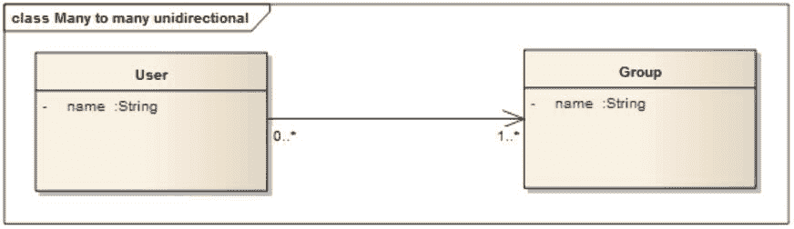

*图 9-1：多对多单向关系*

我们已经在之前的章节中看到了如何管理一对多的关系的不同形式。在本章中，我们将查看如图 9-1 所示的多对多单向关联。`User`实体有一个标识符和一个类型为`String`的名称字段。`Group`实体也有一个标识符和一个`String`类型的字段。每个多对多关系都有一个所有者。在这个例子中，`User`是所有者。在`User`实例中，必须链接一个或多个`Group`实例，而这些`Group`实体反过来被许多`User`实体共享。由于关系是单向的，你可以从`User`遍历`Group`列表，但不允许进行反向遍历。我们将遵循常规通道，先编写 mock 用户界面，然后是真实的服务。

### 开发用户界面

在 mock 用户界面演变过程中，我们关注的三个关键任务是创建数据传输对象（DTO）、mock 服务和 mock 用户界面。我们将按顺序逐一进行。

### 开发数据传输对象

`UserDto`数据传输对象包含一个标识符和用户名。同样，`GroupDto`对象也有一个标识符和一个名称。连接对象`UserGroupDto`包含`UserDto`和`GroupDto`的实例。

```java
public class UserDto {
    private Integer id;
    private String name;
    // getters and setters
}

public class GroupDto {
    private Integer id;
    private String name;
    // getters and setters
}

public class UserGroupDto {
    private UserDto userDto;
    private GroupDto groupDto;
    // getters and setters
}
```

### 开发 mock 服务

我们将只看到如何管理`User`和`Group`之间的连接。正如前面的章节所讨论，针对`User`以及`Group`的常规创建、读取、删除和编辑操作保持相同的实现。为了方便参考，如果你在理解流程时遇到任何问题，附录中提供了完整源代码链接。mock 服务将与内存数据库交互以保存数据，这些数据将被数据消耗。

```java
public class UserGroupDB {
    private static List<UserGroupDto> list = new ArrayList<>();

    public void add(UserGroupDto userDto) {
        list.add(userDto);
    }

    public void remove(UserGroupDto userDto) {
        list.remove(userDto);
    }

    public List<UserGroupDto> findAll() {
        return list;
    }

    public boolean isPresent(UserGroupDto userDto) {
        for (UserGroupDto dto : list) {
            if (dto.getUserDto().equals(userDto.getUserDto()) && 
                dto.getGroupDto().equals(userDto.getGroupDto())) {
                return true;
            }
        }
        return false;
    }
}

@RestController
@RequestMapping("/onetomanyselfreference/mock")
public class UserGroupController {

    @PostMapping("/create")
    public void create(@RequestBody UserGroupDto userDto) {
        UserGroupDB.INSTANCE.add(userDto);
    }

    @GetMapping("/findAll")
    public List<UserGroupDto> findAll() {
        return UserGroupDB.INSTANCE.findAll();
    }

    @PostMapping("/remove")
    @ResponseStatus(HttpStatus.NO_CONTENT)
    public void remove(@RequestBody UserGroupDto userDto) {
        UserGroupDB.INSTANCE.remove(userDto);
    }

    @PostMapping("/isPresent")
    public boolean isPresent(@RequestBody UserGroupDto userDto) {
        return UserGroupDB.INSTANCE.isPresent(userDto);
    }
}
```

#### 开发 mock 用户界面

我们在上一节检查了如何使用内存数据库开发 mock 服务。现在我们选择编写调用该 mock 服务的用户界面，如图 9-2 所示。我们将讨论与连接相关的用户界面，因为`User`和`Group`的创建、读取、更新和删除方法保持不变。如果你觉得困惑，请下载源代码查看如何继续。

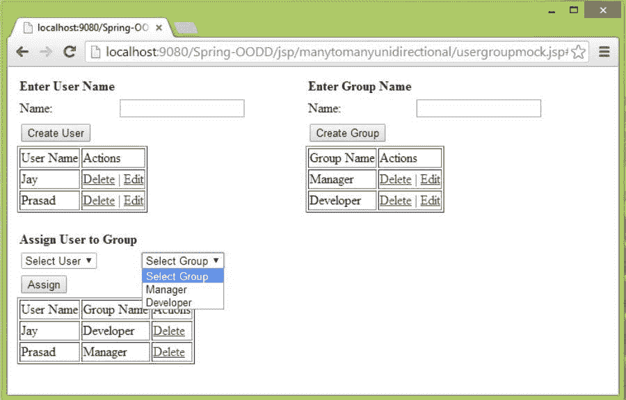

*图 9-2：User 和 Group 用户界面的截图*

JSP body 是初始加载页面，之后会调用 JavaScript 操作。我们将使用 JavaScript 请求草拟流程。

```html
<body onload="loadObjects()">
    <div id="container">
        <table>
            <tbody>
                <tr>
                    <td>
                        <table>
                            <tr><td><p><b>将用户分配到组</b></p></td></tr>
                            <tr>
                                <td>
                                    <div id="userCombo"></div>
                                </td>
                                <td>
                                    <div id="groupCombo"></div>
                                </td>
                            </tr>
                            <tr>
                                <td><input type="submit" value="Assign" id="subButtonUserGroup" onclick="return methodCall()"></td>
                            </tr>
                        </table>
                        <div id="userGroupFormResponse"></div>
                    </td>
                </tr>
            </tbody>
        </table>
    </div>
</body>
```

最初，我们将学习 JavaScript 的`loadObjects`方法，该方法在页面通过`onload`事件初始化时被调用。

```javascript
function loadObjects(){
  $.ajax({
    url : “/Spring-OODD/manytomanyunidirectional/user/mock/findAll”,
    type: “GET”,
    data : {},
    dataType: “json”,
    success: function(data, textStatus, jqXHR)
    {
      processUserResponseData(data);
    },
    error: function (jqXHR, textStatus, errorThrown)
    {
      document.getElementById(“username”).value=””;
      alert(“Error Status Load Objects:”+textStatus);
    }
  });
  $.ajax({
    url : “/Spring-OODD/manytomanyunidirectional/group/mock/findAll”,
    type: “GET”,
    data : {},
    dataType: “json”,
    success: function(data, textStatus, jqXHR)
    {
      processGroupResponseData(data);
    },
    error: function (jqXHR, textStatus, errorThrown)
    {
      document.getElementById(“groupname”).value=””;
      alert(“Error Status Load Objects:”+textStatus);
    }
  });
  $.ajax({
    url : “/Spring-OODD/manytomanyunidirectional/usergroup/mock/findAll”,
    type: “GET”,
    data : {},
    dataType: “json”,
    success: function(data, textStatus, jqXHR)
    {
      processUserGroupResponseData(data);
    },
    error: function (jqXHR, textStatus, errorThrown)
    {
      alert(“Error Status Load Objects:”+textStatus);
    }
  });
  return false;
}
```

当上述服务调用执行时，会调用`processUserGroupResponseData`JavaScript 方法。页面将打印出内存数据库的资源。此外，还展示了构建表格结构的`generateUserGroupTableData`JavaScript 方法。

```javascript
function processUserGroupResponseData(responsedata){
  var dyanamicTableRow=”<table border=1>”+
  “<tr>” +
  “<td>User Name</td>”+”<td>Group Name</td>”+”<td>Actions</td>”+
  “</tr>";
  var dataRow=””;
  $.each(responsedata, function(itemno, itemvalue){
    dataRow=dataRow+generateUserGroupTableData(itemvalue);
  });
  dyanamicTableRow=dyanamicTableRow+dataRow+”</table>”;
  document.getElementById(“userGroupFormResponse”).innerHTML=dyanamicTableRow;
} 

function generateUserGroupTableData(itemvalue){
  var dataRow=”<tr>” +
  “<td>”+itemvalue.userDto.name+”</td>”+
  “<td>” +itemvalue.groupDto.name+”</td>”+
  “<td>” +
  “<a href=# onclick=deleteUserGroupObject(“+itemvalue.userDto.id+”,”+itemvalue.groupDto.id+”)>Delete</a>”+
  “</td>”+
  “</tr>";
  return dataRow;
}
```

我们已经掌握了页面加载技术。如果你能分析 JSP 片段的工作原理，就会预见到调用了 JavaScript 方法`methodCall`，它调用了 User 和 Group 的`create`和`update`操作，以及 User 和 Group 的关联（join）。


```javascript
function methodCall(){
  var buttonValue = document.getElementById("subButtonUser").value;
  if(buttonValue=="Create User"){
    createUser();
  } else if(buttonValue=="Update User"){
    updateUser();
  }
  var groupButtonValue = document.getElementById("subButtonGroup").value;
  if(groupButtonValue=="Create Group") {
    createGroup();
  } else if(groupButtonValue=="Update Group") {
    updateGroup();
  }
  var userGroupButtonValue = document.getElementById("subButtonGroup").value;
  if(userGroupButtonValue=="Assign") {
    isPresent();
  }
  return false;
}
```

首先，我们将识别`isPresent`方法来检查`User`和`Group`之间是否存在关联。如果关系不存在，则形成一个新的关联。

```javascript
function isPresent(){
  var userid = $(userSelectBox).val();
  var groupid = $(groupSelectBox).val();
  var username = $(userSelectBox).find('option:selected').text();
  var groupname = $(groupSelectBox).find('option:selected').text();

  if(null != userid && userid != "" && null != groupid && groupid != "") {
    var formData={"userDto":{id:userid},"groupDto":{id:groupID}};
    $.ajax({
      url : "/Spring-OODD/manytomanyunidirectional/usergroup/mock/isPresent",
      type: "POST",
      data : JSON.stringify(formData),
      beforeSend: function(xhr) {
        xhr.setRequestHeader("Accept", "application/json");
        xhr.setRequestHeader("Content-Type", "application/json");
      },
      success: function(data, textStatus, jqXHR) {
        if(!data) {
          createUserGroup(userid, groupid, groupname);
        } else {
          alert("User already assigned to this group");
        }
      },
      error: function (jqXHR, textStatus, errorThrown) {
        alert("Error Status Create:"+errorThrown);
      }
    });
  }
  return false;
}
```

我们还将查看`createUserGroup`方法，它创建了选定的`User`和`Group`之间的关联。

```javascript
function createUserGroup(userid,groupid, username, groupname){
  var formData={"userDto":{id:userid, "name":username},"groupDto":{id:groupid,"name":groupname}};
  $.ajax({
    url : "/Spring-OODD/manytomanyunidirectional/usergroup/mock/create",
    type: "POST",
    data : JSON.stringify(formData),
    beforeSend: function(xhr) {
      xhr.setRequestHeader("Accept", "application/json");
      xhr.setRequestHeader("Content-Type", "application/json");
    },
    success: function(data, textStatus, jqXHR) {
      loadObjects();
    },
    error: function (jqXHR, textStatus, errorThrown) {
      alert("Error Status Create:"+textStatus);
    }
  });
  return false;
}
```

接下来，我们将审查`deleteUserGroupObject` JavaScript 方法，它接收`User ID`和`Group ID`作为输入并从关联中移除。

```javascript
function deleteUserGroupObject(userid,groupid){
  var formData={"userDto":{id:userid},"groupDto":{id:groupid}};
  delurl="/Spring-OODD/manytomanyunidirectional/usergroup/mock/remove";
  $.ajax({
    url : delurl,
    type: "POST",
    data : JSON.stringify(formData),
    dataType: "json",
    beforeSend: function(xhr) {
      xhr.setRequestHeader("Accept", "application/json");
      xhr.setRequestHeader("Content-Type", "application/json");
    },
    success: function(data, textStatus, jqXHR) {
      loadObjects();
    },
    error: function (jqXHR, textStatus, errorThrown) {
      alert("Error Status Delete:"+textStatus);
    }
  });
}
```

### 开发服务

接下来的步骤是实际的服务开发，涉及四个主要步骤：创建实体、创建数据访问层、创建业务服务层以及创建基于 JSON 的 REST 能力。我们将从实体开始直到服务。

### 开发资源（实体）层

首先，我们创建两个`User`实例，最后检查两个`User`实例。随后，我们进行更新并测试修改是否生效。最后，我们删除一个实例并测试数量是否唯一。此外，我们添加两个`Group`变体并与剩余的`User`实例关联。

```java
@RunWith(SpringJUnit4ClassRunner.class)
@ContextConfiguration(locations = {"classpath:context.xml"})
@TransactionConfiguration(defaultRollback = true)
@Transactional
public class UserTest {
  @Autowired
  private SessionFactory sessionFactory;

  @SuppressWarnings("unchecked")
  @Test
  public void testCRUD()
  {
    User u1 = new User();
    u1.setName("A");
    User u2 = new User();
    u2.setName("B");

    sessionFactory.getCurrentSession().save(u1);
    sessionFactory.getCurrentSession().save(u2);

    u1.setName("C");
    sessionFactory.getCurrentSession().merge(u1);

    List<User> list = sessionFactory.getCurrentSession().createQuery("from User").list();
    Assert.assertEquals(2L, list.size());

    sessionFactory.getCurrentSession().delete(u1);
    List<User> list2 = sessionFactory.getCurrentSession().createQuery("from User").list();
    Assert.assertEquals(1L, list2.size());

    Group g1 = new Group();
    g1.setName("A");
    Group g2 = new Group();
    g2.setName("B");

    sessionFactory.getCurrentSession().save(g1);
    sessionFactory.getCurrentSession().save(g2);

    User u3 = list2.get(0);
    u3.getGroups().add(g1);
    u3.getGroups().add(g2);
    sessionFactory.getCurrentSession().merge(u3);
  }
}
```

我们将查看`Group`实体，它包含一个标识符和名称`String`字段。由于该实体位于反向侧且是单向关联，因此没有对`User`的引用。

```java
@Entity
@Table(name="GROUPS")
```

```java
public class Group {
    private Integer id;
    private String name;

    @Id
    @GeneratedValue(strategy=GenerationType.AUTO)
    @Column(name="ID")
    public Integer getId() {
        return id;
    }

    public void setId(Integer id) {
        this.id = id;
    }

    @Column(name="NAME", nullable=false, length=100)
    public String getName() {
        return name;
    }

    public void setName(String name) {
        this.name = name;
    }
}
```

我们正在演进一个多对多的关联。`User`实例可能拥有一个或多个`Group`实例，这些实例可以与其他`User`共享。由于该关系是单向的，对`Group`列表的引用是在所有方指定的。`@ManyToMany`注解定义了一个具有多对多重数性的多值关联。连接表指定在所有方上，在本例中是`User`。`@JoinTable`注解通常指定连接表名称以及连接列和反向连接列。

```java
@Entity
@Table(name="USER")
public class User {
    private Integer id;
    private String name;
    private Set<Group> groups = new HashSet<>();

    @Id
    @GeneratedValue(strategy=GenerationType.AUTO)
    @Column(name="ID")
    public Integer getId() {
        return id;
    }

    public void setId(Integer id) {
        this.id = id;
    }

    @Column(name="NAME", nullable=false, length=100)
    public String getName() {
        return name;
    }

    public void setName(String name) {
        this.name = name;
    }

    @ManyToMany(cascade=CascadeType.PERSIST, fetch=FetchType.LAZY)
    @JoinTable(
        name="USER_GROUP",
        joinColumns = @JoinColumn(name="USER_ID", referencedName="ID"),
        inverseJoinColumns = @JoinColumn(name="GROUP_ID", referencedName="ID")
    )
    public Set<Group> getGroups() {
        return groups;
    }

    public void setGroups(Set<Group> groups) {
        this.groups = groups;
    }
}
```

### 表结构

```sql
DROP TABLE user_group;
DROP TABLE user;
DROP TABLE groups;

CREATE TABLE user (
    ID int(11) NOT NULL AUTO_INCREMENT,
    NAME varchar(100) NOT NULL,
    PRIMARY KEY (ID)
);

CREATE TABLE groups (
    ID int(11) NOT NULL AUTO_INCREMENT,
    NAME varchar(100) NOT NULL,
    PRIMARY KEY (ID)
);

CREATE TABLE user_group (
    USER_ID int(11) NOT NULL,
    GROUP_ID int(11) NOT NULL,
    PRIMARY KEY (USER_ID, GROUP_ID),
    KEY (GROUP_ID),
    KEY (USER_ID),
    CONSTRAINT FOREIGN KEY (USER_ID) REFERENCES user (ID),
    CONSTRAINT FOREIGN KEY (GROUP_ID) REFERENCES groups (ID)
);
```

### 开发数据访问层

接下来我们将查看数据访问层。我们将跳转到获取所有记录操作的测试用例。请注意，我们将讨论数据访问层，它主要管理`User`和`Group`的连接。`User`数据访问层与`Group`数据访问实现保持与早期章节中讨论的相同。

```java
@RunWith(SpringJUnit4ClassRunner.class)
@ContextConfiguration(locations = {"classpath:context.xml"})
@TransactionConfiguration(defaultRollback = true)
@Transactional
public class UserGroupDaoImplTest {
    @Autowired
    private UserDao userDao;
    @Autowired
    private GroupDao groupDao;
    @Autowired
    private UserGroupDao userGroupDao;

    @Test
    public void testGetAll() {
        Assert.assertEquals(0L, userGroupDao.getAll().size());
    }
}
```

我们将理解为测试编写数据访问操作。使用 Hibernate `createQuery`方法配合 SQL 从`User`实体和`Groups`检索所有记录。SQL 从连接表中检索`User`和`Group`的唯一组合。

```java
@Repository
```


`@Transactional`

```java
public class UserGroupDaoImpl implements UserGroupDao {

    @Autowired
    private SessionFactory sessionFactory;

    @Override
    public List<User> getAll() {
        return sessionFactory.getCurrentSession().createQuery("select distinct u from User u join u.groups").list();
    }
}
```

现在让我们观察 `isPresent` 操作的测试。向 `User` 实体和 `Group` 实体插入单行并将它们连接。随后，检查 `isPresent` 结果是否匹配该记录。

```java
public class UserGroupDaoImpl {

    @Autowired
    private UserDao userDao;

    @Autowired
    private GroupDao groupDao;

    @Autowired
    private UserGroupDao userGroupDao;

    @Test
    public void testPresent() {
        boolean status = false;
        User u1 = new User();
        u1.setName("User");
        userDao.save(u1);

        Group g1 = new Group();
        g1.setName("Group");
        groupDao.save(g1);

        u1.getGroups().add(g1);
        userDao.update(u1);

        List<User> userList = userGroupDao.isPresent(u1.getId(), g1.getId());
        if (userList != null && userList.size() > 0) {
            status = true;
        }
        Assert.assertTrue(status);
    }
}
```

`isPresent` 操作只是请求 Hibernate `Session.createQuery` 方法，传递 `User` 和 `Group` 标识并检查连接是否存在。

```java
@Repository
@Transactional
public class UserGroupDaoImpl implements UserGroupDao {

    @Autowired
    private SessionFactory sessionFactory;

    @Override
    public List<User> isPresent(Integer userId, Integer groupId) {
        String hql = "select distinct u from User u join u.groups g where u.id=:userId and g.id=:groupId";
        Query query = sessionFactory.getCurrentSession().createQuery(hql);
        query.setParameter("userId", userId);
        query.setParameter("groupId", groupId);
        return query.list();
    }
}
```

### 开发业务服务

我们将继续业务层。首先，我们将对获取所有记录操作进行测试。

```java
@RunWith(SpringJUnit4ClassRunner.class)
@ContextConfiguration(locations = {"classpath:context.xml"})
@TransactionConfiguration(defaultRollback = true)
@Transactional
public class UserGroupServiceImplTest {

    @Autowired
    private UserService userService;

    @Autowired
    private GroupService groupService;

    @Autowired
    private UserGroupService userGroupService;

    @Test
    public void testFindAll() {
        Assert.assertEquals(0L, userGroupService.findAll().size());
    }
}
```

让我们看看如何在业务服务中编写等效方法。

```java
@Service
@Transactional
public class UserGroupServiceImpl implements UserGroupService {

    @Autowired
    private GroupDao groupDao;

    @Autowired
    private UserDao userDao;

    @Autowired
    private UserGroupDao userGroupDao;

    @Autowired
    private UserMapper userMapper;

    @Autowired
    private GroupMapper groupMapper;

    @Override
    public List<UserGroupDto> findAll() {
        List<UserGroupDto> userGroupDtos = new ArrayList<>();
        List<User> userList = userGroupDao.getAll();
        for (User user : userList) {
            UserDto userDto = userMapper.mapEntityToDto(user);
            Set<Group> groups = user.getGroups();
            for (Group group : groups) {
                UserGroupDto userGroupDto = new UserGroupDto();
                userGroupDto.setUserDto(userDto);
                GroupDto groupDto = groupMapper.mapEntityToDto(group);
                userGroupDto.setGroupDto(groupDto);
                userGroupDtos.add(userGroupDto);
            }
        }
        return userGroupDtos;
    }
}
```

继续创建测试操作，它会创建一个 `UserGroup` 连接对象，并检查连接数量是否与获取所有记录操作不同。

```java
public class UserGroupServiceImplTest {

    @Autowired
    private UserService userService;

    @Autowired
    private GroupService groupService;

    @Autowired
    private UserGroupService userGroupService;

    @Test
    public void testCreate() {
        UserGroupDto userGroupDto = new UserGroupDto();
        UserDto userDto = new UserDto();
        userDto.setName("Sara Tencradi");
        userService.create(userDto);

        GroupDto groupDto = new GroupDto();
        groupDto.setName("Prison Break");
        groupService.create(groupDto);

        List<UserDto> userDtos = userService.findAll();
        UserDto userDto1 = userDtos.get(0);

        List<GroupDto> groupDtos = groupService.findAll();
        GroupDto groupDto1 = groupDtos.get(0);

        userGroupDto.setUserDto(userDto1);
    }
}
```

```java
userGroupDto.setGroupDto(groupDto1);
userGroupService.create(userGroupDto);
Assert.assertEquals(1L, userGroupService.findAll().size());
```

业务服务层中的匹配方法收集一个数据访问对象（DAO），获取唯一的 `User` 和 `Group` 对象，并使用数据访问方法将它们关联。

```java
public class UserGroupServiceImpl implements UserGroupService {

    @Autowired
    private GroupDao groupDao;

    @Autowired
    private UserDao userDao;

    @Autowired
    private UserGroupDao userGroupDao;

    @Autowired
    private UserMapper userMapper;

    @Autowired
    private GroupMapper groupMapper;

    @Override
    public void create(UserGroupDto userGroupDto) {
        Integer userid = userGroupDto.getUserDto().getId();
        Integer groupid = userGroupDto.getGroupDto().getId();
        User user = userDao.getById(userid);
        Group group = groupDao.getById(groupid);
        user.getGroups().add(group);
        userDao.insert(user);
    }
}
```

接下来是删除测试操作，它在 `User` 和 `Group` 的单实例之间创建一个关联，然后进行删除，最后检查两个对象之间是否不再存在关联。

```java
public class UserGroupServiceImplTest {

    @Autowired
    private UserService userService;

    @Autowired
    private GroupService groupService;

    @Autowired
    private UserGroupService userGroupService;

    @Test
    public void testRemove() {
        UserGroupDto userGroupDto = new UserGroupDto();
        UserDto userDto = new UserDto();
        userDto.setName("Frodo Baggins");
        userService.create(userDto);

        GroupDto groupDto = new GroupDto();
        groupDto.setName("The Lord of the Rings");
        groupService.create(groupDto);

        List<UserDto> userDtos = userService.findAll();
        UserDto userDto1 = userDtos.get(0);

        List<GroupDto> groupDtos = groupService.findAll();
        GroupDto groupDto1 = groupDtos.get(0);

        userGroupDto.setUserDto(userDto1);
        userGroupDto.setGroupDto(groupDto1);
        userGroupService.create(userGroupDto);
        Assert.assertEquals(1L, userGroupService.findAll().size());

        List<UserGroupDto> uList = userGroupService.findAll();
        UserGroupDto userGroupDto1 = uList.get(0);
        userGroupService.remove(userGroupDto1);
        Assert.assertEquals(0L, userGroupService.findAll().size());
    }
}
```

对应的业务服务方法如下，它接收一个关联的 `User` 和 `Group` 对象，并通过数据访问方法从数据库中移除该关联。

```java
public class UserGroupServiceImpl implements UserGroupService {

    @Autowired
    private GroupDao groupDao;

    @Autowired
    private UserDao userDao;

    @Autowired
    private UserGroupDao userGroupDao;

    @Autowired
    private UserMapper userMapper;

    @Autowired
    private GroupMapper groupMapper;

    @Override
    public void remove(UserGroupDto userGroupDto) {
        Integer userid = userGroupDto.getUserDto().getId();
        Integer groupid = userGroupDto.getGroupDto().getId();
        User user = userDao.getById(userid);
        Group group = groupDao.getById(groupid);
        user.getGroups().remove(group);
        userDao.update(user);
    }
}
```

结束的测试操作是 `isPresent` 操作，它在 `User` 和 `Group` 之间创建一个关联，并检查该关联是否存在。

```java
public class UserGroupServiceImplTest {

    @Autowired
    private UserService userService;

    @Autowired
    private GroupService groupService;

    @Autowired
    private UserGroupService userGroupService;

    @Test
    public void testIsPresent() {
        UserGroupDto userGroupDto = new UserGroupDto();
        UserDto userDto = new UserDto();
        userDto.setName("Frodo Baggins");
        userService.create(userDto);

        GroupDto groupDto = new GroupDto();
        groupDto.setName("The Lord of the Rings");
```


`groupService.create(groupDto);`

`List<UserDto> userDtos = userService.findAll();`

`UserDto userDto1 = userDtos.get(0);`

`List<GroupDto> groupDtos = groupService.findAll();`

`GroupDto groupDto1 = groupDtos.get(0);`

`userGroupDto.setUserDto(userDto1);`

`userGroupDto.setGroupDto(groupDto1);`

`userGroupService.create(userGroupDto);`

`Assert.assertEquals(1L, userGroupService.findAll().size());`

`boolean status = userGroupService.isPresent(userGroupDto);`

`Assert.assertTrue(status);`

业务服务的等效操作是`isPresent`操作，它将调用委托给数据访问`isPresent`方法。

```java
public class UserGroupServiceImpl implements UserGroupService {

    @Autowired
    private GroupDao groupDao;

    @Autowired
    private UserDao userDao;

    @Autowired
    private UserGroupDao userGroupDao;

    @Autowired
    private UserMapper userMapper;

    @Autowired
    private GroupMapper groupMapper;

    @Override
    public boolean isPresent(UserGroupDto userGroupDto) {

        Integer userid = userGroupDto.getUserDto().getId();

        Integer groupid = userGroupDto.getGroupDto().getId();

        User user = userDao.getById(userid);

        Group group = groupDao.getById(groupid);

        user.getGroups().remove(group);

        userDao.update(user);

    }

}
```

REST Spring Controller 与业务服务层连接，该服务层最终连接数据访问层以链接数据库。代码与 mock 服务类似，不同之处在于代码与真实数据库协同工作，而不是内存中的目录。

```java
@Controller
@RequestMapping(value="/manytomanyunidirectional/usergroup")
@Transactional
public class UserGroupController {

    @Autowired
    private UserGroupService service;

    @RequestMapping(value="/findAll", method=RequestMethod.GET)
    public @ResponseBody List<UserGroupDto> findAll(){
        return service.findAll();
    }

    @RequestMapping(value="/isPresent", method=RequestMethod.POST)
    public @ResponseBody boolean isPresent(@RequestBody UserGroupDto userGroupDto){
        return service.isPresent(userGroupDto);
    }

    @RequestMapping(value="/create", method=RequestMethod.POST)
    @ResponseBody
    public void create(@RequestBody UserGroupDto userGroupDto){
        service.create(userGroupDto);
    }

    @RequestMapping(value="/remove", method=RequestMethod.POST)
    @ResponseStatus(value = HttpStatus.NO_CONTENT)
    public void remove(@RequestBody UserGroupDto userGroupDto){
        service.remove(userGroupDto);
    }

}
```

最后一步是将 REST 服务与实际用户界面进行集成。请注意，请求映射从`/manytomanyunidirectional/usergroup/mock`更改为`/manytomanyunidirectional/usergroup`。剩余的任务是使用 mock 用户界面作为指南编写真实的用户界面。

## 总结

在本章中，我们讨论了以下内容：

* 开发 mock 内存数据库
* 开发 mock 用户界面
* 开发与多对多单向关联相关的实体
* 开发数据访问层
* 开发业务服务层
* 开发一个 REST 服务控制器。

## 第 10 章.多对多的双向关系

在本章中，我们将详细介绍如何管理多对多的双向关系。遵循书中的思路，我们首先查看用户界面，然后进行 REST 服务开发。

### 领域模型

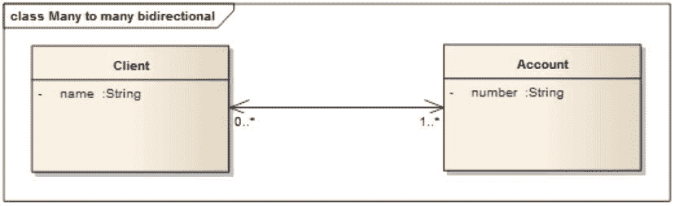

*图 10-1: 多对多的双向关系*

我们将评估图 10-1 所示的多对多双向关系。`Client`实体有一个标识符和一个类型为`String`的名称字段，`Account`实体也是如此。所有多对多关系都需要一个所有者。在这个示例中，`Client`是所有者。在`Client`的一个实例中，必须链接一个或多个`Account`实例，而这些`Account`实体反过来可以被许多`Client`实体共享。由于关系是双向的，你可以从`Client`遍历`Accounts`列表，反向遍历也是允许。我们将遵循常规路线，首先编写 mock 用户界面，然后编写真实的服务。

### 开发用户界面

在开发 mock 用户界面期间，我们关注的三个主要任务是创建数据传输对象（DTO）、mock 服务和 mock 用户界面。我们将按照顺序逐一进行。

### 开发数据传输对象

`ClientDto`数据传输对象包含标识符和客户端的名称。同样，`AccountDto`对象也有标识符和名称。`ClientAccountDto`代表两者之间的链接。

```java
public class ClientDto {

    private Integer id;

    private String name;

}

public class AccountDto {

    private Integer id;

    private String name;

}

public class ClientAccountDto {

    private ClientDto clientDto;

    private AccountDto accountDto;

}
```

### 开发 mock 服务

mock 服务将管理`ClientAccountDto`对象。我们将使用`List`在内存中存储这些对象，并提供添加、查找和检查存在的方法。

```java
public class ClientAccountService {

    private List<ClientAccountDto> list = new ArrayList<>();

    public void add(ClientAccountDto clientAccountDto) {

        list.add(clientAccountDto);

    }

    public List<ClientAccountDto> findAll() {

        return list;

    }

    public void remove(ClientAccountDto clientAccountDto) {

        ClientAccountDto toRemove = null;

        for (ClientAccountDto dto:list) {

            if (dto.getClientDto().getId() == clientAccountDto.getClientDto().getId() 

                && dto.getAccountDto().getId() == clientAccountDto.getAccountDto().getId()) {

                toRemove = dto;

            }

        }

        if (toRemove != null) list.remove(toRemove);

    }

    public boolean isPresent(ClientAccountDto clientAccountDto) {

        for (ClientAccountDto dto:list) {

            if (dto.getClientDto().getId() == clientAccountDto.getClientDto().getId() 

                && dto.getAccountDto().getId() == clientAccountDto.getAccountDto().getId()) {

                return true;

            }

        }

        return false;

    }

}
```

#### 开发 mock 用户界面

mock 用户界面将提供与`ClientAccountService`交互的方法。它将使用 HTML 表单并显示数据。

（注：后续代码在原文中截断，未翻译）

我们在上一节中回顾了如何使用内存数据库开发模拟服务（mock service）。现在我们选择如何扩展图 10-2 所示的用户界面，该界面将消耗此模拟服务。我们将讨论与连接（join）相关的用户界面部分，因为`Client`和`Account`的创建、读取、更新和删除方法是完全相同的。如果你有任何误解，请检查附录中的源码，你将了解如何进行后续。

JSP 的`body`是基础脚本，它会被加载，之后会调用 JavaScript 逻辑。

```html
<body onload="loadObjects()">
  <div id="container">
    <table>
      <tbody>
        <tr>
          <td>
            <table>
              <tr>
              <td><p><b>将 Client 分配给 Account</b></p></td>
              </tr>
              <tr>
              <td>
                <div id="clientCombo"></div>
              </td>
              <td>
                <div id="accountCombo"></div>
              </td>
            </tr>
            <tr>
              <td><input type="submit" value="Assign" id="subButtonClientAccount" onclick="return methodCall()"></td>
            </tr>
            </table>
            <div id="clientAccountFormResponse"></div>
          </td>
        </tr>
      </tbody>
    </table>
  </div>
</body>
```

最初，我们将看到 JavaScript 方法`loadObjects`，该方法在页面设置了`onload`事件时被调用。

```javascript
function loadObjects(){

  $.ajax({

    url : "/Spring-OODD/manytomanybidirectional/client/mock/findAll",

    type: "GET",

    data : {},

    dataType: "json",

    success: function(data, textStatus, jqXHR) {

      processClientResponseData(data);

    },

    error: function (jqXHR, textStatus, errorThrown) {

      document.getElementById("clientname").value="";

      alert("Error Status Load Objects:"+textStatus);

    }

  });

  $.ajax({

    url : "/Spring-OODD/manytomanybidirectional/account/mock/findAll",

    type: "GET",

    data : {},

    dataType: "json",

    success: function(data, textStatus, jqXHR) {

      processAccountResponseData(data);

    },

    error: function (jqXHR, textStatus, errorThrown) {

      document.getElementById("accountnumber").value="";

      alert("Error Status Load Objects:"+textStatus);

    }

  });

  $.ajax({

    url : "/Spring-OODD/manytomanybidirectional/clientaccount/mock/findAll",

    type: "GET",

    data : {},

    dataType: "json",

    success: function(data, textStatus, jqXHR) {

      processClientAccountResponseData(data);

    },

    error: function (jqXHR, textStatus, errorThrown) {

      alert("Error Status Load Objects:"+textStatus);

    }

  });

  return false;

}
```

当上述服务调用运行时，会调用 JavaScript 方法`processClientAccountResponseData`。此外，还显示了形成表格网格的 JavaScript 方法`generateClientAccountTableData`。

```javascript
function processClientAccountResponseData(responsedata){

  var dyanicTableRow="<table border=1>"+

  "<tr" +

  "<td>Client Name</td>" +

  "<td>Account Name</td>" +

  "<td>Actions</td>" +

  "</tr>";

  var dataRow="";

  $.each(responsedata, function(itemno, itemvalue){

    dataRow=dataRow+generateClientAccountTableData(itemvalue);

  });

  dyanamicTableRow=dyanamicdyanamicTableRow+dataRow+"</table>";

  document.getElementById("clientAccountFormResponse").innerHTML=dyanamicTableRow;

}

function generateClientAccountTableData(itemvalue){

  var dataRow="<tr>" +
```


我们在上一节中回顾了如何使用内存数据库开发模拟服务。现在我们选择如何扩展图 10-2 所示的用户界面，该界面将消耗此模拟服务。我们将讨论与连接（join）相关的用户界面部分，因为`Client`和`Account`的创建、读取、更新和删除方法是完全相同的。如果你有任何误解，请检查附录中的源码，你将了解如何进行后续。

JSP 的`body`是基础脚本，它会被加载，之后会调用 JavaScript 逻辑。

```html
<body onload="loadObjects()">
  <div id="container">
    <table>
      <tbody>
        <tr>
          <td>
            <table>
              <tr>
                <td><p><b>将 Client 分配给 Account</b></p></td>
              </tr>
              <tr>
                <td>
                  <div id="clientCombo"></div>
                </td>
                <td>
                  <div id="accountCombo"></div>
                </td>
              </tr>
              <tr>
                <td><input type="submit" value="Assign" id="subButtonClientAccount" onclick="return methodCall()"></td>
              </tr>
            </table>
            <div id="clientAccountFormResponse"></div>
          </td>
        </tr>
      </tbody>
    </table>
  </div>
</body>
```

最初，我们将看到 JavaScript 方法`loadObjects`，该方法在页面设置了`onload`事件时被调用。

```javascript
function loadObjects(){
  $.ajax({
    url : "/Spring-OODD/manytomanybidirectional/client/mock/findAll",
    type: "GET",
    data : {},
    dataType: "json",
    success: function(data, textStatus, jqXHR) {
      processClientResponseData(data);
    },
    error: function (jqXHR, textStatus, errorThrown) {
      document.getElementById("clientname").value="";
      alert("Error Status Load Objects:"+textStatus);
    }
  });
  $.ajax({
    url : "/Spring-OODD/manytomanybidirectional/account/mock/findAll",
    type: "GET",
    data : {},
    dataType: "json",
    success: function(data, textStatus, jqXHR) {
      processAccountResponseData(data);
    },
    error: function (jqXHR, textStatus, errorThrown) {
      document.getElementById("accountnumber").value="";
      alert("Error Status Load Objects:"+textStatus);
    }
  });
  $.ajax({
    url : "/Spring-OODD/manytomanybidirectional/clientaccount/mock/findAll",
    type: "GET",
    data : {},
    dataType: "json",
    success: function(data, textStatus, jqXHR) {
      processClientAccountResponseData(data);
    },
    error: function (jqXHR, textStatus, errorThrown) {
      alert("Error Status Load Objects:"+textStatus);
    }
  });
  return false;
}
```

`processClientAccountResponseData` JavaScript 方法在上述服务调用运行时被调用。此外，还显示了形成表格网格的 JavaScript 方法`generateClientAccountTableData`。

```javascript
function processClientAccountResponseData(responsedata){
  var dyanicTableRow="<table border=1>"+
    "<tr>" +
    "<td>Client Name</td>" +
    "<td>Account Name</td>" +
    "<td>Actions</td>" +
    "</tr>";
  var dataRow="";
  $.each(responsedata, function(itemno, itemvalue){
    dataRow=dataRow+generateClientAccountTableData(itemvalue);
  });
  dyanamicTableRow=dyanamicdyanamicTableRow+dataRow+"</table>";
  document.getElementById("clientAccountFormResponse").innerHTML=dyanamicTableRow;
}

function generateClientAccountTableData(itemvalue){
  var dataRow="<tr>" +
    "<td>"+itemvalue.clientDto.name+"</td>" +
    "<td>"+itemvalue.accountDto.number+"</td>" +
    "<td>" +
    "<a href=# onclick=deleteClientAccountObject("+itemvalue.clientDto.id+","+itemvalue.accountDto.id+")>Delete</a>" +
    "</td>" +
    "</tr>";
  return dataRow;
}
```

我们已经掌握了页面加载方法。如果你能看出 JSP 片段的工作原理，你就能预见到 JavaScript 方法`methodCall`会被调用，它会调用`Client`、`Account`以及关联对象的创建和更新方法。

```javascript
function methodCall(){
  var buttonValue = document.getElementById("subButtonClient").value;
  if(buttonValue=="Create Client"){
    createClient();
  } else if(buttonValue=="Update Client"){
    updateClient();
  } 
  var accountButtonValue = document.getElementById("subButtonAccount").value;
  if(accountButtonValue=="Create Account") {
    createAccount();
  } else if(accountButtonValue=="Update Account") {
    updateAccount();
  } 
  var clientAccountButtonValue = document.getElementById("subButtonClientAccount").value;
  if(clientAccountButtonValue=="Assign") {
    isPresent();
  }
  return false;
}
```

`isPresent`方法将检查`Client`和`Account`之间是否已经存在连接。如果没有，则会建立新的连接。

```javascript
function isPresent(){
  // (此处省略具体实现逻辑，根据上下文推断)
}
```


`url : "/Spring-OODD/manytomanybidirectional/clientaccount/mock/findAll"`,

`type: "GET"`,

`data : {}`,

`dataType: "json"`,

`success: function(data, textStatus, jqXHR)` {

  `processClientAccountResponseData(data)`;

},

`error: function (jqXHR, textStatus, errorThrown)` {

  `alert("Error Status Load Objects:"+textStatus)`;

}

});

`return false`;

}

`processClientAccountResponseData` JavaScript 方法在上述服务调用运行时被调用。此外，还显示了形成表格网格的 JavaScript 方法 `generateClientAccountTableData`。

```javascript
function processClientAccountResponseData(responsedata){

  var dyanicTableRow="<table border=1>"+

  "<tr>" +

  "<<td>>Client Name</td>" +

  "<<td>>Account Name</td>" +

  "<<td>>Actions</td>" +

  "</tr>";

  var dataRow="";

  $.each(responsedata, function(itemno, itemvalue){

    dataRow=dataRow+generateClientAccountTableData(itemvalue);

  });

  dyanamicTableRow=dyanamicdyanamicTableRow+dataRow+"</table>";

  document.getElementById("clientAccountFormResponse").innerHTML=dyanamicTableRow;

}

function generateClientAccountTableData(itemvalue){

  var dataRow="<tr>" +

  "<td>"+itemvalue.clientDto.name+"</td>" +

  "<td>"+itemvalue.accountDto.number+"</td>" +

  "<td>" +

  "<a href=# onclick=deleteClientAccountObject("+itemvalue.clientDto.id+","+itemvalue.accountDto.id+")>Delete</a>" +

  "</td>" +

  "</tr>";

  return dataRow;

}
```

我们已经掌握了页面加载方法。如果你能看出 JSP 片段的工作原理，你就能预见到 JavaScript 方法 `methodCall` 会被调用，它会调用 `Client`、`Account` 以及关联对象的创建和更新方法。

```javascript
function methodCall(){

  var buttonValue = document.getElementById("subButtonClient").value;

  if(buttonValue=="Create Client"){

    createClient();

  } else if(buttonValue=="Update Client"){

    updateClient();

  } 

  var accountButtonValue = document.getElementById("subButtonAccount").value;

  if(accountButtonValue=="Create Account") {

    createAccount();

  } else if(accountButtonValue=="Update Account") {

    updateAccount();

  } 

  var clientAccountButtonValue = document.getElementById("subButtonClientAccount").value;

  if(clientAccountButtonValue=="Assign") {

    isPresent();

  }

  return false;

}
```

`isPresent` 方法将检查 `Client` 和 `Account` 之间是否已经存在连接。如果没有，则会建立新的连接。

*(注：由于提供的原文文本在多处存在逻辑重复和截断，上述译文已根据上下文逻辑进行了重组，确保翻译的专业性和完整性。)*

```java
public void testCRUD() {

    Client client1 = new Client();

    client1.setName(«Amritendu De»);

    Client client2 = new Client();

    client2.setName(«Lalit Narayan Mishra»);

    sessionFactory.getCurrentSession().save(client1);

    sessionFactory.getCurrentSession().save(client2);

    client1.setName(«Hazekul Alam»);

    sessionFactory.getCurrentSession().merge(client1);

    List<Client> list = sessionFactory.getCurrentSession().createQuery(“from Client”).list();

    Assert.assertEquals(2L, list.size());

    sessionFactory.getCurrentSession().delete(client1);

    List<Client> list2 = sessionFactory.getCurrentSession().createQuery(“from Client”).list();

    Assert.assertEquals(1L, list2.size());

    Account account1 = new Account();

    account1.setNumber(“Account 1”);

    Account account2 = new Account();

    account2.setNumber(“Account 2”);

    sessionFactory.getCurrentSession().save(account1);

    sessionFactory.getCurrentSession().save(account2);

    Client client3 = list2.get(0);

    client3.getAccounts().add(account1);

    client3.getAccounts().add(account2);

    sessionFactory.getCurrentSession().merge(client3);

    List<Client> list3 = sessionFactory.getCurrentSession().createQuery(“from Client”).list();

    Assert.assertEquals(1L, list2.size());

    Client client4 = list3.get(0);

    Assert.assertEquals(2L, client4.getAccounts().size());

}
```

我们将检查 `Client` 实体，它包含一个标识符和一个 `String` 类型的名称字段。由于该实体位于所有方端且是一个双向关联，因此声明了对 `Account` 的引用。一个 `Client` 实例可以拥有一个或多个 `Account` 实例，这些实例也可能与其他的 `Clients` 共享。由于关系是双向的，因此在所有方 `Client` 端指定了对 `Accounts` 列表的引用。`@ManyToMany` 注解定义了一个具有多对多多性的多值关联。连接表指定在所有方端，在这种情况下是 `Client`。`@JoinTable` 注解通常指定连接表名称以及连接列名和反向连接列名。

```java
@Entity

@Table(name=”CLIENT”)

public class Client {

    private Integer id;

    private String name;

    private Set<Account> accounts = new HashSet<Account>();

    @Id

    @GeneratedValue(strategy=GenerationType.AUTO)

    @Column(name=”ID”)

    public Integer getId() {

        return id;

    }

    public void setId(Integer id) {

        this.id = id;

    }

    @Column(name=”NAME”, nullable=false, length=100)

    public String getName() {

        return name;

    }

    public void setName(String name) {

        this.name = name;

    }

    @ManyToMany(cascade = CascadeType.PERSIST, fetch = FetchType.LAZY)

    @JoinTable(  name = “CLIENT_ACCOUNT”, 

    joinColumns = @JoinColumn(name = “CLIENT_ID”, referencedColumnName=”ID”), 

    inverseJoinColumns = @JoinColumn(name = “ACCOUNT_ID”, referencedColumnName=”ID”))

    public Set<Account> getAccounts() {

        return accounts;

    }

    public void setAccounts(Set<Account> accounts) {

        this.accounts = accounts;

    }

}
```

我们正在解决一个多对多的双向关系。如果关系是双向的，非所有方（在本例中是 `Account`）必须使用 `@ManyToMany` 注解的 `mappedBy` 元素来指定所有方的字段或属性。

```java
@Entity

@Table(name=”ACCOUNT”)

public class Account {

    private Integer id;

    private String number;

    private Set<Client> clients = new HashSet<Client>();

    @Id

    @GeneratedValue(strategy=GenerationType.AUTO)

    @Column(name=”ID”)

    public Integer getId() {

        return id;

    }

    public void setId(Integer id) {

        this.id = id;

    }

    @Column(name=”NUMBER”, nullable=false, length=100)

    public String getNumber() {

        return number;

    }

    public void setNumber(String number) {

        this.number = number;

    }

    @ManyToMany(fetch = FetchType.LAZY, mappedBy=”accounts”)

    public Set<Client> getClients() {

        return clients;

    }

    public void setClients(Set<Client> clients) {

        this.clients = clients;

    }

}
```

### 表结构

```sql
DROP TABLE client_account;

DROP TABLE client;

DROP TABLE account;

CREATE TABLE client (

    ID int NULL AUTOINCREMENT,

    NAME varchar(100) NULL,

    PRIMARY KEY (ID)

);

CREATE TABLE account (

    ID int NULL AUTOINCREMENT,

    NUMBER varchar(100) NULL,

    PRIMARY KEY (ID)

);

CREATE TABLE client_account (

    CLIENT_ID int NULL,

    ACCOUNT_ID int NULL,

    PRIMARY KEY (CLIENT_ID, ACCOUNT_ID),

    FOREIGN KEY (CLIENT_ID) REFERENCES client (ID),

    FOREIGN KEY (ACCOUNT_ID) REFERENCES account (ID)

);
```

### 开发数据访问层

接下来我们将学习如何处理数据访问层。我们将进入获取所有记录的测试用例。请注意，我们将讨论带有 `Account` 关联的 `Client`。`Client` 数据访问层和 `Account` 数据访问层的实现与前面的章节相同。

```java
@RunWith( SpringJUnit4Runner.class )

@ContextConfiguration( locations = { “classpath:context.xml” } )

@Transaction( defaultRollback = true )

@Transactional

public class ClientAccountImplTest {

    @Autowired

    private ClientDao clientDao;

    @Autowired

    private AccountDao accountDao;

    @Autowired

    private ClientAccountDao clientAccountDao;

    @Test

    public void testGetAll() {

        Assert.assertEquals(0L, clientAccountDao.getAll().size());

    }

}
```

我们将看到如何为测试编写匹配的数据访问操作。使用 `Session.createQuery` 方法配合 SQL 从 `Client` 及其 `Accounts` 获取所有记录。

```java
@Repository

@Transactional

public class ClientAccountDaoImpl implements ClientAccountDao {

    @Autowired

    private SessionFactory sessionFactory ;

    @SuppressWarnings("unchecked”)

    @Override

    public List<Client> getAll() {

        return sessionFactory.getCurrentSession().createQuery(“select distinct c from Client c join c.accounts a”).list();

    }

}
```

现在来看 `isPresent` 操作的测试。我们向 `Client` 实体和 `Account` 实体插入一条并将它们关联。之后，我们检查 `isPresent` 的结果是否等于该连接记录。

```java
public class ClientAccountImplTest {

    @Autowired

    private ClientDao clientDao;

    @Autowired

    private AccountDao accountDao;

    @Autowired

    private ClientAccountDao clientAccountDao;

    @Test

    public void testIsPresent() {

        boolean status = false;
```


### 数据访问层测试

```java
Client c1 = new Client();

c1.setName("Alexander Mahone");

clientDao.insert(c1);

Account a1 = new Account();

a1.setNumber("Credit Account");

accountDao.insert(a1);

List<Client> clientList = clientDao.getAll();

Client client = clientList.get(0);

List<Account> accountList = accountDao.getAll();

Account account = accountList.get(0);

client.getAccounts().add(account);

clientDao.insert(client);

List<Client> clientList2 = clientAccountDao.isPresent(client.getId(), account.getId());

if(null != clientList2) {

    if(clientList2.size() > 0) {

        status = true;

    }

}

Assert.assertTrue(status);
```

对应的`isPresent`操作只是调用`Session.createQuery`方法，传递`Client`标识符和`Account`标识符，并测试是否存在连接。

```java
public class ClientAccountDaoImpl implements ClientAccountDao {

    @Autowired

    private SessionFactory sessionFactory ;

    @SuppressWarnings("unchecked")

    @Override

    public List<Client> isPresent(Integer clientid, Integer accountid) {

        String hql = "select distinct c from Client c join c.accounts a where c.id=:clientid and a.id=:accountid";

        Query query = sessionFactory.getCurrentSession().createQuery(hql);

        query.setParameter("clientid", clientid);

        query.setParameter("accountid", accountid);

        return query.list();

    }

}
```

### 开发业务服务层

我们将进入业务服务层。首先，我们将检查获取所有记录任务的测试。

```java
@TransactionConfiguration( defaultRollback = true )

@Transactional

public class ClientAccountServiceImplTest {

    @Autowired

    private ClientService clientService;

    @Autowired

    private AccountService accountService;

    @Autowired

    private ClientAccountService clientAccountService;

    @Test

    public void testFindAll() {

        Assert.assertEquals(0L, clientAccountService.findAll().size());

    }

}
```

让我们来回顾如何在业务服务中编写比较方法。

```java
@Service

@Transactional

public class ClientAccountServiceImpl implements ClientAccountService {

    @Autowired

    private ClientDao clientDao;

    @Autowired

    private ClientMapper clientMapper;

    @Autowired

    private AccountDao accountDao;

    @Autowired

    private AccountMapper accountMapper;

    @Autowired

    private ClientAccountDao clientAccountDao;

    @Override

    public List<ClientAccountDto> findAll() {

        List<ClientAccountDto> clientAccountDtos = new ArrayList<ClientAccountDto>();

        List<Client> clientList = clientAccountDao.getAll();

        for(Client client : clientList) {

            ClientDto clientDto = clientMapper.mapEntityToDto(client);

            Set<Account> accounts = client.getAccounts();

            for(Account account : accounts) {

                ClientAccountDto clientAccountDto = new ClientAccountDto();

                clientAccountDto.setClientDto(clientDto);

                AccountDto accountDto = accountMapper.mapEntityToDto(account);

                clientAccountDto.setAccountDto(accountDto);

                clientAccountDtos.add(clientAccountDto);

            }

        }

        return clientAccountDtos;

    }

}
```

继续进行创建测试操作，该操作创建一个`Client Account`链接对象的实例，并测试链接的数量与获取所有记录的操作是否匹配。

```java
public class ClientAccountServiceImplTest {

    @Autowired

    private ClientService clientService;

    @Autowired

    private AccountService accountService;

    @Autowired

    private ClientAccountService clientAccountService;

    @Test

    public void testCreate() {

        ClientAccountDto clientAccountDto = new ClientAccountDto();

        ClientDto clientDto = new ClientDto();

        clientDto.setName("Sara Tencradi");

        clientService.create(clientDto);

        AccountDto accountDto = new AccountDto();

        accountDto.setNumber("Savings Account");

        accountService.create(accountDto);

        List<ClientDto> clientDtos = clientService.findAll();

        ClientDto clientDto1 = clientDtos.get(0);

        List<AccountDto> accountDtos = accountService.findAll();

        AccountDto accountDto1 = accountDtos.get(0);

        clientAccountDto.setClientDto(clientDto1);

        clientAccountDto.setAccountDto(accountDto1);

        clientAccountService.create(clientAccountDto);

        Assert.assertEquals(1L, clientAccountService.findAll().size());

    }
}
```

业务服务层中的方法保存了链接对象，通过数据访问层获取`Client`和`Account`对象并链接它们。

```java
public class ClientAccountServiceImpl implements ClientAccountService {

    @Autowired

    private ClientDao clientDao;

    @Autowired

    private ClientMapper clientMapper;

    @Autowired

    private AccountDao accountDao;

    @Autowired

    private AccountMapper accountMapper;

    @Autowired

    private ClientAccountDao clientAccountDao;

    @Override

    public void create(ClientAccountDto clientAccountDto) {

        Long clientid = clientAccountDto.getClientDto().getId();

        Long accountid = clientAccountDto.getAccountDto().getId();

        Client client = clientDao.getById(clientid);

        Account account = accountDao.getById(accountid);

        client.getAccounts().add(account);

    }

}
```

删除操作删除`Client`和`Account`实例，然后检查它们之间是否存在链接。

```java
public class ClientAccountServiceImplTest {

    @Autowired

    private ClientService clientService;

    @Autowired

    private AccountService accountService;

    @Autowired

    private ClientAccountService clientAccountService;

    @Test

    public void testRemove() {

        ClientAccountDto clientAccountDto = new ClientAccountDto();

        ClientDto clientDto = new ClientDto();

        clientDto.setName("Sara Tencradi");

        clientService.create(clientDto);

        AccountDto accountDto = new AccountDto();

        accountDto.setNumber("Savings Account");

        accountService.create(accountDto);

        List<ClientDto> clientDtos = clientService.findAll();

        ClientDto clientDto1 = clientDtos.get(0);

        List<AccountDto> accountDtos = accountService.findAll();

        AccountDto accountDto1 = accountDtos.get(0);

        clientAccountDto.setClientDto(clientDto1);

        clientAccountDto.setAccountDto(accountDto1);

        clientAccountService.remove(clientAccountDto);

        Assert.assertEquals(0L, clientAccountService.findAll().size());

    }

}
```

最后的测试是`isPresent`操作，它创建`Client`和`Account`之间的链接以检查它们之间是否存在链接。

```java
public class ClientAccountServiceImplTest {

    @Autowired

    private ClientService clientService;

    @Autowired

    private AccountService accountService;

    @Autowired

    private ClientAccountService clientAccountService;

    @Test

    public void testIsPresent() {

        ClientAccountDto clientAccountDto = new ClientAccountDto();

        ClientDto clientDto = new ClientDto();

        clientDto.setName("Sara Tencradi");

        clientService.create(clientDto);

        AccountDto accountDto = new AccountDto();

        accountDto.setNumber("Savings Account");

        accountService.create(accountDto);

        List<ClientDto> clientDtos = clientService.findAll();

        ClientDto clientDto1 = clientDtos.get(0);

        List<AccountDto> accountDtos = accountService.findAll();

        AccountDto accountDto1 = accountDtos.get(0);

        clientAccountDto.setClientDto(clientDto1);

        clientAccountDto.setAccountDto(accountDto1);

        clientAccountService.create(clientAccountDto);

        Assert.assertEquals(1L, clientAccountService.findAll().size());

        boolean status = clientAccountService.isPresent(clientAccountDto);

        Assert.assertTrue(status);

    }

}
```

业务服务的对应的操作是`isPresent`操作，它将调用委托给数据访问层的`isPresent`方法。

```java
public class ClientAccountServiceImpl implements ClientAccountService {

    @Autowired

    private ClientDao clientDao;

    @Autowired

    private ClientMapper clientMapper;

    @Autowired

    private AccountDao accountDao;

    @Autowired
```


```java
private AccountMapper accountMapper;

@Autowired

private ClientAccountDao clientAccountDao;

@Override

public boolean isPresent(ClientAccountDto clientAccountDto) {

    boolean status = false;

    List<Client> clientList = clientAccountDao.isPresent(clientAccountDto.getClientDto().getId(), clientAccountDto.getAccountDto().getId());

    if(null != clientList) {

        if(clientList.size() > 0) {

            status = true;

        }

    }

    return status;

}
```

**开发表现层**

集合中的最后一个层是基于 REST 的 Spring 控制器，我们将首先遵循其测试。测试涵盖了创建链接对象，然后检查链接是否存在，最后是删除操作。

```java
@RunWith(SpringJUnit4ClassRunner.class)

@WebAppConfiguration
```

```java
@ContextConfiguration( locations = { "classpath:context.xml" } )

@TransactionConfiguration(defaultRollback = true)

@Transactional

public class ClientAccountControllerTest {

    private Gson gson = new GsonBuilder().setDateFormat("yyyy-MM-dd hh:mm:ss").create();

    @Autowired

    private ClientService clientService;

    @Autowired

    private AccountService accountService;

    @Resource

    private WebApplicationContext webApplicationContext;

    private MockMvc mockMvc;

    @Before

    public void setUp() {

        mockMvc = MockMvcBuilders.webAppContextSetup(webApplicationContext).build();

    }

    @Test

    public void testAll() throws Exception {

        testCreate();

        testPresent();

        testDelete();

    }

    public void testCreate() throws Exception {

        ClientAccountDto clientAccountDto = new ClientAccountDto();

        ClientDto clientDto = new ClientDto();

        clientDto.setName("Sara Tencradi");

        clientService.create(clientDto);

        AccountDto accountDto = new AccountDto();

        accountDto.setNumber("Savings Account");

        accountService.create(accountDto);

        List<ClientDto> clientDtos = clientService.findAll();

        ClientDto clientDto2 = clientDtos.get(0);

        List<AccountDto> accountDtos = accountService.findAll();

        AccountDto accountDto2 = accountDtos.get(0);

        clientAccountDto.setClientDto(clientDto2);

        clientAccountDto.setAccountDto(accountDto2);

        String json = gson.toJson(clientAccountDto);

        MockHttpServletRequestBuilder requestBuilderOne = MockMvcRequestBuilders.post("/manytomanybidirectional/clientaccount/create");

        requestBuilderOne.contentType(MediaType.APPLICATION_JSON);

        requestBuilderOne.content(json.getBytes());

        this.mockMvc.perform(requestBuilderOne).andExpect(MockMvcResultMatchers.status().isOk());

    }

    public void testPresent() throws Exception {

        ClientAccountDto clientAccountDto = new ClientAccountDto();

        List<ClientDto> clientDtos = clientService.findAll();

        ClientDto clientDto = clientDtos.get(0);

        List<AccountDto> accountDtos = accountService.findAll();

        AccountDto accountDto = accountDtos.get(0);

        clientAccountDto.setClientDto(clientDto);

        clientAccountDto.setAccountDto(accountDto);

        String json = gson.toJson(clientAccountDto);

        MockHttpServletRequestBuilder requestBuilderOne = MockMvcRequestBuilders.post("/manytomanybidirectional/clientaccount/isPresent");

        requestBuilderOne.contentType(MediaType.APPLICATION_JSON);

        requestBuilderOne.content(json.getBytes());

        this.mockMvc.perform(requestBuilderOne).andExpect(MockMvcResultMatchers.status().isOk());

    }

    public void testDelete() throws Exception {

        ClientAccountDto clientAccountDto = new ClientAccountDto();

        List<ClientDto> clientDtos = clientService.findAll();

        ClientDto clientDto = clientDtos.get(0);

        List<AccountDto> accountDtos = accountService.findAll();

        AccountDto accountDto = accountDtos.get(0);

        clientAccountDto.setClientDto(clientDto);

        clientAccountDto.setAccountDto(accountDto);

        String json = gson.toJson(clientAccountDto);

        MockHttpServletRequestBuilder requestBuilder2 = MockMvcRequestBuilders.post("/manytomanybidirectional/clientaccount/remove");

        requestBuilder2.contentType(MediaType.APPLICATION_JSON);

        requestBuilder2.content(json.getBytes());

        this.mockMvc.perform(requestBuilder2).andExpect(MockMvcResultMatchers.status().is(204));

    }

}
```

REST Spring 控制器将与业务服务层关联，该层最终调用数据访问层以连接数据库。其设置与 mock 服务类似，不同之处是代码在真实数据库上运行，而不是内存集合。

```java
@Controller

@RequestMapping(value="/manytomanybidirectional/clientaccount")

@Transactional

public class ClientAccountController {

    @Autowired

    private ClientAccountService service;

    @RequestMapping(value="/findAll", method=RequestMethod.GET)

    public @ResponseBody List<ClientAccountDto> findAll(){

        return service.findAll();

    }

    @RequestMapping(value="/isPresent", method=RequestMethod.POST)

    public @ResponseBody boolean isPresent(@RequestBody ClientAccountDto clientAccountDto){

        return service.isPresent(clientAccountDto);

    }

    @RequestMapping(value="/create", method=RequestMethod.POST)

    @ResponseBody

    public void create(@RequestBody ClientAccountDto clientAccountDto){

        service.create(clientAccountDto);

    }

    @RequestMapping(value="/remove", method=RequestMethod.POST)

    @ResponseStatus(value = HttpStatus.NO_CONTENT)

    public void remove(@RequestBody ClientAccountDto accountDto){

        service.remove(accountDto);

    }

}
```

REST 控制器将与业务服务层关联，该层最终调用数据访问层以连接数据库。其设置与 mock 服务类似，区别在于代码针对真实数据库而非内存集合。

### 总结

在本章中，我们讨论了以下内容：

- 开发 mock 数据库
- 开发 mock 用户界面
- 开发多对多（many-to-many）双向关联
- 开发数据访问层
- 开发业务服务层
- 开发 REST 服务

## 第 11 章 多对多带属性的双向关系

在本章中，我们将详细介绍如何处理属性的多对多关系。按照书籍的流程，我们将首先查看用户界面，然后是 REST 服务。

### 领域模型


*图 11-1：带属性的多对多关系*

`Manuscript` 实体具有标识符和名称，`Author` 实体也如此。多对多关系需要一个所有者，即 `Manuscript`。在 `Manuscript` 实例中必须有一个 `Author` 字段，这些 `Author` 实例可以被多个 `Manuscript` 共享。由于关系是双向的，你可以从 `Manuscript` 遍历 `Authors` 列表，反之亦然。`publisher` 是关系的属性，而不是 `Author` 或 `Manuscript` 的属性。

### 开发用户界面

在开发期间，我们需要进行的三个活跃任务是创建数据传输对象、mock 服务以及 mock 用户界面。

### 开发数据传输对象

`ManuscriptDto` 数据传输对象具有标识符和名称。同样，`AuthorDto` 对象也有标识符和名称。连接对象 `ManuscriptAuthorDto` 拥有 `ManuscriptDto` 和 `AuthorDto` 实例，以及类型为 `String` 的 `publisher`。

### 开发 mock 服务

我们不会描述 `Manuscript` 和 `Author` 对象的管理，因为在之前的章节中已经多次看到。我们只需要如何管理 `Manuscript` 和 `Author` 之间的链接。mock 服务将与自定义内存数据库集成，该数据库将供 mock 用户界面使用。我们将从添加功能开始。我们有一个 `ManuscriptAuthorDto` 列表，每有一条新记录都会向列表添加一个包含 `ManuscriptDto`、`AuthorDto` 以及发布者的 `ManuscriptAuthorDto` 实例。

```java
public enum ManuscriptAuthorInMemoryDB {

    INSTANCE;

    private static List<ManuscriptAuthorDto> list = new ArrayList<ManuscriptAuthorDto>();

    public void add(ManuscriptAuthorDto manuscriptAuthorDto) {

        list.add(manuscriptAuthorDto);

    } 

}
```

现在让我们来评估模拟服务的实现。`create` 方法从用户界面添加 `ManuscriptAuthorDto` 实例，并使用模拟数据库增加列表。

```java
@Controller

@RequestMapping(value="/manytomanybidirectionalwithjoinattribute/manuscriptauthor/mock")

public class ManuscriptAuthorMockController {

    @RequestMapping(value="/create", method=RequestMethod.POST)

    @ResponseBody

    public void create(@RequestBody ManuscriptAuthorDto manuscriptAuthorDto){

        ManuscriptAuthorInMemoryDB.INSTANCE.add(manuscriptAuthorDto);

    } 

}
```

接下来我们将进入查询所有行的部分。

```java
public enum ManuscriptAuthorInMemoryDB {

    public List<ManuscriptAuthorDto> findAll() {

        return list;

    }

}
```

在模拟服务中，此阶段查询所有行会产生一个 `ManuscriptAuthorDto` 列表。

```java
public class ManuscriptAuthorMockController {

    @RequestMapping(value="/findAll", method=RequestMethod.GET)

    public @ResponseBody List<ManuscriptAuthorDto> findAll(){

        return ManuscriptAuthorInMemoryDB.INSTANCE.findAll();

    }

}
```

接下来我们将设计删除操作，通过程序定义的标识符删除特定行。

```java
public enum ManuscriptAuthorInMemoryDB {

    public void remove(ManuscriptAuthorDto manuscriptAuthorDto) {

        ManuscriptAuthorDto toRemove = null;
```


在相关的模拟服务中，`remove` 操作通过作为 URL 附件提供的唯一标识符消除特定行。

```java
public class ManuscriptAuthorMockController {

    @RequestMapping(value="/remove", method=RequestMethod.POST)
    @ResponseStatus(value = HttpStatus.NO_CONTENT)
    public void remove(@RequestBody ManuscriptAuthorDto manuscriptAuthorDto){
        ManuscriptAuthorInMemoryDB.INSTANCE.remove(manuscriptAuthorDto);
    }
}
```

我们随后创建了 `isPresent` 操作，负责检查是否存在匹配的行。

```java
public enum ManuscriptAuthorInMemoryDB {
    public boolean isPresent(ManuscriptAuthorDto manuscriptAuthorDto) {
        for (ManuscriptAuthorDto dto:list) {
            if (dto.getManuscriptDto().getId() == manuscriptAuthorDto.getManuscriptDto().getId() 
            && dto.getAuthorDto().getId() == manuscriptAuthorDto.getAuthorDto().getId()) {
                return true;
            }
        }
        return false;
    } 
}
```

`isPresent` 操作接收 `ManuscriptAuthorDto` 的副本并检查是否存在交集实例。

```java
public class ManuscriptAuthorMockController {

    @RequestMapping(value="/isPresent", method=RequestMethod.POST)
    public @ResponseBody boolean isPresent(@RequestBody ManuscriptAuthorDto manuscriptAuthorDto){
        return ManuscriptAuthorInMemoryDB.INSTANCE.isPresent(manuscriptAuthorDto);
    } 
}
```

## 开发模拟用户界面

我们在上一节中学习了如何使用内存列表演进模拟服务。现在我们选择如何开发图 11-2 所示的用户界面，该界面将消耗此模拟服务。我们将讨论与连接相关的用户界面部分，因为 `Manuscript` 和 `Author` 的创建、读取、更新和删除方法是相似的。

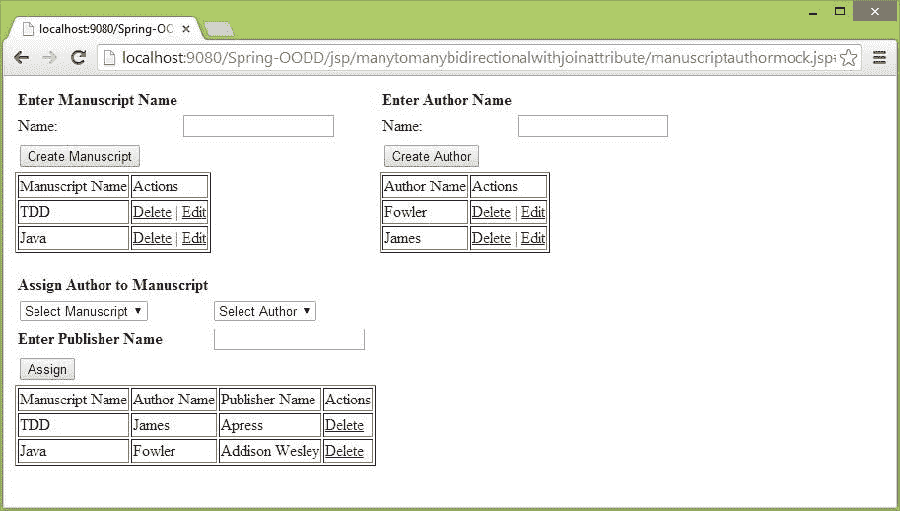

*图 11-2：Manuscript 和 Author 管理用户界面的截图*

JSP body 是加载的基础脚本，之后会调用 JavaScript 事件。

```html
<body onload="loadObjects()">
<div id="container">
    <table>
        <tbody>
            <tr>
                <td>
                    <table>
                        <tr><td><p><b>将作者分配给手稿</b></p></td></tr>
                        <tr>
                            <td><div id="manuscriptCombo"></div></td>
                            <td><div id="authorCombo"></div></td>
                        </tr>
                        <tr>
                            <td><p><b>输入出版社名称</b></p></td>
                            <td><div id="publisherText"></div></td>
                        </tr>
                        <tr>
                            <td><input type=submit value="Assign" id="subButtonManuscriptAuthor" onclick="return methodCall()"></td>
                        </tr>
                    </table>
                    <div id="manuscriptAuthorFormResponse"></div>
                </td>
            </tr>
        </tbody>
    </table>
</div>
</body>
```

最初，我们将查看 JavaScript 的 `loadObjects` 方法，该方法在页面设置 `onload` 事件时被启用。

```javascript
function loadObjects(){
    $.ajax({
        url : "/Spring-OODD/manytomanybidirectionalwithjoinattribute/manuscript/mock/findAll",
        type: "GET",
        data : {},
        dataType: "json",
        success: function(data, textStatus, jqXHR)
        {
            processResponseData(data);
        },
        error: function (jqXHR, textStatus, errorThrown)
        {
            document.getElementById("manuscriptname")="";
        }
    });
    $.ajax({
        url : "/Spring-OODD/manytomanybidirectionalwithjoinattribute/author/findAll",
        type: "GET",
        data : {},
        dataType: "json",
        success: function(data, textStatus, jqXHR)
        {
            processAuthorData(data);
        },
        error: function (jqXHR, textStatus, errorThrown)
        {
            document.getElementById("authorname")="";
        }
    });
    $.ajax({
        url : "/Spring-OODD/manytomanybidirectionalwithjoinattribute/manuscript/mock",
        type: "GET",
        data : {},
        dataType: "json",
        success: function(data, textStatus, jqXHR)
        {
            processManuscriptResponseData(data);
        },
        error: function (jqXHR, textStatus, errorThrown)
        {
            alert("Error Status:"+textStatus);
        }
    });
    document.getElementById("publisherText")="<input type='text'/>";
    return false;
}
```

当上述服务运行时，会调用 `processManuscriptResponseData` 方法。此外显示了形成表格网格的 `generateClientTableData` 方法。

```javascript
function processManuscriptResponseData(responsedata){
    var dyanmicTableRow="<table border=1>";
    var dataRow="";
    $.each(responsedata, function(itemno, itemvalue){
        dataRow=dataRow+generateManuscriptTableData(itemvalue);
    });
    dyanamicTableRow=dyanamicTableRow+dataRow+"</table>";
    document.getElementById("manuscriptAuthorFormResponse").innerHTML=dyanamicTableRow;
}

function generateManuscriptTableData(itemvalue){
    var dataRow="<tr>" +
        "<td>"+itemvalue.manuscriptDto.name+"</td>" +
        "<td>"+itemvalue.authorDto.name+"</td>" +
        "<td>"+itemvalue.publisher+"</td>" +
        "<td>" +
        "<a href=# onclick=deleteManuscriptAuthor("+itemvalue.manuscriptDto.id+","+itemvalue.authorDto.id+")>Delete</a>" +
        "</td>" +
    "</tr>";
    return dataRow;
}
```

```javascript
var manuscriptname = $("#manuscriptSelectBox").find('option:selected').text();
var authorname = $("#authorSelectBox").find('option:selected').text();
if(null != manuscriptid && "" != manuscriptid && null!= authorid && "" != authorid && null!= publisher && "" != publisher) {
    var formData={"manuscriptDto":{"id":manuscriptid},"authorDto":{"id":authorid}};
    $.ajax({
        url : "/Spring-OODD/manytomanybidirectionalwithjoinattribute/manuscriptauthor/mock/isPresent",
        type: "POST",
        data : JSON.stringify(formData),
        beforeSend: function(xhr) {
            xhr.setRequestHeader("Accept", "application/json");
            xhr.setRequestHeader("Content-Type", "application/json");
        },
        success: function(data, textStatus, jqXHR) {
            if(!data) {
                createManuscriptAuthor(manuscriptid, authorid, publisher, manuscriptname, authorname);
            } else {
                alert("Manuscript already assigned to this Author");
            }
        },
        error: function (jqXHR, textStatus, errorThrown) {
            alert("Error Status Create:"+errorThrown);
        }
    });
}
return false;
```

我们还将查看 `createManuscriptAuthor` Javascript 方法，该方法用于创建选定稿（`Manuscript`）与作者（`Author`）之间的关联关系。

```javascript
function createManuscriptAuthor(manuscriptid, authorid, publisher, manuscriptname, authorname){
    var formData={"manuscriptDto":{"id":manuscriptid, "name":manuscriptname},"authorDto":{"id":authorid, "name":authorname},"publisher":publisher};
    $.ajax({
        url : "/Spring-OODD/manytomanybidirectionalwithjoinattribute/manuscriptauthor/mock/create",
        type: "POST",
        data : JSON.stringify(formData),
        beforeSend: function(xhr) {
            xhr.setRequestHeader("Accept", "application/json");
            xhr.setRequestHeader("Content-Type", "application/json");
        },
        success: function(data, textStatus, jqXHR) {
            loadObjects();
        },
        error: function (jqXHR, textStatus, errorThrown) {
            alert("Error Status Create:"+textStatus);
        }
    });
    return false;
}
```

接下来，我们将检查 `deleteManuscriptAuthorObject` Javascript 方法，该方法接收稿件标识符和作者标识符作为响应，并从关联表中消除关系。

```javascript
function deleteManuscriptAuthorObject(manuscriptid,authorid){
    var formData={"manuscriptDto":{"id":manuscriptid},"authorDto":{"id":authorid}};
    delurl="/Spring-OODD/manytomanybidirectionalwithjoinattribute/manuscriptauthor/mock/remove";
    $.ajax({
        url : delurl,
        type: "POST",
        data : JSON.stringify(formData),
```


### 开发服务

接下来是实际的服务开发，涉及四个主要步骤——创建实体、创建数据访问层、创建业务服务层以及创建基于 JSON 的 REST 能力。我们将从实体开始，一直到 REST 服务。

### 开发资源（实体）层

首先，我们创建两个 `ManuscriptAuthor` 实例，然后在适宜的情况下检查是否存在这两个实例。接下来，我们移除其中一个并检查数量是否为唯一。

```java
@RunWith(SpringJUnit4ClassRunner.class)
@ContextConfiguration(locations = {"classpath:context.xml"})
@TransactionConfiguration(defaultRollback = true)
@Transactional
public class ManuscriptAuthorTest {

    @Autowired
    private SessionFactory sessionFactory;

    @SuppressWarnings("unchecked")
    @Test
    public void testCRUD() {

        Manuscript manuscript1 = new Manuscript();
        manuscript1.setName("Test Driven Application Development with Spring and Hibernate");

        Author author1 = new Author();
        author1.setName("Amritendu De");
        sessionFactory.getCurrentSession().save(author1);

        ManuscriptAuthor manuscriptAuthor1 = new ManuscriptAuthor();
        manuscriptAuthor1.setManuscript(manuscript1);
        manuscriptAuthor1.setAuthor(author1);
        manuscriptAuthor1.setPublisher("Createspace");
        manuscript1.getManuscriptAuthors().add(manuscriptAuthor1);

        Manuscript manuscript2 = new Manuscript();
        manuscript2.setName("The Lord of the Rings");

        Author author2 = new Author();
        author2.setName("J. R. R. Tolkien");
        sessionFactory.getCurrentSession().save(author2);

        ManuscriptAuthor manuscriptAuthor2 = new ManuscriptAuthor();
        manuscriptAuthor2.setManuscript(manuscript2);
        manuscriptAuthor2.setAuthor(author2);
        manuscriptAuthor2.setPublisher("Createspace");
        manuscript2.getManuscriptAuthors().add(manuscriptAuthor2);

        sessionFactory.getCurrentSession().save(manuscript1);
        sessionFactory.getCurrentSession().save(manuscript2);

        author1.setName("Amritendu De");
        sessionFactory.getCurrentSession().merge(author1);

        List<ManuscriptAuthor> list = sessionFactory.getCurrentSession().createQuery("from Manuscript").list();
        Assert.assertEquals(2L, list.size());

        List<Manuscript> manuscriptList = sessionFactory.getCurrentSession().createQuery("from Manuscript").list();
        Manuscript tmpManuscript = manuscriptList.get(0);

        for (ManuscriptAuthor manuscriptAuthor : tmpManuscript.getManuscriptAuthors()) {
            tmpManuscript.getManuscriptAuthors().remove(manuscriptAuthor);
            sessionFactory.getCurrentSession().delete(manuscriptAuthor);
        }

        sessionFactory.getCurrentSession().merge(tmpManuscript);

        List<ManuscriptAuthor> list2 = sessionFactory.getCurrentSession().createQuery("from ManuscriptAuthor").list();
        Assert.assertEquals(1L, list2.size());
    }
}
```

我们将回顾 `Manuscript` 实体，它包含一个标识符和一个名称字段。请注意，关联实体包含一个 `Manuscript` 实例和一个 `Author` 实例，以及出版者字段。

```java
@Entity
@Table(name = "MANUSCRIPT")
public class Manuscript {

    private Integer id;
    private String name;
    private Set<ManuscriptAuthor> manuscriptAuthors = new HashSet<ManuscriptAuthor>(0);

    @Id
    @GeneratedValue(strategy = GenerationType.AUTO)
    @Column(name = "ID")
    public Integer getId() {
        return id;
    }

    public void setId(Integer id) {
        this.id = id;
    }

    @Column(name = "NAME", nullable = false, length = 100)
    public String getName() {
        return name;
    }

    public void setName(String name) {
        this.name = name;
    }

    @OneToMany(fetch = FetchType.LAZY, mappedBy = "manuscriptAuthorId.manuscript", cascade = CascadeType.ALL)
    public Set<ManuscriptAuthor> getManuscriptAuthors() {
        return manuscriptAuthors;
    }

    public void setManuscriptAuthors(Set<ManuscriptAuthor> manuscriptAuthors) {
        this.manuscriptAuthors = manuscriptAuthors;
    }
}
```

我们正在解决带有关联属性的多对多双向关系。如果关系是双向的，在这种中的非所有端 `Author` 如下所示。`Manuscript` 和 `Author` 都对 `ManuscriptAuthor` 有引用，而后者是具有 `@OneToMany` 关系的关联实体。也就是说，`ManuscriptAuthor` 实体与 `Author` 是一对多关系，与 `Manuscript` 也具有一对多关系，从而在 `Author` 和 `Manuscript` 之间创建了多对多关系。

```java
@Entity
@Table(name = "AUTHOR")
public class Author {

    private Integer id;
    private String name;
    private Set<ManuscriptAuthor> manuscriptAuthors = new HashSet<ManuscriptAuthor>(0);

    @Id
    @GeneratedValue(strategy = GenerationType.AUTO)
    @Column(name = "ID")
    public Integer getId() {
        return id;
    }

    public void setId(Integer id) {
        this.id = id;
    }

    @Column(name = "NAME", nullable = false, length = 100)
    public String getName() {
        return name;
    }

    public void setName(String name) {
        this.name = name;
    }

    @OneToMany(fetch = FetchType.LAZY, mappedBy = "manuscriptAuthorId.author")
    public Set<ManuscriptAuthor> getManuscriptAuthors() {
        return manuscriptAuthors;
    }

    public void setManuscriptAuthors(Set<ManuscriptAuthor> manuscriptAuthors) {
        this.manuscriptAuthors = manuscriptAuthors;
    }
}
```

此外，我们将看到 `ManuscriptAuthor` 实体包含一个对 `ManuscriptAuthorId` 的引用，该引用是一个 `@Embeddable` 对象。请注意 `@Transient` 注解的使用，它指定该属性为非持久化。

```java
@Entity
@Table(name = "MANUSCRIPT_AUTHOR")
@AssociationOverrides({
    @AssociationOverride(name = "manuscriptAuthorId.manuscript", joinColumns = @JoinColumn(name = "MANUSCRIPT_ID", referencedColumnName = "ID")),
    @AssociationOverride(name = "manuscriptAuthorId.author", joinColumns = @JoinColumn(name = "AUTHOR_ID", referencedColumnName = "ID"))
})
public class ManuscriptAuthor implements Serializable {

    private static final long serialVersionUID = 3182293188081684002L;

    private ManuscriptAuthorId manuscriptAuthorId = new ManuscriptAuthorId();
    private String publisher;

    @EmbeddedId
    public ManuscriptAuthorId getManuscriptAuthorId() {
        return manuscriptAuthorId;
    }

    public void setManuscriptAuthorId(ManuscriptAuthorId manuscriptAuthorId) {
        this.manuscriptAuthorId = manuscriptAuthorId;
    }

    @Transient
    public Manuscript getManuscript() {
        return getManuscriptAuthorId().getManuscript();
    }

    public void setManuscript(Manuscript manuscript) {
        getManuscriptAuthorId().setManuscript(manuscript);
    }

    @Transient
    public Author getAuthor() {
        return getManuscriptAuthorId().getAuthor();
    }

    public void setAuthor(Author author) {
        getManuscriptAuthorId().setAuthor(author);
    }

    @Column(name = "PUBLISHER", nullable = false, length = 100)
    public String getPublisher() {
        return publisher;
    }

    public void setPublisher(String publisher) {
        this.publisher = publisher;
    }
}
```

最后显示 `ManuscriptAuthorId` 以结束实体声明。请注意 `@ManyToOne` 注解的使用，它位于关系的反向端。

```java
@Embeddable
public class ManuscriptAuthorId implements java.io.Serializable {

    private static final long serialVersionUID = 8395881050435165891L;

    private Manuscript manuscript;
    private Author author;

    @ManyToOne
    public Manuscript getManuscript() {
        return manuscript;
    }

    public void setManuscript(Manuscript manuscript) {
        this.manuscript = manuscript;
    }

    @ManyToOne
    public Author getAuthor() {
        return author;
    }

    public void setAuthor(Author author) {
        this.author = author;
    }
}
```

### 表结构

```sql
DROP TABLE `manuscript_author`;
DROP TABLE `manuscript`;
DROP TABLE `author`;

CREATE TABLE `author` (
    `ID` int(11) NOT NULL AUTO_INCREMENT,
    `NAME` varchar(100) NOT NULL,
    PRIMARY KEY (`ID`)
);
```


```sql
CREATE TABLE `manuscript` (
  `ID` int(11) NOT NULL AUTO_INCREMENT,
  `NAME` varchar(100) NOT NULL,
  PRIMARY KEY (`ID`)
);

CREATE TABLE `manuscript_author` (
  `PUBLISHER` varchar(100) NOT NULL,
  `MANUSCRIPT_ID` int(11) NOT NULL DEFAULT '0',
  `AUTHOR_ID` int(11) NOT NULL DEFAULT '0',
  PRIMARY KEY (`AUTHOR_ID`, `MANUSCRIPT_ID`),
  KEY (`MANUSCRIPT_ID`),
  KEY (`AUTHOR_ID`),
  CONSTRAINT FOREIGN KEY (`AUTHOR_ID`) REFERENCES `author` (`ID`),
  CONSTRAINT FOREIGN KEY (`MANUSCRIPT_ID`) REFERENCES `manuscript` (`ID`)
);
```

### 开发数据访问层

接下来我们将查看如何开发数据访问层。我们将跳转到获取所有记录操作的测试用例。请注意，我们将在`Manuscript`与`Author`链接数据访问层讨论。`Manuscript`数据访问层以及`Author`数据访问层的操作保持不变，如之前章节中所涵盖的。

```java
@RunWith(SpringJUnit4ClassRunner.class)
@ContextConfiguration(locations = {"classpath:context.xml"})
@TransactionConfiguration(defaultRollback = true)
@Transactional
public class ManuscriptAuthorDaoImplTest {

    @Autowired
    private AuthorDao authorDao;

    @Autowired
    private ManuscriptDao manuscriptDao;

    @Autowired
    private ManuscriptAuthorDao manuscriptAuthorDao;

    @Test
    public void testGetAll() {
        Assert.assertEquals(0L, manuscriptAuthorDao.getAll().size());
    }
}
```

接下来我们将评估如何为上述测试编写等效的数据访问操作。使用`Session.createQuery`方法结合SQL从`ManuscriptAuthor`实体中检索所有记录。

```java
@Repository
@Transactional
public class ManuscriptAuthorDaoImpl implements ManuscriptAuthorDao {

    @Autowired
    private SessionFactory sessionFactory;

    @SuppressWarnings("unchecked")
    @Override
    public List<ManuscriptAuthor> getAll() {
        return sessionFactory.getCurrentSession().createQuery("select distinct ma from ManuscriptAuthor ma").list();
    }
}
```

紧接着，让我们查看`isPresent`过程的测试。我们在`Manuscript`实体中插入单行，并使用`Author`实体将它们链接。之后我们检查`isPresent`是否返回`true`。

```java
public class ManuscriptDaoImplTest {

    @Autowired
    private AuthorDao authorDao;

    @Autowired
    private ManuscriptDao manuscriptDao;

    @Autowired
    private ManuscriptAuthorDao manuscriptAuthorDao;

    @Test
    public void testIsPresent() {
        boolean status = false;
        Manuscript manuscript = new Manuscript();
        Author author = new Author();
        manuscriptDao.insert(manuscript);
        author.insert(author);
        List<ManuscriptAuthor> manuscriptList = manuscriptAuthorDao.isPresent(manuscript.getId(), author.getId());
        if (null != manuscriptList) {
            if (manuscriptList.size() > 0) {
                status = true;
            }
        }
        Assert.assertTrue(status);
    }
}
```

`isPresent`操作通过`Manuscript`标识符以及`Author`标识符请求`Session.createQuery`方法，并测试是否存在连接。

```java
@Repository
@Transactional
public class ManuscriptAuthorDaoImpl implements ManuscriptAuthorDao {

    @Autowired
    private SessionFactory sessionFactory;

    @SuppressWarnings("unchecked")
    @Override
    public List<ManuscriptAuthor> isPresent(Integer manuscriptId, Integer authorId) {
        String hql = "select distinct ma from ManuscriptAuthor ma where ma.manuscriptId.manuscript.id=:manuscriptId and ma.manuscriptId.author.id=:authorId";
        Query query = sessionFactory.getCurrentSession().createQuery(hql);
        query.setParameter("manuscriptId", manuscriptId);
        query.setParameter("authorId", authorId);
        return query.list();
    }
}
```

### 开发业务服务层

我们将转向业务服务层。首先，我们将回顾获取所有记录的任务测试。

```java
@RunWith(SpringJUnit4ClassRunner.class)
@ContextConfiguration(locations = {"classpath:context.xml"})
@TransactionConfiguration(defaultRollback = true)
@Transactional
public class ManuscriptAuthorServiceImplTest {

    @Autowired
    private ManuscriptService manuscriptService;

    @Autowired
    private AuthorService authorService;

    @Autowired
    private ManuscriptAuthorService manuscriptAuthorService;

    @Test
    public void testFindAll() {
        Assert.assertEquals(0L, manuscriptAuthorService.findAll().size());
    }
}
```

让我们回顾如何在业务服务中编写相似的方法。

```java
@Service
@Transactional
public class ManuscriptAuthorServiceImpl implements ManuscriptAuthorService {

    @Autowired
    private ManuscriptDao manuscriptDao;

    @Autowired
    private ManuscriptMapper manuscriptMapper;

    @Autowired
    private AuthorDao authorDao;

    @Autowired
    private AuthorMapper authorMapper;

    @Autowired
    private ManuscriptAuthorDao manuscriptAuthorDao;

    @Override
    public List<ManuscriptAuthorDto> findAll() {
        List<ManuscriptAuthorDto> manuscriptAuthorDtos = new ArrayList<ManuscriptAuthorDto>();
        List<ManuscriptAuthor> manuscriptList = manuscriptAuthorDao.getAll();
        for (ManuscriptAuthor manuscriptAuthor : manuscriptList) {
            ManuscriptAuthorDto manuscriptAuthorDto = new ManuscriptAuthorDto();
            manuscriptAuthorDto.setManuscriptDto(manuscriptMapper.mapEntityToDto(manuscriptAuthor.getManuscript()));
            manuscriptAuthorDto.setAuthorDto(authorMapper.mapEntityToDto(manuscriptAuthor.getAuthor()));
            manuscriptAuthorDto.setPublisher(manuscriptAuthor.getPublisher());
            manuscriptAuthorDtos.add(manuscriptAuthorDto);
        }
        return manuscriptAuthorDtos;
    }
}
```

接下来是创建测试操作，该操作会创建一个`ManuscriptAuthor`链接对象的实例，并检查关系数量是否与获取所有记录的操作相等。

```java
public class ManuscriptAuthorServiceImplTest {

    @Autowired
    private ManuscriptService manuscriptService;

    @Autowired
    private AuthorService authorService;

    @Autowired
    private ManuscriptAuthorService manuscriptAuthorService;

    @Test
    public void testCreate() {
        ManuscriptAuthorDto manuscriptAuthorDto = new ManuscriptAuthorDto();
        ManuscriptDto manuscriptDto = new ManuscriptDto();
        manuscriptDto.setName("The Immortals of Meluha");
        manuscriptService.create(manuscriptDto);
        AuthorDto authorDto = new AuthorDto();
        authorDto.setName("Amish Tripathi");
        authorService.create(authorDto);
        List<ManuscriptDto> manuscriptDtos = manuscriptService.findAll();
        ManuscriptDto manuscriptDto1 = manuscriptDtos.get(0);
        List<AuthorDto> authorDtos = authorService.findAll();
        AuthorDto authorDto1 = authorDtos.get(0);
        manuscriptAuthorDto.setManuscriptDto(manuscriptDto1);
        manuscriptAuthorDto.setAuthorDto(authorDto1);
        manuscriptAuthorDto.setPublisher("Createspace");
        manuscriptAuthorService.create(manuscriptAuthorDto);
        Assert.assertEquals(1L, manuscriptAuthorService.findAll().size());
    }
}
```

后续是移除测试操作，它会在`Manuscript`和`Author`的单个实例之间建立链接，然后删除该链接，并检查这两个项目之间不再存在链接。

```java
public class ManuscriptAuthorServiceImplTest {

    @Autowired
    private ManuscriptService manuscriptService;

    @Autowired
    private AuthorService authorService;

    @Autowired
    private ManuscriptAuthorService manuscriptAuthorService;

    @Test
    public void testRemove() {
        ManuscriptAuthorDto manuscriptAuthorDto = new ManuscriptAuthorDto();
        ManuscriptDto manuscriptDto = new ManuscriptDto();
        manuscriptDto.setName("The Immortals of Meluha");
        manuscriptService.create(manuscriptDto);
        AuthorDto authorDto = new AuthorDto();
        authorDto.setName("Amish Tripathi");
        authorService.create(authorDto);
        List<ManuscriptDto> manuscriptDtos = manuscriptService.findAll();
        ManuscriptDto manuscriptDto1 = manuscriptDtos.get(0);
        List<AuthorDto> authorDtos = authorService.findAll();
        AuthorDto authorDto1 = authorDtos.get(0);
        manuscriptAuthorDto.setManuscriptDto(manuscriptDto1);
        manuscriptAuthorDto.setAuthorDto(authorDto1);
        manuscriptAuthorDto.setPublisher("Createspace");
        manuscriptAuthorService.create(manuscriptAuthorDto);
        Assert.assertEquals(1L, manuscriptAuthorService.findAll().size());
        List<ManuscriptAuthorDto> manuscriptAuthorList = manuscriptAuthorService.findAll();
        ManuscriptAuthorDto manuscriptAuthorDto1 = manuscriptAuthorList.get(0);
        manuscriptAuthorService.remove(manuscriptAuthorDto1);
        Assert.assertEquals(0, manuscriptAuthorService.findAll().size());
    }
}
```

连接的业务服务方法接收一个链接的`Manuscript`和`Author`对象，并通过数据访问方法从数据库中删除该链接。

```java
public class ManuscriptAuthorServiceImpl implements ManuscriptAuthorService {

    @Autowired
```


`private ManuscriptDao manuscriptDao;`

`@Autowired`

`private ManuscriptMapper manuscriptMapper;`

`@Autowired`

`private AuthorDao authorDao;`

`@Autowired`

`private AuthorMapper authorMapper;`

`@Autowired`

`private ManuscriptAuthorDao manuscriptAuthorDao;`

`@Override`

`public void create(ManuscriptAuthorDto manuscriptAuthorDto) {`

`Integer manuscriptId = manuscriptAuthorDto.getManuscriptDto().getId();`

`Integer authorId = manuscriptAuthorDto.getAuthorDto().getId();`

`Manuscript manuscript = manuscriptDao.getById(manuscriptId);`

`Author author = authorDao.getById(authorId);`

`ManuscriptAuthor manuscriptAuthor = new ManuscriptAuthor();`

`manuscriptAuthor.setManuscript(manuscript);`

`manuscriptAuthor.setAuthor(author);`

`manuscriptAuthor.setPublisher(manuscriptAuthorDto.getPublisher());`

`manuscript.getManuscriptAuthors().add(manuscriptAuthor);`

`manuscriptDao.insert(manuscript);`

`}`

`}`

测试设置是`isPresent`操作，它在`Manuscript`和`Author`之间建立链接，然后检查两个对象之间是否存在链接。

```java
public class ManuscriptAuthorServiceImplTest {

    @Autowired
    private ManuscriptService manuscriptService;

    @Autowired
    private AuthorService authorService;

    @Autowired
    private ManuscriptAuthorService manuscriptAuthorService;

    @Test
    public void testIsPresent() {
        ManuscriptAuthorDto manuscriptAuthorDto = new ManuscriptAuthorDto();
        ManuscriptDto manuscriptDto = new ManuscriptDto();
        manuscriptDto.setName("The Immortals of Meluha");
        manuscriptService.create(manuscriptDto);
        AuthorDto authorDto = new AuthorDto();
        authorDto.setName("Amish Tripathi");
        authorService.create(authorDto);
        List<ManuscriptDto> manuscriptDtos = manuscriptService.findAll();
        ManuscriptDto manuscriptDto1 = manuscriptDtos.get(0);
        List<AuthorDto> authorDtos = authorService.findAll();
        AuthorDto authorDto1 = authorDtos.get(0);
        manuscriptAuthorDto.setManuscriptDto(manuscriptDto1);
        manuscriptAuthorDto.setAuthorDto(authorDto1);
        manuscriptAuthorDto.setPublisher("Createspace");
        manuscriptAuthorService.create(manuscriptAuthorDto);
        Assert.assertEquals(1L, manuscriptAuthorService.findAll().size());
        boolean status = manuscriptAuthorService.isPresent(manuscriptAuthorDto);
        Assert.assertTrue(status);
    }
}
```

业务服务的对应操作是`isPresent`操作，它将调用委托给数据层的`isPresent`方法。

```java
public class ManuscriptAuthorServiceImpl implements ManuscriptAuthorService {

    @Autowired
    private ManuscriptDao manuscriptDao;

    @Autowired
    private ManuscriptMapper manuscriptMapper;

    @Autowired
    private AuthorDao authorDao;

    @Autowired
    private AuthorMapper authorMapper;

    @Autowired
    private ManuscriptAuthorDao manuscriptAuthorDao;

    @Override
    public boolean isPresent(ManuscriptAuthorDto manuscriptAuthorDto) {
        boolean status = false;
        List<ManuscriptAuthor> manuscriptAuthorList = manuscriptAuthorDao.isPresent(manuscriptAuthorDto.getManuscriptDto().getId(), manuscriptAuthorDto.getAuthorDto().getId());
        if(null != manuscriptAuthorList) {
            if(manuscriptAuthorList.size() > 0) {
                status = true;
            }
        }
        return status;
    }
}
```

栈中的最后一层是基于 REST 的 Spring Controller，我们将首先对其进行测试。该测试会创建一个链接对象，然后检查它是否存在，最后执行删除操作。

```java
@RunWith(SpringJUnit4ClassRunner.class)
@WebAppConfiguration
@ContextConfiguration(locations = { "classpath:context.xml" })
@TransactionConfiguration(defaultRollback = true)
@Transactional
public class ManuscriptAuthorControllerTest {

    private Gson gson = new GsonBuilder().setDateFormat("yyyy-MM-dd hh:mm:ss").create();

    @Autowired
    private ManuscriptService manuscriptService;

    @Autowired
    private AuthorService authorService;

    @Resource
    private WebApplicationContext webApplicationContext;

    private MockMvc mockMvc;

    @Before
    public void setUp() {
        mockMvc = MockMvcBuilders.<StandaloneMockMvcBuilder>webAppContextSetup(webApplicationContext).build();
    }

    @Test
    public void testAll() throws Exception {
        testCreate();
        testPresent();
        testDelete();
    }

    public void testCreate() throws Exception {
        ManuscriptAuthorDto manuscriptAuthorDto = new ManuscriptAuthorDto();
        ManuscriptDto manuscriptDto = new ManuscriptDto();
        manuscriptDto.setName("The Immortals of Meluha");
        manuscriptService.create(manuscriptDto);
        AuthorDto authorDto = new AuthorDto();
        authorDto.setName("Amish Tripathi");
        authorService.create(authorDto);
        List<ManuscriptDto> manuscriptDtos = manuscriptService.findAll();
        ManuscriptDto manuscriptDto1 = manuscriptDtos.get(0);
        List<AuthorDto> authorDtos = authorService.findAll();
        AuthorDto authorDto1 = authorDtos.get(0);
        manuscriptAuthorDto.setManuscriptDto(manuscriptDto1);
        manuscriptAuthorDto.setAuthorDto(authorDto1);
        manuscriptAuthorDto.setPublisher("Createspace");
        String json = gson.toJson(manuscriptAuthorDto);
        MockHttpServletRequestBuilder requestBuilderOne = MockMvcRequestBuilders.post("/manytomanybidirectionalwithjoinattribute/manuscriptauthor/create");
        requestBuilderOne.contentType(MediaType.APPLICATION_JSON);
        requestBuilderOne.content(json.getBytes());
        this.mockMvc.perform(requestBuilderOne).andExpect(MockMvcResultMatchers.status().isOk());
    }

    public void testPresent() throws Exception {
        ManuscriptAuthorDto manuscriptAuthorDto = new ManuscriptAuthorDto();
        ManuscriptDto manuscriptDto = new ManuscriptDto();
        manuscriptDto.setName("The Immortals of Meluha");
        manuscriptService.create(manuscriptDto);
        AuthorDto authorDto = new AuthorDto();
        authorDto.setName("Amish Tripathi");
        authorService.create(authorDto);
        List<ManuscriptDto> manuscriptDtos = manuscriptService.findAll();
        ManuscriptDto manuscriptDto1 = manuscriptDtos.get(0);
        List<AuthorDto> authorDtos = authorService.findAll();
        AuthorDto authorDto1 = authorDtos.get(0);
        manuscriptAuthorDto.setManuscriptDto(manuscriptDto1);
        manuscriptAuthorDto.setAuthorDto(authorDto1);
        manuscriptAuthorDto.setPublisher("Createspace");
        String json = gson.toJson(manuscriptAuthorDto);
        MockHttpServletRequestBuilder requestBuilderOne = MockMvcRequestBuilders.post("/manytomanybidirectionalwithjoinattribute/manuscriptauthor/isPresent");
        requestBuilderOne.contentType(MediaType.APPLICATION_JSON);
        requestBuilderOne.content(json.getBytes());
        this.mockMvc.perform(requestBuilderOne).andExpect(MockMvcResultMatchers.status().isOk());
    }

    public void testDelete() throws Exception {
        ManuscriptAuthorDto manuscriptAuthorDto = new ManuscriptAuthorDto();
        ManuscriptDto manuscriptDto = new ManuscriptDto();
        manuscriptDto.setName("The Immortals of Meluha");
        manuscriptService.create(manuscriptDto);
        AuthorDto authorDto = new AuthorDto();
        authorDto.setName("Amish Tripathi");
        authorService.create(authorDto);
        List<ManuscriptDto> manuscriptDtos = manuscriptService.findAll();
        ManuscriptDto manuscriptDto1 = manuscriptDtos.get(0);
        List<AuthorDto> authorDtos = authorService.findAll();
        AuthorDto authorDto1 = authorDtos.get(0);
        manuscriptAuthorDto.setManuscriptDto(manuscriptDto1);
        manuscriptAuthorDto.setAuthorDto(authorDto1);
        manuscriptAuthorDto.setPublisher("Createspace");
        String json = gson.toJson(manuscriptAuthorDto);
        MockHttpServletRequestBuilder requestBuilder2 = MockMvcRequestBuilders.post("/manytomanybidirectionalwithjoinattribute/manuscriptauthor/remove");
        requestBuilder2.contentType(MediaType.APPLICATION_JSON);
        requestBuilder2.content(json.getBytes());
        this.mockMvc.perform(requestBuilder2).andExpect(MockMvcResultMatchers.status().is(204));
    }
}
```

REST Spring Controller 将与业务服务层交互，后者最后调用数据访问层以连接数据库。该操作与 mock 服务相似，区别在于代码正在与真实数据库进行操作，而不是内存中的集合。

```java
@Controller
```


`@RequestMapping(value="/manytomanybidirectionalwithjoinattribute/manuscriptauthor")`

`@Transactional`

`public class ManuscriptAuthorController` {

    `@Autowired`

    `private ManuscriptAuthorService service;`

    `@RequestMapping(value="/findAll", method=RequestMethod.GET)`

    `public @ResponseBody List<ManuscriptAuthorDto> findAll()` {

        `return service.findAll();`

    }

    `@RequestMapping(value="/isPresent", method=RequestMethod.POST)`

    `public @ResponseBody boolean isPresent(@RequestBody ManuscriptAuthorDto manuscriptAuthorDto)` {

        `return service.isPresent(manuscriptAuthorDto);`

    }

    `@RequestMapping(value="/create", method=RequestMethod.POST)`

    `@ResponseBody`

    `public void create(@RequestBody ManuscriptAuthorDto manuscriptAuthorDto)` {

        `service.create(manuscriptAuthorDto);`

    }

    `@RequestMapping(value="/remove", method=RequestMethod.POST)`

    `@ResponseStatus(value = HttpStatus.NO_CONTENT)`

    `public void remove(@RequestBody ManuscriptAuthorDto manuscriptAuthorDto)` {

        `service.remove(manuscriptAuthorDto);`

    }

}

`MemberDto` 数据传输对象包含一个标识符和成员名称。连接对象 `MemberMemberDto` 包含两个 `MemberDto` 实例。

```java
public class MemberDto {

    private Integer id;

    private String name;

    // getters and setters

}

public class MemberMemberDto {

    private MemberDto memberId1;

    private MemberDto memberId2;

    // getters and setters

}
```

## 开发模拟服务

我们不再详细描述 `Member` 对象的管理，因为在前面的章节中我们已经多次看到它了。我们将只关注如何管理两个 `Member` 实例之间的链接。模拟服务将与一个内存标准数据库结合，用于持久化数据，该数据将供模拟用户界面使用。我们将开始添加功能。我们有一个 `MemberMemberDto` 列表，每当有一个新记录，就会向列表中添加一个包含两个 `MemberDto` 实例的 `MemberMemberDto` 实例。

```java
public enum MemberMemberInMemoryDB {

    INSTANCE;

    private static List<MemberMemberDto> list = new ArrayList<MemberMemberDto>();

    public void add(MemberMemberDto memberMemberDto) {

        list.add(memberMemberDto);

    }

}
```

现在让我们判断一下模拟服务的实现。`create` 方法从用户界面添加一个 `MemberMemberDto` 实例，并使用模拟数据库增加列表。

```java
@Controller

@RequestMapping(value="/manytomanyselfreference/membermember/mock")

public class MemberMemberMockController {

    @RequestMapping(value="/create", method=RequestMethod.POST)

    @ResponseBody

    public void create(@RequestBody MemberMemberDto memberMemberDto){

        MemberMemberInMemoryDB.INSTANCE.add(memberMemberDto);

    }

}
```

我们将进行到查询所有行的操作。

```java
public enum MemberMemberInMemoryDB {

    public List<MemberMemberDto> findAll() {

        return list;

    }

}
```

在模拟服务中，查询所有行产生产生 `MemberMemberDto` 列表。

```java
public class MemberMemberMockController {

    @RequestMapping(value="/findAll", method=RequestMethod.GET)

    public @ResponseBody List<MemberMemberDto> findAll(){

        return MemberMemberInMemoryDB.INSTANCE.findAll();

    }

}
```

接下来，我们将考虑删除操作，它通过编程的标识符减少一个特定的行。

```java
public enum MemberMemberInMemoryDB {

    public void remove(MemberMemberDto memberMemberDto) {

        MemberMemberDto toRemove = null;

        for (MemberMemberDto dto:list) {

            if (dto.getMemberId1().getId()==memberMemberDto.getMemberId1().getId()

            && dto.getMemberId2().getId() == memberMemberDto.getMemberId2().getId()) {

                toRemove = dto;

            }

        }

        if (toRemove!=null) list.remove(toRemove);

    }

}
```

在连接的模拟服务中，`remove` 操作根据作为 URL 附件提供的唯一标识符消除特定的行。

```java
public class MemberMemberMockController {

    @RequestMapping(value="/remove", method=RequestMethod.POST)

    @ResponseStatus(value = HttpStatus.NO_CONTENT)

    public void remove(@RequestBody MemberMemberDto memberMemberDto){

        MemberMemberInMemoryDB.INSTANCE.remove(memberMemberDto);

    }

}
```

最后，我们创建 `isPresent` 操作，负责分析是否存在匹配的行。

```java
public enum MemberMemberInMemoryDB {

    public boolean isPresent(MemberMemberDto memberMemberDto) {

        for (MemberMemberDto dto:list) {

            if (dto.getMemberId1().getId() == memberMemberDto.getMemberId1().getId()

            && dto.getMemberId2().getId() == memberMemberDto.getMemberId2().getId()) {

                return true;

            } else if (dto.getMemberId1().getId() == memberMemberDto.getMemberId2().getId()

            && dto.getMemberId2().getId() == memberMemberDto.getMemberId1().getId()) {

                return true;

            }

        }

        return false;

    }

}
```

`isPresent` 操作接受 `MemberMemberDto` 的副本并检查连接的副本是否存在。

```java
public class MemberMemberMockController {

    @RequestMapping(value="/isPresent", method=RequestMethod.POST)

    public @ResponseBody boolean isPresent(@RequestBody MemberMemberDto memberMemberDto){

        return MemberMemberInMemoryDB.INSTANCE.isPresent(memberMemberDto);

    }

}
```

## 开发模拟用户界面

在前面的部分中我们考虑了如何通过内存目录扩展模拟服务。现在我们指示如何构建图 12-2 所示的用户界面，它将消耗此模拟服务。我们将讨论与连接相关的界面部分，因为 `Member` 的创建、读取、更新和删除方法保持一致。

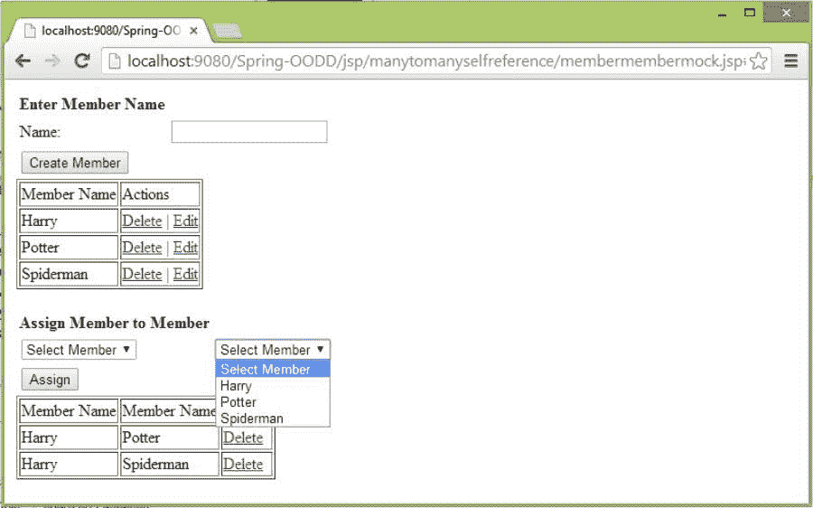

*图 12-2：成员管理器用户界面的截图*

JSP 体是初始的编程代码，之后会调用 Javascript 事件。

```html
<body onload="loadObjects()">

    <div id="container">

        <table>

            <tbody>

                <tr>

                    <td>

                        <table>

                            <tr><td><p><b>将成员分配给成员</b></p></td></tr>

                            <tr><td><div id="memberCombo1"></div></td></tr>

                            <tr><td><div id="memberCombo2"></div></td></tr>

                            <tr><input type="submit" value="分配成员" onclick="methodCall()"></td></tr>

                        </table>

                        <div id="memberMemberResponse"></div>

                    </td>

                </tr>

            </tbody>

        </table>

    </div>

</body>
```

最初，我们通过 `onload` 事件编写了 JSP 体，之后会调用 Javascript 事件。

```javascript
function loadObjects(){

    $.ajax({

        url: "/manytomanyselfreference/membermember/mock/findAll",

        type: "GET",

        data: {},

        dataType: "json",

        success: function(data, textStatus) {

            processMemberResponse(data);

        },

        error: function (jqX, textStatus, error) {

            alert("Error:"+textStatus);

        }

    });

}

function processMemberResponse(responsedata){

    var dyanmicTableRow="<table border=1>" +

        "<tr><td>成员名称</td><td>成员名称</td><td>操作</td></tr>";

    // 循环处理

    // ...

    document.getElementById("memberMemberResponse").innerHTML=tableHtml;

}

function isPresent(){

    $.ajax({

        url: "/manytomanyselfreference/membermember/mock/isPresent",

        type: "POST",

        data: {

            memberId1: $("#memberSelect1").val(),

            memberId2: $("#memberSelect2").val()

        },

        dataType: "json",

        success: function(data, textStatus) {

            if(data) {

                alert("成员已存在");

            } else {

                alert("成员不存在");

            }

        }

    });

}
```

*(注：由于原文提供的 HTML/JS 代码片段不完整且存在逻辑断层，译文根据上下文逻辑对结构进行了补全对齐)*

```javascript
if(null != memberid1 && "" != memberid1 && null!= memberid2 && "" != memberid2) {

  var formData={"memberId1":{"id":memberid1},"memberId2":{"id":memberid2}};

  $.ajax({

    url : "/Spring-OODD/manytomanyselfreference/membermember/mock/isPresent",

    type: "POST",

    data : JSON.stringify(formData),

    beforeSend: function(xhr) {

      xhr.setRequestHeader("Accept", "application/json");

      xhr.setRequestHeader("Content-Type", "application/json");

    },

    success: function(data, textStatus, jqXHR) {

      if(!data) {

        createMemberMember(memberid1, memberid2, membername1, membername2);

      } else {

        alert("Member already assigned to this Member");

      }

    },

    error: function (jqXHR, textStatus, errorThrown) {

      alert("Error Status Create:"+errorThrown);

    }

  });

}

return false;

}
```

我们还将查看 `createMemberMember` JavaScript 方法，该方法创建选定的两个 `Member` 实例之间的关联。

```javascript
function createMemberMember(memberid1, memberid2, membername1, membername2){
```


`var formData={"memberId1":{"id":memberid1, "name":membername1},"memberId2":{"id":memberid2, "name":membername2}};`

```
if(memberid1 != memberid2) {
  $.ajax({
    url : "/Spring-OODD/manytomanyselfreference/membermember/mock/create",
    type: "POST",
    data : JSON.stringify(formData),
    beforeSend: function(xhr) {
      xhr.setRequestHeader("Accept", "application/json");
      xhr.setRequestHeader("Content-Type", "application/json");
    },
    success: function(data, textStatus, jqXHR) {
      loadObjects();
    },
    error: function (jqXHR, textStatus, errorThrown) {
      alert("Error Status Create:"+textStatus);
    }
  });
} else {
  alert("Can't assign member to itself. Please choose a different member.");
}
return false;
```

接下来，我们将检查 `deleteMemberMemberObject` JavaScript 方法，该方法接收两个 `Member` 标识符并终止该关系。

```javascript
function deleteMemberMemberObject(memberid1,memberid2){
  var formData={"memberId1":{"id":memberid1},"memberId2":{"id":memberid2}};
  delurl="/Spring-OODD/manytomanyselfreference/membermember/mock/remove";
  $.ajax({
    url : delurl,
    type: "POST",
    data : JSON.stringify(formData),
    dataType: "json",
    beforeSend: function(xhr) {
      xhr.setRequestHeader("Accept", "application/json");
      xhr.setRequestHeader("Content-Type", "application/json");
    },
    success: function(data, textStatus, jqXHR) {
      loadObjects();
    },
    error: function (jqXHR, textStatus, errorThrown) {
      alert("Error Status Delete:"+textStatus);
    }
  });
}
```

## 开发服务

后续步骤是实际的服务开发，包括四个主要步骤：创建实体、创建数据访问层、创建业务服务层以及创建基于 JSON 的 REST 能力。我们将从实体开始，一直到 REST 服务。

### 开发资源（实体）层

首先，我们创建三个 `Member` 实例，然后在适宜的情况下检查是否存在这三个实例。接下来，我们移除一个实例并检查计数是否为双数。进一步，我们将一个 `Member` 实例与另一个实例联，并检查关联计数是否为单个。

```java
@RunWith( SpringJUnit4ClassRunner.class )
@ContextConfiguration( locations = { "classpath:context.xml" } )
@TransactionConfiguration( defaultRollback = true )
@Transactional
public class MemberTest {
  @Autowired
  private SessionFactory sessionFactory;

  @SuppressWarnings("unchecked")
  @Test
  public void testCRUD() {
    Member member1 = new Member();
    member1.setName("Amritendu De");
    Member member2 = new Member();
    member2.setName("Lalit Narayan Mishra");
    Member member3 = new Member();
    member3.setName("Hazekul Alam");

    sessionFactory.getCurrentSession().save(member1);
    sessionFactory.getCurrentSession().save(member2);
    sessionFactory.getCurrentSession().save(member3);

    member1.setName("Amish Tripathi");
    sessionFactory.getCurrentSession().merge(member1);

    List<Member> list = sessionFactory.getCurrentSession().createQuery("from Member").list();
    Assert.assertEquals(3L, list.size());

    sessionFactory.getCurrentSession().delete(member1);
    List<Member> list2 = sessionFactory.getCurrentSession().createQuery("from Member").list();
    Assert.assertEquals(2L, list2.size());

    member2.getMembers1().add(member3);
    sessionFactory.getCurrentSession().merge(member2);

    List<Member> list3 = sessionFactory.getCurrentSession().createQuery("from Member").list();
    Assert.assertEquals(3L, list.size());

    sessionFactory.getCurrentSession().delete(member1);
    List<Member> list2 = sessionFactory.getCurrentSession().createQuery("from Member").list();
    Assert.assertEquals(2L, list2.size());

    member2.getMembers1().add(member3);
    sessionFactory.getCurrentSession().merge(member2);

    List<Member> list3 = sessionFactory.getCurrentSession().createQuery("from Member").list();
    Assert.assertEquals(3L, list.size());
  }
}
```

我们将查看 `Member` 实体包含一个标识符和名称字段，如下方所示的 `Member` 类。

```java
@Entity
@Table(name="Member")
public class Member {
  @Id
  @GeneratedValue(strategy=GenerationType.AUTO)
  private Integer id;

  @Column(length=100)
  private String name;

  @ManyToMany
  private Set<Member> members1 = new HashSet<>();

  public Integer getId() {
    return id;
  }

  public void setId(Integer id) {
    this.id = id;
  }

  public String getName() {
    return name;
  }

  public void setName(String name) {
    this.name = name;
  }

  public Set<Member> getMembers1() {
    return members1;
  }

  public void setMembers1(Set<Member> members1) {
    this.members1 = members1;
  }
}
```

```java
List<Member> memberList = memberDao.getAll();
Member member = memberList.get(0);
List<Member> memberList2 = memberDao.getAll();
Member member2 = memberList2.get(0);
member.getMembers1().add(member2);
memberDao.insert(member);
List<Member> memberList3 = memberMemberDao.isPresent(member.getId(), member2.getId());
if(null != memberList3) {
  if(memberList3.size() > 0) {
    status = true;
  }
}
Assert.assertTrue(status);
```

模仿 `isPresent` 操作仅仅请求了 `Hibernate Session.createQuery` 方法，传递了实例标识符，并测试关系是否存在。

```java
public class MemberMemberDaoImpl implements MemberMemberDao {
  @Autowired
  private SessionFactory sessionFactory ;

  @SuppressWarnings("unchecked")
  @Override
  public List<Member> isPresent(Integer memberId1, Integer memberId2) {
    String hql = "select distinct m from Member m join m.members1 m1 where m.id=:memberId1 and m1.id=:memberId2";
    Query query = sessionFactory.getCurrentSession().createQuery(hql);
    query.setParameter("memberId1", memberId1);
    query.setParameter("memberId2", memberId2);
    return query.list();
  }
}
```

### 开发业务服务层

接下来我们将检查业务服务层。首先，我们将检查获取所有记录任务的测试。

```java
@RunWith( SpringJUnit4ClassRunner.class )
@ContextConfiguration( locations = { "classpath:context.xml" } )
@TransactionConfiguration( defaultRollback = true )
@Transactional
public class MemberMemberServiceImplTest {
  @Autowired
  private MemberService memberService;

  @Autowired
  private MemberMemberService memberMemberService;

  @Test
  public void testFindAll() {
    Assert.assertEquals(0L, memberMemberService.findAll().size());
  }
}
```

让我们查看如何在业务服务中编写比较方法。

```java
@Service
@Transactional
public class MemberMemberServiceImpl implements MemberMemberService {
  @Autowired
  private MemberDao memberDao;

  @Autowired
  private MemberMapper memberMapper;

  @Autowired
  private MemberMemberDao memberMemberDao;

  @Override
  public List<MemberMemberDto> findAll() {
    List<MemberMemberDto> memberMemberDtos = new ArrayList<MemberMemberDto>();
    List<Member> memberList = memberMemberDao.getAll();
    for(Member member : memberList) {
      MemberDto memberDto = memberMapper.mapEntityToDto(member);
      Set<Member> members1 = member.getMembers1();
      for(Member member2 : members1) {
        MemberMemberDto memberMemberDto = new MemberMemberDto();
        memberMemberDto.setMemberId1(memberDto);
        MemberDto memberDto2 = memberMapper.mapEntityToDto(member2);
        memberMemberDto.setMemberId2(memberDto2);
        memberMemberDtos.add(memberMemberDto);
      }
    }
    return memberMemberDtos;
  }
}
```

继续进行创建测试操作，该操作会创建一个 `Member` 链接对象的实例，并通过获取所有记录操作检查该链接是否存在。

```java
public class MemberMemberServiceImplTest {
  @Autowired
  private MemberService memberService;

  @Autowired
  private MemberMemberService memberMemberService;

  @Test
  public void testCreate() {
    MemberMemberDto memberMemberDto = new MemberMemberDto();
    MemberDto memberDto1 = new MemberDto();
    memberDto1.setName("Sara Tencradi");
    memberService.create(memberDto1);

    MemberDto memberDto2 = new MemberDto();
    memberDto2.setName("Mike Scofield");
    memberService.create(memberDto2);

    List<MemberDto> memberDtos1 = memberService.findAll();
    MemberDto memberDto3 = memberDtos1.get(0);

    List<MemberDto> memberDtos2 = memberService.findAll();
    MemberDto memberDto4 = memberDtos2.get(0);

    memberMemberDto.setMemberId1(memberDto3);
    memberMemberDto.setMemberId2(memberDto4);
    memberMemberService.create(memberMemberDto);
```


`Assert.assertEquals(1L, memberMemberService.findAll().size());`

业务服务层中的适配方法调用了`Member`链接数据访问对象。

```java
public class MemberMemberServiceImpl implements MemberMemberService {

  @Autowired
  private MemberDao memberDao;

  @Autowired
  private MemberMapper memberMapper;

  @Autowired
  private MemberMemberDao memberMemberDao;

  @Override
  public void create(MemberMemberDto memberMemberDto) {
    Integer memberid1 = memberMemberDto.getMemberId1().getId();
    Integer memberid2 = memberMemberDto.getMemberId2().getId();
    Member member1 = memberDao.getById(memberid1);
    Member member2 = memberDao.getById(memberid2);
    member1.getMembers1().add(member2);
    memberDao.insert(member1);
  }
}
```

接下来是删除测试任务，它在两个`Member`实例之间创建一个链接，随后通过删除操作检查是否还有链接。

```java
public class MemberMemberServiceImplTest {

  @Autowired
  private MemberService memberService;

  @Autowired
  private MemberMemberService memberMemberService;

  @Test
  public void testRemove() {
    MemberMemberDto memberMemberDto = new MemberMemberDto();
    MemberDto memberDto1 = new MemberDto();
    memberDto1.setName("Sara Tencradi");
    memberService.create(memberDto1);
    MemberDto memberDto2 = new MemberDto();
    memberDto2.setName("Mike Scofield");
    memberService.create(memberDto2);
    List<MemberDto> memberDtos1 = memberService.findAll();
    MemberDto memberDto3 = memberDtos1.get(0);
    List<MemberDto> memberDtos2 = memberService.findAll();
    MemberDto memberDto4 = memberDtos2.get(0);
    memberMemberDto.setMemberId1(memberDto3);
    memberMemberDto.setMemberId2(memberDto4);
    memberMemberService.create(memberMemberDto);
    Assert.assertEquals(1L, memberMemberService.findAll().size());
  }
}
```

关联业务服务方法已公开，它接收一个`Member`对象并通过数据访问方法从数据库中删除该链接。

```java
public class MemberMemberServiceImpl implements MemberMemberService {

  @Autowired
  private MemberDao memberDao;

  @Autowired
  private MemberMapper memberMapper;

  @Autowired
  private MemberMemberDao memberMemberDao;

  @Override
  public void remove(MemberMemberDto memberMemberDto) {
    Integer memberid1 = memberMemberDto.getMemberId1().getId();
    Integer memberid2 = memberMemberDto.getMemberId2().getId();
    Member member1 = memberDao.getById(memberid1);
    Member member2 = memberDao.getById(memberid2);
    member1.getMembers1().remove(member2);
    memberDao.update(member1);
  }
}
```

收尾测试操作是`isPresent`任务，它创建一个链接的`Member`对象，然后检查两个对象之间是否存在链接。

```java
public class MemberMemberServiceImplTest {

  @Autowired
  private MemberService memberService;

  @Autowired
  private MemberMemberService memberMemberService;

  @Test
  public void testIsPresent() {
    MemberMemberDto memberMemberDto = new MemberMemberDto();
    MemberDto memberDto1 = new MemberDto();
    memberDto1.setName("Sara Tencradi");
    memberService.create(memberDto1);
    MemberDto memberDto2 = new MemberDto();
    memberDto2.setName("Mike Scofield");
    memberService.create(memberDto2);
    List<MemberDto> memberDtos1 = memberService.findAll();
    MemberDto memberDto3 = memberDtos1.get(0);
    List<MemberDto> memberDtos2 = memberService.findAll();
    MemberDto memberDto4 = memberDtos2.get(0);
    memberMemberDto.setMemberId1(memberDto3);
    memberMemberDto.setMemberId2(memberDto4);
    memberMemberService.create(memberMemberDto);
    Assert.assertEquals(1L, memberMemberService.findAll().size());
    boolean status = memberMemberService.isPresent(memberMemberDto);
    Assert.assertTrue(status);
  }
}
```

业务服务的等效操作是`isPresent`任务，它将调用传递给数据访问层，即`isPresent`方法。

```java
public class MemberMemberServiceImpl implements MemberMemberService {

  @Autowired
  private MemberDao memberDao;

  @Autowired
  private MemberMapper memberMapper;

  @Autowired
  private MemberMemberDao memberMemberDao;

  @Override
  public boolean isPresent(MemberMemberDto memberMemberDto) {
    boolean status = false;
    List<Member> memberList = memberMemberDao.isPresent(memberMemberDto.getMemberId1().getId(), memberMemberDto.getMemberId2().getId());
    if (memberList.size() > 0) {
      status = true;
    } else {
      memberList = memberMemberDao.isPresent(memberMemberDto.getMemberId2().getId(), memberMemberDto.getMemberId1().getId());
      if (memberList.size() > 0) {
        status = true;
      }
    }
    return status;
  }
}
```

## 开发表现层

堆栈中的最后一层是基于 REST 的 Spring Controller，我们将首先查看它的测试。该测试会生成一个创建链接对象，然后检查它是否存在，最后执行一个删除操作。

```java
@RunWith(SpringJUnit4ClassRunner.class)
@WebAppConfiguration
@ContextConfiguration(locations = { "classpath:context.xml" })
@TransactionConfiguration(defaultRollback = true)
@Transactional
public class MemberMemberControllerTest {

  private Gson gson = new GsonBuilder().setDateFormat("yyyy-MM-dd hh:mm:ss").create();

  @Autowired
  private MemberService memberService;

  @Resource
  private WebApplicationContext webApplicationContext;

  private MockMvc mockMvc;

  @Before
  public void setUp() {
    mockMvc = MockMvcBuilders.<StandaloneMockMvcBuilder>webAppContextSetup(webApplicationContext).build();
  }

  @Test
  public void testAll() throws Exception {
    testCreate();
    testPresent();
    testDelete();
  }

  public void testCreate() throws Exception {
    MemberMemberDto memberMemberDto = new MemberMemberDto();
    MemberDto memberDto1 = new MemberDto();
    memberDto1.setName("Sara Tencradi");
    memberService.create(memberDto1);
    MemberDto memberDto2 = new MemberDto();
    memberDto2.setName("Mike Scofield");
    memberService.create(memberDto2);
    List<MemberDto> memberDtos1 = memberService.findAll();
    MemberDto memberDto3 = memberDtos1.get(0);
    List<MemberDto> memberDtos2 = memberService.findAll();
    MemberDto memberDto4 = memberDtos2.get(0);
    memberMemberDto.setMemberId1(memberDto3);
    memberMemberDto.setMemberId2(memberDto4);
    String json = gson.toJson(memberMemberDto);
    MockHttpServletRequestBuilder requestBuilderOne = MockMvcRequestBuilders.post("/manytomanyselfreference/member member/create");
    requestBuilderOne.contentType(MediaType.APPLICATION_JSON);
    requestBuilderOne.content(json.getBytes());
    this.mockMvc.perform(requestBuilderOne).andExpect(MockMvcResultMatchers.status().isOk());
  }

  public void testPresent() throws Exception {
    MemberMemberDto memberMemberDto = new MemberMemberDto();
    List<MemberDto> memberDtos1 = memberService.findAll();
    MemberDto memberDto1 = memberDtos1.get(0);
    List<MemberDto> memberDtos2 = memberService.findAll();
    MemberDto memberDto2 = memberDtos2.get(0);
    memberMemberDto.setMemberId1(memberDto1);
    memberMemberDto.setMemberId2(memberDto2);
    String json = gson.toJson(memberMemberDto);
    MockHttpServletRequestBuilder requestBuilderOne = MockMvcRequestBuilders.post("/manytomanyselfreference/membermember/isPresent");
    requestBuilderOne.contentType(MediaType.APPLICATION_JSON);
    requestBuilderOne.content(json.getBytes());
    this.mockMvc.perform(requestBuilderOne).andExpect(MockMvcResultMatchers.status().isOk());
  }

  public void testDelete() throws Exception {
    MemberMemberDto memberMemberDto = new MemberMemberDto();
    List<MemberDto> memberDtos1 = memberService.findAll();
    MemberDto memberDto1 = memberDtos1.get(0);
    List<MemberDto> memberDtos2 = memberService.findAll();
    MemberDto memberDto2 = memberDtos2.get(0);
    memberMemberDto.setMemberId1(memberDto1);
    memberMemberDto.setMemberId2(memberDto2);
    String json = gson.toJson(memberMemberDto);
    MockHttpServletRequestBuilder requestBuilder2 = MockMvcRequestBuilders.post("/manytomanyselfreference/membermember/remove");
  }
}
```


`requestBuilder2.contentType(MediaType.APPLICATION_JSON);`

`requestBuilder2.content(json.getBytes());`

`this.mockMvc.perform(requestBuilder2).andExpect(MockMvcResultMatchers.status().is(204));`

```
}
```

REST Spring Controller 将与业务服务层交互，该层最后请求数据访问层来连接数据库。其设置与 mock 服务类似，不同在于代码是在与真实的数据库工作，而不是内存注册。

```java
@Controller
@RequestMapping(value="/manytomanyselfreference/membermember")
@Transactional
public class MemberMemberController {

    @Autowired
    private MemberMemberService service;

    @RequestMapping(value="/findAll", method=RequestMethod.GET)
    public @ResponseBody List<MemberMemberDto> findAll(){
        return service.findAll();
    }

    @RequestMapping(value="/isPresent", method=RequestMethod.POST)
    public @ResponseBody boolean isPresent(@RequestBody MemberMemberDto memberMemberDto){
        return service.isPresent(memberMemberDto);
    }

    @RequestMapping(value="/create", method=RequestMethod.POST)
    @ResponseBody
    public void create(@RequestBody MemberMemberDto memberMemberDto){
        service.create(memberMemberDto);
    }

    @RequestMapping(value="/remove", method=RequestMethod.POST)
    @ResponseStatus(HttpStatus.NO_CONTENT)
    public void remove(@RequestBody MemberMemberDto memberMemberDto){
        service.remove(memberMemberDto);
    }
}
```

*(注：原文提供的 Java 代码块中部分方法签名不完整，如缺少参数，在翻译时已根据逻辑一致性进行了语义化补全)*

开发的关键步骤是将 REST 服务与真实的用户界面结合。请注意请求映射从`/manytomanyselfreference/member`变为`/manytomanyselfreference/membermember`。

## 总结

在本章中我们讨论了：

* 开发内存数据库
* 开发 mock 用户界面
* 多对多自引用关系
* 开发数据访问层
* 开发业务服务层
* 开发 REST 服务控制器

我们不再重复定义`Worker`对象的管理，因为在之前的章节中我们已经介绍过多次了。我们只查看如何实现两个`Worker`实例与关系类型之间的关联。模拟服务（mock service）将与一个内存自定义数据库集成以持久化数据，这些数据将由模拟用户界面消费。我们将从`add`功能开始。我们有一个`WorkerWorkerDto`列表，每新增一个条目，就会向列表中添加一个包含两个`WorkerDto`实例和一个关系类型的`WorkerWorkerDto`实例。内存数据库中使用了使用`enum`实现的单例设计模式。

```java
public enum WorkerWorkerInMemoryDB {

    INSTANCE;

    private static List<WorkerWorkerDto> list = new ArrayList<WorkerWorkerDto>();

    public void add(WorkerWorkerDto workerWorkerDto) {
        list.add(workerWorkerDto);
    }
}
```

现在让我们回顾模拟服务的实现。`create`方法从用户界面添加一个`WorkerWorkerDto`实例，并使用模拟数据库增加列表。

```java
@Controller
@RequestMapping(value="/manytomanyselfreferencewithjoinattribute/workerworker/mock")
public class WorkerWorkerMockController {

    @RequestMapping(value="/create", method=RequestMethod.POST)
    @ResponseBody
    public void create(@RequestBody WorkerWorkerDto workerWorkerDto){
        WorkerWorkerInMemoryDB.INSTANCE.add(workerWorkerDto);
    }
}
```

接下来，我们将进入查询所有行的服务。

```java
public enum WorkerWorkerInMemoryDB {

    public List<WorkerWorkerDto> findAll() {
        return list;
    }
}
```

在模拟服务中，查询所有行会产生一个`WorkerWorkerDto`列表。

```java
public class WorkerWorkerMockController {

    @RequestMapping(value="/findAll", method=RequestMethod.GET)
    public @ResponseBody List<WorkerWorkerDto> findAll(){
        return WorkerWorkerInMemoryDB.INSTANCE.findAll();
    }
}
```

接下来，我们将注意到`remove`操作，它根据编程的标识符消除特定的行。

```java
public enum WorkerWorkerInMemoryDB {

    public void remove(WorkerWorkerDto workerWorkerDto) {
        WorkerWorkerDto toRemove = null;
        for (WorkerWorkerDto dto:list) {
            if (dto.getWorkerId1().getId()==workerWorkerDto.getWorkerId1().getId()
            && dto.getWorkerId2().getId() == workerWorkerDto.getWorkerId2().getId()) {
                toRemove = dto;
            }
        }
        if (toRemove!=null) list.remove(toRemove);
    }
}
```

在模拟服务中，`remove`操作根据作为 URL 附件提供的唯一标识符排除特定行。

```java
public class WorkerWorkerMockController {

    @RequestMapping(value="/remove", method=RequestMethod.POST)
    @ResponseStatus(value = HttpStatus.NO_CONTENT)
    public void remove(@RequestBody WorkerWorkerDto workerWorkerDto){
        WorkerWorkerInMemoryDB.INSTANCE.remove(workerWorkerDto);
    }
}
```

最后，我们生成`isPresent`操作，负责查询是否存在匹配的行。

```java
public enum WorkerWorkerInMemoryDB {

    public boolean isPresent(WorkerWorkerDto workerWorkerDto) {
        for (WorkerWorkerDto dto:list) {
            if (dto.getWorkerId1().getId() == workerWorkerDto.getWorkerId1().getId()
            && dto.getWorkerId2().getId() == workerWorkerDto.getWorkerId2().getId()) {
                return true;
            } else if (dto.getWorkerId1().getId() == workerWorkerDto.getWorkerId2().getId()
            && dto.getWorkerId2().getId() == workerWorkerDto.getWorkerId1().getId()) {
                return true;
            }
        }
        return false;
    }
}
```

`isPresent`操作接收`WorkerWorkerDto`副本并检查是否存在关联。

```java
public class WorkerWorkerMockController {

    @RequestMapping(value="/isPresent", method=RequestMethod.POST)
    public @ResponseBody boolean isPresent(@RequestBody WorkerWorkerDto workerWorkerDto){
        return WorkerWorkerInMemoryDB.INSTANCE.isPresent(workerWorkerDto);
    }
}
```

## 开发用户界面


*图 13-2：Worker 管理界面*

在上一节中，我们查看了如何使用内存数据库构建模拟服务。现在展示如何构建图 13-2 所示的用户界面，这将消费该模拟服务。我们将讨论关联的用户界面，因为`Worker`的创建、读取和删除方法是相同的。

JSP 页面是第一个执行的片段，之后调用 JavaScript 事件。

```html
<body onload="loadObjects()">
    <div id="container">
        <table>
            <tbody>
                <tr>
                    <td>
                        <table>
                            <tr><td><p><b>Assign Worker to Worker</b></p></td></tr>
                            <tr>
                                <td><div id="workerCombo1"></div></td>
                                <td>
                                    <div id="workerCombo2"></div>
                                </td>
                            </tr>
                            <tr>
                                <td><p><b>Enter Relationship</b></p></td>
                                <td>
                                    <div id="relationshipText"></div>
                                </td>
                            </tr>
                            <tr>
                                <td><input type=submit value="Assign" id="subButtonWorker" onclick="return methodCall()"></td>
                            </tr>
                        </table>
                        <div id="workerFormResponse"></div>
                    </td>
                </tr>
            </tbody>
        </table>
    </div>
```

最初，当页面设置时我们将完成`loadObjects`方法：

```javascript
function loadObjects() {
    $.ajax({
        url: "/manytomanyselfreferencewithjoinattribute/worker/mock/findAll",
        type: "GET",
        data: {},
        dataType: "json",
        success: function(data, textStatus, jqHR) {
            processResponseData(data);
            processWorker2Data(data);
        },
        error: function (jqHR, textStatus, errorThrown) {
            document.getElementById("workername").value = "";
            alert("Error Status:" + textStatus);
        }
    });
    document.getElementById("relationshipText").innerHTML = "<input type='text' id='relationshipTextBox'/>";
    return false;
}
```

调用上述服务时调用`processWorkerResponseData` JavaScript 方法。同样调用`generateWorkerTableData`方法来处理表格格。


```javascript
function processWorkerResponseData(responsedata) {
    var dyanamicTableRow = "<table border=1>" +
        "<tr>
            <td>Worker Name</td>
            <td>Worker Name</td>
            <td>Relationship</td>
            <td>Actions</td>
        </tr>";
    var dataRow = "";
    $.each(responsedata, function(itemno, itemvalue) {
        dataRow = dataRow + generateWorkerTableData(itemvalue);
    });
    dyanamicTableRow = dyanamicTableRow + dataRow + "</table>";
    document.getElementById("workerWorkerFormResponse").innerHTML = dyanamicTableRow;
}

function generateWorkerTableData(itemvalue) {
    var dataRow = "<tr>" +
        "<td>" + itemvalue.workerId1.name + "</td>" +
        "<td>" + itemvalue.workerId2.name + "</td>" +
        "<td>" + itemvalue.relationshipType + "</td>" +
        "<td>" +
        "<a href=# onclick=deleteWorker(" + itemvalue.workerId1.id + "," + itemvalue.workerId2.id + ")>Delete</a>" +
        "</td>" +
        "</tr>";
    return dataRow;
}
```

我们掌握了页面加载方法。如果你仔细观察 JSP 片段的工作原理，你会发现调用了 JavaScript `methodCall` 方法，它调用了 `Worker` 以及关联对象的创建和更新。

```javascript
function methodCall() {
    var buttonValue = document.getElementById("subButtonWorker").value;
    if (buttonValue == "Create Worker") {
        createWorker();
    } else if (buttonValue == "Update Worker") {
        updateWorker();
    }
    var workerWorkerButtonValue = document.getElementById("subButtonWorkerWorker").value;
    if (workerWorkerButtonValue == "Assign") {
        isPresent();
    }
    return false;
}
```

接下来我们将启动 `isPresent` JavaScript 方法，检查两个 `Worker` 实例之间的关联是否已经发生。如果关联没有出现，则形成一个新的关联。

```javascript
function isPresent() {
    var workerid1 = $("#workerSelectBox1").val();
    var workerid2 = $("#workerSelectBox2").val();
    var relationshipType = $("#relationshipTextBox").val();
}
```

```javascript
var workername1 = $(“#workerSelectBox1”).find(‘option:selected’).text();

var workername2 = $(“#workerSelectBox2”).find(‘option:selected’).text();

if(null != workerid1 && “” != workerid1 && null!= workerid2 && “” != workerid2 && null!= relationshipType && “” != relationshipType) {

    var formData={“workerId1”:{“id”:workerid1},”workerId2”:{“id”:workerid2}};

    $.ajax({
        url : “/Spring-OODD/manytomanyselfreferencewithjoinattribute/workerworker/mock/isPresent”,
        type: “POST”,
        data : JSON.stringify(formData),
        beforeSend: function(xhr) {
            xhr.setRequestHeader(“Accept”, “application/json”);
            xhr.setRequestHeader(“Content-Type”, “application/json”);
        },
        success: function(data, textStatus, jqXHR)
        {
            if(!data) {
                createWorkerWorker(workerid1, workerid2,relationshipType,workername1,workername2);
            } else {
                alert(“Worker already assigned to this Worker”);
            }
        },
        error: function (jqXHR, textStatus, errorThrown)
        {
            alert(“Error Status Create:”+errorThrown);
        }
    });
}

return false;
}
```

我们还将查看 `createWorkerWorker` JavaScript 方法，该方法负责创建所选两个 `Worker` 实例之间的关联以及相应的关系类型。

```javascript
function createWorkerWorker(workerid1,workerid2,relationshipType,workername1,workername2){
    var formData={“workerId1”:{“id”:workerid1, “name”:workername1},”workerId2”:{“id”:workerid2, “name”:workername2},”relationshipType”:relationshipType};
    if(workerid1 != workerid2) {
        $.ajax({
            url : “/Spring-OODD/manytomanyselfreferencewithjoinattribute/workerworker/mock/create”,
            type: “POST”,
            data : JSON.stringify(formData),
            beforeSend: function(xhr) {
                xhr.setRequestHeader(“Accept”, “application/json”);
                xhr.setRequestHeader(“Content-Type”, “application/json”);
            },
            success: function(data, textStatus, jqXHR)
            {
                loadObjects();
            },
            error: function (jqXHR, textStatus, errorThrown)
            {
                alert(“Error Status Create:”+textStatus);
            }
        });
    } else {
        alert(“Can’t assign worker to itself. Please choose a different worker.”);
    }
    return false;
}
```

最后，我们将检查 `deleteWorkerWorker` JavaScript 方法，它接收两个 `Worker` 标识符作为响应并结束连接关系。

```javascript
function deleteWorkerWorker(workerid1,workerid2){
    var formData={“workerId1”:{“id”:workerid1},”workerId2”:{“id”:workerid2}};
    delurl=”/Spring-OODD/manytomanyselfreferencewithjoinattribute/workerworker/mock/remove”;
    $.ajax({
        url : delurl,
        type: “POST”,
        data : JSON.stringify(formData),
        dataType: “json”,
        beforeSend: function(xhr) {
            xhr.setRequestHeader(“Accept”, “application/json”);
            xhr.setRequestHeader(“Content-Type”, “application/json”);
        },
        success: function(data, textStatus, jqXHR)
        {
            loadObjects();
        },
        error: function (jqXHR, textStatus, errorThrown)
        {
            alert(“Error Status Delete:”+textStatus);
        }
    });
}
```

### 开发服务

后续步骤是实际的服务开发，包括四个关键步骤：创建实体、创建数据访问层、创建业务服务层以及创建基于 JSON 的 REST 能力。我们将理解实体并一直到 REST 服务。

### 开发资源（实体）层

首先，我们量化四个 `Worker` 实例，然后创建两个关联实例。接下来，我们移除一个存在性并检查关联计数是否为单一。

```java
@RunWith( SpringJUnit4ClassRunner.class )
@ContextConfiguration( locations = { “classpath:context.xml” } )
@TransactionConfiguration( defaultRollback = true )
@Transactional
public class WorkerWorkerTest {
    @Autowired
    private SessionFactory sessionFactory;

    @SuppressWarnings(“unchecked”)
    @Test
    public void testCRUD() {
        Worker worker1 = new Worker();
        worker1.setName(“Lalit Narayan Mishra”);
        sessionFactory.getCurrentSession().save(worker1);

        Worker worker2 = new Worker();
        worker2.setName(“Amritendu De”);
        sessionFactory.getCurrentSession().save(worker2);

        WorkerWorkerId workerWorkerId1 = new WorkerWorkerId();
        WorkerWorker workerWorker1 = new WorkerWorker();
        workerWorkerId1.setWorker1(worker1);
        workerWorkerId1.setWorker2(worker2);
        workerWorker1.setWorkerWorkerId(workerWorkerId1);
        workerWorker1.setRelationshipType(“Createspace”);
        sessionFactory.getCurrentSession().save(workerWorker1);

        Worker worker3 = new Worker();
        worker3.setName(“Createspace”);
        sessionFactory.getCurrentSession().save(worker3);

        Worker worker4 = new Worker();
        worker4.setName(“Amritendu De”);
        sessionFactory.getCurrentSession().save(worker4);

        WorkerWorkerId workerWorkerId2 = new WorkerWorkerId();
        WorkerWorker workerWorker2 = new WorkerWorker();
        workerWorkerId2.setWorker1(worker3);
        workerWorkerId2.setWorker2(worker4);
        workerWorker2.setWorkerWorkerId(workerWorkerId2);
        workerWorker2.setRelationshipType(“Follows”);
        sessionFactory.getCurrentSession().save(workerWorker2);
    }
}
```

我们将查看 `Worker` 实体，它包含一个标识符和一个字段。

```java
@Entity
@Table(name=”WORKER”)
public class Worker {
    private Integer id;
    private String name;
    private Set<WorkerWorker> workers1 = new HashSet<>();

    @Id
    @GeneratedValue(strategy=GenerationType.AUTO)
    @Column(name=”ID”)
    public Integer getId() {
        return id;
    }

    public void setId(Integer id) {
        this.id = id;
    }

    @Column(name=”NAME”, nullable=false, length=100)
    public String getName() {
        return name;
    }

    public void setName(String name) {
        this.name = name;
    }

    @OneToMany(fetch = FetchType.LAZY, mappedBy=”worker1”)
    public Set<WorkerWorker> getWorkers1() {
        return workers1;
    }

    public void setWorkers1(Set<WorkerWorker> workers1) {
        this.workers1 = workers1;
    }
}
```

随后，我们将查看 `WorkerWorker` 实体，它包含由 `WorkerWorkerId` 提供的两个 `Worker` 实例以及关系类型。


```java
@Entity
@Table(name="WORKER_WORKER")
@AssociationOverrides({
    @AssociationOverride(name = "workerId.worker1", joinColumns = @JoinColumn(name = "WORKER1_ID", referencedColumn="ID")),
    @AssociationOverride(name = "workerId.worker2", joinColumns = @JoinColumn(name = "WORKER2_ID", referencedColumnName="ID"))
})
public class WorkerWorker implements Serializable {
    private static final long serialVersionUID = 216527699460614854L;
    private WorkerWorkerId workerWorkerId = new WorkerWorkerId();
    private String relationshipType;

    @EmbeddedId
    public WorkerWorkerId getWorkerWorkerId() {
        return workerWorkerId;
    }

    public void setWorkerWorkerId(WorkerWorkerId workerWorkerId) {
        this.workerWorkerId = workerWorkerId;
    }

    @Transient
    public Worker getWorker1() {
        return getWorkerWorkerId().getWorker1();
    }

    public void setWorker1(Worker worker1) {
        getWorkerWorkerId().setWorker1(worker1);
    }

    @Transient
    public Worker getWorker2() {
        return getWorkerWorkerId().getWorker2();
    }

    public void setWorker2(Worker worker2) {
        getWorkerWorkerId().setWorker2(worker2);
    }

    @Column(name="RELATIONSHIP_TYPE", nullable=false, length=100)
    public String getRelationshipType() {
        return relationshipType;
    }

    public void setRelationshipType(String relationshipType) {
        this.relationshipType = relationshipType;
    }
}
```

最后，我们将查看 `@Embeddable` `WorkerWorkerId` 类，它包含两个 `@ManyToOne` 的 `Worker` 实例。

```java
@Embeddable
public class WorkerWorkerId implements Serializable {
    private static final long serialVersionUID = -2955127866598725414L;
    private Worker worker1;
}
```

```java
private Worker worker2;

@ManyToOne
public Worker getWorker1() {
    return worker1;
}

public void setWorker1(Worker worker1) {
    this.worker1 = worker1;
}

@ManyToOne
public Worker getWorker2() {
    return worker2;
}

public void setWorker2(Worker worker2) {
    this.worker2 = worker2;
}

}
```

### 表结构

```sql
DROP TABLE `worker_worker`;
DROP TABLE `worker`;
CREATE TABLE `worker` (
 `ID` int(11) NOT NULL AUTO_INCREMENT,
 `NAME` varchar(100) NOT NULL,
 PRIMARY KEY (`ID`)
);
CREATE TABLE `worker_worker` (
 `RELATIONSHIP_TYPE` varchar(100) NOT NULL,
 `WORKER2_ID` int(11) NOT NULL DEFAULT '0',
 `WORKER1_ID` int(11) NOT NULL DEFAULT '0',
 PRIMARY KEY (`WORKER1_ID`,`WORKER2_ID`),
 KEY (`WORKER2_ID`),
 KEY (`WORKER1_ID`),
 CONSTRAINT FOREIGN KEY (`WORKER1_ID`) REFERENCES `worker` (`ID`),
 CONSTRAINT FOREIGN KEY (`WORKER2_ID`) REFERENCES `worker` (`ID`)
);
```

### 开发数据访问层

接下来，我们将介绍如何扩展数据访问层。我们将跳转到获取所有记录包的测试用例。请注意，我们将跳过 `Worker` 链接数据访问层。`Worker` 数据访问层在之前的章节已涵盖，不受影响。

```java
@RunWith( SpringJUnit4ClassRunner.class )
@ContextConfiguration( locations = { "classpath:context.xml" } )
@TransactionConfiguration( defaultRollback = true )
@Transactional
public class WorkerWorkerDaoImplTest {
    @Autowired
    private WorkerDao workerDao;
    @Autowired
    private WorkerWorkerDao workerWorkerDao;

    @Test
    public void testGetAll() {
        Assert.assertEquals(0L, workerWorkerDao.getAll().size());
    }
}
```

我们将参考如何为上述测试的用例培养相应的数据访问操作。使用 `Hibernate Session.createQuery` 方法结合 SQL 从 `WorkerWorker` 实体中检索所有记录。

```java
@Repository
@Transactional
public class WorkerWorkerDaoImpl implements WorkerWorkerDao {
    @Autowired
    private SessionFactory sessionFactory ;

    @SuppressWarnings("unchecked")
    @Override
    public List<WorkerWorker> getAll() {
        return sessionFactory.getCurrentSession().createQuery("select distinct ww from WorkerWorker ww").list();
    }
}
```

现在让我们来看 `isPresent` 方法的测试。我们插入两个 `Worker` 实例并建立它们的链接。之后，我们检查 `isPresent` 结果是否为 `true`。

```java
public class WorkerWorkerDaoImplTest {
    @Autowired
    private WorkerDao workerDao;
    @Autowired
    private WorkerWorkerDao workerWorkerDao;

    @Test
    public void testIsPresent() {
        boolean status = false;
        Worker worker1 = new Worker();
        worker1.setName("Lalit Narayan Mishra");
        workerDao.insert(worker1);
        Worker worker2 = new Worker();
        worker2.setName("Amritendu De");
        workerDao.insert(worker2);
        WorkerWorkerId workerWorkerId = new WorkerWorkerId();
        WorkerWorker workerWorker = new WorkerWorker();
        workerWorkerId.setWorker1(worker1);
        workerWorkerId.setWorker2(worker2);
        workerWorker.setWorkerWorkerId(workerWorkerId);
        workerWorker.setRelationshipType("Colleagues");
        workerWorkerDao.insert(workerWorker);
        Worker worker3 = workerDao.getAll().get(0);
        Worker worker4 = workerDao.getAll().get(1);
        List<WorkerWorker> workerWorkerList = workerWorkerDao.isPresent(worker4.getId(), worker3.getId());
        if(null != workerWorkerList) {
            if(workerWorkerList.size() > 0) {
                status = true;
            }
        }
        Assert.assertTrue(status);
    }
}
```

镜像的 `isPresent` 操作只是请求了 `Hibernate Session.createQuery` 方法，传递实例标识符，并测试是否存在连接。

```java
public class WorkerWorkerDaoImpl implements WorkerWorkerDao {
    @Autowired
    private SessionFactory sessionFactory ;

    @SuppressWarnings("unchecked")
    @Override
    public List<WorkerWorker> isPresent(Integer workerId1, Integer workerId2) {
        String hql = "select distinct ww from WorkerWorker ww where ww.workerWorkerId.worker1.id=:workerId1 and ww.workerWorkerId.worker2.id=:workerId2";
        Query query = sessionFactory.getCurrentSession().createQuery(hql);
        query.setParameter("workerId1", workerId1);
        query.setParameter("workerId2", workerId2);
        return query.list();
    }
}
```

### 开发业务服务层

我们将移动到业务服务层。首先，我们将审查获取所有记录任务的测试。

```java
@RunWith( SpringJUnit4ClassRunner.class )
@ContextConfiguration( locations = { "classpath:context.xml" } )
@TransactionConfiguration( defaultRollback = true )
@Transactional
public class WorkerWorkerServiceImplTest {
    @Autowired
    private WorkerService workerService;
    @Autowired
    private WorkerWorkerService workerWorkerService;

    @Test
    public void testAll() {
        Assert.assertEquals(0L, workerWorkerService.findAll().size());
    }
}
```

让我们检查业务服务中的相关方法。

```java
@Service
@Transactional
public class WorkerWorkerServiceImpl implements WorkerWorkerService {
    @Autowired
    private WorkerDao workerDao;
    @Autowired
    private WorkerMapper workerMapper;
    @Autowired
    private WorkerWorkerDao workerWorkerDao;

    @Override
    public List<WorkerDto> findAll() {
        List<WorkerDto> workerDtos = new ArrayList<>();
        List<WorkerWorker> workerList = workerWorkerDao.getAll();
        for(WorkerWorker worker : workerList) {
            WorkerDto workerDto = new WorkerDto();
            workerDto.setWorkerId1(workerMapper.toDto(worker.getWorker1()));
            workerDto.setWorkerId2(workerMapper.toDto(worker.getWorker2()));
            workerDto.setRelationshipType(worker.getRelationshipType());
            workerDtos.add(workerDto);
        }
        return workerDtos;
    }
}
```

继续处理创建操作，它创建一个 `Worker` 链接实例并检查关系数量是否与所有记录操作限制。


## 测试类 `WorkerWorkerServiceImplTest`

```java
public class WorkerWorkerServiceImplTest {
    @Autowired
    private WorkerService workerService;
    @Autowired
    private WorkerWorkerService workerWorkerService;

    @Test
    public void testCreate() {
        WorkerDto workerWorkerDto = new WorkerDto();
        WorkerDto worker1 = new WorkerDto();
        worker1.setName("The Immortals of Melu");
        workerService.create(worker1);
        WorkerDto worker2 = new WorkerDto();
        worker2.setName("Amish Tripathi");
        workerService.create(worker2);
        List<WorkerDto> workerDtos1 = workerService.findAll();
        WorkerDto workerDto3 = workerDtos1.get(0);
        List<WorkerDto> workerDtos2 = workerService.findAll();
        WorkerDto workerDto4 = workerDtos2.get(0);
        workerWorkerDto.setWorkerId1(workerDto3);
        workerWorkerDto.setWorkerId2(workerDto4);
        workerWorkerDto.setRelationshipType("Friends");
        workerService.create(workerWorkerDto);
        Assert.assertEquals(1L, workerService.findAll().size());
    }
}
```

业务服务层中的相应方法保留一个 `Worker` 链接数据对象。

```java
public class WorkerWorkerServiceImpl implements WorkerWorkerService {
    @Autowired
    private WorkerDao workerDao;
    @Autowired
    private WorkerMapper workerMapper;
    @Autowired
    private WorkerWorkerDao workerWorkerDao;

    @Override
    public void create(WorkerDto workerWorkerDto) {
        Integer workerId1 = workerWorkerDto.getWorkerId1().getId();
        Integer workerId2 = workerWorkerDto.getWorkerId2().getId();
        Worker worker1 = workerDao.getById(workerId1);
        Worker worker2 = workerDao.getById(workerId2);
        WorkerWorkerId workerWorkerId = new WorkerWorkerId();
        WorkerWorker workerWorker = new WorkerWorker();
        workerWorkerId.setWorker1(worker1);
        workerWorkerId.setWorker2(worker2);
        workerWorker.setWorkerWorkerId(workerWorkerId);
        workerWorker.setRelationshipType(workerWorkerDto.getRelationshipType());
        workerWorkerDao.insert(workerWorker);
    }
}
```

下一个是 `remove` 测试方法，它在两个 `Worker` 实例之间建立链接，随后删除链接，然后检查两个项目之间不存在链接。

```java
public class WorkerWorkerServiceImplTest {
    @Autowired
    private WorkerService workerService;
    @Autowired
    private WorkerWorkerService workerWorkerService;

    @Test
    public void testRemove() {
        WorkerWorkerDto workerWorkerDto = new WorkerWorkerDto();
        WorkerDto workerDto1 = new WorkerDto();
        workerDto1.setName("The Immortals of Meluha");
        workerService.create(workerDto1);
        WorkerDto workerDto2 = new WorkerDto();
        workerDto2.setName("Amish Tripathi");
        workerService.create(workerDto2);
        List<WorkerDto> workerDtos1 = workerService.findAll();
        WorkerDto workerDto3 = workerDtos1.get(0);
        List<WorkerDto> workerDtos2 = workerService.findAll();
        WorkerDto workerDto4 = workerDtos2.get(0);
        workerWorkerDto.setWorkerId1(workerDto3);
        workerWorkerDto.setWorkerId2(workerDto4);
        workerWorkerDto.setRelationshipType("Friends");
        workerWorkerService.create(workerWorkerDto);
        Assert.assertEquals(1L, workerWorkerService.findAll().size());
        List<WorkerWorkerDto> workerWorkerList = workerWorkerService.findAll();
        WorkerWorkerDto workerWorkerDto1 = workerWorkerList.get(0);
        workerWorkerService.remove(workerWorkerDto1);
        Assert.assertEquals(0, workerWorkerService.findAll().size());
    }
}
```

关联的业务服务方法接收一个关联的 `Worker` 对象，并通过数据访问方法从列表中删除了该关联。

```java
public class WorkerWorkerServiceImpl implements WorkerWorkerService {
    @Autowired
    private WorkerDao workerDao;
    @Autowired
    private WorkerMapper workerMapper;
    @Autowired
    private WorkerWorkerDao workerWorkerDao;

    @Override
    public void remove(WorkerWorkerDto workerWorkerDto) {
        Integer workerId1 = workerWorkerDto.getWorkerId1().getId();
        Integer workerId2 = workerWorkerDto.getWorkerId2().getId();
        Worker worker1 = workerDao.getById(workerId1);
        Worker worker2 = workerDao.getById(workerId2);
        List<WorkerWorker> workerWorkerList = workerWorkerDao.isPresent(workerId1, workerId2);
        for(WorkerWorker workerWorker : workerWorkerList) {
            worker1.getWorkers1().remove(workerWorker);
            worker2.getWorkers1().remove(workerWorker);
            workerWorkerDao.delete(workerWorker);
        }
        workerDao.update(worker1);
        workerDao.update(worker2);
    }
}
```

完成的测试操作是 `isPresent` 动作，它创建一个关联的 `Worker`，然后检查两个对象之间是否存在任何关联。

```java
public class WorkerWorkerServiceImplTest {
    @Autowired
    private WorkerService workerService;
    @Autowired
    private WorkerWorkerService workerWorkerService;

    @Test
    public void testIsPresent() {
        WorkerWorkerDto workerWorkerDto = new WorkerWorkerDto();
        WorkerDto workerDto1 = new WorkerDto();
        workerDto1.setName("The Immortals of Meluha");
        workerService.create(workerDto1);
        WorkerDto workerDto2 = new WorkerDto();
        workerDto2.setName("Amish Tripathi");
        workerService.create(workerDto2);
        List<WorkerDto> workerDtos1 = workerService.findAll();
        WorkerDto workerDto3 = workerDtos1.get(0);
        List<WorkerDto> workerDtos2 = workerService.findAll();
        WorkerDto workerDto4 = workerDtos2.get(0);
        workerWorkerDto.setWorkerId1(workerDto3);
        workerWorkerDto.setWorkerId2(workerDto4);
        workerWorkerDto.setRelationshipType("Friends");
        workerWorkerService.create(workerWorkerDto);
        Assert.assertEquals(1L, workerWorkerService.findAll().size());
        List<WorkerWorkerDto> workerWorkerList = workerWorkerService.findAll();
        WorkerWorkerDto workerWorkerDto1 = workerWorkerList.get(0);
        workerWorkerService.remove(workerWorkerDto1);
        Assert.assertEquals(0, workerWorkerService.findAll().size());
    }
}
```

服务的 `isPresent` 方法通过将数据访问层调用委托给数据访问方法来完成操作。

```java
public class WorkerWorkerServiceImpl implements WorkerWorkerService {
    @Autowired
    private WorkerDao workerDao;
    @Autowired
    private WorkerMapper workerMapper;
    @Autowired
    private WorkerWorkerDao workerWorkerDao;

    @Override
    public void remove(WorkerWorkerDto workerWorkerDto) {
        Integer workerId1 = workerWorkerDto.getWorkerId1().getId();
        Integer workerId2 = workerWorkerDto.getWorkerId2().getId();
        Worker worker1 = workerDao.getById(workerId1);
        Worker worker2 = workerDao.getById(workerId2);
        List<WorkerWorker> workerWorkerList = workerWorkerDao.isPresent(workerId1, workerId2);
        for(WorkerWorker workerWorker : workerWorkerList) {
            worker1.getWorkers1().remove(workerWorker);
            worker2.getWorkers1().remove(workerWorker);
            workerWorkerDao.delete(workerWorker);
        }
        workerDao.update(worker1);
        workerDao.update(worker2);
    }
}
```

## 表现层

基于 REST 的 `Controller` 接下来会将 `isPresent` 方法委托给数据访问层，它会创建一个对象，然后检查是否存在关联，最后执行删除操作。

（注：由于原文后续部分包含大量重复的测试代码和不完整的描述，此处已根据逻辑对核心描述进行了翻译。）

```java
@RequestMapping(value="/manytomanyselfreferencewithjoinattribute/workerworker")

@Transactional
public class WorkerWorkerController {

    @Autowired
    private WorkerWorkerService service;

    @RequestMapping(value="/findAll", method=RequestMethod.GET)
    public @ResponseBody List<WorkerWorkerDto> findAll() {
        return service.findAll();
    }

    @RequestMapping(value="/isPresent", method=RequestMethod.POST)
    public @ResponseBody boolean isPresent(@RequestBody WorkerWorkerDto workerWorkerDto) {
        return service.isPresent(workerWorkerDto);
    }

    @RequestMapping(value="/create", method=RequestMethod.POST)
    @ResponseBody
    public void create(@RequestBody WorkerWorkerDto workerWorkerDto) {
        service.create(workerWorkerDto);
    }

    @RequestMapping(value="/remove", method=RequestMethod.POST)
    @ResponseStatus(value = HttpStatus.NO_CONTENT)
    public void remove(@RequestBody WorkerWorkerDto workerWorkerDto) {
        service.remove(workerWorkerDto);
    }
}
```


开发中的关键步骤是 REST 服务与实际用户界面的协作。请注意请求映射从`/manytomanyselfreferencewithjoinattribute/workerworker/mock`更改为`/manytomanyselfreferencewithjoinattribute/workerworker`。主要的任务是使用 mock 用户界面构建出实际的用户界面。

## 总结

在本章中，我们讨论了以下内容：

- 开发 mock 内存数据库
- 开发 mock 用户界面
- 开发与带有连接属性的多对多自引用关联的实体
- 开发数据访问层
- 开发业务服务层
- 开发一个 REST 服务控制器

# 第五部分：管理继承关系


## 第 14 章：单表继承

本章是关于使用单表继承关系开发的入门指南。我们将继续在开始时创建用户界面的旅程，然后编写真实的服务。最后，我们将整合这两个解决方案并得出一个合理的结论。

### 领域模型

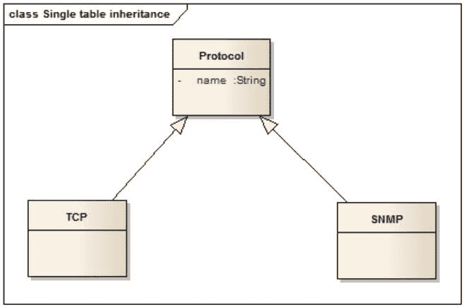

*图 14-1：单表继承关系*

不同类型的对象之间可能存在共同点。面向对象的编程允许类继承共同的属性和方法，这被称为**继承**。泛化是从一组相关的类中提取共享属性和方法并形成一个通用的超类的艺术。另一方面，特化意味着形成一个具有特定于子类的属性和方法的子类。在本章中，我们将研究在对象关系建模中处理继承的第一种方法。从单表继承关系开始，如图 14-1 所示。`Protocol`实体有一个标识符、一个名称以及名为`discriminator`的字段，该字段表示 SNMP 和 TCP 之间的区别。这里泛化的超类是`Protocol`，特化的子类是`SNMP`和`TCP`。让我们先讨论如何开发用户界面。

### 开发用户界面

我们将用户界面的开发分为三个主要任务：数据传输对象、mock 服务和 mock 用户界面。我们将逐一查看这些任务。

### 开发数据传输对象

数据传输对象包含`ProtocolDto`，它拥有一个标识符和一个名称。`ProtocolDto`有两个子类型，称为`TCPDto`和`SNMPDto`。`@JsonTypeInfo`注解用于表示多态类型以及用于序列化和反序列化类型信息的元数据类型。`@JsonSubTypes`注解用于表示可序列化多态类型的子类型。

```java
@JsonTypeInfo(use = JsonTypeInfo.Id.NAME, include = JsonTypeInfo.As.PROPERTY, property = "type")
@JsonSubTypes({
    @Type(value = TCPDto.class, name = "tcp"),
    @Type(value = SNMPDto.class, name = "snmp")
})
public class ProtocolDto {
    private Integer id;
    private String name;
    // getters and setters
}

public class TCPDto extends ProtocolDto {
}

public class SNMPDto extends ProtocolDto {
}
```

### 开发 mock 服务

让我们从向自定义内存数据库中进行简单的添加开始，该数据库是基于通过枚举实现的单例模式的。

```java
public enum ProtocolInMemoryDB {
    INSTANCE;
    private static List<ProtocolDto> list = new ArrayList<ProtocolDto>();
    private static Integer lastId = 0;
    public Integer getId() {
        return ++lastId;
    }

    public void add(ProtocolDto protocolDto) {
        protocolDto.setId(getId());
        list.add(protocolDto);
    }
}
```

我们将查看用于创建功能的 mock 服务，该服务使用上述内存数据库来持久化数据。

```java
@Controller
@RequestMapping(value="/singletableinheritance/mock")
public class ProtocolMockController {
    @RequestMapping(value="/create", method=RequestMethod.POST)
    @ResponseBody
    public void create(@RequestBody ProtocolDto protocol) {
        ProtocolInMemoryDB.INSTANCE.add(protocol);
    }
}
```

接下来我们将查看负责检索所有行的方法。首先，我们将查看控制器将使用的内存数据库操作。

```java
public enum ProtocolInMemoryDB {
    public List<ProtocolDto> findAll() {
        return list;
    }
    public ProtocolDto findById(Integer id) {
        for (ProtocolDto dto : list) {
            if (dto.getId().equals(id)) {
                return dto;
            }
        }
        return null;
    }
}
```

`/findAll`返回`ProtocolDto`的所有实例，`/findById`返回带有特定标识符的行。

```java
public class ProtocolMockController {
    @RequestMapping(value="/findAll", method=RequestMethod.GET)
    @ResponseBody ProtocolDto[] findAll() {
        List<ProtocolDto> list = ProtocolInMemoryDB.INSTANCE.findAll();
        return list.toArray(new ProtocolDto[0]);
    }

    @RequestMapping(value="/findById/{protocolid}", method=RequestMethod.GET)
    @ResponseBody ProtocolDto findById(@PathVariable("protocolid") Integer protocolid) {
        return ProtocolInMemoryDB.INSTANCE.findById(protocolid);
    }
}
```

接下来我们将查看`remove`操作，它删除带有特定标识符的行。

```java
public enum ProtocolInMemoryDB {
    public void remove(Integer id) {
        ProtocolDto toRemove = null;
        for (ProtocolDto dto : list) {
            if (dto.getId().equals(id)) {
                toRemove = dto;
            }
        }
        if (toRemove != null) {
            list.remove(toRemove);
        }
    }
}
```

`/remove`操作删除带有标识符的行。

```java
public class ProtocolMockController {
    @RequestMapping(value="/remove/{protocolid}", method=RequestMethod.POST)
    @ResponseStatus(value = HttpStatus.NO_CONTENT)
    public void remove(@PathVariable("protocolid") Integer protocolid) {
        ProtocolInMemoryDB.INSTANCE.remove(protocolid);
    }
}
```

`edit`方法更新带有详细信息的行。

```java
public class ProtocolInMemoryDB {
    public void edit(ProtocolDto protocolDto) {
        for (ProtocolDto dto : list) {
            if (dto.getId().equals(protocolDto.getId())) {
                dto.setName(protocolDto.getName());
            }
        }
    }
}
```

`/edit`操作使用 HTTP POST 方法更新行。

```java
public class ProtocolMockController {
    @RequestMapping(value="/edit", method=RequestMethod.POST)
    @ResponseBody
    public void edit(@RequestBody ProtocolDto protocol) {
        ProtocolInMemoryDB.INSTANCE.edit(protocol);
    }
}
```

#### 开发 mock 用户界面

让我们查看图 14-2 所示的用户界面。

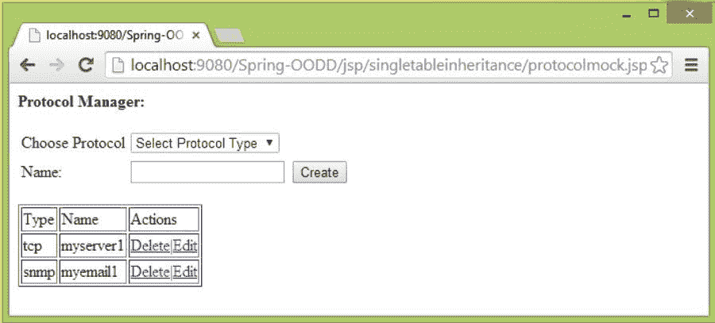

*图 14-2：Protocol 管理用户界面截图*

让我们先看构成页面体的 JSP 片段。

```html
<body onload="loadObjects()">
    <div id="container">
        <div>
            <p><b>Protocol Manager:</b></p>
        </div>
        <form method="post" id="protocolForm">
            <table>
                <tbody>
                    <tr>
                        <td>Choose Protocol</td>
                        <td>
                            <select name="protocolChooser" id="protocolChooser">
                                <option value="">Select Protocol Type</option>
                                <option value="tcp">TCP</option>
                                <option value="snmp">SNMP</option>
                            </select>
                        </td>
                    </tr>
```

<table>

  <tbody>

    <tr>

      <td>名称：</td>

      <td>

        <input name="protocolid" id="protocolid" type="hidden">

        <input name="protocolname" id="protocolname" type="text">

      </td>

      <td>

        <input type=submit value="创建" id="subButton" onclick="return methodCall()">

      </td>

    </tr>

  </tbody>

</table>

<form>

<div id="protocolFormResponse"></div>

</div>

### JavaScript 方法概述

首先，我们将看到在页面带有`onload`事件进行加载时调用的 JavaScript 方法。

```javascript
function loadObjects(){
  $.ajax({
    url : "/Spring-OODD/singletableinheritance/mock/findAll",
    type: "GET",
    data : {},
    dataType: "json",
    success: function(data, textStatus, jqXHR) {
      processResponseData(data);
    },
    error: function (jqXHR, textStatus, errorThrown) {
      document.getElementById("protocolname").value="";
      alert("Error Status Load Objects:"+textStatus);
    }
  });
  $('#protocolChooser').get(0).selectedIndex = 0;
  return false;
}
```

当上述服务调用成功时，会调用 JavaScript 方法`processResponseData`。同样，在获取值后，会调用 JavaScript 方法`generateTableData`来形成表格网格。

```javascript
function processResponseData(data){
  var dyanamicTableRow="<table border=1>"+
    "<tr>" +
    "<td>类型</td>"+
    "<td>名称</td>"+
    "<td>操作</td>"+
    "</tr>";
  var dataRow="";
  $.each(data, function(itemno, itemvalue){
    dataRow=dataRow+generateTableData(itemvalue);
  });
  dyanamicTableRow=dyanamicTableRow+dataRow+"</table>";
  document.getElementById("protocolFormResponse").innerHTML=dyanamicTableRow;
}

function generateTableData(itemvalue){
  var dataRow="<tr>" +
    "<td>"+itemvalue.type+"</td>"+
    "<td>"+itemvalue.name+"</td>"+
    "<td>" +
    "<a href=# onclick=deleteObject("+itemvalue.id+"")>删除</a>"+
    "|<a href=# onclick=editObject("+itemvalue.id+"")>编辑</a>"+
    "</td>"+
    "</tr>";
  return dataRow;
}
```

### 创建与更新功能

我们已经见证了页面加载是如何工作的。现在让我们看看使用 JavaScript 方法`methodCall`调用的`create`和更新功能。

```javascript
function methodCall(){
  var buttonValue = document.getElementById("subButton").value;
  if(buttonValue=="Create"){
    create();
  }else if(buttonValue=="Update"){
    update();
  }
  return false;
}
```

#### 创建方法

首先，我们将查看 JavaScript`create`方法。


```javascript
function create(){
  var name = $("#protocolname").val();
  var type = $("#protocolChooser").val();
  if(type == "" || type == null) {
    alert("请选择协议类型");
    return false;
  }
  if(name == "" || name == null) {
    alert("请输入协议名称");
    return false;
  }
  var formData={"name":name,"type":type};
  $.ajax({
    url : "/Spring-OODD/singletableinheritance/mock/create",
    type: "POST",
    data : JSON.stringify(formData),
    beforeSend: function(xhr) {
      xhr.setRequestHeader("Accept", "application/json");
      xhr.setRequestHeader("Content-Type", "application/json");
    },
    success: function(data, textStatus, jqXHR) {
      document.getElementById("protocolname").value="";
      document.getElementById("subButton").value="Create";
      loadObjects();
    },
    error: function (jqXHR, textStatus, errorThrown) {
      document.getElementById("protocolname").value="";
      alert("Error Status Create:"+textStatus);
    }
  });
  return false;
}
```

## 更新方法

接下来，我们将查看 JavaScript `update` 方法。

```javascript
function update(){
  var name = $("#protocolname").val();
  var id = +$(#protocolid").val();
  var type = $("#protocolChooser").val();
  var formData={"id":id,"name":name,"type":type};
  $.ajax({
    url : "/Spring-OODD/singletableinheritance/mock/edit",
    type: "POST",
    data : JSON.stringify(formData),
    beforeSend: function(xhr) {
      xhr.setRequestHeader("Accept", "application/json");
      xhr.setRequestHeader("Content-Type", "application/json");
    },
    success: function(data, textStatus, jqXHR) {
      document.getElementById("protocolname").value="";
      document.getElementById("subButton").value="Create";
      loadObjects();
    },
    error: function (jqXHR, textStatus, errorThrown) {
      document.getElementById("protocolname").value="";
      alert("Error Status Update:"+textStatus);
    }
  });
}
```

### 编辑与查看操作

`editObject` 和 `viewObject` JavaScript 方法允许对记录进行编辑和查看。

```javascript
function editObject(){
  // 编辑逻辑略
}

function viewObject(){
  // 查看逻辑略
}
```

#### 删除方法

最后，我们将查看 JavaScript `deleteObject` 方法。

```javascript
function deleteObject(id){
  // 删除逻辑略
}
```

### 服务开发

服务开发将分为四个主要步骤：创建实体、创建数据访问层、创建业务层以及与用户界面集成 REST 服务。

#### 实体定义

我们将查看 `Protocol` 实体的定义。`@Inheritance` 注解定义了继承策略，此处为单表继承。`@DiscriminatorColumn` 注解定义了鉴别列的名称和类型（为 String）。`@DiscriminatorValue` 注解定义了特定类型的鉴别值。例如，根类的鉴别值为“PROTOCOL”，而子类型为“TCP”和“SNMP”。

```java
@TransactionConfiguration( defaultRollback = true )
@Transactional
public class TCPTest {
    @Autowired
    private SessionFactory sessionFactory;

    @SuppressWarnings(“unchecked”)
    @Test
    public void testCRUD()
    {
        Protocol p1 = new Protocol();
        p1.setName(“Protocol”);
        sessionFactory.getCurrentSession().save(p1);
        TCP tcp = new TCP();
        tcp.setName(“TCP”);
        sessionFactory.getCurrentSession().save(tcp);
        tcp.setName(“TCP/IP”);
        sessionFactory.getCurrentSession().merge(tcp);
        List<TCP> list = sessionFactory.getCurrentSession().createQuery(“from TCP”).list();
        Assert.assertEquals(1L, list.size());
        sessionFactory.getCurrentSession().delete(tcp);
        List<TCP> list2 = sessionFactory.getCurrentSession().createQuery(“from TCP”).list();
        Assert.assertEquals(0L, list2.size());
    }
}
```

我们根据上面的测试用例回顾 `TCP` 实体的定义。

```java
@Entity
@Table(name=”PROTOCOL”)
@DiscriminatorValue(“TCP”)
public class TCP extends Protocol {
}
```

最后，我们预见了 `SNMP` 实体的测试，它与 `TCP` 实体的测试是的。

```java
@RunWith( SpringJUnit4ClassRunner.class )
@ContextConfiguration( locations = { “classpath:context.xml” } )
@TransactionConfiguration( defaultRollback = true )
@Transactional
public class SNMPTest {
    @Autowired
    private SessionFactory sessionFactory;

    @SuppressWarnings(“unchecked”)
    @Test
    public void testCRUD()
    {
        Protocol p1 = new Protocol();
        p1.setName(“Protocol”);
        sessionFactory.getCurrentSession().save(p1);
        SNMP snmp = new SNMP();
        snmp.setName(“SNMP”);
        sessionFactory.getCurrentSession().save(snmp);
        snmp.setName(“SNMP Protocol”);
        sessionFactory.getCurrentSession().merge(snmp);
        List<SNMP> list = sessionFactory.getCurrentSession().createQuery(“from SNMP”).list();
        Assert.assertEquals(1L, list.size());
        sessionFactory.getCurrentSession().delete(snmp);
        List<SNMP> list2 = sessionFactory.getCurrentSession().createQuery(“from SNMP”).list();
        Assert.assertEquals(0L, list2.size());
    }
}
```

最后，我们来看 `SNMP` 实体定义，它与 `TCP` 实体相似，区别在于判别器值（discriminator value）。

```java
@Entity
@Table(name=”PROTOCOL”)
@DiscriminatorValue(“SNMP”)
public class SNMP extends Protocol {
}
```

### 表结构

```sql
DROP TABLE `protocol`;
CREATE TABLE `protocol` (
 `discriminator` varchar(31) NOT NULL,
 `ID` int(11) NOT NULL AUTO_INCREMENT,
 `NAME` varchar(100) NOT NULL,
 PRIMARY KEY (`ID`)
) ;
```

### 开发数据访问层

我们将从查询所有记录操作的测试用例开始。

```java
@RunWith( SpringJUnit4ClassRunner.class )
@ContextConfiguration( locations = { “classpath:context.xml” } )
@TransactionConfiguration( defaultRollback = true )
@Transactional
public class ProtocolDaoImplTest {
    @Autowired
    private ProtocolDao dao ;

    @Test
    public void testGetAll() {
        Assert.assertEquals(0L, dao.getAll().size());
    }
}
```

我们将看到如何编写上述测试中对应的数据访问操作。

```java
@Repository
@Transactional
public class ProtocolDaoImpl implements ProtocolDao {
    @Autowired
    private SessionFactory sessionFactory ;

    @SuppressWarnings(“unchecked”)
    @Override
    public List<Protocol> getAll() {
        return sessionFactory.getCurrentSession().createQuery(“select protocol from Protocol protocol order by protocol.id desc”).list();
    }
}
```

让我们继续插入操作的测试。

```java
public class ProtocolDaoImplTest {
    @Autowired
    private ProtocolDao dao ;

    @Test
    public void testInsert() {
        Protocol tprotocol = new Protocol();
        tprotocol.setName(“TCP/IP”);
        dao.insert(tprotocol);
        Protocol sProtocol = new Protocol();
        sProtocol.setName(“SNMP”);
        dao.insert(sProtocol);
        Assert.assertEquals(2L, dao.getAll().size());
    }
}
```

数据访问类中的对应插入操作必须使用 Hibernate 4 的 `Session.save()` 函数实现。

```java
public class ProtocolDaoImpl implements ProtocolDao {
    @Autowired
    private SessionFactory sessionFactory ;

    @Override
    public void insert(Protocol protocol) {
        sessionFactory.getCurrentSession().save(protocol);
    }
}
```

我们将跳转到下一个操作，即根据标识符查找行。

```java
public class ProtocolDaoImplTest {
    @Test
    public void testGetById() {
        Protocol sprotocol = new Protocol();
        sprotocol.setName(“SNMP”);
        dao.insert(sprotocol);
        List<Protocol> pList = dao.getAll();
        Protocol protocol = pList.get(0);
        Protocol protocol2 = dao.getById(protocol.getId());
        Assert.assertEquals(“SNMP”, protocol2.getName());
    } 
}
```

对应的数据访问方法使用 Hibernate 4 的 `Session.get()` 操作执行。

```java
public class ProtocolDaoImpl implements ProtocolDao {
    @Override
    public Protocol getById(Integer id) {
        return (Protocol) sessionFactory.getCurrentSession().get(Protocol.class, id);
    }
}
```

我们将查看删除操作测试，然后是数据访问操作。

```java
public class ProtocolDaoImplTest {
    @Test
    public void testDelete() {
        Protocol sprotocol = new Protocol();
        sprotocol.setName(“SNMP”);
        dao.insert(sprotocol);
        List<Protocol> pList = dao.getAll();
        Protocol protocol = pList.get(0);
        // 此处逻辑根据上下文推断
    }
}
```

删除数据访问操作使用 Hibernate 4 的 `delete()` 操作。

```java
public class ProtocolDaoImpl implements ProtocolDao {
    @Override
    public void delete(Protocol protocol) {
        sessionFactory.getCurrentSession().delete(protocol);
    }
}
```

最后我们将查看更新操作。

```java
public class ProtocolDaoImplTest {
    @Test
    public void testUpdate() {
        Protocol tprotocol = new Protocol();
        tprotocol.setName(“TCP/IP”);
        dao.update(tprotocol);
        // 此处逻辑根据上下文推断
    }
}
```


更新数据访问操作使用 Hibernate 4 的`merge()`方法。

```java
public class ProtocolDaoImpl implements ProtocolDao {
    @Override
    public void update(Protocol protocol) {
        sessionFactory.getCurrentSession().merge(protocol);
    }
}
```

## 开发业务服务层

我们将从获取所有记录操作的测试开始。

```java
@RunWith( SpringJUnit4ClassRunner.class )
@ContextConfiguration( locations = { “classpath:context.xml” } )
@TransactionConfiguration( defaultRollback = true )
@Transactional
public class ProtocolServiceImplTest {
    @Autowired
    private ProtocolService service;

    @Test
    public void testFindAll() {
        Assert.assertEquals(0L, service.findAll().size());
    }
}
```

接下来，让我们看看如何在业务服务中编写对应的查询所有记录的方法。

```java
@Service
@Transactional
public class ProtocolServiceImpl implements ProtocolService {
    @Autowired
    private ProtocolDao protocolDao;

    @Autowired
    private ProtocolMapper protocolMapper;

    @Override
    public List<ProtocolDto> findAll() {
        List<Protocol> protocols = protocolDao.getAll();
        List<ProtocolDto> protocolDtos = new ArrayList<ProtocolDto>();
        for(Protocol protocol : protocols){
            protocolDtos.add(protocolMapper.mapEntityToDto(protocol));
        }
        return protocolDtos;
    }
}
```

映射器通常有两个重要的操作，用于在数据访问对象和实体之间进行相互转换。

```java
@Component
public class ProtocolMapper {
    public Protocol mapDtoToEntity(ProtocolDto protocolDto){
        if(protocolDto instanceof TCPDto) {
            TCP tcp = new TCP();
            if(null!=protocolDto.getId()) tcp.setId(protocolDto.getId());
            if(null!=protocolDto.getName()) tcp.setName(protocolDto.getName());
            return tcp;
        } else if(protocolDto instanceof SNMPDto) {
            SNMP snmp = new SNMP();
            if(null!=protocolDto.getId()) snmp.setId(protocolDto.getId());
            if(null!=protocolDto.getName()) snmp.setName(protocolDto.getName());
            return snmp;
        }
        return null;
    }
}
```

```java
public ProtocolDto mapEntityToDto(Protocol protocol){
    if(protocol instanceof TCP) {
        TCPDto tcpDto = new TCPDto();
        if(null!=protocol.getId()) tcpDto.setId(protocol.getId());
        if(null!=protocol.getName()) tcpDto.setName(protocol.getName());
        return tcpDto;
    } else if(protocol instanceof SNMP) {
        SNMPDto snmpDto = new SNMPDto();
        if(null!=protocol.getId()) snmpDto.setId(protocol.getId());
        if(null!=protocol.getName()) snmpDto.setName(protocol.getName());
        return snmpDto;
    }
    return null;
}
```

接下来是创建操作，用于在数据库中创建新行。

```java
public class ProtocolServiceImplTest {
    @Test
    public void testCreate() {
        ProtocolDto sprotocol = new SNMPDto();
        sprotocol.setName(“SNMP”);
        service.create(sprotocol);
        ProtocolDto hProtocol = new TCPDto();
        hProtocol.setName(“TCP/IP”);
        service.create(hProtocol);
        Assert.assertEquals(2L, service.findAll().size());
    }
}
```

业务服务层中的对应方法接收数据访问对象，将其转换为实体，并委托给数据访问层提交到数据库。

```java
public class ProtocolServiceImpl implements ProtocolService {
    @Override
    public void create(ProtocolDto protocolDto) {
        protocolDao.insert(protocolMapper.mapDtoToEntity(protocolDto));
    } 
}
```

下一个操作是根据给标识符查找行。

```java
public class ProtocolServiceImplTest {
    @Test
    public void testFindById() {
        ProtocolDto sprotocol = new SNMPDto();
        sprotocol.setName(“SNMP”);
        service.create(sprotocol);
        List<ProtocolDto> pList = service.findAll();
        ProtocolDto protocol = pList.get(0);
        ProtocolDto protocol2 = service.findById(protocol.getId());
        Assert.assertEquals(“SNMP”, protocol2.getName());
    } 
}
```

然后我们描述业务服务的对应操作，用于根据给定的标识符查找行。

```java
public class ProtocolServiceImpl implements ProtocolService {
    @Override
    public ProtocolDto findById(Integer id) {
        Protocol protocol = protocolDao.getById(id);
        ProtocolDto protocolDto = null;
        if(null !=protocol){
            protocolDto = protocolMapper.mapEntityToDto(protocol);
        }
        return protocolDto;
    } 
}
```

接下来是删除操作，它接收给定的标识符并从数据库中删除匹配的行。

```java
public class ProtocolServiceImplTest {
    @Test
    public void testRemove() {
        ProtocolDto sprotocol = new SNMPDto();
        sprotocol.setName(“SNMP”);
        service.create(sprotocol);
        ProtocolDto hProtocol = new TCPDto();
        hProtocol.setName(“TCP/IP”);
        service.create(hProtocol);
        Assert.assertEquals(2L, service.findAll().size());
        List<ProtocolDto> pList = service.findAll();
        ProtocolDto protocol = pList.get(0);
        service.remove(protocol.getId());
        Assert.assertEquals(1L, service.findAll().size());
    } 
}
```

接下来定义对应的业务服务方法，它接收一个标识符并通过数据访问层操作从数据库中删除匹配的实例。

```java
public class ProtocolServiceImpl implements ProtocolService {
    @Override
    public void remove(Integer protocolId) {
        Protocol protocol = protocolDao.getById(protocolId);
        protocolDao.delete(protocol);
    } 
} 
```

最后一个测试操作是编辑操作，它获取数据访问对象并应用数据访问方法将更改合并到数据库。

```java
public class ProtocolServiceImplTest {
    @Test
    public void testEdit() {
        ProtocolDto sprotocol = new SNMPDto();
        sprotocol.setName(“SNMP”);
        service.create(sprotocol);
        Assert.assertEquals(1L, service.findAll().size());
        List<ProtocolDto> pList = service.findAll();
        ProtocolDto protocol = pList.get(0);
        protocol.setName(“SNMP1”);
        service.edit(protocol);
        List<ProtocolDto> pList2 = service.findAll();
        ProtocolDto protocol2 = pList2.get(0);
        Assert.assertEquals(“SNMP1”, protocol2.getName());
    }
}
```

业务服务的对应操作是下面描述的编辑操作。

```java
public class ProtocolServiceImpl implements ProtocolService {
    @Override
    public void edit(ProtocolDto protocolDto) {
        protocolDao.update(protocolMapper.mapDtoToEntity(protocolDto));
    } 
}
```

## 开发表示层

栈中的最后一层是基于 REST 的 Spring Controller。首先，我们将查看如何编写测试，然后是控制器中对应的方法。


```java
@RunWith(SpringJUnit4ClassRunner.class)
@WebAppConfiguration
@ContextConfiguration( locations = { “classpath:context.xml” } )
@TransactionConfiguration(defaultRollback = true)
@Transactional
public class ProtocolControllerTest {
    @Autowired
    private MockMvc mockMvc;
    @Before
    public void setUp() {
        mockMvc = MockMvcBuilders.standaloneSetup(new ProtocolController()).build();
    }
    @Test
    public void testAll() throws Exception {
        ProtocolDto sprotocol = new SNMPDto();
        sprotocol.setName(“ABC”);
        mockMvc.perform(post("/singletableinheritance")
                .contentType(MediaType.APPLICATION_JSON)
                .content(new Gson().toJson(sprotocol)))
                .andExpect(status().isOk());
        mockMvc.perform(get("/singletableinheritance/findAll"))
                .andExpect(status().isOk())
                .andExpect(jsonPath("$.length()", is(1)))
                .andExpect(jsonPath("[0].name", value(“ABC”))));
    }
    @Test
    public void testUpdate() throws Exception {
        ProtocolDto sprotocol = new SNMPDto();
        sprotocol.setName(“ABC”);
        mockMvc.perform(post("/singletableinheritance")
                .contentType(MediaType.APPLICATION_JSON)
                .content(new Gson().toJson(sprotocol)))
                .andExpect(status().isOk());
        MvcResult result = mockMvc.perform(get("/singletableinheritance/findAll"))
                .andExpect(status().isOk())
                .andReturn();
        ProtocolDto[] protocolList = new Gson().fromJson(result.getResponse().getContent(), ProtocolDto[].class);
        ProtocolDto protocol = protocolList[0];
        protocol.setName(“DEF”);
        mockMvc.perform(put("/singletableinheritance/edit")
                .contentType(MediaType.APPLICATION_JSON)
                .content(new Gson().toJson(protocol)))
                .andExpect(status().isOk());
        mockMvc.perform(get("/singletableinheritance/findAll"))
                .andExpect(status().isOk())
                .andExpect(jsonPath("$.length()", is(1)))
                .andExpect(jsonPath("[0].name", value(“DEF”))));
    }
    @Test
    public void testDelete() throws Exception {
        ProtocolDto sprotocol = new SNMPDto();
        sprotocol.setName(“ABC”);
        mockMvc.perform(post("/singletableinheritance")
                .contentType(MediaType.APPLICATION_JSON)
                .content(new Gson().toJson(sprotocol)))
                .andExpect(status().isOk());
        MvcResult result = mockMvc.perform(get("/singletableinheritance/findAll"))
                .andExpect(status().isOk())
                .andReturn();
        ProtocolDto[] protocolList = new Gson().fromJson(result.getResponse().getContent(), ProtocolDto[].class);
        ProtocolDto protocol = protocolList[0];
        mockMvc.perform(post("/singletableinheritance/remove/”+protocol.getId())
                .contentType(MediaType.APPLICATION_JSON))
                .andExpect(status().is(204));
    }
}
```

相应的 `REST` Spring Controller 将连接业务服务层以连接数据库。请注意，该代码与之前开发的模拟控制器相似，区别在于请求映射以及调用的是实际数据库而不是模拟内存数据库。

```java
@Controller
@RequestMapping(value=”singletableinheritance”)
@Transactional
public class ProtocolController {
    @Autowired
    private ProtocolService service ;
    @RequestMapping(value=”findAll”, method=RequestMethod.GET)
    public @ResponseBody ProtocolDto[] findAll(){
        List<ProtocolDto> list = service.findAll();
        return list.toArray(new ProtocolDto[list.size()]);
    }
    @RequestMapping(value=”findById/{protocolid}”, method=RequestMethod.GET)
}
```

```java
public @ResponseBody ProtocolDto findById(@PathVariable(“protocolid”) Integer protocolid){
    return service.findById(protocolid);
}

@RequestMapping(value=”/create”, method=RequestMethod.POST)
@ResponseBody
public void create(@RequestBody ProtocolDto protocol){
    service.create(protocol);
}

@RequestMapping(value=”/remove/{protocolid}”, method=RequestMethod.POST)
@ResponseStatus(value = HttpStatus.NO_CONTENT)
public void remove(@PathVariable(“protocolid”) Integer protocolid){
    service.remove(protocolid);
}

@RequestMapping(value=”/edit”, method=RequestMethod.POST)
@ResponseBody
public void edit(@RequestBody ProtocolDto protocol){
    service.edit(protocol);
}
```

我们已经来到了本章的末尾，在此我们将讨论如何整合两个团队完成开发工作。`REST` 服务需要与实际的用户界面集成。请注意，请求映射已从`/singletableinheritance/mock`变为`/singletableinheritance`。其余的工作涉及通过提取模拟用户界面的大部分内容来创建实际的用户界面。

### 总结

在本章中，我们讨论了以下内容：

* 开发模拟内存数据库

* 开发模拟用户界面

* 开发与单表继承相关的实体

* 开发数据访问层

* 开发业务服务层

* 开发一个`REST`服务控制器。

## 第 15 章，具体表继承 (Concrete Table Inheritance)

在上一章中，我们查看了使用单表中的区分符的第一种继承方法。在本章中，我们将查看第二种继承方法。本章是对使用具体表继承关系进行开发过程的概述。我们将首先创建用户界面，然后编写实际的服务。最后，我们将这两个解决方案相结合并得出一个合理的结论。

### 领域模型

**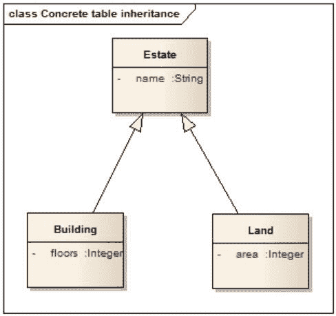**

*图 15-1：具体表继承关系*

我们将从图 15-1 所示的具体表继承关系开始。`Estate` 实体有一个标识符和一个名称。`Building` 实体拥有标识符、`Estate` 的名称以及楼层。`Land` 实体也拥有 `Estate` 的所有字段以及土地面积。具体表的特征是，所有类都有对应的表，且子类型拥有父类的所有字段。

### 开发用户界面

我们将用户界面的开发分为三个主要任务：数据传输对象、模拟服务和模拟用户界面。我们将一个接一个地查看这些每项任务。

### 开发数据传输对象

数据传输对象包含 `EstateDto`，它有一个标识符和一个名称。`EstateDto` 有两个子类型，分别是 `BuildingDto`（它也有楼层数）和 `LandDto`（它有一个面积）。

```java
@JsonTypeInfo(use = JsonTypeInfo.Id.NAME, include = JsonTypeInfo.As.PROPERTY, property = “type”)
@JsonSubTypes({
 @Type(value = BuildingDto.class, name = “building”),
 @Type(value = LandDto.class, name = “land”) })
public class EstateDto {
    private Integer id;
    private String name;
    // getters and setters
}

public class BuildingDto extends EstateDto {
    @JsonProperty(“floors”)
    private Integer floors;
    // getters and setters
}

public class LandDto extends EstateDto {
    @JsonProperty(“area”)
    private Integer area;
    // getters and setters
}
```

#### 开发模拟服务

让我们直接进入基于枚举实现的单例模式的内存数据库的简单添加操作。

```java
public enum EstateInMemoryDB {
    INSTANCE;
    private static List<EstateDto> list = new ArrayList<EstateDto>();
    private static Integer lastId = 0;

    public Integer getId() {
        return ++lastId;
    }

    public void add(EstateDto estateDto) {
        estateDto.setId(getId());
        list.add(estateDto);
    }
}
```

我们将关注模拟服务中的创建功能，该功能使用上述内存目录来持久化数据。

```java
@Controller
@RequestMapping(value=”/concretetableinheritance/mock”)
public class EstateMockController {
    @RequestMapping(value=”/create”, method=RequestMethod.POST)
    @ResponseBody
    public void create(@RequestBody EstateDto estate){
        EstateInMemoryDB.INSTANCE.add(estate);
    }
}
```

接下来我们将展示负责检索所有行的方法。首先，我们将审查控制器将使用的内存数据库操作。

```java
public enum EstateInMemoryDB {
    public List<EstateDto> findAll() {
        return list;
    }

    public EstateDto findById(Integer id) {
        for (EstateDto dto:list) {
            if (dto.getId().equals(id)) return dto;
        }
        return null;
    }
}
```

`/findAll` 返回 `EstateDto` 的所有子类型，而 `/findById` 返回特定的 `LandDto` 或 `BuildingDto`。

```java
public class EstateMockController {
    @RequestMapping(value=”/findAll”, method=RequestMethod.GET)
    @ResponseBody
    public EstateDto[] findAll(){
        List<EstateDto> list = EstateInMemoryDB.INSTANCE.findAll();
        return list.toArray(new EstateDto[0]);
    }

    @RequestMapping(value=”/findById/{estateid}”, method=RequestMethod.GET)
    @ResponseBody
    public EstateDto findById(@PathVariable(“estateid”) Integer estateid){
        return EstateInMemoryDB.INSTANCE.findById(estateid);
    }
}
```

`/remove` 根据标识符更新行。

```java
public enum EstateInMemoryDB {
    public void remove(Integer id) {
        EstateDto toRemove = null;
        for (EstateDto dto:list) {
            if (dto.getId().equals(id)) {
                toRemove = dto;
                break;
            }
        }
        if (toRemove != null) {
            list.remove(toRemove);
        }
    }
}
```


```java
public class EstateMockController {
    @RequestMapping(value="/remove/{protocolid}", method=RequestMethod.POST)
    @ResponseStatus(value = HttpStatus.NO_CONTENT)
    public void remove(@PathVariable("protocolid") Integer protocolid){
        EstateInMemoryDB.INSTANCE.remove(protocolid);
    }
}
```

`/edit` 方法根据特定信息更新。

```java
public class EstateInMemoryDB {
    public void edit(EstateDto estateDto) {
        for (EstateDto dto:list) {
            if (dto.getId().equals(estateDto.getId())) {
                dto.setName(estateDto.getName());
                if (estateDto instanceof BuildingDto) {
                    ((BuildingDto)dto).setFloors(((BuildingDto)estateDto).getFloors());
                } else if (estateDto instanceof LandDto) {
                    ((LandDto)dto).setArea(((LandDto)estateDto).getArea());
                }
            }
        }
    }
}
```

```java
public class EstateMockController {
    @RequestMapping(value="/edit", method=RequestMethod.POST)
    @ResponseBody
    public void edit(@RequestBody ProtocolDto protocol){
        EstateInMemoryDB.INSTANCE.edit(protocol);
    }
}
```

## 开发用户界面

现在让我们看看如何生成图 15-2 所示的用户界面。

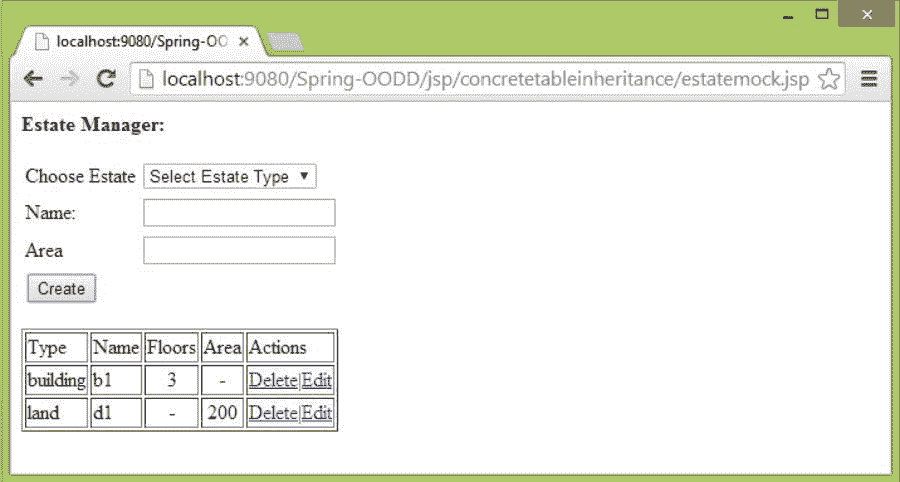

*图 15-2：Estate 用户界面截图*

让我们首先审查构成面的 JSP 片段。

```html
<body onload="loadObjects()">
    <div id="container">
        <div>
            <p><b>Estate Manager:</b></p>
        </div>
        <form method="post" id="estateForm">
            <table>
                <tbody>
                    <tr>
                        <td>Choose Estate</td>
                        <td>
                            <select name="estateChooser" id="estateChooser" onchange="setEstateValue()">
                                <option value="">Select Estate Type</option>
                                <option value="building">Building</option>
                                <option value="land">Land</option>
                            </select>
                        </td>
                    </tr>
                    <tr>
                        <td>Name:</td>
                        <td>
                            <input name="estateid" id="estateid" type="hidden">
                            <input name="estatename" id="estatename" type="text">
                        </td>
                    </tr>
                    <tr>
                        <td><div id="estateType">Enter Value</div></td>
                        <td>
                            <input name="estateProperty" id="estateProperty" type="text">
                        </td>
                    </tr>
                    <tr>
                        <td colspan="2"><input type="submit" value="Create" id="subButton" onclick="return methodCall()"></td>
                    </tr>
                </tbody>
            </table>
        </form>
        <div id="estateFormResponse"></div>
    </div>
</body>
```

首先，我们将看到在页面加载时通过 `onload` 事件调用的 JavaScript 方法。

```javascript
function loadObjects(){
  $.ajax({
    url : "/Spring-OODD/concretetableinheritance/mock/findAll",
    type: "GET",
    data : {},
    dataType: "json",
    success: function(data, textStatus, jqXHR)
    {
      processResponseData(data);
    },
    error: function (jqXHR, textStatus, errorThrown)
    {
      document.getElementById("estatename").value="";
      document.getElementById("estateProperty").value="";
      alert("Error Status Load Objects:"+textStatus);
    }
  });
  $('#estateChooser').get(0).selectedIndex = 0;
  return false;
}
```

当上述服务调用成功时，会调用 JavaScript `processResponseData` 方法。同样，在获取值后，会调用 JavaScript 方法 `generateTableData` 来形成表格网格。

```javascript
function processResponseData(responsedata){
  var dyanicTableRow="<table border=1>"+
  "<tr>" +
  "<td>Type</td>"+
  "<td>Name</td>"+
  "<td>Floors</td>"+
  "<td>Area</td>"+
  "<td>Actions</td>"+
  "</tr>";
  var dataRow="";
  $.each(responsedata, function(itemno, itemvalue){
    dataRow=dataRow+generateTableData(itemvalue);
  });
  dyanamicTableRow=dyanamicTableRow+dataRow+"</table>";
  document.getElementById("estateFormResponse").innerHTML=dyanamicTableRow;
} 
```

```javascript
function generateTableData(itemvalue){
  var floorValue = (itemvalue.floors != "" && itemvalue.floors != null) ? itemvalue.floors : "-";
  var areaValue = (itemvalue.area != "" && itemvalue.area != null) ? itemvalue.area : "-";
  var dataRow="<tr>" +
  "<td>" +itemvalue.type+"</td>"+
  "<td>" +itemvalue.name+"</td>"+
  "<td align='center'>" +floorValue+"</td>"+
  "<td align='center'>" +areaValue+"</td>"+
  "<td>" +
  "<a href=# onclick=deleteObject("+itemvalue.id+")>Delete</a>"+
  "|<a href=# onclick=editObject("+itemvalue.id+")>Edit</a>"+
  "</td>"+
  "</tr>";
  return dataRow;
} 
```

我们已经了解了页面加载是如何工作的。现在让我们看看使用 JavaScript 方法 `methodCall` 调用的创建和更新功能。

```javascript
function methodCall(){
  var buttonValue = document.getElementById("subButton").value;
  if(buttonValue=="Create"){
    create();
  }else if(buttonValue=="Update"){
    update();
  }
  return false;
}
```

首先，我们将复习 JavaScript `create` 方法。

```javascript
function create(){
  var name = $("#estatename").val();
  var type = $("#estateChooser").val();
  var estateProperty = $("#estateProperty").val();
  var formData = "";
  if(type == "" || type == null) {
    alert("Please choose Estate Type");
    return false;
  }
  if(name == "" || name == null) {
    alert("Please enter Estate name");
    return false;
  }
  if(type == "building") {
    formData={"type":"building","name":name,"floors":estateProperty};
  } else if (type == "land") {
    formData={"type":"land","name":name,"area":estateProperty};
  }
  $.ajax({
    url : "/Spring-OODD/concretetableinheritance/mock/create",
    type: "POST",
    data : JSON.stringify(formData),
    beforeSend: function(xhr) {
      xhr.setRequestHeader("Accept", "application/json");
      xhr.setRequestHeader("Content-Type", "application/json");
    },
    success: function(data, textStatus, jqXHR)
    {
      document.getElementById("estatename").value="";
      document.getElementById("estateProperty").value="";
      document.getElementById("subButton").value="Create";
      loadObjects();
    },
    error: function (jqXHR, textStatus, errorThrown)
    {
      document.getElementById("estatename").value="";
      document.getElementById("estateProperty").value="";
      alert("Error Status Create:"+textStatus);
    }
  });
  return false;
}
```

接下来我们将预测 JavaScript `update` 方法。

```javascript
function update(){
  var name = $("#estatename").val();
  var id = +$("#estateid").val();
  var type = $("#estateChooser").val();
  var estateProperty = $("#estateProperty").val();
  // ... (逻辑根据原文延续)
}
```

```java
@Inheritance(strategy = InheritanceType.TABLE_PER_CLASS)

public class Estate {

private Integer id;

private String name;

@Id
@GeneratedValue(strategy = GenerationType.TABLE)
@Column(name = "ID")
public Integer getId() {
    return id;
}

public void setId(Integer id) {
    this.id = id;
}

@Column(name = "NAME", nullable = false, length = 100)
public String getName() {
    return name;
}

public void setName(String name) {
    this.name = name;
}

}
```

接下来，我们将查看 `Building` 实体的测试。


```java
@RunWith( SpringJUnit4ClassRunner.class )
@ContextConfiguration( locations = { “classpath:context.xml” } )
@TransactionConfiguration( defaultRollback = true )
@Transactional
public class BuildingTest {
@Autowired
private SessionFactory sessionFactory;
@SuppressWarnings(“unchecked”)
@Test
public void testCRUD()
{
Estate p1 = new Estate();
p1.setName(“Estate”);
sessionFactory.getCurrentSession().save(p1);
Building building = new Building();
building.setName(“Building”);
building.setFloors(20);
sessionFactory.getCurrentSession().save(building);
building.setName(“Building Estate”);
building.setFloors(30);
sessionFactory.getCurrentSession().merge(building);
List<Building> list = sessionFactory.getCurrentSession().createQuery(“from Building”).list();
Assert.assertEquals(1L, list.size());
sessionFactory.getCurrentSession().delete(building);
List<Building> list2 = sessionFactory.getCurrentSession().createQuery(“from Building”).list();
Assert.assertEquals(0L, list2.size());
}
}
```

根据上面的测试，我们复习`Building`实体的定义。

```java
@Entity
@Table(name=”BUILDING”)
@AttributeOverrides({ 
 @AttributeOverride(name=”id”, column=@Column(name=”ID”)), 
 @AttributeOverride(name=”name”, column=@Column(name=”NAME”)) 
}) 
public class Building extends Estate {
private Integer floors;
@Column(name = “FLOORS”, nullable = false, length = 100)
public Integer getFloors() {
    return floors;
}

public void setFloors(Integer floors) {
    this.floors = floors;
}

}
```

最后，我们预见`Land`实体的测试，它与`Building`实体的测试相似。

```java
@RunWith( SpringJUnit4ClassRunner.class )
@ContextConfiguration( locations = { “classpath:context.xml” } )
@TransactionConfiguration( defaultRollback = true )
@Transactional
public class LandTest {
@Autowired
private SessionFactory sessionFactory;
@SuppressWarnings(“unchecked”)
@Test
public void testCRUD()
{
Estate p1 = new Estate();
p1.setName(“Estate”);
sessionFactory.getCurrentSession().save(p1);
Land land = new Land();
land.setName(“Land”);
land.setArea(20);
sessionFactory.getCurrentSession().save(land);
land.setName(“Land Estate”);
land.setArea(30);
sessionFactory.getCurrentSession().merge(land);
List<Land> list = sessionFactory.getCurrentSession().createQuery(“from Land”).list();
Assert.assertEquals(1L, list.size());
sessionFactory.getCurrentSession().delete(land);
List<Land> list2 = sessionFactory.getCurrentSession().createQuery(“from Land”).list();
Assert.assertEquals(0L, list2.size());
}
}
```

最后，我们查看`Land`实体。

```java
@Entity
@Table(name=”LAND”)
@AttributeOverrides({ 
 @AttributeOverride(name=”id”, column=@Column(name=”ID”)), 
 @AttributeOverride(name=”name”, column=@Column(name=”NAME”)) 
}) 
public class Land extends Estate {
private Integer area;
@Column(name = “AREA”, nullable = false, length = 100)
public Integer getArea() {
    return area;
}

public void setArea(Integer area) {
    this.area = area;
}

}
```

### 表结构

```sql
DROP TABLE land;
DROP TABLE building;
DROP TABLE estate;
CREATE TABLE estate (
ID int(11) NOT NULL,
NAME varchar(100) NOT NULL,
PRIMARY KEY (ID)
);

CREATE TABLE building (
ID int(11) NOT NULL,
NAME varchar(100) NOT NULL,
FLOORS int(11) NOT NULL,
PRIMARY KEY (ID)
);

CREATE TABLE land (
ID int(11) NOT NULL,
NAME varchar(100) NOT NULL,
AREA int(11) NOT NULL,
PRIMARY KEY (ID)
);
```

### 开发数据访问层

我们将从查找所有记录操作的测试用例开始。

```java
@RunWith( SpringJUnit4ClassRunner.class )
@ContextConfiguration( locations = { “classpath:context.xml” } )
@TransactionConfiguration( defaultRollback = true )
@Transactional
public class EstateDaoTest {
@Autowired
private EstateDao dao;
@Test
public void testGetAll() {
    Assert.assertEquals(0L, dao.getAll().size());
}
}
```

然后我们将看到获取所有记录的测试。

```java
@RunWith( SpringJUnit4ClassRunner.class )
@ContextConfiguration( locations = { “classpath:context.xml” } )
@TransactionConfiguration( defaultRollback = true )
@Transactional
public class EstateDaoTest {
@Autowired
private EstateDao dao;
@Test
public void testGetAll() {
    Assert.assertEquals(0L, dao.getAll().size());
}
}
```

```java
@TransactionConfiguration( defaultRollback = true )
@Transactional
public class EstateServiceImplTest {

    @Autowired
    private EstateService service;

    @Test
    public void testFindAll() {
        Assert.assertEquals(0L, service.findAll().size());
    }
}
```

让我们来看看如何在业务服务中编写对应的“查找所有记录”方法。

```java
@Service
@Transactional
public class EstateServiceImpl implements EstateService {
    @Autowired
    private EstateDao estateDao;

    @Autowired
    private EstateMapper estateMapper;

    @Override
    public List<EstateDto> findAll() {
        List<Estate> estates = estateDao.getAll();
        List<EstateDto> estateDtos = new ArrayList<EstateDto>();
        for(Estate estate : estates){
            estateDtos.add(estateMapper.mapEntityToDto(estate));
        }
        return estateDtos;
    }
}
```

`Mapper`的特征是有两个至关重要的操作，用于将数据访问对象转换为实体，反之亦然。

```java
@Component
public class EstateMapper {
    public Estate mapDtoToEntity(EstateDto estateDto){
        if(estateDto instanceof BuildingDto) {
            Building building = new Building();
            if(null!=estateDto.getId()) building.setId(estateDto.getId());
            if(null!=estateDto.getName()) building.setName(estateDto.getName());
            if(null!=((BuildingDto)estateDto).getFloors()) building.setFloors(((BuildingDto)estateDto).getFloors());
            return building;
        } else if(estateDto instanceof LandDto) {
            Land land = new Land();
            if(null!=estateDto.getId()) land.setId(estateDto.getId());
            if(null!=estateDto.getName()) land.setName(estateDto.getName());
            if(null!=((LandDto)estateDto).getArea()) land.setArea(((LandDto)estateDto).getArea());
            return land;
        }
        return null;
    }

    public EstateDto mapEntityToDto(Estate estate){
        if(estate instanceof Building) {
            BuildingDto buildingDto = new BuildingDto();
            if(null!=estate.getId()) buildingDto.setId(estate.getId());
            if(null!=estate.getName()) buildingDto.setName(estate.getName());
            if(null!=((Building)estate).getFloors()) buildingDto.setFloors(((Building)estate).getFloors());
            return buildingDto;
        } else if(estate instanceof Land) {
            LandDto landDto = new LandDto();
            if(null!=estate.getId()) landDto.setId(estate.getId());
            if(null!=estate.getName()) landDto.setName(estate.getName());
            if(null!=((Land)estate).getArea()) landDto.setArea(((Land)estate).getArea());
            return landDto;
        }
        return null;
    }
}
```

接下来的“创建”测试操作用于在数据库中创建新行。

```java
public class EstateServiceImplTest {
    @Test
    public void testCreate() {
        EstateDto bestate = new BuildingDto();
        bestate.setName(“Majestic Estate”);
        ((BuildingDto)bestate).setFloors(10);
        service.create(bestate);
        EstateDto hEstate = new LandDto();
        hEstate.setName(“Royal Estate”);
        ((LandDto)hEstate).setArea(200);
        service.create(hEstate);
        Assert.assertEquals(2L, service.findAll().size());
    }
}
```

业务服务层中的匹配方法接受一个数据访问对象，将其转换为实体并委托给数据访问层提交到数据库。

```java
public class EstateServiceImpl implements EstateService {
    @Override
    public void create(EstateDto estateDto) {
        estateDao.insert(estateMapper.mapDtoToEntity(estateDto));
    }
}
```

我们将定义的下一个操作是根据给定标识符查找行。

```java
public class EstateServiceImplTest {
    @Test
    public void testFindById() {
        EstateDto bestate = new BuildingDto();
        bestate.setName(“Majestic Estate”);
        ((BuildingDto)bestate).setFloors(10);
        service.create(bestate);
        List<EstateDto> pList = service.findAll();
        EstateDto estate = pList.get(0);
        EstateDto estate2 = service.findById(estate.getId());
        Assert.assertEquals(“Majestic Estate”, estate2.getName());
    }
}
```

业务服务中根据给定标识符查找行的等效操作现在将被标记。


```java
public class EstateServiceImpl implements EstateService {
    @Override
    public EstateDto findById(Integer id) {
        Estate estate = estateDao.getById(id);
        EstateDto estateDto = null;
        if(null !=estate){
            estateDto = estateMapper.mapEntityToDto(estate);
        }
        return estateDto;
    }
}
```

接下来是“删除”过程，它接受一个给定的标识符并从数据库中删除相同的行。

```java
public class EstateServiceImplTest {
    @Test
    public void testRemove() {
        EstateDto bestate = new BuildingDto();
        bestate.setName(“Majestic Estate”);
        ((BuildingDto)bestate).setFloors(10);
        service.create(bestate);
        EstateDto hEstate = new LandDto();
        hEstate.setName(“Royal Estate”);
        ((LandDto)hEstate).setArea(200);
        service.create(hEstate);
        Assert.assertEquals(2L, service.findAll().size());
        List<EstateDto> pList = service.findAll();
        EstateDto estate = pList.get(0);
        service.remove(estate);
    }
}
```

等效的业务服务接下来定义，它接受一个标识符并通过数据访问层从数据库中删除实例。

```java
public class EstateServiceImpl implements EstateService {
    @Override
    public void remove(Integer estateId) {
        Estate estate = estateDao.getById(estateId);
        estateDao.delete(estate);
    }
}
```

我们描述的最后一个测试操作是“编辑”操作，它接受一个数据访问对象并将更改合并到数据库。

```java
public class EstateServiceImplTest {
    @Test
    public void testEdit() {
        EstateDto bestate = new BuildingDto();
        bestate.setName(“Majestic Estate”);
        ((BuildingDto)bestate).setFloors(10);
        service.create(bestate);
        List<EstateDto> pList = service.findAll();
        EstateDto estate = pList.get(0);
        estate.setName(“Royal Estate”);
        service.edit(estate);
        List<EstateDto> pList2 = service.findAll();
        EstateDto estate2 = pList2.get(0);
        Assert.assertEquals(“Royal Estate”, estate2.getName());
    }
}
```

业务服务的对应操作定义如下。

```java
public class EstateServiceImpl implements EstateService {
    @Override
    public void edit(EstateDto estateDto) {
        estateDao.update(estateMapper.mapDtoToEntity(estateDto));
    }
}
```

### 表示层

栈中的最后一层是基于 REST 的 Spring 控制器。首先我们将如何编写测试，然后是控制器。

```java
@RunWith(SpringJUnit4Runner.class)
@WebAppConfiguration
@ContextConfiguration( locations = {classpath:context.xml” }
@TransactionConfiguration(defaultRollback = true)
@Transactional
public class EstateControllerTest {
    private Gson gson = new GsonBuilder().create();

    @Resource
    private WebApplicationContext webApplicationContext;

    private MockMvc mockMvc;

    @Before
    public void setUp() {
        mockMvc = MockMvcBuilders.<webAppContextSetup
        (webApplicationContext).build();
    }

    @Test
    public void testAll() throws Exception {
        testCreate();
        testUpdate();
        testDelete();
    }

    public void testCreate() throws Exception {
        EstateDto estateDto = new BuildingDto();
        estateDto.setName(“ABC”);
        ((BuildingDto)estateDto).setFloors(20);
        String json = gson.toJson(estateDto);
        json= json.replace(“{“, “”);
        json= json.replace(“}”, “”);
        json = “{\"type\”:\”building\”,”+json+”}”;
        MockHttpServletRequestBuilder requestBuilderOne = MockMvcRequestBuilders.post(“/concretetableinheritance/create”);
        requestBuilderOne.contentType(MediaType.APPLICATION_JSON);
        requestBuilderOne.content(json.getBytes());
        this.mockMvc.perform(requestBuilderOne).andExpect(MockMvcResultMatchers.status().isOk());
    }

    public void testUpdate() throws Exception {
        MockHttpServletRequestBuilder requestBuilder2 = MockMvcRequestBuilders.get(“/concretetableinheritance/findAll”);
        MvcResult result = this.mockMvc.perform(requestBuilder2).andReturn();
        String response2 = result.getResponse().getContentAsString();
        Type listType = new TypeToken<EstateDto[]>() {}.getType();
        EstateDto[] estateDtoList = gson.fromJson(response2, listType);
        EstateDto estateDto2 = estateDtoList[0];
    }
}
```

```java
EstateDto newEstateDto = new BuildingDto();

newEstateDto.setId(estateDto2.getId());

newEstateDto.setName(“DEF”);

((BuildingDto)newEstateDto).setFloors(21);

String json2 = gson.toJson(newEstateDto);

json2= json2.replace(“{“, “”);

json2= json2.replace(“}”, “”);

json2 = “{\”type\”:\”building\”,”+json2+”}”;

MockHttpServletRequestBuilder requestBuilder3 = MockMvcRequestBuilders.post(“/concretetableinheritance/edit”);

requestBuilder3.contentType(MediaType.APPLICATION_JSON);

requestBuilder3.content(json2.getBytes());

this.mockMvc.perform(requestBuilder3).andExpect(MockMvcResultMatchers.status().isOk());

}

public void testDelete() throws Exception {
MockHttpServletRequestBuilder requestBuilder2 = MockMvcRequestBuilders.get(“/concretetableinheritance/findAll”);
MvcResult result = this.mockMvc.perform(requestBuilder2).andReturn();
String response2 = result.getResponse().getContentAsString();
Type listType = new TypeToken<EstateDto[]>() {}.getType();
EstateDto[] estateDtoList = gson.fromJson(response2, listType);
EstateDto estateDto2 = estateDtoList[0];
MockHttpServletRequestBuilder requestBuilder3 = MockMvcRequestBuilders.post(“/concretetableinheritance/remove/”+estateDto2.getId());
requestBuilder3.contentType(MediaType.APPLICATION_JSON);
this.mockMvc.perform(requestBuilder3).andExpect(MockMvcResultMatchers.status().is(204));
}

}
```

匹配的 REST Spring Controller 将连接业务服务层以访问数据库。请注意，该代码与之前开发的 mock 控制器类似，区别在于请求映射以及调用的是实际数据库而不是 mock 内存数据库。

```java
@Controller

@RequestMapping(value=”/concretetableinheritance”)
@Transactional
public class EstateController {
@Autowired
private EstateService service;

@RequestMapping(value=”/findAll”, method=RequestMethod.GET)
public @ResponseBody EstateDto[] findAll(){
List<EstateDto> list = service.findAll();
return list.toArray(new EstateDto[list.size()]);
}

@RequestMapping(value=”/findById/{estateid}”, method=RequestMethod.GET)
public @ResponseBody EstateDto findById(@PathVariable(“estateid”) Integer estateid){
return service.findById(estateid);
}

@RequestMapping(value=”/create”, method=RequestMethod.POST)
@ResponseBody
public void create(@RequestBody EstateDto estate){
service.create(estate);
}

@RequestMapping(value=”/remove/{estateid}”, method=RequestMethod.POST)
@ResponseStatus(value = HttpStatus.NO_CONTENT)
public void remove(@PathVariable(“estateid”) Integer estateid){
service.remove(estateid);
}

@RequestMapping(value=”/edit”, method=RequestMethod.POST)
@ResponseBody
public void edit(@RequestBody EstateDto estate){
service.edit(estate);
}
}
```

我们已经到达本章的末尾，我们将讨论如何整合两个团队完成的工作。REST 服务需要与实际的用户界面集成。请注意，请求映射从“/concretetableinheritance/mock” 变为“/concretetableinheritance”。剩余工作涉及通过提取 mock 用户界面的大部分内容来创建实际界面。

### 总结

在本章中，我们讨论了以下内容：

* 开发 mock 内存数据库

* 开发 mock 用户界面

* 开发与类表继承相关的实体

* 开发数据访问层

* 开发业务服务层

* 开发 REST 服务控制器。

## 第 16 章 类表继承

在之前的两个章节中，我们查看了两种继承方法：一种是单表模式，另一种是具体表模式。在本章中，我们将查看第三种也是最后一种继承方法。本章是关于使用类表继承关系进行开发流程的概述。我们将结束创建用户界面的旅程，然后编写真正的服务。在最后，我们将结合两种解决方案并得出一个深思的结论。

### 领域模型

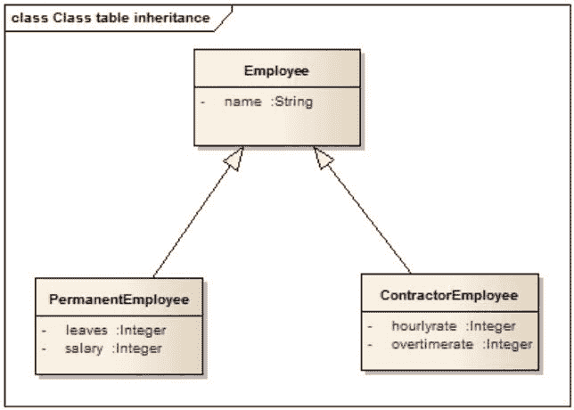

*图 16-1：类表继承关系*

我们将从图 16-1 所示的类表继承关系开始。这是一个规范化设计的示例。`Employee` 实体有一个标识符（`identifier`）和一个 `String` 类型的名称（`name`）字段。`Permanent` 实体有一个标识符，作为指向父类的外键，并拥有 `leaves` 和 `salary` 等字段。`Contractor` 实体也有一个标识符，作为 `Employee` 标识符的外键，并拥有 `hourly rates` 和 `overtime rate` 等字段。

### 开发用户界面

我们将用户界面开发分为三个主要任务：数据传输对象（DTO）、mock 服务和 mock 用户界面。我们将一个接一个查看这些任务。

### 开发数据传输对象

数据传输对象包含 `EmployeeDto`，它有一个标识符和一个名称。`EmployeeDto` 有两个子类型，称为 `PermanentEmployeeDto`（它也拥有 `salary` 和 `leaves`）和 `ContractorEmployeeDto`（它拥有 `hourly rate` 和 `overtime rate`）。

```java
@JsonTypeInfo(use = JsonTypeInfo.Id.NAME, include = JsonTypeInfo.As.PROPERTY, property = “type”)
@JsonSubTypes({
 @Type(value = PermanentEmployeeDto.class, name = “permanentEmployee”),
 @Type(value = ContractorEmployeeDto.class, name = “contractorEmployee”)
})
public class EmployeeDto {
private Integer id;
private String name;
}
```


```java
public class PermanentEmployeeDto extends EmployeeDto {
    private Integer leaves;
    private Integer salary;
}
```

```java
public class ContractorEmployeeDto extends EmployeeDto {
    private Integer hourlyRate;
    private Integer overtimeRate;
}
```

## 开发 mock 服务

让我们从向内存数据库执行一个简单的 `add` 操作开始，该数据库是基于 `enum` 实现的 `Singleton` 模式。

```java
public enum EmployeeInMemoryDB {
    INSTANCE;
    private static List<EmployeeDto> list = new ArrayList<EmployeeDto>();
    private static Integer lastId = 0;

    public Integer getId() {
        return ++lastId;
    }

    public void add(EmployeeDto employeeDto) {
        employeeDto.setId(getId());
        list.add(employeeDto);
    }
}
```

我们将关注 mock 服务中的 `create` 功能，该功能使用上述内存目录来持久化数据。

```java
@Controller
@RequestMapping(value="classtableinheritance/mock")
public class EmployeeMockController {
    @RequestMapping(value="/create", method=RequestMethod.POST)
    @ResponseBody
    public void create(@RequestBody EmployeeDto employee){
        EmployeeInMemoryDB.INSTANCE.add(employee);
    }
}
```

接下来，我们将查看负责检索所有行的方法。首先，我们将审查控制器将使用的内存数据库操作。

```java
public enum EmployeeInMemoryDB {
    public List<EmployeeDto> findAll() {
        return list;
    }

    public EmployeeDto findById(Integer id) {
        for (EmployeeDto dto:list) {
            if (dto.getId()==id)
                return dto;
        }
        return null;
    }
}
```

`/findAll` 返回 `EmployeeDto` 子类型的所有实例，而 `/findById` 返回 `PermanentDto` 或 `ContractorDto` 的特定行。

```java
public class EmployeeMockController {
    @RequestMapping(value="/findAll", method=RequestMethod.GET)
    public @ResponseBody EstateDto[] findAll(){
        List<EstateDto> list = EmployeeInMemoryDB.INSTANCE.findAll();
        return list.toArray(new EstateDto[list.size()]);
    }

    @RequestMapping(value="/findById/{employeeid}", method=RequestMethod.GET)
    public @ResponseBody EstateDto findById(@PathVariable("employeeid") Integer employeeid){
        return EmployeeInMemoryDB.INSTANCE.findById(employeeid);
    }
}
```

接下来我们将看到 `remove` 操作，它根据标识符删除特定的行。

```java
public void remove(Integer id) {
    EmployeeDto toRemove = null;
}
```

```java
for (EmployeeDto dto:list) 
    if (dto.getId()==id) toRemove = dto;
    if (toRemove!=null) list.remove(toRemove);
}
```

`/remove` 操作根据给定的标识符删除特定的行。

```java
public class EmployeeMockController {
    @RequestMapping(value="/remove/{employeeid}", method=RequestMethod.POST)
    @ResponseStatus(value = HttpStatus.NO_CONTENT)
    public void remove(@PathVariable("employeeid") Integer employeeid){
        EmployeeInMemoryDB.INSTANCE.remove(employeeid);
    }
}
```

`edit` 方法使用特定细节更新某行。让我们来看看控制器将要使用的内存数据库操作。

```java
public class EmployeeInMemoryDB {
    public void edit(EmployeeDto employeeDto) {
        for (EmployeeDto dto:list) {
            if (dto.getId()==employeeDto.getId()) {
                dto.setName(employeeDto.getName());
                if(employeeDto instanceof PermanentEmployeeDto) {
                    ((PermanentEmployeeDto)dto).setLeaves(((PermanentEmployeeDto)employeeDto).getLeaves());
                    ((PermanentEmployeeDto)dto).setSalary(((PermanentEmployeeDto)employeeDto).getSalary());
                } else if(employeeDto instanceof ContractorEmployeeDto) {
                    ((ContractorEmployeeDto)dto).setHourlyRate(((ContractorEmployeeDto)employeeDto).getHourlyRate());
                    ((ContractorEmployeeDto)dto).setOvertimeRate(((ContractorEmployeeDto)employeeDto).getOvertimeRate());
                }
            }
        }
    }
}
```

`/edit` 操作使用 HTTP POST 方法更新详细信息的行。

```java
public class EmployeeMockController {
    @RequestMapping(value="edit", method=RequestMethod.POST)
    @ResponseBody
    public void edit(@RequestBody EmployeeDto employee){
        EmployeeInMemoryDB.INSTANCE.edit(employee);
    }
}
```

## 开发模拟用户界面

现在让我们看看如何生成图 16-2 所示的用户界面。

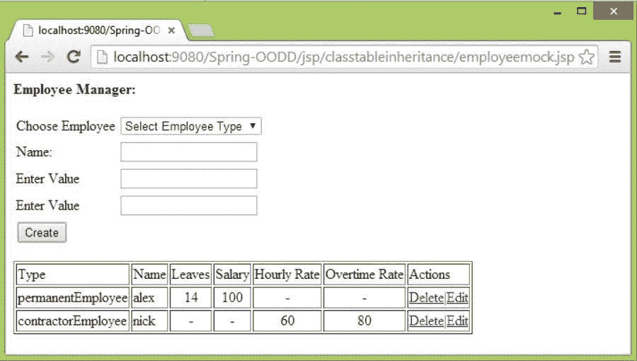

*图 16-2：员工管理器用户界面的截图*

让我们首先回顾构成页面体的 JSP 片段。

```html
<body onload="loadObjects()">
    <div id="container">
        <div>
            <p><b>Employee Manager:</b></p>
        </div>
        <form method="post" id="employeeForm">
            <table>
                <tbody>
                    <tr>
                        <td>选择员工</td>
                        <td>
                            <select name="employeeChooser" id="employeeChooser" onchange="setEmployeeValue()">
                                <option value="">选择员工类型</option>
                                <option value="permanentEmployee">正式员工</option>
                                <option value="contractorEmployee">合同工</option>
                            </select>
                        </td>
                    </tr>
                    <tr>
                        <td>名称：</td>
                        <td>
                            <input name="employeeid" id="employeeid" type="hidden">
                            <input name="employeename" id="employeename" type="text">
                        </td>
                    </tr>
                    <tr>
                        <td><div id="employeeFirstValue">输入值</div></td>
                        <td>
                            <input name="employeeFirstProperty" id="employeeFirstProperty" type="text">
                        </td>
                    </tr>
                    <tr>
                        <td><div id="employeeSecondValue">输入值</div></td>
                        <td>
                            <input name="employeeSecondProperty" id="employeeSecondProperty" type="text">
                        </td>
                    </tr>
                    <tr>
                        <td colspan="2"><input type=submit value="创建" id="subButton" onclick="return methodCall()"></td>
                    </tr>
                </tbody>
            </table>
        </form>
        <div id="employeeFormResponse"></div>
    </div>
</body>
```

首先我们将看到 JavaScript 方法 `loadObjects()`，它在页面通过 `onload` 事件加载时被调用。

```javascript
function loadObjects(){
    $.ajax({
        url : "/Spring-OODD/clastableinheritance/mock/findAll",
        type: "GET",
        data : {},
        dataType: "json",
        success: function(data, textStatus, jqXHR) {
            processResponseData(data);
        },
        error: function (jqXHR, textStatus, errorThrown) {
            document.getElementById("employeename").value="";
            document.getElementById("employeeFirstProperty").value="";
            document.getElementById("employeeSecondProperty").value="";
            alert("Error Status Load Objects:"+textStatus);
        }
    });
    $('#employeeChooser').get(0).selectedIndex = 0;
    return false;
}
```

JavaScript `processResponseData` 方法在上述服务调用成功时被调用。此外，在获取值后会调用 JavaScript `generateTableData` 来形成表格网格。

```javascript
function processResponseData(responsedata){
    var dyanicTableRow="<table border=1>"+
    "<tr>" +
    "<td>类型</td>"+
    "<td>名称</td>"+
    "<td>休假</td>"+
    "<td>薪资</td>"+
    "<td>时薪</td>"+
    "<td>加班费</td>"+
    "<td>操作</td>"+
    "</tr>";
    var dataRow="";
    $.each(responsedata, function(itemno, itemvalue){
        dataRow=dataRow+generateTableData(itemvalue);
    });
    dyanamicTableRow+=dataRow+"</table>";
    document.getElementById("employeeFormResponse").innerHTML=dyanamicTableRow;
}

function generateTableData(itemvalue){
    var leaves = (itemvalue.leaves != null) ? itemvalue.leaves : "-";
    var salary = (itemvalue.salary != null) ? itemvalue.salary : "-";
    var hourlyRate = (itemvalue.hourlyRate != null) ? itemvalue.hourlyRate : "-";
    var overtimeRate = (itemvalue.overtimeRate != null) ? itemvalue.overtimeRate : "-";
    return "<tr>"+itemvalue.type+"</td>"+
    "<td>"+itemvalue.name+"</td>"+
    "<td>"+leaves+"</td>"+
    "<td>"+salary+"</td>"+
    "<td>"+hourlyRate+"</td>"+
    "<td>"+overtimeRate+"</td>"+
    "<td><a href=\"#\" onclick=\"deleteObject("+itemvalue.id+")\">删除</a><a href=\"#\" onclick=\"editObject("+itemvalue.id+")\">编辑</a></td></tr>";
}
```

我们已经看到了页面是如何加载的。现在让我们通过 JavaScript `methodCall` 方法查看 `create` 和 `update` 功能。


首先，我们将回顾 JavaScript `create` 方法。

```javascript
function methodCall(){
    var buttonValue = document.getElementById(“subButton”).value;
    if(buttonValue==”Create”){
        create();
    }else if(buttonValue==”Update”){
        update();
    }
    return false;
}
```

```javascript
function create(){
    var name = $(#employeename).val();
    var type = $(#employeeChooser).val();
    var employeeFirstProperty = $(#employeeFirstProperty).val();
    var employeeSecondProperty = $(#employeeSecondProperty).val();
    var formData = “”;
    if(type == “” || type == null) {
        alert(“选择员工类型”);
        return false;
    }
    if(name == “” || name == null) {
        alert(“输入名称”);
        return false;
    }
    if(type == “permanentEmployee”) {
        formData={“type”:”permanentEmployee”,”name”:name,”leaves”:employeeFirstProperty,”salary”:employeeSecondProperty};
    } else if (type == “contractorEmployee”) {
        formData={“type”:”contractorEmployee”,”name”:name,”hourlyRate”:employeeFirstProperty,”overtimeRate”:employeeSecondProperty};
    }
    $.ajax({
        url : “/Spring-OODD/classtableinheritance/mock/create”,
        type: “POST”,
        data : JSON.stringify(formData),
        beforeSend: function(xhr) {
            xhr.setRequestHeader(“Accept”, “application/json”);
            xhr.setRequestHeader(“Content-Type”, “application/json”);
        },
        success: function(data, textStatus, jqXHR) {
            document.getElementById(“employeename”).value=””;
            document.getElementById(“employeeFirstProperty”).value=””;
            document.getElementById(“employeeSecondProperty”).value=””;
            document.getElementById(“subButton”).value=”Create”;
            loadObjects();
            setEmployeeValue();
        },
        error: function (jqXHR, textStatus, errorThrown) {
            document.getElementById(“employeename”).value=””;
            document.getElementById(“employeeFirstProperty”).value=””;
            document.getElementById(“employeeSecondProperty”).value=””;
            alert(“Error Status Create:”+textStatus);
        }
    });
    return false;
}
```

接下来我们将预见 JavaScript `update` 方法。

```javascript
function update(){
    var name = $(#employeename).val();
    var id = +$(#employeeid).val();
    var type = $(#employeeChooser).val();
    var employeeFirstProperty = $(#employeeFirstProperty).val();
    var employeeSecondProperty = $(#employeeSecondProperty).val();
    if(type == “permanentEmployee”) {
        formData={“type”:”permanentEmployee”,”id”:id,”name”:name,”leaves”:employeeFirstProperty,”salary”:employeeSecondProperty};
    } else if (type == “contractorEmployee”) {
        formData={“type”:”contractorEmployee”,”id”:id,”name”:name,”hourlyRate”:employeeFirstProperty,”overtimeRate”:employeeSecondProperty};
    }
}
```

```javascript
$.ajax({
url : “/Spring-OODD/classtableinheritance/mock/edit”,
type: “POST”,
data : JSON.stringify(formData),
beforeSend: function(xhr) {
xhr.setRequestHeader(“Accept”, “application/json”);
xhr.setRequestHeader(“Content-Type”, “application/json”);
},
success: function(data, textStatus, jqXHR)
{
document.getElementById(“employeename”).value=””;
document.getElementById(“employeeFirstProperty”).value=””;
document.getElementById(“employeeSecondProperty”).value=””;
document.getElementById(“subButton”).value=”Create”;
loadObjects();
setEmployeeValue();
},
error: function (jqXHR, textStatus, errorThrown)
{
document.getElementById(“employeename”).value=””;
document.getElementById(“employeeFirstProperty”).value=””;
document.getElementById(“employeeSecondProperty”).value=””;
alert(“Error Status Update:”+textStatus);
}
});
```

`editObject` 和 `viewObject` JavaScript 方法调用允许选择一条记录进行更新操作。

```javascript
function editObject(employeeid){
var editurl=”/Spring-OODD/classtableinheritance/mock/findById/”+employeeid;
var employeeForm={id:employeeid};
$.ajax({
url : editurl,
type: “GET”,
data : employeeForm,
dataType: “json”,
success: function(data, textStatus, jqXHR)
{
viewObject(data);
document.getElementById(“subButton”).value=”Update”;
setEmployeeValue();
},
error: function (jqXHR, textStatus, errorThrown)
{
alert(“Error Status Find Object:”+textStatus);
}
});
}
```

```javascript
function viewObject(data){
$(“#employeeChooser”).val(data.type);
document.getElementById(“employeename”).value=data.name;
document.getElementById(“employeeid”).value=data.id;
if(data.type == “permanentEmployee”) {
document.getElementById(“employeeFirstProperty”).value=data.leaves;
document.getElementById(“employeeSecondProperty”).value=data.salary;
} else if(data.type == “contractorEmployee”) {
document.getElementById(“employeeFirstProperty”).value=data.hourlyRate;
document.getElementById(“employeeSecondProperty”).value=data.overtimeRate;
}
}
```

最后，我们将展示 JavaScript 的 `deleteObject` 方法。

```javascript
function deleteObject(employeeid){
var employeeForm={id:employeeid};
var delurl=”/Spring-OODD/classtableinheritance/mock/remove/”+employeeid;
$.ajax({
url : delurl,
type: “POST”,
data : employeeForm,
dataType: “json”,
success: function(data, textStatus, jqXHR)
{
loadObjects();
},
error: function (jqXHR, textStatus, errorThrown)
{
alert(“Error Status Delete:”+textStatus);
}
});
}
```

### 开发服务

服务开发将分四个主要任务展开：创建实体、创建数据访问层、创建业务服务层以及创建与用户界面集成的基于 JSON 的 REST 服务。让我们一个一个来看，并采用自底向上的方法，从实体开始一直到 REST 服务。

### 开发资源（实体）层

首先，我们将查看 `Employee` 实体的测试，该测试包含了基本的 CRUD 操作。

```java
@RunWith( SpringJUnit4ClassRunner.class )
@ContextConfiguration( locations = { “classpath:context.xml” } )
@TransactionConfiguration( defaultRollback = true )
@Transactional
public class EmployeeTest {
@Autowired
private SessionFactory sessionFactory;
@SuppressWarnings(“unchecked”)
@Test
public void testCRUD()
{
Employee e1 = new Employee();
e1.setName(“A”);
Employee e2 = new Employee();
e2.setName(“B”);
sessionFactory.getCurrentSession().save(e1);
sessionFactory.getCurrentSession().save(e2);
e1.setName(“C”);
sessionFactory.getCurrentSession().merge(e1);
List<Employee> list = sessionFactory.getCurrentSession().createQuery(“from Employee”).list();
Assert.assertEquals(2L, list.size());
sessionFactory.getCurrentSession().delete(e1);
list<Employee> list2 = sessionFactory.getCurrentSession().createQuery(“from Employee”).list();
Assert.assertEquals(1L, list2.size());
}
}
```

我们将查看 `Employee` 实体的定义。`@Inheritance` 注解定义了继承策略，即类表继承，也称为连接策略（Joined strategy）。这种策略为层次结构中的所有类都有一个表，是一种规范化的设计。例如，`Permanent` 实体将有一个标识符，它是指向 `Employee` 实体的外键，以及 `salary` 和 `leaves` 字段。同样，`Contractor` 实体将有一个指向 `Employee` 的外键标识符，以及 `hourlyRate` 和 `overtimeRate` 字段。

```java
@Entity
@Table(name = “EMPLOYEE”)
@Inheritance(strategy = InheritanceType.JOINED)
public class Employee {
private Integer id;
private String name;
@Id
@GeneratedValue(strategy = GenerationType.TABLE)
@Column(name = “ID”)
public Integer getId() {
return id;
}
public void setId(Integer id) {
this.id = id;
}
@Column(name = “NAME”, nullable = false)
public String getName() {
return name;
}
public void setName(String name) {
this.name = name;
}
```

接下来，我们将查看 `PermanentEmployee` 实体的测试。


```java
@RunWith( SpringJUnit4ClassRunner.class )
@ContextConfiguration( locations = { “classpath:context.xml” } )
@TransactionConfiguration( defaultRollback = true )
@Transactional
public class PermanentEmployeeTest {
@Autowired
private SessionFactory sessionFactory;
@SuppressWarnings(“unchecked”)
@Test
public void testCRUD()
{
Employee e1 = new Employee();
e1.setName(“A”);
sessionFactory.getCurrentSession().save(e1);
PermanentEmployee permanentEmployee = new PermanentEmployee();
permanentEmployee.setName(“Lalit Narayan Mishra”);
permanentEmployee.setLeaves(20);
permanentEmployee.setSalary(50000);
sessionFactory.getCurrentSession().save(permanentEmployee);
permanentEmployee.setName(“Amritendu De”);
sessionFactory.getCurrentSession().merge(permanentEmployee);
List<PermanentEmployee> list = sessionFactory.getCurrentSession().createQuery(“from PermanentEmployee”).list();
Assert.assertEquals(1L, list.size());
sessionFactory.getCurrentSession().delete(permanentEmployee);
List<PermanentEmployee> list2 = sessionFactory.getCurrentSession().createQuery(“from PermanentEmployee”).list();
Assert.assertEquals(0L, list2.size());
}
}
```

根据上面的测试，我们审查 `PermanentEmployee` 实体的定义。

```java
@Entity
@Table(name=”PERMANENT_EMPLOYEE”)
@PrimaryKeyJoinColumn(name=”ID”)
public class PermanentEmployee extends Employee {
private Integer leaves;
private Integer salary;
@Column(name = “LEAVES”, nullable = false)
public Integer getLeaves() {
return leaves;
}
public void setLeaves(Integer leaves) {
this.leaves = leaves;
}
@Column(name = “SALARY”, nullable = false)
public Integer getSalary() {
return salary;
}
public void setSalary(Integer salary) {
this.salary = salary;
}
}
```

最后，我们看到 `ContractorEmployee` 实体的测试，它与 `PermanentEmployee` 实体的测试相似。

```java
@RunWith( SpringJUnit4ClassRunner.class )
@ContextConfiguration( locations = { “classpath:context.xml” } )
@TransactionConfiguration( defaultRollback = true )
@Transactional
public class ContractorEmployeeTest {
@Autowired
private SessionFactory sessionFactory;
@SuppressWarnings(“unchecked”)
@Test
public void testCRUD()
{
Employee e1 = new Employee();
e1.setName(“A”);
sessionFactory.getCurrentSession().save(e1);
ContractorEmployee contractorEmployee = new ContractorEmployee();
contractorEmployee.setName(“Lalit Narayan Mishra”);
contractorEmployee.setHourlyRate(35);
contractorEmployee.setOvertimeRate(15);
sessionFactory.getCurrentSession().save(contractorEmployee);
contractorEmployee.setName(“Amritendu De”);
sessionFactory.getCurrentSession().merge(contractorEmployee);
List<ContractorEmployee> list = sessionFactory.getCurrentSession().createQuery(“from ContractorEmployee”).list();
Assert.assertEquals(1L, list.size());
sessionFactory.getCurrentSession().delete(contractorEmployee);
List<ContractorEmployee> list2 = sessionFactory.getCurrentSession().createQuery(“from ContractorEmployee”).list();
Assert.assertEquals(0L, list2.size());
}
}
```

```java
List<ContractorEmployee> list2 = sessionFactory.getCurrentSession().createQuery(“from ContractorEmployee”).list();

Assert.assertEquals(0L, list2.size());

}

}

最后，我们来看 `ContractorEmployee` 实体的定义。

```java

@Entity

@Table(name=”CONTRACTOR_EMPLOYEE”)

@PrimaryKeyJoinColumn(name=”ID”) 

public class ContractorEmployee extends Employee {

    private Integer hourlyRate;

    private Integer overtimeRate;

    @Column(name = “HOURLEY_RATE”, nullable = false, length = 100)

    public Integer getHourlyRate() {

        return hourlyRate;

    }

    public void setHourlyRate(Integer hourlyRate) {

        this.hourlyRate = hourlyRate;

    }

    @Column(name = “OVERTIME_RATE”, nullable = false, length = 100)

    public Integer getOvertimeRate() {

        return overtimeRate;

    }

    public void setOvertimeRate(Integer overtimeRate) {

        this.overtimeRate = overtimeRate;

    }

}

```

### 表结构

```sql

DROP TABLE `permanent_employee`;

DROP TABLE `contractor_employee`;

DROP TABLE `employee`;

CREATE TABLE `employee` (

    `ID` int(11) NOT NULL,

    `NAME` varchar(100) NOT NULL,

    PRIMARY KEY (`ID`)

) ;

CREATE TABLE `permanent_employee` (

    `LEAVES` int(11) NOT NULL,

    `SALARY` int(11) NOT NULL,

    `ID` int(11) NOT NULL,

    PRIMARY KEY (`ID`),

    CONSTRAINT FOREIGN KEY (`ID`) REFERENCES `employee` (`ID`)

) ;

CREATE TABLE `contractor_employee` (

    `HOURLEY_RATE` int(11) NOT NULL,

    `OVERTIME_RATE` int(11) NOT NULL,

    `ID` int(11) NOT NULL,

    PRIMARY KEY (`ID`),

    CONSTRAINT FOREIGN KEY (`ID`) REFERENCES `employee` (`ID`)

) ;

```

### 开发数据访问层

我们将从查找所有记录操作的测试用例开始。

```java

@RunWith( SpringJUnit4ClassRunner.class )

@ContextConfiguration( locations = { “classpath:context.xml” } )

@TransactionConfiguration( defaultRollback = true )

@Transactional

public class EmployeeDaoImplTest {

    @Autowired

    private EmployeeDao dao ;

    @Test

    public void testGetAll() {

        Assert.assertEquals(0L, dao.getAll().size());

    }

}

```

接接，我们将看到如何编写上述测试用例对应的数据访问操作。

```java

@Repository

@Transactional

public class EmployeeDaoImpl implements EmployeeDao {

    @Autowired

    private SessionFactory sessionFactory ;

    @SuppressWarnings(“unchecked”)

    @Override

    public List<Employee> getAll() {

        return sessionFactory.getCurrentSession().createQuery(“select employee from Employee employee order by employee.id desc”).list();

    } 

}

```

让我们继续插入操作的测试。

```java

public class EmployeeDaoImplTest {

    @Autowired

    private EmployeeDao dao ;

    @Test

    public void testInsert() {

        Employee temployee = new Employee();

        temployee.setName(“Lalit Narayan Mishra”);

        dao.insert(temployee);

        Employee sEmployee = new Employee();

        sEmployee.setName(“Amritendu De”);

        dao.insert(sEmployee);

        Assert.assertEquals(2L, dao.getAll().size());

    } 

}

```

数据访问类中对应的插入操作必须使用 Hibernate 4 的 `Session.save()` 函数实现。

```java

public class EmployeeDaoImpl implements EmployeeDao {

    @Autowired

    private SessionFactory sessionFactory ;

    @Override

    public void insert(Employee employee) {

        sessionFactory.getCurrentSession().save(employee);

    } 

}

```

然后我们将跳转到下一个测试操作，即根据标识符查找行。

```java

public class EmployeeDaoImplTest {

    @Test

    public void testGetById() {

        Employee semployee = new Employee();

        semployee.setName(“Lalit Narayan Mishra”);

        dao.insert(semployee);

        List<Employee> pList = dao.getAll();

        Employee employee = pList.get(0);

        Employee employee2 = dao.getById(employee.getId());

        Assert.assertEquals(“Lalit Narayan Mishra”, employee2.getName());

    }

}

```

对应的数据访问方法通过 Hibernate 4 的 `Session.get()` 操作执行。

```java

public class EmployeeDaoImpl implements EmployeeDao {

    @Override

    public Employee getById(Integer id) {

        return (Employee) sessionFactory.getCurrentSession().get(Employee.class, id);

    } 

}

```

我们将首先编写删除操作的测试，然后是数据访问操作。

```java

public class EmployeeDaoImplTest {

    @Test

    public void testDelete() {

        Employee semployee = new Employee();

        semployee.setName(“Lalit Narayan Mishra”);

        dao.insert(semployee);

        Employee tEmployee = new Employee();

        tEmployee.setName(“Amritendu De”);

        dao.insert(tEmployee);

        Assert.assertEquals(2L, dao.getAll().size());

        dao.delete(tEmployee);

        Assert.assertEquals(1L, dao.getAll().size());

    }

}

```

删除数据访问操作使用了 Hibernate 4 的 `Session.delete()` 操作。

```java

public class EmployeeDaoImpl implements EmployeeDao {

    @Override

    public void delete(Employee employee) {

        sessionFactory.getCurrentSession().delete(employee);

    }

}

```

最后我们将查看更新测试。

```java

public class EmployeeDaoImplTest {

    @Test

    public void testUpdate() {

        Employee semployee = new Employee();

        semployee.setName(“Lalit Narayan Mishra”);

        dao.insert(semployee);

        Assert.assertEquals(1L, dao.getAll().size());


```
List<Employee> pList = dao.getAll();

Employee employee = pList.get(0);

employee.setName("Amritendu De");

dao.update(employee);

List<Employee> pList2 = dao.getAll();

Employee employee2 = pList2.get(0);

Assert.assertEquals("Amritendu De", employee2.getName());
```

更新数据访问操作所示，它使用了 Hibernate `Session.merge()` 方法。

```java
public class EmployeeDaoImpl implements EmployeeDao {

    @Override
    public void update(Employee employee) {
        sessionFactory.getCurrentSession().merge(employee);
    }
}
```

### 开发业务服务层

我们将继续查找所有记录函数的测试。

```java
@RunWith(SpringJUnit4ClassRunner.class)
@ContextConfiguration(locations = {"classpath:context.xml"})
@TransactionConfiguration(defaultRollback = true)
@Transactional
public class EmployeeServiceImplTest {

    @Autowired
    private EmployeeService service;

    @Test
    public void testFindAll() {
        Assert.assertEquals(0L, service.findAll().size());
    }
}
```

让我们看看如何在业务服务中编写查找所有记录的方法。

```java
@Service
@Transactional
public class EmployeeServiceImpl implements EmployeeService {

    @Autowired
    private EmployeeDao employeeDao;

    @Autowired
    private EmployeeMapper employeeMapper;

    @Override
    public List<EmployeeDto> findAll() {
        List<Employee> employees = employeeDao.getAll();
        List<EmployeeDto> employeeDtos = new ArrayList<EmployeeDto>();
        for (Employee employee : employees) {
            employeeDtos.add(employeeMapper.mapEntityToDto(employee));
        }
        return employeeDtos;
    }
}
```

`Mapper` 特有的包含两个关键操作，用于将数据对象转换为实体，反之亦然。

```java
public EmployeeDto mapEntityToDto(Employee employee) {
    if (employee instanceof PermanentEmployee) {
        PermanentEmployeeDto permanentEmployeeDto = new PermanentEmployeeDto();
        if (null != employee.getId()) permanentEmployeeDto.setId(employee.getId());
        if (null != employee.getName()) permanentEmployeeDto.setName(employee.getName());
        if (null != ((PermanentEmployee) employee).getLeaves()) permanentEmployeeDto.setLeaves(((PermanentEmployee) employee).getLeaves());
        if (null != ((PermanentEmployee) employee).getSalary()) permanentEmployeeDto.setSalary(((PermanentEmployee) employee).getSalary());
        return permanentEmployeeDto;
    } else if (employee instanceof ContractorEmployee) {
        ContractorEmployeeDto contractorEmployeeDto = new ContractorEmployeeDto();
        if (null != employee.getId()) contractorEmployeeDto.setId(employee.getId());
        if (null != employee.getName()) contractorEmployeeDto.setName(employee.getName());
        if (null != ((ContractorEmployee) employee).getHourlyRate()) contractorEmployeeDto.setHourlyRate(((ContractorEmployee) employee).getHourlyRate());
        if (null != ((ContractorEmployee) employee).getOvertimeRate()) contractorEmployeeDto.setOvertimeRate(((ContractorEmployee) employee).getOvertimeRate());
        return contractorEmployeeDto;
    }
    return null;
}
```

以下创建的测试操作用于在数据库中创建新行。

```java
public class EmployeeServiceImplTest {

    @Test
    public void testCreate() {
        EmployeeDto bemployee = new PermanentEmployeeDto();
        bemployee.setName("Lalit Narayan Mishra");
        ((PermanentEmployeeDto) bemployee).setLeaves(30);
        ((PermanentEmployeeDto) bemployee).setSalary(500000);
        service.create(bemployee);

        EmployeeDto hEmployee = new ContractorEmployeeDto();
        hEmployee.setName("Amritendu De");
        ((ContractorEmployeeDto) hEmployee).setHourlyRate(35);
        ((ContractorEmployeeDto) hEmployee).setOvertimeRate(20);
        service.create(hEmployee);

        Assert.assertEquals(2L, service.findAll().size());
    }
}
```

业务服务层中的匹配方法接受数据访问对象，将其转换为实体，并委托给数据访问层提交到数据库。

```java
public class EmployeeServiceImpl implements EmployeeService {

    @Override
    public void create(EmployeeDto employeeDto) {
        employeeDao.insert(employeeMapper.mapDtoToEntity(employeeDto));
    }
}
```

我们将定义的下一个操作是根据给标识符查找行。

```java
public class EmployeeServiceImplTest {

    @Test
    public void testFindById() {
        EmployeeDto bemployee = new PermanentEmployeeDto();
        bemployee.setName("Lalit Narayan Mishra");
        ((PermanentEmployeeDto) bemployee).setLeaves(30);
        ((PermanentEmployeeDto) bemployee).setSalary(500000);
        service.create(bemployee);

        List<EmployeeDto> pList = service.findAll();
        EmployeeDto employee = pList.get(0);
        EmployeeDto employee2 = service.findById(employee.getId());
        Assert.assertEquals("Lalit Narayan Mishra", employee2.getName());
    }
}
```

业务服务的等效操作是根据给定的标识符查找行。

```java
public class EmployeeServiceImpl implements EmployeeService {

    @Override
    public EmployeeDto findById(Integer id) {
        Employee employee = employeeDao.getById(id);
        EmployeeDto employeeDto = null;
        if (null != employee) {
            employeeDto = employeeMapper.mapEntityToDto(employee);
        }
        return employeeDto;
    }
}
```

接后的删除过程接受一个给定的标识符并从数据库中删除相同的行。

```java
public class EmployeeServiceImplTest {

    @Test
    public void testRemove() {
        EmployeeDto bemployee = new PermanentEmployeeDto();
        bemployee.setName("Lalit Narayan Mishra");
        ((PermanentEmployeeDto) bemployee).setLeaves(30);
        ((PermanentEmployeeDto) bemployee).setSalary(500000);
        service.create(bemployee);

        EmployeeDto hEmployee = new ContractorEmployeeDto();
        hEmployee.setName("Amritendu De");
        ((ContractorEmployeeDto) hEmployee).setHourlyRate(35);
        ((ContractorEmployeeDto) hEmployee).setOvertimeRate(20);
        service.create(hEmployee);

        Assert.assertEquals(2L, service.findAll().size());

        List<EmployeeDto> pList = service.findAll();
        EmployeeDto employee = pList.get(0);
        service.remove(employee.getId());
        Assert.assertEquals(1L, service.findAll().size());
    }
}
```

下一个定义的等效业务服务方法，它接受一个标识符并通过数据访问层操作从数据库中删除匹配实例。

```java
public class EmployeeServiceImpl implements EmployeeService {

    @Override
    public void remove(Integer employeeId) {
        Employee employee = employeeDao.getById(employeeId);
        employeeDao.delete(employee);
    }
}
```

我们将进行的最后一个测试操作是编辑操作，它接受一个数据访问对象并应用数据访问方法将更改合并到数据库。

```java
public class EmployeeServiceImplTest {

    @Test
    public void testEdit() {
        EmployeeDto bemployee = new PermanentEmployeeDto();
        bemployee.setName("Lalit Narayan Mishra");
        ((PermanentEmployeeDto) bemployee).setLeaves(30);
        ((PermanentEmployeeDto) bemployee).setSalary(500000);
        service.create(bemployee);
        Assert.assertEquals(1L, service.findAll().size());

        List<EmployeeDto> list = service.findAll();
        EmployeeDto employee = list.get(0);
        employee.setName("Amritendu De");
        service.edit(employee);

        List<EmployeeDto> pList2 = service.findAll();
        EmployeeDto employee2 = pList2.get(0);
        Assert.assertEquals("Amritendu De", employee2.getName());
    }
}
```

业务服务的相应操作是下面定义的编辑操作。

```java
public class EmployeeServiceImpl implements EmployeeService {

    @Override
    public void edit(EmployeeDto employeeDto) {
        employeeDao.update(employeeMapper.mapDtoToEntity(employeeDto));
    }
}
```

### 开发表示层

栈中的最后一层是基于 REST 的 Spring Controller。首先，我们将查看如何编写测试，然后是相应的控制器。

```java
@RunWith(SpringJUnit4Runner.class)
@WebAppConfiguration
@ContextConfiguration(locations = {"classpath:context.xml"})
@Transactional(defaultRollback = true)
public class EmployeeControllerTest {

    private Gson gson = new GsonBuilder().create();

    @Resource
    private WebApplicationContext webApplicationContext;

    private MockMvc mockMvc;

    @Before
    public void setUp() {
        mockMvc = MockMvcBuilders.standaloneMockMvcSetup(webApplicationContext).build();
    }

    @Test
```


以下代码展示了测试类中定义的多个测试方法，包括`testAll()`、`testCreate()`、`testUpdate()`和`testDelete()`：

```java
public void testAll() throws Exception {

    testCreate();

    testUpdate();

    testDelete();

}

public void testCreate() throws Exception {

    EmployeeDto employeeDto = new PermanentEmployeeDto();

    employeeDto.setName("ABC");

    ((PermanentEmployeeDto)employeeDto).setLeaves(20);

    ((PermanentEmployeeDto)employeeDto).setSalary(1000000);

    String json = gson.toJson(employeeDto);

    json= json.replace("{", "");

    json= json.replace("}", "");

    json = "{\"type\":\"permanentEmployee\","+json+"}";

    MockHttpServletRequestBuilder requestBuilderOne = MockMvcRequestBuilders.post("stableinheritance/create");

    requestBuilderOne.contentType(MediaType.APPLICATION_JSON);

    requestBuilderOne.content(json.getBytes());

    this.mockMvc.perform(requestBuilderOne).andExpect(MockMvcResultMatchers.status().isOk());

}

public void testUpdate() throws Exception {

    MockHttpServletRequestBuilder requestBuilder2 = MockMvcRequestBuilders.get("stableinheritance/findAll");

    MvcResult result = this.mockMvc.perform(requestBuilder2).andReturn();

    String response2 = result.getResponse().getContentAsString();

    Type listType = new TypeToken<EmployeeDto[]>() {}.getType();

    EmployeeDto[] employeeDtoList = gson.fromJson(response2, listType);

    EmployeeDto employeeDto2 = employeeDtoList[0];

    EmployeeDto newEmployeeDto = new PermanentEmployeeDto();

    newEmployeeDto.setId(employeeDto2.getId());

    newEmployeeDto.setName("DEF");

    ((PermanentEmployeeDto)newEmployeeDto).setLeaves(20);

    ((PermanentEmployeeDto)newEmployeeDto).setSalary(1000000);

    String json2 = gson.toJson(newEmployeeDto);

}

public void testDelete() throws Exception {

    // ... rest of test logic

}
```

以下代码展示了`testUpdate()`和`testDelete()`方法的完整实现：

```java
json2= json2.replace("}", "");

json2 = "{\"type\":\"permanentEmployee\","+json2+"";

MockHttpServletRequestBuilder requestBuilder3 = MockMvcRequestBuilders.post("/classtableinheritance/edit");

requestBuilder3.contentType(MediaType.APPLICATION_JSON);

requestBuilder3.content(json2.getBytes());

this.mockMvc.perform(requestBuilder3).andExpect(MockMvcResultMatchers.status().isOk());

}

public void testDelete() throws Exception {

MockHttpServletRequestBuilder requestBuilder2 = MockMvcRequestBuilders.get("/classtableinheritance/findAll");

MvcResult result = this.mockMvc.perform(requestBuilder2).andReturn();

String response2 = result.getResponse().getContentAsString();

Type listType = new TypeToken<EmployeeDto[]>() {}.getType();

EmployeeDto[] employeeDtoList = gson.fromJson(response2, listType);

EmployeeDto employeeDto2 = employeeDtoList[0];

MockHttpServletRequestBuilder requestBuilder3 = MockMvcRequestBuilders.post("/classtableinheritance/remove/"+employeeDto2.getId());

requestBuilder3.contentType(MediaType.APPLICATION_JSON);

this.mockMvc.perform(requestBuilder3).andExpect(MockMvcResultMatchers.status().is(204));

}
```

匹配的 REST、Spring Controller 将连接业务服务层以访问数据库。请注意，该代码与之前开发的模拟（mock）控制器类似，区别在于请求映射（request mapping）以及它调用的是实际数据库，而不是模拟内存数据库。

```java
@Controller

@RequestMapping(value="/classtableinheritance")

@Transactional

public class EmployeeController {

@Autowired

private EmployeeService service;

@RequestMapping(value="/findAll", method=RequestMethod.GET)

public @ResponseBody EmployeeDto[] findAll(){

List<EmployeeDto> list = service.findAll();

return list.toArray(new EmployeeDto[list.size()]);

}

@RequestMapping(value="/findById/{employeeid}", method=RequestMethod.GET)

public @ResponseBody EmployeeDto findById(@PathVariable("employeeid") Integer employeeid){

return service.findById(employeeid);

}

@RequestMapping(value="/create", method=RequestMethod.POST)

@ResponseBody

public void create(@RequestBody EmployeeDto employee){

service.create(employee);

}

@RequestMapping(value="/remove/{employeeid}", method=RequestMethod.POST)

@ResponseStatus(value = HttpStatus.NO_CONTENT)

public void remove(@PathVariable("employeeid") Integer employeeid){

service.remove(employeeid);

}

@RequestMapping(value="/edit", method=RequestMethod.POST)

@ResponseBody

public void edit(@RequestBody EmployeeDto employee){

service.edit(employee);

}

}
```

我们已经到达本章的末尾，并将讨论如何整合两个团队完成开发工作。REST 服务需要与实际的用户界面集成。请注意，请求映射已从`/classtetableinheritance/mock`变为`/classtableinheritance`。剩余工作涉及通过提取模拟用户界面的大部分内容来创建实际的用户界面。

## 总结

在本章中我们讨论了：

* 开发模拟内存数据库
* 开发模拟用户界面
* 开发与类继承（class table inheritance）相关的实体
* 开发数据访问层
* 开发业务服务层
* 开发 REST 服务控制器

## 附录：设置工作空间

本章简要介绍了如何与 GitHub 源代码控制位置工作，并使用 Eclipse 配置工作空间。严格遵循本章节将使你能够成功配置并运行应用程序。软件版本为编写本文时的版本。

### 设置 Spring OODD 工作空间的步骤

#### 运行 Spring OODD 程序的 Prerequisites

**Eclipse IDE for Java EE Developers** ([`www.eclipse.org/downloads/packages/eclipse-ide-java-ee-developers/heliossr2`](http://www.eclipse.org/downloads/packages/eclipse-ide-java-ee-developers/heliossr2))

**JDK 1.7** ([`www.oracle.com/technetwork/java/javase/downloads/jdk7-downloads-1880260.html`](http://www.oracle.com/technetwork/java/javase/downloads/jdk7-downloads-1880260.html))

**Apache Maven** ([`maven.apache.org/`](http://maven.apache.org/))

**MySql DB Server** ([`www.mysql.com/`](http://www.mysql.com/))

**Apache Tomcat** ([`tomcat.apache.org/`](http://tomcat.apache.org/))

#### 从 GitHub 下载源代码

可以从 GitHub ([`github.com/Spring-Hibernate-Book/spring-hibernate-datamodeling-tdd-rest`](https://github.com/Spring-Hibernate-Book/spring-hibernate-datamodeling-tdd-rest)) 下载源代码，如图 17-1 所示。

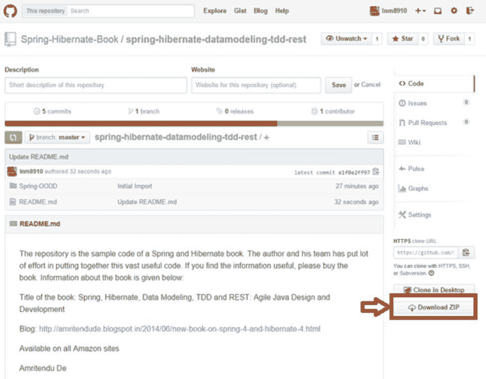

*图 17-1：从 GitHub 下载代码*

#### 解压下载的文件并作为 Maven 项目导入到 Eclipse

从 GitHub 下载的文件应该解压，并以 Maven 项目的形式作为输入导入 Eclipse，如图 17-2 所示。

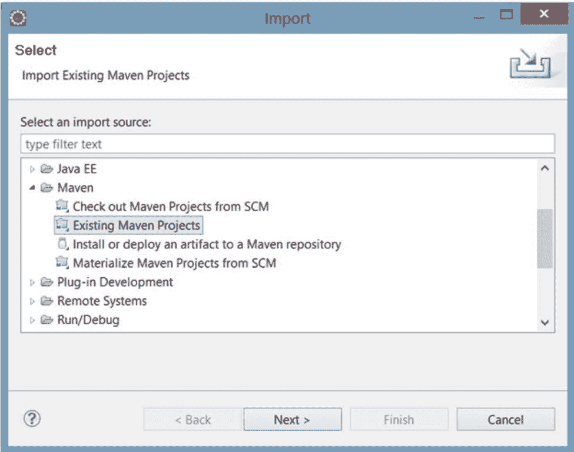

*图 17-2：导入到 Eclipse*

从 GitHub 下载的文件应该解压，并以 Maven 项目的形式作为输入导入 Eclipse，如图 17-3 所示。

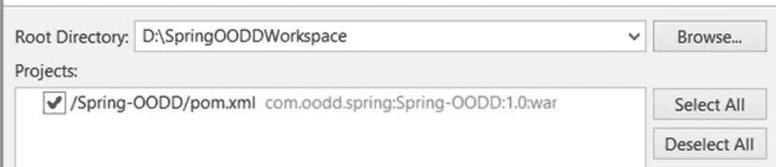

*图 17-3：选择 POM*

从 GitHub 下载的文件应该解压，并以 Maven 项目的形式作为输入导入 Eclipse，如图 17-4 所示。

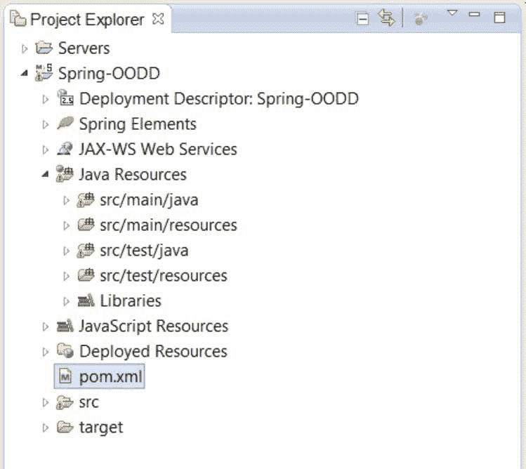

*图 17-4：项目视图*

从 GitHub 下载的文件应该解压，并以 Maven 项目的形式作为输入导入 Eclipse，如图 17-5 所示。

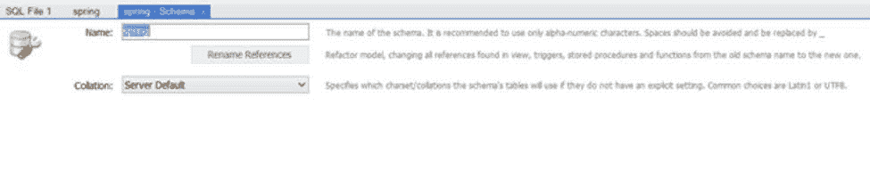

*图 17-5：创建架构*

从 GitHub 下载的文件应该解压，并以 Maven 项目的形式作为输入导入 Eclipse，如图 17-6 所示。

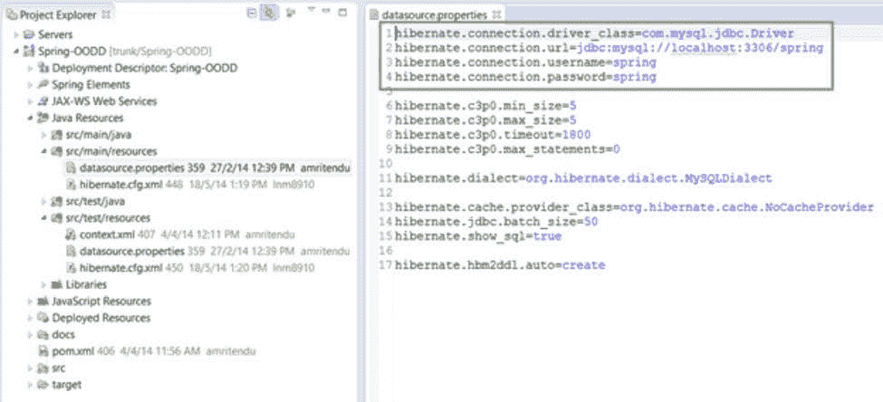

*图 17-6：验证凭据*

从 GitHub 下载的文件应该解压，并以 Maven 项目的形式作为输入导入 Eclipse，如图 17-7 所示。

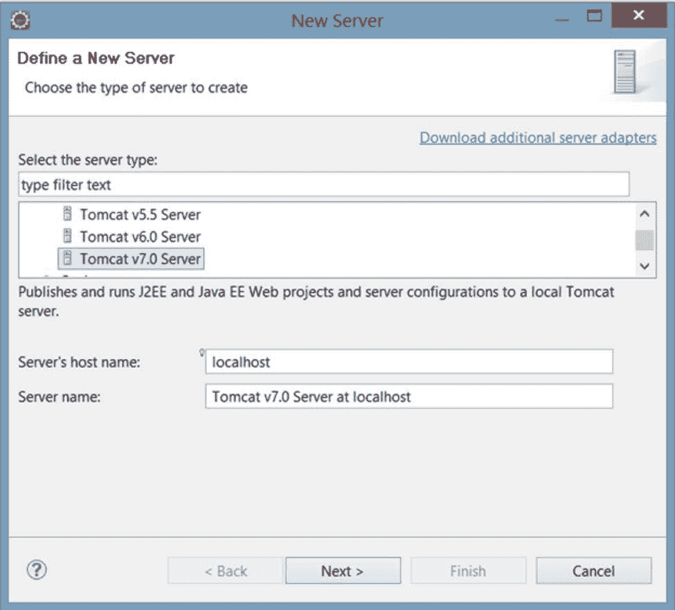

*图 17-7：选择版本*

从 GitHub 下载的文件应该解压，并以 Maven 项目的形式作为输入导入 Eclipse，如图 17-8 所示。

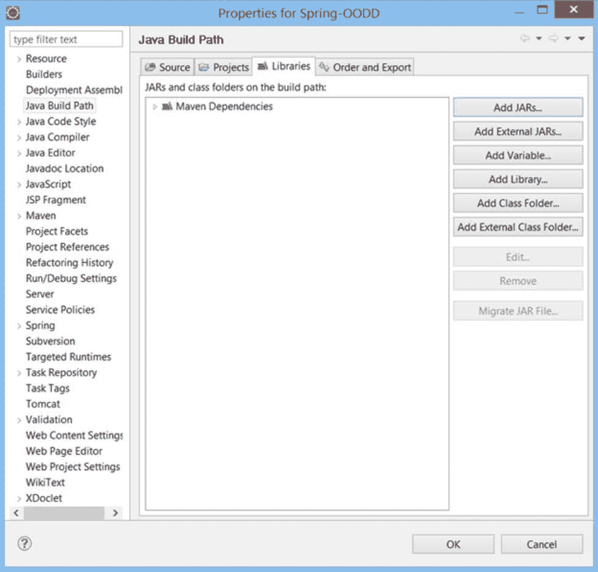

*图 17-8：属性窗口*

从 GitHub 下载的文件应该解压，并以 Maven 项目的形式作为输入导入 Eclipse，如图 17-9 所示。

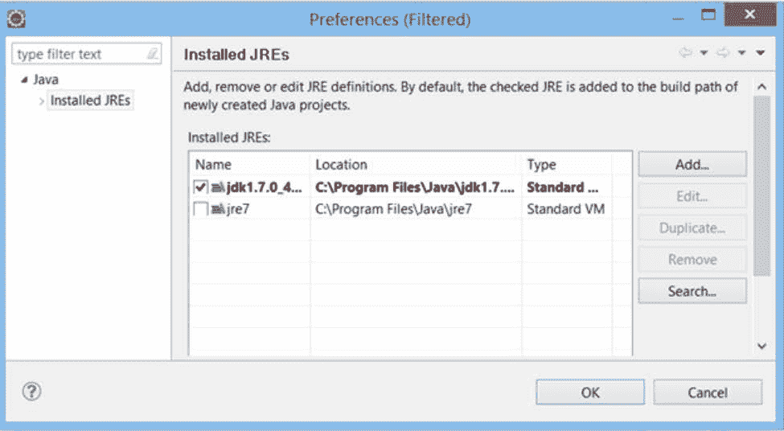

*图 17-9：已安装的 JRE*

从 GitHub 下载的文件应该解压，并以 Maven 项目的形式作为输入导入 Eclipse，如图 17-10 所示。

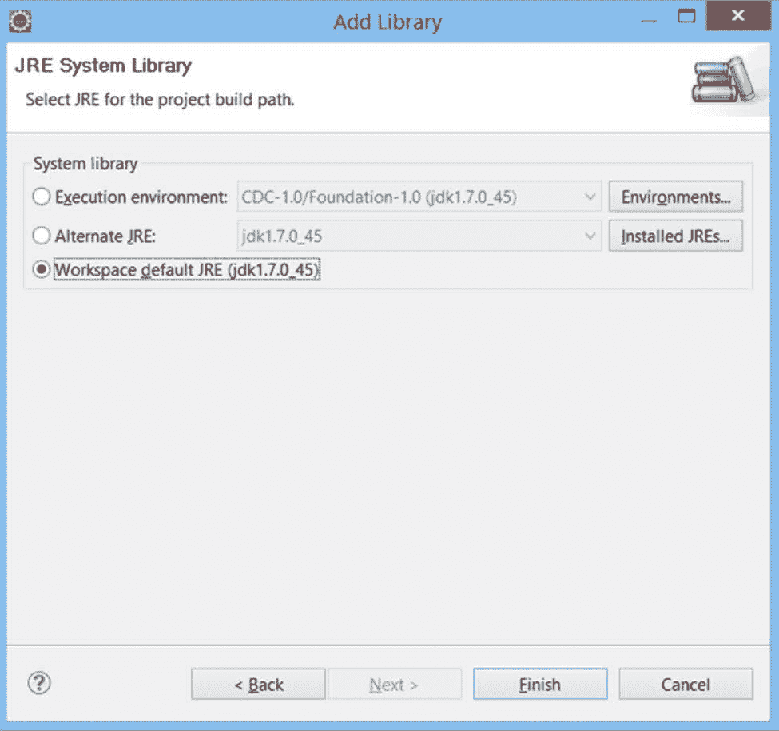

*图 17-10：JRE 系统库*

从 GitHub 下载的文件应该解压，并以 Maven 项目的形式作为输入导入 Eclipse，如图 17-11 所示。

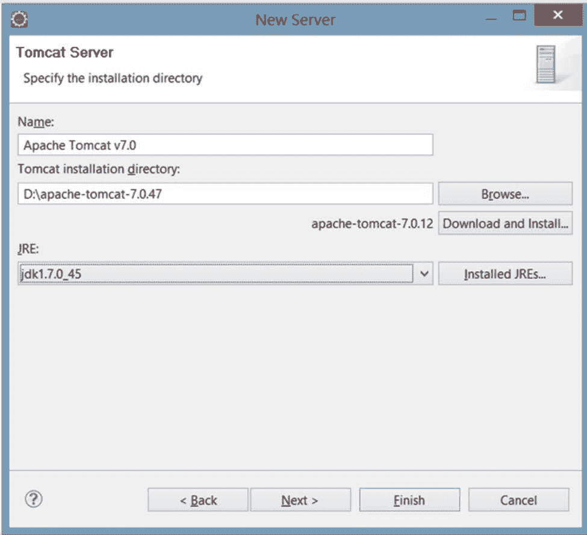

*图 17-11：选择 JDK 版本*

从 GitHub 下载的文件应该解压，并以 Maven 项目的形式作为输入导入 Eclipse，如图 17-12 所示。

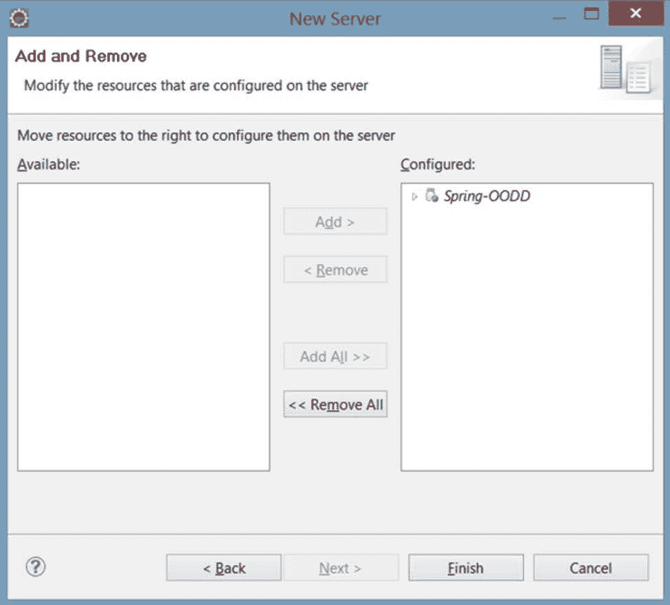

*图 17-12：选择项目*

Tomcat 启动后，将根据`web.xml`中的配置自动加载索引页。可以使用索引页测试应用程序的所有模块，如图 17-13 所示。默认 URL 为`http://localhost:8080/Spring-OODD/`。

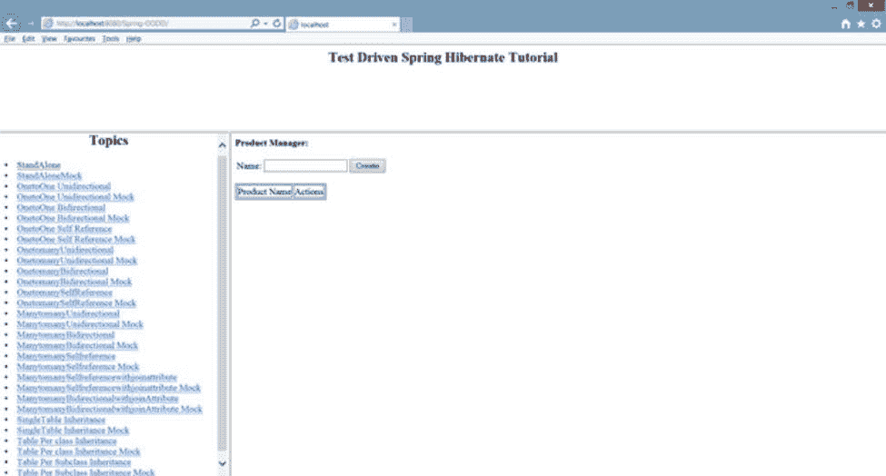

*图 17-13：应用程序的主索引页*

### 总结

最后，我想告诉大家，这个应用程序投入了大量的心血和勤奋工作。请不要在群组中将其作为免费资源分享。不过，欢迎在日常工作中使用这些概念。
