# Spring MVC 入门指南

Paul Deck


https://archive.org/details/springmvctutoria0000deck

从 Mid-Continent 公共图书馆记录撤回

Paul Deck

- 使用 Servlet 3 或更高版本进行文件上传...............................................................235
- 总结..................................................................................................................249
- 示例 1：隐藏资源........................................................................252

# 引言

欢迎阅读《Spring MVC：教程》。

Spring MVC 是 Spring 框架（或简称 Spring）中的一个模块，用于快速开发 Web 应用程序。Spring MVC 中的 MVC 代表模型-视图-控制器（Model-View-Controller），是一种广泛应用于图形用户界面（GUI）开发的设计模式。这种模式不仅在 Web 开发中常见，也用于 Java Swing 等桌面技术。

如果你想学习如何使用 Spring MVC 开发 Java Web 应用程序，这本书就适合你。

如果你已经掌握了 Spring 框架以及 Servlet 和 JavaServer Pages (JSP) 这两个 Spring MVC 基础的 Java 技术，那么学习 Spring MVC 将简单得多。如果你是 Spring 新手，第 1 章将提供关于 Spring 框架的简短教程。如果你不熟悉 Servlet 和 JSP，不要绝望。你可以找到两个可以帮助你的快速上手课程：附录 B“Servlet”和附录 C“JavaServer Pages”。如果你想了解更多关于 Servlet 和 JSP 的知识，我推荐 Budi Kurniawan 编写的《Servlet and JSP: A Tutorial》（ISBN 978-0980039623）。

引言的其余部分将介绍 HTTP、使用 Servlet 和 JSP 进行 Web 编程以及本书的内容。

# 超文本传输协议 (HTTP)

HTTP 协议允许 Web 服务器和浏览器通过互联网或局域网交换数据。万维网联盟（W3C）是一个开发标准的国际社区，负责修订和维护该协议。HTTP 的第一个版本是 HTTP 0.9，随后被 HTTP 1.0 取代。取代 HTTP 1.0 的是目前的版本—— HTTP 1.1。HTTP 1.1 由 W3C 的请求意见（RFC）2616 定义，可以从 `http://www.w3.org/Protocols/HTTP/1.1/rfc2616.pdf` 下载。

Web 服务器 24x7 运行，等待 HTTP 客户端（通常是浏览器）连接它并请求资源。在 HTTP 中，总是客户端发起连接，服务器从未处于主动联系客户端的位置。

## 注意

值得注意的是，2011 年互联网工程任务组（IETF，一个标准机构）将 WebSocket 协议标准化为 RFC 6455。该协议允许 HTTP 连接升级为 WebSocket，从而允许连接双向发送消息。这意味着使用 WebSocket 协议，服务器可以与其 WebSocket 客户端发起会话。

要定位资源，互联网用户会点击包含统一资源定位符（URL）的链接，或者在浏览器的地址栏中输入一个。以下是两个 URL 示例：

```
http://google.com/index.html
http://facebook.com/index.html
```

URL 的开头是 http，它标识了协议。并不是 URL 都使用 HTTP。例如，这两个 URL 都是有效的，尽管它们不是基于 HTTP 的 URL：

```
mailto:joe@example.com
ftp:marketing@ftp.example.com
```

通常，基于 HTTP 的 URL 具有以下格式：

```
protocol://[host].domain[:port][/context][/resource]?query string
path variable
```

或

```
protocol://IP address[:port][/context][/resource]?query string |
path variable
```

方括号中的部分是可选的，因此 URL 可以简单到如 `http://yahoo.ca` 或 `http://192.168.1.9`。顺便提一下，IP 协议（IP）地址是分配给计算机或其他设备的数值标签。换句话说，你不需要输入 `http://google.com`，而是可以使用它的 IP 地址：`http://173.194.46.35`。要查找某个域名的 IP 地址，请在计算机控制台上使用 `ping` 程序：

```
ping google.com
```

IP 地址很难记忆，因此人们更倾向于使用域名。一台计算机可能托管多个域名，因此多个域名可以有相同的 IP 地址。而且，你知道吗，你不能购买 `example.com` 或 `example.org`，因为它们是预留用于文档目的的？

URL 的主机部分（host）可能代表并标识互联网或局域网上完全不同的位置。例如，`http://yahoo.com`（无主机）带你去一个与 `http://mail.yahoo.com`（有主机）不同的位置。多年来，web 已成为最流行的主机名并成为默认设置。通常情况下，`http://www.domainName` 会映射到 `http://domainName`。

80 是 HTTP 的默认端口。因此，如果 web 服务器运行在 80 端口上，你就不需要端口号即可访问服务器。有时，web 服务器并不运行在 80 端口上，你需要输入端口号。例如，Tomcat 默认运行在 8080 端口上，因此在请求资源时需要提供端口号：

```
http://localhost:8080/index.html
```

`localhost` 是一个保留名称，通常用于指代本地计算机，即 web 浏览器运行的同一台计算机。

URL 的上下文部分（context）指的是应用程序名称，但这也是可选的。Web 服务器可以运行多个上下文（应用程序），并可以将其中一个配置为默认上下文。要请求默认上下文中的资源，你可以在 URL 中跳过上下文部分。

最后，一个上下文（context）可以拥有一个或多个默认资源（通常是 `index.html` 或 `index.htm` 或 `default.htm`）。没有资源名称的 URL 被认为标识一个默认资源。当然，如果一个上下文中存在多个默认资源，当客户端未指定资源名称时，将始终返回优先级最高的那个。

在资源名称之后跟着一个或多个查询字符串或路径变量。查询字符串是一个可以传递到服务器进行处理的键值对。两个查询字符串之间用安培符号（&）分隔。路径变量类似于查询字符串，但仅包含值部分。两个路径变量之间用正斜杠（/）分隔。

接下来的子章节将详细讨论 HTTP 请求和响应。

# HTTP 请求

HTTP 请求由三个部分组成：

- 方法—统一资源标识符 (URI)—协议/版本
- 请求头（Request headers）
- 实体体（Entity body）

这是一个示例的 HTTP 请求：

```
POST /examples/default.jsp HTTP/1.1
Accept: text/plain; text/html
Accept-Language: en-gb
Connection: Keep-Alive
Host: localhost
User-Agent: Mozilla/5.0 (Macintosh; U; Intel Mac OS X 10.5; en-US; rv:1.9.2.6) Gecko/20100625 Firefox/3.6.6
Content-Length: 30
Content-Type: application/x-www-form-urlencoded
Accept-Encoding: gzip, deflate
```

```
lastName=Blanks&firstName=Mike
```

方法—URI—协议版本出现在请求的第一行。

```
POST /examples/default.jsp HTTP/1.1
```

这里，`POST` 是请求方法，`/examples/default.jsp` 是 URI，`HTTP/1.1` 是协议/版本部分。

HTTP 请求可以使用 HTTP 标准中指定的许多请求方法之一。HTTP 1.1 支持七种请求类型：`GET`, `POST`, `HEAD`, `OPTIONS`, `PUT`, `DELETE` 和 `TRACE`。`GET` 和 `POST` 是互联网应用程序中最常用的两种。

URI 指定了一个互联网资源。它通常被解释为相对于服务器的根目录的。因此，它应该始终以正斜杠 `/` 开头。统一资源定位符（URL）实际上是 URI 的类型（参见 `http://www.ietf.org/rfc/rfc2396.txt`）。

在 HTTP 请求中，请求头包含了关于客户端环境和请求实体体的有用信息。例如，它可能包含浏览器设置的语言、实体体的长度等。每个头之间用回车/换行符（CRLF）序列分隔。

在头和实体体之间有一个空行（CRLF），这对于 HTTP 请求格式至关重要。CRLF 告诉服务器实体体从哪里开始。在某些互联网编程书中，CRLF 被认为是 HTTP 请求的第四部分。

在之前的 HTTP 请求中，实体体仅仅是下面这一行：

```
lastName=Blanks&firstName=Mike
```

在典型的 HTTP 请求中，实体体可以长得多。

# HTTP 响应

与 HTTP 请求类似，HTTP 响应也由三部分组成：

- 协议—状态码—描述
- 响应头（Response headers）
- 实体（Entity body）

以下是 HTTP 响应的示例：

```
HTTP/1.1 200 OK
Server: Apache-Coyote/1.1
Date: Thu, 29 Sep 2013 13:13:33 GMT
Content-Type: text/html
Last-Modified: Wed, 28 Sep 2013 13:13:12 GMT
Content-Length: 112
```

```
<html>
<head>
<title>HTTP Response Example</title>
</head>
<body>
Welcome to Brainy
</body>
</html>
```

响应头的第一行与请求头的第一行相似。它告诉你所使用的协议是 HTTP 版本 1.1，并且请求成功了（200 是成功状态码）。

响应头包含了与 HTTP 请求中的头类似的有用信息。响应的实体体是响应本身的 HTML 内容。头和实体体用一系列 CRLF 序列分隔。

状态码 200 仅在 web 服务器能够找到所请求的资源时才发布。如果找不到资源或无法理解请求，服务器将发送不同的请求代码。例如，401 表示未授权访问，405 表示 HTTP 方法不允许。有关 HTTP 状态码的完整列表，请参考此在线文档。

`http://www.w3.org/Protocols/rfc2616/rfc2616-sec10.html`

# Servlet 和 JSP 概述

Java Servlet 技术（简称 Servlet）是用 Java 开发 web 应用程序的底层技术。Sun Microsystems 于 1996 年发布了它以与通用网关接口（CGI）竞争，后者是当时生成 web 动态内容的标准。CGI 的主要问题是它为每个 HTTP 请求创建一个新进程。这使得 CGI 程序难以扩展，因为创建进程消耗大量的 CPU 周期。相比之下，Servlet 比 CGI 程序快得多，因为它在服务完第一个请求后留在内存中，等待后续请求。

自 Servlet 出现以来，开发了许多 Java 框架来帮助程序员更快速地编写。这些框架让你专注于业务逻辑，减少编写样板代码的时间。然而，你仍然需要理解 Servlet 的核心。JavaServer Pages（JSP）是后来发布的，旨在让 servlet 变得简单。你可能在使用像 Spring MVC、Struts 2 或 JavaServer Faces 等优秀的框架。但是，如果没有对 Servlet 和 JSP 的深入了解，将无法有效地编码。

Servlet 是一个 Java 程序。Servlet 应用程序由一个 servlet 组成。JSP 页面会被翻译并编译成 servlet。

Servlet 应用程序运行在 servlet 容器内部，不能独立运行。servlet 容器将请求传递给 servlet 应用程序，并将 servlet 应用程序的响应返回给用户。由于 servlet 应用程序至少包含几个 servlet JSP 页面，因此使用“servlet/JSP 应用程序”来指代 Java 应用程序比忽略 JSP 更合适。

Web 服务器和 Web 客户端使用它们都精通的语言进行通信：超文本传输协议（HTTP）。正如此，Web 服务器也称为 HTTP 服务器。

Servlet/JSP 容器是一种特殊的 Web 服务器，它可以处理 servlet 以及静态内容。在过去，人们更倾向于将 servlet/JSP 容器作为 Apache HTTP Server 等 HTTP 服务器的模块来运行，因为在当时，HTTP 服务器被认为比 servlet/JSP 容器更健壮。在这种情况下，servlet/JSP 容器负责生成动态内容，而 HTTP 服务器负责提供静态资源。如今，servlet/JSP 容器已经成熟，并可以在没有 HTTP 服务器的情况下广泛部署。Apache Tomcat 和 Jetty 是最流行的 servlet/JSP 容器，并且是免费开源的。你可以分别从 `http://tomcat.apache.org` 和 `http://jetty.codehaus.org` 下载它们。

Servlet 和 JSP 是 Java 企业版（Java EE）中定义的众多技术中的两种。其他 Java EE 技术还包括 Java 消息服务（JMS）、企业级 Bean（EJB）、Server Faces（JSF）和 Java 持久化（Java Persistence）。Java EE 7 版本（当前版本）的技术完整列表可以在此处找到：

`http://www.oracle.com/technwork/java/javaee/tech/index.html`

要运行 Java EE 应用，你需要一个 Java EE 容器，例如 GlassFish、Jboss、Oracle WebLogic 和 IBMSphere。你可以在 Java EE 容器中部署 servlet/JSP 应用，但 servlet/JSP 容器就足够了，而且比 Java EE 容器更轻量。Tomcat 和 Jetty 不是 Java EE 容器，因此它们无法运行 EJB 或 JMS。

# 关于本书

本节介绍了每个章节的概览。

第 1 章“Spring 框架”介绍了这一流行的开源框架。

第 2 章“Model 2 与 MVC 模式”讨论了构建 Spring MVC 的模式。

第 3 章“Spring MVC 简介”对 Spring MVC 进行了浅入的介绍。在本章中，你将学习编写自己的第一个 Spring MVC 应用。

第 4 章“基于注解的控制器”讨论了 MVC 模式的核心支柱之一——控制器。在本章中，你将学习如何编写基于注解的控制器，这是 Spring MVC 2.5 引入的方法。

第 5 章“数据绑定与表单标签”讨论了 Spring MVC 中强大的功能之一，以及如何使用它来重新填充字段。

第 6 章“转换器与格式化器”讨论了有助于数据绑定的两种对象类型：转换器（converter）和格式化器（formatter）。

第 7 章“验证器”教你如何通过构建验证器来验证用户输入。

第 8 章“表达式语言”解释了 JSP 2.0 添加的最重要特性之一：表达式语言（EL）。EL 旨在让无脚本的 JSP 页面成为可能，并帮助你编写更短更有效的 JSP 页面。在本章中，你将学习使用 EL 访问 JavaBeans 和作用域对象。

第 9 章“JSTL”解释了 Java Pages 标准标签库（JSTL）中最重要的库，这是一组自定义标签库，用于解决常见问题，如遍历 map 或集合、条件测试、XML 处理，甚至甚至是数据库访问和数据操作。

第 10 章“国际化”展示了如何使用 Spring MVC 构建多语言网站。

第 11 章“文件上传”展示了如何编写可以处理上传文件的控制器。书中讨论了两种方法。

第 12 章“文件下载”解释了如何通过程序方式向浏览器发送资源。

附录 A“Tomcat”解释了如何在多个操作系统中安装、配置和运行 Tomcat。

附录 B“Servlet”引入了 Servlet API 并展示了几个简单的 servlet。本章重点关注 Servlet API 中四个 Java 包中的两个包：`javax.servlet` 和 `javax.servlet.http` 包。

JavaServer Pages (JSP) 是一种补充 Servlet 技术。附录 C“JavaServer Pages”涵盖了 JSP 语法，包括它的指令、脚本元素和动作。

附录 D“部署描述符”解释了如何配置你的 Spring MVC 应用进行部署。

你可以从此网页下载书中使用的压缩包示例应用程序。

`http://books.brainysoftware.com/download`

## Spring 框架

Spring Framework（简称 Spring）用于开发企业级应用的开源框架。它是一个由二十不同模块组成的轻量级解决方案。本书涵盖了 Spring 的 Core 和 Beans 模块以及 Spring MVC。Spring MVC 当然是本书的主题，也是 Spring 中的一个子框架。


# 本章解释了 Core 和 Beans 模块以及它们如何为依赖注入提供解决方案

对于初学者，书中还详细讨论了依赖注入的概念。你将在本章中学习的技能来配置后续章节中开发的 Spring MVC 应用。

## 依赖注入

依赖注入在过去几年中被广泛用作解决代码可测试性等问题的解决方案。事实上，依赖注入是 Spring 和 Google Guice 等优秀框架背后的原理。那么，什么是依赖注入？

许多人交叉使用依赖注入和控制反转（IoC）这两个术语，尽管 Martin Fowler 在关于该主题的精彩文章中认为它们并不是同一种。

<http://martinfowler.com/articles/injection.html>

对于赶时间的人，依赖注入的简短解释如下：

如果你有两个组件 A 和 B，且 A 依赖于 B，你可以说 A 依赖于 B 或 B 是 A 的依赖项。假设 A 是一个有一个名为 `importantMethod` 方法的类，该方法使用了 B，定义如下：

```java
class A {
    void importantMethod() {
        B b = new B();
        // use b
    }
}
```

在上述情况下，A 必须先创建 B 的实例才能使用它。如果 B 是一个具体类，使用 `new` 关键字是直接的；但如果 B 是一个接口，问题就出现了。

依赖注入通过接管对象创建并将依赖注入到对象来解决这种局面。在这种情况下，像 Spring 这样的依赖注入框架会创建 A 的实例并将后者注入到前者。

为了让框架能够注入依赖，你需要在目标类中创建一个 setter 方法或特殊的构造函数。例如，为了让 A 可以注入 B 的实例，你可以将 A 修改为：

```java
class A {
    private B b;
    public void importantMethod() {
        // use b
    }
    public void setB(B b) {
        this.b = b;
    }
}
```

在修改后的 A 中，有一个可以调用的 setter 方法来注入 B 的实例。由于依赖注入提供了依赖，A 在调用 `importantMethod` 方法之前不再需要手动创建 B。

或者，如果你更倾向于使用构造函数，可以将类修改为：

```java
class A {
    private B b;
    public A(B b) {
        this.b = b;
    }
    public void importantMethod() {
        // use b
    }
}
```

在这种情况下，Spring 在创建 A 的实例之前会创建 B 的实例并将前者注入到后者。

> **注意**
>
> 被 Spring 管理的对象被称为 Bean（beans）。

Spring 提供了一种智能管理 Java 对象依赖的方法，因为它提供了一个控制反转（IoC）容器（或者如果你愿意，也可以称为依赖注入容器）。Spring 的优势在于，类不需要了解任何关于 Spring 的知识，也不需要导入任何 Spring 类型。

`ClassPathXmlApplicationContext` 和 `FileSystemXmlApplicationContext`。它们都期望一个或多个 XML 文档，其中包含了它们将要管理的 bean 的信息。`ClassPathXmlApplicationContext` 会尝试在类路径中查找配置文件，而 `FileSystemXmlApplicationContext` 会尝试在文件系统中查找它们。

例如，这里是创建一个 `ApplicationContext` 的代码，它会在类路径中搜索 `config1.xml` 和 `config2.xml` 文件。

```java
ApplicationContext context = new ClassPathXmlApplicationContext(new String[] {"config1.xml", "config2.xml"});
```

要从 `ApplicationContext` 获取 bean，请调用其 `getBean` 方法。

```java
Product product = context.getBean("product", Product.class);
```

上面的 `getBean` 方法允许获取一个类型为 `Product` 且 id 为 product 的 bean。

> **注意**
>
> 理想情况下，你只需要在测试类中创建一个 `ApplicationContext`，而你的应用程序不应该知道自己正被 Spring 管理。在 Spring MVC 中，你不需要直接处理 `ApplicationContext`。相反，你使用 Spring servlet 来处理 `ApplicationContext`。

## 基于 XML 的 Spring 配置

Spring 从 1.0 版本开始支持基于 XML 的配置，并从 2.5 版本开始支持基于注解的配置。接下来的部分将讨论 XML 配置文件的外观。Spring 配置文件的根元素始终是 `beans`。

```xml
<?xml version="1.0" encoding="UTF-8"?>
<beans xmlns="http://www.springframework.org/schema/beans"
       xmlns:xsi="http://www.w3.org/2001/XMLSchema-instance"
       xsi:schemaLocation="http://www.springframework.org/schema/beans http://www.springframework.org/schema/beans/spring-beans-3.0.xsd">
...
</beans>
```

如果你在应用程序中需要更多的 Spring 功能，可以向 `schemaLocation` 属性添加更多 schema。此外，你可以将 XML 配置拆分为多个文件以使其更具模块化。`ApplicationContext` 的实现设计用于用于读取多个配置文件。或者，你可以有一个主 XML 配置文件来导入其他配置文件。

以下是从主配置文件导入另外三个 XML 配置文件的示例。

```xml
<?xml version="1.0" encoding="UTF-8"?>
<beans xmlns="http://www.springframework.org/schema/beans"
       xmlns:xsi="http://www.w3.org/2001/XMLSchema-instance"
       xsi:schemaLocation="http://www.springframework.org/schema/beans http://www.springframework.org/schema/beans/spring-beans-3.0.xsd">

    <import resource="config1.xml" />
    <import resource="module2/config2.xml" />
    <import resource="resources/config3.xml" />
    ..
</beans>
```

你将在下一节学习 `<beans>` 的其他子元素。

## 使用 Spring IoC 容器

在本节中，你将学习如何使用 Spring 管理你的对象和依赖。

### 使用构造函数创建 Bean 实例

要获取 bean 实例，请调用 `ApplicationContext` 上的 `getBean` 方法。例如，列表 1.1 中的 XML 配置包含了一个名为 product 的单个 bean 的定义。

#### 列表 1.1: 配置文件

```xml
<?xml version="1.0" encoding="UTF-8"?>
<beans xmlns="http://www.springframework.org/schema/beans"
       xmlns:xsi="http://www.w3.org/2001/XMLSchema-instance"
       xsi:schemaLocation="http://www.springframework.org/schema/beans
http://www.springframework.org/schema/beans/spring-beans-3.0.xsd">

    <bean name="product" class="app01.bean.Product"/>

</beans>
```

bean 声明将告诉 Spring 使用其无参（默认）构造函数实例化 `Product` 类。如果不存在这样的构造函数（因为类的作者定义了另一个构造函数而没有显式地定义默认构造函数），Spring 将抛出异常。为了让 Spring 创建该类的实例，无参构造函数不需要是公共的。

注意，你使用 `name` 或 `id` 属性来标识 bean。要使用 Spring 创建 `Product` 实例，请调用 `ApplicationContext.getBean` 方法并传递 bean 的名称或 id 及其类。

```java
ApplicationContext context =
    new ClassPathXmlApplicationContext(
        new String[] {"spring-config.xml"});
Product product1 = context.getBean("product", Product.class);
product1.setName("Excellent snake oil");
System.out.println("product1: " + product1.getName());
```

### 使用工厂方法创建 Bean 实例

大多数类将使用其构造函数之一进行实例化。然而，如果 Spring 必须调用工厂方法来实例化类，它同样高兴。

下面的 bean 定义指定了一个用于实例化 `java.util.Calendar` 的工厂方法。

```xml
<bean id="calendar" class="java.util.Calendar"
      factory-method="getInstance"/>
```

注意，我使用了 `id` 属性而不是 `name` 属性来标识该 bean。然后你可以使用 `getBean` 获取 `Calendar` 实例。

```java
ApplicationContext context =
    new ClassPathXmlApplicationContext(
    new String[] {"spring-config.xml"});
Calendar calendar = context.getBean("calendar", Calendar.class);
```

### 使用销毁方法

某些类具有在实例销毁之前应该调用的方法。下面的 bean 定义指定了一个销毁方法。例如，下面的 bean 使用 `destroy-method` 进行退役。

```xml
<bean id="calendar" class="java.util.Calendar"
      factory-method="getInstance"
      destroy-method="shutdown"/>
```

### 向构造函数传递参数

如果你选择向构造函数传递参数，你必须传递构造函数所需的所有参数。不完整的参数列表是不接受的。

#### 列表 1.2: Product 类

```java
package app01.bean;

import java.io.Serializable;

public class Product implements Serializable {

    private final long serialVersionUID = 7489234L;

    private String name;

    private String description;

    private float price;

    public Product() {

    }

    public Product(String name, String description, float price) {

        this.name = name;

        this.description = description;

        this.price = price;

    }

    public String getName() {

        return name;

    }

    public void setName(String name) {

        this.name = name;

    }

    public String getDescription() {

        return description;

    }

    public void setDescription(String description) {

        this.description = description;

    }

    public float getPrice() {

        return price;

    }

    public void setPrice(float price) {

        this.price = price;

    }

}
```

在这种情况下，Spring 将使用 `Product` 类的构造函数。下面的 `bean` 定义通过 `name` 传递参数。

```xml
<bean name="featuredProduct" class="app01.bean.Product">

    <constructor-arg name="name" value="Ultimate Olive Oil"/>

    <constructor-arg name="description" value="The purest olive oil on the market"/>

    <constructor-arg name="price" value="9.95"/>

</bean>
```

通过名称传递参数不是在 Spring 中操作的唯一方法。Spring 允许你通过索引传递参数。以下是 `featuredProduct` bean 的重写。

```xml
<bean name="featuredProduct" class="app01.bean.Product">

  <constructor-arg index="0" value="Ultimate Olive Oil"/>

  <constructor-arg index="1"
    value="The purest olive oil on the market"/>

  <constructor-arg index="2" value="9.95"/>

</bean>
```

## Setter 依赖注入

考虑列表 1.3 中的 `Employee` 类和列表 1.4 中的 `Address` 类。

### 列表 1.3: Employee 类

```java
package app01.bean;

public class Employee {

  private String firstName;

  private String lastName;

  private Address homeAddress;

  public Employee() {

  }

  public Employee(String firstName, String lastName, Address homeAddress) {

    this.firstName = firstName;

    this.lastName = lastName;

    this.homeAddress = homeAddress;

  }

  public String getFirstName() {

    return firstName;

  }

  public void setFirstName(String firstName) {

    this.firstName = firstName;

  }

  public String getLastName() {

    return lastName;

  }

  public void setLastName(String lastName) {

    this.lastName = lastName;

  }

  public Address getHomeAddress() {

    return homeAddress;

  }

  public void setHomeAddress(Address homeAddress) {

    this.homeAddress = homeAddress;

  }

  @Override

  public String toString() {

    return firstName + " " + lastName

    + "\n" + homeAddress;

  }

}
```

### 列表 1.4: Address 类

```java
package app01.bean;

public class Address {

    private String line1;

    private String line2;

    private String city;

    private String state;

    private String zip;

    private String country;

}
```


# 第 1 章：Spring Framework 21

```java
public Address(String line1, String line2, String city,
    String state, String zip, String country) {
    this.line1 = line1;
    this.line2 = line2;
    this.city = city;
    this.state = state;
    this.zipCode = zip;
    this.country = country;
}
```

```java
// 已提交 getters 和 setters
```

```java
@Override
public String toString() {
    return line1 + "\n"
    + line2 + "\n"
    + city + "\n"
    + state + " " + zipCode + "\n"
    + country;
}
```

`Employee` 依赖于 `Address`。为了确保每个 `Employee` 实例都包含一个 `Address` 实例，你可以通过这两个 bean 元素来配置 Spring。

```xml
<bean name="simpleAddress" class="app01a.bean.Address">
    <constructor-arg name="line1" value="151 Corner Street"/>
    <constructor-arg name="line2" value=""/>
    <constructor-arg name="city" value="Albany"/>
    <constructor-arg name="state" value="NY"/>
    <constructor-arg name="zipCode" value="99999"/>
    <constructor-arg name="country" value="US"/>
</bean>
```

```xml
<bean name="employee" class="app01a.bean.Employee">
    <property name="homeAddress" ref="simpleAddress"/>
    <property name="firstName" value="Junior"/>
    <property name="lastName" value="Moore"/>
</bean>
```

`simpleAddress` bean 实例化 `Address` 并将值传递给它的构造函数。`employee` bean 使用 `property` 元素将值注入它的 setter 方法中。特别感兴趣的是 `homeAddress` 属性，它被赋予了 `simpleAddress` 的引用。

依赖关系的 bean 声明不需要出现在它使用的 bean 声明之前。在这个示例中，`employee` 可以出现在 `simpleAddress` 之前。

## 基于构造函数的依赖注入

由于列表 1.3 中的 `Employee` 类提供了一个可以接收值的构造函数，你可以通过该构造函数向 `Employee` 实例注入 `Address`。例如，这些 bean 定义创建了一个 `Employee` 实例并将 `employee2` 注入到它的构造函数中。

```xml
<bean name="employee2" class="app01a.bean.Employee">
  <constructor-arg name="firstName" value="Senior"/>
  <constructor-arg name="lastName" value="Moore"/>
  <constructor-arg name="homeAddress" ref="simpleAddress"/>
</bean>

<bean name="simpleAddress" class="app01a.bean.Address">
  <constructor-arg name="line1" value="151 Corner Street"/>
  <constructor-arg name="line2" value=""/>
  <constructor-arg name="city" value="Albany"/>
  <constructor-arg name="state" value="NY"/>
  <constructor-arg name="zipCode" value="99999"/>
  <constructor-arg name="country" value="US"/>
</bean>
```

## 总结

在这一章中，你学习了依赖注入以及如何使用 Spring IoC 容器。你将在后续章节中应用所学的知识来配置 Spring 应用。

# 第 2 章：Model 2 和 MVC 模式

Java Web 应用设计中有两种模型，被方便地称为 Model 1 和 Model 2。Model 1 以页面为中心，仅适用于非常小的应用程序。Model 2 基于模型-视图-控制器（MVC）设计模式，是除最简单的 Java Web 应用程序之外所有应用程序推荐的架构。

本章讨论了 Model 2 并提供了三个 Model 2 示例应用程序。第一个应用程序是一个以 servlet 作为控制器的基础 Model 2 应用程序。第二个引入了控制器类的使用。第三个引入了用于验证用户输入的验证器组件。

## Model 1 概述

当你第一次学习 JSP 时，你的第一个应用程序通常通过提供指向 JSP 页面的链接来实现一个页面到另一个页面的导航。虽然这种导航方法简单，但在具有大量页面的中或或应用程序中，这种方法会导致维护困难。例如，更改一个 JSP 页面的名称可能会迫使你重命名许多其他页面指向该页面的链接。因此，除非你的应用程序只有两个或三个页面，否则不推荐 Model 1。

## Model 2 概述

Model 2 基于模型-视图-控制器（MVC）设计模式，这是 Smalltalk-80 用户界面背后的核心概念。“设计模式”一词在当时还没有被创造，它被称为设计模式。一个应用程序由三个模块组成：模型（model）、视图（view）和控制器（controller）。视图负责显示。控制器接收用户输入并命令模型。模型封装了业务逻辑。

在 Model 2 应用中，每个 HTTP 请求都必须指向控制器。请求的统一资源标识符（URI）告诉控制器要调用的 action。“action”一词指的是应用程序能够执行的操作。与 action 关联的 Java 对象被称为 action 对象。单个 action 类可以处理不同的 action（如 Spring MVC 和 Struts 2）或单个 action（如 Struts 1）。

一个看似简单的操作可能需要多个 action。例如，向数据库添加产品需要两个 action：

- 显示一个“添加产品”表单供用户输入信息。
- 将产品信息保存到数据库。

如上述，你使用 URI 告诉控制器要调用哪个 action。例如，为了让应用程序发送“添加产品”表单，你会使用如下 URI：

```
http://domain/appName/product_input
```

要让应用程序保存产品，URI 为：

```
http://domain/appName/product_save
```

控制器检查 URI 以决定调用哪个 action。它还将模型对象存储在可以从视图访问的地方，以便在浏览器上显示服务器端的值。最后，控制器使用 `RequestDispatcher` 转发到视图（JSP 页面）。在 JSP 页面中，你使用表达式语言表达式自定义标签来显示值。

注意，调用 `RequestDispatcher.forward()` 不会阻止其下方代码的执行。因此，除非该调用是方法的最后一行，否则你需要显式返回。

## 使用 Servlet 控制器的 Model 2

本节展示了一个简单的 Model 2 应用程序，以便你对 Model 2 应用程序的样子有一个大致的概念。在现实生活中，Model 2 比这复杂得多。

该应用程序用于输入产品信息，命名为 `app02a`。用户填写如图 2.2 所示的表单并提交。应用程序随后向用户发送一个确认页面并显示保存产品的详情。（见图 2.3）。


该应用程序能够执行这两个操作：

1. 显示“添加产品”表单。此操作将图 2.2 中的输入表单发送到浏览器。调用此操作的 URI 必须包含字符串 `product_input`。
2. 保存产品并返回图 2.3 中的确认页面。调用此操作的 URI 必须包含字符串 `product_save`。

`app02a` 由以下组件组成：

1. 一个 `Product` 类，作为产品领域对象的模板。该类的实例包含产品信息。
2. 一个 `ProductForm` 类，封装了用于输入产品的 HTML 表单的字段。`ProductForm` 的属性用于填充 `Product` 对象。
3. 一个 `ControllerServlet` 类，是该 Model 2 应用程序的控制器。
4. 一个名为 `SaveProductAction` 的动作类。
5. 两个 JSP 页面（`ProductForm.jsp` 和 `ProductDetails.jsp`）作为视图。
6. 一个定义视图的 CSS 文件。这是一个静态资源。

该应用程序的目录结构如图 2.4 所示。

```
app02a
  css
    main.css
  WEB-INF
    classes
      app02a
        domain
          Product.class
        form
          ProductForm.class
        servlet
          ControllerServlet.class
    jsp
      ProductDetails.jsp
      ProductForm.jsp
    web.xml
```

图 2.4：app02a 的目录结构

注意，所有的 JSP 页面都存储在 `WEB-INF` 下的目录中，因此无法直接访问。

让我们仔细查看 `app02a` 中的每个组件。

### Product 类

`Product` 实例是一个封装了产品信息的 JavaBean。`Product` 类（如列表 2.1 所示）三个属性：`productName`、`description` 和 `price`。

#### 列表 2.1：Product 类

```java
package app02a.domain;

import java.io.Serializable;

public class Product implements Serializable {

    private static final long serialVersionUID = 748392348L;

    private String name;
    private String description;
    private float price;

    public String getName() {
        return name;
    }

    public void setName(String name) {
        this.name = name;
    }

    public String getDescription() {
        return description;
    }

    public void setDescription(String description) {
        this.description = description;
    }

    public float getPrice() {
        return price;
    }

    public void setPrice(float price) {
        this.price = price;
    }
}
```

`Product` 类实现了 `java.io.Serializable`，以便其实例可以安全地存储在 `HttpSession` 中。作为 `Serializable` 的实现类，`Product` 应该有一个 `serialVersionID` 字段。

### ProductForm 类

表单类映射到 HTML 表单。它是 HTML 表单在服务器上的表示。列表 2.2 提供的 `ProductForm` 类包含了产品的 String 值。从表面上看，`ProductForm` 类与 `Product` 类相似，你可能会质疑为什么需要存在 `ProductForm`。正如你在本章稍后的“验证器”部分看到的，表单对象会将 `ServletRequest` 保存到其他组件（如验证器）中。`ServletRequest` 是 servlet 特有的类型，不应暴露给应用程序的其他层。

表单对象的第二个用途是在输入验证失败时，以用户的原始形式保留并重新显示用户输入。你将在本章稍后的“验证器”部分学习如何做到这一点。

注意，大多数情况下，表单类不需要实现 `Serializable`，因为表单对象很少存储在 `HttpSession` 中。

#### 列表 2.2：ProductForm 类

```java
package app02a.form;

public class ProductForm {

    private String name;
    private String description;
    private String price;

    public String getName() {
        return name;
    }

    public void setName(String name) {
        this.name = name;
    }

    public String getDescription() {
        return description;
    }

    public void setDescription(String description) {
        this.description = description;
    }

    public String getPrice() {
        return price;
    }

    public void setPrice(String price) {
        this.price = price;
    }
}
```

### ControllerServlet 类

`ControllerServlet` 类（如列表 2.3 所示）扩展了 `javax.servlet.http.HttpServlet`。它的 `doGet` 和 `doPost` 方法都调用 `process` 方法，该方法是 servlet 控制器的大脑。

将 servlet 控制器命名为 `ControllerServlet` 可能会让一些人感到惊讶。

#### 列表 2.3：ControllerServlet

```java
package app02a.servlet;

import java.io.IOException;
import javax.servlet.RequestDispatcher;
import javax.servlet.ServletException;
import javax.servlet.http.HttpServlet;
import javax.servlet.http.HttpServletRequest;
import javax.servlet.http.HttpServletResponse;
import app02a.domain.Product;
import app02a.form.ProductForm;

public class ControllerServlet extends HttpServlet {

    private static final long serialVersionUID = 74839234L;

    @Override
    public void doGet(HttpServletRequest request, HttpServletResponse response)
            throws IOException, ServletException {
        process(request, response);
    }

    @Override
    public void doPost(HttpServletRequest request, HttpServletResponse response)
            throws IOException, ServletException {
        process(request, response);
    }

    private void process(HttpServletRequest request, HttpServletResponse response)
            throws IOException, ServletException {

        String uri = request.getRequestURI();
```


# Spring MVC：教程

## ControllerServlet 代码片段

```java
int lastIndex = uri.lastIndexOf('/');

String action = uri.substring(lastIndex + 1);

// 执行动作
if (action.equals("product_input")) {
    // 创建表单
    ProductForm productForm = new ProductForm();
    // 填充属性
    productForm.setName(request.getParameter("name"));
    productForm.setDescription(request.getParameter("description"));
    try {
        productForm.setPrice(request.getParameter("price"));
    } catch (NumberFormatException e) {
        // 处理错误
    }
} else if (action.equals("product_save")) {
    // 创建模型
    Product product = new Product();
    // 填充属性
    product.setName(productForm.getName());
    product.setDescription(productForm.getDescription());
    try {
        product.setPrice(Float.parseFloat(productForm.getPrice()));
    } catch (NumberFormatException e) {
        // 处理错误
    }
    // 将模型存入视图作用域
    request.setAttribute("product", product);
}

// 转发到视图
String dispatchUrl = null;
if (action.equals("product_input")) {
    dispatchUrl = "/WEB-INF/jsp/ProductForm.jsp";
} else if (action.equals("product_save")) {
    dispatchUrl = "/WEB-INF/jsp/ProductDetails.jsp";
}
if (dispatchUrl != null) {
    RequestDispatcher rd = request.getRequestDispatcher(dispatchUrl);
    rd.forward(request, response);
}
```

*(注：原文中 `ControllerServlet` 的代码片段在输入时存在严重缺失，此处根据提供的上下文和标准的 MVC 模式对其进行了逻辑补全。)*

## Spring MVC：教程

将值从前一个对象拷贝到后一个。在这个阶段，无法保证所有非字符串属性（如价格）都能成功复制，但我们将在该节的“验证器”部分处理这个问题。

`process` 方法随后会实例化 `SaveProductAction` 类并调用它的 `save` 方法。

```java
// 创建表单
ProductForm productForm = new ProductForm();
// 填充属性
productForm.setName(request.getParameter("name"));
```

`Product` 被存储在 `HttpServletRequest` 中，以便该操作的视图可以访问它。

```java
// 将 action 存储在作用域变量供视图使用
request.setAttribute("product", product);
```

`process` 输入通过转发到视图结束。如果 action 等于 `product_input`，控制将转发到 `ProductForm.jsp` 页面。如果 action 等于 `product_save`，控制将转发到 `ProductDetails.jsp` 页面。

```java
// 转发到视图
String dispatchUrl = null;

if (action.equals("product_input")) {
    dispatchUrl = "/WEB-INF/jsp/ProductForm.jsp";
} else if (action.equals("product_save")) {
    dispatchUrl = "/WEB-INF/jsp/ProductDetails.jsp";
}

if (dispatchUrl != null) {
    RequestDispatcher rd = request.getRequestDispatcher(dispatchUrl);
    rd.forward(request, response);
}
```

### 视图

该应用使用两个 JSP 页面作为应用程序的视图。如果 action 为 `product_input`，则显示第一个页面 `ProductForm.jsp`。第二个页面 `ProductDetails.jsp` 在 `product_save` 时显示。`ProductForm.jsp` 见代码列表 2.4，`ProductDetails.jsp` 见代码列表 2.5。

### 代码列表 2.4：ProductForm.jsp 页面

```jsp
<!DOCTYPE html>
<html>
<head>
    <title>添加产品表单</title>
    <style type="text/css">@import url("css/main.css");</style>
</head>
<body>
<div id="global">
<form action="product_save.action" method="post">
<fieldset>
<legend>添加产品</legend>
<p>
<label for="name">产品名称: </label>
<input type="text" id="name" name="name" tabindex="1">
</p>
<p>
<label for="description">描述: </label>
<input type="text" id="description" name="description" tabindex="2">
</p>
<p>
<label for="price">价格:</label>
<input type="text" id="price" name="price" tabindex="3">
</p>
<p id="buttons">
<input id="reset" type="reset" tabindex="4">
<input id="submit" type="submit" tabindex="5" value="添加产品">
</p>
</fieldset>
</form>
<div>
</body>
</html>
```

### 代码列表 2.5：ProductDetails.jsp 页面

```jsp
<!DOCTYPE HTML>
<html>
<head>
    <title>保存产品</title>
    <style type="text/css">@import url(css/main.css);</style>
</head>
<body>
<div id="global">
<h4>产品已保存。</h4>
<p>
<h5>详情:</h5>
产品名称: ${product.name}<br>
描述: ${product.description}<br>
价格: ${product.price}
</p>
</div>
</body>
</html>
```

`ProductForm.jsp` 页面包含一个用于输入产品详情的 HTML 表单。我特意避免使用 HTML 表格来布局 HTML 元素。相反，这些元素是使用 `css` 目录下 `main.css` 文件中的 CSS 样式进行样式化的。

`ProductDetails.jsp` 页面使用表达式语言 (EL) 来访问 `HttpServletRequest` 中的产品作用域对象。你将在第 8 章“表达式语言”中学习更多关于 EL 的知识。

# 第 2 章：Model 2 和 MVC 模式

在这个应用程序中，大多数 Model 2 应用中，你需要防止浏览器直接访问 JSP 页面。有多种方法可以实现这一点，包括：

- 将 JSP 页面放在 `WEB-INF` 下。`WEB-INF` 或其子目录下的任何内容都受保护。如果你将 JSP 页面放在 `WEB-INF` 下，你无法从浏览器直接访问它们，但控制器仍然可以将请求调度到这些页面。
- 使用 servlet 过滤器（`servlet filter`）并过滤掉对 JSP 页面的请求。
- 在部署描述符（`deployment descriptor`）中使用安全限制。这比使用过滤器更容易，因为你不需要编写过滤器类。

## 测试应用程序

假设你正在本地机器的 8080 端口上运行应用程序，可以使用以下 URL 调用应用程序：
`http://localhost:8080/app0a/product_input.action`

你将在浏览器中看到类似于图 2.2 的内容。
当你提交表单时，以下 URL 将发送到服务器：
`http://localhost:8080/app0a/product_save.action`

使用 servlet 控制器允许你将 servlet 作为欢迎页。这是一个重要功能，因为你就可以配置应用程序，使得只需通过在浏览器地址框中输入你的域名（例如 `http://example.com`）即可调用 servlet 控制器。你无法通过过滤器实现这一点。

## 在控制器中隔离代码

在 servlet 控制器中编写业务逻辑会导致随着应用程序变得复杂，该 servlet 变得越来越臃肿。为了防止这种情况，你应该将业务逻辑隔离在控制器类中。

## Spring MVC：教程

`app02b` 的业务逻辑在 servlet 中。`app02b` 有两个控制器（`InputProductController` 和 `SaveProductController`），它们允许访问 `HttpServletRequest`。

`app02b` 的目录结构见图 2.5。

```text
app02b
  - css
  - WEB-INF
    - jsp
  - controller
  - domain
  - form
  - servlet
  - web.xml
```

`app02b` 的控制器实现了 `Controller` 接口。该接口有一个方法 `handleRequest`。

### 代码列表 2.6：Controller 接口

```java
package app02b.controller;

import javax.servlet.http.HttpServletRequest;
import javax.servlet.http.HttpServletResponse;

public interface Controller {
    String handleRequest(HttpServletRequest request, HttpServletResponse response);
}
```

`InputProductController` 类（见代码列表 2.7）简单地返回到 `ProductForm.jsp` 页面。

### 代码列表 2.7：InputProductController 类

```java
package app02b.controller;

import javax.servlet.http.HttpServletRequest;
import javax.servlet.http.HttpServletResponse;

public class InputProductController implements Controller {
    @Override
    public String handleRequest(HttpServletRequest request, HttpServletResponse response) {
        return "/WEB-INF/jsp/ProductForm.jsp";
    }
}
```

### 代码列表 2.8：SaveProductController 类

```java
package app02b.controller;

import javax.servlet.http.HttpServletRequest;
import javax.servlet.http.HttpServletResponse;
import app02b.domain.Product;
import app02b.form.ProductForm;

public class SaveProductController implements Controller {
    @Override
    public String handleRequest(HttpServletRequest request, HttpServletResponse response) {
        ProductForm productForm = new ProductForm();
        // 填充属性
        productForm.setName(request.getParameter("name"));
        productForm.setDescription(request.getParameter("description"));
        productForm.setPrice(request.getParameter("price"));
        // 创建模型
        Product product = new Product();
        product.setName(productForm.getName());
        product.setDescription(productForm.getDescription());
        try {
            product.setPrice(Float.parseFloat(productForm.getPrice()));
        } catch (NumberFormatException e) {
        }
        // 将产品添加到数据库的代码
        request.setAttribute("product", product);
        return "/WEB-INF/jsp/ProductDetails.jsp";
    }
}
```

将业务逻辑迁移到控制器类的有效效果是，控制器 servlet 现在变得非常精简，正如预期。它现在更像是一个控制器的调度器，我将其重命名为 `DispatcherServlet`。`DispatcherServlet` 类（打印在代码列表 2.9 中）检查每个 URI，创建适当的控制器并调用控制器的 `handleRequest` 方法。

### 代码列表 2.9：DispatcherServlet 类

```java
package app02b.servlet;

import java.io.IOException;
import javax.servlet.RequestDispatcher;
import javax.servlet.ServletException;
import javax.servlet.http.HttpServlet;
import javax.servlet.http.HttpServletRequest;
import javax.servlet.http.HttpServletResponse;
import app02b.controller.InputProductController;
import app02b.controller.SaveProductController;

public class DispatcherServlet extends HttpServlet {
    private static final long serialVersionUID = 748495L;

    public void doGet(HttpServletRequest request, HttpServletResponse response)
            throws IOException, ServletException {
        process(request, response);
    }

    @Override
    public void doPost(HttpServletRequest request, HttpServletResponse response)
            throws IOException, ServletException {
        process(request, response);
    }
    
    // 假设存在 process 方法
    private void process(HttpServletRequest request, HttpServletResponse response) 
            throws IOException, ServletException {
        // 逻辑处理...
    }
}
```


# 第 2 章：Model 2 与 MVC 模式

```java
process(request, response);
```

```java
private void process(HttpServletRequest request,
    HttpServletResponse response)
    throws IOException, ServletException {
```

```java
String uri = request.getRequestURI();

/*
* uri 的格式如下：/contextName/resourceName
* 例如：/app1/product_input.
* 然而，在默认上下文的情况下，
* context 名称为空，且 uri 的格式如下
* /resourceName，例如：/product_input
*/
```

```java
int lastIndex = uri.lastIndexOf("/");
String action = uri.substring(lastIndex + 1);
```

```java
String dispatchUrl = null;
if (action.equals("product_input.action")) {
    InputProductController controller =
    new InputProductController();
    dispatchUrl = controller.handleRequest(request,
    response);
} else if (action.equals("product_save.action")) {
    SaveProductController controller =
    new SaveProductController();
    dispatchUrl = controller.handleRequest(request,
    response);
}

if (dispatchUrl != null) {
    RequestDispatcher rd =
    request.getRequestDispatcher(dispatchUrl);
    rd.forward(request, response);
}
```

要测试该应用程序，请将浏览器指向此 URL：`http://localhost:8080/app02b/product_input.action`。

## 验证器

输入验证是执行操作时的重要步骤。验证的范围从简单的任务（如检查输入字段是否有值）到复杂的任务（如验证信用卡号）。事实上，验证的作用如此重要，以至于 Java 社区发布了 JSR 303“Bean Validation”和 JSR 349“Bean Validation 1.1”，来标准化 Java 中的输入验证。现代 MVC 框架通常同时提供程序式和声明式验证方法。在程序式验证中，你编写代码来验证用户输入。在声明式验证中，你可以在 XML 文档或属性文件中提供验证规则。

以下示例展示了一个新应用程序 (app02c)，它扩展了 app02b 中基于 servlet 控制器的 Model 2 应用程序。

图 2.6 显示了 app02c 的目录结构。

新应用程序与 app02b 类似，不同在于它的 `WEB-INF/lib` 目录中包含了一个 `ProductValidator` 类和两个 JSTL JAR 文件。JSTL 将第 9 章“JSTL”中讨论。目前，只需说它有助于在 `ProductForm.jsp` 页面中显示验证错误信息即可。

列表 2.10 给出了 `ProductValidator` 类。

### app02c 目录结构

- app02c [app02c]
- css
  - main.css
- WEB-INF
  - classes
    - app02c
      - controller
          - Controller.class
          - InputProductController.class
          - SaveProductController.class
      - domain
        - Product.class
        - form
          - ProductForm.class
      - servlet
        - DispatchersServlet.class
      - validator
        - ProductValidator.class
- jsp
  - ProductDetails.jsp
  - ProductForm.jsp
- lib
  - jstl-api-1.2.jar
  - jstl-impl-1.2.jar
  - web.xml

列表 2.10：app02c 的目录结构

```java
package app02c.validator;

import java.util.ArrayList;
import java.util.List;
import app02c.form.ProductForm;

public class ProductValidator {

    public List<String> validate(ProductForm productForm) {

        List<String> errors = new ArrayList<String>();

        String name = productForm.getName();
```

```java
if (name == null || !name.trim().isEmpty()) {
    errors.add("Product must have a name");
}

String price = productForm.getPrice();
if (price == null || price.trim().isEmpty()) {
    errors.add("Product must have a price");
} else {
    try {
        price = Float.parseFloat(price);
    } catch (NumberFormatException e) {
        errors.add("Invalid price value");
    }
}

return errors;
```

列表 2.10 中的 `ProductValidator` 类提供了一个可以在 `ProductForm` 上运行的 `validate` 方法。验证器确保产品具有非空名称且其价格为有效数字。`validate` 方法返回一个包含验证错误信息的 `List<String>`。空 `List` 表示验证成功。

应用程序中唯一需要产品验证的地方是保存产品信息的地方。换句话说，就是 `SaveProductController` 类。现在让我们该类以引入 `ProductValidator`。

列表 2.11 显示了修改后的 `SaveProductController` 类。

## 列表 2.11：app02c 中的 SaveProductController 类

```java
package app02c.controller;

import java.util.List;
import javax.servlet.http.HttpServletRequest;
import javax.servlet.http.HttpServletResponse;
import app02c.domain.Product;
import app02c.form.ProductForm;
import app02c.validator.ProductValidator;

public class SaveProductController implements Controller {

    @Override
    public String doPost(HttpServletRequest request,
        HttpServletResponse response)
        throws IOException, ServletException {

        ProductForm productForm = new ProductForm();
        productForm.setName(request.getParameter("name"));
        productForm.setDescription(request.getParameter("description"));
        productForm.setPrice(request.getParameter("price"));

        ProductValidator productValidator = new ProductValidator();
        List<String> errors = productValidator.validate(productForm);

        if (errors.isEmpty()) {
            Product product = new Product();
            product.setName(productForm.getName());
            product.setDescription(productForm.getDescription());
            product.setPrice(Float.parseFloat(productForm.getPrice()));

            // 在实际应用程序中，我们在这里将产品保存到数据库。
            return "/WEB-INF/jsp/ProductDetails.jsp";
        } else {
            return "/WEB-INF/jsp/ProductForm.jsp";
        }
    }
}
```

如果存在验证错误，`SaveProductController` 中的 `handleRequest` 方法将跳转到 `ProductForm.jsp` 页面。

否则，它会创建一个 `Product` 对象，填充其属性，并返回 `/WEB-INF/jsp/ProductDetails.jsp`。

当然，在现实世界的应用程序中，必须有将产品保存到数据库的代码。现在，让我们关注输入验证。

app02c 中的 `ProductForm.jsp` 页面已经过修改，使其具有显示错误信息和重新显示无效值的能力。

列表 2.12 显示了 app02c 中的 `ProductForm.jsp`。

```jsp
<c:taglib tag="global" uri="http://java.sun.com/jsp/jst/core" prefix="c" %>
<!DOCTYPE html>
<html>
<head>
<title>Add Product Form</title>
<style type="text/css">@import url(css/main.css);</style>
</head>
<body>

<div id="$requestScope.errors != null">
    <c:if test="errors">
        <p id="errors">
```

```html
错误(s)!
<ul>
<c:forEach var="error" items="${requestScope.errors}">
<li>${error}</li>
</c:forEach>
</ul>
```

```html
</c:if>
<form action="product_save.action" method="post">
  <fieldset>
    <legend>添加产品</legend>
    <p>
      <label for="name">产品名称: </label>
      <input type="text" id="name" name="name" tabindex="1">
    </p>
    <p>
      <label for="description">描述: </label>
      <input type="text" id="description" name="description" tabindex="2">
    </p>
    <p>
      <label for="price">价格: </label>
      <input type="text" id="price" name="price" tabindex="3">
    </p>
    <p id="buttons">
      <input id="reset" type="reset" tabindex="4">
      <input id="submit" type="submit" tabindex="5" value="添加产品">
    </p>
  </fieldset>
</form>
</div>
</body>
</html>
```

你可以通过调用 product_input action 来测试 app02c：

`http://localhost:8080/app02c/product_input.action`

当你提交 Product 表单时，如果包含无效值，将显示错误消息以及该错误值。图 2.7 显示了两个验证错误消息。


## 后端

应用 app02a、app02b 和 app02c 展示了如何处理前端。现在，后端又是怎样的？你肯定需要一个后端来处理数据库等工作。

使用 MVC，你可以从控制器类（`controller classes`）调用后端的业务逻辑。通常情况下，你需要几个 Service 类来封装后端事务的复杂性。从 Service 类中，你会实例化一个 DAO 类来访问数据库。在 Spring 环境中（如后几个章节所示），Service 对象可以自动注入到控制器实例中，而 DAO 对象可以注入到 Service 对象中。

## 总结

在本章中，你学习了基于 MVC 模式的 Model 2 架构，以及如何编写 Model 2 应用。在 Model 2 应用中，JSP 页面通常用作视图，尽管也可以使用 Apache Velocity 和 FreeMarker 等技术。如果在 Model 2 架构中使用 JSP 页面作为视图，则这些页面仅用于显示值，而不应包含任何脚本元素。

在本章中，你还构建了一个简单的 MVC 框架，其中包含了验证器（`validator`）等组件。

# 第 3 章：Spring MVC 简介

在第 2 章“Model 2 与 MVC 模式”中，你学习了现代 Web 应用广泛使用的设计遵循 MVC 模式。你还学习了 Model 2 架构的优势以及如何构建 Model 2 应用。Spring MVC 是一个让开发者更快速编写 MVC 应用的框架。

本章首先讨论 Spring MVC 的优势以及它如何加速 Model 2 应用的开发。它还讨论了 Spring MVC 的一些基本组件 `Dispatcher Servlet`，并教你如何编写“旧式”控制器，这种控制器在 Spring 2.5 版本之前的旧版本中是编写控制器的唯一方法。另一类型的控制器将在第 4 章“基于注解的控制器”中介绍。在这里讨论旧式控制器是因为你可能仍然需要处理用旧版本 Spring 编写的遗留代码。然而，对于新开发项目，你应该使用基于注解的控制器。

引入 Spring MVC 配置是本章的另一个目标。大多数 Spring MVC 应用都有一个 XML 文件，用于声明应用程序中使用的各种 bean。

## Spring MVC 的优势

在不使用框架编写 Model 2 应用时，编写分发器 servlet（`dispatcher servlet`）和控制器类是你的责任。你的 `dispatcher servlet` 必须能够完成这些：

1. 从 URI 确定要调用哪个 action。
2. 实例化正确的控制器类。
3. 用请求参数值填充表单 bean。
4. 调用控制器对象中的正确方法。
5. 将控制权转发到视图（JSP 页面）。

Spring MVC 是一个 MVC 框架，它使用 `dispatcher servlet` 调用控制器中的方法并将控制权转发到视图。这是使用 Spring MVC 的第一个优势：你不需要编写自己的 `dispatcher servlet`。以下是 Spring MVC 配置的使开发更快速的功能列表：

- Spring MVC 提供了一个 `dispatcher servlet`，省去了你编写一个的麻烦。
- Spring MVC 采用基于 XML 的配置文件，你可以在不重新编译应用程序的情况下直接使用它。
- Spring MVC 实例化控制器类并用用户输入填充 beans。
- Spring MVC 自动将用户输入绑定到正确的类型。例如，Spring MVC 可以自动解析字符串并设置类型为 float 或 decimal 的属性。
- Spring MVC 验证用户输入，并在验证失败时将用户重定向回输入表单。输入验证是可选的，可以通过编程方式或声明式方式进行。此外，Spring MVC 为构建 Web 应用时可能遇到的大多数任务提供了内置的验证器。
- Spring MVC 是 Spring 框架的一部分。你可以获得 Spring 提供的所有功能。
- Spring MVC 支持国际化和本地化。这意味着你可以根据用户的区域设置显示多种语言的消息。


# Spring MVC 简介

- Spring MVC 支持多种视图技术。大多数情况下你将使用 JSP。

## Spring MVC DispatcherServlet

在第 2 章“Model 2 与 MVC 模式”中，你构建了一个简单的 MVC 框架，它由一个作为调度器的 servlet 组成。使用 Spring MVC，你不需要这样做。Spring MVC 自带一个 dispatcher servlet，它会调用控制器中的方法并将控制权转发到视图。

使用 Spring MVC 的第一个优势：你不需要编写自己的 dispatcher servlet。以下是 Spring MVC 配置的使开发更快速的功能列表（此处重复前文列表，见上文）：

- Spring MVC 提供了一个 dispatcher servlet，省去了你编写一个的麻烦。
- Spring MVC 采用基于 XML 的配置文件，你可以在不重新编译应用程序的情况下直接使用它。
- Spring MVC 实例化控制器类并用用户输入填充 beans。
- Spring MVC 自动将用户输入绑定到正确的类型。例如，Spring MVC 可以自动解析字符串并设置类型为 `float` 或 `decimal` 的属性。
- Spring MVC 验证用户输入，并在验证失败时将用户重定向回输入表单。输入验证是可选的，可以通过编程方式或声明式方式进行。此外，Spring MVC 为构建 Web 应用时可能遇到的大多数任务提供了内置的验证器。
- Spring MVC 是 Spring 框架的一部分。你可以获得 Spring 提供的所有功能。
- Spring MVC 支持国际化和本地化。这意味着你可以根据用户的区域设置显示多种语言的消息。
- Spring MVC 支持多种视图技术。大多数情况下你将使用 JSP。

要使用这个 servlet，你需要在部署描述符（`web.xml`）中配置它，使用 `servlet` 和 `servlet-mapping` 元素，如下：

```xml
<servlet>
  <servlet-name>springmvc</servlet-name>
  <servlet-class>org.springframework.web.servlet.DispatcherServlet</servlet-class>
  <load-on-startup>1</load-on-startup>
</servlet>
```

```xml
<servlet-mapping>
  <servlet-name>springmvc</servlet-name>
  <!-- 将所有请求映射到 DispatcherServlet -->
  <url-pattern>/</url-pattern>
</servlet-mapping>
```

`servlet` 下的 `load-on-startup` 元素是可选的。如果存在，它会在应用程序启动时加载 servlet 并调用其 `init` 方法。如果没有 `load-on-startup`，servlet 将在首次被请求时加载。

dispatcher servlet 自带许多 Spring MVC 组件。在初始化时，它会在 `WEB-INF` 目录下查找配置文件。文件名必须符合此模式：

```
servletName-servlet.xml
```

其中 `servletName` 是你在部署描述符中赋予 Spring dispatcher servlet 的名称。你可以将 Spring MVC 配置文件放在应用程序目录的任何位置，只要告诉 dispatcher servlet 在哪里可以找到它。你通过在 `servlet` 声明中使用 `init-param` 来实现。`init-param` 会有一个具有 `contextLocation` 的 `param-name`。它还有一个包含配置文件路径的 `param-value` 元素。例如，你可以使用 `init-param` 将配置文件的默认名称和位置更改为 `/WEB-INF/config/simple-config.xml`：

```xml
<servlet>
  <servlet-name>springmvc</servlet-name>
  <servlet-class>org.springframework.web.servlet.DispatcherServlet</servlet-class>
  <init-param>
    <param-name>contextLocation</param-name>
    <param-value>/WEB-INF/config/simple-config.xml</param-value>
  </init-param>
  <load-on-startup>1</load-on-startup>
</servlet>
```

## Controller 接口

在 Spring 2.5 之前，编写控制器的唯一方法是实现 `org.springframework.web.mvc.Controller` 接口。该接口暴露了一个 `handleRequest` 方法，实现类必须重写该方法。这是该方法的签名：

```java
ModelAndView handleRequest(HttpServletRequest request, HttpServletResponse response)
```

实现类可以访问对应请求的 `HttpServletRequest` 和 `HttpServletResponse`。实现类还必须返回一个包含视图路径或视图路径和模型的 `ModelAndView`。

实现 `Controller` 接口的控制器只能处理单个 action。相比之下，基于注解的控制器可以包含许多请求处理方法，并且不需要实现任何接口。你将在第 4 章“基于注解的控制器”中学习后者。

## 你的第一个 Spring MVC 应用

`app03a` 示例应用程序展示了一个基础的 Spring MVC 应用。该应用程序与你在第 2 章学习的 `app02b` 应用程序非常相似。刻意这样做是为了向你展示 Spring MVC 是如何工作的。`app03a` 还包含两个与 `app02b` 类似的控制器。

## 目录结构

图 3.1 显示了 `app03a` 的目录结构。注意，`WEB-INF/lib` 目录包含了 Spring MVC 需要的所有 jar 文件。特别值得关注的是 `spring-webmvc-x.y.z.jar` 文件，它包含了 `DispatcherServlet` 类。还需要注意的是，Spring MVC 依赖 Apache Commons Logging 组件，如果没有它，你的 Spring MVC 应用将无法运行。你可以从此网站下载该组件：`http://commons.apache.org/proper/commons-logging/download_logging.cgi`

```
app03a
  css
    main.css
  WEB-INF
    classes
      app03a
        controller
          InputProductController.class
          SaveProductController.class
        domain
          Product.class
        form
          ProductForm.class
    jsp
      ProductDetails.jsp
      ProductForm.jsp
    lib
      commons-logging-1.1.2.jar
      spring-beans-3.2.2.RELEASE.jar
      spring-context-3.2.2.RELEASE.jar
      spring-core-3.2.2.RELEASE.jar
      spring-expression-3.2.2.RELEASE.jar
      spring-web-3.2.2.RELEASE.jar
      spring-webmvc-3.2.2.RELEASE.jar
      webmvc-servlet.xml
```

> 图 3.1: app03a 的目录结构

该应用程序的 JSP 页面存储在 `WEB-INF/jsp` 中，以防止被直接访问。

## 部署描述符和 Spring MVC 配置

现在查看列表 3.1 中的部署描述符（`web.xml` 文件）。

### 列表 3.1: app03a 的部署描述符

```xml
<?xml version="1.0" encoding="UTF-8"?>
<web-app version="3.0"
xmlns="http://java.sun.com/xml/ns/javaee"
xmlns:xsi="http://www.w3.org/2001/XMLSchema-instance"
xsi:schemaLocation="http://java.sun.com/xml/ns/javaee
http://java.sun.com/xml/ns/javaee/web-app_3.0.xsd">

<servlet>
  <servlet-name>springmvc</servlet-name>
  <servlet-class>
    org.springframework.web.servlet.DispatcherServlet
  </servlet-class>
  <load-on-startup>1</load-on-startup>
</servlet>

<servlet-mapping>
  <servlet-name>springmvc</servlet-name>
  <!-- 将所有请求映射到 DispatcherServlet -->
  <url-pattern>/*</url-pattern>
</servlet-mapping>

</web-app>
```

没什么特别的。你只是在告诉 servlet/JSP 容器你想使用 Spring MVC 调度器 servlet，并通过在 `url-pattern` 元素中使用 `/` 将其映射到所有 URL。由于 `servlet` 元素下没有 `init-param` 元素，假设 Spring MVC 配置文件位于 `/WEB-INF` 下并遵循通常命名规范。

接下来，检查列表 3.2 中的 Spring MVC 配置文件（`springmvc-servlet.xml` 文件）。

### 列表 3.2: Spring MVC 配置文件

```xml
<?xml version="1.0" encoding="UTF-8"?>
<beans xmlns="http://www.springframework.org/schema/beans"
xmlns:xsi="http://www.w3.org/2001/XMLSchema-instance"
xsi:schemaLocation="http://www.springframework.org/schema/beans
http://www.springframework.org/schema/beans/spring-beans-3.0.xsd">

  <bean name="product_input.action"
        class="app03a.controller.InputProductController"/>
  <bean name="product_save.action"
        class="app03a.controller.SaveProductController"/>

</beans>
```

在这里你声明了两个控制器类 `InputProductController` 和 `SaveProductController`，并分别将它们映射到 `/product_input.action` 和 `/product_save.action`。控制器将在下一节中讨论。

## 控制器

`app03a` 应用程序有两个“旧式”控制器，`InputProductController` 和 `SaveProductController`。它们都实现了 `Controller` 接口。`InputProductController` 类见列表 3.3，`SaveProductController` 见列表 3.4。

### 列表 3.3: InputProductController 类

```java
package app03a.controller;

import javax.servlet.http.HttpServletRequest;
import javax.servlet.http.HttpServletResponse;
import org.apache.commons.logging.Log;
import org.apache.commons.logging.LogFactory;
import org.springframework.web.servlet.ModelAndView;
import org.springframework.web.servlet.mvc.Controller;

public class InputProductController implements Controller {

    private static final Log logger = LogFactory
        .getLogger(InputProductController.class);

    @Override
    public ModelAndView handleRequest(HttpServletRequest request,
        HttpServletResponse response) throws Exception {
        logger.info("InputProductController called");
        return new ModelAndView("/WEB-INF/jsp/ProductForm.jsp");
    }
}
```

`InputProductController` 类的 `handleRequest` 方法简单地返回了一个带有模型的 `ModelAndView`。在这种情况下，请求将跳转到 `/WEB-INF/jsp/ProductForm.jsp`。

### 列表 3.4: SaveProductController 类

```java
package app03a.controller;

import javax.servlet.http.HttpServletRequest;
import javax.servlet.http.HttpServletResponse;
import org.apache.commons.logging.Log;
import org.apache.commons.logging.LogFactory;
import org.springframework.web.servlet.ModelAndView;
import org.springframework.web.servlet.mvc.Controller;
import app03a.domain.Product;
import app03a.form.ProductForm;

public class SaveProductController implements Controller {

    private static final Log logger = LogFactory
        .getLogger(SaveProductController.class);

    @Override
    public ModelAndView handleRequest(HttpServletRequest request,
        HttpServletResponse response) throws Exception {
        logger.info("SaveProductController called");
        ProductForm productForm = new ProductForm();
        // 填充表单 bean
        productForm.setName(request.getParameter("name"));
        productForm.setDescription(request.getParameter("description"));

        // 创建模型
        Product product = new Product();
        product.setName(productForm.getName());
        product.setDescription(productForm.getDescription());
        try {
            product.setPrice(Float.parseFloat(productForm.getPrice()));
        } catch (NumberFormatException e) {
        }

        // 保存 Product 的代码

        return new ModelAndView("/WEB-INF/jsp/ProductDetails.jsp",
        "product", product);
    }
}
```

`SaveProductController` 类的 `handleRequest` 方法创建了一个 `Product` 对象并使用请求参数填充它。然后它从 `ProductForm` 获取属性值。由于 `ProductForm` 的价格属性是 `String`，而 `Product` 类对应的属性是 `float`，因此需要进行解析。在接下来的章节中，你将学习 Spring MVC 如何消除对 `ProductForm` 这样的表单 bean 的需求并让事情变得简单。


# 第3 章：Spring MVC 简介

`SaveProductController` 的 `handleRequest` 方法通过返回一个包含视图路径、模型名称和模型（`Product` 对象）的 `ModelAndView` 来结束。添加到 `ModelAndView` 中的模型将在目标视图显示。

## 视图

app03a 应用程序包含两个 JSP 页面：`ProductForm.jsp` 页面（见列表 3.5）和 `ProductDetails.jsp` 页面（见列表 3.6）。

### 列表 3.5: ProductForm.jsp 页面

```html
<!DOCTYPE HTML>
<html>
<head>
<title>添加产品表单</title>
<style type="text/css">@import url (css/main.css);</style>
</head>
<body>
<div id="global">
<form action="product_save.action" method="post">
<fieldset>
<legend>添加产品</legend>
<label for="name">产品名称: </label>
<input type="text" id="name" name="name" value="" tabindex="1">
<label for="description">描述: </label>
<input type="text" id="description" name="description" tabindex="2">
<label for="price">价格: </label>
<input type="text" id="price" name="price" tabindex="3">
<div id="buttons">
<label for="dummy"> </label>
<input id="reset" type="reset" tabindex="4">
<input id="submit" type="submit" tabindex="5" value="Add Product">
<div>>
</fieldset>
</form>
<div>>
<body>
</</html>
```

这里不是讨论 HTML 和 CSS 的地方，但我我想在此强调，列表 3.5 中的 HTML 是在考虑了适当设计的情况下编写的。在其他点上，我没有使用 `<table>` 来布局输入字段。

### 列表 3.6：ProductDetails.jsp 页面

```html
<!DOCTYPE HTML>
<html>
<head>
<title>保存产品</title>
<style type="text/css">@import url(css/main.css);</style>
</head>
<body>
<div id="global">
<h4>产品已保存。</h4>
<p>
<h5>详情: ${product}</h5>
产品名称: ${product.name}<br>
描述: ${product.description}<br>
价格: $${product.price}
</p>
</div>
</body>
</html>
```

`ProductDetails.jsp` 页面可以访问由 `SaveProductController` 通过模型属性名称 `product` 传递的 `Product` 对象。我使用了 JSP 表达式来显示 `Product` 对象的各种属性。你将在第 8 章“表达式语言”中学习 JSP EL。

## 测试应用程序

要测试应用程序，请将浏览器导向此 URL：

`http://localhost:8080/app03a/product_input.action`

你将看到一个类似于图 3.2 的熟悉的 Product 表单。在空字段中输入值并点击“添加产品”（Add Product）按钮。你将在下一个页面看到显示的产品属性。

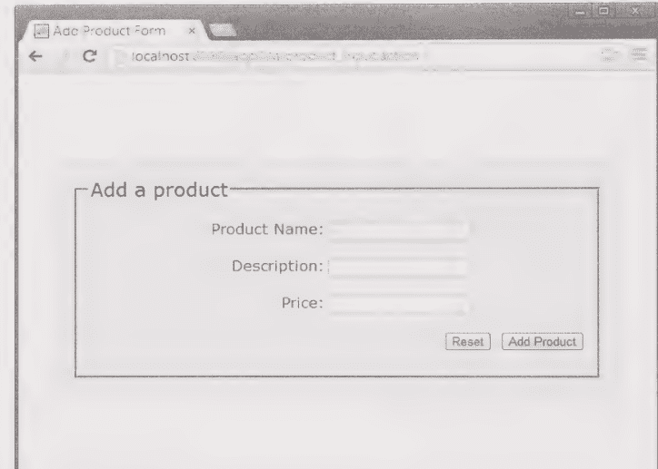

图 3.2：app03a 中的 Product 表单

## 视图解析器 (View Resolver)

Spring MVC 中的视图解析器负责解析视图。要使用和配置视图解析器，请在你的配置文件中声明 `viewResolver` ，如下所示：

```xml
<bean id="viewResolver" class="org.springframework.web.servlet.InternalResourceViewResolver">
  <property name="prefix" value="/WEB-INF/jsp/"/>
  <property name="suffix" value=".jsp"/>
</bean>
```

上面的 `viewResolver` bean 配置了两个属性：`prefix` 和 `suffix`。结果是，你的视图路径将变得更短。例如，与其将视图路径设置为 `/WEB-INF/jsp/myPage.jsp`，你只需要写 `myPage`，视图解析器就会为该字符串添加前缀和后缀。

作为一个示例，考虑 app03b 应用，它与 app03a 类似。然而，配置文件的名称和位置已经更改。此外，它配置了默认视图解析器，为所有视图路径添加了前缀和后缀。

图 3.3 显示了 app03b 的目录结构。

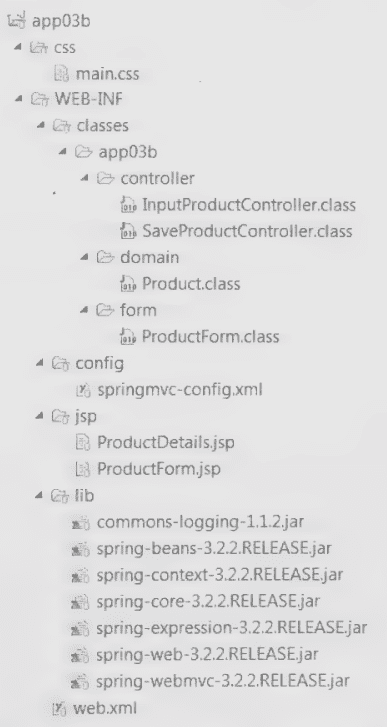

图 3.3：app03b 的目录结构

在 app03b 中，Spring MVC 配置文件已重命名为 `springmvc-config.xml` 并移动到 `/WEB-INF/config`。为了告诉 Spring MVC 在何处找到它，你需要将文件的位置传递给 Spring MVC 调度器 servlet（dispatcher servlet）。列表 3.7 显示了 app03b 的部署描述符（web.xml 文件）

### 列表 3.7：app03b 的部署描述符

```xml
<?xml version="1.0" encoding="UTF-8"?>
<web-app version="3.0"
  xmlns="http://java.sun.com/xml/ns/javaee"
  xmlns:xsi="http://www.w3.org/2001/XMLSchema-instance"
  xsi:schemaLocation="http://java.sun.com/xml/ns/javaee
  http://java.sun.com/xml/ns/javaee/web-app_3_0.xsd">

<servlet>
  <servlet-name>springmvc</servlet-name>
  <servlet-class>org.springframework.web.servlet.DispatcherServlet</servlet-class>
  <init-param>
    <param-name>contextConfigLocation</param-name>
    <param-value>/WEB-INF/config/springmvc-config.xml</param-value>
  </init-param>
  <load-on-startup>1</load-on-startup>
</servlet>

<servlet-mapping>
  <servlet-name>springmvc</servlet-name>
  <url-pattern>*.action</url-pattern>
</servlet-mapping>
</web-app>
```

特别注意 web.xml 文件中的 `init-param` 元素。要引用不使用默认命名和位置的配置文件，你需要使用 `contextConfigLocation` 初始参数。它的值应该是相对于应用程序目录的配置文件路径。

app03b 的配置文件位于列表 3.8。

### 列表 3.8：app03b 的 Spring MVC 配置文件

```xml
<?xml version="1.0" encoding="UTF-8"?>
<beans xmlns="http://www.springframework.org/schema/beans"
  xmlns:xsi="http://www.w3.org/2001/XMLSchema-instance"
  xsi:schemaLocation="http://www.springframework.org/schema/beans
  http://www.springframework.org/schema/beans/spring-3.0.xsd">

  <bean id="viewResolver" class="org.springframework.web.servlet.InternalResourceViewResolver">
    <property name="prefix" value="/WEB-INF/jsp/"/>
    <property name="suffix" value=".jsp"/>
  </bean>
</beans>
```

# 第 4 章：基于注解的控制器

```xml
<?xml version="1.0" encoding="UTF-8"?>
<beans xmlns="http://www.springframework.org/schema/beans"
xmlns:xsi="http://www.w3.org/2001/XMLSchema-instance"
xmlns:p="http://www.springframework.org/schema/p"
xmlns:context="http://www.springframework.org/schema/context"
xsi:schemaLocation="
      http://www.springframework.org/schema/beans
      http://www.springframework.org/schema/beans/spring-beans.xsd
      http://www.springframework.org/schema/context
      http://www.springframework.org/schema/context/spring-context.xsd
      ">
<context:component-scan base-package="com.example.controller"/>

<!-- -- -->
</beans>
```

你希望确保所有的控制器类都属于基础包。同时，你不希望指定一个范围太宽的基础包（例如，指定 `com.example` 而不是 `com.example.controller`），因为这将导致 Spring MVC 扫描无关的包。

## RequestMapping 注解类型

在控制器类内部，你编写请求处理方法，每个方法负责处理一个操作。为了告诉 Spring 哪个方法处理哪个操作，你需要使用 `org.springframework.web.bind.annotation.RequestMapping` 注解类型将 URI 与方法进行映射。

`RequestMapping` 注解类型的作用顾如其名：映射请求和方法。你可以使用 `@RequestMapping` 在方法或类上进行注解。

被 `@RequestMapping` 注解的方法将成为请求处理方法，当调度器 servlet（dispatcher servlet）接收到具有匹配 URI 的请求时，该方法将被调用。

下面是一个带有 RequestMapping 注解方法的控制器类。

```java
package com.example.controller;

import org.springframework.stereotype.Controller;
import org.springframework.web.bind.annotation.RequestMapping;
...

@Controller
public class CustomerController {

    @RequestMapping(value = "/customer_input")
    public String inputCustomer() {

        // 在此处执行某些操作

        return "CustomerForm";
    }
}
```

你使用 `RequestMapping` 注解中的 `value` 属性来指定映射到方法的 URI。在上面的示例中，URI `customer_input` 被映射到 `inputCustomer` 方法。这意味着，`inputCustomer` 方法可以使用具有此模式的 URL 调用。

`http://domain/context/customer_input`

由于 `value` 属性是 `RequestMapping` 注解类型的默认属性，如果它是 `RequestMapping` 注解中使用的唯一属性，你可以省略该属性名称。换句话说，这两个注解具有相同的含义。

```java
@RequestMapping(value = "/customer_input")
@RequestMapping("/customer_input")
```

但是，如果 `@RequestMapping` 中出现多个属性，你必须写出 `value` 属性的名称。

请求映射的值可以是一个空字符串，在这种情况下，该方法被映射到以下 URL：

`http://domain/context`

`RequestMapping` 除了 `value` 之外还有其他属性。例如，`method` 属性接受一组将由相应方法处理的 HTTP 方法。

例如，下面的 `processOrder` 方法只能通过 HTTP POST 或 PUT 方法调用。

```java
import org.springframework.stereotype.Controller;
import org.springframework.web.bind.annotation.RequestMapping;
import org.springframework.web.bind.annotation.RequestMethod;

@RequestMapping(value="/order_process", method={RequestMethod.POST, RequestMethod.PUT})
public String processOrder() {

    // 在此处执行某些操作

    return "OrderForm";
}
```

如果方法属性中只分配了一个 HTTP 请求，则括号是可选的。例如，

```java
@RequestMapping(value="/order_process", method=RequestMethod.POST)
```

如果方法属性不存在，`RequestMapping` 注解可以像这样用于控制器类：

```java
import org.springframework.stereotype.Controller;
import org.springframework.web.bind.annotation.RequestMapping;

@Controller
@RequestMapping("/customer")
public class CustomerController {
```

对于请求映射方法，特别注意的是，`RequestMapping` 注解可以像这样：

```java
import org.springframework.stereotype.Controller;
import org.springframework.web.bind.annotation.RequestMapping;
import org.springframework.web.bind.annotation.RequestMethod;

@Controller
@RequestMapping("/customer")
public class CustomerController {
```

由于控制器类映射到 `/customer`，该方法可以使用具有此模式的 URL 调用。

`http://domain/context/customer_input`

## 编写请求处理方法

请求处理方法可以包含多种类型。例如，如果你需要 `HttpServletRequest`，可以将其作为参数：

```java
import org.springframework.stereotype.Controller;
import org.springframework.web.bind.annotation.RequestMapping;

@Controller
@RequestMapping("/uri")
public String myMethod(HttpServletRequest request) {

    ...
}
```

或者，如果你需要 locale 和 `HttpServletRequest`，可以将它们都作为参数：


```java
import org.springframework.stereotype.Controller;
import org.springframework.web.bind.annotation.RequestMapping;

@Controller
@RequestMapping("/uri")
public String myMethod(HttpServletRequest request, Locale locale) {

    ...
}
```

# 第 4 章：基于注解的控制器

以下是作为请求处理方法参数的类型列表：

- `jakarta.servlet.ServletRequest` or `jakarta.servlet.http.HttpServletRequest`
- `jakarta.servlet.ServletResponse` or `jakarta.servlet.http.HttpServletResponse`
- `jakarta.servlet.http.HttpSession`
- `org.springframework.web.context.request.WebRequest` or `org.springframework.web.context.request.NativeWebRequest`
- `java.util.Locale`
- `java.io.InputStream` or `java.io.Reader`
- `java.io.OutputStream` or `java.io.Writer`
- `java.security.Principal`
- `HttpEntity<?> parameters`
- `java.util.Map` / `org.springframework.ui.Model` / `org.springframework.ui.ModelMap`
- `org.springframework.web.servlet.mvc.RedirectAttributes`
- `org.springframework.validation.Errors` / `org.springframework.validation.BindingResult`
- Command or form objects
- `org.springframework.web.bind.support.SessionStatus`
- `org.springframework.web.util.UriComponentsBuilder`
- 使用 `@PathVariable`, `@MatrixVariable`, `@RequestParam`, `@RequestHeader`, `@RequestBody` 或 `@RequestPart` 的类型

特别感兴趣的是 `org.springframework.ui.Model` 类型。它不是 Servlet 类型，而是一个包含 `Map` 的 Spring 类型。每当调用请求处理方法时，Spring MVC 都会创建一个 `Model` 对象并填充它的 `Map`。

请求处理方法可以返回这些对象之一：

- `ModelAndView` 对象
- `Model` 对象
- 包含模型属性的 `Map`
- `View` 对象
- 表示逻辑视图的字符串
- `void`
- `HttpEntity` 或 `ResponseEntity` 对象，用于访问 Servlet 响应头部内容
- `Callable`
- `DeferredResult`
- 任何其他返回类型。在这种情况下，返回值将被视为暴露给视图的模型属性

## 使用注解的控制器

app04a 应用程序是对第 2 章和第 3 章示例应用程序的重写，它展示了一个带有两个请求处理方法的控制器类。app04a 与之前的应用程序的主要区别是 app04a 中的控制器类使用了 `@Controller` 注解。此外，Spring 配置文件也包含额外的元素。应用程序的各个部分将在后续给出。

## 目录结构

图 4.1 显示了 app04a 的目录结构。注意现在只有一个控制器类。应用程序目录中添加了 `index.html`，以显示当 Spring MVC servlet 的 URL 模式设置为 `/` 时，仍然可以访问静态资源。

### 配置文件

app04a 有两个配置文件。第一个是部署描述符（`web.xml` 文件），它注册了 Spring MVC 调度器 servlet。第二个配置文件 `springmvc-config.xml` 是一个 Spring MVC 配置文件。

```text
app04a
├── css
│   └── main.css
├── WEB-INF
│   ├── classes
│   │   └── app04a
│   │       ├── controller
│   │       │   └── ProductController.class
│   │       ├── domain
│   │       │   └── Product.class
│   │       └── form
│   │           └── ProductForm.class
│   ├── config
│   │   └── springmvc-config.xml
│   └── lib
│       ├── commons-logging-1.1.2.jar
│       ├── spring-beans-3.2.2.RELEASE.jar
│       ├── spring-context-3.2.2.RELEASE.jar
│       ├── spring-core-3.2.2.RELEASE.jar
│       ├── spring-expression-3.2.2.RELEASE.jar
│       ├── spring-web-3.2.2.RELEASE.jar
│       ├── spring-webmvc-3.2.2.RELEASE.jar
│       └── web.xml
├── jsp
│   ├── ProductDetails.jsp
│   └── ProductForm.jsp
└── index.html
```

**图 4.1：** app04a 的目录结构

代码 4.1 显示了部署描述符，代码 4.2 显示了 Spring MVC 配置文件。

**代码 4.1：** app04a 的部署描述符 (`web.xml`)

```xml
<?xml version="1.0" encoding="UTF-8"?>
<web-app version="3.0"
xmlns="http://java.sun.com/xml/ns/javaee"
xmlns:xsi="http://www.w3.org/2001/XMLSchema-instance"
xsi:schemaLocation="http://java.sun.com/xml/ns/javaee
http://java.sun.com/xml/ns/javaee/web-app_3_0.xsd">

  <servlet>
    <servlet-name>springmvc</servlet-name>
    <servlet-class>
      org.springframework.web.servlet.DispatcherServlet
    </servlet-class>
    <init-param>
      <param-name>contextConfig</param-name>
      <param-value>
        WEB-INF/config/springmvc-config.xml
      </param-value>
    </init-param>
    <load-on-startup>1</load-on-startup>
  </servlet>

  <servlet-mapping>
    <servlet-name>springmvc</servlet-name>
    <url-pattern>/</url-pattern>
  </servlet-mapping>
</web-app>
```

注意在部署描述符的 `<servlet-mapping>` 元素中，Spring MVC 调度器的 URL 模式被设置为 `/`，而不是第三章中的 `.action`。这是为了说明你不需要使用特定的 URL 扩展来映射操作。然而，将 URL 模式设置为 `/` 意味着所有请求（包括对静态资源的请求）都将指向调度 servlet。为了正确处理静态资源，你需要在 Spring MVC 配置文件中添加一些 `<resources/>` 元素。

### 代码 4.2：`springmvc-config.xml` 文件

```xml
<?xml version="1.0" encoding="UTF-8"?>
<beans xmlns="http://www.springframework.org/schema/beans"
xmlns:xsi="http://www.w3.org/2001/XMLSchema-instance"
xmlns:p="http://www.springframework.org/schema/p"
xmlns:mvc="http://www.springframework.org/schema/mvc"
xmlns:context="http://www.springframework.org/schema/context"
xsi:schemaLocation="http://www.springframework.org/schema/beans
http://www.springframework.org/schema/beans/spring-beans.xsd
http://www.springframework.org/schema/mvc
http://www.springframework.org/schema/mvc/spring-mvc.xsd
http://www.springframework.org/schema/context
http://www.springframework.org/schema/context/spring-context.xsd">

  <context:component-scan base-package="app04a.controller"/>
  <mvc:annotation-driven/>
  <mvc:resources mapping="/css/*" location="/css/"/>
  <mvc:resources mapping="/*.html" location=""/>

  <bean id="viewResolver"
    class="org.springframework.web.servlet.view.InternalResourceResolver">
    <property name="prefix" value="WEB-INF/jsp/"/>
    <property name="suffix" value=".jsp"/>
  </bean>
</beans>
```

代码 4.2 中 Spring MVC 配置文件中的重点是存在 `<component-scan>` 元素。它是告诉 Spring MVC 扫描特定包下的类，在本例中是 `app04a.controller` 包。此外，还有 `<annotation-driven/>` 元素和两个 `<resources/>` 元素。`<annotation-driven/>` 元素执行了多项工作，包括注册 bean 以支持使用带注解的控制器方法的请求处理。`<resources/>` 元素告诉 Spring MVC 哪些静态资源应该独立于调度 servlet 之外服务。

代码 4.2 配置文件中有两个 `<resources/>` 元素。第一个确保 `/css` 目录下的所有文件都是可见的。第二个允许显示应用程序目录中的所有 `.html` 文件。

> **注意：** 如果没有 `<resources/>`，你将无法访问静态资源。

## 控制器

使用 `@Controller` 注解的优势之一是代码 4.3 显示的控制器类，它有两个方法：`input()` 和 `save()`。

**代码 4.3：** app04a 中的控制器

```java
package app04a.controller;

import app04a.domain.Product;
import app04a.form.ProductForm;
import org.springframework.stereotype.Controller;
import org.springframework.web.bind.annotation.RequestMapping;
import org.springframework.web.bind.annotation.PostMapping;
import org.springframework.web.bind.annotation.ModelAttribute;

@Controller
public class ProductController {

    @RequestMapping("/input")
    public String input(Model model) {
        Product product = new Product();
        model.addAttribute("product", product);
        return "ProductForm";
    }

    @PostMapping("/save")
    public String save(@ModelAttribute ProductForm productForm, Model model) {
        Product product = new Product();
        product.setName(productForm.getName());
        product.setDescription(productForm.getDescription());
        product.setPrice(productForm.getPrice());
        model.addAttribute("product", product);
        return "ProductDetails";
    }
}
```

注意 `save()` 的第二个参数是 `Model`。Spring 在每次调用请求处理方法时都会创建一个 `Model` 实例。使用 `Model` 的目的是将数据从控制器传递到视图。

## 视图

app04a 中与之前的应用程序类似的两个视图：`ProductForm.jsp` 页面（在代码 4.4 中给出）和 `ProductDetails.jsp` 页面（在代码 4.5 中显示）。

**代码 4.4：** `ProductForm.jsp` 页面

```html
<!DOCTYPE html>
<html>
<head>
<title>Add Product Form</title>
<style type="text/css">@import(css/main.css);</style>
</head>
<body>
<div id="global">
  <form action="product_save" method="post">
    <fieldset>
      <legend>Add a product</legend>
      <p>
        <label for="name">Product Name:</label>
        <input type="text" id="name" name="name" value="${product.name}">
      </p>
      <p>
        <label for="description">Description:</label>
        <input type="text" id="description" name="description" value="${product.description}">
      </p>
      <p>
        <label for="price">Price:</label>
        <input type="text" id="price" name="price" value="${product.price}">
      </p>
      <p id="buttons">
        <input id="reset" type="reset">
        <input id="submit" type="submit" value="Add Product">
      </p>
    </fieldset>
  </form>
</div>
</body>
</html>
```

**代码 4.5：** `ProductDetails.jsp` 页面

```html
<!DOCTYPE HTML>
<html>
<head>
<title>Save Product</title>
<style type="text/css">@import(css/main.css);</style>
</head>
<body>
<div id="global">
  <h4>The product has been saved.</h4>
  <p>
    <h5>Details:</h5>
    Product Name: ${product.name}<br/>
    Description: ${product.description}<br/>
    Price: ${product.price}
  </p>
</div>
</body>
</html>
```

## 测试应用程序

要测试 app04a，请将浏览器指向此 URL：

`http://localhost:8080/app04a/product_input`

你将在浏览器中看到产品表单（Product Form），如图 4.2 所示。


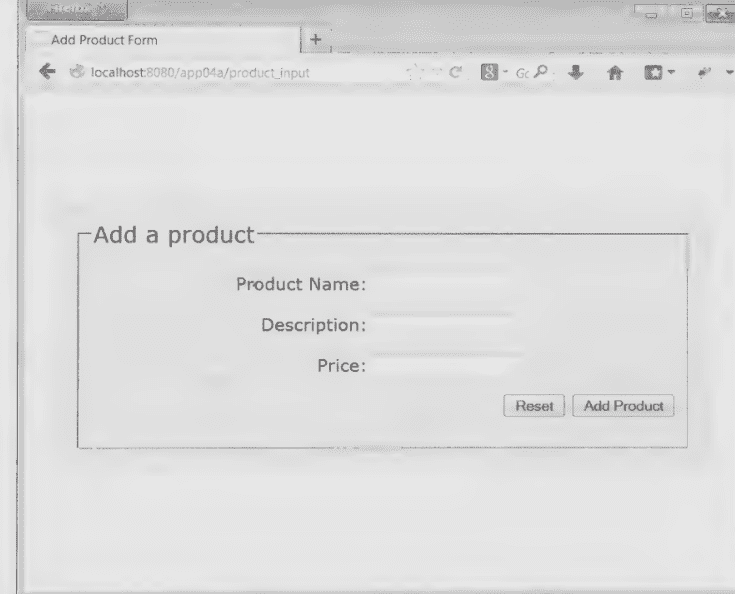

图 4.2：产品表单

点击“添加产品”（Add Product）按钮将调用控制器中的 `saveProduct` 方法。

## 使用 @Autowired 和 @Service 进行依赖注入

使用 Spring 框架的好处之一是可以免费获得依赖注入。毕竟，Spring 最初就是作为一个依赖注入容器启动的。将依赖项注入到 Spring MVC 控制器的最简单的方法是在字段或方法上使用 `@Autowired` 注解。`Autowired` 注解类型属于 `org.springframework.beans.factory.annotation` 包。

为了能够找到依赖项，其类必须被 `@Service` 注解。`Service` 注解类型是 `org.springframework.stereotype` 包的成员，表示被注解的类是一个服务（Service）。此外，你需要在配置文件中添加 `<component-scan/>` 元素来扫描基础包以查找你的依赖项。

```xml
<context:component-scan base-package="dependencyPackage"/>
```

作为 Spring MVC 应用中依赖注入的示例，考虑另一个示例：app04b 应用。app04b 应用程序中的 `ProductController` 类（见列表 4.6）已经相对于 app04a 中同名的类进行了修改。

### 列表 4.6：app04b 中的 ProductController 类

```java
package app04b.controller;
import org.apache.commons.logging.Log;
import org.apache.commons.logging.LogFactory;
import org.springframework.beans.factory.annotation.Autowired;
import org.springframework.stereotype.Controller;
import org.springframework.ui.Model;
import org.springframework.web.bind.annotation.PathVariable;
import org.springframework.web.bind.annotation.RequestMapping;
import org.springframework.web.bind.annotation.RequestMethod;
import org.springframework.web.servlet.mvc.support.RedirectAttributes;
import app04b.domain.Product;
import app04b.form.ProductForm;
import app04b.service.ProductService;

@Controller
public class ProductController {

    private static final Log logger = LogFactory.getLog(ProductController.class);

    @Autowired
    private ProductService productService;

    @RequestMapping(value = "/product_input")
    public String inputProduct() {
        logger.info("inputProduct called");
        return "ProductForm";
    }

    @RequestMapping(value = "/product_save", method = RequestMethod.POST)
    public String saveProductAttributes(ProductForm productForm, RedirectAttributes redirectAttributes) {
        logger.info("saveProduct called");
        // 无需创建并实例化 ProductForm
        // 创建 product
        Product product = new Product();
        product.setName(productForm.getName());
        product.setDescription(productForm.getDescription());
        try {
            product.setPrice(Float.parseFloat(productForm.getPrice()));
        } catch (NumberFormatException e) {
        }
        // 添加产品
        Product savedProduct = productService.add(product);
        redirectAttributes.addFlashAttribute("message", "The product was successfully added.");
        return "redirect:/product_view/" + savedProduct.getId();
    }

    @RequestMapping(value = "/product_view/{id}")
    public String viewProduct(@PathVariable Long id, Model model) {
        Product product = productService.get(id);
        model.addAttribute("product", product);
        return "ProductView";
    }
}
```

有几点使得 app04b 中的 `ProductController` 类与 app04a 中的对应类不同。第一点是添加了以下带有 `@Autowired` 注解的私有字段：

```java
@Autowired
private ProductService productService;
```

在这里，`ProductService` 是一个提供处理产品各种方法的接口。在 `productService` 上标注 `@Autowired` 会导致 `ProductService` 的实例注入到 `ProductController` 实例中。

列表 4.7 显示了 `ProductService` 接口，列表 4.8 显示了它的实现类 `ProductServiceImpl`。注意，为了使实现能够被扫描，你必须在其类定义上加上 `@Service` 注解。

### 列表 4.7：ProductService 接口

```java
package app04b.service;
import app04b.domain.Product;

public interface ProductService {
    Product add(Product product);
    Product get(long id);
}
```

### 列表 4.8：ProductServiceImpl 类

```java
package app04b.service;

import java.util.HashMap;
import java.util.Map;
import java.util.concurrent.atomic.AtomicLong;
import org.springframework.stereotype.Service;
import app04b.domain.Product;

@Service
public class ProductServiceImpl implements ProductService {

    private Map<Long, Product> products = new HashMap<Long, Product>();
    private AtomicLong generator = new AtomicLong(0);

    public ProductServiceImpl() {
        Product product = new Product();
        product.setName("JX1 Power Drill");
        product.setDescription("Powerful hand drill,");
    }

    public Product add(Product product) {
        long id = generator.incrementAndGet();
        product.setId(id);
        products.put(id, product);
        return product;
    }

    public Product get(long id) {
        return products.get(id);
    }
}
```

（注：原文文本包含跨页面的重复/碎片部分，上述反映了逻辑流。）

作为一名丰富的 servlet/JSP 程序员，你必须了解转发（forward）和重定向（redirect）的区别。转发比重定向快，因为重定向需要与服务器进行一次往返，而转发不需要。然而，在某些情况下，重定向是优的。其中一种情况是你需要重定向到外部站点，例如另一个网站。你无法使用转发指向外部站点，因此重定向是你的唯一选择。

另一种你想使用重定向而不是转发的场景是当你希望避免在用户刷新页面时再次触发相同的操作。例如，在 app04a 中当你提交产品表单时，`saveProduct` 方法将被调用，且该方法将执行它应该做的事情。在实际应用程序中，这可能包括将产品添加到数据库。然而，如果你在提交表单后刷新页面，`saveProduct` 将再次被调用，同一个产品可能会被再次添加一次。为了避免这种情况，在提交表单后，你可能倾向于将用户重定向到一个不同的页面。该页面在反复调用时应该没有副作用。

## 第 4 章：基于注解的控制器

使用重定向（redirect）的权衡在于无法方便地向目标页面传递值。而使用转发（forward），你可以简单地向 `Model` 对象添加属性，这些属性将可以在视图中访问。由于重定向是到服务器的往返，因此当你进行重定向时，`Model` 中的所有内容都会丢失。幸运的是，Spring 3.1 及更高版本提供了一种通过闪存属性（flash attributes）在重定向时保留值的方法。要使用闪存属性，你必须在 Spring MVC 配置文件中有一个 `<annotation-driven/>` 元素。然后，你必须在你的方法中添加一个类型为 `org.springframework.web.servlet.mvc.RedirectAttributes` 的新参数。app04b 中 ProductController 的 `saveProduct` 方法在列表 4.10 中重复。

### 列表 4.10：使用闪存属性

```java
@RequestMapping(value = "product_save", method = RequestMethod.POST)
public String saveProduct(ProductForm productForm, RedirectAttributes redirectAttributes) {
    logger.info("saveProduct called");
    // 无需创建并实例化 Product
    // 创建 Product
    Product product = new Product();
    product.setName(productForm.getName());
    product.setDescription(productForm.getDescription());
    try {
        product.setPrice(Float.parseFloat(productForm.getPrice()));
    } catch (NumberFormatException e) {
    }
    // 添加产品
    Product savedProduct = productService.add(product);
    redirectAttributes.addFlashAttribute("message", "The product was successfully added.");
    return "redirect:/product_view/" + savedProduct.getId();
}
```

## 请求参数与路径变量

请求参数（request parameters）和路径变量（path variables）都用于向服务器发送值。它们都是 URL 的一部分。请求参数的形式为由 `&` 符号分隔的键值对。例如，此 URL 携带了一个值为 3 的 `productId` 请求参数。

```
http://localhost:8080/app04b/product_retrieve?productId=3
```

在 servlet 编程中，你可以使用 `HttpServletRequest` 上的 `getParameter` 方法获取请求参数值：

```java
String productId = httpRequest.getParameter("productId");
```

在 Spring MVC 中，有一种更简单的方法获取请求参数值：使用 `org.springframework.web.bind.RequestParam` 注解来标记参数，请求参数的值将复制到该参数中。例如，以下方法包含一个捕获请求参数 `productId` 的参数。

```java
public void sendProduct(@RequestParam int productId)
```

如你所见，被 `@RequestParam` 注解的参数类型不需要是 `String`。

路径变量类似于请求参数，区别在于它没有键部分，只有值。例如，app04b 中的 `product_view` 被映射到如下格式的 URL：

```
/product_view/{productId}
```

其中 `productId` 是表示产品标识符的整数。在 Spring MVC 术语中，`productId` 是路径变量。它用于向服务器发送值。

考虑列表 4.11 中演示使用路径变量的视图方法。

### 列表 4.11：使用路径变量

```java
@RequestMapping(value = "/product_view/{id}")
public String viewProduct(@PathVariable Long id, Model model) {
    Product product = productsService.get(id);
    model.addAttribute("product", product);
    return "ProductView";
}
```


要使用路径变量，首先你需要在 `@RequestMapping` 注解中添加一个作为值属性的变量。该变量必须放在花括号之间。例如，以下 `@RequestMapping` 注解定义了一个名为 `id` 的路径变量：

```
@RequestMapping(value = "/product_view/{id}")
```

然后，在你的方法签名中，添加一个同名且被 `@PathVariable` 注解的变量。请查看列表 4.11 中 `viewProduct` 的签名。当方法被调用时，请求 URL 中的 `id` 值将通过复制到路径变量并可以在方法中使用。路径变量的类型不需要是 `String`。Spring MVC 会尽力转换非字符串值。Spring MVC 的这一极佳特性将在第 5 章“数据绑定与表单标签”中进行详细讨论。

你可以在请求映射中使用多个路径变量。例如，以下两个路径变量：`userId` 和 `orderId`。

```
@RequestMapping(value = "/product_view/{userId}/{orderId}")
```

要测试 `viewProduct` 方法中的路径变量，请将浏览器导向此 URL。

```
http://localhost:8080/app0b/product_view/1
```

在使用路径变量时存在一个小问题：在某些情况下它可能会让浏览器产生困惑。考虑以下 URL。

```
http://example.com/context/abc
```

浏览器会（正确地）认为 `abc` 是 action。对静态文件的任何相对引用（如 CSS 文件）将使用 `http://example.com/context` 作为基路径进行解析。这意味着，如果服务器发送的页面包含此 `img` 元素：

```

```

浏览器将在 `http://example.com/context/logo.png` 寻找 `logo.png`。

## 90 Spring MVC：教程

然而，请注意，如果同一个应用被部署为默认上下文（其中默认上下文的路径为空字符串），则相同目标的的 URL 将是：

```
http://example.com/abc
```

现在，考虑以下在默认上下文中携带路径变量的 URL：

```
http://example.com/abc
```

浏览器会（正确地）认为 `abc` 是 action。对静态文件的任何相对引用（如 CSS 文件）将使用 `http://example.com/context` 作为基路径进行解析。这意味着，如果服务器发送的页面包含此 `img` 元素：

```

```

浏览器将在 `http://example.com/context/logo.png` 寻找 `logo.png`。

## @ModelAttribute

在上一节中，我提到了 Spring MVC 在每次调用处理请求的方法时创建的 `Model` 实例。如果你打算使用它，可以将 `Model` 类型作为方法的参数。`ModelAndView` 注解类型可以用于装饰方法中的 `Model` 实例。该注解类型属于 `org.springframework.web.bind.annotation`。

`@ModelAttribute` 可用于注解方法参数或方法。被 `@ModelAttribute` 注解的方法参数如果方法体没有显式添加，则将被检索或创建并添加到 `Model` 中。例如，Spring MVC 每次调用 `submitOrder` 方法都会创建一个 `Order` 实例。

```java
@RequestMapping(method = RequestMethod.POST)
public String submitOrder(@ModelAttribute("newOrder") Order order, Model model) {
    ...
}
```

检索或创建的 `Order` 实例将以属性键 `newOrder` 添加到 `Model` 中。如果没有定义键名，则名称将从要添加到 `Model` 的类型名称派生。例如，每次调用以下方法时，`Order` 实例将被检索或创建并使用属性键 `order` 添加到 `Model` 中。

```java
public String submitOrder(@ModelAttribute Order order, Model model)
```

`@ModelAttribute` 的第二个用法是注解非请求处理方法。被 `@ModelAttribute` 注解的方法会在每次调用同一个控制器类中的请求处理方法时被调用。这意味着，如果一个控制器类有两个请求处理方法和一个被 `@ModelAttribute` 注解的方法，那么该注解方法的调用次数可能比每个请求处理方法都要高。

被 `@ModelAttribute` 注解的方法会在请求处理方法之前被调用。此类方法可以返回对象或具有 `void` 返回类型。如果它返回对象，该对象将自动添加到为请求处理方法创建 `Model` 中。例如，此方法的返回值将被添加到 `Model` 中。

```java
@ModelAttribute
public Product addProduct(@RequestParam String productId) {
    return productService.get(productId);
}
```

如果你的注解方法返回 `void`，那么你必须也添加 `Model` 参数类型并手动添加实例。这是一个示例。

```java
@ModelAttribute
public void populateModel(@RequestParam String id, Model model) {
    model.addAttribute(new Account(id));
}
```

## 总结

在本章中，你学习了如何编写使用基于注解的控制器的 Spring MVC 。你还学习了各种注解类型，用于标记你的类、方法或方法参数。

# 第 5 章
## 数据绑定与表单标签库

数据绑定是一种将用户输入绑定到领域模型的功能。得益于数据绑定，始终为 `String` 类型的 HTTP 请求参数可以用于填充各种类型的对象属性。数据绑定还让表单 Bean（例如在前几章节中的 `ProductForm` 实例）变得多余了。

要有效地使用数据绑定，你需要 Spring 表单标签库。本章将解释数据绑定和表单标签库，并提供突显表单标签库中标签用法的示例。

## 数据绑定概述

由于 HTTP 的特性，所有 HTTP 请求参数都是字符串。回想一下在之前的章节中，你必须将字符串解析为 `float` 以获取正确的商品价格。为了唤起你的记忆，这里有来自 app04a 中 `ProductController` 类 `saveProduct` 方法的一些代码。

```java
@RequestMapping(value="product_save")
public String saveProduct(ProductForm productForm, Model model) {
    logger.info("saveProduct called");
    // 不需要创建和实例化 ProductForm
    // 创建 Product
    Product product = new Product();
    product.setName(productForm.getName());
    product.setDescription(productForm.getDescription());
    try {
        product.setPrice(Float.parseFloat(productForm.getPrice()));
    } catch (NumberFormatException e) {
    }
}
```

你必须解析 `ProductForm` 中的价格是因为它是 `String`，而你需要一个 `float` 来填充 `Product` 的价格属性。通过数据绑定，你可以将上面的 `saveProduct` 方法片段替换为：

```java
@RequestMapping(value="product_save")
public String saveProduct(Product product, Model model)
```

得益于数据绑定，你不再需要 `ProductForm` 类，而且对 `Product` 对象的价格属性无需任何解析。

数据绑定的另一个用处是在输入验证失败时重新填充 HTML 表单。使用手动 HTML 编码时，你必须担心如何用用户之前输入的值重新填充输入字段。使用 Spring 数据绑定和表单标签库，这些将由你为你处理。

## 表单标签库

表单标签库包含了你可以用于在 JSP 页面中渲染 HTML 元素的标签。要使用这些标签，请在 JSP 页面顶部声明此 taglib 指令。

```jsp
<%@ taglib prefix="form" uri="http://www.springframework.org/tags/form" %>
```

表 5.1 显示了表单标签库中的标签。每个标签将在随后的小节中进行解释。“数据绑定示例”部分给出的示例应用程序演示了如何结合表单标签库使用数据绑定。

| 标签 | 描述 |
| --- | --- |
| form | 渲染表单元素。 |
| input | 渲染一个 `<input type="text"/>` 元素 |
| password | 渲染一个 `<input type="password"/>` 元素 |
| hidden | 渲染一个 `<input type="hidden"/>` 元素 |
| textarea | 渲染一个 textarea 元素 |
| checkbox | 渲染一个 `<input type="checkbox"/>` 元素 |
| checkboxes | 渲染多个 `<input type="checkbox"/>` 元素 |
| radiobutton | 渲染一个 `<input type="radio"/>` 元素 |
| radiobuttons | 渲染多个 `<input type="radio"/>` 元素 |
| select | 渲染一个 select 元素 |
| option | 渲染一个 option 元素。 |
| options | 渲染一个 option 元素列表。 |
| errors | 在 span 元素中渲染字段错误。 |

表 5.1：form 标签

## form 标签

`form` 标签渲染一个 HTML 表单。要使用任何其他渲染表单输入字段的标签，你必须有一个 `form` 标签。表 5.2 列出了 form 标签的属性。

表 5.2 中的所有属性都是可选的。该表不包含 HTML 属性，例如 `method` 和 `action`。

`commandName` 属性可能是最重要的属性，因为它指定了模型属性的名称，该属性包含一个后台对象，其属性将用于填充生成的表单。如果存在此属性，你必须在返回包含此表单的视图的请求方法中添加相应的模型属性。例如，在随附本书的 app05 应用中，`BookLoginForm.jsp` 中指定了以下 `form` 标签。

```jsp
<form:form commandName="book" action="book_save" method="post">
...
</form:form>
```

| 属性 | 描述 |
| --- | --- |
| acceptCharset | 指定服务器接受的字符编码列表。 |
| commandName | 表单对象暴露的模型属性名称。默认值为 ‘command’。 |
| cssClass | 指定应用到渲染元素上的 CSS 类。 |
| cssStyle | 指定应用到渲染的表单元素的 CSS 样式。 |
| htmlEscape | 接受 `true` 或 `false`，表示渲染后的值是否应该进行 HTML 转义。 |
| modelAttribute | 表单支持对象暴露的模型属性名称。默认值为 ‘command’。 |

表 5.2：form 标签属性

## input 标签

`input` 标签渲染一个 `<input type="text"/>` 元素。该标签最重要的属性是 `path`，它将输入字段绑定到后台对象的属性。例如，如果外层 `<form/>` 标签的 `commandName` 属性赋值为 `book` 且 `input` 标签的 `path` 属性为 `isbn`，则该标签将绑定到 `Book` 对象的 `isbn` 属性。表 5.3 显示了 `input` 标签的所有属性。表 5.3 中的所有属性都是可选的，该表不包含 HTML 属性。

| 属性 | 描述 |
| --- | --- |
| cssClass | 指定应用到渲染元素的 CSS 类。 |
| cssStyle | 指定应用到渲染的表单元素的 CSS 样式。 |
| cssErrorClass | 如果绑定属性包含错误，指定应用到渲染输入元素的 CSS 类，覆盖 `cssClass` 属性的值。 |
| htmlEscape | 接受 `true` 或 `false`，表示渲染后的值是否应该进行 HTML 转义。 |
| path | 要绑定的属性路径。 |

表 5.3：input 标签属性

例如，此输入标签绑定到后台对象的 `isbn` 属性。

```jsp
<form:input id="isbn" path="isbn" cssErrorClass="errorBox"/>
```

这将被渲染为以下元素：

```html
<input type="text" id="isbn" name="isbn"/>
```

除非 `isbn` 属性存在输入验证错误且使用同一个表单来重新显示用户输入，否则 `cssErrorClass` 属性不起作用，此时输入标签将被渲染为此输入元素：

```html
<input type="text" id="isbn" name="isbn" class="errorBox"/>
```

`input` 标签也可以绑定到嵌套对象中的属性。例如，以下输入标签绑定到后台对象 `category` 属性的 `id` 属性。

```jsp
<form:input path="category.id"/>
```

## password 标签

`password` 标签渲染一个 `<input type="password">` 元素，其属性如表 5.4 所示。`password` 标签与 `input` 标签类似，不同之处在于有一个 `showPassword` 属性。

| 属性 | 描述 |
|---|---|
| cssClass | 指定应用到渲染后的输入元素的 CSS 类。 |
| cssStyle | 指定应用到渲染后的输入元素的 CSS 样式。 |
| cssErrorClass | 如果绑定的属性包含错误，则指定应用到渲染后的输入元素的 CSS 类，这会覆盖 `cssClass` 属性的值。 |
| htmlEscape | 接受 `true` 或 `false`，表示渲染后的值是否应该进行 HTML 转义。 |
| path | 要绑定的属性的路径。 |
| showPassword | 表示是否显示密码而非掩码。默认值为 `false`。 |

表 5.4：password 标签的属性

表 5.4 中的所有属性都是可选的，且该表不包含 HTML 属性。以下是 `password` 标签的示例。

```jsp
<form:password id="pwd" path="password" className="normal"/>
```

## hidden 标签

`hidden` 标签渲染一个 `<input type="hidden">` 元素，其属性如表 5.5 所示。`hidden` 标签与 `input` 标签类似，不同之处在于它没有视觉外观，因此不支持 `cssClass` 或 `cssStyle` 属性。

| 属性 | 描述 |
|---|---|
| htmlEscape | 接受 `true` 或 `false`，表示渲染后的值是否应该进行 HTML 转义。 |
| path | 要绑定的属性的路径。 |

表 5.5：hidden 标签的属性

表 5.5 中的所有属性都是可选的，且该表不包含 HTML 属性。

以下是 `hidden` 标签的示例。

```jsp
<form:hidden path="productId"/>
```


## textarea 标签

`textarea` 标签渲染一个 HTML `textarea` 元素。如你所知，`textarea` 元素基本上是一个支持多行输入的输入元素。`textarea` 标签的属性如表 5.6 所示。表 5.6 中的所有属性都是可选的，且该表不包含 HTML 属性。

| 属性 | 描述 |
|---|---|
| `cssClass` | 指定应用到渲染后的输入元素的 CSS 类 |
| `cssStyle` | 指定应用到渲染后的输入元素的 CSS 样式 |
| `cssErrorClass` | 如果绑定的属性包含错误，则指定应用到渲染后的输入元素的 CSS 类，这会覆盖 `cssClass` 属性的值。 |
| `htmlEscape` | 接受 `true` 或 `false`，表示渲染后的值是否应该进行 HTML 转义。 |
| `path` | 要绑定的属性的路径。 |

表 5.6：password 标签的属性

例如，下面的 `textarea` 标签绑定到表单支持对象的 `note` 属性。

```html
<form:textarea path="note" tabindex="4" rows="5" cols="80"/>
```

## checkbox 标签

`checkbox` 标签渲染一个 `<input type="checkbox">` 元素。`checkbox` 标签内可能出现的属性列于表 5.7 所示。所有属性都是可选的，且此表不包含 HTML 属性。

| 属性 | 描述 |
|---|---|
| `cssClass` | 指定应用到渲染后的输入元素的 CSS 类。 |
| `cssStyle` | 指定应用到渲染后的输入元素的 CSS 样式 |
| `cssErrorClass` | 如果绑定的属性包含错误，则指定应用到渲染后的输入元素的 CSS 类，这会覆盖 `cssClass` 属性的值。 |
| `htmlEscape` | 接受 `true` 或 `false`，表示渲染后的值是否应该进行 HTML 转义。 |
| `label` | 用作渲染后的 checkbox 标签的值。 |
| `path` | 要绑定的属性的路径。 |

表 5.7：checkbox 标签的属性

例如，下面的 `checkbox` 标签绑定到 `outOfStock` 属性。

```html
<form:checkbox path="outOfStock" value="Out of Stock"/>
```

## radiobutton 标签

`radiobutton` 标签渲染一个 `<input type="radio">` 元素。`radiobutton` 的属性如表 5.8 所示。表 5.8 中的所有属性都是可选的，且该表不包含 HTML 属性。

例如，下面的 `radiobutton` 标签绑定到 `newsletter` 属性。

```html
Computing Now <form:radiobutton path="newsletter" value="Computing Now"/><br/>
Modern Health <form:radiobutton path="newsletter" value="Modern Health"/>
```

| 属性 | 描述 |
| --- | --- |
| `cssClass` | 指定应用到渲染后的输入元素的 CSS 类。 |
| `cssStyle` | 指定应用到渲染后的输入元素的 CSS 样式。 |
| `cssErrorClass` | 如果绑定的属性包含错误，则指定应用到渲染后的输入元素的 CSS 类，这会覆盖 `cssClass` 属性的值。 |
| `htmlEscape` | 接受 `true` 或 `false`，表示渲染后的值是否应该进行 HTML 转义。 |
| `label` | 用作渲染后的 radio button 标签的值。 |
| `path` | 要绑定的属性的路径。 |

表 5.8：radiobutton 标签的属性

## checkboxes 标签

**checkboxes** 标签渲染多个 `<input type="checkbox">` 元素。`checkboxes` 标签内可能出现的属性如表 5.9 所示。所有属性都是可选的，该表不包含 HTML 属性。

例如，下面的 `checkboxes` 标签渲染模型属性的复选框。

```html
<form:checkboxes path="category" items="${category}"/>
```

| 属性 | 描述 |
|---|---|
| `cssClass` | 指定应用到渲染后的输入元素的 CSS 类。 |
| `cssStyle` | 指定应用到渲染后的输入元素的 CSS 样式 |
| `cssErrorClass` | 如果绑定的属性包含错误，则指定应用到渲染后的输入元素的 CSS 类，这会覆盖 `cssClass` 属性的值。 |
| `delimiter` | 指定两个输入元素之间的分隔符。默认没有分隔符。 |
| `element` | 指定包裹每个输入元素的 HTML 元素。默认是 'span'。 |
| `htmlEscape` | 接受 `true` 或 `false`，表示渲染后的值是否应该进行 HTML 转义。 |
| `items` | 用于生成输入元素的集合、映射或数组。 |
| `itemLabel` | `items` 属性指定的集合、映射或数组中的属性，用于提供每个输入元素的标签。 |
| `itemValue` | `items` 属性指定的集合、映射或数组中的属性，用于提供每个输入元素的值。 |
| `path` | 要绑定的属性的路径。 |

表 5.9：checkboxes 标签的属性

## radiobuttons 标签

`radiobuttons` 标签渲染多个 `<input type="radio">` 元素。`radiobutton` 的属性如表 5.10 所示。

例如，下面的 `radiobuttons` 标签渲染模型属性的单选按钮。一次只能选择一个单选按钮。

```html
<form:radiobuttons path="category" items="${category}"/>
```

| 属性 | 描述 |
|---|---|
| `cssClass` | 指定应用到渲染后的输入元素的 CSS 类。 |
| `cssStyle` | 指定应用到渲染后的输入元素的 CSS 样式 |
| `cssErrorClass` | 如果绑定的属性包含错误，则指定应用到渲染后的输入元素的 CSS 类，这会覆盖 `cssClass` 属性的值。 |
| `delimiter` | 指定两个输入元素之间的分隔符。默认没有分隔符。 |
| `element` | 指定包裹每个输入元素的 HTML 元素。默认是 'span'。 |
| `htmlEscape` | 接受 `true` 或 `false`，表示渲染后的值是否应该进行 HTML 转义。 |
| `items` | 用于生成输入元素的集合、映射或数组。 |
| `itemLabel` | `items` 属性指定的集合、映射或数组中的属性，用于提供每个输入元素的标签。 |
| `itemValue` | `items` 属性指定的集合、映射或数组中的属性，用于提供每个输入元素的值。 |
| `path` | 要绑定的属性的路径。 |

表 5.10：radiobuttons 的属性

## select 标签

`select` 标签渲染一个 HTML `select` 元素。渲染元素的选项可能来自分配给其 `items` 属性的集合或映射或数组，也来自嵌套的 `option` 或 `options` 标签。`select` 标签的属性如表 5.11 所示。所有属性都是可选的，且表中不包含任何 HTML 属性。

`items` 属性特别有用，因为它可能绑定到集合、映射或数组，以生成 `select` 元素的选项。

例如，下面的 `select` 标签绑定到表单支持对象的 `category` 属性的 `id` 属性。它的选项来自一个 `categories` 模型属性。每个选项的值都来自 `categories` 集合/映射/数组中对象的 `id` 属性，而其标签则来自 `name` 属性。

```html
<form:select id="category" path="category.id" items="${categories}" label="name" itemValue="id"/>
```

| 属性 | 描述 |
|---|---|
| `cssClass` | 指定应用到渲染后的输入元素的 CSS 类。 |
| `cssStyle` | 指定应用到渲染后的输入元素的 CSS 样式。 |
| `cssErrorClass` | 如果绑定的属性包含错误，则指定应用到渲染的元素的 CSS 类，这会覆盖 `cssClass` 属性的值。 |
| `htmlEscape` | 接受 `true` 或 `false`，表示是否对渲染后的值进行 HTML 转义。 |
| `items` | 用于生成输入元素的对象集合（Collection）、Map 或数组。 |
| `itemLabel` | `items` 属性中指定的集合/Map/数组中对象的属性，用于为每个输入元素提供标签。 |
| `itemValue` | `items` 属性中指定的集合/Map/数组中对象的属性，用于为每个输入元素提供值。 |
| `path` | 要绑定的属性的路径。 |

表 5.11：select 标签的属性

## option 标签

`option` 标签渲染一个 HTML `option` 元素，用于 `select` 元素内部。其属性见表 5.12。所有属性均为可选的，且该表不包含 HTML 属性。

例如，这里有一个 `option` 标签示例。

| 属性 | 描述 |
|---|---|
| `cssClass` | 指定应用到渲染后的输入元素的 CSS 类 |
| `cssStyle` | 指定应用到渲染后的输入元素的 CSS 样式 |
| `cssErrorClass` | 如果绑定的属性包含错误，则指定应用到渲染的 元素的 CSS 类，这会覆盖 `cssClass` 属性的值。 |
| `htmlEscape` | 接受 `true` 或 `false`，表示是否对渲染后的值进行 HTML 转义。 |

表 5.12：option 标签的属性

```html
<form:select id="category" path="category.id"
items="${categories}" itemLabel="name"
itemView="id">
  <option value="0">-- 请选择 --</option>
</form:select>
```

此代码段渲染了一个 `select` 元素，其选项既来自 `categories` 模型属性，也来自 `option` 标签。

## options 标签

`options` 标签生成一组 HTML `option` 元素列表。表 5.13 显示了可能出现在 `options` 标签中的属性。它不包含 HTML 属性。

app05a 应用程序提供了 `options` 标签的示例。

| 属性 | 描述 |
| ------|---|
| `cssClass` | 指定应用到渲染后的输入元素的 CSS 类。 |
| `cssStyle` | 指定应用到渲染后的输入元素的 CSS 样式 |
| `cssErrorClass` | 如果绑定的属性包含错误，则指定应用到输入元素的 CSS 类，这会覆盖 `cssClass` 属性的值。 |
| `htmlEscape` | 接受 `true` 或 `false`，表示是否对渲染后的值进行 HTML 转义。 |
| `items` | 用于生成输入元素的对象集合（Collection）、Map 或数组。 |
| `itemLabel` | `items` 属性中指定的集合/Map/数组中对象的属性，用于为每个输入元素提供标签。 |
| `itemValue` | `items` 属性中指定的集合/Map/数组中对象的属性，用于为每个输入元素提供值。 |

表 5.13：options 标签的属性

## errors 标签

**errors** 标签渲染一个或多个 HTML `span` 元素，每个元素包含一个字段错误消息。该标签可以显示特定的字段错误或所有字段错误。

**errors** 标签的属性列在表 5.14 中。所有属性均为可选的，且表不包含可能出现在 HTML `span` 元素中的 HTML 属性。

例如，此 **errors** 标签显示所有的字段错误。

```html
<form:errors path="*"/>
```

以下 **errors** 标签显示与表单绑定对象的 **author** 属性相关的字段错误。

```html
<form:errors path="author"/>
```

| 属性 | 描述 |
|---|---|
| `cssClass` | 指定应用到渲染后的输入元素的 CSS 类。 |
| `cssStyle` | 指定应用到渲染后的输入元素的 CSS 样式 |
| `delimiter` | 分隔多个错误消息的分隔符。指定一个封装错误消息的 HTML 元素。 |
| `htmlEscape` | 接受 `true` 或 `false`，表示是否对渲染后的值进行 HTML 转义。 |
| `path` | 要绑定的错误对象的路径。 |

表 5.14：errors 标签的属性

## 数据绑定示例

为了作为一个使用 form 标签库中的标签来利用数据绑定的示例，请考虑 app05a 应用程序。此示例围绕 `Book` 领域类展开。该类有多个属性，包括类型为 `Category` 的 `category` 属性。`Category` 有两个属性：`id` 和 `name`。

该应用程序允许您列书籍、添加新书籍和编辑书籍。

### 目录结构

图 5.1 显示了 app05a 的目录结构。

```
app05a
  css
    main.css
  WEB-INF
    classes
      app05a
        controller
          BookController.class
      domain
        Book.class
        Category.class
      service
        BookService.class
        ServiceImpl.class
    config
      springmvc-config.xml
  jsp
    BookAddForm.jsp
    BookEditForm.jsp
    BookList.jsp
  lib
    commons-logging-1.1.2.jar
    javax.servlet.jsp-jst-1.2.jar
    javax.servlet.jsp-jstl-api-1.2.jar
    spring-beans-3.2.RELEASE.jar
    spring-context-3.2.RELEASE.jar
    spring-core-3.2.RELEASE.jar
    spring-expression-3.2.RELEASE.jar
    spring-web-3.2.RELEASE.jar
    spring-webmvc-3.2.RELEASE.jar
  web.xml
```

图 5.1：app05a 的目录结构

### 领域类

`Book` 类和 `Category` 类是该应用程序中的领域类。它们分别位于列表 5.1 和 5.2。

#### 列表 5.1：Book 类

```java
package app05a.domain;

import java.io.Serializable;

public class Book implements Serializable {

    private static final long serialVersionUID = 15209618059367L;

    private long id;
    private String isbn;
    private String title;
    private Category category;
    private String author;

    public Book() {
    }

    public Book(long id, String isbn, String title, Category category, String author) {
        this.id = id;
        this.isbn = isbn;
        this.title = title;
        this.category = category;
        this.author = author;
    }

    // get and set methods
}
```

#### 列表 5.2：Category 类

```java
package app05a.domain;

import java.io.Serializable;

public class Category implements Serializable {

    private static final long serialVersionUID = 56587167939570L;

    private int id;
    private String name;

    public Category() {
    }

    public Category(int id, String name) {
        this.id = id;
        this.name = name;
    }

    // get and set methods
}
```


```java
model.addAttribute("categories", categories);

Book book = bookService.get(id);

model.addAttribute("book", book);

return "BookEditForm";
```

```java
@RequestMapping(value = "/book/save")
public String saveBook(@ModelAttribute Book book) {
    Category category = bookService.getCategory(book.getCategory().getId());
    book.setCategory(category);
    bookService.save(book);
    return "redirect:/book_list";
}
```

```java
@RequestMapping(value = "/book/update")
public String updateBook(@ModelAttribute Book book) {
    Category category = bookService.getCategory(book.getCategory().getId());
    book.setCategory(category);
    bookService.update(book);
    return "redirect:/book_list";
}
```

```java
@RequestMapping(value = "/book/list")
public String listBooks(Model model) {
    logger.info("book_list");
    List<Book> books = bookService.getAllBooks();
    model.addAttribute("books", books);
    return "BookList";
}
```

`RestController` 依赖 `BookService` 进行某些后端处理。使用 `@Autowired` 注解将 `BookService` 实现类的实例注入到 `BookController` 中。

```java
@Autowired
private BookService bookService;
```

# Spring MVC教程

## 服务类

最后，列表 5.4 和列表 5.5 分别展示了 `BookService` 接口和 `BookServiceImpl` 类。正如名称所示，`BookServiceImpl` 实现 `BookService`。

### 列表 5.4：BookService 接口

```java
package app05a.service;

import java.util.List;
import app05a.domain.Book;
import app05a.domain.Category;

public interface BookService {
    List<Category> getAllCategories();
    Category getCategory(int id);
    List<Book> getAllBooks();
    Book save(Book book);
    Book update(Book book);
    Book get(long id);
    long getNextId();
}
```

### 列表 5.5：BookServiceImpl 类

```java
package app05a.service;

import java.util.ArrayList;
import java.util.List;
import org.springframework.framework.stereotype.Service;
import app05a.domain.Book;
import app05a.domain.Category;

@Service
public class BookServiceImpl implements BookService {
    /**
     * 此实现不是线程安全的
     */
    private List<Category> categories;
    private List<Book> books;

    public BookServiceImpl() {
        categories = new ArrayList<Category>();
        Category category1 = new Category(1, "Computing");
        Category category2 = new Category(2, "Travel");
        Category category3 = new Category(3, "Health");
        categories.add(category1);
        categories.add(category2);
        categories.add(category3);

        books = new ArrayList<Book>();
        books.add(new Book(1L, "9780980839623",
            "Servlet & JSP: A Tutorial",
            category1, "Budi Kurniawan"));
        books.add(new Book(2L, "9780980839630",
            "C#: A Beginner's Tutorial",
            category1, "Jayden Ky"));
    }

    @Override
    public List<Category> getAllCategories() {
        return categories;
    }

    @Override
    public Category getCategory(int id) {
        for (Category category : categories) {
            if (id == category.getId()) {
                return category;
            }
        }
        return null;
    }

    @Override
    public List<Book> getAllBooks() {
        return books;
    }

    @Override
    public Book save(Book book) {
        book.setId(getNextId());
        books.add(book);
        return book;
    }

    @Override
    public Book get(long id) {
        for (Book book : books) {
            if (id == book.getId()) {
                return book;
            }
        }
        return null;
    }

    @Override
    public Book update(Book book) {
        int bookCount = books.size();
        for (int i = 0; i < bookCount; i++) {
            Book savedBook = books.get(i);
            if (savedBook.getId() == book.getId()) {
                books.set(i, book);
            }
        }
        return book;
    }

    @Override
    public long nextId() {
        // 需要加锁
        long id = 0L;
        for (Book book : books) {
            long bookId = book.getId();
            if (bookId > id) {
                id = bookId;
            }
        }
        return id + 1;
    }
}
```

`ServiceImpl` 类包含一个 `Book` 对象的 `List` 和一个 `Category` 对象的 `List`。这两个列表在类实例化时被填充。该类还包含用于获取所有书籍、获取单本书以及添加和更新书籍的方法。

# 第 5 章：数据绑定与表单标签库

## 配置文件

列表 5.6 展示了 app05a 的配置文件。

### 列表 5.6：Spring 配置文件

```xml
xml version="1.0" encoding="UTF-8"?>
<beans xmlns="http://www.springframework.org/schema/beans"
       xmlns:xsi="http://www.w3.org/2001/XMLSchema-instance"
       xsi:schemaLocation="http://www.springframework.org/schema/beans http://www.springframework.org/schema/beans/spring-beans.xsd
                           http://www.springframework.org/schema/context http://www.springframework.org/schema/context/spring-context.xsd">
    <context:component-scan base-package="app05a"/>
</beans>
```

`component-scan` 扫描了 app05a 包中的元素。

## 视图

### 列表 5.7：BookList.jsp 页面

```jsp
<%@ taglib uri="http://java.sun.com/jsp/jstl/core" prefix="c" %>
<!DOCTYPE HTML>
<html>
<head>
  <title>Book List</title>
  <style type="text/css">@import url("/css/main.css");</style>
</head>
<body>
<div id="global">
  <h1>Book List</h1>
  <a href="book_add">Add Book</a>
  <table>
    <tr>
      <th>Category</th>
      <th>Title</th>
      <th>ISBN</th>
      <th>Author</th>
      <th>Action</th>
    </tr>
    <c:forEach items="${books}" var="book">
      <tr>
        <td>${book.category.name}</td>
        <td>${book.title}</td>
        <td>${book.isbn}</td>
        <td>${book.author}</td>
        <td><a href="book_edit?id=${book.id}">Edit</a></td>
      </tr>
    </c:forEach>
  </table>
</div>
</body>
</html>
```

### 列表 5.8：BookAddForm.jsp 页面

```jsp
<%@ taglib prefix="form" uri="http://www.springframework.org/tags/form" %>
<%@ taglib uri="http://java.sun.com/jsp/jstl/core" prefix="c" %>
<!DOCTYPE HTML>
<html>
<head>
  <title>Add Book Form</title>
  <style type="text/css">@import url("/css/main.css");</style>
</head>
<body>
<div id="global">
  <form commandName="book" action="book_save" method="post">
    <fieldset>
      <legend>Add a book</legend>
      <p>
        <label for="category">Category:</label>
        <form:select id="category" path="category.id"
          items="${categories}" itemLabel="name"
          itemView="id"/>
      </p>
      <p>
        <label for="title">Title:</label>
        <form:input id="title" path="title"/>
      </p>
      <p>
        <label for="author">Author:</label>
        <form:input id="author" path="author"/>
      </p>
      <p>
        <label for="isbn">ISBN:</label>
        <form:input id="isbn" path="isbn"/>
      </p>
      <p id="buttons">
        <input id="reset" type="reset" tabindex="4">
        <input id="submit" type="submit" tabindex="5"
          value="Add Book"/>
      </p>
    </fieldset>
  </form>
</div>
</body>
</html>
```

### 列表 5.9：BookEditForm.jsp 页面

```jsp
<%@ taglib prefix="form" uri="http://www.springframework.org/tags/form" %>
<%@ taglib uri="http://java.sun.com/jsp/jstl/core" prefix="c" %>
<!DOCTYPE HTML>
<html>
<head>
  <title>Edit Book Form</title>
  <style type="text/css">@import url("/css/main.css");</style>
</head>
<body>
<div id="global">
  <form commandName="book" action="book_update" method="post">
    <fieldset>
      <legend>Edit book</legend>
      <p>
        <label for="category">Category:</label>
        <form:select id="category" path="category.id"
          items="${categories}" itemLabel="name"
          itemView="id"/>
      </p>
      <p>
        <label for="title">Title:</label>
        <form:input id="title" path="title"/>
      </p>
      <p>
        <label for="author">Author:</label>
        <form:input id="author" path="author"/>
      </p>
      <p>
        <label for="isbn">ISBN:</label>
        <form:input id="isbn" path="isbn"/>
      </p>
      <p id="buttons">
```


# 118 Spring MVC: 教程

```html
<div id="global">
  <form commandName="book" action="/book_update" method="post">
    <fieldset>
      <legend>编辑书籍</legend>
      <form:hidden path="id"/>
      <p>
        <label for="category">类别: </label>
        <form:select id="category" path="category.id" items="{categories}" itemLabel="name" itemValue="id"/>
      </p>
      <p>
        <label for="title">标题: </label>
        <form:input id="title" path="title"/>
      </p>
      <p>
        <label for="author">作者: </label>
        <form:input id="author" path="author"/>
      </p>
      <p>
        <label for="isbn">ISBN: </label>
        <form:input id="isbn" path="isbn"/>
      </p>
      <p id="buttons">
        <input id="reset" type="reset" tabindex="4"/>
        <input id="submit" type="submit" tabindex="5" value="更新书籍"/>
      </p>
    </fieldset>
  </form>
</div>
</body>
</html>
```

## 测试应用程序

要测试该应用程序，请访问此页面。

http://localhost:8080/app05a/book_list

图 5.2 显示了应用程序首次启动时的书籍列表。

# 第 5 章：数据绑定与 Form 标签库

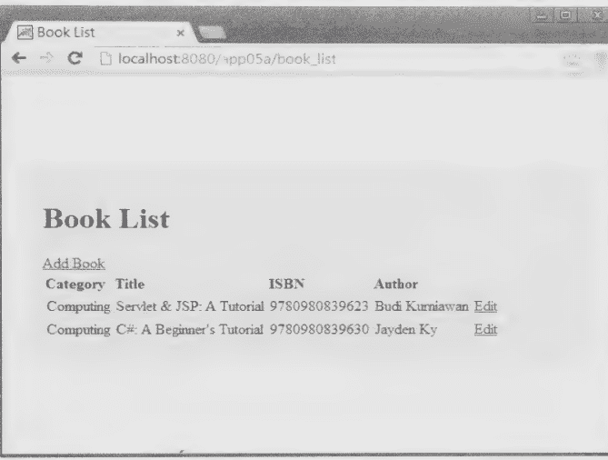

图 5.2: 书籍列表

你可以点击“添加书籍”链接来添加书籍，或者点击书籍详情右侧的“编辑”链接来编辑书籍。

图 5.3 显示了“添加书籍”表单，图 5.4 显示了“编辑书籍”表单。

# 120 Spring MVC: 教程

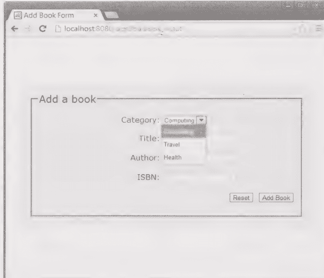

图 5.3: 添加书籍表单

# 第 5 章：数据绑定与 Form 标签库 121

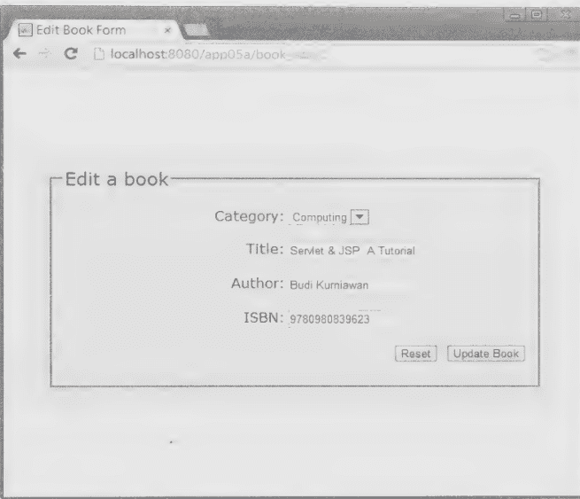

图 5.4: 编辑书籍表单

## 总结

在本章中，你学习了数据绑定以及 form 标签库中的标签。接下来的两章将讨论如何通过转换器（`converters`）、格式化器（`formatter`）和验证器（`validators`）进一步利用数据绑定。

# 第 6 章：转换器与格式化器

在第 5 章“数据绑定与 Form 标签库”中，你见证了数据绑定的威力，并学会了如何使用 form 标签库中的标签。然而，Spring 数据绑定并非没有限制。在某些情况下，Spring 并不知道如何正确绑定数据。例如，Spring 总是使用默认区域将日期输入绑定到 `java.util.Date`。如果你希望 Spring 使用不同的日期模式（例如），你需要使用转换器或格式化器来帮助 Spring。

本章讨论了转换器和格式化器。两者都用于将一种对象类型转换为另一种类型。转换器是通用组件，可以用于应用程序的任何层级。而格式化器是专为 Web 层设计的。

## 转换器

Spring 转换器是一个将一种类型转换为另一种类型的对象。例如，日期的用户输入可以有多种形式。“December 25, 2014”、“12/25/2014”、“2014-12-25” 都可以代表同一个日期。默认情况下，Spring 期望输入符合当前区域的格式，如果你在美国，该格式可能是 `MM/dd/yyyy`。如果你希望 Spring 在将输入字符串绑定到 `Date` 时使用不同的日期模式，你需要编写一个字符串到日期的转换器。

要创建一个转换器，你必须编写实现 `org.springframework.core.convert.converter.Converter` 接口的 Java 类。该接口的声明是参数化的：

```java
public interface Converter<S, T>
```

在这里，`S` 代表源类型，`T` 代表目标类型。例如，要创建一个可以将 `Long` 转换为 `Date` 的转换器，你可以这样声明你的转换器类。

```java
public class MyConverter implements Converter<Long, Date> {
}
```

在你的类体中，你需要编写 `Converter` 接口中 `convert` 方法的实现。该方法的签名如下。

```java
T convert(S source)
```

例如，列表 6.1 显示了一个可以处理任何日期模式的转换器。

### 列表 6.1：StringToDate 转换器

```java
package app06a.converter;

import java.text.ParseException;
import java.text.SimpleDateFormat;
import java.util.Date;
import org.springframework.core.convert.Converter;

public class StringToDate implements Converter<String, Date> {

    @Override
    public Date convert(String source) {
        try {
            SimpleDateFormat sdf = new SimpleDateFormat("MM/dd/yyyy");
            return sdf.parse(source);
        } catch (ParseException e) {
            throw new IllegalArgumentException("invalid date: " + source);
        }
    }
}
```

注：上述代码是根据上下文重构的表示。

### 列表 6.2：Employee 类

```java
package app06a.domain;

import java.io.Serializable;
import java.util.Date;

public class Employee implements Serializable {

    private static final long serialVersionUID = 1L;
    private long id;
    private String firstName;
    private String lastName;
    private Date birthDate;
    private int salary;

    // getters and setters
}
```

### 列表 6.3：EmployeeController 类

```java
package app06a.controller;

import org.apache.logging.Log;
import org.apache.logging.LogFactory;
import org.springframework.ui.Model;
import org.springframework.validation.BindingResult;
import org.springframework.validation.FieldError;
import org.springframework.web.bind.annotation.ModelAttribute;
import org.springframework.web.bind.annotation.RequestMapping;
import org.springframework.stereotype.Controller;
import app06a.domain.Employee;

@Controller
public class EmployeeController {

    private static final Log logger = LogFactory.getLog(EmployeeController.class);

    @RequestMapping(value="employee_input")
    public String inputEmployee(Model model) {
        model.addAttribute("employee", new Employee());
        return "EmployeeForm";
    }

    @RequestMapping(value="employee_save")
    public String saveEmployee(@ModelAttribute Employee employee,
        BindingResult bindingResult, Model model) {

        if (bindingResult.hasErrors()) {
            FieldError errorCode = bindingResult.getFieldError();
            logger.info("Code: " + errorCode.getCode() +
                        ", field:" + errorCode.getField());
            return "EmployeeForm";
        }

        // save employee here
        model.addAttribute("employee", employee);
        return "EmployeeDetails";
    }
}
```

### 列表 6.4：EmployeeForm.jsp 页面

```jsp
<%@ taglib prefix="form" uri="http://www.springframework.org/tags/form" %>
<%@ taglib uri="http://www.sun.com/jsp/jstl/core" prefix="c" %>
<!DOCTYPE HTML>
<html>
<head>
<title>添加员工表单</title>
<style type="css">@import url("<c:url value="/css/main.css"/>");</style>
</head>
<body>
<div id="global">
<form commandName="employee" action="employee_save" method="post">
<fieldset>
<legend>添加员工</legend>
<p>
<label for="firstName">名字: </label>
<form:input path="firstName" tabindex="1"/>
</p>
<p>
<label for="lastName">姓: </label>
<form:input path="lastName" tabindex="2"/>
</p>
<p>
<form:errors path="birthDate" className="error"/>
</p>
<p>
<label for="birthDate">出生日期: </label>
<form:input path="birthDate" tabindex="3" />
</p>
<p id="buttons">
<input id="reset" type="reset" tabindex="4">
<input id="submit" type="submit" tabindex="5" value="添加员工">
</p>
</fieldset>
</form>
</div>
</body>
</html>
```

你可以通过将浏览器导到以下 URL 来测试转换器：
http://localhost:8080/app06a/employee_input

输入一个无效日期，你将被重定向到同一个员工表单，并在表单中看到错误消息。

# 第 6 章：转换器与格式化 129

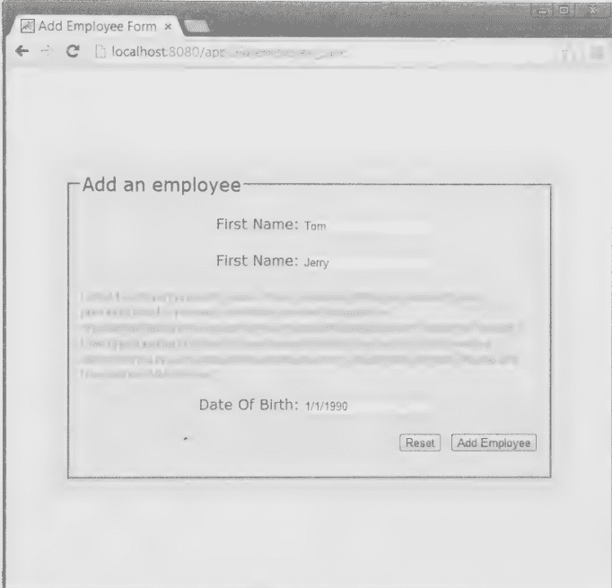

图 6.1：员工表单中的转换错误

## 格式化器

格式化器类似于转换器，它也将将一种类型转换为另一种类型。然而，格式化的源类型必须是 `String`，而转换器可以处理任何源类型。格式化更适用于 Web 层，而转换器可以在任何层使用。对于转换 Spring MVC 应用中表单中的用户输入，你应该始终选择格式化而不是转换器。

# 130 Spring MVC 教程

要创建一个格式化，请编写一个实现 `org.springframework.format.Formatter` 接口的 Java 类。这里是该接口的声明。

```java
public interface Formatter<T>
```

在这里，`T` 代表输入字符串应该转换到的类型。该接口有两个所有实现必须重写的方法：`parse` 和 `print`。

```java
T parse(String text, java.util.Locale locale)
String print(T object, java.util.Locale locale)
```

`parse` 方法使用指定的 `Locale` 将 `String` 解析为目标类型。`print` 方法执行相反操作，它返回目标对象的字符串表示。

作为一个示例，app06b 应用采用了 `DateFormatter` 将 `String` 转换为 `Date`。它完成的工作与 app06a 中的 `StringToDateConverter` 转换器相同吗？

`DateFormatter` 类如代码列表 6.5 所示。

### 代码列表 6.5：DateFormatter 类

```java
package app06b.formatter;

import java.text.ParseException;
import java.text.SimpleDateFormat;
import java.util.Date;
import java.util.Locale;
import org.springframework.format.Formatter;

public class DateFormatter implements Formatter<Date> {

    private String datePattern;
    private SimpleDateFormat dateFormat;

    public DateFormatter(String datePattern) {
        this.datePattern = datePattern;
        dateFormat = new SimpleDateFormat(datePattern);
        dateFormat.setLenient(false);
    }
}
```

# 第 6 章：转换器与格式化

## 代码列表 6.6：app06b 的 Spring 配置文件

```xml
<?xml version="1.0" encoding="UTF-8"?>
<beans xmlns="http://www.springframework.org/schema/beans"
     xmlns:xsi="http://www.w3.org/2001/XMLSchema-instance"
     xmlns:p="http://www.springframework.org/schema/p"
     xmlns:mvc="http://www.springframework.org/schema/mvc"
     xmlns:context="http://www.springframework.org/schema/context"
     xsi:schemaLocation="http://www.springframework.org/schema/beans
     http://www.springframework.org/schema/beans/spring-beans.xsd
```


http://www.springframework.org/schema/mvc

http://www.springframework.org/schema/mvc/spring-mvc.xsd

http://www.springframework.org/schema/context

http://www.springframework.org/schema/context/spring-context.xsd">

```xml
<context:component-scan base-package="app06b.controller"/>

<context:component-scan base-package="app06b.formatter"/>

<mvc:annotation-driven conversion-service="conversionService"/>

<mvc:resources mapping="/css/**" location="css/" />

<mvc:resources mapping="/*.html" location="/" />

<bean id="viewResolver"
    class="org.springframework.web.web.servlet.InternalResourceViewResolver">
    <property name="prefix" value="/WEB-INF/jsp/" />
    <property name="suffix" value=".jsp" />
</bean>

<bean id="conversionService"
    class="org.springframework.format.support.FormattingConversionServiceBean">
    <property name="formatters">
        <set>
            <bean class="app06b.formatter.DateFormatter">
                <constructor-arg type="java.lang.String" value="MM-dd" />
            </bean>
        </set>
    </property>
</bean>
```

## 使用 Registrar 注册格式化

另一种注册格式化的方法是使用 `Registrar`。例如，代码列表 6.7 是一个注册格式化的 Registrar 示例。

代码列表 6.7：MyFormatter 类

```java
package app06b.formatter;

import org.springframework.format.FormatterRegistrar;
import org.springframework.format.FormatterRegistry;

public class MyFormatter implements FormatterRegistrar {

    private String datePattern;

    public MyFormatter(String datePattern) {
        this.datePattern = datePattern;
    }

    @Override
    public void registerFormatters(FormatterRegistry registry) {
        registry.addFormatter(new DateFormatter(datePattern));
    }
}
```

使用 Registrar 你就不需要在 spring 文件中注册格式化。相反，你在 Spring 配置中注册 Registrar，如代码列表 6.8 所示。

代码列表 6.8：在 spring 文件中注册 Registrar

```xml
<?xml version="1.0" encoding="UTF-8"?>
<beans xmlns="http://www.springframework.org/schema/beans"
     xmlns:xsi="http://www.w3.org/2001/XMLSchema-instance"
     xmlns:p="http://www.springframework.org/schema/p"
     xmlns:mvc="http://www.springframework.org/schema/mvc"
     xmlns:context="http://www.springframework.org/schema/context"
     xsi:schemaLocation="http://www.springframework.org/schema/beans
     http://www.springframework.org/schema/beans/spring-beans.xsd
     http://www.springframework.org/schema/mvc
     http://www.springframework.org/schema/mvc/spring-mvc.xsd
     http://www.springframework.org/schema/context
     http://www.springframework.org/schema/context/spring-context.xsd">

<context:component-scan base-package="app06b.controller"/>
<context:component-scan base-package="app06b.formatter"/>
<mvc:annotation-driven conversion-service="conversionService"/>
<mvc:resources mapping="/css/**" location="css/" />
<mvc:resources mapping="/*.html" location="/" />

<bean id="viewResolver"
    class="org.springframework.web.web.servlet.InternalResourceViewResolver">
    <property name="prefix" value="/WEB-INF/jsp/" />
    <property name="suffix" value=".jsp" />
</bean>

<bean id="conversionService"
    class="org.springframework.format.support.FormattingConversionServiceBean">
    <property name="formatterRegistrar">
        <set>
            <bean class="app06b.formatter.MyFormatterRegistrar">
                <constructor-arg type="java.lang.String" value="MM-dd-yyyy" />
            </bean>
        </set>
    </property>
</bean>
</beans>
```

注意你需要添加 element 元素

## 在转换器与格式化器之间进行选择

转换器被用作通用工具，将一种类型转换为另一种类型，例如将 `String` 转换为 `Date` 或将 `Long` 转换为 `Date`。转换器不仅可以在 Web 层使用，还可以在其他层。

另一方面，格式化器只能将 `String` 转换为另一种 Java 类型，例如将 `String` 转换为 `Date`。例如，它不能将 `Long` 转换为 `Date`。因此，格式化器适用于 Web 层，因此，在 Spring MVC 应用中，格式化器比转换器更合适。

## 总结

在本章中，你学习了转换器和格式化，你可以使用它们来引导 Spring MVC 应用中的数据绑定。转换器是用于将任何类型转换为另一种类型的通用工具，而格式处理器（formatters）则用于将 `String` 转换为另一种 Java 类型。格式处理器更适合在 Web 层使用。

# 第7 章
## 验证器 (Validators)

输入验证是 Spring 处理得非常好的 Web 开发任务之一。在 Spring MVC 中，你有两种方式可以验证输入：使用 Spring 自身的验证框架，或者利用 JSR 303 实现。本章将涵盖这两种输入验证方法。

## 验证概述

转换器（Converters）和格式处理器（formatters）在字段级别工作。在 MVC 应用中，它们将 `String` 转换或格式化另一种 Java 类型，例如 `java.util.Date`。另一方面，验证器（validator）在对象级别工作。它确定对象中的所有字段是否有效以及是否遵循某些规则。

在同时使用格式处理器和验证器的应用程序中，事件发生顺序如下：在调用控制器期间，一个或多个格式处理器尝试将输入字符串转换为领域对象中的字段值。一旦格式化成功，验证器就会介入。

例如，`Order` 对象可能有一个类型为 `Date` 的 `shippingDate` 属性（显然），其值不能早于今天的日期。当调用 `HomeController` 时，`DateFormatter` 将字符串转换为 `Date` 并将其赋值给 `Order` 对象的 `shippingDate` 属性。如果转换失败，用户将重定向回上一个表单。如果转换成功，将调用验证器来检查 `shippingDate` 是否早于今天。

现在，你可能会问将验证逻辑移动到 `DateFormatter` 中是否明智。毕竟，比较日期并不难。答案是否定的。

`DateFormatter` 可能用于将其他字符串格式化为日期，例如 `birthDate` 或 `purchaseDate`。这两个日期规则与 `shippingDate` 不同。事实上，例如员工的出生日期不能是未来的日期。其次，验证器可以通过检查两个或多个字段之间的关系来工作，而每个字段都由不同的格式处理器支持。例如，给定一个具有 `birthDate` 属性和 `startDate` 属性的 `Employee` 对象，验证器可能会规定某人不可能在出生之前加入公司。因此，一个有效的 `Employee` 对象的 `birthDate` 属性值必须早于其 `startDate` 值。这就是验证器的工作。

## Spring 验证器

从一开始开始，Spring 的设计就考虑了输入验证。这甚至在 JSR 303（Java 验证规范）构想之前。因此，Spring 验证框架在今天非常常见，尽管对于新项目通常推荐 JSR 303 验证器。

要创建一个 Spring 验证器，请实现 `org.springframework.validation.Validator` 接口。该接口在列表 7.1 中给出，有两个方法：`supports` 和 `validate`。

### 列表 7.1：Spring Validator 接口

```java
package org.springframework.validation;

public interface Validator {
    boolean supports(Class<?> clazz);
    void validate(Object target, Errors errors);
}
```

`supports` 方法在验证器可以处理指定的 `Class` 时返回 `true`。`validate` 方法验证目标对象并将验证错误填充到 `Errors` 对象中。

`Errors` 对象是 `org.springframework.validation.Errors` 接口的实例。`Errors` 对象包含一个 `FieldError` 和 `ObjectError` 对象的列表。`FieldError` 代表与被验证对象中的某个属性相关的错误。例如，如果产品的 `price` 属性不能为负数，而被验证的 `Product` 对象的 `price` 为负数，则需要创建一个 `FieldError`。`ObjectError` 是任何不是 `FieldError` 的错误。例如，如果一本在欧洲销售的 `Book` 在美国分部被购买，则应该抛出 `ObjectError`。

在编写验证器时，你不需要通过实例化 `ObjectError` 或 `FieldError` 直接创建错误对象，这会花费大量的编程工作。这是因为 `ObjectError` 的构造函数需要四个参数，而 `FieldError` 类的构造函数需要七个参数，正如构造函数签名中所示。

```
ObjectError(String objectName, String[] codes, Object[] arguments, String defaultMessage)
FieldError(String objectName, String field, Object rejectedValue, boolean bindingFailure, String[] codes, Object[] arguments, String defaultMessage)
```

向 `Errors` 对象添加错误的更简单的方法是调用 `Errors` 对象上的一个 `reject` 或 `rejectValue` 方法。你调用 `reject` 添加一个 `ObjectError`，调用 `rejectValue` 添加一个 `FieldError`。

这里是 `reject` 和 `rejectValue` 的一些方法重载。

```java
void reject(String errorCode)
void reject(String errorCode, String defaultMessage)
void rejectValue(String field, String errorCode)
void rejectValue(String field, String errorCode, String defaultMessage)
```

大多数情况下，你只需要向 `reject` 和 `rejectValue` 方法传递一个错误代码。Spring 随后可以根据属性文件查找错误代码以获取相应的错误消息。你也可以传递一个默认消息，当找不到错误代码时将使用该消息。

`Errors` 对象中的错误消息可以使用表单标签库的 `errors` 标签显示在 HTML 页面上。错误消息可以通过 Spring 支持的国际化功能进行本地化处理。关于国际化的更多信息，可以参阅第 10 章“国际化”。

# ValidationUtils 类

`org.springframework.validation.ValidationUtils` 类是一个可以帮助你编写 Spring 验证器的工具类。与其编写以下代码：

```java
if (firstName == null || firstName.isEmpty()) {
    errors.reject("price");
}
```

你可以像这样使用 `ValidationUtils` 类的 `rejectEmpty` 方法：

```java
ValidationUtils.rejectEmpty("price");
```

或者与其编写以下代码：

```java
if (firstName == null || firstName.trim().isEmpty()) {
     errors.rejectValue("price");
}
```

你可以这样写：

```java
ValidationUtils.rejectEmptyWhitespace("price");
```

这里是 `ValidationUtils` 中 `rejectEmpty` 和 `rejectEmptyWhitespace` 方法的完整重载。

```java
public static void rejectEmpty(Errors errors, String field, String errorCode)
public static void rejectEmpty(Errors errors, String field, Object[] arguments)
public static void rejectEmpty(Errors errors, String field, Object[] arguments, String defaultMessage)
public static void rejectEmpty(Errors errors, String field, String errorCode, String defaultMessage)
public static void rejectEmptyWhitespace(Errors errors, String field, String errorCode)
public static void rejectEmptyWhitespace(Errors errors, String field, Object[] arguments)
public static void rejectEmptyWhitespace(Errors errors, String field, Object[] arguments, String defaultMessage)
```


public static void rejectEmptyWhitespace(Errors errors, String field, String errorCode, String defaultMessage)

此外，`ValidationUtils` 还有一个用于调用验证器的 `invokeValidator` 方法。

```java
public static void invokeValidator(Validator validator, Object obj, Errors errors)
```

将在下一节的示例中学习如何使用此有用工具。

# Spring 验证器示例

app07a 应用包含一个名为 `ProductValidator` 的验证器，用于验证 `Product` 对象。app07a 的 `Product` 类在列表 7.2 中，`ProductValidator` 类在列表 7.3 中。

## 列表 7.2：Product 类

```java
package app07a.domain;

import java.io.Serializable;
import java.util.Date;

public class Product implements Serializable {

    private static final long serialVersionUID = 748392348L;

    private String name;
    private String description;
    private Float price;
    private Date productionDate;

    // getters 和 setters 未显示
}
```

## 列表 7.3：ProductValidator 类

```java
package app07a.util.Date;

import org.springframework.validation.Errors;
import org.springframework.validation.ValidationUtils;
import org.springframework.validation.Validator;
import app07a.domain.Product;

public class ProductValidator implements Validator {

    @Override
    public boolean supports(Class<?> klass) {
        return Product.class.isAssignableFrom(klass);
    }

    @Override
    public void validate(Object target, Errors errors) {
        Product product = (Product) target;

        ValidationUtils.rejectEmpty(errors, "name", "productname.required");
        ValidationUtils.rejectEmpty(errors, "price", "price.required");
        ValidationUtils.rejectEmpty(errors, "productionDate", "productionDate.required");

        Float price = product.getPrice();
        if (price != null && price < 0) {
            errors.reject("price", "price.negative");
        }

        Date productionDate = product.getProductionDate();
        if (productionDate != null) {
            // productionDate 的时、分、秒组件
            if (productionDate.after(new Date())) {
                System.out.println("salah lagi");
                errors.reject("productionDate", "productiondate.invalid");
            }
        }
    }
}
```

`ProductValidator` 验证器是非常简单的验证器。它的 `validate` 方法检查 `Product` 是否有名称和价格，并且价格不为负。它还确保生产日期不晚于今天。

## 资源文件

你不需要显式地注册验证器。但是，如果你想让错误信息从属性文件（properties file）获取，你需要通过声明一个 `messageSource` bean 来告诉 Spring 在哪里找到该文件。这里是 app07a 中的 `messageSource` bean 声明。

```xml
<bean id="messageSource" class="org.springframework.context.support.ResourceBundleMessageSource">
    <property name="basename" value="WEB-INF/resource/messages"/>
</bean>
```

该 bean 基本上表示错误代码和错误消息可以在 `/WEB-INF/resource` 下的 `messages.properties` 文件中找到。

列表 7.4 显示了 `messages.properties` 文件的内容。

## 列表 7.4：messages.properties 文件

```properties
productname.required.product.name=Please enter a product name
price.required=Please enter a price
productiondate.required=Please enter a production date
productiondate.invalid=Invalid production date. Please ensure the production date is not later than today.
```

## Controller 类

你可以通过直接实例化验证器类在 controller 类中使用 Spring 验证器。列表 7.5 中 `ProductController` 类的 `saveProduct` 方法创建了一个 `ProductValidator` 并调用它的 `validate` 方法。要检查验证器是否生成了错误消息，调用 `BindingResult` 上的 `hasErrors` 方法。

### 列表 7.5：ProductController 类

```java
package app07a.controller;

import org.apache.commons.logging.Log;
import org.apache.commons.logging.LogFactory;
import org.springframework.stereotype.Controller;
import org.springframework.ui.Model;
import org.springframework.validation.BindingResult;
import org.springframework.validation.FieldError;
import org.springframework.web.bind.annotation.ModelAttribute;
import org.springframework.web.bind.annotation.RequestMapping;
import app07a.domain.Product;
import app07a.validator.ProductValidator;

@Controller
public class ProductController {

    private static final Log logger = LogFactory.getLog(ProductController.class);

    @RequestMapping(value = "/product_input")
    public String inputProduct(Model model) {
        model.addAttribute("product", new Product());
        return "ProductForm";
    }

    @RequestMapping(value = "/product_save")
    public String saveProduct(@ModelAttribute Product product, BindingResult bindingResult, Model model) {
        ProductValidator productValidator = new ProductValidator();
        productValidator.validate(product, bindingResult);

        if (bindingResult.hasErrors()) {
            FieldError error = bindingResult.getFieldError();
            logger.info("Code:" + error.getCode() + ", field:" + error.getField());
            return "ProductForm";
        }

        // save product here
        model.addAttribute("product", product);
        return "ProductDetails";
    }
}
```

使用 Spring 验证器的另一种方法是在你的 controller 中写一个 `initBinder` 方法，并将验证器传递给 `WebDataBinder` 并调用它的 `validate` 方法。

```java
@org.springframework.web.bind.annotation.InitBinder
public void initBinder(WebDataBinder binder) {
    // 这会将验证器应用到所有请求处理方法
    binder.setValidator(new ProductValidator());
    binder.validate();
}
```

将验证器传递给 `WebDataBinder` 将把该验证器应用到 controller 类中的所有请求处理方法。

或者，你可以对要验证的对象参数使用 `@javax.validation.Valid` 注解。例如：

```java
public String saveProduct(@ModelAttribute Product product, BindingResult bindingResult, Model model) {
```

`Valid` 注解类型定义在 JSR 303 中，我将推迟到下一节讨论 JSR 303。

## 测试验证器

要测试 app07a 中的验证器，请将浏览器指向此 URL：
http://localhost:8080/app07a/product_input

你将看到一个空白的 Product 表单。如果你在没有任何值的情况下点击 Add Product 按钮，你将被重定向回表单，如图 7.1 所示。


# JSR 303 Validation

JSR 303 指定了一套通过注解对属性应用约束的 API。约束列表在表 7.1 中。

使用 JSR 303 不需要编写验证器。相反，通过使用 JSR 303 注解类型在领域类中嵌入约束。目前有两个主要的实现。第一个是 Hibernate Validator，第二个是 Apache Bean。

另外，以下是与 bean 验证相关的网站：
http://beanvalidation.org

一旦你理解了它的工作原理，JSR 303 比 Spring 验证器更容易使用。在 Spring 验证器中，你可以通过在属性文件中使用以下格式的键来覆盖 JSR 303 消息：

```properties
constraint
```

例如，要覆盖由 `@Size` 约束的 name 属性的消息，请在属性文件中使用键：
`Size.product.name`

要覆盖由 `@Past` 约束的 productionDate 属性的消息，请使用键：
`Past.product.productiondate`

## 表 7.1：JSR 303 约束

# JSR 303 验证器示例

app07b 应用展示了 JSR 303 输入验证。该应用程序是 app07a 的修改版本，有一些不同。首先，没有 `ProductValidator` 类。其次，将 Hibernate Validator 库的 jar 文件添加到 `WEB-INF/lib`。

列表 7.6 显示了 Product 类，其 name 和 productionDate 字段已使用 JSR 303 注解。

### 列表 7.6：app07b 中的 Product 类

```java
package app07b.domain;

import java.io.Serializable;
import java.util.Date;
import javax.validation.constraints.Past;
import javax.validation.constraints.Size;

public class Product implements Serializable {

    private static final long serialVersionUID = 78L;

    @Size(min=1, max=10)
    private String name;

    private Float price;

    @Past
    private Date productionDate;

    // getters and setters not shown
}
```

在 ProductController 的 `saveProduct` 方法中，你必须对 Product 参数添加 `@Valid` 注解，如列表 7.7 所示。

### 列表 7.7：app07b 中的 ProductController 类

```java
package app07b.controller;

import javax.validation.Valid;
import org.apache.commons.logging.Log;
import org.apache.commons.logging.LoggerFactory;
import org.springframework.stereotype.Controller;
import org.springframework.ui.Model;
import org.springframework.validation.BindingResult;
import org.springframework.validation.FieldError;
import org.springframework.web.bind.annotation.ModelAttribute;
import org.springframework.web.bind.annotation.RequestMapping;
import app07b.domain.Product;

@Controller
public class ProductController {

    private static final Log logger = LoggerFactory.getLogger(ProductController.class);

    @RequestMapping(value = "/product_input")
    public String inputProduct(Model model) {
        model.addAttribute("product", new Product());
        return "ProductForm";
    }

    @RequestMapping(value = "/product_save")
```


```java
public String saveProduct(@Valid @ModelAttribute Product product,
        BindingResult bindingResult, Model model) {

    if (bindingResult.hasErrors()) {
        FieldError fieldError = bindingResult.getFieldError()[0];
        logger.info("Code:" + fieldError.getCode() + ", object:"
                + fieldError.getObjectName());
    }
}
```

要自定义来自验证器的错误消息，`messages.properties` 文件中使用了两个键。该文件如列表 7.8 所示。

### 列表 7.8: app0b 中的 messages.properties 文件

```properties
Size.product.name = Product name must be 1 to 10 characters long
Past.product.productionDate=Production date must be a past date
```

要测试 app0b 中的验证器，请将浏览器指向此 URL：`http://localhost:8080/app0b/product_input`。

## 总结

在本章中，你学习了在 Spring MVC 应用中可以使用的两种类型的验证器：Spring MVC 验证器和 JSR 303 验证器。JSR 303 验证器是新项目推荐的验证方法，因为 JSR 303 是一个正式的 Java 规范。

# 第 8 章
## 表达式语言

JSP 2.0 中最重要的功能之一是表达式语言（EL），JSP 作者可以使用它来访问应用程序数据。EL 的灵感来源于 ECMAScript 和 XPath 表达式语言，其设计目的是能够轻松地编写无脚本的 JSP 页面，即不使用 JSP 声明或脚本段（`scriptlets`）的页面。

被采用到 JSP 2.0 中的 EL 首次出现在 JSP 标准标签库（JSTL）1.0 规范中。JSP 1.2 程序员可以通过将标准库导入其应用程序中来使用该语言。JSP 2.0 及后续开发者可以在没有 JSTL 的情况下使用 EL，尽管在许多应用程序中仍然需要 JSTL，因为它还包含了与 EL 无关的其他标签。

JSP 2.1 和 JSP 2.2 中的 EL 旨在尝试统一 JSP 2.0 中的 EL 与 JavaServer Faces (JSF) 1.0 中定义的表达式语言。JSF 是一个用于用 Java 快速构建 Web 应用程序的框架，构建在 JSP 1.2 之上。由于 JSP 1.2 缺乏集成的表达式语言，且 JSP 2.0 的 EL 未满足 JSF 的所有要求，因此为 JSF 1.0 开发了 EL 的变体。这两种语言变体后来被统一了。本章仅关注非 JSF 开发者的 EL。

## 表达式语言语法

EL 表达式以 `${` 开头并以 `}` 结束。EL 表达式的结构如下：

```
${expression}
```

例如，要编写表达式 `x+y`，你使用以下结构：

```
${x+y}
```

连接两个表达式也是常见的。表达式序列将从左到右求值，强制转换为字符串并拼接。如果 `a+b` 等于 8 且 `c+d` 等于 10，则以下两个表达式将产生 810：

```
${a+b}${c+d}
```

而 `${a+b}and${c+d}` 的结果为 8and10。

如果 EL 表达式用在自定义标签的属性值中，该表达式将进行求值，生成的字符串将强制转换为属性预期的类型：

```xml
<my:tag someAttribute="${expression}"/>
```

字符序列 `${` 表示 EL 表达式的开始。如果你想发送字母 `${`，你需要对第一个字符进行转义：`\${$`。

## 保留字

以下单词是保留的，不能用作标识符：

- and eq gt true instanceof
- or ne le false empty
- not lt ge null div mod

## [ ] 和 . 运算符

EL 表达式可以返回任何类型。如果 EL 表达式的结果是一个具有属性的对象，你可以使用 `[]` 或 `.` 运算符来访问该属性。`[]` 和 `.` 运算符的功能相似；`[]` 是更通用的形式，但 `.` 提供了一个方便的快捷方式。

要访问对象的属性，使用以下形式之一：

```
${object("propertyName")}
${object.propertyName}
```

然而，只有当 `propertyName` 不是有效的 Java 变量名时，你才能使用 `[]` 运算符。例如，以下两个 EL 表达式可以访问隐式对象 `header` 中的 HTTP 请求头 host：

```
${header("host")}
${header.host}
```

但是，要访问 `accept-language` 请求头，只能使用 `[]` 运算符，因为 `accept-language` 不是 Java 变量名。使用 `.` 运算符访问将导致抛出异常。

如果对象的属性恰好返回另一个带有属性的对象，可以使用 `[]` 或 `.` 来访问该属性。例如，`pageContext` 隐式对象代表当前 JSP 的 PageContext。它具有 `request` 属性，该 `HttpServletRequest` 有 `servletPath` 属性。以下表达式是等价的，结果均为 `HttpServletRequest` 的 `servletPath` 属性值：

```
${pageContext["request"]["servletPath"]}
${pageContext.request["servletPath"]}
${pageContext.request.servletPath}
${pageContext["request"].servletPath}
```

访问 `HttpSession`，使用此语法：

```
${pageContext.session}
```

例如，该表达式打印会话 ID：

```
${pageContext.session.id}
```

## 求值规则

EL 表达式从左到右求值。对于形式为 `expr-a[expr-b]` 的表达式，求值如下：

1. 计算 `expr-a` 获取 `value-a`。
2. 如果 `value-a` 为 `null`，则返回 `null`。
3. 计算 `expr-b` 获取 `value-b`。
4. 如果 `value-b` 为 `null`，则返回 `null`。
5. 如果 `value-a` 的类型是 `java.util.Map`，检查 `value-b` 是否为 Map 中的键。如果是，返回 `value-a.get(value-b)`。如果不是，返回 `null`。
6. 如果 `value-a` 的类型是 `java.util.List` 或它是数组，将 `value-b` 强制转换为 `int`：
    a. 转换失败，抛出异常。
    b. 如果 `value-a.get(value-b)` 抛出 `IndexOutOfBoundsException` 或 `Array.get(value-a, value-b)` 抛出 `ArrayIndexOutOfBoundsException`，则返回 `null`。
    c. 否则，如果 `value-a` 是 `List`，返回 `value-a.get(value-b)`；如果 `value-a` 是数组，则返回 `Array.get(value-a, value-b)`。
7. 如果 `value-a` 的类型是 `Map`、`List` 或数组，则 `value-a` 必须是 JavaBean。在这种情况下，将 `value-b` 强制转换为 `String`。如果 `value-b` 是 `value-a` 的可读属性，调用该属性的 getter 方法并返回 getter 方法的值。如果 getter 方法抛出异常，则表达式无效。否则，表达式有效。

## 访问 JavaBean

你可以使用 `.` 运算符或 `[]` 运算符来访问 bean 的属性。结构如下：

```
${beanName["propertyName"]}
${beanName.propertyName}
```

例如，要访问名为 `myBean` 的 bean 的 `secret` 属性，使用以下表达式：

```
${myBean.secret}
```

## EL 隐式对象

在 JSP 页面中可以使用 JSP 脚本访问 JSP 隐式对象。然而，在无脚本的 JSP 页面中，无法访问这些隐式对象。EL 允许通过提供一组自身的隐式对象来访问各种对象。

| 对象 | 描述 |
| --- | --- |
| pageContext | 当前 JSP 的 `javax.servlet.jsp.PageContext`。 |
| initParam | 包含所有上下文初始化参数的 Map，以参数名称作为键。 |
| param | 包含所有请求参数的 Map，以参数名称作为键。每个键的值是指定名称的第一个参数值。因此，如果有两个同名的请求参数，则只能通过 `param` 对象获取第一个。要访问所有具有相同名称的参数值，请使用 `paramValues` 对象。 |
| paramValues | 包含所有请求参数的 Map，以参数名称作为键。每个键的值是一个包含指定参数名称所有值的字符串数组。如果参数只有一个值，它将返回一个包含一个元素的数组。 |
| header | 包含所有请求头的 Map，以请求头名称作为键。每个键的值是指定请求头名称的第一个头部。换句话说，如果一个请求头有多个值，则只返回第一个值。要获取多值请求头，请使用 `headerValues` 对象。 |
| headerValues | 包含所有请求头的 Map，以请求头名称作为键。每个键的值是一个包含指定请求头名称所有值的字符串数组。如果头部只有一个元素，它将返回一个单元素数组。 |
| cookie | 包含当前请求对象中所有 Cookie 对象的 Map。Cookie 的名称是 Map 的键，每个键映射到一个 `Cookie` 对象。 |
| applicationScope | 包含 `ServletContext` 对象中所有属性的 Map，以属性名称作为键。 |
| sessionScope | 包含 `HttpSession` 对象中所有属性的 Map，属性名称为键。 |
| requestScope | 包含当前 `HttpServletRequest` 对象中所有属性的 Map，以属性名称作为键。 |
| pageScope | 包含所有页面作用范围属性的 Map。属性名称是 `Map` 的键。 |

表 8.1: EL 隐式对象

EL 隐式对象列如表 8.1 所示。每个隐式对象将在后续小节中给出。

### pageContext

`pageContext` 对象代表当前 JSP 页面的 `javax.servlet.jsp.PageContext`。它包含了所有其他 JSP 隐式对象，如表 8.2 所示。

| 对象 | EL 中的类型 |
| --- | --- |
| request | `javax.servlet.http.HttpServletRequest` |
| response | `javax.servlet.http.HttpServletResponse` |
| out | `javax.servlet.jsp.JspWriter` |
| session | `javax.servlet.http.HttpSession` |
| application | `javax.servlet.ServletContext` |
| config | `javax.servlet.ServletConfig` |
| pageContext | `javax.servlet.jsp.PageContext` |
| page | `javax.servlet.jsp.HttpJspPage` |
| exception | `java.lang.Throwable` |

表 8.2: JSP 隐式对象

例如，你可以使用以下表达式之一获取当前的 `HttpServletRequest`：

```
${pageContext.request}
${pageContext["request"]}
```

并且，可以使用以下任意表达式获取请求方法：

```
${pageContext["request"]["method"]}
${pageContext["request"]}.method
${pageContext.request["method"]}
${pageContext.request.method}
```

请求参数的访问频率比其他隐式对象更高；因此

### initParam

`initParam` 隐式对象用于获取上下文参数的值。例如，要访问名为 `password` 的上下文参数，您使用以下表达式：

```
${initParam.password}
```

或

```
${initParam["password"]}
```

### param

`param` 隐式对象用于获取请求参数。该对象表示包含所有请求参数的 Map。例如，要获取名为 `userName` 的参数，使用以下任意一个：

```
${param.userName}
${param["userName"]}
```

### paramValues

`paramValues` 隐式对象用于获取请求参数的值。该对象表示包含所有请求参数的 Map，以参数名称作为键。每个键的值是一个包含指定参数名称所有值的字符串数组。如果参数只有一个值，它仍然返回一个包含一个元素的数组。例如，要获取 `selectedOptions` 参数的第一个和第二个值，您使用以下表达式：

```
${paramValues.selectedOptions[0]}
${paramValues.selectedOptions[1]}
```

### header

`header` 隐式对象表示包含所有请求头的 Map。要获取请求头值，请使用请求头名称作为键。例如，要获取 `accept-language` 请求头的值，请使用以下表达式：

```
${header["accept-language"]}
```

如果请求头名称是有效的 Java 变量名（如 `connection`），您也可以使用 `.` 操作：

```
${header.connection}
```

### headerValues

`headerValues` 隐式对象表示包含所有请求头的 Map，以请求头名称作为键。与 `header` 不同，`headerValues` 隐式对象返回的 Map 返回一个字符串数组。例如，要获取 `accept-language` 请求头的值，请使用以下表达式：

```
${headerValues["accept-language"]}
```

### cookie

`cookie` 隐式对象表示包含当前请求对象中所有 Cookie 对象的 Map。Cookie 的名称是 Map 的键，每个键映射到一个 `Cookie` 对象。属性名称是键，值是 `Cookie`。例如，要获取名为 `sessionID` 的 Cookie 值，请使用以下表达式：

```
${cookie.sessionID}
```

### applicationScope

`applicationScope` 是包含 `ServletContext` 对象中所有属性的 Map，以属性名称作为键。例如，要获取名为 `userConfig` 的属性，请使用以下表达式：

```
${applicationScope.userConfig}
```

### sessionScope

`sessionScope` 是包含 `HttpSession` 对象中所有属性的 Map，属性名称为键。例如，要获取名为 `sessionToken` 的属性，请使用以下表达式：

```
${sessionScope.sessionToken}
```

### requestScope

`requestScope` 是包含当前 `HttpServletRequest` 对象中所有属性的 Map，以属性名称作为键。例如，要获取名为 `queryResults` 的属性，请使用以下表达式：

```
${requestScope.queryResults}
```

### pageScope

`pageScope` 是包含所有页面作用范围属性的 Map。属性名称是 `Map` 的键。例如，要获取名为 `pageTitle` 的属性，请使用以下表达式：

```
${pageScope.pageTitle}
```

## 其他运算符

除了 `and` 和 `||` 运算符，EL 还提供了其他运算符：算术运算符、关系运算符、逻辑运算符、条件运算符以及空运算符。使用这些运算符，可以执行各种操作。

EL 运算符将在后续小节中给出。

## 算术运算符

有五种算术运算符：

- 加法 (`+`)
- 减法 (`-`)
- 乘法 (`*`)
- 除法 (`/` 和 `div`)
- 余数/模 (`%` 和 `mod`)

除法和余数运算符有两种形式，以与 XPath 和 ECMAScript 保持一致。

注意 EL 表达式是从高优先级到低优先级求值的，然后从左到右。以下是优先级递减的算术运算符：

```
* / div % mod
+ -
```


这意味着`*`、`/`、`div`、`%`和`mod`运算符具有相同的优先级，而`+`与`-`的优先级相同，但低于第一组。因此，表达式`${1+2*3}`的结果是7而不是6。

# 关系运算符

以下是关系运算符列表：

- 等于（`==`和`eq`）
- 不等于（`!=`和`ne`）
- 大于（`>`和`gt`）
- 大于等于（`>=`和`ge`）
- 小于（`<`和`lt`）
- 小于等于（`<=`和`le`）

例如，表达式`{"b"<"d"}`返回`true`。

## 逻辑运算符

这里是逻辑运算符的列表：

- 与（`&&`和`and`）
- 或（`||`和`or`）
- 非（`!`和`not`）

## 条件运算符

EL条件运算符具有以下语法：
`${statement? A:B}`

如果`statement`的求值结果为`true`，则表达式的输出为`A`。否则，输出为`B`。

例如，你可以使用以下EL表达式来测试`HttpSession`是否包含名为`loggedIn`的属性。如果找到该属性，则显示字符串"You have logged in"。否则，显示"You not logged in"。

```
${sessionScope.loggedIn==null)? "You have not logged in" :
  "You have logged in"
```

## empty运算符

`empty`运算符用于检查值是否为`null`或空。
以下是`empty`运算符的使用示例：

```
{empty X}
```

如果`X`为`null`或`X`是一个长度为0的字符串，则表达式返回`true`。如果`X`是一个空`Map`、空数组或空集合（collection），它也会返回`true`。否则，返回`false`。

# 在JSP 2.0及更高版本中配置EL

通过EL、JavaBeans和自定义标签，现在可以编写不含脚本的JSP页面。JSP 2.0及更高版本提供了一个禁用所有JSP页面脚本的开关。软件架构师现在可以强制编写不含脚本的JSP页面。

另一方面，在某些情况下，你可能希望禁用应用程序中的EL。例如，如果你在使用符合JSP 2.0标准的容器但尚未准备好升级到JSP 2.0，你就希望这样做。在这种情况下，你可以禁用EL表达式的求值。

本节讨论了如何强制不含脚本的JSP页面，以及如何在JSP 2.0以后禁用EL。

## 实现不含脚本的JSP页面

要禁用JSP页面中的脚本元素，可以使用带有两个子元素的`jsp-property-group`：`url-pattern`和`scripting-invalid`。`url-pattern`元素定义了禁用脚本的URL模式。以下是禁用应用程序中所有JSP页面脚本的方法：

```
<jsp-config>
  <jsp-property-group>
    <url-pattern>*.jsp</url-pattern>
    <scripting-invalid>true</scripting-invalid>
  </jsp-property-group>
</jsp-config>
```

> **注意**
>
> 部署描述符中只能有一个`jsp-config`元素。如果你已经指定了`jsp-property-group`来禁用EL，则必须在同一个`jsp-config`元素下编写用于禁用脚本的`jsp-property-group`。

## 禁用EL求值

在某些情况下，例如当需要在JSP 2.0或更高容器中部署JSP 1.2应用程序时，你需要在JSP页面中禁用EL求值。当你这样做时，EL结构的出现将不会被作为EL表达式求值。在JSP中禁用EL求值有两种方法。

首先，你可以将页面指令（page directive）的`isELIgnored`属性设置为`true`，如下所示：

```
<%@ page isELIgnored="true" %>
```

`isELIgnored`属性的默认值为`false`。如果你想在一个或几个JSP页面中禁用EL求值，建议使用`isELIgnored`属性。

其次，你可以使用部署描述符中的`jsp-property-group`元素。`jsp-property-group`元素是`jsp-config`元素的子元素。你使用`jsp-property-group`为应用程序中的一组JSP页面应用某些设置。

要使用`jsp-property-group`元素禁用EL求值，必须具备两个子元素：`url-pattern`和`el-ignored`。`url-pattern`元素指定了应用EL禁用的URL模式。`el-ignored`元素必须设置为`true`。

例如，以下是在名为`noEl.jsp`的JSP中禁用EL求值的方法。

```
<jsp-config>
  <jsp-property-group>
    <url-pattern>noEl.jsp</url-pattern>
    <el-ignored>true</el-ignored>
  </jsp-property-group>
</jsp-config>
```

你也可以通过将`*.jsp`分配给`url-pattern`来禁用应用程序中所有JSP页面的EL求值，如下：

```
<jsp-config>
  <jsp-property-group>
    <url-pattern>*.jsp</url-pattern>
    <el-ignored>true</el-ignored>
  </jsp-property-group>
</jsp-config>
```

如果JSP页面指令的`isELIgnored`属性设置为`true`，或者其URL匹配`jsp-property-group`元素中`el-ignored`子元素设置为`true`的模式，则该页面的EL求值将被禁用。例如，如果你将JSP页面页面指令的`isELIgnored`属性设置为`false`，但其URL匹配部署描述符中的模式，该页面的EL求值将被禁用。此外，如果你使用符合Servlet 2.3或更早版本的部署描述符，即使你在使用JSP 2.0之后的容器，EL求值默认也是被禁用的。

## 总结

EL是JSP 2.0及以后最重要的特性之一。它可以帮助你编写更短、更高效的不含脚本的JSP页面。在本章中，你已经看到如何使用EL访问JavaBeans和隐式对象。

# 第9章：JSTL

Server Pages Tag Library（JSTL）是一组用于解决常见问题的标签库，如迭代、条件测试、XML处理和数据库访问。本章讨论了JSTL中最重要的标签，特别是访问作用域对象的标签。JSTL 1.2由JSR-52定义（www.jcp.org）。

## 下载JSTL

JSTL称为标准标签库，然而它通过多个标签库暴露其操作。JSTL 1.2可以分为五个区域，总结在表9.1。

| 区域 | 子功能 | URI | 前缀 |
| :--- | :--- | :--- | :--- |
| Core | 变量支持流程控制 | http://java.sun.com/jstl/core | c |
| XML | 流程控制 | http://java.sun.com/jstl/xml | x |
| i18n | 本地化消息格式数字日期格式 | http://java.sun.com/jstl/fmt | fmt |
| Database | SQL集合长度字符串处理 | http://java.sun.com/jstl/sql | sql |
| Functions | | http://java.sun.com/jstl/functions | fn |

表9.1：JSTL标签库

要在JSP页面中使用JSTL库，请使用以下格式的`taglib`指令：

`<%@ taglib uri="uri" prefix="prefix" %>`

例如，为了使用Core库，在页面开头声明：

`<%@ taglib uri="http://java.sun.com/jstl/core" prefix="c" %>`

前缀可以是任何内容。然而，使用约定可以让你的代码对团队中的其他开发者以及加入项目的人来说熟悉。因此建议使用指定的前缀。

> **注意**
>
> 本章讨论的每个标签都有单独的章节，每个标签的属性列在表中。属性名称后的星号（`*`）表示该属性是必需的。加号（`+`）表示该属性的`rvalue`元素值为`true`，这意味着属性可以赋值静态字符串或动态值（Java表达式、EL表达式或通过`<jsp:attribute>`设置的值）。`rvalue`值为`false`则意味着该属性只能赋值静态字符串。

> **注意**
>
> JSTL标签体的内容可以是空的、JSP或标签依赖的。

## 通用操作

本节将讨论Core库中用于操作作用域变量的三个通用操作：`out`、`set`、`remove`。

## out标签

`out`标签评估表达式并将结果输出到当前的`JspWriter`。`out`的语法有两种形式，带和不带正文内容：

```
<c:out value="value" [escapeXml="true|false"] [default="defaultValue"]/>
```

```
<c:out value="value" [escapeXml="true|false"]
default value</c:out>
```

> **注意**
>
> 在标签语法中，`[ ]`表示可选属性。带有下划线的值（如果有）表示默认值。

`out`的主体内容为JSP。标签属性列表见表9.2。

| 属性 | 类型 | 描述 |
| --- | --- | --- |
| value*+ | Object | 待求值的表达式。 |
| escapeXml+ | boolean | 表明结果中的字符`<`、`>`、`&`和`'`是否将转换为相应的字符实体代码，例如将`<`转换为`&lt;`等。 |
| default+ | Object | 默认值 |

表9.2：out标签的属性

例如，以下`out`标签打印了作用域变量`x`的值：`<c:out value="${x}"/>`

默认情况下，`out`会将特殊字符`<`、`>`、`'`、`"`和`&`分别编码为对应的字符实体代码`&lt;`、`&gt;`、`&#39;`、`&#034;`和`&amp;`。

在JSP 2.0之前，`out`标签是打印作用域对象之值最简单的方法。在JSP 2.0或更高版本中，除非你需要对值进行XML转义，否则可以安全地使用EL表达式：

```
${x}
```

> **警告**
>
> 如果包含一个或多个特殊字符的字符串未经过XML转义，其值在浏览器中可能无法正确渲染。此外，未转义的特殊字符将使你的网站容易受到跨站脚本攻击，即有人可以发布一个将被自动执行的JavaScript函数/表达式。

`out`中的默认属性（`default`）允许你分配一个默认值，如果赋值给`value`属性的EL表达式返回`null`，则显示该默认值。`default`属性可以分配动态值。如果该动态值返回`null`，`out`标签将显示一个空字符串。

例如，在下面的`out`标签中，如果在`HttpSession`中未找到变量`myVar`，则显示应用作用域变量`myVar`的值。如果未找到后者，则向输出发送一个空字符串。

```
<c:out value="${sessionScope.myVar}"
  default="${applicationScope.myVar}"/>
```

## set标签

你可以使用`set`标签执行以下操作：

1. 创建一个字符串以及一个引用该字符串的作用域变量。
2. 创建一个引用现有作用域对象的的作用域变量。
3. 设置作用域对象的属性。

如果使用`set`创建作用域变量，则在该标签出现后，该变量可以在同一个JSP页面中使用。

`set`标签的语法有四种形式。第一种形式是创建一个作用域变量，其中`value`属性指定要创建的字符串或现有的作用域对象。

```
<c:set value="value" var="varName"
  scope="page|request|session|application"/>
```

其中`scope`属性指定作用域变量的作用范围。

例如，下面的`set`标签创建字符串"The wisest fool"并将其赋值给新创建的页面作用域变量`foo`。

```
<c:set var="foo" value="The wisest fool"/>
```

接下来的`set`标签创建了一个作用域变量`job`，它引用请求作用域对象`position`。变量`job`具有页面作用域。

```
<c:set var="job" value="${requestScope.position}" scope="page"/>
```

> **注意**
>
> 上一个例子可能有点困惑，因为它创建了一个页面作用域变量`position`。但如果你记住作用域对象本身并不真的“在”`HttpServlet`内部，情况就不应该是这样。相反，在最后一个例子中，`set`标签中存在一个名为`position`的引用，你只是在创建另一个引用相同对象的作用域变量（`job`）。

第二种形式与第一种形式类似，但要创建的字符串或引用的作用域对象是通过主体内容传递的。

```
<c:set var="varName" scope="{page|request|session|application}">
  body content
</c:set>
```

第二种形式允许你在主体内容中使用JSP代码。

第三种形式设置作用域对象属性的值。`target`属性指定作用域对象，`property`属性指定作用域对象的属性。赋值给属性的值由`value`属性指定。

```
<c:set target="target" property="propertyName" value="Tokyo"/>
```

例如，下面的`set`标签将字符串"Tokyo"赋值给作用域对象`address`的`city`属性。

```
<c:set target="${address}" property="city" value="Tokyo"/>
```

注意，必须在`target`属性中使用EL表达式来引用作用域对象。

第四种形式与第三种形式类似，但要赋值的值是通过主体内容传递的。

```
<c:set target="target" property="propertyName">
  body content
</c:set>
```

例如，下面的`set`标签将字符串"Beijing"赋值给作用域对象`address`的`city`属性。

```
<c:set target="${address}" property="city">Beijing</c:set>
```

`set`标签的属性列表见表9.3。

| 属性 | 类型 | 描述 |
| --- | --- | --- |
| value+ | Object | 要创建的字符串、要引用的作用域对象、或新的属性值。 |
| var | String | 要创建的作用域变量。 |
| scope | String | 新创建的作用域变量的作用范围。 |
| target+ | Object | 将赋值属性的作用域对象。 |
| property | String | 要赋值的属性名称。 |

表9.3：set标签的属性


## set 标签

你可以使用 set 标签执行以下操作：

1. 创建一个字符串以及一个引用该字符串的作用域变量。
2. 创建一个引用现有作用域对象的作用域变量。
3. 设置作用域对象的属性。

如果使用 set 创建作用域变量，则在该标签出现后，该变量可以在同一个 JSP 页面中使用。

set 标签的语法有四种形式。第一种形式是创建一个作用域变量，其中 `value` 属性指定要创建的字符串或现有的作用域对象。

```xml
<c:set value="value" var="varName" scope="page|request|session|application"/>
```

其中 `scope` 属性指定作用域变量的作用范围。

例如，下面的 set 标签创建字符串 "The wisest fool" 并将其赋值给新创建的页面作用域变量 `foo`。

```xml
<c:set var="foo" value="The wisest fool"/>
```

接下来的 set 标签创建了一个作用域变量 `job`，它引用请求作用域对象 `position`。变量 `job` 具有页面作用域。

```xml
<c:set var="job" value="${requestScope.position}" scope="page"/>
```

## Note 注意

上一个例子可能有点困惑，因为它创建了一个页面作用域变量 `position`。但如果你记住作用域对象本身并不真的“在” `HttpServlet` 内部，情况就不应该是这样。相反，在最后一个例子中，set 标签中存在一个名为 `position` 的引用，你只是在创建另一个引用相同对象的作用域变量（`job`）。

## 第 9 章：JSTL

第二种形式与第一种形式类似，但要创建的字符串或引用的作用域对象是通过主体内容传递的。

```xml
<c:set var="varName" scope="{page|request|session|application}">
  body content
</c:set>
```

第二种形式允许你在主体内容中使用 JSP 代码。

第三种形式设置作用域对象属性的值。`target` 属性指定作用域对象，`property` 属性指定作用域对象的属性。赋值给属性的值由 `value` 属性指定。

```xml
<c:set target="target" property="propertyName" value="Tokyo"/>
```

例如，下面的 set 标签将字符串 "Tokyo" 赋值给作用域对象 `address` 的 `city` 属性。

```xml
<c:set target="${address}" property="city" value="Tokyo"/>
```

注意，必须在 `target` 属性中使用 EL 表达式来引用作用域对象。

第四种形式与第三种形式类似，但要赋值的值是通过主体内容传递的。

```xml
<c:set target="target" property="propertyName">
  body content
</c:set>
```

例如，下面的 set 标签将字符串 "Beijing" 赋值给作用域对象 `address` 的 `city` 属性。

```xml
<c:set target="${address}" property="city">Beijing</c:set>
```

set 标签的属性列表见表 9.3。

| 属性 | 类型 | 描述 |
| --- | --- | --- |
| value+ | Object | 要创建的字符串、要引用的作用域对象、或新的属性值。 |
| var | String | 要创建的作用域变量。 |
| scope | String | 新创建的作用域变量的作用范围。 |
| target+ | Object | 将赋值属性的作用域对象。 |
| property | String | 要赋值的属性名称。 |

表 9.3：set 标签的属性

## out 标签

out 标签用于打印作用域对象的值。out 的主体内容为 JSP。该标签的属性列表见表 9.2。

## 条件动作

条件动作用于处理输出取决于特定输入的情况。JSTL 中有四种标签：`if`、`choose`、`when` 和 `otherwise`。

## if 标签

if 标签测试一个条件并在条件为真时处理其主体内容。测试结果存储在布尔对象中，并创建一个作用域变量。通过 `var` 属性和 `scope` 属性指定作用域变量的名称和作用范围。

if 的语法有两种形式。第一种形式没有主体内容：

```xml
<c:if test="testCondition" var="varName" scope="page|request|session|application"/>
```

在这种情况下，通常由 `var` 指定的作用域对象将在后续阶段进行测试。第二种形式配合主体内容使用：

```xml
<c:if test="testCondition" var="varName" scope="{page|request|session|application}">
  body content
</c:if>
```

if 标签的属性列表见表 9.5。

| 属性 | 类型 | 描述 |
| --- | --- | --- |
| test+ | Boolean | 决定是否处理主体内容的测试条件 |
| var | String | 引用测试条件值的作用域变量名称；var 的类型为布尔 |
| scope | String | 由 var 指定的作用域变量的作用范围。 |

表 9.5：if 标签的属性

例如，如果存在名为 `user` 的请求参数且其值为 `ken`，并且存在名为 `password` 的请求参数且其值为 `blackcomb`，则 if 标签将打印“登录成功”：

```xml
<c:if test="${param.user=='ken' && param.password=='blackcomb'}">
  登录成功。
</c:if>
```

接下来的 if 标签测试 `user` 和 `password` 参数是否分别为 `ken` 和 `blackcomb`，并将结果存储在页面作用域变量 `loggedIn` 中。然后你使用 EL 表达式，如果 `loggedIn` 变量为 `true` 则显示“登录成功”，如果为 `false` 则显示“登录失败”。

```xml
<c:if var="loggedIn" test="${param.user=='ken' && param.password=='blackcomb'}">
</c:if>
${loggedIn} ? "登录成功" : "登录失败"
```

## choose、when 以及 otherwise 标签

`choose` 和 `when` 标签的作用类似于 Java 中的 `switch` 和 `case` 关键字，也就是说，它们被用于提供互斥条件执行的上下文。`choose` 标签内部必须嵌套一个或多个 `when` 标签，每个 `when` 标签代表一个可以被评估和处理的用例。`otherwise` 标签用于默认条件块，当没有 `when` 标签的测试条件评估结果为 `true` 时，将处理该块。如果存在，`otherwise` 必须出现在最后一个 `when` 标签之后。

`choose` 和 `otherwise` 没有任何属性。`when` 必须具有 `test` 属性，用于指定决定是否处理正体内容的测试条件。

例如，以下代码测试了名为 `status` 参数的值。如果 `status` 的值为 `full`，它会显示“You are a full member”。如果其值为 `student`，它会显示“You are a student member”。如果参数 `status` 不存在，或者其值既不是 `full` 也不是 `student`，则代码将不显示任何内容。

```xml
<c:choose>
  <c:when test="${param.status=='full'}">
    You are a full member
  </c:when>
  <c:when test="${param.status=='student'}">
    You are a student member
  </c:when>
</c:choose>
```

接下来的示例与上一个类似，但它使用了 `otherwise` 标签，当 `status` 参数不存在或其值既不是 `full` 也不是 `student` 时，显示“Please register”。

```xml
<c:choose>
  <c:when test="${param.status=='full'}">
    You are a full member
  </c:when>
  <c:when test="${param.status=='student'}">
    You are a student member
  </c:when>
  <c:otherwise>
    Please register
  </c:otherwise>
</c:choose>
```

## 迭代器操作

当你需要迭代次数或遍历对象集合时，迭代器操作非常有用。JSTL 提供了两个执行迭代操作的标签：`forEach` 和 `forTokens`，它们都将在后续章节中讨论。

## forEach 标签

`forEach` 迭代正体内容指定的次数或遍历对象集合。可以迭代的对象包括 `java.util.Collection` 和 `java.util.Map` 的所有实现，以及对象或基本类型类型的数组。你也可以遍历 `java.util.Iterator` 和 `java.util.Enumeration`，但你不应该在多个操作中使用 `Iterator` 或 `Enumeration`，因为 `Iterator` 或 `Enumeration` 都不会被重置。

forEach 的语法有两种形式。第一种形式用于重复固定次数的正体内容：

```xml
<c:forEach var="varName" begin="begin" end="end" step="step">
  body content
</c:forEach>
```

第二种形式用于遍历对象集合：

```xml
<c:forEach items="collection" [var="varName"] [varStatus="varStatusName"] [begin="begin"] [end="end"] [step="step"]>
  body content
</c:forEach>
```

正体内容是 JSP。forEach 标签的属性见表 9.6。

| 属性 | 类型 | 描述 |
| --- | --- | --- |
| var | String | 作用域变量名称，引用当前迭代项。 |
| items+ | 任何支持的类型。 | 要进行迭代的对象集合。 |
| varStatus | String | 存储迭代状态的作用域变量名称。值类型为 `javax.servlet.jsp.jstl.core.LoopTagStatus`。 |
| begin+ | int | 如果指定，迭代从指定索引的项开始，其中集合的第一个项索引为 0。如果未指定 **items**，则迭代从指定的值设置索引开始。如果指定，**begin** 的值必须大于或等于零。 |
| end+ | int | 如果指定，迭代在指定索引的项（包含）处结束。如果未指定 **items**，迭代达到指定的值时结束。 |
| step+ | int | 迭代将仅处理集合中每隔 **step** 个项，从第一个项开始。如果存在，step 的值必须大于或等于 1。 |

表 9.6：forEach 标签的属性

例如，以下 `forEach` 标签显示 "1, 2, 3, 4, 5"。

```xml
<c:forEach var="x" begin="1" end="5">
  <c:out value="${x}"/>
</c:forEach>
```

并且，接下来的 `forEach` 标签遍历了已地址作用域变量的 `phones` 属性。

```xml
<c:forEach var="phone" items="${address.phones}">
  ${phone}<br/>
</c:forEach>
```

对于每次迭代，`forEach` 标签都会创建一个由 `var` 属性指定名称的作用域变量。在这种情况下，该作用域变量名为 `phone`。`forEach` 标签内的 EL 表达式用于显示 `phone` 的值。作用域变量仅在开始和结束的 `forEach` 标签内部可用，并在结束 `forEach` 标签之前移除。

类型为 `javax.servlet.jsp.jstl.core.LoopTagStatus` 的 `varStatus` 变量有一个 `count` 属性，用于返回当前的迭代轮数。`status.count` 的值在第一次迭代为 1，第二次为 2，依此类推。通过测试 `status.count%2` 的余数，你可以知道标签正在处理偶数序号还是奇数序号元素。例如，考虑 Controller 类和 BookList.jsp。

## 代码列表 9.1: Controller 类

```java
package app.controller;

import java.util.List;

import org.springframework.beans.factory.annotation.Autowired;

import org.springframework.stereotype.Controller;

import org.springframework.ui.Model;

import org.springframework.web.bind.annotation.RequestMapping;

@Controller
public class BookController {

  @Autowired
  private bookService bookService;

  @RequestMapping("/list")
  public String list(Model model) {

    List<Book> books = bookService.getAllBooks();

    model.addAttribute("books", books);

    return "BookList";

  }

}
```

## 代码列表 9.2: Book 类

```java
package app.domain;

import java.io.Serializable;

public class Book implements Serializable {

    private static final long serialVersionUID = 15209678L;

    private long id;

    private String isbn;

    private String title;

    private Category category;

    private String author;

    public Book() {
    }

    public Book(long id, String isbn, String title, Category category, String author) {

        this.id = id;

        this.isbn = isbn;

        this.title = title;

        this.category = category;

        this.author = author;

    }

    // getters and setters not

}
```

## 代码列表 9.3: BookList.jsp

```jsp
<%@ taglib uri="http://java.sun.com/jsp/jstl/core" prefix="c" %>

<!DOCTYPE HTML>

<html>

<head>

<title>Book List</title>

</head>

<body>

<div id="global">

<h1>Book List</h1>

<table>

  <tr>

    <th>Category</th>

    <th>Title</th>

    <th>ISBN</th>

    <th>Author</th>

  </tr>

  <c:forEach items="${books}" var="book">

    <tr>

      <td>${book.category.name}</td>

      <td>${book.title}</td>

      <td>${book.isbn}</td>

      <td>${book.author}</td>

    </tr>

  </c:forEach>

</table>

<br/>

<table>

  <tr style="background:#ababff">

    <th>Category</th>

    <th>Title</th>

    <th>ISBN</th>
```


# 第 9 章：JSTL

## 182 Spring MVC: 教程

### Books.jsp 页面分析

`Books.jsp` 页面显示了两次书籍列表：

1. 第一次使用不带 `varStatus` 属性的 `<c:forEach>` 标签。
2. 第二次使用带 `varStatus` 属性的 `<c:forEach>` 标签，根据行号（奇/偶数）设置不同的背景颜色。

#### 代码示例 1：不带 varStatus 的 foreach

```html
<table>
  <tr>
    <th>Category</th>
    <th>Title</th>
    <th>ISBN</th>
    <th>Author</th>
  </tr>
  <c:forEach items="${books}" var="book">
    <tr>
      <td>${book.category.name}</td>
      <td>${book.title}</td>
      <td>${book.isbn}</td>
      <td>${book.author}</td>
    </tr>
  </c:forEach>
</table>
```

#### 代码示例 2：带 varStatus 的 foreach（隔行变色）

```html
<table>
  <tr style="background:#ababff">
    <th>Category (类别)</th>
    <th>Title (标题)</th>
    <th>ISBN</th>
    <th>Author (作者)</th>
  </tr>
  <c:forEach items="${books}" var="book" varStatus="status">
    <c:if test="${status.count % 2 == 0}">
      <tr style="background:#eeeeff">
    </c:if>
    <c:if test="${status.count % 2 != 0}">
      <tr style="background:#dedeff">
    </c:if>
    <td>${book.category.name}</td>
    <td>${book.title}</td>
    <td>${book.isbn}</td>
    <td>${book.author}</td>
  </tr>
  </c:forEach>
</table>
```

> **测试 URL**：`http://localhost:8080/app09a/book_list`
> 输出结果应与图 9.1 相似。

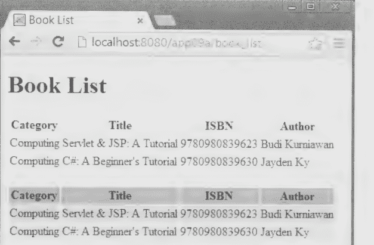
**图 9.1：在列表上使用 ForEach**

### 遍历 Map

你可以使用 `<c:forEach>` 遍历 `Map`。通过 `key` 和 `value` 属性分别引用 Map 的键和值。伪代码如下：

```xml
<c:forEach var="mapItem" items="${map}">
  ${mapItem.key}: ${mapItem.value}
</c:forEach>
```

#### 示例：CityController 与 Cities.jsp

**列表 9.4：CityController 类**

```java
package app09a.controller;

import java.util.HashMap;
import java.util.Map;
import org.springframework.stereotype.Controller;
import org.springframework.ui.Model;
import org.springframework.web.bind.annotation.RequestMapping;

@Controller
public class CityController {

    @RequestMapping(value = "/cities")
    public String listCities(Model model) {
        Map<String, String> capitals = new HashMap<String, String>();
        capitals.put("Indonesia", "Jakarta");
        capitals.put("Malaysia", "Kuala Lumpur");
        capitals.put("Thailand", "Bangkok");
        model.addAttribute("Capitals", capitals);

        Map<String, String[]> bigCities = new HashMap<String, String[]>();
        bigCities.put("Australia", new String[] {"Sydney", "Melbourne", "Perth"});
        bigCities.put("New Zealand", new String[] {"Auckland", "Christchurch", "Wellington"});
        bigCities.put("Indonesia", new String[] {"Jakarta", "Surabaya", "Medan"});
        model.addAttribute("bigCities", bigCities);

        return "Cities";
    }
}
```

**列表 9.5：Cities.jsp 页面**

```jsp
<%@ taglib uri="http://java.sun.com/jsp/jstl/core" prefix="c" %>
<!DOCTYPE HTML>
<html>
<head>
  <title>Big Cities (大城市)</title>
  <style>
    table, tr, td {
      border: 1px solid #aaee77;
      padding: 3px;
    }
  </style>
</head>
<body>
  Capitals (首都)
  <table>
    <tr style="background:#448755;color:white;font-weight:bold">
      <td>Country (国家)</td>
      <td>Cities (城市)</td>
    </tr>
    <c:forEach items="${requestScope.bigCities}" var="mapItem">
      <tr>
        <td>${mapItem.key}</td>
        <td>
          <c:forEach items="${mapItem.value}" var="city" varStatus="status">
            ${city}<c:if test="${!status.last}">,</c:if>
          </c:forEach>
        </td>
      </tr>
    </c:forEach>
  </table>
</body>
</html>
```

**关键点**：嵌套的 `<c:forEach>` 用于遍历 `Map` 的值（`String[]` 数组），并使用 `varStatus.last` 判断是否为最后一个元素以决定是否添加逗号。

```xml
<c:forEach items="${requestScope.bigCities}" var="mapItem">
  <c:forEach items="${mapItem.value}" var="city" varStatus="status">
    ${city}<c:if test="${!status.last}">,</c:if>
  </c:forEach>
</c:forEach>
```

---

## 格式化操作

JSTL 提供了用于格式化和解析数字及日期的标签：`formatNumber`、`formatDate`、`timeZone`、`setTimeZone`、`parseNumber` 和 `parseDate`。

### formatNumber 标签

用于格式化数字，支持两种用法。

#### 用法 1：无主体内容（自闭合标签）

```xml
<fmt:formatNumber value="numericValue"
  [type="number|currency|percent"]
  [pattern="customPattern"]
  [currencyCode="currencyCode"]
  [currencySymbol="currencySymbol"]
  [groupingUsed="true|false"]
  [maxIntegerDigits="maxIntegerDigits"]
  [minIntegerDigits="minIntegerDigits"]
  [maxFractionDigits="maxFractionDigits"]
  [minFractionDigits="minFractionDigits"]
  [var="varName"]
  [scope="page|request|session|application"]
/>
```

#### 用法 2：带主体内容

```xml
<fmt:formatNumber type="number|currency|percent"
  [pattern="customPattern"]
  [currencyCode="currencyCode"]
  [currencySymbol="currencySymbol"]
  [groupingUsed="true|false"]
  [maxIntegerDigits="maxIntegerDigits"]
  [minIntegerDigits="minIntegerDigits"]
  [maxFractionDigits="maxFractionDigits"]
  [minFractionDigits="minFractionDigits"]
  [var="varName"]
  [scope="page|request|session|application"]>
  要被格式化的数值
</fmt:formatNumber>
```

#### 表 9.10：formatNumber 标签的属性

| 属性 | 类型 | 说明 |
| :--- | :--- | :--- |
| `value` | 字符串或数字 | 要格式化的数值。 |
| `type` | 字符串 | 格式化类型：`number`、`currency`、`percent`。 |
| `pattern` | 字符串 | 自定义格式化模式。 |
| `currencyCode` | 字符串 | ISO 4217 货币代码。 |
| `currencySymbol` | 字符串 | 货币符号。 |
| `groupingUsed` | 布尔值 | 是否包含分组分隔符。 |
| `maxIntegerDigits` | int | 整数部分最大位数。 |
| `minIntegerDigits` | int | 整数部分最少位数。 |
| `maxFractionDigits` | int | 小数部分最大位数。 |
| `minFractionDigits` | int | 小数部分最少位数。 |
| `var` | 字符串 | 存储输出结果的作用域变量名。 |
| `scope` | 字符串 | `var` 的作用域（需配合 `var` 使用）。 |

#### 表 9.11：ISO 4217 货币代码示例

| 货币 | ISO 4217 代码 | 主单位名称 | 小单位名称 |
| :--- | :--- | :--- | :--- |
| 加拿大元 | `CAD` | dollar | cent |
| 人民币 | `CNY` | yuan | jiao |
| 欧元 | `EUR` | euro | euro-cent |
| 日元 | `JPY` | yen | sen |
| 英镑 | `GBP` | pound | pence |
| 美元 | `USD` | dollar | cent |

#### 表 9.12：formatNumber 使用示例

| 操作 | 结果 |
| :--- | :--- |
| `<fmt:formatNumber value="12" type="number"/>` | `12` |
| `<fmt:formatNumber value="12" type="number" minIntegerDigits="3"/>` | `012` |
| `<fmt:formatNumber value="12" type="number" minFractionDigits="2"/>` | `12.00` |
| `<fmt:formatNumber value="123456.78" pattern=".000"/>` | `123456.780` |
| `<fmt:formatNumber value="123456.78" pattern="##,.0.00"/>` | `123,456.78` |
| `<fmt:formatNumber value="12" type="currency"/>` | `$12.00` |
| `<fmt:formatNumber value="12" type="currency" currencyCode="GBP"/>` | `GBP 12.00` |
| `<fmt:formatNumber value="0.12" type="percent"/>` | `12%` |
| `<fmt:formatNumber value="0.125" type="percent" minFractionDigits="2"/>` | `12.50%` |

> **注意**：格式化货币时，若指定了 `currencyCode` 属性，将使用浏览器的本地设置。

---

### formatDate 标签

用于格式化日期。

#### 语法

```xml
<fmt:formatDate value="date"
  type="default|short|medium|full"
  timeStyle="default|short|medium|full"
  pattern="customPattern"
  timezone="timezone"
  var="varName"
  scope="page|request|session|application"/>
```

#### 表：formatDate 标签的属性

| 属性 | 类型 | 说明 |
| :--- | :--- | :--- |
| `value` | 日期 | 要格式化的日期值。 |
| `type` | 字符串 | 日期格式类型：`default`、`short`、`medium`、`full`。 |
| `timeStyle` | 字符串 | 时间格式类型：`default`、`short`、`medium`、`full`。 |
| `pattern` | 字符串 | 自定义格式化模式。 |
| `timezone` | 字符串 | 时区名称。 |
| `var` | 字符串 | 存储输出结果的作用域变量名。 |
| `scope` | 字符串 | `var` 的作用域（需配合 `var` 使用）。 |

> **注意**：格式化日期时，若指定了 `timezone` 属性，将使用浏览器的本地设置。

---

### timezone 标签

用于指定格式化的时区。

#### 语法

```xml
<fmt:timezone value="timezone">
  主体内容
</fmt:timezone>
```

#### 示例

```xml
<fmt:timezone value="GMT+1">
  <fmt:formatDate value="${now}" type="both" dateStyle="short" timeStyle="short"/>
</fmt:timezone>
```

> **说明**：`timezone` 标签用于指定格式化时间所在的时区。如果 `value` 属性为空或无效，将使用 GMT 时区。


# setTimeZone 标签

你使用 `setTimeZone` 标签将指定的时区存储在作用域变量或时间配置变量中。

```xml
<fmt:setTimeZone value="timeZone" var="varName"
    [scope="{page|request|session|application}"] />
```

表 9.15 展示了 `setTimeZone` 标签的属性。

| 属性 | 类型 | 说明 |
|---|---|---|
| value+ | String or `java.util.TimeZone` | 时区 |
| var | String | 用于存储类型为 `java.util.TimeZone` 时区的作用域变量名称 |
| scope | String | var 的作用域或时区配置变量的作用域 |

表 9.15: setTimeZone 标签的属性

# parseNumber 标签

你使用 `parseNumber` 将具有区域敏感性格式的数字、货币或百分比的字符串表示解析为数字。该语法有两种形式。第一种形式不带体内容使用：

```xml
<fmt:parseNumber value="numericValue"
    [type="{number|currency|percent}"]
    [pattern="customPattern"]
    [parseLocale="parseLocale"]
    [integerOnly="{true|false}"]
    [var="varName"]
    [scope="{page|request|session|application}"] />
```

第二种形式带有体内容使用：

```xml
<fmt:parseNumber [type="{number|currency|percent}"]
    [pattern="customPattern"]
    [parseLocale="parseLocale"]
    [integerOnly="{true|false}"]
    [var="varName"]
    [scope="{page|request|session|application}"]>
  要解析的数字值
</fmt:parseNumber>
```

体内容是 JSP。`parseNumber` 标签的属性在表 9.16 中。

例如，下面的 `parseNumber` 标签解析了由作用域变量 `quantity` 引用的值，并将结果存储在作用域变量 `formattedNumber` 中。

```xml
<fmt:parseNumber var="formattedNumber" type="number" value="${quantity}" />
```

| 属性 | 类型 | 说明 |
|---|---|---|
| value+ type+ | String | 要解析的字符串。指示该字符串是应该解析为数字、货币还是百分比。 |
| pattern+ | String | 自定义格式模式，决定了 value 属性中的字符串如何被解析。 |
| parseLocale+ | String or `java.util.Locale` | 解析操作期间使用默认格式模式的区域，或者应用通过属性指定的模式的区域。 |
| integerOnly+ | Boolean | 指示是否仅解析给定值的整数部分。 |
| var | String | 用于存储结果的作用域变量名称。 |
| scope | String | var 的作用域。 |

表 9.16: parseNumber 标签的属性

# parseDate 标签

`parseDate` 解析具有区域敏感性格式的日期和时间的字符串表示。该语法有两种形式。第一种形式不带体内容使用：

```xml
<fmt:parseDate value="dateString" [type="time,date|both"] [dateStyle="{default|short|medium|long|full}"] [timeStyle="{default|short|medium|long|full}"] [pattern="customPattern"] [timeZone="timeZone"]
    [parseLocale="parseLocale"]
    [var="varName"]
    [scope="{page|request|session|application}"] />
```

第二种形式带有体内容使用：

```xml
<fmt:parseDate type="{time|date|both}"
    dateStyle="{default|short|medium|long|full}"
    timeStyle="{default|short|medium|long|full}"
    pattern="customPattern"
    timeZone="time"
    parseLocale="parseLocale"
    var="varName"
    scope="{page|request|session|application}">
  要解析的日期值
</fmt:parseDate>
```

体内容是 JSP。表 9.17 列出了 `parseDate` 标签的属性。

| 属性 | 类型 | 说明 |
|---|---|---|
| value+ | String | 要解析的字符串。 |
| type+ | String | 指示要解析的字符串是否包含日期、时间或两者。 |
| dateStyle+ | String | 日期的格式样式。 |
| timeStyle+ | String | 时间的格式样式。 |
| pattern+ | String | 自定义格式模式决定了字符串如何被解析。 |
| timeZone+ | String or `java.util.TimeZone` | 用于解释日期字符串中任何时间信息的时区。 |
| parseLocale+ | String or `java.util.Locale` | 解析操作期间使用默认格式模式的区域，或者应用通过 pattern 属性指定的模式的区域。 |
| var | String | 用于存储结果的作用域变量名称。 |
| scope | String | var 的作用域。 |

表 9.17: parseDate 标签的属性

例如，下面的 `parseDate` 解析了由作用域变量 `myDate` 引用的日期，并将生成的 `java.util.Date` 存储在页面作用域变量 `formattedDate` 中。

```xml
<c:set var="myDate" value="12/12/2005"/>
<fmt:parseDate var="formattedDate" type="date"
    dateStyle="short" value="${myDate}"/>
```

# 函数

除了自定义动作外，JSTL 1.1 和 1.2 定义了一组可以在 EL 表达式使用的标准函数。这些函数被分组在函数标签库中。要使用这些函数，请使用函数标签库。

例如，以下 EL 表达式返回 `true`：
`${fn:startsWith("Stella Cadente", "St")}`

# substring 函数

`substring` 函数返回从指定的零基起始索引（包含）到指定的零基结束索引（不包含）的子字符串。其语法如下：

```
substring(string, beginIndex, endIndex)
```

例如，以下 EL 表达式返回“Stel”。
`${fn:substring("Stella Cadente", 0, 4)}`

# substringAfter 函数

`substringAfter` 函数返回字符串中首次出现指定子字符串之后的部分。其语法如下：

```
substringAfter(string, substring)
```

例如，EL 表达式
`${fn:substringAfter("Stella Cadente", "e")}`
返回“lla Cadente”。

# substringBefore 函数

`substringBefore` 函数返回字符串中首次出现指定子字符串之前的部分。其语法如下：

```
substringBefore(string, substring)
```

例如，以下 EL 表达式返回“St”。
`${fn:substringBefore("Stella Cadente", "e")}`

# toLowerCase 函数

`toLowerCase` 函数将字符串转换为其小写版本。其语法如下：

```
toLowerCase(string)
```

例如，以下 EL 表达式返回 "stella cadente"。

```
${fn:toLowerCase("Stella Cadente")}
```

# toUpperCase 函数

`toUpperCase` 函数将字符串转换为其大写版本。其语法如下：

```
toUpperCase(string)
```

例如，以下 EL 表达式返回 "STELLA CADENTE"。

```
${fn:toUpperCase("Stella Cadente")}
```

# trim 函数

`trim` 函数移除字符串的前导和尾空格。其语法如下：

```
trim(string)
```

例如，以下 EL 表达式返回 "Stella Cadente"。

```
${fn:trim("Stella Cadente")}
```

## 总结

你可以使用 JSTL 处理常用任务（如迭代、集合和条件）、处理 XML 文档、格式化文本、访问数据库和操作数据等。本章讨论了更重要的标签，例如操作范围对象的标签（`out`, `set`, `remove`）、执行条件测试的标签（`if`, `choose`, `when`, `otherwise`）、遍历集合或标记（`forEach`, `forTokens`）、解析和格式化日期与数字（`parseNumber`, `formatNumber`, `parseDate`, `formatDate`, 等），以及可以在 EL 表达式使用的 JSTL 1.2 函数。

# 第 10 章：国际化

在当今时代，编写能够部署在说不同语言的国家和地区的应用程序比以往任何时候都更加迫切。在这方面，你需要熟悉两个术语。第一个是国际化（internationalization），通常缩写为 i18n，因为该词以 i 开头以 n 结尾，第一个 i 和最后一个 n 之间有 18 个字符。国际化是开发支持多种语言和数据格式应用程序的技术，而无需重写编程逻辑。

第二个术语是本地化（localization），是将国际化应用程序以支持特定区域（locale）的技术。区域是指特定的地理、政治或文化区域。考虑区域的操作被称为区域敏感的（locale-sensitive）。例如，显示日期是区域敏感的，因为日期必须采用用户所在国家或地区使用的格式。2014年11月15日在美国写作 11/15/2014，但在澳大利亚打印为 15/11/2014。出于同样的原因，本地化缩写为 l10n。

Java 设计时考虑了国际化，对字符和字符串使用 Unicode。因此，在 Java 中制作国际化应用程序是很容易的。你如何国际化应用程序取决于需要在不同语言中展示多少静态数据，有两种方法：

1. 如果大量数据是静态的，则为每个区域创建一个单独资源版本。这种方法通常适用于具有许多静态 HTML 页面的 Web 应用程序。它非常直接，在本章中不会进行讨论。
2. 如果需要国际化的静态数据量有限，将文本元素（如组件标签和消息）隔离到文本文件中。每个文本文件存储该区域所有文本元素的翻译。应用程序随后动态检索每个元素。其优点显而易见：每个文本元素都可以轻松编辑，无需重新编译应用程序。这就是本章将讨论的技术。

本章首先解释什么是区域。接下来是国际化应用程序的技术，然后是一个 Spring MVC 示例。

## 区域 (Locales)

`java.util.Locale` 类表示一个区域。`Locale` 对象有三个主要部分：语言（language）、国家（country）和变体（variant）。语言显然是最重要的部分；但有时语言本身不足以区分一个区域。例如，英语在美国和英国等国家被使用。然而，在美国使用的英语与在英国使用的英语并不完全相同。因此，有必要指定语言所在的国家。另一个例子是在中国使用的中文与在台湾使用的中文并不完全相同。

变体参数是特定厂商或浏览器的代码。例如，WIN 代表 Windows，MAC 代表 Macintosh，POSIX 代表 POSIX。要构造 `Locale` 对象，请使用 `Locale` 的任一构造函数：

```
public Locale(String language)
public Locale(String language, String country)
public Locale(String language, String country, String variant)
```

语言代码是有效的 ISO 代码。表 10.1 显示了语言代码示例。

| 代码 | 语言 |
| :--- | :--- |
| de | 德语 |
| el | 希腊语 |
| en | 英语 |
| es | 西班牙语 |
| fr | 法语 |
| hi | 印地语 |
| it | 意大利语 |
| ja | 日语 |
| nl | 荷兰语 |
| pt | 葡萄牙语 |
| ru | 俄语 |
| zh | 中文 |

国家参数是有效的 ISO 代码。表 10.2 列出了一些国家代码。

| 国家 | 代码 |
| :--- | :--- |
| AU | 澳大利亚 |
| BR | 巴西 |
| CA | 加拿大 |
| CN | 中国 |
| EG | 埃及 |
| FR | 法国 |
| DE | 德国 |
| IN | 印度 |
| MX | 墨西哥 |
| CH | 瑞士 |
| TW | 台湾 |
| GB | 英国 |
| US | 美国 |

例如，要构造表示加拿大英语的 `Locale` 对象，请编写：

```
Locale locale = new Locale("en", "CA");
```

此外，`Locale` 类提供了静态常量字段，返回特定国家或语言的区域，例如 `CANADA`、`CANADA_FRENCH`、`CHINA`、`CHINESE`、`ENGLISH`、`FRANCE`、`FRENCH`、`UK`、`US` 等。因此，可以通过调用静态字段来构造 `Locale` 对象。

```
Locale locale = Locale.CANADA_FRENCH;
```

此外，静态方法 `getDefault` 返回用户的计算机区域。

```
Locale locale = Locale.getDefault();
```

# Spring MVC 应用程序的国际化

国际化和本地化你的应用程序需要你：

1. 将文本组件隔离到属性文件中
2. 能够选择并读取正确的属性文件

本节将详细说明这两个步骤并提供一个简单的示例。

# 将文本组件隔离到属性文件中

国际化应用程序将其文本元素存储在每个区域的单独属性文件中。每个文件包含键值对，每个键唯一标识一个特定区域的对象。键总是字符串，而值可以是任何其他类型的对象。例如，对于美国英语、德语和中文，你会有三个属性文件，它们都具有相同的键。

以下是属性文件的英语版本。注意它有两个键：greetings 和 farewell。

```properties
Greetings = Hello
farewell = Goodbye
```

德语版本如下：

```properties
greetings = Hallo
farewell = Tschuß
```

中文的属性文件如下：

```properties
greetings=\u4f60\u597d
farewell=\u518d\u89c1
```

请阅读侧边栏“将汉字转换为 Unicode”以了解我是如何得到这个属性文件的。

### 将汉字转换为 Unicode

在中文中，“你好”（意为 hello，分别由 Unicode 编码 4f60 和 597d 表示）和“再见”（意为 good bye，分别由 Unicode 编码 518d 和 89c1 表示）是最常用的表达方式。当然，没有人能记住每个汉字的 Unicode 编码。因此，你通过两个步骤来创建 .properties 文件：

1. 使用你喜欢的中文文本编辑器，创建一个这样的文本文件：

```properties
greetings=你好
farewell=再见
```

2. 将文本文件的内容转换为 Unicode 表示形式。
通常情况下，中文文本编辑器具有将汉字转换为 Unicode 编码的功能。你将得到最终结果：

```properties
greetings=\u4f60\u597d
farewell=\u518d\u89c1
```


# 第10章：国际化

现在，你需要掌握 `java.util.ResourceBundle` 类。它允许你轻松地选择并读取特定用户区域（locale）的属性文件并查找值。`ResourceBundle` 是一个抽象类，但它提供了静态的 `getBundle` 方法，返回具体子类的实例。

`ResourceBundle` 有一个基名称（base name），可以是任何名称。为了让 `ResourceBundle` 识别到属性文件，文件名必须由 `ResourceBundle` 基名称组成，后跟一个下划线、语言代码，可选地跟随另一个下划线和国家代码。属性文件名的格式如下：

```
basename_languageCode_countryCode
```

例如，假设基名称为 `MyResources`，你定义了以下三个区域：

- US-en
- DE-DE
- CN-zh

那么你将拥有这三个属性文件：

- `MyResources_en_US.properties`
- `MyResources_de_DE.properties`
- `MyResources_zh_CN.properties`

## 读取属性文件

如前所述，`ResourceBundle` 是一个抽象类。尽管如此，你可以通过调用它的静态 `getBundle` 方法来获取 `ResourceBundle` 的实例。其重载方法的签名如下：

```java
public static ResourceBundle getBundle(java.lang.String baseName)

public static ResourceBundle getBundle(java.lang.String baseName, Locale locale)
```

例如：

```java
ResourceBundle rb = ResourceBundle.getBundle("MyResources", Locale.US);
```

这将加载带有对应属性文件中值的 `ResourceBundle`。

如果未找到合适的属性文件，`ResourceBundle` 对象将回退到默认属性文件。默认属性文件的名称将是基名称加上 `.properties` 扩展名。在这种情况下，默认文件将是 `MyResources.properties`。如果未找到默认属性文件，将抛出 `java.util.MissingResourceException`。

然后，要读取一个值，你使用 `ResourceBundle` 类的 `getString` 方法并传递一个键（key）。

```java
public java.lang.String getString(java.lang.String key)
```

如果未找到指定键的条目，将抛出 `java.util.MissingResourceException`。

在 Spring MVC 中，你并不直接操作 `ResourceBundle`。相反，你使用 `messageSource` bean 来告诉 Spring MVC 你将属性文件存储在何处。例如，下面的 `messageSource` 读取了两个属性文件。

```xml
<bean id="messageSource" class="org.springframework.context.support.ReloadableResourceBundleMessageSource">
  <property name="basenames">
    <list>
      <value>resource/messages</value>
      <value>resource/labels</value>
    </list>
  </property>
</bean>
```

在上面的 bean 定义中，使用了 `ReloadableResourceBundleMessageSource` 类作为实现。另一个实现是 `ResourceBundleMessageSource`，它是不可重加载的。这意味着，如果你更改了任何属性文件中的属性键或值且正在使用 `ResourceBundleMessageSource`，你必须重启 JVM 更改才能生效。另一方面，你可以设置 `ReloadableResourceBundleMessageSource` 为可重加载的。

两种实现之间的另一个区别是，使用 `ReloadableResourceBundleMessageSource` 时会在应用程序目录下搜索属性文件。而使用 `ResourceBundleMessageSource` 时，属性文件必须位于类路径（class path）下或 `WEB-INF/classes` 目录下。

另外注意，如果你只有一组属性文件，可以使用 `basename` 属性代替 `basenames`。这里有一个示例。

```xml
<bean id="messageSource" class="org.springframework.context.support.ReloadableResourceBundleMessageSource">
  <property name="basename" value="resource/messages"/>
</bean>
```

## 告诉 Spring MVC 使用什么区域

为用户选择区域最常用的方法可能是读取用户浏览器 `accept-language` 头部标的值。`accept-language` 头部载有关于用户语言偏好的信息。

选择区域的其他方法包括读取特定的 session 属性或 cookie。

在 Spring MVC 中选择区域，你使用 `localeResolver` bean。有几种实现，包括以下这些：

- `AcceptHeaderLocaleResolver`
- `SessionLocaleResolver`
- `CookieLocaleResolver`

所有这些实现都是 `org.springframework.web` 的。`AcceptHeaderLocaleResolver` 可能是最容易使用的。如果你选择使用此区域解析器，Spring MVC 将读取浏览器的 accept-language 头部来确定区域。如果 Spring 应用没有匹配到，将使用默认值。

```xml
<bean id="localeResolver" class="org.springframework.web.AcceptHeaderLocaleResolver"/>
```

## 使用 message 标签

在 Spring 中显示本地化消息最简单的方法是使用 `message` 标签。要使用它，需要在所有使用它的 JSP 顶部声明 taglib。

```jsp
<%@taglib prefix="spring" uri="http://www.springframework.org/tags"%>
```

标签可能出现的属性见表 10.3。所有属性均为可选。

| Attribute | Description |
|---|---|
| arguments | 以分隔字符串、对象数组或单个对象形式提供的标签参数。 |
| argumentSeparator | 用于分隔参数的字符。 |
| code | 获取消息的键。 |
| htmlEscape | 如果为 true 则对渲染文本进行 HTML 转义。 |
| javaEscape | 如果为 true 则渲染的文本适用于 JavaScript。 |
| message | 一个 MessageSource 参数。 |
| scope | var 属性定义的变量的作用域。 |
| text | 当 code 不存在或获取消息失败时渲染的文本。 |
| var | 用于存储消息的变量。 |

## 示例

例如，app10a 应用演示了使用 `localeResolver` 在 JSP 页面中进行本地化。目录结构如图 10.1 所示，app10a 的 Spring 配置文件如列表 10.1 所示。

```
app10a
  css
    main.css
  WEB-INF
    classes
      app10a
        config
          springmvc-config.xml
  jsp
    ProductDetails.jsp
    ProductForm.jsp
    ProductView.jsp
  lib
  resource
    labels_fr.properties
    labels.properties
    messages_en.properties
    messages_fr.properties
    messages.properties
    web.xml
```

```xml
<?xml version="1.0" encoding="UTF-8"?>
<beans xmlns="http://www.springframework.org/schema/beans"
      xmlns:xsi="http://www.w3.org/2001/XMLSchemaSchema-instance"
      xmlns:p="http://www.springframework.org/schema/p"
      xmlns:mvc="http://www.springframework.org/schema/mvc"
      xmlns:context="http://www.springframework.org/schema/context"
      xsi:location="http://www.springframework.org/schema/beans http://www.springframework.org/schema/beans/spring-beans.xsd http://www.springframework.org/schema/mvc http://www.springframework.org/schema/mvc/spring-mvc.xsd http://www.springframework.org/schema/context http://www.springframework.org/schema/context/spring-context.xsd">
  <context:component-scan base-package="app10a.controller" />
  <context:component-scan base-package="app10a.formatter" />
</beans>
```

```xml
<mvc:annotation-driven conversion-service="conversionService" />
```

```xml
<mvc:resources mapping="/css/" location="/css/" />
<mvc:resources mapping="*.html" location="/" />
<bean id="viewResolver" class="org.springframework.web.servlet.view.InternalResourceViewResolver">
  <property name="prefix" value="/WEB-INF/jsp/" />
  <property name="suffix" value=".jsp" />
</bean>
<bean id="conversionService" class="org.springframework.framework.format.support.FormattingConversionServiceFactoryBean">
  <property name="formatters">
    <set>
      <bean class="app10a.formatter.DateFormat">
        <constructor-arg type="java.lang.String" value="MM-dd-yyyy" />
      </bean>
    </set>
  </property>
</bean>
<bean id="messageSource" class="org.springframework.context.support.ReloadableResourceMessageSource">
  <property name="basenames">
    <list>
      <value>/WEB-INF/resource/messages</value>
      <value>/WEB-INF/resource/labels</value>
    </list>
  </property>
</bean>
<bean id="localeResolver" class="org.springframework.web.servlet.i18n.AcceptHeaderLocaleResolver">
  AcceptHeaderLocaleResolver
</bean>
</beans>
```

这里有两个 bean 值得关注：`messageSource` bean 和 `localeResolver` bean。`messageSource` bean 的声明通过基名称 (basenames) 属性设置了两个基础名称：`/WEB-INF/resource/messages` 和 `/WEB-INF/resource/labels`。`localeResolver` 使用 `AcceptHeaderLocaleResolver` 类启用消息本地化。

系统支持两种语言区域：en 和 fr，因此每个属性文件都有两个版本。为了启用本地化，JSP 页面中的每段文本都要替换为 `message` 标签。列表 10.2 显示了 ProductForm.jsp 页面。注意，为了调试目的，页面顶部显示了当前区域和 accept-language 头部。

列表 10.2：ProductForm.jsp 页面

```jsp
<%@ taglib prefix="form" uri="http://www.springframework.org/tags/form">
<%@ taglib prefix="spring" uri="http://www.springframework.org/tags/">
<%@ taglib uri="http://java.sun.com/jsp/jstl/core" prefix="c">
<!DOCTYPE HTML>
<html>
<head>
  <title><spring:message code="product.form.title"/></title>
  <style type="text/css" href="<c:url value="/main.css""/></style>
</head>
<body>
  <div id="global">
    Current Locale : ${pageContext.response.locale}
    <br/>
    accept-language header: ${header["accept-language"]}
    <form:form commandName="product" action="product_save" method="post">
      <fieldset>
        <legend><spring:message code="form.name"/></legend>
        <p>
          <label for="name"><spring:message code="label.productName" text="default text"/></label>
          <form:input id="name" path="name" cssErrorClass="error"/>
          <form:errors path="name" cssClass="error"/>
        </p>
        <p>
          <label for="description"><spring:message code="label.description"/></label>
          <form:input id="description" path="description"/>
        </p>
        <p>
          <label for="price"><spring:message code="label.price" text="default text" /></label>
          <form:input id="price" path="price" cssError="error"/>
        </p>
        <p id="buttons">
          <input id="reset" type="reset" tabindex="4" value="<spring:message code="button.reset"/>">
          <input id="submit" type="submit" tabindex="5" value="<spring:message code="button.submit"/>">
        </p>
      </fieldset>
    </form:form>
  </div>
</body>
</html>
```


要测试 `app10a` 的国际化功能，请更改浏览器的 `accept-language` 头部。在 Internet Explorer 7 及更高版本中，前往工具 > Internet 选项 > 通用（标签页） > 语言 > 语言首选项。在图 10.2 的语言首选项窗口中，点击“添加”按钮来添加语言。当选择了多种语言时，使用“向上移动”和“向下移动”按钮更改语言的优先级。

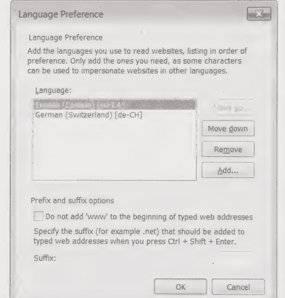

图 10.2：IE 10 中的语言首选项窗口

其他浏览器更改 `accept-language` 头部的说明可以在此处找到。

http://www.w3.org/International/questions/qa-lang-priorities.en.php

要测试应用程序，将浏览器导航到此 URL：http://localhost:8080/product。你将看到英语或法语版本的表单，如图 10.3 所示。


图 10.3：产品表单

## 220 Spring MVC 教程


图 10.4：文件输入

## 229 Spring MVC 教程


图 10.5：文件输入

## 总结

本章解释了如何在 Spring MVC 中使用国际化。

## 11：文件上传

曾经，如果你想上传多个文件，必须使用多个 `input` 元素。然而，HTML 5 通过在 `input` 元素中引入 `multiple` 属性使得上传变得简单。

## 客户端

要上传文件，必须将表单的 `enctype` 属性设置为 `multipart/form-data`，如下所示：

```html
<form action="upload" enctype="multipart/form-data" method="post">
  Select file <input type="file" name="fieldName"/>
  <input type="submit" value="Upload"/>
</form>
```

HTML 5 允许你选择多个文件：

```html
<input type="file" name="fieldName" multiple/>
<input type="file" name="fieldName" multiple="">
```

## MultipartFile 接口

在 Spring MVC 中处理上传的文件非常简单。上传的文件封装在 `MultipartFile` 对象中。你只需要负责编写一个带有 `MultipartFile` 属性的领域类。

`org.springframework.web.multipart.MultipartFile` 接口包含以下方法：

```java
byte[] getBytes()
以字节数组的形式返回文件内容。

InputStream getInputStream()
返回读取文件内容的 InputStream。

String getName()
返回多部分表单中的参数名称。

String getOriginalFilename()
返回客户端本地磁盘上的原始文件名。

long getSize()
返回文件的字节大小。

boolean isEmpty()
指示上传的文件是否为空。

void transferTo(File destination)
将上传的文件保存到目标。
```

## 使用 Commons FileUpload 上传

只有实现 Servlet 3.0 或更高版本的 servlet 容器支持文件上传。对于 Servlet 3.0 容器，你需要从此网页页面下载 Apache Commons FileUpload 组件。
http://commons.apache.org/proper/commons-fileupload/

这是一个开源项目，因此它是免费的并提供了源代码。为了让 Commons FileUpload 成功运行，它需要另一个 Apache 组件——Apache Commons IO。你可以从此处下载 Apache Commons IO。
http://commons.apache.org/proper/commons-io/

因此，需要将两个 JAR 包复制到应用程序的 `WEB-INF/lib` 目录。CommonsFileUpload JAR 的名称遵循以下模式：

```
commons-fileupload-x.y.jar
```

其中 `$x$` 是软件的主版本号，`$y$` 是次版本号。例如，本章使用的版本是 `commons-fileupload-1.3.jar`。

Commons IO JAR 的名称遵循此模式：

```
commons-io-x.y.jar
```

在这里，`$x$` 是软件的主版本号，`$y$` 是次版本号。例如，本章使用的版本是 `commons-io-2.4.jar`。

此外，你需要在 Spring MVC 配置中定义这个 `multipartResolver` bean：

```xml
<bean id="multipartResolver"
    class="org.springframework.web.multipart.CommonsMultipartResolver">
    <property name="maxUploadSize" value="2000000"/>
</bean>
```

`app1a` 示例展示了如何使用 Apache Commons FileUpload 处理上传的文件。该示例也可以在 Servlet 3.0 容器中运行。`app1a` 有一个领域类，即 `Product` 类，它包含一个 `MultipartFile` 对象的列表。在这个示例中，你将学习如何编写一个可以处理上传的产品图片的控制器。

## 领域类

列表 11.1 显示了 `Product` 领域类。它与之前示例中的 `Product` 类相似，不同之处列表 11.1 中的类具有一个类型为 `List<MultipartFile>` 的 `images` 属性。

列表 11.1：修订后的 Product 领域类

```java
package app1a.domain;

import java.io.Serializable;
import java.util.List;
import javax.validation.constraints.NotNull;
import javax.validation.constraints.Size;
import org.springframework.web.multipart.MultipartFile;

public class Product implements Serializable {
    private static final long serialVersionUID = 744588L;

    @NotNull
    @Size(min=1, max=10)
    private String name;

    private String description;
    private Float price;
    private List<MultipartFile> images;

    public String getName() {
        return name;
    }

    public void setName(String name) {
        this.name = name;
    }

    public String getDescription() {
        return description;
    }

    public void setDescription(String description) {
        this.description = description;
    }

    public Float getPrice() {
        return price;
    }

    public void setPrice(Float price) {
        this.price = price;
    }

    public List<MultipartFile> getImages() {
        return images;
    }

    public void setImages(List<MultipartFile> images) {
        this.images = images;
    }
}
```

## 控制器

`app1a` 的控制器如列表 11.2。该类中有两个请求处理方法：`inputProduct` 和 `saveProduct`。`inputProduct` 方法向浏览器发送产品表单。`saveProduct` 方法将上传的图片文件保存到应用程序目录下的 `image` 目录。

列表 11.2：ProductController 类

```java
package app1a.controller;

import java.io.File;
import java.io.IOException;
import java.util.ArrayList;
import java.util.List;
import javax.servlet.HttpServletRequest;
import org.apache.commons.logging.Log;
import org.apache.commons.logging.LoggerFactory;
import org.springframework.stereotype.Controller;
import org.springframework.ui.Model;
import org.springframework.validation.BindingResult;
import org.springframework.web.bind.annotation.ModelAttribute;
import org.springframework.web.bind.annotation.RequestMapping;
import org.springframework.web.multipart.MultipartFile;
import app1a.domain.Product;

@Controller
public class ProductController {
    private static final Log logger = 
        LoggerFactory.getLogger(ProductController.class);

    @RequestMapping(value = "/product_input")
    public String inputProduct(Model model) {
        model.addAttribute("product", new Product());
        return "ProductForm";
    }

    @RequestMapping(value = "/product_save")
    public String saveProduct(HttpServletRequest request,
                               @ModelAttribute Product product,
                               BindingResult bindingResult, Model model) {
        List<MultipartFile> files = product.getImages();
        List<String> fileNames = new ArrayList<String>();

        if (null != files && files.size() > 0) {
            for (MultipartFile multipartFile : files) {
                String fileName = multipartFile.getOriginalFilename();
                fileNames.add(fileName);
                File imageFile = new File(request.getServletContext()
                        .getRealPath("/image"), fileName);
                try {
                    multipartFile.transferTo(imageFile);
                } catch (IOException e) {
                    e.printStackTrace();
                }
            }
        }

        // save product here
        model.addAttribute("product", product);
        return "ProductDetails";
    }
}
```

正如你在列表 11.2 的 `saveProduct` 方法所示，保存上传的文件非常简单。你只需要调用 `MultipartFile` 上的 `transferTo` 方法。

## 配置

列表 11.3 显示了 `app1a` 的 Spring MVC 配置。

```xml
<?xml version="1.0" encoding="UTF-8"?>
<beans xmlns="http://www.springframework.org/schema/beans"
       xmlns:xsi="http://www.w3.org/2001/XMLSchema-instance"
       xmlns:context="http://www.springframework.org/schema/context"
       xmlns:mvc="http://www.springframework.org/schema/mvc"
       xsi:schemaLocation="http://www.springframework.org/schema/beans http://www.springframework.org/schema/beans/beans.xsd
                           http://www.springframework.org/schema/context http://www.springframework.org/schema/context/spring-context.xsd
                           http://www.springframework.org/schema/mvc http://www.springframework.org/schema/mvc/spring-mvc.xsd">
    <context:component-scan base-package="applia.controller" />
    <context:component-scan base-package="applia.formatter" />
    <mvc:annotation-driven conversion-service="conversionService" />
    <mvc:resources mapping="css/**" location="css/" />
    <mvc:resources mapping="*.html" location="/" />
    <mvc:resources mapping="image/*" location="image/" />
    <bean id="viewResolver"
          class="org.springframework.web.view.InternalResourceViewResolver">
        <property name="prefix" value="WEB-INF/jsp/" />
        <property name="suffix" value=".jsp" />
    </bean>
    <bean id="messageSource"
          class="org.springframework.context.support.ReloadableBundleSource">
        <property name="basename" value="WEB-INF/resource/messages" />
    </bean>
    <bean id="conversionService"
          class="org.springframework.format.support.FormattingFactoryBean">
```


<property name="formatters">
    <set>
        <bean class="applia.formatter.DateFormat">
            <constructor-arg type="java.String" value="MM-dd-yyyy" />
        </bean>
    </set>
</property>
</bean>
<bean id="multipartResolver" class="org.springframework.web.multipart.CommonsMultipartResolver" />
</beans>

你可以使用 `multipartResolver` bean 的 `maxUploadSize` 属性来设置允许的最大文件。如果没有这个属性，则没有大小限制。对文件大小不设置限制并不意味着你可以上传任何大小。非常大的文件上传需要很长时间，会导致服务器超时。为了处理大文件，你可以使用 HTML 5 File API 对文件进行切片并分别上传。

## JSP 页面

用于上传图片的 `ProductForm.jsp` 页面如列表 11.4 所示。

### 列表 11.4：ProductForm.jsp 页面

```jsp
<%@ taglib prefix="form" uri="http://www.springframework.org/tags/form" %>
<%@ taglib uri="http://java.sun.com/jsp/jstl/core" prefix="c" %>
<!DOCTYPE HTML>
<html>
<head>
    <title>添加产品表单</title>
    <style type="text/css">@import url("<c:url value="/css/main.css"/>");</style>
</head>
<body>
<div id="global">
<form commandName="product" action="product_save" method="post" enctype="multipart/form-data">
<fieldset>
  <legend>添加产品</legend>
  <p>
    <label for="name">产品名称: </label>
    <form:input id="name" path="name" cssClassName="error"/>
    <form:errors path="name" cssClass="error"/>
  </p>
  <p>
    <label for="description">描述: </label>
    <form:input id="description" path="description"/>
  </p>
  <p>
    <label for="price">价格: </label>
    <form:input id="price" path="price" cssClassName="error"/>
  </p>
  <p>
    <label for="image">产品图片: </label>
    <input type="file" name="images[0]"/>
  </p>
  <p id="buttons">
    <input id="reset" type="reset" tabindex="4">
    <input id="submit" type="submit" tabindex="5" value="添加产品"/>
  </p>
</fieldset>
</form>
</div>
</body>
</html>
```

注意表单中类型为 `file` 的输入元素。它将被渲染为一个用于选择上传文件的按钮。

提交产品表单将调用 `product_save` 方法。如果该方法成功完成，用户将重定向到列表 11.5 中的 `ProductDetails.jsp` 页面。

### 列表 11.5：ProductDetails.jsp 页面

```jsp
<%@taglib uri="http://java.sun.com/jsp/jst/core" prefix="c" %>
<!DOCTYPE HTML>
<html>
<head>
    <title>保存产品</title>
    <style type="text/css">@import url("c:url value="css/main.css");</style>
</head>
<body>
<div id="global">
<h4>产品已保存。</h4>
<p>
<h5>详情：</h5>
产品名称: ${product.name}<br/>
描述: ${product.description}<br/>
价格: ${product.price}
</p>
<p>以下文件已成功上传：</p>
<ol>
<c:forEach items="${product.images}" var="image">
<li>${image.originalFilename}

</li>
</c:forEach>
</ol>
</p>
</div>
</body>
</html>
```

`ProductDetails.jsp` 页面显示了保存产品的详情，包括它的图片。

## 测试应用程序

要测试此应用程序，请将浏览器指向此 URL：
http://localhost:8080/app1a/product_input

你将看到一个类似于图 11.1 所示添加产品表单。输入一些产品信息并选择一个文件上传。

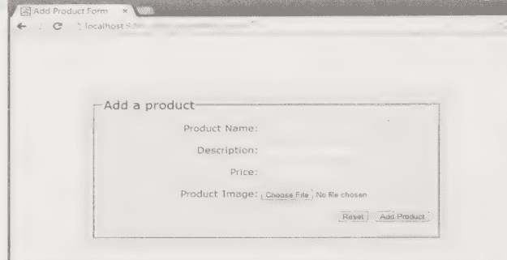

点击“添加产品”，你将看到类似于图 11.2 网页的内容。

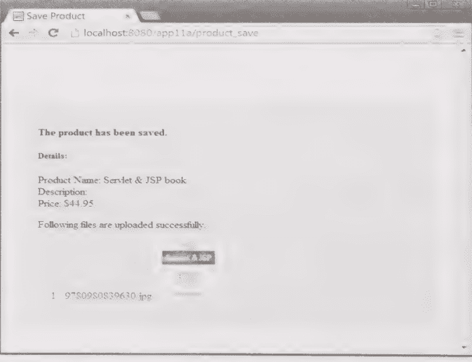

如果你查看应用程序目录下的图片目录，你会看到上传的图片。

## 使用 Servlet 3 或更高版本进行文件上传

使用 Servlet 3，你不需要 Commons FileUpload 和 Commons IO 组件了。Servlet 3 及更高容器中的服务器端文件上传编程主要围绕 `MultipartConfig` 注解类型和 `javax.servlet.http.Part` 接口展开。处理上传文件的 Servlet 必须标记 `@MultipartConfig` 注解。

以下可能出现在 `MultipartConfig` 注解类型中的属性。所有属性都是可选的。

- `maxSize`：上传文件的最大大小。大于指定值的文件将被拒绝。默认情况下，`maxFileSize` 的值为 -1，意味着无限制。
- `maxRequestSize`：允许的多部分 HTTP 请求的最大大小。默认值为 -1，翻译为无限制。
- `location`：调用 `Part` 的 `write` 方法时，上传的文件保存到磁盘的相同位置。
- `fileSizeThreshold`：上传文件被写入磁盘的阈值大小。

Spring MVC 的 `DispatcherServlet` 处理大部分或所有请求。遗憾的是，在不更改源代码的情况下，你无法为该 servlet 添加注解。幸运的是，在 Servlet 3 中创建 `MultipartConfig` servlet 有一种更简单的方法：通过向部署描述符（`web.xml` 文件）中的 servlet 声明传递值。以下效果与为 `DispatcherServlet` 标记 `@MultipartConfig` 注解相同。

```xml
<servlet>
  <servlet-name>springmvc</servlet-name>
  <servlet-class>
    org.springframework.web.servlet.DispatcherServlet
  </servlet-class>
  <init-param>
    <param-name>configLocation</param-name>
    <param-value>
      /WEB-INF/config/springmvc-config.xml
    </param-value>
  </init-param>
  <multipart-config>
    <max-size>20485760</max-size>
    <max-request-size>40971520</max-request-size>
    <location>/tmp</location>
    <file-size-threshold>1048576</file-size-threshold>
  </multipart-config>
</servlet>
```


# 第 11 章：文件上传

## 232 Spring MVC：教程

```html
<fieldset>
  <legend>添加产品</legend>
  <p>
    <label for="name">产品名称: </label>
    <form:input id="name" path="name" cssClassName="error"/>
    <form:errors path="name" cssClass="error"/>
  </p>
  <p>
    <label for="description">描述: </label>
    <form:input id="description" path="description"/>
  </p>
  <p>
    <label for="price">价格: </label>
    <form:input id="price" path="price" cssClassName="error"/>
  </p>
  <p>
    <label for="image">产品图片: </label>
    <input type="file" name="images[0]"/>
  </p>
  <p id="buttons">
    <input id="reset" type="reset" tabindex="4">
    <input id="submit" type="submit" tabindex="5" value="添加产品"/>
  </p>
</fieldset>
</form>
</div>
</body>
```

注意表单中类型为 `file` 的输入元素。它将被渲染为一个用于选择上传文件的按钮。

提交产品表单将调用 `product_save` 方法。如果该方法成功完成，用户将重定向到列表 11.5 中的 ProductDetails.jsp 页面。

### 列表 11.5：ProductDetails.jsp 页面

```jsp
<%@taglib uri="http://java.sun.com/jsp/jst/core" prefix="c" %>
<!DOCTYPE HTML>
<html>
<head>
<title>保存产品</title>
<style type="text/css">@import url("c:url value="css/main.css");</style>
</head>
<body>
<div id="global">
<h4>产品已保存。</h4>
<p>
<h5>详情：</h5>
产品名称: ${product.name}<br/>
描述: ${product.description}<br/>
价格: ${product.price}
</p>
<p>以下文件已成功上传：</p>
<ol>
<c:forEach items="${product.images}" var="image">
<li>${image.originalFilename}

</li>
</c:forEach>
</ol>
</p>
</div>
</body>
</html>
```

ProductDetails.jsp 页面显示了保存产品的详情，包括它的图片。

## 测试应用程序

要测试此应用程序，请将浏览器指向此 URL：
http://localhost:8080/app1a/product_input

你将看到一个类似于图 11.1 所示添加产品表单。输入一些产品信息并选择一个文件上传。

## 234 Spring MVC：教程


图 11.1：一个包含文件字段的产品表单

点击“添加产品”，你将看到类似于图 11.2 网页的内容。


图 11.2：显示已上传图片

## 第 11 章：文件上传 235

如果你查看应用程序目录下的图片目录，你会看到上传的图片。

## 使用 Servlet 3 或更高版本进行文件上传

使用 Servlet 3，你不需要 Commons FileUpload 和 Commons IO 组件了。Servlet 3 及更高容器中的服务器端文件上传编程主要围绕 `MultipartConfig` 注解类型和 `javax.servlet.http.Part` 接口展开。处理上传文件的 Servlet 必须标记 `@MultipartConfig` 注解。

以下是可能出现在 `MultipartConfig` 注解类型中的属性。所有属性都是可选的。

- `maxSize`：上传文件的最大大小。大于指定值的文件将被拒绝。默认情况下，`maxFileSize` 的值为 -1，意味着无限制。
- `maxRequestSize`：允许的多部分 HTTP 请求的最大大小。默认值为 -1，翻译为无限制。
- `location`：调用 `Part` 的 `write` 方法时，上传的文件保存到磁盘的相同位置。
- `fileSizeThreshold`：上传文件被写入磁盘的阈值大小。

Spring MVC 的 `DispatcherServlet` 处理大部分或所有请求。遗憾的是，在不更改源代码的情况下，你无法为该 servlet 添加注解。幸运的是，在 Servlet 3 中创建 `MultipartConfig` servlet 有一种更简单的方法：通过向部署描述符（`web.xml` 文件）中的 servlet 声明传递值。以下效果与为 DispatcherServlet 标记 `@MultipartConfig` 注解相同。

```xml
<servlet>
  <servlet-name>springmvc</servlet-name>
  <servlet-class>
    org.springframework.web.servlet.DispatcherServlet
  </servlet-class>
  <init-param>
    <param-name>configLocation</param-name>
    <param-value>
      /WEB-INF/config/springmvc-config.xml
    </param-value>
  </init-param>
  <multipart-config>
    <max-size>20485760</max-size>
    <max-request-size>40971520</max-request-size>
    <location>/tmp</location>
    <file-size-threshold>1048576</file-size-threshold>
  </multipart-config>
</servlet>
```


# 第 11 章：文件上传

## 上传客户端

虽然 Servlet 3 中的文件上传功能使得服务器端的文件上传编程变得轻而易举，但它对提升用户体验没有任何帮助。仅凭一个 HTML 表单无法让你显示进度条或显示成功上传的文件数量。开发者已经使用了不同的技术来改进用户界面，例如使用独立的浏览器线程查询服务器以便报告上传进度，或者使用 Java applets、Adobe Flash 或 Microsoft Silverlight 等第三方技术。

这些第三方技术是行之有效的。在某种程度上是如此，但也有局限性。使用这些技术之一的首要缺点是，所有主流浏览器都没有对它们提供内置支持。例如，只有当用户在其电脑上安装了 Java 时，才能运行 Java applets。虽然某些电脑制造商（如戴尔和惠普）在出产品时安装了 Java，但其他厂家（如联想）则没有。虽然有办法检测用户机器上是否安装了 Java 并在不存在时引导用户安装，但这种中断并不是所有用户都愿意接受的。此外，除非经过签名，否则 Java applets 默认对本地文件系统的访问受到严格限制。这些显然为程序增加了成本和复杂性。

Flash 与 applets 存在相同的问题。Flash 程序需要播放器才能运行，并不是所有平台都默认支持 Flash。用户必须安装 Flash 播放器才能在浏览器中运行 Flash 程序。此外，苹果不允许使用 Flash。Silverlight 也有类似的问题。Silverlight 程序需要播放器才能运行，并不是所有平台都默认支持 Silverlight。用户必须安装 Silverlight 播放器才能在浏览器中运行 Silverlight 程序。此外，苹果不允许使用 Silverlight。

## HTML5 文件上传示例

html5.jsp 页面中的用户界面主要由一个名为 `progressBar` 的 div 元素、一个表单以及另一个名为 `debug` 的 div 元素组成。你猜对了，`progressBar` div 用于显示上传进度，而 `debug` 用于调试信息。表单包含一个类型为 `file` 的输入元素和一个按钮。

从第一部分有两点需要注意。第一，标识为 `files` 的输入元素具有 `multiple` 属性，以支持选择多个文件。第二，按钮不是提交按钮。因此，点击它不会提交表单。事实上，脚本使用 `XMLHttpRequest` 对象来执行上传。

现在，让我们来看 Javascript 代码。这假设你对该脚本语言有一定了解。

当脚本执行时，它完成的第一是为四个变量分配空间。

```javascript
var totalFileLength, totalUploaded, fileCount, filesUploaded;
```

`totalFileLength` 变量保存要上传文件的总长度。`totalUploaded` 是目前已上传的字节数。`fileCount` 包含要上传的文件数，`filesUploaded` 表示已上传的文件数。

当窗口完全加载后，赋值给 `window.onload` 的函数被调用。

```javascript
window.onload = function() {
  document.getElementById('files').addEventListener(
    'change', onSelect, false);
  document.getElementById('uploadButton').
    addEventListener('click', startUpload, false);
}
```

这将文件输入的 `change` 事件映射到 `onSelect` 函数，并将按钮的 `click` 事件映射到 `startUpload`。

每当用户从本地目录更改一组文件时，就会触发 `change` 事件。绑定在此事件上的事件处理器会将所选文件的名称和大小打印到输出元素中。这里是该事件处理器：

```javascript
function onFileSelect(e) {
    var files = e.target.files; // FileList 对象
    var output = [];
    var fileCount = files.length;
    totalLength = 0;
    for (var i=0; i<fileCount; i++) {
        var file = files[i];
        output.push(file.name + ', ' +
            file.size + ' bytes, ' +
            file.lastModifiedDate.toLocaleDateString() + ' ');
    }
    output.push('add ' + file.size);
    totalLength += file.size;
    document.getElementById('selectedFiles').innerHTML =
        output.join('');
    debug('totalLength: ' + totalLength);
}
```

当用户点击上传按钮时，会调用 `startUpload` 函数，它随后调用 `uploadNext` 函数。`uploadNext` 上传所选集合中的下一个文件。它首先创建一个 `XMLHttpRequest` 对象和一个 `FormData` 对象，并将下一个要上传的文件添加到其中。

```javascript
var xhr = new XMLHttpRequest();
var fd = new FormData();
var file = document.getElementById('files').
files[filesUploaded];
fd.append("multipartFile", file);
```

`uploadNext` 函数将 `XMLHttpRequest` 对象的 `progress` 事件绑定到 `onUploadProgress`，并将 `load` 事件和 `error` 事件分别绑定到 `onUploadComplete` 和 `onUploadFailed`。

```javascript
xhr.upload.addEventListener(
    "progress", onUploadProgress, false);
xhr.addEventListener("load", onUploadComplete, false);
xhr.addEventListener("error", onUploadFailed, false);
```

接下来，它与服务器建立连接并发送 `FormData`。

```javascript
xhr.open("POST", "file_upload");
debug('uploading ' + file.name);
xhr.send(fd);
```

在上传过程中，`onUpload` 函数会被反复调用，使其有机会更新进度条。更新涉及计算已上传总字节数与所选文件总字节数的比例，并加宽 `progressBar` 元素内的 div 元素。

```javascript
function onUploadProgress(e) {
  if (e.lengthComputable) {
    var percentComplete = parseInt(
      (loaded + totalUploaded) * 100
      / totalFileSize);
    var bar = document.getElementById('bar');
    bar.style.width = percentComplete + '%';
    bar.innerHTML = percentComplete + ' % complete';
  } else {
    debug('unable to compute');
  }
}
```

上传完成后，会调用 `onUploadComplete` 函数。该事件处理器将刚刚完成上传的文件大小加到 `totalUploaded` 中，并递增 `filesUploaded`。然后检查所有选择文件是否都已上传。如果是，将显示一条消息告诉用户上传已成功。如果不是，则再次调用 `uploadNext`。为了方便阅读，这里重印了 `onUploadComplete` 函数。

```javascript
function onUploadComplete(e) {
  totalUploaded += document.getElementById('files').
  files[filesUploaded].size;
  filesUploaded++;
  debug('complete ' + filesUploaded + " of " + fileCount);
  debug('totalUploaded: ' + totalUploaded);
  if (filesUploaded < fileCount) {
    uploadNext();
  } else {
    var bar = document.getElementById('bar');
    bar.style.width = '100%';
    bar.innerHTML = '100% complete';
    alert('Finished uploading file(s)');
  }
}
```

你可以使用此 URL 测试应用程序：

http://localhost:8080/app1b/html5.jsp

选择几个文件并点击上传按钮。你将看到一个进度条和已上传文件的信息，如图 11.3 所示。


## 总结

在本章中，你学习了如何在 Spring MVC 应用中处理文件上传。有两种处理文件的方法：使用 CommonsUpload 组件或利用 Servlet 的功能。你还学习了如何使用 HTML5 支持多文件上传并增强用户体验。

# 第 12 章：文件下载

## 文件下载概述

静态资源（如图像或 HTML 文件）可以通过指向浏览器的 URL 直接下载。只要资源位于应用程序目录，Servlet 容器就会将其发送到浏览器。然而，有时资源存储在目录之外或数据库中，或者你想控制谁可以查看。在这些情况下，你需要通过编程方式发送资源。

要将资源发送到浏览器，你需要在控制器中执行以下操作：

- 为你的方法使用 `void` 返回类型，并将 `HttpServletResponse` 作为参数。
- 设置响应的内容类型。`Content-Type` 头部指定实体数据的类型，并包含媒体类型和子类型标识符。访问 http://www.iana.org/assignments/media-types 获取标准内容类型。如果你不知道内容类型或希望浏览器始终显示“另存为”对话框，请将其设置为 `APPLICATION/OCTET-STREAM`。此值不区分大小写。
- 添加名为 `Content-Disposition` 的 HTTP 响应头部，并赋值为 `attachment; filename=fileName`，其中 `fileName` 是应该在下载对话框中显示的默认文件名。这通常与文件名相同，但不必相同。

例如，此代码将文件发送到浏览器：

```java
FileInputStream fis = new FileInputStream(file);
BufferedInputStream bis = new BufferedInputStream(fis);
byte[] bytes = new byte[bis.available()];
response.setContentType(contentType);
OutputStream os = response.getOutputStream();
bis.read(bytes);
os.write(bytes);
```

## 列表 12.1: ResourceController 类

```java
package app12a.controller;

import java.io.BufferedInputStream;
import java.io.File;
import java.io.FileInputStream;
import java.io.IOException;
import java.io.OutputStream;
import javax.servlet.http.HttpServletRequest;
import javax.servlet.http.HttpServletResponse;
import javax.servlet.http.HttpSession;
import org.apache.commons.logging.Log;
import org.apache.commons.logging.LogFactory;
import org.springframework.stereotype.Controller;
import org.springframework.web.bind.annotation.ModelAttribute;
import org.springframework.web.bind.annotation.RequestMapping;
import app12a.domain.Login;

@Controller
public class ResourceController {

    private static final Log logger = 
        LogFactory.getLogger(ResourceController.class);

    @RequestMapping(value="/login")
    public String login(@ModelAttribute Login login,
        HttpSession session, Model model) {

        model.addAttribute("login", new Login());
        if ("paul".equals(login.getUsername()) &&
            "secret".equals(login.getPassword())) {
            session.setAttribute("loggedInIn", Boolean.TRUE);
            return "Main";
        } else {
            return "LoginForm";
        }
    }

    @RequestMapping(value="/resource_download")
    public String downloadResource(HttpSession session,
        HttpServletRequest request,
        HttpServletResponse response) {

        if (session == null ||
            session.getAttribute("loggedIn") == null) {
            return "LoginForm";
        }

        String dataDirectory = request.
            getServletContext().getPath("/WEB-INF/data");
        File file = new File(dataDirectory, "secret.pdf");

        if (file.exists()) {
            response.setContentType("application/pdf");
            response.setHeader("Content-Disposition",
                "attachment;filename=secret.pdf");
            byte[] buffer = new byte[1024];
            FileInputStream fis = null;
            BufferedInputStream bis = null;
            // using Java 7, use try-with-resources
            try {
                fis = new FileInputStream(file);
                bis = new BufferedInputStream(fis);
                OutputStream os = response.getOutputStream();
                int i = bis.read(buffer);
```


```java
while (i != -1) {
    os.write(buffer, 0, i);
    i = bis.read(buffer);
}
} catch (IOException ex) {
    // do something,
    // probably forward to an Error page
} finally {
    if (bis != null) {
        try {
            bis.close();
        } catch (IOException e) {
        }
    }
    if (fis != null) {
        try {
            fis.close();
        } catch (IOException e) {
        }
    }
}
}
return null;
}
}
```

# 第12章：文件下载

控制器中的第一个方法 `login` 将用户重定向到登录表单。

LoginForm.jsp 页面在列表 12.2 中。

# 列表 12.2: LoginForm.jsp 页面

```html
<html
<%@ taglib prefix="form" 
    uri="http://www.springframework.org/tags/form" %>
<%@ taglib prefix="c" uri="http://java.sun.com/jsp/jst/core" %>
<!DOCTYPE HTML>
<html>
<head>
<title>登录</title>
<style type="text/css">@import url("<c:url
value="/css/main.css"/>");</style>
</head>
<body>
<div id="global">
<form commandName="login" action="login" method="post">
<fieldset>
<legend>登录</legend>
<p>
<label for="username">用户名: </label>
<form:input id="username" path="username"
cssErrorClass="error"/>
</p>
<p>
<label for="password">密码: </label>
<form:input id="password" path="password"
cssErrorClass="error"/>
</p>
<p id="buttons">
<input id="reset" type="reset" tabindex="4">
<input id="submit" type="submit" tabindex="5"
value="登录">
</p>
</fieldset>
</form>
</div>
</body>
</html>
```

成功登录必须使用的用户名和密码在 `login` 方法中硬编码。用户名必须是 `paul`，密码必须是 `secret`。如果用户登录成功，他们将被重定向到 Main.jsp 页面（打印在列表 12.3 中）。该页面包含一个用户可以点击下载文档的链接。

# 列表 12.3: Main.jsp 页面

```html
<%@ taglib uri="http://java.sun.com/jsp/jstl/core" prefix="c" %>
<!DOCTYPE HTML>
<html>
<head>
<title>下载页面</title>
<style type="text/css">@import url("<c:url value="css/main.css"/>");</style>
</head>
<body>
<div id="global">
<h4>请点击下方的链接。</h4>
<p><a href="resource_download">下载</a></p>
</div>
</body>
</html>
```

控制器的第二个方法 `downloadResource` 通过验证会话属性来检查用户是否已登录。如果是，它会将文件发送到浏览器。注意，如果你使用的是 Java 7 或更高版本，`try-with-resources` 功能是一种处理资源更安全的方法。

# 示例 2：防止跨引用

竞争者可能会通过跨引用窃取你的资源，即在他们的网站显示。你可以通过检查 `referer` 请求头是否为空来防止这种情况。你可以通过输入 URL 测试应用程序：`http://localhost:8080/login`。

# 列表 12.4: ImageController 类

```java
package app12a.controller;

import java.io.BufferedInputStream;
import java.io.File;
import java.io.FileInputStream;
import java.io.IOException;
import java.io.OutputStream;
import javax.servlet.http.HttpServletRequest;
import javax.servlet.http.HttpServletResponse;
import org.apache.commons.logging.Log;
import org.apache.commons.logging.LogFactory;
import org.springframework.stereotype.Controller;
import org.springframework.web.bind.annotation.PathVariable;
import org.springframework.web.bind.annotation.RequestMapping;
import org.springframework.web.bind.annotation.RequestMethod;
import org.springframework.web.bind.annotation.RequestHeader;

@Controller
public class ImageController {
    private static final Log logger = 
        LogFactory.getLogger(ImageController.class);

    @RequestMapping(value="image/{id}", method =
        RequestMethod.GET)
    public void getImage(@PathVariable String id,
        HttpServletRequest request,
        HttpServletResponse response,
        @RequestHeader String referer) {
        if (referer != null) {
            String imageDirectory = request.getServletContext().
            getRealPath("/WEB-INF/image/");
            File file = new File(imageDirectory,
                id + ".jpg");
            if (file.exists()) {
                response.setContentType("image/jpg");
                byte[] buffer = new byte[1024];
                FileInputStream fis = null;
                BufferedInputStream bis = null;
                // if you're using 7, use try-with-resources
                try {
                    fis = new FileInputStream(file);
                    bis = new BufferedInputStream(fis);
                    OutputStream os = response.getOutputStream();
                    int i = bis.read(buffer);
                    while (i != -1) {
                        os.write(buffer, 0, i);
                        i = bis.read(buffer);
                    }
                } catch (IOException ex) {
                    System.out.println(ex.toString());
                } finally {
                    if (bis != null) {
                        try {
                            bis.close();
                        } catch (IOException e) {
                        }
                    }
                    if (fis != null) {
                        try {
                            fis.close();
                        } catch (IOException e) {
                        }
                    }
                }
            }
        }
    }
}
```

## 第 12 章：文件下载 259

```java
}
}
```

原则上，`ImageController` 类的工作原理类似于 `ResourceController`。`getImage` 方法开头的 `if` 语句确保只有在 `referer` 头部不为空时才会发送图片。

你可以使用列表 12.5 中的 `images.html` 文件来测试该应用程序。

### 列表 12.5：images.html 文件

```html
<!DOCTYPE HTML>
<html>
<head>
<title>Photo Gallery</title>
</head>
<body>


</body>
</html>
```

要查看 `ImageServlet` 的运行效果，请将浏览器指向此 URL：
http://localhost:8080/app12a/images.html

图 12.1 显示了 `ImageServlet` 发送的图片。


## 总结

在本章中，你学习了 Spring MVC 应用中程序化文件下载的工作。你还学习了如何选择文件并将其发送到浏览器。

# 附录 A
Tomcat

Tomcat 是目前最流行的 servlet/JSP 容器。它是免费、成熟且开源的。你需要 Tomcat 7 或更高版本或其他符合标准的 servlet/JSP 容器来运行本书的示例程序。本附录提供了一个快速的安装和配置指南，绝非详尽的教程。

### 下载和配置 Tomcat

你应该首先从 http://tomcat.apache.org 下载最新版本的 Tomcat。你应该获取 `zip` 或 `gz` 格式的最新二进制发行包。Tomcat 7 及更高版本运行需要 Java 6。

下载 `zip` 或 `gz` 文件后，解压文件。你会在安装目录下看到几个目录。

在 `bin` 目录中，你会找到启动和停止 Tomcat 的程序。`webapps` 目录非常重要，因为你可以在那里部署应用程序。此外，`conf` 目录包含配置文件，包括 `server.xml` 和 `tomcat-users.xml` 文件。`lib` 目录也值得关注，因为它包含了你编译 servlet 和自定义标签时需要的 Servlet 和 JSP API。

解压 `zip` 或 `gz` 文件后，将 `JAVA_HOME` 环境变量设置为 JDK 安装目录。

对于 Windows 用户，下载 Windows 安装程序会更易于安装。

## 启动和停止 Tomcat

一旦你下载并解压了 Tomcat 二进制包，可以通过运行 `startup.bat`（Windows 上）或 `startup.sh` 文件（Unix/Linux/Mac OS）来启动 Tomcat。这两个文件都位于 Tomcat 安装目录的 `bin` 目录下。默认情况下，Tomcat 运行在 8080 端口，因此你可以将浏览器指向此地址来测试 Tomcat：

http://localhost:8080

要停止 Tomcat，请在 `bin` 目录下运行 `shutdown.bat`（Windows 上）或 `shutdown.sh` 文件（Unix/Linux/Mac OS）。

## 定义 Context

要将 servlet/JSP 应用部署到 Tomcat，你需要显式或隐式地定义 Tomcat context。每个 Tomcat context 代表 Tomcat 中的一个 Web 应用。

显式定义 Tomcat context 有几种方法，包括：

- 在 Tomcat 的 `conf/Catalina/localhost` 目录下创建一个 XML 文件。
- 在 Tomcat 的 `conf/server.xml` 文件中添加 `Context` 元素。

如果你为每个 context 创建 XML 文件，那么文件名非常重要，因为上下文路径（context path）由此推导得出。例如，如果你将 `commerce.xml` 文件放置在 `conf/Catalina/localhost` 目录下，应用程序的上下文路径将是 `commerce`，可以通过此 URL 调用资源：

http://localhost:8080/commerce/resourceName

context 文件必须包含 `Context` 元素作为根元素。大多数情况下，该元素没有子元素，并且是文件中唯一的元素。例如，这里有一个单行的 context 文件示例。

### 附录 A：Tomcat 26

```xml
<Context docBase="C:/apps/commerce" reloadable="true"/>
```

唯一的强制属性是 `docBase`，它指定应用程序的位置。`reloadable` 属性是可选的，但如果它存在且值设置为 `true`，Tomcat 将监控 Java 类文件或其他资源的任何添加、删除或更新。当检测到此类更改时，Tomcat 将重新加载应用程序。建议在开发期间将 `reloadable` 设置为 `true`，但在生产环境中不这样做。

当你将 context 文件添加到指定的目录时，Tomcat 会自动加载应用程序。当你删除它时，Tomcat 将卸载该应用程序。

另一种定义 context 的方法是在 `conf/server.xml` 文件中添加 `Context` 元素。为此，请打开文件并在 `Host` 元素下创建一个 `Context` 元素。与之前的方法不同，定义 context 需要你为上下文路径指定 `path` 属性。这里是一个示例：

```xml
<Host name="localhost" appBase="webapps">
  <Context path="" docBase="C:/apps/commerce" reloadable="true"/>
</Host>
```


# 附录 B Servlet

Servlet 是开发 servlet 的主要技术。理解 Servlet API 是你成为强大的 Web 开发者的门径。熟悉 Servlet API 中定义的七十多种类型是至关重要的。

本附录介绍了 Servlet API 并教你如何编写第一个 servlet。

## Servlet API 概述

Servlet API 包含四个 Java 包。这些包如下：

- `javax.servlet`：包含了定义 servlet 与容器之间契约的类和接口。
- `javax.servlet.http`：包含了定义 HTTP servlet 与容器之间契约的类和接口。
- `javax.servlet.annotation`：包含了用于 servlet、过滤器和监听器的注解。它还为注解组件指定了元数据。
- `javax.servlet.descriptor`：包含了程序化访问 Web 应用配置信息的类型。

本章重点关注 `javax.servlet` 和 `javax.servlet.http` 的成员。

## 图 B.1：javax.servlet 的主要成员

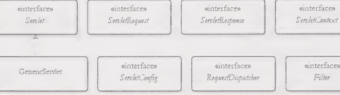

Servlet 技术的核心是 `Servlet`，它是一个所有 servlet 类都必须直接或间接实现的接口。当你编写一个实现 `Servlet` 的 servlet 类时，你是在直接实现它；当你扩展一个实现了该接口的类时，你是在间接实现它。

`Servlet` 接口定义了 servlet 和 servlet 容器之间的契约。该契约落实于 servlet 容器承诺将 servlet 类加载到内存中，并在 servlet 实例上调用特定方法。应用程序中，每个 servlet 类型只能有一个实例。

用户请求会导致 servlet 容器调用 servlet 的 `service` 方法，并传递 `HttpServletRequest` 实例和 `HttpServletResponse` 实例。`HttpServletRequest` 封装了当前的 HTTP 请求，因此 servlet 开发人员无需解析和处理原始 HTTP 数据。`ServletResponse` 代表当前用户的 HTTP 响应，并方便向用户发送响应。

对于每个应用程序，servlet 容器还会创建一个 `ServletContext` 实例。该对象封装了上下文（应用）的环境细节。每个上下文只有一个 `ServletContext`。对于每个 servlet 实例，还有一个封装了 servlet 配置的 `ServletConfig`。

让我们先看看 `Servlet` 接口。上述提到的其他接口将在本章的后续章节中进行介绍。

## Servlet

`Servlet` 接口定义了以下五个方法。

```java
void init(ServletConfig config) throws ServletException
```

```java
void service(ServletRequest request, ServletResponse response)
    throws ServletException, java.io.IOException
```

```java
void destroy()
```

```java
java.lang.String getServletInfo()
```

```java
ServletConfig getServletConfig()
```

注意，编写 Java 方法签名的约定是：对于与包含方法的类型不在同一个包中的类型，使用全限定名。因此，在 `service` 方法签名中，`javax.servlet.ServletException`（与 `Servlet` 位于同一包）没有写包名信息，而 `java.io.IOException` 使用了全限定名。

**init**、**service** 和 **destroy** 是生命周期方法。servlet 容器根据这些规则调用这三个方法。

- **init.** servlet 容器在第一次请求 servlet 时调用此方法。该方法在后续请求中不再被调用。你使用此方法编写初始化代码。调用该方法时，servlet 容器会传递一个 `ServletConfig`。通常，你会将 `ServletConfig` 赋值给类级变量，以便 servlet 类中的其他位置可以使用该对象。
- **service.** servlet 容器在每次请求 servlet 时都会调用此方法。你在这里编写 servlet 应该执行的代码。在第一次请求 servlet 时，servlet 容器会调用 `init` 方法和 `service` 方法。对于后续请求，只会调用 `service`。
- **destroy.** 当 servlet 要被销毁时，servlet 容器调用此方法。这发生在应用程序卸载或 servlet 容器关闭时。通常，你会在该方法中编写清理代码。

`Servlet` 中的另外两个方法是非生命周期方法：`getServletInfo` 和 `getServletConfig`。

- **getServletInfo.** 此方法返回任何可能有用的字符串，甚至是 `null`。
- **getServletConfig.** 此方法返回 servlet 容器传递给 `init` 方法的 `ServletConfig`。为了让 `getServletConfig` 返回非空值，你必须将传递给 `init` 方法的 `ServletConfig` 赋值给类级变量。`ServletConfig` 将在本章的“ServletConfig”部分进行解释。

需要注意的一点是线程安全。servlet 实例被应用程序中的所有用户共享，因此不建议使用类级变量，除非它们是只读的或 `java.util.concurrent.atomic` 包中的成员。

下一节“编写简单的 Servlet 应用程序”将展示如何编写一个 `Servlet` 实现。

## 编写简单的 Servlet 应用程序

编写 servlet 应用程序出奇地简单。你只需要创建一个目录结构，并将 servlet 类放置在特定目录中。在本节中，你将学习如何编写一个名为 b1 的简单 servlet 应用程序。最初它将包含一个名为 `MyServlet` 的 servlet，它向用户发送问候信息。

你需要一个 servlet 容器来运行你的 servlets。Tomcat 是一个开源 servlet 容器，免费提供，并运行在任何支持 Java 的平台上。如果你还没有安装，现在应该阅读附录 A 并安装 Tomcat。

### 编写并编译 Servlet 类

在确保本地机器上有一个 servlet 容器之后，下一步是编写并编译 servlet 类。此示例的 servlet 类 `MyServlet` 位于列表 B.1 中。按照约定，servlet 类的名称以 `Servlet` 结尾。

#### 列表 B.1：MyServlet 类

```java
package b1;

import java.io.IOException;
import java.io.PrintWriter;
import javax.servlet.Servlet;
import javax.servlet.ServletConfig;
import javax.servlet.ServletException;
import javax.servlet.ServletRequest;
import javax.servlet.ServletResponse;
import javax.servlet.annotation.WebServlet;

@WebServlet(name = "MyServlet", urlPatterns = { "/my" })
public class MyServlet implements Servlet {

    private transient ServletConfig servletConfig;

    @Override
    public void init(ServletConfig servletConfig) throws ServletException {
        this.servletConfig = servletConfig;
    }

    @Override
    public ServletConfig getServletConfig() {
        return servletConfig;
    }

    @Override
    public String getServletInfo() {
        return "MyServlet";
    }

    @Override
    public void service(ServletRequest request, ServletResponse response)
            throws ServletException, IOException {

        String servletName = servletConfig.getServletInfo();
        response.setContentType("text/html");
        PrintWriter writer = response.getWriter();
        writer.print("<head></head>" + servletName
                + "<body>Hello from " + servletName
                + "</body></html>");
    }

    @Override
    public void destroy() {
    }
}
```

`service` 方法向浏览器发送“Hello from MyServlet”字符串，每次针对该 servlet 传入 HTTP 请求。

### 目录结构

Servlet 应用程序必须部署在特定的目录结构中。图 B.2 显示了此应用程序的目录结构。

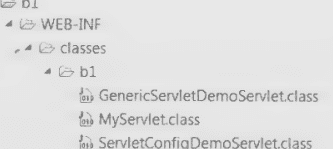

图 B.2：b1 的应用程序目录

结构顶部的 b1 是应用程序目录。应用程序目录下面是 `WEB-INF` 目录。它反过来有两个子目录：

- **classes.** 你的 servlet 类和其他 Java 类必须驻在此处。`classes` 下的目录反映了类的包结构。
- **lib.** 将 servlet 应用程序所需的 jar 包部署在此处。Servlet API jar 包不需要部署在这里，因为 servlet 容器已经有一个副本。在此应用程序中，`lib` 目录是空的。空的 `lib` 目录可以删除。

servlet/JSP 应用程序通常包含 JSP 页面、HTML 文件、图像文件和其他资源。这些应该放在应用程序目录下，并且通常组织在子目录中。例如，所有的图像文件可以放入一个图像目录，所有的 JSP 页面放入 jsp 目录，依此类推。

你存放在应用程序目录下的任何资源，用户都可以通过输入该资源的 URL 直接访问。如果你想包含一个只有 servlet 可以访问但用户无法访问的资源，请将其放在 `WEB-INF` 下。

现在，将应用程序部署到 Tomcat。对于 Tomcat，部署应用程序的一种方法是将应用程序目录复制到 Tomcat 安装目录下的 `webapps` 目录。你也可以通过编辑 Tomcat `conf` 目录下的 `server.xml` 文件或通过单独部署一个 XML 文件来避免编辑 `server.xml`。其他的 servlet 容器可能会有不同的部署规则。有关如何将 servlet/JSP 部署到 Tomcat 的详情，请参阅附录 A。

部署 servlet/JSP 程序的推荐方法是将其部署为 war 文件。war 文件是带有 `war` 扩展名的 jar 文件。你可以使用 JDK 自带的 `jar` 程序或 WinZip 等工具创建 war 文件。然后，你可以将 war 文件复制到 Tomcat 的 `webapps` 目录。当你启动或重启 Tomcat 时，Tomcat 会自动解压 war 文件。以 war 文件部署在所有 servlet 容器中均有效。

### 调用 Servlet

要测试你的第一个 servlet，请启动或重启 Tomcat，并将浏览器指向以下 URL（假设 Tomcat 配置为监听端口 8080，这是其默认端口）：

```
http://localhost:8080/b1/my
```

输出应与图 B.3 类似。

#### 图 B.3：MyServlet 的响应

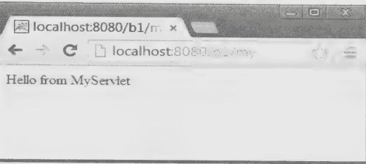

恭喜。你刚刚写了第一个 servlet 应用程序。

## ServletRequest

对于每个 HTTP 请求，servlet 容器都会创建一个 `ServletRequest` 实例并传递给 servlet 的 `service` 方法。`ServletRequest` 封装了有关请求的信息。

这些是 `ServletRequest` 接口中的一些方法：

```java
public int getContentLength()
```
返回请求体中的字节数。如果长度未知，此方法返回 -1。

```java
public java.lang.String getContentType()
```
返回请求的 MIME 类型，如果类型已知则返回 null。

```java
public java.lang.String getParameter(java.lang.String name)
```
返回请求参数的值。

```java
public java.lang.String getProtocol()
```
返回此 HTTP 请求的协议名称和版本。

`getParameter` 是 `ServletRequest` 中最常用的方法。该方法的常见用途是获取表单字段。你将在本章稍后的“处理表单”部分中学习如何获取表单值。

`getParameter` 也用于获取查询字符串的值。例如，如果使用此 URI `http://localhost/context/servlet?id=123` 调用 servlet，你可以通过以下语句从你的 servlet 中获取 `id` 的值：

```java
String id = request.getParameter("id");
```

注意，如果参数不存在，`getParameter` 将返回 `null`。除了 `getParameter` 之外，你还可以使用 `getParameterNames`、`getParameterMap` 和 `getParameterValues` 来获取字段名、值以及查询字符串。请参阅“HttpServlet”部分查看如何使用这些方法的示例。

## ServletResponse

`javax.servlet.ServletResponse` 接口代表 servlet 响应。在调用 servlet 的 `service` 方法之前，servlet 容器会创建一个 `ServletResponse` 并将其作为第二个参数传递给 `service` 方法。`ServletResponse` 隐藏了向浏览器发送响应的复杂性。

`ServletResponse` 定义的方法之一是 `getWriter` 方法，它返回一个 `java.io.PrintWriter`，可以向客户端发送文本。默认情况下，`PrintWriter` 对象使用 ISO-8859-1 编码。在向客户端发送响应时，大多数情况下是以 HTML 格式发送的。因此，我们假设你熟悉 HTML。

注意，还有另一个方法可以使用来向浏览器发送输出：`getOutputStream`。然而，此方法用于发送二进制数据，因此在大多数情况下，你会使用 `getWriter` 而不是 `getOutputStream`。

在发送任何 HTML 标签之前，你应该通过调用 `setContentType` 方法并传递 `"text/html"` 作为参数来设置响应的内容类型。这就是告诉浏览器内容类型为 HTML 的方式。如果你不设置响应类型，大多数浏览器会将 HTML 标签渲染为纯文本。你已经在列表 B.1 的 `MyServlet` 中使用了 `ServletResponse`。你将在接下来的章节的其他应用程序中使用它。

## ServletConfig

当 servlet 容器初始化 servlet 时，它会将 `ServletConfig` 传递给 servlet 的 `init` 方法。`ServletConfig` 封装了你可以通过 `@WebServlet` 或部署描述符传递给 servlet 的配置信息。每一条信息被称为初始化参数。初始化参数由两部分组成：键（key）和值（value）。

要从 servlet 内部获取初始化参数的值，请对 servlet 容器传递给 servlet `init` 方法的 `ServletConfig` 调用 `getInitParameter` 方法。`getInitParameter` 的签名如下：


## java.lang.String getInitParameter(java.lang.String name)

此外，`getInitParameterNames` 方法返回所有初始化参数名的枚举（Enumeration）：

```java
java.util.Enumeration<java.lang.String> getInitParameterNames()
```

例如，获取 `contactName` 参数的值，使用：

```java
String contactName = servletConfig.getInitParameter("contactName");
```

除了 `getInitParameter` 和 `getInitParameterNames`，`ServletConfig` 还提供了另一个有用方法 `getServletContext`。使用此方法从 servlet 内部获取 `ServletContext`。请参阅本章稍后的“ServletContext”部分了解关于该对象的讨论。

作为 `ServletConfig` 的示例，让我们在 `app1` 中添加一个名为 `ServletConfigDemo` 的 servlet。新 servlet 见列表 B.2。

### 列表 B.2：ServletConfigDemo 类

```java
package b1;

import java.io.IOException;
import java.io.PrintWriter;
import javax.servlet.Servlet;
import javax.servlet.ServletConfig;
import javax.servlet.ServletException;
import javax.servlet.ServletRequest;
import javax.servlet.ServletResponse;
import javax.servlet.annotation.WebInitParam;
import javax.servlet.annotation.WebServlet;

@WebServlet(name = "ServletConfigDemo",
           urlPatterns = { "/servletConfig" },
           initParams = {
               @WebInitParam(name="admin", value="Harry Tiacak"),
               @WebInitParam(name="email", value="admin@example.com")
           })
public class ServletConfigDemo implements Servlet {

    private transient ServletConfig servletConfig;

    @Override
    public ServletConfig getServletConfig() {
        return servletConfig;
    }

    @Override
    public void init(ServletConfig servletConfig)
        throws ServletException {
        this.servletConfig = servletConfig;
    }

    @Override
    public void service(ServletRequest request,
                        ServletResponse response)
            throws ServletException, IOException {

        ServletConfig servletConfig = getServletConfig();
        String admin = servletConfig.getInitParameter("admin");
        String email = servletConfig.getInitParameter("email");
        response.setContentType("text/html");
        PrintWriter writer = response.getWriter();
        writer.print("<<html><head></head><body>" +
            "Admin:" + admin +
            "<br>Email:" + email +
            "</body></html>");
    }

    @Override
    public String getServletInfo() {
        return "ServletConfig demo";
    }

    @Override
    public void destroy() {
    }
}
```

## 280 Spring MVC: 教程

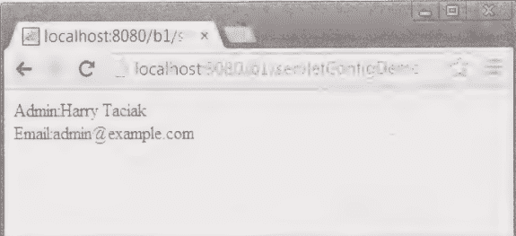

图 B.4：运行中的 ServletConfigDemoServlet

或者，你可以在部署描述符（deployment descriptor）中传递初始参数。使用部署描述符比使用 `@WebServlet` 更容易，因为部署描述符是一个文本文件，你可以在无需重新编译 Servlet 类的情况下对其进行编辑。

部署描述符将在本章后的“使用部署描述符”节以及附录 D“部署描述符”中进行讨论。

## ServletContext

`ServletContext` 代表 servlet 应用程序。每个 Web 应用程序只有一个 context。在应用程序同时部署到多个容器的分布式环境中，每个 Java 虚拟机（JVM）都有一个 `ServletContext` 对象。

你可以通过调用 `ServletConfig` 上的 `getServletContext` 方法获取 `ServletContext`。

设置 `ServletContext` 的目的是为了让你能够共享可以从应用程序中所有资源访问的信息，并启用 Web 对象的动态注册。前者通过将对象存储在 `ServletContext` 内部的 Map 中来实现。存储在 `ServletContext` 中的对象被称为属性（attributes）。

## 附录 B: Servlets

`ServletContext` 中的以下方法处理属性：
- `java.lang.Object getAttribute(java.lang.String name)`
- `java.util.Enumeration<java.lang.String> getAttributeNames()`
- `void setAttribute(java.lang.String name, java.lang.Object object)`
- `void removeAttribute(java.lang.String name)`

## GenericServlet

之前的示例展示了通过实现 `Servlet` 接口来编写 servlet。然而，你是否注意到你必须为 `Servlet` 中的所有方法提供实现，即使其中某些方法没有任何代码？此外，你还需要将 `ServletConfig` 对象保留到类级别变量中。

幸运的是，出现了 `GenericServlet` 抽象类。为了符合面向对象编程中更易编写代码的精神，`GenericServlet` 同时实现了 `Servlet` 和 `ServletConfig`，并执行了以下任务：

- 将 `init` 方法中的 `ServletConfig` 分配给类级别变量，以便通过调用 `getServletConfig` 获取它。
- 为 `Servlet` 接口中的所有方法提供默认实现。
- 提供封装 `ServletConfig` 中方法的方法。

`GenericServlet` 通过在 `init` 方法中将 `ServletConfig` 分配给类级别变量 `servletConfig` 来保留 `ServletConfig`。这里是 `GenericServlet` 中 `init` 的实现。

```java
public void init(ServletConfig servletConfig)
    throws ServletException {
    this.servletConfig = servletConfig;
    this.init();
}
```

然而，如果你在类中重写了此方法，则你的 servlet 中的 `init` 方法将被调用，你必须调用 `super.init(servletConfig)` 来保留 `ServletConfig`。为了避免你这样做，`GenericServlet` 提供了第二个无参数的 `init` 方法。该方法在 `ServletConfig` 分配给 `servletConfig` 后由第一个 `init` 方法调用：

```java
public void init(ServletConfig servletConfig)
    throws ServletException {
    this.servletConfig = servletConfig;
    this.init();
}
```

这意味着，你可以通过重写无参数的 `init` 方法来编写初始化代码，而 `ServletConfig` 仍然会被 `GenericServlet` 实例保留。

列表 B.3 中的 `GenericServletDemoServlet` 类是列表 B.2 中 `ServletConfigDemoServlet` 的重写。注意，新的 servlet 继承了 `GenericServlet` 而不是实现 `Servlet`。

## 列表 B.3: GenericServletDemoServlet

```java
package bl;

import java.io.IOException;
import java.io.PrintWriter;
import javax.servlet.GenericServlet;
import javax.servlet.ServletConfig;
import javax.servlet.ServletException;
import javax.servlet.ServletRequest;
import javax.servlet.ServletResponse;
import javax.servlet.annotation.WebInitParam;
import javax.servlet.annotation.WebServlet;

@WebServlet(name = "GenericServletDemoServlet",
    urlPatterns = { "/generic" },
    initParams = {
        @WebInitParam(name="admin", value="Harry Tiacak"),
        @WebInitParam(name="email", value="admin@example.com")
    })
public class GenericServletDemoServlet extends GenericServlet {

    private static final long serialVersionUID = 625008900L;

    @Override
    public void service(ServletRequest request,
        ServletResponse response)
        throws ServletException, IOException {

        ServletConfig servletConfig = getServletConfig();
        String admin = servletConfig.getInitParameter("admin");
        String email = servletConfig.getInitParameter("email");
        response.setContentType("text/html");
        PrintWriter writer = response.getWriter();
        writer.print("<html><head><body>" +
            "Admin:" + admin +
            "<br>Email:" + email +
            "</body></html>");
    }
}
```

你可以看到，通过扩展 `GenericServlet`，你不需要重写你不计划更改的方法。结果是你的代码更整洁。在列表 B.3 中，唯一重写的方法是 `service` 方法。此外，你不需要自己保留 `ServletConfig`。

使用此 URL 调用 servlet，结果应该与 `ServletConfigDemoServlet` 类似。

```
http://localhost:8080/bl/generic
```

尽管 `GenericServlet` 是 `Servlet` 的一个很好的增强，但你并不是经常使用它，因为它不如 `HttpServlet` 高级。

## HTTP Servlets

你编写的大多数（如果不是全部）servlet 应用程序将与 HTTP 工作。`javax.servlet.http` 包包含了编写 servlet 应用程序的类和接口。`javax.servlet.http` 包是 Servlet API 中的第二个包。

图 B.5 显示了 javax.servlet.http 中的主要类型。

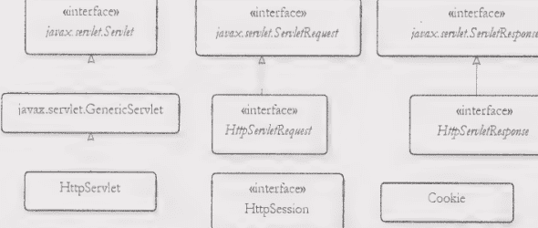

图 B.5：javax.servlet 中重要的成员

## HttpServlet

`HttpServlet` 类重写了 `javax.servlet.GenericServlet`。使用 `HttpServlet` 时，你还将处理 `HttpServletRequest` 和 `HttpServletResponse` 对象，它们分别代表 servlet 请求和 响应。`HttpServletRequest` 接口继承 `javax.servlet.ServletRequest`，而 `HttpServletResponse` 继承 `javax.servlet.ServletResponse`。

`HttpServlet` 重写了 `GenericServlet` 的 `service` 方法，并添加了具有以下签名的方法：

```java
protected void service(HttpServletRequest request,
    HttpServletResponse response)
throws ServletException, IOException
```

新方法与 `Servlet.Servlet` 中的方法的区别在于，前者接受 `HttpServletRequest` 和 `HttpServletResponse`。

servlet 容器像通常一样调用 `javax.servlet.Servlet` 中的原始 `service` 方法，该方法在 `HttpServlet` 中的写法如下：

```java
public void service(ServletRequest req, ServletResponse res)
    throws ServletException, IOException {
    HttpServletRequest request;
    HttpServletResponse response;
    try {
        request = (HttpServletRequest) req;
        response = (HttpServletResponse) res;
    } catch (ClassCastException e) {
        throw new ServletException("non-HTTP request or response");
    }
    service(request, response);
}
```


原始 `service` 方法将来自 servlet 容器的请求和响应分别转换为 `HttpServletRequest` 和 `HttpServletResponse`，然后调用新的 `service` 方法。这种转换总是成功的，因为 servlet 容器在调用 servlet 的 `service` 方法时总是传递 `HttpServletRequest` 和 `HttpServletResponse`，以预测对 HTTP 的。即使你在实现 `javax.servlet.Servlet` 或扩展 `javax.servlet.GenericServlet`，你也可以将传递给 `service` 方法的 servlet 请求响应转换为 `HttpServletRequest` 和 `HttpServletResponse`。

总结来说，`HttpServlet` 中有两个你在 `GenericServlet` 中没有找到的特性：

- 你将重写 `service` 方法，而是重写 `doGet`、`doPost` 或两者。在少数情况下，你还会重写这些方法中的任何一个：`doHead`、`doPut`、`doTrace`、`doOptions`、`doDelete`。
- 将使用 `HttpServletRequest` 和 `HttpServletResponse`，而不是 `ServletRequest` 和 `ServletResponse`。

## HttpServletRequest

`HttpServletRequest` 代表 HTTP 环境下的 servlet 请求。它扩展了 `javax.servlet.Servlet` 接口并增加了几个方法。一些新增的方法如下：

```java
java.lang.String getContextPath()
```
返回 URI 中指示请求上下文的部分。

```java
Cookie[] getCookies()
```
返回 `Cookie` 对象的数组。

```java
java.lang.String getHeader(java.lang.String name)
```
返回指定的 HTTP 头的名称。

```java
java.lang.String getMethod()
```
返回发送此请求的 HTTP 方法名称。

```java
java.lang.String getQueryString()
```
返回请求 URL 中的查询字符串。

```java
HttpSession getSession()
```
返回与此请求相关的 session 对象。如果未找到，则创建一个新的 session 对象。

```java
HttpSession getSession(boolean create)
```
返回与此请求相关的当前 session 对象。如果未找到且 `create` 参数为 `true`，则创建一个新的 session 对象。

你将在接下来的章节中学习这些方法。

## HttpServletResponse

`HttpServletResponse` 代表 HTTP 环境下的 servlet 响应。以下是其中定义的一些方法：

```java
void addCookie(Cookie cookie)
```
向此响应对象添加一个 cookie。

```java
void addHeader(java.lang.String name, java.lang.String value)
```
向此响应对象添加一个头。

```java
void sendRedirect(java.lang.String location)
```
发送一个响应码，将浏览器重定向到指定的位置。

你将在后续章节进一步学习这些方法。

## 处理 HTML 表单

Web 应用程序总是包含一个或多个 HTML 表单来接收用户输入。你可以轻松地从 servlet 向浏览器发送 HTML 表单。当用户提交表单时，表单元素中输入的值将作为请求参数发送到服务器。

HTML 输入字段（文本字段、隐藏字段或密码字段）或文本区域的值将作为字符串发送到服务器。空输入字段或文本区域将发送空字符串。因此，获取输入字段名称的 `ServletRequest.getParameter` 永远不会返回 `null`。

HTML `select` 元素也会向头部发送一个字符串。如果 `select` 元素中没有选项被选中，则发送该元素的值。

多值选择元素（允许多次选择并由 `<select multiple>` 指定的 `select` 元素）发送字符串数组，必须由 `ServletRequest.getParameterValues` 进行处理。

复选框（checkbox）有点特殊。选中的复选框会向服务器发送字符串 "on"。未选中的复选框不向服务器和 `ServletRequest` 发送任何内容，`ServletRequest.getParameter(fieldName)` 返回 `null`。

单选按钮会将被选中按钮的值发送到服务器。如果没有按钮被选中，则不向服务器发送任何内容，`ServletRequest.getParameter(fieldName)` 返回 `null`。

如果一个表单包含多个具有相同名的输入元素，所有值都将被提交，你必须使用 `ServletRequest.getParameterValues` 来检索它们。`ServletRequest.getParameter` 只会返回最后一个值。

Listing B.4 中的 `FormServlet` 类演示了如何处理 HTML 表单。它的 `doGet` 方法向浏览器发送一个订单格式。`doPost` 方法检索输入的值并打印它们。这个 servlet 是 b2 的一部分。

## Listing B.4: FormServlet 类

```java
package b2;

import java.io.IOException;
import java.io.PrintWriter;
import java.util.Enumeration;
import javax.servlet.ServletException;
import javax.servlet.annotation.WebServlet;
import javax.servlet.http.HttpServlet;
import javax.servlet.http.HttpServletRequest;
import javax.servlet.http.HttpServletResponse;

@WebServlet(name = "FormServlet", urlPatterns = { "/" })
public class FormServlet extends HttpServlet {

    private static final long serialVersionUID = 54L;
    private static final String TITLE = "Order Form";

    @Override
    public void doGet(HttpServletRequest request, HttpServletResponse response)
            throws ServletException, IOException {

        response.setContentType("text/html");
        PrintWriter writer = response.getWriter();

        writer.println("<html>");
        writer.println("<head>");
        writer.println("<title>" + TITLE + "</title></head>");
        writer.println("<body><h1>" + TITLE + "</h1>");
        writer.println("<form method='post'>");
        writer.println("<table>");
        writer.println("<tr>");
        writer.println("<td>Name:</td><td><input name='name'></td></td>");
        writer.println("</tr>");
        writer.println("<tr>");
        writer.println("<td>Address:</td><td>" +
                writer.println("<textarea name='address' " +
                "cols='40' rows='5'></textarea></td></td>");
        writer.println("</tr>");
        writer.println("<tr>");
        writer.println("<td>Country:</td><td><select name='country'>" +
                writer.println("<option>United States</option>" +
                writer.println("<option>Canada</option>" +
                writer.println("</select></td></td>");
        writer.println("</tr>");
        writer.println("<tr>");
        writer.println("<td>Delivery Method:</td><td>");
        writer.println("<input type='radio' name='deliveryMethod' " +
                "value='First Class'>" +
                writer.println("<input type='radio' name='deliveryMethod' " +
                "value='Second Class'>");</td>></td>");
        writer.println("</tr>");
        writer.println("<tr>");
        writer.println("<td>Shipping Instructions:</td><td>");
        writer.println("<textarea name='instruction' " +
                "cols='40' rows='5'></textarea></td></td>");
        writer.println("</tr>");
        writer.println("<tr>");
        writer.println("<td>Catalog Request:</td><td>");
        writer.println("<input type='checkbox' name='catalogRequest'>");</td>></td>");
        writer.println("</tr>");
        writer.println("</table>");
        writer.println("<input type='submit'>");
        writer.println("</form>");
        writer.println("</body>");
        writer.println("</html>");
    }

    @Override
    public void doPost(HttpServletRequest request, HttpServletResponse response)
            throws ServletException, IOException {

        response.setContentType("text/html");
        PrintWriter writer = response.getWriter();

        writer.println("<html>");
        writer.println("<h1>Order Summary</h1>");
        writer.println("<table>");
        writer.println("<tr>");
        writer.println("<<td>>Name:</</td>><td>" + request.getParameter("name") + "</td>");
        writer.println("</tr>");
        writer.println("<tr>");
        writer.println("<<td>>Address:</</td>><td>" + request.getParameter("address") + "</td>");
        writer.println("</tr>");
        writer.println("<tr>");
        writer.println("<<td>>Country:</</td>><td>" + request.getParameter("country") + "</td>");
        writer.println("</tr>");
        writer.println("<tr>");
        writer.println("<<td>>Delivery Method:</</td>><td>" + request.getParameter("deliveryMethod") + "</td>");
        writer.println("</tr>");
        writer.println("<tr>");
        writer.println("<<td>>Shipping Instructions:</</td>><td>");
        String[] instructions = request.getParameterValues("instruction");
        if (instructions != null) {
            for (String instruction : instructions) {
                writer.println(instruction + "<br/>");
            }
        }
        writer.println("</td></td>");
        writer.println("</tr>");
        writer.println("<tr>");
        writer.println("<<td>>Catalog Request:</</td>><td>");
        if (request.getParameter("catalogRequest") == null) {
            writer.println("No");
        } else {
            writer.println("Yes");
        }
        writer.println("</td></td>");
        writer.println("</tr>");
        writer.println("</table>");
        writer.println("</body>");
        writer.println("</html>");
    }
}
```

你可以使用此 URL 来调用 `FormServlet`：
`http://localhost:8080/b2/form`

被调用的 `doGet` 方法会将此 HTML 表单发送到浏览器。

```html
<form method='post'>
  <input name='name'/>
  <textarea name='name' cols='40' rows='5'></textarea>
  <select name='country'>
    <option>United States</option>
    <option>Canada</option>
  </select>
  <input type='radio' name='deliveryMethod' value='First Class'/>
  <input type='radio' name='deliveryMethod' value='Second Class'/>
  <textarea name='instruction' cols='40' rows='5'></textarea>
```


## 附录 B: Servlets

表单的 `method` 被设置为 `post`，以确保用户在提交表单时使用 HTTP POST 方法。其 `action` 属性将缺失，这意味着表单将提交到请求表单时使用的相同 URL。

图 6.6 显示了一个空表单。

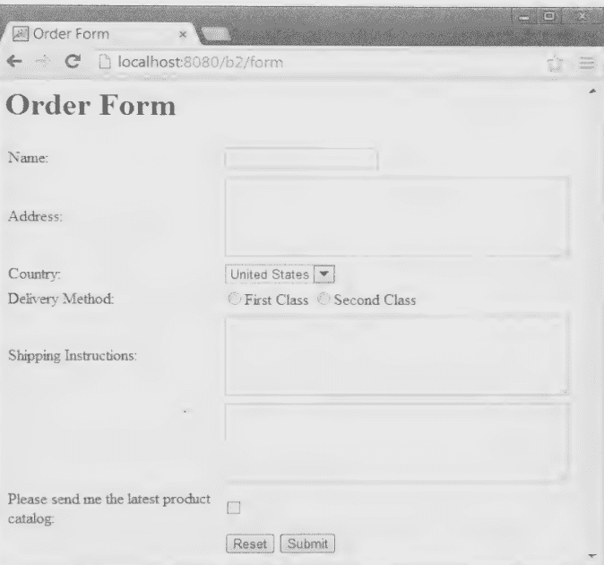

图 B.6: 一个空的 Order 表单

现在，填写表单并点击 Submit 按钮。你在表单中输入的值将使用 HTTP POST 方法发送到服务器，这将调用 servlet 的 `doPost()` 方法。结果，你将看到如图 B.7 所示打印的值。

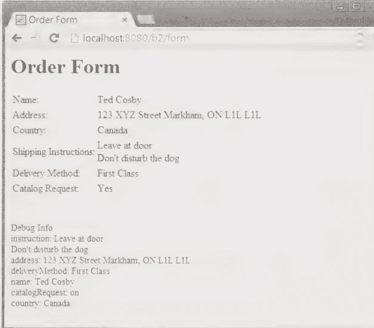

图 B.7: 输入到 Order 表单中的值

### 使用部署描述符

正如你在之前的示例所示，编写和部署 servlet 应用是简单的。部署的一个方面是配置你的 servlet 与路径的映射。在示例中，你使用 `WebServlet` 注解类型将 servlet 映射到路径。

使用部署描述符是配置 servlet 应用的另一种方法，部署描述符将在附录 D，“部署描述符”中讨论。部署描述符始终命名为 `web.xml`，并位于 `WEB-INF` 目录下。在本章中，我将向你展示如何创建一个名为 `b3` 的 servlet 应用，并为它编写一个 `web.xml` 文件。

`b3` 包含两个 servlet：`SimpleServlet` 和 `WelcomeServlet`，以及一个用于映射 servlet 的部署描述符。代码列表 B.5 和 B.6 分别显示了 `SimpleServlet` 和 `WelcomeServlet`。注意，servlet 类没有使用 `@WebServlet` 注解。部署描述符位于代码列表 B.7。

#### 代码列表 B.5: 未注解的 SimpleServlet 类

```java
package b3;

import java.io.IOException;
import java.io.PrintWriter;
import javax.servlet.ServletException;
import javax.servlet.http.HttpServlet;
import javax.servlet.http.HttpServletRequest;
import javax.servlet.http.HttpServletResponse;

public class SimpleServlet extends HttpServlet {

    private static final long serialVersionUID = 8946L;

    @Override
    public void doGet(HttpServletRequest request, HttpServletResponse response)
            throws ServletException, IOException {

        response.setContentType("text/html");
        PrintWriter writer = response.getWriter();
        writer.print("<html><head></head>" + "<body>Simple Servlet</body></html>");
    }
}
```

#### 代码列表 B.6: 未注解的 WelcomeServlet 类

```java
package app01;

import java.io.IOException;
import java.io.PrintWriter;
import javax.servlet.ServletException;
import javax.servlet.http.HttpServlet;
import javax.servlet.http.HttpServletRequest;
import javax.servlet.http.HttpServletResponse;

public class WelcomeServlet extends HttpServlet {

    private static final long serialVersionUID = 27126L;

    @Override
    public void doGet(HttpServletRequest request, HttpServletResponse response)
            throws ServletException, IOException {

        response.setContentType("text/html");
        PrintWriter writer = response.getWriter();
        writer.print("<html><head></head>\n" + "<body>Welcome</body></html>");
    }
}
```

#### 代码列表 B.7: 部署描述符

```xml
<?xml version="1.0" encoding="ISO-8859-1"?>
<web-app xmlns="http://java.sun.com/xml/ns/javaee"
    xmlns:xsi="http://www.w3.org/2001/XMLSchema-instance"
    xsi:schemaLocation="http://java.sun.com/xml/ns/javaee
    http://java.sun.com/xml/ns/javaee/web-app_3_0.xsd"
    version="3.0">

<servlet>
    <servlet-name>SimpleServlet</servlet-name>
    <servlet-class>b3.SimpleServlet</servlet-class>
</servlet>

<servlet-mapping>
    <servlet-name>SimpleServlet</servlet-name>
    <url-pattern>/simple/*</url-pattern>
</servlet-mapping>

<servlet>
    <servlet-name>WelcomeServlet</servlet-name>
    <servlet-class>b3.WelcomeServlet</servlet-class>
</servlet>

<servlet-mapping>
    <servlet-name>WelcomeServlet</servlet-name>
    <url-pattern>/welcome/*</url-pattern>
</servlet-mapping>

</web-app>
```

使用部署描述符有很多优势。其中，你可以包含 `@WebServlet` 中不具备的元素，例如 `load-startup`。这意味着在应用启动时加载 servlet，而不是在 servlet 第一次被调用时。使用部署描述符的另一个优势是，如果你需要更改配置（例如 servlet 路径），不需要重新编译 servlet 类。此外，部署描述符允许你在重新编译的情况下向 servlet 传递初始参数。部署描述符还允许覆盖 servlet 注解中的值。不在部署描述符中的 servlet 注解将不起作用。然而，这意味着你既可以使用注解 servlet，也可以在部署描述符中声明 servlet。

图 B.8 展示了 `b3` 的目录结构。该结构与 `app01` 不同，唯一的区别是 `b3` 在 `WEB-INF` 目录下有一个 `web.xml` 文件（部署描述符）。

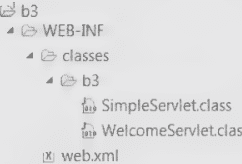

图 B.8: 带有部署描述符的 b3 结构

既然 `SimpleServlet` 和 `WelcomeServlet` 已经在部署描述符中定义，你可以使用这些 URL 来访问它们：

```
http://localhost:8080/b3/simple
```

```
http://localhost:8080/b3/welcome
```

关于部署和部署描述符的更多信息，请参考附录 D，“部署描述符”。

## 附录 C: JavaServer Pages

你在附录 B，“Servlets”中了解到 servlet 有两个无法克服的缺点。首先，在 servlet 中编写的所有 HTML 标签都封装在 Java 字符串中，使得发送响应变得麻烦。其次，所有的文本和 HTML 标签都是硬编码的；因此即使是对显示层的微小更改（例如背景颜色），也需要重新编译。

JavaServer Pages（JSP）解决了 servlet 的这两个问题。然而，JSP 并没有替代 Servlet，而是补充了它。现代 Java Web 应用同时使用 servlet 和 JSP 页面。编写时 JSP 的最新版本是 2.2。

本附录从 JSP 概述开始，详细讨论了 JSP 页面中的注释、隐式对象以及三种语法元素（指令、脚本元素和动作）。错误处理将在附录末尾介绍。

JSP 可以标准语法或 XML 语法编写。使用 XML 语法编写的 JSP 页面称为 JSP 文档。XML 语法的 JSP 很少使用，本文不涵盖。在本附录中你将学习标准语法的 JSP。

### JSP 概述

JSP 页面本质上是一个 servlet。然而，由于两个原因，使用 JSP 页面比使用 servlet 更容易。首先，你不需要编译 JSP 页面。其次，JSP 页面基本上是带有 `jsp` 扩展的文件，你可以使用任何文本编辑器来编写它们。

JSP 页面运行在 JSP 容器上。Servlet 容器通常也是 JSP 容器。例如，Tomcat 就是一个 servlet/JSP 容器。

第一次请求 JSP 页面时，servlet/JSP 容器会执行以下操作：

- 将 JSP 页面翻译成 JSP 页面实现类，这是一个实现了 `javax.servlet.jsp.JspPage` 接口或其子接口 `javax.servlet.http.HttpServlet` 的 Java 类。`JspPage` 是 `javax.servlet.Servlet` 的子接口，使得每个 JSP 页面成为一个 servlet。生成的 servlet 类名取决于 servlet/JSP 容器。你不需要担心这个问题，因为你并不直接操作它。如果发生翻译错误，错误信息将发送给客户端。
- 如果翻译成功，servlet/JSP 容器将编译该 servlet 类。容器会加载并实例化 Java 字节码，并执行通常对 servlet 执行的生命周期操作。

对于对同一个 JSP 页面的后续请求，servlet/JSP 容器会检查该 JSP 页面自上次翻译以来是否被修改过。如果有修改，它将重新翻译、重新编译并执行。如果没有修改，执行已经在内存中的 JSP servlet。通过这种方式，JSP 页面的首次调用总是比后续请求耗时，因为涉及翻译和编译。为了解决这个问题，你可以采取以下操作之一：

- 配置应用程序，使得所有 JSP 页面在应用程序启动时被调用（实际上是进行翻译和编译），而不是在第一次请求时。
- 预编译 JSP 页面并将它们作为 servlet 部署。

JSP 包含一个由四个包组成的 API：

- `javax.servlet.jsp`：包含 servlet/JSP 容器用于将 JSP 页面翻译成 servlet 的类和接口。`JspPage` 和 `HttpServletPage` 接口是该包的重要成员。所有 JSP 页面实现类必须实现 `JspPage` 或 `HttpServletPage`。在 HTTP 环境中，`HttpServletPage` 是明显的选择。
- `javax.servlet.jsp.tagext`：包含开发自定义标签的类型。
- `javax.servlet.el`：提供统一表达式语言的 API。
- `javax.servlet.jsp.el`：提供 servlet/JSP 容器必须支持以支持 JSP 中表达式语言的类。

除了 `javax.servlet.jsp.tagext` 之外，你很少直接使用 JSP API。在编写 JSP 页面时，你更关注 Servlet API 而非 JSP API 本身。当然，你也需要掌握 JSP 语法，将在本附录中进行解释。广泛使用 JSP API 的一个例子是在开发 JSP 容器或 JSP 编译器时。

你可以在这里查看 JSP API：

http://download.oracle.com/docs/cd/E17802_01/products/products/jsp/2.1/docs/jsp-2_1-pfd2/index.html

JSP 页面可以包含模板数据和语法元素。元素是对 JSP 翻译器具有特殊含义的内容。例如，`<%` 是一个元素，因为它标记了 JSP 页面内 Java 代码块的开始。`%>` 也是一个元素，因为它终止了 Java 代码块。其他所有不是元素的内容都是模板数据。模板数据按原样发送到浏览器。例如，JSP 页面中的 HTML 标签和文本就是模板数据。

#### 列表 C.1: welcome.jsp 页面

```html
<html>
<head><title>Welcome</title></head>
<body>
Welcome
</body>
</html>
```

在 Tomcat 中，`welcome.jsp` 页面在首次调用后会被翻译成 `welcome_jsp` servlet。你可以在 Tomcat `work` 目录下的子目录下找到生成的 servlet。该 servlet 继承自 `org.apache.jasper.runtime.HttpJspBase`，这是一个继承自 `javax.servlet.http.HttpServlet` 并实现 `javax.servlet.jsp.HttpJspPage` 的抽象类。

这里是 `welcome.jsp` 生成的 servlet。如果它太晦涩，请不要担心。你可以在不理解的情况下继续，尽管理解它更好。

```java
package org.apache.jsp;

import javax.servlet.*;
import javax.servlet.http.*;
import javax.servlet.jsp.*;

public final class welcome_jsp extends
    org.apache.jasper.runtime.HttpJspBase
    implements org.apache.jasper.runtime.JspSourceDependent {

    private static final javax.servlet.jsp.JspFactory _jspxFactory =
        javax.servlet.jsp.JspFactory.getDefaultFactory();

    private static final java.util.Map<java.lang.String, java.lang.Long>
        _jspx_dependants;

    private java.el.ExpressionFactory _el_expressionfactory;
    org.apache.tomcat.util.InstanceManager _jsp_instancemanager;

    public java.util.Map<java.lang.String, java.lang.Long>
        getDependencies() {
        return _jspx_dependants;
    }

    public void _jspInit() {
        _el_expressionfactory =
            org.apache.tomcat.util.InstanceManager
            .getServletContext();
    }

    public void jspDestroy() {
    }

    public void jspService(final
        javax.servlet.HttpServletRequest request,
        final javax.servlet.HttpServletResponse response)
        throws javax.servlet.ServletException,
        java.io.IOException {

        javax.servlet.jsp.PageContext pageContext;
        javax.servlet.HttpSession session = null;
    }
}
```


# 附录 C：JavaServer Pages

## 隐式对象声明

```java
javax.servlet.ServletContext application;
javax.servlet.ServletConfig config;
javax.servlet.jsp.JspWriter out = null;
javax.servlet.jsp.JspWriter _jspx_out = null;
javax.servlet.jsp.PageContext _jspx_page_context;
```

## 代码示例：_jspService 方法实现

```java
try {
    response.setContentType("text/html");
    pageContext = jspfactory(this, response, null, 8192, true);
    _jspx_page_context = pageContext;
}
```

```java
out.write("<html>\n");
out.write("<head><title>Welcome</title></head>\n");
out.write("<body>\n");
out.write("Welcome\n");
out.write("</body>\n");
out.write("</html>\n");
```

```java
} catch (java.lang.Throwable t) {
    if (!(t instanceof javax.servlet.jsp.SkipPageException)) {
        out = _jspx_out;
        if (out != null && out.getBufferSize() != 0) {
            try {
                out.clearBuffer();
            } catch (java.io.IOException e) {
            }
        }
        if (_jspx_page_context != null) {
            _jspx_page_context.handlePageException(t);
        }
    } finally {
        _jspFactory.releasePageContext(_jspx_page_context);
    }
}
```

## Spring MVC: 教程

```java
public final void service(HttpServletRequest request,
                          HttpServletResponse response) throws ServletException,
                          IOException {
    _jspService(request, response);
}
```

## JSP 页面调用

你可以使用此 URL 调用 `welcome.jsp` 页面：
`http://localhost:8080/c1/welcome.jsp`

## 注意

添加新的 JSP 页面后，不需要重启 Tomcat。

列表 C.2 显示了如何在 JSP 中使用 Java 代码生成动态页面。列表 C.2 中的 `todaysDate.jsp` 页面显示了今天的日期。

### 列表 C.2：todaysDate.jsp 页面

```jsp
<%@page import="java.util.Date"%>
<%@page import="java.text.DateFormat"%>
<html>
<head><title>Today's date</title></head>
<body>
<%
    DateFormat dateFormat = DateFormat.getInstance(DateFormat.LONG);
    String s = dateFormat.format(new Date());
    out.println("Today is " + s);
%>
</body>
</html>
```

`todaysDate.jsp` 页面向浏览器发送了几个 HTML 标签以及字符串“Today is”后面跟着今天的日期。

有两点需要注意。第一，Java 代码可以出现在 JSP 页面的任何地方，并被 `<%` 和 `%>` 包围。第二，要在 JSP 页面中导入 Java 类型，使用页面指令的 `import` 属性。如果不导入类型，你必须在代码中编写 JSP 类型的完全限定名。

`<% ... %>` 块被称为脚本段（scriptlet），将在附录后文的“脚本元素”部分进行进一步讨论。页面指令将在附录后文的“指令”部分中进行详细解释。

你可以使用此 URL 调用 `todaysDate.jsp` 页面：
`http://localhost:8080/c1/todaysDate.jsp`

## 注释

在 JSP 页面中添加注释是一项良好的做法。JSP 页面中可以有两种类型的注释：

- **JSP 注释**：用于记录该页面正在执行操作的注释。
- **HTML/XHTML 注释**：发送到浏览器的注释。

JSP 注释以 `<%--` 开头，以 `--%>` 结束。例如，以下是一个 JSP 注释：

```jsp
<%-- retrieve products to display --%>
```

JSP 注释不会发送到浏览器，且不能嵌套。

HTML/XHTML 注释具有以下语法：
`<!-- comments here -->`

HTML/XHTML 注释不会被容器处理，而是会原样发送到浏览器。HTML/XHTML 注释的一种用途是标识 JSP 页面本身：

```jsp
<!-- this is /jsp/store/displayProducts.jsp -->
```

这在处理具有许多 JSP 片段的应用程序时特别有用。开发者可以通过查看浏览器中的 HTML 源代码，轻松找到哪个 JSP 页面或片段生成了特定的 HTML 部分。

## 隐式对象

Servlet 容器向其运行的 servlet 传递多个对象。例如，你在 servlet 的 `service` 方法中获取一个 `HttpServletRequest` 和一个 `HttpServletResponse`，在 `init` 方法中获取一个 `ServletConfig`。此外，你可以通过调用 `HttpServletRequest` 对象上的 `getSession` 方法获取一个 `HttpSession`。

在 JSP 中，你可以使用隐式对象获取这些对象。表 C.1 列出了这些隐式对象。

| 对象 | 类型 |
| --- | --- |
| request | `javax.servlet.http.HttpServletRequest` |
| response | `javax.servlet.http.HttpServletResponse` |
| out | `javax.servlet.jsp.JspWriter` |
| session | `javax.servlet.http.HttpSession` |
| application | `javax.servlet.ServletContext` |
| config | `javax.servlet.ServletConfig` |
| pageContext | `javax.servlet.jsp.PageContext` |
| page | `javax.servlet.jsp.HttpJspPage` |
| exception | `java.lang.Throwable` |

**表 C.1：JSP 隐式对象**

例如，`request` 隐式对象代表由 servlet/JSP 容器传递的 `HttpServletRequest`。你可以将 `request` 作为 `HttpServletRequest` 的变量引用。例如，以下代码从 `HttpServletRequest` 对象中获取 `userName` 参数。

```java
String userName = request.getParameter("userName");
```

`pageContext` 指向为页面创建的 `javax.servlet.jsp.PageContext`。它提供了有用的上下文信息，并通过其自明的方法访问各种与 servlet 相关的对象，例如 `getRequest()`、`getResponse()`、`getServletContext()`、`getConfig()` 和 `getSession()`。这些方法在脚本段中并不常用，因为它们返回的对象可以通过隐式对象 `request`、`response`、`session` 和 `application` 更直接地访问。

`PageContext` 提供的另一组有趣的方法是获取和设置属性的方法，即 `getAttribute()` 和 `setAttribute()` 方法。属性可以存储在四种范围之一：`page`、`request`、`session` 和 `application`。`page` 范围是最窄的范围，存储在此处的属性仅在 JSP 页面可用。`request` 范围指的是当前的 `ServletRequest`，`session` 范围指的是当前的 `HttpServletSession`，`application` 范围指的是当前的 `ServletContext`。

`PageContext` 中的 `setAttribute` 方法签名如下：
`public abstract void setAttribute(java.lang.String name, java.lang.Object value, int scope)`

`scope` 的值可以是 `PageContext` 中的以下静态最终整数之一：`PAGE_SCOPE`、`REQUEST_SCOPE`、`SESSION_SCOPE` 和 `APPLICATION_SCOPE`。

另一种，要在 `page` 范围内存储属性，可以使用 `setAttribute` 的重载：

```java
public abstract void setAttribute(java.lang.String name, java.lang.Object value)
```

例如，以下代码在 `request` 范围内设置了一个属性：

```java
request.setAttribute("user", "John");
```

`session` 隐式对象代表当前会话，用于在多个页面之间存储用户信息。

`application` 隐式对象代表 `ServletContext`，用于存储整个应用程序共享的信息。

`config` 隐式对象代表当前 servlet 的 `ServletConfig`。

`page` 隐式对象代表当前 JSP 页面，通常由 JSP 作者使用。

`exception` 隐式对象在页面处理期间发生异常时在脚本段可用。


request.setAttribute("user", "John");

`session` 隐式对象代表当前会话，用于在多个页面之间存储用户信息。

`application` 隐式对象代表 `ServletContext`，用于存储整个应用程序共享的信息。

`config` 隐式对象代表当前 servlet 的 `ServletConfig`。

`page` 隐式对象代表当前 JSP 页面，通常由 JSP 作者使用。

`exception` 隐式对象在页面处理期间异常时在脚本段可用。

# 附录 C：JavaServer Pages

你可以使用此 URL 调用 welcome.jsp 页面：
http://localhost:8080/c1/welcome.jsp

## 注意

添加新的 JSP 页面后，不需要重启 Tomcat。

列表 C.2 显示了如何在 JSP 中使用 Java 代码生成动态页面。
列表 C.2 中的 todaysDate.jsp 页面显示了今天的日期。

### 列表 C.2：todaysDate.jsp 页面

```jsp
<%@page import="java.util.Date"%>

<%@page import="java.text.DateFormat"%>

<html>

<head><title>Today's date</title></head>

<body>

<%
DateFormat dateFormat = 
DateFormat.getInstance(DateFormat.LONG);

String s = dateFormat.format(new Date());

out.println("Today is " + s);
%>

</body>

</html>
```

todaysDate.jsp 页面向浏览器发送了几个 HTML 标签以及字符串“Today is”后面跟着今天的日期。

有两点需要注意。第一，Java 代码可以出现在 JSP 页面的任何地方，并被 `<%` 和 `%>` 包围。第二，要在 JSP 页面中导入 Java 类型，使用页面指令的 `import` 属性。如果不导入类型，你必须在代码中编写 JSP 类型的完全限定名。

`<% ... %>` 块被称为脚本段（scriptlet），将在附录后文的“脚本元素”部分进行进一步讨论。页面指令将在附录后文的“指令”部分中进行详细解释。

你可以使用此 URL 调用 todaysDate.jsp 页面：
http://localhost:8080/c1/todaysDate.jsp

# 注释

在 JSP 页面中添加注释是一项良好的做法。JSP 页面中可以有两种类型的注释：

- JSP 注释：用于记录该页面正在执行操作的注释。
- HTML/XHTML 注释：发送到浏览器的注释。

JSP 注释以 `<%--` 开头，以 `--%>` 结束。例如，以下是一个 JSP 注释：

```jsp
<%-- retrieve products to display --%>
```

JSP 注释不会发送到浏览器，且不能嵌套。

HTML/XHTML 注释具有以下语法：
`<!-- comments here -->`

HTML/XHTML 注释不会被容器处理，而是会原样发送到浏览器。HTML/XHTML 注释的一种用途是标识 JSP 页面本身：

```html
<!-- this is /jsp/store/displayProducts.jsp -->
```

这在处理具有许多 JSP 片段的应用程序时特别有用。开发者可以通过查看浏览器中的 HTML 源代码，轻松找到哪个 JSP 页面或片段生成了特定的 HTML 部分。

## 隐式对象

Servlet 容器向其运行的 servlet 传递多个对象。例如，你在 servlet 的 service 方法中获取一个 `HttpServletRequest` 和一个 `HttpServletResponse`，在 init 方法中获取一个 `ServletConfig`。此外，你可以通过调用 `HttpServletRequest` 对象上的 `getSession` 方法获取一个 `HttpSession`。

在 JSP 中，你可以使用隐式对象获取这些对象。C.1 列出了这些隐式对象。

| 对象 | 类型 |
| --- | --- |
| request | javax.servlet.http.HttpServletRequest |
| response | javax.servlet.http.HttpServletResponse |
| out | javax.servlet.jsp.JspWriter |
| session | javax.servlet.http.HttpSession |
| application | javax.servlet.ServletContext |
| config | javax.servlet.ServletConfig |
| pageContext | javax.servlet.jsp.PageContext |
| page | javax.servlet.jsp.HttpJspPage |
| exception | java.lang.Throwable |

表 C.1：JSP 隐式对象

例如，`request` 隐式对象代表由 servlet/JSP 容器传递的 `HttpServletRequest`。你可以将 `request` 作为 `HttpServletRequest` 的变量引用。例如，以下代码从 `HttpServletRequest` 对象中获取 `userName` 参数。

```java
String userName = request.getParameter("userName");
```

`pageContext` 指向为页面创建的 `javax.servlet.jsp.PageContext`。它提供了有用的上下文信息，并通过其自明的方法访问各种与 servlet 相关的对象，例如 `getRequest`、`getResponse`、`getServletContext`、`getConfig` 和 `getSession`。这些方法在脚本段中并不常用，因为它们返回的对象可以通过隐式对象 `request`、`response`、`session` 和 `application` 更直接地访问。

`PageContext` 提供的另一组有趣的方法是获取和设置属性的方法，即 `getAttribute` 和 `setAttribute` 方法。属性可以存储在四种范围之一：`page`、`request`、`session` 和 `application`。`page` 范围是最窄的范围，存储在此处的属性仅在 JSP 页面可用。`request` 范围指的是当前的 `ServletRequest`，`session` 范围指的是当前的 `HttpServletSession`，`application` 范围指的是当前的 `ServletContext`。

`PageContext` 中的 `setAttribute` 方法签名如下：`public abstract void setAttribute(java.lang.String name, java.lang.Object value, int scope)`

`scope` 的值可以是 `PageContext` 中的以下静态最终整数之一：`PAGE_SCOPE`、`REQUEST_SCOPE`、`SESSION_SCOPE` 和 `APPLICATION_SCOPE`。

另一种，要在 `page` 范围内存储属性，可以使用 `setAttribute` 的重载：

```java
public abstract void setAttribute(java.lang.String name, java.lang.Object value)
```

例如，以下代码在 `request` 范围内设置了一个属性：

```java
request.setAttribute("user", "John");
```

`session` 隐式对象代表当前会话，用于在多个页面之间存储用户信息。

`application` 隐式对象代表 `ServletContext`，用于存储整个应用程序共享的信息。

`config` 隐式对象代表当前 servlet 的 `ServletConfig`。

`page` 隐式对象代表当前 JSP 页面，通常由 JSP 作者使用。

`exception` 隐式对象在页面处理期间异常时在脚本段可用。

## 指令

指令是 JSP 语法元素的第一类。它们是 JSP 翻译器的指令，说明如何将 JSP 页面翻译成 servlet。JSP 2.2 定义了多个指令，但本附录仅讨论了最重要的两个：`page` 和 `include`。

## page 指令

你使用 page 指令向 JSP 翻译器指示当前 JSP 页面的某些方面。例如，你可以告诉 JSP 翻译器用于 `out` 隐式对象的缓冲区大小、使用什么内容类型、导入哪些 Java 类型等。

page 指令具有以下语法：

```jsp
<%@ page attribute1="value1" attribute2="value2" ... %>
```

`@` 和 `page` 之间的空格是可选的，page 指令的属性 attribute1、attribute2 等也是可选的。以下是 page 指令的属性列表。

- `import`。指定一个或多个 Java 类型，这些类型将被此页面中的 Java 代码导入并使用。例如，指定 `import="java.util.List"` 会导入 List 接口。你可以使用通配符 `*` 导入整个包，例如 `import="java.util.*"`。要导入多个类型，请用逗号分隔类型，如 `java.util.ArrayList, java.util.Calendar, java.io.PrintWriter`。以下包中的所有类型都被隐式导入：`java.lang`, `javax.servlet`, `javax.servlet.http`, `javax.servlet.jsp`。
- `session`。值为 true 表示此页面参与会话管理，值为 false 则表示不参与。默认值为 true，这意味着调用 JSP 页面时，如果尚未创建，则将创建一个 `javax.servlet.http.HttpSession` 实例。
- `buffer`。指定 `out` 隐式对象的缓冲区大小，单位为字节（kb）。后缀 kb 是强制性的。默认缓冲区大小为 8kb 或更多，取决于 JSP 容器。也可以给此属性赋值为 none，表示不使用缓冲，这将导致输出直接写入对应的 `PrintWriter`。
- `autoFlush`。值为 true（默认值）表示当缓冲区满时，应自动刷新缓冲输出。值为 false 则表示只有在调用响应对象（response object）的 flush 方法时，才会刷新缓冲区。因此，当发生缓冲区溢出时，将抛出异常。
- `isThreadSafe`。指示页面中实现的线程安全级别。建议 JSP 作者不要使用此属性，因为它可能导致生成的 servlet 包含已弃用的代码。
- `info`。指定生成的 servlet 的 `getServletInfo` 方法的返回值。
- `errorPage`。指定将处理此页面可能发生错误的页面。
- `isErrorPage`。指示此页面是否为错误处理器。
- `contentType`。指定此页面 response 隐式对象的内容类型。默认值为 text/html。
- `pageEncoding`。指定此页面的字符编码。默认值为 ISO-8859-1。
- `isELIgnored`。指示是否忽略 EL 表达式。EL 是 expression language（表达式语言）的缩写。
- `language`。指定此页面使用的脚本语言。默认值为 java，且这是 JSP 2.2 中唯一的有效值。
- `extends`。指定此 JSP 实现类必须继承的父类。此属性很少使用，使用时应格外加小心。
- `deferredSyntaxAllowedAsLiteral`。指定此页面和翻译单元中是否允许将字符序列 `#` 作为字符串字面量。默认值为 false。（`#` 是重要的，因为它是表达式语言中的一个特殊字符序列）。
- `trimDirectiveWhitespaces`。指示是否从输出中移除仅包含空白字符的模板文本。默认值为 false；也就是说，不修剪空格。

page 指令可以出现在页面的任何位置。例外是如果包含 contentType 或 pageEncoding 属性，在这种情况下它必须出现在任何模板数据之前，并且在使用 Java 代码发送任何内容之前。这是因为内容类型和字符编码必须在发送任何内容之前设置。

page 指令也可以出现多次。然而，出现在多个 page 指令中的属性必须具有相同的值。该规则的例外是 import 属性。出现在多个 page 指令中的 import 属性的效果是累积的。例如，以下 page 指令导入了 java.util.ArrayList 和 java.io.File。

```jsp
<%@page import="java.util.ArrayList"%>

<%@page import="java.util.Date"%>
```

这等同于：
```jsp
<%@page import="java.util.ArrayList, java.util.Date"%>
```

另一个例子是，这是一个设置 session 属性为 false 并为页面缓冲区分配 16KB 空间的 page 指令：
```jsp
<%@page session="false" buffer="16kb"%>
```

## include 指令

你使用 include 指令将另一个文件的内容包含在当前 JSP 页面中。你可以在 JSP 页面中使用多个 include 指令。如果某个内容被不同的页面使用或在页面的不同地方使用，则将其模块化到 include 文件是有用的。

include 指令的语法如下：
```jsp
<%@ include file="url" %>
```

其中 `@` 和 `include` 之间的空格是可选的，url 代表包含文件的相对路径。如果 url 以斜杠 (`/`) 开头，则被解释为服务器上的绝对路径。如果不是，则被解释为相对于当前 JSP 页面的路径。

JSP 翻译器用 include 文件的内容翻译 include 指令。换句话说，如果你在列表 C.4 中编写了 copyright.jsp 文件。

### 列表 C.4：copyright.jsp 包含文件

```html
<hr/>
&copy;2012 BrainySoftware
<hr/>
```

并且，你在列表 C.5 中有 main.jsp 页面。

### 列表 C.5：main.jsp 页面

```html
<html>
<head><title>Including a file</title></head>
<body>
This is the included content: <hr/>
</body>
</html>
```

```jsp
<%@ include file="copyright.jsp"%>
```

```html
<html>
<head><title>Including a file</title></head>
<body>
This is the included content: <hr/>
&copy;2012 BrainySoftware
<hr/>
</body>
</html>
```


This is the included content: `<hr/>`

`&copy;2012 BrainySoftware`

`</body>`

`</html>`

## page 指令

`page` 指令可以出现在页面的任何位置。例外是如果它包含 `contentType` 或 `pageEncoding` 属性，在这种情况下它必须出现在任何模板数据之前，并且在使用 Java 代码发送任何内容之前。这是因为内容类型和字符编码必须在发送任何内容之前设置。

`page` 指令也可以出现多次。然而，出现在多个 `page` 指令中的属性必须具有相同的值。该规则的例外是 `import` 属性。出现在多个 `page` 指令中的 `import` 属性的效果是累积的。例如，以下 `page` 指令导入了 `java.util.ArrayList` 和 `java.io.File`。

```jsp
<%@page import="java.util.ArrayList"%>
<%@page import="java.util.Date"%>
```

这等同于：

```jsp
<%@page import="java.util.ArrayList, java.util.Date"%>
```

另一个例子是，这是一个设置 `session` 属性为 `false` 并为页面缓冲区分配 16KB 空间的 `page` 指令：

```jsp
<%@page session="false" buffer="16kb"%>
```

## include 指令

你使用 `include` 指令将另一个文件的内容包含在当前 JSP 页面中。你可以在 JSP 页面中使用多个 `include` 指令。如果某个内容被不同的页面使用或在页面的不同地方使用，则将其模块化到 include 文件是有用的。

`include` 指令的语法如下：

```jsp
<%@ include file="url" %>
```

其中 `@` 和 `include` 之间的空格是可选的，`url` 代表包含文件的相对路径。如果 `url` 以斜杠 (`/`) 开头，则被解释为服务器上的绝对路径。如果不是，则被解释为相对于当前 JSP 页面的路径。

JSP 翻译器用 include 文件的内容翻译 `include` 指令。换句话说，如果你在列表 C.4 中编写了 `copyright.jsp` 文件。

**列表 C.4：copyright.jsp 包含文件**

```html
<hr/>
&copy;2012 BrainySoftware
<hr/>
```

并且，你在列表 C.5 中有 `main.jsp` 页面。

**列表 C.5：main.jsp 页面**

```html
<html>
<head><title>Including a file</title></head>
<body>
This is the included content: <hr/>
</body>
```

```jsp
<%@ include file="copyright.jsp"%>
</body>
</html>
```

结果如下：

```html
<html>
<head><title>Including a file</title></head>
<body>
This is the included content: <hr/>
&copy;2012 BrainySoftware
<hr/>
</body>
</html>
```

JSP 翻译器用 include 文件的内容翻译 `include` 指令。换句话说，如果你在列表 C.4 中编写了 `copyright.jsp` 文件。

**列表 C.4：copyright.jsp 包含文件**

```html
<hr/>
&copy;2012 BrainySoftware
<hr/>
```

并且，你在列表 C.5 中有 `main.jsp` 页面。

**列表 C.5：main.jsp 页面**

```html
<html>
<head><title>Including a file</title></head>
<body>
This is the included content: <hr/>
</body>
```

## 脚本元素

第二种 JSP 元素，脚本元素将 Java 代码整合到页面中。有三种脚本元素：`scriptlets`、`declarations` 和 `expressions`。它们将在后续章节中讨论。

### Scriptlets

`scriptlet` 是一个 Java 代码块。`scriptlet` 以 `<%` 开始，以 `%>` 结束。例如，列表 C.6 中的 `scriptletTest.jsp` 使用 `scriptlet`。

**列表 C.6：使用 scriptlet (scriptletTest.jsp)**

```jsp
<%@page import="java.util.Enumeration"%>
<html>
<head><title>Scriptlet example</title></head>
<body>
<b>Http headers:</b><br/>
<%-- first scriptlet --%>
<%
  Enumeration<String> e = request.getHeaderNames();
  while (e.hasMoreElements()) {
    String header = e.nextElement();
    out.println(header + ": " + request.getHeader(header) + "<br/>");
  }
  String message = "Thank you.";
%>
<br/>
<%-- second scriptlet --%>
<%
  out.println(message);
%>
</body>
</html>
```

列表 C.6 的 JSP 页面中有两个 `scriptlet`。注意在 `scriptlet` 中定义的变量对下方的 `scriptlet` 是可见的。

### Expressions

表达式会被求值并将结果传递给 `out` 隐式对象的 `print` 方法。表达式以 `<%=` 开始，以 `%>` 结束。例如，下行中的粗体文本是一个表达式：

Today is `<%=java.util.Calendar.getInstance().getTime() %>`

注意表达式后面没有分号。

通过这个表达式，JSP 容器首先求值 `java.util.Calendar.getInstance().getTime()`，然后将结果传递给 `out.print()`。这等同于编写这个 `scriptlet`：

Today is

```jsp
<% out.print(java.util.Calendar.getInstance().getTime()); %>
```

### Declarations

你可以在页面中声明变量和方法。将声明封装在 `<%!` 和 `%>` 中。例如，列表 C.7 中的 `declarationTst.jsp` 页面显示了一个声明名为 `getTodosDate` 方法的 JSP 页面。

**列表 C.7：使用声明 (declarationTest.jsp)**

```jsp
<%!
    public String getTodosDate() {
        return new java.util.Date();
    }
%>
<html>
<head><title>Declarations</title></head>
<body>
    Today is <%=getTodosDate() %>
</body>
</html>
```

## 附录 C：JavaServer Pages

声明（`declaration`）可以出现在 JSP 页面的任何位置，并且同一个页面可以存在多个声明。

你可以使用声明来重写实现类中的 `init` 和 `destroy` 方法。要重写 `init`，请声明一个 `jspInit` 方法。要重写 `destroy`，请声明一个 `jspDestroy` 方法。下面将解释这两个方法。

- **jspInit**。此方法类似于 `javax.servlet` 中的 `init` 方法。当 JSP 页面初始化时会调用 `jspInit`。与 `init` 方法不同，`jspInit` 不接受参数。你仍然可以通过 `config` 隐式对象获取 `ServletConfig` 对象。
- **jspDestroy**。此方法类似于 Servlet 中的 `destroy` 方法，并在 JSP 页面即将被销毁时调用。

列表 C.8 展示了 `lifeCycle.jsp` 页面，演示了你可以如何重写 `jspInit` 和 `jspDestroy`。

### 列表 C.8：lifeCycle.jsp 页面

```jsp
<%!
public void jspInit() {
    System.out.println("jspInit...");
}
public void jspDestroy() {
    System.out.println("jspDestroy...");
}
%>
<html>
<head><title>jspInit and jspDestroy</title></head>
<body>
Overriding jspInit and jspDestroy
</body>
</html>
```

`lifeCycle.jsp` 页面将被翻译为以下 servlet：

```java
package org.apache.jsp.*;

import javax.servlet.*;
import javax.servlet.http.*;
import javax.servlet.jsp.*;

public final class lifecycle_jsp extends
org.apache.jasper.runtime.HttpJspBase
implements org.apache.jasper.runtime.JspSourceDependent {

    public void jspInit() {
        System.out.println("jspInit ...");
    }

    public void jspDestroy() {
        System.out.println("jspDestroy ...");
    }

    private static final javax.servlet.jsp.JspFactory _jspxFactory =
        javax.servlet.jsp.JspFactory.getDefaultConfig();

    private static java.util.Map<java.lang.String, java.lang.Long>
    _jspx_dependents;

    private javax.el.ExpressionFactory _el_expressionfactory;
    private org.apache.tomcat.InstanceManager _jsp_instancemanager;

    public java.util.Map<java.lang.String, java.lang.Long>
    getDependents() {
        return _jspx_dependents;
    }

    public void jspInit() {
        _el_expressionfactory =
            jspFactory.getJspApplicationConfig(
                getServletContext()).getServletContext()
            .getExpressionFactory();
        _jsp_instancemanager =
            org.apache.jasper.runtime.InstanceManagerFactory
            .getInstanceManager(getServletContext());
    }

    public void jspDestroy() {
    }

    public void jspService(final
        javax.servlet.http.HttpServletRequest request, final
        javax.servlet.http.HttpServletResponse response
        throws java.io.IOException,
        javax.servlet.ServletException) {

        final javax.servlet.jsp.PageContext pageContext;
        final javax.servlet.http.HttpSession session = null;
        final javax.servlet.ServletContext application;
        final javax.servlet.ServletConfig config;
        final javax.servlet.jsp.JspWriter out = null;
        final java.lang.Object page = this;
        final javax.servlet.jsp.JspWriter _jspx_out = null;
        final javax.servlet.jsp.PageContext _jspx_page_context = null;

        try {
            response.setContentType("text/html");
            pageContext = _jspxFactory.getPageContext(this, request,
                response, true, 8192, true);
            _jspx_page_context = pageContext;
            application = pageContext.getServletContext();
            config = pageContext.getServletConfig();
            session = pageContext.getSession();
            out = pageContext.getOut();
            _jspx_out = out;

            out.write("\n");
            out.write("<html>\n");
            out.write("<head><title>jspInit and jspDestroy " + 
                "</title></head>\n");
            out.write("<body>Overriding jspInit and jspDestroy\n");
            out.write("</body>\n");
            out.write("</html>\n");
        } catch (java.lang.Throwable t) {
            if (!(t instanceof 
                javax.servlet.jsp.SkipPageException)) {
                out = _jspx_out;
                if (out != null && out.getBufferSize() != 0) {
                    try {
                        out.clearBuffer();
                    } catch (java.io.IOException e) {
                    }
                    if (_jspx_page_context != null) {
                        _jspx_page_context.handlePageException(t);
                    }
                }
            }
        } finally {
            _jspFactory.releasePageContext(_jspx_page_context);
        }
    }
}
```

注意生成的 servlet 中的 `jspInit` 和 `jspDestroy` 方法：
你可以调用 `lifeCycle.jsp` 并通过 `http://localhost:8080/lifeCycle.jsp` 访问。当 JSP 页面初始化时调用 `jspInit`，在 JSP 页面即将销毁时调用 `jspDestroy`。

## 禁止脚本元素

在 JSP 2.0 中，建议通过定义 `scripting-elements` 来禁用脚本元素：

```xml
<scripting-elements>false</scripting-elements>
```


## 动作（Actions）

动作是 JSP 的第三种类型。它们执行 Java 操作，例如访问 Java 对象或调用方法。本节将讨论标准动作：

### useBean

`useBean` 动作用于查找或创建一个 Bean。例如，`jsp.jsp` 页面使用它来管理 Bean 对象。

### include

`include` 动作用于包含另一个资源。理解 `include` 指令与 `include` 动作之间的区别非常重要。`include` 指令发生在页面翻译阶段，即 JSP 容器将 JSP 页面翻译成 servlet 时。而 `include` 动作发生在请求时。因此，你可以通过 `include` 动作传递参数，但不能通过 `include` 指令传递。第二个区别是，对于 `include` 指令，被包含资源的扩展名并不重要。对于 `include` 动作，扩展名必须是 `jsp` 才能作为 JSP 页面处理。在 `include` 动作中使用 `jsp` 会会导致 JSP 段被视为静态文件。

### setProperty

`setProperty` 动作设置对象的属性。例如，`getPropertyTest.jsp` 页面通过它设置并获取 `Employee` 类的 `firstName`。

### 列表 C.10：Employee 类

```java
package app0a;

public class Employee {

    private String id;

    private String firstName;

    private String lastName;

    public String getId() {
        return id;
    }

    public void setId(String id) {
        this.id = id;
    }

    public String getFirstName() {
        return firstName;
    }

    public void setFirstName(String firstName) {
        this.firstName = firstName;
    }

    public String getLastName() {
        return lastName;
    }

    public void setLastName(String lastName) {
        this.lastName = lastName;
    }
}
```

### 列表 C.11：getPropertyTest.jsp

```html
<html>
<head>
<title>getProperty setProperty</title>
</head>
<body>
<jsp:useBean id="employee" class="app3a.Employee"/>
<jsp:setProperty name="employee" property="firstName" value="Abigail"/>
First Name: <jsp:getProperty name="employee" property="firstName"/>
</body>
</html>
```

### forward

`forward` 动作将当前页面转发到不同的资源。例如，下面的 `forward` 动作将当前页面转发到 `login.jsp` 页面。

```jsp
<jsp:forward page="jspf/login.jsp"/>
```

## 错误处理

JSP 对错误处理提供了很好的支持。可以使用 `try` 语句来处理 Java 代码，但你也可以指定一个页面，当应用程序遇到任何未捕获的异常时将显示该页面。在发生事件时，你的用户将看到一个设计良好的页面来解释发生了什么，而不是一条让他们皱眉的错误信息。

你通过使用 page 指令的 `isErrorPage` 属性来创建一个 JSP 页面的错误页。该属性的值必须为 `true`。列表 C.13 显示了一个错误处理器。

### C.13: errorHandler.jsp 页面

```jsp
%@page isErrorPage="true"%>
<html>
<head><title>错误</title></head>
<body>
发生了一个错误。<br/>
错误信息：
<%
out.println(exception.toString());
%>
</body>
</html>
```

其他需要防止未捕获异常的页面必须使用 `page` 指令的 `errorPage` 属性，并将错误处理页面的路径作为值。例如，列表 C.14 中的 `buggy.jsp` 页面使用了列表 C.13 中的错误处理器。

### C.14: buggy.jsp 页面

```jsp
%@page errorPage="errorHandler.jsp"%
故意抛出异常
<%
Integer.parseInt("Throw me");
%>
```

如果你运行 `buggy.jsp` 页面，它将抛出一个异常。然而，你不会看到由 servlet/JSP 容器生成的错误信息。相反，将显示 `errorHandler.jsp` 页面的内容。

## 总结

JSP 是 Java 构建 Web 应用程序的第二种技术，它的发明是为了补充 Servlet 技术而不是取代它。设计良好的 Java Web 应用程序会使用 servlet 和 JSP。

在本附录中，你学习了 JSP 的工作原理以及如何编写 JSP 页面。到目前，你应该了解关于隐式对象的所有知识，并能够使用 JSP 页面中存在的三个语法元素：指令、脚本元素和操作。

## 附录 D
### 部署描述 (Deployment Descriptor)

部署一个 Servlet 3 非常简单。得益于 servlet 注解类型并取决于应用程序的复杂程度，你可以在没有部署描述的情况下部署 servlet/JSP 应用程序。尽管如此，在需要更精细配置的许多情况下仍然需要部署描述。当存在部署描述时，它的名称必须是 `web.xml` 并位于 `WEB-INF` 目录下。Java 类必须存放在 `WEB-INF/classes` 中，Java 库存放在 `WEB-INF/lib` 中。所有应用程序资源都必须打包成一个具有 `war` 扩展名的单个文件。war 文件基本上就是一个 jar 文件。

本附录讨论了部署和部署描述，它是应用程序的重要组件。

### 部署描述概述

在 Servlet 3 之前，部署总是涉及一个 `web.xml` 文件（即部署描述），你在其中配置了应用程序的各个方面。在 Servlet 3 中，部署描述是可选的，因为可以使用注解将资源映射到 URL 模式。但是，如果符合以下任何情况，则需要部署描述：

- 你需要向 `ServletContext` 传递初始参数。
- 你有多个过滤器，并且想要指定过滤器调用的顺序。
- 你需要更改会话超时时间。
- 你想限制对资源集合的访问，并为用户提供一种身份验证的方法。

列表 D.1 显示了部署描述的骨架。它必须命名为 `web.xml` 并位于应用程序目录的 `WEB-INF` 目录。

### 列表 D.1: 部署描述的骨架

```xml
<?xml version="1.0" encoding="ISO-8859-1"?>
<web-app xmlns="http://java.sun.com/xml/ns/javaee"
xmlns:xsi="http://www.w3.org/2001/XMLSchema-instance"
  xsi:schemaLocation="http://java.sun.com/xml/ns/javaee/web-app_3_0.xsd"
http="http://java.sun.com/xml/ns/javaee"
version="3.0">
[metadata-complete="true|false"]
...
</web-app>
```

`xsi:schemaLocation` 属性指定了验证部署描述的 schema 位置。`version` 属性指定了 Servlet 规范的版本。

可选的 `metadata-complete` 属性指定部署描述是否完整。如果其值为 `true`，则 servlet/JSP 容器必须忽略 servlet 特定的注解。如果该元素被设置为 `false` 或不存在，容器必须检查与应用程序一起部署的类文件以查找 servlet 特定的注解并扫描 web 碎片（web fragments）。

`web-app` 是根元素，可以包含子元素来指定：

- servlet 声明 (servlet declarations)
- servlet 映射 (servlet mappings)
- ServletContext 初始参数
- 会话配置 (session configuration)
- 监听器类 (listener classes)
- 过滤器定义和映射 (filter definitions and mappings)
- MIME 类型映射 (MIME type mappings)
- 欢迎文件列表 (welcome file list)
- 错误页面 (error pages)
- JSP 特有设置
- JNDI 设置

部署描述中可能出现的每个元素的规则在 `web-app_3_0.xsd` schema 中给出，该文件可以从此网站下载：
http://java.sun.com/xml/ns/javaee/web-app_3_0.xsd

### distributable

如果存在，`distributable` 元素指示应用程序将被部署到分布式 servlet/JSP 容器。`distributable` 元素必须为空。例如，这里有一个 `distributable` 元素。

```xml
<distributable/>
```

### error-page

`error-page` 元素包含 HTTP 错误代码到资源路径或 Java 异常类型到资源路径的映射。`error-page` 元素指示在发生错误或异常时返回指定的资源。

该元素包含以下子元素：

- error-code，指定 HTTP 错误代码
- exception-type，指定要捕获的 Java 异常的全限定名
- location，指定发生错误或异常时显示的资源的位置

例如，以下 `error-page` 元素告诉 servlet/JSP 容器在每次发生 HTTP 404 错误代码时显示应用程序目录下的 `error.html` 页面：

```xml
<error-page>
  <error-code>404</error-code>
  <location>error.html</location>
</error-page>
```

以下 `error-page` 元素将所有 servlet 异常映射到 `exceptions.html` 页面：

```xml
<error-page>
  <exception-type>javax.servlet.ServletException</exception-type>
  <location>exception.html</location>
</error-page>
```

### context-param

`context-param` 向 `ServletContext` 传递值。以下是两个 `context-param` 示例：

```xml
<context-param>
  <param-name>location</param-name>
  <param-value>localhost</param-value>
</context-param>
<context-param>
  <param-name>port</param-name>
  <param-value>8080</param-value>
  <description>使用的端口号</description>
</context-param>
```

### filter

此元素指定一个 servlet 过滤器。至少，该元素必须包含一个 `filter-name` 元素和一个 `filter-class` 元素。可选地，它还可以包含以下元素：icon、display-name、description、init-param 以及 async-supported。

`filter-name` 元素定义了过滤器的名称。过滤器名称在应用程序内必须是唯一的。`filter-class` 元素指定了过滤器类的全限定名。`in-param` 元素用于为过滤器指定一个初始参数，其元素描述符与 `<context-param>` 相同。一个 `filter` 元素可以有多个 `in-param` 元素。

以下是两个过滤器元素，名称分别为 Upper Case Filter（大写转换过滤器）和 Image Filter（图像过滤器）。

```xml
<filter>
```


# filter

```xml
<filter>
  <filter-name>Upper Case Filter</filter-name>
  <filter-class>com.example.UpperCaseFilter</filter-class>
</filter>

<filter>
  <filter-name>Image Filter</filter-name>
  <filter-class>com.example.ImageFilter</filter-class>
  <init-param>
    <param-name>frequency</param-name>
    <param-value>1909</param-value>
  </init-param>
  <init-param>
    <param-name>resolution</param-name>
    <param-value>1024</param-value>
  </init-param>
</filter>
```

# filter-mapping

`filter-mapping` 元素指定了过滤器所应用的资源或资源。过滤器可以应用于 servlet，也可以应用于 URL 模式。将过滤器映射到 servlet 会导致该过滤器在相应的 servlet 上工作。将过滤器映射到 URL 模式则会对比任何 URL 匹配该 URL 模式的资源进行过滤。过滤的执行顺序与部署描述符中 `filter-mapping` 元素的出现顺序一致。

`filter-mapping` 元素包含一个 `filter-name` 元素和一个 `url-pattern` 元素或 `servlet-name` 元素。

`filter-name` 的值必须匹配使用 `filter` 元素声明的过滤器名称之一。

以下是两个过滤器元素和两个 `filter-mapping` 元素：

```xml
<filter>
  <filter-name>Logging Filter</filter-name>
  <filter-class>com.example.LoggingFilter</filter-class>
</filter>

<filter>
  <filter-name>Security Filter</filter-name>
  <filter-class>com.example.SecurityFilter</filter-class>
</filter>
```

```xml
<filter-mapping>
  <filter-name>Logging Filter</filter-name>
  <servlet-name>FirstServlet</servlet-name>
</filter-mapping>

<filter-mapping>
  <filter-name>Security Filter</filter-name>
  <url-pattern>/*</url-pattern>
</filter-mapping>
```

# listener

`listener` 元素注册一个监听器。它包含一个 `listener-class` 元素，定义了监听器类的全限定名。这是一个示例。

```xml
<listener>
  <listener-class>com.example.AppListener</listener-class>
</listener>
```

# locale-encoding-mapping-list 和 locale-encoding-mapping

`locale-encoding-mapping-list` 元素包含一个或多个 `locale-encoding-mapping` 元素。`locale-encoding-mapping` 元素将区域名称与编码映射，并包含一个 `locale` 元素和一个 `encoding` 元素。`<locale>` 的值必须是 ISO 639 中定义的语言代码（例如 `en`）或者是语言代码_国家代码（例如 `en_US`）。当使用语言代码_国家代码时，国家代码部分必须是 ISO 3166 定义的国家代码之一。

例如，这里有一个 `locale-encoding-mapping-list`，它包含一个 `locale-encoding-mapping` 元素，将日语映射到 Shift JIS 编码。

```xml
<locale-encoding-mapping-list>
  <locale-encoding-mapping>
    <locale>ja</locale>
    <encoding>Shift_JIS</encoding>
  </locale-encoding-mapping>
</locale-encoding-mapping-list>
```

# login-config

`login-config` 元素用于指定用于验证用户的身份验证方法、域（realm）名称，以及在使用基于表单的认证时所需的属性。`login-config` 元素有一个可选的 `auth-method` 元素、可选的 `realm-name` 元素以及可选的 `form-login-config` 元素。

`auth-method` 元素指定身份验证方法。其值是以下之一：`BASIC`、`DIGEST`、`FORM` 或 `CERT`。

`realm-name` 元素指定在 Basic 访问认证和 Digest 访问认证中使用的域名称。

`form-login-config` 元素指定了在基于表单的认证中应使用的登录和错误页面。如果不使用基于表单的认证，这些元素将被忽略。

`form-login-config` 元素包含一个 `form-login-page` 元素和一个 `form-error-page` 元素。`form-login-page` 元素指定了显示登录页的资源路径。路径必须以 `/` 开头并相对于应用程序目录。

`form-error-page` 元素指定了登录失败时显示错误页的资源路径。该路径必须以 `/` 开头并相对于应用程序目录。

例如，这里是 `login-config` 元素的示例。

```xml
<login-config>
  <auth-method>DIGEST</auth-method>
  <realm-name>Members Only</realm-name>
</login-config>
```

此外，这是另一个示例。

```xml
<login-config>
  <auth-method>FORM</auth-method>
  <form-login-config>
    <form-login-page>/loginForm.jsp</form-login-page>
    <form-error-page>/errorPage.jsp</form-error-page>
  </form-login-config>
</login-config>
```

# mime-mapping

`mime-mapping` 元素将 MIME 类型映射到扩展名。它包含一个 `extension` 元素和一个 `mime-type` 元素。`extension` 元素描述扩展名，`mime-type` 元素指定 MIME 类型。例如，这是一个 `mime-mapping` 元素。

```xml
<mime-mapping>
  <extension>txt</extension>
  <mime-type>text/plain</mime-type>
</mime-mapping>
```

# security-constraint

`security-constraint` 元素允许声明式地限制对资源集合的访问。

`security-constraint` 元素包含一个可选的 `display-name` 元素、一个或多个 `web-resource-collection` 元素、一个可选的 `auth-constraint` 元素以及一个可选的 `user-data-constraint` 元素。

`web-resource-collection` 元素标识需要限制的资源集合。可以在其中定义 URL 模式和限制的 HTTP 方法。

`auth-constraint` 元素指定了访问该资源集合的角色。如果没有指定 `auth-constraint` 元素，则安全约束适用于所有角色。

`user-data-constraint` 元素用于指示客户端与 servlet/JSP 容器之间传输的数据必须受到保护。

`web-resource-collection` 元素包含一个 `web-resource-name` 元素、一个可选的 `description` 元素、多个 `url-pattern` 元素以及多个 `http-method` 元素。

`web-resource-name` 元素包含与保护资源相关的名称。

`http-method` 元素可以分配其中一种 HTTP 方法，例如 `GET`、`POST` 或 `TRACE`。

`auth-constraint` 元素包含一个可选的 `description` 元素和多个 `role-name` 元素。`role-name` 元素包含安全角色名称。

`user-data-constraint` 元素包含一个可选的 `description` 元素，且 `transport-guarantee` 元素必须具有以下值之一：`NONE`、`INTEGRAL` 或 `CONFIDENTIAL`。`NONE` 表示应用程序不需要传输保证。`INTEGRAL` 意味着服务器与客户端之间的数据不可更改。`CONFIDENTIAL` 意味着传输的数据必须加密。在大多数情况下，安全套层（SSL）用于 `INTEGRAL` 或 `CONFIDENTIAL`。

以下示例使用 `security-constraint` 元素限制对匹配模式为 `/members/*` 的任何资源的访问。只有属于 `payingMember` 角色的用户才被允许访问。

# servlet

`servlet` 元素包含以下子元素：

- 一个可选的 `icon` 元素
- 一个可选的 `description` 元素
- 一个可选的 `display-name` 元素
- 一个 `servlet-name` 元素
- 一个 `servlet-class` 元素或一个 `jsp-file` 元素
- 多个 `init-param` 元素
- 一个可选的 `load-on-startup` 元素
- 一个可选的 `run-as` 元素
- 一个可选的 `enabled` 元素
- 一个可选的 `async-supported` 元素
- 一个可选的 `multipart-config` 元素
- 零或多个 `security-role-ref` 元素

`servlet` 至少包含一个 `servlet-name` 元素和一个 `servlet-class` 元素，或者一个 `servlet-name` 元素和一个 `jsp-file` 元素。`servlet-name` 元素定义该 servlet 的名称，在整个应用程序中必须唯一。

`servlet-class` 元素指定 servlet 的完全限定类名。

`jsp-file` 元素指定应用内 JSP 页面的完整路径。该路径必须以 `/` 开头。

`init-param` 子元素可将初始参数名和值传递给 servlet。`init-param` 的元素描述符与 `context-param` 相同。

你使用 `load-on-startup` 元素在 servlet/JSP 容器启动时自动将 servlet 加载到内存中。加载 servlet 意味着实例化 servlet 并调用其 `init` 方法。你使用此元素是为了避免由于 servlet 加载到内存而导致第一个请求产生延迟。如果存在此元素并指定了 `jsp-file` 元素，则该 JSP 文件将被预编译为 servlet 并加载生成的 servlet。

`load-on-startup` 的值可以为空或一个整数值。该值表示当同一个应用程序中有多个 servlet 时，加载该 servlet 的顺序。例如，如果有两个 servlet 元素且它们都包含一个 `load-on-startup` 元素，则 `load-on-startup` 值较小的 servlet 先被加载。如果 `load-on-startup` 元素的值为空或负数，则由 Web 容器决定何时加载 servlet。如果两个 servlet 具有相同的 `load-on-startup` 值，则它们之间的加载顺序无法确定。

定义 `run-as` 会覆盖该应用中 servlet 调用企业级 JavaBean（Enterprise JavaBean）时的安全身份。角色名称是当前 Web 应用程序定义的安全角色之一。

`security-role-ref` 元素将从 servlet 使用 `UserInRole(name)` 调用的角色名称映射到为应用程序定义的安全角色名称。`security-role-ref` 元素包含一个可选的 `description` 元素、一个 `role-name` 元素和一个 `role-link` 元素。

`role-link` 元素用于将安全角色引用到定义的安全角色。`role-link` 元素必须包含在 `security-role` 元素中定义的安全角色名称。

`async-supported` 元素是一个可选元素，可以是 `true` 或 `false`。表示该 servlet 是否支持异步处理。

`enabled` 元素也是一个可选元素，其值为 `true` 或 `false`。将此元素设置为 `false` 将禁用此 servlet。

例如，要将安全角色引用 `PM` 映射到角色名称为 `payingMember` 的安全角色，语法如下。

```xml
<security-role-ref>
  <role-name>PM</role-name>
  <role-link>payingMember</role-link>
</security-role-ref>
```

在这种情况下，如果属于 `payingMember` 安全角色的用户调用的 servlet 执行 `UserInRole("payingMember")`，结果将为 true。

以下是 `servlet` 元素：

```xml
<servlet>
  <servlet-name>UploadServlet</servlet-name>
  <servlet-class>com.brainisoftware.UploadServlet</servlet-class>
  <load-on-startup>10</load-on-startup>
</servlet>

<servlet>
  <servlet-name>SecureServlet</servlet-name>
  <servlet-class>com.brainisoftware.SecureServlet</servlet-class>
  <load-on-startup>20</load-on-startup>
</servlet>
```

# servlet-mapping

`servlet-mapping` 元素将 servlet 映射到 URL 模式。`servlet-mapping` 元素必须包含一个 `servlet-name` 元素和一个 `url-pattern` 元素。

以下 `servlet-mapping` 元素将一个 servlet 映射到 URL 模式 `/first`。

```xml
<servlet>
  <servlet-name>FirstServlet</servlet-name>
  <servlet-class>com.brainysoftware.FirstServlet</servlet-class>
</servlet>

<servlet-mapping>
  <servlet-name>FirstServlet</servlet-name>
  <url-pattern>/first</url-pattern>
</servlet-mapping>
```

# session-config

`session-config` 元素为 `javax.servlet.HttpSession` 实例定义参数。该元素可能包含以下一个或多个元素：`session-timeout`、`cookie-config` 或 `tracking-mode`。

`session-timeout` 元素指定默认会话超时间隔（分钟）。此值必须是整数。如果 `session-timeout` 元素的值为零或负数，会话将永不过期。

`cookie-config` 元素定义由此 servlet/JSP 应用创建会话跟踪 cookie 的配置。

`tracking-mode` 元素定义此 Web 应用程序创建会话跟踪模式。有效值为 `COOKIE`、`URL` 或 `SSL`。

以下 `session-config` 元素会导致当前应用程序中的 `HttpSession` 对象在空闲 12 分钟后失效。

```xml
<session-config>
  <session-timeout>12</session-timeout>
</session-config>
```

# welcome-file-list

`welcome-file-list` 元素指定当用户在浏览器输入的 URL 不包含 servlet 名称、JSP 页面或静态资源时显示的文件。

`welcome-file-list` 包含一个或多个 `welcome-file` 元素。如果第一个 `welcome-file` 元素的文件未找到，Web 容器将尝试第二个。

这是一个 `welcome-file-list` 示例。

```xml
<welcome-file-list>
  <welcome-file>index.html</welcome-file>
  <welcome-file>index.html</welcome-file>
</welcome-file-list>
```


<welcome-file>index.jsp</welcome-file>

</welcome-file-list>

以下示例使用了包含两个 `welcome-file` 元素的 `welcome-file-list`。第一个 `welcome-file` 指定应用目录下的 `index.html`；第二个定义了 servlet：

<welcome-file-list>

<welcome-file>index.html</welcome-file>

<welcome-file>servlet/welcome</welcome-file>

</welcome-file-list>

# JSP 特定元素

`<web-app>` 下的 `jsp-config` 元素包含 JSP 特有的元素。它可以包含多个 `taglib` 元素和多个 `jsp-property-group` 元素。`taglib` 元素在节节的第一节介绍，`jsp-property-group` 元素在第二节介绍。

# Spring MVC: 教程

## taglib

`taglib` 元素描述 JSP 自定义标签库。`taglib` 元素包含一个 `taglib-uri` 元素和一个 `taglib-location` 元素。

`taglib-uri` 元素指定 servlet/JSP 应用使用的标签库 URI。`<taglib-uri>` 的值相对于部署描述符的位置。

`taglib-location` 元素指定库的 TLD 文件位置。

以下是 `taglib` 元素的示例。

```xml
<jsp-config>
  <taglib>
    <taglib-uri>
      http://brainysoft.com/taglib/complex
    </taglib-uri>
    <taglib-location>/WEB-INF/jsp/complex.tld
    </taglib-location>
  </taglib>
</jsp-config>
```

## jsp-property-group

`jsp-property-group` 元素将若干 JSP 文件分组，以便为它们提供全局属性信息。你可以使用 `<jsp-property-group>` 下的子元素执行以下操作。

- 指定是否忽略 EL
- 指定是否允许脚本元素
- 指定页面编码信息
- 指定该资源是 JSP 文档（使用 XML 编写）
- 前导和代码自动包含

`jsp-property-group` 元素具有以下子元素。

- 一个可选的 `description` 元素
- 一个可选的 `display-name` 元素
- 一个可选的 `icon` 元素
- 一个或多个 `url-pattern` 元素
- 一个可选的 `el-ignored` 元素
- 一个可选的 `page-encoding` 元素
- 一个可选的 `scripting-invalid` 元素
- 一个可选的 `is-xml` 元素
- 零或多个 `include-prelude` 元素
- 零或多个 `include-coda` 元素

`url-pattern` 元素用于指定受属性设置影响的 URL 模式。

`el-ignored` 元素可以具有布尔值 `true` 或 `false`。值 `true` 意味着在 URL 匹配指定 URL 模式(s) 的 JSP 页面中，将不会求值 EL 表达式。该元素的默认值为 `false`。

`page-encoding` 元素指定了与 URL 匹配指定模式(s) 的 JSP 页面的编码。`page-encoding` 的有效值与用于匹配的 JSP 页面中使用的 `page` 指令的 `pageEncoding` 属性值相同。如果在 JSP 页面使用的 `page` 指令的 `pageEncoding` 属性与匹配该页面的 JSP 配置元素中指定了不同的编码，会导致编译时错误。如果在 XML 语法的文档的序言或文本声明中与匹配该文档的 JSP 配置元素中指定了不同的编码，也会导致编译时错误。通过多种机制指定相同的编码是合法的。

`scripting-invalid` 元素接受一个布尔值。值 `true` 意味着在 URL 匹配指定模式(s) 的 JSP 页面中不允许脚本。默认情况下，`scripting-invalid` 元素的值为 `false`。

`is-xml` 元素接受一个布尔值，`true` 表示 匹配指定模式(s) 的 JSP 页面是 JSP 文档。

`include-prelude` 元素是一个上下文相对路径，必须对应 servlet/JSP 应用中的一个元素。当该元素存在时，指定的路径将自动包含在每个 URL 匹配指定模式(s) 的 JSP 页面的开头（如 include 指令所示）。

`include-coda` 元素是一个上下文相对路径，必须对应应用中的一个元素。当该元素存在时，指定的路径将自动包含在该 `jsp-property-group` 元素中每个 JSP 页面的末尾（如 include 指令所示）。

例如，这里有一个 `jsp-property-group` 元素，它导致所有 JSP 页面中的求值被忽略。

```xml
<jsp-config>
  <jsp-property-group>
    <url-pattern>*.jsp</url-pattern>
    <el-ignored>true</el-ignored>
  </jsp-property-group>
</jsp-config>
```

此外，这里有一个 `jsp-property-group` 元素，用于强制整个应用程序使用无脚本的 JSP 页面。

```xml
<jsp-config>
  <jsp-property-group>
    <url-pattern>*.jsp</url-pattern>
    <scripting-invalid>true</scripting-invalid>
  </jsp-property-group>
</jsp-config>
```

## 部署

自 Servlet 第一个版本以来，部署 Servlet/JSP 应用一直是简单的。这只是将其原始目录结构中的所有应用程序资源压缩成一个 war 文件的问题。你可以使用 JDK 中的 `jar` 工具，也可以使用像 WinZip 这样流行的工具。你只需要确保压缩文件具有 `war` 扩展名即可。如果你使用 WinZip，在完成后重命名结果即可。

你必须在 war 文件中包含所有的库文件和类文件，以及 HTML 文件、JSP 页面、图像、版权声明（如果有）等。不要包含 Java 源文件。任何需要你的应用程序的人都可以直接获取你的 war 文件副本并将其部署在 servlet/JSP 容器中。

## Web 段 (Web Fragments)

Servlet 3 增加了 Web 段，这是在现有 Web 应用程序中部署插件或框架的新功能。Web 段的设计是为了补充部署描述符，而无需编辑 `web.xml` 文件。Web 段本质上是一个包（jar 文件），包含了常用的 Web 对象，如 servlet、过滤器和监听器，以及作为 JSP 页面和静态图像的其他资源。Web 段还可以包含一个描述符，它是一个类似于部署描述符的 XML 文档。Web 段描述符必须命名为 `web-fragment.xml` 并存在于包的 `META-INF` 目录中。Web 段描述符可以包含任何可能出现在部署描述符 `web-app` 元素上的元素，外加某些 Web 段特定的元素。一个应用程序可以有多个 Web 段。

列表 D.2 显示了 Web 段描述符的骨架。**粗体**打印的文本强调了它与部署描述符之间的区别。Web 段中的根元素令人惊讶的是是 `web-fragment`。`web-fragment` 元素甚至可以具有 `metadata-complete` 属性。如果 `metadata-complete` 属性的值为 `true`，则其中包含的类中的注解将被跳过。

列表 D.2：web-fragment.xml 文件的骨架

```xml
<?xml version="1.0" encoding="ISO-8859-1"?>
<web-fragment xmlns="http://java.sun.com/xml/ns/javaee"
    xmlns:xsi="http://www.w3.org/2001/XMLSchema-instance"
    xsi:schemaLocation="http://java.sun.com/xml/ns/javaee
    http://java.sun.com/xml/ns/javaee/web-fragment_3_0.xsd"
    version="3.0">
    [metadata-complete="true|false"]
</web-fragment>
```

列表 D.3：FragmentServlet 类

```java
package fragment.servlet;

import java.io.IOException;
import java.io.PrintWriter;
import javax.servlet.ServletException;
import javax.servlet.http.HttpServlet;
import javax.servlet.http.HttpServletRequest;
import javax.servlet.http.HttpServletResponse;

public class FragmentServlet extends HttpServlet {
    private static final long serialVersionUID = 940L;

    public void doGet(HttpServletRequest request,
                         HttpServletResponse response)
        throws ServletException, IOException {
        response.setContentType("text/html");
        PrintWriter out = response.getWriter();
        out.println("A plug-in");
    }
}
```

列表 D.4：项目 webfragment 中的 web 描述

```xml
<servlet>
  <servlet-name>FragmentServlet</servlet-name>
  <servlet-class>fragment.servlet.FragmentServlet</servlet-class>
</servlet>
<servlet-mapping>
  <servlet-name>FragmentServlet</servlet-name>
  <url-pattern>/fragment</url-pattern>
</servlet-mapping>
</web-fragment>
```


## 附录 D：部署描述符

**FragmentServlet** 是一个向浏览器发送字符串的简单 servlet。**webfragment.xml** 文件注册并映射了该 servlet。**fragment.jar** 的结构如图 D.1 所示。

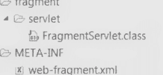

图 D.1：fragment.jar 文件的结构

通过调用以下 URL 来测试 **Fragment** servlet：
`http://localhost:8080/d1/fragment`

你应该能看到 **Fragment** servlet 的输出。

## 总结

本附录解释了你如何配置和部署你的 servlet/JSP 应用程序。附录首先介绍了典型应用程序的目录结构，然后转向对部署描述符的解释。

当应用程序准备好部署后，你可以通过保留应用程序的文件和目录结构来部署它。或者，你可以将应用程序打包成 WAR 文件并将整个应用程序作为单个文件部署。

# 目录

- `accept-language` 请求头部............................................................................................... 155, 214
- `acceptCharset` 属性....................................................................................................... 96
- `AcceptHeaderLocaleResolver`.............................................................................................. 214
- `action`.................................................................................................................................. 25
  - definition........................................................................................................................... 25
  - invocation....................................................................................................................... 25
- `addCookie()` 方法................................................................................................................ 287
- `addHeader()` 方法................................................................................................................ 287
- `AJAX`.................................................................................................................................... 240
- 基于注解的配置..................................................................................... 14
- 注解驱动的元素............................................................................................... 125
- `Apache BVal`......................................................................................................................... 147
- `Apache Commons FileUpload`...................................................................................... 223
- `Apache Commons Logging`........................................................................................... 55
- `Apache Software Foundation`..................................................................................... 223
- `Apache Tomcat`.................................................................................................................... 8
- `Apache Velocity`................................................................................................................ 49
- `applet`.................................................................................................................................. 239
  - `application` 目录....................................................................................................... 273
  - `application` JSP 隐式对象............................................................................... 158
  - `application` 名称................................................................................................................ 3
- `ApplicationContext`............................................................................................................... 13
- `applicationScope` EL 隐式对象.......................................................................... 157, 160
- `async-supported` 元素................................................................................................ 338, 339
- `auth-constraint` 元素....................................................................................................... 335
- `auth-method` 元素........................................................................................................... 334
- `autoFlush` 属性........................................................................................................... 311
- `base name`............................................................................................................................... 211
- `bean`.................................................................................................................................... 13
- `begin` 属性............................................................................................................... 178, 187
- Spring MVC 的优势........................................................................................... 51
- `BindingResult`.................................................................................................................. 127
- `buffer` 属性............................................................................................................... 311
- `CANADA` 字段...................................................................................................................... 210
- `CANADA_FRENCH` 字段............................................................................................... 210
- `CGI`....................................................................................................................................... 6

# 350 Spring MVC: 教程

- `checkbox` 元素.................................................................................................... 288
- `checkbox` 标签............................................................................................................. 99
- `checkboxes` 标签........................................................................................................... 101
- `CHINA` 字段............................................................................................................... 210
- `CHINESE` 字段............................................................................................................. 210
- `choose` 标签............................................................................................................... 176
- `classes` 目录....................................................................................................... 273
- `ClassXmlApplicationContext`........................................................................................... 14
- `commandName` 属性............................................................................... 95, 96
- `Common Gateway Interface`................................................................................................ 6
  - 关于的问题................................................................................................................ 6
- `Commons FileUpload`............................................................................................... 223
- `component-scan` 元素.............................................................................................. 132
- `config` 隐式对象.................................................................................. 158
- `contains()` 函数.................................................................................................. 199
- `containsIgnoreCase()` 函数........................................................................................... 200
- `content type`............................................................................................................... 277
- `Content-Disposition` 请求头部................................................................................................ 252
- `Content-Type` 请求头部..................................................................................... 251
- `contentType` 属性....................................................................................... 312
- `context-param` 元素................................................................................................ 330
- `controller`............................................................................................................... 24
- `Controller` 注解类型................................................................................................ 67
- `Controller` 接口................................................................................... 54, 67
- `conversion-service` 属性............................................................................................. 125
- `conversionService` bean.............................................................................. 125, 131
- `convert()` 方法.................................................................................................. 124
- `converter`................................................................................................................ 123
- 与 `formatter` 比较.................................................................................... 129
- 与 `formatter` 比较.................................................................................. 134
- 与 `validator` 比较.................................................................................. 137
- `Converter` 接口.................................................................................... 123
- `converters` 属性.............................................................................................. 125, 131
- `cookie` EL 隐式对象..................................................................................... 157, 160
- `cookie-config` 元素.................................................................................. 340
- `cookieLocaleResolver`.................................................................................. 214
- 国家代码.................................................................................................. 209
- 交叉引用...................................................................................................... 257
- `cssClass` 属性...................................................................... 96, 97, 98, 99, 100, 101, 102, 103, 104, 106, 107
- `cssErrorClass` 属性.................................................................. 97, 98, 99, 100, 101, 102, 103, 104, 106, 107
- `cssStyle` 属性...................................................................... 96, 97, 98, 99, 100, 101, 102, 103, 104, 106, 107
- `currencyCode` 属性.................................................................................. 191
- `currencySymbol` 属性............................................................................. 191
- 数据绑定............................................................................................... 191
- `dateStyle` 属性................................................................................................ 93
- `declaration`............................................................................................... 193, 316
- `default` 属性................................................................................................ 170
- `default context`......................................................................................................... 3

# 索引 351

- 默认资源...........................................................................................3
- `deferredSyntaxAllowedAsLiteral` 属性................................312
- `delimiter` 属性...............................................................102, 103, 107
- `delims` 属性................................................................................187
- 依赖注入..........................................................................11, 22, 82
- 部署..................................................................................................327
- 部署描述符......................................................................277
- 优势................................................................................................................297
- 使用......................................................................................................294
- `description` 元素...............................................................336, 337, 342
- `destroy()` 方法...............................................................................269, 304, 317
- `destroy` 属性.........................................................................................17
- 指令..................................................................................................299
- 在 JSP 中禁用脚本..................................................................164
- `dispatcher servlet`...........................................................................53, 57, 76
- `display-name` 元素...............................................................335, 337, 342
- `distributable` 元素.......................................................................330
- `doDelete()` 方法..................................................................................285
- `doGet()` 方法...............................................................................285, 292
- `doHead()` 方法......................................................................................285
- `doOptions()` 方法..................................................................................285
- `doPost()` 方法...........................................................................................285
- `doPut()` 方法.............................................................................................285
- `doTrace()` 方法..................................................................................285
- 动态内容..................................................................................7
- `ECMAScript`...............................................................................................153
- `EL`
  - 去激活...............................................................................................164
  - 隐式对象..................................................................................158
  - 在 JSP 2.0 中.....................................................................................153
  - 隐式对象列表......................................................................157
- `EL` 算术运算符......................................................................161
- `EL` 条件运算符.....................................................................163
- `EL` empty 运算符......................................................................163
- `EL` 隐式对象..........................................................................157
- `EL` 逻辑运算符.......................................................................162
- `EL` 关系运算符..................................................................162
- `el-ignored` 元素...........................................................................343
- `element` 属性...............................................................................102, 103, 107
- `enabled` 元素...............................................................................338, 339
- `enctype` 属性..................................................................................224
- `end` 属性.........................................................................................178, 187
- `endsWith()` 函数..................................................................................200
- `ENGLISH` 字段.........................................................................210
- `Enterprise JavaBeans`.......................................................................8, 24
- 实体体................................................................................................5
- 错误处理..................................................................................324
- 在 JSP 中。
- `error-code` 元素...............................................................................................331
- `error-page` 元素..................................................................................................331
- `errorPage` 属性................................................................................................312, 324
- `Errors` 接口.............................................................................................................138
- `errors` 标签...............................................................................................106, 127
- `escapeXml` 属性................................................................................................170
- `escapeXml()` 函数............................................................................................200
- `exception` JSP 隐式对象...............................................................................158
- `exception-type` 元素.............................................................................331
- 表达式..................................................................................................................314, 316
- 表达式语言 (`Expression Language`)................................................................................153
  - 求值规则........................................................................................155
  - 运算符................................................................................................................154
  - 保留字................................................................................................................154
  - 语法......................................................................................................................153
- `extends` 属性...............................................................................................312
- `extension` 元素...............................................................................335
- `FieldError`...............................................................................................................138
- 文件下载...........................................................................................................251
- 文件上传...............................................................................................................223
- `fileSizeThreshold` 属性................................................................................................235
- `FileSystemXmlApplicationContext`..................................................................14
- `filter` 元素......................................................................................................331
- `filter-mapping` 元素...............................................................................332
- `Flash`......................................................................................................................239
- `flash` 属性...........................................................................................87
- `forEach` 标签...............................................................................................177
  - 属性列表..................................................................................................178
- `form` 标签................................................................................................95
- `form` 标签库...............................................................................93
- `form-backing` 对象..................................................................95, 96, 97, 99
- `form-error-page` 元素.......................................................................335
- `form-login-config` 元素.......................................................................334
- `formatBean` 标签...............................................................................192
  - 属性列表..................................................................................93
- `formatNumber` 标签..............................................................................190
  - 示例................................................................................................................192
  - 属性列表..................................................................................191
- `formatter`...............................................................................123, 129, 131
  - 对比 `converter`...............................................................................129
  - 对比 `converter`.............................................................................................134
  - 对比 `validator`.............................................................................................137
  - 注册..................................................................................................132
- `Formatter` 接口.............................................................................................130
- `formatters` 属性..................................................................................131
- `forTokens` 标签...............................................................................186
  - 属性列表..................................................................................187
- `forward` 动作...............................................................................323

# 索引 353

- 法国.......................................................................................................................210
- `FreeMarker`...............................................................................49
- `FRENCH` 字段.............................................................................................210
- `getAttribute()` 方法..................................................................................281
- `getAttributeNames()` 方法...........................................................................281
- `getBundle()` 方法......................................................................................212
- `getContentLength()` 方法.............................................................................275
- `getContentType()` 方法...............................................................................275
- `getContextPath()` 方法...............................................................................286
- `getCookies()` 方法..................................................................................286
- `getDefault()` 方法................................................................................................210
- `getInitParameter()` 方法...............................................................................277
- `getInitParameterNames()` 方法.......................................................................277
- `getMethod()` 方法..................................................................................286
- `getParameter()` 方法...............................................................................275
- `getProperty()` ..............................................................................321
- `getProtocol()` 方法...............................................................................275
- `getQueryString()` 方法..............................................................................286
- `getRequest()` 方法................................................................................307
- `getResponse()` 方法...............................................................................307
- `getServletConfig()` 方法.......................................................................269, 270, 307
- `getServletContext()` 方法.............................................................................307
- `getServletInfo()` 方法...............................................................................269, 270
- `getSession()` 方法...............................................................................286, 307
- `getString()` 方法......................................................................................212
- `getWriter()` 方法..................................................................................276
- `GlassFish`................................................................................................8
- `Google Chrome`...........................................................................................7
- `Google Guice`..................................................................................11
- `groupingUsed` 属性.............................................................................191
- `header` EL 隐式对象.......................................................................157, 159
- `headerValues` EL 隐式对象.....................................................157, 160
- `Hibernate Validator`..................................................................................98, 99
- `html` 标签..................................................................................................3
- 主机..................................................................................................240
- `HTML`........................................................................................
- `htmlEscape` 属性.................................................................96, 97, 98, 99, 100, 101, 102, 103, 104, 106, 107
- `HTTP`...............................................................................................1
  - 默认端口................................................................................3
  - 状态码 200...............................................................................6
  - 状态码 401...............................................................................6
  - 状态码...........................................................................................6
- `HTTP` 错误码................................................................................331
- `HTTP` 方法.......................................................................................285
- `HTTP` 请求......................................................................................4, 5
- `HTTP` 响应......................................................................................5
- `HTTP` 服务器.........................................................................8
- `http-method` 元素.............................................................................336

# 354 Spring MVC: 教程

| `HttpServletPage` 类 | 304 |
| `HttpServletPage` 接口 | 301 |
| `HttpServlet` 类 | 284 |
| `HttpServletRequest` | 36 |
| `HttpServletRequest` 接口 | 284 |
| `HttpServletResponse` 接口 | 284 |
| 超文本传输协议 | 1 |
| `i18n` (国际化) | 207 |
| `IBM WebSphere` | 337, 343 |
| `icon` 元素 | 174 |
| 属性列表 | 175 |
| `import` 属性 | 311 |
| `include` 动作 | 323 |
| `include-coda` 元素 | 313, 344 |
| `include-code` 元素 | 344 |
| `include-prelude` 元素 | 343 |
| `indexOf()` 函数 | 201 |
| `info` 属性 | 311 |
| `init()` 方法 | 269, 272, 277, 282, 297, 304 |
| `init-param` 元素 | 337 |
| 初始参数 | 277, 327 |
| `initParam` EL 隐式对象 | 157, 159 |
| `input` 标签 | 96 |
| 输入验证 | 137 |
| `integerOnly` 属性 | 197 |
- 国际化..................................................................................................................139, 207
- 互联网任务组 (`IETF`).................................................................................................. 2
- `Internet Explorer`...........................................................................................7, 240
- `IP` 协议............................................................................................................................... 3
- 反向控制转 (`IoC`)............................................................................................................. 11
- `is-xml` 元素.................................................................................................................... 343
- `isELIgnored` 属性........................................................................................................... 164, 312
- `isError` 属性............................................................................................................... 312
- `ISO 3166`........................................................................................................................ 334
- `ISO 639`........................................................................................................................ 334
- `ISO-8859-1` 编码.......................................................................................................... 276
- `isThreadSafe` 属性....................................................................................................... 311
- `itemLabel` 属性............................................................................................... 102, 103, 104, 106
- `items` 属性............................................................................................... 102, 103, 104, 106, 178, 187
- `itemValue` 属性............................................................................................... 102, 103, 104, 106
- `jar` 程序....................................................................................................................... 274
- `Java EE` 容器............................................................................................................ 167
- `Java` 企业版.................................................................................................................. 8
- `Java` 消息服务 (`JMS`)................................................................................................... 8
- `Java` 虚拟机................................................................................................................ 280

# 索引 355

- `JAVA_HOME` 环境变量...............................................................261
- `java.util.concurrent.atomic` 包.......................................................270
- `java.util.Locale`....................................................................................208
- `java.util.MissingResourceExceptionHandler`...............................................212
- `java.util.ResourceBundle`......................................................................211
- `JavaBean`..................................................................................................24
- `javax.Faces`...............................................................................7, 8, 153
- `javax.Pages`...............................................................................1, 7, 299
- `jax.el` 包..................................................................................301
- `jax.servlet` 包......................................................................267
- `jax.servlet.annotation` 包.....................................................267
- `jax.servlet.descriptor` 包.......................................................267
- `jax.servlet.GenericServlet`...............................................................281
- `jax.servlet.http` 包...............................................................267
- `jax.servlet.http.HttpServlet`...........................................................284
- `jax.servlet.http.HttpServletRequest`...............................................286
- `jax.servlet.http.HttpServletResponse`..............................................287
- `jax.servlet.jsp` 包..................................................................300
- `jax.servlet.jsp.el` 包...............................................................301
- `jax.servlet.jsp.jstl` 包...........................................................167
- `jax.servlet.jsp.tagext` 包......................................................301
- `jax.servlet.Servlet`.......................................................................300
- `jax.servlet.Config`...............................................................277
- `jax.servlet.ServletContext`...............................................................280
- `jax.servlet.ServletResponse`...........................................................276
- `JBoss`...............................................................................................8
- `Jetty`.................................................................................................8
- `join()` 函数......................................................................................201
- `JSP`...................................................................................1, 7
- 目录.......................................................................................304
- `JSP 2.3`...........................................................................................7
- `JSP act`.........................................................................................299
- `JSP` 动作（`actions`）...............................................................................320
- `JSP API`......................................................................................301
- `JSP` 声明（`declarations`）.............................................................................316
- `JSP` 指令（`directives`）...............................................................................310
- `JSP` 文（`document`）...............................................................................299
- `JSP` 元素（`element`）...............................................................................299
- `JSP` 表达式（`expressions`）..............................................................................316
- `JSP` 隐式对象（`implicit objects`）...............................................................158, 307
- `JSP` 脚本元素（`scripting elements`）...............................................................314
  - 禁用（`disabling`）.....................................................................320
- `JSP` 标准标签库（`STL`）...............................................................153
- `JSP` 语法元素................................................................314
- `JSP` 语法......................................................................................299
- `jsp-config` 元素...............................................................................164, 341
- `jsp-file` 元素..................................................................337
- `jsp-property-group` 元素...............................................................164, 341, 342, 344

# 索引 356

- `jspDestroy()` 方法....................................................................................... 317
- `jspInit()` 方法............................................................................................... 317
- `jspPage` 接口....................................................................................... 300
- `JSR 245`............................................................................................................... 7
- `JSR 303`............................................................................................................... 42, 138, 146
- `JSR 303` 验证器...................................................................................... 138
- `JSR 340`............................................................................................................... 7
- `JSR 349`............................................................................... 42, 153, 167
- `JSR-52`......................................................................................................... 9, 153, 167
- `JSTL`
- 标签列表......................................................................................................... 168
- 规范（`Specification`）.................................................................................................. 167
- `JSTL` 函数.................................................................................................. 199
- `I10n`（国际化）
- `label` 属性............................................................................................... 100, 101
- `language` 属性..................................................................................... 312
- 语言代码（`language code`）............................................................................... 208
- `length()` 函数....................................................................................... 201
- `lib` 目录..................................................................................................... 273
- 属性列表................................................................................................................................................................................................................................................................................................
- `redirect` 标签................................................................................................... 189
- `url` 标签................................................................................................................ 189
- `listener` 元素............................................................................................. 333
- `load-on-startup` 元素....................................................................... 297, 338
- `locale`（本地化）.................................................................................................. 208
- `locale-encoding-mapping` 元素..................................................................... 333
- `locale-encoding-mapping-list` 元素.................................................................. 333
- `localResolver` bean....................................................................................... 215
- `localization`（本地化）.................................................................................................................. 207
- `location` 属性..................................................................................... 235
- `location` 元素............................................................................................. 331
- `login-config` 元素..................................................................................... 334
- `maxFileSize` 属性..................................................................................... 235
- `maxFractionDigits` 属性....................................................................................... 191
- `maxIntegerDigits` 属性........................................................................................... 191
- `maxRequestStatus` 属性........................................................................................... 235
- `message` 标签........................................................................................................... 214
- `messageSource` bean..................................................................................... 142
- `metadata-complete` 属性............................................................................... 328
- `mime-mapping` 元素.................................................................................. 335
- `mime-type` 元素............................................................................................. 335
- `minFractionDigits` 属性....................................................................................... 191
- `minIntegerDigits` 属性........................................................................................... 191
- `model`（模型）.................................................................................................. 24
- `Model 1`............................................................................................................... 23
- `Model 2`............................................................................................... 23, 24, 49
- 使用 `servlet controller`.................................................................................. 26
- `Model 2` 架构........................................................................................... 25

# 索引 357

- `Model-View-Controller`...........................................................................................1, 23, 24
- `ModelAttribute` 注解类型...............................................................................................90
- `modelAttribute` 属性......................................................................................................96
- `Mozilla Firefox`.........................................................................................................................7
- `multipart-config` 元素................................................................................................338
- `Multipart` 注解类型...............................................................................................235
- `name` 属性.......................................................................................................................272
- `initParams` 属性............................................................................................................279
- `ObjectError`.......................................................................................................................138
- `option` 标签.............................................................................................................................104
- `otherwise` 标签........................................................................................................................176
- `out` JSP 隐式对象......................................................................................................158
- `out` 标签................................................................................................................................169
  - 属性列表..................................................................................................................170
- `page` 指令...............................................................................................................310, 312, 324
- `page` JSP 隐式对象......................................................................................................158
- `page-encoding` 元素.......................................................................................................343
- `pageContext` EL 隐式对象...............................................................................157, 158
- `pageContext` JSP 隐式对象..................................................................................158
- `pageEncoding` 属性.......................................................................................................312
- `pageScope` EL 隐式对象................................................................................................157, 160
- `param` EL 隐式对象...............................................................................................157, 159
- `paramValues` EL 隐式对象..................................................................................157, 159
- `parse()` 方法........................................................................................................................130
- `parseDate` 标签......................................................................................................................197
  - 属性列表..................................................................................................................198
- `parseLocale` 属性..................................................................................197, 198
- `parseNumber` 标签..................................................................................................................196
  - 属性列表..................................................................................................................197
- `Part` 接口......................................................................................................................235
- `password` 标签.......................................................................................................................98
- `path`...............................................................................................................................................96
- `path` 属性...............................................................................................97, 98, 99, 100, 101, 102, 103, 104, 107
- `path` 变量.......................................................................................................................88
- `pattern` 属性...............................................................................................191, 193, 197, 198
- `Plain Java Object`...............................................................................................................24
- `POJO`................................................................................................................................24
- `print()` 方法......................................................................................................................130
- `property`.............................................................................................................................34
- `property` 属性...............................................................................................................173
- `query string`.......................................................................................................................4
- `radiobutton` 标签...............................................................................................................100
- `radiobuttons` 标签...............................................................................................................102
- `realm-name` 元素...............................................................................................334
- `redirect` 标签......................................................................................................................189
- `registrar`............................................................................................................................132
- `reject()` 方法....................................................................................................................139
- `rejectEmpty()` 方法...............................................................................................140

# 索引 358

- `rejectEmptyOrWhitespace()` 方法..................................................................................140
- `rejectValue()` 方法....................................................................................................................139
- `remove` 标签.......................................................................................................................................173
  - 属性列表........................................................................................................................173
- `removeAttribute()` 方法......................................................................................................281
- `replace()` 函数...............................................................................................................202
- `request header`................................................................................................................................5
- `request` JSP 隐式对象...............................................................................................158
- `request-handling` 方法...............................................................................................67, 71, 91, 127
- `RequestDispatcher`.....................................................................................................................25
- `RequestMapping` 注解类型......................................................................................67, 69
- `RequestParam` 注解类型...............................................................................................88
- `requestScope` EL 隐式对象..................................................................157, 160
- `Response`..................................................................................................................................5
- `response` JSP 隐式对象...............................................................................................158
- `RFC 2616`................................................................................................................................2
- `RFC 6455`................................................................................................................................2
- `role-link` 元素...............................................................................................339
- `role-name` 元素...............................................................................................337
- `run-as-element`................................................................................................................338
- `scanning` 机制................................................................................................................68
- `schemaLocation` 属性...........................................................................................171, 173, 175, 191, 193, 196, 197, 198
- `scope` 属性..................................................................................307
- `scopes`.....................................................................................................................................1
- `Script-Free JSP`..................................................................................................................164
- `scripting` 元素...............................................................................................................299
- `scripting-invalid` 元素..................................................................................164, 320, 343
- `scriptlet`.......................................................................................................................308, 314, 315
- `security-constraint` 元素.........................................................................................1
- `security-role` 元素...............................................................................................335, 336
- `security-role-ref` 元素.......................................................................................337
- `select` 元素................................................................................................................287
- `select` 标签...............................................................................................................................103
- `sendRedirect()` 方法......................................................................................................287
- `Service` 注解类型..................................................................................82
- `service()` 方法...............................................................................................268, 269, 275, 284, 285
- `Servlet`................................................................................................................................1
  - `API`.....................................................................................................267
  - 目录结构............................................................................................................273
  - 推荐架构......................................................................................................
  - 什么是..................................................................................................................................23
  - 为什么比 `CGI` 快...............................................................................................6, 7
- `servlet` 注解类型..................................................................................327
- `servlet API`...............................................................................................................267, 273
- `servlet` ..................................................................................7, 268, 275, 285
- `servlet controller`..............................................................................................26
- `servlet` 元素...............................................................................................................337
- `servlet` 引擎................................................................................................................7

# 索引 359

- `Servlet` 接口............................................................................................... 268, 281
  - 生命周期方法................................................................................ 269
  - 中的方法............................................................................................... 269
  - `servlet` 容器....................................................................................... 269
- `Servlet` 技术............................................................................................... 6
  - `servlet-api.jar` 文件....................................................................................... 273
  - `servlet-class` 元素................................................................................ 337
  - `servlet-mapping` 元素............................................................................. 340
  - `servlet-name` 元素................................................................................ 337
  - `servlet/JSP` 容器............................................................................. 8, 251, 300, 328
- `ServletConfig` 接口....................................................................... 268, 272
- `ServletContext` 接口...................................................................... 268, 280
- `ServletException` 类.............................................................................. 269
- `ServletRequest` 接口..................................................................... 268, 275
- `ServletResponse` 接口....................................................................... 268
- `session` 属性..................................................................................... 311
- `session` JSP 隐式对象....................................................................... 158
- `session-config` 元素............................................................................. 340
- `session-timeout` 元素........................................................................... 340
- `SessionLocaleResolver`.............................................................................. 214
- `sessionScope` EL 隐式对象.................................................................. 157, 160
- `set` 标签......................................................................................................... 171
  - 属性列表..................................................................................... 173
- `setAttribute()` 方法............................................................................... 281, 308
- `setProperty` 操作.................................................................................. 321
- `setTimeZone` 标签.................................................................................... 195
  - 属性列表..................................................................................... 196
- `showPassword` 属性....................................................................... 98
- `shuttle()` 方法...................................................................................... 17
- `Silverlight`......................................................................................... 239
- `Smaltik-80`........................................................................................... 24
- `split()` 函数....................................................................................... 202
- `Spring` 框架.................................................................................. 6
  - `Spring MVC`.................................................................................. 1, 24
  - `Spring validator`.................................................................................... 138
  - `Spring Web`....................................................................................... 7
- `startsWith()` 函数................................................................................ 202
- `step` 属性..................................................................................... 178, 187
- `Struts`............................................................................................... 24
- `Struts 2`............................................................................................... 7, 25
- `substring()` 函数................................................................................ 203
- `substringAfter()` 函数................................................................................ 203
- `substringBefore()` 函数................................................................................ 203
- `Sun Microsystems`.................................................................................. 6
- `supports()` 方法................................................................................ 118
- `tag` 元素................................................................................ 301
- `taglib` 元素................................................................................ 341
- `taglib location` 元素............................................................................... 342
- `taglib uri` 元素................................................................................ 342
- `target` 属性..................................................................................... 173
- `test` 属性..................................................................................... 175
- `textarea` 标签..................................................................................... 99
- 线程安全.............................................................................................. 270
- `time` 属性............................................................................... 193, 198
- `timeZone` 属性............................................................................... 193, 198
- `timeZone` 标签.............................................................................................. 194
- `toLowerCase()` 函数................................................................................ 203
- `Tomcat`............................................................................................... 270, 274
  - 默认端口............................................................................... 3
  - `Tomcat context`............................................................................. 262
- `toUpperCase()` 函数................................................................................ 204
- `tracking-mode` 元素............................................................................. 340
- `transport-guarantee` 元素............................................................................. 336
- `trim()` 函数.................................................................................. 204
- `trimWhitespaces` 属性..................................................................... 312
- `type` 属性............................................................................... 191, 193, 197, 198
- `UK` 字段...................................................................... 210
- 统一请求标识符 (`Uniform Request Identifier`)................................................................. 25
- 统一资源标识符 (`Uniform Resource Identifier`)................................................................... 4
- 统一资源定位符 (`Uniform Resource Locator`)................................................................... 2
- `URL`............................................................................................... 4, 5, 25
- `URL`............................................................................................... 2
- `format`.............................................................................. 2
- `url` 标签.............................................................................................. 188
- `url-pattern` 元素............................................................................... 164, 336, 343
- `urlPatterns` 属性..................................................................... 272
- `US` 字段...................................................................... 210
- `useBean` 操作............................................................................. 321
- `user-data-constraint` 元素....................................................................... 335, 336
- `validate` 注解类型.................................................................................. 145
- `validate()` 方法............................................................................. 138
- 校验逻辑............................................................................ 137
- `ValidationUtils` 类..................................................................... 140
- `validator`............................................................................... 23, 137, 141
  - 与转换器和格式化器的对比.................. 137
- `Validator` 接口........................................................................ 138
- `value` 属性............................................................... 170, 173, 191, 193, 196, 197, 198
- `var` 属性............................................................... 173, 175, 178, 187, 191, 193, 196, 197, 198
- `varStatus` 属性...................................................................................... 178, 187
- `view`............................................................................................... 24, 25
- `war` 文件..................................................................................... 274
- `web` 浏览器.................................................................................. 7
- `web` 客户端......................................................................
- `web fragment`.................................................................................. 7
- `web fragment descriptor`............................................................................... 345

# 索引 361

- `web server`....................................................................................................................................... 7, 8
- `web-app` 元素............................................................................................................... 328, 345
- `web-app_3.0.xsd` schema.................................................................................... 329
- `web-fragment` 元素........................................................................................................ 345
- `web-fragment.xml` 文件........................................................................................................... 345
- `web-resource-collection` 元素........................................................................... 335, 336
- `web-resource-name` 元素.................................................................................. 336
- `web.xml` 文件.................................................................................................................. 327, 345
- `webapps` 目录............................................................................................................. 274
- `WebDataBinder`............................................................................................................... 144
- `WebServlet` 注解类型......................................................................................... 272
- `WebSocket`....................................................................................................................... 2
- `WebSocket protocol`........................................................................................................... 2
- `welcome-file` 元素..................................................................................................... 341
- `welcome-file-list` 元素............................................................................................... 341
- `when` 标签.............................................................................................................................. 176
- `World Wide Web Consortium`............................................................................................... 1
- `XML-based configuration`.................................................................................... 14
- `XMLHttpRequest` 对象..................................................................................................... 240
- `XPath`.................................................................................................................................. 153
- `input` 标签............................................................................................................................... 97
- `@AssertFalse` 约束..................................................................................... 148
- `@AssertTrue` 约束...................................................................................... 148
- `@Autowired`....................................................................................................... 13, 82, 111
- `@Controller`....................................................................................................................... 68
- `@DecimalMax` 约束......................................................................................................... 148
- `@DecimalMin` 约束....................................................................................... 148
- `@Digits` 约束........................................................................................................... 148
- `@Future` 约束........................................................................................................... 148
- `@Max` 约束................................................................................................................ 148
- `@Min` 约束............................................................................................................... 148
- `@ModelAttribute`............................................................................................................... 90, 91
- `@MultipartConfig`............................................................................................................. 225
- `@NotNull` 约束....................................................................................... 148
- `@Null` 约束.............................................................................................. 148
- `@Past` 约束.............................................................................................................. 148
- `@PathVariable`............................................................................................................... 89
- `@Pattern` 约束......................................................................................................... 148
- `@RequestMapping`........................................................................................................... 69
- `@RequestParam`......................................................................................................................... 88
- `@Service`............................................................................................................................... 82
- `@Size` 约束.............................................................................................................. 148

# Spring MVC

本书是一本关于 Spring MVC 的易于理解的教程，Spring MVC 是 Spring 框架的一部分的一个现代 Web 应用框架。Spring MVC 中的 MVC 代表模型-视图-控制器（`Model-View-Controller`），这是一种在图形用户界面（`GUI`）开发中广泛使用的设计模式。这种模式不仅在 Web 开发中很常见，也用于 `Java Swing` 等桌面技术。Spring MVC 有时被称为 `Spring Web`，它是今天最流行的 Web 框架之一，也是最受青睐的技能之一。

以下是本书涵盖的一些主题：

- Spring 简介
- Servlet 和 JSP
- MVC 模式
- 控制器 (`Controllers`)
- 数据绑定
- 表单标签库
- 转换器 (`Converters`)
- 格式化器 (`Formatters`)
- 校验器 (`Validators`)
- 表达式语言
- `JSTL`
- 国际化
- 文件上传与下载

如果你想学习如何使用 Spring MVC 开发基于 Java 的 Web 应用，这本书适合你。

# 关于作者

`Paul Deck` 是 `Brainy Software` 的软件开发者和技术架构师。《How Tomcat Works: A Guide to Developing Your Own Java Servlet Container》的合著者。


$ 39.99 美元
$ 49.99 加元
