# Spring MVC 入门指南

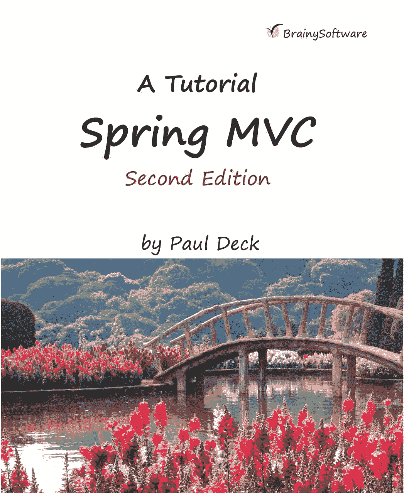

## 关于作者

Paul Deck 是一位 `Java` 和 `Spring` 专家，开发过大型企业级应用，目前担任独立承包商。他是 `How Tomcat Works` 的合著者。

```
add(product);
}

@Override
public Product add(Product product) {
    long newId = generator.incrementAndGet();
    product.setId(newId);
    products.put(newId, product);
    return product;
}

@Override
public Product get(long id) {
    return products.get(id);
}
```

如列表 4.9 所示，`annotated2` 的 Spring MVC 配置文件有两个 `<component-scan/>` 元素，一个用于扫描控制器类，另一个用于扫描服务类。

列表 4.9：`annotated2` 的 Spring MVC 配置文件

```xml
<?xml version="1.0" encoding="UTF-8"?>
<beans xmlns="http://www.springframework.org/schema/beans"
    xmlns:xsi="http://www.w3.org/2001/XMLSchema-instance"
    xmlns:p="http://www.springframework.org/schema/p"
    xmlns:mvc="http://www.springframework.org/schema/mvc"
    xmlns:context="http://www.springframework.org/schema/context"
    xsi:schemaLocation="
        http://www.springframework.org/schema/beans
        http://www.springframework.org/schema/beans/spring-beans.xsd
        http://www.springframework.org/schema/mvc
        http://www.springframework.org/schema/mvc/spring-mvc.xsd
        http://www.springframework.org/schema/context
        http://www.springframework.org/schema/context/spring-context.xsd">
    <context:component-scan base-package="controller"/>
    <context:component-scan base-package="service"/>
    <mvc:annotation-driven/>
    <mvc:resources mapping="/css/**" location="/css/"/>
    <mvc:resources mapping="*.html" location="/"/>
    <bean id="viewResolver" class="org.springframework.web.servlet.view.InternalResourceViewResolver">
        <property name="prefix" value="/WEB-INF/jsp/"/>
        <property name="suffix" value=".jsp"/>
    </bean>
</beans>
```

## 重定向与闪属性（Flash Attributes）

作为一个丰富的 Servlet/JSP 程序员，你必须了解跳转（forward）和重定向（redirect）之间的区别。跳转比重定向快，因为重定向需要返回服务器，而跳转不需要。然而，在某些情况下，重定向是更好的。其中一种情况是你需要重定向到外部站点，例如另一个网站。你无法使用跳转来指向外部网站，因此重定向是你的唯一选择。

另一种你希望使用重定向而不是跳转的情况是你想避免在刷新页面时重复执行相同的操作。例如，在 `annotated1` 中，当你提交产品表单时，`saveProduct` 方法会被调用，该方法将执行它应该执行的操作。在实际应用中，这可能包括将产品添加到数据库中。但是，如果你在提交表单后刷新页面，`saveProduct` 将再次被调用，导致同一个产品可能被再次添加。为了避免这种情况，在提交表单后，你可能倾向于将用户重定向到一个不同的页面。该页面在被多次调用时不应产生副作用。

在 `annotated2` 中，你可能已经注意到 `ProductController` 类中的 `saveProduct` 方法以这一行结束：

```
return "redirect:/view-product/" + savedProduct.getId();
```

在这里，你使用了重定向（redirect）而不是向前转发（forward），以防止用户在刷新页面时 `saveProduct` 方法被调用两次。

使用 `redirect` 的权衡是你无法方便地向目标页面传递值。而使用 `forward`，你可以简单地向 `Model` 对象添加属性，这些属性将可以被视图访问。由于 `redirect` 是到服务器的往返过程，当你执行 `redirect` 时，`Model` 中的所有内容都会丢失。幸运的是，Spring 3.1 及更高版本提供了一种通过闪存属性（flash attributes）在 `redirect` 中保留值的方法。

要使用闪存属性，你必须在 Spring MVC 配置文件中包含 `<annotation-driven/>` 元素。然后，你必须在方法中添加一个类型为 `org.springframework.web.servlet.mvc.support.RedirectAttributes` 的新参数。`annotated2` 中 `ProductController` 的 `saveProduct` 方法在列表 4.10 中重现。

列表 4.10: 使用闪存属性

```
@RequestMapping(value = "save-product", method = RequestMethod.POST)
public String saveProduct(ProductForm productForm, 
        RedirectAttributes redirectAttributes) {
    logger.info("saveProduct called");
    // 无需创建并实例化 ProductForm
    // 创建 Product
    Product product = new Product();
    product.setName(productForm.getName());
    product.setDescription(productForm.getDescription());
    try {
        product.setPrice(new BigDecimal(productForm.getPrice()));
    } catch (NumberFormatException e) {
    }
    // 添加 product
    Product savedProduct = productService.add(product);
    redirectAttributes.addFlashAttribute("message", 
            "The product was successfully added.");
    return "redirect:/view-product/" + savedProduct.getId();
}
```

## 请求参数和路径变量

请求参数（request parameters）和路径变量（path variables）都用于向服务器发送值。它们都是 URL 的一部分。请求参数的形式为由 `&` 分隔的 `key=value` 对。例如，此 URL 携带了一个值为 3 的 `productId` 请求参数。

```
http://localhost:8080/annotated2/view-product?productId=3
```

在 servlet 编程中，你可以通过使用 `HttpServletRequest` 的 `getParameter` 方法获取请求参数值：

```
String productId = httpServletRequest.getParameter("productId");
```

在 Spring MVC 中，有一种更简单的方法获取请求参数值：使用 `org.springframework.web.bind.annotation.RequestParam` 注解类型来标记一个参数，请求参数的值将复制到该参数中。例如，以下方法包含一个捕获请求参数 `productId` 的参数。

```
public void sendProduct(@RequestParam int productId)
```

如你所示，被 `@RequestParam` 注解的参数类型不需要是 `String`。

路径变量与请求参数类似，不同在于它没有键的部分，只有值。例如，`annotated2` 中的 `view-product` 映射到一个具有这种格式的 URL。

```
/view-product/productId
```

其中 `productId` 是一个表示产品标识符的整数。在 Spring MVC 的术语中，`productId` 被称为路径变量。它用于向服务器发送值。

考虑列表 4.11 中演示路径变量使用的 `viewProduct` 方法。

列表 4.11: 使用路径变量

```
@RequestMapping(value = "/view-product/{id}")
public String viewProduct(@PathVariable Long id, Model model) {
    Product product = productService.get(id);
    model.addAttribute("product", product);
    return "ProductView";
}
```

要使用路径变量，首先你需要在你的 `RequestMapping` 注解中添加一个作为值属性的变量。该变量必须放在花括号之间。例如，以下 `RequestMapping` 注解定义了一个名为 `id` 的路径变量：

```
@RequestMapping(value = "/view-product/{id}")
```

然后，在你的方法签名中，添加一个同名且标记了 `@PathVariable` 注解的变量。查看列表 4.11 中 `viewProduct` 的签名。当方法被调用时，请求 URL 中的 `id` 值将复制到路径变量并在方法中使用。路径变量的类型不需要必须是 `String`。Spring MVC 会尽力转换非字符串值。Spring MVC 的这一强大特性将在第 5 章“数据绑定与表单标签”中进行详细讨论。

你可以在请求映射中使用多个路径变量。例如，以下定义了两个路径变量，`userId` 和 `orderId`。

```
@RequestMapping(value = "/view-product/{userId}/{orderId}")
```

要测试 `viewProduct` 方法中的路径变量，请将浏览器指向此 URL。

```
http://localhost:8080/annotated2/view-product/1
```

在使用路径变量时存在一个细微的问题：在某些情况下它可能会让浏览器产生困惑。考虑以下 URL。

```
http://example.com/context/abc
```

浏览器将（正确地）认为 `abc` 是 action。任何对静态文件（如 CSS 文件）的相对引用将使用 `http://example.com/context` 作为基准进行解析。这意味着如果服务器发送的页面包含此 `img` 元素

```

```

浏览器将在 `http://example.com/context/logo.png` 查找 `logo.png`。

然而，请注意，如果同一个应用程序被部署为默认上下文（其中默认上下文的路径为空字符串），则相同目标的 URL 将是：

```
http://example.com/abc
```

现在，考虑以下在部署为默认上下文的应用程序中携带路径变量的 URL：

```
http://example.com/abc/1
```

在这种情况下，浏览器会认为 `abc` 是上下文，而不是 action。如果你在页面中引用 ``，浏览器将在 `http://example.com/abc/logo.png` 查找图像，并将找不到该图像。

幸运的是，我们有一个简单的解决方案，即使用 JSTL 的 `url` 标签。（JSTL 将在第 8 章“JSTL”中讨论）。该标签通过正确解析 URL 来解决此问题。例如，`annotated2` 中 JSP 页面上的所有 CSS 导入已从

```
<style type="text/css">@import url(css/main.css);</style>
```

变为

```
<style type="text/css">
@import url("<c:url value="/css/main.css"/>");
</style>
```

得益于 `url` 标签，如果处于默认上下文中，URL 将被转换为：

```
<style type="text/css">@import url("/css/main.css");</style>
```

如果不在默认上下文中，它将转换为：

```
<style type="text/css">@import url("/annotated2/css/main.css");</style>
```

## @ModelAttribute

在上一节中，我提到了 Spring MVC 在每次调用处理方法时都会创建一个实例的 `Model` 类型。如果你打算在方法中使用它，可以将 `Model` 作为方法的参数。`@ModelAttribute` 注解类型可以用于装饰方法中的 `Model` 实例。该注解类型也是 `org.springframework.web.bind.annotation` 包的一部分。

`@ModelAttribute` 可以用于标记方法参数或方法。被 `@ModelAttribute` 注解的方法参数将在方法体没有显式这样做的情况下，获取或创建实例并添加到 `Model` 对象中。例如，Spring MVC 每次调用此 `submitOrder` 方法时都会创建一个 `Order` 实例。

```
@RequestMapping(method = RequestMethod.POST)
public String submitOrder(@ModelAttribute("newOrder") Order order,
    Model model) { 
   ...
}
```

检索或创建的 `Order` 实例将添加到属性键为 `newOrder` 的 `Model` 对象中。如果没有定义键名，则该名称将从要添加到 `Model` 的类型名称派生出来。例如，每当调用以下方法时，都会检索或创建一个 `Order` 实例，并使用属性键 `order` 将其添加到 `Model` 中。

```java
public String submitOrder(@ModelAttribute Order order, Model model) 
```

`@ModelAttribute` 的第二个用法是注解一个非请求处理方法。标记了 `@ModelAttribute` 注解的方法在当同一个控制器类中的任何请求处理方法被调用时，都会被相应调用。这意味着，如果一个控制器类有两个请求处理方法以及另一个标记了 `@ModelAttribute` 注解的方法，那么被标记的方法被调用的次数可能会比每个请求处理方法都要多。标记了 `@ModelAttribute` 注解的方法会在请求处理方法执行之前被调用。该方法可以返回一个对象，也可以具有 `void` 返回类型。如果它返回一个对象，该对象将自动添加到为请求处理方法创建的 `Model` 中。例如，该方法的返回值将添加到 `Model` 中。

```java
@ModelAttribute
public Product addProduct(@RequestParam String productId) {
    return productService.get(productId);
}
```

如果你的注解方法返回 `void`，则你必须也添加一个 `Model` 参数类型并手动添加实例。这是一个示例。

```java
@ModelAttribute
public void populateModel(@RequestParam String id, Model model) {
    model.addAttribute(new Account(id));
}
```


## 总结

在本章中，你学习了如何编写使用基于注解的控制器的 Spring MVC。你还学习了各种类型的注解，用于对类、方法或方法参数进行注解。

# 第 5 章：数据绑定与表单标签库

数据绑定是一种将用户输入绑定到领域模型的功能。得益于数据绑定，HTTP 请求参数（始终为 `String` 类型）可以用于填充各种类型对象的属性。数据绑定还让表单 Bean（例如前几章节中的 `ProductForm` 实例）变得多余。

要有效率使用数据绑定，你需要 Spring 表单标签库。本章将解释数据绑定和表单标签库，并提供示例来突显表单标签库中标签的使用。

## 数据绑定概述

由于 HTTP 的特性，所有 HTTP 请求参数都是字符串。回想一下在之前的章节中，你必须将字符串解析为 `BigDecimal` 以获取正确的商品价格。为了唤起记忆，这里是第 4 章示例应用程序中 `ProductController` 类 `saveProduct` 方法的一些代码。

```java
@RequestMapping(value="save-product")
public String saveProduct(ProductForm productForm, Model model) {
    logger.info("saveProduct called");
    // 无需创建并实例化 ProductForm
    // 创建 Product
    Product product = new Product();
    product.setName(productForm.getName());
    product.setDescription(productForm.getDescription());
    try {
        product.setPrice(new BigDecimal(productForm.getPrice()));
    } catch (NumberFormatException e) {
    }
}
```

你必须解析 `ProductForm` 中的价格属性，是因为它是 `String`，而你需要一个 `BigDecimal` 来填充 `Product` 的价格属性。通过数据绑定，你可以用下面的代码替换上面的 `saveProduct` 方法片段。

```java
@RequestMapping(value="save-product")
public String saveProduct(Product product, Model model)
```

得益于数据绑定，你不再需要 `ProductForm` 类，且无需对 `Product` 对象的价格属性进行任何解析。

数据绑定的另一个优点是在输入验证失败时重新填充 HTML 表单。使用手动编写 HTML 代码时，你必须担心如何用用户之前输入的值重新填充输入字段。而使用 Spring 数据绑定和表单标签库，这些都由它为你处理好了。

## 表单标签库

表单标签库包含了你可以用于在 JSP 页面中渲染 HTML 元素的标签。要使用这些标签，请在 JSP 页面顶部声明此 `taglib` 指令。

```jsp
<%@taglib prefix="form" 
    uri="http://www.springframework.org/tags/form" %>
```

表 5.1 显示了表单标签库中的标签。本章将解释数据绑定和表单标签库，并提供示例来突显表单标签库中标签的使用。标记了 `@ModelAttribute` 注解的方法会在请求处理方法执行之前被调用。该方法可以返回一个对象，也可以具有 `void` 返回类型。如果它返回一个对象，该对象将自动添加到为请求处理方法创建的 `Model` 中。例如，该方法的返回值将添加到 `Model` 中。

| 标签 | 描述 |
| :--- | :--- |
| form | 渲染一个表单元素。 |
| input | 渲染 `<input>` 元素 |
| password | 渲染 `<input>` 元素 |
| hidden | 渲染 `<input>` 元素 |
| textarea | 渲染 `<textarea>` 元素 |
| checkbox | 渲染 `<input>` 元素 |
| checkboxes | 渲染多个 `<input>` 元素 |
| radiobutton | 渲染 `<input>` 元素 |
| radiobuttons | 渲染多个 `<input>` 元素 |
| select | 渲染 `<select>` 元素 |
| option | 渲染 `<option>` 元素 |
| options | 渲染多个 `<option>` 元素 |
| errors | 渲染 `<span>` 元素。 |

表 5.1：表单标签

## form 标签

`form` 标签渲染 HTML 表单。要使用任何渲染表单字段的其他标签，你必须有一个 `form` 标签。`form` 标签的属性如表 5.2 所示。

| 属性 | 描述 |
| :--- | :--- |
| acceptCharset | 指定服务器接受的字符编码列表。 |
| commandName | 暴露对象的模型属性的名称。默认值为 `command`。 |
| cssClass | 指定应用到渲染表单元素的 CSS 类。 |
| cssStyle | 指定应用到渲染表单元素的 CSS 样式。 |
| htmlEscape | 接受 true 或 false，指示是否对渲染的值进行 HTML 转义。 |
| modelAttribute | 暴露对象的模型属性名称。默认值为 `command`。 |

表 5.2：form 标签的属性

表 5.2 中的所有属性都是可选的。该表不包含 `method` 和 `action` 等 HTML 属性。

`commandName` 属性可能是最重要的，因为它指定了用于填充生成的表单的模型属性名称。如果存在此属性，你必须在返回视图的请求处理方法添加相应的模型属性。例如，在本章配套的标签演示应用程序中，`BookAddForm.jsp` 中指定了以下表单标签。

```jsp
<form:form commandName="book" action="save-book" method="post">
    ...
</form:form>
```

`BookController` 类中的 `inputBook` 方法是返回 `BookAddForm.jsp` 的请求处理方法。这里是 `inputBook` 方法。

```java
@RequestMapping(value = "/input-book")
public String inputBook(Model model) {
    ...
    model.addAttribute("book", new Book());
    return "BookAddForm";
}
```

如你所示，一个 `Book` 对象被创建并以属性名 `book` 添加到 `Model`。如果没有模型属性，`BookAddForm.jsp` 页面将抛出异常，因为表单标签找不到在其 `commandName` 属性中指定的表单支持对象。

此外，你通常仍会 `action` 和 `method` 属性。两者都是 HTML 属性，因此不包含在表 5.2 中。

## input 标签

`input` 标签渲染一个 `<input type="text"/>` 元素。该标签最重要的属性是 `path`，它将此输入字段绑定到表单对象（form-backing object）的属性。例如，如果嵌套 `<form/>` 标签的 `commandName` 属性被为 `book`，且 `input` 标签的 `path` 属性赋值为 `isbn`，则 `input` 标签将绑定到 `Book` 对象的 `isbn` 属性。

表 5.3 显示了 `input` 标签中的所有属性。表 5.3 中的所有属性均为可选，且该表不包含 HTML 属性。

| 属性 | 描述 |
| :--- | :--- |
| `cssClass` | 指定应用到渲染的输入元素的 CSS 类。 |
| `cssStyle` | 指定应用到渲染的输入元素的 CSS 样式 |
| `CssErrorClass` | 如果绑定的属性包含错误，则指定应用到渲染的输入元素的 CSS 类，这将覆盖 `cssClass` 属性的值。 |
| `htmlEscape` | 接受 `true` 或 `false`，表示渲染的值是否应该经过 HTML 转义。 |
| `path` | 要绑定的属性的路径。 |

表 5.3：input 标签的属性

例如，此 `input` 标签绑定到表单对象的 `isbn` 属性。

```
<form:input id="isbn" path="isbn" cssErrorClass="errorBox"/>
```

它将被渲染为如下 `<input/>` 元素：

```
<input type="text" id="isbn" name="isbn"/>
```

除非 `isbn` 属性中存在输入验证错误，并且使用了同一个表单来重新显示用户输入，否则 `cssErrorClass` 属性将不起作用；在这种情况下，`input` 标签将渲染为此输入元素：

```
<input type="text" id="isbn" name="isbn" class="errorBox"/>
```

`input` 标签也可以绑定到嵌套对象中的属性。例如，以下 `input` 标签绑定到表单对象 `category` 属性的 `id` 属性。

```
<form:input path="category.id"/>
```

## password 标签

`password` 标签渲染一个 `<input type="password"/>` 元素，其属性见表 5.4。`password` 标签与 `input` 标签类似，不同在于它有一个 `showPassword` 属性。

| 属性 | 描述 |
| :--- | :--- |
| `cssClass` | 指定应用到渲染的输入元素的 CSS 类。 |
| `cssStyle` | 指定应用到渲染的输入元素的 CSS 样式 |
| `cssErrorClass` | 如果绑定的属性包含错误，则指定应用到渲染的输入元素的 CSS 类，这将覆盖 `cssClass` 属性的值。 |
| `htmlEscape` | 接受 `true` 或 `false`，表示渲染的值是否应该经过 HTML 转义。 |
| `path` | 要绑定的属性的路径。 |
| `showPassword` | 指明是否应该显示密码而非掩码。默认值为 `false`。 |

表 5.4：password 标签的属性

表 5.4 中的所有属性均为可选，且该表不包含 HTML 属性。以下是 `password` 标签的一个示例：

```
<form:password id="pwd" path="password" cssClass="normal"/>
```

## hidden 标签

`hidden` 标签渲染一个 `<input type="hidden"/>` 元素，其属性见表 5.5。`hidden` 标签与 `input` 标签类似，不同在于它没有视觉外观，因此不支持 `cssClass` 或 `cssStyle` 属性。

| 属性 | 描述 |
| :--- | :--- |
| `htmlEscape` | 接受 `true` 或 `false`，表示渲染的值是否应该经过 HTML 转义。 |
| `path` | 要绑定的属性的路径。 |

表 5.5：hidden 标签的属性

表 5.5 中的所有属性均为可选，且该表不包含 HTML 属性。

以下是 hidden 标签的示例。

```
<form:hidden path="productId"/>
```

## textarea 标签

`textarea` 标签渲染 HTML `textarea` 元素。如你所知，`textarea` 元素本质是一个支持多行输入的输入元素。`textarea` 标签的属性如表 5.6 所示。表 5.6 中的所有属性均为可选，且该表不包含 HTML 属性。

| 属性 | 描述 |
| :--- | :--- |
| `cssClass` | 指定应用到渲染的输入元素的 CSS 类。 |
| `cssStyle` | 指定应用到渲染的输入元素的 CSS 样式 |
| `cssErrorClass` | 如果绑定的属性包含错误，则指定应用到渲染的输入元素的 CSS 类，这将覆盖 `cssClass` 属性的值。 |
| `htmlEscape` | 接受 `true` 或 `false`，表示渲染的值是否应该经过 HTML 转义。 |
| `path` | 要绑定的属性的路径。 |

表 5.6：password 标签的属性（注：此处原文标题可能误为 password）

例如，以下 `textarea` 标签绑定到表单对象的 `note` 属性。

```
<form:textarea path="note" tabindex="4" rows="5" cols="80"/>
```

## checkbox 标签

`checkbox` 标签渲染一个 `<input type="checkbox"/>` 元素。`checkbox` 标签的属性见表 5.7。所有属性均为可选，且该表不包含 HTML 属性。

| 属性 | 描述 |
| :--- | :--- |
| `cssClass` | 指定应用到渲染的输入元素的 CSS 类。 |
| `cssStyle` | 指定应用到渲染的输入元素的 CSS 样式 |
| `cssErrorClass` | 如果绑定的属性包含错误，则指定应用到渲染的输入元素的 CSS 类，这将覆盖 `cssClass` 属性的值。 |
| `htmlEscape` | 接受 `true` 或 `false`，表示渲染的值是否应该经过 HTML 转义。 |
| `label` | 用于渲染标签的文本值。 |
| `path` | 要绑定的属性的路径。 |

表 5.7：checkbox 标签的属性

例如，此 `checkbox` 标签绑定到 `outOfStock` 属性。

```
<form:checkbox path="outOfStock" value="Out of Stock"/>
```

## radiobutton 标签

`radiobutton` 标签渲染一个 `<input type="radio"/>` 元素。`radiobutton` 属性属性表 5.8。表 5.8 中的所有属性均为可选，且该表不包含 HTML 属性。

| 属性 | 描述 |
| :--- | :--- |
| `cssClass` | 指定应用到渲染的输入元素的 CSS 类。 |
| `cssStyle` | 指定应用到渲染的输入元素的 CSS 样式 |
| `cssErrorClass` | 如果绑定的属性包含错误，则指定应用到渲染的输入元素的 CSS 类，这将覆盖 `cssClass` 属性的值。 |
| `htmlEscape` | 接受 `true` 或 `false`，表示渲染的值是否应该经过 HTML 转义。 |
| `label` | 用于渲染单选按钮标签的文本。 |
| `path` | 要绑定的属性的路径。 |

表 5.8：radiobutton 标签的属性

例如，以下 `radiobutton` 标签绑定到 `newsletter` 属性。

```
Computing Now <form:radiobutton path="newsletter" value="Computing Now"/>
<br/>
Modern Health <form:radiobutton path="newsletter" value="Modern Health"/>
```

## checkboxes 标签

`checkboxes` 标签渲染多个 `<input type="checkbox"/>` 元素。`checkboxes` 内部可能出现的属性如表 5.9 所示。所有属性均为可选，且该表不包含 HTML 属性。

| 属性 | 描述 |
| :--- | :--- |
| `cssClass` | 指定应用到渲染的输入元素的 CSS 类。 |
| `cssStyle` | 指定应用到渲染的输入元素的 CSS 样式 |
| `cssErrorClass` | 如果绑定的属性包含错误，则指定应用到渲染的输入元素的 CSS 类，这将覆盖 `cssClass` 属性的值。 |
| `delimiter` | 指定两个输入元素之间的分隔符。默认情况下没有分隔符。 |
| `element` | 指定用于封装每个渲染输入元素的 HTML 元素。默认是 `span`。 |
| `htmlEscape` | 接受 `true` 或 `false`，表示渲染的值是否应该经过 HTML 转义。 |
| `items` | 用于生成输入元素的集合、映射或对象数组。 |
| itemLabel | `items` 属性中指定的集合/Map/数组中对象的属性，用于为每个输入元素提供标签（label）。 |
| itemValue | `items` 属性中指定的集合/Map/数组中对象的属性，用于为每个输入元素提供值（value）。 |
| path | 待绑定的属性的路径。 |

表 5.9：checkboxes 标签的属性

例如，以下 `checkboxes` 标签将模型属性 `categoryList` 的内容渲染为复选框。`checkboxes` 标签允许多项选择。

```
<form:checkboxes path="category" items="${categoryList}"/>
```


## `radiobuttons` 标签

`radiobuttons` 标签渲染多个 `<input type="radio"/>` 元素。`radiobuttons` 标签的属性见表 5.10。

| 属性 | 说明 |
| :--- | :--- |
| `cssClass` | 指定应用到渲染后的输入元素的 CSS 类。 |
| `cssStyle` | 指定应用到渲染后的输入元素的 CSS 样式 |
| `cssErrorClass` | 如果绑定的属性包含错误，则指定应用到渲染后的输入元素的 CSS 类，这会覆盖 `cssClass` 属性的值。 |
| `delimiter` | 指定两个输入元素之间的分隔符。默认情况下没有分隔符。 |
| `element` | 指定用于封装每个渲染后的输入元素的 HTML 元素。默认是 `span`。 |
| `htmlEscape` | 接受 `true` 或 `false`，表示渲染后的值(s) 是否应该进行 HTML 转义。 |
| `items` | 用于生成输入元素的集合、Map 或对象数组。 |
| `itemLabel` | `items` 属性中指定的集合/Map/数组中对象的属性，用于为每个输入元素提供标签。 |
| `itemValue` | `items` 属性中指定的集合/Map/数组中对象的属性，用于为每个输入元素提供值。 |
| `path` | 待绑定的属性的路径。 |

表 5.10：`radiobuttons` 标签的属性

例如，以下 `radiobuttons` 标签将模型属性 `categoryList` 的内容渲染为单选框。每次只能选择一个单选框。

```
<form:radiobuttons path="category" items="${categoryList}"/>
```

## `select` 标签

`select` 标签渲染一个 HTML `select` 元素。渲染元素的选项可能来自给其 `items` 属性赋值的集合、Map 或数组，也来自嵌套的 `option` 或 `options` 标签。`select` 标签的属性见表 5.11。所有属性均为可选，且表中未包含任何 HTML 属性。

| 属性 | 说明 |
| :--- | :--- |
| `cssClass` | 指定应用到渲染后的输入元素的 CSS 类。 |
| `cssStyle` | 指定应用到渲染后的输入元素的 CSS 样式 |
| `cssErrorClass` | 如果绑定的属性包含错误，则指定应用到渲染后的输入元素的 CSS 类，这会覆盖 `cssClass` 属性的值。 |
| `htmlEscape` | 接受 `true` 或 `false`，表示渲染后的值(s)是否应该进行 HTML 转义。 |
| `items` | 用于生成输入元素的集合、Map 或对象数组。 |
| `itemLabel` | `items` 属性中指定的集合/Map/数组中对象的属性，用于为每个输入元素提供标签。 |
| `itemValue` | `items` 属性中指定的集合/Map/数组中对象的属性，用于为每个输入元素提供值。 |
| `path` | 待绑定的属性的路径。 |

表 5.11：`select` 标签的属性

`items` 属性特别有用，因为它可以绑定到集合、Map 或对象数组，以便为 `select` 元素生成选项。

例如，以下 `select` 标签绑定到表单后端对象 `category` 属性的 `id` 属性。它的选项来自 `categories` 模型属性。每个选项的值来自 `categories` 集合/map/数组中对象的 `id` 属性，其标签来自 `name` 属性。

```
<form:select id="category" path="category.id" 
    items="${categories}" itemLabel="name" 
    itemValue="id"/>
```

## `option` 标签

`option` 标签渲染一个用于 `select` 元素内的 HTML `option` 元素。其属性见表 5.12。所有属性均为可选，且表中不包含 HTML 属性。

| 属性 | 说明 |
| :--- | :--- |
| `cssClass` | 指定应用到渲染后的输入元素的 CSS 类。 |
| `cssStyle` | 指定应用到渲染后的输入元素的 CSS 样式 |
| `cssErrorClass` | 如果绑定的属性包含错误，则指定应用到渲染后的输入元素的 CSS 类，这会覆盖 `cssClass` 属性的值。 |
| `htmlEscape` | 接受 `true` 或 `false`，表示渲染后的值(s)是否应该进行 HTML 转义。 |

表 5.12：`option` 标签的属性

例如，这里是一个 `option` 标签示例。

```
<form:select id="category" path="category.id" 
        items="${categories}" itemLabel="name" 
        itemValue="id">
    <option value="0">-- Please select --</option>
</form:select>
```

此代码段渲染了一个 `select` 元素，其选项来自 `categories` 模型属性，也来自 `option` 标签。

## `options` 标签

`options` 标签生成一组 HTML `option` 元素。表 5.13 显示了可能出现在 `options` 标签中的属性。它不包含 HTML 属性。

| 属性 | 说明 |
| :--- | :--- |
| `cssClass` | 指定应用到渲染后的输入元素的 CSS 类。 |
| `cssStyle` | 指定应用到渲染后的输入元素的 CSS 样式 |
| `cssErrorClass` | 如果绑定的属性包含错误，则指定应用到渲染后的输入元素的 CSS 类，这会覆盖 `cssClass` 属性的值。 |
| `htmlEscape` | 接受 `true` 或 `false`，表示渲染后的值(s)是否应该进行 HTML 转义。 |
| `items` | 用于生成输入元素的集合、Map 或对象数组。 |
| `itemLabel` | `items` 属性中指定的集合/Map/数组中对象的属性，用于为每个输入元素提供标签。 |
| `itemValue` | `items` 属性中指定的集合/Map/数组中对象的属性，用于为每个输入元素提供值。 |

表 5.13：`options` 标签的属性

`tags-demo` 应用提供了 `options` 标签的示例。

## `errors` 标签

`errors` 标签渲染一个多个 `span` 元素，每个元素包含一个字段错误消息。该标签可以显示特定的字段错误或所有字段错误。

`errors` 标签的属性见表 5.14。所有属性均为可选，且表中未包含出现在 HTML `span` 元素中的 HTML 属性。

| 属性 | 说明 |
| :--- | :--- |
| `cssClass` | 指定应用到渲染后的输入元素的 CSS 类。 |
| `cssStyle` | 指定应用到渲染后的输入元素的 CSS 样式 |
| `delimiter` | 分隔多个错误消息的分隔符。 |
| `element` | 指定封装错误消息的 HTML 元素。 |
| `htmlEscape` | 接受 `true` 或 `false`，表示渲染后的值(s)是否应该进行 HTML 转义。 |
| `path` | 待绑定的错误对象的路径。 |

表 5.14：`errors` 标签的属性

例如，此 `errors` 标签显示所有字段错误。

```
<form:errors path="*"/>
```

以下 `errors` 标签显示与表单后端对象 `author` 属性相关的字段错误。

```
<form:errors path="author"/>
```

## 数据绑定示例

作为使用表单标签库中的标签来利用数据绑定的示例，请考虑 `tags-demo` 应用。此示例围绕 `Book` 领域类展开。该类有多个属性，包括一个类型为 `Category` 的 `category` 属性。`Category` 有两个属性：`id` 和 `name`。

该应用程序允许您列书籍、添加新书籍以及编辑书籍。

## 目录结构

图 5.1 显示了 `tags-demo` 的目录结构。为了节省空间，未显示 `lib` 目录的内容。

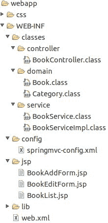

图 5.1：`tags-demo` 的目录结构

## 领域类

`Book` 类和 `Category` 类是该应用程序中的领域类。它们分别在代码列表 5.1 和 5.2 中列出。

代码列表 5.1：`Book` 类

```java
package domain;

import java.math.BigDecimal;
import java.io.Serializable;

public class Book implements Serializable {
    private static final long serialVersionUID = 1L;
    private long id;
    private String isbn;
    private String title;
    private Category category;
    private String author;

    public Book() {
    }

    public Book(long id, String isbn, String title, 
            Category category, String author, BigDecimal price) {
        this.id = id;
        this.isbn = isbn;
        this.title = title;
        this.category = category;
        this.author = author;
        this.price = price;
    }

    // get and set methods not shown
}
```

代码列表 5.2：`Category` 类

```java
package domain;

import java.io.Serializable;

public class Category implements Serializable {
    private static final long serialVersionUID = 1L;
    private int id;
    private String name;

    public Category() {
    }

    public Category(int id, String name) {
        this.id = id;
        this.name = name;
    }

    // get and set methods not shown
}
```

## 控制器类

示例提供了一个 `Book` 的控制器，即 `BookController` 类。它允许用户创建新书籍、更新书籍详情并列出系统中所有的书籍。代码列表 5.3 显示了 `BookController` 类。

代码列表 5.3：`BookController` 类

```java
package controller;

import java.util.List;
import org.apache.commons.logging.Log;
import org.apache.commons.logging.LogFactory;
import org.springframework.beans.factory.annotation.Autowired;
import org.springframework.stereotype.Controller;
import org.springframework.ui.Model;
import org.springframework.web.bind.annotation.ModelAttribute;
import org.springframework.web.bind.annotation.PathVariable;
import org.springframework.web.bind.annotation.RequestMapping;
import domain.Book;
import domain.Category;
import service.BookService;

@Controller
public class BookController {
    @Autowired
    private BookService bookService;
    private static final Log logger = 
            LogFactory.getLog(BookController.class);

    @RequestMapping(value = "/input-book")
    public String inputBook(Model model) {
        List<Category> categories = bookService.getAllCategories();
        model.addAttribute("categories", categories);
        model.addAttribute("book", new Book());
        return "BookAddForm";
    }

    @RequestMapping(value = "/edit-book/{id}")
    public String editBook(Model model, @PathVariable long id) {
        List<Category> categories = bookService.getAllCategories();
        model.addAttribute("categories", categories);
        Book book = bookService.get(id);
        model.addAttribute("book", book);
        return "BookEditForm";
    }

    @RequestMapping(value = "/save-book")
    public String saveBook(@ModelAttribute Book book) {
        Category category =
                bookService.getCategory(book.getCategory().getId());
        book.setCategory(category);
        bookService.save(book);
        return "redirect:/list-books";
    }

    @RequestMapping(value = "/update-book")
    public String updateBook(@ModelAttribute Book book) {
        Category category = 
                bookService.getCategory(book.getCategory().getId());
        book.setCategory(category);
        bookService.update(book);
        return "redirect:/list-books";
    }

    @RequestMapping(value = "/list-books")
    public String listBooks(Model model) {
        logger.info("listBooks");
        List<Book> books = bookService.getAllBooks();
        model.addAttribute("books", books);
        return "BookList";
    }
}
```

`BookController` 依赖 `BookService` 进行一些后端处理。使用 `@Autowired` 注解将 `BookService` 实现类的实例注入到 `BookController` 中。

```java
@Autowired
private BookService bookService;
```

## 服务类

最后，代码列表 5.4 和 5.5 分别显示了 `BookService` 接口和 `BookServiceImpl` 类。如名所示，`BookServiceImpl` 实现了 `BookService`。

代码列表 5.4：`BookService` 接口

```java
package service;

import java.util.List;
import domain.Book;
import domain.Category;

public interface BookService {
    List<Category> getAllCategories();
    Category getCategory(int id);
    List<Book> getAllBooks();
    Book save(Book book);
    Book update(Book book);
}
```


`Book get(long id);`

`long getNextId();`

代码列表 5.5：`BookServiceImpl` 类

```java
package service;

import java.util.ArrayList;

import java.util.List;

import org.springframework.Service;

import domain.Book;

import domain.Category;

@Service

public class BookServiceImpl implements BookService {

    private List<Category> categories;

    private List<Book> books;

    public BookServiceImpl() {

        categories = new ArrayList<>();

        books = new ArrayList<>();

    }

    @Override

    public List<Category> getAllCategories() {

        return categories;

    }

    @Override

    public Category getCategory(int id) {

        for (Category category : categories) {

            if (id == category.getId()) {

                return category;

            }

        }

        return null;

    }

    @Override

    public List<Book> getAllBooks() {

        return books;

    }

    @Override

    public Book save(Book book) {

        book.setId(getNextId());

        books.add(book);

        return book;

    }

    @Override

    public Book get(long id) {

        for (Book book : books) {

            if (id == book.getId()) {

                return book;

            }

        }

        return null;

    }

    @Override

    public Book update(Book book) {

        int bookCount = books.size();

        for (int i = 0; i < bookCount; i++) {

            Book savedBook = books.get(i);

            if (savedBook.getId() == book.getId()) {

                books.set(i, book);

                return book;

            }

        }

        return book;

    }

    @Override

    public long getNextId() {

        long id = 0L;

        for (Book book : books) {

            long bookId = book.getId();

            if (bookId > id) {

                id = bookId;

            }

        }

        return id + 1;

    }

}
```

```xml
<?xml version="1.0" encoding="UTF-8"?>

<beans xmlns="http://www.springframework.org/schema/beans"

   xmlns:xsi="http://www.w3.org/2001/XMLSchema-instance"

   xmlns:p="http://www.springframework.org/schema/p"

   xmlns:mvc="http://www.springframework.org/schema/mvc"

   xmlns:context="http://www.springframework.org/schema/context"

   xsi:schemaLocation="

      http://www.springframework.org/schema/beans

      http://www.springframework.org/schema/beans/spring-beans.xsd

      http://www.springframework.org/schema/mvc

      http://www.springframework.org/schema/mvc/spring-mvc.xsd     

      http://www.springframework.org/schema/context

      http://www.springframework.org/schema/context/spring-context.xsd">

   <context:component-scan base-package="controller"/>

   <context:component-scan base-package="service"/>

   ... <!-- 其他元素未显示 -->

</beans>
```

`component-scan` beans 会导致 `controller` 和 `service` 包被扫描。

## 视图

`tags-demo` 中使用的三个 JSP 页面分别位于列表 5.7、5.8 和 5.9 中。在 `BookAddForm.jsp` 和 `BookEditForm.jsp` 页面中，使用了表单标签库的标签。

### 列表 5.7：`BookList.jsp` 页面

```jsp
<%@ taglib uri="http://java.sun.com/jsp/jstl/core" prefix="c" %>

<!DOCTYPE html>

<html>

<head>

<title>书籍列表</title>

<style type="text/css">@import url("<c:url value="/css/main.css"/>");

</style>

</head>

<body>

<div id="global">

<h1>书籍列表</h1>

<a href="<c:url value="/book_input"/>">添加书籍</a>

<table>

<tr>

    <th>分类</th>

    <th>标题</th>

    <th>ISBN</th>

    <th>作者</th>

    <th>价格</th>

    <th>&nbsp;</th>

</tr>

<c:forEach items="${books}" var="book">

    <tr>

        <td>${book.category.name}</td>

        <td>${book.title}</td>

        <td>${book.isbn}</td>

        <td>${book.author}</td>

        <td>${book.price}</td>

        <td><a href="book_edit/${book.id}">编辑</a></td>

    </tr>

</c:forEach>

</table>

</div>

</body>

</html>
```

### 列表 5.8：`BookAddForm.jsp` 页面

```jsp
<%@ taglib prefix="form" 

        uri="http://www.springframework.org/tags/form" %>

<%@ taglib uri="http://java.sun.com/jsp/jstl/core" prefix="c" %>

<!DOCTYPE html>

<html>

<head>

<title>添加书籍表单</title>

<style type="text/css">@import url("<c:url value="/css/main.css"/>");</style>

</head>

<body>

<div id="global">

<form:form commandName="book" action="save-book" method="post">

    <fieldset>

        <legend>添加书籍</legend>

        <p>

            <label for="category">分类: </label>

             <form:select id="category" path="category.id" 

                items="${categories}" itemLabel="name" 

                itemValue="id"/>

        </p>

        <p>

            <label for="title">标题: </label>

            <form:input id="title" path="title"/>

        </p>

        <p>

            <label for="author">作者: </label>

            <form:input id="author" path="author"/>

        </p>

        <p>

            <label for="isbn">ISBN: </label>

            <form:input id="isbn" path="isbn"/>

        </p>

        <p id="buttons">

            <input id="reset" type="reset" tabindex="4">

            <input id="submit" type="submit" tabindex="5" 

                value="添加书籍">

        </p>

    </fieldset>

</form:form>

</div>

</body>

</html>
```

### 列表 5.9：`BookEditForm.jsp` 页面

```jsp
<%@ taglib prefix="form" 

        uri="http://www.springframework.org/tags/form" %>

<%@ taglib uri="http://java.sun.com/jsp/jstl/core" prefix="c" %>

<!DOCTYPE html>

<html>

<head>

<title>编辑书籍表单</title>

<style type="text/css">@import url("<c:url value="/css/main.css"/>");</style>

</head>

<body>

<div id="global">

<c:url var="formAction" value="/update-book"/>

<form:form commandName="book" action="${formAction}" method="post">

    <fieldset>

        <legend>编辑书籍</legend>

        <form:hidden path="id"/>

        <p>

            <label for="category">分类: </label>

             <form:select id="category" path="category.id" 

                items="${categories}" itemLabel="name" 

                itemValue="id"/>

        </p>

        <p>

            <label for="title">标题: </label>

            <form:input id="title" path="title"/>

        </p>

        <p>

            <label for="author">作者: </label>

            <form:input id="author" path="author"/>

        </p>

        <p>

            <label for="isbn">ISBN: </label>

            <form:input id="isbn" path="isbn"/>

        </p>

        <p id="buttons">

            <input id="reset" type="reset" tabindex="4">

            <input id="submit" type="submit" tabindex="5" 

                value="添加书籍">

        </p>

    </fieldset>

</form:form>

</div>

</body>

</html>
```

Spring 转换器（converter）是一个将一种类型转换为另一种类型的对象。例如，用户对日期的输入有多种形式。“December 25, 2016”、“12/25/2016”、“2016-12-25”都可以表示同一个日期。默认情况下，Spring 期望输入格式与当前区域语言（locale）的格式相同，如果你在美国，那么这种格式可能是 `MM/dd/yyyy`。如果你希望 Spring 在将输入字符串绑定到 `LocalDate` 时使用不同的日期模式，你需要编写一个字符串到日期的转换器。`java.time.LocalDate` 类是 Java 8 中的一个新类型，它取代了 `java.util.Date`。你应该使用新的日期/时间 API，而不是旧的 `Date` 和 `Calendar` 类。

要创建一个转换器，你必须编写一个实现了 `org.springframework.core.convert.converter.Converter` 接口的 Java 类。该接口的声明是参数化的：

```java
public interface Converter<S, T>
```

在这里，`S` 代表源类型，`T` 代表目标类型。例如，为了创建一个可以将 `Long` 转换为 `LocalDate` 的转换器，你可以如下声明你的转换器类。

```java
public class MyConverter implements Converter<Long, LocalDate> {

}
```

在你的类体中，你需要为 `Converter` 接口中的 `convert` 方法编写实现。该方法的签名如下。

```java
T convert(S source) 
```

例如，列表 6.1 显示了一个可以处理任何日期模式的转换器。

列表 6.1：`StringToLocalDateConverter` 转换器

```java
package converter;

import java.time.LocalDate;

import java.time.format.DateTimeFormatter;

import java.time.format.DateTimeParseException;

import org.springframework.core.convert.converter.Converter;

public class StringToLocalDateConverter implements Converter<

        String, LocalDate> {

    private String datePattern;

    public StringToLocalDateConverter(String datePattern) {

        this.datePattern = datePattern;

    }

    @Override

    public LocalDate convert(String s) {

        try {

            return LocalDate.parse(s, DateTimeFormatter.ofPattern(

                    datePattern));
```


```java
} catch (DateTimeParseException e) {
    // 错误消息将显示在 <form:errors> 中
    throw new IllegalArgumentException(
            "invalid date format. Please use this pattern\""
                    + datePattern + "\"");
}
```

注意，列表 6.1 中的 `convert` 方法使用传递给构造函数的日期模式将 `String` 转换为 `LocalDate`。

要在 Spring MVC 应用中使用自定义转换器，你需要在 Spring MVC 配置文件中编写一个 `conversionService` bean。该 bean 的类名必须是 `org.springframework.context.support.ConversionServiceFactoryBean`。该 bean 必须包含一个 `converters` 属性，该属性列出了应用程序中使用的所有自定义转换器。例如，下面的 bean 声明注册了列表 6.1 中的 `StringToDateConverter`。

```xml
<bean id="conversionService" class="org.springframework.context.support.ConversionServiceFactoryBean">
    <property name="converters">
        <list>
            <bean class="converter.StringToLocalDateConverter">
                <constructor-arg type="java.lang.String" 
                        value="MM-dd-yyyy"/>
            </bean>
        </list>
    </property>
</bean>
```

之后，你需要将 bean 名称（在此情况下为 `conversionService`）分配给 `annotation-driven` 元素的 `conversion-service` 属性，如下所示：

```xml
<mvc:annotation-driven 
        conversion-service="conversionService"/>
```

`converter-demo` 应用是一个示例应用，它使用 `StringToLocalDateConverter` 将 `String` 转换为 `Employee` 对象的 `birthDate` 属性。列表 6.2 给出了 `Employee` 类。

**列表 6.2：Employee 类**

```java
package domain;

import java.io.Serializable;
import java.time.LocalDate;

public class Employee implements Serializable {
    private static final long serialVersionUID = -908L;
    private long id;
    private String firstName;
    private String lastName;
    private LocalDate birthDate;
    private int salaryLevel;
    // 省省略 setters
}
```

列表 6.3 中的 `EmployeeController` 类是 `Employee` 领域对象的控制器。

**列表 6.3：converter-demo 中的 EmployeeController 类**

```java
package controller;

import org.springframework.stereotype.Controller;
import org.springframework.ui.Model;
import org.springframework.validation.BindingResult;
import org.springframework.validation.FieldError;
import org.springframework.web.bind.annotation.ModelAttribute;
import org.springframework.web.bind.annotation.RequestMapping;
import domain.Employee;

@Controller
public class EmployeeController {
    @RequestMapping(value="/add-employee")
    public String inputEmployee(Model model) {
        model.addAttribute(new Employee());
        return "EmployeeForm";
    }

    @RequestMapping(value="/save-employee")
    public String saveEmployee(@ModelAttribute Employee employee, 
            BindingResult bindingResult, Model model) {
        if (bindingResult.hasErrors()) {
            FieldError fieldError = bindingResult.getFieldError();
            return "EmployeeForm";
        }
        // 在此处保存 employee
        model.addAttribute("employee", employee);
        return "EmployeeDetails";
    }
}
```

`EmployeeController` 类有两个处理请求的方法：`inputEmployee` 和 `saveEmployee`。`inputEmployee` 方法返回列表 6.4 中的 `EmployeeForm.jsp` 页面。`saveEmployee` 方法接收在表单提交时创建的 `Employee` 对象。得益于 `StringToLocalDateConverter`，你不需要在控制器类中将字符串转换为 `LocalDate`。`saveEmployee` 方法的 `BindingResult` 参数将填充所有的绑定错误。绑定错误可以在 `EmployeeForm.jsp` 中显示。

**列表 6.4：EmployeeForm.jsp**

```jsp
<%@ taglib prefix="form" uri="http://www.springframework.org/tags/form"%>
<%@ taglib uri="http://java.sun.com/jsp/jstl/core" prefix="c" %>
<!DOCTYPE html>
<html>
<head>
<title>Add Employee</title>
<style type="text/css">@import url("<c:url value="/css/main.css"/></");</style>
</head>
<body>
<div id="global">
<form:form commandName="employee" action="save-employee" method="post">
    <fieldset>
        <legend>Add an employee</legend>
        <p>
            <label for="firstName">First Name: </label>
            <form:input path="firstName" tabindex="1"/>
        </p>
        <p>
            <label for="lastName">Last Name: </label>
            <form:input path="lastName" tabindex="2"/>
        </p>
        <p>
            <form:errors path="birthDate" cssClass="error"/>
        </p>
        <p>
            <label for="birthDate">Date Of Birth: </label>
            <form:input path="birthDate" tabindex="3" />
        </p>
        <p id="buttons">
            <input id="reset" type="reset" tabindex="4">
            <input id="submit" type="submit" tabindex="5" 
                value="Add Employee">
        </p>
    </fieldset>
</form:form>
</div>
</body>
</html>
```

你可以通过浏览器访问此 URL 来测试转换器：

```
http://localhost:8080/converter-demo/add-employee
```

输入一个无效日期，你将被重定向到同一个 Employee 表单，并在表单中看到错误消息。

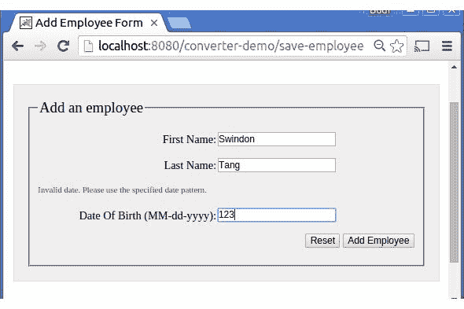

`formatter`（格式化器）类似于转换器，它也将将一种类型转换为另一种类型。然而，`formatter` 的源类型必须是 `String`，而 `converter`（转换器）可以处理任何源类型。`Formatters` 更适用于 Web 层，而 `converters` 可以在任何层使用。在 Spring MVC 应用中转换表单中的用户输入时，你应该始终选择 `formatter` 而不是 `converter`。

要创建一个 `formatter`，请编写实现 `org.springframework.format.Formatter` 接口的 Java 类。这里是接口的声明：

```
public interface Formatter<T>
```

在这里，`T` 代表输入字符串要转换的目标类型。该接口有两个所有实现都必须覆盖的方法：`parse` 和 `print`。

```
T parse(String text, java.util.Locale locale) 
String print(T object, java.util.Locale locale) 
```

`parse` 方法使用指定的 `Locale` 将 `String` 解析为目标类型。`print` 方法执行反向操作，它返回目标对象的字符串表示。

例如，`formatter-demo` 应用使用 `LocalDateFormatter` 将 `String` 转换为 `LocalDate`。它完成与 `converter-demo` 中的 `StringToLocalDateConverter` 转换器相同的工作。

`LocalDateFormatter` 类如列表 6.5 所示。

**列表 6.5：`LocalDateFormatter` 类**

```java
package formatter;

import java.text.ParseException;
import java.time.LocalDate;
import java.time.format.DateTimeFormatter;
import java.time.format.DateTimeParseException;
import java.util.Locale;
import org.springframework.format.Formatter;

public class LocalDateFormatter implements Formatter<LocalDate> {
    private DateTimeFormatter formatter;
    private String datePattern;

    public LocalDateFormatter(String datePattern) {
        this.datePattern = datePattern;
        formatter = DateTimeFormatter.ofPattern(datePattern);
    }

    @Override
    public String print(LocalDate date, Locale locale) {
        return date.format(formatter);
    }

    @Override
    public LocalDate parse(String s, Locale locale) 
            throws ParseException {
        try {
            return LocalDate.parse(s, 
                    DateTimeFormatter.ofPattern(datePattern));
        } catch (DateTimeParseException e) {
            // 错误消息将显示在 <form:errors> 中
            throw new IllegalArgumentException(
                    "invalid date format. Please use this pattern\""
                            + datePattern + "\"");
        }
    }
}
```

要在 Spring MVC 应用中使用 `formatter`，你需要使用 `conversionService` bean 注册它。bean 的类名必须是 `org.springframework.format.support.FormattingConversionServiceFactoryBean`。这与在 `converter-demo` 中注册 `converter` 时使用的类不同。该 bean 可以有一个 `formatters` 属性用于注册 `formatters`，以及一个 `converters` 属性用于注册 `converters`。列表 6.6 显示了 `formatter-demo` 的 Spring 配置文件。

**列表 6.6：`formatter-demo` 的 Spring 配置文件**

```xml
<?xml version="1.0" encoding="UTF-8"?>
<beans xmlns="http://www.springframework.org/schema/beans"
   xmlns:xsi="http://www.w3.org/2001/XMLSchema-instance" 
   xmlns:p="http://www.springframework.org/schema/p"
   xmlns:mvc="http://www.springframework.org/schema/mvc"
   xmlns:context="http://www.springframework.org/schema/context"
   xsi:schemaLocation="
      http://www.springframework.org/schema/beans
      http://www.springframework.org/schema/beans/spring-beans.xsd
      http://www.springframework.org/schema/mvc
      http://www.springframework.org/schema/mvc/spring-mvc.xsd     
      http://www.springframework.org/schema/context
      http://www.springframework.org/schema/context/spring-context.xsd">
   <context:component-scan base-package="controller"/>
   <context:component-scan base-package="formatter"/>
   <mvc:annotation-driven conversion-service="conversionService"/>
   <mvc:resources mapping="/css/**" location="/css/"/>
</beans>
```


<mvc:resources mapping="/*.html" location="/"/>

<bean id="viewResolver"
      class="org.springframework.web.servlet.view.InternalResourceViewResolver">
    <property name="prefix" value="/WEB-INF/jsp/" />
    <property name="suffix" value=".jsp" />
</bean>

<bean id="conversionService"
      class="org.springframework.format.support.FormattingConversionServiceFactoryBean">
    <property name="formatters">
        <set>
            <bean class="formatter.LocalDateFormatter">
                <constructor-arg type="java.lang.String" value="MM-dd-yyyy" />
            </bean>
        </set>
    </property>
</bean>

</beans>

注意，你还需要为`formatter`添加一个`component-scan`元素。

要在`formatter-demo`中测试`formatter`，请将浏览器指向此 URL：

```
http://localhost:8080/formatter-demo/add-employee
```

## 使用 Registrar 注册 Formatter

注册`formatter`的另一种方法是使用`Registrar`。例如，列表 6.7 中的代码是一个注册`LocalDateFormatter`的`registrar`。

列表 6.7：`MyFormatterrar`类

```java
package formatter;

import org.springframework.format.FormatterRegistrar;
import org.springframework.format.FormatterRegistry;

public class MyFormatterRegistrar implements FormatterRegistrar {

    private String datePattern;

    public MyFormatterRegistrar(String datePattern) {
        this.datePattern = datePattern;
    }

    @Override
    public void registerFormatters(FormatterRegistry registry) {
        registry.addFormatter(new LocalDateFormatter(datePattern));
        // 更多 formatters
    }
}
```

使用`registrar`，你不需要在 Spring 文件中注册任何`formatter`。相反，你在 Spring 配置文件注册`registrar`，如列表 6.8 所示。

列表 6.8：在`spring-config.xml`中注册`registrar`

```xml
<?xml version="1.0" encoding="UTF-8"?>
<beans xmlns="http://www.springframework.org/schema/beans"
   xmlns:xsi="http://www.w3.org/2001/XMLSchema-instance" 
   xmlns:p="http://www.springframework.org/schema/p"
   xmlns:mvc="http://www.springframework.org/schema/mvc"
   xmlns:context="http://www.springframework.org/schema/context"
   xsi:schemaLocation="
      http://www.springframework.org/schema/beans
      http://www.springframework.org/schema/beans/spring-beans.xsd
      http://www.springframework.org/schema/mvc
      http://www.springframework.org/schema/mvc/spring-mvc.xsd     
      http://www.springframework.org/schema/context
      http://www.springframework.org/schema/context/spring-context.xsd">

   <context:component-scan base-package="controller"/>
   <context:component-scan base-package="service"/>
   <mvc:annotation-driven conversion-service="conversionService"/>

   <bean id="viewResolver"
            class="org.springframework.web.servlet.view.InternalResourceViewResolver">
      <property name="prefix" value="/WEB-INF/jsp/" />
      <property name="suffix" value=".jsp" />
   </bean>

   <bean id="conversionService"
         class="org.springframework.format.support.FormattingConversionServiceFactoryBean">
      <property name="formatterRegistrars">
         <set>
            <bean class="formatter.MyFormatterRegistrar">
               <constructor-arg type="java.lang.String" value="MM-dd-yyyy" />
            </bean>
         </set>
      </property>
   </bean>
</beans>
```

## 在 Converters 和 Formatters 之间选择

`converter`被用作通用工具将一种类型转换为另一种类型，例如将`String`转换为`LocalDate`或将`Long`转换为`LocalDate`。`converter`不仅可以在 Web 层使用，也可以其他层使用。

另一方面，格式化器（formatter）只能将`String`转换为另一种 Java 类型，例如将`String`转换为`Date`。它不能用于将`Long`转换为`LocalDate`。因此，格式化器适用于 Web 层，因此在 Spring MVC 应用中，格式化器比转换器（converter）更合适。

## 总结

在本章中，你学习了转换器（converter）和格式化器（formatter），它们可以引导 Spring MVC 应用中的数据绑定。转换器是用于任何类型转换为另一种类型的通用工具，而格式化器用于将`String`转换为另一种 Java 类型。格式化器更适合在 Web 层中使用。

# 第 7 章：验证器（Validators）

输入验证是 Web 开发中最重要的任务之一，Spring 对此处理非常出色。在 Spring MVC 中，有两种验证输入的方法：使用 Spring 自己的验证框架或利用 JSR 303 实现。

本章涵盖了这两种输入验证方法，并提供了两个示例应用程序：`spring-validator`和`jsr303-validator`。

## 验证概述

转换器和格式化器工作在字段级别。在 MVC 应用程序中，它们将`String`转换或格式化另一种 Java 类型，例如`java.time.LocalDate`。相反，验证器工作在对象级别。它确定对象中的所有字段是否有效以及是否遵循预定义的规则。典型的 Spring MVC 应用会同时使用格式化器/转换器和验证器。

在同时使用格式化器和验证器的应用程序中，事件序列如下：调用控制器期间，一个或多个格式化器将尝试将输入字符串转换为领域对象中的字段值。一旦格式化成功，验证器就会介入。

例如，一个`Order`对象可能有一个`shippingDate`属性（显然其类型为`LocalDate`），其值不能早于今天的日期。当调用`OrderController`时，`LocalDateFormatter`会将字符串转换为`LocalDate`并将其分配给`Order`对象的`shippingDate`属性。如果转换失败，用户将被重定向回上一个表单。如果转换成功，将调用验证器来检查`shippingDate`是否早于今天。

现在，你可能会问，将验证逻辑移动到`LocalDateFormatter`中是否明智。毕竟，比较日期并不难。答案是否定的。首先，`LocalDateFormatter`可能用于将其他字符串格式化为日期，例如`birthDate`或`purchaseDate`。这两个日期的规则与`shippingDate`不同。事实上，例如员工的出生日期不能是未来的日期。其次，验证器可以通过检查两个或多个字段之间的关系来工作，而每个字段都由不同的格式化器支持。例如，给定一个具有`birthDate`属性和`startDate`属性的`Employee`对象，验证器可能会规定：一个人不可能在出生之前就开始公司工作。因此，一个有效的`Employee`对象的`birthDate`属性值必须早于其`startDate`值。这就是验证器的工作。

## Spring 验证器

从一开始开始，Spring 在设计时就考虑了输入验证。这甚至在 JSR 303（Java 验证规范）构想之前就了。因此，Spring 验证框架在今天仍然很常见，尽管对于新项目通常建议使用 JSR 303 验证器。

要创建一个 Spring 验证器，请实现`org.springframework.validation.Validator`接口。该接口位于代码清单 7.1，有两个方法：`supports`和`validate`。

代码清单 7.1：Spring Validator 接口

```java
package org.springframework.validation;

public interface Validator {
    boolean supports(Class<?> clazz);
    void validate(Object target, Errors errors);
}
```

如果验证器可以处理指定的`Class`，则`supports`方法返回`true`。`validate`方法验证目标对象并在`Errors`对象中填充验证错误。

`Errors`对象是`org.springframework.validation.Errors`接口的实例。`Errors`对象包含一个`FieldError`对象和`ObjectError`对象的列表。`FieldError`表示与被验证对象中的某一个属性相关的错误。例如，如果产品的价格属性不能为负数，而正在验证的`Product`对象的价格为负数，则需要创建一个`FieldError`。`ObjectError`是任何不是`FieldError`的错误。例如，如果一本在欧洲销售的`Book`在美国在线分支购买，则应该抛出一个`ObjectError`。

在编写验证器时，你不需要直接创建错误对象，因为实例化`ObjectError`或`FieldError`需要大量的编程工作。这是因为`ObjectError`类的构造函数需要四个参数，而`FieldError`类的构造函数需要七个参数，如你在下面的构造函数签名所示。

```java
ObjectError(String objectName, String[] codes, Object[] arguments, 
        String defaultMessage)

FieldError(String objectName, String field, Object rejectedValue, 
        boolean bindingFailure, String[] codes, Object[] arguments, 
        String defaultMessage)
```

向`Errors`对象添加错误更简单的方法是调用`Errors`对象上的`reject`或`rejectValue`方法之一。你调用`reject`来添加`ObjectError`，调用`rejectValue`来添加`FieldError`。

以下是`reject`和`rejectValue`的一些方法重载。

```java
void reject(String errorCode) 
void reject(String errorCode, String defaultMessage)
void rejectValue(String field, String errorCode) 
void rejectValue(String field, String errorCode,
        String defaultMessage)
```

大多数情况下，你只需要向`reject`或`rejectValue`方法传递错误代码。然后 Spring 可以在属性文件中查找该错误代码以获取相应的错误消息。你也可以传递一个默认消息，在未找到错误代码时使用该消息。

`Errors`对象中的错误消息可以通过使用表单标签库的`errors`标签显示在 HTML 上。错误消息可以通过 Spring 支持的国际化功能进行本地化。有关国际化的更多信息可以见第 10 章“国际化”。

## ValidationUtils 类

`org.springframework.validation.ValidationUtils`类是一个可以帮助你编写 Spring 验证器的工具类。与其编写以下代码：

```java
if (firstName == null || firstName.isEmpty()) {
    errors.rejectValue("price");
}
```

不如像这样使用`ValidationUtils`类的`rejectIfEmpty`方法：

```java
ValidationUtils.rejectIfEmpty("price");
```

或者与其编写以下代码：

```java
if (firstName == null || firstName.trim().isEmpty()) {
    errors.rejectValue("price");
}
```

你可以这样写：

```java
ValidationUtils.rejectIfEmptyOrWhitespace("price");
```

以下是`ValidationUtils`中`rejectIfEmpty`和`rejectIfEmptyOrWhitespace`方法的完整重载。

```java
public static void rejectIfEmpty(Errors errors, String field, 
        String errorCode) 
public static void rejectIfEmpty(Errors errors, String field, 
        String errorCode, Object[] errorArgs) 
public static void rejectIfEmpty(Errors errors, String field, 
        String errorCode, Object[] errorArgs, String defaultMessage) 
public static void rejectIfEmpty(Errors errors, String field, 
        String errorCode, String defaultMessage) 
public static void rejectIfEmptyOrWhitespace(Errors errors,
        String field, String errorCode) 
public static void rejectIfEmptyOrWhitespace(Errors errors,
        String field, String errorCode, Object[] errorArgs) 
```


`public static void rejectIfEmptyOrWhitespace(Errors errors, String field, String errorCode, Object[] errorArgs, String defaultMessage)`

`public static void rejectIfEmptyOrWhitespace(Errors errors, String field, String errorCode, String defaultMessage)`

此外，`ValidationUtils` 还拥有一个 `invokeValidator` 方法用于调用校验器。

```java
public static void invokeValidator(Validator validator, Object obj, Errors errors)
```

你将在下一节的示例中学习如何使用这个有用工具。

## Spring 校验器示例

`spring-validator` 包含一个名为 `ProductValidator` 的校验器，用于校验 `Product` 对象。`spring-validator` 的 `Product` 类位于列表 7.2，而 `ProductValidator` 类位于列表 7.3。

### 列表 7.2：`Product` 类

```java
package domain;

import java.io.Serializable;
import java.math.BigDecimal;
import java.time.LocalDate;

public class Product implements Serializable {
    private static final long serialVersionUID = 1L;
    private String name;
    private String description;
    private BigDecimal price;
    private LocalDate productionDate;
    // getter and setters methods not shown
}
```

### 列表 7.3：`ProductValidator` 类

```java
package validator;

import java.math.BigDecimal;
import java.time.LocalDate;
import org.springframework.validation.Errors;
import org.springframework.validation.ValidationUtils;
import org.springframework.validation.Validator;
import domain.Product;

public class ProductValidator implements Validator {
    @Override
    public boolean supports(Class<?> klass) {
        return Product.class.isAssignableFrom(klass);
    }

    @Override
    public void validate(Object target, Errors errors) {
        Product product = (Product) target;
        ValidationUtils.rejectIfEmpty(errors, "name", "productName.required");
        ValidationUtils.rejectIfEmpty(errors, "price", "price.required");
        ValidationUtils.rejectIfEmpty(errors, "productionDate", "productionDate.required");

        BigDecimal price = product.getPrice();
        if (price != null && price.compareTo(BigDecimal.ZERO) < 0) {
            errors.rejectValue("price", "price.negative");
        }

        LocalDate productionDate = product.getProductionDate();
        if (productionDate != null) {
            if (productionDate.isAfter(LocalDate.now())) {
                errors.rejectValue("productionDate", "productionDate.invalid");
            }
        }
    }
}
```

`ProductValidator` 校验器是一个简单的校验器。它的 `validate` 方法检查 `Product` 是否具有名称和价格，且价格不为负数。它还确保生产日期不晚于今天。

## 资源文件

你不需要显式注册校验器。但是，如果你希望错误消息从属性文件中读取，你需要通过声明一个 `messageSource` bean 来告诉 Spring 在哪里找到该文件。以下是 `spring-validator` 中的 `messageSource` bean 声明。

```xml
<bean id="messageSource" class="org.springframework.context.support.ReloadableResourceBundleMessageSource">
    <property name="basename" value="/WEB-INF/resource/messages"/>
</bean>
```

该 bean 实际上表示错误代码和错误消息可以在 `/WEB-INF/resource` 下的 `messages.properties` 文件找到。

列表 7.4 显示了 `messages.properties` 文件的内容。

### 列表 7.4：`messages.properties` 文件

```properties
productName.required.product.name=Please enter a product name
price.required=Please enter a price
price.negative=Price cannot be less than 0
productionDate.required=Please enter a production date
productionDate.invalid=Please ensure the production date is not later than today
typeMismatch.productionDate=Invalid production date
```

## Controller 类

你可以通过直接实例化校验器类在 Controller 类中使用 Spring 校验器。列表 7.5 中 `ProductController` 类中的 `saveProduct` 方法创建了一个 `ProductValidator` 并调用它的 `validate` 方法。要检查校验器是否生成了错误消息，请调用 `BindingResult` 上的 `hasErrors` 方法。

### 列表 7.5：`ProductController` 类

```java
package controller;

import org.apache.commons.logging.Log;
import org.apache.commons.logging.LogFactory;
import org.springframework.stereotype.Controller;
import org.springframework.ui.Model;
import org.springframework.validation.BindingResult;
import org.springframework.validation.FieldError;
import org.springframework.web.bind.annotation.ModelAttribute;
import org.springframework.web.bind.annotation.RequestMapping;
import domain.Product;
import validator.ProductValidator;

@Controller
public class ProductController {
    private static final Log logger = LogFactory.getLog(ProductController.class);

    @RequestMapping(value = "/add-product")
    public String inputProduct(Model model) {
        model.addAttribute("product", new Product());
        return "ProductForm";
    }

    @RequestMapping(value = "/save-product")
    public String saveProduct(@ModelAttribute Product product,
            BindingResult bindingResult, Model model) {
        ProductValidator productValidator = new ProductValidator();
        productValidator.validate(product, bindingResult);
        if (bindingResult.hasErrors()) {
            FieldError fieldError = bindingResult.getFieldError();
            logger.debug("Code:" + fieldError.getCode() + ", field:" + fieldError.getField());
            return "ProductForm";
        }
        // save product here
        model.addAttribute("product", product);
        return "ProductDetails";
    }
}
```

使用 Spring 校验器的另一种方法是在控制器中编写 `initBinder` 方法，并将校验器传递给 `WebDataBinder` 并调用它的 `validate` 方法。

```java
@org.springframework.web.bind.annotation.InitBinder
public void initBinder(WebDataBinder binder) {
    // 这会将校验器应用于所有请求处理方法
    binder.setValidator(new ProductValidator());
    binder.validate();
}
```

将校验器传递给 `WebDataBinder` 将应用于控制器类中的所有请求处理方法。

或者，你可以使用 `@javax.validation.Valid` 注解待校验的对象参数。例如：

```java
public String saveProduct(@ModelAttribute Product product,
        BindingResult bindingResult, Model model) {
```

`Valid` 注解类型定义在 JSR 303 中，我将对 JSR 303 的讨论推迟到下一节。

## 测试校验器

要测试 `spring-validator` 中的校验器，请在浏览器访问此 URL。

```
http://localhost:8080/spring-validator/add-product
```

表单。如果你在没有任何值的情况下点击 Add Product 按钮，将被重定向回 Product 表单，这次会有来自校验器的错误消息，如图 7.1 所示。

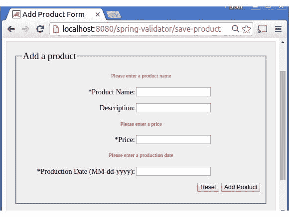

图 7.1：运行中的 `ProductValidator`

JSR 303，"Bean Validation"（发布于 2009 年 11 月）和 JSR 349，"Bean Validation 1.1"（发布于 2013 年 5 月）定义了一组通过注解对对象属性应用约束的 API。可以分别从以下 URL 下载 JSR 303 和 JSR 349。

```
http://jcp.org/en/jsr/detail?id=303
http://jcp.org/en/jsr/detail?id=349
```

当然，JSR 仅仅是一份规范文档，在有人编写了它的实现之前，它的作用有限。在 Bean 验证 JSR 中，目前有两个实现。第一个是 Hibernate Validator，目前版本为 5，它同时实现了 JSR 303 和 JSR 349。可以从该站点下载。

```
http://sourceforge.net/projects/hibernate/files/hibernate-validator/
```

第二个实现是 Apache BVal，可以从该站点下载。

```
http://bval.apache.org/downloads.html
```

使用 JSR 303 时，不需要编写验证器。相反，你通过使用 JSR 303 注解类型在领域类中嵌入约束。约束列表见表 7.1。

| 约束 | 描述 | 示例 |
| :--- | :--- | :--- |
| `@AssertFalse` | 应用于布尔属性。属性的值必须为 `false`。 | `@AssertFalse boolean hasChildren;` |
| `@AssertTrue` | 应用于布尔属性。属性的值必须为 `true`。 | `@AssertTrue boolean isEmpty;` |
| `@DecimalMax` | 属性的值必须是小于或等于指定值的小数。 | `@DecimalMax("1.1") BigDecimal price;` |
| `@DecimalMin` | 属性的值必须是大于或等于指定值的小数。 | `@DecimalMin("0.04") BigDecimal price;` |
| `@Digits` | 属性的值必须在指定的范围内。`integer` 属性指定数字的最大整数位数，`fraction` 属性指定数字的最大小数位数。 | `@Digits(integer=5, fraction=2) BigDecimal price;` |
| `@Future` | 属性的值必须是未来的日期。 | `@Future Date shippingDate;` |
| `@Max` | 属性的值必须是小于或等于指定值的整数 | `@Max(150) int age;` |
| `@Min` | 属性的值必须是大于或等于指定值的整数 | `@Min(0) int age;` |
| `@NotNull` | 属性不能为 `null` | `@NotNull String firstName;` |
| `@Null` | 属性必须为 `null` | `@Null String testString;` |
| `@Past` | 属性的值必须是过去的日期。 | `@Past Date birthDate;` |
| `@Pattern` | 属性的值必须匹配指定的正则表达式 | `@Pattern(regext="\\d{3}") String areaCode;` |
| `@Size` | 属性的大小必须在指定的范围内。 | `@Size(min=2, max=140) String description;` |

表 7.1: JSR 303 约束

一旦你理解了它的工作原理，JSR 303 验证就比 Spring 验证器更容易使用。与 Spring 验证器一样，你可以在属性文件中使用如下格式的属性键来覆盖 JSR 303 验证器的错误消息。

```
constraint.object.property
```

例如，要覆盖由 `@Size` 约束 `Product` 对象的 `name` 属性产生的消息，请在属性中使用此键。

```
Size.product.name
```

要覆盖由 `@Past` 约束 `Product` 对象的 `productionDate` 属性产生的消息，请使用此键。

```
Past.product.productionDate
```


## JSR 303 验证器示例

`jsr303-validator` 应用程序展示了 JSR 303 输入验证。该应用程序是 `spring-validator` 的修改版本，有几处不同。首先，没有 `ProductValidator` 类。其次，来自 Hibernate Validator 库的 jar 文件已添加到 `WEB-INF/lib` 中。

列表 7.6 显示了 `Product` 类，其名称和 `productionDate` 字段已使用 JSR 303 注解类型标记。

**列表 7.6: jsr303-validator 中的 Product 类**

```java
package domain;

import java.io.Serializable;
import java.math.BigDecimal;
import java.time.LocalDate;
import javax.validation.constraints.Past;
import javax.validation.constraints.Size;

public class Product implements Serializable {
    private static final long serialVersionUID = 78L;

    @Size(min=1, max=10)
    private String name;
    private String description;
    private BigDecimal price;

    @Past
    private LocalDate productionDate;

    // getters and setters not shown
}
```

在 `ProductController` 类的 `saveProduct` 方法中，你必须在 `Product` 参数上标记 `@Valid`，如列表 7.7 所示。

**列表 7.7: jsr303-validator 中的 ProductController 类**

```java
package controller;

import javax.validation.Valid;
import org.apache.commons.logging.Log;
import org.apache.commons.logging.LogFactory;
import org.springframework.stereotype.Controller;
import org.springframework.ui.Model;
import org.springframework.validation.BindingResult;
import org.springframework.validation.FieldError;
import org.springframework.web.bind.annotation.ModelAttribute;
import org.springframework.web.bind.annotation.RequestMapping;
import domain.Product;

@Controller
public class ProductController {
    private static final Log logger = LogFactory.getLog(ProductController.class);

    @RequestMapping(value = "/add-product")
    public String inputProduct(Model model) {
        model.addAttribute("product", new Product());
        return "ProductForm";
    }

    @RequestMapping(value = "/save-product")
    public String saveProduct(@Valid @ModelAttribute Product product, BindingResult bindingResult, Model model) {
        if (bindingResult.hasErrors()) {
            FieldError fieldError = bindingResult.getFieldError();
            logger.info("Code:" + fieldError.getCode() + ", object:"
                    + fieldError.getObjectName() + ", field:" + fieldError.getField());
            return "ProductForm";
        }
        // save product here
        model.addAttribute("product", product);
        return "ProductDetails";
    }
}
```

要自定义验证器的消息，在 `messages.properties` 中使用了键。该文件见列表 7.8。

**列表 7.8: jsr303-validator 中的 messages.properties**

```properties
productName.required=请输入产品名称
price.required=请输入价格
price.negative=价格不能小于 0
productionDate.required=请输入生产日期
productionDate.invalid=请确保生产日期不晚于今天
typeMismatch.productionDate=日期格式无效
Past.productionDate=生产日期必须是过去的日期
```

要测试 `jsr303-validator` 中的验证器，将浏览器指向此 URL：

```
http://localhost:8080/jsr303-validator/add-product
```

注意，在编写本书时 Hibernate Validator 的最新版本（5.2.4）令人惊讶地仍然无法验证带有 `@Past` 或 `@Future` 注解的 `LocalDate` 或 `LocalDateTime` 类型字段。这很遗憾，因为 `LocalDate` 作为新 Java 日期 API 的类型，应该替代 `java.util.Date`。因此，该项目包含一个自定义验证器和 Hibernate Validator `ConstraintHelper` 类的重写。希望 Hibernate Validator 的下一个版本能够验证 `LocalDate` 和相关类。

## 总结

在本章中，你学习了在 Spring MVC 应用中使用的两种验证器：Spring MVC 验证器和 JSR 303 验证器。由于 JSR 303 是正式的 Java 规范，因此 JSR 303 验证器是新项目推荐的验证方法。

# 第 8 章

## 表达式语言

JSP 2.0 中最重要的特性之一是表达式语言（Expression Language，EL），JSP 作者可以使用它来访问应用程序数据。EL 的灵感来源于 ECMAScript 和 XPath 表达式语言，旨在能够轻松地编写无脚本的 JSP 页面，即不使用 JSP 声明、表达式或脚本段（scriptlets）的页面。（第 11 章“应用设计”解释了为什么无脚本的 JSP 页面被认为是一种良好的实践。）

本章展示了如何使用 EL 表达式在 JSP 页面显示数据和对象属性。它涵盖了该技术的最新版本 EL 3.0。

本章中的所有示例都可以在随书压缩包中的 `el-demo` 项目中找到。

## 表达式语言简史

被引入 JSP 2.0 的 EL 首次出现在 JSP 标准标签库（JSTL）1.0 规范中。JSP 1.2 程序员可以通过在他们的应用程序中导入标准库来使用该语言。JSP 2.0 及后续版本的开发者可以在没有 JSTL 的情况下使用 EL，尽管在许多应用程序中仍然需要 JSTL，因为它包含其他与 EL 无关的标签。

JSP 2.1 和 JSP 2.2 中的 EL 尝试统一 JSP 2.0 中的 EL 与 JavaServer Faces (JSF) 1.0 中定义的表达式语言。由于 JSP 1.2 缺乏集成的表达式语言，且 JSP 2.0 的 EL 并未满足 JSF 的所有要求，因此为 JSF 1.0 开发了 EL 的变体。这两种语言变体后来被统一了。

从 2013 年 5 月根据 JSR 341 发布的 3.0 版本开始，EL 不是 JSP 或任何其他技术的一部分。作为一个独立的规范，EL 3.0 增加了对 lambda 表达式的支持并允许集合操作。EL 3.0 中的 lambda 支持不需要 Java SE 8，Java SE 7 就已经足够。

## 表达式语言语法

EL 表达式可以使用以下两种结构之一来指定：

```
${expression}
#{expression}
```

例如，要编写表达式 `x+y`，你使用以下结构：

```
${x+y}
```

或者

```
#{x+y}
```

`${exp}` 和 `#{exp}` 结构被 EL 引擎以相同的方式评估。然而，当 EL 不作为独立引擎使用，而是与底层技术（如 JSF 或 JSP）一起使用时，该技术可能会不同的解释这些结构。例如，在 JSF 中，`${exp}` 结构用于立即求值，`#{expr}` 结构用于延迟求值。如果表达式在系统需要其值之前不评估，则该表达式使用延迟求值。相反，需要立即求值的表达式在包含它的 JSP 页面编译时编译，并在 JSP 页面执行时执行。此外，在 JSP 2.1 及更高版本中，`#{exp}` 表达式仅允许在接受延迟表达式的属性中使用，不能在其他地方使用。

连接两个表达式是常见的。表达式序列将从左到右求值、强制转换为字符串并拼接。如果 `a+b` 等于 8 且 `c+d` 等于 10，以下两个表达式将产生 810：

```
${a+b}${c+d}
```

而 `${a+b}and${c+d}` 的结果是 `8and10`。

如果 EL 表达式用在自定义标签的属性值中，该表达式将进行求值，生成的字符串将强制转换为属性的预期类型：

```
<my:tag someAttribute="${expression}"/>
```

字符序列 `${` 表示 EL 表达式的开始。如果你想发送的是字面量 `${`，则需要对第一个字符进行转义：`\${`。

## 保留字

以下单词是保留的，不能作为标识符使用：

```
and eq gt true instanceof
or ne le false empty
not lt ge null div mod
```

## `[]` 和 `.` 运算符

EL 表达式可以返回任何类型。如果 EL 表达式的结果是一个具有属性的对象，你可以使用 `[]` 或 `.` 运算符来访问该属性。`[]` 和 `.` 运算符的功能是等价的；`[]` 是一种更通用的形式，但 `.` 提供了一个方便的快捷方式。

要访问对象的属性，你使用以下形式之一：

```
${object["propertyName"]}
${object.propertyName}
```

然而，只有当 `propertyName` 不是有效的 Java 变量名时，你才能使用 `[]` 运算符。例如，以下两个 EL 表达式可以用于访问隐式对象 `header` 中的 HTTP 请求头 `host`：

```
${header["host"]}
${header.host}
```

然而，要访问 `accept-language` 请求头，你只能使用 `[]` 运算符，因为 `accept-language` 不是合法的 Java 变量名。使用 `.` 运算符访问它会导致抛出异常。

如果对象的属性恰好返回另一个对象，该对象又有属性，你可以使用 `[]` 或 `.` 来访问第二个对象的属性。例如，隐式对象 `pageContext` 代表当前 JSP 的 `PageContext` 对象。它有 `request` 属性，代表 `HttpServletRequest`。`HttpServletRequest` 有 `servletPath` 属性。以下表达式是等价的，结果为 `HttpServletRequest` 的 `servletPath` 属性值：

```
${pageContext["request"]["servletPath"]}
${pageContext.request["servletPath"]}
${pageContext.request.servletPath}
${pageContext["request"].servletPath}
```

要访问会话，使用此语法：

```
${pageContext.session}
```

例如，这打印会话标识符：

```
${pageContext.session.id}
```

## 评估规则

（注：此节提供的文本在此处出现了大量重复，我已根据提供的片段清理了逻辑。）

[由于源文本在此处存在严重重复，省略详细细节]

## 访问 JavaBeans

你可以使用 `.` 运算符或 `[]` 运算符来访问 bean 的属性。以下是结构：

```
${beanName["propertyName"]}
${beanName.propertyName}
```

例如，要访问名为 `myBean` 的 bean 的属性 `secret`，使用以下表达式：

```
${myBean.secret}
```

如果属性是另一个具有属性的对象，你同样可以使用 `.` 或 `[]` 来访问第二个对象的属性。或者，如果属性是 Map、List 或数组，你可以使用上一节说明的规则来访问 Map 的值或 List 的成员或数组的元素。

## EL 隐式对象

从 JSP 页面可以使用 JSP 脚本访问 JSP 隐式对象。然而，从无脚本的 JSP 页面，无法访问这些隐式对象。EL 通过提供一组自己的隐式对象允许访问各种对象。EL 隐式对象列在表 8.1 中。

**表 8.1: EL 隐式对象**

| 对象 | 描述 |
| :--- | :--- |
| `pageContext` | 当前 JSP 的 `javax.servlet.jsp.PageContext` 对象。 |
| `initParam` | 一个 Map，包含所有的上下文初始化参数，以参数名作为键。 |
| `param` | 一个 Map，包含所有的请求参数，以参数名作为键。每个键的值是指定名称的第一个参数值。因此，如果有两个同名的请求参数，则只能通过 `param` 对象获取第一个。若要访问所有相同名称的参数值，请使用 `params` 对象。 |
| `paramValues` | 一个 Map，包含所有的请求参数，以参数名作为键。每个键的值是一个字符串数组，其中包含指定参数名称的所有值。如果该参数只有一个值，它仍会返回一个包含一个元素的数组。 |
| `header` | 一个 Map，包含请求头信息，以请求头名称作为键。每个键的值是指定请求头名称的第一个请求头。换句话说，如果一个请求头有多个值，则只返回第一个值。要获取多值请求头，请使用 `headerValues` 对象。 |
| `headerValues` | 一个 Map，包含所有的请求头信息，以请求头名称作为键。每个键的值是一个字符串数组，其中包含指定请求头名称的所有值。如果请求头只有一个值，它将返回一个单元素数组。 |
| `cookie` | 一个 Map，包含当前请求对象中所有的 `Cookie` 对象。Cookie 的名称是 Map 的键，每个键都映射到一个 `Cookie` 对象。 |
| `applicationScope` | 一个 Map，包含 `ServletContext` 对象中的所有属性，以属性名作为键。 |
| `sessionScope` | 一个 Map，包含 `HttpSession` 对象中的所有属性，以属性名作为键。 |
| `requestScope` | 一个 Map，包含当前 `HttpServletRequest` 对象中的所有属性，以属性名作为键。 |
| `pageScope` | 一个 Map，包含所有具有页面范围的属性。属性名称是 Map 的键。 |

每个隐式对象都将在以下子节中给出介绍。

### pageContext

`pageContext` 对象表示当前 JSP 页面的 `javax.servlet.jsp.PageContext`。它包含了所有其他 JSP 隐式对象，详见表 8.2。

**表 8.2: JSP 隐式对象**

| 对象 | 来自 EL 的类型 |
| :--- | :--- |
| `request` | `javax.servlet.http.HttpServletRequest` |
| `response` | `javax.servlet.http.HttpServletResponse` |
| `out` | `javax.servlet.jsp.JspWriter` |
| `session` | `javax.servlet.http.HttpSession` |
| `application` | `javax.servlet.ServletContext` |
| `config` | `javax.servlet.ServletConfig` |
| `pageContext` | `javax.servlet.jsp.PageContext` |
| `page` | `javax.servlet.jsp.HttpJspPage` |
| `exception` | `java.lang.Throwable` |

例如，您可以使用以下表达式之一获取当前的 `ServletRequest`：


`${pageContext.request}`

`${pageContext["request"]}`

此外，可以使用以下任何一个表达式获取请求方法：

```
${pageContext["request"]["method"]}
${pageContext["request"].method}
${pageContext.request["method"]}
${pageContext.request.method}
```

表 8.3 列出了 `pageContext.request` 的有用属性。

| 属性 | 说明 |
| :--- | :--- |
| `characterEncoding` | 请求中使用的字符编码 |
| `contentType` | 请求的 MIME 类型 |
| `locale` | 浏览器的首选语言 |
| `locales` | 包含所有用户语言的枚举 (Enumeration) |
| `protocol` | 用于发送请求的 HTTP 协议，例如 HTTP/1.1 |
| `remoteAddr` | 客户端的 IP 地址 |
| `remoteHost` | 客户端的主机或 IP 地址 |
| `scheme` | 用于发送请求的方案，例如 HTTP 或 HTTPS |
| `serverName` | 服务器主机名 |
| `serverPort` | 服务器端口号 |
| `secure` | 请求是否通过安全通道发送 |

表 8.3: `pageContext.request` 的有用属性

请求参数的访问频率比其他隐式对象更高，因此提供了两个隐式对象：`param` 和 `paramValues`。`param` 和 `paramValues` 隐式对象将在“param”和“paramValues”节中讨论。

### initParam

`initParam` 隐式对象用于获取上下文参数的值。例如，要访问名为 `password` 的上下文参数，您可以使用以下表达式：

```
${initParam.password}
```

或者

```
${initParam["password"]}
```

### param

`param` 隐式对象用于获取请求参数。该对象表示包含所有请求参数的 Map。例如，要获取名为 `userName` 的参数，使用以下任意一种：

```
${param.userName}
${param["userName"]}
```

### paramValues

您使用 `paramValues` 隐式对象来获取请求参数的值。该对象表示包含所有请求参数的 Map，以参数名作为键。每个键的值是一个字符串数组，其中包含指定参数名称的所有值。如果该参数只有一个值，它仍会返回一个包含一个元素的数组。例如，要获取 `selectedOptions` 参数的第一和第二个值，您可以使用以下表达式：

```
${paramValues[0]}
${paramValues[1]}
```

### header

`header` 隐式对象表示包含所有请求头的 Map，以请求头名称作为键。要获取请求头值，请使用请求头名称作为键。例如，要获取 `accept-language` 请求头，使用以下表达式：

```
${header["accept-language"]}
```

如果请求头名称是有效的 Java 变量名（例如 `connection`），您可以使用 `.` 运算符：

```
${header.connection}
```

### headerValues

`headerValues` 隐式对象表示包含所有请求头的 Map，以请求头名称作为键。与 `header` 不同，`headerValues` 对象返回一个数组。例如，要获取 `accept-language` 请求头的第一个值，使用此表达式：

```
${headerValues["accept-language"][0]}
```

### cookie

您使用 `cookie` 隐式对象来获取 cookie。该对象表示包含当前请求中所有 cookie 的 Map。例如，要获取名为 `jsessionid` 的 cookie 值，使用以下表达式：

```
${cookie.jsessionid.value}
```

要获取 `jsessionid` cookie 的路径值，请使用：

```
${cookie.jsessionid.path}
```

### applicationScope, sessionScope, requestScope and pageScope

您使用 `applicationScope` 隐式对象来获取作用范围变量的值。例如，如果您有一个名为 `myVar` 的作用范围变量，您可以使用此表达式访问该属性：

```
${applicationScope.myVar}
```

注意，在 servlet/JSP 编程中，作用范围对象是放在以下任何对象中的属性：`PageContext`、`ServletRequest`、`HttpSession` 或 `ServletContext`。`sessionScope`、`requestScope` 和 `pageScope` 隐式对象类似于 `applicationScope`，分别对应会话、请求和页面。

可以在 EL 表达式中不指定范围访问作用范围对象。在这种情况下，JSP 容器将从最窄范围（`PageContext`）到最宽范围（`ServletContext`）搜索第一个同名对象。例如，以下表达式将返回在任何范围内 `today` 标识的对象：

```
${today}
```

## 使用其他 EL 运算符

除了 `.` 和 `[]` 运算符外，EL 还提供了其他几种运算符：算术运算符、关系运算符、逻辑运算符、条件运算符和空运算符。使用这些运算符可以执行各种操作。然而，由于 EL 的目的是便于编写无脚本的 JSP 页面，除了条件运算符外，这些 EL 运算符的作用有限。

后续章节介绍了 EL 运算符。

### 算术运算符

有五种算术运算符：

* 加法 (`+`)
* 减法 (`-`)
* 乘法 (`*`)
* 除法 (`/` 和 `div`)
* 取模 (`%` 和 `mod`)

除法和取模运算符有两种形式，以与 XPath 和 ECMAScript 保持一致。

注意，EL 表达式的评估是从高优先级到低，然后从左到右。以下是按优先级递减排列的算术运算符：

* `/` `div` `%` `mod`
* `+` `-`

这意味着 `*`、`/`、`div`、`%` 和 `mod` 运算符的优先级相同，`+` 与 `-` 的优先级相同，但低于第一组。因此，表达式

```
${1+2*3}
```

结果为 7 而不是 6。

### 关系运算符

以下是关系运算符列表：

* 等于 (`==` 和 `eq`)
* 不等于 (`!=` 和 `ne`)
* 大于 (`>` 和 `gt`)
* 大于等于 (`>=` 和 `ge`)
* 小于 (`<` 和 `lt`)
* 小于等于 (`<=` 和 `le`)

例如，表达式 `${3==4}` 返回 `false`，`${“b”<”d”}` 返回 `true`。

### 逻辑运算符

这里是逻辑运算符列表：

* 与 (`&&` 和 `and`)
* 或 (`||` 和 `or`)
* 非 (`!` 和 `not`)

### 条件运算符

EL 条件运算符具有以下语法：

```
${statement? A:B}
```

如果 `statement` 评估求值结果为真，则表达式的输出为 `A`。否则，输出为 `B`。

例如，你可以使用以下 EL 表达式测试 `HttpSession` 是否包含名为 `loggedIn` 的属性。如果找到了该属性，则显示字符串“You have logged in”。否则，显示“You have not logged in”。

```
${(sessionScope.loggedIn==null)? "You have not logged in" :
        "You have logged in"}
```

### empty 运算符

空运算符用于检查值是否为 null 或为空。以下是空运算符的使用示例：

```
${empty X}
```

如果 `X` 为 null 或 `X` 为零长度字符串，则表达式返回 `true`。如果 `X` 是空 `Map`、空数组或空集合，它也会返回 `true`。否则，返回 `false`。

### 字符串拼接运算符

`+=` 运算符用于拼接字符串。例如，以下代码将打印 `a + b` 的值。

```
${a += b}
```

### 分号运算符

`;` 运算符用于分隔两个表达式。示例请参见本章节后面的“格式化日期”部分。

### 引用静态字段和方法

你可以引用任何 Java 类中定义的静态字段和方法。但在在 JSP 页面中引用静态字段或方法之前，你必须使用 `page` 指令导入该类或类包。`java.lang` 包是一个例外，因为它是自动导入的。

例如，下面的 page 指令导入了 `java.time` 包。

```jsp
<%@page import="java.time.*"%>
```

或者，你可以导入单个类，例如：

```jsp
<%@page import="java.time.LocalDate"%>
```

结果，你可以像这样引用 `LocalDate` 类的 `now()` 方法（这是一个静态方法）：

```jsp
Today is ${LocalDate.now()}
```

你将在本章节的后半部分学习如何格式化日期。

这是引用类静态成员和静态字段的另一个示例。

```jsp
<p>
    &radic;<span style="text-decoration:overline;">&nbsp;36&nbsp;</span>
    = ${Math.sqrt(36)}
</p>

<p>
    &pi; = ${Math.PI}
</p>
```

由于 `Math` 是 `java.lang` 的成员，你不需要导入这个类。图 8.1 显示了此代码在 JSP 页面中的渲染情况。

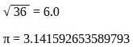

图 8.1：引用类的静态成员

另一种导入包的方法是在 `ServletContextListener` 监听器中程序化导入。代码列表 8.1 显示了一个导入两个包（`java.time` 和 `java.util`）的监听器。

代码列表 8.1：程序化导入类型

```java
package listener;

import javax.el.ELContextEvent;
import javax.servlet.ServletContextEvent;
import javax.servlet.ServletContextListener;
import javax.servlet.annotation.WebListener;
import javax.servlet.jsp.JspFactory;

@WebListener
public class ELImportListener implements ServletContextListener {

    @Override
    public void contextInitialized(ServletContextEvent event) {
        JspFactory.getDefaultFactory().getJspApplicationContext(
                event.getServletContext()).addELContextListener(
                        (ELContextEvent e) -> {
                            e.getELContext().getImportHandler().                                    
                            importPackage("java.time");
                            e.getELContext().getImportHandler().
                            importPackage("java.util");
                        });
    }
}
```

与 `toList` 不同，`toArray` 不会打印元素。因此，`toList` 的用法比 `toArray` 更频繁。

### limit

`limit` 方法限制流中元素的数量。考虑以下名为 `cities` 的列表，它包含七个城市：

```
[Paris, Strasbourg, London, New York, Beijing, Amsterdam, San Francisco]
```

以下代码将元素数量限制为三个。

```
${cities.stream().limit(3).toList()}
```

执行时，表达式将返回此列表：

```
[Paris, Strasbourg, London]
```

如果传递给 `limit()` 的参数大于元素数量，则将返回所有元素。

### sorted

此方法对流中的元素进行排序。例如，此表达式

```
${cities.stream().sorted().toList()}
```

返回这个已排序的列表。

```
[Amsterdam, Beijing, London, New York, Paris, San Francisco, Strasbourg]
```

### average

此方法返回流中所有元素的平均值。返回值是一个 `Optional` 对象，它封装了一个可能为 `null` 的对象。你需要调用 `get()` 来获取实际值。

例如，此表达式返回 4.0：

```
${[1, 3, 5, 7].stream().average().get()}
```

### sum

此方法计算流中所有元素的总和。例如，此表达式返回 16。

```
${[1, 3, 5, 7].stream().sum()}
```

### count

此方法返回流中元素的数量。例如，此表达式返回 7。

```
${cities.stream().count()}
```

### min

此方法返回流元素中的最小值。与 `average` 类似，返回值是一个 `Optional` 对象，因此你需要调用 `get()` 来获取实际值。

例如，此表达式返回 1。

```
${[1,3,100,1000].stream().min().get()}
```

### max

此方法返回流元素中的最大值。与 `average` 类似，返回值是一个 `Optional` 对象，因此你需要调用 `get()` 来获取实际值。

例如，此表达式返回 1000。

```
${[1,3,100,1000].stream().max().get()}
```

### map

此方法对流中的每个元素进行映射，并返回另一个包含映射结果流。此方法接受一个用于映射的 lambda 表达式。

例如，此 `map` 方法接收 lambda 表达式 `x -> 2 * x`，它实际上将每个元素翻倍，并在新流中返回它们。

```
${[1, 3, 5].stream().map(x -> 2 * x).toList()}
```

如果执行，此表达式返回此列表：

```
[2, 6, 10]
```

另一个例子是此 `map` 方法将字符串流转换为大写。

```
${cities.stream().map(x -> x.toUpperCase()).toList()}
```

它返回以下列表。

```
[PARIS, STRASBOURG, LONDON, NEW YORK, BEIJING, AMSTERDAM, SAN FRANCISCO]
```

### filter

此方法根据 lambda 表达式过滤流中的所有元素，并返回包含通过测试元素的新流。

例如，以下表达式测试城市是否以“S”开头，并返回所有符合条件的城市。

```
${cities.stream().filter(x -> x.startsWith("S")).toList()}
```

这是它产生的列表：

```
[Strasbourg, San Francisco]
```

### forEach

此方法对流中的所有元素执行操作。它返回 `void`。

例如，此表达式将 `cities` 中的所有元素打印到控制台。

```
${cities.stream().forEach(x -> System.out.println(x))}
```

## Formatting Collections

由于 EL 定义的是如何编写表达式而不是函数，意料之中，没有可以直接可以直接用于打印或格式化集合。毕竟，打印和格式化不是 EL 的领域。然而，打印和格式化是两个不能忽略的任务。

如果你是 EL 3.0 的新手但熟悉 JSP，格式化集合的最简单方法是使用 JSTL，它在第 6 章“JSTL”中讨论过。然而，这将很遗憾，因为有了如此强大的功能，仅靠 EL 3.0 就足够解决这些问题并让我们完全抛弃 JSTL。

EL 3.0 规范没有提到关于格式化集合。然而，EL 3.0 的新功能强大足以提供这样的机会。例如，你可能会尝试 `forEach`，它乍看起来与 JSTL 的 `forEach` 类似。事实上，以下代码在 Tomcat 8 中可以工作。

```
${cities.stream().forEach(x -> pageContext.out.println(x))}
```


遗憾的是，这在 GlassFish 4 中不起作用，所以`forEach`被排除。

我最终想出的两个解决方案没有`forEach`那么简洁，但至少它们在所有主要的 servlet 容器中运行。第一个方案适用于 Java SE 7。第二个方案可以说比第一个方案更优雅，但仅适用于 Java SE 8。

它们是这样的。

## 使用 HTML 注释

列表的字符串表示如下：

```
[ element-1, element-2, ... ]
```

现在，如果我想以 HTML 列表的形式呈现元素，我需要这样写。

例如，以下表达式将返回一个带有两个小数点的双精度点数字。

```
${String.format("%-10.2f%n", 125.178)}
```

更多格式化规则可以在`java.text.DecimalFormat`的 JavaDoc 中找到。

## 格式化日期

你还可以使用`String.format()`来格式化日期和时间。例如，以下表达式格式化了一个日期。

```
${d = LocalDate.now().plusDays(2); String.format("%tB %te, %tY%n", d, d, d)}
```

首先，评估`LocalDate.now().plusDays(2)`并将其返回值存储在`d`中。接下来，使用`String.format()`对`LocalDate`进行格式化，其中引用了三次`d`。

更多关于日期格式化的规则可以在此处找到：

```
https://docs.oracle.com/javase/tutorial/java/data/numberformat.html
```

## 在 JSP 2.0 及更高版本中配置 EL

通过 EL、`JavaBeans`和自定义标签，现在可以编写不包含脚本的 JSP 页面。JSP 2.0 及更高版本甚至提供了一个禁用所有 JSP 页面中脚本的开关。软件架构师现在可以强制编写不包含脚本的 JSP 页面。

另一方面，在某些情况下，你可能想禁用应用程序中的 EL。例如，如果你正在使用符合 JSP 2.0 标准的容器但尚未准备好升级到 JSP 2.0，你就希望这样做。在这种情况下，你可以禁用 EL 表达式的评估。

本节讨论了如何强制不包含脚本的 JSP 页面以及如何在 JSP 2.0 及更高版本中禁用 EL。

## 实现不包含脚本的 JSP 页面

要禁用 JSP 页面中的脚本元素，请使用带有两个子元素`url-pattern`和`scripting-invalid`的`jsp-property-group`元素。`url-pattern`元素定义适用于禁用脚本的 URL 模式。以下是在应用程序中禁用所有 JSP 页面脚本的方法：

```
<jsp-config>
    <jsp-property-group>
        <url-pattern>*.jsp</url-pattern>
        <scripting-invalid>true</scripting-invalid>
    </jsp-property-group>
</jsp-config>
```

### 注意

部署描述符中只能有一个`jsp-config`元素。如果你已经指定了`jsp-property-group`来停用 EL，你必须在同一个`jsp-config`元素下编写用于禁用脚本的`jsp-property-group`。

## 禁用 EL 评估

在某些情况下（例如当需要在 JSP 2.0 或更高容器中部署 JSP 1.2 应用程序时），你可能想禁用 JSP 页面中的 EL 评估。当你这样做时，EL 结构的出现不会被作为 EL 表达式评估。在 JSP 中禁用 EL 评估有两种方法。

首先，你可以将页面指令的`isELIgnored`属性设置为`true`，如下所示：

```
<%@ page isELIgnored="true" %>
```

`isELIgnored`属性的默认值为`false`。如果你想在一个或几个 JSP 页面中禁用 EL 评估，建议使用`isELIgnored`属性。

其次，你可以在部署描述符中使用`jsp-property-group`元素。`jsp-property-group`元素是`jsp-config`元素的子元素。你使用`jsp-property-group`为应用程序中的一组 JSP 页面应用某些设置。

要使用`jsp-property-group`元素禁用 EL 评估，你必须有两个子元素：`url-pattern`和`el-ignored`。`url-pattern`元素指定适用于 EL 禁用的 URL 模式。`el-ignored`元素必须设置为`true`。

例如，以下如何在名为`noEl.jsp`的 JSP 页面中禁用 EL 评估。

```
<jsp-config>
    <jsp-property-group>
        <url-pattern>/noEl.jsp</url-pattern>
        <el-ignored>true</el-ignored>
    </jsp-property-group>
</jsp-config>
```

你还可以通过将`*.jsp`分配给`url-pattern`元素来禁用应用程序中所有 JSP 页面的 EL 评估，如下：

```
<jsp-config>
    <jsp-property-group>
        <url-pattern>*.jsp</url-pattern>
        <el-ignored>true</el-ignored>
    </jsp-property-group>
</jsp-config>
```

如果 JSP 页面页面指令的`isELIgnored`属性设置为`true`，或者其 URL 匹配`jsp-property-group`元素中`el-ignored`子元素设置为`true`的模式，则 JSP 页面中的 EL 评估将被禁用。例如，如果你将 JSP 页面指令的`isELIgnored`属性设置为`false`，但其 URL 匹配部署描述符中必须禁用 EL 评估的 JSP 页面模式，则该页面的 EL 评估将被禁用。此外，如果你使用符合 Servlet 2.3 或更早版本的部署描述符，即使你正在使用 JSP 2.0 或更高容器，EL 评估默认也是禁用的。

## 总结

EL 是 JSP 2.0 及更高版本中最重要的功能之一。它可以帮助你编写更短、更有效的 JSP 页面，并帮助你访问。

# 第 9 章：JSTL

JavaServer Pages 标准库 (JSTL) 是一组标签库，用于解决诸如迭代、条件测试、XML 处理和数据库访问的问题。本章将讨论 JSTL 中最重要的标签，特别是那些用于迭代和条件测试的标签。

## 下载 JSTL

JSTL 目前是 1.2 版本，由 Java Community Process (`www.jcp.org`) 专家小组定义。实现可以从`java.net`下载。你需要下载两个软件部分：JSTL API 和 JSTL 实现。JSTL API 包含`javax`包，它由 JSTL 规范定义的类型。JSTL 实现包含类。

## JSTL 库

JSTL 被称为标准标签库；然而，它通过多个标签库暴露其操作。JSTL 1.2 中的标签可以分为五个区域，如表 9.1 所示。

| 区域 | 子功能 | URI | 前缀 |
| :--- | :--- | :--- | :--- |
| Core | 变量支持 | `http://java.sun.com/jsp/jstl/core` | `c` |
| 流程控制 | | | |
| URL 管理 | | | |
| 其他 | | | |
| XML | Core | `http://java.sun.com/jsp/jstl/xml` | `x` |
| 流程控制 | | | |
| 转换 | | | |
| I18n | 区域化 | `http://java.sun.com/jsp/jstl/fmt` | `fmt` |
| 消息格式化 | | | |
| 数字和日期格式化 | | | |
| 数据库 | SQL | `http://java.sun.com/jsp/jstl/sql` | `sql` |
| 函数 | 集合长度 | `http://java.sun.com/jsp/jstl/functions` | `fn` |
| 字符串操作 | | | |

表 9.1：JSTL 标签库

要在 JSP 页面中使用 JSTL 库，请使用以下格式的 taglib 指令：

```
<%@ taglib uri="uri" prefix="prefix" %>
```

例如，为了使用 Core 库，在 JSP 页面开头声明：

```
<%@ taglib uri="http://java.sun.com/jsp/jstl/core" prefix="c" %>
```

前缀可以是任意的。但是，使用约定会让团队其他开发者以及以后加入项目的人看起来更加熟悉。因此，建议使用指定的在前缀。

### 注意

本章讨论的每个标签都将在各自的节中介绍，并且每个标签的属性将列在表中。属性名称后的星号`*`表示该属性是必需的。加号`+`表示该属性的`rtexprvalue`元素值为`true`，这意味着该属性可以分配静态字符串或动态值（Java 表达式、表达式语言表达式，或通过`<jsp:attribute>`设置的值）。`rtexprvalue`的值为`false`则意味着该属性只能分配静态字符串。

JSTL 标签的主体内容可以是空的、JSP 格式或标签依赖（tagdependent）的。

## 通用动作

下一节将讨论 Core 库中用于操作作用域变量的三个通用动作：`out`、`set`、`remove`。

## out 标签

`out`标签评估一个表达式并将结果输出到当前的`JspWriter`。`out`的语法有两种形式，包含和不包含主体内容（body content）：

```xml
<c:out value="value" [escapeXml="{true|false}"]
        [default="defaultValue"]/>
```

```xml
<c:out value="value" [escapeXml="{true|false}"]>
    default value
</c:out>
```

### 注意

在标签的语法中，`[ ]`表示可选属性。带有下划线的值（如果有）表示默认值。

`out`的主体内容是 JSP。标签的属性列表如表 9.2 所示。

| 属性 | 类型 | 描述 |
| :--- | :--- | :--- |
| value*+ | Object | 要评估的表达式。 |
| escapeXml+ | boolean | 表示结果中的字符`<`, `>`, `&`, `'`和`"`是否将转换为相应的字符实体代码，例如将`<`转换为`&lt;`等。 |
| default+ | Object | 默认值 |

表 9.2：`out`标签的属性。

例如，以下`out`标签打印作用域变量`x`的值：

```xml
<c:out value="${x}"/>
```

默认情况下，`out`将特殊字符`<`, `>`, `'`, `"`和`&`分别编码为它们对应的字符实体代码`&lt;`、`&gt;`、`&#039;`、`&#034;`和`&amp;`。

在 JSP 2.0 之前，`out`标签是打印作用域对象值的简单方法。在 JSP 2.0 或更高版本中，除非你需要对值进行 XML 转义，否则可以安全地使用 EL 表达式：

```xml
${x}
```

### 警告

如果包含一个多个特殊字符的字符串未经过 XML 转义，其值在浏览器中可能无法渲染。此外，未转义的特殊字符会使你的网站受到跨站脚本攻击，即有人可以发布一个自动执行的 JavaScript 函数/表达式。

`out`中的`default`属性允许你分配一个默认值，如果分配给`value`属性的 EL 表达式返回`null`，则显示该值。`default`属性可以分配动态值。如果此动态值返回`null`，`out`标签将显示空字符串。

例如，在以下`out`标签中，如果在`HttpSession`中找不到变量`myVar`，则显示应用作用域变量`myVar`的值。如果后者也未找到，则向输出发送一个空字符串。

```xml
<c:out value="${sessionScope.myVar}" 
        default="${applicationScope.myVar}"/>
```

## url 标签

`url`标签非常有用。简而言之，该标签执行以下两种操作之一：

* 如果当前上下文路径为`/`（即应用作为默认上下文部署），它会在指定的路径前加上一个空字符串。
* 如果当前上下文路径不是`/`，它会在指定的路径前加上上下文路径。

为什么这非常重要，可以通过展示一个小应用程序来解释，其结构如图 9.1 所示。

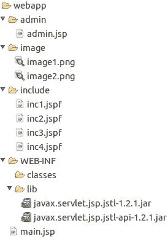

图 9.1：示例程序的结构。

该应用程序由两个 JSP 页面组成：`main.jsp`和`admin.jsp`。`main.jsp`文件位于应用程序根目录下，`admin.jsp`文件位于`admin`文件夹中。两者都需要显示`image`文件夹中的两个图片：`image1.png`和`image2.png`。注意，图片的绝对路径如下：

```
http://host/context/image/image1.png
http://host/context/image/image2.png
```

由于两张图片从不同的位置被多次引用，因此从一个包含文件中引用它们并将该包含文件添加到任何需要显示图片的页面中是方便的。`include`文件夹中的四个包含文件描述了实现此目的四次尝试。

列表 9.1 显示了第一个包含文件`inc1.jspf`的内容。

列表 9.1：inc1.jsp 的内容

```xml
inc1.jsp


```

你可以看到，第一个包含文件包含了相对于当前页面的路径。假设`main.jsp`页面的 URL 为`http://host/context/main.jsp`，两张图片的 URL 将解析为这些 URL：

```
http://host/context/image/image1.png 
http://host/context/../image/image2.png
```

不难想象结果并不如意。第一张图片按预期显示，但第二张图片没有。

可以使用`http://host/context/admin/admin.jsp`调用管理页面。从该页面引用时，图片的 URL 如下。

图 9.2：引用图片的四种尝试

如你所见，只有`inc3.jspf`和`inc4.jspf`（分别使用`url`标签和`EL`）可以工作。

## set 标签

你可以使用`set`标签执行以下操作：

1. 创建一个字符串和一个引用该字符串的作用域变量。
2. 创建一个引用现有作用域对象的作用域变量。
3. 设置作用域对象的属性。

如果使用`set`创建作用域变量，则该变量在标签出现后可以在同一个 JSP 页面中任何地方使用。

`set`标签的语法有四种形式。第一种形式用于创建一个作用域变量，其中`value`属性指定要创建的字符串或现有的作用域对象。

```
<c:set value="value"  var="varName"
        [scope="{page|request|session|application}"]/>
```

其中`scope`属性指定作用域变量的作用范围。例如，以下`set`标签创建了字符串“The wisest fool”并将其赋值给新创建的页面作用域变量`foo`。

```
<c:set var="foo" value="The wisest fool"/>
```

以下`set`标签创建了一个名为`job`的作用域变量，它引用请求作用域对象`position`。变量`job`具有页面作用域。

```
<c:set var="job" value="${requestScope.position}" scope="page"/>
```

### 注意

最后一个示例可能有点困惑，因为它创建了一个引用请求作用域对象的页面作用域变量。如果你记住作用域对象本身并不是真的“位于”`HttpServletRequest`，这种情况就不会发生。相反，存在一个名为`position`的引用指向该对象。通过上一个示例中的`set`标签，你只是在创建另一个引用相同对象的作用域变量（`job`）。

第二种形式与第一种形式相似，但要创建的字符串或要引用的作用域对象是通过主体内容传递。

```
<c:set var="varName" [scope="{page|request|session|application}"]>
    body content
</c:set>
```

第二种形式允许你在主体内容中包含 JSP 代码。

第三种形式设置作用域对象属性的值。`target`属性指定作用域对象，`property`属性指定作用域对象的属性。赋值给属性的值由`value`属性指定。

```
<c:set target="target" property="propertyName" value="value"/>
```


例如，以下`set`标签将字符串“Tokyo”赋值给作用域对象`address`的`city`属性。

```
<c:set target="${address}" property="city" value="Tokyo"/>
```

注意，你必须在`target`属性中使用`EL`表达式来引用作用域对象。

第四种形式与第三种形式相似，但要赋值的值是通过主体内容传递。

```
<c:set target="target" property="propertyName">
    body content
</c:set>
```

例如，以下`set`标签将字符串“Beijing”赋值给作用域对象`address`的`city`属性。

```
<c:set target="${address}" property="city">Beijing</c:set>
```

`set`标签的属性列表见表 9.3。

| 属性 | 类型 | 描述 |
| :--- | :--- | :--- |
| `value+` | `Object` | 要创建的字符串、要引用的作用域对象、或新的属性值。 |
| `var` | `String` | 要创建的作用域变量。 |
| `scope` | `String` | 新创建的作用域变量的作用范围。 |
| `target+` | `Object` | 将对其属性赋值新值的作用域对象；这必须是一个`JavaBeans`实例或一个`java.util.Map`对象。 |
| `property+` | `String` | 要赋予新属性的属性名称。 |

表 9.3：`set`标签的属性

## remove 标签

你使用`remove`标签来移除作用域变量。语法如下：

```
<c:remove var="varName" 
        [scope="{page|request|session|application}"]/>
```

注意，作用域变量引用的对象并被移除。因此，如果另一个作用域变量也引用同一个对象，你仍然可以通过另一个作用域变量访问该对象。

`remove`标签的属性列表见表 9.4。

| 属性 | 类型 | 描述 |
| :--- | :--- | :--- |
| `var` | `String` | 要移除的作用域变量的名称。 |
| `scope` | `String` | 要移除的作用域变量的作用范围。 |

表 9.4：`remove`标签的属性

例如，以下`remove`标签移除了页面作用域变量`job`。

```
<c:remove var="job" scope="page"/>
```

## 条件动作

条件动作用于处理页面输出取决于某些输入值的情况，在 Java 中，这些情况使用`if`、`if ... else`和`switch`语句来解决。

JSTL 中四个执行条件动作的标签：`if`、`choose`、`when`和`otherwise`。每个将在下文节中进行讨论。

## if 标签

`if`标签测试一个条件，如果条件求值为真，则处理其主体内容。`if`标签的语法有两种形式。第一种形式没有主体内容，通过`var`属性指定作用域变量，并通过`scope`属性决定作用范围：

```
<c:if test="condition" var="varName" scope="page"/>
```

第二种形式带有主体内容，如果条件求值为真，则处理主体内容：

```
<c:if test="condition" var="varName" scope="page">
    body content
</c:if>
```

`if`标签测试一个条件，如果条件求值为真，则处理其主体内容。测试结果存储在`Boolean`对象中，使用`var`属性指定作用域变量。`if`标签的属性见表 9.5。

| 属性 | 类型 | 描述 |
| :--- | :--- | :--- |
| `test+` | `Boolean` | 决定是否处理主体内容的条件。 |
| `var` | `String` | 引用条件值的作用域变量；其类型为`Boolean`。 |
| `scope` | `String` | `var`指定的作用范围。 |

表 9.5：`if`标签的属性

例如，以下`if`标签在存在请求参数`user`且值为`ken`，且存在请求参数`password`且值为`blackcomb`时，显示“You logged in successfully”。

```
<c:if test="${param.user=='ken' && param.password=='blackcomb'}">
    You logged in successfully.
</c:if>
```

为了模拟`else`，使用两个条件相反的`if`标签。例如，以下代码段在用户和密码参数分别为`ken`和`blackcomb`时显示“You logged in successfully”。否则，显示“Login failed”。

```
<c:if test="${param.user=='ken' && param.password=='blackcomb'}">
    You logged in successfully.
</c:if>

<c:if test="${!(param.user=='ken' && param.password=='blackcomb')}">
    Login failed.
</c:if>
```

以下`if`标签测试用户和密码参数分别为`ken`和`blackcomb`并将并将存储在页面作用域变量`loggedIn`中。然后你使用`EL`表达式在`loggedIn`变量为真时显示“You logged in successfully”，在为假时显示“Login failed”。

```
<c:if var="loggedIn"
        test="${param.user=='ken' && param.password=='blackcomb'}"/>
    ...
${(loggedIn)? "You logged in successfully" : "Login failed"}
```

## choose, when 和 otherwise 标签

`choose`和`when`标签的作用类似于 Java 中的`switch`和`case`关键字，即它们用于为互斥的条件执行提供上下文。`choose`标签内部必须嵌套一个或多个`when`标签，每个`when`标签代表一个可以求值并处理的用。`otherwise`标签用于默认条件块，当所有`when`标签的测试条件都不为真时处理该块。如果存在，`otherwise`必须出现在最后一个`when`之后。

`choose`和`otherwise`没有属性。而必须使用`test`属性，该属性指定了决定是否应该处理正文内容的测试条件。

例如，以下代码测试了名为`status`的参数值。如果`status`的值为`full`，它将显示“You are a full member”。如果其值为`student`，它将显示“You are a student member”。如果参数`status`不存在，或者其值既不是`full`也不是`student`，则代码将不显示任何内容。

```
<c:choose>
    <c:when test="${param.status=='full'}">
        You are a full member
    </c:when>
    <c:when test="${param.status=='student'}">
        You are a student member
    </c:when>
</c:choose>
```

下一个示例与上一个相似，但它使用`otherwise`标签在`status`参数不存在或其值不是`full`或是`student`时显示“Please register”：

```
<c:choose>
    <c:when test="${param.status=='full'}">
        You are a full member
    </c:when>
    <c:when test="${param.status=='student'}">
        You are a student member
    </c:when>
    <c:otherwise>
        Please register
    </c:otherwise>
</c:choose>
```

## 迭代器操作 (Iterator Actions)

当你需要迭代次数或遍历对象集合时，迭代器操作非常有用。JSTL 提供了两个执行迭代器操作的标签：`forEach`和`forTokens`，它们将在后续章节中进行讨论。

### forEach 标签

`forEach`按指定次数迭代正文内容，或者遍历对象集合。可以迭代的对象包括`java.util.Collection`和`java.util.Map`的所有实现，以及对象或基本类型类型的数组。你也可以遍历`java.util.Iterator`和`java.util.Enumeration`，但你不应该在多个操作中使用`Iterator`或`Enumeration`，因为`Iterator`或`Enumeration`均不会重置。

`forEach`的语法有两种形式。第一种形式用于重复固定次数的正文内容：

```
<c:forEach [var="varName"] begin="begin" end="end" step="step">
    body content
</c:forEach> 
```

第二种形式用于遍历对象集合：

```
<c:forEach items="collection" [var="varName"] 
        [varStatus="varStatusName"] [begin="begin"] [end="end"]
        [step="step"]>
    body content
</c:forEach> 
```

正文内容是 JSP。`forEach`标签的属性如表 9.6 所示。

| 属性 | 类型 | 描述 |
| :--- | :--- | :--- |
| `var` | `String` | 作用域变量名称，用于引用迭代的当前项。 |
| `items+` | 支持的任何类型 | 待迭代的对象集合。 |
| `varStatus` | `String` | 持有迭代状态的作用域变量名称。其值类型为`javax.servlet.jsp.jstl.core.LoopTagStatus`。 |
| `begin+` | `int` | 如果指定了`items`，迭代将从指定索引的项开始，其中集合中的第一个项索引为 0。如果未指定`items`，迭代将从指定的值索引开始。如果指定，`begin`的值必须大于或等于 0。 |
| `end+` | `int` | 如果指定了`items`，迭代将在指定索引的项（包含）处结束。如果未指定`items`，迭代将在索引达到指定值时结束。 |
| `step+` | `int` | 迭代将仅处理集合中每隔`step`个项，从第一个项开始。如果存在，`step`的值必须大于或等于 1。 |

表 9.6：`forEach`标签的属性。

例如，以下`forEach`标签显示“1, 2, 3, 4, 5”。

```
<c:forEach var="x" begin="1" end="5">
    <c:out value="${x}"/>,
</c:forEach>
```

此外，以下`forEach`标签遍历地址作用域变量`phones`属性。

```
<c:forEach var="phone" items="${address.phones}">
    ${phone}"<br/>
</c:forEach>
```

在每次迭代中，`forEach`标签都会创建一个作用域变量，其名称由`var`属性指定。在这种情况下，作用域变量命名为`phone`。`forEach`标签内的 EL 表达式用于显示`phone`的值。该作用域变量仅在起始和结束`forEach`标签内部可用，并在结束`forEach`标签之前立即被移除。

`forEach`标签有一个类型为`javax.servlet.jsp.jstl.core.LoopTagStatus`的`varStatus`变量。`LoopTagStatus`接口具有`count`属性，返回当前轮迭代的“计数”。`status.count`的值在第一次迭代为 1，第二次迭代为 2，依此类推。通过测试`status.count%2`的余数，你可以知道标签正在处理偶数元素还是奇数元素。

作为一个示例，考虑`BooksServlet`get类和`books.jsp`页面。`BooksServlet`类（如示例 9.5 所示）在`doGet`方法中创建`Book`对象，并使用`forEach`标签遍历集合。`books.jsp`页面接收了`books`属性的`List`。`Book`类（如示例 9.6 所示）在`doGet`方法结束前将`books`存储为作用域变量。

```jsp
<% taglib uri="http://java.sun.com/jsp/jstl/core" prefix="c" %>
<!DOCTYPE html>
<html>
<head>
<title>书籍列表</title>
<style>
table, tr, td {
    border: 1px solid brown;
}
</style>
</head>
<body>
简单表格中的书籍
<table>
    <tr>
        <td>ISBN</td>
        <td>标题</td>
    </tr>
    <c:forEach items="${requestScope.books}" var="book">
    <tr>
        <td>${book.isbn}</td>
        <td>${book.title}</td>
    </tr>
    </c:forEach>
</table>
<br/>
样式化表格中的书籍
<table>
    <tr style="background:#ababff">
        <td>ISBN</td>
        <td>标题</td>
    </tr>
    <c:forEach items="${requestScope.books}" var="book"
            varStatus="status">
        <c:if test="${status.count%2 == 0}">
            <tr style="background:#eeeeff">
        </c:if>
        <c:if test="${status.count%2 != 0}">
            <tr style="background:#dedeff">
        </c:if>
        <td>${book.isbn}</td>
        <td>${book.title}</td>
    </tr>
    </c:forEach>
</table>
<br/>
仅限 ISBN：
    <c:forEach items="${requestScope.books}" var="book"
            varStatus="status">
        ${book.isbn}<c:if test="${!status.last}">,</c:if>
    </c:forEach>
</body>
</html>
```

注意，`books.jsp`页面显示了三次书籍，第一次使用了不带`varStatus`属性的`forEach`。

```html
<table>
    <tr>
        <td>ISBN</td>
        <td>标题</td>
    </tr>
    <c:forEach items="${requestScope.books}" var="book">
    <tr>
        <td>${book.isbn}</td>
        <td>${book.title}</td>
    </tr>
    </c:forEach>
</table>
```

第二次使用带有`varStatus`属性的`forEach`显示书籍，以便根据行是偶数行还是奇数行为表格行赋予不同的颜色。

```html
<table>
    <tr style="background:#ababff">
        <td>ISBN</td>
        <td>标题</td>
    </tr>
    <c:forEach items="${requestScope.books}" var="book"
            varStatus="status">
        <c:if test="${status.count%2 == 0}">
            <tr style="background:#eeeeff">
        </c:if>


### 使用 `forEach` 遍历集合

第三个 `forEach` 用于以逗号分隔的格式显示 ISBN。`status.last` 的使用确保在最后一个元素后不渲染逗号。

```html
<c:forEach items="${requestScope.books}" var="book"
            varStatus="status">
    ${book.isbn}<c:if test="${!status.last}">,</c:if>
</c:forEach>
```

你可以使用此 URL 来测试该示例：

```
http://localhost:8080/iterator/books
```

输出应该与图 9.3 中的截图相似。

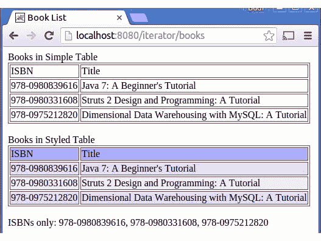

图 9.3：在 `List` 中使用 `forEach`

你也可以使用 `forEach` 来遍历一个 `map`。你分别通过 `key` 和 `value` 属性引用 `map` 的键和 `map` 值。遍历 `map` 的伪代码如下：

```jsp
<c:forEach var="mapItem" items="map">
    ${mapItem.key} : ${mapItem.value}
</c:forEach>
```

下一个示例说明了在 `Map` 中使用 `forEach`。代码列表 9.8 中的 `BigCitiesServlet` servlet 实例化了两个 `Maps` 并用它们填充了键/值对。第一个 `Map` 中的每个元素都是 `String/String` 对，第二个 `Map` 中的每个元素都是 `String/String[]` 对。

代码列表 9.8：`BigCitiesServlet` 类

```java
package servlet;

import java.io.IOException;
import java.util.HashMap;
import java.util.Map;

import javax.servlet.RequestDispatcher;
import javax.servlet.ServletException;
import javax.servlet.annotation.WebServlet;
import javax.servlet.http.HttpServlet;
import javax.servlet.http.HttpServletRequest;
import javax.servlet.http.HttpServletResponse;

@WebServlet(urlPatterns = {"/bigCities"})
public class BigCitiesServlet extends HttpServlet {
    private static final long serialVersionUID = 1L;

    @Override
    public void doGet(HttpServletRequest request, 
            HttpServletResponse response) 
            throws ServletException, IOException {
        Map<String, String> capitals = new HashMap<>();
        Map<String, String[]> cities = new HashMap<>();

        capitals.put("USA", "Washington");
        capitals.put("UK", "London");
        capitals.put("Japan", "Tokyo");

        cities.put("USA", new String[]{"New York", "Los Angeles", "Chicago"});
        cities.put("UK", new String[]{"London", "Manchester"});
        cities.put("Japan", new String[]{"Tokyo", "Osaka"});

        request.setAttribute("capitals", capitals);
        request.setAttribute("cities", cities);

        RequestDispatcher rd = request.getRequestDispatcher("/bigCities.jsp");
        rd.forward(request, response);
    }
}
```

在 `doGet` 方法结束处，servlet 转发到 `bigCities.jsp` 页面，该页面使用 `forEach` 遍历 `Maps`。

### `forTokens` 标签

`forTokens` 标签用于遍历由分隔符分隔的字符串标记。其属性如表 9.7 所示。

| 属性 | 类型 | 描述 |
| :--- | :--- | :--- |
| `end`+ | `int` | 迭代的结束索引，索引从 0 开始。 |
| `step`+ | `int` | 迭代将仅处理字符串中每隔 `step` 个的标记，从第一个开始。如果指定，`step` 必须为 1 或更大。 |
| `delims`+ | `String` | 分隔符集合。 |

表 9.7：`forTokens` 标签的属性

这是一个 `forTokens` 的示例：

```jsp
<c:forTokens var="item" items="Argentina,Brazil,Chile" delims=",">
    <c:out value="${item}"/><br/>
</c:forTokens>
```

当粘贴到 `JSP` 中时，上述 `forTokens` 将产生结果：

```
Argentina
Brazil
Chile
```

## 格式化操作

JSTL 提供了用于格式化和解析数字及日期的标签。这些分别是 `formatNumber`、`formatDate`、`timeZone`、`setTimeZone`、`parseNumber` 和 `parseDate`。这些标签将在后续章节中讨论。

### `formatNumber` 标签

你使用 `formatNumber` 来格式化数字。该标签允许你灵活地使用各种属性来获取符合你需要的格式。`formatNumber` 的语法有两种形式。第一种用于不带主体内容的情况：

```jsp
<fmt:formatNumber value="numericValue"
        [type="{number|currency|percent}"]
        [pattern="customPattern"]
        [currencyCode="currencyCode"]
        [currencySymbol="currencySymbol"]
        [groupingUsed="{true|false}"]
        [maxIntegerDigits="maxIntegerDigits"]
        [minIntegerDigits="minIntegerDigits"]
        [maxFractionDigits="maxFractionDigits"]
        [minFractionDigits="minFractionDigits"]
        [var="varName"]
        [scope="{page|request|session|application}"]
/>
```

第二种形式配合主体内容使用：

```jsp
<fmt:formatNumber [type="{number|currency|percent}"]
        [pattern="customPattern"]
        [currencyCode="currencyCode"]
        [currencySymbol="currencySymbol"]
        [groupingUsed="{true|false}"]
        [maxIntegerDigits="maxIntegerDigits"]
        [minIntegerDigits="minIntegerDigits"]
        [maxFractionDigits="maxFractionDigits"]
        [minFractionDigits="minFractionDigits"]
        [var="varName"]
        [scope="{page|request|session|application}"]>
    numeric value to be formatted
</fmt:formatNumber>
```

主体内容是 `JSP`。`formatNumber` 标签的属性如表 9.8 所示。

| 属性 | 类型 | 描述 |
| :--- | :--- | :--- |
| `value`+ | `String` 或 `Number` | 要格式化的数值。 |
| `type`+ | `String` | 表示将值格式化为数字、货币或百分比。该属性的值为以下者之一：`number`, `currency`, `percent`。 |
| `pattern`+ | `String` | 自定义格式模式。 |
| `currencyCode`+ | `String` | ISO 4217 代码。见表 9.9。 |
| `currencySymbol`+ | `String` | 货币符号。 |
| `groupingUsed`+ | `Boolean` | 表明输出是否包含分组分隔符。 |
| `maxIntegerDigits`+ | `int` | 输出中整数部分的最大位数。 |
| `minIntegerDigits`+ | `int` | 输出中整数部分的最小位数。 |
| `maxFractionDigits`+ | `int` | 输出中小数部分的最大位数。 |
| `minFractionDigits`+ | `int` | 输出中小数部分的最小位数。 |
| `var` | `String` | 用于存储输出为 `String` 的作用域变量名称。 |
| `scope` | `String` | `var` 的作用范围。如果存在 `scope` 属性，则必须指定 `var` 属性。 |

表 9.8：`formatNumber` 标签的属性

`formatNumber` 的用途之一是将数字格式化为货币。为此，你可以使用 `currencyCode` 属性来指定 ISO 4217 货币代码。表 9.9 给出出了部分代码。

| 货币 | ISO 4217 代码 | 主单位名称 | 小单位名称 |
| :--- | :--- | :--- | :--- |
| 加拿大元 | `CAD` | `dollar` | `cent` |
| 人民币 | `CNY` | `yuan` | `jiao` |
| 欧元 | `EUR` | `euro` | `euro-cent` |
| 日元 | `JPY` | `yen` | `sen` |
| 英镑 | `GBP` | `pound` | `pence` |
| 美元 | `USD` | `dollar` | `cent` |

表 9.9：ISO 4217 货币代码

如何使用 `formatNumber` 的示例见表 9.10。

| 操作 | 结果 |
| :--- | :--- |
| `<fmt:formatNumber value="12" type="number"/>` | 12 |
| `<fmt:formatNumber value="12" type="number" minIntegerDigits="3"/>` | 012 |
| `<fmt:formatNumber value="12" type="number" minFractionDigits="2"/>` | 12.00 |
| `<fmt:formatNumber value="123456.78" pattern=".000"/>` | 123456.780 |
| `<fmt:formatNumber value="123456.78" pattern="#,#00.0#"/>` | 123,456.78 |
| `<fmt:formatNumber value="12" type="currency"/>` | $12.00 |
| `<fmt:formatNumber value="12" type="currency" currencyCode="GBP"/>` | GBP 12.00 |

### `timeZone` 标签

`timeZone` 标签用于指定主体内容中格式化或解析时间信息的时区。其语法如下：

```jsp
<fmt:timeZone value="timeZone">
    body content
</fmt:timeZone>
```

主体内容是 `JSP`。属性值可以传递 `String` 类型或 `java.util.TimeZone` 类型的动态值。美国和加拿大的时区值见表 9.12。

如果 `value` 属性为 `null` 或空，则使用 `GMT` 时区。

下面的示例使用 `timeZone` 标签来格式化带有时区的日期：

```jsp
<fmt:timeZone value="GMT+1:00">
    <fmt:formatDate value="${now}" type="both" 
            dateStyle="full" timeStyle="full"/>
</fmt:timeZone>

<fmt:timeZone value="HST">
    <fmt:formatDate value="${now}" type="both" 
            dateStyle="full" timeStyle="full"/>
</fmt:timeZone>

<fmt:timeZone value="CST">
    <fmt:formatDate value="${now}" type="both" 
            dateStyle="full" timeStyle="full"/>
</fmt:timeZone>
```

| 缩写 | 全称 | 时区 |
| :--- | :--- | :--- |
| `NST` | 纽芬兰标准时间 | UTC-3:30 hours |
| `NDT` | 纽芬兰夏令时间 | UTC-2:30 hours |
| `AST` | 大西洋标准时间 | UTC-4 hours |
| `ADT` | 大西洋夏令时间 | UTC-3 hours |
| `EST` | 东部标准时间 | UTC-5 hours |
| `EDT` | 东部夏令时间 | UTC-4 hours |
| `ET` | 东部时间（如 `EST` 或 `EDT`） | * |
| `CST` | 中部标准时间 | UTC-6 hours |
| `CDT` | 中部夏令时间 | UTC-5 hours |
| `CT` | 中部时间（如 `CST` 或 `CDT`） | * |
| `MST` | 山区标准时间 | UTC-7 hours |
| `MDT` | 山区夏令时间 | UTC-6 hours |
| `MT` | 山区时间（如 `MST` 或 `MDT`） | * |
| `PST` | 太平洋标准时间 | UTC-8 hours |
| `PDT` | 太平洋夏令时间 | UTC-7 hours |
| `PT` | 太平洋时间（如 `PST` 或 `PDT`） | * |
| `AKST` | 阿拉斯加标准时间 | UTC-9 hours |
| `AKDT` | 阿拉斯加夏令时间 | UTC-8 hours |
| `HST` | 夏威夷标准时间 | UTC-10 hours |

表 9.12：美国和加拿大时区

### `setTimeZone` 标签

你使用 `setTimeZone` 标签将指定的时区存储在作用域变量或时间配置变量中。`setTimeZone` 的语法如下：

```jsp
<fmt:setTimeZone value="timeZone" [var="varName"]
        [scope="{page|request|session|application}"]
/>
```

表 9.13 展示了 `setTimeZone` 标签的属性。

| 属性 | 类型 | 描述 |
| :--- | :--- | :--- |
| `value`+ | `String` 或 `java.util.TimeZone` | 时区 |
| `var` | `String` | 用于存储 `java.util.TimeZone` 类型时区的作用域变量名 |
| `scope` | `String` | `var` 或时间配置变量的作用域 |

表 9.13：`setTimeZone` 标签的属性

### `parseNumber` 标签

你使用 `parseNumber` 将具有区域化敏感格式的数字、货币或百分比的字符串表示解析为数字。该语法有两种形式。第一种形式不带主体内容使用：

```jsp
<fmt:parseNumber value="numericValue"
        [type="{number|currency|percent}"]
        [pattern="customPattern"]
        [parseLocale="parseLocale"]
        [integerOnly="{true|false}"]
        [var="varName"]
```


`<fmt:parseNumber>` 标签有两种语法形式。第一种形式不带主体内容使用：

```
<fmt:parseNumber [type="{number|currency|percent}"]

        [pattern="customPattern"]

        [parseLocale="parseLocale"]

        [integerOnly="{true|false}"]

        [var="varName"]

        [scope="{page|request|session|application}"]

        value="numberString"/>

```

第二种形式带有主体内容使用：

```
<fmt:parseNumber [type="{number|currency|percent}"]

        [pattern="customPattern"]

        [parseLocale="parseLocale"]

        [integerOnly="{true|false}"]

        [var="varName"]

        [scope="{page|request|session|application}"]>  

    待解析的数值

</fmt:parseNumber>
```

主体内容是 JSP。`parseNumber` 标签的属性见表 9.14。

例如，下面的 `parseNumber` 标签解析由作用域变量 `quantity` 引用的值，并将结果存储在作用域变量 `formattedNumber` 中。

```
<fmt:parseNumber var="formattedNumber" type="number"

        value="${quantity}"/>
```

| 属性 | 类型 | 描述 |
| :--- | :--- | :--- |
| value+ | `String` | 待解析的字符串 |
| type+ | `String` | 表示要解析的字符串是解析为数字、货币还是百分比 |
| pattern+ | `String` | 自定义格式模式，决定 `value` 属性中的字符串如何被解析 |
| parseLocale+ | `String` 或 `java.util.Locale` | 解析操作期间使用的默认格式模式的区域，或者应用于通过 `pattern` 属性指定模式的区域 |
| integerOnly+ | `Boolean` | 表示是否仅解析给定值的整数部分 |
| var | `String` | 用于存储结果的作用域变量名 |
| scope | `String` | `var` 的作用域 |

表 9.14：`parseNumber` 标签的属性

### `parseDate` 标签

你使用 `parseDate` 将具有区域化敏感格式的字符串表示解析为日期。该语法有两种形式。第一种形式不带主体内容使用：

```
<fmt:parseDate value="dateString"

        type="{date|both}"]

        dateStyle="short|full}"]

        [pattern="customPattern"]

        timeZone="timeZone"]

        [var="varName"]

        [scope="{page|request|session|application}"]

/>
```

第二种形式带有主体内容使用：

```
<fmt:parseDate [type="{date|both}"]

        dateStyle="short|full}"]

        [pattern="customPattern"]

        timeZone="timeZone"]

        [var="varName"]

        [scope="{page|request|session|application}"]>  

    待解析的日期值

</fmt:parseDate>
```

主体内容是 JSP。表 9.15 列出了 `parseDate` 标签的属性。

| 属性 | 类型 | 描述 |
| :--- | :--- | :--- |
| value+ | `String` | 待解析的字符串 |
| type+ | `String` | 表示字符串解析为日期、时间还是两者 |
| dateStyle+ | `String` | 日期的格式样式 |
| pattern+ | `String` | 自定义格式模式，决定字符串如何被解析 |
| timeZone+ | `String` 或 `java.util.TimeZone` | 解析日期中任何时间信息的时区 |
| parseLocale+ | `String` 或 `java.util.Locale` | 解析期间使用的默认格式模式的区域，或者应用于通过 `pattern` 属性指定模式的区域 |
| var | `String` | 用于存储结果的作用域变量名 |
| scope | `String` | `var` 的作用域 |

表 9.15：`parseDate` 标签的属性

例如，下面的 `parseDate` 标签解析由作用域变量 `myDate` 引用的日期，并将结果 `java.util.Date` 存储在页面作用域变量 `formattedDate` 中。

```
<c:set var="myDate" value="12/12/2005"/>

<fmt:parseDate var="formattedDate" type="date" 

        dateStyle="short" value="${myDate}"/>
```

## Functions

自定义自定义外，JSTL 1.1 和 1.2 定义了一组可以在 EL 表达式使用的标准函数。这些函数位于函数标签库中。要使用这些函数，你需要在 JSP 顶部使用以下 `taglib` 指令。

```
<%@ taglib uri="http://java.sun.com/jsp/jstl/functions" 

        prefix="fn" %>
```

要调用函数，使用如下格式的 EL：

```
${fn:functionName}
```

其中 `functionName` 是函数名。

大部分函数用于字符串处理。例如，`length` 函数同时适用于字符串和集合，返回集合或数组中的项数或字符串的字符数。

所有这些函数将在接下来的章节中描述。

### `contains` 函数

`contains` 函数测试字符串是否包含指定的子字符串。如果字符串包含子字符串，则返回 `true`，否则返回 `false`。其语法如下：

```
contains(string, substring).
```

例如，这两个 EL 表达式都返回 `true`：

```
<c:set var="myString" value="Hello World"/>

${fn:contains(myString, "Hello")}

${fn:contains("Stella Cadente", "Cadente")}
```

### `containsIgnoreCase` 函数

`containsIgnoreCase` 函数与 `contains` 函数相似，但测试是以不区分大小的方式进行的。其语法如下：

```
containsIgnoreCase(string, substring)
```

例如，下面的 EL 表达式返回 `true`：

```
${fn:containsIgnoreCase("Stella Cadente", "CADENTE")}
```

### `endsWith` 函数

`endsWith` 函数测试字符串是否以指定的后缀结尾。返回值是一个 `Boolean`。其语法如下：

```
endsWith(string, suffix)
```

例如，下面的 EL 表达式返回 `true`：

```
${fn:endsWith("Hello World", "World")}
```

### `escapeXml` 函数

该函数用于对 `String` 进行编码。其转换结果与 `escapeXml` 属性设置为 `true` 的 `out` 标签相同。`escapeXml` 的语法如下：

```
escapeXml(string)
```

例如，EL 表达式

```
${fn:escapeXml("Use <br/> to change lines")}
```

渲染结果如下：

```
Use &lt;br/&gt; to change lines
```

### `indexOf` 函数

`indexOf` 函数返回字符串中指定的 `substring` 首次出现的索引。如果未找到 `substring`，则返回 `-1`。其语法如下：

```
indexOf(string, substring)
```

例如，下面的 EL 表达式返回 7：

```
${fn:indexOf("Stella Cadente", "Cadente")}
```

### `join` 函数

`join` 函数将 `String` 数组中的所有元素合并为一个字符串，并用指定的分隔符分隔。其语法如下：

```
join(array, separator)
```

如果数组为 `null`，则返回空字符串。

例如，如果 `myArray` 是一个包含元素“my”和“world”的 `String` 数组，EL 表达式

```
${fn:join(myArray,",")}
```

返回“my,world”。

### `length` 函数

`length` 函数返回集合中项的数量，或者字符串中字符数。其语法如下：

```
length{input}
```

例如，下面的 EL 表达式返回 14：

```
${fn:length("Stella Cadente", "Cadente")}
```

### `replace` 函数

`replace` 函数替换字符串中所有位置的 `beforeString` 为 `afterString` 并返回结果。其语法如下：

```
replace(string, beforeSubstring, afterSubstring)
```

例如，EL 表达式

```
${fn:replace("Stella Cadente", "e", "E")}
```

返回“StElla CadEntE”。

### `split` 函数

`split` 函数将字符串拆分为子字符串数组。它的功能与 `join` 函数相反。例如，下面的代码将字符串“my,world”分割并将结果存储在作用域变量 `split` 中。然后使用 `forEach` 标签将 `split` 格式化为 HTML 表格。

```
<c:set var="split" value='${fn:split("my,world",",")}'/>

<table>

<c:forEach var="substring" items="${split}">

    <tr><td>${substring}</td></tr>

</c:forEach>

</table>
```

结果如下：

```
<table>

    <tr><td>my</td></tr>

    <tr><td>world</td></tr>

</table>
```

### `startsWith` 函数

`startsWith` 函数测试字符串是否以指定的前缀开头。其语法如下：

```
startsWith(string, prefix)
```

例如，下面的 EL 表达式返回 `true`：

```
${fn:startsWith("Stella Cadente", "St")}
```

### `substring` 函数

`substring` 函数返回从指定的基于零的索引 `beginIndex`（包含）到指定的基于零的索引 `endIndex` 的子字符串。其语法如下：

```
substring(string, beginIndex, endIndex)
```

例如，下面的 EL 表达式返回“Stel”。

```
${fn:substring("Stella Cadente", 0, 4)}
```

### `substringAfter` 函数

`substringAfter` 函数返回字符串中指定的 `substring` 首次出现之后的部分。其语法如下：

```
substringAfter(string, substring)
```

例如，EL 表达式

```
${fn:substringAfter("Stella Cadente", "e")}
```

返回“lla Cadente”。

### `substringBefore` 函数

`substringBefore` 函数返回字符串中指定的 `substring` 首次出现之前的部分。其语法如下：

```
substringBefore(string, substring)
```

例如，下面的 EL 表达式返回“St”。

```
${fn:substringBefore("Stella Cadente", "e")}
```

### `toLowerCase` 函数

`toLowerCase` 函数将字符串转换为小写版本。其语法如下：

```
toLowerCase(string)
```

例如，下面的 EL 表达式返回“stella cadente”。

```
${fn:toLowerCase("Stella Cadente")}
```

### `toUpperCase` 函数

`toUpperCase` 函数将字符串转换为大写版本。其语法如下：

```
toUpperCase(string)
```

例如，下面的 EL 表达式返回“STELLA CADENTE”。

```
${fn:toUpperCase("Stella Cadente")}
```

### `trim` 函数

`trim` 函数移除字符串首尾的空格。其语法如下：

```
trim(string)
```

例如，下面的 EL 表达式返回“Stella Cadente”。

```
${fn:trim("                 Stella Cadente")}
```

## 总结

你可以使用 JSTL 处理常用任务（如迭代、集合和条件）、处理 XML 文档、格式化文本、访问数据库和操作数据等。本章讨论了重要的标签，例如操作作用域对象的（`out`、`set`、`remove`）、执行条件测试的（`if`、`choose`、`when`、`otherwise`）、遍历集合或标记（`forEach`、`forTokens`）、以及解析和格式化日期与数字（`parseNumber`、`formatNumber`、`parseDate`、`formatDate`等），以及可以在 EL 表达式使用的 JSTL 1.2 函数。

如果需要国际化的静态数据量有限，请将组件标签和错误消息等文本元素隔离到文本文件中。每个文本文件存储特定区域（locale）所有文本元素的翻译。应用程序随后会动态地获取每个元素。其优势是显而易见的：每个文本元素都可以轻松编辑，而无需重新编译应用程序。这就是本章将讨论的技术。

本章首先解释什么是区域（locale）。接下来介绍应用程序的国际化技术，随后紧跟的是一个 Spring MVC 示例。

## 区域 (Locales)

`java.util.Locale` 类表示一个区域。`Locale` 对象三个三个组成部分：语言（language）、国家（country）和变体（variant）。语言显然是最重要的部分；然而，有时语言并不不足以区分不同的区域。例如，英语在美国和英国等国家通用。然而，美国使用的英语与英国使用的英语并不完全相同。因此，有必要指定语言所属的国家。另一个例子是在在中国使用的中文与台湾使用的中文也不完全相同。

`variant` 参数是特定于供应商或浏览器的代码。例如，你对 Windows 使用 `WIN`，对 Macintosh 使用 `MAC`，对 POSIX 使用 `POSIX`。如果存在两个变体，用下划线分隔它们，并将最重要的放在前面。例如，一个传统的西班牙语排序规则可能会构建一个语言、国家和变体参数分别为 `es`、`ES`、`Traditional_WIN` 的区域。

要构造一个 `Locale` 对象，请使用 `Locale` 类的构造函数之一。

```
public Locale(java.lang.String language)

public Locale(java.lang.String language, java.lang.String country)

public Locale(java.lang.String language, java.lang.String country,

        java.lang.String variant)
```

语言代码是有效的 ISO 语言代码。表 10.1 显示了语言代码的示例。

国家参数是有效的 ISO 国家代码，它是 ISO 3166（http://userpage.chemie.fu-berlin.de/diverse/doc/ISO_3166.html）中指定的两个字母大写字母代码。表 10.2 列出了 ISO 3166 中的一些国家代码。

| 代码 | 语言 |
| :--- | :--- |
| de | 德语 |
| el | 希腊语 |
| en | 英语 |
| es | 西班牙语 |
| fr | 法语 |
| hi | 印地语 |
| it | 意大利语 |
| ja | 日语 |
| nl | 荷兰语 |
| pt | 葡萄牙语 |
| ru | 俄语 |
| zh | 中文 |

| 国家 | 代码 |
| :--- | :--- |
| 澳大利亚 | AU |
| 巴西 | BR |
| 加拿大 | CA |
| 中国 | CN |
| 埃及 | EG |
| 法国 | FR |
| 德国 | DE |
| 印度 | IN |
| 墨西哥 | MX |
| 瑞士 | CH |
| 台湾 | TW |
| 英国 | GB |
| 美国 | US |

例如，要构造表示加拿大英语的 `Locale` 对象，请编写以下代码。


`Locale locale = new Locale("en", "CA");`

此外，`Locale` 类提供了静态 final 字段，返回特定国家或语言的区域，例如 `CANADA`、`CANADA_FRENCH`、`CHINA`、`CHINESE`、`ENGLISH`、`FRANCE`、`FRENCH`、`UK`、`US` 等。因此，你也可以通过调用其静态字段来构造 `Locale` 对象。

`Locale locale = Locale.CANADA_FRENCH;`

此外，静态的 `getDefault` 方法返回用户计算机的区域。

`Locale locale = Locale.getDefault();`

## Spring MVC 应用程序国际化

应用程序国际化和本地化需要：

1. 将文本组件隔离到属性文件中
2. 能够选择并读取正确的属性文件

本节详细阐述了这两个步骤并提供了一个简单的示例。

## 将文本组件隔离到属性文件中

国际化应用程序为每个区域在单独的属性文件中存储其文本元素。每个文件包含键值对（key/value pairs），每个键唯一地标识一个特定区域的对象。键总是字符串，而值可以是字符串或任何类型的对象。例如，为了支持美式英语、德语和中文，你将会有三个属性文件，它们都具有相同的键。

以下是属性文件的英文版本。注意它有两个键：`greetings` 和 `farewell`。

```
Greetings=Hello
farewell=Goodbye
```

德语版本如下：

```
greetings=Hallo
farewell=Tschüß
```

中文的属性文件将是：

```
greetings=\u4f60\u597d
farewell=\u518d\u89c1
```

如果你是中文母语者，可以使用任何中文文本编辑器编写汉字。一旦完成，将文件转换为 Unicode。

现在，你需要掌握 `java.util.ResourceBundle` 类。它让你能够轻松地选择和读取特定于用户区域的属性文件并查找值。`ResourceBundle` 是一个抽象类，但它提供了静态的 `getBundle` 方法，返回具体子类的实例。

`ResourceBundle` 有一个基名（base name），可以是任何名称。为了让 `ResourceBundle` 拾取属性文件，文件名必须由 `ResourceBundle` 基名组成，后跟下划线，然后是语言代码，可选地再跟一个下划线和国家代码。属性文件的格式为：

```
basename_languageCode_countryCode
```

例如，假设基名为 `MyResources`，且定义了以下区域：

* `US-en`
* `DE-de`
* `CN-zh`

那么你会有这些属性文件：

* `MyResources_US.properties`
* `MyResources_DE.properties`
* `MyResources_CN.properties`

## 读取属性文件

`ResourceBundle` 是一个抽象类。尽管如此，你可以通过调用其静态 `getBundle` 方法获取 `ResourceBundle` 实例。其重载方法如下：

```
public static ResourceBundle getBundle(java.lang.String baseName)
public static ResourceBundle getBundle(java.lang.String baseName, Locale locale)
```

例如：

```
ResourceBundle rb = ResourceBundle.getBundle("MyResources", Locale.US);
```

这将加载对应文件的 `ResourceBundle`。

如果没有找到合适的属性文件，`ResourceBundle` 将回退到默认属性文件。默认属性文件的名为基名加上 `.properties` 扩展。在这种情况下，默认文件为 `MyResources.properties`。如果找不到默认文件，将抛出 `java.util.MissingResourceException`。

要读取值，使用 `ResourceBundle` 类的 `getString` 方法并传递一个键。

```
public java.lang.String getString(java.lang.String key)
```

如果找不到指定的键，将抛出 `java.util.MissingResourceException`。

在 Spring MVC 中，你并不直接与 `ResourceBundle` 工作。相反，你使用 `messageSource` bean 来告诉 Spring MVC 属性文件存储在哪里。例如，下面的 `messageSource` bean 读取两个属性文件。

```xml
<bean id="messageSource" class="org.springframework.context.support.ReloadableResourceBundleMessageSource">
    <property name="basenames" >
        <list>
            <value>resource/messages</value>
            <value>resource/labels</value>
        </list>
    </property>
</bean>
```

在上面的 bean 定义中，使用了 `ReloadableResourceBundleMessageSource` 类作为实现。另一种实现是 `ResourceBundleMessageSource`，它是不可重新加载的。这意味着如果你更改任何属性文件中的键或值，必须重启 JVM 更改才能生效。另一方面，你可以将 `ReloadableResourceBundleMessageSource` 设置为可重新加载。

两种实现方式之间的另一个区别是，使用 `ReloadableResourceBundleMessageSource` 时，会在应用程序目录下搜索属性文件。而使用 `ResourceBundleMessageSource` 时，属性文件必须位于类路径下，换句话说，位于 `WEB-INF/classes` 目录下。

另外注意，如果你只有一组属性文件，可以使用 `basename` 属性代替 `basenames`。这是一个示例。

```xml
<bean id="messageSource" class="org.springframework.context.support.ResourceBundleMessageSource">
    <property name="basename" value="resource/messages"/>
</bean>
```

## 告诉 Spring MVC 使用哪种语言区域

为用户选择语言区域（Locale）最常用的方法可能是读取用户浏览器 `accept-language` 头部的值。`accept-language` 头部携带了关于用户语言偏好的信息。

选择语言区域的其他方法包括读取特定的 session 属性或 cookie。

在 Spring MVC 中选择语言区域，你使用 `localeResolver` bean。它有几种实现方式，包括以下几种：

* `AcceptHeaderLocaleResolver`
* `SessionLocaleResolver`
* `CookieLocaleResolver`

所有这些实现都属于 `org.springframework.web.servlet.i18n` 包。`AcceptHeaderLocaleResolver` 可能是最常用的一个。如果你选择使用此语言区域解析器，Spring MVC 将读取浏览器的 `accept-language` 头部来确定浏览器接受的语言区域。如果浏览器语言区域之一与 Spring MVC 支持的语言区域匹配，则将使用该区域。如果没有匹配，则将使用默认语言区域。

以下是使用 `AcceptHeaderLocaleResolver` 的 `localeResolver` bean 的定义。

```xml
<bean id="localeResolver" class="org.springframework.web.servlet.i18n.AcceptHeaderLocaleResolver">
</bean>
```

## 使用 message 标签

在 Spring MVC 中显示本地化消息最简单的方法是使用 Spring message 标签。要使用此标签，请在所有使用该标签的 JSP 顶部声明此 taglib 指令。

```jsp
<%@taglib prefix="spring" uri="http://www.springframework.org/tags"%>
```

标签中可能出现的属性如表 10.3 所示。所有属性均为可选。

| 属性 | 描述 |
| :--- | :--- |
| `arguments` | 此标签的参数，以分隔符分隔字符串、对象数组或单个对象的形式编写。 |
| `argumentSeparator` | 用于分隔此标签参数的字符。 |
| `code` | 获取消息的键（key）。 |
| `htmlEscape` | 接受 `true` 或 `false`，表示渲染的文本是否经过 HTML 转义。 |
| `javaScriptEscape` | 接受 `true` 或 `false`，表示渲染的文本是否应避免 JavaScript 字符。 |
| `message` | 一个 `MessageSourceResolvable` 参数。 |
| `scope` | 存储 `var` 属性中定义的变量的作用范围。 |
| `text` | 当 `code` 属性不存在或给定的代码未能获取消息时，渲染的默认文本。 |
| `var` | 用于存储消息的作用域变量。 |

表 10.3：message 标签的属性

## 示例

例如，i18n 示例应用程序说明了如何使用 `localeResolver` bean 在 JSP 页面中实现消息本地化。目录结构如图 10.1 所示，i18n 的 Spring MVC 配置文件如代码 10.1 所示。

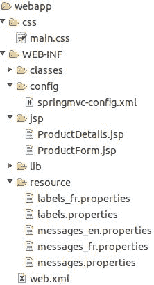

图 10.1：i18n 的目录结构

代码 10.1：i18n 的 Spring MVC 配置文件

```xml
<?xml version="1.0" encoding="UTF-8"?>
<beans xmlns="http://www.springframework.org/schema/beans"
   xmlns:xsi="http://www.w3.org/2001/XMLSchema-instance" 
   xmlns:p="http://www.springframework.org/schema/p"
   xmlns:mvc="http://www.springframework.org/schema/mvc" 
   xmlns:context="http://www.springframework.org/schema/context"
   xsi:schemaLocation="
      http://www.springframework.org/schema/beans
      http://www.springframework.org/schema/beans/spring-beans.xsd
      http://www.springframework.org/schema/mvc
      http://www.springframework.org/schema/mvc/spring-mvc.xsd     
      http://www.springframework.org/schema/context
      http://www.springframework.org/schema/context/spring-context.xsd">
   <context:component-scan base-package="controller" />
   <mvc:annotation-driven/>
   <mvc:resources mapping="/css/**" location="/css/" />
   <mvc:resources mapping="/*.html" location="/" />
   <bean id="viewResolver" class="org.springframework.web.servlet.view.InternalResourceViewResolver">
      <property name="prefix" value="/WEB-INF/jsp/" />
      <property name="suffix" value=".jsp" />
   </bean>
   <bean id="messageSource" class="org.springframework.context.support.ReloadableResourceBundleMessageSource">
      <property name="basenames" >
         <list>
            <value>/WEB-INF/resource/messages</value>
            <value>/WEB-INF/resource/labels</value>
         </list>
      </property>
   </bean>
   <bean id="localeResolver" class="org.springframework.web.servlet.i18n.AcceptHeaderLocaleResolver">
</bean>
```

两种实现方式之间的另一个区别是，使用 `ReloadableResourceBundleMessageSource` 时，会在应用程序目录下搜索属性文件。而使用 `ResourceBundleMessageSource` 时，属性文件必须位于类路径下，换句话说，位于 `WEB-INF/classes` 目录下。

另外注意，如果你只有一组属性文件，可以使用 `basename` 属性代替 `basenames`。这是一个示例。

```xml
<bean id="messageSource" class="org.springframework.context.support.ReloadableResourceBundleMessageSource">
    <property name="basename" value="resource/messages"/>
</bean>
```

代码 10.2：ProductForm.jsp

```jsp
<%@taglib prefix="spring" uri="http://www.springframework.org/tags"%>
<%@taglib prefix="c" uri="java.sun.com/jsp/jstl/core"%>
<!DOCTYPE html>
<html>
<head>
<title><spring:message code="page.productform.title"/></title>
<style type="text/css">@import url("<c:url value="/css/main.css"/>");</style>
</head>
<body>
<div id="global">
Current Locale : ${pageContext.response.locale}
<br/>
accept-language: ${header["accept-language"]}
<form:form commandName="product" action="product_save" method="post">
    <fieldset>
        <legend><spring:message code="form.name"/></legend>
        <p>
            <label for="name"><spring:message code="label.productName" text="default text" />:
            </label>
            <form:input id="name" path="name" cssErrorClass="error"/>
            <form:errors path="name" cssClass="error"/>
        </p>
        <p>
            <label for="description"><spring:message code="label.description"/>:
            </label>
            <form:input id="description" path="description"/>
        </p>
        <p>
            <label for="price"><spring:message code="label.price" text="default text" />: </label>
            <form:input id="price" path="price" cssErrorClass="error"/>
</p>
</fieldset>
</form:form>
</div>
</body>
</html>
```


`<form:errors path="price" cssClass="error"/>`

`</p>`

`<p id="buttons">`

`<input id="reset" type="reset" tabindex="4" value="<spring:message code="button.reset"/>">`

`<input id="submit" type="submit" tabindex="5" value="<spring:message code="button.submit"/>">`

`</p>`

`</fieldset>`

`</form:form>`

`</div>`

`</body>`

`</html>`

要测试 i18n 的国际化功能，请更改浏览器的 `accept-language` 头部。

在 Chrome 中，打开设置窗口，点击显示设置，然后点击语言和输入设置按钮。添加语言并将其移动到列表顶端。

在 Internet Explorer 中，转到 `Tools` > `Internet Options` > `General (tab)` > `Languages` > `Language Preference`。在“语言偏好”窗口中，点击 `Add` 按钮来添加语言。当选择了多种语言时，使用 `Move up` 和 `Move down` 按钮来更改语言的优先级。

在其他浏览器中更改 `accept-language` 头部信息可以参见此处：

```
http://www.w3.org/International/questions/qa-lang-priorities.en.php
```

要测试该应用程序，请将浏览器指向此 URL：

```
http://localhost:8080/i18n/add-product
```

你将看到英文或法语版本的 Product 表单，分别如图 10.2 和图 10.3 所示。

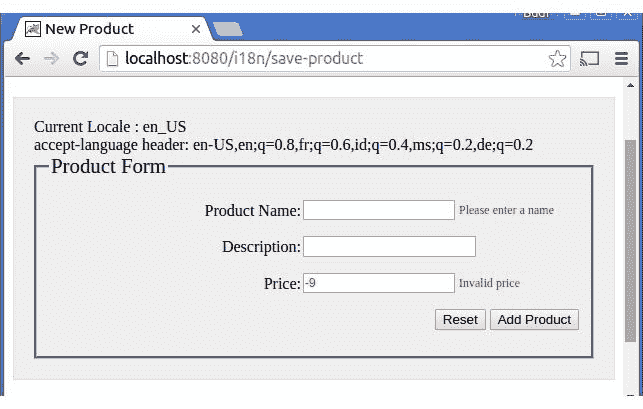

图 10.2：使用 `en_US` 区域的 Product 表单

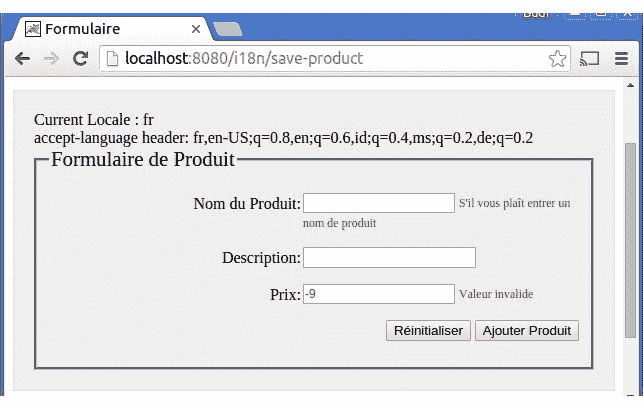

图 10.3：使用 `fr_CA` 区域的 Product 表单

## 总结

本章解释了如何开发国际化应用程序。首先解释了 `java.util.Locale` 类和 `java.util.ResourceBundle` 类。接着，继续介绍了一个国际化应用程序的示例。

# 第 11 章：文件上传

在 Servlet 技术出现后不久，文件上传编程仍然是一项挑战性任务，涉及到服务器端解析原始 HTTP 响应。为了缓解这种痛苦，开发者会求助于商业文件上传组件。幸运的是，2003 年 Apache Software Foundation 发布了其开源 `Commons FileUpload` 组件，它很快深受全球 servlet/JSP 程序员的欢迎。

Servlet 设计者花费了多年才意识到文件上传是至关重要的，但文件上传最终成为了 Servlet 3 的内置功能。`3` 开发者不再需要将 `Commons FileUpload` 组件导入到他们的项目中。

因此，在 Spring MVC 中处理文件上传有两种方法：

1. 使用 Apache `Commons FileUpload` 组件。
2. 利用 Servlet 3.0 或更高版本的内置支持。只有当你将应用程序部署到支持 Servlet 3.0 或更高版本的容器时，你才能使用这种方法。

无论你选择哪种方法，都将使用相同的 Spring API 来处理上传的文件。本章展示了如何在需要文件上传支持的 Spring MVC 应用程序中利用 `Commons FileUpload` 和 Servlet 3 文件上传功能。此外，它还演示了如何使用 HTML5 增强用户体验。

## 客户端编程

要上传文件，你必须将 HTML 表单的 `enctype` 属性值设置为 `multipart/form-data`，如下：

```
<form action="action" enctype="multipart/form-data" method="post">
   Select a file <input type="file" name="fieldName"/>
   <input type="submit" value="Upload"/>
</form>
```

表单必须包含一个类型为 `file` 的输入元素，该元素将被渲染为一个按钮，点击时会打开一个选择文件的对话框。表单还可能包含其他字段类型，例如文本区域或隐藏字段。

在 HTML5 之前，如果你想上传多个文件，必须使用多个文件输入元素。然而，HTML5 通过在 `input` 元素中引入 `multiple` 属性使多个文件上传变得更简单。你可以在 HTML5 中编写以下内容之一来生成选择多个文件的按钮：

```
<input type="file" name="fieldName" multiple/>
<input type="file" name="fieldName" multiple="multiple"/>
<input type="file" name="fieldName" multiple=""/>
```

## MultipartFile 接口

在 Spring MVC 中处理上传的文件非常简单。上传到 Spring MVC 应用程序的文件将被封装在 `MultipartFile` 对象中。你唯一的责任是编写一个带有类型为 `MultipartFile` 属性的类。

`org.springframework.web.multipart.MultipartFile` 接口具有获取上传文件名和内容的方法。表 11.1 显示了这些方法。

| 方法 | 描述 |
| :--- | :--- |
| `getBytes()` | 以字节数组返回文件内容。 |
| `getContentType()` | 返回文件的内容类型。 |
| `getInputStream()` | 以 `InputStream` 返回文件内容。 |
| `getName()` | 返回 multipart 表单中参数的。 |
| `getOriginalFilename()` | 返回客户端本地驱动器上的文件名。 |
| `getSize()` | 以 `long` 类型返回字节字节的文件大小。 |
| `isEmpty()` | 表示上传的文件是否为空。 |
| `tranferTo()` | 将上传的文件保存为 `java.io.File`。 |

表 11.1：`MultipartFile` 中的方法

例如，要保存上传的文件，你可以使用 `transferTo` 方法：

```
File file = new File(...);
multipartFile.transferTo(file);
```

后续章节中的示例展示了你如何在控制器中获取上传的文件。

## 使用 Commons FileUpload 上文件

只有实现 Servlet 3.0 或更高规范的 servlet 容器支持文件上传。对于 Servlet 3.0 之前的容器，你需要 Apache `Commons FileUpload` 组件，你可以从此网页下载：

```
http://commons.apache.org/proper/commons-fileupload/
```

`Commons FileUpload` 是一个开源项目。为了让 `Commons FileUpload` 成功工作，它需要另一个 Apache Commons 组件 `Apache Commons IO`。你可以从这里下载 Apache Commons IO：

```
http://commons.apache.org/proper/commons-io/
```

因此，你需要将两个 JAR 包拷贝到应用程序的 `WEB-INF/lib` 目录。`Commons FileUpload` JAR 的命名遵循此模式：

```
commons-fileupload-x.y.jar
```

其中 `x` 是软件的主版本，`y` 是次版本。例如，本章中使用的是 `commons-fileupload-1.3.jar`。

Commons IO JAR 的命名遵循此模式：

```
commons-io-x.y.jar
```

在这里，`x` 是软件的主版本，`y` 是次版本。例如，本章中使用的是 `commons-io-2.4.jar`。

此外，你需要在 Spring MVC 配置中定义此 `multipartResolver` bean：

```xml
<bean id="multipartResolver" class="org.springframework.web.multipart.commons.CommonsMultipartResolver">
   <property name="maxUploadSize" value="200000"/>
</bean>
```

`upload1` 展示了如何使用 `Commons FileUpload` 处理上传的文件。此示例可以在 Servlet 3.0 容器中运行。`upload1` 有一个领域类，即 `Product` 类，它包含 `MultipartFile` 对象列表。你将在示例中学习如何编写一个处理图像的控制器。

## 领域类

列表 11.1 显示了 `Product` 领域类。它与之前示例中的 `Product` 类相似，但列表 11.1 中的类有一个类型为 `List<MultipartFile>` 的 `images` 属性。

列表 11.1：修订后的 Product 领域类

```java
package domain;

import java.io.Serializable;
import java.math.BigDecimal;
import java.util.List;
import javax.validation.constraints.NotNull;
import javax.validation.constraints.Size;
import org.springframework.web.multipart.MultipartFile;

public class Product implements Serializable {
    private static final long serialVersionUID = 74458L;

    @NotNull
    @Size(min=1, max=10)
    private String name;

    private String description;
    private BigDecimal price;
    private List<MultipartFile> images;

    // getters 和 setters 省
}
```

## 控制器

`upload1` 的控制器位于列表 11.2。该类有两个请求处理方法，`inputProduct` 和 `saveProduct`。`inputProduct` 方法向浏览器发送产品表单。`saveProduct` 方法将上传的图像文件保存到应用程序目录下的 `image` 目录中。

列表 11.2：ProductController 类

```java
package controller;

import java.io.File;
import java.io.IOException;
import java.util.ArrayList;
import java.util.List;
import javax.servlet.http.HttpServletRequest;
import org.apache.commons.logging.Log;
import org.apache.commons.logging.LogFactory;
import org.springframework.stereotype.Controller;
import org.springframework.ui.Model;
import org.springframework.validation.BindingResult;
import org.springframework.web.bind.annotation.ModelAttribute;
import org.springframework.web.bind.annotation.RequestMapping;
import org.springframework.web.multipart.MultipartFile;
import domain.Product;

@Controller
public class ProductController {
    private static final Log logger = 
        LogFactory.getLog(ProductController.class);

    @RequestMapping(value = "/input-product")
    public String inputProduct(Model model) {
        model.addAttribute("product", new Product());
        return "ProductForm";
    }

    @RequestMapping(value = "/save-product")
    public String saveProduct(HttpServletRequest servletRequest,
            @ModelAttribute Product product, 
            BindingResult bindingResult, Model model) {
        List<MultipartFile> files = product.getImages();
        List<String> fileNames = new ArrayList<String>();

        if (null != files && files.size() > 0) {
            for (MultipartFile multipartFile : files) {
                String fileName =     
                        multipartFile.getOriginalFilename();
                fileNames.add(fileName);
                File imageFile = new 
                        File(servletRequest.getServletContext()
                        .getRealPath("/image"), fileName);
                try {
                    multipartFile.transferTo(imageFile);
                } catch (IOException e) {
                    e.printStackTrace();
                }
            }
        }

        // save product here
        model.addAttribute("product", product);
        return "ProductDetails";
    }
}
```

正如列表 11.2 中的 `saveProduct` 方法所示，保存已上传的文件非常简单。你只需要在 `MultipartFile` 实例上调用 `transferTo()` 方法即可。

## 配置文件

列表 11.3 显示了用于 upload1 的 Spring MVC 配置文件。

列表 11.3：upload1 的 Spring MVC 配置文件

```xml
<?xml version="1.0" encoding="UTF-8"?>
<beans xmlns="http://www.springframework.org/schema/beans"
    xmlns:xsi="http://www.w3.org/2001/XMLSchema-instance" 
    xmlns:p="http://www.springframework.org/schema/p"
    xmlns:mvc="http://www.springframework.org/schema/mvc" 
    xmlns:context="http://www.springframework.org/schema/context"
    xsi:schemaLocation="
        http://www.springframework.org/schema/beans
        http://www.springframework.org/schema/beans/spring-beans.xsd
        http://www.springframework.org/schema/mvc
        http://www.springframework.org/schema/mvc/spring-mvc.xsd     
        http://www.springframework.org/schema/context
```


`http://www.springframework.org/schema/context/spring-context.xsd`

```xml
<context:component-scan base-package="controller" />

<mvc:annotation-driven />

<mvc:resources mapping="/css/**" location="/css/" />

<mvc:resources mapping="/*.html" location="/" />

<mvc:resources mapping="/image/**" location="/image/" />

<bean id="viewResolver"
        class="org.springframework.web.servlet.view.InternalResourceViewResolver">
    <property name="prefix" value="/WEB-INF/jsp/" />
    <property name="suffix" value=".jsp" />
</bean>

<bean id="multipartResolver"
        class="org.springframework.web.multipart.commons.CommonsMultipartResolver">
</bean>
</beans>
```

你可以使用`multipartResolver`的`maxUploadSize`属性来设置允许的最大文件大小。如果没有该属性，则没有大小限制。不对文件大小设置限制并不意味着你可以上传任何大小的文件。大文件上传需要很长时间并会导致服务器超时。要处理非常大的文件，你可以使用 HTML5 `File` API 对文件进行切分并分别上传每个分块。

## JSP 页面

列表 11.4 展示了用于上传图像文件的`ProductForm.jsp`页面。

列表 11.4：`ProductForm.jsp`页面

```jsp
<%@ taglib prefix="form" uri="http://www.springframework.org/tags/form"%>
<%@ taglib uri="http://java.sun.com/jsp/jstl/core" prefix="c" %>
<!DOCTYPE html>
<html>
<head>
<title>Add Product Form</title>
<style type="text/css">@import url("<c:url value="/css/main.css"/>");</style>
</head>
<body>
<div id="global">
<form:form commandName="product" action="save-product" method="post" 
        enctype="multipart/form-data">
    <fieldset>
        <legend>Add a product</legend>
        <p>
            <label for="name">Product Name: </label>
            <form:input id="name" path="name" />
        </p>
    </fieldset>
</form:form>
</div>
</body>
</html>
```

注意表单中类型为`file`的`input`元素。提交表单将调用`save-product`方法。如果该方法执行成功，用户将跳转到列表 11.5 中的`ProductDetails.jsp`页面。

列表 11.5：`ProductDetails.jsp`

```jsp
<%@ taglib uri="http://java.sun.com/jsp/jstl/core" prefix="c" %>
<!DOCTYPE html>
<html>
<head>
<title>Save Product</title>
<style type="text/css">@import url("<c:url value="/css/main.css"/>");</style>
</head>
<body>
<div id="global">
    <h4>The product has been saved.</h4>
    <p>
        <h5>Details:</h5>
        Product Name: ${product.name}<br/>
        Description: ${product.description}<br/>
        Price: ${product.price}
        <p>Following files are uploaded successfully.</p>
        <ol>
        <c:forEach items="${product.images}" var="image">
            <li>${image.originalFilename}
            
            ${image.originalFilename}"/>
            </li>
        </c:forEach>
        </ol>
    </p>
</div>
</body>
</html>
```

`ProductDetails.jsp`页面显示了保存的产品的详情，包括其图像。

## 测试应用程序

要测试应用程序，请在浏览器中访问以下 URL：

```
http://localhost:8080/upload1/input-product
```

你会看到一个类似于图 11.1 所示的添加产品表单。

（图 11.1 略）
图 11.1：包含文件字段的产品表单

## 使用 Servlet 3 或更高版本进行上传

在 Servlet 3 中，你不再需要 Commons FileUpload 和 Commons IO 组件。Servlet 3 及更高版本容器中的服务端文件上传主要围绕`MultipartConfig`注解类型和`javax.servlet.http.Part`接口展开。处理上传文件的 Servlet 必须使用`@MultipartConfig`注解。

以下是可能出现在`MultipartConfig`注解类型中的属性。所有属性均为可选。

- `maxFileSize`。上传文件的最大大小。大于指定值的文件将被拒绝。默认情况下，`maxFileSize`的值为 -1，表示无限制。
- `maxRequestSize`。允许的多部分 HTTP 请求的最大大小。默认值为 -1，翻译为无限制。
- `location`。当通过`Part`的`write`方法将上传的文件保存到磁盘时的保存位置。
- `fileSizeThreshold`。上传文件达到此大小阈值后将会被写入磁盘。

Spring MVC 的`DispatcherServlet`处理大部分或所有请求。遗憾的是，你无法在不修改源码的情况下对 servlet 进行注解。幸运的是，在 Servlet 3 中，有一种更简单的方法让 servlet 成为`MultipartConfig` servlet：即通过向部署描述符（`web.xml`文件）中的 servlet 声明传递值。以下效果与对`DispatcherServlet`使用注解`@MultipartConfig`相同。

```xml
<servlet>
    <servlet-name>springmvc</servlet-name>
    <servlet-class>
        org.springframework.web.servlet.DispatcherServlet
    </servlet-class>
    <init-param>
        <param-name>contextConfigLocation</param-name>
        <param-value>
            /WEB-INF/config/springmvc-config.xml
        </param-value>
    </init-param>
    <multipart-config>
        <max-file-size>20848820</max-file-size>
        <max-request-size>418018841</max-request-size>
        <file-size-threshold>1048576</file-size-threshold>
    </multipart-config>            
</servlet>
```

就是如此简单。此外，你需要在 Spring MVC 配置文件中使用不同的 multipart 解析器。如下：

```xml
<bean id="multipartResolver" 
        class="org.springframework.web.multipart.support.StandardServletMultipartResolver">
</bean>
```

`upload2`演示了如何在 Servlet 3 或更高级别的容器中处理文件上传。它是`upload1`的重写，因此领域类和控制器类非常相似。唯一的区别是`web.xml`文件，它现在包含了一个`multipart-config`元素。列表 11.6 显示了`upload2`的`web.xml`文件。

列表 11.6：`upload2`的`web.xml`文件

```xml
<?xml version="1.0" encoding="UTF-8"?>
<web-app version="3.1" 
    xmlns="http://xmlns.jcp.org/xml/ns/javaee" 
    xmlns:xsi="http://www.w3.org/2001/XMLSchema-instance" 
    xsi:schemaLocation="http://xmlns.jcp.org/xml/ns/javaee 
http://xmlns.jcp.org/xml/ns/javaee/web-app_3_1.xsd">
    <servlet>
        <servlet-name>springmvc</servlet-name>
        <servlet-class>
            org.springframework.web.servlet.DispatcherServlet
        </servlet-class>
        <init-param>
            <param-name>contextConfigLocation</param-name>
            <param-value>
                /WEB-INF/config/springmvc-config.xml
            </param-value>
        </init-param>
        <load-on-startup>1</load-on-startup>
        <multipart-config>
            <max-file-size>20848820</max-file-size>
            <max-request-size>418018841</max-request-size>
            <file-size-threshold>1048576</file-size-threshold>
        </multipart-config>            
    </servlet>
    <servlet-mapping>
        <servlet-name>springmvc</servlet-name>
        <url-pattern>/</url-pattern>
    </servlet-mapping>
</web-app>
```

列表 11.7 展示了`upload2`的 Spring MVC 配置文件。

列表 11.7：`upload2`的配置文件文件

```xml
<?xml version="1.0" encoding="UTF-8"?>
<beans xmlns="http://www.springframework.org/schema/beans"
    xmlns:xsi="http://www.w3.org/2001/XMLSchema-instance"
    xmlns:p="http://www.springframework.org/schema/p"
    xmlns:mvc="http://www.springframework.org/schema/mvc"
    xmlns:context="http://www.springframework.org/schema/context"	
    xsi:schemaLocation="
        http://www.springframework.org/schema/beans
        http://www.springframework.org/schema/beans/spring-beans.xsd
        http://www.springframework.org/schema/mvc
        http://www.springframework.org/schema/mvc/spring-mvc.xsd     
        http://www.springframework.org/schema/context
        http://www.springframework.org/schema/context/spring-context.xsd">
    <context:component-scan base-package="controller" />
    <mvc:annotation-driven />
    <mvc:resources mapping="/css/**" location="/css/" />
    <mvc:resources mapping="/*.html" location="/" />
    <mvc:resources mapping="/image/**" location="/image/" />
    <mvc:resources mapping="/file/**" location="/file/" />
    <bean id="viewResolver"
        class="org.springframework.web.servlet.view.InternalResourceViewResolver">
        <property name="prefix" value="/WEB-INF/jsp/" />
        <property name="suffix" value=".jsp" />
    </bean>
    <bean id="multipartResolver"
        class="org.springframework.web.multipart.support.StandardServletMultipartResolver">
    </bean>
</beans>
```

要测试该应用程序，请将浏览器指向此 URL。

```
http://localhost:8080/upload2/input-product
```


## 上传客户端

虽然 Servlet 3 文件上传功能使得服务器端编写文件上传变得轻而易举，但它对增强用户体验没有任何帮助。单靠 HTML 表单无法让你显示进度条或显示成功上传的文件数。开发者已使用不同的技术来改进用户界面，例如通过使用独立的浏览器线程查询服务器以便报告上传进度。

`Html5FileUploadController` 类位于列表 11.9。

```java
package controller;

import java.io.File;
import java.io.IOException;
import javax.servlet.http.HttpServletRequest;
import org.apache.commons.logging.Log;
import org.apache.commons.logging.LogFactory;
import org.springframework.stereotype.Controller;
import org.springframework.ui.Model;
import org.springframework.validation.BindingResult;
import org.springframework.web.bind.annotation.ModelAttribute;
import org.springframework.web.bind.annotation.RequestMapping;
import org.springframework.web.multipart.MultipartFile;
import domain.UploadedFile;

@Controller
public class Html5FileUploadController {
    private static final Log logger = LogFactory
            .getLog(Html5FileUploadController.class);

    @RequestMapping(value = "/html5")
    public String inputProduct() {
        return "Html5";
    }

    @RequestMapping(value = "/file_upload")
    public void saveFile(HttpServletRequest servletRequest,
            @ModelAttribute UploadedFile uploadedFile,
            BindingResult bindingResult, Model model) {
        MultipartFile multipartFile = 
                uploadedFile.getMultipartFile();
        String fileName = multipartFile.getOriginalFilename();
        try {
            File file = new File(servletRequest.getServletContext()
                    .getRealPath("/file"), fileName);
            multipartFile.transferTo(file);
        } catch (IOException e) {
            e.printStackTrace();
        }
    }
}
```

`Html5FileUploadController` 中的 `saveFile` 方法将上传的文件保存到应用程序目录下的文件目录。

列表 11.10 中的 `html5.jsp` 页面包含 JavaScript 代码，允许用户选择多个文件并在点击按钮时进行上传。文件本身将一个一个地上传。

### 列表：11.10：the html5.jsp 页面

```html
<!DOCTYPE html>
<html>
<head>
<script>
    var totalFileLength, totalUploaded, fileCount, filesUploaded;

    function debug(s) {
        var debug = document.getElementById('debug');
        if (debug) {
            debug.innerHTML = debug.innerHTML + '<br/>' + s;
        }
    }

    function onUploadComplete(e) {
        totalUploaded += document.getElementById('files').
                files[filesUploaded].size;
        filesUploaded++;
        debug('complete ' + totalUploaded + " of " + fileCount);
        debug('totalUploaded: ' + totalUploaded);
        if (filesUploaded < fileCount) {
            uploadNext();
        } else {
            var bar = document.getElementById('bar');
            bar.style.width = '100%';
            bar.innerHTML = '100% complete';
            alert('Finished uploading file(s)');
        }
    }

    function onFileSelect(e) {
        var files = e.target.files; // FileList object
        var output = [];
        fileCount = files.length;
        totalFileLength = 0;
        for (var i=0; i<fileCount; i++) {
            var file = files[i];
            output.push(file.name, ' (',
                  file.size, ' bytes, ',
                  file.lastModifiedDate.toLocaleDateString(), ')'
            );
            output.push('<br/>');
            debug('add ' + file.size);
            totalFileLength += file.size;
        }
        document.getElementById('selectedFiles').innerHTML = 
            output.join('');
        debug('totalFileLength:' + totalFileLength);
    }

    function onUploadProgress(e) {
        if (e.lengthComputable) {
            var percentComplete = parseInt(
                    (e.loaded + totalUploaded) * 100
                    / totalFileLength);
            var bar = document.getElementById('bar');
            bar.style.width = percentComplete + '%';
            bar.innerHTML = percentComplete + ' complete';
        } else {
            debug('unable to compute');
        }
    }

    function onUploadFailed(e) {
        alert("Error uploading file");
    }

    function uploadNext() {
        var xhr = new XMLHttpRequest();
        var fd = new FormData();
        var file = document.getElementById('files').
                files[filesUploaded];
        fd.append("multipartFile", file);
        xhr.upload.addEventListener(
                "progress", onUploadProgress, false);
        xhr.addEventListener("load", onUploadComplete, false);
        xhr.addEventListener("error", onUploadFailed, false);
        xhr.open("POST", "upload-file");
        debug('uploading ' + file.name);
        xhr.send(fd);
    }

    function startUpload() {
        totalUploaded = filesUploaded = 0;
        uploadNext();
    }

    window.onload = function() {
        document.getElementById('files').addEventListener(
                'change', onFileSelect, false);
        document.getElementById('uploadButton').
                addEventListener('click', startUpload, false);
    }
</script>
</head>
<body>
<h1>Multiple file uploads with progress bar</h1>
<div id='progressBar' style='height:20px;border:2px solid green'>
    <div id='bar' 
            style='height:100%;background:#33dd33;width:0%'>
    </div>
</div>
<form>
    <input type="file" id="files" multiple/>
    <input type="button" id="uploadButton" value="Upload"/>
</form>
<output id="selectedFiles"></output>
<div id="debug"></div>
</body>
</html>
```

当用户点击上传按钮时，会调用 `startUpload` 函数，该函数继而调用 `uploadNext` 函数。`uploadNext` 负责上传所选文件集合中的下一个文件。它首先创建一个 `XMLHttpRequest` 对象和一个 `FormData` 对象，并将下一个要上传的文件添加到该表对象中。

```javascript
var xhr = new XMLHttpRequest();
var fd = new FormData();
var file = document.getElementById('files').
        files[filesUploaded];
fd.append("multipartFile", file);
```

随后，`uploadNext` 函数将 `XMLHttpRequest` 对象的进度事件绑定到 `onUploadProgress`，并将加载事件和错误事件分别绑定到 `onUploadComplete` 和 `onUploadFailed`。

```javascript
xhr.upload.addEventListener(
        "progress", onUploadProgress, false);
xhr.addEventListener("load", onUploadComplete, false);
xhr.addEventListener("error", onUploadFailed, false);
```

接下来，它开启与服务器的连接并发送 `FormData`。

```javascript
xhr.open("POST", "file_upload");
debug('uploading ' + file.name);
xhr.send(fd);
```


在上传过程中，`onUploadProgress` 函数会被多次调用，这为其提供了更新进度条的机会。更新涉及计算已上传总字节数与所选文件总字节数的比例，并加宽 `progressBar` `div` 元素内部的 `div` 元素。

```javascript
function onUploadProgress(e) {
    if (e.lengthComputable) {
        var percentComplete = parseInt(
            (e.loaded + totalUploaded) * 100 
            / totalFileLength);
        var bar = document.getElementById('bar');
        bar.style.width = percentComplete + '%';
        bar.innerHTML = percentComplete + ' % complete';
    } else {
        debug('unable to compute');
    }
}
```

上传完成后，调用 `onUploadComplete` 函数。该事件处理器会将刚完成上传的文件大小添加到 `totalUploaded` 中，并递增 `filesUploaded`。然后它会检查所有选文件是否都已上传。如果是，则会显示一条消息告诉用户上传已完成。如果不是，它会再次调用 `uploadNext`。为了方便阅读，此处重印了 `onUploadComplete` 函数。

```javascript
function onUploadComplete(e) {
    totalUploaded += document.getElementById('files').
        files[filesUploaded].size;
    filesUploaded++;
    debug('complete ' + filesUploaded + " of " + fileCount);
    debug('totalUploaded: ' + totalUploaded);        
    if (filesUploaded < fileCount) {
        uploadNext();
    } else {
        var bar = document.getElementById('bar');
        bar.style.width = '100%';
        bar.innerHTML = '100% complete';
        alert('Finished uploading file(s)');
    }
}
```

你可以使用此 URL 测试该应用程序：

```
http://localhost:8080/upload2/html5
```

选择几个文件并点击上传按钮。你将看到一个进度条和已上传文件的信息，如图 11.3 所示。

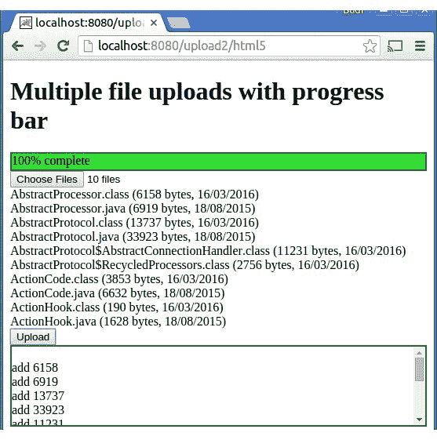

图 11.3: 带有进度条的文件上传

## 总结

在本章中，你学习了如何在 Spring MVC 中处理文件上传。处理已上传文件有两种方法：使用 Commons FileUpload 组件或利用 Servlet 3 的原生文件上传功能。本章的配套示例展示了如何使用这两种方法。

你还学习了如何使用 HTML5 支持多文件上传，并利用 File API 增强了客户端的用户端体验。

# 第 12 章：文件下载

静态资源（如图像或 HTML 文件）只需将浏览器指向正确的 URL 即可下载。只要资源位于应用程序目录或其子目录下，且不在 `WEB-INF` 下，servlet/JSP 容器就会将资源发送到浏览器。然而，有时静态资源存储在应用程序目录之外或数据库中，或者有时你想控制谁可以查看它并防止其他网站对其进行交叉引用。如果符合任何这些情况，你就必须通过程序来发送资源。

简而言之，程序化文件下载允许你选择性地向浏览器发送文件。本章解释了程序化向浏览器发送资源所需的条件，并介绍了两个示例。

## 文件下载概述

要向浏览器发送文件等资源，你需要在控制器执行以下操作：

1. 为请求处理方法使用 `void` 返回类型，并将 `HttpServletResponse` 作为方法的参数添加进去。
2. 将响应的内容类型设置为文件的内容类型。`Content-Type` 头部指定实体体中数据的类型，由媒体类型和子类型标识符组成。访问 http://www.iana.org/assignments/media-types 获取标准内容类型。如果你不知道内容类型是什么，或希望浏览器始终显示“另存为”对话框，请设置为 `APPLICATION/OCTET-STREAM`。该值不区分大小写。
3. 添加一个名为 `Content-Disposition` 的 HTTP 响应头，并赋予值 `attachment; filename=fileName`，其中 `fileName` 是应该在文件下载对话框中显示的默认文件名。这通常与文件名相同，但不必一致。

例如，以下代码将文件发送到浏览器。

```java
FileInputStream fis = new FileInputStream(file);
BufferedInputStream bis = new BufferedInputStream(fis);
byte[] bytes = new byte[bis.available()];
response.setContentType(contentType);		
OutputStream os = response.getOutputStream();
bis.read(bytes);
os.write(bytes);
```

上述代码首先作为 `FileInputStream` 读取文件并将内容加载到字节数组。然后，它获取 `HttpServletResponse` 的 `OutputStream` 并调用其 `write` 方法，传递字节数组。

向 HTTP 发送文件的更好方法是使用 Java NIO 的 `Files.copy()` 方法：

```java
Path file = Paths.get(...);
Files.copy(file, response.getOutputStream());
```

代码更短且运行速度更快。

## 示例 1：隐藏资源

下载应用程序演示了如何向浏览器发送文件。在此应用程序中，`ResourceController` 类处理用户登录以及向浏览器发送 `secret.pdf` 文件。`secret.pdf` 文件被放置在 `WEB-INF/data` 下，因此无法直接访问。只有经过授权的用户才能查看它。如果用户未登录，应用程序将跳转到 `Login` 页面。

列表 12.1: `ResourceController` 类

```java
package controller;

import java.io.IOException;
import java.nio.file.Files;
import java.nio.file.Path;
import java.nio.file.Paths;
import javax.servlet.http.HttpServletRequest;
import javax.servlet.http.HttpServletResponse;
import javax.servlet.http.HttpSession;
import org.apache.commons.logging.Log;
import org.apache.commons.logging.LogFactory;
import org.springframework.stereotype.Controller;
import org.springframework.ui.Model;
import org.springframework.web.bind.annotation.ModelAttribute;
import org.springframework.web.bind.annotation.RequestMapping;
import domain.Login;

@Controller
public class ResourceController {
    private static final Log logger =
        LogFactory.getLog(ResourceController.class);

    @RequestMapping(value="/login")
    public String login(@ModelAttribute Login login, HttpSession session, 
            Model model) {
        model.addAttribute("login", new Login());
        if ("paul".equals(login.getUserName()) &&
                "secret".equals(login.getPassword())) {
            session.setAttribute("loggedIn", Boolean.TRUE);
            return "Main";
        } else {
            return "LoginForm";
        }
    }

    @RequestMapping(value="/download-resource")
    public String downloadResource(HttpSession session, 
            HttpServletRequest request, HttpServletResponse response, 
            Model model) {
        if (session == null || 
                session.getAttribute("loggedIn") == null) {
            model.addAttribute("login", new Login());
            return "LoginForm";
        }
        String dataDirectory = request.
                getServletContext().getRealPath("/WEB-INF/data");
        Path file = Paths.get(dataDirectory, "secret.pdf");
        if (Files.exists(file)) {
            response.setContentType("application/pdf");
            response.addHeader("Content-Disposition", 
                    "attachment; filename=secret.pdf");
            try {
                Files.copy(file, response.getOutputStream());
            } catch (IOException ex) {
            }
        }
        return null;
    }
}
```

控制器中的第一个方法 `login` 将用户引导到登录表单。

`LoginForm.jsp` 页面如列表 12.2 所示。

列表 12.2：`LoginForm.jsp` 页面

```jsp
<%@ taglib prefix="form" uri="http://www.springframework.org/tags/form"%>
<%@ taglib prefix="c" uri="http://java.sun.com/jsp/jstl/core" %>
<!DOCTYPE html>
<html>
<head>
<title>Login</title>
<style type="text/css">@import url("<c:url value="/css/main.css"/>");</style>
</head>
<body>
<div id="global">
<form:form commandName="login" action="login" method="post">
    <fieldset>
        <legend>Login</legend>
        <p>
            <label for="userName">User Name: </label>
            <form:input id="userName" path="userName" 
                    cssErrorClass="error"/>
        </p>
        <p>
            <label for="password">Password: </label>
            <form:password id="password" path="password" 
                cssErrorClass="error"/>
        </p>
        <p id="buttons">
            <input id="reset" type="reset" tabindex="4">
            <input id="submit" type="submit" tabindex="5" 
                value="Login">
        </p>
    </fieldset>
</form:form>
</div>
</body>
</html>
```

成功登录时必须使用的用户名和密码被硬编码在 `login` 方法中。用户名必须是 `paul`，密码必须是 `secret`。如果用户登录成功，将将被重定向到 `Main.jsp` 页面（打印在列表 12.3 中）。该页面包含一个用户可以点击下载文档的链接。

列表 12.3：`Main.jsp` 页面

```jsp
<%@ taglib uri="http://java.sun.com/jsp/jstl/core" prefix="c" %>
<!DOCTYPE html>
<html>
<head>
<title>Download Page</title>
<style type="text/css">@import url("<c:url value="/css/main.css"/>");</style>
</head>
<body>
<div id="global">
    <h4>Please click the link below.</h4>
    <p>
        <a href="resource_download">Download</a>
    </p>
</div>
</body>
</html>
```

`ResourceController` 类中的第二个方法 `downloadResource` 通过验证是否存在 `loggedIn` 会话属性来检查用户是否已成功登录。如果找到了该属性，它会将文件发送到浏览器。如果没有，用户将会被送到 `Login` 页面。请注意，如果你使用的是 Java 7 或更高版本，新的 `try-with-resources` 特性是处理资源更安全的方法。

你可以通过此 URL 调用 `FileDownloadServlet` 来测试下载应用程序：

```
http://localhost:8080/download/login
```

## 示例 2：防止交叉引用

竞争对手可能会尝试通过交叉引用来“盗取”你的网络资源，即在他们的网站中显示。你可以通过编程检查 `Referer` 请求头来防止这一点。

列表 12.4：`ImageController` 类

```java
package controller;

import java.io.IOException;
import java.nio.file.Files;
import java.nio.file.Path;
import java.nio.file.Paths;
import javax.servlet.http.HttpServletRequest;
import javax.servlet.http.HttpServletResponse;
import javax.servlet.http.HttpSession;
import org.apache.commons.logging.Log;
import org.apache.commons.logging.LogFactory;
import org.springframework.stereotype.Controller;
import org.springframework.ui.Model;
import org.springframework.web.bind.annotation.ModelAttribute;
```


```java
import org.springframework.web.bind.annotation.RequestMapping;
import org.springframework.web.bind.annotation.PathVariable;
import org.springframework.web.bind.annotation.RequestHeader;
import org.springframework.web.bind.annotation.RequestMethod;
import domain.Login;

@Controller
public class ImageController {

    private static final Log logger =
            LogFactory.getLog(ImageController.class);

    @RequestMapping(value="/get-image/{id}", method = RequestMethod.GET)
    public void getImage(@PathVariable String id,
            HttpServletRequest request, HttpServletResponse response,
            @RequestHeader String referer) {

        if (referer != null) {
            String imageDirectory = request.getServletContext().
                    getRealPath("/WEB-INF/image");
            Path file = Paths.get(imageDirectory, id + ".jpg");
            if (Files.exists(file)) {
                response.setContentType("image/jpg");
                try {
                    Files.copy(file, response.getOutputStream());
                } catch (IOException e) {
                    e.printStackTrace();
                }
            }
        }
    }
}
```

原则上，`ImageController` 的工作方式类似于 `ResourceController`。`getImage` 方法开头的 `if` 语句确保只有在 `referer` 请求头不空时才会发送图像。

将图像内容写入 `ServletOutputStream` 使用了 Java NIO `Files.copy()` 方法，这比使用 Java IO 更高效的方法。

你可以使用列表 12.5 中的 `images.html` 文件来测试应用程序。

**列表 12.5：`images.html` 文件**

```html
<!DOCTYPE html>
<html>
<head>
    <title>Photo Gallery</title>
</head>
<body>


</body>
</html>
```

要查看 `ImageServlet` 的运行情况，将浏览器指向此 URL：

```
http://localhost:8080/download/images.html
```

图 12.1 显示了 `ImageServlet` 发送的图像。


**图 12.1：ImageServlet 运行效果**

在本章中，你学习了 Spring MVC 应用程序中程序化文件下载的工作原理。你还学习了如何选择文件并将其发送到浏览器。

# 第 13 章：测试你的应用程序

在软件开发中，测试的重要性无论如何都不为过。测试的主要目标是尽早发现 bug，尽可能在代码开发阶段就发现。从逻辑上讲，发现 bug 越早，修复成本越低。如果你在编程时发现 bug，可以立即修改代码。如果你的同事在你将代码发布到共享仓库后才发现你的 bug，那么现在已经涉及了至少两个人。想象一下，如果在软件发布后客户发现了 bug，后果会怎样。

软件开发中有许多不同的测试。其中，单元测试和集成测试是本章的主题。你通常从单元测试开始，测试类中的单个方法，然后进行集成测试，以测试不同模块是否能够无缝协同工作。

本章中的示例是使用 `JUnit` 测试框架以及 `spring-test` 模块中的类型编写的。该模块中的 API 既可以用于单元测试也可以用于集成测试。你可以在 `org.springframework.test` 及其子包，以及 `org.springframework.mock.*` 包中找到与 Spring 测试相关的类型。示例被分为两个配套项目，分别称为 `unit-test` 和 `integration-test`。第一个项目包含类和单元测试。第二个项目包含类和集成测试。

## 单元测试概述

单元测试的理念是为每个类创建一个测试类，并为类中的每个方法创建一个测试方法，但像 getter 和 setter 方法这种简单返回和为字段赋值的琐方法除外。

在测试术语中，被测试的类被称为被测系统（`SUT`）。

单元测试旨在快速且频繁地运行。它们验证代码本身而不是它的依赖项。任何依赖都应该被称为测试双子（test doubles）的辅助对象取代，将在本章后续解释。涉及依赖的测试通常在集成测试中进行，而不是单元测试。

初一看，编写单元测试看起来是多余的额外工作。毕竟，你可以在类内部使用 `main` 方法测试该类。然而，你应该考虑单元测试的益处。首先，在独立的测试类中编写测试代码不会让你的类变得混乱。其次，单元测试可以用于回归测试，以确保在更改逻辑时一切仍然正常运行。单元测试的另一个主要优点是它可以在持续集成环境中实现自动化。持续集成指的是一种开发方法，程序员经常将代码提交到共享仓库，每次代码提交都会触发一个自动化构建，其中包含运行所有单元测试。持续集成允许尽早检测问题。

在单元测试中，使用 `new` 算符实例化类。Spring 框架依赖注入容器不用于创建 bean。

让我们看看列表 13.1 中的类。

**列表 13.1：待测试的类**

```java
package com.example.util;

public class MyUtility {

    public int method1(int a, int b) { ... }
    public long method2(long a) { ... }
}
```

要对此类进行单元测试，请像列表 13.2 那样创建一个新类。注意，每个方法应该至少有一个测试方法。

**列表 13.2：一个测试类**

```java
package com.example.util;

public class MyUtilityTest {

    public void testMethod1() {
        MyUtility utility = new MyUtility();
        int result = utility.method1(100, 200);
        // 断言 result 等于预期值
    }

    public void testMethod2() {
        MyUtility utility = new MyUtility();
        long result = utility.method2(100L);
        // 断言 result 等于预期值
    }
}
```

惯例是将测试类命名为与 `SUT` 相同的名字并加上 `Test`。因此，`MyUtility` 的测试类应该命名为 `MyUtilityTest`。测试类也应该与 `SUT` 相同的包，以便前者访问后者的受保护（protected）和默认（default）成员。然而，测试类应该放置在与被测试类不同的单独源文件夹中。

测试方法没有返回值。在方法中，你实例化要测试的类，调用要测试的方法并验证结果。为了让编写测试类更简单，你应该使用测试框架，例如 `JUnit` 或 `TestNG`。本章介绍了用 `JUnit` 编写的示例，它是 Java 事实上的标准单元测试框架。

## 状态测试与行为测试

大多数时候，你只关心方法是否返回正确的结果。这被称为状态测试。然而，有时当你想要方法的行为是正确的时，你也会执行行为测试（也称为交互测试）。例如，你可能想验证一个方法按正确的顺序调用了某些其他方法。或者，你可能想确保你的方法在操作期间恰好调用了另一个方法 n 次。

你将在本章稍后部分学习如何执行状态测试和行为测试。

## 使用 JUnit

对于单元测试，我推荐 `JUnit`，你可以从 http://junit.org 下载。点击 Download and Install 链接后，你将被重定向到下载页面。你需要下载 `junit.jar` 和 `hamcrest-core.jar` 文件。后者是 `JUnit` 的依赖项，目前版本为 4.12。

如果你在使用 `Maven` 或 `STS`，请向你的 `pom.xml` 文件添加此元素以下载 `JUnit` 及其依赖项。

```xml
<dependency>
    <groupId>junit</groupId>
    <artifactId>junit</artifactId>
    <version>4.12</version>
    <scope>test</scope>
</dependency>
```

尽管名字如此，`JUnit` 也广泛用于集成测试，你将在本章稍后学习。

你可以通过阅读其网站上的文档了解更多关于 `JUnit` 以及如何编写 `JUnit` 测试的信息。以下是 `JUnit` 的快速课程。

## 编写 JUnit 测试

编写单元测试没有更简单的方法了。只需为所有测试方法注解 `@org.junit.Test`。此外，你可以通过注解 `@org.junit.Before` 创建初始化方法。初始化方法在任何测试方法调用之前执行，可以在其中编写准备测试的代码，例如创建将被使用的对象。

你还可以通过注解方法 `@org.junit.After` 创建清理方法。清理方法在测试类中的所有测试方法执行后调用，用于释放测试期间使用的资源。

列表 13.3 显示了一个需要单元测试的 `Calculator` 类。

**列表 13.3：`Calculator` 类**

```java
package com.example;

public class Calculator {

    public int add(int a, int b) {
        return a + b;
    }

    public int subtract(int a, int b) {
        return a - b;
    }
}
```

列表 13.4 显示了 `Calculator` 的测试类。

**列表 13.4：`Calculator` 的测试类**

```java
package com.example;

import org.junit.After;
import org.junit.Assert;
import org.junit.Before;
import org.junit.Test;

public class CalculatorTest {

    @Before
    public void init() {
    }

    @After
    public void cleanUp() {
    }

    @Test
    public void testAdd() {
        Calculator calculator = new Calculator();
        int result = calculator.add(5, 8);
        Assert.assertEquals(13, result);
    }

    @Test
    public void testSubtract() {
        Calculator calculator = new Calculator();
        int result = calculator.subtract(5, 8);
        Assert.assertEquals(-3, result);
    }
}
```

`CalculatorTest` 类包含两个测试方法：一个初始化方法（带有 `@Before` 注解）和一个清理方法（带有 `@After` 注解）。`org.junit.Assert` 类提供了许多用于断言结果的静态方法。例如，`assertEquals` 方法用于比较两个值。

## 运行单元测试

Eclipse 和 STS 可以识别一个类是否为 JUnit 测试类。要运行测试类，请在包资源管理器（Package Explorer）中右键点击该测试类，然后选择 `Run As > JUnit Test`。或者，用编辑器打开测试类并按 `Ctrl+F11`。

当测试完成后，如果 JUnit 视图尚未打开，Eclipse 或 STS 将打开它。如果单元测试成功完成，你将在 JUnit 视图中看到如图 13.1 所示的绿色条。

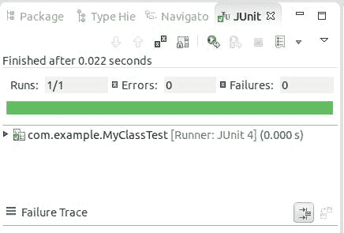

**图 13.1：运行成功的测试**

如果其中一个测试失败，你将看到类似图 13.2 所示红色条。

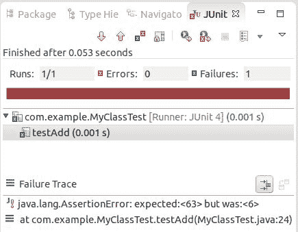

**图 13.2：失败的测试**

## 使用测试套件运行所有或多个测试

在一个包含十几个类的小型项目中，你会有十几个测试类。在更大的项目中，数量会更多。在 Eclipse 或 STS 中运行单个测试类非常简单，但运行所有的测试类该如何处理？

使用 JUnit 的解决方案非常简单。创建一个 Java 类，并对其添加 `@RunWith(Suite.class)` 和 `@SuiteClasses()` 注解。后者应该列出你想要运行的所有类和其他测试套件测试。代码列表 13.5 显示了一个示例。类体可以留空。

**代码列表 13.5：测试套件**

```java
package com.example;

import org.junit.runner.RunWith;
import org.junit.runners.Suite;
import org.junit.runners.Suite.SuiteClasses;

@RunWith(Suite.class)
@SuiteClasses({ MyTest1.class, MyTest2.class })
public class MyTestSuite {
}
```

如果你正在使用 CI 服务器，可以设置服务器在每次提交新代码或修改代码时自动运行单元测试。

## 使用测试替换（Test Doubles）

被测系统（`SUT`）很少孤立运行。通常，为了测试一个类，你需要依赖项。在测试术语中，`SUT` 需要的依赖被称为协作者（collaborators）。

协作者通常被其他被称为测试替换（test doubles）的对象取代。“测试替换”是 Gerard Meszaros 在他的书《xUnit Test Patterns: Refactoring Test Code》中提出的术语。他的解释可以在此网页找到：

```
http://xunitpatterns.com/Test%20Double.html
```

使用测试替换有几个原因：

*   在编写测试类时，真实的依赖项尚未准备就。
*   某些依赖项（例如 `HttpServletRequest` 和 `HttpServletResponse` 对象）是从 servlet 容器获取的。自己创建这些对象非常耗时。
*   某些依赖项启动和初始化很慢。例如，访问数据库的 DAO 对象对于单元测试来说可能太慢了。

测试替换在单元测试中广泛使用，尽管它们在集成测试中也会被使用。有很多创建测试替换的框架。甚至 Spring 也有自己用于创建测试替换的类。

模拟框架（mocking framework）可以创建测试替换并验证你的代码行为。以下是一些流行的框架：

*   Mockito
*   EasyMock
*   jMock

除了上述库之外，Spring 还自带了创建模拟对象的类。你将在下一节中学习使用 Spring 类单元测试 Spring MVC 控制器。在本节中，你将学习使用 Mockito。

Mockito 不提供直接下载，因此你必须使用 Maven。然而，本章的示例包含了 Mockito 分发包（一个 `mockito.jar` 文件）及其依赖项 `objenesis.jar` 文件。

要使用 Maven 下载 Mockito，请向你的 `pom.xml` 文件添加以下依赖项：

```xml
<dependency>
    <groupId>org.mockito</groupId>
    <artifactId>mockito-core</artifactId>
    <version>2.0.43-beta</version>
    <type>pom</type>
</dependency>
```


在开始编写测试替换之前，你应该先了解理论。

以下是五种测试替换：

- `dummy`（空桩）
- `stub`（存根）
- `spy`（间谍）
- `fake`（假实现）
- `mock`（模拟）

每种类型都将在下文的小节中进行解释。

### Dummies（空桩）

测试替换最原始的类型——`dummy` 是协作者的实现，它什么都不做，也不会改变 SUT 的行为。它通常用于让 SUT 实例化。`Dummies` 仅在开发的非常早期阶段使用。

例如，考虑代码列表 13.6 中的 `ProductServiceImpl` 类。该类依赖于传递给构造函数的 `ProductDAO`。

代码列表 13.6：`ProductServiceImpl` 类

```java
package com.example.service;

import com.example.dao.ProductDAO;

public class ProductServiceImpl implements ProductService {

    private ProductDAO productDAO;

    public ProductServiceImpl(ProductDAO productDAOArg) {

        if (productDAOArg == null) {

            throw new NullPointerException("ProductDAO cannot be null.");

        }

        this.productDAO = productDAOArg; 

    }

    @Override

    public BigDecimal calculateDiscount() {

        return productDAO.calculateDiscount();

    }

    @Override

    public boolean isOnSale(int productId) {

        return productDAO.isOnSale(productId);

    }

}
```

`ProductServiceImpl` 类在没有非空 `ProductDAO` 的情况下无法实例化。同时，`ProductDAO` 在被测试的方法中并没有被使用。因此，为了让 `ProductServiceImpl` 可以实例化，你可以创建一个如列表 13.7 所示的 `dummy`。

代码列表 13.7：`ProductDAummy` 类

```java
package com.example.dummy;

import java.math.BigDecimal;

import com.example.dao.ProductDAO;

public class ProductDAummy implements ProductDAO {

    public BigDecimal calculateDiscount() {

        return null;

    }

    public boolean isOnSale(int productId) {

        return false;

    };

}
```

`dummy` 类的方法实现什么都不做，其返回值并不重要，因为这些方法从未被使用。代码列表 13.8 显示了得益于 `dummy` 类的测试类。

代码列表 13.8：`ProductServiceImplTest` 类

```java
package com.example.dummy;

import static org.junit.Assert.assertNotNull;

import org.junit.Test;

import com.example.dao.ProductDAO;

import com.example.service.ProductService;

import com.example.service.ProductServiceImpl;

public class ProductServiceImplTest {

    @Test

    public void testCalculateDiscount() {

        ProductDAO productDAO = new ProductDAummy();

        ProductService productService = 

                new ProductServiceImpl(productDAO);

        assertNotNull(productService);

    }

}
```

### Stubs（存根）

像 `dummy` 一样也是依赖接口的实现。`dummy` 和 `stub` 的区别在于 `stub` 方法返回硬编码的值，且这些方法实际上被使用了。

代码列表 13.9 显示了一个用于测试列表 13.6 中 `ProductServiceImpl` 类的 `stub`。

代码列表 13.9：`ProductDAOStub` 类

```java
package com.example.stub;

import java.math.BigDecimal;

import com.example.dao.ProductDAO;

public class ProductDAOStub implements ProductDAO {

    public BigDecimal calculateDiscount() {

        return new BigDecimal(14);

    }

    public boolean isOnSale(int productId) {

        return false;

    };

}
```

### Spies（间谍）

`spy` 是一个稍微智能一点的 `stub`，因为 `spy` 可以保留状态。考虑以下租车应用程序，它在其他内容之外还包含了列表 13.10 中的 `GarageService` 接口和列表 13.11 中的 `GarageServiceImpl` 类。

代码列表 13.10：`GarageService` 接口

```java
package com.example.service;

import com.example.Car;

public interface GarageService {

    Car rent();

}
```

代码列表 13.11：`GarageServiceImpl` 类

```java
package com.example.service;

import com.example.Car;

import com.example.dao.GarageDAO;

public class GarageServiceImpl implements GarageService {

    private GarageDAO garageDAO;

    public GarageServiceImpl(GarageDAO garageDAOArg) {

        this.garageDAO = garageDAOArg;

    }

    public Car rent() {

        return garageDAO.rent();

    }

}
```

`GarageService` 接口只有一个方法，`rent`。`GarageServiceImpl` 类是 `GarageService` 的实现，并且它有一个 `GarageDAO` 依赖。`GarageServiceImpl` 中的 `rent` 方法调用了 `GarageDAO` 中的 `rent` 方法。`GarageDAO` 的实现应该在车库中仍有车时返回一个 `Car`，如果没有车了，则返回 `null`。

由于 `GarageDAO` 的真实实现尚未完成，因此使用了列表 13.12 中的 `GarageDAOSpy` 类作为测试双胞（test double）。它是一个间谍（spy），因为它的方法返回一个硬编码的值，并且通过 `carCount` 变量维护车库中车辆的数量。

列表 13.12：`GarageDAOSpy` 类

```java
package com.example.spy;

import com.example.Car;

import com.example.dao.GarageDAO;

public class GarageDAOSpy implements GarageDAO {

    private int carCount = 3;

    @Override

    public Car rent() {

        if (carCount == 0) {

            return null;

        } else {

            carCount--;

            return new Car();

        }   

    }

}
```

列表 13.13 显示了一个使用 `GarageDAOSpy` 测试 `GarageServiceImpl` true 测试类。

列表 13.13：`GarageServiceImplTest` 类

```java
package com.example.spy;

import com.example.Car;

import com.example.dao.GarageDAO;

import com.example.service.GarageService;

import com.example.service.GarageServiceImpl;

import org.junit.Test;

import static org.junit.Assert.*;

public class GarageServiceImplTest {

    @Test

    public void testRentCar() {

        GarageDAO garageDAO = new GarageDAOSpy();

        GarageService garageService = new GarageServiceImpl(garageDAO);

        Car car1 = garageService.rent();

        Car car2 = garageService.rent();

        Car car3 = garageService.rent();

        Car car4 = garageService.rent();

        assertNotNull(car1);

        assertNotNull(car2);

        assertNotNull(car3);

        assertNull(car4);

    }

}
```

由于车库中只有三辆车，该间谍只能返回三辆车，当第四次调用其 `rent` 方法时，必须返回 `null`。

### Fakes（假实现）

`Fake` 的行为像真实的协作对象，但并不适用于生产环境，因为它包含了捷径。内存存储是 `Fake` 的一个完美例子，因为它行为像一个 `DAO`，但不会将其状态持久化到硬盘上。

例如，请考虑列表 13.14 和列表 13.15 分别的 `Member` 和 `MemberServiceImpl` 类。`Member` 类包含一个成员的标识符和名称。`MemberServiceImpl` 类可以将 `Members` 添加到存储器中并检索所有存储的成员。

列表 13.14：`Member` 类

```java
package com.example.model;

public class Member {

    private int id;

    private String name;

    public Member(int idArg, String nameArg) {

        this.id = idArg;

        this.name = nameArg;

    }

    public int getId() {

        return id;

    }

    public void setId(int idArg) {

        this.id = idArg;

    }

    public String getName() {

        return name;

    }

    public void setName(String nameArg) {

        this.name = nameArg;

    }

}
```

列表 13.15：`MemberServiceImpl` 类

```java
package com.example.service;

import java.util.List;

import com.example.dao.MemberDAO;

import com.example.model.Member;

public class MemberServiceImpl implements MemberService {

    private MemberDAO memberDAO;

    public void setMemberDAO(MemberDAO memberDAOArg) {

        this.memberDAO = memberDAOArg;

    }

    @Override

    public void add(Member member) {

        memberDAO.add(member);

    }

    @Override

    public List<Member> getMembers() {

        return memberDAO.getMembers();

    }

}
```

`MemberServiceImpl` 依赖于 `MemberDAO`。然而，由于没有可用的 `MemberDAO` 实现，你可以创建一个 `MemberDAO` fake，这样就可以立即测试 `MemberServiceImpl`。列表 13.16 显示了这样一个 fake。它将成员存储在 `ArrayList` 中，而不是持久化存储。因此，它不能用于生产环境，但对于单元测试来说足够了。

列表 13.16：`MemberDAOFake` 类

```java
package com.example.fake;

import java.util.ArrayList;

import java.util.List;

import com.example.dao.MemberDAO;

import com.example.model.Member;

public class MemberDAOFake implements MemberDAO {

    private List<Member> members = new ArrayList<>();

    @Override

    public void add(Member member) {

        members.add(member);

    }

    @Override

    public List<Member> getMembers() {

        return members;

    }

}
```

### Mocks（模拟对象）

模拟对象在哲学上与其他的测试双胞不同。你使用 `dummy`、`stub`（存根）、`spy`（间谍）和 `fake` 进行状态测试，即验证方法的输出。相比之下，你使用模拟对象进行行为（交互）测试，以确保某个方法被调用，或者在执行某个方法时被调用了多少次。

例如，考虑列表 13.18 中的 `MathUtil` 类。

列表 13.18：`MathUtil` 类

```java
package com.example;

public class MathUtil {

    private MathHelper mathHelper;

    public MathUtil(MathHelper mathHelper) {

        this.mathHelper = mathHelper;

    }

    public MathUtil() {

    }

    public int multiply(int a, int b) {

        int result = 0;

        for (int i = 1; i <= a; i++) {

            result = mathHelper.add(result, b);

        }

        return result;

    }   

}
```

`MathUtil` 有一个方法 `multiply`，它执行乘法。它非常天真地通过多次加法来实现。换说，3 x 8 被计算为 8 + 8 + 8。`MathUtil` 类甚至不知道如何加法。为此，它依赖于一个 `MathHelper` 对象，该类打印在列表 13.19 中。

列表 13.19：`MathHelper` 类

```java
package com.example;

public class MathHelper {

    public int add(int a, int b) {

        return a + b;

    }

}
```


你对`multiply`方法的结果并不感兴趣，而是想找出`multiply`方法是否符合预期。因此，在计算 3 x 8 时，它应该调用`MathHelper.add()`三次。列表 13.20 显示了一个使用`MathHelper`模拟对象的测试类。Mockito，一个流行的模拟框架被用来创建模拟对象。我将在本章稍后部分详细介绍 Mockito。在这一节中，我只想向你展示这个概念。

列表 13.20：`MathUtilTest`类

```java
package com.example;

import org.junit.Test;

import static org.mockito.Mockito.*;

import static org.junit.Assert.*;

public class MathUtilTest {

    @Test

    public void testMultiply() {

        MathHelper mathHelper = mock(MathHelper.class);

        MathUtil mathUtil = new MathUtil(mathHelper);

        int result = mathUtil.multiply(3, 8);

        assertEquals(24, result);

        verify(mathHelper, times(3)).add(anyInt(), anyInt());

    }

}
```

```java
package com.example;

import static org.mockito.Mockito.mock;

import static org.mockito.Mockito.times;

import static org.mockito.Mockito.verify;

import static org.mockito.Mockito.when;

import org.junit.Test;

public class MathUtilTest {

    @Test

    public void testMultiply() {

        MathHelper mathHelper = mock(MathHelper.class);

        for (int i = 0; i < 10; i++) {

            when(mathHelper.add(i * 8, 8)).thenReturn(i * 8 + 8);

        }

        MathUtil mathUtil = new MathUtil(mathHelper);

        mathUtil.multiply(3, 8);

        verify(mathHelper, times(1)).add(0, 8);

        verify(mathHelper, times(1)).add(8, 8);

        verify(mathHelper, times(1)).add(16, 8);

    }

}
```

使用 Mockito 创建 mock 对象非常简单，只需调用`org.mockito.Mockito`类的静态`mock`方法即可。以下是创建一个`MathHelper`mock 对象的方法。

```java
MathHelper mathHelper = mock(MathHelper.class);
```

接下来，你需要使用`when`方法来准备 mock 对象。基本上，你是在告诉它：如果使用这组参数进行方法调用，mock 对象必须返回该值。例如，此条语句表示如果调用了`mathHelper.add(10, 20)`，则返回值必须是`10 + 20`；

```java
when(mathHelper.add(10, 20)).thenReturn(10 + 20);
```

对于这个测试，你准备了带有十组参数的 mock 对象（并不是所有的参数组都会被使用）。

```java
for (int i = 0; i < 10; i++) {

            when(mathHelper.add(i * 8, 8)).thenReturn(i * 8 + 8);

        }
```

然后你创建要被测试的对象并调用其方法。

```java
MathUtil mathUtil = new MathUtil(mathHelper);

        mathUtil.multiply(3, 8);
```

接三条语句是行为测试。要实现此操作，你只需调用`verify`方法：

```java
verify(mathHelper, times(1)).add(0, 8);

        verify(mathHelper, times(1)).add(8, 8);

        verify(mathHelper, times(1)).add(16, 8);
```

第一条语句验证`mathHelper.add(0, 8)`被恰好调用了一次。第二个验证`mathHelper.add(8, 8)`被调用了一次，第三个验证`mathHelper.add(16, 8)`也调用了一次。

## Spring MVC Controller 的单元测试

你已经学习了如何测试 Spring MVC 中的单个类。Controller 有所不同，因为它们通常与 Servlet API 对象交互，例如`HttpServletRequest`、`HttpServletResponse`、`HttpSession`等。在许多情况下，你可能需要 mock 这些对象来正确测试你的控制器。

`Mockito`或`EasyMock`等框架是通用的 mock 框架，可以 mock 任何 Java 对象。你必须自己配置生成的对象（使用一系列`when`语句）。`Spring-Test`mock 对象是专为与 Spring 工作而构建的，与真实对象更相似，且更容易使用。

以下章节将讨论用于单元测试控制的一些的一些重要类型。

## MockHttpServletRequest 和 MockHttpServletResponse

在调用控制器时，你可能需要传递一个`HttpServletRequest`和一个`HttpServletResponse`。在生产环境中，这两个对象由 servlet 容器本身提供。在测试环境中，你可以使用来自`org.springframework.mock.web`包的`SpringMockHttpServletRequest`和`MockHttpServletResponse`类。

这两个类易于使用。你可以通过调用它们的无参构造函数来创建实例：

```java
MockHttpServletRequest request = new MockHttpServletRequest();

MockHttpServletResponse response = new MockHttpServletResponse();
```

`MockHttpServletRequest`类实现了`javax.servlet.http.HttpServletRequest`，允许你配置实例使其看起来像真实的`HttpServletRequest`。它提供了设置`HttpServletRequest`中所有属性的方法以及获取其属性值的方法。表 13.1 显示了它的部分方法。

| 方法 | 描述 |
| :--- | :--- |
| addHeader | 添加 HTTP 请求头 |
| addParameter | 添加请求参数 |
| getAttribute | 返回指定的属性（如果有） |
| getAttributeNames | 返回一个包含所有属性名称的`Enumeration` |
| getContextPath | 返回上下文路径 |
| getCookies | 返回所有 cookie |
| setMethod | 设置 HTTP 方法 |
| setParameter | 为指定的 HTTP 参数设置值 |
| setQueryString | 设置查询字符串 |
| setRequestURI | 设置请求 URI |

表 13.1：`MockHttpServletRequest`中更重要的方法

`MockHttpServletResponse`实现了`javax.servlet.http.HttpServletResponse`，并提供了额外的方法来配置实例。表 13.2 显示了它的一些更重要的方法。

| 方法 | 描述 |
| :--- | :--- |
| addCookie | 添加 cookie。 |
| addHeader | 添加 HTTP 请求头。 |
| getContentLength | 返回内容长度。 |
| getWriter | 返回用于写入响应体的`Writer`。 |
| getOutputStream | 写入响应体。 |

表 13.2：`MockHttpServletResponse`中更重要的方法

作为示例，请考虑 13.21 中的`VideoController`类。

13.21：`VideoController`类

```java
package com.example.controller;

import javax.servlet.http.HttpServletRequest;

import javax.servlet.http.HttpServletResponse;

import org.springframework.stereotype.Controller;

import org.springframework.web.bind.annotation.RequestMapping;

@Controller

public class VideoController {

    @RequestMapping(value = "/mostViewed")

    public String getMostViewed(HttpServletRequest request, 

            HttpServletResponse response) {

        Integer id = (Integer) request.getAttribute("id");

        if (id == null) {

            response.setStatus(500);

        } else if (id == 1) {

            request.setAttribute("viewed", 100);

        } else if (id == 2) {

            request.setAttribute("viewed", 200);

        }

        return "mostViewed";

    }

}
```

`VideoController`的`getMostViewed`方法在存在值为 1 或 2 的请求属性会添加请求属性“viewed”。否则，不会添加。

13.22 中的`VideoControllerTest`类验证了这一点。

13.22：`VideoControllerTest`类

```java
package com.example.controller;

import org.junit.Test;

import static org.junit.Assert.*;

import org.springframework.mock.web.MockHttpServletRequest;

import org.springframework.mock.web.MockHttpServletResponse;

public class VideoControllerTest {

    @Test

    public void testGetMostViewed() {

        VideoController videoController = new VideoController();

        MockHttpServletRequest request = new MockHttpServletRequest();

        request.setRequestURI("/mostViewed");

        request.setAttribute("id", 1);

        MockHttpServletResponse response = new MockHttpServletResponse();

        videoController.getMostViewed(request, response);

        assertEquals(200, response.getStatus());

        assertEquals(100, (int) request.getAttribute("viewed"));

    }

    @Test

    public void testGetMostViewedWithNoId() {

        VideoController videoController = new VideoController();

        MockHttpServletRequest request = new MockHttpServletRequest();

        request.setRequestURI("/mostViewed");

        MockHttpServletResponse response = new MockHttpServletResponse();

        videoController.getMostViewed(request, response);

        assertEquals(500, response.getStatus());

        assertNull(request.getAttribute("viewed"));        

    }

}
```

随后，它调用`VideoController`的`getMostViewed`方法并传入模拟对象，然后验证响应的状态码为 200，且请求包含一个值为 100 的名为“viewed”的属性。

```java
videoController.getMostViewed(request, response);

        assertEquals(200, response.getStatus());

        assertEquals(100L, (int) request.getAttribute("viewed"));
```

`VideoControllerTest`中的第二个方法也类似类似，但它没有向`MockHttpServletRequest`对象添加“id”属性。结果是，在调用控制器的方法时，它接收到的 HTTP 响应状态码为 500，且`MockHttpServletRequest`对象中没有找到“viewed”属性。

## ModelAndViewAssert

`ModelAndViewAssert`类属于`org.springframework.web.servlet`包，是另一个非常有用的 Spring 类，用于测试从控制器请求处理方法返回的`ModelAndView`。回想第 4 章“基于注解的控制器”，`ModelAndView`是请求处理方法可以返回的类型之一。同样回想，`ModelAndView`是一个包含请求处理方法模型（model）和视图（view）信息的 Bean。

表 13.3 显示了`ModelAndViewAssert`中的一些方法。

| 方法 | 描述 |
| :--- | :--- |
| `assertViewName` | 接收一个`ModelAndView`和预期名称，该方法检查`ModelAndView`的视图名称是否与预期名称匹配。 |
| `assertModelAttributeAvailable` | 接收一个`ModelAndView`和一个模型名称，该方法检查`ModelAndView`的模型是否包含具有预期模型名称的属性。 |
| `assertModelAttributeValue` | 接收一个`ModelAndView`、一个模型名称和一个`Object`，该方法检查`ModelAndView`的模型是否包含指定名称和值的属性。 |
| `assertSortAndCompareList-ModelAttribute` | 对指定`ModelAndView`模型中的`List`进行排序，然后将其与预期的列表进行比较。 |

表 13.3：`ModelAndViewAssert`中更重要的方法

作为一个示例，考虑代码列表 13.23 中的`Book`类。这是一个简单的 Bean 类，具有四个属性：`isbn`、`title`、`author`和`pubDate`。

代码列表 13.23：`Book`类

```java
package com.example.model;

import java.time.LocalDate;

public class Book {

    private String isbn;

    private String title;

    private String author;

    private LocalDate pubDate;

    public Book(String isbn, LocalDate pubDate) {

        this.isbn = isbn;
```


`this.pubDate = pubDate;`

```
public Book(String isbn, String title, String author,
        LocalDate pubDate) {
    this.isbn = isbn;
    this.title = title;
    this.author = author;
    this.pubDate = pubDate;
}
// getters and setters 未省略以节省空间

@Override
public boolean equals(Object otherBook) {
    return isbn.equals(((Book)otherBook).getIsbn());
}
```

代码列表 13.24 中的 `BookController` 类是一个 Spring MVC 控制器，包含一个请求处理方法 `getLatestTitles`。该方法接受一个 `pubYear` 路径变量，如果 `pubYear` 的值为“2016”，则返回一个包含书籍列表的 `ModelAndView`。

代码列表 13.24：`BookController` 类

```
package com.example.controller;

import java.time.LocalDate;
import java.util.Arrays;
import java.util.List;
import org.springframework.stereotype.Controller;
import org.springframework.web.bind.annotation.PathVariable;
import org.springframework.web.bind.annotation.RequestMapping;
import org.springframework.web.servlet.ModelAndView;
import com.example.model.Book;

@Controller
public class BookController {
    @RequestMapping(value = "/latest/{pubYear}")
    public ModelAndView getLatestTitles(
            @PathVariable String pubYear) {
        ModelAndView mav = new ModelAndView("Latest Titles");
        if ("2016".equals(pubYear)) {
            List<Book> list = Arrays.asList(
                    new Book("0001", "Spring MVC: A Tutorial", 
                            "Paul Deck", 
                            LocalDate.of(2016, 6, 1)),
                    new Book("0002", "Java Tutorial",
                            "Budi Kurniawan", LocalDate.of(2016, 11, 1)),
                    new Book("0003", "SQL", "Will Biteman", 
                            LocalDate.of(2016, 12, 12)));
            mav.getModel().put("latest", list);
        }
        return mav;
    }
}
```

测试 `BookController` 的一种简单方法是使用 `ModelAndViewAssert` 中的静态方法，如代码列表 13.25 中的 `BookControllerTest` 类所示。

代码列表 13.25：`BookControllerTest` 类

```
package com.example.controller;

import static org.springframework.test.web.ModelAndViewAssert.*;
import java.time.LocalDate;
import java.util.Arrays;
import java.util.Comparator;
import java.util.List;
import org.junit.Test;
import org.springframework.web.servlet.ModelAndView;
import com.example.model.Book;

public class BookControllerTest {
    @Test
    public void test() {
        BookController bookController = new BookController();
        ModelAndView mav = bookController.getLatestTitles("2016");
        assertViewName(mav, "Latest Titles");
        assertModelAttributeAvailable(mav, "latest");
        List<Book> expectedList = Arrays.asList(
                new Book("0001", "Spring MVC: A Tutorial", 
                            "Paul Deck", 
                            LocalDate.of(2016, 6, 1)),
                    new Book("0002", "Java Tutorial",
                            "Budi Kurniawan", LocalDate.of(2016, 11, 1)),
                    new Book("0003", "SQL", "Will Biteman", 
                            LocalDate.of(2016, 12, 12)));
        assertReturnModelAttributeOfType(mav, "latest", 
                expectedList.getClass());
        Comparator<Book> pubDateComparator = 
                (a, b) -> a.getPubDate().compareTo(b.getPubDate());
        assertSortAndCompareList(mav, "latest", 
                expectedList, pubDateComparator);
    }
}
```

## 使用 Spring MVC Test 进行集成测试

集成测试是为了测试不同模块能否协同工作的一种测试。它还确保数据在模块之间无缝流动。使用了 Spring 框架依赖注入容器，并且需要检查 Bean 的连接。

如果没有合适的工具，集成将花费大量时间。假设你正在构建一个在线商店，必须使用浏览器来测试购物车计算是否正确。每当你更改代码，都要启动浏览器、登录系统、将多个商品添加到购物车并结算以检查总金额是否正确。每次迭代很容易花费五分钟！

幸运的是，Spring 提供了一个集成测试模块：Spring Test。

虽然 Spring 类 `MockHttpServletRequest`、`MockHttpServletResponse` 和 `ModelAndViewAssert` 适用于单元测试，但它们缺乏通常集成测试相关的功能。例如，它们直接调用请求处理方法，无法测试请求映射和数据绑定。由于 SUT 类是使用 `new` 操作符实例化的，它们无法测试 Bean 的连接。

## API

Spring MVC Test 模块提供了工具类，方便对 Spring MVC 应用进行集成测试。Bean 使用 Spring 依赖注入创建并从 `ApplicationContext` 获取，就像在真实的 Spring 应用中一样。

`MockMvc` 类属于 `org.springframework.test.web.servlet` 包，是 Spring MVC Test 中辅助集成测试的主类。该类允许你使用预定义的请求映射来调用请求处理方法。以下是创建 `MockMvc` 实例的一种方式：

```
MockMvc mockMvc = MockMvcBuilders.webAppContextSetup(webAppContext)
        .build();
```

在这里，`webAppContext` 是一个注入的 `WebApplicationContext` 实例引用，它是第 2 章“Spring 框架”中讨论过的 `ApplicationContext` 的子类，每个 `Spring` 开发者都应该熟悉它。要获取一个 `WebApplicationContext`，你必须在测试类中声明它。

```
@Autowired private WebApplicationContext webAppContext;
```

`MockMvcBuilder` 会读取为测试类定义的 Spring 配置文件或多个文件。我将讨论如何为你的测试类指定配置文件，但首先我想讨论一下 `MockMvc`。

`MockMvc` 是一个非常简单的类。事实上，它仅有一个方法 `perform`，用于通过 URI 间接调用 Spring MVC 控制器。

`perform` 方法的签名如下：

```
ResultActions perform(RequestBuilder requestBuilder)
```

要测试请求处理方法，你需要创建一个 `RequestBuilder`。幸运的是，有一个 `MockMvcRequestBuilders` 类，它提供了与 HTTP 方法同名的静态方法：`get`、`post`、`head`、`put`、`patch`、`delete` 等。若要使用 HTTP `GET` 方法测试控制器，你会使用 `get`；若要使用 `POST`，则使用 `post`，以此此类推。这些静态方法也很用，你只需要传递一个包含控制器请求处理方法 URI 的字符串即可。

例如，要调用名为 `getEmployee` 的请求处理方法，你可以编写如下代码：

```
ResultActions resultActions = mockMvc.perform(get("/getEmployee"));
```

当然，你必须导入 `MockMvcRequestBuilders` 的静态 `get` 方法。

要验证测试是否成功，你需要调用 `ResultActions` 的 `andExpect` 方法。这里是 `andExpect` 的签名：

```
ResultActions andExpect(ResultMatcher matcher)
```

注意，`andExpect` 返回另一个 `ResultActions` 实例，这意味着可以对 `andExpect` 进行多次链式调用，正如我们在稍后的示例中看到的。

`MockMvcResultMatchers` 类提供了静态方法，可以方便地创建 `ResultMatcher`。`MockMvcResultMatchers` 属于 `org.springframework.test.web.servlet.result` 包。表 13.4 显示了它的部分方法。

| 方法 | 返回类型 | 描述 |
| :--- | :--- | :--- |
| `cookie` | `CookieResultMatchers` | 返回用于断言 cookie 值的 `ResultMatchers` |
| `header` | `HeaderResultMatchers` | 返回用于断言 HTTP 响应头的 `ResultMatchers` |
| `model` | `ModelResultMatchers` | 返回用于断言与调用请求处理方法相关的 model 的 `ResultMatchers` |
| `status` | `StatusResultMatchers` | 返回用于断言 HTTP 响应状态的 `ResultMatchers` |
| `view` | `ViewResultMatchers` | 返回用于断言与调用请求处理方法相关的 view 的 `ResultMatchers` |

表 13.4：`MockMvcResultMatchers` 中更重要的方法

例如，为了确保控制器方法的请求映射正确，你可以使用 `status` 方法：

```
mockMvc.perform(get("/getBook")).andExpect(status().isOk());
```

`isOK` 方法断言响应状态码为 200，注意使用 `MockMvc` 及其相关类对控制器进行集成测试是多么简单吗？

## Spring MVC 测试类的骨架

现在你已经了解了 Spring MVC 测试中一些更重要的类型，请看下面的 Spring MVC 测试类的骨架。

```
import org.junit.After;
import org.junit.Before;
import org.junit.Test;
import org.junit.runner.RunWith;
import org.springframework.beans.factory.annotation.Autowired;
import org.springframework.test.context.ContextConfiguration;
import org.springframework.test.context.junit4.SpringJUnit4ClassRunner;
import org.springframework.test.context.web.WebAppConfiguration;
import org.springframework.test.web.servlet.MockMvc;
import org.springframework.test.web.servlet.setup.MockMvcBuilders;
import org.springframework.web.context.WebApplicationContext;

@RunWith(SpringJUnit4ClassRunner.class)
@WebAppConfiguration
@ContextConfiguration("...")
public class ProductControllerTest {
    @Autowired
    private WebApplicationContext webAppContext;
    private MockMvc mockMvc;

    @Before
    public void setup() {
        mockMvc = MockMvcBuilders.webAppContextSetup(webAppContext)
                .build();
    }

    @After
    public void cleanUp() {
    }

    @Test
    public void test1() throws Exception {
        mockMvc.perform(...).andExpect(...);
    }

    @Test
    public void test2() throws Exception {
        mockMvc.perform(...).adnExpect(...);
    }
    ...
}
```

首先，看你必须导入的类型。列表顶部是来自 JUnit 和 Spring MVC Test 的类型。和单元测试类一样，Spring MVC 测试类可能包含带有 `@Before` 和 `@After` 注解的方法。这两个注解类型都是 JUnit 的一部分。

然后，情况开始偏离单元测试的常规范。首先是测试类运行器。你需要在 `@RunWith` 注解中使用 `SpringJUnit4ClassRunner.class`：

```
@RunWith(SpringJUnit4ClassRunner.class)
```

这个运行器允许你使用 Spring。

然后，你需要用这些注解类型标记你的测试类：

```
@WebAppConfiguration
@ContextConfiguration("...")
```

`WebAppConfiguration` 注解用于声明用于测试的 `ApplicationContext` 应该是 `WebApplicationContext` 类型。`ContextConfiguration` 注解告诉运行器如何加载和配置 `WebApplicationContext`。

除了注解之外，你的测试类中还需要两个对象：

```
private WebApplicationContext webAppContext;
```


`private MockMvc mockMvc;`

## 示例

接下来的示例展示了如何对 Spring MVC 控制器进行集成测试。列表 13.26 中的配置文件显示了将扫描的包。该文件看起来是典型的 Spring MVC 配置，只是缺少资源映射和视图解析器。然而，你可以使用实际的配置文件。

**列表 13.26：`test-config.xml` 文件**

```xml
<?xml version="1.0" encoding="UTF-8"?>
<beans xmlns="http://www.springframework.org/schema/beans"
   xmlns:xsi="http://www.w3.org/2001/XMLSchema-instance"
   xmlns:p="http://www.springframework.org/schema/p"
   xmlns:mvc="http://www.springframework.org/schema/mvc"
   xmlns:context="http://www.springframework.org/schema/context"
   xsi:schemaLocation="
      http://www.springframework.org/schema/beans
      http://www.springframework.org/schema/beans/spring-beans.xsd
      http://www.springframework.org/schema/mvc
      http://www.springframework.org/schema/mvc/spring-mvc.xsd     
      http://www.springframework.org/schema/context
      http://www.springframework.org/schema/context/spring-context.xsd">
   <context:component-scan base-package="controller"/>
   <context:component-scan base-package="service"/>    
   <mvc:annotation-driven/>
</beans>
```

此示例中的 SUT 是列表 13.27 中的 `EmployeeController` 类。该类中只有一个请求处理方法 `getHighestPaid`，它映射到 `/highest-paid`。

**列表 13.27：`EmployeeController` 类**

```java
package controller;

import org.springframework.beans.factory.annotation.Autowired;
import org.springframework.stereotype.Controller;
import org.springframework.ui.Model;
import org.springframework.web.bind.annotation.PathVariable;
import org.springframework.web.bind.annotation.RequestMapping;
import service.EmployeeService;
import domain.Employee;

@Controller
public class EmployeeController {
    @Autowired
    EmployeeService employeeService;

    @RequestMapping(value="/highest-paid/{category}")
    public String getHighestPaid(@PathVariable int category, Model model) {
        Employee employee = employeeService.getHighestPaidEmployee(category);
        model.addAttribute("employee", employee);
        return "success";
    }
}
```

列表 13.28 显示了 `EmployeeController` 类的测试类。

**列表 13.28：`EmployeeControllerTest` 类**

```java
package com.example.controller;

import static org.springframework.test.web.servlet.request.MockMvcRequestBuilders.get;
import static org.springframework.test.web.servlet.result.MockMvcResultHandlers.print;
import static org.springframework.test.web.servlet.result.MockMvcResultMatchers.model;
import static org.springframework.test.web.servlet.result.MockMvcResultMatchers.status;

import org.junit.After;
import org.junit.Before;
import org.junit.Test;
import org.junit.runner.RunWith;
import org.springframework.beans.factory.annotation.Autowired;
import org.springframework.test.context.ContextConfiguration;
import org.springframework.test.context.junit4.SpringJUnit4ClassRunner;
import org.springframework.test.context.web.WebAppConfiguration;
import org.springframework.test.web.servlet.MockMvc;
import org.springframework.test.web.servlet.setup.MockMvcBuilders;
import org.springframework.web.context.WebApplicationContext;

@RunWith(SpringJUnit4ClassRunner.class)
@WebAppConfiguration
@ContextConfiguration("test-config.xml")
public class EmployeeControllerTest {
    @Autowired
    private WebApplicationContext webAppContext;
    private MockMvc mockMvc;

    @Before
    public void setup() {
        this.mockMvc = MockMvcBuilders.webAppContextSetup(webAppContext).build();
    }

    @After
    public void cleanUp() {
    }

    @Test
    public void testGetHighestPaidEmployee() throws Exception {
        mockMvc.perform(get("/highest-paid/2"))
                .andExpect(status().isOk())
                .andExpect(model().attributeExists("employee"))
                .andDo(print());
    }
}
```

`EmployeeControllerTest` 类包含一个 `setup` 方法，该方法在任何测试执行之前会被调用。它创建了一个 `MockMvc` 对象。`testGetHighestPaidEmployee` 方法执行测试并期望响应状态码为 200，且模型中包含一个 `employee` 属性。

该测试方法还调用了 `andDo(print())` 来打印响应对象中的各种值。如果你的测试成功通过，你应该看到类似下面的内容：

```
MockHttpServletRequest:
      HTTP Method = GET
      Request URI = /highest-paid/2
       Parameters = {}
          Headers = {}
Handler:
             Type = controller.EmployeeController
           Method = public java.lang.String controller.EmployeeController.getHighestPaid(int,org.springframe-work.ui.Model)
Async:
    Async started = false
     Async result = null
Resolved Exception:
             Type = null
ModelAndView:
        View name = success
             View = null
        Attribute = employee
            value = Xiao Ming ($200000)
           errors = []
FlashMap:
       Attributes = null
MockHttpServletResponse:
           Status = 200
    Error message = null
          Headers = {}
     Content type = null
             Body = 
    Forwarded URL = success
   Redirected URL = null
          Cookies = []
```

## 在集成测试中更改 Web Root

默认情况下，标记了 `@WebAppConfiguration` 的 Spring 集成测试类将使用相对于项目目录的 `/src/main/webapp` 目录作为根目录。这是 Maven 的标准布局。如果你没有使用 STS 而是使用不依赖 Maven 的 IDE（例如 Eclipse 或 NetBeans），这在某些少数情况下可能会出现问题。例如，如果你需要使用 `ServletContext.getRealPath()` 的值，你将得到一个相对于 `/src/main/webapp` 的值，而不是相对于你的 Web 应用程序目录。

遗憾的是，你不能在 Eclipse 中直接将 `/src/main/webapp/WEB-INF/classes` 目录作为输出目录，因为这意味着将其嵌套在源码目录下，这在 Eclipse 中是不允许的。幸运的是，通过向 `@WebAppConfiguration` 传递实际应用程序目录可以轻松解决这个问题。例如，以下代码将使任何 `WebApplicationContext` 使用 `/approotdir` 作为应用程序目录。

```java
@WebAppConfiguration("/approotdir")
```

例如，列表 13.29 展示了一个 `WebAppController` 类，该类包含一个返回在线资源真实路径的方法。

**列表 13.29：`WebAppController` 类**

```java
package controller;

import javax.servlet.ServletContext;
import org.springframework.beans.factory.annotation.Autowired;
import org.springframework.stereotype.Controller;
import org.springframework.ui.Model;
import org.springframework.web.bind.annotation.RequestMapping;

@Controller
public class WebAppController {
    // ServletContext 不能作为方法参数，应使用注入。
    @Autowired
    private ServletContext servletContext; 

    @RequestMapping(value="/getWebAppDir")
    public String getWebAppDirectory(Model model) {
        model.addAttribute("webAppDir", servletContext.getRealPath("/"));
        return "success";
    }
}
```

列表 13.30 展示了用于 `WebAppController` 类进行集成测试的测试类。注意传递给 `@WebAppConfiguration` 注解的值。

**列表 13.30：`WebAppControllerTest` 类**

```java
package com.example.controller;

import static org.springframework.test.web.servlet.request.MockMvcRequestBuilders.get;
import static org.springframework.test.web.servlet.result.MockMvcResultHandlers.print;
import static org.springframework.test.web.servlet.result.MockMvcResultMatchers.model;
import static org.springframework.test.web.servlet.result.MockMvcResultMatchers.status;

import org.junit.After;
import org.junit.Before;
import org.junit.Test;
import org.junit.runner.RunWith;
import org.springframework.beans.factory.annotation.Autowired;
import org.springframework.test.context.ContextConfiguration;
import org.springframework.test.context.junit4.SpringJUnit4ClassRunner;
import org.springframework.test.context.web.WebAppConfiguration;
import org.springframework.test.web.servlet.MockMvc;
import org.springframework.test.web.servlet.setup.MockMvcBuilders;
import org.springframework.web.context.WebApplicationContext;

@RunWith(SpringJUnit4ClassRunner.class)
@WebAppConfiguration("/webapp")
@ContextConfiguration("test-config.xml")
public class WebAppControllerTest {
    @Autowired
    private WebApplicationContext webAppContext;
    private MockMvc mockMvc;

    @Before
    public void setup() {
        this.mockMvc = MockMvcBuilders.webAppContextSetup(webAppContext).build();
    }

    @After
    public void cleanUp() {
    }

    @Test
    public void testWebAppDir() throws Exception {
        mockMvc.perform(get("/getWebAppDir"))
                .andExpect(status().isOk())
                .andExpect(model().attributeExists("webAppDir"))
                .andDo(print());
    }
}
```


## 总结

测试是软件开发中重要的一环，在开发周期早期你应该执行两种类型的测试：单元测试和集成测试。单元测试验证不带依赖的功能。在单元测试中，依赖通常会被替换为测试双替，这些双替包括空对象、桩、假对象和模拟对象。`JUnit` 是一个辅助单元测试的流行框架，通常与 `Mockito` 或 `EasyMock` 使用使用。集成测试确保应用程序中的不同模块可以协同工作，并且请求映射和数据绑定也能正常运行。Spring Test MVC 是 Spring 的一个模块，提供了方便对 Spring 应用进行集成测试的 API。在本章中，你学习了如何使用 Spring Test MVC。

## 附录 A：Tomcat

Tomcat 是目前最流行的 servlet/JSP 容器。它是免费、成熟且开源的。运行随书的示例应用程序需要 `Tomcat 8` 或其他 servlet/JSP 容器。本附录提供了一个快速安装和配置指南，并非详尽教程。

你应该首先从 `http://tomcat.apache.org` 下载最新版本的 Tomcat。你应该获取 `zip` 或 `gz` 格式的最新二进制发行包。Tomcat `8` 运行需要 `JRE 7` 或 `JDK 7`。早版本的 Tomcat 需要 `JDK`，因为它们需要 Java 编译器来编译 JSP 页面中的代码。Tomcat `5.5` 及更高版本集成了 Eclipse Java 编译器，因此它们不再需要 `JDK`。

在下载 `zip` 或 `gz` 文件后，解压该文件。你会在安装目录下看到几个目录。

在 `bin` 目录下，你将找到启动和停止 Tomcat 的程序。`webapps` 目录非常重要，因为你可以将应用程序部署在那里。此外，`conf` 目录包含配置文件，包括 `server.xml` 和 `tomcat-users.xml` 文件。`lib` 目录也值得关注，因为它包含了编译 servlet 和自定义标签时所需的 `Servlet` 和 `JSP` API。

解压 `zip` 或 `gz` 文件后，将 `JRE_HOME` 或 `JAVA_HOME` 环境变量设置为 `JRE` 或 `JDK` 的安装目录。最简单的方法是在 Tomcat 的 `bin` 目录下创建一个 `setenv.sh` 文件（Linux 或 Mac OSX）或 `setenv.bat` 文件（Windows）。该文件应包含一行代码，在 Tomcat 启动时执行。

以下是 `setenv.sh` 文件的示例：

```
JRE_HOME=/opt/java/jdk1.7.0_79
```

这里，这是一个 `setenv.bat` 文件示例：

```
set JAVA_HOME=C:\Program Files\Java\jdk1.7.0_06
```

Windows 用户还可以使用 Windows 安装程序来下载和配置 Tomcat，该程序可以从 Tomcat 网站下载。

### 启动和停止 Tomcat

一旦你下载并解压了 Tomcat 二进制文件，就可以通过运行 `startup.bat`（Windows）或 `startup.sh` 文件（Unix/Linux/Mac OS）来启动 Tomcat。这两个文件都位于 Tomcat 安装目录的 `bin` 目录下。默认情况下，Tomcat 运行在端口 `8080` 上，因此你可以将浏览器指向此地址来测试 Tomcat：

```
http://localhost:8080
```

要停止 Tomcat，请在 `bin` 目录下运行 `shutdown.bat`（Windows）或 `shutdown.sh` 文件（Unix/Linux/Mac OS）。

### 定义 Context

要将 servlet/JSP 应用部署到 Tomcat，你需要显式或隐含地定义 Tomcat context。每个 Tomcat context 代表 Tomcat 中的一个 Web 应用。

显式定义 Tomcat context 有多种方法，包括：

*   在 Tomcat 的 `conf/Catalina/localhost` 目录下创建一个 XML 文件。
*   在 Tomcat 的 `conf/server.xml` 文件中添加 `Context` 元素。

如果你决定为每个 context 创建 XML 文件，那么文件名是重要的，因为 context 路径是从文件名推导出的。例如，如果你在 `conf/Catalina/localhost` 目录下放置一个 `commerce.xml` 文件，你的应用程序的 context 路径将为 `commerce`，可以使用此 URL 调用资源：

```
http://localhost:8080/commerce/resourceName
```

context 文件必须包含 `Context` 元素作为根元素。大多数情况下，该元素没有子元素，并且是文件中唯一的元素。例如，这里有一个由单行组成的 context 文件示例。

```
<Context docBase="C:/apps/commerce" reloadable="true"/>
```

唯一要求的属性是 `docBase`，它指定了应用程序的位置。`reloadable` 属性是可选的，但如果存在且值设置为 `true`，Tomcat 将监控应用程序任何添加、删除或更新 Java 类文件和其他资源。当检测到此类更改时，Tomcat 将重新加载应用程序。建议在开发期间将 `reloadable` 设置为 `true`，但在生产环境中不要这样做。

当你将 context 文件添加到指定的目录时，Tomcat 会自动加载该应用程序。当你删除它时，Tomcat 将卸载该应用程序。

定义 context 的另一种方法是在 `conf/server.xml` 文件中添加 `Context` 元素。要此操作，打开文件并在 `Host` 元素下创建一个 `Context` 元素。与之前的方法不同，在此处定义 context 需要为你的 context 路径指定 `path` 属性。以下是一个示例：

```
<Host name="localhost"  appBase="webapps" unpackWARs="true"
        autoDeploy="true">
    <Context path="/commerce" 
            docBase="C:/apps/commerce"
            reloadable="true"
    />
</Host>
```

通常，不建议通过 `server.xml` 管理 contexts，因为更新只有在重启 Tomcat 后才会生效。然而，如果你有一堆应用程序需要快速测试（例如，当你正在学习编写 servlet 和 JSP 页面时），你可能会发现使用 `server.xml` 进行工作几乎是理想的，因为你可以在单个文件中管理你所有的应用程序。

最后，你也可以通过将 `war` 文件或整个应用程序复制到 Tomcat 的 `webapps` 目录来隐式地部署应用程序。

关于 Tomcat context 的更多信息可以在此处找到：

```
http://tomcat.apache.org/tomcat-8.0-doc/config/context.html
```

### 定义 Resource

你可以在 Tomcat context 定义中定义应用程序可以使用的 JNDI 资源。资源由 `Context` 元素下的 `Resource` 元素表示。

例如，要添加一个打开到 MySQL 数据库连接的 `DataSource` 资源，请添加此 `Resource` 元素。

```
<Context [path="/appName"] docBase="...">
    <Resource name="jdbc/dataSourceName" 
        auth="Container"
        type="javax.sql.DataSource" 
        username="..." 
        password="..." 
        driverClassName="com.mysql.jdbc.Driver"
        url="..."
    />
</Context>
```

关于 `Resource` 元素的更多信息可以在此处找到：

```
http://tomcat.apache.org/tomcat-8.0-doc/jndi-resources.html
```

### 安装 TLS 证书

Tomcat 支持 TLS，你应该使用它来保护机密数据的传输，例如社会安全号码和信用卡详情。你可以使用 `KeyTool` 程序生成公钥/私钥对，并付费给信任的机构创建并签名数字证书。

一旦你收到证书并将其导入密钥库（keystore），下一步将将其安装在服务器上。如果你正在使用 Tomcat，只需将密钥库复制到服务器上的某个位置并配置 Tomcat。然后，打开你的 `conf/server.xml` 文件并在 `<service>` 下添加以下 `Connector` 元素：

```
<Connector port="443" 
    minSpareThreads="5"
    maxSpareThreads="75"
    enableLookups="true" 
    disableUploadTimeout="true"
	acceptCount="100" 
    maxThreads="200"
    scheme="https"
    secure="true"
    SSLEnabled="false" 
    keystoreFile="/path/to/keystore" 
    keyAlias="example.com" 
    keystorePass="01secret02%%%" 
    clientAuth="false"
    sslProtocol="TLS"
/>
```

这些行与 TLS 相关。确保 `SSLEnabled` 属性不被使用或设置为 `false`，以防止旧浏览器使用不再安全的 SSL。

## 附录 B：配合 Maven 使用 Spring Tool Suite

Spring 还自带它自己的集成开发环境（IDE），称为 Spring Tool Suite (STS)，它可能是构建 Spring 应用的最佳 IDE。STS 绑定了 Maven 作为其默认依赖管理工具，因此你不需要单独安装 Maven。

本附录提供了关于如何使用 STS 和 Maven 的简短教程。

### 安装 Spring Tool Suite (STS)

Spring Tool Suite 是一个基于 Eclipse 的集成开发环境（IDE）。它是一个优秀的工具集，并且可能是处理 Spring 框架的最佳 IDE。它还是一个一站商店，包含了开发 Spring MVC 应用程序所需的其他库和应用程序。例如，它自带了 Maven 和 Pivotal tc Server 的开发版（一个修改过的 Tomcat）。

要开始使用 STS，请先从此网页下载：

```
https://spring.io/tools/sts
```

STS 以 zip 文件的形式发布。一旦下载了该 zip 文件，将其内容解压到你选择的目录中。该 zip 文件包含一个 `sts-bundle` 目录，该目录又包含三个目录：

1. `legal`。包含各种工具的许可协议。
2. `pivotal-tc-server-developer-x.y.z.RELEASE`。包含 Pivotal tc Server 开发者版版本 x.y.z。
3. `sts-x.y.z.RELEASE`。包含 STS，其中 x.y.z 是 STS 的主版本和次版本。

在该发行版的 Windows 版本中你会找到一个 `STS.exe`，在 Linux 版本中找到一个 `STS` 文件。双击 `exe` 文件或从命令行运行 `STS` 文件即可启动 STS。如果你第一次运行 STS，系统将提示你选择一个工作空间。点击 OK，你将看到 STS 主页面，如图 B.1 所示。

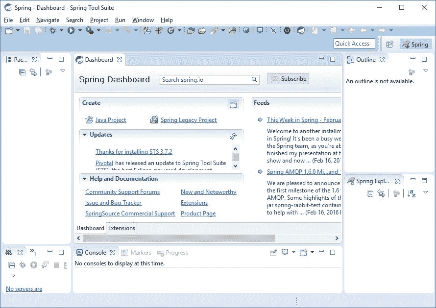

图 B.1：STS 欢迎页

主窗口可能会让你联想到 Eclipse，尽管图标已经发生了变化。

现在，你准备好创建你自己的 Spring MVC 应用了。

### 创建 Spring MVC 应用

STS 高度依赖 Maven，并允许你创建默认使用 Maven 管理依赖项的应用。要创建一个 Spring MVC 应用，请按照以下步骤操作。

1. 点击 `File > New > Maven Project`。你将看到如图 B.2 所示的 New Maven Project 对话框。

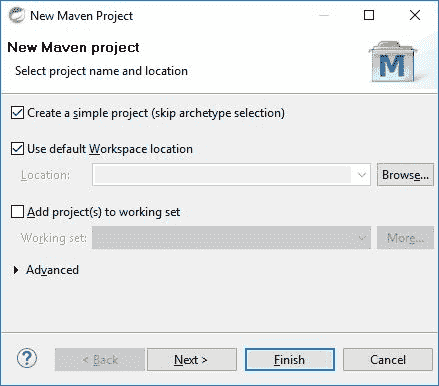

图 B.2：New Maven Project 对话框

2. 勾选“Create a simple project (skip archetype selection)”复选框。
3. 点击 Next 配置你的项目。对话框将改变并显示类似于图 B.3 所示的文本字段。

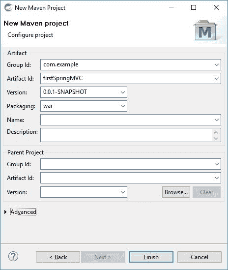

图 B.3：配置你的项目

4. 在 `Group Id` 字段中输入包名，例如 `com.example.`。在 `Artifact Id` 字段中输入你的项目名称，例如 `firstSpringMVC`。
5. 从 `Packaging` 下拉菜单中选择 `war`，告诉 STS 你正在创建一个 Spring MVC 应用。`War` 是 servlet/JSP 文件的扩展名。
6. 点击 Finish，你将在 Package Explorer 中看到你的项目。（参见图 B.4）。

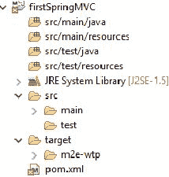

图 B.4：初始目录结构

7. STS 将创建一个项目，其中包含如图 B.4 所示的目录结构和一个 `pom.xml` 文件（这是一个 Maven 配置文件）。尽管如此，你还没有完成。你仍然需要编辑 `pom.xml` 文件来告诉 Maven 如何处理依赖项。双击该文件用默认编辑器打开它。编辑器带有多个标签页，提供了查看和编辑文件的不同方式。标签名称显示在对话框的底部。其中一个标签是 `Dependencies` 标签，它允许你管理项目所需的依赖项。点击 `Dependencies` 标签，你将看到一个如图 B.5 所示的对话框。
8. 对于初学者来说，通过 `Dependencies` 标签添加依赖项是一个相对较的选项，我将在这里展示如何操作。一个典型的 Spring MVC 应用至少需要三个库：Servlet API、Spring MVC 库和 JSTL。要添加 Servlet API，点击 `Dependencies` 面板中的 `Add` 按钮（而不是 `Dependency Management` 面板中的那个）。将打开如图 B.6 所示的 `Select Dependency` 对话框。

需要输入的值如下：

```
Group Id: javax.servlet
Artifact Id: javax.servlet-api
Version: 3.1.0
Scope: provided
```

提供的 `scope` 值表示在分发应用时，该库将由容器提供，不需要包含在 `war` 文件中。

在输入并选择上述值后，点击 OK。对话框将关闭，你将返回 `Dependencies` 标签。
9. 接下来，使用相同的方法添加 Spring MVC 库。点击 `Add` 按钮并输入以下值：

```
Group Id: org.springframework
Artifact Id: spring-webmvc
Version: 4.2.4.RELEASE
Scope: compile
```

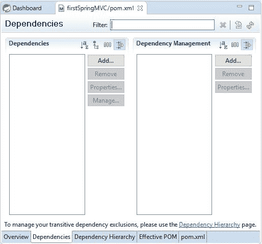

图 B.5：通过 Dependencies 标签添加依赖项

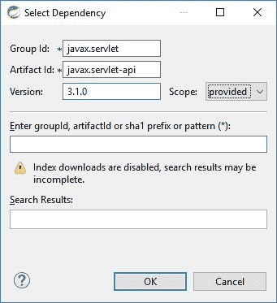

图 B.6：添加 Servlet API

10. 现在，添加 JSTL 库。点击 `Add` 按钮并输入以下值：

```
Group Id: javax.servlet
Artifact Id: jstl
Version: 1.2
Scope: runtime
```

11. 按 `Ctrl+S` 或点击 `File > Save` 保存 `pom.xml` 文件。一旦执行此操作，STS 将尝试通过下载依赖项来构建构建项目。不用多说，除非你之前使用过 Maven 下载所需的所需的库，否则你需要连接互联网。

在 Maven 完成依赖项的下载后，你将在包资源管理器中看到一个 `Maven Dependencies` 文件夹。（参见图 B.7）。

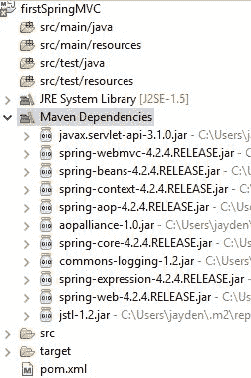

图 B.7：Maven Dependencies

`pom.xml` 文件仍然有一个错误，因为它找不到 `web.xml`。要纠正此，双击包资源管理器中的 `pom.xml` 文件重新打开编辑器，并点击 `pom.xml` 标签。在 `pom.xml` 中找到 `<build>` 并添加以下内容以消除由于缺少 `web.xml` 引起的错误：

```
<build>
    <plugins>
        <plugin>
            <groupId>org.apache.maven.plugins</groupId>
            <artifactId>maven-war-plugin</artifactId>
            <configuration>
                <failOnMissingXml>false</failOnMissingXml>
            </configuration>
        </plugin>
    </plugins>
```


## 选择 Java 版本

你可以通过向`pom.xml`文件添加属性来为你的应用选择 Java 版本。要这样做，请按照以下步骤操作。

1. 点击`pom.xml`编辑器的`Overview`标签。该标签如图 B.8 所示。

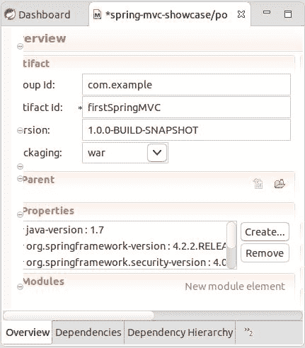

图 B.8：Overview 标签

2. 点击`Properties`右侧的`Create`按钮。将打开如图 B.9 所示的`Add Property`对话框。


图 B.9：选择 Java 版本

3. 在`Name`字段中输入`maven.compiler.target`，并在`Value`字段中输入`1.8`。
4. 保存`pom.xml`文件。

如果 STS 报错找不到 JRE 8，可以通过以下步骤告诉它哪里查找：

1. 点击`Window > Preferences`。
2. 在左侧选择`Java > Installed JREs`并点击`Add`按钮。
3. 选择`Standard VM`并点击`Next`。将打开如图 B.10 所示的对话框。


图 B.10：浏览到 JRE 目录

4. 点击`Directory`按钮并浏览到 JRE 目录。
5. 点击`Finish`。你将在已安装 JRE 列表中看到 JDK。（参见图 B.11）
6. 点击`OK`。


图 B.11：已安装的 JRE

## 创建 index.html 文件

为了完成示例应用，你需要创建一个`index.html`文件并将其保存到`src/main/webapp`。列表 B.1 显示了一个简单的 HTML 页面。

列表 B.1：index.html 文件

```
<!DOCTYPE html>
<html>
<head>
<title>First Spring MVC app</title></head>
<body>
Welcome
</body>
</html>
```

## 更新项目

在运行应用之前，你需要更新项目。在包资源管理器中右键点击项目图标，点击`Maven > Update Project`。

之后，包资源管理器中的项目将看起来像图 B.12 所示。


图 B.12：更新后的项目

## 运行应用

你需要 Tomcat 或 servlet 容器来运行你的应用。如果你还没有安装 Tomcat，请现在安装。附录 A，“Tomcat”提供了如何操作的说明。

要运行你的应用，请按照以下步骤操作：

1. 右键点击项目并选择`Run As > Run on Server`。你将看到如图 B.13 所示的 Run On Server 对话框。
2. 选择服务器类型，例如 Apache 下的`Tomcat v8.0 server`。如果你没有看到 Tomcat 实例，点击`Add`链接（在 B.13 中用红色圈出）并浏览到 Tomcat 目录。
3. 在`Server Host Name`字段中输入主机名。
4. 点击`Finish`。

STS 将启动 Tomcat 并运行你的应用程序。

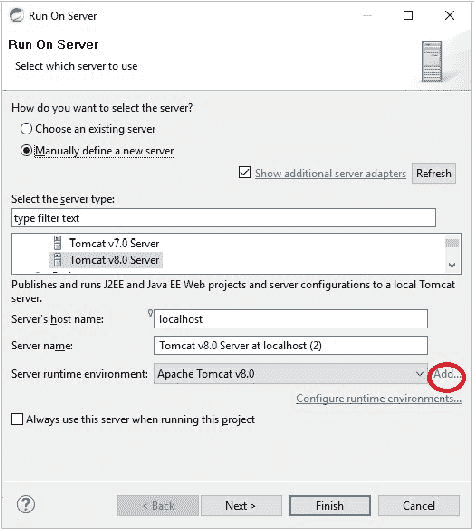

图 B.13: 选择 Tomcat

要管理 Tomcat 以及所有部署在上面的应用，请在 STS 中打开 Server 视图。（参见图 B.14）

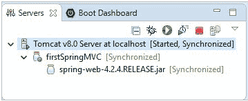

图 B.14: 用于管理 Tomcat 实例和应用的 Servers 视图

图 B.15 显示了 STS 内部的浏览器，其中显示了你的默认页面。

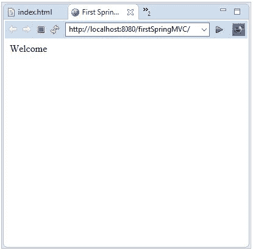

图 B.15: 你的第一个 Web 应用程序

现在你已经准备好按照每个章节中的说明添加动态内容了。

# 附录 C：Servlet API

`Servlet`是 Spring MVC 背后的底层技术。理解`Servlet API`是你成为强大的 Spring MVC 开发者的大门。该 API 中有 70 多种类型，你必须熟悉其中最重要的几个类型。

本附录介绍了你应该了解的`Servlet API`中的类和接口。此外，它还教你如何编写 servlet。所有的示例可以在`servletapi1`、`servletapi2`和`servletapi3`示例应用程序中找到。

## Servlet API 概述

`Servlet API`包含四个 Java 包。这些包如下：

* `javax.servlet.`：包含定义`servlet`与`servlet container`之间约的类和接口。
* `javax.servlet.http.`：包含定义`HTTP servlet`与`servlet container`之间约的类和接口。
* `javax.servlet.annotation.`：包含用于注解 servlet、过滤器和监听器的注解。它还指定了被注解组件的元数据。
* `javax.servlet.descriptor.`：包含提供程序化方式访问 Web 应用程序配置信息的类型。

本附录重点关注`javax.servlet`和`javax.servlet.http`的成员。

## javax.servlet 包

图 C.1 显示了`javax.servlet`中的主要类型。

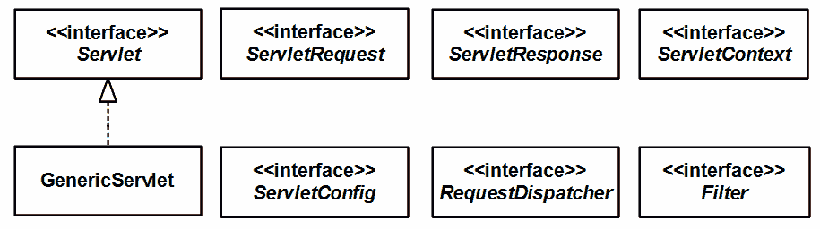

图 C.1：`javax.servlet`的主要成员

Servlet 技术的核心是`Servlet`接口，所有 servlet 类都必须直接或间接实现实现该接口。当你编写一个实现`Servlet`的 servlet 类时，你直接实现它；当你扩展一个实现了该接口的类时，你间接实现它。

`Servlet`接口定义了 servlet 与 servlet container 之间的约定。该约定可以简化为 servlet container 的承诺：将 servlet 类加载到内存中并在 servlet 实例上调用特定方法。一个应用程序中每个 servlet 类型只能有一个实例。

用户请求会导致 servlet container 调用 servlet 的`service`方法，并传递`ServletRequest`实例和`ServletResponse`实例。`ServletRequest`封装了当前的 HTTP 请求，因此 servlet 开发者不需要解析和处理原始 HTTP 数据。`ServletResponse`代表当前用户的 HTTP 响应，并方便地向用户发送响应。

对于每个应用程序，servlet container 还会创建一个`ServletContext`实例。该对象封装了上下文（应用程序）的环境细节。每个上下文只有一个`ServletContext`。对于每个 servlet 实例，还有一个一个封装了 servlet 配置的`ServletConfig`。

让我们先看看`Servlet`接口。上面提到的其他接口将在本附录的其他章节中进行解释。

### Servlet

`Servlet`接口定义了以下五个方法：

```
void init(ServletConfig config) throws ServletException
void service(ServletRequest request, ServletResponse response)
        throws ServletException, java.io.IOException
void destroy()
java.lang.String getServletInfo()
ServletConfig getServletConfig()
```

注意，编写 Java 方法签名的约定是：对于与包含方法的类型不同包的类型，使用全限定名。因此，在`service`方法的签名中，与`Servlet`相同包的`javax.servlet.ServletException`未写包信息，而`java.io.Exception`则写了全名。

`init`、`service`和`destroy`是生命周期方法。servlet container 根据以下规则调用这三个方法：

* `init`。当 servlet 第一次被请求时，servlet container 调用此方法。随后的请求不会再调用此方法。你使用此方法来编写初始化代码。在调用此方法时，servlet container 会传递一个`ServletConfig`。通常，会将`ServletConfig`分配给类级变量，以便该对象可以在 servlet 类的其他地方使用。
* `service`。每当 servlet 被请求时，servlet container 调用此方法。你在这里编写 servlet 应该执行的代码。当第一次请求 servlet 时，servlet container 会调用`init`方法和`service`方法。对于随后的请求，只调用`service`。
* `destroy`。当 servlet 准备销毁时，servlet container 调用此方法。这发生在应用程序卸载或 servlet container 关闭时。通常，你会在此方法中编写清理代码。

`Servlet`中的另外两个方法是非生命周期方法：`getServletInfo`和`getServletConfig`。

* `getServletInfo`。此方法返回 servlet 的描述。你可以返回任何可能用的字符串，甚至可以是`null`。
* `getServletConfig`。此方法返回 servlet container 传递给`init`方法的`ServletConfig`。然而，为了让`getServletConfig`返回空值，你必须将传递给`init`方法的`ServletConfig`分配给类级变量。`ServletConfig`将在附录的“ServletConfig”章节中解释。

一个需要注意的重要点是线程安全。servlet 实例被应用程序中的所有用户共享，因此不建议使用类级变量，除非它们是只读的或者是`java.util.concurrent.atomic`包中的成员。

下一节“编写基础 Servlet 应用程序”将展示你如何编写一个 Servlet 实现。

# 编写基础 Servlet 应用程序

编写 servlet 应用程序出奇简单。你只需要创建一个目录结构并将 servlet 类放置在特定目录中。

在本节中，你将学习编写一个名为`servletapi1`的简单 servlet。它将包含一个 servlet`MyServlet`，向用户发送问候。

你需要一个 servlet container 来运行你的 servlet。Tomcat 是一个开源 servlet container，免费提供并可以在任何支持 Java 的平台上运行。附录 A，“Tomcat”介绍了如何在 IDE 之外安装和管理 Tomcat。

## 编写并编译 Servlet 类

在确保本地机器安装了 Tomcat 后，下一步是编写并编译 servlet 类。此示例的 servlet 类`MyServlet`如列表 C.1 所示。按照惯例，servlet 类名以`Servlet`结尾。

列表 C.1：MyServlet 类

```java
package servletapi1;

import java.io.IOException;
import java.io.PrintWriter;
import javax.servlet.Servlet;
import javax.servlet.ServletConfig;
import javax.servlet.ServletException;
import javax.servlet.ServletRequest;
import javax.servlet.ServletResponse;
import javax.servlet.annotation.WebServlet;

@WebServlet(name = "MyServlet", urlPatterns = { "/my" })
public class MyServlet implements Servlet {
    private transient ServletConfig servletConfig;

    @Override
    public void init(ServletConfig servletConfig)
            throws ServletException {
        this.servletConfig = servletConfig;
    }

    @Override
    public ServletConfig getServletConfig() {
        return servletConfig;
    }

    @Override
    public String getServletInfo() {
        return "My Servlet";
    }

    @Override
    public void service(ServletRequest request,
            ServletResponse response) throws ServletException,
            IOException {
        String servletName = servletConfig.getServletName();
        response.setContentType("text/html");
        PrintWriter writer = response.getWriter();
        writer.print("<!DOCTYPE html>"
                + "<html>"
                + "<body>Hello from " + servletName 
                + "</body>"
                + "</html>");
    }

    @Override
    public void destroy() {
    }    
}
```

当你在阅读列表 C.1 中的代码时，首先注意到的就是这个注解。

```java
@WebServlet(name = "MyServlet", urlPatterns = { "/my" })
```

`@WebServlet`注解类型用于声明一个 servlet。你可以命名该 servlet，并告诉容器哪个 URL 会调用该 servlet。`name`属性是可选的，如果存在，通常赋值为 servlet 类的名称。重要的是`urlPatterns`属性，它也是可选的，但几乎总是可见的。在`MyServlet`中，`urlPattern`告诉容器模式`/my`应该调用该 servlet。

注意，URL 模式必须以正斜杠`/`开始。

Servlet 的`init`方法会被调用一次，并将私有的瞬态 transient 变量`servletConfig`赋值为传递给方法的`ServletConfig`对象。

```
private transient ServletConfig servletConfig;

    @Override
    public void init(ServletConfig servletConfig)
            throws ServletException {
        this.servletConfig = servletConfig;
    }
```


如果你打算在 servlet 内部使用`ServletConfig`，则需要将传递给`init`的`ServletConfig`赋值给类变量。

`service`方法将字符串“Hello from MyServlet”发送到浏览器。对于每个目标 servlet 的传入 HTTP 请求，`service`都会被调用。

如果你使用 IDE，永远不需要担心手动编译 servlet 类。如果你没有使用 IDE，为了编译 servlet，你必须在类路径中包含`Servlet API`中的类型。Tomcat 自带了`servlet-api.jar`文件，它封装了`javax.servlet`和`javax.servlet.http`包的成员。该 jar 文件位于 Tomcat 安装目录下的`lib`目录。

## 应用程序目录结构

Servlet 应用必须部署在特定的目录结构中。图 C.2 显示了此应用的目录结构。

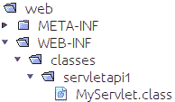

图 C.2：应用程序目录

结构顶部的 web 目录是应用程序目录。在应用程序目录下是`WEB-INF`目录。它可能包含以下子目录，两者都是可选的：

* `classes`：你的 servlet 类和其他 Java 类必须位于此处。`classes`下的目录反映了类的包结构。在图 C.2 中部署了一个类，即`servletapi1.MyServlet`。
* `lib`：将你的 servlet 应用所需的 jar 文件部署在此处。`Servlet API` jar 文件不需要部署在此处，因为 servlet 容器已经有了它的副本。

一个 servlet/JSP 应用通常包含 JSP 页面、HTML 文件、图像文件和其他资源。这些内容应该放在应用程序目录下，并且通常组织在子目录中。例如，所有图像文件可以放在`image`目录，所有 JSP 页面放在`jsp`目录，依此类推。

你放在应用程序目录下的任何资源，用户都可以通过输入该资源的 URL 直接直接访问。如果你想包含一个 servlet 可以访问但用户无法访问的资源，请将其放在`WEB-INF`或其下方的目录中。

## 调用 Servlet

要测试你的 servlet，请将浏览器导向此 URL：

```
http://localhost:8080/servletapi1/my
```

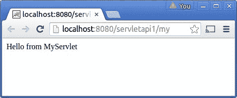

图 C.3：来自 MyMyServlet 的响应

## ServletRequest

对于每个 HTTP 请求，servlet 容器都会创建一个`ServletRequest`并将其传递给 servlet 的`service`方法。`ServletRequest`封装了有关请求的信息。

这些是`ServletRequest`接口中的一些方法：

```
public int getContentLength()
```

返回请求体中的字节数。如果长度未知，此方法返回 -1。

```
public java.lang.String getContentType()
```

返回请求体的 MIME 类型，如果类型未知则返回 null。

```
public java.lang.String getParameter(java.lang.String name)
```

返回指定的请求参数的值。

```
public java.lang.String getProtocol()
```

返回此 HTTP 请求的协议名称和版本。

`getParameter`是`ServletRequest`中频率最高的方法。该方法的常用用途是获取 HTML 表单字段的值。你将在后面的“处理表单”章节中学习如何获取表单值。

`getParameter`也可以用于获取查询字符串的值。例如，如果 servlet 使用以下 URI 调用：

```
http://domain/context/servletName?id=123
```

你可以在 servlet 内部使用此语句获取`id`值：

```java
String id = request.getParameter("id");
```

注意，如果参数不存在，`getParameter`返回 null。

除了`getParameter`之外，你还可以使用`getParameterNames`、`getParameterMap`和`getParameterValues`来获取表单字段及其值以及查询字符串。示例请“HttpServlet”章节。

## ServletResponse

`javax.servlet.ServletResponse`接口表示 响应。在调用 servlet 的`service`方法之前，servlet 容器创建一个`ServletResponse`并将其作为第二个参数传递给`service`方法。`ServletResponse`隐藏了发送响应的复杂性。

`ServletResponse`定义的方法之一是`getWriter`方法，它返回一个可以向客户端发送文本的`java.io.PrintWriter`。默认情况下，`PrintWriter`对象使用 ISO-8859-1 编码。

向客户端发送响应时，大多数是以 HTML 格式发送的。

注意

你还有另一种方法可以向浏览器输出：`getOutputStream`。然而，该方法用于发送二进制数据，因此在大多数情况下你会使用`getWriter`而不是`getOutputStream`。

在发送任何 HTML 标签之前，你应该通过调用`setContentType`方法设置响应的内容类型，并传递“text/html”作为参数。这就是告诉浏览器内容类型为 HTML 的方式。在没有内容类型的情况下，大多数浏览器默认将响应为 HTML。

## ServletConfig

当 servlet 容器初始化 servlet 时，它会将一个`ServletConfig`传递给 servlet 的`init`方法。`ServletConfig`封装了通过`@WebServlet`或部署符传递给 servlet 的配置信息。部署符是一个包含配置值的 XML 文件。它在 servlet/JSP 应用中可能存在也可能不存在。

传递给`ServletConfig`的每一条信息都被称为初始参数（initial parameter）。初始参数包含两个部分：键（key）和值（value）。

要在 servlet 内部获取初始参数的值，请调用`ServletConfig`的`getInitParameter`方法。`getInitParameter`的签名如下：

```
java.lang.String getInitParameter(java.lang.String name)
```

此外，`getInitParameterNames`方法返回所有初始参数名称的枚举（`Enumeration`）：

```
java.util.Enumeration<java.lang.String> getInitParameterNames()
```

例如，要获取`contactName`参数的值，可以使用以下代码：

```
String contactName = servletConfig.getInitParameter("contactName");
```

除了`getInitParameter`和`getInitParameterNames`之外，`ServletConfig`还提供了另一个有用方法`getServletContext`。使用此方法可以在 servlet 内部获取`ServletContext`。请参阅本附录后文的“ServletContext”章节了解关于该对象的讨论。

作为`ServletConfig`的一个示例，让我们向`servletapi1`添加一个名为`ServletConfigDemoServlet`的 servlet。新 servlet 如列表 C.2 所示。

列表 C.2：`ServletConfigDemoServlet`类

```
package servletapi1;

import java.io.IOException;

import java.io.PrintWriter;

import javax.servlet.Servlet;

import javax.servlet.ServletConfig;

import javax.servlet.ServletException;

import javax.servlet.ServletRequest;

import javax.servlet.ServletResponse;

import javax.servlet.annotation.WebInitParam;

import javax.servlet.annotation.WebServlet;

@WebServlet(name = "ServletConfigDemoServlet", 

    urlPatterns = { "/servletConfigDemo" },

    initParams = {

        @WebInitParam(name="admin", value="Harry Taciak"),

        @WebInitParam(name="email", value="admin@example.com")

    }

)

public class ServletConfigDemoServlet implements Servlet {

    private transient ServletConfig servletConfig;

    @Override

    public ServletConfig getServletConfig() {

        return servletConfig;

    }

    @Override

    public void init(ServletConfig servletConfig) 

            throws ServletException {

        this.servletConfig = servletConfig;

    }

    @Override

    public void service(ServletRequest request, 

            ServletResponse response)

            throws ServletException, IOException {

        ServletConfig servletConfig = getServletConfig();

        String admin = servletConfig.getInitParameter("admin");

        String email = servletConfig.getInitParameter("email");

        response.setContentType("text/html");

        PrintWriter writer = response.getWriter();

        writer.print("<!DOCTYPE html>"

                + "<html>"

                + "<body>" 

                + "Admin:" + admin 

                + "<br/>Email:" + email

                + "</body>></html>");

    }

    @Override

    public String getServletInfo() {

        return "ServletConfig demo";

    }

    @Override

    public void destroy() {

    }    

}
```

如列表 C.2 所示，你在`@WebServlet`的`initParams`属性中向 servlet 传递了两个初始参数（`admin`和`email`）：

```
@WebServlet(name = "ServletConfigDemoServlet", 

    urlPatterns = { "/servletConfigDemo" },

    initParams = {

        @WebInitParam(name="admin", value="Harry Taciak"),

        @WebInitParam(name="email", value="admin@example.com")

    }

)
```

你可以使用此 URL 调用`ServletConfigDemoServlet`：

```
http://localhost:8080/servletapi1/servletConfigDemo
```

结果应该与图 C.4 相似。

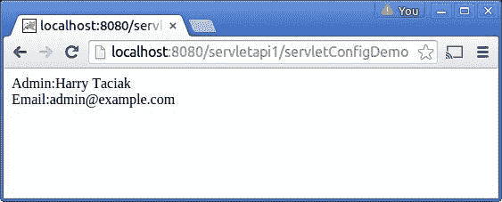

图 C.4：`ServletConfigDemoServlet`运行

或者，你可以在部署描述符（deployment descriptor）中传递初始参数。为此目的使用部署描述符比使用`@WebServlet`更简单，因为部署描述符是一个文件，你可以在不重新编译 servlet 类的情况下对其编辑。

部署描述符将在附录后文的“使用部署描述符”章节中讨论。

## ServletContext

`ServletContext`代表 servlet 应用。每个 Web 应用程序只有一个上下文。在应用程序同时部署到多个容器的分布式环境中，每个 Java 虚拟机都有一个`ServletContext`对象。

你可以通过调用`ServletConfig`的`getServletContext`方法获取`ServletContext`。此外，`ServletRequest`中也有`getServletContext`方法，它返回相同的`ServletContext`。

`ServletContext`的存在是为了让你共享可以从应用程序中所有资源访问的信息，并实现动态注册 Web 对象。前者通过在`ServletContext`内部的`Map`中存储对象来实现。存储在`ServletContext`中的对象被称为属性（attributes）。

`ServletContext`中的以下方法处理属性：

```
java.lang.Object getAttribute(java.lang.String name)
java.util.Enumeration<java.lang.String> getAttributeNames()
void setAttribute(java.lang.String name, java.lang.Object object)
void removeAttribute(java.lang.String name)
```

## GenericServlet

之前的示例展示了如何通过实现`Servlet`接口来编写 servlet。然而，你是否注意到你必须为`Servlet`中的所有方法提供实现，尽管其中某些方法不包含代码？此外，你需要将`ServletConfig`对象保存为类变量。

幸运的是，`GenericServlet`抽象类解决了了这个问题。本着面向对象编程简化代码的精神，`GenericServlet`同时实现了`Servlet`和`ServletConfig`并执行以下任务：

* 在`init`方法中将`ServletConfig`赋值给类变量，以便通过调用`getServletConfig`获取。
* 提供`Servlet`接口中所有方法的默认实现。
* 提供封装`ServletConfig`方法的方法。

`GenericServlet`通过在`init`方法中将`ServletConfig`赋值给变量`servletConfig`来保留它。以下是`GenericServlet`中`init`的实现：

```
public void init(ServletConfig servletConfig) 

        throws ServletException {

    this.servletConfig = servletConfig;

    this.init();

}
```

然而，如果你在类中重写了该方法，将调用你 servlet 中的`init`方法，并且必须调用`super.init(servletConfig)`来保留`ServletConfig`。为了避免这样做，`GenericServlet`提供了第二个不带参数的`init`方法。该方法在`ServletConfig`赋值给变量后由第一个`init`方法调用。以下是`GenericServlet`中第一个`init`方法的实现：

```
public void init(ServletConfig servletConfig) 

        throws ServletException {

    this.servletConfig = servletConfig;

    this.init();
}
```


这意味着，你可以通过重写无参数的`init`方法来编写初始化代码，`ServletConfig`仍然会被`GenericServlet`实例保留。

列表 C.3 中的`GenericServletDemoServlet`类是列表 C.2 中`ServletConfigDemoServlet`的重写。注意，新 servlet 继承`GenericServlet`而不是实现`Servlet`。

## 列表 C.3：`GenericServletDemoServlet`类

```java
package servletapi1;

import java.io.IOException;
import java.io.PrintWriter;
import javax.servlet.GenericServlet;
import javax.servlet.ServletConfig;
import javax.servlet.ServletException;
import javax.servlet.ServletRequest;
import javax.servlet.ServletResponse;
import javax.servlet.annotation.WebInitParam;
import javax.servlet.annotation.WebServlet;

@WebServlet(name = "GenericServletDemoServlet", 
        urlPatterns = { "/generic" },
        initParams = {
            @WebInitParam(name="admin", value="Harry Taciak"),
            @WebInitParam(name="email", value="admin@example.com")
        }
)
public class GenericServletDemoServlet extends GenericServlet {
    private static final long serialVersionUID = 62500890L;

    @Override
    public void service(ServletRequest request, 
            ServletResponse response)
            throws ServletException, IOException {
        ServletConfig servletConfig = getServletConfig();
        String admin = servletConfig.getInitParameter("admin");
        String email = servletConfig.getInitParameter("email");
        response.setContentType("text/html");
        PrintWriter writer = response.getWriter();
        writer.print("<!DOCTYPE html>"
                + "<html><head></head><body>" 
                + "Admin:" + admin
                + "<br/>Email:" + email
                + "</body></html>");
    }
}
```

如你所示，通过扩展`GenericServlet`，你不需要重写你不计划更改的方法。因此，你的代码更加整洁。在列表 C.3 中，唯一被重写的是`service`方法。此外，你不需要自己去保留`ServletConfig`。

使用此 URL 调用 servlet，其结果应该与`ServletConfigDemoServlet`类似。

```
http://localhost:8080/servletapi1/generic
```

尽管`GenericServlet`是`Servlet`的一个很好的增强，但你并不频繁使用它，因为它不如`HttpServlet`高级。`HttpServlet`才是核心，并用于实际应用中。它将在下一节“HTTP Servlets”中进行解释。

## HTTP Servlets

你编写的大多数（如果不是全部）servlet 应用将与 HTTP 协作。这意味着你可以利用 HTTP 提供的功能。`javax.servlet.http`包是 Servlet API 中的第二个包，它包含了用于编写 servlet 应用的类和接口。`javax.servlet.http`中的许多类型重写了`javax.servlet`中的类型。

图 C.5 显示了`javax.servlet.http`中的主要类型。

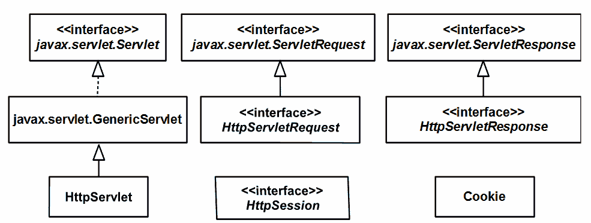

图 C.5：`javax.servlet.http`中更重要的成员

## HttpServlet

`HttpServlet`类扩展了`javax.servlet.GenericServlet`类。当使用`HttpServlet`时，你还将处理`HttpServletRequest`和`HttpServletResponse`对象，它们分别代表 servlet 请求和 servlet 响应。`HttpServletRequest`接口扩展了`javax.servlet.ServletRequest`，`HttpServletResponse`扩展了`javax.servlet.ServletResponse`。

`HttpServlet`重写了`GenericServlet`中的`service`方法，并添加了具有以下签名的另一个 service 方法：

```java
protected void service(HttpServletRequest request, 
        HttpServletResponse response)
        throws ServletException, IOException
```


```java
@WebServlet(name = "GenericServletDemoServlet", 
        urlPatterns = { "/generic" },
        initParams = {
            @WebInitParam(name="admin", value="Harry Taciak"),
            @WebInitParam(name="email", value="admin@example.com")
        }
)
public class GenericServletDemoServlet extends GenericServlet {

    private static final long serialVersionUID = 62500890L;

    @Override
    public void service(ServletRequest request, 
            ServletResponse response)
            throws ServletException, IOException {
        ServletConfig servletConfig = getServletConfig();
        String admin = servletConfig.getInitParameter("admin");
        String email = servletConfig.getInitParameter("email");
        response.setContentType("text/html");
        PrintWriter writer = response.getWriter();
        writer.print("<!DOCTYPE html>"
                + "<html><head></head><body>" 
                + "Admin:" + admin
                + "<br/>Email:" + email
                + "</body></html>");
    }
}
```

如你所示，通过扩展`GenericServlet`，你不需要重写你不计划更改的方法。因此，你的代码更加整洁。在列表 C.3 中，唯一被重写的是`service`方法。此外，你不需要自己去保留`ServletConfig`。

使用此 URL 调用 servlet，其结果应该与`ServletConfigDemoServlet`类似。

```
http://localhost:8080/servletapi1/generic
```

尽管`GenericServlet`是`Servlet`的一个很好的增强，但你并不频繁使用它，因为它不如`HttpServlet`高级。`HttpServlet`才是核心，并用于实际应用中。它将在下一节“HTTP Servlets”中进行解释。

## HTTP Servlets

你编写的大多数（如果不是全部）servlet 应用将与 HTTP 协作。这意味着你可以利用 HTTP 提供的功能。`javax.servlet.http`包是 Servlet API 中的第二个包，它包含了用于编写 servlet 应用的类和接口。`javax.servlet.http`中的许多类型重写了`javax.servlet`中的类型。

图 C.5 显示了`javax.servlet.http`中的主要类型。


图 C.5：`javax.servlet.http`中更重要的成员

## HttpServlet

`HttpServlet`类扩展了`javax.servlet.GenericServlet`类。当使用`HttpServlet`时，你还将处理`HttpServletRequest`和`HttpServletResponse`对象，它们分别代表 servlet 请求和 servlet 响应。`HttpServletRequest`接口扩展了`javax.servlet.ServletRequest`，`HttpServletResponse`扩展了`javax.servlet.ServletResponse`。

`HttpServlet`重写了`GenericServlet`中的`service`方法，并添加了具有以下签名的另一个 service 方法：

```
protected void service(HttpServletRequest request, 
        HttpServletResponse response)
        throws ServletException, IOException
```

多值选择元素（允许选择多个项并由`<select multiple>`指定的 select 元素）会发送字符串数组，并且必须通过`ServletRequest.getParameterValues`进行处理。

复选框（checkbox）有点特殊。被选中的复选框会向服务器发送字符串“on”。未选中的复选框不向服务器发送任何内容，且`ServletRequest.getParameter(fieldName)`返回`null`。

单选按钮（Radio buttons）会将选中按钮的值发送到服务器。如果没有选中任何按钮，则不向服务器发送内容，且`ServletRequest.getParameter(fieldName)`返回`null`。

如果表单包含多个具有相同名的输入元素，所有值都将被提交，你必须使用`ServletRequest.getParameterValues`来检索这些值。`ServletRequest.getParameter`只会返回最后一个值。

列表 C.4 中的`FormServlet`类演示了如何与 HTML 表单交互。它的`doGet`方法向浏览器发送一个订单表单。它的`doPost`方法获取输入的值并将其打印出来。该 servlet 是`servletapi2`应用程序的一部分。

### 列表 C.4: FormServlet 类

```java
package servletapi2;

import java.io.IOException;
import java.io.PrintWriter;
import java.util.Enumeration;
import javax.servlet.ServletException;
import javax.servlet.annotation.WebServlet;
import javax.servlet.http.HttpServlet;
import javax.servlet.http.HttpServletRequest;
import javax.servlet.http.HttpServletResponse;

@WebServlet(name = "FormServlet", urlPatterns = { "/form" })
public class FormServlet extends HttpServlet {

    private static final long serialVersionUID = 54L;
    private static final String TITLE = "Order Form";

    @Override
    public void doGet(HttpServletRequest request,
            HttpServletResponse response)
            throws ServletException, IOException {
        response.setContentType("text/html");
        PrintWriter writer = response.getWriter();
        writer.println("<!DOCTYPE html>");
        writer.println("<html>");
        writer.println("<head>");
        writer.println("<title>" + TITLE + "</title></head>");
        writer.println("<body><h1>" + TITLE + "</h1>");
        writer.println("<form method='post'>");
        writer.println("<table>");
        writer.println("<tr>");
        writer.println("<td>Name:</td>");
        writer.println("<td><input name='name'/></td>");
        writer.println("</tr>");
        writer.println("<tr>");
        writer.println("<td>Address:</td>");
        writer.println("<td><textarea name='address' "
                + "cols='40' rows='5'></textarea></td>");
        writer.println("</tr>");
        writer.println("<tr>");
        writer.println("<td>Country:</td>");
        writer.println("<td><select name='country'>");
        writer.println("<option>United States</option>");
        writer.println("<option>Canada</option>");
        writer.println("</select></td>");
        writer.println("</tr>");
```


以下代码片段展示了 `FormServlet` 的 `doGet` 方法中，如何使用 `PrintWriter` 对象输出一个 HTML 订单表单：

```java
writer.println("<tr>");
writer.println("<td>Delivery Method:</td>");
writer.println("<td><input type='radio' " +
        "name='deliveryMethod'"
        + " value='First Class'/>First Class");
writer.println("<input type='radio' " +
        "name='deliveryMethod' "
        + "value='Second Class'/>Second Class</td>");
writer.println("</tr>");
writer.println("<tr>");
writer.println("<td>Shipping Instructions:</td>");
writer.println("<td><textarea name='instruction' "
        + "cols='40' rows='5'></textarea></td>");
writer.println("</tr>");
writer.println("<tr>");
writer.println("<td>&nbsp;</td>");
writer.println("<td><textarea name='instruction' "
        + "cols='40' rows='5'></textarea></td>");
writer.println("</tr>");
writer.println("<tr>");
writer.println("<td>Please send me the latest " +
        "product catalog:</td>");
writer.println("<td><input type='checkbox' " +
        "name='catalogRequest'/></td>");
writer.println("</tr>");
writer.println("<tr>");
writer.println("<td>&nbsp;</td>");
writer.println("<td><input type='reset'/>" +
        "<input type='submit'/></td>");
writer.println("</tr>");
writer.println("</table>");
writer.println("</form>");
writer.println("</body>");
writer.println("</</html>>");
```

`doPost` 方法处理表单提交，并回显用户输入的值：

```java
@Override
public void doPost(HttpServletRequest request,
        HttpServletResponse response)
        throws ServletException, IOException {
    response.setContentType("text/html");
    PrintWriter writer = response.getWriter();
    writer.println("<html>");
    writer.println("<head>");
    writer.println("<title>" + TITLE + "</title></head>");
    writer.println("</head>");
    writer.println("<body><h1>" + TITLE + "</h1>");
    writer.println("<table>");
    writer.println("<tr>");
    writer.println("<td>Name:</td>");
    writer.println("<td>" + request.getParameter("name")
            + "</td>");
    writer.println("</tr>");
    writer.println("<tr>");
    writer.println("<td>Address:</td>");
    writer.println("<td>" + request.getParameter("address")
            + "</td>");
    writer.println("</tr>");
    writer.println("<tr>");
    writer.println("<td>Country:</td>");
    writer.println("<td>" + request.getParameter("country")
            + "</td>");
    writer.println("</tr>");
    writer.println("<tr>");
    writer.println("<td>Shipping Instructions:</td>");
    writer.println("<td>");
    String[] instructions = request
            .getParameterValues("instruction");
    if (instructions != null) {
        for (String instruction : instructions) {
            writer.println(instruction + "<br/>");
        }
    }
    writer.println("</td>");
    writer.println("</tr>");
    writer.println("<tr>");
    writer.println("<td>Delivery Method:</td>");
    writer.println("<td>"
            + request.getParameter("deliveryMethod")
            + "</td>");
    writer.println("</tr>");
    writer.println("<tr>");
    writer.println("<td>Catalog Request:</td>");
    writer.println("<td>");
    if (request.getParameter("catalogRequest") == null) {
        writer.println("No");
    } else {
        writer.println("Yes");
    }
    writer.println("</td>");
    writer.println("</tr>");
    writer.println("</table>");
    writer.println("<div style='border:1px solid #ddd;" +
    "margin-top:40px;font-size:90%'>");
    writer.println("Debug Info<br/>");
    Enumeration<String> parameterNames = request
            .getParameterNames();
    while (parameterNames.hasMoreElements()) {
        String paramName = parameterNames.nextElement();
        writer.println(paramName + ": ");
        String[] paramValues = request
                .getParameterValues(paramName);
        for (String paramValue : paramValues) {
            writer.println(paramValue + "<br/>");
        }
    }
    writer.println("</div>");
    writer.println("</body>");
    writer.println("</html>");
}
```

你可以通过以下 URL 调用 `FormServlet`：

```
http://localhost:8080/servletapi2/form
```

这将导致 `FormServlet` 中的 `doGet` 方法被执行。该 `doGet` 方法将此 HTML 表单发送到浏览器。

```html
<form method='post'>
<input name='name'/>
<textarea name='address' cols='40' rows='5'></textarea>
<select name='country'>
    <option>United States</option>
    <option>Canada</option>
</select>
<input type='radio' name='deliveryMethod' value='First Class'/>
<input type='radio' name='deliveryMethod' value='Second Class'/>
<textarea name='instruction' cols='40' rows='5'></textarea>
<textarea name='instruction' cols='40' rows='5'></textarea>
<input type='checkbox' name='catalogRequest'/>
<input type='reset'/>
<input type='submit'/>
</form>
```

表单的方法（`method`）被设置为 `post`，以确保在用户提交表单时使用 HTTP POST 方法。它缺少 `action` 属性，这意味着表单将提交到请求该表单时使用的 URL。

图 C.6 显示了一个空的订单表。

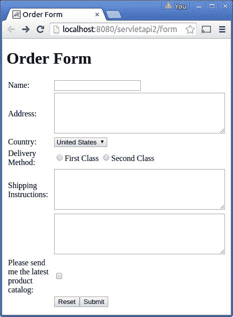

图 C.6: 一个空的订单表单

现在，填写表单并点击提交按钮。你在表单中输入的值将使用 HTTP POST 方法发送到服务器，这将调用 servlet 的 `doPost` 方法。结果，你将看到如图 C.7 所示打印的值。

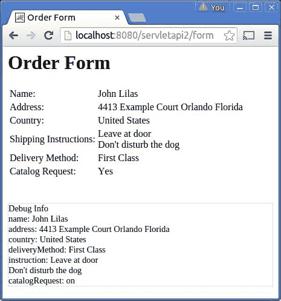

图 C.7: 输入到订单表单中的值

## 使用部署描述符（Deployment Descriptor）

如你在之前的示例所示，编写和部署 servlet 应用是非常简单的。部署的一个方面是配置 servlet 与路径的映射。在示例中，你通过使用 `WebServlet` 注解类型将 servlet 映射到路径。

使用部署描述符是配置 servlet 应用的另一种方法。部署描述符始终命名为 `web.xml`，位于 `WEB-INF` 目录下。在本附录中，我将向你如何创建一个名为 `servletapi3` 的 servlet 应用，并为其编写一个 `web.xml` 文件。

`servletapi3` 有两个 servlet：`SimpleServlet` 和 `WelcomeServlet`，以及一个用于映射 servlet 的部署描述符。代码 C.5 和 C.6 分别显示了 `SimpleServlet` 和 `WelcomeServlet`。注意，servlet 类没有使用 `@WebServlet` 注解。部署描述符位于代码 C.7 中。

代码 C.5: 未使用注解的 `SimpleServlet` 类

```java
package servletapi3;

import java.io.IOException;
import java.io.PrintWriter;
import javax.servlet.ServletException;
import javax.servlet.http.HttpServlet;
import javax.servlet.http.HttpServletRequest;
import javax.servlet.http.HttpServletResponse;

public class SimpleServlet extends HttpServlet {
    private static final long serialVersionUID = 8946L;

    @Override
    public void doGet(HttpServletRequest request,
            HttpServletResponse response) 
            throws ServletException, IOException {
        response.setContentType("text/html");
        PrintWriter writer = response.getWriter();
        writer.print("<!DOCTYPE html><<html>><head></head>" +
        		"<body>Simple Servlet</</body>></html");
    }
}
```

代码 C.6: 未使用注解的 `WelcomeServlet` 类

```java
package servletapi3;

import java.io.IOException;
import java.io.PrintWriter;
import javax.servlet.ServletException;
import javax.servlet.http.HttpServlet;
import javax.servlet.http.HttpServletRequest;
import javax.servlet.http.HttpServletResponse;

public class WelcomeServlet extends HttpServlet {
    private static final long serialVersionUID = 27126L;

    @Override
    public void doGet(HttpServletRequest request,
            HttpServletResponse response) 
            throws ServletException, IOException {
        response.setContentType("text/html");
        PrintWriter writer = response.getWriter();
        writer.print("<!DOCTYPE html><html><head></head>"
                + "<body>Welcome</</body></html>");
    }
}
```

代码 C.7: 部署描述符

```xml
<?xml version="1.0" encoding="UTF-8"?>
<web-app version="3.1"
    xmlns="http://xmlns.jcp.org/xml/ns/javaee" 
    xmlns:xsi="http://www.w3.org/2001/XMLSchema-instance"
    xsi:schemaLocation="http://xmlns.jcp.org/xml/ns/javaee 
http://xmlns.jcp.org/xml/ns/javaee/web-app_3_1.xsd">
    <servlet>
        <servlet-name>SimpleServlet</servlet-name>
```


```
<servlet-class>servletapi3.SimpleServlet</servlet-class>

<load-on-startup>10</load-on-startup>

</servlet>

<servlet-mapping>

    <servlet-name>SimpleServlet</servlet-name>

    <url-pattern>/simple</url-pattern>

</servlet-mapping>

<servlet>

    <servlet-name>WelcomeServlet</servlet-name>

    <servlet-class>servletapi3.WelcomeServlet</servlet-class>

    <load-on-startup>20</load-on-startup>

</servlet>

<servlet-mapping>

    <servlet-name>WelcomeServlet</servlet-name>

    <url-pattern>/welcome</url-pattern>

</servlet-mapping>

</web-app>
```

使用部署描述符有很多优势。其一，你可以包含`WebServlet`中没有等效的元素，例如`load-on-startup`。该元素在应用启动时加载 servlet，而不是在第一次调用 servlet 时。部署描述符的另一个优势是，如果你需要更改 servlet 路径，无需重新编译 servlet 类。

此外，部署描述符允许你覆盖注解中指定的值。对于在部署描述符中声明的 servlet，`@WebServlet`将不起作用。然而，注解未在部署描述符中的 servlet 仍然有效。

图 C.8 展示了`servletapi3`的目录结构。该结构与`servlet1`区别不大，唯一的不同是`servletapi3`在`WEB-INF`中有一个`web.xml`文件。

现在`SimpleServlet`和`WelcomeServlet`已经在部署描述符中声明，你可以使用以下 URL 访问它们：

```
localhost:8080/servletapi3/simple

http://localhost:8080/servletapi3/welcome
```

## 总结

Servlet 技术是 Java EE 的一部分。所有的 servlet 都运行在 servlet 容器中，容器与 servlet 之间的约定以`javax.servlet.Servlet`接口的形式存在。`javax.servlet`包提供了实现`Servlet`的抽象类`GenericServlet`。这是一个创建 servlet 的方便类。然而，大多数现代 servlet 将 HTTP 环境中运行。因此，子类`javax.servlet.http.HttpServlet`类更有意义。`HttpServlet`类本身是`GenericServlet`的子类。

# D JavaServer Pages (JSP)

Servlet 有两个缺点。首先，在 servlet 中编写的所有 HTML 标签都封装在 Java 字符串中，这使得发送 HTTP 响应是一项痛苦的工作。其次，所有的文本和 HTML 标签都是硬编码的；因此即使是对表现层的微调（例如更改颜色），都需要重新编译。

JavaServer Pages（JSP）解决了 servlet 的这两个问题。但 JSP 并没有取代 Servlet。相反，它补充了 Servlet。现代 Java Web 应用同时使用 servlet 和 JSP 页面。本书编写时 JSP 的最新版本是 2.3。

JSP 可以用标准语法或 XML 语法编写。使用 XML 语法编写的 JSP 称为 JSP 文档。XML 语法的 JSP 很少使用，本文不涵盖。在本附录中，你将学习标准语法的 JSP。

本附录从 JSP 的概述开始，并讨论了注释、隐式对象三个语法元素（指令、脚本元素和动作）。错误处理将在本附录的末尾介绍。

### 注意

良好的设计认为，你不应该在 JSP 页面中编写 Java 代码，除非你的应用程序仅包含一或两个简单的 JSP 页面且永远不会扩展。相反，你应该采用 Model 2 模式，该模式规定 JSP 页面仅用于显示 Java 对象中的值。

## JSP 概述

JSP 页面本质上是一个 servlet。然而，由于以下两个原因，处理 JSP 页面可能比处理 servlet 更简单。首先，你不需要编译 JSP 页面。其次，JSP 页面基本上是带有`.jsp`扩展名的文本文件，你可以使用任何文本编辑器来编写它们。

JSP 页面运行在 JSP 容器上。servlet 容器通常也是 JSP 容器。例如，Tomcat 就是一个 servlet/JSP 容器。

第一次调用 JSP 页面时，servlet/JSP 容器会执行两件事：

1. 将 JSP 页面翻译成 JSP 页面实现类，该类实现了`javax.servlet.jsp.JspPage`接口或其子接口`javax.servlet.jsp.HttpJspPage`。`JspPage`是`javax.servlet.Servlet`的子接口，这使得每个 JSP 页面都是一个 servlet。生成的 servlet 的类名取决于 servlet/JSP 容器。你不需要担心这个，因为你不需要直接处理它。如果发生翻译错误，将向客户端发送错误消息。

2. 如果翻译成功，servlet/JSP 容器会编译 servlet 类。然后容器加载并实例化 Java 字节码，并执行通常对 servlet 执行的生命周期操作。

对于对同一个 JSP 页面的后续请求，servlet/JSP 容器会检查该 JSP 页面自上次翻译以来是否被修改过。如果是，它将重新翻译、重新编译并执行。如果不是，则执行已内存中的 JSP servlet。这样，JSP 页面的第一次调用总是比后续请求耗时，因为涉及翻译和编译。为了解决这个问题，你可以采取以下操作之一：

* 配置应用程序，使得在应用程序启动时所有 JSP 页面都会被调用（实际上被翻译和编译），而不是在第一次请求时调用。
* 预编译 JSP 页面并将其作为 servlet 部署。

JSP 附带包含四个包的 API：

* `javax.servlet.jsp`: 包含 servlet/JSP 容器用于将 JSP 页面翻译成 servlet 的核心类和接口`JspPage`和`HttpJspPage`接口是该包的重要成员。所有 JSP 页面实现类都必须实现`JspPage`或`HttpJspPage`。在 HTTP 环境中，`HttpJspPage`是显然的选择。
* `javax.servlet.jsp.tagext`: 包含自定义标签的类型。
* `javax.el`: 提供统一表达式语言（Unified Expression Language）的 API。
* `javax.servlet.jsp.el`: 提供 servlet/JSP 容器必须支持以支持 JSP 中表达式语言的类。

除了`javax.servlet.jsp.tagext`，你很少直接使用 JSP API。事实上，在编写 JSP 页面时，你更关心 Servlet API 而不是 JSP API 本身。当然，你还需要掌握 JSP 语法，这将在本文中解释。广泛使用 JSP API 的一个例子是在开发 JSP 容器或 JSP 编译器时。

你可以在此处查看 JSP API：

```
https://docs.oracle.com/javaee/7/api/javax/servlet/jsp/package-summary.html
```

JSP 页面可以包含模板数据和语法元素。元素是对 JSP 翻译器具有特殊含义的内容。例如，`<%`是一个元素，因为它表示 JSP 页面中 Java 代码块的开始。`%>`也是一个元素，因为它结束了 Java 代码块。其他不是元素的内容都是模板数据。模板数据原样发送到浏览器。例如，JSP 页面中的 HTML 标签和文本就是模板数据。

列表 D.1 展示了一个名为`welcome.jsp`的 JSP 页面。这是一个向客户端发送问候的简单页面。注意与相同功能的 servlet 相比，这个 JSP 页面有多简单？

列表 D.1：welcome.jsp 页面

```html
<!DOCTYPE html>

<html>

<head><title>Welcome</title></head>

<body>

Welcome

</body>

</html>
```

在 Tomcat 中，`welcome.jsp`页面在第一次被调用后会被翻译成`welcome_jsp`servlet。你可以在 Tomcat 工作目录（work directory）下的子目录下找到生成的 servlet。该 servlet 继承自`org.apache.jasper.runtime.HttpJspBase`，这是一个继承自`javax.servlet.http.HttpServlet`并实现了`javax.servlet.jsp.HttpJspPage`的抽象类。

这里是`welcome.jsp`生成的 servlet。如果你觉得它太晦懂，不要担心。你可以继续不理解它，尽管理解它更好。

```java
package org.apache.jsp;

import javax.servlet.*;

import javax.servlet.http.*;

import javax.servlet.jsp.*;

public final class welcome_jsp extends 

        org.apache.jasper.runtime.HttpJspBase

        implements org.apache.jasper.runtime.JspSourceDependent {

    private static final javax.servlet.jsp.JspFactory _jspxFactory =

        javax.servlet.jsp.JspFactory.getDefaultFactory();

    private static java.util.Map<java.lang.String,java.lang.Long> 

        _jspx_dependants;

    private javax.el.ExpressionFactory _el_expressionfactory;

    private org.apache.tomcat.InstanceManager _jsp_instancemanager;

    public java.util.Map<java.lang.String,java.lang.Long> 

        getDependants() {

            return _jspx_dependants;

    }

    public void _jspInit() {

        _el_expressionfactory =      

                _jspxFactory.getJspApplicationContext(

                getServletConfig().getServletContext())

               .getExpressionFactory();

        _jsp_instancemanager =   

                org.apache.jasper.runtime.InstanceManagerFactory

               .getInstanceManager(getServletConfig());

    }

    public void _jspDestroy() {

    }

    public void _jspService(final  

        javax.servlet.http.HttpServletRequest request, final 

        javax.servlet.http.HttpServletResponse response)

        throws java.io.IOException, javax.servlet.ServletException {

        final javax.servlet.jsp.PageContext pageContext;

        javax.servlet.http.HttpSession session = null;

        final javax.servlet.ServletContext application;

        final javax.servlet.ServletConfig config;

        final javax.servlet.jsp.JspWriter out = null;

        final java.lang.Object page = this;

        final javax.servlet.jsp.JspWriter _jspx_out = null;

        final javax.servlet.jsp.PageContext _jspx_page_context = null;

        try {

            response.setContentType("text/html");

            pageContext = _jspxFactory.getPageContext(this, request, 

                response, null, true, 8192, true);

            _jspx_page_context = pageContext;

            application = pageContext.getServletContext();

            config = pageContext.getServletConfig();

            session = pageContext.getSession();

            out = pageContext.getOut();

            _jspx_out = out;

            out.write("<html>\n");

            out.write("<head><title>Welcome</title></head>\n");

            out.write("<<body>\n");

            out.write("Welcome\n");

            out.write("</body>\n");

            out.write("</html>");

        } catch (java.lang.Throwable t) {

            if (!(t instanceof 

                    javax.servlet.jsp.SkipPageException)){

                out = _jspx_out;

                if (out != null && out.getBufferSize() != 0)

                    try { 

                        out.clearBuffer(); 

                    } catch (java.io.IOException e) {

                    }

                if (_jspx_page_context != null)   

                   _jspx_page_context.handlePageException(t);

            }

        } finally {

            _jspxFactory.releasePageContext(_jspx_page_context);

        }

    }

}
```

如你上方代码所示，JSP 页面的正文被转换成了`_jspService`方法。该方法定义在`HttpJspPage`中，并由`HttpJspBase`中的服务方法实现调用。以下来自`HttpJspBase`类的内容。

```java
public final void service(HttpServletRequest request, 

        HttpServletResponse response) throws ServletException, 

        IOException {

    _jspService(request, response);
}
```


要重写`init`和`destroy`方法，你可以按照后文“脚本元素”（Scripting Elements）章节中的解释来声明方法……

JSP 页面与 Servlet（servlet）不同的另一个方面是，JSP 页面不需要在部署描述符中注释或映射到 URL。应用程序目录中的每个 JSP 页面都可以通过在浏览器中输入路径来调用。图 D.1 显示了`jspdemo`的目录结构，这是一个随附附的 JSP 应用。

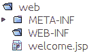

图 D.1：`jspdemo`的应用程序目录

只有一个 JSP 页面，`jspdemo`应用的结构非常简单，包含一个空的`WEB-INF`目录和一个`welcome.jsp`页面。

你可以使用以下 URL 调用`welcome.jsp`页面：

```
http://localhost:8080/jspdemo/welcome.jsp
```

### 注意

添加新的 JSP 页面后不需要重启 Tomcat。

列表 D.2 展示了如何在 JSP 中使用 Java 代码生成动态页面。列表 D.2 中的`todaysDate.jsp`页面显示今天的日期。

列表 D.2：`todaysDate.jsp`页面

```jsp
<%@page import="java.util.Date"%>
<%@page import="java.text.DateFormat"%>
<!DOCTYPE html>
<html>
<head><title>Today's date</title></head>
<body>
<%
    DateFormat dateFormat = 
            DateFormat.getDateInstance();
    String s = dateFormat.format(new Date());
    out.println("Today is " + s);
%>
</body>
</html>
```

### 注释

在 JSP 页面添加注释是良好的做法。JSP 页面上有两种类型的注释：

1. JSP 注释，用于说明页面正在执行。
2. HTML/XHTML 注释，将发送到浏览器。

JSP 注释以`<%--`开始并以`--%>`结束。例如，这是一个 JSP 注释：

```jsp
<%-- retrieve products to display --%>
```

JSP 注释不会发送到浏览器且不支持嵌套。

HTML/XHTML 注释具有以下语法：

```html
<!-- comments here -->
```

HTML/XHTML 注释不会被容器处理，而是原样发送到浏览器。HTML 注释的一种用途是识别 JSP 页面本身：

```html
<!-- this is /jsp/displayProducts.jsp -->
```

这对于包含多个 JSP 片段的应用特别有用。开发者可以通过查看浏览器中的 HTML 找到哪个 JSP 页面或片段生成特定的 HTML 部分。

### 隐式对象

Servlet 容器向其运行的 servlet 传递多个对象。例如，在服务方法中获取`HttpServletRequest`和`HttpServletResponse`，在`init`方法中获取`ServletConfig`。此外，你可以通过在`HttpServletRequest`对象上调用`getSession()`来获取`HttpSession`。

在 JSP 中，你可以使用隐式对象获取这些对象。表 D.1 列出了这些隐式对象。

| 对象 | 类型 |
| :--- | :--- |
| request | `javax.servlet.http.HttpServletRequest` |
| response | `javax.servlet.http.HttpServletResponse` |
| out | `javax.servlet.jsp.JspWriter` |
| session | `javax.servlet.http.HttpSession` |
| application | `javax.servlet.ServletContext` |
| config | `javax.servlet.ServletConfig` |
| pageContext | `javax.servlet.jsp.PageContext` |
| page | `javax.servlet.jsp.HttpJspPage` |
| exception | `java.lang.Throwable` |

表 D.1：JSP 隐式对象

例如，`request`隐式对象代表由 servlet/JSP 容器传递给 servlet 服务方法的`HttpServletRequest`。你可以将`request`当作对`HttpServletRequest`的一个变量引用来使用。例如，下面的代码从`HttpServletRequest`对象中获取`userName`参数。

```jsp
<%
    String userName = request.getParameter("userName");
%>
```

`pageContext`指向为页面创建的`javax.servlet.jsp.PageContext`。它提供了有用的上下文信息，并通过其自解释的方法访问各种与 servlet 相关的对象，例如`getRequest`、`getResponse`、`getServletContext`、`getServletConfig`和`getSession`。这些方法在脚本段（scriptlets）中并不十分有用，因为它们返回的对象可以通过隐式对象`request`、`response`、`session`和`application`更直接地访问。然而，`PageContext`允许使用表达式语言（Expression Language）访问这些对象。

`PageContext`提供的另一组感兴趣的方法是获取和设置属性的方法，即`getAttribute`和`setAttribute`。属性可以存储在四种范围之一：`page`、`request`、`session`和`application`。`page`范围是最窄的范围，存储在此处的属性仅在同一个 JSP 页面可用。`request`范围指当前的`ServletRequest`，`session`范围指当前的`HttpSession`，`application`范围指`ServletContext`。

`PageContext`中的`setAttribute`方法具有以下签名：

```java
public abstract void setAttribute(java.lang.String name, 
        java.lang.Object value, int scope)
```

`scope`的值可以是`PageContext`中以下静态最终常量之一：`PAGE_SCOPE`、`REQUEST_SCOPE`、`SESSION_SCOPE`和`APPLICATION_SCOPE`。

或者，要在页面范围中存储属性，你可以使用此`setAttribute`重载方法：

```java
public abstract void setAttribute(java.lang.String name, 
        java.lang.Object value)
```

例如，下面的脚本段将属性存储在`ServletRequest`中。

```jsp
<%
    // product 是一个 Java 对象
    pageContext.setAttribute("product", product, 
            PageContext.REQUEST_SCOPE);
%>
```

上面的 Java 代码效果与此代码相同：

```jsp
<%
    request.setAttribute("product", product);
%>
```

`out`隐式对象引用一个`javax.servlet.jsp.JspWriter`，它类似于通过调用`HttpServletResponse`的`getWriter()`获取`java.io.PrintWriter`。你可以像调用`PrintWriter`一样调用它的`print`方法重载来向浏览器发送消息。例如：

```jsp
out.println("Welcome");
```

示例 D.3 中的`implicitObjects.jsp`页面演示了一些隐式对象用法。

### 示例 D.3：`implicitObjects.jsp`页面

```jsp
<%@page import="java.util.Enumeration"%>
<!DOCTYPE html>
<html>
<head><title>JSP Implicit Objects</title></head>
<body>
<b>Http headers:</b<br/>
<%
    for (Enumeration<String> e = request.getHeaderNames();
            e.hasMoreElements(); ) {
        String header = e.nextElement();
        out.println(header + ": " + request.getHeader(header) +
                "<br/>");
    }
%>
<hr/>
<%
    out.println("Buffer size: " + response.getBufferSize() +
        "<br/>");
    out.println("Session id: " + session.getId() + "<br/>");
    out.println("Servlet name: " + config.getServletName() +
        "<br/>");
    out.println("Server info: " + application.getServerInfo());
%>
</body>
</html>
```

你可以使用此 URL 访问`implicitObjects.jsp`页面：

```
http://localhost:8080/jspdemo/implicitObjects.jsp
```

该页面在我的浏览器中产生了以下文本：

```
Http headers:
host: localhost:8080
connection: keep-alive
accept: text/html,application/xhtml+xml,application/xml;q=0.9,image/webp,
*/*;q=0.8
user-agent: Mozilla/5.0 (X11; Linux x86_64) AppleWebKit/537.36 (KHTML, 
like Gecko) Chrome/43.0.2357.130 Safari/537.36
accept-encoding: gzip, deflate, sdch
accept-language: en-US,en;q=0.8,id;q=0.6,ms;q=0.4,fr;q=0.2,de;q=0.2
cookie: JSESSIONID=4E3D1A4994B7F7ED5D7B96C2E3CF3BDE; 
Buffer size: 8192
Session id: A4EC1E2FFCE1377FD6DF6545BDDD7909
Servlet name: jsp
Server info: Apache Tomcat/8.0.20
```

你在浏览器中看到的具体内容取决于你使用的浏览器和环境。

请注意，默认情况下，JSP 编译器将 JSP 页面的内容类型（content type）设置为`text/html`。如果你发送的是不同的类型，必须通过调用`response.setContentType()`或使用`page`指令（在本附录稍后的“指令”节中讨论）来设置内容类型。例如，下面的代码将内容类型设置为`text/json`：

```java
response.setContentType("text/json");
```

同样注意，`page`隐式对象代表`javax.servlet.jsp.JspWriter`。

## 指令

指令（Directives）是第一类 JSP 语法元素。它们是给 JSP 翻译器的关于如何处理 JSP 页面的指令。有很多指令，但最重要的两个是`page`和`include`。

## page 指令

你使用`page`指令来指示 JSP 翻译器处理页面的某些方面。

`page`指令的语法如下：

```jsp
<%@ page attribute1="value1" attribute2="value2" %>
```

`@`和`page`之间的空格是可选的，`attribute1`、`attribute2`等是`page`指令的属性。以下是属性列表：

- `import`: 指定将导入并供此 Java 代码使用的 Java 类型或 Java 类型。例如，`import="java.util.List"`导入`List`接口。可以使用通配符`*`导入整个包，例如`import="java.util.*"`。要导入多个类型，用逗号隔开，例如`import="java.util.ArrayList,java.util.Calendar"`。以下包中的类型会被隐式导入：`java.lang`、`javax.servlet`、`javax.servlet.http`、`javax.servlet.jsp`。
- `session`: 为`true`表示此页面参与会话管理，否则。默认值为`true`，这意味着调用 JSP 页面将创建一个不存在的`javax.servlet.http.HttpSession`实例。
- `buffer`: 指定`out`隐式对象的缓冲区大小，单位为 KB。后缀`kb`是强制性的。默认缓冲区大小为 8kb 或更多，取决于 JSP 容器。也可以将此属性赋值为`none`，表示不使用缓冲，这将输出直接写入相应的`PrintWriter`。
- `autoFlush`: 为`true`（默认值）表示缓冲区满时应自动刷新缓冲区。为`false`表示仅在调用`response`隐式对象的`flush`方法时才刷新缓冲区。因此，在缓冲区溢出时将抛出异常。
- `isThreadSafe`: 表示页面实现的线程安全级别。建议 JSP 作者不要使用此属性，因为它可能导致生成的 servlet 包含过时代码。
- `info`: 指定生成的 servlet 的`getServletInfo`方法的返回值。
- `errorPage`: 指定处理此页面可能发生错误的页面。
- `isErrorPage`: 表示此页面是否为错误处理器。
- `contentType`: 指定此页面`response`隐式对象的内容类型。默认值为`text/html`。
- `pageEncoding`: 指定此页面的字符编码。默认值为`ISO-8859-1`。
- `isELIgnored`: 表示 EL 表达式是否被忽略。
- `language`: 指定此页面使用的脚本语言。默认值为`java`，且这是 JSP 2.2 中唯一有效的有效值。
- `extends`: 指定此 JSP 页面实现类必须继承的超类。此属性很少使用，使用时应格外小心。
- `deferredSyntaxAllowedAsLiteral`: 指定字符序列`#{`是否被允许在当前页面和翻译单元中作为`String`字面量出现。默认值为`false`。`#{`之所以非常重要，因为它是表达式语言（Expression Language）中的特殊字符序列。
- `trimDirectiveWhitespaces`: 表示是否从输出中移除仅包含空白字符的模板文本。默认值是`false`；换句话说，即不修剪空格。

`page`指令可以出现在页面的任何位置。例外是当它包含`contentType`或`pageEncoding`属性时，在这种情况下它必须在任何模板数据之前以及在使用 Java 代码发送任何内容之前出现。这是因为内容类型和字符编码必须在发送任何内容之前设置。

`page`指令也可以多次出现。然而，出现在多个`page`指令中的属性必须具有相同的值。该规则的例外是`import`属性。出现在多个 page 指令中的`import`属性的效果是累积的。例如，以下 page 指令导入了`java.util.ArrayList`和`java.io.File`。

```
<%@page import="java.util.ArrayList"%>
<%@page import="java.util.Date"%>
```

这等同于

```
<%@page import="java.util.ArrayList, java.util.Date"%>
```

另一个示例，这里有一个将会话属性设置为`false`并为页面缓冲区分配 16KB 空间的 page 指令：

```
<%@page session="false" buffer="16kb"%>
```


## include 指令

你使用`include`指令将另一个文件的包含包含当前 JSP 页面中。你可以在一个 JSP 页面中使用多个`include`指令。如果特定内容被不同的页面使用，或者在页面的不同位置使用，则将该内容模块化到 include 文件中是有用的。

`include`指令的语法如下：

```
<%@ include file="url"%>
```

其中`@`和`include`之间的空格是可选的，`url`代表包含文件的相对路径。如果`url`以斜杠（`/`）开头，则被解释为服务器上的绝对路径。如果不是，则被解释为相对于当前 JSP 页面的路径。

JSP 翻译器通过用包含文件的替换指令来翻译`include`指令。换句话说，如果你在列表 D.4 中编写了`copyright.jspf`文件。

列表 D.4：`copyright.jspf`包含文件

```
<hr/>
&copy;2015 Brainy Software Inc.
<hr/>
```

并且，你在列表 D.5 中有`main.jsp`页面。

列表 D.5：`main.jsp`页面

```
<!DOCTYPE html>
<html>
<head><title>Including a file</title></head>
<body>
This is the included content: <hr/>
<%@ include file="copyright.jspf"%>
</body>
</html>
```

在`main.jsp`页面中使用`include`指令与编写以下 JSP 页面的效果相同。

```
<!DOCTYPE html>
<html>
<head><title>Including a file</title></head>
<body>
This is the included content: <hr/>
<hr/>
&copy;2015 Brainy Software Inc.
<hr/>
</body>
</html>
```

为了使上述`include`指令生效，`copyright.jspf`文件必须位于包含它的页面相同的目录中。

按照习惯，include 文件具有`jspf`扩展名，代表 JSP fragment（片段）。今天 JSP 片被称为 JSP segments，但为了一致性仍然保留了`jspf`扩展名。

注意，你也可以包含静态 HTML 文件。

在本附录后面的“Actions”部分中讨论的`include`动作与`include`指令相似。细微的区别在“Actions”部分中解释，理解这两者之间的区别至关重要。

## 脚本元素

第二类 JSP 语法元素——脚本元素将 Java 代码整合到 JSP 页面中。脚本元素有三种类型：脚本段（scriptlets）、声明（declarations）和表达式（expressions）。它们将在接下来的小节中讨论。

## 脚本段 (Scriptlets)

脚本段是一块 Java 代码。脚本段以`<%`开始，以`%>`结束。例如，列表 D.6 中的`scriptletTest.jsp`页面使用了脚本段。

列表 D.6：使用脚本段（`scriptletTest.jsp`）

```
<%@page import="java.util.Enumeration"%>
<!DOCTYPE html>
<html>
<head><title>Scriptlet example</title></head>
<body>
<b>Http headers:</b><br/>
<%-- first scriptlet --%>
<%
    for (Enumeration<String> e = request.getHeaderNames(); 
            e.hasMoreElements(); ) {
        String header = e.nextElement();
        out.println(header + ": " + request.getHeader(header) + 
                "<br/>");
    }
    String message = "Thank you.";
%>
<hr/>
<%-- second scriptlet --%>
<%
    out.println(message);
%>
</body>
</html>
```

列表 D.6 中的 JSP 页面有两个脚本段。注意，在脚本段中定义的变量在它后面的脚本段中是可见的。

脚本段以`<%`开始，以`%>`结束。例如，列表 D.6 中的`scriptletTest.jsp`页面使用了脚本段。

脚本段以`<%`开始，以`%>`结束。

## 表达式 (Expressions)

表达式会被求值并将结果传递给`out`隐式对象。表达式以`<%=`开始，以`%>`结束。例如，下面的加粗文本是一个表达式：

```
Today is <%=java.util.Calendar().getTime()%>
```

注意表达式后面没有分号。使用这个表达式，等同于编写以下脚本段：

```
Today is
<%
    out.print(java.util.Calendar().getTime());
%>
```

## 声明 (Declarations)

你可以在 JSP 页面中声明变量和方法。你用`<!`和`%>`包裹声明。例如，列表 D.7 中的`declarationTest.jsp`页面声明了一个方法。

列表 D.7：使用声明（`declarationTest.jsp`）

```
<%!
    public String getTodaysDate() {
        return new java.util.Date().toString();
    }
%>
<!DOCTYPE html>
<html>
<head><title>Declarations</title></head>
<body>
Today is <%=getTodaysDate()%>
</body>
</html>
```

声明可以出现在 JSP 页面的任何位置，且同一个页面可以有多个声明。

你可以使用声明来覆盖实现类中的`init`和`destroy`方法。要覆盖`init`，请声明一个`jspInit`方法。要覆盖`destroy`，请声明一个`jspDestroy`方法。这两个方法将在下方解释。

*   `jspInit`: `javax.servlet.Servlet`中的`init`方法，在 JSP 页面初始化时调用。与`init`方法不同，`jspInit`不接受参数。你仍然可以通过`config`隐式对象获取`ServletConfig`对象。
*   `jspDestroy`: `Servlet`中的`destroy`方法，在 JSP 页面即将被销毁时调用。

列表 D.8 展示了`lifeCycle.jsp`页面，演示了如何覆盖`jspInit`和`jspDestroy`。

```
<%!
    public void jspInit() {
        System.out.println("jspInit ...");
    }
    public void jspDestroy() {
        System.out.println("jspDestroy ...");
    }
%>
<!DOCTYPE html>
<html>
<head><title>jspInit and jspDestroy</title></head>
<body>
Overriding jspInit and jspDestroy
</body>
</html>
```

`lifeCycle.jsp`页面将被翻译成以下 servlet：

```
package org.apache.jsp;

import javax.servlet.*;
import javax.servlet.http.*;
import javax.servlet.jsp.*;

public final class lifeCycle_jsp extends
        org.apache.jasper.runtime.HttpJspBase
        implements org.apache.jasper.runtime.JspSourceDependent {
    public void jspInit() {
  System.out.println("jspInit ...");
    }
    public void jspDestroy() {
        System.out.println("jspDestroy ...");    
    }
    private static final javax.servlet.jsp.JspFactory _jspxFactory =
            javax.servlet.jsp.JspFactory.getDefaultFactory();
    private static java.util.Map<java.lang.String,java.lang.Long> _jspx_dependants;
    private javax.el.ExpressionFactory _el_expressionfactory;
    private org.apache.tomcat.InstanceManager _jsp_instancemanager;
    public java.util.Map<java.lang.String,java.lang.Long> 
            getDependants() {
        return _jspx_dependants;
    }
    public void _jspInit() {
        _el_expressionfactory =  
                _jspxFactory.getJspApplicationContext(
                getServletConfig().getServletContext())
                .getExpressionFactory();
        _jsp_instancemanager = 
                org.apache.jasper.runtime.InstanceManagerFactory
                .getInstanceManager(getServletConfig());
    }
    public void _jspDestroy() {
    }
    public void _jspService(final 
            javax.servlet.http.HttpServletRequest request, final    
            javax.servlet.http.HttpServletResponse response)
            throws java.io.IOException, 
            javax.servlet.ServletException {
        final javax.servlet.jsp.PageContext pageContext;
        javax.servlet.http.HttpSession session = null;
        final javax.servlet.ServletContext application;
        final javax.servlet.ServletConfig config;
        final javax.servlet.jsp.JspWriter out = null;
        final java.lang.Object page = this;
        final javax.servlet.jsp.JspWriter _jspx_out = null;
        final javax.servlet.jsp.PageContext _jspx_page_context = null;
        try {
            response.setContentType("text/html");
            pageContext = _jspxFactory.getPageContext(this, request,  
                response, null, true, 8192, true);
            _jspx_page_context = pageContext;
            application = pageContext.getServletContext();
            config = pageContext.getServletConfig();
            session = pageContext.getSession();
            out = pageContext.getOut();
            _jspx_out = out;
            out.write("\n");
            out.write("<!DOCTYPE html>\n");
            out.write("<html>\n");
            out.write("<head><title>jspInit and jspDestroy" +
                    "</title></head>\n");
            out.write("<body>\n");
            out.write("Overriding jspInit and jspDestroy\n");
            out.write("</body>\n");
            out.write("</html>");
        } catch (java.lang.Throwable t) {
            if (!(t instanceof 
                    javax.servlet.jsp.SkipPageException)){
                out = _jspx_out;
                if (out != null && out.getBufferSize() != 0)
                    try { 
                        out.clearBuffer(); 
                    } catch (java.io.IOException e) {
                    }
                if (_jspx_page_context != null)    
                    _jspx_page_context.handlePageException(t);
            }
        } finally {
            _jspxFactory.releasePageContext(_jspx_page_context);
        }
    }
}
```

注意到生成的 servlet 中的`jspInit`和`jspDestroy`方法了吗？

你可以使用以下 URL 来调用`lifeCycle.jsp`：

```
http://localhost:8080/jspdemo/lifeCycle.jsp
```

当你第一次调用 JSP 页面时，你会在控制台上看到“jspInit ……”，当关闭你的 servlet/JSP 容器时，会看到“jspDestroy ……”。

## 禁用脚本元素

随着 JSP 2.0 中表达式语言（Expression Language）的进步，推荐的做法是使用 EL 来访问服务器端对象，而不是在 JSP 页面中编写 Java 代码。出于此原因，可以通过在部署描述符的`<jsp-property-group>`中定义脚本无效元素来禁用 JSP 2.0 脚本元素。`jsp-property-group`元素必须嵌套在`<jsp-config>`之中。

```xml
<jsp-config>
    <jsp-property-group>
        <url-pattern>*.jsp</url-pattern>
        <scripting-invalid>true</scripting-invalid>
    </jsp-property-group>
</jsp-config>
```


## Actions

动作是第三种语法元素。它们被翻译执行操作的 Java 代码，例如访问 Java 对象或调用方法。本节讨论了所有 JSP 容器必须支持的标准动作。除了标准动作外，你还可以创建执行某些操作的自定义标签。

以下是一些标准动作。

## useBean

此动作创建了一个与 Java 对象关联的脚本变量。它是将表示层与业务逻辑分离的早期尝试之一。感谢自定义标签和表达式语言等其他技术，`useBean` 现在已很少使用。

作为一个示例，`useBean.jsp` 页面创建了 `java.util.Date` 的实例并将其与脚本变量关联。

D9：`useBean.jsp` 页面

```html
<!DOCTYPE html>
<html>
<head>
    <title>useBean</title>
</head>
<body>
<jsp:useBean id="today" class="java.util.Date"/>
<%=today%>
</body>
</html>
```

`useBean` 动作在 Tomcat 中会被翻译为代码：

```java
java.util.Date today = null;
if (today == null) {
    today = new java.util.Date();
    _jspx_page_context.setAttribute("today", today, javax.servlet.PageContext.REQUEST_SCOPE);
}
```

运行此页面将在浏览器中显示当前的日期和时间。

## setProperty 和 getProperty

`setProperty` 动作在 Java 对象中设置属性，`getProperty` 打印对象的属性。作为一个示例，D11 `getPropertyTest.jsp` 设置并获取了 D10 `Employee` 类的 `firstName` 属性。

D10：`Employee` 类

```java
package jspdemo;

public class Employee {
    private String id;
    private String firstName;
    private String lastName;

    public String getId() {
        return id;
    }

    public void setId(String id) {
        this.id = id;
    }

    public String getFirstName() {
        return firstName;
    }

    public void setFirstName(String firstName) {
        this.firstName = firstName;
    }

    public String getLastName() {
        return lastName;
    }

    public void setLastName(String lastName) {
        this.lastName = lastName;
    }
}
```

D11：`getPropertyTest.jsp` 页面

```html
<!DOCTYPE html>
<html>
<head>
    <title>getProperty and setProperty</title>
</head>
<body>
<jsp:useBean id="employee" class="jspdemo.Employee"/>
<jsp:setProperty name="employee" property="firstName" value="Abigail"/>
First Name: <jsp:getProperty name="employee" property="firstName"/>
</body>
</html>
```

## include

`include` 动作用于动态包含另一个资源。你可以包含另一个 JSP 页面、servlet 或静态 HTML 页面。例如，D12 `jspIncludeTest.jsp` 页面使用 `include` 动作包含 `menu.jsp` 页面。

D12：`jspIncludeTest.jsp` 页面

```html
<!DOCTYPE html>
<html>
<head>
    <title>Include action</title>
</head>
<body>
<jsp:include page="jspf/menu.jsp">
    <jsp:param name="text" value="How are you?"/>
</jsp:include>
</body>
</html>
```

理解 include 指令（include directive）和 include 动作（include action）之间的区别至关重要。使用 include 指令时，包含发生在页面翻译时，即 JSP 容器将页面翻译为生成的 servlet 的时候。使用 include 动作时，包含发生在请求时。因此，你可以使用 include 动作传递参数，但 include 指令是无法传递参数的。

第二个区别是，使用 include 指令时，被包含资源的文件扩展名并不重要。而使用 include 动作时，文件扩展名必须是 `jsp` 才能被作为 JSP 页面处理。例如，在 include 动作中使用 `jspf` 将导致 JSP 段被视为静态文件。

## forward 转发

forward 动作（forward action）将当前页面转发到不同的资源。例如，下面的 forward 动作将当前页面转发到 `login.jsp` 页面。

```jsp
<jsp:forward page="jspf/login.jsp">
    <jsp:param name="text" value="Please login"/>
</jsp:forward>
```

## 错误处理

JSP 对错误处理支持良好。可以使用 `try` 语句处理 Java 代码，但你也可以指定一个页面，当应用程序中的任何页面遇到未捕获的异常时，将显示该页面。在这种情况下，你的用户将看到一个设计良好的页面来解释发生了什么，而不是一条让他们皱眉的错误信息。

通过使用页面指令的 `isErrorPage` 属性，可以将 JSP 页面设置为错误页面。该属性的值必须为 `true`。列表 D.13 显示了这样的错误处理器。

列表 D.13：`errorHandler.jsp` 页面

```jsp
<%@page isErrorPage="true"%>
<!DOCTYPE html>
<html>
<head><title>Error</title></head>
<body>
An error has occurred. <br/>
Error message: 
<%
    out.println(exception.toString());
%>
</body>
</html>
```

需要防止未捕获异常的其他页面必须使用页面指令的 `errorPage` 属性，并将错误处理页面的路径作为值。例如，列表 D.14 中的 `buggy.jsp` 页面使用了列表 D.13 中的错误处理器。

列表 D.14：`buggy.jsp` 页面

```jsp
<%@page errorPage="errorHandler.jsp"%>
Deliberately throw an exception
<%
    Integer.parseInt("Throw me");
%>
```

如果你运行 `buggy.jsp` 页面，它将抛出一个异常。然而，你不会看到 servlet/JSP 容器生成的错误信息。相反，将显示 `errorHandler.jsp` 页面的内容。

## 总结

JSP 是 Java 构建 Web 应用程序的第二种技术，发明是为了补充 Servlet 技术而不是取代它。设计良好的 Java Web 应用程序同时使用 servlet 和 JSP。

在本附录中，你学习了 JSP 如何工作以及如何编写 JSP 页面。到目前，你应该了解关于隐式对象（implicit objects）的所有知识，并能够使用 JSP 页面中可能三个语法元素：指令、脚本元素和动作。

# 附录 E：部署

部署一个 Servlet 3.0 或 Servlet 3.1 应用轻而易举。得益于 servlet 注解类型，你可以在没有部署描述符（deployment descriptor）的情况下部署 servlet/JSP 应用程序。尽管如此，在需要更精细配置的许多情况下仍然需要部署描述符。如果存在部署描述符，它必须命名为 `web.xml` 并位于 `WEB-INF` 目录下。Java 类必须位于 `WEB-INF/classes`，Java 库必须位于 `WEB-INF/lib`。所有应用程序资源必须被封装成单个 `war` 文件。`war` 文件基本上是一个带有 `.war` 名的 zip 文件。

本附录讨论了部署和部署描述符。

## 部署描述符概述

在 Servlet 3.0 之前，部署总是包含一个 `web.xml` 文件，即部署描述符。在 Servlet 3 中，部署描述符是可选的，因为你可以使用注解将资源映射到 URL 模式。然而，如果符合以下任何情况，则需要部署描述符：

- 你需要向 `ServletContext` 传递初始参数。
- 你有多个过滤器，并想指定过滤器的调用顺序。
- 你需要更改会话超时时间（session timeout）。
- 你想限制对资源集的访问，并为用户提供身份验证的方法。

列表 E.1 显示了部署描述符的骨架。它必须命名为 `web.xml` 并位于应用程序目录的 `WEB-INF` 目录下。

列表 E.1：部署描述符的骨架

```xml
<?xml version="1.0" encoding="ISO-8859-1"?>
<web-app version="3.1" xmlns="http://xmlns.jcp.org/xml/ns/javaee" 
    xmlns:xsi="http://www.w3.org/2001/XMLSchema-instance" 
    xsi:schemaLocation="http://xmlns.jcp.org/xml/ns/javaee 
http://xmlns.jcp.org/xml/ns/javaee/web-app_3_1.xsd"
    [metadata-complete="true|false"]
> 
    ...
</web-app>
```

`xsi:schemaLocation` 属性指定了验证部署描述符的 schema 位置。`version` 属性指定了使用的 Servlet 版本。

可选的 `metadata-complete` 属性指定部署描述符是否完整。如果其值为 `true`，servlet/JSP 容器必须忽略 servlet 特定的注解（如 `@WebServlet`）。如果此元素被设置为 `false`，容器将扫描与部署的类文件中的片段。

`web-app` 元素是根元素，可以拥有子元素来指定：

- servlet 声明
- servlet 映射
- ServletContext 初始参数
- 会话配置
- 监听器类
- 过滤器定义和映射
- MIME 类型映射
- 欢迎文件列表
- 错误页面
- JSP 特有设置
- JNDI 设置

部署描述符中出现的每个元素的规则在 `web-app_3.1` schema 中给出。你可以从该站点下载：

http://xmlns.jcp.org/xml/ns/javaee/web-app_3.1

3.1 schema 包含另一个 schema（`web-common_3.1`），其中包含了大部分信息。包含的 schema 可以在此处找到。

http://xmlns.jcp.org/xml/ns/javaee/web-common_3.1

反过来，`web-common_3.1` 包含了两个 schema：

- `javaee_7.xsd`：定义 Java EE 7 部署类型（EAR, JAR 和 RAR）共享的通用元素
- `jsp_2.3.xsd`：根据 JSP 2.3 定义应用程序的部分元素

本节其余部分列出了可能出现在部署描述符中的 servlet 和 JSP 元素。它不包括 Servlet 或 JSP 规范之外 Java EE 元素。

## 核心元素

本节详细讨论了重要的元素。`<web-app>` 的子元素可以任意顺序出现。某些元素如 `session-config`、`jsp-config` 和 `login-config` 只能出现一次。其他元素如 `servlet`、`filter` 和 `welcome-file-list` 可以出现多次。

直接出现在 `<web-app>` 下的重要元素都有单独的小节。要查找不位于 `<web-app>` 下的元素的描述，请追溯其父元素。例如，`taglib` 元素可以在“jsp-config”小节下找到，`load-on-startup` 元素可以在“servlet”下。本节的小节按字母顺序排列。

## context-param

`context-param` 元素向 `ServletContext` 传递值。这些值可以从任何 servlet/JSP 页面读取。该元素包含一个键值对，可以通过调用 `ServletContext` 的 `getInitParameter` 方法获取。只要整个应用程序中的参数名是唯一的，你就可以有多个 `context-param` 元素。`ServletContext.getInitParameterNames()` 返回所有的 ServletContext 参数名。

`context-param` 元素必须包含一个 `param-name` 元素和一个 `param-value` 元素。`param-name` 元素包含参数名称，`param-value` 元素包含参数值。可选情况下，还可以包含一个 `description` 元素来描述该参数。

以下是两个 `context-param` 元素的示例。

```xml
<context-param>
    <param-name>location</param-name>
    <param-value>localhost</param-value>
</context-param>
<context-param>
    <param-name>port</param-name>
    <param-value>8080</param-value>
    <description>使用的端口号</description>
</context-param>
```

### distributable

如果存在，`distributable` 元素表示应用程序设计用于部署到分布式的 servlet/JSP 容器中。`distributable` 元素必须为空。例如，这里有一个 `distributable` 元素。

```xml
<distributable/>
```

### error-page

`error-page` 元素包含了 HTTP 错误码与资源路径之间的映射，或者 Java 异常类型与资源路径之间的映射。`error-page` 元素规定了发生 HTTP 错误或抛出指定异常时，容器应该返回的资源。

此元素必须包含以下子元素：

- `error-code`，用于指定 HTTP 错误码
- `exception-type`，用于指定要捕获的 Java 异常类型的全限定名
- `location`，用于指定发生错误或异常时显示的资源位置。`location` 元素必须以 `/` 开头。

例如，以下是一个 `error-page` 元素，它告诉 servlet/JSP 容器每当发生 HTTP 404 错误码时，显示位于应用程序目录下的 `error.html` 页面：

```xml
<error-page>
    <error-code>404</error-code>
    <location>/error.html</location>
</error-page>
```

以下是一个 `error-page` 元素，它将所有 servlet 异常映射到 `exceptions.html` 页面。

```xml
<error-page>
    <exception-type>javax.servlet.ServletException</exception-type>
    <location>/exception.html</location>
</error-page>
```

### filter

此元素指定一个 servlet 过滤器。至少，此元素必须包含一个 `filter-name` 元素和一个 `filter-class` 元素。可选情况下，它还可以包含以下元素：`icon`、`display-name`、`description`、`init-param` 和 `async-supported`。

`filter-name` 元素定义过滤器的名称。过滤器名称在应用内必须是唯一的。`filter-class` 元素指定过滤器类的全限定名。`init-param` 元素用于指定过滤器的初始化参数，其元素描述与 `<context-param>` 相同。一个 `filter` 元素可以有多个 `init-param` 元素。

以下是两个 `filter` 元素，名称分别为 `Upper Case Filter` 和 `Image Filter`。


```xml
<filter>
    <filter-name>Upper Case Filter</filter-name>
    <filter-class>com.example.UpperCaseFilter</filter-class>
</filter>
<filter>
    <filter-name>Image Filter</filter-name>
    <filter-class>com.example.ImageFilter</filter-class>
    <init-param>
        <param-name>frequency</param-name>
        <param-value>1909</param-value>
    </init-param>
    <init-param>
        <param-name>resolution</param-name>
        <param-value>1024</param-value>
    </init-param>
</filter>
```

### filter-mapping

`filter-mapping` 元素指定过滤器应用的资源或多个资源。过滤器可以应用于 servlet 或 URL 模式。将过滤器映射到 servlet 会导致该过滤器在该 servlet 上工作。将过滤器映射到 URL 模式则会对任何 URL 匹配该 URL 模式的资源进行过滤。过滤的执行顺序与部署描述中 `filter-mapping` 元素出现的顺序一致。

`filter-mapping` 元素包含一个 `filter-name` 元素和一个 `url-pattern` 元素，或者一个 `servlet-name` 元素。

`filter-name` 的值必须匹配使用 `filter` 元素声明的过滤器名称之一。

以下是两个 `filter` 元素和两个 `filter-mapping` 元素：

```xml
<filter>
    <filter-name>Logging Filter</filter-name>
    <filter-class>com.example.LoggingFilter</filter-class>
</filter>
<filter>
    <filter-name>Security Filter</filter-name>
    <filter-class>com.example.SecurityFilter</filter-class>
</filter>

<filter-mapping>
    <filter-name>Logging Filter</filter-name>
    <servlet-name>FirstServlet</servlet-name>
</filter-mapping>
<filter-mapping>
    <filter-name>Security Filter</filter-name>
    <url-pattern>/*</url-pattern>
</filter-mapping>
```

### listener

`listener` 元素注册一个监听器。它包含一个 `listener-class` 元素，定义监听器类的全限定名。这是一个示例。

```xml
<listener>
    <listener-class>com.example.AppListener</listener-class>
</listener>
```

### locale-encoding-mapping-list and locale-encoding-mapping

`locale-encoding-mapping-list` 元素包含一个或多个 `locale-encoding-mapping` 元素。`locale-encoding-mapping` 元素将区域（locale）映射到编码。`locale-encoding-mapping` 包含一个 `locale` 元素和一个 `encoding` 元素。`locale` 的值必须是 ISO 639 中的语言代码或“语言代码 _ 国家代码”。当使用语言代码 _ 国家代码时，它必须是 ISO 3166 定义的国家代码之一。

例如，这里是一个 `locale-encoding-mapping-list`，它包含一个 `locale-encoding-mapping`，该映射将日语映射到 `Shift_JIS`。

```xml
<locale-encoding-mapping-list>
    <locale-encoding-mapping>
        <locale>ja</locale>
        <encoding>Shift_JIS</encoding>
    </locale-encoding-mapping>
</locale-encoding-mapping-list>
```

### login-config

`login-config` 元素用于指定验证用户的身份验证方法、域名称以及在使用表单认证时所需的属性。`login-config` 元素有一个可选的 `auth-method` 元素、可选的 `realm-name` 元素和一个可选的 `form-login-config` 元素。

`auth-method` 元素指定身份验证方法。其值为以下之一：`BASIC`、`DIGEST`、`FORM` 或 `CLIENT-CERT`。

`realm-name` 元素指定 Basic 认证和 Digest 认证使用的域。

`form-login-config` 元素指定表单认证使用的登录和错误页面。如果不使用表单认证，这些元素将被忽略。

`form-login-config` 元素包含一个 `form-login-page` 元素和一个 `form-error-page` 元素。`form-login-page` 元素指定登录页资源的路径。路径必须以 `/` 开头并相对于应用程序目录。

`form-error-page` 元素指定登录失败时显示的错误页资源路径。路径必须以 `/` 开头并相对于应用程序目录。

作为一个示例，这里是 `login-config` 元素的示例。

```xml
<login-config>
    <auth-method>DIGEST</auth-method>
    <realm-name>Members Only</realm-name>
</login-config>
```

以及，这是另一个示例。

```xml
<login-config>
    <auth-method>FORM</auth-method>
    <form-login-config>
        <form-login-page>/loginForm.jsp</form-login-page>
        <form-error-page>/errorPage.jsp</form-error-page>
    </form-login-config>
</login-config>
```

### mime-mapping

`mime-mapping` 元素将 MIME 类型映射到扩展名。它包含一个 `extension` 元素和一个 `mime-type` 元素。`extension` 元素描述扩展名，`mime-type` 元素指定 MIME 类型。例如，这里有一个 `mime-mapping` 元素。

```xml
<mime-mapping>
    <extension>txt</extension>
    <mime-type>text/plain</mime-type>
</mime-mapping>
```

### security-constraint

`security-constraint` 元素允许声明式地限制对一组资源的访问。

## 概述

`security-constraint` 元素包含一个可选的 `display-name` 元素、一个或多个 `web-resource-collection` 元素、一个可选的 `auth-constraint` 元素以及一个可选的 `user-data-constraint` 元素。

`web-resource-collection` 元素标识一组需要限制访问的资源。在其中，你可以定义 `url-pattern`(s) 以及受限制的 HTTP 方法或多个方法。如果不存在 HTTP 方法，则该安全约束适用于所有 HTTP 方法。

`auth-constraint` 元素指定了应该具有访问资源集合权限的角色（roles）。如果没有指定 `auth-constraint` 元素，则安全约束适用于所有角色。

`user-data-constraint` 元素用于指示客户端与 servlet/JSP 容器之间传输的数据必须如何保护。

`web-resource-collection` 元素包含一个 `web-resource-name` 元素、一个可选的 `description` 元素、零或多个 `url-pattern` 元素以及零或多个 `http-method` 元素。

`web-resource-name` 元素包含一个与受保护资源相关的名称。

`http-method` 元素可以分配一个 HTTP 方法，例如 `GET`、`POST` 或 `TRACE`。

`auth-constraint` 元素包含一个可选的 `description` 元素和零或多个 `role-name` 元素。`role-name` 元素包含安全角色的名称。

`user-data-constraint` 元素包含一个可选的 `description` 元素和一个 `transport-guarantee` 元素。`transport-guarantee` 元素必须具有以下值之一：`NONE`、`INTEGRAL` 或 `CONFIDENTIAL`。`NONE` 表示应用不需要传输保证。`INTEGRAL` 意味着服务器和客户端之间的数据应以传输过程中无法被更改的方式发送。`CONFIDENTIAL` 意味着传输的数据必须加密。在大多数情况下，安全套接层（SSL）被用于 `INTEGRAL` 或 `CONFIDENTIAL`。

以下示例使用 `security-constraint` 元素限制对任何 URL 匹配模式 `/members/*` 资源的访问。只有 `payingMember` 角色的用户才被允许访问。`login-config` 元素要求用户登录，并使用了 `Digest` 访问认证方法。

```xml
<security-constraint>
    <web-resource-collection>
        <web-resource-name>Members Only</web-resource-name>
        <url-pattern>/members/*</url-pattern>
    </web-resource-collection>
    <auth-constraint>
        <role-name>payingMember</role-name>
    </auth-constraint>
</security-constraint>

<login-config>
    <auth-method>Digest</auth-method>
    <realm-name>Digest Access Authentication</realm-name>
</login-config>
```

## security-role

`security-role` 元素指定了用于安全约束的安全角色的声明。该元素具有一个可选的 `description` 元素和一个 `role-name` 元素。以下是 `security-role` 元素的示例。

```xml
<security-role>
    <role-name>payingMember</role-name>
</security-role>
```

## servlet

`servlet` 元素用于声明一个 servlet。它可以包含以下元素：

*   一个可选的 `icon` 元素
*   一个可选的 `description` 元素
*   一个可选的 `display-name` 元素
*   一个 `servlet-name` 元素
*   一个 `servlet-class` 元素或一个 `jsp-file` 元素
*   零或多个 `init-param` 元素
*   一个可选的 `load-on-startup` 元素
*   一个可选的 `run-as` 元素
*   一个可选的 `enabled` 元素
*   一个可选的 `async-supported` 元素
*   一个可选的 `multipart-config` 元素
*   零或多个 `security-role-ref` 元素

`servlet` 元素至少包含一个 `servlet-name` 元素和一个 `servlet-class` 元素，或者一个 `servlet-name` 元素和一个 `jsp-file` 元素。`servlet-name` 元素定义了该 servlet 的名称，并在整个应用程序中必须是唯一的。

`servlet-class` 元素指定 servlet 的完全限定类名。

`jsp-file` 元素指定应用内 JSP 页面的完整路径。完整路径必须以 `/` 开头。

`init-param` 子元素可以用于向 servlet 传递初始参数名和值。`init-param` 的元素描述符与 `context-param` 相同。

你使用 `load-on-startup` 元素在 servlet/JSP 容器启动时自动将 servlet 加载到内存中。加载 servlet 意味着实例化并调用其 `init` 方法。使用此元素是为了避免由于 servlet 加载到内存而导致首次请求的响应延迟。如果此元素存在且指定了 `jsp-file` 元素，则 JSP 文件将被预编译为 servlet 并加载生成的 servlet。

`load-on-startup` 留空为空或具有一个整数值。该值表示当同一个应用程序中存在多个 servlet 时，该 servlet 的加载顺序。例如，如果有两个 `servlet` 元素且它们都包含 `load-on-startup` 元素，则 `load-on-startup` 值较小的 servlet 先被加载。如果 `load-on-startup` 的值为空或负数，则由 Web 容器决定何时加载该 servlet。如果两个 servlet 具有相同的 `load-on-startup` 值，则无法确定两个 servlet 之间的加载顺序。

定义 `run-as` 会覆盖该 servlet 在此应用中调用企业 JavaBean（EJB）时的安全身份。该角色名称是当前 Web 应用程序定义的安全角色之一。

`security-role-ref` 元素将 servlet 中通过 `isUserInRole(name)` 调用的角色名称映射到应用程序定义的安全角色的名称。`security-role-ref` 包含一个可选的 `description` 元素、一个 `role-name` 元素和一个 `role-link` 元素。

`role-link` 元素用于将角色引用链接到定义的安全角色。`role-link` 元素必须包含 `security-role` 元素定义的安全角色的名称。

`async-supported` 元素是一个可选元素，其值为 `true` 或 `false`。它表示该 servlet 是否支持异步处理。

`enabled` 元素也是一个可选元素，值为 `true` 或 `false`。设置此元素可以禁用该 servlet。

例如，为了将安全角色引用“PM”映射到 `role-name` 为“payingMember”的安全角色，语法如下：

```xml
<security-role-ref>
    <role-name>PM</role-name>
    <role-link>payingMember</role-link>
</security-role-ref>
```

在这种情况下，如果属于“payingMember”角色的用户调用 `isUserInRole("payingMember")`，结果将为 `true`。

以下是两个 `servlet` 元素的示例：

```xml
<servlet>
    <servlet-name>UploadServlet</servlet-name>
    <servlet-class>com.brainysoftware.UploadServlet</servlet-class>
    <load-on-startup>10</load-on-startup>
</servlet>
<servlet>
    <servlet-name>SecureServlet</servlet-name>
    <servlet-class>com.brainysoftware.SecureServlet</servlet-class>
    <load-on-startup>20</load-on-startup>
</servlet>
```

## servlet-mapping

`servlet-mapping` 元素将 servlet 映射到 URL 模式。`servlet-mapping` 元素必须包含一个 `servlet-name` 元素和一个 `url-pattern` 元素。

以下 `servlet-mapping` 元素将 servlet 映射到 URL 模式 `/first`。


```xml
<servlet>
    <servlet-name>FirstServlet</servlet-name>
    <servlet-class>com.brainysoftware.FirstServlet</servlet-class>
</servlet>
<servlet-mapping>
    <servlet-name>FirstServlet</servlet-name>
    <url-pattern>/first</url-pattern>
</servlet-mapping>
```

## session-config

`session-config` 元素定义了 `javax.servlet.http.HttpSession` 实例的参数。该元素可以包含一个或多个以下元素：`session-timeout`、`cookie-config` 或 `tracking-mode`。

`session-timeout` 元素指定了以分钟为单位的默认会话超时间隔。此值必须是一个整数。如果 `session-timeout` 元素的值为零或负数，则会话将永远超时。

`cookie-config` 元素定义了由此 servlet/JSP 应用创建的会话跟踪 cookie 的配置。

`tracking-mode` 元素定义了此 Web 应用创建的会话跟踪模式。有效值为 `COOKIE`、`URL` 或 `SSL`。

以下 `session-config` 元素会导致当前应用中的 `HttpSession` 对象在未活动十二分钟后失效。

```xml
<session-config>
    <session-timeout>12</session-timeout>
</session-config>
```

## welcome-file-list

`welcome-file-list` 元素指定了当用户在浏览器中输入的 URL 不包含 servlet 名称、JSP 页面或静态资源时，显示的文件或 servlet。

`welcome-file-list` 元素包含一个或多个 `welcome-file` 元素。`welcome-file` 元素包含默认文件名。如果找到第一个 `welcome-file` 元素中指定的文件，Web 容器将尝试显示第二个，依此类推。

这里是一个 `welcome-file-list` 元素的示例。

```xml
<welcome-file-list>
    <welcome-file>index.htm</welcome-file>
    <welcome-file>index.html</welcome-file>
    <welcome-file>index.jsp</welcome-file>
</welcome-file-list>
```

以下示例使用了包含两个 `welcome-file` 元素的 `welcome-file-list` 元素。第一个 `welcome-file` 元素指定了应用目录下名为 `index.html` 的文件；第二个定义了 servlet 目录下的欢迎 servlet，该目录位于应用目录下：

```xml
<welcome-file-list>
    <welcome-file>index.html</welcome-file>
    <welcome-file>servlet/welcome</welcome-file>
</welcome-file-list>
```

## JSP 特有元素

`<web-app>` 下的 `jsp-config` 元素包含了特定于 JSP 的元素。它可以包含零或多个 `taglib` 元素和零或多个 `jsp-property-group` 元素。`taglib` 元素在本节的第一部分进行解释，`jsp-property-group` 元素在第二部分进行。

### taglib

`taglib` 元素描述了一个 JSP 自定义标签库。`taglib` 元素包含一个 `taglib-uri` 元素和一个 `taglib-location` 元素。

`taglib-uri` 元素指定了 servlet/JSP 应用中使用的标签库的 URI。`taglib-uri` 的值相对于部署描述符的位置。

`taglib-location` 元素指定了标签库 TLD 文件的位置。

以下是 `taglib` 元素的示例。

```xml
<jsp-config>
    <taglib>
        <taglib-uri>
            http://brainysoftware.com/taglib/complex
        </taglib-uri>
        <taglib-location>/WEB-INF/jsp/complex.tld
    </taglib-location>
  </taglib>
</jsp-config>
```

### jsp-property-group

`jsp-property-group` 元素将若干 JSP 文件分组，以便为它们提供全局属性信息。你可以使用 `<jsp-property-group>` 下的子元素执行以下操作：

*   指示是否忽略 EL
*   指示是否允许脚本元素
*   指示页面编码信息
*   指示资源是否为 JSP 文档（用 XML 编写）
*   引言（Prelude）和代码的自动包含

`jsp-property-group` 元素具有以下子元素：

*   可选的 `description` 元素
*   可选的 `display-name` 元素
*   可选的 `icon` 元素
*   一个或多个 `url-pattern` 元素
*   可选的 `el-ignored` 元素
*   可选的 `page-encoding` 元素
*   可选的 `scripting-invalid` 元素
*   可选的 `is-xml` 元素
*   零或多个 `include-prelude` 元素
*   零或多个 `include-code` 元素

`url-pattern` 元素用于指定将受属性设置影响的 URL 模式。

`el-ignored` 元素取值可以是布尔值 `true` 或 `false`。值为 `true` 意味着在 URL 匹配指定 URL 模式的 JSP 页面中不会求值 EL 表达式。该默认值为 `false`。

`page-encoding` 元素指定了 URL 匹配指定 URL 模式的 JSP 页面的编码。`page-encoding` 的有效值与匹配 JSP 页面使用的页面指令中 `pageEncoding` 属性的值相同。如果在 JSP 页面页面指令的 `pageEncoding` 属性中指定的编码与匹配该页面的 JSP 配置元素中指定的编码不同，将产生转换时错误。如果在 XML 语法的文档的序言或文本声明中指定的编码与匹配该文档的 JSP 配置元素中指定的编码不同，也会产生转换时错误。通过多种机制指定相同的编码是合法的。

`scripting-invalid` 元素接受布尔值。值为 `true` 意味着在 URL 匹配指定模式的 JSP 页面中不允许脚本。默认情况下，该元素的值为 `false`。

`is-xml` 元素接受布尔值，值为 `true` 表示匹配指定模式的 JSP 页面为 XML 文档。

`include-prelude` 元素是一个相对路径，对应于应用中的一个元素。当该元素存在时，它将作为包含指令的一部分被自动包含在匹配指定模式的 JSP 页面的开头。

`include-code` 元素是一个相对路径，对应于应用中的一个元素。当该元素存在时，它将作为包含指令的一部分被自动包含在匹配指定模式的 JSP 页面的末尾。

例如，这里有一个 `jsp-property-group` 元素会导致所有 JSP 页面忽略 EL 求值。

```xml
<jsp-config>
    <jsp-property-group>
        <url-pattern>*.jsp</url-pattern>
        <el-ignored>true</el-ignored>
    </jsp-property-group>
</jsp-config>
```

并且，这里有一个 `jsp-property-group` 元素用于强制整个应用使用无脚本页面。

```xml
<jsp-config>
    <jsp-property-group>
        <url-pattern>*.jsp</url-pattern>
        <scripting-invalid>true</scripting-invalid>
    </jsp-property-group>
</jsp-config>
```

## 部署

自 Servlet 诞生以来，部署 Servlet/JSP 应用一直非常简单。这只需要将原始目录下的所有资源压缩成 war 文件。你可以使用 JDK 中的 `jar` 工具，也可以使用如 WinZip 等常用工具。你只需要确保压缩文件具有 war 扩展名。

你必须在 war 文件中包含所有的库和类文件，以及 HTML 文件、JSP 页面、图片、版权声明（如果有）等。不要包含 Java 源代码。任何需要你的应用的人只需获取你的 war 文件并将其部署在 servlet 中即可。

## Web Fragments

Servlet 3.0 引入了 Web fragment，这是在现有 Web 应用中部署插件或框架的新功能。Web fragment 用于补充部署描述符，而无需编辑 `web.xml` 文件。Web fragment 基本上是一个包含 Web 对象（如 servlet、过滤器和监听器）以及资源（如 JSP 页面和静态图像）的包。Web fragment 还可以有一个与部署描述符类似的描述符。Web fragment 描述符必须命名为 `web-fragment.xml` 并位于包的 `META-INF` 目录下。Web fragment 描述符可以包含任何出现在部署描述符 `<web-app>` 元素下的元素，外加一些 Web fragment 特有的元素。一个应用可以拥有多个 Web fragment。

Listing E.2 显示了 web 片段描述符（web fragment descriptor）的结构。粗体显示的文本强调了它与部署描述符（deployment descriptor）之间的区别。不出所料，web 片段的根元素是 `web-fragment`。`web-fragment` 甚至可以拥有 `metadata-complete` 属性。如果 `metadata-complete` 属性的值为 `true`，将跳过 web 片段包含的类中的注解。

### Listing E.2：`web-fragment.xml`文件的结构

```xml
<?xml version="1.0" encoding="ISO-8859-1"?>
<web-fragment version="3.1" xmlns="http://xmlns.jcp.org/xml/ns/javaee" 
    xmlns:xsi="http://www.w3.org/2001/XMLSchema-instance" 
    xsi:schemaLocation="http://xmlns.jcp.org/xml/ns/javaee 
http://xmlns.jcp.org/xml/ns/javaee/web-fragment_3_1.xsd"
    [metadata-complete=”true|false”]
>

    ...

</web-fragment>
```

例如，`fragmentdemo` 应用程序除了 `fragment.jar` 文件中的一个 web 片外几乎是空的。该 jar 文件已导入到 `fragmentdemo` 的 `WEB-INF/lib` 目录。此示例的重点不是 `fragmentdemo`，而是片段项目，它包含一个 servlet（`fragment.servlet.FragmentServlet`，在 Listing E.3 中）和一个 `web-fragment.xml` 文件（在 Listing E.4 中）。

### Listing E.3：`FragmentServlet` 类

```java
package fragment.servlet;
import java.io.IOException;
import java.io.PrintWriter;
import javax.servlet.ServletException;
import javax.servlet.http.HttpServlet;
import javax.servlet.http.HttpServletRequest;
import javax.servlet.http.HttpServletResponse;

public class FragmentServlet extends HttpServlet {

    private static final long serialVersionUID = 940L;

    public void doGet(HttpServletRequest request, HttpServletResponse response)
            throws ServletException, IOException {

        response.setContentType("text/html");
        PrintWriter out = response.getWriter();
        out.println("A plug-in");
    }
}
```

### Listing E.4：project fragment 中的 `web-fragment.xml`

```xml
<?xml version="1.0" encoding="ISO-8859-1"?>
<web-fragment version="3.1" xmlns="http://xmlns.jcp.org/xml/ns/javaee" 
    xmlns:xsi="http://www.w3.org/2001/XMLSchema-instance" 
    xsi:schemaLocation="http://xmlns.jcp.org/xml/ns/javaee 
http://xmlns.jcp.org/xml/ns/javaee/web-fragment_3_1.xsd">

    <servlet>
        <servlet-name>FragmentServlet</servlet-name>
        <servlet-class>fragment.servlet.FragmentServlet</servlet-class>
    </servlet>
    <servlet-mapping>
        <servlet-name>FragmentServlet</servlet-name>
        <url-pattern>/fragment</url-pattern>        
    </servlet-mapping>
</web-fragment>
```

`FragmentServlet` 是一个简单的 servlet，它向浏览器发送一个字符串。`web-fragment.xml` 文件注册并映射了该 servlet。`fragment.jar` 文件的结构如图 E.1 所示。

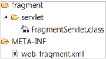

图 E.1：`fragment.jar`文件的结构

你可以通过调用以下 URL 来测试 `Fragment` servlet：

```
http://localhost:8080/fragmentdemo/fragment
```

你应该能看到来自 `Fragment` servlet 的输出。

## 总结

本附录解释了你如何配置和部署你的 servlet/JSP 应用程序。附录首先介绍了典型应用程序的目录结构，然后转向对部署描述符的解释。

当应用程序准备好部署后，你可以通过保留应用程序的文件和目录结构来部署它。或者，你可以将应用程序打包成 WAR 文件并将整个应用程序作为一个单个文件进行部署。
