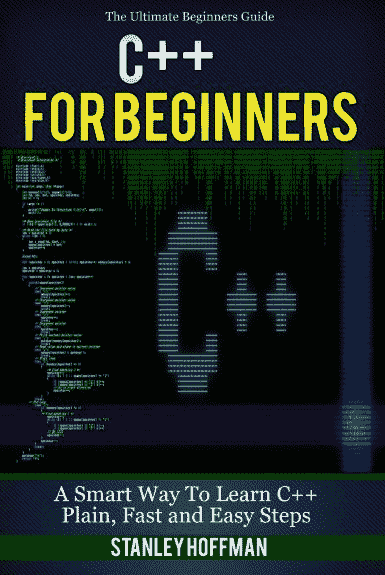
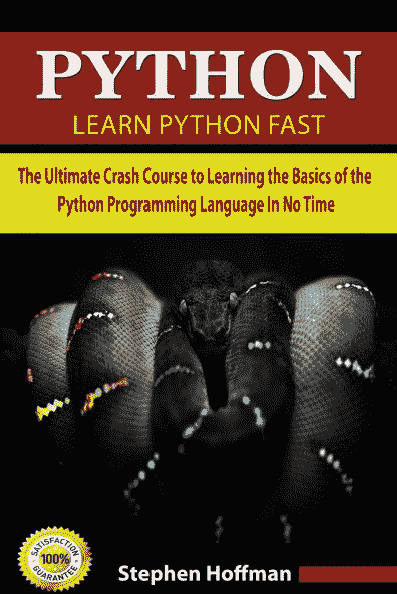
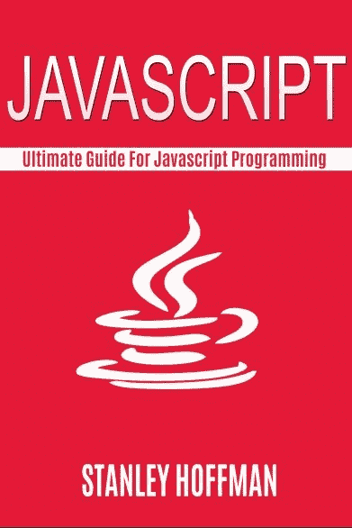

# SQL 入门指南：SQL 编码（数据库编程、计算机编程、如何编程、SQL 傻瓜、计算机编程、Java...编码、CSS、Java、PHP）（第 7 卷）

我认为接几本书你可能感兴趣：

[C++](http://www.amazon.com/Beginners-Simple-programming-coding-Developers-ebook/dp/B014MT5ME8/ref=sr_1_fkmr01?s=digital-text&ie=UTF8&qid=1442833820&sr=1-1-fkmr0&keywords=C%2B%2B%3A+C%2B%2B+for+Beginners%2C+C%2B%2B+in+24+Hours%2C+Learn+C%2B%2B+fast%21+A+smart+w)



[Python](http://www.amazon.com/Python-Ultimate-Learning-Programming-Hands--ebook/dp/B014MV238Y/ref=sr_1_1?s=digital-text&ie=UTF8&qid=1442836729&sr=1-1&keywords=Python%3A+Learn+Python+FAST+-+The+Ultimate+Crash+Course+to+Learning+the+Basics+of+the+Python+Programming+)



[Javascript](http://www.amazon.com/Javascript-javascript-programming-development-Developers-ebook/dp/B017YZ6CYG/ref=sr_1_7?s=digital-text&ie=UTF8&qid=1447666305&sr=1-7&keywords=javascript)



## 引言

数据库充当容器的角色。它是一个你可以组织数据的地方。换句话说，这个数据库将帮助你。

## 深入观察关系模型

结构化查询语言，即 `SQL`，最初是为关系模型设计的。它是用于定义多个数据之间关系的语言。它也是用于在关系模式中查询数据的数据库编程语言。

这一切何时开始的呢？

第一个关系数据库创建于 60 年代，该模型中的编程主要由数学定义。事实上，这种数据库模型是基于元组关系演算法和关系代数的。

不过不用担心，你不需要跳进代数和微积分来处理关系数据库。SQL 会让数据库编程变得更加简单。

### 表、列与行

在关系数据库中，数据存储在表中。在这种模型中，所有表都有名称。例如，你可以将一个表命名为“people”（人员），而将另一个表命名为“sales”（销售）。这些名称指的是存储内部的数据类型。

每个表都包含一组列。这些列定义了表中的不同数据片段。这使得关系模型与其他类型的数据库有所不同。

列也可以被分为必选和非必选。必选意味着表中的每一行都必须有与该列要求对应的数据。相反，非必选意味着我们可以对该列下的每一行断言一个 `NULL` 值。在学习 `SQL` 时，你会发现 `NULL` 在数据库编程中有许多用途。

使用行的主要目的是为了拥有可检索的数据和可以存储数据的容器。我们为什么要存储数据？简单是因为我们希望在将来再次获取这些数据，并且只是想给它们找一个临时的地方。因此，这就是数据库的核心思想。

## 键

关系型数据库的关键元素之一是键。我们现在知道表有若干列，且每列都有名称。每列也有相关的属性。我们可以在列中断言的属性之一就是键。

在关系型数据库中，我们总是为每一行分配一个主键。这种特殊的键用于唯一地确定某一行。这意味着该键的值必须保持唯一，且在表中不能有任何重复。当且仅当我们的关系模型中存在另一个包含该键的表时，我们就可以将这两个表合并。

在合并两个表时，总会有没有重复的主键。合并后，你会注意到表中会出现一个带有这些键的新列。这些键现在被称为外键。它们作为指向第二个表主键的链接，允许你方便地连接两个分离表中的行。

除了主键和外键，我们还有自然键。自然键是全局通用的。这意味着你无法更改它们，因为它们在全世界范围内用于识别单个实体。例如，出版的书总是有自然键，我们称其为 `ISBN`。每本出版的书都有自己唯一的 `ISBN`，在处理书籍的关系型数据库时，你需要将其作为主键。在处理具有非自然键（如电子邮件、人员）的数据库时，情况会有不同，此时你需要为每一行发明自己的主键。

让我们以一个人员及其联系电话的数据库作为示例。我们不能将姓名视为主键。同样不能将人的电话号码视为主键。这是因为全球可能有两个或多个人拥有相同的联系电话、名字，甚至姓氏。因此，我们应该自己创建主键。这就是标识列（identity column）发挥作用的地方。

标识列作为一个自动递的列，当我们向表中添加数据时，它会继续生成唯一键。键的组合并不重要，因为我们只需要为数据库中的每个身份提供一个唯一键。

## 第 2 章 – 关系模型示例

由于我在上一章中已经使用了人员数据库，现在我将为你提供一个联系人数据库作为关系模型的完美示例。

一个简单的联系人数据库通常如下所示：

| First Name | Last Name | Email Address |
|---|---|---|
| John | Doe | johndoe@email.com |
| Mae | Lee | maelee@email.com |

在这个表中，我们有三列在寻找特定的数据。第一列请求名字。第二列请求姓氏，第三列请求该人的电子邮件地址。

我们的行（除第一行外）指的是单个实体。第一个实体的行指的是名为 John Doe 的人，他的电子邮件是 johndoe@email.com。第二个实体的行指的是 Mae Lee，其电子邮件地址为 maelee@email.com。

这是一个由三列划分的两个实体的数据库示例。

假设 John Doe 有两个电子邮件地址，而 Mae Lee 有三个。有些人最终会通过添加列来添加额外数据。因此，表最终会变成像这样：

| First Name | Last Name | Email 1 | Email 2 | Email 3 |
|---|---|---|---|---|
| John | Doe | johndoe@... | johndoe2@... | NULL |
| Mae | Lee | maelee@... | maelee2@... | maelee3@... |

如果我们使用这种数据库设计，就会出现问题。首先，如果我们手头的问题是要找到每个人有多少个电子邮件地址怎么办？获取我们需要的答案将非常困难且繁琐。这就是使用列式数据库的缺点。第二个问题是，对于那些只有一个电子邮件地址的人，我们将产生大量的 `NULL` 值。第三，这种设计是不实际的，你不需要成为数据库专家也能意识到。

为了解决这三个问题，我们可以这样做：

| Key | First Name | Last Name |
|---|---|---|
| 1 | John | Doe |
| 2 | Mae | Lee |

第一步是先为实体创建一个表。在这个表中，我们将第一列分配给主键。第二步是创建另一个表，我们可以在该表中存储这些人的电子邮件地址值。第二个表看起来如下：

| Key | Person’s Key | Email Address |
|---|---|---|
| 1 | 1 | johndoe@email.com |
| 2 | 1 | johndoe2@email.com |
| 3 | 2 | maelee@email.com |
| 4 | 2 | maelee2@email.com |
| 5 | 2 | maelee3@email.com |

在这个表中，你会看到有两个列用于键。第一列指的是分配给每个电子邮件地址的主键。第二列指的是来自我们第一张表的外键。这是一个一对多关系模型的示例。

在这个模型中，我们能够以最实用的方式组织数据。现在我们也更容易回答关于每个人有多少个电子邮件的查询。这种方法被称为归一化（Normalization）。

设计数据库有多种方法，而高效的设计取决于你试图回答什么查询。

话虽如此，你现在准备好接触 SQL 了。

## 第 3 章 – SQL 语句

SQL 是一种特定的数据库语言。我们使用这种语言来创建语句。这些语句由有效的单词组成。某些单词应该由 SQL 定义，而某些单词应该由你定义。你在这些语句中断言的某些单词是表名、列名以及表内部的变量或数据。

### SQL 事实

在我们继续之前，我想向你展示一些关于 SQL 的重要事实。

关于 SQL 你需要知道的第一点是它是可读的，因为是用是用英语编写的。换句话说，学习 SQL 比任何其他编程语言都容易。

其次是你可以使用 SQL 做更多事情。这与大多数人认为 SQL 仅用于数据查询的印象形成对比。

第三是一条有效的 SQL 语句应该以分号（`;`）结尾。尽管有些人会告诉你它不再需要了，但我建议在查询中添加它，因为它是 ANSI 标准的一部分。此外，它在旧和现代数据库中运行良好。分号允许你方便地将多个语句组合在一起，我们称之为批（batch）。这种方法在现代数据库中同样有效。

第四是 SQL 对大小写不敏感。你可以使用大写或小写变量。这两种方式在结构化查询中效果都很好。这种实践的一种良好方法是将 SQL 特定的关键字大写，并将用户定义的关键字小写。这将允许你高效、快速地识别语句中的不同关键字。

### SQL 命令

必须记住，所有 SQL 语句都以一个命令开始。命令通常是一个动词，表示数据库需要做什么。SQL 语句中命令的一个良好示例是 `SELECT`。

`SELECT` 命令告诉数据库选择一组数据。正如你所看到的，它是一个基于英语的单词，系统将做什么显而易见。这就是该命令在 SQL 语句中使用时的样子。

```sql
SELECTVALUESFROMTABLENAME;
```

上面的示例是一个 SQL 语句的通用示例，稍后我将对其逐一进行介绍。

请注意，在语句中需要断言的值集或变量取决于你正尝试执行的命令。所有这些变量都跟在命令之后出现在语句中。

### 值的命名

正如我之前所说的，SQL 语句是由 SQL 规范中的单词和用户创建的名称组成的。这意味着，对如键（keys）、表名、列名等值进行命名在 SQL 中是非常重要的。

在 SQL 中，对事物命名没有绝对的规则。人们有自己命名变量的方法，但为了保持一致性，我建议你遵循我在本书中使用的方法。以下是我将在本书中实施的两个命名规则：

- 所有的表名都必须是单数形式（例如：`person`、`email`、`phone`、`user` 等）。
- 列名在数据库中不应重复。

有些人更倾向于使用复数名称作为表名。这并不是错误。尽管如此，使用单数形式表名让我感到更舒服。至于列名，总会有两个或多个来自不同表的列具有相同名称的情况。因此，我的做法是为每个列命名唯一的名称以消除歧义。例如，与其在 `user` 表和 `email` 表中将 `ID` 作为主键的列名；我更愿意使用 `user_ID` 和 `email_ID` 作为列名。

你还应该注意，SQL 中的名称是有作用域的。这意味着数据库本身必须有一个名称。数据库中的表必须有名称。每个表内部的列也必须命名。调用表时，其名称必须通过数据库名并使用点（`.`）分隔名称来进行作用域限定。因此，它们在 SQL 语句中被断言时将如下：

- `数据库.表`
- `表.列`

### 在 SQL 中创建数据

我并不打算教你如何从零创建一个数据库。作为初学者，你们的任务应该只围绕向已有的数据库添加或更新值展开。然而，我感觉到你们中的某些人仍然渴望学习 SQL，以便创建包括数据库本身在内的整个应用程序。因此，我将介绍 SQL 的这部分，但仅足以帮助你快速上手。

创建新数据库的 SQL 关键字是语句 `CREATE DATABASE`，它属于 ANSI 规范。假设你想为人的联系电话创建一个新数据库，并将此新数据库命名为 `Contacts`。以下是操作方法：

```sql
CREATE DATABASE Contact;
```

为了对该数据库进行操作，你需要先使用它。我们需要的关键字是 `USE DATABASE` 命令。这是我们的执行方式：

```sql
USE DATABASE Contact;
```

如果你想在 `Contact` 数据库中创建一个表，那么你需要执行的就是 `CREATE TABLE` 命令，以下是操作方法：

```sql
CREATE TABLE Contacts.User (…);
```

之后，你现在就可以所有的列名、类型和定义。

### 数据类型

数据类型很重要，因为它们遵循列的限制。每个列都有一个关于可以在其中存储什么种类型数据的规则。

以下是一些主要数据类型及其简短描述。

| 数据类型 | 描述 |
| :--- | :--- |
| `CHARACTER` | 用于定义列中允许的字符数。不多也不少。 |
| `CHARACTER VARYING` | 用于定义列中允许的最大字符数。可以少于但不能超过该特定值。 |
| `BINARY` | 用于将列专门用于十六进制数据。 |
| `SMALLINT` | 用于存储范围内的数值数据。 |
| `INTEGER` | 用于存储整数数据。 |
| `BIGINT` | 用于存储大整数数据。 |
| `BOOLEAN` | 用于存储布尔值。 |
| `DECIMAL` | 用于存储精确精度的数值数据。 |
| `FLOAT` | 用于存储浮点数。 |
| `REAL` | 用于存储单精度浮点数。 |
| `DATE` | 用于存储日期。 |
| `TIME` | 用于存储时间。 |
| `TIMESTAMP` | 用于存储时间戳。 |
| `CHAR` | 用于固定长度字符。 |
| `DATETIME` | 用于存储日期时间。 |
| `TEXT` | 用于存储长文本数据。 |
| `BLOB` | 用于存储大二进制对象。 |
| `SELECT [TABLE_NAME_ALIAS].[COLUMN_NAME] FROM [TABLE_NAME] [TABLE_NAME_ALIAS];` | 用于从指定表中选择列，并使用表别名简化引用。 |

使用所有者（owner）列和电信表（telecommunication table），我们的新语句看起来如下。

| `SELECTt.ownerFROMtelecommunication t;` |
|---|

如你所见，我将字母“`t`”分配为表名的别名。这比反复编写完整名称要容易得多。请记住，没有必要使用表名的第一个字母作为别名。你可以为表名分配任何别名，它也可以是字符的组合。只需确保你使用的别名保持一致即可。

### 限制结果

每当你执行 `SELECT` 查询时，数据库将向你返回所指定列下的所有行。这意味着如果你的表有 20,000 行，那么它将返回 20,000 个值来回答你的语句。

解决这个问题有两种方法。一种是在 `FROM` 子句之后添加额外的子句。另一种是在选择列表之前添加 `DISTINCT` 修饰符。格式所示所示。

| `SELECT DISTINCT [SELECT LIST] FROM [TABLE_NAME];` |
|---|

这种格式将只给你返回不同的值，而不是为你提供指定列下的所有值。这是获取该列下所有唯一值的完美方法。例如，你有一张联系人表，某些实体被断现在几行中，因为它们拥有多个电话号码。

依赖通用格式将给你带来重复的结果。如果你只想知道你的联系人是谁，这样做效率并不高，对吧？使用 `DISTINCT` 修饰符将防止你为同一个实体接收多行数据。

这是我们的电信表，它包含一个所有者列和另一个电信运营商的列。

| Key | Owner | Company |
|---|---|---|
| 1 | Jean Grey | AT&T |
| 2 | Luke Skywalker | Comcast |
| 3 | Mae Lee | AT&T |
| 4 | Stan Lee | AT&T |

假设我们想找到数据库中电信公司的列表。使用通用格式将为我们提供 AT&T 的三个结果，这是没有必要的。然而，使用 `DISTINCT` 修饰符，我们只得到两个结果——一个针对 Comcast，另一个针对 AT&T，这才是我们需要的。

除了 `DISTINCT` 修饰符外，你还可以在 `FROM` 子句之后添加 `WHERE` 子句来限制结果。`WHERE` 子句充当精度更高的搜索引擎。这是通过使用以下格式实现的。

| `SELECT [SELECT LIST] FROM [TABLE_NAME] WHERE [EXPRESSION];` |
|---|

为了给你举一个简单的例子，让我们使用另一个存储人们的名和姓氏的表。我们将此表命名为“`person`”。

| Key | First | Last |
|---|---|---|
| 1 | Lee | Mortis |
| 2 | Mae | Lee |
| 3 | John | Doe |
| 4 | Stan | Lee |
| 5 | Bruce | Lee |

假设一下这是我们客户的数据库，我们想知道有多少客户的姓氏是 Lee。为了实现这一点，我们需要执行 `WHERE` 子句命令。

| `SELECTp.lastFROMperson p WHEREp.last = ‘Lee’;` |
|---|

这将指示数据库专门查找姓（last name）列，并仅关注该列下值为 Lee 的行。它将忽略该列下没有 Lee 值的行。换句话之，你将只获得姓为 Lee 的客户行。

理解 `WHERE` 子句的秘密在于注意你可以在 `WHERE` 表达式中使用的不同运算符。这些运算符与数学运算符相似。这意味着它们很容易记忆。与数学不同，我们在这里使用的运算符也适用于非数值数据，例如我们在上面的 `WHERE` 子句中使用的等号（`=`）符号。以下是你可以用于 `WHERE` 子句的简单运算符列表。

| Operators | Name & Description |
|---|---|
| `=` | 等于 – 如果两边的数据相等，则返回 TRUE 值。 |
| `<>` | 不等于 – 如果两边的数据不相等，则返回 TRUE 值。 |


| `>` | 大于 – 如果左侧的数据大于右侧的数据，则返回 TRUE 值。 |

| `<` | 小于 – 如果左侧的数据小于右侧的数据，则返回 TRUE 值。 |

| `>=` | 大于等于 – 如果左侧的数据大于或等于右侧的数据，则返回 TRUE 值。 |

| `<=` | 小于等于 – 如果左侧的数据小于或等于右侧的数据，则返回 TRUE 值。 |

这些是在处理你 SQL 查询的 `WHERE` 子句时将为你提供布尔值的运算符。

## 结论

到此时，你现在已经熟悉关系型数据库是如何运作的，以及如何高效地使用 SQL 从利用关系模型的数据库中进行数据查询。

注意如何为列指定限制以及如何使用 `SELECT` 语句专门调用它们是非常重要的。你还学习了 SQL 语句包含 SQL 定义的关键字和用户自定义的关键字。这些关键字对大小写不敏感，但强烈建议以视觉友好的方式组织和编写语句。这样做不仅可以在你查看 SQL 代码时为你提供便利，对其他人也是。如果你在团队中工作，这是一个最佳实践。
