# 星球大战：共和国时代 - 英雄

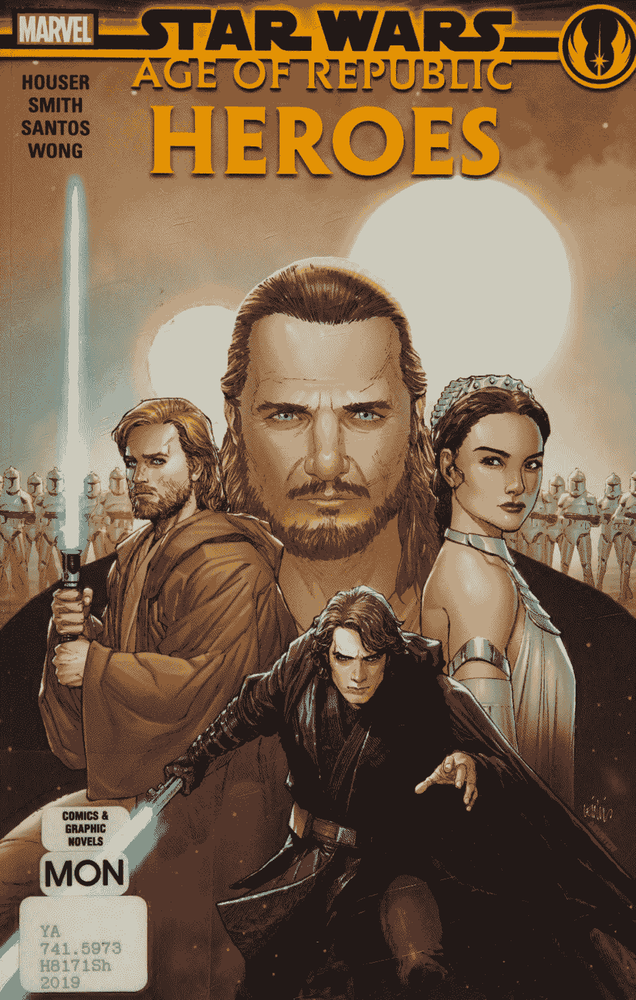

# 想要探索漫威星球大战宇宙的最佳方式吗？这份指南将告诉你从何开始！

在这些作品中跟随卢克、汉索和莉娅的冒险

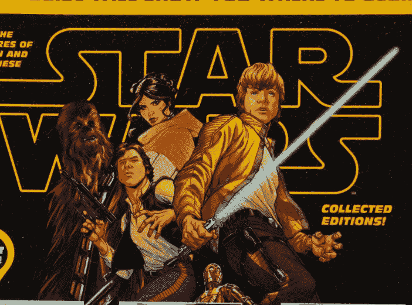

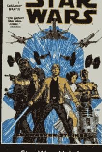

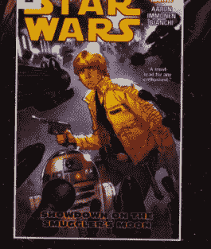

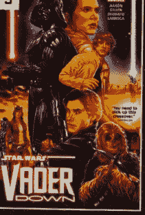

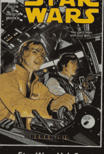

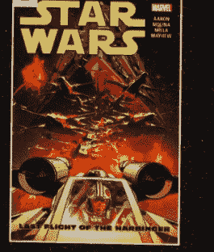

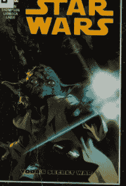

详情见内封封底

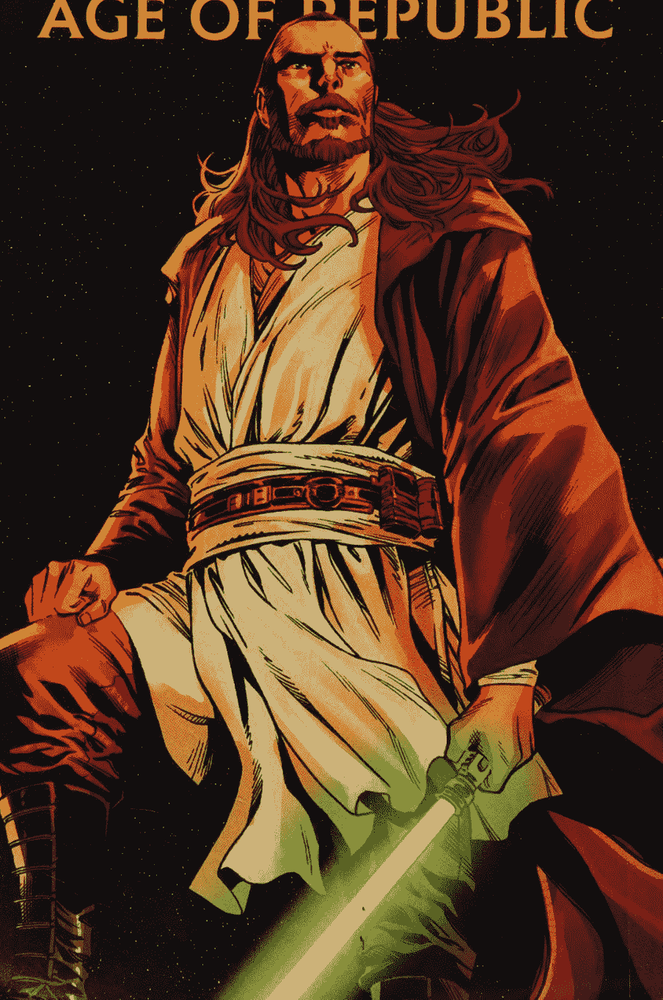

## 英雄

编剧 JODY HOUSER
作画 CORY SMITH & WILTON SANTOS
上墨 WALDEN WONG 携绘 MARC DEERING (帕德·阿米达拉)
色彩 JAVA TARTAGLIA
封面设计 PAOLO RIVERA

编剧 JODY HOUSER
作画 PAOLO VILLANELLI
色彩 DONO-SÁNCHEZ-ALMARA

编剧 MARC GUGGENHEIM
作画 CASPAR WIJNGAARD
色彩 CRIS PETER
封面设计 ROD REIS

字体设计 VC'S TRAVIS LANHAM
助理编辑 TOM GRONEMAN
编辑 MARC PANNICCIA

总编辑 C.B. CEBULUSKI
首席创意官 JO QUESADA
总裁 DAN BUCKLEY

执行编辑 JENNIFER HEDDLE
创意总监 MICHAEL SIGLAN
Lucasfilm 小组 JAMES WAUGH, LELAND CHEE, MARTIN
编辑 JENNIFER GRUNWALD
助理编辑 CAITYN OCONNELL
副编辑 SARAH SMITH
特别项目编辑 MARK D. BEAZLY
制作与市场副总裁 JEFF YOUNGFAST
销售副总裁 DAVID GABRIEL
书籍设计 ADAM REH

星球大战：共和国时代 - 英雄。包含原载《星球大战：共和国时代 - 天行者#1》，《星球大战：共和国时代 - 武器》的内容。星球大战：共和国时代 - 英雄。©2019 LUCASFILM LTD. 版权所有。MARVEL COMICS, LLC 纽约州纽约市西47街10036。在加拿大出版。Marvel Entertainment：DAN KEE，总裁；JOHN LEE，出版；TOM GERMAN，执行编辑。本书任何部分均不得以任何形式复制或传输，个人使用除外。特别项目：DAN CARL，执行；出版：ALEX MORULES，运营总监：DAN EDINGTON，制作编辑：SUSAN CRESPL，制作经理：STEPHAN LEE，色彩编辑：CHERIE GILLSON。888-514-6532-0。于2/22/2019 和2/23/2019 由 SGC PRINT., 多伦多，加拿大。

奎·金

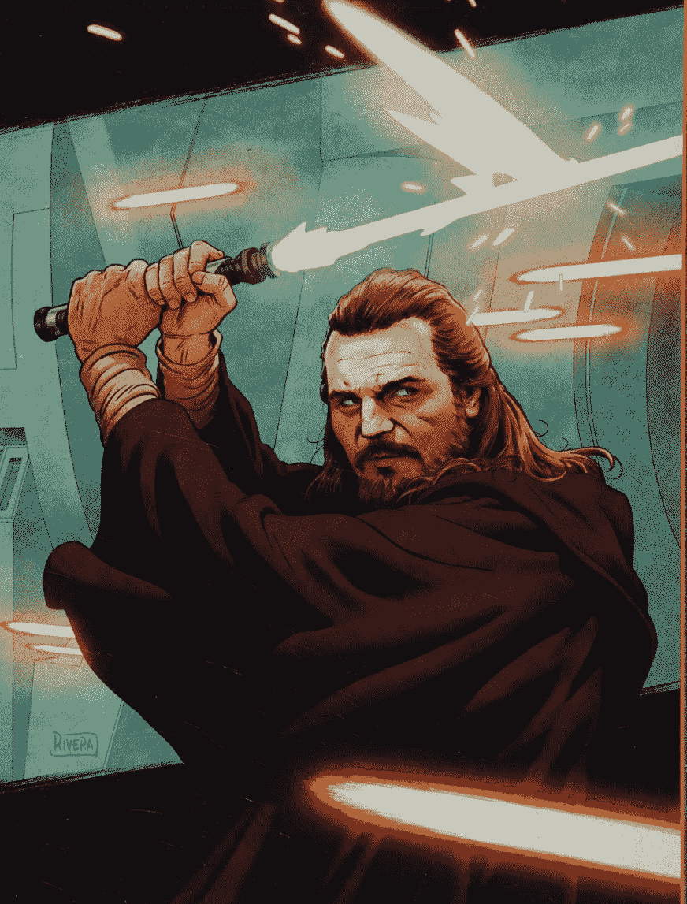

## “平衡”
绝地大师奎·金长期忠诚地服务于绝地议会和银河共和国。但他对绝地和原力的信仰将面临考验……奎·金。

## 平衡
奎·金

## 平衡
奎·金

他们还在来，绝地大师！

是的，女士，我注意到了。我建议我们继续移动。

欧比旺，船准备好了吗？水之公主正向你走来！

我们并不孤单。在砍伐树木和不砍伐树木之间没有中间地带。女士似乎愿意砍掉挡路的人。

绝地大师……我们似乎被包围了。

你的誓言或你的血，女士。树木将随着其中一种选择而倒下。你认为你能面对绝地战士的力量吗？

你是——我被派来为你们的问题寻找和平解决方案，女士。这很明确：没有任何时间或地点他们能胜利。不要让他们逃了！

等一下，女士。带我们上空！我们要去哪里，大师？回到科斯塔。我不能把我的树木留给金属族！根据你们自己的法律，根据他们自己的承认，他们需要你的誓言或你的血来伤害一片叶子。

## 科斯塔。
共和国首都。

> “现在，他们两者都无法获得。”

一座金属异类的城市？你在这里是安全的。当金属族的每个成员都死时，我才是安全的。用光剑击败他们结束这场冲突。这不是绝地之道，女士。

但你为我战斗，你选择了我这边！我保护了你的生命，无论你怎么想我——我听过绝地是伟大的战士，看到战斗迹象就会逃跑。传说从未暗示过你的懦弱。

## 绝地神殿。

奎·金大师，议会请求你的报告。大师大师，你一定不是为了更多的报告才找到我的。尤其是我的帕达旺已经如此勤奋地完成自己的报告了。不。我感觉到你身上巨大的动荡，我知道那不是。如果我诚实，这次任务，水之公主的话……我一直以来一直有些顾虑。懦弱？你不是的，奎·金。她的星球，你不得不离开。被称为懦弱并不是困扰我的，尤大师。我是被称为伟大的战士。

即使在科斯塔，绝地议会的所在地，人们对我们目的的理解也寥寥无几。我们被视为政治人物的士兵，很少提到原力本身。原力对许多人来说仍然神秘的，并且误解了那些运用原力的人。然而，我们的行动是我们目的的反映。也许居住在首都的绝地议会是问题的一部分。我们被当作共和国的武器，因此被视为如此，也许在我们自己眼里。在这一点上，议会不会同意。当然，但无论是议会还是我，我都感到愿景的迷失。当我们有疑问时，必须对原力有更深层的理解。是的，尤大师。

> “而且一座金属城市，正如你贴切描述的，并不适合这种感应。”

> 但我们要去哪里……

> 答案在原力之中。

> 让它引导我们。

> 我只需要信任原力的核心……

> 那就是找到我寻找的答案。

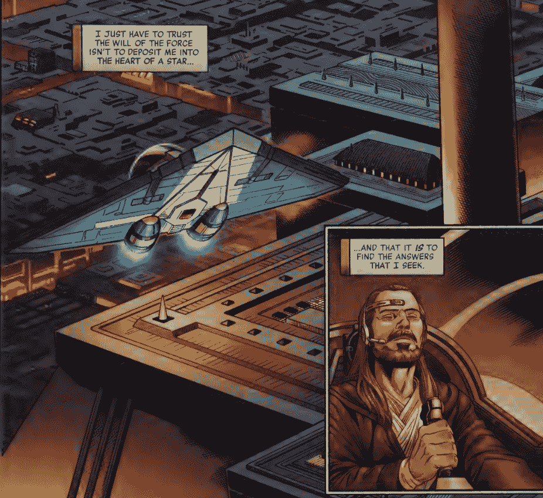

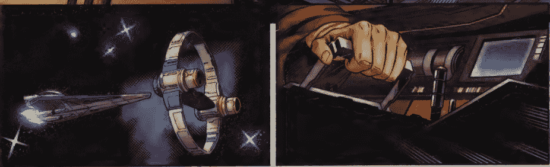

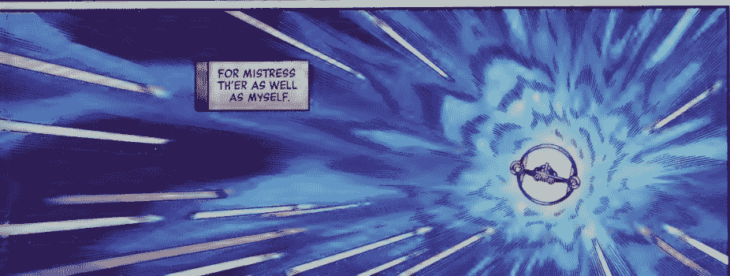

> 像女士和我一样。

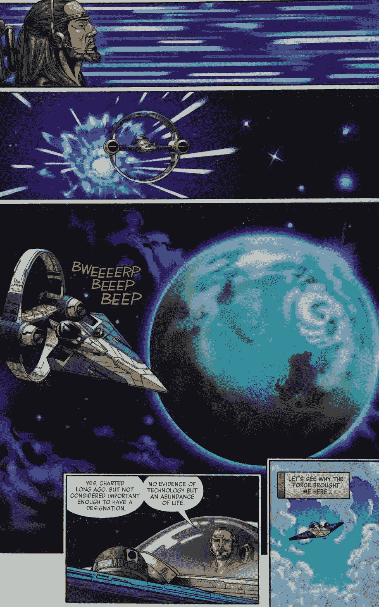

不，很久以前就记录过了，但并不重要到命名。没有技术的迹象，但生命勃勃。看看原力为什么带我来到这里……

一个美丽的地方……但这里不仅仅是——等等。我感觉到了……某种……

感觉不对。冰冷。这里有腐败，有黑暗。

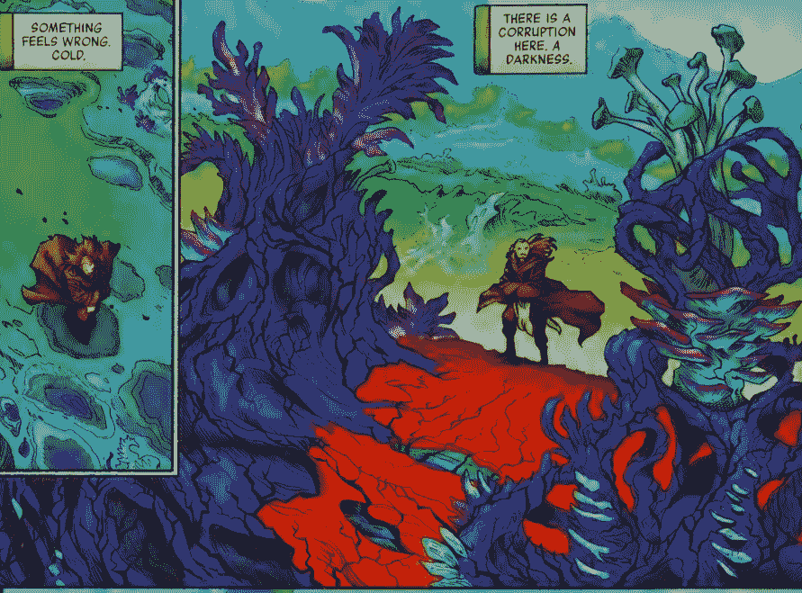

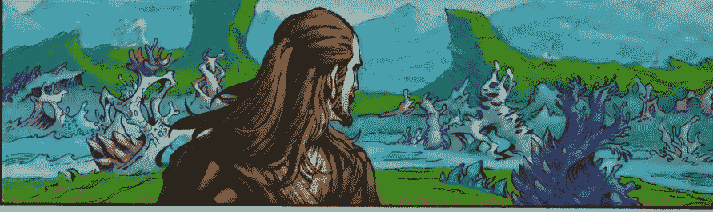

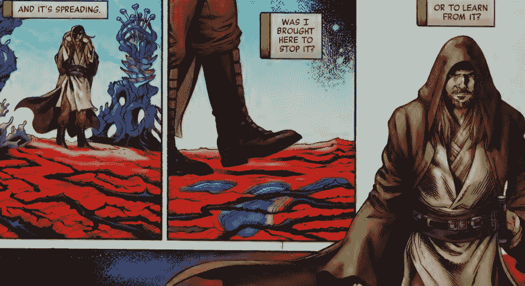

原力。它在这里很强大。黑暗面。诱惑？还是教训？我从活原力中寻求答案。也许在这个黑暗的纪念碑中……我注定要找到光。

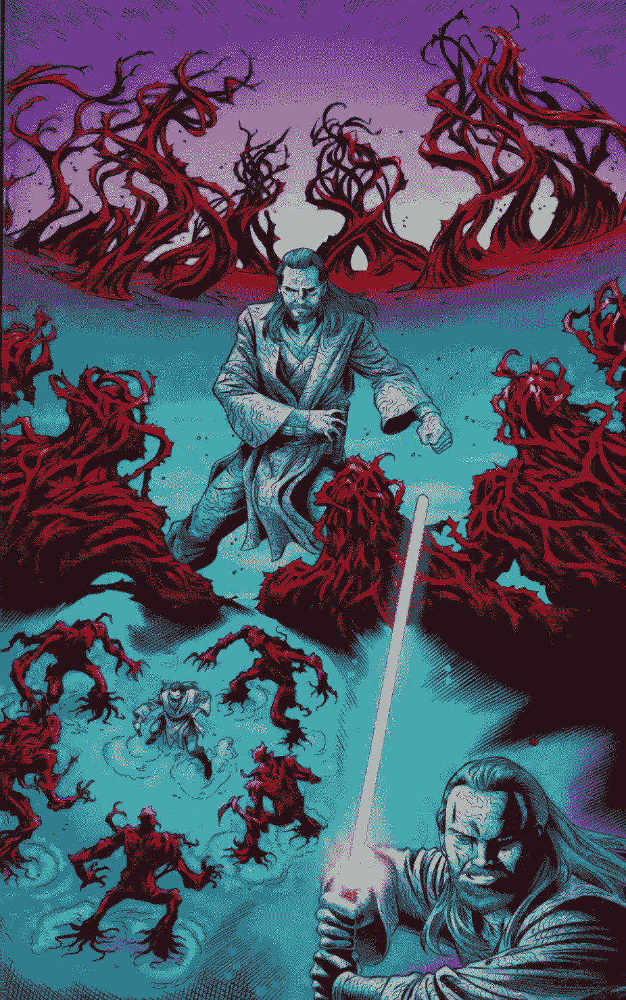

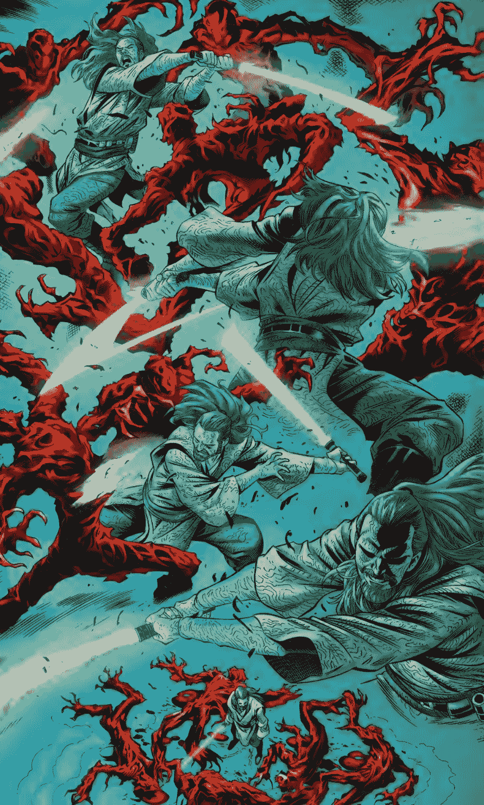

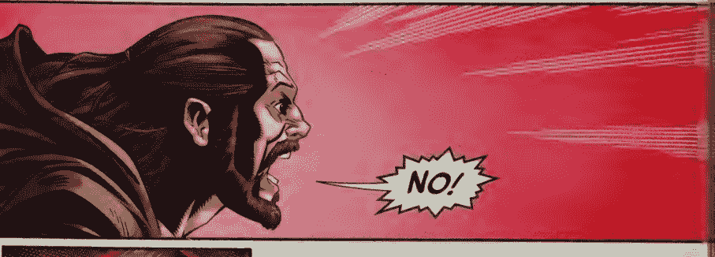

不！

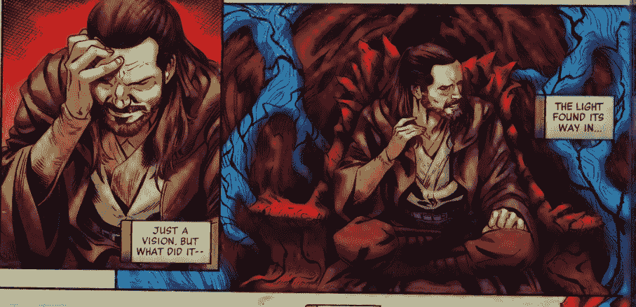

仅仅是一个愿景，但它究竟——

光芒找到了它的路进来……

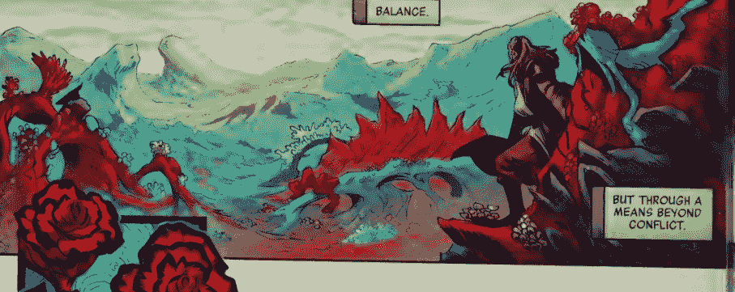

平衡。

但通过一种超越冲突的方式。

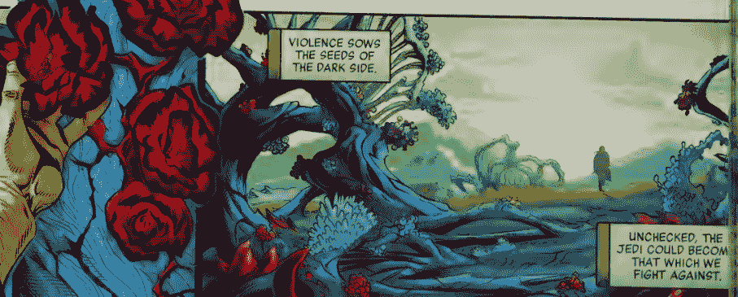

暴力播下了黑暗面面的种子。

如果不加抑制，绝地武士可能会变成我们所对抗的对象。

绝地大师，

我正试图享受这颗星球所提供的微小自然资源。

在你留下的期间，有更有用的地方供你访问。

导师，

你什么意思？

金属族已经招募了强大的外星盟友加入他们的阵营。

如果你想让你的树木生存下来，你也必须这样做。

你的意思是，会有更多的外来人来剥夺我们所珍视的一切。

如果你能找到平衡与妥协，丰富你们的人并不意味着要毁灭你们的生活方式。

科洛沃 much上有来自一千个世界的星球。那些世界面临着相似的挣扎。

你可能将其视为一座金属之城，但这里可以找到智慧和盟友。

很好，我会给你那些所谓的盟友一个陈述自己理由的机会。

但为了我的那些树木，我希望你是正确的。

答案。
你找到了吗？

我找到了，而且欧比-万已与原力同在。更多的问题。

嗯。很好；有问题，我们必须提问。

对我们理解的确定性。会导致傲慢。通向黑暗面。

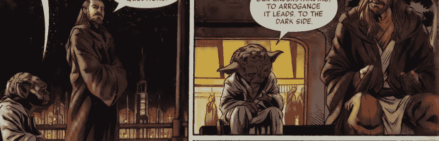

然而，变得过于僵化也是一种风险。不弯曲的树会在风中折断。

黑暗面无处不在，它永远是一个威胁。 

我们，绝不能屈服于它。

当然不，尤达大师。

黑暗面会吞噬一切，在那样的道路上找不到平衡。

如果我们的目的不是平衡，那又是什么？

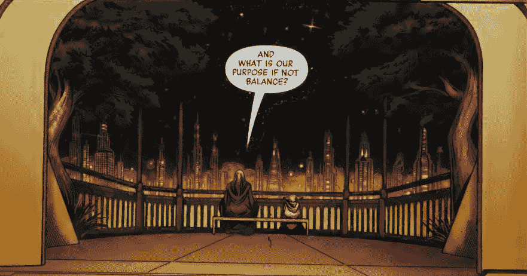

结束。

他可能已经离开了很久，但奎因刚·金对银河系的影响仍然可以被。
作者：格伦·格林伯格 (Glenn Greenberg)

就卢克·天斯沃克所知，欧比-万只有一名导师。但在1999年，《幻影之威胁》揭示了另一位培养欧比-万完成骑士之路的绝地武士——奎因刚·金仍为人知，他在旧共和国末期重塑银河系起了关键作用。事实上，他是历史上影响力最大的绝地武士之一，在他去世几十年后影响依然能被。

在《幻影之威胁》中，我们看到了奎因刚与其绝地同事之间最重大的分歧：涉及一个名叫安金·天斯沃克的男孩。

正如乔治·卢卡斯在《星球大战》第五部DVD采访中所说，“安金是那个选中人。”当安金变成达斯皇帝时，他依然是那个选中人。

## 绝地的信仰

## 来自彼岸的声音

奎因刚，当然带了安金——在绝地议会之前，议会认为那个“选中人”将毁灭原力并带回生命。当议会拒绝安金时——欧比-万警告他是危险的——安金反抗了他们所有人，意在成为安金需要的正面影响。但在奎因刚临终前，他强迫欧比-万训练那个男孩并确保他成为一名绝地。

在他去世后，欧比-万学会了如何交流。他将这种能力教给了尤达，欧比-万学会了它，具有长远影响。如果他的灵魂引导了天斯沃克通过雅文战战，或者他在达戈比星球遇见了尤达，银河系将会完全不同。

从奎因刚那里，欧比-万获得了在绝地战争期间作为绝地军事领所需的技能和智慧。安金描述奎因刚是独立的，以“拒绝服从计划”闻名。然而，奎因刚的力量也有局限，他无法预见到安金最终变成达斯·皇帝。在《最后的绝地》中，他仍然出现——奎因刚的传承确实以某种方式延续。注：全部摘自《星球大战：幻影之威胁的制作》，作者：劳伦·布雷 (Laurent Bray) 和约翰·邓肯 (John Duncan)，1999。

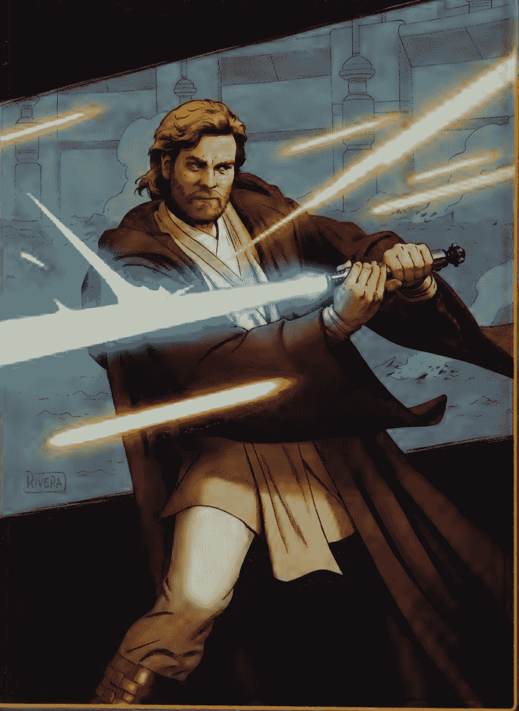

绝地武士欧比-万向他临终的导师承诺训练安金，那个被认为是带来原力光明两面平衡的选中人。欧比-万和安金仍在适应老师和学生的角色……

年前。

> 冥想是为了与原力建立更深层的联系……
> ...它是关于对我们更深层的理解
> 它是获得对思想、情感更大控制的手段
> 平静、宁静、和谐，在我们希望掌握原力之前，我们必须掌握自我。

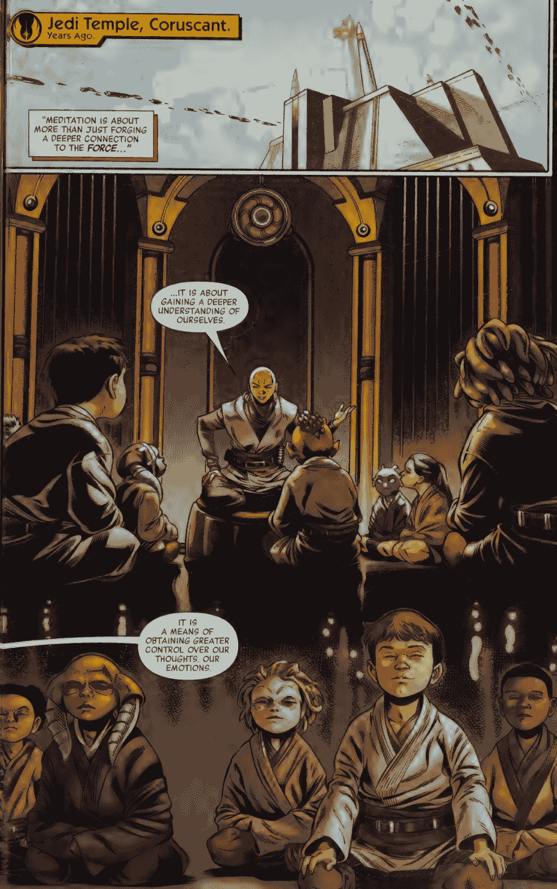

现在，导师，这个？

很好，安金。

现在，看看你能不能坚持完剩下的课程。

安金在训练中继续表现出色。

他是一个会让任何大师感到骄傲的学徒。

至少他现在会听话了。

我最近为什么感到如此不安？

很好，欧比-万。

谢谢，大师。

事实是，我从未想过很快就会带自己的学徒。

我本以为当我带徒时，我会有自己的导师奎因刚·金可以请教。

如果情况不同……

欧比-万大师？

你好，大师。我能帮您什么？

绝地议会还有另一个任务给你。

一个考古小组认为他们发现了一个古老的绝地原力法。

是的，在中环的达洛尔星球上。

那不是一个共和国星球，但考古小组遇到了此——

你又要离开了吗？

我不会离开多久，你可以继续接受尤达大师的训练。

和那些小孩子一起。我总是比他们领先很多。

也许吧。但训练并不由学生来决定。

我那……

绝地神庙图书馆。

总有更多的需要学习。

你好，尤达大师。我刚才在绝地档案中搜索关于达洛尔的信息。

我发现了关于那个星球的记载，但没有任何去过那里的绝地的记录。

他们的名字已被时间遗忘。

除非我们能找回原力法，假设古人是正确的。

嗯。我们将获得名字和知识。

带年轻的天斯沃克去执行这次任务，好吗？

我没计划，不。我不确定他是否准备好了。

“确保你是否已经准备好。”

“因此，他落后了。在其他学徒之后。”

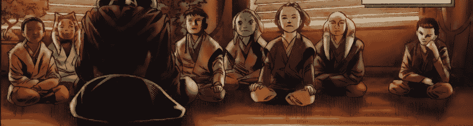

他明白自己比任何其他学者都要来得晚。

明白在通往绝地的道路上，他还有很多需要学习的。

但他还需要导师的信念。

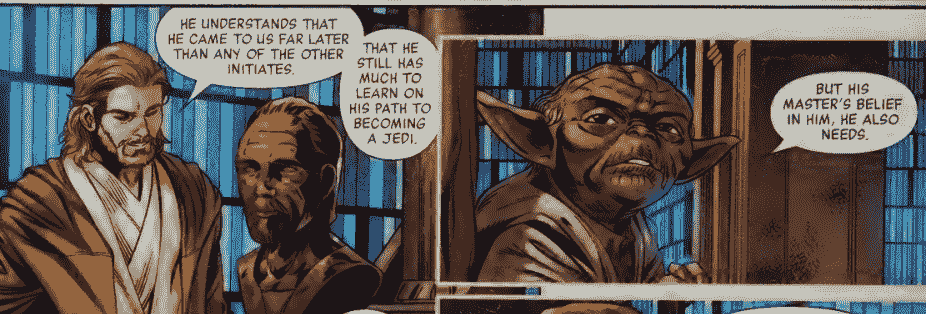

确实如此。

原谅我的直率，大师，但你对安金的支持我很惊讶。

你最初是反对他成为学徒的议会成员之一。

感谢你带我一起来，师父。

当然了，安纳金。尤达大师也同意是时候了。

评议会上没有比他更智慧的绝地武士了。

再次看到太空的感觉真好。

我可以负责一些飞行吗？

也许当我们更接近目的地时，安纳金。

尤达大师是对的。他不应该一直躲在神庙里。

我不能像对待普通学徒那样对待安纳金。

时刻留心原力，奥比旺。要感受我们周围的一切生命。

我不是像昆-刚那样的老师。

我恐怕在这件事上我必须对评议会持不同意见。

我只是在想。

在你去绝地武士生活之前，你的生活是怎样的？

嗯，我不能说我真的记得。我离开家乡时还很小。

我被识别为对原力敏感者，并被带到了科斯斯山的绝地神庙。

所以，你一直都是绝地武士，对吗？

嗯，不，我必须经历你现在正在经历的所有训练。

记住，我们相遇时我还是一个学徒。

我知道，但是……

也许这就是为什么评议会说我太大了，不能开始训练了。

评议在很多方面都是的，但他们并不完美。

昆-刚·晋选择我成为他的学生，就像他曾经选择我一样。

你一直知道你的道路是正确的。你注定成为一名绝地武士。

你从来不是奴隶或任何其他的身份。

但他去世了。所以你就被困在我这里了。

安纳金，那不是——

我不是那个意思。

## 达伦诺。

感谢您的光临，绝地大师。我的名字是克拉特菲夫人，我负责达伦诺的挖掘工作。

应该被感谢的人是你，克拉特菲夫人。

如果你发现的是一个绝地全息记录，里面的知识对我们来说是无价之。

太好了，这意味着你会把那件该死的东西从这里带走。

越快越好。

我不明白一个全息记录会造成什么麻烦？

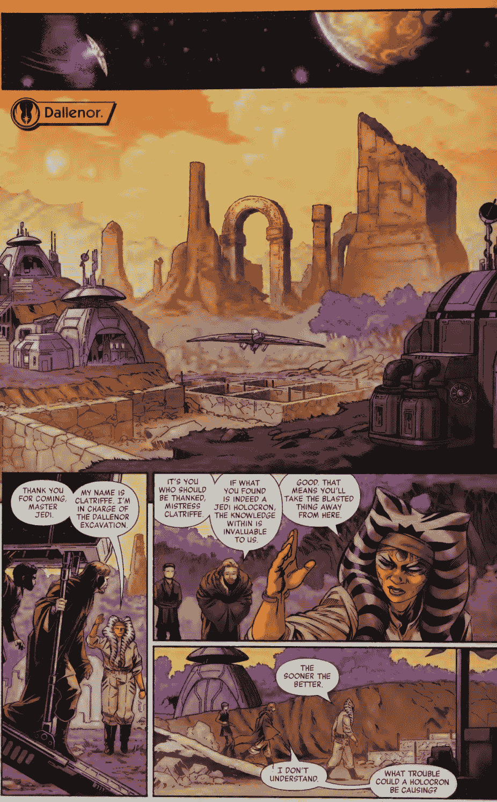

噢，并不是什么故意的。而是它出现在这里本身就很糟糕。

当我们刚开始挖掘时，和当地的海盗发生过一些问题。

他们很快发现我们发掘出的文物对他们来说没有价值。

几个世纪前的机器人碎片，对于学术界之外的任何人来说都没有什么兴趣。

但对这一发现的兴奋说服了他们重新看一眼。我们不得不雇佣一些当地的打手。

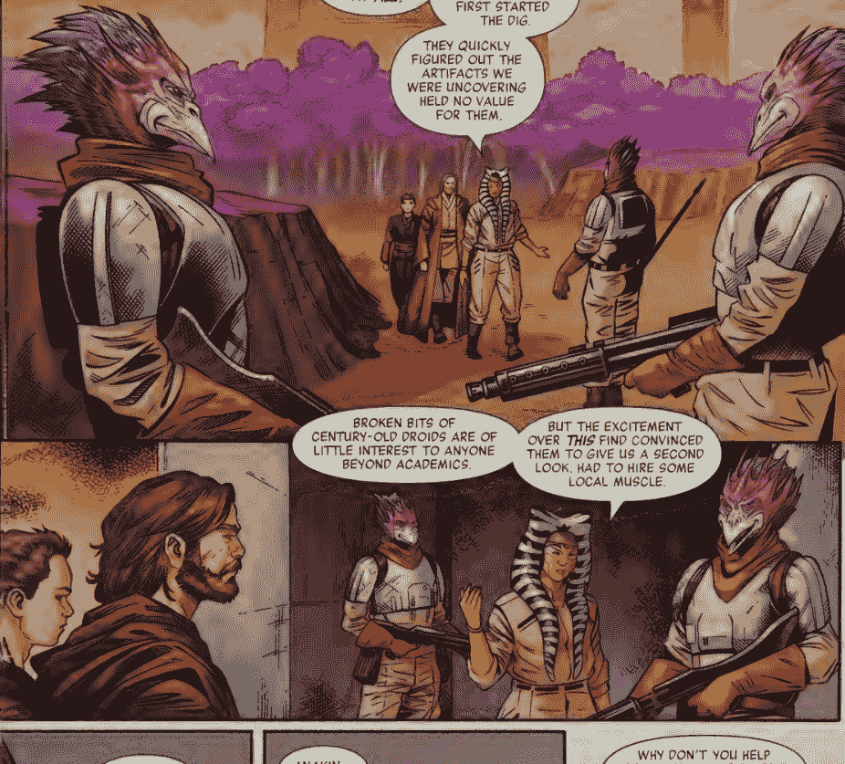

那么请务必，让我们分担你的负担。

安纳金……

克拉特菲夫人似乎对海盗非常担心。

你为什么不帮着守着，等我去核实这个文物确实是一个全息记录？

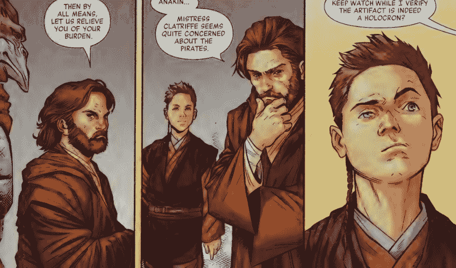

是的，师父。

克拉特菲夫人似乎对海盗非常担心。

你为什么不帮着守着，等我去核实这个文物确实是一个全息记录？

是的，师父。

全息记录确实是。我们我们是可靠的。

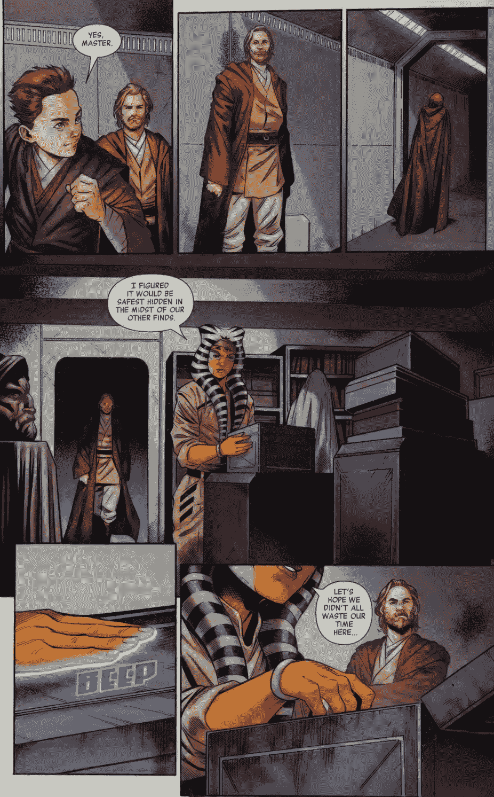

……希望。

全息记录确实。

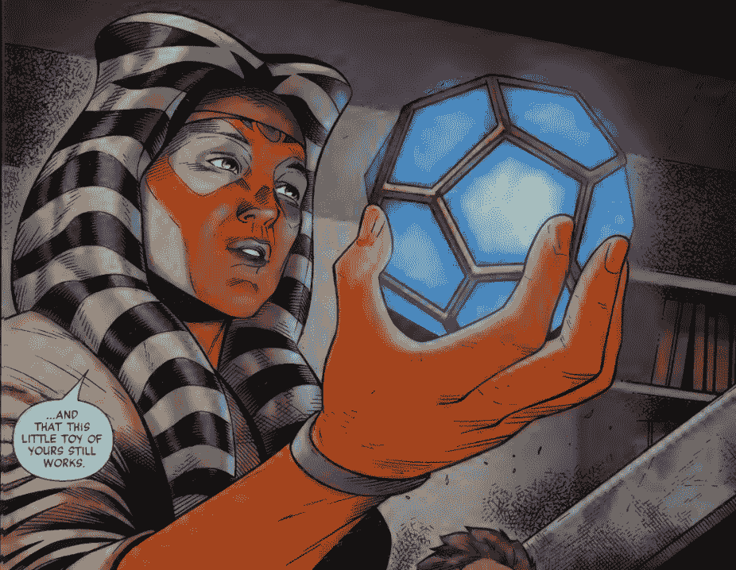

……希望。

全息记录确实。

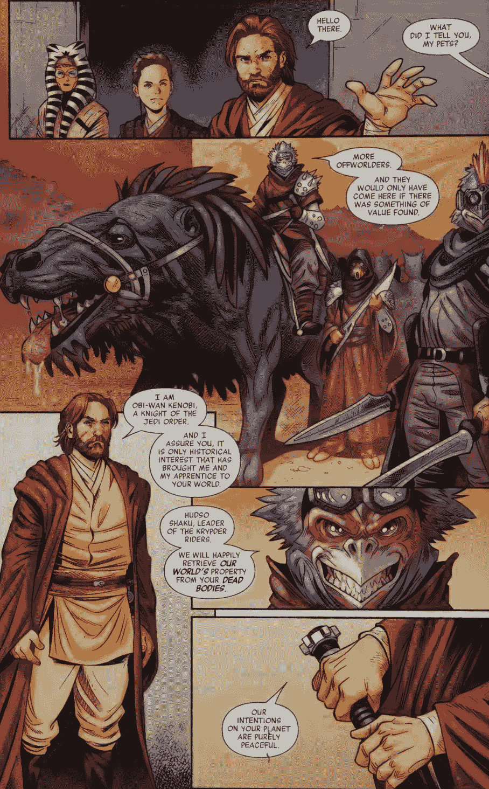

……希望。

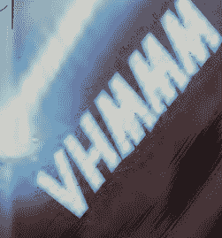

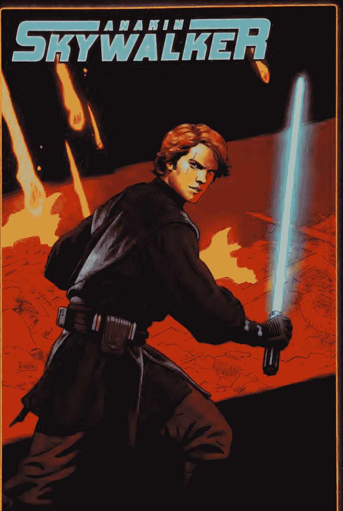

英雄的绝地武士们领着共和国的克隆军，对抗着反叛分裂者那无止尽的机器人军团。
强大的年轻绝地天才安纳金·天基斯沃克可能是共和国结束冲突的最好希望。但随着战争的战火一天一天蔓演，吞噬着越来越多的银系，安纳金面临着他的训练从未做过准备的挑战。

谢谢你，天基斯沃克将军。

不客气。

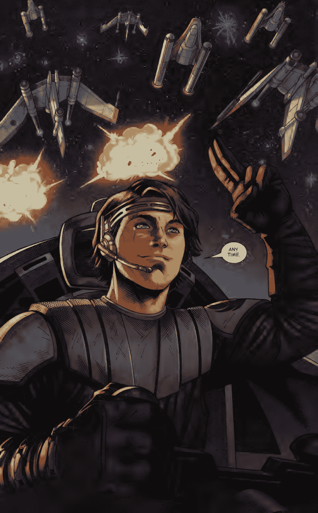

现在……

让我们结束这一切吧。

> “我们没想到在这个扇区会发现如此规模的机器人部队”

尤拉伦将军，我们知道它们是从哪里来的吗？

共和国情报局在库多的第三颗卫星上发现了一个此前未知的机器人工厂。

由于我们的军事存在已经暴露，我们摧毁该工厂的时间窗口非常有限。距离最近的分裂者援军在不到两天内就会到达。

所以我们要快、要准、狠。

我根据先遣侦察队的报告制定了一份进攻计划。

为什么潜在的伤亡人数这么高？

看来这些行动是由当地的库多人口运营的。
我们怀疑这些机器人在设施完全自动化之前就被匆忙投入了生产线。

据我最后所听到的，库多人在冲突中一直没有选择哪一方。

情报显示，情况已经变了。

我建议进行针对工厂发电器的外科手术式打击。

我们的图纸并不完整，但我认为我们应该彻底摧毁这座设施。

杀死里面的所有人。包括生命体，而不是机器人士兵。

不幸的是，战争的现实可能非常丑陋。

我们很幸运，面对的军队主要是机器人。

双管齐下将给我们撤散库多人的机会。

他们不是士兵。他们是工人。

这是感性的做法，而不是战术性的。

留出撤散时间会让分裂者有机会建立防御。

这意味着我们自己的人将面临更大的伤亡风险。

无论如何，都会有人死。而我们的工作是确保死的不是我们自己的人。

真希望我没看懂尤拉伦将军的进攻计划。

但我不能指责他想要保护我们的士兵。

我的说法也没错。

这就是战争中领导层所做的事情吗？做出不可能的选择？

我宁愿只去。

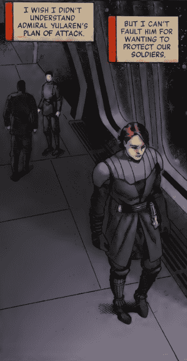
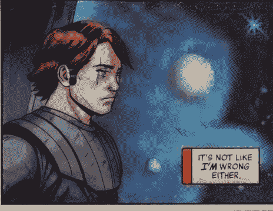
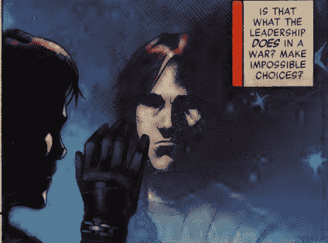
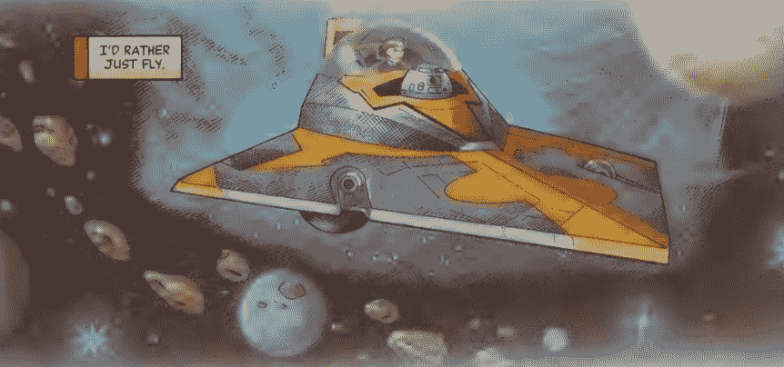
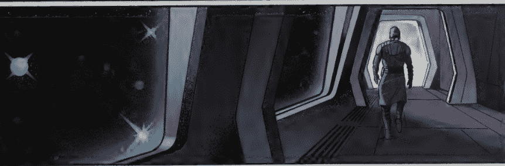

> 晚餐好吃吗？
> 有什么时候好过吗，师傅？
> 我听说了你和尤拉伦将军的讨论。
> 让我猜他是想让那个质疑他命令的绝地离开他的飞船。

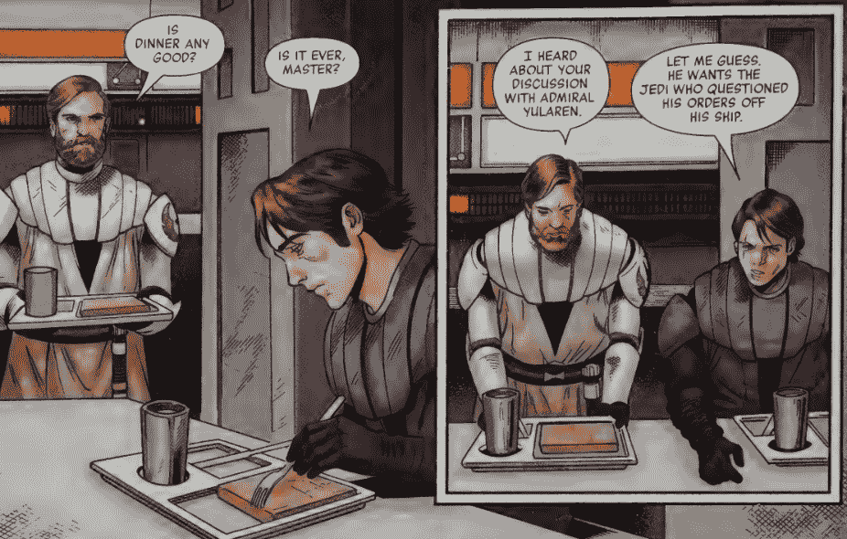

> 不，实际上他可能有很多缺点，但自尊并不是其中之一。
> 他想就你的顾虑谈谈，看看我是否有同感。

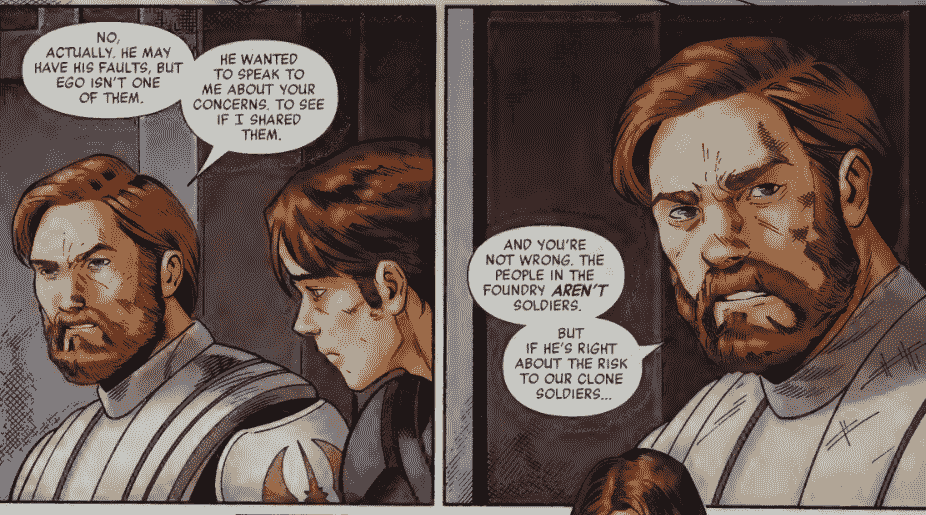
> 你说的没错。工厂里的人不是士兵。
> 但如果我们对克隆士兵的风险判断是正确的……
> 一定有更好的处理方式。
> 绝地参与这一切的全部理由不是拯救生命吗？

我曾给你一个简单的答案，安纳金。
但我们都在学习，战争很少是简单的。
即使是站在共和国一方的人也把克隆视为消耗品。至少尤拉伦将军对他的士兵付得多。

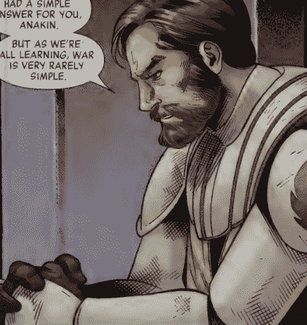
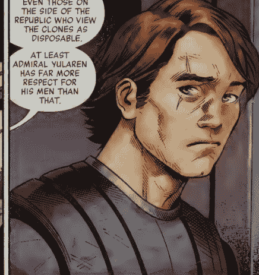

我不是说尤拉伦是个坏士兵，甚至不是个坏人。
但我从绝地学到的到的东西，作为你的学徒……

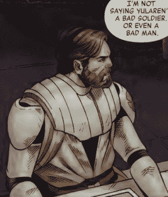
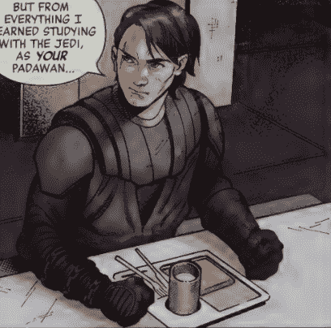

你已经走了很远了，我的学徒。
相信你的直觉，还有原力。

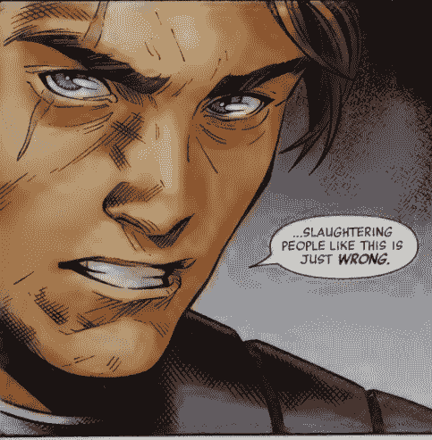

……屠杀这样的人是不对的。

我不认为尤拉伦对此满意。

所以你宁愿听从自己的情感而不是将军的？
我是个绝地，将军。我是来做正确的事的。无论他们给我什么军衔。

我们不从远处进行大规模杀戮。

你可以干扰他们的传感器吗？
我们不希望让他们知道我们要来了。

哔—— 哇！

尤拉伦提到了当地的库多人口。
但除了工厂，我没看到周围任何文明的迹象……

是我的错觉，还是这里太安静了？

即使这个地方是临时凑起来的，分裂者也不应该让它毫无防备。

我没做好屏蔽传感器的工作……
但这里还有其他情况。
留在飞船上并规划一条路线，以防我们必须离开。

应该能听到机器的声音。
也许情报是错了，他们还没有开始行动。

不，还有些什么。
我能感觉到……痛苦？
走这边。
不……

嘿！你不该在这里！

轰，但我确实在这。对你来说太霉了。

抓住他！
想
呼——
呼——
啊！
当心！

求你……不要……
你……你是谁？
安纳金·天基斯沃克。共和国的绝地。
他们用毒气袭击了我们的村庄。醒来时就在这里当俘。
他们告诉我们共和国要来杀我们。
那么我们不得不改变他们的计划了。

从倒下的机器人手里拿那些激光枪！
假设你们知道如何使用它们。我们不打你们的战争，并不意味着我们不能打。
我今天不是要求你们参加任何战争。只是为了你们自己。看来这从一开始就是分裂者布设的陷阱。

散布关于新机器人工厂的传闻，那是共和国的攻击目标。确保消息传到了我们的情报部门。这样我们就会攻击一个充满无辜受害者的设施。

分裂者会把他们的死亡归咎于共和国。这是一种招募目前中立者加入他们事业的有效手段。所有生命都会消失，仅仅为了让银河看到共和国军队攻击中立派。多亏了你，我们避免了一场悲剧。

尽管我对你处理战斗的方法持有怀疑态度……但看起来确实是正确的做法。你认为这会动摇克隆人加入共和国吗？至少，我现在没看到他们站在分裂者的一边。也许，那是政治家讨论的话题。但因为你，安纳金……“他们仍然在这里做出那个选择”。

克隆大战大战如火如荼，共和国军队正与无休止的分离派机器人军团激激战。但士兵们并非唯一做出牺牲的人。来自纳布星的高贵参议员帕梅·阿米达拉不仅希望尽早结束冲突，免让银河系遭受更多流血。但对共和国来说，胜利意味着找到新的盟友——并在战场上和战场外都击败她的敌人。

> “你确定
> 不想让我
> 和你一起去吗？”

“即使是在
> 核心世界，
> 你也曾
> 是一个目标。”

“我不能
> 随时有一个绝士
> 保护我，
> 阿尼。”

“我很想你，
> 帕梅。”

“我明白。”

“我希望我们
> 能多
> 见面。
> 但只要
> 共和国
> 处于战争中，我们
> 都有工作要做
> 看着我
> 不是你的职责。”

“不，这
> 更像是一种
> 爱好。”

> 阿米达拉参议员……

> ……飞船已准备好出发。

> 我们正要——

> “莫提理解谨慎行事，安纳金。”

> “好……在你从杜罗回来后我们再谈。”

> “也许比你更合适。”

“你告诉他
> 你要去
> 杜罗？”

“安纳金可能……
> 很有保护欲。”

“除了这些，
> 他与
> 帕帕廷长
> 维持着密切的关系。”

“而且执政长和
> 参议院都明确
> 他们对
> 中立
> 世界的立场。”

“如果他们
> 不是
> 盟友或
> 敌人，他们
> 就应该被忽略。”

“所以你
> 隐藏了
> 你真实的
> 目的地。”

“而你，
> 将只有
> 多米和我
> 能够保护
> 你。”

“我明白。
> 我在这里是在
> 冒险。”

“但如果我们
> 能让另一个
> 系统加入
> 共和国，那是
> 值得的。”

“此外，
> 我认为。
> 我们三个人
> 构成了一个
> 强大的组合。”

“这次任务
> 由我来驾驶，
> 多米。”

“我的 女人？”

“为了万一
> 出了什么错
> 负责。”

“我将是
> 那个负责
> 导航进入
> 敌对领土的人。”

“如果你
> 坚持——”

“我坚持。”

“愿原力
> 与我们>同在……”

“你知吗？”

“关于什么？”

“关于绝士。”

“我们的 女人很多方面都很微妙，但她不是。绝士更是无不如此。”

“也许这就是为什么他们相处得很好。”

“作为她的侍女，有时保护她也意味着保护她的秘密。”

“我明白，这看起来……
> 是明智之举。”

“我们的 女人允许自己
> 拥有片刻的幸福。”

“我们如何能保护 她？”

## 克拉隆。

“我想我们所能做的
> 就是希望结果
> 不要糟糕。”

“当我们到达时，
> 由于
> 之外的原因。”

“我会确保我们
> 降落时生存。”

“当然了。”

“有些地方不对劲。”

“这是一个陷阱，
> 女人？”

“我希望克拉隆人是
> 出诚意地联系了我们。”

“但如果他们没有……”

“这里应该有人
> 迎接我们。”

“我们也没有收到
> 传输……”

“……做好任何准备。”

“我不喜欢这……”

“等等。
> 直到我们
> 有了理由。”

“就说死亡
> 不是
> 理由……”

“那里。”

“你好？”

“我不喜欢这……”

“我叫帕梅·阿米达拉。我是共和国的参议员。”

“我的出现是
> 提执长请求的。”

“不！你必须立即离开！”

“我宁愿从
> 提执长本人口听到！”

“这里很危险！快走！”

“你什么……”

“在这里太脆弱了！
> 回飞船，
> 女人！快躲起来！”

“你还好吗？！”

“我的……
> 女人……”

“快！”

“当然她没有
> 回飞船……”

“请让我们进去。”

“我……我不能……”

“你试图警告我们
危险。我为此感谢你。”

“但我的朋友受伤了。她需要帮助。”

“你知道狙击手在建筑内吗？是的？”

“就在他们的视线正下方。”

“我们的新朋友是……
提执长，但你真的……”

“你参与了这件事吗？”

“多米！”

“我们不是来伤害任何人的。”

“我们在执行一项外交任务。我们希望对你们的人有益。”

“现在你会帮我们吗？”

“你可以把你的朋友带进来。”

“这里对你来说不安全。哪里都是。”

“在这里，快！”

“发生了什么？”

“一个刺客导致报警。大部分工人撤离了。”

“提执长在等你们……”

“提执长，我很抱歉。如果我们早点到达——你可能已经不在了。”

“请去照顾她。”

“是的，我会救 活着的人。”

“告诉我共和国如何帮助你们的人。”

“经过了讨论……我们许多的人想……
> 远离冲突。”

“他们讨厌……共和国会更
> 宽恕一个中立世界。”

“而且……这告诉了我关于
> 哪一边我需要的一切……”

“分离派……他们一定……
> 有间谍……”

“没关系。我会找到办法帮助你们的人。”

“证明……我没有……
> 错……关于……”

“现在由谁负责？”

“随着执长的逝世……
> 作为副执长，我现在接替了他的位置。”

“你根本不该来这里！提邀请你是个愚蠢！”

“而他的代价是太多人要付出的代价。我的人不是士兵。”

“我不是。”

“不，你是个政治家，有人会说那样更糟。”

“作为你自己一个政治家，我希望你能理解我们做这一切并不是为了个人利益。

事实上，我猜你认为 
> 得到理解的。”

# 星际大战：共和国时代特别篇

## 501 团加一

克斯上尉带领着他的克隆士兵，与分离派机器人军队进行英勇的战斗。
在保卫高贵的银河共和国时，还有什么比这更完美的盟友呢？……贾贾贾·宾克斯？

## 欧萨萨隆。外环领域。

一切正常。绝晶武巡逻已经通过。

看来尽管共和国拥有这么多资源，他的同伴们还是没能在这些石头下面找到他。呃，为什么？

然而，他看起来相当自信。你知道的，对于一个即将完死的人来说。

而对于这样一个年轻的恐怖分子来说，你看起来也很有自信——

自由战士。

学校学习对我来说没用，在外环边缘根本没有未来。在这里，只有“冷酷的古塔塔科”在教我们现在需要的知识。

也许吧……但孩子应该在学校里，而不是在洞穴里发动战争。

你小时候就被带走，并被一个军阀的仇恨侵化了。

--你应该多担心你自己！

间谍们说得对。绝晶武古塔塔科独自一人带了前哨站。

从哪里被带走？在街上乞要食物吗？

我已经有了仇恨，古塔塔科主给了食物填饱我的肚子，而且——

（啪）

噢，丘塔，绝晶武。

我们毫不费力地缴获并摧毁了他的武器。

凯斯克，你是事业的贡献者，至于你……温杜大师……

……欢迎来到我的行动基地。
这里看起来很普通，但从这些卑微的开始，我的军队将发动一场革命，为这个星系带来真正的自由！

看起来更像是你躲避的安全的地方，而你却送孩子上战场。

……如果你的动机如此纯洁，为什么你的行动资金是由坦克人资助的？

啊，原来如此，麦斯·温杜大师之所以来到这个偏远之地是为了进行他的圣洁审判。

每一个伟大的事业都需要牺牲……
接受坦克人的资源是为了在正确的地方播种混乱，或者是招募新兵。

你并没有招募那 26 名学生。你的部队嘲笑他们的老师，并绑架了运货的孩子。

你不是那种能激励人心的领导，对吧？

一个足以让受尊敬的瓦卢姆总理恐惧的领导，否则你不会在这里。那些学生会在我身上学到……更伟大的东西。

我见过你们那些童兵的尸体。这一切现在结束了。而且在没有好用的光剑的情况下。

……你无力自救……

你说得对。这一切现在结束了……你处决的广播将吸引许多新的信徒加入古塔塔科的事业……更不用说我最新的自由战士了。

我给你一个和平投降的机会。

哈哈哈哈哈！你认为你的朋友会设法赶来救你吗？

噢，他们很快就会到，但在那之前我已经完事了。

……我们中有一个被派到这里是为了带领其他人找到这个点的……

哈！你指望他们怎么找到你？

欧萨萨隆有 8 万公里的隧道，你们的绝晶武搜寻一个世纪也找不到这个精确的洞穴……

……除非——

除非……被俘获本来就是你的计划之一……

通过原力向其他绝晶武发出信号是我作为帕达万学到的第二课……

第二课？什么……第一课是什么？

我做不到这个，胡扬大师！我永远无法制造出我的光剑。

是原力将它们结合在一起的……通过你。这让你成为了武器。你所制造的秘密是这些碎片根本不需要被“制造”。

我……我做到了！

不要让它落到绝晶武手里！

（咔哒）

（咔哒）

它在自己移动！

不……不是自己移动的！

杀了他！

（格斗）（格斗）

（嗡）
（嗡）

不！！！

这不能这样结束！

（砰）（砰）（砰）

嗯。

（汤）

啊啊！

你们阻止不了事业的！

你们的事业已经失败了！

-从你们采取绑架并为坦克人工作的那刻起！

卡扎扎卡

你们大家加入聚会真好。我们本该早来的，但你们知道有多少隧道吗——大约有 8 万公里的规模。我听。

做得好，温杜大师。你救了所有的孩子。那那个女孩呢？她是一个年轻的孤儿，也许可以找到新家。那么我们并没有救下所有人……对吧？由于她所有的恐怖攻击却没有被监禁，她会干扰当地法律，我们做不到。

# 阿兰塔之战
> 克斯。留在我身边，克斯……
> 斯凯沃克将军？
> 罪名成立。
> 你……是为了我来的。
> 本该是我先去的。
> 真正的领导总是从前线指挥。
> ……移动！！！

# 米班之战
> 射击！前进！跳跃者，后撤！
> 向你保证，我可以照顾我自己，克斯上尉。

> 凯斯！把参议员带出去！
> 我很想去！她根本就不该在这里！
> 我们需要一个沼泽原住民来与米班对接。
> 我想死了！！！
> 我该回家的！！！
> 他在执行任务。只要送他去安全的地方。我们需要——啊！！！

我们这里遭到了猛烈火力！命令，长官？将军离开后，指挥链交给了参议员。撤退，进行火力压掩护我们的撤退。杰西，把参议员带到安全的地方。

我们需要重组。跟我说话。护盾发生器还有三波能量。我们会在它的四分之一处击毙。敌人太多了。凯斯说得对……这是一场自杀任务。上尉？联系。标记我们的降落点。让他们送来一艘撤离船。我们要撤退了，长官？遵从您的命令，是的，长官。

# 之后

你认为你要去哪里？去那个护盾发生器。一个人？

我们需要摧毁那个发生器，否则行星就完了。

--我不会再冒险任何士兵了。这样伤亡较少。除了你。

长官——撤离船正在路上。把营带带安全。如果我摧毁了护盾，就推进。并保持参议员安全。你是意思是……我的意思是安全。是的，也是如此。

# 几个激战小时后。

共和国渣滓！死吧！哼……啊！（砰）浪费他。收到，收到。

# 星球大战
# 共和国时代

Ryan Church 概念图

## 扩张的银河系
### 没有了这些出色的配角，《星大战》传奇将大不相同
作者：Glen Greenberg

很久很久以前——具体来说是在1977年至1983年间——*星大战*银河系要小得多。如果你让粉丝们选出他们最喜欢的角色，你可能会听到重复出现的同样名字：卢克·天行沃克、汉·索罗、莉娅公主、R2-D2、尤达。或者，在那些命运较阴暗的角色中，如达斯·维德或赏金猎人波勃·费特。

瑞克斯（Rex）是一个忠诚且受重视的士兵，也是欧比旺·肯诺比、安纳金·天行沃克以及天行沃克的徒弟阿索卡·塔诺的信任战友，他与他们建立了深厚的友谊。独立见见的天行沃克和意志坚强的安纳金启发了瑞克斯，随着越来越多的兄弟牺牲，毁灭在银河系中蔓延，他最终开始质疑克隆战争的意义。

尽管温文（Windu）最初对西斯的回归以及前绝地武士会爵杜杜·库克的反派行为持怀疑态度，但温文还是选择前往格奥诺西斯营救天行沃克、肯诺比和议员帕德梅·阿米达拉。后来，在发现帕尔帕廷是一个西斯领主后，温文冲出去逮捕他。但他被天行沃克背叛，并被那个成为皇帝的男人所毁。

但随着乔治·卢卡斯扩展了这一传奇，无论是在大幕上——通过前传三部曲《幽灵威胁》、《克隆人的攻击》和《西斯的复仇》——还是在动画剧《克隆战争》中，许多新角色被引入。突然之间，你可能会发现一组完全不同的名字被视为最爱。今天，许多粉丝发现无法想象一个没有这些配角的星大战银河系。

饰演温文的塞缪尔·L·杰克逊曾争取出演星大战电影。乔治·卢卡斯给出了杰克逊无法拒绝的邀请。在2013年的采访中，杰克逊透露：“我想拍这部电影。如果我是一个风暴兵，你可以让我穿上装备，在屏幕上跑过，大家需要认识我，我就会在这里！”

## 瑞克斯队长

第501军团领袖瑞克斯队长——CC7567——于2008年的电影《星大战：克隆战争》中首次登场，随后出现在剧集中。和所有克隆人一样，瑞克斯是根据赏金猎人詹戈·费特的遗传材料创造的，出生和成长就是为了服务共和国并保护其公民。

## 弥斯·温文

在整个前传和克隆战争期间，绝地大师温文是一个事事不虚的管理者，也是一位有着坚坚定信念和原则的技高高战士。他怀疑绝地大师奎-刚·金恩的断言，奎-刚金恩认为黑暗面更倾向于摧毁西斯并为原力带来平衡。随着天行沃克的成长，温文对他产生了疑虑——事实证明安纳金确实转向了黑暗面并变成了达斯·维德。

温文的紫色光剑的想法也由此产生——与通常的蓝色或绿色不同——杰克逊解释道，“我们在格奥诺西斯和所有绝地武士进行了一场激烈的辩论。当时我想……我希望能在这部电影的某场戏中找到我自己！”

结果，在动画剧中，瑞克斯在克隆战争中牺牲，并收到了第66号指令执行对绝地人的灭绝。在《反叛军》中，在《克隆战争》近二十年后，瑞克斯决定加入反抗军联盟，为其提供他的军事经验和知识。

# 星球大战
# 共和国

## 贾贾·宾克斯

纳布星的贾贾·宾克斯因为他的笨拙被他的同族昆人（Gungans）放逐，在贸易联邦封锁他的家园期间，他与奎-刚·金恩和欧比旺·肯诺比有了一次改变生活的相遇。与他们在一起，他遇到了帕德梅·阿米达拉——在前往塔图因的途中，他遇到了年轻的安纳金·天行沃克。

在整个前传三部曲和克隆战争期间，贾贾表现出了对朋友的忠诚和纯真。他被操纵并引入了一项授予帕尔帕廷紧急权力措施，这导致了克隆战争，并导致了帕尔帕廷银河帝国的崛起。卢卡斯在1999年告诉《滚石》杂志：“贾贾是第一个完全计算机生成的角色。我们终于能够制作出如此逼真的角色，‘但贾贾实际上可以在角色周围走动’，这就是我们今天看到的惊叹技术的魔术。对贾贾来说并不是糟糕的一天。”

贾贾通过帮助昆人对抗贸易联邦证明了自己的价值，随后他进入了政治领域，与议员帕德梅·阿米达拉紧密合作。2017年的小说揭示了宾克斯被指责帕尔帕廷统治的黑暗。他最终成为了纳布星的街头艺人——逗孩子们——这很合适，因为他被创造是为了喜剧角色。

“我认为这个喜剧角色是一个重要的戏剧装置，”乔治·卢卡斯

研究和引用自 Starwars.com, IGN.com, Rollingstone.com 以及 BBC 的 Graham Norton Show。

# 温文大师在一次致命的克隆战争任务中率领绝地打击队！
星球大战：共和国的绝地——弥斯·温文 TPB
978-1302909413

# 现已发售
在任何出售书籍都有纸质版和数字版
要寻找您附近的漫画店，请访问 COMICSHOPLOCATOR.COM
漫威 迪士尼 LUCASFILM & TM 2018 LUCASFILM

# 想知道探索漫威星大战宇宙的最佳方法吗？这份指南将告诉你从哪里开始！
西雅图公共图书馆

加入旧共和国最伟大的英雄。见证定义他们的时刻、塑造他们的传奇战斗——以及他们在光明与黑暗之间的永恒冲突！特立独行的绝地骑士奎-刚·金恩以打破规则著称——但一次失败的任务迫使他面对自己矛盾的信念！安纳金·天行沃克有机会对分离派造成致命打击——他会选择更黑暗的道路，还是坚持绝地守则？帕德梅·阿米达拉出发执行一项秘密任务！绝地大师欧比旺·肯诺比带了一名徒弟。他与年轻徒弟执行的任务会 way他们的关系更近，还是会种下……收录《星大战：共和国时代》——安纳金·天行沃克。欧比旺·肯诺比、帕德梅·阿米达拉和奎-刚·金恩，以及来自《星大战：共和国时代》特别版的材料——作者：Jody House, Marc Guggenheim, Cory Smith, Wilton Santos, Paolo Vitanelli, Casper Wingaard, Walden Wong, Marc Deening, Java Tartaglia, Dono Sido-Amare 和 Peter Cole。

