# 星球大战第2卷（星球大战，#3-4）

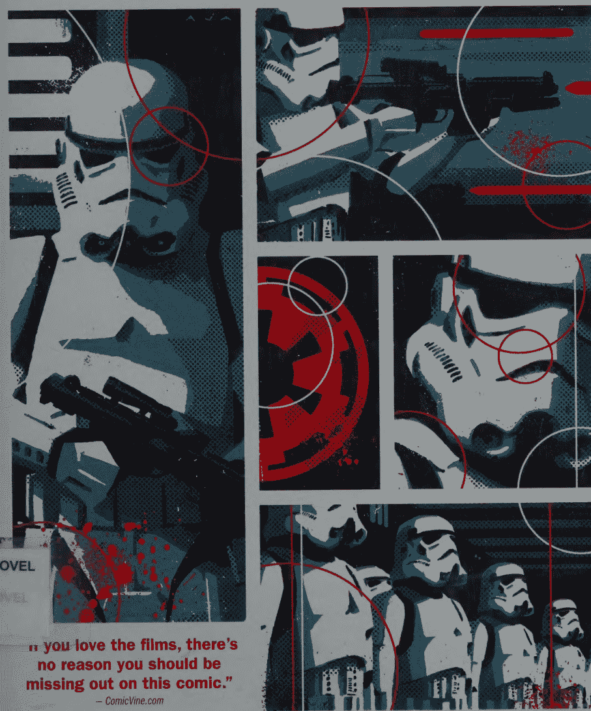

如果你喜欢这些电影，没有任何理由错过这部漫画。

— ComicVine.com

## “标志性英雄与新元素的完美融合。”

— IGN.com

## 新希望会让绝望让路吗？

对于反抗军来说，这是一个重燃乐观的时代——也是一个充满危险的时代，因为伤痕累累的帝国正在重建并准备反击。摧毁死星后，反抗军英雄`卢克·斯凯尔沃克`、`莉娅公主`和`汉·索罗`险之从与心怀报仇的`达斯·维德`的恐怖遭遇中死里逃生！通过这种方式，他们对帝国的执行者造成了沉击，夺夺了他的一项核心资产：武器专家`阿芙拉博士`！但当反抗军考虑下一步行动时，新的敌人将浮出水面破坏他们的计划。

当`莉娅`和她的盟友（某种意义）走私者`萨娜·星罗斯`将`阿芙拉`送到反抗军隐藏的`太阳黑点监狱`时；该设施遭到了对反抗有自己见解的残暴入侵者的袭击！如果`莉娅`想要生存，她必须把一句古语铭记心中——关于敌之敌人……

但一个更大的威胁正等待着我们的英雄。当`千年隼号`的船员劫持了帝国级歼星舰`先驱号`时，一支精锐的`风暴兵`被指命消灭他们——而且非常困难！`卢克`曾面对过他们的领袖`克里尔军士`，当时仅仅逃生。现在，这位年轻的`绝地武士`和朋友们将感受到`克里尔`的愤怒——以及`疤卫队`的怒火！

此外：结识反抗军间谍`恩内布·雷`——千万别叫他英雄！随着更多`绝地武士`过去被揭开，`欧比旺·肯诺比`成为了`沃基人`赏金猎人`黑客·克里斯`的目标！而`R2-D2`将单独作战！

漫威将继续探索那个遥远的星系！

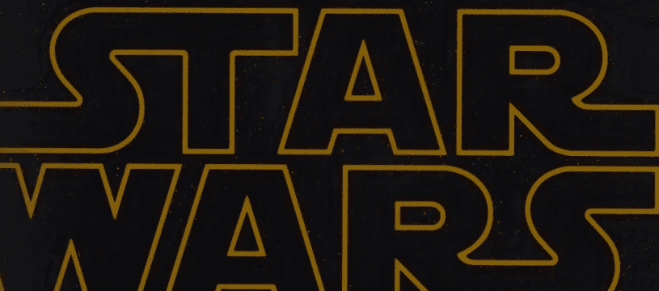

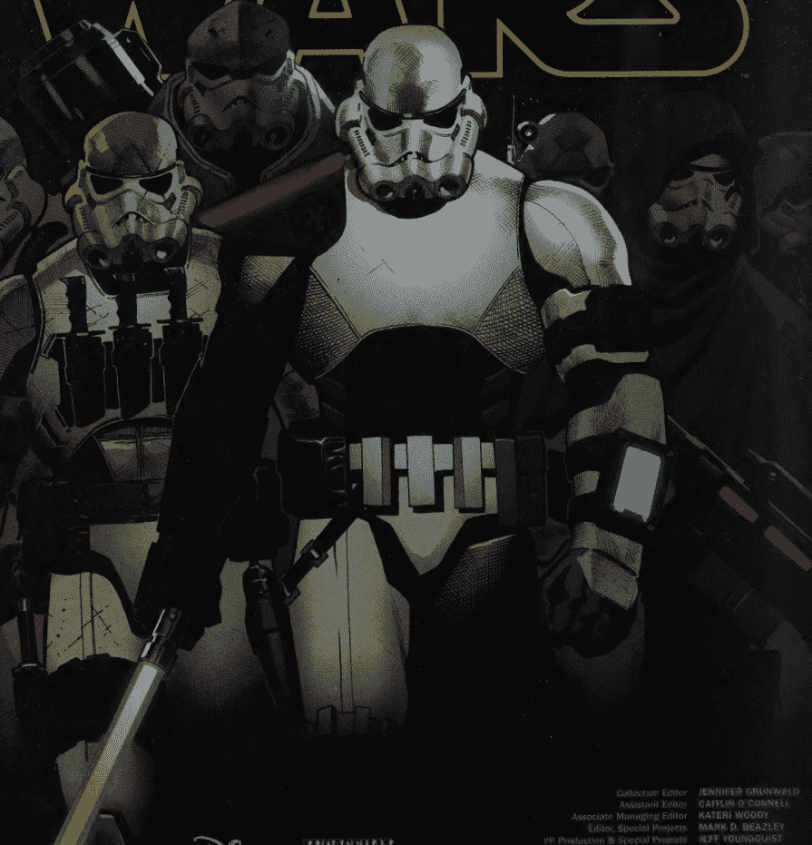

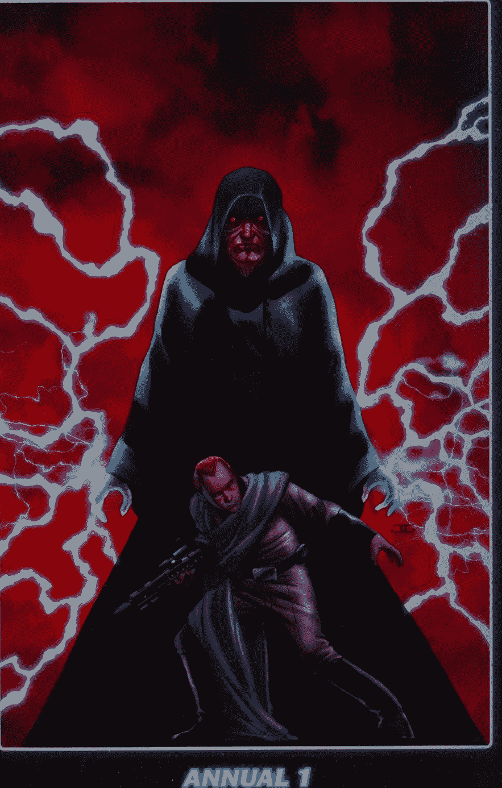

出版总监：`BUCKLEY`

作为一名间谍，考虑计策是工作的一部分。

但我也是个现实主义者。

而现实主义的一面知道这有多难。

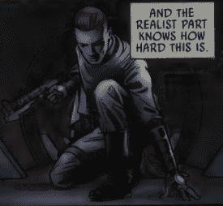

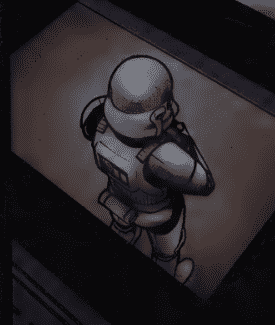

如果`科鲁斯圣地`上有超过六名特工……

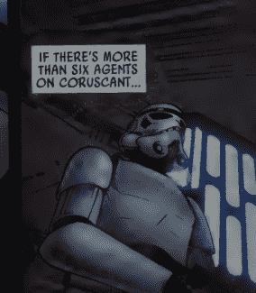

……那我会感到惊讶的。

呵。

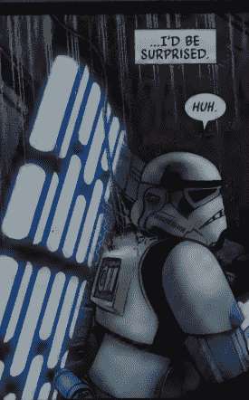

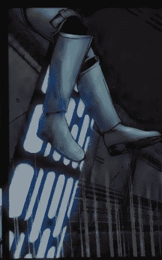

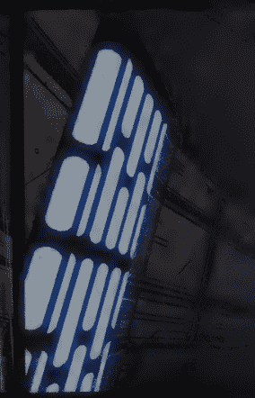

为什么这么难？

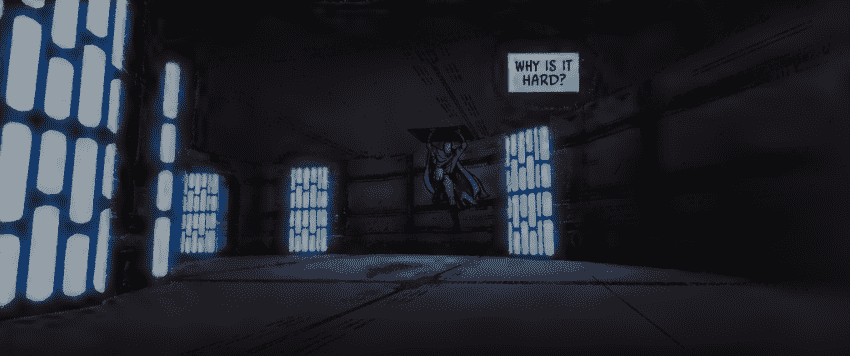

这取决于意志力，要像你的身份要求的那样冷酷。

无论如何，都要完成任务。

偶尔，也要很有魅力。

议员们……

我恐怕你们的处决被无限推迟了。

噢，天哪。这是一个不可置信的机会。

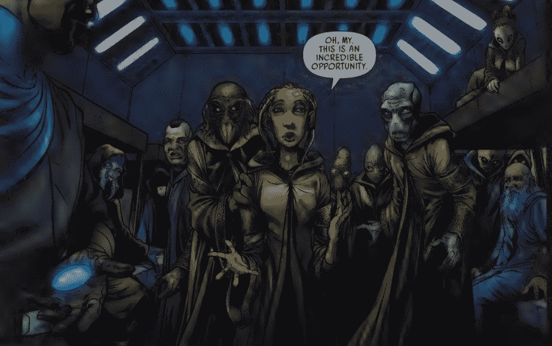

是的。为了救你们的命。

走吧。

……他正往这来。

你们并不了解皇帝。

告诉我一切。

我不是英雄。

所以我在这里是庆幸的。

晚上好。我是一名反抗军特工。

别动。

当你们都处于一个暴政且种族灭绝组织中时，我理解你们的选择受限于残酷而悲惨的生活现实。

因此，如果必须射击你们中的任何一个，我将深表遗憾。

这是谎言。

一个一个，从左到右，解开枪套并让它掉地上。

我完全不会后悔。

但这并不是说我不这样做。

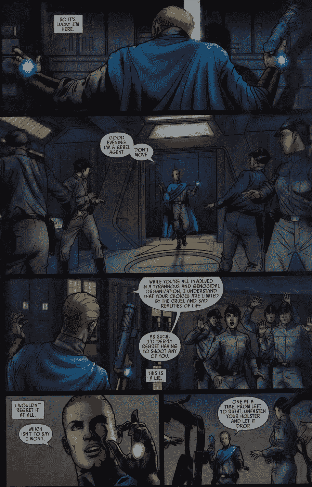

> 干得好。我猜我们明天都能活下来。
>
> 大家都回到这里来……
>
> 我需要留下来。
>
> 你们正试图传达信息。如果你打算联系公主，你就会暴露她的位置。
>
> 我可以运行干扰器。
>
> 我是`恩·雷`（`E Ray`）。你是那个内鬼。你刚刚暴露了自己的身份。
>
> 为什么？
>
> 我是`科莱特`（`Coelet`）。你刚刚暴露了我的身份。
>
> 我不知道你想做什么，但最好是值得的。
>
> `恩内布`（`Eneb`）！怎么了？
>
> 没什么，只是皇帝走进了我们的交叉路。

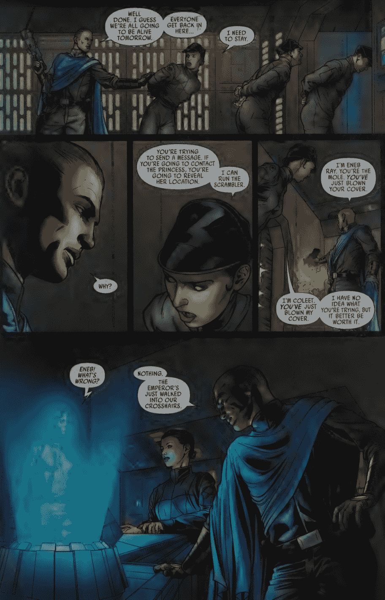

他将在一小时后与议员们进行最后的谈话。

如果我们能带一支小组来这里，我们就有最好的机会终结他，结束这一切……

我有一个计划。我们拥有战场。我们拥有安全控制权。

难得我们可以在一个我们选择的地方对付皇帝……

你需要什么？

我们能及时带回什么？

我需要那个。

如果失败了，我们在`科鲁斯圣地`将无任何特工留存。

这是一个巨大的风险。

`雅文`也是如此。

啊，`图拉尔议员`（`Tural`）。

很高兴再次见到你。

再近一点。

我以为在经历了多年美好的时光后，会有一个告别指令。

很高兴我们达了共识。

记录在案，我很惊讶。

`科鲁斯圣地`并没有六名特工。

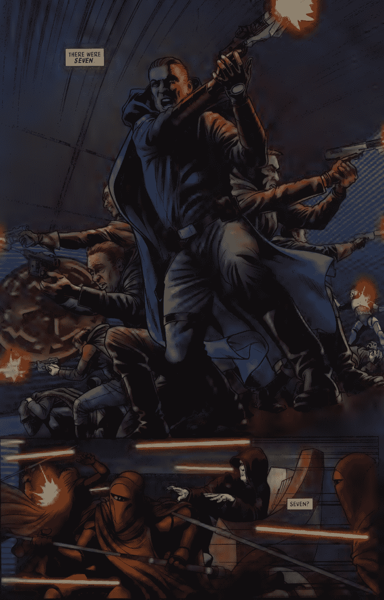

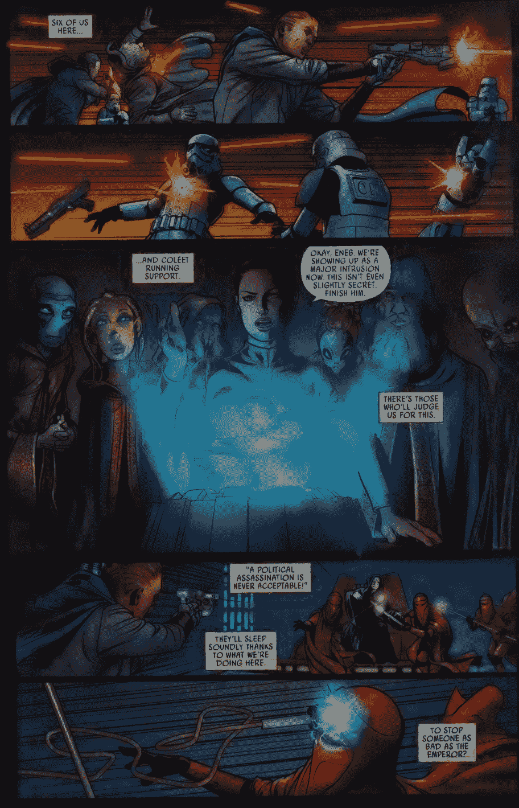

这里有六个人……

……还有`科莱特`提供支持。

好了，`恩内布`，我们现在是以入侵者的身份出现的。这并不是这样。我们要终结他。

> 意志要像你的身份要求的那样冷酷。
>
> 这种意想不到的处决。
>
> 这种会审判我们。
>
> 政治刺杀是不可接受的！
>
> 需要一个像皇帝一样邪恶的人。
>
> 只有在`阿尔德拉`（`Aldera`）的时刻，为了扣动扳机。
>
> 这种反抗军的。
>
> 这种暴行是不可接受的。这种遗憾的。
>
> 在这个时候，这看起来像是英雄主义。
>
> 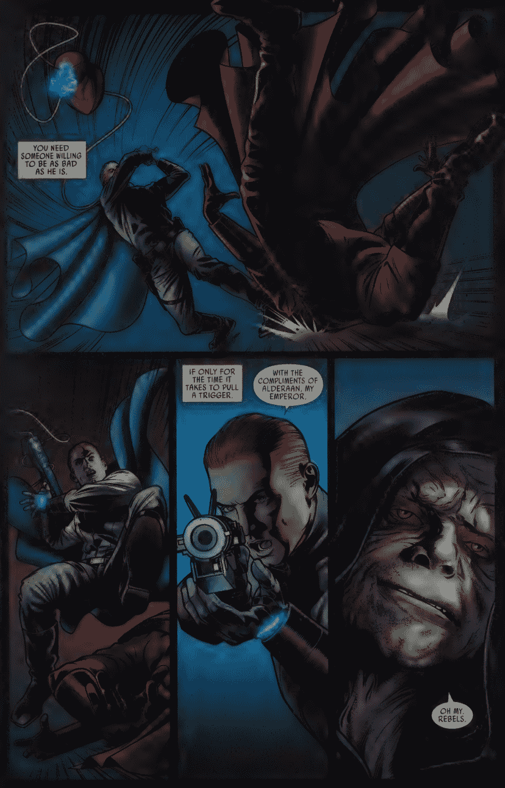
>
> 这种冷血的。
>
> 这种痛苦的。
>
> 这种为了。
>
> 这种荒谬的。
>
> 这种死亡。
>
> 这种为了。
>
> 这种被彻底的。
>
> 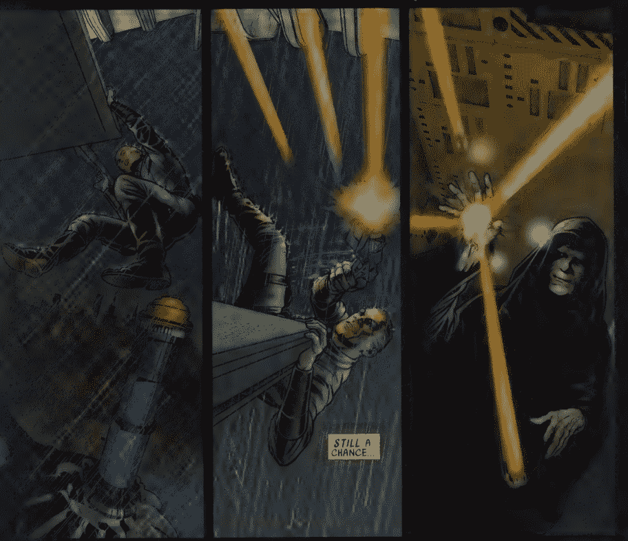
>
> 这种机会。
>
> 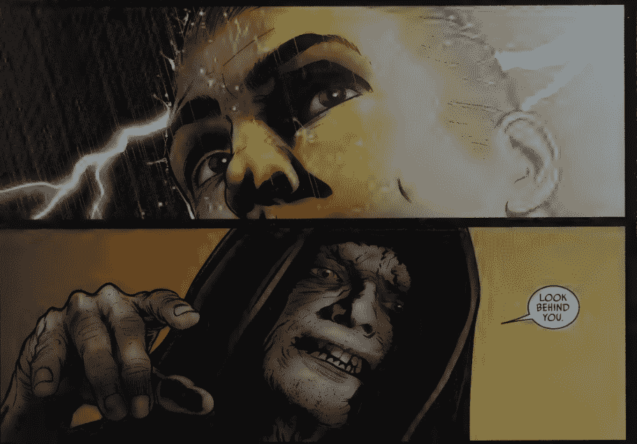
>
> 这种机会。
>
> 看看你们身后。
>
> 这种可怕的领悟。
>
> 我在欺骗自己。
>
> 这种反抗军。
>
> 这种时刻。
>
> 这种计划。
>
> 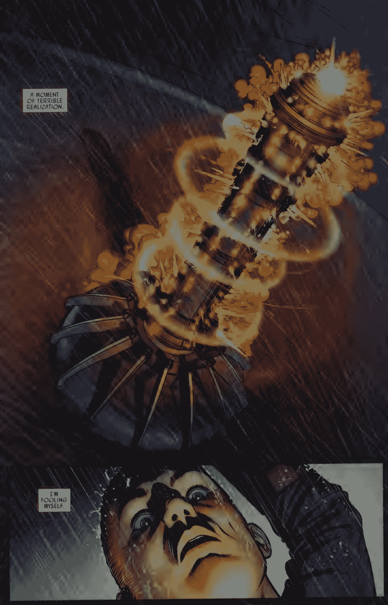
>
> 这种没有机会。
>
> 我完全不像皇帝。
>
> 我甚至不是那种种类的怪物。
>
> 我们唯一的共同点是知道这种……
>
> 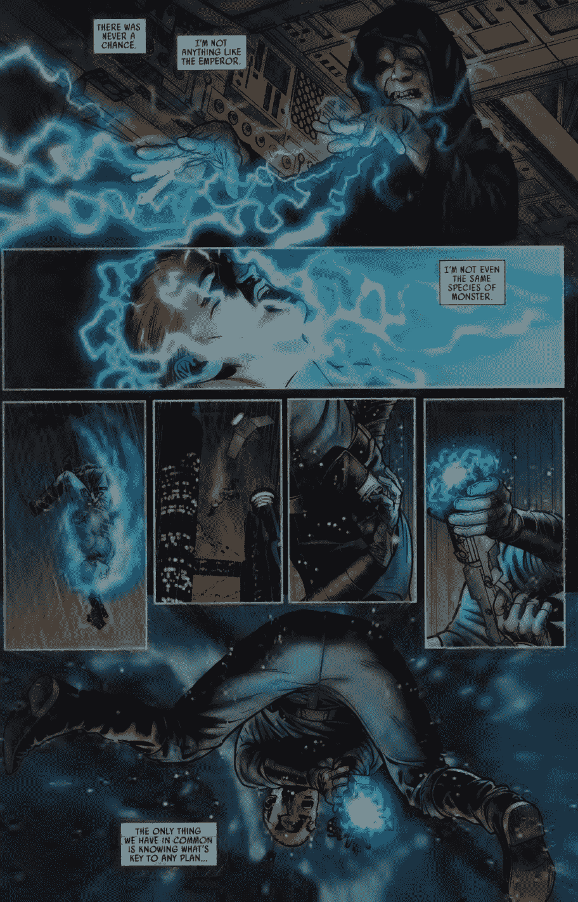
>
> 冗余。
>
> `纳德亚`（`Nade`）。
>
> `科莱特`。
>
> 议员们。
>
> 特工们。
>
> 所有的囚犯。
>
> 那些`冲锋兵`。
>
> 他的私人卫队。
>
> 他的替身。
>
> 我。几乎。
>
> 所有的死亡。
>
> 我想到了那些浮动的灰烬和那个男人……
>
> ……我意识到他是多完美。
>
> 议员们正被送往他们期待已久的审判，正如我们如何被这种帝国会揭露的。
>
> 这种建筑群是一片废墟，是他们残暴的证明。
>
> 很难理解这种无意义的残忍。
>
> 他是错了。我理解了。
>
> 一场宣传政变和永久移除了议员们。一个无法抗拒的陷阱，用来引诱`科鲁斯`所有的特工。总体的胜利……
>
> ……他也过来了。只是为了看着我们毁灭。
>
> 代码清除。你可以继续了。
>
> 如果刚才对你粗鲁了，请抱歉。`沃尔特·眼镜蛇`（`VOLT COBRA`）在这样的地方没法太谨慎。
>
> 欢迎来到一个官方上并不存在的地方。

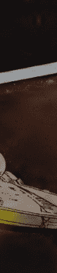

这是联盟所提供的最大、最凶残的监狱。

愿你在此停留的时间越短越好。

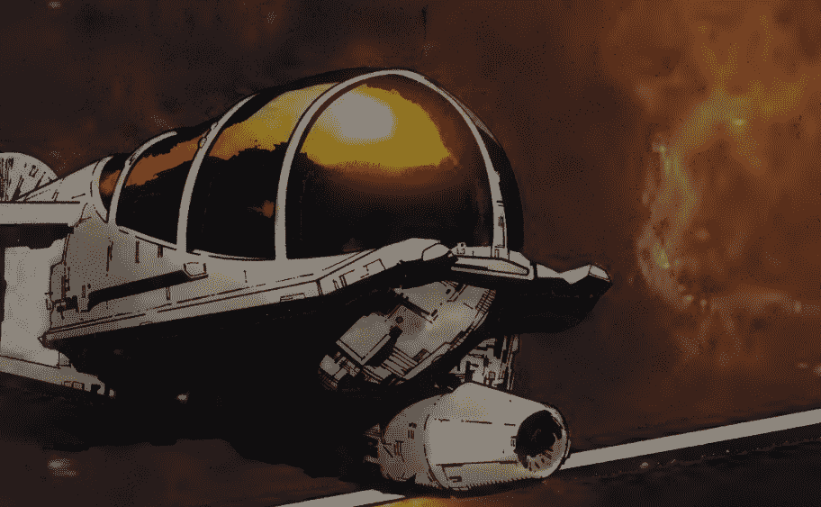

> 欢迎来到`太阳点监狱`。
>
> 除了我们其中的一个，所有人都将留在这里。

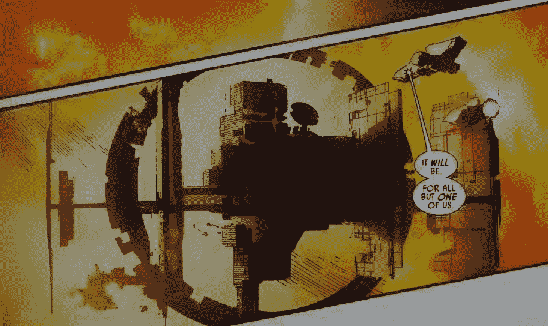

如你所见，我们对安全非常敏感。我们不能冒帝国发现这个地方风险。联盟的大多数人甚至不知道它的存在。

这里有战争罪犯、帝国间谍、佣兵，甚至还有一两个领主（`MOFF`）。

在某些监狱，囚犯抱怨被关在深邃、黑暗的地牢里，永远见不到阳光。那是我们从没听过的抱怨。

这里确实会变得有点热，但过几年之后你就会习惯。

嘿，相信我，我不会在这里留那么久的。

他们都是这么说的。

`阿法博士`（`DR. APHA`），是吧？你的故事又是什么？

`阿法博士`是一位专门研究军火的流浪考古学家——

我的故事是……我要把这个地方化为灰地，连同你一起，典长。

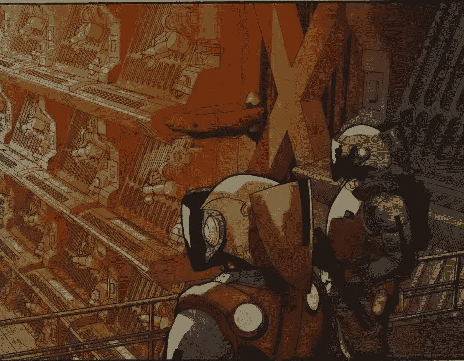

那是如果你运气好的。

如果你没那么幸运，我的好朋友`达斯·维达`（`DARTH VADER`）可能会亲自来拜访你。

她关于和`维达`的关系没在撒谎。帝国会搜遍整个河系寻找她。

即使他们能找到我们（尽管他们找不到），这里的防御也相当到位。我们背后有恒星，面前有炮火之海。

相信我，虽然离开这个地方非常困难……

希望他真的来。我们这里也有房间供他住。

把她带到九号牢房。

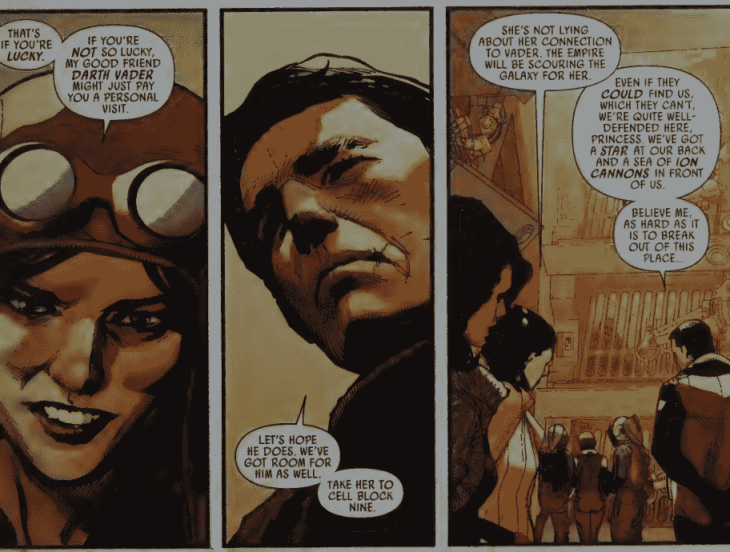

“闯进来也同样不可能。”

这已经是我们在不被他们的扫描器发现的情况下，能冒险的最远距离了。

把她留在这里，等我的信号。

长，你意识到考虑到我们离恒星这么近，你在到达监狱且不被活活死之前，容错空间将微乎其微吗？

死法有很多糟糕的。相信我，我什么都见过了。

出发。

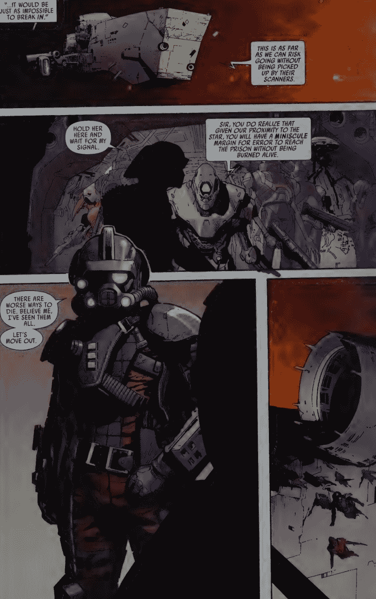

她说了什么吗？

除了那些详尽残忍的威胁和我我听过的最色彩丰富的辱骂之外？没有。

她被联盟情报官审问了好几周。她什么也没给。

哼。

我敢打赌那审讯相当激烈。他们会怎么做？在她脸上照强光？大声播放他们的音乐？

人性并不等同于软弱。

帝国不会止于此，这也是我们与他们战斗的原因之一。

当你的生命命悬一线时，它是——

我不接受那个。

下次见到`暴风兵`（`STORROOPER`）时，如果他拒绝杀了你。

我敢打赌你会输的。

啊，如果你听我的，女士们，我会看着那个囚犯（`PRISONER`）。

`萨娜`（`SANA`），我带你来这趟旅程，是因为我匹配了……（此处原文逻辑略乱，译为：那次尴尬的相遇）。

我带你来这趟旅程，`萨娜`，为了弥补那次尴尬的相遇。

我来是因为你给得很好，公主，你救了我的命，这并不意味着我必须同意你。

你的不同意见是我们战斗的原因之一。

是的，从未有人从我这儿拿走东西。

如果你在我的位置上，`阿法博士`，你会做什么？

无论你尝试什么，如果你不能——

那么我会让她开口。只有这样才能确保她不会回来。

因为相信我，像这样的女人……我会让她开口。那是她会做的。

嘿，女士们，想加入我的帮派吗？让典长给我电话。在那之前，享受阳光吧。

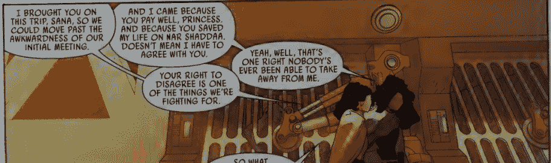

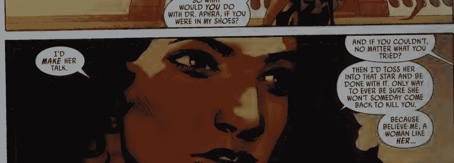

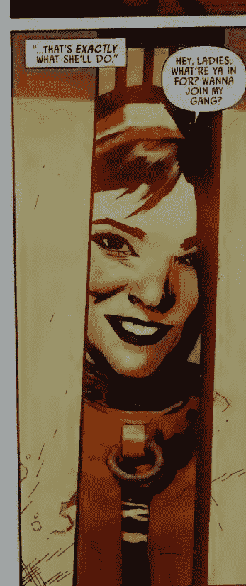

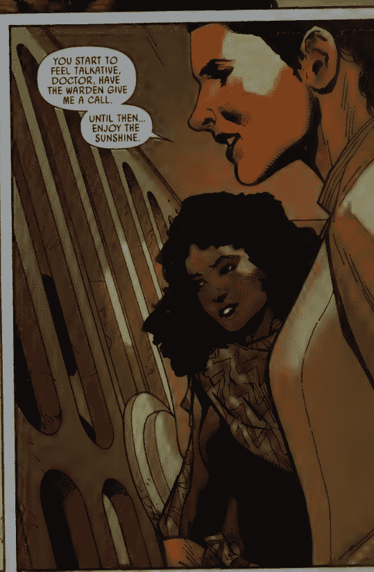

我真的应该害怕一点阳光吗？他们知道我是为`达斯·维达`工作的，对吧？

别看着我。我告诉他们杀了你。

是的，`萨娜`，我敢打赌你确实做了。嘿，我有个主意。你带我离开这里怎么样？

典长，我为什么要那样做？

我不知道。以前的日子并不美好。

行，说出你的价格。如果你告诉这些人他们想要的，那样不是更简单吗？

什么？你在开我玩笑吗？别告诉我你是……`萨娜`。反军同情者。我从未想过我能活到这一天。从这个地方来看，你不会走运犯。我讨厌走运犯。回见，典长。

“这个赌你接，走运犯！”

我会看着的，我会加你2000信用点。

2000？如果你在作弊，走运犯，要知道我离开这个星球时会没有手指或舌头。

作弊？啊，哥们儿，这看起来像个作弊者的脸吗？

伙计，你觉得你在做什么？

赢了？我们本该去买物资而不是用反军的钱赌博是什么感觉？

不，我在翻倍反军的钱。这样我们就能买更多的物资。当然，我先受了一点苦，现在闭嘴让大师显显身手。来，下注或者滚蛋，先生们。

跑，`卢克`（`LUKE`）！逃命去！

我们不能离开！我们得回去拿钱！回去你就死定了！上船！

该死，我生疏了。很久没在`萨巴克`（`SABACC`）上作弊了。我很遗憾。他们会因为这个把我们从反军踢出去。我该如何向`莉娅`（`LEIA`）解释这个？我没看到那一幕。放松点，小子。

放松？你赢钱时候该放松的。但是不，你非得继续下去。不是吗？非得贪。

听着，小子，当你有了身价之后，你再跟我谈钱。

我确实有身价。`莉娅`说那是60000信用点。

60000？但是……那比我的赏金还多。

那么也许你应该把我卖给最近的赏金猎人。否则我们怎么弥补刚刚丢的钱呢？

嘿，小子，别担心。我有办法。河系很大，相信我，总有些地方……需要走运犯。

如果你在我的位置上，`阿法博士`，你会做什么？

“你会替我们看好目录的，对吧，典长？”

滋滋 嘎吱

她很麻烦，而且很有价值。

是的，`莉娅公主`，只要你愿意，`阿法博士`在这里会非常安全。

正如我告诉过你的，这个设施是整个河系最安全、最秘密的监狱。

但你是在和掌权人物说话。

现在控制室是我的了。这意味着这座监狱现在也是我的了。

你是谁？你对典监做了什么？

目前还没时候，他可能是个蠢货，但他不是个坏人。

你才是蠢货，如果你认为你能——

唔唔！

听着，不管你是谁，如果你哪怕一秒钟认为通过伤害那些坏人，我就不会让你放出任何一个灵魂。从这个人身上，你会让你大头脑的——

噢，你这个误入歧途的公主。

我不是来救出任何人的。

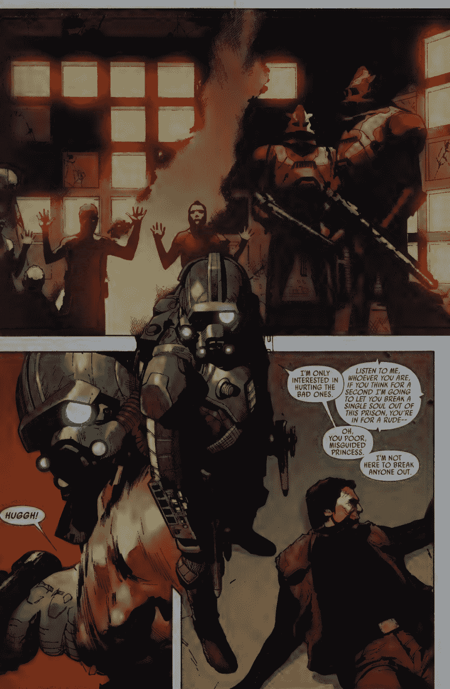

他们已就位。

告诉我，公主。从你所在的位置能看到七号区吗？

不，你在做什么……

我实际上是来帮助你的。这里需要拯救的是`莉亚`，而不是这些囚犯。

这些囚犯已经没救救了。

开火。

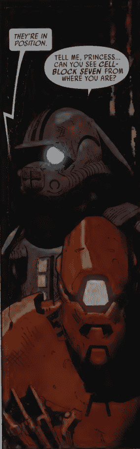

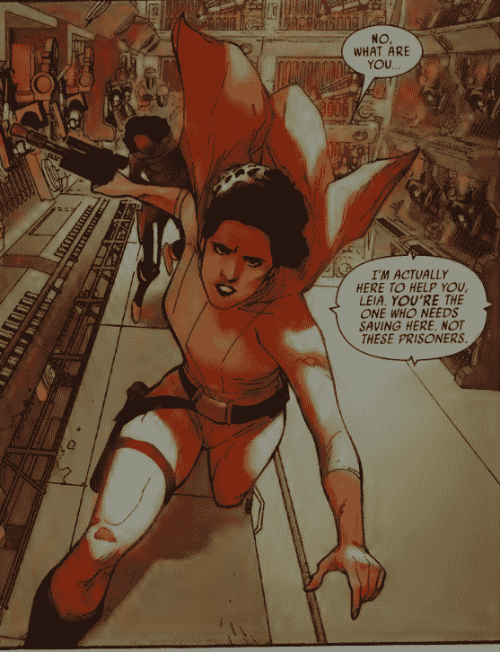

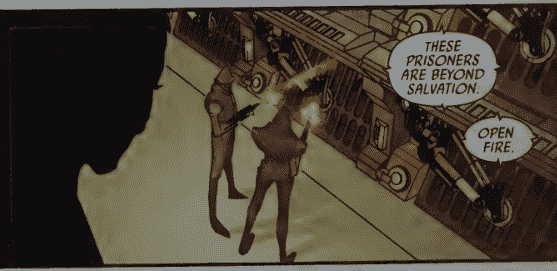

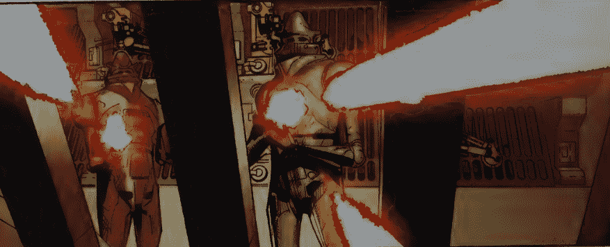

不！

你是个杀人犯。

不，是执行者。牢房里那些死人才是杀人犯。

我同意这个家伙的想法。现在加入他的阵营太晚了。

你想让我读读他们的罪名名单吗？那会花很长一段时间。我恐怕你没有那么时间。

我不想和你辩论。我只想阻止你。你不像别人。

我不会让你这么做的。我不会让你用枪扫射他们所有人。

我知道你不会这么做，因为你仍然相信高尚的战斗，不是吗？

但战争中没有任何高尚可言，公主，如果你想赢的话。

你是对的。

确实。

我刚刚从牢房里释放了17个冷血杀人犯，公主。

也许你可以和他们进行那种辩论。

尽管如果你更想活命……

我建议你忙着杀掉他们。

> “我正在找一个飞行员。”
>
> “一个不会问问题的人。”
>
> “如果你不问，我不问。坐下。”
>
> “时间非常关键。需要一艘快船，但这里的其他飞行员，他们……他们看到我是什么样就拒绝了我。”
>
> “我只需要知道你的船快不快。就在外面对吧？”
>
> “没冒犯，但……它看起来没什么样子。”
>
> “你没听说过`千年隼号`吗？那是跑完`凯塞尔赛道`用时不到12个帕秒的飞船。”
>
> “什么是`凯塞尔赛道跑`？”
>
> “对你来说足够快了，伙计。”

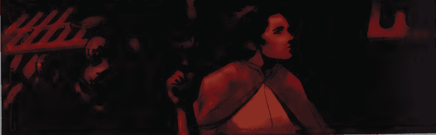

额格！

呃呃！

啊啊啊！

咳！

这确实比我正打算给你的死法好。某种感觉告诉我他来这里不是为了改装加速器。

不，他不是。他是`科拉·路德`。他曾是特种部队的上级。

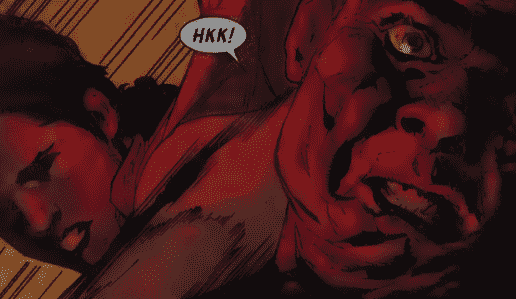

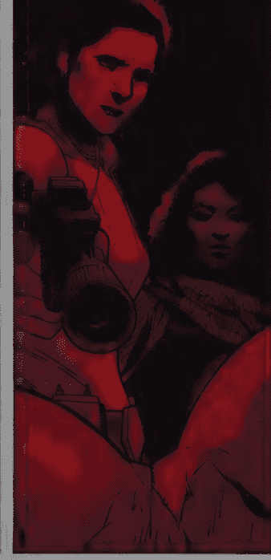

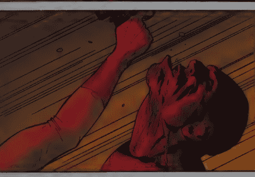

如果你扣扳机，没人会怪你。

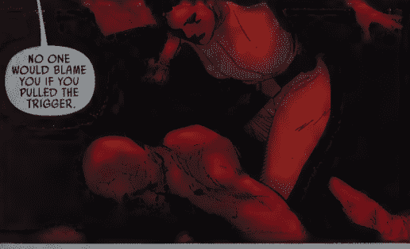

他们称他为“播种者”。

因为当他们把他丢在敌方村庄中间时……他除了建筑什么都没留下。

而且那些建筑通常还在燃烧。

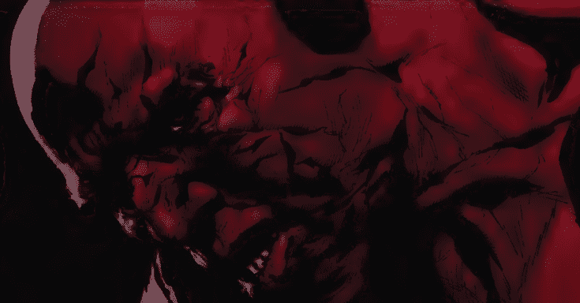

> “你在为我辩论。”
>
> “没武装很重要。”
>
> “好吧。把他的武器交给我，我会开枪。”
>
> “我们没有在杀任何人。”
>
> “我们的首要任务是抓捕那个神秘的朋友。”
>
> “帝国正在炸毁行星并处决武装的囚犯。”
>
> “门……”
>
> “九号正在关闭。”
>
> “等等，是什么……”

不……

你觉得你会比那些牢房里的人打得更好？这就是你将输掉战争的原因，公主。

至于我来说，我不知道是什么。

我是个杀人犯。

那是你造成的。

你把我送到了他们中间。但你并不明白我们反对什么。

我看着他的眼睛。那是敌人的真面目。

那是必须完成的事。

我会杀死他们。这就是代价。每一个恶臭的。

注意，未知的船只。你被命令切断引擎并被关了。

你正在运输非法的东西。

# 情况变得越来越糟了，孩子！因为我们要死了！

帝国对外星环实施了制裁。

他们为了联盟而需要他们。

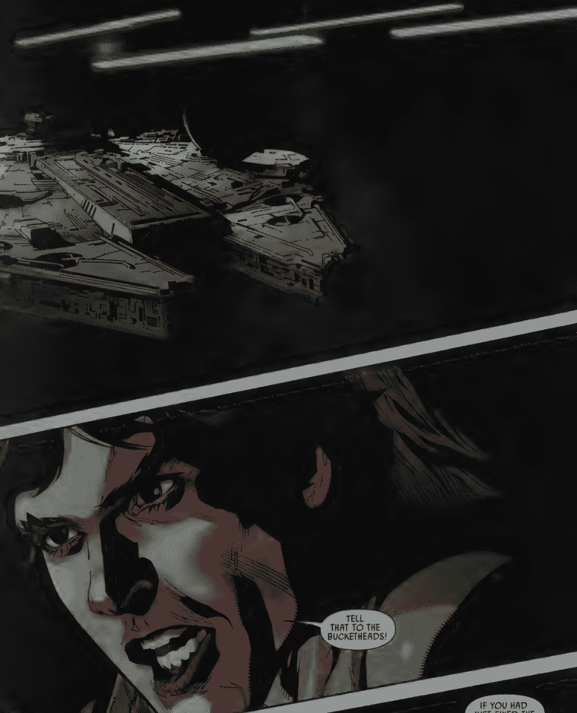

告诉那些头目！

如果你修好了跳速器。

在这里，让我飞吧。

我告诉过你，如果你没……住稳。

噢，没了！

这是我待过的最晚的。

噢，再次！

这是我待过的最糟糕的牢房。

嘿！什么时候？

你听见我的了吗，大伙子？我说了……

噢，那个恶棍机器人。你是在……

啊啊啊啊！

我收回话了！我没那么饿！

嗯，如果你要杀我，至少要有勇气自己来，而不是派个机器人去干这种脏活。

这听起来像我会做的事。

不是你，法外。

如果我们想让你死，阿弗拉博士，我们不会在这儿的。

记录一下，我对你的死完全没意见。

退后。

我还是说这是一个非常糟糕的主意。而且我已经在最后五次都告诉过你了。

我们没有选择，贾娜。无论信不信，医生，我们来这里是为了救你。

救我？从……救我。

在我看来，我们要么一起努力，要么就一起死。

你怎么说，医生？想接管监狱吗？

噢。这个设施被一个杀人魔赐佑了。

嘿？你开玩笑的吧？

我本来打算那样的。

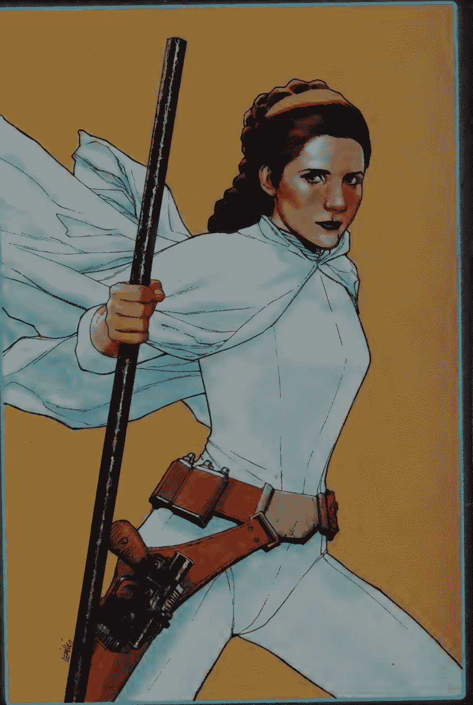

# 星大战16 变体 莱尼尔·弗朗西斯·尤

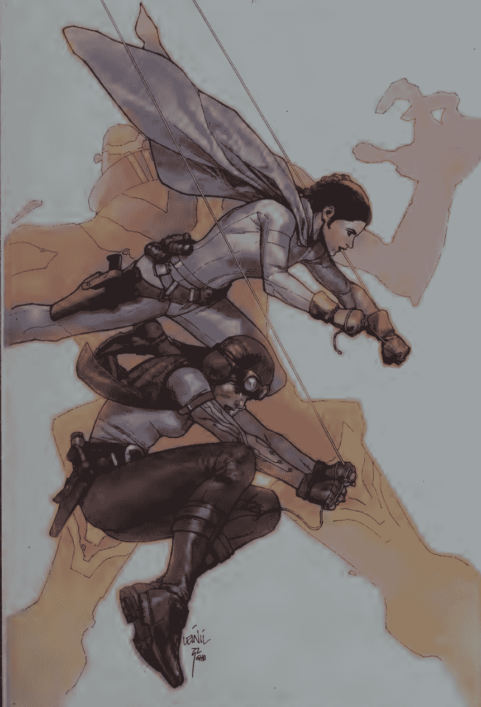

阿巴尔。

外星环。

欠你什么？什么？

为了救你的命，汉。

欠你什么？什么。

为了救你的命，汉。

欠你什么？什么。

为了救你的命，汉。

欠你什么？什么。

为了救你的命，汉。

欠你什么？什么。

为了救你的命，汉。

欠你什么？什么。

为了救你的命，汉。

欠你命？什么。

为了救你的命，汉。

欠你命？汉。

为了救你的命，汉。

。你什么？什么。

为了救你的命，汉。

欠你什么？什么。

为了救你的命，汉。

。你什么？什么。

为了救你的命，汉。

。你什么？什么。

为了救你的命，汉。

欠你什么？什么。

为了救你的命，汉。

欠你什么？什么。

为了救你的命，汉。

欠你什么？什么。

为了救你的命，汉。

欠你什么？什么。

为了救你的命，汉。

。你什么？什么。

为了救你的命，汉。

。你什么？什么。

为了救你的命，汉。

欠你什么？什么。

为了救你的命，汉。

欠你什么？什么。

为了救你的命，汉。

欠你什么？什么。

为了救你的命，汉。

。你什么？什么。

为了救你的命，汉。

。你什么？什么。

跳吧，宝贝，你大可以跳下去的，因为没了我，那些讨厌船体的人死和没没区别。

我会让你见识一下什么叫死无疑！

萨娜，住手！

这所监狱正受到一股未知力量的围攻。他们决心杀死我们能杀的每一个囚犯。

我们的任务是确保每个人都能活着离开这里。

而我们正在失败。

这个监牢区的人全死了。所以我们去下一个区域。走吧。

这太荒谬了。你比她还要疯狂。

我们为什么要去救一群囚犯？我们需要到达对接舱然后离开这里。

还是去武器库？如果能去武器库我也没意见，只要那里够大就行。

我们不会离开的，医生，我连一把步枪都不知道怎么信任你，更别说更大的东西了。

下一个隔间的舱门锁在移动。

我也想你你了，宝贝。

在这一切结束之前，我一定要杀了你。

这些肉袋子，总是觉得自己很聪明。

传输已取消。

BWOOP

TWEET BWWIP

WURUU

阿图-德图，你别敢做任何蠢事。我最近刚把手臂接回去。

而且，只要我们不挡路，这些事情总是会自己解决的。

这里是控制室。我们的机器人快用完了。

老板，你能听见我说话吗？

老板？

打开十七号监牢。

他们把你关在最高安全监牢里一定有原因。

告诉我原因是什么。

三个理由。

- 那三个被我割了喉的绝地武士。

我唯一的遗憾是杀得不够多。

还应该是什么？

还有一件事你会后悔的。

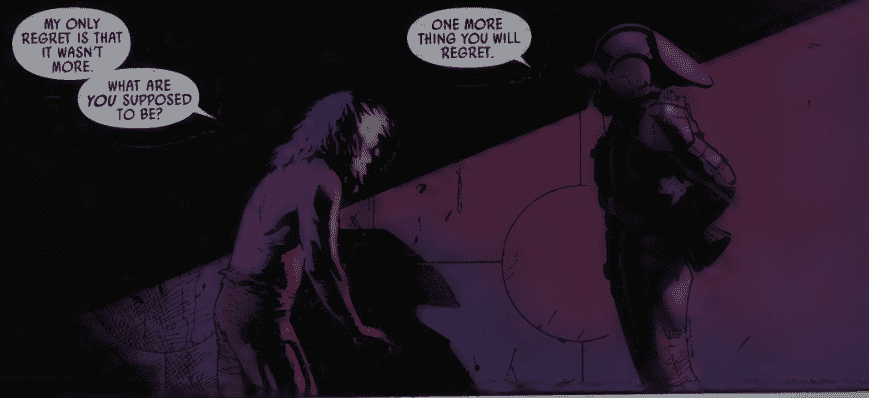

嘿。没有你后悔的多。

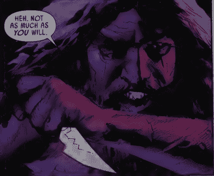

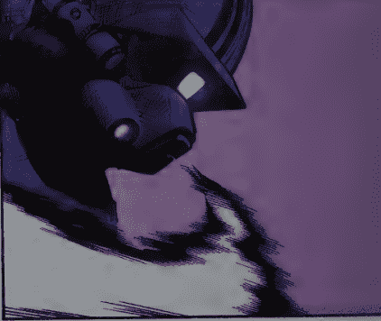

HRRH！

GUGGH！

你的皇帝帕尔帕廷……是一个西斯领主。什么？

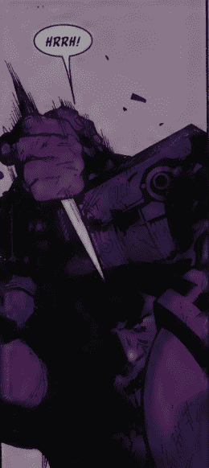

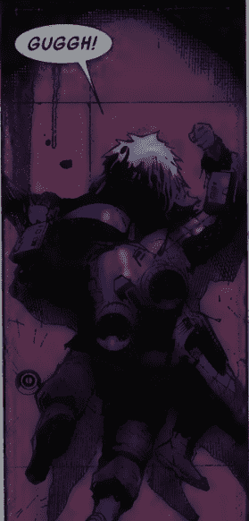

HURRGH！

终于能向某人说出……我的秘密（注：此处为秘密）这种感觉真好。谢谢你。

控制室。

打开十八号监牢。

你正在

输掉。

这场战斗，

公主。

这就是为什么

你会

输掉战争。

AAAAARGH！！

AAAAARRGH！！

你听到了吗，

公主？

那是怪物的尖叫声。

我们应该

让大家都

尖叫起来。

我会带路。

我是由你造就的，

公主。我是真正的

反军士兵。

我正是银河系需要的。

这个扇区有行动！

你和你！外面！守住门！

你看，我告诉过你。无疑莉娅是来救我们的。

为什么总是由我来当乐观的人？

## BUDA BARRRP

你们两个！站在门口。

如果有人冲进来，确保他们先中弹。我撤退。我们死定了。

BWOOP BWOOP

小心，你笨蛋！

嘿！

- 永远把那些门打开！这是个糟糕的计划！
- 有个计划？
- 继续射击！
- 我的这种计划！
- 最后一个机器人，但它把我们压制住了！
- 最后一个机器人？那不是最后一个。

呃-噢。看到了吗？告诉过我正在重新接线。

不准动！你再也不会动了。

我不是反军，但我还是会射你。

嗯……啊啊，救命！我在拼命了！

把这个蠢东西从我身上拿开！

噢，我的天！手铐是这样的吗？我宁愿被赦免。接入并控制监狱。

不用立刻谢我。在我射那个东西的脸之后。让开，医生。是谁在背后？他在哪？

他正试图教你一些东西。你曾教过他。这意味着什么？

嘿，如果我被设定了笑，我会像考瓦基猴猴蜥一样大笑。他是谁？

我说让开。别了，萨娜。这和机器人无关。我们之间发生的是很久以前的事。

你应该长点胆量并学会捅人。最后警告：靠开。大家停止尖叫！听起来我们赶得及时。什么？卢克？卢克和我收到了你的信息。所以放松吧，殿下？

# 星球大战 变体

作者：LEINIL FRANCIS YU

## 太阳点监狱。

- 让开！我们必须在他之前到达对接舱——
- 在他之前？让我们看起来都像傻瓜？看来我们太晚了。
- 放了他们。现在。
- 抱歉，公主。

这简直是……哇。你们竟然还没死光？真的是银河系最大的谜团。……这不是这样结束的。

这是你接受我一直试图向你展示的东西机会，莉娅公主。

我希望你赢得这场战争。我是认真的。我想看到帝国倒塌。我想给你提供赢得胜利所需的工具。你这里的朋友是否会在这场战争中伤亡，完全取决于你。

不要这样做。不要伤害他们。卢克，我会放下步枪，然后我们可以谈谈……

聪明，但光有聪明是不够的。面对帝国是如此。

那我们会找到别的办法！

好好看着我，公主！

我就是道路！

我感觉……这并不是战斗。我们应该在战斗。

唔！

搞笑得怎么了？在我手掐住你脖子之前，你可没这么说过。

而且你又不想战斗吗？我只想杀了你。

好了，好了，你赢了。对不起，萨娜。萨娜。我是真的对不起。

对于我离开的方式我感到抱歉。

如果你是个发射手，我本该知道如何对付你的。我认得发射手，但人——

啊。你还在掐着我的脖子。你听见我说——

你道歉了，哈？我会让你见识什么叫道歉，博士。

哇啊！

你真是个傻瓜，公主。你的一生都在你父亲的城堡和元老院的大厅里度过，受着银河系各种报复的保护。

你怎么可能认为自己能赢得这场战争？

他们炸了我父亲的城堡，连同整个阿尔德兰。

但我们不会因为我而赢得这场战争。

呃！

我们会赢得……因为我们的人比你数得过的多得多……

呃！

唔！

而且我们已经听够了被别人指手画脚。

“监狱系统已经恢复。”

“疏散已经开始。”

谢谢你，公主……我们还有一些人需要疏散。

但不够了。今天死了太多人，守卫和囚犯都有。

是的，公主。我们正在尽力统计所有的剩余囚犯。但是，啊……

我恐怕有一个似乎被遗失了。

离逃生舱远点，芙拉博士。

噢，拜托。

我今天救了你五次命！如果算上我真的想杀你却没下手的次数，多得多。

但这改变不了你是这儿囚犯的事实。我不能就让你离开。

嗯，是的，你完全可以。

如果我答应乖乖呢？或者你懂的……比比常好？

等那一天到来，如果你碰好由于方式活了下来……

我建议你看着我。

等等，但是，你在说什么？

我说我不能让你走。这不是游戏，博士。我希望你意识到西达斯·维德到底有多危险。

无论你很快对他有多大用，早晚他都会抽空杀了你。

我可没提过她。

谁……

> 逃生舱激活。
>
> 永远别回来。
>
> 她需要多久才能发现我们藏在她衣服里的所有追踪器？
>
> 大约和她花时间找到我们藏在她的船上的那些一样长。

我想这一切真的要让我多花钱了，嗯？

你知道吗？

我们就此平账吧。平账就像平账，但是——

别太贪心，公主。

是的，女士。

所以，你她，你们曾经是——

别问。

我不是在问，我只是——

别问。别问什么。

好吧。

是的，我申请转调。我从叛军舰队内部听到，他们正在寻找协议机器人。在联盟记录中正式转调有点慢。没有任何人在守期间期间被拔过手臂。不，你不能来。那不是我们最好的救援。我们在救援方面可能比走私更糟，汉。成员，卢克，别告诉任何人关于……你知道的。确切。见到你，萨娜。嘿，看起来你和蕾娅真的开始……老天……这儿闻起来像纳兽！我得去开千年隼！汉，告诉这孩子还没老到跟我说话。

> 我想让你知道……我不会放弃你。
>
> 无论你需不需要，我都会给你需要的帮助。
>
> 你甚至不能帮助你自己
>
> 但总有一天……你会希望自己听了我的话……
>
> 总有一天。

“总有一天，你会意识到你在战斗的是什么。”

“以及你根本没有赢的机会。”

“你会意识到……仅仅是因为他们来找你了。”

“带着你甚至无法想象的力量和愤怒。”

“记住那一天，公主。”

“在你的尖叫中记住我。”

## 几天之后……

就是这儿。好了。这是他们关押的地方。我赌上我最喜欢的发射器。

但他们把那里搜得干空，让它掉进了星际。

我们回到了起点。你听见了吗？没关系。命令刚下达。我们有新任务。

谁准备去杀几个叛军了？

# 来自老肯比的日记

在为了成为绝地的过程中寻找答案时，卢克·天行者发现了一本由绝地大师欧比旺·肯比撰写的日记。日记详细记录了肯比在塔图因期间的冒险——包括在大旱期间，欧比旺从贾巴的暴徒手中救了年幼卢克。

以下是该日记的节选。

自从大旱已经过去一年了。即使在最恶劣的气候下……蒸气器再次嗡嗡运转。沙漠之花盛开了。

……生活继续。

一如往常一样。加油，卢克！你可以的！

哇。

你说过我永远无法通过蘑菇平地，比格斯。

别太傲慢了，天空小子。

我是为此而生的。

还有时间取消，你知道的，也许在……之前在深峡谷再进行几次测试飞行……

不行，比格斯。

是，好吧……

……希望乞丐峡谷没有异议。

即使在多年来观察他，也显而易见……卢克·天行者在很多方面都是他父亲的儿子。这正是我所担心的。

感受力量，感受它在你的体内流动。如果你可以的话。

安纳金是我见过最鲁胆的飞行员。

所以我想这一切真的要让我多花钱了，嗯？

你知道吗？

我们就此平账吧。平账就像平账，但是——

别太贪心，公主。

是的，女士。

所以，你她，你们曾经是——

别问。

我不是在问，我只是——

别问。别问什么。

好吧。

是的，我申请转调。我从叛军舰队内部听到，他们正在寻找协议机器人。在联盟记录中正式转调有点慢。没有任何人在守期间期间被拔过手臂。不，你不能来。那不是我们最好的救援。我们在救援方面可能比走私更糟，汉。成员，卢克，别告诉任何人关于……你知道的。确切。见到你，萨娜。嘿，看起来你和蕾娅真的开始……老天……这儿闻起来像纳兽！我得去开千年隼！汉，告诉这孩子还没老到跟我说话。

> 我想让你知道……我不会放弃你。
>
> 无论你需不需要，我都会给你需要的帮助。
>
> 你甚至不能帮助你自己
>
> 但总有一天……你会希望自己听了我的话……
>
> 总有一天。

“总有一天，你会意识到你在战斗的是什么。”

“以及你根本没有赢的机会。”

“你会意识到……仅仅是因为他们来找你了。”

“带着你甚至无法想象的力量和愤怒。”

“记住那一天，公主。”

“在你的尖叫中记住我。”

“你再也不会飞行了。”

自从在大旱期间在贾巴那里闯波之后，我一直努力变得隐形。变得更像一个隐士和独居者。

不会有下次我说你被禁足了，我是字面意思。最好习惯走路吧，卢克。因为只要我活着……

但我的战斗仍在。

RRGGGGHHHRRRRRGGHH！

我的想法完全一样，我的朋友。

> “用光剑的话会容易得多，但我想我本可以避免这种尴尬的。”
>
> “我不应该去干涉的。我知道我的目标是保护那个男孩并让他隐藏起来。”

但我不是尤达大师。我知道我无法留在这里 800 年来守护他。

在未来的某个时刻，卢克·天行者将必须学会自力更生，某种预感告诉我，当那一天到来时，他需要学会如何飞行。

奔跑

这花了一整晚晚上，但我想象塔斯肯掠夺者很快就会再次找到他们。尽管我想起需要发出某种信号来将他们引离高处，当我们看着男孩跑入那片几乎无尽的自然黑暗时，我的背感到沉重，但这是值得的。

还有多少人能像蜂群一样开辟道路？我希望我这种感觉并不孤单。

我们带那个机械机器人吧。

波奇，你有什么会说话的吗？

尤提尼！

哈？那是怎么——

不。我们只买机器人。我们买不起任何东西。

嘿，什么？你在干什么？我告诉过你……你就打算把这留在这儿？

记得我以前抱怨西地神庙的食物吗，大师？

那是在我每天都要吃一年蛇之前。

BLMRGH，幸好我的原力很强，否则我没法强迫咽下去。

咚咚

马上就到。

我们在沙海很少有客人。我该如何……

你可以离我的家人远点！

欧恩，请进。你喜欢你的蛇吗？

我不傻，肯比。仅仅因为我没有像你一样横跨银河，并不代表我是一个无知的乡下佬。我知道你在做什么。

自从你出现后，我的房子是唯一一间从未被沙民人袭击过的库尔特人房子。它从未被贾巴的暴匪掠夺过。

而现在，贾维人甚至在免费送零件给我们。

听起来你一直很幸运，欧恩。原力的运作是不可测的。

不，是你运气，你这个疯子西地神！但现在结束了！

我告诉过他，我不会让你像你那样毁掉那个男孩的，他父亲说。

你带他来是为了保护他，而我正是这么做的。保护他免受你的伤害。

我不要求训练那个男孩。关于这一点你已经说得很清楚了。但就像他一样，他拥有成为……真正非凡之人的潜力。正如他父亲一样，在他之前——

你杀掉的天行者还不够多吗，肯比？

在你害死他之前！

这孩子只是个男孩，一个鲁莽的男孩，他已经太像他父亲了。

我只是想提供帮助。

我们都很清楚，如果他离开，他就再也不会回来了。至少活不回来。

我相信我已经说得很清楚，我们不需要你的帮助。

> “你是个危险的人，欧比-旺·肯比。无论你是否意识到。”
>
> “麻烦总会有办法找上你，不是吗？虽然我想也不必太费力了。”
>
> “那个麻烦有一天会让某些人受重伤。”
>
> “大家都帮个忙吧……”
>
> “‘并且把麻烦留给你自己。’”

我并不擅长躲避麻烦，即使在沙漠中也是如此。但我活了下来，如果说这些年来我在某方面变得出奇擅长，那就是找麻烦……死。

去问西达斯·莫尔或杜库伯爵、格维斯将军。

去问贾巴·那个汉克。

噢噢！伟大的贾巴说……他想先看到你的技巧展示，才同意支付那离谱的费用。你现在就可以开始展示。否则你会死。

把这个人活着送过来，这样贾巴就可以亲自看着他，你将获得一笔丰厚的奖金。或者你可以直接带他的头。

你觉得这些可以接受吗，黑肯塔（注：此处原文疑似有误，推测为译名）？

这一切发生在这里。大约一年前的大干旱期间。贾巴的五名战士在这里被夺走了。被巨大的岩石砸碎了。但没有人看到是谁。没有人看到任何东西！至少他们是这样叫的！贾巴把他们喂了萨纳兽。我们没有找到他的踪迹。你好？你知道这意味着什么吗？谁抓到他就会死。

卢克，听着，我在托斯站弄了一些零件。它们状况不太好，但我想也许……我们可以一起修理那台破飞器……并希望得到……算了，卢克，我真的很抱歉，好吗？

卢克？

贝鲁，你看到…………！

我还不知道。但卢克·天行者不是第一次离家，也不是最后一次。上船吧。去银河中除了这里的任何地方。我去摩斯埃斯利。贝鲁和欧恩可以留下塔图因。我会带走……星辰。至少这一次，他没走多远。哼？欧恩！

欧恩！贝鲁！

贝鲁在哪里……贝鲁！发生了什么？欧恩在哪里？卢克，你必须离开这里……他带他走了。朝着峡谷去了。我们必须去找帮助，去找其他农民。去找……是什么带他走了？满身皮毛的。卢克，你把自己锁在维修间里。在听到我的声音之前不要出来。明白吗？维修间……

RRRRARRGGGHH！RRROOOOGGGHH！

我……我不明白。我不知道你想要什么，你为什么……RRRRRROGGGHH！等等，请。我无法回答你的问题。我不说话——他没有在问你任何问题。

> 当我在沙海的蛮兽中冥想时，感受到了原力中的不协调。
>
> 在悬崖顶，我试图放慢呼吸，以掩盖爬山后的气喘力竭。
>
> 肯比！
>
> RRRGGHHH？
>
> 我的胃里有一种多年多年未有过的紧绷感。
>
> 恐惧。
>
> 显然，身体的酸痛并不是唯一随着年龄增长而恶化的东西。

你是黑肯塔，臭名昭彰的族族赏金猎人。我听过你。我知道你为什么被迫离开卡希克，以及自从贾巴雇佣你以后你是如何给同族蒙耻的，不是吗？

好吧，我在这儿，赏金猎人。或者我不是？你离开这个地方时——我是你要找的人。

哈呜！

RRRWWWWWH！

尽管满眼沙尘，但即使是一个半盲的伍族人，也足够强悍足以让很多人丧命。

唯一的问题是。

……我仍然足够 true绝武士，能阻止他吗？

呜呜呜呜噜！

啊啊啊！噢，不！那是……！

哈？

我怎么不……

咕呃！

别只是……那样呆着在那儿。

抓点什么！

本？

哼噜。

本，

我够不到！

呜呜喔！

在那一刻……我能感觉到原力流淌在万物之中。

穿过远远处低鸣的班萨，穿过躲在洞穴里的沃姆鼠。

穿过那个正拼命想要杀掉我的伍族人。

几乎……

欧文，你得……

呃！

穿过我疲惫的肉身。

穿过那些我无法免于危险的人。

穿过那个我无法从坠落中拯救的男人。

> 差点就……不。
>
> 欧文，
>
> 我……
>
> 不不不！

哈格！

穿过那个终将拯救我们所有人的男孩。

坚持住，欧文叔！

下次，卢克……我建议不要切得那么近了。

## 呜呜呜呜喔！

在我们结束之前，克尔斯桑坦，我想让你知道……

……毫无疑问，你是我见过的最粗鲁的伍族人。

## 呜呜呜喔喔喔喔！

放弃吧，克尔斯桑坦，你已经瞎了又受伤了。你不可能……

## 呼呼呼啊啊！

欧文叔！

你还好吗？我……我真的非常抱歉，欧文叔。我知道我不应该再驾驶那架天空跳跃者号了，但我只是……我……

卢克，到这里来。

克尔斯桑坦在岩石中但没有发现尸体。他们在卡希克星上是成群繁殖的。

他已经逃到了星球外。据说，贾巴非常愤怒，觉得自己被这个赏金猎人背叛了。

克尔斯桑坦再次回到塔图因上可能要等好久了。

欧文和我之间一句话也没说。

正当我回到我的领地时。

你好，纳拉，你今天看起来不错。

我只是看到他安全地回到家人身边感到很高。

怎么了，多洛？为什么这么难过？

生活依旧继续。正如一如往常那样。

在这片严酷而崎岖的地方，一切似乎都是绝望的，但在这里有时会不可思议地——

……新的希望被锻造。

在血、火与沙土之中。

HRRRGGCH!

中士！

等等。

他们的上任中士和他们在一起很多年。

他们还在等我证明自己。

RRRRRRGGCH!

继续移动。

路还很长，

中士，那个什么——

跟我走。

或者在等我死。

尽量跟上。

他们在

下水道里！

快带我们

下去！

小心！

中士，

你在

火光闪烁的地方

你——

我从没有向别人提到过我去过哪儿。关于我在竞技场的童年，也关于我卧伏的日子。

RAAAAAAGH!

他们不知道我一路上学到了一些特殊技能。

某种直觉告诉我……

……他们的老中士做不到这些。

天哪——那是一个……

把他们送出去。

跑，长官！

我会——

AGGHH!

十一号和……

十二号。

你好，

将军。

情况汇报。

几个

士兵

会有一些很不错的、

新伤疤。但

我们都还活着。

麦克说

还需要

几天时间

才能破解

飞船

计算机的

加密。

是的，嗯，

某种直觉告诉我

不需要花

那么长时间……

来攻破他。

对吧，小队？

不，长官。

完全不需要那么久。

> 红小队，这里是隼号。我要再次对它进行进攻。
>
> 谁让这些 TIE 机离开我的尾随。

收到，隼号。我看到它们了。

打得好，卢克。

你终究是个个不错的飞行员，红五号。

隼号，你可以再次尝试了。。注意那些推进激光。

给他们吃点苦头，汉。

是的……

……我们正在努力。

质子弹装好了吗，丘维？

WWHRRRRRRGGHH！

那就让它们击准吧。

我们最好让它们击准，那是我们唯一的机会了。

噢，抱歉，殿下，但只有一艘千米级星际歼星舰面对着火炮和推进激光，正试图把我们炸成粉末！

嘿，你是负责投弹的，我只是在努力让我们活命。

我的准星很准，你没稳住飞船。

更不用说银河里每一架 TIE 机了——

稳住飞船，这是我们最后的机会了。

自杀的机会，真不敢相信我竟然听了你的建议……

那艘科瑞亚货船似乎正在进行另一轮轰炸，长官。

蠢货。

他们甚至没有尝试攻击我们的前方护盾发生器。

什么样的蠢货会伏击一艘帝国歼星舰？

反抗军的蠢货们，注意。火力货船。

> 所有战斗机，
>
> 保护
>
> 隼号。
>
> 它是一架重型——

还击一下，

这里有人。

吸引那些

炮塔的注意力。

> 小心，
>
> 红三号。
>
> 有一架正从二十度角冲你来。

> 不了。
>
> 稳住……

你这次没射中，

在下次进攻时，我会把你

扔出去。

快了……

> 现在炸弹
>
> 发射！

命中！

损毁报告！

长官，他们似乎穿透了船壳，在 19-A 区域打开了一个小破口。

19-A……但就在主引擎反应堆附近。

我是红三号。我正盯着破口进行进攻。

稳定后方护盾。切换到目标计算机。

你没问题的，韦奇。

鱼弹发射。

> 进去了。重复。鱼弹命中了目标。
>
> 我们应该很快看到反应堆的迹象。
>
> 否定。我什么都没看到。
>
> 那我们就继续推进，直到他们封住那个洞。
>
> 我是红五号。我准备绪了。
>
> 点 5 位置有更多 TIE 机。
>
> 注意那些炮塔。
>
> 前方护盾正在失效。我——
>
> AARRGGHH！
>
> 我们失去了红号。
>
> 我是红七号。我中弹了。我不能……
>
> 我们必须结束这一切。

我必须结束它。

无论如何。

关闭目标计算机。

加油啊，小子，运用原力

完成那个疯狂不可能的射击，我们就此收工。

卢克？

为什么不射击？看起来看起来他快要……

卢克！

WWRRRRRRR 坚持住，阿尔图！

在那儿！

反应堆在在那儿！

太热了！

我是红五号！反应堆正在过载——开始——

> 卢克！卢克，请回答！
>
> 有人看到卢克了吗？
>
> 刚才那到底是什么鬼？
>
> 长官，看来主引擎反应堆过载了。
>
> 那就切换到备用电源，让该区域的人员立即关闭反应堆！
>
> 该区域已破损，我们无法调动该区域的人员。
>
> 长官，反应堆还有七分钟就会过载。我们有足够的时间让应急工程师到位。
>
> 如果那个反应堆爆炸了……
>
> 长官，我们该如何进行？
>
> 弃离飞船！我是你们的将军，“驱者号”全体人员立即弃离飞船。
>
> 将军！

成功了！他们在疯狂逃命！

红小队，去追那些穿梭机。

看起来我们有戏了。

现在说这是个糟糕的主意太晚了吗？

是的，太晚了。

我早料到。

我是隼号，我们要进入了。

愿原力与你同在，千年隼号。

明白，我会接受一切可能的帮助。

我们可能得快点离开！

走这边！去反应堆室！

这太疯狂了！即使对你来说，索罗！

守好飞船，萨娜！准备好！

机房报告驾驶桥。这里还有一个工程师在工作。

破已密封，我正在启动关闭反应堆。

我觉得我可以救它。我只需要再来——

UGGH！

我是红五号。

反应堆安全了。

不过，呃，你们真的得快点了。

收到，红五号。我们正在路上。

是谁……

嘿，怎么样？你弄的这艘船真不错。

当我们只靠副反应堆运行时，想要进行任何冲撞都会很困难。

嘿，如果你有在不被发现的情况下偷走一艘死星的更好计划，我们我们就去偷了，当我们在这个空间抛弃主反应堆的时候你本该大声说的！

指挥桥呼叫机舱。

丘维，你已经有一周时间了。现在我都能从零开始造出一艘新的探测器了。照这个速度下去，在我们到达——之前，我们就会老死。

呜呜呜！！

丘维需要帮助！我们得派个人下去……

他在说什么？

我们空间并不充足，你难道一直没在听吗？

嘿，你不想知道他说了什么。

这艘船通常由数千名船员运行。而我们只有十几个反抗军，而且他们一个都没踩过死星的脚。

我去过机舱了。反应堆爆炸时我们很幸运才得以溜掉，但那次反馈完全烧坏了跳跃引擎。

而且我们还没有船长。维特将军的穿梭器依然没有消息。

“船长？你正盯着船长看呢，甜心。我们不是在走私香料。如果还有人要掌舵这艘船，我们没戏了。”

伙计们，伙计们！我们有一艘装满灵魂的半死之船，有一支用来运行它的骨干船员，而且通往我们要的地方还有很长的光年要走。

反正，我们都知道到达那里后什么在等着我们。

很有可能……这是“先驱号”的最后一次航程。

所以，让它成为难忘的一程吧。

噢，它已经难忘了，完全是因为错误的理由。

丘维！这玩意儿不能再快点吗？！

呜呜呜！！

## 几天前……

警告！反应堆即将过载。请立即撤离。

公主，死法多得的是。我很快就能想出几个。

伙计们……进展如何？

事实证明，炸毁一艘帝国军舰船比拯救一艘容易得多。

呜呜呜呜！！

丘维说没时间了，反应堆随时都会爆炸。如果我们现在不抛弃它……

我们不能，汉。在还没准备好之前不行。

阿尔-图，拜求你告诉我们准备好了！

呜呜喔！！

我们必须完美地把握时机，否则——

太晚了！韦奇！让大家都后退！它要——

阿尔-图！现在，你这个呆头机器人！快做——

呜

哈哈！我们进入超空间空间了！我们做到了！

没关系的，殿下，你可以抱我一下……如果你还在害怕就抱久一点。

呜呜呜

现在放开我。

好了，我想我们该祝贺自己一下。我们刚刚偷了一艘我们自己的帝国死星级。

那是肯的。

那么，现在怎么办？

现在……

……是艰难的部分了。

## 几天前……

图瑞恩七世正处于围困之中

自从死星被毁以来，图瑞恩七世的人民一直在秘密向反抗军提供援助。现在轮到我们报答了。

由于某种原因，帝国已经得知这个世界对我们的事业同情。他们在行星周围设立了封锁！

那里的人们正在挨饿。

### 阿克巴将军

### 杜多纳将军

### 蒙·莫斯玛

我们无法突破他们的封锁吗？

三次尝试都失败了。

非常壮观。

“帝国人在行星的双生卫星上建立了基地。”

“它的轨道上布满了提战战斗机。”

“我们需要一个大家伙来冲撞过去，同时我们的战斗机去消灭基地。”

“我担心我们无法冒险冒险。”

“我指的不是舰队，我是指大的。非常大。像一艘死星级。”

这太疯狂了。即使对我们来说也是。

我们做了。

怎么做？

去什么样的什么方法？你在说什么？

我们在讨论什么什么什么的方法。

我们在讨论拯救图瑞恩七世。

我们没有办法。

我们还没准备好之前。

这种主想法太疯狂了。

我们还没准备好之前。

我们被包围了。

我们必须这样做。

我们需要一艘死星级。

我们不听你的要求。

我们还没准备好之前。

我们没有准备好之前。

我们建议这样做。

“愿力与你同在，也许。”

我们我们运气运气了。

> 肯定是把他丢了……在食堂里。
>
> 希望那锅炖汤没太烫！
>
> ……你以前开过 T 翼战斗机吗？
>
> 让开！走道！

靠边！船长来了——

呃。

你们听见她的了吗。

船长路过。

奥加纳公主？你还好吗？

我会没事的。只要你告诉我我们把航天服放在哪里。

只是为了适应一下，这些控制设备需要一点时间来习惯。

好了，我想我搞懂了。你说过你以前在哪儿飞过战斗机？

科斯尚特。我不会说那是“飞过”，不如说是“偷来并坠毁”。

但我飞得很有风格。

很拥挤，每个方向都是人，甚至放眼望及之处都是建筑。

那感觉有点像战争，像格奥诺斯那样，只是没那么脏兮。

科斯尚特，那里感觉怎么样？

如果非让我选的话，我会选那个脏兮、有个性的地方。

这么多人，哈？我这辈子都没见过这么多人。

你可能从来没听过那里。那叫塔图因。

你说得，但那不是……我在这儿了。

你是从哪来的，孩子？

噢，我听过……难怪你加入了反抗军，如果不喜欢摇滚，我什么都愿意。

我本就该在这里。

我在塔科的一整生感觉就像……这一切都是为了让我来到这一刻，为了与反抗军并肩战斗。

我是你，我就不会去找汉·索罗的，他不那种待人的人。相信我。

现在这是我的家人。

你虽这么说……但你仍然在这儿，不是吗？

你知道为什么吗？我在这里，并不是因为我相信什么事业，除了我自己的目标。

在拿到汉欠我的东西之前，我不会离开。

# 星球大战：反抗军

## 第一章：先驱者号

你是个走私者，如果这只是金钱告诉我有有更容易赚钱的方法。

这是原则问题，你不会理解。但你们这些人人确实没让事情变得简单，这一点我承认。

“先驱号”巡逻。我们发现了目标。确实是一艘船，但看起来不像我……熟悉的任何帝国舰船。

等一下……是一艘联盟军船。一定是将军的穿梭机。但奇怪为什么他们不回答我们的呼叫。

我知道那是为什么，孩子。

月之母。很难确定。但……我很确定他找到了我们失踪的将军。

没有生命迹象。船上有迹象。我们必须把它拖进来。“先驱号”巡逻。准备好——

萨娜，你到底干了什么——

你在说什么？我们为什么要——

“先驱号”巡逻。进入高度戒备。我们正在返回途中。

睁大你的眼睛，孩子。我们在这里并不孤单。

你们那个小将军要么是个警告，或者更糟……是个干扰。

稳住电梯！

注意，我们处于高度戒备状态。全体人员进入战斗位。或者至少，部分人员进入战斗位。所有我们能调动的人员。

还有 VM？有人知道船长在哪吗？

她正在路上。

好了，船长在这了，告诉我大叫是为了……什么。

别担心，船长会处理好的。

萨娜，你本该拖那个穿梭机的。我们也许能从上面中学到什么。

它后面绑着一个死尸。公主，这已经告诉我我需要的一切。我们正受到攻击吗？也许吧。什么样的蠢货会攻击一艘歼星级战？如果他们和我们一样疯……那我们就真的完了。

我们确定他们没看到我们吗？他们的扫描仪有一半都没上线。他们一定只有极精简的人员在运作。那走吧。我们不该也许……报备一下？我的意思是，我们的任务是什么？你觉得呢？

反叛军开了这艘船……

……我们偷了它

超速引擎坏了。这艘歼星级最烂。

我们的引擎坏了。船长，我们了。

呜—— 呜—— 呜—— 哔——

噢，天哪。似乎有某种投射物过来了……

丘巴卡！丘巴卡，看——

指挥桥发生爆炸了？战斗已经开始了吗？但我们还没到。

指挥桥，请回答！那是爆炸声吗？莉娅？

我们得离开这儿，小子。我们得——

卢克！

什么？是谁关上——

呃！

> 噢，该死。风暴步兵！

> 5 号动力电池站发现敌情。又是另一支维修小组。我们会像处理上一次那样对付了他们。

> 我是密斯蒂。

> 我们正在夺取指挥桥。抵抗力很弱。

我是机舱室的朱克。这里除了两个机器人，什么也没有。

我投降，他也是。

呜 呜 哔！

是的，你投降了，你这个笨蛋！

我们是对的。你简直不能称这为空壳人员。萨格，这艘船几秒钟内就会是我们的。

这艘船……还有更多。

你好，小绝地。

> 很高兴看到你从纳尔·沙达（Nar Shaddaa）还活着。

> 纳尔·沙达……？是谁……

> 算了。我不在乎。

> 投降吧。我警告你。我知道怎么用这个。

> 你会吗？上次见面时你可不是这么说的。

> 让我们看看你是不是学会了什么新花招。

莉娅！

我们得

离开——

不！

守住

指挥桥！回到

你们的

控制台去，

舵手！

“全速前进。”

好了，

让我们关掉

这个反应堆

并把这个

小家伙带回……

噜

噜

呜呜

哈哈

哈！

这

什么……

他们

把我们

钉死在

这里了！如果我们不能

离开这

走廊，我们就

完蛋了！

那是气闸！所有人，戴上面具。

等一下，你这个笨蛋，我没有——

呼——格——呃！

你是格拉克努斯竞技场（Graknus's Arena）的游戏大师。

实际上你可以叫我伤疤中队的克里尔军士。

我该怎么称你，小子？

反抗军。

我是卡夫，正在控制动力电池站。稍有延迟。

死吧，你这个帝国军……

我们是谁？伤疤中队，伙计。作为这艘毁灭者号，她被称为“先驱者”。

不客气了，管你是谁。

星际级歼灭者注意，这里是安全部门。你们正在进入封锁圈，请减速并表明身份。

“别以为她打算停下来。”

> 考萨特（Coruscant）应该告诉过他们要派增援的。

> 不过在 particular看来，她看起来已经准备好进废料场了。先驱者号，在图尔 VII 号星另一侧就位，我希望你带了底牌。

> 先驱者号，在图尔 VII 号星另一侧就位，我希望你带了底牌。在那周围会变得有点无聊……

> 他们不应该在……下面下降吗……

我知道我们大家都在死战，但尽管如此……刚才真的挺好玩的。

那一下击碎了前护盾，我们刚刚失去了引擎。

丘维！

丘维，我们需要更多动力！

丘维？

全体指令。就是现在。

我们正受到攻击。内外皆是。但这艘船还没准备好。任务结束了。

无论如何。

气闸已密封。呼吸……呼吸真好。

指挥桥对等维修小组。我的大炮在哪儿？！没有那些大炮，我们就是活靶子！

卢克！萨娜！请回答！

蓝色小组……拖住他们。你们其他人，各就其位。我们必须攻下月球基地。

基尔，要阻止这艘船，光靠光剑和一些其他铁头脑是不够的。

你觉得我们几天前就可以把它炸了。我们没做的理由只有一个。

“但别从我这儿抢走，小子。”

“那是什么种船？小心，他要——”

## 啊啊啊！

“我会让我老板来告诉你这一切。”

## 第二章：重演与逃离

这

什么……

他们把我们钉死在这里了！如果我们不能离开这走廊，我们就完蛋了！

那是气闸！所有人，戴上面具。

等一下，你这个笨蛋，我没有——

呼——格——呃！

你是格拉克努斯竞技场的游戏大师。

实际上你可以叫我伤疤中队的克里尔军士。

我该怎么称你，小子？

反抗军。

我是卡夫，正在控制动力电池站。稍有延迟。

死吧，你这个帝国军……

我们是谁？伤疤中队，伙计。作为这艘毁灭者号，她被称为“先驱者”。

不客气了，管你是谁。

星际级歼灭者注意，这里是安全部门。你们正在进入封锁圈，请减速并表明身份。

“别以为她打算停下来。”

> 考萨特应该告诉过他们要派增援的。

> 不过在 particular看来，她看起来已经准备好进废料场了。先驱者号，在图尔 VII 号星另一侧就位，我希望你带了底牌。

> 先驱者号，在图尔 VII 号星另一侧就位，我希望你带了底牌。在那周围会变得有点无聊……

> 他们不应该在……下面下降吗……

我知道我们大家都在死战，但尽管如此……刚才真的挺好玩的。

那一下击碎了前护盾，我们刚刚失去了引擎。

丘维！

丘维，我们需要更多动力！

丘维？

全体指令。就是现在。

我们正受到攻击。内外皆是。但这艘船还没准备好。任务结束了。

无论如何。

气闸已密封。呼吸……呼吸真好。

指挥桥对等维修小组。我的大炮在哪儿？！没有那些大炮，我们就是活靶子！

卢克！萨娜！请回答！

蓝色小组……拖住他们。你们其他人，各就其位。我们必须攻下月球基地。

基尔，要阻止这艘船，光靠光剑和一些其他铁头脑是不够的。

你觉得我们几天前就可以把它炸了。我们没做的理由只有一个。

“但别从我这儿抢走，小子。”

“那是什么种船？小心，他要——”

## 啊啊啊！

“我会让我老板来告诉你这一切。”

[/

这就是原因。

大头鼠。

啊啊！

你想

去哪里，

萨娜？

我们

还有

一场战争

要打赢。

卢克，桥接

离子炮的电源

已经恢复了。你那那边

情况如何？

别管

我们的

情况了！

这里是奥加纳队长，通知所有指挥部！发射所有

带着物资的

逃生舱！还有

你们自己！

我们会用

离子炮

掩护，只要我们

还可以！

没多久了。

这些控制装置

坏了。

那么

谁在开

这艘船？

喔吼，这这就對了：行动吧，红队。

我从没想过那块废铁看起来能这么漂亮。

让它动起来，丘维。

这里是红领袖。那些月球基地仍然活跃着，我们无法突破维达。

R2-D2，无论你在哪里，我再等不下了...

这里是红五。我正在路上。

噢，我的天呐，我敢发誓机库就在这条走廊。

噢，为什么他们要把这些该死的船造得这么大？

哈？哈，有人在吗……

老士，请报告，我们无法控制飞船。请求许可进入第二阶段。

准许。把这整个地方送进地狱吧，伙子们。

听见了他的，碎片？

舰桥装了自炸装置。回我们的飞船去。

我很快就到。

他们正在撤退。

很好。不，不妙。我们现在得离开这里。

唯一的出路就是穿过那些士兵。

那不是唯一的出路。

你信任我吗？用热能炸弹？不，我不信——

你知道吗？当我没问过过吧。

等一下，你在干什么——

> 直接命中。月球基地已清除。

> 漂亮。射得好，红五。

> 任务完成，大家。我们离开这里。

> 还没。

> 维达在哪？

> 这是一个愚蠢的主意。我很确定达斯·维达刚飞过去。

> 我在这儿，我可以把你推开。至少你能逃得掉。

> 该死的，我正试着救你的——

> 我们在舰桥爆炸前已经离开那儿了。

> 为什么？你为什么会——

> 那不会发生的。把手从我身上拿开。

> 闭嘴让我——

> 在你……之前，我不会放手的。

如果你们两个很忙，我可以以后再回来。

飞船已经疏散完毕。我们的任务在这里结束了，是时候前往会合点了。

我们确定大家都从“驱逐者号”撤离了吗？

据我们所知，是的。

如果他们没走，现在是他们的最后机会了。

哔哔哔哔

谁来告诉帝国，他们可以把船拿回去了。

我们还没完。维达还活着。

卢克留在任务中。我们伤得太重，无法继续追击维达了。

孩子，来面对你的命运吧。

卢克！

下次。我会准备就绪。

> “以任何可能的方式。”

> “围攻战结束了。反抗军的人获得了希望的理由。”

> “而反抗军逃脱了。”

> “我不容忍失败。”

> “我们受了一些伤，但下次我们会让他们付出更大的代价。”

> “什么让你觉得下次会怎样？”

> “你说得对，我们损失了那个孩子，但我们还有中队。”

> “我们从不空手而归。”

噢，亲爱的。

## 第三章：困境

困境，外边缘的一颗临时反抗军哨所。这里一片混乱，卢克。我们还在努力站稳。然而，我们的运输船仍然失踪了。当我们从基地逃离时。听着，卢克，你需要回去找一下。它载着关的物资，包括医疗药品。莉娅检查了吗？计划进行战斗吗？不，但我们真的忙于什么？找到那艘船，卢克。

好，R2-D2，你听莉娅的了。开你的X战机。我几分钟后在那里见。

R2-D2，你想去哪里？

呜呜呜！

像那样到处乱跑——你会损坏东西的！

哔哔哔哔！

你敢！

行了！你去你的吧。小心点，金属疯子！

呜呜哔

我何必费劲。我永远不知道。

哔哔！

咚。

呜呜哔哔

R2，情况怎么样？飞船准备好了吗？

哔哔！

吱吱吱

嗖！

R2-D2！你在那儿！

呜呜

那艘运输船刚刚到达。

看起来任务取消了。

希望你没有遇到太大麻烦。

呜呜呜呜

结束。

## 作者简介

作家 JASON AARON 与艺术家 Cameron Stewart 在 DCVert 的《The Other Side》上的早期合作被评为《华盛顿邮报》的“2007年度最佳漫画”之一。他的下一个项目《Scalped》赢得了业界赞誉，并使他在《金狼》中获得客串机会，开始了 Aaron 在不同作品中与罗根的长期合作。在他的限量系列漫画《X 战士：分歧》之后，他在《金狼与 X 战士》以及《惊奇 X 战士》中页上帮助漫威的变异人开启了一个新时代。Aaron 凭借《原罪》震撼了漫威宇宙，并在《强力索神》和《不配之索神》中继续讲述一部颠覆现状的阿斯加德史诗。他是引导《星球大战》反抗军团队回归漫威开启新冒险的理想人选。

## 胆大反抗 —— 帝国复兴！

> “星际大战绝不会让你失望。” - Comicsasta.com
>
> “读起来是一种享受。” - Comicsverse.com

反抗军英雄们抓获了一个高价值的俘虏：达斯·维德的盟友，叛逆考古学家阿芙拉博士！但将她送到联盟军高度秘密的“太阳黑子监狱”的简单任务，将变成莉亚公主的噩梦——这场噩梦将迫使她与萨娜·斯塔罗斯以及阿芙拉本人达成一段不安的联盟。与此同时，韩·索罗正试图教卢克·天斯沃克一些关于走私者生活的常之道。当反抗军启动下一个雄心勃勃的计划——夺取帝国级歼击舰的控制权时，这可能会大有用场！但挡在他们面前的是士官和他的精锐风暴兵“中队中队”——他们专长杀戮反抗军！如果你对这感到不祥，那你是对的！此外：更多来自欧比旺·肯诺比日记的故事——包括本与杀手级族基人黑克·阿坎达尔的对决！

合集《星际大战》#15 和 #25 以及纪念版 #1 - 经 Jason Aaron、Karen Gillen、Mike Mahoney、Jason Francis Ru、Jo M Mena、Alge Uncu、Chris Eliopopoulos、Scott Hotman、Jenry Alamangian、Sammy Guo、Jona Darbotaglia、Matt Mila、Jordie Beadle 和 Paul Mounts 创作。

W7-ALI-532

8-1-302

9

MARVEL.COM
