# 星球大战第 9 卷：希望灭 (星球大战 (2015))

> “一部极其精彩的星际大战读物。”
>
> — SciFiPulse

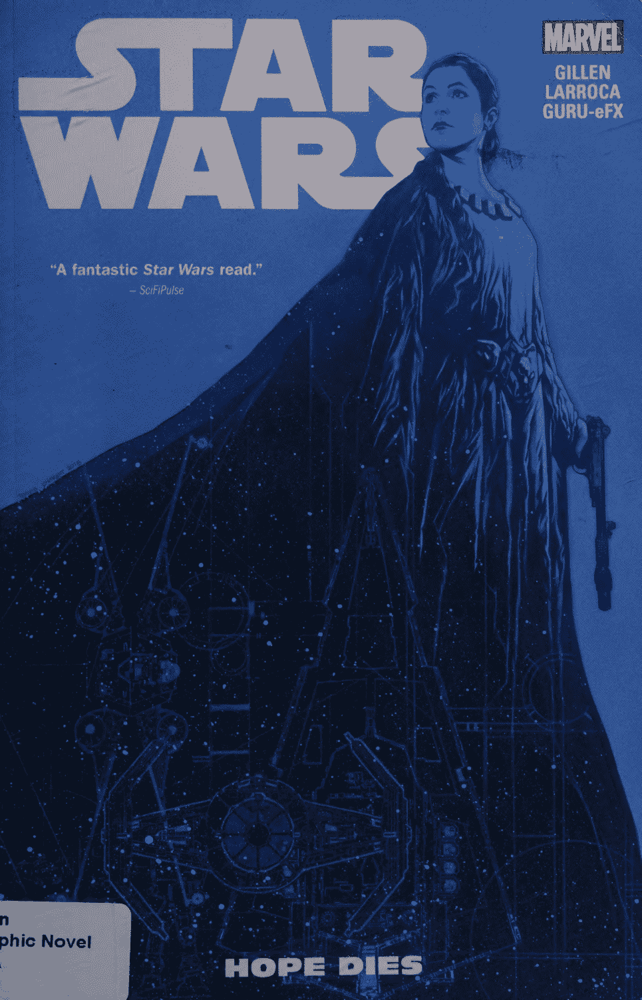

希望破灭

# 想知道探索漫威星际大战宇宙的最佳方法？本指南将告诉你从何开始！

在这些合订版中，跟随卢克、汉和莉娅的冒险吧！

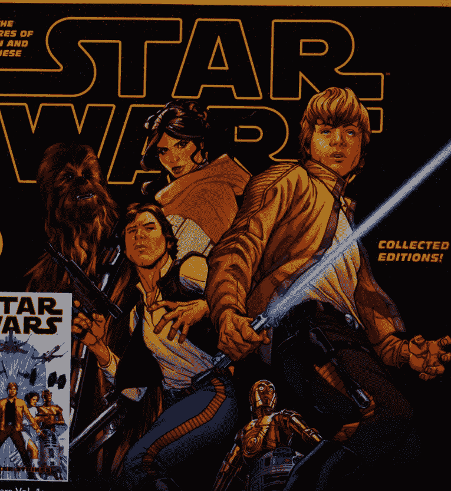

希望破灭

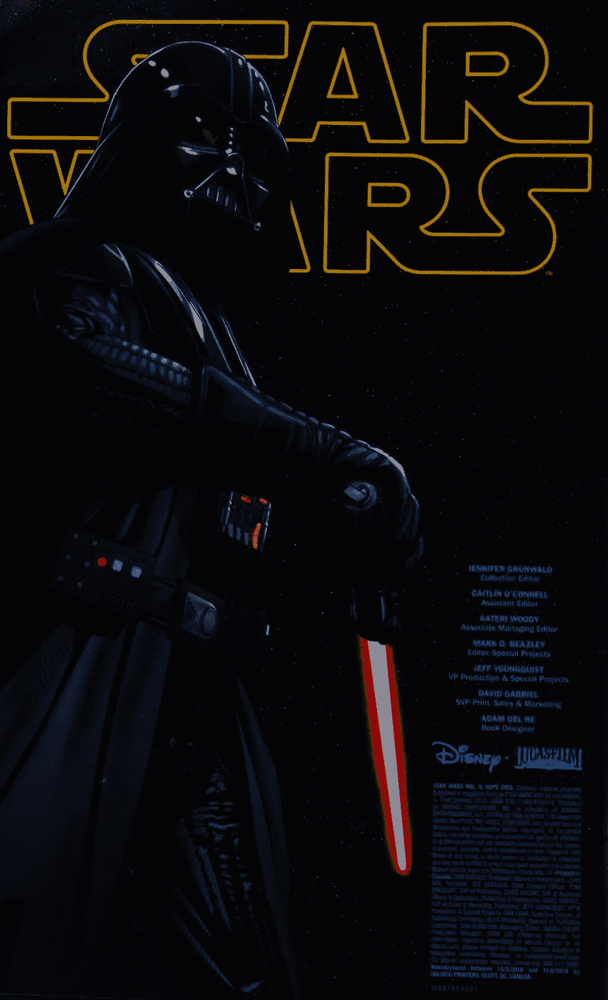

## 希望破灭

**编剧** KIERON GILEN  
**漫画** SALVADOR LARROCA  
**色彩绘制** GURU-eFX  
**封面艺术** TRAVIS CHAREST (#50) & DAVID MARQUEZ (#51-55) 联合 JESUS ABURTO (#51), MARTE GRACIA (#52-53), PAUL MOUNTS (#54) & TAMRA BONILLAIN (#55)

### “舒-托鲁恩还活着”

**编剧** KIERON GILEN  
**漫画画师** GIUSEPPE CAMUNCOLI  
**上墨** CAM SMITH  
**色彩** JAVA TARTAGLIA  
**字体** VC's CLAYTON COWLES  
**助理编辑** TOM GRONEMAN  
**编辑** MARK PANICCIA

**编剧** CULLEN BUNN  
**漫画** ARIO ANINDITO, ROLAND BOSCHI & MARC LAMING  
**色彩** JORDAN BOYD & ANDRES MOSSA  
**字体** VC's CLAYTON COWLES  
**封面艺术** TRADD MOORE & MATTHEW WILSON  
**助理编辑** HEATHER ANTOS, TOM GRONEMAN & EMILY NEWCOMEN  
**编辑** JORDAN D. WHITE 联合 MARK PANICCIA

**总编辑** C.B. CEBULSKI  
**首席创意官** JOE QUESADA  
**总裁** DAN BUCKLEY

代表卢卡斯电影：

**助理编辑** NICK MARTINO  
**高级编辑** ROBERT SIMPSON  
**执行编辑** JENNIFER HEDDLE  
**创意总监** MICHAEL SIGLAIN  
**卢卡斯故事组** JAMES WAUGH, LELAND CHEE, MAT MARTIN

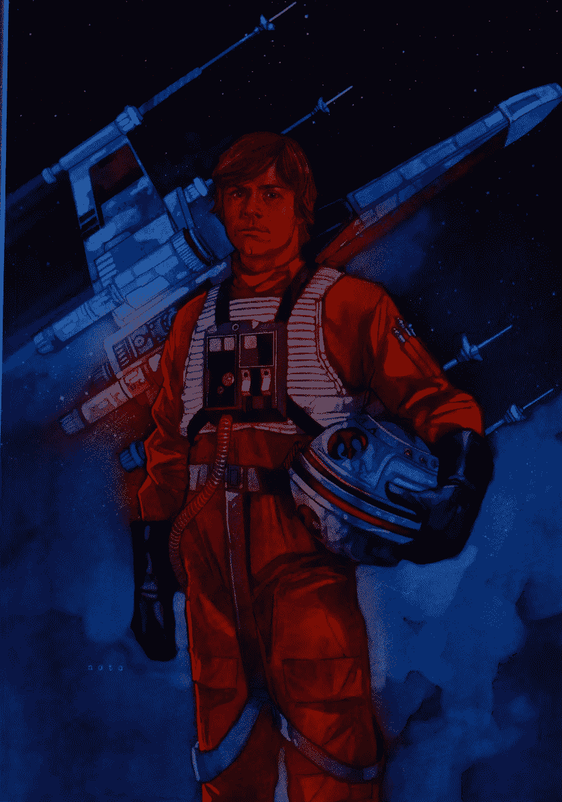

PHIL NOTO 绘制的《星际大战》50期变体版

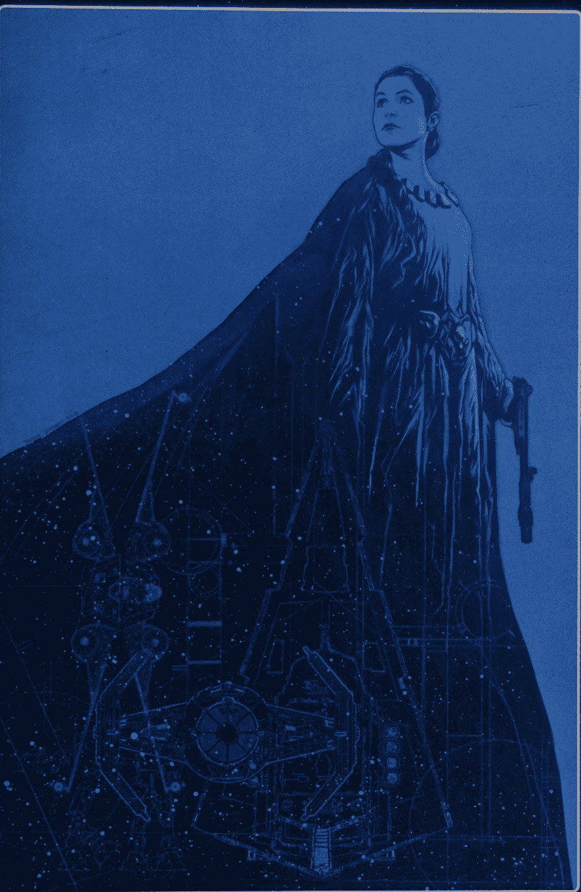

## 希望破灭

邪恶帝国杀害了他们心爱的国王，这引发了蒙卡拉马的公开起义！

得益于阿库巴将军的及时反击，以及卢克·天行者、莉娅公主和汉·索罗等英雄的努力，蒙卡马里强大的舰队现在已准备好与反叛军一起为和平与正义战斗。

拥有新舰船和新盟友，反叛军终于准备好认真从帝国手中夺回银河系。但反叛军最近的胜利也归功舒-托鲁恩的特奥斯女王以及她加入我们的事业。但特奥斯可能有她自己的计划....

## 蒙卡马里反叛军基地。

> 莉娅，你父亲会为你骄傲的。
>
> 谢谢，蒙。我应该去确保特奥斯女王住得舒适。
>
> 为了让我们到达这里，她付出了很多努力……
>
> 噢，莉娅，我直接的赞美可能让你很尴尬了。
>
> 我猜今晚对你来说会是个疲惫的夜晚。
>
> 每个人都想见你……
>
> 特奥斯！承认吧，你在这里让我有点意外。我还以为反叛军的大英雄会亲自指挥其中一艘船呢……
>
> 我并不是指挥官。将军邀请我登上他的船，但我更愿意留在这里和你们在一起。

## 希望破灭

邪恶帝国杀害了他们心爱的国王，这引发了蒙卡拉马的公开起义！

得益于阿库巴将军的及时反击，以及卢克·天行者、莉娅公主和汉·索罗等英雄的努力，蒙卡马里强大的舰队现在已准备好与反叛军一起为和平与正义战斗。

拥有新舰船和新盟友，反叛军终于准备好认真从帝国手中夺回银河系。但反叛军最近的胜利也归功舒-托鲁恩的特奥斯女王以及她加入我们的事业。但特奥斯可能有她自己的计划....

## 蒙卡马里反叛军基地。

> 莉娅，你父亲会为你骄傲的。
>
> 谢谢，蒙。我应该去确保特奥斯女王住得舒适。
>
> 为了让我们到达这里，她付出了很多努力……
>
> 噢，莉娅，我直接的赞美可能让你很尴尬了。
>
> 我猜今晚对你来说会是个疲惫的夜晚。
>
> 每个人都想见你……
>
> 特奥斯！承认吧，你在这里让我有点意外。我还以为反叛军的大英雄会亲自指挥其中一艘船呢……
>
> 我并不是指挥官。将军邀请我登上他的船，但我更愿意留在这里和你们在一起。

> 莉娅，你父亲会为你骄傲的。
>
> 谢谢，蒙。我应该去确保特奥斯女王住得舒适。
>
> 为了让我们到达这里，她付出了很多努力……
>
> 噢，莉娅，我直接的赞美可能让你很尴尬了。
>
> 我猜今晚对你来说会是个疲惫的夜晚。
>
> 每个人都想见你……
>
> 特奥斯！承认吧，你在这里让我有点意外。我还以为反叛军的大英雄会亲自指挥其中一艘船呢……
>
> 我并不是指挥官。将军邀请我登上他的船，但我更愿意留在这里和你们在一起。

自从死星出现以来，我没见过那么大的阵仗。

维达。

必须是。

所有战斗机，立即发射！

发射序列已清除，并且……

不。

呜呜呜呜——

别担心，阿尔塔二。

会没事的。

等一下！

停止！

什么？

取消发射。

库门没有响应。

长官……

库门被锁死了。

全部锁死了。

通讯中断。

火炮阵失效。

超空间引擎和推进引擎已失效。

现在我们无法发射战斗机了。

所有的工作。所有的努力。

这一切是为了什么？

就变成靶子练习吗？

好点。

距离最近的巡洋舰，把它摧毁。

派安保小组进入三号舰，抓住她！

一定有覆盖指令的！

他们正往下面去。如果我们能——

帝国军正在——

不……那是……维拉德的船。

> 护盾！全能量转给护盾！
>
> 能量不够。我们正在失去他们。

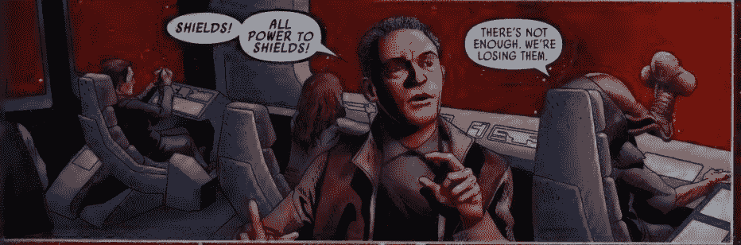

> 快！逃离飞舰！

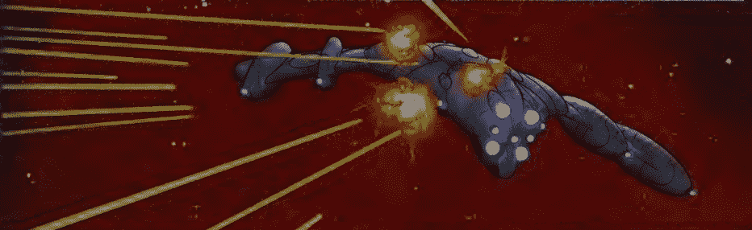

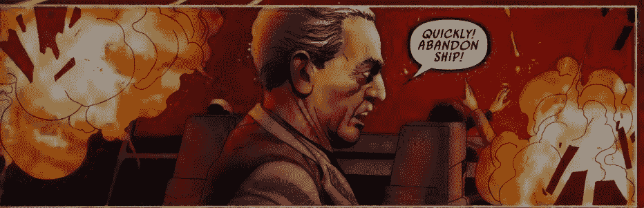

> 愿力与我们同在——

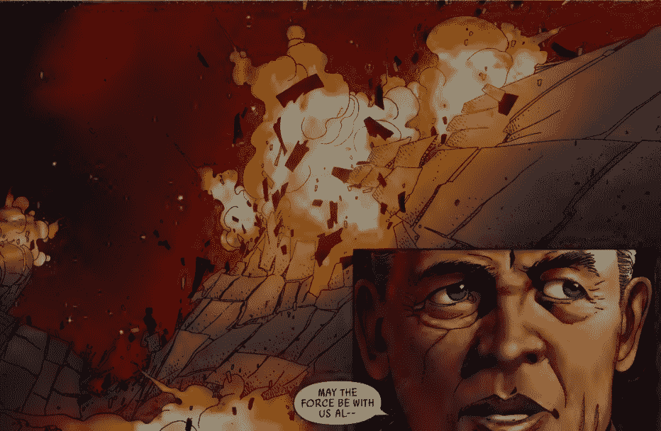

> 现在他们理解我感受他们的恐惧了。
>
> 令人满意。
>
> 下一个目标，我的主？
>
> 希望。

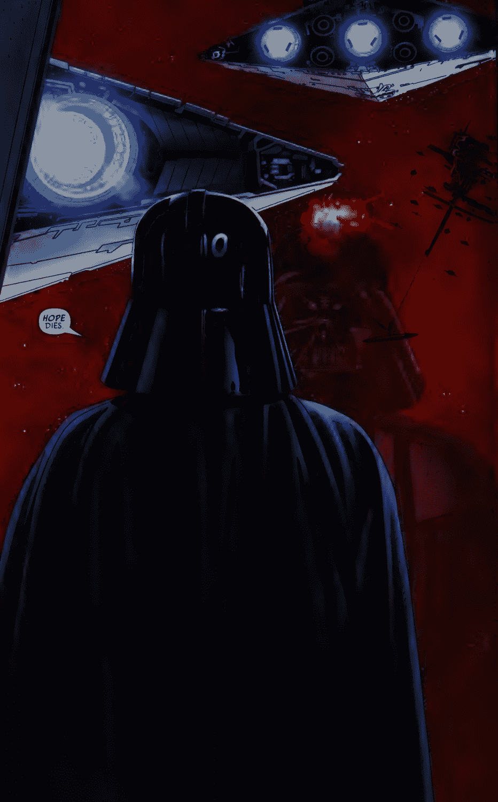

## 舒-托伦还活着了

可怕的死星超级武器已不复存在，被卢克·天行者和英雄的反抗军联盟摧毁。

邪恶的银河帝国最令恐惧的执行者达斯·维达，正负责根除反抗军并恢复银河系的秩序。

但每当对维达和帝国军取得一次胜利，反抗军就会变得越来越危险……

穆斯塔法，

几个月前……

你是带着借口来的，奥泽将将……

分享它们。

死星的毁灭激发了反抗情绪。

为我们的工程项目获取资源的尝试正在被延迟，实际上在工作中被阻败。

我们反击，但只能找到较小的反抗军目标。他们同时无处不在，又无处寻。

或许挖掘更多词汇会有帮助。我们没有死星，但一支能提供全球范围轰炸的舰队可能具有足够的威慑力？

至少，我们需要更多的力量——你的死神中队必须立即投入。我们继续这样太荒谬了

> 荒谬？
>
> 维达勋爵，我……我……没有无礼的意思。
>
> 你想表达的意思对我来说并不重要。
>
> 我诚挚地道歉，但问题仍然存在。
>
> 我们如何才能消灭这些虫子？

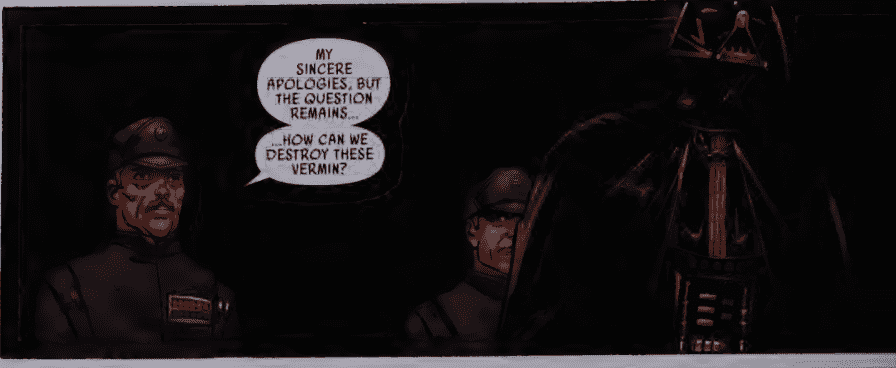

> 你错了。它们不是虫子。它们是杂草。
>
> 可惜，我们是风暴。

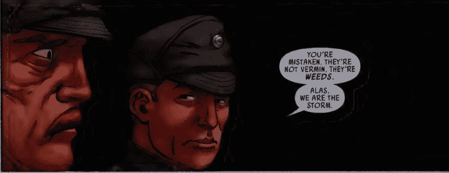

> 风吹起时，杂草弯曲。风暴过去，它们就毫无还之力。
>
> 如果反抗军是一棵树，情况就会不同……

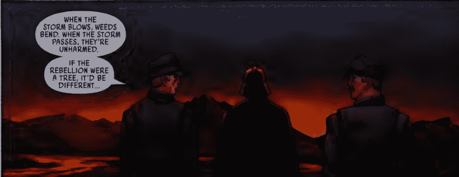

> ……在此之前，它们将继续从我们指缝溜走。

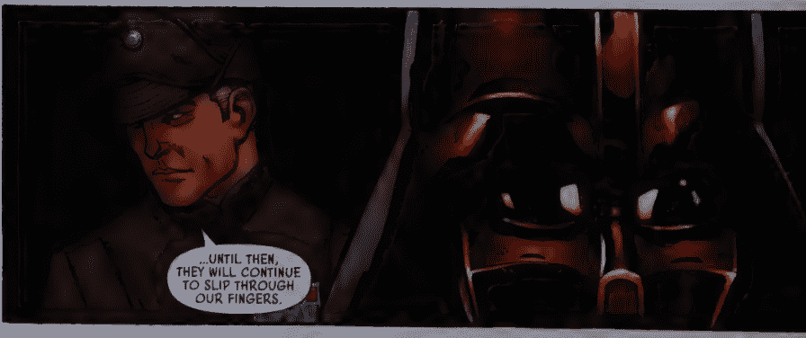

没有一个星系敢反对皇帝。你抓得越紧，越有星系从你指缝溜走。

嗯。维达勋爵？

这个观点很有趣。我们将这样做。

> 这样会使那些男爵们之间产生内斗。

舒-托伦。

接下来的日程是什么？

与其中一名帝国官员定期会面，陛下。

很好。派记录员进来，准备好关于底层的报告。

在参加他们的外交晚会之前我需要研究这些报告。

很好，欢迎。

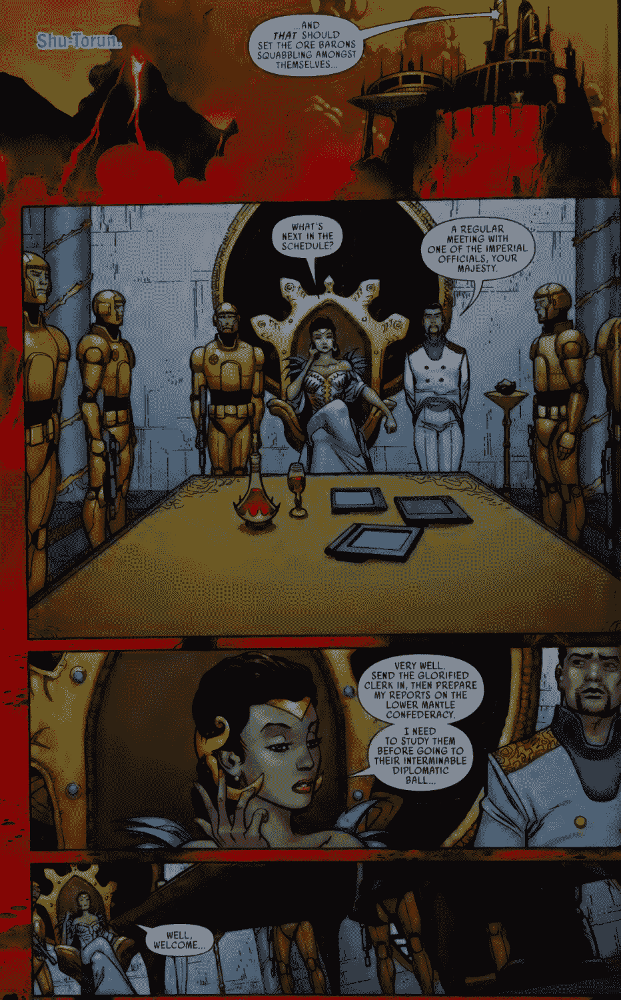

> 维达勋爵，我什么都没做！我只是一个忠诚的仆人！
>
> 为了所有美好的事物，放下你的武器。

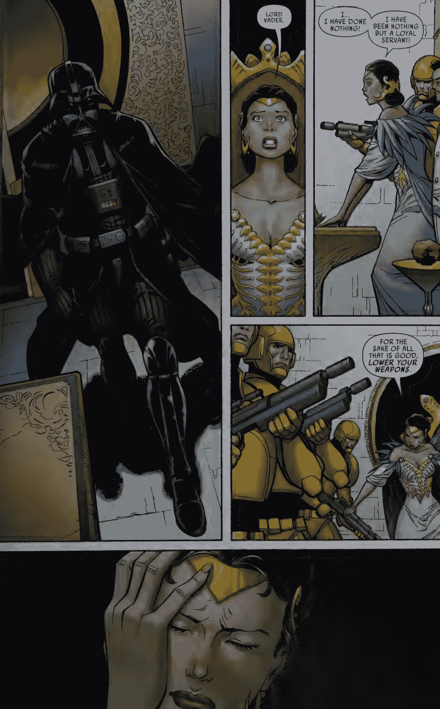

我如何能帮您，维达勋爵？

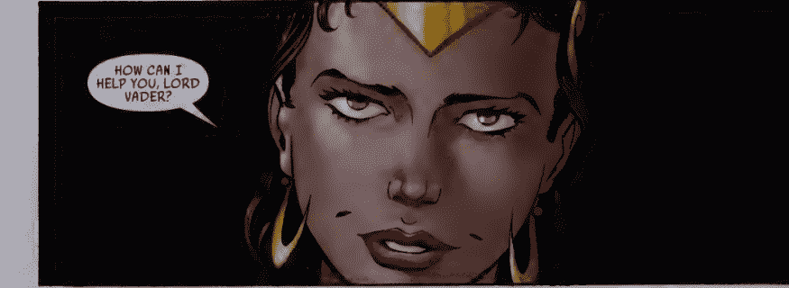

当然，这是我们的请求——

帝国需要你的专家去挖掘杰达的遗址。

你将向反抗军提供情报。

这足以完全破坏我们的努力。

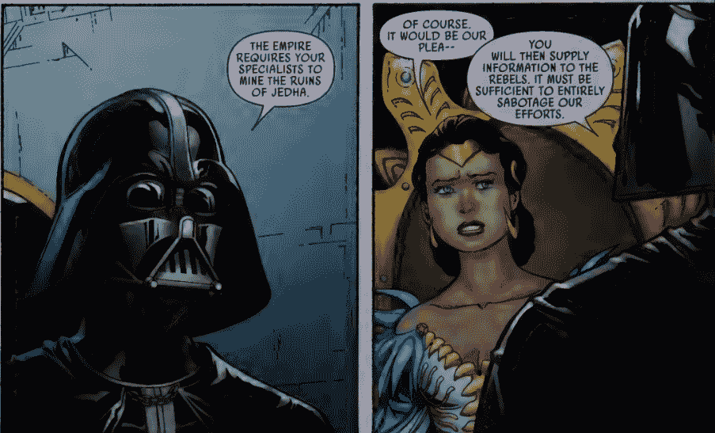

那么在他们的舰队完成并在他们躲藏之前，

我们将让他们看到他们到底有多弱。

你将渗透反抗军。

他们正试图建造一支舰队。

你将竭尽全力使自己变得不可或。

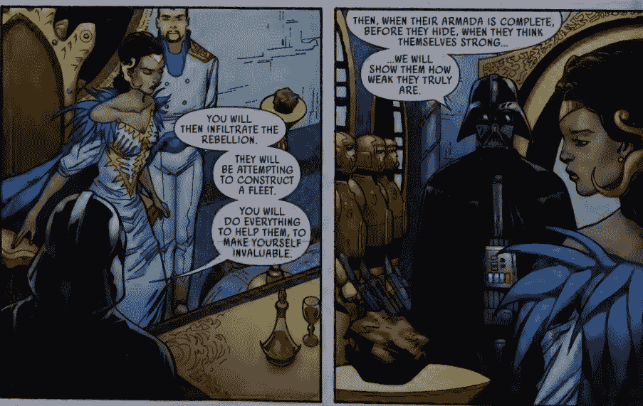

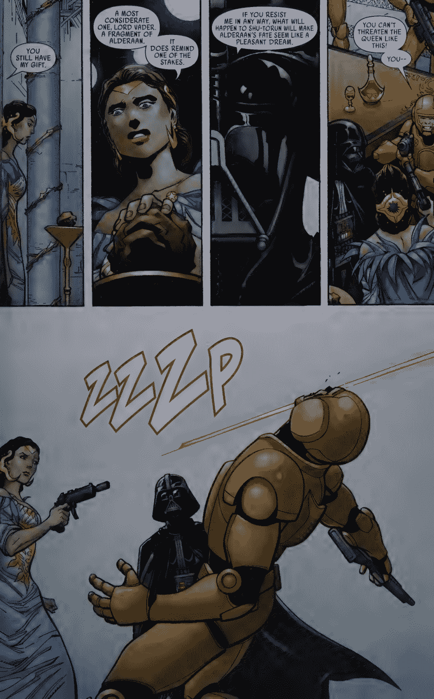

维达勋爵是我们的贵宾。

他可以随心所欲做什么。

特里奥王后的家人会愤怒——

你不明白。维达可能会杀死你们所有人。

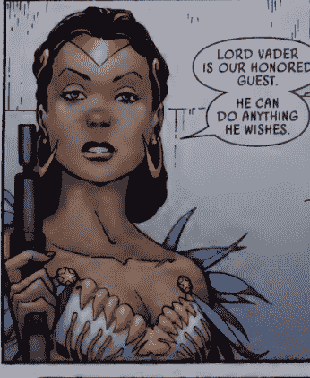

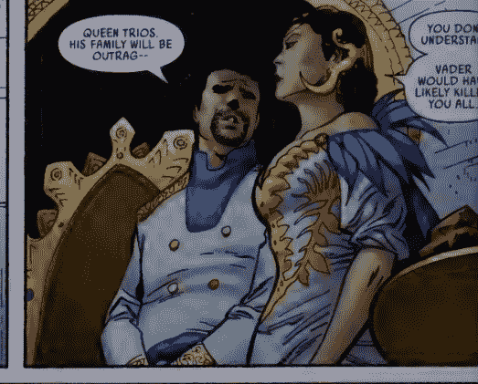

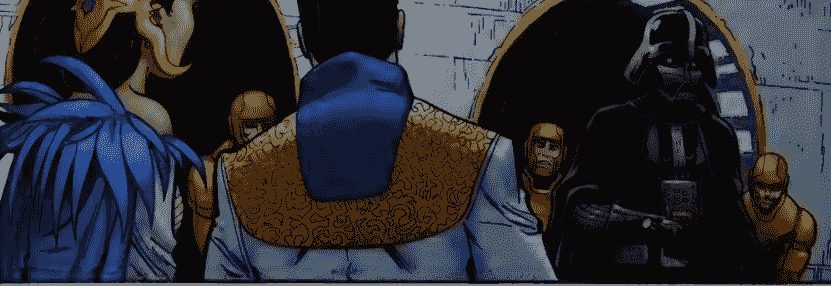

噢，我我是个傻瓜。

维达勋爵，请做我的客。

没有见证者，对吧？

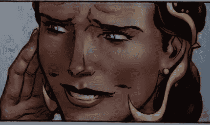

> 我相信……他们是可以牺牲的。
>
> 维达勋爵。只要舒-托伦还活着，每个人都是可以牺牲的。

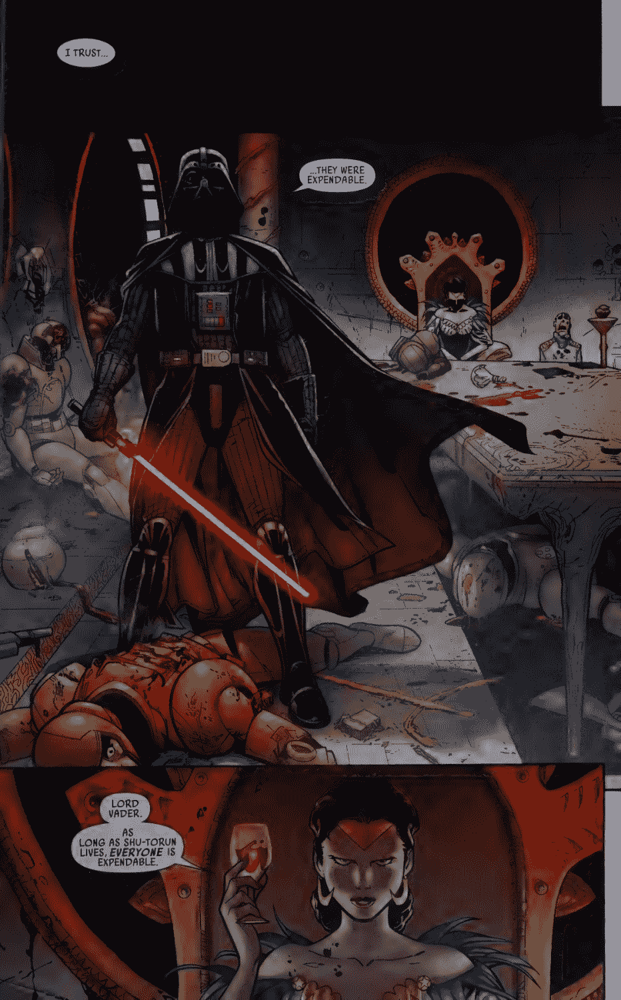

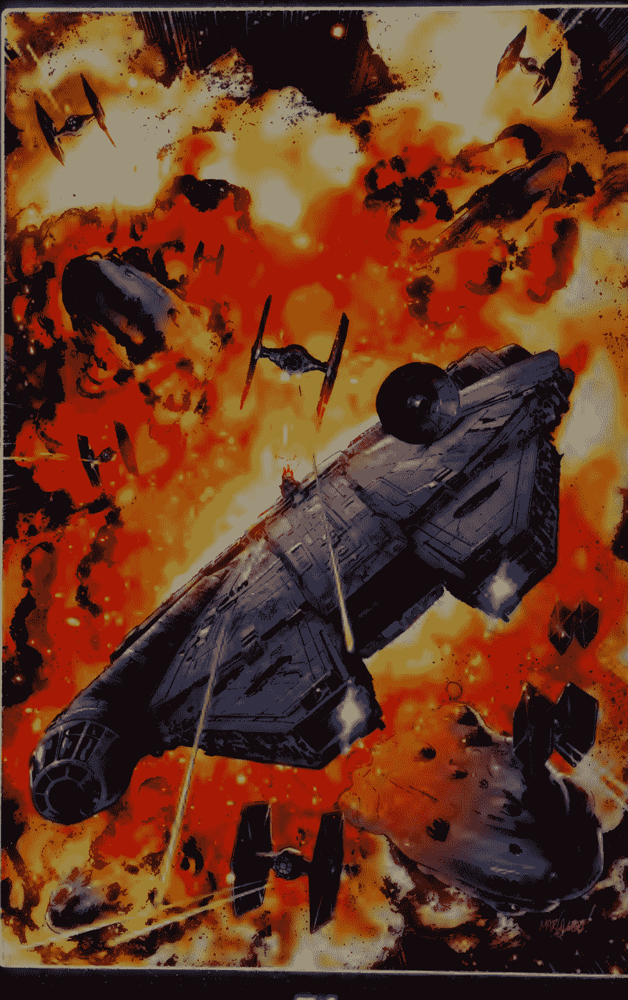

湖-塔基地。

欢迎登舰，特里奥王后。

您的指令是？

立即。

是的，陛下。

很抱歉，马科-塔基地拒绝了许可。

当然。如果失败了，我们需要逃跑。

遗憾地报告，我们的气闸已被破坏。我们的反抗军正试图强攻。

好吧，他们比我们想象的要聪明。我们需要时间。等一下。

让他们冲进来吧！

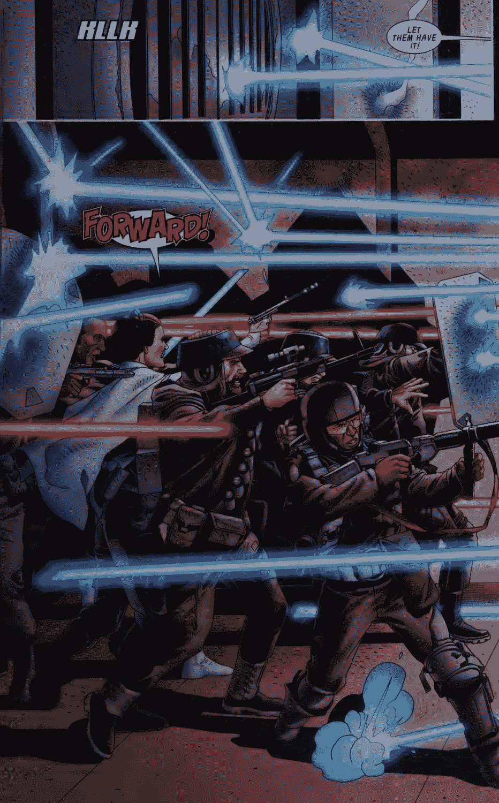

小心，卢克。

你太贵了，不能失去。

每个人都太贵了，不能失去，但外面都在死光。

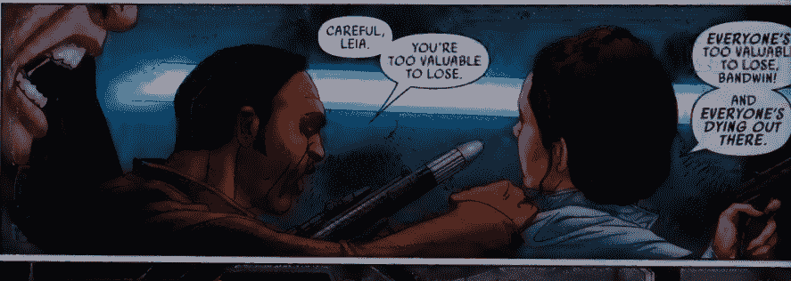

她在那儿！

卢克！后退！

这是我们唯一的选择。

她逃不掉。

停下，你这个叛徒！

我说停下！

我想这是件好事。

我们可以告别了。

你哪也去不去。

太好了，就……

> 为什么要背叛我们，托伦？为什么要破坏整支舰队？
>
> 噢，卢克告诉过你，帝国不会舒-托伦的终结。我说过我会竭尽全力阻止这一点。我做到了。

逃脱了，逃生舱。

希望她被帝国军击落了，你这个叛徒。

德拉文将军，告诉我，我们有什么可以利用的东西……

我们仍在努力从舒-托伦（Shu-Torun）数据库中提取可以利用的信息。目前收获不多……但看来破坏者正控制着关键系统。我们很庆幸没有在护盾附近的任何地方使用舒-托伦的技术。

不过，我们还有一个方案……

有舒-托伦的干扰器阻止了我们对战斗机库舱门的直接控制。大门被密封了，无法手动打开。

不过，只要飞船发射反抗军信号，近距离感应器仍然有效。

所以我们向它们飞过去，舱门就会打开。

我们需要把它们带送到巡洋舰上。战斗机可能是决定性的。它们能为我们争取时间。

但马科雅（Mako-Ya）上没有战斗机。我们必须乘坐穿梭机出去。除非发生奇迹，否则无人通过。

你说得对，莉娅。外面大家都在送命。我训练过半的飞行员。我来。

> 路线设定完毕。出发。
>
> 一艘穿梭机已从马科基地发射，维达勋爵。
>
> 战斗机正在交战。
>
> 它们追上我了。
>
> 飞船太慢了。我——
>
> 抱歉。我——

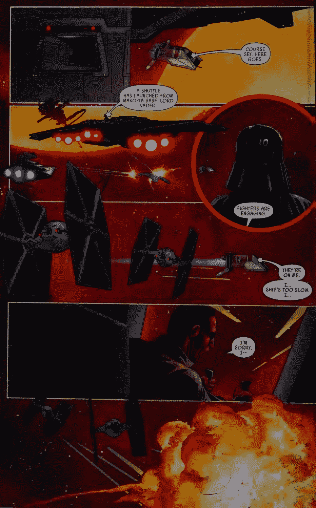

他……他是最优秀的驾驶之一。但他没能成功。

我们必须再次尝试。

没有其他选择。

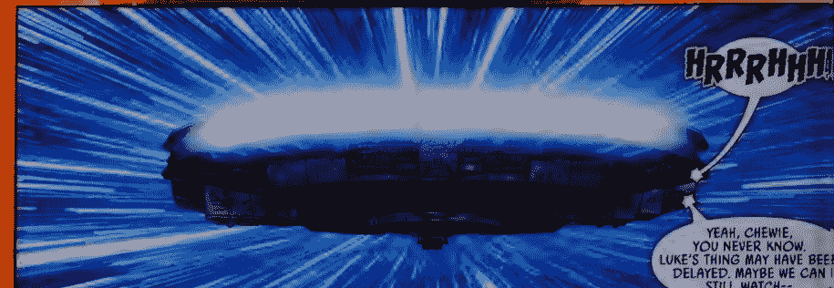

唔！！！

是的，切维，你永远不知道。卢克那边可能只是迟了，但我们还可以看——

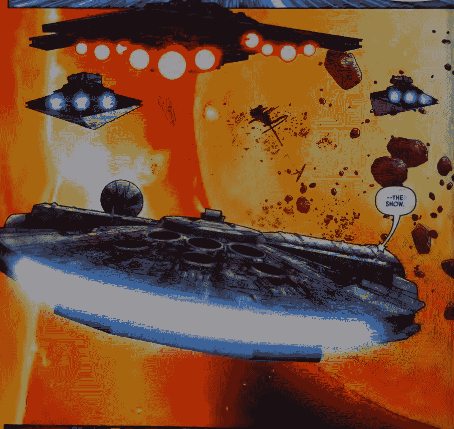

——这场戏。

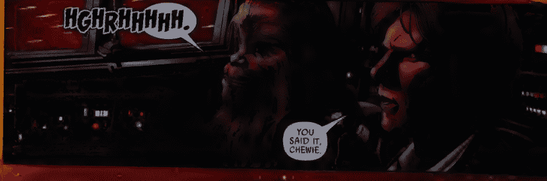

咕噜。

你说得对，切维。

> 也许这只是某种战争游戏，勋爵？给贵宾们准备的象征性展示？
>
> 这才不是战争游戏！金杆！这是帝国军见过最疯狂的场面！
>
> 向马科塔基地发送信号，看看能不能叫到人……
>
> 呃……你好？我是 C-3PO。礼仪机器人，在为莉娅公主及同伴效力期间损毁了。
>
> 有人能听到我们的声音吗？

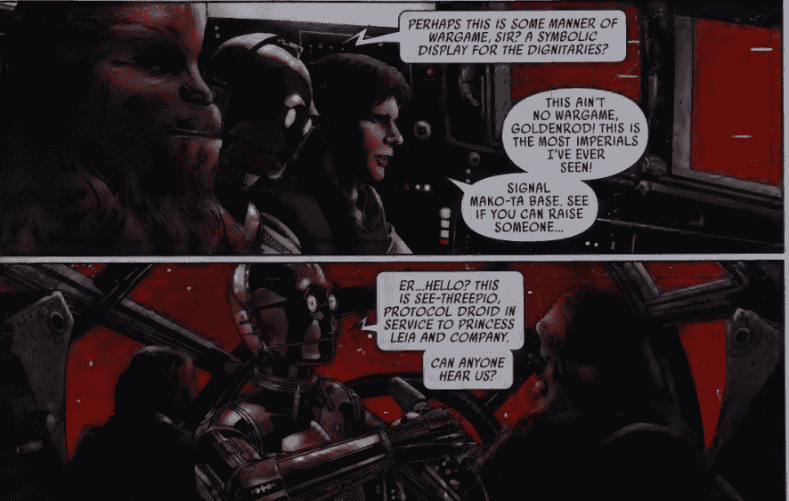

> 哈好？

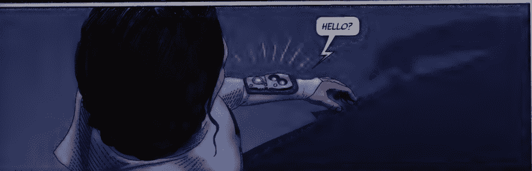

> 噢，C-3PO，听到你的声音我太高兴了！汉在吗？我们需要——

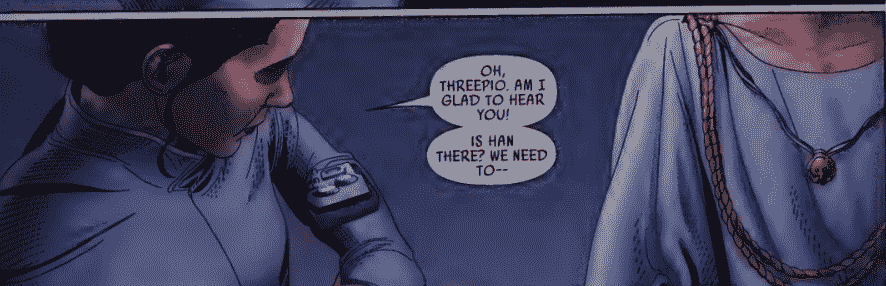

> 耶，我在这里。但慢点，公主。告诉我发生了什么——

> 汉！

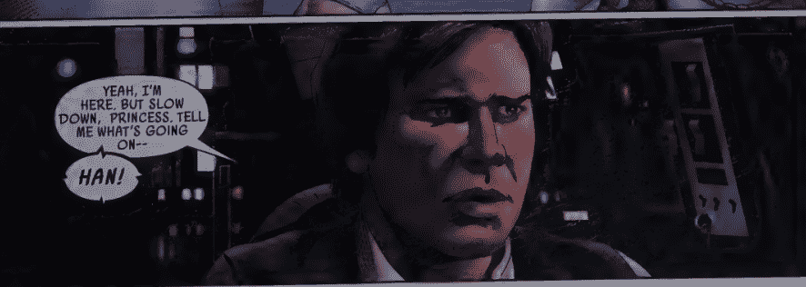

完蛋了，我们。她在分散撤离前摧毁了所有反抗军巡洋舰。它们现在毫无防备，无法移动，且无法发射战斗机。我们正试找出该怎么办……

对接门已封锁，但它们的感应器仍然有效。如果有一艘飞船向舱门飞去，它就会打开。

很好，告诉他们，让那些战斗机飞这里来！

他们的通讯也断了。我们做不到。我们需要有人去告诉他们。

等一下——你真的是在让我自己去那里，对抗整个舰队，然后冲向一个可能打开也可能打不开的密封门吗？

嘿！把那套说辞留给那些会信那套鬼的人吧。我去。

唔。

是的，我知道。

这下最好能让她印象深刻。切维——去机炮塔顶端的旋转炮。好……你擅长护盾吗？勋爵，我精通六百万种形式的交流，但我并没有被植入护盾管理程序。生死攸关的时刻是巨大的动力，而且如果我们紧贴一艘处于平衡的歼星舰的话……

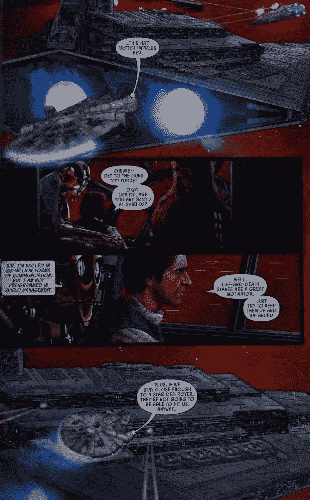

这简直是折磨，汉独自一人在外面。

我们能做的就是眼睁睁看着飞船一接一地坠毁——

呜——啪！

什么？

哔哔——哔哔！

阿尔图？

你在做什么？

嘎吱咔吱。

三三三三波？

长官！噢，这一切都太糟糕了！

丘巴巴卡大师把我推进了密封舱，然后把它像投射物一样发射出去！它撞击在了表面上，我不得不一路爬到气闸对接口……在我的份上！

这完全不在我的程序设定范围内，各位！（等等，原文写着"THIS IS NOT IN MY PROGRAMMING ALL!"）

三三波，但是为什么？

噢，是的！当然了。

索罗大师告诉我，只要你直接朝着舱门飞过去，门就会打开。好像是因为安全机制正在运行的。

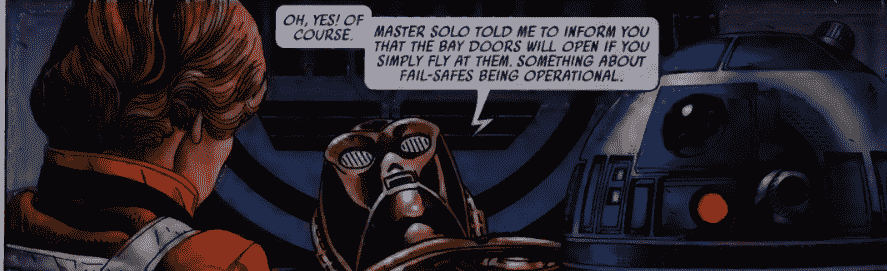

直接朝它们飞过去吧！

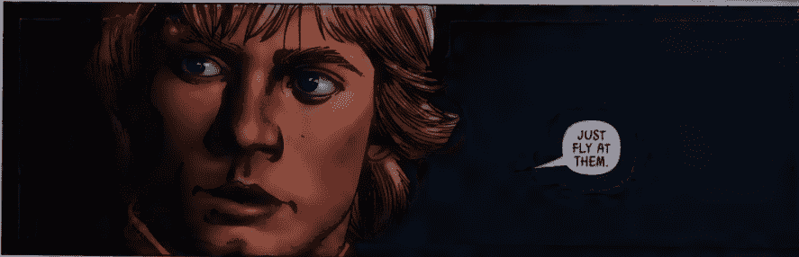

大家！准备好发射！

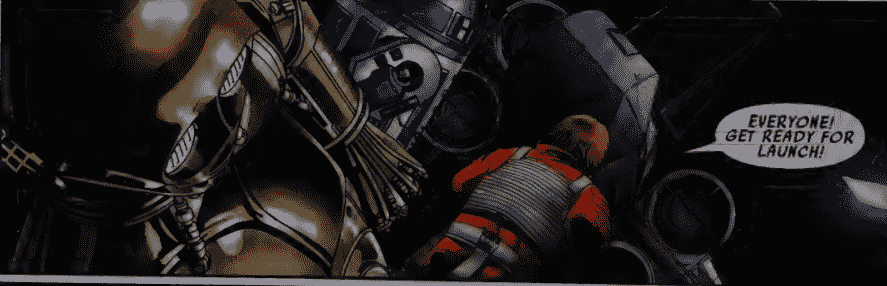

上船！现在！

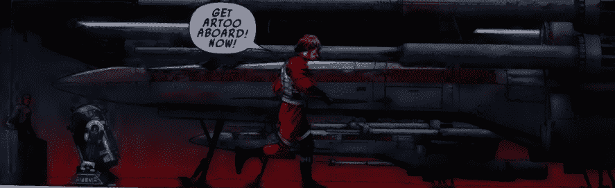

放弃武器，斯凯沃克！

将军，汉传回消息了！

相信我，门会打开的。没时间浪费了！

也许会吧，但我们需要先进行测试！

明白了，斯凯沃克！放弃任务！

好吧，我想这就是珍恩当时的感受……阿尔图，有开启的迹象吗？

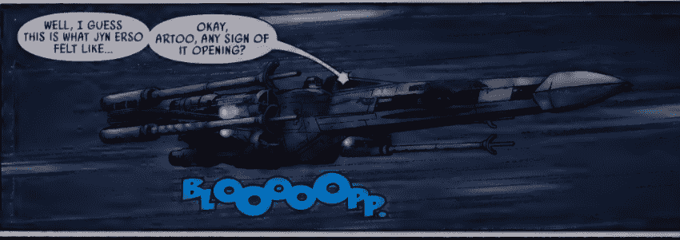

等一下——那是“我不确定它会吗”的意思吗？

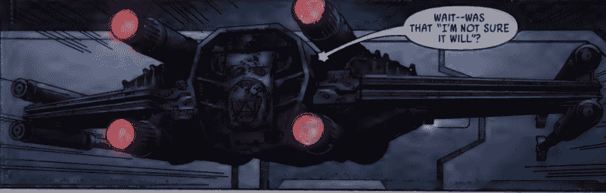

太极了

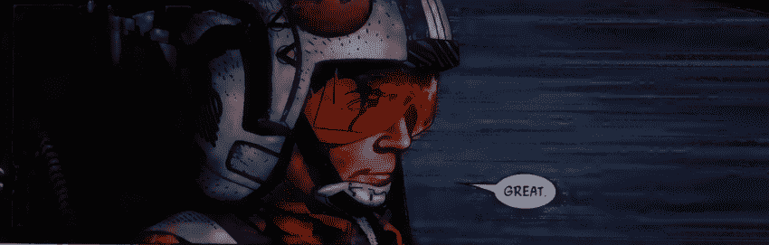

我信任原力，我拯救银河。

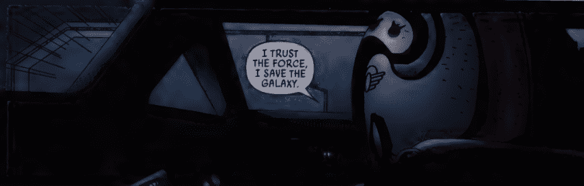

但如果我死了，那是因为我信任了三三波。

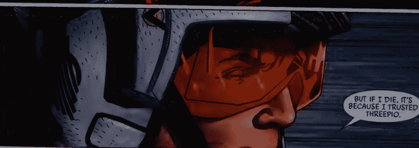

是的！我从未怀疑过你。

他成功了！大家！发射！

凡是卢克的，走吧。

有同伴在的感觉不错，韦奇。

没时间感性了，卢克。我们需要投入战斗。

那么，飞行领队……我们的代呼号是什么？

你知道的，韦奇，如果我们表现得像珍恩那样，我必须不同意。

现在是感性的时候了。

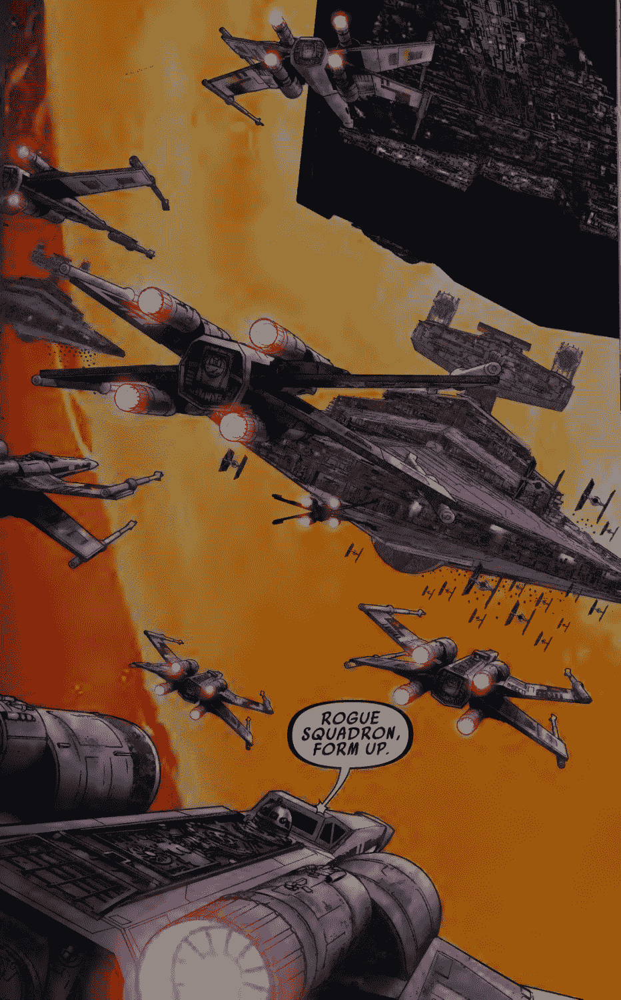

流氓中队，结队。

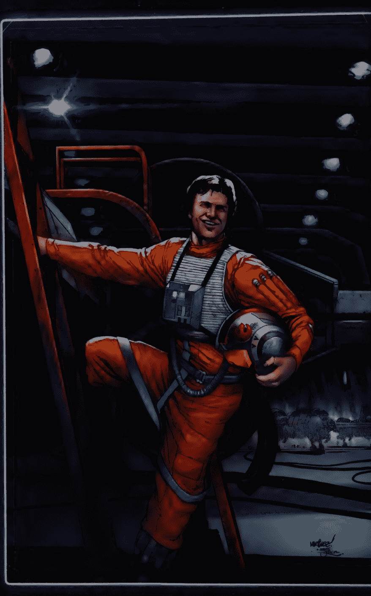

## 马科塔。反抗军基地。

不，不，不。

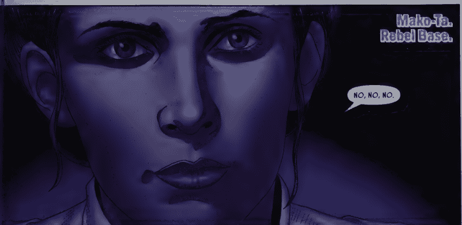

那是谁？

汉，他对那艘飞船非常自豪。第一艘完全配备的飞船。第一艘通过测试的飞船……

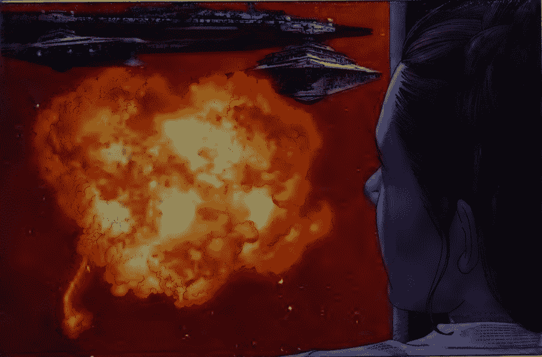

德文！突破“反叛号”的进度如何了？本该有测试的。由于那艘飞船的配置，由于安全机制正在运行，由于由于由于由于由于由于。

维达勋爵很快就会来这里。

房间将准备就绪……

等等，你不是——

我们进来了。出发吧。

莉娅，看……

另一艘巡洋舰坠毁了。这是我们不能在这里失败的另一个理由。

不，莉娅笨蛋。

离开这里。

在他发现我们之前。

你无法逃避黑暗面的力量。

GHGHGHHHHHH！

我知道！我知道！

我不像你那样喜欢这种局面。他们根本没生产兽人尺寸的战斗机。又不是为了腾出空间就能从Y翼战斗机上撕下一个座椅。

见鬼，反正你也不想开那种东西。那就像是骑着曼兽进行狗斗。

卢克，“隼号”报废了。我坐在一架X翼战斗机上，正出来。

HHRGCHHHHH

是的，丘维。别担心，我会回来的。我经历过比这更糟糕的困境。

事实上，我收回的话。

## 准确的

快！

维达随时可能发现我们。

快了……公主。正在提取最后的几个文件并……

……拿到了。所有的代码。一旦我们回到舰队，就能重启巡洋舰。

离开这个巨兽最快的方法是什么？

小射线？运气好的话，我们可以带一艘穿梭机离开这里。

后卫----报告？我们正被追击吗？

报告？

他来了。

维达对安全部门：我的怀疑得到了证实。船上有反抗军。

向我的区域集合。我将继续追击。

我感受到了他们的恐慌。

移动！对经过的任何门运行锁定代码。也炸掉控制面板。

如果我们被困住，一切就结束了。

如果我们封锁这扇门，就会切断杂兵与机库的联系。

他们需要切割工具才能通过……

ZZZP

SSSHHR

是的，“切割工具”。

我们很快就会担心那个的。去机库……

“希望他们有一架战斗机。”

一艘船。

太极了。

库罗斯----看看你能不能破解对接安全系统，让这架帝国战机准备就绪。

是的，先生。

德文将军——你应该是那个把代码带回舰队的人。

我会带领后卫——看看我能否慢得足够快，给你们离开争取时间……

这也是我的责任，我想要的是派拉去对抗部队，而你会比我做得更好。现在，只要答应你会这么做。

带着最大的敬意，莉娅公主，在这架该死的战斗机里！一直困扰我的是，我必须当英雄结果却错了。我希望我们有时间成为朋友。

谢谢。

就位。交战演习，如果这还有点价值的话。我真想要一个喷火器……看到他着火将是奇妙的景象。我们争取的每一秒都能拯救大局。我们不知道是否会产生影响。我们希望我们能。

我们……赢了。我们所做的……只是……慢下来。祝贺你们。

你有全动力了，莉娅……去！去！不。

好了。推力、控制、武器。系统？在哪在——不！嘿！卢克！一个幸运的飞行员从我身边溜了。他正朝你这边过来。我在追击他们，汉！

他们很厉害。这该死的东西里把通讯放在哪儿？他们真的……但还不够。通讯是在飞行员头盔里，对吧？我一句话也说不出来。

这种感觉……不对。扫描仪有发现关于这架帝国战机的任何东西吗？尝试发信息。没有回复？极了。得以某种方式表现我是友好的。代码？也许我脉冲一下引擎？噢，我有主意了。你知道的，卢克……抛开他们没有向我们射击的事，他们甚至不像学院训练的飞行员。

而且别那样。这到底是怎么了？无论如何，他们在我们这一边。我直知道。流亡中队！向我集合并保护这架帝国战机。无论它要去哪儿？我们把它们送到那里。

噢，好痒！大师……

噢，我无法相信我竟然如此无礼。

我是三比，人类-半机器人关系专家。我该如何称呼您？

我太感谢了，大师！我的二极管暴露过度。现在感觉很舒服吗？保持舒服是我所能做的。在可能的情况下发挥作用，有时那是我们所能做的。

大师！但你不是应该做些别的事情吗？这听起来是个很感想法，而且——大师。

外面发生了什么？战斗似乎正朝我们这边来。有人要降落。

汉！我需要帮助。我想它正试图降落。但如果没有反抗军感应器，机库门就不会打开。我们需要保持门开启。在帝国战机后面排型，紧点！是的，是的。我知道这种演习。如果我们不保持门开启，那架帝国战机将直接撞在门上，我们所有的努力就白费了。真绅士。

卢克！注意上方！我必须保持对准！阿图！调整偏转器！阿GGH！阿ROOO？立刻把这个传到终端！我明白了。

卢克——你还好吗？大惊，我会没事的。而且——莉娅！

维达对安全部门：我的怀疑得到了证实。船上有反抗军。向我的区域集合。我将继续追击。我感受到了他们的恐慌。移动！对经过的任何门运行锁定代码。也炸掉控制面板。如果我们被困住，一切就结束了。如果我们封锁这扇门，就会切断杂兵与机库的联系。他们需要切割工具才能通过……ZZZP SSSHR 是AH，“切割工具”。我们很快就会担心那个的。去机库……

“希望他们有一架战斗机。”一艘船。太极了。库罗斯----看看你能不能破解对接安全系统，让这架帝国战机准备就绪。是的，先生。德文将军——你应该是那个把代码带回舰队的人。我会带领后卫——看看我能否慢得足够快，给你们离开争取时间……这也是我的责任，我想要的是派拉去对抗部队，而你会比我做得更好。现在，只要答应你会这么做。带着最大的敬意，莉娅公主，在这架该死的战斗机里！一直困扰我的是，我必须当英雄结果却错了。我希望我们有时间成为朋友。谢谢。

就位。交战演习，如果这还有点价值的话。我真想要一个喷火器……看到他着火将是奇妙的景象。我们争取的每一秒都能拯救大局。我们不知道是否会产生影响。我们希望我们能。

我们……赢了。我们所做的……只是……慢下来。祝贺你们。你有全动力了，莉娅……去！去！不。

好了。推力、控制、武器。系统？在哪在——不！嘿！卢克！一个幸运的飞行员从我身边溜了。他正朝你这边过来。我在追击他们，汉！

也许脉冲一下引擎？噢，我有主意了。你知道的，卢克……抛开他们没有向我们射击的事，他们甚至不像学院训练的飞行员。

> 汉·索罗，致电反叛军中队。

> 这些小型的运输机毫无防御，请让它们编队。并护送它们前往巡洋舰。

> 嘿，阿图图？！

> 对汉好点儿！

> 这只是一个任务。我很快就会回来和你们一起一起飞的。

> 我还以为三皮奥才是那个神经质的人，卢克。

> 噢……

> 我不确定我是否能做到这个……

> 协议是，我负责让这些船飞起来，这样我就不用真的去驾驶一架。

> 你表现得很好，梅尔蒂。大家表现得很好。

> 让我们拯救世界，然后赶紧离开这鬼地方。

> 嘿，铁斑桶。如果你那么讨厌和我一起飞，你可以直接把自己弹射。

莉娅呼：马科-塔基地。

能听见我的吗，蒙·莫斯玛？

我听到了，莉娅。

有什么消息？

让所有大使都准备好登船。这上面的空间足够救下所有人。我们正在靠拢。

小心！

有一架提战战斗机正朝着——

> 啊啊啊！

> 不！不！不不不！！！

> 嘿，梅尔蒂。让它降落。

> 相信我，我不会让那些提战战斗机靠近你的。

> 谢谢，汉，这来了……

辛杜拉将军报告，我的巡洋舰已经就位并准备就绪。

覆盖代码正在分发给其他…………

> 嘿，多多纳？计划是什么？

等待剩下的巡洋舰重启然后出发。每个人都有了安全的目的地。

执行计划。分散舰队。

你们听见那男人的说了，直到他们？

让帝国见识一下厉害！

那是自然！

我们做到了，

阿图图！

我们做——

呼——

哔哔！

什么

意思，

阿图图？再试

一次！

如果大使

能逃脱，我们就能保持

反叛军的延续。

这绝对

至关重要。

就像拯救你一样，

蒙。快上船。

船只

即将进入

超空间。

你听到了吗，

汉？准备好跳跃。

汉？

你在那里吗，

汉？

所有剩下的巡洋舰已上线，长官……

但我们的引擎被击中了。

我们哪也去不了。

谢谢你，海米，我很抱歉。

立即命令分散。

我们会守住后方。

汉？你能——该死的——我？

汉？

是的，我是汉。引擎坏了。通讯正在失效，阿图图已经在尽力了，但什么都没用。离开这里吧，小子。

确保公主知道我是个多么勇敢的汉子，对吧？

你——该死的！

他正浮在外面。一定有办法的……

等一下——在杰达，汉有一个主意。换个规模，如果我们能找到一艘船……

主运输机准备好离开了。你需要登船。

莉娅……不能丢下他！

走吧，蒙。

我们必须尝试救汉。

所有巡洋舰报告已准备就绪。

那它们还在这儿做什么？快！

巡洋舰正在跳入超空间，维达勋。

还剩一艘……

只是瞬间。

舰队已经逃离，长官。使节们已经安全。

我们的护盾正在失效。

一切快结束了。我为你们感到骄傲。

我不知道自己会如何死去。

但有你们在一起真好。翻译器坏了，这意味着我不知道你在说什么，但我假设你是认同的。

汉，你——该死的

反叛军没有逃脱。

我们还没散开。

我们已经做到了！

我们要进入超空间……

你让我感到非常开心，萨娜·斯塔罗斯。

确实，非常开心。

而且你让我比昨天更有了一点钱。

噢，但你带给我的……

一件古代的遗迹……

我想我们不相欠了。

当西斯人兴盛且强大的时候……

达斯·阿特里乌斯的光剑。

一把致命的武器。

据说，这把剑刃中注入了太多的愤怒，它现在仍然共鸣着阿特里乌斯砍杀敌人时发出的怒火。

现在看着它……我深感自愧。

我被它震撼了。

然而，我必须问问。

另一个在哪里？

他……

她？

我不确定是否知道你在说什么。

你付钱买了光剑，你就得到了一把光剑。

别害羞了，斯塔罗斯。

你 surely知道这件武器是一套组合的一部分。

你试图----

RRR！

--欺骗我，

我绝不会容忍这样的侮辱！

老板？

你还好吗？

HRRNNN！

AAHHH！

另一个！

我要我的东西！

它在哪里？

AARGH！

SHRAZZZT SLIZZZH

URK！

我要另一把剑刃！

ZRAK K

“请走快点，是的，请走快点。”

ZARK

> 节使即将抵达，我想在那里亲自送交皇帝的赏赐。

> 这对我来说是非常重要的一天。

> 极其重要的一天。

VRRRRRRRRSSSSHHH

> 注意！

维达勋爵

我们……我代表皇帝取回了那个artifact。

我确定他会对这次收获非常满意。

砰（THUMP）

另一个在哪里？

呃……另一个我没有-

我不知道有-- --另一个-- 是从一个走私者那里买的。--她----HGRRK----GGGRK----她一定骗了……

警报所有部门。我要找到这个走私者和他的光剑。

是的，维达勋爵。

SKRRRK

被一个普通罪犯欺骗了。你对皇帝的失败简直有些可怜。遗憾的是，我并不感到怜悯。

砰（FWUMP）

你只能改从我的慈悲了。

*这个地方……到处都是帝国特工。*

既然它

就在这里，

我们冒了

巨大的险

而且

我

感觉不妙--

你对

这事有

不好的感觉，

对吧，卢克？

你们这些反叛军

总是这么说。那简直像

雾一样。

当

第一个反叛军向

帝国

发射

第一击时，我确实是

随着一声尖叫--我感到对

这事有

不妙的感--

但你对

这次见面

对这个地方感觉很好。

你还能在

哪里

产生

这么多

资金？

所有的

赌博，下下

那些注，从未意识到

盟军

# 星球大战漫画内容

## 剧情片段

拿走了分成。

而且这一切就在帝国人的眼皮底下！

这张信用芯片上的资金可以资你们半数的 X 战斗机。

但通过几次巧妙的下注，你可能能够让你的收益翻倍--

不，谢谢。我该走了。谢谢你的帮助。愿..原力与你同在。

原力？我不需要。不过，有一点运气的话将会大有益处。

我不确定我是否能直视（他）的眼睛，如果我最后输了的话-- NNK。

### 一深吸一口气

有些不对劲，阿尔图。我感觉到一种存在，某种古老、强大且邪恶的力量。

**BRE-WRRRP-B！**

我想。我明白你的意思，阿尔图。我只是想。我需要……去看看。但我们必须小心。

它像一股黑水洪水……涌入……遮蔽了我的感官。我想。这是原力中的扰动。无论它是什么，我认为那是我们不能直接忽视的事情。

也许吧。至少我不怀疑我们会忽视它。我怀疑一个绝地武……

那是什么……你觉得这些家伙在争夺什么，阿尔图？

**砰击……**

看这个！一把光剑！但它很老了，比我见过的任何一把都要老--

站在别动！放下武器，举手来！你被逮捕了！

如果那是你表达“我早就说过了”的方式……现在不是那个时候。但是……是的。

**ZZKKRR**

你告诉过我。在这边！她在这一边！把你们的发射器调到麻痹模式！

你走错了巷子。在告诉我但没有理由我们不能是朋友。我的意思是，如果你足够友好地分散追捕我的士兵的注意力，我可以让它值回。

帝国人，你是说？呵。你应该在付钱之前告诉我们。

**SHRAZZ**

维达？

**SKRAZZ**

**VRRAAAK**

> 我宁愿在遇到更多帝国冲突之前清理掉这里！
>
> **UNF！**
>
> **WHOMP**

躲起来对你没好处。你不明白你们带给这个地方的力量。黑暗面的回响就在这里。噪音如此巨大，以至于我的感官都模糊了。我的头疼得厉害。

**BREEEP！**

**HHHHNNN**

你好吗？你被逮捕了！

如果那是你表达“我早就说过了……”的方式……现在不是那个时候。但是……是的。

**ZZKKRR**

你告诉过我。在这边！她在这一边！把你们的发射器调到麻痹模式！

你走错了巷子。在告诉我但没有理由我们不能是朋友。我的意思是，如果你足够友好地分散追捕我的士兵的注意力，我可以让它值回。

帝国人，你是说？呵。你应该在付钱之前告诉我们。

> 最终注额应该下好了！
>
> 所有投注！
>
> 比赛即将开始。
>
> 也许是下一个。
>
> ...二……
>
> ...一……
>
> ...三……
>
> ...四……
>
> ...五……

### WHUP！

比赛变得肮脏只是时间问题！当参赛者争夺冠军圈时，我们正看到一些激烈的飞行！

那是我的信用芯片，你这个小偷！我是公平公正地找到它的。

**哔哔 哔**

从来从未有人类赢得过像这样的大型比赛。在一些低级系统里流传过故事，这是无与伦比的——

噢，不！看起来其中一个引擎爆炸了！在那种系统故障的情况下，想要重新获得控制权需要一位顶级飞行员……可能还要有两个手臂的！他坠落了！他彻底完蛋了！

这就是为什么这些比赛不适合每个人的！

**哼！**

**唔呃！**

**VZZZZZZZZ**

不-不……我不会让你……压垮我的。

**VRAAA!**

**SHRAH!**

**BROOO-FEEEP**

**HHRRRRSHH**

**KRRRNNNNCH!**

讨厌死的小机器人。如果我再见到他，我会——噢。不过不能留在这儿。有太多的风暴兵了……太多的激光器了……还有太多的机器人了。尽管如此……拿了三根信币操控杆却只带走了两根……也不太糟。

> “总有人愿意为了一件古代古董掏出信币”

## 变体封面展示

**星大战 50 变体版，作者：DAVID MARQUEZ**

**星大战 50 变体版，作者：TERRY DODSON & RACHEL DODSON**

**星大战 50 手办变体版，作者：JOHN TYLER CHRISTOPHER**

**星大战 51 手办变体版，作者：JOHN TYLER CHRISTOPHER**

**星大战 51 手办变体版，作者：JOHN TYLER CHRISTOPHER**

**星大战 52 手办变体版，作者：JOHN TYLER CHRISTOPHER**

**星大战 53 手办变体版，作者：JOHN TYLER CHRISTOPHER**

**星大战 54 手办变体版，作者：JOHN TYLER CHRISTOPHER**

**星大战 55 手办变体版，作者：JOHN TYLER CHRISTOPHER**

**星大战年度刊4变体版，作者：JOHN TYLER CHRISTOPHER**

汉和丘索正在与时间、帝国以及银河系中最快的飞船进行赛跑！

> “Mark Brooks是一位优秀的插画师……这本书的每一页都是杰作。”

**星大战：汉·索（硬装版） 978-130291209**

现已以印刷版和电子版发售。如需寻找漫画店，请访问 `COMICSHOP.COM`。

你们不知道的故事。

**星大战：汉·索（平装版） 978-0-7851-9319-2，$16.99**

**星大战：汉·索（平装版） 978-0-7851-9320-3，$16.99**

现已以印刷版和电子版发售。

震撼的星大战艺术讲述了《新希望》的故事！

**星大战：新希望——40周年硬装版 978-130291128**

现已以印刷版和电子版发售。如需寻找漫画店，请访问 `COMICSHOP.COM`。

**Marvel 迪士尼电影**

回到遥远的银河系！

**星大战：原力觉改编（平装版） 978-130290203**

现已以印刷版发售。如需寻找漫画店，请访问 `COMICSHOP.COM`。

**迪士尼电影有限公司。**

你们喜欢上色。

**星大战：汉·索（硬装版） 978-130291209**

现已以印刷版和电子版发售。如需寻找漫画店，请访问 `COMICSHOP.COM`。

想知道探索漫威星大战宇宙的最佳方式吗？本指南将告诉你从何开始！

接自内封面

**星大战第4卷：先驱者的最后的飞行 978-0-7851-9984-7**

**星大战第5卷：尤达的秘密战争 978-1-302-90265-0**

**星大战：尖叫堡 978-1-302-90678-8**

**星大战第6卷：星辰之间 978-1-302-90553-8**

**星大战第8卷：蒙卡拉的叛变 978-1-302-91053-2**

**星大战第7卷：杰达的灰烬 978-1-302-91052-5**

## 一位英雄降临！

> “好看、悬疑十足，且符合星大战的美学。”
>
> - 重大透

一个秘密的反抗军基地。一支秘密的反抗军舰队。获胜的机会……但现在，就在！达斯·维德发现了它。无处可逃。帝国首次打击就在此，就在此刻！千年夺号能单挑整个帝国舰队吗？更不用说还有一架由某西斯领主驾驶的 TIE 高级战斗机了？随着反抗军计划的崩溃，莉亚公主必须发现这场灾难的原因——在为太晚之前！她的任务引导她进入了维克的私人无敌战舰……但他似乎总是知道敌人的存在。

作者：Kieron Gill, Cullen Bunn, Salvador Larroca, Aro Anidito, Roland Bocoldi, Marc Lamiring, Guru-fX, Jordan Boyd 和 Andre Mossa。

收录：《星大战 (2015) #50-55》以及《星大战年度刊 (2015) #4》

ISBN：978-1-38 / 978130291065

定价：$19.99 美元 / $25.99 加元
