# 使用 Alice 开始编程：第三版 2.4 版本


## 已弃置

## 祝你阅读愉快！


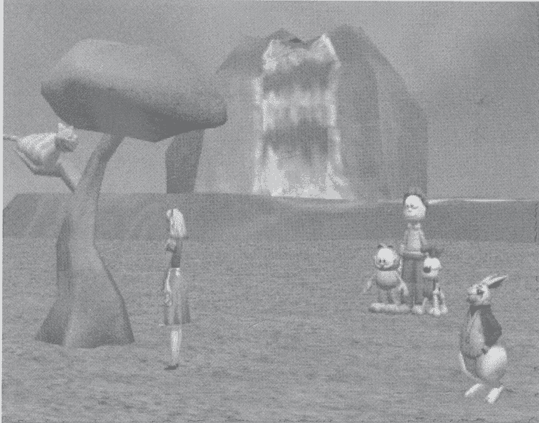

作者网站：www.gurus4pcs.com

在作者网站上可以更多关于 Alice 以及其他可用编程语言的信息。

如果您发现错误、有疑问或想为本出版物添加内容，请发送电子邮件给我：jkelley742@gmail.com。

# Alice 概述

## 目标

- 描述 Alice 编程语言的概念
- 如何获取和安装 Alice
- 使用 Alice 教程

## 课程 0.0 - Alice 概述

Alice 2.2、2.3 和 Alice 2.4 版本是 Alice 编程软件的不同版本，它们将带你进入 3D 动画的世界。令人惊讶的是，人们可以很快掌握创作动画电影或 3D 游戏的艺术。该软件由卡内基梅隆大学的教师 Randy Pausch、Wanda Dann 和 Steven Cooper 开发。它以刘易斯·卡罗尔的书《爱丽丝仙游记》命名，反映了卡罗尔先生的数学背景。

等一下，让我重新读一遍

终于有一种简单且最重要的是**有趣**的编程语言！Alice 是为初学者设计的。Alice 同时用于高中和大学水平。它的设计目的是培养对编程特别感兴趣的年轻女性。它也是掌握 3D 编程技能的绝佳起点，未来可以从事虚拟现实、动画电影、电影特效和其他热门电脑游戏。

为什么要学习 Alice？Alice 不是一种“现实世界”编程语言。应用程序不会永远永远用 Alice 编写。那么，Alice 的目的是什么？Alice 的设计是为了教授编程原理，而没有语法错误的负担。此外，它的设计是具有趣味性的，而学习本就应该是有趣的。结果可能不像《光环》或好莱坞那样，但只要稍加努力，新手就能展示出非常惊叹的 3D 虚拟世界。

在 Alice 中，程序员创建一个世界，然后用各种对象填充这个世界。如果电影发生在城市，人们就会在世界中填充建筑、街道、标志牌等。程序员可以对这些许多对象进行动画处理，并执行与“现实世界”中类似对象执行的各种动作。例如：让士兵行军、让滑冰者滑过池塘并进行旋转和跳跃、让汽车在公路上移动、让飞船起飞以及各种对象的其他动作。

通过讲述故事来学习使用 Alice。编写一个短故事，然后用 Alice 讲述这个故事。有老师使用 Alice 来演示课程的示例。Alice 可用于教学语言、教授数学问题，也可用于科学和物理。潜力是无限的。关于 Alice 如何使用的示例，在 YouTube 和其他相关网站上有一些程序。

## 课程 0.1 – 如何获取 Alice

Alice 的另一个伟大特性是它是**免费**的。是的，你可以从 www.alice.org 免费下载。下载完 Alice 压缩包后，必须进行解压。它将创建一个 Alice 文件夹，其中包含一个名为“Required”的子文件夹以及可执行文件 `Alice.exe` 和 `SlowSteadyAlice.exe`。

要运行 Alice，首先尝试 `Alice.exe`，如果它在当前电脑上可以运行，就坚持使用那一个。由于有大量的图形需要加载，加载过程可能需要一段时间时间。如果要在较旧的电脑上运行，请尝试 `SlowSteadyAlice.exe`。

下载并安装 Alice：

- 访问 Alice 网站 http://www.alice.org 并下载 Alice 2.4（或较旧的版本如 2.3 或 Alice 2.2）到电脑。解压文件，它将在电脑上放置两个文件和一个子文件夹。
- `Alice.exe`
- `SlowSteadyAlice.exe`
- 一个名为“Required”的子文件夹
- 点击 `Alice.exe` 执行 Alice 程序

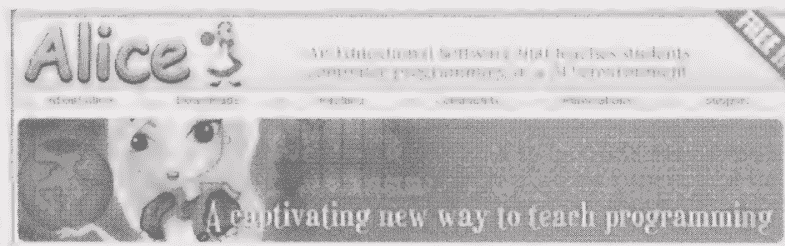

> 图 0.1.1 – Alice.org 网站

给在许多不同机器上工作的人的小提示。由于 Alice 不在操作系统中放置任何代码也不进行任何注册表更改，因此它是完全独立的。一旦解压，文件可以从一台电脑移动到另一台电脑而无需安装。Alice 可以加载到“闪存盘”、“USB Drive”、“内存棒”、“SD 卡”等。确实需要相当的空间来确保有足够的空间进行安装。这样在任何需要的地方都可以访问 Alice。注意：“Required”文件夹及其所有内容必须与 Alice 的 .exe 文件位于同一文件夹中。

值得注意的是，Alice 支持 Windows、Linux 和 Mac OS 操作系统。

Alice 正在持续开发。目前有两个可用版本：Alice 2.4 和 Alice 3.0。还有“旧版本”的下载。我们将在本书书中介绍 2.3 和 2.4 版本。

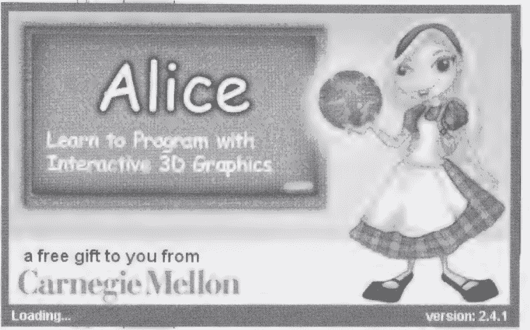

## 课程 0.2 – 欢迎来到 Alice！对话框

欢迎来到 Alice 2.4 的对话框包含六个标签。本节对每个标签进行了简要说明。此对话框在 Alice 首次打开时出现。如果你需要在它关闭后再次打开此对话框，有几种方法。首先，从“File”菜单中可以选择“New World”（新建世界）或“Open World”（打开世界）。然后，从“Help”菜单中可以选择“Tutorials”（教程）或“Example Worlds”（示例世界）。这四个选择中的任何一个都会打开对话框。教程提供了 Alice 能力的卓越概述，推荐作为所有学生的起点。

示例是学生查看的另一个好地方。

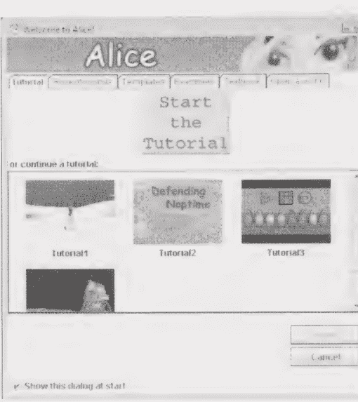

# 第一节：Alice 编程

本节描述了开发环境（IDE）以及如何使用。共有七个章节：

## 教程 1 – Alice 基础

### 目标

- 解释 Alice 环境
- 描述属性
- 使用故事板
- Alice

### 1.0 环境

当 Alice 环境启动时，有必要熟悉这些区域。

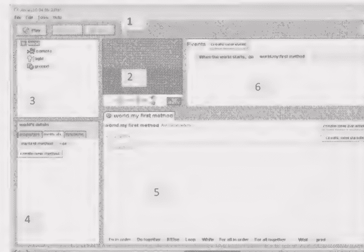

> 图 0.1.1 – Alice.org 网站

Alice 的每个区域定义如下：

- **工具栏**：包含一个播放虚拟世界的按钮。一个撤销（`Undo`）按钮。一个重做（`Redo`）按钮。一个删除对象的垃圾桶。它还可以包含一个或多个剪贴板。
- **世界视图**：显示虚拟世界。每个虚拟世界都有摄像头，窗口可以移动和旋转。
- **对象树**：包含所有对象的列表。每个对象都有名称并列在树中。在使用详情面板时通过此面板选择对象。
- **详情面板**：显示选中对象的信息。面板有三个标签。属性（`Properties`）标签包含对象的特征。方法（`Methods`）标签包含对象可以执行的操作。函数（`functions`）标签包含与对象相关的子程序。
- **方法编辑器**：这是程序员创建方法的地方，方法仅仅是导致某些动作发生的指令集。
- **事件编辑器**：事件在世界播放时发生。它可能是按下按键、点击鼠标按钮或其他预定义的事件。Alice 通过触发程序序列来响应这些事件。

### Alice 教程

Alice 带有四个优秀的教程来帮助程序员入门。在首次加载 Alice 时，教程对话框应该出现。如果没有出现，请前往菜单栏并选择 Help，然后 Tutorials。完成这些教程将使用户熟悉 Alice 编程的基础知识。

在此处，我建议在进入下一步之前完成两个教程。如果对教程有问题，请重复它们，直到对内容达到熟悉程度。完成所有教程很重要，但仔细学习这两个教程将有助于入门。理解这些教程中的概念将有助于未来课程中的练习。

回顾：

- 1.0.3 每个虚拟世界都有摄像头，窗口作为该摄像头的取景器。
- 1.0.4 你可能有多个剪贴板来存储对象。（正确 / 错误）
- 1.0.5 Alice 通过触发程序序列来响应 ________。

四个标准教程包括：

- 溜滑手 (Skater)
- 守护午睡 (Defending Naptime)
- 企鹅 (Penguins)
- 空间 (Space)

教程 1 - “溜滑手”介绍了 IDE 的基础知识。然后进入如何创建一个基础的 Alice 动画。这个以及其他教程通过引导你完成按键操作和鼠标点击来创建项目，让你练习使用 Alice。

教程 2 - “守护午睡”讲述了一个短故事。它演示了对话气泡、声音以及如何创建一个新方法。

教程 3 - “企鹅”演示了如何让 Alice 响应鼠标点击和按键按下。

教程 4 - “空间世界”展示了如何创建场景、选择世界以及添加新对象。

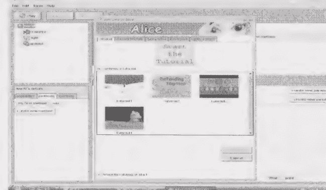

> 图 1.1.1 - Alice 教程对话框

完成所有这些教程将帮助用户理解 Alice 语言的力量。这些不仅仅是无聊的电影。它们在一个有趣、易用的编程环境中包含了所有编程语言的原理，这在很大程度上防止了新程序员犯许多编程错误。

回顾：

1.1.1 Alice 自带了教程。
1.1.2 你可以通过点击菜单然后来访问教程。
1.1.3 教程的设计仅演示高级的 Alice 命令。（正确 / 错误）

### 课程 1.2 对象的属性与方法

每个对象都有关联的属性、方法和函数。要查看这些内容，请选择要操作的对象。在“对象树”中进行选择。注意，还有“世界 (World)”、“相机 (Camera)”和“光 (Light)”的选择。这些也是在代码中可以操纵的对象。有些对象旁边有一个 + 号。这意味着该对象是由几个其他对象的组合，这些对象也可以被单独操纵。

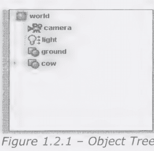

Alice 世界中的每个对象都有属性。这些仅仅是描述对象特征的数值。当对象被放置在 Alice 世界中时，它的属性是可以改变的。例如，可以改变对象的颜色。当程序执行时，对象的属性值可能会发生变化。

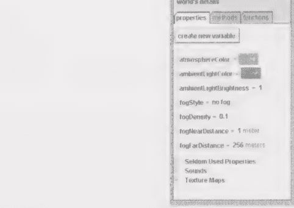

对象能够执行任务。对象能做的事情被称为方法。其中一种方法是“说 (say)”事情。某些方法可以移动对象上、下、左、右。这些方法通常是对象在现实生活中可以做的事情。企鹅对象可以移动和行走，飞机对象可以移动，但如果设计师赋予它行走的能力。方法与对象在现实世界中的能力保持一致。

对象经常变得非常复杂，通常对象是由其他对象或对象组构成的。当用户学习 Alice 时，他们会操纵一个对象并发现该对象拆分开了。一个例子可能是人物对象之一。这些是复合对象。头部可以移动，手臂可以移动，腿可以移动，并且必须操纵这些对象的方法，协调对象的每个部分，以便该对象在电影过程中需要进行的模拟活动是真实的。

重要的是要认识到 Alice 画库 (Gallery) **不是**对象的库。它是**类 (Classes)** 的库。区别在哪里？查看类最好的方法是将其比作一个食谱。它是一个创建一个对象的食谱。这个食谱可能会收集几个对象并将它们作为一个虚拟世界中的一个对象呈现出来。因此，当多个相同的对象被放置在世界中使用时，创建该类的食谱被用于创建同类的多个实例。每个实例都是一个完全独立的对象。

回顾：

### 课程 1.3 尝试这个

现在是时候从零创建一个 Alice 动画了：

1. 选择文件 (File) > 新世界 (New World)。
2. 选择“水 (Water)”世界。
3. 点击世界区域的“添加对象 (Add Objects)”按钮。
4. 现在，在屏幕顶部可以使用对象的“画库 (Gallery)”。到画库末尾并选择名为“3D 文本 (3-D Text)”的。
5. 有一个对话框包含一个带有“快速棕色狐狸 (The quick brown fox)”的框。将此文本更改为你的姓名。
6. 点击对话框底部的确定 (OK) 。
7. 点击“完成 (Done)”按钮。画库右侧有一个绿色按钮。
8. 现在点击左上角的“播放 (PLAY)”按钮播放你的第一个电影。
9. 你现在是一个 Alice 程序员了。

### 课程 1.4 四视图 (Quad View)

当多个对象被放置在世界时，很难让它们排列在正确的起始位置，让它们面向不同的对象，等等。

另一种方法是在便利签、3 x 5 卡片或纸上绘制每个屏幕画面。这允许你重新排列顺序，或者用新的画图替换屏幕画面。让我们来看一个简单的例子。

#### 示例脚本：

- 在屏幕上放置 3 个角色
- 第一个角色上下跳跃三次
- 第二个角色旋转五次
- 第三个角色向前移动一米，然后向后移动一米。

#### 示例分镜：

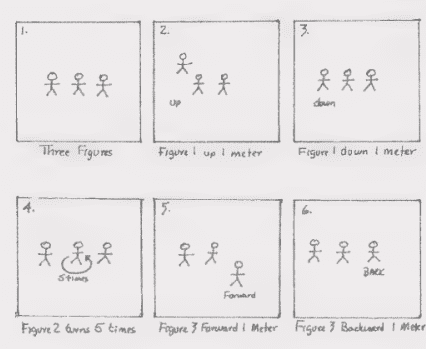

这只是一个简单电影分镜的快速、粗略示例。没有华丽的艺术性。对于这种短电影来说这并不是必要的，但对于长电影来说是一个非常好的规划工具。记住，我们在电视上看到的所有优秀广告都是从分镜开始的。

#### 复习：

### 第 1-6课：伪代码

另一种确保你的电影不偏离轨道的方法是在所谓的“伪代码”中概述你的故事线。伪代码无非是一个大纲。它是一系列语句列表，逐步告诉如何构建你的电影。当你转换到另一种编程语言时，这可能也是你组织思路的首选方法。回顾我们的分镜示例，伪代码仅仅就是示例脚本：

```
PSEUDOCODE:

1. 在屏幕上放置 3个角色
2. 第一个角色上下跳跃三次
3. 第二个角色旋转五次
4. 第三个角色向前移动一米，然后向后移动一米。
```

虽然没有电影分镜那样有效，但伪代码是次优选择。无论如何，你都需要规划你的电影以保持它不偏离轨道。当你开始制作具有多个场景、新增的方法和事件的复杂电影时，这一点尤为重要。当剧情变得复杂时，必须使用某种规划方法，否则你的电影将偏离初衷。

#### 复习：

### 第 1-7课总结

我们在本章中涵盖了大量内容。首先，我们识别了 Alice IDE 的各种窗口。接下来，查看了教程。每个教程都展示了创建 Alice 电影的一个重要方面。然后讨论了对象的属性（`Properties`）、方法（`Methods`）和函数（`Functions`）。四分视图（`Quad View`）有助于在舞台上定位对象。布局控制可以移动对象，并在需要时创建副本。本章还介绍了其他帮助你在屏幕上移动对象的工具。

最后，我们查看了分镜的概念。这是一个帮助程序员按正确顺序执行所有动作的规划工具。这在 Alice 以及其他任何编程语言中都是重要的。“不计划计划就是失败的计划”这句话在编程中和生活中一样重要。

## 教程 2 - Alice 编程

### 目标

- 描述如何创建和使用变量
- 创建 3D 文本

### 第 2 课 - 3D 和对象编程概述

Alice 非常有意思。开始考虑前、后、左、右、上、下是非常重要的。这会让某些事情变得有点棘手，但只要稍微练习就能掌握。许多对象可以向前、向后、向左、向右、上下；这被称为六自由度。

每个对象都有一个中心；这里的技巧在于，它可能不是特定对象边界框的精确中心。选择一个对象，点击详情（`Details`）区域中的属性（`Properties`）选项卡，向下滚动到点输入处并点击右侧的蓝色框；将三个数字（距离中心左侧距离、中心上方距离、中心正前方距离）。这翻译为对象距离世界中心的距离。负数可能表示对象在地面以下。

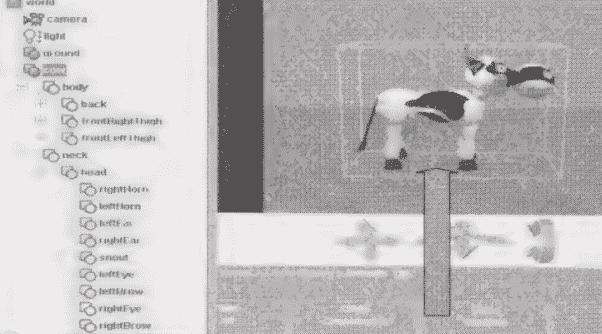

> 图 2.0.1 – 牛对象

图 2.0.1 显示了牛对象。箭头指向三条线的交点（一个绿色、一个红色和一个蓝色），这指示了对象的中心。在操作此对象时，这就是该对象和运动的中心。此外，注意对象树（`Object Tree`）中此对象可以操作的所有组件。记住，这些子对象也有影响它们移动的中心。

现在，让我们使用方法来移动对象。方法被定义为对象可以做的事情，如果有一个对象可以移动，方法就允许它移动。使用对象树，选择世界中的一个对象，然后选择详情区域中的方法（`Methods`）选项卡，查看该对象可以做的一切。如果选择了一个动画对象，应该有一个名为 `move` 的方法。如果将其拖动到编辑器（`Editor`）区域并释放到文字上，你就可以使用它。


如果选择了一个对象，应该有一个名为 `move` 的方法。如果将其拖动到编辑器区域并释放到文字上，你就可以使用它。

### 复习

- 2.0.1 如果将动画方法拖动到编辑器区域并释放到文字上，你就可以与对象交互。
- 2.0.2 如果选择了一个对象，应该有一个名为 `move` 的方法。如果将其拖动到编辑器区域并释放到文字上，你就可以使用它。
- 2.0.3 如果选择了一个对象，应该有一个名为 `move` 的方法。如果将其拖动到编辑器区域并释放到文字上，你就可以使用它。
- 2.0.4 如果选择了一个对象，应该有一个名为 `move` 的方法。如果将其拖动到编辑器区域并释放到文字上，你就可以使用它。
- 2.0.5 如果选择了一个对象，应该有一个名为 `move` 的方法。如果将其拖动到编辑器区域并释放到文字上，你就可以使用它。
- 2.0.1 如果将动画方法拖动到编辑器区域并释放到文字上，你就可以与对象交互。
- 2.0.2 如果选择了一个对象，应该有一个名为 `move` 的方法。如果将其拖动到编辑器区域并释放到文字上，你就可以使用它。
- 2.0.3 如果选择了一个对象，应该有一个名为 `move` 的方法。如果将其拖动到编辑器区域并释放到文字上，你就可以使用它。
- 2.0.4 如果选择了一个对象，应该有一个名为 `move` 的方法。如果将其拖动到编辑器区域并释放到文字上，你就可以使用它。
- 2.0.5 如果选择了一个对象，应该有一个名为 `move` 的方法。如果将其拖动到编辑器区域并释放到文字上，你就可以使用它。

### 2.1 - 放置对象

向世界中添加对象有两种方法。第一种方法是拖放。

### 2.2 - 单对象视图

当你选择一个对象时，可以在单视图中查看它。该视图显示对象的前面。


### 2.3 - 四分视图

四分视图允许你同时从四个角度查看对象。对于在世界中定位对象非常有帮助。

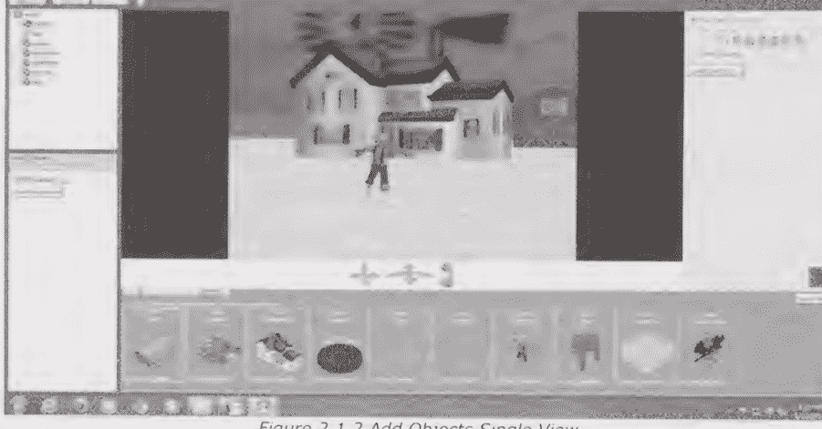

### 2.4 - 摄像头视图

摄像头视图从摄像头的视角向你展示世界。这对于规划电影的效果非常有用。


### 2.5 - 移动对象

放置对象后，你需要移动、旋转和缩放它们。这些操作是通过方法完成的。

- `move`：移动对象一段距离。
- `turn`：绕轴旋转对象。
- `scale`：改变对象的大小。

### 2.6 - 使用属性

属性是描述对象的特征。例如，对象的颜色、大小和位置。你可以通过属性选项卡更改这些属性。

- `color`：改变对象的颜色。
- `size`：改变对象的大小。
- `position`：改变对象的位置。

### 2.7 - 使用动画

动画是对象随时间执行的一系列动作。你可以通过组合方法来创建动画。

- `addAnimation`：为对象添加新动画。
- `removeAnimation`：从对象中移除动画。
- `playAnimation`：开始动画。

### 2.8 - 使用 3D 文本

Alice 允许向你的电影添加 3D 文本。这对于创建标题和标牌有用。

- `text`：创建一个 3D 文本对象。
- `font`：更改 3D 文本的字体。
- `size`：改变 3D 文本的大小。
- `color`：改变 3D 文本的颜色。

2.1.3 对象被选中时，会被一个黄色线条框包围。还有其他三条线：红色、蓝色和绿色。红线表示该对象的 X 轴方向。

### 第 2.2 节 – 使用原始方法定位对象

在“添加对象”模式（`Add Object Mode`）下，定位对象的另一种方法是使用原始方法。如果在“对象树”（`Object Tree`）中选中了对象，可以对对象名称点击“右键”，将出现一个原始方法的下拉列表，然后可以选择一种方法对对象进行定位。

“月球着陆器”需要旋转 1/4 。示例 2.2.1 显示了在对象树中选中着陆器，并在下拉菜单中显示了完成此项任务的可用选项。

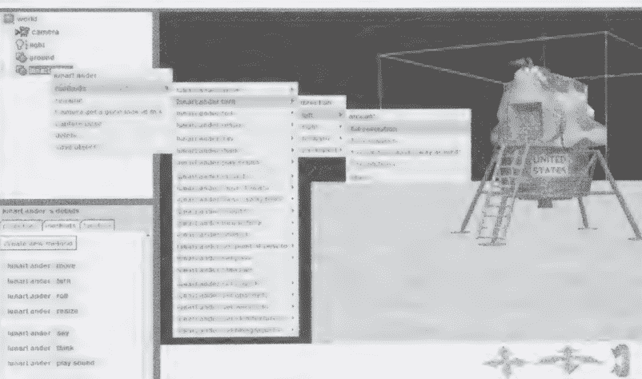

图 2.2.1 – 原始方法

在第一个下拉菜单选择“methods”（方法），下一个下拉菜单显示方法，选择“lunarLander turn”（月球着陆器旋转），下一个下拉菜单显示方向，选择“left”（左），最后一个选项是对象应该旋转的幅度，在这里选择“1/4 revolution”。按下回车键，对象将向左旋转 1/4 。

下一张图（图 2.2.2）显示了按下回车键并完成旋转方法后着陆器的位置。

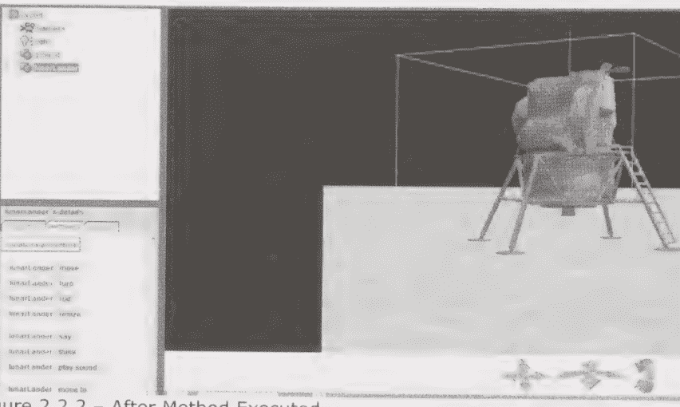

### 2.2.2 - 方法执行后

尝试使用各种原始方法在几个对象上进行此操作。这应该让你对如何使用这些方法定位对象有一个良好的理解。一种情况是对象创建在视野之外。将对象移动到世界中心，这应该让你清楚对象在哪里，并且可以从该点进行定位。

复习：

- 2.2.1 你可以使用方法在“添加对象”屏幕中定位对象。
- 2.2.2 要访问对象的原始方法，请在选中的对象上...

### 第 2.3 节 - 变量

变量是每种编程语言中至关重要的元素。它是可以用于存储一段信息的内存区域。在程序中，创建一个变量来存储某些信息，并对其命名，以便程序员可以在各种处理指令中使用该数据。变量的内容可以在各种程序指令中用于计算、显示或更改。因此，变量是数字、字符串、对象等其他内容的存储位置。它存储这些对象，以便它们可以在程序的处理中被使用。

与其他其它编程语言一样，变量分为四类：

每个变量都必须使用以下规则创建一个一个名称：

- 在其作用域内（局部、世界、类、参数）必须是唯一的。
- 名称应具有意义。
- 使用驼峰命名命名法（`camelCase`）。

变量的类型包括：

- `Number`（数字）：存储数字，任何数字。
- `Boolean`（布尔值）：存储真或假。
- `Object`（对象）：存储一个对象。
- `Other`（其他）：更具体的类型，如：字符串、声音、颜色等。

一旦创建了变量，就必须建立一个初始值。

创建变量的步骤：

1. 在方法编辑器（`Method Editor`）中，点击 `create new variable`（新建变量）按钮。
2. 在 `Create New Local Variable`（新建局部变量）对话框中，输入变量名称。
3. 选择数据类型。
4. 输入初始值。
5. 点击 `OK` 按钮。
6. 变量瓦块应该出现在方法编辑器的变量区域。

### world.first method

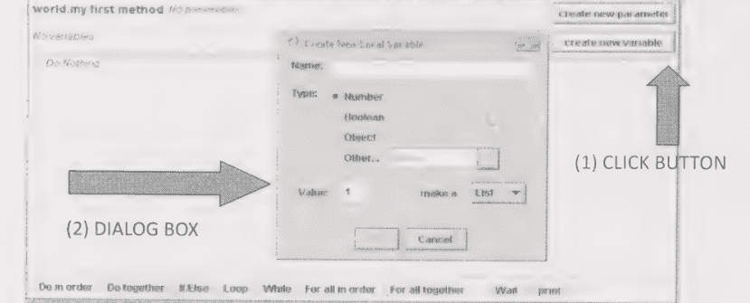

图 2.3.1 - 创建变量

要给变量赋值，必须在创建时赋予初始值。在程序运行过程中，可以根据条件进行更改

1. 将变量瓦块拖到方法编辑器中。
2. 在菜单中选择 `Set Value`（赋值）。
3. 从列表中选择一个值或选择 `other` 输入新值。

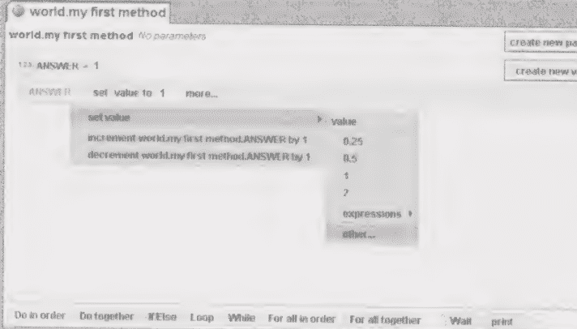

图 2.3.2 - 为变量赋值

记住变量必须初始化一个值。如果值不在列表中，选择 `other...` 然后会弹出一个计算器，你可以指定所需的值。虽然变量有初始值，但在程序运行过程中可以更改。变量是程序运行过程中可以使用或更改的值的存储位置。

复习：

- 2.3.1 A 是可以用于存储一段信息的内存区域。
- 2.3.3 有几类变量
- 2.3.4 变量的类型包括：

### 第 2.4 节 - 属性、方法和函数

等等，文本似乎不完整或碎片化。它支持所有结构：

- 顺序
- 决策
- 重复

这是通过对具有 `say` 方法的对象使用 `Say` 方法来实现的。选择 `Say` 方法，输入字符串 "Hi"，然后在 `joined with` 之后，选择包含用户输入名称的变量。

我们还可以通过使用数值变量名配合 "as a string" 修饰符，让对象“说”出一个数值。

复习：

- 2.4.1 在使用 Alice 时，使用 ________ 来选择命令。
- 2.4.2 编写计算机程序最困难的部分——用精确的语言和 ________ 编写所有详细的指令。
- 2.4.3 ________ 是一种特殊的方法类型，它根据给定的参数（如果需要）完成任务，并向调用该函数的程序返回结果。
- 2.4.4 ________ 拥有三个原始函数，可以用于要求用户输入一个值。
- 2.4.5 ________ 定义为一个或多个字符的序列。

### 课程 2.5 - 共同执行 (Do Together) / 按顺序执行 (Do In Order)

当需要两个或多个对象同时移动时，就会使用 `Do Together` 结构。`Do Together` 结构使得结构内包含的所有指令同时执行。这允许程序员让几件事同时发生。

下面展示了一个使用 `Do Together` 的良好示例。汽车和司机是两个需要同时以相同速率、相同距离移动的对象。

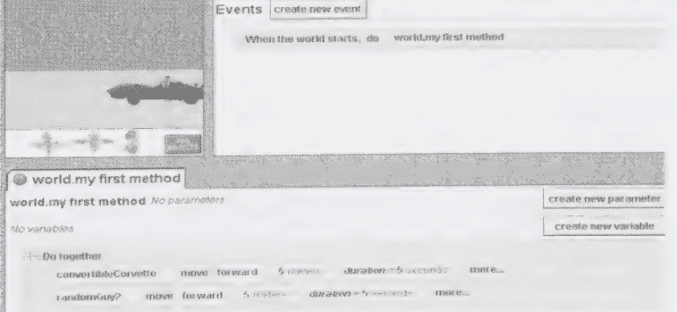

图 2.5.1

汽车对象和 `randomGuy` 对象同时向前移动，距离和速度相同。如果这些指令不在 `Do Together` 结构中，汽车将先移动，然后司机移动，这看起来就不像某人在开车。

`Do in Order` 结构是将按特定顺序发生的指令进行分组的方法。当程序员需要确保一组指令按照精确顺序处理时，就会使用它。`Do in Order` 结构在程序中是隐含的，但在某些情况下，需要将此结构嵌套在另一个结构中以实现所需的动作。

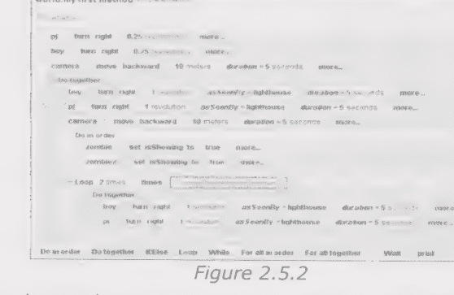

图 5.2

在我们的示例中，两个男孩一起绕着灯塔跑，但两个僵尸尽管在 `Do Together` 结构内部，仍逐个出现在屏幕上。

复习：

- 2.5.1 当需要两个或多个对象同时移动时，使用 ________ 结构。
- 2.5.2 `Do in Order` 结构是将按 ________ 发生的指令分组的方法。
- 2.5.3 该结构允许程序员让几件事同时发生。
- 2.5.4 该结构在程序中是隐含的。

### 课程 2.6 - 决策 (Decisions)

决策结构（`Decision Structure`）以程序化的评估表达式，并根据结果决定执行哪些代码。被评估的表达式必须评估为“布尔”值，简单来说，就是结果为“真”（`True`）或“假”（`False`）的表达式。

在方法编辑器（`Method Editor`）底部有一组磁块，其中一个磁块标题为 "If/Else"。要使用决策结构，将此磁块拖到程序方法编辑器的相应位置。这将在程序中产生一个 `If Else` 结构。`If` 语句之后的行是用于存放真语句的框，下一行是 `Else`，第四行是用于假语句的。在真侧要执行的语句或语句是在表达式评估结果为真时执行的。如果表达式被评估为假，则将要执行的语句放在 `else` 语句中。如果假侧不包含任何指令，则这是一个单侧结构，当表达式评估为真时执行交替指令。

构建用于评估的“布尔”表达式

有六（6）种关系运算符：

- 1. `==` 等于
- 2. `!=` 不等于
- 3. `>=` 大于或等于
- 4. `<=` 小于等于
- 5. `>` 大于
- 6. `<` 小于

使用此项比较两个值、两个变量的内容，或一个变量的内容与一个值。根据两者的比较，所选的关系运算符将给出 `True` 或 `False` 的结果。这决定了执行哪些代码。当相应的代码完成后，程序将继续执行决策结构之后的下一个指令。

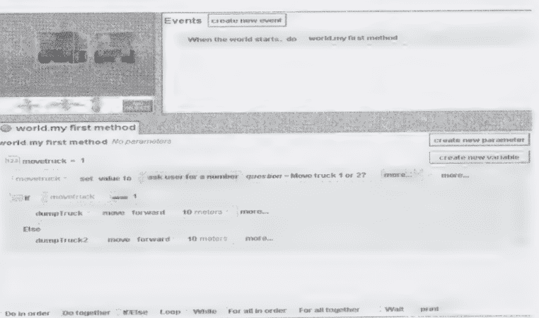

图 2.6.1

此示例展示了 Alice 编程中的几个概念。首先，创建了一个新变量 "movetruck"，其值设置为 1。第一条指令将 `movetruck` 中存储的值设置为用户输入的值。在 `World` 对象中，有一个函数 "ask user for a number"，它被拖入以替换值 1，并使用 "Move truck 1 or 2?" 作为用户输入数字的提示。

然后是 `IF` 语句。测试 `movetruck` 中的值，如果它等于 1，第一辆倾垃圾车将向前移动 10 米。任何其他值将导致第二辆倾垃圾车向前移动 10 米。

此外，决策结构可以是“嵌套”的。简单来说，这意味着如果有一个 `If/Else` 结构，在真语句、假语句或两者中都可能有另一个 `if/Else` 结构。嵌套层数可以根据程序完成任务所需的深度进行任意设置。（*注：原文后续部分存在大量重复的描述和 OCR 错误信息，已按要求提取并翻译了核心逻辑内容*）

我使用 Paint.NET 创建了一个电影标题，并将其添加到我的电影开头。

### 我的第一个 Alice 电影...

图 2.7.1

下一步是将其放入电影中。使用 `Make Billboard`（制作看板）选择，我将其添加到电影中并在看板的两端放置了一只企鹅。

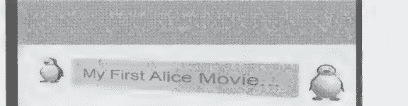

图 2.7.2

现在，使用看板的方法为它添加一些动作，然后通过将 `isShowing` 属性设置为 `false` 让它消失。

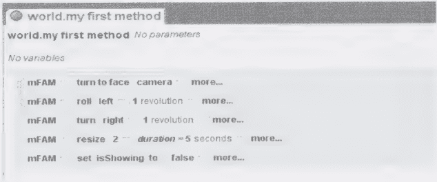

图 2.7.3

看板面向摄像头，滚动并旋转。然后使用 `resize` 方法让它在 5 秒的持续时间内在屏幕上变大。最后，它消失了为电影让路。

图片可以用作背景。我翻遍了图片文件，找到一个街景场景为我的下一部电影制作背景。GIF 或 PNG 格式就足够作为背景。如果你使用 JPG，保存和加载项目将花费一些时间。

Alice 和班级运动员看起来就像正站在马萨诸塞州伯克斯什尔山脉中心地带的一条街道上。这可以是一个机会，利用那些风景照片或 Alice 的照片在某些历史遗迹或自然奇观处上一堂历史课。

回顾：

- 2.7.1 看板允许你将图片或标题引入 Alice 电影中。
- 2.7.2 看板用于剪贴画或文本。
- 2.7.3 看板类似于 GIF。支持透明度、动画，并且是一种压缩格式。
- 2.7.4 你通过选择菜单并点击该选择项将看板置于你的电影场景中。

### 2.8 节 – 3D 文字

使用 3D 文字为电影添加标题。访问 3D 文字有两种方法。首先，在对象图库（`Gallery of Objects`）的最后一项是 3D 文字。点击它会打开一个对话框。对话框中的默认文本是“The quick brown fox.”，可以将其更改为适合电影的文本。在 Alice 的对话框中，可以选择字体样式，并有按钮可以**粗体**或*斜体*显示文本。第二种方法是从菜单栏中选择。它位于 `File`（文件）菜单下的一个名为 `Add 3D...`（添加3D...）的子菜单。选择此项将打开与第一种方法相同的对话框。

3D 文字像所有其他对象一样具有属性（`Properties`）、方法（`Methods`）和函数（`Functions`）。例如，如果你想要不同颜色的文本，请选择颜色属性然后选择新颜色。如果你想让文本旋转，选择一个旋转或滚动文本的方法。探索这些方法和函数，可以使用文本对象可以执行的许多不同操作。

图 2.7.4

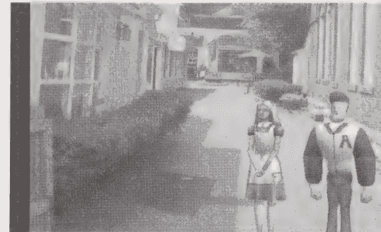

使用图片作为背景配合 3D 文字的示例是另一个 Alice 游记的标题。

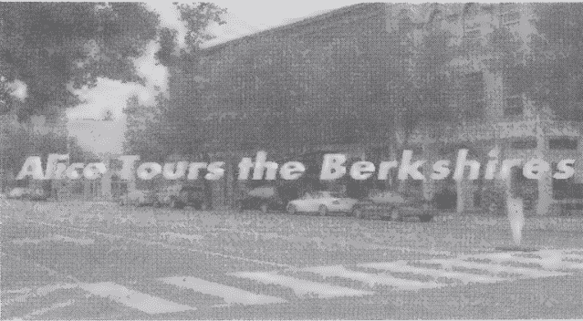

图 2.8.1

回到我们对看板标题玩玩的电影魔法，用你自己的 3D 标题制作一些酷炫的效果。

回顾：

- 2.8.1 有 ____ 种方式访问 3D 文字。
- 2.8.2 3D 文字像所有其他对象一样具有属性、方法和函数。（正确 / 错误）
- 2.8.3 3D 文字可以从“Tools”菜单添加。（正确 / 错误）

### 2.9 节 - 尝试一下

在这部电影中，兔子根据数字的值进行旋转。如果数字大于或等于 5，兔子会说“我不会旋转超过 5 次”。运行两次程序，一次数字值为 1，另一次为 8。

1. 创建草地世界（`Grass World`）。
2. 在世界编辑器的右上角，点击“Create Variable”（创建新变量）
   a. 名称 = `answer`
   b. 数据类型 = `Number`
   c. 值 = 1
   d. 确定
3. 从动物图库将兔子对象添加到世界中。
4. 将 `If/Else` 拖动到世界编辑器的第一行并选择 `true`。
5. 将变量 `answer` 拖到“true”上设置为 `answer >= 5`。
6. 选择兔子对象
7. 将 `bunny.say` 拖到 `if` 语句下方、`else` 语句上方。选择其他
8. 信息="I don't spin more than 5 times." 持续时间5秒。
9. 将 `bunny.turn at speed` 拖到 `else` 语句下方。旋转=左，速度=5圈/秒。
10. 运行（`PLAY`）。
11. 将 `answer = 1` 改为 `answer = 8`。
12. 运行（`PLAY`）。
13. 将 `answer` 变量拖到 `If` 语句之前的行。值=1。
14. 选择世界对象。
15. 选择世界对象。
16. 选择世界对象。
17. 选择世界对象。
18. 选择世界对象。

### 3.0 教程 – 重复

概述：

- 解释重复。
- 使用计数循环。
- 使用 while 循环。

看板面向摄像头，滚动并旋转。然后使用 `resize` 方法让它在 5 秒的持续时间内在屏幕上变大。最后，它消失了为电影让路。

# 事件创建事件


# 当世界开始时，执行我的第一个方法

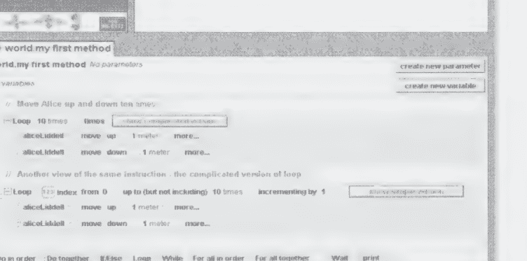

图 3.1.1

图 3.0.2 展示了 LOOP 结构的两种视图。第一个是“简单版本”，它显示循环的次数，并将计数器每次加 1，直到达到指定的次数。第二个是复杂版本，显示了完整版本。它展示了循环中三个可以变化的部分，完整地解释了循环结构及其运行方式。首先，它显示声明了一个名为 `index` 的变量并将其初始化为 0，然后它显示了导致循环退出的条件（最多 10 次，但不包含）。最后一部分是（每次加 1）数值，我们加到变量 `index` 的值是可以更改的。因此，如果输入正数，程序将通过循环递增；如果是负数，程序将递减 `index`，从较大的数字向较小的数字移动。使用循环结构的其他方法示例：

## 递减循环

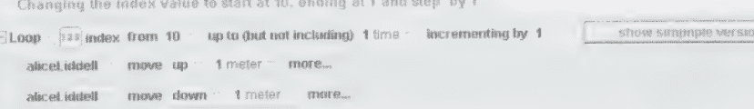

图 3.1.2

## 递增 2 的循环

将 `index` 值改为从 1 开始，10 结束，步长为 2

| 循环 | index 从 0 开始 | 最多 10 次（不包含） | 递增 2 |
|---|---|---|---|
| index | 向上移动 | 1 米 | 更多... |
| index | 向下移动 | 1 米 | 更多... |

图 3.1.3

用户可以用变量替换任何一个值，并使用变量的内容来控制起点、终点或数值。

### 单元复习

3.1.1 当对象需要执行某些特定次数的操作时，可以使用重复结构。

3.1.2 用户可以用变量替换任何一个值，并使用变量的内容来控制起点、终点或数值。

3.1.3 更改递增值会导致 `index` 从较大的数字计数到较小的数字。

## 第 3.2 节：编写循环

1. 选择一个草地世界 (Grass World)
2. 从画库中选择 Socrates 对象
3. 点击完成 (Done)
4. 将 Loop 图标拖到方法编辑器 (Method Editor)
5. 选择“Infinity Times”（无限次）
6. 现在，让 Socrates 向前移动 1 米。
7. 让 Socrates 向后移动 1 米。
8. 在循环结构之后添加旋转 Socrates 的命令。
9. 播放
10. 你创建了一个无限循环。程序永远不会旋转 Socrates。
11. 停止程序。
12. 将“Infinity times”更改为 5。
13. 播放

在循环行上点击“显示复杂版本 (Show complicated Version)”按钮。注意，“For” 循环初始化了 `index` 变量，有一个测试条件在 `index` 达到 5 时限制过程，最后有一个更新部分，告诉计算机在每次循环中对每个 `index` 进行加法。这种结构在 JAVA 和 C++ 中是完全相同的。

## 第 3.3 节：重复（While 循环）

有时必要根据某些“布尔”条件的测试为真（True）来执行一系列指令。例如：“重复这些指令，直到表达式 A 的内容大于表达式 B 的内容”；另一个例子是重复某些指令，直到一个对象距离第二个对象小于一米。“While” 循环是解决此类问题的工具。“While” 循环是一个预测试循环。这意味着在执行任何指令之前，都会评估执行循环的条件。因此，循环中的指令可能永远不会执行。

`while` 指令位于方法编辑器的底部。就像循环指令的实现方式一样，将磁块拖到代码中适当的位置。然后在输入框中提供一个要评估的布尔表达式，并赋值为 `true`。然后跟上要在循环内执行的指令。

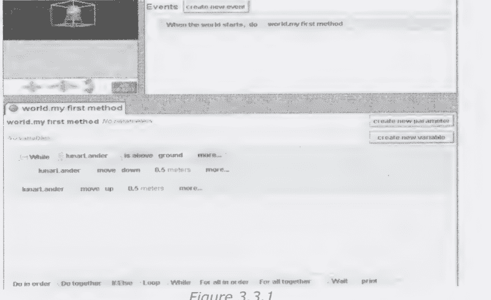

图 3.3.1

月球着陆器在地面上方时将继续每次下降半米到达表面（地面）。一旦测试结果是在地面上或以下，测试将为假（false），while 循环将退出。

### 单元复习

3.3.1 循环结构重复指令，直到评估的表达式结果为假（false）。

3.3.2 “While” 循环是一个测试循环。

3.3.3 While 循环中的指令可能永远不会执行（真 / 假）。

## 第 3.4 节：编写 While 循环

使用 While 循环和随机数的示例

1. 选择一个草地世界 (Grass World)
2. 在动物画库 (Animals Gallery) 中有一个“Bugs”子集。选择：
   a. paulbeetle（左侧）
   b. paulbeetle（中间）
   c. ringbeetle（右侧）
3. 选择 georgebeetle 并移动到 paulbeetle 左侧一米
4. 选择 ringbeetle 并移动到 paulbeetle 右侧一米
5. 将 While 语句拖到下一行并选择 `true`。
6. 选择 georgebeetle 函数，并将“georgebeetle is at least threshold”拖到 while 语句中的 'true' 上。距离 paulbeetle 至少 .05 米，针对整个 paulbeetle。
7. 拖动 While 语句到 1 米。
8. 选择 World 对象，随机数，并替换 georgebeetle 移动 1 米
   a. minimum = -0.5
   b. maximum = 0.5
9. 在 while 语句后拖动 georgebeetle 说 hello。
10. 播放（直到 georgebeetle 说 hello）

## 第 3.5 节：随机数

World 对象有一个名为 `random` 的函数，它可以返回 0 到 1 之间的随机点数。“更多...”编辑标签具有以下参数：

- `minimum`：指定随机数的最小值。
- `maximum`：指定随机数的最大值。返回的值将不会大于指定的最大值。
- `integer only`：设置为真时，该函数会将生成的值转换为仅返回整数。

当需要返回六个数（模拟掷骰子）时，最小值为 1，最大值为 7，且 `integer only` 设置为真。这将返回 1 到 6 的值。

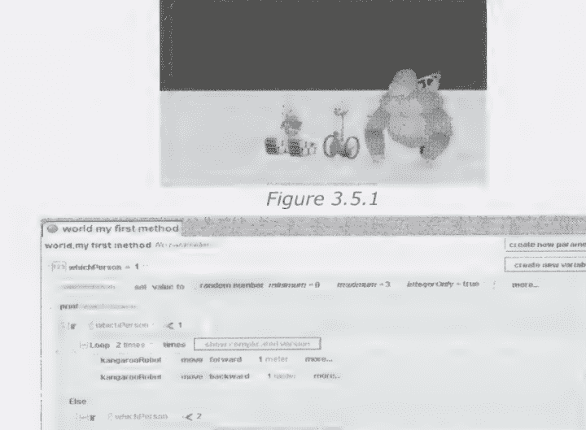

图 3.5.1

图 3.5.1 中有三个科幻角色成排面向前方。3.5.2 中的程序是随机让其中一个角色向前向后移动两次的代码。在 0 到 3 之间生成随机数并将结果存储在变量 `whichPerson` 中。打印语句用于在屏幕底部显示生成的随机数。Print 命令位于编辑器底部的磁块中。播放电影时，它会在底部显示值。这是一个调试工具，在确认结果后应删除。然后有一个嵌套语句来决定哪个角色移动 0、1 或 2。

### 单元复习

3.5.1 随机数是 ________ 的函数。

3.5.2 Print 命令在默认打印机上显示值。（真 / 假）。

3.5.3 最大值限制返回的值比最大值小一。（真 / 假）。

3.5.4 ________ 函数返回 0 到 1 之间的分数随机。

## 第 3.6 节：列表

Alice 有创建列表作为变量的能力。列表变量具有存储多个相同数据类型项的能力。然后可以使用列表逐个遍历项，让该项执行某些任务。一个规则是你的列表可以包含任何对象，它们不需要完全相同。另一个规则是列表中的所有项必须具有相同的数据类型。

我们的示例是为三艘船建立一个水世界。

将三只帆船面向摄像头对齐。第一只船在左侧，第二只在中间，第三只在右侧。这段动画的目标是让每艘帆船向右转四分之一圈并驶出屏幕。我们没有使用指令来操作，而是设置了一个船只列表，让它们逐一离开。

要设置列表变量，我们需要创建一个新变量。因为可能在整个动画中使用它，我们需要在世界对象（world object）下设置变量。在对象树中选择该对象，然后进入属性（properties）。点击“创建一个新变量”（create a new variable），弹出图 3.6.2 所示的对话框。命名变量，选择对象单选按钮，点击“制作”（make a）左侧的复选框，并确保列表包含“List”。然后点击三次“新建项目”（new item）按钮。然后对于 item0 的 None，点击下拉箭头并选择第一只帆船。对第二只和第三只帆船重复此操作。完成后，你的对话框应该看起来像图 3.6.2。如果一切正常，点击确定。

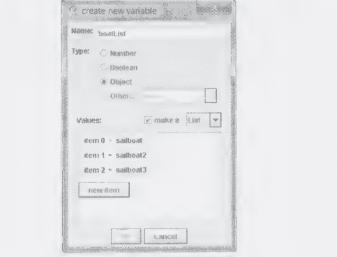

现在我们可以在代码中使用该变量了。“按顺序全部”（For all in order）结构会按顺序执行列表中所有项的命令。第一个项目的所有命令、下一个项目的所有命令，依此类推，直到列表结束。从事件面板底部抓取“按顺序全部”瓷块。通过选择 `boat.boatList` 来选择船只列表。现在，我们有了一个循环结构来承载列表每个成员要执行的命令。

注意，对象树中没有对应的特定对象，那么我们从哪里获取移动帆船的方法呢？很简单，看以“For all...”开头的代码行。有一个名为 `item_from_boatList` 的对象变量。将其向下拖动一行到“无操作...”（Do Nothing...）区域。选择旋转（turn）、右（right）和 0.25 圈。重复此过程，使用移动方法（move）、向前 100 米。

### world.my first method

`world.my first method`（无参数）

SA 变量：

- 对于所有 `world.boat.list`，一次处理一个 `Item_from_boat.List`
- `item_from_boat.list` 向右旋转 0.25 圈...
- `item_from_boat.list` 向前移动 100 米...

图 3.6.3

播放动画，观察你的船向右转动并驶出屏幕。

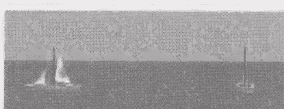

图 3.6.4

如果船没有按照正确的顺序航行，你可以在列表变量中修复顺序。处理列表的另一个命令是“全部一起...”（For All Together...）命令。这用于列表中的所有成员应该同时行动的情况。我们的这个示例是一个简单的“小鸡舞”。

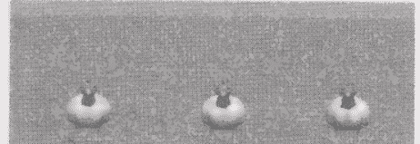

图 3.6.5

我们有一排三只小鸡。代码从底部横排瓷块中选择“全部一起...”瓷块开始。使用与处理“按顺序全部...”相同的步骤，构建舞蹈动作。

### world.my first method

`world.my first method`（无参数）

无变量：

```
For all world.chix every Item_from_chix together
  Do together
    item_from_chix turn right 0.25 revolutions more...
  Do together
    item_from_chix turn left 0.25 revolutions more...
  Do together
    item_from_chix turn to face camera more...
  Do together
    item_from_chix set color to more...
```

图 3.6.6

这只是一些简单的动作，用来说明舞蹈可以开始。最后变成黄色只是为了说明列表中所有项的属性变化。

### 回顾

3.6.1 变量具有存储多个项的能力。

3.6.2 该结构按顺序执行列表中所有项的命令。

3.6.3 当列表中的所有成员应该同时行动时使用该结构。

## 课程 3.7 – 数组 (Arrays)

数组就像列表。它用于存储一组同类型的项目。它具有固定的大小，一旦填充，你就不能再添加任何新项。数组由一组元素组成。元素是数组中每个项的存储位置。

当你向数组插入一个项时，它的位置不会像列表中那样发生移动。在数组中，你将值插入到特定的元素中，它将保持在那里直到被更改或删除。

数组中的第一个元素是 `item0`，第二个是 `item1`，第三个依此类推。要创建一个数组，请在想要创建数组的对象或方法中点击“创建新变量”按钮。命名变量，选择你想存储在数组中的项类型。然后点击“制作”（make a）选项并在下拉列表中选择“数组”（Array）。对话框将展开，允许你“添加新项目”。根据需要向数组添加尽可能多的项。

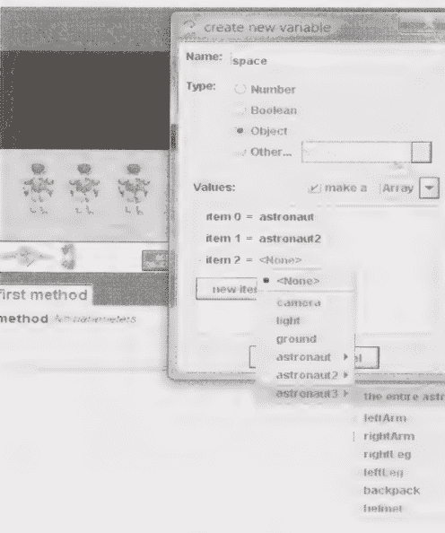

图 3.7.1

数组列在创建它的对象或方法中。旁边的标识表明这是一个数组。

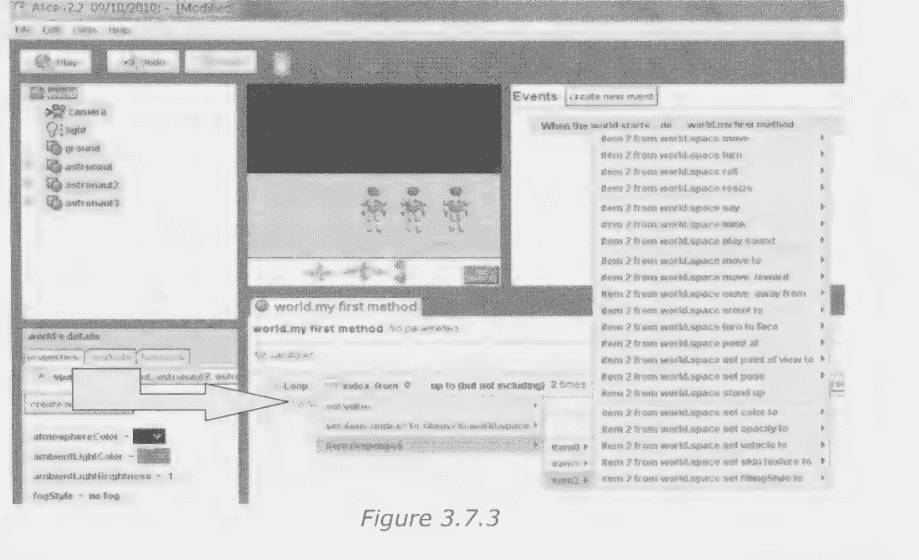

图 3.7.2

### 回顾

- 3.7.1 数组就像列表。它用于存储一组同类型的项目。
- 3.7.2 数组由一组元素组成。
- 3.7.3 元素是数组中每个项的存储位置。
- 3.7.4 当向数组插入一个项时，它的位置不会发生移动。
- 3.7.5 数组具有固定的大小，一旦填充，你就不能再添加任何新项。

在 Alice 中编写一个自定义类级方法有五 (5) 个步骤：

1. 创建类的实例。
2. 选择该实例。
3. 在详情面板（Details Panel）中，点击方法（methods）选项卡下，点击创建新方法（create new method）按钮。
4. 在弹出的对话框中，为想要创建的方法输入一个唯一且具有描述性的名称，点击 OK 按钮，新名称将出现在详情面板中按钮的上方。
5. 在新的方法编辑器（Method Editor）中为该方法创建指令。

创建完成后，新方法就可以像其他任何现有方法一样使用。将其拖动到方法编辑器中并放置在所需的位置。

## 复习

4.1.1 属于某个类的方法被称为

4.1.2 创建一个新方法来执行该操作，并在对象需要执行这些步骤时每次调用它将是有益的。

4.1.3 一旦创建

## 第 4.2 节：创建自定义类级方法

创建“沙子世界”（Sand World）并将从人物库（People Gallery）中的 ToySoldier（玩具士兵）类放在沙地上。现在，点击完成（Done），开始编写让士兵在沙地上行军的方法。如果仅使用前进（forward）方法，士兵会像是在沙地上漂浮移动，看起来并不像在行军。这个方法将为这个简单的小电影增加一些真实感。

现在，选择 ToySoldier 对象并点击详情面板中的方法（methods）选项卡。点击按钮创建一个新方法，新方法名为 `march`（行军）。在对象树中查看 ToySoldier 对象，注意类名称左侧的加号 (+)。这表示该类是由几个其他类组成的。如果选中加号，这些类将会显示出来。这些每个子类都附带了相应的属性、方法和函数。有必要使用 ToySoldier 的几个子类：`leftLeg`（左腿）、`rightLeg`（右腿）、`leftArm`（左臂）和 `rightArm`（右臂）。

方法的内容是四个“一起执行”（Do Together）序列。在每个序列中，士兵将向前移动 .25 米，并相应的距离移动其左腿、右腿、左臂和右臂。腿部和手臂将在每条指令中“旋转” .1（注意是点 1）圈，持续时间为 .5（注意是点 5）秒。让我们一下实现这一切的代码。


```
do together
toySoldier.move forward .25 meters style=abruptly duration = .5 seconds more...
toySoldier.leftLeg.turn forward .1 revolutions style=abruptly duration = .5 seconds more...
toySoldier.rightLeg.turn backward .1 revolutions style=abruptly duration = .5 seconds more...
toySoldier.leftArm.turn forward .1 revolutions style=abruptly duration = .5 seconds more...
toySoldier.rightArm.turn backward .1 revolutions style=abruptly duration = .5 seconds more...

do together
toySoldier.move forward .25 meters style=abruptly duration = .5 seconds more...
toySoldier.leftLeg.turn backward .1 revolutions style=abruptly duration = .5 seconds more...
toySoldier.rightLeg.turn forward .1 revolutions style=abruptly duration = .5 seconds more...
toySoldier.leftArm.turn backward .1 revolutions style=abruptly duration = .5 seconds more...
toySoldier.rightArm.turn forward .1 revolutions style=abruptly duration = .5 seconds more...

do together
toySoldier.move forward .25 meters style=abruptly duration = .5 seconds more...
toySoldier.leftLeg.turn backward .1 revolutions style=abruptly duration = .5 seconds more...
toySoldier.rightLeg.turn forward .1 revolutions style=abruptly duration = .5 seconds more...
toySoldier.leftArm.turn backward .1 revolutions style=abruptly duration = .5 seconds more...
toySoldier.rightArm.turn forward .1 revolutions style=abruptly duration = .5 seconds more...

do together
toySoldier.move forward .25 meters style=abruptly duration = .5 seconds more...
toySoldier.leftLeg.turn forward .1 revolutions style=abruptly duration = .5 seconds more...
toySoldier.rightLeg.turn backward .1 revolutions style=abruptly duration = .5 seconds more...
toySoldier.leftArm.turn forward .1 revolutions style=abruptly duration = .5 seconds more...
toySoldier.rightArm.turn backward .1 revolutions style=abruptly duration = .5 seconds more...
```

现在，我们有一个名为“march” 的方法，我们可以像使用类的其他任何方法一样使用这个方法。这看起来有很多代码，事实也如此，这就是为什么我们只编写一次这些例程并尽可能地复用它们。

## 第 4.3 节 使用方法

新方法准备就绪后，返回“world.my first method”，并像使用其他方法一样使用它——就像它是已经程序化到 `ToySoldier` 类中的方法之一一样。

为了保持简单，我们将循环执行该方法十次。这只需要从方法编辑器的底部拖出“循环”（`Loop`）结构并选择 10 次。然后只需将在 `Loop` 结构下方创建的“march”函数拖放进去，玩具士兵就准备好穿过屏幕行军了。点击播放（`PLAY`）按钮，如果正确，你的士兵就会穿过屏幕。

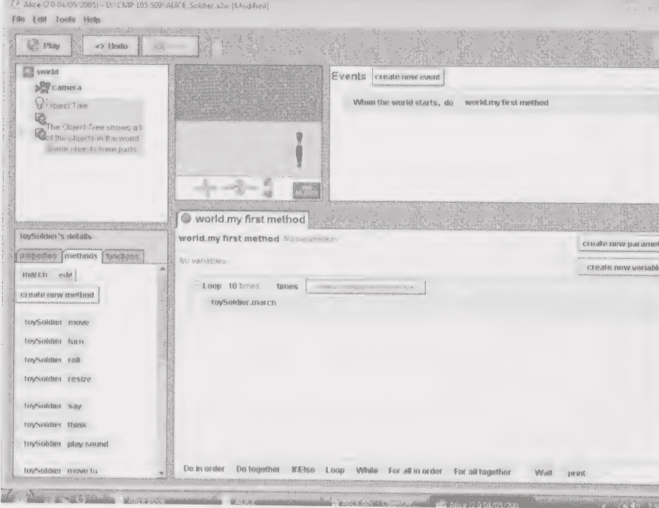


## 步骤

1. Pj 宣布游戏
2. 询问用户重量（盎司）
3. 将重量传递给世界函数 `calcDrops`
4. 显示返回的答案

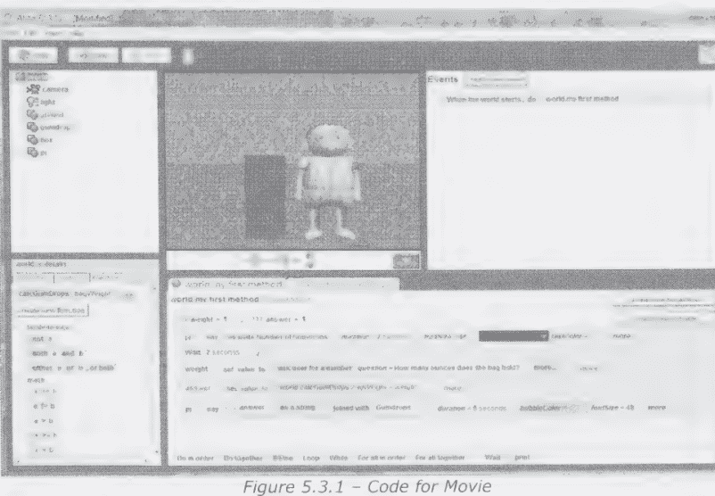

计算糖果数量的世界函数简单地将盎司重量除以糖果的重量。该函数看起来如下：

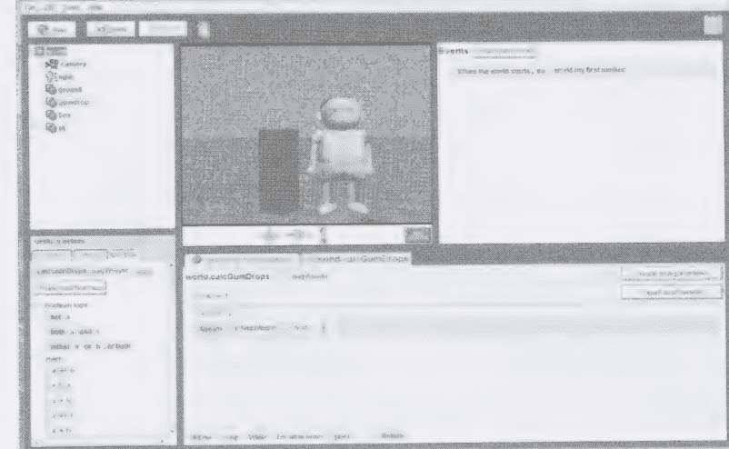

这是一个简单的函数，但它说明了使用函数进行计算。函数返回传递的参数的内容除以数字字面量 `0.05`（一个糖果的重量）。

## 复习

- 5.3.1 函数总是返回一个值。
- 5.3.2 参数是传递给函数的值。

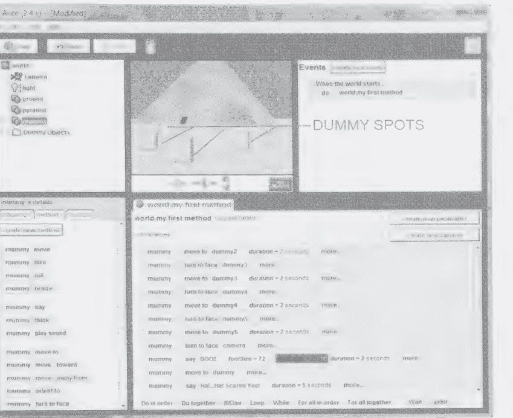

使用“移动到”（`move to`）命令并选择合适的占位点作为目标。我没有重命名占位点，但如果有很多点，这可能是一个好主意。你也可以使用这些占位点来重新定位。

## 复习

- 5.4.1 `_` 是屏幕上用于控制对象移动的点。
- 5.4.2 使用 `_` 命令将对象移动到虚拟对象。

## 第 5.5 节 – 尝试一下

打开一个新的“沙盒”（`Sand`）世界并进入“添加对象”（`Add Objects`）屏幕，选择古代人集合（`Ancients Collection`）。添加避难所（`Class Shelter`）、苹果树（`Class Apple Tree`），并如图 5.5.1 所示添加第一世纪男性2（`FirstCenturyMale2`）和第一世纪女性1（`FirstCenturyWoman1`）。

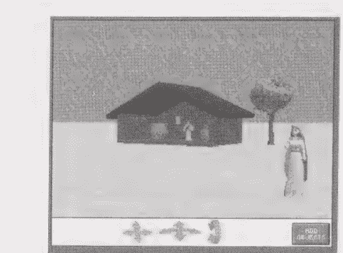

在仍在“添加对象”屏幕时：

1. 在对象树中选择男性，右键点击 `firstCenturyMale2`，选择“方法”（`methods`），选择“移动”（`move`），方向“向前”（`forward`），距离“10 meters”。
2. 在面板右侧点击“更多控制”（`More Controls`），如果尚未选中的话。
3. 点击“在所选对象处放置占位符”（`drop dummy at selected object`）。
4. 在对象树中选择男性并再次右键，选择“方法”（`methods`），选择“面向”（`turn to face`）——`firstCenturyWoman1`——“the firstcenturywoman1”。
5. 在对象树中选择男性并再次右键，选择“方法”（`methods`），选择“移动到”（`move to`）——`firstCenturyWoman1`——“the firstcenturywoman1”。
6. 现在你会看到两个对象重叠。将 `firstCenturyMale2` 移开女性一段距离。
7. 点击“在所选对象处放置占位符”。
8. 在对象树中选择女性并右键点击 `firstCenturyWoman1`，选择“方法”（`methods`），选择“面向”（`turn to face`）——`firstCenturyMale2`——“the entire firstcenturymale2”。
9. 将男性对象移回原始位置。

几乎准备好代码了，但首先进入对象树并选择男性对象，选择“方法”（`methods`），选择“面向”（`turn to face`），选择“占位对象”（`Dummy objects`），选择 `dummy`。

然后点击绿色的完成（`DONE`）按钮，并将以下代码推入 `world.firstMethod` 中。

1. 让男性“移动到”名为 `dummy` 的占位符。
2. 让男性“面向” `firstCenturyWoman1`，即“the entire firstcenturyWoman1”。
3. 让男性“移动到”名为 `dummy2` 的占位符。
4. 让男性对象说“Hello!”。
5. 现在播放（`PLAY`）。

你的屏幕应该看起来像图 5.5.2 所示。

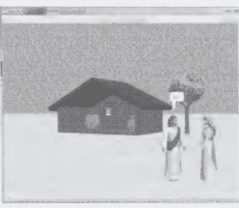

**图 5.5.2 – 最终屏幕**

# 教程 6 – 事件

## 目标

- 描述各种事件
- 创建一个使用多个事件的电影
- 解释为什么事件在 Alice 中非常重要

## 第 6.0 节 – 事件概述

事件是 Alice 世界播放时发生的动作。Alice 世界能够识别某些事件并对其做出响应。这对于其他实现“事件驱动”编程的语言（如 `Visual Basic.NET` 和其他“视觉”语言）来说也同样重要。

“事件编辑器”（`Event Editor`）位于屏幕的右上角。当 Alice 世界首次打开时，此区域将列出一个事件。当电影开始时，`world.myFirstMethod` 是默认调用的方法。

Alice 检测到的事件：

- 当世界开始时
- 按键
- 点击某个对象
- 当条件为真时
- 变量变化
- 让 `<object>` 移动
- 让 `<subject>` 移动
- 让相机移动
- 让相机面向

“创建新事件”（`Create Event`）按钮允许用户选择这些事件。

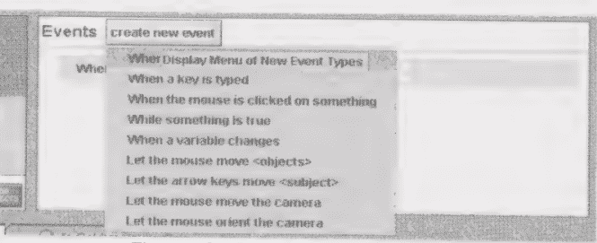

**图 6.0.1**

## 复习

- 6.0.1 Alice 世界能够识别某些并对其做出响应。
- 6.0.3 当电影开始时，“do”是默认调用的方法。
- 6.0.4 使用事件将交互构建到电影中。
- 6.0.5 按钮允许用户选择这些事件。

## 第 6.1 节 - 使用事件

知道何时使用事件是 Alice 编程的关键。必须仔细规划事件，以便程序运行时产生正确的响应。

在执行期间发生的事件类型：

- 当世界开始时
- 当条件为真时
- 变量变化
- 事件
- 按键
- 点击某个对象
- 让 `<object>` 移动
- 让 `<subject>` 移动
- 让相机移动
- 让相机面向

“创建新事件”（`Create New Event`）按钮允许用户选择这些事件。

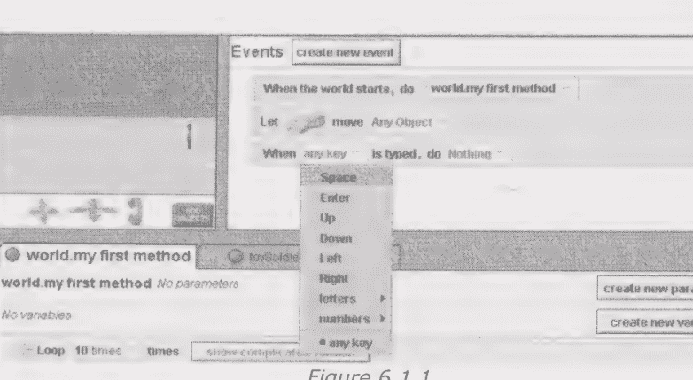

**图 6.1.1**

## 复习

- 6.1.1 有三类事件：
- 6.1.2 按钮允许用户选择这些事件。
- 6.1.3 事件是默认调用的方法。

## 第 6.2 节 – 生成事件

- 当世界开始时
- 当条件为真时
- 变量变化

“当世界开始时”事件是默认调用的方法。到目前为止的所有程序都是该事件的一部分。本节将扩展到。

“当世界开始时”事件是默认调用的方法。到目前为止的所有程序都是该事件的一部分。本节将扩展到。

## 复习

- 6.2.1 此事件监控变量变化的时间
- 6.2.2 事件在按下播放按钮时触发。
- 6.2.3 在此事件中，只要条件为真，就会执行操作。

让鼠标移动相机 - 这允许鼠标“操纵”相机。你将能够将相机移动到世界所展示的动画范围之外。选择此选项允许用户用鼠标控制相机。允许用户移动相机以寻找物体或移动到舞台的其他区域。

让鼠标引导相机方向 - 应该谨慎使用此。很容易将相机移出动画范围，导致丢失电影其他部分的效果。这允许用户通过点击和拖动鼠标来改变相机所指的方向。

## 复习

- 6.4.1 事件会自动调用一个内部 Alice 方法，以拖放的方式移动该对象。
- 6.4.2 事件允许鼠标“操纵”相机。

## Lesson 5.6 – 音频

无声电影的时代早已过去。为了让电影变得真正有趣，我们需要添加声音。Alice 提供了制作音效的功能，但极少数的物体包含任何声音。当你将物体放在屏幕上时，可以通过查看选择物体时弹出的对话框中的描述来识别出带有声音的物体。

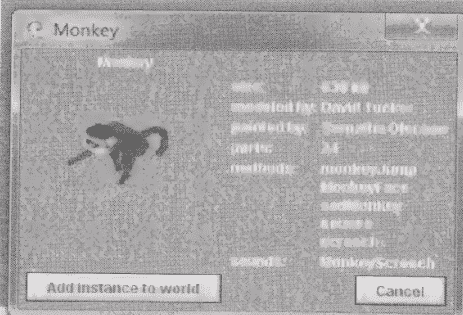

**图 6.5.1**

取消（`Cancel`）按钮上方有一个标题为 sounds 的条目，包含 `MonkeyScreech`。这是该对象唯一可用的声音。

好消息是，当你将物体放入电影时，可以通过另外两个选项添加你自己的声音。在属性（`properties`）选项卡中，许多 Alice 物体（包括已有声音的物体）都有导入声音或录制声音的选项。

你可以将 `.wav` 或 `.mp3` 导入到你的电影中。当你选择导入（`import`）时，将弹出一个对话框，允许你浏览并导入声音。这可以在属性选项卡中完成，也可以在将 `play sound` 命令拖到编辑器时完成。

如果你的电脑有麦克风，就可以录制声音。在属性选项卡中或在将 `play sound` 拖到编辑器时选择录制声音（`record sound`）。会弹出一个对话框允许你录制声音。一个计数器将提醒你音频片段有多长。

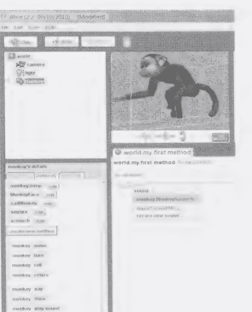

**图 6.5.2**

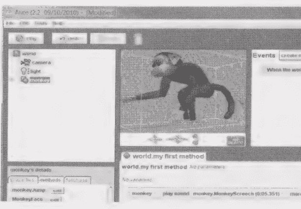

如图 6.5.2 所示，我们将 `monkey play sound` 拖到事件编辑器中，它询问我们是想播放尖叫声、导入声音还是录制声音。

当选择尖叫声时，指令如图 6.5.3 所示。

## 复习

- 6.5.1 为了让电影变得真正有趣，我们需要添加声音。
- 6.5.2 你可以识别带有声音的物体。
- 6.5.3 你可以通过不同的方式添加你自己的声音。
- 6.5.4 你可以将 `.wav` 或 `.mp3` 导入到电影中。

## Lesson 6.6 – 等待

`Wait` 指令的设计是为了程序在指定时间内什么都不做。该模块位于事件编辑器的底部。它接受一个参数，即等待的秒数。程序将暂停并在指定的秒数内不操作。

## 复习

- 6.6.1 `Wait` 指令具有参数。

## Lesson 6.7 - 尝试一下

这个练习创建了一个太空场景，使用鼠标移动物体，使用方向键移动月陆器（`lunarLander`），当用户按下 `Q` 键时，月陆器起飞。

1. 选择太空世界（`Space World`）
2. 将 `lunarLander` 对象放入世界
3. 将 `astronaut`（宇航员）对象放入世界
4. `world.myFirstWorld` 方法
   a. 世界设置雾距离为 75 米
5. 在事件窗口（`Event Window`）中点击：创建新事件（`Create New Event`）
   a. 让鼠标移动 `<objects>`
6. 在事件窗口（`Event Window`）中点击：创建新事件（`Create New Event`）
   a. 让方向键移动 `<subject>`
   b. 选择 `lunar` 方法选项卡：创建新方法（`Create New Method`）
7. 在世界方法选项卡（`World Methods Tab`）中：创建新方法（`Create New Method`）
   a. 将方法命名为 `blastoff`
   b. 在方法中 `Loop` 15 次
   c. 在方法的 `Loop` 下：`lunarLander` 向上移动 0.5 米
   d. `duration = 0.25` 秒
8. 在事件窗口（`Event Window`）中点击：创建新事件（`Create New Event`）
   a. 当按下键时（`When a key is typed`）
   b. 将 `anykey` 改为 `Q`
   c. 将 `nothing` 改为 `blastoff`

运行并实验用鼠标移动物体，使用方向键移动 `lunarLander`。然后使用 `Q` 键让 `lunarLander` 起飞。

# Tutorial 7 - 类 (Classes)

## 目标

- 解释对象和继承的概念。
- 创建一个需要参数的新方法。
- 为一个类创建一个新方法。
- 从现有类创建一个新类。

## Lesson 7.0 - 类概览

类定义了一种特定的对象。Alice 编程语言有预定义的类。这些是在画廊（`gallery`）中找到的 3D 类。类存储在动物（`Animals`）、人类（`People`）、环境（`Environment`）、建筑（`Buildings`）等组中。


# Tutorial 6 - 声音与事件

## Lesson 6.5 - 声音

无声电影的时代早已过去。为了让电影变得真正有趣，我们需要添加声音。Alice 提供了制作音效的功能，但极少数的物体包含任何声音。当你将物体放在屏幕上时，通过查看选择物体时弹出的对话框中的描述来识别出带有声音的物体。


**图 6.5.1**

取消（`Cancel`）按钮上方有一个标题为 `sounds` 的条目，包含“MonkeyScreech”。这是该对象唯一可用的声音。

好消息是，当你将物体放入电影时，可以通过另外两个选项添加你自己的声音。在属性（`properties`）选项卡中，许多 Alice 物体（包括已有声音的物体）都有导入声音或录制声音的选项。

你可以将 `.wav` 或 `.mp3` 导入到你的电影中。当你选择导入（`import`）时，将弹出一个对话框，允许你浏览并导入声音。这可以在属性选项卡中完成，也可以在将 `play sound` 命令拖到编辑器时完成。

如果你的电脑有麦克风，就可以录制声音。在属性选项卡中或在将 `play sound` 拖到编辑器时选择录制声音（`record sound`）。会弹出一个对话框允许你录制声音。一个计数器将提醒你音频片段有多长。


**图 6.5.2**


如图 6.5.2 所示，我们将 `monkey play sound` 拖到事件编辑器中，它询问我们是想播放尖叫声、导入声音还是录制声音。

当选择尖叫声时，指令如图 6.5.3 所示。

### 复习

- 6.5.1 为了让电影变得真正有趣，我们需要添加声音。
- 6.5.2 你可以识别带有声音的物体。
- 6.5.3 你可以通过不同的方式添加你自己的声音。
- 6.5.4 你可以将 `.wav` 或 `.mp3` 导入到电影中。

## Lesson 6.6 – 等待

`Wait` 指令的设计是为了程序在指定时间内什么都不做。该模块位于事件编辑器的底部。它接受一个参数，即等待的秒数。程序将暂停并在指定的秒数内不操作。

### 复习

- 6.6.1 `Wait` 指令具有参数。

## Lesson 6.7 - 尝试一下

这个练习创建了一个太空场景，使用鼠标移动物体，使用方向键移动月陆器（`lunarLander`），当用户按下 `Q` 键时，月陆器起飞。

1. 选择太空世界（`Space World`）
2. 将 `lunarLander` 对象放入世界
3. 将 `astronaut`（宇航员）对象放入世界
4. `world.myFirstWorld` 方法
   a. 世界设置雾距离为 75 米
5. 在事件窗口（`Event Window`）中点击：创建新事件（`Create New Event`）
   a. 让鼠标移动 `<objects>`
6. 在事件窗口（`Event Window`）中点击：创建新事件（`Create New Event`）
   a. 让方向键移动 `<subject>`
   b. 选择 `lunar` 方法选项卡：创建新方法（`Create New Method`）
7. 在世界方法选项卡（`World Methods Tab`）中：创建新方法（`Create New Method`）
   a. 将方法命名为 `blastoff`
   b. 在方法中 `Loop` 15 次
   c. 在方法的 `Loop` 下：`lunarLander` 向上移动 0.5 米
   d. `duration = 0.25` 秒
8. 在事件窗口（`Event Window`）中点击：创建新事件（`Create New Event`）
   a. 当按下键时（`When a key is typed`）
   b. 将 `anykey` 改为 `Q`
   c. 将 `nothing` 改为 `blastoff`

运行并实验用鼠标移动物体，使用方向键移动 `lunarLander`。然后使用 `Q` 键让 `lunarLander` 起飞。

# Tutorial 7 - 类 (Classes)

## 目标

- 解释对象和继承的概念。
- 创建一个需要参数的新方法。
- 为一个类创建一个新方法。
- 从现有类创建一个新类。

## Lesson 7.0 - 类概览

类定义了一种特定的对象。Alice 编程语言有预定义的类。这些是在画廊中找到的 3D 类。类存储在动物（`Animals`）、人类（`People`）、环境（`Environment`）、建筑（`Buildings`）等组中。


# Tutorial 6 - 事件与音频

## Lesson 6.4 – 事件：鼠标控制

让鼠标移动相机 - 这允许鼠标“操纵”相机。你将能够将相机移动到世界所展示的动画范围之外。选择此选项允许用户用鼠标控制相机。允许用户移动相机以寻找物体或移动到舞台的其他区域。

让鼠标引导相机方向 - 应该谨慎使用此选项。很容易将相机移出动画范围，导致丢失电影其他部分的效果。这允许用户通过点击和拖动鼠标来改变相机所指的方向。

### 复习

- 6.4.1 事件会自动调用一个内部 Alice 方法，以拖放的方式移动对象。
- 6.4.2 事件允许鼠标“操纵”相机。

## Lesson 6.5 – 音频

无声电影的时代早已过去。为了让电影变得真正有趣，我们需要添加声音。Alice 提供了制作音效的功能，但极少数的物体包含任何声音。当你将物体放在屏幕上时，通过查看选择物体时弹出的对话框中的描述来识别出带有声音的物体。


**图 6.5.1**

取消（`Cancel`）按钮上方有一个标题为 `sounds` 的条目，包含 `MonkeyScreech`。这是该对象唯一可用的声音。

好消息是，当你将物体放入电影时，可以通过另外两个选项添加你自己的声音。在属性（`properties`）选项卡中，许多 Alice 物体（包括已有声音的物体）都有导入声音或录制声音的选项。

你可以将 `.wav` 或 `.mp3` 导入到你的电影中。当你选择导入（`import`）时，将弹出一个对话框，允许你浏览并导入声音。这可以在属性选项卡中完成，也可以在将 `play sound` 命令拖到编辑器时完成。

如果你的电脑有麦克风，就可以录制声音。在属性选项卡中或在将 `play sound` 拖到编辑器时选择录制声音（`record sound`）。会弹出一个对话框允许你录制声音。一个计数器将提醒你音频片段有多长。


**图 6.5.2**


如图 6.5.2 所示，我们将 `monkey play sound` 拖到事件编辑器中，它询问我们是想播放尖叫声、导入声音还是录制声音。

当选择尖叫声时，指令如图 6.5.3 所示。

### 复习

- 6.5.1 为了让电影变得真正有趣，我们需要添加声音。
- 6.5.2 你可以识别带有声音的物体。
- 6.5.3 你可以通过不同的方式添加你自己的声音。
- 6.5.4 你可以将 `.wav` 或 `.mp3` 导入到电影中。

## Lesson 6.6 – 等待

`Wait` 指令的设计是为了程序在指定时间内什么都不做。该模块位于事件编辑器的底部。它接受一个参数，即等待的秒数。程序将暂停并在指定的秒数内不操作。

### 复习

- 6.6.1 `Wait` 指令具有参数。

## Lesson 6.7 - 尝试一下

这个练习创建了一个太空场景，使用鼠标移动物体，使用方向键移动月陆器（`lunarLander`），当用户按下 `Q` 键时，月陆器起飞。

1. 选择太空世界（`Space World`）
2. 将 `lunarLander` 对象放入世界
3. 将 `astronaut`（宇航员）对象放入世界
4. `world.myFirstWorld` 方法
   a. 世界设置雾距离为 75 米
5. 在事件窗口（`Event Window`）中点击：创建新事件（`Create New Event`）
   a. 让鼠标移动 `<objects>`
6. 在事件窗口（`Event Window`）中点击：创建新事件（`Create New Event`）
   a. 让方向键移动 `<subject>`
   b. 选择 `lunar` 方法选项卡：创建新方法（`Create New Method`）
7. 在世界方法选项卡（`World Methods Tab`）中：创建新方法（`Create New Method`）
   a. 将方法命名为 `blastoff`
   b. 在方法中 `Loop` 15 次
   c. 在方法的 `Loop` 下：`lunarLander` 向上移动 0.5 米
   d. `duration = 0.25` 秒
8. 在事件窗口（`Event Window`）中点击：创建新事件（`Create New Event`）
   a. 当按下键时（`When a key is typed`）
   b. 将 `anykey` 改为 `Q`
   c. 将 `nothing` 改为 `blastoff`

运行并实验用鼠标移动物体，使用方向键移动 `lunarLander`。然后使用 `Q` 键让 `lunarLander` 起飞。

# Tutorial 7 - 类

## 目标

- 解释对象和继承的概念。
- 创建一个需要参数的新方法。
- 为一个类创建一个新方法。
- 从现有类创建一个新类。

## Lesson 7.0 - 类概览

类定义了一种特定的对象。Alice 编程语言有预定义的类。这些是在画廊中找到的 3D 类。类存储在动物（`Animals`）、人类（`People`）、环境（`Environment`）、建筑（`Buildings`）等组中。


### 步骤

6. 在事件窗口（Event Window）中点击：创建新事件（Create New Event）
   a. 让方向键移动 `<subject>`
   b. 选择 lunar 方法选项卡：创建新方法（Create New Method）

7. 在世界方法选项卡（World Methods Tab）中：创建新方法（Create New Method）
   a. 将方法命名为 `blastoff`
   b. 在方法中 Loop 15 次
   c. 在方法的 Loop 下：`lunarLander` 向上移动 0.5 米
   d. `duration = 0.25` 秒

8. 在事件窗口（Event Window）中点击：创建新事件（Create New Event）
   a. 当按下键时（When a key is typed）
   b. 将 "anykey" 改为 "Q"
   c. 将 "nothing" 改为 `blastoff`

运行并实验用鼠标移动物体，使用方向键移动 `lunarLander`。然后使用 "Q" 键让 `lunarLander` 起飞。

### Tutorial 7 - 类 (Classes)

#### 目标
- 解释对象和继承的概念。
- 创建一个需要参数的新方法。
- 为一个类创建一个新方法。
- 从现有类创建一个新类。

#### Lesson 7.0 - 类概览
类定义了一种特定的对象。Alice 编程语言有预定义的类。这些是在画廊中找到的 3D 类。类存储在动物（Animals）、人类（People）、环境（Environment）、建筑（Buildings）等组中。

`IceSkater` 由 30 多个对象组成。`IceSkater` 对象继承了所有其他对象的能力（函数、方法、属性）。`foot` 对象可以执行的所有操作，它在右腿或左腿的末端执行。这些都由 `IceSkater` 对象继承。

查看在 `IceSkater` 中组成 `upperBody` 对象的所有对象。`head` 对象可以执行的所有操作都继承自组成 `head` 的所有对象。通过操作属性、方法和函数，可以为 `IceSkater` 对象赋予栩栩如生的动作。

检查画廊中的其他对象，你会发现所有这些对象都是由其他对象组成的。组成主对象的每个对象的每个属性、方法和函数，都会被你放置在世界中的那个对象所继承。

所以，当你向一个对象添加一个函数或方法并为该对象构建一个新类时，该对象未来的所有实例都将继承这个新函数或方法。

#### 复习
7. 7.2.1 当我们观察对象的所有组件时，发现它是由 ________ 组成的。

7. 7.2.2 通过操作 ________ 和 ________，可以将其他动作赋予不同的对象。

7. 7.2.3 当你向一个对象添加一个函数或方法并为该对象构建一个新类时，该对象未来的所有实例都会继承这个新函数或方法。（正确 / 错误）

#### 第 7.3 节 – 类级方法
使用冰滑运动员，创建一个新方法来模拟更复杂的动作，为在池塘上滑冰的动作增加真实感。这比那些让 Pixar 电影看起来真实的动画更复杂。滑冰动作的步骤组合在一个动作序列中，必须编写到类级方法（Class-Level Method）中。以下是要包含在该新方法中的步骤。

- 滑冰 (Skate)
  - 同时进行 (Do together)
    - 让冰滑者向前移动 2 米
    - 顺序执行 (Do in order)
      - 用左腿滑
      - 顺序执行
        - 抬起右腿并将上半身向前转
        - 放下右腿并将上半身向后转
- 用右腿滑 (slide on right leg)
  - 顺序执行
    - 抬起左腿并将上半身向前转
    - 放下左腿并将上半身向后转

现在是时候将计划代码化了。为了保持这些新方法简洁，有必要先创建一个 `slideLeft` 方法和一个 `slideRight` 方法。然后将它们整合到整体的 `skim` 方法中。

#### 第 7.4 节 - 使用参数创建新方法
现在，让我们来点花样，添加一个 `spin` 方法来以真实的方式旋转冰滑者。`spin` 方法需要一个参数来告诉冰滑者要旋转几次。

- 1. 旋转 (Spin)
  - 参数：旋转次数
  - 顺序执行
    - 准备 (prepare to)
      - 同时进行
        - 抬手臂
        - 抬起并转动左腿
    - 旋转冰滑者（次数）
    - 完成旋转
      - 同时进行
        - 降低手臂
        - 放下并转动左腿

现在编写此操作，就创建了一个具有比原始类更多功能的类新实例。它拥有所有旧的属性、方法和函数，并加上了一些新的属性，使冰滑者更加真实。现在是时候看看这些方法如何传递给该类的新实例了。

#### 第 7.5 节 - 创建新类
冰滑者被赋予了一些新能力，应该捕捉这些能力供其他冰滑者使用。这涉及创建一个新的对象类，应命名为“realSkater”。这是一个步骤步骤。

1. 重命名 `iceSkater`。这是最重要的一步！用不同的名称保存 `iceSkater` 对象，这样它就不会将方法写入原始类中。在对象树中右键点击对象的名称，并选择“重命名”（rename）。在弹出窗口中选择“重命名”，然后在框中输入“realSkater”。
2. 保存。

打开 Alice 并点击 Templates（模板）选项卡。

选择 Grass World（草地世界）并点击 Open（打开）。

点击 Add Objects（添加对象）按钮（草地上方的绿色按钮）。

从 Gallery（库）中选择 "People"人物）。

点击 "class aliceLiddel" 并点击 "Add Instance to World"添加到世界）。

点击 "Class evilStepsister1" 并点击 "Add Instance to World"。

点击 "Class evilStepsister2" 并点击 "Add Instance to World"。

点击屏幕右上角的 quad view（四视图）单选按钮。使用此视图对齐三个对象。

点击 single view（单视图）单选按钮。

点击 Done（完成）——屏幕右侧的绿色按钮。

选择 `evilStepsister1`，在 methods（方法）选项卡下选择 `evilStepsister1.say` 并将其拖到 method editor（方法编辑器）中。点击 other（其他）并输入 "Alice, Jump!"，点击 more..（更多..）设置时长为 2 秒。

在 methods 方法下选择 `aliceLiddel`，在上一条语句下方选择 `aliceLiddel.move`，选择 UP（向上）和 1/2 米。

选择 `aliceLiddel`，将方法 `aliceLiddel.move` 拖到上一条语句下方，选择 DOWN（向下）和 1/2 米。

选择 `evilStepsister2`，在 methods 方法卡下选择 `evilStepsister2.say` 并将其拖到方法编辑器中。点击 other（其他）并输入 "Alice, Turn!"，点击 more..（更多..）设置时长为 2 秒。

选择 `aliceLiddel`，将方法 `aliceLiddel.turn` 拖到上一条语句下方，选择 RIGHT（向右）和 1 圈。

选择 `aliceLiddel`，将方法 `aliceLiddel.say` 拖到上一条语句下方，选择 goodbye（再见）且时长为 2 秒。

选择 `aliceLiddel`，将方法 `aliceLiddel.move` 拖到上一条语句下方，选择 FORWARD（向前）和 10 米，然后点击 more...（更多...）选择 duration，选择 other，点击 3 然后点击 OKAY（确定）。

播放电影。

---

# Alice 分步教学 2

练习用途：
- Select a world（选择世界）
- Select Make Billboard（制作看板）

**打开 Alice** 并选择一个新的 **grass world**（草地世界）

从菜单栏中，选择 **File**（文件）然后子菜单项 **Make Billboard**（制作看板）。将出现导入对话框：

浏览到你想要用于看板的 jpg / gif / png 图形

点击 **Import**（导入）按钮

点击 **Add Objects**（添加对象）按钮。

使用控件调整图像大小和位置。

PLAY（播放）

---

# Alice 分步教学 3

练习用途：
- Select a world（选择世界）
- Select Objects（选择对象）
- 3D Text（3D 文字）
- Methods（方法）
  - turn（旋转）
  - roll（翻滚）
  - resize（调整大小）

打开 Alice 并选择一个新的 space world（空间世界）。

点击 Add Objects 显示对象库。

进入 3D TEXT 并点击。将出一个对话框：

将 “The quick brown fox.” 替换为 “Lost in Space?”

将字体更改为 Comic Sans MS

点击 (B) Bold（粗体）按钮

点击 (I) Italics（斜体）按钮

点击 OK（确定）按钮。

移动你的文本使其显示在黑色天空上。

将 loop 瓦片拖到 Methods Editor（方法编辑器），设置循环为 5 次，在循环中执行以下操作：

- Methods Tab：设置 3D Text.turn 向左旋转 1 圈，时长 2 秒
- Methods Tab：设置 3D Text.roll 向右翻滚 1 圈
- Methods Tab：设置 3D Text.resize 为 ½（一半大小）
- Methods Tab：设置 3D Text.resize 为 2（两倍大小）

PLAY（播放）

---

# Alice 分步教学 4

练习用途：
- Select a world（选择世界）
- Select Objects（选择对象）
- Single View / Quad View（单视图 / 四视图）
- Do in Order（按顺序执行）
- Do Together（一起执行）
- Methods（方法）
  - move up（向上）
  - move down（向下）
  - move forward（向前）
  - move backward（向后）
  - turn（旋转）
  - say（说话）

打开 Alice 并选择一个新的 grass world（草地世界）。

进入 Buildings（建筑）并在世界上放置一个 FARMHOUSE（农舍）。

进入 People（人物）并在世界上放置一个 Class of RandomGuy2 和一个 class of Kelly。

Kelly 可能盖住了 RandomGuy2，所以我们需要：
- 将 Kelly 向右移动。
- 将 Kelly 移到房子的门前。
- 将 RandomGuy2 稍微向左移动。

点击 DONE（完成）。

在对象树中选择 Kelly 并在 world event（世界事件）区域放置一个命令让她向前移动到 RandomGuy2 旁边。

这可能需要一些实验，取决于她需要移动多少米。

让 Kelly 说 "Do you want to go for a walk?"（你想去散步吗？）。

在对象树中选择 RandomGuy2 并让他回答 "OK!"。

测试你的电影。

在世界事件窗口的第一条命令之前插入 "Do in order" 命令。然后将结构下方的命令移动到 "Do in order" 结构中。

插入一些注释：
- 在 "Kelly move" 上方插入注释 "Move people into position"（人物移到位）
- 在 "Kelly say" 上方插入注释 "Couples conversation"（情侣对话）
- 在 "Kelly say" 下方插入注释 "Turn to walk"（转身行走）

让 RandomGuy2 向右旋转 ¼ 圈
让 Kelly 向右旋转 ¼ 圈

TEST（测试）——此时女孩在男孩后面，需要到他身边才能正常行走。

在女孩旋转**之前**让她向前移动 ½ 米。

在女孩旋转**之后**让她向前移动到他身边，这需要一些实验。

在 "turn to walk" 注释之后 "RandomGuy2 turn right" 之前放入 "Do Together"（一起执行）。

将命令拖入 “Do Together”结构：
- RandomGuy2 turn right
- Kelly move
- Kelly turn
- Kelly move

TEST（注意这样执行要流畅得多）

创建另一个 “Do together”结构。

在新结构中放置：
- RandomGuy2 turn right right
- Kelly move
- Kelly turn
- Kelly move

TEST（注意这样执行要流畅得多）

---

# Alice 分步教学 5

练习用途：
- Select a world
- Select Objects
- Single View / Quad View
- Do in Order
- Do Together
- Methods
  - move up
  - move down
  - move forward
  - move backward
  - turn
  - say

将“一起执行”拖到方法编辑器
- 双翼飞机向前移动 5 米
- 双翼飞机向上移动 5 米

前往右上角的事件编辑器窗格
点击“创建新事件”
选择“当按下键时”
点击“任意键”
选择“左”
点击“无”
选择双翼飞机
选择方法 `flyForward`

前往右上角的事件编辑器窗格
点击“创建新事件”
选择“当按下键时”
点击“任意键”
选择“上”
点击“无”
选择双翼飞机
选择方法 `flyUp`

前往右上角的事件编辑器窗格
点击“创建新事件”
选择“当按下键时”
点击“任意键”
选择“空格”
点击“无”
选择双翼飞机
选择方法 `roll`

播放

---

# Alice 循步教学 7

练习用途：
- 选择世界
- 选择对象
- 更改属性
- 距离函数
- 单视图 / 四分视图
- 方法
  - 向上
  - 向下
  - 行走
  - 向后移动
  - 面向

问题：企鹅面向冰面上的洞，无论该洞位于哪里。然后企鹅应该走到洞的中心并跳入其中，消失在冰面下方。

伪代码：
- 企鹅面向洞
- 企鹅向洞中心行走一段距离
- 企鹅掉入洞中

步骤：
1. 创建一个雪地世界
2. 从动物库中添加一只企鹅
3. 从形状库中添加一个洞（圆形）
4. 将颜色属性更改为蓝色。（详情面板）
5. 选择企鹅对象
6. 将“面向”方法的磁块拖并释放到方法编辑器。
7. 选择面向圆形对象
8. 企鹅面向圆形的更多...
9. 企鹅类有一个名为“walking”（行走）的自定义方法
10. Walking x（设置 x = 1）
11. 将上一步中设置的 1 替换为对“企鹅距离到”函数的调用
    - 使用详情面板中的函数选项卡
    - 查看距离（proximity）类别
    - 确保你选择了圆形对象
    - `penguin walking x = penguin distance to circle`
12. 为了让企鹅掉进洞里，让企鹅向下移动，直到它位于冰面下方（约 5 米）
13. 企鹅再向下移动 5 米...

方法编辑器中的代码应该如下：

```
penguin turn to face circle more...
```

```
penguin walking x = penguin distance to circle
penguin move down 5 meters more...
```

测试你的电影，进行任何必要的更改。

你能改进这部电影吗？例如：让一条鱼从洞里跳出来又进去，吸引企鹅向洞移动。

---

# Alice 循步教学

练习用途：
- 选择世界
- 选择对象
- 更改属性
- 距离函数
- 单视图 / 四分视图
- 方法
  - 向移动
  - 向下
  - 向前移动

这个练习创建了一个电影，其中蜘蛛对象移动到飞船对象。代码按照正确的顺序移动腿部部分，以模拟腿部的部动作。

## 小蜘蛛 Jr.

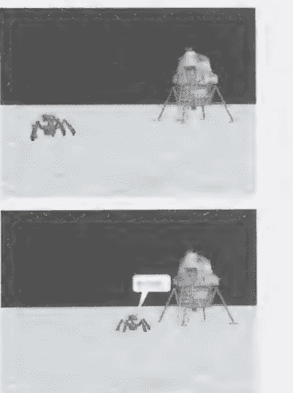

- 如图 1 所示将蜘蛛和月球着陆器对齐
- 图 2 显示结果
- 使用提供的代码重建此场景
- 蜘蛛向月球着陆器移动，我循环了 8 次，你可能需要根据两个对象之间的距离进行调整。
- 你可能需要进行一些实验，但这模拟了腿部动作。

这是小蜘蛛 Jr. 的代码：


```
world.my first method ()
无变量
spiderRobot turn to face lunarLander
循环 8 次
一起执行
  spiderRobot move amount = 1 meter target = lunarLander duration = 0.5 seconds style = abruptly
  顺序执行
    spiderRobot.body.backLeftLegBase.upperJoint turn forward 0.1 revolutions duration = 0.5 seconds
    spiderRobot.body.backLeftLegBase.upperJoint turn backward 0.1 revolutions duration = 0.5 seconds
  顺序执行
    spiderRobot.body.frontRightLegBase.upperJoint turn forward 0.1 revolutions duration = 0.5 seconds
    spiderRobot.body.frontRightLegBase.upperJoint turn backward 0.1 revolutions duration = 0.5 seconds
  顺序执行
    spiderRobot.body.frontRightLegBase.upperJoint turn forward 0.1 revolutions duration = 0.5 seconds
    spiderRobot.body.frontRightLegBase.upperJoint turn backward 0.1 revolutions duration = 0.5 seconds
  顺序执行
    spiderRobot.body.backRightLegBase.upperJoint turn backward 0.1 revolutions
    spiderRobot.body.backRightLegBase.upperJoint turn forward 0.1 revolutions
  spiderRobot say Momma! duration = 2 seconds
```

运行电影，仔细观察腿部。你能改进这个动作吗？

## 迷失太空

在代码中

等待 10 秒

设置3D文本的属性：`isShowing = False`

同时执行

- 宇航员：属性：`isShowing = True`
- 月球着陆器：属性：`isShowing = True`
- 相机后退 10 米。

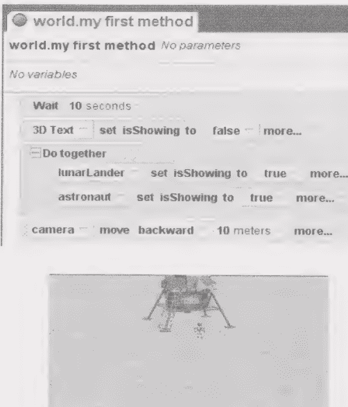

### Alice 逐步教程 11

练习用途：

- 选择世界
- 选择对象
- 单视图 / 四分视图
- 3D 文本
- 更改属性
- 方法

移动相机

**打开 Alice**并点击**模板选项卡（Templates tab）**。

选择沙漠世界（Sand World）并点击打开

进入日本画廊（Japan Gallery）并选择：

- 道场 (dojo)
- 两个武士
- 一个舞扇者

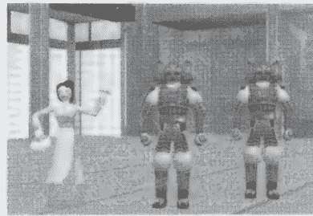

使用左、右、前、后箭头（左侧的箭头组）：

向左滚动到道场之外的沙漠世界。

从画廊中放置并定位寺庙对象（Temple Object）

再次使用箭头回到道场内部

选择3D 文本对象并进行以下属性更改：

```
Text = JAPAN
color = red
isShowing = False
```

代码：

```
world.my.first method No parameters
No variables:
camera move left 22 meters duration=5 seconds more...
camera move right 22 meters duration=5 seconds more...
camera move backward 5 meters more...
3D Text set IsShowing to true duration=7 seconds more...
3D Text set IsShowing to false more...
3D Text set text to Welcomes You true more...
```

道场外：

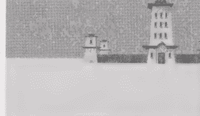

回到内部，出现3D 文本：

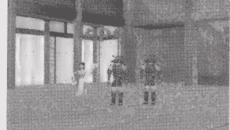

然后出现第二条消息：

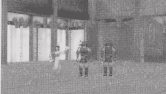

### Alice 逐步教程 12

练习用途：

- 选择世界
- 选择对象
- 单视图 / 四分视图
- 方法
  - 移动
  - 播放声音

**打开 Alice**并点击**模板选项卡（Templates tab）**。

选择草地世界（Grass World）并点击打开

从动物画廊选择：

- 狮子 (lion)
- 猴子 (monkey)
- 老鼠 (mouse)
- 哈士奇犬 (husky)
- 猫 (cat)
- 鸟1 (bird1)
- 牛 (cow)

这些所有这些对象都有内置声音。现在我们将编写代码让它们展示出金色的嗓音。

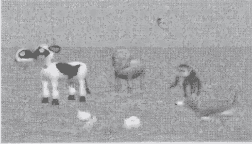

代码：

#### world.my first method

`world.my first method` *No parameters*

No variables

| 对象 | 动作 | 参数 | 详情 |
| :--- | :--- | :--- | :--- |
| bird1 | move up | 0.5 meters | more... |
| bird1 | move down | 0.5 meters | more... |
| bird1 | play sound | `bird1.chirp` (0:00.700) | more... |
| cow | turn left | 0.25 revolutions | more... |
| cow | play sound | `cow.mooo` (0:01.567) | more... |
| lion | move forward | 0.5 meters | more... |
| lion | play sound | `lion.lionroar` (0:00.909) | more... |
| monkey | move backward | 5 meters | more... |
| monkey | play sound | `monkey.Monkey/Screech` (0:05.351) | more... |
| husky | turn to face | `husky.Bark2` (0:00.689) | more... |
| mouse | move amount = 2 meters | away from target = lion | more... |
| mouse | play sound | `mouse.mouseSqueak` (0:00.523) | more... |
| cat | play sound | `cat.cat` (0:00.596) | more... |

同时执行

| 对象 | 动作 | 参数 | 详情 |
| :--- | :--- | :--- | :--- |
| lion | turn left | 0.25 revolutions | more... |
| lion | move forward | 10 meters | more... |
| lion | play sound | `lion.wiper` (0:02.980) | more... |

按顺序执行 执行 Do together IfElse Loop While For all in order For together

现在播放这场音乐会。

### Alice 逐步教程 13

练习用途：

- 选择世界
- 选择对象
- 单视图 / 四分视图
- 方法
  - 播放声音
  - 旋转

**打开 Alice**并点击**模板选项卡（Templates tab）**。

选择沙漠（Sand）并点击打开

从旧西部画廊（Old West Gallery）选择：

- 酒馆（Saloon）
- 牛仔手（Cowboy）

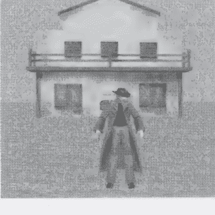

你需要一个 .mp3 格式的你喜欢的牛仔歌曲。牛仔会唱你的歌并挥动手臂。动作并不非常复杂，但你可以对此进行改进。你可以对此进行改进。


牛仔会唱你的歌并挥动手臂。动作并不非常复杂，但你可以对此进行改进。

### Alice 逐步教程 14

练习用途：

- 选择一个世界
- 选择对象
- 单视图 / 四分视图
- 方法
  - 移动
  - 旋转

**打开 Alice**并点击**模板选项卡（Templates tab）**。

选择沙漠世界（Sand World）并点击打开

从日本画廊选择：

- 道场（dojo）
- 两个武士
- 一个舞扇者
- ...

从画廊中放置并定位寺庙对象（Temple Object）

再次使用箭头回到道场内部

选择3D 文本对象并进行以下属性更改：

```
Text = JAPAN
color = red
isShowing = False
```

代码：

```
world.my.first method No parameters
No variables:
camera move left 22 meters duration=5 seconds more...
camera move right 22 meters duration=5 seconds more...
camera move backward 5 meters more...
3D Text set IsShowing to true duration=7 seconds more...
3D Text set IsShowing to false more...
3D Text set text to Welcomes You true more...
```

道场外：


回到内部，出现3D 文本：


然后出现第二条消息：


# Alice 逐步教程

## 教程 11

**打开 Alice**并点击`模板选项卡（Templates tab）`。

选择`沙漠世界（Sand World）`并点击打开。

从日本画廊选择：

- 道场（dojo）
- 两个武士
- 一个舞扇者
- ...

从画廊中放置并定位`寺庙对象（Temple Object）`。

再次使用箭头回到道场内部。

选择`3D 文本对象`并进行以下属性更改：

```
Text = JAPAN
color = red
isShowing = False
```

代码：

```
world.my.first method No parameters
No variables:
camera move left 22 meters duration=5 seconds more...
camera move right 22 meters duration=5 seconds more...
camera move backward 5 meters more...
3D Text set IsShowing to true duration=7 seconds more...
3D Text set IsShowing to false more...
3D Text set text to Welcomes You true more...
```

道场外：


回到内部，出现3D 文本：


然后出现第二条消息：


## Alice 逐步教程 12

### 练习用途

- 选择世界
- 选择对象
- 单视图 / 四分视图
- 方法
  - 移动
  - 播放声音

**打开 Alice**并点击`模板选项卡（Templates tab）`。

选择`草地世界（Grass World）`并点击打开。

从动物画廊选择：

- 狮子 (lion)
- 猴子 (monkey)
- 老鼠 (mouse)
- 哈士奇犬 (husky)
- 猫 (cat)
- 鸟1 (bird1)
- 牛 (cow)

这些所有对象都有内置声音。现在我们将编写代码让它们展示出金色的嗓音。


### 代码

#### world.my first method

`world.my first method` *No parameters*

No variables

| 对象 | 动作 | 参数 | 详情 |
| :--- | :--- | :--- | :--- |
| bird1 | move up | 0.5 meters | more... |
| bird1 | move down | 0.5 meters | more... |
| bird1 | play sound | bird1.chirp (0:00.700) | more... |
| cow | turn left | 0.25 revolutions | more... |
| cow | play sound | cow.mooo (0:01.567) | more... |
| lion | move forward | 0.5 meters | more... |
| lion | play sound | lion.lionroar (0:00.909) | more... |
| monkey | move backward | 5 meters | more... |
| monkey | play sound | monkey.Monkey/Screech (0:05.351) | more... |
| husky | turn to face | husky.Bark2 (0:00.689) | more... |
| mouse | move amount = 2 meters | away from target = lion | more... |
| mouse | play sound | mouse.mouseSqueak (0:00.523) | more... |
| cat | play sound | cat.cat (0:00.596) | more... |

**同时执行**

| 对象 | 动作 | 参数 | 详情 |
| :--- | :--- | :--- | :--- |
| lion | turn left | 0.25 revolutions | more... |
| lion | move forward | 10 meters | more... |
| lion | play sound | lion.wiper (0:02.980) | more... |

`按顺序执行` `执行 Do together` `IfElse` `Loop` `While` `For all in order` `For together`

现在播放这场音乐会。

## Alice 逐步教程 13

### 练习用途

- 选择世界
- 选择对象
- 单视图 / 四分视图
- 方法
  - 播放声音
  - 旋转

**打开 Alice**并点击`模板选项卡（Templates tab）`。

选择`沙漠（Sand）`并点击打开。

从`旧西部画廊（Old West Gallery）`选择：

- 酒馆（Saloon）
- 牛仔手（Cowboy）


你需要一个 `.mp3` 格式的你喜欢的牛仔歌曲。牛仔会唱你的歌并挥动手臂。动作并不非常复杂，但你可以对此进行改进。


牛仔会唱你的歌并挥动手臂。动作并不非常复杂，但你可以对此进行改进。

## Alice 逐步教程 14

### 练习用途

- 选择一个世界
- 选择对象
- 单视图 / 四分视图
- 方法
  - 移动
  - 旋转

**打开 Alice**并点击`模板选项卡（Templates tab）`。

选择`沙漠世界（Sand World）`并点击打开。

从日本画廊选择：

- 道场（dojo）
- 两个武士
- 一个舞扇者
- ...

从画廊中放置并定位`寺庙对象（Temple Object）`。

再次使用箭头回到道场内部。

选择`3D 文本对象`并进行以下属性更改：

```
Text = JAPAN
color = red
isShowing = False
```

代码：

```
world.my.first method No parameters
No variables:
camera move left 22 meters duration=5 seconds more...
camera move right 22 meters duration=5 seconds more...
camera move backward 5 meters more...
3D Text set IsShowing to true duration=7 seconds more...
3D Text set IsShowing to false more...
3D Text set text to Welcomes You true more...
```


# Alice 逐步教程

## 场景设置：道场外

```
world.my.first method No parameters
No variables:
camera move left 22 meters duration=5 seconds
camera move right 22 meters duration=5 seconds
camera move backward 5 meters
3D Text set IsShowing to true duration=7 seconds
3D Text set IsShowing to false
3D Text set text to Welcomes You true
```

道场外：


回到内部，出现3D 文本：


然后出现第二条消息：


## Alice 逐步教程 12

**练习用途：**

- 选择世界
- 选择对象
- 单视图 / 四分视图
- 方法
  - 移动
  - 播放声音

**打开 Alice** 并点击**模板选项卡（Templates tab）**。
选择草地世界（Grass World）并点击打开。
从动物画廊选择：

- 狮子 (`lion`)
- 猴子 (`monkey`)
- 老鼠 (`mouse`)
- 哈士奇犬 (`husky`)
- 猫 (`cat`)
- 鸟1 (`bird1`)
- 牛 (`cow`)

这些所有对象都有内置声音。现在我们将编写代码让它们展示出金色的嗓音。


### 代码：`world.my first method`

`world.my first method` *No parameters*

No variables

| 对象 | 动作 | 参数 | 详情 |
| :--- | :--- | :--- | :--- |
| `bird1` | `move up` | `0.5 meters` | `more...` |
| `bird1` | `move down` | `0.5 meters` | `more...` |
| `bird1` | `play sound` | `bird1.chirp (0:00.700)` | `more...` |
| `cow` | `turn left` | `0.25 revolutions` | `more...` |
| `cow` | `play sound` | `cow.mooo (0:01.567)` | `more...` |
| `lion` | `move forward` | `0.5 meters` | `more...` |
| `lion` | `play sound` | `lion.lionroar (0:00.909)` | `more...` |
| `monkey` | `move backward` | `5 meters` | `more...` |
| `monkey` | `play sound` | `monkey.Monkey/Screech (0:05.351)` | `more...` |
| `husky` | `turn to face` | `husky.Bark2 (0:00.689)` | `more...` |
| `mouse` | `move` | `amount = 2 meters`, `away from target = lion` | `more...` |
| `mouse` | `play sound` | `mouse.mouseSqueak (0:00.523)` | `more...` |
| `cat` | `play sound` | `cat.cat (0:00.596)` | `more...` |

**同时执行**

| 对象 | 动作 | 参数 | 详情 |
| :--- | :--- | :--- | :--- |
| `lion` | `turn left` | `0.25 revolutions` | `more...` |
| `lion` | `move forward` | `10 meters` | `more...` |
| `lion` | `play sound` | `lion.wiper (0:02.980)` | `more...` |

控制结构：`按顺序执行`、`执行`、`Do together`、`IfElse`、`Loop`、`While`、`For all in order`、`For together`

现在播放这场音乐会。

## Alice 逐步教程 13

**练习用途：**

- 选择世界
- 选择对象
- 单视图 / 四分视图
- 方法
  - 播放声音
  - 旋转

**打开 Alice** 并点击**模板选项卡（Templates tab）**。
选择沙漠（Sand）并点击打开。
从旧西部画廊（Old West Gallery）选择：
酒馆（Saloon）
牛仔手（Cowboy）


你需要一个 `.mp3` 格式的你喜欢的牛仔歌曲。牛仔会唱你的歌并挥动手臂。动作并不非常复杂，但你可以对此进行改进。


牛仔会唱你的歌并挥动手臂。动作并不非常复杂，但你可以对此进行改进。

## Alice 逐步教程 14

**练习用途：**

- 选择一个世界
- 选择对象
- 单视图 / 四分视图
- 方法
  - 移动
  - 旋转

**打开 Alice** 并点击**模板选项卡（Templates tab）**。
选择沙漠世界（Sand World）并点击打开。
从日本画廊选择：
道场（`dojo`）
两个武士
一个舞扇者

...

从画廊中放置并定位寺庙对象（Temple Object）。
再次使用箭头回到道场内部。
选择 3D 文本对象并进行以下属性更改：

```
Text = JAPAN
color = red
isShowing = False
```

### 代码：`world.my.first method`

```
world.my.first method No parameters
No variables:
camera move left 22 meters duration=5 seconds more...
camera move right 22 meters duration=5 seconds more...
camera move backward 5 meters more...
3D Text set IsShowing to true duration=7 seconds more...
3D Text set IsShowing to false more...
3D Text set text to Welcomes You true more...
```

道场外：


回到内部，出现3D 文本：


然后出现第二条消息：


# Alice 教程与参考文档

## 代码示例

```
camera move backward 5 meters more...
3D Text set IsShowing to true duration=7 seconds more...
3D Text set IsShowing to false more...
3D Text set text to Welcomes You true more...
```

## 场景截图

### 道场外


### 回到内部，出现3D 文本


### 然后出现第二条消息


## Alice 逐步教程 12

### 练习用途

- 选择世界
- 选择对象
- 单视图 / 四分视图
- 方法
  - 移动
  - 播放声音

### 操作步骤

打开 `Alice` 并点击**模板选项卡（Templates tab）**。
选择草地世界（Grass World）并点击打开。
从动物画廊选择：

- 狮子 (lion)
- 猴子 (monkey)
- 老鼠 (mouse)
- 哈士奇犬 (husky)
- 猫 (cat)
- 鸟1 (bird1)
- 牛 (cow)

现在我们将编写代码让它们展示出金色的嗓音。


## 额外练习应用题

### 练习 1

创建一个 Alice 世界，其中一个人坐在独划舟上大喊“救命！”，同时两只鲨鱼绕着船游动。确保两只鲨鱼同时绕船游动。此外，确保更改一些默认设置以控制鲨鱼绕船游动的速度的速度。

### 练习 2

创建一个包含任何具有 `turn` 方法对象的的世界。当世界首次开始时，询问用户他们想要该对象旋转的次数。如果该数字小于 10，则使用 `turn` 方法让对象旋转相应的次数。如果数字为 10 或更多，对象应该说“旋转超过 10 次让我感到不舒服！”

### 练习 3

创建一个拥有若干游乐设施的游乐公园。激活这些设施进行旋转或转向，并在场景中加入若干个人对象和其他游乐活动。让鼠标移动相机以从不同的视角展示整个公园。使用 `billboard`（告示板）对象在公园周围创建标牌。

### 练习 4

创建一个包含岛屿和一条鱼的海洋世界。鱼应该绕着岛屿游动（鱼身体的一部分应该在水面以上，这样你可以看到它在游动）。程序应该询问用户 1 到 6 之间的鱼的数量，相应的鱼应该绕着岛屿游动十（10）圈。

### 练习 5

创建一个带有 `Lake` 类实例（来自环境集合）和 `IceSkater` 类实例（来自人物集合）的世界。编写 `IceSkater` 程序让她在湖面上绕圈滑冰。当程序启动时，它应该询问用户她应该绕湖几圈，以及是否在每次完成一圈后进行跳跃。滑冰者应该按照输入的次数绕圈，并在每圈结束时跳跃。

### 练习 6

编写包含以下元素的自定义故事：

- 询问用户至少一次输入。
- 至少有一个变量。
- 多个对象一起移动。
- 更改一个或多个对象的属性值。
- 用户与鼠标或方向键的交互。

## 复习题答案对照

### 课程 1

| 问题 | 答案 |
| :--- | :--- |
| 1.0.1 | 方法编辑器 |
| 1.0.2 | 属性、方法、函数 |
| 1.0.3 | 世界视图窗口 |
| 1.0.4 | 正确 |
| 1.0.5 | 事件 |
| 1.1.1 | 四 |
| 1.1.2 | 帮助、教程 |
| 1.1.3 | 错误 |
| 1.2.1 | 属性、方法、函数 |
| 1.2.2 | 方法 |
| 1.2.3 | 属性 |
| 1.2.4 | 配方 (recipe) |
| 1.2.5 | 对象、对象、对象 |
| 1.4.1 | 上方、正面、侧面 |
| 1.4.2 | 滚动视图、缩放 |
| 1.4.3 | 布局 |
| 1.4.4 | 七 |
| 1.5.1 | 故事板 (storyboard) |
| 1.5.2 | 脚本 (script) |
| 1.5.3 | 正确 |
| 1.5.4 | 规划 |
| 1.6.1 | 大纲 |
| 1.6.2 | 编写另一种语言。 |
| 1.6.3 | 故事板、伪代码 |

### 课程 2

| 问题 | 答案 |
| :--- | :--- |
| 2.0.1 | 前、后、左、右、上、下 |
| 2.0.2 | 方法 |
| 2.0.3 | 六个自由度 |
| 2.0.4 | 错误 |
| 2.1.5 | 细节 |
| 2.1.1 | 四边形 (quad) |
| 2.1.2 | 中心 |
| 2.1.3 | 上、下 |
| 2.1.4 | 向前、向后 |
| 2.1.5 | 右、左 |
| 2.2.1 | 原始类型 (primitive) |
| 2.2.2 | 右键、对象树 |
| 2.3.1 | 变量 |
| 2.3.2 | 正确 |
| 2.3.3 | 四 |
| 2.3.4 | 数字、布尔值、对象、其他 |
| 2.4.1 | 鼠标 |
| 2.4.2 | 语法 |
| 2.4.3 | 函数 |
| 2.4.4 | 世界 |
| 2.4.5 | 字符串 |
| 2.5.1 | 一起 (Do Together) |
| 2.5.2 | 特定顺序 |
| 2.5.3 | 一起 (Do Together) |
| 2.5.4 | 按顺序 (Do in order) |
| 2.6.1 | 逻辑的 |
| 2.6.2 | 关系的 |
| 2.6.3 | 三 |
| 2.6.4 | 六 |
| 2.6.5 | 布尔值 |
| 2.7.1 | 告示板 (billboard) |
| 2.7.2 | GIF |
| 2.7.3 | PNG |
| 2.7.4 | 文件、Billboard |
| 2.8.1 | 二 |
| 2.8.2 | 正确 |
| 2.8.3 | 错误 |

### 课程 3

| 问题 | 答案 |
| :--- | :--- |
| 3.0.1 | 简单的、复杂的 |
| 3.0.2 | 二 |
| 3.0.3 | 重复 |
| 3.0.4 | 无限的 |
| 3.0.5 | 错误 |
| 3.1.1 | 循环 (loop) |
| 3.1.2 | 变量 |
| 3.1.3 | 负数 |
| 3.3.1 | while |
| 3.3.2 | 预测试 (pretest) |
| 3.3.3 | 正确 |
| 3.5.1 | 世界对象 |
| 3.5.2 | 错误 |
| 3.5.3 | 正确 |
| 3.5.4 | 随机数字 |
| 3.6.1 | 列表 |
| 3.6.2 | 按顺序 (For all in order) |
| 3.6.3 | 所有一起 (For all together) |
| 3.7.1 | 数组 |
| 3.7.2 | 元素 |
| 3.7.3 | 星号 (*) |
| 3.7.4 | 错误 |
| 3.7.5 | 数组 |

### 课程 4

| 问题 | 答案 |
| :--- | :--- |
| 4.0.1 | 方法 |
| 4.0.2 | 企鹅 |
| 4.1.1 | 类级 |
| 4.1.2 | 类、方法 |
| 4.1.3 | 正确 |
| 4.4.1 | 参数 (parameter) |
| 4.4.2 | 实参数 (argument) |
| 4.5.1 | 世界视图 |
| 4.5.2 | 属性、方法、函数 |

### 课程 5

| 问题 | 答案 |
| :--- | :--- |
| 5.0.1 | 事件 |
| 5.0.2 | 右上 |
| 5.0.3 | 交互 |
| 5.0.4 | 键盘 |
| 5.1.1 | 鼠标 |
| 5.1.2 | 创建新事件 (Create New Event) |
| 5.1.3 | 世界开始时 |
| 5.2.1 | 当变量改变时 |
| 5.2.2 | 世界开始时 |
| 5.2.3 | 当条件为真时 |
| 5.3.1 | 当输入按键时 |
| 5.3.2 | 让方向键移动<主体> |
| 5.4.1 | 让鼠标移动<对象> |
| 5.4.2 | 让鼠标移动相机 |
| 5.5.1 | 声音 |
| 5.5.2 | 在创建对象时查看对话框 |
| 5.5.3 | 二 |
| 5.5.4 | .wav, .mp3 |

### 课程 6

| 问题 | 答案 |
| :--- | :--- |
| 6.0.1 | 类 |
| 6.0.2 | 类（复数） |
| 6.0.3 | 加号 |
| 6.0.4 | 类 |
| 6.1.1 | 新类 |
| 6.1.2 | 继承 (inherit) |
| 6.1.3 | 属性、方法、函数 |
| 6.2.1 | 其他对象 |
| 6.2.2 | 属性、方法、函数 |
| 6.2.3 | 正确 |

## 术语表

- 传递给函数的数据元素（通常称为参数）。
- 一组索引变量，所有类型相同。
- 求值结果为二：真或假、是或否、0 或 1。
- 在不允许出现空格的情况下，使用驼峰命名法（`camelCase`）分隔单词。第一个单词字母小写，后续单词字母大写。
- 一组相关的属性、方法和函数的集合，是创建对象的配方。
- 某个类的所有实例都可用的变量。
- 排序或按顺序排序项目列表；如果为真则执行一条路径，否则执行第二条路径。
- 关于在世界视图或对象树中选中的对象的详细信息。
- 允许程序员或用户选择相关选项的弹出框。
- 数组中的每个单元格被称为数组的元素。
- 隐藏方法的细节。
- 在 Alice 运行期间发生的事件（鼠标移动、按键变化等）。
- 由程序控制的、有序的列表。
- 用于创建对象的相关的属性、方法和函数的集合。

## 类库库

### 版本 2.4.1b

- 游乐园
- 古代文明
- 动物
- 昆虫
- 恐龙
- 海滩
- 建筑
- 城市
- 控制
- 埃及
- 环境
- 天空
- 幻想
- 仙子
- 农场
- 家具
- 加菲菲
- 夏威夷
- 动物
- 环境
- 人们
- 植物
- 交通
- 高中
- 师生
- 节日
- 日本
- 厨房
- 食物
- 光
- 数学
- 随机数
- 中世纪
- 乐器
- 自然
- 物
- 海洋
- 旧西部
- 公园
- 人们
- 朝圣者
- 行星
- 道路与路牌
- 科学
- 科幻
- 形状
- 州立公园
- 太空
- 特殊特效
- 运动
- 车辆
- 可视化
- 创建 3D 文字

### 版本 2.3

- 游乐园
- 古代文明
- 动物
- 昆虫
- 恐龙
- 厨房
- 食物
- 光
- 数学
- 中世纪
- 乐器
- 自然
- 物
- 海洋
- 旧西部
- 公园
- 人们
- 人们
- 海滩
- 建筑
- 城市
- 控制
- 埃及
- 环境
- 天空
- 幻想
- 仙子
- 农场
- 家具
- 夏威夷
- 夏威夷
- 城市
- 行走的人
- 朝圣者
- 道路与路牌
- 科幻
- 形状
- 州立公园
- 太空
- 特殊特效
- 诡异
- 运动
- 车辆
- 可视化
- 创建 3D 文字
- 动物
- 环境
- 人们
- 植物
- 交通
- 高中
- 师生
- 节日
- 日本

## Alice 简介

Alice 是编程学习中一个相当新的概念。它让用户进入一个 3D 编程的世界，但去除了许多让初学者望而却步的障碍。

免费下载，易于使用，最棒的是好玩！由卡内基·梅隆大学开发，旨在引起青少年（尤其是年轻女性）对编程职业的兴趣。它用于 K-12 教育以及大学水平，用于向学生介绍编程。

在 Alice 中，程序员先创建一个世界，然后用各种对象填充这个世界。如果电影发生在城市里，那么它就是一个由建筑、街道、路牌、人们、车辆等组成的世界。程序员对对象进行动画处理，它们执行各种动作，就像在“现实世界”中类似对象执行动作的一样。例如：女孩行走，滑冰者滑冰、跳跃并旋转，汽车沿着道路移动。

### 为什么要学习 Alice？

Alice 并不是一种用于商业实际应用的编程语言。它的真实目的是在玩乐的同时教授编程原理。虽然制作效果可能不像《光环》或好莱坞电影那样，但只要花一点努力，初学者就可以快速制作出一些戏剧性的电影。

通过讲述故事来学习如何使用 Alice。编写一个短故事，然后让 Alice 讲述这个故事。老师使用 Alice 来讲解他们的课程。Alice 可以用于教授新语言、讲解数学题、教授科学以及许多其他课程。可能性是无限的。关于 Alice 如何使用的示例，在 YouTube 视频和其他 Alice 相关的网站上有大量的资源。
