# Java 入门指南：早期对象第 5 版

# Tony Gaddis

Haywood 社区学院

ECS 副总裁：

采购编辑：Matt Goldstein

项目经理：Kayla Smith-Tarbox

营销经理：Christy Lesko

营销助理：Jon Bryant

权限经理：Karen Sanatar

高级执行编辑：Scott Disamno

制作经理：Greg Dullen

运营专家：Linda Sanger

封面设计：Karen Noferi

封面照片：Natikal/Fotolia

排版：Aptara, Inc.

印刷/装订：Courier/Kendallville

封面印刷：Mooser Lang

字体：10/1.5 Sabon

作者和出版商在编写本书时付出了努力。这些

8.5 字符串分词 ................................................................................................... 578

11.9 使用控制台输出调试 GUI 应用 .............................................................. 827

复习题与练习 ...................................................................................................... 831

16.10 在 JTable 中显示查询 .............................................................................. 1120

# 致谢

可在书籍在线资源页访问 www.pearsonhighered.com/gaddis:

- 附录 B ASCII/Unicode 字符
- 附录 C 运算符优先级与结合性
- 附录 D Java 关键字
- 附录 E 安装 JDK 和 Java 文档
- 附录 F 使用 javadoc 工具
- 附录 G 关于 Math 类更多信息
- 附录 H 包
- 附录 I 记录与随机访问文件操作
- 附录 J 安装 Java DB
- 附录 K 快速排序算法
- 附录 L 检查点问题答案
- 附录 M 奇数复习题答案
- 案例研究 1 Amortization 类
- 案例研究 2 PinTester 类
- 案例研究 3 并列数组
- 案例研究 4 SerialNumber 类
- 案例研究 5 一个简单的文本编辑器应用程序

# 前言

欢迎阅读《Java 入门：早期对象方法》第五版。本书专为一学期或两个学季的 CS1 课程设计。虽然它是为没有基础编程背景的学生编写的，但经验丰富的学生也能从其深度细节中受益。

## 早期对象，晚期图形

本书采用的方法可以描述为“早期对象，后期图形”。学生在书的早期就引入了面向对象编程（OOP）。在转向图形和 Java 语言更强大的应用之前，彻底涵盖了控制结构、类和 OOP 范式的基础知识。

与《Java入门》（Starting With Java）系列中的所有书籍一样，本书的特点是写作风格清晰、友好且易于理解。此外，书中包含了大量简洁且实用的示例程序。

## 本版新增：

- **一个关于 JavaFX 的新章节**：本版新增了第 14 章：使用 JavaFX 创建 GUI 应用。JavaFX 是 Java 中用于 GUI 和图形应用程序的下一代工具包，并包含在 Java 7 和 Java 8 中。本新章节向学生介绍了 JavaFX 库，以及如何使用 Scene Builder（可从 Oracle 免费下载）视觉化设计界面。该章节的编写方式与现有的 Swing 和 AWT 章节独立。教师可以选择跳过 Swing 和 AWT 章节直接进入 JavaFX，也可以涵盖所有章节。

- **重写的数据库章节**：数据库章节（现在的第 16 章）已重写，提供了更多的示例和对各种数据操作的更详细的解释。

- **扩展了 System.out.printf 的范围**：第 2 章中关于 System.out 的部分已完全重写，包含了图表和额外的格式化符。

- **System.out.printf 主要用于格式化控制台输出**：在本版中，`System.out.printf` 用作控制台程序输出输出的主要方法。仍然引入了 `DecimalFormat` 类，但它被用于格式化 GUI 应用中的数字。

- **扩展了嵌套循环的讨论**：在第 4 章中，嵌套循环的章节得到了扩展，增加了一个“焦点聚焦”（In Spotlight）部分，强调了使用嵌套循环打印模式。

- **扩展了随机数的使用**：在第 4 章中，随机数章节得到了扩展，并在“焦点聚焦”中演示了如何使用随机数模拟掷骰子。

- **在第 6 章增加了新的类启发示例**：在第 6 章中，增加了一个新的类示例。该示例展示了如何用代表玩家、庄主和骰子的类来模拟骰大小（Cho-Han）的一种变体。

- **多捕获异常处理**：第 10 章增加了多捕获异常处理的讨论。

- **提前引入了为 Swing GUI 应用配备静态方法**：在第 11 章“GUI 应用——第一部分”中，为 GUI 配备静态方法的话题被移动到了章节开头。

- **新的练习和编程题**：在许多章节中增加了新的、具有启发性的编程题。

## 本书的结构

本书循序渐进地教授 Java。每个章节涵盖一组主要主题，并随着学生阅读的进展不断构建知识。虽然章节可以按照顺序轻松教学，但具有一定的灵活性。图 P-1 显示了章节之间的依赖关系。每个框代表一个章节或一组章节。实线箭头指向必须先涵盖的章节。虚线箭头表示该章节的一个部分或依赖于另一个章节。

## 各章节简述

**第 1 章：计算机与 Java 简介。** 本章介绍了计算机科学领域，涵盖了硬件、软件和编程语言的基础。通过检查一个简单的程序，讨论了程序的元素，如键、变量、运算符和标点符号。提供了输入源代码、编译和执行代码的概述。还简述了 Java 的历史。

**第 2 章：Java 基础。** 本章通过引入数据类型、标识符、常量、注释、程序输出开始接触 Java。学生学习了使用 `Scanner` 类进行控制台输入。

**第 3 章：类的初探。** 本章介绍了类和对象。学生学习了字段、方法、作为参数传递对象以及返回对象。引入了 UML 图作为设计工具。学生学习了构造函数和对话框。本章以对 OOP 的概论告终。

**第 4 章：选择结构。** 本章探索了关系运算符和表达式，并通过 `if/else` 语句控制程序流。涵盖了条件运算符和 `switch` 语句。

**第 5 章：循环与文件。** 本章涵盖重复结构。教授了 `while` 循环、`do-while` 循环和 `for` 循环。介绍了计数器、累加器和结束符。本章还讨论了读写文本文件的高级技术。

**第 6 章：类的进阶。** 本章继续对类的研究，介绍了静态方法和字段、将对象作为参数以及方法的返回值。涵盖了聚合和“拥有”关系，以及枚举类型。

**第 7 章：数组与 ArrayList 类。** 学生学习创建和使用多维数组。演示了许多数组处理技术，如求和、寻找最大最小值和搜索数组。还讨论了不规则数组和变长数组（varargs）。引入了 `ArrayList` 类，并简要讨论了 Java 泛型。

**第 8 章：文本处理与包装类。** 本章讨论了数字和字符包装类。涵盖了数字转字符串和测试字符的方法。还讨论了自动箱和解箱。涵盖了更多 `String` 方法，包括使用 `split` 方法分词。本章还涵盖了 `StringBuilder` 和 `StringTokenizer` 类。

**第 9 章：继承。** 本章通过继承和多态主题继续类的研究。涵盖了父类和子类构造函数、方法重写、多态和动态绑定、保护和包访问、类层次、抽象类和方法以及接口。

**第 10 章：异常与高级 I/O。** 在本章，学生学习使用异常开发错误处理技术。涵盖了处理异常，以及开发和抛出自定义异常。本章还讨论了处理顺序访问、随机访问、文本和二进制文件的高级技术。

**第 11 章：GUI 应用——第一部分。** 本章介绍了使用 Swing 开发图形用户界面（GUI）应用的基础。涵盖了基础 Swing 组件和事件驱动编程的基础。

**第 12 章：GUI 应用——第二部分。** 本章继续研究 GUI 应用开发。涵盖了更高级的组件，以及菜单系统和外观设置。

**第 13 章：Applet 及更多。** 学生将 GUI 开发的知识应用于 Applet 的创建。除了使用 Swing Applet 类外，还讨论了用于移植性的抽象窗口工具（AWT）类。还讨论了绘制简单形状。

**第 15 章：递归。** 本章将递归作为一种解决问题的技术介绍。展示了大量的递归示例。

**第 16 章：数据库。** 本章向学生介绍了数据库编程。首先介绍了数据库管理系统和 SQL 的基本概念。然后学生将学习使用 JDBC 在 Java 中编写数据库应用程序。书中涵盖了关系型数据，并在整个章节中提供了大量的示例程序。

## 附录 A 快速入门

附录 B-M 以及案例研究 1-5 可以在书籍的在线资源页面 www.pearsonhigher.com/gaddis 获取。

## 本书的特点

**概念陈述（Concept Statements）**：书的每个主要章节以一个概念陈述开头。该陈述总结了本节的核心思想。

**示例程序**：书中有大量的示例程序，每个程序都旨在突出当前正在学习的主题。在大多数情况下，这些都是实用的现实案例。书中提供了这些程序的源代码，以便学生自行运行。

**程序输出**：每个程序之后都有其屏幕输出示例。这能直观地展示程序应如何运行。

## 检查点（Checkpoints）

检查点是穿插在每个章节中，作为自测辅助工具的问题。所有检查点的答案可以在附录 L（可下载）中找到，以便学生检查对新主题的学习情况。要下载附录 L，请访问 Gaddis 资源页面 www.pearsonhigher.com/gaddis。

> **注意（NOTE）**： “注意”出现在全文的适当位置。它们是对与当前主题相关的有趣点或经常被误解的点的简要解释。

> **警告（WARNING!）**： “警告”是提醒学生注意某些 Java 特性、编程技术或实践的说明，这些因素可能导致程序运行异常或数据丢失。

**视频笔记（VideoNotes）**：一系列专门为本书开发的在线视频可以在 www.pearsonhigher.com/gaddis 查看。书中各处出现的图标会向学生提醒其有关于特定主题的视频。

**案例研究（Case Studies）**：书中许多章节中模拟了现实世界中的应用，并为每个案例提供了完整的代码。这些案例研究的设计旨在突出其所在章节的主要主题。

**复习题与练习题**：每个章节都提供了一套详尽且多样的复习题和练习题。它们包括单选题、判断题、找错（Find the Error）、算法工作台（Algorithm Workbench）和简答题。

## 编程挑战（Programming Challenges）

每个章节都提供了一组编程挑战，旨在巩固学生对当前主题的知识。在大多数情况下，这些作业提出了需要解决的现实世界问题。

> **焦点聚焦（In the Spotlight）**：许多章节提供了“焦点聚焦”部分，展示了一个编程问题，并附有详细的逐步分析，向学生演示如何解决它。

## 补充材料

## 配套网站

学生可以通过本书的配套网站获取许多资源。使用书首页的激活码（Access Code），可以在 www.pearsonhighered.com/gaddis 获取以下内容：

- 书中每个示例的源代码
- 访问书籍的配套视频笔记
- 附录 B-M（在目录中列出）
- 一系列可行的案例研究（在目录中列出）
- 下载多种编程环境的链接，包括 jGRASP™、Eclipse™、TextPad™、NetBeans™、JCreator 和 DrJava

## 通过 MyProgrammingLab 进行在线练习与学习

MyProgrammingLab 帮助学生掌握编程逻辑、语义和语法。通过练习题和即时的个性化反馈，MyProgrammingLab 提高了经常在流行的高级编程语言的基础概念和范式困难的初学者的能力。

作为一种自学和作业工具，MyProgrammingLab 课程由数百个根据本书结构组织的小题组成。对于学生来说，系统会检测其提交代码中的逻辑和语法错误，并提供提示让学生能够弄清楚问题所在以及原因。对于讲师来说，一个全面的评分系统记录了学生提交的正确和错误答案。MyProgrammingLab 提供了完整的功能演示。

## 讲师资源

合格的讲师可以通过 Pearson 教育中心 (www.pearsonhigher.com/irc) 获取有关教材的补充材料：

- 所有复习题的答案
- 所有编程挑战的解决方案
- 每个章节的演示文稿
- 电子化题库

要使用 MyProgrammingLab，请访问 www.pearson.com。

## 致谢

许多人在本书的开发和出版过程中做出了贡献。特别感谢以下审稿人员提供的建议和经验：

## 编写人员

Georgia R. Grant
Steve Newberry
Chris Haynes
Lynne O'Hanlon
Ric Heishman
Merrill Parker
Deedee Herrera
Bryson R. Payne
Mary Hovik
Brian Howard
Peter John Polito
Norm Jacobson
Charles Robert Putnam
Dr. Stephen Judd
Dr. Y. B. Reddy
Harry Lichtbach
Carolyn Schauble
Michael A. Long
Bonnie Smith
Tim Margush
Daniel Spiegel
Blayne E. Mayfield
Caroline St. Clair
Scott McLeod
Karen Stanton
Dean Mellas
Peter H. Van Der Goes
Georges Merx
Tuan A Vo
Martin Meyers
Pati Milligan
Xiaoying Wang
Godfrey Mugada

特别感谢 Chris Rich 在 JavaFX 章节提供的帮助。我要感谢我的家人在整个项目过程中给予我的所有耐心、爱和支持。还要感谢培尔逊教育（Pearson Education）的所有人员，让《Starting Out》系列书籍如此成功。我非常幸运能有 Matt Goldstein 担任我的编辑。我很幸运能与 Yel Alan 以及培尔逊的计算机科学营销团队合作。他们在将我的书籍推广到学术界方面做得非常出色。我有一支由 Scott Disanno、Kayla Smith-Tarbox 和 Gregory Dulles 领导的优秀制作团队。感谢大家！

## 关于作者

Tony Gaddis 是《Starting Out》系列教科书的主编作者。Tony 在北卡罗来纳州的海伊伍德社区学院（Haywood Community College）教授计算机科学课程已有近二十年的经验。他是一位广受赞誉的教师，曾被选为北卡罗来纳州社区学院年度教师，并获得了国家员工与组织发展学院的教学卓越奖。除了 Java™ 书籍外，《Starting Out》系列还包括使用 C++ 编程语言的入门书籍、Microsoft® Visual Basic®、Microsoft® C#、Python、编程逻辑与设计、Alice 以及 App Inventor，均由培尔逊出版。

## 接触编程

通过实践的力量和即时的个性化反馈，MyProgrammingLab 可以提升你的性能。

## MyProgrammingLab™

访问 www.myprogramminglab.com 了解更多信息

# 第 1 章 计算机与 Java 简介

## 目录

- 1.1 引言
- 1.2 为什么要编程？
- 1.3 计算机系统：硬件与软件
- 1.4 语言
- 1.5 程序由什么组成？
- 1.6 编程过程
- 1.7 面向对象编程

## 1.1 引言

本书使用 Java 教授编程。Java 是一门强大的语言，几乎运行在每种类型的计算机上。它可以用于创建大型应用程序或被称为 app 的小型程序（后者是网站的一部分）。在深入学习 Java 之前，本章将回顾计算机硬件和软件的基础知识，然后概览计算机编程。

## 1.2 为什么要编程？

> **概念**：计算机可以执行许多不同的工作，因为它们是可以编程的。

每种职业都有让工作变得更容易的工具。木工使用锤子、锯子和卷尺。机械师使用扳手、螺丝刀和棘轮。电子技术人员使用探针、天平和仪表。有些工具是独特的，可以归类为属于单一职业。例如，外科医生拥有专为手术设计的工具。这些工具可能除了医生外没有别人使用。例如，螺丝刀被机械师、木工等许多人使用。

计算机是许多职业使用的工具，无法简单归类。它可以执行许多不同的工作，以至于也许是人类制造的最多功能的工具。对于会计师来说，计算机平衡账目、分析损益并准备税务报表。对于工厂工人来说，计算机控制制造机器并跟踪生产情况。对于机械师来说，计算机分析汽车的各种系统并定位难以发现的问题。

计算机可以执行如此广泛的任务，是因为它可以被编程。它是一种专门设计用于遵循指令的机器。由于计算机的可编程性，它不属于任何单一职业。计算机的设计目标是执行其程序（或软件）要求执行的任何工作。

计算机程序承担着非常重要的工作。它们创建软件，将计算机变为许多行业中的专业工具。没有程序，计算机用户将没有任何软件；没有软件，计算机将无法完成任何事情。

计算机编程既是一门艺术也是一门科学。作为一门艺术，程序的每个方面都应该经过仔细设计。以下是任何真实世界的计算机程序必须设计的几个方面：

- 指令的逻辑流
- 数学步骤
- 编程语句的布局
- 屏幕的外观
- 信息呈现给用户的方式
- 程序的“用户友好性”
- 帮助系统和书面文档

编程也有科学。因为程序很少在第一次编写时就能运行，因此需要大量的分析、提取、纠正和重新设计。编写软件需要程序员的耐心和坚持。计算机必须学习 Java 这样的特殊语言；计算机不理解英语或其他人类语言。编程语言有严格的规则。

## 1.3 计算机系统：硬件与软件

> **概念**：硬件指的是物理组件。

一个计算机系统由：


# 计算机与 Java 简介

- 中央处理单元
- 主内存
- 二级存储
- 输出设备

系统的结构如图 1-1 所示。


## CPU

让我们近距离观察这些设备。计算机的核心是中央处理单元，或称 `CPU`。`CPU` 的工作是取指、解码和执行指令。算术逻辑单元 (`ALU`) 执行操作。`CPU` 的结构如图 1-2 所示。


## 1 计算机与 Java 简介

程序是存储在内存中的一系列指令。当计算机运行时，`CPU` 正在参与一个被称为“取指-执行循环”的过程。取指-执行循环的步骤是：

- 取指：`CPU` 从主内存取出下一条指令。
- 解码：指令被编码成产生信号的形式。
- 执行：信号路由到相应的组件（如 `ALU`）以执行操作。

只要有指令，这些步骤就会重复。

### 主内存

主内存通常被称为随机访问存储器或 `RAM`，是存储数据的设备。具体来说，`RAM` 存储正在运行的指令序列和程序使用的数据。内存被分为若干部分，每部分存储量数据。每个部分由八个“开关”组成，开关可以开启或关闭。关闭位置表示数字 0。计算机通过设置内存位置的开关来存储字符或数字。这些开关中的每一个被称为位 (`bit`)，代表二进制数字。内存的每个部分（八个位的集合）被称为字节 (`byte`)。每个字节都被分配一个唯一的数字作为地址。字节通过地址识别，就像邮箱通过地址识别一样。图 1-3 显示了一系列开关。在图中，内存存储了示例数据。数字 149 存储在地址 16 的字节中，数字 72 存储在地址 23 的字节中。

> 图 1-3 内存字节与地址

| 0 | 1 | 2 | 3 | 4 | 5 | 6 | 7 | 8 | 9 |
|---|---|---|---|---|---|---|---|---|---|
| 10 | 11 | 12 | 13 | 14 | 15 | 16 | 17 | 18 | 19 |
| 20 | 21 | 22 | 23 | 72 | 24 | 25 | 26 | 27 | 28 | 29 |

### 二级存储

二级存储是一种可以长时间保存数据的内存——当计算机没有电源时。程序通常存储在二级内存中，并在需要时加载到内存。重要数据（如文字处理文档、工资数据和库存数字）也会保存在二级存储中。

常见的二级设备类型是磁盘驱动器。传统驱动器通过将磁编码在旋转的圆形磁盘上来存储数据。固态硬盘，

## 1.3 计算机系统：硬件与软件

在固态内存中存储数据正变得越来越流行。固态硬盘没有移动部件，运行速度比传统的硬盘驱动器更快。大多数计算机的机箱内部都安装了某种存储设备，无论是传统的硬盘驱动器还是固态硬盘。外部驱动器也可以连接到计算机的任一个接口。外部驱动器可用于创建数据的备份副本，或将数据移动到另一台计算机。

除了外部驱动器，还创建了许多类型的设备用于复制数据将其移动到其他计算机。通用串行总线驱动器（`USB` 盘）是插入计算机 `USB` 端口的小型设备，在系统中显示为硬盘驱动器。然而，这些驱动器实际上并不包含磁盘。它们将数据存储在一种称为闪存的特殊内存中。`USB` 盘廉价、可靠，且足够小，可以放在口袋里。

光设备如 `CD`（紧凑光盘）和 `DVD`（数字多功能光盘）也常用于数据存储。数据不是以磁性方式记录在光盘上的，而是编码为光盘表面的一系列像素。`CD` 和 `DVD` 驱动器使用激光来检测像素并读取编码的数据。光盘可以存储大量数据，由于可录制的 `CD` 和 `DVD` 驱动器现在已非常常见，它们是备份数据副本的良好介质。

### 输入设备

输入是计算机从外部世界收集的任何数据。收集数据并发送到计算机的设备称为输入设备。常见的输入设备有键盘、鼠标、扫描仪、麦克风、摄像头和数字相机。硬盘驱动器、光驱和 `USB` 盘也可以被视为输入设备，因为数据是从这些设备检索并加载到计算机内存中的。

### 输出设备

输出是计算机发送到外部世界的任何数据。它可能是一个报告、名单或图形图像。数据被发送到输出设备，由设备对其进行格式化并呈现。常见的输出设备有显示器和打印机。硬盘驱动器、`USB` 盘和 `CD/DVD` 刻录机也可以被视为输出设备，因为 `CPU` 向它们发送数据以便保存。

### 软件

如前，软件是指在计算机上运行的程序。软件大分为两类：操作系统和应用程序。操作系统是一种管理计算机硬件设备并控制其过程的程序类型。大多数操作系统都是多任务的，这意味着它们能够同时运行多个程序。通过一种称为分共享的技术，多任务系统允许在所有执行程序之间分配硬件资源和 `CPU` 注意力。`UNIX`、`Linux` 以及现代版本的 `Windows` 和 `Mac OS` 都是多任务程序。

应用程序是指使计算机对用户用的程序。这些程序解决特定问题或执行满足用户需求的通用操作。文字处理、电子表格和数据库程序都是应用程序的示例。

第 1 章 计算机与 Java 简介

## 检查点

- 1.1 为什么计算机被许多不同的人在许多不同的职业中使用？
- 1.2 列出计算机系统的五个主要硬件组件。
- 1.3 从内部看，`CPU` 由哪两个单元组成？
- 1.4 描述取指/译码/执行循环的步骤。
- 1.5 什么是内存地址？它的目的是什么？
- 1.6 解释为什么计算机既有主内存又有次级存储。
- 1.7 “多任务”一词是什么意思？

## 编程语言

概念：程序是计算机为了执行任务而遵循的一组指令。编程语言是用于编写计算机程序的特殊语言。

### 什么是程序？

计算机的设计目的是为了遵循指令。计算机程序是一组使计算机能够解决问题或执行任务的指令。例如，假设我们让计算机计算某人的总工资。以下是计算机执行此任务时应该做的事项列表：

1. 在屏幕上显示：“你的时薪是多少？”
2. 允许用户输入工作小时。
3. 将结果存储在内存中。
4. 在屏幕上显示：“你每小时赚多少？”
5. 允许用户输入工作小时。
6. 将结果存储在内存中。
7. 在屏幕上显示：“你赚了多少钱？”
8. 允许用户输入时薪。
9. 将结果存储在内存中。
10. 在屏幕上显示：“你工作了多久？”
11. 允许用户输入数字。
12. 将结果存储在内存中。
13. 在屏幕上显示：“你工作了多少小时？”
14. 允许用户输入数字。
15. 将结果存储在内存中。
16. 在屏幕上显示：“你赚了多少钱？”
17. 允许用户输入数字。
18. 将结果存储在内存中。
19. 在屏幕上显示：“你工作了多少小时？”
20. 允许用户输入数字。
21. 将结果存储在内存中。

计算机的设计目的是为了遵循指令。计算机程序是一组使计算机能够解决问题或执行任务的指令。

## 1.4 编程语言

你可以想象，在机器语言中编码算法是非常枯燥且困难的。编程语言使用单词而非数字，其发明是为了简化编程任务。程序可以使用编程语言编写，如果你想在具有不同类型 `CPU` 的计算机 B 上运行它，你就用 B 的机器语言重写。程序员使用软件来执行这种转换。这是一个机器语言看起来像的例子：

```
101101000000101
```

编程语言，在机器语言中，算法是按顺序执行的。编程语言比机器语言更容易理解，然后被翻译成机器语言。许多编程语言被创建出来。表 1-1 列出了一些常见的语言。

### 表 1-1 编程语言

| 语言 | 描述 |
| :--- | :--- |
| BASIC | 初级高级指令代码是一种通用过程语言，最初设计用于让初学者学习。 |
| FORTRAN | 公式翻译语言是一种用于编写复杂的数学算法的过程语言。 |
| COBOL | 常用面向业务语言是一种为业务应用程序设计的过程语言。 |
| Pascal | 帕斯卡是一种主要用于教学编程的结构化通用过程语言。 |
| C | C 是一种在贝尔实验室开发的结构化通用过程语言。 |
| C++ | 基于 C 语言，`C++` 提供了 C 不具备的面对象特性。`C++` 是在贝尔实验室发明的。 |
| C# | 读作 "Sharp"。它是微软发明的一种用于开发基于 `.NET` 平台的应用程序的语言。 |
| Java | Java 是 Sun 发明并 拥有的面向对象语言。它可以用于开发在单机上运行的独立应用程序、通过 Web 服务器在 Internet 上运行的应用以及在浏览器中运行的小程序。 |
| JavaScript | JavaScript 是一种可以在 Web 中执行简单操作的编程语言。尽管名字如此，`JavaScript` 与 `Java` 没有关系。 |
| Perl | 一种在 Internet 服务器广泛使用的通用编程语言。 |
| PHP | 一种主要用于开发 Web 应用程序和动态 Web 页面的编程语言。 |
| Python | Python 是一种面向对象的编程语言，应用于商业和学术界。许多流行网站的功能是用 Python 开发的。 |
| Ruby | Ruby 是一种简单但强大的面向对象编程语言。它可以用于各种用途，从小型实用程序到大型 Web 应用程序。 |
| Visual Basic | Visual Basic 是微软的一种编程语言和软件开发环境，允许程序员快速创建 `Windows` 应用程序。 |

# Java 历史

1991年，Sun Microsystems 公司（现已由 Oracle 拥有）成立了一个团队，用于推测未来可能出现的重要技术趋势。该团队命名为“绿色小组”（Green Team），他们得出结论：计算机将与家用融合。他们的第一个项目是开发一种名为 `Java`（读音为“star seven”）的手持设备，该设备可用于控制各种家庭娱乐设备。为了让该单元工作，它必须使用一种可以被其控制的所有设备处理的编程语言。这带来了一个问题，因为不同的消费设备使用不同的处理器，每个处理器都有其自己的机器语言。

由于不存在这样的通用语言，团队首席工程师詹姆斯·高林（James Gosling）创建了一种语言。这种语言最初名为 Oak，程序并不被翻译成特定处理器的机器语言，而是被翻译成一种称为字节码的中间语言。另一个程序会将该字节码翻译成特定消费设备中的处理器可以执行的机器语言。

遗憾的是，绿色小组开发的术领先于时代。他们没有找到客户，主要是因为计算机控制的消费电器行业才刚刚起步。团队并没有放弃工作转向其他项目，而是看到了另一个机会：互联网是像 Oak 这样的通用编程语言的完美环境。它由许多连接在单个网络中的不同平台组成。

为了证明他们的语言（后更名为 `Java`）的有效性，团队用它开发了一个 Web 浏览器。该浏览器名为 HotJava，能够下载并运行作为 applet（小程序）的小程序。`Java` 带来了显示动画和与用户交互的能力。HotJava 在 1995 年的世界大会上向令惊叹的观众展示了演示。随后宣布，Netscape 将把 `Java` 技术整合到其 Navigator 浏览器中。其他互联网公司发现 `Java` 不仅用于开发互联网 applet 非常流行，用于开发独立应用程序也非常流行。

# Java 应用与 Applet

用 `Java` 可以创建两种类型的程序：应用程序（applications）和应用程序（applets）。应用程序是在你的计算机上运行的独立程序。你可能已经使用过几个应用程序，例如文字处理器、电子表格、数据库管理和图形。虽然可以使用 `Java` 编写这类应用程序，但 `C`、`C++` 和 `Basic` 等语言也经常被。

在上一节中，你学到了 `Java` 也可以用于创建 applet。该术语指的是小型应用程序，就像“piglet”（小猪）指的是一只小猪一样。与应用程序不同，applet 设计为通过互联网从 Web 服务器传输，然后在 Web 浏览器中执行。applet 是重要的，因为它们可以显著扩展 `Java` 页面的功能。

Web 页面通常用超文本标记语言（`HTML`）编写。然而，`HTML` 是有限的，因为它仅仅描述了 Web 页面的内容和布局。`HTML` 不具备执行数学计算和用户交互等高级能力。Web 设计师可以编写 `Java` applet 来执行通常由应用程序执行的操作，并将其嵌入网站中。当有人访问该网站时，applet 会被下载到访问者的浏览器中并执行。

## 1.5 程序是由什么组成的？

### 安全

每当内容从 Web 服务器下载到访问者的计算机时，安全性都是一个重要的问题。由于 `Java` 是一种全功能编程语言，起初你可能会对任何向你计算机传输 applet 的 Web 产生怀疑。之后，`Java` applet 会不会做有害的事情呢，例如删除磁盘驱动器的内容或向另一台计算机发送私有信息？幸运的是，答案是否。Web 浏览器在你的计算机内存的内存环境中运行 `Java` applet，不允许它们访问该环境之外的资源（如驱动器）。

### 程序是由什么组成的？

概念：所有编程语言都有某些共同元素。

### 语言元素

所有编程语言都有一些共同点。表 1-2 列出了在几乎每种语言中都能找到的元素。

表 1-2 编程语言的共同元素

| 语言元素 |  |
| :--- | :--- |
| 关键字 (Key Words) | 这些词在编程语言中具有特殊含义。仅用于预期用途。关键字也称为保留字。 |
| 运算符 (Operators) | 对一个或多个操作数执行操作的符号或单词。操作数通常是数据。 |
| 标点符号 (Punctuation) | 大多数编程语言都需要标点符号。这些字符具有特定用途，例如标记语句的开始或结束，或分隔项目。 |
| 定义的名称 | 与编程语言部分的关键字不同，名称由程序员定义。它们用于标识内存中的存储位置和程序员创建的程序部分。定义的名称通常称为标识。 |
| 语法 (Syntax) | 写程序时必须遵循的规则。语法规定了如何使用关键字和运算符，以及标点符号何时出现。 |

让我们看一个示例程序并识别这些元素的实例。代码列表 1-1 显示了带有行号的代码。

# 第 1 章 计算机与 Java

> 注意：行号不是程序的一部分。它们用于帮助指向程序的特定部分。

代码列表 1-1 Payroll.java

```java
public class Payroll
{
    public static void main(String[] args)
    {
        int hours = 40;
        double grossPay, payRate = 25.0;
    }
}
```

### 定义的名称

与编程语言部分的关键字不同，名称由程序员定义。它们用于标识内存中的存储位置和程序员创建的程序部分。定义的名称通常称为标识。

### 运算符

在第 8 行中：

```
grossPay = hours * payRate;
```

`=` 和 `*` 都是运算符。它们对操作数执行操作。`=` 是赋值运算符。它获取右侧表达式的值并存储在变量名中。在这个例子中，`grossPay`

### 标点符号

注意第 5、6、8 和 9 行以分号结尾。`Java` 中的分号类似于英语中的句号：它标记了一个完整句子（或如所说的语句）的结束。然而，分号并不是出现在每一行的末尾。有规则规定了哪里需要分号。

### 行与语句

通常，程序的内容是通过行和语句来考虑的。一行仅仅是在程序正文中出现的单行。代码列表 1-1 显示了其行号。大多数行包含有意义的内容；然而，第 7 行是空的。

语句是一个完整的指令，导致计算机执行某些操作。这是代码列表 1-1 第 9 行的语句：

```
System.out.println("your gross pay is $" + grossPay);
```

### 变量

`Java` 程序在内存中存储数据项的基本方式是使用变量。变量是内存中命名的存储位置。变量中存储的数据在程序运行时可能会改变（因此被称为变量）。注意在代码 1-1 中，程序员定义的名称 `hours`、`payRate` 和 `grossPay` 出现在多个处。这三个都是变量名。

假设一个程序有一个名为 `length` 的变量。图 1-4 描述了变量如何表示内存位置。

# 12 第1章 计算机与 Java 简介

在 1-4 中，变量 `length` 存储值为 72。数字 72 实际上存储在 `RAM` 地址 23 处，但名称 `length` 符号地表示了这一存储位置。如果有帮助，你可以将变量想象成一个存储数据的盒子。在图 1-4 中，数字 72 存储在名为 `length` 的盒子中。在任何时刻，盒子只能存储一个项目。如果程序在盒子中存储另一个值，它将取代数字 72。

图 1-4 变量名代表内存中的位置

| 1 | 2 | 3 | 4 | 5 | 6 | 7 | 8 | 9 |
|---|---|---|---|---|---|---|---|---|
| 10 | 11 | 12 | 13 | 14 | 15 | 16 | 17 | 18 | 19 |
| 20 | 21 | 22 | 23 | 24 | 25 | 26 | 27 | 28 | 29 |
| | | | length | | | | | | | |

# 编译器与 Java 虚拟机

当编写程序时，必须将其输入计算机并保存到文件中。通常使用类似于文字处理程序的文本编辑器来完成这项任务。程序员编写的 `Java` 编程语句称为源代码，它们保存的文件称为源文件。`Java` 源文件以 `.java` 扩展名结尾。

在程序员将源代码保存到文件后，他或她会运行编译器。编译器是一个将源代码翻译成可执行文件的程序。在翻译过程中，编译器会发掘程序中可能存在的任何语法错误。语法错误是程序员所犯的违反编程语言规则的错误。在编译器翻译源代码之前，必须修正这些错误。一旦程序没有语法错误，编译器就会创建另一个存储翻译后指令的文件。

大多数编程编译器直接将源代码翻译成包含机器语言指令的文件。这些文件是可执行文件，因为它们可以由计算机的 `CPU` 执行。然而，`Java` 编译器会将 `Java` 源文件翻译成一个包含字节码（byte code）的文件。字节指令不是机器语言，不能由 `CPU` 执行。相反，它们由 `Java` 虚拟机执行。`Java` 虚拟机（`JVM`）是一个读取 `Java` 代码指令并按原样执行它们的程序。出于这个原因，`JVM` 通常被称为解释器，并被称为解释型语言。图 1-5 阐了编写 `Java` 程序、将其编译为字节码并运行的过程。


虽然字节码不是 CPU 的机器语言，但它可以被认为是 JVM 的机器语言。你可以将 JVM 想象为一个模拟计算机的程序，该计算机的机器语言是字节码。

# 可移植性

移植性意味着程序可以在一种类型的计算机上编写，并在各种计算机上运行，几乎或完全不需要修改。由于 Java 字节码在所有计算机上都是相同的，因此编译后的 Java 程序具有高度的可移植性。事实上，编译后的 Java 程序可以在任何带有 `JVM` 的计算机上运行。

# 图 1-5 程序开发流程

# 图 1-6 Java 字节码可以在任何带有 JVM 的计算机上运行

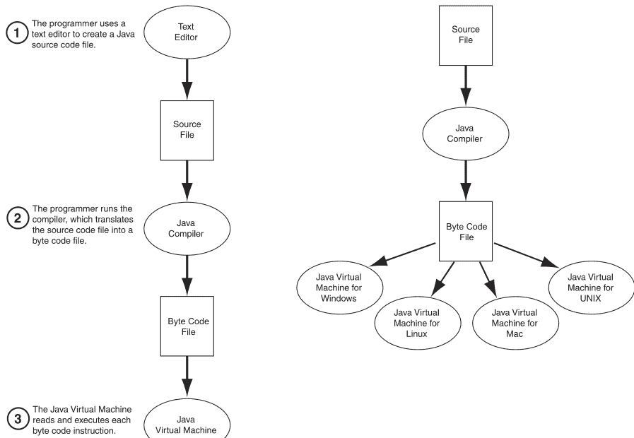

程序员使用文本编辑器创建 Java 源代码文件。

程序员运行编译器，将源代码翻译成字节文件。

`JVM` 读取并执行每个字节码指令。

图 1-6 展示了编译后的 Java 程序在 Windows、Linux、Mac 和 UNIX 计算机上运行的概念。

对于其他编程语言，可移植性是通过为该语言要运行的每种类型的计算机创建一个编译器来实现的。例如，在 C++ 语言支持 Windows、Linux 和 Mac 计算机的情况下，必须为这些环境中的每一个单独创建一个独立的 C++ 编译器。编译器是非常复杂的程序，比解释器更难开发。出于这个原因，`JVM` 已经针对许多类型的计算机进行了开发。

# Java 软件版本

你用于创建 Java 程序的软件称为 `JDK`（Java 开发工具包）或 `SDK`（软件开发包）。以下是 Oracle 提供的 `JDK` 版本：

- **Java SE**—Java 标准版为编写 Java 应用程序和可能的扩展提供了所需的所有基本工具。
- **Java EE**—Java 企业版为创建大型业务应用程序提供了工具，这些程序为服务器提供服务并通过 Web 提供服务。
- **Java ME**—Java 微型版为手机、寻呼器和家用电器等消费产品提供了一个小型、高度优化的运行时环境。

# 第 1 章 计算机与 Java 简介

这些 Java 版本可以从 Oracle 下载：

http://java.oracle.com

> **注意**：你可以按照附录 E 中的说明（可以从书籍的配套网站下载）在你的系统中安装 `JDK`。你可以访问 www.pearsonhighered.com/gaddis 书籍配套网站。

# 编译和运行 Java 程序

编译 Java 程序是一个简单的过程。要使用 `JDK`，请进入操作系统的命令行提示符。

> **提示**：在 Windows 中，点击“开始”按钮，进入“所有程序”，然后进入“辅助工具”。点击“辅助工具”菜单上的“命令行提示符”。将会出现一个命令行窗口。

在操作系统的命令行提示符中，确保你处于文件所在的目录。编译程序请使用以下命令：

```
javac filename.java
```

如果程序没有语法错误，编译器将翻译代码。运行程序请使用以下命令：

```
java filename
```

# 集成开发环境

除了编辑器，还有集成开发环境（`IDE`）。这些环境由文本编辑器、编译器、调试器和其他实用程序组成。图 1-7 显示了一个 `IDE`。

# 图 1-7 一个 IDE

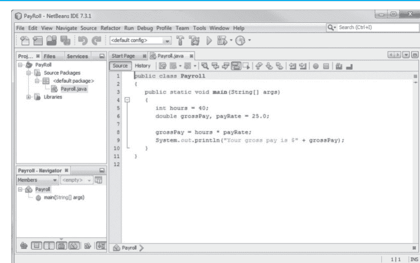

# 图 1-8 由工资计算算法生成的屏幕


在这一步中，你必须设身处地。程序应该显示哪些信息？它应该询问哪些问题？通过解决这些问题，你可以确定程序的大部分输出。

## 3. 使用设计工具创建程序模型

在规划程序时，程序员会使用一或多种设计工具来创建程序的模型。例如，伪代码（`pseudocode`）是人类语言与编程语言之间的结合体，在设计算法时特别有用。尽管计算机无法理解伪代码，但程序员通常发现，用一种“接近”自然语言的语言编写算法是有帮助的。例如，这里是描述工资计算算法的伪代码：

- 获取工资报单。
- 计算总工资。
- 显示总工资。

虽然这段伪代码提供了程序的概览，但它并没有揭示程序的所有细节。下面是更详细的伪代码版本：

- 显示“你工作了多少小时？”
- 输入小时数。
- 显示“你每小时工资是多少？”
- 输入费率。
- 将小时数费率的值存储在 `pay` 变量中。
- 显示 `pay` 变量的值。

注意，伪代码使用的语句看起来更像命令，而不是 1.4 节中描述算法的英语语句。伪代码甚至为变量命名并描述了数学操作。

## 4. 检查模型是否存在逻辑错误

逻辑错误是导致程序产生错误结果的错误。一旦组好程序模型，就应该检查这些错误。例如，如果使用了伪代码，程序员应该对其进行跟踪，检查每一步的逻辑。如果发现错误，可以在尝试下一步之前对模型进行修正。

## 5. 输入代码并编译

一旦创建、检查并修正了程序模型，程序员就可以在计算机上编写源代码了。程序员将源代码保存到文件中，并开始编译过程。在此期间，编译器将发现程序中可能存在的任何语法错误。

## 6. 修正编译期间发现的任何错误。根据需要重复步骤 5 和 6

如果编译器报告了任何错误，必须对它们进行修正。必须重复步骤 5 和 6，直到程序没有编译时错误。

## 7. 使用测试数据输入运行程序

一旦生成了可执行文件，程序就可以准备测试运行时错误了。运行时错误是程序在运行时发生的错误。这些通常是逻辑错误，例如数学错误。

测试运行时错误需要使用示例数据或示例输入来执行程序。示例数据应该是可以预测出正确输出的。如果程序没有产生正确的输出，则程序中存在逻辑错误。

## 8. 修正运行程序期间发现的任何错误。根据需要重复步骤 5 到 8

当程序中发现运行时错误时，必须对它们进行修正。你必须确定错误发生的步骤并确定原因。如果错误由于逻辑不正确（例如数学公式表述不当），你必须修正逻辑中的语句。如果错误是因为对程序需求的理解不完全，你必须重新表述程序目的并修改程序模型和源代码。然后必须保存程序、重新编译并重新测试。必须重复步骤 5 到 8，直到程序能够可靠地产生满意的结果。

## 9. 验证程序结果

当你认为你已经修正了所有的运行时错误时，输入测试数据并判断程序是否解决了原始问题。

## 检查点

- 1.17 在定义程序要做什么时，你应该识别哪些项目？
- 1.18 “可视化程序运行”意味着什么？这种活动的价值何在？
- 1.19 什么是伪代码？
- 1.20 描述编译器对程序源代码做了什么。
- 1.21 什么是运行时错误？
- 1.22 语法错误（如拼错关键字）是由编译器发现的还是程序运行时发现的？
- 1.23 使用示例数据或输入测试程序的目的是什么？

# 面向对象编程

概念：Java 是一种面向对象编程（`OOP`）语言。`OOP` 是一种软件开发方法，它有自己的实践、概念和词汇。

目前主要有两种编程方法：过程化和面向对象。最早的编程语言是过程化的，这意味着程序由一个或多个过程组成。过程是一组编程语句，它们共同执行特定的任务。这些语句可能会从用户处收集输入，处理存储在计算机内存中的数据，并执行计算或任何其他操作来完成任务。

过程通常对独立于过程的数据项进行操作。在过程化程序中，数据项通常从一个过程传递到另一个过程，如图 1-9 所示。

# 图 1-9 数据在过程之间传递


正如你想象的那样，过程化编程的重点是创建操作程序数据的过程。然而，数据与操作数据的代码分离往往会导致问题。例如，数据存储在特定的格式中，由变量和由变量创建的更复杂的结构组成。操作数据的过程设计必须考虑这种格式。但是，如果数据被更改了会怎样？通常程序的规范会发生，导致数据格式的重新设计。当数据结构发生变化时，操作数据的代码也必须更改。这增加了程序员的额外工作，并增加了代码中出现 Bug 的机会。

这影响了从过程化编程向 `OOP` 的转变。过程化编程以创建过程为中心，而面向对象编程以创建对象为中心。对象是一个包含数据和处理的软件实体。对象包含的数据称为其**属性**。对象执行的过程（或行为）称为对象的**方法**。从概念上讲，对象是由数据（属性）和过程（方法）组成的自包含单元。这如图 1-10 所示。

`OOP` 通过封装和数据隐藏解决了代码/数据分离的问题。封装是指将数据和代码组合成单一对象。

# 图 1-10 对象包含数据和过程

# 图 1-11 代码与对象的方法交互

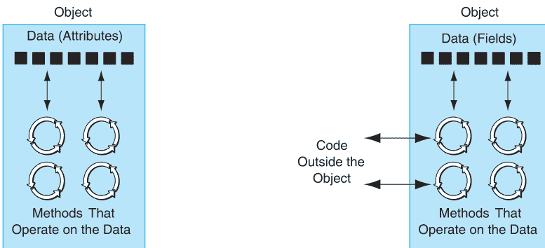

隐藏是指对象向外部代码隐藏数据的能力。只有对象的方法可以直接访问并更改数据。对象通常隐藏其数据，但允许外部代码访问方法。如图 1-11 所示，外部代码与对象的方法交互。

当对象数据对外部代码隐藏时，数据受到了保护不易意外损坏。此外，程序代码不需要知道数据的格式或内部结构。代码只需要与对象的方法交互。当程序员更改对象的内部数据结构时，他/她修改对象的方法以便正确处理数据。然而，外部代码与方法交互的方式并不改变。

## 组件的可重用

除了解决代码/数据分离的问题，`OOP` 的使用还受到组件可重用趋势的推动。组件是执行特定、定义良好的操作或提供特定服务的软件对象。组件不是独立程序，但可以被需要该组件服务的程序使用。例如，Sharon 是一个程序员，开发了一个用于渲染三维（3D）图像的组件。她是一个数学天才，了解计算机图形，因此她的组件被编码为执行所有的 3D 数学运算并处理计算机的视频硬件。Tom 正在为建筑事务所编写程序，他的应用程序需要显示建筑的 3D 图像。由于他面临时间紧迫，且对计算机图形了解有限，他可以使用 Sharon 的组件来执行 3D 渲染，当然，要付少量费用！

组件可重用和 `OOP` 技术为大型计算机应用程序成为独特的协作实体（组件）的系统奠定了基础。

## 1.7 面向对象编程

### 对象的日常实例

将你的闹钟想象成一个对象。它具有以下属性：

- 当前秒（0–59 范围内的数值）
- 当前分钟（0–59 范围内的数值）
- 当前小时（1–12 范围内的数值）
- 闹钟设置的时间（一个有效的小时和分钟）
- 闹钟是否开启（“开启”或“关闭”）

如你所见，属性仅仅是定义闹钟状态的值。闹钟的用户无法直接操作这些属性，因为它们是私有的。要更改属性的值，你必须使用该对象的方法（`methods`）之一。以下是闹钟的一些方法：

- 设置时间
- 设置闹钟时间
- 开启闹钟
- 关闭闹钟

每个方法都会操作一个或多个属性。例如，“设置时间”方法允许你通过按下时钟顶部的按钮来设置闹钟时间。通过另一组按钮，你可以激活“设置闹钟时间方法”。此外，另一个按钮允许你执行“开启闹钟”和“关闭闹钟”。注意，所有这些方法都可以由处于闹钟外部的你来激活。可以被对象外部实体访问的方法称为公共方法。

闹钟还有私有方法，它们是对象私有内部工作的一部分。外部实体（例如你，闹钟的用户）无法直接访问闹钟的私有方法。对象被设计为自动执行这些方法并向你隐藏细节。以下是闹钟对象的私有方法：

- 增加当前秒
- 增加当前分钟
- 增加当前小时
- 响铃

每秒都会执行一次“增加秒”方法。这会改变当前属性的值。如果在该方法执行时当前秒被设置为 59，该方法程序设置为将当前秒重置为 0，然后触发“增加分钟”方法的执行。在当前分钟的基础上加 1，除非其设置为 59。在这种情况下，它会将当前分钟重置为 0 并触发“增加小时”方法。（还可以注意到，“增加分钟”会将新时间与闹钟时间进行比较。如果两个时间匹配且闹钟已开启，就会执行“响铃”方法。）

### 类与对象

现在我们来讨论软件中是如何创建对象的。在创建对象之前，必须由程序员对其进行设计。程序员确定必要的属性和方法，然后创建一个类（`class`）。**类**是一组编程语句的集合，规定了特定类型对象可能拥有的属性和方法。将类比为可以根据其创建的“蓝图”。类本身不是对象，而是对对象的描述。当程序运行时，它可以使用该类在内存中创建任意数量的对象。从类中创建的每个对象都称为该类的**实例**（`instance`）。

例如，杰西卡是一位昆虫学家（研究昆虫的人），她也喜欢编写计算机程序。她设计了一个程序来对不同类型的昆虫进行分类。在程序中，她创建了一个名为 **昆虫**（`Insect`）的类，该类规定了用于存储和处理所有昆虫通用数据的属性和方法。**昆虫**类不是对象，而是可以根据其创建的规范。接下来，她编写了编程语句来创建一个具体的对象，该对象是 **昆虫** 类的一个实例 **家蝇**（`housefly`）是一个占据计算机内存并存储自身数据的实体。它具有 **昆虫** 类所指定的属性和方法。然后她又编写了编程语句创建一个 **蚊子**（`mosquito`）对象。蚊子对象也是 **昆虫** 类的一个实例。它在内存中有自己的区域，并存储关于蚊子的数据。虽然 **家蝇** 和 **蚊子** 都是 **昆虫** 类的实例……

### 继承

有时一个类会基于另一个类。在 `OOP` 术语中，基类被称为父类（`superclass`），而派生类被称为子类（`subclass`）。子类可以使用父类的属性和方法，还可以添加属于自己的属性和方法。这有助于代码重用。

### 软件工程

软件工程涵盖了设计、编写、测试、调试、文档和维护软件的过程。像工程师一样，软件工程师在工作中使用许多工具。这里是一些例子：

- 程序规范
- 输出图表
- 表示类、对象和数据流的图表
- 伪代码
- 输入和输出

大多数应用程序都是大型且复杂的。通常由团队而不是个人开发。必须对需求进行彻底分析，并将其分为团队处理的任务。

### 检查点

- 24 在过程化编程中，程序的哪部分是分开的？
- 25 什么是对象的属性？
- 26 什么是对象的方法？
- 27 什么是封装？
- 28 什么是数据隐藏？

### 复习题与练习题

#### 单选题

1. 计算机的这部分获取指令，执行指令的操作，并产生结果或结果性信息。
   - a. 内存
   - b. `CPU`
   - c. 二级存储
   - d. 输入设备

2. 一个字节由八个 ____ 组成
   - a. `CPU`
   - b. 地址
   - c. 变量
   - d. 位

3. 每个字节都被分配一个唯一的
   - a. 地址
   - b. `CPU`
   - c. 位
   - d. 变量

4. 这种类型的内存可以长时间存储数据——即使在没有电源的情况下。
   - a. `RAM`
   - b. 主存
   - c. 二级存储
   - d. 存储

5. 如果你查看机器语言程序，你会看到 ____
   - a. Java 源代码
   - b. 二进制流
   - c. 英语单词
   - d. 电路

6. 这种程序的设计是为了通过互联网传输并在网络浏览器中运行。
   - a. 应用程序
   - b. `App`
   - c. 机器语言
   - d. 源代码

7. 这些词在编程语言中具有特殊含义。
   - a. 标点符号
   - b. 用户定义的词
   - c. 关键字
   - d. 运算符

8. 这些符号或词汇对一个或多个操作数执行操作。
   - a. 标点符号
   - b. 用户定义的词
   - c. 关键字
   - d. 运算符

9. 这些字符具有特定的用途，例如标记语句的开始或结束，或者分隔列表中的项目。
   - a. 标点符号
   - b. 程序员定义的名称
   - c. 关键字
   - d. 运算符

10. 这些是用于识别内存中的存储位置以及程序员创建的程序部分的单词或名称。
    - a. 标点符号
    - b. 程序员定义的名称
    - c. 关键字
    - d. 运算符

11. 这些是编写程序时必须遵循的规则。
    - a. 语法
    - b. 标点符号
    - c. 关键字
    - d. 运算符

12. 这是计算机内存中一个具命名的存储位置。
    - a. 类 (`class`)
    - b. 关键字
    - c. 变量
    - d. 运算符

13. Java 编译器生成 ________
    - a. 机器码
    - b. 字节码
    - c. 源代码
    - d. `HTML`

14. `JVM` 代表 ______________
    - a. Java 变量机器
    - b. Java 变量方法
    - c. Java 虚拟方法
    - d. Java 虚拟机 (Java Virtual Machine)

### 错误

1. 下面的伪代码算法有一个错误。程序应该要求用户输入矩形房间的长度和宽度，然后显示房间面积。程序必须将宽度乘以长度以确定面积。找出错误。

   ```
   面积 = 宽度 × 长度
   显示“房间的宽度是多少？”
   输入 宽度
   显示“房间的长度是多少？”
   输入 长度
   显示 面积
   ```

### 算法工作台

为以下描述的程序编写伪代码算法：

1. **可用额度**
   计算客户可用额度的程序应该要求用户输入以下内容：
   - 客户的最高额度金额
   - 客户已使用的额度
   一旦输入了这些项目，程序应该计算并显示客户的可用额度。你可以通过从最高额度中减去已使用的额度来计算可用额度。

2. **销售税**
   计算零售销售总额的程序应该要求用户输入以下内容：
   - 所购物品的零售价格
   - 销售税率
   一旦输入了这些项目，程序应该计算并显示以下内容：
   - 购买的销售税
   - 销售总额

3. **账户余额**
   计算储蓄账户当前余额的程序必须要求用户输入以下内容：
   - 初始余额
   - 存款的总美元金额
   - 取款的总美元金额
   - 月利率
   一旦程序计算出当前余额，应将其显示在屏幕上。

### 预测结果

以下是用英语语句表示的程序。如果它们是实际程序，每个程序会在屏幕上显示什么？

1. 变量 `x` 的初始值为 0。
   变量 `y` 的初始值为 5。
   给 `x` 加 1。
   给 `y` 加 1。
   将 `x` 和 `y` 相加并将结果存储在 `y` 中。
   在屏幕上显示 `y` 值。

2. 变量 `a` 的初始值为 10。
   变量 `b` 的初始值为 2。
   变量 `c` 的初始值为 4。
   将 `a` 乘以 `b` 的值存储在 `a` 中。
   将 `b` 乘以值存储在 `e` 中。
   将 `a` 和 `e` 相加并将结果存储在 `b` 中。
   在屏幕上显示 `b` 值。

### 复习题与练习

1. 主内存和辅助存储都是内存的类型。描述两者的区别。
2. 哪种类型的内存？
3. 操作系统和应用程序软件有什么区别？
4. 指出以下操作系统属于哪些类别：
   - 系统 A 允许同时运行多个程序。
   - 系统 B 允许同时运行一个程序。


# 练习题

- 系统 C 允许同时运行多个程序。

5. 高级语言的程序在执行之前必须翻译成什么语言？

6. 为什么用高级语言编写比用机器语言更容易？

7. 什么是源代码？

8. 语法错误和逻辑错误有什么区别？

9. 什么是伪代码？

10. 什么是编译器？

11. 应用程序和 Applet 有什么区别？

12. 虚拟机需要什么才能让 Applet 能够运行？

13. 计算机需要什么才能执行？

14. 机器码和字节码有什么区别？

15. 为什么字节码具有可移植性？

16. 为什么对象隐藏数据？

17. 类的重用性是什么？

18. 什么是类？

19. 类和对象有什么区别？

20. 方法是什么？

21. 面向对象的编程特性允许你创建什么？

22. 用高级语言编写的程序会被翻译成什么？

23. 源代码文件包含什么？

# 第1章 计算机简介

- 25. 编译器翻译成什么？

- 26. 假设你安装了 JDK，在系统提示符输入什么命令来编译 `LabAssignment.java`？

- 27. 假设 `LabAssignment.java` 没有语法错误：
  a. 会产生什么？
  b. 文件包含什么？
  c. 系统提示符输入什么命令来运行？

# 编程挑战

## 我的第一个 Java 程序

此作业将帮助你熟悉开发。这里是你输入的 Java 程序：

```java
// 这是我的第一个程序
public class MyProgram {
    public static void main(String[] args) {
        System.out.println("Hello World!");
    }
}
```

## 如果你通过命令行提示符使用 JDK

1. 使用文本编辑器输入所示的代码。确保放置了所有的标点符号，并注意字母的大小写。将其保存为名为 `MyProgram.java` 的文件。

2. 保存程序后，进入你的系统提示符并切换到你刚刚创建程序的目录。使用以下命令进行编译：

```
javac MyProgram.java
```

如果你按照所示输入文件内容，就不应该有语法错误。如果看到错误信息，打开文件并与你的代码进行对比。纠正任何错误，保存文件并再次运行编译器。如果没有看到错误信息，说明文件编译成功。

3. 接下来，输入以下命令运行程序：

```
java MyProgram
```

确保 `MyProgram` 的大小写正确。你应该会在屏幕上看到“Hello World!”

## 如果你使用 IDE

由于有许多 Java IDE，我们无法包含所有特定的说明。以下是适用于大多数 IDE 的通用步骤。你需要咨询你的 IDE 文档获取特定说明。

1. 启动你的 Java IDE 并执行任何必要的设置，例如启动新项目并创建一个 Java 源文件。

2. 使用 IDE 的文本编辑器输入所示的代码。确保放置了所有的标点符号，并注意字母的大小写。将其保存为名为 `MyProgram.java` 的文件。

3. 保存程序后，使用 IDE 的命令编译程序。如果你按照所示输入文件内容，就不应该有语法错误。如果看到错误信息，将你的代码与所示代码进行对比。纠正任何犯的错误，保存文件并再次运行编译器。如果没有看到错误信息，说明文件编译成功。

使用你 IDE 的命令运行程序。你应该会在屏幕上看到“Hello World!”

# Java 基础

# 目录

- 2.1 Java 程序的组成
- 2.2 `System.out.print` 和 `System.out.println` 方法以及 Java API
- 2.3 变量与字面量
- 2.4 原始数据类型
- 2.5 算术运算符
- 2.6 复合赋值运算符
- 2.7 原始数据类型之间的转换
- 2.8 使用 `final` 创建具名常量
- 2.9 `String` 类
- 2.10 作用域
- 2.11 注释
- 2.12 编程风格
- 2.13 读取键盘输入
- 2.14 对话框
- 2.15 `System.out.printf` 方法
- 2.16 需要避免的常见错误

# 2.1 Java 程序的组成

> 概念：Java 程序具有特定用途的部分。

Java 程序由不同的部分组成。学习 Java 的第一步是学习这些部分是什么。我们将从一个简单的示例开始，如代码列表 2-1 所示。

# 代码列表 2-1 (Simple.java)

```java
1 // This is a simple Java program.
2
3 public class Simple
4 {
5     public static void main(String[] args)
6     {
7         System.out.println("Programming is great fun!");
8     }
9 }
```

# 第 2 章 Java 基础

> 提示：记住，程序列表中显示的数字不是程序的一部分。显示数字是为了让我们引用程序中的特定行。

如第 1 章所述，Java 源代码文件的名称以 `.java` 结尾。代码列表 2-1 所示的程序名为 `Simple.java`。使用 Sun Java 编译器，可以使用以下命令编译该程序：

```
javac Simple.java
```

编译器将创建另一个名为 `Simple.class` 的文件，其中包含翻译后的字节码。可以使用以下命令执行该文件：

```
java Simple
```

> 提示：记住，在运行 `java` 命令时，不需要输入 `.class` 扩展名。

程序的输出如下。这是程序运行时在屏幕上显示的内容。

# 程序输出

Programming is great fun!

让我们逐行检查程序。这里是第 1 行的语句：

```java
// This is a simple Java program.
```

除了行首的双斜杠标记外，它看起来非常像一句普通的句子。`//` 标记了注释的开始。编译器忽略从双斜杠到行尾的所有内容。这意味着你可以在该行输入任何你想要的内容，编译器永远不会理会。注释不是必须的，但它们对程序员来说非常重要。大多数程序比这个示例复杂得多，注释有助于解释正在发生什么。

第 2 行是空白。程序员经常在程序中插入空行以便于阅读。第 3 行内容为：

```java
public class Simple
```

这一行被称为类头（class header），它标记了类定义的开始。类的用途之一是作为应用程序。随着你阅读这本书，你将学习到越来越多关于类的知识。现在，记住一个 Java 程序必须至少包含一个类定义。这一行由三个单词组成：`public`、`class` 和 `Simple`。让我们仔细观察每一个。

- `public` 是一个 Java 单词，必须用小写字母。它被称为访问修饰符（access specifier），控制从何处访问该类。`public` 修饰符意味着对类的访问是不限制的。换句话说，该类是“向公众开放的”。

- `class` 也必须用小写字母写，它是一个 Java 关键字，指示类定义的开始。

- `Simple` 是类名。这个名字由程序员创建。该类可以命名为 `Pizza`、`Dog` 或程序员想要的任何名称。程序员定义的名称可以是小写字母、大写字母或两者的混合。

简而言之，这行代码告诉编译器定义了一个名为 `Simple` 的类。关于类还有两点需要知道：

- 你可以在一个文件中创建多个类，但每个 Java 文件只能有一个公共类。

- 当一个 Java 文件（不带 java 扩展名）时，类名必须与文件名相同。例如，代码列表 2-1 中的程序类名为 `Simple`，文件名为 `Simple.java`。

> 注意：Java 是一种大小写敏感的语言。这意味着它认为大写字母和小写字母是完全不同的字符。`Public` 不等于 `public`，`Class` 不等于 `class`。Java 程序中的某些单词必须使用小写字母，而其他单词可以使用小写和大写字母的组合。在本章的后面，你将看到所有 Java 关键字的列表，它们必须以小写形式出现。

# 检查点

2.1 下面的程序无法编译，因为代码行被弄乱了：

```java
public static void main(String[] args)
}
// 一个混乱错乱的程序
public class Columbus
{
    System.out.println("In 1492 Columbus sailed the ocean blue.");
}
```

当行被正确排列后，程序应该在屏幕上显示以下内容：

- *1492年，哥伦布航行蓝海。*

- 按正确顺序重新排列这些行。通过在计算机上输入、编译并运行该程序来测试你的结果。

2.2 当将问题 2.1 中的程序保存为文件时，该文件应该命名为什么？

2.3 完成以下程序骨架，使其在屏幕上显示“Hello World”消息：

```java
public class Hello
{
    public static void main(String[] args) {
        // 在此处插入代码以完成程序
    }
}
```

2.4 在纸上写一个可以在屏幕上显示你名字的程序。在程序顶部添加一个带有今天日期的注释。通过输入、编译和运行你的程序来测试它。

2.5 所有 Java 源代码文件名必须以以下内容结尾：

- a. 分号
- b. `.class`
- c. `.java`
- d. 以上都不是

2.6 每个 Java 应用程序都必须具有

- a. 一个名为 `main` 的方法
- b. 多个类结构定义
- c. 一个或多个注释

## 2.2 System.out.print 和 System.out.println 方法以及 Java API

> 概念：`System.out.print` 和 `System.out.println` 方法用于显示文本输出。它们是 Java API 的一部分，Java API 是一系列用于执行特定操作的预写类和方法的集合。

在本节中，你将学习如何编写能够在屏幕上产生输出的程序。程序可以显示的最简单输出类型是纯文本。当你在 Windows 或 Mac OS 等使用图形用户界面的系统中显示控制台输出时，输出通常出现在类似于图 2-2 所示的窗口中。

**图 2-2** 控制窗口

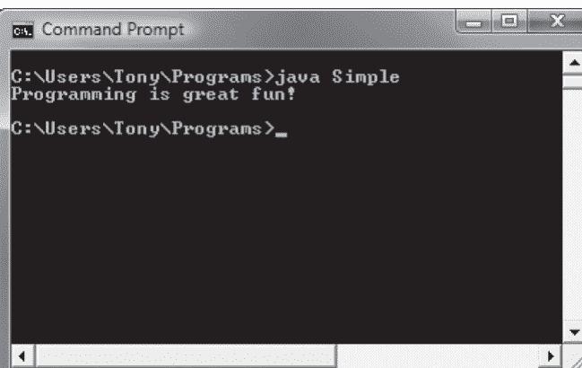

console（控制台）是一个古老的计算机术语。它源于过去，大型计算机系统的操作员通过一个由简单屏幕和键盘组成的终端与系统进行交互。这个终端被称为 console（控制台）。只显示文本的控制台屏幕被称为标准输出设备。今天，Java 的标准输出设备通常指的是显示输出的设备。

在 Java 中执行输出以及许多其他任务都是通过使用 Java API 实现的。API 代表 *Application Programmer Interface*（应用程序编程器接口）。API 是一个用于执行特定操作的预写类标准库。这些类及其方法对所有 Java 程序都可用。`print` 和 `println` 方法是 API 的一部分，并提供了在标准输出设备上显示输出的方法。

代码列表 2-1 中的程序（`Simple.java`）使用以下语句在屏幕上打印消息：

```java
System.out.println("Programming is great!");
```

`System` 是作为 Java API 一部分的一个类。`System` 类包含了执行系统级操作的对象和方法。`System` 类包含的一个对象名为 `out`。`out` 对象具有方法，如 `print` 和 `println`，用于在系统控制台或标准输出设备上执行输出。`System`、`out` 和 `println` 之间的层次关系如图 2-3 所示。

## **图 2-3** System 类、out 对象与 print 和 println 方法之间的关系

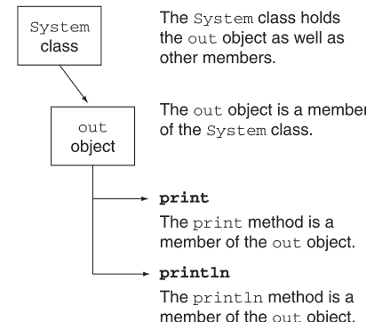

以下是所有内容如何协同工作的简要总结：

- `System` 类是 Java API 的一部分。它具有用于形成系统级操作的成员对象和方法，例如发送输出到控制台。

- `out` 对象是 `System` 类的一个成员。它提供了将输出发送到屏幕的方法。

- `print` 和 `println` 方法是 `out` 对象的成员。它们实际上执行在屏幕上写入字符的工作。

这种层级结构解释了为什么执行 `println` 的语句如此冗长。`System.out.println` 的序列指定 `println` 是 `out` 的成员，而 `out` 是 `System` 的成员。

注意：分隔对象名称的点符号读作 "dot"（点）。`System.out.println` 的读音是 "system out dot print"。要在屏幕上显示的值被放在括号内。此值被称为 argument（参数）。例如，以下语句使用字符串 `"King Arthur"` 执行 `println` 方法。这将在屏幕上打印 `King Arthur`（引号不打印）。

表 2-2 列出了常见的转义序列并对其进行了描述。

## 表 2-2 常见转义序列

| 序列名称 | 描述 |
|---|---|
| `\n` | 换行 | 将光标移动到下一行，以便后续打印 |
| `\t` | 水平制表 | 使光标跳到下一个制表位 |
| `\b` | 退格 | 使光标向后退（或向左移动）一个位置 |
| `\r` | 回车 | 使光标回到当前行的开头，而不是到下一行 |
| `\\` | 反斜杠 | 打印一个反斜杠 |
| `\'` | 单引号 | 打印一个单引号 |
| `\"` | 双引号 | 打印一个双引号 |

> 警告！请勿将反斜杠 (`\`) 与正斜杠 (`/`) 混淆。如果你不小心用正斜杠开始转义序列，该序列将无法工作。此外，不要在反斜杠和控制字符之间加上空格。

## 检查点

2.7 下程序将无法编译，因为这些行顺序乱了。

```java
System.out.print("Success\n");
public class Success {
System.out.print("Success\n");
public static void main(String[] args) {
System.out.print("Success ");
// It's a mad, mad program.
System.out.println("nSuccess");
}
}
```

当行顺序安排正确后，程序应该在屏幕上显示以下输出：

### 程序输出：

+ Success

Success Success

Success

按正确的顺序重新排列这些行。在计算机上输入、编译并运行该程序进行测试。

## 2.3 变量和字面量

> **概念：** *变量*（Variable）是计算机内存中一个命名的存储位置。*字面量*（Literal）是写入程序代码中的值。

正如你在第 1 章中发现的，变量允许你在计算机内存中存储和处理数据。编程的一部分是确定程序需要多少个变量以及它们将持有何种类型的数据。代码列表 2-7 中的程序是一个带有变量的 Java 程序示例。

## 代码列表 2-7 (Variable.java)

```java
1 // 这个程序有一个变量。
2
3 public class Variable
4 {
5     public static void main(String[] args)
6     {
7         int value;
8
9         value = 5;
10         System.out.print("The value is ");
11         System.out.println(value);
12     }
13 }
```

| 程序输出 |
|---|
| The value is 5 |

让我们仔细观察这个程序。这里是第 7 行：

```java
int value;
```

这是一个声明的变量。变量在使用之前必须先声明。变量声明告诉编译器变量的名字以及它将包含的数据类型。这一行表示变量的值。`int` 单词代表整数（integer），因此 `value` 将用于存储整数。注意变量声明以分号结束。该程序中的下一个语句出现在第 9 行：

```java
value = 5;
```

这被称为赋值语句。等号是一个运算符，它将右侧的值（在此例中为 5）存储到左侧指定的变量中。执行此行后，命名的变量将包含该值。

> 注意：这一行不会在计算机屏幕上打印任何内容。它在后台运行。

查看第 10 行和第 11 行：

```java
System.out.print("The value is ");
System.out.println(value);
```

第 10 行向 `print` 方法发送字符串字面量 `"The value is "`。第 11 行将变量发送到 `println` 方法。当你将变量发送到 `print` 或 `println` 时，显示的是变量的内容。注意 `value` 周围没有引号。查看代码列表 2-8 中的情况。

## 代码列表 2-8 (Variable2.java)

```java
1 // 这个程序有一个变量。
2
3 public class Variable2
4 {
5     public static void main(String[] args)
6     {
7         int value;
8
9         value = 5;
10         System.out.print("The value is ");
11         System.out.println(value);
12     }
13 }
```

程序输出

The value is 5

在变量名周围加上引号会变成字符串字面量，而不是变量名。这是一个常见的区别。

## 使用 + 显示多个项目

当 `+` 运算符与字符串一起使用时，它会将它们连接。例如：

```java
System.out.println("This is " + value);
```

### 注意引号


正如代码列表 2-8 所示，在变量名周围加上引号会改变程序的运行。事实上，对任何不是字符串字面量的内容加上引号都会产生某种类型的错误。例如，在代码列表 2-7 和 2-8 中，数字 5 被赋值给变量。如果这样赋值将会是错误：

```
value = "5"; // 错误！
```

在该语句中，5 不是整数，而是字符串字面量。因为 `value` 被声明为整数变量，你只能在其中存储整数。换句话说，5 和 "5" 是不同的。

数字可以表示为字符串这一事实经常让初学者感到困惑。只需记住，字符串是为了人类阅读而设计的。它们被打印在屏幕或纸上。然而，数字主要用于数学运算。你不能对字符串进行数学运算，在将数字显示在屏幕上之前，必须将其转换为字符串（幸运的是，当你将数字发送到变量时会自动转换）。

## 关于字面量的更多信息

字面量是写入程序代码中的值。字面量通常被赋值给变量。代码列表 2-9 包含了字面量和变量。

### 代码列表 2-9 (Literals.java)

```java
1 // 这个程序有字面量变量。
2
3 public class Literals
4 {
5 public static void main(String[] args)
6 {
7 int apples;
8
9 apples = 20;
10 System.out.println("Today we sold " + apples + 
11 " bushels of apples.");
12 }
13 }
```

### 程序输出

Today we sold 20 bushels of apples.

## 2.3 变量与字面量

当然，这个程序中的变量是 `apples`。它被声明为整数类型。表 2-3 显示了程序中出现的字面量列表。

### 表 2-3 字面量

| 字面量 | 字面量类型 |
| --- | --- |
| 20 | 整数字面量 |
| "Today we sold \"bushels of apples." | 字符串字面量 |

### 标识符

标识符是程序员定义的、用于表示程序元素的名称。变量名和类名都是标识符的示例。在 Java 中，你可以选择自己的变量名和类名，只要不使用任何 Java 关键字即可。关键字构成了语言的核心，每个关键字都有其特定的用途。第 1 章的表 1-3 和附录 B 显示了 Java 关键字的完整列表。

你应该始终为变量选择能够指示其用途的名称。因为你可能会忍不住声明像如下名称的变量：

```
int x;
```

这个没有描述性的名称 `x` 无法提供关于变量用途的任何线索。这里有一个更好的例子。

```
int itemsOrdered;
```

名称 `itemsOrdered` 让任何阅读程序的人都能理解变量的用途。这种编码方式可以产生“自文档式”程序，这意味着你通过阅读代码就能理解程序正在做什么。由于现实世界的程序通常使用成千上万行代码，因此它们尽可能地具有自文档性是非常重要的。

你可能注意到了 `itemsOrdered` 名称中大写字母和小写字母的混合。虽然所有的 Java 关键字必须用小写字母，但你可以在名称中使用大写字母。“items ordered” 使用大写字母是为了提高可读性。变量名不能包含空格，所以这两个单词必须连接在一起。当 "items" 和 "ordered" 连在一起时，你会得到如下的变量声明：

```
int itemsOrdered;
```

字母的大写化使得 `itemsOrdered` 更易阅读。通常，变量名以小写字母开头，此之后，构成变量名的每个单独单词的首字母都要大写。

以下是所有标识符必须遵循的某些特定规则：

- 第一个字符必须是字母 a-z、A-Z、下划线 (_) 或美元符号 ($) 之一。
- 在第一个字符之后，你可以使用字母 a–z 或 A–Z、数字 0–9、下划线 (_) 或美元符号 ($)。
- 大写字母和小写字母是区分的。这意味着 `itemsOrdered` 与 `itemsordered` 是不相同的。
- 标识符不能包含空格。

> 注意：虽然 $ 是合法的标识符字符，但它通常被用于特殊用途。所以，不要在你的变量名中使用它。

表 2-4 显示了变量名列表，并说明了它们在 Java 中是合法还是非法。

### 表 2-4 变量名合法性

| 变量名 | 合法或非法？ |
|---|---|
| dayOfWeek | 合法 |
| 3dGraph | 非法，因为标识符不能以数字开头 |
| june1997 | 合法 |
| mixture#3 | 非法，因为标识符只能使用字母、数字、下划线或美元符号 |
| week day | 非法，因为标识符不能包含空格 |

### 类名

如所述，变量名以小写字母开头，并将构成名称的后续每个单词的首字母大写是标准做法。将类名的首字母以及其包含的后续每个单词的首字母大写也是一种标准做法。这区分了变量名和类名。例如，`payRate` 是一个变量名，而 `Employee` 是一个类名。

### 检查点

#### 2.10 检查以下程序。

```java
public class BigLittle
{
    public static void main(String[] args)
    {
        int little;
        int big;

        little = 2;
        big = 2000;
        System.out.println("The little number is " + little);
        System.out.println("The big number is " + big);
    }
}
```

列出程序中找到的变量和字面量。

#### 2.11 下一个程序将在屏幕上显示什么？

```java
public class CheckPoint
{
    public static void main(String[] args)
    {
        int number;
        number = 712;
        System.out.println("The value is " + "number");
    }
}
```

## 2.4 基本数据类型

> **概念：** 数据有许多不同的类型。变量根据其数据类型进行分类，数据类型决定了可以在其中存储什么类型的数据。

计算机程序从现实世界收集数据片段并以各种方式对其进行处理。有许多数据类型。例如，在数值数据领域，有整数和分数；负数和正数；大数字以及其他没有名字的数字。还有文本信息。例如，名称和地址以字符字符串的形式存储。当你编写程序时，必须确定它可能遇到什么类型的数据。

每个变量都有一个数据类型，即该变量可以持有的数据类型。选择适当的数据类型很重要，因为变量的数据类型决定了变量使用的内存量以及变量格式化和存储的方式。选择一个与程序将处理的数据类型匹配的数据类型是非常重要的。如果你正在编写一个计算距离的程序，你需要能够存储大数字的变量。如果你正在编写一个测量微观尺寸的程序，你需要存储小数值的变量。变量的数据类型决定了它可以包含多少信息。表 2-5 显示了所有基本数据类型。

### 表 2-5 数值数据的基本类型

| 数据类型 | 大小 | 范围 |
| --- | --- | --- |
| byte | 1 字节 | -128 到 +127 |
| short | 2 字节 | -32,768 到 +32,767 |
| int | 4 字节 | -2,147,483,648 到 +2,147,483,647 |
| long | 8 字节 | -9,223,372,036,854,775,808 到 +9,223,372,036,854,775,807 |
| float | 4 字节 | ±3.4 × 10³⁸ 到 ±3.4 × 10³⁸ |
| double | 8 字节 | ±1.7 × 10⁻³⁸ 到 ±1.7 × 10³⁸ |

表 2-5 左列列出的词是你变量声明中的关键字。变量声明采用以下格式：

```
DataType VariableName;
```

`DataType` 是数据的类型，`VariableName` 是变量名。以下是一些变量声明的示例：

- `byte index;`
- `int speed;`
- `short month;`
- `float salesCommission;`
- `double distance;`

> 注意：这些数据类型被称为“基本类型”，是因为你不能用它们来创建对象。回顾第 1 章关于面向对象编程的内容，对象具有属性和方法。在基本数据类型中，你只能创建变量，而变量只能持有单个值。此类变量没有属性或方法。

### 整数数据类型

表 2-5 中列出的前四种数据类型 `byte`、`int`、`short` 和 `long` 都是整数数据类型。整数变量可以持有整数，如 7、125、-14 和 6928。代码列表 2-10 中的程序显示了不同整数数据类型的变量。

#### 代码列表 2-10 (IntegerVariables.java)

```java
1 // 此程序包含了几种整数类型的变量。
2
3 public class IntegerVariables
4 {
5 public static void main(String[] args)
6 {
7 int checking; // 声明一个名为 checking 的 int 变量。
8 byte miles; // 声明一个名为 miles 的 byte 变量。
9 short minutes; // 声明一个名为 minutes 的 short 变量。
10 long days; // 声明一个名为 days 的 long 变量。
11
12 checking = -20;
13 miles = 105;
14 minutes = 120;
15 days = 189000;
16 System.out.println("We have made a journey of " + miles + " ");
17 "miles.");
18 System.out.println("It took us " + minutes + " minutes.");
19 System.out.println("Our account balance is $" + checking);
20 System.out.println("About " + days + " days ago Columbus " +
21 "stood on this spot.");
22 }
23 }
```

#### 程序输出

We have made a journey of 105 miles.

It took us 20 minutes.

Our account balance is $20

About 189000 days Columbus stood on this spot.

在大多数程序中，你可能需要某种数据类型的多个变量。如果一个程序使用了三个整数：长度（`length`）、宽度（`width`）和面积（`area`），可以分别声明它们：

```java
int length;
int width;
int area;
```

然而，将这三个变量声明合并更为简单：

```java
int length, width, area;
```

你可以通过逗号分隔变量名来声明多个相同类型的变量。

### 整数字面量

当你在程序代码中编写整数字面量时，Java 假设它是 `int` 数据类型。例如，在代码列表 2-10 中，字面量 -20、50、120 和 18900 都被视为 `int` 值。然而，你可以通过在字面量后面加上字母 L 来强制将其视为 `long`。例如，值 `57L` 将被视为 `long`。你可以使用大写的 L 或小写的 L。小写的 L 看起来太像数字 1，因此你应该始终使用大写的 L。

> 警告！你不能在数字字面量中嵌入逗号。例如，以下语句会导致错误：

```
number = 1,257,649; // 错误！
```

该语句必须写为：

```
number = 1257649; // 正确。
```

### 浮点数据类型

整数对于许多任务来说是不够的。如果你正在编写一个处理金额或精确测量的程序，你需要一种允许分数小数值的数据类型。在编程术语中，这些被称为浮点数。像 1.7 和 -45.316 这样的值就是浮点数。

在 Java 中，有两种类型可以表示浮点数，它们是 `float` 和 `double`。`float` 数据类型被认为是单精度数据类型。它可以存储具有 7 位精度的浮点数。`double` 数据类型被认为是具有 15 位精度的双精度数据类型。然而，`double` 类型使用的内存是 `float` 类型的两倍。`float` 变量占用 4 字节内存，而 `double` 使用 8 字节。

代码列表 2-11 显示了一个使用三个 `double` 变量的程序。

#### 代码列表 2-11 (Sale.java)

```java
1 // 此程序演示了 double 数据类型。
2
3 public class Sale
4 {
5 public static void main(String[] args)
6 {
7 double price, tax, total;
8
9 price = 29.75;
10 tax = 1.76;
11 total = 31.51;
12 System.out.println("The price of the item " +
13 " is " + price);
14 System.out.println("The tax is " + tax);
15 System.out.println("The total is " + total);
16 }
17
```

#### 程序输出

The price of the item is 29.75

The tax is 1.76

The total is 31.51

### 浮点字面量

当你在程序中编写浮点字面量时，Java 假设它是 `double` 类型。例如，在代码列表 2-11 中，字面量 29.75、1.76 和 31.51 都被视为 `double` 值。由于这种情况，将浮点字面量赋值给 `float` 变量会产生问题。Java 是*强类型*的，这意味着它允许使用兼容的数据类型。由于 `double` 的范围比 `float` 大得多，如下代码会导致错误：

```java
float number;
number = 3.5; // 错误！
```

然而，你可以通过在后面加上字母 F 来强制将 `double` 字面量视为 `float`。上述代码可以重写为：

```java
float number;
number = 3.5F; // 可以运行。
```

> 警告！如果你处理代表金额的字面量，请记住不要嵌入货币符号（如 $）或逗号。例如，以下语句会导致错误：

```
grossPay = $1,257.00; // 错误！
```

该语句必须写为：

```
grossPay = 1257.00; // 正确。
```

### 科学计数法和 E 表示法

浮点字面量可以用科学计数法表示。取数字 4.72817 × 10⁴（10⁴ 等于 10,000），4.72817 × 10⁴ 是 47281.97。Java 使用 E 表示法来表示科学计数法的值。在 E 表示法中，4.72817 × 10⁴ 将是 4.72817E4。表 2-6 显示了科学计数法和 E 表示法的其他数字。

#### 表 2-6 浮点表示

| 十进制表示法 | 科学计数法 | E 表示法 |
| :--- | :--- | :--- |
| 47.91 | 4.791 × 10² | 4.791E2 |
| 0.00072 | 7.2 × 10⁻⁴ | 7.2E-4 |
| 2,900,000 | 2.9 × 10⁶ | 2.9E6 |

> 注意：E 可以大写或小写。

#### 代码列表 2-12 (SunFacts.java)

```java
1 // 此程序使用 E 表示法。
3 public class SunFacts
4 {
5 public static void main(String[] args)
6 {
7 double distance, mass;
8
9 distance = 1.495979E11;
10 mass = 1.989E30;
11 System.out.println("The Sun is " + distance +
12 " meters away.");
13 System.out.println("The Sun's mass is " + mass +
14 " kilograms.");
15 }
16 }
```

#### 程序输出

The Sun is 1.495979E11 meters away.

The Sun's mass is 1.989E30 kilograms.

### boolean 类型

`boolean` 数据类型允许你创建可能包含两个值之一的变量：`true`（真）或 `false`（假）。代码列表 2-13 演示了 `boolean` 变量的声明和赋值。

#### 代码列表 2-13 (TrueFalse.java)

```java
1 // 演示 boolean 变量的程序
2
3 public class TrueFalse
4 {
5 public static void main(String[] args)
6 {
7 boolean bool;
8
9 bool = true;
10 System.out.println(bool);
11 bool = false;
12 System.out.println(bool);
13 }
14 }
```

#### 程序输出

true

false

`boolean` 数据类型的变量用于评估真假条件。然而，在第 3 章之前，你将不会使用它们，现在只需记住以下几点：

- `boolean` 变量只能包含 `true` 或 `false` 值。
- `boolean` 变量的内容不能复制到 `boolean` 以外的任何类型变量中。

### char 类型


# `char` 数据类型

`char` 数据类型用于存储字符。`char` 类型变量一次可以存储一个字符。字符字面量包含在单引号中。代码列表 2-14 中的程序使用了 `char` 变量。当程序运行时，字符字面量 `'A'` 和 `'B'` 被赋值给变量。

## 代码列表 2-14 (Letters.java)

```java
1 // 此程序演示了 char 数据类型。
2
3 public class Letters
4 {
5     public static void main(String[] args)
6     {
7         char letter;
8
9         letter = 'A';
10         System.out.println(letter);
11         letter = 'B';
12         System.out.println(letter);
13     }
14 }
```

## 程序输出

```
A
B
```

重要的是不要将字符字面量与双引号的字符串字面量混淆。字符串字面量不能赋值给 `char` 变量。

## Unicode

字符内部由数字表示。每个打印字符以及许多非打印字符都被分配了一个唯一的数字。Java 使用 Unicode，它是一组用于表示字符的数字。每个 Unicode 需要 2 字节内存，因此字符占用 2 字节。当字符存储在内存中时，存储的实际上是数字代码。当指示在屏幕上打印该值时，它显示与数字代码对应的字符。

你可能想参考附录 B，它显示了 Unicode 字符集的一部分。注意数字 65 是 A 的代码，66 是 B 的代码，以此类推。代码列表 2-15 演示了当你处理字符时，你实际上是在处理数字。

## 代码列表 2-15 (Letters2.java)

```java
1 // 此程序演示了字符与整数之间的
2 // 这种关系。
3
4 public class Letters2
5 {
6     public static void main(String[] args)
7     {
8         char letter;
9
10         letter = 65;
11         System.out.println(letter);
12         letter = 66;
13         System.out.println(letter);
14     }
15 }
```

```java
int month = 2, days = 28;
```

## 代码列表 2-16 (Initialize.java)

```java
1 // 这个程序展示了变量初始化。
2
3 public class Initialize
4 {
5     public static void main(String[] args)
6     {
7         int month = 2
```

## 程序输出

```
月份 2 有 28 天。
```

这条语句声明了 `month` 变量并将其初始化为值 2，同时声明了 `days` 变量并将其初始化为值 28。正如你看到的，这简化了程序并减少了程序员必须输入的语句数量。以下是其他执行初始化的声明语句的示例：

- `double payRate = 25.52;`
- `float interestRate = 12.9F;`
- `char stockCode = 'D';`
- `int customerNum = 459;`

当然，同一个主题总会有不同的变体。Java 允许你声明多个变量并只初始化其中一个。以下是这样的声明示例：

- `int floatNum = 89, travelTime, departure = 10, distance;`

变量 `floatNum` 被初始化为 89，`departure` 被初始化为 10。`travelTime` 和 `distance` 变量保持未初始化状态。

> **警告！** 当在方法内部声明变量时，在使用它之前必须在其中存储一个值。如果编译器发现程序可能在存储值之前就使用了某个变量，将会发生错误。你可以通过给变量初始化一个值来避免此类错误。

## 变量一次只能持有一个值

记住，一个变量一次只能持有一个值。当你给变量分配一个新值时，新值将取代该变量之前的内容。例如，看下面的代码。

```java
int x = 5;
System.out.println(x);
x = 99;
System.out.println(x);
```

在这段代码中，变量 `x` 被初始化为值 5 并显示了它的内容。然后给该变量赋值了值 99。这个值覆盖了之前存储在那里的值 5。该代码将产生以下输出：

```
5
99
```

## 检查点

以下哪些变量名是非合法的？为什么？

- `x`
- `99bottles`
- `july97`
- `tSalesFigureForYear98`
- `r&d`
- `grade_report`

变量名 `Sales` 和 `sales` 相同吗？为什么或为什么？

- 这个问题请参考表 2-5 列出的 Java 原始数据类型。
- 如果一个变量需要存储 32 到 6,000 范围内的整数，哪种原始数据类型最好？
- 如果一个变量需要存储 -40,000 到 +40,000 范围内的数字，哪种原始数据类型最好？
- 以下哪些字面量占用更多内存？`22.1` 还是 `22.1F`？

数字 6.31 × 10¹¹ 如何用 E 计数法表示？

一个程序声明了一个浮点数，以下语句导致了错误。可以做什么来修复错误？

```java
number = 7.4;
```

布尔型变量可以持有哪些值？

- 编写执行以下操作的语句：
- 声明一个名为 `letter` 的字符型变量。
- 将字符 A 赋值给 `letter` 变量。
- 显示 `letter` 变量的内容。

字符 ‘C’、‘F’ 和 ‘W’ 的 Unicode 编码是什么？（你可能需要参考附录 B）

以下语句哪里错了？

```java
char letter = "z";
```

# 算术运算符

> **概念：** 有许多运算符用于处理数值和执行算术运算。

Java 提供了许多用于处理数据的运算符。通常有三类型的运算符：一元运算符、二元运算符和三元运算符。这些术语反映了运算符所需的的操作数数量。

一元运算符只需要一个操作数。例如，考虑以下：

```
-5
```

当然，我们理解这代表负五。我们也可以将该运算符应用于变量，如下：

```
-number
```

这个表达式给出了存储在 `number` 中的值的负值。负号在这样使用时，被称为取反运算符。因为它只需要一个操作数，所以它是一元运算符。

二元运算符与两个操作数工作。赋值运算符属于这一类。正如你可能猜的那样，三元运算符需要三个操作数。Java 只有一个三元运算符，它在第 4 章中使用。

算术运算符在编程中非常常见。表 2-7 显示了 Java 中的算术运算符。

## 表 2-7 算术运算符

| 运算符 | 含义 | 类型 | 示例 |
| --- | --- | --- | --- |
| `+` | 加法 | 二元 | `total = cost + tax;` |
| `-` | 减法 | 二元 | `cost = total - tax;` |
| `*` | 乘法 | 二元 | `tax = cost * rate;` |
| `/` | 除法 | 二元 | `salePrice = original / 2;` |
| `%` | 取模 | 二元 | `remainder = value % 3;` |

每一个运算符的作用都正如你预期。加法运算符返回两个操作数的和。以下是一些使用加法运算符的示例语句：

```java
amount = 4 + 8;           // 将 12 赋值给 amount
total = price + tax;     // 将 price + tax 赋值给 total
number = number + 1;   // 将 number + 1 赋值给 number
```

减法运算符返回其左操作数减去其右操作数的结果。以下是一些使用减法运算符的示例语句：

```java
cost = total - tax;
```

乘法运算符返回两个操作数的乘积。以下是一些使用乘法运算符的示例语句：

```java
tax = cost * rate;
```

### 除法运算符

除法运算符返回其左操作数除以其右操作数的商。以下是一些使用除法运算符的示例语句：

```java
salePrice = original / 2;
```

取模运算符返回两个操作数相除后的余数。以下是一些使用取模运算符的示例语句：

```java
remainder = value % 3;
```

## 2.5 算术运算符

在这段代码中，`5.0` 被视为一个浮点数，因此除法操作将返回一个浮点数。除法的结果为 `2.5`。

### 运算符优先级

可以使用多个运算符构建数学表达式。以下语句将 `17`、`x`、`21` 和 `y` 的和赋值给 `answer`：

```
answer = 17 + x + 21 + y;
```

然而，某些表达式并不那么直观。考虑以下语句：

```
outcome = 12 + 6 / 3;
```

`outcome` 的值将会是多少？`6` 被用作加法运算符和除法运算符的操作数。`outcome` 的结果可能被赋值为 `6` 或 `14`，取决于除法发生的时间。答案是 `14`，因为除法运算符的优先级高于加法运算符。

数学表达式从左到右求值。当两个运算符共享一个操作数时，优先级最高的先执行。乘法和除法的优先级高于加法和减法，因此上述语句的工作原理如下：

1. `6` 除以 `3`，得到结果 `2`
2. `12` 加上 `2`，得到结果 `14`

如图 2-5 所示。

## 图 2-5 优先级示意

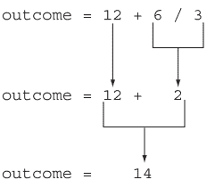

表 2-8 显示了算术运算符的优先级。表格顶部的运算符优先级比下面的运算符高。

## 表 2-8 算术运算符的优先级（从高到低）

| 运算符 |
|---|
| 最高优先级 -> | `-` (一元否定), `*` `/` |
| 最低优先级 -> | `+` `-` |

乘法、除法和模运算符的优先级相同。加法和减法运算符的优先级相同。如果两个操作数相同且优先级相同，它们根据它们的结合性执行。结合性是从左到右或从右到左。表 2-9 显示了算术运算符及其结合性。

## 表 2-9 算术运算符的结合性

| 运算符 | 结合性 |
|---|---|
| `-` (一元否定) | 从右到左 |
| `*` `/` `%` | 从左到右 |
| `+` `-` | 从左到右 |

表 2-10 显示了一些表达式及其取值。

## 表 2-10 某些表达式及其取值

| 表达式 | 值 |
|---|---|
| `5 + 2 * 4` | `13` |
| `10 / 2 - 3` | `2` |
| `8 + 12 * 2 - 4` | `28` |
| `4 + 17 % 2 - 1` | `4` |
| `6 - 3 * 2 + 7 - 1` | `6` |

### 使用括号分组

数学表达式的部分可以使用括号分组，以强制某些操作在其他操作之前执行。在下面的语句中，`a`、`b`、`c` 和 `d` 的和被除以 `4.0`。

```
average = (a + b + c + d) / 4.0;
```

然而，如果没有括号，`d` 将除以 `4`，结果将加到 `a`、`b` 和 `c` 上。表 2-11 显示了更多表达式及其取值。

## 表 2-11 更多表达式及其取值

| 表达式 | 值 |
|---|---|
| `(5 + 2) * 4` | `28` |
| `10 / (5 - 3)` | `5` |
| `8 + 12 * (6 - 2)` | `56` |
| `(4 + 17) % 2 - 1` | `0` |
| `(6 - 3) * (2 + 7)` | `9` |

## 焦点：计算百分比

确定百分比是计算机编程中的一个常见挑战。虽然数学中使用 `%` 符号表示百分比，但大多数编程语言（如 Java）并不为此目的使用该符号。在程序中，你需要将百分比转换为浮点数，就像使用计算器一样。例如，`50%` 写为 `0.5`，`2%` 表示为 `0.02`。

让我们来看一个例子。假设你每月赚 `6000` 美元，可以将总工资的一部分缴纳退休计划。你想确定总工资的 `5%`、`8%` 或 `10%` 的金额。为了实现这一点，你编写了一个像代码列表 2-18 那样的程序。

## 代码列表 2-18 (Contribution.java)

```java
1 // 该程序计算每月工资的 5%、
2 // 7% 或 10% 缴纳退休计划的金额。
3
4 public class Contribution
5 {
6     public static void main(String[] args)
7     {
8         // 用于存储每月工资和
9         // 缴纳金额的变量。
10         double monthlyPay = 6000.0;
11         double contribution;
12
13         // 计算并显示 5% 的缴费。
14         contribution = monthlyPay * 0.05;
15         System.out.println("5 percent is $" +
16             contribution + " per month.");
17
18         // 计算并显示 8% 的缴费。
19         contribution = monthlyPay * 0.08;
20         System.out.println("8 percent is $" +
21             contribution + " per month.");
22
23         // 计算并显示 10% 的缴费。
24         contribution = monthlyPay * 0.10;
25         System.out.println("10 percent is $" +
26             contribution + " per month.");
27     }
28 }
```


## 程序输出

```
5 percent is $300.0 per month.
8 percent is $480.0 per month.
10 percent is $600.0 per month.
```

# 第2章 Java 基础

该方法接受两个 `double` 类型参数。它将第一个参数提升到第二个参数的幂，并将结果作为 `double` 返回。在示例中，`4.0` 被提升到 `2.0` 的幂。此语句等同于以下代数表达式：

```
result = 4^2
```

这是另一个使用 `Math.pow` 方法的语句示例。它将 `3` 乘以 `6^3` 赋值给 `x`：

```
x = 3 * Math.pow(6.0, 3.0);
```

接下来的语句显示 `5` 的 `4` 次方值：

```
System.out.println(Math.pow(5.0, 4.0));
```

## Math.sqrt 方法

`Math.sqrt` 接受一个 `double` 值作为参数，并返回该值的平方根。以下是该方法的用法示例：

```
result = Math.sqrt(9.0);
```

在这个示例中，值 `9.0` 作为参数传递给 `Math.sqrt` 方法。该方法将返回 `9.0` 的平方根，并将其赋值给变量 `result`。接下来的语句了另一个示例。在该语句中，屏幕上显示了 `25.0` 的平方根（即 `5.0`）：

```
System.out.println(Math.sqrt(25.0));
```

> 如需更多关于 `Math` 类的信息，请参阅附录 G，该本书的在线资源页面 www.pearsonhigher.com/gaddis。

# 检查点

## 2.22

通过在“值（Value）”列中写每个表达式的值来完成下表。

| 表达式 | 值 |
|---|---|
| `6 + 3 * 5` | ________ |
| `12 / 2 - 4` | ________ |
| `9 + 14 * 2 - 6` | ________ |
| `5 + 19 % 3 - 1` | ________ |
| `(6 + 2) * 3` | ________ |
| `14 / (11 - 4)` | ________ |
| `9 + 12 * (8 - 3)` | ________ |

## 2.23

下面代码示例中的除法语句是整数除法还是浮点除法？`portion` 部分将存储什么值？

```java
double portion;
portion = 70 / 3;
```

# 复合赋值运算符

> **概念：** 复合赋值运算符将赋值运算符与算术运算符结合起来。

程序经常会有具有如下形式的赋值语句：

```
x = x + 1;
```

在赋值运算符的右侧，`1` 被加到 `x` 上。结果被赋值给 `x`，替换了之前存在的值。实际上来说，此语句向 `x` 增加了 `1`。这里是另一个示例：

```
balance = balance + deposit;
```

假设 `balance` 和 `deposit` 是变量，此语句将 `balance + deposit` 的值赋值给 `balance`。该语句的作用是将 `deposit` 加到存储在 `balance` 中的值上。这里是另一个示例：

```
balance = balance - withdrawal;
```

假设 `balance` 和 `withdrawal` 是变量，此语句将 `balance - withdrawal` 的值赋值给 `balance`。该语句的作用是从存储在 `balance` 中的值中减去 `withdrawal`。

如果你以前没见过这类语句，它们可能会引起一些最初的困惑，因为同一个变量名出现在赋值运算符的两侧。表 2-12 显示了每条语句中 `x = 6` 的其他示例。

## 表 2-12 各种赋值语句（假设每条语句中 x = 6）

| 语句 | 作用 | 语句执行后 x 的值 |
|---|---|---|


# 第 2 章 Java 基础

| x = x + 4; | 将 x 上加 4 | 10 |
|---|---|---|
| x = x - 3; | 从 x 中减去 3 | 3 |
| x = x * 10; | 将 x 乘以 10 | 60 |
| x = x / 2; | 将 x 除以 2 | 3 |
| x = x % 4; | 将 x 除以 4 的余数赋值给 x | 2 |

这类操作在编程中非常常见。为了方便，Java 提供了一组专门为这些任务设计的运算符。表 2-13 显示了复合赋值运算符，称为复合运算符。

### 表 2-13 复合赋值运算符

| 运算符 | 用示例 | 等同于 |
|---|---|---|
| += | `x = 5;` | `x = x + 5;` |
| -= | `y = 2;` | `y = y - 2;` |
| *= | `z = 10;` | `z = z * 10;` |
| /= | `a = b;` | `a = a / b;` |
| %= | `c = 3;` | `c = c % 3;` |

可以看出，复合赋值运算符不需要程序员输入两次变量名。以下语句：

```
balance = balance + deposit;
```

可以重写为：

```
balance += deposit;
```

同样，语句

```
balance = balance - withdrawal;
```

可以重写为：

```
balance -= withdrawal;
```

### 检查点

使用复合赋值运算符编写语句执行以下操作：

- a. 将 `x` 加 6
- b. 从 `amount` 中减 4
- c. 将 `y` 乘以 4
- d. 将 `total` 除以 27
- e. 将 `x` 除以 7 的结果存储在变量中

## 2.7 基本类型之间的转换

概念：在将值赋值给变量之前，Java 会检查类型是否兼容。如果不兼容，Java 会自动执行某些转换。这被称为宽化转换。

> 如需更多关于 `Math` 类的信息，请参阅附录 G，该本书的在线资源页面 www.pearsonhigher.com/gaddis。

> 警告！强制转换运算符可以应用于括号括起来的整个表达式。例如，看以下语句：

```java
piesPerson = (double)(pies / people);
```

这条语句并没有将 `pies` 或 `people` 中的值转换为 `double`，而是将表达式 `pies / people` 的结果转换。如果使用了这条语句，将执行整数除法。原因如下：表达式 `pies / people` 的结果是 `2`（因为执行了整数除法）。值 `2` 转换为 `double` 的结果为 `2.0`。为了防止整数除法的发生，必须将其中一个操作数转换为 `double`。

## 混合整数运算

Java 语言的细微之处之一是它内部处理 `int`、`byte` 和 `short` 变量算术运算的方式。`byte` 或 `short` 类型的值在算术表达式中使用时，它们会被临时转换为 `int` 值。仅使用 `byte`、`short` 或 `int` 混合进行算术运算的结果将始终是 `int`。

例如，在以下表达式中的 `b` 和 `c` 是 `short` 变量：

- `b + c`

尽管 `b` 和 `c` 都是 `short` 变量，但表达式 `b + c` 的结果是一个 `int`。这意味着当此类表达式的结果存储在变量中时，该变量必须是 `int` 或更高的数据类型。例如，看以下代码：

```java
short firstNumber = 10,
secondNumber = 20,
thirdNumber;
```

```
// 下述语句会导致错误！
thirdNumber = firstNumber + secondNumber;
```

当这段代码被编译时，以下语句会导致错误：

`thirdNumber = firstNumber + secondNumber;`

错误产生的原因是 `thirdNumber` 是一个 `short` 类型。尽管 `firstNumber` 和 `secondNumber` 也是 `short` 变量，但表达式 `firstNumber + secondNumber` 的结果是一个 `int` 值。如果将 `thirdNumber` 声明为 `int`，或者在赋值语句中使用强制转换运算符，如下所示，就可以修正程序：

```java
thirdNumber = (short)(firstNumber + secondNumber);
```

## 其他混合数学表达式

在数学表达式包含一个或多个 `double`、`float` 或 `long` 数据类型值的情况下，Java 努力将表达式中的所有操作数转换为相同的数据类型。让我们来看控制这些类型表达式评估的具体规则。

- 1. 如果运算符的一个操作数是 `double`，则另一个操作数的值将被转换为 `double`。表达式的结果将是 `double`。例如，在以下语句中，假设 `b` 是 `double` 且 `c` 是 `int`：

```java
a = b + c;
```

`c` 的值将在加法之前转换为 `double`。加法的结果将是 `double`，因此变量 `a` 必须是 `double`。

- 2. 如果运算符的一个操作数是 `float`，则另一个操作数的值将被转换为 `float`。表达式的结果将是 `float`。例如，在以下语句中，假设 `x` 是 `short` 且 `y` 是 `float`：

```java
z = x * y;
```

`x` 的值将在乘法之前转换为 `float`。乘法的结果将是 `float`，因此变量 `z` 必须是 `double` 或 `float`。

- 3. 如果运算符的一个操作数是 `long`，则另一个操作数的值将被转换为 `long`。表达式的结果将是 `long`。例如，在以下语句中，假设 `a` 是 `long` 且 `b` 是 `short`：

```java
c = a - b;
```

`b` 的值将在减法之前转换为 `long`。减法的结果也将是 `long`，因此变量 `c` 也必须是 `long`、`float` 或 `double`。

## 检查点

2.25 程序中出现了以下声明：

```java
short totalPay, basePay = 500, bonus = 1000;
```

在同一程序中出现了以下语句：

```java
totalPay = basePay + bonus;
```

- a. 该语句会正常编译还是会导致错误？
- b. 如果语句导致错误，原因是什么？如何修复它？

2.26 变量 `a` 是 `float`，变量 `b` 是 `double`。编写一条语句，将 `b` 的值赋值给 `a`，且在程序编译时不会导致错误。

## 使用 final 创建命名常量

> 概念：`final` 关键字可以在变量声明中使用，使变量成为命名常量。命名常量用一个值初始化，并且该值在程序执行期间不能更改。

假设以下语句出现在计算贷款相关的银行程序中：

```java
amount = balance * 0.069;
```

在这样的程序中，会出现两个潜在问题。首先，除了原始程序员之外，没有人清楚 `0.069` 是什么。它看起来是一个利率，但在某些情况下会有与贷款还款相关的费用。在不费力检查程序其余部分的情况下，如何确定该语句的？

第二个问题发生在这个数字在整个程序中的其他计算中使用，并且必须定期更改时。假设该数字是利率，如果利率从 6.9% 变为 8.2% 呢？程序员将不得不搜索源代码以找到该数字出现的所有地方。

这两个问题都可以通过使用命名常量来解决。命名常量是一个只读变量，在程序执行期间不能更改。在 Java 中，你可以在变量声明中使用 `final` 关键字来创建这样的变量。`final` 单词写在数据类型之前。如下：

```java
final double INTEREST_RATE = 0.069;
```

这可以改为：

```java
amount = balance * INTEREST_RATE;
```

### Math.PI 常量

`Math` 类作为 Java API，提供了一个定义的命名常量 `Math.PI`。该常量被赋值为 `3.1415926535897932384`。例如，看以下语句：

```java
area = Math.PI * radius * radius;
```

假设 `radius` 变量持有半径，该语句使用 `Math.PI` 计算面积。

更多关于 `Math` 类的信息请参见附录 G。

## String 类

概念：`String` 类允许你创建字符串对象。它还有许多方法允许你处理字符串。

你已经遇到过显示在屏幕上的字符串，但让我们花点时间确保你理解字符串。字符串是字符序列。它可以表示任何包含文本的数据，例如地址、警告消息等。字符串字面量包含在双引号中，例如：

- "Hello World"
- "Joe Mahoney"

尽管程序经常遇到字符串并必须对其执行各种任务，但 Java 并没有用于存储它们的原始类型。相反，Java API 提供了一个处理字符串的类。你使用该类创建可以存储字符串并对其执行操作的对象。

### 对象从类创建

第 1 章向你介绍了对象作为包含属性方法的软件实体。对象的属性是存储在对象中的数据值。对象的方法是对对象属性的操作过程。在创建对象之前，必须由程序员进行设计。程序员定义必要的属性和方法，并创建一个描述对象的类。

你已经见过类用作应用程序容器。类还可以用于指定特定类型对象可能具有的属性和方法。将类视为创建对象的蓝图。类不是对象，而是对对象的描述。当程序运行时，可以使用该类在内存中创建所需数量的每个。每个从类创建的对象都是该类的实例。

### 基本类型变量和类类型变量

任何类型的变量都可以与一个数据项关联。基本类型变量持有与其关联的实际数据。例如，假设 `number` 是一个 `int` 变量。以下语句将值 `25` 存储在变量中：

`number = 25;`

这在图 2-7 中所示。

**图 2-7** 基本类型变量持有其关联的数据

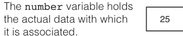

类类型变量不持有与其关联的实际数据项，而是持有与其关联的数据项的内存地址。如果 `name` 是一个 `String` 类变量，那么 `name` 就可以持有一个 `String` 对象的内存地址。这在图 2-8 中所示。

**图 2-8** String 类变量可以持有 String 对象的地址

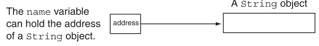

当类类型变量持有对象的地址时，该该变量引用该对象。由于原因，类类型变量通常被称为引用变量。

## 创建 String 对象

每当你程序中编写一个 `String` 字面量时，Java 都会创建一个 `String` 对象来存放它。你可以通过一个简单的赋值语句在内存中创建一个 `String` 对象并将其地址存储在 `String` 变量中。以下是一个示例：

```java
name = "Joe Mahoney";
```

在这里，`String` 字面量导致在内存中创建一个存储值 "Joe Mahoney" 的 `String` 对象。然后，赋值运算符将该对象的地址存储在 `name` 变量中。在该语句执行后，称 `name` 变量引用了一个 `String` 对象。这在图 2-9 中所示。

**图 2-9** String 对象与引用变量

| 一个 String 对象 | |
|---|---|
| name 变量持有一个 String 对象的地址 | 地址 | "Joe Mahoney" |

你也可以使用 `=` 运算符来初始化 `String` 变量，所示：

```java
String name = "Joe Mahoney";
```

该语句将 `name` 声明为 `String` 变量，创建一个存储值 "Joe Mahoney" 的 `String` 对象，并将对象的内存地址分配给 `name` 变量。代码列表 2-20 显示了 `String` 变量的声明、初始化以及在 `println` 中的用法。

## 代码列表 2-20 (StringDemo.java)

```java
// 一个演示 String 对象的简单程序。
public class StringDemo
{
    public static void main(String[] args)
    {
        String greeting = "Good morning ";
        String name = "Herman";
        System.out.println(greeting + name);
    }
}
```

### 程序输出

Good morning Herman

> 提示：`String` 中的 `S` 是大写字母。按照惯例，类的第一个字母始终大写。

## 2.9 String 类方法

由于 `String` 类型是一个类而不是基本类型，它提供了许多用于处理字符串的方法。例如，`String` 类有一个名为 `length` 的方法，该方法返回对象中存储的字符串的长度。假设 `name` 变量引用一个 `String` 对象，以下语句将其字符串的长度存储在变量中（假设 `stringSize` 是一个 `int` 变量）：

```java
stringSize = name.length();
```

该语句调用了 `name` 所引用的对象的 `length` 方法。调用方法意味着执行它。方法的一般形式如下：

`referenceVariable.method(arguments...)`

`referenceVariable` 是引用对象的变量名，`method` 是方法名，而 `arguments` 是传递给方法的零或多个参数。如果没有向方法传递参数（如 `length` 方法所示），则在方法名后紧跟一组空括号。

`String` 类的 `length` 方法返回一个 `int` 值。这意味着该方法向调用它的字符串返回一个 `int` 值。该值可以存储在变量中、显示在屏幕上或用于计算。代码列表 2-21 展示了 `length` 方法。

## 代码列表 2-21 (StringLength.java)

```java
// 此程序演示 String 类的 length 方法。

public class StringLength
{
    public static void main(String[] args)
    {
        String name = "Herman";
        int stringSize;

        stringSize = name.length();
        System.out.println(name + " has " + stringSize + " characters.");
    }
}
```

### 程序输出

Herman has 6 characters.

> 注意：`String` 类的 `length` 方法返回字符串中字符的数量，包括空格。

你将在第 10 章详细学习字符串类方法，但现在让我们来看几个例子。除了 `length` 方法外，表 2-15 描述了 `charAt`、`toLowerCase` 和 `toUpperCase` 方法。

### 表 2-15 部分 String 方法

| 方法 | 描述 |
|---|---|
| `charAt(index)` | 参数 `index` 是一个 `int` 值，指定字符串中的字符位置。第一个字符位于位置 0，第二个字符位于位置 1，依此类推。该方法返回指定位置的字符。<br><br>示例：<br>`char letter;`<br>`String name = "Herman";`<br>`letter = name.charAt(3);`<br><br>在该语句执行后，`letter` 将持有字符 'm' |
| `length()` | 返回字符串中字符的数量。返回值为 `int` 类型。<br><br>示例：<br>`int stringSize;`<br>`String name = "Herman";`<br>`stringSize = name.length();`<br><br>在该语句执行后，`stringSize` 变量将持有值 6 |
| `toLowerCase()` | 返回调用对象的字符串的小写形式的新字符串。<br><br>示例：<br>`String bigName = "HERMAN";`<br>`String littleName = bigName.toLowerCase();`<br><br>在该语句执行后，`littleName` 将持有字符串 "herman" |
| `toUpperCase()` | 返回调用对象的字符串的大写形式的新字符串。<br><br>示例：<br>`String littleName = "herman";`<br>`String bigName = littleName.toUpperCase();`<br><br>在该语句执行后，`bigName` 将持有字符串 "HERMAN" |

代码列表 2-22 中的程序演示了这些方法。

## 代码列表 2-22 (StringMethods.java)


# 第 2 章 Java 基础

```java
// 此程序演示了一些 String 方法。

public class StringMethods
{
    public static void main(String[] args)
    {
        String message = "Java is Fun!";
        String upper = message.toUpperCase();
        String lower = message.toLowerCase();
        char letter = message.charAt(2);
        int stringSize = message.length();

        System.out.println(message);
        System.out.println(upper);
        System.out.println(lower);
        System.out.println(letter);
        System.out.println(stringSize);
    }
}
```

## 程序输出

```
Java is Fun!
JAVA IS FUN!
java is fun!
v
18
```

## 2.10 作用域

**概念**：变量的作用域是访问该变量的程序。

每个变量都有其作用域。变量的作用域是程序可以通过其名称访问该变量的部分。变量仅在其作用域内部的语句中可见。定义变量作用域的规则非常复杂，而你只在这里介绍了该概念。在书的后续章节中，我们将再次回到这个主题并对其进行扩展。

因此，你只在 `main` 方法内部声明了几个变量。在方法内部声明的变量被称为**局部变量**。之后你将学习在方法外部声明的变量，但现在，让我们关注局部变量的使用。

局部变量的作用范围从变量的声明开始，到其声明所在的方法结束。该变量无法被该区域之外的语句访问。这意味着局部变量无法被方法外部的代码访问，也无法被方法内部在变量声明之前的代码访问。

代码列表 2-23 中的程序展示了一个示例。

### 代码列表 2-23 (Scope.java)

```java
// 此程序找不到其变量。

public class Scope
{
    public static void main(String[] args)
    {
        System.out.println(value); // 错误！
        int value = 100;
    }
}
```

该程序无法编译，因为在变量声明之前就尝试打印变量 `value`。请记住，编译器是从上到下读取你的程序的。如果它在变量声明之前遇到使用该变量的语句就会发生错误。要修正该程序，必须将变量声明写在任何使用它的语句之前。

> **注意**：如果你编译此程序，编译器将显示错误信息为“无法解析符号 (cannot resolve symbol)”。这意味着编译器遇到了一个无法确定含义的名称。

关于局部变量，你必须记住的另一个规则是：你不能在同一个作用范围内拥有两个同名的局部变量。例如，查看以下方法。

```java
public static void main(String[] args)
{
    // 声明一个名为 number 的变量并
    // 显示它的值。
    int number = 7;
    System.out.println(number);
    // 声明另一个名为 number 的变量并
    // 显示它的值。 
    int number = 100;      // 错误！！！
    System.out.println(number);   // 错误！！！
}
```

此方法声明了一个变量 `number` 并将其初始化为 7。该变量的作用范围从声明语句开始，延伸到方法的结束。在变量的作用范围内，有一条声明另一个变量 `number` 的语句。这条语句将导致错误，因为你不能在同一个作用范围内拥有两个同名的局部变量。

## 2.11 注释

> **概念**：注释是用于说明程序行或部分的解释性备注。注释是程序的一部分，但编译器会忽略它们。它们是为可能阅读源代码的人准备的。

注释是放在程序不同部分的说明，解释了程序的这些部分是如何工作的。注释不是给编译器准备的。它们是为了帮助程序员理解代码。编译器会跳过程序中的所有注释。

作为一名程序员，你可能反感在程序中编写大量注释的想法。毕竟，编写真正能起作用的代码要有趣得多！然而，花额外的时间编写注释是非常关键的。当你以后需要修改或调试程序时，这些注释几乎会救你的命。恰当的注释即使是大型复杂的程序也变得易于阅读和理解。

在 Java 中有三种类型的注释：单行注释、多行注释和文档注释。让我们简要讨论每种。

### 单行注释

你已经见过在 Java 程序中书写注释的第一种方法。你只需要在想开始注释的地方放置两个正斜杠（`//`）。编译器会忽略从该点到行尾的所有内容。代码列表 2-24 显示了注释可以大量地分布在程序中。

#### 代码列表 2-24 (Comment1.java)

```java
// 程序：Comment1.java
// 由 Herbert Dorfmann 编写
// 此程序计算公司工资

public class Comment1
{
    public static void main(String[] args)
    {
        double payRate; // 持有时薪薪率
        double hours; // 持有工作小时
        int employeeNumber; // 持有员工编号

        // 此程序的其余部分省略
    }
}
```

除了说明谁编写了程序以及描述变量的作用外，注释还可以用于解释代码中复杂的步骤。

### 多行注释

Java 中的第二种注释是多行注释。多行注释以 `/*`（一个正斜杠后跟星号）开始，以 `*/`（一个星号后跟正斜杠）结束。这两个标记之间的所有内容都会被忽略。代码列表 2-25 说明了如何使用多行注释。

#### 代码列表 2-25 (Comment2.java)

```java
/*
程序：Comment2.java
由 Herbert Dorfmann 编写
此程序计算公司工资
*/

public class Comment2
{
    public static void main(String[] args)
    {
        double payRate; // 持有时薪薪率
        double hours; // 持有工作小时
        int employeeNumber; // 持有员工编号

        // 此程序的其余部分省略
    }
}
```

与单行结束的注释不同，多行注释可以跨越多行。

在使用多行注释时请记住以下建议：

- 注意不要反转起始符号
- 确保不要忘记结束符号

许多程序员使用星号或其他字符来绘制边界或框。这在视觉上将注释与周围代码分开。这些被称为块注释。

#### 表 2-16 块注释

| 注释类型 | 描述 |
| :--- | :--- |
| 单行注释 | `//` 从该点到行尾 |
| 多行注释 | `/* ... */` 跨多行 |
| 文档注释 | `/** ... */` 用于 javadoc |

```text
/**
 * 此程序演示了
 * 注释的方式
 */
```

### 文档注释

第三种注释被称为文档注释。文档注释以 `/**` 开始并以 `*/` 结束。文档注释可以被 JDK 自带 `javadoc` 程序读取和处理。通常我们在类头部处编写文档注释，对类进行简要描述。我们还在每个方法头部处编写文档注释，对方法进行简要描述。例如，代码列表 2-26 显示了一个带有文档注释的程序。

#### 代码列表 2-26 (Comment3.java)

```java
/**
 * 该类创建一个计算工资的程序。
 */

public class Comment3
{
    /**
     * main 方法是程序的起点。
     */

    public static void main(String[] args)
    {
        double payRate;      // 持有时薪薪率
        double hours;          // 持有工作小时
        int employeeNumber;   // 持有员工编号

        // 此程序的其余部分省略。
    }
}
```

你从操作系统的提示符运行 `javadoc` 程序。以下是 `javadoc` 命令的一般格式：

`javadoc SourceFile.java`

`SourceFile.java` 是 Java 源代码文件名，包括 `.java` 扩展名。该文件将被 `javadoc` 读取，并为其生成文档。例如，以下命令将为 `Comment3.java` 源代码生成文档：

`javadoc Comment3.java`

在该命令执行后，同一目录下将创建多个文档文件。其中一个文件将命名为 `index.html`。图 2-10 显示了在 Internet Explorer 中查看的 `index.html` 文件。注意在文档注释中的文本出现在文件中。

#### 图 2-10 由 javadoc 生成的文档

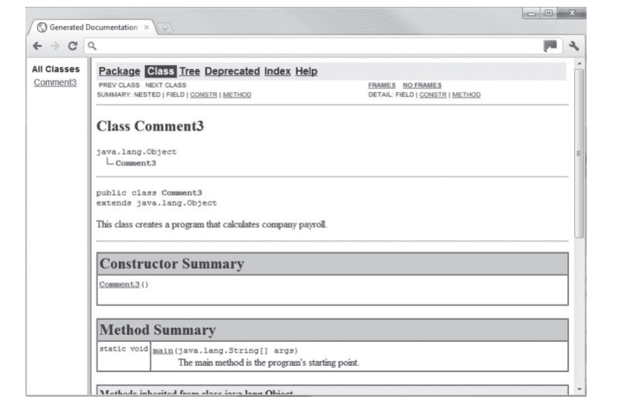

如果你查看 JDK 文档（这些是你在 Web 浏览器中查看的 HTML 文件），你会发现它们的格式与 `javadoc` 生成的文件相同。使用 javadoc 对你的源代码进行文档化的好处是，你的文档将具有与 Java 文档相同的专业外观和感受。

> 你可以通过阅读本书在线资源页（www.pearsonhighered.com/gaddis）上的附录 F 来了解更多关于文档注释和 `javadoc` 实用程序的知识。从书的这里开始，我们将在示例源代码中使用块风格注释和单行注释。

### 知识点检查 (Checkpoint)

- 2.32 如何编写单行注释？如何编写多行注释？如何编写文档注释？
- 2.33 文档注释与其他类型的注释有何不同？

## 2.12 编程风格

**概念**：编程风格**指的是程序员使用空格、缩进、空行和标点符号来安排程序源代码的方式。

在第 1 章中，你学习了语法规则规定了语言的使用方式。Java 的语法规则规定了关键字、分号、逗号、大括号以及语言其他元素的放置位置。编译器检查语法错误，如果没有错误，则生成字节码。

当编译器读取程序时，它将其视为一个长字符字符串进行处理。编译器不在乎每个语句是否单独成行，也不在乎是否分隔了操作符和操作数。然而，人类发现很难阅读不是以视觉美观方式编写的程序。请参考代码列表 2-27。

### 代码列表 2-27 (Compact.java)

```java
public class Compact {
    public static void main(String [] args){
        int shares=220;
        double averagePrice=14.67;
        System.out.println(
          "There "+shares+" shares sold at $"+averagePrice+
          " per share.");
    }
}
```

#### 程序输出

```
出了 220 股股票，价格每股 $14.67。
```

尽管该程序在语法上是正确的（它没有违反 Java 的任何规则），但它很难阅读。代码列表 2-28 显示了该程序，并使用了更易理解的风格编写。

### 代码列表 2-28 (Readable.java)

```java
// 这个示例比 Compact.java 可读性高得多。

public class Readable
{
    public static void main(String[] args)
    {
        int shares = 220;
        double averagePrice = 14.67;

        System.out.println("There were " + shares
                            + " shares sold at $"
                            + averagePrice + " per share.");
    }
}
```

#### 程序输出

```
出了 220 股股票，价格每股 $14.67。
```

编程风格术语通常指源代码的视觉安排方式。它包含了在程序中一致放置空格和缩进技巧，从而创建视觉提示。这些线索可以快速告诉程序员关于程序的重要信息。

例如，注意列表 2-28，类的大括号每行都缩进了，而且在 `main` 方法的大括号内部，每行再次缩进。在一组大括号内对行进行缩进是一种常见的编程风格，如图 2-11 所示。

#### 图 2-11 缩进

```java
// 这个示例比 Compact.java 可读性高得多。
public class Readable
{
    public static void main(String[] args)
    {
        int shares = 220;
        double averagePrice = 14.67;
        System.out.println("There were " + shares
                            + " shares sold at $"
                            + averagePrice + " per share.");
    }
}
```

编程风格的另一个方面是处理长到无法放在一行的语句。注意 `println` 语句被分成了三行。在语句第二行和第三行的开头插入了额外的空格，这表示它们是延续部分。

在使用单个语句声明多个相同类型的变量时，通常做法是将每个变量单独写一行，并用注释解释变量的用途。这里是一个示例：

```java
int fahrenheit;    // 用于存储华氏温度
int celsius;          // 用于存储摄氏温度
int kelvin;          // 用于存储开尔文温度
```

你可能已经注意到示例程序中，在变量声明和随后的语句之间插入了一个空行。这是为了将声明与可执行语句分开。

还有许多与编程风格相关的问题。它们将贯穿本书。

## 2.13 读取键盘输入

- **概念**：`Scanner` 类的对象可以用于从键盘读取输入。

之前我们讨论了 `System.out` 对象以及它如何引用标准输出设备。Java API 有另一个对象 `System.in`，它引用标准输入设备。标准输入设备通常设计为键盘。你可以使用 `System.in` 对象读取通过键盘输入的击键。然而，仅通过值使用 `System.in` 读取输入并没有使用 `System.out` 那么简单直接。因为 `System.in` 设计用于从键盘读取输入，你可以使用 `Scanner` 类来读取输入。

首先，创建一个 `Scanner` 对象并连接到 `System.in`。这里有一个语句的示例：

```java
Scanner keyboard = new Scanner(System.in);
```

我们在该语句中看到的第一个部分是赋值运算符（`=`）。赋值运算符将某些内容赋值给 `keyboard` 变量。在赋值运算符之后我们看到 `new` 关键字，这是一个 Java 关键字。`new` 的目的是创建一个对象。该对象的类型将被列出。在这种情况下，我们在 `new` 之后使用 `Scanner(System.in)`。这指定要创建一个 `Scanner` 对象，并将其连接到 `System.in`。对象的内存地址通过 `=` 运算符赋值给 `keyboard` 变量。语句执行后，`keyboard` 变量将引用创建的 `Scanner` 对象。

图 2-12 指出了该语句每个部分的用途。图 2-13 说明了 `keyboard` 变量如何引用 `Scanner` 类的对象。

#### 图 2-12 语句的部分


#### 图 2-13 keyboard 变量引用 Scanner 对象


> **注意**：在前面的代码中，我们选择 `keyboard` 作为变量名。`keyboard` 这个名字本身并没有特殊含义。我们之所以选择这个名字是因为我们将使用该变量从键盘读取输入。

`Scanner` 类具有读取字符串、字节、整数、长整数、短整数、浮点数和双精度数字的方法。例如，以下代码使用 `Scanner` 类对象从键盘读取一个 `int` 值并将其赋值给 `number` 变量。

```java
int number;
Scanner keyboard = new Scanner(System.in);
System.out.print("Enter an integer value: ");
number = keyboard.nextInt();
```

此处显示的最后一条语句调用了 `Scanner` 类的 `nextInt()` 方法。`nextInt()` 方法将输入值格式化为 `int`，然后返回该值。因此，该语句将从键盘输入的输入格式化为 `int` 并返回。该值被赋值给变量 `number`。

### 表 2-17 Scanner 类的一些方法

| 方法 | 示例与描述 |
| --- | --- |
| `nextByte` | 示例用法：<br><br>`byte x;`<br>`Scanner keyboard = new Scanner(System.in);` |


# 第 2 章 Java 基础

## 2-17 Scanner 类的一些方法（续）

| 方法 | 示例与描述 |
| --- | --- |
| nextByte | 示例用法：<br>`byte x;`<br>`Scanner keyboard = new Scanner(System.in);`<br>`System.out.print("Enter a byte value: ");`<br>`x = keyboard.nextByte();`<br>描述：将输入作为 `byte` 返回。 |
| nextDouble | 示例用法：<br>`double number;`<br>`Scanner keyboard = new Scanner(System.in);`<br>`System.out.print("Enter a double value: ");`<br>`number = keyboard.nextDouble();`<br>描述：将输入作为 `double` 返回。 |
| nextFloat | 示例用法：<br>`float number;`<br>`Scanner keyboard = new Scanner(System.in);`<br>`System.out.print("Enter a float value: ");`<br>`number = keyboard.nextFloat();`<br>描述：将输入作为 `float` 返回。 |
| nextInt | 示例用法：<br>`int number;`<br>`Scanner keyboard = new Scanner(System.in);`<br>`System.out.print("Enter an integer value: ");`<br>`number = keyboard.nextInt();`<br>描述：将输入作为 `int` 返回。 |
| nextLine | 示例用法：<br>`String name;`<br>`Scanner keyboard = new Scanner(System.in);`<br>`System.out.print("Enter your name: ");`<br>`name = keyboard.nextLine();`<br>描述：将输入作为 `String` 返回。 |
| nextLong | 示例用法：<br>`long number;`<br>`Scanner keyboard = new Scanner(System.in);`<br>`System.out.print("Enter a long value: ");`<br>`number = keyboard.nextLong();`<br>描述：将输入作为 `long` 返回。 |
| nextShort | 示例用法：<br>`short number;`<br>`Scanner keyboard = new Scanner(System.in);`<br>`System.out.print("Enter a short value: ");`<br>`number = keyboard.nextShort();`<br>描述：将输入作为 `short` 返回。 |

## 使用 import 语句

在准备好使用 `Scanner` 类之前，关于该类还有一个细节需要你了解。`Scanner` 类在你的 Java 程序中并不是自动可用的。任何使用 `Scanner` 类的程序都应该在文件开头（任何类定义之前）包含以下语句：

```java
import java.util.Scanner;
```

该语句告诉 Java 编译器查找 `Scanner` 类并使其对程序可用。

代码列表 2-29 显示了如何使用 `Scanner` 类读取 `String`、一个 `int` 和一个 `double`。

## 代码列表 2-29 (Payroll.java)

```java
1 import java.util.Scanner; // 需要 Scanner 类
2 /**
3  * 此程序演示了 Scanner 类。
4  */
5 
6 public class Payroll
7 {
8   public static void main(String[] args)
9   {
10     String name;    // 用于存储名称
11     int hours;      // 工作小时数
12     double payRate; // 小时薪率
13     double grossPay; // 总工资
```

## 2.13 读取键盘输入

### 示例输入程序输出

你的名字（什么？Joe Mahoney [回车]

你这周工作了多少小时？40 [回车]

你的的小时薪率是多少？20 [回车]

Hello Joe Mahoney

你的总工资是 $800.00

> 注意：注意到每个 `Scanner` 类方法都会返回一个值。当按下回车键时，光标会自动移动到下一行以便进行后续操作。

## 读取字符

有时你想从键盘读取单个字符。例如，你的程序可能会向用户问一个是/否的问题，让其输入 Y 或 N。然而，`Scanner` 类没有读取单个字符的方法。我们在书中用于读取字符的方法是：使用 `Scanner` 类的 `nextLine` 方法读取字符串，然后使用 `String` 类的 `charAt` 方法提取。这将是用户在键盘输入的字符。以下是一个示例：

```java
String input; // 用于存储一行输入
char answer; // 用于存储单个字符

// 创建 Scanner 对象。
Scanner keyboard = new Scanner(System.in);

// 向用户提问。
System.out.print("Are you hungry? (Y=yes, N=no)");
input = keyboard.nextLine(); // 获取一行输入。
answer = input.charAt(0); // 获取第一个字符。
```

`input` 变量引用 `String` 对象。代码的最后一条调用 `String` 类的 `charAt` 方法获取位置 0 的字符，即字符串中的第一个字符。在该语句之后，`answer` 变量将持有用户输入的字符。

## 混合调用 nextLine 与其他方法

当你调用 `Scanner` 类的方法读取基本类型值后再调用 `nextLine` 读取字符串时，可能会发生问题。例如，查看代码列表 2-30 中的程序。

## 代码列表 2-30 (InputProblem.java)

```java
import java.util.Scanner; // 需要 Scanner 类

/**
 * 此程序读取输入时存在问题。
 */
public class InputProblem {
  String name; // 用于存储名称
  int age; // 用于存储年龄
  double income; // 用于存储收入

  // 创建 Scanner 对象读取输入。
  Scanner keyboard = new Scanner(System.in);

  // 获取年龄。
  System.out.print("What is your age?");
  age = keyboard.nextInt();
```

### 示例输入程序输出

| 你的年龄是多少？ | **24** [回车] |
|---|---|
| 你的年收入是多少？ | **50000.0** [回车] |
| 你的名字是什么？ | Hello. Your age is 24 and your income is 50000 |

在示例输出中，程序首先允许用户输入年龄。第 20 行从键盘读取一个 `int` 并将其存储在变量中。接下来，第 24 行从键盘读取一个 `double` 并存储在 `income` 变量中。然后要求用户输入名字，但看起来第 28 行被跳过了。这是由于 `nextLine` 方法与其他方法之间行为的细微差异。

当用户向键盘输入按键时，按键存储在被称为键盘缓冲区的内存区域。按下回车键会创建一个换行符并存储在缓冲区中。在代码列表 2-30 的程序示例中，用户被要求输入年龄，第 20 行调用了 `nextInt` 方法从缓冲区读取。注意用户输入了 24 然后按了回车。`nextInt` 方法从缓冲区读取值 24，遇到换行符时停止。因此，从缓冲区读取了值 24，但没有读取换行符。

接下来，用户被要求输入收入。用户输入 50000.0 然后按了回车。当第 24 行的 `nextDouble` 方法执行时，它遇到了由 `nextInt` 方法留下的换行符。这没有引起问题，因为 `nextDouble` 设计为跳过遇到的任何领先换行符。它跳过了初始换行符，从缓冲区读取值 50000.0，并在遇到换行符时停止。换行符随后留在缓冲区中。

接下来，要求用户输入名字。第 28 行调用了 `nextLine` 方法。然而，`nextLine` 方法的设计并不是跳过初始换行符。如果换行符是 `nextLine` 方法遇到的第一个字符，将无无读取。因为第 24 行的 `nextDouble` 方法在缓冲区中留下了换行符，`nextLine` 方法不会读取任何输入。相反，它将立即终止，用户将没有机会输入名字。

尽管这个问题的细节看起来很困惑，但解决方法很简单。代码列表 2-31 中的程序是对代码列表 2-30 的修改，修复了输入问题。

## 代码列表 2-31 (CorrectedInputProblem.java)

```java
import java.util.Scanner; // 需要 Scanner 类

/**
 * 此程序正确地读取数值和字符串输入。
 */

public class CorrectedInputProblem
{
    public static void main(String[] args)
    {
        String name; // 用于存储名称
        int age; // 用于存储年龄
        double income; // 用于存储收入

        // 创建 Scanner 对象读取输入。
        Scanner keyboard = new Scanner(System.in);

        // 获取年龄。
        System.out.print("What is your age? ");
        age = keyboard.nextInt();

        // 获取收入
        System.out.print("What is your annual income? ");
        income = keyboard.nextDouble();

        // 消耗掉剩余的换行符。
        keyboard.nextLine();

        // 获取名字。
        System.out.print("What is your name? ");
        name = keyboard.nextLine();

        // 将信息显示给用户。
        System.out.println("Hello " + name + ". Your age is " + age + " and your income is $" + income);
    }
}
```

### 带有示例输入的程序输出

| 你的年龄是多少？ | **24** [Enter] |
|---|---|
| 你的年收入是多少？ | **50000.00** [Enter] |
| 你的名字是什么？ | **Mary Simpson** [Enter] |

Hello Simpson. Your age is 24 and your income is $50000.0

注意，在第 24 行通过 `nextDouble` 方法读取用户收入后，在第 27 行调用了 `nextLine` 方法。此调用的目的是消除（或移除）缓冲区中剩余的换行符。然后，在第 31 行再次调用了 `nextLine` 方法。这次它正确地读取了用户的姓名。

> 注意：注意在第 27 行中，当我们消除剩余的换行符时，我们没有将方法的返回值赋值给任何变量。这是因为我们只是调用该方法来移除换行符，而不需要保留方法的返回值。

## 2.14 对话框

概念：`JOptionPane` 类允许你快速显示对话框，对话框是一个显示消息或请求输入的小型图形窗口。

对话框是一个向用户显示消息或请求输入的小型图形窗口。你可以使用 `JOptionPane` 类快速地显示对话框。在本节中，我们将讨论以下类型的对话框以及如何使用 `JOptionPane` 显示它们：

- 消息对话框（Message Dialog）：显示消息的对话框；还会显示一个 OK 按钮。
- 输入对话框（Input Dialog）：提示用户输入并提供输入文本字段的对话框；还会显示一个 OK 按钮和一个 Cancel 按钮。

图 2-14 显示了每种对话框的示例。

## 图 2-14 消息对话框和输入对话框

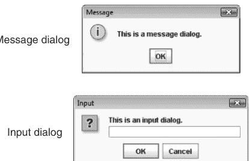

Java 程序并不是自动可以使用 `JOptionPane` 类。任何使用 `JOptionPane` 的程序都必须在文件开头包含以下语句：

```java
import javax.swing.JOptionPane;
```

该语句告诉编译器去哪里寻找 `JOptionPane` 类，并使其对你的程序可用。

## 显示消息对话框

`showMessageDialog` 方法用于显示消息对话框。这里是调用该方法的语句：

```java
JOptionPane.showMessageDialog(null, "Hello World");
```

第一个参数仅在显示其他图形窗口的程序中重要。你将在第 7 章中学习更多相关内容。在此之前，我们将关键字 `null` 作为第一个参数。这会导致对话框显示在屏幕中心。第二个参数是我们希望在对话框中显示的消息。这段代码将使图 2-15 所示的对话框出现。当用户点击 OK 按钮时，对话框将关闭。

## 图 2-15 消息对话框


## 显示输入对话框

输入对话框是要求用户输入数据的快速简单的方法。你使用 `JOptionPane` 类的 `showInputDialog` 方法来显示输入对话框。以下代码调用了该方法：

```java
String name;
name = JOptionPane.showInputDialog("Enter your name.");
```

传递给方法的参数是要显示在对话框中的消息。此状态会导致图 2-16 所示的对话框显示在屏幕中心。如果用户点击 OK 按钮，`name` 将引用用户在文本字段中输入的字符串值。如果用户点击 Cancel 按钮，`name` 将引用特殊值 `null`。

## 图 2-16 输入对话框

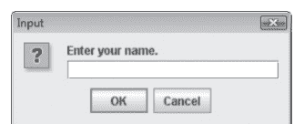

## 示例程序

代码列表 2-32 展示了如何使用两种类型的对话框。该程序使用输入对话框要求用户输入姓、名和中间，然后使用消息对话框显示问候。当此程序运行时，图 2-17 所示的对话框将逐个显示。

## 代码列表 2-32 (NamesDialog.java)

```java
import javax.swing.JOptionPane;

/**
 * 此程序演示了使用 JOptionPane 的对话框。
 */

public class NamesDialog
{
    public static void main(String[] args)
    {
        String firstName; // 用户的名
        String middleName; // 用户的中间名
        String lastName; // 用户的姓

        // 获取用户的名
        firstName = JOptionPane.showInputDialog("What is your first name? ");

        // 获取用户的中间名
        middleName = JOptionPane.showInputDialog("What is your middle name? ");

        // 获取用户的姓
        lastName = JOptionPane.showInputDialog("What is your last name? ");

        // 显示问候
        JOptionPane.showMessageDialog(null, "Hello " + firstName + " " + middleName + " " + lastName);

        System.exit(0);
    }
}
```


`OptionPane` 类允许你快速显示对话框，对话框是一个显示消息或请求输入的小型图形窗口。

对话框是一个向用户显示消息或请求输入的小型图形窗口。你可以使用 `OptionPane` 类快速显示对话框。在本节中，我们将讨论以下类型的对话框以及如何使用 `OptionPane` 显示它们：

## 图 2-16 输入对话框

输入对话框是要求用户输入数据的快速简单的方法。你使用 `JOptionPane` 类的 `showInputDialog` 方法来显示输入对话框。以下代码调用了该方法：

## 表 2-18 对话框

| 方法 | 使用此方法来 | 示例代码 |
|---|---|---|
| `Byte.parseLong` | 将字符串转换为 byte。 | `byte num = Byte.parseByte(str);` |
| `Double.parseDouble` | 将字符串转换为 double。 | `double num = Double.parseDouble(str);` |
| `Float.parseFloat` | 将字符串转换为 float。 | `float num = Float.parseFloat(str);` |
| `Integer.parseInt` | 将字符串转换为 int。 | `int num = Integer.parseInt(str);` |
| `Long.parseLong` | 将字符串转换为 long。 | `long num = Long.parseLong(str);` |
| `Short.parseShort` | 将字符串转换为 short。 | `short num = Short.parseShort(str);` |

## 图 2-17 显示的对话框


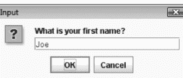
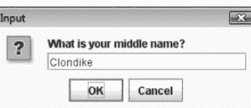
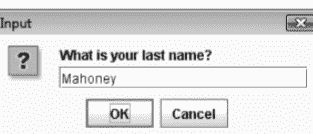


```java
// 将输入转换为整数。
hours = Integer.parseInt(inputString);

// 获取小时薪资率。
inputString =
JOptionPane.showDialog("What is your " + 
  "hourly pay rate?");

// 将输入转换为双精度浮点数。
payRate = Double.parseDouble(inputString);

// 计算总工资。
grossPay = hours * payRate;

// 显示结果。
JOptionPane.showMessage(null, "Hello " +
  name + ". Your gross pay is $" +
  grossPay);

// 结束程序。
System.exit(0);
```

图 2-18 PayrollDialog.java 显示的对话框。

第一个对话框如所示。用户输入姓名，然后点击 OK。

第二个对话框如所示。用户输入工作小时数，然后点击 OK。

第三个对话框如所示。用户输入其薪资率，然后点击 OK。

第四个对话框如所示。

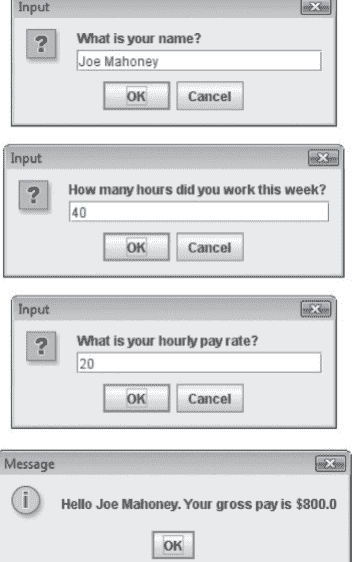

# 检查点 (Checkpoint)

2.34 以下类型对话框的目的是什么？

- 消息对话框
- 输入对话框

2.35 编写代码显示图 2-19 所示的每个对话框。

2.36 编写代码显示一个输入对话框，要求用户输入年龄。将输入值转换为整数并存储在名为 `age` 的整数变量中。

2.37 在使用 `JOptionPane` 的程序中编写哪种 import 语句？

**图 2-19** 检查点 2.35 的对话框

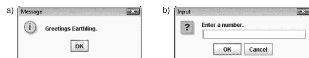

# 2.15 System.out.printf 方法

> 概念：`System.out.printf` 方法允许你以多种方式格式化输出。

当你使用 `System.out.println` 或 `System.out.printf` 方法显示数字时，对数字的显示方式控制有限。例如，`double` 类型的值可以显示多达 15 位小数，如下代码所示：

```java
double number = 10.0 / 6.0;
System.out.println(number);
```

这段代码将显示：

```
1.6666666666666667
```

通常，你希望格式化数字以便以特定的方式显示。例如，你可能希望将浮点数保留到特定的小数位数，或者插入逗号使数字更容易读。遗憾的是，Java 提供了一种实现方法，即 `System.out.printf` 方法。该方法的通用格式如下：

```java
System.out.printf(FormatString, ArgumentList)
```

在通用格式中，`FormatString` 是包含文本和/或特殊格式规范的字符串。`ArgumentList` 是零或多个额外参数的列表，它们将根据格式字符串中列出的格式说明符进行格式化。

## 使用 System.out.printf 方法

使用 `System.out.printf` 方法最简单的方法是仅使用格式字符串而不使用任何额外参数。这是一个示例：

```java
System.out.printf("I love Java programming.");
```

示例中的格式字符串是 "I love Java programming."。该方法没有执行任何特殊格式化；它只是打印字符串 "I love Java programming."。以此方式使用该方法与使用 `System.out.print` 方法完全相同。

在许多情况下，你会按照以下方式使用 `System.out.printf` 方法：

- 格式字符串将包含一个或多个说明符。格式说明符是显示时插入到字符串中的值的占位符。
- 格式字符串之后将出现一个或多个额外参数。每个额外参数都将与格式字符串内部的格式说明符对应。

以下代码显示了一个示例：

```java
double sales = 12345.67;
System.out.printf("Our sales are %f for the day.\n", sales);
```

注意 `System.out.printf` 方法调用的特征：

- 在格式字符串内部，`%f` 是一个格式说明符。字母 `f` 表示在显示时插入浮点值。
- 在格式字符串之后，`sales` 变量作为参数传递。该参数与格式字符串内部的 `%f` 说明符对应。

当 `System.out.printf` 方法执行时，`%f` 不会显示在屏幕上。取而代之的是将显示 `sales` 参数的值。以下是代码的输出：

```
Our sales is 12345.670000 for the day.
```

图 2-20 显示了 `sales` 变量如何对应于 `%f` 说明符。

## 图 2-20 `sales` 变量的值显示在 `%f` 格式说明符的位置


## 精度

你可能在之前的示例中注意到，`%f` 格式指定符会导致浮点值以六位小数的形式显示。你可以更改显示的小数位数，如下例所示：

```java
double temp = 78.42819;
System.out.printf("The temperature is %.2f degrees.\n", temp);
```

请注意，这个示例没有使用普通的 `%f` 格式指定符，而是使用了 `%.2f`。`%` 和 `f` 之间的 `.2` 指定了显示值的精度。它会将 `temp` 变量的值四舍五入到两位小数。这段代码将产生以下输出：

```
The temperature is 78.43 degrees.
```

这个示例显示相同的值，但四舍五入到一位小数：

```java
double temp = 78.42819;
System.out.printf("The temperature is %.1f degrees.\n", temp);
```

这段代码将产生以下输出：

```
The temperature is 78.4 degrees.
```

这段代码展示了另一个示例：

```java
double value1 = 123.45678;
double value2 = 123.456789;
double value3 = 123.456789;
System.out.printf("%.1f %.2f %.3f\n", value1, value2, value3);
```

在这个示例中，`value1` 被四舍五入到一位小数，`value2` 被四舍五入到两位小数，`value3` 被四舍五入到三位小数。这段代码将产生以下输出：

```
123.5 123.46 123.457
```

记住，你只能对浮点值指定精度。如果你在 `%d` 指定符上指定精度，将在运行时发生错误。

## 指定最小字段宽度

格式指定符还可以包含一个最小字段宽度，即用于显示该值的最小空格数。下面的示例在一个宽度为 20 个空格的字段中打印一个浮点数：

```java
double number = 12345.6789;
System.out.printf("The number is:%20f\n", number);
```

注意 `20` 出现在格式指定符中，位于 `%` 和 `f` 之间。这段代码将产生以下输出：

```
The number is:      12345.67890
```

在示例中，出现在 `%f` 格式指定符内部的 `20` 表示数字应该显示在一个至少有 20 个空格宽的字段中。这如图 2-23 所示。

## 图 2-23 数字显示在一个宽度为 20 个空格的字段中

```
The number is: 12345.678900
```

数字显示在一个宽度为 20 个空格的字段中。

在这种情况下，显示的数字比它所在的字段短。数字 `12345.678900` 在屏幕上只占用 12 个空格，但它显示在一个宽度为 20 个空格的字段中。在这种情况下，数字将在字段中右对齐。如果一个值太大无法放入指定的字段，字段将自动扩大以容纳它。下面的示例在一个宽度仅为一个空格的字段中打印一个浮点数：

```java
double number = 12345.6789;
System.out.printf("The number requires more than one space %f\n", number);
```

然而，`number` 的值需要多个空格，但字段宽度扩大以容纳整个数字。这段代码将产生以下输出：

```
The number is: 12345.678900
```

你也可以为整数指定最小字段宽度。下面的示例显示了一个最小字段宽度为六个字符的整数：

```java
int number = 200;
System.out.printf("The number is:%6d", number);
```

这段代码将显示：

```
    200
```

## 在同一指定符中结合字段宽度和精度

在同一指定符中指定浮点数的最小字段宽度和精度时，请记住字段宽度必须在前。例如，下面的代码在一个 12 个空格的字段中显示一个数字，并四舍五入到两位小数：

```java
double number = 12345.6789;
System.out.printf("The number is:%12.2f\n", number);
```

这段代码将产生以下输出：

```
The number is: 12345.68
```

当你需要对齐数字时，字段宽度可以很有帮助。例如，查看代码 2-34。每个变量都显示在一个 8 个宽的字段中，并四舍五入到两位小数。数字列显示。

## 代码 2-34 (Columns.java)

```java
/**
 * 此程序以列的形式显示多个浮点数。
 */
public class Columns {
    public static void main(String[] args) {
        double num1 = 127.89;
        double num2 = 3465.18;
        double num3 = 3.78;
        double num4 = 264.82;
        double num5 = 88.08;
        double num6 = 1799.99;

        // 在 8 个空格的字段中显示每个变量
        System.out.printf("%8.2f\n", num1);
        System.out.printf("%8.2f\n", num2);
        System.out.printf("%8.2f\n", num3);
        System.out.printf("%8.2f\n", num4);
        System.out.printf("%8.2f\n", num5);
        System.out.printf("%8.2f\n", num6);
    }
}
```

### 程序输出

```
    127.90
   3465.18
     3.78
   264.82
    88.08
   1799.99
```

## 标志

你可以向格式指定符插入几个可选标志，以特定方式格式化值。本书，我们将标志用于：

- 用逗号分隔符显示数字
- 用前零填充数字
- 左对齐数字

如果你在格式指定符中使用标志，必须在字段宽度和精度之前写入标志。

## 逗号分隔符

如果使用逗号分隔符，大数字更容易读。你可以通过在格式指定符中插入逗号（`,`）来格式化带有逗号分隔符的数字。示例所示：

```java
double amount = 1234567.89;
System.out.printf("%,f\n", amount);
```

这段代码将产生以下输出：

```
1,234,567.890000
```

通常你可能希望格式化带有逗号分隔符的数字并四舍五入到特定的小数位数。你可以通过在格式指定符中插入逗号后跟精度值来实现，如下例所示：

```java
double sales = 28756.89;
System.out.printf("Sales for the month are %,.2f\n", sales);
```

这段代码将产生以下输出：

```
Sales for the month 28,756.89
```

代码 2-35 展示了如何使用逗号分隔符和两位精度将数字格式化为货币金额。

## 代码 2-35 (CurrencyFormat.java)

```java
/**
 * 此程序演示了如何使用 System.out.printf
 * 方法将数字格式化为货币。
 */
public class CurrencyFormat {
    public static void main(String[] args) {
        double monthlyPay = 5000.0;
        double annualPay = monthlyPay * 12;
        System.out.printf("Your annual pay is $%,.2f\n", annualPay);
    }
}
```

### 程序输出

```
Your annual pay is $60,000.00
```

下面的示例显示了一个带有逗号分隔符的浮点数，位于 15 个宽的字段中，并四舍五入到两位小数：

```java
double amount = 1234567.8901;
System.out.printf("%,15.2f%n", amount);
```

这段代码将产生：

```
 1,234,567.89
```

下面的示例显示了一个最小字段宽度为六个字符的整数：

```java
int number = 200;
System.out.printf("The number is:%6d%n", number);
```

这段代码将显示：

```
   200
```

下面的示例显示了一个带有逗号分隔符且最小字段宽度为十个字符的整数：

```java
int number = 20000;
System.out.printf("The number is:%,10d%n", number);
```

这段代码将显示：

```
  20,000
```

## 用前零填充数字

有时，当数字比它所在的字段短时，你希望用前零填充数字。如果你在格式指定符中插入 `0` 标志，如果数字小于字段宽度，生成的数字将用前零填充。这段代码显示了一个示例：

```java
double number = 123.4;
System.out.printf("The number is:%08.1f%n", number);
```

这段代码将产生：

```
000123.4
```

## 图 2-24 填充前零的格式指定符

```
System.out.printf("The number is:%08.1f%n", number);
```

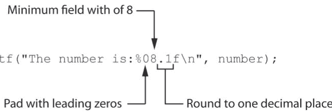


## 2.15 `System.out.printf` 方法

下面的示例显示了一个带有前导零的 `int`，最小宽度为七个字符：

```java
int number = 1234;
System.out.printf("The number is:%07d", number);
```

此代码将显示以下内容：

```
The number =:0001234
```

代码列表 2-36 中的程序显示了另一个示例。该程序显示了带有前导零的浮点数，位于九个空格的字段内，并保留两位小数。

### 代码列表 2-36 (LeadingZeros.java)

```java
1 /*
2  * 此程序显示带有前导零的数字。
3  */
5 public class LeadingZeros
6  {
7    public static void main(String[] args)
8    {
9      // 声明各种 double 变量。
10     double number1 = 1.234;
11     double number2 = 12.345;
12     double number3 = 123.456;
13
14     // 显示每个变量带有前导
15     // 零，在 9 个空格的字段内，保留
16     // 2 位小数。
17     System.out.printf("%092.2f\n", number1);
18     System.out.printf("%092.2f\n", number2);
19     System.out.printf("%092.2f\n", number3);
20   }
21 }
```

```
000001.23
000012.35
000123.46
```

### 程序输出

### 左对齐数字

默认情况下，当数字比其显示的字段短时，数字在字段内是右对齐的。如果你希望数字在它的字段内左对齐，可以在格式说明符中插入减号 (`-`) 标志。代码列表 2-37 显示了一个示例。

### 代码列表 2-37 (LeftJustified.java)

```java
/**
 * 此程序显示各种数字
 * 在列中左对齐显示。
 */

public class LeftJustified {

    public static void main(String[] args) {
        // 声明各种 int 变量。
        int num1 = 123;
        int num2 = 12;
        int num3 = 45678;
        int num4 = 456;
        int num5 = 1234567;
        int num6 = 1234;

        // 显示每个变量左对齐
        // 在 8 个空格的字段内。
        System.out.printf("%-8d%-8d%-8d\n", num1, num2);
        System.out.printf("%-8d%-8d%-8d\n", num3, num4);
        System.out.printf("%-8d%-8d%-8d\n", num5, num6);
    }
}
```

### 程序输出

| 123 | | |
| :--- | :--- | :--- |
| 45678 | 456 | |
| 1234567 | 1234 | |

### 格式字符串参数

如果你想打印字符串参数，使用 `%s` 格式说明符。这里有一个示例：

```java
String name = "Ringo";
System.out.printf("Your name is %s\n", name);
```

此代码产生以下输出：

Your name is Ringo

在打印字符串时你也可以使用字段宽度。例如，看下面的代码：

```java
String name1 = "George";
String name2 = "Franklin";
String name3 = "Jay";
String name4 = "Ozzy";
```

```java
String name5 = "Carmine";
String name6 = "Dee";
System.out.printf("%10s%10s\n", name1, name2);
System.out.printf("%10s%10s\n", name3, name4);
System.out.printf("%10s%10s\n", name5, name6);
```

`%10s` 格式说明符在宽度为 10 个空格的字段中打印。此代码以三行两列的形式显示变量值。每列宽度为 10。

```
George    Franklin
Jay         Ozzy
Carmine     Dee
```

注意字符串是右对齐的。你可以使用减号标志 (`-`) 在字段内左对齐。代码演示如下：

```java
String name = "George";
String name2 = "Franklin";
String name3 = "Jay";
String name4 = "Ozzy";
String name5 = "Carmine";
String name6 = "Dee";
System.out.printf("%-10s%-10s\n", name1, name2);
System.out.printf("%-10s%-10s\n", name3, name4);
System.out.printf("%-10s%-10s\n", name5, name6);
```

输出是：

```
George    Franklin
Jay         Ozzy
Carmine     Dee
```

下面的示例显示了如何打印不同类型的参数：

```java
int hours = 40;
double pay = 25;
String name = "Jay";
System.out.printf("Name: %s, Hours: %d, Pay: %.2f\n", name, hours, pay);
```

在这个示例中，我们正在显示一个 `String`，一个 `int` 和一个 `double`。代码将产生：

```
Name: Jay, Hours: 40, Pay: 25.00
```

> 注意：我们在本节中显示的格式说明符是基础性的。Java 提供了更强大的格式说明符。API 文档提供了它们的概述。

### 检查点

38. 假设有变量声明：

```java
double number = 1234567.456;
```

编写一个 `System.out.printf` 语句，将 `number` 的值格式化为：`1234567.46`

39. 假设有变量声明：

```java
double number = 123.456;
```

编写一个 `System.out.printf` 语句，在 10 个空格的字段内显示变量的值，保留一位小数。（不要使用逗号分隔符。）

40. 假设有变量声明：

```java
double number = 123.456;
```

编写一个 `System.out.printf` 语句，在八个空格的字段内显示带有前导零的变量值，保留一位小数。（不要使用逗号分隔符。）

41. 假设有变量声明：

```java
int number = 123456;
```

编写一个 `System.out.printf` 语句，在 10 个空格的字段内显示变量的值，使用逗号分隔符。

42. 假设有变量声明：

```java
double number = 123456.789;
```

编写一个 `System.out.printf` 语句，在 20 个空格的字段内左对齐地显示变量的值，使用逗号分隔符，保留两位小数。

43. 假设有变量声明：

```java
String name = "James";
```

编写一个 `System.out.printf` 语句，在 20 个空格的字段内显示 `name` 的值。

## 2.16 需要避免的常见错误

以下列表描述了学习本章时常见的几种错误：

- 括号、引号或圆括号不匹配。在本章中，你看到定义类的语句包含在大括号内。此外，你还看到方法中的语句也包含在大括号内。对于每一个左括号，在正确的位置必须有一个右括号。对于包含字符串字面量的双引号和包含字符字面量的单引号也是如此。此外，在使用圆括号的语句（例如数学表达式）中，每一个左圆括号必须有一个右圆括号。

- 关键字拼写错误。Java 无法识别拼写错误的关键字。

- 在关键字中使用大写字母。记住 Java 是一种区分大小写的语言，所有关键字都是全小写的。在关键字中使用大写字母等同于拼写错误。

- 将关键字用作变量名。关键字被保留用于特殊用途；它们不能用于任何其他用途。

- 使用拼写不一致的变量名。每当你使用变量名时，它的拼写必须与声明语句中的一致。

- 在变量名中使用大小写不一致的字母。由于 Java 是一种区分大小写的语言，它区分大写字母和小写字母。Java 不会识别与声明语句中写法完全相同的变量名。例如，插入两个单词的名字如 `get pay`（变量名中不允许有空格）或 `getSave`。

- 忘记语句末尾的分号。Java 的完整语句末尾有一个分号。

- 将 `double` 赋值给 `float` 变量。Java 是一种强类型语言，这意味着它只能将兼容类型的值存储在变量中。所有浮点字面量都被视为 `double`，而 `double` 与 `float` 变量不兼容。浮点字面量必须带有 `f` 或 `F` 才能存储在 `float` 变量中。

- 在数字字面量中使用货币或其他符号。数字字面量不能包含货币符号，例如美元符号。

- 无意中执行整数除法。当除法语句的两个操作数都是整数时，该语句的结果是整数。如果有余数，它将被丢弃。

# 复习题与练习

## 单选题与判断题

- 1. 每一个完整的语句都以 ________ 结束。

  a. 句号

  b. 括号

  c. 分号

  d. 右大括号

- 2. 以下是 ________ 的示例：

  72

  'A'

  "Hello World"

  2.8712

  a. 变量

  b. 字面量

  c. 字符串

  d. 以上均不是

- 3. 一组语句（例如类或方法的内容）被包含在：

  a. 大括号 `{}`

  b. 括号 `()`

  c. 中括号 `[]`

  d. 以上任意均可

- 4. 下列哪些项不是有效的赋值语句？（选择所有适用项）。

  a. `total = 9;`

  b. `72 = 9;`

  c. `profit = 129`

  d. `letter = 'W';`

- 5. 下列哪些项不是有效的 `println` 语句？（选择所有适用项）。

  a. `System.out.println("Hello World");`

  b. `System.out.println("Have a nice day");`

  c. `out.System.println(value);`

  d. `println.out.println(Programming is great fun);`

- 6. 否定运算符是：

  a. 一元的

  b. 二元的

  c. 三元的

  d. 以上均不是

- 7. 此关键字用于声明一个命名常量：

  a. `constant`

  b. `namedConstant`

  c. `final`

  d. `concrete`

- 8. 这些字符标记多行注释的开始：

  a. `//`

  b. `/*`

  c. `*/`

  d. `/*`

- 9. 这些字符标记单行注释的开始：

  a. `//`

  b. `/*`

  c. `*/`

  d. `/*`

- 10. 这些字符标记文档注释的开始：

  a. `//`

  b. `/*`

  c. `*/`

  d. `/**`

- 11. 你会使用哪个 `scanner` 方法来读取字符串作为输入？

  a. `nextString`

  b. `nextLine`

  c. `readLine`

  d. `getLine`

- 12. 你会使用哪个 `scanner` 方法来读取 `double` 作为输入？

  a. `nextDouble`

  b. `getDouble`

  c. `readDouble`

  d. 以上均不是；你无法通过 `Scanner` 对话框读取 `double`。

- 13. 你可以使用此类来显示对话框：

  a. `OptionPane`

  b. `BufferedReader`

  c. `InputStreamReader`

  d. `DialogBox`

- 14. 当 Java 将低优先级值转换为高优先级类型时，这被称为：

  a. 4-位转换

  b. 升阶转换

  c. 宽转换

  d. 窄转换

- 15. 这种运算符允许你手动转换值，即使这意味着会发生窄转换。

  a. `cast`

  b. `binary`

  c. `uploading`

  d. `dot`

- 16. 正或错：Java 程序中的左大括号在程序的后续部分总会跟着一个右大括号。

- 17. 正或错：变量在使用之前必须先进行声明。

- 18. **正或错：** 变量名可以数字开头。

- 19. **正或错：** 你不能更改使用 `final` 关键字声明的变量的值。

- 20. **正或错：** 以 `//` 开头的注释可以被 `javadoc` 处理。

- 21. **正或错：** 如果运算符的一个操作数是 `double`，而另一个操作数是 `int`，Java 将自动将 `double` 转换为 `int`。

## 预测输出

以下代码将在屏幕上打印什么内容？

```java
int freeze = 32, boil = 212;
freeze = 0;
boil = 100;
System.out.println(freeze + " \n" + boil + " \n");
```

```java
int x = 0, y = 2;
x = y * 4;
System.out.println(x + " \n" + y + " \n");
```

```java
System.out.print("I am the incredible");
System.out.print("computing\machine");
System.out.print("\nand I will namaze\n");
System.out.println("you.");
```

```java
int a, x = 23;
a = x % 2;
System.out.println(x + " \n" + a);
```

## 找错

以下程序中有多个错误。请尽可能找出你发现的错误。

```java
/* 这个程序有什么问题？ */
public MyProgram
{
    public static void main(String[] args) {
        int a, b, c // 三个整数
        a = 3
        b = 4
        System.out.println("The value of c is + c);
    }
}
```

## 算法

- 1. 如何一行声明 `double` 变量 `temp`、`weight` 和 `age`。

- 2. 如何一行声明 `int` 变量 `months`、`days` 和 `years`，并将 `months` 初始化为 2，`years` 初始化为 3。

- 3. 编写赋值语句对 `a`、`b`、`c` 执行以下操作：

  a. 将 `a` 加 2 的结果存入 `b`

  b. 将 `b` 乘以 4 的结果存入 `a`

  c. 将 `a` 除以 3 的结果存入 `b`

  d. 从 `b` 中减去 8 的结果存入 `a`

  e. 将字符 `'K'` 存入 `c`

  f. 将 `'B'` 的 Unicode 码存入 `c`

- 4. 假设变量 `result`、`x`、`z` 均为整数，`w=5`，`x=4`，`z=2`。执行以下语句后 `result` 的值是多少？

  a. `result = x + y;`

  b. `result = z * 2;`

  c. `result = y / x;`

  d. `result = y - z;`

  e. `result = w % 2;`

- 5. 以下数字如何表示？

  a. 3.287 x 10⁶

  b. -9.7865 x 10²

  c. 7.6549 x 10⁻³

- 6. 修改以下程序，每行文本之间打印两个空行。

```java
public class {
    public static void main(String[] args) {
        System.out.print("This is line 1.");
        System.out.print("This is line 2.");
        System.out.print("This is line 3.");
        System.out.print("This is line 4.");
        System.out.println("This is line 5.");
    }
}
```

- 7. 以下代码输出什么？

```java
int apples = 0, bananas = 2, pears = 10;
apples += 10;
bananas *= 10;
pears /= 10;
System.out.println(apples + " " + bananas + " " + pears);
```

- 8. 以下代码输出什么？

```java
double d = 12.9;
int i = (int)d;
System.out.println(i);
```

- 9. 以下代码输出什么？

```java
String message = "Have a great day!";
System.out.println(message.charAt(5));
```

- 10. 以下代码输出什么？


```java
String message = "Have a great day!";
System.out.println(message.toUpperCase());
System.out.println(message);
```

- 11. 将以下伪代码转换为 Java 代码。确保声明了相应的变量。

  将 20 存入 `speed` 变量。

  将 10 存入 `time` 变量。

  将 `speed` 乘以 `time` 的结果存入 `distance` 变量。

  显示 `distance` 变量的内容。

- 12. 将以下伪代码转换为 Java 代码。确保定义了相应的变量。

  将 172.5 存入 `force` 变量。

  将 27.5 存入 `area` 变量。

  将 `area` 除以 `force` 的结果存入 `pressure` 变量。

  显示 `pressure` 变量的内容。

- 13. 编写设置读取输入所需对象的代码。然后编写代码要求用户输入年收入，将其存入 `double` 变量。

- 14. 编写显示对话框要求用户输入年收入，存入 `double` 变量。

- 15. 程序有一个名为 `total` 的 `float` 变量和一个名为 `number` 的 `double` 变量。编写一条语句将 `number` 赋值给 `total` 而不报错。

# 答

- 1. 以下注释是单行注释还是多行注释？

  `/* This program was written by M. A. Codewriter */`

- 2. 以下注释是单行注释还是多行注释？

  `// This program was written by M. A. Codewriter`

- 3. 描述“自文档程序”的含义。

- 4. “大小敏感”是什么意思？为什么程序员知道 Java 是一种大小敏感的语言很重要？

# 编程挑战 123

- 5. 简述 `print` 和 `println` 方法与 `System` 类及 `out` 对象的关系。

- 6. 变量声明告诉 Java 编译器关于变量的什么信息？

- 7. 为什么不推荐像 `x` 这样的变量名？

- 8. 选择数据类型时必须考虑哪些因素？

- 9. 描述变量赋值与变量初始化的区别。

- 10. 以 `//` 开头的注释和以 `/*` 开头的注释有什么区别？

- 11. 描述编程风格的含义。为什么要保持编程风格一致？

- 12. 假设程序使用命名常量 `PI` 表示 3.14。程序在多个语句中使用该常量。使用命名常量代替每个语句中的实际值 3.14 的好处是什么？

- 13. 假设文件 `SalesAge.java` 是包含文档注释的源文件。假设你在源文件所在的文件夹中，在操作系统提示符输入什么命令来生成 HTML 文档文件？

- 14. 一个表达式加了一个 `byte` 变量和一个 `short` 变量。结果将是什么数据类型？

# 编程挑战

## 1. 姓名、年龄和收入

编写一个声明以下内容的程序：

- 一个名为 `name` 的 `String` 变量
- 一个名为 `age` 的 `int` 变量
- 一个名为 `annualPay` 的 `double` 变量

将你的姓名、年龄和期望年收入作为字面量存储在这些变量中。程序应在屏幕上类似如下显示这些值：

> My name is Joe Mahoney, my age is 26
>
> I hope to earn $100000.0 per year.

## 2. 姓名和缩写

编写一个具有以下 `String` 变量的程序：`firstName`、`middleName` 和 `lastName`。用你的名、中间名和姓初始化它们。程序还应该有以下 `char` 变量：`firstInitial`、`middleInitial` 和 `lastInitial`。将你的名、中间名和姓的缩写存入这些变量中。程序应在屏幕上显示这些变量的内容。

## 3. 个人信息

编写一个程序显示以下信息，每行一个：

- 你的姓名
- 你的地址、城市、州和邮编
- 你的电话号码
- 你的大学专业

尽管这些项目应该在不同的输出行上显示，但在你的程序中请仅使用单个 `print` 语句。

## 4. 星号图案

编写一个程序，显示以下图案：

```
*
***
*****
******
***
*
```

## 5. 饼干卡路里

一袋饼干含有 40 块饼干。袋上的卡路里信息声称袋内有 10 份，每份等于 300 卡路里。编写一个程序，让用户输入实际吃掉的饼干数量，然后报告消耗的总卡路里数。

## 6. 销售预测

某公司的东海岸部门产生总销售的 65%。根据该百分比，编写一个程序，预测如果公司今年的销售额为 830 万美元，东海岸部门将产生多少销售。

> 提示：使用值 0.65 表示 65%。

## 7. 土地计算

一英亩土地相当于 43,560 平方英尺。编写一个程序，计算面积为 389,767 平方英尺土地的英亩数。

> 提示：用土地面积除以一英亩的大小得到英亩数。

## 8. 销售税

编写一个程序，要求用户输入购买金额。该程序应计算州税和县销售税。假设州税为 5.5%，县销售税为 2%。该程序应显示购买金额、州税、县销售税、总销售税以及销售总额（即购买金额加上总销售税之和）。

> 提示：使用值 0.02 表示 2%，使用 0.055 表示 5.5%。


## 9. 每加仑英里里程数

汽车的每加仑英里数（MPG）可以使用以下公式计算：

```
MPG = 行驶里程数 / 消耗燃油加数
```

编写一个程序，询问用户行驶的英里数和消耗的加仑数。它应该计算汽车的 MPG 并结果显示在屏幕上。

## 10. 测试平均分

编写一个程序，要求用户输入三个测试分数。程序应显示每个测试分数以及这些分数的平均值。

## 11. 男女百分比

编写一个程序，询问用户注册班级中的男性和女性人数。程序应显示班级中男女的百分比。

提示：假设一个班级有 8 名男性和 12 名女性。班级共有 20 名学生。男性百分比可以计算为 8 ÷ 20 = 0.4，或 40%。女性百分比可以计算为 12 ÷ 20 = 0.6，或 60%。

## 12. 字符串处理器

编写一个程序，要求用户输入其喜欢的城市名称。使用 `String` 变量存储输入内容。程序应显示以下内容：

- 城市名称的字符数
- 全大写的城市名称
- 全小写的城市名称
- 城市名称的第一个字符

## 13. 餐厅账单

编写一个程序计算餐厅账单的税费和小费。程序要求用户输入餐费金额。税费应为餐费的 7.5%。小费应为加税后总额的 18%。在屏幕上显示餐费、税额和总账单。

## 14. 股票佣金

Kathryn 以每股 25.50 美元的价格购买了 1000 股股票。她必须向股票经纪支付 2% 的佣金。编写一个程序计算并显示以下内容：

- 股票金额（不含佣金）
- 佣金金额
- 总支付金额（股票加佣金）

## 15. 配料调整器

一个饼干配方需要以下配料：

- 1.5 杯糖
- 1 杯黄油
- 2.75 杯面粉

该配方使用这些分量可以制作 48 块饼干。编写一个程序询问用户想制作多少块饼干，然后显示制作指定数量饼干所需的每种配料杯数。

## 16. 能量饮料消耗

某软饮料公司对 15,000 名客户进行了调查，发现大约 18% 的受访者每周购买一种或多种能量饮料。在购买能量饮料的客户中，约 58% 偏好柑橘味能量饮料。编写一个程序显示以下内容：

- 调查中每周购买一种或多种能量饮料的客户约人数
- 调查中偏好柑橘味饮料的客户约人数

## 17. 单词游戏

编写一个与用户玩单词游戏的程序。程序要求用户输入以下内容：

- 他的姓名
- 他的年龄
- 城市名称
- 大学名称
- 一个职业
- 一种动物

在用户输入这些项目后，程序应显示以下故事：

> 曾经有一个 NAME 住在 CITY。AGE，NAME 去了 COLLEGE。然后 NAME 养了一只 ANIMAL。

## 18. 股票交易

上个月 Joe 购买了一些 Acme 公司的股票。购买详情如下：

- 购买数量为 1000 股。
- 每股价格 32.87 美元。
- 他支付了经纪人 2% 的佣金。

两周后，Joe 出卖了股票。详情如下：

- 卖出数量为 1000 股。
- 卖出价格 33.92 美元。
- 他支付了经纪人另外 2% 的佣金。

编写一个程序显示以下内容：

- 购买股票的佣金金额。
- 买股票时支付经纪人的佣金。
- 卖股票的价格。
- 卖股票时支付经纪人的佣金。
- Joe 卖股票并支付佣金后的利润。（如果程序显示的利润为负数，则 Joe 亏了。）

# 类和对象的初步了解

主题

- 3.1 类
- 3.2 关于参数
- 3.3 实例字段和方法
- 3.4 构造方法
- 3.5 BankAccount 类
- 3.6 类、变量和作用域
- 3.7 包和导入语句
- 3.8 关注对象设计：寻找类及其职责
- 3.9 常见错误

## 类

> 概念：类是对象的蓝图。它指定了特定类型对象拥有的属性和方法。从类可以创建出一个或多个对象。

你开过汽车吗？如果是，你就知道汽车是由组件组成的。汽车有方向盘、加速踏板、刹车踏板、档杆、速度表以及许多驾驶员交互的细节。引擎盖下还有许多组件，发动机、散热器等。汽车不仅仅是一个对象，而是多个工作对象的集合。

同样的概念也适用于计算机编程。今天使用的大多数编程语言都是面向对象的。当你使用面向对象的语言（如 Java）时，你创建的程序是由对象组成的。然而，编程中的对象并不是物理设备（如方向盘或刹车踏板）。它是存在于内存中并执行特定任务的软件组件。软件对象有两个通用能力：

- 对象可以存储数据。存储在对象中的数据称为属性或字段。
- 对象可以执行操作。对象可以执行的操作称为方法。

# 第 3 章 类与对象的初探

对象在 Java 中非常重要；例如，如果你需要在内存中存储一个字符串，你会使用一个 `String` 对象；如果你需要从键盘读取输入，你会使用一个 `Scanner` 对象。当程序需要特定类型对象的服务时，它会在内存中创建该对象，然后根据需要调用该对象的方法。

### 作为对象的字符串

第 2 章向你介绍了 Java 的基本原始数据类型：`byte`、`short`、`int`、`long`、`char`、`float`、`double` 和 `boolean`。你使用这些数据类型来创建变量，变量是计算机内存中的存储位置。原始数据类型之所以被称为“原始”的，是因为使用原始数据类型创建的变量除了存储值之外，没有内置功能。

第 2 章还向你介绍了 `String` 类，它允许你创建 `String` 对象。除了存储字符串，`String` 对象还具有许多方法，可以对字符串执行操作。作为复习，让我们来看一个例子。考虑以下语句：

```
String className = "Charleston";
```

对于 Java 程序中出现的每个字符串字面量，内存中都会创建一个 `String` 对象来持有它。此语句中出现的字符串字面量 "Charleston" 会创建一个 `String` 对象并用字符串 "Charleston" 进行初始化。该语句还声明了一个名为 `className` 的变量，它引用该 `String` 对象。这意味着 `className` 持有 `String` 对象的内存地址。如图 3-1 所示。

图 3-1 cityName 变量引用一个 String 对象

| cityName 变量持有 String 对象的地址 |
| :--- |
| 地址 | "Charleston" |

假设同一个程序有一个 `int` 类型的变量 `stringSize`。看以下语句：

```
stringSize = className.length();
```

该语句调用 `String` 类的 `length` 方法，该方法返回字符串的长度。表达式 `className.length()` 返回 `className` 所引用字符串的长度。在该语句执行后，`stringSize` 变量将包含值 10，即字符串 "Charleston" 的长度。

正如你在第 2 章中看到的，`String` 类除了 `length` 之外还有其他方法。这说明了从类创建的对象与从原始数据类型创建的变量之间的区别。类对象具有对其数据执行有用操作的方法。然而，原始类型只存储数据，没有方法。在原始变量上执行的任何操作都必须写在变量外部的代码中。

### 类与实例

对象非常，但它们不会魔术地出现在你的程序中。在程序使用特定类型的对象之前，必须在内存中创建该对象。而在内存中创建对象之前，你必须为该对象准备一个类。

类是描述特定类型对象的代码。它指定了对象可以持有的数据（对象的属性）和对象可以执行的操作（对象的方法）。你可以将类类比为一个用于创建特定类型对象的“蓝图”。它的作用与房屋的蓝图类似。蓝图本身不是房屋，而是对房屋的详细描述。当我们使用蓝图建造实际的房屋时，我们可以说我们正在建造该蓝图所描述的房屋的实例（instance）。如果我们愿意，可以从同一张蓝图建造出几栋完全相同的房子。每栋房子都是该蓝图所描述房屋的独立实例。这一思想如图 3-2 所示。

图 3-2 蓝图以及根据蓝图建造的房屋

描述房屋的蓝图

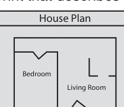

蓝图所描述的房屋的实例


因此，类不是对象，而是对对象的描述。当程序运行时，我们可以使用类来创建任意数量的对象。每个对象都被视为该类的一个实例。从同一个类创建的所有对象都将具有该类所描述的属性和方法。例如，我们可以从 `String` 类创建几个对象，如下面的代码所示：

```
String person = "Jenny";
String pet = "Fido";
String favoriteColor = "Blue";
```

如图 3-3 所示，这段代码在内存中创建了三个 `String` 对象，它们分别被 `person`、`pet` 和 `favoriteColor` 变量引用。

图 3-3 引用三个 String 对象的三个变量

| person 变量 | 一个 String 对象 |
| :--- | :--- |
| 持有 String 对象的地址 | 地址 | "Jenny" |
| pet 变量 | 一个 String 对象 |
| 持有 String 对象的地址 | 地址 | "Fido" |
| favoriteColor | 一个 String 对象 |
| 变量持有 String 对象的地址 | 地址 | "Blue" |

尽管这三个 `String` 对象持有不同的数据，但它们在设计上是完全相同的。例如，我们可以像这里所示为每个对象调用 `length` 方法。

```
stringSize = person.length();
stringSize = pet.length();
stringSize = favoriteColor.length();
```

因为这三个对象都是 `String` 类的实例，而该类具有 `String` 类指定的属性和方法。

### 逐步构建一个简单的类

在本节中，我们将使用一个名为 `Rectangle` 的类。具体来说，一个对象将具有以下属性：

- length
- width

在设计类时，绘制 UML 图通常非常有帮助。UML 是统一建模语言（Unified Modeling Language）。它提供了一套用于描述面向对象系统的标准图。图 3-4 显示了 UML 图的通用布局。注意，图被分为三个部分。顶部部分编写类名。中间部分是属性列表。底部部分是方法列表。

图 3-4 类 UML 图的通用布局

| 类名在此处 → |
| :--- |
| 属性在此处 → |
| 方法在此处 → |

遵循此布局，图 3-5 显示了我们的 `Rectangle` 类的 UML 图。

图 3-5 Rectangle 类的 UML 图

| Rectangle |
| :--- |
| length width |
| setLength() |
| setWidth() |
| getLength() |
| getWidth() |
| getArea() |


### 编写类的代码

现在我们确定了希望 `Rectangle` 类具有的属性和方法，让我们编写 Java 代码。首先，使用编辑器创建一个名为 `Rectangle.java` 的新文件。在 `Rectangle.java` 文件中，我们首先编写如下通用的类骨架：

第一行中的关键字 `public` 是访问修饰符。访问修饰符指示类如何被访问。`public` 访问修饰符表示该类对于编写在 `Rectangle.java` 文件之外的代码是公开可用的。我们在书中编写几乎所有的类都是公共的。

在访问修饰符之后的是关键字 `class`，后面是 `Rectangle`，这是类的名称。下一行是左括号，随后是右括号。类的内容（即属性和方法）将写在这些括号内部。

```java
public class Rectangle
{
}
```

类的通用格式如下：

| 访问修饰符 类名 |
| :--- |
| { |
| 成员 |
| } |

泛指，属于类的属性和方法被称为类的成员（members）。

### 为类属性编写代码

让我们通过填充某些成员的代码来继续编写矩形类。我们将为类的两个属性 `length`（长度）和 `width`（宽度）编写代码。我们将使用 `double` 数据类型的变量作为这些属性。新添加的代码行用**粗体**显示如下：

```java
public class Rectangle
{
    private double length;
    private double width;
}
```

我们添加的这两行代码声明了 `length` 和 `width` 变量。注意，这两个声明都以关键字 `private` 开头，位于数据类型之前。`private` 关键字是一个访问修饰符。它表示这些变量不能被类外部的语句访问。


# 第3章 类与对象的初探

回想我们在第一章关于面向对象编程的讨论，对象可以执行**隐藏**，这意味着存储在对象内部的关键数据免受外部代码的保护。在 Java 中，类的 `private` 成员是隐藏的，只能由同一类中的方法访问。当对象的数据对外部代码和对对象方法的访问隐藏时，数据就能防止受到意外的损坏。在面向对象编程中，将类的所有属性都设为 `private` 并通过方法提供访问是一种常见的做法。

在编写类时，类成员主要使用 `private` 和 `public` 访问修饰符。表 3-1 总结了这些访问修饰符。

## 表 3-1 类成员 private 和 public 访问修饰符总结

| 访问修饰符 | 描述 |
|---|---|
| private | 当访问修饰符应用于类成员时，该成员不能被类外部的代码访问。该成员只能由同一类中的方法访问 |
| public | 当 `public` 访问修饰符应用于类成员时，该成员可以被类内部或外部的代码访问 |

你可以选择性地为属性初始化一个值。例如，以下语句声明了 `length` 和 `width` 并将它们初始化为 10 和 12：

```java
private double length = 10;
private double width = 12;
```

如果你没有为数值属性提供初始化值，它们将被自动初始化为 0。我们将在本章中详细讨论初始化。

> **提示**：我们把 `length` 和 `width` 称为属性（attributes）和字段（fields）。不要让这让你困惑。“属性”是一个通用术语，指的是对象所持的数据项。“字段”是一个 Java 特有的术语，指的是类中持有数据的成员。在 Java 中，你使用字段作为属性。

## 编写 setLength 方法

现在我们将开始编写类方法。我们将从 `setLength` 方法开始。该方法允许类外部的代码在 `length` 字段中存储一个值。代码列表 3-1 显示了处于此开发阶段的 `Rectangle` 类。`setLength` 方法位于第 16 行。如果你从 www.pearson.com/gaddis 下载了本书源码，你将在 `Chapter 3 Rectangle Class 1` 文件夹中找到它。

## 代码列表 3-1 (Rectangle.java)

```java
1 /*
2 * Rectangle class, Phase 1
3 * Construction!
4 */
5
6 public class Rectangle
7 {
8 private double length;
9 private double width;
10
11 /**
12 * The setLength method accepts argument
13 * that is stored in the length field.
14 */
15
16 public void setLength(double len)
17 {
18     length = len;
19 }
20 }
```

在 11 到 14 行中，我们写了一个块注释，对方法进行了简要描述。始终编写描述类方法的注释是非常重要的，这样在将来，任何阅读代码的人都能理解它。方法的定义出现在块注释之后的，位于第 16 到第 19 行。方法定义的第一行（出现在第 16 行）被称为方法头（method header）。它的显示形式如下：

```java
public void setLength(double len)
```

方法头包含几个部分。让我们来看每一个：

- 关键字 `public` 是一个访问修饰符。它表示该方法可以被类外部的语句调用。
- `void`。这是方法的返回类型。`void` 关键字表示该方法向调用它的语句不返回任何数据。
- `setLength`。这是方法的名称。
- `(double len)`。这是参数变量的声明。参数变量持有传递给方法的参数值。参数变量的名字是 `len`，它的数据类型是 `double`。

图 3-6 标记了 `setLength` 方法头的每个部分。

## 图 3-6 setLength 方法的方法头

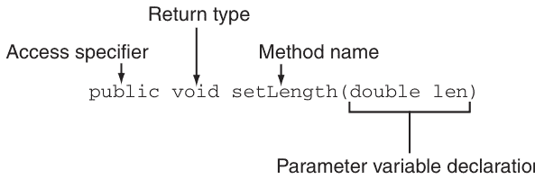

方法头之后，方法体出现在一组括号内：

```java
{
  length = len;
}
```

该方法有一条语句，将 `len` 的值赋值给 `length` 字段。当方法执行时，`len` 参数变量将持有传递给方法的参数值。该值被赋值给 `length` 字段。

在向类中添加其他方法之前，如果我们演示 `setLength` 方法是如何工作的可能会有所帮助。首先，注意 `Rectangle` 类没有 `main` 方法。这个类不是一个完整的程序，但可以作为 `Rectangle` 对象的蓝图。其他程序使用 `Rectangle` 类来创建对象。创建并使用这些对象的程序将拥有自己的 `main` 方法。我们通过保存 `Rectangle.java` 文件的当前内容并创建代码列表 3-2 中的程序来演示类的 `setLength` 方法。如果你从 www.pearson.com/gaddis 下载了本书源码，你将在 `Chapter 3 Rectangle Class Phase 1` 文件夹中找到它。

## 代码列表 3-2 (LengthDemo.java)

```java
1 /*
2 * This program demonstrates the Rectangle class's
3 * setLength method.
4 */
5
6 public class LengthDemo
7 {
8 public static void main(String[] args)
9 {
10 Rectangle box = new Rectangle();
11
12 System.out.println("Sending the value 10.0 to "
13  + "setLength method.");
14  box.setLength(10.0);
15 System.out.println("Done.");
16 }
17 }
```

代码列表 3-2 中的程序必须保存为 `LengthDemo.java` 并与 `Rectangle.java` 文件位于同一文件夹下。可以使用 Sun JDK 编译程序：

```bash
javac LengthDemo.java
```

当编译器读取 LengthDemo.java 的源码并看到在使用名为 Rectangle 的类时，它会在当前文件夹或目录中查找 Rectangle 类文件。该文件尚不存在，因为我们还没有编译 `Rectangle.class`。因此，编译器搜索 `Rectangle.java` 文件并编译它。这创建了 `Rectangle.class`，使得 Rectangle 类可用。编译器完成对 LengthDemo.class 编译后，可以使用以下命令执行：

```bash
java LengthDemo
```

程序的输出如下：

## 程序输出

Sending the value 10.0 to setLength method.

Done.

注意，图 3-7 显示 Rectangle 对象的长度（length）和宽度（width）字段被设置为 0。类的所有数值字段默认都初始化为 0。

> **提示**：此语句中的括号是必须的。如果这样写语句将会报错：

```java
Rectangle box = new Rectangle; // ！！
```

第 12 行和第 13 行调用 `println` 方法在屏幕上显示消息：

```java
System.out.println("Sending the value 10.0 to " + setLength method.");
```

第 14 行调用了对象的 `setLength` 方法。正如你之前在字符串示例中所看到的，你使用点运算符（句号）来访问类对象的成员。回想一下第 2 章，方法的通用形式为：

```java
refVariable.method(arguments...)
```

其中 `refVariable` 是引用对象的变量名，`method` 是方法名，而 `arguments` 是传递给方法的零或多个参数。参数是传递到方法的值。这里是第 14 行调用方法的语句：

```java
box.setLength(10.0);
```

该语句将参数 10.0 传递给 `setLength` 方法。当方法执行时，值 10.0 被复制到 `len` 参数变量中。这在图 3-8 中所示。

## 图 3-8 参数 10.0 被复制到 len 参数变量中

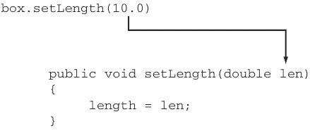

在 `setLength` 方法中，参数变量 `len` 包含值 10.0。方法将 `len` 的值赋值给 `length` 字段并结束。图 3-9 显示了方法执行后对象的状态。

## 图 3-9 setLength 方法执行后 box 对象的状态

| box 变量持有一个 Rectangle 对象的地址。 | address |
| :--- | :--- |
| | length: 10.0 |
| | width: 0.0 |

在向方法传递参数时，参数的数据类型必须与参数变量的数据类型兼容。否则，将发生错误。例如，`setLength` 方法中的 `len` 参数是 `double` 类型。你不能传递一个无法自动转换为 `double` 数据类型的参数。因此，以下语句会导致错误，因为该参数是一个字符串：

```java
box.setLength("10.0"); // 错误！
```

### 编写 setWidth 方法

现在我们已经看到 `setLength` 方法可以工作了，让我们在 Rectangle 类中添加 `setWidth` 方法。`setWidth` 方法与 `setLength` 类似。它接受一个参数，并将其赋值给 `width` 字段。代码列表 3-3 显示了更新后的 Rectangle 类。`setWidth` 方法位于第 26 到 29 行。（如果你从 www.pearsonhered.com/gaddis 下载了书的源码，你将在 Chapter 03\Rectangle Class Phase 2 文件夹找到它。）

#### 代码列表 3-3 (Rectangle.java)

```java
1 /*
2 * Rectangle 类，阶段 2
3 * 建设中！
4 */
5
6 public class Rectangle
7 {
8 private double length;
9 private double width;
10
11 /**
12 * setLength 方法接受一个参数
13 * 该参数被存储在 length 字段中。
14 */
15
16 public void setLength(double len)
17 {
18 length = len;
19 }
20
21 /**
22 * setWidth 方法接受一个参数
23 * 该参数被存储在 width 字段中。
24 */
25
26 public void setWidth(double w)
27 {
28 width = w;
29 }
30 }
```

`setWidth` 方法有一个名为 `w` 的参数变量。当参数传递给方法时，参数的值被复制到 `w` 变量中。`w` 变量的值被赋值给 `width` 字段。例如，假设 `box` 引用一个 Rectangle 对象并执行以下语句：

```java
box.setWidth(20.0);
```

在该语句执行后，box 对象的 `width` 字段将被设置为 20.0。

### 编写 getLength 和 getWidth 方法

由于 `length` 和 `width` 字段是私有的，我们编写了 `setLength` 和 `setWidth` 方法，以允许类外部代码向字段中存储值。我们还编写了允许类外部代码获取存储在这些字段中的值。这就是 `getLength` 和 `getWidth` 方法要做的。`getLength` 方法将返回存储在 `length` 字段中的值。

```java
14 System.out.println("The box's length is "
15     + box.getLength());
16 System.out.println("The box's width is "
17     + box.getWidth());
18 }
19 }
```

程序输出

The box's length is 10.0

The box's width is 20.0

让我们仔细观察这个程序。首先，这个程序创建了一个 Rectangle 对象，并通过 `box` 变量引用了它。接着执行了第 12 行和 13 行的以下语句：

```java
box.setLength(10.0);
box.setWidth(20.0);
```

执行这些语句后，`box` 对象的 `length` 字段被设置为 10.0，`width` 字段被设置为 20.0。对象的状态如图 3-11 所示。

## 图 3-11 box 对象的状态

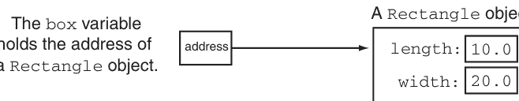

接下来，执行第 14 行和 15 行的以下语句：

```java
System.out.println("The box's length is "
     + box.getLength());
```

该语句调用了 `box.getLength()` 方法，该方法返回值 10.0。屏幕上显示以下消息：

The box's length is 10.0

然后执行第 16 行和 17 行的语句。

```java
System.out.println("The box's width is "
     + box.getWidth());
```

该语句调用了 `box.getWidth()` 方法，该方法返回值 20.0。屏幕上显示以下消息：

The box's width is 20.0

### 编写 getArea 方法

我们为 Rectangle 类编写最后一个方法是 `getArea`。这个方法返回矩形的面积，即其长度乘以宽度。以下是 `getArea` 方法的代码：

```java
public double getArea()
{
    return length * width;
}
```

该方法返回数学表达式 `length * width` 的结果。例如，假设 `area` 是一个 `double` 类型变量，且 `box` 引用一个 `Rectangle` 对象，并执行以下代码：

```java
box.setLength(10.0);
box.setWidth(20.0);
area = box.getArea();
```

最后一条语句将 `getArea` 方法返回的值赋值给变量。在该语句执行后，变量将包含 200.0。

代码列表 3-6 显示了包含我们目前为止讨论的所有成员的 Rectangle 类。`getArea` 方法出现在第 56 行到第 59 行。（如果你从 www.pearsonhigher.com/gaddis 下载了书的源码，你将在 `Chapter 03Rectangle Class Phase 4` 文件夹中找到此文件。）

## 代码列表 3-6 (Rectangle.java)

```java
1 /**
2   * Rectangle 类，阶段 4
3   * 构建中！
4   */
5 
6 public class Rectangle
7 {
8   private double length;
9   private double width;
10 
11 /**
12   * setLength 方法接受一个参数
13   * 并存储在 length 字段中。
14  */
15 
16 public void setLength(double len)
17 {
18   length = len;
19 }
20 
21 /**
22   * setWidth 方法接受一个参数
23   * 并存储在 width 字段中。
24  */
25
26 public void setWidth(double w)
27 {
28   width = w;
29 }
30 
31 /**
32   * getLength 方法返回存储在
33   * length 字段中的值。
34   */
35 
36 public double getLength()
37 {
38   return length;
39 }
40 
41 /**
42   * getWidth 方法返回存储在
43   * width 字段中的值。
44   */
45 
46 public double getWidth()
47 {
48   return width;
49 }
50 
51 /**
52   * getArea 方法返回
53   * length 字段乘以 width 字段。
54   */
55 
56 public double getArea()
57 {
58   return length * width;
59 }
60 }
```

代码列表 3-7 中的程序演示了 Rectangle 类所有的方法，包括面积。（如果你从 www.personheritageed.com/gaddis 下载了书的源码，你将在 `Chapter 03\Rectangle Class Phase 4` 文件夹中找到它。）

## 代码列表 3-7 (RectangleDemo.java)


```java
/**
 * 此程序演示了 Rectangle 类的
 * setLength, setWidth, getLength, getWidth 以及
 * getArea 方法。
 */
public class RectangleDemo
```

```java
public static void main(String[] args) {
    // 创建一个 Rectangle 对象。
    Rectangle box = new Rectangle();

    // 设置长度为 10，宽度为 20。
    box.setLength(10.0);
    box.setWidth(20.0);

    // 显示长度、宽度和面积。
    System.out.println("The box's length is " + box.getLength());
    System.out.println("The box's width is " + box.getWidth());
    System.out.println("The box's area is " + box.getArea());
}
```

程序输出

The box's length is 10.0

The box's width is 20.0

The box's area is 200.0

### 访问器与修改器方法

如前面提到的，获取值的方法被称为访问器（accessor），而设置值的方法被称为修改器（mutator）。在 Java 中，访问器通常被称为 "getters"，修改器被称为 "setters"。

- 访问器方法：获取字段值的方法。
- 修改器方法：设置值的方法。

在 `Rectangle` 类中，`getLength` 和 `getWidth` 是访问器，而 `setLength` 和 `setWidth` 是修改器。注意 `getArea` 在传统意义上既不是访问器也不是修改器。

## 数据隐藏重要性

数据隐藏是面向对象编程中的一个重要概念。通过隐藏内部数据，可以确保对象以受控的方式被修改。

作为一个初学者，你可能会疑惑为什么要隐藏数据，而不是直接访问对象的字段。然而，在大型系统中，无法追踪哪些代码访问了特定的变量。通过隐藏数据，你为类创建了一个清晰的接口，并使代码易于维护和进化。

## 避免过期数据

回想 `Rectangle` 类具有 `getLength`、`getWidth` 和 `getArea` 方法。`getLength` 和 `getWidth` 返回存储的值，但 `getArea` 返回的是计算结果。如果一个项目的值取决于其他数据且在数据变化时未更新，则称该项目已过期（stale）。如果面积存储在字段中，当长度或宽度变化时，该字段的值将是错误的。

在设计类时，你应该注意不要将可能过期的计算结果存储在字段中。相反，提供一个返回该计算结果的方法。

### 在 UML 图中显示规格

之前展示了一个矩形类的 UML 图。该图列出了所有成员，但没有指示哪些是私有的，哪些是公共的。在 UML 图中，你可以选择在成员名称前使用 `-` 字符表示它是私有的，或使用 `+` 字符表示它是公共的。图 3-12 显示了修改后的 UML 图。

**图 3-12** `Rectangle` 类的 UML 图

| Rectangle |
| :--- |
| - length |
| - width |
| + getLength() |
| + getWidth() |
| + getArea() |

### UML 中的数据类型和参数符号

统一建模语言（UML）还提供了你可以使用的符号，来指示字段、方法和参数的数据类型。要指示字段的数据类型，可以在字段名称后加上冒号和数据类型的名称。例如，`Rectangle` 类中的 `length` 字段是 `double` 类型。它可以在 UML 图中这样列出：

- length : double

方法的返回类型也可以同样的方式列出：在方法名称后加上冒号和返回类型。`Rectangle` 类的 `getLength` 方法返回 `double`，因此它可以在 UML 图中这样列出：

+ getLength() : double

参数变量及其数据类型可以列在方法的括号内。例如，`Rectangle` 类的 `setLength` 方法有一个名为 `len` 的 `double` 类型参数，在 UML 图中可以这样列出：

+ setLength(len : double) : void

**图 3-13** `Rectangle` 类的参数和数据类型表示法的 UML 图

| Rectangle |
| :--- |
| - length : double |
| - width : double |
| + setLength(len : double) : void |
| + setWidth(w : double) : void |
| + getLength() : double |
| + getWidth() : double |

注意在 `Rectangle` 类中，首先声明字段变量，然后定义方法。你并不需要在方法定义之前编写字段声明。事实上，有些程序员倾向于先写方法的定义，再写字段的声明。无论你使用哪种风格，在书中我们先写字段声明，后写方法定义。图 3-14 显示了这种布局。

**图 3-14** 类的典型布局

```java
public class ClassName {
    // Field declarations
    // Method definitions
}
```

# 第3章 类与对象的初探

## 检查点

- 3.1 在本章中，我们使用了蓝图和房屋的比喻来描述类和对象。在这个比喻中，类是蓝图，而房屋是什么？
- 3.2 描述基本数据类型与对象的区别。
- 3.3 当变量引用一个对象时，变量中实际存储了什么？
- 3.4 字符串字面量 "Joe" 会导致什么类型的对象创建？

## 3.2 关于参数的更多信息

- 3.5 查看图 3-15 中的 UML 图并回答问题：
    a. 类名是什么？
    b. 属性有哪些？
    c. 方法有哪些？
    d. 私有成员有哪些？
    e. 公有成员有哪些？
- 3.6 假设 `ino` 是引用图 3-15 中类的实例变量。写一条调用 `setMake` 并传递参数 "Cadillac" 的语句。

**图 3-15** UML 图

| Car |
| :--- |
| - make |
| - yearModel |
| + setMake() |
| + setYearModel() |
| + getMake() |
| + getYearModel() |

- 3.7 `new` 关键字的作用是什么？
- 3.8 什么是参数变量？
- 3.9 什么是访问器（accessor）？什么是修改器（mutator）？
- 3.10 什么是数据项？

> 概念：方法可以有多个参数变量，允许向方法传递多个参数。当参数传递给方法时，它是按值传递。这意味着参数变量持有传入的值副本。对参数变量进行的修改不会影响参数。

### 传递多个参数

向方法传递多个参数是有用的。例如，`Rectangle` 类有两个设置长度宽度的方法：`setLength` 和 `setWidth`。使用这些方法设置长度宽度需要调用两次方法。我们可以添加另一个接受两个参数的方法（一个用于长度，一个用于宽度），从而通过一次方法调用设置长度和宽度字段。这样的方法如下：

```java
public void set(double len, double w) {
    length = len;
    width = w;
}
```

两个参数变量 `len` 和 `w` 在方法头的括号内声明。在这里我们调用方法时使用传递两个参数。例如，假设 `box` 引用一个 `Rectangle` 对象并执行了以下语句：

```java
box.set(10.0, 20.0);
```

该语句将值 10.0 传递给 `len` 参数，将值 20.0 传递给 `w` 参数，如图 3-16 所示。

**图 3-16** 传递给 `set` 方法的多个参数

```java
box.set(10.0, 20.0);

public void set(double len, double w) {
    length = len;
    width = w;
}
```

注意，参数按照它们在方法调用出现的顺序传递给参数变量。也就是说，第一个参数传递给第一个参数，第二个参数传递给第二个参数。例如，以下方法将 15.0 传递给 `len` 参数，将 30.0 传递给 `w` 参数：

```java
box.set(15.0, 30.0);
```

代码列表 3-8 中的程序演示了向 `set` 方法传递两个参数。在这个程序中，在 `main` 方法中声明的变量作为参数传递。（如果你从 www.pearsonhighered.com/gaddis 下载了书的源码，你将在 Chapter 03 文件夹中找到此文件以及一个修改过的 `Rectangle` 类版本。）

# 代码列表 3-8 (MultipleArgs.java)

```java
import java.util.Scanner; // 需要 Scanner

/**
 * 此程序演示了如何向方法
 * 传递多个参数。
 */
public class MultipleArgs {
    public static void main(String[] args) {
        double boxLength, // 用于存储长度
               boxWidth;  // 用于存储宽度

        // 创建用于键盘输入的 Scanner 对象。
        Scanner keyboard = new Scanner(System.in);

        // 创建一个 Rectangle 对象。
        Rectangle box = new Rectangle();

        // 获取并存储 box 的尺寸。
        System.out.print("What is the box's length? ");
        boxLength = keyboard.nextDouble();
        box.setLength(boxLength);

        System.out.print("What is the box's width? ");
        boxWidth = keyboard.nextDouble();
        box.setWidth(boxWidth);

        // 传递 boxLength 和 boxWidth 到方法。
        box.set(boxLength, boxWidth);

        // 显示长度、宽度和面积。
        System.out.println("The box's length is " + box.getLength());
        System.out.println("The box's width is " + box.getWidth());
        System.out.println("The box's area is " + box.getArea());
    }
}
```

## 3.3 实例字段与方法

```java
// 获取并存储卧室的尺寸。
System.out.print("What is the bedroom's length?");
number = keyboard.nextDouble();
bedroom.setLength(number);
System.out.print("What is the bedroom's width?");
number = keyboard.nextDouble();
bedroom.setWidth(number);
```

```java
// 获取并存储书房的尺寸。
System.out.print("What is the den's length?");
number = keyboard.nextDouble();
den.setLength(number);
System.out.print("What is the den's width?");
number = keyboard.nextDouble();
den.setWidth(number);
```

```java
// 计算房间的总面积。
totalArea = kitchen.getArea() + bedroom.getArea()
          + den.getArea();
```

```java
// 显示房间的总面积。
System.out.println("The total area of the rooms is " 
                 + totalArea);
```

# 带有加粗示例输入的程序输出

What is the kitchen's length? 10 [Enter]
What is the kitchen's width? 14 [Enter]
What is the bedroom's length? 15 [Enter]
What is the bedroom's width? 12 [Enter]
What is the den's length? 20 [Enter]
What is the den's width? 30 [Enter]
The total area of the rooms is 920.0

在程序中，第 19 到 21 行的代码创建了三个对象，它们是 `Rectangle` 类的三个实例：

```java
Rectangle kitchen = new Rectangle();
Rectangle bedroom = new Rectangle();
Rectangle den = new Rectangle();
```

图 3-17 展示了 `kitchen`、`bedroom` 和 `den` 变量是如何引用对象的。
在程序的示例会话中，用户输入 10 和 14 作为厨房的长度和宽度，输入 15 和 12 作为卧室的长度和宽度，输入 20 和 30 作为书房的长度和宽度。图 3-18 显示了在这些值被存储后对象的状态。

## 图 3-17 kitchen、bedroom 和 den 变量引用的 Rectangle 对象

**kitchen** 变量持有一个 `Rectangle` 对象的地址。

```
Rectangle object
length: 0.0
width: 0.0
```

**bedroom** 变量持有一个 `Rectangle` 对象的地址。

```
Rectangle object
length: 0.0
width: 0.0
```

**den** 变量持有一个 `Rectangle` 对象的地址。

```
Rectangle object
length: 0.0
width: 0.0
```

## 图 3-18 存储数据后的对象状态

**kitchen** 变量持有一个 `Rectangle` 对象的地址。

```
Rectangle object
length: 10.0
width: 14.0
```

**bedroom** 变量持有一个 `Rectangle` 对象的地址。

```
Rectangle object
length: 15.0
width: 12.0
```

**den** 变量持有一个 `Rectangle` 对象的地址。

```
Rectangle object
length: 20.0
width: 30.0
```

从图 3-18 可以看出，`Rectangle` 类的每个实例都有自己独立的长度和宽度变量。出于这个原因，这些变量被称为**实例变量**或**实例字段**。类的每个实例都有自己的一组实例字段，并可以在这些字段中存储其值。

在类实例上操作的方法被称为**实例方法**。`Rectangle` 类中的所有方法都是实例方法，因为它们是在类的特定实例上执行操作。例如，查看 `RoomsAreas.java` 程序中的第 26 行：

```java
kitchen.setLength(number);
```

该语句调用了 `setLength` 方法，它在 `kitchen` 对象的长度字段中存储了一个值。现在看同一程序的第 34 行。

```java
bedroom.setLength(number);
```

## 3.4 构造函数

该语句也调用了 `setLength` 方法，但这次将值存储在 `bedroom` 对象的长度字段中。同样，第 42 行调用了 `setLength` 方法将值存储在 `den` 对象的长度字段中：

```java
den.setLength(number);
```

`setLength` 方法在 `Rectangle` 类的特定实例中存储一个值。对于 `Rectangle` 类中的所有成员方法都是如此。

## 检查点

假设 `r1` 和 `r2` 是引用 `Rectangle` 对象的变量，并执行以下语句：

```java
r1.setLength(5.0);
r2.setLength(10.0);
r1.setWidth(20.0);
r2.setWidth(15.0);
```


填充图 3-19 中的框，以表示每个对象的长度和宽度字段。

## 图 3-19 为每个字段填充框

| 一个 Rectangle 对象 | 一个 Rectangle 对象 |
| :--- | :--- |
| length: | length: |
| width: | width: |
| nr1 address | nr2 address |

## 3.4 构造函数

> 概念：构造函数是在对象创建时自动调用的方法。

构造函数是在对象创建时自动调用的方法。构造函数执行初始化，例如在实例字段中存储值。构造函数与类名相同，且不指定返回类型。构造函数的格式如下：

```
访问修饰符 类名(参数)
```

这是一个使用 `new` 关键字在声明语句中创建对象的示例。记住，`new` 关键字也可以用于简单的赋值。例如，以下语句可以将 `box` 声明为 `Rectangle` 变量：

```java
Rectangle box;
```

然后，使用以下语句创建一个 `Rectangle` 对象并将 7.0 和 14.0 传递给它的构造函数：

```java
box = new Rectangle(7.0, 14.0);
```

执行该语句后，`box` 将引用一个 `Rectangle` 对象。代码列表 3-12 中的 `RectangleConstructor.java` 程序使用了这种技术。它是对本章之前介绍的 `RectangleAreas.java` 程序的修改。（如果你从 www.pearsononline.com/gadis 下载了书籍源代码，你可以在 Chapter 03:Rectangle Class 6 文件夹中找到该文件。）

## 第3章 类与对象的初探

### 代码列表 3-12 (RectangleConstructor.java)

```java
15
16      // 声明 Rectangle 变量以引用
17      // 厨房、卧室和书房的对象。
18      Rectangle kitchen, bedroom, den;
19
20      // 创建一个 Scanner 对象用于键盘输入。
21      Scanner keyboard = new Scanner(System.in);
22
23      // 获取并存储厨房的尺寸。
24      System.out.print("What is the kitchen's length? ");
25      roomLength = keyboard.nextDouble();
26      System.out.print("What is the kitchen's width? ");
27      roomWidth = keyboard.nextDouble();
28      kitchen = new Rectangle(roomLength, roomWidth);
29
30      // 获取并存储卧室的尺寸。
31      System.out.print("What is the bedroom's length? ");
32      roomLength = keyboard.nextDouble();
33      System.out.print("What is the bedroom's width? ");
34      roomWidth = keyboard.nextDouble();
35      bedroom = new Rectangle(roomLength, roomWidth);
36
37      // 获取并存储书房的尺寸。
38      System.out.print("What is the den's length? ");
39      roomLength = keyboard.nextDouble();
40      System.out.print("What is the den's width? ");
41      roomWidth = keyboard.nextDouble();
42      den = new Rectangle(roomLength, roomWidth);
43
44      // 计算所有房间的总面积。
45      totalArea = kitchen.getArea() + bedroom.getArea()
46              + den.getArea();
47
48      // 显示所有房间的总面积。
49      System.out.println("The total area of the rooms is "
50              + totalArea);
51
52  }
```

**程序输出（示例输入用加粗显示）**
What is the kitchen's length? **10** [Enter]
What is the kitchen's width? **14** [Enter]
What is the bedroom's length? **15** [Enter]
What is the bedroom's width? **20** [Enter]
What is the den's length? **12** [Enter]
What is the den's width? **30** [Enter]
The total area of the rooms is 920.0.

## 3.4 构造方法

在程序中，第 18 行的以下语句声明了 `kitchen`、`bedroom` 和 `den` 的 `Rectangle` 变量：

`Rectangle kitchen, bedroom, den;`

然而，这些变量尚未引用 `Rectangle` 类的实例。因为这些变量还没有持有对象的地址，所以它们是未初始化的引用变量。在对它们引用之前，无法使用这些变量。出现在第 28 行的以下语句创建了一个 `Rectangle` 对象，将 `roomLength` 和 `roomWidth` 变量作为参数传递给构造方法，并将对象的地址赋值给 `kitchen` 变量。

```java
kitchen = new Rectangle(roomLength, roomWidth);
```

在该语句执行后，`kitchen` 变量将引用该 `Rectangle` 对象。程序后面还出现了类似的语句，用于创建 `bedroom` 和 `den` 对象。

### 默认构造方法

当创建对象时，其构造方法总是会被调用。但如果我们不在对象的类中编写构造方法会怎样？如果你在类中没有写构造方法，Java 在编译类时会自动提供一个。默认构造方法不接受参数。它将类所有的数值型字段设置为 0，布尔（`boolean`）字段设置为 `false`，字符（`char`）字段设置为 Unicode 值 0。如果对象具有引用变量形式的字段，默认构造方法会将它们设置为特殊值 `null`，这意味着它们不引用任何内容。

Java 提供默认构造方法的唯一情况是你没有为类编写自己的构造方法。例如，在本章开始时，我们开发了 `Rectangle` 类，但没有为它写构造方法。编译器生成了一个默认构造方法，将 `length` 和 `width` 字段都设置为 0.0。假设以下代码使用了该类的某个版本来创建 `Rectangle` 对象：

```java
// Rectangle 类没有构造方法。
Rectangle r = new Rectangle(); // 调用默认构造方法
```

当我们使用该类的该版本创建 `Rectangle` 对象时，我们没有向默认构造方法传递任何参数，因为默认构造方法不接受参数。

后来，我们向类中添加了自身的构造方法。这个为长度和宽度字段添加了参数的构造方法。当我们在此编译该类时，Java 不再提供默认构造方法。我们编写的构造方法变成了该类仅有的构造方法。当我们使用该版本的类创建 `Rectangle` 对象时，必须向构造方法传递长度和宽度参数。使用该版本的类，以下语句会导致错误，因为我们没有为构造方法提供任何参数。

```java
// 现在我们为 Rectangle 类写了自己的构造方法。
Rectangle box = new Rectangle(); // 错误！现在必须传递参数。
```

由于我们添加了需要两个参数的自定义构造方法，该类不再拥有默认构造方法。

### 无参构造方法

不接受参数的构造方法称为无参构造方法（no-arg constructor）。默认构造方法不接受参数，因此被认为是无参构造方法。此外，你可以编写自己的无参构造方法。例如，我们为 `Rectangle` 类写了以下构造方法：

```java
public Rectangle()
{
    length = 1.0;
    width = 1.0;
}
```

如果在 `Rectangle` 类中使用该构造方法，我们不需要向构造方法传递任何参数。

### 在 UML 图中显示构造方法

在 UML 图中显示构造方法的方法：不列出返回类型。图 3-20 显示了带有构造方法的 `Rectangle` 类图。

| Rectangle |
| :--- |
| length : double |
| width : double |
| Rectangle(len: double) |
| setLength(len: double) : void |
| setWidth(w: double) : void |
| getLength() : double |
| getWidth() : double |

### String 构造方法

你可以通过简单的方式创建原始变量，通过 `new` 运算符创建对象。然而，有一个类可以在不使用 `new` 运算符的情况下实例化：`String` 类。例如：

```java
String name = "Joe Mahoney";
```

该语句在内存中创建了一个 `String` 对象，初始化为 "Joe Mahoney"。该对象由变量 `name` 引用。如果你愿意，可以使用 `new` 运算符通过传递字面量给构造方法来创建 `String` 对象：

```java
String name = new String("Joe Mahoney");
```

> 注意：`String` 对象是一个特殊情况。由于频繁使用，Java 提供了其他类型不具备的快捷操作。除了使用 `new` 运算符创建 `String` 对象外，你还可以使用 `=` 操作为 `String` 对象赋值，使用 `+` 运算符拼接字符串等。第 9 章将讨论若干 `String` 方法。

### 练习

- 3.12 构造方法是如何命名的？
- 3.13 构造方法的返回类型是什么？
- 3.14 假设以下是出现在该类中的构造方法：

```
ClassAct(int number)
{
  item = number;
}
```
a. 该构造方法所在的类名是什么？
b. 写一个语句，从该类创建一个对象，并将值 25 作为参数传递给构造方法。

## 3.5 BankAccount 类

上一节讨论的 `BankAccount` 类允许你创建描述矩形的对象。现在我们将查看一个根据更具实体的对象建模的类：银行账户。从该类创建的对象模拟银行账户，允许我们执行存款、取款、增加利息和获取当前余额等操作。`BankAccount` 类的 UML 图如图 3-21 所示。

**图 3-21** BankAccount 类的 UML 图

| BankAccount |
|--- |
| - balance: double |
| - interestRate: double |
| - interest: double |
| + BankAccount(startBalance : double, intRate : double) |
| + deposit(amount : double) : void |
| + withdraw(amount : double) : void |
| + addInterest() : void |
| + getBalance() : double |
| + getInterest() : double |

以下是 `BankAccount` 类字段的摘要：

+   `balance` 是一个存储账户当前余额的 `double` 类型字段。
+   `interestRate` 是一个存储账户月利率的 `double` 类型字段。月利率是年利率除以 12。例如，年利率为 3%，每月利率为 0.25%。我们将此值作为 0.0025 存储在 `interestRate` 字段中。
+   `interest` 是一个 `double` 类型，用于存储账户赚取的利息。

以下是该类方法的摘要：

+   构造函数有两个参数变量：`startBalance` 和 `intRate`。它们都是参数。当构造函数执行时，账户的余额被传递给 `startBalance` 参数，账户的每月利率被传递给 `intRate` 参数。构造函数将 `startBalance` 赋值给 `balance` 字段，将 `intRate` 赋值给 `interestRate` 字段。此外，构造函数将 `interest` 字段赋值为 0.0。
+   `deposit` 方法有一个参数 `amount`，类型为 `double`。当调用该方法时，将要存入账户的金额传递给此参数。该参数的值会被加到 `balance` 字段的值上。
+   `withdraw` 方法有一个参数 `amount`，类型为 `double`。当调用该方法时，将从账户中取出的金额传递给此参数。该参数的值会从 `balance` 字段的值中减去。
+   `addInterest` 方法将 `interestRate` 字段乘以 `balance` 字段，确定分配给 `interest` 字段的每月利息，并加到 `balance` 字段中。
+   `getBalance` 方法返回 `balance` 字段的值，即当前账户余额。
+   `getInterest` 方法返回 `interest` 字段的值，即调用 `addInterest` 方法后赚取的利息。

代码列表 3-13 显示了 `BankAccount` 类的代码，该代码存储在 `BankAccount.java` 文件中。

### 代码列表 3-13 (BankAccount.java)

```java
/**

  * BankAccount 类

  * 此类模拟了一个银行账户。

  */

public class BankAccount
{
  private double balance;      // 账户余额
  private double interestRate; // 利率
  private double interest;     // 赚取的利息

  /**

    * 构造函数初始化 balance
    * 和 interestRate 字段，其值来自
    * 传递给 startBalance 和 intRate 的值。
    * interest 字段被赋值为 0.0。

    */

  public BankAccount(double startBalance, double intRate) {
      balance = startBalance;
      interestRate = intRate;
      interest = 0.0;
  }

  /**

   * deposit 方法将金额
   * 加到 balance 字段。

   */

  public void deposit(double amount) {
      balance += amount;
  }

  /**

   * withdraw 方法从 balance 
   * 中减去参数 amount

   */

  public void withdraw(double amount) {
      balance -= amount;
  }

  /**

   * addInterest 方法将
   * 本月的利息加到 balance 字段中。

   */

  public void addInterest() {
      interest = balance * interestRate;
      balance += interest;
  }

  /**

   * getBalance 方法返回
   * balance 字段的值。

   */

  public double getBalance() {
      return balance;
  }

  /**

   * getInterest 方法返回
   * interest 字段的值。

   */

  public double getInterest() {
      return interest;
  }
}
```

代码列表 3-14 显示的 `AccountTest.java` 程序演示了 `BankAccount` 类。

### 代码列表 3-14 (AccountTest.java)

```java
import java.util.Scanner; // 需要 Scanner 类

/**

 * 此程序演示了 BankAccount 类。

 */
```


public class AccountTest {

    public static void main(String[] args) {

        BankAccount account; // 用于引用 BankAccount 对象

        double balance; // 账户的初始余额

        double interestRate; // 每月利率

        double pay; // 用户的存款金额

        double cashWithdrawn; // 要取出的金额

        // 创建 Scanner 对象用于输入

        Scanner keyboard = new Scanner(System.in);

        // 获取初始余额。

        System.out.print("What is your account's " + "starting balance?");

        balance = keyboard.nextDouble();

        // 获取每月利率。

        System.out.print("What is your monthly rate?");

        interestRate = keyboard.nextDouble();

        // 创建 BankAccount 对象。

        account = new BankAccount(balance, interestRate);

        // 获取本月的存款金额。

        System.out.print("How much were you paid this month?");

        pay = keyboard.nextDouble();

        // 将存款存入账户。

        account.deposit(pay);

        System.out.println("Your current balance is $"

        + account.getBalance());

        // 从账户中取出金额。

        System.out.print("How much would you like " + "to withdraw?");

        cashWithdrawn = keyboard.nextDouble();

        account.withdraw(cashWithdrawn);

        // 将每月利加入账户。

        account.addInterest();

        // 显示赚取的利和余额。

        System.out.println("This month you have earned $"

        + account.getInterest());

        System.out.println("Now your balance is $"

        + account.getBalance());

    }

}

```

## 示例输入的程序输出

What is your account's starting balance? 500
What is your monthly rate? 0.05
How much were you paid this month? 1000
Your current balance is $1500
How much would you like to withdraw? 900
This month you have earned $27
Now your balance is $627

# 第 3 章 类与对象的初探

让我们看看这个程序的一些细节。首先，在第 11 到 15 行声明了一些变量：

- `BankAccount account;` // 用于引用 BankAccount 对象
- `double balance;` // 账户的初始余额
- `double interestRate;` // 每月利率
- `double pay;` // 用户的存款金额
- `double cashWithdrawn;` // 要取出的金额

第一个声明的变量是 `account`。这是一个在程序后面使用的变量。注意此语句没有使用 `new` 关键字，该变量还没有引用任何对象。`balance`、`interestRate`、`pay` 和 `cashWithdrawn` 变量将存储用户的值。

接下来，第 20 到 27 行出现了以下代码：

```java
// 获取初始余额。
System.out.print("What is your account's " + "starting balance?");
balance = keyboard.nextDouble();
```

```java
// 获取每月利率。
System.out.print("What is your monthly rate?");
interestRate = keyboard.nextDouble();
```

这段代码要求用户输入账户的初始余额和每月利率。这些值被存储在 `balance` 和 `interestRate` 变量中。然后，第 29 到 30 行出现了以下代码：

```java
// 创建 BankAccount 对象。
account = new BankAccount(balance, interestRate);
```

第 30 行的语句使用 `new` 关键字创建一个 `BankAccount` 对象。将 `balance` 和 `interestRate` 变量作为参数传递。

## 3.5 账户类

`pay` 中的值被传递给 `amount` 参数变量。然后，该方法中的语句使用复合赋值运算符将 `amount` 加到 `balance` 已有的值上。该语句等同于：

```
balance = balance + amount;
```

回到 `AccountTest` 程序，第 41 行调用账户对象的 `getBalance()` 方法来获取当前余额，并显示在屏幕上。接下来，第 43 到 47 行出现了以下代码：

```
// 从账户中提取一些金额。
System.out.print("How would you like\n" + "to withdraw?");
cashNeeded = keyboard.nextDouble();
account.withdraw(cashNeeded);
```

这段代码要求用户从账户取款，输入的内容存储在 `cashNeeded` 变量中。该变量作为参数传递给账户对象的 `withdraw()` 方法。以下是 `withdraw()` 方法的代码，出现在 `BankAccount` 类的第 43 到 46 行：

```java
public void withdraw(double amount)
{
  balance -= amount;
}
```

`cashNeeded` 中的值被传递给 `amount` 参数变量。然后，第 45 行的语句使用复合赋值运算符将 `amount` 从 `balance` 已有的值减去。该语句等同于：

```
balance = balance - amount;
```

回到 `AccountTest` 程序，第 49 到 57 行出现了以下代码：

```
// 为账户添加月利。
account.addInterest();

// 显示赚利息和余额。
System.out.println("This month you have earned $" + account.getInterest() + " in interest.");
System.out.println("Now your balance is $" + account.getBalance());
```

第 50 行调用账户对象的 `addInterest()` 方法，该方法计算利息金额，将金额加到对象的 `interest` 中，并加到对象的 `balance` 字段中。然后，调用对象的 `getInterest()` 和 `getBalance()` 方法获取利息金额和当前余额并进行显示。

## 焦点聚焦：创建 CellPhone 类

Wireless Solutions, Inc. 是一家销售手机和无线服务的公司。你是公司 IT 部门的一名程序员，你的团队正在设计一个方案来管理库存中的所有手机。你被分配设计一个代表手机的类。类中应该保留的数据如下：

- 手机制造商的名称赋值给 `manufacturer` 字段。
- 手机的型号数字赋值给 `model` 字段。
- 手机的零售价赋值给 `retailPrice` 字段。

该类将具有以下方法：

- 一个接收制造商、型号数字和零售价作为参数的构造方法。
- 一个 `setManufacturer()` 方法，接收制造商作为参数。此方法允许我们在对象创建后修改 `manufacturer` 字段的值（如有需要）。
- 一个 `setModel()` 方法，接收型号数字作为参数。此方法允许我们在对象创建后修改 `model` 字段的值（如有需要）。
- 一个 `setRetailPrice()` 方法，接收零售价作为参数。此方法允许我们在对象创建后修改 `retailPrice` 字段的值（如有需要）。
- 一个 `getManufacturer()` 方法，返回手机的制造商。
- 一个 `getModel()` 方法，返回手机的型号数字。
- 一个 `getRetailPrice()` 方法，返回手机的零售价。

图 3-22 显示该类的 UML 图。代码列表 3-15 显示了类的定义。

### 图 3-22 CellPhone 类的 UML 图

| CellPhone |
| :--- |
| - manufacturer: String |
| - model: String |
| - retailPrice: double |
| + CellPhone(man: String, mod: String, price: double) |
| + setManufacturer(man: String): void |
| + setModel(mod: String): void |
| + setRetailPrice(price: double): void |
| + getManufacturer(): String |
| + getModel(): String |
| + getRetailPrice(): double |

## 代码列表 3-15 (CellPhone.java)

```java
/**
 * CellPhone 类代表一部手机。
 */

public class CellPhone {
    // 字段
    private String manufacturer;     // 制造商
    private String model;            // 型号
    private double retailPrice;      // 零售价

    /**
     * 构造方法接收
     * 手机的制造商、型号数字和
     * 零售价作为参数。
     */
    public CellPhone(String man, String mod, double price)
    {
        manufacturer = man;
        model = mod;
        retailPrice = price;
    }

    /**
     * setManufacturer 方法接收
     * 手机的制造商名称作为参数。
     */
    public void setManufacturer(String man)
    {
        manufacturer = man;
    }

    /**
     * setModel 方法接收
     * 手机的型号数字作为参数。
     */
    public void setModel(String mod)
    {
        model = mod;
    }

    /**
     * setRetailPrice 方法接收
     * 手机的零售价作为参数。
     */
    public void setRetailPrice(double price)
    {
        retailPrice = price;
    }

    /**
     * getManufacturer 方法返回手机的
     * 制造商。
     */
    public String getManufacturer()
    {
        return manufacturer;
    }

    /**
     * getModel 方法返回手机的
     * 型号数字。
     */
    public String getModel()
    {
        return model;
    }

    /**
     * getRetailPrice 方法返回手机的
     * 零售价。
     */
    public double getRetailPrice()
    {
        return retailPrice;
    }
}
```

`CellPhone` 类将被你开发的若干程序使用。为了对类进行简单测试，你编写了代码列表 3-16 程序。这是一个简单的程序，提示用户输入制造商、型号数字和零售价。创建一个 `CellPhone` 类实例并将数据赋值给其属性。

## 代码列表 3-16 (CellPhoneTest.java)

```java
import java.util.Scanner;

/**
 * 此程序对 CellPhone 类进行简单测试。
 */
public class CellPhoneTest {
    public static void main(String[] args) {
        String testMan;   // 存储制造商
        String testMod;   // 存储型号数字
        double testPrice; // 用于存储价格

        // 创建 Scanner 对象用于键盘输入。
        Scanner keyboard = new Scanner(System.in);

        // 获取制造商名称。
        System.out.print("Enter the manufacturer: ");
        testMan = keyboard.nextLine();

        // 获取型号数字。
        System.out.print("Enter the model number: ");
        testMod = keyboard.nextLine();

        // 获取零售价。
        System.out.print("Enter the retail price: ");
        testPrice = keyboard.nextDouble();

        // 创建 CellPhone 类实例，
        // 将输入的数据作为参数
        // 传递给构造方法。
        CellPhone phone = new CellPhone(testMan, testMod, testPrice);

        // 从手机获取数据并显示。
        System.out.println();
        System.out.println("Here is the data you provided:");
        System.out.println("Manufacturer: " + phone.getManufacturer());
        System.out.println("Model number: " + phone.getModel());
        System.out.println("Retail price: " + phone.getRetailPrice());
    }
}
```

## 程序输出（示例输入加粗显示）

Enter the manufacturer: **Acme Electronics**
Enter the model number: **M1000**
Enter the retail price: **299.99**

Here is the data you provided:
Manufacturer: Acme Electronics
Model Number: M1000
Retail Price: $299.99

## 类、变量与作用域

> **概念:** 实例字段对类的所有实例方法都可见。局部变量（包括参数变量）仅对声明它们的方法中的语句可见。

回想第 2 章，变量是程序中可以通过名称访问的部分。变量的名称仅在声明该变量的作用域内可见。变量声明的位置决定了变量的作用域。到为止，你已经见过以下位置定义的变量：

- **方法内部。** 在方法内部定义的变量被称为局部变量。
- **类内部（但在方法之外）。** 在类内部但不在任何方法内部定义的变量被称为字段。
- **方法头部的括号内。** 在方法头部括号内定义的变量被称为参数变量。

### 隐藏

在第 2 章中，你看到同一个作用域内不能有两个同名的局部变量。这对于参数变量同样适用。参数变量本质上是局部变量。

然而，你可以拥有与字段名称相同的局部变量或参数变量。这时，局部变量或参数变量的名称会*隐藏*字段的名称。这意味着字段被局部变量或参数变量隐藏了。

例如，假设 `Rectangle` 类的 `setLayout()` 方法是如下编写的：


```java
public void setLayout(double len)
{
    int length; // 局部变量

    length = len;
}
```

# 3.7 包与导入语句

在这段代码中，局部变量具有与字段相同的名称。因此，局部变量的名字遮蔽（shadows）了字段的名字。当执行语句 `length = len` 时，`len` 的值被赋值给局部变量 `length`，而不是字段。字段名称的这种无意遮蔽会导致难以查错的错误，因此你需要小心不要给局部变量起与字段相同的名称。

**概念：** Java API 中的类被组织成包（packages）。导入语句（import statement）告诉编译器某个类位于哪个包中。

在第 2 章中，你接触了 Java API，它是一个预写类的标准库。Java API 中的每个类都是为特定目的而设计的，你可以在自己的程序中使用这些类。你已经使用过 API 中的几个类，例如 `String` 类、`Scanner` 类和 `optionPane` 类。

Java API 中的所有类都组织在包中。包是相关类的简单分组。每个包都有一个名称。例如，`Scanner` 类位于 `java.util` 包中。

Java API 中的许多类并不对你的程序自动可用。你必须导入 API 类才能使用它。使用 `import` 关键字来导入类。例如，导入 `Scanner` 类需要以下语句：

```java
import java.util.Scanner;
```

该语句告诉编译器 `Scanner` 类位于 `java.util` 包中。如果没有这条语句，编译器将无法找到 `Scanner` 类，程序将无法编译。

## 显式和通配符导入语句

导入语句有两种：显式（explicit）和通配符（wildcard）。显式导入语句指定单个类的包位置。例如，以下语句显式地指定了 `Scanner` 类的位置：

```java
import java.util.Scanner;
```

`java.util` 包除了 `Scanner` 类外还有其他几个类。例如，在第 7 章中我们将学习 `ArrayList` 类，在第 8 章中我们将学习 `StringTokenizer` 类。这两者都是 `java.util` 包的一部分。如果一个程序需要使用 `Scanner` 类、`ArrayList` 类和 `StringTokenizer` 类，它必须导入这三个类。实现此点的一种方法是为每个类编写显式导入语句，如下所示：

```java
import java.util.Scanner;
import java.util.ArrayList;
import java.util.StringTokenizer;
```

另一种导入所有这些类的方法是使用通配符导入语句。通配符导入语句告诉编译器导入包中的所有类。这里是一个示例：

```java
import java.util.*;
```

跟在包名后的 `*` 告诉编译器导入 `java.util` 包中的所有类。使用通配符导入语句不会影响程序的性能或大小。它告诉编译器，你想要导入特定包中对你的程序可用的每一个类。

## java.lang 包

Java API 有一个包 `java.lang`，它会被自动导入到每个 Java 程序中。该包包含了通用类，如 `String` 和 `System`，这些类对于 Java 编程语言是至关重要的。你不需要为任何属于 `java.lang` 包的类编写导入语句。

## 其他 API 包

Java API 中有许多包。表 3-2 列出了其中一些。

| 表 3-2 少数常用的标准 Java 包 | 描述 |
| :--- | :--- |
| java.applet | 提供创建 applet 所需的类。 |
| java.awt | 提供抽象窗口工具包（Abstract Windowing Toolkit）的类。这些类用于绘制图像和创建图形用户界面。 |
| java.io | 提供执行各种类型输入输出的类。 |
| java.lang | 提供 Java 语言的通用类。此包会被自动导入。 |
| java.net | 提供网络通信的类。 |
| java.security | 提供实现安全功能的类。 |
| java.sql | 提供数据库访问的类。 |
| java.text | 提供各种文本格式化的类。 |
| java.util | 提供各种工具类。 |
| javax.swing | 提供创建图形用户界面的类。 |

> 有关包的更多详细信息，请参阅附录 H，可在本书的在线资源页访问 www.pearsonhighered.com/gaddis。

# 3.8 关注面向对象的设计：寻找类及其职责

**概念：** 创建面向对象程序的第一步之一是确定必要的类以及它们在程序中的职责。

你已经学习了编写类、从类创建对象以及使用对象执行操作的基础知识。尽管这些知识对于创建面向对象程序是必要的，但它们并不是第一步。第一步是分析你试图解决的问题，并确定你需要的类。在本节中，我们将讨论一种寻找问题中的类并确定其职责的简单技术。

## 寻找类

在开发面向对象程序时，首要任务之一是识别你需要创建的类。通常，你的目标是识别问题中存在的不同现实对象，然后在程序中为这些类型的对象创建类。

多年来，软件专业人员开发了许多在给定问题中寻找类的方法。一种简单流行的技术涉及以下步骤：

1. 获取问题的书面描述。
2. 识别描述中的所有名词（包括代词）。
3. 提炼列表，仅包含必要的类。

### 编写问题描述

问题领域（problem domain）是与问题相关的现实对象、参与者事件的集合。如果你充分理解问题，可以自己编写描述。如果你不理解问题，应该让专家来写。

例如，假设我们正在为一家汽车店编写程序。这里是这样描述：Joe 的汽车店（Joe's Automotive Shop）负责维修汽车，专门维修奔驰和宝马制造的汽车。当客户带着汽车来到店里时，经理获取客户的名字、地址和电话号码。然后经理确定汽车的品牌、型号和年份，并给客户提供服务报价。

### 识别名词

对问题描述的快速回顾提醒了我们应用程序应该执行的功能：打印服务报价。在这个示例中，我们可以从列表中删除不必要的类：

- 我们可以划掉列表中的**商店**，因为我们的应用程序只需要关注单个的服务报价。它不需要处理或确定任何公司范围内的信息。如果问题描述要求我们保留所有服务报价的总和，那么为**商店**创建一个类就是合理的。
- 我们不需要为**经理**类，因为问题陈述没有指示我们访问有关经理的信息。如果有多个商店经理，且问题描述要求我们记录哪个经理生成了每份服务报价，那么为**经理**创建一个类就是合理的。

此时更新后的潜在类列表为：

地址、宝马、汽车、客户、预估工时费、预估零件费、外国汽车、Joe 的汽车修理厂、品牌、经理、梅尔赛德斯、型号、名称、保时捷、销售税、服务报价、商店、电话号码、总预估费用、年份。

> 因为在这个问题中，“汽车”和“外国汽车”指的是同一个意思，所以我们消除了外国汽车。同样，由于“Joe 的汽车修理厂”和“商店”是一个意思，所以我们消除了 Joe 的汽车修理厂。

2. 某些名词可能代表我们在解决问题时不需要关注的项目。

3. 某些名词可能代表梅尔赛德斯、保时捷和宝马作为类，因为在这个示例中，它们都代表特定的汽车，可以被视为 `Car` 类的实例。此外，我们从列表中消除了“汽车”（car）一词。在描述中，它指的是客户带到商店的特定汽车。因此，它也代表 `Car` 类的一个实例。此时，更新后的潜在类列表为：

地址、宝马、汽车、客户、预估工时费、预估零件费、外国汽车、Joe 的汽车修理厂、品牌、经理、梅尔赛德斯、型号、名称、保时捷、销售税、服务报价、商店、电话号码、总预估费用、年份。

> 我们消除了梅尔赛德斯、保时捷、宝马和汽车，因为它们都是 `Car` 类的实例。这意味着这些名词标识的是对象，而不是类。

> **提示：** 某些面向对象的设计师会注意名词是复数还是单数。有时，复数名词表示一个类，而单数名词表示一个对象。

4. 某些名词可能代表简单的值，这些值存储在原始变量中，不需要类。

记住，一个类包含字段和方法。字段是存储在类对象中的相关项，定义了对象的状态。方法是类对象可以执行的动作或行为。如果一个名词代表的项目类型没有任何可识别的字段或方法，那么它可能可以从列表中消除。为了帮助判断名词是否代表具有字段和方法的项目，可以就它提问以下问题：

- 你是否会使用一组相关值来代表项目的状态？
- 该项目是否有任何可以执行的明显动作？

如果这两个问题的答案都是“否”，那么该名词代表一个可以存储在原始变量中的值。如果我们将此测试应用于列表中剩余的每个名词，我们可以得出以下项不是类：地址、预估工时费、预估零件费、品牌、型号、销售税、电话号码、总预估费用和年份。这些都是简单的字符串或数值值，可以存储在原始变量中。以下是更新后的潜在类列表：

地址、宝马、汽车、客户、预估工时费、预估零件费、外国汽车、Joe 的汽车修理厂、品牌、经理、梅尔赛德斯、型号、名称、保时捷、销售税、服务报价、商店、电话号码、总预估费用、年份。

> 我们消除了地址、预估工时费、预估零件费、品牌、型号、名称、销售税、电话号码、总预估费用和年份，因为它们可以存储在原始变量中。

从列表中可以看出，我们已经消除了汽车、客户和服务报价之外的所有内容。这意味着在我们的应用程序中，我们需要类来表示汽车、客户和服务报价。最终，我们将编写一个 `Car` 类、一个 `Customer` 类和一个 `ServiceQuote` 类。

## 识别类的职责

一旦确定了类，下一个任务就是识别每个类的职责。类的职责是：

- 类负责知道的事项
- 类负责执行的动作

当你识别了类负责知道的事项时，你就识别了该类的属性。同样，当你识别了类负责执行的动作时，你就识别了它的方法。

通常问以下问题很有帮助：“在这个问题中，类必须知道什么？类必须做什么？”

### Customer 类

在这个问题中，类必须知道什么？描述提到了以下项，它们是客户的属性：

- 客户的名称
- 客户的地址
- 客户的电话号码

这些都可以以字符串形式表示并存储在类字段中。这一点上可能犯的错误是识别过多的事项，例如客户的电子邮件地址。

现在让我们识别类的方法。在这个问题中，类必须做什么？明显的动作是：

- 创建 `Customer` 类对象
- 设置和获取名称
- 设置和获取客户地址

从这个列表中我们可以看到 `Customer` 类将有一个构造函数，以及针对每个字段的访问器和修改器方法。图 3-23 显示了 `Customer` 类的 UML 图。

**图 3-23 Customer 类 UML 图**

| Customer |
| :--- |
| - name : String |
| - address : String |
| - phone : String |
| + Customer() |
| + setName(n : String) : void |
| + setAddress(address : String) : void |
| + setPhone(phone : String) : void |
| + getName() : String |
| + getAddress() : String |
| + getPhone() : String |

### Car 类

在这个问题中，汽车类对象必须知道什么？描述中提到的以下项是汽车的属性：

- 汽车品牌
- 汽车型号
- 年份

现在让我们识别类的方法。在这个问题中，汽车类必须做什么？同样，明显的动作是我们在大多数类中找到的标准方法集（构造函数、访问器和修改器）。具体来说，这些动作是：

- 创建 `Car` 类对象
- 设置和获取汽车品牌
- 设置和获取汽车型号
- 设置和获取汽车年份

图 3-24 显示了此时 `Car` 类的 UML 图。

**图 3-24 Car 类 UML 图**

| Car |
| :--- |
| - make : String |
| - model : String |
| - year : int |
| + Car() |
| + setMake(m : String) : void |
| + setModel(m : String) : void |
| + setYear(y : int) : void |
| + getMake() : String |
| + getModel() : String |
| + getYear() : int |

### ServiceQuote 类

在我们问题领域中，`ServiceQuote` 类的对象必须知道什么？该问题领域提到了以下项目：

- 预估零件费
- 预估工费
- 销售税
- 总预估费用

通过仔细的思考和一些头脑风暴可以发现，其中两项项目是计算的结果：销售税和总预估费用。这些项目取决于预估零件费用和工费的值。为了避免持有过期数据的风险，我们不会在字段中存储这些值。相反，我们将提供方法来计算这些值并返回它们。所需的其他方法包括一个构造函数，以及针对预估零件费用和预估工费字段的访问器（accessors）和修改器（mutators）。图 3-25 显示了 `ServiceQuote` 类的 UML 图。

**图 3-25 ServiceQuote 类 UML 图**

| ServiceQuote |
| :--- |
| - partsCharges : double |
| - laborCharges : double |
| + ServiceQuote() |
| + setPartsCharges(c : double) : void |
| + setLaborCharges(c : double) : void |
| + getPartsCharges() : double |
| + getLaborCharges() : double |
| + getSalesTax() : double |
| + getTotalCharges() : double |

## 这是开始

你应该仅仅将本节中讨论的过程视为一个起点。重要的是，设计面向对象的应用程序是一个迭代过程。可能需要多次尝试才能识别出你需要的所有类，并确定它们的所有职责。随着设计过程的展开，你将对问题有更深入的理解，因此你会发现改进设计的方法。

## 检查点

- 3.15 什么是问题领域？
- 3.16 在设计面向对象的应用程序时，谁应该编写问题的描述？
- 3.17 你如何从问题领域描述中识别潜在的类？
- 3.18 类的职责是什么？
- 3.19 为了确定类的职责，你应该问哪两个问题？
- 3.20 类的所有动作总是会直接出现在问题领域描述中吗？

## 需要避免的常见错误

以下列表描述了在学习本章主题时常见的几种错误：

- 在方法头部的末尾加上分号。方法头部末尾永远不会出现分号。
- 声明了一个用于引用对象的变量，但忘记使用 `new` 关键字来创建对象。声明引用对象的变量并不会创建对象。你必须使用 `new` 关键字来创建对象。
- 忘记了类名后必须出现的括号（该类名出现在 `new` 关键字之后）。类名出现在 `new` 关键字之后，类名后有一组括号。如果未向构造函数传递任何参数，你也必须写括号。
- 当构造函数需要参数时忘记传递参数。使用带有参数的构造函数时，你必须为它们提供参数。
- 忘记方法调用中的括号。在调用方法的语句中，你必须在方法名后写括号，即使没有传递任何参数。
- 忘记向需要参数的方法传递参数。如果方法有参数，在调用方法时必须提供参数。
- 在方法中，无意地声明了一个与同类中字段同名的局部变量。该局部变量会遮蔽（shadows）字段名。
- 向方法传递了与参数变量数据类型不兼容的参数。传递给方法的参数必须是与接收它的参数变量类型兼容的数据类型。
- 使用变量接收方法的返回值，但该变量的数据类型与返回值的数据类型不兼容。接收方法返回值的变量必须是与返回值的数据类型兼容的数据类型。

## 复习题与练习题

### 多选题与判断题

1. 这是指定类型对象可以拥有的属性和方法的语句集合。
   - a. 类
   - b. 方法
   - c. 参数
   - d. 实例

2. 类类似于
   - a. 图纸
   - b. 房子
   - c. 建筑师
   - d. 属性

3. 对象是
   - a. 图纸
   - b. 属性
   - c. 变量
   - d. 实例

4. 这是持有数据的成员。

5. `____` 关键字在内存中创建一个对象。
   - a. create
   - b. new
   - c. object
   - d. construct

6. `____` 关键字将值从方法传回调用它的语句。
   - a. send
   - b. return
   - c. value
   - d. public

7. 这是从类的字段中获取值但不改变它的方法。
   - a. 访问器
   - b. 构造函数
   - c. void
   - d. 修改器

8. 这是在字段中存储值或通过其他方式更改值的方法。
   - a. 访问器
   - b. 构造函数
   - c. void
   - d. 修改器

9. 当一个项的值取决于其他数据时，当其他数据改变时，该项的值变得？
   - a. bitter
   - b. stale
   - c. asynchronous
   - d. moldy

10. 这是类的实例创建时自动调用的方法。
    - a. 访问器
    - b. 构造函数


# 复习题与练习题

- 11. 当局部变量与字段同名时，局部变量`____`字段名。
   a. 遮蔽
   b. 补充
   c. 删除
   d. 合并

- 12. 如果你没有为类编写构造函数，该类会自动提供`____`。
   a. 访问器方法
   b. 默认实例
   c. 默认构造函数
   d. 预定义构造函数

- 13. 类的职责是
   a. 类创建的实例
   b. 类知道的事
   c. 类执行的动作
   d. b 和 c

- 14. 对或错：Java 程序中字符串字面量的出现会在内存中创建一个用字面量初始 `String` 对象。

- 15. 对或错：向方法传递参数时，参数的数据类型必须与参数变量的数据类型兼容。

- 16. 对或错：向方法传递多个参数时，参数的顺序并不重要。

- 17. 对或错：类的每个实例都有自己的实例字段。

- 18. 对或错：当你为类编写构造函数时，它仍然有 Java 提供的默认构造函数。

- 19. 对或错：为了找到面向对象应用程序所需的类，识别问题领域描述中的所有动词。

# 找错

- 1. 找出以下类中的错误。

```java
public class MyClass
{
    private int x;
    private double y;

    public void MyClass(int a, double b)
    {
        x = a;
        y = b;
    }
}
```

2. 假设以下方法是一个类的成员。找出错误。

```java
public void total(int value1, int value2, int value3)
{
  return value1 + value2 + value3;
}
```

3. 下述语句尝试创建一个 `Rectangle` 对象。找出错误。

```java
Rectangle box = new Rectangle;
```

# 算法工作台

- 1. 设计一个 `Pet` 类，应包含以下属性：
   - `name`：`name` 属性持有宠物的名字。
   - `animal`：`animal` 属性持有宠物的类型。示例值为 "Dog"、"Cat" 和 "Bird"。
   - `age`：`age` 属性持有宠物的年龄。

`Pet` 类还应该包含以下方法：
   - `setName`：`setName` 方法在 `name` 属性中存储一个值。
   - `setAnimal`：`setAnimal` 方法在 `animal` 属性中存储一个值。
   - `setAge`：`setAge` 方法在 `age` 属性中存储一个值。
   - `getName`：`getName` 方法返回 `name` 属性的值。
   - `getAnimal`：`getAnimal` 方法返回 `animal` 属性的值。
   - `getAge`：`getAge` 方法返回 `age` 属性的值。

   a. 画出该类的 UML 图。务必包含显示每个属性和方法的访问访问规范和数据类型的符号。还要包含显示方法参数及其数据类型的符号。
   b. 编写 `Pet` 类的代码。

- 2. 查看下部分类定义，并回答其后的问题。

```java
public class Book{
  private String title;
  private String author;
  private String publisher;
  private int copiesSold;
}
```

a. 为此类编写一个构造函数。构造函数应该接受每个字段的参数。
b. 为每个字段编写访问器和修改器方法。
c. 为该类画出 UML 图，包括你编写的方法。

- 3. 查看以下问题领域的描述：
   银行为其客户提供以下类型的账户：储蓄账户、支票账户和货币市场账户。客户被允许向账户存款（从而增加余额）、从账户中取款（从而减少余额）并根据账户赚取利息。

# 编程挑战

假设你正在编写一个应用程序，用于计算银行账户的利息金额。
- a. 识别该问题领域中的潜在情况。
- b. 精炼列表，仅包含此问题所需的类或类。
- c. 识别这些类或类的职责。

# 简答

- 1. 类（class）和类的实例（instance）之间有什么区别？
- 2. 承包商使用蓝图建造一系列完全相同的房子。类类比于蓝图还是房子？
- 3. 什么是访问方法（accessor method）？什么是修改方法（mutator method）？
- 4. 将字段设置为私有（private）是一个好主意吗？为什么？
- 5. 如果一个类有一个私有字段，什么可以访问该字段？
- 6. `new` 关键字的目的是什么？
- 7. 假设程序 `MailList.java` 存储在你驱动器的数据库中。该程序创建了 `Customer` 和 `Account` 类的对象。描述编译器在链接和编译 `customer` 和 `account` 类时经历的步骤。
- 8. 解释“按值传递”（pass by value）短语的含义。
- 9. 为什么构造函数对于执行“启动”操作很有用？
- 10. 字段（field）和属性（attribute）的区别是什么？
- 11. 参数（argument）和参数变量（parameter variable）的区别是什么？
- 12. 在什么情况下，Java 会自动为类提供默认构造函数？
- 13. 你如何称呼不接受参数的构造函数？

# 编程挑战

## 1. Employee 类 (Employee Class)

编写一个名为 `Employee` 的类，它具有以下字段：
- `name`：`name` 字段是一个字符串对象，存储员工的名字。
- `idNumber`：`idNumber` 是一个整型变量，用于存储员工的 ID 号。
- `department`：`department` 字段是一个字符串对象，存储员工工作部门的名称。
- `position`：`position` 字段是一个字符串对象，存储员工的职位名称。

编写适当的修改方法在这些字段中存储值，并编写访问方法来返回这些实例中的值。写完该类后，编写一个独立的程序创建三个 `Employee` 对象以存储以下数据。

| 姓名 | ID 号 | 部门 | 职位 |
|---|---|---|---|
| Susan Myers | 47899 | 财务部 | 副总裁 |
| Mark Jones | 39119 | IT | 程序员 |
| Joy Rogers | 81774 | 制造业 | 工程师 |

程序应该将这些数据存储三个对象中，然后在屏幕上显示每个员工的数据。

## 2. Car 类 (Car Class)

编写一个名为 `Car` 的类，它具有以下字段：
- `yearModel`：`yearModel` 字段是一个整型，存储汽车的型号。
- `make`：`make` 字段是一个字符串对象，存储汽车的品牌。
- `speed`：`speed` 字段是一个整型，存储汽车的当前速度。

此外，该类应该具有以下方法：
- 构造函数：构造函数应接受汽车的型号和品牌作为参数。这些值应赋值给对象的 `yearModel` 和 `make` 字段。构造函数还应将 `speed` 字段赋值为 0。
- 访问器：适当的访问方法获取存储在对象的 `yearModel`、`make` 和 `speed` 字段中的值。
- `accelerate`（加速）：`accelerate` 方法每次调用都会向 `speed` 字段加 5。
- `brake`（刹车）：`brake` 方法每次调用都会从 `speed` 字段减去速度。

在一个程序中演示该类，创建一个汽车对象，然后调用五次 `accelerate` 方法。在每次调用 `accelerate` 方法后，获取汽车的当前速度并显示。然后，调用五次 `brake` 方法。

## 3. 个人信息类 (Personal Information Class)

设计一个持有以下个人数据的类：姓名、地址、年龄和电话号码。编写适当的访问和修改方法。通过编写创建一个创建三个实例的程序来演示该类。其中一个实例存储你的信息，另一个存储你朋友或家庭成员的信息。

## 4. 温度类 (Temperature Class)

编写一个 `Temperature` 类，它将存储华氏温度，并提供获取华氏度、摄氏度和开尔文温度的方法。该类应具有以下字段：
- `ftemp`：一个存储华氏温度的 `double` 类型。

该类应具有以下方法：
- 构造函数：构造函数接受华氏温度（作为 `double`）并将其存储在 `ftemp` 字段中。
- `setFahrenheit`：`setFahrenheit` 方法接受华氏温度（作为 `double`）并将其存储在 `ftemp` 字段中。
- `getFahrenheit`：返回 `ftemp` 字段的值，作为华氏温度（无需转换）。
- `getCelsius`：返回 `ftemp` 字段转换为摄氏度的值。
- `getKelvin`：返回 `ftemp` 字段转换为开尔文度的值。

使用以下公式将华氏温度转换为摄氏度：
`Celsius = (5/9) × (Fahrenheit — 32)`

使用以下公式将华氏温度转换为开尔文度：
`Kelvin = (5/9) × (Fahrenheit - 32) + 273`

通过编写一个独立的程序来演示 `Temperature` 类，该程序要求用户输入华氏温度。程序创建该类的实例，然后显示摄氏度和开尔文度温度。

## 5. 零售商品类 (RetailItem Class)

编写一个 `RetailItem` 类，持有零售数据。该类应具有以下字段：
- `description`：`description` 字段是一个 `String`，存储物品的描述。
- `unitsOnHand`：`unitsOnHand` 字段是一个整型，存储当前库存单位。
- `price`：`price` 字段是一个 `double`，存储零售价。

编写适当的修改方法在这些字段中存储值，并编写访问方法返回这些值。写完该类后，编写一个独立的程序创建三个 `RetailItem` 对象并存储以下数据。

| 描述 | 库存数量 | 价格 |
|---|---|---|
| 外夹 | 12 | 59.95 |
| 设计牛仔裤 | 40 | 34.95 |
| 衬衫 | 20 | 24.95 |

## 6. 工资类 (Payroll Class)

设计一个 `Payroll` 类，具有姓名、时薪和工作时的字段。编写适当的访问和修改方法以及一个接受姓名和 ID 号的构造函数。编写一个程序，通过要求用户输入时薪来演示该类。程序显示总工资，计算公式为工作时乘以时薪。

## 7. 零件工厂 (Widget Factory)

设计一个用于零件工厂的类。该类应具有一个方法计算生产数量零件需要多少天（假设每小时可以生产 10 个零件。工厂每天运行两个八小时的小班）。

通过编写一个创建一个实例的程序来演示该类。程序向对象传递零件数量。

## 8. 分数类 (TestScores Class)

设计一个 `TestScores` 类，具有三个分数的字段。该类应具有访问和修改方法以及一个返回平均分的方法。通过编写一个创建一个实例的程序来演示该类。程序要求用户输入三个分数，并将它们存储在 `TestScores` 对象中。然后显示由 `TestScores` 对象报告的平均分。

## 9. 圆形类 (Circle Class)

编写一个 `Circle` 类，它具有以下字段：
- `radius`：`double`
- `PI`：一个初始化为 3.14159 的 `final double`

该类应具有以下方法：
- 构造函数：接受圆的半径作为参数。
- `setRadius`：`radius` 字段的修改方法。
- `getRadius`：`radius` 字段的访问方法。
- `getArea`：返回圆的面积，计算公式为：
  `area = PI * radius`
- `getDiameter`：返回圆的直径。
- `getCircumference`：返回圆的周长，计算公式为：
  `diameter = radius * 2`
  `circumference = 2 * PI * radius`

编写一个程序演示圆形类，要求用户输入半径，创建一个圆形对象，然后报告圆的面积、直径和周长。

## 10. 宠物类 (Pet Class)

设计一个名为 `Pet` 的类，它具有以下字段：
- `name`：`name` 字段存储宠物的名字。
- `type`：`type` 字段存储动物的类型。示例值为“Dog”、“Cat”和“Bird”。
- `age`：`age` 字段存储宠物的年龄。

`Pet` 类还具有以下方法：
- `setName`：`setName` 方法在 `name` 字段中存储值。
- `setType`：`setType` 方法在 `type` 字段中存储值。
- `setAge`：`setAge` 方法在 `age` 字段中存储一个值。
- `getName`：`getName` 方法返回 `name` 字段的值。
- `getType`：`getType` 方法返回 `type` 字段的值。
- `getAge`：`getAge` 方法返回 `age` 字段的值。

一旦你设计好了类，请设计一个程序创建该类的对象，并提示用户输入其宠物的名称、类型和年龄。这些数据应该存储在对象中。使用对象的访问方法（accessor methods）获取宠的名称、类型和年龄，并在屏幕上显示这些数据。

# 第 4 章 决策结构

## 目录

- 4.1 `if` 语句
- 4.2 `if-else` 语句
- 4.3 工资类 (Payroll Class)
- 4.4 嵌套语句
- 4.5 `if-else-if` 语句
- 4.6 逻辑运算符
- 4.7 比较字符串对象
- 4.8 关于变量声明和作用域更多
- 4.9 条件运算符（可选）
- 4.10 `switch` 语句
- 4.11 使用 `DecimalFormat` 类格式化数字
- 4.12 专注于问题解决：销售佣金类 (SalesCommission Class)
- 4.13 使用 `Random` 类生成随机数
- 4.14 需要避免的常见错误

## if 语句

> 概念：该语句用于创建决策结构，允许程序拥有多条执行路径。`if` 语句仅在布尔表达式为真时才会导致一个或多个语句执行。

在你目前为止所编写的所有方法中，语句都是按照它们出现的顺序一个接一个执行的。你可以将顺序执行的语句想象成你在路上行走时所采取的步骤。为了完成旅程，你必须从开始处一个一个地迈每一步，直到到达目的地。这在图 4-1 中所示。


### 图 4-1 顺序结构

```java
public class SquareArea {
    public static void main(String[] args) {
        double length, width, area;
        // Step 1
        length = 10;
        // Step 2
        width = 5;
        // Step 3
        area = length * width;
        // Step 4
        System.out.print("The area is " + area);
    }
}
```

图 4-1 中的代码类型被称为顺序结构，因为语句是按顺序执行的，没有分支到另一个方向。然而，程序通常需要多条执行路径。许多算法要求在某些特定情况下才执行某些语句。这可以通过决策结构来实现。

在决策结构的最简单形式中，只有当存在条件时才会采取特定操作。如果条件不存在，则不执行该操作。图 4-2 中的流程图显示了决策结构的逻辑。菱形符号表示是/否问题或真/假条件。如果问题的答案是（或如果条件为真），程序流将遵循一条通向执行操作的路径。如果问题的答案否（或如果条件为假），程序流将遵循另一条跳过该操作的路径。

### 图 4-2 简单决策结构逻辑

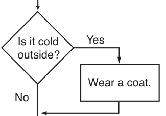

在流程图中，只有在外面冷时，才会执行“穿外套”的操作。如果外面不冷，则跳过该操作。“穿外套”操作是根据条件执行的，因为它只在存在特定条件（外面冷）时才执行。图 4-3 显示了一个更复杂的流程图，其中只有在外面冷时才会采取三个操作。

### 图 4-3 三操作决策结构逻辑

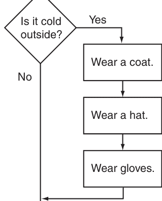

在 Java 中编码决策结构的一种方法是使用 `if` 语句。这里是 `if` 语句的通用格式：

```java
if (BooleanExpression) {
    statement;
}
```

该语句的工作原理简单：括号内出现的 `BooleanExpression` 必须是一个布尔表达式。布尔表达式是一个真或假的表达式。如果布尔表达式为真，则执行紧接着的语句。否则，跳过它。该语句是根据条件执行的，因为它只在参数中的表达式为真的情况下才执行。

## 使用关系运算符形成条件

通常，`if` 语句测试的条件是用关系运算符构建的。关系运算符确定两个值之间是否存在特定的关系。例如，大于 (`>`) 确定一个值是否大于另一个值。等于 (`==`) 确定两个值是否相等。表 4-1 列出了所有的 Java 关系运算符。

### 表 4-1 关系运算符

| 关系运算符（按优先级排序） | 意义 |
|---|---|
| `>` | 大于 |
| `<` | 小于 |
| `>=` | 大于等于 |
| `<=` | 小于等于 |
| `==` | 等于 |
| `!=` | 不等于 |

所有的关系运算符都是二元的，即使用两个操作数。这里是大于的示例：

`length > width`

`>` 运算符确定一个值是否大于另一个值。如果 `length` 大于 `width`，则表达式为真。否则，跳过它。表 4-2 显示了多个布尔表达式。


## 表 4-2 布尔表达式

| 表达式 | 意义 |
|---|---|
| `>` | 大于 |
| `<` | 小于 |
| `>=` | 大于等于 |
| `<=` | 小于等于 |
| `==` | 等于 |
| `!=` | 不等于 |

其中两个运算符 `>=` 和 `<=` 用于测试一种关系。这里是小于等于的示例：

```
length <= width
```

再次，假设 `a` 为 4，`b` 为 6，`c` 为 4，`a <= c` 和 `b <= a` 为真，但 `b <= a` 为假。在使用此符号时，`<` 必须在 `=` 之前且没有空格。

## 4.1 语句

`==` 运算符确定左操作数是否等于右操作数。如果两个操作数具有相同的值，表达式为真。假设 `a` 为 4，`a == 4` 为真，`a == 2` 为假。注意相等运算符是符号。

`!=` 运算符不是相等运算符。它确定左侧的操作数是否不等于右侧的操作数，这是 `==` 运算符的相反。如之前，假设 `a` 为 4，`b` 为 6，`c` 为 4，`a != b` 和 `a != c` 为真，因为 `a` 不等于 `b` 且 `a` 不等于 `c`。然而，`a != c` 为假，因为 `a` 等于 `c`。

## 综合运用

让我们看 `if` 语句的示例：

```
if (sales > 50000)
    bonus = 500.0;
```

该语句使用 `>` 运算符确定 `sales` 是否大于 50,000。如果表达式 `sales > 5000` 为真，则给变量 `bonus` 赋值 500.0。如果表达式为假，则跳过赋值语句。代码列表 4-1 中的程序显示了另一个示例。用户输入三个分数，程序计算它们的平均分。如果平均分大于 95，程序将祝贺用户获得高分。

### 代码列表 4-1 (AverageScore.java)

```java
import java.util.Scanner; // 需要 Scanner 类

/**
 * 该程序演示了 if 语句。
 */
public class AverageScore
{
    public static void main(String[] args)
    {
        double score1, // 分数 #1
        score2, // 分数 #2
        score3, // 分数 #3
        average; // 平均分
        
        // 创建一个 Scanner 对象来读取输入。
        Scanner keyboard = new Scanner(System.in);
        
        System.out.println("此程序平均化 3 个分数.");

        // 获取第一个分数。
        System.out.print("Enter score #1: ");
        score1 = keyboard.nextDouble();

        // 获取第二个分数。
        System.out.print("Enter score #2: ");
        score2 = keyboard.nextDouble();

        // 获取第三个分数。
        System.out.print("Enter score #3: ");
        score3 = keyboard.nextDouble();

        // 计算并显示平均分。
        average = (score1 + score2 + score3) / 3.0;
        System.out.println("The average is " + average);

        // 如果平均分大于 95，表示祝贺
        if (average > 95) {
            System.out.println("That's a great score!");
        }
    }
}
```

带有加粗示例输入的程序输出：

该程序计算 3 测试测试成绩的平均值。

Enter score #1: 82 [Enter]

Enter score #2: 76 [Enter]

Enter score #3: 91 [Enter]

The average is 83.0

带有加粗示例输入的程序输出：

该程序计算 3 测试测试成绩的平均值。

Enter score #1: 97 [Enter]

Enter score #2: 94 [Enter]

Enter score #3: 100 [Enter]

The average is 97.0

That's a great score!

第 40 行和 41 行的语句会导致祝贺信息的打印：

```
if (average > 95) {
    System.out.println("That's a great score!");
}
```

## 4.1 if 语句

图 4-4 显示了该语句的逻辑。

### 图 4-4 if 语句的逻辑


表 4-3 显示了 `if` 语句的其他示例及其结果。

### 表 4-3 if 语句的其他示例

| 语句 | 结果 |
| --- | --- |
| `if (hours > 40) overtime = true;` | 如果 `hours` 大于 40，则给布尔变量 `overtime` 赋值 `true`。 |
| `if (value < 32) System.out.println("Invalid number");` | 如果 `value` 小于 32，则显示消息 "Invalid number" |

## 编程风格与 if 语句

尽管 `if` 语句使用了多行，但它实际上是一条很长的语句。例如，以下语句除了编写风格不同外，它们是完全相同的：

```
if (average > 95)
System.out.println("That's a great score!");

if (average > 95) System.out.println("That's a great score!");
```

在两种情况下，编译器都将该语句和条件执行的语句视为一个，并在末尾放置分号。缩进和间距是为了程序的人类阅读者提供的，而不是为了编译器。以下是您在编写 `if` 语句时应该采用的两个重要风格规则：

- 根据条件执行的语句应该出现在 `if` 语句的下一行。
- 根据条件执行的语句应该比 `if` 语句缩进一层。

在大多数编辑器中，每次当你按下 `tab` 键时，你就缩进了一层。通过缩进条件执行的语句，你使它在视觉上脱颖而出。这就是你如何一眼看出程序中 `if` 语句执行的是哪部分。这是编写 `if` 语句的标准方法，也是你应该使用的方法。

## 注意分号

你不要在语句的 `if (BooleanExpression)` 部分之后放置分号，如图 4-5 所示。这是因为，如果没有其根据条件执行的语句，该语句是不完整的。

### 图 4-5 不要用分号提前终止 if 语句

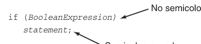

如果你用分号提前终止了 `if` 语句，编译器将不会显示错误信息，而是会认为你在那里放置了一个空语句（null statement）。空语句是一个不执行任何操作的空语句，它将变成根据条件执行的语句。你打算根据条件执行的语句将与 `if` 语句断开，并始终执行。

例如，看以下代码：

```
int x = 0;
if (x > 10);
    System.out.println("0 is greater than 10.");
```

这段代码将显示消息 "0 is greater than 10."。此代码中的 `if` 语句被分号提前终止了。因为 `println` 语句没有连接 `if` 语句，它将始终执行。

## 拥有多个根据条件执行的语句

之前的 `if` 语句示例是根据条件执行单条语句。`if` 语句也可以根据条件执行一组语句，只要它们被包含在一组大括号中。在大括号内包含一组语句会创建一个语句块（block）。这是一个示例：

```
if (sales > 50000)
{
    bonus = 500.0;
    commissionRate = 0.12;
    daysOff += 1;
}
```

如果 `sales` 大于 50,000，此代码将执行大括号内的三条语句，按照它们出现的顺序执行。然而，如果不小心漏了大括号，`if` 语句将只根据条件执行后续的一条语句。图 4-6 演示了这一点。

### 图 4-6 缺少大括号的 if 语句

```
if (sales > 50000)
    bonus = 500.0;
    commissionRate = 0.12;
daysOff += 1;
```

## 标志 (Flags)

标志是一个布尔变量，用于指示某个条件是否存在。当 `flag` 被置为 `false` 时，表示条件不成立。当 `flag` 被置为 `true` 时，表示条件成立。例如，假设程序有一个名为 `highScore` 的布尔变量。程序可能会使用以下代码来测试高分是否已达成：

```
if (average > 95)
    highScore = true;
```

你将在很多情况下发现标志变量。

## 比较字符

你也可以使用关系运算符来测试字符数据。例如，以下代码使用 `==` 运算符比较字符变量 `myLetter` 与 `'A'`。

```
char myLetter = 'A';
if (myLetter == 'A')
```

`!=` 运算符也可以用于测试字符的不等性。以下语句判断字符变量 `myLetter` 是否不等于 `'A'`。

```
if (myLetter != 'A')
```

你还可以使用 `>`, `<`, `>=`, `<=` 运算符来比较字符。计算机并没有直接在内存中存储 A、B、C 等字符。相反，它们存储代表字符的数值。从第 2 章可知，Java 使用 Unicode，这是一组代表字母表（包括大小写）、数字 0 到 9、标点符号和特殊字符的数字。当字符存储在内存中时，存储的是它的 Unicode 数字。当被指示在屏幕上打印时，它显示与代码对应的字符。

> 注意：Unicode 是一种扩展编码系统，足以表示世界上所有的语言字符。

在 Unicode 中，字符按字母顺序排列。由于 `'A'` 在 `'B'` 之前，字符 `'A'` 的数值代码小于 `'B'` 的代码。（`'A'` 的代码是 65，`'B'` 的代码是 66。附录 B 列出了所有打印字符的代码。）在以下语句中，逻辑表达式 `'A' < 'B'` 为真。

```
if ('A' < 'B') {
    System.out.println("A is less than B");
}
```

在 Unicode 中，大写字母在小写字母之前，所以 `'A'` (65) 的数值代码小于 `'a'` (97) 的数值代码。此外，空格字符（代码 32）位于所有字母之前。

## 检查点 (Checkpoint)

- 4.1 当 `y` 等于 20 时，给 `x` 赋值 0。
- 4.2 当 `y` 大于 40 时，将 `paysrate` 乘以 1.5。
- 4.3 如果 `sales` 大于或等于 1000，给 `commission` 赋值 0.2。
- 4.4 如果布尔变量 `max` 为真，给变量 `fees` 赋值 50。
- 4.5 当变量 `x` 大于 100 时，给变量 `y` 赋值 20 并给变量 `z` 赋值 40。
- 4.6 当 `a` 小于 10 时，给变量 `b` 赋值 0 并给变量 `c` 赋值 1。
- 4.7 如果变量 `mycharacter` 包含字符 `'D'` 则显示 "Goodbye"。

## 4.2 if-else 语句

`if-else` 语句是 `if` 语句的扩展。以下是它的通用格式：

```
if (BooleanExpression)
    statement or block
else
    statement or block
```

对语句、布尔表达式进行求值。如果表达式为真（`true`），则执行语句块。然而，如果表达式为假（`false`），则执行另一组语句。代码列表 4-2 中的程序使用 `if-else` 语句来处理一个经典的编程问题：除以零。除以零在数学上是不可能的，在 Java 中，它会导致运行时发生错误。

### 代码列表 4-2 (Division.java)

```java
import java.util.Scanner; // 需要 Scanner 类

/**
 * 此程序演示了 if-else 语句。
 */
public class Division
{
    public static void main(String[] args)
    {
        int number1, number2; // 两个数字
        double quotient; // 两个数的商数

        // 创建 Scanner 对象以读取输入。
        Scanner keyboard = new Scanner(System.in);

        // 从用户获取两个数字。
        System.out.print("Enter an integer: ");
        number1 = keyboard.nextInt();
        System.out.print("Enter another integer: ");
        number2 = keyboard.nextInt();

        // 判断是否会发生除以零的情况。
        if (number2 == 0)
        {
            // 错误 - 除以零。
            System.out.println("Division by zero is not possible.");
            System.out.println("Please run the program again and ");
            System.out.println("enter a number other than zero.");
        }
        else
        {
            // 执行除法并显示商。
            quotient = (double) number1 / number2;
            System.out.print("The quotient of " + number1);
            System.out.println(" divided by " + number2);
            System.out.println(" is " + quotient);
        }
    }
}
```

程序输出（示例输入已加粗显示）：

Enter an integer: 10 [Enter]

Enter another integer: 0 [Enter]

Division by zero is not possible.

Please run the program again and

Enter a number other than zero.

程序输出（示例输入已加粗显示）：

Enter an integer: 10 [Enter]

Enter another integer: 5 [Enter]

The quotient of 10 divided by 5 is 2.0

在执行除法之前会对 `number2` 进行测试。如果用户输入了 0，则执行由 `if` 子句控制的语句块，显示指示程序无法执行除以零的消息。否则，`else` 子句接管控制权，将 `number1` 除以 `number2` 并显示结果。图 4-7 显示了 `if-else` 语句的逻辑。

### 图 4-7 if-else 语句的逻辑

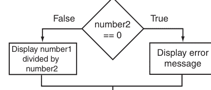

## 检查点

- 4.8 编写一个 `if-else` 语句，如果变量 `x` 大于 100，则给变量 `y` 赋值 20。否则，应给变量 `y` 赋值 0。
- 4.9 编写一个 `if-else` 语句，当 `y` 等于 100 时，给 `x` 赋值 1。否则，应给 `x` 赋值 0。

## 4.3 Payroll 类

- 4.10 编写一个 `if-else` 语句，除非销售额大于等于 50000.0，否则给 `commission` 赋值 0；在这种情况下给 `commission` 赋值 0.2。
- 4.11 编写一个 `if-else` 语句，如果 `a` 小于 10，则给变量 `b` 赋值 0；否则，应给变量 `b` 赋值 99 并给变量 `c` 赋值 0。

在本节中，我们将检查一个确定总工资的 `Payroll` 类。总工资通过小时乘以时率计算。该类还具有在工作时间超过 40 小时计算加班费的能力。对于超过 40 小时的所有小时，员工获得其常规时率的 1.5 倍。图 4-8 显示了 `Payroll` 的 UML 图。

### 图 4-8 Payroll 类 UML 图

| Payroll |
| :--- |
| - hoursWorked: double |
| - payRate: double |
| + Payroll() |
| + setHoursWorked(hours : double) : void |
| + setPayRate(rate : double) : void |
| + getHoursWorked() : double |
| + getPayRate() : double |
| + getGrossPay() : double |

这是类的字段总结：

- `hoursWorked` 是存储工作小时数的 `double`。
- `payRate` 是存储员工时率的 `double`。

这是类的方法的总结：

- 构造函数将字段初始化为 0.0。


- `setHoursWorked` 是修改器，接收参数并存储在 `hoursWorked` 字段中。
- `setPayRate` 是修改器，接收参数并存储在 `payRate` 字段中。
- `getHoursWorked` 是访问器，返回 `hoursWorked` 字段的值。
- `getPayRate` 是访问器，返回 `payRate` 字段的值。
- `getGrossPay` 是计算并返回总工资的方法。如果工作小时大于 40，该方法会在总工资中加上加班费。

图 4-3 显示了 `Payroll` 类的代码，存储在 `Payroll.java` 中。

## 代码 4-3 (Payroll.java)

```java
/**
 * 此类存储工作小时和时率。它计算总工资
 * 并加上超过 40 小时的加班费。
 */
public class Payroll {
    private double hoursWorked; // 工作小时
    private double payRate; // 时率

    /**
     * 构造函数将字段初始化为 0.0。
     */
    public Payroll() {
        hoursWorked = 0.0;
        payRate = 0.0;
    }

    /**
     * setHoursWorked 方法接收参数
     * 并存储在 hoursWorked 字段中。
     */
    public void setHoursWorked(double hours) {
        hoursWorked = hours;
    }

    /**
     * setPayRate 方法接收参数
     * 并存储在 payRate 字段中。
     */
    public void setPayRate(double rate) {
        payRate = rate;
    }

    /**
     * getHoursWorked 方法返回 hoursWorked 字段的值。
     */
    public double getHoursWorked() {
        return hoursWorked;
    }

    /**
     * getPayRate 方法返回 payRate 字段的值。
     */
    public double getPayRate() {
        return payRate;
    }

    /**
     * getGrossPay 方法计算并返回总工资。
     */
    public double getGrossPay() {
        double grossPay; // 总工资
        double overtimePay; // 加班费

        if (hoursWorked > 40) {
            // 计算前 40 小时的常规工资。
            grossPay = 40 * payRate;

            // 按常规时率的 1.5 倍计算加班费。
            overtimePay = (hoursWorked - 40) * (payRate * 1.5);

            // 将加班费加上常规工资。
            grossPay += overtimePay;
        } else {
            // 没有加班。
            grossPay = payRate * hoursWorked;
        }
        return grossPay;
    }
}
```

`getGrossPay` 方法使用第 74 到 90 行的 `if-else` 语句来控制总工资的计算。如果 `hoursWorked` 大于 40，则计算包含加班费的总工资。否则，总工资为 `payRate` 乘以 `hoursWorked`。

## 代码 4-4 (GrossPay.java)

```java
import java.util.Scanner; // 需要 Scanner 类

/**
 * 此程序使用 Payroll 类
 * 计算员工的总工资。
 */
public class GrossPay {
    public static void main(String[] args) {
        double hours, // 用于存储工作小时
        double rate; // 用于存储时率

        // 创建 Scanner 对象以读取输入。
        Scanner keyboard = new Scanner(System.in);

        // 创建一个 Payroll 对象。
        Payroll employee = new Payroll();

        // 获取工作小时数。
        System.out.print("How many hours did the employee work? ");
        hours = keyboard.nextDouble();

        // 获取时率。
        System.out.print("What is the employee's hourly pay rate? ");
        rate = keyboard.nextDouble();

        employee.setHoursWorked(hours);
        employee.setPayRate(rate);

        // 显示员工的总工资。
        System.out.println("The employee's gross pay is $" + employee.getGrossPay());
    }
}
```

## 程序输出（示例输入已加粗显示）

员工工作了多少小时？**50** [回车]

员工的小时薪率是多少？**10** [回车]

员工的总工资为 $550.0

## 4.4 嵌套 if 语句

概念：为了测试多个条件，可以将一个 `if` 语句嵌套在另一个语句内部。

有时，一个 `if` 语句必须嵌套在另一个 `if` 语句内部。例如，考虑一个银行程序，用于判断银行客户是否符合特殊低利率贷款的条件。要符合条件，必须满足两个：(1) 客户工资至少为 $50,000，且 (2) 客户担任当前工作至少满 2 年。图 4-9 显示了用于此类程序的算法流程图。

图 4-9 嵌套 if 语句的逻辑

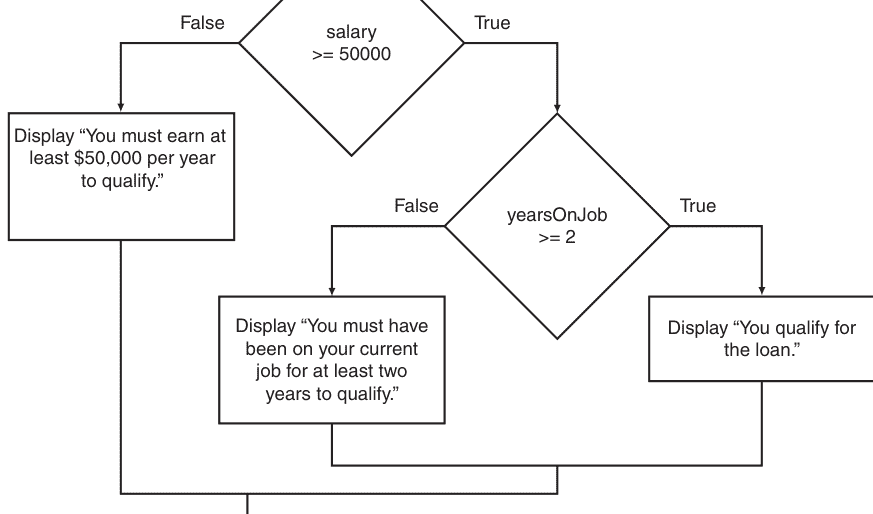

如果我们遵循流程图中的执行流，可以看到测试了表达式 `salary >= 50000`。如果该表达式为假，则没有需要进行进一步测试；我们知道客户不符合特殊利率条件。如果该表达式为真，我们需要测试第二个条件。这是通过一个嵌套决策结构实现的，该结构测试表达式 `yearsJob >= 2`。如果该表达式为真，客户符合特殊利率条件。如果该表达式为假，客户不符合。代码列表 4-5 显示了完整的程序。

## 代码列表 4-5 (LoanQualifier.java)

```java
import java.util.Scanner;

/**
 *  此程序演示了嵌套的 if 语句。
 */
public class LoanQualifier {

    public static void main(String[] args) {
        double salary;       // 年薪
        double yearsJob;      // 在当前工作的年限

        // 创建一个 Scanner 对象用于键盘输入。
        Scanner keyboard = new Scanner(System.in);

        // 获取用户的年薪。
        System.out.print("Enter your annual salary: ");
        salary = keyboard.nextDouble();

        // 获取当前工作的年限。
        System.out.print("Enter the number of years: ");
        yearsJob = keyboard.nextDouble();

        // 判断用户是否符合贷款条件。
        if (salary >= 50000) {
            if (yearsJob >= 2)
                System.out.println("You qualify for the loan.");
            else {
                System.out.println("You must have been on your " + "current job for at least " + "two years to qualify.");
            }
        } else {
            System.out.println("You must earn at least " + "$50,000 per year to qualify.");
        }
    }
}
```

## 程序输出（示例输入已加粗显示）

Enter your annual salary: **55000.00** [回车]

Enter the number of years at your current job: **1** [回车]

You must have been on your current job for at least two years to qualify.

## 程序输出（示例输入已加粗显示）

Enter your annual salary: **25000.00** [回车]

Enter the number of years at your current job: **5** [回车]

You must earn at least $50,000 per year to qualify.

## 程序输出（示例输入已加粗显示）

Enter your annual salary: **55000.00** [回车]

Enter the number of years at your current job: **5** [回车]

You qualify for the loan.

第一个语句（从第 27 行开始）有条件地执行第二个语句（从第 29 行开始）。程序执行第二个语句的唯一方法是 `salary` 变量包含一个大于或等于 50,000 的值。在这种情况下，第二个语句测试 `yearsJob` 变量。如果它包含一个大于或等于 2 的值，程序将显示一条消息告知用户他符合贷款条件。

应该注意的是，此程序中语句使用的的大括号不是必须的。语句可以写如下：

```java
if (salary >= 50000)
  if (yearsJob >= 2)
    System.out.println("You qualify for the loan.");
else
  System.out.println("You must have been on your "
    + "current job for at least "
    + "two years to qualify.")
else
  System.out.println("You must earn at least "
    + "$50,000 per year to qualify.");
```

使用大括号不仅让语句更易读，还有助于调试代码。在调试带有嵌套 `if-else` 语句的程序时，确定哪个 `else` 子句属于哪个 `if` 子句非常重要。匹配 `else` 子句与 `if` 子句的规则是：`else` 子句与最近的、还没有自己的 `else` 子句的子句匹配。当条件执行语句包含在大括号内并进行正确缩进时，这一点很容易看出。

## 图 4-10 if 对齐

```java
if (salary >= 50000)
  if (yearsJob >= 2)
    System.out.println("You qualify for the loan.");
else
  {
    System.out.println("You must have been on your " + "current job for at least " + "two years to qualify.");
  }
else
  System.out.println("You must earn at least " + "$50,000 per year to qualify.");
```

## 测试一系列条件

在之前的示例中，我们看到了嵌套决策结构如何测试多个一个条件。在这里，我们使用了一系列条件。

## 多重决策结构

| 测试分数 | 成绩等级 |
|---|---|
| 90 及以上 | A |
| 80–89 | B |
| 70–79 | C |
| 60–69 | D |
| 60 以下 | F |

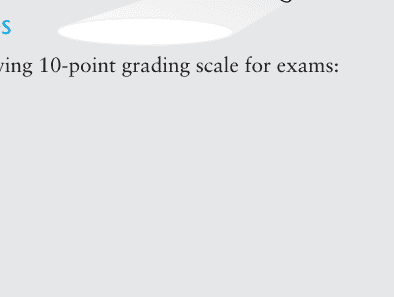

你的教授要求你写一个程序，允许用户输入分数并显示成绩。这里是你将使用的算法：

要求用户输入分数。

以以下方式确定成绩：

如果分数小于 60，成绩为 F。

否则，如果分数小于 70，成绩为 D。

否则，如果分数小于 80，成绩为 C。

否则，如果分数小于 90，成绩为 B。

否则，成绩为 A。

## 图 4-11 用于确定的嵌套决策结构

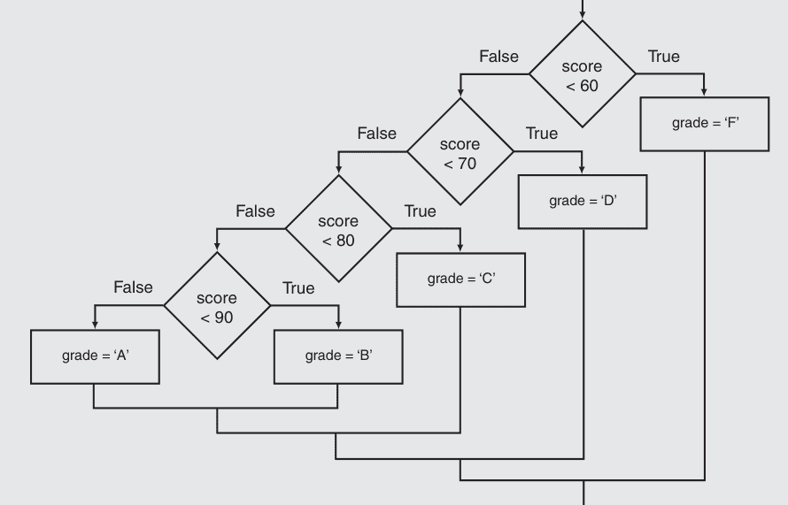

## 图 4-12 TestGrade 类 UML

| TestGrade |
|---|
| - score : int |
| + TestGrade(s : int) |
| + setScore(s : int) : void |
| + getScore() : int |
| + getLetterGrade() : char |

你决定创建一个名为 `TestGrade` 的类，用于为给定的测试分数确定字母成绩。图 4-12 显示了该类的 UML 图。以下是该类字段和方法的摘要：

*   **score**: 用于存储数值测试分数的私有 `int` 字段
*   **构造函数**: 接受 `score` 字段的参数
*   **setScore**: 接受 `score` 字段参数的修改方法
*   **getScore**: 返回 `score` 值的访问方法
*   **getLetterGrade**: 使用图 4-11 所示的嵌套决策来确定分数的字母成绩，并以 `char` 类型返回该成绩。

## 代码片段

```java
public int getScore() {
    return score;
}

/**
  * getLetterGrade 返回测试分数
  * 对应的字母等级。
  */
public char getLetterGrade() {
  char grade;
  if (score < 60) {
    grade = 'F';
  } else {
    if (score < 70) {
      grade = 'D';
    } else {
      if (score < 80) {
        grade = 'C';
      } else {
        if (score < 90) {
          grade = 'B';
        } else {
          grade = 'A';
        }
      }
    }
  }
  return grade;
}
```

## 代码列表 4-7 (TestResults.java)

```java
import java.util.Scanner; // 需要 Scanner 类

/**
 * 此程序使用 TestGrade 类根据数值测试分数
 * 确定字母等级。
 */
public class TestResults {
    public static void main(String[] args) {
        int testScore; // 用于存储测试分数
        char letterGrade; // 用于存储字母等级

        // 创建 Scanner 对象以读取输入。
        Scanner keyboard = new Scanner(System.in);

        // 获取数值测试分数。
        System.out.print("输入你的数值测试分数和 \n" + "我会告诉你的等级： ");
        testScore = keyboard.nextInt();

        // 使用数值创建一个 TestGrade 对象。
        TestGrade test = new TestGrade(testScore);

        // 获取字母等级。
        letterGrade = test.getLetterGrade();

        // 显示等级。
        System.out.print("你的等级为 " + test.getLetterGrade());
    }
}
```

## 程序输出（示例输入已加粗显示）

输入你的数值测试分数和我会告诉你的等级：**80** [回车]


你的等级为 B

程序输出，以加粗显示示例输入：

输入你的数值测试分数和我会告诉你的等级：**72** [回车]

你的等级为 C

## 4.5 if-else-if 语句

### 检查点

4.12 编写嵌套语句执行以下测试：如果 `amount1` 大于 10 且 `amount2` 小于 100，显示两者中较大的一个。

4.13 编写代码测试变量 `x` 以确定它是否大于 0。如果 `x` 大于 0，代码应测试变量 `y` 以确定它是否小于 20。如果 `y` 小于 20，代码应将变量 `z` 赋值为 1。如果 `y` 不小于 20，代码应将变量 `z` 赋值为 0。

## 4.5 if-else-if 语句

概念：if-else-if 语句测试一系列条件。使用 if-else-if 语句来测试一系列条件，通常比使用一组嵌套的 if-else 语句要简单。

尽管 `TestGrade` 类是一个简单的示例（参见代码列表 4-6），但 48 到 76 行中嵌套决策结构的逻辑相当复杂。你也可以使用 if-else-if 语句测试一系列条件。if-else-if 语句使得某些类型的嵌套决策编写起来更简单。以下是 if-else-if 语句的通用格式：

```java
if (expression_1) {
    语句
    语句
    等等.
}
else if (expression_2) {
    语句
    语句
    等等.
}
else {
    语句
    语句
    等等.
}
```

根据需要插入任意 else if 子句

当语句执行时，会测试 `expression_1`。如果 `expression_1` 为真，则执行紧随其后的语句块，并忽略结构的其余部分。

然而，如果 `expression_i` 为假，程序将跳转到下一个 else if 子句并测试 `expression_2`。如果它为真，则执行紧随其后的语句块，然后忽略结构的其余部分。这个过程从结构一直持续到最后，直到发现其中一个表达式为真。如果没有一个表达式为真，则最后一个 else 子句将接管，并执行紧随其后的语句块。

最后一个没有跟随 if 语句的 else 子句被称为“尾随 else”（trailing else）。尾随 else 是可选的，但在大多数情况下你都会使用它。

> 注意：通用格式使用括号包围每个根据条件执行的语句块。与 if 语句的其他形式一样，只有在根据条件执行多条语句时才需要括号。

代码列表 4-8 所示的 `TestGrade2` 类演示了 if-else-if 语句。该类是代码列表 4-6 所示 `TestGrade` 类的修改版本，后者出现在之前的焦点（Spotlight）部分。

## 代码列表 4-8 (TestGrade2.Java)

```java
1 /**
 * TestGrade2 类根据数值测试分数
 * 确定字母等级。
 */
5 
6 public class TestGrade2
7 {
8 private int score;
9
10 /**
 * 构造函数接受一个参数
 * 用于 score 字段。
13 */
15 public TestGrade2(int s)
16 {
17
;
19
20 /**
 * setScore 方法接受一个参数
 * 用于 score 字段。
23 */
24 public void setScore(int s)
26 {
27
;
2

20 /**
 * getScore 方法返回 score。
32 */
33 public int getScore() {
34 return score;
3
37 /**
 * getLetterGrade 返回字母等级
 * 用于测试分数。
41 */
42 public char getLetterGrade() {
43 char grade;
44 if (score < 60) {
45 grade = 'F';
46 } else {
47 if (score < 70) {
48 grade = 'D';
49 } else {
50 if (score < 80) {
51 grade = 'C';
52 } else {
53 if (score < 90) {
54 grade = 'B';
55 } else {
56 grade = 'A';
57 }
58 }
59 }
60 return grade;
61 }
```

（修正上述代码逻辑对齐如下）

```java
if (score < 60) {
    grade = 'F';
} else {
score = 70)
    if (score < 70) {
      grade = 'D';
    } else {
      if (score < 80) {
        grade = 'C';
      } else {
        if (score < 90) {
          grade = 'B';
        } else {
          grade = 'A';
        }
      }
    }
}
```

（注：由于原文文本翻译要求，代码块内部不翻译，此处为保持逻辑一致性）

让我们分析 if-else-if 语句如何工作。首先，测试 48 行的 `score < 60`：

```java
if (score < 60)
    grade = 'F';
else if (score < 70)
    grade = 'D';
else if (score < 80)
    grade = 'C';
else if (score < 90)
    grade = 'B';
else
    grade = 'A';
```

如果 `score` 小于 60，`grade` 变量被赋值为 'F'，语句其余部分被跳过。如果 `score` 不小于 60，50 行的 else 子句将接管并执行：

```java
if (score < 60)
    grade = 'F';
else if (score < 70)
    grade = 'D';
else if (score < 80)
    grade = 'C';
else if (score < 90)
    grade = 'B';
else
    grade = 'A';
```

当 `score` 小于 60 时，该语句处理了所有小于 60 的分数。当 `score` 大于或等于 60 时，注意 if 语句的对齐情况：

```java
if (score < 60)
    grade = 'F';
else if (score < 70)
    grade = 'D';
else if (score < 80)
    grade = 'C';
else if (score < 90)
    grade = 'B';
else
    grade = 'A';
```

### if-else-if 语句与嵌套决策结构的对比

你从未使用过 if-else-if 语句，因为其逻辑可以使用嵌套 if-else 语句来实现。然而，一组嵌套 if-else 语句在调试时有两个缺点：

- 代码可能会变得复杂且难以理解。
- 因为嵌套语句需要缩进，一组嵌套 if-else 语句在屏幕上显示可能过长。此外，长语句在打印时会换行，使得代码更难阅读。

if-else-if 语句的逻辑通常比嵌套 if-else 语句更容易理解。而且，由于所有子句在 if-else-if 语句中都是对齐的，语句长度往往更短。


### 检查点

14 下列程序将显示什么？

```java
public class CheckPoint {
    public static void main(String[] args)
    {
        int funny = 7, serious = 15;
        funny = serious % 2;
        if (funny != 1) {
            funny = 0;
            serious = 0;
        } else if (funny == 2) {
            funny = 10;
            serious = 10;
        } else {
            funny = 1;
            serious = 1;
        }
        System.out.println(funny + " " + serious);
    }
}
```

15 下列程序用于书店以确定客户获得多少张优惠券。完成程序后出现的表格。

```java
import java.util.Scanner;
public class CheckPoint
{
    public static void main(String[] args)
    {
        int books, coupons;

        Scanner keyboard = new Scanner(System.in);
        System.out.print("购买了多少本书？");
        books = keyboard.nextInt();

        if (books < 1)
            coupons = 0;
        else if (books < 3)
            coupons = 1;
        else if (books < 5)
            coupons = 2;
        else
            coupons = 3;

        System.out.println("优惠券数量: " + coupons);
    }
}
```

# 第 4 章 决策结构

如果客户购买以下数量的书……将给予相应数量的优惠。

- 1
- 2
- 3
- 4
- 5
- 10

## 4.6 逻辑运算符

逻辑运算符将两个或多个关系表达式连接成一个，或者反转表达式的逻辑。

Java 提供了两个二进制运算符 `&&` 和 `||`，用于将布尔表达式组合成单个表达式。它还提供了一个一元运算符，用于反转布尔表达式的真值。表 4-4 描述了这些逻辑运算符。

## 表 4-4 逻辑运算符

| 运算符 | 含义 | 效果 |
| :--- | :--- | :--- |
| `&&` | 与 | 将两个布尔表达式连接为一个。只有当两个表达式都为真时，整个表达式才为真。 |
| `||` | 或 | 将两个布尔表达式连接为一个。只要其中一个或两个表达式为真，整个表达式就为真。只需其中一个为真即可，无所谓是哪一个。 |
| `!` | 非 | 反转布尔表达式的真值。如果应用于一个为真的表达式，运算符返回假；如果应用于一个为假的表达式，运算符返回真。 |

表 4-5 显示了若干个使用逻辑运算符的布尔表达式示例。

## 表 4-5 使用逻辑运算符的布尔表达式

| 表达式 | 含义 |
| :--- | :--- |
| `x > y && a < b` | x 是否大于 y 且小于 b？ |
| `x == y || x == z` | x 是否等于 y 或等于 z？ |
| `!(x > y)` | 表达式 `x > y` 是否不为真？ |

让我们仔细观察这些运算符中的每一个。

## 运算符 && 运算符

`&&` 运算符被称为逻辑“与”（AND）运算符。它接受两个布尔表达式作为操作数，并创建一个仅当两个表达式都为真时为真的布尔表达式。这是一个使用 `&&` 运算符的 if 语句的示例：

```java
if (temperature < 20 && minutes > 12)
{
    System.out.println("The temperature is in the "
    + "danger zone.");
}
```

在该语句中，两个布尔表达式 `< 20` 和 `minutes > 12` 被组合成单个表达式。只有当 `temperature` 小于 20 且 `minutes` 大于 12 时，才会显示消息。如果任一个布尔表达式为假，整个表达式即为假，不会显示消息。

表 4-6 显示了 `&&` 运算符的真值表。真值表列出了两个表达式可能的所有值组合，`&&` 运算符返回的结果连接了这两个表达式。

## 表 4-6 && 运算符的真值表

| 表达式 | 结果值 |
| :--- | :--- |
| `true && false` | false |
| `false && true` | false |
| `false && false` | false |
| `true && true` | true |

如表所示，两个子表达式都必须为真，`&&` 运算符才能返回真值。

`&&` 运算符执行短路求值（short-circuit evaluation）。其工作原理如下：如果 `&&` 运算符左侧的表达式为假，则不会检查右侧的表达式。因为只要有一个子表达式为假，整个表达式就为假，检查剩余表达式将浪费 CPU 时间。因此，当 `&&` 运算符发现其左侧表达式为假时，会发生短路，不再评估右侧表达式。

`&&` 运算符可以简化原本需要嵌套 if 语句的程序。代码列表 4-9 显示了另一个贷款资格判定程序。其中一个是使用 `&&` 运算符编写的。

## 代码列表 4-9 (Logical.java)

```java
import java.util.Scanner; // 需要 Scanner 类

/**
 * 此程序演示了逻辑 && 运算符。
 */

public class LogicalAnd
{
    public static void main(String[] args)
    {
        double salary; // 年薪
        double yearsOnJob; // 在当前工作的年限

        // 创建一个 Scanner 对象用于键盘输入。
        Scanner keyboard = new Scanner(System.in);

        // 获取用户的年薪。
        System.out.print("Enter your annual salary: ");
        salary = keyboard.nextDouble();

        // 获取当前工作的年限。
        System.out.print("Enter the number of years " + "at your current job: ");
        yearsOnJob = keyboard.nextDouble();

        // 判断用户是否符合贷款条件。
        if (salary >= 50000 && yearsOnJob >= 2)
        {
            System.out.println("You qualify for the loan.");
        }
        else
        {
            System.out.println("You do not qualify.");
        }
    }
}
```

带有示例输入的程序输出（部分加粗显示）：

Enter annual salary: 55000.00 [Enter]

Enter the number of years at your current job: 1 [Enter]

You do not qualify.

带有示例输入的程序输出（部分加粗显示）：

Enter annual salary: 55000.00 [Enter]

Enter the number of years at your current job: 4 [Enter]

You qualify for the loan.

> 只有当表达式 `salary >= 50000` 和 `yearsOnJob >= 2` 为真时，才会显示消息 "You qualify for the loan."。如果其中任何一个为假，则显示消息 "You do not qualify."。

## 4.6 逻辑运算符（续）

你也可以对布尔变量使用逻辑运算符。例如，假设 `isValid` 是一个布尔变量，以下语句判断 `isValid`：

```java
if (temperature < 20 || isValid)
```

当 `temperature` 小于 20 或 `isValid` 为真时，将显示消息。如果两个表达式都假，整个表达式即为假。

## 运算符 ||运算符

`||` 运算符被称为逻辑“或”（OR）运算符。它接受两个布尔表达式作为操作数，并创建一个只要其中一个表达式为真就为真的布尔表达式。这是一个使用 `||` 运算符的 if 语句示例：

```java
if (temperature < 20 || minutes > 12)
{
    System.out.println("The temperature is in the "
    + "danger zone.");
}
```

在该语句中，两个布尔表达式 `< 20` 和 `minutes > 12` 被组合成单个表达式。只有当 `temperature` 小于 20 或 `minutes` 大于 12 时，才会显示消息。如果两个布尔表达式都为假，整个表达式即为假，不会显示消息。

表 4-7 显示了 `||` 运算符的真值表。真值表列出了两个表达式可能的所有值组合，`||` 运算符的结果的结果连接这两个表达式。

## 表 4-7 || 运算符的真值表

| 表达式 | 结果值 |
| :--- | :--- |
| `true || false` | true |
| `false || true` | true |
| `false || false` | false |
| `true || true` | true |

如表所示，至少有一个子表达式为真，`||` 运算符就能返回真值。


`||` 运算符执行短路求值。其工作原理如下：如果 `||` 运算符左侧的表达式为真，则不会检查右侧的表达式。因为只要有一个子表达式为真，整个表达式就为真，检查剩余表达式将浪费 CPU 时间。因此，当 `||` 运算符发现其左侧表达式为真时，会发生短路，不再评估右侧表达式。

`||` 运算符可以简化原本需要嵌套 `if` 语句的程序。代码列表 4-10 显示了另一个贷款资格程序。

## 代码列表 4-10 (LogicalOr.java)

```java
import java.util.Scanner; // 需要 Scanner 类

/**
 * 此程序演示了逻辑 || 运算符。
 */

public class LogicalOr
{
    public static void main(String[] args)
    {
        double salary; // 年薪
        double yearsOnJob; // 在当前工作的年限

        // 创建一个 Scanner 对象用于键盘输入。
        Scanner keyboard = new Scanner(System.in);

        // 获取用户的年薪。
        System.out.print("Enter your annual salary: ");
        salary = keyboard.nextDouble();

        // 获取当前工作的年限。
        System.out.print("Enter the number of years " + "at your current job: ");
        yearsOnJob = keyboard.nextDouble();

        // 判断用户是否符合贷款条件。
        if (salary >= 50000 || yearsOnJob >= 2)
        {
            System.out.println("You qualify for the loan.");
        }
        else
        {
            System.out.println("You do not qualify.");
        }
    }
}
```

带有示例输入的程序输出（部分加粗显示）：

Enter annual salary: 20000.00 [Enter]

Enter the number of years at your current job: 7 [Enter]

You qualify for the loan.

带有示例输入的程序输出（部分加粗显示）：

Enter annual salary: 55000.00 [Enter]

Enter the number of years at your current job: 1 [Enter]

You qualify for the loan.

带有示例输入的程序输出（部分加粗显示）：

Enter annual salary: 20000.00 [Enter]

Enter the number of years at your current job: 1 [Enter]

You do not qualify.

## 4.6 逻辑运算符

### ! 运算符

`!` 运算符执行逻辑非（NOT）操作。它是一个一元运算符，接受一个布尔表达式并反转其逻辑值。换句话说，如果表达式为真，`!` 运算符返回假；如果表达式为假，它则返回真。以下是一个使用 `!` 运算符的 `if` 语句示例：

```
if (!temperature > 100) {
    System.out.println("This is below the maximum temperature.");
}
```

首先，对表达式 `(temperature > 100)` 进行测试，判断其结果是真还是假。然后，将 `!` 运算符应用于该值。如果表达式 `(temperature > 100)` 为真，则 `!` 运算符返回假。如果表达式 `(temperature > 100)` 为假，则 `!` 运算符返回真。之前的代码等同于询问：“温度是否不大于 100？”

表 4-8 显示了 `!` 运算符的真值表。

| 表达式 | 结果值 |
| --- | --- |
| `!true` | `false` |
| `!false` | `true` |

### 逻辑运算符的优先级和结合性

与其他运算符一样，逻辑运算符具有优先级和结合性。表 4-9 显示了逻辑运算符的优先级，从高到低排序。

### 表 4-9 按优先级排序的逻辑运算符

| 运算符 |
| --- |
| `!` |
| `&&` |
| `||` |

`!` 运算符的优先级高于 Java 的许多运算符。你应该始终将其操作数包括在括号中，除非你打算将其应用于变量或不包含其他运算符的简单表达式。例如，考虑以下表达式（假设 `x` 是一个存储了值的 `int` 类型）：

```
!(x > 2)
!x > 2
```

第一个表达式将 `!` 运算符应用于表达式 `x > 2`。它在询问：“x 不大于 2 吗？”。然而，第二个表达式尝试仅将 `!` 运算符应用于 `x`。它在询问：“x 是大于 2 的逻辑补数吗？”。由于 `!` 运算符只能应用于布尔表达式，该语句将导致编译错误。

## 第 4 章 决策结构

`&&` 和 `||` 运算符的优先级低于关系运算符，因此优先级冲突较少发生。然而，如果你不确定，使用括号也没有坏。

```
(a > b) && (x < y)      等同于    a > b && x < y
(x == y) || (b > a)     等同于    x == y || b > a
```

逻辑运算符从左到右评估表达式。在下面的表达式中，`a < b` 在 `y == z` 之前评估。

```
a < b || y == z
```

在下面的表达式中，`y == z` 先被评估，因为 `&&` 运算符的优先级高于 `||`。

```
a < b || y == z && m > j
```

该表达式等同于：

```
(a < b) || ((y == z) && (m > j))
```

表 4-10 显示了我们目前为止讨论的所有运算符的优先级。该表包含了赋值、算术、关系和逻辑运算符。

### 表 4-10 到目前为止讨论的所有运算符的优先级

| 优先级顺序 | 描述 |
|---|---|
| 1 | `!` | 一元否定，逻辑非 |
| 2 | `* / %` | 乘法、除法、取模 |
| 3 | `+ -` | 加法、减法 |
| 4 | `< > <= >=` | 小于、大于、小于等于、大于等于 |
| 5 | `== !=` | 等于、不等于 |
| 6 | `&&` | 逻辑与 (AND) |
| 7 | `||` | 逻辑或 (OR) |
| 8 | `= += *= /= %=` | 赋值和复合赋值 |

### 使用逻辑运算符检查数值范围

有时，你需要编写代码来确定一个数值是否在某个范围内。例如，使用 `if` 语句来判断数值是否在特定范围内：

```java
if (score >= 0 && score <= 100) {
    System.out.println("The score is within the valid range.");
}
```

有时，你需要编写代码来确定一个数值是否在某个范围内。例如，使用 `if` 语句来判断数值是否在特定范围内：

```java
if (score < 0 || score > 100) {
    System.out.println("The score is outside the valid range.");
}
```

## 4.7 String 对象

**概念:** 你在前面的节中看到了如何使用关系运算符比较值。记住，变量存储的是 `String` 对象的地址，而不是内容。要判断 `String` 对象是否相等，你应该使用 `equals` 方法。

### 代码列表 4-11 (GoodString.java)

```java
import java.util.Scanner;

/**
 * 此程序使用 equals 方法
 * 比较两个 String 对象
 */
public class GoodString
{
    public static void main(String[] args)
    {
        String name, name2, name3;

        // 创建 Scanner 对象以读取输入。
        Scanner keyboard = new Scanner(System.in);

        // 获取一个名字。
        System.out.print("Enter a name: ");
        name = keyboard.nextLine();

        // 获取第二个名字。
        System.out.print("Enter a second name: ");
        name2 = keyboard.nextLine();

        // 获取第三个名字。
        System.out.print("Enter a third name: ");
        name3 = keyboard.nextLine();

        // 比较 name 和 name2
        if (name.equals(name2)) {
            System.out.println(name + " and " + name2 + " are the same.");
        } else {
            System.out.println(name + " and " + name2 + " are NOT the same.");
        }

        // 比较 name 和 name3
        if (name.equals(name3)) {
            System.out.println(name + " and " + name3 + " are the same.");
        } else {
            System.out.println(name + " and " + name3 + " are NOT the same.");
        }
    }
}
```

**程序输出，示例输入用粗体显示**

Enter name: Mark [Enter]

Enter a second name: Mark [Enter]

Enter a third name: Mary [Enter]

Mark and Mark are the same.

Mark and Mary are NOT the same.

你也可以将 `String` 对象与字符串字面量进行比较。只需将字符串字面量作为 `equals` 方法的参数传递，如下：

```java
if (name.equals("Mark"))
```

# 第 4 章 决策结构

要判断两个字符串是否不等，只需对 `equals` 方法的返回值应用 `!` 运算符即可。这是一个示例：

```
if (!name.equals("Mark"))
```

该语句中的布尔表达式执行了不等于操作。它确定了由 `name` 引用的对象是否等于 "Mark"。

`String` 类还提供了 `compareTo` 方法，它可以判断一个字符串是否大于、等于或小于另一个字符串。该方法的通用形式为：

```
StringReference.compareTo(OtherString)
```


`Reference` 是引用 `String` 对象的变量，而 `OtherString` 是另一个引用 `String` 对象的变量或字符串字面量。该方法返回一个整数值，可以使用如下方式：

- 如果方法的返回值为负，则由 `StringReference` 引用的字符串（调用对象）小于 `OtherString`。
- 如果方法的返回值为 0，则两个字符串相等。
- 如果方法的返回值为正，则由 `StringReference` 引用的字符串（调用对象）大于另一个参数。

例如，假设 `name1` 和 `name2` 是引用 `String` 对象的变量。下面的 `if` 语句使用 `compareTo` 方法来比较字符串。

```java
if (name1.compareTo(name2) == 0)
    System.out.println("The names are the same.");
```

此外，下面的表达式比较了 `name` 引用的字符串与字符串字面量 "Joe"。

```java
if (name1.compareTo("Joe") == 0)
    System.out.println("The names are the same.");
```

代码列表 4-12 中的程序完整演示了 `compareTo` 方法。

## 代码列表 4-12 (StringCompare.java)

```java
1 import java.util.Scanner; // 需要 Scanner
3 /**
4  * 此程序使用 compareTo 方法比较
 * 两个 String 对象。
6  */
7
8 public class StringCompare
9 {
10     public static void main(String[] args)
11     {
12         String name1, name2; // 用于存储两个名字
13
```

## 4.7 比较 String 对象

```java
// 创建一个 Scanner 对象以读取输入。
Scanner keyboard = new Scanner(System.in);

// 获取一个名字。
System.out.print("Enter a name: ");
name1 = keyboard.nextLine();

// 获取另一个名字。
System.out.print("Enter another name: ");
name2 = keyboard.nextLine();

// 比较名字。
if (name1.compareTo(name2) < 0) {
    System.out.println(name1 + " is less than " + name2);
} else if (name1.compareTo(name2) == 0) {
    System.out.println(name1 + " is equal to " + name2);
} else if (name1.compareTo(name2) > 0) {
    System.out.println(name1 + " is greater than " + name2);
}
```

### 示例输入的程序输出（部分加粗显示）

**Enter a name:** **Mary [Enter]**

**Enter another name:** **Mark [Enter]**

**Mary is greater than Mark**

让我们仔细观察一下这个程序。当你使用 `compareTo` 方法比较两个字符串时，字符串是逐个字符进行比较的。这通常被称为字典序比较。程序使用 `compareTo` 方法比较字符串 "Mary" 和 "Mark"，从第一个、最左侧的字符开始。如图 4-13 所示。

图 4-13 "Mary" 和 "Mark" 的字符串比较

| M | a | r | y |
|---|---|---|---|
| M | a | r | k |

以下是比较发生的过程：

1. 将 "Mary" 中的 "M" 与 "Mark" 中的 "M" 进行比较。因为它们相同，所以比较下一个字符。
2. 将 "Mary" 中的 "a" 与 "Mark" 中的 "a" 进行比较。因为它们相同，所以比较下一个字符。
3. 将 "Mary" 中的 "r" 与 "Mark" 中的 "r" 进行比较。因为它们相同，所以比较下一个字符。
4. 将 "Mary" 中的 "y" 与 "Mark" 中的 "k" 进行比较。因为它们不同，由 `StringReference` 引用的字符串大于另一个参数。

如果方法的返回值为 0，两个字符串相等。

如果方法的返回值为负，则由 `StringReference` 引用的字符串（调用对象）小于 `OtherString`。

## 在字符串比较中忽略大小写

`equals` 和 `compareTo` 方法是区分大小写的，这意味着大写字母不被认为与其对应的小写字母相同。如果你想忽略大小写，必须使用不同的方法。

`String` 类提供了 `equalsIgnoreCase` 方法，它的作用与 `equals` 和 `compareTo` 方法类似，但会忽略大小写。例如，代码列表 4-13 中的程序演示了这一点。

## 代码列表 4-13 (StringCompare.java)

```java
import java.util.Scanner; // 需要 Scanner

/**
 * 此程序使用 compareTo 方法比较
 * 两个 String 对象。
 */

public class StringCompare
{
    public static void main(String[] args)
    {
        String name1, name2; // 用于存储两个名字

        // 创建一个 Scanner 对象以读取输入。
        Scanner keyboard = new Scanner(System.in);

        // 获取一个名字。
        System.out.print("Enter a name: ");
        name1 = keyboard.nextLine();

        // 获取另一个名字。
        System.out.print("Enter another name: ");
        name2 = keyboard.nextLine();

        // 比较名字。
        if (name1.compareTo(name2) < 0) {
            System.out.println(name1 + " is less than " + name2);
        } else if (name1.compareTo(name2) == 0) {
            System.out.println(name1 + " is equal to " + name2);
        } else if (name1.compareTo(name2) > 0) {
            System.out.println(name1 + " is greater than " + name2);
        }
    }
}
```

## 4.8 变量声明与作用域

概念：变量的作用域限于声明它的块。

回顾第 2 章，局部变量是在方法内部声明的变量。Java 允许你在方法的任何位置创建局部变量。例如，查看代码 4-14 中的程序。`main` 方法声明了两个 `String` 变量：`firstName` 和 `lastName`。注意这些变量的声明出现在使用它们的代码附近。

虽然在方法开始处声明所有的局部变量是一种常见做法，但也可以较晚地声明它们。有时程序员会在程序的某些部分声明某些变量，以使其意图更加明显。

## 代码列表 4-14 (VariableScope.java)

```java
import java.util.Scanner;

/**
 * 此程序演示了如何在程序的
 * 各个位置声明变量。
 */
public class VariableScope {
    public static void main(String[] args) {
        // 创建一个 Scanner 对象用于键盘输入。
        Scanner keyboard = new Scanner(System.in);

        // 获取用户的名字。
        System.out.print("Enter your first name: ");
        String firstName;
        firstName = keyboard.nextLine();

        // 获取用户的姓氏。
        System.out.print("Enter your last name: ");
        String lastName;
        lastName = keyboard.nextLine();

        // 显示一条消息。
        System.out.println("Hello " + firstName + " " + lastName);
    }
}
```

## 条件运算符（可选）

概念：你可以使用条件运算符来创建类似于 if-else 语句的短路表达式。

条件运算符非常强大且独特。因为它接受三个操作数，所以它被视为三元运算符。条件运算符提供了一种表达简单 if-else 语句的简写方法。条件运算符由问号（?）和冒号（:）组成。按照以下格式编写条件表达式：

```
BooleanExpression ? Value1 : Value2;
```

`BooleanExpression` 类似于 if 语句括号中的表达式。如果 `BooleanExpression` 为真（true），则该条件表达式的值为 `Value1`。否则，条件表达式的值为 `Value2`。以下是一个使用条件运算符的示例：

```
y = x < 0 ? 10 : 20;
```

上述语句的操作与以下 if-else 语句的操作完全相同：

```
if (x < 0)
    y = 10;
else
    y = 20;
```

条件运算符让你能够将决策能力封装在一行代码中。只要稍加想象力，它可以应用于许多其他的编程问题。例如，考虑以下语句：

```
System.out.println("Your grade is: " + (score < 60 ? "Fail." : "Pass."));
```

转换为 if-else 语句，它将写为：

```
if (score < 60)
    System.out.println("Your grade is: Fail.");
else
    System.out.println("Your grade is: Pass.");
```

> 注意：条件表达式周围放置了括号是因为 `+` 运算符的优先级高于 `?:` 运算符。如果没有括号，`+` 运算符会将 `score` 中的值与字符串 "Your grade is: " 连接。

## 检查点

将以下 if-else 语句重写为条件表达式。

- a. if (x > y)
    z = 1;
  else
    z = 20;

- b. if (temp > 45)
    population = base * 10;
  else
    population = base * 2;

- c. if (hours > 40)
    wages *= 1.5;
  else
    wages *= 1;

- d. if (result >= 0)
    System.out.println("The result is positive.");
  else
    System.out.println("The result is negative.");

## 4.10 switch 语句

> **概念：** switch 语句允许变量或表达式的值决定程序的分支位置。

switch 语句是一种多分支决策结构。它允许你测试变量或表达式的值，并用此来决定执行哪条语句或一组语句。图 4-14 显示了多分支决策结构在流程图中的形式。

图 4-14 多分支决策结构

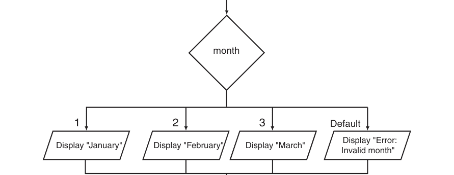

在流程图中，菱形符号表示 `month`，这是一个变量名。如果 `month` 变量包含值 1，程序将显示 January（一月）。如果 `month` 变量包含值 2，程序将显示 February（二月）。如果 `month` 变量包含值 3，程序将显示 March（三月）。如果 `month` 变量不包含这些任何一个值，则执行标记为 Default（默认）的操作。在这种情况下，程序将显示 Error: Invalid month（无效月份）。

### 4.10 switch 语句

以下是 Java 中 switch 语句的标准格式：

```
switch (testExpression) {
  case value_1:
    statement;
    statement;
    etc.
    break;
  case value_2:
    statement;
    statement;
    etc.
    break;
  根据需要插入多个 case 部分。
  case value_N:
    statement;
    statement;
    etc.
    break;
  default:
    statement;
    statement;
    etc.
    break;
}
```

> `testExpression` 是一个变量或表达式。
> 如果 `testExpression` 等于 `value_1`，则执行这些语句。
> 如果 `testExpression` 等于 `value_2`，则执行这些语句。
> 如果 `testExpression` 等于 `value_N`，则执行这些语句。
> 如果 `testExpression` 不匹配任何 case 值，则执行 default 部分。

```java
case 'C':
    System.out.println("You entered C.");
    break;
default:
    System.out.println("That's not A, B, or C!");
}
```

### 程序输出（示例输入已加粗）

**Enter A, B, or C:** **B [Enter]**

**You entered B.**

### 程序输出（示例输入已加粗）

**Enter A, B, or C:** **F [Enter]**

**That's not A, B, or C!**

出现在第 27、30 和 33 行的 `break` 语句。`case` 语句显示了程序开始执行块的位置，而 `break` 语句显示了程序停止的位置。如果没有 `break` 语句，程序将执行从匹配的 `case` 语句到块结束的所有行。

> 注意：`default` 部分（如果没有 `default` 则是最后一个 `case` 部分）不会中断语句。某些程序员为了一致性仍然倾向于为其写一个。

代码列表 4-16 中的程序是代码列表 4-15 的修改版本，去掉了 `break` 语句。

## 代码列表 4-16 (NoBreaks.java)

```java
import java.util.Scanner; // 需要 Scanner
/**
 * 此程序演示了不带任何 break 语句的
 * switch 语句。
 */
public class NoBreaks
{
    public static void main(String[] args) 
    {
        String input; // 用于存储键盘输入
        char choice; // 用于存储用户的选择

        // 创建一个 Scanner 对象来读取输入。
        Scanner keyboard = new Scanner(System.in);
```

### 4.10 switch 语句

```java
// 请求用户输入 A, B, 或 C。
System.out.print("Enter A, B, or C: ");
input = keyboard.nextLine();
choice = input.charAt(0); // 获取第一个字符
```

```java
// 确定用户输入了什么字符。
switch (choice) {
    case 'A':
        System.out.println("You entered A.");
    case 'B':
        System.out.println("You entered B.");
    case 'C':
        System.out.println("You entered C.");
    default:
        System.out.println("That's not A, B, or C!");
}
```

### 程序输出（示例输入已加粗）

**Enter A, B, or C:** **[Enter]**

**You entered A.**

**You entered B.**

**You entered C.**

**That's not A, B, or C!**

### 程序输出（示例输入已加粗）

**Enter A, B, or C:** **[Enter]**

**You entered C.**

**That's not A, B, or C!**


如果没有 `break` 语句，程序会“穿透”（falls through）所有位于匹配的 `case` 表达式语句下方的语句。有时这正是你想要的。例如，代码列表 4-17 中的程序要求用户选择宠物食品的等级。可选范围是 A、B 和 C。`switch` 语句可以识别大写或小写字母。

## 代码列表 4-17 (PetFood.java)

```java
import java.util.Scanner; // 需要 Scanner 类

/**
 * 此程序演示了一个 switch 语句。
 */
public class PetFood
{
    public static void main(String[] args)
    {
        String input; // 用于存储键盘输入
        char feedGrade; // 用于存储饲等级

        // 创建一个 Scanner 对象来读取输入。
        Scanner keyboard = new Scanner(System.in);

        // 获取所需的宠物食品等级。
        System.out.println("Our pet food is available in " \
            + "three grades:");
        System.out.println("A, B, and C. Which do you want " \
            + "pricing for ?");
        input = keyboard.nextLine();
        feedGrade = input.charAt(0); // 获取第一个字符。

        // 确定输入的等级。
        switch(feedGrade)
        {
            case 'a':
                System.out.println("30 cents per lb.");
                break;
            case 'b':
                System.out.println("20 cents per lb.");
                break;
            case 'c':
                System.out.println("15 cents per lb.");
                break;
            default:
                System.out.println("Invalid choice.");
        }
    }
}
```

### 程序输出（示例输入已加粗）

Our dog food is available in three grades:

A, B, and C. Which do you want pricing for? **b** [Enter]

20 cents per lb.

### 程序输出（示例输入已加粗）

Our dog food is available in three grades:

A, B, and C. Which do you want pricing for? **B** [Enter]

20 cents per lb.

## 4.10 switch 语句

当用户输入 `'a'` 时，对应的 `case` 没有关联的语句，因此程序会穿透到下一个 `case`，即对应 `'A'`：

```java
case 'a':
case 'A':
    System.out.println("30 cents per lb.");
    break;
```

相同的技术也用于 `'b'` 和 `'c'`。

如果你使用的是 Java 7 之前的版本，`switch` 语句可以是 `char`、`byte`、`short` 或 `int` 值。然而，从 Java 7 开始，测试可以是 `string`。代码列表 4-18 中的程序演示了这一点。

## 代码列表 4-18 (Seasons.java)

```java
import java.util.Scanner;

/**
 * 此程序将季节的英文名称
 * 翻译成西班牙语。
 */
public class Seasons {

    public static void main(String[] args) {
        String input;
        Scanner keyboard = new Scanner(System.in);

        // 从用户获取季节。
        System.out.print("Enter the name of season: ");
        input = keyboard.nextLine();

        // 将季节翻译成西班牙语。
        switch (input) {
            case "spring":
                System.out.println("primavera");
                break;
            case "summer":
                System.out.println("verano");
                break;
            case "fall":
                System.out.println("otoño");
                break;
            case "winter":
                System.out.println("invierno");
                break;
        }
    }
}
```

### 程序输出（示例输入已加粗）

Enter the name of season: **summer** [Enter]

el verano

### 程序输出（示例输入已加粗）

Enter the name of season: **fall** [Enter]

el otoño

## Checkpoint

**4.24** 通过编写一个 `switch` 语句完成程序骨架：如果用户输入 1 则显示 "one"，输入 2 则显示 "two"，输入 3 则显示 "three"。如果输入的不是 1、2 或 3，程序应显示错误消息。

```java
import java.util.Scanner;
public class Checkpoint
{
    public static void main(String[] args)
    {
        int userInput;
        Scanner keyboard = new Scanner(System.in);
        System.out.print("Enter of the numbers 1, 2, or 3: ");
        userInput = keyboard.nextInt();
        // 在此处编写 switch 语句。
        
    }
}
```

**25** 将 `if-else if` 语句重写为 `switch` 语句。

```java
if (selection == 'A')
    System.out.println("You selected A.");
else if (selection == 'B')
    System.out.println("You selected B.");
else if (selection == 'C')
    System.out.println("You selected C.");
else if (selection == 'D')
    System.out.println("You selected D.");
else
    System.out.println("Not good with letters, eh?");
```

**26** 解释为什么你不能将 `if-else if` 语句转换为 `switch` 语句。

```java
if (temp == 100)
    x = 0;
else if (population > 1000)
    x = 1;
else if (rate < .1)
    x = -1;
```

**27** 下面的 `switch` 语句哪里有问题？

```java
// 这段代码有错误！！
witch (temp)
{
    case temp < 0 :
        System.out.println("Temp is negative.");
        break;
    case temp == 0:
        System.out.println("Temp is zero.");
        break;
    case temp > 0 :
        System.out.println("Temp is positive.");
        break;
}
```

**28** 下面的代码将显示什么？

```java
int funny = 7, serious = 15;
funny = serious * 2;
switch (funny)
{
    case 0:
        System.out.println("That is funny.");
        break;
    case 30:
        System.out.println("That is serious.");
        break;
    case 32:
        System.out.println("That is seriously funny.");
        break;
    default:
        System.out.println(funny);
}
```

## 4.11 使用 DecimalFormat 类格式化数字

> **概念：** `DecimalFormat` 类可用于格式化舍入到指定小数位数的浮点数的显示。

在第 2 章中，你学习了如何使用 `System.out.printf` 方法对控制台输出格式化。如果你想在图形界面（例如消息对话框）中显示格式化输出，将需要使用不同的方法。在本节中，我们将讨论 `DecimalFormat` 类，无论数字显示在控制台窗口还是消息对话框中，都可以用于格式化。

`DecimalFormat` 类是 Java API 的一部分，但你的程序并不能可以使用它。要使用 `DecimalFormat` 类，你必须在程序的顶部包含以下导入语句：

```java
import java.text.DecimalFormat;
```

该语句使你的程序可以使用该类。然后，在程序中需要格式化数字的地方，创建一个 `DecimalFormat` 对象。这是一个示例：

```java
DecimalFormat formatter = new DecimalFormat("#0.00");
```

该语句创建了 `DecimalFormat` 类的实例。语句执行后，`formatter` 变量将引用该对象。注意传递给构造函数的字符串中的字符。`#` 字符表示如果该位置存在数字，则显示该数字；如果该位置没有数字，则不显示任何数字。`0` 字符也表示如果该位置存在数字，则显示该数字。然而，如果该位置没有数字，则应显示 `0`。此外，注意小数点后有两个零。这表示数字应该四舍五入到两位小数。

要使用 `DecimalFormat` 对象格式化数字，你可以调用它的 `format` 方法并将要格式化的数字作为参数传递。你可以向该方法传递浮点值或整数值。该方法返回一个包含格式化后数字的字符串。例如，查看代码列表 4-19 中的程序。

### 代码列表 4-19 (Format1.java)

```java
import javax.swing.JOptionPane;
import java.text.DecimalFormat;

/**
 * 此程序使用 DecimalFormat 类在消息对话框中显示
 * 格式化的数字。
 */
public class Format1
{
    public static void main(String[] args)
    {
        double number1 = 0.1666666666666667;
        double number2 = 1.6666666666666667;
        double number3 = 16.666666666666666;
        double number4 = 166.66666666666666;

        // 创建一个 DecimalFormat 对象。
        DecimalFormat formatter = new DecimalFormat("#0.00");

        // 显示格式化后的变量内容。
        JOptionPane.showMessageDialog(null, formatter.format(number1));
        JOptionPane.showMessageDialog(null, formatter.format(number2));
        JOptionPane.showMessageDialog(null, formatter.format(number3));
        JOptionPane.showMessageDialog(null, formatter.format(number4));
    }
}
```

### 图 4-15 代码列表 4-19 的输出

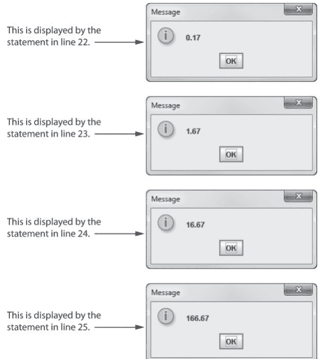

注意格式化模式中 `#` 字符和 `0` 字符输出之间的细微差别：

- 如果数字在格式化模式中 `#` 字符的位置有数字，则显示该数字。否则，不显示任何数字。
- 如果数字在格式化模式中 `0` 字符的位置有数字，则显示该数字。否则，显示 `0`。

例如，查看代码列表 4-20 中的程序。它与代码列表 4-19 显示的程序相同，但使用了不同的格式模式。程序的输出如图 4-16 所示。

### 代码列表 4-20 (Format2.java)

```java
import javax.swing.JOptionPane;
import java.text.DecimalFormat;

/**
 * 此程序使用 DecimalFormat 类在消息对话框中显示
 * 格式化的数字。
 */

public class Format2
{
    public static void main(String[] args)
    {
        double number1 = 0.16666666666666667;
        double number2 = 1.66666666666666667;
        double number3 = 16.66666666666667;
        double number4 = 166.6666666666667;

        // 创建一个 DecimalFormat 对象。
        DecimalFormat formatter = new DecimalFormat("00.00");

        // 显示格式化后的变量内容。
        JOptionPane.showMessageDialog(null, formatter.format(number1));
        JOptionPane.showMessageDialog(null, formatter.format(number2));
        JOptionPane.showMessageDialog(null, formatter.format(number3));
        JOptionPane.showMessageDialog(null, formatter.format(number4));
    }
}
```

### 图 4-16 代码列表 4-20 的输出

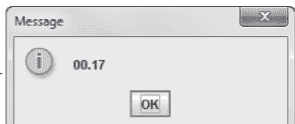
由第 22 行语句显示。

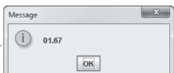
由第 23 行语句显示。

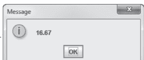
由第 24 行语句显示。

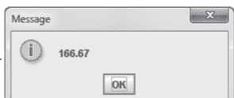
由第 25 行语句显示。

你可以在格式模式中插入逗号来创建数字分隔符。代码列表 4-21 演示了这一点。程序的输出如图 4-17 所示。

### 代码列表 4-21 (Format3.java)

```java
import javax.swing.JOptionPane;
import java.text.DecimalFormat;

/**
 * 此程序使用 DecimalFormat 类在消息对话框中显示
 * 格式化的数字。
 */

public class Format3
{
    public static void main(String[] args)
    {
        double number1 = 1233.899;
        double number2 = 1233.899;
        double number3 = 12345.899;
        double number4 = 123456.899;
        double number5 = 1234567.899;

        // 创建一个 DecimalFormat 对象。
```


## 代码示例

```java
20      DecimalFormat formatter = new DecimalFormat("###.00");

21

22      // 显示格式化后的变量内容。

23      JOptionPane.showMessageDialog(null, formatter.format(number1));

24      JOptionPane.showMessageDialog(null, formatter.format(number2));

25      JOptionPane.showMessageDialog(null, formatter.format(number3));

26

27      JOptionPane.showMessageDialog(null, formatter.format(number4));

28  }

29  JOptionPane.showMessageDialog(null, formatter.format(number5));
```

### 图 4-17 代码列表 4-21 的输出

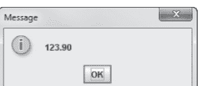
由第 23 行语句显示。

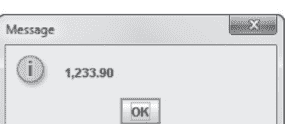
由第 24 行语句显示。

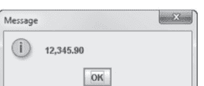
由第 25 行语句显示。

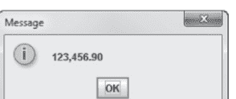
由第 26 行语句显示。

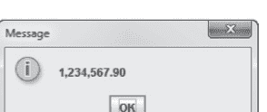
由第 27 行语句显示。

你也可以通过在格式模式的最后一个位置写入 `%` 字符将数字格式化为百分比。这会导致数字乘以 100，并在末尾附加 `%` 字符。代码列表 4-22 演示了这一点。程序的输出如图 4-18 所示。

### 代码列表 4-22 (Format4.java)

```java
1 import javax.swing.JOptionPane;

2 import java.text.DecimalFormat;

3 

4 /**
 * 此程序使用 DecimalFormat 类在消息对话框中显示
 * 格式化的数字。
 */

8

9 public class Format4

10 {

11   public static void main(String[] args)

12   {

13     double number1 = 0.12;

14     double number2 = 0.05;

15     // 创建一个 DecimalFormat 对象。

16     DecimalFormat formatter = new DecimalFormat("#00%");

17     

18     // 显示格式化后的变量内容。

19     JOptionPane.showMessageDialog(null, formatter.format(number1));

20     JOptionPane.showMessageDialog(null, formatter.format(number2));

21   }

22 }
```

### 图 4-18 代码列表 4-22 的输出

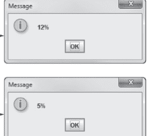
由第 20 行语句显示。

由第 21 行语句显示。

## 检查点

4.29 假设双类型变量 `number` 持有值 459.6329。使用什么格式模式配合 `DecimalFormat` 对象将数字显示为 00459.633？

4.30 假设 `double` 类型变量 `number` 的值为 0.179。你会使用 `DecimalFormat` 对象的什么格式化模式将该数字显示为 .18？

4.31 假设 `double` 类型变量 `number` 的值为 7634869.1。你会使用 `DecimalFormat` 对象的什么格式化模式将该数字显示为 7,634,869.10？

# 第 4 章 决策结构

## 4.12 关注问题解决：SalesCommission 类

在本节中，我们将研究一个实现本章中讨论的许多主题的案例研究。此外，我们还将讨论如何将一个冗长的算法分解为几个方法。

Hal's Home Emporium 是一家个人电脑零售商。Hal 的员工严格按照佣金制工作。在月底，每位销售人员的佣金将根据表 4-11 进行计算。

### 表 4-11 销售佣金率

| 本月销售额 | 佣金率 |
| :--- | :--- |
| 少于 $10,000 | 5% |
| $10,000–14,999 | 10% |
| $15,000–17,999 | 12% |
| $18,000–21,999 | 14% |
| $22,000 或更多 | 16% |

例如，每月销售额为 $16,000 的销售人员将获得 12% 的佣金（$1,920）。另一位每月销售额为 $20,000 的销售人员将获得 14% 的佣金（$2,800）。

由于员工是每月发放工资的，Hal 允许每位员工每月预支最高 $1,500。在计算销售佣金时，每位员工的预支金额将从佣金中扣除。如果任何销售人员的佣金少于其预支金额，他们必须向 Hal 补交差额。

这里有两个例子：Beverly 和 John 分别有 $21,400 和 $12,600 的销售额。Beverly 和 John 都预支了 $1,500。在月底，Beverly 获得了一张 $1,260 的支票，而 John 拿了 $1,496，但 John 必须归还 $240。

现在我们来看一个简化月底佣金计算的程序。程序的核心是一个 `SalesCommission` 类，它持有销售人员的主要数据，确定佣金率并计算销售人员的薪资。图 4-19 显示该类的 UML 图。

**图 4-19** SalesCommission 类的 UML 图

| SalesCommission |
| :--- |
| - sales : double |
| - rate : double |
| - commission : double |
| - advance : double |
| - pay : double |
| + SalesCommission(s: double, a: double) |
| - setRate() : void |
| + calculatePay() : void |
| + getPay() : double |
| + getCommission() : double |
| + getRate() : double |
| + getAdvance() : double |
| + getSales() : double |

### 表 4-12 SalesCommission 类字段

| 字段 | 说明 |
| :--- | :--- |
| sales | 用于存储销售人员每月总销售额的变量。 |
| rate | 用于存储销售人员佣金率的变量。 |
| commission | 用于存储佣金的变量。 |
| advance | 用于存储销售人员已提取预支工资金额的变量。 |
| pay | 用于存储销售人员总薪资金额的变量。 |

### 表 4-13 SalesCommission 类方法

| 方法 | 说明 |
| :--- | :--- |
| Constructor | 构造函数接受两个参数：销售人员的销售额和该销售人员提取的预支工资金额。该方法将这些值赋值给 `sales` 和 `advance` 字段，然后调用 `calculatePay` 方法。 |
| setRate | 一个私有方法，根据销售人员的销售额设置佣金率。该方法从 `calculatePay` 方法调用。 |
| calculatePay | 一个私有方法，用于计算销售人员的佣金和实际薪资。该方法从构造函数调用。 |
| getPay | 以 `double` 类型返回应付销售人员的总薪资，该金额为佣金减去预支工资。 |
| getCommission | 以 `double` 类型返回销售人员赚取的佣金金额。 |
| getRate | 以 `double` 类型返回销售人员销售额对应的佣金率。 |
| getAdvance | 以 `double` 类型返回预支工资金额。 |
| getSales | 以 `double` 类型返回销售额。 |

## 代码示例

```java
21   // 创建一个 Scanner 对象来读取输入。

22   Scanner keyboard = new Scanner(System.in);

23

24   System.out.println("此程序将显示 "

25   + "销售人员的薪资报告。");

26   System.out.println("请输入以下信息:");

27

28   // 请求用户销售额和预付金额

29   System.out.println("销售额: $");

30   sales = keyboard.nextDouble();

31   System.out.println("预付金额: $");

32   advancePay = keyboard.nextDouble();

33

34   // 创建 SalesCommission 类的实例

35   并将数据传递给构造函数。

36   SalesCommission payInfo =

37   new SalesCommission(sales, advancePay);

38

39   // 显示销售人员的薪资报告。

40   System.out.println("\n薪资报告");

41   System.out.println("-------------------------------------");

42   System.out.println("销售: $" + dollar.format(payInfo.getSales()));

43   System.out.println("佣金率: " + dollar.format(payInfo.getRate()));

44   System.out.println("佣金: $" + dollar.format(payInfo.getCommission()));

45   System.out.println("预付金额: $" + dollar.format(payInfo.getAdvance()));

46   System.out.println("剩余薪资: $" + dollar.format(payInfo.getRemaining()));

51   }
```

### 程序输出（示例输入已加粗显示）

此程序将显示销售人员的薪资报告。
请输入以下信息：

销售额: $19600 [回车]
预付金额: $1000 [回车]

薪资报告

```
------------------------------------
销售: $19,600.00
佣金率: 14%
佣金: $2,744.00
预付金额: $1,000.00
剩余薪资: $1,744.00
```

# 使用 Random 类生成随机数

概念：随机数用于各种应用程序。Java 提供了 `Random` 类，你可以用它来生成随机数。

随机数在许多不同的编程任务中非常有用。以下是几个示例：

- 随机数常用于游戏，因为电脑游戏让玩家掷骰子，使用随机数来代表骰子的值。显示从洗过的牌中抽取牌片的程序使用随机数来表示牌面的点值。
- 随机数在模拟程序中非常有用。在某些模拟中，计算机必须随机决定人、动物、昆虫或其他生物的行为。可以构建包含随机数的公式，用它来确定程序中发生的各种动作和事件。
- 随机数在必须随机选择数据进行分析的统计程序中非常有用。
- 随机数常用于计算机安全，以加密敏感数据。

Java API 提供了一个 `Random` 类，你可以用它来生成随机数。该类是 `java.util` 包的一部分，因此任何使用它的程序都需要一个 import 语句，例如：

```java
import java.util.Random;
```

你使用如下语句从 `Random` 类创建一个对象：

```java
Random randomNumbers = new Random();
```

该语句执行了以下操作：

- 它声明了一个名为 `randomNumbers` 的变量。
- 表达式 `Random()` 创建了 `Random` 类的一个实例。
- 等号将 `Random` 类的地址赋值给 `randomNumbers` 变量。

在该语句执行后，`randomNumbers` 变量引用一个 `Random` 对象。一旦你创建了 `Random` 对象，就可以调用它的 `nextInt` 方法来获取随机整数。下面的代码显示了一个示例：

```java
// 声明一个 int 变量。

int number;

// 创建一个 Random 对象。

Random randomNumbers = new Random();

// 获取一个随机整数并将其赋值给 number。

number = randomNumbers.nextInt();
```

在该代码执行后，`number` 变量包含一个随机整数。如果你不带参数地调用 `nextInt` 方法（如示例所示），返回的整数位于 -2,147,483,648 和 +2,147,483,647 之间。或者，你可以传递一个参数来指定生成数字范围的上限。在以下语句中，赋值给 `number` 的值位于 0 到 99 之间：

```java
number = randomNumbers.nextInt(100);
```

你可以通过加或减一个值来将数值范围向上或向下移动。在以下语句中，调用 `nextInt` 方法获取一个 0 到 9 范围内的随机数，然后对其加 1。赋值给 `number` 的数字位于 1 到 10 的范围内：

```java
number = randomNumbers.nextInt(10) + 1;
```

以下语句显示了另一个示例。它将随机整数 -50 和 +49 赋值给 `number`：

```java
number = randomNumbers.nextInt(100) - 50;
```

`Random` 类还有其他生成随机数的方法，表 4-14 对它们进行了总结。

### 表 4-14 Random 类的一些方法

| 方法 | 描述 |
| :--- | :--- |
| `nextDouble()` | 返回 `double` 类型的随机数。范围将是 0.0 到 1.0。 |
| `nextFloat()` | 返回 `float` 类型的随机数。范围将是 0.0 到 1.0。 |
| `nextInt()` | 返回 `int` 类型的随机数。范围将是 -2,147,483,648 到 +2,147,483,647。 |
| `nextInt(int n)` | 接收一个整数参数 `n`，返回 0 到 `n`（不包含 `n`）之间的整数。 |
| `nextLong()` | 返回 `long` 类型的随机数。范围将是 -9,223,372,036,854,775,808 到 +9,223,372,036,854,775,807。 |

## 4.13 使用类生成随机数

```java
int number1; // 第一个数字

int number2; // 第二个数字

int sum; // 和

int userAnswer; // 用户答案

// 创建一个 Scanner 对象用于输入。

Scanner keyboard = new Scanner(System.in);

// 创建一个 Random 对象。

Random random = new Random();

// 获取两个随机数。

number1 = random.nextInt(100);

number2 = random.nextInt(100);

// 显示一个加法题。

System.out.println("计算 " + number1 + " + " + number2 + " 的结果：");

// 获取用户的答案。

userAnswer = keyboard.nextInt();

// 检查答案是否正确。

sum = number1 + number2;

if (userAnswer == sum) {

    System.out.println("正确！");

} else {

    System.out.println("错误，答案是 " + sum);

}
```


### 程序输出（示例输入已加粗显示）

计算 52 + 19 的结果：
71 [回车]
正确！

### 程序输出（示例输入已加粗显示）

计算 27 + 73 的结果：
101 [回车]
错误，答案是 100

# 重点关注：

# 使用对象模拟骰子

传统的骰子有六面，代表 1-6 的值。然而，有些游戏使用不同面数的特殊骰子。例如，幻想角色扮演游戏地下城与龙（Dungeons & Dragons®）使用 4、6、8、10、12 和 20 面。

假设你正在编写一个程序，需要一个接收面数作为参数的骰子构造函数。一种简单的方法是编写一个带有该参数构造函数的骰子类。该类还将具有适当的方法来掷骰子并获取骰子的值。图 4-20 显示了此类类的 UML 图，代码列表 4-26 显示了代码。

## 图 4-20 Die 类 UML 图

| Die |
| :--- |
| - sides: int |
| - value: int |
| + Die(numSides : int) |
| + roll(): void |
| + getSides() : int |
| + getValue(): int |

## 代码列表 4-26 (Die.java)

```java
import java.util.Random;

/**
 * Die 类模拟指定面数的骰子。
 */
public class Die
{
    private int sides;      // 面数
    private int value;      // 骰子的值

    /**
     * 构造函数执行骰子的初始投掷。
     * 骰子的面数作为参数传递。
     */
    public Die(int numSides)
    {
        sides = numSides;
        roll();
    }

    /**
     * 投掷骰子。
     */
    public void roll()
    {
        Random rand = new Random();
        value = rand.nextInt(sides) + 1;
    }

    /**
     * 获取面数。
     */
    public int getSides()
    {
        return sides;
    }

    /**
     * 获取骰子的值。
     */
    public int getValue()
    {
        return value;
    }
}
```

让我们仔细查看该类的代码：
**第 9 行和 10 行：** 这些语句声明了两个字段。`sides` 字段将存储骰子的面数，而 `value` 字段将存储骰子掷出的值。
**第 18–22 行：** 这是构造函数。注意构造函数有一个用于面数的参数。该参数在第 20 行被赋值给 `sides` 字段。第 21 行调用了 `roll` 方法，该方法模拟了骰子的掷。

## 第 4 章 决策结构

第 29–36 行：这是 `roll` 方法，用于模拟骰子的掷。第 32 行创建了一个 `Random` 对象，并通过变量 `rand` 引用了它。第 35 行使用该 `Random` 对象获取一个处于该骰子范围的随机数。例如，如果 `sides` 被设置为 6，则表达式 `rand.nextInt(sides) + 1` 将返回一个 1 到 6 之间的随机整数。该随机数被赋值给 `value` 字段。

第 43–46 行：这是 `getSides` 方法，一个返回 `sides` 字段的访问器。

第 53–56 行：这是 `getValue` 方法，一个返回 `value` 字段的访问器。

代码 4-27 中的程序演示了这个类。它创建了两个 `Die` 类的实例：一个是 6 面的，另一个是 12 面的。它模拟了掷骰子的过程。

## 代码列表 4-27 (DiceDemo.java)

```java
/**
 * 此程序模拟掷骰子。
 */
public class DiceDemo
{
    public static void main(String[] args)
    {
        final int DIE1_SIDES = 6; // 1 号骰子的面数
        final int DIE2_SIDES = 12; // 2 号骰子的面数

        // 创建两个 Die 类的实例。
        Die die1 = new Die(DIE1_SIDES);
        Die die2 = new Die(DIE2_SIDES);

        // 显示初始信息。
        System.out.println("This simulates the rolling of a " +
            DIE1_SIDES + " sided die and a " +
            DIE2_SIDES + " sided die.");

        // 掷骰子。
        System.out.println("Rolling the dice.");
        die1.roll();
        die2.roll();

        // 显示骰子的值。
        System.out.println(die1.getValue() + " " + die2.getValue());
    }
}
```

## 程序输出

正在模拟掷一个 6 面骰子和一个 12 面骰子。
正在掷骰子。
5 10

# 4.14 应当避免的常见错误

让我们仔细查看该程序：

第 9-10 行：
这些语句声明了两个常量。`DIE1_SIDES` 是第一个骰子的面数 (6)，`DIE2_SIDES` 是第二个骰子的面数 (12)。

第 13-14 行：
这些语句创建了两个 `Die` 类的实例。注意 `DIE1_SIDES`（值为 6）被传递给第 13 行的构造函数，而 `DIE2_SIDES`（值为 12）被传递给第 14 行的构造函数。结果是，`die1` 代表一个 6 面的 `Die` 对象，`die2` 代表一个 12 面的 `Die` 对象。

第 17–19 行：
该语句显示了程序的相关信息。

第 23–24 行：
这些语句调用了 `Die` 的 `roll` 方法来模拟掷骰子。

第 27–28 行：
该语句显示了骰子的值。

## 应当避免的常见错误

以下列表描述了在学习本章主题时常见的几种错误：

- 使用 `=` 代替 `==` 来比较基本类型值。记住，`=` 是赋值运算符，而 `==` 用于相等性测试。
- 使用 `==` 代替 `equals` 来比较 `String` 对象。你不能使用 `==` 运算符来比较字符串与其他字符串的内容。相反，你必须使用 `equals` 或 `compareTo` 方法。
- 忘记将表达式放在括号中。
- 忘记将代码块放在大括号中。
- 误用条件运算符。
- 在 `switch` 语句中忘记 `default` 分支。

## 第 4 章 决策结构

18. 正或错：当一个语句嵌套在另一个语句的 if 子句中时，只有当外部语句的布尔表达式为真时，才会执行内部语句。

19. 正或错：当一个语句嵌套在另一个语句的 else 子句中时，只有当外部语句的布尔表达式为假时，才会执行内部语句。

20. 正或错：变量的作用范围局限于其定义的块。

# 找错误

找出以下代码中的错误。

1. // 警告！这段代码包含错误！
```java
if (x == 1);
    y = 2;
else if (x == 2);
    y = 3;
else if (x == 3);
    y = 4;
```

2. // 警告！这段代码包含一个错误！
```java
if (average == 100)
    System.out.println("Perfect Average!");
```

3. // 警告！这段代码包含多个错误！
```java
if (num2 == 0)
    ..out.println("Division by zero is not possible.");
    System.out.println("Please run the program again.");
    System.out.println("and enter a number besides zero.");
else
    Quotient = num1 / num2;
    System.out.print("The quotient of " + Num1);
    System.out.print(" divided by " + Num2 + " is ");
    System.out.println(Quotient);
```

4. // 警告！这段代码包含多个错误！
```java
witch (score)
{
    case (score > 90)
        grade = 'A';
        break;
    case (score > 80)
        grade = 'B';
        break;
    case (score > 70)
        grade = 'C';
        break;
    case (score > 60)
        grade = 'D';
        break;
    default:
        grade = 'F';
}
```

# 复习题与练习

5. 下述语句应该判断 x 是否不大于 20。它哪里有问题？
`if (1x > 20)`

6. 下述语句应该判断 count 是否在 0 到 100 之间。它哪里有问题？
`if (count >= 0 || count <= 100)`

7. 下述语句应该判断 count 是否在 0 到 100 范围之外。它哪里有问题？
`if (count < 0 && count > 100)`

8. 下述语句应该如果 a 小于 10 则给 z 赋值 0，否则给 z 赋值 7。
`z = (a < 10) ? 0 : 7;`

9. 假设 partnumber 代表一个 String 对象。下述 if 语句应该执行忽略大小写的比较。
`if (partNumber.equals("BQ789W4"))`
available = true;

# 算法工作

1. 写一个 if 语句，当 y 等于 0 时给 x 赋值 100。

2. 写一个 if-else 语句，当 y 等于 10 时给 x 赋值 0。否则给 x 赋值 1。

3. 使用下表，写一个 if-else-if 语句，根据 sales 的值给 commission 赋值 .10、.15 或 .20。

| 销售额 (Sales) | 佣金率 |
| :--- | :--- |
| $10,000 以下 | 10% |
| $10,000 到 $15,000 | 15% |
| $15,000 以上 | 20% |

4. 写一个 if 语句，当 flag 变量为 true 时将 hours 赋值为 10。

5. 写嵌套语句执行以下测试：如果 amount1 大于 10 且 amount2 小于 100，显示其中较大的值。

6. 写一个 if 语句，如果 grade 在 0 到 100 范围内，打印消息 "The number is valid"。

7. 写一个 if 语句，如果 temperature 在 50 到 150 范围内，打印消息 "The number is valid"。

8. 写一个 if 语句，如果 hours 在 0 到 80 范围之外，打印消息 "The number is not valid"。

9. 写一个 if-else 语句，按字母顺序显示对象 title1 和 title2。

10. 将以下 if-else-if 语句转换为 switch 语句：
```java
if (choice == 1)
{
    System.out.println("You selected 1.");
}
else if (choice == 2 || choice == 3)
{
    System.out.println("You selected 2 or 3.");
}
else if (choice == 4)
{
    System.out.println("You selected 4.");
}
else
{
    System.out.println("Select again.");
}
```

11. 将条件表达式与执行相同操作 if-else 语句匹配：
a. `q < y ? a + b : x * 2;`
b. `q < y ? x * 2 : a + b;`
c. `q < y ? 0 : 1;`

```java
if (x < y)
    q = 0;
else
    q = 1;

if (x < y)
    q = a + b;
else
    q = x * 2;

if (x < y)
    q = x * 2;
else
    q = a + b;
```


## 编程挑战

### 12. 假设 double 变量值为 0.29。使用什么 DecimalFormat 格式显示数字为 00000.0？

### 13. 假设 double 变量值为 0.29。使用什么 DecimalFormat 格式显示数字为 0？

### 14. 假设 double 变量值为 456198736.38。使用什么 DecimalFormat 格式显示数字为 456,198,736.38？

# 简答

### 1. 解释“条件执行”。

### 2. 解释为什么位置的分号会导致 if 语句运行异常。

### 3. 为什么对括号内的语句缩进是良好的建议？

### 4. 使用 `==` 运算符比较两个 `String` 对象会发生什么？

### 5. 解释 flag 变量的用途。flag 变量应该是什么数据类型？

### 6. 在 if-else 语句末尾没有放置 else，程序员承担了什么风险？

### 7. 简述 `&&` 运算符如何工作。

### 8. 简述 `||` 运算符如何工作。

### 9. 为什么关系运算符被称为“关系”？

### 10. 如何在类中使用私有方法分解算法？

# 编程挑战

## 1. 罗马数字

写一个程序，提示用户输入 1 到 10 之间的数字。程序应该显示该数字的罗马数字。如果数字不在 1-10 范围内，程序应显示错误信息。

## 2. 时间计算器

写一个程序要求用户输入秒数。

- 一分钟有 60 秒。如果输入的秒数大于等于 60，程序应该显示分钟数。
- 一小时有 3600 秒。如果输入的秒数大于等于 3600，程序应该显示小时数。
- 一天有 86400 秒。如果输入的秒数大于等于 86400，程序应该显示天数。

## 3. TestScores 类

定义一个 `TestScores` 类，其有存储三个成绩的字段（如果你已经为第 3 章挑战 8 写了 `TestScores` 类，可以修改它）。类构造函数应该接受三个分数作为参数，并将这些参数赋值给成绩字段。类还应该有成绩的访问器方法、一个返回成绩平均分的方法以及一个返回根据平均分分配的字母等级的方法。使用下表的评分方案。

| 成绩平均分 | 字母等级 |
| :--- | :--- |
| 90–100 | A |
| 80–89 | B |
| 70–79 | C |
| 60–69 | D |
| 低于 60 | F |

## 4. 软件销售

软件公司销售售价为 $99 的软件包。根据下表给予折扣：

| 数量 | 折扣 |
| :--- | :--- |
| 10–19 | 20% |
| 20–49 | 30% |
| 50–99 | 40% |
| 100 或更多 | 50% |

设计一个类，存储销售数量，并有一个返回购买总成本的方法。

## 5. BankCharges 类

银行每月收取 $10 费用，并在商业账户收取以下支票费：

- 少于 20 支支票时，每支 $0.10
- 20 到 39 支支票时，每支 $0.08
- 40 到 59 支支票时，每支 $0.06
- 60 支或更多支票时，每支 $0.04

如果账户余额（在任何费用之前）低于 $400，银行还会额外收取 $15。设计一个存储账户结算余额和支票数量的类。它还应该有一个返回每月银行服务费的方法。

## 6. ShippingCharges 类

快速货运公司收取以下费率：

| 包重量（公斤） | 每 500 英里的费率 |
| :--- | :--- |
| 2 Kg 或少 | $1.10 |
| 大于 2 Kg 但小于 6 Kg | $2.20 |
| 大于 6 Kg 但不超过 10 Kg | $3.70 |
| 大于 10 Kg | $4.80 |

每 500 英里的运费不按比例。例如，如果一个 2 Kg 的包裹运输了 550 英里，费用将是 $2.20。

设计一个类存储包裹重量，并有一个返回运费的方法。

## 7. 脂肪卡路里计算器

在程序中演示该类，要求用户输入某种食品的卡里数和脂肪克数。程序应显示来自食品的卡里数百分比。如果卡里数少于食品总卡里数的 30%，则应显示一条消息指示该食品为低脂肪。

由于脂肪的卡里数不能大于总卡里数，如果用户输入的脂肪卡里数大于总卡里数，程序应显示一条错误消息，指示这些数字是非法的。

## 8. 跑步比赛

设计一个类，存储三位跑步者的名字以及他们完成比赛所需的时间（以分钟为单位）。该类应具有相应的方法，用于返回第一、第二或第三名跑步者的名字。

## 9. 声速

下表显示了声在空气、水和钢中的近似传播速度。

| 介质 | 速度 |
|---|---|
| 空气 | 每秒1100英尺 |
| 水 | 每秒4900英尺 |
| 钢 | 每秒16400英尺 |

设计一个类，在 `distance` 字段中存储距离，并计算声波传播的距离（以英尺为单位）。该类应具有该字段的相应访问方法（accessor）和修改方法（mutator）。此外，该类还应具有以下方法：

- `getSpeedInAir`。此方法应返回声波在空气中传播 `distance` 字段中距离所需的秒数。计算声波在空气中传播指定距离的时间公式为：
  Time = distance/1100
- `getSpeedInWater`。此方法应返回声波在水中传播 `distance` 字段中距离所需的秒数。计算声波在水中传播指定距离的时间公式为：
  Time = distance/4900
- `getSpeedInSteel`。此方法应返回声波在钢中传播 `distance` 字段中距离所需的秒数。计算声波在钢中传播指定距离的时间公式为：
  Time = distance/16400

编写一个程序来演示该类。程序应显示一个菜单，允许用户选择空气、水或钢。一旦用户做出选择，就应要求其输入声波在所选介质中传播的距离。程序将显示所需的时间。检查用户是否选择了菜单中的可用选项之一。

## 10. 冰点与沸点

下表列出了几种物质在华氏度下的冰点和沸点。

| 物质 | 冰点 | 沸点 |
|---|---|---|
| 乙醇 | -173 | 172 |
| 氧气 | -362 | -306 |
| 水 | 32 | 212 |

设计一个类，在 `temperature` 字段中存储温度，并具有该字段的相应访问方法和修改方法。该类还应具有以下方法：

- `isEthylFreezing`。如果字段中存储的温度等于或低于乙醇的冰点，此方法返回布尔值 `true`。否则返回 `false`。
- `isEthylBoiling`。如果字段中存储的温度等于或高于乙醇的沸点，此方法返回布尔值 `true`。否则返回 `false`。
- `isOxygenFreezing`。如果 `temperature` 字段中存储的温度等于或低于氧气的冰点，此方法返回布尔值 `true`。否则返回 `false`。
- `isOxygenBoiling`。如果 `temperature` 字段中存储的温度等于或高于氧气的沸点，此方法返回布尔值 `true`。否则返回 `false`。
- `isWaterFreezing`。如果字段中存储的温度等于或低于水的冰点，此方法返回布尔值 `true`。否则返回 `false`。
- `isWaterBoiling`。如果字段中存储的温度等于或高于水的沸点，此方法返回布尔值 `true`。否则返回 `false`。

编写一个程序来演示该类。程序要求用户输入一个温度，并显示在该温度下会结冰的物质和会沸腾的物质列表。例如，如果温度为 -20，该类应报告水在该温度下会结冰和沸腾。

## 11. 移动运营商

一家移动运营商为其客户提供三种订阅套餐：

- 套餐 A：每月 $39.99，提供 450 分钟。额外分钟为每分钟 $0.45。
- 套餐 B：每月 $59.99，提供 900 分钟。额外分钟为每分钟 $0.40。
- 套餐 C：每月 $69.99，提供无限分钟。

设计一个类来计算客户的每月账单。它应该存储客户购买的套餐字母（A、B 或 C）以及使用的分钟数。它应该有一个返回总费用的方法。在程序中演示该类，要求用户选择一个套餐并输入使用的分钟数。程序应显示总费用。

## 12. 移动运营商，部分 2

修改你为编程挑战 11 编写的程序，使其也能计算套餐 A 客户如果购买 B 或 C 可以节省的金额，以及套餐 B 客户如果购买 C 可以节省的金额。如果没有节省的金额，则不打印任何消息。

## 13. 体质指数

编写一个程序计算并显示一个人的体质指数（BMI）。BMI 通常用于判断一个人的身高是否超重或体重不足。一个人的 BMI 使用以下公式计算：

BMI = weight × 703/height²

其中 weight 以磅为单位，height 以英寸为单位。程序应显示一条消息，指示该人是超重、体重不足还是理想。如果 BMI 在 18.5 到 25 之间，则认为认为是理想。如果 BMI 小于 18.5，则该人被认为体重不足。如果值大于 25，则该人被认为超重。

## 14. 一个月的天数

编写名为 `MonthDays` 的类。类的构造函数应接受两个参数：

- 表示月份的整数（1 = 一月，2 = 二月，以此类推）。
- 表示年份的整数

该类有一个方法 `numberOfDays`，返回指定月份的天数。该方法应使用以下标准识别闰年：

- 判断年份是否被 100 整除。如果是，则只有在被 400 整除的情况下才是闰年。例如，2000 年是闰年，2100 年不是。
- 如果年份没有被 100 整除，则只有在被 4 整除的情况下才是闰年。例如，2008 年是闰年，2009 年不是。

在程序中演示该类，要求用户输入月份（允许输入 1 到 12 之间的整数）和年份。程序随后应显示该月份的天数。以下是程序的运行示例：

```
输入月份 (1-12): 2 [回]
输入年份: 2008 [回]
29 天
```

## 15. 书籍俱乐部积分

Serendipity 书店有一个书籍俱乐部，根据客户每月购买的书籍向其发放积分。积分规则如下：

- 如果客户购买 0 本书，获得 0 分。
- 如果客户购买 1 本书，获得 5 分。
- 如果客户购买 2 本书，获得 15 分。
- 如果客户购买 3 本书，获得 30 分。
- 如果客户购买 4 本或更多书，获得 60 分。

编写一个程序，要求用户输入本月购买的书籍，然后显示发放的积分。

## 16. 魔法日期 (Magic Dates)

1960年6月10日这个日期是特别的，因为我们按照以下格式书写它：月份乘以日期等于年份。

```
6/10/60
```

设计一个名为 `MagicDate` 的类。该类的构造函数应该接受三个整数值，分别代表月份、日期和年份。该类还应该有一个名为 `isMagic` 的方法，如果传递给构造函数的日期是魔法日期，该方法返回 `true`，否则返回 `false`。

编写一个程序，要求用户以整数输入月份、日期和两位年份。程序应该创建一个 `MagicDate` 类的实例，以判断用户输入的日期是否为魔法日期。如果是，程序应该显示该日期是魔法日期的消息；否则，应该显示该日期不是魔法日期。

## 17. 热狗烧烤计算器 (Hot Dog Cook Calculator)

假设热狗每10个一包，热狗面包每8个一包。编写一个程序计算烧烤活动所需的热狗包数和面包包数，并使剩余量最少。程序应该要求用户输入参加烧烤的人数以及每个人要的热狗数量。程序应该显示：

- 所需的最少热狗包数
- 所需的最少面包包数
- 剩余的热狗数量
- 剩余的面包数量

## 18. 轮盘颜色 (Roulette Wheel Colors)

在轮盘上，槽位编号从0到36。槽位的颜色如下：

- 0号槽（Pocket）是绿色的。
- 对于1到10号槽，奇数位为红色，偶数位为黑色。
- 对于11到18号槽，奇数位为黑色，偶数位为红色。
- 对于19到28号槽，奇数位为红色，偶数位为黑色。
- 对于29到36号槽，奇数位为黑色，偶数位为红色。

编写一个名为 `RoulettePocket` 的类。该类的构造函数应该接受一个槽位编号。该类应该有一个名为 `getPocketColor` 的方法，以字符串形式返回槽位的颜色。

通过程序演示该类，要求用户输入槽位编号，并显示该槽位是绿色、红色还是黑色。如果用户输入的数字超出0到36的范围，程序应该显示错误信息。

# 第5章 循环与文件 (Chapter 5 Loops and Files)

# 主题 (TOPICS)

- 5.1 递增与自减运算符
- 5.2 while循环
- 5.3 使用 while 循环进行输入验证
- 5.4 do-while循环
- 5.5 for 循环
- 5.6 累加和与哨兵值 (Sentinel Values)
- 5.7 嵌套循环
- 5.8 break 和 continue 语句
- 5.9 决定使用哪种循环
- 5.10 文件输入与输出简介
- 5.11 需要避免的常见错误

## 5.1 递增与自减运算符

> 概念：`++` 和 `--` 是对操作数进行加1或减1的运算符。

递增一个值意味着将其增加1，而自减一个值意味着将其减少1。以下两个语句都会递增变量 `number`：

```
number = number + 1;
number += 1;
```

在以下两个语句中，`number` 都会被自减：

```
number = number - 1;
number -= 1;
```

Java 提供了一组简单的一元运算符，用于变量的递增自减。递增运算符是 `++`，自减运算符是 `--`。以下语句使用 `++` 运算符来递增 `number`：

```
number++;
```

接下来的语句自减 `number`：

```
number--;
```

> 注意：表达式 `number++` 读作 "number plus plus"，而 `number--` 读作 "number minus minus"。

代码列表5-1 中的程序演示了 `++` 和 `--` 运算符。

### 代码列表5-1 (IncrementDecrement.java)

```java
/**
 *  此程序演示了 ++ 和 -- 运算符。
 */
public class IncrementDecrement {
    public static void main(String[] args) {
        int number = 4;
        // 显示 number 的值。
        System.out.println(number);
        // 递增 number。
        number++;
        // 显示 number 的值。
        System.out.println(number);
        // 自减 number。
        number--;
        // 显示 number 的值。
        System.out.println(number);
    }
}
```

输出：
```
4
5
4
```

## 5.2 while 循环

概念：循环是程序中重复执行的部分。

在第 4 章中，你学习了控制结构的概念，它们控制着程序的执行流。循环是一种控制结构，包含一个需要重复的语句或语句组。Java 有三种循环结构：`while` 循环、`do-while` 循环和 `for` 循环。这些循环之间的区别在于它们控制重复的方式。在本节中，我们将关注 `while` 循环。

`while` 循环有两个重要部分：(1) 用于测试真假值的布尔表达式，以及 (2) 一个只要该表达式为真就会重复执行的语句或语句块。图 5-1 显示了 while 循环的逻辑。

### 图 5-1 while 循环的逻辑

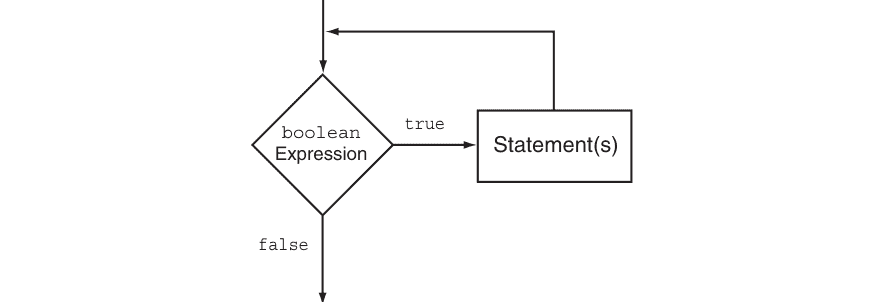

以下是 while 循环的通用格式：

```
while (BooleanExpression)
    statement;
```

格式中的第一行有时被称为循环头（loop header）。它由关键字以及括在括号内的布尔表达式组成。对 `BooleanExpression` 进行测试，如果结果为真，则执行该语句。然后，再次测试 `BooleanExpression`。如果为真，则执行该语句。这个循环不断重复，直到布尔表达式为假。重复的语句被称为循环体（body of the loop）。它也被认为是一种条件执行的语句，因为它只有在布尔表达式为真的条件下才会被执行。

注意，循环头的末尾没有分号。与语句一样，如果没有随其后的条件执行语句，`while` 循环就是不完整的。

如果你希望 `while` 循环重复一个语句块，格式如下：

```
while (BooleanExpression)
{
    statement;
    statement;
    // 在此处根据需要放置尽可能多的语句
}
```

只要有一个可以不断执行的语句，`while` 循环就能正常工作。只要括号内的执行结果为真，条件执行的语句或语句块就会重复执行。代码列表 5-3 中的程序使用 `while` 循环打印了五次 "Hello"。

### 代码列表 5-3 (WhileLoop.java)

```java
/**
 * 此程序演示了 while 循环。
 */
public class WhileLoop {
    public static void main(String[] args) {
        int number = 1;
        while (number <= 5) {
            System.out.println("Hello");
            number++;
        }
        System.out.println("That's all!");
    }
}
```

### 程序输出

```
Hello
Hello
Hello
Hello
Hello
That's all!
```


让我们仔细观察这个程序。在第 9 行，声明了一个整型变量 `number` 并将其初始化为值 1。在第 11 行，`while` 循环以该语句开始：

```java
while (number <= 5)
```

该语句测试变量以确定其是否小于或等于 5。如果是，则执行循环体中的语句（第 13 行和第 14 行）：

```java
System.out.println("Hello");
number++;
```

循环体中的第一个语句（第 13 行）打印单词 "Hello"。第二个语句（第 14 行）使用自增运算符将 `number` 加 1。这是循环体中的最后一条语句，执行执行后，循环重新开始。它再次测试布尔表达式，如果为真，则执行循环体中的语句。这个循环不断重复，直到布尔表达式 `number <= 5` 为假。这如图 5-2 所示。

### 图 5-2 while 循环

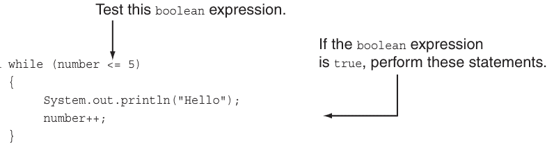

执行完循环体后，重新开始。循环的每次重复被称为一次*迭代*（iteration）。这个循环将执行五次迭代，因为变量初始化为值 1，并且每次执行循环体时它都会增加 1。当表达式 `number <= 5` 被测试并发现为假时，循环将终止，程序将在紧随其后的语句继续执行。图 5-3 显示了此循环的逻辑。

### 图 5-3 示例 while 循环的逻辑

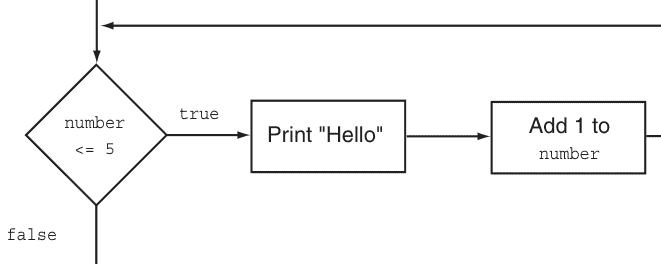

在这个示例中，`number` 变量被称为*循环控制变量*（loop control variable），因为它控制了循环迭代的次数。

### while 循环

`while` 循环被称为*预测试*循环（pretest loop），这意味着它在每次迭代之前都会测试其表达式。请注意代码列表 5-3 中第 9 行的变量声明：

```java
int number = 1;
```

如果 `number` 初始化为大于 5 的值（如下所示程序所示），则循环将永远不会执行：

```java
int number = 6;
while (number <= 5)
{
    System.out.println("Hello");
    number++;
}
```

`while` 循环的一个重要特性是，如果没有紧随其后的条件执行语句，它就是不完整的。

### 死循环（Infinite Loops）

如果布尔表达式永远为真，循环就会一直执行。`while` 循环的一个重要特性是它在执行前测试。

### 使用语句块时不要忘记大括号

如果你使用一个语句块，不要忘记将所有语句包含在大括号内。如果不小心漏掉了大括号，`while` 循环只会执行紧随其后的那条语句。

### 编程风格与 while 循环

你可以创建如下这样的循环：

```java
while (number != 99) number = keyboard.nextInt();
```

同样也可以：

```java
while (number <= 5) { System.out.println("Hello"); number++; }
```

避免这种编程风格。你应该使用的 `while` 循环编程风格与 `if` 语句相似：

- 如果循环重复一个语句，它应该出现在 `while` 语句之后的行，并缩进一级。该语句可以可选地包含在大括号内。
- 如果循环重复一个块，大括号内的每一行都应该与周围代码区分开。

这种编程风格可以在视觉上将循环体与周围代码隔离开。

### 焦点关注：使用 while 循环设计程序

Chemical Labs, Inc. 正在进行的项目需要对容器中的物质进行持续加热。技术人员必须每 15 分钟检查一次物质的温度。如果物质温度不超过 102.5 摄氏，技术人员无需操作。然而，如果温度大于 102.5 摄氏，技术人员必须调低温度器，等待 5 分钟并再次检查。技术人员重复这些步骤，直到温度不超过 102.5 摄氏。工程总监你编写一个引导技术人员完成此过程的程序。

以下是算法：

1. 提示用户输入温度。
2. 只要温度大于 102.5 摄氏，重复以下步骤：
   a. 告诉技术人员调低温度器，等待 5 分钟并再次检查。
   b. 提示用户输入温度。
3. 循环结束后，告诉技术人员该温度是可以接受的，并在 15 分钟后再次检查。

## 5.2 while 循环

### 代码列表 5-4 (CheckTemperature.java)

```java
public class CheckTemperature {
    public static void main(String[] args) {
        final double MAX_TEMP = 102.5; // Maximum temperature
        double temperature; // To hold the temperature
        // Create a Scanner object for keyboard input.
        Scanner keyboard = new Scanner(System.in);
        // Get the current temperature.
        System.out.println("Enter the substance's Celsius temperature: ");
        temperature = keyboard.nextDouble();
        // As long as necessary, instruct the technician
        while (temperature > MAX_TEMP) {
            System.out.println("The temperature is too high. Turn the");
            System.out.println("thermostat down and wait 5 minutes.");
            System.out.println("Then, take the Celsius temperature again");
            System.out.print("and enter it here: ");
            temperature = keyboard.nextDouble();
        }
        // Remind the technician to check the temperature
        System.out.println("The temperature is acceptable.");
        System.out.println("Check it again in 15 minutes.");
    }
}
```

### 示例输入（粗体）的程序输出

输入物质的摄氏度温度：**104.7 [Enter]**
温度过高。请将恒温器调低并等待 5 分钟。
再次获取摄氏度温度并在此处输入：**103.2 [Enter]**
温度过高。请将恒温器调低并等待 5 分钟。
再次获取摄氏度温度并在此处输入：**102.1 [Enter]**
温度可以。
在 15 分钟后再次检查。

# 第 5 章 循环与文件

### 检查点

5.2 在以下程序段中，“Hello World”会被打印多少次？

```java
int count = 10;
while (count < 1) {
    System.out.println("Hello World");
    count++;
}
```

5.3 在以下程序段中，“I love Java programming!”会被打印多少次？

```java
int count = 0;
while (count < 10) {
    System.out.println("Hello World");
    System.out.println("I love Java programming!");
}
```

### 使用 while 循环进行输入验证

> 概念：循环可以用于创建输入程序，直到输入可接受的数据为止重复。

计算机行业最著名的格言可能是“垃圾进，垃圾出”（garbage in, garbage out）。程序输出的完整性取决于其输入质量，因此你应该尝试确保垃圾不会进入你的程序。输入验证是检查提供给程序的数据并判断其是否有效的过程。良好的程序应该就可接受的输入类型给出指令，并且不应假设用户遵循了这些指令。

`while` 循环对于验证输入特别有用。如果输入了无效值，循环可以根据需要多次要求用户重新输入。例如，查看以下代码，它允许用户输入 1 到 100 范围内的数字：

```java
Scanner keyboard = new Scanner(System.in);
System.out.print("Enter a number in the " + "range of 1 through 100: ");
number = keyboard.nextInt();
// 验证输入。
while (number < 1 || number > 100) {
    System.out.println("That number is invalid.");
    System.out.print("Enter a number in the " + "range of 1 through 100: ");
    number = keyboard.nextInt();
}
```

## 5.3 使用 while 循环进行输入验证

此代码首先允许用户输入一个数字。这发生在循环之前。如果输入是有效的，循环将不会执行。如果输入无效，循环将显示错误消息并要求用户输入另一个数字。循环将持续直到用户输入有效数字。执行输入的通用逻辑如图 5-4 所示。

### 图 5-4 输入验证逻辑


发生在循环之前的读取操作被称为“预读”（priming read）。它为循环提供了测试值。后续值通过循环获得。代码列表 5-5 中的程序根据给定的每队人数计算该联赛可以创建的球队数量。该程序使用 `while` 循环来验证用户输入。

### 代码列表 5-5 (SoccerTeams.java)

```java
import java.util.Scanner;

/**
 * 此程序计算该联赛可以创建的球队数量
 * 基于可用人数。输入验证通过
 * while 循环演示。
 */
public class SoccerTeams {
    public static void main(String[] args) {
        final int MIN_PLAYERS = 9, // 每队最小人数
        MAX_PLAYERS = 15; // 每队最大人数
        int players, // 可用人数
        teamSize, // 每队人数
        teams, // 球队数
        leftOver; // 剩余人数
        // 创建一个用于键盘输入的扫描 对象。
        Scanner keyboard = new Scanner(System.in);
        // 获取每队人数。
        System.out.print("Enter the number of players per team: ");
        teamSize = keyboard.nextInt();
        // 验证输入。
        while (teamSize < MIN_PLAYERS || teamSize > MAX_PLAYERS) {
            System.out.println("You should have at least " + MIN_PLAYERS + " but no more than " + MAX_PLAYERS + " per team.");
            System.out.print("Enter the number of players per team: ");
            teamSize = keyboard.nextInt();
        }
        // 获取可用人数。
        System.out.print("Enter the available number of players: ");
        players = keyboard.nextInt();
        // 验证输入。
        while (players < 0) {
            System.out.println("Please not enter a negative number.");
            System.out.print("Enter the available number of players: ");
            players = keyboard.nextInt();
        }
        // 计算球队数。
        teams = players / teamSize;
        // 计算剩余人数。
        leftOver = players % teamSize;
        // 显示结果。
        System.out.println("There will be " + teams + " teams with " + leftOver + " left over.");
    }
}
```

### 示例输入（粗体）的程序输出

每队人数：**4 [Enter]**
每队至少要有 9 人，最多不超过 15 人。
每队人数：**12 [Enter]**
可用人数：**-142 [Enter]**
不要输入负数。
可用人数：**142 [Enter]**

### 检查点

- 5.4 编写输入验证循环，要求用户输入 10 到 25 范围内的数字。
- 5.5 编写一个输入验证循环，要求用户输入 'Y'、'y'、'N' 或 'n'。
- 5.6 编写一个输入验证循环，要求用户输入 "Yes" 或 "No"。

## do-while 循环

> 概念：`do-while` 循环是一种后测试循环，这意味着它的布尔表达式在每次迭代后进行测试。

`do-while` 循环看起来像是反过来的 `while` 循环。当循环体包含单个语句时，`do-while` 循环的格式如下：

```java
do
    statement;
while (BooleanExpression);
```

当循环体包含多个语句时，`do-while` 循环的格式如下：

```java
do
{
    statement;
    statement;
    // 在此处放置所需的语句
} while (BooleanExpression);
```

> 注意：`do-while` 循环必须以分号结束。

`do-while` 循环是后测试循环。这意味着它在完成迭代之前不会测试其布尔表达式。结果是，即使布尔表达式初始为假，`do-while` 循环总是至少执行一次迭代。这与 `while` 循环的行为不同，你记得 `while` 循环是前测试循环。例如，下面的 `while` 循环语句将不会执行：

```java
int x = 1;
while (x < 0)
    System.out.println(x);
```

但以下 `do-while` 循环中的 `println` 语句将执行一次，因为 `do-while` 循环在迭代结束时才评估表达式 `x < 0`。

```java
int x = 1;
do {
    System.out.println(x);
} while (x < 0);
```

图 5-5 展示了 `do-while` 循环的逻辑。

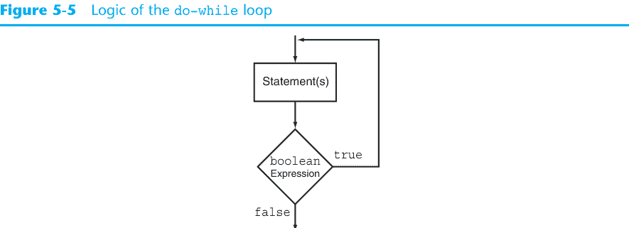

当你想要确保循环至少执行一次时，应该使用 `do-while` 循环。例如，代码列表 5-6 中的程序计算学生系列测试成绩的平均分。在显示平均分后，它询问用户是否想平均另一组成绩。只要用户输入 Y 表示是，程序就会重复。

### 代码列表 5-6 (TestAverage.java)

```java
import java.util.Scanner;

/**
 * 此程序演示了一个用户控制的循环。
 */
public class TestAverage {
    public static void main(String[] args) {
        String input; // 用于存储键盘输入
        double score1, score2, score3; // 三个测试分数
        double average; // 测试分数平均分
        char repeat; // 存储 'y' 或 'n'
        // 创建一个用于键盘输入的 Scanner 对象。
        Scanner keyboard = new Scanner(System.in);
        System.out.println("此程序计算三个测试分数的 " + "平均分.");
        do {
            // 获取三个测试分数。
            System.out.println("Enter score #1: ");
            score1 = keyboard.nextDouble();
            System.out.println("Enter score #2: ");
            score2 = keyboard.nextDouble();
            System.out.println("Enter score #3: ");
            score3 = keyboard.nextDouble();
```


// 计算并打印测试分数的平均分。

`average = (score1 + score2 + score3) / 3.0;`

`System.out.println("The average is " + average);`

`System.out.println();`

// 用户是否想计算另一组的平均分？

`System.out.println("Would you like to average " + "another set of test scores?");`

`System.out.println("Enter Y for yes or N for no: ");`

`input = keyboard.next();` // 读取一个字符串。

`repeat = input.charAt(0);` // 获取第一个字符。

`} while (repeat == 'Y' || repeat == 'y');`

`}`

`}`

# 程序输出示例

此程序计算三个测试分数的平均分。

```
Enter score #1: 89 [Enter]
Enter score #2: 90 [Enter]
Enter score #3: 97 [Enter]
The average is 92.0
```

Would you like to average another set of test scores?

```
Enter Y for yes or N for no: Y [Enter]
Enter score #1: 78 [Enter]
Enter score #2: 65 [Enter]
Enter score #3: 88 [Enter]
The average is 77.0
```

Would you like to average another set of test scores?

```
Enter Y for yes or N for no: N [Enter]
```

在编写此程序时，程序员无法预知循环将迭代多少次。这是因为循环会询问用户他们是否想重复该过程。这种循环被称为`用户控制循环`，它允许用户决定迭代的次数。

## 5.5 for 循环

> 概念：`for` 循环是执行已知次数迭代的理想选择。

总的来说，循环分为两类：条件循环和计数控制循环。`条件循环`只要特定条件存在，它就会执行。输入验证循环在输入值无效时会一直执行。当你编写条件循环时，你无法知道它将迭代多少次。

有时，你确实知道循环必须执行的精确迭代次数。重复特定次数的循环被称为`计数控制循环`。例如，如果一个循环要求用户输入每年每月的销售额，它将迭代十二次。循环数到 12，并在每次计数时要求用户输入销售额。

计数控制循环必须具备三个元素：

1. 它必须初始化一个控制变量到一个起始值。
2. 它必须通过将控制变量与最大值比较来测试该变量。当控制变量达到最大值时，循环终止。
3. 它必须在每次迭代期间更新控制变量。这通常通过增加变量来实现。

在 Java 中，`for` 循环是编写计数控制循环的理想选择。它专门设计用于初始化、测试和更新循环控制变量。以下是 `for` 循环用于重复单条语句的通用格式：

```java
for (Initialization; Test; Update)
    statement;
```

当 `for` 循环用于重复代码块时的格式为：

```java
for (Initialization; Test; Update)
{
    statement;
    statement;
    // 根据需要在此处放置任意数量的语句
}
```

`for` 循环的第一行被称为循环头。在关键字 `for` 之后，括号内有三个用分号隔开的表达式。（注意，第三个表达式后面没有分号。）第一个表达式是初始化表达式。它通常用于将控制变量初始化为其起始值。这是循环执行的第一个动作，且只执行一次。第二个表达式是测试表达式。它是一个控制循环执行的布尔表达式。只要该表达式为 `true`，`for` 循环的体就会重复。`for` 循环是预测试的，因此它在每次迭代之前都会评估该表达式。第三个表达式是更新表达式。它在每次迭代结束时执行。通常，这是一个增加循环控制变量的语句。

这里是一个计算 "Hello" 次的简单循环示例：

```java
for (count = 1; count < 5; count++)
    System.out.println("Hello");
```

在这个循环中，初始化表达式是 `count = 1`，更新表达式是 `count++`。循环体是打印 "Hello" 的语句。图 5-6 演示了打印 "Hello" 次的循环执行。

图 5-6 输出 "Hello" 次的循环执行


图 5-7 显示 for 循环的逻辑


图 5-8 演示了 for 循环的执行序列


图 5-9 显示了循环的逻辑


### for 循环是预测试循环

由于 `for` 循环在执行每次迭代之前测试其布尔表达式，因此它是预测试循环。你可以编写一个永远不会迭代的 `for` 循环。这里有一个示例：

```java
for (count = 11; count <= 10; count++)
    System.out.println("Hello");
```

由于变量 `count` 初始化为一个使布尔表达式为 `false` 的值，此循环从开始就会终止。

### 避免在 for 循环体中修改控制变量

注意不要在 `for` 循环体中放置修改控制变量的语句。控制变量的所有修改都会在每次迭代结束时自动执行。如果在循环体内的语句修改了控制变量，则循环可能不会在您预期的时刻停止。例如，这个 `for` 循环每次迭代会增加两次：

```java
for (x = 1; x < 10; x++)
    System.out.println(x);
    x++;
```

### 更新表达式的其他形式

更新表达式并不限于使用增量语句。这里有一个通过向计数器加 2 来显示从 2 到 100 的所有偶数的 `for` 循环：

```java
for (number = 2; number <= 100; number += 2)
    System.out.println(number);
```

## 5.5 for 循环（续）

这是一个从 10 倒数到 0 的循环：

```java
for (number = 10; number >= 0; number--)
    System.out.println(number);
```

### 在 for 循环的初始化表达式中声明变量

控制变量可以在初始化表达式中初始化，还可以在那里进行声明。下面的代码展示了一个示例。这是代码列表 5-7 中循环的修改版本。

```java
for (int number = 1; number <= 10; number++)
{
    System.out.println(number + "\t\t" + number * number);
}
```

在这个循环中，变量 `number` 在初始化表达式中声明并初始化。如果控制变量仅在循环中使用，那么在循环头中声明它是有意义的。这使得变量的作用域更加清晰。

当在循环的初始化表达式中声明变量时，该变量的作用域被限于循环。你不能在循环外的语句访问该变量。例如，下面的程序段将无法编译，因为最后一个 `println` 无法访问变量 `count`。

```java
for (int count = 1; count <= 10; count++)
    System.out.println(count);
System.out.println("count is now " + count);    // 错误
```

### 创建用户控制的 for 循环

有时你希望用户来决定循环中控制变量的最大值，从而决定循环迭代的次数。例如，查看代码列表 5-8 中的程序。它是代码列表 5-7 的修改版本。该程序不是显示 1 到 10 的数字及其平方，而是允许用户输入要显示的最大值。

代码列表 5-8 (`UserSquares.java`)

```java
import java.util.Scanner;

/**
 * 此程序演示了用户控制的
 * for 循环。
 */
public class UserSquares
{
    public static void main(String[] args)
    {
        int number, // 循环控制变量
        maxValue; // 最大值

        // 创建一个 Scanner 对象用于键盘输入。
        Scanner keyboard = new Scanner(System.in);

        System.out.println("I will display a table of " + "numbers and their squares.");

        // 获取要显示的最大值。
        System.out.print("How high should I go? ");
        maxValue = keyboard.nextInt();

        // 显示表格。
        System.out.println("Number      Number Squared");
        System.out.println("---------------------------------");

        for (number = 1; number <= maxValue; number++)
        {
            System.out.println(number + " \t\t" + number * number);
        }
    }
}
```

### 程序输出，示例输入已加粗显示

I will display a table of numbers and their squares.
How high should I go? **7** [Enter]

| Number | Number Squared |
| --- | --- |
| 1 | 1 |
| 2 | 4 |
| 3 | 9 |
| 4 | 16 |
| 5 | 25 |
| 6 | 36 |
| 7 | 49 |

在第 22 行和 23 行（即循环部分），程序要求用户输入要显示的最高值。该值存储在 `maxValue` 变量中：

```java
System.out.print("How high should I go? ");
maxValue = keyboard.nextInt();
```

在第 29 行，`for` 循环的测试表达式使用该值作为控制变量的上限：

```java
for (number = 1; number <= maxValue; number++)
```

在这个循环中，`number` 变量取 1 到 `maxValue` 的值，然后循环终止。

### 在初始化和更新表达式中使用多个语句

在初始化表达式和更新表达式中执行多条语句是可能的。当这些表达式中使用多个语句时，用逗号分隔语句。例如，查看后续代码中的循环，它的初始化表达式中有两个语句：

```java
int x, y;
for (x = 1, y = 1; x <= 5; x++)
{
    System.out.println(x + " plus " + (x + y));
}
```

该循环的初始化表达式是：
```java
x = 1, y = 1
```

这初始化了变量 `x` 和 `y`。该循环的输出是：
```
1 plus 2
2 plus 3
3 plus 4
4 plus 5
5 plus 6
```

我们可以进一步修改循环在更新表达式中执行两个语句。这是一个示例：

```java
int x, y;
for (x = 1, y = 1; x <= 5; x++, y++)
{
    System.out.println(x + " plus " + (x + y));
}
```

循环的更新表达式是：
```java
x++, y++
```

该更新表达式同时增加了变量 `x` 和 `y`。该循环的输出是：
```
1 plus 2
2 plus 4
3 plus 6
4 plus 8
5 plus 10
```

在初始化和更新表达式中使用逗号连接多个语句效果很好，但不要在测试表达式中连接多个表达式。如果你想在测试表达式中组合多个表达式，必须使用 `&&` 或 `||`。

### 焦点：计数控制循环

你的朋友 Amanda 从叔叔那里继承了一辆跑车。Amanda 住在在美国，她担心因为速度表显示的是每小时公里而收到罚单。她要求你写一个程序，显示从每小时公里（KPH）转换为每小时英里（MPH）的速度表。

表格应该像这样：

| KPH | MPH |
|---|---|
| 60 | 37.3 |
| 70 | 43.5 |
| 80 | 49.7 |
| 130 | 80.8 |

在考虑了此表格后，你决定编写以下代码：

- 一个名为 `SpeedConverter` 的类，可以执行从每小时公里到每小时英里的转换。
- 一个创建 `SpeedConverter` 类实例，并使用该对象转换每小时公里到每小时英里的程序。

代码列表 5-9 显示的 `SpeedConverter` 类只有一个 `getMPH` 方法。该方法出现在第 18 到 22 行，接受每小时公里作为参数，并返回转换为每小时英里的速度。

代码列表 5-9 (`SpeedConverter.java`)

```java
/**
 * SpeedConverter 类将 KPH (每小时公里)
 * 转换为 MPH (每小时英里)。
 */
public class SpeedConverter
{
    // 转换 MPH 到 KPH 的因子
    final double CONVERSION_FACTOR = 0.6214;

    /**
     * getMPH 方法接受 KPH 作为参数
     * 并返回转换为 MPH 的速度。
     */
    public double getMPH(double kph)
    {
        return kph * CONVERSION_FACTOR;
    }
}
```

如前所述，显示速度表格的程序创建了 `SpeedConverter` 类的实例。在程序中，你决定使用一个使用计数器变量来存储每小时公里的速度。计数器的起始值为 60，结束值为 130，每次迭代需要计数器加 10。在循环内部，你将调用 `SpeedConverter` 类的 `getMPH` 方法，并将计数器变量作为参数。该方法将返回转换为每小时英里的速度。代码列表 5-10 显示了代码。

代码列表 5-10 (`SpeedTable.java`)

```java
/**
 * 此程序显示 kph 转换为 mph 的速度表。
 */
public class SpeedTable
{
    public static void main(String[] args)
    {
        // 常量
        final int STARTING_KPH = 60; // 起始速度
        final int MAX_KPH = 130; // 最大速度
        final int INCREMENT = 10; // 速度增量

        // 存储 kph 速度
        int kph;
        double mph;    // 存储 mph 速度

        // 创建 SpeedConverter 类的实例。
        SpeedConverter converter = new SpeedConverter();

        // 显示表头。
        System.out.println("KPH\tMPH");
        System.out.println("--------------------");

        // 显示速度。
        for (kph = STARTING_KPH; kph <= MAX_KPH; kph += INCREMENT)
        {
            // 获取 mph。
            mph = converter.getMPH(kph);

            // 显示 kph 和 mph 的速度。
            System.out.printf("%d\t%.1f\n", kph, mph);
        }
    }
}
```


# 程序输出

| KPH | MPH |
|---|---|
| 60 | 37.3 |
| 70 | 43.5 |
| 80 | 49.7 |
| 90 | 55.9 |
| 100 | 62.1 |
| 110 | 68.4 |
| 120 | 74.6 |
| 130 | 80.8 |

# 检查点

列出出现在 `for` 循环头部括号内的三个表达式。

- 你想写一个 `for` 循环来显示 50 次 "I love to program"。假设你将使用一个名为 `count` 的控制变量。
    a. 你将使用什么初始化表达式？
    b. 你将使用什么测试表达式？
    c. 你将使用什么更新表达式？
    d. 编写出该循环。

- 下面的程序段将显示什么？
    ```java
    for (int count = 0; count < 6; count++)
        System.out.println(count + count);
    ```

    b. 
    ```java
    for (int value = -5; value < 5; value++)
        System.out.println(value);
    ```

    c. 
    ```java
    for (int x = 5; x <= 14; x += 3)
        System.out.println(x);
    ```

5.10 写一个循环，显示你的名字 10 次。

5.11 写一个循环，显示 1 到 49 之间所有的奇数。

5.12 写一个循环，每隔五显示一个 0 到 100 的数字。

# 运行总量与哨兵值

概念：总量（running total）是随着循环每次迭代而累加的数字和。用于保持运行总量的变量被称为累加器（accumulator）。哨兵值（sentinel）是一个信号，表示值列表已结束。

许多编程任务需要你计算一系列数字的总和。例如，假设你正在编写一个程序来计算公司一周的总销售额。该程序读取每天的销售额作为输入，并计算这些数字的总和。

计算系列数字总和的程序通常使用两个元素：

- 一个读取序列中每个数字的循环。
- 一个在读取数字时累加总和的变量。

用于累加数字总和的变量被称为累加器。人们经常说循环保持了运行总量，因为它在读取序列中的每个数字时累加了总和。图 5-10 显示了计算运行总量的循环通用逻辑。

图 5-10 计算运行总量的逻辑

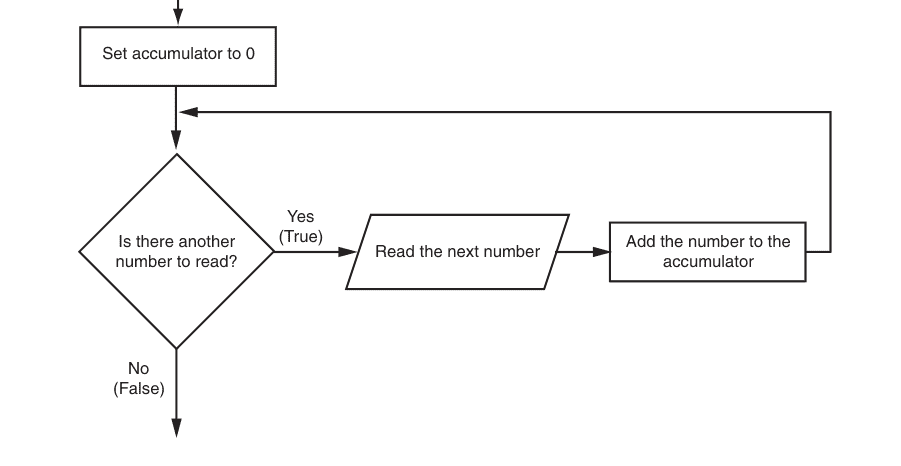

# 第 5 章 循环与文件

当循环结束，累加器将包含循环读取的数字的总和。注意流程图的第一步是将累加器变量加 1 0。这是一个关键步骤。如果累加器的初始值是 0 的任何其他值，那么在将其加到累加器时，循环结束后将不会包含正确的总和。

让我们来看一个计算运行总量的程序。代码列表 5-11 通过将每日销售额作为输入，并在收集过程中计算运行总量，计算出公司一段时间内的总销售额。

# 代码列表 5-11 (TotalSales.java)

```java
1 import java.util.Scanner;
2 import java.text.DecimalFormat;
3
4 /**
5 * 此程序计算运行总量。
6 */
7
8 public class TotalSales
9 {
10 public static void main(String[] args)
11 {
12 int days; // 天数
13 double sales; // 一天的销售额
14 double totalSales; // 累加器
15
16 // 创建一个 Scanner 对象用于键盘输入。
17 Scanner keyboard = new Scanner(System.in);
18
19 // 创建一个 DecimalFormat 对象。
20 DecimalFormat dollar =
21 new DecimalFormat(
```

# 5.6 运行总量与哨兵值

```java
sales = keyboard.nextDouble();
totalSales += sales; // 将销售额加到总和。
}
// 显示总销售额。
System.out.println("The total sales are $" + dollar.format(totalSales));
}
```

# 程序输出（示例输入已加粗显示）

你有多少天的销售额数据？5 [回车]
输入第 1 天的销售额：687.59 [回车]
输入第 2 天的销售额：563.22 [回车]
输入第 3 天的销售额：896.35 [回车]
输入第 4 天的销售额：743.29 [回车]
输入第 5 天的销售额：926.72 [回车]
总销售额为 $3,817.17

让我们来看这个程序。在第 24 行到第 26 行，要求用户输入其拥有销售额数据的天数。天数从键盘读取并赋值给 `days` 变量。接下来，在第 29 行，`totalSales` 变量被赋值为 0.0。

在通用的编程术语中，`totalSales` 变量被称为累加器。累加器是一个带有初始值（通常为 0）的变量，然后通过向其添加数字来累加数字之和。正如你所看到的，在将数字加到累加器之前将累加器设置为 0 是关键的。

接下来，`for` 循环在第 33 行到第 39 行执行：

```java
for (int count = 1; count <= days; count++)
{
  System.out.print("Enter the sales for day " + count + ":");
  sales = keyboard.nextDouble();
  totalSales += sales; // 将销售额加到总和。
}
```

用户输入每日销售额数字，这些数字被加到 `totalSales`。因为 `totalSales` 初始为 0.0，在每次迭代中，它都会由于 `sales` 的增加而增加。循环结束后，`totalSales` 将包含所有数字的总和。

# 使用哨兵值

代码列表 5-11 要求用户输入拥有销售额数据的天数。有时用户并不知道天数。在这种情况下的一种技术是使用哨兵值。代码列表 5-12 显示了一个示例。哨兵值表示列表的结束。

# 代码列表 5-12 (SoccerPoints.java)

```java
import java.util.Scanner;

/**
 * 此程序计算一系列比赛的总分。
 */
public class SoccerPoints
{
    public static void main(String[] args)
    {
        int points, totalPoints = 0; // 累加器
        // 创建一个 Scanner 对象用于键盘输入。
        Scanner keyboard = new Scanner(System.in);
        // 显示通用说明。
        System.out.println("Enter the number of points your team");
        System.out.println("earned for game season.");
        System.out.println("Enter -1 when finished.");
        // 获取第一个分数。
        System.out.print("Enter points or -1 to end: ");
        points = keyboard.nextInt();
        // 在输入 -1 之前累加分数。
        while (points != -1)
```

```java
 // 将分数加到 totalPoints。
        totalPoints += points;
 // 获取下一个分数。
        System.out.print("Enter points or -1 to end: ");
        points = keyboard.nextInt();
 // 显示总分。
        System.out.println("The total points are " + totalPoints);
    }
}
```

# 程序输出（示例输入已加粗显示）

输入你的团队在每个赛季获得的分数：
结束时输入 -1。

- 输入分数或 -1 结束：7 [回车]
- 输入分数或 -1 结束：9 [回车]
- 输入分数或 -1 结束：4 [回车]
- 输入分数或 -1 结束：6 [回车]
- 输入分数或 -1 结束：8 [回车]
总分数为 34

> >> 选择 -1 作为哨兵值是因为团队不可能得到负分。注意，此程序先执行了一次读取来获取第一个值。这使得用户在第一次输入 -1 时，循环可以立即终止。另外注意，哨兵值不包含在运行总量中。

# 检查点

5.13 写一个 `for` 循环重复七次，要求用户输入一个数字。循环还应该计算所输入数字之和。

5.14 在以下程序段中，哪个变量是循环控制变量（也称为计数器变量），哪个是累加器？

```java
int a, x = 0, y = 0;
Scanner keyboard = new Scanner(System.in);
while (x < 10) {
    System.out.print("Enter a number: ");
    a = keyboard.nextInt();
    y += a;
}
System.out.println("The sum is " + y);
```

5.15 为什么在选择哨兵值时需要小心？

## 5.7 嵌套循环

概念：位于另一个循环内部的循环被称为嵌套循环。

当一个任务需要执行重复操作且该任务本身也需要重复时，嵌套循环就是必要的。时钟是一个类似于嵌套循环工作的良好例子。秒针、分针和时针在时钟面上旋转。每当时针增加一次，分针就会增加 60 次。每当分针增加一次，秒针就会增加 60 次。

代码列表 5-13 中的程序使用嵌套循环来模拟时钟。

```java
/**
 * 此程序使用嵌套循环来模拟时钟。
 */
public class Clock {
    public static void main(String[] args) {
        // 模拟时钟。
        for (int hours = 1; hours <= 12; hours++) {
            for (int minutes = 0; minutes <= 59; minutes++) {
                for (int seconds = 0; seconds <= 59; seconds++) {
                    System.out.printf("%02d:%02d:%02d\n", hours, minutes, seconds);
                }
            }
        }
    }
}
```

程序输出

```
01:00:00
01:00:01
01:00:02
01:00:03
```
(循环继续计数 ...)
```
12:59:57
12:59:58
12:59:59
```

对于中间循环的每一次迭代，最内层循环都会迭代 60 次。对于外层循环的每一次迭代，中间循环都会迭代 60 次。当外层循环迭代 12 次时，中间循环已迭代 720 次，而内层循环已迭代 43,200 次。

模拟时钟的示例引出了关于嵌套循环的几点：

- 对于外层循环的每次迭代，内层循环都会完成所有的迭代。
- 内层循环在外层循环完成之前完成其迭代。
- 要获得嵌套循环的总迭代次数，将所有循环的迭代次数相乘。

代码列表 5-14 中的程序是另一个测试平均值程序。它询问用户学生人数以及每个学生的测试成绩数量。嵌套的内层循环询问一个学生的所有测试成绩，每个成绩迭代一次。外层循环为每个学生迭代一次。

## 代码列表 5-14 (TestAverages.java)

```java
1 import java.util.Scanner;
2
3 /*
4  * 此程序演示了一个用户控制的循环。
5  */
6
7 public class TestAverages2
8 {
9   public static void main(String[] args)
10 {
11    int numStudents; // 学生人数
12    int numTests; // 每个学生的测试次数
13    double score; // 测试成绩
14    double total; // 测试成绩的累加器
15    double average; // 测试成绩平均分
16
17    // 创建一个用于键盘输入的 Scanner 对象。
18    Scanner keyboard = new Scanner(System.in);
19
20    System.out.println("此程序计算测试成绩的平均值。");
21
22    // 获取学生人数。
23    System.out.print("How many students do you have? ");
24    numStudents = keyboard.nextInt();
25
26    // 获取每个学生的测试成绩次数。
27    System.out.print("How many test scores per student? ");
28    numTests = keyboard.nextInt();
29
30    // 处理所有学生。
31    for (int student = 1; student <= numStudents; student++)
32    {
33        // 将累加器置零。
34        total = 0.0;
35
36        // 获取某一个学生的测试成绩。
37        for (int test = 1; test <= numTests; test++)
38        {
39            System.out.print("Enter score " + test
40                + " for student " + student + ": ");
41            score = keyboard.nextDouble();
42            total += score; // 将成绩加到总和中。
43        }
44
45        // 计算并显示平均分。
46        average = total / numStudents;
47        System.out.println("The average score for student "
48                + student + " is " + average + ")");
49        System.out.println();
50    }
51}
52}
```

**加粗显示示例输入时的程序输出**

此程序计算测试成绩的平均值。
How many students do you have? 2 [Enter]
How many test scores per student? 3 [Enter]
Enter score 1 for student 1: 78 [Enter]
Enter score 2 for student 1: 86 [Enter]
Enter score 3 for student 1: 91 [Enter]
The average score for student 1 is 85.0

Enter score 1 for student 2: 97 [Enter]
Enter score 2 for student 2: 88 [Enter]
Enter score 3 for student 2: 91 [Enter]
The average score for student 2 is 92.0

## 焦点聚焦：使用嵌套循环打印图案

学习嵌套循环的一种有趣方法是使用它们在屏幕上显示图案。让我们来看一个简单的例子。假设要在屏幕上打印如下图案：

```
******
******
******
******
******
```

如果你将此图案视为行和列，你可以看到它有五行，每行六列。以下代码可以显示一行星号：

```java
final int COLS = 6;
for (int col = 0; col < COLS; col++) {
    System.out.print("*");
}
```

如果在程序中运行这段代码，它将产生：

```
******
```

为了完成整个图案，我们需要执行此循环八次。我们可以将其放在另一个迭代八次的循环内部，如下所示：

```java
1 final int COLS = 6;
2 int ROWS = 8;
3 for (int row = 0; row < ROWS; row++)
4 {
5     for (int col = 0; col < COLS; col++)
6         System.out.print("*");
7     System.out.println();
8 }
```


外层循环迭代八次。每次迭代时，内层循环迭代六次。（注意在第7行，在打印完每一行后我们调用 `System.out.println()` 以换行。如果没有该语句，所有的星号都将打印在同一行。）

我们可以轻松地编写一个提示用户输入行列数的程序，如代码列表 5-15 所示。

## 代码列表 5-15 (RectangularPattern.java)

```java
import java.util.Scanner;

/**
 * 此程序显示一个矩形图案。
 */
public class RectangularPattern
{
    int rows, cols;

    // 创建用于键盘输入的 Scanner 对象。
    Scanner keyboard = new Scanner(System.in);

    // 获取行列数。
    System.out.print("How many rows? ");
    rows = keyboard.nextInt();
    System.out.print("How many columns? ");
    cols = keyboard.nextInt();

    for (int r = 0; r < rows; r++) {
        for (int c = 0; c < cols; c++) {
            System.out.print("*");
        }
        System.out.println("");
    }
}
```

**程序输出**

How many rows? 5 [Enter]
How many columns? 10 [Enter]
**********
**********
**********
**********
**********

再看另一个例子。假设你想打印一个如下三角形的图案：

```
*
**
***
****
*****
******
```

再次将图案构为行和列。该图案共有八行。第一行有一列。第二行有两个列。第三行有三列。一直到第八行，它有八列。代码列表 5-16 显示了产生此图案的程序。

## 代码列表 5-16 (TrianglePattern.java)

```java
import java.util.Scanner;

/**
 * 此程序显示一个三角形图案。
 */
public class TrianglePattern
{
    public static void main(String[] args)
    {
        final int BASE_SIZE = 8;
        for (int r = 0; r < BASE_SIZE; r++) {
            for (int c = 0; c < (r+1); c++) {
                System.out.print("*");
            }
            System.out.println();
        }
    }
}
```

**程序输出**

```
*
**
***
****
*****
******
*******
********
```

外层循环（从第13行开始）将迭代八次。随着循环迭代，变量 `r` 将赋值为0到7的值。

对于外层循环的每次迭代，内层循环将迭代 `r+1` 次。所以：

- 在外层循环的第1次迭代中，变量 `r` 被赋值为0。内循环迭代一次，打印一个星号。
- 在外层循环的第2次迭代中，变量 `r` 被赋值为1。内循环迭代两次，打印两个星号。
- 在外层循环的第3次迭代中，变量 `r` 被赋值为2。内层循环迭代三次，打印三个星号。
- 以此类推。

再看另一个例子。假设你想显示如下阶梯形图案：

```
*
 **
 ***
 ****
 *****
 ******
```

该图案有六行。通常，我们可以描述每一行有若干个空格后跟着一个 `#` 字符。以下是逐行的描述：

| 行 | 描述 |
| :--- | :--- |
| 第一行： | 0个空格后跟一个 `#` 字符 |
| 第二行： | 1个空格后跟一个 `#` 字符 |
| 第三行： | 2个空格后跟一个 `#` 字符 |
| 第四行： | 3个空格后跟一个 `#` 字符 |
| 第五行： | 4个空格后跟一个 `#` 字符 |
| 第六行： | 5个空格后跟一个 `#` 字符 |

为了显示此图案，我们可以编写包含一对嵌套循环的代码，其工作方式如下：

- 外层循环将迭代六次。每次迭代将执行以下操作：
- 内层循环将并排显示正确数量的空格。
- 然后显示一个 `#` 字符。

## 代码列表 5-17 (StairStepPattern.java)

```java
import java.util.Scanner;

/**
 * 此程序显示一个阶梯图案。
 */
public class StairStepPattern
{
    public static void main(String[] args)
    {
        final int NUM_STEPS = 6;
        for (int r = 0; r < NUM_STEPS; r++)
        {
            for (int c = 0; c < r; c++) {
                System.out.print(" ");
            }
            System.out.println("#");
        }
    }
}
```

**程序输出**

外部循环（从第 13 行开始）将迭代 6 次。在循环期间，变量 `r`将被赋值 0 到 5 的值。

对于外部循环的每次迭代，内层循环将迭代 `r` 次。因此：
- 在外部循环的第 1 次迭代中，变量 `r` 被赋值为 0。此时内层循环不会执行。
- 在外部循环的第 2 次迭代中，变量 `r` 被赋值为 1。内层循环迭代一次，打印一个空格。
- 在外部循环的第 3 次迭代中，变量 `r` 被赋值为 2。内层循环迭代两次，打印两个空格。
- 依此类推。

# 第 5 章 循环与文件

## 5.8 break 和 continue 语句

> 核心概念：`break` 语句会导致循环提前终止。`continue` 语句会导致循环停止当前迭代并开始下一次迭代。

在第 4 章中与 `switch` 语句一起使用的 `break` 语句也可以放在循环内部。当遇到它时，循环停止，程序将跳转到紧跟在循环之后的语句。虽然在 `switch` 语句中使用 `break` 语句是完全可以的，但在循环中使用它被认为是“忌忌”。这是因为并跳过了结束循环所需的正常条件，并使代码难以理解和调试。由于这个原因，在可能的情况下，你应该避免在循环中使用 `break` 语句。

`continue` 语句会导致循环的当前迭代立即结束。当遇到 `continue` 时，循环体中其之后的所有语句都将被忽略，循环准备进行下一次迭代。在 `while` 循环中，这意味着程序跳转到循环顶部的布尔表达式。按照惯，如果表达式为真，则开始下一次迭代。在 `do-while` 循环中，程序将跳转到循环底部的布尔表达式，该表达式决定是否开始下一次迭代。在 `for` 循环中，`continue` 会导致执行更新表达式，然后评估测试表达式。

也应该避免使用 `continue` 语句。与 `break` 语句一样，它跳过了循环逻辑，并使代码难以理解和调试。

## 5.9 决定使用哪种循环

> 核心概念：尽管大多数重复算法可以使用三种循环中的任意一种来编写，但每种循环在不同的情况下效果最好。

Java 的三种循环在不同情况下都是理想的。以下是关于何时应该使用每种循环的简要总结。

- `while` 循环。`while` 循环是一种预测试循环。在从一开始条件就为假且你不希望进行迭代的情况下，它是理想的。如果你想使用哨兵值来终止循环，它也是理想的。
- `do-while` 循环。`do-while` 是一种后测试循环。在始终希望循环至少迭代一次的情况下，它是理想的。
- `for` 循环。`for` 循环是一种预测试循环，它内置了用于初始化、测试和更新的表达式。这些表达式使得使用循环控制变量作为计数器非常方便。在已知准确迭代次数的情况下，`for` 循环是理想的。

## 文件输入和输出简介

**概念：** Java API 提供了几个类，你可以使用它们向文件写入数据。（此处注：原文后续部分存在大量重复的碎片化文本，已根据核心语意进行处理）。

## 5.10 文件输入与输出简介

`println` 方法将数据写入文件，并在紧接着在数据后立即写入一个换行符。你可以通过以下方式可视化查看写入文件的数据：

Jim95<newline>Karen<newline>98<newline>Bob82<newline>

换行符在这里被表示为 `<newline>`。你实际上并看不到换行符；当在记事本等文本编辑器中打开文件时，它将如图 5-11 所示。从图中可以看出，每个换行符都会导致其后的数据显示在新的一行上。

图 5-11 记事本显示的文件内容

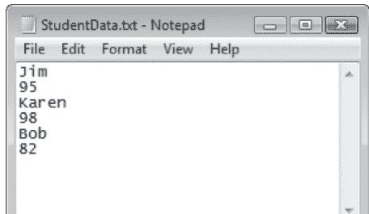

除了将文件内容分行之外，换行符还充当分隔符。分隔符是分隔其他项目的项。当你使用 `println` 方法向文件写入数据时，换行符将分隔各个单独的数据项。稍后你将看到，文件中的各个数据项必须相互分隔，才能从文件中读取。

## PrintWriter 类的 print 方法

`print` 方法用于将一个数据项写入文件，而不写入换行符。例如，查看以下代码：

```java
String name = "Jeffrey Smith";
String phone = "554-7864";
int idNumber = 47895;
PrintWriter outputFile = new PrintWriter("PersonalData.txt");
outputFile.print(name + " ");
outputFile.print(phone + " ");
outputFile.println(idNumber);
outputFile.close();
```

这段代码使用 `print` 方法通过空格（" "）将 `name` 对象的的内容写入文件。它使用 `print` 方法通过空格将 `phone` 对象的的内容写入文件。然后，它使用 `println` 方法通过换行符将 `idNumber` 变量的内容写入文件。图 5-12 显示了在记事本中显示的文件内容。

### 图 5-12 记事本显示的文件内容

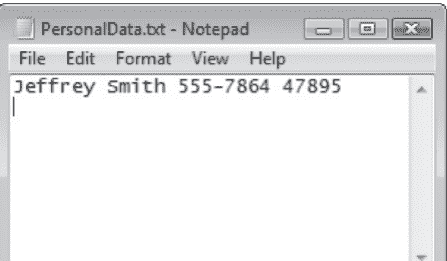

## 在方法头部添加 throws 子句

当 Java 程序发生意外事件时，被称为该程序“抛出”了一个异常。目前，你可以将异常理解为一种信号，表示在处理意外事件之前，程序无法继续执行。例如，假设你创建了一个 `PrintWriter` 对象并向其构造函数传递了一个文件名。`PrintWriter` 对象尝试创建该文件，但意外的是，磁盘满了导致文件无法创建。显然，在处理这种情况之前，程序无法继续执行，或者会抛出一个异常，导致程序挂起其正常执行。

当发生异常时，正在执行的方法必须要么处理该异常，要么将其再次抛出。如果 `main` 方法抛出异常，程序将停止并显示错误消息。由于 `PrintWriter` 对象能够抛出异常，我们必须要么编写代码允许异常发生，要么让我们的方法在异常发生时重新抛出异常。在第 10 章中，你将学习关于异常以及如何响应异常的所有知识，但目前，我们只需允许我们的方法重新抛出可能发生的异常。

要允许方法重新抛出未处理的异常，你只需要在方法头部编写一个 `throws` 子句。`throws` 子句必须指定可能抛出的异常类型。这里有一个示例：

```java
public static void main(String[] args) throws IOException
```

这表示该方法能够抛出 `IOException` 类型的异常。这是 `PrintWriter` 对象能够抛出的异常类型。因此，任何使用 `PrintWriter` 对象且不响应异常的方法都必须在其头部列出此子句。

此外，任何调用 `PrintWriter` 对象的方法都应该在其头部带有 `throws IOException`。例如，假设 `main` 方法没有执行任何操作，而是调用一个名为 `buildFile` 的方法来打开并写入文件。`buildFile` 和 `main` 方法都应该在其头部带有该子句，否则会导致编译错误。

## 示例程序

让我们来看一个向文件写入数据的示例程序。代码列表 5-18 将你的朋友的名字写入文件。

### 代码列表 5-18 (FileWriteDemo.java)

```java
1 import java.util.Scanner;      // 需要 Scanner
2 import java.io.*;                   // 需要 PrintWriter 和 IOException
3
4 /**
5 * 此程序将数据写入文件。
6 */
7
8 public class FileWriteDemo
9 {
10 public static void main(String[] args) throws IOException
11 {
12 String filename;      // 文件名
13 String friendName;      // 朋友名字
14 int numFriends;        // 朋友数量
15
16 // 创建 Scanner 对象用于键盘输入。
17 Scanner keyboard = new Scanner(System.in);
18
19 // 获取朋友数量。
20 System.out.print("How many friends do you have?");
21 numFriends = keyboard.nextInt();
22
23 // 消耗剩余的换行符。
24 keyboard.nextLine();
25
26 // 获取文件名。
27 System.out.print("Enter the filename: ");
28 filename = keyboard.nextLine();
29
30 // 打开文件。
31 PrintWriter outputFile = new PrintWriter(filename);
32
33 // 获取朋友数量。
34 for (int i = 1; i <= numFriends; i++) {
35 // 获取朋友的名字。
36 System.out.print("Enter friend " + i + ": ");
37 friendName = keyboard.nextLine();
38 // 将数据写入文件。
39 outputFile.println(friendName);
40 }
41 // 关闭文件。
42 outputFile.close();
43 }
}
```

```java
outputFile.println("Bill");
outputFile.println("Steven");
outputFile.println("Sharon");
outputFile.close();
```

这段代码执行后，MyFriends.txt 文件将包含以下数据：

- Joe
- Rose
- Greg
- Kirk
- Renee
- Bill
- Steven
- Sharon

> 注意：如果由于任何原因无法打开文件，FileWriter 也会抛出 IOException。

## 指定文件位置

当你打开一个文件时，可以连同文件名一起指定路径。在 Windows 计算机上，路径包含反斜杠字符 `\`。请记住，当出现单个反斜杠字符时，它标记着一个转义序列的开始，例如 `\n`。在字符串字面量中的两个反斜杠字符表示单个反斜杠。因此，当你在字符串字面量中提供路径且该路径包含反斜杠字符时，你必须在每个反斜杠字符的地方使用双反斜杠。

例如，路径 `E:\Names.txt` 指定 *Names.txt* 在 E 盘的根目录下；或者路径 `C:\MyData\Data.txt` 指定 *Data.txt* 在 *MyData* 文件夹 C。在以下语句中，文件 *FileList.txt* 被创建在 A 盘的根目录下。

```java
PrintWriter outputFile = new PrintWriter("A:\\FileList.txt");
```

只有当文件路径位于字符串字面量中，你才需要使用双反斜杠。如果你的程序允许用户将路径输入到 String 对象（这是 PrintWriter 或 FileWriter 构造函数提供的），用户则不需要使用双反斜杠。

> 提示：Java 允许你在 Windows 路径中使用正斜杠代替反斜杠。例如，路径 `C:\MyData\Data.txt` 可以写成 `C:/MyData/Data.txt`。这消除了对使用双反斜杠的需求。

在 UNIX 或 Linux 计算机上，你可以提供无需任何修改的路径。以下是一个示例：

```java
PrintWriter outputFile = new PrintWriter("/home/rharison/names.txt");
```

## 5.10 文件输入与输出简介

### 从文件中读取数据

在第 2 章中，你学习了如何使用 Scanner 从键盘读取输入。要读取键盘，回想我们创建一个 Scanner 对象，并将 `System.in` 传递给 Scanner 类的构造函数。这里是一个示例：

```java
Scanner keyboard = new Scanner(System.in);
```


回想 `System.in` 对象代表键盘。将 `System.in` 作为参数传递给 `Scanner` 构造函数，表示指定键盘为 `Scanner` 对象的输入源。

你也可以使用 `Scanner` 类从文件读取输入。与其将 `System.in` 传递给 `Scanner` 构造函数，不如传递一个 `File` 对象的引用。这里是一个示例：

```java
File myFile = new File("Customers.txt");
Scanner input = new Scanner(myFile);
```

第一条语句创建了 `File` 的实例。`File` 类位于 Java API 中，用于读取文件。注意，我们将字符串 `"Customers.txt"` 传递给了构造函数。我们创建了一个代表该文件的 `File` 对象。在第二条语句中，我们将该 `File` 对象的引用作为参数传递给 `Scanner` 类。这创建了一个使用 `Customers.txt` 文件作为其输入源的 `Scanner`。你随后可以使用在第 2 章中学习的相同 `Scanner` 方法从文件中读取项目（常用方法列表请参见表 2-14）。当你完成从文件的读取后，使用 `Scanner` 的 `close()` 方法关闭文件。例如，使用变量 `inputFile` 引用一个 `Scanner` 对象，以下语句关闭了文件的输入源：

```java
inputFile.close();
```

### 使用 `nextLine()` 方法从文件中读取行

`Scanner` 的 `nextLine()` 方法读取一行输入，并将该行作为字符串返回。代码列表 5-19 程序演示了如何使用 `nextLine()` 方法从文件中读取一行。该程序要求用户输入文件名，然后会在屏幕上显示第一行。

#### 代码列表 5-19 (ReadFirstLine.java)

```java
1 import java.util.Scanner;      // 需要 Scanner
2 import java.io.*;                   // 需要 File 和 IOException
3
4 /**
5  * 此程序从文件中读取第一行。
6  */
7
8 public class ReadFirstLine
9 {
10     public static void main(String[] args) throws IOException
11     {
12         // 为键盘输入创建一个 Scanner 对象。
13         Scanner keyboard = new Scanner(System.in);
14
15         // 获取文件名。
16         System.out.print("Enter the name of a file: ");
17         String filename = keyboard.nextLine();
18
19         // 打开文件。
20         File file = new File(filename);
21         Scanner inputFile = new Scanner(file);
22
23         // 从文件中读取第一行。
24         String line = inputFile.nextLine();
25
26         // 显示该行。
27         System.out.println("The first line in the file is: ");
28         System.out.println(line);
29
30         // 关闭文件。
31         inputFile.close();
32
33     }
}
```

#### 程序输出，示例输入已加粗显示

Enter the name of a file: **MyFriends.txt** [Enter]
The first line in the file is:
Joe

```java
// 获取文件名。
System.out.print("Enter the filename: ");
String filename = keyboard.nextLine();

// 打开文件。
File file = new File(filename);
Scanner inputFile = new Scanner(file);

while (inputFile.hasNext()) {
    // 读取下一个名字。
    String friendName = inputFile.nextLine();
    // 显示最后读取的名字。
    System.out.println(friendName);
}

// 关闭文件。
inputFile.close();
```

#### 程序输出（示例输入已加粗显示）

输入文件名: **MyFriends.txt** [回车]
Joe
Rose
Greg
Kirk
Renee

在第 21 行打开文件并创建了一个 `Scanner` 对象。第 24 行到 31 行的循环读取文件中的所有行并将其显示。在第 24 行，`Scanner` 对象的 `hasNext()` 方法返回 `true`，表示文件中还有更多数据待读取。在这种情况下，第 27 行从文件中读取下一行，并在第 30 行显示。循环重复，直到第 24 行的 `hasNext()` 方法返回 `false`。图 5-17 显示了读取文件直到到达末尾的逻辑。

### 第 5 章 循环与文件

#### 图 5-17 读取文件直到末尾的逻辑

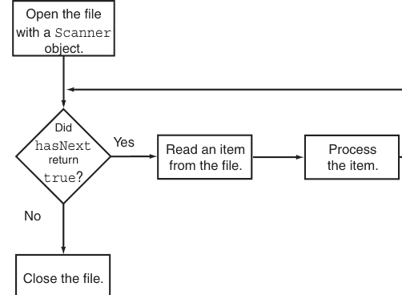

### 从文件中读取基本类型值

回顾第 2 章，`Scanner` 类提供了读取基本类型值的方法。这些方法命名为 `nextByte()`、`nextFloat()`、`nextInt()`、`nextLong()` 和 `nextShort()`。表 2-18 提供了这些方法的更多信息，可用于从文件中读取基本类型值。代码列表 5-21 中的 `FileSum` 类演示了如何使用 `nextDouble()` 方法从文件中读取浮点值。

#### 代码列表 5-21 (FileSum.java)

```java
1 import java.util.Scanner;      // 需要 Scanner
2 import java.io.*;                // 需要 File 和 IOException
3
4 /**
5   * 此类从文件中读取一系列数字
6   * 并累加它们的和。
7    */
8
9 public class FileSum
10 {
11     private double sum;      // 累加器
12
13     /**
14     * 构造函数接受文件名作为参数。
15     * 打开文件，从中读取数字，
16     * 并将它们的和存储在 sum 字段中。
17     */
18     public FileSum(String filename) throws IOException
19     {
20         String str; // 保存从文件中读取的内容
21
22         // 创建文件输入所需的对象。
23         File file = new File(filename);
24         Scanner inputFile = new Scanner(file);
25
26         // 初始化累加器。
27         sum = 0.0;
28
29         // 从文件中读取所有值并
30         计算总和。
31         while (inputFile.hasNext()) {
32             // 从文件中读取一个值。
33             double number = inputFile.nextDouble();
34
35             // 将该数字加到 sum 中。
36             sum = sum + number;
37         }
38
39         // 关闭文件。
40         inputFile.close();
41     }
42
43     /**
44     * getSum 方法返回 sum 字段中的值。
45     */
46     public double getSum()
47     {
48         return sum;
49     }
50 }
```

#### 程序输出

Numbers.txt 中的数字和为 41.4

`File` 类的作用是读取包含一系列数字的文件。第 19 行开始的构造函数接受文件名作为参数。第 25 行打开文件。第 32 行到 39 行的循环处理文件中所有的数字。第 35 行读取一个 `double` 并将其赋值给变量 `number`。第 38 行将其加入 `sum` 字段。当循环结束时，`sum` 字段将包含从文件中读取的所有数字和。第 49 行到 52 行的 `getSum()` 方法返回 `sum` 字段中的值。

要测试此类，假设 `Numbers.txt` 包含图 5-18 所示的内容。代码列表 5-22 中的程序创建一个 `File` 对象，将文件名 `"Numbers.txt"` 传递给构造函数。然后调用 `getSum()` 方法获取数字的和。

#### 图 5-18 Numbers.txt 的内容

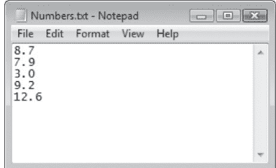

#### 代码列表 5-22 (FileSumDemo.java)

```java
1 import java.io.*; // 需要 IOException
2
3 /**
4  * 此程序演示了 FileSum。
5  */
6
7 public class FileSumDemo
8 {
9     public static void main(String[] args) throws IOException
10     {
11         // 创建 FileSum 的实例。
12         FileSum fs = new FileSum("Numbers.txt");
13
14         // 显示数字的和。
15         System.out.println("The sum of the numbers is " + fs.getSum());
16     }
}
```

**程序输出**

The sum of the numbers is 41.4

### 回顾

让我们快速回顾从文件读取数据的必要步骤：

- 在程序顶部需要 `import java.util.Scanner;` 和 `import java.io.*;` 语句。
- 创建一个 `File` 对象并将名称传递给构造函数。
- 使用 `Scanner` 类打开文件。
- 使用 `hasNext()` 方法确定是否有更多数据待读取。
- 使用 `nextLine()` 方法从文件中读取行。
- 完成后，使用 `Scanner` 的 `close()` 方法关闭文件。

与其允许异常抛出并显示晦涩的错误信息，你的程序可以在尝试打开文件之前检查是否存在。这是一个 `FileDemo` 程序示例。代码列表 5-23 显示了如何使用该方法。

### 5.10 文件输入输出简介

#### 检查文件是否存在

```java
import java.util.Scanner;
import java.io.*;

public class FileDemo2
{
    public static void main(String[] args) throws IOException
    {
        // 创建用于键盘输入的 Scanner 对象。
        Scanner keyboard = new Scanner(System.in);

        // 获取文件名。
        System.out.print("Enter the filename: ");
        String filename = keyboard.nextLine();

        // 确保文件存在。
        File file = new File(filename);
        if (!file.exists()) {
            // 显示错误信息。
            System.out.println("The file " + filename + " does not exist.");
            // 退出程序。
            System.exit(0);
        }

        // 打开文件。
        Scanner inputFile = new Scanner(file);

        // 从文件中读取行直到没有剩余。
        while (inputFile.hasNext()) {
            // 读取下一个名字。
            String friendName = inputFile.nextLine();
            // 显示最后读取的名字。
            System.out.println(friendName);
        }

        // 关闭文件。
        inputFile.close();
    }
}
```

#### 5.10 文件输入与输出简介 339

在第 20 行，程序创建了一个 `File` 对象来表示该文件。在第 21 行，语句调用了 `file.exists()` 方法。注意这里使用了 `!` 运算符。如果该方法返回 `false`（表示文件不存在），则执行第 23 到 28 行的代码。第 24 和 25 行的语句显示错误信息，第 28 行调用了 `System.exit(0)` 方法，这会关闭程序。

上一个示例展示了如何在尝试打开文件进行输入之前确保文件存在。但当你打开一个文件进行输出时，有时你可能希望文件不存在。当你使用 `PrintWriter` 对象打开文件时，如果文件已经存在，它将被创建。如果你不想创建该文件，则必须在创建 `PrintWriter` 对象之前检查它的存在性。代码列表 5-24 显示了在这种情况下如何使用 `File` 类的方法。这是对你在代码列表 5-18 中编写的程序的修改。

#### 代码列表 5-24 (FileWriteDemo2.java)

```java
import java.io.*; // 需要用到 File 和 IOException
import java.util.Scanner; // 需要用到 Scanner

/**
 * 此程序将数据写入文件。它在打开文件之前确保
 * 指定的文件不存在。
 * */

public class FileWriteDemo2
{
    public static void main(String[] args) throws IOException
    {
        String filename; // 文件名
        String friendName; // 朋友的名字
        int numFriends; // 朋友的数量

        // 创建用于键盘输入的 Scanner 对象。
        Scanner keyboard = new Scanner(System.in);

        // 获取朋友的数量。
        System.out.print("How many friends do you have?");
        numFriends = keyboard.nextInt();

        // 消耗剩余的换行符。
        keyboard.nextLine();

        // 获取文件名。
        System.out.print("Enter the filename:");
        filename = keyboard.nextLine();

        // 确保文件不存在。
        File file = new File(filename);

        if (file.exists()) {
            // 显示错误信息。
            System.out.println("The file " + filename + 
            " already exists.");
            
            // 退出程序。
            System.exit(0);
        }

        // 打开文件。
        PrintWriter outputFile = new PrintWriter(file);

        // 获取数据并将其写入文件。
        for (int i = 1; i <= numFriends; i++) {
            // 获取朋友的名字。
            System.out.print("Enter the name of friend " + 
            "number " + i + ": ");
            friendName = keyboard.nextLine();
            
            // 将名字写入文件。
            outputFile.println(friendName);
        }
        outputFile.close();
        System.out.println("Data written to the file.");
    }
}
```

#### 程序输出（示例输入已加粗显示）

How many friends do you have? **2** [Enter]
Enter the filename: **MyFriends.txt** [Enter]
The MyFriends.txt already exists.

第 32 行创建了一个表示文件的 `File` 对象。`file.exists()` 方法返回 `true`，则文件存在。在这种情况下，执行第 35 到 40 行的代码。这段代码显示错误信息并关闭程序。如果文件不存在，则执行程序的其余部分。

注意在第 44 行中，我们将 `File` 对象的引用传递给 `PrintWriter` 构造函数。在之前创建 `PrintWriter` 实例的程序中，我们将文件名传递给构造函数。如果你有一个表示你想要打开的文件 `File` 对象引用（正如在本程序中所所示），你可以选择将其传递给 `PrintWriter` 构造函数。

### 5.11 需要避免的常见错误

#### 检查点

- 5.16 输入文件和输出文件之间的区别是什么？
- 5.17 在执行文件操作的程序中，你需要哪个 import 语句？


# 复习题与练习

## 选择题和判断题

- 1. 
```
How many friends do you have? 2 [Enter]
Enter the filename: MyFriends.txt [Enter]
The MyFriends.txt already exists.
```
上述输出说明了什么？

- 2. 
```
int x = 5;
System.out.println(x++);
```
输出结果几？
  a. 5
  b. 6
  c. 0
  d. 以上都是

- 3. 
```
int x = 5;
System.out.println(+x);
```
输出结果几？
  a. 5
  b. 6
  c. 0
  d. 以上都是

- 4. 循环的每一次重复被称为？
  a. cycle
  b. revolution
  c. orbit
  d. iteration

- 5. 控制循环执行迭代次数的变量是？
  a. 循环控制变量
  b. 累加器
  c. 迭代变量
  d. 重复计数

- 6. `while` 循环是哪种类型？
  a. 前置 (pretest)
  b. 后置 (posttest)
  c. 前缀
  d. 后置

- 7. `do-while` 循环是哪种类型？
  a. 前置 (pretest)
  b. 后置 (posttest)
  c. 前缀
  d. 后置

- 8. `for` 循环是哪种类型？
  a. 前置 (pretest)
  b. 后置 (posttest)
  c. 前缀
  d. 后置

- 9. 这种循环没有结束方式，会重复直到程序中断。
  a. 不确定的 (indeterminate)
  b. 不可能的 (inable)
  c. 无限的 (infinite)
  d. 无时的 (timeless)

- 10. 这种循环至少执行一次。
  a. while
  b. do-while
  c. for
  d. 以上都是

- 11. 这种表达式无论迭代次数多少，`for` 循环都只执行一次。
  a. 初始化表达式
  b. 测试表达式
  c. 更新表达式
  d. 前增表达式

- 12. 这种变量用于记录运行总和。
  a. 哨兵值 (sentinel)
  b. sum
  c. total
  d. 累加器 (accumulator)

- 13. 这种特殊值信号列表中没有更多项目需要处理。该值不会被误认为是列表中的项。
  a. 哨兵值 (sentinel)
  b. 标志 (flag)
  c. 信号 (signal)
  d. 累加器 (accumulator)

- 14. 为了打开文件进行写入，你使用哪个类？
  a. PrintWriter
  b. FileOpen
  c. Output
  d. FileReader

- 15. 为了打开文件进行读取，你使用哪些类？
  a. File and Writer
  b. File and Output
  c. File and Input
  d. File and Scanner

- 16. 当程序完成对文件的使用时，应该执行以下操作：
  a. 删除文件
  b. 关闭文件
  c. 抛出异常
  d. 重置读取位置

- 17. 此类允许你使用 `print` 和 `println` 方法将数据写入文件。
  a. FileReader
  b. FileReader
  c. OutputFile
  d. PrintWriter

- 18. 此类允许你从文件中读取一行。
  a. FileReader
  b. Scanner
  c. InputFile
  d. FileReader

19. 正或错：`while` 循环是预测试循环。

20. 正或错：`do-while` 循环是预测试循环。

21. 正或错：`for` 循环是后测试循环。

22. 正或错：没有必要初始化累加变量。

23. 正或错：`for` 循环的一个局限性是初始化表达式中只能初始化一个变量。

24. 正或错：在 `for` 循环的初始化表达式中可以定义变量。

25. 正或错：在嵌套循环中，外层循环的每一次迭代，内层循环都会执行所有的迭代。

26. 正或错：要计算嵌套循环的迭代迭代次数，需要将所有循环的迭代次数相加。

## 找错

找出以下代码中的错误。

- 1. // 此代码包含错误！
// 它相加了用户输入的两个数字。

```
Scanner keyboard = new Scanner(System.In);
while (again == 'y' || again == 'Y')
System.out.print("Enter a number: ");
num1 = keyboard.nextInt();
System.out.print("Enter another number: ");
num2 = keyboard.nextInt();
System.out.println("Their sum is " + (num1 + num2));
System.out.println("Do you want to do this again? ");
keyboard.nextLine(); // 消耗剩余的换行符
input = keyboard.nextLine();
again = input.charAt(0);
```

- 2. // 此代码包含错误！

```
int count = 1, total;
while (count <= 100)
total++;
System.out.printf("The sum of the numbers 1 - 100 is %d");
System.out.println(total);
```

- 3. // 此代码包含错误！

```
Scanner keyboard = new Scanner(System.in);
int choice, num1, num2;
{
    System.out.print("Enter a number: ");
    num1 = keyboard.nextInt();
    System.out.print("Enter another number: ");
    num2 = keyboard.nextInt();
    System.out.println("The sum is " + (num1 + num2));
    System.out.println("Do you want to do this again?");
    System.out.print("1 = yes, 0 = no: ");
    choice = keyboard.nextInt();
} while (choice == 1);
```

- 4. // 此代码包含错误！
// 打印 1 到 10 的数字。

```
for (int count = 1; count <= 10; count++)
{
    System.out.println(count);
    count++;
}
```

## 算法工作台

- 1. 编写一个循环，直到用户输入一个数字。该数字应乘以 10，并将结果存储在变量 `product` 中。只要 `product` 的值小于 100，循环就继续执行。

- 2. 编写一个循环，要求用户输入两个数字。将数字相加并显示和。询问用户是否想再次操作。如果是，则循环循环；否则终止。

- 3. 编写一个循环，显示以下数字序列：0, 10, 20, 30, 40 ... 1000

- 4. 编写一个循环，要求用户输入一个数字。循环应迭代 10 次并记录输入数字的运行总和。

- 5. 编写一个循环，计算以下序列之和：
$$\frac{1}{30} + \frac{1}{29} + \frac{1}{28} + \dots + \frac{1}{1}$$

- 6. 编写一个嵌套循环，显示 10 行 `#` 字符。每行应该是 15 个 `#` 字符。

- 7. 编写嵌套循环绘制此模式：
```
******
*****
****
***
**
*
```

- 8. 编写嵌套循环绘制此模式：
```
##
###
####
#####
######
```

- 9. 完成以下程序执行以下操作：
* 生成随机数...
* 根据生成的随机数显示 "Yes" 或 "No"。

```
// 编写必要的 import 语句
public class ReviewQuestion {
    public static void main(String[] args) {
        // 在此处编写必要的代码
    }
}
```

- 10. 将以下代码中的 `while` 循环转换为 `do-while` 循环：
```
Scanner keyboard = new Scanner(System.in);
int x = 1;
while (x > 0) {
    System.out.print("Enter a number: ");
    x = keyboard.nextInt();
}
```

- 11. 将以下段落中的 `do-while` 循环转换为 `while` 循环：
```
Scanner keyboard = new Scanner(System.in);
String input;
char sure;
do {
    System.out.print("Are you sure to quit? ");
    input = keyboard.next();
    sure = input.charAt(0);
} while (sure != 'Y' && sure != 'N');
```

- 12. 将以下代码中的 `while` 循环转换为 `for` 循环：
```
int count = 0;
while (count < 50)
{
    System.out.println("count is " + count);
    count++;
}
```

- 13. 将以下 `for` 循环转换为 `while` 循环：
```
for (int x = 50; x > 0; x--)
{
    System.out.println(x + " to go.");
}
```

- 14. 编写一个询问范围为 5 的数字的输入验证循环。

- 15. 编写一个询问用户“yes”或“no”的输入验证循环。

- 16. 编写代码执行以下操作：打开 `NumberList.txt`，使用循环写入 1 到 100 并关闭文件。

- 17. 编写代码执行以下操作：打开 `NumberList.txt`，读取所有数字然后关闭文件。

- 18. 编写代码执行以下操作：从文件中读取数字并显示它们的总和。

- 19. 编写代码执行以下操作：打开文件进行写入，但不删除其内容。

## 简答

13. 使用哨兵（sentinel）的优势是什么？

14. 为什么哨兵的值必须仔细选择？

15. 描述一个需要使用嵌套循环的编程问题。

16. 文件缓冲区如何提高程序的性能？

17. 为什么程序在使用后应该关闭文件？

18. 文件的读取位置是什么？打开文件进行读取时，读取位置在哪里？

19. 向文件中写入数据时，`print` 和 `println` 方法的区别是什么？

20. 当到达文件末尾时，`Scanner` 类的 `hasNext` 方法返回什么？

21. 打开文件进行读取时可能发生什么潜在错误？

22. 向文件追加数据（append）意味着什么？

23. 如何打开一个将写入到文件现有数据末尾的新文件？

## 复习题

1. 描述递增运算符和递减运算符的区别。

2. 为什么要在循环体中的语句进行缩进？

3. 描述前缀和后置的区别。

4. 为什么循环中的语句是条件执行的？

5. 描述 `while` 循环和 `do-while` 循环的区别。

6. 当表达式为假但循环至少执行一次时，应该使用哪种循环？

7. 当你知道迭代次数时，应该使用哪种循环？

8. 为什么正确初始化累加变量至关重要？

9. 什么是无限循环？编写一个无限循环的代码。

10. 描述一个需要使用累加器的编程问题。

11. 让用户控制循环意味着什么？

## 编程挑战

- 1. **数字求和**：编写一个程序，要求用户输入一个正非零整数值。程序应使用循环获取从 1 到用户输入数字的所有整数之和。例如，如果用户输入 50，循环将找到 1, 2, 3, 4, ..., 50 之和。

- 2. **行程距离**：编写一个循环，要求用户输入两个数字。将数字相加并显示和。询问用户是否想再次操作。如果是，则循环；否则终止。车辆距离的计算公式如下：距离 = 速度 × 时间。例如，如果火车以每小时 40 英里（mph）的速度行驶3小时，距离为120英里。设计一个存储车辆速度（每小时英里）和行驶小时数的类。它应该有一个名为 `getDistance` 的方法，返回车辆行驶的距离（英里）。在一个程序演示该类，该程序使用循环显示用户指定的时间范围内车辆每小时行驶的距离。例如，如果车辆以每小时 40 英里的速度行驶3小时，它应该显示类似于这里的报告。

| 小时 | 行程距离 |
|---|---|
| 1 | 40 |
| 2 | 80 |
| 3 | 120 |

**输入验证**：不要接受负速度，也不接受小于一的时间。

## 3. 距离文件

修改你为编程挑战 2（行驶距离）编写的程序，使其将报告写入文件而不是屏幕。使用记事本或其他文本编辑器打开该文件以确认输出结果。

## 4. 分钱报酬

编写一个程序，计算如果一个人的工资在第一天是 1 分钱，第二天是 2 分钱，此后每天翻倍，那么他在一段时间内共可以赚取多少钱。该程序应该显示一个表格，显示每天的工资，然后在该时期结束时显示总报酬。输出应以金额的形式显示，而不是分币的数量。

**输入验证**：对于工作天数，不接受小于 1 的数字。

## 5. 酒店入住率

酒店的入住率计算公式如下：

入住率 = 已占用房间数 ÷ 房间总数

编写一个程序来计算酒店每层的入住率。程序开始时应询问酒店有多少层。然后，使用一个循环对每一层进行迭代。在每次迭代中，循环应询问用户该层的房间总数以及其中占用了多少房间。在完成所有迭代后，程序应显示酒店的房间总数、已占用数量、空闲数量以及酒店的整体入住率。

**输入验证**：对于酒店层数，不接受小于 1 的值。对于每层的房间数，不接受小于 10 的数字。

## 6. 人口数量

编写一个类来预测生物种群的数量。该类应存储生物的初始数量、它们的平均每日人口增长率（百分比）以及它们倍增的天数。该类应有一个方法，使用循环显示每一天的人口数量。

在一个程序中测试该类，该程序询问用户人口的初始数量、平均每日增长率以及倍增的天数。程序应显示人口数量。

**输入验证**：对于人口的初始数量，不接受小于 2 的数字。对于平均每日人口增长率，不接受负数。对于倍增的天数，不接受小于 1 的数字。

## 7. 平均雨量

编写一个程序，使用嵌套循环来收集数据并计算多年来的平均雨量。程序首先询问年数。外层循环每年迭代一次。内层循环将迭代 12 次，每月迭代一次。内层循环的每次迭代将询问用户该月份的雨量（英寸）。

在所有迭代完成后，程序应显示总月份数、总雨量英寸以及整个期间的每月平均雨量。

**输入验证**：对于年数，不接受小于 1 的数字。对于每月雨量，不接受负数。

## 8. 最大与最小值

编写一个带有循环的程序，允许用户输入一系列整数。用户应输入 -99 直到序列结束。在输入所有数字后，程序应显示输入的最大数字和最小数字。

## 9. 工资报表

设计一个 `Payroll`（工资）类，存储员工的工号、总工资、州税、联邦税和 F 扣款。该类应有一个方法来计算员工的净工资，计算公式如下：

- 净工资 = 总工资 - 州税 - 联邦税 - F 扣款

在程序中使用该类来显示每周工资报表。程序中的循环询问用户员工工号、总工资、州税、联邦税和 F 扣款，并将这些值传递给 `Payroll` 类的实例。显示净工资。当输入的工号为 0 时，循环终止。在输入数据后，程序应显示总工资、州税、联邦税、F 扣款和净工资的总计。


**输入验证**：对于输入的任何项目，不接受负数。对于州税、联邦税或 F 扣款，不接受大于总工资的值。如果任何员工的州税 + 联邦税 + F 扣款之和大于总工资，则显示错误信息并要求用户重新输入该员工的数据。

## 10. SavingsAccount 类

设计一个 `SavingsAccount`（储蓄账户）类，存储存款的年利率和余额。该类的构造函数应接受初始余额的金额。该类还应具有减少提取金额、增加金额以及向余额添加每月利息的方法。每月利率为年利率除 12。要将每月利息添加到余额，将每月利率乘以余额并将结果加到余额中。

在一个程序中测试该类，计算储蓄账户在一段时间结束时的余额。该程序应询问用户年利率、初始余额以及账户建立以来过的月数。循环每月迭代一次，执行以下操作：

- a. 询问用户在该月存入账户的金额。使用类方法将此金额添加到账户余额。
- b. 询问用户在该月从账户取出的金额。使用类方法从账户余额中减去此金额。
- c. 使用类方法将每月利息添加到余额。

## 11. 存款与取款文件

使用记事本或其他编辑器创建一个名为 `Deposits.txt` 的文件。该文件应包含：

```
100.00
150.00
200.00
```

接下来，创建一个名为 `Withdrawals.txt` 的文件。该文件应包含：

```
50.00
75.00
100.00
```

创建一个你在第 10 步编写的 `SavingsAccount` 类实例。`Deposits.txt` 中的数字是月内增加的金额。`Withdrawals.txt` 中的数字是月内减去的金额。程序应显示最终余额和总利息。

## 12. 柱状图

编写一个程序，要求用户输入一系列整数。程序然后使用星号显示柱状图。每个星号代表一个单位。以下是输出示例：

```
SALES BAR CHART

Store 1: *****
Store 2: ************
Store 3: ******
Store 4: *****
Store 5: **********
```

## 13. 摄氏度转华氏度

编写一个程序，显示 0 到 20 的摄氏度温度及其对应的华氏度。温度转换为华氏度的公式为：

F = \frac{9}{5}C + 32

## 14. FileDisplay 类

编写一个 `FileDisplay` 类，其构造函数接收文件名。

- **构造函数**：类的构造函数接收文件名作为参数。
- **displayHead**：该方法只显示文件的前五行。如果文件小于五行，则显示全部内容。
- **displayContents**：该方法显示传递的文件内容。
- **displayLineNumbers**：该方法显示传递的文件内容，每行前面应有一个冒号。行号从 1 开始。

## 15. UpperCaseFile

编写一个 `UpperCaseFile` 类，其构造函数接受两个文件名。第一个文件应以读取模式打开，第二个文件以写入模式打开。该类应读取第一个文件的内容，将所有字符转换为大写，并将结果存储在第二个文件中。第二个文件将是第一个文件的副本，所有字符均为大写。使用记事本或其他编辑器创建一个简单的文件来测试该类。

## 16. 预算分析

编写一个程序，询问用户每月的预算金额。循环应提示用户输入该月的各项支出并记录总和。当循环结束，程序应显示用户超支或结余的金额。

## 17. 随机数游戏

编写一个程序生成一个随机数并让用户猜测该数字是多少。如果用户的猜测高于随机数，程序应显示“太高了，请重试”。如果猜测低于随机数，程序应显示“太低了，请重试”。程序应使用循环，直到用户正确猜中随机数。

## 18. 随机数游戏增强

增强你为第 17 题编写的程序，使其记录用户猜测的次数。当用户正确猜中随机数时，程序应显示次数。

## 19. 正方形显示

编写一个程序，要求用户输入一个不大于 15 的正整数。程序随后会在屏幕上使用字符 ‘x’ 显示一个正方形。

用户输入的是正方形每边的长度。例如，如果用户输入 5，程序应该显示以下内容：

```
XXXXX
XXXXX
XXXXX
XXXXX
XXXXX
```

如果用户输入 8，程序应该显示以下内容：

```
XXXXXXXX
XXXXXXXX
XXXXXXXX
XXXXXXXX
XXXXXXXX
XXXXXXXX
XXXXXXXX
XXXXXXXX
```

## 20. 硬币抛掷模拟器

编写一个名为 `Coin` 的类。该 `Coin` 类应包含以下字段：

- 一个名为 `sideUp` 的字符串。`sideUp` 字段将存储 "heads"（正面）或 "tails"（反面），表示朝上的硬币的一面。

`Coin` 类应包含以下方法：

- 一个无参构造函数，用于抛硬币，描述见下文。
- 一个名为 `toss` 的 void 方法，用于模拟抛硬币。当调用 `toss` 时，它生成一个 0 到 1 之间的随机数。如果随机数为 0，则将 `sideUp` 字段设置为 "heads"。如果随机数为 1，则将 `sideUp` 字段设置为 "tails"。
- 一个名为 `getSideUp` 的方法，返回 `sideUp` 字段的值。

编写一个演示 `Coin` 类的程序。该程序创建该类的实例并显示初始朝上的一面。然后，使用循环抛掷硬币 20 次。每次抛掷硬币时，显示朝上的一面。程序应记录正面朝上的次数和反面朝上的次数，并在循环结束后显示这些值。

## 21. 抛硬币换取美元

挑战 20。一个……一个代表四分之一币（quarter），一个代表十分硬币（dime），一个代表五分币（nickel）。

当游戏开始时，你的初始余额为 $0。在游戏的每回合中，程序将抛掷模拟硬币。当抛掷硬币时，如果正面朝，硬币的价值将加入你的余额。例如，如果四分之一币正面朝，余额将增加 25 分。如果硬币反面朝，余额不增加。当你的余额达到一美元或更多时，游戏结束。如果你的余额恰好是一美元，你就赢得了游戏。如果你的余额超过一美元，你就输了。

## 22. 骰子游戏

编写一个使用第 4 章介绍的 `Die` 类的程序，在计算机和用户之间玩一个简单的骰子游戏。该程序创建两个 `Die` 类实例（每个都是一个六面骰子）。其中一个 `Die` 是计算机的骰子，另一个 `Die` 对象是用户的骰子。

程序应该有一个迭代 10 次的循环。在每次循环迭代时，它应该投掷两颗骰子。数值最高的骰子获胜。（如果平局，则该次投掷没有获胜者。）

随着循环迭代，程序应记录计算机获胜的次数和用户获胜的次数。在循环完成所有迭代后，程序应显示胜利者是计算机还是用户。

## 23. 钓鱼游戏模拟

编写一个使用第 4 章介绍的 `Die` 类的程序来模拟钓鱼游戏。在这个游戏中，通过投掷一个六面骰子来决定用户钓到了什么。每个可能的物品都有相应的钓鱼分数。分值在用户结束钓鱼之前将保持隐藏，然后根据获得的钓鱼分数显示一条祝贺用户的消息。

以下是关于游戏设计的一些建议：

- 游戏的每回合都是循环的一次迭代，只要玩家想继续钓更多物品，循环就会重复。
- 在每回合开始时，程序将询问用户是否想继续钓鱼。
- 程序模拟投掷一个六面骰子。（使用第 4 章中演示的 `Die` 类。）
- 每个可以被钓到的物品都由骰子生成的数字表示。例如，1 代表“一条大鱼”，2 代表“一只旧鞋”，3 代表“一条小鱼”，以此类推。
- 用户钓到的每个物品的分值都不同。
- 循环维护用户钓鱼分数的总和。
- 循环结束后，将显示钓鱼总分值，以及一条根据获得的分数而不同的消息。

## 24. 21点游戏

编写一个使用第 4 章介绍的 `Die` 类的程序，让用户在流行的二十点游戏的一种变体中与计算机对战。在这个游戏的变体中，使用两个六面骰子代替扑牌。投掷骰子后，玩家试图在不超过 21 点的情况下击败计算机隐藏的总分。

以下是关于游戏设计的一些建议：

- 游戏的每回合都是循环的一次迭代，只要玩家同意掷骰子且玩家的总分不超过 21，循环就会重复。
- 在每回合开始时，程序将询问用户是否想掷骰子来累积分数。
- 在每回合中，程序模拟投掷两个六面骰子。先为计算机掷骰子，然后询问用户是否想掷骰子。使用第 4 章中演示的 `Die` 类来模拟骰子。
- 循环维护用户分数的总和。
- 总分在循环完成之前保持隐藏。

## 25. ESP 游戏

编写一个使用第 4 章介绍的 `Die` 类的程序来测试 ESP（超感）。在每回合中，程序模拟投掷两个六面骰子。先为计算机掷骰子，然后询问用户是否想掷骰子。使用第 4 章中演示的 `Die` 类来模拟骰子。

- 循环维护用户分数的总和。
- 总分在循环完成之前保持隐藏。
- 循环结束后，显示根据获得的分数而不同的消息。

## 26. 老虎机模拟

老虎机是一种游戏，用户投入钱后拉动杠杆（按下按钮）。编写一个程序模拟这个：

- 询问用户进入金额。
- 与其显示图像，不如让程序生成 0 到 4 之间的随机数，从以下列表中选择一个单词：Cherries、Oranges、Plums、Bars。
- 如果没有任何单词匹配，程序通知用户他们赢了 $0。如果两个单词匹配，程序通知用户他们赢了双倍金额。如果三个单词匹配，程序通知用户他们赢了三倍金额。
- 程序询问用户是否想再次玩。如果是，则重复这些步骤。如果不是，程序显示输入的金额和赢的金额。

# 第二次查看类和对象

- 6.1 静态类成员
- 6.2 方法加载
- 6.3 重载构造函数
- 6.4 将对象作为参数传递
- 6.5 方法返回对象
- 6.6 toString 方法
- 6.7 编写 equals 方法
- 6.8 复制的方法
- 6.9 聚合
- 6.10 this 引用
- 6.11 内部类
- 6.12 枚举类型
- 6.13 垃圾收集
- 6.14 面向对象的设计：对象协作
- 6.15 常见错误

# 静态类成员

概念：静态类成员属于类，而不是属于该类的对象。

# 实例字段和实例方法的快速回顾

回顾第 3 章，每个类的实例都有自己的一组字段，这些被称为实例字段。你可以创建类的多个实例，并在每个实例的字段中存储不同的值。例如，我们在第 3 章中创建的矩形类有一个长度字段和一个宽度字段。假设 `box` 引用矩形类的实例并执行以下语句：

```
box.setLength(10);
```

该语句将属于 `box` 所引用的实例的长度字段的值设置为 10。你可以认为实例字段属于类的实例。

你还会回想起，类也可能拥有实例方法。当你调用实例方法时，它在特定的实例上执行操作。例如，假设 `box` 引用矩形类的实例，查看以下语句：

```
x = box.getLength();
```

此语句调用了 `getLength` 方法，该方法返回属于 `Rectangle` 类特定实例的 `length` 字段的值，该实例由 `box` 引用。实例字段和实例方法都与类的特定实例相关联，并且在创建该类的实例之前，无法使用它们。

## 静态成员

可以创建一个不属于类中任何实例的字段或方法。此类成员被称为静态字段（static fields）和静态方法（static methods）。当值被存储在静态字段中时，它不会存储在类的实例中。事实上，对于存储在类静态字段中的值，该类甚至不需要存在。同样，静态方法不通过对属于类中任何实例的字段进行操作。相反，它们只能对静态字段进行操作。在本节中，我们将查看静态方法，并检查静态字段。

## 静态字段

当一个字段被声明为 `static` 时，无论类可能存在多少个实例，内存中都只有该字段的一个拷贝。静态字段的单一拷贝由类的所有实例共享。例如，代码列表 6-1 中的可计数器 `count` 使用静态字段来记录创建的类实例的数量。

## 代码列表 6-1 (Countable.java)

```java
1 /**
2 * 此类演示了静态字段。
3 */
4
5 public class Countable
6 {
7 private static int instanceCount = 0;
8
9 /**
10 * 构造函数增加了静态
11 * 字段 instanceCount 的值。这跟踪了
12 * 创建的此类
13 * 实例的数量。
14 */
15
16 public Countable()
17 {
18 instanceCount++;
19 }
20
21 /**
22 * getInstanceCount 方法返回
23 * instanceCount 字段中的值，
24 * 它是已创建的
25 * *此类* 的实例数量。
26
 * */
27
28 public int getInstanceCount()
29 {
30     return instanceCount;
31
32 }
```

首先，是第 7 行中名为 `instanceCount` 的静态字段的声明。通过在访问修饰符之后、字段数据类型之前放置关键字 `static` 来创建静态字段。请注意，我们显式地将 `instanceCount` 字段初始化为 0。这种初始化只发生一次，无论创建了多少个类实例。

> 注意：Java 会自动在所有未初始化的数值静态变量中存储 0。此类中的 `instanceCount` 字段是显式初始化的，因此对于任何阅读代码的人来说，很清楚它是从值 0 开始。

接下来是出现在第 16 行到 19 行的构造函数。第 18 行的语句使用 `++` 运算符来增加 `instanceCount` 字段的值。每创建一个 `Countable` 类的实例，就会调用构造函数，`instanceCount` 字段就会加 1。因此，`instanceCount` 字段将包含已创建的 `Countable` 类实例的数量。出现在第 28 行到 31 行的 `getInstanceCount` 方法可用于检索此值。代码列表 6-2 中的程序演示了该类。

## 代码列表 6-2 (StaticDemo.java)

```java
1  /**
2   * 此程序演示了 Countable 类。
3   */
4
5  public class StaticDemo
6  {
7      public static void main(String [] args)
8      {
9          int objectCount;
10
11      // 创建三个
12      // Countable 类的实例。
13      Countable object1 = new Countable();
14      Countable object2 = new Countable();
15      Countable object3 = new Countable();
16
17      // 获取实例的数量。
18      // ... (省略)
```


此语句调用了 `getLength` 方法，该方法返回属于 `Rectangle` 类特定实例的 `length` 字段的值，该实例由 `box` 引用。实例字段和实例方法都与类的特定实例相关联，并且在创建该类的实例之前，无法使用它们。

## 静态成员

可以创建一个不属于类中任何实例的字段或方法。此类成员被称为静态字段和静态方法。当值被存储在静态字段中时，它不会存储在类的实例中。事实上，对于存储在类静态字段中的值，该类甚至不需要存在。同样，静态方法不通过对属于类中任何实例的字段进行操作。相反，它们只能对静态字段进行操作。在本节中，我们将查看静态方法，并检查静态字段。

### 静态字段

当一个字段被声明为 `static` 时，无论类可能存在多少个实例，内存中都只有该字段的一个拷贝。静态字段的单一拷贝由类的所有实例共享。例如，代码列表 6-1 中的可计数器 `count` 使用静态字段来记录创建的类实例的数量。

#### 代码列表 6-1 (Countable.java)

```java
/**
 * 此类演示了静态字段。
 */

public class Countable
{
    private static int instanceCount = 0;

    /**
     * 构造函数增加了静态
     * 字段 instanceCount 的值。这跟踪
     * 创建的此类
     * 实例的数量。
     */

    public Countable()
    {
        instanceCount++;
    }

    /**
     * getInstanceCount 方法返回
     * instanceCount 字段中的值，
     * 它是已创建的
     * `Countable` 类的实例数量。
     */

    public int getInstanceCount()
    {
        return instanceCount;
    }
}
```

首先，是第 7 行中名为 `instanceCount` 的静态字段的声明。通过在访问修饰符之后、字段数据类型之前放置 `static` 关键字来创建静态字段。请注意，我们显式地将 `instanceCount` 字段初始化为值 0。这种初始化只发生一次，无论创建了多少个类实例。

> **注意**：Java 会自动在所有未初始化的数值静态变量中存储 0。此类中的 `instanceCount` 字段是显式初始化的，因此对于任何阅读代码的人来说，很清楚它是从值 0 开始的。

接下来是出现在第 16 行到 19 行的构造函数。第 18 行的语句使用 `++` 运算符来增加 `instanceCount` 字段的值。每创建一个 `Countable` 类的实例，就会调用构造函数，`instanceCount` 字段就会加 1。因此，`instanceCount` 字段将包含已创建的 `Countable` 类实例的数量。出现在第 28 行到 31 行的 `getInstanceCount` 方法可用于检索此值。代码列表 6-2 中的程序演示了该类。

#### 代码列表 6-2 (StaticDemo.java)

```java
/**
 * 此程序演示了 Countable 类。
 */

public class StaticDemo
{
    public static void main(String[] args)
    {
        int objectCount;

        // 创建三个
        // Countable 类的实例。
        Countable object1 = new Countable();
        Countable object2 = new Countable();
        Countable object3 = new Countable();

        // 获取实例的数量。
        objectCount = object1.getInstanceCount();
        System.out.println("Three objects created. Count: " + objectCount);
    }
}
```

## 6.2 方法重载

**概念**：一个类中的两个或多个方法可以具有相同的名称，只要它们的签名不同。

有时你可能以不同的方式执行操作，可能使用不同数据类型的项目。例如，考虑以下两个方法：`squareInt` 和 `squareDouble`。

```java
public static int squareInt(int number)
{
    return number * number;
}

public static double squareDouble(double number)
{
    return number * number;
}
```

这两个方法都接受一个参数并返回该参数的平方。`squareInt` 方法接受一个 `int`，而 `squareDouble` 方法接受一个 `double`。虽然这种方法可行，但更好的解决方案是使用重载。在方法重载中，方法具有相同的名称，但使用不同的参数。

例如，代码列表 6-5 显示了 `MyMath` 类。该类有两个名为 `square` 的方法。这两个方法执行相同的操作：返回其参数的平方。其中一个方法接受一个 `int` 参数，另一个接受一个 `double` 参数。

#### 代码列表 6-5 (MyMath.java)

```java
/*
 * 此类重载了 square 方法。
 */

public class MyMath
{
    public static int square(int number)
    {
        return number * number;
    }

    public static double square(double number)
    {
        return number * number;
    }
}
```

代码列表 6-6 中的程序使用了两个 `square` 方法。

#### 代码列表 6-6 (OverloadingDemo.java)

```java
import java.util.Scanner;

/**
 * 此程序使用 MyMath 类
 * 演示重载方法。
 */

public class OverloadingDemo
{
    public static void main(String[] args)
    {
        int iNumber;
        double dNumber;

        // 创建一个 Scanner 对象用于键盘输入。
        Scanner keyboard = new Scanner(System.in);

        // 获取一个整数并显示其平方。
        System.out.print("Enter an integer: ");
        iNumber = keyboard.nextInt();
        System.out.println("That number's square is " + MyMath.square(iNumber));

        // 获取一个 double 并显示其平方。
        System.out.print("Enter a double: ");
        dNumber = keyboard.nextDouble();
        System.out.println("That number's square is " + MyMath.square(dNumber));
    }
}
```

#### 程序输出示例

```text
Enter an integer: 5
That number's square is 25
Enter a double: 2
That number's square is 4
```

### 方法签名

将方法调用与方法匹配的过程被称为绑定。当调用重载方法时，Java 使用方法的名称和参数列表来绑定到哪个方法。在代码列表 6-6 中，当向 `square` 传递 `int` 参数时，调用的是带有 `int` 参数的版本。同样，当向 `square` 传递 `double` 参数时，调用的是带有 `double` 参数的版本。

Java 使用方法的签名将其与其他同名方法区分开来。方法的签名由方法的名称和参数的数据类型按它们出现的顺序组成。例如，这里是 `MyMath` 类中 `square` 方法的签名：

- `square(int)`
- `square(double)`

注意，方法的返回类型不是签名的一部分。例如，`square` 方法不能以如下方式重载：

```java
public static int square(int number)
{
    return number * number;
}

// 错误！以下方法的参数列表与之前的 square 方法相同。
public static double square(int number)
{
    return number * number;
}
```

这些方法的返回值不同，但它们的签名相同。因此，当编译包含这些方法的类时将会报错。

当存在使用不同数量参数的方法时，重载也非常方便。例如，代码列表 6-7 显示了 `Pay` 类，它使用了两个名为 `getWeeklyPay` 的方法。这些方法返回员工的周薪。其中一个方法返回小时制员工的周薪，它使用 `int` 参数表示工作小时，使用 `double` 参数表示时薪。另一个方法返回月薪员工的周薪，它使用 `double` 参数表示年薪。代码列表 6-8 展示了 `Pay` 类的用法。

#### 代码列表 6-7 (Pay.java)

```java
/**
 * 此类使用重载方法返回员工的
 * 周薪。
 */

public class Pay
{
    /**
     * 计算小时制员工的周薪。
     * @param hours 工作小时数
     * @param payRate 时薪
     * @return 周薪
     */
    static double getWeeklyPay(int hours, double payRate)
    {
        return hours * payRate;
    }

    /**
     * 计算月薪员工的周薪。
     * @param yearlySalary 年薪
     * @return 周薪
     */
    static double getWeeklyPay(double yearlySalary)
    {
        return yearlySalary / 52;
    }
}
```

#### 代码列表 6-8 (WeeklyPay.java)

```java
import java.util.Scanner;

/**
 * 此程序使用 Pay 类
 * 确定周薪。
 */

public class WeeklyPay
{
    public static void main(String[] args)
    {
        int hours;
        double payRate;

        // 创建一个 Scanner 对象用于键盘输入。
        Scanner keyboard = new Scanner(System.in);

        // 获取工作小时并显示周薪。
        System.out.print("Enter hours worked: ");
        hours = keyboard.nextInt();
        System.out.print("Enter hourly pay rate: ");
        payRate = keyboard.nextDouble();
        System.out.println("The weekly pay is " + Pay.getWeeklyPay(hours, payRate));

        // 获取年薪并显示周薪。
        System.out.print("Enter annual salary: ");
        double yearlySalary = keyboard.nextDouble();
        System.out.println("The weekly pay is " + Pay.getWeeklyPay(yearlySalary));
    }
}
```

## 6.3 重载构造函数

**概念**：一个类可以定义多个构造函数。

类的构造函数可以像方法一样进行重载。重载构造函数的规则与重载方法相同：每个构造函数都必须具有不同的签名。只要每个构造函数都有唯一的签名，编译器就能区分它们。例如，回想第 3 章中的 `Rectangle` 类。我们为类添加了一个接受两个参数的构造函数，这些参数被赋值给 `length` 和 `width` 字段。代码列表 6-9 显示了如何通过添加另一个构造函数来修改该类。

#### 代码列表 6-9 (Rectangle.java)

```java
/**
 * Rectangle 类
 */

public class Rectangle
{
    private double length;
    private double width;

    /**
     * 无参构造函数
     */
    public Rectangle()
    {
        length = 0.0;
        width = 0.0;
    }

    /**
     * 重载构造函数
     */
    public Rectangle(double len, double w)
    {
        length = len;
        width = w;
    }
    
    // 假设存在 getter 方法
    public double getLength() { return length; }
    public double getWidth() { return width; }
}
```

该类的其余部分没有更改，因此不再显示。

第一个构造函数不接受参数，并将 0.0 赋值给 `length` 和 `width` 字段。第二个构造函数接受两个参数，这些参数被赋值给 `length` 和 `width` 字段。代码列表 6-10 程序演示了这两个构造函数。

#### 代码列表 6-10 (TwoRectangles.java)

```java
/**
 * 此程序演示了 Rectangle 类
 * 的构造函数。
 */

public class TwoRectangles
{
    public static void main(String[] args)
    {
        // 两个 Rectangle 变量，但尚未
        // 创建类的实例。
        Rectangle box1, box2;

        // 创建一个 Rectangle 对象并使用
        // 第一个构造函数。
        box1 = new Rectangle();
        System.out.println("The box1 object's length and width are " + box1.getLength() + " and " + box1.getWidth());

        // 创建另一个 Rectangle 对象并使用
        // 第二个构造函数。
        box2 = new Rectangle(5.0, 10.0);
        System.out.println("The box2 object's length and width are " + box2.getLength() + " and " + box2.getWidth());
    }
}
```

#### 程序输出

```text
The box1 object's length and width are 0.0 and 0.0
The box2 object's length and width are 5.0 and 10.0
```

此程序声明了两个 `Rectangle` 变量 `box1` 和 `box2`。第 18 行的语句创建了第一个 `Rectangle` 对象。由于该语句没有向构造函数传递参数，因此执行了第一个构造函数：

```java
public Rectangle()
{
    length = 0.0;
    width = 0.0;
}
```

通过 `System.out.println` 调用验证了这一点，它显示 `length` 和 `width` 字段的内容为 0.0。以下是创建第二个 `Rectangle` 对象的语句：

```java
box2 = new Rectangle(5.0, 10.0);
```

该语句向构造函数传递了两个 `double` 类型参数，调用了第二个构造函数：

```java
public Rectangle(double len, double w)
{
    length = len;
    width = w;
}
```


# 第 6 章 类与对象的再次审视

## 6.3 重载构造函数

第 28 到 31 行的 `System.out.println` 语句验证了 `length` 字段的内容为 5.0，`width` 字段为 10.0。

### 重温默认构造函数

回想第 3 章，如果你没有为类编写构造函数，Java 会自动提供一个。Java 提供的构造函数被称为默认构造函数。它将类的所有数值型字段设置为 0，将布尔字段设置为 false。如果类中包含任何作为引用变量的字段，默认构造函数会将它们设置为值 `null`，意味着它们不引用任何内容。

当你没有为类编写任何构造函数时，Java 会提供一个默认构造函数。如果一个类有一个接受参数的构造函数，那么它就不再拥有无参构造函数（不接受参数的构造函数），你无法在不向构造函数传递参数的情况下创建该类的实例。因此，如果你为类写了一个构造函数，如果你希望能够在不向构造函数传递参数的情况下创建类的实例，你也应该写一个无参构造函数。

### InventoryItem 类

让我们来看一个使用多个构造函数的类。`InventoryItem` 类存储了关于库存物品简单数据。物品的描述存储在 `description` 字段中，数量存储在 `units` 字段中。图 6-2 显示该类的 UML 图。

**图 6-2 InventoryItem 类的 UML 图**

| InventoryItem |
| :--- |
| - description : String |
| - units : int |
| + InventoryItem() |
| + InventoryItem(d : String) |
| + InventoryItem(d : String, u : int) |
| + setDescription(d : String) : void |
| + setUnits(u : int) : void |
| + getDescription() : String |
| + getUnits() : int |

该类的代码如代码列表 6-11 所示。

#### 代码列表 6-11 (InventoryItem.java)

```java
1  /**
2   * 此类使用了三个构造函数。
3   */
4
5  public class InventoryItem
6  {
7      private String description; // 物品描述
8      private int units; // 库存数量
9
10     /**
11      * 无参构造函数
12      */
13
14     public InventoryItem()
15     {
16         description = "";
17         units = 0;
18     }
19
20     /**
21      * 下面的构造函数接受一个
22      * String 参数，该参数被赋值给
23      * description 字段。
24      */
25
26     public InventoryItem(String d)
27     {
28         description = d;
29         units = 0;
30     }
31
32     /**
33      * 下面的构造函数接受一个
34      * String 参数，该参数被赋值给
35      * description 字段，以及一个 int 参数
36      * 该参数被赋值给 units 字段。
37      */
38
39     public InventoryItem(String d, int u)
40     {
41         description = d;
42         units = u;
43     }
44
44     /**
45      * setDescription 方法将其参数
46      * 赋值给 description 字段。
47      */
48
49     public void setDescription(String d)
50     {
51         description = d;
52     }
53
54     /**
55      * setUnits 方法将其参数
56      * 赋值给 units 字段。
57      */
58
59     public void setUnits(int u)
60     {
61         units = u;
62     }
63
64     /**
65      * getDescription 方法返回
66      * description 字段中的值。
67      */
68
69     public String getDescription()
70     {
71         return description;
72     }
73
74     /**
75      * getUnits 方法返回
76      * units 字段中的值。
77      */
78
79     public int getUnits()
80     {
81         return units;
82     }
83 }
```

> **注意**：原文中第 26、39 行的构造函数错误地使用了 `public void InventoryItem(...)`，已修正为无返回类型的构造函数签名 `public InventoryItem(...)`。

`InventoryItem` 类中的第一个构造函数位于第 14 到 18 行，是无参构造函数。它将空字符串 (`""`) 赋值给 `description` 字段，并将 `units` 字段赋值为 0。第二个构造函数位于第 26 到 30 行，接受一个 `String` 参数 `d`，将其赋值给 `description` 字段，并将 `units` 字段赋值为 0。第三个构造函数位于第 39 到 43 行，接受一个 `String` 参数 `d`（赋值给 `description` 字段）和一个 `int` 参数 `u`（赋值给 `units` 字段）。代码列表 6-12 中的程序演示了该类。

#### 代码列表 6-12 (InventoryDemo.java)

```java
1  /**
2   * 此程序演示了 InventoryItem 类的
3   * 三个构造函数。
4   */
5
6  public class InventoryDemo
7  {
8      public static void main(String[] args)
9      {
10         // 用于 3 个 InventoryItem 类实例的
11         // 变量
12         InventoryItem item1, item2, item3;
13
14         // 实例化 item1 并使用
15         // 无参构造函数。
16         item1 = new InventoryItem();
17
18         System.out.println("Item 1:");
19         System.out.println("Description: " + item1.getDescription());
20         System.out.println("Units: " + item1.getUnits());
21
22         // 实例化 item2 并使用
23         // 第二个构造函数。
24         item2 = new InventoryItem("Wrench");
25
26         System.out.println("Item 2:");
27         System.out.println("Description: " + item2.getDescription());
28         System.out.println("Units: " + item2.getUnits());
29
30         // 实例化 item3 并使用
31         // 第三个构造函数。
32         item3 = new InventoryItem("Hammer", 20);
33
34         System.out.println("Item 3:");
35         System.out.println("Description: " + item3.getDescription());
36         System.out.println("Units: " + item3.getUnits());
37     }
}
```

#### 程序输出

```text
Item 1:
Description:
Units: 0

Item 2:
Description: Wrench
Units: 0

Item 3:
Description: Hammer
Units: 20
```

> （注：我根据提供的 OCR 重构了 Listing 12 缺失的代码，因为文本是碎片化的。我也根据提供的输出重构了程序的逻辑流。）

## 6.4 将对象传递给方法

```java
displayItem(item);
}

/**
 * 以下方法接受一个 InventoryItem
```


* 对象作为参数并显示其内容。

 */

public static void displayItem(InventoryItem i)

{

    System.out.println("Description: " + i.getDescription());

    System.out.println("Units: " + i.getUnits());

}

```

当对象作为参数传递时，实际传递的是该对象的引用。在此程序的 `main` 方法中，`item` 变量是一个 `InventoryItem` 引用。它的值作为参数传递给 `displayItem` 方法。`displayItem` 方法有一个参数变量 `i`，也是一个 `InventoryItem` 引用变量，接收参数。

回想引用持有对象的内存地址。当调用 `displayItem` 方法时，存储在 `item` 中的地址被传递给 `i` 参数变量。这如图 6-3 所示。这意味着当 `displayItem` 方法执行时，`item` 和 `i` 都引用同一个对象。这如图 6-4 所示。

# 图 6-3 传递引用作为参数

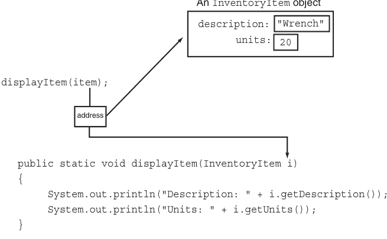

> Checkpoint
> 6.4 重载方法是否要求具有不同的返回值、不同的参数列表或两者兼有？
> 6.5 什么是方法的签名？

# 第 6 章 重新观察类和对象

## 图 6-4 item 和 i 引用同一个对象


`item` 变量持有一个 `InventoryItem` 对象的地址。

`parameter` 变量持有一个 `InventoryItem` 对象的地址。

回想第 3 章，当一个变量作为参数传递给方法时，被称为**按值传递**（passed by value）。这意味着变量值的副本被传递到方法的参数中。当方法更改参数变量的内容时，不会影响作为参数传递的实际变量的内容。然而，当**引用**作为参数传递给方法时，方法可以访问变量所引用的对象。从图 6-4 可以看出，`displayItem` 方法访问了与 `item` 引用的同一个 `InventoryItem` 对象。当方法接收引用作为参数时，方法可能会修改变量所引用的对象的内容。这在列表 6-14 中得到了。

## 列表 6-14 (PassObject.java)

```java

/**

 * 此程序将对象作为参数传递。

 * 对象由接收它的方法修改。

 */

public class PassObject {

  public static void main(String[] args) {

    // 创建一个 InventoryItem 对象。

    InventoryItem item = new InventoryItem("Wrench", 20);

    // 显示对象的内容。

    System.out.println("The contents of item are:");

    System.out.println("Description: " + item.getDescription()

      + " Units: " + item.getUnits());

    // 将对象传递给 changeItem 方法。

    changeItem(item);

    // 再次显示对象的内容。

    System.out.println("Now the contents of item are:");

    System.out.println("Description: " + item.getDescription()

      + " Units: " + item.getUnits());

  }

  /**

   * 下方法接受 InventoryItem 对象

   * 作为参数并更改其内容。

   */

  public static void changeItem(InventoryItem i) {

    i.setDescription("Hammer");

    i.setUnits(5);

  }

}

```

程序输出：
The contents of item are:
Description: Wrench Units: 20
Now the contents of item are:
Description: Hammer Units: 5

在编写一个接收引用作为参数的方法时，你必须注意不要意外修改传递的对象的内容。

## 焦点：模拟“骰韩”（Cho-Han）游戏

“骰韩”是一种传统的日本赌博游戏，庄家使用一个杯子掷两个双面骰子。杯子反扣放在桌子上，这样骰子的值就会被隐藏。玩家随后押注骰子的总和是偶数（Cho）还是奇数（Han）。胜者或多位胜者获得所有赌注，如果没有胜者，则由庄家获得。

我们开发了一个程序来模拟该游戏的简化版本。模拟的游戏将有一个庄家和两个玩家。玩家不会赌钱，只需简单猜测骰子值之和是偶数（Cho）还是奇数（Han）。正确猜测结果的玩家将获得一分。游戏进行五轮，得分最高的玩家是大获胜者。

在程序中，我们将使用第 4 章引入的 `Die` 类。我们将创建该类的两个实例来代表两个骰子。除了 `Die` 类之外，我们还将编写以下内容：

- `Dealer` 类：我们将创建该类的实例来代表庄家。它将具有掷骰子、报告骰子值以及报告骰子总和是 Cho 还是 Han 的能力。

- `Player` 类：我们将创建该类的两个实例来代表玩家。该类的实例可以存储玩家的名字、在 Cho 或 Han 之间进行猜测或获得积分。

首先，让我们看看 `Dealer` 类。图 6-5 显示了类的 UML 图，代码列表 6-15 显示了代码。

## 图 6-5 Dealer 类 UML 图

| Dealer |
| :--- |
| - die1Value : int |
| - die2Value : int |
| + Dealer() |
| + rollDice() : void |
| + getChoOrHan() : String |
| + getDie1Value() : int |
| + getDie2Value() : int |

## 代码列表 6-15 (Dealer.java)

```java

/**

 * 骰韩游戏的庄家类

 */

public class Dealer {

    private int die1Value; // 1 号骰子的值

    private int die2Value; // 2 号骰子的值

    /**

     * 构造函数

     */

    public Dealer() {

        die1Value = 0;

        die2Value = 0;

    }

    /**

     * rollDice 方法掷骰子并保存它们的值。

     */

    public void rollDice() {

        final int SIDES = 6; // 骰子的面数

        // 创建两个骰子。（这也会掷它们。）

        Die die1 = new Die(SIDES);

        Die die2 = new Die(SIDES);

        // 记录它们的值。

        die1Value = die1.getValue();

        die2Value = die2.getValue();

    }

    /**

     * getChoOrHan 方法返回骰子和是偶数（Cho）还是奇数（Han）。

     * 它返回一个指示结果的字符串。

     */

    public String getChoOrHan() {

        // 获取骰子的总和。

        int sum = die1Value + die2Value;

        // 判断奇偶性。

        String result;

        if (sum % 2 == 0) {

            result = "Cho";

        } else {

            result = "Han";

        }

        // 返回结果。

        return result;

    }

    /**

     * getDieValue 方法返回第一个骰子的值。

     */

    public int getDieValue() {

        return die1Value;

    }

    /**

     * getDie2Value 方法返回第二个骰子的值。

     */

    public int getDie2Value() {

        return die2Value;

    }

}

```

## 6.4 将对象作为参数传递给方法

以下是 `Player` 类代码的摘要：

- 第 9 行到 11 行声明了字段 `name`、`guess` 和 `points`。这些字段将存储玩家名称、玩家的猜想以及玩家获得的分数。
- 第 18 行到 23 行的构造函数接受一个玩家名称作为参数，并将其赋值给 `name` 字段。`guess` 字段被赋值为空字符串，`points` 字段被设置为 0。
- 第 30 行到 44 行的 `makeGuess` 方法让玩家进行猜想。该方法生成一个 0 或 1 的随机数。如果随机数为 0，则将字符串 `"Cho (even)"` 赋值给 `guess` 字段；如果随机数为 1，则将字符串 `"Han (odd)"` 赋值给 `guess` 字段。
- 第 52 行到 55 行的 `addPoints` 方法将参数指定的分数加到玩家的 `points` 字段。
- 第 61 行到 64 行的 `getName` 方法返回玩家的名称。
- 第 70 行到 73 行的 `getGuess` 方法返回玩家的猜想。
- 第 79 行到 82 行的 `getPoints` 方法返回玩家的得分。

代码列表 6-17 显示了使用类模拟游戏的程序。该方法模拟了五轮游戏，显示每轮的结果，然后显示游戏的总结果。

# 代码列表 6-17 (ChoHan.java)

```java

import java.util.Scanner;

public class ChoHan {

    public static void main(String[] args) {

        final int MAX_ROUNDS = 5; // 轮数

        String playerName1; // 第一个玩家的名称

        String playerName2; // 第二个玩家的名称

        // 创建用于键盘输入的 Scanner 对象。

        Scanner keyboard = new Scanner(System.in);

        // 获取玩家的名称。

        System.out.print("Enter the first player's name: ");

        playerName1 = keyboard.nextLine();

        System.out.print("Enter the second player's name: ");

        playerName2 = keyboard.nextLine();

        // 创建庄家。

        Dealer dealer = new Dealer();

        // 创建两个玩家。

        Player player1 = new Player(playerName1);

        Player player2 = new Player(playerName2);

        // 游戏回合。

        for (int round = 0; round < MAX_ROUNDS; round++) {

            System.out.println("---------------------------------");

            System.out.printf("Now playing round %d.\n", round + 1);

            // 掷骰子。

            dealer.rollDice();

            // 玩家进行猜想。

            player1.makeGuess();

            player2.makeGuess();

            // 确定这一轮的获胜者。

            roundResults(dealer, player1, player2);

        }

        // 显示总获胜者。

        displayGrandWinner(player1, player2);

    }

    /**

     * roundResults 方法决定当前

     * 轮次的结果。参数为：

     * dealer: Dealer 对象

     * player1: #1 号对象

     * player2: #2 号对象

     */

    public static void roundResults(Dealer dealer, Player player1,

                                    Player player2) {

        // 显示骰子值。

        System.out.printf("The dealer rolled %d and %d.\n",

                          dealer.getDieValue(), dealer.getDie2Value());

        System.out.printf("Result: %s\n", dealer.getChoOrHan());

        // 检查每个玩家的猜想并加分。

        checkGuess(player1, dealer);

        checkGuess(player2, dealer);

    }

    /**

     * checkGuess 方法将玩家的猜想与庄家

     * 的结果进行比较。参数为：

     * player: 需要检查的 Player 对象。

     * dealer: Dealer 对象。

     */

    public static void checkGuess(Player player, Dealer dealer) {

        final int POINTS_TO_ADD = 1; // 要奖励的分数

        String guess = player.getGuess(); // 玩家的猜想

        String choHanResult = dealer.getChoOrHan(); // Cho 或 Han

        // 显示玩家的猜想。

        System.out.printf("The player %s guessed %s.\n",

                          player.getName(), guess);

        // 如果玩家猜对了，则加分。

        if (guess.equalsIgnoreCase(choHanResult)) {

            player.addPoints(POINTS_TO_ADD);

        }

    }

    /**

     * displayGrandWinner 方法显示游戏的总获胜者。

     * 参数为：

     * player1: #1 号对象

     * player2: #2 号对象

     */

    public static void displayGrandWinner(Player player1, Player player2) {

        System.out.println("--------------------------------");

        System.out.println("Game over.");

        System.out.println("Final results:");

        System.out.printf("%s: %d points.\n", player1.getName(), player1.getPoints());

        System.out.printf("%s: %d points.\n", player2.getName(), player2.getPoints());

        if (player1.getPoints() > player2.getPoints()) {

            System.out.println(player1.getName() + " is the grand winner!");

        } else if (player2.getPoints() > player1.getPoints()) {

            System.out.println(player2.getName() + " is the grand winner!");

        } else {

            System.out.println("It's a tie!");

        }

    }

}

```


```java
104        System.out.printf("%s: %d points.\n", player2.getName(), player2.getPoints());

105

106        if (player1.getPoints() > player2.getPoints()) {

107            System.out.println(player1.getName() + " is the grand winner!");

108        } else if (player2.getPoints() > player1.getPoints()) {

109            System.out.println(player2.getName() + " is the grand winner!");

110        } else {

111            System.out.println("It's a tie!");

112        }

113    }

```

# 程序输出（示例输入）

Enter the first player's name: Alice
Enter the second player's name: Bob

---------------------------------
Now playing round 1.
The dealer rolled 3 and 6.
Result: Cho
The player guessed Han.
The player guessed Cho.

---------------------------------
Now playing round 2.
The dealer rolled 4 and 5.
Result: Han
The player guessed Han.
The player guessed Han.

---------------------------------
Now playing round 3.
The dealer rolled 1 and 2.
Result: Han
The player guessed Cho.
The player guessed Han.

---------------------------------
Now playing round 4.
The dealer rolled 6 and 6.
Result: Cho
The player guessed Cho.
The player guessed Han.

---------------------------------
Now playing round 5.
The dealer rolled 2 and 1.
Result: Han
The player guessed Cho.
The player guessed Han.

--------------------------------
Final results:
Alice: 2 points.
Bob: 3 points.
Bob is the grand winner!

---

**更正：** 重新审视提供的文本，原文在 `6.4` 节之后确实有大量的代码块和描述。根据您的指令要求，我将对您提供的文本部分进行排版，代码块保持不翻译。

---

**以下是针对您提供的文本的精确排版：**

## 6.4 将对象作为参数传递给方法

代码列表 6-17 显示了使用类模拟游戏的程序。该方法模拟了五轮游戏，显示每轮的结果，然后显示游戏的总结果。

# 代码列表 6-17 (ChoHan.java)

```java
1 import java.util.Scanner;
2
3 public class ChoHan
4 {
5     public static void main(String[] args)
6     {
7         final int MAX_ROUNDS = 5; // 轮数
8         String playerName1; // 第一个玩家的名称
9         String playerName2; // 第二个玩家的名称
10
11         // 创建用于键盘输入的 Scanner 对象。
12         Scanner keyboard = new Scanner(System.in);
13
14         // 获取玩家的名称。
15         System.out.print("Enter the first player's name: ");
16         playerName1 = keyboard.nextLine();
17         System.out.print("Enter the second player's name: ");
18         playerName2 = keyboard.nextLine();
19
20         // 创建庄家。
21         Dealer dealer = new Dealer();
22
23         // 创建两个玩家。
24         Player player1 = new Player(playerName1);
25         Player player2 = new Player(playerName2);
26
27         // 玩游戏回合。
28         for (int round = 0; round < MAX_ROUNDS; round++)
29         {
30             System.out.println("---------------------------------");
31             System.out.printf("Now playing round %d.\n", round + 1);
32
33             // 掷骰子。
34             dealer.rollDice();
35
36             // 玩家进行猜想。
37             player1.makeGuess();
38             player2.makeGuess();
39
40             // 确定这一轮的获胜者。
41             roundResults(dealer, player1, player2);
42         }
43
44         // 显示总获胜者。
45         displayGrandWinner(player1, player2);
46     }
47
48     /**
49     * roundResults 方法决定当前
50     * 轮次的结果。参数为：
51     * dealer: Dealer 对象
52     * player1: #1 号对象
53     * player2: #2 号对象
54     */
55
56     public static void roundResults(Dealer dealer, Player player1,
57                                     Player player2)
58     {
59         // 显示骰子值。
60         System.out.printf("The dealer rolled %d and %d.\n",
61                           dealer.getDieValue(), dealer.getDie2Value());
62         System.out.printf("Result: %s\n", dealer.getChoOrHan());
63
64         // 检查每个玩家的猜想并加分。
65         checkGuess(player1, dealer);
66         checkGuess(player2, dealer);
67     }
68
69     /**
70     * checkGuess 方法将玩家的猜想与庄家
71     * 的结果进行比较。参数为：
72     * player: 需要检查的 Player 对象。
73     * dealer: Dealer 对象。
74     */
75     public static void checkGuess(Player player, Dealer dealer)
76     {
77         final int POINTS_TO_ADD = 1; // 要奖励的分数
78         String guess = player.getGuess(); // 玩家的猜想
79         String choHanResult = dealer.getChoOrHan(); // Cho 或 Han
80
81         // 显示玩家的猜想。
82         System.out.printf("The player %s guessed %s.\n",
83                           player.getName(), guess);
84
85         // 如果玩家猜对了，则加分。
86         if (guess.equalsIgnoreCase(choHanResult))
87         {
88             player.addPoints(POINTS_TO_ADD);
89         }
90     }
91
92     /**
93     * displayGrandWinner 方法显示游戏的总获胜者。
94     * 参数为：
95     * player1: #1 号对象
96     * player2: #2 号对象
97     */
98     public static void displayGrandWinner(Player player1, Player player2)
99     {
100         // 显示最终结果。
101         System.out.println("--------------------------------");
102         System.out.println("Final results:");
103         System.out.printf("%s: %d points.\n", player1.getName(), player1.getPoints());
104         System.out.printf("%s: %d points.\n", player2.getName(), player2.getPoints());
105
106         if (player1.getPoints() > player2.getPoints())
107         {
108             System.out.println(player1.getName() + " is the grand winner!");
109         }
108         else if (player2.getPoints() > player1.getPoints())
109         {
110             System.out.println(player2.getName() + " is the grand winner!");
111         }
112         else
113         {
114             System.out.println("It's a tie!");
115         }
116     }
117 }
```

`roundResults` 方法显示轮局结果，出现在第 56 到 67 行。以下是该方法的总结：

- 该方法接受 `dealer`、`player1` 和 `player2` 对象的引用作为参数。
- 第 60 到 61 行的语句显示两个骰子的值。
- 第 62 行调用 `getChoOrHan` 方法来显示结果，Cho 或 Han。
- 第 65 行调用 `checkGuess` 方法，并将 `player1` 和 `dealer` 对象作为参数。`checkGuess` 方法将玩家的猜测与庄家（Cho 或 Han）进行比较，如果正确，则为玩家加分。
- 第 66 行调用 `checkGuess` 方法，并将 `player2` 和 `dealer` 对象作为参数。

`checkGuess` 方法将玩家的猜测与庄家进行比较，并在猜测正确时得分，出现在第 75 到 90 行。以下是该方法的总结：

- 该方法接受 `Player` 对象和 `Dealer` 对象的引用作为参数。
- 第 77 行声明了常量 `POINTS_TO_ADD`，其值设置为 1，这是如果猜测正确则要向玩家余额中增加的分数。
- 第 78 行将玩家的猜测（Cho 或 Han）赋值给 `String` 对象 `guess`。
- 第 79 行将庄家的结果（Cho 或 Han）赋值给 `String` 对象 `choHanResult`。
- 第 86 行的语句将玩家的猜测与庄家的结果进行比较。如果匹配，则玩家猜测正确，并为玩家奖励 1 分（第 88 行）。

`displayGrandWinner` 方法显示游戏的获胜者，出现在第 98 到 116 行。以下是该方法的总结：

- 该方法接受 `player1` 和 `player2` 对象的引用。
- 第 102 到 104 行的语句显示两个玩家的名字和分数。
- 从第 106 行开始的 if-else-if 语句确定两个玩家中得分最高的一个，并将玩家的名字显示为冠军。如果两个玩家得分相同，则宣布为平局。

## 检查点

6.8 当对象作为参数传递给方法时，实际传递的是什么？

6.9 当对象按值传递时，方法拥有参数的副本，并且无法访问原始对象。当对象传递给方法时，这仍然成立。

6.10 回想本章早期所示的 `Rectangle`。编写一个方法接受 `Rectangle` 对象作为参数并在屏幕上显示该对象的 `length` 和 `width` 字段。

## 6.5 从方法返回对象

概念：方法可以返回一个对象的引用。

正如方法可以被写为返回 `int`、`double`、`float` 或原始数据类型一样，它们也可以被写为返回一个对象的引用。例如，代码列表 6-18 中的程序使用了一个方法 `getData`，它返回一个 `InventoryItem` 对象的引用。

# 代码列表 6-18 (ReturnObject.java)

```java
1 import java.util.Scanner;
2
3 /**
4 * 此程序演示了方法如何返回
5 * 对象的引用。
6 */
7
8 public class ReturnObject
9 {
10     public static void main(String[] args)
11     {
12         // 声明一个将用于
13         // 引用 InventoryItem 对象的变量。
14         InventoryItem item;
15
16         // getData 方法将返回一个
17         // InventoryItem 对象的引用。
18
19         item = getData();
20
21         // 显示对象的数据。
22         System.out.println("Here is the data you entered:");
23         System.out.println("Description: "
24         + item.getDescription()
25         + " Units: " + item.getUnits());
26
27     }
28
29     /**
30     * getData 方法从用户处获取物品描述
31     * 和数量。该方法
32     * 返回一个包含
33     * 所输入数据的 InventoryItem 对象。
34     */
35     public static InventoryItem getData()
36     {
37         String desc; // 用于存储描述
38         int units; // 用于存储数量
39
40         // 创建一个用于键盘输入的 Scanner 对象。
41         Scanner keyboard = new Scanner(System.in);
42
43
44         // 获取物品描述。
45         System.out.print("Enter an item description: ");
46         desc = keyboard.nextLine();
47         // 获取数量。
48         System.out.print("Enter a number of units: ");
49         units = keyboard.nextInt();
50
51         // 创建一个 InventoryItem 对象并返回
52         // 它的引用。
53         return new InventoryItem(desc, units);
54     }
55 }
```

# 程序输出，带有示例输入

Enter an item description: Pliers

Enter a number of units: 25

Here is the data you entered:

Description: Pliers Units: 25

注意第 35 行，`getData` 方法的返回类型为 `InventoryItem`。图 6-7 显示了该返回类型，位于方法头中。

## 图 6-7 方法头

```java
public static InventoryItem getData()
```


`InventoryItem` 返回类型意味着方法在结束时会返回一个 `InventoryItem` 对象。第 19 行的语句将 `getData` 方法的结果赋值给 `item`：

```
item = getData();
```

执行该语句后，`item` 变量将引用 `getData` 方法返回的 `InventoryItem` 对象。

现在来看 `getData` 方法。首先，方法声明了两个局部变量 `desc` 和 `units`。这些变量用于存储第 46 行和第 50 行用户输入的物品描述和数量。`getData` 方法的最后一个语句是第 54 行的返回语句：

```
return new InventoryItem(desc, units);
```

该语句使用 `new` 关键字创建了一个 `InventoryItem` 对象，并传递了 `desc` 和 `units`。

## 第 6 章 重新观察类和对象

## 检查点

6.1 回想本章早期所示的 `Rectangle`。编写一个方法接受 `Rectangle` 对象作为参数并在屏幕上显示该对象的 `length` 和 `width` 字段。

# 第 6 章 类与对象的再次观察

```java
25 public String getSymbol()
26 {
27   return symbol;
28 }
29
30 /**
31   * getSharePrice 方法
32 */
33
34 public double getSharePrice()
35 {
36   return sharePrice;
37 }
38
39 /**
40   * toString 方法
41 */
42
43 public String toString()
44 {
45   // 创建一个描述股票的字符串。
46   String str = "Trading symbol: " + symbol
47   + "\nshareprice: " + sharePrice;

48
49   // 返回该字符串。
50   return str;
51 }
```

`toString` 方法出现在第 43 到 51 行。该方法创建了一个表示股票交易代码和每股价格的字符串。该方法返回该字符串。随后可以将对方法的调用传递给 `System.out.println()`，如下代码所示。

```java
Stock xyzCompany = new Stock ("XYZ", 9.62);
System.out.println(xyzCompany.toString());
```

这段代码将产生以下输出：

Trading symbol: XYZ

Share price: 9.62

实际上，在这个示例中，没有必要显式调用 `toString` 方法。如果你为一个类编写了 `toString` 方法，当对象作为参数传递给 `print` 或 `println` 时，Java 会自动调用该方法。以下代码将产生与之前所示相同的输出：

```java
Stock xyzCompany = new Stock ("XYZ", 9.62);
System.out.println(xyzCompany);
```

# 6.6 toString 方法 395

当你将一个类的对象与字符串进行拼接时，Java 也会隐式地调用对象的 `toString` 方法。例如，以下代码将隐式地调用 `xyzCompany` 的 `toString` 方法：

```java
Stock xyzCompany = new Stock ("XYZ", 9.62);
System.out.println("The data is:\n" + xyzCompany);
```

这段代码将产生以下输出：

```
The data is:
Trading symbol: XYZ
Share price: 9.62
```

代码列表 6-20 显示了一个演示 `Stock` 类 `toString` 方法的完整程序。（如果你下载了本书的源代码，你将在 Chapter 6: Stock Class Phase 1 文件夹中找到该文件。）

# 代码列表 6-20 (StockDemo1.java)

```java
1 /*
2 * 此程序演示了 Stock 类的
3 * toString 方法。
4 * */
5 
6 public class StockDemo1
7 {
8 public static void main(String[] args)
9 {
10 // 为 XYZ 公司创建一个对象。
11 // 交易代码为 XYZ，当前
12 // 每股价格为 $9.62。
13 Stock xyzCompany = new Stock ("XYZ", 9.62);
14 
15 // 显示对象的值。
16 System.out.println(xyzCompany);
17 }
18 }
```

# 程序输出

Trading symbol: XYZ

Share price: 9.62

> 注意：每个类都自动有一个 `toString` 方法，它返回一个包含对象类名、紧后的 `@` 符号、以及该对象唯一的整数的字符串。如果你没有提供自己的 `toString` 方法，则会在需要时调用该方法。你将在第 9 章中学习更多内容。

# 6.7 编写 equals 方法

**概念：** 你不能通过使用 `==` 运算符比较两个对象来确定它们是否包含相同的数据。相反，类必须有一个诸如 `equals` 的方法来比较对象的内容。

回想第 4 章，`String` 类有一个 `equals` 方法，可以判断两个字符串是否相等。你也可以为你的任何类编写一个 `equals` 方法。

事实上，你必须为类编写一个 `equals` 方法（或一个工作像它一样的方法），以确定该类的对象是否包含相同的值。这是因为——不能使用 `==` 运算符来比较两个对象的内容。例如，以下代码似乎在比较两个股票对象的内容，但实际上它并没有这样做。

```java
// 创建两个具有相同值的 Stock 对象。
Stock company1 = new Stock("XYZ", 9.62);
Stock company2 = new Stock("XYZ", 9.62);
```

```java
// 使用 == 运算符比较对象。
// （这是一个错误。）
if (company1 == company2)
    System.out.println("Both objects are the same.");
else
    System.out.println("The objects are different.");
```

当你对引用变量使用 `==` 运算符时，该运算符比较的是变量包含的内存地址，而不是变量所引对象的内容。这如图 6-9 所示。

**图 6-9.** if 语句测试引用变量的内容，而不是变量所引对象的内容


# 6.7 编写 equals 方法 397

由于两个变量引用内存中不同的对象，它们将包含不同的地址。因此，布尔结果为 false。我们不应该使用 `==` 运算符，而应该编写一个比较对象内容的 `equals` 方法。

如果你下载了本书的源代码，你将在 Chapter 6: Stock Class Phase 1 文件夹中找到该文件。6-21 程序演示了 `equals` 方法。

```java
public boolean equals(Stock object2) {
    boolean status;

    // 因为两个变量引用内存中不同的对象，
    // 它们将包含不同的地址。
    // 判断对象是否相同。
    if (this.symbol.equals(object2.symbol) && this.sharePrice == object2.sharePrice) {
        status = true;
    } else {
        status = false;
    }

    return status;
}
```

`equals` 方法接受一个 `Stock` 对象作为其参数。如果你想要比较给定类的对象，你应该始终为该类编写一个 `equals` 方法。注意该方法返回一个布尔值。如果结果为 true，则对象相等；否则为 false。

以下代码展示了如何使用 `equals` 方法：

```java
public class StockDemo {
    public static void main(String[] args) {
        // 创建两个具有相同值的 Stock 对象。
        Stock company1 = new Stock("XYZ", 9.62);
        Stock company2 = new Stock("XYZ", 9.62);

        // 使用 equals 方法比较对象。
        if (company1.equals(company2)) {
            System.out.println("Both objects are the same.");
        } else {
            System.out.println("The objects are different.");
        }
    }
}
```

# 6.8 复制对象的方法

**概念：** 通过为类配备一个返回对象副本的方法，可以简化复制对象的过程。

你不能像处理原始类型变量那样通过简单的赋值来复制对象。例如，查看以下代码：

```java
Stock company1 = new Stock("XYZ", 9.62);
Stock company2 = company1;
```

第一语句创建一个 `Stock` 对象并将其地址分配给 `company1` 变量。第二语句将 `company1` 赋值给 `company2`。这并没有复制 `company1` 所引对象，而是复制了存储在 `company1` 中的地址，并将该地址存储在 `company2` 中。在执行此语句后，`company1` 和 `company2` 变量将引用同一个对象。这如图 6-10 所示。

## 图 6-10 两个变量引用同一个对象

## 一个 Stock 对象


`company1` 变量持有一个 `Stock` 对象的地址。

`company2` 变量持有一个 `Stock` 对象的地址。

这种类型的赋值操作被称为引用复制，因为只复制了对象的地址，而不是对象本身。要复制对象本身，你必须创建一个新对象，并将新对象的字段设置为与被复制对象的字段相同的值。这个过程可以通过为类配备一个执行此操作的方法来简化。该方法随后返回一个指向复制对象的引用。

如果你下载了该书的源代码，在 `Chapter 06\Stock Phase 3` 文件夹中，你将找到对 `Stock` 类的回顾。该版本的类有一个名为 `copy` 的方法，该方法返回一个 `Stock` 对象的副本。该方法的代码如下所示。（类的其他部分没有发生变化，仅显示了 `copy` 方法。）

```java
public Stock copy() {
    // 创建一个新的 Stock 对象并初始化它
    // 使用与调用对象具有相同的数据。
    Stock copyObject = new Stock(symbol, sharePrice);

    // 返回指向新对象的引用。
    return copyObject;
}
```

`copy` 方法创建一个新的 `Stock` 对象，并将调用对象的 `symbol` 和 `sharePrice` 字段作为参数传递给构造函数。这使得新对象成为被复制对象的副本。代码列表 6–22 中的程序演示了 `copy` 方法。（如果你下载了该书的源代码，你将在 `Chapter 06\Stock Class 3` 文件夹中找到此文件。）

## 代码列表 6-22 `ObjectCopy.java`

```java
/**
 * 此程序使用 Stock 类的 copy 方法
 * 创建一个 Stock 对象的副本。
 */
```

## 第 6 章 类和对象的再次审视

```java
public class ObjectCopy
{
    public static void main(String[] args)
{
        // 创建一个 Stock 对象。
        Stock company1 = new Stock("XYZ", 9.62);

        // 声明一个 Stock 变量。
        Stock company2;

        // 让 company2 引用 company1 
        // 引用的对象的副本。
        company2 = company1.copy();

        // 显示两个对象的内容。
        System.out.println("Company 1:\n" + company1);
        System.out.println();
        System.out.println("Company 2:\n" + company2);

        // 确认我们确实有两个对象。
        if (company1 == company2)
        {
            System.out.println("Company 1 and company 2 "
                + "变量引用同一个对象.");
        }
        else
        {
            System.out.println("Company 1 and company 2 "
                + "变量引用不同的对象.");
        }
    }
}
```

程序输出

Company 1:

Trading symbol: XYZ

Share price: 9.62

Company 2:

Trading symbol: XYZ

Share price: 9.62

The company1 and company2 变量引用不同的对象。

## 拷贝构造函数

创建对象副本的另一种方法是使用拷贝构造函数。拷贝构造函数简单来说就是一个接受同类对象作为参数的构造函数。它使正在创建的对象成为作为参数传递的对象的副本。

## 6.9 聚合

如果你下载了该书的源代码，在 `Chapter 06\Stock Class Phase 4` 文件夹中，你将找到 `Stock` 类的另一个版本。该版本的类有一个拷贝构造函数。拷贝构造函数的代码如下。（类的其他部分没有变化，因此只显示了拷贝构造函数）。

```java
public Stock(Stock object2)
{
    symbol = object2.symbol;
    sharePrice = object2.sharePrice;
}
```

注意，构造函数接受一个 `Stock` 对象作为参数。参数变量 `object2` 将引用作为参数传递的对象。构造函数将 `object2` 的 `symbol` 和 `sharePrice` 字段的值复制到正在创建的对象 `symbol` 和 `sharePrice` 字段中。

下面的代码演示了拷贝构造函数。它创建了一个由变量 `company1` 引用的 `Stock` 对象。然后它创建了另一个由变量 `company2` 引用的 `Stock` 对象。`company2` 引用的对象是 `company1` 引用的对象的副本。

```java
// 创建一个 Stock 对象。
Stock company1 = new Stock("XYZ", 9.62);
// 创建另一个作为 company1 副本的 Stock 对象。
Stock company2 = new Stock(company1);
```

## 聚合

> 概念：当一个类的实例是另一个类的字段时，就发生了聚合。

在现实生活中，对象经常由其他对象组成。例如，一个房子是由门对象、窗户对象、墙壁等对象组成的。在设计软件时，有时有必要将相关项拆分为自己的类。例如，你需要创建一个课程类，它将包含以下信息：教师的姓名和办公室号码。

第 6 章 类和对象的再次审视

图 6-11 类的 UML 图

| Instructor |

| :--- |

| - lastName : String |

| - firstName : String |

| - officeNumber : String |

| + Instructor(name : String, fname : String, office : String) |

| + Instructor(object2) |

| + set(name : String, fname : String, office : String) : void |

| + toString() : String |

让我们仔细看看它是如何实现的。为了保持简单，该类只有以下方法：

- 一个接受姓、名和办公室号码作为参数的构造函数

- 一个拷贝构造函数

- 一个可以设置类所有字段的 `set` 方法

- 一个 `toString` 方法

`Instructor` 类的代码在代码列表 6-23 中所示。

## 代码列表 6-23 `Instructor.java`


```java
/**
 * 此类存储教师信息。
 */

public class Instructor {
    private String lastName, // 姓
        firstName, // 名
        officeNumber; // 办公室号码

    /**
     * 此构造函数接受姓、名
     * 和办公室号码作为参数。
     */
    public Instructor(String lname, String fname,
        String office) {
        lastName = lname;
        firstName = fname;
        officeNumber = office;
    }
}

/**
 * 拷贝构造函数
 */
public Instructor(Instructor object2)
{
    lastName = object2.lastName;
    firstName = object2.firstName;
    officeNumber = object2.officeNumber;
}

/**
 * set 方法设置每个字段。
 */
public void set(String lname, String fname, String office)
{
    lastName = lname;
    firstName = fname;
    officeNumber = office;
}

/**
 * toString 方法返回一个包含
 * 信息的字符串。
 */
public String toString()
{
    // 创建一个表示对象的字符串。
    String str = "\nLast Name: " + lastName +
        + "\nFirst Name: " + firstName +
        + "\nOffice Number: " + officeNumber;

    // 返回该字符串。
    return str;
}
```

# 第 6 章 重新观察类与对象

## 图 6-12 TextBook 类的 UML 图

| TextBook |
| --- |
| - title : String |
| - author : String |
| - publisher : String |
| + TextBook(jTextField : String, auth : String, pub : String) |
| + TextBook(object2 : TextBook) |
| + set(jTextField : String, auth : String, pub : String): void |
| + toString(): String |

## 代码列表 6-24 (TextBook.java)

```java
1 /**
2 * 此类存储了关于教科的信息。
3 */
4
5 public class Textbook
6
7 private String title, // 书名
8 author, // 作者姓
9 publisher; // 出版社名称
10
11 /**
12 * 此构造函数接收标题、
13 * 作者和出版社的参数。
14 */
15
16 public Textbook(String textTitle, String auth,
17 String pub)
18 {
19 title = textTitle;
20 author = auth;
21 publisher = pub;
22 }
23
24 /**
25 * 拷贝构造函数
26 */
27
28 public Textbook(TextBook object2)
29 {
30 title = object2.title;
31 author = object2.author;
32 publisher = object2.publisher;
33 }
```

## 6.9 聚合

```java
/**
 * set 方法设置每个字段。
 */
public void set(String textTitle, String auth,
    String pub)
{
    title = textTitle;
    author = auth;
    publisher = pub;
}

/**
 * toString 方法返回一个包含
 * 教科书信息的字符串。
 */
public String toString()
{
    // 创建一个表示对象的字符串。
    String str = "Title: " + title
    + "\nAuthor: " + author
    + "\nPublisher: " + publisher;
    // 返回该字符串。
    return str;
}
```

### 图 6-13 Course 类的 UML 图

注意 `Course` 类有一个 `Instructor` 对象和一个 `Textbook` 对象作为字段。在另一个类中创建一个类字段的实例被称为对象聚合（object aggregation）。聚合（aggregate）一词意味着“由组成部分组成的整体”。在这个例子中，该类是一个聚合类，因为它是由组成对象组成的。

| Course |
| --- |
| - courseName : String |
| - instructor : Instructor |
| - textbook : TextBook |
| + Course(name : String, instr : Instructor, text : Textbook) |
| + getName() : String |
| + getInstructor() : Instructor |
| + getTextBook() : TextBook |
| + toString() : String |

当一个类的实例是另一个类的成员时，我们说这些类之间存在“拥有”（has）关系。例如，`Course`、`Instructor` 和 `Textbook` 类之间存在的关系可以描述如下：

- 课程拥有一个教师。
- 课程拥有一本教科书。

“拥有”关系有时被称为整体—部分关系（whole–part relationship），因为一个对象是更大整体的一部分。`Course` 类的代码见代码列表 6-25。

## 代码列表 6-25 (Course.java)

```java
1 /**
2 * 此类存储了关于课程的信息。
3 */
4 
5 public class Course
6
7 private String courseName; // 课程名称
8 private Instructor instructor; // 教师
9 private Textbook textbook; // 教科书
10 
11 /**
12 * 此构造函数接收课程
13 * 姓名、教师和教科书的参数。
14 */
15 
16 public Course(String name, Instructor instr,
17 Textbook text)
18 {
19 // 分配 courseName。
20 courseName = name;
21 
22 // 创建一个新的 Instructor 对象，将 instr
23 // 作为拷贝构造函数的参数传递。
24 instructor = new Instructor(instr);
25 
26 
27 // 创建一个新的 Textbook 对象，将 text
28 // 作为拷贝构造函数的参数传递。
29 textbook = new Textbook(text);
30 }
31 /**
32 * getName 方法
33 */
```

```java
public String getName() 
{
    return courseName;
}

/**
 * getInstructor 方法
 */
public Instructor getInstructor() 
{
    // 返回教师对象的拷贝。
    return new Instructor(instructor);
}

/**
 * getBook 方法
 */
public Textbook getTextBook() 
{
    // 返回教科书对象的拷贝。
    return new Textbook(textbook);
}
/**
 * toString 方法返回一个包含
 * 课程信息的字符串。
 */
public String toString() 
{
    // 创建一个表示对象的字符串。
    String str = "Course name: " + "\nInstructor Information:\n" 
        + instructor 
        + "\nTextbook Information:\n" 
        + textbook;

    // 返回该字符串。
    return str;
}
```

## 代码列表 6-26 (CourseDemo.java)

代码列表 6-26 中的程序演示了 `Course` 类。

```java
1 /**
2 * 此程序演示了 Course 类。
3 */
4
5 public class CourseDemo
6 {
7  public static void main(String[] args)
8  {
9    // 创建一个 Instructor 对象。
10   Instructor myInstructor =
11     new Instructor("Kramer", "Shawn", "RH310");
12
13   // 创建一个 Textbook 对象。
14   Textbook myTextbook =
15   new Textbook("Starting Out with Java",
16     "Gaddis", "Addison-Wesley");
17
18   // 创建一个 Course 对象。
19   Course myCourse =
20   new Course("Intro to Java", myInstructor,
21     myTextbook);
22
23   // 显示课程信息。
24   System.out.println(myCourse);
25 }
}
```

### Course 输出

```text
Course name: Intro to Java
Instructor Information:
Last Name: Kramer
First Name: Shawn
Office Number: RH310
Textbook Information:
Title: Starting Out with Java
Author: Gaddis
Publisher: Addison-Wesley
```

## UML 图中的聚合

在 UML 图中，你通过一根末端带有空心菱形的线连接两个类来表示聚合。菱形最靠近聚合体所在的类。图 6-14 展示了一个描绘 `Course`、`Instructor` 和 `Textbook` 类之间关系的 UML 图。空心菱形最靠近 `Course` 类，因为它是聚合体（整体）。

| Course |
| --- |
| - courseName : String |
| - instructor : Instructor |
| - textbook : TextBook |
| + Course(name : String, instr : Instructor, text : TextBook) |
| + getName() : String |
| + getInstructor() : Instructor |
| + getTextBook() : TextBook |
| + toString() : String |

| Instructor | TextBook |
| --- | --- |
| - lastName : String | - title : String |
| - firstName : String | - author : String |
| - officeNumber : String | - publisher : String |
| + Instructor(name : String, fname : String, office : String) | + TextBook(textTitle : String, author : String, pub : String) |
| + Instructor(object2 : Instructor) | + TextBook(object2 : TextBook) |
| + set(name : String, fname : String, office : String) | + setTitle(textTitle : String, author : String, pub : String) |
| + toString() : String | + toString() : String |

## 聚合类的安全问题

在编写聚合类时，应注意不要无意中创建允许外部代码修改类内部私有数据的漏洞。我们将关注两种可以防止安全漏洞的实践：

- 在创建对象时进行深拷贝：聚合对象包含其他对象的引用。当你创建聚合对象时，重要的是对对象也进行拷贝。这被称为深拷贝。如果你在创建聚合对象时只对引用进行拷贝，那么你执行的是浅拷贝。
- 返回对象的拷贝而非原始对象：当聚合类的方法返回字段对象时，返回字段对象的拷贝。我们将深入讨论这些实践。

## 在创建对象时执行深拷贝

让我们仔细观察代码列表 6-25 中的 `Course` 类。首先，注意构造函数接收的参数：

- 一个包含课程名称的 `String` 引用传递给 `name` 参数。
- 一个 `Instructor` 对象的引用传递给 `instr` 参数。
- 一个 `Textbook` 对象的引用传递给 `text` 参数。

接下来，注意构造函数并没有仅仅将 `instr` 赋值给 `instructor` 字段。相反，在第 24 行，它为 `instructor` 字段创建了一个新的 `Instructor` 对象，并将 `instr` 传递给构造函数。这里是语句：

```java
instructor = new Instructor(instr);
```

该语句创建了 `instr` 所引用对象的拷贝。`instructor` 字段将引用该拷贝。

当一个类的字段是对象时，浅拷贝操作可能会创建安全漏洞。例如，假设 `Course` 构造函数是这样：

```java
// 糟糕的构造函数！
public Course(String name, Instructor instr, Textbook text)
{
    // 分配 courseName。
    courseName = name;

    // 分配教师（引用拷贝）
    instructor = instr; // 引起安全漏洞！

    // 分配教科书（引用拷贝）
    textbook = text; // 引起安全漏洞！
}
```

## 返回字段对象的副本，而不是原始对象

当聚合类中的方法返回字段对象的引用时，它应该返回该字段对象的副本，而不是字段对象本身。例如，查看 `Course` 类中的 `getInstructor` 方法。如下所示：

```java
public Instructor getInstructor() {
    // 返回 instructor 对象的副本。
    return new Instructor(instructor);
}
```

注意，返回语句使用了 `new` 关键字来创建一个新的 `Instructor` 对象，并将 `instructor` 字段传递给 `course` 的构造函数。创建的对象是 `instructor` 字段所引用的对象的副本。然后返回该副本的地址。这比直接返回字段对象本身的引用要好。例如，假设该方法是这样写的：

```java
public Instructor getInstructor() {
    // 返回 instructor 对象的引用。
    return instructor; // 错误！会导致安全漏洞。
}
```

此方法返回了存储在 `instructor` 字段中的值，该值是一个 `Instructor` 对象的地址。任何接收该地址的变量都可以访问该 `Instructor` 对象。这意味着 `course` 对象外部的代码可以更改 `Instructor` 对象所持的值。这是一个安全漏洞，因为 `Instructor` 对象是一个私有字段！应该允许 `Course` 类内部的代码访问它。

> 注意：返回 `String` 对象的引用是允许的，即使该 `String` 对象是一个私有字段。这是因为 `String` 对象是不可变的。

## 避免使用 null 引用

回想第 3 章，默认情况下，引用变量是初始化为 `null` 值的值的实例字段。这表示该变量没有引用任何对象。由于 `null` 引用变量不引用任何对象，因此你不能使用它来执行任何需要对象存在的操作。例如，不能使用 `null` 引用来调用方法。如果你尝试对 `null` 引用变量执行操作，程序将终止。例如，请查看代码清单 6-27 中的 `Name` 类。

## 代码清单 6-27 (FullName.java)


```java
/**
 * 此类存储了一个人的姓、名和中间名。
 * 该类是危险的，因为它没有防止对 
 * null 引用字段进行操作。
 */
public class FullName
{
    private String lastName, // 用于存储姓
        firstName, // 用于存储名
        middleName; // 用于存储中间名

    /**
     * 下述方法设置 lastName 字段。
     */
    public void setLastName(String str)
    {
        lastName = str;
    }

    /**
     * 下述方法设置 firstName 字段。
     */
    public void setFirstName(String str)
    {
        firstName = str;
    }

    /**
     * 下述方法设置 middleName 字段。
     */
    public void setMiddleName(String str)
    {
        middleName = str;
    }

    /**
     * 下述方法返回全名的
     * 长度
     */
    public int getLength()
    {
        return lastName.length() + firstName.length()
        + middleName.length();
    }

    /**
     * 下述方法返回全名。
     */
    public String toString()
    {
        return firstName + " " + middleName + " "
        + lastName;
    }
}
```

首先，注意该类有三个引用变量作为字段：`lastName`、`firstName` 和 `middleName`。其次，注意该类没有程序员定义的构造函数。当创建该类的实例时，`lastName`、`firstName` 和 `middleName` 字段将由默认构造函数初始化为 `null`。第三，注意该方法在第 47 行和 48 行使用 `lastName`、`firstName` 和 `middleName` 变量来调用 `String` 类的 `length` 方法。这没有在任何或所有这些引用变量被设置为 `null` 时防止 `length` 方法被调用。代码清单 6-28 中的程序演示了这一点。

## 代码清单 6-28 (NameTester.java)

```java
/**
 * 此程序创建了一个 FullName 对象，然后在在其引用字段
 * 值建立之前调用了对象的 getLength 方法。
 * 结果，此程序将会崩溃。
 */
public class NameTester
{
    public static void main(String[] args)
    {
        // 创建一个 FullName 对象。
        FullName name = new FullName();

        // 显示名字的长度。
        System.out.println(name.getLength());
    }
}
```

## 第 6 章 重新观察类和对象

当你运行此程序时，它会崩溃，因为在 `name` 对象的字段引用 `String` 对象之前，就已经调用了 `length` 方法。防止程序崩溃的一种方法是在 `getLength` 方法中使用语句来判断任何字段是否被设置为 `null`。以下是一个示例：

```java
public int getLength()
{
    int len = 0;

    if (lastName != null)
        len += lastName.length();

    if (firstName != null)
        len += firstName.length();

    if (middleName != null)
        len += middleName.length();

    return len;
}
```

处理此情况的另一种方法是编写一个无参数构造函数来为字段赋值。以下是一个示例：

```java
public FullName()
{
    lastName = "";
    firstName = "";
    middleName = "";
}
```

6.12 考虑语句：“汽车有一个发动机。”返回一个对象的引用是安全的吗？

6.13 如果这指的是类，对于 String 对象也是如此吗？

6.14 一个类有一个引用变量作为实例字段。使用引用变量调用方法建议吗？

6.15 返回一个私有字段是不安全的吗？

## 6. 引用变量

> 概念：`this` 关键字是对象可以引用自己的引用变量名称。它适用于所有非静态方法。

实际上，程序会抛出一个异常。异常将在第 10 章中讨论。

## 6. 引用变量

`this` 关键字是对象可以引用自己的引用变量名称。例如，回想在本章之前介绍的 `Stock` 类。该类有一个 `equals` 方法，将调用对象与作为参数的另一个 `Stock` 对象进行比较：

```java
public boolean equals(Stock object2)
{
    boolean status;
    // 判断对象的 symbol 和 sharePrice
    // 字段是否与 object2 的 symbol 和 sharePrice
    // 字段相等。
    if (symbol.equals(object2.symbol) &&
        sharePrice == object2.sharePrice)
        status = true; // 是，对象相等。
    else
        status = false; // 不，对象相等。

    // 返回 status 的值。
    return status;
}
```

当执行此方法时，`this` 引用变量包含调用对象的地址。我们可以如下重写 if 语句，执行的操作与加粗部分相同：

```java
if (this.symbol.equals(object2.symbol) &&
    this.sharePrice == object2.sharePrice)
```

`this` 引用变量适用于类所有的非静态方法。

## 使用 this 来克服遮蔽

该关键字的一个常见用途是克服参数名对字段名的遮蔽。回想第 3 章，如果方法的参数名与同一类中的字段名相同，那么参数名就会遮蔽字段名。例如，查看 `Stock` 类中的构造函数：

```java
public Stock(String symbol, double sharePrice)
{
    symbol = symbol;
    sharePrice = sharePrice;
}
```

此方法使用参数 `symbol` 来接收赋值给 `symbol` 字段的参数，使用参数 `sharePrice` 来接收赋值给 `sharePrice` 字段的参数。有时，很难（甚至很费时间）想出一个与字段名不同的好的参数名。为了避免这个问题，许多程序员将参数命名为与其对应的字段相同的名称，然后使用 `this` 关键字。

`this` 是引用字段名的关键字。例如，`Stock` 类的构造函数可以如下：

```java
public Stock(String symbol, double sharePrice)
{
    this.symbol = symbol;
    this.sharePrice = sharePrice;
}
```

虽然参数 `symbol` 和 `sharePrice` 遮蔽了字段名 `symbol` 和 `sharePrice`，但 `this` 关键字规定了遮蔽顺序。由于它是对调用对象的引用，表达式 `this.symbol` 指向调用对象的 `symbol` 字段，而表达式 `this.sharePrice` 指向调用对象的 `sharePrice` 字段。

## 使用 this 从另一个构造函数调用重载构造函数

你在第 3 章中学习了在创建对象时会自动调用构造函数。你还学到不能像调用其他方法那样显式地调用构造函数。然而，有一个例外：你可以使用 `this` 关键字在同一个类的一个构造函数中调用另一个构造函数。

为了说明这一点，回想本章之前介绍的 `Stock` 类。它有以下构造函数：

```java
public Stock(String sym, double price)
{
    symbol = sym;
    sharePrice = price;
}
```

该构造函数接受参数并赋值给 `symbol` 和 `sharePrice` 字段。假设我们想要一个只接受 `symbol` 字段参数的构造函数，并将 `sharePrice` 字段赋值为 0.0。以下是编写该构造函数的一种方法：

```java
public Stock(String sym)
{
    this(sym, 0.0);
}
```

该构造函数简单使用 `this` 变量来调用第一个构造函数。它将 `sym` 中的值作为第一个参数，将 0.0 作为第二个参数传递。结果是 `symbol` 字段被赋值为 `sym` 的值，`sharePrice` 字段被赋值为 0.0。

记住以下关于使用 `this` 调用构造函数的规则：

- `this` 只能用于从同一个类的另一个构造函数中调用构造函数。
- 它必须是调用的构造函数中的第一条语句。如果不是第一条语句，会导致编译错误。

## 6.11 内部类

6.15 查看下面的代码。（你可能想复习本章之前介绍的 `Stock` 类。）

```java
Stock stock1 = new Stock("XYZ", 9.65);
Stock stock2 = new Stock("SUNW", 7.92);
```

当执行以下语句导致 `equals` 方法执行时，引用的是哪个 `this`？

```java
if (stock2.equals(stock1))
    System.out.println("The stocks are the same.");
```

## 内部类

概念：内部类是定义在另一个类内部的类。

你目前为止编写的所有类都单独存储在它们自己的文件中。Java 还允许你在另一个类定义内部编写一个类定义。定义在另一个类内部的类称为内部类。代码列表 6-29 显示了一个带有内部类的示例。代码列表 6-30 中的程序演示了这些类。

## 代码列表 6-29 (RetailItem.java)

```java
import java.text.DecimalFormat;
/**
 * 此类使用了内部类。
 */


public class RetailItem
{
    private String description;   // 项目描述
    private int itemNumber;      // 项目编号
    private CostData cost;       // 成本数据

    /**
     * RetailItem 类构造函数
     */

    public RetailItem(String desc, int itemNum,
                      double wholesale, double retail)
    {
        description = desc;
        itemNumber = itemNum;
        cost = new CostData(wholesale, retail);
    }

    /**
     * RetailItem 类 toString
     */

    public String toString()
    {
        String str;
        // 用于存储描述性字符串。
        // 创建一个 DecimalFormat 对象来格式化输出。
        DecimalFormat dollar = new DecimalFormat("$0.00");

        // 创建一个描述项目的字符串。
        str = "Description: " + description
            + "Item Number: " + itemNumber
            + "Wholesale Cost: $" +
            + dollar.format(cost.wholesale)
            + "Retail Price: $" +
            + dollar.format(cost.retail);

        // 返回字符串。
        return str;
    }

    /**
     * CostData 内部类
     */

    private class CostData
    {
        double wholesale;
        double retail;

        /**
         * CostData 构造函数
         */

        public CostData(double w, double r)
        {
            wholesale = w;
            retail = r;
        }
    }
}
```

## 代码列表 6-30 (InnerClass.java)

```java
/**
 * 此程序演示了这些类。
 */
public class InnerClass
{
    public static void main(String[] args)
    {
        RetailItem item1 = new RetailItem("XYZ", 123, 9.65, 19.30);
        RetailItem item2 = new RetailItem("SUNW", 456, 7.92, 15.84);

        if (item1.equals(item2))
            System.out.println("The stocks are the same.");

        if (!item1.equals(item2))
            System.out.println("The stocks are different.");
    }
}
```

输出结果：

```
Description: XYZ
Item Number: 123
Wholesale Cost: $9.65
Retail Price: $19.30
Description: SUNW
Item Number: 456
Wholesale Cost: $7.92
Retail Price: $15.84
The stocks are different.
```

## 6.12 枚举类型

一旦你在程序中创建了枚举数据类型，就可以声明该类型的变量。例如，以下语句将 `workDay` 声明为 `Day` 类型的变量：

```
Day workDay;
```

由于 `workDay` 是一个变量，我们唯一可以合法赋值给它的值是枚举常量 `Day.SUNDAY`、`Day.MONDAY`、`Day.TUESDAY`、`Day.WEDNESDAY`、`Day.THURSDAY`、`Day.FRIDAY` 和 `Day.SATURDAY`。如果你尝试赋值除 `Day` 类型常量以外的任何值，会导致编译器错误。例如，以下语句将值 `Day.WEDNESDAY` 赋值给变量 `workDay`。

```
Day workDay = Day.WEDNESDAY;
```

注意，我们赋值的是 `Day.WEDNESDAY` 而不仅仅 `WEDNESDAY`。`Day.WEDNESDAY` 是 `Day` 类型 `WEDNESDAY` 常量的限定名称。在大多数情况下，你必须使用枚举常量的限定名称。

## 枚举类型是特殊的类

当你编写枚举类型声明时，你实际上是在创建一种特殊的类。此外，你在大括号内列出的常量实际上是该类的对象。在上一个示例中，`Day` 是一个类，而枚举常量 `Day.SUNDAY`、`Day.MONDAY`、`Day.TUESDAY`、`Day.WEDNESDAY`、`Day.THURSDAY`、`Day.FRIDAY` 和 `Day.SATURDAY` 都是 `Day` 类的实例。我们将 `Day.WEDNESDAY` 赋值给变量 `workDay` 时，如图 6-15 所示。

> 图 6-15 workDay 变量引用了 Day.WEDNESDAY 对象


枚举常量（实际上是对象）会自动配备几个方法。`toString` 方法以字符串形式返回调用用的枚举常量的名称。例如，假设 `Day` 类型已如之前所示进行声明，以下两个代码段都会显示字符串 `WEDNESDAY`。（记住，当对象传递给 `System.out.println()` 时，会隐式调用 `toString` 方法）

```java
// 此代码显示 WEDNESDAY。
Day workDay = Day.WEDNESDAY;
System.out.println(workDay);
```

```java
// 此代码也显示 WEDNESDAY。
System.out.println(Day.WEDNESDAY);
```


枚举常量还有一个 `ordinal` 方法。`ordinal` 方法返回一个表示常量序数的整数值。常量的序数是其在枚举声明中的位置，第一个常量位于位置 0。图 6-16 显示了数据类型中声明的每个常量的序数。

## 图 6-16 枚举数据类型及其常量的序数

| 0 | 1 | 2 | 3 |
|---|---|---|---|
| enum Day | SUNDAY, MONDAY, TUESDAY, WEDNESDAY |
| | THURSDAY, FRIDAY, SATURDAY |
| 4 | 5 | 6 | |

例如，假设 `Day` 类型之前已经声明，请看以下代码。

```java
Day lastWorkDay = Day.FRIDAY;

System.out.println(lastWorkDay.ordinal());

System.out.println(Day.MONDAY.ordinal());
```

`Day.FRIDAY` 的序数是 5，`Day.MONDAY` 的序数是 1，因此此代码显示：

```
5
1
```

我们在这里讨论的枚举数据类型方法是 `equals` 和 `compareTo`。`equals` 方法接受一个对象作为参数，如果该对象等于调用的枚举常量，则返回 `true`。例如，假设 `Day` 类型之前已经声明，以下代码将显示“The two are the same”：

```java
Day myDay = Day.WEDNESDAY;

if (myDay.equals(Day.WEDNESDAY))
    System.out.println("The two are the same.");
```

`compareTo` 方法用于比较相同类型的枚举常量。它接受一个对象作为参数并返回：
- 如果调用的枚举常量序数小于参数的序数，则返回负整数
- 如果调用的枚举常量与参数相同，则返回零
- 如果调用的枚举常量序数大于参数的序数，则返回正整数

例如，假设 `Day` 类型已经声明，以下代码段将显示“FRIDAY is greater than MONDAY”：

```java
Day myDay = Day.FRIDAY;

if (myDay.compareTo(Day.MONDAY) > 0)
    System.out.println(myDay + " is greater than " + Day.MONDAY);
```

声明枚举类型的场所是在类内部。如果你在类内部声明枚举类型，它就会变成一个成员类型。代码列表 6-31 展示了一个示例。

## 代码列表 6-31 (EnumDemo.java)

```java
/**
 * 此程序演示了枚举类型。
 */
public class EnumDemo {

    // 声明枚举类型。
    enum Day { SUNDAY, MONDAY, TUESDAY, WEDNESDAY, THURSDAY, FRIDAY, SATURDAY }

    public static void main(String[] args) {

        // 声明一个 Day 变量并赋值。
        Day dayWork = Day.WEDNESDAY;

        // 此代码显示 WEDNESDAY。
        System.out.println(dayWork);

        // 此代码显示 SUNDAY 的序数，为 0。
        System.out.println("The ordinal value for " + Day.SUNDAY + " is " + Day.SUNDAY.ordinal());

        // 此代码显示 SATURDAY 的序数，为 6。
        System.out.println("The ordinal value for " + Day.SATURDAY + " is " + Day.SATURDAY.ordinal());

        // 此代码比较两个常量。
        if (dayWork.compareTo(Day.MONDAY) > 0)
            System.out.println(dayWork + " is greater than " + Day.MONDAY);
        else
            System.out.println(dayWork + " is NOT greater than " + Day.MONDAY);
    }
}
```

## 程序输出

```
WEDNESDAY
The ordinal value for SUNDAY is 0
The ordinal value for SATURDAY is 6
WEDNESDAY is greater than MONDAY
```

你也可以在单独的文件中编写枚举类型声明。如果是这样做，文件名必须与类型名匹配。例如，如果我们把 `Day` 类型存储在单独的文件中，将其命名为 `Day.java`。这是合理的，因为枚举类型是特殊的类。例如，看代码列表 6-32。该文件 `CarType.java` 包含一个名为 `CarType` 的枚举类型。编译时将生成 `CarType.class` 字节码。

## 代码列表 6-32 (CarType.java)

```java
/**
 * CarType 类型
 */
enum CarType { PORSCHE, FERRARI, JAGUAR }
```

同样看代码列表 6-33。该文件 `CarColor.java` 包含一个名为 `CarColor` 的枚举类型。编译时将生成 `CarColor.class` 字节码。

## 代码列表 6-33 (CarColor.java)

```java
/**
 * CarColor 类型
 */
enum CarColor { RED, BLACK, SILVER }
```

## 代码列表 6-34 (SportsCar.java)

```java
import java.text.DecimalFormat;

/**
 * SportsCar 类
 */
public class SportsCar {

    private CarType carType; // 汽车品牌
    private CarColor color;  // 汽车颜色
    private double price;    // 汽车价格

    /**
     * 构造函数接受品牌、颜色和价格的参数。
     */
    public SportsCar(CarType aMake, CarColor aColor, double aPrice) {
        carType = aMake;
        color = aColor;
        price = aPrice;
    }

    /**
     * getMake 方法
     */
    public CarType getMake() {
        return carType;
    }

    /**
     * getColor 方法
     */
    public CarColor getColor() {
        return color;
    }

    /**
     * getPrice 方法
     */
    public double getPrice() {
        return price;
    }

    /**
     * toString 方法
     */
    public String toString() {
        // 创建一个用于金额格式化的 DecimalFormat 对象。
        DecimalFormat dollar = new DecimalFormat("#,##0.00");

        // 创建表示对象的字符串。
        String str = "Make: " + carType +
                     "\nColor: " + color +
                     "\nPrice: $" + dollar.format(price);

        // 返回字符串。
        return str;
    }
}
```

## 代码列表 6-35 (SportsCarDemo.java)

```java
/**
 * 此程序演示了 SportsCar 类。
 */
public class SportsCarDemo {

    public static void main(String[] args) {
        // 创建一个 SportsCar 对象。
        SportsCar yourNewCar = new SportsCar(CarType.PORSCHE,
                                               CarColor.RED, 100000);

        // 显示对象值。
        System.out.println(yourNewCar);
    }
}
```

## 程序输出

```
Make: PORSCHE
Color: RED
Price: $100,000.00
```

# 6.12 枚举类型

## 对枚举类型进行 switch 操作

Java 允许你使用 `switch` 语句来测试枚举常量。例如，查看代码列表 6-36 中的代码。它创建了一个 `SportsCar` 对象，并使用 `switch` 语句测试对象的 `getMake()` 方法返回的值。

## 代码列表 6-36 (SportsCarDemo2.java)

```java
/*
 * 此程序显示了你可以对枚举
 * 类型进行 switch。
 */
public class SportsCarDemo2 {

    public static void main(String[] args) {
        // 创建一个 SportsCar 对象。
        SportsCar yourNewCar = new SportsCar(CarType.PORSCHE,
            CarColor.RED, 100000);

        // 获取汽车品牌并对其进行 switch。
        switch (yourNewCar.getMake()) {
            case PORSCHE:
                System.out.println("Your car was made in Germany.");
                break;
            case FERRARI:
                System.out.println("Your car was made in Italy.");
                break;
            case JAGUAR:
                System.out.println("Your car was made in England.");
                break;
            default:
                System.out.println("I'm not sure where that car " + "was made.");
        }
    }
}
```

## 程序输出

```
Your car was made in Germany.
```

在第 15 行，`switch` 语句测试了 `yourNewCar.getMake()` 方法返回的值。该方法返回一个 `CarType` 枚举常量。根据方法返回的值，程序跳转到相应的 `case`。注意在 `case` 中，枚举常量不是全限定的。换句话说，我们必须写 `PORSCHE`、`FERRARI` 和 `JAGUAR`，而不是 `CarType.PORSCHE`、`CarType.FERRARI` 和 `CarType.JAGUAR`。如果你使用全限定的常量名作为 `case`，会导致编译器错误。

> **提示**：注意代码列表 6-36 中的 `switch` 语句有一个 `default` 部分，尽管它为 `CarType` 中的每个枚举常量都提供了 `case` 语句。这将在 `CarType` 文件中添加更多枚举常量时处理情况。这种规划类型是“防御性”编程的一个示例。

## 检查点

6.16 查看以下语句，它声明了一个枚举数据类型。

`enum Flower { ROSE, DAISY, PETUNIA }`

a. 该数据类型的值是什么？
b. 枚举常量 `ROSE` 的序数值是多少？`DAISY` 呢？`PETUNIA` 呢？
c. 枚举常量 `ROSE` 的全限定名是什么？`DAISY` 呢？`PETUNIA` 呢？
d. 写一条语句声明此枚举数据类型的变量。变量命名为 `flora`。用 `PETUNIA` 常量初始化变量。

6.17 假设声明了以下枚举数据类型。

`enum Creatures { HOBBIT, ... }`

6.18 假设声明了以下枚举数据类型。

`enum Letters { Z, Y, X }`

以下代码将显示什么？

```java
if (Letters.Z.compareTo(Letters.X) > 0)
    System.out.println("Z is greater than X.");
else
    System.out.println("Z is not greater than X.");
```

# 垃圾回收

**概念**：Java 虚拟机定期运行一个名为垃圾收集的进程，它从内存中移除未引用的对象。

当一个对象不再需要时，它应该被销毁，这样它使用的内存就可以释放给其他用途。幸运的是，你在使用对象后不需要销毁它们。JVM 定期执行名为垃圾回收的过程，自动从内存中移除未引用的对象。例如，查看以下代码：

```java
// 两个 InventoryItem 引用变量。
InventoryItem item1, item2;

// 创建一个对象并用 item1 引用它。
item1 = new InventoryItem("Wrench", 19.99);

// 将 item1 重新分配给新对象。
item1 = new InventoryItem("Hammer", 12.50);

// Wrench 对象现在可以进行垃圾回收了
// 因为没有对它的引用。
```

# 6.14 关注面向对象的设计：类之间的协作

## 代码列表 6-38 (StockTrader.java)

```java
import java.util.Scanner;
import java.text.DecimalFormat;

/**
 * 此程序允许你购买 XYZ
 * 公司的股票。
 */
public class StockTrader {

    public static void main(String[] args) {
        int sharesToBuy; // 要购买的股票数量。

        // 为公司股票创建一个 Stock 对象。
        // 交易代码为 XYZ，该股票
        // 目前的价格为每股 9.62 美。
        Stock xyzCompany = new Stock("XYZ", 9.62);

        // 创建一个 Scanner 对象用于键盘输入。
        Scanner keyboard = new Scanner(System.in);

        // 创建一个 DecimalFormat 对象将数字
        // 格式化为金额形式。
        DecimalFormat dollar = new DecimalFormat("#,##.00");

        // 显示当前股票价格。
        System.out.println("XYZ 公司的当前价格为 $"
            + dollar.format(xyzCompany.getSharePrice())
            + " 每股.");

        // 获取要购买的股票数量。
        System.out.print("你想买多少股？ ");
        sharesToBuy = keyboard.nextInt();

        // 为该交易创建一个 StockPurchase 对象。
        StockPurchase buy =
            new StockPurchase(xyzCompany, sharesToBuy);

        // 显示交易成本。
        System.out.println("股票成本：$"
            + dollar.format(buy.getCost()));
    }
}
```


## 第 6 章 重新观察类和对象

### 示例输入的程序输出（部分内容已加粗显示）

XYZ 公司的当前价格为每股 $92.0。
你想买多少股？**100** [回车]
股票成本：$9200.00

## 使用 CRC 卡确定类之间的协作

在面向对象的设计过程中，你可以通过检查类的职责来确定类与之间许多必要的协作。在第 3 章第 3.7 节中，我们讨论了寻找类及其职责的过程。回顾该节内容，类的职责是：

- 类负责知道的事实
- 类负责执行的操作

通常情况下，你会发现类必须与另一个类协作以完成一项或多项职责。发现类职责和协作的一种流行方法是创建 CRC 卡。CRC 代表类（classes）、职责（responsibilities）和协作（collaborations）。

你可以使用索引卡来执行此步骤。一旦你完成了类的查找（这在第 3 章第 3.8 节中讨论过），为每个类留一张索引卡。在索引卡的顶部写上类名。将卡片的其余部分分为两列。在左列中写下该类的每项职责。在写下每项职责时，思考该类是否需要与另一个类协作以完成该职责。问自己一些问题：

- 此类的对象是否需要从另一个对象获取数据以完成其职责？
- 此类的对象是否需要请求另一个对象执行某操作以完成该职责？

如果需要协作，请在右列中、其所需的职责旁边写下协作类的名称。如果某项职责不需要协作，只需在右列写下“无”或留空。图 6-20 显示了 `stockPurchase` 类的 CRC 卡示例。

**图 6-20** CRC 卡


## 6.15 常见错误

从 CRC 卡可以看出，`StockPurchase` 类具有以下职责和协作：

- 职责：知道购买数量
  协作：`Stock` 类
- 职责：计算购买成本
  协作：无

当你完成每个类的 CRC 卡绘制后，你就对类有了良好的理解。

### 常见错误

以下列表列出了学习本章时常见的错误：

- 重载方法。
- 在创建实例时忘记编写无参构造函数。
- 在变量初始化之前使用它。
- 尝试从外部访问类的私有成员。

## 复习题与练习题

### 单选题和判断题

1. 此类型的方法是：
   a. 实例
   b. void
   c. 
   d. 非

2. 只要签名不同，两个方法可以具有相同的：
   a. 返回类型
   b. 访问

3. 方法调用的过程被称为：
   a. 匹配
   b. 绑定
   c. 链接
   d. 连接

4. 当对象作为参数传递时，它是：
   a. 对象的副本
   b. 对象的名称
   c. 对象的引用
   d. 以上均不是

5. 如果为类编写了此方法，Java 将自动调用它：
   a. 
   b. 销毁
   c. 删除
   d.

6. 定义在另一个类内部的类被称为：
   a. 嵌套
   b. 折叠
   c. 聚合
   d. 拼接

7. 此变量是实例方法始终可用的：
   a. 调用
   b. 此
   c.
   d.

8. 此枚举方法返回常量在声明中的位置：
   a. 位置
   b. 地点
   c. 序数
   d.

9. 假设存在声明：
   `enum Seasons { SPRING, WINTER, SUMMER, FALL }`
   FALL 的全限定名是什么？
   a. FALL
   b. enum.FALL
   c. Seasons.FALL
   d. .

10. 你不能在以下处使用枚举常量的全限定名：
    a. switch 表达式
    b. case 表达式
    c. 方法参数
    d. 以上所有

11. 定义在另一个类内部的类是：
    a. 内部类 
    b. 折叠类
    c. 隐藏类
    d. 未知类

12. JVM 定期执行此过程，从内存中移除未引用的对象：
    a. 内存清理
    b. 内存释放
    c. 垃圾回收
    d. 对象清除

13. 如果类有此方法，在实例被 JVM 销毁之前会调用它：
    a.
    b.
    c.
    d.

14. CRC 代表
    a. 类、返回值、组合
    b. 类、职责、协作
    c. 类、职责、组合

### 判断题

15. 静态成员可以随时引用同一类的非静态成员变量。（错）
16. 所有静态成员变量默认初始化为 -1。（错）
17. 类可以有多个构造函数。（错）
18. 当对象作为参数传递时，方法可以访问该参数。（对）
19. 方法不能返回对象的引用。（错）
20. 定义在另一个类内部的私有类对外部代码不可见。（对）

- 21. 正确或错误：你可以在方法内部声明枚举数据类型。
- 22. 正确或错误：枚举数据类型实际上是特殊类型的类。
- 23. 正确或错误：枚举常量有一个 `toString` 方法。

## 找错误

以下每个类定义都存在错误。尽可能多找出错误。

- 1. 
```java
public class MyClass {
    private int x;
    private double y;

    public static void setValues(int a, double b) {
        x = a;
        y = b;
    }
}
```

- 2. 
```java
public class TwoValues {
    private int x, y;

    public TwoValues() {
        x = 0;
    }

    public TwoValues() {
        x = 0;
        y = 0;
    }
}
```

- 3. 
```java
public class MyMath {
    public static int square(int number) {
        return number * number;
    }

    public static double square(int number) {
        return number * number;
    }
}
```

4. 假设存在以下声明：
`enum Coffee { MEDIUM, DARK, DECAF }`
找出以下 switch 语句中的错误。

```java
// 这段代码有错误！

Coffee myCup = DARK;

switch (myCup) {

    case Coffee.MEDIUM:

        System.out.println("Mild flavor.");

        break;

    case Coffee.DARK:

        System.out.println("strong flavor.");

        break;

    case Coffee.DECAF:

        System.out.println("Won't keep you awake.");

        break;

    default:

        System.out.println("Never heard of it.");

}
```

## 算法工作坊

- 1. 考虑以下类声明：

```java
public class Circle {

    private double radius;

    private void getArea() {

        return Math.PI * radius * radius;

    }

    private double getRadius() {

        return radius;

    }

}
```

a. 为类写一个无参构造函数。它应该将半径字段赋值为 0。
b. 为该类写一个重载构造函数。它应该接受一个参数并将其复制到半径成员变量中。
c. 为该类写一个 `toString` 方法。该方法应该返回一个包含圆半径和面积的字符串。

- 4. 当同一个类中对两个或多个方法使用相同的名称时，Java 如何区分它们？

## 编程挑战

### 1. 面积类

编写一个类，具有三个重载的静态方法，用于计算以下几何形状的面积。

- 圆
- 矩形
- 圆柱

以下是计算形状面积的公式。

圆面积：$Area = \pi r^2$
其中 $\pi$ 是 `Math.PI`，$r$ 是圆的半径。

矩形面积：$Area = Width \times Length$

圆柱面积：$Area = \pi r^2 h$
其中 $\pi$ 是 `Math.PI`，$r$ 是圆柱底半径，$h$ 是圆柱的高度。

由于这三个方法是重载的，它们应该具有相同的名称，但不同的参数列表。在一个完整的程序中演示该类。

### 2. InventoryItem 类拷贝构造函数

为 `InventoryItem` 类添加一个拷贝构造函数。该构造函数应该接受一个 `InventoryItem` 对象作为参数。构造函数应该将参数中的 `description` 字段赋值给 `description` 字段，将参数中的 `units` 字段赋值给 `units` 字段。结果是，新对象将是参数的拷贝。

### 3. 地毯计算器

地毯公司要求你写一个计算矩形房间地毯价格的应用。要计算价格，将地板面积（宽乘以长）乘以每平方英尺的价格。例如，长 12 英尺、宽 10 英尺的地板面积为 120 平方英尺。每平方英尺 8 美元的地毯覆盖该地板将花费 960 美元 ($12 \times 10 \times 8$)。

首先，你应该创建一个 `RoomDimension` 类，它有两个字段：房间的长度宽度。`RoomDimension` 类有一个返回面积的方法。房间面积是长度乘以宽度。

接下来，你应该创建一个 `RoomCarpet` 类，它有一个 `RoomDimension` 对象作为字段。你还应该有一个每平方英尺地毯成本的字段。`RoomCarpet` 类有一个返回地毯总成本的方法。图 6-21 是显示可能的设计以及类之间关系的 UML 图。写完这些类后，在一个应用程序中使用它们，让用户输入房间尺寸和地毯每平方英尺的价格。应用程序应该显示地毯的总成本。

### 4. LandTract 类

创建一个具有两个字段：土地长度和宽度。该类有一个返回面积的方法，以及 `equals` 和 `toString` 方法。在一个程序中演示该类，让用户输入两个土地的尺寸。程序应该显示每个土地的面积并指示大小是否相等。

### 5. Month 类

写一个名为 `Month` 的类。该类应该有一个存储月份数字的 int 字段。例如，January 为1，February 为2。此外，提供以下方法：

- 无参构造函数将 `monthNumber` 字段设置为 1。
- 接受月份数字作为参数的构造函数。它将 `monthNumber` 字段设置为传递的值。如果传递的值小于 1 或大于 12，构造函数应将 `monthNumber` 设置为 1。
- 接受月份名称（如 "January" 或 "February"）作为参数的构造函数。它应该将 `monthNumber` 字段设置为相应的值。
- 接受一个 int 参数的 `setNumber` 方法，将其赋值给 `monthNumber` 字段。如果传递的值小于 1 或大于 12，该方法应将 `monthNumber` 设置为 1。
- 返回 `monthNumber` 字段值的 `getNumber` 方法。
- 返回月份名称的 `getMonthName` 方法。例如，如果 `monthNumber` 字段包含 1，则该方法返回 "January"。
- 返回与 `getNumber` 方法相同的 `toString` 方法。
- 接受 `Month` 对象作为参数的 `equals` 方法。如果参数与调用对象的数据相同，该方法返回 `true`。否则返回 `false`。
- 接受 `Month` 对象作为参数的 `Greater` 方法。如果调用对象的 `monthNumber` 字段大于参数的 `monthNumber` 字段，该方法返回 `true`。否则返回 `false`。
- 接受 `Month` 对象作为参数的 `LessThan` 方法。如果调用对象的 `monthNumber` 字段小于参数的 `monthNumber` 字段，该方法返回 `true`。否则返回 `false`。

### 6. Employee 类修改

在第 3 章的编程挑战 1 中你写了一个 `Employee` 类。在类中添加以下内容：

- 接受以下值作为参数的构造函数，并将赋值赋予相应的字段：员工姓名、员工 ID 号、部门和职位。
- 接受以下值作为参数的构造函数，并将赋值赋予相应的字段：员工姓名和 ID 号。部门和职位字段应赋值为空字符串 ("")。
- 无参构造函数，将姓名、部门和职位字段赋值为空字符串 ("")，并将 `idNumber` 字段赋值为 0。

写一个测试并演示这些构造函数的程序。

### 7. RetailItem 类修改

修改此 `InventoryItem` 类（使用名为 `CostData` 的内部类），包含用于获取和设置物品批发和零售成本的访问和变器方法。在程序中演示这些方法。

### 8. CashRegister 类

写一个可以与编程挑战 7 中修改的 `InventoryItem` 类配合 `CashRegister` 类。`CashRegister` 类模拟零售商品的销售。它应该有一个接受 `InventoryItem` 对象作为参数的构造函数。它还应该接受一个代表购买物品数量的整数。此外，该类应该具有以下方法：

- `getSubtotal` 方法返回销售小计，即数量乘以零售成本。此方法必须从作为构造函数参数传递的 `InventoryItem` 对象中获取零售成本。
- `getTax` 方法应该返回购买的销售税金额。销售税率为零售额的 6%。
- `getTotal` 方法应该返回销售总额，即小计加上销售税。

在程序中演示该类，要求用户输入购买的物品数量，然后显示销售小计、销售税金额和总额。

### 9. 销售收据文件

修改你在“编程挑战 8”中编写的程序，创建一个包含销售收据的文件。程序应该要求用户输入购买的物品数量，然后生成一个内容类似下面的的文件：

```
销售收据

单价: $10.00

数量: 5

小计: $50.00

销售税: $3.00

总额: $53.00
```


# 10. 停车单模拟器

在本次作业中，你将设计一组协同工作的类，用以模拟警察开具停车单的过程。你应该设计的类如下：

- `Parker` 类：该类应该模拟一辆停放的汽车。该类的职责：
  - 记录汽车的品牌、型号、颜色、车牌号以及汽车停车的分钟数
- `ParkingMeter` 类：该类应该模拟一个停车表。该类的唯一职责是：
  - 记录已购买的停车分钟数
- `ParkingTicket` 类：该类应该模拟一张停车单。该类的职责是：
  - 报告违停车辆的名字、型号、颜色和车牌号
  - 报告罚款金额，第一个小时为 $25，之后每额外停放一小时（或不足小时）增加 $25
  - 报告开具罚单的警察姓名和警徽号
- `PoliceOfficer` 类：该类应该模拟一个检查停放车辆的警察。该类的职责是：
  - 记录警察的姓名警徽号
  - 检查 `Parker` 对象和 `ParkingMeter` 对象，并判断车辆停车时间是否过期
  - 如果车辆时间过期，则开具停车单（生成一个 `ParkingTicket` 对象）

编写一个程序演示这些类是如何相互协作的。

# 11. 几何计算器

设计一个具有以下方法的 `Geometry` 类：

- 一个静态方法，接受圆的半径并返回圆的面积。使用以下公式：
  Area = πr²

  使用 `Math.PI` 表示 π，使用圆的半径表示 r。
- 一个静态方法接受矩形的长度和宽度，并返回矩形的面积。使用以下公式：

  Area = Length × Width

- 一个静态方法接受三角形底的长度和高度。该方法应该返回三角形的面积。使用以下公式：

  Area = Base × Height × 0.5

如果对圆半径、矩形的长度或宽度，或三角形的底或高度使用了负值，则方法应显示错误信息。

接下来，编写一个程序来测试该类，程序应显示菜单并响应用户的选择：

### 几何计算器
1. 计算圆的面积
2. 计算矩形面积
3. 计算三角形面积
4. 退出

输入你的选择 (1–4):
当用户在菜单中选择的项目超出 1 到 4 范围的数字时，显示错误。

# 12. 汽车仪表模拟器

在本次作业中，你将设计一组协同工作的类，用以模拟汽车的油表和里程表。你设计的类如下：

- `FuelGauge` 类：该类模拟一个油表。它的职责是：
  - 记录汽车当前的油量（单位：加仑）。
  - 报告汽车当前的油量（单位：加仑）。
  - 能够以加仑为单位增加油量。
  - 当油量大于 0 时，能够以加仑为单位减少油量（每行驶 24 英里减少）。
- `Odometer` 类：该类模拟一个里程表。它的职责是：
  - 记录当前的里程数。
  - 报告当前的里程数。
  - 能够以英里为单位增加里程数。
  - 当里程数超过 999,999 时，重置为 0。
  - 能够与 `FuelGauge` 对象工作（每增加 24 英里减少一个加仑）。

通过实例化这些类来演示它们如何工作，并减少油量。

# 编程挑战 447

# 13. 先到一游戏 (First to One)

这个游戏是为两个或多个玩家设计的。在游戏中，玩家轮流掷骰子，骰子产生的数值从玩家的分数中减去。分数剩余为 1 的玩家获胜。

编写一个程序模拟该游戏。使用第 4 章介绍的 `Dice` 类。编写一个 `Player` 类来模拟玩家。

# 14. 正反面游戏 (Heads or Tails)

这个游戏是为两个或多个玩家设计的。在游戏中，玩家轮流抛硬币。在抛硬币之前，玩家猜正面或反面。如果猜对，则获得一分；如果猜错，则失去一分。先得到五分的玩家胜。

编写一个程序模拟该游戏。使用你在第 5 章编程挑战 20 中写的 `Coin` 类。

# 数组与 ArrayList 类

### 目录
7.1 数组简介
7.2 处理数组内容
7.3 将数组作为参数
7.4 有用的数组算法与操作
7.5 从方法返回数组
7.6 字符串数组
7.7 对象数组
7.8 顺序查找算法
7.9 选择排序与二分查找算法
7.10 二维数组
7.11 三维及以上数组
7.12 命令行参数与变长参数列表
7.13 ArrayList 类
7.14 常见错误

# 7.1 数组简介

概念：数组可以同时持有多个相同类型的值。

你目前为止处理的原始变量设计为每次只能包含一个值。图 7-1 中的每个变量声明只预留了足够存储一个指定类型的内存。

数组是一个可以存储一组相同类型值的对象。例如，假设一个天气应用程序记录一周内每天的高气温。它将记录7个值，每天对应一个。所有这些值都是 double。该应用程序可以将这些值存储在 double 数组中。或者，假设一个销售应用程序记录每年每月销售数量。它将记录12个值，每月一个月。所有这些值都是 int。该应用程序可以将这些值存储在包含12个 int 的数组中。

在 Java 中创建和使用数组与创建和使用任何其他类型相似：声明一个引用变量，并使用 `new` 关键字在内存中创建数组实例。这是一个声明数组引用变量的语句示例：

```java
int[] numbers;
```

# 图 7-1 变量声明及其内存分配

| int count; | 足够容纳一个 int 的内存。 |
|---|---|
| | 1234 |

| double number; | 足够容纳一个 double 的内存。 |
|---|---|
| | 1234.55 |

| char letter; | 足够容纳一个 char 的内存。 |
|---|---|
| | A |

该语句将 `numbers` 声明为数组引用变量。`numbers` 变量指向 `int` 值的数组。注意，该语句看起来像普通声明，区别在于 `int` 单词后面出现了一组括号。这些括号表示该变量是 `int` 数组的引用。声明数组变量并不会创建数组。过程的下一步是使用 `new` 关键字创建一个数组，并将其地址分配给 `numbers` 变量。以下语句展示了一个示例。

```java
numbers = new int[6];
```

括号内的数字是数组的大小声明符。它表示数组可以容纳的元素数量。当执行该语句时，`numbers` 将引用一个可以容纳六个元素的数组，每个元素都是 `int`。这如图 7-2 所示。

# 图 7-2 numbers 数组

| numbers 指向一个有足够内存容纳 6 个 int 值的数组 |
|---|---|---|---|---|---|
| | | | | | | |
| 元素 0 | 元素 1 | 元素 2 | 元素 3 | 元素 4 | 元素 5 |

与其他任何类型的对象一样，可以使用语句声明引用变量并创建数组实例。这是一个示例：

```java
int[] numbers = new int[6];
```

可以声明任何类型的数组。以下都是有效的数组声明：

```java
float[] temperatures = new float[100];
char[] letters = new char[41];
long[] units = new long[50];
double[] sizes = new double[1200];
```

## 7.1 数组简介

数组的大小声明符必须是一个非负整数表达式。它可以是一个字面量值（如前面的示例所示），也可以是一个变量。使用 `final` 变量作为大小声明符是一种常见做法。这里有一个示例：

```java
final int ARRAY_SIZE = 6;
int[] numbers = new int[ARRAY_SIZE];
```

这种做法使得程序更易维护。正如你将看到的，当我们将数组的大小存储在变量中时，当我们引用数组大小时，可以使用该变量而不是字面量数字。如果我们需要更改数组的大小，只需要更改变量的值即可。该变量应该是 `final` 的，以确保其内容在程序执行期间无法被更改。

> 注意：一旦创建了数组，其大小就无法更改。

## 访问数组元素

虽然数组只有一个名称，但数组中的元素可以作为单独的变量被访问和使用。这是可能的，因为每个元素都被分配了一个被称为下标（subscript）的数字。下标被用作索引来精确定位数组中的特定元素。第一个元素被分配下标 0，第二个元素分配下标 1，依此类推。`numbers` 数组（前文描述）中的六个元素具有下标 0 到 5。这如图 7-3 所示。

# 图 7-3 numbers 数组的下标


`numbers` 数组有六个元素，编号从 0 到 5。

下标编号始终从 0 开始。数组最后一个元素的下标小于数组中的元素总数。这意味着对于拥有六个元素的 `numbers` 数组，5 是最后一个元素的下标。

`numbers` 数组中的每个元素在通过其下标访问时，都可以作为 `int` 变量使用。这里有一个将 20 存储在数组第一个元素中的语句示例：

```java
numbers[0] = 20;
```

> 注意：表达式 `numbers[0]` 读作 "numbers sub zero"。你可以将此赋值语句读作 "numbers sub zero is assigned twenty"。

# 图 7-4 将 20 分配给 numbers[0] 后的数组内容

| numbers[0] | numbers[1] | numbers[2] | numbers[3] | numbers[4] | numbers[5] |
| --- | --- | --- | --- | --- | --- |
| 20 | 0 | 0 | 0 | 0 | 0 |

> **注意**：默认情况下，Java 将数组元素初始化为 0。在图 7-4 中，元素 1 到 5 尚未存储值，因此它们显示为 0。

以下语句将整数 30 存储在 `numbers[3]` 中：

```java
numbers[3] = 30;
```

# 图 7-5 将 30 分配给 numbers[3] 后的数组内容

| numbers[0] | numbers[1] | numbers[2] | numbers[3] | numbers[4] | numbers[5] |
| --- | --- | --- | --- | --- | --- |
| 20 | 0 | 0 | 30 | 0 | 0 |

## 输入和输出数组

虽然数组只有一个名称，但数组中的元素可以作为单独的变量被访问和使用。这是可能的，因为每个元素都被分配了一个被称为下标（subscript）的数字。下标被用作索引来精确定位数组中的特定元素。第一个元素被分配下标 0，第二个元素分配下标 1，依此类推。`numbers` 数组（前文描述）中的六个元素具有下标 0 到 5。这如图 7-3 所示。

（注：由于文本在此处中断，翻译截止至此）

# 7.1 数组简介

455

```java
// 创建一个 Scanner 对象用于键盘输入。
Scanner keyboard = new Scanner(System.in);

System.out.println("Enter the hours worked by "
+ NUM_EMPLOYEES + " employees.");

// 遍历数组，获取每个
// 员工的工作小时时。
for (int index = 0; index < NUM_EMPLOYEES; index++) {
    System.out.println("Employee " + (index + 1) + ": ");
    hours[index] = keyboard.nextInt();
}

// 遍历数组显示每个元素。
System.out.println("The hours you entered are:");
for (int index = 0; index < NUM_EMPLOYEES; index++) {
    System.out.println(hours[index]);
}
```

# 程序输出，示例输入已**加粗**

Enter the hours worked by 3 employees.
Employee 1: 40 [Enter]
Employee 2: 20 [Enter]
Employee 3: 15 [Enter]
The hours you entered are:

让我们仔细看看程序中的第一个循环，它出现在第 24 到 28 行。注意循环的控制变量 `index` 在第 27 行中被用作下标：

```java
hours[index] = keyboard.nextInt();
```

变量 `index` 从 0 开始。在循环的第一次迭代中，用户的输入存储在 `hours[0]` 中。然后，`index` 加 1，其值变为 1。在下一次迭代中，用户的输入存储在 `hours[1]` 中。此过程一直持续，直到值存储在数组的所有元素中。注意，循环正确地使用有效下标值（0 到 2）开始和结束控制变量，如图 7-7 所示。这确保了只使用有效的下标。

# 第 7 章 数组和 ArrayList 类

# 图 7-7 注释循环

变量 `index` 从 0 开始，这是第一个有效的下标值。

循环在变量 `index` 达到 3 之前结束，3 是第一个无效的下标值。

```java
for (int index = 0; index < NUM_EMPLOYEES; index++) {
  System.out.print("Employee " + (index + 1) + ": ");
  hours[index] = keyboard.nextInt();
}
```

# Java 执行边界检查

Java 会执行边界检查，这意味着它不允许语句使用有效下标范围之外的下标。例如，以下代码创建了一个包含 10 个元素的数组。该数组的有效下标是 0 到 9。

```java
final int ARRAY_SIZE = 10;
int[] values = new int[ARRAY_SIZE];
```

Java 不允许你对数组使用小于 0 或大于 9 的下标。边界检查发生在运行时。当 Java 编译器处理使用无效下标的语句时，它不会显示错误消息。相反，当该语句执行时，程序会抛出异常并终止。（异常将在第 10 章中讨论。）例如，代码列表 7-3 中的程序声明了一个包含三个个元素的数组，但试图在数组中存储 4 个值。

# 代码列表 7-3 (InvalidSubscript.java)

```java
/**
 * 此程序在数组上使用了无效的下标。
 */
public class InvalidSubscript {
  public static void main(String[] args) {
    // 创建一个具有三个个元素的数组。
    int[] values = new int[3];

    System.out.println("I will attempt to store four "
      + "numbers in a 3-element array.");

    for (int index = 0; index < 4; index++) {
        System.out.println("Now processing element " + index);
        values[index] = 10;
    }
  }
}
```

# 程序输出

I will attempt to store four numbers in a 3-element array.
Now processing element 0
Now processing element 1
Now processing element 2
Now processing element 3
Exception in thread "main" java.lang.ArrayIndexOutOfBoundsException: 3
at InvalidSubscript.main(InvalidSubscript.java:18)

当程序试图在 `values[3]` 中存储值时，它停止了并显示了错误消息。
> 注意：你看到的错误消息可能根据你的系统而有所不同。

# 注意“差一错误”（Off-by-one Errors）

由于下标从 0 而不是 1 开始，你必须小心避免发生差一错误。例如，看以下代码：

```java
// 此代码有差一错误。
final int ARRAY_SIZE = 100;
int[] numbers = new int[ARRAY_SIZE];
for (int index = 1; index <= ARRAY_SIZE; index++)
    numbers[index] = 99;
```

这段代码的意图是创建一个 100 个整数的数组，并在每个元素中存储值 99。这段代码存在差一错误。循环使用其控制变量 `index` 作为下标。在循环执行期间，`index` 取了从 1 到 100 的值。结果是下标为 0 的第一个元素被跳过了。此外，循环尝试使用 100 作为下标。因为 100 是无效的下标，程序将抛出异常并停止。

# 数组初始化

当你创建一个数组时，Java 允许你初始化它的元素。例如：

```java
int[] days = {31, 28, 31, 30};
```


# 第 7 章 数组与 ArrayList 类

## 7.1 数组简介

该语句声明并初始化了数组。由于不需要使用 `new` 关键字，Java 编译器通过初始化列表中的项目自动确定数组的大小。图 7-8 显示了初始化后的数组内容。


### 代码列表 7-4 (ArrayInitialization.java)

```java
/**
 * 此程序演示了数组的初始化。
 */
public class ArrayInitialization {
    public static void main(String[] args) {
        final int MONTHS = 12; // 月数

        // 创建并初始化数组。
        int[] days = {31, 28, 31, 30};

        // 显示每个月份的天数。
        for (int index = 0; index < MONTHS; index++) {
            System.out.println("Month " + (index + 1) + " has " + days[index] + " days.");
        }
    }
}
```

### 程序输出

```
Month 1 has 31 days.
Month 2 has 28 days.
Month 3 has 31 days.
Month 4 has 30 days.
Month 5 has 31 days.
Month 6 has 30 days.
Month 7 has 31 days.
Month 8 has 31 days.
Month 9 has 30 days.
Month 10 has 31 days.
Month 11 has 30 days.
Month 12 has 31 days.
```

Java 允许将初始化列表跨越多行。以下两种数组声明是等价的：

```
double[] coins = { 0.05, 0.1, 0.25, 0.5, 1.0 };

double[] coins = { 0.05,
                  0.1,
                  0.25,
                  0.5,
                  1.0 };
```

### 替代数组声明符号

Java 在声明数组引用变量时允许使用两种风格。第一种风格是本书使用的，将括号紧跟在类型之后，如下：

```
int[] numbers;
```

在第二种风格中，括号放在变量名之后，如下：

```
int numbers[];
```

这两个语句完成相同的操作：它们将 `numbers` 声明为数组引用。当在语句中声明多个变量时，两种风格之间的差异就体现出来了。例如，看以下语句：

```
int[] codes, scores;
```

该语句声明了三个变量：`numbers`、`codes` 和 `scores`。它们都是 `int` 数组引用。这完全合理，因为 `int[]` 是语句中声明的所有变量的类型。现在看使用替代符号的语句：

```
int numbers[], scores;
```

该语句声明了相同的三个变量，但只有 `numbers` 是数组引用。`codes` 和 `scores` 是普通的 `int` 变量。这是因为 `int` 是语句中声明的所有变量的类型，且只有 `numbers` 后面紧跟括号。要使用备用表示法将这三个变量声明为 `int` 数组的引用，你需要在每个变量名后写一组括号。例如所示：

```java
int numbers[], codes[], scores[];
```

第一种样式是大多数 Java 程序员的标准表示法，因此我们将在本书中继续使用该样式。

### 检查点

- 编写创建以下数组的语句。
  - a. 一个由变量 `employeeNumbers` 引用的 100 元素 `int` 数组。
  - b. 一个由变量 `payRates` 引用的 25 元素 `double` 数组。
  - c. 一个由变量 `miles` 引用的 14 元素 `float` 数组。
  - d. 一个由变量 `letters` 引用的 1000 元素 `char` 数组。

- 下列数组声明的错误之处？
  `int[] readings = new int[-1];`
  `double[] measurements = new double[4.5];`

- 在一个包含 4 个元素的 `double` 数组中，有效的下标值是什么？

- 数组的尺寸声明符（size declarator）和下标（subscript）之间的区别是什么？

- 下标越界（out-of-bounds）意味着什么？

- 当程序尝试使用越界的下标时，Java 中会发生什么？

- 以下代码的输出是什么？

```java
int[] values = new int[5];

for (int count = 0; count < 5; count++)
  values[count] = count + 1;

for (int count = 0; count < 5; count++)
  System.out.println(values[count]);
```

- 编写一条语句创建并初始化包含以下值的 `double` 数组：1.7, 6.4, 8.9, 3.1 和 9.2。数组中有多少个元素？

## 7.2 处理数组内容

> **概念**：单个数组元素的处理方式与任何其他类型的变量相同。

处理单个数组元素与处理变量没有区别。例如，以下语句将 `hours[3]` 乘以变量 `payRate`。结果存储在变量 `grossPay` 中。

```java
grossPay = hours[3] * payRate;
```

以下是对数组元素进行前增和后增操作的示例：

```java
int[] score = {7, 8, 9, 10, 11};

++score[2]; // 前增操作
score[4]++; // 后增操作
```

在使用递增和递减运算符时，注意不要将运算符用在你想要应用于数组元素的下标上。例如，以下语句减少了变量 `count` 的值，但对 `amount[count]` 没有做任何操作：

```java
amount[--];
```

代码列表 7-5 展示了在简单的数学语句中使用数组元素。循环遍历数组的每个元素，使用这些元素计算五名员工的总工资。

### 代码列表 7-5 (PayArray.java)

```java
import java.util.Scanner;
import java.text.DecimalFormat;

/**
 * 此程序在数组中存储了五名员工的工时，
 * 他们的时薪都是相同的。
 */
public class PayArray {
    public static void main(String[] args) {
        final int NUM_EMPLOYEES = 5; // 员工人数
        double payRate; // 时薪
        double grossPay; // 总工资

        // 创建一个员工工时的数组。
        int[] hours = new int[NUM_EMPLOYEES];

        // 创建一个用于键盘输入的 Scanner 对象。
        Scanner keyboard = new Scanner(System.in);

        System.out.println("Enter the hours worked by " + 
            NUM_EMPLOYEES + " employees who " + 
            "all earn the same hourly rate.");

        // 获取每名员工的工时。
        for (int index = 0; index < NUM_EMPLOYEES; index++) {
            System.out.print("Employee " + (index + 1) + ": ");
            hours[index] = keyboard.nextInt();
        }

        // 获取时薪。
        System.out.print("Enter each employee's hourly rate: ");
        payRate = keyboard.nextDouble();

        // 创建一个 DecimalFormat 对象来格式化数字。
        DecimalFormat dollar = new DecimalFormat("#.00");

        // 显示每名员工的总工资。
        System.out.println("Gross pay for each employee: ");
        for (int index = 0; index < NUM_EMPLOYEES; index++) {
            grossPay = hours[index] * payRate;
            System.out.println("Employee #" + (index + 1) + " : " + dollar.format(grossPay));
        }
    }
}
```

### 程序输出（示例输入加粗显示）

```
Enter the hours worked by 5 employees who all earn the same hourly rate.
Employee #1: 10 [Enter]
Employee #2: 20 [Enter]
Employee #3: 30 [Enter]
Employee #4: 40 [Enter]
Employee #5: 50 [Enter]
Enter each employee's hourly rate: 10 [Enter]
Gross pay for each employee:
Employee #1: 100.00
Employee #2: 200.00
Employee #3: 300.00
Employee #4: 400.00
Employee #5: 500.00
```

我们可以使用增强 `for` 循环来显示 `numbers` 数组的内容：

```
for (int val : numbers)
    System.out.println(val);
```

因为数组有三个元素，循环将迭代三次。在第一次迭代时，`val` 变量将接收 `numbers[0]` 中的值。在第二次迭代期间，`val` 将接收 `numbers[1]` 中的值。在第三次迭代期间，`val` 将接收 `numbers[2]` 中的值。代码的输出如下：

```
3
6
9
```

如果你需要在增强 `for` 循环中执行多个语句，只需将语句块括起来即可。这里是一个示例：

```java
int[] numbers = { 3, 6, 9 };

for (int val : numbers) {
    System.out.print("The next value is ");
    System.out.println(val);
}
```

这段代码将产生输出：

```
The next value is 3
The next value is 6
The next value is 9
```

### 增强型 for 循环与传统的 for 循环

当你需要从第一个元素到最后一个元素访问存储在数组中的值时，增强 `for` 循环比传统的 `for` 循环更简单。使用增强 `for` 循环，你不需要担心数组的大小，也不需要创建一个用于存储下标的“索引”变量。然而，在某些情况下，增强 `for` 循环是不够的。在以下情况下，你不能使用增强 `for`：

- 你需要修改数组元素的内容
- 你需要反向处理数组元素
- 你需要访问数组的某些元素，而不是全部
- 你需要在循环中同时处理两个或多个数组
- 你需要引用某个特定元素的编号

在这些任何一种情况下，你都应该使用传统的 `for` 循环来处理数组。

### 让用户指定数组的大小

Java 允许你使用整数变量来指定数组大小声明符。这使得用户指定数组大小成为可能。以下代码展示了一个示例。（假设 `keyboard` 引用一个 `Scanner` 对象。）

```
int size;
int[] numbers;

System.out.print("How many numbers do you have? ");
size = keyboard.nextInt();
numbers = new int[size];
```

代码列表 7-7 展示了这一点，以及 `length` 字段的使用。它在数组中存储了若干测试分数并显示它们。

### 代码列表 7-7 (DisplayTestScores.java)

```java
import java.util.Scanner;

/**
 * 此程序演示了用户如何指定
 * 数组的大小。
 */
public class DisplayTestScores {
    public static void main(String[] args) {
        int numTests; // 测试次数
        int[] tests; // 用于引用分数的数组

        // 创建一个 Scanner 对象用于键盘输入。
        Scanner keyboard = new Scanner(System.in);

        // 获取测试分数数量
        System.out.print("How many tests do you have? ");
        numTests = keyboard.nextInt();

        // 创建一个数组来存放测试分数数量。
        tests = new int[numTests];

        // 获取各个测试分数。
        for (int index = 0; index < tests.length; index++) {
            System.out.print("Enter test score " + (index + 1) + ": ");
            tests[index] = keyboard.nextInt();
        }

        // 显示测试分数。
        System.out.println();
        System.out.println("Here are the scores you entered: ");
        for (int index = 0; index < tests.length; index++) {
            System.out.println(tests[index]);
        }
    }
}
```

### 程序输出（示例输入加粗显示）

```
How many tests do you have? 5 [Enter]
Enter test score 1: 72 [Enter]
Enter test score 2: 85 [Enter]
Enter test score 3: 31 [Enter]
Enter test score 4: 94 [Enter]
Enter test score 5: 99 [Enter]
Here are the scores you entered:
72
85
31
94
99
```

此程序允许你确定数组的大小。第 23 行的语句创建数组，使用 `numTests` 变量来确定其大小。程序使用了两个循环。第一个位于第 26 行到 31 行，允许用户输入每个测试分数；第二个位于第 36 行到 37 行，显示所有测试分数。

### 重新赋值数组变量

可以将任何引用变量重新赋值为不同的数组，如下代码所示：

```java
// 创建一个被 numbers 变量引用的数组。
int[] numbers = new int[10];

// 将 numbers 赋值为一个新数组。
numbers = new int[5];
```

第一条语句创建了一个十元素的数组并将其地址赋值给 `numbers` 变量。这在图 7-9 中所示。

**图 7-9 `numbers` 变量引用一个十元素的数组**

| 十元素数组 | 五元素数组 |
| :--- | :--- |
| `numbers` 变量持有 `int` 数组的地址 | |

第二条语句创建了一个五元素数组，并将其地址赋值给 `numbers` 变量。五元素数组的地址取代了十元素的数组。在该语句执行后，`numbers` 变量引用的是这个五个元素的数组。

### 复制数组

数组是一个对象，数组与引用它的变量之间是独立的实体。当你想要复制数组时，请记住这一点。你可能会写以下代码，认为你在复制数组：

```java
int[] array1 = { 2, 4, 6, 8, 10 };
int[] array2 = array1; // 这并没有复制数组
```

第一条语句创建了数组并将其地址赋值给 `array1` 变量。第二条语句将 `array1` 赋值给 `array2`。这并没有复制数组，而是让两个变量引用同一个数组。

在代码列表 7-8 中的程序演示了你不能简单地将一个数组引用赋值给另一个来复制数组。相反，你必须将一个数组的各个元素复制到另一个数组中。通常通过循环来实现，例如：

```java
final int ARRAY_SIZE = 5;
```


# 第7 章 数组与 ArrayList 类

```java
int[] firstArray = {5, 10, 15, 20, 25};
int[] secondArray = new int[ARRAY_SIZE];
for (int index = 0; index < firstArray.length; index++)
    secondArray[index] = firstArray[index];
```

这里的循环将 `firstArray` 的每个元素复制到 `secondArray` 的对应元素。这通过代码列表 7-9 演示，它是对代码列表 7-8 程序的修改。这个版本的程序复制了由 `array` 引用的数组。

## 7.2 处理数组的内容

```java
public class CopyArray {
    public static void main(String[] args) {
        final int ARRAY_SIZE = 5; // Sizes of the arrays.
        int[] array1 = {2, 4, 6, 8, 10};
        int[] array2 = new int[ARRAY_SIZE];
        // Make array2 a copy of array1.
        for (int index = 0; index < array1.length; index++)
            array2[index] = array1[index];
        // Change one of the elements of array1.
        array1[0] = 200;
        // Change one of the elements of array2.
        array2[4] = 1000;
        // Display all elements using array1
        System.out.println("contents of array1:");
        for (int value : array1)
            System.out.print(value + " ");
        System.out.println();
        // Display all elements using array2
        System.out.println("contents of array2:");
        for (int value : array2)
            System.out.print(value + " ");
        System.out.println();
    }
}
```

### 程序输出
```
contents of array1:
200 4 6 8 10
contents of array2:
2 4 6 8 1000
```

查看以下语句：
```java
int[] numbers1 = {1, 3, 6, 9};
int[] numbers2 = {2, 4, 6, 8};
int result;
```
编写一条语句，将 `numbers1` 的元素 0 乘以 `numbers2` 的元素 3，并将结果赋值给 `result`。

7.10 一个程序使用了一个名为 `array` 的变量，引用一个整数数组。你不知道数组元素的个数。编写一个 `for` 循环，将数组的每个元素都设置为 -1。

7.11 一个程序有以下声明：
```java
double[] values;
```
编写代码，询问用户数组的大小，然后创建一个指定大小的数组，并由 `values` 变量引用。

7.12 查看以下语句：
```java
final int ARRAY_SIZE = 7;
int[] a = {1, 2, 3, 4, 5, 6, 7};
int[] b = new int[ARRAY_SIZE];
```
编写代码将数组 `a` 复制到数组 `b`。该代码必须执行深拷贝。

## 7.3 将数组作为方法的传递

> 概念：数组可以作为参数传递。要传递数组，请传递引用数组的变量的值。

你通常可能希望编写处理数组中数据的方法。正如你将看到的，方法可以被写为在数组中存储值、显示数组内容、计算数组元素总和、计算它们的平均值等。此类方法接受数组作为参数。

当将单个数组传递给方法时，它的处理方式与任何其他变量一样。例如，代码列表 7-10 显示了一个循环，它将数组的每个元素传递给 `showValue` 方法。

### 代码列表 7-10 (PassElements.java)

```java
/**
 * 此程序演示了将单个数组
 * 元素作为参数传递给方法。
 */
public class PassElements {
    public static void main(String[] args) {
        // 创建一个数组。
        int[] numbers = {5, 10, 15, 20, 25, 30, 35, 40};
        // 将每个元素传递给 showValue 方法。
        for (int index = 0; index < numbers.length; index++) {
            showValue(numbers[index]);
        }
    }
    /**
     * showValue 方法显示其参数。
     */
    public static void showValue(int n) {
        System.out.print(n + " ");
    }
}
```

### 程序输出
```
5 10 15 20 30 35 40
```

第 14 行到 15 行的循环调用了 `showValue` 方法，数组中的每个元素调用一次。每当调用该方法时，一个数组元素作为参数传递给它。`showValue` 方法有一个名为 `n` 的 `int` 变量来接收该参数。该方法只需显示 `n` 的内容。然而，如果方法被写为接受整个数组作为参数，那么参数的设置将会有不同。在下面的方法定义中，参数被声明为一个数组引用变量。这表示参数是一个数组，而不是单个值。

```java
public static void showArray(int[] array) {
    for (int value : array)
        System.out.print(value + " ");
}
```

当你将数组作为参数传递时，你只需要传递引用数组的变量的值，如下所示：
```java
showArray(numbers);
```

当将整个数组传递到方法时，它的传递方式就像传递对象一样：数组本身并没有被传递，但数组的引用被传递到了参数中。因此，这意味着该方法可以直接访问原始数组。这在图 7-12 中所示。

### 图 7-12 作为参数传递的数组引用

一个数组
| 5 | 10 | 15 | 20 | 25 | 30 | 35 | 40 |

```java
// 接下来判断元素是否包含相同的数据。
while (firstArray && index < firstArray.length) {
    if (firstArray[index] != secondArray[index])
        arraysEqual = false;
}
```

```java
if (arraysEqual)
    System.out.println("数组是相等的");
else
    System.out.println("数组不相等。");
```

这段代码判断 `firstArray` 和 `secondArray` 是否包含相同的值。使用一个布尔标记变量 `arraysEqual`（初始化为 `true`）来指示数组是否相等。另一个变量 `index`（初始化为 `0`）作为循环控制变量。

首先，这段代码判断数组的长度是否相同。如果长度不同，数组就不相等，因此标记变量 `arraysEqual` 被设置为 `false`。然后开始一个 `while` 循环。只要 `arraysEqual` 为 `true`，循环就会执行；在迭代期间，它比较数组中不同的组对应元素。当发现两个对应元素的值不同时，标记变量 `arraysEqual` 被设置为 `false`。循环结束后，通过一个语句检查 `arraysEqual` 变量。如果该变量为 `true`，则数组相等并显示相应信息；否则，它们不相等，显示另一条信息。

# 计算数值型数组中值的求和

要计算数组中值的总和，必须使用一个带有累加器变量的循环。循环将数组每个元素的值加到累加器上。例如，以下代码出现在程序中，且值已存储在 `units` 数组中：

```java
final int ARRAY_SIZE = 25;
int[] units = new int[ARRAY_SIZE];
```

以下循环将数组每个元素的值加到 `total` 变量中。代码执行完成后，`total` 将包含 `units` 数组所有元素的总和。

```java
int total = 0; // 初始化累加器
for (int index = 0; index < units.length; index++)
    total += units[index];
```

你也可以使用增强型 `for` 循环来求数组内容的和，如下所示：

```java
int total = 0; // 初始化累加器
for (int value : units)
    total += value;
```

# 获取数值型数组中值的平均值

计算数组中所有值平均值的第一步是求这些值的和。第二步是将总和除以数组中的元素个数。假设以下语句出现在程序中，且值已存储在 `scores` 数组中：

```java
int ARRAY_SIZE = 10;
double[] scores = new double[ARRAY_SIZE];
```

以下代码计算 `scores` 数组中值的平均值。代码完成后，平均值将存储在 `average` 变量中。

```java
double total = 0; // 初始化累加器
double average; // 将存储平均值
// 相加数组中的所有的值。
for (int index = 0; index < scores.length; index++)
    total += scores[index];
// 计算平均值。
average = total / scores.length;
```

注意最后一条语句（将 `total` 除以 `scores.length`）不在循环内部。该语句应在循环完成所有迭代后执行一次。

# 获取数值型数组中的最大值和最小值

寻找数组中最高值和最低值的算法非常相似。首先，让我们看看寻找数组中最高值的代码。它与后续代码几乎相同。假设以下语句存在程序中，且值已存储在 `numbers` 数组中：

```java
int ARRAY_SIZE = 50;
int[] numbers = new int[ARRAY_SIZE];
```

查找数组中最高值的代码如下：

```java
int highest = numbers[0];
for (int index = 1; index < numbers.length; index++)
    if (numbers[index] > highest)
        highest = numbers[index];
```

以下代码寻找数组中的最小值。正如你所见，它与寻找最高值的代码几乎一致：

```java
int lowest = numbers[0];
for (int index = 1; index < numbers.length; index++)
    if (numbers[index] < lowest)
        lowest = numbers[index];
```

循环结束后，`total` 将包含数组的总和。

## 7.4 数组算法与操作

为了演示这些算法，请查看 `SalesData` 类（`SalesData.java`）：

```java
/**
 * 该类存储数组数据并提供总和、平均值、最高值和最低值的方法。
 */
public class SalesData {
    private double[] sales; // 存储数据
    /**
     * 构造函数接收一个数组作为参数。
     */
    public SalesData(double[] s) {
        sales = s;
    }
    /**
     * 返回总和。
     */
    public double getTotal() {
        double total = 0; // 累加器
        for (double value : sales) {
            total += value;
        }
        return total;
    }
    /**
     * 返回平均值。
     */
    public double getAverage() {
        double total = 0;
        for (double value : sales) {
            total += value;
        }
        return total / sales.length;
    }
    /**
     * 返回最高值。
     */
    public double getHighest() {
        int highest = sales[0];
        for (int index = 1; index < sales.length; index++) {
            if (sales[index] > highest) {
                highest = sales[index];
            }
        }
        return highest;
    }
    /**
     * 返回最低值。
     */
    public double getLowest() {
        double lowest = sales[0];
        for (int index = 1; index < sales.length; index++) {
            if (sales[index] < lowest) {
                lowest = sales[index];
            }
        }
        return lowest;
    }
}
```

```java
import java.util.Scanner;
import java.text.DecimalFormat;
/**
 * 该程序收集一周的销售额。
 * 它使用 SalesData 类显示总和、平均值、最高值和最低值。
 */
public class Sales {
    public static void main(String[] args) {
        final int ONE_WEEK = 7; // 元素个数
        // 创建一个数组来存储一周的销售额
        double[] sales = new double[ONE_WEEK];
        // 获取销售额并存储在 sales 数组中
        getValues(sales);
        // 使用数组初始化 SalesData 对象
        SalesData data = new SalesData(sales);
        // 创建 DecimalFormat 对象用于输出格式化
        DecimalFormat df = new DecimalFormat("##.00");
        // 显示总和、平均值、最高值和最低值销售额
        System.out.println("总销售额为：" + df.format(data.getTotal()));
        System.out.println("平均销售额为：" + df.format(data.getAverage()));
        System.out.println("最高销售额为：" + df.format(data.getHighest()));
        System.out.println("最低销售额为：" + df.format(data.getLowest()));
    }
    /**
     * 该方法接收数组作为参数。
     * 用户被输入每个元素的销售额。
     */
    private static void getValues(double[] array) {
        // 创建 Scanner 对象用于键盘输入
        Scanner keyboard = new Scanner(System.in);
        for (int index = 0; index < array.length; index++) {
            System.out.print("输入第 " + (index + 1) + " 天的销售额: ");
            array[index] = keyboard.nextDouble();
        }
    }
}
```


## 代码示例

```java
54      System.out.println("Enter the sales for each of "
55              + "the following days.");
56
57      // 获取每周内每一天的销售额。
58      for (int index = 0; index < array.length; index++)
59      {
60          System.out.print("Day " + (index + 1) + ": ");
61          array[index] = keyboard.nextDouble();
62      }
63  }
```

## 程序输出

请输入以下几日的销售额：
第 1 天: 2374.55 [回车]
第 2 天: 1459.04 [回车]
第 3 天: 1762.99 [回车]
第 4 天: 1207.82 [回车]
第 5 天: 2798.53 [回车]
第 6 天: 2207.64 [回车]
第 7 天: 2194.51 [回车]
总销售额为 $14,005.08
平均销售额为 $2,000.73
最高销售额为 $2,798.53
最低销售额为 $1,207.82

## 焦点聚焦：创建一个处理数组的对象

LaClaire 博士在她的化学课上学期内进行了一系列考试。在学期末，她在计算剩余分数的平均值之前，会剔除每个学生的最低分。她要求你编写一个程序，读取学生的测试成绩作为输入，并计算出剔除最低分后的平均分。

以下伪代码显示了计算剔除最低分的一组分数平均值的步骤：

- 计算分数的总和。
- 找到最低分。
- 从总和中减去最低分。得到调整后的总和。
- 将调整后的总和除以（分数数量 - 1）。这便是平均分。

你决定创建一个名为 `Grader` 的类，其构造函数接受一个 `double` 类型的测试成绩数组。该 `Grader` 类将有一个名为 `getLowestScore` 的方法，用于返回数组中的最低分，以及一个名为 `getAverage` 的方法，用于返回剔除最低分后的测试成绩平均分。图 7-13 显示该类的 UML 图。

### 图 7-13 Grader 类的 UML 图

| Grader |
| :--- |
| - testScores: double[] |
| + Grader(scoreArray : double[] ); |
| + getLowestScore() : double |
| + getAverage() : double |

代码列表 7-14 显示了该类的代码。

## 代码列表 7-14 (Grader.java)

```java
/*
 * Grader 类计算测试成绩数组
 * 的平均值，并剔除
 * 最低分。
 */
public class Grader {

    // testScores 字段是一个变量，
    // 将引用一个测试成绩数组。
    private double[] testScores;

    /**
     * 构造函数接受一个
     * 测试成绩数组作为参数。
     */
    public Grader(double[] scoreArray) {
        // 将数组参数赋值给
        testScores = scoreArray;
    }

    /**
     * getLowestScore 方法返回
     * 最低测试成绩。
     */
    public double getLowestScore() {
        double lowest;      // 用于存储最低分

        // 获取数组中的第一个测试成绩。
        lowest = testScores[0];

        // 遍历数组的其余部分。当
        // 找到比 lowest 小的值时，将其
        // 赋值给 lowest。
        for (int index = 1; index < testScores.length; index++) {
            if (testScores[index] < lowest)
                lowest = testScores[index];
        }

        // 返回最低测试成绩。
        return lowest;
    }

    /**
     * getAverage 方法返回剔除最低分
     * 后测试成绩的平均值。
     */
    public double getAverage() {
        double total = 0;    // 用于存储分数总和
        double lowest;       // 用于存储最低分
        double average;      // 用于存储平均值

        // 如果数组包含少于两个测试
        // 成绩，显示错误信息并将
        // 平均值设为 0。
        if (testScores.length < 2) {
            System.out.println("ERROR: You must have at " +
                               "least two test scores!");
            average = 0;
        } else {
            // 首先，计算总和。
            for (double score : testScores)
                total += score;

            // 接下来，获取最低分。
            lowest = getLowestScore();

            // 从总和中减去最低分。
            total -= lowest;

            // 获取调整后的平均值。
            average = total / (testScores.length - 1);
        }
        // 返回调整后的平均值。
        return average;
    }
}
```

## 7.4 一些常用的数组算法和操作

部分填充的数组通常与一个辅助整数变量一起使用，该变量保存存储在数组中的项数。例如，假设一个程序使用以下代码创建一个包含 100 个元素的数组，以及一个名为 `count` 的 int 变量，用于存储数组中存储的项目数量：

```java
final int ARRAY_SIZE = 100;
int[] array = new int[ARRAY_SIZE];
int count = 0;
```

每当我们向数组添加一个元素时，就会增加 `count`。以下代码演示了：

```java
Scanner keyboard = new Scanner(System.in);
System.out.print("Enter a number or -1 to quit: ");
int number = keyboard.nextInt();

while (number != -1 && count < array.length) {
    array[count] = number;
    count++;
    System.out.print("Enter a number or -1 to quit: ");
    number = keyboard.nextInt();
}
```

此哨兵控制循环的每次迭代允许用户输入一个存储在数组中的数字，或者输入 -1 退出。该变量被用作数组中下一个可用元素的下标，并递增。当用户输入 -1 或达到数组大小时，循环将显示数组中的所有项：

```java
for (int index = 0; index < count; index++) {
    System.out.println(array[index]);
}
```

注意，这段代码使用 `count` 来确定要使用的最大数组下标。

> 注意：如果将部分填充的数组作为参数传递给方法，则存储数组中项计数的变量也必须作为参数传递。否则，该方法将无法确定存储在数组中的数量。

## 数组与文件的操作

保存数组的内容是一个直接的步骤：使用循环存储数组的每个元素，并将其内容写入文件。例如，假设一个程序如下所示定义了一个数组：

```java
int[] numbers = { 10, 20, 30, 40, 50 };
```

以下代码打开一个名为 `Values.txt` 的文件，并将 `numbers` 数组中每个元素的内容写入文件：

```java
// 打开文件。
PrintWriter outputFile = new PrintWriter("Values.txt");

// 将数组元素写入文件。
for (int index = 0; index < numbers.length; index++)
    outputFile.println(numbers[index]);

// 关闭文件。
outputFile.close();
```

以下代码演示了如何打开 `Values.txt` 文件并将其读取到 `numbers` 数组中。

```java
final int SIZE = 5;
int[] numbers = new int[SIZE];
int index = 0; // 循环控制变量

// 打开文件。
File file = new File("Values.txt");
Scanner inputFile = new Scanner(file);

// 将内容读入数组。
while (inputFile.hasNext() && index < numbers.length) {
    numbers[index] = inputFile.nextInt();
    index++;
}

// 关闭文件。
inputFile.close();
```

文件被打开，同时通过循环将文件中的所有值读入 `numbers` 数组。只要 `inputFile.hasNext()` 返回 `true` 且 `index` 小于 `numbers.length`，循环就会重复。调用 `inputFile.hasNext()` 方法是为了确保文件中仍有剩余值。这可以防止在文件包含的值不足以填充数组时出现错误。第二个条件（`index < numbers.length`）防止循环写入到数组边界之外。

## 7.5 从方法返回数组

> 概念：除了接受数组作为参数外，方法还可以返回数组。

方法可以返回数组的引用。要做到这一点，必须正确声明方法的返回类型。例如，看以下方法：

```java
public static double[] getArray() {
    double[] array = { 1.2, 2.3, 4.5, 5.6, 6.7, 8.9 };
    return array;
}
```

`getArray` 方法是一个公共静态方法，它返回一个 `double` 类型的数组。注意方法头中列出的返回类型为 `double[]`。方法头如图 7-14 所示。它表示该方法返回一个 `double` 数组的引用。

### 图 7-14 数组引用类型

方法的返回类型

在方法内部，创建了一个 `double` 类型的数组，用某些值进行初始化，并通过数组变量引用它。随后 `return` 语句返回该数组变量。通过返回数组，方法返回了该数组的引用。方法的返回值可以存储在任何兼容的引用变量中，如代码列表 7-16 所示。

## 代码列表 7-16 (ReturnArray.java)

```java
/**
 * 此程序演示了如何从方法返回
 * 数组的引用。
 */
public class ReturnArray {

    public static void main(String[] args) {
        double[] values;

        // 让数组从
        // getArray 方法中返回。
        values = getArray();

        // 显示数组中的值。
        for (double num : values) {
            System.out.println(num);
        }
    }

    /**
     * getArray 方法返回
     * 一个 double 类型的数组。
     */
    public static double[] getArray() {
        double[] array = { 1.2, 2.3, 4.5, 5.6, 6.7, 8.9 };
        return array;
    }
}
```

## 7.6 String 数组

> 概念：可以创建一个 String 数组，但如果数组未初始化，则数组中的每个 String 必须单独创建。Java 还允许你创建 String 对象的数组。下面是一个创建了带有初始值的 String 对象数组的语句。

```java
String[] names = { "Bill", "Susan", "Steven", "Jean" };
```

在内存中，String 对象的数组的排列方式与原始数据类型数组不同。要使用 String 对象，你必须拥有该 String 对象的引用。因此，String 对象的数组实际上是 String 对象引用的数组。图 7-15 阐明了 `names` 如何引用 String 对象的数组。

### 图 7-15 names 变量引用 String 数组

String 数组是 String 对象的引用数组
names 变量持有 String 数组的地址。

| | | |
| :--- | :--- | :--- |
| names[0] | address | "Bill" |
| names[1] | address | "Susan" |
| names[2] | address | "Steven" |
| names[3] | address | "Jean" |

`names` 数组中的每个元素都是 String 对象的引用。`names[0]` 元素引用包含 "Bill" 的 String 对象，`names[1]` 元素引用包含 "Susan" 的 String 对象，此类推。代码列表 7-17 中的程序演示了对象数组。

## 代码列表 7-17 (MonthDays.java)

```java
/**
 * 此程序演示了 String 对象的数组。
 */
public class MonthDays {
    public static void main(String[] args) {
        // 创建包含月份名称
        // 的 String 数组。
        String[] months = { "January", "February", "March",
            "April", "May", "June", "July",
            "August", "September", "October",
            "November", "December" };

        // 创建包含每月天数的
        // 的 int 数组。
        int[] days = { 31, 28, 31, 30, 31, 30, 31,
            30, 31, 30, 31, 31 };

        // 显示月份及其对应的天数。
        for (int index = 0; index < months.length; index++) {
            System.out.println(months[index] + " has "
            + days[index] + " days.");
        }
    }
}
```

## 程序输出

1月有31天。
2月有28天。
3月有31天。
4月有30天。
5月有31天。
6月有30天。
7月有31天。
8月有31天。
9月有30天。
10月有31天。
11月有30天。
12月有31天。

与基本数据类型一样，初始化列表会自动在内存中创建一个用于存储 `String` 对象的数组。如果你不提供初始化列表，则必须使用 `new` 关键字来创建数组。这是一个示例：

```java
final int ARRAY_SIZE = 4;
```


`String[] names = new String[ARRAY_SIZE];`

该语句创建了一个包含四个 `String` 对象引用的数组，如图 7-16 所示。注意，该数组是一个包含四个未初始化 `String` 引用的数组。由于它们没有引用任何对象，因此它们被置为 `null`。

## 图 7-16 一个未初始化的 String 数组


当你创建一个未初始化的 `String` 对象数组时，你必须为数组中的每个元素分配一个值。这是一个示例：

```java
final int ARRAY_SIZE = 4;

String[] names = new String[ARRAY_SIZE];

names[0] = "Bill";

names[1] = "Susan";

names[2] = "Steven";

names[3] = "Jean";
```

执行完这些元素后，`names` 数组的每个元素将引用一个 `String` 对象。

## 从元素调用方法

回想第 2 章，`String` 对象有多个方法。例如，`toUpperCase` 方法返回 `String` 对象的大写对应字符串。由于 `names` 数组的每个元素都是一个 `String` 对象，你可以使用元素来调用 `String` 方法。例如，以下语句从 `names` 数组的元素 0 调用了 `toUpperCase` 方法：

```java
System.out.println(names[0].toUpperCase());
```

代码列表 7-18 中的程序使用循环从 `names` 数组的每个元素调用 `toUpperCase` 方法。

## 代码列表 7-18 (StringArrayMethods.java)

```java
/** 
 * 此程序演示了如何从 String 数组的元素
 * 调用 toUpperCase 方法。 
 */
public class StringArrayMethods {

    public static void main(String[] args) {

        // 创建一个 String 数组。
        String[] names = { "Bill", "Susan", "Steven", "Jean" };

        // 以大写形式显示 names 数组中的每个字符串。
        for (int index = 0; index < names.length; index++) {
            System.out.println(names[index].toUpperCase());
        }
    }
}
```

## 程序输出

```
BILL
SUSAN
STEVEN
JEAN
```

> **提示**：数组有一个名为 `length` 的字段，而 `String` 对象有一个名为 `length` 的方法。在处理 String 数组时，请不要混淆两者。以下循环显示了数组中每个字符串的长度。注意，该循环同时使用了数组的 `length` 字段和每个元素的 `length` 方法：

```java
for (int index = 0; index < names.length; index++)
    System.out.println(names[index].length());
```

由于数组的长度是一个字段，因此在名称后面不需要写括号。在 `String` 类的 `length` 方法名称后面需要写括号。

## 检查点 (Checkpoint)

a. 写一个语句，声明一个数组并用以下字符串进行初始化："Mercury", "Venus", "Earth", "Mars"。
b. 写一个循环，显示你在检查点 7.1a 中声明的数组中每个元素的内容。
c. 写一个循环，显示你在检查点 7.1a 中声明的数组中每个元素所存储的字符串的第一个字符。（提示：使用第 2 章讨论的 `String` 类的 `charAt` 方法。）

## 7.7 对象数组

**概念**：你可以创建由你所编写的类的实例组成的对象数组。像任何其他数据类型一样，你可以创建对象数组。例如，回想第 6 章中引入的 `InventoryItem` 类。可以创建一个 `InventoryItem` 对象的数组来表示企业的库存记录。以下是一个声明包含五个 `InventoryItem` 对象的数组的语句：

```java
final int NUM_ITEMS = 5;

InventoryItem[] inventory = new InventoryItem[NUM_ITEMS];
```

引用数组的变量命名为 `inventory`。对于 `String` 数组，数组中的每个元素都是一个引用变量，如图 7-17 所示。

## 图 7-17 inventory 变量引用了一个引用数组

该数组是一个指向 `InventoryItem` 的引用数组。`inventory` 变量持有数组的地址：

| | |
| :--- | :--- |
| inventory[0] | null |
| inventory[1] | null |
| inventory[2] | null |

从图中可以发现，数组的每个元素都被初始化为 `null` 值。这表示数组元素尚未引用对象。你必须创建每个元素将引用的对象。以下代码使用循环为每个元素创建对象：

```java
for (int index = 0; index < inventory.length; index++)
    inventory[index] = new InventoryItem();
```

在此代码中，无参构造函数被调用。记得 `InventoryItem` 类有一个无参构造函数，它会将字符串赋给 `description` 字段，并将 0 赋给 `units` 字段。如图 7-18 所示，数组

 数组元素像任何其他数据类型一样通过下标访问。例如，以下代码调用元素的 `setDescription` 和 `setUnits` 方法：

```java
inventory[2].setDescription("Wrench");

inventory[2].setUnits(20);
```

列表 7-19 展示了一个使用数组完整程序。

## 代码列表 7-19 (ObjectArray.java)

```java
import java.util.Scanner;

/**
 * 此程序与对象数组工作。
 */
public class ObjectArray {

    public static void main(String[] args) {

        final int NUM_ITEMS = 3; // 物品数量

        // 创建一个 InventoryItem 数组。
        InventoryItem[] inventory = new InventoryItem[NUM_ITEMS];

        // 调用 getItems 方法获取每个元素的数据。
        getItems(inventory);

        System.out.println("You entered the following:");

        // 显示用户输入的数据。
        for (int index = 0; index < inventory.length; index++) {

            // 输出物品索引 + 1。
            System.out.println("Item " + (index + 1));
            System.out.println("Description: "
                + inventory[index].getDescription());
            System.out.println("Units: "
                + inventory[index].getUnits());
        }
    }

    /**
     * getItems 方法接收一个 InventoryArray 作为参数。
     * 用户为每个元素创建一个数据初始化的 InventoryItem 对象
     * 并将其存入数组。
     */
    private static void getItems(InventoryItem[] array) {

        String description; // 物品描述
        int units; // 库存数量

        // 创建一个 Scanner 用于键盘输入。
        Scanner keyboard = new Scanner(System.in);

        System.out.println("Enter data for " + array.length + " items:");

        // 获取数组的数据。
        for (int index = 0; index < array.length; index++) {

            // 获取物品的描述。
            System.out.println("Enter the description for item " + (index + 1) + ": ");
            description = keyboard.nextLine();

            // 获取数量。
            System.out.println("Enter the units for item " + (index + 1) + ": ");
            units = keyboard.nextInt();

            // 消耗剩余的换行符。
            keyboard.nextLine();

            // 使用数据初始化的 InventoryItem 对象
            // 并将其存入数组。
            array[index] = new InventoryItem(description, units);

            // 在继续之前打印一个空行。
            System.out.println();
        }
    }
}
```

## 带有加粗示例输入的程序输出

```
你输入了以下：
项目 1
描述: 扳手
数量: 20

项目 2
描述: 锤子
数量: 15

项目 3
描述: 钳子
数量: 18
```

## 检查点

7.16 回想一下我们在第3章中讨论过的 `Rectangle`（矩形）类。编写代码声明一个包含五个元素的 `Rectangle` 数组。为每个元素实例化一个 `Rectangle` 对象。使用 `Rectangle` 构造函数为每个对象初始化长度（`length`）和宽度（`width`）字段。

## 7.8 顺序搜索算法

> **概念**：搜索算法是在较大的数据集中定位特定项目的方法。本节将讨论顺序搜索算法，这是一种搜索数组内容的简单技术。

程序中不直接存储和处理存储在数组中的信息，而是通过数组查找特定项目，这种情况非常常见。本节将向你展示如何使用所有算法中最简单的算法——顺序搜索。

顺序搜索算法使用循环按顺序遍历数组，从第一个元素开始。它将每个元素与正在搜索的值进行比较，并在找到该值或遇到数组末尾时停止。如果搜索的值不在数组中，则搜索将持续到数组末尾并失败。

列表 7-20 所示的 `SearchArray` 类使用静态方法 `sequentialSearch` 在整数数组中查找一个值。该方法的参数是查找存储在 `value` 中的数字的出现位置。如果找到了该数字，则返回其数组下标；否则，返回 -1，表示该值未出现在数组中。

## 代码列表 7-20 (SearchArray.java)

```java
/**
 * 此类的 sequentialSearch 方法在 int
 * 数组中搜索指定的指定值。
 */
public class SearchArray {

    /**
     * sequentialSearch 方法在数组中搜索
     * value。如果在数组中找到了 value，则返回该元素的
     * 下标。否则，返回 -1。
     */
    public static int sequentialSearch(int[] array, int value) {
        int index, // 循环控制变量
        element; // 找到值的元素
        boolean found; // 搜索结果的标志位

        // 元素 0 是搜索的起点。
        index = 0;

        // 存储 element 和 found 的默认值。
        element = -1;
        found = false;

        // 搜索数组。
        while (!found && index < array.length) {
            // 此元素是该值吗？
            if (array[index] == value) {
                found = true; // 表示找到了该值。
                element = index; // 保存值的下标。
            }
            // 增加索引，以便查看下一个元素。
            index++;
        }

        // 返回值的下标（如果找到）
        // 或返回 -1 表示未找到该值。
        return element;
    }
}
```

> **注意**：当数组中未找到搜索值时返回 -1 的原因是因为 -1 不是一个有效的下标。

代码列表 7-21 是一个使用 `SearchArray` 类的完整程序。它搜索包含五个元素的测试数组以寻找分数为 100 的。

## 代码列表 7-21 (TestSearch.java)

```java
/**
 * 此程序演示了 SearchArray 类的
 * sequentialSearch 方法。
 */

public class TestSearch {

    public static void main(String[] args) {
        int results; // 搜索结果

        // 创建一个值数组。
        int[] tests = { 87, 75, 98, 100, 82 };

        // 在数组中搜索值 100。
        results = SearchArray.sequentialSearch(tests, 100);

        // 判断是否在数组中 Find了 100。
        if (results == -1) {
            // -1 表示未找到该值。
            System.out.println("你没有在任何测试中获得 100 " + "分数。");
        } else {
            // results 持有值 100 的下标。
            System.out.println("你在测试 " + (results + 1) + " 中获得了 100 分。");
        }
    }
}
```

## 程序输出

你在测试 4 中获得了 100 分

> **请参阅 PinTester 类案例以获取另一个使用数组的示例。此外，请参阅并行数组案例以学习另一种使用数组的编程技术。案例研究可以在书籍的在线资源页 www.pearsonhighered.com/gaddis 获取。**

## 7.9 选择排序算法与二分查找算法

**概念**：排序算法用于将数据按某种顺序排列。搜索算法是在较大的数据集中定位特定项目的方法。选择排序和二分查找是流行的排序和搜索算法。

### 选择排序算法

通常情况下，数组中的数据必须按某种顺序进行排序。例如，客户列表通常按字母顺序排序。学生成绩可能从高到低排序。产品代码可以进行排序，使得所有相同颜色的产品都在一起。在本节中，我们将探索如何编写排序算法。排序算法是一种扫描数组的技术。

选择排序的工作原理如下：它找到数组中的最小元素并将其与第一个位置上的元素交换。然后它在数组的剩余部分找到最小元素，并将其与第二个位置上的元素交换。这个过程一直持续直到所有元素都处于正确的顺序。


| 87 | 75 | 98 | 10 | 82 |
|---|---|---|---|---|
| 72 | 75 | 98 | 10 | 82 |
| 72 | 75 | 98 | 10 | 82 |
| 72 | 75 | 98 | 10 | 82 |
| 72 | 75 | 98 | 10 | 82 |

选择排序找到数组中的最小元素并将其与第一个位置上的元素交换。然后它在数组的剩余部分找到最小元素，并将其与第二个位置上的元素交换。


| 82 | 75 | 98 | 100 | 82 |
|---|---|---|---|---|
| 72 | 75 | 98 | 100 | 82 |
| 72 | 75 | 98 | 100 | 82 |


# 第 7 章 数组与 ArrayList 类

## 7.9 选择排序算法与二分查找算法

### 选择排序算法

选择排序找到数组中的最小元素并将其与第一个位置上的元素交换。然后它在数组的剩余部分找到最小元素，并将其与第二个位置上的元素交换。


| 72 | 75 | 98 | 100 | 82 |
|---|---|---|---|---|
| 72 | 75 | 98 | 100 | 82 |
| 72 | 75 | 98 | 100 | 82 |
| 72 | 75 | 98 | 100 | 82 |
| 72 | 75 | 98 | 100 | 82 |


| 72 | 75 | 98 | 100 | 82 |
|---|---|---|---|---|
| 72 | 75 | 98 | 100 | 82 |
| 72 | 75 | 98 | 100 | 82 |
| 72 | 75 | 98 | 100 | 82 |
| 72 | 75 | 98 | 100 | 82 |


| 72 | 75 | 98 | 100 | 82 |
|---|---|---|---|---|
| 72 | 75 | 98 | 100 | 82 |
| 72 | 75 | 98 | 100 | 82 |
| 72 | 75 | 98 | 100 | 82 |
| 72 | 75 | 98 | 100 | 82 |


| 72 | 75 | 82 | 98 | 100 |
|---|---|---|---|---|
| 72 | 75 | 82 | 98 | 100 |
| 72 | 75 | 82 | 98 | 100 |
| 72 | 75 | 82 | 98 | 100 |
| 72 | 75 | 82 | 98 | 100 |

此时只剩下两个元素需要排序。算法发现 5 的值比 4 小，因此交换了这两个。这使得数组进入了最终排列。

以下是伪代码形式的选择排序算法：

```
对于 startScan 是数组从 0 到倒数第二个下标
  将 minIndex 变量设置为 startScan。
  将 minValue 变量设置为 array[startScan]。
  对于 index 是数组从 (startScan + 1) 到最后一个下标
    如果 array[index] 小于 minValue
      将 minValue 设置为 array[index]。
      将 minIndex 设置为 index。
    结束 如果
  结束 For
  将 array[minIndex] 设置为 array[startScan]。
  将 array[startScan] 设置为 minValue。
结束 For。
```

以下方法对整数数组执行选择排序。作为参数传递的数组将按升序排序。

```java
public static void selectionSort(int[] array) {
  int startScan, index, minIndex, minValue;
  for (startScan = 0; startScan < array.length - 1; startScan++) {
    minIndex = startScan;
    minValue = array[startScan];
    for (index = startScan + 1; index < array.length; index++) {
      if (array[index] < minValue) {
        minValue = array[index];
        minIndex = index;
      }
    }
    array[minIndex] = array[startScan];
    array[startScan] = minValue;
  }
}
```

`selectionSort` 方法位于 `ArrayTools` 类中，该类可以从书籍的在线资源页面 `www.pearsonhigher.com/gaddis` 下载。代码列表 7-22 中的程序演示了该方法。

### 代码列表 7-22 (SelectionsSortDemo.java)

```java
/**
 * 此程序演示了 ArrayTools 类中的 
 * selectionSort 方法。
 */
public class SelectionsSortDemo {
    public static void main(String[] args) {
        // 创建一个未排序数值数组。
        int[] values = {5, 7, 2, 8, 9, 1};

        // 显示未排序的数组。
        System.out.println("The unsorted values are:");
        for (int index = 0; index < values.length; index++) {
            System.out.print(values[index] + " ");
        }
        System.out.println();

        // 对数组排序。
        ArrayTools.selectionSort(values);

        // 显示排序后的数组。
        System.out.println("The sorted values are:");
        for (int index = 0; index < values.length; index++) {
            System.out.print(values[index] + " ");
        }
    }
}
```

### 程序输出

```text
The unsorted values are:
5 7 2 8 9 1
The sorted values are:
1 2 5 7 8 9
```

### 二分查找算法

本章之前介绍了搜索数组的顺序查找算法。顺序查找的优点在于其简单；易于理解和实现。此外，它不需要数组中的数据以任何特定顺序存储。然而，它的缺点是效率低下。如果被搜索的数组包含 20,000 个元素，算法必须查看所有 20,000 个元素才能找到存储在最后一个的值。在平均情况下，在数组末尾找到项目的概率与在开头是相同的。通常，对于一个包含 N 个元素的数组，顺序查找将在 N/2 次尝试后定位项目。如果数组有 50,000 个项目，顺序查找在典型情况下将进行 25,000 次比较。

当然，这假设搜索的值在数组中总能找到。（N/2 是平均比较次数。最大比较次数始终是 N。）当顺序查找无法定位项目时，它必须与数组中的每个元素进行比较。随着失败搜索尝试次数的增加，平均比较次数也随之增加。显然，如果速度很重要，则不应在大数组上使用顺序查找。

二分查找是一种非常高效的算法，其效率比顺序查找高得多。它唯一的要求是数组中的值必须按升序排列。如果中间元素恰好包含所需的值，则搜索结束。否则，中间元素的值要么大于、要么小于所搜索的值。如果它大于，则所需的值（如果在列表中）将在数组的前半部分找到。如果它小于，则所需的值（同样，如果在列表中）将在数组的后半部分找到。无论何种情况，数组的一半元素都被排除在进一步搜索之外。

如果在中间元素中没有找到所需的值，则对可能包含该值的数组半部分重复此过程。例如，如果要搜索数组的后半部分，算法将测试其中间元素。如果未找到所需的值，则搜索缩小到该元素之前的四分之一。这个过程一直持续直到找到搜索的值或没有更多元素可以测试。以下是在数组上执行二分查找的伪代码：

```
Set first to 0.
Set last to the last subscript in the array.
Set position to -1.
Set found to false.
While found is not true and first is less or equal to last
  Set middle to halfway between first and last.
  If array[middle] equals the desired value
    Set found to true.
    Set position to middle.
  Else if array[middle] is greater than the desired value
    Set last to middle - 1.
  Else
    Set first to middle + 1.
End While.
Return position.
```

该算法使用三个变量来标记数组中的位置：`first`、`last` 和 `middle`。`first` 和 `last` 变量标记当前搜索部分的边界。它们用数组第一个和最后一个元素的索引初始化。`first` 和 `last` 之间的索引被计算并存储在 `middle` 中。如果数组中间的元素不包含搜索的值，则调整 `first` 或 `last` 变量，以便每次只搜索数组的一半。

下面的静态方法在整数数组上执行二分查找。`value` 参数是要搜索的数字。如果找到了，则返回其下标；否则，返回 -1，表示该值不在数组中。

```java
public static int binarySearch(int[] array, int value) {
    int first;              // 第一个元素
    int last;               // 最后一个元素
    int middle;             // 中点
    int position;           // 搜索位置
    boolean found;          // 标记

    // 设置初始值
    first = 0;
    last = array.length - 1;
    position = -1;
    found = false;

    // 搜索值
    while (!found && first <= last) {
        middle = (first + last) / 2; // 计算中点
        if (array[middle] == value) { // 如果找到值
            found = true;
            position = middle;
        } else if (array[middle] > value) { // 如果值在下半部分
            last = middle - 1;
        } else {
            first = middle + 1;     // 如果值在上半部分
        }
    }

    // 返回位置
    return position;
}
```

### 代码列表 7-23 (BinarySearchDemo.java)

```java
import java.util.Scanner;

public class BinarySearchDemo {
    public static void main(String[] args) {
        // 创建一个排序数字数组。
        int[] numbers = {101, 142, 147, 189, 199, 207, 234, 289, 296, 310, 318, 394, 417, 447, 521, 536};
        int result;
        int searchValue;
        String again;

        // 创建输入 Scanner 对象。
        Scanner keyboard = new Scanner(System.in);

        do {
            // 获取要搜索的值。
            System.out.print("Enter a value to search for: ");
            searchValue = keyboard.nextInt();

            result = binarySearch(numbers, searchValue);

            // 显示结果。
            if (result == -1)
                System.out.println(searchValue + " was not found.");
            else
                System.out.println(searchValue + " was found at element " + result);

            // 消耗剩余的换行符。
            keyboard.nextLine();

            // 用户想再次搜索吗？
            System.out.print("Do you want to search again? (Y or N): ");
            again = keyboard.nextLine();

        } while (again.charAt(0) == 'y' || again.charAt(0) == 'Y');
    }

    public static int binarySearch(int[] array, int value) {
        int first = 0;
        int last = array.length - 1;
        int middle;
        int position = -1;
        boolean found = false;

        while (!found && first <= last) {
            middle = (first + last) / 2;
            if (array[middle] == value) {
                found = true;
                position = middle;
            } else if (array[middle] > value) {
                last = middle - 1;
            } else {
                first = middle + 1;
            }
        }
        return position;
    }
}
```

### 程序输出

```text
Enter a value to search for: 296
296 was found at element 9
Do you want to search again? (Y or N): y
Enter a value to search for: 600
600 was not found.
Do you want to search again? (Y or N): y
Enter a value to search for: 101
101 was found at element 0
Do you want to search again? (Y or N): y
Enter a value to search for: 207
207 was found at element 5
Do you want to search again? (Y or N): y
Enter a value to search for: 999
999 was not found.
Do you want to search again? (Y or N): n
```

## 检查点

+   **7.17** 选择排序算法首先查找数组中的哪个值？当选择排序找到这个值时，它对其做了什么？
+   **7.18** 选择排序会在多少次在数组中通过另一个值找到最小值？
+   **7.19** 描述顺序查找与二分查找之间的区别。
+   **7.20** 平均而言，对于一个包含 20,000 个元素的数组，顺序查找将执行多少次比较？（假设所搜索的项目在数组中总能找到。）
+   **7.21** 如果在数组上执行顺序查找，并且已知某些项目的搜索频率高于其他项目，应该如何重新排列数组的内容以提高搜索的平均性能？

## 二维数组

**概念**：二维数组是数组的数组。它可以被认为是具有行和列的结构。

数组用于存储和处理一组数据。有时，有必要处理多组数据。例如，在一个成绩平均分程序中，老师可能会用一个 `double` 类型的数组记录一个学生的所有测试分数。如果老师有 30 个学生，这意味着他们需要 30 个数组来记录整个班级的分数。然而，与其定义 30 个独立的数组，不如定义一个二维数组。

你目前为止所学习的数组都是一维的。它们被称为多维数组，实际上是因为它们只能包含一组数据。二维数组（有时被称为 2D 数组）可以包含多组数据。虽然二维数组实际上是数组的数组，但最好的方式是将其视为具有元素行和列的结构，如图 7-25 所示。该图显示了一个测试分数的数组，有三行四列。

### 图 7-25 行和列

| 列 0 | 列 1 | 列 2 | 列 3 |
|---|---|---|---|
| 行 0 | | | |
| 行 1 | | | |
| 行 2 | | | |

图中所示的数组有三行（编号从 0 到 2）和四列（编号从 0 到 3）。数组中共有 12 个元素。

要声明一个二维数组，需要两组括号和两个大小声明符：第一个用于行数，第二个用于列数。以下是一个三行四列二维数组的示例：

```java
double[][] scores = new double[3][4];
```

数据类型中的两组括号表示变量将引用一个二维数组。数字 3 和 4 是大小声明符。第一个大小声明符指定行数，第二个大小声明符指定列数。注意，每个大小声明符都包含在自己的括号中。这在图 7-26 中所示。

### 图 7-26 二维数组的声明

```
double[][] scores = new double[3][4];
```
两组括号表示二维数组。行数  列数

与一维数组一样，使用 `final` 变量设置二维数组的大小是一种常见做法。以下是一个示例：

```java
final int ROWS = 3;
final int COLS = 4;
double[][] scores = new double[ROWS][COLS];
```

在处理二维数组中的数据时，每个元素都有两个下标：一个用于行，另一个用于列。在 `scores` 数组中，行 0 中的元素统称为：

- `scores[0][0]`
- `scores[0][1]`


- `scores[0][2]`
- `scores[0][3]`

行 1 中的元素是：

- `scores[1][0]`
- `scores[1][1]`
- `scores[1][2]`
- `scores[1][3]`

行 2 中的元素是：

- `scores[2][0]`
- `scores[2][1]`
- `scores[2][2]`
- `scores[2][3]`

图 7-27 展示了该数组以及每个元素所示的下标。

### 图 7-27 scores 数组每个元素的下标


## 7.10 二维数组

要访问二维数组中的某个元素，必须使用下标。例如，以下语句将数字 95 存储在 `scores[2][1]` 中。

```
scores[2][1] = 95;
```

处理二维数组的程序可以使用嵌套循环完成。例如，以下代码提示用户输入分数，对应 `scores` 数组中的每个元素。

```java
final int ROWS = 3;
final int COLS = 4;
double[][] scores = new double[ROWS][COLS];
for (int row = 0; row < ROWS; row++) {
    for (int col = 0; col < COLS; col++) {
        System.out.print("Enter a score: ");
        double number = keyboard.nextDouble();
        scores[row][col] = number;
    }
}
```

下面的代码显示 `scores` 数组中的所有元素。

```java
for (int row = 0; row < ROWS; row++) {
    for (int col = 0; col < COLS; col++) {
        System.out.println(scores[row][col]);
    }
}
```

Listing 74 中的程序使用二维数组来存储数据。该数组有三行（每个部门）和四列（每个季度）。

### 代码 Listing 74 (CorpSales.java)

```java
import java.util.Scanner;

/**
 * 此程序演示了二维数组。
 */
public class CorpSales {
    public static void main(String[] args) {
        final int departments = 3; // 部门
        final int quarters = 4; // 季度
        double totalSales = 0.0; // 累加器
        double[][] sales = new double[departments][quarters]; // 创建数组

        Scanner keyboard = new Scanner(System.in);
        System.out.println("The following sales data:");

        for (int div = 0; div < departments; div++) {
            for (int qtr = 0; qtr < quarters; qtr++) {
                System.out.print("Enter a score: ");
                double number = keyboard.nextDouble();
                sales[div][qtr] = number;
                totalSales += number;
            }
        }

        System.out.println("Total sales:");
        for (int div = 0; div < departments; div++) {
            for (int qtr = 0; qtr < quarters; qtr++) {
                System.out.printf("Department %d, Quarter %d: %.2f\n", div, qtr, sales[div][qtr]);
            }
        }
        System.out.printf("Grand total: %.2f\n", totalSales);
    }
}
```

### 示例输出

```
The following sales data:
Enter a score: 95
Enter a score: 80
Enter a score: 75
Enter a score: 90
Enter a score: 85
Enter a score: 80
Enter a score: 70
Enter a score: 75
Enter a score: 80
Enter a score: 95
Enter a score: 90
Enter a score: 85
Total sales:
Department 0, Quarter 0: 95.00
Department 0, Quarter 1: 80.00
Department 0, Quarter 2: 75.00
Department 0, Quarter 3: 90.00
Department 1, Quarter 0: 85.00
Department 1, Quarter 1: 80.00
Department 1, Quarter 2: 70.00
Department 1, Quarter 3: 75.00
Department 2, Quarter 0: 80.00
Department 2, Quarter 1: 95.00
Department 2, Quarter 2: 90.00
Department 2, Quarter 3: 85.00
Grand total: 1000.00
```

## 初始化二维数组

在初始化二维数组时，将每一行的初始化封装在大括号内。这是一个示例：

```java
int[][] numbers = { {1, 2, 3}, {4, 5, 6}, {7, 8, 9} };
```

与一维数组一样，当你提供初始化列表时不需要使用 `new` 关键字。Java 会自动创建数组并用初始化值填充元素。在这个示例中，行 0 的初始化值为 [1, 2, 3]，行 1 的初始化值为 [4, 5, 6]，行 2 的初始化值为 [7, 8, 9]。因此，该语句声明了一个三行三列的数组。该语句也可以写为：

```java
int[][] numbers = { {1, 2, 3},
                    {4, 5, 6},
                    {7, 8, 9} };
```

在任何一种情况下，值赋值给 `numbers` 的方式如下：

- `numbers[0][0]` 被设置为 1
- `numbers[0][1]` 被设置为 2
- `numbers[0][2]` 被设置为 3
- `numbers[1][0]` 被设置为 4
- `numbers[1][1]` 被设置为 5
- `numbers[1][2]` 被设置为 6
- `numbers[2][0]` 被设置为 7
- `numbers[2][1]` 被设置为 8
- `numbers[2][2]` 被设置为 9

图 7-29 展示了数组的初始化。

**图 7-28** numbers 变量

| | 列 0 | 列 1 | 列 2 |
|---|---|---|---|
| `numbers` 变量持有一个整型二维数组的地址。 | address | `numbers[0][0]` | `numbers[0][1]` | `numbers[0][2]` |
| 行 0 | | 1 | 2 | 3 |
| 行 1 | | 4 | 5 | 6 |
| 行 2 | | 7 | 8 | 9 |

### 图 7-30 numbers 数组是数组的数组

`numbers` 变量存储了一个指向数组引用的数组的地址。


如图中所示，`numbers` 变量引用了一个包含三个元素的一维数组。这三个元素中的每一个都是对另一个一维数组的引用。`numbers[0]` 所引用的数组中的元素是 `numbers[0][0]`、`numbers[0][1]` 和 `numbers[0][2]`。这种模式在 `numbers[1]` 处同样延续。图中总共有四个数组。图中的每个数组都有自己的 `length` 字段。代码列表 7-25 中的程序使用这些 `length` 字段来显示二维数组的行数和列数。

#### 代码列表 7-25 (Lengths.java)

```java
/**
 * 此程序使用二维数组的 length 字段
 * 显示行数以及每行的列数。
 */
public class Lengths {
    // 声明一个有 3 行
    // 4 列的二维数组。
    int[][] numbers = { {1, 2, 3, 4},
        {5, 6, 7, 8},
        {9, 10, 11, 12} };

    // 显示行数。
    System.out.println("The number of rows is " + numbers.length);

    // 显示每行的列数。
    for (int index = 0; index < numbers.length; index++) {
        System.out.println("The number of columns "
                              + "in row " + index + " is "
                              + numbers[index].length);
    }
}
```

#### 程序输出

```
The number of rows is 3
The number of columns in row 0 is 4
The number of columns in row 1 is 4
The number of columns in row 2 is 4
```

### 显示二维数组的所有元素

如你在之前的示例程序中所看到的，可以使用一对嵌套循环来显示二维数组的所有元素。例如，以下代码创建了一个有 3 行 4 列的 `numbers` 数组，然后显示数组中的所有元素。

```java
int[][] numbers = { {1, 2, 3, 4},
               {5, 6, 7, 8},
               {9, 10, 11, 12} };

for (int row = 0; row < 3; row++) {
    for (int col = 0; col < 4; col++)
        System.out.println(numbers[row][col]);
}
```

虽然这段代码会显示所有元素，但它的实现方式如下：循环是专门为显示具有 3 行 4 列的数组而写的。更好的方法是使用数组的 `length` 字段作为循环测试中下标的上限。以下是修改后的循环：

```java
for (int row = 0; row < numbers.length; row++) {
    for (int col = 0; col < numbers[row].length; col++)
        System.out.println(numbers[row][col]);
}
```

让我们仔细观察外层循环的头部：

```java
for (int row = 0; row < numbers.length; row++)
```

该循环控制 `numbers` 数组行的下标。因为 `numbers.length` 存储了数组的行数，所以我们将其作为行下标的上限。这是内层循环的头部：

```java
for(int col = 0; col < numbers[row].length; col++)
```

该循环控制 `numbers` 数组列的下标。因为每行的 `length` 字段存储了数组的列数，所以我们将其作为列下标的上限。如果你在处理二维数组的算法中使用 `length` 字段，就可以编写出适用于任意行数和列数的代码。

### 求二维数组元素的求和

要计算二维数组元素的总和，可以使用一对嵌套循环将每个元素的内容加到累加器中。以下代码展示了一个示例：

```java
int[][] numbers = { {1, 2, 3, 4},
                    {5, 6, 7, 8},
                    {9, 10, 11, 12} };

int total = 0;

// 将累加器初始化为 0。
// 求加数组元素。
for (int row = 0; row < numbers.length; row++) {
    for (int col = 0; col < numbers[row].length; col++)
        total += numbers[row][col];
}
// 显示总和。
System.out.println("The total is " + total);
```

### 求二维数组每行的和

有时你可能需要计算二维数组中每行的和。例如，假设用一个二维数组来存储一组学生的测试成绩。数组中的每一行都是一个学生的测试成绩。为了得到一个学生测试成绩的总和（或许以便计算平均分），你使用循环来相加某一行中的元素。以下代码展示了一个示例：

```java
int[][] numbers = { {1, 2, 3, 4},
                    {5, 6, 7, 8},
                    {9, 10, 11, 12} };

int total = 0;

for (int row = 0; row < numbers.length; row++) {
    // 将累加器重置为 0。
    total = 0;
    // 求加一行。
    for (int col = 0; col < numbers[row].length; col++)
        total += numbers[row][col];
    // 显示行的总和。
    System.out.println("Total of row " + row + " is " + total);
}
```

## 7.11 三维或多维数组

> 概念：Java 不限制数组可以拥有的维度数量。可以创建多维数组，以对出现在多个集合中的数据进行建模。

Java 允许你创建几乎任意维数的数组。以下是一个三维数组声明的示例：

`double[][][] seats = new double[3][5][8];`

### 锯齿形数组

由于二维数组的行也是数组，因此每行都可以有自己的长度。当二维数组的各行长度不同时，这种数组被称为锯齿形数组。你通过首先创建一个指定行数但没有列数的二维数组来创建一个锯齿形数组。这是一个示例：

```java
int[][] ragged = new int[4][];
```

这部分创建了一个二维数组。该数组可以有四行，但这些行尚未创建。接下来，你按照下面的代码创建单独的行：

```java
ragged[0] = new int[3];      // 第 0 行有 3 列。
ragged[1] = new int[4];      // 第 1 行有 4 列。
ragged[2] = new int[5];      // 第 2 行有 5 列。
ragged[3] = new int[6];      // 第 3 行有 6 列。
```

这段代码创建了四行。第 0 行三列，第 1 行四列，第 2 行五列，第 3 行有六列。接下来的代码显示了每行的列数。

```java
for (int index = 0; index < ragged.length; index++) {
    System.out.println("The number of columns " + "in row " + index + " is " + ragged[index].length);
}
```

这段代码将显示以下内容：

```
第 0 行的列数为 3
第 1 行的列数为 4
第 2 行的列数为 5
第 3 行的列数为 6
```

### 代码示例：ArraySum 方法

```java
/**
 * ArraySum 方法接收一个二维 int 数组
 * 并返回其内容的和。
 */
private static int arraySum(int[][] array) {
    int total = 0;      // 累加器

    for (int row = 0; row < array.length; row++) {
        for (int col = 0; col < array[row].length; col++)
            total += array[row][col];
    }

    return total;
}
```

### 程序输出

数组中的如下：

```
1 2 3 4
5 6 7 8
9 10 11 12
```

数值之和为 78


这个数组可以被视为三组五行，每组包含八个元素。该数组可能用于存储剧院座椅的价格，其中每排有八个座位，每个区域五行，总共有三个区域。

图 7-31 展示了将三维数组视为二维数组“页”的概念。


超过三维的数组难以视觉化，但在某些编程问题中非常有用。例如，在工厂仓库中，小部件箱箱堆叠在托盘上，可以使用一个四维数组来存储每个小部件的零件号。每个元素的四个下标可以代表每个小部件的托盘号、箱子号、行号和列号。同样，如果有多个仓库，则可以使用五维数组。

## 检查点

7.22 一家视频租赁店在 50 个架子上存放视频，每个架子有 10 层层。每层存放 25 部视频。声明一个足够大的三维数组来表示该商店的存储系统。

## 命令行参数与可变参数列表

### 概念

当你从操作系统命令行调用 Java 程序时，可以指定传递到程序 `main` 方法的参数。此外，你还可以编写一个接受变数量参数的方法。当程序运行时，它可以确定传递给它的参数数量并据此采取。

### 命令行参数

你在书中看到的每一个程序以及你编写的每一个程序都使用了一个头部所示的静态方法：

```java
public static void main(String[] args)
```

在方法头部的括号内部是名为 `args` 的参数声明。该参数是一个数组。正如其声明所示，它被用于引用 String 数组。传递到 `args` 参数的数组来自操作系统命令行。例如，查看代码列表 7-27。

### 代码列表 7-27 (CommandLine.java)

```java
/*
 * 此程序显示传递给
 * 操作系统命令行的参数。
 */
public class CommandLine
{
    public static void main(String[] args)
    {
```

### 7.12 命令行参数与变长参数列表

```java
// 创建一个包含 30 个单位的 InventoryItem 对象。
InventoryItem item3 = new InventoryItem("Toothpaste", 30);

// 调用带有一个参数的方法。
total = totalUnits(item1);
System.out.println("Total: " + total);

// 调用带两个参数的方法。
total = totalUnits(item1, item2);
System.out.println("Total: " + total);

// 调用带三个参数的方法。
total = totalUnits(item1, item2, item3);
System.out.println("Total: " + total);

/**
 * totalUnits 方法接收变数量的
 * 单位数量。
 */

public static int totalUnits(InventoryItem... items) {
    int total = 0; // 累加器

    // 相加数字数组中所有的值。
    for (InventoryItem itemObject : items) {
        total += itemObject.getUnits();
    }

    return total;
}
```

### 程序输出

Total: 10

Total: 30

Total: 60

你可以编写一个方法来接受固定参数和变长参数列表的混合。例如，假设你想写一个名为 `courseAverage` 的方法，它接受一个 String 类型的课程名称，以及一个变长的 double 类型的测试成绩列表。我们可以写写方法方法头：

```java
public static void courseAverage(String course, double... scores)
```

此方法有一个名为 `course` 的普通字符串参数，以及一个名为 `scores` 的变长参数。当我们调用此方法时，我们总是传递一个字符串参数和一个双精度值列表（此方法在程序 `VarargsDemo3.java` 中进行了演示，该程序可以从书籍的在线资源页面 www.pearsonhigher.com/gaddis 下载）。请注意，当方法接受固定参数和变长参数的混合时，变长参数必须是最后一个。

> 注意：你也可以将一个数组传递给变长参数。这在程序 `VarargsDemo4.java` 中进行了演示，该程序可以从书籍的在线资源页面 www.pearsonhigher.com/gaddis 下载。

## 7.13 ArrayList 类

### 概念

`ArrayList` 是 Java API 中的一个类，类似于数组，并允许你存储对象。与数组不同，`ArrayList` 的大小会自动调整，以适应存储在其中的项目数量。

Java API 提供了一个名为 `ArrayList` 的类，可用于存储和检索对象。当你创建一个 `ArrayList` 对象时，你可以将其想象成一个存放其他对象的容器。`ArrayList` 对象类似于对象数组，但比数组具有许多优势。以下是其中几点：

- 随着项目被添加到 `ArrayList` 中，`ArrayList` 会自动扩展。
- 在向 `ArrayList` 中添加项目时，你也可以同时删除项目。
- 当从 `ArrayList` 中移除项目时，`ArrayList` 会自动缩小。

`ArrayList` 类位于 `java.util` 包中，因此需要以下导入语句：

```java
import java.util.ArrayList;
```

### 创建和使用 ArrayList 对象

下面是如何创建 `ArrayList` 对象的示例：

```java
ArrayList<String> nameList = new ArrayList<String>();
```

该语句创建了一个新的 `ArrayList` 对象并将其地址存储在 `nameList` 变量中。请注意，泛型 `String` 写在角括号 `<>` 内部，紧跟在 `ArrayList` 单词之后。这指定了 `ArrayList` 可以容纳 `String` 对象。如果我们尝试向此 `ArrayList` 存储其他类型的对象，就会发生错误。（在本节的稍后部分，你将看到创建一个用于存放其他类型对象的 `ArrayList` 的示例。）

要向 `ArrayList` 中添加项目，请使用 `add` 方法。例如，以下语句将一组 `String` 对象添加到 `nameList` 中：

```java
nameList.add("James");
nameList.add("Catherine");
nameList.add("Bill");
```

在这些语句执行后，`nameList` 将持有三个 `String` 对象的引用。第一个将引用 "James"，第二个引用 "Catherine"，第三个引用 "Bill"。

存储在 `ArrayList` 中的项目具有索引。索引指定 `ArrayList` 中的项目，所以它就像数组下标。第一个添加到 `ArrayList` 的项目存储在索引 0 处。下一个添加到 `ArrayList` 的项目存储在索引 1 处，依此类推。在执行之前所示的语句后，“James" 将存储在索引 0，“Catherine" 存储在索引 1，“Bill" 将存储在索引 2。

`ArrayList` 类有一个 `size` 方法，用于报告存储在 `ArrayList` 中的的项目数量。它将项目数量作为 `int` 返回。例如，以下语句使用该方法显示存储在 `nameList` 中的项目数量：

```java
System.out.println("The ArrayList has " + \
nameList.size() + \
objects stored in it.");
```

假设 `nameList` 持有字符串 "James""Catherine" 和 "Bill"，以下语句将显示：

```
The ArrayList has 3 objects stored in it.
```

`ArrayList` 类的 `get` 方法返回存储在特定索引的项目。你将索引作为参数传递给方法。例如，以下语句将显示 `nameList` 中索引 1 处的项目：

```java
System.out.println(nameList.get(1));
```

代码 7-29 中的程序演示了目前为止的内容。

### 代码 7-29 (ArrayListDemo.java)

```java
import java.util.ArrayList;

/**
 * 此程序演示 ArrayList。
 */
public class ArrayListDemo
{
    public static void main(String[] args)
    {
        // 创建一个 ArrayList 来存放一些名字。
        ArrayList<String> nameList = new ArrayList<String>();

        // 向 ArrayList 添加一些名字。
        nameList.add("James");
        nameList.add("Catherine");
        nameList.add("Bill");

        // 显示 ArrayList 的大小。
        System.out.println("The ArrayList has " +
        nameList.size() +
        "objects stored in it.");

        // 现在显示 nameList 中的项目。
        for (int index = 0; index < nameList.size(); index++)
        {
            System.out.println(nameList.get(index));
        }
    }
}
```

### 使用增强循环处理 ArrayList

在本章的开头，你已经了如何使用增强循环来遍历数组中的每个元素。你也可以使用增强循环来遍历 `ArrayList` 中的每个项目。代码 7-30 演示了这一点。

### 代码 7-30 (ArrayListDemo2.java)

```java
import java.util.ArrayList;

/**
 * 此程序演示了增强循环
 * 如何与 ArrayList。
 */
public class ArrayListDemo2
{
    public static void main(String[] args)
    {
        // 创建一个 ArrayList 来存放一些名字。
        ArrayList<String> nameList = new ArrayList<String>();

        // 向 ArrayList 添加一些名字。
        nameList.add("James");
        nameList.add("Catherine");
        nameList.add("Bill");

        // 显示 ArrayList 的大小。
        System.out.println("The ArrayList has " +
        nameList.size() +
        "objects stored in it");

        // 现在显示 nameList 中的项目。
        for (String name : nameList)
        {
            System.out.println(name);
        }
    }
}
```

### ArrayList 类的 toString 方法

`ArrayList` 类有一个 `toString` 方法，返回表示 `ArrayList` 对象中存储的所有项目的字符串。例如，假设我们像之前所示设置了 `name` 对象，包含字符串 "James""Catherine" 和 "Bill"。可以使用以下语句：`System.out.println(nameList);`

`ArrayList` 的内容将如下所示显示：

[James, Catherine, Bill]

### 从 ArrayList 中移除项目

`ArrayList` 类有一个 `remove` 方法，用于移除特定索引处的项目。你将索引作为参数传递给方法。代码列表 7-31 演示了

### 代码列表 7-31 (ArrayListDemo3.java)

```java
import java.util.ArrayList;

/**
 * 此程序演示 ArrayList。
 */
public class ArrayListDemo3
{
    public static void main(String[] args)
    {
        // 创建一个 ArrayList 来存储一些名字。
        ArrayList<String> nameList = new ArrayList<String>();

        // 将一些名字添加到 ArrayList 中。
        nameList.add("James");
        nameList.add("Catherine");
        nameList.add("Bill");

        // 显示 nameList 中的项及其索引。
        for (int index = 0; index < nameList.size(); index++)
        {
            System.out.println("Index: " + index + " Name: " + 
                nameList.get(index));
        }

        // 现在删除索引为 1 的项。
        nameList.remove(1);

        System.out.println("The item at index 1 is removed. " + 
            "Here are the items now.");

        // 显示 nameList 中的项及其索引。
        for (int index = 0; index < nameList.size(); index++)
        {
            System.out.println("Index: " + index + " Name: " + 
                nameList.get(index));
        }
    }
}
```

### 程序输出

Index: 0 Name: James

Index: 1 Name: Catherine

Index: 2 Name: Bill

The item at index 1 is removed. Here are the items now.

Index: 0 Name: James

Index: 1 Name: Bill

当索引为 1 的项被删除时（在第 27 行），之前存储在索引 2 处的项被移动到了位置 1。当从 `ArrayList` 中删除一个项时，其后的项将向下移动一个位置，以填补空隙。这意味着被删除项之后的每个项的索引都会减 1。

请注意，如果你使用无效的索引调用 `remove` 方法，将会发生错误。

### 插入项

如之前所示，`add` 方法在 `ArrayList` 对象的最后一个位置添加一个项。`ArrayList` 有一个 `add` 方法的重载版本，允许你在特定的索引处添加一个项。这会导致该项被插入到 `ArrayList` 对象的特定位置。代码列表 7-32 中的程序演示了这一点。

### 代码列表 7-32 (ArrayListDemo4.java)


```java
import java.util.ArrayList; // 需要 `ArrayList` 类

/*
 * 此程序演示了插入项。
 */

public class ArrayListDemo4
{
  public static void main(String[] args)
  {
    // 创建一个 ArrayList 来存储一些名字。
    ArrayList<String> nameList = new ArrayList<String>();

    // 将一些名字添加到 ArrayList 中。
    nameList.add("James");
    nameList.add("Catherine");
    nameList.add("Bill");

    // 显示 nameList 中的项及其索引。
    for (int index = 0; index < nameList.size(); index++)
    {
      System.out.println("Index: " + index + " Name: " + 
        nameList.get(index));
    }

    // 现在在索引 1 处插入一个项。
    nameList.add(1, "Mary");

    System.out.println("Mary was added at index 1. " + 
      "Here are the items now.");

    // 显示 nameList 中的项及其索引。
    for (int index = 0; index < nameList.size(); index++)
    {
      System.out.println("Index: " + index + " Name: " + 
      nameList.get(index));
    }
  }
}
```

# 程序输出

```
Index: 0 Name: James
Index: 1 Name: Catherine
Index: 2 Name: Bill
Mary was added at index 1. Here are the items added.
Index: 0 Name: James
Index: 1 Name: Mary
Index: 2 Name: Catherine
Index: 3 Name: Bill
```

当在索引 1 处添加新项时（在第 27 行），之前存储在索引 1 处的项被移动到了索引 2 位置。当在特定索引处添加项时，其后的项将向上移动位置以容纳新项。这意味着新项之后的每个项的索引都会增加 1。

请注意，如果你使用无效的索引调用该方法，将会发生错误。

# 替换项

`ArrayList` 的 `set` 方法可用另一个项替换特定索引处的项。例如，以下语句将索引 1 处的项替换为字符串 "Becky"：

```java
arrayList.set(1, "Becky");
```

这在 `ArrayListDemo5.java` 程序中演示，该程序可以从在线资源下载。请注意，如果你指定了无效的索引，将会报错。

# 容量

之前学过 `ArrayList` 的大小（`size`）是 `ArrayList` 对象中存储的项的数量。当你向 `ArrayList` 添加一个项时，它的大小会增加 1；当你从 `ArrayList` 中删除一个项时，它的大小会减 1。

`ArrayList` 还有一个容量（`capacity`），即它在不需要增加大小的情况下可以携带的项数。当使用无参构造函数首次创建 `ArrayList` 时，它的初始容量为 10 个项。这意味着它可以在不增加大小的情况下容纳 10 个项。你可以通过向 `ArrayList` 构造函数传递一个 `int` 参数来指定起始容量。例如，以下语句创建一个初始容量为 100 的 `ArrayList`：

```java
ArrayList<String> list = new ArrayList(100);
```

# 7.13 ArrayList 

# 使用菱形运算符 `<>` 进行类型推断 (Java 7)

从 Java 7 开始，你可以通过菱形运算符 `<>` 来简化 `ArrayList` 的实例化。例如，在本章中你看到的许多创建 `ArrayList` 的语句：

```java
ArrayList<String> list = new ArrayList<String>();
```

注意类型（在此例中为 `String`）出现在两个位置：首先是声明变量的部分，然后是调用构造函数的部分。从 Java 7 开始，你不再需要在调用构造函数的部分编写数据类型。相反，你只需要写空括号：

```java
ArrayList<String> list = new ArrayList<>();
```

通过空括号，菱形运算符允许编译器从引用变量推断出所需的类型。另一个例子是：

```java
ArrayList<InventoryItem> list = new ArrayList<>();
```

这创建了一个可以持有 `InventoryItem` 对象的 `ArrayList`。

# Check

- 7.23 使用 `ArrayList` 类需要哪种导入语句？
- 7.24 编写语句创建一个 `ArrayList` 对象并将其地址赋值给名为 `frogs` 的变量。
- 7.25 编写语句创建一个 `ArrayList` 对象并将其地址赋值给名为 `lizards` 的变量。该 `ArrayList` 应该只能存储 `String` 对象。
- 7.26 如何向 `ArrayList` 添加项？
- 7.27 如何从 `ArrayList` 中删除项？
- 7.28 如何从 `ArrayList` 中检索特定项？
- 7.29 如何在 `ArrayList` 的特定位置插入项？
- 7.30 如何确定 `ArrayList` 对象的大小？
- 7.31 `ArrayList` 对象的大小和容量之间有什么区别？

# 7.14 需要避免的常见错误

以下列表描述了在学习本章主题时常见的错误：

- 使用无效的下标。Java 不允许使用超出数组有效下标范围的下标值。
- 将整数数组元素的内容与元素的下标混淆。元素的下标和存储在元素中的值是不相同的。下标用于标识元素，而元素持有值。
- 导致差一错误（off-by-one error）。在处理数组时，下标从 0 开始，比数组中的元素个数少 1。当循环使用 1 作为初始下标，和/或使用等于数组元素个数作为最大下标时，通常会导致差一错误。
- 使用 `=` 运算符复制数组。使用 `=` 运算符将一个数组变量赋值给另一个变量仅仅是将其中一个地址复制到另一个中。要复制数组，你应该将一个数组的单独元素复制到另一个数组中。
- 使用 `==` 运算符比较两个数组。你不能使用 `==` 运算符来比较两个引用变量并判断数组是否相等。当你对引用变量使用 `==` 运算符时，该运算符比较的是变量包含的内存地址，而不是所引用对象的内容。
- 在处理二维数组时反转行、列下标。当你将二维数组认为具有行和列时，第一个下标访问行，第二个下标访问列。如果你反转了它们，将访问错误的元素。

## 复习题与练习

### 单选题与判断题

1. 这在数组声明中表示该数组应拥有的元素个数。
   - a. 下标 (subscript)
   - b. 大小声明符 (size declarator)
   - c. 元素和 (element sum)
   - d. 引用变量 (reference variable)

2. 数组的每个元素通过一个数字访问，该数字称为
   - a. 下标 (subscript)
   - b. 大小声明符 (size declarator)
   - c. 地址 (address)
   - d. 限定符 (specifier)

3. 数组中的第一个下标总是
   - a. 100
   - b. 0
   - c. -1
   - d. 比元素个数少 1

4. 数组中的最后一个下标总是
   - a. 100
   - b. 0
   - c. -1
   - d. 比元素个数少 1

5. 数组边界检查发生在
   - a. 程序编译时
   - b. 程序保存时
   - c. 程序运行时
   - d. 程序加载到内存时

6. 此数组字段持有拥有的元素个数。
   - a. size (大小)
   - b. elements (元素)
   - c. length (长度)
   - d. width (宽度)

7. 这种搜索算法遍历数组，将每个项目与搜索值进行比较。
   - a. 二分查找 (binary search)
   - b. 顺序查找 (sequential search)
   - c. 选择查找 (selection search)
   - d. 迭代查找 (iterative search)

8. 这种搜索算法反复将正在搜索的数组部分减半。
   - a. 二分查找 (binary search)
   - b. 顺序查找 (sequential search)
   - c. 选择查找 (selection search)
   - d. 迭代查找 (iterative search)

9. 这是对 N 个元素的数组进行顺序查找时执行的最大比较次数（假设搜索值总能被找到）。
   - a. 2N
   - b. N
   - c. N^2
   - d. N/2

10. 在初始化二维数组时，你将每行的初始化列表包含在这些中。
    - a. 大括号 (braces)
    - b. 圆括号 (parentheses)
    - c. 中括号 (brackets)
    - d. 引号 (quotation marks)

11. 在 `ArrayList` 中存储一个项目，使用此方法。
    - a. store
    - b. insert
    - c. add
    - d. get

12. 在 `ArrayList` 对象的特定位置插入一个项目，使用此方法。
    - a. store
    - b. insert
    - c. add
    - d. get

13. 从 `ArrayList` 对象中删除一个项目，使用此方法。
    - a. remove
    - b. delete
    - c. erase
    - d. get

14. 确定 `ArrayList` 对象中存储的项目数量，使用此方法。
    - a. size
    - b. capacity
    - c. items
    - d. length

15. **正确** 或 **错误**：Java 不允许语句使用数组有效下标范围之外下标。

16. **正确** 或 **错误**：数组的大小声明符可以是一个负整数表达式。

17. **正确** 或 **错误**：以下两个声明都是合法且等价的：
   ```java
   int[] numbers;
   int numbers[] {};
   ```

18. **正确** 或 **错误**：一维数组中最后一个元素的下标小于数组中的元素总数。

19. **正确** 或 **错误**：初始化列表中的值按照它们在列表中出现的顺序存储。

20. **正确** 或 **错误**：当 Java 编译器处理使用无效下标的语句时，它不会显示错误信息。

21. **正确** 或 **错误**：当数组传递给方法时，该方法可以访问原始数组。

22. **正确** 或 **错误**：二维数组声明中的第一个大小声明符表示列数。第二个大小声明符表示行数。

23. **正确** 或 **错误**：二维数组有多个 `length` 字段。

24. **正确** 或 **错误**：`ArrayList` 会自动扩展大小以容纳存储其中的内容。

### 找错

1. `int[] array = new int[5]; array[5] = 10;`
2. `int[] hours = { 8, 12, 16;`
3. ```java
   int[] table = new int[10];
   Scanner keyboard = new Scanner(System.in);
   for (int x = 1; x <= 10; x++) {
     table[x] = keyboard.nextInt();
   }
   ```
4. ```java
   String[] names = { "George", "Susan" };
   totalLength = 0;
   for (int i = 0; i <= names.length; i++)
     totalLength += names[i];
   ```
5. ```java
   String[] words = { "Hello", "Goodbye" };
   System.out.println(words.length());
   ```

### 算法工作

1. `int[] collection = new int[20];`
2. `int[] array1 = new int[100];`
   - a. 写一条语句初始化 `array1` 为以下字符串："Einstein", "Newton", "Copernicus", "Kepler"。
   - b. 写一个循环打印 `array1` 的每个元素。
   - c. 写代码累加 `array1` 中的元素。
3. `int[][] days = new int[29][5];`
   - a. 写一条语句将 15 存储在行的第一列。
   - b. 写一条语句将 18 赋值给行的最后一列。
4. `double[][] sales = new double[8][10];`
   - a. 数组有多少行？
   - b. 数组有多少列？
   - c. 数组有多少个元素？
   - d. 写一条语句在数组的最后一列存储一个数字。

### 简答

1. 数组的大小声明符和下标的区别是什么？
2. 查看以下数组定义：`int[] values = new int[10];`
   - a. 数组有多少个元素？
   - b. 数组第一个元素的下标是多少？
   - c. 数组最后一个元素的下标是多少？
3. 在此数组定义中：`int[] values = { 4, 7, 6, 8, 2 };`，以下代码段分别显示什么？
   ```java
   System.out.println(values[4]);
   x = values[2] + values[3];
   System.out.println(x);
   x = ++values[1];
   System.out.println(x);
   ```
4. 如何在不提供大小声明符的情况下定义数组？
5. 假设 `array1` 和 `array2` 都是数组引用，为什么不能通过语句 `array1 = array2` 将 `array2` 指向数组的内容赋值给 `array1` 指向的数组？
6. 如果顺序方法正在搜索存储在 10,000 个元素数组最后一个元素的值，搜索代码需要检查多少个元素才能找到该值？

### 编程挑战

#### 1. Rainfall 类

编写一个 `RainFall` 类，将 12 个月的总降雨量存储在 `double` 数组中。程序应该包含返回以下内容的方法：

- 年度总降雨量
- 平均每月降雨量
- 雨水最多的月份
- 雨水最少的月份

在一个完整的程序中演示该类。

输入验证：不要接受月降雨量的负数。

#### 2. 薪资类 (Payroll Class)

编写一个 `Payroll` 类，使用以下数组：

- `employeeId`。一个包含七个整数的数组，用于存储员工识别号。`employeeId` 数组应用以下数字初始化：
  ```
  5658845 4502125 7895122 8777541
  8451277 1302850 7580489
  ```
- `hours`。一个包含七个整数的数组，用于存储每个员工的工作小时数
- `payRate`。一个包含七个双精度数的数组，用于存储每个员工的小时薪率
- `wages`。一个包含七个双精度数的数组，用于存储每个员工的总工资

该类应通过下标在每个数组中存储数据。例如，`hours` 数组中元素 0 的数字应该是存储在 `employeeId` 数组元素 0 中的员工的工作小时数。该员工的薪率应存储在 `payRate` 数组的元素 0 中。

除了相应的访问器（accessor）和修改器（mutator）方法外，该类还应有一个方法，接受员工的识别号作为参数并返回该员工的总工资。

在一个完整的程序中演示该类，显示每个员工编号并要求用户输入对应的小时数和薪率。然后应显示每个员工的识别号和总工资。

输入验证：不要接受小时数的负值，或薪率小于 6.00 的数值。

#### 3. 费用账户验证 (Charge Account Validation)

创建一个类，其有一个方法接受费用账户号码作为参数。该方法应通过与以下有效账户号码列表进行比较，确定该号码是否有效。

```
5658845 4502125 7895122 8777541 8451277 1302850
8080152 4562555 5520512 5050552 7825877 1250255
1005231 6542531 3852085 7576561 4580102
```

这些数字应存储在一个数组中。使用顺序查找或二分查找来寻找作为参数传递的数字。如果数字在数组中，方法应返回 `true`，表示该号码有效。如果数字不在数组中，方法应返回 `false`，表示该号码无效。

编写一个程序测试该类，要求用户输入费用账户号码。程序应显示一条消息指示该号码有效还是无效。


#### 4. 大于 n (Larger Than n)

在程序中，编写一个接受两个参数的方法：数组和一个数字 `n`。假设数组包含整数。该方法应显示数组中所有大于 `n` 的数字。

#### 5. 费用账户修改 (Charge Account Modification)


修改你为编程挑战 3 编写的费用账户验证类，使其从文件中读取有效费用账户号码列表。使用记事本或其他文本编辑器创建该文件。

# 6. 驾照考试

驾照办公室要求你编写一个程序为驾照考试的笔试部分打分。考试有 20 道单选题。以下是正确答案：

- 1. B 6. A 11. B 16. C
- 2. D 7. B 12. C 17. C
- 3. A 8. A 13. D 18. B
- 4. A 9. C 14. A 19. D
- 5. C 10. D 15. D 20. A

学生必须正确答对 20 道中的 15 道才能通过考试。

编写一个 `DriverExam` 类，在数组字段中持有考试的正确答案。该类还应该有一个持有学生答案的数组。该类应具有以下方法：

- `Passed` 如果学生通过考试则返回 `true`，如果未通过则返回 `false`
- `totalCorrect` 返回正确回答的题目总数
- `totalIncorrect` 返回错误回答的题目总数
- `questionsMissed` 一个 `int` 数组，包含学生错过的题目的题号

在一个完整的程序中演示该类，要求用户输入学生的答案，并显示 `DriverExam` 类方法返回的结果。

输入验证：仅接受字母 A、B、C 或 D 作为答案。

# 7. 季度销售统计

编写一个程序，让用户输入公司六个部门的四个销售数字。这些数字应存储在一个二维数组中。一旦输入了这些数字，程序应显示每个季度的以下数据：

- 按部门划分销售数字列表
- 每个部门与上季度相比的增加或减少（第一季度不显示）
- 该季度的总销售额
- 公司与上季度相比的增加或减少（第一季度不显示）
- 该季度的平均销售额
- 销售额最高的部门

输入验证：不要接受销售量的负数。

# 8. 成绩本

一位老师有五位参加了测试的学生。老师根据平均分使用以下分级给每个学生分配字母等级。

| 测试分数 | 字母等级 |
| :--- | :--- |
| 90–100 | A |
| 80–89 | B |
| 70–79 | C |
| 60–69 | D |
| 0–59 | F |

编写一个类，使用 `String`（或 `ArrayList`）持有学生姓名，使用一个数组持有测试分数，以及一个字母等级数组。在一个程序中演示该类，允许用户输入分数。

输入验证：不要接受小于 0 或大于 100 的分数。

# 9. 成绩本修改

修改编程挑战 8 中的成绩本应用，使其舍弃每个学生的最低分记录。

# 10. 彩票应用程序

编写一个模拟彩票的类。该类应有一个名为 `lotteryNumbers` 的数组。构造函数应为每个元素生成 0 到 9 之间的随机数。参考第 4 章关于随机数的讨论。该类还应有一个接受用户选择的方法。如果所有数字匹配，则显示一条宣布用户是大奖得主的消息。

在一个程序中演示该类，要求用户输入五个数字。程序应显示与随机数字匹配的数字个数。

# 11. 数组操作类

编写一个 `ArrayOperations` 类，具有以下静态方法：

- `total`。该方法接受一个一维数组作为参数并返回数组的总和。为 `int`、`float` 和 `long` 重载。
- `getAverage`。该方法接受一个一维数组作为参数并返回平均值。为 `int`、`float` 和 `long` 重载。
- `getHighest`。该方法接受一个一维数组作为参数并返回数组的最大值。为 `int`、`float` 和 `long` 重载。
- `lowest`。该方法接受一个一维数组作为参数并返回数组的最小值。为 `int`、`float` 和 `long` 重载。

在一个带有各种类型测试数据的完整程序中演示该类。

# 12. 数字分析类

编写一个类，其构造函数接受文件名。假设文件包含一系列数字，每行一个。该类应将文件内容读入数组，然后显示以下数据：

- 数组中的最小数
- 数组中的最大数
- 数字的总和
- 数字的平均值

学生代码第 7 章包含一个名为 `Numbers.txt` 的文件。该文件包含 12 个随机数。编写一个程序通过该文件测试类。

# 13. 数字搜索

如果你下载了本书的源码（配套网站为 `www.pearsonhighered.com/gaddis`），你将在第 7 文件夹中找到以下文件：

- `GirlNames.txt`——该文件包含 2000-2009 年美国最受欢迎的女孩名字列表。
- `BoyNames.txt`——该文件包含 2000-2009 年美国最受欢迎的男孩名字列表。

一个程序将两个文件的内容读入两个独立的数组或 `ArrayList` 中。用户可以输入一个男孩名字、一个女孩名字或两者都有，应用程序将显示消息指示这些名字是否属于热门名单。

# 14. 人口数据

如果你下载了本书的源代码（配套网站为 `www.pearsonhighered.com/gaddis`），你将在第 7 章节的文件夹中找到一个名为 `USPopulation.txt` 的文件。该文件包含了 1950 年到 1990 年间美国的中期人口（单位：千）。文件的第一行是 1950 年的人口，第二行是 1951 年的人口，以此类推。

编写一个程序，将文件内容读取到数组或 `ArrayList` 中。该程序应显示以下数据：

- 该时段内人口的年度变化
- 该时段内人口增长最多的年份
- 该时段内人口增长最少的年份

# 15. 世界系列赛冠军

如果你下载了本书的源代码（配套网站为 `www.pearsonhighered.com/gaddis`），你将找到一个名为 `WorldSeriesWinners.txt` 的文件。该文件包含了 1903 年到 2009 年世界系列赛球队的按时间排序列表。文件的第一行是 1903 年获胜球队的名称，最后一行是 2009 年获胜球队的名称。注意，世界系列赛在 1904 年和 1994 年没有举行，因此文件中没有这些年份的条目。

编写一个程序，使用球队名称，然后显示该球队在 1903 年到 2009 年间赢得世界系列赛的次数。

> 提示：将 `WorldSeriesWinners.txt` 文件的内容读取到数组或 `ArrayList` 中。当用户输入名称，程序应遍历数组或 `ArrayList` 并统计该球队出现的次数。

# 16. 2DArrayOperations 类

编写一个 `2DArrayOperations` 类，包含以下静态方法：

- `getTotal`。此方法接受一个二维数组作为参数，并返回数组中所有值的总和。该方法的重载版本适用于 `int`、`float`、`double` 和 `long` 数组。
- `getAverage`。此方法接受一个二维数组作为参数，并返回数组中所有值的平均值。该方法的重载版本适用于 `int`、`float`、`double` 和 `long` 数组。
- `getRowTotal`。此方法接受一个二维数组作为第一个参数，接受一个整数作为第二个参数。第二个参数应该是数组中某行的下标。该方法应返回指定行所有值的总和。该方法的重载版本适用于 `int`、`float`、`double`。
- `getColTotal`。此方法接受一个二维数组作为第一个参数，接受一个整数作为第二个参数。第二个参数应该是数组中某列的下标。该方法应返回指定列所有值的总和。该方法的重载版本适用于 `int`、`float`、`double` 和 `long` 数组。
- `getHighestInRow`。此方法接受一个二维数组作为第一个参数，接受一个整数作为第二个参数。第二个参数应该是数组中行的下标。该方法应返回数组指定行的最大值。该方法的重载版本适用于 `int`、`float`、`double` 和 `long` 数组。
- `getLowestInRow`。此方法接受一个二维数组作为第一个参数，接受一个整数作为第二个参数。第二个参数应该是数组中行的下标。该方法应返回数组指定行的最小值。该方法的重载版本适用于 `int`、`float`、`double` 和 `long` 数组。

在一个完整的程序中演示该类，测试数据存储在不同类型的二维数组中。

# 17. 搜索基准

修改本章介绍的 `sequentialSearch` 和 `binarySearch` 方法，使其能够记录并显示在找到搜索值之前所执行的比较次数。编写一个包含至少 20 个整数的数组的程序。它应该调用 `sequentialSearch` 方法定位至少五个值。然后它应该调用 `binarySearch` 方法定位相同的值。平均而言，哪种方法的比较次数最少？

# 18. 电话簿 ArrayList

编写一个 `PhoneBookEntry` 类，包含人的姓名和电话号码字段。该类应有一个构造函数以及适当的访问器（accessor）和修改器（mutator）方法。编写一个程序创建至少五个 `PhoneBookEntry` 对象并将它们存储在 `ArrayList` 中。使用循环显示 `ArrayList` 中每个对象的内容。

# 19. 问答游戏

在编程挑战中，你将为两个玩家创建一个简单的问答游戏。程序的运行机制如下：

- 从玩家 1 开始，每个玩家轮流回答 5 个问答问题（总共 10 个问题，每个玩家 5 个）。当提出一个问题时，还会显示四个答案。其中只有一个答案是正确的，如果玩家选择了正确答案，他/她将获得一分。
- 所有问题选择后，程序显示每个玩家获得的积分，并宣布得分最高的玩家。

你需要设计一个问题类来存储问答题的数据。该问题类应包含以下数据的字段：

- 一个问答问题
- 可能的答案 #1
- 可能的答案 #2
- 可能的答案 #3
- 正确答案的编号

问题类应具有适当的构造函数、访问器和修改器方法。程序创建一个包含 10 个对象的数组，每个问题一个（如果你愿意，可以使用 `ArrayList` 代替数组）。针对某个或多个主题编写你自己的问答问题。

# 20. 洛书

洛书是图 7-32 所示的网格。洛书具有以下属性：

- 网格恰好包含 1 到 9 的数字。
- 每行、每列和每条对角线的和都相同。

在程序中，你可以使用二维数组模拟魔方。编写一个接受二维数组作为参数的方法，并判断该数组是否为洛书。在程序中测试该方法。

**图 7-32 洛书**

| 4 | 9 | 2 |
| 3 | 5 | 7 |
| 8 | 1 | 6 |

**图 7-33 洛书中的行、列和对角线之和**

| 4 | 9 | 2 |
| 3 | 5 | 7 |
| 8 | 1 | 6 |

虽然从包装类创建对象通常没有用，但它们确实提供了非常有用的静态方法。在本章中，我们将检查 Java 的几个包装类。我们首先从 `Character` 类开始，它是 `char` 数据类型的包装类。

## 8.2 使用 Character 类进行测试和转换

概念：`Character` 类是 `char` 数据类型的包装类。它提供了许多方法用于测试和转换字符数据。

`Character` 类是 `java.lang` 包的一部分，因此使用它时不需要 `import` 语句。该类提供了几个方法来测试 `char` 变量的值。其中一些方法列在表 8-1 中。每个方法都返回一个布尔值。

**表 8-1 用于测试 char 值的 Character 类方法**

| 方法 | 说明 |
| --- | --- |
| `boolean isDigit(char ch)` | 如果传递 `ch` 的参数是 0 到 9 的数字，则返回 `true`。否则返回 `false`。 |
| `boolean isLetter(char ch)` | 如果传递 `ch` 的参数是字母，则返回 `true`。否则返回 `false`。 |
| `boolean isLetterOrDigit(char ch)` | 如果传递 `ch` 的字符包含数字（0 到 9）或字母，则返回 `true`。否则返回 `false`。 |
| `boolean isLowerCase(char ch)` | 如果传递 `ch` 的参数是小写字母，则返回 `true`。否则返回 `false`。 |
| `boolean isUpperCase(char ch)` | 如果传递 `ch` 的参数是大写字母，则返回 `true`。否则返回 `false`。 |
| `boolean isSpaceChar(char ch)` | 如果传递 `ch` 的参数是空格字符，则返回 `true`。否则返回 `false`。 |
| `boolean isWhitespace(char ch)` | 如果传递 `ch` 的参数是空白字符（空格、制表符或换行符），则返回 `true`。否则返回 `false`。 |

代码列表 8-1 中的程序演示了许多方法。

```
Code Listing 8-1    (CharacterTest.java)
1 import java.util.Scanner;
2
3 /**
4 * 此程序演示了 Character 类的一些
5 * 字符测试方法。
6 */
7
8 public class CharacterTest
9 {
10 public static void main(String[] args)
11 {
12 String inputLine;      // 一行输入
13 char inputChar;       // 一个字符
14
15 // 创建一个 Scanner 对象用于键盘输入。
16 Scanner keyboard = new Scanner(System.in);
17
18 // 从用户获取一个字符。
19 System.out.print("Enter a character: ");
20 inputLine = keyboard.nextLine();
21 inputChar = inputLine.charAt(0);
22
23 // 测试字符。
24 if (Character.isLetter(inputChar))
25 System.out.println("Letter");
26
27 if (Character.isDigit(inputChar))
28 System.out.println("Digit");
29
30 if (Character.isLowerCase(inputChar))
31 System.out.println("Lowercase letter");
32
33 if (Character.isUpperCase(inputChar))
34 System.out.println("Uppercase letter");
35
36 if (Character.isSpaceChar(inputChar))
37 System.out.println("Space");
38
39 if (Character.isWhitespace(inputChar))
40 System.out.println("Whitespace");
41 }
42 }
```

### 示例输入以加粗显示的程序输出

Enter a character: **a** [Enter]

Letter

Lowercase letter

### 示例输入以加粗显示的程序输出

Enter a character: **A** [Enter]

Letter

Uppercase letter

### 示例输入以加粗显示的程序输出

Enter a character: **4** [Enter]

Digit

### 示例输入以加粗显示的程序输出

Enter a character: **[Space]** [Enter]

Space

Whitespace character

### 示例输入以加粗显示的程序输出

Enter any character: **[Tab]** [Enter]

Whitespace character

代码列表 8-2 显示了字符测试方法的一个更具实际价值的应用。它测试一个字符串以确定其是否为符合正确格式的七位客户编号。

## 代码列表 8-2 (CustomerNumber.java)


# 代码示例：客户编号验证

```java
import java.util.Scanner;

/**
 * 此程序测试客户编号以确定
 * 它是否符合正确的格式。
 */
public class CustomerNumber
{
    public static void main(String[] args)
    {
        String customer; // 用于存储客户编号
        // 创建一个 Scanner 对象用于键盘输入。
        Scanner keyboard = new Scanner(System.in);

        System.out.println("Enter a customer in "
            + "the LLLNNNN");
        System.out.print("LLL letters and NNNN numbers: ");

        // 从用户获取客户编号。
        customer = keyboard.nextLine();

        if (isValid(customer))
        {
            System.out.println("That is the proper format.");
        }
        else
        {
            System.out.println("That is not the proper "
                + "format.");
        }
    }

    /*
     * isValid 方法接受一个 String 作为参数
     * 并测试其内容是否为有效的客户。
     */
    private static boolean isValid(String customerNumber)
    {
        boolean goodSoFar = true; // 标记
        int index = 0; // 循环控制变量

        // 长度是否正确？
        if (customerNumber.length() != 7)
        {
            goodSoFar = false;
        }

        // 测试前三个字符是否为字母。
        while (goodSoFar && index < 3)
        {
            if (!Character.isLetter(customerNumber.charAt(index)))
            {
                goodSoFar = false;
            }
            index++;
        }

        // 测试后四个字符是否为数字。
        while (goodSoFar && index < 7)
        {
            if (!Character.isDigit(customerNumber.charAt(index)))
                goodSoFar = false;
            index++;
        }

        // 返回结果
        return goodSoFar;
    }
}
```

### 示例输入以加粗显示的程序输出

Enter a customer in the LLLNNNN format: **ABC1234 [Enter]**

That is the proper format.

### 示例输入以加粗显示的程序输出

Enter a customer in the LLLNNNN format: **AB12345 [Enter]**

That is not the proper format.

### 示例输入以加粗显示的程序输出

Enter a customer in the LLLNNNN format: **ABC123456 [Enter]**

That is not the proper format.

### 示例输入以加粗显示的程序输出

Enter a customer in the LLLNNNN format: **ABCDE123 [Enter]**

That is not the proper format.

# 第 8 章 文本处理与包装类

```java
public class CircleArea
{
    public static void main(String[] args)
    {
        double radius; // 圆的半径
        double area; // 圆的面积
        String input; // 用于存储一行输入
        char choice; // 用于存储单个字符

        // 创建一个 Scanner 对象来读取键盘输入。
        Scanner keyboard = new Scanner(System.in);

        do
        {
            // 获取圆的半径。
            System.out.print("Enter the circle's radius: ");
            radius = keyboard.nextDouble();

            // 消耗剩余的换行符。
            keyboard.nextLine();

            // 计算并显示面积。
            area = Math.PI * radius * radius;
            System.out.printf("The area is %.2f\n", area);

            // 重复此操作吗？
            System.out.print("Do you want to do this " +
                "again? (Y or N) ");
            input = keyboard.nextLine();
            choice = input.charAt(0);

        } while (Character.toUpperCase(choice) == 'Y');
    }
}
```

**程序输出，示例输入用加粗显示**

Enter the circle's radius: **10 [Enter]**

The area is 314.16.

Do you want to do this again? (Y or N) **y [Enter]**

Enter the circle's radius: **15 [Enter]**

The area is 706.86.

Do you want to do this again? (Y or N) **n [Enter]**

# 检查点

8.1 编写一条语句，将 `char` 变量 `big` 的内容转换为小写。转换后的值应赋值给变量 `little`。

8.2 编写一条语句，如果 `char` 变量包含数字，则显示单词 "digit"；否则，它将显示 "Not a digit."。

8.3 下述语句的输出是什么？

```java
System.out.println(Character.toUpperCase(Character.toLowerCase('A')));
```

8.4 编写一个循环，询问用户 "Do you want to repeat the program or quit? (R/Q)"。该循环应一直持续直到用户输入 R 或 Q（大写或小写均可）。

8.5 下述代码将显示什么？

```java
char var = '$';
System.out.println(Character.toUpperCase(var));
```

8.6 编写一个循环，统计 `String` 对象中出现的大写字符的数量。

# 8.3 更多关于 String

概念：`String` 类提供了几个方法，用于搜索和处理 `String` 对象。

## 查找子字符串

`String` 类提供了几个方法，可以在另一个字符串内部搜索一个字符串。“子字符串”（substring）一词通常用于指代作为另一个字符串部分的字符串。表 8-3 总结了其中一些方法。让我们仔细查看这些方法的每一种。

### startsWith 和 endsWith 方法

`startsWith` 方法判断调用字符串是否以某个前缀开头。例如，以下代码判断字符串 "Four score and seven ago" 是否以 "Four" 开头。如果字符串以指定的子字符串开头，该方法返回 `true`，否则返回 `false`。

```java
String str = "Four score and seven ago";
if (str.startsWith("Four"))
{
    System.out.println("The string starts with Four.");
}
else
{
    System.out.println("The string does not start with Four.");
}
```

在代码中，方法调用 `str.startsWith("Four")` 返回 `true`，因为字符串以 "Four" 开头。`startsWith` 方法执行大小敏感的比较，因此方法调用 `str.startsWith("four")` 将返回 `false`。

`endsWith` 方法判断调用字符串是否以指定的子字符串结尾。例如，以下代码判断字符串 "Four score and seven ago" 是否以 "ago" 结尾。如果字符串以指定的子字符串结尾，该方法返回 `true`，否则返回 `false`。

### 表 8-3 查找子字符串的 String 方法

| 方法 | 描述 |
| :--- | :--- |
| `boolean startsWith(String str)` | 如果调用字符串以传入 `str` 的字符串开头，则该方法返回 `true`。否则返回 `false`。 |
| `boolean endsWith(String str)` | 如果调用字符串以传入 `str` 的字符串结尾，则该方法返回 `true`。否则返回 `false`。 |
| `boolean regionMatches(int start, String str, int start2, int n)` | 如果调用字符串的指定区域与传入 `str` 的字符串的指定区域匹配，则该方法返回 `true`。`start` 参数表示该区域在调用字符串中的起始位置。`start2` 参数表示该区域在 `str` 中的起始位置。`n` 参数表示两个区域中的字符数。 |
| `boolean regionMatches(boolean ignoreCase, int start, String str, int start2, int n)` | `regionMatches` 方法的此重载版本有一个额外的参数 `ignoreCase`。如果向此参数传递 `true`，则该方法在比较区域时会忽略调用字符串的大小写。如果向 `ignoreCase` 参数传递 `false`，则比较是大小敏感的。 |

在代码中，方法调用 `str.endsWith("ago")` 返回 `true`，因为字符串以 "ago" 结尾。`endsWith` 方法同样执行大小敏感的比较，因此方法调用 `str.endsWith("Ago")` 将返回 `false`。

# 8.3 更多关于 String 对象

代码列表 8-4 中的程序演示了一种使用 `startsWith` 方法的搜索算法。该程序在字符串数组中搜索一个一个以指定字符串开头的元素。

# 代码列表 8-4 (PersonSearch.java)

```java
import java.util.Scanner;

/**
 * 此程序使用 startsWith 方法根据
 * 部分字符串进行搜索。
 */
public class PersonSearch
{
    public static void main(String[] args)
    {
        String lookup; // 用于存储查找字符串

        // 创建一个姓名数组。
        String[] people = { "Cutshaw, Will", "Davis, George",
            "Davis, Jenny", "Ruppert, Phil",
            "Russell, Cindy", "Setzer, Charles",
            "Smart, Kathryn", "Smith, Chris",
            "Smith, Brad", "Williams, Jean" };

        // 创建 Scanner 对象用于键盘输入。
        Scanner keyboard = new Scanner(System.in);

        // 获取要查找的部分名称。
        System.out.print("Enter the first few characters of "
            + "the last name to look up: ");
        lookup = keyboard.nextLine();

        // 显示所有以用户输入的字符串
        // 开的名字。
        System.out.println("Here are the names that match:");
        for (String person : people)
        {
            if (person.startsWith(lookup))
                System.out.println(person);
        }
    }
}
```

### 程序输出，示例输入用加粗显示

Enter the first few characters of the last name to look up: **Davis [Enter]**

Here are the names that match:

Davis, George

Davis, Jenny

### 程序输出，示例输入用加粗显示

Enter the first few characters of the last name to look up: **Russ [Enter]**

Here are the names that match:

Ruppert, Phil

Russell, Cindy

## regionMatches 方法

`String` 类提供了 `regionMatches` 方法的重载版本，该方法判断两个字符串的指定区域是否匹配。以下代码演示了这一点。

```java
String str = "For score and seven years ago";
String str2 = "Those seven years passed quickly";
if (str.regionMatches(15, str2, 6, 11))
    System.out.println("The regions match.");
else
    System.out.println("The regions do not match.");
```

这段代码将显示 "The regions match." `str` 字符串的指定区域起始于位置 15，`str2` 字符串的指定区域起始于位置 6。两个区域都包含 11 个字符。

## 8.3 关于字符串对象的更多

### 表 8-4 获取字符或子字符串位置的 String 方法

| 方法 | 描述 |
| --- | --- |
| `int indexOf(char ch)` | 在调用的 `String` 对象中搜索传入 `ch` 的字符。如果找到了该字符，则返回其第一次出现的位置。否则，返回 -1。 |
| `int indexOf(char ch, int start)` | 在调用的 `String` 对象中搜索传入 `ch` 的字符，从 `start` 指定的位置开始一直到字符串的末尾。如果找到了该字符，则返回其第一次出现的位置。否则，返回 -1。 |
| `int indexOf(String str)` | 在调用的 `String` 对象中搜索传入 `str` 的字符串。如果找到了该字符串，则返回其第一次出现的起始位置。否则，返回 -1。 |
| `int indexOf(String str, int start)` | 在调用的 `String` 对象中搜索传入 `str` 的字符串。搜索从 `start` 指定的位置开始直到字符串的末尾。如果找到了该字符串，则返回其第一次出现的起始位置。否则，返回 -1。 |
| `int lastIndexOf(char ch)` | 在调用的 `String` 对象中搜索传入 `ch` 的字符。如果找到了该字符，则返回其最后一次的位置。否则，返回 -1。 |
| `int lastIndexOf(char ch, int start)` | 在调用的 `String` 对象中搜索传入 `ch` 的字符，从 `start` 指定的位置开始。搜索从字符串反向进行，直到位置 0。如果找到了该字符，则返回其最后一次的位置。否则，返回 -1。 |
| `int lastIndexOf(String str)` | 在调用的 `String` 对象中搜索传入 `str` 的字符串。如果找到了该字符串，则返回其最后一次出现的位置。否则，返回 -1。 |
| `int lastIndexOf(String str, int start)` | 在调用的 `String` 对象中搜索传入 `str` 的字符串，从 `start` 指定的位置开始。搜索从字符串反向进行，直到位置 0。如果找到了该字符串，则返回其最后一次出现的位置。否则，返回 -1。 |

## 使用 indexOf 和 lastIndexOf 方法查找字符

`indexOf` 和 `lastIndexOf` 方法在调用的字符串中搜索字符或子字符串。如果找到了要查找的项目，则返回其位置。否则，返回 -1。这里有一个使用其中两种方法来搜索字符的代码示例：

此代码产生以下结果：

字母 r 第一次出现在位置 3

字母 r 最后一次出现在位置 24

下面的代码了另一个示例。它使用循环来显示字符串中每个字母 "r" 的位置。


# 文本处理和包装类

## 使用 `indexOf` 和 `lastIndexOf` 方法查找字符

```java
String str = "Four score and seven years ago";
int position;

System.out.println("The letter r appears at the " +
"following locations:");
position = str.indexOf('r');
while (position != -1)
{
    System.out.println(position);
    position = str.indexOf('r', position + 1);
}
```

此代码将产生以下结果：

字母 r 出现在以下位置：

3

8

24

下面的代码非常相似，但它使用了 `lastIndexOf` 方法并反序显示位置。

```java
String str = "Four score and seven years ago";
int position;

System.out.println("The letter r appears at the " +
"following locations:");
position = str.lastIndexOf('r');
while (position != -1)
{
    System.out.println(position);
    position = str.lastIndexOf('r', position - 1);
}
```

此代码将产生以下输出：

字母 r 出现在以下位置。

24

8

3

## 使用 `indexOf` 和 `lastIndexOf` 方法查找子字符串

`indexOf` 和 `lastIndexOf` 方法也可以在字符串中搜索子字符串。下面的代码展示了一个示例。它显示了字符串中单词 "and" 每次出现的起始位置。

```java
String str = "and a one and a two and three";
int position;

System.out.println("The word appears at the " + 
"following locations.");
position = str.indexOf("and");
while (position != -1)
{
    System.out.println(position);
    position = str.indexOf("and", position + 1);
}
```

此代码产生以下输出：

单词 and 出现在以下位置。

0

10

20

接下来的代码也显示了相同的结果，但是反序的。

```java
String str = "and a one and a two and three";
int position;

System.out.println("The word appears at the " + 
"following locations.");
position = str.lastIndexOf("and");
while (position != -1)
{
    System.out.println(position);
    position = str.lastIndexOf("and", position - 1);
}
```

此代码产生以下输出：

单词 and 出现在以下位置。

20

10

0

## 提取子字符串

String 类提供了多种方法允许从字符串中提取子字符串。我们将检查的方法列在表 8-5。

### 表 8-5 提取子字符串的 String 方法

| 方法 | 描述 |
| :--- | :--- |
| `substring(int start)` | 返回从 start 开始到字符串末尾的子字符串拷贝。 |
| `substring(int start, int end)` | 返回子字符串拷贝。传入的 start 是起始位置，传入的 end 是结束位置。 |
| `getChars(int start, int end, char[] array, int arrayStart)` | 从调用对象提取子字符串并存储在数组中。arrayStart 指定在数组中的位置。 |
| `char[] toCharArray()` | 返回包含调用对象中所有字符的字符数组。 |

## `substring` 方法

`substring` 方法返回调用对象的子字符串拷贝。该方法有两个重载版本。第一个版本接受一个表示子字符串起始位置的整数。它返回从该位置到字符串结束的字符串。这是该方法的使用示例。

```java
String fullName = "Cynthia Smith";
String lastName = fullName.substring(7);
System.out.println("The full name is " + fullName);
System.out.println("The last name is " + lastName);
```

输出：

全名是 Cynthia Smith

姓是 Smith

## `toCharArray` 方法

`toCharArray` 方法返回一个包含调用对象所有字符的字符数组引用。这里有一个示例：

```java
String fullName = "Cynthia Smith";
char[] charArray = fullName.toCharArray();
System.out.println("The full name is " + fullName);
System.out.print("The array contains: ");
for (char c : charArray) {
    System.out.print(c);
}
```

此代码将产生以下输出：

全名是 Cynthia Smith

数组中的值为：Cynthia Smith

在使用数组处理算法时可以使用这些方法。代码列表 8-5 中的程序将 String 对象转换为数组，然后使用数组确定字符串中字母、数字和空白字符的数量。

## 代码列表 8-5 (StringAnalyzer.java)

```java
import java.util.Scanner;

/**
 * 该程序显示字符串中字母、数字和
 * 空白字符的数量。
 */

public class StringAnalyzer {
    public static void main(String[] args) {
        String str; // 用于存储输入的字符串
        char[] array; // 用于存储输入的数组
        int letters = 0; // 字母总数
        int digits = 0; // 数字总数
        int whitespaces = 0; // 空白字符总数

        // 创建一个用于键盘输入的 Scanner。
        Scanner scanner = new Scanner(System.in);

        // 从用户处获取一个字符串。
        System.out.print("Enter a string: ");
        str = scanner.nextLine();

        // 将字符串转换为字符数组。
        array = str.toCharArray();

        // 分析字符。
        for (int i = 0; i < array.length; i++)
        {
            if (Character.isLetter(array[i]))
                letters++;
            else if (Character.isDigit(array[i]))
                digits++;
            else if (Character.isWhitespace(array[i]))
                whitespaces++;
        }

        // 显示结果。
        System.out.println("That string contains " +
            letters + " letters, " +
            digits + " digits, and " +
            whitespaces +
            " whitespace characters.");
    }
}
```

**程序输出，其中示例输入已加粗显示**

输入一个字符串：`99 red balls [Enter]`

That string contains 11 letters, 2 digits, and 2 whitespace characters.

## 返回修改后字符串的方法

表 8-6 中列出的 String 类方法返回 String 对象的修改副本。

### 表 8-6 返回 String 对象的修改副本的方法

| 方法 | 描述 |
| :--- | :--- |
| `String concat(String str)` | 该方法返回调用者 String 对象的副本，并将 str 的内容连接在其之后。 |
| `String replace(char oldChar, char newChar)` | 该方法返回调用者 String 对象的副本，其中传入 oldChar 的字符的所有出现处都被替换为传入 newChar 的字符。 |
| `String trim()` | 该方法返回调用者 String 对象的副本，其中删除了所有开头和结尾的空白字符。 |

当与字符串一起使用时，`concat` 方法执行的操作与 `+` 运算符相同。例如，请看下面的代码，它使用了 `+` 运算符：

```java
String fullName;
String firstName = "Timothy";
String lastName = "Haynes";
fullName = firstName + lastName;
```

也可以使用 `concat` 方法来编写等效代码。这里有一个示例：

```java
String fullName;
String firstName = "Timothy";
String lastName = "Haynes";
fullName = firstName.concat(lastName);
```

`replace` 方法返回 String 对象的副本，其中指定字符的每个出现处都被替换为另一个字符。例如，查看代码：

```java
String str1 = "Tom Talbert Tried Trains";
String str2;
str2 = str1.replace('T', 'D');
System.out.println(str1);
System.out.println(str2);
```

在这段代码中，`replace` 方法将返回 `str1` 对象的副本，其中字母 "T" 的每个出现处都被替换为字母 "D"。代码将产生以下输出：

Tom Talbert Tried Trains

Dom Talbert Dried Drains

记住，`replace` 方法不会修改调用者 String 对象的内容，而是返回其修改后的副本。在执行之前的代码后，`str1` 和 `str2` 变量将引用不同的 String 对象。

`trim` 方法返回 String 对象的副本，其中删除了所有开头和结尾的空白字符。开头空白字符是出现在字符串开头或左侧的字符。例如，以下字符串有三个空白字符：

"   Hello"

结尾空白字符是出现在非空格字符之后的末尾或右侧的字符。例如，以下字符串有三个空白字符：

"Hello   "

这里有一个示例：

```java
String greeting1 = "  Hello  ";
String greeting2 = greeting1.trim();
System.out.println("*" + greeting1 + "*");
System.out.println("*" + greeting2 + "*");
```

在这段代码中，`trim` 方法将字符串 "  Hello  "（带有两个开头空格和三个结尾空格）赋值给变量 `greeting1`。调用 `trim` 方法，它会返回一个删除了开头和结尾空格的字符串副本。代码将产生以下输出：

*  Hello  *
*Hello*

`trim` 方法的一个用途是移除用户在输入数据时可能输入的任何开头或结尾空格。

## 静态的 `valueOf` 方法

String 类有多个名为 `valueOf` 的方法的重载版本。该方法接受任何基本数据类型作为其参数，并返回该值的字符串表示形式。表 8-7 描述了这些方法。

### 表 8-7 String 类的一些 `valueOf` 方法

| 方法 | 描述 |
| :--- | :--- |
| `valueOf(boolean b)` | 如果传递给 b 的参数为 true，则方法返回字符串 "true"。如果参数为 false，则方法返回字符串 "false"。 |
| `valueOf(char c)` | 该方法返回一个包含传入 c 的字符的字符串。 |
| `valueOf(char[] array)` | 该方法返回一个包含传入 array 数组中所有元素的字符串。 |
| `valueOf(char[] array, int subscript, int count)` | 该方法返回一个包含传入 array 数组中部分元素的字符串。参数是起始下标，count 是元素个数。 |
| `valueOf(double number)` | 该方法返回传入 number 的 double 类型参数的字符串表示。 |
| `valueOf(float number)` | 该方法返回传入 number 的 float 类型参数的字符串表示。 |
| `valueOf(int number)` | 该方法返回传入 number 的 int 类型参数的字符串表示。 |
| `valueOf(long number)` | 该方法返回传入 number 的 long 类型参数的字符串表示。 |

```java
boolean b = true;
char c = 'a';
char[] array = {'a', 'b', 'c'};
char[] array2 = {'a', 'b', 'c', 'd'};
double d = 3.14;
float f = 2.71f;
int i = 42;
long l = 1000L;

System.out.println(String.valueOf(b));
System.out.println(String.valueOf(c));
System.out.println(String.valueOf(array));
System.out.println(String.valueOf(array2, 0, 3));
System.out.println(String.valueOf(d));
System.out.println(String.valueOf(f));
System.out.println(String.valueOf(i));
System.out.println(String.valueOf(l));
```

输出：

true

a

abc

abc

3.14

2.71

42

1000

## 练习

- 8.7 编写一个程序检查字符串是否以 "ger" 结尾。如果是，打印 true；否则打印 false。
- 8.8 编写一个程序检查字符串是否不区分大小写地以 "ger" 结尾。如果是，打印 true；否则打印 false。
- 8.9 查看以下声明：
  ```java
  String className = "Broadway";
  ```
  你会使用哪个方法让 className 使用 ""？
- 8.10 `indexOf` 和 `lastIndexOf` 之间有什么区别？
- 8.11 `getChars` 和 `substring` 之间有什么区别？
- 8.12 查看以下代码：
  ```java
  String str1 = "To, not be";
  String str2 = str1.replace('o', 'u');
  System.out.println(str1);
  System.out.println(str2);
  ```
  你听到一位同学声称代码将显示：
  To, not be
  Tu be
  你的同学是对错了？为什么？
- 8.13 以下代码将显示什么？
  ```java
  String str1 = " William ";
  String str2 = " the ";
  String str3 = " Conqueror";
  System.out.println(str1 + str2 + str3);
  ```
- 8.15 假设程序有以下声明：
  ```java
  double number = 9.47;
  String str;
  ```
  编写一条语句将 number 的字符串表示赋值给 str。

## StringBuilder 类

概念：StringBuilder 类类似于 String 类，但你可以修改 StringBuilder 对象的内容。StringBuilder 类还提供了 String 类没有的有用方法。

StringBuilder 类与 String 类相似。主要的区别在于你可以修改 StringBuilder 对象的内容，但不能修改 String 对象的内容。回顾第 6 章，String 对象是不可变的，这意味着一旦设置了 String 对象的内容，就无法更改它所持有的字符串值。例如，查看下面的代码：

```java
String name;
name = "George";
name = "Sally";
```

第一条语句创建了 `name` 变量。第二条创建一个包含 "George" 的 String 对象并将地址赋值给 `name` 变量。虽然我们不能更改 String 对象的内容，但可以让 `name` 变量引用不同的 String 对象。如图 8-2 所示。

### 图 8-2 "George" 的 String 对象不再被引用

此 String 对象不再被引用，因此它将被垃圾回收器移除。

name 变量持有 String 对象的地址。

address

"George"

"Sally"

新的 String 对象


# StringBuilder 类

与 `String` 对象不同，`StringBuilder` 对象的方法允许你修改内容而无需在内存中创建新对象。你可以更改特定字符、插入字符、删除字符并执行其他操作。`StringBuilder` 对象会增大或缩小尺寸以适应这些变化。

## StringBuilder 构造函数

表 8-8 列出了三个 `StringBuilder` 构造函数。

| 构造函数 | 说明 |
|---|---|
| `StringBuilder()` | 此构造函数不接受任何参数。它为对象提供了足够的存储空间来存放 16 个字符，但其中没有存储字符。 |
| `StringBuilder(int length)` | 此构造函数为对象提供了足够的存储空间来存放 `length` 个字符，但其中没有存储字符。 |
| `StringBuilder(String str)` | 此构造函数使用字符串 `str` 初始化对象。对象的初始存储空间将是字符串长度加 16。 |

前两个构造函数创建指定大小的空 `StringBuilder` 对象。第一个构造函数使 `StringBuilder` 对象足够大以容纳 16 个字符，第二个构造函数使对象足够大以容纳 `length` 个字符。记住，`StringBuilder` 对象会自动调整大小，如果你想在对象中存储更大的字符串，这并不是问题。第三个构造函数接受一个 `String` 作为参数，并将对象的内容赋值给 `StringBuilder` 对象。以下是其用法示例：

```java
StringBuilder city = new StringBuilder("Charleston");
System.out.println(city);
```

这段代码创建了一个 `StringBuilder` 对象并将其地址赋值给变量 `city`。该对象被用字符串 "Charleston" 初始化。正如此代码所示，你可以将 `StringBuilder` 对象传递给 `println` 和 `print` 方法。

`StringBuilder` 类的一个局限性是，你不能使用赋值运算符将字符串赋值给 `StringBuilder` 对象。例如，以下代码无法运行：

```java
StringBuilder city = "Charleston"; // 错误！！！无法工作！
```

你不能使用赋值运算符，必须使用 `new` 关键字和构造函数，或者使用 `StringBuilder` 的方法之一来将字符串存储在 `StringBuilder` 对象中。

## 其他 StringBuilder 方法

`StringBuilder` 类提供了许多与 `String` 类相同的方法。表 8-9 列出了几个 `StringBuilder` 方法，它们的工作方式与其在 `String` 类中的对应方法完全相同。

### 表 8-9 String 类和 StringBuilder 类共有的方法

```java
char charAt(int position)
void getChars(int start, int end, char[] array, int arrayStart)
int indexOf(String str)
int indexOf(String str, int start)
int lastIndexOf(String str)
int lastIndexOf(String str, int start)
int length()
String substring(int start)
String substring(int start, end)
```

此外，`StringBuilder` 类还提供了几个 `String` 类没有的方法。让我们来看其中几个。

### append 方法

`StringBuilder` 类有多个名为 `append` 的重载版本。这些方法接受一个可以是任何基本类型、`char` 数组或 `String` 对象的参数。它们将参数的字符串表示追加到调用对象的当前内容中。由于 `append` 的版本非常多，我们将检查该方法典型调用的通用形式：

```java
object.append(item);
```

执行该方法后，`item` 的字符串表示将追加到对象的内容中。以下代码显示了某些 `append` 方法的使用。

```java
StringBuilder str = new StringBuilder();

// 向对象中添加值。
str.append("We sold "); // 添加一个 String 对象。
str.append(12); // 添加一个 int。
str.append("doughnuts for $"); // 添加另一个 String。
str.append(15.95); // 添加一个 double。

// 显示对象的内容。
System.out.println(str);
```

这段代码将产生以下输出：

We sold 12 doughnuts for $15.95

有关更多 `append` 方法的变体，请参阅 Java API 文档。

### insert 方法

`StringBuilder` 类还有几个名为 `insert` 的方法重载版本，它将一个值插入到调用对象的字符串中。这些方法接受两个参数：

一个 `int` 指定了调用对象字符串中应开始插入的位置，要插入的值可以是任何基本类型、`char` 数组或 `String` 对象。由于 `insert` 有非常多重载版本，我们检查该方法典型调用的通用形式。

```java
object.insert(start, item);
```

在通用形式中，`start` 是插入的起始位置，`item` 是要插入的项。以下代码显示了一个示例：

```java
StringBuilder str = new StringBuilder("New City");
str.insert(4, " York");
System.out.println(str);
```

第一条语句创建一个用字符串 "New City" 初始化的 `StringBuilder`。第二条语句将字符串 " York" 插入 `StringBuilder` 中，从位置 4 开始。当前调用对象中位置 4 处的字符将向右移动。在内存中，`StringBuilder` 会自动扩大尺寸以容纳插入的字符。如果这些语句位于完整的程序中并运行，我们将在屏幕上看到 New City。

以下代码显示了如何将 `char` 数组插入 `StringBuilder` 中：

```java
char array[] = { '2', '0', ',' };
StringBuilder str = new StringBuilder("In July we sell cars.");
str.insert(16, array);
System.out.println(str);
```

第一条语句声明了一个包含字符 '2'、'0' 和 ',' 的 `char` 数组。第二条语句创建了一个用字符串 "In July we sell cars." 初始化的 `StringBuilder`。第三条语句将 `array` 中的字符插入 `StringBuilder` 对象中，从位置 16 开始。当前调用对象中位置 16 处的字符将向右移动。如果这些语句位于完整的程序中并运行，我们将在屏幕上看到 In July we sold 20 cars。

### replace 方法

`StringBuilder` 类有一个 `replace` 方法，它与 `String` 类的 `replace` 方法略有不同。`String` 类的 `replace` 方法是用另一个字符替换字符，而 `StringBuilder` 的 `replace` 方法是用字符串替换指定的子字符串。以下是该方法调用的通用形式：

```java
object.replace(start, end, str);
```

在通用形式中，`start` 是子字符串的起始位置，`end` 是子字符串的位置。（起始位置包含在子字符串中，但结束位置不包含）。`str` 参数是一个 `String` 对象。执行方法后，子字符串将用 `str` 替换。这是一个示例：

```java
StringBuilder str = new StringBuilder("We moved from Chicago to Atlanta.");
str.replace(14, 21, "New York");
System.out.println(str);
```

此代码中的 `replace` 方法将 "Chicago" 替换为 "New York"。代码将产生以下输出：

We moved from New York to Atlanta.

## 8.4 StringBuilder 类

### delete、deleteCharAt 和 setCharAt 方法

`delete` 和 `deleteCharAt` 方法用于从 `StringBuilder` 对象删除子字符串或字符。`setCharAt` 方法将指定的字符更改为另一个值。表 8-10 描述了这些方法。

表 8-10 StringBuilder 类的 delete 和 deleteCharAt 方法

| 方法 | 说明 |
|---|---|
| `StringBuilder delete(int start, int end)` | `start` 参数是一个 `int`，指定调用对象中子字符串的起始位置，`end` 参数是一个 `int`，指定子字符串的位置。（起始位置包含在子字符串中，但结束位置不包含）。该方法将删除该子字符串 |
| `StringBuilder deleteCharAt(int position)` | `position` 参数指定了要删除的字符的位置 |
| `void setCharAt(int position, char ch)` | 此方法将 `position` 处的字符更改为传入 `ch` 的值。 |

以下代码演示了这些方法。

```java
StringBuilder str = new StringBuilder("I ate 100 blueberries!");
str.delete(6, 9);
System.out.println(str);
str.replace(6, 8, "50");
System.out.println(str);
str.setCharAt(6, '5');
System.out.println(str);
```

这段代码将产生以下输出：

```
I ate 100 blueberries!
I ate 10 berries!
I ate 50 berries!
```

虽然本节介绍的 `StringBuilder` 方法通常是最实用的，但还有其他我们尚未涵盖的方法。更多细节请参阅 Java API 文档。

### toString 方法

如果你需要将 `StringBuilder` 对象转换为普通字符串，可以调用对象的 `toString` 方法。下面的代码展示了将 `StringBuilder` 的内容赋值给 `String` 变量的示例：

```java
StringBuilder sb = new StringBuilder("This is a test.");
String str = sb.toString();
```


## 焦点：电话号码的格式化与取消格式化

美国的电话号码通常格式化为如下形式：

(XXX)XXX-XXXX

在该格式中，x 代表数字。括号中的三个数字是区码。区码后的三个数字是前缀，连字符后的四个数字是线路号。这是一个示例：

(919)555-1212

虽然括号和连字符让人们更易阅读，但对于计算机处理来说，这些字符并不是必须的。在计算机系统中，电话号码通常存储为一组未格式化的数字，如下所示：

9195551212

处理电话号码的程序通常需要对用户输入的数字进行格式化。这意味着在将号码存储到文件中或对其进行其他处理之前，必须移除括号和连字符。此外，程序还提供了对数字进行格式化的功能，使其在屏幕上显示或打印之前包含括号和连字符。

代码列表 8-6 显示了一个名为 `Telephone` 的类，它包含以下静态方法：

- `isFormatted`：此方法接受一个 `String` 参数，如果该参数的格式为 (XXX)XXX-XXXX，则返回 `true`。如果参数不是这种格式，则该方法返回 `false`。
- `unformat`：此方法接受一个 `String` 参数。如果该参数的格式为 (XXX)XXX-XXXX，该方法将返回一个移除括号和连字符的未格式化参数版本。否则，该方法返回原始参数。
- `format`：此方法的目的是将数字序列格式化为 (XXX)XXX-XXXX。数字序列作为 `String` 参数传递。如果参数的长度为 10 个字符，则该方法将返回插入了括号和连字符的参数。

代码列表 8-7 中的程序演示了 `Telephone` 类。

### 代码列表 8-6 (Telephone.java)

| 行号 | 代码 |
| :--- | :--- |
| 1 | /* |
| 2 | * Telephone 类提供了静态方法， |
| 3 | * 用于格式化和取消格式化美国电话 |
| 4 | * 号码。 |
| 5 | */ |
| 6 | |
| 7 | public class Telephone |
| 8 | { |
| 9 | // 这些常量字段保存了格式化和未格式化 |
| 10 | 字符串的有效长度。 |
| 11 | public final static int FORMATTED_LENGTH = 13; |
| 12 | public final static int UNFORMATTED_LENGTH = 10; |
| 13 | |
| 14 | /** |
| 15 | * isFormatted 方法接受一个字符串 |
| 16 | * 并判断其是否按照以下方式正确格式化 |
| 17 | * 美国电话号码： |
| 18 | * (XXX)XXX-XXXX |
| 19 | * 如果参数格式化正确，该方法 |
| 20 | * 返回 true，否则返回 false。 |
| 21 | */ |
| 22 | |
| 23 | public static boolean isFormatted(String str) |
| 24 | { |
| 25 | boolean valid; // 用于指示格式是否有效的标志位 |
| 26 | |
| 27 | // 判断 str 是否格式化正确。 |
| 28 | if (str.length() == FORMATTED_LENGTH && |
| 29 | str.charAt(0) == '(' && |
| 30 | str.charAt(4) == ')' && |
| 31 | str.charAt(8) == '-' |
| 32 | valid = true; |
| 33 | else |
| 34 | valid = false; |
| 35 | |
| 36 | // 返回 valid 标志位的值。 |
| 37 | return valid; |
| 38 | } |
| 39 | |
| 40 | /** |
| 41 | * unformat 方法接受一个包含 |
| 42 | * 格式化电话号码的字符串： |
| 43 | * (XXX)XXX-XXXX。 |
| 44 | * 如果参数按这种方式格式化，该 |
| 45 | 方法返回一个未格式化的字符串，其中 |
| 46 | 括号和连字符已被移除。否则， |
| 47 | * 它返回原始参数。 |
| 48 | */ |
| 49 | public static String unformat(String str) { |
| 50 | // 创建一个 StringBuilder。 |
| 51 | StringBuilder sb = new StringBuilder(str); |
| 52 | // 如果参数格式化正确， |
| 53 | 则格式。 |
| 54 | if (isFormatted(str)) { |
| 55 | // 首先移除左括号。 |
| 56 | sb.deleteCharAt(0); |
| 57 | // 接下来移除右括号。由于 |
| 58 | 之前的操作， |
| 59 | sb.deleteCharAt(3); |
| 60 | // 接下来移除连字符。由于 |
| 61 | 之前的操作， |
| 62 | sb.deleteCharAt(6); |
| 63 | } |
| 64 | // 返回未格式化的字符串。 |
| 65 | return sb.toString(); |
| 66 | } |
| 67 | |
| 68 | /** |
| 69 | * format 方法的作用是将数字序列格式化为 |
| 70 | (XXX)XXX-XXXX。数字序列作为 |
| 71 | String 参数传递。如果参数的长度为 |
| 72 | 10 个字符，则该方法将返回插入了 |
| 73 | 括号和连字符的参数。 |
| 74 | */ |
| 75 | public static String format(String str) { |
| 76 | // 创建一个 StringBuilder。 |
| 77 | StringBuilder sb = new StringBuilder(str); |
| 78 | // 如果参数长度为 10 个字符， |
| 79 | if (str.length() == UNFORMATTED_LENGTH) { |
| 80 | // 首先在位置 0 插入左括号。 |
| 81 | sb.insert(0, "("); |
| 82 | // 接下来在位置 4 插入右括号。 |
| 83 | sb.insert(4, ")"); |
| 84 | // 接下来在位置 8 插入连字符。 |
| 85 | sb.insert(8, "-"); |
| 86 | } |
| 87 | return sb.toString(); |
| 88 | } |
| 89 | } |

### 代码列表 8-7 (Telephone.java)


```java
import java.util.Scanner;
/*
 * 此程序演示了 Telephone
 * 类的静态方法。
 */
public class TelephoneTester {
    public static void main(String[] args) {
        String phoneNumber; // 用于存储号码

        // 创建 Scanner 对象用于键盘输入。
        Scanner keyboard = new Scanner(System.in);

        // 获取未格式化的电话号码。
        System.out.println("输入未格式化的号码：");
        phoneNumber = keyboard.nextLine();

        // 格式化电话号码。
        System.out.println("格式化为：" + 
            Telephone.format(phoneNumber));

        // 获取格式化的电话号码。
        System.out.println("输入格式化的电话号码 (XXX)XXX-XXXX：");
    }
}
```

## 带加粗输入的程序输出

输入未格式化的号码：**9195551212**

格式化为：(919)555-1212

输入格式化的电话号码 (XXX)XXX-XXXX：**(828)555-1212**

未格式化：8285551212

注意：Java API 提供了一个名为 `StringBuffer` 的类，它与 `StringBuilder` 类基本相同，具有相同的构造函数和方法。区别在于，它的方法是同步的。多线程编程超出了本书的范围，但简单来说，多线程应用程序是指多个线程同时访问内存中的对象。在多线程应用程序中，必须进行同步，以防止数据损坏的可能性。

在不会被多线程访问的应用中，应使用 `StringBuilder` 类以获得最佳性能。

## 练习

- 8.17 字符串是不可变的。这意味着什么？

- 8.19 查看以下语句：

`String city = "Asheville";`

重写使 city 成为 `StringBuilder` 对象而不是 `String` 对象。

- 8.20 你希望将字符串添加到 `StringBuilder` 内容的末尾。你应该使用什么方法？

- 8.21 你希望在 `StringBuilder` 的内容中插入字符串。你应该使用什么方法？

- 8.22 你希望从 `StringBuilder` 的内容中删除特定字符。你应该使用什么方法？

- 8.23 你希望更改 `StringBuilder` 中的一个字符。你应该使用什么方法？

- 8.24 `StringBuilder` 类的 `replace` 方法与 `String` 类的 `replace` 方法有何区别？

## 8.5 字符串标记

> 概念：字符串标记是将字符串分解为组件（这些组件称为标记）的过程。可以使用 `StringTokenizer` 类和 `String` 类的 `split` 方法对字符串进行分标记。

## 8.5 字符串分词 (Tokenizing Strings)

有时字符串包含一系列由空格或其他字符分隔的单词或其他数据项。例如，查看以下字符串。

"peach strawberry vanilla"

此字符串包含以下四个数据项：peach、raspberry、strawberry 和 vanilla。在编程术语中，这些项目被称为**标记 (tokens)**。注意到项目之间出现了空格。分隔标记的字符被称为**分隔符 (delimiter)**。这里是另一个例子：

```
"17;92;81;12;46;5"
```

此字符串包含以下标记：17、92、81、12、46 和 5。注意到每个项目之间都出现了分号。分号充当了分隔符的作用。某些编程问题要求你读取一个包含项目列表的字符串，并从字符串中提取所有标记以进行处理。例如，查看以下包含日期的字符串：

```
"11-22-2011"
```

此字符串中的标记是 11、22 和 2011，分隔符是连字符（-）。程序可能需要从此类字符串中提取月份、日期和年份。另一个例子是操作系统路径，如下所示：

```
/home/rsullivan/data
```

此字符串中的标记是 home、rsullivan 和 data，分隔符是 `/` 字符。程序可能需要从此类路径中提取所有的目录名称。

将字符串拆分为多个标记的过程被称为**分词 (tokenizing)**。在本节中，我们将讨论 Java 用于字符串分词的两个工具：`StringTokenizer` 类和 String 类的 `split` 方法。

## StringTokenizer 类

Java API 提供了一个名为 `StringTokenizer` 的类，允许对字符串进行分词。该类属于 `java.util` 包，因此在任何使用它的程序中你都需要以下导入语句：

```
import java.util.StringTokenizer;
```

当你创建一个 `StringTokenizer` 类的实例时，将一个字符串作为参数传递给其中一个构造函数。标记将从该字符串中提取。表 8-11 汇总了该类的三个构造函数。

### 表 8-11 StringTokenizer 构造函数

| 构造函数 | 描述 |
| :--- | :--- |
| `StringTokenizer(String str)` | 将待分词的字符串传递给 str。使用空白字符（空格、制表符和换行符）作为分隔符。 |
| `StringTokenizer(String str, String delimiters)` | 将待分词的字符串传递给 str。delimiters 中的字符将用用作分隔符。 |
| `StringTokenizer(String str, String delimiters, Boolean returnDelimiters)` | 将待分词的字符串传递给 str。delimiters 中的字符将用作分隔符。如果 `returnDelimiters` 参数设置为 true，则分隔符将作为标记包含。如果此参数设置为 false，则分隔符将不作为标记包含。 |

第一个构造函数使用空白字符作为分隔符。以下语句使用此构造函数实例化 `StringTokenizer` 对象。

`StringTokenizer strTokenizer = new StringTokenizer("2 4 6 8");`

第二个构造函数接受一个参数，即包含一个或多个将用作分隔符字符的字符串。以下语句使用此构造函数创建一个对象。它指定使用字符 `-` 作为分隔符。

`StringTokenizer strTokenizer = new StringTokenizer("8-14-2011", "-");`

第三个构造函数接受两个参数：一个包含一个或多个将用作分隔符字符的字符串，以及第三个参数，指示是否将分隔符作为标记包含。以下语句使用此构造函数创建一个对象。它指定使用字符 `-` 作为分隔符，并将分隔符作为标记包含。

`StringTokenizer strTokenizer = new StringTokenizer("8-14-2011", "-", true);`

> 注意：前两个构造函数不包含分隔符字符作为标记。

**提取标记**

一旦你创建了 `StringTokenizer` 对象，就可以使用它的方法从你传递给构造函数的字符串中提取标记。表 8-12 列出了部分 `StringTokenizer` 方法。

### 表 8-12 一些 StringTokenizer 方法

| 方法 | 描述 |
| --- | --- |
| `int countTokens()` | 此方法返回字符串中标记的数量。 |
| `boolean hasMoreTokens()` | 如果字符串中还有剩余标记，则此方法返回 true。否则返回 false。 |
| `String nextToken()` | 此方法返回字符串中找到的下一个标记。 |

以下代码演示了如何从 `StringTokenizer` 对象中提取所有标记。只要还有标记待提取，循环就会执行。

```java
StringTokenizer strTokenizer = new StringTokenizer("One Two Three");
while (strTokenizer.hasMoreTokens())
{
    System.out.println(strTokenizer.nextToken());
}
```

此代码将产生以下输出：

One

Two

Three

代码列表 8-8 中的 `DateComponent` 类使用了 `StringTokenizer` 对象。它的构造函数接受一个包含 月/日/年 格式日期的字符串。它提取月份、日期和年份，并将这些值存储在 month、day 和 year 字段中。可以使用 `getMonth`、`getDay` 和 `getYear` 方法检索这些值。代码列表 8-9 中的程序演示了该类。

### 代码列表 8-8 (DateComponent.java)

```java
import java.util.StringTokenizer;

/**
 * DateComponent 类从包含日期的字符串中
 * 提取月份、日期和年份。
 */
public class DateComponent {
    private String month;
    private String day;
    private String year;

    /**
     * 构造函数接受一个包含
     * 月/日/年 格式日期的字符串。
     */
    public DateComponent(String dateStr) {
        // 创建一个 StringTokenizer 对象。待
        // 分词的字符串是 dateStr，而 "/" 是分隔符。
        StringTokenizer strTokenizer = new StringTokenizer(dateStr, "/");

        // 获取第一个标记，即月份。
        month = strTokenizer.nextToken();

        // 获取下一个标记，即日期。
        day = strTokenizer.nextToken();

        // 获取下一个标记，即年份。
        year = strTokenizer.nextToken();
    }

    /**
     * getMonth 方法返回 month 字段。
     */
    public String getMonth() {
        return month;
    }

    /**
     * getDay 方法返回 day 字段。
     */
    public String getDay() {
        return day;
    }

    /**
     * getYear 方法返回 year 字段。
     */
    public String getYear() {
        return year;
    }
}
```

### 代码列表 8-9 (DateTester.java)

```java
/**
 * 此程序演示了 DateComponent 类。
 */
public class DateTester {
    public static void main(String[] args) {
        // 创建一个包含日期的字符串。
        String date = "10/23/2014";

        // 创建一个 DateComponent 对象，
        // 使用日期初始化。
        DateComponent dc = new DateComponent(date);

        // 显示日期的各个部分。
        System.out.println("这里的日期是: " + date);
        System.out.println("月份是 " + dc.getMonth());
        System.out.println("日期是 " + dc.getDay());
        System.out.println("年份是 " + dc.getYear());
    }
}
```

## 第8章 文本处理与包装类

这段代码将产生以下输出：

```
joe
gaddisbooks
com
```

## 在分词之前修剪字符串

当你对用户输入的字符串进行分词，并且使用空白以外的字符作为分隔符时，你可能希望在分词之前对字符串进行修剪（trim）。否则，如果用户输入了开头空白字符，它们将成为第一个标记的一部分。同样，如果用户输入了结尾空白字符，它们将成为最后一个标记的一部分。例如，以下代码：

```java
// 创建一个带有前后空格的字符串。
String str = "one;two;three";
// 使用分号作为分隔符进行分词。
StringTokenizer tokenizer = new StringTokenizer(str, ";");
// 显示标记。
while (tokenizer.hasMoreTokens()) {
    System.out.println("*" + tokenizer.nextToken() + "*");
}
```

这段代码将产生以下输出：

- * one*

- *two*

- *three*

为了防止开头/或结尾空白字符包含在第一个和最后一个标记中，请使用 String 的 `trim` 方法移除它们。这里是使用 `trim` 方法修改后的代码：

```java
String str = "one;two;three";
StringTokenizer tokenizer = new StringTokenizer(str.trim(), ";");
while (tokenizer.hasMoreTokens()) {
    System.out.println("*" + tokenizer.nextToken() + "*");
}
```

这段代码将产生以下输出：

- *one*

- *two*

- *three*

> 请参阅 `SerialNumber` 类案例研究（可在本书的在线资源页面 www.pearsonhighered.com/gaddis 获取另一个使用 `StringTokenizer` 类的示例）。

## String 类的 split 方法

String 类有一个 `split` 方法，它可以对字符串进行分词并返回 String 对象的数组。数组中的每个元素都是其中一个标记。以下代码摘自程序 `SplitDemo.java`（书中源码），展示了该方法的用法示例。

```java
// 创建一个用于分词的字符串。
String str = "one two three four";
// 从字符串中获取标记。
String[] tokens = str.split(" ");
// 显示每个标记。
for (String s : tokens) {
    System.out.println(s);
}
```

传递给 `split` 方法的参数指示分隔符。在示例中，使用空格作为分隔符。该代码将产生以下输出：

- one

- two

- three

- four

你传递给 `split` 方法的参数是一个正则表达式。正则表达式是一个指定字符模式的字符串。正则表达式是强大的工具，通常用于在字符串、文件或其他文本集合中搜索模式。关于正则表达式的完整讨论不在本书的涵盖范围之内。然而，我们将讨论正则表达式用于字符串分词的某些用途。

在上一个示例中，我们向 `split` 方法传递了一个包含单个空格的字符串。这指定了空格字符为分隔符。`split` 方法还允许你使用多字符分隔符。这意味着你并不局限于单个字符作为分隔符。如果你愿意，可以输入单词。以下代码摘自程序 `SplitDemo.java`（书中源码），演示了这一点。

```java
// 创建一个用于分词的字符串。
String str = "one and two and three and four";
// 使用 " and " 作为分隔符获取标记。
String[] tokens = str.split(" and ");
// 显示标记。
for (String s : tokens) {
    System.out.println(s);
}
```

这段代码将产生以下输出：

- one

- two

- three

- four

之前的代码演示了多字符分隔符（包含多个字符的分隔符）。你也可以指定一系列字符，其中每个单独的字符都是一个

在我们对 `StringTokenizer` 类的讨论中，我们使用了以下字符串作为需要多个分隔符的示例：

```
joe@gaddisbooks.com
```

该字符串使用了两个分隔符：@（"at" 字符）和 .（句号）。为了指定 @ 字符和 . 字符都是分隔符，我们必须在正则表达式内部将它们包含在括号中。正则表达式看起来如下：

```
"[.@]"
```

由于 @ 和 . 字符被包含在括号中，它们将被视为分隔符。以下代码摘自程序 `SplitDemo3.java`（书中源码），演示了：

```java
// 创建一个用于分词的字符串。
String str = "joe@gaddisbooks.com";
// 使用 @ 和 . 作为分隔符获取标记。
String[] tokens = str.split("[.@]");
// 显示标记。
for (String s : tokens) {
    System.out.println(s);
}
```

这段代码将产生以下输出：

```
joe
gaddisbooks
com
```

## 检查点


- 8.25 查看以下字符串。

"apples pears bananas"

该字符串包含三个标记。它们是什么？

什么字符是分隔符？

- 8.26 查看以下代码。

```java
StringTokenizer st = new StringTokenizer("one two three four");
int x = st.countTokens();
String stuff = st.nextToken();
```

`x` 中将存储什么值？

`stuff` 变量将引用什么值？

- 8.27 查看以下字符串：

"apples pears bananas"

a. 写出一个 `StringTokenizer` 对象的声明，可以提取以下标记：

b. 编写使用 `split` 方法的代码，可以提取以下标记：

## 8.6 数值数据类型的包装类 589

这段代码将产生以下输出：

```
1110
e
16
```

### MIN_VALUE 和 MAX_VALUE 常量

每个包装类都拥有一组名为 `MIN_VALUE` 和 `MAX_VALUE` 的静态最终变量（常量）。这些变量存储了特定数据类型的最小值和最大值。例如，`Integer.MAX_VALUE` 存储了 `int` 能保存的最大值。例如，以下代码显示了 `int` 的最小值和最大值：

```java
System.out.println("The minimum value for an " +
"int is " + + Integer.MIN_VALUE + "");
System.out.println("The maximum value for an " +
"int is " + + Integer.MAX_VALUE + "");
```

### 自动箱与拆箱

可以使用包装类创建对象。一种方法是向构造传递一个初始值，如下：

```java
Integer number = new Integer(7);
```

这创建了一个初始化值为 7 的 `Integer` 对象，由变量 `number` 引用。另一种方法是简单地声明一个包装类变量，并为其分配一个基本类型值。例如，看下面的代码：

```java
Integer number;
number = 7;
```

代码的第一条语句声明了一个名为 `number` 的 `Integer` 变量。它并没有创建 `Integer` 对象，仅仅是一个变量。第二条语句是一个简单的赋值语句。它将基本类型值 7 分配给包装类。你可能怀疑这会导致错误，因为 `number` 是一个引用变量而不是基本类型变量。然而，由于 `number` 是一个包装类变量，Java 会执行自动装箱（autoboxing）操作。自动装箱是 Java 将将值“装入”对象内部的过程。当执行此赋值操作时，Java 将值 7 装箱进一个 `Integer` 对象中，然后将该对象的地址分配给 `number`。

拆箱（unboxing）是将包装类对象转换为基本类型的过程。以下代码演示了拆箱操作：

```java
Integer myInteger = 5; // 自动装箱值 5
int primitiveNumber;
primitiveNumber = myInteger; // 拆箱该对象
```

这段代码的第一条语句将 `myInteger` 声明为 `Integer`。基本类型值 5 被装箱，生成的对象地址被分配给 `myInteger` 变量。第二条语句将 `primitiveNumber` 声明为 `int` 变量。当执行此赋值时，Java 会自动拆箱 `myInteger` 类对象，并将结果值（即 5）存储在 `primitiveNumber` 中。

## 第 8 章文本处理与包装类

虽然你很少需要创建包装类，但 Java 的自动装箱和拆箱功能使得某些操作更加方便。偶尔，你会发现自己处于这种情况：你想使用基本类型值执行操作，但该操作只能与对象一起。例如，回想我们在第 7 章中讨论的 `ArrayList` 类。`ArrayList` 是一个可以存储其他对象的数组对象。然而，你不能在 `ArrayList` 中存储基本类型值。如果你编译以下语句，将会发生错误。

```java
ArrayList<int> list = new ArrayList<int>(); // 错误！
```

但是，你可以在 `ArrayList` 中存储对象。如果我们需要 `ArrayList` 中存储 `int` 值，必须指定该 `ArrayList` 将持有 `Integer` 对象。这是一个示例：

```java
ArrayList<Integer> list = new ArrayList<Integer>(); // 正常。
```

该语句声明 `list` 引用一个持有 `Integer` 对象的 `ArrayList`。在 `ArrayList` 中存储 `int` 值的一种方法是实例化 `Integer` 对象，用所需的 `int` 值初始化它，然后将该 `Integer` 对象传递给 `ArrayList` 的 `add` 方法。这是一个示例。

```java
ArrayList<Integer> list = new ArrayList<Integer>();
int myInt = 5;
list.add(myInt);
```

Java 的自动装箱和拆箱功能使得没有必要创建 `Integer` 对象。当你向 `ArrayList` 添加 `int` 时，Java 会自动对该值进行装箱。以下代码可以正常运行。

```java
ArrayList<Integer> list = new ArrayList<Integer>();
list.add(5);
```

当值 5 被传递给 `add` 方法时，Java 将该值装入一个 `Integer` 对象中。必要时，Java 还会拆箱从 `ArrayList` 中检索出的值。以下代码演示了。

```java
ArrayList<Integer> list = new ArrayList<Integer>();
list.add(5);
int primitiveNumber = list.get(0);
```

代码的最后一条语句检索索引为 0 的项。由于该项被赋值给 `int` 变量，Java 将其拆箱并将基本类型值存储在 `int` 变量中。

### 检查点

- 8.29 编写一条语句，将以下字符串转换为 `double` 并存储在 `double` 变量 `number` 中。

```java
String str = "894.56";
```

- 8.30 编写一条语句，将以下整数转换为字符串，并存储在 `str` 引用的 `String` 对象中。

```java
int i = 99;
```

## 8.7 关注问题解决：TestScoreReader 类 591

- 8.31 哪些包装类可以将数字从十转换为另一种数字系统？这些包装类属于哪一类？

- 8.32 数值包装类的成员 `MIN_VALUE` 和 `MAX_VALUE` 变量的目的是什么？

### 8.7 关注问题解决：TestScoreReader 类

Harrison 教授将学生的测试成绩存储在 Microsoft Excel 表格中。图 8-3 显示了五个学生的五份测试成绩。

**图 8-3** Excel 表格

| | A | B | D | E | F |
|---|---|---|---|---|---|
| 1 | | | | | |
| 2 | | | | | |
| 3 | | | | | |
| 4 | | | | | |
| 5 | | | | | |

在表格中，每行代表一个学生。每列持有测试成绩。数据用逗号分隔。Harrison 教授想将成绩导出到文件。许多应用程序一样，Excel 具有导出数据的能力。当导出图 8-3 中的数据时，其格式如下：

```text
87,79,91,82,16
72,94,81,74,88
94,92,81,89,96
77,56,81,79,90
```

这被称为 `.csv` 扩展名。程序需要使用 `TestScoreReader` 类来读取这些。

### 代码 8-10 TestScoreReader

```java
import java.util.Scanner;
import java.io.*;

public class TestScoreReader {
    private Scanner inputFile;
    private String line;

    /**
     * 构造函数打开文件。
     */
    public TestScoreReader(String filename) throws IOException {
        File file = new File(filename);
        inputFile = new Scanner(file);
    }

    /**
     * readLine 从文件中读取下一行。
     */
    public boolean readLine() throws IOException {
        boolean lineRead = inputFile.hasNext();
        if (lineRead) {
            line = inputFile.nextLine();
        }
        return lineRead;
    }

    /**
     * getAverage 方法计算从文件中读取的上组测试成绩的平均值。
     */
    public double getAverage() {
        int total = 0;
        double average;
        // 对文件中读取的行进行分割。
        String[] tokens = line.split(",");
        // 计算测试成绩的总和。
        for (String str : tokens) {
            total += Integer.parseInt(str);
        }
        // 计算成绩的平均值。
        // 使用转换进行整数除法。
        average = (double) total / tokens.length;
        return average;
    }

    /**
     * close 方法关闭文件。
     */
    public void close() throws IOException {
        inputFile.close();
    }
}
```

### 代码 8-11 (TestAverages.java)

```java
import java.io.*; // 需要 IOException

/**
 * 此程序使用 TestScoreReader 类从文件读取
 * 测试成绩并获取其平均值。
 */
public class TestAverages {
    public static void main(String[] args)
        throws IOException
    {
        double average;      // 用于存储平均分
        int studentNumber = 1; // 用于计数学生人数

        // 创建一个 TestScoreReader 对象。
        TestScoreReader scoreReader =
            new TestScoreReader("Grades.csv");

        // 处理文件内容。
        while (scoreReader.hasNextLine())
        {
            // 获取该学生的平均分。
            average = scoreReader.getAverage();

            // 显示该学生的平均分。
            System.out.println("Average for student number " +
                studentNumber + " is " +
                average);

            // 将学生人数加1。
            studentNumber++;
        }

        // 关闭文件。
        scoreReader.close();
        System.out.println("No more scores.");
    }
}
```

程序输出

学生 1 的平均分为 86.6

学生 2 的平均分是 78.8

学生 3 的平均分为 90.4

学生 4 的平均分为 72.0

学生 5 的平均分为 83.4

没有更多分数。

Harrison 博士的类运行正常，她决定可以将其扩展以执行更复杂的操作。

# 需要避免的常见错误

以下列表描述了学习本章主题时常见的几种错误：

- 将静态包装类方法当作实例方法使用。许多常用的包装类方法是静态的，你应该直接从类调用它们。

- 尝试使用 `startsWith` 和 `endsWith` 进行不区分大小写的比较。大多数字符串比较都是区分大小写的。只有 `regionMatches` 方法执行不区分大小写的比较。

- 将字符串的第一个位置视为 1。许多 `String` 和 `StringBuilder` 方法接受字符串中的某个位置（索引）作为参数。请记住，字符串中的数字从 0 开始。如果你认为字符串的第一个位置是 1，会导致差一错误。

- 将字符串的结束位置视为长度。`getChars` 方法接受字符串的起始位置和结束位置作为参数。起始位置的字符包含在内，但结束位置的字符不包含在内（字符串的最后一个字符位于 end-1）。

- 从 `StringTokenizer` 对象中提取更多的令牌。你可以使用 `count` 方法确定令牌的数量，使用 `hasMoreTokens` 方法确定是否还有剩余令牌。

# 复习题与练习

# 单选题与判断题

- 1. `isDigit`、`isLetter` 和 `charAt` 是哪个类的成员。

- a. String

- b. Char

- c. Character

- d. StringBuilder

- 2. 此方法将字符转换为大写。

- a. makeUpperCase

- b. toUpperCase

- c. isUpperCase

- d. uppercase

- 3. `startsWith`、`endsWith` 和 `regionMatches` 是哪个类的成员。

- a. String

- b. Char

- c. Character

- d. StringTokenizer

- 4. `indexOf` 和 `lastIndexOf` 方法是哪个类的成员。

- a. String

- b. Integer

- c. Character

- d. StringTokenizer

- 5. `substring`、`getChars` 和 `toCharArray` 是哪个类的成员。

- a. String

- b. Float

- c. Character

- d. StringTokenizer

- 6. 此类方法在用于字符串时，与 `+` 运算符的操作相同。

- a. add

- b. join

- c. concat

- d. plus

- 7. `String` 类有多个重载方法，接受任何基本数据类型作为参数并返回该值的字符串表示。该方法的名称是：

- a. stringValue

- b. valueOf

- c. getString

- d. toString

- 8. 如果不给 `StringBuilder` 构造函数传递参数，对象将有足够的内存存储多少字符。

- a. 16

- b. 1

- c. 256

- d. Unlimited

- 9. 这是 `String` 和 `StringBuilder` 类共同的方法之一。

- a. append

- b. insert

- c. delete

- d. length

- 10. 要修改 `StringBuilder` 对象中特定字符的值，请使用此方法。

- a. changeCharAt

- b. setCharAt

- c. setChar

- d. change

- 11. 要删除 `StringBuilder` 对象中的特定字符，请使用此方法。

- a. deleteCharAt

- b. removeCharAt

- c. removeChar

- d. expunge

- 12. 字符串中分隔令牌的字符被称为：

- a. separator

- b. tokenizer

- c. delimiter

- d. terminator

- 13. 如果字符串中还有更多待提取的令牌，此 `StringTokenizer` 方法返回 `true`。

- a. moreTokens

- b. tokensLeft

- c. get getToken

- d. hasMoreTokens

- 14. 每个数值包装类都有一个静态方法可以将字符串转换为数字。所有这些方法都以这个单词开头：

- a. convert

- b. toString

- c. parse

- d. toNumber

- 15. 这些 `static final` 变量是数值包装类的成员，持有数据类型的最小值和最大值。

- a. MIN_VALUE 和 MAX_VALUE

- b. MIN AND MAX

- c. MINIMUM AND MAXIMUM

- d. LOWEST HIGHE

- 16. 对/错：`Character` 方法（如 `isLetter`）接受字符串作为参数并测试字符串中的每个字符。


- 17. 对/错：如果 `toString` 方法的参数已经是大写的，则原样返回且不做更改。
- 18. 对/错：`toLowerCase` 方法返回小写。
- 19. 对/错：`startsWith` 和 `endsWith` 方法区分大小写。
- 20. 对/错：`regionMatches` 有两个版本：一个区分大小写，另一个不区分。
- 21. 对/错：`indexOf` 和 `lastIndexOf` 方法查找字符，但不能查找子串。
- 22. 对/错：`String` 类的 `replace` 方法可以替换字符，但不是子串。
- 23. 对/错：`StringBuilder` 类的 `replace` 方法可以替换字符，但不是子串。
- 24. 对/错：可以使用 `=` 将字符串赋值给 `StringBuilder` 对象。
- 25. 对/错：要获取包装类的值，必须调用一个方法。

# 找错

找出以下代码段中的错误：

```java
1. int number = 99;
String str;
// 将 number转换为字符串。
str.valueOf(number);
```

# 598 文本处理与包装类

2. // 在 StringBuilder 对象中存储一个名称。

```java
StringBuilder name = "Joe Schmo";
```

3. 
```java
int number;
String str = "99";
// 将 str转换为 int。
number = str.parseInt();
```

4. 
```java
// 将 StringBuilder 对象的第一个字符改为 'Z'。
str.charAt(1, 'Z');
```

5. 分隔分号分隔字符串。该字符串有三个令牌。

```java
StringTokenizer strTokenizer = new StringTokenizer("One;Two;Three");
// 从字符串中提取三个令牌。
while (strTokenizer.hasMoreTokens()) {
    System.out.println(strTokenizer.nextToken());
}
```

# 算法工作台

- 1. 下述语句判断 `choice` 是否等于 `'Y'` 或 `'y'`：
  `if (choice == 'Y' || choice == 'y')`
  重写此语句，只需复制一次且不使用 `||` 运算符。（提示：使用 `toUpperCase` 或 `toLowerCase` 方法）。
- 2. 编写一个循环，统计字符串对象 `str` 中出现的空格字符数量。
- 3. 编写一个循环，统计字符串对象 `str` 中出现的数字数量。
- 4. 编写一个循环，统计字符串对象 `str` 中出现的小写字母数量。
- 5. 编写一个方法，接受字符串对象作为参数，如果参数以 ".com" 结尾则返回 `true`。否则方法应返回 `false`。
- 6. 修改你写的方法，使其执行不区分大小写的测试。如果参数以任何可能的字母大小写组合结尾 ".com"，则方法应返回 `true`。
- 7. 编写一个方法，接受 `StringBuilder` 对象作为参数，并将对象中所有小写字母 't' 转换为大写。
- 8. 观察以下内容：
  "cookies:milk:fudge:cake cream"
  a. 使用 `StringTokenizer` 对象从字符串中提取以下令牌并显示：cookies, milk, fudge, cake, ice cream。
  b. 使用 `String` 类的 `split` 方法编写代码，提取与 a 部分代码相同的令牌。
- 9. 假设 `d` 是一个 `double` 类型变量。编写一个 `if` 语句，如果 `d` 中的值不大于 `int` 的最大值，则将 `d` 赋值给 `i`。
- 10. 编写代码，以二进制、十六进制和八进制格式显示整型变量 `i` 的内容。
- 11. 查看以下声明语句：
  ```java
  String str = "237.89";
  double value;
  ```
  编写一条语句，将 `str` 引用的字符串转换为 `double` 并结果存储在 `value` 中。

# 简答

- 1. 为什么在频繁修改字符串的程序中，你应该使用 `StringBuilder` 而不是 `String` 对象？
- 2. 程序从用户处读取一个字符串作为输入以便分词（tokenizing）。为什么在分词之前对字符串进行修剪（trim）是一个好主意？
- 3. 每个数值型包装类都有一个 "parse" 方法。这些方法的作用是什么？
- 4. 每个数值型包装类都有一个静态的 `toString` 方法。这些方法的作用是什么？
- 5. 如何确定给定数据类型变量可以存储的最小值和最大值？

# 编程挑战

## 1. 反转字符串

编写一个方法，接受一个 `String` 对象作为参数并反向显示其内容。例如，如果参数是 "gravity"，该方法应显示 "ytivarg"。编写一个程序，要求用户输入字符串并将其传递给方法。

## 2. 单词计数

编写一个方法，接受一个 `String` 对象作为参数并返回其中包含的单词数。例如，如果参数是 "Four score and seven years ago"，该方法应返回6。编写一个程序，要求用户输入字符串并将其传递给方法。在屏幕上显示字符串中的单词数。

## 3. 句子大写

编写一个方法，接受一个 `String` 对象作为参数，并返回一个每个句子首字母大写的字符串副本。例如，如果参数是 "hello. my name is Joe. What is your name?" 该方法应返回 "Hello. My name is Joe. What is your name?"。编写一个程序，要求用户输入字符串并将其传递给方法。在屏幕上显示修改后的字符串

## 4. 元音与辅音

编写一个类，其构造函数接受一个 `String` 对象作为参数。该类应包含一个方法返回字符串中的元音数量，另一个方法返回辅音数量。编写一个程序演示该类，执行以下步骤：

1. 要求用户输入字符串。
2. 程序显示菜单：
   a. 统计字符串中的元音数量
   b. 统计字符串中的辅音数量
   c. 同时统计字符串中的元音和辅音
   d. 输入另一个字符串
   e. 退出程序

## 5. 密码验证

假设你正在为一个购物网站开发软件包，要求用户输入密码。你的软件验证密码符合以下标准：

- 密码长度至少为六字符。
- 密码至少包含一个大写字母和一个小写字母。
- 密码至少有一个数字。

编写一个类来验证密码是否符合标准。编写一个程序允许用户输入密码并显示结果。

## 6. 营销电话列表

编写一个具有两个 `String` 对象数组的程序。一个数组存储姓名，另一个存储电话。以下是数组的示例内容：

| 姓名数组示例 | 电话数组示例 |
|---|---|
| "Harrison, Rose" | "555-2234" |
| "James, Jean" | "555-9098" |
| "Smith, William" | "555-1785" |
| "Smith, Brad" | "555-9224" |

程序允许用户输入姓名或姓名的几个字符进行搜索。程序应显示所有匹配的姓名及其对应的电话号码。例如，如果用户输入 "Smith," 程序应显示：

Smith, William: 555-1785
Smith, Brad: 555-9224

## 7. 支票生成

编写一个显示支票的程序。程序应要求用户输入日期、收款人姓名以及金额，格式如下所示：

| 收款人 | 金额 |
|---|---|
| John | One thousand twenty dollars |

## 8. 字符串数字和

编写一个程序要求用户输入一系列数字。程序显示它们的和。

## 9. 字符串数字和

编写一个程序要求用户输入一系列数字。程序显示它们的和。

## 10. 单词计数

编写一个程序要求用户输入一个字符串。程序显示单词数。

## 11. 销售分析

如果你下载了 `SalesData.txt`，你会在文件中找到以下内容。程序应显示：

- 每周总额
- 日平均销售额
- 周总额
- 销售额最高的周
- 销售额最低的周

## 12. 其他字符串操作

编写一个带有以下静态方法的类：

- `wordCount`：该方法接受一个字符串作为参数并返回对象包含的单词数。
- `arrayToString`：该方法接受一个 `char` 数组作为参数并转换为 `String` 对象。该方法返回字符串的引用。
- `mostFrequent`：该方法接受一个 `String` 对象作为参数并返回其中出现频率最高的字符。
- `replaceSubstring`：该方法接受三个字符串对象作为参数。我们我们称为 `string1`、`string2` 和 `string3`。它在 `string1` 中搜索所有匹配的 `string2`。当发现 `string2` 时，将其替换为 `string3`。例如，假设三个参数的值如下：
  - string1: "the dog jumped over the fence"
  - string2: "the"
  - string3: "that"
  使用这三个参数，该方法将返回一个值为 "that dog jumped over that fence" 的字符串对象。在一个完整的程序中演示这些每个方法。

## 13. 字母数字翻译

许多公司使用 555-GET-FOOD 这样的电话号码，以便客户记忆。在标准电话上，字母映射到数字如下：

- A, B, C = 2
- D, E, F = 3
- G, H, I = 4
- J, K, L = 5
- M, N, O = 6
- P, Q, R, S = 7
- T, U, V = 8
- W, X, Y, Z = 9

编写一个应用程序，要求用户输入一个格式为 `XXX-XXX-XXX` 的 10 位电话号码。应用程序应显示电话号码，并将原始输入中的任何字母翻译为相应的数字。例如，如果用户输入 555-GET-FOOD，应用程序应显示 555-438-3663。

## 14. 单词分隔

编写一个程序，接受一个所有单词连在一起但每个单词首字母大写的句子。将该句子转换为一个由空格分隔单词且仅第一个单词单词首字母大写的字符串。例如，字符串 "StopAndSmellTheRoses." 将被转换为 "Stop and smell the roses."

## 15. 猪圈语 (Pig Latin)

编写一个程序，读取一个句子作为输入并将每个单词转换为“猪圈语”。在猪圈语的一种版本中，你通过移除第一个字母，将其放置在单词末尾，并在单词末尾添加“ay”来转换一个单词。这里是一个示例：

英语：I SLEPT MOST OF THE NIGHT
猪圈语：IAY LEPTSAY OSTMAY FOAY HETAY IGHTNAY

## 16. 摩斯密码转换器

编写一个程序，要求用户输入一个字符串并将该字符串转换为摩斯密码。摩斯密码是一种代码，英语字母表中的每个字母、每个数字以及各种标点符号都由一系列点和横线来表示。表 8-15 显示了代码的部分。

### 表 8-15 摩斯密码

| 字符 | 代码 | 字符 | 代码 | 字符 | 代码 |
|---|---|---|---|---|---|
| 空格 | space | 6 | -... | G | -- | Q | --.- |
| 逗号 | --..-- | 7 | --.. | H | ... | R | ... |
| 句号 | ..-.-. | 8 | --- | I | . | S | ... |
| 问号 | ..--. | 9 | --- | J | -- | T | - |
| 0 | ----- | A | - | K | -.- | U | ..- |
| 1 | -. | B | --.. | L | .-. | V | ... |
| 2 | ---- | C | -..- | M | -- | W | -- |
| 3 | -... | D | -.. | N | -. | X | --.. |
| 4 | ..... | E | . | O | --- | Y | -.-- |
| 5 | ..... | F | ..-. | P | --. | Z | --.. |

# 继承

| | | | |
|---|---|---|---|
| 9.1 什么是继承？ | 9.7 多态 |
| 9.2 调用父类构造函数 | 9.8 抽象类和方法 |
| 9.3 重写父类方法 | | |
| 9.4 保护成员 | 9.9 接口 |
| 9.5 继承自子类的类 | 9.10 需要避免的常见错误 |
| 9.6 对象类 | | |

# 9.1 什么是继承？

概念：继承允许一个新类基于现有的类。新类继承它所基于的类的成员。

# 一般化与特化

在现实世界中，你会发现许多对象是更通用对象的特化版本。例如，“昆虫”一词描述了一种具有许多特征的非常通用的生物。因为蝗虫和蜜蜂都是昆虫，所以它们具有昆虫的所有通用特征。此外，它们还拥有自己的特殊特征。例如，蝗虫具有跳跃的能力，而蜜蜂有它的刺。蝗虫和蜜蜂是昆虫的特化版本。这在图 9-1 中所示。


606 第9章 继承

# 图 9-1 蜜蜂和蝗虫是昆虫的特化版本

所有昆虫都有某些特征。


除了常见的昆虫特征外，蜜蜂还有自己独特的特征，如刺刺的能力。

除了常见的昆虫特征外，蝗虫还有自己独特的特征，如跳跃的能力。

# 继承与“是一个...”的关系

当一个对象是另一个对象的特化版本时，它们之间存在“是一个...”的的关系。例如，蝗虫是一种昆虫。这里是“是一个...”的关系的其他几个例子。

- 贵宾是狗。
- 汽车是交通工具。
- 花是植物。
- 矩形是形状。
- 足球运动员是运动员。

当对象之间存在“是一个...”的的关系时，意味着特化对象具有通用对象的所有特征，外加上使其特殊的额外特征。在面向对象编程中，继承用于在类之间创建“是一个...”的的关系。这允许你通过创建一个该类的特化版本的另一个类来扩展该类的功能。

继承涉及一个父类和一个子类。父类是通用类，子类是特化类。（父类也称为基类，子类也称为派生类。）你可以将子类类父类的扩展版本。子类继承父类的字段和方法，而无需重写它们。此外，可以向子类中添加新的字段和方法，使其比父类更特化。

让我们来看一个使用继承的示例。大多数老师会给学生布置各种评分活动。根据给定的分数给出等级，例如 70、85、90 等，并给出一个字母等级，如 A、B、C、D 或 F。图 9-2 显示了 `GradedActivity` 类的 UML 图，该类设计用于存储评分活动的数值分数。`getScore` 方法返回一个数值分数，`getLetterGrade` 方法返回与数值分数对应的字母等级。注意，该类没有程序员定义的构造函数，因此 Java 将自动为它生成一个默认构造函数。这将在以后讨论。代码列表 9-1 显示了该类的代码，而代码列表 9-2 中的程序演示了该类。

# 图 9-2 GradedActivity 类的 UML 图

| GradedActivity |
|---|
| score : double |
| setScore(s : double) : void |
| getScore() : double |
| getGrade() : char |

# 代码列表 9-1 (GradedActivity.java)

```java
/**
 * 一个持有评分活动分等级的类。
 */

public class GradedActivity {
    private double score; // 数值分数

    /**
     * setScore 方法将其参数存储在
     * score 字段中
     */
    public void setScore(double s) {
        score = s;
    }

    /**
     * getScore 方法返回分数。
     */
    public double getScore() {
        return score;
    }

    /**
     * getGrade 方法从 score 字段返回
     * 字母等级。
     */
    public char getGrade() {
        char letterGrade;
        if (score >= 90) {
            letterGrade = 'A';
        } else if (score >= 80) {
            letterGrade = 'B';
        } else if (score >= 70) {
            letterGrade = 'C';
        } else if (score >= 60) {
            letterGrade = 'D';
        } else {
            letterGrade = 'F';
        }
        return letterGrade;
    }
}
```

608 第9章 继承

# 代码列表 9-2 (GradeDemo.java)


```java
import java.util.Scanner;

/**
 * 该程序演示了 `GradedActivity` 类。
 */
public class GradeDemo {
    public static void main(String[] args) {
        // 创建 `Scanner` 对象。
        Scanner keyboard = new Scanner(System.in);

        // 创建 `GradedActivity` 对象。
        GradedActivity grade = new GradedActivity();

        // 获取数值分数。
        System.out.print("Enter a numeric score: ");
        double testScore = keyboard.nextDouble();

        // 设置 `GradedActivity` 对象的分数。
        grade.setScore(testScore);

        // 显示分数的字母等级。
        System.out.println("The grade for that test is " + grade.getGrade());
    }
}
```

# 程序输出示例

Enter a numeric score: 89

The grade for that test is B

# 程序输出示例

Enter a numeric score: 75

The grade for that test is C

`GradedActivity` 类代表学生评分活动的通用特征。存在许多不同的评分活动，例如测验、期中考试、期末考试、实验报告、论文等。由于这些评分活动的数值分数确定方式可能不同，我们可以为每个活动创建一个子类。例如，`FinalExam` 类可以继承 `GradedActivity` 类。图 9-3 显示了类的 UML 图，代码列表 9-3 显示了其代码。它包含了考试题数（`numQuestions`）、每题分数（`pointsEach`）以及学生错的题数（`numMissed`）。

## 图 9-3 FinalExam 类的 UML 图

| FinalExam |
| :--- |
| -numQuestions : int |
| -pointsEach : double |
| -numMissed : int |
| +FinalExam(questions : int, missed : int) |
| +getPointsEach() : double |
| +getNumMissed() : int |

# 代码列表 9-3 (FinalExam.java)

```java
/**
 * 此类确定期末考试的等级。
 */
public class FinalExam extends GradedActivity {
    private int numQuestions; // 题数
    private double pointsEach; // 每题分数
    private int numMissed; // 错的题数

    /**
     * 构造函数接受考试题数和
     * 学生错的题数作为参数。
     */
    public FinalExam(int questions, int missed) {
        numQuestions = questions;
        numMissed = missed;
        pointsEach = (double) numQuestions / 100;
    }

    public double getPointsEach() {
        return pointsEach;
    }

    public int getNumMissed() {
        return numMissed;
    }
}
```

```java
16 public FinalExam(int questions, int missed)
18 {
19 double numericScore; // 计算数值分数
20
21 // 设置 numQuestions 和 numMissed 字段。
22 numQuestions = questions;
23 numMissed = missed;
24
25 // 计算每道题的分数以及
26 // 该考试的数值分数。
27 pointsEach = 100.0 / questions;
28 numericScore = 100.0 - (missed * pointsEach);
29
30 // 调用父类的 setScore 方法来
31 // 设置数值分数。
32 setScore(numericScore);
33 }
34 /**
36 * getPointsEach 方法返回 pointsEach
37 * 字段。
38 */
39
40 public double getPointsEach()
41 {
42 return pointsEach;
43 }
34 /**
46 * getNumMissed 方法返回 numMissed
47 * 字段。
48 */
49
50 public int getNumMissed()
51 {
52 return numMissed;
53 }
```

此类声明中唯一的新符号位于类头中（第 5 行），如图 9-4 所示。

## 9.1 什么是继承？

### 图 9-4 FinalExam 类声明的第一行

```java
public class FinalExam extends GradedActivity

被声明的类（子类）    父类
```

`extends` 关键字表示该类继承自另一个类（父类）。父类的名称列在 `extends` 单词之后。因此，这行代码表示 `FinalExam` 是被声明类的名称，而 `GradedActivity` 是它继承的父类的名称。

当你读到这里时，它传达了 `FinalExam` 类继承自 `GradedActivity` 的事实。这是合理的，因为子类是父类的扩展。如果我们想表达这两个类之间的关系，可以说 `FinalExam` 是一个 `GradedActivity`。

由于 `FinalExam` 类继承自 `GradedActivity`，它继承了 `GradedActivity` 类的所有公共成员。以下是 `FinalExam` 类成员的列表：

### 字段 (Fields):

| 成员 | 来源 |
| :--- | :--- |
| `int numQuestions;` | 在 `FinalExam` 中声明 |
| `double pointsEach;` | 在 `FinalExam` 中声明 |
| `int numMissed;` | 在 `FinalExam` 中声明 |

### 方法 (Methods):

| 成员 | 来源 |
| :--- | :--- |
| 构造函数 (Constructor) | 在 `FinalExam` 中声明 |
| `getPointsEach` | 在 `FinalExam` 中声明 |
| `getNumMissed` | 在 `FinalExam` 中声明 |
| `setScore` | 继承自 `GradedActivity` |
| `getScore` | 继承自 `GradedActivity` |
| `getGrade` | 继承自 `GradedActivity` |

请注意，`GradedActivity` 的 `score` 字段没有列在 `FinalExam` 类的列表中。这意味着 `score` 字段是私有的（`private`）。父类的私有成员不能被子类访问，因此从技术上说，它们没有被继承。当创建子类对象时，私有成员是存在的，但只有父类的方法可以访问它们。它们对于子类来说是真正的私有。

你还会注意到，父类的构造函数没有列在 `FinalExam` 类的成员中。这是合理的，因为构造函数的作用是构造类对象。在下一节中，我们将详细讨论父类构造函数是如何工作的。

为了看到继承在示例中的工作，让我们仔细观察 `FinalExam` 构造函数。该构造函数接受两个参数：考试的题目数和学生错的题目数。这些值在第 22 行和 23 行赋值给 `numQuestions` 和 `missed` 字段。然后，每道题的分数在第 27 行计算，数值分数在第 28 行计算。构造函数的最后一条语句第 32 行是：

```java
setScore(numericScore);
```

这是对 `setScore` 方法的调用。尽管 `FinalExam` 类中没有 `setScore` 方法，它是继承自 `GradedActivity` 的。代码列表 9-4 展示了 `FinalExam` 类。

### 代码列表 9-4 (FinalExamDemo.java)

```java
import java.util.Scanner;

/**
 * 该程序演示了 FinalExam 类，
 * 它继承自 GradedActivity 类。
 */
public class FinalExamDemo
{
    public static void main(String[] args)
    {
        int questions, // 题目数
        missed; // 错题数

        // 创建一个 Scanner 对象用于键盘输入。
        Scanner keyboard = new Scanner(System.in);

        // 获取考试的题目数。
        System.out.print("How many questions are on " +
            "the final exam?");
        questions = keyboard.nextInt();

        // 获取学生错的题目数。
        System.out.print("How many questions did the " +
            "student miss?");
        missed = keyboard.nextInt();

        // 创建一个 FinalExam 对象。
        FinalExam exam = new FinalExam(questions, missed);

        // 显示测试结果。
        System.out.println("Each question count " + 
            exam.getPointsEach() + 
            " points.");
        System.out.println("The exam score is " + 
            exam.getScore());
        System.out.println("The grade is " + 
            exam.getGrade());
    }
}
```

**输出：**

```
How many questions are on the final exam? 10
How many questions did the student miss? 2
Each question count 10.0 points.
The exam score is 80.0
The grade is B
```

## 9.1 什么是继承？ 615

### 代码列表 9-7 (ConstructorDemo1.java)

```java
/**
 * 此程序演示了父类
 * 和子类构造函数调用的顺序。
 */
public class ConstructorDemo1
{
    public static void main(String[] args)
    {
        SubClass1 obj = new SubClass1();
    }
}
```

### 程序输出

这是父类的构造函数。

这是子类的构造函数。

## 继承不是反向的

在继承关系中，子类继承父类的成员，而反之则不然。父类是不可能调用子类的方法的。例如，如果我们创建了一个 `GradedActivity` 对象，它无法调用 `getPointsEach` 或 `getNumMissed` 方法，因为它们是 `FinalExam` 类的成员。

## 检查点

- **9.1** 这里是类声明的第一行。父类的名称是什么？子类的名称是什么？

- **9.2 查看以下类声明，并回答随后的问题。**

```java
public class Shape
{
    private double area;

    public void setArea(double a)
    {
        area = a;
    }
    public double getArea()
    {
        return area;
    }
}

public class Circle extends Shape
{
    private double radius;

    public void setRadius(double r)
    {
        radius = r;
        setArea(Math.PI * r * r);
    }

    public double getRadius()
    {
        return radius;
    }
}
```

- **a.** 哪个类是父类？哪个类是子类？

- **b.** 绘制一个 UML 图，显示这两个类之间的关系。

- **c.** 当创建一个 `Circle` 对象时，它的公共成员有哪些？

- **d.** `Shape` 类的哪些成员是 `Circle` 类方法无法访问的？

- **e.** 假设程序有以下声明：

  `Shape s = new Shape();`

  `Circle c = new Circle();`

  指示以下语句是合法的还是非法的：

  `c.setRadius(10.0);`

  `s.radius(10.0);`

  `System.out.println(c.getArea());`

  `System.out.println(s.getArea());`

- **9.3** 类 B 继承类 A。描述在创建 B 对象时，类构造函数的执行顺序。

## 9.2 调用父类构造函数

> **概念：** `super` 关键字指向对象的父类。你可以使用 `super` 关键字来调用父类的构造函数。

在上一节中，你学习了在子类构造函数执行之前，会自动调用父类的默认构造函数或无参数构造函数。但如果父类没有默认构造函数或无参数构造函数怎么办？或者，如果父类有多个重载构造函数，而你想确保调用特定的某一个？在这两种情况下，请使用 `super` 关键字显式地调用父类构造函数。`super` 关键字指向对象的父类，并可用于访问父类的成员。

代码列表 9-8 显示了一个类 `SuperClass2`，它有一个无参数构造函数和一个接受参数的构造函数。代码列表 9-9 显示了 `SubClass2`，它继承自 `SuperClass2`。该类使用 `super` 关键字调用父类的构造函数并向其传递参数。

### 代码列表 9-8 (SuperClass2.java)

```java
public class SuperClass2 {
    // 无参数构造函数
    public SuperClass2() {
        System.out.println("This is the superclass " + "no-arg constructor.");
    }

    // 2 号构造函数
    public SuperClass2(int arg) {
        System.out.println("The following argument was " + "passed to the superclass " + "constructor: " + arg);
    }
}
```

### 代码列表 9-9 (SubClass2.java)

```java
public class SubClass2 extends SuperClass2 {
    // 构造函数
    public SubClass2() {
        // 调用父类构造函数
        super(10);

        // 显示消息。
        System.out.println("This is the subclass " + "constructor.");
    }
}
```

在 `SubClass2` 构造函数中，第 7 行的语句调用了父类构造函数并传递了参数。关于调用父类构造函数，你应该记住以下规则：

- `super` 要求父类构造函数只能写在子类的构造函数中。你不能从任何其他方法调用父类构造函数。

- `super` 语句必须是子类构造函数中的第一条语句。这是因为父类的构造函数必须在执行子类构造函数的代码之前执行。

# 第 9 章 继承

- 如果子类构造函数没有显式调用父类构造函数，Java 将在子类构造函数的代码执行之前自动调用父类的默认构造函数或无参数构造函数。这等同于在子类构造函数的开头放置该语句：

```java
super();
```

代码列表 9-10 演示了这一点。

# 第 9 章 继承

```java
33 // 显示立方体的属性。
34 System.out.println();
35 System.out.println("Here are the properties of " + 
36 "the cube.");
```

# 程序输出（示例输入已加粗显示）

输入立方立方体的以下尺寸：

长度: 10 [回车]

宽度: 15 [回车]

高度: 12 [回车]

这些是立方体的属性：

长度: 10.0

宽度: 15.0


# 高度: 12.0

# 底面积: 150.0

# 表面积: 900.0

# 体积: 1800.0

# 当父类没有默认构造函数或无参构造函数时

回顾第3章，Java 只有在你没有为类提供任何构造函数时，才会为该类提供默认构造函数。这使得拥有一个没有默认构造函数的类成为可能。我们看过的 `Rectangle` 类就是一个例子。它有一个接受两个参数的构造函数。由于我们提供了这个构造函数，因此 `Rectangle` 类就不再拥有默认构造函数。此外，我们还没有为该类编写无参构造函数。

如果父类没有默认构造函数且没有无参构造函数，那么继承它的类必须调用父类所拥有的构造函数之一。如果不调用，在编译子类时将产生错误。

# 继承中构造函数问题总结

我们涵盖了在继承关系中你应该记住关于构造函数的一些重要问题。以下列表总结了这些问题。

- 父类的构造函数始终在子类的构造函数之前执行。
- 你可以写一个调用父类构造函数的 `super` 语句，但只能在子类的构造函数中使用。你不能从任何其他方法调用父类的构造函数。

# 9.2 调用父类构造函数

- 如果子类构造函数出现了调用父类构造函数的 `super` 语句，它必须是第一个语句。
- 如果子类构造函数没有显式调用父类构造函数，Java 将在执行子类代码之前自动调用 `super()`。
- 如果子类没有默认构造函数也没有无参构造函数，那么继承它的类必须调用父类所拥有的构造函数之一。


## 检查点：查看以下类

```java
public class Ground {
    public Ground() {
        System.out.println("You are on the ground.");
    }
}
public class Sky extends Ground {
    public Sky() {
        System.out.println("You are in the sky.");
    }
}
```

以下程序将显示什么？

```java
public class Checkpoint {
    public static void main(String[] args) {
        Sky object = new Sky();
    }
}
```

## 9.5 查看以下类

```java
public class Ground {
    public Ground() {
        System.out.println("You are on the ground.");
    }
    public Ground(String groundColor) {
        System.out.println("The ground is " + groundColor);
    }
}

public class Sky extends Ground {
    public Sky() {
        System.out.println("You are in the sky.");
    }
    public Sky(String skyColor) {
        super("green");
        System.out.println("The sky is " + skyColor);
    }
}
```

以下程序将显示什么？

```java
public class Checkpoint {
    public static void main(String[] args) {
        Sky object = new Sky("blue");
    }
}
```

# 9.3 重写父类方法

> **概念**：子类可以拥有与父类签名相同的方法。在这种情况下，子类重写了父类方法。

有时子类继承了父类的方法，但为了子类的目的，有时需要重写成更合适的方法。这被称为**方法重写**（method overriding）。

回顾之前章节介绍的 `GradedActivity` 类，它有一个接受分数的方法和一个返回字母等级的方法。但假设老师需要根据特定的百分比来调整分数。为了实现这一点，我们可以设计一个新的类 `CurvedActivity`，它继承自 `GradedActivity` 并拥有它自己的 `setScore` 方法。子类的 `setScore` 方法重写了父类的 `setScore` 方法。图 9-8 展示了 `GradedActivity` 类与 `CurvedActivity` 类之间的关系。

### 图 9-8 GradedActivity 类与 CurvedActivity 类

| GradedActivity |
| :--- |
| - score : double |
| + setScore(double s) : void |
| + getScore() : double |
| + getGrade() : char |

| CurvedActivity |
| :--- |
| - rawScore : double |
| - percentage : double |
| + CurvedActivity(double percent) |
| + setScore(double s) : void |
| + getRawScore() : double |
| + getPercentage() : double |

### 图 9-1 CurvedActivity 类字段

| 字段 | 描述 |
| :--- | :--- |
| rawScore | 存储未调整的分数。 |
| percentage | 存储用于乘以分数的百分比。 |

### 图 9-2 CurvedActivity 类方法

| 方法 | 描述 |
| :--- | :--- |
| 构造函数 | 构造函数接受曲线百分比作为参数。该值被赋值给 `percentage` 字段，`rawScore` 字段被赋值为 0.0。 |
| setScore | 该方法接收未调整的分数作为参数。方法将参数存储在 `rawScore` 字段中，并将 `rawScore * percentage` 的结果作为参数传递给父类的 `setScore` 方法。 |
| getRawScore | 该方法返回 `rawScore` 字段的值。 |
| getPercentage | 该方法返回 `percentage` 字段的值。 |

# 9.3 重写父类方法（继续）

```java
/**
 * 此类计算曲线等级。
 * 继承自 GradedActivity 类。
 */
public class CurvedActivity extends GradedActivity {
    double rawScore; // 未调整的
    double percentage;

    /**
     * 构造函数接受曲线百分比作为参数。
     */
    public CurvedActivity(double percent) {
        percentage = percent;
        rawScore = 0.0;
    }

    /**
     * setScore 方法重写了父类的 setScore 方法。此版本接收未调整的分数作为参数。
     */
    public void setScore(double s) {
        rawScore = s;
        super.setScore(rawScore * percentage);
    }

    /**
     * getScore 方法返回 rawScore 字段的值。
     */
    public double getRawScore() {
        return rawScore;
    }

    /**
     * getPercentage 方法返回 percentage 字段的值。
     */
    public double getPercentage() {
        return percentage;
    }
}
```

# 第9章 继承

## 程序输出（以加粗显示示例输入）

输入学生的原始数值分数：87 [回车]

输入曲线百分比：1.06 [回车]

原始分为 87.0 分。

曲线调整后的分数为 92.22

考试等级为 A

此程序使用 `curvedExam` 变量引用一个 `CurvedActivity` 对象。第 32 行的语句调用了 `setScore` 方法。由于 `curvedExam` 引用一个 `CurvedActivity` 对象，该语句调用的是 `CurvedActivity` 类的 `setScore` 方法，而不是父类的。

## 9.3 重写父类方法

尽管子类可能会重写父类中的方法，但父类对象仍然拥有父类版本的方法。例如，以下代码创建了一个 `GradedActivity` 类的对象并调用了 `setScore` 方法：

```java
GradedActivity regularExam = new GradedActivity();
regularExam.setScore(85);
```

由于 `regularExam` 引用一个 `GradedActivity` 对象，此代码调用了 `GradedActivity` 版本的 `setScore` 方法。

### 重载与重写

方法重载（Overloading）和方法重写（Overriding）之间存在区别。回顾第 6 章，重载是指一个方法与一个或多个其他方法的名称相同，但参数列表不同。虽然重载的方法具有相同的名称，但它们具有不同的签名（signature）。当一个方法重写另一个方法时，它们具有相同的签名。

重载和重写都可以发生在继承关系中。你已经知道重载方法可以出现在同一个类中。此外，子类中的方法可以重载父类中的方法。如果类 A 是父类而类 B 是子类，则类 B 可以重载类 A 中的方法。另一方面，重写只能发生在继承关系中。如果类 A 是父类而类 B 是子类，则类 B 中的方法可以重写类 A 中的方法。然而，一个方法不能重写同一类中的另一个方法。下列表总结了重载与重写的区别：

- 如果方法具有相同的名称但签名不同，则它们是重载的。这适用于方法位于同一个类中，或者一个方法在父类中而另一个方法在子类中的情况。
- 如果子类中的方法与父类中的方法签名相同，则子类方法重写父类方法。

重载和重写的区别非常重要，因为它们会影响子类中方法的可访问性。当子类加载父类方法时，可以使用子类对象调用这两种方法。然而，当子类重写父类方法时，只能使用子类对象调用该方法的子类版本方法。例如，查看代码列表 9-15 中的 `SuperClass3`。它有两个同为 `showValue` 的重载方法。其中一个方法接受一个 `int` 参数，另一个接受一个 `String` 参数。

## 代码列表 9-15 (SuperClass3.java)

```java
public class SuperClass3 {
    /**
     * 下述方法显示一个 int。
     */
    public void showValue(int arg) {
        System.out.println("SUPERCLASS: The int " + "argument was " + arg);
    }

    /**
     * 下述方法显示一个 String。
     */
    public void showValue(String arg) {
        System.out.println("SUPERCLASS: The String " + "argument was " + arg);
    }
}
```

现在看代码列表 9-16 中的 `SubClass3` 类。它继承自 `SuperClass3` 类。

## 代码列表 9-16 (SubClass3.java)

```java
public class SubClass3 extends SuperClass3 {
    /**
     * 下述方法重写了父类方法之一。
     */
    public void showValue(int arg) {
        System.out.println("SUBCLASS: The int " + "argument was " + arg);
    }

    /**
     * 下述方法重载了基类方法。
     */
    public void showValue(double arg) {
        System.out.println("SUBCLASS: The double " + "argument was " + arg);
    }
}
```

## 9.3 重写父类方法

注意 `SubClass3` 也有两个 `showValue` 方法。第一个接受 `int` 参数。该方法重写了父类方法之一，因为它们的签名相同。第二个 `showValue` 方法接受一个 `double` 参数。该方法重载了其他的 `showValue` 方法，因为没有其他任何方法具有相同的签名。尽管这些类中总共有四个 `showValue` 方法，但其中三个可以从 `SubClass3` 对象调用。这在代码列表 9-17 中得到了演示。

## 代码列表 9-17 (ShowValueDemo.java)

```java
/**
 * 此程序演示了 SuperClass3 和 SubClass3 类中的方法。
 */
public class ShowValueDemo {
    public static void main(String[] args) {
        SubClass3 myObject = new SubClass3();

        myObject.showValue(10); // 传递一个 int。
        myObject.showValue(1.2); // 传递一个 double。
        myObject.showValue("Hello"); // 传递一个 String。
    }
}
```

**程序输出：**

| SUBCLASS: The int argument was 10 |
| :--- |
| SUBCLASS: The double argument was 1.2 |
| SUPERCLASS: The String argument was Hello |

当传递给 `showValue` 时，子类方法重写了父类方法。为了调用被重写的父类方法，我们需要使用 `super`。这里有一个例子：

```java
public void showValue(int arg) {
    super.showValue(arg); // 调用父类方法。
    System.out.println("SUBCLASS: The int " + "argument was " + arg);
}
```

## 防止方法被重写

当方法使用 `final` 修饰符声明时，它不能被重写。以下是使用 `final` 修饰符的方法头：

```java
public final void method() {}
```

## 重点

- 9.6 在什么情况下子类需要重写父类方法？
- 9.7 子类方法如何调用被重写的父类方法？
- 9.8 如果子类方法与父类方法的签名相同，它是重载还是重写？
- 9.9 如果子类方法与父类方法的名称相同但使用了不同的参数列表，它是重载还是重写？
- 9.10 如何防止方法被重写？

## 保护成员

> 保护成员可以被子类方法，以及与该类在同一个包中的方法访问。

到目前为止，你在类内部使用了两种访问规范：`private` 和 `public`。Java 提供了第三种访问规范：`protected`。保护成员可以被同类或子类的方法直接访问。此外，保护成员可以被位于相同包中的任何类的方法访问。保护成员不是 `private`，因为它可以被类之外的方法访问。它们也不是 `public`，因为它们的访问被限制在同类、子类以及同包的类中。保护成员的访问权限处于 `private` 和 `public` 之间。

让我们看看带有保护成员的类。代码列表 9-18 显示了 `Graded2` 类，它是之前 `GradedActivity` 类的修改。在这个类中，`score` 字段被改为 `protected` 而不是 `private`。

## 代码列表 9-18 (Graded2.java)

```java
/**
 * 一个持有评分作业分数的类。
 */
```


```java
public class Graded2
{
    protected double score; // 数值分数
    /**
     * setScore 方法存储其参数
     * score 字段。
     */
    public void setScore(double s) {
        score = s;
    }
    /**
     * getScore 方法返回 score 字段。
     */
    public double getScore() {
        return score;
    }
    /**
     * getGrade 方法根据 score 字段
     * 返回一个字母等级。
     */
    public char getGrade() {
        char letterGrade; // 用于存储等级
        if (score >= 90) {
            letterGrade = 'A';
        } else if (score >= 80) {
            letterGrade = 'B';
        } else if (score >= 70) {
            letterGrade = 'C';
        } else if (score >= 60) {
            letterGrade = 'D';
        } else {
            letterGrade = 'F';
        }
        return letterGrade;
    }
}
```

# 第 9 章 继承

由于 `score` 字段被声明为 `protected`（保护），任何继承自该类的类都可以直接访问它。代码列表 9-19 所示的 `FinalExam2` 类就是一个示例。该类是对之前介绍的 `FinalExam` 类的修改。该类有一个新方法 `adjustScore()`；它直接访问父类的 `score` 字段。如果 `score` 的内容的小数部分为 .5 或更大，该方法将将其向上舍入到下一个整数。`adjustScore()` 方法在构造函数中被调用。

# 代码列表 9-19 (FinalExam2.java)

```java
1 /**
2  * 此类确定期末考试的成绩。
3  * 如果数值的小数部分为 .5 或更大，
4  * 则向上舍入到下一个整数。
5  */
6 
7 public class FinalExam2 extends GradedActivity2
8 {
9   private int numQuestions; // 题目数量
10 private double pointsEach; // 每题的分数
11 private int numMissed; // 错的题目数量
12 
13 /**
14  * 构造函数接收考试的
15  * 数量以及学生错过的
16  * 题目数量作为参数。
17  */
18 
19  public FinalExam2(int questions, int missed)
20 {
21    double numericScore; // 用于存储数值分数
22 
23    // 设置 numQuestions 和 numMissed 字段。
24    numQuestions = questions;
25    numMissed = missed;
26 
27    // 计算每题的分数以及
28    // 本次考试的数值分数。
29    pointsEach = 100.0 / questions;
30    numericScore = 100.0 - (missed * pointsEach);
31 
32    // 调用父类的 setScore 方法
33    // 设置数值分数。
34    setScore(numericScore);
35    adjustScore();
36   }
```

## 9.4 保护成员

```java
/**
 * getPointsEach 方法返回 pointsEach
 * 字段。
 */
public double getPointsEach() {
    return pointsEach;
}

/**
 * getNumMissed 方法返回 numMissed
 * 字段。
 */
public int getNumMissed() {
    return numMissed;
}

/**
 * adjustScore 方法调整数值分数。
 * 如果分数与下一个整数之差在 0.5 分以内，
 * 则将分数向上舍入。
 */
private void adjustScore() {
    double fraction; // 分数的小数部分
    // 获取分数的小数部分。
    fraction = score - (int) score;
    // 如果小数部分为 0.5 或更大，
    // 将分数向上舍入到下一个整数。
    if (fraction >= 0.5) {
        score = score + (1.0 - fraction);
    }
}
```

# 第 9 章 继承

代码列表 9-20 中的程序演示了该类。

# 代码列表 9-20 (ProtectedDemo.java)

```java
1 import java.util.Scanner;
2
3
4 /**
5  * 此程序演示了 FinalExam2 类，它
6  * 继承自 GradedActivity2 类。
7  */
8
9 public class ProtectedDemo
10 {
11 public static void main(String[] args)
12 {
13     int questions, // 题目数量
14     missed; // 错的题目数量
15
16     // 创建一个 Scanner 对象用于键盘输入。
17 Scanner keyboard = new Scanner(System.in);
18
19 // 获取期末考试的题目数量。
20 System.out.print("How many questions are on " + 
21     "the final exam? ");
22     questions = keyboard.nextInt();
23
24 // 获取学生错过的题目数量。
25 System.out.print("How many questions did the " + 
26     "student miss? ");
27
28 missed = keyboard.nextInt();
29
30 // 创建一个 FinalExam2 对象。
31 FinalExam2 exam =
32     new FinalExam2(questions, missed);
33
34 // 显示测试结果。
35 System.out.println("Each question counts " + 
36     "points.");
37
38 System.out.println("The exam score is " + 
39     exam.getScore());
40 System.out.println("The exam grade is " + 
41     exam.getGrade());
42 }
```

# 程序输出（示例输入已加粗显示）

How many questions are on the final exam? 40 [Enter]

How many questions did the student miss? 5 [Enter]

Each question counts 2.5 points.

The exam score is 88.0

The exam grade is B

在程序的运行示例中，学生在 40 道题中错了 5 道。未调整的数值分应该是 87.5，但 `adjustScore()` 方法将分数向上舍入到了 88。

保护类成员在 UML 图中使用 `#` 符号表示。图 9-9 显示了 `GradedActivity2` 类的 UML 图，其中字段被标记为 `protected`。

# 9-9 GradedActivity2 类的 UML 图

| GradedActivity2 |
|---|
| # score : double |
| + setScore(double) : void |
| + getScore() : double |
| + getGrade() : char |

将类成员设置为 `protected` 而不是 `private` 可能会让某些任务变得简单，但通常应避免这样做。继承该类或位于同一包内的类可以访问该成员。

## 包访问

如果你不为类成员提供访问修饰符，它将具有包访问权限。这意味着同一包内的类可以访问它。例如：

```java
public class Circle {
    double radius;
    int centerX, centerY;
    // 方法定义如下...)
}
```

# 第 9 章 继承

保护访问与包访问之间存在细微差别。保护成员可以被同一包内的类或子类访问，即使子类位于不同的包。表 9-3 和 9-4 显示了各种访问修饰符对类内部和外部的访问性。

# 表 9-3 类内部的访问性

| 访问修饰符 | 对同包内的子类可见？ | 对同包内的所有类可见？ |
|---|---|---|
| 默认（无修饰符） | 是 | 是 |
| public | 是 | 是 |
| protected | 是 | 是 |
| private | 否 | 否 |

# 表 9-4 类外部的访问性

| 访问修饰符 | 对包外的子类可见？ | 对包外的所有类可见？ |
|---|---|---|
| 默认（无修饰符） | 否 | 否 |
| public | 是 | 是 |
| protected | 是 | 否 |
| private | 否 | 否 |

+   检查

    9.11 如果类成员被声明为 `protected`，哪些代码可以访问它？

    9.12 `private` 成员和 `protected` 成员有什么区别？

    9.13 在什么情况下你应该避免将类成员设置为 `protected`？

    9.14 私有访问和包访问有什么区别？

    9.15 为什么容易无意中给类成员包访问？

## 9.5 继承自子类的类

概念：类也可以继承自另一个类。

有时希望建立一个继承链，其中一个类继承自第二个类，第二个类又继承自第三个类，如图 9-10 所示。在某些情况下，这种类的链会持续很多层。

# 图 9-10 继承链


在图 9-10 中，`ClassC` 继承 `ClassB` 的成员，包括 `ClassB` 继承 `ClassA` 的成员。让我们来看这种继承链的示例。考虑代码列表 9-21 所示的 `PassFailActivity` 类，它继承自 `GradedActivity` 类。该类旨在确定 "P"（通过）或 "F"（不通过）。

```java
/** 此类持有一个数值分数并判断分数是通过还是不通过。 */
public class PassFailActivity extends GradedActivity {
    private double minPassingScore; // 最小通过分数
    /**
     * 构造函数接收最小通过分数作为其参数。
     */
```

# 第 9 章 继承

```java
14 public PassFailActivity(double mps)
16 {
17   minPassingScore = mps;
18 }
19 
20 /**
 * getGrade 方法根据 score 字段
 * 返回一个字母等级。此
 * 方法重写了父类方法。
 */
25 
26 public char getGrade()
27 {
28   char letterGrade; // 用于存储字母等级
29 
30 if (super.getScore() >= minPassingScore)
31   letterGrade = 'P';
32 else
33   letterGrade = 'F';
34 
35 
36 return letterGrade;
37 }
```

第 15 至 18 行的 `PassFailActivity` 构造函数接受一个 double 类型的参数。该值存储在 `minPassingScore` 字段中。第 26 至 36 行的 `getGrade()` 方法重写了父类方法，如果数值分数大于等于 `minPassingScore`，则返回等级 'P'。否则，该方法返回等级 'F'。

假设我们想要另一个更专门的类来扩展此类。例如，代码列表 9-22 所示的 `PassFailExam` 类确定考试的合格或不合格等级。它包含用于表示考试题目数（`numQuestions`）、每道题的分值（`pointsEach`）以及学生错过的题目数（`numMissed`）。

## 代码列表 9-22 (PassFailExam.java)

```java
1 /**
 * 此类确定考试的合格或
 * 不合格等级。
 */
5 
6 public class PassFailExam extends PassFailActivity
7 {
```

## 9.5 继承自子类的类

```java
private int numQuestions; // 题目数
private double pointsEach; // 每题分值
private int numMissed; // 错题数
/**
 * 构造函数接受考试的
 * 题目数、学生错过的
 * 题目以及最低合格分数作为参数。
 */

public PassFailExam(int questions, int missed,
    double minPassing)
{
    // 调用父类构造函数。
    super(minPassing);

    // 声明数值分数的局部变量。
    double numericScore;

    // 设置 numQuestions 和 numMissed 字段。
    numQuestions = questions;
    numMissed = missed;

    // 计算每道题的分值以及
    // 该考试的数值分数。
    pointsEach = 100.0 / questions;
    numericScore = 100.0 - (missed * pointsEach);

    // 调用父类的 setScore 方法
    // 设置数值分数。
    setScore(numericScore);
}

/**
 * getEach 方法返回 pointsEach
 * 字段。
 */
public double getPointsEach()
{
    return pointsEach;
}

/**
 * getNumMissed 方法返回 numMissed
 * 字段。
 */
```

# 第 9 章 继承

```java
public int getNumMissed()
{
    return numMissed();
}
```

`PassFailExam` 类继承了 `PassFailActivity` 类的成员，以及 `PassFailActivity` 从 `GradedActivity` 继承的成员。代码列表 9-23 中的程序演示了该类。

## 代码列表 9-23 (PassFailExamDemo.java)

```java
import java.util.Scanner;
/**
 * 此程序演示了 PassFailExam 类。
 */
public class PassFailExamDemo {
    public static void main(String[] args) {
        int questions
```

## 9.5 继承自子类的类

```java
PassFailExam exam =

    new PassFailExam(questions, missed, minPassing);

// 显示测试结果。
System.out.println("Each question counts " + 
    exam.getPointsEach() + 
    points.");
System.out.println("The exam score is " + 
    exam.getScore());
System.out.println("The exam grade is " + 
    exam.getGrade());

}
```

## 粗体显示的示例输入对应的程序输出

考试中有多少道题？100 [回车]

学生错过了多少道题？25 [回车]

最低合格分数是多少？60 [回车]

每道题占 1.0 分。

考试得分为 75.0

考试等级为 P

图 9-11 展示了描述 `GradedActivity`、`PassFailActivity` 和 `PassFailExam` 类之间继承关系的 UML 图。

## 9-11 GradedActivity, PassFailActivity 和 PassFailExam 类


## 类层次结构


类通常在类层次结构中以图形形式表示。就像家族树一样，类显示了类之间的继承关系。图 9-12 显示了 `GradedActivity`、`FinalExam`、`PassFailActivity` 和 `PassFailExam` 类的层次结构。越通用的类位于顶部，越具体的类越靠底部。

## 图 9-12 类层次结构


## 9.6 Object 类

> **概念**：每个类都继承自 `Object` 类。

由于每个类直接或间接继承自 `Object` 类，所有类都拥有 `toString()` 和 `equals()` 方法。在 `Object` 类中，`toString()` 方法返回一个包含类名、`@` 符号以及哈希值的字符串。`equals()` 方法接受一个对象的地址作为参数，如果相同则返回 `true`（哈希值是一个整数）。这在代码列表 9-24 中进行了演示。

## 代码列表 9-24 (ObjectMethods.java)

```java
/**
 * 此程序演示了从 Object 类
 * 的 toString 和 equals 方法。
 */

public class ObjectMethods
{
    public static void main(String[] args)
    {
        // 创建两个对象。
        PassFailExam exam1 = new PassFailExam(0, 0, 0);
        PassFailExam exam2 = new PassFailExam(0, 0, 0);

        // 将对象传递给 println，这将
        // 调用 toString 方法。
        System.out.println(exam1);
        System.out.println(exam2);

        // 测试 equals 方法。
        if (exam1.equals(exam2))
            System.out.println("The two are the same.");
        else
            System.out.println("The two are not the same.");
    }
}
```

### 程序输出

```
PassFailExam@45a87
PassFailExam@1372
The two are not the same.
```

如果你想更改给定类的某个方法的行为，你必须在该类中重写该方法。

## 检查点

- **9.16** 查看下面的类定义：

```java
public class ClassD extends ClassB
{
    // 成员声明..
}
```

因为 `ClassD` 继承自 `ClassB`，那么 `ClassD` 不继承自 `Object` 类这种说法是否正确？为什么？

- **9.17** 当你创建一个类时，它会自动地拥有一个 `toString()` 方法和一个 `equals()` 方法。为什么？

## 9.7 多态

> **概念**：引用变量可以引用继承自变量所在类的对象。

查看下面声明一个名为 `exam` 的引用变量的语句。

```java
GradedActivity exam;
```

这条语句告诉我们变量的数据类型是 `GradedActivity`。因此，我们可以使用 `exam` 变量来引用 `GradedActivity` 对象，如下句所示。

```java
exam = new GradedActivity();
```

`GradedActivity` 类也被用作 `FinalExam` 类的父类。由于父类和子类之间存在“是一个”的关系，`FinalExam` 类的对象不仅仅是一个 `FinalExam` 对象。它也是一个 `GradedActivity` 对象。（期末考试是一项计分活动）。由于这种关系，我们可以使用 `GradedActivity` 变量来引用一个 `FinalExam` 对象。例如，看下述语句：

```java
GradedActivity exam = new FinalExam(50, 7);
```

该语句将 `exam` 声明为 `GradedActivity` 变量。它创建了一个 `FinalExam` 对象并将对象的地址存储在 `exam` 变量中。这条语句是完全合法的，不会引起错误信息，因为 `FinalExam` 对象也是一个 `GradedActivity` 对象。

这就是多态的一个示例。多态（polymorphism）一词意味着采取多种形式的能力。在 Java 中，引用变量是多态的，因为它可以引用不同类型的对象，只要这些类型与其类型有继承关系。以下所有声明都是合法的，因为 `FinalExam` 和 `PassFailActivity` 都继承自 `GradedActivity`。

```java
GradedActivity exam1 = new FinalExam(50, 7);
GradedActivity exam2 = new PassFailActivity(70);
GradedActivity exam3 = new PassFailExam(100, 10, 70);
```

虽然 `GradedActivity` 可以引用任何继承自它的类的对象，但 `GradedActivity` 类有三个方法：`setScore()`、`getScore()` 和 `getGrade()`。因此，无论对象变量的类型是什么，`GradedActivity` 变量只能调用这三个方法。例如，看下面的代码：

```java
GradedActivity exam = new PassFailExam(100, 10, 70);
System.out.println(exam.getScore()); // 这可以工作。
System.out.println(exam.getGrade()); // 这可以工作。
System.out.println(exam.getPoints()); // 错误！无效。
```

在这段代码中，`exam` 被声明为 `GradedActivity` 变量，并被赋值了一个 `PassFailExam` 对象的地址。`GradedActivity` 类只有 `setScore()`、`getScore()` 和 `getGrade()` 方法，所以这些是 `exam` 知道如何执行的唯一方法。代码中的最后一条语句是对 `getPoints()` 方法的调用，该方法定义在 `PassFailExam` 类中。因为变量只知道 `GradedActivity` 类中的方法，所以它无法执行该方法。

## 多态与动态绑定

当子类变量引用子类对象时，就会出现一个潜在的问题。如果子类重写了父类中的某个方法，对该方法的调用是调用父类版本，还是子类版本呢？例如，看下面的代码。

```java
GradedActivity exam = new PassFailActivity(60);
System.out.println(exam.getGrade());
```

回想 `PassFailActivity` 类继承自 `GradedActivity` 类，并且它重写了 `getGrade()` 方法。当最后一条语句调用 `getGrade()` 方法时，它是调用 `GradedActivity` 类的版本（返回 "A"、"B"、"C"、"D" 或 "F"），还是调用 `PassFailActivity` 类的版本（返回 "P" 或 "F"）？

回想第 6 章，将方法调用与正确的方法定义匹配的过程被称为绑定（binding）。当变量包含多态引用时，Java 执行动态绑定或晚绑定。这意味着 Java 虚拟机在运行时根据变量引用的对象类型来决定调用哪个方法。是对象的类型决定了调用哪个方法，而不是变量的类型。在这种情况下，示例变量引用了一个 `PassFailActivity` 对象，因此调用了 `PassFailActivity` 类中的 `getGrade()` 方法。代码中的最后一条语句将显示评级 P。

代码列表 9-25 中的程序演示了多态行为。它声明了一个 `GradedActivity` 变量数组，并将各种类型对象的地址赋值给数组的元素。

## 代码列表 9-25 (Polymorphic.java)

```java
/**
 * 此程序演示了多态行为。
 */
public class Polymorphic
{
    public static void main(String[] args)
    {
        // 创建一个 GradedActivity 引用数组。
        GradedActivity[] tests = new GradedActivity[3];

        // 第一个测试是一个普通考试，
        // 分数为 95。
        tests[0] = new GradedActivity();
        tests[0].setScore(95);

        // 第二个测试是及格/不及格测试。
        // 学生错了 20 道题中的 5 道，
        // 最低及格分数为 60。
        tests[1] = new PassFailExam(20, 5, 60);

        // 第三个测试是期末考试。
        // 有 50 道题，学生错了 7 道。
        tests[2] = new FinalExam(50, 7);

        // 显示评级。
        for (int index = 0; index < tests.length; index++)
        {
            System.out.println("Test " + (index + 1) + ": " +
                "score " + tests[index].getScore() +
                ", grade " + tests[index].getGrade());
        }
    }
}
```

### 程序输出

```
Test 1: score 95.0, grade A
Test 2: score 75.0, grade P
Test 3: score 86.0, grade B
```

你也可以使用参数来多态地接受方法的参数。例如，请看下面的方法。

```java
public static void displayGrades(GradedActivity g) {
    System.out.println("Score " + g.getScore() + ", grade " + g.getGrade());
}
```

此方法的参数 `g` 是 `GradedActivity` 变量，但它可以接受任何继承自 `GradedActivity` 的类型。例如，`FinalExam`、`PassFailActivity` 和 `PassFailExam`。

```java
GradedActivity exam1 = new FinalExam(50, 7);
GradedActivity exam2 = new PassFailActivity(70);
GradedActivity exam3 = new PassFailExam(100, 10, 70);

displayGrades(exam1); // FinalExam 对象。
displayGrades(exam2); // PassFailActivity 对象。
displayGrades(exam3); // PassFailExam 对象。
```

## “是”关系不反向

要注意，“是”关系是不反向的。虽然“期末考试是活动”是真实的，但“活动是期末考试”不是真的。因为并不是所有的活动都是考试。同样，并不是所有的 `GradedActivity` 对象都是 `FinalExam` 对象。所以以下代码无法运行：

```java
GradedActivity activity = new GradedActivity();
FinalExam exam = activity; // 错误！
```

你不能将 `GradedActivity` 对象的地址赋值给 `FinalExam` 变量。因为 `FinalExam` 对象的功能超过了 `GradedActivity` 对象。有趣的是，如果你使用类型转换，Java 编译器允许这种赋值，如下：

```java
GradedActivity activity = new GradedActivity();
FinalExam exam = (FinalExam) activity; // 可以编译但不运行。
```

## `instanceof` 运算符

Java 中有一个名为 `instanceof` 的运算符，你可以用它来确定对象是否是某个类的实例。这是它的通用形式：

```
varVar instanceof ClassName
```

在通用形式中，`varVar` 是引用变量，`ClassName` 是类名。如果 `varVar` 引用的对象是 `ClassName` 的实例，则布尔表达式返回 `true`。否则，表达式返回 `false`。例如，如果代码中的语句判断引用 `activity` 是否引用 `GradedActivity` 对象：

```java
GradedActivity activity = new GradedActivity();

if (activity instanceof GradedActivity)
    System.out.println("Yes, activity is a GradedActivity.");
else
    System.out.println("No, activity is not a GradedActivity.");
```

这段代码将显示“Yes, activity is a GradedActivity.”

`instanceof` 运算符理解类继承自另一个类时存在的“是”关系。例如，看下面的代码：

```java
FinalExam exam = new FinalExam(20, 2);

if (exam instanceof GradedActivity)
    System.out.println("Yes, exam is a GradedActivity.");
else
    System.out.println("No, exam is not a GradedActivity.");
```

即使 `exam` 引用的对象是一个 `FinalExam` 对象，这段代码也会显示“Yes, exam is a GradedActivity.” `instanceof` 返回 `true` 是因为 `FinalExam` 是 `GradedActivity` 的子类。

## 检查点

**9.18** 回想之前讨论过的 `Rectangle` 和 `Cube` 类，如图 9-14 所示。

### 图 9-14 Rectangle 和 Cube 类


- **a.** 下述语句是合法的还是不合法的？如果不合法，请说明原因。
  `Rectangle r = new Cube(10, 12, 5);`

- **b.** 如果你确定第 a 部分的语句是合法的，那么述语句是合法的还是不合法的？（请为每个语句注明合法或不合法）。
  `System.out.println(r.getLength());`
  `System.out.println(r.getWidth());`
  `System.out.println(r.getHeight());`
  `System.out.println(r.getSurfaceArea());`

- **c.** 下述语句是合法的还是不合法的？如果不合法，请说明原因。
  `Cube c = new Rectangle(10, 12);`

## 9.8 抽象类与抽象方法

> **概念**：抽象类不能实例化，但其他类继承自它。抽象方法没有方法体，必须在子类中被重写。

抽象方法是一种出现在父类中，但期望在子类中被重写的方法。抽象方法只有头部而没有体。以下是抽象方法的通用格式：

```
AccessSpecifier abstract ReturnType methodName(ParamList);
```

注意头部中出现了 `abstract` 单词，且头部以分号结束。该方法没有体。以下是一个抽象方法的示例：

```
public abstract void setValue(int value);
```

当抽象方法出现在类中时，该方法必须在子类中被重写。如果子类未能重写该方法，将导致错误。抽象方法用于确保子类实现了该方法。

当一个类包含抽象方法时，你无法创建该类的实例。抽象方法通常用于抽象类中。抽象类本身不被实例化，而是作为其他类的父类。抽象类代表了所有继承自它的类的通用形式或抽象形式。

例如，一个制造飞机的工厂。该工厂不制造一种通用的飞机，而是制造三种特定类型的飞机：两种不同型号的螺旋桨和一种喷气式模型。用于分类飞机的软件可能会使用一个抽象类 `Airplane`。它拥有代表所有飞机特征的成员。此外，软件为工厂制造的三种特定飞机模型各有相应的类。所有类都继承自 `Airplane` 类，并拥有代表每种飞机独特特征的成员。`Airplane` 类从不被实例化，而是作为其他类的父类使用。

当你在类定义中放置 `abstract` 单词时，该类就变成了抽象类。通用格式如下：

```
public abstract class ClassName
```

例如，查看代码列表 9-26 所示的抽象类 `Student`。它持有所有学生共有的数据，但不持有特定专业学生所需的所有数据。

### 代码列表 9-26 (Student.java)

```java
/**
 * Student 类是一个抽象类，它持有
 * 关于学生的通用数据。表示
 * 特定类型学生的类应该继承自
 * 此类。
 */

public abstract class Student
{
    private String name; // 学生姓名
}
```


## Student 类

```java
private String idNumber; // 学生学号

private int yearAdmitted; // 学生入学的年份

/**
 * 构造函数接收学生的
 * 姓名、学号和入学年份
 * 作为参数。
 */
public Student(String n, String id, int year)
{
    name = n;
    idNumber = id;
    yearAdmitted = year;
}

/**
 * toString 方法
 */
public String toString()
{
    String str;
    str = "Name: " + name
        + "\nID Number: " + idNumber
        + "\nYear Admitted: " + yearAdmitted;
    return str;
}

/**
 * getRemainingHours 方法是抽象的。
 * 它必须在子类中被重写
 */
public abstract int getRemainingHours();
```

`Student` 类包含用于存储学生姓名、学号和入学年份的字段。它有一个构造函数、一个 `toString` 方法和一个抽象方法 `getRemainingHours`。

这个抽象方法必须在继承自 `Student` 的类中被重写。这背后的思想是让它返回完成其专业所需的剩余小时数。之所以将其设为抽象，是因为该类旨在作为表示特定专业学生的类的基类。例如，`CompStudent` 类可能持有计算机科学学生的数据，而 `Biology` 类可能持有生物学生的数据。计算机科学学生必须修读与生物学生不同的学科课程。理所当然，`CompStudent` 类计算剩余小时数的方式将与 `BioStudent` 类不同。让我们来看 `CompStudent` 类的示例，它在代码列表 9-27 中。

### 代码列表 9-27 (CompStudent.java)

```java
/**
 * 此类持有计算机科学学生的数据。
 */

public class CompStudent extends Student
{
    // 毕业所需的数学、计算机科学和
    // 通用教育学数的常量
    private final int MATH_HOURS = 20,
    CS_HOURS = 40,
    GEN_ED_HOURS = 60;

    private int mathhours, // 已修的数学小时数
    csHours; // 已修的计算机科学小时数
    genEdHours; // 已修的通用教育小时数

    /**
     * 构造函数接收学生的
     * 姓名、学号和入学年份
     * 作为参数。
     */
    public CompStudent(String n, String id, int year)
    {
        super(n, id, year);
    }

    /**
     * setMathHours 方法接收
     * 已修的数学小时数。
     */
    public void setMathHours(int math)
    {
        mathhours = math;
    }

    /**
     * setCsHours 方法接收
     * 已修的计算机科学小时数。
     */
    public void setCsHours(int cs)
    {
        csHours = cs;
    }

    /**
     * setGenEdHours 方法接收
     * 已修的通用教育小时数。
     */
    public void setGenEdHours(int genEd)
    {
        genEdHours = genEd;
    }

    /**
     * toString 方法
     */
    public String toString()
    {
        String str;
        // 创建一个表示此
        // 计算机科学学生小时数的字符串
        str = super.toString() + 
            "\nHours: Computer Science " + 
            "\nM Hours Taken: " + mathhours + 
            "\nScience Hours Taken: " + csHours + 
            "\nGeneral Ed Hours Taken: " + genEdHours;
        // 返回字符串。
        return str;
    }

    /**
     * getRemainingHours 方法返回
     * 剩余所需的小时数。
     */
    public int getRemainingHours() {
        int reqHours; // 总所需小时数
        int remainingHours; // 剩余小时数

        // 计算总所需小时数。
        reqHours = MATH_HOURS + CS_HOURS + GEN_ED_HOURS;
        // 计算剩余小时数。
        remainingHours = reqHours - (mathhours + csHours);
        // 返回剩余小时数。
        return remainingHours;
    }
}
```

`CompStudent` 类继承自 `Student` 类，并在第 9 到 11 行声明了以下常量整数字段：`MATH_HOURS`、`CS_HOURS` 和 `GEN_ED_HOURS`。这些字段持有计算机科学学生所需的数学、计算机科学和通用教育小时数。它还从第 13 到 15 行声明了以下字段：`mathhours`、`csHours` 和 `genEdHours`。这些字段持有学生已修的数学、计算机科学和通用教育小时数。提供了修改方法以向这些字段中存储值。此外，该类重写了 `toString` 方法和抽象方法 `getRemainingHours`。代码列表 9-28 中的程序演示了该类。

## 第9章 继承

### 代码列表 9-28 (CompSciStudent.java)

```java
/**
 *  此程序演示了 CompSciStudent 类。
 */
public class CompSciStudent {
    public static void main(String[] args) {
        // 创建一个 CompSciStudent 对象。
        CompSciStudent csStudent = 
            new CompSciStudent("Jennifer Haynes",
                "167W98337", 2011);

        // 存储数学、计算机和通识教育的小时。
        csStudent.setMathHours(12);
        csStudent.setCsHours(20);
        csStudent.setGenEdHours(40);

        // 显示学生的数据。
        System.out.println(csStudent);

        // 显示剩余学数。
        System.out.println("Hours remaining: " +
            csStudent.getRemainingHours());
    }
}
```

### 程序输出

```
Name: Jennifer Haynes
ID Number: 167W98337
Year Admitted: 2011
Major: Computer Science
Math Hours: 12
Computer Science Hours Taken: 20
General Ed Hours Taken: 40
Hours remaining: 48
```

记住关于抽象方法和类的以下几点：

- 抽象方法和抽象类使用 `abstract` 关键字定义。
- 抽象方法没有方法体，其方法头必须以分号结束。
- 抽象方法必须在子类中被重写。
- 当类包含抽象方法时，它不能被实例化。它必须作为超类。
- 抽象类不能实例化。它必须作为超类。

## UML 中的抽象类

抽象类在 UML 中的画与普通类相同，但类名和抽象方法名用斜体表示。例如，图 9-15 显示了学生类的 UML 图。

**图 9-15 学生类的 UML 图**

| Student |
| :--- |
| - name: String |
| - idNumber: String |
| - yearAdmitted: int |
| + Student(n: String, id: String, year: int) |
| + toString() |
| + getRemainingHours(): int |

## 检查点

- 9.19 抽象方法的目的是什么？
- 9.20 如果子类继承了一个带有抽象方法的超类，在子类中必须做什么？
- 9.21 抽象类的目的是什么？
- 9.22 如果一个类被定义为抽象类，你不能对该类做什么？

## 9.9 接口

> 概念：接口规范了类的行为。

在上一节中，你学习了抽象类不能实例化，旨在作为超类。你还学习了抽象方法没有方法体且必须在子类中重写。接口类似于全抽象方法的类。它不能实例化，接口中列出的所有方法必须在其他地方编写。接口的目的是为类规范行为。

接口看起来与类相似，但使用 `interface` 关键字代替 `class` 关键字，且接口中指定的方法没有方法体，只有以分号结尾的方法头。以下是接口定义的通用格式：

```java
public interface InterfaceName
{
  (Method headers ..)
}
```

例如，代码列表 9-29 显示了一个名为 `Relatable` 的接口，它旨在用于之前介绍的 `GradedActivity` 类。该接口有三个方法头：`equals`、`isGreater` 和 `isLess`。注意到每个方法都接受一个 `GradedActivity` 对象作为参数。还要注意，方法头没有使用访问修饰符，因为接口中的所有方法都是公共的。

### 代码列表 9-29 (Relatable.java)

```java
/**
 * Relatable 接口
 */
public interface Relatable {
    boolean equals(GradedActivity g);
    boolean isGreater(GradedActivity g);
    boolean isLess(GradedActivity g);
}
```

为了让一个类使用接口，它必须实现该接口。这通过 `implements` 关键字完成。例如，假设我们有一个类 `FinalExam3`，它继承自 `GradedActivity` 类并实现了 `Relatable` 接口。

```java
if (exam1.isGreater(exam2))
    System.out.println("The Exam 1 score is the highest.");

if (exam1.isLess(exam2))
    System.out.println("The Exam 1 score is the lowest.");
}
}
```

**程序输出**

```
Exam 1: 80.0
Exam 2: 70.0
The Exam 1 score is the highest.
```

## 接口中的字段

接口可以包含字段声明，但接口中的所有字段都被视为常量（`final`）和静态的（`static`）。由于它们会自动变为常量，因此你必须提供一个初始化值。例如，查看以下接口定义：

```java
public interface Double {
    int FIELD1 = 1,
    FIELD2 = 2;
    (Method headers ..)
}
```

在这个接口中，`FIELD1` 和 `FIELD2` 是静态常量。任何实现此接口的类都可以访问这些变量。

## 实现多个接口

你可能会奇怪，为什么我们既需要抽象类又需要接口，因为它们非常相似。原因是一个类只能直接继承一个父类，但 Java 允许一个类实现多个接口。当一个类实现多个接口时，它必须提供所有接口都指定的方法。

为了在类定义中指定多个接口，只需在 `implements` 关键字之后用逗号隔开列出接口名称。以下是实现多个接口的类的第一行：

```java
public class MyClass implements Interface1, Interface2, Interface3
```

该类实现了三个接口：`Interface1`、`Interface2` 和 `Interface3`。

## UML 中的接口

在 UML 图中，接口的画法与类相似，但接口名称和方法名使用斜体，并且在接口名称上方显示 `<<interface>>` 标签。类与接口之间的关系被称为实现关系（realization relationship，即类实现了接口）。在 UML 图中，你通过一根末端带有空心箭头的虚线连接类和接口来显示实现关系。箭头指向接口。这描绘了实现关系。图 9-16 显示了一幅描述 `GradedActivity`、`FinalExam3` 类和 `Relatable` 接口之间关系的 UML 图。

**图 9-16 UML 图中的实现关系**

## 多态性与接口

就像你可以创建类类型的引用变量一样，Java 允许你创建接口类型的引用变量。接口引用变量可以指向实现了该接口的任何对象，无论其类类型。这是多态性的另一个例子。例如，查看代码列表 9-32 中的 `RetailItem` 接口。

### 代码列表 9-32 (RetailItem.java)

```java
/**
 * RetailItem 接口
 */
public interface RetailItem
{
    public double getRetailPrice();
}
```

该接口只指定了一个方法：`getRetailPrice`。代码列表 9-33 和 9-34 显示的 `CompactDisc` 和 `DvdMovie` 类都实现了此接口。

### 代码列表 9-33 (CompactDisc.java)

```java
/**
 * Compact Disc 类
 */
public class CompactDisc implements RetailItem
{
    private String title;        // CD 的标题
    private String artist;       // CD 的艺术家
    private double retailPrice;  // CD 的零售价

    /**
     * 构造函数
     */
    public CompactDisc(String cdTitle, String cdArtist, double cdPrice) {
        title = cdTitle;
        artist = cdArtist;
        retailPrice = cdPrice;
    }

    /**
     * getTitle 方法
     */
    public String getTitle() {
        return title;
    }

    /**
     * getArtist 方法
     */
    public String getArtist() {
        return artist;
    }

    /**
     * getRetailPrice 方法（RetailItem 
     * 接口要求）
     */
    public double getRetailPrice() {
        return retailPrice;
    }
}
```

### 代码列表 9-34 (DvdMovie.java)

```java
/**
 * DvdMovie 类
 */
public class DvdMovie implements RetailItem {
    private String title; // DVD 的标题
    private int runningTime; // 运行时间（分钟）
    private double retailPrice; // DVD 的零售价

    /**
     * 构造函数
     */
    public DvdMovie(String dvdTitle, int runTime, double dvdPrice) {
        title = dvdTitle;
        runningTime = runTime;
    }
}
```


# 第 9 章 继承

## 代码示例

```java
retailPrice = dvdPrice;
}

/**
 * getTitle 方法
 */
public String getTitle() {
    return title;
}
```

```java
32  /**
33   * getRunningTime 方法
34   */
35
36  public int getRunningTime()
37  {
38      return runningTime;
39  }
40
41  /**
42   * getRetailPrice 方法（RetailItem
43   * 接口要求）
44   */
45
46  public double getRetailPrice()
47  {
48      return retailPrice;
49  }
50 }
```

由于类实现了 `RetailItem` 接口，这些类的对象可以使用 `RetailItem` 引用变量来引用。以下代码演示了这一点。

```java
RetailItem item1 = new CompactDisc("Songs From the Heart", "Billy Nelson", 18.95);
RetailItem item2 = new DvdMovie("Planet X", 102, 22.95);
```

在这段代码中，声明了两个 `RetailItem` 引用变量 `item1` 和 `item2`。`item1` 变量引用一个 `CompactDisc` 对象，`item2` 变量引用一个 `DvdMovie` 对象。这是可能的因为 `CompactDisc` 和 `DvdMovie` 类实现了 `RetailItem` 接口。当一个类实现接口时，就建立了一种被称为继承的关系。由于这种关系，`CompactDisc` 是一个 `RetailItem`，同样，`DvdMovie` 也是一个 `RetailItem`。因此，我们可以创建 `RetailItem` 引用变量并让它们引用 `CompactDisc` 和 `DvdMovie` 对象。

代码列表 9-35 演示了接口引用变量如何作为方法参数。

### 代码列表 9-35 (PolymorphicDemo.java)

```java
/**
 * 此程序演示了接口类型类型
 * 创建多态引用。
 */
public class PolymorphicDemo
{
    public static void main(String[] args)
    {
        // 创建一个 CompactDisc 对象。
        CompactDisc cd = new CompactDisc("Songs From the Heart", "Billy Nelson", 18.95);

        // 创建一个 DvdMovie 对象。
        DvdMovie movie = new DvdMovie("Planet X", 102, 22.95);

        // 显示 CD 的标题。
        System.out.println("Item #1: " + cd.getTitle());

        // 显示 CD 的价格。
        showPrice(cd);

        // 显示 DVD 的标题。
        System.out.println("Item #2: " + movie.getTitle());

        // 显示 DVD 的价格。
        showPrice(movie);
    }

    /*
     * showPrice 方法显示作为参数
     * 传递的 RetailItem 对象的价格。
     */
    private static void showPrice(RetailItem item)
    {
        System.out.printf("Price: %.2f\n", item.getRetailPrice());
    }
}
```

## 复习题与练习

### 常见错误

- 当子类没有默认构造函数或程序员定义的无参构造函数时，忘记显式调用父类的构造函数。当父类没有默认构造函数或无参构造函数时，子类构造函数必须显式调用父类拥有的构造函数之一。
- 在调用另一个父类构造函数时，允许隐式的父类的默认构造函数。这意味着如果子类没有显式调用父类构造函数，Java 会自动调用 `super()`。当子类方法调用重写的父类方法时，必须在方法调用之前使用关键字 `super` 和 `()`。在子类被调用的方法版本中未这样做。
- 忘记类成员的访问修饰符。当你没有给类成员指定访问修饰符时，它默认被赋予包访问（package access）。这意味着同一包中的任何方法都可以访问该成员。
- 为抽象方法编写方法体。抽象方法不能有方法体。它必须在子类中被重写。
- 忘记用分号结束抽象方法的头部。抽象方法头部没有方法体，必须以分号结束。
- 未能重写抽象方法。抽象方法必须在子类中被重写。
- 重载抽象方法而不是重写它。重载与重写不是一回事。当父类有一个抽象方法时，子类必须拥有一个签名与该抽象方法完全相同的方法。
- 尝试实例化抽象类。你不能创建抽象类的实例。
- 实现接口但忘记重写其所有方法。当一个类实现接口时，接口中指定的所有方法都必须在类中被重写。
- 重载接口方法而不是重写它。如前所述，重载与重写不是一回事。当一个类实现接口时，该类必须拥有与接口中指定的方法签名相同的方法。

### 单选题与判断题

1. 在继承关系中，泛通用类是：
   a. 子类 (subclass)
   b. 父类 (superclass)
   c. 派生类 (derived class)
   d. 子类 (child class)

2. 在继承关系中，特例化类是：
   a. 父类 (superclass)
   b. 基类 (base class)
   c. 子类 (subclass)
   d. 父类 (parent class)

3. 这个关键字表示一个类继承自另一个类：
   a. 派生 (derived)
   b. 特例化 (specialized)
   c. 基于 (based)
   d. 扩展 (extends)

4. 子类无法访问这些父类成员：
   a. 公有 (public)
   b. 私有 (private)
   c. 保护 (protected)
   d. 以上所有 (all of these)

5. 这个关键字指的是对象的父类：
   a. super
   b. base
   c. this
   d. parent

6. 在子类构造函数中，对父类构造函数的调用必须：
   a. 作为第一条语句出现。
   b. 作为最后一条语句出现。
   c. 出现在构造函数头部和左括号之间。
   d. 不出现。

7. 下列是对父类默认构造函数的显式调用：
   a. default();
   b. class();
   c. super();
   d. base();

8. 子类中的方法与父类方法具有相同签名，是：
   a. 重载 (overloading)
   b. 重写 (overriding)
   c. 组合 (composition)
   d. 错误 (an error)

9. 子类中的方法与父类方法同名但签名不同，是：
   a. 重载 (overloading)
   b. 重写 (overriding)
   c. 组合 (composition)
   d. 错误 (an error)

10. 这些父类成员可以被子类和同一包中的类访问：
    a. 私有 (private)
    b. 公有 (public)
    c. 保护 (protected)
    d. 以上所有 (all of these)

11. 所有类直接或间接地继承自这个类：
    a. Object
    b. Super
    c. Root
    d. Java

12. 这种这种类型的绑定，Java 虚拟机根据变量引用的对象类型在运行时确定要调的方法：
    a. 静态 (static)
    b. 早期 (early)
    c. 灵活 (flexible)
    d. 动态 (dynamic)

13. 当一个类实现接口时，它必须：
    a. 重载接口列出的所有方法
    b. 提供接口列出的所有方法，并使用指定的精确签名
    c. 不有构造函数
    d. 是一个抽象类

14. 接口中的字段是：
    a. 最后的 (final)
    b. 静态的 (static)
    c. 最终且静态 (both final and static)
    d. 不允许 (not allowed)

15. 抽象方法必须：
    a. 重写 (overridden)
    b. 重载 (overloaded)
    c. 删除并替换为实际方法
    d. 声明为私有 (private)

16. 抽象类不能：
    a. 作为父类使用
    b. 拥有抽象方法
    c. 被实例化
    d. 拥有字段

17. 正或错：构造函数不被继承。

18. 正或错：在子类中，对父类构造函数的调用只能写在子类构造函数中。

19. 正或错：如果子类没有显式调用父类构造函数，Java 将不会调用父类的任何构造函数。

20. 正或错：父类的对象可以访问子类中的成员。

21. 正或错：父类始终在子类构造函数之前执行。

22. 正或错：当方法用 `final` 修饰符声明时，它不能在子类中被重写。

23. 正或错：父类具有包访问权限。

24. 正或错：子类引用变量可以访问此成员。

25. 正或错：父类引用变量可以引用子类。

26. 正或错：当一个类包含抽象方法时，它不能被实例化。

27. 正或错：一个类只能实现一个接口。

28. 正或错：默认情况下，接口的所有成员都是公有的。

### 找错

找出以下每个段中的错误：

1. // 父类
   ```java
   class Vehicle
   {
       (成员声明...)
   }
   ```

2. // 子类
   ```java
   class Car expands Vehicle
   {
       (成员声明...)
   }
   ```

3. // 子类
   ```java
   class Car extends Vehicle
   {
       private double cost;
       (其他方法...)
   }
   ```

4. // 子类
   ```java
   class Car(double c)
   {
       cost = c;
   }
   ```

5. // 父类
   ```java
   class Vehicle
   {
       private double cost;
       public Vehicle(double c)
       {
           cost = c;
       }
       (其他方法...)
   }
   ```

6. // 子类
   ```java
   class Car extends Vehicle
   {
       private int passengers;
       public Car(int p)
       {
           passengers = c;
       }
       (其他方法...)
   }
   ```

7. 
   ```java
   // 父类
   public class Vehicle
   {
       public abstract double getMilesGallon();
       (其他方法...)
   }

   // 子类
   public class Car extends Vehicle
   {
       private int mpg;
       public int getMilesGallon()
       {
           return mpg;
       }
       (其他方法...)
   }
   ```

### 算法工作台

1. 写出 `Poodle` 类定义的第一行。该类应该继承自 `Dog` 类。
2. 查看以下代码，它是类定义的第一行：
   `class Tiger extends Felis`
   按什么顺序将执行构造函数？
3. 写出类 `B` 的声明。类的成员应该是：
   * `m`，一个整数。该变量不能被类外部或任何继承自 `B` 的类访问。
   * `n`，一个整数。该变量仅可以被继承自 `B` 的类或与 `B` 同包的类访问。
   * `setM`、`getM` 和 `getN`。这些是变量 `m` 和 `n` 的修改器和访问器。这些方法应该对类外部可见。
   * `calc`。这是一个公共抽象方法。
   写出类 `D` 的声明，它继承自 `B`。该类的成员应该是：
   * `q`，一个双精度浮点数。该变量不能被类外部访问。
   * `r`，一个双精度浮点数。该变量可以被任何扩展 `D` 的类或在同一包中的类访问。
   * `setQ`、`getQ`、`setR` 和 `getR`。这些是变量 `q` 和 `r` 的修改器和访问器。这些方法应该对类外部可见。
   * `calc`，一个重写了父类抽象 `calc` 方法的公共方法。该方法应该返回 `q` 乘以 `r` 的值。
4. 写出调用父类构造函数并传递参数 `x`、`y`、`z` 的语句。
5. 超类具有以下方法：
   ```java
   public void setValue(int v)
   {
       value = v;
   }
   ```
   编写一个可以出现在子类中的语句，调用该方法并传递 `10` 作为参数。
6. 超类具有以下抽象方法：
   ```java
   public abstract int getValue();
   ```
   编写一个可以出现在子类中的 `getValue` 方法示例。
7. 编写 `stereo` 类定义的第一行。该类应该继承自 `SoundSystem` 类，并且应该实现 `CDPlayable`、`TunerPlayable` 和 `CassettePlayable` 接口。
8. 编写一个 `Nameable` 接口，指定以下方法：
   ```java
   public void setName(String n)
   public String getName()
   ```


# 简答题

1. 什么是“is一个”（is-a）关系？
2. 一个程序使用了两个类：`Animal`（动物）和 `Dog`（狗）。哪一个是超类，哪一个是子类？
3. 在下行代码中，哪个是超类，哪个是子类？
   `public class Pet extends Dog`
4. 保护（`protected`）类成员和私有（`private`）类成员之间有什么区别？
5. 子类可以直接访问其超类的私有成员吗？
6. 哪个构造函数被先调用？是子类的还是超类的？
7. 重写（overriding）超类方法和重载（overloading）超类方法有什么区别？
8. 引用变量可以是多态的。这意味着什么？
9. 动态绑定发生在什么时候？
10. 什么是抽象方法？
11. 什么是抽象类？
12. 抽象类和接口之间有什么区别？

# 编程挑战

## 1. 员工（`Employee`）与生产工人（`ProductionWorker`）类

设计一个名为 `Employee` 的类。该类在字段中保留以下信息：

- 员工姓名
- 格式为 `XXX-L` 的员工编号，其中每个 `X` 是 0–9 之间的数字，`L` 是 A–M 范围内的字母。
- 入职日期

为该类编写一个或多个构造函数以及相应的访问器（accessor）和修改器（mutator）方法。

接下来，编写一个继承自 `Employee` 的 `ProductionWorker` 类。`ProductionWorker` 类应该拥有字段来存储以下信息：

- 班次（一个整数）
- 时薪（一个双精度点数）

工作日分为两个班次：白班和夜班。`shift` 字段是一个代表班次的整数。白班为 `1`，夜班为 `2`。为该类编写一个或多个构造函数以及相应的访问器和修改器方法。通过编写一个使用 `ProductionWorker` 对象的程序来演示这些类。

## 2. 班组主管（`ShiftSupervisor`）类

在某工厂中，主管是一名领取薪资的员工，负责监督其所在的班次。除了工资外，`ShiftSupervisor` 在达到生产目标时会获得奖金。设计一个 `ShiftSupervisor` 类，继承自你在编程挑战 1 中创建的 `Employee` 类。`ShiftSupervisor` 类应该有一个持有年度薪资的字段和一个持有年度生产奖金的字段。为该类编写一个或多个构造函数以及相应的访问器和修改器方法。通过编写一个使用 `ShiftSupervisor` 对象的程序来演示该类。

## 3. 组长（`TeamLeader`）类

在某工厂中，组长是一名按小时计薪的工人，带领一个小团队。除了工资外，组长还会获得固定的月度奖金。组长被要求每年参加最少小时数的培训。设计一个 `TeamLeader` 类，继承自你在编程挑战 1 中设计的 `ProductionWorker` 类。`TeamLeader` 类应该拥有奖金金额、所需的培训小时数以及组长已参加的培训小时数的字段。为该类编写一个或多个构造函数以及相应的访问器和修改器方法。通过编写一个使用 `TeamLeader` 对象的程序来演示该类。

## 4. 文章（`Essay`）类

设计一个 `Essay` 类，该类继承自本章介绍的 `GradedActivity` 类。`Essay` 类应该确定学生文章的成绩。学生的文章分数最高可达 100 分，按以下方式确定：

- 语法：30 分
- 拼写：20 分
- 长度正确：20 分
- 内容：30 分

在一个简单的程序中演示该类。


## 5. 课程成绩（`CourseGrades`）

在一门课程中，老师给出由老师观察并分配数值分数的测试。

- 一次实验活动
- 一个包含 10 道题的及格/不及格考试。最低及格分为 70 分。
- 一篇分配数值分的文章。
- 一个包含 50 道题的期末考试。

编写一个 `CourseGrades` 类。该类应该有一个名为 `grades` 的 `GradedActivity` 数组字段。数组应该有四个元素，对应之前描述的每个作业。该类应该具有以下方法：

```
setLab: // 此方法应接受一个 GradedActivity 对象作为参数。该对象应该已经持有学生在实验活动中的分数。grades 字段的第 0 个元素应该引用此对象。
```

```
setPassFailExam: // 此方法应接受一个 PassFailExam 对象作为参数。该对象应该已经持有学生在及格/不及格考试中的分数。grades 字段的第 1 个元素应该引用此对象。
```

```
setEssay: // 此方法应接受一个 Essay 对象作为参数。（参见编程挑战 4 中的 Essay 类。如果你还没有完成编程挑战 4，请使用 GradedActivity 代替。）该对象应该已经持有文章的分数。grades 字段的第 2 个元素应该引用此对象。
```

```
setFinalExam: // 此方法应接受一个 FinalExam 对象作为参数。该对象应该已经持有学生期末考试的分数。grades 字段的第 3 个元素应该引用此对象。
```

```
toString: // 此方法返回一个包含 grades 数组中每个元素的数值分数和成绩的字符串。
```

在程序中演示该类。

## 6. 可分析接口（`Analyzable` Interface）

修改你在编程挑战 5 中创建的 `CourseGrades` 类，使其实现以下接口：

```java
public interface Analyzable
{
    double getAverage();
    GradedActivity getHighest();
    GradedActivity getLowest();
}
```

`getAverage` 方法应该返回 `grades` 数组中存储的数值分数的平均值。`getHighest` 方法应该返回 `grades` 数组中数值分数最高元素的引用。`getLowest` 方法应该返回 `grades` 数组中数值分数最低元素的引用。在一个完整的程序中演示这些新方法。

## 7. 人（`Person`）与客户（`Customer`）类

设计一个名为 `Person` 的类，具有持有姓名、地址和电话号码的字段。为该类编写一个或多个构造函数以及相应的访问器和修改器方法。

接下来，设计一个名为 `Customer` 的类，继承自 `Person` 类。`Customer` 类应该有一个客户编号字段和一个指示客户是否加入邮件列表的布尔字段。为该类编写一个或多个构造函数以及相应的访问器和修改器方法。在一个简单的程序中演示 `Customer` 类的对象。

## 8. 优惠客户（`PreferredCustomer`）类

一家商店有一种优惠客户计划，客户可以在所有购买中获得折扣。折扣金额根据客户在商店的消费金额确定，如下：

- 当优惠客户花费 500 元时，其未来的购买将获得 5% 的折扣。
- 当优惠客户花费 1000 元时，其未来的购买将获得 6% 的折扣。
- 当优惠客户花费 1500 元时，其未来的购买将获得 7% 的折扣。
- 当优惠客户花费 2000 元或更多时，其未来的购买将获得 10% 的折扣。

设计一个 `PreferredCustomer` 类，继承自你在编程挑战 7 中创建的 `Customer` 类。`PreferredCustomer` 类应该拥有持有消费金额和折扣等级的字段。为该类编写一个或多个构造函数以及相应的访问器和修改器方法。在一个简单的程序中演示该类。

## 9. 银行账户（`BankAccount`）与储蓄账户（`SavingsAccount`）类

设计一个抽象类 `BankAccount` 来持有账户的以下数据：

- 余额
- 本月存款次数
- 本月取款次数
- 年利率
- 月服务费

该类应该具有以下方法：

**构造函数**：一个接受余额和年利率作为参数的构造函数。

**deposit**：一个接受存款金额作为参数的方法。该方法应该增加存款次数的变量。

**withdraw**：一个接受取款金额作为参数的方法。该方法应该从余额中减去该金额。它还应该增加取款次数的变量。

**calcInterest**：
该方法通过计算账户获得的每月利息来更新余额，并将此利息添加到余额中。这通过以下公式实现：

```
每月利率 = (年利率/12)
每月利息 = 余额 * 每月利率
余额 = 余额 + 每月利息
```

**monthlyProcess**：
该方法从账户中扣除每月服务费，调用 `calcInterest` 方法，然后将保存取款次数、存款次数和每月服务费的变量置零。

接下来，设计一个继承自 `BankAccount` 的 `SavingsAccount` 类。`SavingsAccount` 类应该有一个状态字段表示账户的激活或非激活。如果储蓄账户低于 $25，它将变为非激活状态（状态字段可以使用布尔变量）。在余额高于 $25 之前，无法取款，此时账户将再次激活。`SavingsAccount` 类应具有以下方法：

**withdraw**：
取款前确定账户是否处于非激活状态。（如果账户未激活，不允许取款）。通过调用父类的该方法版本执行取款。

**deposit**：
在存款前确定账户是否处于非激活状态。如果账户是非激活状态且存款使余额高于 $25，账户将再次激活。通过调用父类的该方法版本执行存款。

**monthlyProcess**：
在调用父类方法之前，此方法检查取款次数。如果本月的取款次数超过 4 次，则每次超过 4 次的取款将向存储每月服务费的父类字段中增加 $1。（不要忘记在扣除服务费后检查账户余额。如果余额低于 $25，账户将变为非激活状态。）

## 10. `Ship`、`CruiseShip` 和 `CargoShip` 类

设计一个 `Ship` 类，具有以下成员：

- 一个船舶名称的字段（字符串）
- 一个船舶建造年份的字段（字符串）
- 一个构造函数以及相应的访问器和修改器（mutators）
- 一个显示船舶名称和建造年份的 `toString` 方法

设计一个继承自 `Ship` 的 `CruiseShip` 类。`CruiseShip` 类应具有以下成员：

- 一个最大乘客人数的字段（整数）
- 一个构造函数以及相应的访问器和修改器
- 一个重写基类 `toString` 方法的 `toString` 方法。`CruiseShip` 类的 `toString` 方法应只显示名称和最大乘客人数。

设计一个继承自 `Ship` 的 `CargoShip` 类。`CargoShip` 类应具有以下成员：

- 一个以吨为单位的载容量字段（整数）
- 一个构造函数以及相应的访问器和修改器
- 一个重写基类 `toString` 方法的 `toString` 方法。`CargoShip` 类的 `toString` 方法应只显示名称和货物载重量。

在一个包含 `Ship` 数组的程序中演示这些类。将不同的 `Ship`、`CruiseShip` 和 `CargoShip` 对象赋值给数组元素。程序遍历数组并调用每个对象的 `toString` 方法。（参见代码列表 9-25 作为示例。）

---

# 异常与高级文件 I/O

# 主题

- 10.1 处理异常
- 10.2 抛出异常
- 10.3 高级主题：二进制文件、随机访问文件和对象序列化
- 10.4 需要避免的常见错误

# 10.1 处理异常

> 概念：异常是由于错误或意外事件而产生对象。为了防止异常导致你的程序崩溃，你必须编写代码来检测并处理它们。

在 Java 运行时，可能会发生许多错误条件会导致执行停止。到目前为止，你可能已经经历过很多次。例如，查看代码列表 10-1 中的程序。该程序尝试读取数组边界之外的内容。

```
代码列表 10-1 (BadArray.java)

1 /*
2 * 此程序会导致错误并崩溃。
3 */
4 
5 public class BadArray
6 {
7   public static void main(String[] args)
8   {
9     // 创建一个包含三个元素的数组。
10     int[] numbers = { 1, 2, 3 };
11
12     // 尝试读取数组边界之外的内容。
13     for (int index = 0; index <= numbers.length; index++) {
14         System.out.println(numbers[index]);
15     }
16   }
17 }
```


Exception in thread "main"
java.lang.ArrayOutOfBoundsException: 3
at BadArray.main(BadArray.java:15)

程序崩溃了。应用程序正在运行会导致执行停止。到目前为止，你可能已经经历过很多次。例如，查看代码列表 10-1 中的程序。该程序尝试读取数组边界之外的内容。

异常是由于错误或意外事件而产生对象。为了防止异常导致你的程序崩溃，你必须编写代码来检测并处理它们。

在 Java 运行时，可能会发生许多错误条件会导致执行停止。到目前为止，你可能已经经历过很多次。例如，查看代码列表 10-1 中的程序。该程序尝试读取数组边界之外的内容。

异常是由于错误或意外事件而产生对象。为了防止异常导致你的程序崩溃，你必须编写代码来检测并处理它们。

# 异常类

如前所述，异常是一个对象。异常对象是由 Java API 中的类创建的。API 拥有广泛的异常类层次结构。图 10-1 显示了该层次结构的一部分。


可以看出，层次结构中的所有类都继承自 `Throwable` 类。在 `Throwable` 类下方是 `Error` 和 `Exception`。`Error` 类旨在作为严重错误时抛出的异常的父类，例如虚拟机的内部错误或内存耗尽。你的应用程序不应尝试处理这些错误，因为它们是严重状况的结果。

你处理的所有异常都是继承 `Exception` 类的实例。图 10-1 显示了这些类中的两个：`IOException` 和 `RuntimeException`。这些类也作为父类。`IOException` 作为与输入输出操作相关的异常的父类。`RuntimeException` 作为由于编程错误（例如数组下标越界）引起的异常的父类。

图 10-1 中的图显示了继承 `IOException` 类的两个：`EOFException` 和 `FileNotFoundException`。这些是创建的异常对象的示例。当应用程序尝试读取文件结尾之外时会抛出 `EOFException`；当应用程序尝试打开不存在的文件时会抛出 `FileNotFoundException` 对象。

> 注意：异常类位于 Java API 的包中。例如，`FileNotFoundException` 位于 `java.io` 包。当你处理不在 `java.lang` 包中的异常时，需要适当的导入语句。

# 处理异常

要处理异常，你使用 `try` 语句。我们将查看 `try` 语句的几种变体，首先从以下通用格式开始。

```
try {

  (try block statements ...)

} catch (ExceptionType ParameterName) {

  (catch block statements ...)

}
```

首先出现单词 `try`。接下来在大括号内部出现一段代码块，括号是必不可少的。这段代码块被称为 `try` 块。`try` 块是一个或或多个被执行并可能抛出异常的语句。你可以将 `try` 块中的代码认为是受“保护”的，因为即使 `try` 块抛出异常，应用程序也不会停止。

在 `try` 之后会出现一个 `catch` 子句。`catch` 以关键字 `catch` 开头，后面跟着代码 `(ExceptionType ParameterName)`。这是一个参数变量声明，其中 `ExceptionType` 是异常类的名称，`ParameterName` 是变量名。如果 `try` 块抛出了 `ExceptionType` 类的异常，则参数变量将引用异常对象。此外，紧随 `catch` 子句后的代码将作为 `catch` 块执行。同样，大括号是必不可少的。

让我们来看一个使用 `try` 语句的代码示例。以下 `try` 块内部的语句尝试打开文件 `MyFile.txt`。如果文件不存在，`Scanner` 对象将抛出一个 `FileNotFoundException` 类的异常。这段代码的设计用于处理抛出的该异常。

```
try {

  File file = new File("MyFile.txt");

  Scanner input = new Scanner(file);

} catch (FileNotFoundException e) {

  System.out.println("File not found.");

}
```

让我们仔细观察。首先，执行 `try` 块中的代码。如果这抛出了异常，Java 虚拟机将搜索可以处理该异常的 `catch` 子句。为了使 `catch` 子句能够处理异常，它的参数必须是与异常类型兼容的类型。这里是该 `catch` 子句：

```
catch (FileNotFoundException e)
```

该 `catch` 子句声明了一个名为 `e` 的引用作为其参数。该变量可以引用 `FileNotFoundException` 类的对象。因此，这个 `catch` 可以处理 `FileNotFoundException` 类的异常。如果 `try` 块抛出了 `FileNotFoundException` 类的异常，该变量将引用异常对象，并执行 `catch` 块中的代码。在这种情况下，将打印消息“File not found”。在执行 `catch` 块后，程序将继续执行出现在整个 `try/catch` 结构之后的代码。

> 注意：Java API 文档列出了从每个方法中可能被抛出的所有异常。

代码列表 10-2 显示了一个程序，该程序要求用户输入文件名并打开文件；如果文件不存在，则打印错误信息。

# 代码列表 10-2 (File.java)

```
1  import java.io.*; // 用于 File 类和 FileNotFoundException

2  import java.util.Scanner; // 用于 Scanner 类

3  

4  /**

5   * 此程序演示了如何处理 FileNotFoundException

6   * 异常。

7   */

8  

9  public class OpenFile

10 {

11     public static void main(String[] args)

12     {

13         // 为键盘输入创建一个 Scanner 对象。

14         Scanner keyboard = new Scanner(System.in);

15 

16         // 从用户获取文件名。

17         System.out.print("Enter the name of a file: ");

18         String fileName = keyboard.nextLine();

19 

20         // 尝试打开文件。

21         try

22         {

23             // 创建一个表示文件的 File 对象。

24             File file = new File(fileName);

25 

26             // 创建一个 Scanner 对象来读取文件。

27             // 如果文件不存在，下面的

28             // 语句将抛出一个 FileNotFoundException。

29             Scanner inputFile = new Scanner(file);

30

// 如果文件成功打开，则

// 下述语句将执行。

System.out.println("The file was found.");

}

catch (FileNotFoundException e) {

// 如果未找到文件，则

// 下述语句将执行。

System.out.println("File not found.");

}

System.out.println("Done.");

}

```

# 示例输入对应的程序输出（加粗显示部分）
（假设 BadFile.txt 不存在。）

Enter the name of a file: BadFile.txt [Enter]
File not found.
Done.

# 示例输入对应的程序输出（加粗显示部分）
（假设 GoodFile.txt 存在。）

Enter the name of a file: GoodFile.txt [Enter]
The file was found.
Done.

查看程序的第一次运行示例。用户输入 `BadFile.txt` 作为文件名。在第 24 行，`try` 块内部创建了一个 `File` 对象并将此名称传递给 `File` 构造函数。在第 29 行，将 `File` 对象的引用传递给 `Scanner` 构造函数。由于 `BadFile.txt` 不存在，`Scanner` 构造函数抛出了 `FileNotFoundException` 类的异常。当异常抛出时，程序立即退出 `try` 块，跳过该块中的剩余行（第 30 到 33 行）。在第 35 行，`catch` 子句是一个 `FileNotFoundException` 类的对象，程序跳转到那里。图 10-2 说明了这种情况。

# 图 10-2 抛出异常时的执行顺序

```
try {
  // 创建一个表示文件的 File 对象。
  File file = new File(fileName);

  // 创建一个 Scanner 对象来读取文件。
  // 如果文件不存在，下面的
  // 语句将抛出一个 FileNotFoundException。
  Scanner inputFile = new Scanner(file);

// 如果文件成功打开，则
// 下述语句将执行。
System.out.println("The file was found.");
}
catch (FileNotFoundException e) {
// 如果未找到文件，则
// 下述语句将执行。
System.out.println("File not found.");
}
```

如果抛出了异常，Java 虚拟机将搜索可以处理该异常的 `catch` 子句。为了使 `catch` 子句能够处理异常，它的参数必须是与异常类型兼容的类型。在执行 `catch` 块后，程序将继续执行出现在整个 `try/catch` 结构之后的代码。现在看第二个示例。在这种情况下，用户输入了 `GoodFile.txt`，这是一个存在的文件。`try` 块没有抛出异常，因此程序直接跳转到 `try/catch` 结构之后的语句。

# 图 10-3 未发生异常时的执行顺序

```
try {

  // 创建一个表示文件的 File 对象。

  File file = new File(fileName);

  // 创建一个 Scanner 对象来读取文件。

  // 如果文件不存在，下面的

  // 语句将抛出一个 FileNotFoundException。

  Scanner inputFile = new Scanner(file);

// 如果文件成功打开，则

// 下述语句将执行。

System.out.println("The file was found.");

}

System.out.println("Done.");

```

# 获取默认错误消息

每个对象都有名为 `getMessage` 的方法，可以使用它可以获取异常的默认错误消息。这就是异常未处理且应用程序停止时显示的消息。代码列表 10-3 演示了 `getMessage` 方法。它是代码列表 10-2 程序的修改版本。

# 代码列表 10-3 (ExceptionMessage.java)

```
1 import java.io.*; // 用于 File 类和 FileNotFoundException

2 import java.util.Scanner; // 用于 Scanner 类

3 

4 /**

5 * 此程序演示了如何从异常对象

6 * 获取默认错误消息。

7 */

8 

9 public class ExceptionMessage

10 {

11 public static void main(String[] args)

12 {

13 // 为键盘输入创建一个 Scanner 对象。

14 Scanner keyboard = new Scanner(System.in);

15 

16 

17 // 从用户获取文件名。

18 System.out.print("Enter name of a file: \*");

19 String fileName = keyboard.nextLine();

20 

21 // 尝试打开文件。

22 try

23 {

24 // 创建一个表示文件的 File 对象。

25 File file = new File(fileName);

26 

27 // 创建一个 Scanner 对象来读取文件。

28 // 如果文件不存在，下面的

29 // 语句将抛出一个 FileNotFoundException。

30 Scanner inputFile = new Scanner(file);

31 

32 // 如果文件成功打开，则

33 // 下述语句将执行。
```


# 10.1 处理异常

## 代码列表 10-4 (ParseError.java)

```java
/**
 * 此程序演示了 Integer.parseInt
 * 方法是如何抛出异常的。
 */

public class ParseError {
    public static void main(String[] args) {
        String str = "abcde";
        int number;

        try {
            // 尝试将 str 转换为 int。
            number = Integer.parseInt(str);
        } catch (NumberFormatException e) {
            System.out.println("Conversion error: " + e.getMessage());
        }
    }
}
```

## 程序输出

```
Conversion error: For input string: "abcde"
```

如果正在转换的字符串不包含可转换的数值，则数值型包装类的所有 `parse` 方法都会抛出 `NumberFormatException` 类型的异常。如程序所示，异常的 `getMessage` 方法会返回一个包含无法转换的值的字符串。

## 异常的多态引用

回想第 9 章的内容，父类类型的引用变量可以引用继承自该父类的对象。这被称为多态。在处理异常时，你可以在 `catch` 语句中使用多态引用作为参数。例如，我们处理过的所有异常都继承自 `Exception` 类。因此，一个使用 `Exception` 类型参数变量的 `catch` 语句能够捕获任何继承自 `Exception` 类的异常。例如，代码列表 10-4 中的 `try` 语句可以写成：

```java
try {
    // 尝试将 str 转换为 int。
    number = Integer.parseInt(str);
} catch (Exception e) {
    System.out.println("The following error occurred: " + e.getMessage());
}
```

尽管该类的 `parseInt` 方法抛出了一个 `NumberFormatException` 对象，但此代码仍然有效，因为 `NumberFormatException` 类继承自 `Exception` 类。

## 处理多个异常

我们目前为止学习的程序只测试了一种异常类型。但在许多情况下，`try` 块中的代码可能会抛出一种以上类型的异常。在这种情况下，你需要为可能抛出的每种异常类型编写一个 `catch` 语句。

例如，代码列表 10-5 中的程序读取名为 `SalesData.txt` 的文件的内容。文件中的每行包含一个月的销售额，该文件有几行。以下是文件的内容：

```
24987.62
26978.97
32589.45
31978.47
22781.76
29871.44
```

代码列表 10-5 中的程序从文件中读取每个数字并将其累加到一个累加变量中。`try` 块可以捕获不同类型的异常。例如，如果找不到文件，`Scanner` 的构造函数可能会抛出 `FileNotFoundException`，如果 `Scanner` 的 `nextDouble` 方法从文件中读取到非数值，可能会抛出 `InputMismatchException`（位于 `java.util` 包中）。为了处理这些异常，`try` 语句具有两个 `catch` 语句。

## 代码列表 10-5 (SalesReport.java)

```java
import java.io.*; // 用于 File 类和 FileNotFoundException
import java.util.*; // 用于 Scanner 和 InputMismatchException
import java.text.DecimalFormat; // 用于 DecimalFormat 类

/**
 * 此程序演示了如何用一个 try 语句
 * 捕获多个异常。
 */

public class SalesReport {
    public static void main(String[] args) {
        String filename = "SalesData.txt"; // 文件名
        int months = 0; // 月份计数器
        double oneMonth; // 一个月的销售额
        double totalSales = 0.0; // 总销售额
        double averageSales; // 平均销售额

        // 创建 DecimalFormat 对象来格式化输出。
        DecimalFormat dollar = new DecimalFormat("#,##.00");

        try {
            // 打开文件。
            File file = new File(filename);
            Scanner inputFile = new Scanner(file);

            // 处理文件内容。
            while (inputFile.hasNext()) {
                // 获取一个月的销售额。
                oneMonth = inputFile.nextDouble();

                // 累加金额。
                totalSales += oneMonth;

                // 增加月份计数器
                months++;
            }

            // 关闭文件。
            inputFile.close();

            // 计算平均值。
            averageSales = totalSales / months;

            // 显示结果。
            System.out.println("Number of months: " + months);
            System.out.println("Total Sales: " + dollar.format(totalSales));
            System.out.println("Average Sales: " + dollar.format(averageSales));
        } catch (FileNotFoundException e) {
            // 文件未找到。
            System.out.println("The file " + filename + " does not exist.");
        } catch (InputMismatchException e) {
            // 遇到非数值数据。
            System.out.println("Nonnumeric data encountered in the file: " + e.getMessage());
            // 跳过无效数据。
            inputFile.nextLine();
        }
    }
}
```

## 程序输出示例

### 粗体显示示例输入的程序输出（假设 BadFile.txt 不存在。）

```
输入文件名：BadFile.txt [回车]
BadFile.txt (系统找不到指定的文件)
Done.
```

### 文件重命名示例

```
错误：SalesData.txt 不存在。
输入另一个文件名: SalesInfo.txt [Enter]
月份数: 6
总销售额: $169,187.71
平均销售额: $28,197.95
```

### 非数字数据示例

```
文件中遇到非数字数据：输入字符串:"abc"
无效记录将被跳过。
月份数: 5
总销售额: $136,598.26
平均销售额: $27,319.65
```

## 仅在 try 语句中处理每个异常

如果不包含多态引用，每个 `try` 语句对于每种类型的异常只能有一个 `catch`。例如，接下来的 `try` 语句将导致编译器发布错误信息，因为它用两个 `catch` 子句处理了 `NumberFormatException` 对象。

```java
try {
    number = Integer.parseInt(str);
} catch (NumberFormatException e) {
    System.out.println("数字格式错误.");
// 错误！！！ NumberFormatException 已经被捕获了！
} catch (NumberFormatException e) {
    System.out.println(str + " 不是数字.");
}
```

有时你可以通过使用多态引用来避免此错误。例如，查看图 10-4，它显示了 `NumberFormatException` 类的继承层次结构。

**图 10-4** `NumberFormatException` 类的继承层次结构


从图中你可以看到，`NumberFormatException` 类继承自 `IllegalArgumentException` 类。现在看接下来的代码。

```java
try {
    number = Integer.parseInt(str);
} catch (IllegalArgumentException e) {
    System.out.println("数字格式错误.");
}
// 这也会导致错误。
catch (NumberFormatException e) {
    System.out.println(str + " 不是数字.");
}
```

编译器会关于第二个 `catch` 子句发布错误信息，报告 `NumberFormatException` 已经被捕获。这是因为捕获 `IllegalArgumentException` 的第一个 `catch` 子句将以多态的方式捕获 `NumberFormatException` 对象。

当我们在同一个 `try` 语句中处理多个异常，且某些异常通过继承关系相互相关时，你应该在处理通用异常类之前先处理更具体的异常类。我们可以如下所示重写之前的代码，这样就不会有错误。

```java
try {
    number = Integer.parseInt(str);
} catch (NumberFormatException e) {
    System.out.println(str + " 不是数字.");
} catch (IllegalArgumentException e) {
    System.out.println("数字格式错误.");
}
```

## finally 子句

`try` 语句可以有一个可选的 `finally` 子句。`finally` 子句在所有 `catch` 块执行之后出现。这里是带有 `finally` 子句的格式：

```java
try {
    (try 块语句 ...)
} catch (Exception e) {
    (catch 块语句 ...)
} finally {
    (finally 块语句 ...)
}
```

`finally` 块无论是否发生异常都会执行。例如，可以使用 `finally` 块关闭文件。

```java
File file = new File(filename);
Scanner scan = new Scanner(file);
} catch (FileNotFoundException e) {
    scan = null;
}
return scan;
}
```

## 堆栈轨迹

通常，一个方法会调用另一个方法，另一个方法又调用另一个方法。例如，方法 a 调用方法 b，方法 b 调用方法 c。堆栈轨迹是调用时正在执行的方法列表。当一个方法抛出异常时，错误信息会显示堆栈轨迹，列出为了产生该异常而调用的方法。列表中列出的方法 `charAt` 是负责异常的方法。下一个方法 `produceError` 是调用 `charAt` 的。下一个方法 `myMethod` 是调用 `produceError` 的。最后一个方法 `main` 是调用 `myMethod` 的。堆栈轨迹显示了异常抛出时调用的方法链。

> 注意：所有异常对象都有继承自 `Throwable` 类的 `printStackTrace` 方法，可以打印堆栈轨迹。

## 代码列表 10-7 (StackTrace.java)

```java
/**
 * 此程序演示了当异常抛出时
 * 生成堆栈栈。
 */
public class StackTrace {
    public static void main(String[] args) {
        System.out.println("调用方法...");
        myMethod();
        System.out.println("main 方法完成.");
    }

    /**
     * myMethod
     */
    public static void myMethod() {
        System.out.println("调用 produceError...");
        produceError();
        System.out.println("myMethod 完成.");
    }

    /**
     * produceError
     */
    public static void produceError() {
        String str = "abc";

        // 下面语句将导致错误。
        System.out.println(str.charAt(3));
        System.out.println("produceError 完成.");
    }
}
```

## 程序输出

```
调用方法...
调用 produceError...
线程 "main" 异常 java.lang.IndexOutOfBoundsException:
索引超出范围: 3
at java.lang.String.charAt(String.java:687)
at StackTrace.produceError(StackTrace.java:35)
at StackTrace.myMethod(StackTrace.java:22)
at StackTrace.main(StackTrace.java:11)
```

## 使用一个 catch 子句处理多个异常（Java 7 引入）

在 Java 7 之前的版本中，每个 `catch` 子句只能处理一种类型的异常。从 Java 7 开始，一个 `catch` 子句可以处理多种类型的异常。这对于需要捕获多个异常但对每个异常执行相同操作的语句，可以减少大量的重复代码。例如，假设程序中有如下语句：


```java
try {
  (try 块语句 ...)
} catch (FormatException ex | IOException ex) {
  respondToError();
}
```

```
{
  respondToError();
}
```

该语句包含两个 catch 子句：一个处理 `NumberFormatException`，另一个处理 `IOException`。注意，两个 catch 块执行的是相同的操作：它们都调用了名为 `respondToError` 的方法。由于两个 catch 块执行了相同的操作，可以将这两个 catch 子句合并为一个处理这两种异常类型的单个 catch 子句，如下所示：

```
try {
  (try block statements...)
} catch (NumberFormatException | IOException) {
  respondToError();
}
```

注意 catch 块中的异常类型是用 `|` 符号分隔的，这与逻辑或运算符所使用的符号相同。你可以将其理解为 catch 子句将捕获 `NumberFormatException` 或 `IOException`。接下来的代码显示了一个处理三种类型异常的 catch 子句：

```
try {
  (try block statements...)
} catch (NumberFormatException | IOException | InputMismatchException) {
  respondToError();
}
```

在这段代码中，catch 子句将处理 `NumberFormatException`、`IOException` 或 `InputMismatchException`。

使用单个 catch 子句捕获多种类型异常的能力被称为多捕获（multi-catch），它是在 Java 7 中引入的。代码列表 10-8 显示了一个使用多捕获的完整程序。第 34 行的 catch 子句可以处理 `FileNotFoundException` 或 `InputMismatchException`。

# 代码列表 10-8 (MultiCatch.java)

```java
import java.io.*; // 用于 File 类和 FileNotFoundException
import java.util.*; // 用于 Scanner 和 InputMismatchException

/**
 * 此程序演示了如何使用单个 catch 子句
 * 捕获多个异常。
 */
public class MultiCatch {

11 public void main(String[] args)
12 {
    13 int number; // 用于存储来自文件中的数字
14 
15 try
16 {
17     // 打开文件。
18     File file = new File("Numbers.txt");
19     Scanner inputFile = new Scanner(file);
20 
21     // 处理文件内容。
22     while (inputFile.hasNext())
23 {
24     // 从文件中读取一个数字。
25     number = inputFile.nextInt();
26 
27     // 显示该数字。
28     System.out.println(number);
29 }
30 
31 
32     // 关闭文件。
33     inputFile.close();
34 }
35 catch(FileNotFoundException | InputMismatchException ex)
36 {
37     // 显示错误消息。
38     System.out.println("Error processing the file.");
39 }
40 }
```

注意：如果你使用的是 Java 7 之前的 Java 版本，则无法使用多捕获功能。

# 当异常未被捕获时

当异常被抛出时，它永远不会被自动捕获。它必须由程序处理，或者由默认异常处理器处理。当方法中的代码抛出异常时，该方法的正常执行将停止，JVM 会在方法内部搜索兼容的异常处理器。如果方法内部没有处理该异常的代码，则程序的控制权将传递给调用栈中的上一个方法（即调用该方法的方法）。如果该方法无法处理该异常，控制权将继续向上传递给上一个方法。这种情况会一直持续，直到控制权到达 main 方法。如果 main 方法没有处理该异常，程序将停止，并由默认异常处理器处理该异常。

代码列表 10-7 中的程序就是这种情况。由于 `produceError` 没有处理该异常，控制权被传回了 `myMethod`。它也没有处理该异常，因此控制权传回了 `main`。由于 `main` 没有处理该异常，程序停止，默认异常处理器显示了错误消息。

# 已检查异常与未检查异常

在 Java 中，异常可分为两类：已检查异常（checked exceptions）和未检查异常（unchecked exceptions）。已检查异常在编译时必须被处理，而未检查异常通常在运行时发生。

> 概念：你可以抛出标准 Java 异常，也可以是自定义异常类的实例。

# 第10章 异常与高级输入/输出

现在你知道了为什么要在方法头部写 `throws` 子句，以将异常传递给堆栈。

# 检查点

1. 简要描述什么是异常。
2. “抛出”异常是什么意思？
3. 如果异常被抛出且程序没有处理它，会发生什么？
4. 什么是 Object 类？异常继承自什么？
5. 继承自 Error 类的异常与什么的区别？
6. try 块和 catch 块的区别是什么？
7. 在 catch 块处理异常后，程序从何处继续执行？
8. 如何从异常中检索错误消息？
9. 如果一个 try 块可能抛出多种异常，JVM 如何知道哪一个子句应该将控制权传递给？
10. finally 块中的代码何时执行？
11. 什么是调用栈？堆栈跟踪（stack trace）？
12. 程序的主方法 A 调用了方法 B，这些方法都没有执行任何异常处理。方法 B 中的代码抛出了异常。描述会发生的情况。
13. 已检查异常和未检查异常的区别是什么？
14. 何时必须在方法头部有 `throws` 子句？

## 10.2 抛出异常 705

此语句创建一个 `Exception` 类的对象，并将字符串 "Out of fuel" 传递给对象的构造函数。该对象被抛出，从而导致异常处理过程开始。

> 注意：不要将 `throw` 语句与 `throws` 子句混淆。`throw` 语句会导致异常的抛出。`throws` 通知编译器某个方法会抛出一个或多个异常。

回想第 6 章中的 `InventoryItem` 类。该类持有有关库存物品的简单数据。物品的描述存储在 `description` 字段中，数量存储在 `units` 字段中。图 10-5 显示该类的 UML 图。

## 图 10-5 InventoryItem 类的 UML 图

| InventoryItem |
| :--- |
| - description: String |
| - units: int |
| + InventoryItem() |
| + InventoryItem(d: String, u: int) |
| + setDescription(d: String) : void |
| + setUnits(u: int) : void |
| + getDescription() : String |
| + getUnits() : int |

第二个构造函数接受一个 `String` 参数作为描述字段的值，以及一个 `int` 参数作为数量字段的值。假设我们希望防止无效数据传递给构造函数。例如，我们希望防止将空字符串传递到 `description` 字段，防止将负数传递到 `units` 字段。实现这一目标的方法之一是让构造函数在传递无效数据作为参数时抛出异常。

以下是第二个构造函数的代码，设计为当传递空字符串参数时抛出异常：

```java
public InventoryItem(String d)
{
    if (d.equals(""))
    {
        throw new IllegalArgumentException("Description " + "is an empty string.");
    }
    description = d;
    units = 0;
}
```

## 第 10 章 异常与高级文件 I/O

如果 `d` 参数包含空字符串，此构造函数将抛出一个 `IllegalArgumentException`。消息 "Description is an empty string" 被传递给异常对象的构造函数。当我们捕获此异常时，可以通过调用对象的 `getMessage()` 方法来获取消息。对于这种错误情况，选择 `IllegalArgumentException` 类是因为它似乎是响应传递给构造函数的非法参数的最合适的异常。（`IllegalArgumentException` 继承自 `RuntimeException`，而 `RuntimeException` 继承自 `Exception`。）

以下是第三个构造函数的代码，设计为当向 `u` 参数传递空字符串或负数时抛出异常：

```java
public InventoryItem(String d, int u) {
    if (d.equals("")) {
        throw new IllegalArgumentException("Description " + " is an empty string.");
    }
    if (u < 0) {
        throw new IllegalArgumentException("Units is negative.");
    }
    description = d;
    units = u;
}
```

> 注意：由于 `IllegalArgumentException` 类继承自 `RuntimeException` 类，因此它是未检查异常（unchecked）。如果我们选择检查异常类，则必须在这些构造函数的每个头部中放置 `throws` 子句。

代码列表 10-9 演示了这些构造函数是如何工作的。

## 代码列表 10-9 (InventoryDemo.java)

```java
1 /**
2 * 此程序演示了 InventoryItem 类
3 * 如何抛出异常。
4 */
5
6 public class InventoryDemo
7 {
8     public static void main(String[] args)
9     {
10        InventoryItem item;
11

// 尝试将空字符串赋值给
// description 字段。
try {
    item = new InventoryItem("");
} catch (IllegalArgumentException e) {
    System.out.println(e.getMessage());
}


// 再次尝试将空字符串赋值给
// description 字段。
try {
    item = new InventoryItem("", 5);
} catch (IllegalArgumentException e) {
    System.out.println(e.getMessage());
}


// 尝试将负数赋值给
// units 字段。
try {
    item = new InventoryItem("Wrench", -1);
} catch (IllegalArgumentException e) {
    System.out.println(e.getMessage());
}
```

程序输出

Description is an empty string.

Description is an empty string.

Units is negative.

## 创建你自己的异常

为了满足特定类或应用程序的需求，你可以通过扩展 `Exception` 类来创建自己的异常。让我们来看一个使用自定义异常的例子。回想第 6 章中的 `InventoryItem` 类。该类持有初始账户的数据。该类的 UML 图所示如图 10-6 所示。

## 图 10-6 InventoryItem 类的 UML 图

| InventoryItem |
| :--- |
| - description: String |
| - units: int |
| + InventoryItem() |
| + InventoryItem(d: String, u: int) |
| + setDescription(d: String) : void |
| + setUnits(u: int) : void |
| + getDescription() : String |
| + getUnits() : int |

这里有一些例子：

- 负余额传递给……。
- 负费率传递给方法。
- 负数传递给方法。

我们可以创建表示这些错误的自定义异常。然后，我们可以重写该类，以便在发生任何错误时抛出这些异常。

## 代码列表 10-10 (NegativeStartingBalance.java)


# 第10章 异常与高级文件 I/O

## 代码列表 10-11 (NegativeStartingBalance.java)

```java
1 /**
2 * NegativeStartingBalance 异常由
 * BankAccount 类抛出。
4 */
5
6 public class NegativeStartingBalance extends Exception
7 {
8
9     /**
10      * 无参构造函数
11      */
12
13     public NegativeStartingBalance()
14     {
15         super("Error: starting balance");
16     }
17
18     /**
19      * 下述构造函数接受作为
20      * 初始余额的金额。
21      */
22
23     public NegativeStartingBalance(double amount)
24     {
25         super("Error: starting balance: " + amount);
26     }
27 }
```

## 10.2 抛出异常

## 代码列表 10-11 (NegativeStartingBalance.java) - 重复部分已省略

## 代码列表 10-11 (NegativeInterestRate.java)

```java
1 /**
2 * NegativeInterestRate 异常由
 * BankAccount 类抛出。
4 */
5
6 public class NegativeInterestRate extends Exception
7 {
8
9     /**
10      * 无参构造函数
11      */
12
13     public NegativeInterestRate()
14     {
15         super("Error: interest rate");
16     }
17
18     /**
19      * 下述构造函数接受作为
20      * 费率的金额。
21      */
22
23     public NegativeInterestRate(double amount)
24     {
25         super("Error: interest rate: " + amount);
26     }
27 }
```

`BankAccount` 构造函数现在可以重写如下以便在传递负值作为初始余额时抛出 `NegativeStartingBalance` 异常，在传递负数作为费率时抛出 `NegativeInterestRate` 异常。

```java
public BankAccount(double startBalance,
double intRate) throws NegativeStartingBalance,
NegativeInterestRate
{
    if (startBalance < 0)
        throw new NegativeStartingBalance(startBalance);
    if (intRate < 0)
        throw new NegativeInterestRate(intRate);

    balance = startBalance;
    interestRate = intRate;
    interest = 0.0;
}
```

注意 `NegativeStartingBalance` 和 `NegativeInterestRate` 都继承自 `Exception` 类。这意味着它们是检查异常类。因此，构造函数头部必须包含这些异常的 `throws` 子句。代码列表 10-12 通过强制此构造函数抛出异常来演示这一点。

## 代码列表 10-12 (AccountTest.java)

```java
1 /**
2 * 此程序演示了 BankAccount
3 * 类构造函数如何演示自定义异常。
4 */
5
6 public class AccountTest
7 {
8     public static void main(String[] args)
9     {
10         // 强制触发 NegativeStartingBalance 异常。
11         try
12         {
13             BankAccount account = new BankAccount(-1, 0.04);
14         }
15         catch(NegativeStartingBalance e)
16         {
17             System.out.println(e.getMessage());
18         }
19         catch(NegativeInterestRate e)
20         {
21             System.out.println(e.getMessage());
22         }
23
24         // 强制触发 NegativeInterestRate 异常。
25         try
26         {
27             BankAccount account = new BankAccount(100, -0.04);
28         }
29         catch(NegativeStartingBalance e)
30         {
31             System.out.println(e.getMessage());
32         }
33         catch(NegativeInterestRate e)
34         {
35             System.out.println(e.getMessage());
36         }
37     }
38 }
```

**程序输出**

Error: Negative starting balance: -1.0

Error: Negative interest rate: -0.04

## 检查点 (Checkpoint)

10.15 `throw` 语句的作用是什么？

10.16 传递给异常对象构造函数的参数目的是什么？如果不向构造函数传递参数会发生什么？

10.17 `throw` 语句和 `throws` 子句之间有什么区别？

10.18 如果一个方法包含 `throw` 语句，它在方法头中必须包含 `throws` 子句吗？为什么需要或者为什么不需要？

10.19 如果你正在编写自定义异常类，如何确保它是受检查的（checked）异常？如何确保它是非检查的（unchecked）异常？

## 高级主题：二进制文件、随机访问文件和对象序列化

概念：包含原始数据的文件被称为二进制文件。二进制文件的内容不是以文本格式格式化的，也不用于在文本编辑器打开。随机访问文件（random access file）允许程序从文件的任何位置读取数据，或向文件的任何位置写入数据。对象序列化（Object serialization）是将对象转换为一系列字节并将其保存到文件的过程。反序列化（deserialization）是重构序列化对象的过程。

## 二进制文件

到目前为止你处理的所有文件都是文本文件。这意味着存储在文件中的数据已以文本格式格式化。当一个数字使用 `print` 或 `println` 方法存储在文本文件中时，它会被转换为文本。例如，考虑以下程序代码段：

```java
PrintWriter outputFile = new PrintWriter("Number.txt");
int x = 129;
outputFile.print(x);
```

最后一条语句将变量 `x` 的内容写入 `Number.txt` 文件。然而，当写入数字时，它是作为字符 '1'、'2'、'9' 和 '7' 存储的。如图 10-7 所示。

图 10-7 以字符形式表示的数字 129


当数字 1297 存储在计算机内存中时，它并不是以文本形式存储的；而是格式化为二进制数。图 10-8 显示了数字 1297 如何以二进制形式存储在内存的 `int` 变量中。回想 `int` 变量占用字节。

图 10-8 以二进制形式存储在内存中的数字 1297

1297 的二进制形式。

| 00000000 | 00000000 | 00001001 |

图 10-8 所示数字的二进制表示是原始数据。二进制文件的内容不是文本格式格式化的，也不用于在文本编辑器打开。随机访问文件允许程序从文件的任何位置读取数据，或向文件的任何位置写入数据。对象序列化是将对象转换为一系列字节并将其保存到文件的过程。反序列化是重构序列化对象的过程。

## 表 10-2 DataInputStream 的部分方法

| 方法 | 说明 |
| --- | --- |
| `void close()` | 关闭文件。 |
| `boolean readBoolean()` | 从文件中读取一个布尔值并返回。 |
| `byte readByte()` | 从文件中读取一个字节值并返回。 |
| `char readChar()` | 从文件中读取一个字符值并返回。该字符预计以双字节 Unicode 字符的格式存储，正如由 `DataInputStream` 类的 `writeMethod` 写入的那样。 |
| `double readDouble()` | 从文件中读取一个 `double` 类型值并返回。 |
| `float readFloat()` | 从文件中读取一个 `float` 类型值并返回。 |
| `int readInt()` | 从文件中读取一个 `int` 类型值并返回。 |
| `long readLong()` | 从文件中读取一个 `long` 类型值并返回。 |
| `short readShort()` | 从文件中读取一个 `short` 类型值并返回。 |
| `String readUTF()` | 从文件中读取一个字符串并作为 `String` 对象返回。该字符串必须使用 `DataOutputStream` 类的 `writeUTF` 方法写入。 |

代码列表 10-14 中的程序打开了由代码列表 10-13 创建的 Numbers.dat 文件。数字从文件中读取并显示在屏幕上。注意，程序必须捕获 `EOFException` 以判断是否到达文件末尾。

## 代码列表 10-14 (ReadBinaryFile.java)

```java
1 import java.io.*;
2
3 /**
4 * 此程序打开一个二进制文件，然后读取并显示
5 * 内容。
6 */
7
8 public class ReadBinaryFile
9 {
10     public static void main(String[] args) throws IOException
11     {
12         // 用于存储一个数字
13         int number;
14         boolean endFile = false; // 文件结束标志位
15         // 将 Numbers.dat 作为二进制文件打开。
16         FileInputStream fstream = new FileInputStream("Numbers.dat");
17         DataInputStream inputStream = new DataInputStream(fstream);
18
19         System.out.println("Reading numbers from the file:");
20
21         // 从文件中读取数据。
22         while (!endFile)
23         {
24             try
25             {
26                 number = inputStream.readInt();
27                 System.out.print(" " + number + " ");
28             }
29             catch (IOException e)
30             {
31                 endFile = true;
32             }
33         }
34
35         // 关闭文件。
36         inputStream.close();
37         System.out.println("Done.");
38     }
}
```

程序输出：

Reading numbers from the file:

2 4 6 8 10 12 14

Done.

### 字符串的写入与读取

要向二进制文件写入字符串，应该使用 `DataOutputStream` 类的 `writeUTF` 方法。该方法以 UTF-8 编码的格式写入其 `String` 参数。该编码的工作原理如下：在字符串之前，该方法会写入一个 2 字节的整数，表示字符串占据的字节数。然后，它会写入 Unicode（UTF 文本格式）字符。

当 `DataInputStream` 类的 `readUTF` 方法从文件中读取时，它期望前两个字节包含字符串占据的字节数。然后它将其作为 `String` 返回。

例如，假设 `outputFile` 引用一个 `DataOutputStream` 对象，以下代码使用 `writeUTF` 方法写入一个字符串：

```java
String name = "Chloe";
outputFile.writeUTF(name);
```

假设 `inputFile` 引用一个 `DataInputStream` 对象，以下语句使用 `readUTF` 方法从文件中读取 UTF-8 编码的字符串：

```java
String name = inputFile.readUTF();
```

### 向现有二进制文件追加数据

如果你向 `FileOutputStream` 构造函数传递一个现有文件的文件名，它将被删除并创建一个同名的空文件。然而，如果你想保留现有文件并向其添加新数据，`FileOutputStream` 构造函数接受一个可选参数。如果该参数为 `true`，如果文件存在则不会被删除，任何写入文件的数据将追加到文件末尾。如果该参数为 `false`，如果文件存在则将被删除。

```java
FileOutputStream stream = new FileOutputStream("MyInfo.dat", true);
DataOutputStream outputfile = new DataOutputStream(stream);
```

### 随机访问

到目前为止，你访问文件的程序都是执行顺序访问。在顺序访问中，当打开文件时，位置位于文件的开头。这意味着第一次从文件中读取数据时，数据将从开始读取。随着读取的继续，文件的读取位置会顺序遍历内容。

顺序访问的问题在于，为了从文件中读取特定字节，必须先读取其之前的所有字节。例如，如果程序需要文件的第百个字节，它将必须先读取前 99 个字节。如果你用过录磁带机，就理解什么是顺序访问。要听磁带的结尾，你必须听完之前所有的歌曲，或者跳过它们。没有办法立即跳转到特定的歌曲。

虽然顺序访问在很多情况下很有用，但它会极大地降低程序速度。如果文件很大，定位内部数据可能需要很长时间。或者，Java 允许程序执行随机访问。在随机访问中，程序可以立即跳转到文件的任何位置，而无需先读取之前的字节。顺序访问与随机访问之间的区别就像磁带与光盘的区别。

## 10.3 高级主题：二进制文件、随机访问文件与对象序列化

### 使用 RandomAccessFile 类进行读写

使用 `RandomAccessFile` 类打开或创建的文件被视为二进制文件。事实上，`RandomAccessFile` 类拥有与 `DataOutputStream` 类相同的写入数据方法，以及与 `DataInputStream` 类相同的读取方法。事实上，你可以使用 `RandomAccessFile` 类顺序处理二进制文件。例如，代码列表 10-15 中的程序打开一个名为 Letters.dat 的文件并将字母表中的所有字母写入其中。

## 代码列表 10-15 (WriteLetters.java)


```java
import java.io.*;

/**
 * 此程序使用 RandomAccessFile 对象创建
 * Letters.dat 文件。字母表中的字母被
 * 写入文件中。
 */

public class WriteLetters
{
    public static void main(String[] args) throws IOException
    {
        // 数组包含了字母表中的所有 26 个字母。
        char[] letters = { 'a', 'b', 'c', 'd', 'e', 'f', 'g',
        'h', 'i', 'j', 'k', 'l', 'm', 'n',
        'o', 'p', 'q', 'r', 's', 't', 'u',
        'v', 'w', 'x', 'y', 'z' };

        System.out.println("Opening the file.");

        // 打开一个用于读写的文件。
        RandomAccessFile randomFile =
            new RandomAccessFile("Letters.dat", "rw");

        System.out.println("Writing data to the file...");

        // 顺序将 letters 数组写入文件。
        for (int i = 0; i < letters.length; i++)
            randomFile.writeChar(letters[i]);

        // 关闭文件。
        randomFile.close();
        System.out.println("Done.");
    }
}
```

程序输出

```
Opening the file.
Writing data to the file...
Done.
```

在该程序执行后，字母表中的字母将存储在 `Letters.dat` 文件中。由于使用了 `writeChar` 方法，字母将以双字节字符的形式存储。当我们之后想要从文件中读取字符时，这一事实将至关重要。

## 10.3 高级主题：二进制文件、随机访问文件与对象序列化

### 文件指针

`RandomAccessFile` 类将文件视为字节流。字节是有编号的，第一个字节是字节 0。最后一个字节的编号小于文件中的字节总数。这些字节编号类似于数组的索引，用于标识文件中的位置。

内部，`RandomAccessFile` 类维护着一个名为文件指针（file pointer）的整数值。文件指针持有文件中某个位置的编号。当文件被打开时，文件指针设置为 0，这使得它“指向”文件的第一个字节。当从文件中读取项时，将从文件指针指向的字节处读取。读取操作也会导致文件指针移动到被读取项之后的下一个字节。例如，假设文件指针指向字节 0，并使用 `readInt` 方法从文件中读取一个 `int`。一个 `int` 占用四个字节，因此将从字节 0 开始从文件中读取 4 个字节。在读取该值后，文件指针将移动到字节数 4，即文件的第 5 个字节。如果紧接着读取另一个项，读取将从字节 4 开始。如果文件指针指向的字节数超出文件末尾，在执行操作时将抛出 `EOFException`。

写入操作也发生在文件指针指向的位置。如果在执行写入操作时文件指针移动到文件末尾，数据将写入文件末尾。如果文件指针持有文件内某个字节的编号（即已存储数据的位置），写入操作将导致数据覆盖该位置的现有数据。

`RandomAccessFile` 类不仅可以读写数据，还允许你移动文件指针。这意味着你可以立即从文件的任何字节位置读取数据。这同时也意味着你可以将数据写入文件的任何位置，并覆盖现有数据。要移动文件指针，请使用 `seek` 方法。该方法的通用格式如下：

```java
seek(long position)
```

该参数是你想要让文件指针移动到的字节字节数。例如，查看以下代码：

```java
RandomAccessFile file = new RandomAccessFile("MyInfo.dat", "r");
file.seek(99);
byte b = file.readByte();
```

这段代码打开了 `MyInfo.dat` 进行读取。调用 `seek` 方法将文件指针移动到字节 99（即文件中的第 100 个字节）。然后调用 `readByte` 方法从文件中读取编号为 99 的字节。在该语句之后，文件指针将向前移动一个字节，因此它将指向字节 100。假设我们使用以下代码继续处理文件：

```java
file.seek(49);
int i = file.readInt();
```

首先，`seek` 方法将文件指针移动到字节数 49（即文件中的第 50 个字节）。然后调用 `readInt` 方法。它从文件中读取一个 `int`。一个 `int` 占用四个字节，因此该语句从字节数 49 开始读取 4 个字节。语句执行后，文件指针将向前移动四个字节，因此它将指向字节 53。

尽管文件可能包含 `char`、`int`、`double`、`String`，但 `RandomAccessFile` 类将其视为字节流。它不感知数据类型，知道一个项何时结束以及另一个项何时开始是开发者的责任。例如，假设文件指针指向字节 0，并使用 `readInt` 方法从文件中读取一个 `int`。一个 `int` 占用四个字节，因此将从字节 0 开始从文件中读取 4 个字节。在读取该值后，文件指针将移动到字节数 4，即文件的第 5 个字节。如果紧接着读取另一个项，读取将从字节 4 开始。

## 代码列表 10-16 (ReadRandomLetters.java)

```java
import java.io.*;

/**
 * 此程序使用 RandomAccessFile 类
 * 打开 Letters.dat 文件并从不同位置
 * 读取字母。
 */

public class ReadRandomLetters
{
    public static void main(String[] args) throws IOException
    {
        final int CHAR_SIZE = 2; // 双字节字符
        long byteNum; // 用于字节数
        char ch; // 用于存储字符

        // 打开文件。
        RandomAccessFile randomFile = 
            new RandomAccessFile("Letters.dat", "r");

        // 移动到字符 5。这是从文件开始
        // 第 6 个字符。
        byteNum = CHAR_SIZE * 5;
        randomFile.seek(byteNum);

        // 读取存储在该位置的字符
        // 并显示。应该是字母 f。
        ch = randomFile.readChar();
        System.out.println(ch);

        // 移动到字符 10（第 11 个字符）
        // 读取字符并显示它。
        // 应该是字母 k。
        byteNum = CHAR_SIZE * 10;
        randomFile.seek(byteNum);
        ch = randomFile.readChar();
        System.out.println(ch);

        // 移动到字符 3（第 4 个字符）
        // 读取字符并显示它。
        // 应该是字母 d。
        byteNum = CHAR_SIZE * 3;
        randomFile.seek(byteNum);
        ch = randomFile.readChar();
        System.out.println(ch);
    }
}
```

```java
42 byteNum = CHAR_SIZE + 3;
43 randomFile.seek(byteNum);
44 ch = randomFile.readChar();
45 System.out.println(ch);
46 
47 // 关闭文件。
48 randomFile.close();
49 
50 }
```

## 程序输出

《Working with Records and Random Access Files》可以在该书的在线资源页 <https://www.pearsonhighered.com/gaddis> 找到。

在上一节中，你已经看到了如何从记录（record）中获取对象的字段并将其保存到文件中。然而，如果一个对象包含其他类型的对象作为字段，那么保存其内容的过程可能会变得复杂。幸运的是，Java 允许你对对象进行序列化，这是将对象保存到文件中以便后续检索的更简单的方法。

当一个对象被序列化时，它会被转换为一组包含对象数据的字节流。如果对象的设置得当，即使是可能包含其作为字段的其他对象也会被自动序列化。生成的字节集可以保存到文件中以便日后检索。

为了让一个对象被序列化，其类必须实现 `Serializable` 接口。`Serializable` 接口位于 `java.io` 包中，没有任何方法或字段。它仅供 Java 编译器使用，以告知该类的对象可能会被序列化。如果一个类包含其他类的对象作为字段，那么这些类也必须实现 `Serializable` 接口才能被序列化。

例如，该书的源码包含一个名为 `InventoryItem2` 的 `InventoryItem` 类的修改版本。该类唯一的修改是它实现了 `Serializable` 接口。以下是该文件中的被修改的几行代码：

```java
import java.io.Serializable;
```

```java
public class InventoryItem2 implements Serializable
```

这段新代码告诉编译器，我们想要能够序列化 `InventoryItem2` 类的对象。但是该类的描述字段（`String` 对象）呢？`String` 类以及 Java API 中的许多其他类也实现了 `Serializable` 接口。因此，`InventoryItem2` 类已经准备好进行序列化。

## 10.3 高级主题：二进制文件、随机访问文件和对象序列化

为了将序列化后的对象写入文件，你将使用 `ObjectOutputStream` 类，它专门用于执行序列化过程（将对象转换为一系列字节）。要将字节写入文件，你还必须使用输出流对象，例如 `FileOutputStream`。这是一个示例：

```java
FileOutputStream outputStream =
    new FileOutputStream("Objects.dat");
ObjectOutputStream objectOutputStream =
    new ObjectOutputStream(outputStream);
```

要序列化对象并将其写入文件，使用 `ObjectOutputStream` 类的 `writeObject` 方法，如下所示：

```java
InventoryItem2 item = new InventoryItem2("Wrench", 20);
objectOutputStream.writeObject(item);
```

如果发生错误，`writeObject` 方法会抛出 `IOException`。

读取序列化对象的字节并根据这些字节构造对象的过程被称为反序列化。要反序列化一个对象，请使用 `ObjectInputStream` 对象配合 `FileInputStream` 对象。以下是如何设置这些对象的示例：

```java
FileInputStream inputStream =
    new FileInputStream("Objects.dat");
ObjectInputStream objectInputStream =
    new ObjectInputStream(inputStream);
```

要从文件中读取序列化对象，请使用 `ObjectInputStream` 类的 `readObject` 方法。这是一个示例：

```java
InventoryItem2 item;
item = (InventoryItem2) objectInputStream.readObject();
```

`readObject` 方法返回反序列化的对象。注意，你必须将返回值转换为所需的类型。（如果发生错误，`readObject` 方法会抛出多个不同的异常。更多信息请参见 API 文档。）

以下程序演示了如何序列化和反序列化对象。代码列表 10-17 中的程序序列化了三个 `InventoryItem2` 对象，而代码列表 10-18 中的程序进行了反序列化。

## 代码列表 10-17 (SerializeObjects.java)

```java
import java.util.Scanner;
import java.io.*;

/**
 * 此程序将 InventoryItem2 对象序列化到数组中。
 */
public class SerializeObjects
{
    public static void main(String[] args) throws IOException
    {
        final int NUM_ITEMS = 3;
        String description;
        int units;
        Scanner keyboard = new Scanner(System.in);

        InventoryItem2[] items = new InventoryItem2[NUM_ITEMS];

        System.out.println("Enter data for " + NUM_ITEMS + " items.");

        for (int i = 0; i < NUM_ITEMS; i++)
        {
            System.out.print("Enter item description: ");
            description = keyboard.nextLine();
            System.out.print("Enter the number of units: ");
            units = keyboard.nextInt();

            // Consume the newline character
            keyboard.nextLine();

            // Create an InventoryItem2 object in the array.
            items[i] = new InventoryItem2(description, units);
        }

        FileOutputStream outputStream =
            new FileOutputStream("Objects.dat");
        ObjectOutputStream objectOutputStream =
            new ObjectOutputStream(outputStream);

        // Write the serialized objects to the file.
        for (int i = 0; i < items.length; i++)
        {
            objectOutputStream.writeObject(items[i]);
        }

        // Close the file.
        objectOutputStream.close();
    }
}
```

## 程序输出

```
Enter data for 3 items.
Enter item description: Wrench
Enter the number of units: 20
Enter item description: Hammer
Enter the number of units: 15
Enter item description: Pliers
Enter the number of units: 12
```

## 代码列表 10-18 (DeserializeObjects.java)


```java
import java.util.Scanner;
import java.io.*;

/**
 * This program deserializes the objects in Objects.dat
 * file and stores them in an array.
 */
public class DeserializeObjects
{
    public static void main(String[] args) throws Exception
    {
        final int NUM_ITEMS = 3;
        InventoryItem2[] items = new InventoryItem2[NUM_ITEMS];

        FileInputStream inputStream =
            new FileInputStream("Objects.dat");
        ObjectInputStream inputInputStream =
            new ObjectInputStream(inputStream);

        // Read the serialized objects from the file.
        for (int i = 0; i < items.length; i++)
        {
            items[i] = (InventoryItem2) inputInputStream.readObject();
        }

        // Close the file.
        inputInputStream.close();

        // Display the objects.
        for (int i = 0; i < items.length; i++)
        {
            System.out.println("Item: " + (i + 1));
            System.out.println("Description: " + items[i].getDescription());
            System.out.println("Units: " + items[i].getUnits());
        }
    }
}
```

# 程序输出

Item 1

Description: Wrench

Units: 20

Item 2

Description: Hammer

Units: 15

Item 3

Description: Pliers

Units: 12

# 习点

- 10.20 文本文件和二进制文件有什么区别？
- 10.21 使用哪些类向二进制文件写入输出？从二进制文件读取输出？
- 10.22 顺序访问和随机访问有什么区别？
- 10.23 使用哪个类处理随机访问文件？
- 10.24 随机访问文件可以以哪两种模式打开？解释它们之间的区别。
- 10.25 为了对某个类的对象进行序列化，需要对该类做什么？

## 10.4 应避免的常见错误

以下列表描述了学习本章主题时常见的几种错误。

- 假设 `try` 块内部的所有语句都会执行。当抛出异常时，`try` 块会立即退出。这意味着 `try` 块中异常语句之后的语句将不会执行。
- 将 `try`、`catch` 和 `finally` 子句顺序颠反。在 `try` 语句中，`try` 子句必须首先，随后是所有的 `catch` 子句，最后是可选的 `finally` 子句。
- 在同一个 `try` 语句中编写两个处理相同异常的 `catch` 子句。在 `try` 语句中，每个异常类型不能有多个 `catch` 子句。
- 在捕获多个具有继承关系的异常时，请先列出更通用的异常。当你在 `try` 语句中处理多个异常，且某些异常通过继承关系相互关联时，你应该在处理更通用的异常类之前处理更专门的异常类。否则，将会发生错误，因为编译器认为你多次处理了同一个异常。
- 忘记对可能抛出检查异常（checked exception）但未处理该异常的方法编写 `throws` 子句。如果一个方法能够抛出检查异常但没有处理它，它在头部必须有一个指定该异常的 `throws` 子句。
- 调用一个方法但不处理它可能抛出的异常。你必须处理该方法可能抛出的所有检查异常，或者在调用处的 `throws` 子句中列出它们。
- 在自定义异常中，未能将错误消息传递给父类的构造函数。如果你没有将错误消息传递给父类的构造函数，异常对象将具有空值错误消息。
- 序列化一个带有不可序列化成员的对象。如果一个类拥有指向其他类对象的字段，这些类必须实现 `Serializable` 接口才能被序列化。

## 复习题与练习

## 单选题和判断题

- 1. 当产生异常时，这被称为
    - a. 构建 (built)
    - b. 抛出的 (thrown)
    - c. 捕获的 (caught)
    - d. 杀死 (killed)

- 2. 这是一段能够响应异常的代码。
    - a. 异常生成器 (exception generator)
    - b. 异常处理器 (exception manipulator)
    - c. 异常处理器 (exception handler)
    - d. 异常监控器 (exception monitor)

- 3. 如果你的代码在异常抛出时捕获了它，它由此项处理。
    - a. 默认异常处理器 (default exception handler)
    - b. 操作系统 (the operating system)
    - c. 系统调试器 (system debugger)
    - d. 默认异常生成器 (default exception generator)

## 第 10 章异常与高级文件 I/O

- 4. 所有异常类都继承自此类。
    - a. Error
    - b. RuntimeException
    - c. JavaException
    - d. Throwable

- 5. FileNotFoundException 继承自
    - a. Error
    - b. IOException
    - c. JavaException
    - d. Exception

- 6. 你可以认为这段代码是“受保护的”的，因为即使它抛出异常，应用程序也不会停止。
    - a. try 块 (try block)
    - b. catch 块 (catch block)
    - c. finally 块 (finally block)
    - d. 保护块 (protected block)

- 7. 此方法可以用于从异常对象中检索错误消息。
    - a. errorMessage
    - b. errorString
    - c. getError
    - d. getMessage

- 8. 数字包装类的所有 `parse` 方法都抛出此类型的异常。
    - a. ParseException
    - b. NumberFormatException
    - c. IOException
    - d. BadNumberException

- 9. 这是在 `try` 块执行后且在抛出异常后任何 `catch` 块执行完后始终执行的一个或多个语句。
    - a. try 块
    - b. catch 块
    - c. finally 块
    - d. 保护块

- 10. 这是所有当前正在执行的方法的内部列表。
    - a. 调用列表 (invocation list)
    - b. 调用堆栈 (call stack)
    - c. 调用列表 (call list)
    - d. 列表跟踪 (list trace)

- 11. 此方法可以从任何异常对象被调用，它显示了异常抛出时被调用的方法链。
    - a. printInvocationList
    - b. printCallStack
    - c. printStackTrace
    - d. printCallList

- 12. 这些继承自 Error 类或 RuntimeException 类的异常。
    - a. unrecoverable exceptions
    - b. unchecked exceptions
    - c. recoverable exceptions
    - d. checked exceptions

- 13. 所有不继承自 Error 类或 RuntimeException 类的异常。
    - a. unrecoverable exceptions
    - b. unchecked exceptions
    - c. recoverable exceptions
    - d. checked exceptions

- 14. 告知编译器可能从方法抛出的异常。
    - a. throw 子句 (throw clause)
    - b. 参数列表 (parameter list)
    - c. catch 子句 (catch clause)
    - d. 返回类型 (method return type)

- 15. 你使用此语句手动抛出异常。
    - a. try
    - b. generate
    - c. throw
    - d. System.exit(0)

- 16. 将对象转换为代表数据的字节的过程。
    - a. 序列化 (Serialization)
    - b. 动态转换 (Dynamic conversion)
    - d. 强制转换 (Casting)

- 17. 正/错：你需要捕获继承自 RuntimeException 类的异常。

- 18. 正/错：当 `try` 块内部抛出异常时，块中的所有语句始终都会执行。

- 19. 正/错：IndexException 作为与编程错误（如下标越界）相关的异常的父类。

- 20. 正/错：每个语句不能有多个 `catch` 子句。

- 21. 正/错：当抛出异常时，JVM 从上到下搜索语句，并将控制传递给与异常兼容的第一个 `catch` 子句。

- 22. 正/错：对于多态引用，`try` 语句每个异常类型只能有一个 `catch` 子句。

- 23. 正/错：在一个 `try` 语句中处理多个异常且某些异常通过继承关系关联时，你应该在处理通用异常类之前处理更特殊的异常类。

- 24. 正/错：`throws` 子句会导致异常被抛出。

---

## 找错

找出以下代码段中的错误。

- 1.
```java
catch (FileNotFoundException e) 
{
    System.out.println("File not found.");
}

try {
    File file = new File("MyFile.txt");
    Scanner inputFile = new Scanner(file);
}
```

- 2.
```java
// 假设 inputFile 引用一个 Scanner 对象。
try {
    input = inputFile.nextInt();
} finally {
    inputFile.close();
} catch (InputMismatchException e) {
    System.out.println(e.getMessage());
}
```

- 3.
```java
try {
    number = Integer.parseInt(str);
} catch (Exception e) {
    System.out.println(e.getMessage());
}
```

## 算法

1. 查看下面的程序并说明它的输出是什么。

```java
public class ExceptionTest {
    public static void main(String[] args) {
        int number;
        String str;

        try {
            str = "xyz";
            number = Integer.parseInt(str);
            System.out.println("A");
        } catch (NumberFormatException e) {
            System.out.println("B");
        } catch (IllegalArgumentException e) {
            System.out.println("C");
        }

        System.out.println("D");
    }
}
```

2. 查看下面的程序并说明它的输出是什么。

```java
public class ExceptionTest {
    public static void main(String[] args) {
        int number;
        String str;

        try {
            str = "xyz";
            number = Integer.parseInt(str);
            System.out.println("A");
        } catch (NumberFormatException e) {
            System.out.println("B");
        }
    }
}
```

```java
catch(IllegalArgumentException e)
{
    System.out.println("C");
}
finally
{
    System.out.println("D");
    System.out.println("E");
}
```

- 3. 编写一个方法在数值数组中搜索指定的值。如果在数组中找到该值，该方法应返回包含该元素的子集。如果没有找到，方法应抛出一个错误消息为“not found”的 Exception 类。
- 4. 编写一个抛出错误消息为“Argument cannot be negative”的 IllegalArgumentException。
- 5. 编写一个当方法传递负数时可以抛出的异常类。
- 6. 编写一个抛出你在第5题中创建的异常类实例语句。
- 7. 方法 `getValueFromFile` 是公共的并返回 `int`。它不接受参数。该方法能够抛出 `IOException` 和 `FileNotFoundException`。编写该方法的头部。
- 8. 编写一个 `try` 语句来调用第7题描述的 `getValueFromFile`。确保处理该方法可能抛出的所有异常。
- 9. 编写一个语句创建一个用于向文件 `Configuration.dat` 写入二进制数据的对象。
- 10. 假设变量 `x` 引用一个可序列化对象。编写代码将对象序列化到文件 `ObjectData.dat`。

## 简答

- 1. 说“抛出异常”是什么意思？
- 2. 捕获异常意味着什么？
- 3. 当抛出异常且 `try` 语句没有能够捕获它的 `catch` 子句时会发生什么？
- 4. `finally` 子句的目的是什么？
- 5. 异常抛出并捕获后，执行从哪里恢复？
- 6. 在同一个 `try` 语句中处理多个异常且某些异常通过继承关系关联时，列出的顺序重要吗？
- 7. 继承可以抛出的对象类型？
- 8. 什么时候你需要在方法头部有一个 `throws` 子句？
- 9. 检查异常（checked exception）和未检查异常（unchecked exception）之间有什么区别？
- 10. `throw` 语句与 `throws` 子句之间有什么区别？
- 11. 文本文件和二进制文件有什么区别？
- 12. 顺序访问文件（sequential access file）和随机访问文件（random access file）有什么区别？
- 13. 对对象进行序列化（serialize）时发生了什么？对对象进行反序列化（deserialize）时发生了什么？

## 编程挑战

### 1. TestScores 类

编写名为 `TestScores` 的类，构造函数应接受一个分数数组作为参数。该类应该有一个方法，返回分数的平均值。如果任何分数为负数或大于 100，该类应抛出 `IllegalArgumentException`。在程序中演示该类的用法。

### 2. TestScores 类自定义异常

编写一个异常类 `InvalidTestScore`。修改你在编程挑战 1 中编写的 `TestScores` 类，如果数组中的任何分数无效，则该类应抛出 `InvalidTestScore`。

### 3. RetailItem 异常

第 3 章的编程挑战 4 要求你编写一个包含零售商品相关数据的 `RetailItem` 类。编写一个异常类，当价格为负数时，可以实例化并抛出该异常。编写另一个异常类，当库存单位（units on hand）为负数时，可以实例化并抛出该异常。在程序中演示这些异常类。

### 4. Month 类异常

第 6 章的编程挑战 5 要求你编写一个包含月份信息的 `Month` 类。为以下错误情况编写异常类：

- 月份数字给出一个小于 1 或大于 12 的数字。
- 月份名称给出一个无效的字符串。

修改 `Month` 类，当发生上述任何一个错误时抛出相应的异常。在程序中演示这些类。

### 5. Payroll 类异常

第 3 章的编程挑战 5 要求你编写一个 `Payroll` 类来计算员工的薪资。为以下错误情况编写异常类：

- 员工姓名给出一个空字符串。
- 员工 ID 号给出一个无效值。如果你将此字段实现为字符串，那么空字符串就是无效的。如果你将此字段实现为数值，那么负数或零就是无效的。


- 工作小时数给出一个无效数字。这将是一个负数或大于 84 的数字。

## 第 10 章 异常与高级文件 I/O

- 小时薪资率给出一个无效数字。这将是一个负数或大于 25 的数字。

修改 `Payroll` 类，当发生这些任何一个错误时抛出相应的异常。在程序中演示这些异常类。

### 6. FileArray 类

设计一个具有静态方法 `writeArray` 的类。该方法应接受两个参数：文件名和一个 `int` 数组的引用。文件应以二进制文件的格式打开，将数组的内容写入文件，然后关闭文件。

在类中编写第二个方法 `readArray`。该方法应接受两个参数：文件名和一个 `int` 数组的引用。打开文件后，从文件中读取数据并存储在数组中，然后关闭文件。在程序中演示这两个方法。

### 7. 文件加密过滤器

文件加密是以秘密方式写入文件内容的科学。你的加密程序应该像过滤器一样，读取一个文件的内容，将数据修改为代码，并将编码后的内容写入第二个文件。第二个文件将是第一个文件的版本，但是用秘密代码编写的。

尽管有复杂的加密技术，但你可以自己设计一个简单的。例如，你可以一次读取第一个文件的一个字符，在每个字符写入第二个文件之前，将其字符的编码值加 10。

### 8. 解密过滤器

编写一个程序来解密你在编程挑战 7 中产生的文件。解密程序应该读取编码文件的内容，将数据恢复到原始状态，并将其写入另一个文件。

### 9. 用于序列化的 TestScores

修改你为编程挑战 1 创建的 `TestScores` 类，使其可以被序列化。编写一个程序创建一个至少五个 `TestScores` 对象的数组并对其进行序列化。编写另一个程序从文件中反序列化这些对象。

### 10. 银行账户随机文件

> 注意：在完成此作业时，请务必阅读附录 1，可在本书的在线资源 `www.pearsonherder.com/gadis` 获取。

在本章中看到的示例之一是 `BankAccount` 类。编写一个 `BankAccountFile` 类来管理包含 `BankAccount` 对象记录的随机文件。该类应该读取和写入记录，并将文件指针移动到文件内的任何位置。（该类应与附录 I 中的 `InventoryFile` 类类似。）在程序中演示如何创建记录以及随机修改记录。


### 11. 异常项目

此作业假设你已经完成了第 9 章的编程挑战 1（`Employee` 和 `ProductionWorker` 类）。修改 `Employee` 和 `ProductionWorker` 类，使其在发生以下错误时抛出异常：

- 当 `Employee` 类接收到小于 0 或大于 9 的员工编号时，应抛出一个名为 `InvalidEmployeeNumber` 的异常。

- 当 `ProductionWorker` 类接收到班次（shift）时，应抛出一个名为 `InvalidShift` 的异常。

- 当 `ProductionWorker` 类接收到无效的薪率时，应抛出一个名为 `InvalidRate` 的异常。

编写一个程序来演示这些异常。


此页特留空白

# GUI 应用——第 1 部分

| 11.1 引言 | 11.7 关注 |
| --- | --- |
| 11.2 对话框 | 11.8 扩展 |
| 11.3 创建窗口 | 11.9 使用控制台输出 |
| 11.4 布局管理器 | 11.10 屏幕 |
| 11.5 单选按钮和复选框 | GUI 应用 |
| 11.6 边框 | 常见避免的错误 |

### 11.1 引言

> 概念：在 Java 中，你使用基金类（JFC）来创建图形界面。在 JFC 中，你使用抽象窗口工具（AWT）或 Swing 类。

在本章中，我们将讨论 GUI（读作 "gooey"）的基础。GUI 是一种图形窗口系统。除了接受键盘输入，GUI 通常也接受鼠标输入。

GUI 窗口通常由多个组件组成，向用户展示数据并允许交互。一些 GUI 组件包括按钮、标签、文本框、复选框和单选按钮。图 11-1 显示了一个示例。表 11-1 描述了这些组件。

## 图 11-1 各组件


## 表 11-1 GUI 组件

| 组件 | 描述 |
| --- | --- |
| 标签 | 显示文本的区域。 |
| 文本框 | 用户可以通过键盘输入单行内容的区域。 |
| 组合框 | 显示下拉列表的组件，用户可以从中选择。组合框还提供了一个用户可以在其中输入内容的文本框。它被称为组合框，是因为它是列表和文本框的结合。 |
| 复选框 | 有一个可以选中或取消选择的框。 |
| 列表 | 用户可以从中选择项目的列表。 |
| 单选按钮 | 可以选中或取消选择的组件。单选按钮通常成组出现，允许用户在多个选项中选择一个。 |
| 滑块 | 允许用户通过沿轨道移动滑块来选择值的组件。 |
| 按钮 | 点击时可以触发动作的按钮。 |

## JFC、AWT 与 Swing

Java 自早期版本起就配备了一组用于绘制图形和创建图形用户界类。这些类是抽象窗口工具（AWT）的一部分。AWT 允许程序员通过窗口和其他 GUI 组件创建应用程序和应用程序。

我们关注的两个 JFC 集合是 AWT 和 Swing 类。首先，我们讨论它们之间的区别。

程序员在 AWT 中的操作是受到限制的。然而，这是因为 AWT 实际上并没有在屏幕上绘制用户界面组件。相反，AWT 与另一层软件（称为伙伴类，peer classes）进行通信，由该层指导底层操作系统绘制其内置组件。为特定操作系统开发的每个 Java 版本都有其对应的一套伙伴类。虽然这意味着 Java 程序的外观与同一系统上的其他应用程序保持一致，但也导致了一些问题。

一个问题是并非所有的操作系统都提供相同的 GUI 组件集。例如，某个操作系统可能提供一个复杂的滑块，而这个滑块在任何其他平台上都是找不到的。其他操作系统可能也有自己独特的组件。为了让 AWT 保持其可移植性，它必须提供所有支持 Java 的操作系统中通用的组件。

另一个问题是组件在不同操作系统上的行为差异。某个操作系统上的组件其行为可能与另一个操作系统上的相同组件略有不同。此外，某些系统的伙伴类报告称，在测试每种系统之前，无法确定其 AWT 程序在不同操作系统上的表现如何。

第三个问题是程序员无法扩展 AWT。由于这些组件依赖于操作系统组件的外观和行为，程序员几乎无法做任何事情来改变它们的属性。

为了解决这个问题，Swing 随着 Java 2 的发布被引入。Swing 是类库，并没有取代 AWT，而是为创建应用程序和应用提供了一个改进的方案。相反，Swing 绘制它自己的大部分组件。这意味着 Swing 组件在任何操作系统上都可以具有一致且可预测的行为。此外，Swing 组件可以很容易地扩展。Swing 库提供了许多 AWT 中没有的复杂组件。在本章和第 12 章中，我们主要使用 Swing 开发 GUI 应用程序。在第 13 章中，我们使用 AWT 开发应用。


## java.swing 和 java.awt 包

在本章中，我们在 GUI 中创建的所有图形组件都将使用 Swing 类。Swing 类属于 `java.swing` 包。（注意 java 单词后面跟着一个字母 x）。我们还使用一些 AWT 类来确定应用程序中何时发生事件（例如鼠标点击）。AWT 类是 `java.awt` 包的一部分。（注意此包名中 java 后面没有 s。）

> ¹这并不意味着 Swing 不能具有特定操作系统的外观。程序员可以从各种“外观和感觉”（look and feel）主题中选择。

## 事件驱动编程

在 GUI 环境中运行的程序必须是事件驱动的。事件是程序内部发生的动作，例如点击按钮。编写 GUI 应用程序就是创建事件监听器。事件监听器是一个当特定事件发生时自动执行其方法之一的对象。如果你希望应用程序在特定事件发生时执行某操作，你必须创建一个在该事件发生时响应的监听器对象。

## 11.2 对话框

> 概念：`JOptionPane` 类允许你快速显示对话框，这是一种显示消息或请求输入的小型图形窗口。

第 2 章介绍了一个关于使用 `JOptionPane` 类显示对话框的可选章节。对话框是一个向用户显示消息或请求输入的小型图形窗口。在本节中，我们回顾了使用 `JOptionPane` 的基础知识，并学习了该类的额外功能。

> 注意： 如果你跳过了第 2 章中的 `JOptionPane` 部分，则不需要回去阅读。本节将进行全面的讨论。

你可以使用 `JOptionPane` 类快速显示各种对话框。我们讨论了以下类型的对话框以及你如何使用 `JOptionPane` 显示它们。

- 消息对话框（Message Dialog）：这是一个显示消息的对话框。还会显示一个 OK 按钮。

- 输入对话框（Input Dialog）：这是一个提示用户输入的对话框。它提供了一个输入文本的字段。还会显示一个 OK 按钮和一个 Cancel 按钮。

- 确认对话框（Confirm Dialog）：这是一个询问用户是/否问题的对话框。会显示一个 Yes 按钮、一个 No 按钮和一个 Cancel 按钮。

图 11-2 显示了每种对话框的示例。

位于 `javax.swing` 包中的 `JOptionPane` 类提供了静态方法来显示每个类型的对话框。

## 更多关于消息对话框

`showMessageDialog` 方法用于显示消息对话框。该方法有多个重载版本。表 11-2 描述了其中两个版本。

## 图 11-2 消息框、输入框和确认框


## 表 11-2 showMessageDialog 方法

| 方法 | 描述 |
| --- | --- |
| `void showMessageDialog(Component parent, Object message)` | 此方法显示消息对话框。传递给 `parent` 的参数是对话框应该显示在其中的图形组件的引用。如果你向此参数传递 `null`，对话框将出现在屏幕中央。传递给 `message` 参数的对象包含要显示的消息。 |
| `void showMessageDialog(Component parent, String message, String title, int messageType)` | 此方法显示消息对话框。传递给 `parent` 的参数是对话框应该显示在其中的图形组件的引用。如果你向此参数传递 `null`，对话框将出现在屏幕中央。传递给 `message` 参数的对象包含要显示的消息。传递给 `title` 的字符串显示在对话框的标题栏中。传递给 `messageType` 的值指示要显示的图标类型。 |

这里有一个调用第一个版本的语句：

`JOptionPane.showMessageDialog(null, "Hello World");`

第一个参数可以是图形组件的引用。对话框显示在该组件内部。在这一语句中，我们将 `null` 作为第一个参数。该参数导致对话框显示在屏幕中心。第二个参数是我们想要显示的消息。此代码会导致图 11-3 中的对话框出现。

## 图 11-3 消息对话框


注意，默认情况下图 11-3 中的对话框在其标题栏中显示字符串 "Message"，并显示了一个信息图标（显示字母 "i"）。你可以使用 `showMessageDialog` 方法的第二个版本来控制对话栏中的文本和显示的图标类型。这是一个示例：

```
JOptionPane.showMessageDialog(null, "Invalid Data", "My Message Box",
JOptionPane.ERROR_MESSAGE);
```

在此方法中，第三个参数是显示在对话框标题栏中的字符串。第四个参数是指定显示消息类型的常量，它决定了出现在对话框中的图标类型。`JOptionPane.ERROR_MESSAGE` 指定要显示错误图标。此语句显示图 11-4 所示的对话框。

## 图 11-4 指定标题和图标的消息对话框


你可以用于消息类型使用的常量有 `JOptionPane.ERROR_MESSAGE`、`JOptionPane.INFORMATION_MESSAGE`、`JOptionPane.WARNING_MESSAGE`、`JOptionPane.QUESTION_MESSAGE` 和 `JOptionPane.PLAIN_MESSAGE`。以下语句使用每种类型的消息调用了该方法。图 11-5 显示了这些消息显示的对话框。

```java
// Display an error message.
JOptionPane.showMessageDialog(null, "Error Message",
"Error",
JOptionPane.ERROR_MESSAGE);
```

```java
// Display an information message.
JOptionPane.showMessageDialog(null, "Information Message",
"Information",
JOptionPane.INFORMATION_MESSAGE);
```

```java
// Display a warning message.
JOptionPane.showMessageDialog(null, "Warning Message",
"Warning",
JOptionPane.WARNING_MESSAGE);
```

```java
// Display a question message.
JOptionPane.showMessageDialog(null, "Question Message",
"Question",
JOptionPane.QUESTION_MESSAGE);
```

```java
// Display a plain message.
JOptionPane.showMessageDialog(null, "Plain Message",
"Message",
JOptionPane.PLAIN_MESSAGE);
```

## 图 11-5 不同类型的消息


如果将前面的代码按照所示编写入程序并执行，那么图 11-5 所示的五个对话框将逐个显示。用户必须点击第一个对话框上的 OK 按钮将其关闭后，第二个对话框才会出现。对于所有的对话框都是如此。由 `JOptionPane` 类显示的对话框是模态对话框（modal dialog boxes）。它们会挂起任何其他语句，直到对话框关闭。例如，当调用 `JOptionPane.showMessageDialog` 时，该方法之后的语句在用户关闭消息框之前不会执行。这在图 11-6 中所示。

## 图 11-6 显示模态对话框后语句的执行

```java
statement;
statement;
JOptionPane.showMessageDialog(null, "Hello World");
statement;
statement;
statement;
// 这些语句在消息框关闭之前不会执行。
```

## 关于输入对话框的更多信息

输入对话框是要求用户输入数据的快速简单的方法。表 11-3 描述了 `showInputDialog` 方法的两个重载版本，该方法用于显示输入对话框。

## 表 11-3 showInputDialog 方法

| 方法 | 描述 |
| --- | --- |
| `String showInputDialog (Object message)` | 此方法显示一个输入对话框，为用户提供一个输入数据的文本字段。传递给 `message` 参数的对象包含了要显示的消息。如果用户点击 OK 按钮，此方法返回用户输入的字符串。如果用户点击 Cancel 按钮，此方法返回 `null`。 |
| `String showInputDialog (Component parent, Object message, String title, int messageType)` | 此方法显示一个输入对话框，为用户提供一个用于输入的文本输入字段。传递给 `parent` 参数的参数是对对话框应该显示的父图形组件的引用。如果你向对话框传递 `null`，则对话框将显示在屏幕中央。传递给 `message` 参数的对象包含了要显示的消息。传递给 `title` 参数的字符串显示在对话框的标题栏中。传递给 `messageType` 的值表示在消息框中显示的图标类型。如果用户点击 OK 按钮，此方法返回用户输入的字符串。如果用户点击 Cancel 按钮，此方法返回 `null`。 |

下面的代码调用了 `showInputDialog` 的第一个版本：

```java
String name;
name = JOptionPane.showInputDialog("Enter your name.");
```

传递给方法的参数是消息显示。该语句导致图 11-7 所示的对话框显示在屏幕中央。如果用户点击 OK 按钮，`name` 指向用户在文本字段中输入的字符串值。如果用户点击 Cancel 按钮，`name` 指向 `null`。

## 图 11-7 输入对话框


默认情况下，输入对话框的标题栏中显示字符串“Input”，并显示一个问号图标。表 11-3 所示的方法的第二个版本允许你控制显示在输入对话框标题栏中的文本以及显示的图标类型。它采用了表 11-2 中 `showInputDialog` 方法的第二个版本。这是一个示例：

```java
String value;
value = OptionPane.showInputDialog(null, "Enter the value again.",
"Enter Carefully!",
OptionPane.WARNING_MESSAGE);
```

该语句显示了图 11-8 所示的输入对话框。如果用户点击 OK 按钮，`value` 指向用户在文本字段中输入的字符串值。如果用户点击 Cancel 按钮，`value` 指向 `null`。

图 11-8 输入对话框


## 显示确认对话框

确认对话框通常询问用户“是”或“否”。默认情况下，会显示一个 Yes 按钮、一个 No 按钮和一个 Cancel 按钮。使用 `showConfirmDialog` 方法显示确认对话框。该方法有多个重载版本。表 11-4 描述了其中两个。

## 表 11-4 showConfirmDialog 方法

| 方法 | 描述 |
| --- | --- |
| `int showConfirmDialog(Component parent, Object message)` | 第一个参数是对对话框应该显示的图形组件的引用。如果你向此参数传递 `null`，则对话框将显示在屏幕中央。传递给 `message` 参数的对象包含了要显示的消息。方法返回表示所点击按钮的整数。 |
| `int showConfirmDialog(Component parent, Object message, String title, int messageType)` | 第一个参数是对话框应该显示的图形组件的引用。如果你向此参数传递 `null`，则对话框将显示在屏幕中央。传递给 `message` 参数的对象包含了要显示的消息。传递给 `title` 参数的字符串显示在对话框的标题栏中。传递给 `messageType` 的值表示在消息框中显示的图标类型。方法返回表示所点击按钮的整数。 |

下面的代码调用了方法的第一个版本：

```java
int value;
value = OptionPane.showConfirmDialog(null, "Are you sure?");
```

图 11-9 确认对话框


默认情况下，确认框标题栏显示“Select an Option”，一个 Yes 按钮、一个 No 按钮和一个 Cancel 按钮。`showConfirmDialog` 方法返回表示点击按钮的整数。你可以通过将方法的返回值与以下常量之一进行比较来确定用户点击了哪个按钮：`JOptionPane.YES_OPTION`、`JOptionPane.NO_OPTION` 或 `JOptionPane.CANCEL_OPTION`。这是一个示例：

```java
int value;
value = OptionPane.showConfirmDialog(null, "Are you sure?");
if (value == JOptionPane.YES_OPTION)
{
    // 如果用户点击 Yes，则执行该代码。
}else if (value == JOptionPane.NO_OPTION)
{
    // 如果用户点击 No，则执行该代码。
}else if (value == JOptionPane.CANCEL_OPTION)
{
    // 如果用户点击 Cancel，则执行该代码。
}
```

表 11-4 所示方法的第二个版本允许你控制显示在对话框标题栏中的文本以及显示的按钮类型。前面的参数与表 11-2 中 `showMessage` 方法第二个版本使用的参数相同。第四个参数指定了对话框中出现的按钮类型。你可以使用以下常量之一：`JOptionPane.YES_NO_OPTION` 或 `JOptionPane.YES_NO_CANCEL_OPTION`。例如，下面的代码显示了一个仅有一个 Yes 按钮和一个 No 按钮的确认框，如图 11-10 所示：

```java
int value;
value = OptionPane.showConfirmDialog(null, "Are you sure?",
"Please Confirm", JOptionPane.YES_NO_OPTION);
```

图 11-10 带有 Yes 按钮和 No 按钮的确认对话框


## 示例程序

代码列表 11-1 中的程序显示了我们讨论过的所有类型的对话框。它要求用户输入三个测试分数，然后显示分数的平均值。

# 代码列表 11-1 (TestAverageDialog.java)

```java
import javax.swing.JOptionPane;

/**
 * 此程序演示了不同类型的
 * 对话框。
 */

public class TestAverageDialog {

    static void main(String[] args) {

        int score1, score2, score3; // 三个测试分数
        String strInput; // 字符串输入
        double average; // 平均分
        int repeat; // 对话框按钮点击

        do {
            // 获取第一个测试分数。
            strInput = JOptionPane.showDialog(null,
            "Enter score #1.");
            score1 = Integer.parseInt(strInput);

            // 获取第二个测试分数。
            strInput = JOptionPane.showDialog(null,
            "Enter score #2.");
            score2 = Integer.parseInt(strInput);

            // 获取第三个测试分数。
            strInput = JOptionPane.showDialog(null,
            "Enter score #3.");
            score3 = Integer.parseInt(strInput);

            // 计算并显示平均分。
            average = (score1 + score2 + score3) / 3.0;
            JOptionPane.showMessageDialog(null,
            "The average is " + average);

            // 用户是否想要计算另一组平均？
            repeat = JOptionPane.showConfirmDialog(null,
            "Would you like to average another " +
            "set of test scores?", "Please Confirm.",
            JOptionPane.YES_NO_OPTION);

        } while (repeat == JOptionPane.YES_NO_OPTION);

        System.exit(0);
    }
}
```

## 11.2 对话框

当此程序执行时，图 11-11 中所示对话框将逐个显示。

**图 11-11** TestAverageDialog 程序显示的对话框


第一个对话框如所示出现并带有示例输入。当用户点击 OK 时，会出现第二个对话框。


第二个对话框如所示出现并带有示例输入。当用户点击 OK 时，会出现第三个对话框。


第三个对话框如所示出现并带有示例输入。当用户点击 OK 时，会出现第四个对话框。


第四个对话框如所示出现。当用户点击 OK 时，会出现第五个对话框。


第五个对话框如所示出现。如果用户点击 Yes，循环将再次迭代。

注意程序中的最后一条语句，位于第 47 行：

```java
System.exit(0);
```

该语句导致程序结束，在任何 GUI 程序中都是必要的。与控制台程序不同，GUI 程序在到达 main 方法结束时不会自动停止。这是因为 Swing 生成了一个`线程`（thread），它是一个在 JVM 中运行的任务。如果由于没有调用 `System.exit` 方法，即使在 main 方法结束后，线程也会继续执行。

`System.exit` 方法需要一个整数参数。该参数是一个`退出代码`（exit code），它会被回传给操作系统。尽管此代码通常被忽略，但它可以在程序外部使用，指示程序是成功结束还是由于失败而结束。传统值 0 表示程序成功结束。

# 检查点

- 11.1 以下类型对话框的作用是什么？
  - 消息框（Message box）
  - 输入对话框（Input dialog box）
  - 确认框（Confirm box）
- 11.2 编写代码显示图 11-12 所示的每个对话框。
- 11.3 如果用户点击取消按钮，`JOptionPane.showInputDialog` 方法返回什么值？
- 11.4 你可以用什么值与 `JOptionPane.showConfirmDialog` 方法的返回值进行比较，以确定用户是否点击了是按钮？否按钮？取消按钮？

图 11-12 对话框


## 11.3 创建窗口

> 概念：你可以使用 Swing 类创建包含各种 GUI 组件的窗口。

`JOptionPane` 对话框允许你轻松地显示消息、收集输入以及对是否问题的回答。然而，如果应用程序要提供完整的图形用户界面，则需要更多。通常应用程序需要一个或多个带有各种组件的窗口，允许用户输入和/选择数据并与应用程序进行交互。例如，图 11-1 中显示的窗口就有的几个不同的组件。

窗口是一个容器（container），但由于窗口包含了其他组件，它被视为容器。容器仅仅是持有其他组件的组件。在 GUI 术语中，容器可以显示为框架（frame）。框架是一个带有边框、标题栏以及一组最小化、最大化和关闭按钮的基础窗口。在 Swing 应用中，你从 `JFrame` 类创建框架。代码列表 11-2 显示了图 11-3 所示的窗口。

# 代码列表 11-2 (SimpleWindow.java)

```java
import javax.swing.*; // 需要 Swing 类
/**
 * 此程序显示一个带有标题的简单窗口。
 * 当用户点击关闭按钮时应用程序退出。
 */
public class SimpleWindow {
    public static void main(String[] args) {
        final int WINDOW_WIDTH = 350; // 窗口宽度（像素）
        int WINDOW_HEIGHT = 250; // 窗口高度（像素）

        // 创建带有标题的窗口。
        JFrame frame = new JFrame("A Simple Window");

        // 设置窗口大小。
        frame.setSize(WINDOW_WIDTH, WINDOW_HEIGHT);

        // 指定点击关闭按钮时发生。
        frame.CloseOperation(JFrame.EXIT_ON_CLOSE);

        // 显示窗口。
        frame.setVisible(true);
    }
}
```

# 图 11-13 SimpleWindow.java 显示的窗口


图 11-13 所示窗口在系统中运行。注意窗口有一个边框和一个显示“A Simple Window”的标题栏。此外，它右上角有最小化按钮、最大化按钮和关闭按钮。这些标准功能有时被称为装饰（decorations）。如果你运行此程序，将在屏幕上看到窗口。当你点击关闭按钮时，窗口消失程序终止。

让我们看一下代码。首先注意第 1 行的 import 语句。我们需要它，因为 `JFrame` 以及其他 Swing 类都是 `javax.swing` 包的一部分。

在第 12 和 13 行，声明了两个常量 `WINDOW_WIDTH` 和 `WINDOW_HEIGHT`。我们在程序稍后使用这些常量将窗口大小设置为 350 像素乘以 250 像素。像素是组成屏幕的小点之一；显示器的分辨率以像素测量。如果你的显示器分辨率是 1024 比 768，那么你的窗口宽度就是 1024 像素，屏幕的高度是 768 像素。

在第 16 行，我们通过以下语句创建 `JFrame` 类实例：

```java
JFrame window = new JFrame("A Simple Window");
```

该语句在内存中创建一个 `JFrame` 对象并将属性赋值给 `window` 变量。传递给构造函数的字符串会在窗口显示时出现在标题栏中。该语句并未在屏幕上显示窗口；然而，`JFrame` 是不可见的。

在第 19 行，我们调用 `JFrame` 对象的 `setSize` 来设置窗口大小。传递给 `setSize` 的两个参数指定了像素宽度和高度。在程序中，我们使用之前定义的 `WINDOW_WIDTH` 和 `WINDOW_HEIGHT` 将窗口大小设置为 350 像素乘以 250 像素。

在第 22 行，我们指定用户点击窗口右上角按钮时想要执行的操作。当用户点击关闭按钮时有很多可以的操作。`setDefaultCloseOperation` 方法接收一个指定操作的整数。在此操作中，我们传递了常量 `JFrame.EXIT_ON_CLOSE`，会导致应用程序通过 `System.exit` 方法结束。如果我们传递了 `JFrame.HIDE_ON_CLOSE`，窗口将被隐藏，但应用程序不会退出。默认操作是 `JFrame.HIDE_ON_CLOSE`。

在第 25 行，我们调用 `JFrame` 对象的 `setVisible` 来显示窗口。`setVisible` 方法接收一个布尔参数。如果参数为 false，窗口将被隐藏。

# 扩展 JFrame 类

列表 11-2 中的代码执行了一个非常简单的操作：创建了 `JFrame` 类的实例并显示它。你的大多数 GUI 应用将比这复杂。随着本章的进行，你创建的窗口需要许多组件和功能。

与其创建 `JFrame` 类的实例，更好的技术是创建一个继承 `JFrame` 类的新类。例如，查看代码列表 11-3 中的 `SimpleWindow2` 类。

# 代码列表 11-3 (SimpleWindow2.java)

```java
import javax.swing.*; // 需要 Swing 类

/**
 * 此类继承自 JFrame 类。它的构造函数
 * 显示一个带有标题的窗口。当用户点击关闭按钮时应用程序退出。
 */
public class SimpleWindow2 extends JFrame {
    public SimpleWindow2() {
        // 调用 JFrame 构造函数并传递标题。
        super("A Simple Window");

        final int WINDOW_WIDTH = 350;    // 窗口宽度（像素）
        int WINDOW_HEIGHT = 250;      // 窗口高度（像素）

        // 设置窗口大小。
        setSize(WINDOW_WIDTH, WINDOW_HEIGHT);

        // 指定点击关闭按钮时发生什么。
        setDefaultCloseOperation(JFrame.EXIT_ON_CLOSE);

        // 显示窗口。
        setVisible(true);
    }
}
```

# 第 11 章 GUI 应用程序——第一部分

```java
19 // 设置此窗口的大小。
20 setSize(WINDOW_WIDTH, WINDOW_HEIGHT);
21
22 // 指定点击关闭按钮时发生的操作。
23 setDefaultCloseOperation(JFrame.EXIT_ON_CLOSE);
24
25 // 显示窗口。
26 setVisible(true);
27
28 }
```

注意第 9 行的类头，其内容为：

```java
public class SimpleWindow extends JFrame
```


这表示 `SimpleWindow` 继承自 `JFrame` 类。回想继承在类之间建立了一种“是一个（is a）”的关系。因为 `SimpleWindow` 继承自 `JFrame`，我们可以说一个 `SimpleWindow` 对象就是一个 `JFrame`。

现在看第14行，位于构造函数中：

```
super("A Simple Window");
```

该语句调用了 `JFrame` 的构造函数并将 "A Simple Window" 作为参数传递。这确立了要在标题栏中显示的文本。记住，当子类使用 `super` 关键字调用父类构造函数时，它必须是子类构造函数中的第一条语句（注释除外）。

构造函数的其余部分调用 `super` 方法来设置窗口大小、建立点击关闭按钮时发生的操作，并使窗口可见。显示窗口所需的只需创建一个 `SimpleWindow` 类的实例，如代码列表 11-4 中的程序所示。当此程序运行时，将显示之前在图 11-13 中所示的窗口。

# 代码列表 11-4 (SimpleWindowDemo.java)

```java
1 /**
2 * 此程序创建了 Simple
3 * SimpleWindow2 类的实例。
4 */
5
6 public class SimpleWindowDemo
7 {
8 public static void main(String[] args)
9 {
10 SimpleWindow2 myWindow = new SimpleWindow();
11 }
12 }
```

# 为 GUI 类配备 main 方法

你知道 Java 总是从一个名为 `main` 的静态方法开始执行。上一个示例包含两个文件：

- `SimpleWindow2.java`：该文件包含 `SimpleWindow2` 类，它定义了一个 GUI 窗口。（参见代码列表 11-3）。
- `SimpleWindow2Demo.java`：该文件包含一个静态方法，用于创建 GUI 窗口对象并将其显示。（参见代码列表 11-4）。

`SimpleWindow2Demo.java` 文件的目的是创建 `SimpleWindow2` 类的实例。可以通过将静态方法直接写入 `SimpleWindow2.java` 文件来消除第二个文件 `SimpleWindow2Demo.java`。代码列表 11-5 中的 `EmbeddedMain` 显示了一个示例。

# 代码列表 11-5 (EmbeddedMain.java)

```java
import javax.swing.*; // 需要的 Swing 类

/**
 * 此类继承自 JFrame 类。它的构造函数
 * 显示了一个带有标题的简单窗口。当用户
 * 点击关闭按钮时，应用程序将退出。
 */

public class EmbeddedMain extends JFrame {

    /**
     * 构造函数
     */

    public EmbeddedMain() {
        // 调用 JFrame 构造函数并传递标题。
        super("A Simple Window");

        final int WINDOW_WIDTH = 350, // 窗口宽度（像素）
               WINDOW_HEIGHT = 250; // 窗口高度（像素）

        // 设置此窗口的大小。
        setSize(WINDOW_WIDTH, WINDOW_HEIGHT);

        // 指定点击关闭按钮时发生的操作。
        setDefaultCloseOperation(JFrame.EXIT_ON_CLOSE);

        // 显示窗口。
        setVisible(true);
    }
}
```

# 第11章 GUI应用程序—第一部分

```java
/**
 * main 方法创建 EmbeddedMain 类的实例，
 * 这使其显示其窗口。
 */
public static void main(String[] args)
{
    EmbeddedMain em = new EmbeddedMain();
}
```

`EmbeddedMain` 类包含它自己的静态 `main` 方法（第 38 到 41 行），该方法创建了该类的实例。注意 `main` 方法的头部与我们写的任何其他静态方法完全相同。我们可以编译 `EmbeddedMain.java` 文件并运行生成的 .class 文件。当我们这样做时，就会看到之前在图 11-13 中所示的窗口。

注意在第 40 行，`main` 方法声明了一个名为 `em` 的变量来引用该类的实例。一旦创建了实例，该变量就不再被使用。由于我们不需要该变量，可以像这里这样匿名实例化该类：

```java
public static void main(String[] args)
{
    new EmbeddedMain();
}
```

在方法的这个版本中，在内存中创建了 `EmbeddedMain` 类的实例，但其地址没有被赋值给任何引用变量。

# 向窗口添加组件

Swing 提供了许多可以添加到窗口的组件。三个基本组件是标签（label）、文本字段（text field）和按钮（button）。这些总结在表 11-5 中。

| 表 11-5 标签、文本字段和按钮控件 |
| :--- |
| 组件 | Swing 类 | 描述 |
| :--- | :--- | :--- |
| 标签 | `JLabel` | 可以显示文本的区域。 |
| 文本字段 | `JTextField` | 用户可以通过键盘输入单行输入的区域。 |
| 按钮 | `JButton` | 点击时可以触发操作的按钮。 |

在 Swing 中，标签使用 `JLabel` 类创建，文本字段使用 `JTextField` 类创建，按钮使用 `JButton` 类创建。为了演示这些组件，我们将构建一个简单的 GUI 应用程序：千米转换器。该应用程序将呈现一个窗口，用户可以在其中输入以公里单位的距离，然后点击按钮看到该距离转换为英里。转换公式为：

英里 = 公里 × 0.6214

# 11.3 创建窗口

在设计 GUI 应用程序时，通常画一个描绘你正在创建的窗口的草图很有帮助。图 11-14 显示了千米转换器应用程序窗口的草图。从草图中可以看出，窗口将有一个标签、一个文本字段和一个按钮。当用户点击按钮时，英里的距离将在 `JPanel` 对话框中显示。

图 11-14 千米转换器窗口草图


## 内容面板（Content Panes）和面板（Panels）

在开始编写代码之前，你应该熟悉内容面板和面板。内容面板是 `JFrame` 对象的一部分容器。面板也是可以容纳 GUI 组件的容器。与 `JFrame` 对象不同，面板没有边框，但任何添加到 `JFrame` 的组件必须添加到其内容面板中。在千米转换器应用程序中，我们将创建一个面板来放置标签、文本字段和按钮。我们会将该面板添加到 `JFrame`。这如图 11-15 所示。

图 11-15 添加到内容面板的面板


代码列表 11-6 显示了 `KiloConverter` 类的初始代码。我们将在开发过程中向这些代码。（该文件存储在学生代码第11KiloConverter 第一阶段。）

# 代码列表 11-6 (KiloConverter.java)

```java
import javax.swing.*;

/**
 * KiloConverter 类显示一个 JFrame，
 * 让用户以公里单位输入距离。当
 * 点击计算按钮时，将显示转换成英里的距离对话框。
 */
public class KiloConverter extends JFrame {
    private JPanel panel; // 引用面板
    private JLabel messageLabel; // 引用标签
    private JTextField textField; // 引用文本字段
    private JButton cancelButton; // 引用按钮
    private final int WINDOW_WIDTH = 310; // 窗口宽度
    private final int WINDOW_HEIGHT = 100; // 窗口高度

    /**
     * 构造函数
     */
    public KiloConverter()
    {
        // 调用 JFrame 构造函数。
        super("Kilometer Converter");

        // 设置窗口的大小。
        setSize(WINDOW_WIDTH, WINDOW_HEIGHT);

        // 指定点击关闭按钮时发生的操作。
        setDefaultCloseOperation(JFrame.EXIT_ON_CLOSE);

        // 构建面板并将其添加到框架中。
        buildPanel();

        // 将面板添加到框架的内容面板中。
        add(panel);

        // 显示窗口。
        setVisible(true);
    }

    private void buildPanel()
    {
        // 待添加实现
    }
}
```

## 11.3 创建窗口

761

```
/**
 * BuildPanel 方法向面板中添加一个标签、文本框
 * 和一个按钮。
 */

private void buildPanel() {
    // 创建一个标签来显示指令。
    messageLabel = new JLabel("Enter a distance " + 
    in kilometers");

    // 创建一个宽度为 10 个字符的文本框。
    kiloTextField = new JTextField(10);

    // 创建一个标题为 "Calculate" 的按钮。
    calcButton = new JButton("Calculate");

    // 创建一个 JPanel 对象并让面板
    // 字段引用它。
    panel = new JPanel();

    // 将标签、文本框和按钮
    // 组件添加到面板中。
    panel.add(messageLabel);
    panel.add(kiloTextField);
    panel.add(calcButton);
}

/**
 * main 方法
 */

public static void main(String[] args) {
    new KiloConverter();
}
```

让我们仔细观察这个类。首先，注意第 10 行，该类继承了 `JFrame`。`The class extends JFrame` 指定该类是 `JFrame` 类的子类。

在第 12 行，我们声明了一个名为 `panel` 的 `JPanel` 引用变量，我们将它用于引用包含其他组件的面板。第 13 行，我们声明了一个名为 `messageLabel` 的 `JLabel` 变量。该变量将引用一个 `JLabel` 对象，显示指示用户输入公里单位的距离的消息。第 14 行，我们声明了一个名为 `kiloTextField` 的 `JTextField` 变量。该变量将引用一个 `JTextField` 对象，用于存储用户输入的值。第 15 行，我们声明了一个名为 `calcButton` 的 `JButton` 变量。该变量将引用一个 `JButton` 对象，在点击时将计算并显示转换后的公里数。第 16 行和第 17 行声明了 `WINDOW_WIDTH` 和 `WINDOW_HEIGHT` 常数，用于保存窗口的宽度和高度。

现在来看构造函数。第 26 行，调用了 `JFrame` 类来设置窗口标题栏的文本。第 29 行，调用了 `JFrame` 类的 `setSize` 方法来建立窗口的大小，并将 `WINDOW_WIDTH` 和 `WINDOW_HEIGHT` 作为参数传递。第 32 行，调用了 `JFrame` 类的 `setDefaultCloseOperation` 方法来建立点击窗口关闭按钮时应发生的动作。

下一条语句（第 35 行）是调用该类的 `buildPanel` 方法。`buildPanel` 方法的目的是创建一个面板、一个文本框和一个按钮。然后将标签、文本框和按钮添加到面板中。

第 52 行和第 53 行的语句创建了一个 `JLabel` 对象并将其地址赋值给 `messageLabel` 变量。传递给 `JLabel` 构造函数的字符串是要显示的文本。第 56 行的语句创建了一个 `JTextField` 对象并将其地址赋值给 `kiloTextField` 变量。传递给构造函数的参数是文本框的宽度。一列的空间足够容纳字母 "m"，它是字母表中最宽的字母。第 59 行的语句创建了一个 `JButton` 对象并将其地址赋值给 `calcButton` 变量。作为参数传递给 `JButton` 构造函数的字符串是要显示在按钮上的文本。

第 63 行，该方法创建了一个 `JPanel` 对象并将地址赋值给 `panel` 变量。`JPanel` 对象用于持有其他组件。通过 `JFrame` 类方法将面板添加到 `JPanel` 中。第 67 行至第 69 行的代码将 `messageLabel`、`kiloTextField` 和 `calcButton` 变量引用的对象添加到 `JPanel` 对象中。

此时，面板在内存中已完全构建。`buildPanel` 方法结束并将控制权交回类构造函数。构造函数中执行的下一条语句是第 38 行。该语句调用 `JFrame` 类的 `add` 方法，并将 `panel` 变量作为参数。`JFrame` 类的 `add` 方法将对象添加到 `JFrame` 对象的内容面板中。此方法将 `panel` 变量引用的 `JPanel` 对象添加到内容面板。

最后一条语句在第 41 行。它调用 `JFrame` 类的 `setVisible` 方法在屏幕上显示窗口。

该类有一个静态 `main` 方法，出现在第 76 行到第 79 行。第 78 行创建了 `KiloConverter` 类的实例。当执行此程序时，图 11-16 所示窗口将显示在屏幕上。（此文件也存储在学生代码文件夹 Chapter 11/KmConverter Phase 1 中。）

## 图 11-16 公里转换器窗口


图 11-17 再次显示窗口，这次指出了每个组件。

## 11.3 创建窗口

**图 11-17** 公里转换器窗口中的组件


`JLabel` 组件：输入以公里单位的距离

`JTextField` 组件：Calculate

`JButton` 组件

尽管你可以向文本框输入类型，但当你点击 Calculate 按钮时应用程序不会执行任何操作。因为我们还没有编写在点击按钮时执行的事件处理程序。这是下一个

> **提示：** 回想一下 `KiloConverter` 中的窗口大小被设置为 320 像素乘以 100 像素。这是通过设置完成的。

## 使用 ActionListener 处理事件

事件是点击按钮时触发的动作。这是因为我们还没有编写在点击按钮时执行的事件处理程序。

### 11.3 创建窗口

（注：此处原文似乎存在重复或错乱，已根据上下文逻辑翻译）

... 翻译内容 ...

> **提示：** 回想一下 `KiloConverter` 中的窗口大小被设置为 320 像素乘以 100 像素。这是通过设置完成的。

## 使用 ActionListener 处理事件

事件是点击按钮时触发的动作。这是因为我们还没有编写在点击按钮时执行的事件处理程序。

### 11.1 GUI 应用——第一部分

## 图 11-18 JButton 组件触发动作事件

- 1. 用户点击按钮。
- 2. `JButton` 生成一个事件对象并将其传递给监听器的 `actionPerformed` 方法。
- 3. `actionPerformed` 方法执行处理事件所需的语句。


编写监听器类的常用技术是将其作为创建 GUI 的类的私有内部类。以下是添加到 `KiloConverter` 类 中的监听器类代码：


## 11.3 创建窗口

你可以根据意愿为你的事件监听器类命名任何名称。该类的名称为 `CalcButtonListener`，它实现了 `ActionListener` 接口。记住，接口规定了实现类必须具备的方法。`ActionListener` 接口只规定了一个方法：`actionPerformed`。这里是 `actionPerformed` 方法的头：

```java
void actionPerformed(ActionEvent e);
```

`actionPerformed` 有一个参数 `e`，它是一个 `ActionEvent` 对象。该参数在方法被调用时接收事件对象。即使我们没有在该方法中使用 `e` 参数，也仍然必须在方法头的括号内列出它，因为它是由 `ActionListener` 接口注册的。

此方法声明了两个变量：`str`（一个 `String` 对象的引用）和 `miles`（一个 `double` 类型）。接下来执行以下语句：

```java
str = kiloTextField.getText();
```

`JTextField` 有一个 `getText` 方法，可以返回文本框中包含的文本。这将获取用户在文本框中输入的任何值。该值以字符串的形式返回。因此，该语句获取用户输入到文本框的任何值，并将其赋值给 `str`。

这里是下一个语句：

```java
miles = Double.parseDouble(str) * 0.6214;
```

该语句将 `str` 中的值转换为 `double` 类型，并乘以 `0.6214`。这将把用户输入的公里数转换为英里。结果存储在 `miles` 变量中。最后一条语句使用 `JOptionPane` 显示对话框，显示转换为英里后的距离：

```java
JOptionPane.showMessageDialog(null,
```

### 注册事件监听器

现在我们已经写了事件监听器类，必须从 `JButton` 组件中创建一个对象。将事件监听器连接到组件的过程被称为注册事件。`JButton` 组件有一个名为 `addActionListener` 的方法，用于注册事件监听器。在 `KiloConverterWindow` 类中，可以使用以下语句创建一个 `CalcButtonListener` 对象并将其注册到 `calcButton` 按钮上：

```java
calcButton.addActionListener(new CalcButtonListener());
```

你将事件监听器的地址作为参数传递给 `addActionListener` 方法。该语句使用表达式 `new CalcButtonListener()` 来创建该类的实例。然后将该实例的地址传递给 `addActionListener` 方法。现在，当用户点击 Calculate 按钮时，将执行 `calcButtonListener` 的 `actionPerformed` 方法。

代码 11-7 显示了添加了新代码的 `KiloConverterWindow` 类。新代码以**粗体**显示。（此文件存储在源代码文件夹 `Chapter 11\KiloConverter Phase 2` 中）。

### 代码列表 11-7 (KiloConverter.java)

```java
import java.swing.*; // 需要 Swing 类
import java.awt.event.*; // 需要 ActionListener 接口
/**
 * KiloConverter 类显示了一个 JFrame，
 * 允许用户输入公里为单位的距离。
 * 点击 Calculate 按钮时，会显示一个
 * 对话框，显示转换为英里的距离。
 */
public class KiloConverter extends JFrame {
    private JPanel panel; // 引用面板
    private JLabel messageLabel; // 引用标签
    private JTextField textField; // 引用文本框
    private JButton calcButton; // 引用按钮
    final int WINDOW_WIDTH = 310; // 窗口宽度
    final int WINDOW_HEIGHT = 100; // 窗口高度
    /**
     * 构造函数
     */
    public KiloConverter() {
        // 设置 JFrame 构造函数。
        super("Kilometer Converter");
        // 设置窗口大小。
        setSize(WINDOW_WIDTH, WINDOW_HEIGHT);
        // 指定点击关闭按钮时发生什么。
        setDefaultCloseOperation(JFrame.EXIT_ON_CLOSE);
        // 构建面板并将其添加到框架中。
        buildPanel();
        // 将面板添加到框架的内容面板中。
        add(panel);
        // 显示窗口。
        setVisible(true);
    }

    /**
     * buildPanel 方法将标签、文本框和
     * 按钮添加到面板中。
     */
    private void buildPanel() {
        // 创建一个显示说明的标签。
        messageLabel = new JLabel("Enter a distance " +
                               "in kilometers");

        // 创建一个宽度为 10 个字符的文本框。
        kiloTextField = new JTextField(10);

        // 创建一个标题为 "Calculate" 的按钮。
        calcButton = new JButton("Calculate");

        // 为按钮添加一个事件监听器。
        calcButton.addActionListener(new CalcButtonListener());

        // 创建一个 JPanel 对象并让面板
        // 字段引用它。
        panel = new JPanel();

        // 将标签、文本框和按钮
        // 组件添加到面板中。
        panel.add(messageLabel);
        panel.add(kiloTextField);
        panel.add(calcButton);
    }

    /**
     * CalcButtonListener 是 Calculate 按钮的
     * 事件监听器。
     */
    private class CalcButtonListener implements ActionListener {
        /**
         * 当用户点击 Calculate 按钮时，
         * 执行 actionPerformed 方法。
         * 需要 ActionEvent 参数。
         */
        public void actionPerformed(ActionEvent e) {
            final double CONVERSION = 0.6214;
            String input; // 用于存储用户的输入
            double miles; // 英里数

            // 获取用户输入到文本框
            // 字段的文本。
            input = kiloTextField.getText();

            // 将输入转换为英里。
            miles = Double.parseDouble(input) * CONVERSION;
            // 显示结果。
            JOptionPane.showMessageDialog(null, input +
                " kilometers is " + miles + " miles.");
        }
    }

    /**
     * main 方法
     */
    public static void main(String[] args) {
        new KiloConverter();
    }
}
```

首先，注意代码第 1 行的 `import java.swing.*;`，我们需要 Swing 类。代码第 2 行的 `import java.awt.event.*;`，我们需要 `ActionListener` 接口。代码第 81 行的 `private class CalcButtonListener implements ActionListener`，我们可以根据意愿为你的事件监听器类命名任何名称。它实现了 `ActionListener` 接口。代码第 89 行的 `public void actionPerformed(ActionEvent e)`，是 `actionPerformed` 方法的头。`actionPerformed` 有一个参数 `e`，它是一个 `ActionEvent` 对象。该参数在方法被调用时接收事件对象。即使我们没有在该方法中使用 `e` 参数，也仍然必须在方法头的括号内列出它，因为它是由 `ActionListener` 接口注册的。

代码第 91 行的 `final double CONVERSION = 0.6214;`，我们声明了一个常量。代码第 92 行的 `String input; // 用于存储用户的输入` 和第 93 行的 `double miles; // 英里数`，此方法声明了两个变量：`input`（一个 `String` 对象的引用）和 `miles`（一个 `double` 类型）。

代码第 97 行的 `input = kiloTextField.getText();`，`JTextField` 有一个 `getText` 方法，可以返回文本框中包含的文本。这将获取用户在文本框中输入的任何值。该值以字符串的形式返回。因此，该语句获取用户输入到文本框的任何值，并将其赋值给 `input`。

代码第 100 行的 `miles = Double.parseDouble(input) * CONVERSION;`，该语句将 `input` 中的值转换为 `double` 类型，并乘以 `0.6214`。这将把用户输入的公里数转换为英里。结果存储在 `miles` 变量中。

代码第 102 行和 103 行的 `JOptionPane.showMessageDialog(null, input + " kilometers is " + miles + " miles.");`，这是最后一条语句使用 `JOptionPane` 显示对话框，显示转换为英里后的距离。

代码第 109 行的 `public static void main(String[] args) {` 和第 110 行的 `new KiloConverter();`，这是 `main` 方法。代码第 111 行的 `}` 结束了 `main` 方法。代码第 112 行的 `}` 结束了 `CalcButtonListener` 类。

现在我们已经写了事件监听器类，必须从 `JButton` 组件中创建一个对象。将事件监听器连接到组件的过程被称为注册事件。`JButton` 组件有一个名为 `addActionListener` 的方法，用于注册事件监听器。在 `KiloConverterWindow` 类中，可以使用以下语句创建一个 `CalcButtonListener` 对象并将其注册到 `calcButton` 按钮上：

```java
calcButton.addActionListener(new CalcButtonListener());
```

你将事件监听器的地址作为参数传递给 `addActionListener` 方法。该语句使用表达式 `new CalcButtonListener()` 来创建该类的实例。然后将该实例的地址传递给 `addActionListener` 方法。现在，当用户点击 Calculate 按钮时，将执行 `calcButtonListener` 的 `actionPerformed` 方法。

代码 11-7 显示了添加了新代码的 `KiloConverterWindow` 类。新代码以**粗体**显示。（此文件存储在源代码文件夹 `Chapter 11\KiloConverter Phase 2` 中）。

当执行此程序时，屏幕上会显示图 11-19 所示的窗口。当用户在文本字段中输入 2 并点击 Calculate 按钮时，会出现图中所示的第二个窗口（一个对话框）。要退出应用程序，用户需要点击对话框上的 OK 按钮，然后点击主窗口右上角的按钮。

### 图 11-19 KiloConverter 类显示的窗口

此窗口首先出现。用户在文本字段中输入 2，然后点击 Calculate 按钮。接下来会出现此对话框。


### 关于事件对象

传递给动作监听器 `actionPerformed` 方法的 `ActionEvent` 参数是响应事件而生成的事件对象。之前提到过，事件对象包含了有关事件的信息。在我们编写的 `ButtonListener` 类中，我们没有使用事件对象，因为我们不需要了解事件的任何信息。我们只需要在事件发生时执行计算并显示消息。

如果你愿意，可以通过调用事件对象的方法之一来获取有关事件的特定信息。表 11-6 列出了两个 `ActionEvent` 方法。

#### 表 11-6 ActionEvent 方法

| 方法 | 说明 |
|---|---|
| `String getActionCommand()` | 以 String 形式返回此事件的动作命令。 |
| `Object getSource()` | 返回生成此事件的对象的引用。 |

表中列出的第一个方法 `getActionCommand` 返回与事件关联的动作命令。默认情况下，动作命令是生成事件的 `JButton` 组件上显示的文本。例如，假设使用以下语句创建一个 `JButton`：

```java
JButton cancelButton = new JButton("Cancel");
```

当此组件生成事件时，动作命令将被设置为 "Cancel"。该方法也可以用于确定点击了哪个按钮，多个按钮共享同一个动作监听器类时，这种方法非常有用。

为了演示这一点，请查看代码列表 11-8 中的类。它显示了一个带有三个按钮的窗口。这些按钮的文本分别为 "Button 1"、"Button 2" 和 "Button 3"。所有三个按钮都使用同一个事件监听器类，该类通过动作命令来确定点击了哪个按钮。

### 代码列表 11-8 (EventObject.java)


```java
import javax.swing.*; // 需要 Swing 类
import java.awt.event.*; // 需要事件监听器接口

/**
 * 此类演示了如何从事件对象获取
 * 动作命令。
 */
public class EventObject extends JFrame
{
    private JButton button1; // Button 1
    private JButton button2; // Button 2
    private JButton button3; // Button 3
    private JPanel panel; // 用于存放组件的面板
    private final int WINDOW_WIDTH = 300; // 窗口宽度
    private final int WINDOW_HEIGHT = 70; // 窗口高度

    /**
     * 构造函数
     */
    public EventObject()
    {
        // 设置标题栏文本。
        super("Event Object Demonstration");

        // 设置窗口大小。
        setSize(WINDOW_WIDTH, WINDOW_HEIGHT);

        // 指定点击关闭按钮时发生的情况。
        setDefaultCloseOperation(JFrame.EXIT_ON_CLOSE);

        // 创建三个按钮。
        button1 = new JButton("Button 1");
        button2 = new JButton("Button 2");
        button3 = new JButton("Button 3");

        // 为所有 3 个按钮注册事件监听器。
        button1.addActionListener(new ButtonListener());
        button2.addActionListener(new ButtonListener());
        button3.addActionListener(new ButtonListener());

        // 创建一个面板并将按钮添加到面板中。
        panel = new JPanel();
        panel.add(button1);
        panel.add(button2);
        panel.add(button3);

        // 将面板添加到内容窗格。
        add(panel);

        // 显示窗口。
        setVisible(true);
    }

    /**
     * 私有内部类，用于处理用户
     * 点击按钮时的事件。
     */
    private class ButtonListener implements ActionListener
    {
        public void actionPerformed(ActionEvent e)
        {
            // 获取动作命令。
            String actionCommand = e.getActionCommand();

            // 确定点击了哪个按钮并显示
            // 消息。
            if (actionCommand.equals("Button 1")) {
                JOptionPane.showMessageDialog(null, "You clicked " + "the first button.");
            } else if (actionCommand.equals("Button 2")) {
                JOptionPane.showMessageDialog(null, "You clicked " + "the second button.");
            } else if (actionCommand.equals("Button 3")) {
                JOptionPane.showMessageDialog(null, "You clicked " + "the third button.");
            }
        }
    }

    /**
     * main 方法
     */
    public static void main(String[] args)
    {
        new EventObject();
    }
}
```

此应用程序对三个按钮使用了相同的监听器类。图 11-20 显示了当点击 `Button 1`、`Button 2` 和 `Button 3` 时 `EventObject` 类的输出。

### 图 11-20 EventObject 的输出


用户点击 `Button 1`，出现此对话框。

点击对话框上的 `OK` 按钮关闭对话框。

用户点击 `Button 2`，出现此对话框。

点击对话框上的 `OK` 按钮关闭对话框。


用户点击 `Button 3`，出现此对话框。

点击对话框上的 `OK` 按钮关闭对话框。


> **提示**：按钮上显示的文本是默认动作命令。可以通过调用 `JButton` 类的 `setActionCommand` 方法来更改动作命令。例如，假设 `myButton` 返回一个 `JButton` 组件，以下语句将动作命令更改为“The button was clicked”:

```java
myButton.setActionCommand("The button was clicked");
```

## 组件如何适配到 Swing 和 AWT 类层次结构

现在你已经看到了一些基础的 GUI 组件，让我们看看它们是如何适配到层次结构中的。图 11-21 显示了包含 `JFrame`、`JPanel`、`JLabel`、`JTextField` 和 `JButton` 类的 Swing 和 AWT 层次结构部分。由于存在继承关系，图中还有许多其他类。


图中上方未阴影部分的类是 AWT 类，位于 `java.awt` 包中。图中下方阴影部分的类是 Swing 类，位于 `javax.swing` 包中。注意，我们处理过的组件最终都派自 `Component` 类。

## 背景颜色和前景颜色

任何继承自 `Component` 类的组件都具有 `setBackground` 和 `setForeground` 方法。你调用这些方法来更改组件的颜色。背景颜色是组件本身的颜色，而前景颜色是可能显示在组件上的文本的颜色。

你传递给 `setBackground` 和 `setForeground` 方法的参数是一个颜色代码。作为 `java.awt` 包一部分的 `Color` 类具有几个预定义的颜色常量。它们列在表 11-7 所示。

**表 11-7** 颜色常量

| Color.BLACK | Color.BLUE |
| :--- | :--- |
| Color.CYAN | Color.DARK_GRAY |
| Color.GRAY | Color.GREEN |
| Color.LIGHT_GRAY | Color.MAGENTA |
| Color.ORANGE | Color.PINK |
| Color.RED | Color.WHITE |
| Color.YELLOW | |

例如，以下代码创建了一个显示 "OK" 文本的按钮。调用 `setBackground` 和 `setForeground` 方法使按钮变为蓝色，文本变为黄色。

```java
JButton okButton = new JButton("OK");
okButton.setBackground(Color.BLUE);
okButton.setForeground(Color.YELLOW);
```

代码 11-9 中的类显示了一个标签和两个按钮。当用户点击按钮时，它会更改包含这些组件的面板的背景颜色以及标签的前景颜色。

### 代码列表 11-9 (ColorWindow.java)

```java
import javax.swing.*; // 需要 Swing 类
import java.awt.*; // 需要 Color 类
import java.awt.event.*; // 需要事件监听器接口

/**
 * 此类演示了如何设置面板的背景颜色
 * 以及标签的前景颜色。
 */
public class ColorWindow extends JFrame
{
    private JLabel messageLabel; // 用于显示消息
    private JButton redButton; // 将颜色改为红色
    private JButton blueButton; // 将颜色改为蓝色
    private JButton yellowButton; // 将颜色改为黄色
    private JPanel panel; // 用于存放组件的面板
    private final int WINDOW_WIDTH = 200; // 窗口宽度
    private final int WINDOW_HEIGHT = 125; // 窗口高度

    /**
     * 构造函数
     */
    public ColorWindow()
    {
        // 设置标题栏文本。
        super("Colors");

        // 设置窗口的大小。
        setSize(WINDOW_WIDTH, WINDOW_HEIGHT);

        // 为关闭按钮指定操作。
        setDefaultCloseOperation(JFrame.EXIT_ON_CLOSE);

        // 创建一个标签。
        messageLabel = new JLabel("Click a button to " +
                                  "select a color.");

        // 创建三个按钮。
        redButton = new JButton("Red");
        blueButton = new JButton("Blue");
        yellowButton = new JButton("Yellow");

        // 为所有 3 个按钮注册事件监听器。
        redButton.addActionListener(new RedButtonListener());
        blueButton.addActionListener(new BlueButtonListener());
        yellowButton.addActionListener(new YellowButtonListener());

        // 创建一个面板并将组件添加到其中。
        panel = new JPanel();
        panel.add(messageLabel);
        panel.add(redButton);
        panel.add(blueButton);
        panel.add(yellowButton);

        // 将面板添加到内容区。
        add(panel);

        // 显示窗口。
        setVisible(true);
    }

    /**
     * 私有内部类，处理用户点击
     * Red 按钮时的事件。
     */
    private class RedButtonListener implements ActionListener
    {
        public void actionPerformed(ActionEvent e)
        {
            // 将面板背景设置为红色。
            panel.setBackground(Color.RED);

            // 将标签的文本设置为蓝色。
            messageLabel.setForeground(Color.BLUE);
        }
    }

    /**
     * 私有内部类，处理用户
     * 点击 Blue 按钮时的事件。
     */
    private class BlueButtonListener implements ActionListener
    {
        public void actionPerformed(ActionEvent e)
        {
            // 将面板背景设置为蓝色。
            panel.setBackground(Color.BLUE);

            // 将标签的文本设置为黄色。
            messageLabel.setForeground(Color.YELLOW);
        }
    }

    /**
     * main 方法
     */
    public static void main(String[] args)
    {
        new ColorWindow();
    }
}
```

当你运行程序时，窗口显示如图 11-22 所示。

### 11.2 更改内容区的背景


任何继承自 `Component` 类的组件都具有 `setBackground` 和 `setForeground` 方法。你调用这些方法来更改组件的颜色。背景颜色是组件本身的颜色，而前景颜色是可能显示在组件上的文本的颜色。

记得 `JFrame` 有一个内容区，它是所有组件的容器。当你向 `JFrame` 添加组件时，实际上是将其添加到内容区。如果你想更改 `JFrame` 的背景颜色，必须调用内容区的 `setBackground` 方法。例如，在扩展 `JFrame` 的类中，可以使用语句将内容区设置为蓝色：

```java
getContentPane().setBackground(Color.BLUE);
```

在该语句中，调用 `getContentPane()` 获取内容区的引用。然后使用该引用调用 `setBackground` 方法。结果是，内容区将变为蓝色。

## 练习

- 11.5 什么是帧？如何用 Swing 创建它？
- 11.6 如何设置帧的大小？
- 11.7 如何在屏幕上显示帧？
- 11.8 什么是内容区？
- 11.9 帧和面板之间的区别是什么？
- 11.10 什么是事件监听器？
- 11.11 如果你为 `JButton` 编写事件监听器，该类必须实现什么接口？该类必须具有什么方法？该方法何时执行？
- 11.12 如何为 `JButton` 组件注册事件监听器？
- 11.13 如何更改组件的背景颜色？如何更改标签或按钮的文本颜色？

# 11.4 布局管理器

> **概念**：布局管理器是一个负责容器内组件位置和大小的对象。当容器调整大小时，布局管理器会自动重新定位组件，并在某些情况下调整它们的大小。

设计 GUI 应用的一部分是确定应用程序中显示组件的布局。布局指的是组件的定位和尺寸。在 Java 中，我们通常不指定组件在窗口内的精确位置。相反，让布局管理器为你控制组件的位置。

要对一组组件使用布局管理器，必须先将组件放入容器中，然后创建一个布局管理器对象。在本章中，我们将讨论表 11-8 所示的三种布局管理器。这些布局管理器的类位于 `java.awt` 包中。

### 表 11-8 布局管理器

| 布局管理器 | 描述 |
|---|---|
| `FlowLayout` | 按行排列组件。这是 `JPanel` 对象的默认布局管理器。 |
| `BorderLayout` | 将组件分为五个区域：北、南、东、西和中心。这是 `JFrame` 的内容面板的默认布局管理器。 |
| `GridLayout` | 将组件在行和列组成的网格中排列。 |

## 向容器中添加布局管理器

回想图 11-21，`Container` 类是许多组件（如 `JPanel`）所派生的父类之一。任何继承自 `Container` 类的组件都可以向其添加布局管理器。这包括 `JFrame` 的内容面板，内容面板实际上是 `Container` 的一个实例。

你通过调用继承自 `Container` 类的 `setLayout` 方法向容器添加布局管理器，并传递布局管理器对象的引用作为其参数。例如，以下代码创建了一个 `JPanel` 对象，然后将 `BorderLayout` 设置为它的布局管理器：

```java
JPanel panel = new JPanel();
panel.setLayout(new BorderLayout());
```

你可以直接从 `JFrame` 调用 `setLayout` 方法来为其内容面板设置布局管理器。例如，以下代码可能出现在继承自 `JFrame` 的类的构造函数中。它将 `FlowLayout` 设置为内容面板的布局管理器。

```java
setLayout(new FlowLayout());
```


`setLayout(new FlowLayout());`

一旦为容器确定了布局管理器，该布局管理器将控制添加到容器中的组件的大小和位置。

## FlowLayout 布局管理器

`FlowLayout` 管理器按行排列组件。这是 `JPanel` 对象的默认布局管理器。以下是 `FlowLayout` 管理器遵循的一些规则：

- 你可以向使用 `FlowLayout` 管理器的容器添加多个组件。
- 当你向使用 `FlowLayout` 管理器的容器添加组件时，组件将水平方向上按照它们被添加到组件的顺序从左到右出现。
- 当某一行没有更多空间但添加了更多组件时，新组件将“流”到下一行。

例如，代码列表 11-10 所示的 `FlowWindow` 类继承自 `JFrame`。该类创建了一个宽 200 像素、高 103 像素的窗口。在构造函数中，调用了内容面板的 `setLayout` 方法为内容面板提供了一个 `FlowLayout` 管理器。然后，创建了三个按钮并将它们直接添加到内容面板中。`main` 方法创建了 `FlowWindow` 类的实例并显示该窗口。

### 代码列表 11-10 (FlowWindow.java)

```java
1 import java.awt.*;      // 需要 FlowLayout 管理器
2 import javax.swing.*;
3
4 /**
5  * 此类演示了如何在一个 JFrame 对象的内容面板
6  * 使用 FlowLayout 管理器。
7  */
8
9 public class FlowWindow extends JFrame
10 {
11     private final int WINDOW_WIDTH = 200; // 窗口宽度
12     private final int WINDOW_HEIGHT = 105; // 窗口高度
13
14     /**
15      * 构造函数
16      */
17     public FlowWindow()
18     {
19         // 设置标题栏。
20         setTitle("Flow Layout");
21         // 设置窗口大小。
21         setSize(WINDOW_WIDTH, WINDOW_HEIGHT);
22
23         // 指定点击关闭按钮时发生什么。
24         setDefaultCloseOperation(JFrame.EXIT_ON_CLOSE);
25
26         // 向内容面板添加 FlowLayout 管理器。
27         setLayout(new FlowLayout());
28
29         // 创建三个按钮。
30         JButton button1 = new JButton("Button 1");
31         JButton button2 = new JButton("Button 2");
32         JButton button3 = new JButton("Button 3");
33
34         // 将三个按钮添加到内容面板。
35         add(button1);
36         add(button2);
37         add(button3);
38
39         // 显示窗口。
40         setVisible(true);
41     }
42
43     /**
44      * main 方法创建 FlowWindow 类的实例，
45      * 使其显示其窗口。
46      */
47     public static void main(String[] args)
48     {
49         new FlowWindow();
50     }
51 }
```

图 11-23 显示了显示的窗口。注意按钮按照它们被添加到内容面板的顺序从左到右出现。因为第一行有足够的空间容纳前两个按钮，所以第三个按钮被放置在第二行。

## 代码列表 11-11 (BorderWindow.java)

```java
import java.awt.*;      // 需要 BorderLayout
import javax.swing.*;

/**
 * 此类演示了 BorderLayout（边界布局）管理器。
 */
public class BorderWindow extends JFrame {
    private final int WINDOW_WIDTH = 400; // 宽
    private final int WINDOW_HEIGHT = 300; // 高

    /**
     * 构造函数
     */
    public BorderWindow() {
        // 设置标题栏文本。
        super("Border Layout");
        // 设置窗口大小。
        setSize(WINDOW_WIDTH, WINDOW_HEIGHT);
        // 指定点击关闭按钮时发生的操作。
        setDefaultCloseOperation(JFrame.EXIT_ON_CLOSE);
        // 向内容面板添加 BorderLayout 布局管理器。
        setLayout(new BorderLayout());
        // 创建五个按钮。
        JButton button1 = new JButton("North Button");
        JButton button2 = new JButton("South Button");
        JButton button3 = new JButton("East Button");
        JButton button4 = new JButton("West Button");
        JButton button5 = new JButton("Center Button");
        // 将五个按钮添加到内容面板。
        add(button1, BorderLayout.NORTH);
        add(button2, BorderLayout.SOUTH);
        add(button3, BorderLayout.EAST);
        add(button4, BorderLayout.WEST);
        add(button5, BorderLayout.CENTER);
        // 显示窗口。
        setVisible(true);
    }

    /**
     * 主方法创建 BorderWindow 类的实例，
     * 导致其显示窗口。
     */
    public static void main(String[] args) {
        new BorderWindow();
    }
}
```

注意：`JFrame` 对象的内容面板会自动获得一个 `BorderLayout` 布局管理器。我们在代码列表 11-11 中显式地添加了它，以便清楚我们正在使用 `BorderLayout` 布局管理器。

图 11-27 显示了显示的窗口。通常，按钮的大小仅足够容纳按钮上显示的文本。注意，此窗口中显示的按钮并没有保持其原始大小。相反，它们被拉伸以填充其所在区域的所有空间。如果用户调整窗口大小，组件的大小也会随之改变。这在图 11-28 中所示。

### 图 11-27 由 BorderWindow 类显示的窗口

| | North Button | |
|---|---|---|
| West Button | Center Button | East Button |
| | South Button | |

### 图 11-28 调整大小后的窗口


以下是决定 `BorderLayout` 管理器调整组件大小的规则：

- 放置在北或南区域的组件可以进行水平调整，以填充整个区域。
- 放置在东或西区域的组件可以进行垂直调整，以填充整个区域。
- 放置在中心区域的组件可以同时进行水平和垂直调整，以填充整个区域。

> 提示：你不需要在边界布局的每个区域中都放置组件。为了实现所需的布局，你可能只想在少数布局区域中放置组件。在第 12 章中，你将看到此类应用程序的示例。

默认情况下，区域之间没有间隙。然而，你可以使用 `BorderLayout` 构造函数的重载版本来指定垂直和水平间隙。以下是构造函数的格式：

```java
BorderLayout(int horizontalGap, int verticalGap)
```

`horizontalGap` 参数是水平分离区域的像素数，而 `verticalGap` 参数是垂直分离区域的像素数。以下是构造函数的示例：

```java
setLayout(new BorderLayout(5, 10));
```

该语句会导致区域以五个像素的水平间隙和十个像素的垂直间隙出现。

## 在容器中嵌套面板

你可能认为 `BorderLayout` 管理器是有局限性的，因为它只允许每个区域放置一个组件，并且放置在其区域中的组件会自动调整大小以填充任何额外空间。然而，通过将组件添加到面板中，然后将面板嵌套在区域内部，可以很容易地克服这些限制。

例如，假设我们希望修改列表 11-11 中的 `BorderLayout` 类，让按钮恢复其原始大小。我们可以通过将每个按钮放置在 `JPanel` 对象中，然后将 `JPanel` 对象添加到内容面板的五个区域中来实现。这如图 11-29 所示。结果是，`BorderLayout` 管理器调整 `JPanel` 对象的大小以填充区域空间，而不是 `JPanel` 对象包含的按钮。

### 图 11-29 在每个区域内嵌套 JPanel 对象

1. 创建 `JPanel` 对象并向每个对象中添加一个 `JButton` 对象。


代码列表 11-12 中的 `BorderWindow` 类演示了这种技术。这还引入了设置窗口大小的新方法。注意，构造函数没有使用 `setSize` 方法显式设置窗口大小。相反，它在调用 `setVisible` 之前调用了 `pack` 方法。该方法继承自 `JFrame`（其继承自 `Window` 类），并会自动根据其中包含的组件调整窗口大小。主方法创建 `BorderWindow` 类的实例，显示图 11-30 所示的窗口。

### 代码列表 11-12 (BorderJPanel.java)

```java
import java.awt.*;      // 需要 BorderLayout
import javax.swing.*;

/**
 * 此类演示了如何将 JPanel 嵌套
 * 由 BorderLayout 布局管理器管理的
 * 内容面板的每个区域内。
 */
public class BorderWindow extends JFrame
{
    /**
     * 构造函数
     */
    public BorderWindow() {
        // 设置标题栏文本。
        super("Border Layout");
        // 指定点击关闭按钮时发生的操作。
        setDefaultCloseOperation(JFrame.EXIT_ON_CLOSE);
        // 向内容面板添加 BorderLayout 布局管理器。
        setLayout(new BorderLayout());
        // 创建面板。
        JPanel panel1 = new JPanel();
        JPanel panel2 = new JPanel();
        JPanel panel3 = new JPanel();
        JPanel panel4 = new JPanel();
        JPanel panel5 = new JPanel();
        // 创建按钮。
        JButton button1 = new JButton("North Button");
        JButton button2 = new JButton("South Button");
        JButton button3 = new JButton("East Button");
        JButton button4 = new JButton("West Button");
        JButton button5 = new JButton("Center Button");
        // 将面板添加到内容面板。
        add(panel1, BorderLayout.NORTH);
        add(panel2, BorderLayout.SOUTH);
        add(panel3, BorderLayout.EAST);
        add(panel4, BorderLayout.WEST);
        add(panel5, BorderLayout.CENTER);
        // Pack并显示窗口。
        pack();
        setVisible(true);
    }

    /**
     * 主方法创建 BorderPanelWindow 类的实例，
     * 导致其显示窗口。
     */
    public static void main(String[] args) {
        new BorderPanelWindow();
    }
}
```

### 图 11-30 由 BorderWindow 类显示的窗口


注意：`BorderWindow` 类中存在多个布局管理器。内容面板使用 `BorderLayout` 管理器，而每个 `JPanel` 对象都使用 `FlowLayout`。

## GridLayout 管理器

`GridLayout` 管理器创建一个由行和列组成的网格，类似于电子表格。结果是，由 `GridLayout` 对象管理的容器被划分为单元格。图 11-31 描述了一个三行五列的容器。这意味着该容器被划分为 15 个单元格。

### 图 11-31 GridLayout 管理器将容器划分为单元格


### 代码列表 11-13 (GridWindow.java)

```java
import java.awt.*;      // 需要 GridLayout
import javax.swing.*;

/**
 * 此类演示了 GridLayout 布局管理器。
 */
public class GridWindow extends JFrame {
    private final int WINDOW_WIDTH = 400; // 宽度
    private final int WINDOW_HEIGHT = 200; // 高

    /**
     * 构造函数
     */
    public GridWindow() {
        // 设置标题栏文本。
        super("Grid Layout");
        // 设置窗口大小。
        setSize(WINDOW_WIDTH, WINDOW_HEIGHT);
        // 指定关闭按钮的动作。
        setDefaultCloseOperation(JFrame.EXIT_ON_CLOSE);
        // 向内容面板中添加 GridLayout。
        setLayout(new GridLayout(2, 3));
        // 创建六个按钮。
        JButton button1 = new JButton("Button 1");
        JButton button2 = new JButton("Button 2");
        JButton button3 = new JButton("Button 3");
        JButton button4 = new JButton("Button 4");
        JButton button5 = new JButton("Button 5");
        JButton button6 = new JButton("Button 6");
        // 将六个按钮添加到内容面板中。
        add(button1); // 进入第 1 行，第 1 列
        add(button2); // 进入第 1 行，第 2 列
        add(button3); // 进入第 1 行，第 3 列
        add(button4); // 进入第 2 行，第 1 列
        add(button5); // 进入第 2 行，第 2 列
        add(button6); // 进入第 2 行，第 3 列
        // 显示窗口。
        setVisible(true);
    }

    /**
     * 主方法创建 GridWindow 类的实例，
     * 使其显示其窗口。
     */
    public static void main(String[] args) {
        new GridWindow();
    }
}
```


## 11.5 单选框和复选框

### 知识点

**概念：** 单选框通常成组出现，允许用户从多个选项中选择一个。复选框可以单独出现也可以成组出现，允许用户进行是/否的选择。

### 单选框

当你希望用户从多个选项中选择一个时，单选框非常有用。图 11-34 显示了单选框组。

**图 11-34** 单选框 

单选框可以被选中或未选中。当单选框被选中时，会出现一个小实心圆；当未选中时则为空。使用 `JRadioButton` 类创建单选框。以下是 `JRadioButton` 构造函数的通用格式：

```java
JRadioButton(String text)
JRadioButton(String text, boolean selected)
```

第一个构造函数创建一个未选中的单选框。参数是显示在单选框上的字符串。例如，以下语句创建一个显示“Choice 1”文本的单选框，该框为未选中状态：

```java
JRadioButton radio = new JRadioButton("Choice 1");
```

第二个构造函数接收额外的布尔参数 `selected`。如果传递 `true`，则单选框初始为选中状态；如果传递 `false`，则单选框初始为未选中。例如，以下语句创建一个显示“Choice 1”文本的单选框，该框为选中状态：

```java
JRadioButton radio = new JRadioButton("Choice 1", true);
```

单选框通常成组。当一组单选框成组时，任何时间内组内只有一个按钮可以被选中。点击一个单选框会自动取消同组内其他单选框的选择，因为按钮是互斥的。

> **注意：** “radio button”一词指的是过去用于选择电台的按钮。一次只能有一个按钮可以被按下。当被按下时，它会自动取消其他已按下的按钮。

#### 使用 ButtonGroup 类分组

一旦你创建了希望成组显示的 `JRadioButton` 对象，就必须创建一个 `ButtonGroup` 类的实例，并将所有 `JRadioButton` 对象添加到其中。`ButtonGroup` 在其包含的单选框之间创建互斥关系。以下代码是一个示例：

```java
// 创建三个单选框
JRadioButton radio1 = new JRadioButton("Choice 1", true);
JRadioButton radio2 = new JRadioButton("Choice 2");
JRadioButton radio3 = new JRadioButton("Choice 3");
```

```java
// 创建一个 ButtonGroup 对象。
ButtonGroup group = new ButtonGroup();
```

```java
// 将单选框添加到 ButtonGroup 对象中。
group.add(radio1);
group.add(radio2);
group.add(radio3);
```

尽管你将单选框添加了 `ButtonGroup`，但 `ButtonGroup` 对象并不是像 `JPanel` 或内容框架那样的容器。`ButtonGroup` 对象的作用是在其中一个时取消所有单选框的选择。如果你希望将单选框添加到面板或内容框架，必须在此所示逐个添加：

```java
// 将单选框添加到 panel 引用的 JPanel 中。
panel.add(radio1);
panel.add(radio2);
panel.add(radio3);
```

#### 单选框事件

与 `JButton` 对象一样，`JRadioButton` 对象在点击时会产生事件。要响应动作事件，必须编写一个动作监听类。为了演示，我们将查看 `MetricConverter` 类，它与之前介绍的 `KiloConverter` 类类似。

`MetricConverter` 类呈现窗口，用户可以在其中输入公里，然后使用单选框将该距离转换为米、英尺或英寸。转换公式为：

- 英里 = 公里 × 0.6214
- 英尺 = 公里 × 3281.0
- 英寸 = 公里 × 39370.0

图 11-35 显示了窗口外观的草图。从草图中可以看出，窗口将有一个标签、一个文本字段和三个单选框。当用户点击其中一个单选框时，距离将转换为选定的单位并显示在独立的 `JOptionPane` 对话框中。

| 单位转换器 |
| :--- |
| 输入公里单位的距离 [ ] |
| 转换为英里 转换为英尺 转换为英寸 |

`MetricConverter` 类如代码列表 11-15 所示。`main` 方法创建该类的实例，并显示图 11-36 顶部所示的窗口。图中还显示了当用户点击任何单选按钮时显示的对话框。

# 代码列表 11-15 (MetricConverter.java)

```java
import java.awt.*;
import java.awt.event.*;
import javax.swing.*;

/**
 * MetricConverter 类允许用户输入以公里为单位的距离。
 * 可以选择单选按钮将公里转换为英里、英尺或英寸。
 */
public class MetricConverter extends JFrame {
    private JPanel panel; // 用于包含组件的面板
    private JLabel messageLabel; // 给用户的消息
    private JTextField kiloTextField; // 用于存储用户输入
    private JRadioButton milesButton; // 英里转换按钮
    private JRadioButton feetButton; // 英尺转换按钮
    private JRadioButton inchesButton; // 英寸转换按钮
    private ButtonGroup radioButtonGroup; // 用于分组单选按钮
    private final int WINDOW_WIDTH = 400; // 窗口宽度
    private final int WINDOW_HEIGHT = 100; // 窗口高度

    /**
     * 构造函数
     */
    public MetricConverter() {
        // 调用 JFrame 构造函数。
        super("Metric Converter");
        // 设置窗口大小。
        setSize(WINDOW_WIDTH, WINDOW_HEIGHT);
        // 为关闭按钮指定动作。
        setDefaultCloseOperation(JFrame.EXIT_ON_CLOSE);
        // 构建面板。
        buildPanel();
        // 将面板添加到框架容器。
        add(panel);
        // 显示窗口。
        setVisible(true);
    }

    /**
     * buildPanel 方法向面板添加标签、文本字段和三个单选按钮。
     */
    private void buildPanel() {
        // 创建标签、文本字段和单选按钮。
        messageLabel = new JLabel("Enter a distance in kilometers");
        kiloTextField = new JTextField(10);
        milesButton = new JRadioButton("Convert to miles");
        feetButton = new JRadioButton("Convert to feet");
        inchesButton = new JRadioButton("Convert to inches");

        // 分组单选按钮。
        radioButtonGroup = new ButtonGroup();
        radioButtonGroup.add(milesButton);
        radioButtonGroup.add(feetButton);
        radioButtonGroup.add(inchesButton);

        // 为单选按钮添加监听器。
        milesButton.addActionListener(new RadioButtonListener());
        feetButton.addActionListener(new RadioButtonListener());
        inchesButton.addActionListener(new RadioButtonListener());

        // 创建面板并添加组件。
        panel = new JPanel();
        panel.add(messageLabel);
        panel.add(kiloTextField);
        panel.add(milesButton);
        panel.add(feetButton);
        panel.add(inchesButton);
    }

    /**
     * 当用户点击单选按钮时处理事件的内部类。
     */
    private class RadioButtonListener implements ActionListener {
        public void actionPerformed(ActionEvent e) {
            String input; // 存储输入
            String convertTo = ""; // 我们转换为
            double result = 0.0; // 存储转换

            // 从文本字段获取输入。
            input = kiloTextField.getText();

            // 确定点击了哪个按钮，执行转换。
            if (e.getSource() == milesButton) {
                convertTo = "miles.";
                result = Double.parseDouble(input) * 0.621371;
            } else if (e.getSource() == feetButton) {
                convertTo = "feet.";
                result = Double.parseDouble(input) * 3.28084;
            } else if (e.getSource() == inchesButton) {
                convertTo = "inches.";
                result = Double.parseDouble(input) * 39.3701;
            }

            // 显示转换后的距离。
            JOptionPane.showMessageDialog(null, input + " kilometers is " + result + convertTo);
        }
    }
}
```


## 11.5 单选按钮和复选框

`main` 方法创建 `MetricConverter` 的实例，使其显示窗口。

```java
public static void main(String[] args) {
    new MetricConverter();
}
```

### 图 11-36 MetricConverter 类显示的窗口和对话框

此窗口首先出现。用户在文本字段中输入 2。


当用户点击“Convert to miles”（转换为英里）单选按钮时，出现此对话框。

当用户点击“Convert to feet”（转换为英尺）单选按钮时，出现此对话框。

 

当用户点击“Convert to inches”（转换为英寸）单选按钮时，出现此对话框。


### 在代码中判断单选按钮是否被选中

在许多应用程序中，你可能想知道单选按钮是否被选中。`JRadioButton` 类的 `isSelected()` 方法返回指示单选按钮是否选中的布尔值。如果单选按钮被选中，方法返回 `true`。否则，返回 `false`。在下面的代码中，`radio` 变量引用单选按钮。语句调用 `isSelected()` 方法来判断单选按钮是否被选中。

```java
if (radio.isSelected()) {
    // 如果单选按钮被选中，执行此处代码。
}
```

### 在代码中选择单选

可以使用 `JRadioButton` 类的 `doClick()` 方法在代码中选择单选按钮。当调用该方法时，单选按钮会被选中，就像用户点击了它一样。结果生成了一个动作事件。在下面的语句中，`radio` 变量引用单选按钮。当此语句执行时，单选按钮将被选中。

```java
radio.doClick();
```

### 复选框

复选框显示为一个带有标签的小框。图 11-37 所示的窗口有三个复选框。


像单选按钮一样，复选框可以随时被选中或取消选中。当复选框被选中时，框内会出现一个小标记。虽然复选框通常是成组显示的，但它们通常不像单选按钮那样使用 `ButtonGroup`。这是因为复选框通常不用于进行互斥选择。相反，允许用户选择组中的任何或所有复选框。

你使用 `JCheckBox` 类创建复选框。以下是两个 `JCheckBox` 构造函数的通用格式：

```java
JCheckBox(String text)
JCheckBox(String text, boolean selected)
```

第一个构造函数创建一个未选中的复选框。传递给 `text` 参数的参数是显示在复选框上的字符串。例如，下面的语句创建一个显示文本“Miles”的复选框。该复选框初始显示为未选中。

```java
JCheckBox check1 = new JCheckBox("Miles");
```

第二个构造函数接受额外的布尔参数，该参数传递给 `selected` 参数，复选框初始显示的状态。如果传递 `true`，则出现选中标记。如果传递 `false`，则复选框初始显示为未选中。例如，下面的语句创建一个显示文本“Miles”的复选框。该复选框初始显示为选中。

```java
JCheckBox check2 = new JCheckBox("Miles", true);
```

### 响应复选框事件

当 `JCheckBox` 对象被选中或取消选中时，它会产生一个事件。你处理由复选框生成的事件。首先，你编写一个项监听器类，它必须满足以下要求：

- 它必须实现 `ItemListener` 接口。
- 它必须有一个名为 `itemStateChanged` 的方法。该方法必须接受 `ItemEvent` 类型的参数。

> **注意**：`ItemListener` 接口位于 `java.awt.event` 包，因此你的源代码必须导入该包。

一旦你有了项监听器类，必须创建该类的实例，并将该监听器注册到 `JCheckBox` 中。当 `JCheckBox` 生成事件时，它会自动执行注册到它的 `itemStateChanged` 方法，并将事件对象作为参数。

### 在代码中判断复选框是否被选中

与单选按钮一样，你使用 `isSelected()` 方法来判断复选框是否被选中。该方法返回一个布尔值。如果复选框被选中，方法返回 `true`。否则，返回 `false`。在下面的代码中，`checkBox` 变量引用复选框组件。

```java
if (checkBox.isSelected()) {
    // 如果复选框被选中，执行此处代码。
}
```

`ColorCheckBoxWindow` 类如代码列表 11-16 所示，演示了如何使用复选框。`main` 方法创建该类的实例，显示图 11-38 所示的窗口。当选中“黄色背景”时，内容容器、标签和复选框的背景颜色将变为黄色。当选中“红色前景”复选框时，标签中显示的文本和复选框的颜色将变为红色。当此复选框被取消选中时，前景颜色恢复为黑色。

### ColorCheckBoxWindow 类示例代码

```java
/**
 * 构造函数
 */
public ColorCheckBoxWindow() {
    // 调用 JFrame 构造函数。
    super("Color Check Boxes");

    // 设置窗口的大小。
    setSize(WINDOW_WIDTH, WINDOW_HEIGHT);

    // 为关闭按钮指定动作。
    setDefaultCloseOperation(JFrame.EXIT_ON_CLOSE);

    // 创建一个向用户显示消息的标签。
    messageLabel = new JLabel("Select the check boxes " +
            "to change colors.");

    // 创建复选框。
    yellowCheckBox = new JCheckBox("Yellow background");
    redCheckBox = new JCheckBox("Red foreground");

    // 为复选框添加项目监听器。
    yellowCheckBox.addItemListener(new CheckListener());
    redCheckBox.addItemListener(new CheckListener());

    // 为内容面板添加 FlowLayout 布局管理器。
    setLayout(new FlowLayout());

    // 将标签和复选框添加到内容面板。
    add(messageLabel);
    add(yellowCheckBox);
    add(redCheckBox);

    // 显示窗口。
    setVisible(true);
}

/**
 * 私有内部类，处理用户点击
 * 其中一个复选框时触发事件。
 */
private class CheckListener implements ItemListener {
    public void itemStateChanged(ItemEvent e) {
        // 判断是否点击了 yellowCheckBox。
        if (e.getSource() == yellowCheckBox) {
            // yellowCheckBox 是否被选中？
            if (yellowCheckBox.isSelected()) {
                // 将内容面板背景设置为黄色。
                getContentPane().setBackground(Color.YELLOW);
                // 将 yellowCheckBox 背景色设置为黄色。
                yellowCheckBox.setBackground(Color.YELLOW);
                // 将 redCheckBox 背景色设置为黄色。
                redCheckBox.setBackground(Color.YELLOW);
            } else {
                // 将内容面板背景设置为灰色。
                getContentPane().setBackground(Color.LIGHT_GRAY);
                // 将 yellowCheckBox 背景色设置为灰色。
                yellowCheckBox.setBackground(Color.LIGHT_GRAY);
                // 将 redCheckBox 背景色设置为灰色。
                redCheckBox.setBackground(Color.LIGHT_GRAY);
            }
        }
        // 判断是否点击了 redCheckBox。
        else if (e.getSource() == redCheckBox) {
            // redCheckBox 是否被选中？
            if (redCheckBox.isSelected()) {
                // 将标签颜色设置为红色。
                messageLabel.setForeground(Color.RED);
                // 将 yellowCheckBox 颜色设置为红色。
                yellowCheckBox.setForeground(Color.RED);
                // 将 redCheckBox 颜色设置为红色。
                redCheckBox.setForeground(Color.RED);
            } else {
                // 将标签颜色设置为黑色。
                messageLabel.setForeground(Color.BLACK);
                // 将 yellowCheckBox 颜色设置为黑色。
                yellowCheckBox.setForeground(Color.BLACK);
                // 将 redCheckBox 颜色设置为黑色。
                redCheckBox.setForeground(Color.BLACK);
            }
        }
    }
}

/**
 * 主方法创建 ColorCheckBoxWindow
 * 类的实例，显示其窗口。
 */
public static void main(String[] args) {
    new ColorCheckBoxWindow();
}
```

### 图 11-38 由 ColorCheckBoxWindow 类显示的窗口


### 在代码中选择复选框

与单选按钮一样，可以通过 `JCheckBox` 类的 `doClick()` 方法在代码中选择复选框。当调用该方法时，复选框将被选中，就像用户点击了它一样。结果是会生成一个项目事件。在以下语句中，`checkBox` 变量引用一个 `JCheckBox` 对象。当该语句执行时，该复选框将被选中。

```java
checkBox.doClick();
```

### 重新回顾 AWT 和 Swing 类层次结构

图 11-39 显示了 `JRadioButton` 和 `JCheckBox` 类在 Swing 和 AWT 类层次结构中的位置。

> **检查点**
>
> - 11.22 你希望用户能够从一组项目中只选择其中一个。你会使用哪种组件，单选按钮还是复选框？
> - 11.23 你希望用户能够从一组项目中的选择任意数量的项。你会使用哪种组件，单选按钮还是复选框？
> - 11.24 `ButtonGroup` 对象的目的是什么？
> - 11.25 你通常向 `ButtonGroup` 对象中添加单选按钮、复选框，还是两者都有？
> - 11.26 用户点击单选按钮时会产生什么种类型的事件？
> - 11.27 用户点击复选框时会产生什么种类型的事件？
> - 11.28 如何在代码中判断单选按钮是否被选中？
> - 11.29 如何在代码中判断复选框是否被选中？

### 图 11-39 JRadioButton 和 JCheckBox 在 Swing 和 AWT 类层次结构中的位置


## 11.6 边框

> **概念**：组件可以拥有边框。有时在组件周围放置边框是有用的。可以使用 `BorderFactory` 类来创建边框。

`setBorder()` 方法用于为组件添加边框。`setBorder()` 方法接受一个 `Border` 对象作为参数。`BorderFactory` 类具有返回各种类型边框的静态方法。在本章中我们将讨论空边框、线条边框和标题边框。

### 表 11-9 BorderFactory 产生的边框

| 边框 | BorderFactory 方法 | 描述 |
| :--- | :--- | :--- |
| 复合边框 | `createCompoundBorder()` | 具有内边缘和外边缘的框。内外边缘可以是任何其他边框。 |
| 空边框 | `createEmptyBorder()` | 仅包含空白区域的框。 |
| 蚀刻边框 | `createEtchedBorder()` | 具有 3D 效果，像蚀刻在背景上的边框。 |
| 线条边框 | `createLineBorder()` | 显示为线条的边框。 |
| 凹槽边框 | `createLoweredBevelBorder()` | 类似凹槽的边框，具有 3D 效果，看起来深陷背景中。 |
| 哑光边框 | `createMatteBorder()` | 可以具有不同厚度的线条边框。 |
| 凸起边框 | `createRaisedBevelBorder()` | 类似凸起的边框，具有 3D 效果，看起来浮起在背景之上。 |
| 标题边框 | `createTitledBorder()` | 带有标题的蚀刻边框。 |

### 空边框

空边框只是组件周围的空白空间。要创建空边框，请调用 `BorderFactory` 类的 `createEmptyBorder()` 方法。其通用格式为：

```java
createEmptyBorder(int top, int left, int bottom, int right)
```

传递的 `top`、`left`、`bottom` 和 `right` 参数以像素为单位指定边框的顶部、左侧、底部和右侧边缘。该方法返回 `Border` 对象的引用。这是一个使用该方法的语句示例。假设 `panel` 变量引用一个 `JPanel` 对象。

```java
panel.setBorder(BorderFactory.createEmptyBorder(5, 5, 5, 5));
```

执行此语句后，`panel` 引用的 `JPanel` 每个边缘周围都有 5 像素的空边框。

### 线条边框

线条边框在组件周围绘制一条线。要创建线条边框，请调用 `BorderFactory` 类的 `createLineBorder()` 方法。其通用格式为：

```java
createLineBorder(Color color, int thickness)
```

传递给 `color` 和 `thickness` 的参数指定了线条的颜色和以像素为单位的线条大小。该方法返回一个 `Border` 对象。以下是一个使用 `panel` 变量引用 `JPanel` 的语句示例。

```java
panel.setBorder(BorderFactory.createLineBorder(Color.RED, 1));
```

执行该语句后，`panel` 引用的 `JPanel` 边缘将有一个 1 像素的红色边框。

### 标题边框

标题边框是带有标题的刻蚀边框。要创建一个标题边框，请调用 `BorderFactory` 的 `createTitledBorder()` 方法。该方法的通用格式如下：

```java
createTitledBorder(String title)
```

传递给 `title` 的参数是要作为边框标题显示的文本。该方法返回 `Border` 对象的引用。这是一个使用该方法的语句示例。假设 `panel` 变量引用一个 `JPanel`。

```java
panel.setBorder(BorderFactory.createTitledBorder("Choices"));
```


执行该语句后，`panel` 引用的 `JPanel` 将拥有一个显示“Choices”标题的刻蚀边框。

### 检查点
- 11.30 如果组件要有一个边框，它必须继承自哪个类？
- 11.31 使用什么方法在组件周围设置边框？
- 11.32 创建 `Border` 对象的首选方法是什么？

## 11.7 关注问题解决：扩展 JPanel 类

**概念**：通过编写一个继承自 `JPanel` 的类，你可以创建一个自定义面板组件，该组件可以包含其他组件及其相关代码。

在这一章目前为止学过的应用程序中，我们编写了继承自 `JFrame` 类的类。子类是 `JFrame` 类的特殊版本，它的构造函数创建了面板、按钮以及所有其他需要的组件。这种方法对于简单的应用程序非常有效。但对于使用许多组件的应用程序，这种方法可能会非常繁琐。将大量组件的所有代码和事件监听器封装在一个类中会导致该类变得庞大且复杂。更好的方法是将较小组的相关组件及其事件监听器封装到它们自己的类中。

一种常用的技术是编写一个继承自 `JPanel` 类的类。这允许你创建专门的面板组件，该组件可以包含其他组件和相关代码（如事件监听器）。使用许多组件的复杂应用程序可以通过几个专门的面板组件构建。在本节中，我们将检查这样一个应用程序。

### Brandi's Bagel House 应用程序

Brandi's Bagel House 为社区内的企业提供贝果和咖啡外送服务。客户可以电话订购带有各种配料的白色和全麦贝果。此外，客户可能还可以订购三种不同的咖啡。（不单独外送咖啡。）以下是完整列表：

- **贝果**：白色贝果 $1.25，全麦贝果 $1.50
- **配料**：奶油奶酪 $0.50，黄油 $0.25，果酱 $0.75，蓝莓酱 $0.75
- **咖啡**：普通咖啡 $1.25，卡布奇诺 $2.20

老板 Brandi 需要一个“计算器”，供她的员工在接到电话时计算订单价格。应用程序应该显示总额、6% 的销售税金额以及订单总价。图 11-41 显示了应用程序窗口的草图。用户选择贝果类型、配料和咖啡，然后点击“Calculate”（计算）按钮。弹出的对话框显示总额、销售税金额和总价。用户可以通过点击“Exit”（退出）按钮或右上角的关闭按钮退出应用程序。

**图 11-41 订单计算器窗口草图**

| 订单计算器 | | |
| :--- | :--- | :--- |
| 欢迎来到 Brandi's Bagel House | | |
| 贝果 | 配料 | 咖啡 |
| ○ 白色 | □ 奶油奶酪 | ○ 无 |
| | □ 黄油 | ○ 普通咖啡 |
| | □ 桃子果酱 | ○ 脱因咖啡 |
| ○ 全麦 | □ 蓝莓酱 | ○ 卡布奇诺 |
| 计算 | 退出 | |

草图所示的布局可以使用带有窗口内容面板的 `BorderLayout` 布局管理器来实现。显示“Welcome to Brandi's Bagel House”的面板位于北部区域，贝果类型的单选按钮位于西部区域，配料的复选框位于中部区域，咖啡选择的单选按钮位于东部区域，“Calculate”和“Exit”按钮位于南部区域。为了构建此界面，我们创建继承自 `JPanel` 的专门面板类：

- `GreetingPanel`：此面板包含出现在窗口北部区域的标签。
- `BagelPanel`：此面板包含贝果类型的单选按钮。
- `ToppingPanel`：此面板包含配料的复选框。
- `CoffeePanel`：此面板包含咖啡选择的单选按钮。

（我们不会为 Calculate 和 Exit 按钮创建专门的面板。稍后会解释原因。）创建这些类之后，我们可以从它们创建对象，并将这些对象添加到窗口内容面板的正确区域。让我们仔细查看这些类的每一个类。

### GreetingPanel 类

`GreetingPanel` 类持有显示“Welcome to Brandi’s Bagel House”的标签。代码列表 11-17 显示了该类，它继承自 `JPanel`。

**代码列表 11-17 (GreetingPanel.java)**

```java
import java.awt.*;
import javax.swing.*;

/**
 * The GreetingPanel class is a specialized JPanel.
 * It displays the window.
 */
public class GreetingPanel extends JPanel {
    private JLabel greeting;

    /**
     * Constructor
     */
    public GreetingPanel() {
        // Create the label.
        greeting = new JLabel("Welcome to Brandi’s Bagel House");
        // Add the label to this panel.
        add(greeting);
    }
}
```

该类的实例显示“Welcome to Brandi’s Bagel House”。图 11-42 显示了它被放在北部区域时的外观。

### BagelPanel 类

`BagelPanel` 类持有用于显示贝果类型的单选按钮。代码列表 11-18 显示了该类，它继承自 `JPanel`。

**代码列表 11-18 (BagelPanel.java)**

```java
import java.awt.*;
import javax.swing.*;

/**
 * The BagelPanel class allows the user to select
 * white or wheat bagel.
 */
public class BagelPanel extends JPanel {
    private JRadioButton whiteBagel;
    private JRadioButton wheatBagel;
    private ButtonGroup bg;

    // The following constants are used to indicate
    // the cost of each type of bagel.
    public final double WHITE_BAGEL = 1.25;
    public final double WHEAT_BAGEL = 1.50;

    /**
     * Constructor
     */
    public BagelPanel() {
        // Create a GridLayout with
        // two rows and one column.
        setLayout(new GridLayout(2, 1));

        // Create the radio buttons.
        whiteBagel = new JRadioButton("White", true);
        wheatBagel = new JRadioButton("Wheat");

        // Group the radio buttons.
        bg = new ButtonGroup();
        bg.add(whiteBagel);
        bg.add(wheatBagel);

        // Add a border around the panel.
        setBorder(BorderFactory.createTitledBorder("Bagel"));
    }

    /**
     * The getBagCost method returns the cost of
     * the selected bagel.
     */
    public double getBagCost() {
        // The following variable will hold the cost
        // of the selected bagel.
        double bagelCost = 0.0;

        // Determine which bagel is selected.
        if (whiteBagel.isSelected()) {
            bagelCost = WHITE_BAGEL;
        } else {
            bagelCost = WHEAT_BAGEL;
        }

        // Return the cost of the selected bagel.
        return bagelCost;
    }
}
```

注意 `whiteBagel` 按钮在创建时会被自动选中。这是默认选择。该类没有事件监听器类，因为我们不想在用户选择贝果时执行任何代码。相反，我们希望该类能够报告所选贝果的成本。`getBagCost` 方法的作用是以 `double` 类型返回所选贝果的成本。（此方法由 Calculate 按钮的事件监听器调用。）图 11-43 显示了它被放在西部区域时的外观。

### ToppingPanel 类

`ToppingPanel` 类持有用于可用配料的复选框。代码列表 11-19 显示了该类，它继承自 `JPanel`。

**代码列表 11-19 (ToppingPanel.java)**

```java
import java.awt.*;
import javax.swing.*;

/**
 * ToppingPanel 类允许用户选择
 * 贝果的配料
 */
public class ToppingPanel extends JPanel {
    // 以下常量用于指明
    // 配料的费用。
    public final double CREAM_CHEESE = 0.50;
    public final double BUTTER = 0.25;
    public final double PEACH_JELLY = 0.75;
    public final double BLUEBERRY_JAM = 0.75;

    // 用于可用配料的复选框。
    private JCheckBox creamCheese; // 奶油奶酪
    private JCheckBox butter; // 黄油
    private JCheckBox peachJelly; // 桃子果酱
    private JCheckBox blueberryJam; // 蓝莓果酱

    /**
     * 构造函数
     */
    public ToppingPanel() {
        // 创建一个布局管理器
        // 四行一列。
        setLayout(new GridLayout(4, 1));

        // 创建复选框。
        creamCheese = new JCheckBox("Cream cheese");
        butter = new JCheckBox("Butter");
        peachJelly = new JCheckBox("Peach jelly");
        blueberryJam = new JCheckBox("Blueberry jam");

        // 在面板周围添加边框。
        setBorder(BorderFactory.createTitledBorder("Toppings"));

        // 将复选框添加到此面板。
        add(creamCheese);
        add(butter);
        add(peachJelly);
        add(blueberryJam);
    }

    /**
     * getToppingCost 方法返回所选
     * 配料的费用。
     */
    public double getToppingCost() {
        // 以下变量将保存
        // 所选配料的费用。
        double toppingCost = 0.0;

        // 确定哪些配料被选中。
        // 可能会选中多个。
        if (creamCheese.isSelected())
            toppingCost += CREAM_CHEESE;
        if (butter.isSelected())
            toppingCost += BUTTER;
        if (peachJelly.isSelected())
            toppingCost += PEACH_JELLY;
        if (blueberryJam.isSelected())
            toppingCost += BLUEBERRY_JAM;

        // 返回配料费用。
        return toppingCost;
    }
}
```

与 `BagelPanel` 一样，该类没有内部监听类，因为我们不希望在用户选择配料时执行任何代码。相反，我们希望该类能够报告所有所选配料的总费用。这就是 `getToppingCost` 方法的目的，它以 `double` 类型返回所有所选配料的费用。（该方法由 Calculate 按钮的事件监听器调用）。图 11-44 显示了该组件放置在窗口中心区域时的外观。

**图 11-44 ToppingPanel 组件的外观**

| 配料 |
| :--- |
| ☐ 奶油奶酪 |
| ☐ 黄油 |
| ☐ 桃子果酱 |
| ☐ 蓝莓果酱 |

### CoffeePanel 类

`CoffeePanel` 类持有用于可用咖啡选择的单选按钮。代码列表 11-20 显示了该类，它继承自 `JPanel`。

**代码列表 11-20 (CoffeePanel.java)**


```java
import java.awt.*;
import javax.swing.*;

/**
 * CoffeePanel 类允许用户选择咖啡
 */
public class CoffeePanel extends JPanel {
    // 以下常量用于指明
    // 咖啡的费用。
    public final double NO_COFFEE = 0.0;
    public final double REGULAR_COFFEE = 1.25;
    public final double DECAF_COFFEE = 1.25;
    public final double double_CAPPUCCINO = 2.00;

    // 用于可用咖啡的单选按钮。
    private JRadioButton noCoffee; // 无咖啡
    private JRadioButton regularCoffee; // 常规咖啡
    private JRadioButton decafCoffee; // 脱咖啡因
    private JRadioButton cappuccino; // 卡布奇诺

    // 以下变量将引用一个
    // ButtonGroup 对象以对单选按钮分组。
    private ButtonGroup bg;

    /**
     * 构造函数
     */
    public CoffeePanel() {
        // 创建一个布局管理器，
        // 四行一列。
        setLayout(new GridLayout(4, 1));

        // 创建单选按钮。
        noCoffee = new JRadioButton("None");
        regularCoffee = new JRadioButton("Regular coffee", true);
        decafCoffee = new JRadioButton("Decaf coffee");
        cappuccino = new JRadioButton("Cappuccino");

        // 分组单选按钮并添加到此面板。
        bg = new ButtonGroup();
        bg.add(noCoffee);
        bg.add(regularCoffee);
        bg.add(decafCoffee);
        bg.add(cappuccino);

        // 在面板周围添加边框。
        setBorder(BorderFactory.createTitledBorder("Coffee"));
        add(noCoffee);
        add(regularCoffee);
        add(decafCoffee);
        add(cappuccino);
    }

    /**
     * getCoffeeCost 方法返回所选
     * 咖啡的费用。
     */
    public double getCoffeeCost() {
        // 以下变量将保存
        // 所选咖啡的费用。
        double coffeeCost = 0.0;

        // 确定哪些咖啡被选中。
        if (noCoffee.isSelected())
            coffeeCost += NO_COFFEE;
        if (regularCoffee.isSelected())
            coffeeCost += REGULAR_COFFEE;
        if (decafCoffee.isSelected())
            coffeeCost += DECAF_COFFEE;
        if (cappuccino.isSelected())
            coffeeCost += double_CAPPUCCINO;

        // 返回咖啡费用。
        return coffeeCost;
    }
}
```

## 整合

创建此应用程序的最后一步是编写一个构建窗口并添加 `Calculate` 和 `Exit` 按钮的类。我们将该类命名为 `OrderCalculatorGUI`，它继承自 `JFrame` 并在其内容面板使用 `BorderLayout` 布局管理器。图 11-46 显示了 `GreetingPanel`、`BagelPanel`、`ToppingPanel` 和 `CoffeePanel` 的实例是如何放置在内容面板中的。`GreetingPanel` 的实例被添加到北部区域。

11.7 专注于问题：扩展 `JPanel` 类 823

```java
37  // 创建自定义面板。
38  banner = new GreetingPanel();
39  bagels = new BagelPanel();
40  toppings = new ToppingPanel();
41  coffee = new CoffeePanel();

43  // 创建按钮面板。
44  buildButtonPanel();

46  // 将组件添加到内容面板。
47  add(banner, BorderLayout.NORTH);
48  add(bagels, BorderLayout.WEST);
49  add(toppings, BorderLayout.CENTER);
50  add(coffee, BorderLayout.EAST);
51  add(buttonPanel, BorderLayout.SOUTH);

53  // 调整窗口内容并显示。
54  pack();
55  setVisible(true);

57  /**
58   * buildPanel 方法构建按钮面板。
59   */
61 private void buildButtonPanel()
62 {
63    // 创建按钮面板。
64    buttonPanel = new JPanel();

66    // 创建按钮。
67    calcButton = new JButton("Calculate");
68    exitButton = new JButton("Exit");

70    // 注册监听器。
71    calcButton.addActionListener(new CalcButtonListener());
72    exitButton.addActionListener(new ExitButtonListener());

74    // 将按钮添加到面板中。
75    buttonPanel.add(calcButton);
76    buttonPanel.add(exitButton);
77 }

79  /**
80   *处理用户点击按钮事件的
81   内部类。
82   */
```

824 第11章 GUI应用程序——第一部分

```java
private class CalcButtonListener implements ActionListener
{
    public void actionPerformed(ActionEvent e) {
        // 保存小计、税费和总额的变量
        double subtotal, tax, total;

        // 计算小计。
        subtotal = bagels.getBagelCost() +
            toppings.getToppingCost() +
            coffee.getCoffeeCost();

        // 计算税。
        tax = subtotal * TAX_RATE;

        // 计算总额。
        total = subtotal + tax;

        // 创建用于格式化输出的 DecimalFormat 对象。
        DecimalFormat dollar = new DecimalFormat("0.00");

        // 显示费用。
        JOptionPane.showMessageDialog(null, "Subtotal: $" +
            dollar.format(subtotal) + "\n" +
            "Tax: $" + dollar.format(tax) + "\n" +
            "Total: $" + dollar.format(total));
    }
}

/**
 * 处理用户点击 Exit 按钮事件的
 * 内部类。 */
private class ExitButtonListener implements ActionListener
{
    public void actionPerformed(ActionEvent e) {
        System.exit(0);
    }
}

/**
 * main 方法
 */
```

```java
public static void main(String[] args)
{
    new OrderCalculatorGUI();
}
```

当应用程序运行时，会出现图 11-47 所示的窗口。图 11-48 显示当用户选择带有奶酪、黄油和脱咖啡的贝果时显示的对话框。

图 11-47 订单计算器窗口

(img/c8525c2e081be248b04d245ddf85c2_849_0.png)

图 11-48 显示的小计、税费和总额

(img/c8525c2e081be248b04d245ddf85c2_849_1.png)

## 启动屏幕

> 概念：启动屏幕是在应用程序加载到内存并启动期间图形图像。

大型应用程序显示启动屏幕，这是应用程序加载到内存时显示的图形图像。启动屏幕对于加载时间较长的应用程序特别为重要，因为它们向用户确保程序没有发生故障。

从 Java 6 开始，你可以在 Java 应用程序中显示启动屏幕。首先，你必须使用图形创建想要显示的图像。Java 支持 GIF、PNG 或 JPEG 的启动屏幕。如果你使用 Windows，可以使用画画创建图像，它支持所有这些格式。

在运行应用程序时，使用以下 `java` 命令显示启动屏幕：

```
java -splash:GraphicFileName ClassFileName
```

`GraphicFileName` 是包含图形图像的文件名，`ClassFileName` 是你运行的类名。例如，在品牌的源码中，与 Brandi's Bagel House 应用程序相同的文件夹下，你会找到一个名为 `BrandiLogo.jpg` 的文件。这张图像如图 11-49 所示，是 Brandi's Bagel House 应用程序的标志。要在启动时显示启动屏幕，可以使用以下命令：

```
java -splash:BrandiLogo.jpg Bagel
```

当你运行此命令时，图形文件将立即显示在屏幕中央。它将一直显示直到应用程序窗口出现。

**图 11-49** Brandi's Bagel House 应用程序的启动屏幕

(img/c8525c2e081be248b04d245ddf85c2_850_0.png)

## 使用控制台输出调试 GUI 应用程序

11.9 使用控制台输出调试 GUI 应用程序：在调试 GUI 应用程序时，你可以使用 `System.out.println` 向控制台发送诊断消息。

当应用程序运行不正常时，程序员有时会编写语句在应用程序中显示诊断消息。例如，如果应用程序没有给出计算的正确结果，可以在程序执行的多个点显示诊断消息，显示计算中使用的所有变量的值。如果问题是由未初始化或未分配正确值的变量引起的，`System.out.println` 可以揭示该问题。这是调试 GUI 应用程序的有用工具，因为在程序运行时很难看到程序的状态。

`System.out.println` 方法可以用于显示消息。下面的示例展示了如何在 `KiloConverter` 类中使用它。

### 代码列表 11-22 (KiloConverter.java)

```java
import java.swing.*;
import java.awt.event.*;

/**
 * 此版本的 KiloConverter 类
 * 向控制台显示调试消息。
 */

public class KiloConverter extends JFrame
{
    private JPanel panel;           // 一个面板容器
    private JLabel messageLabel;      // 要显示的标签
    private JTextField textField;      // 用于用户输入
    private JButton calcButton;      // 执行计算
    private final int WINDOW_WIDTH = 320; // 窗口宽度
    private final int WINDOW_HEIGHT = 100; // 窗口高度

    /**
     * 构造函数
     */
```

```java
public KiloConverter()
{
    // 调用 JFrame 构造函数。
    super("Kilometer Converter");

    // 设置窗口大小。
    setSize(WINDOW_WIDTH, WINDOW_HEIGHT);

    // 指定点击关闭按钮时发生的操作。
    setDefaultCloseOperation(JFrame.EXIT_ON_CLOSE);

    // 构建面板并将其添加到框架中。
    buildPanel();

    // 将面板添加到框架。
    add(panel);

    // 显示窗口。
    setVisible(true);
}

/**
 * buildPanel 方法将标签、文本框和
 * 按钮添加到面板中。
 */
private void buildPanel() {
    // 创建标签、文本框和按钮组件。
    messageLabel = new JLabel("输入公里数距离");
    textField = new JTextField(10);
    calcButton = new JButton("Calculate");

    // 为按钮添加动作监听器。
    calcButton.addActionListener(new CalcButtonListener());

    // 创建一个面板。
    panel = new JPanel();

    // 将标签、文本框和按钮添加到面板中。
    panel.add(messageLabel);
    panel.add(textField);
    panel.add(calcButton);
}
```

/**

 * 私有内部类，用于处理用户

 * 点击计算按钮的事件。

 */

```java
private class CalcButtonListener implements ActionListener {

    public void actionPerformed(ActionEvent e) {

        String str;      // 用于存储输入的文本

        double miles;    // 用于存储英里数

        // 获取文本框中输入的公里数。

        // 输入内容是一个字符串。

        str = kiloTextField.getText();

        // 为了调试，显示输入的文本以及

        // 转换为 double 类型的值。

        System.out.println("Reading " + str + 

            " from the text field.");

        System.out.println("Converted value: " + 

            Double.parseDouble(str));

        // 将公里转换为英里。

        miles = Double.parseDouble(str) * 0.62144;

        // 显示一个带有英里数的对话框。

        JOptionPane.showMessageDialog(null, str + 

            " kilometers is " + miles + " miles.");

        // 为了调试，显示一条消息表示

        // 应用程序已准备好接受更多输入。

        System.out.println("Ready for the next input.");

    }

}
```

/**

 * 主方法创建了 KiloConverterWindow 类的实例，

 * 该类会在屏幕上显示一个窗口。

 */

```java
public static void main(String[] args) {

    new KiloConverterWindow();

}
```


# 第 11 章 GUI 应用——第一部分

让我们仔细观察。在第 86 到 87 行，控制台显示了一条消息，显示从文本框中读取的值。在第 88 到 89 行，另一条消息显示转换为 `double` 后的值。在 第 100 行，显示了一条消息表示应用程序已准备好接受下次输入。图 11-50 显示了在运行 Windows 的计算机上运行应用程序示例。控制台窗口和应用程序窗口都是

## 图 11-50 执行期间显示在控制台的消息

1. 在控制台窗口中输入命令来执行应用程序。应用程序窗口出现。


2. 用户在文本框中输入一个值并点击计算按钮。控制台窗口出现调试消息，并弹出一个对话框显示转换为英里的值。


3. 用户关闭对话框，控制台窗口显示一条消息，表示应用程序已准备好接受下次输入。


显示在控制台上的消息仅供程序员在调试应用程序时查看。一旦程序员确认应用程序运行正常，就可以删除对 `System.out.println` 的调用。

# 应当避免的常见错误

以下列表描述了学习本章主题时经常犯的几种错误。

- 在 `import` 语句中拼写错误 `javax.swing` 包的名称。Swing 组件是 `javax.swing` 包的一部分。不要忘记 `java.` 之后出现的 `x`。
- 忘记指定用户点击 `JFrame` 关闭按钮时执行的操作。默认情况下，点击关闭按钮时窗口会隐藏，应用程序不会终止。如果你希望在点击 `JFrame` 的关闭按钮时退出应用程序，必须调用 `setDefaultCloseOperation` 方法并传递 `JFrame.EXIT_ON_CLOSE` 作为参数。
- 忘记为你想要响应的每个事件注册事件监听器。要响应事件，你必须编写正确类型的事件监听器，并将其注册到产生事件的组件上。忘记注册事件监听器。即使你有事件监听器，除非它已向正确的组件注册，否则它不会执行。
- 在动作监听器类中使用 `actionPerformed` 方法时，没有使用 `ActionListener` 接口中 `actionPerformed` 方法所要求的精确签名（该方法接受一个参数，即 `ActionEvent` 对象）。如果你提供了不同的参数列表，则你没有按要求重写该方法。
- 在由 `BorderLayout` 布局管理器管理的容器区域中直接放置组件，而你又不希望组件被调整大小，又想在每个区域添加多个组件时。如果你不希望放置在区域中的组件被调整大小，请将它们放在 `JPanel` 组件中，然后将 `JPanel` 组件添加到该区域。
- 在由 `GridLayout` 布局管理器管理的容器单元格中直接放置组件，而你又不希望组件被调整大小，又想在每个单元格添加多个组件时。如果你不希望放置在 `GridLayout` 单元格中的组件被调整大小，请将它们放在 `JPanel` 组件中，然后将 `JPanel` 组件添加到单元格。
- 忘记向 `ButtonGroup` 对象添加 `JRadioButton` 组件。只有当单选按钮被添加到 `ButtonGroup` 对象时，才会创建互斥关系。

# 复习题与练习

## 单选题与判断题

1. 为了在屏幕中心显示消息框，你将此作为 `JOptionPane.showMessageDialog` 方法的第一个参数。
   a. `JOptionPane.CENTER`
   b. 屏幕的 X 和 Y 坐标
   c. `null`
   d. 0

2. 这种类型的对话框在关闭之前挂起其他语句的执行。
   a. private
   b. modal（模态）
   c. dominant
   d. system

3. 用户点击 OK 按钮时，`JOptionPane.showMessageDialog` 返回：
   a. `null`
   b. `OK_BUTTON`
   c. 0
   d. 文本框中的值

4. 用户点击 Cancel 按钮时，`JOptionPane.showMessageDialog` 返回：
   a. `null`
   b. `CANCEL_BUTTON`
   c. 0
   d. -1

5. 用户点击 Yes 按钮时，`JOptionPane.showMessageDialog` 返回：
   a. `null`
   b. `YES_OPTION`
   c. 1
   d. `YES_BUTTON`

6. GUI 需要此来停止程序。
   a. 异常
   b. 调用 `System.stop`
   c. 必须到达主方法
   d. 调用 `System.exit`

7. 在 Swing 中使用此类创建帧。
   a. Frame
   b. SwingFrame
   c. JFrame
   d. JFrame

8. Swing 组件是此包的一部分。
   a. `java.swing`
   b. `java.awt.swing`
   c. `graphics.swing`

9. 这是 `JFrame` 存放已添加组件的区域。
   a. content pane（内容面板）
   b. 区域
   c. 组件数组
   d. 对象集合

10. 这是 `JPanel` 的默认布局管理器。
    a. `BorderLayout`
    b. `GridLayout`
    c. `FlowLayout`
    d. None

11. 这是 `JFrame` 内容面板的默认布局管理器。
    a. `BorderLayout`
    b. `GridLayout`
    c. `FlowLayout`
    d. None

12. 如果容器由 `BorderLayout` 布局管理器管理且你向其添加组件，则不需要指定区域的第二个参数，这是组件将被添加的区域。
    a. north（北）
    b. south（南）
    c. east（东）
    d. center（中）

13. `BorderLayout` 布局管理器中这些区域的组件在水平方向上调整大小以填充整个区域。
    a. north and south
    b. east and west
    c. center only
    d. north, south, east and west

14. `BorderLayout` 布局管理器中这些区域的组件在垂直方向上调整大小以填充整个区域。
    a. north and south
    b. east and west
    c. center only
    d. north, south, east and west

15. `BorderLayout` 布局管理器中这些区域的组件在水平和垂直方向上都调整大小以填充整个区域。
    a. north and south
    b. east and west
    c. center only
    d. north, south, east and west.

16. 这是 `FlowLayout` 布局器的默认对齐方式。
    a. left
    b. center
    c. right
    d. no alignment

17. 将单选按钮组件添加到此类对象中会在它们之间创建互斥关系。
    a. MutualExclude
    b. RadioGroup
    c. LogicalGroup
    d. ButtonGroup

18. 任何继承自此类的组件都可以带有一个边框。
    a. Container（容器）
    b. Object（对象）
    c. JComponent
    d. JFrame

19. 你使用这个类来创建 Border（边框）对象。
    a. BorderFactory
    b. BorderMaker
    c. BorderCreator
    d. BorderSource

20. 正或错：`JOptionPane` 确认对话框有一个供用户输入内容的文本框。

21. 正或错：`JOptionPane` 消息框中只能显示一种类型的图标。

22. 正或错：面板（panel）不能单独显示。

23. 正或错：你可以在 `GridLayout` 的网格单元中放置多个组件。

24. 正或错：你可以在 `BorderLayout` 区域内放置多个组件。

25. 正或错：你可以在由 `FlowLayout` 布局管理器管理的容器内放置多个组件。

26. 正或错：你可以将面板放置在由 `BorderLayout` 管理的区域内。

27. 正或错：放置在 `GridLayout` 布局管理器单元中的组件不会调整大小以填充单元格中的任何额外空间。

28. 正或错：你通常将 `JCheckBox` 组件添加到 `ButtonGroup` 对象中。

29. 正或错：在同一个容器中的所有 `JRadioButton` 组件之间会自动创建互斥关系。

30. 正或错：你可以写一个继承自 `JPanel` 类的类。

## 找错

1. 下述语句位于使用 Swing 组件的类中。
   `import java.swing.*;`

2. 下面是一个内部类，它将被注册为 `JButton` 组件的动作监听器（action listener）。

```java
private class ButtonListener implements ActionListener {

    public void actionPerformed() {

        // 代码在这里。

    }

}
```


# 第 11 章 GUI 应用程序——第一部分

## 简答题

1. 使用输入对话框时，如何确定用户输入的对话框内容？
2. 确认对话框和输入对话框有什么区别？
3. 当主方法结束时，GUI 对话框会发生什么？
4. 用户点击 `JFrame` 时，消息对话框会发生什么？
5. 为什么需要将面板放置在由 `BorderLayout` 管理的面板中？
6. 如何创建一个允许选择单选框的 GUI 框？

## 编程挑战

### 1. 零售价计算器

创建一个应用程序，允许用户通过文本框输入批发价和加价率。（例如，如果批发价为 $5，加价率为 100%，则零售价为 $10。）

### 2. 月销售

公司必须提交一份列出销售额和州税的月报。州税率为 4%，县税率为 2%。创建一个应用程序计算并显示：

- 销售额
- 县税
- 总销售额（州加县）

### 3. 产税

县政府收取土地评估值的 60%。如果土地价值为 $10,000，其产税是多少？创建一个应用程序显示评估价值和产税。


### 4. 旅费

创建一个应用程序，计算并显示旅行的总费用。用户必须提供以下信息：

- 旅行天数
- 机票费用（如有）
- 租车费用（如有）
- 使用私家车行驶的里程数
- 停车费（如有）
- 出差费（如有）
- 会议或研讨会费用（如有）
- 住宿费用，每晚

公司根据以下政策报销旅费：

- 每天 $37 补助
- 每日停车费上限 $10.00
- 每日交通费上限 $20.00
- 每日住宿费上限 $95.00
- 私家车每英里 $0.27

应用程序应计算并显示：

- 个人产生的总费用
- 允许报销的总费用
- 个人需要支付的超出部分（如有）；如果费用低于总额，节省的金额

### 5. 剧院收入

电影院仅保留票务收入的百分比，剩余部分归电影公司。创建一个应用程序，允许用户向文本框输入以下数据：

- 成人票价
- 成人票数量
- 儿童票价
- 儿童票数量

应用程序应计算并显示当晚的票务业务数据：

- 成人票总收入
- 成人票净收入
- 儿童票总收入
- 儿童票净收入
- 总收入

假设剧院保留其票务收入的 20%。在你的代码中使用一个常量来表示此百分比。

### 6. Joe 的汽车维修

Joe 的汽车维修提供以下例行维护服务：

- 换油—$26.00
- 润滑—$18.00
- 散热器冲洗—$80.00
- 变速箱冲洗—$80.00
- 检查—$15.00
- 消声器—$100.00
- 轮胎换位—$20.00

Joe 还提供其他非现场服务，并收取零件人工费（每小时 $20）。创建一个 GUI 应用程序，显示客户在 Joe 那处访问的总费用。

### 7. 长途电话

长途运营商按以下费率收取电话费用：

| 费率类别 | 每分钟费率 |
|---|---|
| 白天（早上 6:00 至下午 5:59） | $0.07 |
| 晚上（下午 6:00 至晚上 11:59） | $0.12 |
| 非峰值（凌晨 12:00 至早上 5:59） | $0.05 |

创建一个 GUI 应用程序，允许用户选择费率类别（从一组单选按钮中），并在文本字段中输入通话分钟数。对话框显示通话费用。

### 8. 拉丁语翻译器

| 拉丁语 | 英语 |
|---|---|
| sinister | left |
| dexter | right |
| medium | center |

编写一个 GUI 应用程序，将拉丁语翻译成英语。窗口应有三个按钮，每个按钮对应一个拉丁单词。当用户点击按钮时，程序在标签中显示英语翻译。

### 9. 每加仑英里计算器

编写一个 GUI 应用程序来计算汽车的油耗。该应用程序允许用户输入汽车油箱的加仑数，以及满箱可以行驶的英里数。当点击 `Calculate` MPG 按钮时，应用程序应显示每加仑油可以行驶的英里数。使用以下公式计算每加仑英里：

$$MPG = \frac{\text{miles}}{\text{gallons}}$$

### 10. 摄氏度转华氏度

编写一个 GUI 应用程序将摄氏温度转换为华氏度温度。用户应该能够输入摄氏温度，点击按钮，然后看到等值的华氏温度。使用以下公式进行转换：

$$F = \frac{9}{5}C + 32$$

其中 $F$ 是华氏温度，$C$ 是摄氏温度。

# 第 12 章 GUI 应用程序—第二部分

## 主题

- 12.1 只读文本字段
- 12.2 列表
- 12.3 组合框
- 12.4 在标签和按钮中显示图像
- 12.5 助记符和工具提示
- 12.6 文件选择器和颜色选择器
- 12.7 菜单
- 12.8 关于文本组件的更多信息：文本区域和字体
- 12.9 滑块
- 12.10 视图与外观
- 12.11 需要避免的常见错误

## 12.1 只读文本字段

> **概念**：只读文本字段显示由应用程序中的代码更改的文本，但用户无法进行编辑。

只读文本字段并不是新组件，而是使用 `JTextField` 组件的不同方式。`JTextField` 组件有一个名为 `setEditable` 的方法，其通用格式如下：

```
setEditable(boolean editable)
```

你向此方法传递一个布尔值。默认情况下，文本字段是可编辑的，这意味着用户可以在其中输入数据。如果你调用 `setEditable` 方法并传递 `false` 作为参数，文本字段将变为只读。这意味着用户无法对其进行编辑。图 12-1 显示了一个带有三个只读文本字段的窗口。

**图 12-1** 带有三个只读文本字段的窗口


可以使用以下代码创建图中所示的只读文本字段。

```
// 为小计创建一个只读文本字段。
JTextField subtotalTextField = new JTextField(10);
subtotalTextField.setEditable(false);

// 为销售税创建一个只读文本字段。
JTextField taxTextField = new JTextField(10);
taxTextField.setEditable(false);

// 为总计创建一个只读文本字段。
JTextField totalTextField = new JTextField(10);
totalTextField.setEditable(false);
```

只读文本字段就像一个带有绘制边框的标签。你可以使用 `setText` 显示其内部的数据。这里是一个示例：

```
subtotalTextField.setText("100.00");
taxTextField.setText("6.00");
totalTextField.setText("106.00");
```

该代码会导致文本字段以图 12-2 所示的形式出现。

**图 12-2** 带有数据的只读字段


## 12.2 列表

> **概念**：列表显示一组允许用户选择的多个项。

列表组件通常使用 `JList` 类创建。`JList` 允许用户从列表中选择一个或多个项目。


# 第 12 章 GUI 应用程序—第二部分

主题

- 12.1 只读文本字段
- 12.2 列表
- 12.3 组合框
- 12.4 在标签和按钮中显示图像
- 12.5 助记符和工具提示
- 12.6 文件选择器和颜色选择器
- 12.7 菜单
- 12.8 关于文本组件的更多信息：文本区域和字体
- 12.9 滑块
- 12.10 视图与外观
- 12.11 需要避免的常见错误

## 12.1 只读文本字段

> 概念：只读文本字段显示由应用程序中的代码更改的文本，但用户无法进行编辑。

只读文本字段并不是新组件，而是 `JTextField` 组件的不同使用方式。`JTextField` 组件有一个名为 `setEditable` 的方法，其通用格式如下：

```
setEditable(boolean editable)
```

你向此方法传递一个布尔值。默认情况下，文本字段是可编辑的，这意味着用户可以在其中输入数据。如果你调用 `setEditable` 方法并传递 `false` 作为参数，文本字段将变为只读。这意味着用户无法对其进行编辑。图 12-1 显示了一个带有三个只读文本字段的窗口。

图 12-1 带有三个只读文本字段的窗口


可以使用以下代码创建图中所示的只读文本字段。

```java
// 为小计创建一个只读文本字段。
JTextField subtotalTextField = new JTextField(10);
subtotalTextField.setEditable(false);
```

```java
// 为销售税创建一个只读文本字段。
JTextField taxTextField = new JTextField(10);
taxTextField.setEditable(false);
```

```java
// 为总计创建一个只读文本字段。
JTextField totalTextField = new JTextField(10);
totalTextField.setEditable(false);
```

只读文本字段就像一个带有绘制边框的标签。你可以使用 `setText` 显示其内部的数据。这里是一个示例：

```java
subtotalTextField.setText("100.00");
taxTextField.setText("6.00");
totalTextField.setText("106.00");
```

该代码会导致文本字段以图 12-2 所示的形式出现。

图 12-2 带有数据的只读字段


## 12.2 列表

> 概念：列表显示一组允许用户选择的多个项。

列表不是新组件，而是 `JTextField` 组件的不同使用方式。`JTextField` 组件有一个名为 `setEditable` 的方法，其通用格式如下：

```
setEditable(boolean editable)
```

你向此方法传递一个布尔值。默认情况下，文本字段是可编辑的，这意味着用户可以在其中输入数据。如果你调用 `setEditable` 方法并传递 `false` 作为参数，文本字段将变为只读。这意味着用户无法对其进行编辑。图 12-1 显示了一个带有三个只读文本字段的窗口。

图 12-1 带有三个只读文本字段的窗口


可以使用以下代码创建图中所示的只读文本字段。

```java
// 为小计创建一个只读文本字段。
JTextField subtotalTextField = new JTextField(10);
subtotalTextField.setEditable(false);
```

```java
// 为销售税创建一个只读文本字段。
JTextField taxTextField = new JTextField(10);
taxTextField.setEditable(false);
```

```java
// 为总计创建一个只读文本字段。
JTextField totalTextField = new JTextField(10);
totalTextField.setEditable(false);
```

只读文本字段就像一个带有绘制边框的标签。你可以使用 `setText` 显示其内部的数据。这里是一个示例：

```java
subtotalTextField.setText("100.00");
taxTextField.setText("6.00");
totalTextField.setText("106.00");
```

该代码会导致文本字段以图 12-2 所示的形式出现。

图 12-2 带有数据的只读字段


它的索引。第一个项（存储在列表顶部）的索引为 0，第二个项的索引为 1，依此类推。你可以使用所选项目的索引从数组中检索该项。例如，假设使用以下代码来构建图 12-3 中的 `nameList` 组件：

```java
String[] names = {"Bill", "Geri", "Greg", "Kirk", "Phillip", "Susan"};
JList nameList = new JList(names);
```

由于数组存储了 `nameList` 组件中显示的值，因此使用以下代码来选择索引：

```java
int index;
String selectedName;
index = nameList.getSelectedIndex();
if (index != -1)
    selectedName = names[index];
```

列表 12-1 中的 `ListWindow` 类演示了我们讨论的概念。它使用了一个带有列表选择器的 `JList` 组件。当从列表中选择一个项时，它将显示在一个只读的文本字段中。`main` 方法创建了 `ListWindow` 类的实例，该实例显示了图 12-5 左侧的窗口。当用户从列表中选择“10月”后，窗口将显示为图中右侧所示的样子。

# 代码 12-1 (ListWindow.java)

```java
import java.awt.*;
import java.swing.event.*;
import java.swing.*;

/**
 * 此类演示了列表组件（List Component）。
 */
public class ListWindow extends JFrame {
    private JPanel mainPanel; // 用于持有组件
    private JPanel selectedMonth; // 用于持有组件
    private JList monthList; // 月份列表
    private JTextField selectedMonth; // 选中的月份
    private JLabel label; // 用于显示月份
    // 数组存储了将在 monthList 
    // 组件中显示的值。
    private String[] months = {"January", "February", "March", "April", "May", "June", "July", "August", "September", "October", "November", "December"};

    /**
     * 构造函数
     */
    public ListWindow() {
        // 调用 JFrame 构造函数。
        super("List Demo");

        // 为关闭按钮指定操作。
        setDefaultCloseOperation(JFrame.EXIT_ON_CLOSE);

        // 为内容面板创建一个边界布局管理器。
        setLayout(new BorderLayout());

        // 构建月份和选定月份面板。
        buildMonthPanel();
        buildSelectedMonthPanel();

        // 将面板添加到内容面板中。
        add(monthPanel, BorderLayout.CENTER);
        add(selectedMonthPanel, BorderLayout.SOUTH);

        // 调整大小并显示窗口。
        pack();
        setVisible(true);
    }

    /**
     * buildMonthPanel 方法向面板添加一个包含
     * 月份名称的列表。
     */
    private void buildMonthPanel() {
        // 创建一个用于持有列表的面板。
        monthPanel = new JPanel();

        // 创建列表。
        monthList = new JList(months);

        // 将选择模式设置为单次选择。
        monthList.setSelectionMode(ListSelectionModel.SINGLE_SELECTION);

        // 注册列表选择监听器。
        monthList.addActionListener(new ListListener());

        // 将列表添加到面板中。
        monthPanel.add(monthList);
    }

    /**
     * buildSelectedMonthPanel 方法向面板添加一个不可编辑的
     * 文本字段。
     */
    private void buildSelectedMonthPanel() {
        // 创建一个用于持有文本字段的面板。
        selectedMonthPanel = new JPanel();

        // 创建标签。
        label = new JLabel("You selected: ");
        // 创建文本字段。
        selectedMonth = new JTextField(10);
        // 将文本字段设为不可编辑。
        selectedMonth.setEditable(false);

        // 将标签和文本字段添加到面板中。
        selectedMonthPanel.add(label);
        selectedMonthPanel.add(selectedMonth);
    }

    /**
     * 私有内部类，处理用户从列表中
     * 选择一个项时的事件。
     */
    private class ListChangeListener implements ListSelectionListener {
        public void valueChanged(ListSelectionEvent e) {
            // 从列表中获取选中的字符串。
            String selection = (String) monthList.getValue();

            // 将选中的字符串存储在文本字段中。
            selectedMonth.setText(selection);
        }
    }

    /**
     * main 方法创建 ListWindow 
     * 类的实例，这会导致它显示其窗口。
     */
    public static void main(String[] args) {
        new ListWindow();
    }
}
```

```java
public ListWindowWithScroll() {
    // 调用 JFrame 构造函数
    super("List Demo");
    // 指定关闭按钮的动作。
    setDefaultCloseOperation(JFrame.EXIT_ON_CLOSE);
    // 为内容面板创建一个 BorderLayout 布局管理器。
    setLayout(new BorderLayout());
    // 构建月份面板和选定月份面板。
    buildMonthPanel();
    buildSelectedMonthPanel();
    // 将面板添加到内容面板。
    add(monthPanel, BorderLayout.CENTER);
    add(selectedMonthPanel, BorderLayout.SOUTH);
    // 封装大小并显示窗口。
    pack();
    setVisible(true);
}

/**
 * buildMonthPanel 方法将包含月份名称
 * 的列表添加到面板中。
 */
private void buildMonthPanel() {
    // 创建一个存放列表的面板。
    monthPanel = new JPanel();
    // 创建列表。
    monthList = new JList(months);
    // 将选择模式设置为单选模式。
    monthList.setSelectionMode(ListSelectionMode.SINGLE_SELECTION);
    // 注册列表选择监听器。
    monthList.addSelectionListener(new ListSelectionListener());
    // 设置可见行数为 6 行。
    monthList.setRowCount(6);
    // 将列表添加到滚动面板中。
    JScrollPane scrollPane = new JScrollPane(monthList);
    // 将滚动面板添加到面板。
    monthPanel.add(scrollPane);
}

/**
 * buildSelectedMonth 方法将一个不可编辑的
 * 测试字段添加到面板中。
 */
private void buildSelectedMonth() {
    // 创建一个存放文本字段的面板。
    selectedMonth = new JPanel();
    // 创建标签。
    label = new JLabel("你选择了: ");
    // 创建文本字段。
    selectedMonth = new JTextField(10);
    // 设置文本字段为不可编辑。
    selectedMonth.setEditable(false);
    // 将标签和文本字段添加到面板。
    selectedMonthPanel.add(label);
    selectedMonthPanel.add(selectedMonth);
}

/**
 * 私有内部类，用于处理用户从列表中
 * 选择项目时触发事件。
 */
```


# 第 12 章 GUI 应用程序——第 2 部分

## 图 12-8 带有滚动条的 List 组件


> 注意：默认情况下，当 `JList` 组件添加到 `JScrollPane` 对象时，只有当列表中的项目多于可见行数时，才会显示滚动条。

> 注意：当 `JList` 组件添加到 `JScrollPane` 对象时，列表周围会自动出现一个边框。

## 向现有的 JList 组件中添加项目

`JList` 类的 `setListData` 方法允许你向现有的 `JList` 组件中存储项目。以下是该方法的通用格式：

```java
void setListData(Object[] data)
```

传递 `data` 的参数是一个对象数组，这些对象将成为 `JList` 组件中显示的项目。组件中当前显示的任何项目都将被新项目替换。

除了替换列表中的现有项目外，你还可以使用此方法向空列表添加项目。通过不向 `JList` 构造函数传递任何参数可以创建一个空列表。这是一个示例：

```java
JList nameList = new JList();
```

该语句创建了一个由 `nameList` 变量引用的空 `JList` 组件。你可以像所示向列表添加项目：

```java
String[] names = { "Bill", "Geri", "Greg", "Jean",
"Kirk", "Phillip", "Susan" };
nameList.setListData(names);
```

## 多选列表

为了简单起见，之前的示例使用了单选。回一下，另外两种模式是单选和多选。这两种模式都允许用户选择多个项目。

### 单选模式

通过向组件的 `setSelectionMode` 方法传递常量 `ListSelectionModel.SINGLE_SELECTION` 将 `JList` 组件设置为单选模式。在单选模式下，当你点击项目时，会被逐个选中。

### 多选模式

通过向组件的 `setSelectionMode` 方法传递常量 `ListSelectionModel.MULTIPLE_INTERVAL_SELECTION` 将 `JList` 组件设置为多选模式。在多选模式下，你可以通过按住 Shift 键选择区间项目，或按住 Ctrl 键选择单个项目。

## 12.2 列表

```java
/**

 * buildSelectedMonthsPanel 方法将一个列表添加到
 * 面板中。这将保存选的月份。
 */
```

```java
private void buildSelectedMonthsPanel()
{
    // 创建一个用于存放列表的面板。
    selectedMonthPanel = new JPanel();
    // 创建列表。
    selectedMonthList = new JList();
    // 将可见行数设置为 6。
    selectedMonthList.setVisibleRowCount(6);
```

```java
// 将列表添加到滚动面板中。
JScrollPane selectedMonthScrollPane = 
    new JScrollPane(selectedMonthList);
// 将滚动面板添加到面板中。
selectedMonthPanel.add(selectedMonthScrollPane);
}
```

```java
/**

 * buildButtonPanel 方法将一个按钮添加到面板中。
 */
```

```java
private void buildButtonPanel()
{
    // 创建一个用于存放按钮的面板。
    buttonPanel = new JPanel();
    // 创建按钮。
    button = new JButton("Get Selections");
    // 为按钮添加动作监听器。
    button.addActionListener(new ButtonListener());
    // 将按钮添加到面板。
    buttonPanel.add(button);
}
```

```java
/**

 * 私有内部类，用于处理用户点击 "Get Selections"
 * 按钮时的事件。
 */
```

```java
private class ButtonListener implements ActionListener {
    public void actionPerformed(ActionEvent e) {
        // 获取所有被选中的项。
        Object[] selections = monthList.getSelectedValues();
        // 在 selectedMonthList 中显示这些项。
        selectedMonthList.setListData(selections);
    }
}

/**

 * main 方法创建该类的实例， 
 * 导致其显示自己的窗口。
 */
public static void main(String[] args) {
    new MultipleIntervalSelection();
}
```

## 图 12-9 MultipleIntervalSelection 类显示的窗口

这是窗口初始显示时的状态。

这是用户从顶部列表选择某些项并点击 Get Selections 按钮后的窗口。


## 12.3 组合框 (Combo Boxes)

### 组合框

概念：组合框允许用户从下拉列表中选择一个项目。组合框呈现出了一组用户可以从中选择的项。与列表组件不同，组合框以下拉列表的形式呈现其项。你使用 `javax.swing` 包中的 `JComboBox` 类来创建组合框。你向构造函数传递一个要显示的对象数组。这里是一个示例：

```java
String[] names = { "Bill", "Geri", "Greg", "Jean", "Kirk", "Susan" };
JComboBox comboBox = new JComboBox(names);
```

显示时，由此代码创建的组合框最初将如图 12-10 所示。注意，当组合框首次显示时，列表中的第一个项会被自动选定。当用户点击按钮时，下拉列表出现，用户可以选择另一个项目。

# 图 12-10 一个组合框


如你所见，组合框是两个组件的结合。在图 12-10 所示的组合框案例中，它是按钮和列表的结合。这就是“组合框”（combo box）的来源。

### 响应组合框事件

当 `JComboBox` 中的某项被选中时，它会产生一个动作事件（action event）。对于 `JButton` 组件，你使用一个必须具有 `actionPerformed` 方法的动作监听器来处理事件。当用户在组合框中选择一个项时，组合框会执行其动作监听器的 `actionPerformed` 方法，并传递一个 `ActionEvent` 对象作为参数。

### 获取选中的项

`JComboBox` 类中有两个方法可以用来确定列表中当前哪一个项是被选中的：`getSelectedItem` 和 `getSelectedIndex`。`getSelectedItem` 返回当前被选中项的引用。例如，假设 `nameBox` 引用了之前图 12-10 所示的 `JComboBox` 组件。以下代码获取该项的引用并将其赋值给 `selectedName` 变量：

```java
String selectedName;
selectedName = (String) nameBox.getSelectedItem();
```

`getSelectedItem` 的返回值是一个 `Object` 引用。在这段代码中，我们将返回值强制转换为 `String` 类型以存储在 `selectedName` 变量中。`getSelectedIndex` 方法返回选中项的索引。对于 `JList` 组件，存储在组合框中的项是经过编号的。你可以使用选中的索引从数组中获取项。例如：

```java
int index;
index = nameBox.getSelectedIndex();
selectedName = names[index];
```

`ComboBoxWindow` 类展示了一个带有动作监听器的组合框。当组合框中的某项被选中时，它显示一个只读字段。`main` 方法创建该类的实例，初始显示的窗口如图 12-11 所示。当用户点击组合框时，下拉列表如图中右上角所示。在用户从列表中选择 Espresso 后，窗口如图中底部所示。

## 代码列表 12-4 (ComboBoxWindow.java)

```java
import java.awt.*;
import javax.swing.*;

/**

 * 此类展示了一个组合框。
 */
public class ComboBoxWindow extends JFrame
{
    private JPanel coffeePanel; // 用于存放组件
    private JPanel selectedCoffeePanel; // 用于存放组件
    private JComboBox coffeeBox; // 咖啡列表
    private JLabel label; // 显示消息
    private JTextField selectedCoffee; // 选中的咖啡

    // 以下数组包含要在 coffeeBox 组合框中显示的值
    private String[] coffee = { "Regular Coffee", "Dark Roast",
        "Cappuccino", "Espresso", "Decaf" };

    /**

     * 构造函数
     */
    public ComboBoxWindow()
    {
        // 调用 JFrame 构造函数。
        super("Combo Demo");
        // 指定关闭按钮的动作。
        setDefaultCloseOperation(JFrame.EXIT_ON_CLOSE);
        // 为内容面板创建一个 BorderLayout 布局管理器。
        setLayout(new BorderLayout());
        // 构建面板。
        buildCoffeePanel();
        buildSelectedCoffeePanel();
        // 将面板添加到内容面板中。
        add(coffeePanel, BorderLayout.CENTER);
        add(selectedCoffeePanel, BorderLayout.SOUTH);
    }

    private void buildCoffeePanel()
    {
        // 创建一个用于存放组件的面板。
        coffeePanel = new JPanel();
        // 创建组合框。
        coffeeBox = new JComboBox(coffee);
        // 为组合框添加动作监听器。
        coffeeBox.addActionListener(new ActionListener() {
            public void actionPerformed(ActionEvent e) {
                // 获取选中的索引
                int index = coffeeBox.getSelectedIndex();
                // 获取选中的项
                String selectedName = coffee[index];
                // 更新标签
                selectedCoffee.setText("You selected: " + selectedName);
            }
        });
        // 将组合框添加到面板。
        coffeePanel.add(coffeeBox);
    }

    private void buildSelectedCoffeePanel()
    {
        // 创建一个用于存放组件的面板。
        selectedCoffeePanel = new JPanel();
        // 创建一个文本框以显示选中的咖啡。
        selectedCoffee = new JTextField(20);
        selectedCoffee.setEditable(false);
        // 将标签添加到面板。
        selectedCoffeePanel.add(new JLabel("Selected Coffee: "));
        // 将文本框添加到面板。
        selectedCoffeePanel.add(selectedCoffee);
    }

    public static void main(String[] args)
    {
        // 创建实例并显示窗口。
        new ComboBoxWindow();
    }
}
```

## 第 12 章 GUI 应用—部分 2

```java
// 创建一个面板来存放组合框。
coffeePanel = new JPanel();
```

```java
// 创建组合框
coffeeBox = new JComboBox(coffee);
```

```java
// 注册动作监听器。
coffeeBox.addActionListener(new ComboBoxListener());
```

```java
// 将组合框添加到面板中。
coffeePanel.add(coffeeBox);
}
```

```java
/*

 * buildsSelectedCoffeePanel 方法向面板中添加一个
 * 只读文本字段。
 */
```

```java
private void buildSelectedCoffeePanel()
{
```


## 12.3 组合框

```java
// 创建一个面板来存放文本字段。
selectedCoffee = new JPanel();

// 创建标签。
label = new JLabel("您选择了: ");

// 创建一个不可编辑的文本字段。
selectedCoffee = new JTextField(10);
selectedCoffee.setEditable(false);

// 将标签和文本字段添加到面板中。
selectedCoffee.add(label);
selectedCoffee.add(selectedCoffee);
```

```java
/*
 * 私有类，用于处理用户从组合框
 * 中选择项目时的事件。
 */
private class ComboBoxListener implements ActionListener {
    public void actionPerformed(ActionEvent e) {
        String selection = (String) coffeeBox.getSelectedItem();
        selectedCoffee.setText(selection);
    }
}
```

```java
/**
 * main 方法创建类的实例，
 * 导致它显示自己的窗口。
 */
public static void main(String[] args) {
    new ComboBoxWindow();
}
```

图 12-11 由 `ComboBoxWindow` 类显示的窗口

当用户点击组合框按钮时，会出现下拉列表。


用户选择的项目将显示在只读文本字段中。


### 可编辑的组合框

组合框有两种类型：不可编辑的和可编辑的。组合框的默认类型是不可编辑的。不可编辑的组合框将按钮与列表结合，并允许用户只能从列表中选择项目。这是在之前的示例中使用的组合框类型。

可编辑的组合框将文本字段和列表结合。除了从列表中选择项目外，您还可以向文本字段中输入内容。通过调用组件的 `setEditable` 方法并传递 `true` 作为参数，可以使组合框变为可编辑。这里有一个示例：

```java
String[] names = { "Bill", "Geri", "Greg", "Jean",
    "Kirk", "Phillip", "Susan" };
JComboBox nameBox = new JComboBox(names);
nameBox.setEditable(true);
```

显示时，由此代码创建的组合框最初显示如图 12-12 左侧所示。可编辑的组合框显示为一个文本字段，并带有一个显示箭头的微按钮。文本字段显示当前选中的项目。当用户点击按钮时，下拉列表出现如图中央所示。用户可以从列表中选择一个项目。或者，用户也可以向文本字段中输入一个值，如图右侧所示。用户不受限于列表中出现的值，可以向文本字段中输入任何内容。

#### 图 12-12 一个可编辑的组合框


当您使用 `getSelectedItem` 方法来获取当前选中项目的引用时，该方法返回的是组合框文本字段中显示的项目，因此它可能不是组合框列表中出现的项目。

`getSelectedIndex` 方法返回选中项目的索引。然而，如果用户在文本字段中输入了列表中未出现的值，此方法将返回 -1。

### 检查点

- 12.1 如何创建一个只读的文本字段？
- 12.2 如何通过代码创建一个选中的组合框？
- 12.3 如何获取选中的项目？
- 12.4 如何使组合框变为可编辑的？
- 12.5 如何在组合框中显示图像？
- 12.6 不可编辑和可编辑组合框之间有什么区别？

## 12.4 在标签和按钮中显示图像

要在标签中显示图像，首先创建一个 `ImageIcon` 类的实例。图 12-13 显示了一个带有图像的标签。


`ImageIcon` 类接受一个路径。支持的类型有 JPEG、GIF 和 PNG。这里有一个示例：

```java
ImageIcon image = new ImageIcon("Smiley.gif");
```

接下来，通过将 `ImageIcon` 对象传递给 `JLabel` 来显示图像。这是构造函数的通用格式：

```java
JLabel(Icon image)
```

参数可以是任何实现 `Icon` 接口的对象。这里有一个示例：

```java
ImageIcon image = new ImageIcon("Smiley.gif");
JLabel label = new JLabel(image);
```

创建一个既有图像又有文本的标签，简单方法是像通常一样创建文本标签，然后使用 `setIcon` 方法添加图像。`setIcon` 方法接受 `ImageIcon` 对象作为参数。这里有一个示例：

```java
JLabel label = new JLabel("祝你有愉快!");
label.setIcon(image);
```

文本将显示在图像旁边。`JLabel` 还有以下构造函数：

```java
JLabel(String text, Icon icon, int horizontalAlignment)
```

第一个参数是要显示的文本，第二个参数是要显示的图像，第三个参数是指定水平对齐的 `int`。您应该使用 `SwingConstants.LEFT`、`SwingConstants.CENTER` 或 `SwingConstants.RIGHT` 来指定水平对齐。这里有一个示例：

```java
ImageIcon image = new ImageIcon("Smiley.gif");
JLabel label = new JLabel("祝你有愉快!", image, SwingConstants.RIGHT);
```

您也可以在按钮中显示图像，如图 12-14 所示。

#### 图 12-14 显示图像图标的按钮


创建带图像按钮的过程与创建带图像的标签相似。您使用 `ImageIcon` 类读取图像文件，然后将 `ImageIcon` 对象作为 `JButton` 构造函数的参数。要创建一个有图像没有文本的按钮，只需向构造函数传递 `ImageIcon` 对象即可。这里有一个示例：

```java
// 创建一个有图像但没有文本的按钮。
ImageIcon image = new ImageIcon("Smiley.gif");
JButton button = new JButton(image);
```

要创建一个有图像又有文本的按钮，可以将 `String` 和 `ImageIcon` 对象传递给构造函数。这里有一个示例：

```java
// 创建一个有图像又有文本的按钮。
ImageIcon image = new ImageIcon("Smiley.gif");
JButton button = new JButton("祝你有愉快!", image);
```

要向现有按钮添加图像，请将一个 `ImageIcon` 对象传递给按钮的 `setIcon` 方法。以下是一个示例：

```java
// 创建一个带有图像和文本的按钮。
JButton button = new JButton("Have a nice day!");
ImageIcon image = new ImageIcon("Smiley.gif");
button.setIcon(image);
```

在标签或按钮中放置图像时，并不局限于较小的图形图标。例如，代码列表 12-5 中的 `MyCatImage` 类在用户点击按钮时，会在标签中显示一张数字照片。`main` 方法创建该类的实例，它会显示图 12-15 左侧所示的窗口。当用户点击 `Get` 按钮时，窗口会显示图中右侧所示的图像。

### 代码列表 12-5 (MyCatImage.java)

```java
import java.awt.*;
import java.awt.event.*;
import javax.swing.*;

/**
 * 此类演示了如何使用 ImageIcon
 * 和 JLabel 来显示图像。
 */
public class MyCatImage extends JFrame {
    private JLabel imageLabel; // 持有图像
    private JButton button; // 获取图像
    private JPanel imagePanel; // 用于包含标签
    private JPanel buttonPanel; // 用于包含按钮

    /**
     * 构造函数
     */
    public MyCatImage() {
        // 调用 JFrame 的构造函数。
        super("My Cat");
        // 为关闭按钮指定操作。
        setDefaultCloseOperation(JFrame.EXIT_ON_CLOSE);
        // 为内容面板创建一个 BorderLayout 布局管理器。
        setLayout(new BorderLayout());
        // 构建面板。
        buildImagePanel();
        buildButtonPanel();
        // 将面板添加到内容面板。
        add(imagePanel, BorderLayout.CENTER);
        add(buttonPanel, BorderLayout.SOUTH);
        // 调整大小并显示窗口。
        pack();
        setVisible(true);
    }

    /**
     * buildImagePanel 方法向面板添加一个标签。
     */
    private void buildImagePanel() {
        // 创建一个面板。
        imagePanel = new JPanel();
        // 创建一个标签。
        imageLabel = new JLabel("Click the button to see an " +
                               "image of my cat.");
        // 将标签添加到面板。
        imagePanel.add(imageLabel);
    }

    /**
     * buildButtonPanel 方法向面板添加一个按钮。
     */
    private void buildButtonPanel() {
        // 创建一个面板。
        buttonPanel = new JPanel();
        // 获取笑脸图像。
        ImageIcon smileyImage = new ImageIcon("Smiley.gif");
        // 创建一个按钮。
        button = new JButton("Get Image");
        button.setIcon(smileyImage);
        // 为按钮注册动作监听器。
        button.addActionListener(new ButtonListener());
        // 将按钮添加到面板。
        buttonPanel.add(button);
    }

    /**
     * 私有内部类，用于处理用户
     * 点击按钮时的事件。
     */
    private class ButtonListener implements ActionListener {
        public void actionPerformed(ActionEvent e) {
            // 将图像文件读取到 ImageIcon 对象中。
            ImageIcon catImage = new ImageIcon("Cat.jpg");
            // 在标签中显示图像。
            imageLabel.setIcon(catImage);
            // 移除标签中的文本。
            imageLabel.setText(null);
            // 再次调整框架以适应标签的大小。
            pack();
        }
    }

    /**
     * 此程序创建 MyCatImage 的实例
     * 导致其显示其窗口。
     */
    public static void main(String[] args) {
        new MyCatImage();
    }
}
```

#### 图 12-15 MyCatImage 类显示的窗口

MyCatImage 类窗口出现了。


### 检查点

- 12.7 如何在 `JLabel` 组件中存储图像？如何在一个 `JLabel` 组件中同时存储图像和文本？
- 12.8 如何在 `JButton` 组件中存储图像？如何在一个 `JButton` 组件中同时存储图像和文本？
- 12.9 使用什么方法在现有的 `JLabel` 或 `JButton` 组件中存储图像？

## 12.5 助记键和工具提示

概念：助记键是你按住 `Alt` 键时按的与组件交互的键。工具提示是当鼠标光标悬停在组件上时显示在小框中的文本。

### 助记键

助记键是键盘上的一个键，通过与其他键组合按下，以快速访问如按钮之类的组件。这些有时被称为快捷键或热键。当你为按钮分配助记键时，用户可以通过按住 `Alt` 键并按下该助记键来点击该按钮。虽然用户可以使用鼠标或助记键与组件交互，但那些键盘操作速度快的人更倾向于使用助记键而不是鼠标。

你通过组件的 `setMnemonic` 方法为组件分配助记键，该方法继承自 `AbstractButton` 类。该方法的通用格式为：

```java
void setMnemonic(int key)
```

你传递给方法的参数是一个整数代码，代表你想要分配的键的键。位于 `java.awt.event` 包中的 `KeyEvent` 类提供了预定义的常量可以使用的。这些常量格式为 `KeyEvent.VK_x`，其中 `x` 是你想要分配的键。例如，要创建一个带有 "Exit" 文本并分配 X 为助记键的按钮，代码如下：

```java
JButton exitButton = new JButton("Exit");
exitButton.setMnemonic(KeyEvent.VK_X);
```

用户可以通过键盘上的 `Alt+X` 来点击此按钮。

如果作为助记键的字母是组件的文本，则在显示组件时该字母第一次出现会有下划线。例如，之前创建的按钮为 "Exit"。因为选择了 X 作为助记键，字母 X 将出现下划线，如图 12-16 所示。


如果字母不是组件文本中的字母，则没有字母会出现下划线。

> **注意**：`KeyEvent` 类也有符号的常量。例如，`!` 符号的常量是 `VK_EXCLAMATION_MARK`，`&` 符号的常量是 `VK_AMPERSAND`。请查看 `KeyEvent` 类的 Java API 获取所有常量列表。

你可以为单选按钮和复选框分配助记键，如下代码所示：

```java
// 创建三个单选按钮并分配助记键。
JRadioButton rb1 = new JRadioButton("Breakfast");
rb1.setMnemonic(KeyEvent.VK_B);
JRadioButton rb2 = new JRadioButton("Lunch");
rb2.setMnemonic(KeyEvent.VK_L);
JRadioButton rb3 = new JRadioButton("Dinner");
rb3.setMnemonic(KeyEvent.VK_D);

// 创建三个复选框并分配助记键。
```


# 12.6 文件选择器和颜色选择器

你可以使用继承自 `JComponent` 类的 `setToolTipText` 方法为组件设置提示文本（tip）。以下是该方法的通用格式：

```
void setToolTipText(String text)
```

作为参数传递的 `String` 是要在组件工具提示中显示的文本。例如，以下代码创建了图 12-18 所示的 Exit 按钮及其相关的工具提示：

```
JButton exitButton = new JButton("Exit");
exitButton.setMnemonic(KeyEvent.VK_X);
exitButton.setToolTipText("Click here to exit.");
```

- **检查点**
- 12.10 什么是助记键（mnemonic）？如何为组件分配助记键？
- 12.11 什么是工具提示（tool tip）？如何为组件分配工具提示？

## 文件选择器

文件选择器是一种特殊的对话框，允许用户浏览并选择文件。图 12-19 显示了一个文件选择器对话框的示例。

**图 12-19 用于打开文件的文件选择器对话框**


通过创建一个 `JFileChooser` 类的实例（该类属于 `javax.swing` 包）来显示文件选择器对话框。该类有几个构造函数。我们将重点关注其中两个，它们具有以下通用格式：

```
JFileChooser()
JFileChooser(String path)
```

第一个构造函数不接受任何参数。该构造函数使用默认目录作为所有对话框的起始点。如果你使用的是 Windows，这很可能是你账户下的“我的文档（My Documents）”文件夹。如果你使用的是 UNIX，这将是你的登录目录。第二个构造函数接受一个包含有效路径的字符串参数。该路径将作为该对象对话框的起始点。

一个 `JFileChooser` 对象可以显示两种类型的预定义对话框：打开对话框和保存文件对话框。图 12-19 显示了一个打开对话框的示例。它允许用户浏览已存在的文件。如图 12-20 所示，保存文件对话框在用户需要浏览到某个位置以保存文件时使用。这两个对话框在标题栏中都显示“打开（Open）”，而保存文件对话框显示“保存（Save）”。它们在操作方式上没有区别。

**图 12-20 一个保存文件的对话框**


### 显示文件选择器对话框

要显示打开文件对话框，请使用 `showOpenDialog` 方法。该方法的通用格式为：

```
int showOpenDialog(Component parent)
```

参数可以是 `null` 或指向组件的引用。如果你传递 `null`，对话框通常会居中显示。如果你传递一个组件的引用（例如 `JFrame`），对话框将显示在组件上方。

要显示保存文件对话框，请使用 `showSaveDialog` 方法。该方法的通用格式为：

```
int showSaveDialog(Component parent)
```

再次，参数可以是 `null` 或指向组件的引用。`showOpenDialog` 和 `showSaveDialog` 方法都返回一个整数，表示用户关闭对话框时执行的操作。你可以将返回值与以下常量之一进行比较：

- `JFileChooser.CANCEL_OPTION`。此返回值表示用户点击了“取消（Cancel）”按钮。
- `JFileChooser.APPROVE_OPTION`。此返回值表示用户点击了“打开（Open）”或“保存（Save）”按钮。
- `JFileChooser.ERROR_OPTION`。此返回值表示发生了错误，或者用户点击了标准选择器按钮来关闭它。

如果用户选择了一个文件，你可以使用 `getSelectedFile` 方法来确定选择了哪个文件。`getSelectedFile` 方法返回一个 `File` 对象，其中包含有关所选文件的数据。该类属于 `java.io` 包。然后你可以使用 `File` 对象的 `getPath` 方法以 `String` 形式获取路径和文件名。以下是一个示例：

```
JFileChooser chooser = new JFileChooser();
int status = chooser.showOpenDialog(null);

if (status == JFileChooser.APPROVE_OPTION) {
    File selectedFile = chooser.getSelectedFile();
    String filename = selectedFile.getPath();
    JOptionPane.showMessageDialog(null, "You selected " + filename);
}
```

## 颜色选择器

颜色选择器是一种特殊的对话框，允许用户从预定义的调色板中选择颜色。图 12-21 显示了一个颜色选择器的示例。点击 HSB 标签可以选择色调、饱和度和亮度。点击 RGB 标签可以选择红色、绿色和蓝色。

**图 12-21 一个颜色选择器对话框**


要显示颜色选择器对话框，请使用 `JColorChooser.showDialog` 方法。该方法的通用格式为：

```
Color showDialog(Component parent, String title, Color initialColor)
```

参数 `parent` 可以是 `null` 或指向组件的引用。如果你传递 `null`，对话框通常在屏幕居中。如果你传递一个组件的引用（例如 `JFrame`），对话框将显示在组件上方。`title` 参数指定对话框标题栏显示的标题。`initialColor` 参数指定对话框初始选中的颜色。

# 12.7 菜单

> 概念：Java 提供了相应的组件，为你的应用程序配备菜单系统。

```java
/**
 * MenuWindow 类演示了一个菜单系统。
 */
public class MenuWindow extends JFrame {

    private JLabel messageLabel; // 用于显示消息标签
    private final int LABEL_WIDTH = 400; // 标签的宽度
    private final int LABEL_HEIGHT = 200; // 标签的高度

    // 以下变量将引用菜单组件。
    private JMenuBar menuBar; // 菜单栏
    private JMenu fileMenu; // 文件菜单
    private JMenu textMenu; // 文本菜单
    private JMenuItem exitItem; // 退出应用程序的项
    private JRadioButtonMenuItem blackItem; // 将文字变为黑色
    private JRadioButtonMenuItem redItem; // 将文字变为红色
    private JRadioButtonMenuItem blueItem; // 将文字变为蓝色
    private JCheckBoxMenuItem visibleItem; // 切换可见性

    /**
     * 构造函数
     */
    public MenuWindow() {
        // 调用 JFrame 构造函数。
        super("Example Menu System");

        // 为关闭按钮指定一个操作。
        setDefaultCloseOperation(JFrame.EXIT_ON_CLOSE);

        // 创建消息标签并设置其大小和颜色。
        messageLabel = new JLabel("Use the text to " +
            "change my color and make me invisible.",
            SwingConstants.CENTER);
        messageLabel.setPreferredSize(new Dimension(LABEL_WIDTH, LABEL_HEIGHT));
        messageLabel.setForeground(Color.BLACK);

        // 将标签添加到内容面板。
        add(messageLabel);

        // 构建菜单栏。
        buildMenuBar();

        // 打包并显示窗口。
        pack();
        setVisible(true);
    }

    /**
     * buildMenuBar 方法构建菜单栏。
     */
    private void buildMenuBar() {
        // 创建菜单栏。
        menuBar = new JMenuBar();

        // 创建文件和文本菜单。
        buildFileMenu();
        buildTextMenu();

        // 将文件和文本菜单添加到菜单栏。
        menuBar.add(fileMenu);
        menuBar.add(textMenu);

        // 设置窗口的菜单栏。
        setJMenuBar(menuBar);
    }

    /**
     * buildFileMenu 方法构建文件菜单
     * 并返回其 JMenu 对象的引用。
     */
    private void buildFileMenu() {
        // 创建一个退出项。
        exitItem = new JMenuItem("Exit");
        exitItem.setMnemonic(KeyEvent.VK_X);
        exitItem.addActionListener(new ExitListener());

        // 创建文件菜单的 JMenu 对象。
        fileMenu = new JMenu("File");
        fileMenu.setMnemonic(KeyEvent.VK_F);

        // 将退出项添加到文件菜单。
        fileMenu.add(exitItem);
    }

    /**
     * buildTextMenu 构建文本菜单
     * 并返回其 JMenu 对象的引用。
     */
    private void buildTextMenu() {
        // 创建单选按钮菜单项以更改文本
        // 颜色。为每个项添加操作监听器。
        blackItem = new JRadioButtonMenuItem("Black", true);
        blackItem.setMnemonic(KeyEvent.VK_B);
        blackItem.addActionListener(new ColorListener());

        redItem = new JRadioButtonMenuItem("Red");
        redItem.setMnemonic(KeyEvent.VK_R);
        redItem.addActionListener(new ColorListener());

        blueItem = new JRadioButtonMenuItem("Blue");
        blueItem.setMnemonic(KeyEvent.VK_U);
        blueItem.addActionListener(new ColorListener());

        // 为单选按钮项创建一个分组。
        ButtonGroup group = new ButtonGroup();
        group.add(blackItem);
        group.add(redItem);
        group.add(blueItem);

        // 创建一个复选框菜单项以使文本
        // 可见或隐藏。
        visibleItem = new JCheckBoxMenuItem("Visible", true);
        visibleItem.setMnemonic(KeyEvent.VK_V);
        visibleItem.addActionListener(new VisibleListener());

        // 为文本菜单创建一个 JMenu 对象。
        textMenu = new JMenu("Text");
        textMenu.setMnemonic(KeyEvent.VK_T);

        // 将菜单项添加到文本菜单。
        textMenu.add(blackItem);
        textMenu.add(redItem);
        textMenu.add(blueItem);
        textMenu.addSeparator(); // 添加分隔线。
        textMenu.add(visibleItem);
    }

    /**
     * ExitListener 内部类处理
     * 用户从文件菜单中选择“退出”时生成的事件。
     */
    private class ExitListener implements ActionListener {
        public void actionPerformed(ActionEvent e) {
            System.exit(0);
        }
    }

    /**
     * ColorListener 内部类处理
     * 用户从文本菜单中选择颜色时生成的事件。
     */
    private class ColorListener implements ActionListener {
        public void actionPerformed(ActionEvent e) {
            // 根据所选的颜色执行相应操作。
            if (blackItem.isSelected()) {
                messageLabel.setForeground(Color.BLACK);
            } else if (redItem.isSelected()) {
                messageLabel.setForeground(Color.RED);
            } else if (blueItem.isSelected()) {
                messageLabel.setForeground(Color.BLUE);
            }
        }
    }

    /**
     * VisibleListener 内部类处理
     * 用户从文本菜单中选择“可见”时生成的事件。
     */
    private class VisibleListener implements ActionListener {
        public void actionPerformed(ActionEvent e) {
            // 确定是否选择了可见并执行相应操作。
            if (visibleItem.isSelected()) {
                messageLabel.setVisible(true);
            } else {
                messageLabel.setVisible(false);
            }
        }
    }

    /**
     * main 方法创建 MenuWindow 类
     * 实例，使其显示窗口。
     */
    public static void main(String[] args) {
        new MenuWindow();
    }
}
```


 类演示了标签如何以不同的颜色显示。注意窗口有一个两个菜单：文件和文本。图 12-24 显示了菜单系统的草图。当用户打开文本菜单时，可以使用单选按钮项选择颜色，标签将更改为所选颜色。文本菜单还有一个 Visible 项，这是一个复选框项。当此项被选中时，标签可见。当此项被取消选中时，标签隐藏。

## 图 12-24 MenuWindow 类菜单系统的草图

| | Text |
|---|---|
| Exit | Black |
| | Red |
| | Blue |
| | Visible |

## 第 12 章 GUI 应用——第二部分

让我们仔细观察 MenuWindow。在检查菜单系统如何构建之前，应该解释第 38 到 43 行的代码。第 38 到 40 行创建了 `messageLabel` 组件并将其文本居中。然后，在第 41 和 42 行，调用了 `setPreferredSize` 方法。`setPreferredSize` 方法继承自 `JComponent` 类，它建立了一个首选大小。之所以是首选大小是因为布局管理器会在需要时调整组件的大小。通常标签的大小是自动确定的，但在围绕标签打包时窗口会更大。

`setPreferredSize` 方法接受 `Dimension` 对象作为参数。`Dimension` 类的第一个参数指定组件的宽度和高度。第二个参数是组件。在此类中，`WIDTH` 和 `HEIGHT` 常量定义为 400 和 200。因此，此语句将标签的首选大小设置为 400 像素宽，200 像素高。(`Dimension` 类是 `java.awt` 包的一部分)。从图 12-23 注意，此代码不影响标签中显示文本的大小，只影响组件的大小。

要创建菜单，构造函数调用了第 49 行的 `buildMenuBar` 方法。在该方法内部，第 66 行创建了一个 `JMenuBar` 组件并将地址赋值给 `menu` 变量。`JMenuBar` 组件有两个菜单：文件和文本。

接下来，第 66 行语句调用了 `buildFileMenu` 方法。`buildFileMenu` 方法创建文件菜单，它只有一个项：Exit。第 85 行语句为 Exit 项创建了一个 `JMenuItem`，由 `exitItem` 变量引用。传递给 `JMenuItem` 构造函数的字符串将出现在该菜单项的文本。第 86 行语句将 X 键作为快捷键分配给 exit 组件。然后，第 87 行为组件创建一个操作监听器(`ActionListener` 的实例，一个私有内部类)，导致应用程序结束。

接下来，第 90 行为文件菜单创建一个 `JMenu` 对象。注意菜单名称作为参数传递给 `JMenu` 构造函数。第 91 行将 F 键作为快捷键分配给文件菜单。

`buildMenuBar` 方法最后第 94 行将 `exitItem` 添加到 `fileMenu`。

回到 `buildMenuBar` 方法，第 67 行语句调用了 `buildTextMenu` 方法。`buildTextMenu` 方法构建文本菜单，包含三个单选按钮菜单项（黑色、红色和蓝色）、一个分隔符和一个复选框项（可见）。第 106 到 116 行创建了单选按钮菜单项，为它们分配了快捷键，并为每个项添加了操作监听器。

`JRadioButtonMenuItem` 构造函数接受一个字符串参数，即菜单项的文本。默认情况下，单选按钮初始不选中。构造函数还可以接受一个可选的第二个参数，这是一个布尔值，指示该项是否初始被选中。注意在第 106 行，`true` 作为第二个参数传递给 `JRadioButtonMenuItem` 构造函数。这使得黑色项初始被选中。

就像 `JButton` 一样，`JRadioButtonMenuItem` 可能被分组在一个 `ButtonGroup` 对象中。因此，分组的菜单项一次只能选择其中一个。当选中其中一个时，该组中的任何其他菜单项都会取消选中。

接下来，在第 126 行创建了 `Visible` 项目，这是一个复选框菜单项。注意，`true` 被作为第二个参数传递给构造函数。这导致该项目在初始状态下为选中。第 127 行分配了一个助记键，并在第 128 行为组件添加了事件监听器。

第 131 行为 `Text` 菜单创建了一个 `JMenu` 组件，第 132 行为其分配了助记键。后续几行将黑色、`redItem` 和蓝色的 `blueItem` 单选按钮菜单项添加到 `Text` 菜单。在第 135 行到 137 行之间调用了 `addSeparator` 方法在菜单中添加了一个分隔线。由于 `addSeparator` 方法是在 `blueItem` 组件添加之后、`visibleItem` 组件添加之前调用的，因此它显示在菜单的 `Blue` 和 `Visible` 项目之间。第 139 行将 `Visible` 项目添加到 `Text` 菜单。

回到 `buildMenuBar` 方法，在第 70 行和 71 行，`File` 菜单和 `Text` 菜单被添加到菜单栏。在第 74 行，调用了 `setJMenuBar` 方法在框架中放置一个菜单栏。你传递一个 `JMenuBar` 作为参数。当 `JFrame` 显示时，菜单栏将出现在其顶部。

图 12-25 显示了带有 `File` 菜单和 `Text` 菜单的类窗口。从 `Text` 菜单中选择颜色会导致 `ColorListener` 类的实例执行其 `actionPerformed` 方法，从而更改文本的颜色。选择 `Visible` 项目会使 `VisibleListener` 类的实例执行其 `actionPerformed` 方法，从而切换标签的可见性。

### 图 12-25 打开了 File 菜单和 Text 菜单的窗口

打开了 File 菜单的窗口。


打开了 Text 菜单的窗口。


### 检查点

12.12 简述以下每个菜单系统项。

- a. 菜单栏 (Menu bar)
- b. 菜单项 (Menu item)
- c. 复选框菜单项 (Check box menu item)
- d. 单选按钮菜单项 (Radio button menu item)
- e. 子菜单 (Submenu)
- f. 分隔线 (Separator bar)

12.13 使用哪个类来创建普通的菜单项？你向类的构造函数传递什么？

12.14 使用哪个类来创建单选按钮菜单项？你向该类的构造函数传递什么？如何让它在初始状态下被选中？

12.15 如何在单选按钮菜单项之间建立关系，以便一次只能选择一个？

12.16 使用哪个类来创建复选框菜单项？你向该类的构造函数传递什么？如何让它在初始状态下被选中？

12.17 使用哪个类来创建菜单？你向该类的构造函数传递什么？

12.18 使用哪个类来创建菜单栏？

12.19 如何在 `JFrame` 中放置菜单栏？

12.20 菜单项在用户选择时会产生什么类型的事件？

12.21 在创建后，如何更改如 `JLabel` 等组件的大小？

12.22 你向 `Dimension` 类的构造函数传递什么参数？

## 12.8 关于文本组件的更多：文本区域与字体

> 概念：文本区域是一个多行文本字段，可以接受多行文本输入。继承自 `JComponent` 类的组件都有一个 `setFont` 方法，允许更改组件文本的字体和样式。

### 字体

组件文本的外观由文本的字体、样式和大小决定。字体是字体的名称——样式可以是普通、粗体或斜体——大小是以磅（points）为单位的文本大小。要更改组件文本的外观，你可以使用继承自 `Component` 类的 `setFont` 方法。该方法的通用格式为：

```java
void setFont(Font appearance)
```

你将一个 `Font` 对象作为参数传递给此方法。`Font` 类的构造函数具有以下格式：

```java
Font(String fontName, int style, int size);
```

第一个参数是字体名称。虽然不同系统的可用字体有所不同，但 Java 保证你将拥有 Dialog、DialogInput、Monospaced、SansSerif 和 Serif。图 12-27 显示了这些字体的示例。

**图 12-27** 字体示例


`Font` 构造函数的第二个参数是一个表示文本样式的 `int` 类型。`Font` 类提供了你可以使用的以下常量：`Font.PLAIN`、`Font.BOLD` 和 `Font.ITALIC`。第三个参数是以磅为单位的文本大小。（每英寸 72 磅，因此 72 磅的字体高度为一英寸。12 磅字体通常用于大多数应用程序。）这是一个将标签文本更改为 24 磅粗体 Serif 字体的语句示例：

```java
label.setFont(new Font("Serif", Font.BOLD, 24));
```

你可以通过数学相加来组合样式。例如，以下语句将标签文本更改为 24 磅的粗体加斜体 Serif 字体：

```java
label.setFont(new Font("Serif", Font.BOLD + Font.ITALIC, 24));
```

## 图 12-28 Serif 的普通、粗体、斜体和粗体斜体示例

图 12-28 显示了 Serif 字体在普通、粗体、斜体和粗体斜体样式下的示例。使用以下代码创建这些标签：

```java
JLabel label1 = new JLabel("Serif Plain", SwingConstants.CENTER);
label1.setFont(new Font("Serif", Font.PLAIN, 24));

JLabel label2 = new JLabel("Serif Bold", SwingConstants.CENTER);
label2.setFont(new Font("Serif", Font.BOLD, 24));

JLabel label3 = new JLabel("Serif Italic", SwingConstants.CENTER);
label3.setFont(new Font("Serif", Font.ITALIC, 24));

JLabel label4 = new JLabel("Serif Bold + Italic", SwingConstants.CENTER);
label4.setFont(new Font("Serif", Font.BOLD + Font.ITALIC, 24));
```

**图 12-28** Serif 的普通、粗体、斜体和粗体斜体示例


### 检查点

- 12.23 你向 `JTextArea` 构造函数传递了哪些参数？
- 12.24 你如何获取存储在 `JTextArea` 组件中的文本？
- 12.25 `JTextArea` 组件会自动显示滚动条吗？如果不会，你如何实现这一点？
- 12.26 什么是换行？换行有两种什么样式？你如何开启 `JTextArea` 组件的换行功能？你如何选择换行样式？
- 12.27 组件的 `setFont` 方法接受什么类型的参数？
- 12.28 你传递给 `Font` 构造函数的参数是什么？

> 参阅“简单文本编辑器”案例研究，以获取关于本章中菜单和其他主题的深入探讨的示例。该案例研究可以在本书的在线资源页面 www.pearsonhighered.com/gaddis 上找到。

## 12.9 滑块

**概念：** 滑块是一种允许用户在数值值范围内通过图形化方式调整数值的组件。

滑块由 `JSlider` 类创建，它显示一个可以沿轨道移动的“滑块旋钮”图像。滑块可以是水平方向或垂直方向的，如图 12-29 所示。

### 图 12-29 水平和垂直滑块


滑块的设计用于表示一组数值范围。滑块的一端是范围的最小值，另一端是范围的最大值。图 12-29 中所示的滑块都代表 0 到 50 的范围。滑块在字段中存储一个数值，当用户沿轨道移动旋钮时，该数值会随之调整。注意图 12-29 中的滑块带有刻度线。每隔十个数值，轨道上会显示一个主刻度，并带有一个指示该刻度数值的标签。主刻度之间是小刻度。

`JSlider` 构造函数具有以下格式：

```java
JSlider(int orientation, int min, int max, int value);
```

第一个参数是滑块的方向，`JSlider.HORIZONTAL` 或 `JSlider.VERTICAL`。第二个参数是最小值，第三个参数是最大值，第四个参数是滑块的初始值。

# 894 第 12 章 GUI 应用—第二部分

```java
46 slider.setMinorTickSpacing(5);
47 slider.setPaintTicks(true);
48 slider.setPaintLabels(true);
49
50 slider.addChangeListener(new SliderListener());
51
52 // 创建面板并将组件放入面板中。
53 panel = new JPanel();
54 panel.add(label);
55 panel.add(fahrenheitTemp);
56 cpanel = new JPanel();
57 cpanel.add(label2);
58 cpanel.add(celsiusTemp);
59 sliderPanel = new JPanel();
60 sliderPanel.add(slider);
61
62 // 为内容面板创建一个布局管理器。
63 setLayout(new GridLayout(3, 1));
64
65 // 将面板添加到内容面板中。
66 add(panel);
67 add(cpanel);
68 add(sliderPanel);
69
70 // 封装并显示框架。
71 pack();
72 setVisible(true);
73 }
74 /**
75 私有内部类，用于处理当滑块移动时
76 产生的更改事件。
77 */
78
79 private class SliderListener implements ChangeListener
80 {
81 public void stateChanged(ChangeEvent e)
82 {
83 double fahrenheit, celsius;
84 DecimalFormat fmt = new DecimalFormat("0.0");
85
86 celsius = slider.getValue();
87 fahrenheit = (9.0 / 5.0) * celsius + 32.0;
88 celsiusTemp.setText(Double.toString(celsius));
89 fahrenheitTemp.setText(fmt.format(fahrenheit));
91 }}
```

## 12.10 外观与感觉

```java
/**
 * main 方法创建了 TempConverter 
 * 类的实例。
 */
public static void main(String[] args)
{
    new TempConverter();
}
```


图 12-30 TempConverter 类展示的窗口


### 检查点
12.29 当 `JSlider` 的滑块移动时，它产生什么类型的事件？
12.30 你使用哪些 `JSlider` 方法来执行这些操作？

> 概念：GUI 的外观由其外观（look and feel）决定。Java 允许你选择应用程序的外观与外观。

大多数操作系统的 GUI 都有自己独特的视觉和样式规范。例如，如果 Windows 用户切换到 Macintosh、UNIX 或 Linux 系统，他可能首先注意到的是每个系统 GUI 显示方式的差异。特定系统 GUI 的外观被称为其外观与外观。

Java 允许你选择 GUI 应用的外观与外观。Java 的默认外观与外观称为 Ocean¹。这是我们在本书中编写的所有 GUI 应用中看到的标识与外观。其他一些外观选择还包括 Metal、Motif 和 Windows。Metal 是之前版本 Java 的默认外观与外观。Motif 类似于 UNIX 外观以及 Windows 操作系统的外观与外观²。图 12-31 显示了本章之前介绍的 TempConverter 类窗口在这些外观与外观下的显示。

### 图 12-31 Metal、Motif 和 Windows 外观与外观


要更改应用程序的外观与外观，你需要调用 `UIManager` 的静态方法 `setLookAndFeel()`。Java 为每种外观提供了一个类，该方法接受所需外观与外观的完全限定类名作为参数。类名必须作为字符串传递。表 12-1 列出了 Metal、Motif 和 Windows 外观与外观的完全限定类名。

### 表 12-1 外观与外观类名

| 类名 | 外观与外观 |
| --- | --- |
| `javax.swing.plaf.metal.MetalLookAndFeel` | Metal |
| `com.sun.java.swing.plaf.MotifLookAndFeel` | Motif |
| `com.sun.java.swing.plaf.windows.WindowsLookAndFeel` | Windows |

当你调用 `UIManager.setLookAndFeel()` 方法时，任何已经创建的组件都需要更新。你通过调用 `SwingUtilities.updateComponentTreeUI()` 组件方法来实现这一点，并将你想更新的组件引用作为参数传递。

`UIManager.setLookAndFeel()` 方法会抛出异常。具体来说，它会抛出 `ClassNotFoundException`、`InstantiationException`、`IllegalAccessException` 和 `UnsupportedLookFeelException`。除非你想捕获这些种类型的异常，否则你可以简单地捕获 `Exception` 异常。

¹Ocean 实际上是 Metal 外观与外观的一种特殊主题。
²目前 Windows 外观与外观在运行 Microsoft Windows 操作系统的计算机上可用。

## 12.11 需要避免的常见错误

以下是一个可以运行并将外观更改为 Motif 的代码示例：

```java
try {
    UIManager.setLookAndFeel("com.sun.java.swing.plaf.MotifLookAndFeel");
    SwingUtilities.updateComponentTreeUI(this);
} catch (Exception e) {
    e.printStackTrace();
}
```

以下是一个可以运行并将外观更改为 Windows 的代码示例：

```java
try {
    UIManager.setLookAndFeel("com.sun.java.swing.plaf.windows.WindowsLookAndFeel");
    SwingUtilities.updateComponentTreeUI(this);
} catch (Exception e) {
    e.printStackTrace();
}
```

以下是一个可以运行并将外观更改为 Metal 的代码示例：

```java
try {
    UIManager.setLookAndFeel("javax.swing.plaf.metal.MetalLookAndFeel");
    SwingUtilities.updateComponentTreeUI(this);
} catch (Exception e) {
    e.printStackTrace();
}
```


以下列表描述了学习此内容时常见的几种错误：

- 尝试打开不支持类型的图像文件。目前，`ImageIcon` 可以打开存储为 JPEG、GIF 或 PNG 格式的图像文件。
- 将图像加载到 `JLabel` 并裁剪部分。如果你没有明确设置 `JLabel` 的首选大小，它在加载图像时会自动调整大小。包含 `JLabel` 的 `JFrame` 不会自动调整大小；但你必须调用 `JFrame` 的 `pack` 方法或 `setSize` 来调整大小。
- 为多个组件分配相同的快捷键（mnemonic）。如果你为窗口中的多个组件分配相同的快捷键，它仅对你分配的第一个组件有效。
- 将菜单项添加到 `JMenu` 组件中，将 `JMenu` 组件添加到 `JMenuBar`。当你创建菜单项时，必须将其添加到 `JMenu` 中才能显示。同样，`JMenu` 组件必须是 `JMenuBar` 的一个部分才能显示在菜单栏上。
- 没有调用 `JFrame` 的 `setMenuBar` 方法放置菜单栏。为了显示菜单栏，你必须调用 `setMenuBar` 方法并将其作为参数传递。
- 没有将 `JRadioButton` 分组在 `ButtonGroup` 中。就像普通的按钮组件一样，你必须将单选按钮组合在按钮组中以便在它们之间创建互斥关系。

### 复习题与练习

#### 选择题

- **4.** 这是 `JList` 组件的默认选择模式。
  - a. 单选
  - b. 单个间距选择
  - c. 多选
  - d. 多间距选择

- **5.** 列表选择监听器必须具有此方法。
  - a. `valueChanged`
  - b. `selectionChanged`
  - c. `actionPerformed`
  - d. `itemSelected`

- **7.** 如果列表中没有选中任何项目，此 `JList` 方法将返回 -1。
  - a. `getSelectedValue`
  - b. `getItemSelected`
  - c. `getSelectedIndex`
  - d. `selectionEvent`

- **8.** 当用户选择一个项目时，`JComboBox` 组件会生成此类型的事件。
  - a. 动作
  - b. 元素事件
  - c. 列表选择事件
  - d. 列表更改事件

- **9.** 如果你想在标签中显示图像，可以将此类的实例传递给 `JLabel` 构造函数。
  - a. `ImageFile`
  - b. `ImageIcon`
  - c. `JLabelImage`
  - d. `ImageIconFile`

- **10.** 此方法可用于在 `JLabel` 或 `JButton` 组件中存储图像。
  - a. `setImage`
  - b. `storeImage`
  - c. `getIcon`
  - d. `setIcon`

- **11.** 当用户将鼠标光标悬停在组件上方时，出现在小框中的文本。
  - a. 快捷键 (mnemonic)
  - b. 即时消息
  - c. 工具提示 (tool tip)
  - d. 弹出快捷键

- **12.** 这是一个可以像用户用鼠标点击组件一样激活组件的键。
  - a. 快捷键
  - b. 键激活器
  - c. 工具提示
  - d. 点击模拟器

- **13.** 为了显示打开文件或保存文件的对话框，你使用此类。
  - a. `JFileChooser`
  - b. `JOpenSaveDialog`
  - c. `JFileDialog`
  - d. `JFileOptionPane`

- **14.** 为了显示一个允许用户选择颜色的对话框，你使用此类。
  - a. `JColorDialog`
  - b. `JColorChooser`
  - c. `JColorChooser`
  - d. `JColorOptionPane`

- **15.** 你使用此类创建菜单栏。
  - a. `JMenuBar`
  - b. `JMenu`
  - c. `JMenu`
  - d. `JBar`

- **16.** 你使用此类创建单选按钮菜单项。
  - a. `JMenuItem`
  - b. `JRadioButton`
  - c. `JRadioButtonItem`
  - d. `JRadioButtonMenuItem`

- **17.** 你使用此方法将菜单栏放置在 `JFrame` 上。
  - a. `setMenuBar`
  - b. `setMenuBar`
  - c. `placeMenuBar`
  - d. `setMenu`

- **18.** `setPreferredSize` 方法接受此项作为其参数。
  - a. 一个 `Size` 对象
  - b. 两个 `int` 值
  - c. 一个 `Dimension` 对象
  - d. 一个 `int` 值

- **19.** 此类的组件是多行文本字段。
  - a. `JMultilineTextField`
  - b. `JTextArea`
  - c. `JTextField`
  - d. `JEditField`

- **20.** 此方法继承自 `JComponent`，并更改组件文本的外观。
  - a. `setAppearance`
  - b. `setAppearance`
  - c. `setFont`
  - d. `setText`

#### 复习题与练习（续）

- **21.** 此方法设置在 `JSlider` 组件上显示主刻度线的间距。
  - a. `setMajorTickSpacing`
  - b. `setMajorTickIntervals`
  - c. `setTickSpacing`
  - d. `setIntervals`

- **22.** 正确或错误：你可以用代码更改只读文本字段的内容。

- **23.** 正确或错误：`JList` 组件会自动出现并在周围画有一条线。

- **24.** 正确或错误：在单选模式下，用户可以从 `JList` 组件中选择多个项目。

- **25.** 正确或错误：对于可编辑的组合框，用户只能输入出现在组件列表中的值。

- **26.** 正确或错误：你可以在 `JLabel` 对象中存储文本或图像，但不能两者兼有。

- **27.** 正确或错误：你可以在 `JList` 组件中存储像小图像一样小的巨型图像。

- **28.** 正确或错误：快捷键对于擅长键盘的用户很有帮助。

- **29.** 正确或错误：`JMenu` 对象作为 `JMenu` 组件的容器。

- **30.** 正确或错误：`JMenuItem` 对象不能包含任何其他 `JMenu` 对象。

- **31.** 正确或错误：`JTextArea` 组件不会自动显示滚动条。

- **32.** 正确或错误：默认情况下，`JTextArea` 组件不执行自动换行。

- **33.** 正确或错误：当滑块移动时，`JSlider` 组件会生成事件。

- **34.** 正确或错误：`JSlider` 组件显示标签和刻度。

- **35.** 正确或错误：当 `JSlider` 组件上显示标签时，它们显示在主刻度线上。

### 找错

- **1.** // 创建一个只读文本字段。
```
JTextField textField = new JTextField(10);
```

- **2.** // 在列表（`JList` 组件）周围创建一个 1 像素的边框。
```
list.setBorder(Color.BLACK, 1);
```

- **3.** // 创建一个列表并将其添加到滚动面板中。
// 假设数组已经存在。
```
JList list = new JList(array);
ScrollPane scrollPane = new JScrollPane();
scrollPane.add(list);
```

- **4.** // 假设 `nameBox` 是一个组合框，并已正确设置供选择的名称列表。
// 获取选中项目的值。
```
String selectedName = nameBox.getSelectedItem();
```

- **5.**
```
JLabel label = new JLabel("Have a nice day!");
label.setImage(image);
```

- **6.** // 为菜单栏添加一个菜单。
```
MenuBar = new Menu();
```

- **7.** // 创建一个 20 列 5 行的文本区域。
```
textArea = new TextArea(20, 5);
```

### 算法

- **1.** 此方法设置 `JSlider` 组件上显示主刻度线的间距。
- **2.** 创建一个包含周一、周二、周三、周四、周五、周六、周日的列表。
- **3.** 为创建的列表添加滚动条。
- **4.** 假设 `myList` 是一个列表，`selection` 是选中的项。
- **5.** 假设 `myComboBox` 是可编辑的组合框，`selectionIndex` 是一个 `int`。
- **6.** 滑块移动时生成事件。
- **7.** 假设 `label` 是一个标签，在 `label` 中存储 `image.jpg`。
- **8.** 创建一个显示 "Open" 的对话框。
- **9.** 假设 `list` 是一个列表，`selection` 是一个字符串。
- **10.** 创建一个 20 列 5 行的文本区域，并启用自动换行。
- **11.** 创建一个菜单栏并包含一个 `MenuItem`。
- **12.** `JSlider` 组件显示标签和刻度。主刻度每隔 100 显示一个，要刻度每隔 25 显示一个。

## 第 12 章 GUI 应用程序——部分 2

### 表 12-2 滑板产品

| 板板 | 叉架组件 | 轮子 |
| :--- | :--- | :--- |
| Master Thunder $60 | 7.75 英寸轴 $35 | 51 mm $20 |
| The Dictator $45 | 8 英寸轴 $40 | 55 mm $22 |
| Street King $50 | 8.5 英寸轴 $45 | 61 mm $28 |

此外，滑板店还出售以下杂项产品和 own：

- 砂板纸：$10
- 轴承：$30
- 垫片：$2
- 螺丝螺母套装：$3

创建一个应用程序，允许用户从列表组件或组合框中选择一个板板、一个叉架组件和一个轮子组。该应用程序还应该有一个列表组件，允许用户选择多个组件。应用程序应显示小计金额、销售税金额（税率为 6%）以及订单总额。

## 5. 购物车系统

创建一个类似于在线书店购物车系统的应用程序。在书籍的源码（可用 `www.pearsonhigher.com/gaddis` 获取）中，你会找到一个名为 `BookPrices.txt` 的文件。该文件包含各种书籍的名称和价格，格式如下：

- I Did It Your Way, 11.95
- The History of Scotland, 14.50
- Learn Calculus in One Day, 29.95
- Feel the Stress, 18.50

文件中的每行包含书名，后面跟着逗号，然后是书籍的零售价格。当应用程序开始执行时，它应该读取文件内容并将标题存储在列表组件中。用户应该能够从列表中选择项目并将其添加到“购物车”中（另一个列表组件）。应用程序应具有按钮或菜单，允许用户从购物车中移除项目、清除购物车中的所有选择并结账。当用户结账时，应用程序应计算并显示购物车中所有书籍的小计、销售税（小计的 6%）以及总额。

## 6. 手机套餐

Cell Solutions 是一家手机提供商，出售以下套餐：

- 每月 300 分钟：每月 $45.00
- 每月 800 分钟：每月 $65.00
- 每月 1500 分钟：每月 $99.00

该提供商出售以下手机。（手机销售适用 6% 的销售税。）

- Model 100：$29.95
- Model 110：$49.95
- Model 200：$99.95

客户还可以选择以下选项：

- 语音信箱：每月 $5.00
- 短信服务：每月 $10.00

编写显示菜单系统的应用程序。该菜单系统应允许用户选择一个套餐、手机以及任何所需的选项。当用户从菜单中选择项目时，应用程序应显示所选项目的价格。

## 7. 窗帘设计器

定制窗帘设计商每扇窗帘收取 $50 的基础费用。此外，根据特定的样式、尺寸和颜色增加额外费用，如下：

**样式：**
- 普通窗帘：额外 $0
- 折叠窗帘：额外 $10
- 罗马帘：额外 $15

**尺寸：**
- 宽 25 英寸：额外 $0
- 宽 27 英寸：额外 $2
- 宽 32 英寸：额外 $4
- 宽 40 英寸：额外 $6

**颜色：**
- 自然色：额外 $5
- 蓝色：额外 $0
- 青色：额外 $0
- 红色：额外 $0
- 绿色：额外 $0

创建一个应用程序，允许用户从列表或组合框中选择样式、尺寸、颜色和窗帘数量。应显示总费用。

## 8. 会议注册系统

创建一个计算会议注册费的应用程序。普通会议注册费用为每人 $895，学生注册费用为每人 $495。还有可选的开幕之夜晚宴及主演讲，每人 $30。此外，还有表 12-3 列出的可选会前研讨会。

**表 12-3 可选会前研讨会**

| 研讨会 | 费用 |
| :--- | :--- |
| 电子商务简介 | $295 |
| Web 的未来 | $295 |
| 高级 Java 编程 | $395 |
| 网络安全 | $395 |

应用程序应允许用户选择注册类型、可选的晚宴和主演讲，以及任意数量的会前研讨会。应显示总成本。

## 9. 骰子模拟器

编写一个 GUI 应用程序来模拟一对骰子，类似于图 12-32 所示。每点击一次按钮，应用程序就会掷骰子，使用随机数确定每个骰子的值。（本章的源码文件夹包含可以用于显示骰子的图像。）

**图 12-32 骰子模拟器**


## 10. 发牌员

本章的源码文件夹包含图像。编写一个类似于图 12-33 所示的 GUI 应用程序，从牌中抽取一张牌。当用户点击按钮时，应用程序应在 Java 浏览器中显示该牌。

**图 12-33 发牌员**


## 11. 井字棋

创建一个模拟井字棋游戏的 GUI 应用程序。图 12-34 显示了一个示例。设计此程序的一种方法是使用二维数组。当用户点击单元格时，应用程序应更新棋盘。应用程序应显示一条消息，指示 X 获胜还是平局。

**图 12-34 井字棋**


## 13.2 HTML 简述

大多数 Web 浏览器都有一个特殊版本的 JVM 用于运行小程序（applets）。出于安全考虑，此版本的 JVM 极大地限制了 applet 可以执行的操作。以下是对 applet 实施的限制总结：

- Applet 不能在用户系统上删除文件、读取文件内容或在系统上创建文件。
- Applet 不能在用户系统上运行任何其他程序。
- Applet 不能在用户系统上执行操作系统程序。
- Applet 无法获取有关用户系统的信息或用户的身份。
- Applet 无法与传输 applet 的服务器以外的任何系统建立网络连接。
- 如果 applet 显示窗口，窗口内会自动显示“警告：Applet 窗口 (Warning: Applet Window)”消息。这让用户知道该窗口不是由其系统上的 applet 显示的。

这些限制看起来非常严格，但它们对于防止恶意代码攻击或监视毫无防备的用户是必要的。如果 applet 尝试违反这些限制中的任何，将会抛出一个异常。

### 检查点

- **13.1** 与 Web 页面关联的 applet 是如何在用户系统上执行的？
- **13.2** 为什么 applet 在受限环境中运行？

## 13.2 HTML 简述

> 概念：在创建 Web 页面时，你使用超文本标记语言（HTML）来创建一个可以被 Web 浏览器读取和处理的文件。

超文本标记语言（HTML）是编写 Web 页面使用的语言。虽然向你教授所有关于 HTML 的知识超出了本书的范畴，但本节将帮助你编写 的 Web 页面。为了运行 Java applet，你需要了解一点 HTML。如果你已经熟悉 HTML，本节是可选的。

在继续之前，让我们来看术“超文本（hypertext）”和“标记语言（markup language）”的含义。

### 超文本 (Hypertext)

Web 页面可以包含普通文本和超文本，它们都会在浏览器窗口中显示。此外，`超文本`可以包含指向另一个 Web 页面的链接，或者同一个 Web 页面的另一个位置。当用户点击超文本时，它会加载超文本所链接的 Web 页面或位置。

### 标记语言 (Markup Language)

HTML 被称为一种语言，但它不是像 Java 那样的编程语言。相反，HTML 是一种标记语言。它允许你通过插入特殊指令来“标记”文本文件。这些指令告诉浏览器格式化文本并创建任何超文本链接。

要创建一个 Web 页面，你需要创建一个包含 HTML 指令的文本文件，这些指令被称为标签（tags），以及将在 Web 页面上显示的文本。生成的文件被称为 HTML 文档，并通常以 `.html` 扩展名保存。当 Web 浏览器读取 HTML 文档时，标签会指示如何格式化文本、在何处放置图像、当用户点击链接时做什么等。

大多数 HTML 标签是成对出现的。第一个被称为开始标签（opening tag），第二个被称为结束标签（closing tag）。例如：

```
<tag>
```

```html
</tag>
```


## 13.2 HTML 简述

> 概念：在创建 Web 页面时，你使用超文本标记语言（HTML）来创建一个可以被 Web 浏览器读取和处理的文件。

超文本标记语言（HTML）是编写 Web 页面使用的语言。虽然向你教授所有关于 HTML 的知识超出了本书的范畴，但本节将帮助你编写简单的 Web 页面。为了运行 Java applet，你需要了解一点 HTML。如果你已经熟悉 HTML，本节是可选的。

在继续之前，让我们来看“超文本（hypertext）”和“标记语言（markup language）”的含义。

### 超文本 (Hypertext)

Web 页面可以包含普通文本和超文本，它们都会在浏览器窗口中显示。此外，`超文本`可以包含指向另一个 Web 页面的链接，或者可能同一个 Web 页面的另一个位置。当用户点击`超文本`时，它会加载`超文本`所链接的 Web 页面或位置。

### 标记语言 (Markup Language)

HTML 被称为一种语言，但它不是像 `Java` 那样的编程语言。相反，HTML 是一种标记语言。它允许你通过插入特殊指令来“标记”文本文件。这些指令告诉浏览器格式化文本并创建任何超文本链接。

要创建一个 Web 页面，你需要创建一个包含 HTML 指令的文本文件，这些指令被称为标签（`tags`），以及将在 Web 页面上显示的文本。生成的文件被称为 HTML 文档，并通常以 `.html` 扩展名保存。当 Web 浏览器读取 HTML 文档时，标签会指示如何格式化文本、在何处放置图像、当用户点击链接时做什么，以及更多。

大多数 HTML 标签是成对出现的。第一个被称为开始标签（`opening tag`），第二个被称为结束标签（`closing tag`）。例如：

```html
<tag>
```

## 第 13 章 Applets 及更多

## 图 13-6 由 BasicWebPage3.html 产生的 Web 页


注意，在 HTML 文档中，“Java”一词被包含在两个标签中：`<center>` 标签和 `<h1>` 标签。先使用哪一组标签都不重要。如果我们写了下面的代码，我们将得到相同的结果：

```html
<h1>Java</center></h1>
```

你可以使用 `<b></b>` 标签以**粗体**显示文本，使用 `<i></i>` 标签以*斜体*显示。例如，以下代码将使文本“Hello World”以粗体显示：

```html
<b>Hello World</b>
```

以下代码将使“Hello World”以斜体显示：

```html
<i>Hello World</i>
```

以下代码将使“Hello World”以**粗体且*斜体*显示：

```html
<b><i>Hello World</i></b>
```

## 在文本中创建换行

我们将查看三个用于在文档文本中创建换行的 HTML 标签。这三个标签与我们之前学习的标签不同，因为它们不是成对出现的。当你使用这些标签中的一个时，只需要插入一个起始标签。

`<br>` 标签会在其插入的文本处产生换行。在 HTML 文档中，插入`<br>` 标签通常是必要的，因为浏览器通常会忽略按 Enter 键时创建的换行符。例如，如果以下行出现在 HTML 文档的主体中，它将导致如图 13-7 所示的输出。

```
First line<br>Second line<br>Third line
```

## 图 13-7 HTML 文档中的换行


`<p>` 标签会在其插入的文本处产生段落。段落换行通常比换行符在文本中留更多空间。例如，如果以下行出现在 HTML 文档的主体中，它将导致如图 13-8 所示的输出。

```
First paragraph<p>second paragraph<p>Third paragraph
```

## 图 13-8 HTML 文档中的段落换行


`<hr>` 标签会在其插入的文本处标记一条水平规则。水平规则是一条横跨 Web 页面的细细水平线。例如，如果以下文本出现在 HTML 文档的主体中，它将导致如图 13-9 所示的输出。

```
This is the first line of text.
<hr>
This is the second line of text.
<hr>
This is the third line of text.
```

## 图 13-9 Web 页中的水平规则


代码列表 13-4 所示的 HTML 文档演示了我们讨论过的每个标签。它产生的 Web 页如图 13-10 所示。

## 代码列表 13-4 (BasicWebPage4.html)

```html
<html>
<head>
  <title>Java Applications and Applets</title>
</head>
<body>
  <center>
    <h1>Java</h1>
  </center>
  你可以用 Java 创建两种类型的程序：应用程序（applications）和应用程序（applets）。
  <p>
    <b>Applications（应用程序）</b>
    <br>
    一个<i>application</i>是运行在你的 计算机上的独立程序。
  </p>
  <p>
    <b>Applets（小程序）</b>
    <br>
    <i>Applets</i> 是通常作为网站一部分的 Java 程序。它们与 Web 页面一起存储在 Web 服务器上。当远程用户使用浏览器访问页面时，任何与该页面相关的 applet 都将通过互联网从服务器传输到远程用户的系统。
    <br>
  </p>
</body>
</html>
```

## 图 13-10 由 BasicWebPage4.html 产生的 Web 页


## 插入链接

如前所述，链接是 Web 页中用户可以点击的元素。当用户点击链接时，将显示另一个 Web 页或启动某些操作。我们现在展示如何插入一个导致显示另一个 Web 页的简单链接。插入链接的标签格式如下：

```html
<a href="Address">Text</a>
```

出现在起始标签和结束标签之间的文本是显示的文本。


# 第 13 章 Applets 及更多

## 图 13-6 由 BasicWebPage3.html 产生的 Web 页


注意，在 HTML 文档中，“Java”一词被包含在两个标签中：`<center>` 标签和 `<h1>` 标签。先使用哪一组标签都不重要。如果我们写了下面的代码，我们将得到相同的结果：

```html
<h1>Java</center></h1>
```

你可以使用 `<b></b>` 标签以**粗体**显示文本，使用 `<i></i>` 标签以*斜体*显示。例如，以下代码将使文本“Hello World”以粗体显示：

```html
<b>Hello World</b>
```

以下代码将使“Hello World”以斜体显示：

```html
<i>Hello World</i>
```

以下代码将使“Hello World”以**粗体且*斜体*显示：

```html
<b><i>Hello World</i></b>
```

## 在文本中创建换行

我们将查看三个用于在文档文本中创建换行的 HTML 标签。这三个标签与我们之前学习的标签不同，因为它们不是成对出现的。当你使用这些标签中的一个时，你只需要插入一个起始标签。

`<br>` 标签会在其插入的文本处产生换行。在 HTML 文档中，插入`<br>` 标签通常是必要的，因为浏览器通常会忽略按 Enter 键时创建的换行符。例如，如果以下行出现在 HTML 文档的主体中，它将导致如图 13-7 所示的输出。

```
First line<br>Second line<br>Third line
```

## 图 13-7 HTML 文档中的换行


`<p>` 标签会在其插入的文本处产生段落。段落换符通常比换行符在文本中留更多空间。例如，如果以下行出现在 HTML 文档的主体中，它将导致如图 13-8 所示的输出。

```
First paragraph<p>second paragraph<p>Third paragraph
```

## 图 13-8 HTML 文档中的段落换行


`<hr>` 标签会在其插入的文本处标记一条水平规则。水平规则是一条横跨 Web 页面的细细水平线。例如，如果以下文本出现在 HTML 文档的主体中，它将导致如图 13-9 所示的输出。

```
This is the first line of text.

<hr>

This is the second line of text.

<hr>

This is the third line of text.
```

## 图 13-9 Web 页中的水平规则


代码列表 13-4 所示的 HTML 文档演示了我们讨论过的每个标签。它产生的 Web 页如图 13-10 所示。

## 代码列表 13-4 (BasicWebPage4.html)

```html
<html>

<head>

  <title>Java Applications and Applets</title>

</head>

<body>

  <center>

    <h1>Java</h1>

  </center>

  你可以用 Java 创建两种类型的程序：应用程序（applications）和应用程序（applets）。

  <p>

    <b>Applications（应用程序）</b>

    <br>

    一个<i>application</i>是运行在你的计算机上的独立程序。

  </p>

  <p>

    <b>Applets（小程序）</b>

    <br>

    <i>Applets</i> 是通常作为网站一部分的 Java 程序。它们与 Web 页面一起存储在 Web 服务器上。当远程用户使用浏览器访问页面时，任何与该页面相关的 applet 都将通过互联网从服务器传输到远程用户的系统。

    <br>

  </p>

</body>

</html>
```

## 13.2 HTML 简介

## 图 13-10 由 BasicWebPage4.html 产生的 Web 页


## 插入链接

如前所述，链接是 Web 页中用户可以点击的元素。当用户点击链接时，将显示另一个 Web 页或启动某些操作。我们现在展示如何插入一个导致显示另一个 Web 页的简单链接。用于插入链接的标签格式如下：

```html
<a href="Address">Text</a>
```

出现在起始标签和结束标签之间的文本是显示的文本。

```java
public void init() {

    // 创建一个标签。

    JLabel label = new JLabel("这是我的第一个 applet。");

    // 设置布局管理器。

    setLayout(new FlowLayout());

    // 将标签添加到内容面板中。

    add(label);

}
```

这段代码与普通的 GUI 应用程序非常相似。尽管该类继承自 `Applet` 而不是 `JFrame`，但你仍然以相同的方式将组件添加到内容面板并使用布局管理器。

# 运行 Applet

运行 applet 的过程与运行应用程序的过程不同。要运行 applet，你需要创建一个包含 `<applet>` 标签的 HTML 文档，该标签具有如下通用格式：

```
<applet code="Filename.class" width="Wide" height="High"></applet>
```

在通用格式中，`Filename.class` 是 applet 的 .class 文件的名称。这是包含编译后源码的文件。请注意，你不需要指定包含 Java 源代码的 `java` 文件。你可以选择性地仅指定文件名，假设该文件与 HTML 文档在同一目录下。`Wide` 是 applet 以像素为单位的宽度，`High` 是 applet 以像素为单位的高度。当浏览器处理 `<applet>` 标签时，它会加载指定的字节码并在 `Wide` 和 `High` 值指定的区域内执行它。

代码列表 13-7 显示的 HTML 文档使用 `<applet>` 标签来加载代码列表 13-6 显示的 applet。该文档指定 applet 应该在宽 200 像素、高 50 像素的区域显示。图 13-12 显示了该文档在 Web 浏览器中的显示。

# 代码列表 13-7 (SimpleApplet.html)

```html
<html>

<head>

<title>一个简单的 Applet</title>

</head>

<body>

  <applet code="SimpleApplet.class" width="200" height="50">

  </applet>

</body>

</html>
```

## 图 13-12 由 SimpleApplet.html 生成的 Web页面


> 注意：当你将使用 applet 的 Web 页面加载到浏览器时，你可能会收到安全警告。例如，图 13-13 显示了你从 Internet Explorer 收到的警告。要运行 applet，请点击警告信息并在弹出的菜单中选择“允许阻塞的内容...(Allow Blocked Content...)”。

## 图 13-13 Internet Explorer 中的安全警告


# 使用 appletviewer 运行 Applet

Sun JDK 自带了一个 applet viewer 程序，它可以在不需要 Web 浏览器的情况下加载并执行 applet。可以通过 `appletviewer` 命令从命令行提示运行该程序。当你运行该程序时，将 HTML 文档的名称作为命令行参数指定。例如，以下命令将 SimpleApplet.html 作为命令行参数传递：

```
appletviewer SimpleApplet.html
```

该命令会执行 SimpleApplet.html 文件中由 `<applet>` 标签引用的任何 applet。将显示图 13-14 中的窗口。

## 图 13-14 由 appletviewer 执行的 applet


## 在 Applet 中处理事件

在 applet 中，事件的处理方式与在 GUI 应用程序中完全相同。使用监听器处理事件。我们在本节中学习这一点。

# 代码列表 13-8 (TempConverter.java)

```java
import java.swing.*;

import java.awt.*;

import java.awt.event.*;

import java.text.DecimalFormat;

/**

 * TempConverter 类转换华氏度摄氏度

 */

public class TempConverter extends Applet {

    private JPanel fPanel; // 华氏面板

    private JPanel cPanel; // 摄氏面板

    private JButton buttonPanel; // 按钮

    private JTextField fTextField; // 华氏文本框

    private JTextField cTextField; // 摄氏文本框

    /**

     * 初始化方法

     */

    public void init() {

        // 设置布局管理器。

        setLayout(new GridLayout(3, 1));

        // 将面板添加到内容面板中。

        add(fPanel);

        add(cPanel);

        add(buttonPanel);

    }

    /**

     * buildFpanel 方法创建一个面板

     * 包含华氏度的文本框。

     */

    private void buildFpanel() {

        // 创建面板。

        fPanel = new JPanel();

        // 创建标签。

        JLabel message = new JLabel("华氏度:");

        // 创建文本框。

        fTextField = new JTextField(10);

        // 设置布局管理器。

        fPanel.setLayout(new FlowLayout());

        // 将标签和文本框添加到面板。

        fPanel.add(message);

        fPanel.add(fTextField);

    }

    /**

     * buildCpanel 方法创建一个面板

     * 包含摄氏度的只读文本框。

     */

    private void buildCpanel() {

        // 创建面板。

        cPanel = new JPanel();

        // 创建标签。

        JLabel message2 = new JLabel("摄氏度:");

        // 创建文本框。

        cTextField = new JTextField(10);

        // 使文本框为只读。

        cTextField.setEditable(false);

        // 设置布局管理器。

        cPanel.setLayout(new FlowLayout(FlowLayout.RIGHT));

        // 将标签和文本框添加到面板。

        cPanel.add(message2);

        cPanel.add(cTextField);

    }

    /**

     * buildPanel 方法创建一个面板

     * 包含一个转换华氏度到摄氏度的按钮。

     */

    private void buildPanel() {

        // 创建面板。

        buttonPanel = new JPanel();

        // 创建按钮。

        JButton convButton = new JButton("转换");

        // 注册监听器。

        convButton.addActionListener(new ButtonListener());

        // 将按钮添加到面板。

        buttonPanel.add(convButton);

    }

    /**

     * 私有内部类处理当用户点击转换按钮时生成的动作事件。

     */

    private class ButtonListener implements ActionListener {

        public void actionPerformed(ActionEvent e) {

            double ftemp; // 华氏度

            double ctemp; // 摄氏度

            // 创建一个 DecimalFormat 对象进行格式化。

            DecimalFormat formatter = new DecimalFormat("0.0");

            // 获取用户输入的温度。

            ftemp = Double.parseDouble(fTextField.getText());

            // 将温度转换为摄氏度。

            ctemp = (5.0 / 9.0) * (ftemp - 32);

            // 将摄氏度显示在只读的文本框中。

            cTextField.setText(formatter.format(ctemp));

        }

    }

}
```

# 13.3 使用 Swing 创建 Applet

其中 *F* 是华氏度温度。你也可以使用此网页将华氏温度转换为摄氏度。只需在下方的文本框中输入华氏温度，然后点击“转换”（Convert）按钮即可。

```html
<p>

<applet code="TempConverter.class" width="300" height="150">

</applet>

<hr>

</body>

</html>
```


图 13-15 由 `TempConverter.html` 生成的网页


华氏度和摄氏度是今天使用的两种温度标度。华氏度是由德国物理学家加布里尔·华氏士（1668–1744）开发的。在华氏度标中，水在 32 度结冰，在 212 度沸腾。摄氏度是由瑞典天文学家安德斯·摄尔修（1701–1744）开发的。在摄氏度标中，水在 0 度结冰，在 100 度沸腾。摄氏度转华氏度的公式为：

```
C = (F - 32) * 5/9
```

其中 `F` 是华氏度温度。你也可以使用此网页将华氏温度转换为摄氏度。只需在下方的文本框中输入华氏温度，然后点击“转换”（Convert）按钮即可。

# 节点

- 13.12 除了 `JFrame` 之外，applet 扩展自哪个类？
- 13.13 除了构造函数之外，applet 使用什么方法？
- 13.14 为什么不需要静态方法来创建 applet 类的实例？
- 13.15 假设文件 `MyApplet.java` 包含 applet 的 Java 源代码。在 HTML 文档中编写什么标签才能在宽 400 像素、高 200 像素的区域运行该 applet？

## 13.4 使用 AWT 提高可移植性

> **概念：** 使用 Swing 组件的 applet 可能与某些浏览器不兼容。如果你想确保 applet 与所有支持 Java 的浏览器兼容，请使用 AWT 组件代替 Swing。

Java 提供了两个可以创建 GUI 组件的类库。回想第 7 章，这些库是 AWT 和 Swing。AWT 是自 Java 早期版本以来就是其一部分原始库。Swing 是随 Java 2 引入的改进库。第 11 章和第 12 章中的所有 GUI 应用程序以及我们在本章中学习的 applet 都使用 Swing 类作为它们的组件。

某些浏览器（如 Microsoft Internet Explorer 和旧版本的 Netscape Navigator）不直接支持 applet 中的 Swing 类。这些浏览器需要一个插件（plug-in），插件是一种扩展或增强另一个程序的软件，用以运行使用 Swing 组件的 applet。坦率地说，当安装 JDK 时，该插件会自动安装在计算机上。如果你已经安装了 JDK，你应该能够编写使用 Swing 且无问题地运行的 applet。

然而，如果你正在编写一个供别人在他们的计算机上运行的 applet，那么就无法保证他们拥有所需的插件。如果是这样的话，你应该在 applet 的组件中使用 AWT 类而不是 Swing。坦率地说，AWT 组件类与 Swing 类非常相似，如果你已经知道如何使用 Swing，那么学习使用它们非常简单。

到目前为止学学的每个 Swing 类都有一个对应的 AWT 类，AWT 类的名称与 Swing 类相同，但 AWT 类名不以字母 `J` 开头。例如，创建框架的 AWT 类名为 `Frame`，创建面板的 AWT 类名为 `Panel`。表 13-1 列出了若干 AWT 类。所有这些类都在 `java.awt` 包中。

## 表 13-1 若干 AWT 类

| AWT 类 | 说明 | Swing 类 |
| --- | --- | --- |
| `Applet` | 所有 applet 的父类。与 `JPanel` 对象不同，`Applet` 对象没有内容面板。 | |
| `Frame` | 创建一个可能显示为窗口的容器。与 `JFrame` 不同，`Frame` 对象没有内容面板。 | `JFrame` |
| `Panel` | 创建一个容器。 | `JPanel` |
| `Button` | 创建一个可以点击的按钮。 | `JButton` |
| `Label` | 创建一个显示文本的标签。 | `JLabel` |
| `TextField` | 创建一个单行文本字段，用户可以在其中输入。 | `JTextField` |
| `Checkbox` | 创建一个可以选择或取消选择的复选框。 | `JCheckBox` |

Swing 类的设计特意考虑了与 AWT 对应类相似的构造函数和方法。此外，每组类的事件处理方式也是相同的。这让你能够轻松使用任何一组类，而无需学习完全不同的语法。例如，代码列表 13-10 显示了 `TempConverter` applet 的版本，它被重写为使用 AWT 组件代替 Swing 组件。

## 代码列表 13-10 (`AWTTempConverter.java`)

```java
1 import java.applet.Applet;
2 import java.awt.*;
3 import java.awt.event.*;
4 import java.text.DecimalFormat;
5 
6 /**
7 * AWTTempConverter 类是一个将华氏度
8 * 温度 转换为摄氏度的 applet。
9 * */
10 
11 public class AWTTempConverter extends Applet
12 {
13 private Panel Fpanel; // 华氏度面板
14 private Panel Cpanel; // 摄氏度面板
15 private Panel buttonPanel; // 按钮面板
16 private TextField fahrenheit; // 华氏度温度
17 private TextField celsius; // 摄氏度温度
18 
19 /**
20 * init 方法
21 */
22 
23 public void init()
24 { // 构建面板。
25 buildFpanel();
26 buildCpanel();
27 buildButtonPanel();
28 
29 // 创建布局管理器。
30 setLayout(new GridLayout(3, 1));
31 
32 // 将面板添加到 applet。
33 add(Fpanel);
34 add(Cpanel);
35 add(buttonPanel);
36 }
```

```java
65 /**
66 * buildCpanel 方法创建一个面板，
67 * 将华氏度
68 温度 转换为摄氏度
69 * 只读字段。
70 */
71 private void buildCpanel()
72 { // 创建包含组件的面板。
73 cPanel = new JPanel();
74 
75 // 创建一个标签。
76 Label message2 = new Label("Celsius: ");
77 
78 // 创建温度的文本字段。
79 celsius = new TextField(10);
80 
81 // 使文本字段只读。
82 celsius.setEditable(false);
83 
84 // 为面板创建布局管理器。
85 cPanel.setLayout(new FlowLayout());
86 
87 // 将标签和文本字段添加到面板。
88 cPanel.add(message2);
89 cPanel.add(celsius);
90 }
```

```java
93 /**
94 * buildButtonPanel 方法创建一个面板，其中包含
95 * 按钮，可以将华氏
96 * 温度转换为摄氏度。
98 */
99 private void buildButtonPanel()
100 { // 创建一个包含按钮的面板。
101 buttonPanel = new JPanel();
102 
103 创建一个按钮。
104 Button convButton = new Button("Convert");
105 
106 注册动作监听器。
107 convButton.addActionListener(new ButtonListener());
108 
109 将按钮添加到面板。
110 buttonPanel.add(convButton);
111 }
112 
113 /**
114 * 私有内部类处理用户点击
115 * 按钮时生成的
116 * 事件。
117 */
118 
119 private class ButtonListener implements ActionListener {
120 {
121 public void actionPerformed(ActionEvent e) {
122 {
123 double ftemp; // 华氏度温度
124 double ctemp; // 摄氏度温度
125 
126 创建用于格式化的 DecimalFormat 对象。
127 DecimalFormat formatter = new DecimalFormat("0.0");
128 
129 获取用户输入的温度。
130 ftemp = Double.parseDouble(fahrenheit.getText());
131 
132 将温度转换为摄氏度。
133 ctemp = (5.0 / 9.0) * (ftemp - 32);
134 
135 在只读
136 文本字段中显示摄氏度温度。
137 celsius.setText(formatter.format(ctemp));
138 }
139 }
140 }
```

```java
142 /**
143 * buildFpanel 方法创建一个显示
144 * 华氏度的面板。
145 */
146 
147 private void buildFpanel()
148 { // 创建包含华氏度组件的面板。
149 Fpanel = new JPanel();
150 
151 创建一个用于说明的标签。
152 Label message1 = new Label("Fahrenheit: ");
153 
154 创建温度的文本字段。
155 fahrenheit = new TextField(10);
156 
157 为面板创建布局管理器。
158 Fpanel.setLayout(new FlowLayout());
159 
160 将标签和文本字段添加到面板。
161 Fpanel.add(message1);
162 Fpanel.add(fahrenheit);
163 }
```

所做的唯一修改如下：

- 将 `JApplet`、`JPanel`、`JLabel`、`JTextField` 和 `JButton` 类替换为 `Applet`、`Panel`、`Label`、`TextField` 和 `Button` 类。
- 删除了 `import java.swing.*;` 语句。

要在浏览器中运行 applet，必须将 `TempConverter.html` 文件中的 applet 标签修改为如下：

```html
<applet code="AWTTempConverter.class" width=300 height=150>
</applet>
```

完成此操作，`TempConverter.html` 文件将生成如图 13-16 所示的网页。

图 13-16 显示 `AWTTempConverter` applet 的网页


# 节点

- 13.16 使用 AWT 创建 applet 时，你的 applet 类继承自哪个类？
- 13.17 在 Swing 中，如果对象的类扩展了 `JFrame` 或 `JApplet`，你将组件添加到其内容面板。如果对象的类扩展了 `Frame` 或 `Applet`，你如何将组件添加到对象中？

## 13.5 绘制形状

**概念：** 组件关联有一个 `Graphics` 对象，该对象用于绘制线条和形状。Java 允许你绘制线条以及矩形、椭圆和圆弧等图形形状。这些线条和形状直接绘制在组件上。这使得帧（frame）或面板（panel）可以作为你绘制的画布。在研究如何在组件上绘制图形之前，我们必须讨论 XY 坐标系。你使用 XY 坐标系来指定图形的位置。

### XY 坐标系

组件中每个像素的位置通过 X 坐标和 Y 坐标来标识。坐标通常以 `(x, y)` 的形式表示。X 坐标确定像素的水平位置，Y 坐标确定其垂直位置。组件左上角像素的坐标通常为 `(0, 0)`。X 坐标从左到右增加，Y 坐标从上到下增加。例如，图 13-17 展示了一个宽为 300 像素、高为 200 像素的组件（如帧或面板）。图中标示了四个角像素的 X 和 Y 坐标，以及组件中心像素的坐标。组件中心像素的 X 坐标为 149，Y 坐标为 99。

图 13-17 300 像素宽以 200 像素高的组件上的 X 和 Y 坐标


在组件上绘制线条或形状时，必须使用 X 和 Y 坐标来指定其位置。

### Graphics 对象

每个组件都有一个继承自 `Graphics` 类的内部对象，该类是 `java.awt` 包的一部分。该对象有许多方法可以在组件表面绘制图形形状。表 13-2 列出了其中一些方法。

## 表 13-2 `Graphics` 类的一些方法

| 方法 | 说明 |
| --- | --- |
| `void setColor(Color c)` | 将此对象的绘制颜色设置为参数指定的颜色。 |
| `Color getColor()` | 返回此对象的当前绘制颜色。 |
| `void drawLine(int x1, int y1, int x2, int y2)` | 从坐标 `(x1, y1)` 起点画到坐标 `(x2, y2)` 的直线。线条将使用当前的绘制颜色绘制。 |
| `void drawRect(int x, int y, int width, int height)` | 在组件上绘制一个矩形。矩形的左上角位于坐标 `(x, y)`。`width` 参数指定矩形的宽度（像素），`height` 参数指定矩形的高度（像素）。该矩形将使用当前的绘制颜色绘制。 |
| `void fillRect(int x, int y, int width, int height)` | 绘制一个填充矩形。参数与 `drawRect` 方法相同。矩形将用当前的绘制颜色填充。 |
| `void drawOval(int x, int y, int width, int height)` | 在组件上绘制一个椭圆。椭圆的形状和大小由包含它的隐形矩形决定。矩形的左上角位于坐标 `(x, y)`。`width` 参数指定矩形的宽度（像素），`height` 参数指定矩形的高度（像素）。该椭圆将使用当前的绘制颜色绘制。 |
| `void fillOval(int x, int y, int width, int height)` | 绘制一个填充椭圆。参数与 `drawOval` 方法相同。椭圆将用当前的绘制颜色填充。 |
| `void drawArc(int x, int y, int width, int height, int startAngle, int arcAngle)` | 绘制圆弧，圆弧被视为椭圆的一部分。椭圆的形状和大小由包含它的隐形矩形决定。矩形的左上角位于坐标 `(x, y)`。`width` 参数指定矩形的宽度（像素），`height` 参数指定矩形的高度（像素）。圆弧从 `startAngle` 角度开始到 `arcAngle` 角度结束。圆弧将使用当前的绘制颜色绘制。 |
| `void fillArc(int x, int y, int width, int height, int startAngle, int arcAngle)` | 绘制填充圆弧。参数与 `drawArc` 方法相同。圆弧将用当前的绘制颜色填充。 |
| `void drawPolygon(int[] xPoints, int[] yPoints, int numPoints)` | 在组件上绘制封闭多边形。`xPoints` 数组包含每个顶点的 X 坐标，`yPoints` 数组包含每个顶点的 Y 坐标。传入 `numPoints` 的参数是多边形的顶点数。 |
| `void fillPolygon(int[] xPoints, int[] yPoints, int numPoints)` | 此方法绘制一个填充多边形。参数与 `drawPolygon` 方法相同。多边形将用当前的绘制颜色填充。 |
| `void drawString(String str, int x, int y)` | 使用当前坐标绘制字符串。字符串的左下角位于 `x` 和 `y` 处。 |
| `void setFont(Font f)` | 设置当前字体。 |

图 13-18 显示了在 applet viewer 中运行的 applet。

## 图 13-18 `LineDemo` applet


注意，`paint` 方法并没有被 applet 显式调用。它在 applet 首次执行时被自动调用。如之前所述，当 applet 窗口需要重绘时，它也会被调用。

代码列表 13-12 显示了 `RectangleDemo` 类，这是一个绘制两个矩形的 applet：一个是黑色轮廓，另一个是红色填充。每个矩形的宽为 120 像素，高为 120 像素。文件 `RectangleDemo.html` 与 applet 类位于同一文件夹中，它使用以下标签执行 applet：

```html
<applet code="RectangleDemo.class" width=300 height=300>
</applet>
```

图 13-19 显示了在 applet viewer 中运行的 applet。

## 代码列表 13-12 (`RectangleDemo.java`)

```java
1 import javax.swing.*;
2 import java.awt.*;
3
4 /**
5 * 此类是一个 applet，演示了如何绘制
6 矩形。
7 */
8
9 public class RectangleDemo extends JFrame
```


## 第 13 章 Applets 及更多

### 代码示例：RectangleDemo

```java
10 {

/**

 * init 方法

 */

public void init() {

    // 将背景颜色设置为白色。

    getContentPane().setBackground(Color.WHITE);

}

/**

 * paint 方法

 */

public void paint(Graphics g) {

    // 调用父类的 paint 方法。

    super.paint(g);

    // 绘制一个黑色未填充的矩形。

    g.setColor(Color.BLACK);

    g.draw(20, 20, 120, 120);

    // 绘制一个红色填充的矩形。

    g.setColor(Color.RED);

    g.fillRect(160, 160, 120, 120);

}

}
```

图 13-19 RectangleDemo applet


### 代码列表 13-13 (OvalDemo.java)

代码列表 13-13 显示了 `OvalDemo` 类，这是一个绘制两个椭圆的 applet。椭圆包含在一个不可见的矩形中，该矩形建立了椭圆的边界。边界矩形的宽度和高度定义了椭圆的形状和大小。这在图 13-20 中所示。

当你调用 `drawOval` 或 `fillOval` 方法时，你将边界矩形左上角的 X 和 Y 坐标以及边界矩形的宽度和高度作为参数。

```java
1 import javax.swing.*;

2 import java.awt.*;

3

4 /**

5 * 此类是一个 applet，演示了

6 * 如何绘制椭圆。

7 */

8

9 public class OvalDemo extends Applet

10 {

11 /**

12 * init 方法

13 */

14

15 public void init()

16 {

17 // 将背景颜色设置为白色。

18 getContentPane().setBackground(Color.WHITE);

19 }

20

21 /**

22 * paint 方法

23 */

24

25 public void paint(Graphics g)

26 {

27 // 调用父类的 paint 方法。

28 super.paint(g);

29

30 // 绘制一个黑色未填充的椭圆。

31 g.setColor(Color.BLACK);

32 g.drawOval(20, 20, 120, 75);

34 // 绘制一个绿色填充的矩形。

35 g.setColor(Color.GREEN);

36 g.fillOval(80, 160, 180, 75);

37 }

38 }
```

图 13-20 一个椭圆及其边界矩形


> **注意**：文件 `OvalDemo.html` 与 applet 类位于同一文件夹中，它使用以下标签执行 applet：
>
> ```html
> <applet code="OvalDemo.class" width=300 height=255>
> </applet>
> ```

图 13-21 显示了在 applet viewer 中运行的 applet。

### 图 13-21 OvalDemo applet


> **提示**：要画圆，只需绘制一个边界矩形为正方形的椭圆。换句话说，边界矩形的宽度和高度应该相同。

`drawArc` 方法绘制一个弧，它是椭圆的一部分。你传递给 `drawArc` 的参数与 `drawOval` 相同，但额外多了两个参数：弧的起始角度和结束角度。角度以度为单位测量，3 点钟位置为 0 度。例如，看以下内容：

```java
g.drawArc(20, 20, 100, 100, 90);
```

该语句创建了一个边界矩形，其左上角位于 (20, 20)，宽度和高度为 100 像素。由该矩形构造的椭圆是一个圆。绘制的弧从 0 度开始，到 90 度结束。图 13-22 阐释了这个弧。虚线显示边界矩形，粗线显示将要绘制的弧。

### 图 13-22 一个弧


### 代码列表 13-14 (ArcDemo.java)

代码列表 13-14 显示了 `ArcDemo` 类，这是一个绘制四个弧的 applet：两个未填充的两个填充的。填充的弧使用 `fillArc` 方法绘制。

> **注意**：文件 `ArcDemo.html` 与 applet 类位于同一文件夹中，它使用以下标签执行 applet：
>
> ```html
> <applet code="ArcDemo.class" width="300" height="220">
> </applet>
> ```

图 13-23 显示了在 applet viewer 中运行的 applet。

```java
1 import javax.swing.*;

2 import java.awt.*;

3

4 /**

5 此类是一个 applet，演示了

6 * 如何绘制弧。

7 */

8

9 public class ArcDemo extends Applet

10 {

11 /**

12 * init 方法

13 */

14

15 public void init()

16 {

17 // 将背景颜色设置为白色。

18 getContentPane().setBackground(Color.WHITE);

19 }

20

21 /**

22 * paint 方法

23 */

24

25 public void paint(Graphics g)

26 {

27 // 调用父类的 paint 方法。

28 super.paint(g);

29

30 // 绘制一个黑色未填充的椭圆。

31 g.setColor(Color.BLACK);

32 g.drawOval(20, 20, 120, 75);

34 // 绘制一个绿色填充的矩形。

35 g.setColor(Color.GREEN);

36 g.fillOval(80, 160, 180, 75);

37 }

38 }

}
```

### 代码列表 13-16 (GraphicsDemo.java)

> **注意**：文件 `PolygonDemo.html` 与 applet 类位于同一文件夹下，它使用以下标签执行 applet：
>
> ```html
> <applet code="PolygonDemo.class" width=160 height=160>
> </applet>
> ```

图 13-25 显示了在 applet viewer 中运行的 applet。

#### 图 13-25 PolygonDemo applet


`drawString` 方法将字符串绘制为图形。该字符串由其第一个参数（一个 `String` 对象）指定。字符串左下角的 X 和 Y 坐标由第二个和第三个参数指定。例如，假设 `g` 引用一个 `Graphics` 对象，以下语句将从坐标 100, 50 开始绘制字符串 "Hello World"：

```java
g.drawString("Hello World", 100, 50);
```

你可以使用 `setFont` 方法为字符串设置字体。该方法接受一个 `Font` 对象作为参数。这是一个示例：

```java
g.setFont(new Font("Serif", Font.ITALIC, 20));
```

`Font` 类在第 12 章中介绍过。回想一下，`Font` 构造函数的参数是字体名称、字体样式和以磅为单位的大小。你可以使用 `+` 运算符组合字体样式，如下：

```java
g.setFont(new Font("Serif", Font.BOLD + Font.ITALIC, 24));
```

代码列表 13-16 中的 `GraphicsDemo` 类演示了 `drawString` 方法。它绘制了 `PolygonDemo` 类绘制的八边形，然后在其上方绘制了字符串 "STOP"，以创建一个停止标志。该字符串使用加粗的 35 磅 `SansSerif` 字体绘制。

```java
1 import java.swing.*;

2 import java.awt.*;

3

/**

 * 此类是一个 applet，演示了如何绘制

 * 字符串。

 */

public class GraphicStringDemo extends JApplet {

    /**

     * init 方法

     */

    public void init() {

        // 设置背景颜色为白色。

        getContentPane().setBackground(Color.WHITE);

    }

    /**

     * paint 方法

     */

    public void paint(Graphics g) {

        int[] xCoords = {60, 100, 140, 100, 140, 60, 20, 20};

        int[] yCoords = {20, 20, 60, 100, 140, 140, 60, 60};

        // 调用父类的 paint 方法。

        super.paint(g);

        // 设置绘制颜色。

        g.setColor(Color.RED);

        // 绘制多边形。

        g.fillPolygon(xCoords, yCoords, 8);

        // 设置绘制颜色为白色。

        g.setColor(Color.WHITE);

        // 设置字体并绘制 "STOP"。

        g.setFont(new Font("SansSerif", Font.BOLD, 35));

        g.drawString("STOP", 35, 95);

    }

}
```

> **注意**：文件 `GraphicStringDemo.html` 与 applet 类位于同一文件夹下，它使用以下标签执行 applet：
>
> ```html
> <applet code="GraphicStringDemo.class" width=160 height=160>
> </applet>
> ```

图 13-26 显示了在 applet viewer 中运行的 GraphicStringDemo applet。

#### 图 13-26 GraphicStringDemo applet


### repaint 方法

如前所述，你不会直接调用组件的 `paint` 方法。当组件必须重绘时，它会被自动调用。然而，有时你可能想强制应用程序刷新或调用 `paint` 方法。你通过调用 `repaint` 方法来实现这一点，它的方法头如下：

```java
public void repaint()
```

`repaint` 方法清除组件的表面，然后调用 `paint` 方法。稍后你会看到所有使用此方法的 applet。

### 在面板上绘制

之前的每个示例都使用整个 `JApplet` 窗口作为绘制的画布。然而，有时你可能希望将你的绘图区域定义为窗口内较小的区域，例如一个面板。要在面板上绘制，你只需获取面板 `Graphics` 对象的引用，并使用该对象的方法进行绘制。生成的图形仅绘制在面板上。

获取 `JPanel` 组件的 `Graphics` 对象的引用与你在之前的示例中看到的技术类似。然而，你不应该重写 `JPanel` 对象的 `paint` 方法，而应该重写它的 `paintComponent` 方法。这不仅适用于 `JPanel` 对象，也适用于 `JApplet` 和 `JFrame` 之外的所有 Swing 组件。`paintComponent` 方法对 `JPanel` 和其他 Swing 对象的作用与 `paint` 方法相同。当组件需要重绘时，它会被自动调用。当它被调用时，组件的 `Graphics` 对象为参数传递：

```java
public void paintComponent(Graphics g)
```

当你重写此方法时，首先应该调用父类的 `paintComponent` 以确保组件被正确绘制。这是该方法的实现：

```java
super.paintComponent(g);
```

之后可以调用 `Graphics` 对象的任何方法在面板上绘制。例如，查看 `GraphicsWindow.html`，它与 applet 位于同一文件夹，右侧显示一组选框。

### 代码列表 13-17 (GraphicsWindow.java)

```java
import java.swing.*;

import java.awt.*;

import java.event.*;

/**

 * 此类显示一组允许用户选择形状的选框。

 */

public class GraphicsWindow extends JApplet {

    private JCheckBox[] checkBoxes; // 选框数组

    private String[] titles = {"Line", "Rectangle", "Filled Rectangle", "Oval", "Arc", "Filled Arc"};

    private JPanel drawingPanel; // DrawingPanel。

    /**

     * init 方法

     */

    public void init() {

        // 构建选框面板。

        buildCheckBoxPanel();

        // 创建绘制面板。

        drawingPanel = new DrawingPanel(checkBoxes);

        // 将选框面板添加到东区域。

        add(checkBoxPanel, BorderLayout.EAST);

        // 将绘制面板添加到中心区域。

        add(drawingPanel, BorderLayout.CENTER);

    }

    /**

     * 创建选框组件数组并将其添加。

     */

    private void buildCheckBoxPanel() {

        // 创建面板。

        checkBoxPanel = new JPanel();

        checkBoxPanel.setLayout(new GridLayout(7, 1));

        // 创建选框数组。

        checkBoxes = new JCheckBox[7];

        // 创建选框并将其添加到面板。

        for (int i = 0; i < checkBoxes.length; i++) {

            checkBoxes[i] = new JCheckBox(titles[i]);

            checkBoxes[i].addItemListener(new CheckBoxListener());

            checkBoxPanel.add(checkBoxes[i]);

        }

    }

    /**

     * 响应选框状态变化的私有内部类。

     */

    private class CheckBoxListener implements ItemListener {

        public void itemStateChanged(ItemEvent e) {

            drawingPanel.repaint();

        }

    }

}
```

```java
24

25      // Set the preferred size of the panel.

26      setPreferredSize(new Dimension(300, 200));

27  }

28  

29  /**

30  * paintComponent method

31  * */

32

33  public void paintComponent(Graphics g)

34  {

35      // Call the superclass paintComponent method.

36      super.paintComponent(g);

37

38

39

      // Draw the selected shapes.

40      if (checkBox[0].isSelected())

41      {

42          g.setColor(Color.BLACK);

43          g.drawLine(10, 10, 290, 190);

44      }

45      if (checkBox[1].isSelected())

46      {
```


# 13.5 绘制形状

图 13-28 选中所有图形的 `GraphicsWindow` 应用程序


让我们仔细观察这些类。首先，注意 `GraphicsWindow` 类第 14 到 19 行，该类有两个字段是数组引用变量。`checkBox` 变量引用一个 `CheckBox` 组件数组，而 `titles` 变量引用一个字符串数组。`titles` 中的字符串是复选框将显示的标题。

`init` 方法中的第一条语句（第 36 行）是对 `buildCheckboxPanel` 方法的调用，该方法为复选框创建一个面板，创建复选框数组，为数组中的每个元素添加一个项目监听器（item listener），并将每个元素添加到面板中。

在 `buildCheckboxPanel` 方法执行后，`init` 方法通过第 39 行的语句创建一个 `DrawingPanel` 对象。注意，`checkBox` 变量被传递给了 `DrawingPanel` 构造函数。`DrawingPanel` 对象需要数组的引用，以便其 `paintComponent` 方法能够确定哪些框被选中并绘制相应的形状。

`paintComponent` 方法被自动调用的情况只有两种：组件初始化时以及组件需要重绘时。为了在用户选择复选框时立即显示形状，我们需要复选框项目监听器强制调用 `paintComponent` 方法。这是通过 `CheckChangeListener` 类中 `itemChanged` 方法的第 79 行语句实现的。该语句调用了 `drawingPanel` 对象的 `repaint` 方法，这会导致 `drawingPanel` 对象的表面被清空，然后执行该对象的 `paintComponent` 方法。正因为在项目监听器中，每当用户点击复选框时都会执行一次。

## 检查点

13.18 在 AWT 组件或扩展 `JPanel` 或 `JFrame` 的类中，如果你想获取 `Graphics` 对象的引用，你应该重写 `paint` 还是 `paintComponent` 方法？

13.19 在 `JPanel` 对象中，你重写 `paint` 还是 `paintComponent` 方法来获取 `Graphics` 对象的引用？

13.20 `paint` 或 `paintComponent` 方法何时被调用？

13.21 在 `paint` 或 `paintComponent` 方法中，在执行任何操作之前应该做什么？

13.22 你如何强制调用 `paint` 或 `paintComponent` 方法？

13.23 使用 `Graphics` 对象绘制椭圆时，该椭圆包含什么样的不可见形状中？

13.24 传递给 `Graphics` 对象的 `drawPolygon` 方法的两个数组包含什么值？

13.25 你使用哪些 `Graphics` 类方法来执行以下任务？

- a. 绘制一条线
- b. 绘制一个填充矩形
- c. 绘制一个填充椭圆
- d. 绘制一个填充圆弧
- e. 设置绘制颜色
- f. 绘制矩形
- g. 绘制椭圆
- h. 绘制圆弧
- i. 绘制字符串
- j. 设置绘制颜色

# 13.6 处理事件

Java 允许创建监听器来处理鼠标事件。鼠标产生两种类型的事件：鼠标事件和鼠标移动事件。

鼠标监听器可以响应以下情况：

- 鼠标按下。
- 鼠标被点击。
- 鼠标被释放。
- 鼠标进入组件。
- 鼠标离开组件。
- 鼠标被拖动。
- 鼠标移动。

鼠标监听器必须实现 `Listener` 接口，该接口位于 `java.awt` 包。

## 表 13-3 Listener 需要的方法

| 方法 | 说明 |
| :--- | :--- |
| `mousePressed(MouseEvent e)` | 鼠标在组件上按下。 |
| `mouseClicked(MouseEvent e)` | 鼠标在组件上被点击。 |
| `mouseReleased(MouseEvent e)` | 鼠标在组件上释放。 |
| `mouseEntered(MouseEvent e)` | 鼠标进入组件。 |
| `mouseExited(MouseEvent e)` | 鼠标离开组件。 |

注意每个方法都包含有关事件的数据。我们将使用两个 `MouseEvent` 方法：`getX()` 和 `getY()`。它们返回事件发生时光标的 X 和 Y 坐标。

一旦创建了监听器类，你就可以使用从 `Component` 类中继承的 `addListener` 方法将其注册到组件中。当鼠标事件发生时，监听器类中的相应方法会被自动调用。

```java
    /**
     * 初始化方法
     */
    public void init()
    {
          // 为内容面板创建一个布局管理器。
          setLayout(new FlowLayout());

          // 创建文本字段数组。
          mouseStates = new JTextField[8];

          for (int i = 0; i < mouseStates.length; i++)
          {
              // 创建一个文本字段。
              mouseStates[i] = new JTextField(text[i], 10);

              // 将其设为只读。
              mouseStates[i].setEditable(false);

              // 将其添加到内容面板。
              add(mouseStates[i]);
          }

          // 为此 applet 添加一个鼠标监听器。
          addMouseListener(new MouseEventListener());

          // 为此 applet 添加一个鼠标移动监听器。
          addMouseMotionListener(new MouseMotionListener());
  }

  /**
   * clearTextFields 方法将所有文本
   * 背景色设置为浅灰色。
   */
  public void clearTextFields()
  {
      for (int i = 0; i < 6; i++)
          mouseStates[i].setBackground(Color.LIGHT_GRAY);
  }

  /**
   * 下面的私有内部类处理鼠标事件。
   * 当事件发生时，该事件对应的文本字段
   * 将赋予黄色背景。
   */
  private class MyMouseListener implements MouseListener
  {
      public void mousePressed(MouseEvent e)
      {
          clearTextFields();
          mouseStates[0].setBackground(Color.YELLOW);
      }

      public void mouseClicked(MouseEvent e)
      {
          clearTextFields();
          mouseStates[1].setBackground(Color.YELLOW);
      }

      public void mouseReleased(MouseEvent e)
      {
          clearTextFields();
          mouseStates[2].setBackground(Color.YELLOW);
      }

      public void mouseEntered(MouseEvent e)
      {
          clearTextFields();
          mouseStates[3].setBackground(Color.YELLOW);
      }

      public void mouseExited(MouseEvent e)
      {
          clearTextFields();
          mouseStates[4].setBackground(Color.YELLOW);
      }
  }

  /**
   * 下面的私有内部类处理鼠标事件。
   */
  private class MyMouseMotionListener
      implements MouseMotionListener
  {
      public void mouseDragged(MouseEvent e)
      {
          clearTextFields();
          mouseStates[5].setBackground(Color.YELLOW);
      }

      public void mouseMoved(MouseEvent e)
      {
          mouseStates[6].setText("X: " + e.getX());
          mouseStates[7].setText("Y: " + e.getY());
      }
  }
```

# 第 13 章 Applets 及更多内容

图 13-29 MouseEvents applet


在许多处理鼠标事件的场景中，你并不想处理鼠标生成的每一个事件。DrawBoxes applet 就是这种情况，它只处理鼠标按下（press）和鼠标拖动（drag）事件。

这个 applet 允许通过按下鼠标按钮并在 applet 内部拖动鼠标来绘制矩形。当你最初按下鼠标按钮时，鼠标的位置成为矩形的左上角。随着你拖动鼠标，矩形的右下角会跟随鼠标移动。当你释放光标时，矩形将随鼠标固定。图 13-30 显示了 applet 窗口的示例。你可以通过运行 `DrawBoxes.html` 文件来运行该 applet，该文件与 applet 类位于同一个源代码文件夹。代码列表 13-20 显示了 `DrawBoxes` 类的代码。

> 注意：要绘制矩形，你必须将鼠标光标拖到初始按下鼠标按钮位置的右侧下方。

## 图 13-30 DrawBoxes applet


## 代码列表 13-20 (DrawBoxes.java)

```java
import javax.swing.*;
import java.awt.event.*;
import java.awt.*;

/**
 * 此 applet 展示了如何处理鼠标事件和移动事件。它允许用户通过移动鼠标来绘制方框。
 */
public class DrawBoxes extends Applet
{
    private int currentX = 0; // 当前 X 坐标
    private int currentY = 0; // 当前 Y 坐标
    private int width = 0; // 矩形宽度
    private int height = 0; // 矩形高度

    /**
     * 初始化方法
     */
    public void init()
    {
        // 添加一个鼠标监听器和一个鼠标移动监听器。
        addMouseListener(new MyMouseListener());
        addMouseMotionListener(new MyMotionListener());
    }

    /**
     * paint 方法
     */
    public void paint(Graphics g)
    {
        // 调用父类的 paint 方法。
        super.paint(g);

        // 绘制矩形。
        g.drawRect(currentX, currentY, width, height);
    }

    /**
     * Mouse 类
     */
    private class MyMouseListener implements MouseListener
    {
        public void mousePressed(MouseEvent e)
        {
            // 获取鼠标的 X 和 Y 坐标。
            currentX = e.getX();
            currentY = e.getY();
        }

        /**
         * MouseListener 接口要求的方法。
         */
        public void mouseClicked(MouseEvent e)
        {
        }

        /**
         * 以下方法未使用，但是 MouseListener 接口要求的。
         */
        public void mouseReleased(MouseEvent e)
        {
        }

        public void mouseEntered(MouseEvent e)
        {
        }

        public void mouseExited(MouseEvent e)
        {
        }
    }

    /**
     * 移动监听器类
     */
    private class MyMotionListener implements MouseMotionListener
    {
        public void mouseDragged(MouseEvent e)
        {
            // 计算矩形的大小。
            width = e.getX() - currentX;
            height = e.getY() - currentY;

            // 重绘窗口。
            repaint();
        }

        /**
         * 这是 MouseMotionListener 接口要求的方法。
         */
        public void mouseMoved(MouseEvent e)
        {
        }
    }
}
```


在监听器和鼠标移动监听器类中，尽管 applet 只处理两个鼠标事件，但这些类仍然必须实现接口要求的所有方法。如果省略了这些方法，会导致编译错误。

Java API 提供了创建这些类的替代方案，消除了为你不感兴趣的事件定义空方法。在这种情况下，你可以继承 `MouseAdapter` 或 `MouseMotionAdapter` 类。这些类实现了 `MouseListener` 和 `MouseMotionListener` 接口，并为所有方法提供了空定义。当你继承这些适配器中的一个时，它继承了空方法。在你的扩展类中，你可以覆盖你感兴趣的方法，而忽略其他的。`MouseAdapter` 和 `MouseMotionAdapter` 类位于 `java.awt` 包中。

代码列表 13-21 中的 `DrawBoxes2` 类是之前 `DrawBoxes` 类的修改。在这个版本中，`MyListener` 类继承 `MouseAdapter`，`MyMotionListener` 类继承 `MouseMotionAdapter`。该 applet 的运行方式与 `DrawBoxes` applet 完全相同。不同在于该类在监听器类中没有了空方法。

# 13.6 处理鼠标事件

> 注意：Java 为 API 中所有包含多个方法的接口都提供了适配器类。

```java
/**
 * 鼠标监听器类
 */
private class MyMouseListener extends MouseAdapter {
    public void mousePressed(MouseEvent e) {
        // 获取鼠标光标的 X 和 Y 坐标。
        currentX = e.getX();
        currentY = e.getY();
    }
}

/**
 * 鼠标运动监听器类
 */
private class MyMouseMotionListener extends MouseAdapter {
    public void mouseDragged(MouseEvent e) {
        // 计算矩形的大小。
        width = e.getX() - currentX;
        height = e.getY() - currentY;
        // 重绘窗口。
        repaint();
    }
}
```

# 检查点

- 13.26 鼠标按下事件和鼠标点击事件之间有什么区别？
- 13.27 监听器类应该实现哪个接口来处理鼠标点击事件？鼠标按下事件？鼠标拖动事件？鼠标释放事件？鼠标移动事件？
- 13.28 鼠标监听器和鼠标运动监听器方法接受什么类型的对象？这些类型的对象为确定光标位置提供了什么样的信息？
- 13.29 如果一个类实现了 `MouseListener` 但不需要使用接口中指定的所有方法，可以省略这些方法的定义吗？如果不能，应该如何处理这些？
- 13.30 什么是适配器类？它是如何让某些编程任务变得更简单的？

# 13.7 Timer 对象

> 概念：`Timer` 对象按照程序员指定的间隔定期生成动作事件。

`Timer` 对象以固定的间隔自动生成动作事件。当你希望程序在特定时间执行操作或在经过一段时间后执行操作时，这种方法非常有用。

`Timer` 对象由 `Timer` 类创建，该类位于 `javax.swing` 包中。以下是 `Timer` 类构造函数的通用格式：

```java
Timer(int delay, ActionListener listener)
```

传递给 `delay` 参数的参数是动作事件之间的时间，单位为毫秒。一毫秒是秒的千分之一，延迟值为 1,000 会导致每秒生成一个事件。传递给 `listener` 参数的参数是一个引用，指向将与 `Timer` 对象注册的动作监听器。如果你想稍后添加动作监听器，可以传递 `null` 作为此参数，然后使用 `Timer` 对象的 `addActionListener` 方法来注册动作监听器。表 13-5 列出了 `Timer` 类的方法。

# 表 13-5 Timer 类方法

| 方法 | 说明 |
| --- | --- |
| `void addActionListener(ActionListener listener)` | 将 `listener` 引用的对象注册为动作监听器。 |
| `int getDelay()` | 返回以毫秒为单位的时间延迟。 |
| `boolean isRunning()` | 如果 `Timer` 对象正在运行，返回 `true`。否则返回 `false`。 |
| `void setDelay(int delay)` | 设置时间延迟。参数是以毫秒为单位的延迟量。 |
| `void start()` | 启动 `Timer` 对象，使其生成动作事件。 |
| `void stop()` | 停止 `Timer` 对象，使其停止生成动作事件。 |

应用程序可以使用 `Timer` 对象定期地自动执行代码。例如，可以使用 `Timer` 对象通过在固定的时间间隔内按一定距离移动图形图像，来执行简单的动画。这在代码列表 13-22 的 `BouncingBall` 类中得到了演示。该类是一个显示弹跳球的 applet，如图 13-31 所示。

966 第 13 章 Applets 及其他

# 图 13-31 BouncingBall applet


# 代码列表 13-22 (BouncingBall.java)

```java
1 import javax.swing.*;
2 import java.awt.*;
3 import java.awt.*;

4

5
6 /**
 * 此 applet 使用 Timer 对象来为弹跳的小球制作动画。
 */
7
8 public class BouncingBall extends JApplet {
9    private final int X = 109;      // 小球的 X 坐标
10    private final int WIDTH = 40;   // 小球的宽度
11    private final int HEIGHT = 40;  // 小球的高度
12    private final int TIME_DELAY = 30; // 时间延迟（毫秒）
13    private final int MOVE = 20;    // 小球移动的像素数
14    private final int MINIMUM_Y = 50; // 小球的最小高度
15    private final int MAXIMUM_Y = 400; // 小球的最大高度
16    private int y = 400;            // 坐标
17    private Timer timer;            // Timer 对象
18    private boolean going = true;   // 方向指示
19
20    /**
21     * init 方法
22     */
23    public void init() {
24        // 创建 Timer 对象并注册监听器
25        timer = new Timer(TIME_DELAY, new TimerListener());
26        // 启动计时器
27        timer.start();
28    }
29
30    /**
31     * paint 方法
32     */
33    public void paint(Graphics g) {
34        // 调用父类的 paint 方法。
35        super.paint(g);
36        // 设置颜色为红色。
37        g.setColor(Color.RED);
37        // 绘制小球。
38        g.fillOval(X, y, WIDTH, HEIGHT);
39    }
40
41    /**
42     * 下面的内部类处理 Timer 事件
43     */
44    private class TimerListener implements ActionListener {
45        public void actionPerformed(ActionEvent e) {
46            // 更新小球的位置。
47            if (going) {
48                if (y > MINIMUM_Y)
49                    y -= MOVE;
50                else {
51                    going = false;
52                }
53            } else {
54                if (y < MAXIMUM_Y)
55                    y += MOVE;
56                else {
57                    going = true;
58                }
59            }
60            // 重绘屏幕。
61            repaint();
62        }
63    }
}
```

# 检查点

- 13.31 `Timer` 对象生成什么类型的事件？
- 13.32 `Timer` 对象之间的时间间隔是如何衡量的？
- 13.33 如何让 `Timer` 对象开始生成事件？
- 13.34 如何让 `Timer` 对象停止生成事件？

# 13.8 播放音频

> 概念：存储在音频文件中的声音可以通过 Java 程序播放。

Java applet 可以播放存储在各种格式中的音频。支持的格式包括：

- `.aif` 或 `.aiff` (Macintosh 音频文件)
- `.au` (Sun 音频文件)
- `.mid` 或 `.rmi` (MIDI 文件)
- `.wav` (Windows 波文件)

为了播放音频，你的电脑必须配备声卡和扬声器。播放音频的一种方法是使用 `Applet` 类的 `play` 方法。我们使用的版本是：

```java
play(URL baseLocation, String fileName)
```

传递给 `baseLocation` 的参数是一个指定文件位置的 `URL` 对象。传递给 `fileName` 的参数是文件名。文件中记录的声音将播放一次。

在调用 `play` 方法时，通常使用 `Applet` 类中的 `getDocumentBase` 或 `getCodeBase` 方法获取第一个参数的 `URL` 对象。`getDocumentBase` 方法返回调用 applet 的 HTML 文件的位置。以下是用 `getDocumentBase()` 作为第一个参数调用 `play` 方法示例：

```java
play(getDocumentBase(), "mysound.wav");
```

此语句将加载并播放存储在调用 applet 的 HTML 文件相同位置的 `mysound.wav` 文件。

`getCodeBase` 方法返回 applet 的 `.class` 文件位置的 `URL` 对象。以下是其用法示例：

```java
play(getCodeBase(), "mysound.wav");
```

此语句将加载并播放存储在 applet 的 `.class` 文件相同位置的 `mysound.wav` 文件。书中源代码中的 `AudioDemo1` 文件夹包含一个使用 `play` 方法播放音频文件的示例 applet。

> 注意：如果 `play` 方法的参数指定的音频文件找不到，则将没有声音播放。

# 使用 AudioClip 对象

`Applet` 类的 `play` 方法会加载声音文件，播放一次，然后将其释放以进行垃圾回收。如果你需要多次播放声音文件，则应该使用 `AudioClip` 对象。

`AudioClip` 对象是一个实现了 `AudioClip` 接口的类。`AudioClip` 接口位于 `java.applet` 包中，它指明了以下三个方法：`play()`、`loop()` 和 `stop()`。`loop()` 方法会重复播放声音，而 `stop()` 方法会导致声音停止播放。

`Applet` 类的 `getAudioClip` 方法可以按照如下方式为给定文件创建一个 `AudioClip` 对象：

```java
AudioClip getAudioClip(URL baseLocation, String fileName)
```

传递给 `baseLocation` 的参数是一个 `URL` 对象，它指定了声音文件的位置，而传递给 `fileName` 的参数是文件名。该方法返回一个可以用于播放该声音文件的 `AudioClip` 对象。

与之前的方法一样，我们使用 `getDocumentBase` 或 `getCodeBase` 方法来获取第一个参数的 `URL`。下面是一个使用 `getAudioClip` 方法的语句示例：

```java
AudioClip clip = getAudioClip(getDocumentBase(), "mysound.wav");
```

该语句将 `clip` 声明为 `AudioClip` 引用。`getAudioClip` 方法的对象将加载 `mysound.wav` 文件，该文件存储在调用 applet 的 HTML 文件相同的位置。该对象的地址将赋值给 `clip`。

可以使用以下语句来播放声音：

```java
clip.play();
```

可以使用以下语句重复播放声音：

```java
clip.loop();
```

在声音正在播放的任何时候，都可以使用以下语句停止它：

```java
clip.stop();
```

代码列表 13-23 所示的 `AudioDemo` 类是一个使用 `AudioClip` 播放声音文件的 applet。`AudioDemo.html` 文件可启动该 applet。图 13-32 显示了运行中的 applet。`Play`（播放）按钮调用 `AudioClip` 的 `play()` 方法，导致声音只播放一次。`Loop`（循环）按钮调用 `loop()` 方法，导致声音重复播放。`Stop`（停止）按钮停止声音文件的播放。播放的声音是来自月球的著名 NASA 传输。NASA 提供了丰富的公领域音频、视频和图像文件。你可以访问 www.nasa.gov 找到这些项目，然后使用 "audio clips"、"video clips" 等搜索词在网站进行搜索。

# 代码列表 13-23 (AudioDemo2.java)

```java
1 import java.awt.*;
2 import java.applet.*;
3 import java.awt.event.*;
4 import javax.swing.*;
5
6 /**
  * 此 applet 使用 AudioClip 类来播放
  * 声音。源自：NASA
  */
7 public class AudioDemo2 extends JApplet {
8
9     private JLabel credit;        // 显示 NASA 版权信息
10    private JButton playButton;   // 播放音频片段
11    private JButton loopButton;   // 循环播放片段
12    private JButton stopButton;   // 停止片段
13    private AudioClip sound;      // 持有音频片段
14
15    /**
16     * init 方法
17     */
18    public void init() {
19        // 创建布局管理器。
20        setLayout(new FlowLayout());
21
22        // 创建版权信息标签并添加它。
23        credit = new JLabel("Audio source: NASA");
24        add(credit);
25
26        // 创建按钮并添加它们。
27        makeButtons();
28
29        // 获取声音文件的 AudioClip 对象。
30        sound = getAudioClip(getDocumentBase(), "step.wav");
31    }
32
33    /**
34     * makeButtons 方法创建 Play、Loop 和
35     * Stop 按钮，并将它们添加到面板中。
36     */
37    private void makeButtons() {
38        // 创建 Play、Loop 和 Stop 按钮。
39        playButton = new JButton("Play");
40        loopButton = new JButton("Loop");
41        stopButton = new JButton("Stop");
42
43        // 为每个按钮添加监听器。
44        playButton.addActionListener(new ActionListener() {
45            public void actionPerformed(ActionEvent e) {
46                sound.play();
47            }
48        });
49
50        loopButton.addActionListener(new ActionListener() {
51            public void actionPerformed(ActionEvent e) {
52                sound.loop();
53            }
54        });
55
56        stopButton.addActionListener(new ActionListener() {
57            public void actionPerformed(ActionEvent e) {
58                sound.stop();
59            }
60        });
61
62        // 将按钮添加到面板中。
63        add(playButton);
64        add(loopButton);
65        add(stopButton);
66    }
67 }
```

（图 13-32 显示了运行中的 applet。）


# 使用 AudioClip 对象

`Applet` 类的 `play` 方法会加载声音文件，播放一次，然后将其释放以进行垃圾回收。如果你需要多次播放声音，则应该使用 `AudioClip` 对象。

`AudioClip` 对象是一个实现了 `AudioClip` 接口的类。`AudioClip` 接口位于 `java.applet` 包中，它指明了以下三个方法：`play()`、`loop()` 和 `stop()`。`loop()` 方法会重复播放声音，而 `stop()` 方法会导致声音停止播放。

`Applet` 类的 `getAudioClip` 方法可以按照如下方式为给定文件创建一个 `AudioClip` 对象：

```
AudioClip getAudioClip(URL baseLocation, String fileName)
```

传递给 `baseLocation` 的参数是一个 `URL` 对象，它指定了声音文件的位置，而传递给 `fileName` 的参数是文件名。该方法返回一个可以用于播放该声音文件的 `AudioClip` 对象。

与之前一样，我们使用 `getDocumentBase()` 或 `getCodeBase()` 方法来获取第一个参数的 `URL`。下面是一个使用 `getAudioClip` 方法的语句示例：

```
AudioClip clip = getAudioClip(getDocumentBase(), "mysound.wav");
```

该语句将 `clip` 声明为 `AudioClip` 引用。`getAudioClip` 方法的对象将加载 `mysound.wav` 文件，该文件存储在调用该 applet 的 HTML 文件相同的位置。该对象的地址将赋值给 `clip`。

可以使用以下语句来播放声音：

```
clip.play();
```

可以使用以下语句重复播放声音：

```
clip.loop();
```

在声音正在播放的任何时候，都可以使用以下语句停止它：

```
clip.stop();
```

代码列表 13-23 所示的 `AudioDemo` 类是一个使用 `AudioClip` 播放声音文件的 applet。`AudioDemo.html` 文件可以启动该 applet。图 13-32 显示了运行中的 applet。`Play` 按钮调用 `AudioClip` 的 `play()` 方法，导致声音只播放一次。`Loop` 按钮调用 `loop()` 方法，导致声音重复播放。`Stop` 按钮停止声音文件的播放。播放的声音文件是来自月球的著名 NASA 传输。NASA 提供了丰富的公领域音频、视频和图像文件。你可以访问 www.nasa.gov 找到这些项目，然后使用 "audio clips"、"video clips" 等搜索词在网站进行搜索。

# 代码列表 13-23 (AudioDemo2.java)

```
import java.awt.*;
import java.applet.*;
import java.awt.event.*;
import javax.swing.*;

/**
 * 此 applet 使用 AudioClip 类来播放
 * 声音。源自：NASA
 */
public class AudioDemo2 extends JApplet
{
    private JLabel credit; // 显示 NASA 版权信息
    private JButton playButton; // 播放音频片段
    private JButton loopButton; // 循环播放片段
    private JButton stopButton; // 停止片段
    private AudioClip sound; // 持有音频片段

    /**
     * init 方法
     */
    public void init() {
        // 创建布局管理器。
        setLayout(new FlowLayout());

        // 创建版权信息标签并添加它。
        credit = new JLabel("Audio source: NASA");
        add(credit);

        // 创建按钮并添加它们。
        makeButtons();

        // 获取声音文件的 AudioClip 对象。
        sound = getAudioClip(getDocumentBase(), "step.wav");
    }

    /**
     * makeButtons 方法创建 Play、Loop 和
     * Stop 按钮，并将它们添加到面板中。
     */
    private void makeButtons() {
        // 创建 Play、Loop 和 Stop 按钮。
        playButton = new JButton("Play");
        loopButton = new JButton("Loop");
        stopButton = new JButton("Stop");
    }
}
```

## 复习题

### 3. HTML 文档中这些标签之间的所有内容都是网页的内容。
a. `<content></content>`
b. `<html></html>`
c. `<head></head>`
d. `<page></page>`

### 4. 要创建一个一级标题，你使用此标签。
a. `<level1></level11>`
b. `<header1></header1>`
c. `<h1></h1>`
d. `<head></head>`

### 5. 使用 `String-to-applet` 编写 applet 时，你从此类扩展 applet 的类。
a. Applet
b. JPanel
c. JFrame
d. JappletFrame

### 6. 使用 AWT 编写 applet 时，你从此类扩展 applet 的类。
a. Applet
b. JPanel
c. JFrame
d. JappletFrame

### 7. 此 applet 方法被调用，而不是通过构造函数。
a. startUp
b. beginApplet
c. invoke
d. init

### 8. Sun JDK 附带此程序，它可以在不需要浏览器的情况下加载并执行 applet。
a. applettest
b. appletload
c. appletviewer
d. viewapplet

### 9. 继承自 Applet 或 Frame 的类不具备以下之一。
a. 一个 add 方法
b. 一个 init 方法
c. 一个内容面板 (content pane)
d. 一个布局管理器

### 10. 组件上的哪个位置通常为 (0, 0)？
a. 右上
b. 左上角
c. 中心
d. 右下角

---

### 11. 在扩展 JApplet 或 JFrame 的类中，你重写此方法以获取 Graphics 对象的引用。
a. paint
b. paintComponent
c. getGraphics
d. graphics

### 12. 在扩展 JPanel 的类中，你重写此方法以获取 Graphics 对象的引用。
a. paint
b. paintComponent
c. getGraphics
d. graphics

### 13. `drawLine` 方法是此类的成员。
a. JApplet
b. Applet
c. JFrame
d. Graphics

### 14. 为了强制调用 `paint` 方法以更新组件的显示，
a. 调用 paint 方法
b. 调用 repaint 方法
c. 调用 paintAgain 方法
d. 什么都不做；你无法强制调用 paint 方法

### 15. 实现此接口的类可以处理鼠标拖动事件。
a. MouseListener
b. ActionListener
c. MouseMotionListener
d. MouseDragListener

### 16. 实现此接口的类可以处理鼠标点击事件。
a. MouseListener
b. ActionListener
c. MouseMotionListener
d. MouseDragListener

### 17. 此 `MouseEvent` 返回生成事件的鼠标光标 X 坐标。
a. getXCoord
b. getMouseX
c. getPosition
d. getX

### 18. 如果一个类实现了一个指定多个方法的标准 API 接口，但不需要其中许多方法，则应该使用以下项代替接口。
a. 你为所需方法编写的详细版本
b. 适配器类 (adapter class)
c. 不同的接口
d. 没有其他选择

### 19. Timer 对象在事件之间的延迟是在此时间单位中指定的。
a. 秒 (seconds)
b. 微秒 (microseconds)
c. 毫秒 (milliseconds)
d. 分 (minutes)

### 20. Timer 对象产生这种类型的事件。
a. 事件 (action events)
b. 定器事件 (timer events)
c. 项目事件 (item events)
d. 间隔事件 (interval events)

### 21. 以下 Applet 类方法返回一个 URL 对象，包含调用 applet 的 HTML 文件的位置。
a. getHTMLLocation
b. getDocumentBase
c. getAppletBase
d. getCodeBase

### 22. 以下 Applet 类方法返回一个 URL 对象，包含 applet 的 .class 文件的位置。
a. getHTMLLocation
b. getDocumentBase
c. getAppletBase
d. getCodeBase

### 23. 正或错：Applets 不能在用户系统上创建文件。

### 24. 正或错：Applets 可以读取用户系统上的文件。

### 25. 正或错：Applets 无法与传输 applet 的服务器以外的任何系统建立网络连接。

### 26. 正或错：Applets 可以检索有关用户系统或用户身份的信息。

### 27. 正或错：`<H6>` 标签产生的文本比 `<H1>` 标签大。

### 28. 正或错：你使用静态 main 方法来创建 applet 类的实例。

### 29. 正或错：在扩展 Applet 的类中，你将组件添加到内容面板 (content pane) 中。

### 30. 正或错：在 applet 中，事件的处理方式与 GUI 应用程序不同。

### 31. 正或错：Frame 类的对象没有内容面板。

### 32. 正或错：在重写的 `paint` 方法中，你不应该应该调用父类版本的 `paint` 方法。

### 33. 正或错：一旦 Timer 对象启动，如果不关闭程序就无法停止。

### 34. 正或错：Applet 类的 `play` 方法在加载并播放音频文件后会释放其占用的内存供垃圾回收。

### 35. 正或错：与音频文件一起 `loop` 和 `stop` 方法是 Applet 类的一部分。

---

## 找错误

在以下代码中找出错误：

1. `<applet code="MyApplet.java" width="100" height="50"></applet>`
2. 
```
public void paint(Graphics g) {
     drawLine(0, 0, 100, 100);
   }
```
3. 强制调用 paint 方法。
   `paint();`
4. 
```
public class MyPanel extends JPanel {
     public MyPanel() {
       // 构造函数代码...
     }
     public void paint(Graphics g) {
       // paint 方法...
     }
```
5. 
```
private class MouseListener implements MouseListener {
     public void mouseClicked(MouseEvent e) {
       mouseClicks += 1;
     }
```
6. 
```
private class MouseListener implements MouseAdapter {
     public void mouseClicked(MouseEvent e) {
       mouseClicks += 1;
     }
```

---

## 算法工作台

1. 编写文本和标签，在浏览器窗口中居中显示“My Page”。
2. 你编写了一个 applet 并将源代码保存为 `MyApplet.java`。编写所需的 HTML 标签，使 applet 在 300 像素宽、200 像素高的区域执行。假设编译后的 applet 存储在 HTML 文档相同的目录中。

---

## 复习题

### 3. 查看以下 GUI 应用程序，用行号指出转换为 Swing applet 需要的更改：

```java
public class SimpleWindow extends JFrame {

    public SimpleWindow() {

        // 设置标题
        setTitle("A Window");

        // 指定点击关闭按钮时发生什么
        setDefaultCloseOperation(JFrame.EXIT_CLOSE);

        // 添加标签
        JLabel label = new JLabel("This is a window.");
        add(label);

        // 调整并绘制窗口
        pack();
        setVisible(true);

    }
}
```

### 4. 假设 `g` 引用一个 Graphics 对象。编写执行以下操作的代码：
- 绘制一个 100 像素宽、200 像素高的矩形框，左上角位于 (50, 75)。
- 绘制一个 300 像素宽、100 像素高的矩形，左上角位于 (10, 90)。
- 绘制一个带有 100 像素宽、50 像素高矩形的蓝色椭圆框，左上角位于 (10, 25)。
- 绘制一条从 (0, 5) 到 (150, 175) 的红线。
- 绘制字符串 "Greetings Earth!"。字符串的左下点应位于 (80, 99)。使用粗 20 点衬线字体。
- 绘制一个顶点为 (10, 10), (10, 25), (25, 25), (50, 10) 的多边形。这段代码产生什么形状？

### 5. 重写以下鼠标监听器以使用适配器类：

```java
private class MyMouseMotionListener implements MouseListener {

    public void mouseDragged(MouseEvent e) {

    }

    public void mouseMoved(MouseEvent e) {

        mouseMoved += 1;

    }

}
```


## 6. 假设一个类有一个内部类 `MyTimerListener`，用于处理 `Timer` 对象产生的事件。创建一个延迟为半秒的 `Timer` 对象。在类中注册 `MyTimerListener` 实例。

## 答

1. 当用户使用浏览器访问远程服务器上的页面时，如果该页面关联有一个 applet，applet 是由服务器执行还是由用户系统执行的？
2. 列出施于 applet 的至少三个限制。
3. 为什么在网页开发中需要 applets？
4. 为什么不需要设置 `setVisible` 方法来显示 applet？
5. 为什么你可能需要旧的 AWT 库而不是 Swing 来开发 applet？
6. 一个面板宽 600 像素，高 400 像素。左上角像素的 X 和 Y 坐标是多少？右上角的是多少？左下角的是多少？右下角的是多少？面板中心是多少？
7. 组件的 `paint` 或 `paint` 方法何时被调用？
8. 什么是适配器类（adapter class）？它是如何让某些编程任务变得更方便的？Java API 在什么情况下提供适配器类？
9. 在什么情况下，你想使用 `AudioClip` 来播放声音文件，而不是 applet 类的方法？

## 编程挑战

### 1. FollowMe Applet
编写一个最初在窗口中心显示“Hello”的 applet。当鼠标光标在窗口内时，窗口应该跟随鼠标光标。

### 2. House Applet
编写一个 applet，绘制图 13-33 左侧的房屋。当用户点击门或窗户时，它们应该关闭。右图显示了门和窗户关闭的房屋。

**图 13-33 房屋绘制**


### 3. WatchMe Applet
编写一个 applet，在窗口中心显示两只眼睛的图画。当鼠标光标不在窗口内时，眼睛应该向前方看。当鼠标光标在窗口内时，眼睛应该跟随光标。这如图 13-34 所示。

**图 13-34 眼睛跟随鼠标光标**

> 鼠标不在窗口内，眼睛向前看。
>
> 鼠标在眼睛下方，眼睛向下。
>
> 鼠标在眼睛上方，眼睛向上。
>
> 鼠标在眼睛左侧，眼睛向左看。
>
> 鼠标在眼睛右侧，眼睛向右看。

### 4. 温度计 Applet
编写一个显示温度计的 applet。用户可以通过滑动块组件控制温度。当用户移动滑动块时，温度计应该显示相应的温度。

### 5. 多边形绘制器
编写一个 applet 让用户点击六个点。在点击第六个点后，applet 应以用户点击的每个点为顶点绘制一个多边形。

### 6. GridFiller Applet
编写一个显示 4×4 网格的 applet。当用户点击网格中的方格时，applet 应在其中绘制一个实心圆。如果方格内已经有一个圆，点击它将使圆消失。

### 7. DrinkMachine Applet
编写一个模拟软饮料自动售卖机的 applet。模拟机器提供以下软饮料：可乐、柠檬青柠汽水、葡萄汽水、根啤和瓶装水。这些饮料的购买价格每种 $0.75。

当 applet 启动时，饮料机每种饮料应有 20 个库存。applet 应该有一个文本字段，用户可以在其中输入给机器的金额。然后用户可以点击按钮选择一种饮料进行发放。applet 还应该显示返回给用户的找零金额。applet 应该跟踪饮料库存，并如果用户在没有输入金额的情况下选择饮料，或者在金额不足的情况下选择饮料，应通知用户。务必处理操作错误，例如选择了缺货的饮料。

### 8. 秒表 Applet
编写一个模拟秒表的 applet。它应该有一个“开始（Start）”按钮和一个“停止（Stop）”按钮。点击开始按钮时，applet 计算流过的秒数。点击停止按钮时，applet 停止计秒。

### 9. 幻灯片应用程序
编写一个显示图像幻灯片的 applet，图像一个接一个显示，图像之间有时间延迟。用户可以为幻灯片选择最多 10 张图像并以秒为单位指定延迟。

# 使用 JavaFX 创建 GUI 应用

## 主题
- 14.1 引言
- 14.2 场景图（Scene Graphs）
- 14.3 使用 Scene Builder 创建 JavaFX
- 14.4 编写应用程序代码
- 14.5 单选按钮（RadioButtons）和复选框（CheckBoxs）
- 14.6 显示图像
- 14.7 需要避免的常见错误

## 14.1 引言

> **概念**：在 Java 中，你可以使用 JavaFX 库创建 GUI 和图形应用程序。JavaFX 是 Java 开发者下一代 GUI 工具包。

在本章中，我们将讨论如何使用 JavaFX 创建具有图形界面或 GUI（读作 "gooey"）的 Java 应用程序的基础。JavaFX 是用于开发采用图形丰富应用程序的标准库。它完全集成在 Java 中，让你能够创建 GUI 应用程序以及显示 2D 和 3D 图形的应用程序。你可以使用 JavaFX 创建运行在本地计算机上的独立图形应用程序、运行在远程服务器上的应用程序或嵌入 Web 浏览器的应用程序。本章将介绍 JavaFX 作为一种创建独立 GUI 应用程序的工具。

与 Swing（在第 11 和 12 章介绍）相比，JavaFX 是 Java 库中较新的部分。虽然 JavaFX 没有取代 Swing，但它是下一代 GUI 工具包。

> **注意**：在阅读本章之前，不需要阅读第 11 章和第 12 章。本书的设计允许你选择任一种方法：Swing 或 JavaFX。如果你已经读过第 11 章，可以跳过本节其余部分，直接跳转到第 14.2 节。

GUI 是应用程序呈现的用于与用户交互的图形窗口或图形窗口系统。除了接受键盘输入外，GUI 通常还接受鼠标或触摸屏的输入。

GUI 中的窗口通常由几个组件组成，这些组件向用户展示数据并/或允许与应用程序交互。一些常见的 GUI 组件有按钮（Buttons）、标签（Labels）、文本字段（TextFields）、复选框（CheckBoxes）和单选按钮（RadioButtons）。图 14-1 显示了一个带有各种组件的窗口示例。表 14-1 描述了窗口中出现的组件。

**图 14-1 各种 GUI 组件**


**表 14-1 某些 GUI 组件**

| 组件 | 描述 |
| --- | --- |
| AnchorPane | 其他组件的容器。包含在 AnchorPane 内部的组件可以相对于 AnchorPane 的一个或多个边缘的某个距离进行“锚定”。 |
| Button | 点击时可以触发动作的按钮。 |
| CheckBox | 一种带有一个方框的组件，该框可以被勾选或未勾选。 |
| ComboBox | 一种下拉列表组件，允许用户从列表中选择。 |
| Label | 显示文本的组件。 |
| List | 列表组件。 |
| RadioButton | 单选按钮组件，通常成组，允许用户从一组选项中选择一个。 |
| Slider | 滑动块组件，允许用户滑动选择值。 |
| TextField | 允许用户输入文本的字段。 |
| TitledPane | 带有标题栏的容器。 |

### 事件驱动

GUI 是应用程序呈现的用于与用户交互的图形窗口或图形窗口系统。除了接受键盘输入外，GUI 通常还接受鼠标或触摸屏的输入。

事件驱动程序是根据事件做出响应的。例如，当点击按钮时，程序会执行相应的操作。

### 检查点

- 14.1 什么是 GUI？
- 14.2 什么是 JavaFX？
- 14.3 什么是组件？
- 14.4 什么是事件？

## 14.2 场景图

> **概念**：场景图是一个树状结构，用于组织 JavaFX 中的组件。

在 JavaFX 中，GUI 的组件以场景图的形式组织。图 14-2 展示了一个示例。

**图 14-2 场景图中的节点**


场景图有三种类型的节点：

- **根节点（Root Node）**：场景图中所有节点的父节点。
- **分支节点（Branch Node）**：分支节点拥有子节点。
- **叶子节点（Leaf Node）**：叶子节点没有子节点。

简而言之，根节点和分支节点拥有子节点，而叶子节点不能。但它们与 GUI 有什么关系？在 JavaFX 中，具有子节点的节点是容器。JavaFX 提供了多种类型的容器。`AnchorPane`（在表 14-1 中描述）通常被用作 GUI 的根节点。

分支节点是包含子节点的节点。例如，`Pane`（最简单的容器之一）位于根节点内部。叶子节点是不作为容器的组件。

例如，看图 14-3 所示的 GUI。外层容器是 `AnchorPane`。`AnchorPane` 内部有一个 `Pane` 和一个 `Button`。`Pane` 内部有一个 `Label` 和两个 `RadioButtons`。描述该 GUI 的场景图位于图 14-4。该场景图的特征如下：

- `AnchorPane` 是根节点。
- `Pane` 是分支节点，`Button` 是一个叶子节点。
- `Label` 和 `RadioButtons` 是 `Pane` 内部的叶子节点。

**图 14-3 示例 GUI**


**图 14-4 示例场景图**


图 14-5 左图显示了一个更复杂的 GUI。它具有：

- 一个 `AnchorPane`，根节点
- 一个 `TitledPane`，`AnchorPane` 的子节点（位于 `AnchorPane` 内部）
- 另一个 `AnchorPane`，`TitledPane` 的子节点（位于 `TitledPane` 内部）
- 三个 `RadioButtons`，内层 `AnchorPane` 的子节点
- 一个 `Button`，根节点的子节点

右图显示了该 GUI 的场景图是如何组织的。`AnchorPane` 是根节点。它有两个子节点：`TitledPane` 和 `Button`。

**图 14-5 更复杂的 GUI 及其场景图**


### 检查点

- 14.5 什么是场景图（scene graph）？
- 14.6 场景图中的三种节点是什么？
- 14.7 哪种类型的场景图节点可以有子节点？哪种不能？

## 14.3 使用 Scene Builder 创建 JavaFX 应用程序

> **概念**：Scene Builder 是 Oracle 提供的一个免费工具，用于可视化创建 GUI。

你可以仅使用 Java 代码就创建一个 JavaFX GUI 应用程序。该过程与编写 Swing 应用程序的方式类似。作为替代方案，Oracle 提供了一个名为 Scene Builder 的免费设计工具，你可以用它来创建 GUI。它的工作原理如下：你使用 Scene Builder 通过将所需的组件拖放到空白窗口中来构建 GUI。在窗口上视觉化地布局组件并设置各种组件属性，以创建你想要的 GUI 外观。然后，你将 GUI 保存为 FXML 文件。

FXML 是一种描述 JavaFX 场景图中组件的标记语言。FXML 使用标签来组织数据，这种方式类似于 HTML 使用标签在 Web 浏览器中格式化文本。如果你了解 HTML（第 13 章对 HTML 有简要介绍），你可能可以查看 FXML 文件的内容并理解它是如何描述场景图的。例如，下面的 FXML 描述了图 14-6 所示的 GUI：

```xml
<?xml version="1.0" encoding="UTF-8"?>

<?import java.lang.*?>
<?import java.util.*?>
<?import javafx.scene.control.*?>
<?import javafx.scene.layout.*?>
<?import javafx.scene.paint.*?>

<AnchorPane id="AnchorPane" maxHeight="-Infinity" maxWidth="-Infinity"
            minHeight="-Infinity" minWidth="-Infinity" prefHeight="130.0"
            prefWidth="173.0" xmlns="http://javafx.com/fxml/2.2">
  <children>
    <Label fx:id="myLabel" layoutX="53.0" layoutY="31.0"
           text="Hello World!" />
    <Button fx:id="myButton" layoutX="53.0" layoutY="80.0"
            mnemonicParsing="false" text="Click Me" />
  </children>
</AnchorPane>
```


## 图 14-6 简单 GUI


在书中，我们不会修改 Scene Builder 创建的 FXML 文件。然而，一旦你理解了 FXML 文件的内容，就可以在文本编辑器中打开它并进行更改，以调优你的 GUI 外观。

使用 Scene Builder 可视化创建 GUI 只是过程的一部分。当你将 GUI 的场景图保存为 FXML 文件时，下一步是编写 Java 代码来读取 FXML 文件并在屏幕上显示 GUI，同时处理应用程序运行期间发生的任何事件。在本节中，我们将介绍 Scene Builder。在下一节中，我们将讨论使 JavaFX 应用程序工作所需的 Java 代码。

# 启动 Scene Builder

你可以从以下位置下载 Scene Builder：

`www.oracle.com/technet/java/javafx/downloads/`

在 Windows 上安装 Scene Builder 时，桌面上会自动创建一个快捷方式。你可以通过双击快捷方式来启动 Scene Builder，或者进入“所有程序 > JavaFX Scene Builder”并点击 `JavaFX Scene Builder x.x`（`x.x` 将是 1.1 或 2.0 等版本号）。

如果你在 Mac 上安装了 Scene Builder，请进入“应用程序”文件夹并双击 `JavaFX Scene Builder x.x` 的快捷方式（`x.x` 将是 1.1 或 2.0 等版本号）。

## Scene Builder 主窗口

Scene Builder 主窗口由许多你将经常使用的屏幕元素组成。图 14-7 显示了主窗口及其面板的位置。

### 图 14-7 Scene Builder 主窗口


以下是主窗口每个部分的简要总结：

- **菜单栏**：Scene Builder 的命令位于访问主窗口顶部菜单栏的菜单中。
- **库面板**：库面板提供了可以在应用程序中使用的 JavaFX 组件列表。要将组件放入 GUI 中，你只需从库面板将其拖入并释放到内容面板中。
- **内容面板**：内容面板是视觉化设计应用程序 GUI 的地方。它最初显示 `AnchorPane` 作为 GUI 的根节点。你可以通过从库面板拖拽组件并释放到根节点上来在 GUI 中创建其他组件。
- **层级面板**：层级面板显示 GUI 的场景图。当你向内容面板添加组件时，节点会出现在层级面板。你可以使用层级面板选择要编辑的节点。
- **选择栏**：该区域显示当前节点的层级路径。
- **检查面板**：检查面板分为三个部分：属性、布局和代码。属性部分允许你查看组件的属性，布局部分允许你指定当 GUI 大小时组件如何显示，代码部分允许你为组件分配 `fx:id`。代码部分还允许你指定当特定事件发生时执行的事件处理器。

要开始使用 Scene Builder，请按照以下教程操作。

# 教程 14-1：使用 Scene Builder 创建公里转换器 GUI

在本教程和接下来的教程中，你将创建一个公里转换器应用程序。当应用程序完成后，它将呈现一个窗口，用户可以在其中输入公里数，然后点击按钮将距离转换为英里。

$$Miles = Kilometers \times 0.62137$$

图 14-8 显示了完成后的公里应用程序如何工作。左侧图像是用户输入 1000 公里后的状态。右侧图像是用户点击“转换为英里”按钮后显示结果的窗口状态。

**图 14-8** 转换器应用程序


在本教程中，你将使用 Scene Builder 创建应用程序的 GUI。如图 14-9 所示，你将使用：

- `AnchorPane`，作为根节点
- 用于显示提示词 *Enter a distance* 的 `Label`
- 用户可以在其中输入距离的 `TextField`
- 用于显示转换后的英里消息的 `Label`
- 执行转换的 `Button`

## 图 14-9 GUI 组件


**步骤 1**：启动 Scene Builder。启动一个新的用户界面项目，并在图 14-10 所示的内容面板中自动创建 `AnchorPane`。`AnchorPane` 是场景图中的根节点。

### 图 14-10 自动创建 AnchorPane 的新用户界面


**步骤 2**：`AnchorPane` 的默认大小为 600 像素乘 400 像素，对于应用程序来说太大了。你想让 `AnchorPane` 比现在要小得多。在 Scene Builder 中调整组件大小有两种方法：

- 第一种调整组件大小的方法是使用组件的缩放句柄。当内容面板选了某个组件时，组件的边缘会出现缩放句柄。图 14-11 显示了一个示例。当你将鼠标光标置在缩放句柄上时，光标会变为双头箭头（`↔`）。当鼠标变成双头箭头时，你可以点击并拖动鼠标来调整组件的大小。

### 图 14-11 缩放句柄


- 调整组件大小的第二种方法是使用 Layout（布局）部分。这些部分通过 Inspector（检查器）面板显示。确保图 14-12 中的 Inspector 面板下拉箭头显示，并确认选中了 View Sections（视图部分）。然后，点击 Layout 部分打开它，如图 14-13 所示，将 Pref Width 和 Pref Height 字段更改所需的宽度和高度。

使用这些技术之一将 `AnchorPane` 调整为 280 像素宽、135 像素高，如图 14-14 所示。

### 图 14-12 确保选中了 View Sections


### 图 14-13 在 Layout 部分更改组件的宽度和高度


### 图 14-14 调整大小后的 AnchorPane


**步骤 3**：现在你将创建一个 `Label`，提示用户输入以公里为单位的距离。Library（库）面板分为几个不同的组。向下直到 Controls（控件）组，然后找到 `Label` 控件。如图 14-15 所示，将 `Label` 拖到 `AnchorPane` 上。

### 图 14-15 将 Label 组件拖到 AnchorPane


**步骤 4**：`Label` 组件的文本由 `Label` 的 Text 属性决定。当你更改组件 Text 属性的值时，你就会更改它所显示的文本。你在步骤 3 中创建的 `Label` 组件当前显示 "Label" 字样。你需要将其更改为 "Enter distance in kilometers"。在 Content（内容）面板中选中组件（如图 14-16 所示），打开 Inspector 面板的 Properties（属性）部分并定位到 Text 属性。将 Text 属性的值更改为 "Enter the distance in kilometers:"，如图 14-17 所示。注意，当你更改 `Label` 的 Text 属性时，它在 `AnchorPane` 上显示的文本也会随之变化。

### 图 14-16 定位 Label 的 Text 属性


### 图 14-17 Label 的 Text 属性已更改


> **提示**：更改 `Label` Text 属性的快速方法是双击 Content 面板中的组件并编辑文本。

**步骤 5**：现在你将为保存 GUI 时生成的 FXML 文件分配一个 `fx:id`。组件的 `fx:id` 将成为一个变量名，你稍后可以在运行应用程序的 Java 代码可以使用它。

在 Content 面板中选中 `Label`（如图 14-18 所示），打开 Inspector 面板的 Code（代码）部分并定位到 `fx:id` 字段。将 `fx:id` 字段的值更改为 `promptLabel`，如图 14-18 所示。

### 图 14-18 Label 的 fx:id 已更改


**步骤 6**：如果必要，重新定位 `Label` 组件，使其位于 `AnchorPane` 的左上区域，如图 14-19 所示。（要移动组件，只需用鼠标点击并拖动它）。

### 图 14-19 重新定位的 Label


**步骤 7**：现在你将创建一个 `TextField` 组件，用户将在其中输入以公里为单位的距离。在 Library 面板中找到 Controls 组中的 `TextField`。如图 14-20 所示，将 `TextField` 组件拖到 `AnchorPane`。（将 `TextField` 放在 `AnchorPane` 任意位置。你将在下一步中对其调整大小。）

### 图 14-20 将 TextField 拖到 AnchorPane


**步骤 8**：选中 `TextField` 组件，使用其缩放句柄调整大小，然后将其拖到图 14-21 所示的位置。

### 图 14-21 调整大小并重新定位的 TextField


**步骤 9**：现在你将为 `TextField` 分配 `fx:id`。在 Content 面板中选中 `TextField`（如图 14-22 所示），打开 Inspector 面板的 Code 部分并定位 `fx:id` 字段。将 `fx:id` 字段的值更改为 `kilometerTextField`，如图 14-22 所示。

### 图 14-22 TextField 的 fx:id 已更改


**步骤 10**：现在你将创建一个 `Label` 组件，当用户点击 Miles 时显示输出消息。执行以下操作：

- 从 library 面板（Controls 组）将 `Label` 组件拖到 `AnchorPane`。
- 选中 `Label`，打开 Inspector 面板的 Properties 部分并删除 Text 属性的内容。（这会导致 `Label` 显示为空。）
- 如图 14-23 所示调整大小并重新定位 `Label` 组件。

### 图 14-23 创建并重新定位的 Label


- 选中 `Label`，打开 Inspector 面板的 Code 部分并将 `fx:id` 字段更改为 `outputLabel`。

**步骤 11**：现在你将创建一个 `Button` 组件，将用户的输入转换为 miles。执行以下操作：

- 从 library 面板（Controls 组）将 `Button` 组件拖到 `AnchorPane`。
- 选中 `Button`，打开 Inspector 面板的 Properties 部分并将 Text 属性更改为 "Convert Miles"。
- 如图 14-24 所示调整大小并重新定位 `Button` 组件。
- 选中 `Button`，打开 Inspector 面板的 Code 部分并将 `fx:id` 字段更改为 `convertButton`。

### 图 14-24 创建、调整大小并重新定位的 Button


**步骤 12**：注意图 14-25 显示的 Hierarchy 面板显示了添加到 GUI 场景图的组件。点击 Hierarchy 面板中的组件会在 Content 面板中选中它。

如果你想在 Hierarchy 面板中查看每个组件的 `fx:id`，点击面板顶部的箭头并选择 *fx:id*。图 14-26 显示了一个示例。图 14-26 左侧显示，图 14-26 右侧显示了 `fx:id` 的 Hierarchy 面板。

### 图 14-25 Hierarchy 面板


### 图 14-26 在 Hierarchy 面板中显示组件 fx:id


**步骤 13**：现在你将把 GUI 保存为 FXML 文件。在菜单栏上，点击 File，Save As ... 在系统上选择一个位置并将文件保存为 `KilometerConverter.fxml`。（记住你保存文件的位置。下一个教程需要在相同位置保存一些 Java 文件。）

**步骤 14**：虽然你还没有编写应用程序的 Java 代码，但你可以预览 GUI 将出现的方式。在菜单栏上，点击 Preview，然后点击 Show Preview in Window。你将看到图 14-27 所示的预览窗口。关闭预览窗口。你将在下一个教程中继续构建应用程序。

### 图 14-27 在预览窗口中显示的 GUI


## 检查点

- 14.8 什么是 FXML？
- 14.9 Scene Builder 将 GUI 保存为什么类型的文件？
- 14.10 哪个 Scene Builder 面板提供了 JavaFX 组件列表？
- 14.11 你使用哪个 Scene Builder 面板视觉设计应用程序的 GUI？
- 14.12 哪个 Scene Builder 面板显示场景图？
- 14.13 哪个 Scene Builder 面板允许你处理组件的属性、布局和代码？
- 14.14 什么是 `fx:id`？

# 14.4 编写应用程序代码

**概念**：一旦你将应用程序的 GUI 保存为 FXML 文件，你就可以编写运行应用程序的 Java 代码。简单的 JavaFX 应用程序使用一个主应用程序类和一个控制器类。

## 主应用程序类

一旦你使用 Scene Builder 创建了 GUI 并将其保存为 FXML 文件，你需要编写执行以下操作的 Java 类：

* 加载 FXML 文件
* 在内存中构建场景图
* 显示 GUI

我们将此类称为主应用程序类。代码列表 14-1 显示了公里转换器应用程序的主应用程序类。

### 代码列表 14-1 (KilometerConverter.java)

```java
1 import javafx.application.Application;
2 import javafx.fxml.FXMLLoader;
3 import javafx.scene.Parent;
4 import javafx.scene.Scene;
5 import javafx.stage.Stage;
6 
7 public class KilometerConverter extends Application
8 {
9     public void start(Stage stage) throws Exception
10     {
11         // 加载 FXML 文件。
12         Parent parent = FXMLLoader.load(getClass().getResource("KilometerConverter.fxml"));
13 
14         // 构建场景图。
15         Scene scene = new Scene(parent);
16 
17         // 使用场景图显示我们的窗口。
18         stage.setTitle("Kilometer Converter");
19         stage.setScene(scene);
20         stage.show();
21     }
22 
23     public static void main(String[] args)
24     {
25         // 启动应用程序。
26         launch(args);
27     }
28 }
```


27 `launch(args);`

28 }

29 }

```

让我们仔细查看代码：

- 第 1 行到第 5 行导入了必要的 JavaFX 类。
- 类声明开始于第 7 行。类名为 `KilometerConverter`，它继承自 `Application` 类。（`Application` 是 JavaFX 库中的一个抽象类。它位于 `javafx.application` 包中。）
- `start` 方法出现在第 9 行。这是应用程序的主入口点。`start` 是 `Application` 类中的一个抽象方法，我们必须重写它。注意该方法有一个名为 `stage` 的参数。`stage` 变量将指向显示 GUI 的窗口。
- 第 12-13 行加载了 `KilometerConverter.fxml` 文件。
- 第 16 行在内存中创建场景图。根节点由 `scene` 变量引用。


## 14.4 编写应用程序代码

- 第 19 行设置了窗口标题栏中显示的文本。
- 第 20 行指定了要在窗口中显示的场景图。
- 第 21 行显示应用程序的窗口。
- `main` 方法出现在第 24 行到第 28 行。第 27 行调用 `launch` 方法（继承自 `Application` 类）来启动应用程序。

你在本章中看到的所有主应用程序类看起来都与代码列表 14-1 相似，但类名（第 7 行）、FXML 文件的名称（第 13 行）以及窗口标题栏中显示的文本（第 19 行）会有不同。

在接下来的教程中，你将编写并测试公里转换器应用程序的主应用程序类。

# 教程 14-2：编写公里转换器 GUI 主应用程序类

- **步骤 1：** 打开你的 Java 编辑器并创建一个名为 `KilometerConverter.java` 的新源文件。
- **步骤 2：** 按照代码列表 14-1 所示的内容准确输入 `KilometerConverter` 类的代码。
- **步骤 3：** 将 `KilometerConverter.java` 文件保存到与上一个教程中创建的 `KilometerConverter.fxml` 文件相同的位置。
- **步骤 4：** 编译 `KilometerConverter.java` 并运行它。你应该能看到图 14-28 所示的窗口。此时应用程序显示了 GUI。虽然你可以在 `TextField` 中输入，但当你点击 *Convert to Miles*（转换为英里）按钮时，应用程序不会执行任何操作。这是因为你还没有编写处理按钮被点击时事件的事件处理器。你将在下一个教程中为 `Button` 组件编写事件处理器。

> 图 14-28 公里转换器应用程序


# 控制器类 (Controller Class)

主应用程序类负责构建场景图并显示 GUI。控制器类负责在应用程序运行时处理事件。控制器类包含以下内容：

- 必要的导入语句
- 对场景图中带有 `fx:id` 的组件的私有引用
- 一个在 FXML 文件加载后自动调用的 `initialize` 方法
- 事件监听方法

代码列表 14-2 显示了应用程序的控制器类。

# 代码列表 14-2 (KilometerConverterController.java)

```

1 import javafx.fxml.FXML;

2 import javafx.scene.control.Button;

3 import javafx.scene.control.Label;

4 import javafx.scene.control.TextField;

5

6 public class KilometerController

7 {

8     @FXML

9     private Button convertButton;

10

11     @FXML

12     private TextField kilometerTextField;

13

14     @FXML

15     private Label outputLabel;

16

17     @FXML

18     private Label promptLabel;

19

20     // 此方法在 FXML 文件加载后被自动调用

21     public void initialize()

22     {

23      // 在此处执行任何初始化操作。

24     }

25

26     // convertButton 的事件监听器

27     public void convertButtonListener()

28     {

29      final double CONVERSION_FACTOR = 0.621371;

30

31      // 从 TextField 获取内容

32      String kiloStr = kilometerTextField.getText();

33     }

```

让我们仔细查看代码：

- 第 1 行到第 4 行导入了必要的 JavaFX 类：
- 第 1 行导入 `javafx.fxml.FXML`，用于建立控制器与 FXML 文件之间的连接。
- 第 2 行导入 `javafx.scene.control.Button`。
- 第 3 行导入 `javafx.scene.control.Label`。
- 第 4 行导入 `javafx.scene.control.TextField`。
- 类声明开始于第 6 行。
- 第 8 行到第 18 行声明了 GUI 组件的私有变量。具体来说，第 9 行声明了 `convertButton` 变量，它是场景图中的 `Button` 组件。
  - 第 12 行声明了 `kilometerTextField` 变量，它是场景图中的 `TextField` 组件。
  - 第 15 行声明了 `outputLabel` 变量，它是显示转换结果的 `Label` 组件。
- 第 18 行声明了 `promptLabel` 变量，它是提示用户输入距离 `Label` 组件。
- `initialize` 方法出现在第 21 行到第 24 行。它在 FXML 文件加载后被自动调用。如果需要初始化代码，请写在该方法中。
- `convertButtonListener` 方法出现在第 27 行到第 39 行。它是 `Button` 组件的事件监听器。关于该方法的细节如下：
  - 第 29 行定义了一个常量 `CONVERSION_FACTOR`，用于公里转英里的计算。
  - 第 32 行调用 `kilometerTextField.getText()` 获取用户输入的文本。该文本赋值给字符串变量 `kiloStr`。
  - 第 35 行将公里转换为英里，并将结果赋值给变量 `miles`。
- 第 38 行使用 `outputLabel.setText` 方法在 `outputLabel` 组件中显示消息。该消息是作为参数传递的拼接字符串。


# 教程 14-3：将控制器类注册到应用程序的 GUI

- **步骤 1：** 打开你的 Java 编辑器并创建一个名为 `KilometerController.java` 的新源文件。
- **步骤 2：** 按照代码列表 14-2 所示的内容准确输入 `KilometerController` 类的代码。
- **步骤 3：** 将 `KilometerController.java` 文件保存到与你在上一个教程中创建的类相同的位置。
- **步骤 4：** 编译 `KilometerController.java` 文件。
- **步骤 5：** 在 Scene Builder 中打开 `KilometerConverter.fxml` 文件。
- **步骤 6：** 通过点击层级（Hierarchy）面板中的条目来选择节点（如图 14-29 所示）。

- **步骤 7：** 选中 `AnchorPane` 后，打开检查器（Inspector）面板的 Code（代码）部分。在 Code 部分顶部，你会看到一个用于控制器类的下拉列表。如图 14-30 所示，点击下拉列表并选择 `KilometerController` 类。

# 图 14-30 选择控制器类


**步骤 8：** 此时，控制器类已注册到 GUI 中，但你仍然需要为 Button 组件注册事件监听器。如图 14-31 所示，在层级结构（Hierarchy）面板中选择 Button 组件。

# 图 14-31 选择 Button 组件


**步骤 9：** 在检查器（Inspector）面板的代码区域，你会看到一个名为 *On Action* 的下拉列表。如图 14-32 所示，展开下拉列表并选择 `#convertButtonEventListener`，这是控制器类中编写的事件监听方法名称。这将 `convertButtonListener` 方法注册为 Button 组件的事件监听器。

# 图 14-32 选择事件监听方法


**步骤 10：** 点击文件（File）菜单，然后点击保存（Save）以保存 FXML 文件。

**步骤 11：** 此时，应用程序的所有部分都已就绪。运行主应用程序类（`KilometerConverter`）的代码。应用程序的窗口将会出现。如图 14-33 所示，在 `TextField` 中输入一个值，然后点击 Button。应该会出现一条消息，显示从公里转换为英里的值。

# 图 14-33 运行中的应用程序


# 使用示例控制器骨架

作为手动输入控制器类代码的替代方案，Scene Builder 可以为控制器类提供示例“骨架”。要查看示例控制器骨架，点击视图（View）菜单，然后点击显示示例控制器骨架（Show Sample Controller Skeleton），如图 14-34 所示。将打开一个窗口（如图 14-35 所示），包含控制器骨架。你可以点击复制（Copy）按钮将示例代码复制到剪贴板，并将其粘贴到 IDE 的编辑窗口中。

使用示例骨架控制器的明显好处是很多代码已经为你写好了。骨架包含了所有必要的 import 语句，并且类已经为所有具有 `fx:id` 的组件准备了字段声明。你只需要更改类的名称，并编写事件监听器方法的代码。

# 图 14-34 访问示例控制器骨架

| 视图 (View) | 插入 (Insert) | 修改 (Modify) | 布局 (Arrange) | 预览 (Preview) |
| :--- | :--- | :--- | :--- | :--- |
| 内容 (Content) | | | | Ctrl+0 |
| 属性 (Properties) | | | | Ctrl+1 |
| 布局 (Layout) | | | | Ctrl+2 |
| 代码 (Code) | | | | Ctrl+3 |
| 隐藏库 (Hide Library) | | | | Ctrl+4 |
| 隐藏层级结构 (Hide Hierarchy) | | | | Ctrl+5 |
| 显示 CSS 分析器 (Show CSS Analyzer) | | | | Ctrl+6 |
| 隐藏左侧面板 (Hide Left Panel) | | | | Ctrl+7 |
| 隐藏右侧面板 (Hide Right Panel) | | | | Ctrl+8 |
| 显示示例数据 (Show Sample Data) | | | | |
| 禁用对齐指南 (Disable Alignment Guides) | | | | |
| 显示示例控制器骨架 (Show Sample Controller Skeleton) | | | | |

# 第 14 章 使用 JavaFX 创建 GUI 应用

# 图 14-35 示例控制器骨架

```

"Untitled 1" 控制器类的示例骨架

import java.net.URL;

import java.util.ResourceBundle;

import javafx.fxml.FXML;

import javafx.scene.control.Button;

import javafx.scene.control.Label;

import javafx.scene.control.TextField;

public class PleaseProvideControllerClassName {

    @FXML

    private ResourceBundle resources;

    @FXML

    private URL location;

    @FXML

    private Button convertButton;

    @FXML

    private TextField kilometerTextField;

    @FXML

    private Label outputLabel;

    @FXML

    private Label promptLabel;

```

# 创建 JavaFX 应用程序总结

以下是本章在创建 JavaFX 应用程序时所采取步骤的概括：

- 使用 Scene Builder 设计 GUI。确保为你计划在 Java 代码中访问的所有组件都指定一个 `fx:id`。将 GUI 保存为 FXML 文件。
- 编写主应用程序类的代码，该类加载 FXML 文件并启动应用程序。将代码保存在与 FXML 文件相同的位置并进行编译。
- 编写控制器类的代码，该类包含 GUI 的事件处理方法。将代码保存在与 FXML 文件相同的位置并进行编译。
- 在 Scene Builder 中，注册控制器类，然后为每个需要响应事件的组件注册事件处理方法。再次保存 FXML 文件。

# 检查点

14.15 一般来说，主应用程序类执行哪些操作？

14.16 什么是控制器类？

14.17 什么是事件监听器？

14.18 如何在 Scene Builder 中注册控制器类？

14.19 如何为组件注册事件监听器？

## 14.5 单选框与复选框

概念：RadioButtons 通常成组出现，允许用户在多个选项中选择一个。图 14-36 显示了 RadioButtons。因为在一个组内只能选择一个，所以它们是互斥的。

# 图 14-36 RadioButtons

| 选项 1 | 选项 2 | 选项 3 |
| :--- | :--- | :--- |

要创建 RadioButton，只需从库中将其拖到内容面板。RadioButton 有一个文本（Text）属性决定显示内容。

以下是添加单选框组的步骤：

- 在内容面板创建第一个 RadioButton。
- 在属性面板中找到切换组（Toggle Group）属性。
- 输入你想要为组指定的名称。
- 对后续的 RadioButton 重复此操作。

如果你想让 RadioButton 初始处于选中状态，如图 14-38 所示检查其选中（Selected）属性。请记住，切换组内只能选择一个 RadioButton。如果你选择了一个 RadioButton，同组之前选中的 RadioButton 将取消选中。

# 图 14-38 让 RadioButton 初始选中


检查选中属性以初始选中 RadioButton。

# 判断 RadioButton 是否选中

在控制器类中，你可以使用 RadioButton 的 `isSelected` 方法来判断其是否被选中。该方法返回一个布尔值。如果 RadioButton 被选中，方法返回 `true`；否则，返回 `false`。在以下代码中，假设 `radio` 变量引用一个 RadioButton 组件。`if` 语句调用 `isSelected` 方法来判断 RadioButton 是否被选中。

```
if (radio.isSelected()) {

    // 如果单选按钮被选中

    // 则执行代码。

}
```


# RadioButtonDemo 应用程序

RadioButtonDemo 应用程序是一个示例。图 14-39 显示了应用程序的 GUI，该 GUI 是在 Scene Builder 中创建的。FXML 文件名为 `RadioButtonDemo.fxml`。这三个 `RadioButton` 位于同一个切换组，因此一次只能选择其中一个。

## 图 14-39 RadioButtonDemo 应用程序的 GUI


- Label (`fx:id` is `outputLabel`)
- Button (`fx:id` is `showChoiceButton`)

当用户选择一个单选按钮并点击“显示选择”按钮时，`outputLabel` 组件中会出现消息，指示用户的选择。例如，在图 14-40 所示，用户选择了“素食”，然后点击了“显示选择”按钮。`outputLabel` 组件中显示了消息“Vegetarian”。

## 图 14-40 RadioButtonDemo 应用程序


代码列表 14-3 显示了主应用程序类，代码列表 14-4 显示了控制器类。在控制器类中，第 34 到 44 行的 `showChoiceListener()` 方法是 `showChoiceButton` 组件的事件监听器。

## 代码列表 14-3 (RadioButtonDemo.java)

```java
1 import javafx.application.Application;
2 import javafx.fxml.FXMLLoader;
3 import javafx.scene.Parent;
4 import javafx.scene.Scene;
5 import javafx.stage.Stage;
6 
7 public class RadioButtonDemo extends Application
8 {
9     public void start(Stage stage) throws Exception
10     {
11         // Load the FXML file.
12         Parent parent = FXMLLoader.load(
13             getClass().getResource("RadioButtonDemo.fxml"));
14 
15         // Build the scene graph.
16         Scene scene = new Scene(parent);
17 
18         // Display our window
19         stage.setTitle("RadioButtonDemo");
20         stage.setScene(scene);
21         stage.show();
22     }
23 
24     public static void main(String[] args)
25     {
26         // Launch the application.
27         launch(args);
28     }
29 }
```

## 代码列表 14-4 (RadioButtonDemoController.java)

```java
1  import javafx.fxml.FXML;
2  import javafx.scene.control.Button;
3  import javafx.scene.control.Label;
4  import javafx.scene.control.RadioButton;
5  import javafx.scene.control.ToggleGroup;
6 
7  public class RadioButtonDemoController
8  {
9     @FXML
10     private RadioButton carnivoreRadioButton;
11 
12     @FXML
13     private ToggleGroup myToggleGroup;
14 
15     @FXML
16     private Label outputLabel;
17 
18     @FXML
19     private Button showChoiceButton;
20 
21     @FXML
22     private RadioButton veganRadioButton;
22     @FXML
23     private RadioButton vegetarianRadioButton;
24 
25     public void initialize()
26     {
27         // Nothing to initialize.
28     }
29 
30     // Event listener for the showChoice component
31     public void showChoiceListener()
32     {
33         if (veganRadioButton.isSelected())
34             outputLabel.setText("Vegan");
35 
36         if (vegetarianRadioButton.isSelected())
37             outputLabel.setText("Vegetarian");
38 
39         if (carnivoreRadioButton.isSelected())
40             outputLabel.setText("Carnivore");
41     }
42 }
```

# 14.5 单选按钮与复选框

## 单选按钮事件

在许多情况下，你希望在用户点击单选按钮时执行某些操作。在这种情况下，你必须在控制器类中为每个按钮编写一个事件监听器方法，并在 Scene Builder 中选择适当的方法作为事件监听器。该过程与为 `Button` 组件选择事件监听器相同。

为了演示，我们将查看 `Event` 应用程序。这与我们刚刚看到的 `RadioButtonDemo` 非常相似。然而，该应用程序没有 `Button` 组件。在用户点击一个单选按钮后，`outputLabel` 组件中会立即显示消息。在图 14-41 所示，用户在 Scene Builder 中创建了 `Event.fxml`，并选择了 Vegetarian，`outputLabel` 组件中立即显示了“Vegetarian”。

## 图 14-41 Event 应用程序


代码列表 14-5 显示了主应用程序类，代码列表 14-6 显示了控制器类。控制器类包含以下事件监听器：

- 第 34 到 37 行的 `veganListener()` 方法是 `veganRadioButton` 组件的事件监听器。
- 第 41 到 45 行的 `vegetarianListener()` 方法是 `vegetarianRadioButton` 组件的事件监听器。
- 第 48 到 52 行的 `carnivoreListener()` 方法是 `carnivoreRadioButton` 组件的事件监听器。

## 代码列表 14-5 (Event.java)

```java
1 import javafx.application.Application;
2 import javafx.fxml.FXMLLoader;
3 import javafx.scene.Parent;
4 import javafx.scene.Scene;
5 import javafx.stage.Stage;
6 
7 public class Event extends Application
8 {
9     public void start(Stage stage) throws Exception
10     {
11         // Load the FXML file.
12         Parent parent = FXMLLoader.load(
13             getClass().getResource("Event.fxml"));
14 
15         // Build the scene graph.
16         Scene scene = new Scene(parent);
17 
18         // Display our window using the scene graph.
19         stage.setTitle("RadioButtons");
20         stage.setScene(scene);
21         stage.show();
22     }
23 
24     public static void main(String[] args)
25     {
26         // Launch the application.
27         launch(args);
28     }
29 }
```

## 代码列表 14-6 (EventController.java)

```java
1  import javafx.fxml.FXML;
2  import javafx.scene.control.Button;
3  import javafx.scene.control.Label;
4  import javafx.scene.control.RadioButton;
5  import javafx.scene.control.ToggleGroup;
6 
7  public class EventController
8  {
9     @FXML
10     private RadioButton carnivoreRadioButton;
11 
12     @FXML
13     private ToggleGroup myToggleGroup;
14 
15     @FXML
16     private Label outputLabel;
17 
18     @FXML
19     private Button showChoiceButton;
20 
21     @FXML
22     private RadioButton veganRadioButton;
23 
24     @FXML
25     private RadioButton vegetarianRadioButton;
26 
27     public void initialize()
28     {
29         // Nothing to initialize.
30     }
31 
32     // Event listener for the showChoice component
33     public void showChoiceListener()
34     {
35         if (veganRadioButton.isSelected())
36             outputLabel.setText("Vegan");
37 
38         if (vegetarianRadioButton.isSelected())
39             outputLabel.setText("Vegetarian");
40 
41         if (carnivoreRadioButton.isSelected())
42             outputLabel.setText("Carnivore");
43     }
44 }
```

## 复选框演示

图 14-46 运行中的 CheckBoxDemo 应用


代码列表 14-7 显示了主应用程序类，代码列表 14-8 显示了控制器类。在控制器中，第 23 到 29 行的 `okButtonListener()` 方法是 `okButton` 组件的事件监听器。

## 代码列表 14-7 (CheckBoxDemo.java)

```java
1 import javafx.application.Application;
2 import javafx.fxml.FXMLLoader;
3 import javafx.scene.Parent;
4 import javafx.scene.Scene;
5 import javafx.stage.Stage;
6 
7 public class CheckBoxDemo extends Application
8 {
9     public void start(Stage stage) throws Exception
10     {
11         // Load the FXML file.
12         Parent parent = FXMLLoader.load(
13             getClass().getResource("CheckBoxDemo.fxml"));
14 
15         // Build the scene graph.
16         Scene scene = new Scene(parent);
17 
18         // Display our window, using the scene graph.
19         stage.setTitle("Checkboxes");
20         stage.setScene(scene);
21         stage.show();
22     }
23 
24     public static void main(String[] args)
25     {
26         // Launch the application.
27         launch(args);
28     }
29 }
```

## 代码列表 14-8 (CheckBoxDemoController.java)

```java
1 import javafx.fxml.FXML;
2 import javafx.scene.control.Button;
3 import javafx.scene.control.Label;
4 import javafx.scene.control.CheckBox;
5 
6 public class CheckBoxDemoController
7 {
8     @FXML
9     private CheckBox myCheckBox;
10 
11     @FXML
12     private Label outputLabel;
13 
14     @FXML
15     private Button okButton;
16 
17     public void initialize()
18     {
19         // Nothing to initialize.
20     }
21 
22     // Event listener for the okButton component
23     public void okButtonListener()
24     {
25         if (myCheckBox.isSelected())
26             outputLabel.setText("The CheckBox is selected.");
27         else
28             outputLabel.setText("The CheckBox is not selected.");
29     }
30 }
```

## 响应 CheckBox 事件

有时，你希望在用户点击 `CheckBox` 时执行某些操作。在这种情况下，你必须在控制器类中为 `CheckBox` 编写一个事件监听器，并在 Scene Builder 中选择该方法作为事件监听器。该过程与为 `Button` 组件或 `RadioButton` 选择事件监听器的过程相同。

为了演示，我们将查看 `CheckBoxEvent` 应用。这与刚刚看到的 `CheckBoxDemo` 应用非常相似。然而，此应用没有 `Button` 组件。在用户点击 `CheckBox` 之后，`outputLabel` 组件中会显示一条消息。图 14-47 显示了应用程序的 GUI，该界面是在 Scene Builder 中创建的。FXML 文件名为 `CheckBoxEvent.fxml`。图 14-48 显示了应用程序运行的示例。

## 图 14-47 CheckBoxEvent 应用的 GUI


## 图 14-48 运行中的 CheckBoxEvent 应用


代码列表 14-9 显示了主应用程序类，代码列表 14-10 显示了控制器类。在控制器中，第 19 到 25 行的 `myCheckBoxListener()` 方法是 `myCheckBox` 组件的监听器。

## 代码列表 14-9 (CheckBoxEvent.java)

```java
1 import javafx.application.Application;
2 import javafx.fxml.FXMLLoader;
3 import javafx.scene.Parent;
4 import javafx.scene.Scene;
5 import javafx.stage.Stage;
6 
7 public class CheckBoxEvent extends Application
8 {
9     public void start(Stage stage) throws Exception
10     {
11         // Load the FXML file.
12         Parent parent = FXMLLoader.load(
13             getClass().getResource("CheckBoxEvent.fxml"));
14 
15         // Build the scene graph.
16         Scene scene = new Scene(parent);
17 
18         // Display our window using the scene graph.
19         stage.setTitle("CheckBoxEvent");
20         stage.setScene(scene);
21         stage.show();
22     }
23 
24     public static void main(String[] args)
25     {
26         // Launch the application.
27         launch(args);
28     }
29 }
```


# 第 14 章 使用 JavaFX 创建 GUI

## 代码列表 14-10 (CheckboxEventListener.java)

```java
import javafx.fxml.FXML;
import javafx.scene.control.Label;
import javafx.scene.control.CheckBox;

public class CheckboxEventListener {

    @FXML
    private CheckBox myCheckBox;

    @FXML
    private Label outputLabel;

    public void initialize() {
        // Nothing to initialize.
    }

    // Event listener for the myCheckBox component
    public void myCheckBoxListener() {
        if (myCheckBox.isSelected())
            outputLabel.setText("The CheckBox is selected.");
        else
            outputLabel.setText("The CheckBox is not selected.");
    }
}
```

## Checkpoint

- 14.20 你希望从一组选项中选择一项。
- 14.21 你希望从一组选项中选择任意数量的项。
- 14.22 `CheckBox` 的用途是什么？
- 14.23 你通常使用单选按钮（`RadioButton`）吗？

## 14.6 显示图像

```java
public class ImageViewDemo extends Application {

    public void start(Stage stage) throws Exception {
        // 加载 FXML 文件。
        Parent parent = FXMLLoader.load(
            getClass().getResource("ImageViewDemo.fxml"));

        // 构建场景图。
        Scene scene = new Scene(parent);

        // 使用场景图显示我们的窗口。
        stage.setTitle("ImageViewDemo");
        stage.setScene(scene);
        stage.show();
    }

    public static void main(String[] args) {
        // 启动应用程序。
        launch(args);
    }
}
```

## 代码列表 14-12 (ImageViewDemoController.java)

```java
import javafx.fxml.FXML;
import javafx.scene.image.Image;
import javafx.scene.image.ImageView;
import javafx.scene.control.RadioButton;
import javafx.scene.control.ToggleGroup;

public class ImageViewDemoController {

    // 组件的私有字段
    @FXML
    private ImageView myImage;

    @FXML
    private ToggleGroup myToggleGroup;

    @FXML
    private RadioButton dogRadioButton;

    @FXML
    private RadioButton catRadioButton;

    // 狗和猫的图片的私有字段
    private Image dogImage;
    private Image catImage;

    // 初始化方法
    public void initialize() {
        // 加载狗和猫的图片
        dogImage = new Image("Dog.jpg");
        catImage = new Image("Cat.jpg");
    }

    // dogRadioButton 的事件监听器
    public void dogRadioButtonListener() {
        if (dogRadioButton.isSelected())
            myImage.setImage(dogImage);
    }

    // catRadioButton 的事件监听器
    public void catRadioButtonListener() {
        if (catRadioButton.isSelected())
            myImage.setImage(catImage);
    }
}
```

让我们来看控制器类。第 10 到第 22 行声明了引用 GUI 中组件的变量。第 23 和第 24 行声明了两个 `Image` 变量来引用两个 `Image` 对象。注意，这两行前面没有 `@FXML` 注解。这是因为这些 `Image` 变量不会引用 GUI 中的任何组件。由于这个原因，没有必要在声明前加上 `@FXML` 注解。

`initialize` 方法出现在第 27 到第 32 行。回想一下，该方法在 FXML 文件加载后会自动调用。第 30 行创建了一个 `Image` 对象，使用了与应用程序在同一文件夹下的 `Dog.jpg` 文件。第 31 行创建了另一个 `Image` 对象，使用了同样位于应用程序同一文件夹下的 `Cat.jpg` 文件。

`dogRadioButtonListener` 出现在第 35 到第 39 行。这是 `dogRadioButton` 组件的监听器。如果 `dogRadioButton` 被选中，第 38 行将 `ImageView` 组件的 `Image` 属性设置为狗图像。

`catRadioButtonListener` 方法出现在第 42 到第 46 行。这是 `catRadioButton` 组件的事件监听器。如果 `catRadioButton` 被选中，第 45 行将 `ImageView` 组件的 `Image` 属性设置为猫图像。

## 节点检查

- 14.24 在检查器（Inspector）面板中设置了哪个 `ImageView` 属性来显示图像？
- 14.25 调用哪个方法来更改 `ImageView` 的图像？

## 应当避免的常见错误

- 未为组件分配 `fx:id`。如果你需要在 Java 代码中访问 GUI 组件，你必须在 Scene Builder 中为该组件分配一个 `fx:id`。
- 忘记在 Scene Builder 中为根节点选择控制器类。在为 GUI 组件选择事件监听器之前，你必须为根节点选择包含这些监听器的控制器类。
- 忘记为根节点注册事件监听器。在为根节点注册了控制器之后，你必须为每个必须响应事件的组件选择事件监听器。
- 忘记为你希望应用程序响应的每个事件编写事件监听器。要响应一个事件，你必须为产生事件的组件编写一个正确类型的事件监听器。
- 在控制器的私有声明中遗留 `fx:id` 属性。如果你在控制器类中声明了一个私有字段，且该声明引用了 FXML 文件中的某个组件，则该声明前必须加上 `@FXML` 注解。
- 未将 `RadioButton` 放在切换组（toggle group）中。如果你有一组 `RadioButton` 并且希望用户每次只能选择其中一个，你必须将这些 `RadioButton` 放在一个切换组中。

## 复习题与练习题

### 单选题和判断题

1. A(n) ____ 是一种在特定事件发生时自动执行的方法。
   - a. controller
   - b. event listener
   - c. initialize method
   - d. autoreresponder

2. A ____ 是一种树形层次结构数据结构，包含了 JavaFX 树的组件。
   - a. 目录树
   - b. 分支节点
   - c. 节点图
   - d. 场景图

3. A ____ 是场景图中其他节点的父节点。
   - a. 根节点
   - b. 分支节点
   - c. 叶子节点
   - d. 主节点

4. A ____ 可以包含其他节点。
   - a. 根节点
   - b. 分支节点
   - c. 叶子节点
   - d. 主节点

5. A ____ 不能有子节点。
   - a. 根节点
   - b. 分支节点
   - c. 叶子节点
   - d. 主节点

6. ____ 是一种描述场景图的标记语言。
   - a. FXML
   - b. JavaFX
   - c. HTML
   - d. Scene

7. Scene Builder 中的 ____ 面板提供了可以使用 JavaFX 组件。
   - a. Content
   - b. Inspector
   - c. Library
   - d. Hierarchy

8. Scene Builder 中的 ____ 面板用于设计应用程序。
   - a. Content
   - b. Inspector
   - c. Library
   - d. Hierarchy

9. Scene Builder 中的 ____ 面板显示场景图。
   - a. Content
   - b. Inspector
   - c. Library
   - d. Hierarchy

10. Scene Builder 中的 ____ 面板允许处理属性和代码。
    - a. Content
    - b. Inspector
    - c. Library
    - d. Hierarchy

11. ____ 标识 FXML 文件中的组件。
    - a. name
    - b. id
    - c. component
    - d. variable

12. 在 JavaFX 中，____ 加载 FXML 文件并构建场景图。
    - a. main application
    - b. controller
    - c. event listener
    - d. Loader

13. 在 JavaFX 中，____ 负责处理期间发生的事件。
    - a. main application
    - b. controller
    - c. event listener
    - d. Loader

14. ____ 是一种使得一次只能选择一个的组。
    - a. Button
    - b. CheckBox
    - c. RadioButton
    - d. RadioGroup

15. 调用 ____ 来判断 `RadioButton` 是否被选中。
    - a. isSelected
    - b. selected
    - c. check
    - d. click

16. ____ 方法决定 `CheckBox` 是否被选中。
    - a. isSelected
    - b. selected
    - c. check
    - d. click

17. 使用 ____ 在应用程序中显示图像。
    - a. ImageView
    - b. Image
    - c. PictureBox
    - d. Graphic

18. 调用 ____ 来更改 `ImageView` 组件的图像。
    - a. image
    - b. changeImage
    - c. show
    - d. setImage

19. 对或错：在同一组的 `RadioButton` 之间会自动创建互斥关系。

20. 对或错：`fx:id` 是可以在控制器类中使用的变量名。

21. 对或错：控制器通常加载 FXML 文件并构建图。

22. 对或错：你可以使用 Scene Builder 为 GUI 注册控制器类。

23. 对或错：为 GUI 注册控制器类会自动为所有组件注册事件监听器。

24. 对或错：你可以为 `RadioButton` 注册事件监听器。当用户点击 `RadioButton` 时，监听器会执行。

25. 对或错：你不能为 `CheckBox` 注册事件监听器。

## 找错

### 1. 以下导入语句出现在使用 `Button` 组件和 `Label` 组件的控制器类中。

```java
import java.fxml;
import javafx.scene.control.Button;
import java.scene.control.
```

### 2. 找出以下控制器类中的错误。

```java
import javafx.FXML;
import javafx.scene.control.Button;

class MyControllerClass {

    private Button onClickButton;

    private Label outputLabel;

    // 此方法在 FXML 文件加载时调用
    public void initialize() {
        // 在此处执行任何必要的初始化。
    }

    // onClickButton 的事件监听器
    public void onClickListener() {
        // 在 outputLabel 中显示 "Hello World"。
        outputLabel.text("Hello World!");
    }
}
```


# 算法工作

1. 你在 Scene Builder 中创建一个 GUI 并将其保存为 `MyGUI.fxml`。编写一个主应用程序类，加载 FXML 文件、构建场景图并显示 GUI。

2. 你在 Scene Builder 中创建一个 GUI 并将其保存为 `Testing.fxml`。该 GUI 有一个 `fx:id` 为 `myButton` 的 Button 组件和一个 `fx:id` 为 `myLabel` 的 Label 组件。你已经写好了主应用程序类。请编写控制器类的代码，该类应该有一个针对 Button 组件的事件监听器，在 Label 组件中显示字符串 "Testing, 1, 2, 3"。

# 1034 第 14 章 使用 JavaFX 创建 GUI 应用程序

- 3. 在控制器中，变量 `radio` 引用一个 RadioButton 组件，而 `outputLabel` 引用一个 Label 组件。编写一个 if 语句来判断 RadioButton 是否被选中。如果 RadioButton 被选中，则在 `outputLabel` 中显示“Selected”。否则，在 `outputLabel` 中显示“Not selected”。

# 简答

1. 什么是场景图（scene graph）？
2. 列出并描述场景图中可能出现的三个类型的节点。
3. 什么是 FXML？
4. 什么是 `fx:id`？为什么在 Scene Builder 中为组件使用 `fx:id` 是重要的？
5. JavaFX 应用中主应用程序类的作用是什么？
6. JavaFX 应用中控制器类（controller class）的作用是什么？
7. 什么是事件监听器（event listener）？
8. 描述在 Scene Builder 中将控制器注册到应用程序 GUI 的步骤，以及随后向特定组件注册事件监听器的步骤。
9. 为什么一组 RadioButtons 应该属于同一个切换组（toggle group）？


# 编程挑战

## 1. 零售价计算器

创建一个 Java 应用程序，允许用户在 TextField 中输入物品的批发价和加成百分比。（例如，如果物品的批发价为 $5，加成百分比为 100%，则其零售价为 $10。）该应用程序应该有一个按钮，点击时会显示物品的零售价。

## 2. 拉丁语翻译器

查看以下拉丁语单词及其含义列表。

| 拉丁语 | 英语 |
|---|---|
| sinister | left |
| dexter | right |
| medium | center |

创建一个 Java 应用程序将拉丁语单词翻译成英语。GUI 应有三个按钮，每个对应一个拉丁语单词。当用户点击按钮时，应用程序应在 Label 中显示英语翻译。

## 3. 姓名格式化

创建一个 Java 应用程序，允许用户输入以下数据：

- 用户的名
- 用户的中间名
- 用户的姓
- 用户的首选头衔（Mr., Mrs., Ms., Dr., 等）

### 编程挑战 1035

假设用户输入了以下数据：

- 名：Kelly
- 中间名：Jane
- 姓：Smith
- 头衔：Ms.

应用程序应有按钮，以以下方式显示用户的姓名：

Kelly Jane Smith
Kelly Jane Smith
Kelly Smith
Smith, Kelly Jane, Ms.
Smith, Kelly Jane
Smith, Kelly

## 4. 小费、税费和总额

创建一个 Java 应用程序，允许用户输入在餐厅用餐的餐费。当按钮被点击时，应用程序应计算并显示 18% 的小费、7% 的销售税以及这三个金额的总和。

## 5. 行驶距离

假设没有事故或延误，汽车在州际公路上行驶的距离可以使用以下公式计算：

> $Distance = Speed \times Time$

创建一个应用程序，允许用户输入每英里为单位汽车的速度。应用程序应有按钮显示以下内容：

- 汽车在 5 小时内行驶的距离
- 汽车在 8 小时内行驶的距离
- 汽车在 12 小时内行驶的距离

## 6. 正面或反面

创建一个 Java 应用程序模拟抛硬币。当用户点击按钮时，应用程序生成一个 0 到 1 之间的随机数。如果数字是 0，则硬币为“正面”；如果数字是 1，则硬币为“反面”。使用 ImageView 组件（在学生示例程序中可以找到硬币图像）来显示抛出的硬币的面。

## 7. 摄氏度和华氏度温度转换器

假设 C 是摄氏度温度，以下公式将温度转换为华氏度：

> $F = 1.8 \times C + 32$

假设 F 是华氏度温度，以下公式将温度转换为摄氏度：

> $C = (5/9) \times (F - 32)$

### 1036 第 14 章 使用 JavaFX 创建 GUI 应用程序

创建一个 JavaFX 应用程序，允许用户输入温度。应用程序应具有如下描述的 Button 组件：

- 一个显示为“Convert to Fahrenheit”（转换为华氏度）的按钮。如果用户点击此按钮，应用程序将输入的温度视为摄氏度并将其转换为华氏度。
- 一个显示为“Convert to Celsius”（转换为摄氏度）的按钮。如果用户点击此按钮，应用程序将输入的温度视为华氏度并将其转换为摄氏度。

## 8. 骰子模拟器

创建一个 JavaFX 应用程序模拟掷两个骰子。当用户点击按钮时，应用程序生成两个随机数，范围均在 1 到 6 之间，代表骰子的值。使用 ImageView 组件显示骰子。（在学生程序中你会找到六张名为 `Die1.png`、`Die2.png`、`Die3.png`、`Die4.png`、`Die5.png` 和 `Die6.png` 的图像，可以在 ImageView 组件中使用它们。）

## 9. 剪刀石头布

创建一个 JavaFX 应用程序，允许用户与电脑玩剪刀石头布游戏。程序的工作原理如下：

- 程序开始时，生成一个 1 到 3 之间的随机数。如果数字是 1，则电脑选择了石头；如果数字是 2，则电脑选择了剪刀；如果数字是 3，则电脑选择了布。（不要显示选择。）
- 用户通过点击按钮选择石头、布或剪刀。ImageView 组件中应显示用户选择的图像。（你会在书的学生示例文件中找到石头、布和剪刀的图像文件。）
- 显示电脑选择的图像。
- 根据以下规则选择胜者：
  - 如果一个选石头，另一个选剪刀，则石头胜。（石头碎碎）
  - 如果一个选剪刀，另一个选布，则剪刀胜。（剪刀剪开布）
  - 如果一个选布，另一个选石头，则布胜。（布包裹石头）
  - 如果双方选择相同，则重新游戏。

## 10. 井字游戏模拟器

创建一个 JavaFX 应用程序模拟井字游戏。图 14-54 显示 GUI 的示例。窗口使用 ImageView 组件显示 X 和 O。（你会在学生示例文件中找到这些组件的图像。）

应用程序应使用二维数组在内存中模拟游戏。当用户点击 New Game（新游戏）按钮时，应用程序应遍历数组，在每个元素中存储 0 到 1 之间的随机数。数字 0 代表 O，数字 1 代表 X。更新应用程序窗口以显示游戏面板。应用程序应显示一条消息，说明是 X 胜、Y 胜还是平局。

### 图 14-54 井字游戏应用程序


## 11. 老虎机模拟

老虎机是一种赌博设备，用户向其投入货币然后拉杆（或按下按钮）。老虎机随后显示一组随机图像。如果两个或多个图像匹配，用户将赢得由老虎机发还给用户的金额。

创建一个 JavaFX 应用程序模拟老虎机。图 14-55 显示 GUI 观的示例。应用程序允许用户在 TextField 中输入投入的金额。当用户点击 Spin 按钮时，应用程序显示三个随机选择的符号。（老虎机传统显示水果符号。你会在示例程序中找到一组水果符号图像。）程序还应显示用户本次旋转的金额以及所有旋转赢得的总金额。

### 1038 第 14 章 使用 JavaFX 创建 GUI 应用程序

旋转的中奖金额按以下方式确定：

- 如果随机显示的图片没有匹配的，用户赢得 $0。
- 如果有两张图片匹配，用户赢得输入金额的两倍。
- 如果有三张图片匹配，用户赢得输入金额的三倍。

### 图 14-55 老虎机应用程序


# 递归

| 15.1 递归简介 | 15.4 递归二分查找方法 |
|---|---|
| 15.2 使用递归解决问题 | 15.5 汉诺亚塔 |
| 15.3 递归方法示例 | 15.6 需避免的常见错误 |

## 15.1 递归简介

**概念：** 递归方法是一种调用自身的方法。

你已经见过方法调用其他方法的情况。方法 A 可以调用方法 B，而方法 B 又可以调用方法 C。方法也可能调用自身。调用自身的方法被称为*递归方法*。查看代码列表 15-1 中的 `message()` 方法。

### 代码列表 15-1 (EndlessRecursion.java)

```java
/**

 * 此类有一个递归方法。

 */

public class EndlessRecursion
{
    public static void message()
    {
        System.out.println("This is a recursive method.");
        message();
    }
}
```

该方法显示字符串 "This is a recursive method," 然后调用自身。每次调用自身，循环就会重复。你能看出这个方法有什么问题吗？没有办法可以停止递归调用。这个方法就像无限循环，因为没有代码来停止它的重复。

与循环一样，递归方法必须对重复次数有某种控制。代码列表 15-2 中的类拥有 `message()` 方法的修改版本。它传递了一个整数，该整数保存了方法应该调用自身的次数。

### 代码列表 15-2 (Recursive.java)

```java
/**

 * 此类有一个递归方法 message，用于显示
 * n 次消息。
 */

public class Recursive
{
    public static void message(int n)
    {
        if (n > 0)
        {
            System.out.println("This is a recursive method.");
            message(n - 1);
        }
    }
}
```

该方法包含一个控制重复的 `if` 语句。只要参数 `n` 大于零，方法就会显示消息并再次调用自身。每次调用自身时，它将 `n - 1` 作为参数传递。例如，查看代码列表 15-3 中的程序。

### 代码列表 15-3 (RecursionDemo.java)

```java
/**

 * 此类演示了 Recursive.message 方法。
 */

public class RecursionDemo
{
    public static void main(String[] args)
    {
        Recursive.message(5);
    }
}
```

### 程序输出

```
This is a recursive method.
This is a recursive method.
This is a recursive method.
This is a recursive method.
This is a recursive method.
```

在第 9 行，该类中的 `main()` 方法带参数 5 调用了 `Recursive.message()` 方法，这导致该方法调用自身五次。当方法第一次被调用时，`if` 语句显示消息，然后带参数 4 再次调用自身。图 15-1 阐述了这一点。

#### 图 15-1 方法的前两次调用


图 15-1 中的图表说明了 `message()` 方法的两次独立调用。每次调用方法时，内存中都会创建一个参数 `n` 的新实例。当方法第一次被调用时，参数 `n` 被设置为 5。当方法调用自身时，会创建一个 `n` 的新实例，并将值 4 传递进去。这个循环一直重复，直到最后向方法传递 0。这如图 15-2 所示。

从图 15-2 可以看出，该方法总共被调用了六次。第一次是从递归的 `main()` 方法调用的，另外五次是它调用自身的。方法调用自身的次数被称为*递归深度*。在这个示例中，递归深度为五。当方法达到第六次调用时，参数 `n` 被设置为 0。此时，如果 `if` 语句的条件表达式为假，方法将返回。程序的控制权从方法的第七个实例返回到第五个实例中递归方法调用后的点。这如图 15-3 所示。

因为在方法调用之后没有更多语句要执行，方法的第五个实例将程序的控制权返回给第四个实例。这种情况一直重复直到所有方法的实例都返回。

### 1042 第 15 章 递归

#### 图 15-2 message 方法的六次调用


#### 图 15-3 控制权返回到递归方法调用后的点

```java
public static void message(int n)
{
    if (n > 0) {
        System.out.println("This is a recursive method,");
        message(n - 1);
        // 控制权从递归调用返回此处。
        // 此方法中没有更多语句要执行
        // 所以方法返回。
    }
}
```

递归方法调用

## 15.2 使用递归解决问题

**概念：** 如果一个问题可以被分解为相同类型的更小子问题，就可以用递归解决。

如果一个问题可以被分解为相同类型的更小子问题，就可以用递归解决。递归方法必须包含部分：停止递归的基准情况，以及使用更小规模的问题调用方法的递归步骤。

数字 $n$ 的阶乘（记作 $n!$）是等于 $n$ 的所有正整数的乘积。在数学中，阶乘可以递归定义：

- $0! = 1$
- $n! = n \times (n-1)!$ （对于 $n > 0$）

例如，计算 $4!$：
$4! = 4 \times 3!$
$3! = 3 \times 2!$
$2! = 2 \times 1!$
$1! = 1 \times 0!$
$0! = 1$

所以，$4! = 4 \times 3 \times 2 \times 1 \times 1 = 24$。

递归方法通常用于解决数学问题，例如斐波那契数列，其中每个数字都是前两个数之和：
- $F(0) = 0$
- $F(1) = 1$
- $F(n) = F(n-1) + F(n-2)$ （对于 $n > 1$）

以下代码展示了如何在 Java 方法中实现此功能。

```java
private static int factorial(int n)
{
    if (n == 0)
        return 1; // 基础情况
    else
        return n * factorial(n - 1);
}
```

### 代码列表 15-4 (FactorialDemo.java)

```java
import java.util.Scanner;

/**
 * 此程序演示了递归阶乘方法。
 */

public class FactorialDemo {
    public static void main(String[] args) {
        int number;
        // 用于存储一个数字
        // 创建一个 Scanner 对象用于键盘输入。
        Scanner keyboard = new Scanner(System.in);
        // 从用户处获取数字。
        System.out.print("Enter a nonnegative integer: ");
        number = keyboard.nextInt();
        // 显示阶乘。
        System.out.println(number + "! is " + factorial(number));
    }

    /**
     * 递归阶乘方法。该方法返回其参数的
     * 阶乘，假设该参数是一个
     * 非负数。
     */
    private static int factorial(int n)
    {
        if (n == 0)
            return 1; // 基础情况
        else
            return n * factorial(n - 1);
    }
}
```


# 程序输出（示例输入已加粗显示）

**Enter a nonnegative integer: 4**
**4! is 24**

在程序的示例运行中，调用阶乘方法时传入了参数给 `n`。由于 `n` 不等于 0，语句的 `else` 子句执行了第 35 行的语句。虽然这是一个返回语句，但它并没有立即返回。在确定返回值之前，必须先确定 `(n - 1)` 的阶乘。阶乘方法被递归调用直到第五次调用，此时 `n` 参数将被设置为零。图 15-4 中的图说明了在每次调用方法期间 `n` 的值和返回值。

# 图 15-4 阶乘方法的递归调用


第 15 章 递归

此图说明了为什么递归算法可以通过每次递归调用来简化问题。最终，递归必须停止才能获得解决方案。如果每次递归调用都在处理一个较小规模的问题，那么递归调用就会向基础情况迈进。基础情况不需要递归，因此它停止了递归调用链。

通常，问题通过在每次递归调用时使一个或多个参数的值变小来解决。在我们的阶乘方法中，参数 `n` 的值随着每次递归调用变得越来越接近 0。当参数达到 0 时，方法返回一个值，不再进行另一次递归调用。

# 直接递归与间接递归

# 检查点

- 15.1 有人说递归算法的开销比迭代算法大。这意味着什么？
- 15.2 什么是基础情况？
- 15.3 什么是递归情况？
- 15.4 是什么导致递归算法停止调用自身？
- 15.5 什么是直接递归？什么是间接递归？

# 15.3 递归方法的示例

## 使用递归求数组元素范围的和

在这个示例中，我们查看一个方法 `rangeSum`，它使用递归来求一段数组元素的和。该方法接受以下参数：一个包含要求和元素范围的 `int` 数组，一个指定范围起始元素的 `int`，以及一个指定范围结束元素的 `int`。以下是该方法可能的使用方式的示例：

```java
int[] numbers = {1, 2, 3, 4, 5, 6, 7, 8, 9};
int sum;
sum = rangeSum(numbers, 3, 7);
```

这段代码指定 `rangeSum` 应该返回 `numbers` 数组中从第 3 到 7 个元素的和。返回值（在这种情况下为 30）存储在 `sum` 中。以下是 `rangeSum` 方法的定义：

```java
public static int rangeSum(int[] array, int start, int end) {
    if (start > end)
        return 0;
    else
        return array[start] + rangeSum(array, start + 1, end);
}
```

该方法的基础情况是 `start` 参数大于 `end` 参数。如果为真，方法返回值 0。否则，方法执行以下语句：

`return array[start] + rangeSum(array, start + 1, end);`

这条语句返回 `array[start]` 的值加上递归调用的值。注意在递归调用中，范围内的起始元素是 `start + 1`。从逻辑上讲，这条语句的意思是返回范围内第一个元素的值加上该范围内其余元素之和。代码列表 15-5 中的程序演示了该方法。

## 代码列表 15-5 (RangeSum.java)

```java
/**
 * 此程序演示了递归 rangeSum 方法。
 */
public class RangeSum {
    /**
     * main 方法
     */
    public static void main(String[] args) {
        int[] numbers = {1, 2, 3, 4, 5, 6, 7, 8, 9};
        int sum;
        sum = rangeSum(numbers, 3, 7);
        System.out.println("The sum of elements from 3 to 7 is " + sum);
    }

    /**
     * 递归 rangeSum 方法。
     */
    public static int rangeSum(int[] array, int start, int end) {
        if (start > end)
            return 0;
        else
            return array[start] + rangeSum(array, start + 1, end);
    }
}
```

此方法的基础情况是 `start` 参数大于 `end` 参数。如果为真，方法返回值 0。否则，方法执行以下语句：

`return array[start] + rangeSum(array, start + 1, end);`

这条语句返回 `array[start]` 的值加上递归调用的值。注意在递归调用中，范围内的起始元素是 `start + 1`。从逻辑上讲，这条语句的意思是返回范围内第一个元素的值加上该范围内其余元素之和。代码列表 15-5 中的程序演示了该方法。

## 同心圆

在示例中，我们查看一个 applet，它使用递归来绘制同心圆。同心圆是不同尺寸的圆，嵌套在一起。图 15-5 显示了 applet 的输出。代码列表 15-6 显示了代码。


## 代码列表 15-6 (Circles.java)

```java
import javax.swing.*;
import java.awt.*;

/**
 * 此 applet 使用递归绘制同心圆。
 */
public class Circles extends JPanel {
    /**
     * init 方法
     */
    public void init() {
        // 设置背景为白色。
        setBackground(Color.WHITE);
    }

    /**
     * paint 方法
     */
    public void paint(Graphics g) {
        // 绘制10个同心圆。
        drawCircles(g, 10, 5, 300);
    }

    /**
     * 递归绘制同心圆。
     * 它接受以下参数：
     * g, 一个 Graphics 对象
     * n, 要绘制圆的数量
     * topXY, 外层圆的左上坐标
     * size, 外层圆的宽和高
     */
    private void drawCircles(Graphics g, int n, int topXY, int size) {
        if (n > 0) {
            g.drawOval(topXY, topXY, size, size);
            drawCircles(g, n - 1, topXY + 15, size - 30);
        }
    }
}
```

`drawCircles` 方法由 applet 的 `paint` 方法调用，使用递归来绘制同心圆。`n` 参数持有要绘制圆的数量。如果该参数设置为 0，则方法达到基础情况。否则，它调用 `g` 对象的 `drawOval` 方法来绘制圆。`topXY` 参数持有外层矩形 X 和 Y 坐标的值。`size` 参数持有外层矩形的宽和高的值。在绘制圆后，`drawCircles` 方法被递归调用，并为下一个圆调整参数。

## 斐波契数列

某些数学问题被设计为递归解决。一个为人知的例子是斐波契数列的计算。斐波契数以数学家列奥纳德·斐波契（出生于约1170年）命名，其序列如下：

0, 1, 1, 2, 3, 5, 8, 13, 21, 34, 55, 89, 144, 233, ...

注意在第二个数字之后，数列中的每一个数都是前两个数的和。斐波契数列定义为：

```
If n = 0 Fib(n) = 0
If n = 1 Fib(n) = 1
If n >= 2 Fib(n) = Fib(n - 1) + Fib(n - 2)
```

用于计算斐波契数列第 `n` 个数字的递归 Java 方法如下：

```java
public static int fib(int n) {
    if (n == 0)
        return 0;
    else if (n == 1)
        return 1;
    else
        return fib(n - 1) + fib(n - 2);
}
```

## 代码列表 15-7 (FibNumbers.java)

```java
/**
 * 此程序演示了递归斐波那契方法。
 */
public class FibNumbers {
    /**
     * main 方法
     */
    public static void main(String[] args) {
        System.out.println("斐波那契数列的前 10 个数字是：" + "Fibonacci series:");
        for (int i = 0; i < 10; i++) {
            System.out.print(fib(i) + " ");
        }
        System.out.println();
    }

    /**
     * fib 方法返回第 n 个斐波那契数。
     */
    public static int fib(int n) {
        if (n == 0)
            return 0;
        else if (n == 1)
            return 1;
        else
            return fib(n - 1) + fib(n - 2);
    }
}
```

## 程序输出

斐波那契数列的前 10 个数字是：
0 1 1 2 3 5 8 13 21 34

## 寻找最大公约数

我们的下一个递归示例是计算两个数的最大公约数（GCD）。两个正整数 `x` 和 `y` 的最大公约数是：

如果 `y` 能整除 `x`，则 `gcd(x, y) = y`
否则，`gcd(x, y) = gcd(y, x % y)`

这个定义规定，如果 `x / y` 没有余数，则 `x` 和 `y` 的最大公约数为 `y`。这就是基础情况。否则，答案是 `y` 和 `x / y` 余数的最大公约数。代码列表 15-8 中的程序展示了计算 GCD 的递归方法。

## 代码列表 15-8 (GCDdemo.java)

```java
import java.util.Scanner;

/**
 * 此程序演示了递归 gcd 方法。
 */
public class GCDdemo {
    /**
     * main 方法
     */
    public static void main(String[] args) {
        int num1, num2; // 两个数字
        // 创建用于键盘输入的 Scanner 对象。
        Scanner keyboard = new Scanner(System.in);
        // 从用户获取两个数字。
        System.out.print("输入一个整数: ");
        num1 = keyboard.nextInt();
        System.out.print("输入另一个整数: ");
        num2 = keyboard.nextInt();
        // 显示 GCD。
        System.out.println("这两个数字的最大公约数是 " + gcd(num1, num2));
    }

    /**
     * gcd 方法返回传递给 x 和 y 的参数之间的最大公约数。
     */
    public static int gcd(int x, int y) {
        if (x % y == 0)
            return y;
        else
            return gcd(y, x % y);
    }
}
```

## 以加粗显示的示例输入对应的程序输出

**输入一个整数: 49 [回车]**
**输入另一个整数: 28 [回车]**
**这两个数字的最大公约数是 7**

# 15.4 递归二分查找方法

> **概念**：递归二分查找算法比迭代版本更优雅且更容易理解。

在第 7 章中你学习了二分查找算法并看到了用 Java 编写迭代版本。二分查找算法也可以递归实现。例如，该过程可以表示：

- 如果 `array[middle]` 等于搜索值，则找到了该值。
- 否则如果 `array[middle]` 小于搜索值，对数组的上半部分执行二分查找。
- 否则如果 `array[middle]` 大于搜索值，对数组的下半部分执行二分查找。

当你将递归算法与其迭代版本进行比较时，显然递归版本优雅得多且更容易理解。递归二分查找算法也是将问题反复分解为更小部分直到解决的良好示例。以下是该方法的代码：

```java
public static int binarySearch(int[] array, int first, int last, int value) {
    int middle; // 搜索的中间点
    // 测试未找到值的基础情况。
    if (first > last)
        return -1;
    // 计算中间位置。
    middle = (first + last) / 2;
    // 搜索该值。
    if (array[middle] == value)
        return middle;
    else if (array[middle] < value)
        return binarySearch(array, middle + 1, last, value);
    else
        return binarySearch(array, first, middle - 1, value);
}
```

第一个参数 `array` 是要搜索的数组。下一个参数 `first` 带有搜索范围内第一个元素（即要搜索的数组部分）的下标。下一个参数 `last` 带有搜索范围内最后一个元素的下标。最后一个参数 `value` 带有要搜索的值。在迭代版本中，该方法如果找到了该值则返回其下标；如果未找到则返回 -1。代码列表 15-9 展示了该方法。

## 代码列表 15-9 (RecursiveSearch.java)

```java
import java.util.Scanner;

/**
 * 此程序演示了递归二分查找。
 */
public class RecursiveSearch {
    public static void main(String[] args) {
        // 以下数组的值是升序排列的。
        int[] numbers = {101, 142, 147, 189, 197, 222, 234, 289, 296, 310, 319, 388, 394, 417, 429, 447, 521, 536};
        int result; // 结果
        int searchValue; // 要搜索的值
        String again;
        // 创建用于键盘输入的 Scanner 对象。
        Scanner keyboard = new Scanner(System.in);
        do {
            // 获取要搜索的值。
            System.out.print("要搜索的值: ");
            searchValue = keyboard.nextInt();
            // 执行搜索。
            result = binarySearch(numbers, 0, numbers.length - 1, searchValue);
            // 显示结果。
            if (result == -1) {
                System.out.println(searchValue + " 未找到。");
            } else {
                System.out.println(searchValue + " 位于元素 " + result);
            }
            // 用户想再次搜索吗？
            System.out.print("想再次搜索吗？(Y 或 N): ");
            again = keyboard.nextLine();
        } while (again.charAt(0) == 'y' || again.charAt(0) == 'Y');
    }
}
```


```java
public static int binarySearch(int[] array, int first, int last, int value) {
    int middle;
    if (first > last)
        return -1;
    middle = (first + last) / 2;
    if (array[middle] == value)
        return middle;
    else if (array[middle] < value)
        return binarySearch(array, middle + 1, last, value);
    else
        return binarySearch(array, first, middle - 1, value);
}
```

# 以加粗显示的示例输入对应的程序输出

要搜索的值: 289
289 位于元素 8
想再次搜索吗？(Y 或 N): y
要搜索的值: 388
388 位于元素 12
想再次搜索吗？(Y 或 N): y
要搜索的值: 999
999 未找到。
想再次搜索吗？(Y 或 N): n

# 15.5 汉诺塔问题

概念：解决汉诺塔游戏涉及的递归步骤可以很容易地通过递归算法实现。

汉诺塔是一种数学游戏，通常在计算机科学教科书中用于说明递归的力量。该游戏使用三个柱和一组中心带孔的圆盘。圆盘堆叠在其中一个柱子上，如图 15-6 所示。

## 图 15-6 汉诺塔游戏中的柱和圆盘


注意圆盘堆叠在左侧的柱子上，按大小排序，最大的圆盘在底部。这个游戏基于一个传说，说汉诺一座寺庙的一群僧侣有一组类似的柱，上面有 64 个圆盘。僧侣的任务是将圆盘从第一个柱子移动到第三个柱子。中间柱子可以作为临时持有器。此外，僧侣在移动盘子时必须遵循以下规则：

- 每次只能移动一个盘子。
- 盘子不能放在更小的盘子上。
- 除了正在移动的，所有盘子必须存储在柱子上。

根据传说，如果僧侣将所有盘子从第一个柱子移动到第三个柱子，世界将会结束。

要玩这个游戏，你必须遵循与僧侣相同的规则，将所有盘子从第一个柱子移动到第三个柱子。让我们来看看一些示例；如果你只有一个盘子，游戏的解决方法很简单：将盘子从 1 号柱移动到 3 号柱。如果你有两个盘子，解决方法需要三次移动：

- 将盘子 1 移动到 2 号柱。
- 将盘子 2 移动到 3 号柱。
- 将盘子 1 移动到 3 号柱。

注意，这种方法使用了 2 号柱作为临时位置。随着盘子数量的增加，移动的复杂性也会继续增加。移动三个盘子需要图 15-7 所示的七次移动。

## 图 15-7 移动三个盘子的步骤


以下语句描述了问题的整体解决方案：
使用 2 号柱作为临时柱，将 n 个盘子从 1 号柱移动到 3 号柱。

以下算法可以作为模拟游戏解决方案的递归方法的基础。注意在算法中我们使用变量 `A`、`B` 和 `C` 来存储柱子编号。

```
使用 B 柱作为临时柱，将 n 个盘子从 A 移动到 C：
如果 n > 0 则
    使用 C 柱作为临时柱，将 n - 1 个盘子从 A 移动到 B；
    将剩余的盘子从 A 移动到 C。
    使用 A 柱作为临时柱，将 n - 1 个盘子从 B 移动到 C。
```

当没有更多盘子可以移动时，到达算法的基准情况。以下代码是一个实现该算法的方法。该方法并没有实际移动任何东西，而是显示指示要执行的所有盘子移动指令。

```java
private void moveDiscs(int num, int fromPeg, int toPeg, int tempPeg) {
    if (num > 0) {
        moveDiscs(num - 1, fromPeg, tempPeg, toPeg);
        System.out.println("Move a disc from peg " + fromPeg + " to peg " + toPeg);
        moveDiscs(num - 1, tempPeg, toPeg, fromPeg);
    }
}
```

该方法接受以下四个参数：

- `num`: 要移动的盘子数量。
- `fromPeg`: 移动盘子的起始柱子。
- `toPeg`: 移动盘子的目标柱子。
- `tempPeg`: 用作临时柱的柱子。

如果 `num` 大于 0，则有盘子需要移动。第一个递归调用是：

```java
moveDiscs(num - 1, fromPeg, tempPeg, toPeg);
```

这是一条指令，将一个盘子从 `fromPeg` 移动到 `tempPeg`，使用 `toPeg` 作为临时柱。下一条语句是：

```java
System.out.println("Move a disc from peg " + fromPeg + " to peg " + toPeg);
```

这仅仅是显示一条消息，指示将一个盘子从 `fromPeg` 移动到 `toPeg`。接下来执行另一个递归调用：

```java
moveDiscs(num - 1, tempPeg, toPeg, fromPeg);
```

这条语句是一条指令，将一个盘子从 `tempPeg` 移动到 `toPeg`，使用 `fromPeg` 作为临时柱。代码列表 15-10 显示了该方法的 `Hanoi` 类。

## 代码列表 15-10 (Hanoi.java)

```java
/**
 * 此类显示汉诺塔
 * 游戏的解决方案。
 */
public class Hanoi {
    private int numDiscs; // 盘子数量

    /**
     * 构造函数。参数是使用的
     * 盘子数量。
     */
    public Hanoi(int n) {
        // 分配盘子数量。
        numDiscs = n;
        // 将盘子从 1 号柱移动到 3 号柱
        // 使用 2 号柱作为临时存储位置。
        moveDiscs(numDiscs, 1, 3, 2);
    }

    /**
     * moveDiscs 方法接受要移动的
     * 盘子数量、移动起始柱子、
     * 移动目标柱子以及临时柱参数。
     * 它使用递归来显示必要的
     * 盘子移动。
     */
    private void moveDiscs(int num, int fromPeg, int toPeg, int tempPeg) {
        if (num > 0) {
            moveDiscs(num - 1, fromPeg, tempPeg, toPeg);
            System.out.println("Move a disc from peg " + fromPeg + " to peg " + toPeg);
            moveDiscs(num - 1, tempPeg, toPeg, fromPeg);
        }
    }
}
```

类构造函数接受一个作为游戏中使用盘子数量的参数。它将此值赋值给 `numDiscs` 字段，然后在第 22 行调用 `moveDiscs` 方法。简而言之，这条语句是指令将所有盘子从 1 号柱移动到 3 号柱，使用 2 号柱作为临时柱。代码列表 15-11 中的程序演示了该类。它显示了移动三个盘子的指令。

## 代码列表 15-11 (HanoiDemo.java)

```java
/**
 * 此类显示汉诺塔
 * 游戏的解决方案。
 */
public class HanoiDemo {
    public static void main(String[] args) {
        Hanoi hanoi = new Hanoi(3);
    }
}
```

# 输出

```
Move a disc from peg 1 to peg 3
Move a disc from peg 1 to peg 2
Move a disc from peg 3 to peg 2
Move a disc from peg 1 to peg 3
Move a disc from peg 2 to peg 1
Move a disc from peg 2 to peg 3
Move a disc from peg 1 to peg 3
```

## 15.6 常见错误

以下列表描述了学习本章时常见的错误：

- 没有编写基准情况。如果没有基准情况，方法将不断调用自身。
- 每次调用时没有缩小问题。除非到达基准情况，方法将不断调用自身。
- 编写递归的方式导致无法到达基准情况。方法将不断调用自身。

# 复习题与练习

## 单选题与判断题

1. 方法从 `main` 调用一次，然后它又调用自身四次。递归深度为
   a. 一
   b. 四
   c. 五
   d. 九

2. 这是可以通过迭代解决的问题部分。
   a. 基准情况
   b. 可解决情况
   c. 未知
   d. 迭代情况

3. 这是通过递归解决的问题。
   a. 基准情况
   b. 迭代情况
   c. 未知
   d. 递归

4. 这是指方法显式地调用自身。
   a. 显式递归
   b. 模式递归
   c. 直接递归
   d. 间接递归

5. 这是指方法 A 调用 B，B 又调用 A。
   a. 隐式递归
   b. 模式递归
   c. 直接递归
   d. 间接递归

6. 指在方法被调用时 JVM 内部采取的动作。
   a. 开销
   b. 设置
   c. 清理
   d. 同步

7. 对错：迭代算法通常比等递归算法运行更快。
8. 对错：某些问题只能通过递归解决。
9. 对错：并不是所有的递归算法都需要基准情况。
10. 对错：在基准情况下，递归方法使用原问题的更小版本调用自身。

# 寻找错误

找到以下程序中的错误。

```java
public class FindTheError {
    public static void main(String[] args) {
        myMethod(0);
    }

    public static void myMethod(int num) {
        System.out.print(num + " ");
        myMethod(num + 1);
    }
}
```

# 算法工作

1. 写一个接受字符串作为参数的方法。该方法使用递归显示字符串中的每个字符。
2. 修改你在问题 1 中编写的方法，使其反向显示字符串。
3. 下面程序将显示什么？

```java
public class Checkpoint {
    public static void main(String[] args) {
        int num = 0;
        showMe(num);
    }

    public static void showMe(int arg) {
        if (arg < 10)
            showMe(arg + 1);
        else
            System.out.println(arg);
    }
}
```

4. 下面程序将显示什么？

```java
public class ReviewQuestion4 {
    public static void main(String[] args) {
        int num = 0;
        showMe(num);
    }

    public static void showMe(int arg) {
        System.out.println(arg);
        if (arg < 10)
            showMe(arg + 1);
    }
}
```

5. 下程序将显示什么？

```java
public class ReviewQuestion5 {
    public static void main(String[] args) {
        int x = 10;
        System.out.println(myMethod(x));
    }

    public static int myFunction(int num) {
        if (num <= 0)
            return 0;
        else
            return myFunction(num - 1) + num;
    }
}
```

6. 将下面的迭代方法转换为使用递归的方法。

```java
public static void sign(int n) {
    while (n > 0) {
        System.out.println("No Parking");
        n--;
    }
}
```

7. 编写本章所示的阶乘算法的迭代版本（使用循环代替递归）。

## 简答

1. 迭代算法和递归算法之间的区别是什么？
2. 递归算法的边界情况（`base case`）是什么？递归情况（`recursive case`）是什么？
3. 算法工作台题（Algorithm Workbench Questions） 3、4 和 5 中列出的每个递归方法的边界情况是什么？
4. 你认为哪种类型的递归方法更难调试：使用直接递归的还是使用间接递归的？为什么？
5. 哪种重复方法的效率较低：循环还是递归方法？为什么？
6. 当使用递归解决问题时，为什么递归方法必须调用自己来解决原始问题的较小版本？
7. 递归方法通常是如何缩小问题规模的？

## 编程挑战

1. **递归乘法**
   编写一个递归函数，接受两个参数 `x` 和 `y`。该函数应返回 `x` 乘以 `y` 的值。记住，乘法可以作为重复加法来实现：
   ```
   7 * 4 = 4 + 4 + 4 + 4 + 4 + 4 + 4
   ```

2. **isMember 方法**
   编写一个名为 `isMember` 的布尔方法。该方法应接受两个参数：一个数组和一个值。如果在数组中找到了该值，则该方法返回 `true`；如果未找到，则返回 `false`。在程序中演示该方法。

3. **字符串反转**
   编写一个递归方法，接受字符串作为参数并反序打印字符串。在程序中演示该方法。

4. **maxElement 方法**
   编写一个名为 `maxElement` 的方法，返回作为参数传递的数组中的最大值。该方法应使用递归寻找最大元素。在程序中演示该方法。

5. **回文检测器**
   回文（palindrome）是指任何正读和反读都相同的单词、短语或句子。以下是一些著名的回文：
   - Able was I, ere saw Elba
   - A man, a plan, a canal, Panama
   - Desserts, I stressed
   - Kayak
   编写一个使用递归的布尔方法判断字符串参数是否为回文。如果参数正读和反读相同，则该方法返回 `true`。在程序中演示该方法。

6. **字符计数**
   编写一个使用递归的方法统计特定字符在字符数组中出现的次数。在程序中演示该方法。

7. **递归幂方法**
   编写一个使用递归的方法计算数字的幂。该方法应接受两个参数：要计算幂的数字和指数。假设指数是非负整数。在程序中演示该方法。

8. **数字求和**
   编写一个接受整数参数的方法，并返回从 1 到传递的参数的所有整数之和。例如，如果传递 50 作为参数，该方法将返回 1, 2, 3, 4, ... 50 之和。使用递归来计算该和。在程序中演示该方法。

9. **Ackermann 函数**
   Ackermann 函数是一种递归数学算法，可用于测试计算机执行递归的性能优劣。编写一个 `ackermann(m, n)` 方法来求解 Ackermann 函数。在你的方法中使用以下逻辑：
   - 如果 `m = 0` 则返回 `n + 1`
   - 如果 `n = 0` 返回 `ackermann(m - 1, 1)`
   - 否则，返回 `ackermann(m - 1, ackermann(m, n - 1))`
   在程序中测试你的方法，显示以下方法调用的返回值：
   ```
   ackermann(0, 0) ackermann(0, 1) ackermann(1, 1) ackermann(1, 2)
   ackermann(1, 3) ackermann(2, 2) ackermann(3, 2)
   ```


## 10. 递归种类

在第 5 章的编程挑战 6 中，你编写了一个种类来预测若干天数后生物群的数量。修改该类，使其使用递归方法而不是循环来计算生物数量。

## 第 16 章 数据库

### 主题

- 16.1 数据库管理系统简介
- 16.2 表、行和列
- 16.3 SQL 语句简介
- 16.4 插入行
- 16.5 更新和删除行
- 16.6 创建表
- 16.7 使用 JDBC
- 16.8 可滚动结果集
- 16.9 结果集元数据
- 16.10 显示结果
- 16.11 关系型数据
- 16.12 高级主题
- 16.13 需要避免的错误

### 数据库管理系统简介

**概念**：数据库管理系统（`DBMS`）是管理数据集合的软件。

当处理极少量数据时，文本文件效果良好。当处理大量数据时，文本文件会变得非常繁琐。

当处理大量数据时，开发者倾向于使用数据库管理系统。`DBMS` 负责处理数据的读取、写入和搜索。例如，假设一家公司将其所有产品记录存储在数据库中。Java 程序指示 `DBMS` 根据其编号检索产品。`DBMS` 获取产品并将数据传回 Java 应用程序。Java 程序显示这些数据。

`SQL` 全称为结构化查询语言（Structured Query Language），是用于数据库管理系统的标准语言。它最初由 IBM 在 20 世纪 70 年代开发。从那时起，`SQL` 被几乎每个数据库供应商采纳作为交互的首选语言。

> **注意**：虽然 `SQL` 是一种语言，但你并不用它来编写应用程序。你仍然需要一种通用编程语言（如 Java）为普通用户编写应用程序。

### JDBC

图 16-1 给出了 Java 应用程序与 `DBMS` 通信的简单插图。实现这种通信的技术被称为 `JDBC`，即 Java 连接（Java Database Connectivity）。Java API 包含许多 `JDBC` 类，允许你的 Java 应用程序与 `DBMS` 交互。这如图 16-2 所示。

为了使用 `JDBC` 处理数据库，你需要在系统中安装 `DBMS`，或者在你的学校实验室环境可以使用。有许多商业 `DBMS` 软件包可选择。

常见的数据库。在你们学校的实验室里，你可能已经可以使用其中一个了，或者可能是其他的 `DBMS`。

## Java DB

如果你在学校实验室里无法使用 `DBMS`，可以使用 `Java DB`，它是包含在 `JDK` 中的一个。`Java DB` 是 `Apache DB` 的一个开源发行版，是一个用纯 Java 编写的 `DBMS`。当你安装 Java 7 或更高版本的 `JDK` 时，它会自动安装在你的系统中。本章中的所有示例都是使用 `Java DB` 创建的。如果你想使用 `Java DB`，请参阅附录 J——配置 `Java DB`，该附录可以在你书籍的伴随网站 `www.pearsonheired.com/gaddis` 下载。

## 创建 CoffeeDB 数据库

在本章中，我们将使用一个名为 `CoffeeDB` 的数据库作为示例。`CoffeeDB` 的数据基于“午夜烘焙坊”（The Midnight Roastery）这间小型咖啡烘焙公司的业务操作。在安装 `Java DB` 之后，执行以下步骤创建 `CoffeeDB` 数据库：

1. 确保你已经从书籍的伴随网站下载了学生源代码（Student Source Code）。
2. 在此源代码文件中，找到名为 `CreateCoffeeDB.java` 的程序。
3. 编译并执行 `CreateCoffeeDB.java` 程序。如果 `Java DB` 已正确安装，该程序将在你的系统上创建 `CoffeeDB` 数据库。

> **注意**：如果你是在使用 `Java DB` 以外的 `DBMS` 的实验室环境中，请咨询你的老师如何修改程序以适用于你特定的 `DBMS`。

## 连接到 CoffeeDB 数据库

在安装 `Java DB` 并创建了 `CoffeeDB` 数据库之后，你应该尝试用 Java 程序连接到该数据库。程序可以调用静态 `JDBC` `DriverManager.getConnection()` 来获取与数据库的连接。该方法有重载版本，但最简单的具有以下通用格式：

```
DriverManager.getConnection(databaseURL);
```

该方法返回一个连接对象的引用，我们稍后会讨论它。在通用格式中，`databaseURL` 是一个被称为数据库 URL 的字符串。URL 代表“统一资源定位符”（Uniform Resource Locator）。数据库 URL 列出了访问数据库时应使用的协议、数据库名称，以及可能包含的其他项目。一个简单的数据库 URL 具有以下通用格式：

```
protocol:subprotocol:databaseName
```

### 16.1 数据库管理系统简介

在这个非常简单的通用格式中，列出了三项，并用冒号分隔：`protocol`（协议）、`subprotocol`（子协议）和 `databaseName`（数据库名称）。让我们仔细看看每一项。

- `protocol` 是数据库协议。使用 `JDBC` 时，协议将是 `jdbc`。
- `subprotocol` 的值取决于我们正在连接的特定 `DBMS` 类型。如果你使用的是 `Java DB`，子协议是 `derby`。
- `databaseName` 是你正在连接的数据库名称。

如果我们使用 `Java DB`，`CoffeeDB` 数据库的 URL 为：

```
jdbc:derby:CoffeeDB
```

`DriverManager.getConnection()` 方法搜索并加载与 URL 指定数据库兼容的 `JDBC` 驱动程序。`JDBC` 驱动程序是一个用于与特定 `DBMS` 通信的 Java 类。每个 `JDBC` 驱动程序通常都有自己的 `JDBC` 驱动程序。当你安装 `DBMS` 时，还会更新系统的 `CLASSPATH` 变量以包含 `JDBC` 驱动程序的位置。这将使 `JVM` 在调用 `DriverManager.getConnection()` 方法时找到驱动程序类。

当 `DriverManager.getConnection()` 方法找到兼容的驱动程序时，它返回一个 `Connection` 对象。`Connection` 是 `java.sql` 包中的一个接口。你需要使用它来执行数据库的各种任务，因此将引用保存在变量中。以下是我们在 Java 应用中使用 Java 获取 `CoffeeDB` 数据库连接的代码示例：

```
final String DB_URL = "jdbc:derby:CoffeeDB";

Connection conn = DriverManager.getConnection(DB_URL);
```

在进一步操作之前，如果 `DriverManager.getConnection()` 方法无法加载指定的驱动程序，它将抛出异常。该程序演示了如何（`Java DB` 已安装）。

**代码 16-1 (TestConnection.java)**

```java
1 import java.sql.*;      // 需要 JDBC 类

2 /**
3  * 此程序演示了如何
4  * 使用 JDBC 连接到
5  * 数据库。
6  */
7 public class TestConnection
8 {
9     public static void main(String[] args)
10     {
11         // 创建 URL 的字符串常量。
12         final String DB_URL = "jdbc:derby:CoffeeDB";
13         try
14         {
15             // 获取连接。
16             Connection conn = DriverManager.getConnection(DB_URL);
17             // 打印已创建。
18             System.out.println("Connection created.");
19             // 关闭连接。
20             conn.close();
21             // 打印已关闭。
22             System.out.println("Connection closed.");
23         }
24         catch (SQLException ex)
25         {
26             // 打印异常信息。
27             System.out.println("ERROR: " + ex.getMessage());
28         }
29     }
30 }
```

**程序输出**

```
Connection created.
Connection closed.
```

在这一格式中，`Username` 是一个包含有效用户名的字符串，`Password` 是一个包含密码的字符串。

如果你连接的数据库需要用户名和密码，可以使用 `DriverManager.getConnection()` 的以下形式：

```
DriverManager.getConnection(databaseURL, Username, Password);
```


## 检查

- 16.1 为什么大多数企业使用 DBMS 存储数据，而不是创建自己的文本或二进制文件来存储数据？
- 16.2 当 Java 程序使用 DBMS 存储和操作数据时，为什么它不需要知道数据结构的具体细节？
- 16.3 使 Java 程序能够与 DBMS 通信的技术是什么？
- 16.4 用于数据库管理系统的标准语言是什么？
- 16.5 什么是数据库 URL？
- 16.6 假设你的系统中有一个名为 `InventoryDB` 的 Java DB 数据库。在 Java 程序中使用哪个数据库 URL 来连接数据库？
- 16.7 调用哪个静态 JDBC 方法来获取数据库连接？

## 16.2 表、行和列

> 概念：存储在数据库中的数据组织成表、行和列。

数据库管理系统将数据存储在数据库中。你的第一步是学习 DBMS 如何在数据库内部组织数据。存储在数据库中的数据组织成一个或多个表。每个表包含一组相关的数据。存储在表中的数据进一步组织成行和列。每一行都是关于某个特定项目完整信息集。每一列都是关于该项目的单个信息。

Coffee 数据库有一个名为 `coffee` 的表，包含了该公司销售的所有咖啡的记录。表 16-1 显示了该表的内容。

### 表 16-1 咖啡数据库表

| 说明 (Description) | 产品编号 (ProdNum) | 价格 (Price) |
|---|---|---|
| 玻利维亚深烘 (Bolivian Dark) | 14-001 | 8.95 |
| 玻利维亚中烘 (Bolivian Medium) | 14-002 | 8.95 |
| 巴西深烘 (Brazilian Dark) | 15-001 | 7.95 |
| 巴西中烘 (Brazilian Medium) | 15-002 | 7.95 |
| 巴西无咖啡因 (Brazilian Decaf) | 15-003 | 8.55 |
| 中美深烘 (Central American Dark) | 16-001 | 9.95 |
| 中美中烘 (Central American Medium) | 16-002 | 9.95 |
| 苏门答拉深烘 (Sumatra Dark) | 17-001 | 7.95 |
| 苏门答拉无咖啡因 (Sumatra Decaf) | 17-002 | 8.95 |
| 苏门答拉中烘 (Sumatra Medium) | 17-003 | 7.95 |
| 苏门答拉有机深烘 (Sumatra Organic Dark) | 17-004 | 11.95 |
| 柯纳亚中烘 (Kona Medium) | 18-001 | 18.45 |
| 柯纳亚深烘 (Kona Dark) | 18-002 | 18.45 |
| 法式深烘 (French Roast Dark) | 19-001 | 9.65 |
| 加拉帕戈斯中烘 (Galapagos Medium) | 20-001 | 6.85 |
| 危地马拉拉深烘 (Guatemalan Dark) | 21-001 | 9.95 |
| 危地马拉拉无咖啡因 (Guatemalan Decaf) | 21-002 | 10.45 |
| 危地马拉拉中烘 (Guatemalan Medium) | 21-003 | 9.95 |

如你所示，该表有 18 行。每行包含关于一种咖啡的数据。行分为三列。第一列名为 `Description`（说明），存储咖啡种类描述。第二列名为 `ProdNum`（产品编号），存储咖啡的产品编号。第三列名为 `Price`（价格），存储咖啡每磅的价格。如图 16-3 所示，表中的第三行包含以下数据：

- 说明：巴西深烘 (Brazilian Dark)
- 产品编号：15-001
- 价格：7.95

### 图 16-3 咖啡数据库表

| 说明 (Description) | 产品编号 (ProdNum) | 价格 (Price) |
|---|---|---|
| 玻利维亚深烘 (Bolivian Dark) | 14-001 | 8.95 |
| 玻利维亚中烘 (Bolivian Medium) | 14-002 | 8.95 |
| 巴西深烘 (Brazilian Dark) | 15-001 | 7.95 |
| 巴西中烘 (Brazilian Medium) | 15-002 | 7.95 |
| 巴西无咖啡因 (Brazilian Decaf) | 15-003 | 8.55 |
| 中美深烘 (Central American Dark) | 16-001 | 9.95 |
| 中美中烘 (Central American Medium) | 16-002 | 9.95 |
| 苏门答拉深烘 (Sumatra Dark) | 17-001 | 7.95 |
| 苏门答拉无咖啡因 (Sumatra Decaf) | 17-002 | 8.95 |
| 苏门答拉中烘 (Sumatra Medium) | 17-003 | 7.95 |
| 苏门答拉有机深烘 (Sumatra Organic Dark) | 17-004 | 11.95 |
| 柯纳亚中烘 (Kona Medium) | 18-001 | 18.45 |
| 柯纳亚深烘 (Kona Dark) | 18-002 | 18.45 |
| 法式深烘 (French Roast Dark) | 19-001 | 9.65 |
| 加拉帕戈斯中烘 (Galapagos Medium) | 20-001 | 6.85 |
| 危地马拉拉深烘 (Guatemala Dark) | 21-001 | 9.95 |
| 危地马拉拉无咖啡因 (Guatemala Decaf) | 21-002 | 10.45 |
| 危地马拉拉中烘 (Guatemala Medium) | 21-003 | 9.95 |

这一行包含关于某项目的数据。说明：巴西深烘 (Brazilian Dark) 产品编号：15-001 价格：7.95


### 列的数据类型

数据库表中的列被分配了数据类型。注意，咖啡表中的 `Description` 和 `ProdNum` 列存储的是字符串，而 `Price` 列存储的是浮点数。然而，列的数据类型并不是 Java 数据类型。相反，它们是 SQL 数据类型。表 16-2 列出了一些标准的 SQL 数据类型，并显示了它们通常兼容的 Java 类型。

### 表 16-2 常见的 SQL 数据类型

| SQL 数据类型 | 说明 | 对应的 Java 数据类型 |
|---|---|---|
| `INTEGER` or `INT` | 整数 | `int` |
| `CHARACTER(n)` or `CHAR(n)` | 长度为 n 个字符的固定长度字符串 | `String` |
| `VARCHAR(n)` | 最大长度为 n 个字符的变长字符串 | `String` |
| `REAL` | 单精度浮点数 | `float` |
| `DOUBLE` | 双精度浮点数 | `double` |
| `DECIMAL(t, d)` | 具有 t 位总数字和小数点后 d 位数字的小数值 | `java.math.BigDecimal` |
| `DATE` | 日期 | `java.sql.Date` |

SQL 中还有许多其他数据类型。创建咖啡表时，列使用了以下数据类型：

- `Description` 列的数据类型为 `CHAR(25)`。这意味着说明列中的每个值都是长度为 25 个字符的字符串。
- `ProdNum` 列的数据类型为 `CHAR(10)`。这意味着 `ProdNum` 列中的每个值都是长度为 10 个字符的字符串。
- `Price` 列的数据类型为 `DOUBLE`。这意味着 `Price` 列中的每个值都是双精度浮点数，兼容 `double` 类型。

### 主键

大多数数据库都有主键，主键是用于识别表中特定行的列，主键为每行存储唯一的值。如果你尝试在主键存储重复的数据，将会报错。

在咖啡表中，`ProdNum` 列是主键，因为它为每行存储唯一的产品编号。以下是一些示例：

- 假设一个表存储员工数据，其中一列存储 ID。由于每个员工的 ID 都是唯一的，该列可以作为主键。
- 假设一个表存储手机公司的库存，由于每个手机的序列号是唯一的，该列可以作为主键。
- 假设一个表存储发票数据，其中一列存储发票号。每个发票都有唯一的号码，该列可以作为主键。

> 注意：表的主键可以是多个列的组合。

### 检查点

- 16.8 描述表中存储数据的组织方式。
- 16.9 什么是主键？
- 16.10 哪些 Java 类型对应以下 SQL 类型？
  - `INTEGER` / `INT`
  - `REAL`
  - `CHAR`
  - `VARCHAR`
  - `DOUBLE`

## 16.3 SQL语句简介

### SQL SELECT语句简介

> 概念：`SELECT`语句用于从数据库中检索数据。

我们将讨论的第一个 SQL 语句是 `SELECT`语句。你使用 `SELECT`语句来检索表中的行。正如其名，`SELECT`语句允许你选择特定的行。我们将从一个非常简单的形式开始：

```sql
SELECT Columns FROM Table
```

在通用形式中，`Columns` 是一个或多个列，`Table` 是表名。这是一个在咖啡数据库上执行的 `SELECT` 语句示例：

```sql
SELECT Description FROM Coffee
```

该语句将返回 `coffee` 表中每一行的 `Description` 列。图 16-4 显示了结果示例。

### 图 16-4 Description 列

| Description |
|---|
| 玻利维亚深烘 (Bolivian Dark) |
| 玻利维亚中烘 (Bolivian Medium) |
| 巴西深烘 (Brazilian Dark) |
| 巴西中烘 (Brazilian Medium) |
| 巴西无咖啡因 (Brazilian Decaf) |
| 中美深烘 (Central American Dark) |
| 中美中烘 (Central American Medium) |
| 苏门答拉深烘 (Sumatra Dark) |
| 苏门答拉无咖啡因 (Sumatra Decaf) |
| 苏门答拉中烘 (Sumatra Medium) |
| 苏门答拉有机深烘 (Sumatra Organic Dark) |
| 柯纳亚中烘 (Kona Medium) |
| 柯纳亚深烘 (Kona Dark) |
| 法式深烘 (French Roast Dark) |
| 加拉帕戈斯中烘 (Galapagos Medium) |
| 危地马拉拉深烘 (Guatemala Dark) |
| 危地马拉拉无咖啡因 (Guatemala Decaf) |
| 危地马拉拉中烘 (Guatemala Medium) |

图 16-4 显示了 `SELECT`语句的结果，但这些结果会发生什么呢？在 Java 程序中，`SELECT`语句的结果以 `ResultSet` 对象的形式返回给程序。`ResultSet` 是一个包含 SQL语句结果的对象。向 DBMS 发送 SQL语句的过程可以总结为以下步骤：

1. 获取数据库连接。
2. 向 DBMS 传递包含 SQL语句的字符串。如果返回了 SQL 结果，将向程序返回一个 `ResultSet` 对象。
3. 处理 `ResultSet` 对象的内容。
4. 完成数据库操作后，关闭连接。

你之前在代码列表 16-1 中看到了执行步骤 1（获取数据库连接）和步骤 4（关闭连接）的示例。让我们看看将 SQL 语句发送到 DBMS 以及在步骤 2 和 3 中处理结果的细节。

### 向 DBMS 发送 SQL语句

一旦获取了数据库连接，就准备好向 DBMS 使用 SQL语句。首先，你必须使用 `Connection` 对象的 `createStatement()` 方法获取 `Statement` 对象。这是一个示例：

```java
Statement stmt = conn.createStatement();
```

这段代码之后，`stmt` 变量将引用一个 `Statement` 对象。`Statement` 是 `java.sql` 包中的一个接口。`Statement` 对象有多种可以执行 SQL 查询的方法。要执行 `SELECT` 查询，你使用 `executeQuery()` 方法。该方法返回一个 `ResultSet` 对象。这是一个示例：

```java
String sql = "SELECT Description FROM Coffee";
ResultSet result = stmt.executeQuery(sql);
```

第一条语句创建一个包含 SQL 查询的字符串。第二条语句将此字符串作为参数传递给 `executeQuery()` 方法。该方法返回一个包含查询结果的 `ResultSet` 引用。该引用被赋值给变量 `result`。图 16-5 释了 `result` 变量如何引用 `ResultSet`。

### 图 16-5 ResultSet 对象包含 SQL 查询的结果


| result 变量 | ResultSet 对象 |
|---|---|
| | 玻利维亚深烘 (Bolivian Dark) |
| | 玻利维亚中烘 (Bolivian Medium) |
| | 巴西深烘 (Brazilian Dark) |
| | 巴西中烘 (Brazilian Medium) |
| | 巴西无咖啡因 (Brazilian Decaf) |
| | 中美深烘 (Central American Dark) |
| | 中美中烘 (Central American Medium) |
| | 苏门答拉深烘 (Sumatra Dark) |
| | 苏门答拉无咖啡因 (Sumatra Decaf) |
| | 苏门答拉中烘 (Sumatra Medium) |
| | 苏门答拉有机深烘 (Sumatra Organic Dark) |
| | 柯纳亚中烘 (Kona Medium) |
| | 柯纳亚深烘 (Kona Dark) |
| | 法式深烘 (French Roast Dark) |
| | 加拉帕戈斯中烘 (Galapagos Medium) |
| | 危地马拉拉深烘 (Guatemala Dark) |
| | 危地马拉拉无咖啡因 (Guatemala Decaf) |
| | 危地马拉拉中烘 (Guatemala Medium) |

`ResultSet` 对象包含一组行和列。图 16-5 中的 `ResultSet` 对象有 18 行和 1 列。`ResultSet` 中的行是经过编号的，第一行是 1，第二行是 2，依此类推。列也是编号的，第一列是第 1 列，第二列是第 2 列，依此类推。图 16-6 显示了标有行号和列号的同一个 `ResultSet`。

### 图 16-6 ResultSet 的行和列

| 行 | 列 1 |
| --- | :--- |
| 行 1 | 玻利维亚深烘 |
| 行 2 | 玻利维亚中烘 |
| 行 3 | 巴西深烘 |
| 行 4 | 巴西中烘 |
| 行 5 | 巴西低咖啡因 |
| 行 6 | 中美深烘 |
| 行 7 | 中美中烘 |
| 行 8 | 苏门答拉深烘 |
| 行 9 | 苏门答拉低咖啡因 |
| 行 10 | 苏门答拉有机深烘 |
| 行 11 | 科纳中度烘 |
| 行 12 | 科纳深烘 |
| 行 13 | 法式烘焙深烘 |
| 行 14 | 加尔拉帕戈斯中烘 |
| 行 15 | 瓜地马拉拉深烘 |
| 行 16 | 瓜地马拉拉低咖啡因 |
| 行 17 | 瓜地马拉拉中烘 |

### 从 ResultSet 对象中获取行

`ResultSet` 对象有一个内部游标，指向 `ResultSet` 中的特定行。游标所指向的行被视为当前行。游标可以在行之间移动，这为你提供了一种检查 `ResultSet` 中所有行的方法。

起初，游标并不指向任何行，而是位于第一行之前。这在图 16-7 中所示。

### 图 16-7 游标初始位置在第一行之前


| 行 | 列 1 |
| --- | :--- |
| 行 1 | 玻利维亚深烘 |
| 行 2 | 玻利维亚中烘 |
| 行 3 | 巴西深烘 |
| 行 4 | 巴西中烘 |
| 行 5 | 巴西低咖啡因 |
| 行 6 | 中美深烘 |
| 行 7 | 中美中烘 |
| 行 8 | 苏门答拉深烘 |
| 行 9 | 苏门答拉低咖啡因 |
| 行 10 | 苏门答拉中烘 |
| 行 11 | 苏门答拉有机深烘 |
| 行 12 | 科纳中度烘 |
| 行 13 | 科纳深烘 |
| 行 14 | 法式烘焙深烘 |
| 行 15 | 加尔拉帕戈斯中烘 |
| 行 16 | 瓜地马拉拉深烘 |
| 行 17 | 瓜地马拉拉低咖啡因 |
| 行 18 | 瓜地马拉拉中烘 |

要将游标移动到新创建 `ResultSet` 的第一行，你需要调用对象的 `next()` 方法。这是一个示例：

```java
result.next();
```


假设 `result` 引用一个新创建的 `ResultSet` 对象，该语句将游标移动到 `ResultSet` 的第一行。图 16-8 显示了在第一次调用 `next` 方法后，游标是如何移动到 `ResultSet` 的第一行的。

### 图 16-8 next 方法将游标向前移动

| 游标 | 行 |
| --- | :--- |
| 行 1 | 玻利维亚深烘 |
| 行 2 | 玻利维亚中烘 |
| 行 3 | 巴西深烘 |
| 行 4 | 巴西低咖啡因 |
| 行 5 | 巴西中烘 |
| 行 6 | 中美深烘 |
| 行 7 | 中美中烘 |
| 行 8 | 苏门答拉深烘 |
| 行 9 | 苏门答拉低咖啡因 |
| 行 10 | 苏门答拉中烘 |
| 行 11 | 苏门答拉有机深烘 |
| 行 12 | 科纳中度烘 |
| 行 13 | 科纳深烘 |
| 行 14 | 法式烘焙深烘 |
| 行 15 | 加尔拉帕戈斯中烘 |
| 行 16 | 瓜地马拉拉深烘 |
| 行 17 | 瓜地马拉拉低咖啡因 |
| 行 18 | 瓜地马拉拉中烘 |

在第一次调用 `ResultSet` 对象的 `next` 方法后，游标位于第一行。

每当你调用一次 `next` 方法，它都会将游标移动到 `ResultSet` 的下一行。`next` 方法返回一个布尔值。如果游标成功移动到下一行，则返回 `true`。如果没有更多行，则返回 `false`。以下代码显示了如何移动游标遍历新创建 `ResultSet` 的所有行。

```
while (result.next()) {
    // 处理当前行。
}
```

还有其他 `ResultSet` 方法用于导航 `ResultSet` 对象中的行。我们将在本章稍后的部分介绍其中一些。

### 获取 ResultSet 行中的列

你使用 `ResultSet` 对象的 "get" 方法之一来检索当前行中特定列的内容。当你调用这些方法之一时，可以传递列号或列名作为参数。`ResultSet` 接口中定义了许多许多 "get" 方法。表 16-3 列出了其中一些。

### 表 16-3 几种 ResultSet 方法

| 方法 | 说明 |
| --- | :--- |
| `double get(int colNumber)` | 返回存储在由 `colNumber` 或 `colName` 指定的列中的 `double` 值。该列必须存储与 Java 中 `double` 类型兼容的数据。如果发生错误，该方法将抛出 `SQLException`。 |
| `double get(String colName)` | 返回存储在由 `colNumber` 或 `colName` 指定的列中的 `double` 值。该列必须存储与 Java 中 `double` 类型兼容的数据。如果发生错误，该方法将抛出 `SQLException`。 |
| `int getInt(int colNumber)` | 返回存储在由 `colNumber` 或 `colName` 指定的列中的 `int` 值。该列必须存储与 Java 中 `int` 类型兼容的数据。如果发生错误，该方法将抛出 `SQLException`。 |
| `int getInt(String colName)` | 返回存储在由 `colNumber` 或 `colName` 指定的列中的 `int` 值。该列必须存储与 Java 中 `int` 类型兼容的数据。如果发生错误，该方法将抛出 `SQLException`。 |
| `String getString(int colNumber)` | 返回存储在由 `colNumber` 或 `colName` 指定的列中的字符串。该列必须存储与 Java 中 `String` 类型兼容的数据。如果发生错误，该方法将抛出 `SQLException`。 |
| `String getString(String colName)` | 返回存储在由 `colNumber` 或 `colName` 指定的列中的字符串。该列必须存储与 Java 中 `String` 类型兼容的数据。如果发生错误，该方法将抛出 `SQLException`。 |

## 16.3 SQL SELECT 语句简介

```
44 catch(Exception ex)
45 {
46 System.out.println("ERROR: " + ex.getMessage());
47 }
48 }
```

### 程序输出

```
Coffees Found in the Database
----------------------------
Bolivian Dark
Bolivian Medium
Brazilian Dark
Brazilian Medium
Bolivian Decaf
Central American Dark
Central American Medium
Sumatra Dark
Sumatra Decaf
Sumatra Medium
Sumatra Organic Dark
Kona Medium
Kona Dark
French Roast Dark
Galapagos Medium
Guatemalan Dark
Guatemalan Decaf
Guatemalan Medium
```

让我们仔细观察一下代码。第 14 行声明了一个字符串常量，并用 CoffeeDB 数据库的 URL 初始化。访问数据库的语句写在第 18 到 43 行的 `try` 块中。第 19 行获取数据库的连接。第 19 行之后，变量 `conn` 返回一个 `Connection` 对象，可用于访问数据库。

此时，我们已经有了与 CoffeeDB 数据库的连接，但还没有准备好向数据库发送 `SELECT` 语句。为了向数据库发送 `SELECT` 语句，我们必须有一个 `Statement` 对象。第 22 行调用连接的 `createStatement` 方法，该方法返回 `Statement` 对象的引用。该引用被赋值给变量 `stmt`。

第 25 行声明了一个名为 `sql` 的字符串变量，并用字符串 `"SELECT Description FROM Coffee"` 初始化。这是我们要提交给数据库的 SQL 语句。第 28 行将此字符串作为参数传递给 `Statement` 对象的 `execute` 方法，执行该语句。该方法返回 `ResultSet` 对象的引用，并赋值给变量 `result`。`ResultSet` 包含了 `SELECT` 语句的结果。

第 36 到 39 行的 `while` 循环显示 `ResultSet` 对象的内容。它的工作原理如下：

- 第 36 行的 `while` 语句调用 `ResultSet` 对象的 `next` 方法来移动内部游标。如果游标移动成功，该方法返回 `true`，循环迭代。如果游标位于 `ResultSet` 对象行的末尾，该方法返回 `false`，循环终止。
- 循环每次迭代时，`ResultSet` 对象的内部游标都会位于特定一行。第 38 行的语句获取 `Description` 列的值并将其显示。

第 42 行关闭与数据库的连接。

### 关于 SELECT 语句的更多信息

你可以通过逗号分隔列名，在 `SELECT` 语句中指定多个列。以下是一个示例：

```
SELECT Description, Price FROM Coffee
```

该语句将检索 `Coffee` 表中每一行的 `Description` 列和 `Price` 列。代码列表 16-3 中的程序显示了咖啡的描述及其价格。

### 代码列表 16-3 (ShowDescriptionsAndPrices.java)

```java
import java.sql.*;      // JDBC 类需要的此包

/**
 * 此程序显示咖啡的描述
 * 它们的价格。
 */
public class ShowDescriptionsAndPrices {
    public static void main(String[] args) {
        // 为 URL 创建一个命名常量
        // 注意：此值对 Java DB 特有
        final String DB_URL = "jdbc:derby:CoffeeDB";

        try {
            // 创建到数据库的连接。
            Connection conn = DriverManager.getConnection(DB_URL);

            // 创建 Statement 对象。
            Statement stmt = conn.createStatement();

            // 创建一个带有 SELECT 语句的字符串。
            String sqlStatement =
                "SELECT Description, Price FROM Coffee";

            // 将语句发送到 DBMS。
            ResultSet result = stmt.executeQuery(sqlStatement);

            // 显示结果集的内容。
            // 结果集将有两个列。
            while (result.next()) {
                System.out.printf("%25s %.2f\n",
                    result.getString("Description"),
                    result.getDouble("Price"));
            }

            // 关闭连接。
            conn.close();
        } catch(Exception ex) {
            System.out.println("ERROR: " + ex.getMessage());
        }
    }
}
```

### 程序输出

| Description | Price |
|---|---|
| Bolivian Dark | 8.95 |
| Bolivian Medium | 8.95 |
| Brazilian Dark | 7.95 |
| Brazilian Medium | 7.95 |
| Brazilian Decaf | 8.55 |
| Central American Dark | 9.95 |
| Central American Medium | 9.95 |
| Sumatra Dark | 7.95 |
| Sumatra Decaf | 8.95 |
| Sumatra Medium | 7.95 |
| Sumatra Organic Dark | 11.95 |
| Kona Medium | 18.45 |
| Kona Dark | 18.45 |
| French Roast Dark | 9.65 |
| Galapagos Medium | 6.85 |
| Guatemalan Dark | 9.95 |
| Guatemalan Decaf | 10.45 |
| Guatemalan Medium | 9.95 |

### 第 16 章 数据库

代码列表 16-3 中的程序与代码列表 16-2 非常相似。两个程序之间的差异总结如下：

- 第 25 和 26 行用字符串 `"SELECT Description, Price From Coffee"` 初始化 `sqlStatement` 变量。这是一个 `SELECT` 语句，将从数据库表中检索 `Description` 和 `Price` 列。
- 在 `while` 循环内部（第 33 到 38 行），我们调用 `result.getString` 获取当前行的 `Description` 列，调用 `result.getDouble` 获取当前行的 `Price` 列。这些项目通过 `System.out.println` 方法显示。

如果你希望检索所有列，可以使用 `*` 字符代替列名。以下是一个示例：

```
SELECT * From Coffee
```

该语句将检索 `Coffee` 表中每一行的列。列表 16-4 中的程序显示 `Coffee` 表的所有列。

### 列表 16-4 (ShowCoffeeData.java)

```java
import java.sql.*; // JDBC 类需要的此包

/**
 * 此程序显示 CoffeeDB 数据库
 * Coffee 表的所有列。
 */
public class ShowCoffeeData {
    public static void main(String[] args) {
        // 为 URL 创建一个命名常量。
        // 注意：此值对 Java DB 特有。
        final String DB_URL = "jdbc:derby:CoffeeDB";

        try {
            // 创建到数据库的连接。
            Connection conn = DriverManager.getConnection(DB_URL);

            // 创建 Statement 对象。
            Statement stmt = conn.createStatement();

            // 创建一个带有 SELECT 语句的字符串。
            String sqlStatement =
                "SELECT Description, Price FROM Coffee";

            // 将语句发送到 DBMS。
            ResultSet result = stmt.executeQuery(sqlStatement);

            // 显示结果集的内容。
            // 结果集将有两个列。
            while (result.next()) {
                System.out.printf("%25s %.2f\n",
                    result.getString("Description"),
                    result.getDouble("Price"));
            }

            // 关闭连接。
            conn.close();
        } catch(Exception ex) {
            System.out.println("ERROR: " + ex.getMessage());
        }
    }
}
```

### 16.3 SQL SELECT 语句简介

让我们再看几个关于 `SELECT` 语句的示例。以下语句可以用于检索所有价格为 7.95 的咖啡的产品号和价格：

```
SELECT ProdNum, Price From Coffee WHERE Price = 7.95
```

该语句的结果如图 16-10 所示。

### 图 16-10 SQL 语句结果

| ProdNum | Price |
|---|---|
| 15-001 | 7.95 |
| 15-002 | 7.95 |
| 17-001 | 7.95 |
| 17-003 | 7.95 |

接下来的 `SELECT` 语句检索描述为 `'French Roast Dark'` 的行的所有列。该语句返回的结果如图 16-11 所示。

```
SELECT * From Coffee WHERE Description = 'French Roast Dark'
```

### 图 16-11 SQL 语句结果

| Description | ProdNum | Price |
|---|---|---|
| French Roast Dark | 19-001 | 9.65 |

如果你仔细观察上一个语句，你会发现 SQL 语法与 Java 语法之间的另一个区别。在 SQL 中，字符串字面量是用单引号括起来的，而不是双引号。

> **提示**：如果你需要在字符串中包含一个单引号，只需在相应位置编写两个单引号即可。例如，假设你想在咖啡表中查找名为 `"Joe's Special Blend"` 的咖啡。你可以使用以下语句：
>
> ```
> SELECT * From Coffee WHERE Description = 'Joe''s Special Blend'
> ```

让我们来看一个在 `SELECT` 语句中使用 `WHERE` 子句的示例。Java 程序允许用户输入一个最低价格，然后在 `Coffee` 表中搜索 `Price` 大于或等于指定价格的行。

### 代码列表 16-5 (CoffeeMinPrice.java)


```java
import java.util.Scanner;
import java.sql.*;
/**
 * 此程序允许用户搜索价格
 * 高于或等于最小值的咖啡。
 */

public class CoffeeMinPrice {
    public static void main(String[] args) {
        double minPrice; // 用于存储最低价格
        int coffeeCount = 0; // 用于统计符合条件的咖啡数量

        // 为 URL 创建常量。
        // 注意：此值特定于 Java DB。
        final String DB_URL = "jdbc:derby:CoffeeDB";

        // 创建用于键盘输入的 Scanner 对象。
        Scanner keyboard = new Scanner(System.in);

        // 从用户处获取最低价格。
        System.out.print("Enter the minimum price: ");
        minPrice = keyboard.nextDouble();

        try {
            // 创建数据库连接。
            Connection conn = DriverManager.getConnection(DB_URL);

            // 创建 Statement 对象。
            Statement stmt = conn.createStatement();

            // 创建包含 SELECT 语句的字符串。
            // 注意我们正在将用户的输入
            // 合入字符串中。
            String sqlStatement =
                "SELECT * FROM Coffee Where Price >= " + 
                Double.toString(minPrice);

            // 将语句发送给 DBMS。
            ResultSet result = stmt.executeQuery(sqlStatement);

            // 显示结果集的内容。
            // 结果集将三列。
            while (result.next()) {
                // 显示结果集中的一行。
                System.out.printf("%25s %s %.2f\n",
                    result.getString("Description"),
                    result.getString("ProdNum"),
                    result.getDouble("Price"));
                // 计数器增加。
                coffeeCount++;
            }

            // 显示符合条件的咖啡数量。
            System.out.println(coffeeCount + " coffees found.");

            // 关闭连接。
            conn.close();

        } catch (Exception ex) {
            System.out.println("ERROR: " + ex.getMessage());
        }
    }
}
```

## 程序输出

Enter the minimum price: 12.00 [Enter]

| Kona Medium | 18-001 | 18.45 |
| Kona Dark | 18-002 | 18.45 |
| 2 coffees found. | | |

## 程序输出

Enter the minimum price: 10.00 [Enter]

| Sumatra Organic Dark | 17-004 | 11.95 |
| Kona Medium | 18-001 | 18.45 |
| Kona Dark | 18-002 | 18.45 |
| Guatemalan Decaf | 21-002 | 10.45 |
| 4 coffees found. | | |

## 程序输出

Enter the minimum price: 20.00 [Enter]

0 coffees found.

代码列表 15-6 中的有些点值得解释。在第 24 行和第 25 行，程序提示用户输入最低价格，并将用户的输入赋值给 `double` 类型变量 `minPrice`。然后，在第 38 行到 40 行，`minPrice` 变量被转换为字符串并连接到包含 SELECT 语句的字符串上。当程序运行时，如果用户输入 10.00，第 38 行到 40 行创建的 SELECT 语句将是：

```
SELECT * FROM Coffee WHERE Price >= 10.00
```

或者，如果用户输入 12.00，第 38 行到 40 行创建的 SELECT 语句将是：

```
SELECT * FROM Coffee WHERE Price >= 12.00
```

程序通常需要使用此类技术来创建包含用户输入的 SQL 语句。

## SELECT 语句中的字符串比较

SQL 中的字符串比较是区分大小写的。如果你对 CoffeeDB 数据库运行以下语句，将得不到结果：

```
SELECT * FROM Coffee WHERE Description = 'french roast dark'
```

然而，你可以使用 `UPPER()` 将字符串转换为大写。这里有一个示例：

```
SELECT * FROM Coffee WHERE UPPER(Description) = 'FRENCH ROAST'
```

## 使用 LIKE

有时精确匹配不会产生结果。例如，假设我们要找到所有脱咖啡（decaf）。以下语句可以生效：

```
SELECT * FROM Coffee WHERE Description LIKE '%Decaf%'
```

`%` 符号是一个通配符，表示零或多个字符。下划线 `_` 也用作通配符，表示单个字符。

## 使用下划线

下划线用于匹配单个字符。例如，查看以下语句：

```
SELECT * FROM Coffee WHERE ProdNum LIKE '2-_0'
```

该语句将产生 ProdNum 以 "2" 开头、接任意单个字符、以 "0" 结尾的行。

## 图 16-12 SQL 语句结果

| Description | ProdNum | Price |
|---|---|---|
| Brazilian Decaf | 15-003 | 8.55 |
| Sumatra Dark | 17-002 | 8.95 |

在任何位置包含字符串 "Dark"，或者 ProdNum 列以 "16" 开头。

图 16-15 显示了查询结果。

## 图 16-15 SQL 语句的结果

| 描述 | ProdNum | 价格 |
|---|---|---|
| 玻利维亚 Dark | 14-001 | 8.95 |
| 巴西 Dark | 16-001 | 7.95 |
| 中美 Dark | 16-001 | 9.95 |
| 中美中烘 | 16-002 | 9.95 |
| 苏门腊 Dark | 17-001 | 7.95 |
| 苏门腊有机 Dark | 17-004 | 11.95 |
| 肯纳纳 Dark | 18-002 | 18.45 |
| 法式深烘 Dark | 19-001 | 9.65 |
| 危地马拉拉 Dark | 21-001 | 9.95 |

## 对 Select 查询结果排序

如果你想对 select 查询的结果进行排序，可以使用 `ORDER BY` 子句。这里是一个示例：

```
SELECT * FROM Coffee ORDER BY Price
```

该语句将产生 Coffee 表中所有行的列表，并按 Price 列排序，这意味着价格最低的咖啡将首先出现。

这里有一个同时使用 `WHERE` 子句和 `ORDER BY` 子句的 Select 语句：

```
SELECT * FROM Coffee
WHERE Price > 9.95
ORDER BY Price
```

该语句将产生 Coffee 表中所有 Price 列值大于 9.95 的行列表，并按价格升序列出。

如果你想让列表按降序（从高到低）进行排序，请使用 `DESC` 算符，如下所示：

```
SELECT * FROM Coffee
WHERE Price > 9.95
ORDER BY Price DESC
```

## 数学函数

SQL 提供了几个用于计算的函数。例如，`AVG` 函数计算特定列的平均值。这里有一个使用 `AVG` 函数的 SELECT 语句示例：

```
SELECT AVG(Price) FROM Coffee
```

该语句产生一个值：Price 列中所有值的平均值。因为我们没有使用 `WHERE` 子句，它在计算中使用了 Coffee 表中的所有行。

### 16.3 SQL 语句简介

以下示例计算了所有产品号 (ProdNum) 以 "20" 开头的咖啡的平均价格：

```
SELECT AVG(Price) FROM Coffee WHERE ProdNum LIKE '20%'
```

另一个数学函数是 `SUM`，它计算一列值的总和。下面的语句可能没什么用，它计算了 Price 列中值的总和：

```
SELECT SUM(Price) FROM Coffee
```

`MIN` 和 `MAX` 函数确定列中找到最小值和最大值。下面的语句将告诉我们 Price 列中的最小值：

```
SELECT MIN(Price) FROM Coffee
```

下面的语句将告诉我们 Price 列中的最大值：

```
SELECT MAX(Price) FROM Coffee
```

`COUNT` 函数可以用于确定表中的行数，如下语句所示：

```
SELECT COUNT(*) FROM Coffee
```

- `*` 仅表示你想计数整行。这里是另一个示例，它告诉我们价格大于 9.95 的咖啡数量：

```
SELECT COUNT(*) FROM Coffee WHERE Price > 9.95
```

使用数学函数的查询（如此处示例所示）只返回一个值。因此，当你使用 JDBC 向 DBMS 提交语句时，返回给程序的 `ResultSet` 将包含一行一列。代码列表 16-6 中的程序展示了如何使用这些函数来显示 `MIN`、`MAX` 和 `AVG`，以找到 Coffee 表中的最低、最高和平均价格。

## 代码列表 16-6 (CoffeeMinPrice.java)

```java
import java.sql.*;
/**
 * 此程序演示了部分 SQL 数学函数。
 */
 
public class CoffeeMath
{
    public static void main(String[] args)
    {
        // 用于存储咖啡的最低、最高和
        // 平均价格的变量。
        double lowest = 0.0,
        highest = 0.0,
        average = 0.0;

        // 为 URL 创建命名常量。
        // 注意：此值针对 Java DB。
        final String DB_URL = "jdbc:db:CoffeeDB";

        try {
            {
                // 创建数据库连接。
                Connection conn = DriverManager.getConnection(DB_URL);

                // 创建 Statement 对象。
                Statement stmt = conn.createStatement();

                // 创建 SELECT 语句从 Coffee 表中获取最低、最高、
                // 和平均价格。
                String minStatement = "SELECT MIN(Price) FROM Coffee";
                String maxStatement = "SELECT MAX(Price) FROM Coffee";
                String avgStatement = "SELECT AVG(Price) FROM Coffee";

                // 获取最低价格。
                ResultSet minResult = stmt.executeQuery(minStatement);
                if (minResult.next())
                    lowest = minResult.getDouble(1);

                // 获取最高价格。
                ResultSet maxResult = stmt.executeQuery(maxStatement);
                if (maxResult.next())
                    highest = maxResult.getDouble(1);

                // 获取平均价格。
                ResultSet avgResult = stmt.executeQuery(avgStatement);
                if (avgResult.next())
                    average = avgResult.getDouble(1);

                // 显示结果。
                System.out.printf("Lowest price: %.2f\n", lowest);
                System.out.printf("Highest price: %.2f\n", highest);
                System.out.printf("Average price: %.2f\n", average);

                // 关闭连接。
                conn.close();
            }
        } catch(Exception ex) {
            {
                System.out.println("ERROR: " + ex.getMessage());
            }
        }
    }
}
```

## 程序输出

Lowest price: $6.85

Highest price: $18.45

Average price: $10.16

第 31 到 33 行声明了三个字符串：`minStatement`、`maxStatement` 和 `avgStatement`。每个字符串都包含一个 SELECT 语句。

第 36 到 38 行获取表中的最低价格。其工作原理如下：

- 第 36 行执行 `minStatement` 的内容，并返回 `ResultSet` 引用。
- 第 37 行移动 `ResultSet` 标标，第 38 行将值赋值给 `lowest`。

第 41 到 43 行获取表中的最高价格。其工作原理如下：

- 第 41 行执行 `maxStatement` 的内容，并将 `ResultSet` 返回给 `maxResult`。
- 第 42 行移动 `ResultSet` 标记，第 43 行将值赋值给 `highest`。

第 46 到 48 行获取表中的平均价格。其工作原理如下：

- 第 46 行执行 `avgStatement` 的内容，并将 `ResultSet` 赋值给 `avgResult`。
- 第 47 行移动 `ResultSet` 标记，第 48 行将值赋值给 `average`。

## 检查点

16.11 什么是 `ResultSet` 对象？

16.12 查看以下 SQL 语句：

```
SELECT FROM Account
```

该语句从哪个表查询？

查询哪一列？

16.13 假设数据库有一个名为 `Inventory` 的表，具有以下列：

| 列名 | 类型 |
|---|---|
| ProductID | CHAR(10) |
| Quantity | INT |
| Cost | DOUBLE |

- a. 编写一个 SELECT 语句，返回表中的所有列。
- b. 编写一个 SELECT 语句，返回每一行的 ProductID 列。
- c. 编写一个语句，返回每一行的 ProductID 列和 Quantity 列。
- d. 编写一个语句，返回 Cost 小于 17.00 的 ProductID 列。
- e. 编写一个语句，返回 ProductID 以 "ZZ" 结尾的所有。

16.14 `LIKE` 算符的作用是什么？

16.15 `LIKE` 算符中 `_` 符号的作用是什么？下划线 `(_)` 字符的作用是什么？

16.16 如何按特定列对 SELECT 语句的结果进行排序？


# 16.17 假设存在以下声明：

```java
final String DB_URL = "jdbc:derby:CoffeeDB";
String sql = "SELECT FROM Coffee";
```

编写使用这些 `String` 对象获取数据库连接并执行 SQL 语句。完成后关闭连接。

# 16.18 如何向 DBMS 提交 `SELECT` 语句？

# 16.19 `ResultSet` 对象的定位是怎样的？如何让光标向前移动？

# 16.20 假设有一个填充了数据的有效 `ResultSet` 对象。调用哪个方法获取列的字符串？向方法传递什么参数？

# 16.4 插入行

> 概念：使用 SQL 中的 `INSERT` 语句向表中插入新行。

在 SQL 中，使用 `INSERT` 语句向数据库表插入新行。

```sql
INSERT INTO TableName VALUES (Value1, Value2,...);
```

在通用格式中，`TableName` 是数据库表名。`Value1`、`Value2` 等是列值列表。语句执行后，指定的值插入表中。这里是一个向 CoffeeDB 数据库中的 `Coffee` 表插入一行的示例：

```sql
INSERT INTO Coffee VALUES ('Honduran Dark', '22-01', 8.65)
```

注意值被单引号括围。值在列表中出现的顺序。第一个值 `'Honduran Dark'` 被插入到表的第一列，该列是 `Description`。第二个值 `'22-01'` 被插入到表的第二列，该列是 `ProdNum`。第三个值 `8.65` 被插入到表的第三列，该列是 `Price`。执行此语句后，`Coffee` 表将插入一个包含以下值的新行：

- Description: `'Honduran Dark'`
- ProdNum: `22-01`
- Price: `8.65`

## 指定列名的 INSERT 语句

如果你不确定表格中列的出现顺序，可以使用以下 `INSERT` 语句的通用格式来指定列及其对应的值。

```sql
INSERT INTO TableName
(ColumnName, ColumnName2, etc...)
VALUES
(Value1, Value2, etc...)
```

在这个通用格式中，`ColumnName`、`ColumnName2` 等是列名列表，而 `Value1` 将出现在由 `ColumnName` 指定的列中，`Value2` 将出现在由 `ColumnName2` 指定的列中，以此类推。以下是一个示例：

```sql
INSERT INTO Coffee
(Description, ProdNum, Price)
VALUES
('Honduran Dark', '22-001', 8.65)
```

该语句将产生一条包含以下列值的新行：

- Description: `Honduran Dark`
- ProdNum: `22-001`
- Price: `8.65`

如果我们以以下方式重写 `INSERT` 语句，将产生一条具有相同值的新行：

```sql
INSERT INTO Coffee
(ProdNum, Price, Description)
VALUES
('22-001', 8.65, 'Honduran Dark')
```

> 注意：如果某列是主键，则它在表格的每行中必须保持唯一的值。表格中没有两行的主键值相同。请记住 `ProdNum` 是 `Coffee` 表的主键。DBMS 不允许你插入与现有行具有相同产品编号的新行。


# 使用 JDBC 插入行

要使用 JDBC 插入 `INSERT` 语句，你必须先使用 `Connection` 对象的 `createStatement()` 方法获取一个 `Statement` 对象。然后你使用 `Statement` 的 `executeUpdate()` 方法。该方法返回插入到表格中的行数。以下是一个示例：

```java
String sqlStatement = "INSERT INTO Coffee " +
      "(ProdNum, Price, Description) " +
      "VALUES ('22-001', 8.65, 'Honduran Dark')";
int rows = stmt.executeUpdate(sqlStatement);
```

第一条语句为 `INSERT` 语句创建一个参数。第二条语句将此字符串作为参数传递给 `executeUpdate()` 方法。该方法应返回整数 `int` 值 `1`，表示向表格中插入了一行。代码列表 16-7 中的程序显示了一个示例。它提示用户输入新咖啡的描述、产品编号和价格，并将这些数据插入到咖啡表格中。

# 代码列表 16-7 (CoffeeInserter.java)

```java
import java.util.Scanner;
import java.sql.*;

/**
 * 此程序允许用户向
 * CoffeeDB 数据库的 Coffee 表插入一个行。
 */

public class CoffeeInserter {

    public static void main(String[] args) {

        String description; // 用于存储咖啡描述
        String prodnum; // 用于存储产品编号
        double price; // 用于存储价格

        // 为 URL 创建命名常量。
        // 注意：此值针对 Java DB 是特定的。
        final String DB_URL = "jdbc:derby:CoffeeDB";

        // 创建用于键盘输入的 Scanner 对象。
        Scanner keyboard = new Scanner(System.in);

        // 创建到数据库的连接。
        Connection conn = DriverManager.getConnection(DB_URL);

        System.out.print("Enter the coffee description: ");
        description = keyboard.nextLine();
        System.out.print("Enter the product number: ");
        prodnum = keyboard.nextLine();
        System.out.print("Enter the price: ");
        price = keyboard.nextDouble();

        // 创建 Statement 对象。
        Statement stmt = conn.createStatement();

        // 创建带有 INSERT 语句的字符串。
        String sqlStatement = "INSERT INTO Coffee " +
        "(ProdNum, Price, Description) " +
        "VALUES ('" +
        prodnum + "', " +
        price + ', "' +
        description + ")";

        // 将语句发送到 DBMS。
        int rows = stmt.executeUpdate(sqlStatement);

        // 显示结果。
        System.out.println(rows + " row(s) added to the table.");

        // 关闭连接。
        conn.close();
    }
    catch(Exception ex) {
        System.out.println("ERROR: " + ex.getMessage());
    }
}
```

## 程序输出

```text
Enter the coffee description: Honduran Dark [Enter]
Enter the product number: 22-001 [Enter]
Enter the price: 8.65 [Enter]
1 row(s) added to the table.
```

# 检查点

## 16.21 编写一个 SQL 语句，向 Coffee 表插入包含以下数据的新行：

- Description: `Eastern Blend`
- ProdNum: `30-001`
- Price: `18.95`

## 16.22 重写以下 INSERT 语句，以指定 Coffee 表的列名：

```sql
INSERT INTO Coffee
VALUES ('Honduran Dark', '22-001', 8.65)
```

# 16.5 更新和删除现有行

> 概念：你使用 SQL 中的 `UPDATE` 语句来更改现有行的值。

```java
System.out.print("Enter the product number: ");
prodNum = keyboard.nextLine();

// 显示咖啡的当前数据。
if (findAndDisplayProduct(stmt, prodNum))
{
    // 获取新价格。
    System.out.print("Enter the new price: ");
    price = keyboard.nextDouble();

    // 使用新价格更新咖啡。
    updatePrice(stmt, prodNum, price);
} else
{
    // 未找到指定的产品编号。
    System.out.println("That product is not found.");
}

// 关闭连接。
conn.close();
} catch (Exception ex)
{
    System.out.println("ERROR: " + ex.getMessage());
}

/**
 * findAndDisplayProduct 方法查找指定咖啡的
 * 数据并显示它。stmt 参数是用于数据库的
 * Statement 对象。prodNum 参数是要搜索的
 * 产品编号。方法返回 true 或 false，
 * 表示是否找到了该产品。
 */
public static boolean findAndDisplayProduct(Statement stmt,
    String prodNum) throws SQLException
{
    boolean productFound; // 标志

    // 创建一个 SELECT 语句来从 Coffee 表
    // 中获取指定的行。
    String sqlStatement = 
        "SELECT FROM Coffee WHERE ProdNum = '" +
        prodNum + "'";
```

## 16.5 更新和删除行 1105

```java
80  // 将 SELECT 语句发送给 DBMS。
81  ResultSet result = stmt.executeQuery(sqlStatement);
82
83  // 显示结果集的内容。
84  if (result.next())
85  {
86      // 显示产品。
87      System.out.println("Description: " +
          result.getString("Description");
```

## 程序输出

```text
Enter the product number: 17-001 [Enter]
Description: Sumatra Dark
Product Number: 17-001
Price: $7.95
Enter the new price: 9.95 [Enter]
1 row(s) updated.
```

在 `main` 方法中，第 26 行获取数据库连接，第 29 行创建 `Statement` 对象。第 33 行和第 32 行提示用户输入产品编号，并将其赋值给 `prodNum` 变量。

在允许用户更改产品价格之前，我们希望先显示产品的当前信息。因此，第 36 行调用了 `findAndDisplayProduct()` 方法，传递了 `statement` 对象和 `prodNum` 参数。`findAndDisplayProduct()` 方法（位于第 68 行到 104 行）查询数据库表中具有指定产品编号的行。如果找到了该行，方法将显示该行的内容并返回 `true`。如果没有找到该行，方法返回 `false`。

如果找到了指定的产品，第 39 行和第 40 行提示用户输入产品的新价格，并将用户的输入赋值给 `price` 变量。然后，第 43 行调用名为 `updatePrice()` 方法，将 `statement` 对象、`prodNum` 变量和 `price` 变量作为参数传递。`updatePrice()` 方法（位于第 113 行到 127 行）使用新价格更新包含指定产品编号的行。

注意，`findAndDisplayProduct()` 方法而不是 `updatePrice()` 方法处理可能发生的任何 `SQLException`。如果这两个方法中的任何一个发生了 `SQLException`，它将传递给 `main()` 方法，并由 `try-catch` 语句进行处理。

# 使用 DELETE 语句删除行

在 SQL 中，你使用 `DELETE` 语句从表中删除一行或多行。`DELETE` 语句的一般格式为：

```sql
DELETE FROM Table Where Criteria
```

在一般格式中，`Table` 是表名，`Criteria` 是条件表达式。以下是一个 `DELETE` 语句，将删除 `ProdNum` 为 `20-001` 的行：

```sql
DELETE FROM Coffee WHERE ProdNum = '20-001'
```

该语句定位 `Coffee` 表中 `ProdNum` 列设置为 `'20-001'` 值的行，并删除该行。

可以使用 `DELETE` 语句删除多行。例如，查看以下语句：

```sql
DELETE FROM Coffee WHERE Description LIKE 'Sumatra%'
```

该语句将删除 `Coffee` 表中所有 `Description` 列以 `'Sumatra'` 开头的行。如果你回看表 16-1，你会发现有四行将被删除。

## 16.5 更新和删除行 1107

> > 警告！在使用 `DELETE` 语句时，务必不要遗漏 `WHERE` 子句和条件表达式。你可能会删除表中的每一行！例如，查看以下语句：

```sql
DELETE FROM Coffee
```

由于此语句没有 `WHERE` 子句，它将删除 `Coffee` 表中的每一行！

# 使用 JDBC 删除行

在 JDBC 中发布 `DELETE` 语句的过程与发布 `INSERT` 语句或 `UPDATE` 语句相似。首先，使用 `Connection` 对象的 `createStatement()` 方法获取一个 `Statement` 对象。然后使用 `Statement` 对象的 `executeUpdate()` 方法发布 `DELETE` 语句。该方法返回一个表示删除行数的 `int` 值。这是一个示例：

```java
String sqlStatement = "DELETE FROM Coffee " +
"WHERE ProdNum = '20-001';";
int rows = stmt.executeUpdate(sqlStatement);
```

第一条语句创建一个 `DELETE` 语句。第二个语句将此字符串作为参数传递给 `executeUpdate()` 方法。该方法返回一个表示删除行数的 `int` 值。

## 程序输出

```text
输入产品编号：20-001 [回车]
描述：加拉帕戈斯中
产品编号：20-001
价格：$6.85
你确定要删除此项目吗？(y/n): y [回车]
已删除 1 行。
```

# 检查点

## 16.23 午夜烘焙坊正在进行脱咖啡特价活动。编写一条 SQL 语句，将所有脱咖啡的价格改为 4.95。

## 16.24 脱咖啡特价活动效果不太理想，因此午夜烘焙坊决定停止销售脱咖啡。编写一条 SQL 语句，从 Coffee 表中删除所有脱咖啡。

# 16.6 创建和删除表

> 概念：在 SQL 中，可以使用 `CREATE TABLE` 语句来创建数据库表。可以使用 `DROP TABLE` 语句来删除表。

我们一直用作示例的 CoffeeDB 数据库非常简单。它只包含一个 `Coffee` 的表，该表存储了产品信息。该数据库的用途限于查找咖啡描述、产品编号和价格。

## 16.6 创建和删除表

假设我们想在数据库中存储其他数据，例如客户列表。为了实现这一点，我们需要向数据库添加另一个表。在 SQL 中，你使用 `CREATE TABLE` 语句创建表。这里是 `CREATE TABLE` 语句的通用格式：

```sql
CREATE TABLE TableName
(ColumnName DataType,
Column2 DataType2,
etc... )
```

在通用格式中，`TableName` 是表名。`ColumnName` 是第一列的名称，`DataType` 是第一列的 SQL 类型。`Column2` 和 `DataType2` 是第二列的 SQL 数据类型。此序列在表中的所有列重复。这里是一个示例：

```sql
CREATE TABLE Customer
(
Name CHAR(25),
Address CHAR(25),
City CHAR(12),
State CHAR(2),
Zip CHAR(5)
)
```


该语句创建了一个新表 `Customer`。`Customer` 表中的列有 `Name`、`Address`、`City` 和 `Zip`。

你还可以通过在列数据之后列出 `PRIMARY KEY` 饰符来指定某列为主键。回想我们之前对数据库组织的讨论，主键是为每行持有唯一值并可用于标识行的列。当你对列使用 `PRIMARY KEY` 时，你还会使用 `NOT NULL` 饰符。`NOT NULL` 饰符指定该列每行都必须包含一个值。这里是如何使用 `CustomerNumber` 作为主键创建 `Customer` 表的示例：

```sql
CREATE TABLE Customer
(
    CustomerNumber(10) NOT NULL PRIMARY KEY,
    Name CHAR(25),
    Address CHAR(25),
    City CHAR(12),
    State CHAR(2),
    Zip CHAR(5)
)
```

该语句创建了一个新表 `Customer`。它的结构与上一个示例创建的表相同，但多了一个列 `CustomerNumber`，它是主键。因为 `CustomerNumber` 是主键，该列必须为表中的每行持有一个唯一值。

> **提示**：记住，主键用于标识表中的某行。在选择一列作为主键时，确保它持有一个在表中两行之间不能重复的唯一值。

查看代码列表 16-10 中的程序。当运行此程序时，它会在 `CoffeeDB` 数据库中创建 `Customer` 表，然后插入表 16-5 所示的三行数据。

# 代码列表 16-10 (CreateCustomerTable.java)

```java
1 import java.sql.*;      // 需要 JDBC 类
2
3 /**
4  * 此程序在 CoffeeDB 数据库中创建一个 Customer
5  * 表。
6  */
7
8  public class CreateCustomerTable
9  {
10     public static void main(String[] args)
11     {
12         // 为 URL 创建常量。
13         // 注意：此值针对 Java DB。
14         final String DB_URL = "jdbc:derby:CoffeeDB";
15
16         try{
17             // 创建数据库连接。
18             Connection conn = DriverManager.getConnection(DB_URL);
19
20             // 获取语句。
21             Statement stmt = conn.createStatement();
22
23             // 创建表的语句。
24             String sql = "CREATE TABLE Customer ("
25                 "CustomerNumber CHAR(10) NOT NULL PRIMARY KEY," +
26                 "Name CHAR(25)," +
27                 "Address CHAR(25)," +
28                 "City CHAR(12)," +
29                 "State CHAR(2)," +
30                 "Zip CHAR(5) );";
31
32             // 执行语句。
33             stmt.execute(sql);
34
35             // 向表中添加一些行。
36             sql = "INSERT INTO Customer VALUES (101, 'Downtown Cafe', 'Main Street', 'NC', 'Asheville')";
37             stmt.executeUpdate(sql);
38
39         } catch (Exception ex) {
40             System.out.println("ERROR: " + ex.getMessage());
41         }
42         // 关闭连接。
43         conn.close();
44     }
45 }
```

# 16.6 创建和删除表

| CustomerNumber | Name | Address | State | Zip |
|---|---|---|---|---|
| 101 | Downtown Cafe | Main Street | NC | Asheville |
| 102 | Main Street Grocery | 110 E. Street | NC | Canton |
| 103 | The Coffee Place | 101 Center Plaza | NC | Waynelles |

# 使用 DROP TABLE 删除表

如果需要从数据库中删除表，可以使用 `DROP TABLE` 语句。这里是通用格式：

```sql
DROP TABLE TableName
```

例如，假设我们创建了 `Customer` 表，但发现许多列的数据类型错误。我们可以删除该表，然后用正确的类型重新创建。删除表的 SQL 语句为：

```sql
DROP TABLE Customer
```

# 检查点

16.25 编写创建 `Book` 表的 SQL 语句。`Book` 表应包含出版者名称、作者名称、页数和 10 位 ISBN 编号的列。

16.26 编写一个语句删除你在检查点 16.24 中创建的表。

# 16.7 使用 JDBC 创建新数据库

概念：使用 JDBC 创建新数据库仅需在数据库 URL 中添加属性，然后使用 SQL 在数据库中创建表。

在上一节中，你学习了 `CREATE TABLE` 语句，它是用于在现有数据库中创建新表的。但是，假设你想创建一个完全全新的数据库。使用 JDBC，你只需要向数据库 URL 附加属性 `;create=true` 即可。例如，假设你想创建一个名为 `EntertainmentDB` 的数据库来存放你的 DVD 收藏。在 Java DB 中，使用的 URL 为：

`"jdbc:derby:EntertainmentDB;create=true"`

因为我们向数据库 URL 附加了属性 `;create=true`，程序在运行时将创建数据库。然后，我们可以使用 `CREATE TABLE` 语句在数据库中创建表。代码列表 16-11 展示了如何使用 Java DB 创建表。

## 代码列表 16-11 (CreateDatabase.java)

```java
// Create the Dvd table.
System.out.println("Creating TABLE Dvd...");
stmt.execute("CREATE TABLE Dvd ("
    + "Title CHAR(25)");
```

当此程序运行时，将创建 `EntertainmentDB` 数据库。这是因为第 13 行中的数据库 URL 具有 `:create=true` 属性。第 27 行到第 30 行会创建一个名为 `Dvd` 的表。

> **注意**：当你使用 Java DB 创建新数据库时，你会看到系统上出现一个与数据库同名的文件夹。该文件夹存储了数据库。要删除整个数据库，只需删除该文件夹即可。

## 16.8 可滚动结果集

概念：可滚动结果集允许光标随机移动。默认情况下，结果集是不可滚动的。

默认情况下，`ResultSet` 对象仅允许你向前移动光标。一旦光标移动过某行，你就无法再次向后移动光标到该行，除非你创建了一个可滚动的结果集。你可以通过使用带有连接对象 `createStatement` 方法重载版本的 `Statement` 对象来实现。该方法接受两个参数。第一个参数指定结果集的滚动类型。你可以使用以下任何一个常量：

- `ResultSet.TYPE_FORWARD_ONLY`

这是默认的滚动类型。它指定结果集的光标只能向前移动。

- `ResultSet.TYPE_SCROLL_INSENSITIVE`

这指定结果集应该是可滚的，允许光标在结果集中向前或向后移动。此外，此结果集对数据库所做的更改是不敏感的。这意味着如果另一个程序或进程对数据库进行了更改，这些更改将不会显示在此结果集中。

- `ResultSet.TYPE_SCROLL_SENSITIVE`

这指定结果集应该是可滚的，允许光标在结果集中向前或向后移动。此外，此结果集对数据库所做的更改是敏感的。这意味着如果另一个程序或进程对数据库进行了更改，这些更改一旦发生就会立即显示在此结果集中。

第二个参数指定结果集的并发级别。你可以使用以下任何常量作为该参数：

- `ResultSet.CONCUR_READ_ONLY`

这是默认的并发级别。它指定结果集包含来自数据库的只读数据。你不能通过修改结果集的内容来更改数据库的内容。

- `ResultSet.CONCUR_UPDATABLE`

这指定结果集应该是可更新的。可以对结果集进行更改，然后将更改保存到数据库。`ResultSet` 接口指定了几个可以用于更新结果集并在不使用 SQL 语句的情况下将更新保存到数据库的方法。这些方法的更多信息，请参阅 Java API 文档。

假设 `conn` 是一个 `Connection` 对象，以下是方法调用示例：

```java
Statement stmt =
conn.createStatement(ResultSet.TYPE_SCROLL_SENSITIVE,
ResultSet.CONCUR_READ_ONLY);
```

由此调用创建的对象将可滚动，对其他进程对数据库的更改敏感，并且是只读的。

## ResultSet 导航方法

一旦你拥有了可滚动结果集，可以使用以下 `ResultSet` 方法来移动光标：

- `first()`：将光标移动到结果集的第一行。
- `last()`：将光标移动到结果集的最后一行。
- `next()`：将光标移动到结果集的下一行。
- `previous()`：将光标移动到结果集的上一行。
- `relative(rows)`：相对于当前行，移动参数 `rows` 指定的行数。例如，`relative(2)` 将光标从当前行向前移动 2 行，而 `relative(-1)` 将光标从当前行向后移动 1 行。
- `absolute(row)`：将光标移动到整数 `row` 指定的行。记住，行号从 1 开始，因此 `absolute(1)` 将光标移动到结果集的第一行。

> **注意**：并非所有的 JDBC 驱动程序都支持可滚动结果集。如果你的驱动不支持可滚动结果集，当你尝试使用不支持的导航方法时，它将抛出异常。


下面的代码展示了这些方法的一些简单实用的用法：确定结果集的行数。

```java
resultSet.last();                          // 移动到最后一行
int numRows = resultSet.getRow();      // 获取当前行号
resultSet.first();                     // 回到第一行
```

这段代码在你处理任何数据之前确定结果集的行数时非常有用。第一条语句将光标移动到最后一行。第二条语句调用 `ResultSet` 方法 `getRow()`，它返回当前行的行数。第三条语句将光标移动到第一行以便后续处理。

## 结果集元数据

> **概念**：`ResultSet` 元数据描述结果集的内容。在无法预知查询的情况下，可以使用元数据来确定返回了哪些列。

元数据是指描述其他数据的数据。`ResultSet` 拥有元数据，你可以使用结果集元数据来确定关于结果集的几点信息，包括它包含的列数、列名等。如果你正在编写一个使用 SQL 查询的应用程序，并且预不知道将返回哪些列，元数据非常有用。

一旦你获得一个 `ResultSet` 对象，可以调用它的 `getMetaData()` 获取 `ResultSetMetaData` 对象的引用。假设 `resultSet` 引用一个 `ResultSet` 对象，如下：

```java
ResultSetMetaData meta = resultSet.getMetaData();
```

`ResultSetMetaData` 是 `java.sql` 包中的一个接口。它指定了许多方法，在表 16-6 中进行了描述。

### 表 16-6 一些 ResultSetMetaData 方法

| 方法 | 描述 |
|---|---|
| `getColumnCount()` | 返回结果集中的列数。 |
| `getColumnName(int col)` | 返回整数 `col` 指定的列名。第一列是第 1 列。 |
| `getColumnTypeName(int col)` | 返回整数 `col` 指定的列类型名称。第一列是第 1 列。返回的类型是数据库特定的 SQL 类型。 |
| `getColumnDisplaySize(int col)` | 返回整数 `col` 指定列的显示宽度。第一列是第 1 列。 |
| `getTableName(int col)` | 返回与整数 `col` 指定列关联的表名。第一列是第 1 列。 |

代码列表 16-12 中的程序演示了如何使用元数据。它要求用户输入针对 `CoffeeDB` 数据库的 `SELECT` 语句，然后显示有关结果集的信息以及结果集的内容。

# 代码列表 16-12 (MetaDataDemo.java)

```java
import java.sql.*;
import java.util.Scanner;

/**
 * 此程序演示了结果元数据。
 */
public class MetaDataDemo {
    public static void main(String[] args) throws Exception {
        // 为 URL 创建一个命名常量。
        // 注意: 此值对 Java DB 特有。
        final String DB_URL = "jdbc:derby:CoffeeDB";

        try {
            // 为键盘输入创建一个 Scanner。
            Scanner keyboard = new Scanner(System.in);

            // 从用户处获取 SELECT 语句。
            System.out.println("Enter a SELECT statement for CoffeeDB database:");
            String sql = keyboard.nextLine();

            // 连接到数据库。
            Connection conn = DriverManager.getConnection(DB_URL);

            // 创建一个 Statement 对象。
            Statement stmt = conn.createStatement();

            // 执行查询。
            ResultSet resultSet = stmt.executeQuery(sql);

            // 获取结果集元数据。
            ResultSetMetaData meta = resultSet.getMetaData();

            // 显示返回的列数。
            System.out.println("The result set has " + meta.getColumnCount() + " column(s).");

            // 显示列名和类型。
            for (int i = 1; i <= meta.getColumnCount(); i++) {
                System.out.println(meta.getColumnName(i) + ", " + meta.getColumnTypeName(i));
            }

            // 显示行内容。
            System.out.println("\n这里是结果集行:");
            while (resultSet.next()) {
                // 显示一行。
                for (int i = 1; i <= meta.getColumnCount(); i++) {
                    System.out.print(resultSet.getString(i));
                }
                System.out.println();
            }
            // 关闭语句和连接。
            stmt.close();
            conn.close();
        } catch (Exception ex) {
            System.out.println("ERROR: " + ex.getMessage());
        }
    }
}
```

# 以粗体显示示例输入的程序输出

输入一个针对 `CoffeeDB` 数据库的 `SELECT` 语句：

`SELECT * FROM Coffee WHERE Price > 10.00` [回车]

结果集有 3 列。

`DESCRIPTION, CHAR`

`PRODNUM, CHAR`


# PRICE, DOUBLE

| 这里是结果集行： | | |
|---|---|---|
| Sumatra Organic Dark | 17-004 | 11.95 |
| Kona Medium | 18-001 | 18.45 |
| Kona Dark | 18-002 | 18.45 |
| Guatemalan Decaf | 21-002 | 10.45 |

## 1120 第 16 章 数据库

# 以粗体显示示例输入的程序输出

输入一个针对 CoffeeDB 数据库的 `SELECT` 语句：

```sql
SELECT ProdNum FROM Coffee WHERE Price > 10.00 [Enter]
```

结果集有 1 列。

PRODN, CHAR

这里是结果行：

17-004
18-001
18-002
21-002

第 33 行将查询提交给 DBMS 并获取一个 `ResultSet` 对象。第 37 行获取一个 `ResultSetMetaData` 对象。第 40 到 42 行的语句显示了结果集中包含的列数。它使用 `ResultSetMetaData` 对象的 `getColumnCount` 方法来获取此值。第 45 到 49 行的循环遍历结果集中的每一列。每次迭代都会显示列名和列类型。使用 `ResultSet` 对象的 `getName` 和 `getTypeName` 方法来检索这些信息。第 53 到 61 行的 `while` 循环显示结果集中每列的内容。它包含一个位于第 56 到 59 行的嵌套循环，用于遍历结果集中的每一列。每次迭代都会将列值作为字符串并并出来。

## 16.10 在 JTable 中显示查询结果

概念：`Table` 组件是一个 Swing 类，可以用于显示数据表格。它是用于 GUI 应用程序中显示结果数据的理想选择。

`JTable` 是一个在二维表格中显示数据的 Swing 组件。该类有几个构造函数，但我们将使用的那个具有以下格式：

```java
JTable(Object[][] rowData, Object[] colNames)
```

`rowData` 参数是一个 `Object` 二维数组。该数组包含要显示的数据。数组中的每一行都变成表格的一行，数组中的每一列都变成表格中的一列。Table 组件调用数组中每个对象的 `toString` 方法来获取存储在表格每列中的值。

`colNames` 参数是一个 `Object` 一维数组。它包含了要显示的列名。再次，JTable 组件调用数组中每个对象的 `toString` 方法来获取值。

下面的代码展示了如何设置一个简单的 `JTable` 组件的示例。

```java
String[] colNames = {"Name", "Telephone"};
String[][] rowData = {
    { "Jean", "555-2222" },
    { "Tim", "555-1212" },
    { "Matt", "555-9999" },
    { "Rose", "555-4545" },
    { "Geri", "555-5214" },
    { "Shawn", "555-7821" },
    { "Renee", "555-9640" },
    { "Joe", "555-8657" }
};

JTable myTable = new JTable(rowData, colNames);
JScrollPane scrollPane = new JScrollPane(myTable);
```

在此代码中，`colNames` 数组包含列名，`rowData` 数组包含用于表格的数据。在构建 `JTable` 后，它被添加到一个 `JScrollPane` 对象中。图 16-16 显示了该表格在框架中显示的示例。

现在，让我们看看如何使用 `JTable` 来显示查询结果。`TableFormatter` 类继承自 `JFrame`。当你实例化该类时，你将一个包含数据的二维数组和一个包含列名的一维数组传递给 `JTable` 构造函数。这个 `JFrame` 宽为 400 像素，高为 200 像素。

## 代码 16-13 (TableFormatter.java)

```java
import javax.swing.*;
import java.awt.*;

/**
 * TableFormatter 类显示结果。
 */
public class TableFormatter extends JFrame {
    // 尺寸常量。
    private final int WIDTH = 400;
    private final int HEIGHT = 200;

    /**
     * 构造函数
     */
    public TableFormatter(Object[][] data, Object[] colNames) {
        // 指定关闭按钮的操作。
        setDefaultCloseOperation(JFrame.DISPOSE_ON_CLOSE);

        // 创建带有结果的 JTable。
        JTable table = new JTable(data, colNames);

        // 将表格放入滚动滚动面板中。
        JScrollPane scrollPane = new JScrollPane(table);

        // 将表格添加到内容面板。
        add(scrollPane, BorderLayout.CENTER);

        // 设置尺寸并显示。
        setSize(WIDTH, HEIGHT);
        setVisible(true);
    }
}
```

## 代码 16-1 (CoffeeDBQuery.java)

```java
import java.sql.*;

/**
 * 此类在 CoffeeDB 上执行查询
 * 并以数组形式提供结果。
 */
public class CoffeeDBQuery {
    // 数据库 URL
    public final String DB_URL = "jdbc:derby:CoffeeDB";

    private Connection connection;    // 数据库连接
    private String[][] tableData; // 表格数据
    private String[] colNames;      // 列名

    /**
     * 构造函数
     */
    public CoffeeDBQuery(String query) {
        // 获取数据库连接。
        getDatabaseConnection();

        try {
            // 为查询创建语句对象。
            Statement stmt = conn.createStatement(
                ResultSet.TYPE_SCROLL_INSENSITIVE,
                ResultSet.CONCUR_READ_ONLY);
            ResultSet resultSet = stmt.executeQuery(query);
            ResultSetMetaData meta = resultSet.getMetaData();
            int numRows = 0; 

            // 为表格数据创建一个二维 String 数组。
            tableData = new String[numRows][meta.getColumnCount()];

            // 将列存储在 tableData 数组。
            for (int row = 0; row < numRows; row++) {
                for (int col = 0; col < meta.getColumnCount(); col++) {
                    tableData[row][col] = resultSet.getString(col + 1);
                }
                // 移动到 ResultSet 的下一行。
                resultSet.next();
            }

            // 关闭语句和连接对象。
            stmt.close();
            conn.close();
        } catch (SQLException ex) {
            ex.printStackTrace();
        }
    }

    /**
     * getDatabaseConnection 方法加载 JDBC
     * 并获取数据库连接。
     */
    private void getDatabaseConnection() {
        try {
            // 创建数据库连接。
            conn = DriverManager.getConnection(DB_URL);
        } catch (Exception ex) {
            ex.printStackTrace();
            System.exit(0);
        }
    }
}
```

## 16.10 在 JTable 中显示查询结果 1125

```java
106 public String[] getColumnNames()
107 {
108 return col;
109 }
110
111 /**
112 * getObjData 方法返回表格数据。
113 */
114
115 public String[][] getTableData()
116 {
117 return tableData;
118 }
119
```

第 22 行构造函数接收查询参数变量引用的 `String`。第 25 行构造函数调用了 `getDatabaseConnection` 方法。该方法出现在 88 到 100 行，用于与数据库建立连接。

第 30 行创建一个 `Statement` 对象，并指定了一个可滚动的结果集。第 36 行和 37 行执行了作为参数传递给构造函数的查询，并获取 `ResultSet` 对象的引用。在第 40 行，我们确定了结果集的行数。这涉及到将光标移动到最后一行，获取行号（存储在 `mRows` 变量中），然后将光标移回第一行以便后续处理。

第 45 行获取一个 `ResultSetMetadata` 对象。第 48 行创建一个由 `colNames` 变量引用的 `String`，用于存储列名。该语句使用 `ResultSet` 的 `getColumnCount` 方法来确定数组的大小。第 51 到 55 行的 `for` 循环从 `ResultSetMetadata` 对象中检索列名并将并将存储在 `columns` 数组中。

第 58 行创建一个由 `tableData` 变量引用的二维 `String` 数组，用于存储表格数据。它使用 `ResultSetMetaData` 对象的 `getColumnCount` 方法来确定列数。

第 62 到 71 行的 `for` 循环将结果集数据存储在 `data` 数组中。该循环遍历结果集的每一行。在循环内部，第 64 到 67 行的嵌套循环为每个列（以字符串形式）遍历一次，并将其存储为 `tableData` 数组中的元素。第 74 行和 75 行调用了 `Statement` 和 `Connection` 的 `close` 方法。

第 106 到 109 行的 `getNames` 方法是一个返回 `colNames` 数组引用的访问方法。第 115 到 118 行的 `getTableData` 方法是一个返回 `tableData` 数组引用的访问方法。

代码列表 16-15 显示了 `CoffeeDBviewer` 类，允许用户为 CoffeeDB 数据库输入任何类型的 `SELECT` 语句，并在 `TableFormatter` 实例中显示结果。

## 第 16 章 数据库

## 代码列表 16-15 (CoffeeDBviewer.java)

```java
1  import javax.swing.*;
2  import java.awt.*;
3  import java.awt.event.*;
4
5  /**
6   * CoffeeDBViewer 类是一个用于 CoffeeDB
7   * 数据库的简单数据库查看器。
8   */
9
10 public class CoffeeDBViewer extends JFrame
11 {
12     JPanel queryPanel;      // 用于包含查询的面板
13     JPanel buttonPanel;    // 用于包含按钮的面板
14     JTextArea queryArea;     // 用户在此输入查询
15     JButton submitButton;    // 用于提交查询
16     JButton exitButton;     // 用于退出应用程序
17
18     /**
19      * 构造函数
20      */
21
22     public CoffeeDBViewer()
23     {
24         // 设置窗口标题。
25         setTitle("CoffeeDB Viewer");
26
27         // 为关闭按钮指定动作。
28         setDefaultCloseOperation(JFrame.EXIT_ON_CLOSE);
29
30         // 构建查询面板。
31         buildQueryPanel();
32
33         // 构建按钮面板。
34         buildButtonPanel();
35
36         // 将面板添加到内容面板。
37         add(queryPanel, BorderLayout.NORTH);
38         add(buttonPanel, BorderLayout.SOUTH);
39
40         // 自动布局并显示。
41         pack();
42         setVisible(true);
43     }
```

```java
/**
 * buildQueryPanel 方法构建一个面板，用于包含
 * 用户将输入查询的文本区域。
 */
private void buildQueryPanel()
{
  // 创建一个面板。
  queryPanel = new JPanel();
  // 创建一个文本区域，8 行 50 列。
  textArea = new JTextArea(8, 50);
  // 开启换行功能。
  textArea.setLineWrap(true);
  // 为文本区域添加滚动条面板。
  JScrollPane qScrollPane = 
    new JScrollPane(textArea);
  qScrollPane.setHorizontalScrollBarPolicy(JScrollPane.HORIZONTAL_SCROLLBAR_NEVER);
  qScrollPane.setVerticalScrollBarPolicy(JScrollPane.VERTICAL_SCROLLBAR_AS_NEEDED);
  // 将文本区域添加到面板。
  queryPanel.add(qScrollPane);
}

/**
 * buildButtonPanel 方法构建一个面板
 * 用于包含提交（Submit）和退出（Exit）按钮。
 */
private void buildButtonPanel()
{
  // 创建一个面板。
  buttonPanel = new JPanel();
  // 创建提交按钮。
  submitButton = new JButton("Submit");
  // 为提交按钮注册动作。
  submitButton.addActionListener(new SubmitListener());
  // 创建退出按钮。
  exitButton = new JButton("Exit");
  // 为退出按钮注册动作。
  exitButton.addActionListener(new ExitListener());
  // 将按钮添加到面板。
  buttonPanel.add(submitButton);
  buttonPanel.add(exitButton);
}
```


```java
private class SubmitListener implements ActionListener
{
   public void actionPerformed(ActionEvent e)
   {
      // 获取用户的语句。
      String userStatement = textArea.getText();

      // 确认其是否为 SELECT 语句。
      if (userStatement.trim().toUpperCase().startsWith("SELECT"))
      {
          //为查询创建一个 CoffeeDBQuery。
          CoffeeDBQuery dbQuery = new CoffeeDBQuery(userStatement);

          // 获取列名。
          String[] colNames = dbQuery.getColumnNames();

          // 获取表格数据。
          String[][] data = dbQuery.getTableData();

          // 在表格中显示结果。
          TableFormatter formatter = new TableFormatter(data, colNames);
      }
      else
      {
          JOptionPane.showMessageDialog(null, "仅允许 SELECT 语句.");
      }
   }
}

private class ExitListener implements ActionListener
{
   public void actionPerformed(ActionEvent e)
   {
      // 退出应用程序。
      System.exit(0);
   }
}

/**
 * main 方法创建该类的实例。
 */
public static void main(String[] args)
{
    new CoffeeDBViewer();
}
```

## 16.10 在 JTable 中显示查询结果

第 143 至 150 行中的 `EditTextListener` 被注册为 Exit 按钮的监听器。当用户点击 Exit 按钮时，该类的 `actionPerformed` 方法将结束应用程序。

第 156 至 159 行的 `main` 方法创建了 `CoffeeDBViewer` 类的实例，启动了应用程序。图 16-17 显示了应用程序的窗口。在图中，用户输入了语句 `SELECT * FROM Coffee`。当用户点击 Submit 按钮时，底部会出现一个窗口，显示查询结果。注意 `JTable` 具有滚动条，并不是所有的行都是可见的。

### 图 16-17 与 CoffeeDBViewer 程序的交互

接下来出现此窗口。用户输入 SELECT 语句并点击 Submit 按钮。


接下来出现此窗口。它在 JTable 组件中显示 SELECT 语句的结果。


图 16-18 显示了程序的另一个会话。在图中，用户输入了以下语句：

```
SELECT
ProdNum, Price
FROM
Coffee
WHERE
Price > 9.0
ORDER BY
ProdNum
```

当用户点击 Submit 按钮时，底部会出现窗口，显示查询结果。

### 图 16-18 与 CoffeeDBViewer 程序的交互

首先出现此窗口。用户输入 SELECT 语句并点击 Submit 按钮。


接下来出现此窗口。它在 JTable 组件中显示 SELECT 语句的结果。


## 16.11 关系型数据

概念：在关系型数据库中，一个表中的列可以与其他表的列相关联。这种关联在表之间创建了关系。

在上一节中，我们向 CoffeeDB 数据库中添加了 `Customer` 表。这使得数据库能够查询客户信息以及 `Coffee` 表中存储的产品信息，从而使数据库变得更加实用。

假设我们想通过存储未付款客户订单信息来使数据库更加实用。这样，我们就可以获得所有未付余额的客户列表。为了实现这一点，我们需要向数据库添加一个额外的表和更多数据。以下是我们将创建的 `UnpaidOrder` 表的摘要，该表用于存储订单数据。（稍后我们将解释什么是外键。）

**UnpaidOrder 表：**

| CustomerNumber | CHAR(10) | Foreign Key |
|---|---|---|
| ProdNum | CHAR(10) | Foreign Key |
| OrderDate | CHAR(10) | |
| Quantity | DOUBLE | |
| Cost | DOUBLE | |

第一列 `CustomerNumber` 标识下达订单的客户。但请注意，订单表并不包含任何其他客户数据，它只存储客户编号。在设计数据库时，避免不必要的数据重复非常重要。因为客户数据已经存储在 `Customer` 表中，我们只需要在订单表中存储客户编号。我们可以使用该编号在 `Customer` 表中查找客户的其余数据。

在 `UnpaidOrder` 表中，`CustomerNumber` 列被视为外键。外键是一个表中的引用另一个表的主键的键。回想 `CustomerNumber` 是 `Customer` 表中的主键。当我们向 `UnpaidOrder` 表中添加行时，我们存储在 `CustomerNumber` 列中的值必须与 `Customer` 表中 `CustomerNumber` 列中的值匹配。这在 `UnpaidOrder` 表的行与 `Customer` 表的行之间创建了关系。

下一列 `ProdNum` 也是外键，因为它标识了 `Coffee` 表中的产品。这是客户订购的物品。再次，没有必要在 `UnpaidOrder` 表中存储所有的产品数据。我们只需要存储产品编号，然后可以使用它在 `Coffee` 表中查找产品数据。

`UnpaidOrder` 表的下一列是 `OrderDate`。它将存储订单的日期。`Quantity` 列存储客户订购的咖啡磅数。`Cost` 列存储物品的总成本。我们将使用以下 SQL 语句来创建订单表：

```
CREATE TABLE UnpaidOrder
 CustomerNumber CHAR(10) NOT NULL REFERENCES Customer(CustomerNumber),
ProdNum CHAR(10) NOT NULL REFERENCES Coffee(ProdNum),
OrderDate CHAR(10),
Quantity DOUBLE,
Cost DOUBLE
```

注意，该语句引入了一个新的限定符 `REFERENCES`，它同时用于 `CustomerNumber` 和 `ProdNum` 列。以下是它在 `CustomerNumber` 列上的用法：

`REFERENCES Customer(CustomerNumber)`

这表示该列引用 `Customer` 表中的 `CustomerNumber` 列。由于这个限定符的存在，当你向 `UnpaidOrder` 表插入行时，DBMS 会执行一次检查。`REFERENCES` 也用于 `ProdNum` 列：

`REFERENCES Coffee(ProdNum)`

这表示该列引用 `Coffee` 表中的 `ProdNum` 列。由于这个限定符的存在，当你向 `UnpaidOrder` 表插入行时，DBMS 会执行检查。

## 16.11 关系型数据（续）

概念：在关系型数据库中，一个表中的列可以与其他表的列相关联。这种关联在表之间创建了关系。

在上一节中，我们向 CoffeeDB 数据库中添加了 `Customer` 表。这使得数据库能够查询客户信息以及 `Coffee` 表中存储的产品信息，从而使数据库变得更加实用。

假设我们想通过存储未付款客户订单信息来使数据库更加实用。这样，我们就可以获得所有未付余额的客户列表。为了实现这一点，我们需要向数据库添加一个额外的表和更多数据。以下是我们将创建的 `UnpaidOrder` 表的摘要，该表用于存储订单数据。（稍后我们将解释什么是外键。）

由于这些表具有相同的列名，我们必须在 `SELECT` 语句中使用限定列名。限定列名的格式如下：

`TableName.ColumnName`

例如，`Customer.CustomerNumber` 指定了 Customer 表中的 `CustomerNumber` 列，而 `UnpaidOrder.CustomerNumber` 指定了 UnpaidOrder 表中的 `CustomerNumber` 列。查看以下查询：

```
SELECT
Customer.CustomerNumber,
Customer.Name,
UnpaidOrder.OrderDate,
Coffee.Description,
UnpaidOrder.Cost
FROM
Customer, UnpaidOrder, Coffee
WHERE
UnpaidOrder.CustomerNumber = Customer.CustomerNumber AND
UnpaidOrder.ProdNum = Coffee.ProdNum
```

查询的第一部分指定了我们想要的列：

```
SELECT
Customer.CustomerNumber,
Customer.Name,
UnpaidOrder.OrderDate,
Coffee.Description,
UnpaidOrder.Cost
```

查询的第二部分（使用 `FROM` 子句）指定了我们想要从哪些表中提取数据：

```
FROM
Customer, UnpaidOrder, Coffee
```

注意表名之间是用逗号分隔的。查询的第三部分（使用 `WHERE` 子句）指定了搜索标准：

```
WHERE
UnpaidOrder.CustomerNumber = Customer.CustomerNumber
UnpaidOrder.ProdNum = Coffee.ProdNum
```

搜索标准告诉 DBMS 如何链接表中的行。回想我们之前的讨论，`UnpaidOrder.CustomerNumber` 列引用了 `Customer.CustomerNumber` 列，而 `UnpaidOrder.ProdNum` 列引用了 `Coffee.ProdNum`。

> 注意！在从多个表连接数据时，务必使用 `WHERE` 子句来指定链接适当列的搜索标准。否则将导致大量不相关的数据。

# 订单输入系统

现在，让我们来看一个使用关系型数据库的应用程序示例。为了使用此程序，你需要 CoffeeDB 数据库中的咖啡表、Customer 表和 UnpaidOrder 表。在第 16 节中，你曾见过一个名为 `CreateCustomerTable.java` 的程序。该程序在 CoffeeDB 数据库中创建了 Customer 表并添加了三行示例数据。如果你还没有运行过该程序，请现在运行它。运行程序后，你可以运行本章节前面的 `CoffeeDBViewer` ，它将创建语句 `SELECT * FROM Customer`。你应该能看到图 20 所示的数据。

### 图 20 Customer 表


接下来，你应该运行 `UnpaidOrderTable.java` 程序。该程序位于本章源代码中，它将创建我们在本章之前讨论过的 UnpaidOrder 表。然而，该表中不会存储任何数据。

现在我们已经在数据库中准备好了所需的表，我们将检查一个允许我们点咖啡的订单输入应用程序。该程序由多个类构建。我们将看到的第一个类是 `CoffeeDBManager` 类，如代码列表 16-16 所示。该类在 CoffeeDB 数据库上执行多种操作，这些操作在我们订单输入系统中是需要的。

# 代码列表 16-16 (CoffeeDBManager.java)

```java
import java.sql.*;

/**
 * The CoffeeDBManager 类在 CoffeeDB 
 * 数据库上执行操作。
 */

public class CoffeeDBManager
{
   // 数据库 URL 的常量。
   public final String DB_URL =
       "jdbc:derby:CoffeeDB";

   // 数据库连接的字段
   private Connection conn;
   
   /**
    * 构造函数
    */
   public CoffeeDBManager()
   {
       // 创建数据库连接。
       conn = DriverManager.getConnection(DB_URL);
   }
   
   /**
    * CoffeeNames 方法返回包含所有咖啡
    * 名称的字符串数组。
    */
   public String[] getCoffeeNames()
       throws SQLException
   {
       // 创建查询的 Statement 对象。
       Statement stmt =
       conn.createStatement(
           ResultSet.TYPE_SCROLL_SENSITIVE,
           ResultSet.CONCUR_ONLY);

       // 执行查询。
       ResultSet resultSet = stmt.executeQuery(
           "SELECT Description FROM Coffee");

       // 获取行数
       resultSet.last(); // 移动到最后一行
       int numRows = resultSet.getRow(); // 获取行数
       resultSet.first(); // 移动到第一行

       // 创建咖啡名称的数组。
       String[] listData = new String[numRows];

       // 用咖啡名称填充数组。
       for (int index = 0; index < numRows; index++)
       {
           // 将咖啡名称存储在数组中。
           listData[index] = resultSet.getString(1);
       }

       // 移动到结果集的下一行。
       resultSet.next();
       
       // 关闭连接和 statement 对象。
       conn.close();
       stmt.close();

       // 返回 listData 数组。
       return listData;
   }
   
   /**
    * getProdNum 方法返回特定咖啡
    * 的编号。coffeeName 参数是
    * 指定的咖啡。
    */
   public String getProdNum(String coffeeName)
       throws SQLException
   {
       String prodNum = ""; // 产品编号

       // 创建数据库连接。
       conn = DriverManager.getConnection(DB_URL);

       // 创建查询的 Statement 对象。
       stmt = conn.createStatement();

       // 执行查询。
       ResultSet resultSet = stmt.executeQuery(
           "SELECT ProdNum " + 
           "FROM Coffee " + 
           "WHERE Description = '" + coffeeName + "'");

       // 如果结果集有一行，则移动到那里
       // 获取产品编号。
       if (resultSet.next()) {
           prodNum = resultSet.getString(1);
       }

       // 关闭连接和 statement 对象。
       conn.close();
       stmt.close();

       // 返回产品编号。
       return prodNum;
   }
   
   /**
    * getPrice 方法返回咖啡的
    * 价格。prodNum 参数是
    * 指定的产品编号。
    */
```


# 第 16 章 数据库

```java
/**
* CustomerNames 方法返回包含所有客户
* 名称的字符串数组。
 */
public String[] getCustomerNames() throws SQLException
{
    // 创建数据库连接。
    conn = DriverManager.getConnection(DB_URL);
    // 创建查询的 Statement 对象。
    Statement stmt = conn.createStatement();
    // 执行查询。
    ResultSet resultSet = stmt.executeQuery("SELECT Name FROM Customer");

    // 获取行数
    resultSet.last(); // 移动到最后一行
    int numRows = resultSet.getRow(); // 获取行数
    resultSet.first(); // 移动到第一行

    // 创建客户名称的数组。
    String[] listData = new String[numRows];

    // 用客户名称填充数组。
    for (int index = 0; index < numRows; index++)
    {
        // 将客户名称存储在数组中。
        listData[index] = resultSet.getString(1);
    }

    // 移动到结果集的下一行。
    resultSet.next();
    // 关闭连接和 statement 对象。
    conn.close();
    stmt.close();

    // 返回 listData 数组。
    return listData;
}

/**
* getCustomerNum 方法返回特定客户
* 的编号。name 参数是指定的
* 客户名称。
*/
public String getCustomerNum(String name) throws SQLException
{
    String customerNumber = "";

    // 创建数据库连接。
    conn = DriverManager.getConnection(DB_URL);

    // 创建查询的 Statement 对象。
    Statement stmt = conn.createStatement();

    // 执行查询。
    ResultSet resultSet = stmt.executeQuery("SELECT CustomerNumber " +
      "FROM Customer " +
      "WHERE Name = '" + name + "'");

    // 如果结果集有一行，则移动到那里
    // 获取客户编号。
    if (resultSet.next()) {
        customerNumber = resultSet.getString(1);
    }

    // 关闭连接和 statement 对象。
    conn.close();
    stmt.close();

    // 返回客户编号。
    return customerNumber;
}
```

## 16.11 关系型数据

```java
214     if (resultSet.next())
215         customerNumber = resultSet.getString();

217     // 关闭连接和语句对象。
218         conn.close();
219         stmt.close();

221     // 返回客户编号。
222         return customerNumber;
223     }

225     /**
226      * submitOrder 方法将订单提交到
227      * CoffeeDB 数据库中的 UnpaidOrder 表。
228      * custNum 参数是客户编号。
229      * prodNum 参数是产品编号。
230      * quantity 参数是订单数量。
231      * price 参数是价格。
232      * OrderDate 是订单日期。
233      */

235     public void submitOrder(String custNum, String prodNum,
                               int quantity, double price,
                               String orderDate) throws SQLException
238     {
239             // 计算订单成本。
240             double cost = quantity * price;

242             // 创建到数据库的连接。
243             conn = DriverManager.getConnection(DB_URL);

245             //为查询创建一个 Statement 对象。
246             stmt = conn.createStatement();

248             // 执行查询。
249             stmt.executeUpdate("INSERT INTO UnpaidOrder VALUES ('" + +
250                 custNum + '\', '" + +
251                 prodNum + '\', '" + orderDate + '\', '" + +
252                 quantity + '\', '" + cost + '\')");

254             // 关闭连接和语句对象。
255             conn.close();
256             stmt.close();
257     }
```

以下是 `CoffeeDBManager` 类中方法的摘要：

- 构造函数（位于第 21 至 25 行）建立了与数据库的连接。
- `getCoffNames` 方法（位于第 32 至 69 行）返回一个字符串数组，包含 `Coffee` 表中所有咖啡的名称。
- `getProdNum` 方法（位于第 77 至 106 行）接受包含咖啡名称的 `String`。该方法返回咖啡的产品编号。
- `getCoffPrice` 方法（位于第 114 至 143 行）接受包含产品编号的 `String`。该方法返回指定咖啡的价格。
- `getCustomerNames` 方法（位于第 150 至 189 行）返回包含 `Customer` 表中所有客户名称的字符串数组。
- `getCustomerNum` 方法（位于第 197 至 223 行）接受包含客户名称的字符串。该方法返回客户的 `Customer` 表记录。
- `submitOrder` 方法（位于第 235 至 257 行）在 `UnpaidOrder` 表中创建一行。它接受客户编号、订购咖啡的产品、订购数量、每磅咖啡的价格以及订单日期。第 240 行通过将数量乘以单价来计算订单成本。第 243 行创建到数据库的连接，第 246 行创建一个 `Statement` 对象。第 249 至 252 行在 `UnpaidOrder` 表上执行 `INSERT` 语句。

我们将看到的下一个类是 `CustomerPanel` 类，它在代码列表 16-17 所示。该类继承自 `JPanel`，使用 `JList` 组件来显示 `Customer` 表中的所有客户名称。图 16-21 显示了面板在 GUI 应用程序中显示时的示例外观。

## 代码列表 16-17 (CustomerPanel.java)

```java
import java.sql.*;
import javax.swing.*;

/**
 * CustomerPanel 类是一个自定义的 JPanel，
 * 在 JList 中显示客户列表
 */

public class CustomerPanel extends JPanel
{
    private final int NUM_ROWS = 5; // 要显示的行数
    private JList customerList; // 用于存储客户名称的列表
    String[] names; // 用于持有客户名称

    /**
     * 构造函数
     */
    public CustomerPanel()
    {
        try
        {
            // 创建 CoffeeDBManager 对象。
            CoffeeDBManager dbManager = new CoffeeDBManager();
            // 获取作为字符串数组的客户名称列表。
            names = dbManager.getCustomerNames();

            // 创建一个 JList 对象来持有客户名称。
            customerList = new JList(names);

            // 设置可见行数。
            customerList.setVisibleRowCount(NUM_ROWS);

            // 将 JList 对象放入滚动面板中。
            JScrollPane scrollPane = 
            new JScrollPane(customerList);

            // 将滚动面板添加到面板中。
            add(scrollPane);

            // 为面板添加带标题的边框。
            setBorder(BorderFactory.createTitledBorder(
            "选择一个客户"));
        }
        catch(SQLException ex)
        {
            ex.printStackTrace();
            System.exit(0);
        }

        /**
        * getCustomer 方法返回用户选择的
        * 客户名称。
        */

        public String getCustomer()
        {
            // JList 类的 getSelectedValue 方法返回
            // 一个对象引用，因此我们将其转换为 String。
            return (String) customerList.getSelectedValue();
        }
    }
}
```

图 16-21 面板


构造函数中的第 24 行创建了 `CoffeeDBManager` 类的实例。第 27 行调用 `getCustomerNames` 方法来获取一个包含客户名称的 `String` 数组。第 30 行创建了一个 `JList` 组件，并将客户数组作为参数传递给构造函数。这将导致 `JList` 组件填充 `Customer` 表中所有客户的名称。第 33 行将 `JList` 设置在一个滚动面板中。第 39 行将滚动面板添加到面板中，第 42 到 43 行代码为面板创建一个边框，并在 `JList` 组件中进行选择。

第 57 行至 62 行的 `getCustomer` 方法返回当前在 `JList` 组件中选中的客户名称。

下一个类 `QtyDatePanel` 如代码列表 16-19 所示。该类继承自 `JPanel`，仅用于显示咖啡数量（单位：磅）和订单日期的 `JTextField` 组件。图 16-23 显示了该面板在 GUI 应用程序显示时的示例。

## 代码列表 16-19 (QtyDatePanel.java)

```java
import javax.swing.*;
import java.awt.*;

/**
 * QtyDatePanel 为订购咖啡的
 * 数量和订单
 * 日期提供了文本字段。
 */
public class QtyDatePanel extends JPanel
{
    private JTextField qtyTextField; // 数量
    private JTextField dateTextField; // 订单日期

    /**
     * 构造函数
     */
    public QtyDatePanel()
    {
        // 创建一个标签提示用户
        // 输入数量。
        JLabel qtyPrompt = new JLabel("Quantity");

        // 创建用于数量的文本框。
        qtyTextField = new JTextField(10);

        // 创建一个标签提示用户
        // 输入日期。
        JLabel datePrompt = new JLabel("Order Date");
        // 创建用于日期的文本框。
        dateTextField = new JTextField(10);

        // 创建网格布局管理器，4 行 1 列。
        setLayout(new GridLayout(4, 1));

        // 将组件添加到面板中。
        add(qtyPrompt);
        add(qtyTextField);
        add(datePrompt);
        add(dateTextField);
    }

    /**
     * getQuantity 方法获取用户
     * 输入 qtyTextField 组件的
     * 数量并将其作为 int 返回。
     */
    public int getQuantity()
    {
        return Integer.parseInt(qtyTextField.getText());
    }

    /**
     * getDate 方法获取 dateTextField
     * 组件并将其作为 String 返回。
     */

    public String getDate()
    {
        return dateTextField.getText();
    }

    /**
     * clear 方法清空文本字段。
     */

    public void clear()
    {
        qtyTextField.setText("");
        dateTextField.setText("");
    }
}
```

## 16.11 关系型数据

图 16-23 QtyDate 面板

| Quantity |
| --- |
| | 
| Order Date |
| |

构造函数创建了文本字段，用户可以在其中输入订单数量和日期。它还创建了标签，提示用户为文本框输入正确的信息。然后创建一个 `GridLayout` 布局管理器，并将这些组件添加到面板中。

第 51 行至 54 行的 `getQuantity` 方法将用户输入的数量作为整数返回。第 62 行至 65 行的 `getDate` 方法将用户输入的订单日期作为 `String` 返回。第 71 行至 75 行的 `clear` 方法会清空文本字段中的任何数据。

现在我们来看一下 `PlaceOrder` 类，如代码列表 16-20 所示。该应用程序提供了图 16-24 所示的 GUI 接口用于订单输入。

## 代码列表 16-20 (PlaceOrder.java)


```java
1 import java.sql.*;
2 import javax.swing.*;
3 import java.awt.*;
4 import java.awt.event.*;

5
6 /**
7 * PlaceOrder 类是一个简单的订单输入系统。
8 */
9
10 public class PlaceOrder extends JFrame
11 {
12 CustomerPanel customerPanel; // 客户面板
13 CoffeePanel coffeePanel; // 咖啡面板
14 QtyDatePanel qtyDatePanel; // 数量和日期面板
15 JPanel buttonPanel; // 按钮面板

16
17 /**
18 * 构造函数
19 */
20
21 public PlaceOrder()
22 {
23 // 设置窗口标题。
24 setTitle("Place Order");

// 为关闭按钮指定一个操作逻辑。
setDefaultCloseOperation(JFrame.EXIT_ON_CLOSE);

// 创建一个 CustomerPanel 对象。
customerPanel = new CustomerPanel();

// 创建一个 CoffeePanel 对象。
coffeePanel = new CoffeePanel();

// 创建一个 QtyDatePanel 对象。
qtyDatePanel = new QtyDatePanel();

// 构建对象。
buildButton();

// 创建 BorderLayout 布局管理器。
setLayout(new BorderLayout());

// 将面板添加到内容面板。
add(customerPanel, BorderLayout.WEST);
add(coffeePanel, BorderLayout.CENTER);
add(qtyDatePanel, BorderLayout.EAST);
add(buttonPanel, BorderLayout.SOUTH);

// 打包并显示窗口。
pack();
setVisible(true);

public void buildButton() {
    // 创建一个用于按钮的面板。
    buttonPanel = new JPanel();

    // 创建提交按钮并添加动作监听器。
    JButton submitButton = new JButton("Submit");
    submitButton.addActionListener(new SubmitButtonListener());

    // 创建退出按钮。
    JButton exitButton = new JButton("Exit");
    exitButton.addActionListener(new ExitButtonListener());
73 // 将按钮添加到面板。
74 buttonPanel.add(submitButton);
75 buttonPanel.add(exitButton);
76 }

78 /**
79 * 处理提交事件的私有内部类
80 */
82 private class SubmitButtonListener implements ActionListener
83 {
84 public void actionPerformed(ActionEvent e)
85 {
86 try {
88 // 从 CustomerPanel 对象获取客户名称。
89 String customerName = customerPanel.getCustomer();

91 // 从 CoffeePanel 获取咖啡描述。
92 String coffee = coffeePanel.getC();

94 // 从 QtyDatePanel 对象获取数量。
95 int qty = qtyDatePanel.getQuantity();

97 // 从 QtyDatePanel 对象获取订单日期。
98 String orderDate = qtyDatePanel.getDate();

100 // 创建一个 CoffeeDBManager 对象。
101 CoffeeDBManager dbManager = new CoffeeDBManager();

103 // 获取客户编号。
104 String customerNum = dbManager.getCustomerNum(customerName);

106 // 获取产品编号。
107 String prodNum = dbManager.ProdNum(coffee);

110 // 获取每磅咖啡的价格。
111 double price = dbManager.getPrice(prodNum);

113 // 提交订单。
114 dbManager.submitOrder(customerNum, prodNum, qty, price, orderDate);

116 // 清空数量和订单日期文本字段。
117 qtyDatePanel.clear();

120 // 通知用户订单已提交。
121 JOptionPane.showMessageDialog(null, "Order Placed.");
122 } catch (SQLException ex) {
125 ex.printStackTrace();
126 System.exit(0);
127 }
129 }

131 /**
132 * 处理退出按钮事件的私有内部类
133 */
135 private class ExitButtonActionListener implements ActionListener
136 {
137 public void actionPerformed(ActionEvent e)
138 {
139 System.exit(0);
140 }
141 }

143 /**
144 * main 方法
145 */
146 public static void main(String[] args)
147 {
148 new PlaceOrder();
149 }
150 }
```

图 16-24 订单输入 GUI


在构造函数中，第 24 到 27 行设置了 `JFrame` 标题并为关闭按钮指定了操作逻辑。第 30 行、33 行和 36 行创建了 `CustomerPanel`、`CoffeePanel` 和 `QtyDatePanel` 实例。第 39 行调用了 `buildButton` 方法。`buildButton` 方法出现在第 60 到 70 行，创建一个包含两个组件的面板：提交按钮和退出按钮。稍后我们将查看这些按钮的事件处理器。在构造函数中，第 42 行创建一个 `BorderLayout` 布局管理器。第 45 到 49 行将属性添加到内容面板的区域。第 51 行和 52 行显示 `JFrame`。

`SubmitButtonListener` 类位于第 82 行至 129 行，是提交按钮的事件处理器。第 89 行从 `CustomerPanel` 对象获取客户名称。第 92 行从 `CoffeePanel` 获取咖啡详情。第 95 行和 98 行从 `QtyPane` 对象获取数量和日期。第 101 行创建一个 `CoffeeDBManager` 实例，我们用它来提交订单。

我们拥有客户名称和订购咖啡的名称，但提交订单我们需要客户编号和产品编号。第 104 行至 105 行调用 `CoffeeDBManager` 的 `getCustomer` 方法来获取客户编号。第 108 行调用 `CoffeeDBManager` 的 `getProduct` 方法来获取产品编号。我们还需要咖啡的价格。第 111 行至 114 行调用 `CoffeeDBManager` 的 `submitOrder` 方法来提交数量和订单信息。订单提交后，第 118 行清空了存储日期的文本字段。第 121 行显示一个对话框指示订单已提交。

图 16-25 显示了已选择客户、咖啡并输入了数量和订单日期的订单输入 GUI。

图 16-25 订单数据输入


# 第 16 章 数据库

```sql
SELECT
Customer.CustomerNumber,
Customer.Name,
UnpaidOrder.OrderDetail,
Coffee.Description,
UnpaidOrder.Cost
FROM
Customer, UnpaidOrder, Coffee
WHERE
UnpaidOrder.CustomerNumber = Customer.CustomerNumber AND
UnpaidOrder.ProdNum = Coffee.ProdNum
```

## 16-26 在 CoffeeDBViewer 中查看订单信息

选择 CoffeeDBViewer 应用程序后会出现此窗口。用户输入一个 SELECT 语句并点击 Submit 按钮。


出现此窗口。它在 Table 组件中显示 SELECT 语句的结果。

| CUSTOMERNUMBER | NAME | ORDERDATE | DESCRIPTION | COST |
| --- | --- | --- | --- | --- |
| 102 | Main Street Grocery | 12/15/2014 | Brazilian Medium | 79.5 |

## 16.12 进阶主题

### 事务

有时，应用程序必须执行多次数据库更新来完成单项任务。例如，假设你在银行有一个储蓄账户和一个汽车贷款。每个月，你的汽车还款会自动从你的储蓄账户中扣除。为了执行此操作，你的储蓄账户余额必须减少汽车还款的金额，同时贷款余额也必须减少。

需要多次数据库更新的操作被称为事务（transaction）。为了使事务完成，必须执行事务中的所有步骤。如果事务中的任何单个步骤失败，则事务中的所有步骤都不应被执行。例如，设想银行系统已经开始处理你的汽车还款过程。还款金额已从你的储蓄账户余额中减去，但在贷款余额减少之前发生了某种系统故障。如果你发现汽车还款金额已从储蓄账户中扣除，但从未应用到贷款中，你会感到非常沮丧！

大多数数据库系统都提供了一种方法在发生故障时撤销事务中部分完成的步骤。当你编写事务处理代码时，必须理解两个概念：提交（commit）和回滚（rollback）。commit 一术是指对数据库进行永久更改，而 rollback 一术是指撤销对数据库的更改。

默认情况下，JDBC 连接在自动提交模式下运行。对数据库进行的所有更新在执行后都会立即变为永久更改。然而，当关闭自动提交模式时，在执行 commit 命令之前，更改不是永久的。这使得可以使用 rollback 命令来撤销更改。rollback 命令将撤销自上次 commit 命令以来的所有数据库更改。

在 JDBC 中，你通过 `Connection` 类的 `setAutoCommit` 方法并传递参数 `false` 来取消自动提交。以下是一个示例：

```java
conn.setAutoCommit(false);
```

你通过调用 `Connection` 类的 `commit` 方法来执行命令，如下所示：

```java
conn.commit();
```

可以使用 `Connection` 类的 `rollback` 方法执行 rollback 命令，如下所示：

```java
conn.rollback();
```

让我们来看一个示例。假设我们在 Coffee 数据库中添加了一个新表 `Inventory`，用于存储每种类型库存的数量。该表有两行：`Prod`（产品编号）和 `Qty`（每种咖啡的数量）。当有订单（place order）时，我们想要更新 `Inventory` 表和 `UnpaidOrder` 表。在 `Inventory` 表中，我们希望从库存数量中减去订单数量。在 `UnpaidOrder` 表中，我们希望插入一个代表订单的新行。以下是可能用于将此处理为事务的示例代码。

```java
Connection conn = DriverManager.getConnection(DB_URL);
conn.setAutoCommit(false);
Statement stmt = conn.createStatement();
// 尝试执行事务。
try {
    // 更新库存记录。
    stmt.executeUpdate("UPDATE Inventory SET Qty = Qty - " + qtyOrdered + " WHERE ProdNum = '" + prodNum + "'");
    // 将订单插入 UnpaidOrder 表。
    stmt.executeUpdate("INSERT INTO UnpaidOrder VALUES ('" + custName + "', '" + prodNum + "', '" + qtyOrdered + "', '" + cost + "')");
    // 提交所有更新。
    conn.commit();
} catch (SQLException ex) {
    // 回滚更改。
    conn.rollback();
}
```

注意在 try 块内部，执行更新数据库的语句之后，执行了 `Connection` 的 `commit` 方法。在 catch 块中，如果发生错误将执行 `rollback` 方法。

### 存储过程

许多数据库系统允许你创建 SQL 语句并将其存储在 DBMS 内部。这些 SQL 语句被称为存储过程（stored procedures），其他应用程序可以使用 DBMS 执行它们。如果你编写了一个在各种应用程序中经常使用的 SQL 语句，将其存储为 DBMS 中的存储过程可能会有所帮助。这样，当你需要执行该 SQL 语句时，可以从任何应用程序调用该存储过程。存储过程已在 DBMS 中，它们的执行速度比从 DBMS 外部提交的 SQL 语句更快。

我们将在书中不会介绍细节，但如果你想学习，我们会提供方向。每个 DBMS 都有创建存储过程的语法，因此你必须查询相关文档。要执行存储过程，你只需使用 `Connection.execute` 方法提交它即可。

## 需要避免的常见错误

- 在 SQL 语句中使用 `=` 而不是运算符。
- 字符串周围使用双引号而不是单引号。
- 在 SQL 语句中使用 `&&` 和 `||` 而不是单词 `AND` 和 `OR`。
- 在 UPDATE 语句未使用 WHERE 子句。在使用 UPDATE 语句时，注意不要漏掉 WHERE 子句和条件表达式。你可能会更改表中每一行的内容！
- 在 DELETE 语句中未使用 WHERE 子句。在使用 DELETE 语句时，注意不要漏掉 WHERE 子句和条件表达式。你可能会删除表中的每一行！
- 在从多个表连接数据时未使用正确的 WHERE 子句，务必使用 WHERE 子句来指定适当的列。这样做将导致大量无关的数据。


## 单选题与判断题

- 1. 这种技术使 Java 能够与 DBMS 通信。

      a. DBMSC

      b. JDBC

      c. DBMS

      d. JSQL

- 2. 这是一种用于数据库管理系统的标准语言。

      a. Java

      b. COBOL

      c. SQL

      d. BASIC

- 3. 表中存储的数据组织为

      a. 行 (rows)

      b. 文件 (files)

      c. 文件夹 (folders)

      d. 页面 (pages)

- 4. 行中存储的数据分为

      a. 区域 (sections)

      b. 字节 (bytes)

      c. 列 (columns)

      d. 表 (tables)

- 5. 这种列为每行保留一个唯一值，并可用于标识特定行。

      a. ID 列 (ID column)

      b. 公钥 (public key)

      c. 设计符列 (designator column)

      d. 主键 (primary key)

- 6. 这种类型的 SQL 语句用于从表中检索行。

      a. RETRIEVE

      b. GET

      c. SELECT

      d. READ

- 7. 这包含 SQL select 语句的结果。

      a. 选择集 (select set)

      b. 结果集 (result set)

      c. SQL 集合 (SQL set)

      d. 集合 (collection set)

- 8. 该子句允许你在 SELECT 语句中指定搜索条件。

      a. SEARCH

      b. WHERE

      c. AS

      d. CRITERIA

- 9. 这是一个 Java 类，用于与特定的 DBMS（数据库管理系统）通信。

      a. JDBC 驱动

      b. DBMS 超类

      c. DBMS 子类

      d. 流转换器

- 10. 这是一个字符串，列出了访问数据库应使用的协议、数据库名称以及可能的其他项目。

      a. JDBC 驱动

      b. JDBC 定位符

      c. 数据库 URL

      d. 数据库标识符

- 11. 该方法在 Statement 接口中定义，用于执行 SELECT 语句。

      a. execute

      b. executeUpdate


# 复习题与练习

## 选择题

12. 该方法在 `Statement` 接口中定义，用于执行 UPDATE 语句。

   a. `execute`
   b. `executeUpdate`
   c. `executeQuery`
   d. `executeSelect`

13. 该方法在 `Statement` 接口中定义，用于执行 INSERT 语句。

   a. `execute`
   b. `executeUpdate`
   c. `executeQuery`
   d. `executeSelect`

14. 这条 SQL 语句用于向表中插入行。

   a. `INSERT`
   b. `ADD`
   c. `CREATE`
   d. `UPDATE`

15. 这条 SQL 语句用于从表中删除行。

   a. `REMOVE`
   b. `ERASE`
   c. `PURGE`
   d. `DELETE`

16. 这条 SQL 语句用于删除整张表。

   a. `REMOVE`
   b. `DROP`
   c. `PURGE`
   d. `DELETE`

17. 这是一个表中的列，引用另一个表中的主键。

   a. 辅助键
   b. 伪键
   c. 外键
   d. 重键

18. 正确/错误：Java 自带了自己的 DBMS。

19. 正确/错误：使用 DBMS 存储数据的 Java 应用程序不需要关心数据的物理结构。

20. 正确/错误：使用 SQL 而不是 Java 来编写整个应用程序，包括用户界面。

21. 正确/错误：在 SQL 中，不等于运算符是 `!=`，这与 Java 中的相同。

22. 正确/错误：当最初创建 `ResultSet` 对象时，它的游标指向结果集中的第一行。

23. 正确/错误：在事务中，允许只执行部分数据库更新。

24. 正确/错误：`rollback` 是指撤销对数据库的更改。

## 找错

1. 找出以下 SQL 语句中的错误。

   `SELECT * FROM Coffee Where Description = "French Roast Dark"`

2. 找出以下 SQL 语句中的错误。

   `SELECT * FROM Coffee WHERE ProdNum != '14-001'`

3. 找出以下 Java 代码中的错误。假设 `conn` 是一个有效的 `Connection` 对象。

   ```java
   // 这段代码有一个错误
   String sql = "SELECT * FROM Coffee";
   Statement stmt = conn.createStatement();
   ResultSet result = stmt.execute(sql);
   ```

## 算法工作台

1. 哪些 SQL 数据类型与以下 Java 类型对应？

   * `int`
   * `float`
   * `String`
   * `double`

2. 查看以下 SQL 语句。

   `SELECT Name FROM Employee`

   该语句从哪个表中检索数据？
   被检索的列名是什么？

3-11. 对于问题 3 到 11，假设数据库中有一个名为 `Stock` 的表，包含以下列：

   | 列名 | 类型 |
   | --- | --- |
   | TradingSymbol | CHAR(10) |
   | CompanyName | CHAR(25) |
   | NumShares | INT |
   | PurchasePrice | DOUBLE |
   | SellingPrice | DOUBLE |

3. 写一个 `SELECT` 语句，返回表中每一行的所有列。
4. 写一个 `SELECT` 语句，返回表中每一行的 `TradingSymbol` 列。
5. 写一个 `SELECT` 语句，返回表中每一行的 `TradingSymbol` 列和 `NumShares` 列。
6. 写一个 `SELECT` 语句，只从 `PurchasePrice` 大于 25.00 的行返回 `TradingSymbol` 列。
7. 写一个 `SELECT` 语句，返回所有 `TradingSymbol` 以 "SU" 开头的行的所有列。
8. 写一个 `SELECT` 语句，只从 `SellingPrice` 大于 `PurchasePrice` 且 `NumShares` 大于 100 的行返回 `TradingSymbol` 列。
9. 写一个 `SELECT` 语句，仅从 `SellingPrice` 大于 `PurchasePrice` 且 `NumShares` 大于 100 的行返回 `TradingSymbol` 列和 `NumShares` 列。结果应按升序排序。
10. 写一个 SQL 语句向 `Stock` 表插入一个新行。该行应具有以下列值：

    ```
    TradingSymbol: XYZ
    CompanyName: "XYZ Company"
    NumShares: 150
    PurchasePrice: 12.55
    SellingPrice: 22.47
    ```

11. 写一个 SQL 语句执行以下操作：对于 `Stock` 表中的每一行，如果 `TradingSymbol` 是 "XYZ"，将其更改为 "ABC"。
12. 写一个 SQL 语句删除 `Stock` 表中股份数小于 10 的行。
13. 假设存在以下声明：

    ```java
    final String DB_URL = "jdbc:sqlite:Stock.db";
    ```

    该字符串用于连接数据库。
14. 假设 `conn` 是有效的 `Connection` 对象，写一个语句来获取结果集。

## 复习题与练习（续）

15. 查看以下内容：

    `SELECT * FROM Coffee WHERE Price > 10`

    假设 `stmt` 是有效的 `Statement` 对象。编写代码来显示结果集。

    ```java
    String sql = "SELECT * FROM Coffee";
    Connection conn = DriverManager.getConnection(DB_URL);
    Statement stmt = conn.createStatement();
    ResultSet result = stmt.executeQuery(sql);
    while (result.next()) {
        // 完成这段代码
    }
    stmt.close();
    conn.close();
    ```

16. 写一个创建 `Car` 表的 SQL 语句。
17. 回答第 16 题的 SQL。

1. 如果你正在编写一个存储库存记录的应用程序，为什么不使用传统的文本文件？
2. 你听到同学说：“JDBC 是操作数据库系统的标准语言。它是 IBM 发明的。”这句话正确吗？还是他混淆了其他什么东西？
3. 当谈论数据库组织时，我们谈论行、表和列。请描述数据是如何组织的。
4. 什么是主键？
5. 什么是结果集（`ResultSet`）？
6. SQL 中哪些运算符对应：
   - 大于
   - 小于
   - 大于或等于
   - 小于或等于
   - 等于
   - 不等于
7. 表的第一行是什么？第一列是什么？
8. 什么是元数据（metadata）？什么是结果集元数据？结果集元数据什么时候有用？
9. 什么是外键？

## 编程挑战

1. 写一个程序连接到数据库，允许用户向 `Customer` 表插入新行。
2. 写一个程序连接到数据库，允许用户选择客户并更改其任何信息。（你不应该尝试更改客户编号，因为它被引用了。）
3. 写一个程序连接到数据库，计算并显示订单的总金额。这将是 `Cost` 列的总和。
4. 写一个程序连接到数据库并显示 `JList` 组件。该 `JList` 组件应显示有订单的客户列表。当用户点击某个客户时，应用程序应显示该客户的所有订单摘要。

### 6. 人员数据库创建器

创建一个名为 `Personnel` 的数据库。该数据库应有一个名为 `Employee` 的表，包含员工 ID、姓名、职位和时薪资率的列。员工 ID 应该作为主键。在 `Employee` 表中插入至少五行示例数据。

### 7. 员工插入器

编写一个 GUI 应用程序，允许用户向你在编程挑战 6 中创建的 `Personnel` 数据库中添加新员工。

### 8. 员工更新器

编写一个 GUI 应用程序，允许用户在你在编程挑战 6 中创建的 `Personnel` 数据库中查找员工。用户应该更改员工的任何信息，但员工 ID（作为主键）除外。

### 9. 电话录数据库

创建一个名为 `PhoneBook` 的数据库。该数据库应有一个名为 `Entries` 的表，包含人的姓名和电话号码的列。

接下来，编写一个应用程序，允许用户向 `Entries` 表添加行、查询某人的电话号码、修改某人的电话号码以及删除指定的行。

# 附录：开始使用 Alice

Alice 是一个创新的软件系统，允许你在学习基础编程概念的同时创建 3D 动画和电脑游戏。通过 Alice，你可以在 3D 虚拟世界中放置人物、动物、建筑、汽车等图形对象。然后，你创建编程语句让这些对象执行动作。Alice 的拖放式程序编辑器可以轻松创建对象间具有丰富交互的动画。

本附录作为使用 Alice 版本 2 的快速参考指南。如果你需要一本使用 Alice 软件教授编程的完整教程，请参阅 Pearson 出版的《Starting Out with Alice: A Visual Introduction to Programming》。

## 下载和安装 Alice

Alice 是免费的，由卡内基梅隆大学提供。你可以从 `http://www.alice.org` 下载最新版本。当你将 Alice 2 下载到系统时，你会得到一个名为 `Alice2.x.zip` 的文件。（2.x 将是版本号。例如，文件名将为 `Alice2.4.zip`。）Alice 没有安装向导；你只需将该文件的内容解压到你想要安装软件的位置即可。

当你解压 `Alice2.x.zip` 的内容时，将得到一个名为 `Alice2.x` 的文件夹。在该内部，你将找到一个名为 `Alice.exe` 的可执行文件。双击此文件运行 Alice。

> **提示**：你可能想在桌面上为 `Alice.exe` 文件创建一个快捷方式。右键点击该文件，从菜单中选择“发送到->桌面（创建快捷方式）”。双击桌上出现的快捷方式启动 Alice。

## 使用“欢迎来到 Alice！”对话框

当你启动 Alice 时，图 A-1 所示的启动界面将显示几秒。当软件完全加载后，你应该看到图 A-2 所示的“欢迎来到 Alice！”对话框。

### 图 A-1 Alice 启动界面


### 图 A-2 “欢迎来到 Alice！”对话框


> **注意**：如果你在系统中没有看到“欢迎来到 Alice！”对话框，说明 Alice 已配置为启动时不显示该对话框，这在共享计算机实验室中可能会发生。你可以通过点击菜单栏上的“文件”，然后点击“新世界”或“打开世界...”菜单项来显示对话框。

注意在“欢迎来到 Alice！”对话框的底部有一个“启动时显示此对话框”复选框。确保勾选此复选框，以便每次启动 Alice 时都会显示对话框。

## Alice 环境

在“欢迎来到 Alice！”对话框的顶部，你会看到一组标记为 Tutorial（教程）、Recent Worlds（最近世界）、Templates（模板）、Examples（示例）和 Open a world（打开世界）的标签。以下是点击这些标签时获取内容的简要描述：

- **Tutorial**——点击此标签，你将看到四个作为教程的 Alice 世界。这些教程世界将引导你学习 Alice 的基本功能。如果你需要教程，点击“开始”按钮按顺序执行，或者单独选择并打开任何一个世界。
- **Recent Worlds**——点击此标签，你将看到系统中最近打开的世界缩略图。你可以通过选择缩略图并点击“打开”按钮快速打开此标签中显示的任何世界。如果你没有打开过任何世界，这里将不会显示任何世界。
- **Templates**——点击此标签，你将看到一组可以用于创建新世界的模板。这些模板命名为 dirt（泥土）、grass（草地）、snow（雪）、space（空间）和 water（水）。每个模板都提供地面表面和天空颜色。
- **Examples**——点击此标签，你将看到由 Alice 开发者创建的示例世界的缩略图。
- **Open a world**——点击此标签，你将看到一个允许打开 Alice 世界的对话框。通过它，你可以浏览本地系统或连接的网络驱动器以查找 Alice 世界。注意，Alice 世界保存在以 `.a2w` 扩展的文件中。（`.a2w` 扩展表示该文件包含 Alice 版本 2）。

## Alice 环境详解

在 Alice 中，你看到的屏幕被称为 Alice 环境。该环境分为以下区域：工具栏（Toolbar）、世界视图窗口（World View Window）、对象树（Object Tree）、详情面板（Details Panel）、方法编辑器（Method Editor）和事件编辑器（Events Editor）。此外，工具栏提供了一个垃圾桶图标和一个或多个剪贴板图标。这些不同区域的位置如图 A-3 所示。在图中，Snow 是示例世界。Alice 环境各区域的简要描述如下：

- **Toolbar**——工具栏提供了播放虚拟世界的 Play 按钮、撤销操作的 Undo 按钮，以及重复最近撤销操作的 Redo 按钮。
- **Trashcan**——工具栏按钮旁边有一个垃圾桶图标。你通过将项目拖到垃圾桶来删除它们。
- **Clipboards**——剪贴板提供存储对象的地方。在 Alice 剪贴板中，你可以存储对象的副本、指令和事件。要将项目存储到剪贴板，将其拖过去。当剪贴板包含项目时，它看起来像有一张白纸。图 A-3 中左侧的剪贴板是一个示例。要粘贴剪贴板中存储的项目，将其拖到想要粘贴的位置。如果你想清空剪贴板，将其拖到垃圾桶。

### 图 A-3 Alice 环境部分


默认情况下，Alice 只显示一个剪贴板。要更改剪贴板的数量，点击 Edit（编辑）菜单并点击 Preferences（首选项）。在出现的对话框中，点击 Seldom Used（很少使用）标签，并更改 number of clipboards（剪贴板数量）旁边的数字。

- **World View Window**——世界视图窗口显示你虚拟世界的视图。每个虚拟世界都有摄像头；世界视图窗口充当摄像头的视野器，并提供移动和旋转摄像头的控件。
- **Object Tree**——对象树持有世界上所有对象的列表。世界中的每个对象由磁砖（tile）表示，磁砖简单的矩形图标。磁砖在 Alice 环境中广泛用于表示各种事物。
- **Details Panel**——详情面板显示在世界视图或对象树中选中对象的详细信息。
- **Method Editor**——方法编辑器是你方法（导致某些动作发生的指令集）的地方。你通过在方法编辑器中排列磁砖来创建方法。
- **Events Editor**——事件是在运行时发生的动作，例如点击鼠标或按下键盘。Alice 能够检测各种事件的发生。你可以使用事件编辑器指定当特定事件发生时要执行的动作。

## 运行世界

当你点击播放（Play）按钮时，会弹出一个独立的“正在运行...”（World Running...）窗口，世界的动画将在窗口中播放。例如，图 A-4 显示了“雪爱”世界的运行。

### 图 A-4 “雪爱”世界的运行


注意“正在运行...”窗口顶部的工具栏。以下是工具栏上出现项目的简要描述：

- **速度滑块控制**——控制世界运行的速度。当滑块设置为 1x 时，世界以正常速度运行。将滑块向右移动可增加速度，最高可达正常速度的 10 倍。
- **暂停按钮**——点击暂停按钮会导致世界暂停。
- **播放按钮**——一旦用暂停按钮暂停了世界，你就可以点击播放按钮继续播放。
- **重启按钮**——点击重启按钮会让世界重新开始运行。
- **停止按钮**——点击停止按钮会让世界停止运行并关闭“正在运行...”窗口。
- **拍照按钮**——点击拍照按钮会捕捉世界的图像并将其保存到文件中。点击拍照按钮时出现的对话框会报告包含图像的文件名和路径。

## 创建新世界并向其中添加对象

要创建一个新世界，你点击菜单栏上的“文件”（File），然后点击“新建...”（New...）菜单项。这将显示“欢迎来到 Alice”（Welcome to Alice!）对话框，如图 A-2 所示。（默认情况下，启动 Alice 时也会显示此对话框）。确保选中了“模板”（Templates）选项卡，如图 A-5 所示。

### 图 A-5 欢迎来到 Alice 对话框


模板选项卡显示了一组名为泥（dirt）、草（grass）、沙（sand）、雪（snow）、太空（space）和水（water）的模板，你可以使用它们创建一个新世界。当你从此对话框选择一个模板并点击“打开”（Open）按钮时，Alice 将创建一个地面并设置天空颜色。例如，图 A-6 显示了一个用沙模板创建的世界。

### 图 A-6 用沙模板创建的世界


点击“添加对象”按钮向世界添加对象。

### 图 A-7 场景编辑器模式下的 Alice


Alice 提供了两个画库：本地库（local gallery）和 Web 画库（Web gallery）。本地库存储在你的计算机上，并随 Alice 软件一起安装。它提供了良好的对象类型采样，足以满足你的许多项目。Web 画库由 Alice 的创建者维护，如果你的计算机连接了互联网，就可以访问。它提供了比本地库多得多的对象类型集合。


导航栏显示我们正处于本地库。

画库中的集合显示在这里。

# 附录 A 开始使用 Alice 2

图 A-7 指出了一个指示显示哪个画库和集合的导航栏。导航栏下方是画库中集合的缩略图。画库中的集合显示在这里。

图 A-8 世界集合。导航栏下方是画库中集合的缩略图。要打开集合并查看其包含的对象，点击集合的缩略图。例如，其中一个集合名为“人物”（People），如图 A-8 所示。图 A-8 世界


向世界添加对象的另一种方法是点击该对象的缩略图。如图 A-9 所示，如果你点击类型为“教练”（Coach）对象的缩略图，你会看到信息窗口。图 A-9 教练对象的信息窗口


向世界添加对象的另一种方法是点击该对象的缩略图。当你点击该缩略图时，你会看到信息窗口。图 A-10 添加到世界的对象


一个对象添加到世界。

# 在环境中移动相机

图 A-11 显示的相机控件位于世界视图窗口下方。你使用这些控件来移动相机。左侧的控制让相机上下移动、左右移动。中间的控制让相机前后移动并左右旋转。右侧的控制让相机向上向下。


相机添加到世界。

# 选择对象

为了操作 Alice 环境，通常需要选择对象。以下是选择对象的方法：

- 点击对象树中的瓷格
- 点击世界视图窗口中的对象

当你选择一个对象时，世界视图窗口中周围会出现一个框，如图 A-12 所示。（在你的屏幕上该框是黄色的。）`边界框`指示该对象已被选中。此外，对象树中的对象标题将显示为高亮。

图 A-12 边界框


# 对象部分

对象通常由其他对象组成，这些对象被称为部分（subparts）。当对象树中的对象瓷格旁边出现加号时，意味着该对象由部分组成。例如，观察图 A-12 所示的对象树，注意教练对象瓷格旁边出现了加号。你可以点击对象旁边的加号来展开树并查看部分的瓷格。加号随后会变成减号，点击时可以隐藏内部对象。

图 A-13 显示展开后的对象树，显示教练对象由许多部分组成。这些部分中的一个——“头部”（`head`）被选中了。

# 属性

Alice 世界中的每个对象都有`属性`，这些是指定对象特征的值。一旦你将对象放入 Alice 世界，就可以调整其属性，直到它具有你理想的特征。要更改属性，请执行以下步骤：

- 选择对象
- 在详情面板（Details Panel）中选择`属性`（properties）选项卡，如图 A-14 所示
- 更改所需属性的值（要更改属性值，点击属性值旁向下箭头）

# 图 A-13 选中对象子部分


# 图 A-14 详情面板中显示的属性


## 原始方法 (Primitive Methods)

方法是一组导致动作执行的指令。在 Alice 中，所有对象都有一组共同的内置方法用于执行基本操作。这些被称为原始方法（primitive methods）的方法可以使对象移动、旋转、改变大小并执行其他基础操作。

在创建 Alice 世界时，你可以通过在世界视图窗口（World View Window）中右键点击对象，或者右键对象树（Object Tree）中的对象磁格，立即执行该对象的原始方法。然后，你可以从出现的菜单中选择方法。另一个菜单会弹出，显示你可以在世界视图窗口中立即执行的方法列表。图 A-15 显示了这些菜单的示例。表 A-1 描述了菜单上显示的每种原始方法。

# 图 A-15 选择原始方法


## 表 A-1 原始方法

| 方法名称 | 描述 |
| --- | --- |
| move | 该方法使对象向上、向下、向左、向右、向前或向后移动。你可以指定对象移动的方向和距离。 |
| turn | 该方法使对象向左、右、向前或向后旋转。你可以指定对象旋转的圈数。 |
| roll | 该方法使对象向左或向右翻滚。你可以指定对象滚动的圈数。 |
| resize | 该方法通过指定的量改变对象的大小。 |
| say | 该方法会显示一个包含消息的卡通风格对话框，仿佛对象在说出该消息。 |
| think | 该方法会显示一个包含文字的卡通风格思考泡，仿佛对象在思考这些文字。 |
| play sound | 该方法播放声音。你可以指定 Alice 提供的声音之一，也可以导入任何 MP3 或 WAV 文件。 |

## 表 A-1 原始方法（续）

| 方法名称 | 描述 |
| --- | --- |
| move to | 该方法使对象移动到另一个对象。当方法完成时，两个对象的中心点将位于该位置。 |
| move toward | 该方法使对象朝另一个对象的方向移动。你可以指定移动的距离（米）。 |
| move away from | 该方法使对象远离另一个对象。你可以指定移动的距离（米）。 |
| orient to | 该方法使轴线与指定对象处于相同方向。当执行此方法时，对象的上上轴、右轴和前轴将与指定对象的轴对齐。 |
| turn to face | 该方法使对象旋转，使其面向另一个对象。此方法与 turn to face 方法类似，不同在于对象会倾斜，使其前轴“对准”指定对象的中心点。 |
| set point of view to | 该方法将对象的视角设置为另一个对象的视角。它通常与相机配合，移动到另一个对象的位置并从该对象的视角提供视图。 |
| set pose | 允许你以特定方式定位对象及其子部分并将其捕获为姿态（pose）。此方法使对象采取之前捕获的姿态。 |
| stand up | 该方法通过将对象的轴与世界轴对齐，使对象“站起来”。 |
| set color to | 该方法将对象的颜色设置为指定的颜色，使对象呈现该颜色。 |
| set opacity to | 该方法设置对象的不透明度属性，该属性决定了对象的透明度。你将此属性设置为 0% 到 100% 之间的某个值，0 为完全透明，100 为完全不透明。 |
| set vehicle to | 该方法设置对象的车辆属性。车辆属性将对象与另一个对象耦合在一起。当另一个对象移动时，它也会随之移动。 |
| set skin texture to | 该方法设置对象的皮肤纹理属性。皮肤纹理属性指定了显示在对象上的图像。 |
| set filling to | 填充（filling）属性决定对象的显示方式。它有三种设置：实心（solid）、线框（wireframe）和点（points）。默认设置是实心，使对象显示为实心。当 fillingstyle 属性设置为线框时，对象显示为可以透过的线框骨架。当 fillingstyle 属性设置为点时，对象显示为点。 |

## Alice 中的编写方法

1. 选择滚动视图（Scroll View）按钮；鼠标指针将变为手形
2. 将鼠标指针移动到您想要滚动的视图
3. 点击并拖动视图到您想要滚动的方向

缩放（Zoom）按钮允许您对顶部、右侧和正面视图进行放大或缩小。使用它时请遵循以下步骤：

1. 选择缩放按钮；鼠标指针将变为缩放工具
2. 将鼠标指针移动到目标视图，并将其放在您想要放大或缩小的点上
3. 通过点击并拖动来缩放；如果您想放大，请向下或向右拖动；如果您想缩小，请向上或向左拖动

## Alice 中的编写方法

请记住，方法是一组导致某些动作发生的指令集。如果您希望在运行 Alice 世界时执行某个动作，就必须编写一个方法。图 A-19 显示了 Alice 环境中方法编辑器（Method Editor）的位置，您可以在这里编写用于在 Alice 世界中执行动作的方法。

图 A-19 方法编辑器


方法名称

方法编辑器

注意，图 A-19 方法编辑器的顶部出现了一个 `world.my first method` 标签。所有方法都有一个名称，`world.my first method` 是当前在编辑器中打开的方法名称。当您创建一个世界时，Alice 会自动创建一个名为 `world.my first method` 的空方法。默认情况下，该方法在运行世界时会自动执行。

在图 A-19 中，注意方法编辑器的底部出现了一组瓷砖（tiles）。这些瓷砖中的每一个都可以放置在方法中的指令。表 A-2 描述了这些瓷砖提供的指令。

## 表 A-2 Alice 指令

| 指令 | 说明 |
|---|---|
| Do in order (顺序执行) | 您在 `Do in order` 内部放置其他指令。放置在 `Do in order` 内部的指令按照它们出现的顺序执行。 |
| Do together (共同执行) | 您在 `Do together` 内部放置其他指令。放置在 `Do together` 内部的指令将同时执行。 |
| If/Else (如果/否则) | `If/Else` 指令测试条件，条件可以是任何产生真或假值的表达式。如果值为真，则执行一条指令；如果值为假，则执行另一组指令。 |
| Loop (循环) | `Loop` 指令使一个或多个指令重复指定的次数。 |
| While (当...) | `While` 指令使一个或多个指令在条件为真时一直重复。 |
| For all order (所有顺序) | `For all order` 指令逐个遍历列表中的项，每次处理一个，对每个项执行相同的操作。 |
| For all together (所有共同执行) | `For all together` 指令同时对列表中的所有项执行相同的操作。 |
| Wait (等待) | `Wait` 指令使方法暂停指定的秒数。 |
| print (打印) | `print` 指令在世界窗口底部的特殊区域显示消息。 |
| // (注释) | `//` 瓷砖允许您在方法中插入注释。 |

在 Alice 中，通过将瓷砖拖动到方法编辑器来在方法中放置指令。例如，如果您想在当前编写的方法中放置一个 `Wait` 指令，只需点击并将 `Wait` 瓷砖拖入方法编辑器即可，如图 A-20 所示。当您松开鼠标按钮释放瓷砖时，方法中将创建 `Wait` 指令。

除了使用方法编辑器底部指令指令，您还可以创建执行对象原始方法（primitive methods）的指令。一旦您将对象添加到世界中，可以通过以下步骤查看该对象可以执行的所有方法的瓷砖：

1. 选择对象
2. 在详情面板（Details Panel）中选择方法（methods）标签，以显示一组代表对象方法的瓷砖

图 A-20 将 `Wait` 指令拖入方法编辑器


例如，图 A-21 显示了一个带有类实例（位于 Animals 类中）的 Alice 世界。选择了名为 `hare`（兔）的对象。在详情面板中选择了方法标签，显示了一组用于 `hare` 对象原始方法的瓷砖。

图 A-21 详情面板中显示的方法


选择方法标签。这些瓷砖代表对象可以执行的方法。若要在您当前编写的方法中创建一个执行原始方法的指令，请将原始方法的瓷砖拖入并释放到方法编辑器中。

例如，图 A-22 显示了 `hare` 对象的 `move` 方法瓷砖正被拖入方法编辑器。

图 A-22 将 `hare.move` 瓷砖拖入方法编辑器


大多数原始方法都需要您指定参数。例如，当您将 `move` 方法瓷砖拖入方法编辑器时，会弹出的菜单允许您选择方向。允许的方向有：上、下、左、右和后。当您选择一个方向后，另一个菜单允许您选择距离。Alice 中的距离始终以米为单位。

图 A-23 显示了一个创建了三个指令的 `world.first method` 示例。当运行该方法的世界时，兔子对象将移动 1 米，向左旋转 1 圈，然后向下移动 1 米。

图 A-23 指令示例


## 复制和删除指令

要在同一方法内复制指令瓷砖，请右键点击瓷砖并从弹出菜单中选择复制。要复制指令以便粘贴到其他方法，请将其拖到剪贴板。然后打开您想要粘贴指令的方法，点击剪贴板图标。要删除您在方法编辑器中创建的指令瓷砖，将其拖到垃圾桶。

## 创建方法

当您首次创建 Alice 世界时，会自动创建一个名为 `world.first method` 的方法。然而，您并不限于只有一个方法。请按照以下步骤为世界创建新方法：

1. 在对象树（Object Tree）中选择世界。
2. 在详情面板中，点击方法标签下的“创建新方法（create new method）”按钮，如图 A-24 所示。
3. 会弹出一个新方法名称的对话框。在对话框中输入名称并点击确定按钮。新方法的标题将出现在详情面板中，位于创建新方法按钮上方。例如，图 A-25 显示了三个世界级方法。
4. 为该方法创建指令。

图 A-24 创建方法按钮


图 A-25 三个世界级方法的示例


## 录 A 开始使用 2

一旦创建了方法，可以通过将新方法的标题拖入方法编辑器并释放到您想要调用方法的地方来调用它。

除了使用方法编辑器底部看到的指令，您还可以创建执行对象原始方法的指令。一旦您将对象添加到世界中，可以通过以下步骤查看该对象可以执行的所有方法的瓷砖：

1. 选择对象
2. 在详情面板中选择方法标签，以显示一组代表对象方法的瓷砖

创建新变量按钮或创建新参数按钮。图 A-26 显示这些按钮的位置。

## 图 A-26 创建新变量按钮

点击此处创建一个参数变量。


当你点击其中任一个按钮时，会出现一个对话框，要求你输入更多关于变量的信息。在对话框中，你输入变量的名称和初始值。图 A-27 显示“创建新局部变量”对话框，它会在点击创建新变量按钮时出现。当你点击创建新参数按钮时，会出现一个与图 A-27 几乎相同的对话框。

## 图 A-27 创建新局部变量对话框


提供变量名称后，选择其类型，指定初始值并点击 OK 按钮，方法中就会创建一个变量的磁块。

要创建一个世界级变量，请执行以下步骤：

1. 在对象树（Object Tree）中选择世界对象。
2. 在详情面板（Details Panel）中选择属性（properties）选项卡。
3. 点击创建新变量按钮，它出现在属性选项卡的顶部，如图 A-28 所示。
4. 在创建新变量对话框中输入变量的名称、类型和初始值，该对话框与图 A-27 显示的类似。点击对话框的 OK 按钮时，详情面板属性选项卡下将创建一个变量标题。

## 图 A-28 创建世界级变量


要在对象中创建一个类级变量，请执行以下步骤：

1. 在对象树中选择该对象。
2. 在详情面板中选择属性选项卡。
3. 点击创建新变量按钮，它出现在属性选项卡的顶部，如图 A-29 所示。
4. 在创建新变量对话框中输入变量的名称、类型和初始值，该对话框与图 A-27 显示的类似。点击对话框的 OK 按钮时，详情面板属性选项卡下将创建一个变量标题。

## 图 A-29 创建类级变量


## 变量赋值

当你创建一个变量时，会给它一个初始值。在向变量中存储不同的值之前，该初始值将保留在变量中。在 Alice 方法中，你可以创建在变量中存储不同值的指令。`set`（设置）指令简单地将变量“设置”为一个新值。

要为变量创建 `set` 指令，拖动变量磁块并将其释放到方法编辑器（Method Editor）中你希望指令发生的地方。会出现一个菜单，你选择 `set value`（设置值）。会出现另一个菜单，允许你指定想要存储在变量中的值。结果是就创建了一个 `set` 指令。

## 事件

事件是程序运行期间发生的动作。当 Alice 世界运行时，它们能够检测到几种类型的事件。例如，当用户用鼠标点击一个对象时，就会发生事件。当用户在键盘上输入按键时，也会发生事件。表 A-3 描述了 Alice 世界可以检测的所有事件。

## 表 A-3 Alice 可以检测的事件

| 事件 | 描述 |
|---|---|
| 当世界开始时 | 此事件在世界启动时立即发生。每次播放世界时它只发生一次。 |
| 输入按键时 | 当用户在键盘上输入按键时，在按键释放时发生此事件。 |
| 当鼠标点击某处时 | 当用户用鼠标点击世界中的对象时，发生此事件。 |
| 当条件为真时 | 当你指定的条件变为真时，只要条件保持为真，此事件就会发生。 |
| 当变量改变时 | 当变量的值发生时，发生此事件。 |


| 让鼠标移动 `<objects>` | 此事件允许用户通过点击并拖拽鼠标来移动世界中的对象。 |
|---|---|
| 让方向键移动 `<subject>` | 此事件允许用户通过在键盘上输入方向键来移动世界中的对象。 |
| 让鼠标移动相机 | 此事件允许用户通过点击并拖拽鼠标来移动世界中的相机。 |
| 让鼠标调整相机方向 | 此事件允许用户通过点击并拖拽鼠标来改变相机的方向（其指向的方向）。 |

当表 A-3 中列出的任何事件发生时，你的 Alice 世界都可以响应该事件执行操作，例如调用一个方法。

在 Alice 环境的右上角，你会看到一个标记为 `Events` 的区域，如图 A-30 所示。该区域被称为事件编辑器（`Events Editor`）。当你创建 Alice 世界时，事件编辑器中会出现如下内容的标题：

> 当世界开始时，`world.firstMethod`

此磁块指定了当世界开始时，将执行第一个方法。标题的左部分显示事件名称，当世界开始时；标题的右部分是一个下拉框，显示将执行的方法。你可以点击下拉框选择不同的方法。此磁块中的任何方法在世界启动时自动执行。

响应事件的过程通常是处理事件。Alice 世界处理其他事件，事件编辑器中必须出现一个新的磁块。要创建一个新磁块，点击创建事件按钮，如图 A-30 所示。将出现可用事件菜单。选择你想要处理的事件。大多数事件需要指定额外的参数，例如图 A-30 中所示的响应方法。例如，`当世界开始时，world.firstMethod`。图 A-31 显示了另一个事件磁块。假设此磁块出现在一个世界（冰箱）中。当点击冰箱时，门将向左转 25 度。

## A-30 事件编辑器


## A-31 事件磁块


## 符号

- `+` (加法运算符), 60, 61
- `--` (自减运算符), 279–282
- `+=` (复合赋值), 69–70
- `!` (逻辑非运算符), 222, 227
- `!=` (不等于运算符), 196, 177
- `%=` (取模赋值运算符), 61
- `*=` (复合赋值), 69–70
- `&&` (逻辑与运算符), 222, 223–240
- `()` (括号), 35, 64
- `*` (乘法运算符), 11, 60, 61
- `-=` (复合赋值), 69–70
- `<<` (左移运算符/流插入运算符), 111–122
- `/` (除法运算符), 60, 61
- `/*` (注释开始符号), 84–85
- `*/` (注释结束符号), 32, 53
- `=` (赋值运算符), 69–70
- `;` (分号), 31, 45–300
- `true-false-attribute`, 114
- `\` (反斜杠), 40
- `\\` (反斜杠转义), 42
- `\'` (单引号转义), 42
- `\"` (双引号转义), 42
- `\b` (退格键转义), 42
- `\n` (换行符转义), 40–42
- `\r` (回车符转义), 42
- `\t` (制表符转义), 41
- `(` (左括号), 33–33
- `||` (逻辑或运算符), 222, 225–226
- `)` (右括号), 33–35
- `'` (单引号), 35, 56
- `"` (双引号), 35, 46
- `+` (加法运算符), 60, 62
- `+=` (字符串拼接运算符), 45, 392, 365
- `++` (自增运算符), 57, 78
- `--` (自减运算符), 69–70
- `<` (小于运算符), 195, 196, 108
- `<=` (小于等于运算符), 195, 196, 108
- `<>` (菱形运算符), 534
- `!=` (不等于运算符), 108
- `-=` (复合赋值运算符), 11, 147, 179
- `==` (等于运算符), 195, 196, 27
- `>` (大于运算符), 195, 196, 108
- `>=` (大于等于运算符), 195, 196, 108

# 索引

## A

- 为了可移植性, 229–933
- `TextField` 类, 929
- `AbstractButton` 类, 871
- `setMnemonic` 方法, 871
- 访问规范, 147
- 访问修饰符, 32
    - `private`, 133, 134, 618
    - `protected`, 632–638
    - `public`, 332, 134
    - 在 UML 图中, 637
- 访问方法, 146
- 累加变量, 307
- 操作, 命令, 774
- 事件, 763, 799
- 动作监听器, 处理事件, 使用, 763–770
    - 注册, 773
- `ActionEvent`, 770
- `actionPerformed`, 763, 768
- `Action` 类, 959
- 参数, 349–351
    - 数组, 472–475
    - 命令行, 522–523
    - `max_methods`, 522–532
    - 对象, 367–389
    - 按值传递, 151
    - 传递多个参数, 149–151
    - 变长数组, 523–526
- 算术逻辑单元 (ALU), 8
- 算术运算, 60–68
- `ArrayList` 类, 526–534
    - `add` 方法, 531–532
    - 自动装箱与拆箱 (`unboxing`), 590
    - 容量, 526–531
    - 创建对象, 526–528
    - 菱形运算符 (`<>`), 534
    - 增强型 `for` 循环方法, 528–529
    - `get` 方法, 527–528
    - `remove` 方法, 529–530
    - `size` 方法, 527–528
    - `toString` 方法, 529
- 数组, 475–478
    - 取平均值, 458
    - 二分查找, 505–508, 1053–1056
    - 边界检查
        - 比较, 476–477
        - 概念, 449
        - 内容, 460–471
        - 拷贝, 469–471
    - 声明, 439–450
        - 声明，枚举表示法, 459
        - 元素, 451–452
        - 增强型 `for` 循环, 465–466
        - 文件与, 467–468
        - 高值索引，查找, 478
        - 初始化, 457–459
        - 初始化列表 (`initial_list`), 452–456
        - 输入输出内容, 452–456
    - 数组简介, 440–460
        - 长度, 465
        - 低值索引，查找, 478
        - 对象的, 494–498
        - 差一错误 (`off-by-one`), 456–457
        - 部分填充, 468–487
        - 锯齿数组 (`ragged`), 520–521
        - 引用利用, 468
        - 从方法返回, 488–490
        - 选择排序, 501–508
        - 顺序查找, 496–500
        - 尺寸差异, 430–451
        - 用户指定的, 466–468
    - `striping_objects`, 490–494
    - 下标, 451
    - 内容求和, 1046–1048
    - 数值求和, 477
    - 三维及以上维度, 521–522
    - 二维, 509–521
- `play` 方法, 970
- `stop` 方法, 970
- 自动提交方法, JDBC, 115
- 自动装箱, 589–590
- `AWT` 函数, 1094–1095
- `AWT` 抽象窗口工具包, 739, 740–741
- `Applet` 类, 929
- `Button` 类, 929
- `Checkbox` 类, 929
    - 用于搜索, 929–933
- `Frame` 类, 929
    - 层级结构, 774–775, 808
- `Label` 类, 929
- `TextField` 类, 929

## B

- `BankAccount` 类, 161–167
- 基类, 606
- `BASIC` 编程语言, 7
- 二叉树, 4
- 二进制文件, 312, 712–718
    - 结束数据, 718
    - 从读取数据, 715–717
    - 写入数据, 713–715
- 二叉树, 712
    - 转换为, 588–589
- 二元运算符, 60
- 二分查找算法, 505–508
    - 递归版本, 1053–1056
- 绑定, 366
- 位, 4
- 块, 200–201
- 块元素, 85, 135
- 蓝图方法, 131
- 布尔数据类型, 54–55
- `Border` 类, 810
- `BorderFactory` 类, 810–812
    - `createEmptyContainerBorder` 方法, 811
    - `createEmptyBorder` 方法, 811
    - `createEtchedBorder` 方法, 811, 812–812
    - `createLoweredBorder` 方法, 811
    - `createLineBorder` 方法, 812
    - `createTitledBorder` 方法, 811, 812
- `BorderLayout` 类, 781, 784–791
    - `CENTER` 常量, 785
    - 组件调整大小, 788
    - 构造函数, 788
    - `EAST` 常量, 785
    - `NORTH` 常量, 785
    - `SOUTH` 常量, 785
    - `WEST` 常量, 785
    - 边界, 810
    - 复合边界, 811
    - 空边界, 811
    - 蚀刻边界, 811
    - 线边界, 811–812
    - 降低边界方法, 811
    - 材质边界, 811
    - 标题边界, 811, 812

## C

- 分支场景图, 98, 866
- `break` 语句, 320
- 文件, 322
- `Button` 类, 929
- 按钮组件, 740, 类
- 按钮组件, JavaFX, 984
- 切换组, 798
- `byte`, 4
- 代码, 12–14
- `Byte` 类, 587
- `byte` 数据类型, 50–51, 73
- `C` 编程语言, 7
- `C++` 编程语言, 7
- 调用栈, 669
- `Case` 类, 183
- `case` 单词, 239–245
- 大小写敏感语言, 33, 35
- `case` 操作, 71–73
- 双重分发, 700–705
- `Cellphone` 类, 168–171
- 中央处理器 (CPU), 2, 3–4
- 改变方法, 89
- 数据类型, 55–57
- `Character` 类, 63
- 比较, 201–202
- 转换, 553–554
- 字面量, 515–526
- 测试, 546–550
- `char` 类, 548–554
- 从键盘读取, 93–94
- `parse` 方法, 558
- `token` 方法, 558
- `digit` 方法, 548
- `isLetter` 方法, 548
- `isLetterOrDigit` 方法, 548
- `isLowerCase` 方法, 548
- `isUpperCase` 方法, 548
- `isWhitespace` 方法, 548
- `toLowerCase` 方法, 553
- `toUpperCase` 方法, 553
- `CHAR` 数据类型 (SQL), 107
- `check` 方法, 740, 797, 804–808
- `Checkbox` 类, 929
- 复选框组件, 984
    - 事件响应, 1022–1024
    - `isSelected` 方法, 1020
    - 文本属性, 1019
- 检查异常, 703–704
- 类, 22, 21, 122–148
    - 抽象, 651–658
    - 适配器, 959
    - 主体, 33
    - 逐步构建, 132–134
    - 协作, 431–435
    - 构造函数, 155–161
        - 拷贝构造函数, 400–401
        - 默认构造函数, 159, 622
        - 重载构造函数, 369–375
    - 异常, 682–683, 708–711
    - 文件, 129, 134
    - 查找, 174–182
    - 头部, 332
    - 层级结构, 644
    - 来自子类的实例, 639–644
    - 内部类, 417–420
    - 实例类, 152–155
    - 实例方法, 152–155
    - 实例, 22, 76, 120–132
    - 成员布局, 148
    - 成员, 133
    - 名字, 48
    - 无参构造函数, 160, 622
    - `Object`, 644–649
    - 重载方法, 364–369
    - 保护成员, 632–638
    - 静态字段, 358–360
    - 静态方法, 357–363
    - 类型变量, 77
    - 包装, 547–558
    - 类类型扩展, 14
    - 类类型变量, 77
- `ellipse()` 方法
- `DataOutputStream` 类, 716
- `DataOutputStream` 类, 714
- `COBOL` 编程语言, 7
- 协作, 41–453
- 颜色选择器, 855–876. `JColorChooser`
- `Color` 类, 776
    - 常量, 776
    - 颜色，背景和前景, 776
- 列，DBMS, 1073–1076
- 内容查看器，`ResultSet` 对象和, 1080–1081
- 复合赋值运算符, 69–70
    - `+=`, 69–70
- 组合框, 740, 797, 804–808
- `ComboBox` 类, 929
- 组合框组件, 984
    - 事件响应, 1022–1024
    - `isSelected` 方法, 1020
    - 文本属性, 1019
- 检查异常, 703–704


# 索引

## A
- **ellipse() 方法**

## C
- **COBOL 编程语言**, 7
- **Color 类**, 776
- **dataOutputStream 类**, 716
- **DataOutputStream 类**, 714
- **DBMS**, 列, 1073–1076

## D
- **isSelected 方法**, 1020

## J
- **JColorchooser**, 颜色选择器, 855–876

## R
- **ResultSet 对象**, 内容查看器, 1080–1081

## 中文术语
- **常量**, 776
- **颜色，背景和前景**, 776
- **颜色选择器**, 855–876. **JColorchooser**
- **复合赋值运算符**, 69–70
    - **+**, 69–70
- **组合框**, 740, 797, 804–808
- **选框类**, 929
- **选框组件**, 984
- **事件响应**, 1022–1024
- **文本属性**, 1019
- **检查异常**, 703–704
- **类**, 22, 21, 122–148
    - **抽象**, 651–658
    - **适配器**, 959
    - **主体**, 33
    - **逐步构建**, 132–134
    - **协作**, 431–435
    - **构造函数**, 155–161
    - **拷贝构造函数**, 400–401
    - **默认构造函数**, 159, 622
    - **重载构造函数**, 369–375
    - **异常**, 682–683, 708–711
    - **文件**, 129, 134
    - **查找**, 174–182
    - **头部**, 332
    - **层级结构**, 644
    - **来自子类的实例**, 639–644
    - **内部类**, 417–420
    - **实例类**, 152–155
    - **实例方法**, 152–155
    - **实例**, 22, 76, 120–132
    - **成员布局**, 148
    - **成员**, 133
    - **名字**, 48
    - **无参构造函数**, 160, 622
    - **Object**, 644–649
    - **重载方法**, 364–369
    - **保护成员**, 632–638
    - **静态字段**, 358–360
    - **静态方法**, 357–363
    - **静态方法**, 358, 360–363
    - **类型变量**, 77
    - **包装**, 547–558
    - **类类型扩展**, 14
    - **类类型变量**, 77
- **协作**, 41–453
- **列**, **DBMS**, 1073–1076
- **内容查看器**, **ResultSet 对象**和, 1080–1081


# 索引

## A
- **ellipse() 方法**

## C
- **COBOL 编程语言**, 7
- **Color 类**, 776
- **dataOutputStream 类**, 716
- **DataOutputStream 类**, 714
- **isSelected 方法**, 1020

## J
- **JColorchooser**, 855–876

## 中文条目
- **包装**, 547–558
- **保护成员**, 632–638
- **颜色选择器**, 855–876. **JColorchooser**
- **颜色，背景和前景**, 776
- **常量**, 776
- **查找**, 174–182
- **成员布局**, 148
- **成员**, 133
- **构造函数**, 155–161
- **类**, 22, 21, 122–148
- **类类型变量**, 77
- **类类型扩展**, 14
- **从子类的实例**, 639–644
- **抽象**, 651–658
- **适配器**, 959
- **协作**, 41–453, 431–435
- **组合框**, 740, 797, 804–808
- **复合赋值运算符**, 69–70
    - **+**, 69–70
- **默认构造函数**, 159, 622
- **待检查异常**, 703–704
- **文件**, 129, 134
- **内部类**, 417–420
- **列，DBMS**, 1073–1076
- **内容查看器，ResultSet 对象和**, 1080–1081
- **静态方法**, 357–363, 358, 360–363
- **静态字段**, 358–360
- **事件响应**, 1022–1024
- **实例类**, 152–155
- **实例方法**, 152–155
- **实例**, 22, 76, 120–132
- **拷贝构造函数**, 400–401
- **层级结构**, 644
- **名字**, 48
- **无参构造函数**, 160, 622
- **Object**, 644–649
- **选框类**, 929
- **选框组件**, 984
- **文本属性**, 1019
- **异常**, 682–683, 708–711
- **头部**, 332
- **主体**, 33
- **逐步构建**, 132–134
- **重载方法**, 364–369
- **重载构造函数**, 369–375
- **类型变量**, 77


# 1190 索引

- 参数, 349–351
- 数组, 472–475
- 命令行, 522–523
- `max_methods`, 522–532
- 对象, 367–389
- 按值传递, 151
- 传递多个参数, 149–151
- 变长数组, 523–526

- 算术逻辑单元 (ALU), 8
- 算术运算, 60–68
- `Arraylist` 类, 526–534
    - `add()` 方法, 531–532
    - 自动装箱与拆箱, 590
    - 容量, 526–531
    - 创建对象, 526–528
    - 菱形运算符 (`<>`), 534
    - 增强型 `for` 循环方法, 528–529
    - `get()` 方法, 527–528
    - `remove()` 方法, 529–530
    - `size()` 方法, 527–528
    - `tostring()` 方法, 529
- 数组, 475–478
- 取平均值, 458
- 二分查找, 505–508, 1053–1056
- 边界检查
    - 比较, 476–477
    - 概念, 449
    - 内容, 460–471
    - 拷贝, 469–471
- 声明, 439–450
    - 声明，枚举表示法, 459
    - 元素, 451–452
    - 增强型 `for` 循环, 465–466
    - 文件与, 467–468
    - 高值索引，查找, 478
    - 初始化, 457–459
    - 初始化列表, 452–456
    - 输入输出内容, 452–456
- 数组简介, 440–460
    - 长度, 465
    - 低值索引，查找, 478
    - 对象的, 494–498
    - 差一错误, 456–457
    - 部分填充, 468–487
    - 锯齿数组, 520–521
    - 引用利用, 468
    - 从方法返回, 488–490
    - 选择排序, 501–508
    - 顺序向查找, 496–500
    - 尺寸差异, 430–451
    - 用户指定的, 466–468
- `striping_objects`, 490–494
- 下标, 451
- 内容求和, 1046–1048
- 数值求和, 477
- 三维及以上维度, 521–522
- 二维, 509–521
- `play()` 方法, 970
- `stop()` 方法, 970
- 自动提交方法, JDBC, 115
- 自动装箱, 589–590
- `AWG` 函数, 1094–1095
- `AWT` 抽象窗口工具包, 739, 740–741
- `Applet` 类, 929
- `Button` 类, 929
- `Checkbox` 类, 929
    - 用于搜索, 929–933
- `Frame` 类, 929
    - 层级结构, 774–775, 808
- `Label` 类, 929
- `TextField` 类, 929

# B

- `Bankaccount` 类, 161–167
- 基类, 606
- `BASIC` 编程语言, 7
- 二叉树, 4
- 二进制文件, 312, 712–718
    - 结束数据, 718
    - 从读取数据, 715–717
    - 写入数据, 713–715
- 二叉树, 712
    - 转换为, 588–589
- 二元运算符, 60
- 二分查找算法, 505–508
    - 递归版本, 1053–1056
- 绑定, 366
- 位, 4
- 块, 200–201
- 块元素, 85, 135
- 蓝图方法, 131
- 布尔数据类型, 54–55
- `Border` 类, 810
- `BorderFactory` 类, 810–812
    - `createEmptyContainerBorder()` 方法, 811
    - `createEmptyBorder()` 方法, 811
    - `createEtchedBorder()` 方法, 811, 812
    - `createLoweredBorder()` 方法, 811
    - `createLineBorder()` 方法, 812
    - `createTitledBorder()` 方法, 811, 812
- `BorderLayout` 类, 781, 784–791
    - `CENTER` 常量, 785
    - 组件调整大小, 788
    - 构造函数, 788
    - `EAST` 常量, 785
    - `NORTH` 常量, 785
    - `SOUTH` 常量, 785
    - `WEST` 常量, 785
    - 边界, 810
    - 复合边界, 811
    - 空空边界, 811
    - 蚀刻边界, 811
    - 线边界, 811–812
    - 降低边界方法, 811
    - 材质边界, 811
    - 标题边界, 811, 812

# C

- 分支场景图, 98, 866
- `break` 语句, 320
- 文件, 322
- `Button` 类, 929
- 按钮组件, 740, 类
- 按钮组件, JavaFX, 984
- 切换组, 798
- `byte`, 4
- 代码, 12–14
- `byte` 类, 587
- `byte` 数据类型, 50–51, 73
- `C` 编程语言, 7
- `C++` 编程语言, 7
- 调用栈, 669
- `Case` 类, 183
- `case` 单词, 239–245
- 大写敏感语言, 33, 35
- `case` 操作, 71–73
- 双重分发, 700–705
- `Cellphone` 类, 168–171
- 中央处理器 (CPU), 2, 3–4
- 改变方法, 89
- 数据类型, 55–57
- 字符类, 63
- 比较, 201–202
- 转换, 553–554
- 字面量, 515–526
- 测试, 546–550
- `char` 类, 548–554
- 从键盘读取, 93–94
- `parse()` 方法, 558
- `token()` 方法, 558
- `digit()` 方法, 548
- `isLetter()` 方法, 548
- `isLetterDigit()` 方法, 548
- `isLowerCase()` 方法, 548
- `isUpperCaseChar()` 方法, 548
- `isWhiteSpace()` 方法, 548
- `lower()` 方法, 553
- `topLowerCase()` 方法, 553
- `CHAR` 数据类型 (SQL), 107
- `check()` 方法, 740, 797, 804–808
- `checkbox` 类, 929
- 选框组件, 984
- 事件响应, 1022–1024
- `isSelected()` 方法, 1020
- 文本属性, 1019
- 检查异常, 703–704
- 类, 22, 21, 122–148
- 抽象, 651–658
- 适配器, 959
- 主体, 33
- 逐步构建, 132–134
- 协作, 431–435
- 构造函数, 155–161
- 拷贝构造函数, 400–401
- 默认构造函数, 159, 622
- 重载构造函数, 369–375
- 异常, 682–683, 708–711
- 文件, 129, 134
- 查找, 174–182
- 头部, 332
- 层级结构, 644
- 来自子类的实例, 639–644
- 内部类, 417–420
- 实例类, 152–155
- 实例方法, 152–155
- 实例, 22, 76, 120–132
- 成员布局, 148
- 成员, 133
- 名字, 48
- 无参构造函数, 160, 622
- `Object`, 644–649
- 重载方法, 364–369
- 保护成员, 632–638
- 静态字段, 358–360
- 静态方法, 357–363
- 静态方法, 358, 360–363
- 类型变量, 77
- 包装, 547–558
- 类类型扩展, 14
- 类类型变量, 77
- `ellipse()` 方法
- `dataOutputStream` 类, 716
- `DataOutputStream` 类, 714
- `COBOL` 编程语言, 7
- 协作, 41–453
- 颜色选择器, 855–876. `JColorchooser`
- `Color` 类, 776
- 常量, 776
- 颜色，背景和前景, 776
- 列，DBMS, 1073–1076
- 内容查看器，`ResultSet` 对象和, 1080–1081
- 复合赋值运算符, 69–70
    - `+`, 69–70


# 1190 索引

- 参数, 349–351
- 数组, 472–475
- 命令行, 522–523
- `max_methods`, 522–532
- 对象, 367–389
- 按值传递, 151
- 传递多个参数, 149–151
- 变长数组, 523–526

- 算术逻辑单元 (ALU), 8
- 算术运算, 60–68
- `Arraylist` 类, 526–534
    - `add()` 方法, 531–532
    - 自动装箱与拆箱, 590
    - 容量, 526–531
    - 创建对象, 526–528
    - 菱形运算符 (`*`), 534
    - 增强型 `for` 循环方法, 528–529
    - `get()` 方法, 527–528
    - `remove()` 方法, 529–530
    - `size()` 方法, 527–528
    - `tostring()` 方法, 529
- 数组, 475–478
- 取平均值, 458
- 二分查找, 505–508, 1053–1056
- 边界检查
    - 比较, 476–477
    - 概念, 449
    - 内容, 460–471
    - 拷贝, 469–471
- 声明, 439–450
    - 声明，枚举表示法, 459
    - 元素, 451–452
    - 增强型 `for` 循环, 465–466
    - 文件与, 467–468
    - 高值索引，查找, 478
    - 初始化, 457–459
    - 初始化列表, 452–456
    - 输入输出内容, 452–456
- 数组简介, 440–460
    - 长度, 465
    - 低值索引，查找, 478
    - 对象的, 494–498
    - 差一错误, 456–457
    - 部分填充, 468–487
    - 锯齿数组, 520–521
    - 引用利用, 468
    - 从方法返回, 488–490
    - 选择排序, 501–508
    - 顺序向查找, 496–500
    - 尺寸差异, 430–451
    - 用户指定的, 466–468
- `striping_objects`, 490–494
- 下标, 451
- 内容求和, 1046–1048
- 数值求和, 477
- 三维及以上维度, 521–522
- 二维, 509–521
- `play()` 方法, 970
- `stop()` 方法, 970
- 自动提交方法, JDBC, 115
- 自动装箱, 589–590
- AWG 函数, 1094–1095
- AWT 抽象窗口工具包, 739, 740–741
- `Applet` 类, 929
- `Button` 类, 929
- `Checkbox` 类, 929
    - 用于搜索, 929–933
- `Frame` 类, 929
    - 层级结构, 774–775, 808
- `Label` 类, 929
- `TextField` 类, 929

# B

- `Bankaccount` 类, 161–167
- 基类, 606
- BASIC 编程语言, 7
- 二叉树, 4
- 二进制文件, 312, 712–718
    - 结束数据, 718
    - 从读取数据, 715–717
    - 写入数据, 713–715
- 二叉树, 712
    - 转换为, 588–589
- 二元运算符, 60
- 二分查找算法, 505–508
    - 递归版本, 1053–1056
- 绑定, 366
- 位, 4
- 块, 200–201
- 块元素, 85, 135
- 蓝图方法, 131
- 布尔数据类型, 54–55
- `Border` 类, 810
- `BorderFactory` 类, 810–812
    - `createEmptyContainerBorder()` 方法, 811
    - `createEmptyBorder()` 方法, 811
    - `createEtchedBorder()` 方法, 811, 812–812
    - `createLoweredBorder()` 方法, 811
    - `createLineBorder()` 方法, 812
    - `createTitledBorder()` 方法, 811, 812
- `BorderLayout` 类, 781, 784–791
    - `CENTER` 常量, 785
    - 组件调整大小, 788
    - 构造函数, 788
    - `EAST` 常量, 785
    - `NORTH` 常量, 785
    - `SOUTH` 常量, 785
    - `WEST` 常量, 785
    - 边界, 810
    - 复合边界, 811
    - 空空边界, 811
    - 蚀刻边界, 811
    - 线边界, 811–812
    - 降低边界方法, 811
    - 材质边界, 811
    - 标题边界, 811, 812

# C

- 分支场景图, 98, 866
- `break` 语句, 320
- 文件, 322
- `Button` 类, 929
- 按钮组件, 740, 类
- 按钮组件, JavaFX, 984
- 切换组, 798
- `byte`, 4
- 代码, 12–14
- `byte` 类, 587
- `byte` 数据类型, 50–51, 73
- C 编程语言, 7
- C++ 编程语言, 7
- 调用栈, 669
- `Case` 类, 183
- `case` 单词, 239–245
- 大写敏感语言, 33, 35
- `case` 操作, 71–73
- 双重分发, 700–705
- `Cellphone` 类, 168–171
- 中央处理器 (CPU), 2, 3–4
- 改变方法, 89
- 数据类型, 55–57
- 字符类, 63
- 比较, 201–202
- 转换, 553–554
- 字面量, 515–526
- 测试, 546–550
- `char` 类, 548–554
- 从键盘读取, 93–94
- `parse()` 方法, 558
- `token()` 方法, 558
- `digit()` 方法, 548
- `isLetter()` 方法, 548
- `isLetterDigit()` 方法, 548
- `isLowerCase()` 方法, 548
- `isUpperCaseChar`, 548
- `isWhiteSpace()` 方法, 548
- `lower()` 方法, 553
- `topLowerCase()` 方法, 553
- CHAR 数据类型 (SQL), 107
- `check()` 方法, 740, 797, 804–808
- `checkbox` 类, 929
- 选框组件, 984
- 事件响应, 1022–1024
- `isSelected()` 方法, 1020
- 文本属性, 1019
- 检查异常, 703–704
- 类, 22, 21, 122–148
- 抽象, 651–658
- 适配器, 959
- 主体, 33
- 逐步构建, 132–134
- 协作, 431–435
- 构造函数, 155–161
- 拷贝构造函数, 400–401
- 默认构造函数, 159, 622
- 重载构造函数, 369–375
- 异常, 682–683, 708–711
- 文件, 129, 134
- 查找, 174–182
- 头部, 332
- 层级结构, 644
- 来自子类的实例, 639–644
- 内部类, 417–420
- 实例类, 152–155
- 实例方法, 152–155
- 实例, 22, 76, 120–132
- 成员布局, 148
- 成员, 133
- 名字, 48
- 无参构造函数, 160, 622
- `Object`, 644–649
- 重载方法, 364–369
- 保护成员, 632–638
- 静态字段, 358–360
- 静态方法, 357–363
- 静态方法, 358, 360–363
- 类型变量, 77
- 包装, 547–558
- 类类型扩展, 14
- 类类型变量, 77
- `ellipse()` 方法
- `dataOutputStream` 类, 716
- `DataOutputStream` 类, 714
- COBOL 编程语言, 7
- 协作, 41–453
- 颜色选择器, 855–876. JColorchooser
- `Color` 类, 776
- 常量, 776
- 颜色，背景和前景, 776
- 列，DBMS, 1073–1076
- 内容查看器，ResultSet 对象和, 1080–1081
- 复合赋值运算符, 69–70
    - `+`, 69–70


# 1190 索引

- 参数, 349–351
- 数组, 472–475
- 命令行, 522–523
- `max_methods`, 522–532
- 对象, 367–389
- 按值传递, 151
- 传递多个参数, 149–151
- 变长数组, 523–526

- 算术逻辑单元 (ALU), 8
- 算术运算, 60–68
- `Arraylist` 类, 526–534
    - `add()` 方法, 531–532
    - 自动装箱与拆箱, 590
    - 容量, 526–531
    - 创建对象, 526–528
    - 菱形运算符 (`*`), 534
    - 增强型 `for` 循环方法, 528–529
    - `get()` 方法, 527–528
    - `remove()` 方法, 529–530
    - `size()` 方法, 527–528
    - `tostring()` 方法, 529
- 数组, 475–478
- 取平均值, 458
- 二分查找, 505–508, 1053–1056
- 边界检查
    - 比较, 476–477
    - 概念, 449
    - 内容, 460–471
    - 拷贝, 469–471
- 声明, 439–450
    - 声明，枚举表示法, 459
    - 元素, 451–452
    - 增强型 `for` 循环, 465–466
    - 文件与, 467–468
    - 高值索引，查找, 478
    - 初始化, 457–459
    - 初始化列表, 452–456
    - 输入输出内容, 452–456
- 数组简介, 440–460
    - 长度, 465
    - 低值索引，查找, 478
    - 对象的, 494–498
    - 差一错误, 456–457
    - 部分填充, 468–487
    - 锯齿数组, 520–521
    - 引用利用, 468
    - 从方法返回, 488–490
    - 选择排序, 501–508
    - 顺序向查找, 496–500
    - 尺寸差异, 430–451
    - 用户指定的, 466–468
- `striping_objects`, 490–494
- 下标, 451
- 内容求和, 1046–1048
- 数值求和, 477
- 三维及以上维度, 521–522
- 二维, 509–521
- `play()` 方法, 970
- `stop()` 方法, 970
- 自动提交方法, JDBC, 115
- 自动装箱, 589–590
- AWT 抽象窗口工具包, 739, 740–741
- `Applet` 类, 929
- `Button` 类, 929
- `Checkbox` 类, 929
    - 用于搜索, 929–933
- `Frame` 类, 929
    - 层级结构, 774–775, 808
- `Label` 类, 929
- `TextField` 类, 929

# B

- `Bankaccount` 类, 161–167
- 基类, 606
- BASIC 编程语言, 7
- 二叉树, 4
- 二进制文件, 312, 712–718
    - 结束数据, 718
    - 从读取数据, 715–717
    - 写入数据, 713–715
- 二叉树, 712
    - 转换为, 588–589
- 二元运算符, 60
- 二分查找算法, 505–508
    - 递归版本, 1053–1056
- 绑定, 366
- 位, 4
- 块, 200–201
- 块元素, 85, 135
- 蓝图方法, 131
- 布尔数据类型, 54–55
- `Border` 类, 810
- `BorderFactory` 类, 810–812
    - `createEmptyContainerBorder()` 方法, 811
    - `createEmptyBorder()` 方法, 811
    - `createEtchedBorder()` 方法, 811, 812–812
    - `createLoweredBorder()` 方法, 811
    - `createLineBorder()` 方法, 812
    - `createTitledBorder()` 方法, 811, 812
- `BorderLayout` 类, 781, 784–791
    - `CENTER` 常量, 785
    - 组件调整大小, 788
    - 构造函数, 788
    - `EAST` 常量, 785
    - `NORTH` 常量, 785
    - `SOUTH` 常量, 785
    - `WEST` 常量, 785
    - 边界, 810
    - 复合边界, 811
    - 空空边界, 811
    - 蚀刻边界, 811
    - 线边界, 811–812
    - 降低边界方法, 811
    - 材质边界, 811
    - 标题边界, 811, 812

# C

- 分支场景图, 98, 866
- `break` 语句, 320
- 文件, 322
- `Button` 类, 929
- 按钮组件, 740, 类
- 按钮组件, JavaFX, 984
- 切换组, 798
- `byte`, 4
- 代码, 12–14
- `byte` 类, 587
- `byte` 数据类型, 50–51, 73
- C 编程语言, 7
- C++ 编程语言, 7
- 调用栈, 669
- `Case` 类, 183
- `case` 单词, 239–245
- 大写敏感语言, 33, 35
- `case` 操作, 71–73
- 双重分发, 700–705
- `Cellphone` 类, 168–171
- 中央处理器 (CPU), 2, 3–4
- 改变方法, 89
- 数据类型, 55–57
- 字符类, 63
- 比较, 201–202
- 转换, 553–554
- 字面量, 515–526
- 测试, 546–550
- `char` 类, 548–554
- 从键盘读取, 93–94
- `parse()` 方法, 558
- `token()` 方法, 558
- `digit()` 方法, 548
- `isLetter()` 方法, 548
- `isLetterDigit()` 方法, 548
- `isLowerCase()` 方法, 548
- `isUpperCaseChar`, 548
- `isWhiteSpace()` 方法, 548
- `lower()` 方法, 553
- `topLowerCase()` 方法, 553
- CHAR 数据类型 (SQL), 107
- `check()` 方法, 740, 797, 804–808
- `checkbox` 类, 929
- 选框组件, 984
- 事件响应, 1022–1024
- `isSelected()` 方法, 1020
- 文本属性, 1019
- 检查异常, 703–704
- 类, 22, 21, 122–148
- 抽象, 651–658
- 适配器, 959
- 主体, 33
- 逐步构建, 132–134
- 协作, 431–435
- 构造函数, 155–161
- 拷贝构造函数, 400–401
- 默认构造函数, 159, 622
- 重载构造函数, 369–375
- 异常, 682–683, 708–711
- 文件, 129, 134
- 查找, 174–182
- 头部, 332
- 层级结构, 644
- 来自子类的实例, 639–644
- 内部类, 417–420
- 实例类, 152–155
- 实例方法, 152–155
- 实例, 22, 76, 120–132
- 成员布局, 148
- 成员, 133
- 名字, 48
- 无参构造函数, 160, 622
- `Object`, 644–649
- 重载方法, 364–369
- 保护成员, 632–638
- 静态字段, 358–360
- 静态方法, 357–363
- 静态方法, 358, 360–363
- 类型变量, 77
- 包装, 547–558
- 类类型扩展, 14
- 类类型变量, 77
- `ellipse()` 方法
- `dataOutputStream` 类, 716
- `DataOutputStream` 类, 714
- COBOL 编程语言, 7
- 协作, 41–453
- 颜色选择器, 855–876. JColorchooser
- `Color` 类, 776
- 常量, 776
- 颜色，背景和前景, 776
- 列，DBMS, 1073–1076
- 内容查看器，ResultSet 对象和, 1080–1081
- 复合赋值运算符, 69–70
    - `+`, 69–70


# 索引

## A

- 自动提交方法, JDBC, 115
- 自动装箱, 589–590
- AWG 函数, 1094–1095
- AWT 抽象窗口工具包, 739, 740–741
- `Applet` 类, 929
- `Button` 类, 929
- `Checkbox` 类, 929
    - 用于搜索, 929–933
- `Frame` 类, 929
    - 层级结构, 774–775, 808
- `Label` 类, 929
- `TextField` 类, 929

## B

- `Bankaccount` 类, 161–167
- 基类, 606
- BASIC 编程语言, 7
- 二叉树, 4
- 二进制文件, 312, 712–718
    - 结束数据, 718
    - 从读取数据, 715–717
    - 写入数据, 713–715
- 二叉树, 712
    - 转换为, 588–589
- 二元运算符, 60
- 二分查找算法, 505–508
    - 递归版本, 1053–1056
- 绑定, 366
- 位, 4
- 块, 200–201
- 块元素, 85, 135
- 蓝图方法, 131
- 布尔数据类型, 54–55
- `Border` 类, 810
- `BorderFactory` 类, 810–812
    - `createEmptyContainerBorder()` 方法, 811
    - `createEmptyBorder()` 方法, 811
    - `createEtchedBorder()` 方法, 811, 812–812
    - `createLoweredBorder()` 方法, 811
    - `createLineBorder()` 方法, 812
    - `createTitledBorder()` 方法, 811, 812
- `BorderLayout` 类, 781, 784–791
    - `CENTER` 常量, 785
    - 组件调整大小, 788
    - 构造函数, 788
    - `EAST` 常量, 785
    - `NORTH` 常量, 785
    - `SOUTH` 常量, 785
    - `WEST` 常量, 785
    - 边界, 810
    - 复合边界, 811
    - 空空边界, 811
    - 蚀刻边界, 811
    - 线边界, 811–812
    - 降低边界方法, 811
    - 材质边界, 811
    - 标题边界, 811, 812

## C

- 分支场景图, 98, 866
- `break` 语句, 320
- 文件, 322
- `Button` 类, 929
- 按钮组件, 740, 类
- 按钮组件, JavaFX, 984
- 切换组, 798
- `byte`, 4
- 代码, 12–14
- `Byte` 类, 587
- `byte` 数据类型, 50–51, 73
- C 编程语言, 7
- C++ 编程语言, 7
- 调用栈, 669
- `Case` 类, 183
- `case` 单词, 239–245
- 大写敏感语言, 33, 35
- `case` 操作, 71–73
- 双重分发, 700–705
- `Cellphone` 类, 168–171
- 中央处理器 (CPU), 2, 3–4
- 改变方法, 89
- 数据类型, 55–57
- `Character` 类, 63
- 比较, 201–202
- 转换, 553–554
- 字面量, 515–526
- 测试, 546–550
- `Character` 类, 548–554
- 从键盘读取, 93–94
- `parse()` 方法, 558
- `token()` 方法, 558
- `digit()` 方法, 548
- `isLetter()` 方法, 548
- `isLetterDigit()` 方法, 548
- `isLowerCase()` 方法, 548
- `isUpperCaseChar()` 方法, 548
- `isWhiteSpace()` 方法, 548
- `lower()` 方法, 553
- `topLowerCase()` 方法, 553
- `CHAR` 数据类型 (SQL), 107
- `check()` 方法, 740, 797, 804–808
- `Checkbox` 类, 929
- 选框组件, 984
- 事件响应, 1022–1024
- `isSelected()` 方法, 1020
- 文本属性, 1019
- 检查异常, 703–704
- 类, 22, 21, 122–148
- 抽象, 651–658
- 适配器, 959
- 主体, 33
- 逐步构建, 132–134
- 协作, 431–435
- 构造函数, 155–161
- 拷贝构造函数, 400–401
- 默认构造函数, 159, 622
- 重载构造函数, 369–375
- 异常, 682–683, 708–711
- 文件, 129, 134
- 查找, 174–182
- 头部, 332
- 层级结构, 644
- 来自子类的实例, 639–644
- 内部类, 417–420
- 实例类, 152–155
- 实例方法, 152–155
- 实例, 22, 76, 120–132
- 成员布局, 148
- 成员, 133
- 名字, 48
- 无参构造函数, 160, 622
- `Object`, 644–649
- 重载方法, 364–369
- 保护成员, 632–638
- 静态字段, 358–360
- 静态方法, 357–363
- 静态方法, 358, 360–363
- 类型变量, 77
- 包装, 547–558
- 类类型扩展, 14
- 类类型变量, 77
- `ellipse()` 方法
- `DataOutputStream` 类, 716
- `DataOutputStream` 类, 714
- COBOL 编程语言, 7
- 协作, 41–453
- 颜色选择器, 855–876. `JColorChooser`
- `Color` 类, 776
- 常量, 776
- 颜色，背景和前景, 776
- 列，DBMS, 1073–1076
- 内容查看器，`ResultSet` 对象和, 1080–1081
- 复合赋值运算符, 69–70
    - `+`, 69–70

## 索引 1193

- 默认异常 (`default exception`), 682
- `DELETE` 语句, 1106–1107
- 分隔符 (`delimiter`), 323, 879
- 多个 (`multiple`), 583–584
- 递归深度 (`depth of recursion`), 1041
- 定义类 (`defined class`), 606
- 反序列化 (`deserialization`), 755
- 面向对象 (`design, object-oriented`), 174–182, 431–435
- 诊断 (`diagnostic meets`), 85–87
- 对话框 (`dialog boxes`), 97–104, 752–753
- 确认对话框 (`confirm dialog`), 742, 747–749
- 定义 (`defined`), 742
- 文件 (`files`), 875–876
- 导入对话框 (`import dialog`), 97–98, 742–746
- 消息对话框 (`message dialog`), 772–746
- 模态 (`modal`), 746
- 菱形运算符 (`<,>`), 534
- 维度类 (`dimension class`), 884
- 直接资源 (`direct resource`), 1064
- 折扣 (`discounts`), 65–67
- 磁盘驱动器 (`disk drive`), 4
- 驱动的 (`driven`), 62–63
- 由错误驱动 (`driven by error`), 203–204
- 文档注释 (`documentation comments`), 85–88
- `Double` 类 (`double class`), 387
- `MAX_VALUE` 常数, 589
- `MIN_VALUE` 常数, 591
- `parseDouble()` 方法, 588
- `typeof()` 方法, 588
- `double` 数据类型 (SQL), 107
- `double` 数据类型, 50, 52–54
- `double-else` 循环, 293–295–296
- `DriverManager.getConnection()`, 1073
- `DROP TABLE` 语句, 1113
- DVD 驱动器 (`DVD drive`), 5
- 动态链接与多态 (`dynamic linking, polymorphism and`), 647–648
- `\b`, 42
- `\n`, 40–42
- `\xr`, 42
- `\xi`, 41
- 控制字符 (`control character`), 40
- 刻蚀边界 (`etched border`), 811
- 事件处理器 (`event handler`), 1188
- 事件监听器 (`event listener`), 742, 763, 985
- 注册 (`registering`), 765
- 事件驱动编程 (`event-driven programming`), 742
- 事件 (`events`), 985
- 动作 (`action`), 763
- 改变 (`change`), 892
- 复选框 (`Checkbox`), 响应于, 1022–1024
- 定义 (`defined`), 763
- 触发 (`firing`), 763
- 使用动作监听器隐藏 (`hiding with action listeners`), 760–770
- 项 (`item`), 804–805
- 列表选择 (`list selection`), 804
- 对象 (`object`), 763, 770
- 单选按钮 (`RadioButton`), 响应于, 1016–1019
- 源 (`source`), 763
- Excel 电子表格 (`Excel spreadsheet`), 591
- 异常类 (`Exception` 类), 683, 690, 705
- 异常 (`exceptions`), 324, 681–681
- 已检查的 (`checked`), 763–704
- 类 (`classes`), 682–683–711
- 双默认错误消息 (`double default error message`), 668–690
- 双默认处理器 (`double default handler`), 682
- 定义 (`defined`), 682
- 处理 (`handling`), 682–684
- 多个 (`multiple`), 690–692, 700–702
- 多态引用至 (`polymorphic references to`), 690
- 三元语句 (`three statement`), 704–705
- 抛出 (`throwing`), 704–711
- 未检查的 (`unchecked`), 763
- 未被捕获时 (`when not caught`), 702
- 可执行文件 (`executable file`), 102
- 退出码 (`exit code`), 752
- 退出方法 (`exit()` 方法), 752, 755
- 隐式导入语句 (`implicit import statements`), 173
- `extends` 关键字, 611, 644
- 外部驱动器 (`external drives`), 5

## E

- 科学计数法 (`E-notation`), 535
- 可编辑组合框 (`editable combo box`), 863–864
- 数组元素 (`elements, of arrays`), 451–452
- `else` 子句 (`else clause`), 204
- 训练 (`training`), 213
- 嵌入类 (`Embedded-in class`), 758
- 空边界 (`empty border`), 811
- 封装 (`encapsulation`), 195
- 实体关系图 (`entry relationship diagrams`), 1133
- 枚举常量 (`enum constants`), 420
- `enum` 关键字 (`enum key word`), 420
- 枚举的 (`enumerated`), 420–428
- `compareTo()` 方法, 422–423
- `equals()` 方法, 422
- `ordinal()` 方法, 422
- 序数值 (`ordinal value`), 422
- 对进行切换 (`switching on`), 427–428
- `EOFException`, 683, 716
- `equals()` 方法, 722, 645–646
- 错误类 (`Error` 类), 683, 703
- 错误 (`errors`)
    - 逻辑的 (`logical`), 177
    - 语法 (`syntax`), 12, 14
- 转义序列 (`escape sequence`), 40–42
- `\\`, 40
- `\'`, 42
- `\"`, 42

## F

- 阶乘算法 (`factorial algorithm`), 1043–1046
- `decodefile/execute` 类 (`decodefile/execute class`), 454
- 斐波那契数列 (`Fibonacci series`), 1050–1051
- 字段 (`field`), 129, 134, 172
- 实例 (`instance`), 152, 358–360
- 文件 (`file`), 873–875. 源作为 `JFileChooser`
- `File` 类 (`File class`), 875
- `toString()` 方法, 973
- `FileInputStream` 类 (`FileInputStream class`), 715, 725
- `FileNotFoundException` 类 (`FileFileNotFound class`), 683, 686, 690, 695, 703, 719
- `FilePrefixInputStream` 类 (`FilePrefixInputStream class`), 713, 725
- 构造函数 (`constructor`), 718
- 文件 (`files`)
    - 追加数据 (`appending data to`), 327–332
    - 二进制 (`binary`), 321, 712–718
    - 检查实例 (`checking for instance`), 337–340
    - 关闭 (`closing`), 321
    - 检测结束 (`detect the end of`), 332–334

# 索引 1194

## 文件 (续)

- 输入 (`input`), 321
- 指定位置 (`location, specifying`), 328
- 打开 (`opening`), 321
- 输出 (`out`), 321
- 点 (`point`), 721–724
- 随机访问 (`random, access`), 718–724
- 读取位置 (`read position`), 330
- 读取数据 (`reading data from`), 329–337
- 读取原始值 (`reading primitive values from`), 334–336
- 顺序访问 (`sequential access`), 718–724

## G

- 最大公约数 (`greatest common divisor, finding`), 1052–1053
- 组件组 (`component group`), 784
- `CENTER` 类 (`CENTER class`), 781–784
- `LEFT` 类 (`LEFT class`), 783–784
- `RIGID` 常数 (`RIGID constant`), 783–784
- `Font` 类 (`Font class`), 884
- 构造函数 (`constructor`), 889
- 字体 (`fonts`), 889–890
- `floor` 循环 (`floor loop`), 298, 300
- 计数器变量 (`counter variable`), 298, 301, 303
- 初始过程 (`initial process`), 297
- 文本表达式 (`text expression`), 297–298
- 更新过程 (`update process`), 297, 301–303, 301–304
- 外部的 (`outer`), 301–303


# 索引

## 外部键 (foreign key)
113

## 格式指定符 (format specifier)
111–114

## 格式化数字 (formatting numbers)
248–253

## 最小字段宽度 (minimum field width)
108–110

## hash 参数 (hash argument)
114–146

### 语法 (syntax for)
107

## 格式化语言 (formatting languages)
72

## Special 类 (`Special` class)
936

## GridLayout 类 (`GridLayout` class)
781–997

### 应用 (application, debugging)
827–830

### 类类 (classes, equipping with)
757–758

### 事件驱动编程 (event-driven programming)
985

### JavaFX 应用 (JavaFX applications)
983–1000

### 窗口创建 (windows, creation of)
753–780

## H

### 硬盘 (hard drive)
4–5

### 硬控制 (hard control)
2

### 中央处理器 (CPU)
2, 4

### 输入设备 (input devices)
2–5

### 主内存 (main memory)
2–4

### 输出设备 (output devices)
2–5

### 次级存储 (secondary storage)
2, 4–5

## G

### 垃圾回收 (garbage collection)
423–450

#### finalize 方法 (`finalize` method)
430

### 垃圾输出 (garbage, out)
290

### 泛化与规范 (generalization and specification)
605–606

### getCount(included) 方法 (`getCount(included)` method)
770

### getArea 方法 (`getArea` method)
144–146

### getLength 方法 (`getLength` method)
140–143

### getShape 方法 (`getShape` method)
698–704, 706

### getSource() 方法 (`getSource()` method)
770, 774

### getWidth 方法 (`getWidth` method)
140–143

### Gol, James, B

#### 类 (`class`)
22

#### 循环 (`loop`)
283, 297

#### 方法 (`method`)
33, 135–136

### 重量级组件 (heavyweight components)
741

### 数字转换 (numbers, converting to)
588–589

### 层级类 (hierarchy class)
644

### HTML
参见超文本标记 (HTML)

### 超文本标记语言 (hyper markup language HTML)
8, 911–920

#### `<a href="...">` 标签
922

#### `<app attr="...">` 标签
922

#### `<body>/</body>` 标签
912

#### `<center></center>` 标签
914

#### `<h1></h1>` 标签
914

#### `<head></head>` 标签
912

#### `<i>` 标签
912

#### `<html></html>` 标签
912

#### `<i>/<i>` 标签
916

#### `<p></p>` 标签
917

#### `<title></title>` 标签
912

#### 文档头 (document head)
913

#### 文档结构标签 (document structure tags)
912–914

#### 链接 (links)
919

#### 导入标签 (import format tags)
914

### 接口 (interface)
657

### 语法 (syntax for)
107

### 格式化语言 (formatting languages)
72

### Special 类 (`Special` class)
936

### GridLayout 类 (`GridLayout` class)
781–997

#### 应用 (application, debugging)
827–830

#### 类类 (classes, equipping with)
757–758

#### 事件驱动编程 (event-driven programming)
985

#### JavaFX 应用 (JavaFX applications)
983–1000

#### 窗口创建 (windows, creation of)
753–780


# 索引 1193

默认异常 (default exception), 682
DELETE 语句, 1106–1107
分隔符 (delimiter), 323, 879
多个 (multiple), 583–584
递归深度 (depth of recursion), 1041
定义类 (defined class), 606
反序列化 (deserialization), 755
面向对象 (design, object-oriented), 174–182, 431–435
诊断 (diagnostic meets), 85–87
对话框 (dialog boxes), 97–104, 752–753
确认对话框 (confirm dialog), 742, 747–749
定义 (defined), 742
文件 (files), 875–876
导入对话框 (import dialog), 97–98, 742–746
消息对话框 (message dialog), 772–746
模态 (modal), 746
菱形运算符 (`<>`), 534
维度类 (dimension class), 884
直接资源 (direct resource), 1064
折扣 (discounts), 65–67
磁盘驱动器 (disk drive), 4
驱动的 (driven), 62–63
由错误驱动 (driven by error), 203–204
文档注释 (documentation comments), 85–88
`double` 类 (`double` class), 387
`MAX_VALUE` 常数, 589
`MIN_VALUE` 常数, 591
`parseDouble` 方法, 588
`typeof` 方法, 588
`double` 数据类型 (SQL), 107
`double` 数据类型, 50, 52–54
`double-else` 循环, 293–295–296
`DriverManager.getConnection`, 1073
`DROP TABLE` 语句, 1113
DVD 驱动器 (DVD drive), 5
动态链接与多态 (dynamic linking, polymorphism and), 647–648

`\b`, 42
`\n`, 40–42
`\xr`, 42
`\xi`, 41
控制字符 (control character), 40
刻蚀边界 (etched border), 811
事件处理器 (event handler), 1188
事件监听器 (event listener), 742, 763, 985
注册 (registering), 765
事件驱动编程 (event-driven programming), 742
事件 (events), 985
动作 (action), 763
改变 (change), 892
复选框 (Checkbox), 响应于, 1022–1024
定义 (defined), 763
触发 (firing), 763
使用动作监听器隐藏 (hiding with action listeners), 760–770
项 (item), 804–805
列表选择 (list selection), 804
对象 (object), 763, 770
单选按钮 (RadioButton), 响应于, 1016–1019
源 (source), 763
Excel 电子表格 (Excel spreadsheet), 591
异常类 (Exception class), 683, 690, 705
异常 (exceptions), 324, 681–681
已检查的 (checked), 763–704
类 (classes), 682–683–711
双默认错误消息 (double default error message), 668–690
双默认处理器 (double default handler), 682
定义 (defined), 682
处理 (handling), 682–684
多个 (multiple), 690–692, 700–702
多态引用至 (polymorphic references to), 690
三元语句 (three statement), 704–705
抛出 (throwing), 704–711
未检查的 (unchecked), 763
未被捕获时 (when not caught), 702
可执行文件 (executable file), 102
退出码 (exit code), 752
退出方法 (exit method), 752, 755
隐式导入语句 (implicit import statements), 173
`extends` 关键字, 611, 644
外部驱动器 (external drives), 5

## E

科学计数法 (E-notation), 535
可编辑组合框 (editable combo box), 863–864
数组元素 (elements, of arrays), 451–452
`else` 子句 (else clause), 204
训练 (training), 213
嵌入类 (Embedded-in class), 758
空边界 (empty border), 811
封装 (encapsulation), 195
实体关系图 (entry relationship diagrams), 1133
枚举常量 (enum constants), 420
`enum` 关键字 (enum key word), 420
枚举的 (enumerated), 420–428
`compareTo` 方法, 422–423
`equals` 方法, 422
`ordinal` 方法, 422
序数值 (ordinal value), 422
对进行切换 (switching on), 427–428
`EOFException`, 683, 716
`equals` 方法, 722, 645–646
错误类 (Error class), 683, 703
错误 (errors)
逻辑的 (logical), 177
语法 (syntax), 12, 14
转义序列 (escape sequence), 40–42
`\\`, 40
`\'`, 42
`\"`, 42

## F

阶乘算法 (factorial algorithm), 1043–1046
`decodefile/execute` 类 (`decodefile/execute` class), 454
斐波那契数列 (Fibonacci series), 1050–1051
字段 (field), 129, 134, 172
实例 (instance), 152, 358–360
文件 (file), 873–875. 源作为 `JFileFileChooser`
`File` 类 (`File` class), 875
`toString` 方法, 973
`FileInputStream` 类 (`FileInputStream` class), 715, 725
`FileFileNotFound` 类 (`FileFileNotFound` class), 683, 686, 690, 695, 703, 719
`FilePrefixInputStream` 类 (`FilePrefixInputStream` class), 713, 725
构造函数 (constructor), 718
文件 (files)
追加数据 (appending data to), 327–332
二进制 (binary), 321, 712–718
检查实例 (checking for instance), 337–340
关闭 (closing), 321
检测结束 (detect the end of), 332–334

# 索引 1194

文件 (files continued)
输入 (input), 321
指定位置 (location, specifying), 328
打开 (opening), 321
输出 (out), 321
点 (point), 721–724
随机访问 (random, access), 718–724
读取位置 (read position), 330
读取数据 (reading data from), 329–337
读取原始值 (reading primitive values from), 334–336
顺序访问 (sequential access), 718–724
`final` 关键字 (final key), 74–75, 632
`finally` 关闭 (finally close), 697–698
标志 (flags), 111–114
`if` 语句 (if statement), 321
`float` 类 (`float` class), 587
`FloatArray`, 784
对齐 (alignment), 783–784
图形形状 (graphics shapes), 934–954
图形用户界面 (graphics user interface GUI), 37, 739
应用 (application, debugging), 827–830
类类 (classes, equipping with), 757–758
事件驱动编程 (event-driven programming), 985
JavaFX 应用 (JavaFX applications), 983–1000
窗口创建 (windows, creation of), 751–780
`Graphics` 类 (`Graphics` class), 934–956
绘制方法 (draw method), 936, 942
`drawLine` 方法, 935
`drawOval` 方法, 935, 940
`drawPolygon` 方法, 934, 936
`fillRect`, 935
绘制方法 (drawing method), 936, 946
`fillRect` 方法, 935, 942
`fillPath` 方法, 935, 940
`fillPolygon` 方法, 936
颜色方法 (`setColor` 方法), 935
字符串 方法 (`setString` 方法), 936
最大公约数 (greatest common divisor, finding), 1052–1053
组件组 (component group), 784
`CENTER` 类 (`CENTER` class), 781–784
`LEFT` 类 (`LEFT` class), 783–784
`RIGID` 常数 (`RIGID` constant), 783–784
`Font` 类 (`Font` class), 884
构造函数 (constructor), 889
字体 (fonts), 889–890
`floor` 循环 (floor loop), 298, 300
计数器变量 (counter variable), 298, 301, 303
初始过程 (initial process), 297
文本表达式 (text expression), 297–298
更新过程 (update process), 297, 301–303, 301–304
外部的 (outer), 301–303
外部键 (foreign key), 113
格式指定符 (format specifier), 111–114
格式化数字 (formatting numbers), 248–253
最小字段宽度 (minimum field width), 108–110
hash 参数 (hash argument), 114–146
语法 (syntax for), 107
格式化语言 (formatting languages), 72
`Special` 类 (`Special` class), 936
`GridLayout` 类 (`GridLayout` class), 781–997
应用 (application, debugging), 827–830
类类 (classes, equipping with), 757–758
事件驱动编程 (event-driven programming), 985
JavaFX 应用 (JavaFX applications), 983–1000
窗口创建 (windows, creation of), 753–780

## H

硬盘 (hard drive), 4–5
硬控制 (hard control), 2
中央处理器 (CPU), 2, 4
输入设备 (input devices), 2–5
主内存 (main memory), 2–4
输出设备 (output devices), 2–5
次级存储 (secondary storage), 2, 4–5

## G

垃圾回收 (garbage collection), 423–450
`finalize` 方法 (`finalize` method), 430
垃圾输出 (garbage, out), 290
泛化与规范 (generalization and specification), 605–606
`getCount(included)` 方法, 770
`getArea` 方法, 144–146
`getLength` 方法, 140–143
`getShape` 方法, 698–704, 706
`getWidth` 方法, 140–143
Gol, James, B
类 (class), 22
循环 (loop), 283, 297
方法 (method), 33, 135–136
重量级组件 (heavyweight components), 741
数字转换 (numbers, converting to), 588–589
层级类 (hierarchy class), 644
HTML. 参见超文本标记 (HTML)
超文本标记语言 (hyper markup language HTML), 8, 911–920
`<a href="...">` 标签, 922
`<app attr="...">` 标签, 922
`<body>/</body>` 标签, 912
`<center></center>` 标签, 914
`<h1></h1>` 标签, 914
`<head></head>` 标签, 912
`<i>` 标签, 912
`<html></html>` 标签, 912
`<i>/<i>` 标签, 916
`<p></p>` 标签, 917
`<title></title>` 标签, 912
文档头 (document head), 913
文档结构标签 (document structure tags), 912–914
链接 (links), 919
导入标签 (import format tags), 914
接口 (interface), 657
接口 (interfaces), 657–668
`ActionListener`, 763–765
`AudioListener`, 970
字段 (fields), 662
实现 (implementation), 658
UML, 662–663
继承 (inheritance), 666
`ItemListener`, 804–805
`ListSelectionListener`, 954–955
`MouseListener`, 954–956
多态 (polymorphism and), 644–649
`Serializable`, 724
`Invocation` class, 172–173
`IOException`, 683, 701
"is a"关系, 604, 919
`isSelected` 方法, 704
复选框 (CheckBox), 1013
单选按钮 (RadioButton), 1014
事件驱动 (event-driven), 764–765
事件监听器 (`ItemListener`), 804–805
状态改变方法 (`stateChanges` 方法), 804–805

IDE. 查看集成开发环境 (IDE)
标识符 (identifiers), 97–148
`if` 语句 (if statement), 19–24
比较类 (comparing classes), 201–202
条件执行的 (conditionally executed), 203–204
`if-else`, 217–220
`IllegalArgument` 类, 695, 701
构造函数 (constructor), 889
`Image` 类 (`Image` class), 825
`on` 类 (`on`), 826
反序列化 (deserialization), 755
实例 (instance of), 649–650
实例化类 (instantiated class), 687
`MAX_VALUE` 常数, 589
`MIN_VALUE` 常数, 591
参数方法 (parameter method), 588
二进制String 方法 (`binaryString` 方法), 588–589
`toString` 方法, 588–589
`INTEGER` 数据类型 (SQL), 1075
`Japplet`, 921
处理事件 (handing events in), 924–928
`init` 方法, 921
`paint` 方法, 936
`repaint` 方法, 948
Java DB, 1070
Java Foundation Classes (JFC), 739–741
Java 语言
应用 (applications), 8
应用 (applications), 9
定义 (defined), 7
关键字 (keys word), 10
概述 (overview), 1
Java 虚拟机 (JVM), 12–14
`java.awt` 包, 170
`java.awt` 包, 174
`java.awt.event` 类, 764, 805, 871, 954, 962
`java.lang` 类, 743, 618, 729, 825
`java.lang` 包, 644, 683
`java.lang` 包, 173–174
`java.sql` 类, 174
`java.sql` 包, 174, 178
`java.swing` 包, 174
`java.util` 接口, 674, 990
JavaFX
控制器类 (controller class, writing code for), 1004–1008
显示图像 (display images), 1025–1030
GUI 应用程序 (GUI applications), 983–1030
主应用类 (main application class, writing code for), 1001–1003
Scene Builder, 977–781
sec图 (sec graph), 985–987
Swing 类 (Swing class), 983
`javax.scene.image` 包, 1026
JavaScript 编程语言, 7
`java.awt` 包, 741, 775

`java.swing` 包, 742, 742, 775, 810, 844, 859, 866, 874, 878, 921, 965
`java.swing.event` 包, 842
`JButton` 类, 761, 761, 767, 768
`addActionListen` 方法, 765, 766

构造函数, 866
`imimage`, 866-870
`setSelection` 方法, 774

`setIcon` 方法, 867
`Jcheckbox` 类, 804-808
构造函数
`dockClick` 方法, 800
`isSelected` 方法, 800

`itemEvent`, 响应, 804-805
`JCheckboxMenuItem`, 778
`JColorChooser` 类, 876
`sashboard` 方法, 876

`actionEvents`, 响应, 859
构造函数, 796
editable, 863-864
`getSelection` 方法, 860, 864
`getEditableSelection` 方法, 860

`setEditable` 方法, 863-864
unclictable, 863
`Component` 类, 810
`setFont` 方法, 889
`setReference` 方法, 884

JDBC 类 (Java 数据连接), 1068-1069
`autoCommit`, 1113
删除行带, 1106-1107
插入行带, 1099-1100
`newDatabaseCreation`, 1114-1115

JFC (Java 功能连接), 739, 740-741
`JFileChooser` 类, 874-878
`APPROVE_OPTION`, 875
`CANCEL_OPTION`, 875
构造函数, 874
`ERROR_OPTION`, 875
`showDialog` 方法, 813
`showDialog` 方法, 875
`JFrame` 类, 754, 761, 787, 812
构造函数, 754, 756, 762

`EXIT_OPTION`, 754-755
`getContent` 方法, 755-776
`getContent` 方法, 780
`RIDE_OPTION` 类, 755
`paint` 方法, 894
`repaint` 方法, 898
`setToolTipSelection` 方法, 755
`setSize` 方法, 755, 762
`setVisible` 方法, 755, 762
`JLabel` 类, 728
image, 865-870
`setIcon` 方法, 866
构造函数, 762, 862, 866
`JList` 类, 842-858

`addSelectionListener` 方法, 844
border, 填充周围区域, 848
构造函数, 842
`getIndex` 方法, 844, 844-855
`getSelectedValue` 方法, 844, 854

列表选择事件, 响应, 844
多间隔选择方法, 844, 844-855
`MULTIPLE_INTERVAL_SELECTION` 类, 844, 844-855
`setListData` 方法, 853-854
`setSelection` 方法, 844, 854
单间隔选择方法, 841-844
单次选择方法, 841-844
`SINGLE_INTERVAL_SELECTION` 类, 844, 855
`JMenu` 类, 873
`JMenuBar` 类, 778
`JMenuItem` 类, 778

`JOptionPane` 类, 97-104, 742, 753, 769
`CANCEL_OPTION` 类, 744
`ERROR_MESSAGE` 类, 744
`INFORMATIONDialog` 类, 744-745
`InputDialog` 方法, 97-98
`InputDialog` 类, 742-747
`messageDialog`, 97-98
`messageBox` 类, 742-747
`NO_OPTION` 类, 744
`PLAIN_MESSAGE` 类, 744-745
`QUESTION_MESSAGE` 类, 744-745
`showDialog` 方法, 744-757
`showDialog` 方法, 98, 100
`WARNING_MESSAGE` 类, 744-745
`YES_NO_OPTION` 类, 744
`JFrame` 类, 759, 761, 968, 949
extending, 812-825

`paintComponent` 类, 948-949, 953
`JButton` 类, 797-803
`actionEvents`, 响应, 799-803
构造函数, 996
`dockClick` 方法, 800
`isSelected` 方法, 803
`JRadioButton` 类, 878
构造函数, 774
`JCheckBox` 类, 849-853
构造函数, 849

`HORIZONTAL_SCROLLBAR_ALIGMENT` 类, 887
`HORIZONTAL_SCROLLBAR_NEEDED` 类, 887
`HORIZONTAL_SCROLLBAR_REVER` 类, 887
`setHorizontalScrollBar` 方法, 887
`setVerticalScrollBar` 方法, 887
`VERTICAL_SCROLLBAR_ALIGMENT` 类, 887, 888
`VERTICAL_SCROLLBAR_REVER` 类, 888
`JSlider` 类, 819-851
`changeEvent`, 响应, 892
构造函数, 891-892
`getValue` 方法, 892
`setToolTipTicking` 方法, 892
`setMinTickSpacing` 方法, 892
`setLabels` 方法, 892
`setTickSize` 方法, 892
`JTable` 类, 1120-1123
columns parameter, 1120
row parameter, 1120
`JTextArea` 类, 886-888
构造函数, 886
`getters` 方法, 888
`setLineWrap` 方法, 888
`setText` 方法, 888
`setWrapStyle`, 888

`JTextField`, 758, 761, 762, 769, 841-842
deciding to use, 320
`setEditable` 方法, 841-842

JVM. 虚拟机 (JVM)
`do-while`, 293-296
`for`, 286-206
infinite, 286
iteration, 285
mixed, 312-319
late binding, 647-648
layout managers, 770-797
leading zeros, 112-113
left to right, scroll, 63-64
left-justified numbers, 114
leftographical, component, 233
lowered border, 811-842
padding numbers, 112-113
programStyle, 278-282
relationship, 133
memory data, 4
methods, 19, 132-134
local value, 182
logical errors, 17
logical operations, 222-229, 993-994
main application class, Java
main. main method, 111
mutator, 146
name method, 67
name, 9, 10
markup language, 912

### # 索引

Index 1197
`Metrie` 类, SQ61
`MIN` function (SQ61), 1095
`MIN_VALUE` constant, 589
minimum fold, 108-110
nemonics, 817-882
dial dialog box, 746
mouse event, 954-964
mouse listener, 954
mouse motion listener, 954
`MouseAdapter` 类, 962
`getMethod`, 955
`getMethod`, 953
`MouseListener` 接口, 954-955
`Mouseclicked` 方法, 955
`Mouseentered` 方法, 955
`Mousereleased` 方法, 955
`Mousepressed` 方法, 955
`Mouseobject` 类, 962
`MouseListener` 接口, 954-955
mouse event, 954-964
mouse listener, 954
mouse motion listener, 954
`MouseAdapter` 类, 962
`getMethod`, 955
`getMethod`, 953
`MouseListener` 接口, 954-955
`Mouseclicked` 方法, 955
`Mouseentered` 方法, 955
`Mousereleased` 方法, 955
`Mousepressed` 方法, 955
`Mouseobject` 类, 962

### # 1198 索引

infinite, 286
iteration, 285
mixed, 312-319
late binding, 647-648
layout managers, 770-797
memory data, 4
methods, 19, 132-134
local value, 182
logical errors, 17
logical operations, 222-229, 993-994
main application class, Java
main. main method, 111
mutator, 146
name method, 67
name, 9, 10
markup language, 912

- (大于等于运算符), 195, 196, 1088
- 算术, 60–68
- 结合性, 63, 227–228
- 历史, 60
- 强制转换, 71–73
- 复合赋值, 69–70
- 复合, 69
- 条件, 237–238
- inosef, 649–650
- LIBZ, 1092–1093
- 逻辑, 222–229
- 表达式中的混合类型, 73–74
- 否定, 60
- OR, 1093–1094
- 优先级, 63, 227–228
- 关系, 195–197
- 三元, 60
- 一元, 60
- OR 运算符 (SQL), 1093–1094
- 输出设备, 2
- 重载, 141
- 重载方法, 364–369
- 构造函数, 367–395
- 重载,
- 重写 vs 重载, 629–631
- 重载方法, 624–634
- 什么是重载, 629–637
- 防止, 632
- 与动态绑定, 647–648
- 与异常, 690
- 与接口, 663–668
- 可移植性, 121–123
- 后置模式, 281–282
- 优先级运算符, 63–64
- prec, 103, 109–110
- 前缀大小, 884
- 前缀, 281–282
- 主键, 1075, 1011, 1133
- 打印读取, 291
- 基本数据类型, 49–59
- 基本类型变量, 77
- 打印方法, 37–42
- `printf`, 1074–1099
- 打印方法, 34, 37–42
- `printvar` 类
- 打印方法, 323
- 打印方法, 322–323
- 私有访问修符, 134, 258–259, 638
- 私有方法, 211
- 问题域, 175–178
- 过程化编程, 19
- 过程, 19
- 用户定义名称, 9, 10, 47–48
- 编程语言, 6–9
- BASIC, 7
- C8,
- C++,
- COBOL, 9–11
- 元素, 9
- FORTRAN,
- Java 编程语言
- JavaScript
- Pascal,
- Perl,
- PHP,
- Python,
- Visual Basic, 7
- 编程过程, 16–18
- 编程风格, 87–89, 199–200, 287–288
- 保护访问修符, 652–638
- 伪代码, 117
- 公有访问修符, 32, 133, 135, 638
- 公有方法, 21
- 标点符号, 51
- Python 编程语言, 7

## P

- 包访问权限, 637–638
- 包, 173–174
- `java.apple`, 174, 970
- `java.awt`, 174
- `java.awt.event`, 664, 805, 871, 954, 962
- `java.io`, 683, 719, 724, 875
- `java.lang`, 174, 674, 683
- `java.net`, 173, 974
- `java.security`, 174
- `java.sql`, 174, 1078
- `java.swing`, 174
- `java.text`, 174
- `java.util`, 175, 160
- `javafx.scene.image`, 106
- `java.awt.`, 741, 777
- `java.awt.`, 741, 752, 755, 844, 859, 865, 874, 878, 921, 965
- `java.swing.event`, 844, 892
- 编辑器中的填充数字, 122–113
- `Panel` 类, 929
- 面组件, 759
- 参数变量, 133–136, 138–149, 151
- URL, 117–148
- 解析方法, 585–587
- Pascal 编程语言, 7
- 按值传递, 151
- 保护密码数据库连接, 1073
- `Payroll` 类, 205–208
- 每类, 741
- 百比计算, 65–57
- Perl 编程语言, 7
- PHP 编程语言, 7
- 像素, 754
- 插件缓冲区, 929
- 多态, 646–650

## Q

- 查询, 1069
- 双引号, 35, 46
- 单引号, 55–56

## R

- 单选按钮, 740, 797–803
- `RadioButton` 组件, JavaFX, 984, 1011–1019
- 事件响应, 1016–1019
- 选择方法, 103
- 选择, 1013–1014
- 不规则数组, 520–521
- 边界高度, 811
- 随机访问内存 (RAM), 4, 11
- 随机访问文件, 718–724
- 顺序文件, 719
- `Random` 类, 261–263
- `double` 方法, 262
- `float` 方法, 262
- `int` 方法, 262
- `long` 方法, 262
- 随机数字, 261–263
- 随机访问内存 (RAM), 718–724
- 随机访问类, 719–724
- 范围, 226–229
- 排名类型, 71
- 原始二进制文件, 719
- 读取, 291
- 只读文本, 721, 841–842
- 关系数据类型 (SQL), 1075
- 关系关系, 662–663
- 递归, 136–14
- 基类, 645
- 二进制搜索算法, 1053
- 同心圆数据, 1048–1050
- 深度, 1041
- 阶乘算法, 1046
- 斐波那契数列, 1050–1051
- 最大公约数, 1052–1053
- 介绍, 1019–1042
- 问题求解, 1042–1046
- 递归类, 1048
- 数组求和, 1046–1048
- 塔结构, 1050–1060
- 引用，空, 411–414
- 引用拷贝, 397
- 引用变量, 77
- 数组, 468–469
- 引用完整性, 1132
- 正则表达式, 585
- 关系数据, 1131–1132
- 多表连接, 1133–1134
- 排序, 1135–1136
- 关系操作, 195–197
- 大于等于类型, 196, 1088
- 大于类型, 195, 196, 1088
- 小于等于类型, 196, 197, 1088
- 小于类型, 195, 196, 1088
- 不等于类型, 196, 1987
- 等于类型, 196, 197, 1088
- “has a”关系类型, 606, 609
- 实现, 662–663
- 职责识别, 180–182
- 结果集元数据, 1110–1117
- 可滚动, 1115–1117
- `ResultSet` 类, 1078–1084
- `absolute()` 方法, 1116
- 列数获取, 1080–1081
- 行数获取, 1080–1081
- `First()` 方法, 1116
- `getdouble` 方法, 1081
- `getint` 方法, 1081
- `getData` 方法, 1117
- `grow` 方法, 1117
- `getzring` 方法, 1081
- `iast()` 方法, 1116
- `next` 方法, 1080
- `next()` 方法, 1116
- `previous()` 方法, 1116
- `relative()` 方法, 1116
- `TYPE_CORP_READ` 常量, 1117
- `TYPE_FORWARD_ONLY` 常量, 1117
- `TYPE_SCROLLENT` 常量, 1117
- `TYPE_SCROLLABLE` 常量, 1117
- `ResultSetMetaData` 类, 1117
- `getColumnCount` 方法, 1117
- `getColumnMetaData` 方法, 1117
- `getColumnName` 方法, 1117
- `getColumnType` 方法, 1117
- `getMetaData` 方法, 1117
- 返回语句, 140
- 可用性, 200
- 右左结合性, 63–64
- 回滚，事务处理代码, 1153

# 102 索引

## S

- `StringBuilder` 类, 569–578
- `append` methods, 571
- `char` 方法, 571
- 构造函数, 571
- `delete` 方法, 573
- `deleteChar` methods, 573–574
- `getChars`, 571
- `indexOf` methods, 571
- `insert` methods, 571–572
- `lastIndex`, 571
- `length` methods, 571
- `replace` methods, 572–573
- `setCharset` 方法, 573–574
- `substring` 方法, 574
- `toString` methods, 574
- `StringTokenizer` 类, 579–584
- 构造函数, 580
- `countTokens` 方法, 581
- `hashCode` 方法, 581
- `next` 方法, 581
- 强类型语言, 53
- 子类, 236
- 下标, 451–452
- 子类, 555–565
- UUID 函数, 509
- Sun Microsystems,
- `super` key, 616–623
- 父类, 236
- 构造函数, 614–624
- 方法重写, 622–643
- Swing 类, 740–741
- 应用创建, 921–928
- 层次级结构, 775–808
- Java 与, 983
- `Table` 类, 1130–1131
- `switch` 语句, 238–246
- `break` key, 239–245
- `ease` key, 239–245
- 枚举类型, 427–428
- 语法错误, 12, 14
- `System` 类, 38
- `exit` 方法, 100, 752, 755
- 对象, 89
- `out` 方法, 378
- `System.out.print` 方法. 见 print method
- `System.out.println` 方法. 见 print method
- `TextField` 类, 929
- `TextField` 组件, JavaFX GUI, 984
- `this` 引用变量, 414–416
- 线程, 103, 752
- `throw` 语句, 704–705
- `Throwable` 类, 683
- `throw` 子句, 724, 703–705
- 用于事件的文件, 118
- 分时制, 3
- `Timer` 类, 965–968
- `addListener` 方法, 965
- 构造函数, 965
- `delay` 方法, 965
- 实例方法, 965
- `setDelay` 方法, 965
- `start` 方法, 965
- `stop` 方法, 965
- 有标题边框, 811
- `TitledPane` 类, JavaFX GUI, 984
- `tokens` methods, 378
- `tokens`, 579
- `top` 方法, 811, 872–873
- `toString` 方法, 192–395, 644–646
- 汉诺亚塔, 1056–1060
- 训练 else, 218
- 事务, 112–115
- 截断点, 72
- `try` 语句, 687–688
- `catch` 块, 684
- `each` 子句, 684, 700–702
- `finally` 类, 697–698
- 二维数组
- 参数, 51–520
- 声明, 509–510
- 显示元素, 516–517
- 初始化, 513–514
- `length` 字段, 514–516
- 锯齿数组, 520–523
- 行和列, 509
- 下标, 510–511
- 求和数组中的元素, 517
- 求和列中的, 518
- 求和行中的, 517–518

## T

- U. 见统一建模语言 (U)
- 一元运算符, 60
- 解箱, 589–590
- 未检查的异常, 703
- 不可判的组合框, 86
- Unicode, 57–65
- 统一建模语言 (U), 132–133
- 抽象类和方法, 657
- 访问规范, 147, 637
- 聚合, 408–409
- 图类类, 132–133
- 构造函数, 160
- 数据类型, 147–148
- 继承, 613, 643
- 接口, 662–663
- 参数, 147–148
- 未初始引用, 159
- 通用串总线 (USB) 驱动器, 5
- 1073, 1076–1078
- 创建, 1110–1113
- 删除, 1113
- 多个, 数据, 1133–1134
- out 中的 tabs, 41–42
- taps, 812
- 电话号码, 574–577
- 三元运算符, 60
- `setText`, 591–594
- text area, 886–888. 见 TextArea
- 文本编辑器, 12
- text field, 740, 841–842, 147. 见 TextField
- text 属性
- CheckBox 组件, 1019
- RadioButton 组件, 1011
- unix, 5, 13
- `UPDATE` 语句, 1101–1106
- `URI` 类, 969
- `toString` 方法, 973
- URL, 973
- 用户控制循环, 296, 301
- USB 驱动, 通用串总线 (USB)
- UTF-8 编码, 717

## V

- `VARCHAR` 数据类型 (SQL), 1075
- 变长参数, 523–526
- variable(s), 11–12, 43–48
- 赋值, 57–58
- 类类型, 77
- 声明, 44
- 定义, 11
- 初始化, 57–58
- 局部, 82, 172
- 参数, 135–136, 138–139, 147–151, 172
- 原始类型, 77
- 引用, 77
- 范围, 81–83, 172–173, 235–236
- 遮蔽, 172–173
- 时间保持的值, 58–59
- 顶点, 944
- Visual Basic 语言, 1

## W

- `WHERE` 语句, 1088–1094, 1102, 1107
- `while` 循环
- 输入验证, 用于, 290–293
- 编程风格, 277–288
- 宽转换, 71–73
- 通配符 import, 173–174
- 窗口
- 添加组件到, 758–763
- 创建, 753–763
- 装饰, 754
- Windows 操作系统, 5, 13
- 换行, 888
- wrapper 类, 547–548
- `Byte`, 587
- `Character`, 548–555
- `Double`, 587
- `Float`, 587
- `Integer`, 587
- `Long`, 587
- `Short`, 587

## X

- XY 坐标系, 934

## Credits

- 封面图片 © Natika/Fotolia
- 图 1.2a © it/Shutterstock
- 图 1.2b Nikita Rogul/Shutterstock
- 图 1.2c © Feng Yu/Shutterstock
- 图 1.2d © Chiyacat/Shutterstock
- 图 1.2e © Eikostas/Shutterstock
- 图 1.2f Eikostas/Shutterstock
- 图 1.2g © Viraly Korovin/Shutterstock
- 图 1.2h © images/Shutterstock
- 图 1.2i © comic/Shutterstock
- 图 1.2j © Best Pictures here/Shutterstock
- 图 1.2k Peter Guess/Shutterstock
- 图 1.2l © Aquila/Shutterstock
- 图 1.3 © Creative/Shutterstock
- 图 1.5 © Garsya/Shutterstock
- 图 1.7: Netbeans IDE 7.4: https://netbeans.org/, Oracle Corporate Counsel
- 图 2.2: Microsoft Windows Command Prompt
- 图 2.10: Microsoft Internet Explorer
- 图 2.10: 由 javadoc 生成的文档, Javadoc, Oracle Corporate Counsel
- 第 121 页：“远处的声音/黑暗中类似曼陀林的生物/创造极喜的痛苦” © George Baker (1913–1991)
- 图 5.11–5.14, 5.18 © Microsoft Notepad
- 图 11.51 © Microsoft Windows Command Prompt
- 图 13.2–13.16 © Microsoft Internet Explorer
- 图 14.7: Scene Builder 主窗口, Scene Builder, Scene Builder, Oracle Corporate Counsel
- 图 14.10: 自动创建 AnchorPane 的新用户界面, Scene Builder, Scene Builder, Oracle Corporate Counsel
- 图 14.11: 缩放句柄, Scene Builder, Oracle Corporate Counsel
- 图 14.12: 确保选择了 View 区域, Scene Builder, Oracle Corporate Counsel
- 图 14.13: 在 Layout 区域更改组件的宽度和高度, Scene Builder, Oracle Corporate Counsel
- 图 14.14: 调整大小后的 AnchorPane, Scene Builder, Oracle Corporate Counsel
- 图 14.15: 将 label 组件拖到 AnchorPane, Scene Builder, Oracle Corporate Counsel
- 图 14.16: 定位 Label 的 Text 属性, Scene Builder, Oracle Corporate Counsel
- 图 14.17: Label 的属性已更改, Scene Builder, Oracle Corporate Counsel
- 图 14.18: Label 的 fxid 已更改, Scene Builder, Oracle Corporate Counsel
- 图 14.20: 将 Text Field 拖到 AnchorPane, Scene Builder, Oracle Corporate Counsel
- 图 14.22: Label:fxid 已更改, Scene Builder, Oracle Corporate Counsel
- 图 14.23: 创建并重新定位 Label, Scene Builder, Oracle Corporate Counsel
- 图 14.24: 创建并重新定位 Button, Scene Builder, Oracle Corporate Counsel
- 图 14.25: 层次结构面板, Scene Builder, Oracle Corporate Counsel
- 图 14.26: 在层次结构面板中显示组件, Scene Builder, Oracle Corporate Counsel
- 图 14.27: 在预览窗口中显示的 GUI, Scene Builder, Scene Builder, Oracle Corporate Counsel
- 图 14.29: 选择 AnchorPane, Scene Builder, Oracle Corporate Counsel
- 图 14.30: 选择控制器类, Scene Builder, Oracle Corporate Counsel
- 图 14.31: 选择 Button 组件, Scene Builder, Oracle Corporate Counsel
- 图 14.32: 选择事件监听器, Scene Builder, Oracle Corporate Counsel
- 图 14.34: 访问示例控制器, Scene Builder, Oracle Corporate Counsel
- 图 14.37: 创建切换组, Scene Builder, Oracle Corporate Counsel
- 图 14.44: 使 CheckBox 初始选中, Scene Builder, Oracle Corporate Counsel
- 图 14.50: Image 属性, Scene Builder, Oracle Corporate Counsel
