# Java 入门指南：早期对象，第 5 版

## 在线访问

感谢购买新版《Java 入门：早期对象》（第五版）。您的教科书包含了一期该书籍配套网站的一年预付费访问权限。此预付费订阅将为您提供对以下学生支持区域的完整访问权限：

- 在线附录
- 视频笔记 (VideoNotes)

使用硬币刮开涂层以显示您的学生访问代码。请勿使用刀或其他尖利物体，否则可能会损坏代码。

要首次访问《Java 入门：早期对象》（第五版）配套网站，您将需要使用连接互联网的计算机和网络浏览器进行在线注册。该过程需要几分钟时间，且只需完成一次。

- 访问 `www.pearsonglobalized.com/Gaddis`
- 点击“Companion Website”（配套网站）。
- 点击“Register”（注册）按钮。
- 在注册页面上，输入在刮开面板下方的学生访问代码*。不要输入连字符。您可以使用小写或大写。
- 遵循屏幕上的说明。如果在在线注册过程中需要帮助，只需点击“Need Help?”（需要帮助？）图标。
- 一旦确认了您的个人登录名称和密码，您就可以开始使用《Java 入门：早期对象》（第五版）配套网站了。

### 注册后登录

您只需对此配套网站注册一次。之后，您可以随时在 `www.pearsonglobalized.com/Gaddis` 提示时提供您的登录名称和密码进行登录。

> *重要提示：访问代码只能使用一次。此订阅在激活后有效期一年，不可转让。如果此访问代码已经刮开，则它可能不再有效。*

## 贡献者

**Haywood 学院**

全球版贡献者：

- Vikas Deep Dhiman
- Amity 大学

## 目录

- 前言 ........................................................................ 15
- 第 1 章 Computers and Java ...................................... 23
- 第 2 章 Java Fundamentals ......................................... 53
- 第 3 章 类与对象的初探 ............................................. 151
- 第 4 章 决策结构 .................................................... 215
- 第 5 章 循环与挑战 ................................................ 301
- 第 6 章 类与对象的再次观察 ...................................... 379
- 第 7 章 数组与 ArrayList 类 ...................................... 471
- 第 8 章 文本处理与包装类 ......................................... 569
- 第 9 章 继承 .......................................................... 627
- 第 10 章 异常与高级文件 I/O ..................................... 703
- 第 11 章 GUI 应用——部分 1 ...................................... 761
- 附录 A Getting Started with Alice ................................ 1185
- 附录 B–M 在线访问
- 案例研究 1–5 在线访问
- 索引 ...................................................................... 1221
- 致谢 ...................................................................... 1227

---

# 第 1 章 Computers and Java

- 1.1 引言 .............................................................. 23
- 1.2 为什么编程? .................................................. 23
- 1.3 系统：硬件与软件 ............................................ 24
- 1.4 编程语言 ...................................................... 28
- 1.5 程序是由什么构成的? ........................................ 31
- 1.6 编程过程 ...................................................... 38
- 1.7 面向对象编程 ................................................ 41
- 复习题与练习 ...................................................... 46
- 编程挑战 .......................................................... 50

# 第 2 章 Java Fundamentals

- 2.1 Java 程序的组成 .............................................. 53
- 2.2 `System.out.print` 和 `System.out.println` 方法以及 Java API .................................................. 59
- 2.3 变量与字面量 .................................................. 65
- 2.4 原始数据类型 .................................................. 71
- 2.5 算术运算符 .................................................... 82
- 2.6 复合赋值运算符 ................................................ 91
- 2.7 原始数据类型之间的转换 ...................................... 92
- 2.8 使用 `final` 创建命名常量 .................................... 96
- 2.9 `String` 类 ...................................................... 98
- 2.10 作用域 ........................................................ 103
- 2.11 注释 .......................................................... 105
- 2.12 编程风格 ...................................................... 109
- 2.13 读取键盘输入 ................................................ 111
- 2.14 对话框 ........................................................ 119
- 2.15 `System.out.printf` 方法 .................................... 126
- 2.16 需要避免的常见错误 .......................................... 138
- 复习题与练习 ...................................................... 140
- 编程挑战 .......................................................... 145

# 第 3 章 类与对象的初探

- 3.1 类 .............................................................. 151
- 3.2 关于参数传递的更多信息 ...................................... 171
- 3.3 实例字段与方法 ................................................ 174
- 3.4 构造函数 ...................................................... 177
- 3.5 `BankAccount` 类 .............................................. 183
- 3.6 类、变量与作用域 .............................................. 194
- 3.7 包与 `import` 语句 ............................................ 195
- 3.8 重点关注面向对象设计：寻找类及其职责 ...................... 196
- 3.9 需要避免的常见错误 .......................................... 205
- 复习题与练习题 .................................................... 207
- 编程挑战 .......................................................... 209

# 第 4 章 决策结构

- 4.1 `if` 语句 ...................................................... 215
- 4.2 `if-else` 语句 ................................................ 224
- 4.3 `Payroll` 类 ................................................... 227
- 4.4 嵌套 `if` 语句 ................................................ 231
- 4.5 `if-else-if` 语句 .............................................. 239
- 4.6 逻辑运算符 .................................................... 244
- 4.7 字符串对象的比较 .............................................. 252
- 4.8 关于变量声明与作用域的更多信息 .............................. 257
- 4.9 条件运算符（可选） ............................................ 259
- 4.10 `switch` 语句 ................................................ 260
- 4.11 使用 `DecimalFormat` 类进行格式化 ......................... 270
- 4.12 重点关注问题解决：`SalesCommission` 类 .................. 276
- 4.13 使用 `Random` 类生成随机数 ................................ 283
- 4.14 需要避免的常见错误 .......................................... 289
- 复习题与练习题 .................................................... 293
- 编程挑战 .......................................................... 295

# 第 5 章 循环与挑战

- 5.1 增量与减量运算符 .............................................. 301
- 5.2 `while` 循环 .................................................. 305
- 5.3 使用 `while` 循环进行输入验证 ................................ 312
- 5.4 `do-while` 循环 ................................................ 315
- 5.5 `for` 循环 ..................................................... 318
- 5.6 运行总量与哨兵值 .............................................. 329
- 5.7 嵌套循环 ...................................................... 334
- 5.8 `break` 和 `continue` 语句 ................................... 342
- 5.9 决定使用哪种循环 .............................................. 342
- 5.10 文件输入与输出简介 .......................................... 343
- 5.11 需要避免的常见错误 .......................................... 363
- 复习题与练习题 .................................................... 364
- 编程挑战 .......................................................... 370

# 第 6 章 类与对象的再次观察

- 6.1 静态类成员 .................................................... 379
- 6.2 重载方法 ...................................................... 386
- 6.3 重载构造函数 .................................................. 391
- 6.4 将对象作为参数传递给方法 .................................... 398
- 6.5 从方法返回对象 ................................................ 411
- 6.6 `toString` 方法 ................................................ 414
- 6.7 编写 `equals` 方法 ............................................ 418
- 6.8 复制对象方法 .................................................. 420
- 6.9 聚合 .......................................................... 423
- 6.10 引用变量 ..................................................... 436
- 6.11 内部类 ....................................................... 439
- 6.12 枚举类型 ..................................................... 442
- 6.13 垃圾收集 ..................................................... 451
- 6.14 关注面向对象设计：类协作 ................................... 453
- 6.15 需要避免的常见错误 .......................................... 457
- 复习题与练习题 .................................................... 458
- 编程挑战 .......................................................... 463

# 第 7 章 数组与 ArrayList 类

- 7.1 数组简介 ...................................................... 471
- 7.2 处理数组内容 .................................................. 482
- 7.3 将数组作为参数传递给方法 .................................... 494
- 7.4 某些实用的数组算法和操作 .................................... 498
- 7.5 从方法返回数组 ................................................ 510
- 7.6 字符串数组 .................................................... 512
- 7.7 对象数组 ...................................................... 516
- 7.8 顺序查找算法 .................................................. 520
- 7.9 选择排序与二分查找算法 ...................................... 523
- 7.10 二维数组 ..................................................... 531
- 7.11 三维及以上数组 .............................................. 543
- 7.12 命令行参数与变长参数列表 ................................... 544
- 7.13 `Arrays` 类 .................................................. 548
- 7.14 需要避免的常见错误 .......................................... 556
- 复习题与练习题 .................................................... 557
- 编程挑战 .......................................................... 561

# 第 8 章 文本处理与包装类

- 8.1 包装类简介 .................................................... 569
- 8.2 使用 `Character` 类进行字符测试与转换 ..................... 570
- 8.3 关于字符串对象的更多内容 .................................... 577
- 8.4 `StringBuilder` 类 ............................................ 591
- 8.5 字符串分词 .................................................... 600
- 8.6 数值数据类型的包装类 ........................................ 609
- 8.7 关注问题解决：`TestScoreReader` 类 ........................ 613
- 8.8 需要避免的常见错误 .......................................... 617
- 复习题与练习题 .................................................... 617
- 编程挑战 .......................................................... 621

# 第 9 章 继承

- 9.1 什么是继承? .................................................. 627
- 9.2 调用父类构造函数 .............................................. 638
- 9.3 重写父类方法 .................................................. 646
- 9.4 保护成员 ...................................................... 654
- 9.5 继承自子类的类 ................................................ 661
- 9.6 `Object` 类 ................................................... 666
- 9.7 多态 .......................................................... 668
- 9.8 抽象类与抽象方法 .............................................. 673
- 9.9 接口 .......................................................... 679
- 9.10 需要避免的常见错误 .......................................... 690
- 复习题与练习题 .................................................... 691
- 编程挑战 .......................................................... 697

# 第 10 章 异常与高级文件 I/O

- 10.1 处理异常 ..................................................... 703
- 10.2 抛出异常 ..................................................... 726
- 10.3 高级二进制：二进制文件、随机访问文件与对象序列化 ........ 734
- 10.4 需要避免的常见错误 .......................................... 750
- 复习题与练习题 .................................................... 751
- 编程挑战 .......................................................... 757

# 第 11 章 GUI 应用——部分 1

- 11.1 简介 .......................................................... 761
- 11.2 对话框 ........................................................ 764
- 11.3 创建窗口 ...................................................... 775
- 11.4 布局管理器 ................................................... 802
- 11.5 按钮与复选框 ................................................ 819
- 11.6 边界 .......................................................... 832
- 11.7 关注问题解决：`ToolTip` 类 ................................ 834
- 11.8 启动界面 ...................................................... 848
- 11.9 使用控制台调试 ................................................ 849


- 11.10 需要避免的常见错误 ................................................. 853

复习题与练习题 ................................................. 853

编程挑战 ................................................................. 858

# 第12 章 GUI 应用——部分 2 863

- 12.1 只读字段 ................................................................................. 863

- 12.2 列表 ................................................................................. 864

- 12.3 下拉框 ...................................................................... 881

- 12.4 在标签中显示图像 ................................................................ 887

- 12.5 菜单与颜色选择器 ................................................................ 895

- 12.6 文件选择器 ...................................................................... 899

- 12.7 更多文本组件：文本区域与字体 ................................................................ 908

- 12.8 滑块 ................................................................................. 913

- 12.9 视图与外观 ...................................................................... 917

- 12.10 需要避免的常见错误 ................................................................ 919

复习题与练习题 ................................................. 920

编程挑战 ................................................................. 925

# 第13 章 Applet 与更多 931

- 13.1 Applet 简介 .......................................................................... 931

- 13.2 HTML 简述 ........................................................................ 933

- 13.3 使用 Swing 创建 Applet ....................................................... 943

- 13.4 使用 AWT 提高移植性 ................................................................ 951

- 13.5 绘制形状 ................................................................................ 956

- 13.6 处理鼠标事件 ................................................................ 976

- 13.7 定时对象 ................................................................................. 987

- 13.8 播放音频 ................................................................................. 991

- 13.9 需要避免的常见错误 ................................................................ 996

复习题与练习题 ................................................. 996

编程挑战 ................................................................. 1002

# 第14 章 使用 JavaFX 创建 GUI 应用 1005

- 14.1 简介 ................................................................................................ 1005

- 14.2 场景图 ................................................................................ 1007

- 14.3 使用 Scene Builder 创建 JavaFX 应用............................................................... 1009

- 14.4 编写应用程序代码 ....................................................................... 1023

- 14.5 单选按钮与复选框 ................................................................ 1033

- 14.6 在标签中显示图像 ....................................................................... 1047

- 14.7 需要避免的常见错误 ................................................................................ 1052

# 第15 章 递归 1061

- 15.1 递归简介 ............................................................................................ 1061

- 15.2 使用递归解决问题 ................................................... 1064

- 15.3 递归方法的示例 ................................................................ 1068

- 15.4 递归二分查找方法...................................................................... 1075

- 15.5 汉诺数字塔 ..................................................................................................................................... 1078

- 15.6 需要避免的常见错误 .................................................................................................................... 1082

复习题与练习 1089

编程挑战 1086

# 第16 章 数据库 1089

- 16.1 数据库管理系统简介 ...................................................................................................... 1089

- 16.2 表、行与列 ................................................................................................................. 1095

- 16.3 SQL SELECT 语句简介 ................................................................................................ 1099

- 16.4 插入行 ................................................................................................................................................... 1120

- 16.5 更新和删除现有行 ................................................................................................ 1123

- 16.6 创建和删除表 ....................................................................................................... 1132

- 16.7 使用 JDBC 创建新数据库 ................................................................................................ 1136

- 16.8 可滚动结果集 ................................................................................................................. 1137

- 16.9 结果集元数据 ................................................................................................... 1139

- 16.10 在 JTable 中查询结果 ...................................................................................................... 1142

- 16.11 关系型数据 ................................................................................................... 1153

- 16.12 高级主题 ............................................................................................ 1174

- 16.13 需要避免的常见错误 ................................................................... 1176

复习题与练习 1177

编程挑战 1182

# 附录 A 开始使用 Alice 2 1185

# 索引 1221

# 谢

可在书籍的在线资源页面 `www.pearsonglobaleditions.com/Gaddis` 获取：

- 附录 B ASCII/Unicode 字符

- 附录 C 运算符优先级与结合性

- 附录 D Java 关键字

- 附录 E 安装 JDK 和 JDK 文档

- 附录 F 使用 Javascript 工具

- 附录 G 更多关于 Math 类

- 附录 H 包

- 附录 I 记录与随机访问文件的操作

- 附录 J 安装 Java DB

- 附录 K 快速排序算法

- 附录 L 检查点问题答案

- 附录 M 奇数题复习题答案

- 案例研究 1 摊销类

- 案例研究 2 PintTester 类

- 案例研究 3 并列数组

- 案例研究 4 SerialNumber 类

- 案例研究 5 简单的文本编辑器应用程序

# 前言

欢迎阅读《Java 入门：早期对象》第5版。本书专为为期一学期或两个季度学期的 CS111 课程设计。尽管它是为没有基础编程背景的学生编写的，但即使是经验丰富的学生也会从其深度细节中受益。

# 早期对象，晚期图形

本书采用的方法可以描述为“早期对象，晚期图形”。学生在书的早期就介绍了面向对象编程（`OOP`）。在转向图形和 Java 语言更强大的应用程序之前，书中彻底涵盖了控制结构、类和 `OOP` 范式的基础知识。

在《入门》系列所有书籍中，本书的特点是写作清晰、友好且易于理解。此外，它包含了丰富的简洁且实用的示例。

# 本版更新：

- **关于 JavaFX 的新章节**：本版增加了第 14 章：使用 JavaFX 创建 GUI 应用程序。`JavaFX` 是 Java 中 GUI 和图形程序的下一代工具包，并包含在 Java 7 和 Java 8 中。这个新章节介绍了 `JavaFX` 库，并展示了如何使用 `Scene Builder`（从 Oracle 免费下载）视觉设计 GUI。该章节的编写方式与现 Swing 和 SWT 章节独立。教师可以选择跳过 Swing 和 SWT 章节直接学习 `JavaFX`，也可以涵盖所有章节。

- **重写的数据库章节**：数据库章节现在是第16 章，已重写了更多示例和对各种数据操作更详细的解释。

- **扩展了 System.out.printf 的范围**：第2章中 `System.out.printf` 的部分已完全重写并扩展，包含了细节和额外的格式说明符。

- **System.out.printf 主要用于格式化控制台输出**：在本版中，`System.out.printf` 用作控制台程序格式化输出的主要方法。仍然引入了 `DecimalFormat` 类，但它用于格式化 GUI 中的数字。

- **扩展了对嵌套循环的讨论**：第4章关于嵌套循环的部分已扩展，包含了一个“焦点聚焦”部分，突出了使用嵌套循环打印图案。

- **扩展了随机数的使用**：第4章关于随机数的部分已扩展，现在包含了“焦点聚焦”部分，演示了如何使用随机数模拟掷骰子。

- **第6章增加了新的类激励示例**：在第6章中，增加了一个新的类激励示例。该示例展示了如何用代表玩家、庄家和骰子的类来模拟胜骰的一种变体。

- **多捕异常处理**：第10章中增加了对多捕（`multi-catch`）异常处理的讨论。

- **提前引入了为 Swing GUI 应用程序配备静态方法**：在第11章第1部分，为 gui 配置静态 `main` 方法的话题移动到了章节靠前的位置。

- **新的练习题和编程问题**：许多章节都增加了新的、具有启发性的编程问题。

# 全书结构

本书循序渐进地教授 Java。每个章节涵盖一个主要主题，并在学生阅读书籍的过程中积累知识。虽然章节可以按照出现的顺序教学，但具有一定的灵活性。图1显示了章节依赖关系。每个框代表一个章节或一组章节。实线箭头指向必须涵盖的章节。虚线箭头表示该章节或一小部分依赖另一个章节。

# 各章节简述

**第1 章 计算机与 Java 简介**。本章介绍了计算机科学、软件和编程语言。通过分析简单的程序，讨论了程序的元素，如键、变量、运算符和标点符号。概述了输入源代码、编译它以及如何执行。还介绍了 Java 的历史。本章以 `OOP` 的入门介绍作为结束。

**第2 章 Java 基础**。本章通过介绍数据类型、标识符、变量声明、常量、注释、程序输出和算术运算让学生开始学习 Java。还介绍了编程风格的规范。学生学习使用 `Scanner` 类读取控制台输入，或者作为选项通过对话框进行输入。

**第3 章 类和对象的初探**。本章向学生介绍了类。一旦学生学习了字段和方法，将引入 `UML` 图表作为设计工具。学生学习编写简单的 `void` 方法，以及返回值的简单方法。还讨论了参数和参数。最后，学生学习如何编写构造函数，并讨论了默认构造函数的概念。`Account` 类作为一个案例研究呈现，并有一个关于

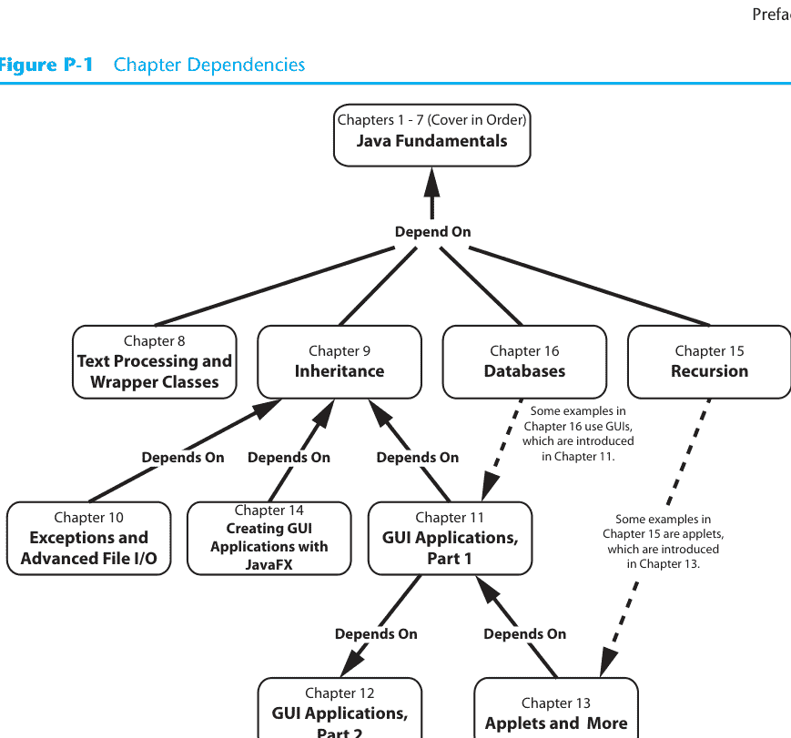

包含了面向对象的设计。本节将引导学生识别问题领域中的类及其职责的过程。还有一节简要解释了包（`packages`）和导入语句（`import statement`）。

**第4章：决策结构。** 学生将探索关系运算符和关系表达式，并学习如何使用 `if`、`if/else` 和 `if/else` 语句控制程序流。还涵盖了条件运算符和 `switch` 语句。本章还讨论了如何使用 `equals`、`compareTo`、`equalsIgnoreCase` 和 `compareToIgnoreCase` 方法来比较 `String` 对象。介绍了使用 `DecimalFormat` 类对数值输出进行格式化。一个面向对象的案例研究展示了如何将冗长的算法分解为几个方法。

**第5章：循环与文件。** 本章涵盖了 Java 的重复结构。教授了 `while` 循环、`do-while` 循环和 `for` 循环，以及这些设备的常见用途。讨论了计数器、累加器、运行总计、哨兵和其他与应用程序相关的主题。还涵盖了用于读写文本文件的简单文件操作。

# 前言


# 第6章：类与对象的再次审视

本章向学生展示如何编写具有额外功能的类。讨论了静态方法和字段、对象之间的交互、将对象作为参数传递以及从方法返回对象。涵盖了聚合和“拥有”关系（"has-a" relationship）以及枚举类型。一个关于面向对象设计的节展示了如何使用 CRC（类、职责和协作）来确定类之间的协作。

# 第7章：数组与 ArrayList

在这一章中，学生学习了创建和使用单维数组和多维数组。演示了许多数组处理技术，例如对数组中的元素求和、寻找最大值和最小值、顺序搜索数组等。还讨论了其他主题，包括锯齿数组（ragged arrays）和变长数组（varargs）。引入了 `ArrayList` 类，并简要讨论和演示了 Java 的泛型。

# 第8章：文本处理与包装类

本章讨论了数值包装类和字符包装类。涵盖了将数字转换为字符串、测试字符大小写以及转换字符大小写的方法。涵盖了自动装箱和解箱。更多的 String 方法，包括用于分割字符串的 `split` 方法。本章还涵盖了 `StringBuilder` 和 `StringTokenizer` 类。

# 第9章：继承

本章继续学习类，主题为继承和多态。涵盖的主题包括父类和子类构造函数、方法重写、多态和动态绑定、保护和包访问、类层次结构、抽象类和方法以及接口。

# 第10章：异常与高级文件 I/O

在本章中，学生学习使用异常开发错误捕获。涵盖了异常的处理，以及开发和抛出自定义异常。本章还讨论了处理顺序访问、随机访问、文本文件和二进制文件的高级技术。

# 第11章：GUI 应用——第一部分

本章介绍了使用 Swing 开发图形用户界面（GUI）应用程序的基础知识。涵盖了基础 Swing 组件和事件驱动编程的基础知识。

# 第12章：GUI 应用——第二部分

本章继续研究 GUI 应用开发。涵盖了更高级的组件，以及菜单系统和外观外观（look-and-feel）。

# 第13章：Applet 及更多

学生将其 GUI 开发的知识应用于 Applet 的创建。除了使用 Swing applet 类外，还讨论了用于移植性的抽象窗口工具（Abstract Windowing Toolkit）类。绘制简单的图形也是

# 第14章：使用 JavaFX 创建 GUI 应用

本章介绍了 JavaFX，它是用于 Java 创建图形应用程序的下一代库。本章还展示了如何使用 Oracle 提供的免费屏幕设计器 Scene Builder 来视觉化设计 GUI。本章的编写方式独立于现有的 Swing 和 AWT 章节。你可以选择跳过第11、12和13章，直接进入第14章，或者涵盖所有的 GUI 章节。

# 第15章：递归

本章将递归作为一种解决问题的技术。演示了许多递归示例。

# 第16章：数据库

本章向学生介绍数据库编程。首先介绍数据库管理系统和 SQL 的基本概念。然后学生学习使用 JDBC 在 Java 中编写数据库应用程序。涵盖了关系数据，并在整个章节中提供了许多示例。

# 附录 A：上手 Alice

附录 B-M 和案例研究 1-5 可以在书籍在线资源页 `www.pearsonglobaleditions.com/Gaddis` 获取。

# 本书特点

**概念陈述** 本书的每个主要章节都以一个概念陈述开头。该陈述总结了该节的思想。

**示例程序** 本书有大量的示例程序，每个程序都旨在突出当前正在学习的主题。在大多数情况下，这些都是实用的现实示例。提供了这些程序的源代码，以便学生可以自己运行程序。

**程序输出** 在每个示例程序之后都有其屏幕输出样本。这直观地展示了程序如何运行。

# 检查点（Checkpoints）

检查点是穿插在每一章中的问题，作为自测辅助工具。所有检查点问题的答案可以在附录 L 中找到（可下载），以便学生查看对新主题的掌握程度。如需下载附录 L，请访问 Gaddis 资源页 `www.pearsonglobaleditions.com/`。

> 注意：注释出现在全文的适当位置。它们是对与当前主题相关的有趣点或经常被误解的点的解释。

> 警告！警告是提醒学生某些 Java 特性、编程技术或可能导致程序故障或数据丢失的注意事项。

**VideoNotes。** 一系列为本书开发的在线视频可以在 `www.pearsonglobaleditions.com/Gaddis` 查看。图标出现在书中，提醒学生注意特定主题。

**案例研究** 书中许多章节出现了模拟现实应用的案例研究，并提供了完整代码。这些案例研究旨在突出章节的主要主题。

**习题与练习** 每一章都提供了一套详尽且多样的习题和练习。包括单选题、判断题、找错、算法工作坊和简答。

**编程挑战** 每一章都提供一组编程挑战，旨在巩固学生对当前主题的知识。在大多数情况下，这些作业是需要解决的现实问题。

**焦点（In the Spotlight）。** 许多章节提供了编程问题，并带有详细的步骤分析展示学生如何解决它。


# 补充

# 网站

学生可以通过网站获取许多资源。访问 `www.pearsonglobaleditions.com/Gaddis`，使用封面内侧的访问码访问以下资源：

- 书中每个示例程序的源代码
- 访问书籍配套的 VideoNotes
- 附录 B-M（目录中列出）
- 价值案例的研究集（目录中列出）
- 下载 JavaTM 开发包的链接
- 下载多种编程环境的链接，包括 jGRASP™、Eclipse™、TextPad™、NetBeans™、JCreator 和 DrJava

以下资源仅供合格讲师使用。访问 `www.pearsonglobaleditions.com/Gaddis` 了解如何访问它们：

- 书中所有习题的答案
- 书中所有编程挑战的解决方案
- 每个章节的 PowerPoint 幻灯片
- 计算机题库

# 致谢

本书的开发和出版离不开许多人的帮助。我要感谢以下教师评审人员在本书制作过程中提供的有帮助的建议和经验：

Rebecca Caldwell
Winston-Salem State University

Kurt Kaminek
Northeast State Community University

Dan Rao
Richland College

Kevin Mess
College of Southern Nevada

Naser Heravi
College of Southern Nevada

Lisa Olivieri
Chestnut Hill College

Deborah Hughes
Lyndon State College

Mark Swanson
Southeast Technical

Nicole Jiao
South Texas College

# 前几版本的审稿人

Ahmad Abujeleh
威斯康星大学－里弗尔斯分校

Sander Eller
加利福尼亚州立大学—帕莫纳

Colin Archibald
瓦伦西亚社区学院

Brooke Estrabrook-Fish
梅萨社区学院

Ijaz Awani
萨凡纳州立大学

Mike Fry
利巴嫩谷学院

Dr. Charles W. Bane
塔尔顿州立大学

Georgia R. Grant
圣马特奥学院

Dwight Barnett
弗吉尼亚理工大学

Chris Haynes
印第安纳大学

Asoke Bhattacharyya
芝加哥圣X埃尔大学

Ric Heishman
北弗吉尼亚州社区学院

Marvin Bishop
曼哈顿学院

Deedee Herrera
多奇市社区学院

Heather Booth
田纳西大学－诺克斯维尔分校

Mary Hovik
利哈伊碳社区学院

David Boyd
沃尔多斯塔大学

Brian Howard
德保罗大学

Julius Brandstatter
金门大学

Norm Jacobson
加州大学欧文分校

Kim Cannon
格林维尔科技学院

Dr. Stephen Judd
宾夕法尼亚大学

James Chegwidden
塔兰特县学院

Harry Lichtbach
长青谷社区学院

Kay Chen
巴克斯县社区学院

Michael A. Long
加利福尼亚州立大学，奇科

Brad Clayton
塔尔顿州立大学

Tim Margaugh
阿克伦大学

Diane Christie
威斯康星大学－斯托特分校

Blayne E. Mayfield
俄克拉荷马州立大学

Cara Cocking
马凯特大学

Scott McLeod
莱姆河社区学院

Walter C. Daugherty
德克萨斯A&M大学

Dean Mellas
塞里托斯学院

Michael Doherty
太平洋大学

Georges Merx
圣地亚哥梅萨学院

Jeanne M. Douglas
佛蒙特大学

Martin Meyers
加利福尼亚州立大学，萨克拉门托

# 前言

Pati Milligan
贝勒大学

Dr. Y. B. Reddy
格伦维尔州立大学

Godfrey Muganda
中北学院

Carolyn Schauble
科罗拉多州立大学

Steve Newberry
塔尔顿州立大学

Bonnie Smith
弗雷斯诺市大学

Lynne O'Hanlan
洛杉矶皮尔斯学院

Daniel Spiegel
库兹敦大学

Merrill Parker
查塔努加州立技术社区学院

Caroline St. Clair
中北学院

Bryson R. Payne
北乔治亚学院与州立大学

Karen Stanton
洛梅达诺斯学院

Robert Pearson
密西西比州立大学

Peter H. Van De Goes
罗斯州学院

Peter John Polito
斯普林菲尔德学院

Tuan A Vo
圣安东尼奥学院

Charles Robert Putnam
加利福尼亚州立大学，北岭

王小英
密西西比大学

特别感谢 Chris Rich 在 JavaFX 章节中提供的帮助。我想感谢我的家人在整个项目中对我表现出的耐心、爱和支持。我还要感谢 Pearson 教育的每一个人，让《入门教程》（Starting Out）系列取得了如此成功。我很幸运能有 Matt Giddis 担任我的编辑。我很幸运能与 Pearson 的 Y Alyan 以及计算机科学营销团队合作。他们在将我的书籍推广到学术界方面做得非常出色。在 Scott Diasso、Kayla Smith-Tarbox 和 Gregory Dukes 的带领下，我拥有了非常出色的制作。感谢你们！

Pearson 感谢英国东安格利亚大学的 Anthony Bagnall，以及 RCC 信息学院的 A Kumar Bhattacharjee 和 Simeon Mukherjee 在全球版（Global Edition）中所做工作。

## 关于作者

Tony Gaddis 是《入门教程》系列教材的主作者。Tony 在北卡罗来纳州的海伍德社区学院教授计算机课程拥有近二十年的经验。他是一位备受赞誉的教师，曾被选为北卡罗来纳州年度社区教师，并获得了国家员工和组织发展协会的拓展奖。除了 Java™，“入门教程”系列还包括使用 C++ 编程语言、Microsoft® Visual Basic、Microsoft® C#、Python、编程逻辑与设计、Alice 以及 App Inventor 的入门书籍，均由 Pearson 出版。

# 第1章 计算机与 Java 简介

| 1.1 引言 | 1.4 编程语言 |
| :--- | :--- |
| 1.2 为什么要编程？ | 1.5 程序由什么组成？ |
| 1.3 计算机系统：硬件与软件 | 1.6 编程过程 |
| | 1.7 面向对象编程 |

## 1.1 引言

本书教授使用 Java 进行编程。Java 是一门强大的语言，运行在几乎每种类型的计算机上。它可以用于创建大型应用程序或被称为 Applet（小程序）的小程序，后者是网站的一部分。然而，在深入学习 Java 之前，本章将回顾计算机硬件和软件的基础知识，然后概述计算机编程。

## 1.2 为什么要编程？

> 概念：计算机可以执行许多不同的工作，因为它们是可编程的。

每个职业都有让工作变得更容易的工具。木工使用锤子、锯子和卷尺。技师使用扳手、螺丝刀和棘轮扳手。电子技术人员使用探针、屏幕和仪表。有些工具是独特的，可以归类为属于单一职业。例如，外科医生拥有专为手术操作设计的工具。那些工具可能除了外科医生外没人会使用。然而，有些工具会在多个职业中使用。例如，螺丝刀被技师、木工和许多人使用。

计算机是许多职业都使用的工具，以至于无法被归类。它可以执行许多不同的工作，它也许是人类有史以来最多功能的工具。对于会计师来说，计算机平衡账目、分析盈亏并准备税务报表。对于工厂工人来说，计算机控制制造机器并跟踪生产。对于技师来说，计算机分析汽车的各种系统并定位难以发现的问题。计算机可以执行如此广泛的任务，是因为它可以被编程。由于计算机的可编程性，它不属于任何单一职业。计算机的设计初衷是为了执行程序（即软件）所要求的任何工作。

计算机程序员从事着非常重要的工作。他们创建软件将计算机变成各种专业的工具。没有程序，计算机用户就没有软件；而没有软件，计算机什么也无法做。

## 1.3 计算机系统：硬件与软件

概念：所有的计算机系统都由类似的硬件设备和软件组件组成。

### 硬件

硬件是指组成计算机的物理组件。我们通常认为的计算机不是一个单一的设备，而是一个系统。就像交响乐团中的乐器一样，每个设备都有其自己的角色。一个典型的计算机系统由以下主要部分组成：

- 中央处理器
- 主内存
- 存储设备
- 输入设备
- 输出设备

计算机系统的结构见图 1-1。

### 图 1-1 计算机系统的结构

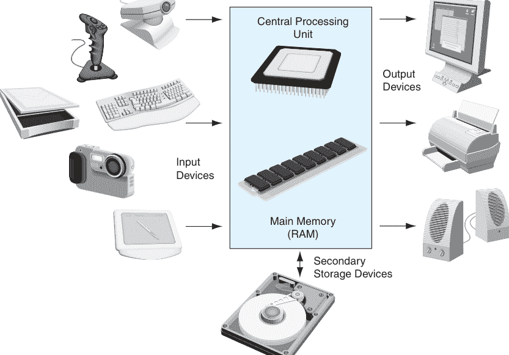

让我们仔细观察一下这些设备。

### CPU

计算机的核心是它的中央处理器，即 CPU。CPU 的工作是取指令、执行指令并产生结果数据。中央处理器内部结构由两个部分组成：控制单元和算术逻辑单元（ALU）。控制单元协调计算机的所有操作。它负责确定从哪里获取下一条指令，并用控制信号调节计算机的其他主要组件。算术逻辑单元顾名思义，旨在执行数学运算。CPU 的结构如图 1-2 所示。

### 图 1-2 CPU 的结构

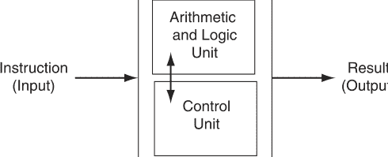

程序是存储在计算机内存中的指令序列。当计算机运行程序时，CPU 会参与一个正式称为“取指/解码/执行”循环的过程。取指/解码/执行循环的步骤如下：

- 取指（Fetch）
- 解码（Decode）：指令以数字的形式编码。控制单元解码指令并产生一个电子信号。
- 执行（Execute）：信号被路由到计算机的相应组件（如磁盘驱动器或其他设备）。信号导致组件执行操作。

只要有指令需要执行，这些步骤就会重复进行。

### 主内存

计算机主内存通常被称为随机访问存储器或 RAM，它是一种存储数据的设备。具体来说，RAM 存储了运行程序中的指令序列以及其他正在使用的数据。

内存被分为若干存储等量数据的区域。每个区域由“开关”组成，开关可以开启或关闭。开启状态的开关通常表示数字 1，关闭状态的开关通常表示数字 0。计算机通过设置内存位置中的开关来表示字符或数字从而存储数据。这些中的每一个被称为一个“位”（bit），八个位集合被称为一个“字节”（byte）。每个字节都被分配一个唯一的数字作为地址。地址从低到高排序。字节通过地址来识别，就像信箱通过地址来识别一样。图 1-3 显示了一系列带有地址的开关。在插图中，示例数据存储在内存中。地址 16 的字节中存储了数字 149，地址 23 的字节中存储了数字 72。

RAM 是一种易失性内存，仅用于临时存储。当计算机关闭时，RAM 中的内容会被清除。

> 图 1-3 内存字节及其地址

| 0 | 1 | 2 | 3 | 4 | 5 | 6 | 7 | 8 | 9 |
|---|---|---|---|---|---|---|---|---|---|
| 10 | 11 | 12 | 13 | 14 | 15 | 16 | 149 | 18 | 19 |
| 20 | 21 | 22 | 23 | 72 | 24 | 26 | 27 | 28 | 29 |

### 辅助存储

辅助存储是一种可以长时间保存数据的内存——即使在计算机没有电源的情况下也是。程序通常存储在辅助内存中，并在需要时加载到内存中。重要数据，如文字处理文档、工资数据和库存数字，也会保存到辅助存储中。

最常见的辅助设备是磁盘驱动器。传统的磁盘驱动器通过将数据磁性编码到旋转的圆盘上来存储数据。固态硬盘将数据存储在固态内存中，正越来越流行。固态硬盘没有移动部件，运行速度比传统的磁盘驱动器更快。大多数计算机的机箱内部安装了某种存储设备，无论是传统的磁盘驱动器还是固态硬盘。也可以连接到计算机通信端口之一的外部驱动器。外部驱动器可用于备份重要数据的副本，或将数据移动到另一台计算机。

除了外部驱动器，还创建了许多类型的设备用于复制数据将其移动到其他计算机。通用串行总线驱动器或 USB 盘是插入计算机 USB 端口的小设备，在系统中显示为磁盘驱动器。然而，这些驱动器实际上并没有连接到磁盘。它们将数据存储在名为闪存的特殊内存中。USB 盘廉价、可靠，且足够小巧，可以放在兜里。


光学设备如 CD（紧凑盘）和 DVD（多功能光盘）也常用于数据存储。数据记录在光盘上，但被编码为盘面表面的一系列凹槽。CD 和 DVD 驱动器使用激光检测这些凹槽，从而读取编码数据。光盘可以存储大量数据，由于可刻 CD 和 DVD 驱动器现在已随处可见，它们是创建数据副本的良好介质。

### 输入设备

输入是计算机收集的内容。收集数据并发送到计算机的设备称为输入设备。常见的输入设备有键盘、鼠标、扫描仪、摄像头。

### 输出设备

输出是计算机向外界发送。接收数据并呈现给用户的设备是输出设备。常见的输出设备有显示器和打印机。

### 软件

此前提到的软件指的是程序。软件分为两大类：操作系统和应用程序软件。操作系统是一种管理硬件的软件。应用程序软件是指满足用户需求的程序。文字处理、电子表格和数据库都是应用程序软件的示例。

## 1.4 编程语言

正如你想象的，用机器语言编码算法的过程是非常枯燥且困难的。此外，每种 CPU 都有它们自己的机器语言。如果你为计算机 A 编写了机器语言，然后想在具有不同类型 CPU 的计算机 B 上运行它，你就必须用计算机 B 的机器语言重写该程序。

使用符号而不是数字的编程语言的发明是为了减轻编程任务。可以使用编程语言编写程序，这种语言比机器语言更容易理解得多，然后将其翻译成机器语言。程序使用软件来执行这种转换。表 1-1 列出了一些知名的编程语言。

### 表 1-1 编程语言

| 语言 | 描述 |
| --- | --- |
| BASIC | 初学者全用符号指令码（all Symbolic Instruction Code）是一种通用的过程语言。它最初的设计是足够简单，供学者学习。 |
| FORTRAN | 格式翻译器（FORula TRANator）是一种用于编写复杂数学算法的过程语言。 |
| COBOL | 通用面向业务语言（Common Business-Oriented Language）是一种为业务应用程序设计的过程语言。 |
| Pascal | Pascal 是一种结构化的、通用的过程语言，主要为教学编程而开发。 |
| C | C 是一种在贝尔实验室开发的结构化、通用的过程语言。 |
| C++ | 基于 C，C++ 提供了 C 中不具备的对象对象特征。C++ 也是在贝尔实验室发明的。 |
| C# | 读作 "Sharp"。是微软发明的一种语言，用于开发基于微软 .NET 平台的应用程序。 |
| Java | Java 是一种 Micros Systems 使用的面向对象的语言，由 Oracle 所有。它可以被用于开发在单台计算机上运行的独立应用程序、从 Web 服务器运行的 Internet 应用程序，以及在 Web 浏览器中运行的小程序（applets）。 |
| JavaScript | JavaScript 是一种可以在网站中执行简单操作的编程语言。尽管名字相似，但 JavaScript 与 Java 无关。 |
| Perl | 一种广泛用于互联网服务器的通用编程语言。 |
| PHP | 一种主要用于开发 Web 应用程序和动态网页的编程语言。 |
| Python | Python 是一种面向对象的编程语言，广泛应用于商业和学术领域。许多流行的 Web 网站具有使用 Python 开发的功能。 |
| Ruby | Ruby 是一种简单但强大的面向对象编程语言。它可以用于各种用途，从小型实用程序到大型 Web 应用程序。 |
| Visual Basic | Visual Basic 是微软的一种编程语言和软件开发环境，允许程序员快速创建基于 Windows 的应用程序。 |

## 第 1 章 计算机与 Java 导论

### Java 的历史

1991 年，Sun Microsystems（该公司现已归 Oracle 所有）成立了一个团队，负责预测未来可能出现的重要技术趋势。该团队被称为“绿色小组”（Green Team），他们得出结论：计算机将与消费应用融合。他们的第一个项目是开发一种名为 `Star7`（读作 "star seven"）的手持设备，该设备可以控制各种家庭娱乐设备。为了运行它，它必须使用一种被其所控制的所有设备都能处理的编程语言。这带来了一个问题，因为不同品牌的消费级设备使用不同的处理器，每种处理器都有自己的机器语言。

由于不存在通用的语言，团队首席工程师 James Gosling 创建了其中一种语言。用这种语言（最初名为 Oak）编写的程序会被翻译成特定处理器的机器语言，但会被翻译成一种被称为“字节码”（byte code）的中间语言。另一个程序会将字节码翻译成消费级设备中的处理器可以执行的机器语言。

遗憾的是，绿色小组开发的技术领先于时代。当时没有客户可以准备好，主要是因为计算机控制的消费家电器行业刚刚起步。但团队并没有放弃工作去转向其他项目，他们看到了另一个机会：Internet 是像 Oak 这样的通用编程语言的完美环境。它由连接在网络中的许多不同平台组成。

为了证明他们的语言（后被重命名为 HotJava）的有效性，团队使用它开发了一个 Web 浏览器。该浏览器以“小程序”（applets）的形式管理微小的 Java 程序，展示了显示动画和与用户交互的能力。HotJava 曾在 1995 年的 SunWorld 大会上向令人瞩目的观众展示了演示。随后宣布，Netscape 将把 Java 技术整合到其 Navigator 浏览器中。其他互联网公司也迅速跟进，增加了 Java 语言的接受程度和影响力。今天，Java 非常流行，不仅用于开发 Internet 小程序，还用于开发独立应用程序。

### Java 应用程序和小程序

用 Java 可以创建两种类型的程序：应用程序（applications）和小程序（applets）。应用程序是在你的计算机上运行的独立程序。你可能已经使用过几个应用程序，例如文字处理器、电子表格、数据库管理器和图形程序。虽然 Java 可以用于编写这些类型的应用程序，但 C、C++ 和 Basic 等语言也经常在使用。

在上一节中，你学到了 Java 也可以用于创建小程序。“applet”一词指的是一个微型应用程序，就像“piglet”（小猪）指的是小猪一样。与应用程序不同，小程序被设计为通过 Internet 从 Web 服务器传输，然后在 Web 浏览器中执行。小程序之所以重要，是因为由于它们可以极大地扩展网页的功能。

网页通常用超文本标记语言（HTML）编写。然而，HTML 具有局限性，因为它只描述了网页的内容和布局。HTML 不具备诸如执行数学计算和与用户交互等复杂能力。Web 设计师可以编写 Java 小程序来执行通常由应用程序完成的操作，并将其嵌入网站中。当有人访问网站时，小程序会被下载到浏览器中并执行。

## 1.5 程序是由什么组成的？

### 安全性

每当内容从 Web 服务器下载到你的计算机时，安全性都是一个需要考虑的问题。由于 Java 是一种功能完备的编程语言，起初你可能会对任何向你传输小程序的网站产生怀疑。毕竟，Java 小程序会不会做有害的事情，例如删除磁盘内容或将私有信息传输到另一台计算机呢？幸运的是，答案是否定的。Web 浏览器在内存的安全环境中运行 Java 小程序，不允许它们访问该环境之外的资源（如磁盘）。

### 语言元素

所有编程语言都有共同点。表 1-2 列出了几乎语言中都能看到的共同元素。

#### 表 1-2 编程语言的共同元素

| 语言元素 | 描述 |
| --- | --- |
| 关键字 | 这些是在编程语言中具有特殊含义的词。它们只能按预期用途使用。关键字也被称为保留字。 |
| 运算符 | 运算符是对一个或多个操作数执行操作的符号或单词。操作数通常是一个数据项，例如数字。 |
| 标点符号 | 大多数编程语言都需要使用标点字符。这些字符有特定的用途，例如标记语句的开始或结束，或者分隔列表项。 |
| 程序定义的名称 | 与单词不同，是由程序员定义的名称。它们用于标识内存中的存储位置和程序员创建程序部分。程序定义的名称通常被称为标识符（identifiers）。 |
| 语法 | 这些是在编写程序时必须遵守的规则。语法规定了关键字和运算符如何使用，以及标点符号应该出现在哪里。 |

让我们看一个 Java 程序的示例，并识别这些元素的每个实例。代码列表 1-1 显示了带有每行编号的代码列表。

### 代码列表 1-1 Payroll.java

```
public class Payroll
{
   public static void main(String[] args)
   {
      int hours = 40;
      double payRate = 25.5;
      double grossPay;

      grossPay = hours * payRate;

      System.out.println("your pay is $" + grossPay);
   }
}
```

> 注意：行号不是程序的一部分。包含行号是为了帮助指向程序的特定部分。

#### Java 单词（保留字）

Java 的两个单词出现在第 1 行：`public` 和 `class`。在第 3 行中，`static` 和 `void` 都是关键字。第 5 行的单词 `int` 和第 6 行的 `double` 也是关键字。这些单词始终以小写形式编写，在 Java 中具有特殊含义，并且只能用于程序中某些事物的特定名称。然而，关键字是被保留的，不能用于其指定用途之外的任何地方。学习编程语言的重点就是学习常用的关键字、它们的含义以及如何使用它们。

表 1-3 显示了 Java 关键字列表。

| abstract | const | for | int | public | throw |
| --- | --- | --- | --- | --- | --- |
| assert | continue | | interface | return | throws |
| boolean | default | finally | long | short | transient |
| break | float | | native | static | true |
| byte | double | goto | new | strictfp | |
| case | else | if | null | super | void |
| catch | enum | | package | switch | volatile |
| char | extends | | private | synchronized | while |
| class | false | | protected | this | |

#### 程序员定义的名称

出现在程序第 5、6、8 和 9 行的单词 `hours`、`payRate` 和 `grossPay` 是由程序员定义的。它们不是 Java 语言的一部分，而是由程序员创建的名称。在这个特定的程序中，这些是变量的名称。正如你将在在本章后面的部分学到的，变量是可能存储数据的内存位置的名称。

#### 运算符

在第 8 行出现了以下行代码：

```
grossPay = hours * payRate;
```

`*` 和 `=` 都是运算符。它们对称为操作数的数据项执行操作。`*` 运算符将其操作数相乘，在本例中，操作数是 `hours` 和 `payRate`。符号 `=` 是赋值运算符。它获取其右侧表达式的值，并将其存储在左侧出现的变量名中。在本例中，`=` 运算符将 `hours` 乘以 `payRate` 变量的结果存储在 `grossPay` 中。换句话说，该语句的意思是：“将 `hours * payRate` 的值赋予 `grossPay`。”

#### 标点符号

注意第 5、6、8 和 9 行以分号结尾。Java 中的分号与英语中的分号相似：它标记了一个完整句子（或在编程语言中称为语句）的结束。然而，Java 程序中并不是每行末尾都有分号。有规则规定了哪里需要分号，哪里不需要。学习 Java 的一部分就是学习在何处放置分号和其他标点符号。

#### 行与语句

通常，程序的内容按“行”和“语句”来教授。“行”仅仅是指行——在程序正文中显示的一行。代码列表 1-1 显示了它的每一行。大多数行都包含某些意义；然而，第 7 行是空的。空行用于提高程序的可读性。

语句是一条导致计算机执行某些操作的完整指令。这里是代码列表 1-1 第 9 行的语句：

```
System.out.println("your pay is $" + grossPay);
```

这条语句导致计算机在屏幕上显示一条消息。语句可以是关键字、运算符和程序员定义名称的组合。语句在程序中通常只占用一行，但有时它们会跨多行出现。

#### 变量

Java 程序在内存中存储数据项的基本方式是使用变量。变量是计算机内存中一个命名的存储位置。存储在变量中的数据在程序运行期间可能会改变（因此被称为“变量”）。注意，在代码列表 1-1 中，程序员定义的名称 `hours`、`payRate` 和 `grossPay` 出现在多个地方。这三个都是变量。`hours` 变量用于存储用户工作的小时。`payRate` 变量存储用户的薪资率。`grossPay` 变量持有 `hours` 乘以 `payRate` 的结果。

变量是程序员创建的符号名称，代表计算机内存（RAM）中的位置。当数据存储在变量中，它实际上存储在 RAM 中。假设一个程序有一个名为 `length` 的变量。图 1-4 说明了变量表示内存位置的方式。

#### 图 1-4 变量名代表内存中的一个位置

| 1 | 2 | 3 | 4 | 5 | 6 | 7 | 8 | 9 |
|---|---|---|---|---|---|---|---|---|
| 10 | 11 | 12 | 13 | 14 | 15 | 16 | 17 | 18 |
| 19 | 20 | 21 | 22 | 23 | 24 | 25 | 26 | 27 |
| 28 | 29 | 72 | | | | | | |

#### 编译器与 Java 虚拟机

当程序被编写时，它被放入编译器。类似于文字处理器的文本编辑器用于此。程序员编写的 Java 语句被称为源代码，文件名为 `.java`。

在程序员保存源代码后，他们运行编译器，将源代码翻译成字节码文件。字节码不是机器语言，因此不能由 CPU 执行。相反，它们由 Java 虚拟机执行。Java 虚拟机（JVM）是一个读取并执行字节码的程序。由于这个原因，JVM 通常被称为解释器，Java 被称为解释语言。

#### 可移植性

移植性意味着程序可以在一种类型的计算机上编写，并在多种计算机上运行，而几乎不需要修改。由于 Java 字节码在所有计算机上都是相同的，编译后的 Java 程序是可移植的。事实上，编译后的 Java 程序可以在任何带有 Java 虚拟机的计算机上运行。

#### 图 1-5 程序开发过程

#### 图 1-6 Java 字节码可以在任何带有 JVM 的计算机上运行

程序员使用文本编辑器创建 Java 源代码文件。

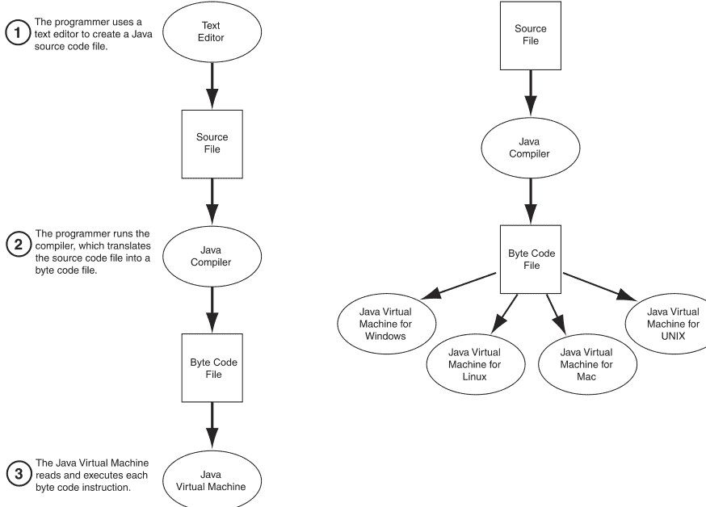

程序员运行编译器，将源代码文件翻译成字节码文件。

Java 虚拟机读取并执行每个字节码指令。

图 1-6 说明了编译后的 Java 程序在 Windows、Linux、Mac 和 Unix 计算机上运行的概念。

对于其他编程语言，移植性是通过为语言要运行的每种计算机创建一个编译器来实现的。例如，为了让 C++ 语言支持 Windows、Linux 和 Mac 计算机，必须为这些环境中的每一个创建一个独立的 C++ 编译器。编译器是非常复杂的程序，开发解释器更为困难。因此，JVM 已针对多种类型的计算机。

#### Java 软件版本

你用于创建 Java 程序的软件被称为 JDK（Java 开发包）或 SDK（软件开发包）。这些是 Oracle 提供的 JDK 版本：

- Java SE——标准版提供了编写 Java 应用程序所需的所有基本软件工具。
- Java EE——企业版为创建使用服务器并在 Web 上提供服务的大型业务应用程序提供了工具。
- Java ME——微型版为手机、传真机和家用电器等消费产品提供了一个微小、高度优化的运行时环境。

这些版本的 Java 可以从 Oracle 下载：

http://java.oracle.com

> 注意：你可以按照附录 E 中的说明在系统上安装 JDK，附录可以从书籍配套网站下载。你可以访问书籍配套网站：www.pearsonglobalizeditions.com/gaddis。

## 编译和运行 Java 程序

编译 Java 程序是一个简单的过程。要使用 JDK，请进入操作系统的命令提示符。

> 提示：在 Windows 中，点击“开始”按钮，进入“所有程序”，然后进入“附件”。点击附件菜单上的“命令提示符”。这将打开命令提示符窗口。

在操作系统命令提示符中，确保你处于要编译的 Java 程序所在的同一目录或文件夹中。然后，使用如下格式的 `javac` 命令：

```
javac Filename
```

`Filename` 是包含 Java 源代码的文件名。如前所述，该文件具有 `.java` 扩展名。例如，如果你想编译 `Payroll.java` 文件，可以使用以下命令：

```
javac Payroll.java
```

此命令运行编译器。如果文件包含任何语法错误，你将看到一个或多个错误信息，且编译器不会将文件翻译为字节码。在文本编辑器中修复源文件并修正错误后，就可以运行编译器。如果文件没有语法错误，编译器将将其翻译为字节码。你的代码将存储在具有 `.class` 扩展的文件中；`Payroll.java` 源代码将存储在 `Payroll.class` 中，它将与源文件位于同一个目录或文件夹中。

要运行程序，你使用如下格式的 `java` 命令：

```
java ClassFilename
```

`ClassFilename` 是你要执行的 `.class` 文件的名称。但你不需要输入 `.class` 扩展名。例如，要运行存储在 `Payroll.class` 文件中的程序，你需要输入以下命令：

```
java Payroll
```

此命令运行 Java 解释器（JVM）并执行程序。

## 集成开发环境


除了命令提示符外，还有几种 Java 开发环境（IDE）。这些环境由文本编辑器、编译器、调试器和其他工具集成在一个包中，并配有一套单一菜单。只需点击按钮或从菜单中选择一个单项，即可完成程序的编译和执行。图 1-7 显示了 NetBeans IDE 的界面。

### 1.5 程序是如何构成的？

图 1-7 NetBeans IDE

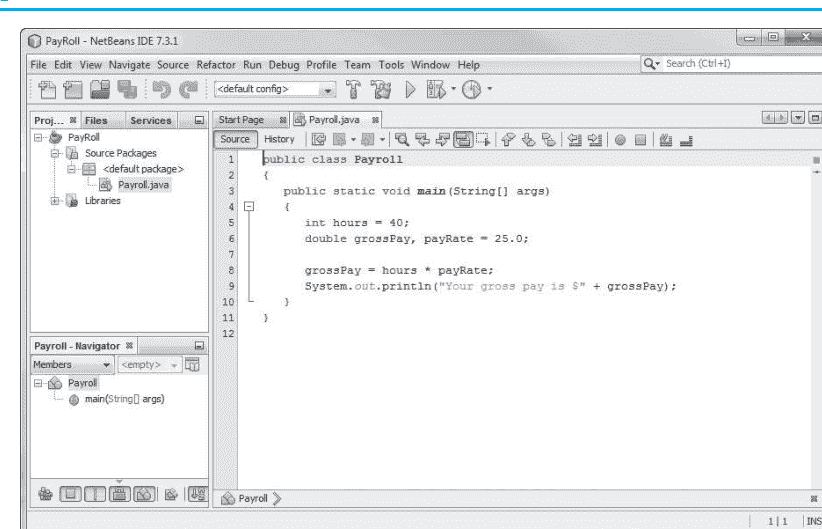

## 检查点

- 1.8 描述关键字与程序员定义符号之间的区别。
- 1.9 描述操作符与标点符号之间的区别。
- 1.10 描述程序行与语句之间的区别。
- 1.11 为什么变量被称为“variable”？
- 1.12 当新值存储在变量中时，变量当前的内容会发生什么？
- 1.13 什么是编译器？
- 1.14 什么是语法错误？
- 1.15 什么是字节码？
- 1.16 什么是 JVM？

## 1.6 编程过程

概念：编程过程由几个步骤组成，包括设计、创建、测试和调试活动。

现在你已经了解了什么是程序，是时候考虑创建程序的过程了。通常，缺乏经验的学生被分配编程任务时，他们往往因为不知道先做什么而感到无从手。如果你发现自己陷入了这种困境，以下步骤可能会有所帮助。

1. 明确定义程序要做的功能。
2. 在脑海中想象程序在计算机上运行的过程。
3. 使用设计工具创建程序模型。
4. 检查模型的逻辑错误。
5. 输入代码并编译。
6. 修正编译过程中发现的任何错误。根据需要重复第 5 和第 6 步。
7. 使用测试数据作为输入运行程序。
8. 在运行程序时修正任何运行时错误。根据需要重复第 5 和第 8 步。
9. 验证程序的结果。

这些步骤强调了规划的重要性。就像粉房子有好方法和坏方法一样，创建程序也有好方法和坏方法。好的程序始于规划。以本章之前介绍的薪资计算算法为例，让我们详细查看每个步骤。

### 1. 明确定义程序要做的功能

这一步通常要求你识别程序的目的、输入的数据、执行的处理以及预期的输出。让我们检查薪资计算算法的每项要求。

- 目的：计算用户的总薪。
- 输入：工作小时数、每小时薪率。
- 过程：将工作小时数乘以每小时薪率。结果为用户的总薪。
- 输出：显示一条指示用户总薪的消息。

### 2. 在脑海中想象程序在计算机上运行的过程

在计算机上创建程序之前，你应该先在脑海中创建它。尝试想象程序运行时计算机屏幕看起来什么样。

```
工作了多少小时？10
薪水是多少？15
你的总薪是 150
```

### 3. 使用设计工具创建程序模型

在设计程序时，使用伪代码会有帮助。如果发现错误，你必须返回重新设计模型。

### 4. 检查模型的逻辑错误

逻辑错误是导致程序产生错误结果错误。一旦建立了程序模型，就对其进行检查。

### 5. 输入代码并编译

一旦创建并检查了程序模型，程序员就可以准备在计算机上编写源代码了。

### 6. 修正编译过程中发现的任何错误。根据需要重复第 5 和第 6 步

如果编译器报告任何错误，必须进行修正。重复第 5 和第 6 步，直到程序没有编译时错误。

### 7. 使用测试数据作为输入运行程序

一旦生成可执行文件，程序就可以准备测试运行时错误了。

### 8. 在运行程序时修正任何运行时错误。根据需要重复第 5 和第 8 步

当程序运行时运行时错误，必须进行修正。

### 9. 验证程序的结果

当你认为已经修正了所有运行时错误时，输入测试数据并判断程序是否解决了原始问题。

## 面向对象编程

概念：Java 是一种面向对象编程（OOP）语言。OOP 是一种软件开发方法，它有自己的实践、概念和词汇。

目前主要使用的两种编程方法是：过程化和面向对象。最早的编程语言是过程化的，这意味着程序由一个或多个过程组成。过程是一组编程语句，这些语句共同执行一个特定任务。这些语句从用户处获取输入，处理计算机内存中存储的数据，并执行完成任务所需的计算或任何其他操作。

过程通常在独立于过程本身的数据项上进行操作。在过程化程序中，数据项通常从一个过程传递到另一个过程，如图 1-9 所示。

图 1-9 数据在过程之间传递


正如你可能想象到的，过程化编程的重点在于创建操作数据的过程，这往往会导致问题。例如，数据存储在特定的格式中，该格式由变量以及由变量创建的更复杂的结构组成。操作数据的过程在设计时必须考虑到这种格式。但是，如果数据发生了变化会怎样？通常，程序的规范会发生，导致格式重新设计。当数据结构发生变化时，操作数据的代码也必须更改以接受新格式。这增加了程序员的工作量，并增加了代码中出现 Bug 的机会。

这影响了从过程化编程到 OOP 的转变。过程化编程以创建过程为中心，而面向对象编程以创建对象为中心。对象是一个包含数据和处理的软件实体。对象中包含的数据被称为对象的属性。对象执行的过程（或行为）被称为对象的方法。从概念上讲，对象是一个由数据（属性）和过程（方法）组成的自包含单元。这在图 1-10 中所示。

### 图 1-10 对象包含数据和过程

### 图 1-11 对象外部的代码与对象的方法交互

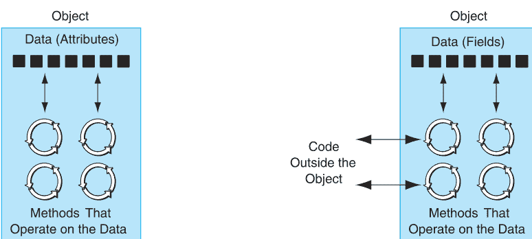

当对象的内部数据对外部代码隐藏，且对该数据的访问限制在对象的方法时，数据就能受到防止意外损坏的保护。此外，编程代码不需要知道对象数据的格式或内部结构。代码只需要与对象的方法交互。对象通常隐藏其数据，但允许外部代码访问操作数据的方法。如图 1-11 所示，对象的方法为对象外部的编程语句提供了间接访问对象数据的途径。

当对象的内部数据对外部代码隐藏且对该数据的访问限制在对象的方法时，数据就能防止受到意外损坏。当程序员更改对象内部数据的结构时，他或她会修改对象的方法使其能够正确处理数据。然而，外部代码与方法交互的方式并不会改变。

### 组件复用

组件复用和 OOP 技术为大型计算机应用程序成为唯一协作实体（组件）的系统奠定了基础。

### 对象的日常示例

将你的闹钟想象成一个对象。它具有以下属性：

- 当前秒（0–59 范围内的值）
- 当前分钟（0–59 范围内的值）
- 当前小时（1–12 范围内的值）
- 闹钟设置的时间（有效的小时和）
- 闹钟是开启还是关闭（“开启”或“关闭”）

如你所示，属性仅仅是定义闹钟状态的值。闹钟的用户不能直接操作这些属性，因为它们是私有的。要更改属性值，你必须使用对象的方法之一。这里是闹钟对象的一些方法：

- 设置时间 (Set time)
- 设置闹钟时间 (Set alarm time)
- 开启闹钟 (Turn alarm)
- 关闭闹钟 (Turn alarm off)

每个方法处理一个或多个属性。例如，“set time”方法允许你设置闹钟的时间。你通过按下时钟顶部的一个按钮来激活该方法。通过另一组按钮，你可以激活“set alarm time”方法。此外，另一个按钮允许你执行“turn alarm on”和“turn alarm off”方法。注意，所有这些方法都可以由闹钟外部的你激活。外部实体可以的方法被称为公共方法。

闹钟还有私有方法，它们是对象内部运作的一部分。外部实体（例如你，闹钟的用户）无法直接访问闹钟的私有方法。对象的设计旨在自动执行这些方法并向你隐藏细节。这里是闹钟对象的私有方法：

- 增加当前秒 (Increment the current second)
- 增加当前分钟 (Increment the current minute)
- 增加当前小时 (Increment the current hour)
- 响闹报警 (Sound alarm)

### 类和对象

现在我们讨论如何创建对象。在创建对象之前，必须由程序员对其进行设计。程序员确定必要的属性和方法，然后创建一个类。类是编程语句的集合，规定了特定类型对象可能拥有的属性和方法。将类类比为可以创建对象的“蓝图”。类不是对象，而是对象的描述。当程序运行时，你可以使用该类创建所需数量的对象。从类创建的每个对象都称为该类的实例。

对于 Jessica 来说，她是一个昆虫学家（研究昆虫的人），同时也喜欢编写计算机程序。她设计了一个程序对不同类型的昆虫进行分类。在程序中，她创建了一个名为 `Insect` 的类，规定了用于存储和处理所有类型共有数据的属性和方法。`Insect` 类不是对象，而是创建对象的规范。接下来，她编写了编程语句来创建一个家蝇，家蝇是 `Insect` 类的实例。家蝇是一个占用内存并存储家蝇数据的实体。它具有由 `Insect` 类指定的属性和方法。然后她编写了编程语句来创建一个蚊对象。蚊对象在内存中也有它自己的区域，并存储关于蚊的数据。虽然家蝇和蚊对象是计算机内存中两个独立的实体，但这意味着每个对象都具有 `Insect` 类描述的属性和方法。这在图 1-12 中所示。

### 图 1-12 家蝇和蚊对象是 Insect 类的实例


### 继承

有时一个类基于另一个类。这意味着一个类是另一个类的特殊情况。例如，考虑一个使用汽车、卡车和喷气飞机类的程序。虽然这三种现实世界中的对象类型非常不同，但它们具有一些共同特征：它们都是交通工具，并且都能携带一定数量的乘客。因此，这三个类都可以基于一个 `Vehicle` 类，该类具有所有类共有的属性和行为。这在图 1-13 中所示。

### 图 1-13 继承示例

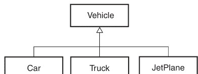

在 OOP 术语中，`Vehicle`（车辆）类是*父类*。`Car`（汽车）、`Truck`（卡车）和 `JetPlane`（喷气式飞机）类是*子类*。虽然 `Vehicle` 类在本质上是非常通泛的，但 `Car`、`Truck` 和 `JetPlane` 类是具体专业化的。`Vehicle` 类的所有属性和行为都会被 `Car`、`Truck` 和 `JetPlane` 类继承。这些类之间的关系意味着 `Car` 是一辆车辆，`Truck` 是一辆车辆，而 `JetPlane` 也是一辆车辆。

子类在继承父类属性和方法的同时，还会添加自己的属性。例如，`Car` 类可能具有用于设置其是轿车还是跑车、以及其引擎类型的属性和方法。`Truck` 类可能具有设置最大承重量的属性和方法，而 `JetPlane` 可能会有设置和指示飞机高度及航向的属性。这些增加的功能使得子类比父类更专业。

### 软件工程

软件工程领域涵盖了构建计算机软件的过程。它包括设计、编写、测试、调试、文档编写、修改和维护复杂的软件开发项目。像传统工程师一样，软件工程师在工作中也会使用许多工具。以下是一些示例：

- 程序规范
- 屏幕输出图
- 表示类、对象和数据流的图表
- 伪代码
- 预期输入和期望输出的示例
- 为测试程序设计的特殊软件

大多数商业软件应用程序都是大型且复杂的。通常由一个程序员团队而非单个人来开发。对程序需求进行彻底分析，并将其划分为子任务，由各个团队或团队内的个人来处理，这一点是至关重要的。

### 知识点检查 (Checkpoint)

1.24 在过程化编程中，程序的哪两个部分通常是分开的？
1.25 对象的属性是什么？
1.26 对象的方法是什么？
1.27 什么是封装？
1.28 什么是数据隐藏？

### 复习题与练习题

#### 单选题

1. 程序中的此循环导致信号路由到计算机的相应组件，使该组件执行操作。
   a. 取指 (fetch)
   b. 解码 (decode)
   c. CPU
   d. 执行 (execute)

2. 下列哪项不是输出设备？
   a. 打印机
   b. USB 盘
   c. 摄像头
   d. 显示器

3. 每个字节都被分配了一个唯一的
   a. 地址
   b. CPU
   c. 位
   d. 变量

4. 在这类辅助存储设备中，数据被编码为盘片表面的一系列位，并使用激光检测这些位。
   a. 磁盘驱动器
   b. 光设备
   c. USB 盘
   d. RAM

5. 如果你查看机器语言程序，你会看到 ____。
   a. Java 源代码
   b. 二进制流
   c. 英语单词
   d. 电路

6. 这是一个管理计算机硬件设备并控制其过程的程序集。
   a. 输入设备
   b. 输出设备
   c. 操作系统
   d. 存储设备

7. 这些是在编程语言具有特殊含义的单词。
   a. 标点符号
   b. 程序员定义的名称
   c. 关键字
   d. 运算符

8. 这不是面向对象的编程语言。
   a. Java
   b. Ruby
   c. C
   d. Python

9. 这些字符具有特定用途，例如标记语句的开始或结束，或分离列表中的项。
   a. 标点符号
   b. 程序员定义的名称
   c. 关键字
   d. 运算符

10. 这些用于识别内存中的存储位置以及程序员创建的程序的单词或名称。
    a. 标点符号
    b. 程序员定义的名称
    c. 关键字
    d. 运算符

11. 在 OOP 中，这指的是将数据和代码合并成单个对象。
    a. 数据隐藏
    b. 继承
    c. 封装
    d. 多态

12. 这些是由程序员定义的单词或名称。
    a. 类
    b. 关键字
    c. 标识符
    d. 运算符

13. Java 编译器生成 ________
    a. 机器码
    b. 字节码
    c. 源代码
    d. HTML

14. 这是用于创建 Java 程序的软件。
    a. Java 开发工具包 (JDK)
    b. Java 编译器
    c. Java 虚拟机方法
    d. Java 虚拟机

#### 找错 (Find the Error)

1. 下面的伪代码算法有一个错误。程序应该要求用户输入矩形房间的长度和宽度，然后显示房间的面积。程序必须将宽度乘以长度以确定错误。

```
area = width * length.
Display "What is the room's width?"
Input width.
Display "What is the room's length?"
Input length.
Display area.
```

#### 算法工作台 (Algorithm Workbench)

为以下程序编写伪代码算法：

1. 可用额度 一个计算客户可用额度的程序应要求用户提供以下信息：
   - 客户的信用额
   - 已使用的金额
   程序应显示可用额度。

2. 图书罚金 一个计算罚金的程序应要求用户提供：
   - 逾期天数
   - 每天的罚金

3. 余额 一个计算新余额的程序应要求用户提供：
   - 初始余额
   - 存款金额
   - 取款金额
   - 利率
   程序应显示新余额。

#### 预测结果 (Predict the Result)

以下是语句。如果它们是程序，会显示什么？

1. 
```
x = 0
y = 5
x = x + y
Display x
```

2. 
```
a = 10
b = 2
c = 4
a = b * c
Display a
```

### 复习题与练习题

#### 简答题

1. 团队是由哪个公司成立的？为什么？什么结论导致了 Java？
2. 为什么 被称为虚拟机？
3. 哪些因素推动了从过程化编程向面向对象编程转变？
4. 说明以下操作系统属于类别：
   系统 A 允许用户同时运行多个程序。
   系统 B 允许一个用户，但可以运行多个程序。
   系统 C 允许一个用户，且只能运行一个程序。
5. 为什么高级语言的程序在运行之前必须翻译成机器语言？
6. 为什么用高级语言编写程序比用机器语言更容易？
7. 为什么 Java 需要编译器和解释器？
8. 为什么 JVM 为许多类型的计算机开发？
9. 什么是标识符？它与关键字有何区别？
10. 区分算法和程序。
11. 和 applet 有什么区别？
12. 为什么 Java applet 可以安全下载和执行？

# 第 1 章 计算机与 Java 简介

- 25. Java 编译器是如何翻译 Java 源代码的？
- 26. 假设你已经安装了 Java JDK，在操作系统命令行提示符上输入什么命令来编译 `LabAssignment.java` 程序？
- 27. 假设 `LabAssignment.java` 程序在编译时没有语法错误，请回答以下问题。
  - a. 将产生什么文件？
  - b. 文件将包含什么？
  - c. 在操作系统命令行提示符上输入什么命令来运行该程序？

## 编程挑战

### 1. 你的第一个 Java 程序

本次作业将帮助你熟悉你的 Java 开发软件。以下是你将输入的 Java 程序：

```java
// This is my first Java program.
public class MyFirstProgram
{
    public static void main(String[] args)
    {
        System.out.println("Hello World!");
    }
}
```


# 如果你在命令行中使用 JDK：

- 1. 使用文本编辑器按照所示的大小写完全输入源代码。务确保放置了所有标点符号，并注意字母的大小写与显示一致。将其保存为名为 `MyFirstProgram.java` 的文件。


- 2. 保存程序后，进入你的操作系统命令行提示符，并将当前目录或文件夹更改为包含刚刚创建的 Java 程序的目录。使用以下命令编译程序：

`javac MyFirstProgram.java`

如果你输入的内容与所示完全一致，不应该有任何语法错误。如果你看到错误消息，请在编辑器中打开文件并将代码与所示进行比较。纠正犯的任何错误，保存文件并再次运行编译器。如果没有看到错误消息，说明文件已成功编译。

- 3. 接下来，输入以下命令运行程序：

`java MyFirstProgram`

请确保 `MyFirstProgram` 的大小写与此处所示完全一致。你应该能在屏幕上看到显示“Hello World!”的消息。

# 如果你使用 IDE

由于有许多 Java IDE，我们无法为所有 IDE 都提供特定的说明。以下是适用于大多数 IDE 的通用步骤。你需要查阅你的 IDE 文档以获取特定说明。

- 1. 启动你的 Java IDE 并执行任何必要的设置，例如启动新项目并创建一个新的 Java 源文件。

- 2. 使用 IDE 的文本编辑器按照所示完全输入源代码。务必确保放置了所有标点符号，并注意字母的大小写与显示一致。将其保存为名为 `MyFirstProgram.java` 的文件。

- 3. 保存程序后，使用你的 IDE 命令编译程序。如果你输入的内容与所示完全一致，不应该有任何语法错误。如果你看到错误消息，将你的代码与所示进行比较。纠正犯的任何错误，保存文件并再次运行编译器。如果没有看到错误消息，说明文件已成功编译。

使用你的 IDE 命令运行程序。你应该看到显示“Hello World!”的消息。

# Java 基础

# 目录

- 2.1 Java 程序的组成部分
- 2.2 `System.out.print` 和 `System.out.println` 方法以及 Java API
- 2.3 变量与字面量
- 2.4 原始数据类型
- 2.5 算术运算符
- 2.6 复合赋值运算符
- 2.7 原始数据类型之间的转换
- 2.8 使用 `final` 创建命名常量
- 2.9 `String` 类
- 2.10 作用域
- 2.11 注释
- 2.12 编程风格
- 2.13 读取键盘输入
- 2.14 对话框
- 2.15 `System.out.printf` 方法
- 2.16 需要避免的常见错误

# 2.1 Java 程序的组成部分

> 概念：Java 程序具有特定用途的部分。

Java 程序由不同的部分组成。学习 Java 的第一步是学习这些部分是什么。我们将从查看一个简单的示例开始，如代码列表 2-1 所示。

## 代码列表 2-1 (Simple.java)

```java
1 // This is a simple Java program.
2
3 public class Simple
4 {
5     public static void main(String[] args)
6     {
7         System.out.println("Programming is great fun!");
8     }
9 }
```

> 提示：记住，显示行号是为了我们可以引用程序中的特定行。

如第 1 章所述，Java 源代码文件名以 `.java` 结尾。代码列表 2-1 所示的程序名为 `Simple.java`。使用 Sun Java 编译器，可以使用以下命令编译此程序：

```bash
javac Simple.java
```

编译器将创建另一个名为 `Simple.class` 的文件，其中包含翻译后的字节码。该文件可以使用以下命令执行：

```bash
java Simple
```

> 提示：记住，在使用 `java` 命令时不要输入 `.class` 扩展名。

程序的输出如下。这是程序运行时屏幕上显示的内容。

## 程序输出

Programming is great fun!

让我们逐行检查程序。

```java
1 // This is a simple Java program.
```

双斜杠标记这一行，双斜杠是注释。编译器会忽略双斜杠到行尾的所有内容。注释不是必须的，但它们非常重要。

```java
public class Simple
```

`public` 是一个访问修饰符，它指定类可以被所有其他类访问。`class` 是一个 Java 关键字，用于定义类。`Simple` 是类名。这个名字是由程序员定义的。类可以是 `Pizza`、`Dog` 或程序员想要的任何名称。定义的名称可以是小写、大写字母或两者混合。

简而言之，这行代码告诉编译器定义了一个公共访问的类 `Simple`。关于类还有两点需要注意：

- 你可以在一个文件中创建多个类，但每个 Java 文件只能有一个公共类。
- 当 Java 文件包含类时，公共类的名称必须与文件名完全相同（不含 Java 扩展名）。例如，代码列表 2-1 中的程序类名为 `Simple`，因此它存储在 `Simple.java` 文件中。

> 注意：Java 是一种大小写敏感的语言。这意味着它认为大写字母与其对应的小写字母完全不同。`Public` 不等于 `public`，`Class` 也不等于 `class`。Java 程序中的某些单词必须是小写，而其他单词可以使用小写和大写字母的组合。在本章稍后部分，你将看到所有 Java 关键字的列表，这些关键字必须全小写。

```java
{
```

这是一个左大括号，或开启大括号，与类的定义相关。定义类的所有编程语句都包含在一组大括号中。如果你查看程序的最后一行，第 9 行，你会看到右大括号。两个大括号之间的内容是类体。

```java
public static void main(String[] args)
```

这一行称为方法头部。`main` 是方法名。`public`、`static` 和 `void` 是修饰符。`String[] args` 是参数列表。此时，你唯一应该关注的是方法名是 `main`，而其余单词是该方法被正确定义所要求的。这在图 2-1 中所示。

回想第 1 章，在你的计算机上运行的独立 Java 程序被称为应用程序。每个 Java 应用程序都必须有一个名为 `main` 的方法。该方法是应用程序的起点。

## 图 2-1 main 方法头部

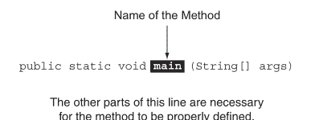

> 注意：暂时，你编写的所有程序都包含一个带有 `main` 方法的类，其头部看起来与代码列表 2-1 中的代码完全相同。随着本书的深入，你将学习 `public static void` 和 `(String[] args)` 的含义。现在，假设你正在学习一种组装 Java 程序的“配方”。

```java
{
```

第 6 行有另一个左大括号。这个大括号属于 `main` 方法。记住，大括号包围语句，每一个左大括号必须有一个对应的右大括号。如果你看第 8 行，你会看到与此左大括号对应的大括号。大括号之间的所有内容都是 `main` 方法的体。

```java
System.out.println("Programming is great fun!");
```

第 7 行显示如上。简单来说，这一行在屏幕上显示一条消息。消息“Programming is great fun!”打印出来时不带引号。在编程中，引号内部的字符组被称为字符串字面量。

> 注意：这是程序中唯一一个会在屏幕上导致打印任何内容的行。其他行，如 `public class Simple` 和 `public static void main(String[] args)`，对于你的程序框架来说是必要的，但它们不会导致任何屏幕输出。记住，程序是计算机的指令集。如果要在屏幕上显示某些内容，你必须使用编程语句来实现该目的。

行尾是一个分号。正如句号标记句子的结束一样，分号在 Java 中标记语句的结束。然而，并不是每一行代码都以分号结束。以下是不放置分号的场景总结：

- 注释不需要以分号结束，因为编译器会忽略它们。
- 类头部和方法头部不以分号结束，因为它们是以大括号内部的代码体终止的。
- 大括号字符 `{` 和 `}` 不是语句，所以你不在它们后面放置分号。

看起来哪里放置分号的规则似乎并不清楚。现在，只需专注于学习程序的各个部分。你很快就会熟悉在何时应该和不应该使用分号。

正如已经指出的，第 8 行和第 9 行包含了 `main` 方法和类定义的右大括号：

```java
}
```

在继续之前，让我们复习一下刚刚涵盖的内容，包括一些规则。

- Java 是一种大小写敏感的语言。它不认为大写字母与其小写字母是相同的字符。
- 所有 Java 程序必须存储在以 `.java` 结尾的文件中。
- 注释会被编译器忽略。
- 一个 `.java` 文件可以包含许多类，但只能有一个公共类。如果 `.java` 文件有一个公共类，则该类名必须与文件名相同。例如，如果 `Pizza.java` 包含一个公共类，那么该类的名将是 `Pizza`。
- 每个应用程序都必须有一个名为 `main` 的方法。
- 每一个左大括号（或开启大括号），必须有一个对应的右大括号（或关闭大括号）。
- 语句以分号终止。这不包括注释、类头部、方法头部或大括号。

在遇到的示例程序中，你遇到了几个特殊字符。表 2-1 总结了它们是如何使用的。

## 表 2-1 特殊字符

| 字符 | 名称 | 含义 |
|---|---|---|
| `//` | 标记注释的开始 | 标记注释的开始 |
| `(` `)` | 左、右括号 | 用于方法头部 |
| `{` `}` | 左、右大括号 | 包围一组语句，例如类或方法的内容 |
| `"` | 引号 | 包围一个字符字符串，例如要在屏幕上打印的消息 |
| `;` | 分号 | 标记一个完整的编程语句的结束 |

## 检查点

2.1 下面的程序无法编译，因为行顺序被打乱了：

```
public static void main(String[] args)
{
    // 一个疯狂被打乱的程序
public class Columbus
{
    System.out.println("In 1492 Columbus sailed the ocean blue.");
{\}
```

当行被正确排列后，程序应该在屏幕上显示以下内容：

In 1492 Columbus sailed the ocean blue.

按正确的顺序重新排列这些行。通过在计算机上输入、编译并运行该程序来测试它。

2.2 当问题 2.1 中的程序保存为文件时，文件名应该起为什么？

2.3 完成以下程序骨架，使其在屏幕上显示消息“Hello World”。

```
public class Hello
{
    public static void main(String[] args)
    {
        // 在此处插入代码以完成程序
    }
}
```

2.4 在纸上写一个显示日期的程序。

2.5 所有 Java 程序必须以以下结尾：

- 分号
- `.java`
- 一个或多个

2.6 每个应用程序都必须有：

- 一个名为 `main` 的方法
- 多于一个

2.7 下面的程序无法编译，因为行顺序被打乱了：[题目内容缺失]

2.8 当问题 2.1 中的程序保存为文件时，文件名应该起什么名？[重复题目]

2.9 完善以下程序骨架，使其在屏幕上显示消息“Hello World”。[重复题目]

# 2.2 `System.out.print` 和 `System.out.println` 方法以及 Java API

> 注意：暂时，你编写的所有程序都包含一个带有 `main` 方法的类，其头部看起来与代码列表 2-1 中的代码完全相同。随着本书的深入，你将学习 `public static void` 和 `(String[] args)` 的含义。现在，假设你正在学习一种组装 Java 程序的“配方”。

`System` 是 API 的一部分类。`System` 类包含了用于系统级操作的对象和方法。`System` 类包含的对象之一是 `out`。`out` 对象拥有方法，如 `print` 和 `println`，用于在屏幕上执行输出。`System`、`out`、`print` 和 `println` 之间的层次关系如图 2-3 所示。

## 图 2-3 System 类、out 对象以及 print 和 println 方法之间的关系

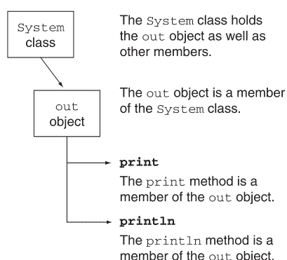

- `System` 类是 API 的一部分。它拥有用于系统级操作的成员对象和方法，例如输出到控制台。
- `out` 对象是 `System` 类的成员。它提供了输出到屏幕的方法。
- `print` 和 `println` 方法是 `out` 对象的成员。它们实际上执行在屏幕上写入字符的工作。

这种层次结构解释了为什么执行 `println` 的语句会这么长。`System.out.println` 序列指定了 `println` 是 `out` 的成员，而 `out` 是 `System` 的成员。

> 注意：分隔对象名称的点号读作 "dot"。`System.out.println` 读作 "system out dot print line"。

要在屏幕上显示的值放在括号内。这个值被称为参数。例如，以下语句使用字符串 "King Arthur" 作为其参数来执行 `println` 方法。这将在屏幕上打印 "King Arthur"。（引号不会在屏幕上显示。）

```java
System.out.println("King Arthur");
```

关于 `println` 方法需要了解的一个重要点是：在显示完消息后，它会将光标移动到下一行的开头。屏幕上打印的下一个项目将出现在此位置。例如，请查看代码列表 2-2 中的程序。

## 代码列表 2-2 (TwoLines.java)

```java
// This is another simple Java program

public class TwoLines
{
    public static void main(String[] args)
    {
        System.out.println("Programming is great fun!");
        System.out.println("I can't get enough of it!");
    }
}
```

## 程序输出

Programming is great fun!

I can't get enough of it!

由于每个字符串都是使用独立的 `println` 语句打印的，它们出现在不同的行上。

## print 方法

`print` 方法也是 `System.out` 对象的一部分，其作用与 `println` 类似——在屏幕上显示输出。然而，`print` 方法在显示完消息后不会将光标移动到下一行。请查看代码列表 2-3。

## 代码列表 2-3 (GreatFun.java)

```java
// This is another simple Java program

public class GreatFun
{
    public static void main(String[] args)
    {
        System.out.print("Programming is ");
        System.out.println("great fun!");
    }
}
```

## 程序输出

Programming is great fun!

关于代码列表 2-3，需要理解的重要概念是：虽然输出被分成了两个编程语句，但该程序仍然在一行上显示消息。你发送到 `print` 方法的数据以连续流的形式显示。有时，这可能会产生不如意的结果。代码列表 2-4 中的程序就是一个例子。

## 代码列表 2-4 (Unlucky.java)

```java
1 // An unruly printing program
2
3 public class Unlucky
4 {
5     public static void main(String[] args)
6     {
7         System.out.print("These are our top sellers:");
8         System.out.print("Computer games");
9         System.out.print("Coffee");
10        System.out.println("Aspirin");
11    }
12 }
```

## 程序输出

Are our top sellers:ComputergamesCoffeeAspirin

实际输出的布局与源代码中字符串的排列完全不同。首先，尽管输出在源代码中被分为四行（第 7 到 10 行），但它们在屏幕上以一行的形式出现。其次，注意某些显示的单词之间没有空格。字符串是完全按照发送到 `print` 方法的方式显示的。如果显示了空格，它们必须出现在字符串内部。

修复此程序有两种方法。最明显的方法是使用 `println` 方法代替 `print` 方法。另一种方法是使用转义序列将输出分隔不同的行。转义序列以反斜杠 (`\`) 开头，后跟一个或多个控制字符。它允许你通过在字符串内部嵌入命令来控制输出的显示。导致输出光标进入下一行的转义序列是 `\n`。代码列表 2-5 阐述了用法。

## 代码列表 2-5 (Adjusted.java)


# 代码示例

```java
1 // A well adjusted printing program
2
3 public class Adjusted
4 {
5 public static void main(String[] args)
6 {
7 System.out.print("These are our top sellers:\n");
8 System.out.print("Computer games\n");
9 System.out.println("Aspirin");
10 }
11 }
```

# 程序输出

These are our top sellers:

Computer games

Coffee

Aspirin

`\n` 字符被称为换行转义序列。当 `print` 或 `println` 方法遇到字符串中的 `\n` 时，它们不会在屏幕上打印 `\n` 字符，而是将其解释为将输出光标移动到下一行的特殊命令。还有其他几种转义序列。例如，`\t` 是一个转义序列。当在字符串中打印它时，它会导致输出光标跳进到下一个制表位。代码列表 2-6 显示了它的用法。

# 代码列表 2-6 (Tabs.java)

```java
1 // Another well-adjusted printing program
2
3 public class Tabs
4 {
5 public static void main(String[] args)
6 {
7 System.out.print("These are our top sellers:\n");
8 System.out.print("\tComputer games\tCoffee\n");
9 System.out.println("\tAspirin");
10 }
11 }
```

# 程序输出

These are our top sellers:

Computer games

Coffee

Aspirin

> 注意：虽然你必须输入两个字符来编写转义序列，但它们在内存中以单个字符的形式存储。

# 表 2-2 常见转义序列

| 序列 | 名称 | 描述 |
|---|---|---|
| `\n` | 换行 | 将光标移动到下一行以便打印 |
| `\t` | 水平制表 | 使光标跳过下一个制表位 |
| `\b` | 退格 | 使光标向左移动一个位置 |
| `\r` | 回车 | 使光标回到行首 |
| `\\` | 反斜杠 | 打印一个反斜杠 |
| `\'` | 单引号 | 打印一个单引号 |
| `\"` | 双引号 | 打印一个双引号 |

## 2.3 变量与字面量

当在单词周围加上双引号时，它就变成了一个字符串字面量，而不是变量名。字符串字面量被发送给 `print` 或 `println`，它们将按照引号内部的形式完整显示。

### 使用 `+` 运算符显示多个项目

当 `+` 运算符用于字符串时，它被称为字符串拼接运算符。拼接的意思是追加，因此字符串拼接运算符将一个字符串附加到另一个字符串之后。例如，看以下语句：

```java
System.out.println("This is " + "one string.");
```

该语句将打印：

This is one string.

`+` 运算符产生的字符串是由作为操作符的两个字符串组合成的。你也可以使用 `+` 运算符将变量的内容拼接到字符串。以下代码展示了示例：

```java
number = 5;
System.out.println("The value is " + number);
```

第二行使用 `+` 运算符将 `number` 变量的内容与字符串 "the value is " 拼接。尽管 `number` 不是字符串，但 `+` 运算符将其转换为字符串，然后将该值与第一个字符串拼接。将显示的输出为：

The value is 5

有时，你用于 `print` 或 `println` 的参数太长，无法放入程序代码的一行中。然而，字符串字面量不能从某行开始并在另一行结束。以下代码会导致错误：

```java
// This is an error!
System.out.println("Enter a value that is greater than
and less than 10.");
```

你可以通过将参数拆分为较小的字符串字面量并使用字符串拼接运算符将其分散到多行来解决这个问题。这里有一个示例：

```java
System.out.println("Enter a value that is " + 
"greater than zero and less " + 
"than 10.");
```

在该语句中，参数被拆分为三个字符串并使用 `+` 运算符连接。这个示例展示了当变量内容作为拼接的一部分时使用的相同技术：

```java
sum = 249;
System.out.println("The sum of the three 
"numbers is " + sum);
```

### 小心引号

如代码列表 2-8 所示，在变量名周围加上引号会改变程序的结果。事实上，在任何并非用于字符串字面量的内容周围加上引号都会创建某种类型的错误。例如，在代码列表 2-7 和 2-8 中，数字 `5` 被赋值给变量 `value`。如果这样赋值将是一个错误：

```java
value = "5"; // Error!
```

在该语句中，`5` 不再是一个整数，而是一个字符串字面量。由于 `value` 被声明为整数变量，你只能在其中存储整数。换句话说，`5` 和 `"5"` 并不是同一个东西。

数字可以表示为字符串这一事实经常困扰初学编程的学者。只需记住，字符串是为了人类阅读而设计的。它们被打印在计算机屏幕或纸张上。然而，数字主要用于数学运算。你不能对字符串进行数学运算，而且在数字显示在屏幕上之前，它们必须先转换为字符串。（正式地说，当你将数字发送到变量或进行显示时，`print` 和 `println` 会自动处理转换。代码列表 2-9 既包含字面量也包含变量。）在本章稍后的部分，我们将通过讨论它们的内部存储方式，进一步阐明数字、字符和字符串之间的区别。

### 更多关于字面量

字面量是写在程序代码中的值。字面量通常赋值给变量。代码列表 2-9 既包含字面量也包含变量。

### 代码列表 2-9 (Literals.java)

```java
// 这个程序包含字面量和一个变量。

public class Literals
{
    public static void main(String[] args)
    {
        int apples = 20;
        System.out.println("Today we sold " + apples + " bushels of apples.");
    }
}
```

### 程序输出

Today we sold 20 bushels of apples.

当然，这个程序中的变量是 `apples`。它被声明为整数。表 2-3 显示了程序中的字面量列表。

### 表 2-3 字面量

| 字面量 | 字面量类型 |
| --- | --- |
| `20` | 整数字面量 |
| `"Today we sold "` | 字符串字面量 |
| `"bushels of apples."` | 字符串字面量 |

### 标识符

标识符是程序员定义的名称，代表程序中的某些元素。变量名和类名都是标识符的示例。在 Java 中，你可以选择自己的变量名和类名，只要你不使用任何 Java 关键字即可。`关键字`构成了语言的核心，每个都有特定的用途。第 1 章中的表 1-3 和附录 B 显示了 Java 单词的完整列表。

你应该为变量选择能够指示其用途的名称。例如，你可能会忍不住声明如下这样的变量：

```java
int x;
```

这个无意义的名称 `x` 没有提供关于变量用途的任何线索。这里有一个更好的例子：

```java
int itemsOrdered;
```

`itemsOrdered` 这个名称让任何阅读程序的人了解该变量的用途。这种编码方法有助于产生自文档式程序，这意味着你只需通过阅读代码就能理解程序在做什么。因为现实世界的程序通常有数千行代码，所以让它们尽可能具有自文档性是非常重要的。

```java
}
    System.out.println("The big number is " + big);
}
```

列出程序中出现的变量和字面量。

## 2.11 下一个程序将在屏幕上显示什么？

```java
public class CheckPoint {
    public static void main(String[] args) {
        int number = 712;
        System.out.println("The value is " + "number");
    }
}
```

## 2.4 原始数据类型

> 概念：有许多不同类型的数据。变量根据其数据类型进行分类，数据类型决定了它们可以存储的数据种类。

计算机程序从现实世界收集数据片段并以各种方式对其处理。有许多不同类型的数据。例如，在数值数据领域，有整数和分数；负数和正数；以及大到没有名字或小到极定义的数字。还有文本信息。例如，名称和地址是以字符串的形式存储的。当你编写程序时，必须确定它可能会遇到什么类型的数据。

每个变量都有一个数据类型，即该变量可以持有的数据类型。选择合适的数据类型非常重要，因为变量的数据类型决定了变量使用的内存量以及格式化和存储的方式。选择与你的程序处理的数据类型匹配的数据类型是非常重要的。如果你正在编写一个程序来计算到遥远星球的里数，你需要能够存储极大数字的变量。如果你正在设计记录微米尺寸的软件，你需要存储非常小且精确数字的变量。如果你正在编写一个必须执行数千次密集计算的程序，你希望变量处理得非常快。变量的数据类型决定了所有因素。

表 2-5 显示了所有用于存储数值的 Java 原始数据类型。

### 表 2-5 数值数据的原始数据类型

| 数据类型 | 大小 | 范围 |
| --- | --- | --- |
| `byte` | 1 byte | -128 到 +127 之间的整数 |
| `short` | 2 bytes | -32,768 到 +32,767 之间的整数 |
| `int` | 4 bytes | -2,147,483,648 到 +2,147,483,647 之间的整数 |
| `long` | 8 bytes | -9,223,372,036,854,775,808 之间的整数 |
| `float` | 4 bytes | ±3.4 × 10^-38 到 ±3.4 × 10^38 之间的浮点数，精度为 7 位 |
| `double` | 8 bytes | ±1.7 × 10^-308 到 ±1.7 × 10^308 之间的浮点数，精度为 15 位 |

表 2-5 左列列出的词是在变量声明中使用的关键字。变量声明采用以下格式：

```java
DataType VariableName;
```

`DataType` 是数据类型的名称，`ColumnName` 是变量的名称。以下是一些变量声明的示例：

- `byte index;`
- `int speed;`
- `short month;`
- `float salesCommission;`
- `double distance;`

表 2-5 中的“大小”列显示了每种数据类型变量使用的字节数。例如，一个 `int` 变量使用 4 字节，一个 `double` 变量使用 8 字节。“范围”列显示了每种数据类型变量可能存储的数字范围。例如，一个 `int` 变量可以持有从 -2,147,483,648 到 +2,147,483,647 的数字。Java语言的一个吸引人的特点是，所有原始数据类型的大小和范围在所有计算机上都是相同的。

> 注意：这些类型被称为“原始”（primitive），是因为你不能用它们来创建对象。回想第 1 章关于面向对象编程的讨论，对象具有属性和方法。对于原始数据类型，你只能创建变量，而变量只能用于存储单个值。此类变量没有属性或方法。

### 整数数据类型

表 2-5 中列出的前四个数据类型 `byte`、`int`、`short` 和 `long` 都是整数数据类型。整数变量可以持有如 7、125、-14 和 6928 这样的整数。代码列表 2-10 中的程序展示了几个整数数据类型变量的使用。


### 代码列表 2-10 (IntegerVariables.java)

### 程序输出

我们已经行了 105 英里。

花费了 120 分钟。

我们的账户余额为 $-20

大约 18900 天前，哥伦布曾站在这里。

在大多数程序中，你可能需要任何给定数据类型的多个实例。如果一个程序使用了三个整数：长度、宽度和面积，可以分别声明，如下：

```java
int length;
int width;
int area;
```

然而，声明多个同类型的变量会更简单：

```java
int length, width, area;
```

### 整数字面量

当你编写一个整数时，Java 假设它是 `int` 类型。例如，在代码列表 2-10 中，105、120 和 -20 都是整数。你可以通过后缀大写的 `L` 将整数强制转换为 `long` 类型。

> 警告！如果你处理的是货币金额的字面量，请记住你不能在其中嵌入符号（如 `$`）或逗号。以下语句会导致错误：

```java
grossPay = $1257.00;
```

正确的写法应为：

```java
grossPay = 1257.00;
```

### 浮点字面量

当你编写一个浮点数字面量时，Java 假设它是 `double` 类型。例如，在代码列表 2-11 中，29.75、1.76 和 31.51 都是 `double`。由于由于，将浮点字面量赋值给 `float` 变量会产生问题。你可以使用以下方式：

```java
float number;
number = 23.5; // 错误
```

你可以通过后缀 `F` 或 `f` 将 `double` 字面量强制转换为 `float`。之前的代码可以重写为：

```java
float number;
number = 23.5F; // 这可行
```

### 代码列表 2-11 (Sale.java)

```java
// 此程序演示了 double 类型。

public class Sale {
    double price, tax, total;

    public static void main(String[] args) {
        price = 29.75;
        tax = 1.76;
        total = 31.51;

        System.out.println("The price of the item " + price);
        System.out.println("The tax is " + tax);
        System.out.println("The total is " + total);
    }
}
```

### 程序输出

项目价格为29.75

税额为1.76

总计为31.51

## 科学计数法和 E 表示法

浮点字面量可以用科学计数法表示。以数字 47,281.97 为例。在科学计数法中，该数字是 4.728197 × 10⁴。

Java 使用 E 表示法来表示科学计数法。在 E 表示法中，4.728197 × 10⁴ 将是 4.728197E4。表 2-6 显示了用科学计数法和 E 表示法表示的其他数字。

### 表 2-6 科学计数法和 E 表示法

| 数字 | 科学计数法 | E 表示法 |
| --- | --- | --- |
| 47,281.97 | 4.728197 × 10⁴ | 4.728197E4 |
| 0.000543 | 5.43 × 10⁻⁴ | 5.43E-4 |
| 120,000,000 | 1.2 × 10⁸ | 1.2E8 |

### 表 2-6 浮点数表示

| 十进制表示 | 科学计数法 | E 计数法 |
| --- | --- | --- |
| 247.91 | 2.4791 × 10² | 2.4791E2 |
| 0.00072 | 7.2 × 10⁻⁴ | 7.2E-4 |
| 2,900,000 | 2.9 × 10⁶ | 2.9E6 |

> 注意：E 可以是大写也可以是小写。

代码列表 2-12 展示了使用 E 计数法表示的浮点字面量。

# 代码列表 2-12 (SunFacts.java)

```java
1 // 此程序使用了 E 计数法。
2
3 public class SunFacts
4 {
5 public static void main(String[] args)
6 {
7 double distance, mass;
8
9 distance = 1.459979E11;
10 mass = 1.989E30;
11 System.out.println("The Sun is " + distance +
12 meters away.");
13 System.out.println("The Sun's mass is " + mass +
14 kilograms.");
15 }
16 }
```

### 程序输出

The Sun is 1.459979E11 meters away.

The Sun's mass is 1.989E30 kilograms.

# boolean 数据类型

`boolean` 数据类型允许你创建可能持有两个值之一的变量：`true` 或 `false`。代码列表 2-13 展示了 `boolean` 变量的声明和赋值。

# 代码列表 2-13 (TrueFalse.java)


# 代码列表 2-13 (TrueFalse.java)

```java
1 // 用于演示 boolean 变量的程序
2
3 public class TrueFalse
4 {
5     public static void main(String[] args)
6     {
7         boolean bool;
8
9         bool = true;
10        System.out.println(bool);
11        bool = false;
12        System.out.println(bool);
13    }
14 }
```

# 程序输出

```
true
false
```

`boolean` 数据类型的变量用于评估为真或为假的条件。然而，在第 3 章之前，你将不会使用它们，目前只需记住以下几点：

- `boolean` 变量只能持有值 `true` 或 `false`。
- “`boolean` 变量的内容不能复制到 `boolean` 以外任何类型的变量中。”

# char 数据类型

`char` 数据类型用于存储字符。`char` 数据类型的变量一次可以存储一个字符。字符字面量包含在单引号中。代码列表 2-14 使用了 `char` 变量。在程序运行时，字符字面量 `'A'` 和 `'B'` 被赋值给变量。

# 代码列表 2-14 (Letters.java)

```java
1 // 此程序演示 char 数据类型。
2
3 public class Letters
4 {
5     public static void main(String[] args)
6     {
7         char letter;
8
9         letter = 'A';
10        System.out.println(letter);
11        letter = 'B';
12        System.out.println(letter);
13    }
14 }
```

# 程序输出

```
A
B
```

重要的是，不要将字符字面量与字符串字面量混淆，后者包含在双引号中。字符串字面量不能赋值给 `char` 变量。

# Unicode

字符在内部用数字表示。每个可打印字符以及许多不可打印字符都被分配了一个唯一的数字。Java 使用 Unicode，这是一组被用作字符代码的数字。每个 Unicode 需要两个字节的内存，因此字符占用两个字节。当字符存储在内存中时，实际存储的是数值代码。当指令计算机在屏幕上打印该值时，它会显示与数值代码对应的字符。

你可能想参考附录 B，它显示了 Unicode 字符集的一部分。注意数字 65 是 `A` 的代码，66 是 `B` 的代码，以此类推。代码列表 2-15 证明了当你处理字符时，你实际上是在处理数字。

# 代码列表 2-15 (Letters2.java)

```java
1 // 此程序演示了字符和整数之间的
2 // 紧密关系。
3
4 public class Letters2
5 {
6     public static void main(String[] args)
7     {
8         char letter;
9
10        letter = 65;
11        System.out.println(letter);
12        letter = 66;
13        System.out.println(letter);
14    }
15 }
```

# 程序输出

```
A
B
```

# 2.4 原始数据类型

图 2-4 说明当你考虑存储在内存中的字符 `A`、`B` 和 `C` 时，实际存储的是数字 65、66 和 67。

# 图 2-4 字符以及它们如何在内存中存储

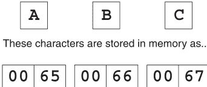

这些字符存储在内存中...

# 变量赋值与初始化

正如你在几个示例中看到的，值通过赋值语句放入变量中。例如，以下语句将值 12 分配给变量 `unitsSold`：

```java
unitsSold = 12;
```

该符号被称为赋值运算符。运算符对数据执行操作。运算符与操作数工作。赋值有两个操作数。在上面的语句中，操作数是 `unitsSold` 和 12。

在赋值中，接收赋值的变量名必须出现在运算符的左侧，被赋值的值必须出现在右侧。以下语句是错误的：

```java
12 = unitsSold; // 错误！
```

`=` 左侧的操作数必须是一个变量名。`=` 右侧的操作数必须是一个具有值的表达式。赋值运算符获取右操作数的值并将其放入左操作数标识的变量中。假设 `length` 和 `width` 都是整数，以下代码说明赋值运算符的右侧操作数可以是字面量也可以是变量：

```java
length = 20;
width = length;
```

# 算术运算符

概念：有许多用于处理数值和执行算术操作的运算符。

Java 提供了许多用于处理数据的运算符。通常，运算符分为三类：一元、二元和三元运算符。这反映了运算符所需的操作数数量。

一元运算符只需要一个操作数。例如，考虑以下：

```java
-5
```

当然，我们理解这代表数值负五。我们也可以将该运算符应用于变量，如下：

```java
-number
```

二元运算符处理两个操作数。赋值运算符就属于此类。正如你可能猜到的，三元运算符需要三个操作数。Java 只有一个三元运算符，将在第 4 章中进行讨论。

算术操作在编程中非常常见。表 2-7 显示了 Java 中的算术运算符。

# 表 2-7 算术运算符

| 运算符 | 含义 | 类型 | 示例 |
| --- | --- | --- | --- |
| `+` | 加法 | 二元 | `total = cost + tax;` |
| `-` | 减法 | 二元 | `cost = total - tax;` |
| `*` | 乘法 | 二元 | `tax = cost * rate;` |
| `/` | 除法 | 二元 | `salePrice = original / 2;` |
| `%` | 取模 | 二元 | `remainder = total % 3;` |

这些运算符的每一个工作方式可能正如你所期望的。加运算符返回两个操作数的和。以下是一些使用加运算符的示例语句：

```java
amount = 4 + 8; // 将 12 赋值给 amount
total = price + tax; // 将 price + tax 赋值给 total
number = number + 1; // 将 number + 1 赋值给 number
```

## 2.5 算术运算符

减法运算符返回左操作数减去右操作数的值。以下是一些示例：

```java
temperature = 112 - 14;      // 将 98 赋值给 temperature
sale = price - discount;             // 将 price - discount 赋值给 sale
number = number - 1;                   // 将 number - 1 赋值给 number
```

乘法运算符返回两个操作数的积。以下是一些示例：

```java
markup = 12 * 0.25;               // 将 3 赋值给 markup
commission = sales * percent;         // 将 sales * percent 赋值给 commission
population = population * 2;      // 将 population * 2 赋值给 population
```

除法运算符返回左操作数除以右操作数的商。以下是一些示例：

```java
points = 100 / 20;          // 将 5 赋值给 points
teams = players / maxEach;        // 将 players / maxEach 赋值给 teams
half = number / 2;               // 将 number / 2 赋值给 half
```

取模运算符返回两个整数除法运算的余数。以下语句将 2 赋值给 `leftover`：

```java
leftOver = 17 % 3;
```

在需要获取除法余数的情况下可以使用它。在检测除法后剩余多少物品的计算中需要用到取模运算符。

代码列表 2-17 中的程序演示了这些运算符如何在简单的薪资计算中使用的。

# 代码列表 2-17 (Wages.java)

```java
1  // 此程序计算时薪加加班费。
2
3  public class Wages
4  {
5      public static void main(String[] args)
6      {
7          double regularWages;            // 计算的常规工资。
8          double basePay = 25;             // 基础薪资。
9          double regularHours = 40;       // 加班的小数。
10         double overtimeWages;          // 加班工资
11         double overtimePay = 37.5;      // 加班率
12         double overtimeHours = 10;     // 加班的小数
13         double totalWages;              // 总工资
14
15         regularWages = basePay * regularHours;
16         overtimeWages = overtimePay * overtimeHours;
17         totalWages = regularWages + overtimeWages;
18         System.out.println("Wages for this week are $" + 
      totalWages);
19     }
20 }
```

# 程序输出

```
Wages for this week are $1375.0
```

代码列表 2-17 计算了一个按小时计费的工人一周的总工资。如注释所示，程序包含了常规工资、基础薪资、常规工作时间、加班工资、加班费率、加班工作时间和总工资的变量。

程序中的第 15 行将 `basePay` 乘以 `regularHours`，并将结果（1000）存储在 `regularWages` 中：

```java
regularWages = basePay * regularHours;
```

第 16 行将 `overtimePay` 乘以 `overtimeHours`，并将结果（375）存储在 `overtimeWages` 中：

```java
overtimeWages = overtimePay * overtimeHours;
```

第 17 行将常规工资和加班工资相加，并将结果（1375）存储在 `totalWages` 中：

```java
totalWages = regularWages + overtimeWages;
```

第 18 和第 19 行的 `println` 在屏幕上显示本周工资的消息。

# 整数除法

当除法运算符的操作数是整数时，运算符将执行整数除法。除法的结果也将是一个整数。如果操作数是整数，小数部分将被丢弃。例如：

```java
double result = 5 / 2; // result 为 2
```

如果操作数中有一个是浮点数，结果将是浮点数：

```java
double result = 5.0 / 2; // result 为 2.5
```

# 焦点：计算百分比和折扣

确定百分比是计算机编程中一种常见的计算。虽然在通用数学中使用 `%` 符号来表示百分比，但许多编程语言（如 Java）并不使用 `%` 符号来实现此目的。在程序中，你必须将百分比转换为浮点数，就像使用计算器一样。例如，50% 被写为 0.5，而 2% 被写为 0.02。

让我们来看一个例子。假设你每月赚 6,000 美元，并允许将每月总收入的一部分投入退休计划。你想确定，如果你投入月度总工资的 5%、8% 或 10%，你的薪资中将有多少金额会进入该计划。为了做出这一确定，你编写了一个类似于代码列表 2-18 中的程序。

# 代码列表 2-18 (Contribution.java)


# 程序输出

```
5% 是每月 $300.0。
8% 是每月 $480.0。
10% 是每月 $600.0。
```

第 11 行和 12 行声明了两个变量：`monthlyPay` 和 `contribution`。`monthlyPay` 变量初始化值为 6000.0，存储你的月薪金额。`contribution` 变量存储退休计划的投入金额。

第 15 行至 18 行的语句计算并显示了月薪的 5%。计算是在第 15 行完成的，将 `monthlyPay` 变量乘以 0.05。结果赋值给 `contribution` 变量，然后通过第 16 行至 18 行的语句显示。

第 21 行至 24 行执行了类似的步骤，计算并显示了月薪的 8%，第 27 行至 30 行计算并显示了月薪的 10%。

# 计算百分比折扣

另一种常见的计算是确定折扣百分比。例如，假设一家零售店销售一件原价为 59 美元的商品，并计划进行促销，将商品价格降低 20%。你被要求编写一个程序来计算该商品的销售价格。

要确定销售价格，你需要执行两次计算：

- 首先，你获取折扣金额，即商品原价的 20%。
- 第二次，你从商品原价中减去折扣金额。这便得到了销售价格。

代码列表 2-19 显示了如何在 Java 中实现此。

# 代码列表 2-19 (Discount.java)


```java
1 // 此程序计算原价为 $59 的
2 // 商品的售价，减去
3 // 20% 的折扣。
4
5 public class Discount
6 {
7     public static void main(String[] args)
8     {
9         // 用于存储原价、折扣
10        // 金额以及售价的变量。
11        double regularPrice = 59.0;
```

## 2.5 算术运算符

### 程序输出

原价：$59.0

折扣金额：$11.8

售价：$47.2

第 11 行至 13 行声明了三个变量。`regularPrice` 变量存储商品的原价，并初始化值为 59.0。`discount` 变量存储计算出的折扣金额。`salePrice` 变量存储商品的售价。

第 16 行通过将 `regularPrice` 乘以 0.2 计算出 20% 的折扣金额。结果存储在 `discount` 变量中。第 20 行通过从 `regularPrice` 中减去 `discount` 计算售价。结果存储在 `salePrice` 变量中。第 23 行至 25 行的语句显示了商品的原价、折扣金额和售价。

### Math 类

Java API 提供了一个名为 `Math` 的类，它包含许多用于执行复杂数学运算的方法。在本节中，我们将简要介绍 `Math.pow` 和 `Math.sqrt` 方法。

### Math.pow 方法

在 Java 中，计算数字的幂需要 `Math.pow` 方法。以下是 `Math.pow` 方法的使用示例：

```java
result = Math.pow(4.0, 2.0);
```

该方法接受两个 double 类型的参数。它将第一个参数进行第二个参数幂运算，并将结果作为 `double` 返回。在这个例子中，4.0 被提升 2.0 次方。此语句等同于以下代数表达式：

```java
result = 4^2
```

这是另一个使用 `Math.pow` 方法的语句示例。它将 3 倍的 6 次方赋值给 `x`：

```java
x = 3 * Math.pow(6.0, 3.0);
```

接下来的语句显示 5 的 4 次幂的值：

```java
System.out.println(Math.pow(5.0, 4.0));
```

### Math.sqrt 方法

`Math.sqrt` 方法接受一个 double 类型参数并返回其平方根。以下是它的使用示例：

```java
result = Math.sqrt(25.0);
```

## 2.7 基本数据类型之间的转换

赋值语句试图将一个 double 类型的值（2.5）存储在 int 类型变量中。当 Java 编译器遇到这行代码时，将产生一条错误信息。（Sun JDK 显示的消息为“possible loss of precision.”，即可能丢失精度。）

并不是所有数据类型之间的赋值都会被编译器拒绝。例如，查看以下程序段：

```java
int x;
short y = 2;
x = y;
```

这条赋值语句将一个 short 存储在 int 中，但可以毫无问题地运行。那么 Java 允许将 double 存储在 int 中吗？显而易见的， double 可以存储小数，并持有比 int 存储范围大得多的值。如果 Java 允许将 double 赋值给 int，可能会导致数据丢失。

就像军中的军官等级一样，数据类型也是分等级的。如果一个数据类型可以存储更大的数字，那么它的级别就高于另一个类型。例如，float 的级别高于 int，而 int 的级别高于 short。图 2-6 显示了按级别排序的数值型数据类型。

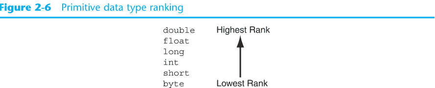

在赋值语句中，当低级别数据类型的值存储在高级别数据类型的变量中，Java 会自动将低级别的值转换为高级类型。这被称为宽转换（widening conversion）。例如，以下代码演示了宽转换，这种转换发生在 int 被存储到 double 变量中时：

```java
double x;
int y = 10;
x = y; // 执行宽转换
```

窄转换（narrowing conversion）是将值转换为低级别类型的转换。例如，将 double 转换为 int 就是一种窄转换。因为窄转换可能会导致数据丢失，Java 不会自动执行此操作。

### 强制转换运算符

强制转换运算符允许你转换值，即使这意味着将发生窄转换。强制转换运算符是单目运算符，表现为括括号内的数据类型名称。该运算符位于被转换值之前。这里是一个示例：

```java
x = (int)number;
```

该语句中的强制转换运算符是括号内的单词。它返回 number 中的值，并将其转换为 int。这个转换后的值存储在 x 中。如果 number 是一个浮点变量（如 float 或 double），那么返回的值将被截断，即数字的小数部分将丢失。然而，变量中的原始值不会改变。

表 2-14 显示了使用强制转换运算符的几个示例

| 语句 | 描述 |
| --- | --- |
| `littleNum = (short)bigNum;` | 强制转换运算符返回 `bigNum` 中的值，将其转换为 short。转换后的值赋值给 `littleNum`。 |
| `x = (long)3.7;` | 强制转换运算符应用于表达式 3.7。运算符返回值 3，并赋值给变量 `x`。 |
| `number = (int)72.567;` | 强制转换运算符应用于表达式 72.567。运算符返回 72，用于初始化变量 `number`。 |
| `value = (float)x;` | 强制转换运算符返回 `x` 中的值，将其转换为 float。转换后的值赋值给变量。 |
| `value = (byte)number;` | 强制转换运算符返回 `number` 中的值，将其转换为 byte。转换后的值赋值给变量 `value`。 |

注意，当强制转换运算符应用于一个变量时，它不会改变变量的内容。它只返回存储在变量中的值，并转换为指定的数据类型。

回想我们之前的讨论，当除法的两个操作数都是整数时，该操作将导致整数除法。这意味着除法的结果将是一个整数，结果的任何小数部分都被丢弃。例如，查看以下代码：

```java
int pies = 10, people = 4;
double piesPerPerson = pies / people;
```

尽管 10 除以 4 等于 2.5，这段代码会将 2 存储在 `piesPerPerson` 变量中。因为 `pies` 和 `people` 都是整数，所以结果将是一个 int，小数部分将被丢弃。然而，我们可以使用强制转换运算符修改代码，使其以浮点值的形式给出正确结果：

```java
piesPerPerson = (double)pies / people;
```

变量 `pies` 是一个 int，持有值 10。表达式 `(double)pies` 将 `pies` 中的值转换为 double 并返回。这意味着除法的操作数之一是 double，因此除法的结果将是 double。该语句也可以写成：

```java
piesPerPerson = pies / (double)people;
```

在该语句中，强制转换运算符将 `people` 变量的值转换为 double 并返回。在上述两种语句中，除法的结果都是 double。

### 2.7 基本数据类型之间的转换（续）

> **警告！** 强制转换运算符可以应用于括括号内的整个表达式。例如，查看以下语句：

```java
piesPerson = (double)(pies / people);
```

这条语句并没有将 `pies` 或 `people` 中的值转换为 double，而是转换表达式 `pies / people` 的结果。如果使用这条语句，仍然会执行整数除法。原因如下：表达式 `pies / people` 的结果是一个整数。

### 混合运算

Java 的细微之处在于它处理 byte、short 和 int 变量算术运算的方式。当数学表达式包含一个或多个 double、float 或 long 类型时，Java 会努力将所有操作数转换为相同的类型。让我们来看规范这些表达式的具体规则。

1. 如果其中一个操作数是 double，另一个操作数将被转换为 double。表达式的结果将是 double。例如，在以下语句中假设 `b` 是 double，`c` 是 int：

```java
a = b + c;
```

2. 如果其中一个操作数是 float，另一个操作数将被转换为 float。表达式的结果将是 float。例如，在以下语句中假设 `x` 是 float，`y` 是 float：

```java
z = x * y;
```

3. 如果其中一个操作数是 long，另一个操作数将被转换为 long。表达式的结果将是 long。例如，在以下语句中假设 `a` 是 long，`b` 是 short：

```java
c = a - b;
```

### 检查点

2.25 程序中出现以下声明：

```java
short totalPay, basePay = 500, bonus = 1000;
```

程序中出现以下语句：

```java
totalPay = basePay + bonus;
```

- a. 该语句会正常编译还是产生错误？
- b. 如果语句产生错误，原因是什么？如何修复？

2.26 变量 `a` 是 float，变量 `b` 是 double。写一条语句将 `b` 的值赋值给 `a`，且在编译时不产生错误。

## 2.8 使用 final 创建命名常量

> **概念：** `final` 关键字可以用于变量声明，使该变量变为命名常量。命名常量在初始化时赋予值，该值在程序执行期间不会改变。

假设以下语句出现在一个计算贷款利息的银行程序中：

```java
amount = balance * 0.069;
```

在这样的程序中，出现了两个潜在问题。首先，对于原始程序员以外的人来说，并不清楚 0.069 是什么。它看起来是一个利率，但在某些情况下，贷款还款会有相关的费用。如何在不费力修改程序其他部分的情况下，确定此语句的目的呢？

第二个问题发生在当该数字在整个程序的其他计算中被使用，并且必须定期更改时。假设该数字是利率，如果利率从 6.9% 变化到 8.2% 呢？程序员必须在整个源代码中搜索该数字出现的所有地方。

这两个问题都可以通过使用命名常量来解决。命名常量是一个只读的变量值，它在程序执行期间不能被更改。在 Java 中，你可以在程序声明中使用 `final` 关键字创建这样的变量。`final` 单词写在数据类型之前。这是一个示例：

```java
final double INTEREST_RATE = 0.069;
```

这看起来就像一个普通的变量声明，只是 `final` 单词出现在数据类型之前，并且变量名使用了全大写字母。虽然并不强制要求变量名必须全大写，但许多程序员倾向于这样写，以便它们与普通变量名区分开来。

在使用带有 `final` 修饰符的变量时，必须给出一个初始化值，否则在编译程序时会导致错误。如果程序中有任何尝试更改 `final` 变量值的语句，编译器也会报错。

使用命名常量的优势是它能让程序更具自文档性。以下语句：

```java
amount = balance * 0.069;
amount = balance * INTEREST_RATE;
```

新程序员可以阅读第二条语句并知道正在发生什么。显然，`balance` 乘以了利率。这种方法的另一个优势是可以轻松地对程序进行大范围更改。假设利率出现在整个程序中的十几个语句中。当利率发生变化时，命名常量定义中的初始化值是唯一需要修改的值。如果利率增加到 8.2%，可以将声明更改为以下内容：

```java
final double INTEREST_RATE = 0.082;
```

程序就可以准备重新编译。每个使用 `INTEREST_RATE` 的语句都将使用新值。

### Math.PI 命名常量

`Math` 类是 Java API 的一部分，提供了一个预定义的命名常量 `Math.PI`。该常量被赋值为 3.1415926535897323846，这是数学值 pi 的近似值。例如，看以下语句：

```java
area = Math.PI * radius * radius;
```

假设变量 `radius` 存储圆的半径，该语句使用 `Math.PI` 常量来计算圆的面积。

> 有关关于 `Math` 类的更多信息，请参阅附录 G，你可以在该书的在线资源页 http://www.pearsonglobalitions.com/gadis 访问。

## 2.9 String 类

> **概念：** `String` 类允许你创建用于存储字符串的对象。它还具有各种方法，允许你对字符串进行操作。

你已经遇到过字符串以及在屏幕上显示它们的程序了，让我们花点时间确保你理解什么是字符串。字符串是字符序列。它可以用于表示任何包含文本的数据类型，例如地址、警告消息等。字符串字面量（String literals）包含在双引号中，如下所示：

- "Hello World"
- "Joe Mahoney"

虽然程序经常遇到字符串并必须对它们执行各种任务，但 Java 并没有用于在内存中存储它们的原始类型。相反，Java API 提供了一个处理字符串的类。你可以使用这个类来创建能够存储字符串并对它们执行操作的对象。在讨论此之前，让我们简要讨论类和对象之间的关系。

### 对象由类创建

第 1 章向你介绍了对象，它们是包含属性和方法的软件实体。对象的属性是存储在对象中的数据值。对象的方法是对对象属性执行操作的程序。然而，在创建对象之前，必须由程序员对其进行设计。程序员确定必要的属性和方法，并创建一个描述该对象的类。

你已经见过将类作为应用程序的容器。类也可以用于指定特定类型对象可能拥有的属性和方法。将类比作一个可以创建对象的“蓝图”。类不是对象，而是对象的描述。当程序运行时，它可以使用该类在内存中创建所需的任意数量的对象。每个从类创建的的对象都称为该类的**实例**（instance）。

> **提示：** 如果这些概念对你来说有些模糊，不要担心。随着你阅读这本书，类和对象的概念将反复得到加强。

### String 类

Java API 提供的处理字符串的类名为 `String`。使用字符串类的第一步是声明一个 `String` 类数据类型的变量。这是一个 `String` 变量声明的示例：

```java
String name;
```

> **提示：** `String` 中的 `S` 是大写字母。按照惯例，类名的第一个字母始终大写。

该语句将 `name` 声明为 `String` 变量。记住 `String` 是一个类，而不是原始数据。让我们简要查看原始类型变量和类类型变量的区别。

### 原始类型变量和类类型变量

任何类型的变量都可以关联数据。原始类型变量持有与其关联的实际数据。例如，假设 `number` 是一个 `int` 变量。以下语句将 25 存储在变量中：

```java
number = 25;
```

如图 2-7 所示。

> 原始类型变量持有与其关联的数据

类类型变量并不持有与其关联的实际数据，而是持有与其关联数据的内存地址。如果 `name` 是一个 `String` 变量，那么它可以持有字符串对象的内存地址。如图 2-8 所示。

> String 变量可以持有字符串对象的地址

当类类型变量持有对象的地址时，说该变量引用了该对象。由于这个原因，类类型变量通常被称为**引用变量**（reference variables）。

### 创建字符串对象

在程序的任何时候编写字符串字面量时，Java 都会创建一个字符串对象来存放它。你也可以通过赋值语句在内存中创建一个字符串对象并将其存储字符串变量中。这是一个示例：

```java
name = "Joe Mahoney";
```

在这里，字符串字面量导致在内存中创建一个存储 "Joe Mahoney" 值的字符串对象。然后赋值运算符将对象的地址存储在 `name` 变量中。在该语句执行后，说 `name` 变量引用了一个字符串对象。如图 2-9 所示。

> 变量持有字符串对象的地址

| 字符串对象 | |
| --- | --- |
| 变量持有字符串对象的地址 | address -> "Joe Mahoney" |

你还可以使用 `=` 运算符来初始化字符串变量，如下：

```java
String name = "Joe Mahoney"
```

该语句将 `name` 声明为 `String` 变量，创建一个存储 "Joe Mahoney" 值的字符串对象，并将对象的内存地址分配给 `name` 变量。代码列表 2-20 显示了字符串变量的声明、初始化，然后在 `println` 语句中使用。

### 代码列表 2-20 (StringDemo.java)

```java
1 // 一个演示字符串对象的简单程序。
3 public class StringDemo
4 {
5 public static void main(String[] args)
6 {
7 String greeting = "Good morning";
8 String name = "Herman";
10 System.out.println(greeting + name);
11 }
12 }
```

#### 程序输出

Good morning Herman

### 2.9 String 类（续）

由于 String 类型是一个类而不是基本数据类型，它提供了许多用于处理字符串的方法。例如，String 类有一个 `length` 方法，可以返回存储在对象中的字符串的长度。假设变量 `name` 引用一个 String，以下语句将该字符串的长度存储在变量 `stringSize` 中（假设 `stringSize` 是一个 `int` 类型变量）：

```java
stringSize = name.length();
```

该语句调用了 `name` 所引用的对象的 `length` 方法。要调用一个方法并执行它，该方法的通用形式如下：

```java
referenceVariable.method(arguments...)
```


`referenceVariable` 是引用对象的变量名，`method` 是方法名，而 `arguments` 是传递给方法的零或多个参数。如果没有向方法传递参数（如 `length` 方法所示），则在方法名后跟一对空括号。

String 类的 `length` 方法返回一个 `int` 值。这意味着该方法向调用它的字符串返回一个 `int` 值。该值可以存储在变量中、显示在屏幕上或用于计算。代码列表 2-21 展示了 `length` 方法。

## 代码列表 2-21 (StringLength.java)

## 程序输出

Herman 有 6 个字符。

> 注意：String 类的 `length` 方法返回字符串中的字符数，包括空格。

你将在第 10 章详细学习 String 类的方法，但现在让我们再看几个例子。除了 `length` 之外，表 2-15 还描述了 `charAt`、`toLowerCase` 和 `toUpperCase` 方法。

## 表 2-15 一些 String 类方法

| 方法 | 说明 |
| --- | --- |
| `charAt(index)` | 参数 `index` 是一个 `int` 值，指定字符串中的字符位置。第一个字符位于位置 0，第二个字符位于位置 1，依此类推。该方法返回指定位置的字符。返回值类型为 `char`。 |
| `length()` | 此方法返回字符串中的字符数。返回值类型为 `int`。 |
| `toLowerCase()` | 此方法返回一个新字符串，该字符串为对象包含字符串的小写形式。 |
| `toUpperCase()` | 此方法返回一个新字符串，该字符串为对象包含字符串的大写形式。 |

示例：

```java
char letter;
String name = "Herman";
letter = name.charAt(3);
```

执行此代码后，变量 `letter` 将持有字符 'm'。

示例：

```java
int stringSize;
String name = "Herman";
stringSize = name.length();
```

执行此代码后，变量 `stringSize` 将持有值 6。

示例：

```java
String bigName = "HERMAN";
String littleName = bigName.toLowerCase();
```

执行此代码后，`littleName` 引用的对象将持有字符串 "herman"。

示例：

```java
String littleName = "herman";
String bigName = littleName.toUpperCase();
```

执行此代码后，`bigName` 引用的对象将持有字符串 "HERMAN"。

代码列表 2-22 中的程序演示了这些方法。

## 代码列表 2-22 (StringMethods.java)

```java
1 // 这个程序演示了几个 String 方法。
2
3 public class StringMethods
4 {
5     public static void main(String[] args)
6     {
7         String message = "Java is Great Fun!";
8         String upper = message.toUpperCase();
9         String lower = message.toLowerCase();
10         char letter = message.charAt(2);
11         int stringSize = message.length();
12
13         System.out.println(message);
14         System.out.println(upper);
15         System.out.println(lower);
16         System.out.println(letter);
17         System.out.println(stringSize);
18
19     }
}
```

## 程序输出

```
Java is Great Fun!
JAVA IS GREAT FUN!
java is great fun!
v
18
```

## 检查点

- 2.27 编写一个语句声明名为 `city` 的 String 变量。该变量将被初始化，使其引用一个带有字符串 "San Francisco" 的对象。
- 2.28 假设 `stringLength` 是 `int` 变量。编写一个语句将 `city` 变量（在检查点 2.27 中声明）引用的字符串长度存储在 `stringLength` 中。
- 2.29 假设 `oneChar` 是 `char` 变量。编写一个语句将 `city` 变量（在检查点 2.27 中声明）引用的字符串中的第一个字符存储在 `oneChar` 中。
- 2.30 假设 `upperCity` 是一个字符串引用变量。编写一个语句将 `city` 变量（在检查点 2.27 中声明）引用的字符串的大写形式存储在 `upperCity` 中。
- 2.31 假设 `lowerCity` 是一个字符串引用变量。编写一个语句将 `city` 变量（在检查点 2.27 中声明）引用的字符串的小写形式存储在 `lowerCity` 中。

## 2.10 作用域

**概念：** 变量的作用域是程序中可以访问该变量的部分。

每个变量都有作用域。变量的作用域是程序可以通过名称访问变量的部分。变量仅对变量作用域内的语句可见。定义这些的规则

```java
{
    double payRate; // 存储每小时薪率
    double hours; // 存储工作小时数
    int employeeNumber; // 存储员工编号

    // 此程序的其余部分已省略。
}
```

注释不仅可以说明是谁编写了程序以及描述变量的用途，还可用于解释代码中复杂的步骤。

## 2.11 注释

### 多行注释

Java 中的第二种注释是多行注释。多行注释以 `/*`（正斜杠后跟一个星号）开始，以 `*/`（星号后跟正斜杠）结束。这两个标记符号之间的所有内容都会被忽略。代码列表 2-25 展示了如何使用多行注释。

## 代码列表 2-25 (Comment2.java)

```java
/*
程序: Comment2.java
编写者：Herbert Dorfmann
此程序计算公司工资单
 */

public class Comment2
{
    public static void main(String[] args)
    {
        double payRate; // 存储每小时薪率
        double hours; // 存储工作小时数
        int employeeNumber; // 存储员工编号

        // 此程序的其余部分已省略。
    }
}
```

与以 `//` 开始的注释不同，多行注释可以跨越多行。这使得编写大块注释变得更加方便，因为你不需要标记每一行。因此，多行注释在编写单行注释时并不方便，因为你必须同时输入开始和结束注释的符号。

在用多行注释时，请记住以下建议：

- 注意不要将开始符号与结束符号写反。
- 务必不要忘记结束符号。

### 块注释

许多程序员使用星号或其他字符在注释周围绘制边界或方框。这有助于在视觉上将注释与周围的代码隔离开来。这些被称为块注释。表 2-16 显示了块注释的四个示例。

## 表 2-16 块注释

```text
/**
 * 此程序演示了
 * 写注释的方法。
 */
///////////////////////////////////////
 // 此程序演示了
 // 写注释的方法。
///////////////////////////////////////
/************************************
 // 此程序演示了 *
 // 写注释的方法。 *
**************************************/
/--------------------/
 // 此程序演示了
 // 写注释的方法。
/--------------------/
```

### 文档注释

第三种注释被称为文档注释。文档注释可以被一个名为 `javadoc` 的程序读取和处理，该程序随 Sun JDK 一起提供。`javadoc` 程序的目的是读取 Java 源代码文件并生成格式准确的 HTML 文档。如果源文件包含任何文档注释，注释中的信息将成为 HTML 文档的一部分，可以在 Web 浏览器中查看。

任何以 `/**` 开始并以 `*/` 结束的注释都被视为文档注释。通常，你会在类头文件之前写一个文档注释，对该类进行简要描述。你还会在每个方法头文件之前写一个文档注释，对该方法进行简要描述。例如，代码列表 2-26 显示了一个带有文档注释的程序。该程序在类头之前有一个文档注释，在 main 方法头之前也有文档注释。

## 代码列表 2-26 (Comment3.java)

```java
/**
 * 此程序创建一个计算公司工资单的程序。
 */

public class Comment3
{
    /**
     * main 方法是程序的起始点。
     */

    public static void main(String[] args)
    {
        double payRate;      // 存储每小时薪率
        double hours;         // 存储工作小时数
        int employeeNumber;   // 存储员工编号

        // 此程序的其余部分已省略。
    }
}
```

你可以从操作系统的命令行提示符运行 `javadoc` 程序。以下是 `javadoc` 命令的通用格式：

`javadoc SourceFile.java`

`SourceFile.java` 是 Java 源代码文件的名称，包括 `.java` 扩展名。`javadoc` 将读取该文件并为其生成文档。例如，以下命令将为 `Comment3.java` 源文件生成文档，该文件如代码列表 2-26所示：

`javadoc Comment3.java`

执行后，将在源文件相同的目录下创建几个文档文件。其中一个将重命名为 `index.html`。图 2-10 显示了在 Internet Explorer 中查看的 `index.html`。注意文档注释中写的文字出现在文件中。

## 图 2-10 由 javadoc 生成的文档

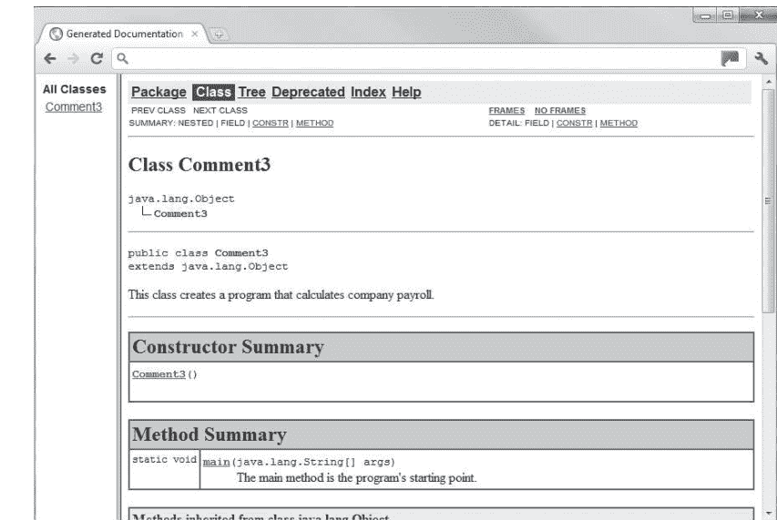

> 你可以通过阅读本书在线资源页（www.pearsonglobaleditions.com/gaddis）上的附录 F了解更多关于文档注释和 javafx 工具程序的信息。从书的这里开始，我们将在示例源码中使用简单的块风格注释和单行注释。

## 检查点

- 2.32 你如何编写单行注释？你如何编写多行注释？你如何编写文档注释？
- 2.33 文档注释与其他注释有何不同？

## 2.12 编程风格

**概念：** 编程风格指的是程序员使用空格、缩进、空行和标点符号安排程序的方式。

在第 1 章中，语法规则规定了语言的使用方式。编译器读取程序时并不关心每个语句是否单独占一行，或者是否用空格分隔操作符。然而，人类发现阅读未以美观方式编写的程序非常困难。考虑代码列表 2-27。

## 代码列表 2-27 (Compact.java)

```java
public class Compact { public static void main(String [] args){int shares=220; double averagePrice=14.67; System.out.println("There "+shares+" sold at $"+averagePrice+" per share.");} }
```

输出

There were 220 shares at 14.67 per share.

尽管该程序在语法上是正确的（它没有违反 Java 的任何规则），但很难阅读。该程序如代码列表 2-28 所示，使用了更易理解的风格编写。

## 代码列表 2-28 (Readable.java)

```java
/*
 * 此示例比 Compact 易读得多。
 */
public class Readable
{
    public static void main(String[] args)
    {
        int shares = 220;
        double averagePrice = 14.67;
        System.out.println("There " + shares
                              + " sold at $"
                              + averagePrice + " per share.");
    }
}
```

# 输出

There were 220 sold at $14.67 per share.

编程风格的另一个方面是如何处理过长而无法在一行内容内容的语句。注意 `println` 语句跨越了三行。在语句的第二和第三行的开头插入了额外的空格，这表示它们是前行的延续。

在单条语句中声明相同类型的多个变量时，通常的做法是将每个变量单独写一行，并附带注释说明变量的用途。以下是一个示例：

```java
int fahrenheit;      // 用于存储华氏温度
int celsius;         // 用于存储摄氏度温度
int kelvin;          // 用于存储开尔文温度
```

你可能已经在示例程序中注意到，在变量声明和随其后的语句之间插入了一个空行。这是为了将声明与可执行语句隔离开。

还有许多其他与编程风格相关的问题，它们将贯穿本书介绍。

## 2.13 读取键盘输入

**概念：** Scanner类的对象可用于从键盘读取输入。

我们之前讨论过 `System.out` 对象以及它是如何引用标准输出设备的。Java API 还有另一个对象 `System.in`，它引用标准输入设备。标准输入设备通常是键盘。你可以使用 `System.in` 读取在键盘上输入过的按键。然而，使用 `System.in` 并不像使用 `System.out` 那样简单直接，因为 `System.in` 对象仅通过字节读取输入。这非常不利，因为程序需要其他类型的值作为输入。为了解决这个问题，你可以结合使用 Scanner 类对象使用 `System.in`。Scanner 类设计用于从源（如 `System.in`）读取输入，并提供了你可以使用的方法来获取格式化后的原始值或字符串。

首先，你创建一个 `Scanner` 对象并将其连接到 `System.in`。以下是实现该功能的语句示例：

```java
Scanner keyboard = new Scanner(System.in);
```

让我们将语句拆分为两个部分。语句的第一部分：

```java
Scanner keyboard
```

声明了一个名为 `keyboard` 的变量。变量的类型是 `Scanner`。由于 `Scanner` 是一个类，因此 `keyboard` 变量是一个类类型。回想我们对 Strings 的讨论，类变量持有的是对象的内存地址。因此，`keyboard` 变量将用于存储 `Scanner` 对象的地址。语句的第二部分如下：

```java
= new Scanner(System.in);
```

我们在语句中首先看到的是赋值运算符 (`=`)。赋值运算符将某些内容赋值给 `keyboard` 变量。在赋值运算符之后，我们看到了新单词 `new`，这是一个 Java 关键字。`new` 关键字的目的是创建一个对象。接下来将创建的对象类型。在这种情况下，我们看到 `new` 关键字之后列出了 `Scanner(System.in)`。这指定了应该创建一个 `Scanner` 对象，并且它应该连接到 `System.in` 对象。对象的内存地址由 (`=`) 运算符赋值给变量 `keyboard`。在语句执行后，`keyboard` 变量将引用所创建的 `Scanner` 对象。

图 2-12 指出了该语句每个部分的作用。图 2-13 说明了 `keyboard` 变量如何引用 `Scanner` 类的对象。

## 图 2-12 语句的组成

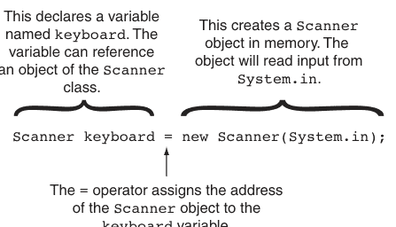

## 图 2-13 keyboard 变量引用 Scanner 对象

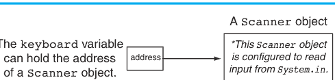

> 注意：在前面的代码中，我们选择 `keyboard` 作为变量名。`keyboard` 这个名字并没有特殊之处。我们之所以选择这个名字是因为我们将使用该变量从键盘读取输入。

Scanner 类拥有读取字符串、字节、整数、长整数、短整数、浮点数和双精度浮点数的方法。例如，以下代码使用 Scanner 类对象从键盘读取输入并将值赋值给 `number` 变量。

```java
int number;
Scanner keyboard = new Scanner(System.in);
System.out.print("Enter an integer value: ");
number = keyboard.nextInt();
```

这里显示的最后一个语句调用了 Scanner 类的 `nextInt` 方法。`nextInt` 将输入值格式化为 `int`，然后返回该值。因此，该语句将键盘上输入的输入格式化为 `int` 并返回它。该值被赋值给新变量。


表 2-17 列出了 `Scanner` 类的若干方法并描述了它们的用途。

# 表 2-17 Scanner 类的一些方法

| 方法 | 示例和描述 |
| --- | --- |
| `nextByte` | 示例用法：<br>`byte x; Scanner keyboard = new Scanner(System.in); System.out.print("Enter a byte value: ");` (续) |
| `nextLong` | 示例用法：<br>`long number; Scanner keyboard = new Scanner(System.in); System.out.print("Enter a long value: "); number = keyboard.nextLong();`<br>描述：将输入作为 `long` 返回。 |
| `nextShort` | 示例用法：<br>`short number; Scanner keyboard = new Scanner(System.in); System.out.print("Enter a short: "); number = keyboard.nextInt();`<br>描述：将输入作为 `short` 返回。 |

## 使用 import 语句

关于 `Scanner` 类还有一个细节在你准备使用它之前必须了解。`Scanner` 类对你的 Java 程序不是自动可用的。任何使用 `Scanner` 类的程序都应该在文件开头、类定义之前包含以下语句：

```java
import java.util.Scanner;
```

该语句告诉 Java 编译器在哪个库中找到 `Scanner` 类，并使其对程序可用。代码列表 2-29 显示了使用 `Scanner` 类读取字符串、整数和双精度浮点数。

# 代码列表 2-29 (Payroll.java)

```java
import java.util.Scanner; // 需要 Scanner 类
/**
 * 此程序演示了 Scanner 类。
 */
public class Payroll
{
    public static void main(String[] args)
    {
        String name; // 用于存储姓名
        int hours; // 工作时长
        double payRate; // 时薪
        double grossPay; // 总工资

        // 创建 Scanner 对象来读取输入。
        Scanner keyboard = new Scanner(System.in);

        // 获取用户的姓名。
        System.out.print("What is your name? ");
        name = keyboard.nextLine();

        // 获取本周的工作小时数。
        System.out.print("How many hours did you work this week? ");
        hours = keyboard.nextInt();

        // 获取用户的时薪。
        System.out.print("What is your hourly pay rate? ");
        payRate = keyboard.nextDouble();

        // 计算总工资。
        grossPay = hours * payRate;

        // 显示结果信息。
        System.out.println("Hello " + name);
        System.out.println("Your gross pay is $" + grossPay);
    }
}
```

# 程序输出，示例输入加粗

| What is your name? **Joe Mahoney [Enter]** |
| --- |
| How many hours did you work this week? **40 [Enter]** |
| What is your hourly pay rate? **20 [Enter]** |
| Hello Joe Mahoney |
| Your gross pay is $8000 |

> 注意：注意你使用的每个 `Scanner` 方法都会等待用户按下 Enter 键后返回值。按下 Enter 键时，光标会自动移动下一行以便后续操作。

# 读取字符

有时你想从键盘读取单个字符。例如，你的程序可能会询问用户一个是否问题，并指定他输入 Y 表示是，N 表示否。然而，`Scanner` 类没有读取单个字符的方法。我们在本书中用于读取字符的方法是使用 `Scanner` 类的 `nextLine` 方法从键盘读取字符串，然后使用 `String` 类的 `charAt` 方法用于提取字符串的第一个字符。这将是用户在键盘上输入的字符。这是一个示例：

```java
String input; // 用于存储一行输入
char answer; // 用于存储单个输入。

// 创建一个 Scanner 对象用于键盘输入。
Scanner keyboard = new Scanner(System.in);

// 向用户提问一个问题。
System.out.print("Are you having fun? (Y=yes, N=no)");
input = keyboard.nextLine(); // 获取一行输入。
answer = input.charAt(0); // 获取第一个字符。
```

`input` 变量代表一个 `String`。这段代码的最后语句调用了 `String` 类的 `charAt` 方法来获取位置 0 的字符，即字符串中的第一个字符。在该语句执行后，`answer` 变量将持有用户在键盘上输入的字符。

## 混合使用 nextLine 与其他 Scanner 方法

当你调用 `Scanner` 类的某个方法来读取原始类型值（例如 `nextInt` 或 `nextDouble`），然后调用 `nextLine` 方法读取字符串时，可能会出现一个恼人且难以解决的问题。例如，查看代码列表 2-30 中的程序。

### 代码列表 2-30 (InputProblem.java)

```java
import java.util.Scanner; // 需要用到 Scanner 类
/**
 * 此程序在读取输入时存在问题。
 */
public class InputProblem
{
    public static void main(String[] args)
    {
        String name; // 用于存储用户的姓名
        int age; // 用于存储用户的年龄
        double income; // 用于存储用户的收入

        // 创建一个 Scanner 对象来读取输入。
        Scanner keyboard = new Scanner(System.in);

        // 获取用户的年龄。
        System.out.print("What is your age? ");
        age = keyboard.nextInt();

        // 获取用户的收入
        System.out.print("What is your annual income? ");
        income = keyboard.nextDouble();

        // 获取用户的姓名。
        System.out.print("What is your name? ");
        name = keyboard.nextLine();

        // 将信息显示给用户。
        System.out.println("Hello " + name + ". Your age is " + age + " and your income is $" + income);
    }
}
```

### 程序输出（以加粗字体显示示例输入）

What is your age? **24 [Enter]**

What is your annual income? **$50000.00 [Enter]**

What is your name? Hello. Your age is 24 and your income is $50000.0

在示例输出中，程序首先允许用户输入年龄。第 20 行的语句从键盘读取 `int` 并将值存储在 `age` 变量中。接下来，用户输入收入。第 24 行的语句从键盘读取 `double` 并将值存储在 `income` 变量中。然后要求用户输入姓名，但第 28 行的语句似乎被跳过了。姓名从未从键盘被读取，这是因为 `nextLine` 方法与其他 `Scanner` 方法之间的行为存在细微差异。

当用户在键盘上输入按键时，这些按键会被存储在一个称为键盘缓冲区（keyboard buffer）的内存区域。按下回车键会创建一个换行符并存储在键盘缓冲区中。在列表 2-30 的程序示例中，用户被要求输入年龄，第 20 行语句调用了 `nextInt` 方法从键盘缓冲区读取。注意用户输入了 24 然后按下了回车键。`nextInt` 方法从缓冲区读取了值 24，但换行符没有被读取。因此，值 24 从缓冲区被读取了，但换行符仍留在缓冲区中。

接着，要求用户输入收入。用户输入了 50000 然后按下了回车键。当第 24 行的 `nextDouble` 方法执行时，它遇到了由 `nextInt` 方法留下的换行符。这并没有导致问题，因为 `nextDouble` 方法设计为会跳过它遇到的任何领先换行符。它跳过了初始换行符，读取了值 50000.0，然后换行符留在了键盘缓冲区中。

接着，要求用户输入姓名。第 28 行调用了 `nextLine` 方法。

然而，`nextLine` 方法的设计并不是为了跳过初始换行符。如果换行符是 `nextLine` 方法遇到的第一个字符，那么将什么也读不到。由于第 24 行的 `nextDouble` 方法在缓冲区中留了一个换行符，`nextLine` 方法不会读取任何输入。相反，它会立即终止，用户没有机会输入姓名。

尽管这个问题的细节看起来可能很复杂，但解决方法很简单。代码列表 2-31 中的程序是代码列表 2-30 的修改版本，修复了输入问题。

### 代码列表 2-31 (CorrectedInputProblem.java)

（注：后续代码部分原文未提供，此处根据上下文推断结束）

# 显示输入对话框

输入对话框是要求用户输入数据的快速且简单的方法。你使用 `JOptionPane` 类的 `showInputDialog` 方法来显示输入对话框。下面的代码调用了该方法：

```java
String name;
name = JOptionPane.showInputDialog("Enter your name.");
```

传递方法的参数是要显示在对话框中的消息。此状态将导致图 2-16 所示的对话框显示在屏幕中心。如果用户点击 OK（确定）按钮，`name` 将引用用户在文本字段中输入的字符串值。如果用户点击 Cancel（取消）按钮，`name` 将引用特殊值 `null`。

**图 2-16** 输入对话框

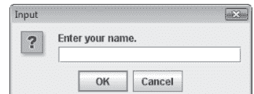

# 示例程序

代码列表 2-32 中的程序演示了如何使用两种类型的对话框。该程序使用输入对话框要求用户输入其名、中间名和姓，然后使用消息对话框显示问候信息。当此程序执行时，将依次显示图 2-17 所示的对话框。

# 代码列表 2-32 (NamesDialog.java)

```java
import javax.swing.JOptionPane;
/**
 * 此程序演示了使用 JOptionPane
 * 使用对话框。
 */
public class NamesDialog
{
    public static void main(String[] args)
    {
        String firstName; // 用户的名
        String middleName; // 用户的中间名
        String lastName; // 用户的姓

        // 获取用户的名。
        firstName =
        JOptionPane.showInputDialog("What is " + 
        "your first name?");

        // 获取用户的中间名。
        middleName =
        JOptionPane.showInputDialog("What is " + 
        "your middle name?");

        // 获取用户的姓。
        lastName =
        JOptionPane.showInputDialog("What is " + 
        "your last name?");

        // 显示问候
        JOptionPane.showMessageDialog(null, "Hello " + 
        firstName + " " + middleName + 
        " " + lastName + ")");

        System.exit(0);
    }
}
```

注意方法中的最后一条语句：

`System.exit(0);`

该语句会导致程序结束，如果你使用 `JOptionPane` 类显示对话框，该语句是必须的。与控制台程序不同，使用 `JOptionPane` 的程序在方法结束时不会自动停止执行，因为 `JOptionPane` 类向 JVM 中添加了一个额外的运行任务。如果没有调用 `System.exit` 方法，该任务（也称为线程）即使在方法结束后仍会继续执行。

`System.exit` 需要一个整数参数。这是一个传回给操作系统的退出代码。虽然此代码通常被忽略，但它可以在程序外部使用，以指示程序是成功结束还是作为失败的结果。值 `0` 传统上表示程序成功结束。

# 将字符串输入转换为数字

与 `Scanner` 类不同，`JOptionPane` 类没有不同的方法来读取不同类型的输入值。`showInputDialog` 方法始终将用户的输入作为字符串（`String`）返回，即使用户输入的是数字数据。例如，如果用户在输入对话框中输入数字 72，`showInputDialog` 方法将返回字符串 "72"。如果你希望在数学运算中使用用户的输入，这就会成为问题，因为正如你所知道的，不能对字符串进行数学运算。在这种情况下，你必须将输入转换为数值。要将字符串值转换为数值，你可以使用表 2-18 中列出的方法之一。

# 图 2-17 NamesDialog 程序显示的对话框

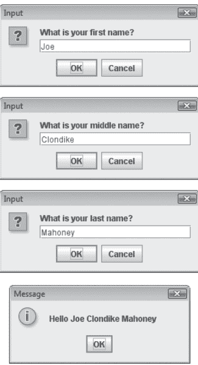

第一个对话框如所示出现。用户输入 Joe 并点击 OK。

第二个对话框如所示出现。在此例中，用户输入 Clondike 并点击 OK。

第三个对话框如所示出现。在此例中，用户输入 Mahoney 并点击 OK。

第四个对话框如所示出现，显示问候信息。

# 表 2-18 将字符串转换为数字的方法

| 方法 | 使用此方法来 . . | 示例代码 |
| --- | --- | --- |
| `Byte.parseByte` | 将字符串转换为字节（`byte`）。 | `byte num = Byte.parseByte(str);` |
| `Double.parseDouble` | 将字符串转换为双精度浮点数（`double`）。 | `double num = Double.parseDouble(str);` |
| `Float.parseFloat` | 将字符串转换为单精度浮点数（`float`）。 | `float num = Float.parseFloat(str);` |
| `Integer.parseInt` | 将字符串转换为整数（`int`）。 | `int num = Integer.parseInt(str);` |
| `Long.parseLong` | 将字符串转换为长整数（`long`）。 | `long num = Long.parseLong(str);` |
| `Short.parseShort` | 将字符串转换为短整数（`short`）。 | `short num = Short.parseShort(str);` |

注意：表 2-18 中的方法是 Java 包装类的一部分，你将在第八章学习更多内容。

以下是一个如何使用 `Integer.parseInt` 方法将 `JOptionPane.showInputDialog` 方法返回的值转换为 `int` 的示例：

```java
int number;
String str;
str = JOptionPane.showInputDialog("Enter a number.");
number = Integer.parseInt(str);
```

此代码执行后，变量 `number` 将持有用户输入的值，并已转换为 `int`。以下是一个如何使用 `Double.parseDouble` 方法将用户输入转换为 `double` 的示例：

```java
double price;
String str;
str = JOptionPane.showInputDialog("Enter the price.");
price = Double.parseDouble(str);
```

此代码执行后，变量 `price` 将持有用户输入的值，并已转换为 `double`。代码列表 2-33 显示了一个完整的程序。这是代码列表 2-29 中薪资程序的修改版本。当此程序执行时，图 2-18 所示的对话框将依次显示。

# 代码列表 2-33 (PayrollDialog.java)


```java
import javax.swing.JOptionPane;
/**
* 此程序演示了使用 JOptionPane
* 使用对话框。
 */
public class PayrollDialog
{
    public static void main(String[] args)
    {
        String inputString; // 输入字符串
        String name;          // 姓名
        int hours;            // 小时
        double payRate;      // 薪率
        double grossPay;     // 总薪资

        // 获取姓名。
        name = JOptionPane.showInputDialog("What is " +
        "your name?");

        // 获取工作小时数。
        inputString = JOptionPane.showInputDialog("How many hours " +
        "did you work week?");

        // 将输入转换为整数。
        hours = Integer.parseInt(inputString);

        // 获取薪率。
        inputString = JOptionPane.showInputDialog("What is your " +
        hourly rate?");

        // 将输入转换为双精度浮点数。
        payRate = Double.parseDouble(inputString);

        // 计算总薪资。
        grossPay = hours * payRate;

        // 显示结果。
        JOptionPane.showMessageDialog(null, "Hello " +
        name + ". Your gross pay is $" +
        grossPay);

        // 结束程序。
        System.exit(0);
    }
}
```

图 2-18 PayrollDialog.java 显示的对话框

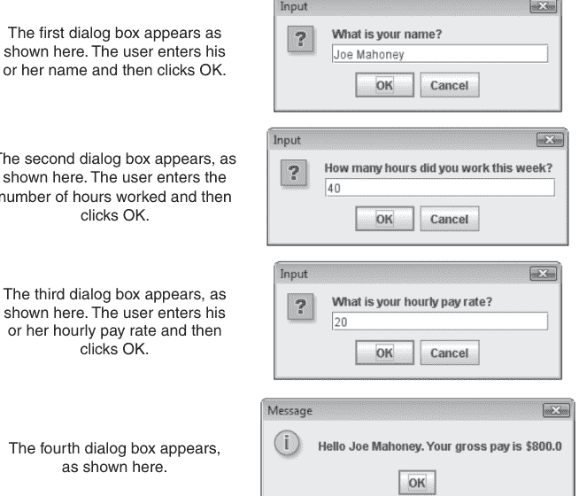

第一个对话框如所示出现。用户输入 `name` 并点击 OK。

第二个对话框如所示出现。用户输入工作小时数并点击 OK。

第三个对话框如所示出现。用户输入薪率并点击 OK。

第四个对话框如所示出现。

# 检查点

2.34 以下类型对话框的目的是什么？

- 消息对话框
- 输入对话框

2.35 编写代码显示图 2-19 所示的每个对话框。

2.36 编写代码显示一个要求用户输入的对话框。将输入值转换为整数并存储在变量 `age` 中。

2.37 使用 `JOptionPane` 类时编写哪条语句？

# 图 2-19 检查点 2.35 的对话框

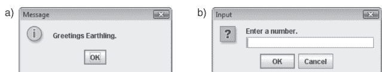

# 2.15 System.out.printf 方法

概念：`System.out.printf` 方法允许以多种方式格式化输出。当你使用 `System.out.println` 或 `System.out.printf` 方法显示数字时，对数字的显示方式几乎没有控制。例如，一个 `double` 类型的值可以显示 15 位小数，如下代码所示：

```
double number = 10.0 / 6.0;
System.out.println(number);
```

此代码将显示：

```
1.6666666666666667
```

通常你希望以特定的方式格式化数字。例如，你可能希望将浮点数格式化为特定的小数，或者插入逗号分隔符使数字更易读。幸运的是，Java 提供了实现这种功能的方法，通过 `System.out.printf` 方法，该方法的通用格式如下：

```
System.out.printf(FormatString, ArgumentList)
```

在通用格式中，`FormatString` 是一个包含文本和/或特殊格式说明符的字符串。`ArgumentList` 是零或多个额外参数列表，它们将根据格式字符串中列出的格式说明符进行格式化。

## 使用 System.out.printf 方法

使用 `System.out.printf` 方法最简单的方法是仅使用格式化字符串，而不包含额外的参数。这是一个示例：

```
System.out.printf("I love Java programming");
```

此示例中的格式化字符串是 "I love Java programming"。该方法没有执行任何特殊的格式化，它仅仅是打印字符串 "I love Java programming"。这样使用该方法与使用 `System.out.print` 完全相同。

在大多数情况下，你会按照以下方式调用 `System.out.printf` 方法：

- 格式化字符串将包含一个或多个说明符（specifiers）。格式说明符是值的占位符，该值将在显示时会被插入字符串中。
- 在格式化字符串之后，将出现一个或多个额外的参数。每个额外参数将对应格式化字符串内部的一个格式说明符。

以下代码展示了一个示例：

```
double sales = 12345.67;
System.out.printf("Our sales are %f for the day.\n", sales);
```

注意此 `System.out.printf` 方法调用的以下特征：

- 在格式化字符串内部，`%f` 是一个格式说明符。字母 `f` 表示在显示时将向字符串插入一个浮点值。
- 在格式化字符串之后，`sales` 变量作为参数传递。该参数对应字符串内部出现的 `%f` 格式说明符。

当 `System.out.printf` 方法执行时，`%f` 不会显示在屏幕上。取而代之的是 `sales` 参数的值。这里是代码的输出结果：

```
Our sales = 12345.670000
```

图 2-20 中的图显示了 `sales` 变量是如何对应 `%f` 格式说明符的。

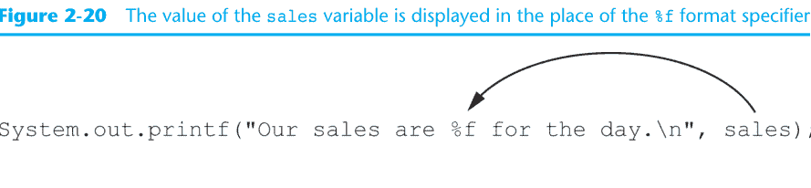

```
System.out.printf("Our sales are %f for the day.\n", sales);
```

这是另一个示例：

```
double temp1 = 72.5, temp2 = 83.7;
System.out.printf("The temperatures are %f and %f degrees.\n", temp1, temp2);
```

首先，注意这个示例在格式化字符串使用了两个 `%f` 格式说明符。还要注意这两个参数出现在格式化字符串之后。第一个参数 `temp1` 的值将打印在第一个 `%f` 的位置，第二个参数 `temp2` 的值将打印在第二个 `%f` 的位置。代码将产生以下输出：

The temperatures are 72.500000 and 83.700000 degrees.

格式说明符与出现在格式化字符串之后的参数之间存在一一的对应关系。图 2-21 中的图显示了格式说明符如何对应格式化字符串后的第一个参数（`temp1` 变量），第二个格式说明符如何对应格式化字符串后的第二个参数（`temp2` 变量）。

图 2-21 格式说明符及其对应的参数

```
System.out.printf("The temperatures are %f and %f degrees.\n", temp1, temp2);
```

以下代码展示了另一个示例：

```
double value1 = 3.0;
double value2 = 6.0;
double value3 = 9.0;
System.out.printf("%f %f %f\n", value1, value2, value3);
```

在 `System.out.printf` 方法调用中，格式化字符串之后有三个格式说明符和三个额外的参数。此代码将产生以下输出：

```
3.000000 6.000000 9.000000
```

图 2-22 中的图显示了格式说明符如何对应出现在格式化字符串之后的参数。

图 2-22 格式说明符及其对应的参数

```
System.out.printf("%f %f %f\n", value1, value2, value3);
```

## 格式说明符

之前的示例演示了如何使用 `%f` 格式说明符格式化浮点数。格式说明符中的字母 `f` 是一个转换字符，表示被格式化参数的数据类型。对于任何为 `float` 或 `double` 类型的参数，你都使用了 `%` 转换字符。

如果你想格式化一个整数值，必须使用 `%d` 格式说明符。转换字符代表十进制整数，它可以用于 `int`、`short` 和 `long` 类型的数据参数。这里有一个显示 `int`的示例：

```
int hours = 40;
System.out.printf("I worked %d hours this week.\n", hours);
```

在此示例中，`%d` 格式说明符对应 `hours` 参数。此代码显示以下内容：

I worked 40 hours this week.

这是一个显示两个 `int` 值的示例：

```
int dogs = 2;
int cats = 4;
System.out.printf("We have %d dogs and %d cats.\n", dogs, cats);
```

此代码将显示以下内容：

We have 2 dogs and 4 cats.

## 语法

格式说明符的语法如下：

```
%[flags][width][.precision]conversion
```

## 精度

你可能在之前的示例中注意到 `%f` 说明符会导致浮点数带有六位小数。你可以更改小数位数，如下示例所示：

```
double temp = 78.4219;
System.out.printf("The temperature is %.2f.\n", temp);
```

注意此示例没有使用普通的 `%f`，而是 `%.2f`。`.2` 出现在 `%` 和 `f` 之间表示精度。它会将数值舍入到两位小数。此代码将产生以下输出：

The temperature is 78.42.

以下示例显示相同的值，保留一位小数：

```
double temp = 78.4219;
System.out.printf("The temperature is %.1f.\n", temp);
```

此代码将产生以下输出：

The temperature is 78.4.

以下代码展示了另一个示例：

```
double value1 = 123.45678;
double value2 = 123.45678;
double value3 = 123.45678;
System.out.printf("%.1f %.2f %.3f\n", value1, value2, value3);
```

在此示例中，`value1` 被舍入到一位小数，`value2` 被舍入到两位小数，`value3` 被舍入到三位小数。此代码将产生以下输出：

123.5 123.46 123.457

## 指定最小字段宽度

格式说明符还可以包含一个最小字段宽度，即显示数值时使用的最小空间数。以下示例在宽度为20空格的字段内打印浮点数：

```
double number = 12345.6789;
System.out.printf("The number is:%20f\n", number);
```

注意 `20` 出现在格式说明符中，位于 `%` 和 `f` 之间。此代码将产生以下输出：

```
The number is:      12345.678900
```

在此示例中，`%f` 说明符内部的 `20` 表示该数字应该在一个至少为20个空格宽的字段中显示。这如图 2-23 所示。

## 图 2-23 数字显示在一个宽度为 20 个空格的字段中

数字是：12345.678900

数字显示在一个宽度为 20 个空格的字段中。

在这种情况下，显示的数字比其所处的字段短。数字 12345.67800 在屏幕上仅占用了 12 个空格，但它被显示在一个宽度为 20 个空格的字段中。在这种情况下，数字将在字段中右对齐。如果一个值太大而无法放入指定的字段，字段将自动扩大以容纳它。下面的示例在一个宽度为 1 个空格的字段中打印一个浮点数：

```java
double number = 12345.6789;
System.out.printf("The number variable is:%f\n", number);
```

然而，该数值需要的超过一个空格，因此字段宽度将扩展以容纳整个数字。这段代码将产生以下结果：

数字是：12345.678900

你可以为整数以及浮点值指定最小字段宽度。下面的示例显示了一个最小字段宽度为六字符的整数：

```java
int number = 200;
System.out.printf("The number is:%d*\n", number);
```

这段代码将显示如下：

数字是：200

## 在同一格式说明符中结合最小字段宽度和精度

在同一个格式说明符中指定浮点数的最小字段宽度和精度时，字段宽度必须先出现，然后是精度。例如，下面的代码显示了一个在宽度为 12 个空格的字段中的数字，并保留两位小数：

```java
double number = 12345.6789;
System.out.printf("The number is:%12.2f\n", number);
```

这段代码将产生以下输出：

数字是：12345.68

当你需要打印列对齐的数字时，字段宽度可以很有帮助。例如，查看代码列表 2-34。每个变量都显示在一个宽度为 8 个空格的字段中，并保留两位小数。数字看起来是列对齐的。

## 代码列表 2-34 (Columns.java)


```java
/**
 * 此程序按列显示各种
 * 浮点数，并使的小数点对齐。
 */
public class Columns {
    public static void main(String[] args) {
        // 声明各种 double 变量。
        double num1 = 127.899;
        double num2 = 3465.148;
        double num3 = 3.776;
        double num4 = 264.821;
        double num5 = 88.081;
        double num6 = 1799.999;

        // 将每个变量显示在
        // 8 个空格的字段中，保留 2 位小数。
        System.out.printf("%8.2f\n", num1);
        System.out.printf("%8.2f\n", num2);
        System.out.printf("%8.2f\n", num3);
        System.out.printf("%8.2f\n", num4);
        System.out.printf("%8.2f\n", num5);
        System.out.printf("%8.2f\n", num6);
    }
}
```

## 程序输出

```
127.90
3465.15
3.78
264.82
88.08
1800.00
```

## 标志

有几个可选标志可以插入到格式说明符中，以便以特定方式格式化值。在书中，我们将标志用于以下目的：

- 显示带有逗号分隔符的数字
- 在数字前填充前导零
- 将数字左对齐

## 2.15 System.out.printf 方法

如果你在格式说明符中使用标志，则必须在字段宽度和精度之前编写标志。

### 逗号分隔符

如果使用带有逗号分隔符显示大数字，它们会更易读。你可以通过在格式说明符中插入逗号（`,`）标志来格式化带有逗号分隔符的数字。这是一个示例：

```java
double amount = 1234567.89;
System.out.printf("%,f\n", amount);
```

这段代码将产生以下输出：

```
1,234,567.890000
```

通常你想要格式化带有逗号分隔符的数字，并将其保留到特定的小数位数。你可以通过在 `%,` 格式说明符中插入逗号后紧跟精度值来实现，如下面的示例所示：

```java
double sales = 28756.89;
System.out.printf("Sales for the month are %,.2f\n", sales);
```

这段代码将产生以下输出：

```
每月销售额为28,756.89
```

代码列表 2-35 展示了如何使用逗号分隔符和两位小数精度将数字格式化为货币金额。

## 代码列表 2-35 (CurrencyFormat.java)

```java
/*
 * 此程序演示了如何使用 System.out.printf
 * 方法将数字格式化为货币。
 */
public class CurrencyFormat {
    public static void main(String[] args) {
        double monthlyPay = 5000.0;
        double annualPay = monthlyPay * 12;
        System.out.printf("Your annual pay is $%,.2f\n", annualPay);
    }
}
```

## 程序输出

```
年薪为60,000.00
```

下面的示例显示了一个带有逗号分隔符的浮点数，宽度为 15 个空格的字段中，并保留两位小数：

```java
double amount = 1234567.8901;
System.out.printf("%,15.2f\n", amount);
```

这段代码将产生以下结果：

```
1,234,567.89
```

下面的示例显示了一个最小字段宽度为六字符的整数：

```java
int number = 200;
System.out.printf("The number is:%6d\n", number);
```

下面的示例显示了一个带有逗号分隔符的整数：

```java
int number = 200;
System.out.printf("The number is:%,6d\n", number);
```

下面的示例显示了一个最小字段宽度为十的整数：

有时，当数字比显示的字段短时，你希望在数字前填充前导零。如果你在格式说明符中插入 `0` 标志，生成的数字将填充前导零。下面的示例显示：

```java
int number = 200;
System.out.printf("The number is:%06d\n", number);
```

输出：

```
000200
```

### 左对齐输出

默认情况下，值在其字段内右对齐。你可以使用减号标志（`-`）将值在字段内左对齐。以下代码演示了：

```java
String name = "George";
String name2 = "Franklin";
String name3 = "Jay";
String name4 = "Ozzy";
String name5 = "Carmine";
String name6 = "Dee";
System.out.printf("%-10s%-10s\n", name, name2);
System.out.printf("%-10s%-10s\n", name3, name4);
System.out.printf("%-10s%-10s\n", name5, name6);
```

以下是代码的输出：

```
George    Franklin
Jay       Ozzy
Carmine   Dee
```

下面的示例展示了你如何打印不同数据类型的参数：

```java
int hours = 40;
double pay = hours * 25;
String name = "Jay";
System.out.printf("Name: %s, Hours: %d, Pay: $%,.2f\n", name, hours, pay);
```

在这个例中，我们显示了一个 `String`、一个 `int` 和一个 `double`。代码将产生以下输出：

```
Name: Jay, Hours: 40, Pay: $1,000.00
```

> 注意：我们在本节中显示的格式化说明符是基础性的。Java 提供了更多强大的格式化说明符以满足更复杂的格式需求。API 文档提供了它们的所有概述。

## 第 2 章 Java 基础

## 检查点

2.38 假设存在以下变量声明：

```java
double number = 1234567.456;
```

编写一个使用 `System.out.printf` 的语句，以如下格式显示 `number` 变量的值：

```
1,234,567.46
```

2.39 假设程序中存在以下变量声明：

```java
double number = 123.456;
```

编写一个使用 `System.out.printf` 的语句，将变量的值保留一位小数，显示在一个宽度为 10 个空格的字段中。（不要使用逗号分隔符。）

2.40 假设程序中存在以下变量声明：

```java
double number = 123.456;
```

编写一个使用 `System.out.printf` 的语句，在变量值前面填充前导零，显示在一个宽度为 8 个空格的字段中，并保留一位小数。（不要使用逗号分隔符。）

2.41 假设程序中存在以下变量声明：

```java
int number = 1234567;
```

编写一个使用 `System.out.printf` 的语句，在一个宽度为 10 个空格的字段中显示变量的值，并带有逗号分隔符。

2.42 假设程序中存在以下变量声明：

```java
double number = 1234567.789;
```

编写一个使用 `System.out.printf` 的语句，将变量值左对齐并带有逗号分隔符，显示在一个宽度为 20 个空格的字段中，并保留两位小数。

2.43 假设程序中存在以下变量声明：

```java
String name = "James";
```

编写一个使用 `System.out.printf` 的语句，在一个宽度为 20 个空格的字段中显示 `name` 的值。

## 需避免的常见错误

以下列表描述了学习本章主题时常见的几种错误。

- 括号、引号或圆括号不匹配。在本章中，你看到构成类定义的语句被包含在一组大括号中。此外，你看到方法中的语句也包含在一组大括号中。对于每一个左大括号，在正确的位置都必须有一个右大括号。对于封装字符串字面量的双引号和封装字符字面量的单引号，也是如此。此外，在使用圆括号的语句（如数学表达式）中，你必须为每一个左圆括号配有一个右圆括号。
- 关键字拼写错误。Java 不识别拼写错误的关键字。
- 在关键字中使用大写字母。记住 Java 是一种区分大小写的语言，所有关键字都应该是小写的。关键字中的大写字母等同于拼写错误的关键字。
- 将关键字用作名称。关键字被保留作特殊用途；它们不能用于任何其他用途。
- 变量名拼写不一致。每当你使用变量名时，其拼写必须与出现的形式的一致。
- 注释错误。多行注释以 `*/` 结束。忘记放置这些或交换了 `*` 和 `/` 会导致……
- 在使用 `Scanner` 的程序中忘记使用正确的 `import` 语句。为了让程序可以使用 `Scanner`，文件顶部必须有 `import java.util.Scanner;`。为了让程序可以使用 `JOptionPane`，文件顶部必须有 `import javax.swing.JOptionPane;`。当使用输入对话框读取数值输入时，`showInputDialog` 方法始终返回用户的字符串。如果用户输入数值，必须将其转换为数字才能在数学语句中使用。

## 多选题与判断题

1. 下哪项是访问修饰符？
   a. javac
   b. class
   c. public
   d. void

2. 以下数据
   ```
   72
   'A'
   "Hello World"
   2.8712
   ```
   都是 ____ 的示例。
   a. 变量
   b. 字面量
   c. 字符串
   d. 以上均不是

3. 语句组（如类或方法的内容）被包含在
   a. 大括号 `{}`
   b. 圆括号 `()`
   c. 中括号 `[]`
   d. 以上任意一种

4. 以下哪个转义序列表示退格？
   a. `\\`
   b. `\b`
   c. `\n`
   d. `\r`

5. 以下哪些不是有效的 `println` 语句？（选出所有适用）。
   a. `System.out.println + "Hello World";`
   b. `System.out.println("Have a nice day");`
   c. `System.out.println(value);`
   d. `printlnout(Programming is great fun);`

6. 合法的变量名是
   a. `monthOfYear`
   b. `doubleObject`
   c. `data#`
   d. `last day`

7. 这个关键字用于声明一个命名常量。
   a. constant
   b. namedConstant
   c. final
   d. concrete

8. 下列哪项不是基本数据类型？
   a. String
   b. int
   c. float
   d. boolean

9. 这些字符标记了单行注释的开始。
   a. `//`
   b. `/*`
   c. `*/`
   d. `/**`

10. 这些字符标记了文档注释的开始。
    a. `//`
    b. `/*`
    c. `*/`
    d. `/**`

11. 你使用 `Scanner` 类的哪个方法来读取字符串作为输入？
    a. nextString
    b. nextLine
    c. readString
    d. getLine

12. 下列语句中哪一个会产生错误？
    a. `int x = 10;`
    b. `boolean b = true;`
    c. `char c = 'x';`
    d. `float f = 5.0;`

13. 你可以使用此类来显示对话框。
    a. JOptionPane
    b. BufferedReader
    c. InputStreamReader
    d. DialogBox

14. 当 Java 将低级别值转换为高级别类型时，这被称为
    a. 4-位转换
    b. 升级转换
    c. 宽转换
    d. 窄转换

15. 正确或错误：Java 程序中的左大括号在程序后面总是有一个右大括号。

16. 正确或错误：Java 是一种强类型语言。

17. 正确或错误：在一个 Java 文件中，你可以有多个非嵌套的公共类。

18. 正确或错误：你不能更改使用 `final` 关键字声明的变量的值。

19. 正确或错误：布尔型变量可能持有 0 或 1。

20. 正确或错误：如果操作符的一个操作数是 `double` 而另一个操作数是 `int`，Java 将自动将 `double` 转换为 `int`。

## 预测输出

以下代码段将在屏幕上打印什么？

## 找错误

以下程序中有很多语法错误。请尽可能多地找出它们。

```java
/*
 * 这个程序有什么问题？
 */
public class MyProgram {
    public static void main(String[] args) {
        int a, b, c; // integers
        a = 3;
        b = 4;
        c = a + b;
        System.out.println("The value of c is " + c);
    }
}
```

## 算法工作台

1. 声明一个布尔变量并将其初始化为值 `false`。同样，声明一个名为 `letter` 的字符变量，并将字母 A 赋值给该字符变量。

## 复习题与练习

1. 声明变量 `hour`、`minute` 和 `second`，并将它们初始化为值 10、30 和 6。将结果显示为 10:30:6。

2. 编写赋值语句对变量 `a`、`b` 和 `c` 执行以下操作。
   a. 将 a 加 2 的结果存储在 b 中
   b. 将 b 乘以 4 的结果存储在 a 中
   c. 将 a 除以 3.14 的结果存储在 b 中
   d. 将 b 减 8 的结果存储在 a 中
   e. 将字符 'K' 存储在 c 中
   f. 将 'B' 的 Unicode 编码存储在 c 中

3. 假设结果 `w`、`x`、`y` 和 `z` 都是整数，且 `w=5`、`x=4`、`y=8`、`z=2`。每个述语句将存储什么值？
   a. `result = x + y;`
   b. `result = z * 2;`
   c. `result = y / x;`
   d. `result = y - z;`
   e. `result = w & 2;`

4. 以下数字如何用 E 表示法表示？
   a. 3.287 x 10^6
   b. -9.7865 x 10⁻¹²
   c. 7.65491 x 10⁻³

5. 修改以下程序，使其在每行文本之间打印两个空行。

```java
public class Test {
    public static void main(String[] args) {
        System.out.print("This is line 1.");
        System.out.print("This is line 2.");
        System.out.print("This is line 3.");
        System.out.print("This is line 4.");
    }
}
```


## 第2章 Java 基础

### 编程挑战

#### 7. 以下代码将输出什么？

```java
int apples = 0, bananas = 2, pears = 10;
apples += 10;
bananas *= 10;
pears /= 10;
System.out.println(apples + " " + bananas + " " + pears);
```

#### 8. 以下代码将输出什么？

```java
double d = 12.9;
int i = (int)d;
System.out.println(i);
```

#### 9. 以下代码将输出什么？

```java
String message = "Have a great day!";
System.out.println(message.charAt(5));
```

#### 10. 以下代码将输出什么？

```java
String message = "Have a great day!";
System.out.println(message.toUpperCase());
System.out.println(message);
```

#### 11. 将以下伪代码转换为 Java 代码。请确保定义了相应的变量。

将 20 赋值给 `speed`。
将 10 赋值给 `time`。
将 `speed` 乘以 `time` 的结果存储在 `distance` 中。
显示 `distance`。

#### 12. 将以下伪代码转换为 Java 代码。确保定义相应的变量。

将 172.5 赋值给 `force`。
将 27.5 赋值给 `area`。
将 `area` 除以 `force` 的结果存储在 `pressure` 中。
显示 `pressure`。

#### 13. 编写代码设置读取输入所需对象。然后编写一个对话框让用户输入年收入（`double` 变量）。

#### 14. 编写代码让用户输入半径（`double` 变量），并计算面积。

#### 15. 编写代码显示带逗号分隔符的浮点数 6543.67，保留两位小数。

### 简答

1. 以下注释是单行注释还是多行注释？
   `/* 程序由 M. A 编写。 */`

2. 以下注释是单行注释还是多行注释？
   `// 程序由 M. A 编写。`

3. 描述什么是宽转换和窄转换。

4. 什么是“区分大小写”？程序员知道 Java 区分大小写为什么很重要？

### 编程挑战

5. 简要解释 `print` 和 `println` 方法分别是如何与 `System` 类和 `out` 对象相关的。

6. 标识符必须遵循哪些规则？

7. `out` 对象的 `print()` 和 `println()` 方法有什么区别？

8. 选择变量的数据类型时必须考虑哪些因素？

9. 描述变量赋值与初始化的区别。

10. `//` 开头的注释与 `/*` 开头的注释有什么区别？

11. 描述什么是良好的编程风格。为什么风格应该保持一致？

12. 假设程序使用常量 `PI` 表示值 3.14。程序在多个语句中使用该常量。与在每个语句中使用 3.14 相比，使用常量有什么好处？

13. 假设 `SalesAverage.java` 是包含文档注释的 Java 源文件。假设你在源文件所在目录，在命令行输入什么命令来生成 HTML 文档？

14. 一个表达式将一个 `byte` 变量和一个 `short` 变量相加。结果将是什么数据类型？

---

## 编程挑战

### 1. 姓名、年龄和年收入

编写一个程序声明以下内容：

- 名为 `name` 的 `String` 变量
- 名为 `age` 的 `int` 变量
- 名为 `annualPay` 的 `double` 变量

将你的年龄、姓名和期望年收入作为字面量存储在这些变量中。程序在屏幕上显示这些值，格式类似于：

> My name is Joe Mahoney, my age is 26 and I hope to earn $100000.0 per year.

### 2. 姓名和字母

编写一个程序，拥有以下 `String` 变量：`firstName`、`middleName` 和 `lastName`。用你的姓名初始化。程序还应拥有以下 `char` 变量：`firstInitial`、`middleInitial` 和 `lastInitial`。将你的姓名字母存储在这些变量中。程序在屏幕上显示这些变量的内容。

### 3. 个人信息

编写一个程序显示以下信息，每行一个：

- 你的姓名
- 你的地址，包括城市、州和邮政编码
- 你的电话号码
- 你的大学专业

虽然这些项目应该在不同的输出行中显示，但在你的程序中仅使用单个语句。

### 4. 星号图案

编写一个程序显示以下图案：

```
*
***
****
******
***
*
```

### 5. 饼干热量

一袋饼干内有 40 块饼干。袋上的热量信息声称袋内有 10 份，每份等于 300 卡路里。编写一个程序，让用户输入实际吃的饼干数量，然后报告消耗的热量。

### 6. 销售预测

东海岸部门占总销售额的 65%。根据该百分比，编写一个程序，如果公司今年有 830 万销售额，预测东海岸部门将产生多少。
> **提示**：使用值 0.65 表示 65%。

### 7. 土地计算

一英亩土地等于 43,560 平英尺。编写一个程序计算面积为 389,767 平英尺的土地的英亩数。
> **提示**：将土地面积除以一英亩的大小得到英亩数。

### 8. 销售税

编写一个程序，让用户输入购买金额并计算税。假设州税为 5.5%，县税为 2%。程序应显示购买金额、州税、县税以及总销售额（购买金额加上税总和）。
> **提示**：使用值 0.02 表示 2%，0.055 表示 5.5%。

### 9. 每加仑里程

汽车的每加仑里程（MPG）可以通过以下公式计算：

```
MPG = 行驶里程 / 使用的汽油量
```

编写一个程序，让用户输入行驶里程和消耗的汽油量。应计算汽车的 MPG 并显示结果。

### 10. 测试平均分

编写一个程序，让用户输入三个分数。程序应显示每个分数以及平均分。

### 11. 男女百分比

编写一个程序，让用户输入班级中的男性和女性人数。程序应显示班级中男性和女性的百分比。
> **提示**：假设班级有 8 名男性和 12 名女性。男性百分比计算为 8 ÷ 20 = 0.4，即 40%。女性百分比计算为 12 ÷ 20 = 0.6，即 60%。

### 12. 字符串处理

编写一个程序，让用户输入喜欢的城市名称。使用 `String` 变量存储。程序应显示：
- 城市名称的字符数
- 全大写的城市名称
- 全小写的城市名称
- 城市名称的第一个字母

### 13. 餐厅账单

编写一个程序计算餐厅账单的税费和小费。程序应让用户输入金额。税应为金额的 7.5%。在屏幕上显示金额、税费、小费。

### 14. 股票佣金

Kathryn 购买了 1000 股股票，价格每股 $25.50。她必须向经纪支付 2% 的佣金。编写一个程序计算并显示：
- 股票金额（不含佣金）
- 佣金金额
- 总支付金额（加上佣金）

### 15. 配料调整

饼干配方需要以下原料：
- 1.5 杯糖
- 1 杯黄油
- 2.75 杯面粉

该配方可以生产 48 个饼干。编写一个程序，询问用户想要制作多少饼干，然后显示指定数量饼干所需的每种原料。

### 16. 能量饮料消耗

某饮料公司最近调查了 15,000 名客户，发现大约 18% 的人每周购买一杯以上的能量饮料。在购买能量饮料的人中，约有 58% 喜欢柑橘味。编写一个程序显示：
- 每周购买能量饮料的近似人数
- 喜欢柑橘味能量饮料的近似人数

### 17. 文字游戏

编写一个程序与用户玩文字游戏。程序应要求用户输入：
- 他的名字
- 他的年龄
- 城市名称
- 大学名称
- 职业
- 动物类型
- 宠物名称

在用户输入这些内容后，程序应显示：
> 有一个名叫 NAME 的人住在 CITY。AGE 年岁时，NAME 去了 COLLEGE。NAME 的职业是 PROFESSION。然后，NAME 养了一只名叫 PET 的 ANIMAL。

### 18. 股票交易

上个月 Joe 购买了 Acme 的股票。详情如下：
- Joe 购买了 1000 股。
- 购买时每股 $32.87。
- 他向经纪支付了金额 2% 的佣金。

两周后，Joe 卖了一些股票。详情如下：
- Joe 卖出了 1000 股。
- 他以每股 $33.92 的价格卖出股票。
- 他向经纪又支付了金额 2% 的佣金。

编写一个程序显示：
- Joe 购买股票时的金额
- 他购买时给经纪的佣金
- 他卖出股票的金额
- 他出售时给经纪的佣金
- Joe 在出售股票并支付两笔佣金后获得的利润。（如果程序显示的利润金额为负数，则 Joe 在该交易中亏损了。）

---

# 第 3 章 类与对象的初探

## 话题

- 3.1 类
- 3.2 关于参数传递更多
- 3.3 实例字段和方法
- 3.4 构造函数
- 3.5 BankAccount 类
- 3.6 类、变量和作用域
- 3.7 包和导入语句
- 3.8 关注面向对象的设计：寻找类及其职责
- 3.9 需要避免的常见错误

## 3.1 类

> **概念**：类是对象的蓝图。它规定了特定类型对象所拥有的属性和方法。从类可以创建一个或多个对象。

你开过汽车吗？如果是，你就知道汽车是由许多组件组成的。汽车有方向盘、油门踏板、刹车踏板、换挡杆、速度表以及驾驶员交互的许多其他细节。引擎盖下还有许多组件，如发动机、电池、散热器等。汽车不仅仅是一个对象，而是一组共同工作的对象的集合。

同样的概念也适用于计算机编程。今天使用的大多数编程语言都是面向对象的。当你使用像 Java 这样面向对象的语言时，你创建的程序就是对象。在编程中，对象并不是物理设备（如方向盘或刹车踏板）。相反，它是存在于计算机内存中并执行特定任务的软件组件。在软件中，对象具有两种通用能力：

- 对象可以存储数据。存储在对象中的数据通常称为属性或字段。
- 对象可以执行操作。对象可以执行的操作称为方法。

对象在 Java 中非常重要；例如，如果你需要在内存中存储一个字符串，你会使用一个 `String` 对象；如果你需要从键盘读取输入，你会使用一个 `Scanner` 对象。当程序需要特定类型对象的服务时，它会在内存中创建该对象，然后根据需要调用该对象的方法。

### 作为对象的字符串

第 2 章向你介绍了 Java 的基本数据类型：`byte`、`short`、`int`、`long`、`char`、`float`、`double` 和 `boolean`。你使用这些数据类型来创建变量，变量是计算机内存中的存储位置。基本类型之所以被称为“基本”，是因为使用基本类型创建的变量除了存储值外没有内置功能。

第 2 章还向你介绍了 `String` 类，它允许你创建 `String` 对象。除了字符串本身，`String` 对象还有许多可以对字符串执行操作的方法。作为复习，让我们来看其中一个方法。考虑以下语句：

```java
String cityName = "Charleston";
```

对于 Java 程序中出现的每个字符串字面量，内存中都会创建一个 `String` 对象来持有它。该语句中出现的字符串字面量 "Charleston" 声明了一个名为 `cityName` 的变量，该变量引用该 `String` 对象。这意味着 `cityName` 持有 `String` 对象的内存地址。如图 3-1 所示。

**图 3-1** cityName 引用一个 String 对象

| cityName 变量持有地址 | 地址 | String 对象 "Charleston" |
| :--- | :--- | :--- |

假设同一个程序有一个 `int` 变量 `textSize`。看以下语句：

```java
int stringSize = cityName.length();
```

该语句调用字符串的 `length()` 方法，该方法返回字符串的长度。表达式 `cityName.length()` 返回由 `cityName` 引用的字符串的长度。在该语句之后，`stringSize` 变量将包含值 10，即字符串 "Charleston" 的长度。

正如你在第 2 章所看到的，`String` 类除了 `length()` 外还有其他方法。这说明了从类创建的对象与从基本数据类型创建的变量之间的区别。类对象拥有对其数据执行有用操作的方法。然而，基本变量只存储数据而没有方法。在基本类型上执行的任何操作必须写在变量外部的代码中。

### 类与实例

对象非常有用，但它们不会魔法地出现在你的程序中。在程序使用特定类型的对象之前，该对象必须在内存中创建。而在内存中创建对象之前，你必须为该对象准备一个类。

类是描述特定类型对象的代码。它指定了对象可以持有的数据（对象的属性）和对象可以执行的操作（对象的方法）。你可以将类比作一个“蓝图”，可以用它创建特定类型的对象。它的作用与房屋的蓝图类似。蓝图本身不是房子，而是对房屋的详细描述。当我们使用蓝图建造实际的房屋时，我们可以说我们正在建造蓝图所描述的房屋的实例。如果我们愿意，可以从同一蓝图建造几栋完全相同的房子。每栋房子都是蓝图所描述房屋的独立实例。这个思想如图 3-2 所示。

**图 3-2** 蓝图和根据蓝图建造的房屋

# 描述房屋的蓝图

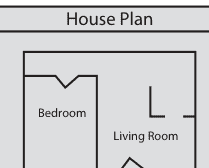

# 蓝图描述的房屋的实例


因此，类不是对象，而是对对象的描述。当程序运行时，它可以使用该类创建任意数量的对象。每个对象都被视为该类的实例。从同一个类创建的所有对象都将具有该类所描述的属性和方法。例如，我们可以从 `String` 类创建几个对象，如下代码所示：

```java
String person = "Jenny";
String pet = "Fido";
String favoriteColor = "Blue";
```

如图 3-3 所示，这段代码在内存中创建了三个字符串对象，它们分别由 `person`、`pet` 和 `favoriteColor` 变量引用。

**图 3-3** 三个变量引用三个 String 对象

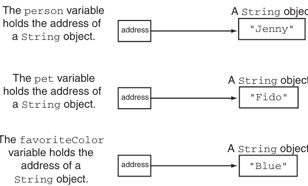

尽管每个 `String` 对象持有不同的数据，但它们在设计上是相同的。例如，我们可以像这里这样调用每个对象的 `length()` 方法。

```java
int stringSize = person.length();
stringSize = pet.length();
stringSize = favoriteColor.length();
```

因为这三个对象都是 `String` 类的实例，所以每个对象都具有 `String` 类指定的属性和方法。

### 逐步构建一个简单的类

在本节中，我们将编写一个名为 `Rectangle` 的类。从该类创建的每个对象都能够持有关于矩形的数据。具体来说，`Rectangle` 对象将具有以下属性：

- `length`：长度属性将持有矩形的长度。
- `width`：宽度属性将持有矩形的宽度。

`Rectangle` 类还具有以下方法：

- `setLength()`
- `setWidth()`
- `getLength()`
- `getWidth()`
- `getArea()`

在设计类时，绘制 UML 图是有帮助的。UML 代表统一建模语言。它提供了一系列标准图，用于图形化描述系统。图 3-4 显示了类的通用布局。注意，该图是一个分为三个部分的框。顶部部分是编写类名的地方。中间部分包含属性列表。底部包含方法列表。

**图 3-4** UML 图的通用布局

| 类名在此处 |
| :--- |
| 属性列在此处 |
| 方法列在此处 |

遵循此布局，图 3-5 显示了我们的 `Rectangle` 类的 UML 图。在本书中我们经常使用 UML 图来说明类。

**图 3-5** Rectangle 类的 UML 图

| Rectangle |
| :--- |
| length<br>width |
| setLength()<br>setWidth()<br>getLength()<br>getWidth()<br>getArea() |

### 编写类代码

现在我们已经确定了希望 `Rectangle` 类拥有的属性和方法，让我们编写 Java 代码。首先，我们使用编辑器创建一个名为 `Rectangle.java` 的文件。在 `Rectangle.java` 文件中，我们将从编写如下的通用类骨架。

```java
public class Rectangle
{
}
```

第一行出现的 `public` 是一个访问修饰符。访问修饰符指示如何访问该类。`public` 访问修饰符表示该类对 `Rectangle.java` 文件外部的代码是公开的。我们在书中编写几乎所有的类都会是 `public` 的。

访问修饰符后面是关键字 `class`，然后是 `Rectangle`，它是类的名称。在下一行出现左大括号，随后是一个右大括号。类的内容（即属性和方法）将写在这些大括号内部。

```
AccessSpecifier class Name
{
  Members
}
```

从泛义上说，属于类的属性和方法被称为类的成员。


### 为类属性编写代码

让我们通过填充某些成员的代码来继续编写矩形类。首先，我们为类的两个属性——长度（`length`）和宽度（`width`）编写代码。我们将使用 `double` 数据类型的变量作为这些属性。新添加的代码如下所示：

```java
public class Rectangle
{
    private double length;
    private double width;
}
```


## 类与对象初探

我们添加的这两行代码声明了变量 `length` 和 `width`。注意，这两个声明都以关键字 `private` 开头，位于数据类型之前。关键字 `private` 是访问修饰符，它表示这些变量**不能**被类外部的语句直接访问。

回想我们在第 1 章关于面向对象编程的讨论，对象可以实现数据隐藏，这意味着对象内部的关键数据受到来自外部代码的保护。在 Java 中，类的 `private` 成员是隐藏的，并且只能通过该类的方法访问。当对象的内部数据对外部代码隐藏，且对数据的访问限制在对象的方法上时，数据就能防止意外的损坏。在面向对象编程中，将类的所有属性都设为 `private` 并通过方法提供访问是一种常见的做法。

在编写类时，我们主要使用 `private` 和 `public` 访问修饰符。表 3-1 总结了这些访问修饰符。

### 表 3-1 类成员的 private 和 public 访问修饰符总结

| 访问修饰符 | 说明 |
|---|---|
| private | 当访问修饰符应用于类成员时，该成员无法被类外部的代码访问。该成员只能由同一类的方法访问。 |
| public | 当 public 访问修饰符应用于类成员时，该成员可以被类内部或外部的代码访问。 |

你可以选择性地为属性初始化一个值。例如，以下语句声明了 `length` 和 `width`，并将它们分别初始化为值 10 和 12：

```java
private double length = 10;
private double width = 12;
```

如果你没有为数值属性提供初始化值，它们将被自动初始化为 0.0。我们将在本章稍后的部分详细讨论默认初始化。

在继续之前，我们引入“字段（field）”这一术语。在 Java 中，字段是持有数据的类成员。在我们的矩形类中，`length` 和 `width` 变量就是字段。

> **提示**：我们将 `length` 和 `width` 同时称为属性和字段。不要让这让你困惑。“属性（attribute）”是一个通用的 OOP 术语，指对象持有的数据项。“字段（field）”是一个 Java 特有的术语，指持有数据的类成员。在 Java 中，你使用字段作为属性。

## 编写 setLength 方法

现在开始编写类方法。我们将从 `setLength` 方法开始。该方法允许类外部的代码在 `length` 字段中存储一个值。代码列表 3-1 显示了处于此阶段的 Rectangle 类。`setLength` 方法位于第 16 到 19 行。（如果你从 www.pearsonglobaleditors.com/gaddis 下载了本书的源码，你将在 Chapter 03\Rectangle Class 1 文件夹中找到此文件。）

### 代码列表 3-1 (Rectangle.java)

```java
/**
  * Rectangle 类，阶段 1
  * 建设中！
  */
public class Rectangle {
  private double length;
  private double width;

  /**
   * setLength 方法接收参数
   * 并存储在 length 字段中。
   */
  public void setLength(double len) {
    length = len;
  }
}
```

在第 11 到 14 行中，我们写了一个块注释，对方法进行了简要描述。始终编写描述类方法的注释是非常重要的，这样将来任何阅读代码的人都能更好地理解它。方法的定义出现在块注释之后，位于第 16 到 19 行。方法定义的第一行出现在第 16 行，被称为**方法头（method header）**。它的形式如下：

```java
public void setLength(double len)
```

方法头包含几个部分。让我们来看每一个部分：

- **关键字 `public`** 是访问修饰符。它表示该方法可以被类外部的语句调用。
- **`void`**。这是方法的返回类型。关键字 `void` 表示该方法不向调用它的语句返回数据。
- **`setLength`**。这是方法的名称。
- **`(double len)`**。这是参数变量的声明。参数变量持有传递给方法的参数的值。参数变量的名字是 `len`，数据类型为 `double`。

### 图 3-6 setLength 方法的方法头

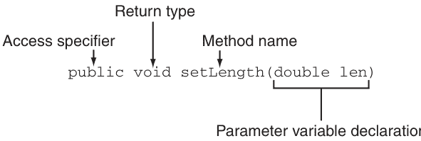

在方法头之后，方法体出现在大括号内：

```java
{
  length = len;
}
```

该方法包含一条语句，将 `len` 的值赋值给 `length` 字段。当方法执行时，`len` 参数变量将持有传递给方法的参数的值。

## 编写 setWidth 方法

既然我们已经看到 `setLength` 方法可以工作，让我们为 `Rectangle` 类添加 `setWidth` 方法。`setWidth` 方法与 `setLength` 类似。它接受一个参数并赋值给 `width` 字段。代码列表 3-3 显示了更新后的 `Rectangle` 类。`setWidth` 方法位于 26 到 29 行。（如果你从 www.pearsonglobaled.com/gaddis 下载了本书源码，你将在 03RectangleClass Phase 2 文件夹中找到该文件。）

### 代码列表 3-3 (Rectangle.java)

```java
/*
 * Rectangle 类，阶段 2
 * 建设中！
 */

public class Rectangle {
  private double length;
  private double width;

  /**
   * setLength 方法接受一个参数
   * 存储在 length 字段中。
   */
  public void setLength(double len) {
    length = len;
  }

  /**
   * setWidth 方法接受一个参数
   * 存储在 width 字段中。
   */
  public void setWidth(double w) {
    width = w;
  }
}
```

`setWidth` 方法有一个名为 `w` 的参数变量。当参数传递给方法时，参数的值被复制到 `w` 变量中。`w` 变量的值被赋值给 `width` 字段。例如，假设 `box` 引用一个 `Rectangle` 对象并执行了以下语句：

```java
box.setWidth(20.0);
```

执行该语句后，`box` 对象的 `width` 字段将被设置为 20.0。

## 编写 getLength 和 getWidth 方法

由于 `length` 和 `width` 字段是私有的（`private`），我们编写了 `setLength` 和 `setWidth` 方法允许 `Rectangle` 类外部的代码在字段中存储值。我们还需要编写允许类外部代码获取存储在字段中的值的方法。这就是 `getLength` 和 `getWidth` 方法的作用。`getLength` 方法将返回存储在 `length` 字段的值，而 `getWidth` 方法将返回存储在 `width` 字段的值。

以下是 `getLength` 方法的代码：

```java
public double getLength() {
    return length;
}
```

注意，头部没有使用 `void`，而是使用 `double` 作为方法的返回类型。这意味着该方法返回一个 `double` 类型的值。

### 代码列表 3-5 (RectangleDemo.java)

```java
public class RectangleDemo {
    public static void main(String[] args) {
        // 创建一个 Rectangle 对象。
        Rectangle box = new Rectangle();

        // 设置长度为 10，宽度为 20。
        box.setLength(10.0);
        box.setWidth(20.0);

        // 显示长度和宽度。
        System.out.println("The box's length is " + box.getLength());
        System.out.println("The box's width is " + box.getWidth());
    }
}
```

**程序输出**
```text
The box's length is 10.0
The box's width is 20.0
```

让我们来看这个程序。首先，该程序创建了一个 `Rectangle` 对象，由 `box` 变量引用。然后执行了第 12 行和 13 行的以下语句：

```java
box.setLength(10.0);
box.setWidth(20.0);
```

在这些语句执行后，`box` 对象的 `length` 字段被设置为 10.0，`width` 字段被设置为 20.0。对象的状态如图 3-11 所示。

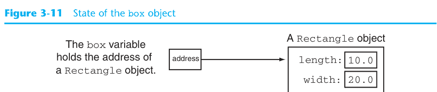

接下来，执行第 14 行和 15 行的以下语句：

```java
System.out.println("The box's length is " + box.getLength());
```

该语句调用了 `box.getLength()` 方法，该方法返回值 10.0。屏幕上显示以下消息：

```text
The box's length is 10.0
```

然后执行第 16 行和 17 行的语句：

```java
System.out.println("The box's width is " + box.getWidth());
```

该语句调用了 `box.getWidth()` 方法，该方法返回值 20.0。屏幕上显示以下消息：

```text
The box's width is 20.0
```

> **提示**：此语句中的括号是必不可少的。将语句写成如下形式会导致错误：
> ```java
> Rectangle box = new Rectangle; // 错误
> ```

第 12 行和 13 行调用 `println` 方法在屏幕上显示消息：
```java
System.out.println("Sending the value 10.0 to " + box.setLength());
```

第 14 行调用对象的方法。正如你之前在字符串示例中所看到的，使用点运算符（`.`）来访问类对象的成员。回想第 2 章，方法调用的通用形式为：

```java
refVariable.method(arguments...)
```

其中 `refVariable` 是引用对象的变量名，`method` 是方法名，`arguments...` 是传递给方法的零或多个参数。参数是传递到方法的值。以下是第 14 行调用 `setLength` 方法的语句：

```java
box.setLength(10.0);
```

该语句将参数 10.0 传递给 `setLength` 方法。当方法执行时，值 10.0 被复制到 `len` 参数变量中。这如图 3-8 所示。

### 图 3-8 用于 len 参数变量的参数 10.0

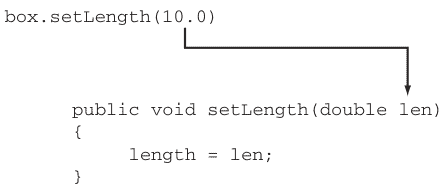

在 `setLength` 方法中，参数 `len` 包含值 10.0。方法将 `len` 的值赋值给 `length` 字段然后结束。图 3-9 显示了方法执行后对象的状态。

### 图 3-9 执行 setLength 方法后 box 对象的状态

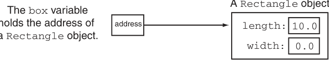

## 向方法传递参数

向方法传递参数时，参数的数据类型必须与参数变量的数据类型兼容。否则将发生错误。例如，`setLength` 中的参数 `len` 是一个 `double` 类型变量。你不能传递无法自动转换为 `double` 类型的参数。因此，以下语句将因为参数是字符串导致错误：

```java
box.setLength("10.0"); // 错误！
```

## 编写 getArea 方法

我们将为 `Rectangle` 类编写的最后一个方法是 `getArea`。该方法返回矩形的面积，即长度乘以宽度的积。以下是 `getArea` 方法的代码：

```java
public double getArea() {
  return length * width;
}
```

该方法返回数学表达式 `length * width` 的结果。例如，假设 `area` 是一个 `double` 变量，`box` 引用一个 `Rectangle` 对象，并执行以下代码：

```java
box.setLength(10.0);
box.setWidth(20.0);
area = box.getArea();
```

最后一条语句将 `getArea` 方法返回的值赋值给该变量。在该语句执行后，该变量将包含 200.0。

代码列表 3-6 显示了包含我们目前为止讨论的所有成员的 `Rectangle` 类。`getArea` 方法出现在第 56 行到第 59 行。（如果你从 www.pearsongaleditions.com/gaddis 下载了该书的代码，你将在 `03RectangleClass Phase 4` 文件夹中找到该文件。）

### 代码列表 3-6 (Rectangle.java)

```java
/*
 * Rectangle 类, 阶段 4
 * 构建中！
 */

public class Rectangle {
  private double length;
  private double width;

  /**
   * setLength 方法接收一个参数
   * 并存储在 length 字段中。
   */
  public void setLength(double len) {
    length = len;
  }

  /**
   * setWidth 方法接收一个参数
   * 并存储在 width 字段中。
   */
  public void setWidth(double w) {
    width = w;
  }

  /**
   * getLength 方法返回存储在
   * length 字段中的值。
   */
  public double getLength() {
    return length;
  }

  /**
   * getWidth 方法返回存储在
   * width 字段中的值。
   */
  public double getWidth() {
    return width;
  }

  /**
   * getArea 方法返回 length
   * 字段乘以 width 字段的值。
   */
  public double getArea() {
    return length * width;
  }
}
```

代码列表 3-7 中的程序演示了 `Rectangle` 类的所有方法，包括 `getArea`。（如果你从 www.pearsonglobaleditions.com/gaddis 下载了该书的源码，你将在 `Chapter 03/Rectangle Class Phase 4` 文件夹中找到它。）

### 代码列表 3-7 (RectangleDemo.java)

```java
/**
 * 该程序演示了 Rectangle 类的
 * setLength, setWidth, getLength, getWidth 以及
 * getArea 方法。
 */
public class RectangleDemo {
    public static void main(String[] args) {
        // 创建一个 Rectangle 对象。
        Rectangle box = new Rectangle();

        // 设置长度为 10，宽度为 20。
        box.setLength(10.0);
        box.setWidth(20.0);

        // 显示长度和宽度。
        System.out.println("The box's length is " + box.getLength());
        System.out.println("The box's width is " + box.getWidth());
        System.out.println("The box's area is " + box.getArea());
    }
}
```


程序输出：
```
The box's length is 10.0
The box's width is 20.0
The box's area is 200.0
```

## 访问器和修改器方法

如前所述，通常将字段设置为私有，并仅通过方法进行访问。获取类值的方法被称为访问器（accessor）。改变值的方法被称为修改器（mutator）。修改器方法有时被称为 `setter`，访问器方法有时被称为 `getter`。

## 数据隐藏的重要性

数据隐藏是面向对象编程中的一个重要概念。通过隐藏数据，你可以确保类按照预期运行。作为一名初学者，你可能会疑惑为什么要隐藏数据。在软件系统中，会有其他程序员使用你的类。

## 避免过期数据

回顾类拥有 `getLength()`、`getWidth()` 和 `getArea()` 方法。`getArea()` 方法返回计算结果。你可能会疑惑为什么矩形的面积没有存储在字段中。当某个项的值取决于其他数据，且该项在数据变化时没有进行更新，则称该项已过期（stale）。如果面积存储在字段中，当长度或宽度变化时，该字段将变得错误。在设计类时，应注意不要在字段中存储计算。相反，提供一个返回计算结果的方法。

# 第3章 类与对象的初探

参数变量及其数据类型可以列在方法的括号内。例如，`Rectangle` 类的 `setLength()` 方法有一个名为 `len` 的 `double` 类型参数，因此在 UML 图中可以如下列出：

```
+ setLength(len : double) : void
```

图 3-13 显示了带有参数和数据类型符号的 `Rectangle` 类 UML 图。

**图 3-13** 带有参数和数据类型符号的 `Rectangle` 类 UML 图。

| Rectangle |
| :--- |
| - len : double |
| - width : double |
| + setLength(len : double) : void |
| + setWidth(w : double) : void |
| + getLength() : double |
| + getWidth() : double |
| + getArea() : double |

# 类成员的布局

注意在 `Rectangle` 类中，首先声明字段变量，然后定义方法。你不需要在方法定义之前编写字段声明。事实上，有些程序员倾向于先写公共方法的定义，再写私有字段的声明。无论你使用哪种方式，都应该保持一致。在本书中，我们总是先写字段声明，然后是方法定义。图 3-14 显示了这种布局。

**图 3-14** 类成员的典型布局。

```
public class className {

  Field declarations

  Method definitions

}
```

# **Checkpoint**

- 3.1 在本章中，我们使用蓝图的比喻来描述类和对象。在这个比喻中，类是蓝图还是房子？
- 3.2 描述一个与原始数据类型不同于对象的变量。
- 3.3 当说一个变量引用一个对象时，变量中实际存储了什么？
- 3.4 字符串字面量（例如 `"Joe"`）会导致创建什么类型的对象？

## 3.2 关于参数传递的更多信息

3.5 查看图 3-15 中的 UML 图并回答问题。
a. 类的名称是什么？
b. 属性有哪些？
c. 方法有哪些？
d. 私有成员有哪些？
e. 公共成员有哪些？

3.6 假设 `l1` 是一个引用图 3-15 所示类实例的变量。写一条调用 `setMake()` 并传递参数 `"Cadillac"` 的语句。

# 图 3-15 UML 图

| Car |
| :--- |
| - make |
| - yearModel |
| + setMake() |
| + setYearModel() |
| + getMake() |
| + getYearModel() |

3.7 关键字 `new` 的作用是什么？

3.8 什么是参数变量？

3.9 什么是访问器（accessor）？什么是修改器（mutator）？

3.10 什么是过时数据项？

**概念**：方法可以有多个参数变量，允许你向方法传递多个参数。当参数传递给方法时，它是按值传递的，这意味着参数变量持有传递给它的值的副本。对参数变量所做的更改不会影响参数。

# 传递多个参数

向方法传递多个参数是有用的。例如，`Rectangle` 类有两个方法用于设置长度字段和宽度字段：`setLength()` 和 `setWidth()`。使用这些方法设置长度和宽度需要两次方法调用。我们可以添加另一个接受两个参数的方法（一个用于长度，一个用于宽度），从而能够通过一次方法调用同时设置长度宽度字段。以下是这样的方法：

```
public void set(double len, double w)
{
    length = len;
    width = w;
}
```

两个参数变量 `len` 和 `w` 在方法头部的括号内声明，用于在我们调用方法时向方法传递两个参数。例如，假设 `box` 引用一个 `Rectangle` 对象并执行了以下语句：

```
box.set(10.0, 20.0);
```

该语句将值 10.0 传递给 `len` 参数，将值 20.0 传递给 `w` 参数，如图 3-16 所示。

**图 3-16** 传递给 `set()` 方法的多个参数。

```
public void set(double len, double w)
{
    length = len;
    width = w;
}
```

注意参数按照它们在方法调用中出现的顺序传递给参数变量。换句话说，第一个参数传递给第一个参数，第二个参数传递给第二个参数。例如，以下方法将 15.0 传递给 `len` 参数，并将 30.0 传递给 `w` 参数：

```
box.set(15.0, 30.0);
```

程序代码列表 3-8 展示了向 `set()` 方法传递两个参数。在程序中，在 `main()` 方法中声明的变量被作为参数传递。（如果你从 www.pearsonglobaleditions.com/gaddis 下载了书的源代码，你将在 Chapter 03 文件夹中找到此文件，以及一个修改版本的 `Rectangle` 类）。

# 代码列表 3-8 (MultipleArgs.java)

```
import java.util.Scanner; // 需要 Scanner

/**
 * 此程序演示了如何向方法传递
 * 多个参数。
 */

public class MultipleArgs
{
   public static void main(String[] args)
   {
       double boxLength, // 用于存储长度
              boxWidth;  // 用于存储宽度

       // 创建 Scanner 对象用于键盘输入。
       Scanner keyboard = new Scanner(System.in);

       // 获取并存储长度的维度。
       System.out.print("What is the length? ");
       boxLength = keyboard.nextDouble();

       // 获取并存储宽度的维度。
       System.out.print("What is the width? ");
       boxWidth = keyboard.nextDouble();

       // 调用 set 方法并传递两个参数。
       box.set(boxLength, boxWidth);

       // 显示长度、宽度和面积。
       System.out.println("The length is " + boxLength);
       System.out.println("The width is " + boxWidth);
       System.out.println("The area is " + box.getArea());
   }
}
```


# 第 3 章 类与对象的初探

## 3.3 实例字段和方法

注意参数按照它们在方法调用中出现的顺序传递给参数变量。换句话说，第一个参数传递给第一个参数，第二个参数传递给第二个参数。例如，以下方法将 `15.0` 传递给 `len` 参数，并将 `30.0` 传递给 `w` 参数：

```java
box.set(15.0, 30.0);
```

程序代码列表 3-8 展示了向 `set` 方法传递两个参数。在程序中，在 `main` 方法中声明的变量被作为参数传递。（如果你从 www.pearsonglobaleditions.com/gaddis 下载了书的源代码，你将在 Chapter 03 文件夹中找到此文件，以及一个修改版本的 `Rectangle` 类）。

### 代码列表 3-8 (MultipleArgs.java)

```java
1 import java.util.Scanner; // 需要 Scanner
2
3 /**
4  * 此程序演示了如何向方法传递
5  * 多个参数。
6  */
7
8 public class MultipleArgs
9 {
10    public static void main(String[] args)
11    {
12        double boxLength, // 用于存储长度
13               boxWidth; // 用于存储宽度
14
15        // 创建 Scanner 对象用于键盘输入。
16        Scanner keyboard = new Scanner(System.in);
17
18        // 获取并存储长度的维度。
19        System.out.print("What is the length? ");
20        boxLength = keyboard.nextDouble();
21
22        // 获取并存储宽度的维度。
23        System.out.print("What is the width? ");
24        boxWidth = keyboard.nextDouble();
25
26        // 调用 set 方法并传递两个参数。
27        box.set(boxLength, boxWidth);
28
29        // 显示长度、宽度和面积。
30        System.out.println("The length is " + boxLength);
31        System.out.println("The width is " + boxWidth);
32        System.out.println("The area is " + box.getArea());
33    }
34 }
```

// 获取并存储卧室的尺寸。
```java
System.out.print("What is the bedroom's length?");
number = keyboard.nextDouble();
bedroom.setLength(number);
System.out.print("What is the bedroom's width?");
number = keyboard.nextDouble();
bedroom.setWidth(number);
```

// 获取并存储书房的尺寸。
```java
System.out.print("What is the den's length?");
number = keyboard.nextDouble();
den.setLength(number);
System.out.print("What is the den's width?");
number = keyboard.nextDouble();
den.setWidth(number);
```

// 计算所有房间的总面积。
```java
totalArea = kitchen.getArea() + bedroom.getArea()
+ den.getArea();
```

// 显示房间的总面积。
```java
System.out.println("The total area of the rooms is " + totalArea);
```

### 程序输出，示例输入已用粗体显示

厨房的长度是多少？ **10** [回车]
厨房的宽度是多少？ **14** [回车]
卧室的长度是多少？ **15** [回车]
卧室的宽度是多少？ **12** [回车]
书房的长度是多少？ **20** [回车]
书房的宽度是多少？ **30** [回车]
房间的总面积是 920.0

在程序中，第 19 到 21 行的代码创建了三个对象，它们是 `Rectangle` 类的实例：

```java
Rectangle kitchen = new Rectangle();
Rectangle bedroom = new Rectangle();
Rectangle den = new Rectangle();
```

图 3-17 展示了厨房、卧室、书房以及变量是如何引用对象的。

在程序的示例会话中，用户输入 10 和 14 作为厨房的长度和宽度，输入 15 和 12 作为卧室的长度和宽度，输入 20 和 30 作为书房的长度和宽度。图 3-18 显示了在这些值存储后对象的状态。

#### 图 3-17 厨房、卧室和书房变量引用的 Rectangle 对象

kitchen 变量持有一个 Rectangle 对象的地址。

```text
A Rectangle object
length: 0.0
width: 0.0
```

bedroom 变量持有一个 Rectangle 对象的地址。

```text
A Rectangle object
length: 0.0
width: 0.0
```

den 变量持有一个 Rectangle 对象的地址。

```text
A Rectangle object
length: 0.0
width: 0.0
```

#### 图 3-18 数据存储后对象的状态

kitchen 变量持有一个 Rectangle 对象的地址。

```text
A Rectangle object
length: 10.0
width: 14.0
```

bedroom 变量持有一个 Rectangle 对象的地址。

```text
A Rectangle object
length: 15.0
width: 12.0
```

den 变量持有一个 Rectangle 对象的地址。

```text
A Rectangle object
length: 20.0
width: 30.0
```

从图 3-17 可以看出，`Rectangle` 类的每个实例都有它们自己的长度和宽度。因此，这些变量被称为实例变量或实例字段。类的每个实例都有自己的一组实例字段，并可以在这些字段中存储自己的值。

在类实例上操作的方法被称为实例方法。`Rectangle` 类中的所有方法都是实例方法，因为它们对类的特定实例执行操作。例如，查看 `RoomsAreas.java` 程序中的第 26 行：

```java
kitchen.setLength(number);
```

该语句调用了 `setLength` 方法，该方法在 `kitchen` 对象的长度字段中存储一个值。现在看同一程序的第 34 行。

```java
bedroom.setLength(number);
```

该语句也调用了 `setLength` 方法，但这次将值存储在 `bedroom` 对象的长度字段中。同样，第 42 行调用了 `setLength` 方法在书房的长度字段中存储一个值：

```java
den.setLength(number);
```

`setLength` 方法在 `Rectangle` 类的特定实例中存储值。对于 `Rectangle` 类中的所有成员方法都是如此。

### 检查点

假设 `r1` 和 `r2` 是引用 `Rectangle` 对象的变量，并执行以下语句：

```java
r1.setLength(5.0);
r2.setLength(10.0);
r1.setWidth(20.0);
r2.setWidth(15.0);
```

填充图 3-19 中的框，以代表每个对象的长度和宽度字段。

#### 图 3-19 填充每个字段的框框

| A Rectangle object |
| :--- |
| length: |
| width: |
| r1 address |
| A Rectangle object |
| length: |
| width: |
| r2 address |

## 3.4 构造函数

> **概念：** 构造函数是在创建对象时被自动调用的方法。

构造函数是在类的实例创建时被自动调用的方法。构造函数通常执行初始化或设置操作，例如在实例字段中存储初始值。

```java
15
16      // 声明 Rectangle 变量以引用
17      // 厨房、卧室和书房的对象。
18      Rectangle kitchen, bedroom, den;
19
20      // 创建一个用于键盘输入的 Scanner 对象。
21      Scanner keyboard = new Scanner(System.in);
22
23      // 获取并存储厨房的尺寸。
24      System.out.print("厨房的长度是多少? ");
25      roomLength = keyboard.nextDouble();
26      System.out.print("厨房的宽度是多少? ");
27      roomWidth = keyboard.nextDouble();
28      kitchen = new Rectangle(roomLength, roomWidth);
29
30      // 获取并存储卧室的尺寸。
31      System.out.print("卧室的长度是多少? ");
32      roomLength = keyboard.nextDouble();
33      System.out.print("卧室的宽度是多少? ");
34      roomWidth = keyboard.nextDouble();
35      bedroom = new Rectangle(roomLength, roomWidth);
36
37      // 获取并存储书房的尺寸。
38      System.out.print("书房的长度是多少? ");
39      roomLength = keyboard.nextDouble();
40      System.out.print("书房的宽度是多少? ");
41      roomWidth = keyboard.nextDouble();
42      den = new Rectangle(roomLength, roomWidth);
43
44      // 计算所有房间的总面积。
45      totalArea = kitchen.getArea() + bedroom.getArea()
46                               + den.getArea();
47
48      // 显示所有房间的总面积。
49      System.out.println("房间的总面积为 "
50                                 + totalArea);
51
52      }
```

### 带有示例输入的程序输出（部分内容加粗显示）

厨房的长度是多少? 10 [回车]
厨房的宽度是多少? 14 [回车]
卧室的长度是多少? 15 [回车]
卧室的宽度是多少? 20 [回车]
书房的长度是多少? 12 [回车]
书房的宽度是多少? 30 [回车]
房间的总面积为 920.0。

在程序中，第 18 行的以下语句声明了 `kitchen`、`bedroom` 和 `den` `Rectangle` 变量：

```java
Rectangle kitchen, bedroom, den;
```

然而，这些变量尚未引用 `Rectangle` 类的实例。由于这些变量还没有持有对象的地址，因此它们是未初始化的引用变量。在引用对象之前，无法使用这些变量。出现在第 28 行的以下语句创建了一个 `Rectangle` 对象，将 `roomLength` 和 `roomWidth` 变量作为参数传递给构造函数，并将对象的地址赋值给 `kitchen` 变量。

```java
kitchen = new Rectangle(roomLength, roomWidth);
```

执行该语句后，`kitchen` 变量将引用该对象。后面也出现了类似的语句，使得 `bedroom` 和 `den` 变量引用对象。

### 默认构造函数

当对象被创建时，它的构造函数总是会被调用。但如果我们没有在对象的类中写构造函数呢？如果你没有在类中写构造函数，Java 在类编译时会自动提供一个。默认构造函数不接受参数。它将类中的所有数值字段设置为 0，布尔（`boolean`）字段设置为 `false`，字符（`char`）字段设置为 Unicode 值 0。如果对象具有作为引用变量的字段，默认构造函数会将它们设为特殊值 `null`，这意味着它们不引用任何内容。

Java 提供默认构造函数的唯一情况是你没有为类编写自己的构造函数。例如，在本章的开始部分，我们开发了 `Rectangle` 类，但没有为它编写构造函数。当我们编译该类时，编译器生成了一个默认构造函数，将长度和宽度字段都设置为 `0.0`。假设以下代码使用该版本来创建 `Rectangle` 对象：

```java
// Rectangle 类没有构造函数。
Rectangle r = new Rectangle(); // 调用默认构造函数
```

稍后，我们向该类中添加了我们自己的构造函数。该构造函数为长度和宽度字段添加了参数。当我们从那个时候编译该类时，Java 不再提供默认构造函数。我们编写的这个构造函数成为了该类唯一的构造函数。当我们使用该版本的类创建 `Rectangle` 对象时，必须向构造函数传递长度和宽度参数。使用该版本的类，以下语句将导致错误，因为我们没有为构造函数提供参数。

```java
// 现在我们为 Rectangle 类写了自己的构造函数。
Rectangle box = new Rectangle(); // 错误！现在必须传递参数。
```

由于我们添加了自己的需要两个参数的构造函数，该类不再拥有默认构造函数。

### 无参数构造函数

不接受参数的构造函数被称为无参数构造函数（no-arg constructor）。默认构造函数不接受参数，因此被视为无参数构造函数。此外，你可以编写自己的无参数构造函数。例如，假设为 `Rectangle` 类写了以下构造函数：

```java
public Rectangle() {
    length = 1.0;
    width = 1.0;
}
```

如果我们在类中使用这个构造函数，在创建对象时就不会传递任何参数。以下代码展示了一个示例：

```java
// 现在我们为 Rectangle 类写了自己的构造函数。
Rectangle r = new Rectangle(); // 调用默认构造函数
```

### 在 UML 图中显示构造函数

在 UML 图中显示构造函数的方法有多种。在书中，我们简单地将构造函数显示为与其他任何方法一样，只是不列出返回类型。图 3-20 显示了一个示例：

| Rectangle |
| :--- |
| length : double |
| width : double |
| Rectangle(len : double, w : double) |
| ++ getArea() : double |

### String 构造函数

你通过简单的声明语句创建原始变量，并通过 `new` 操作符创建对象。然而，有一个类可以在没有运算符的情况下实例化：`String` 类。字符串字面量非常常见，Java 允许你像创建原始变量一样创建字符串：

```java
String name = "John";
```

该语句在内存中创建了一个 `String` 对象，并用字面量 `"John"` 初始化。该对象由变量 `name` 引用。如果你愿意，可以使用 `new` 操作符创建一个 `String` 对象并通过传递字面量来初始化它，如下：

```java
String name = new String("John");
```

> 注意：`String` 对象是 Java 中的一个特殊情况。由于它们非常常用，Java 为 `String` 对象提供了许多快捷操作，这些操作对于其他类型的对象是不可能的。除了使用运算符创建 `String` 对象外，你还可以使用 `=` 给字符串赋值，使用 `+` 拼接字符串等等。第 9 章讨论了若干 `String` 方法。

### 检查点

- 3.12 构造函数是如何命名的？
- 3.13 构造函数的返回类型是什么？
- 3.14 假设以下是构造函数，出现在此类中：

```java
BankAccount(int number)
{
    item = number;
}
```

a. 该构造函数所在的类名是什么？
b. 从该类创建一个对象并将值 25 作为参数传递给构造函数的语句。

## 3.5 ABankAccount 类


# 第 3 章 类与对象的初探

## 3.5 BankAccount 类

上一节讨论的矩形允许你创建描述矩形的对象。现在我们将查看一个基于实体对象的类：银行账户。从该类创建的对象将模拟银行账户，允许执行存款、取款、计算和添加利息以及获取当前余额等操作。

### ABankAccount 类 UML 图

| BankAccount |
| :--- |
| - balance : double |
| - interestRate : double |
| - interest : double |
| + BankAccount(startBalance : double, intRate : double) |
| + deposit(amount : double) : void |
| + withdraw(amount : double) : void |
| + addInterest() : void |
| + getBalance() : double |
| + getInterest() : double |

以下是 `BankAccount` 类字段的摘要：

- `balance` 是一个持有账户余额的 `double` 类型字段。
- `interestRate` 是一个持有账户每月利率的 `double` 类型字段。月利率是年利率除以 12。例如，如果年利率为 3%，则月利率为 0.25%。我们将把此值作为 `0.0025` 存储在 `interestRate` 字段中。
- `interest` 是一个 `double` 类型，用于存储账户赚取的利息金额。

该类方法的摘要：

- 构造函数有两个变量：`startBalance` 和 `intRate`。两个参数都是 `double` 类型。当构造函数执行时，账户余额被传递给 `startBalance` 参数，账户的月利率被传递给 `intRate` 参数。构造函数将 `startBalance` 赋值给 `balance` 字段，将 `intRate` 赋值给 `interestRate`。此外，构造函数将 `interest` 字段赋值为 `0.0`。
- `deposit` 方法有一个参数 `amount`，类型为 `double`。当调用该方法时，将要存入账户的金额传递给此参数。该参数的值加到 `balance` 字段中。
- `withdraw` 方法有一个参数 `amount`，类型为 `double`。当调用该方法时，将从账户中取出的金额传递给此参数。该参数的值从 `balance` 字段的值减去。
- `addInterest` 方法将 `interestRate` 乘以 `balance` 字段以确定账户的月利息。利息金额被赋值给 `interest` 字段并加到 `balance` 字段中。
- `getBalance` 方法返回 `balance` 字段的值，即当前的账户余额。
- `getInterest` 方法返回 `interest` 字段的值，即上一次调用 `addInterest` 方法时赚取的利息金额。

代码列表 3-13 显示了 `BankAccount` 类的代码，存储在 `BankAccount.java` 文件。

### 代码列表 3-13 (BankAccount.java)

```java
/**
 * BankAccount 类
 * 此类模拟了一个银行账户。
 */
public class BankAccount {
    private double balance;      // 余额
    private double interestRate;  // 利率
    private double interest;     // 赚取的利息

    /**
     * 构造函数通过传递给 startBalance 和 intRate 的
     * 值来初始化 balance 和 interestRate 字段。
     * interest 字段被赋值为 0.0。
     */
    public BankAccount(double startBalance, double intRate) {
        balance = startBalance;
        interestRate = intRate;
        interest = 0.0;
    }

    /**
     * deposit 方法将金额加到 balance 字段中。
     */
    public void deposit(double amount) {
        balance += amount;
    }

    /**
     * withdraw 方法从 balance 中减去参数 amount
     */
    public void withdraw(double amount) {
        balance -= amount;
    }

    /**
     * addInterest 方法将本月的利息加到 balance 字段中。
     */
    public void addInterest() {
        interest = balance * interestRate;
        balance += interest;
    }

    /**
     * getBalance 方法返回 balance 字段的值。
     */
    public double getBalance() {
        return balance;
    }

    /**
     * getInterest 方法返回 interest 字段的值。
     */
    public double getInterest() {
        return interest;
    }
}
```

代码列表 3-14 显示的 `AccountTest.java` 程序演示了 `BankAccount` 类。

### 代码列表 3-14 (AccountTest.java)

```java
import java.util.Scanner; // 需要 Scanner 类

/**
 * 此程序演示了 BankAccount 类。
 */
public class AccountTest {
    public static void main(String[] args) {
        BankAccount account; // 引用一个 BankAccount 对象
        double balance; // 账户起始余额
        double interestRate; // 月利率
        double pay; // 用户的工资
        double cashNeeded; // 需要取出的现金

        // 创建一个 Scanner 对象用于键盘输入。
        Scanner keyboard = new Scanner(System.in);

        // 获取起始余额。
        System.out.print("你的账户起始余额是多少？");
        balance = keyboard.nextDouble();

        // 获取月利率。
        System.out.print("你的月利率是多少?  ");
        interestRate = keyboard.nextDouble();

        // 创建一个 BankAccount 对象。
        account = new BankAccount(balance, interestRate);

        // 获取本月的工资金额。
        System.out.print("你本月拿到多少工资? ");
        pay = keyboard.nextDouble();

        // 将用户的工资存入账户。
        System.out.println("我们将你的工资存入你的账户。");
        account.deposit(pay);
        System.out.println("你现在的余额为 $" + account.getBalance());

        // 从账户中提取一些现金。
        System.out.print("你想取出多少现金? ");
        cashNeeded = keyboard.nextDouble();
        account.withdraw(cashNeeded);

        // 添加账户月利息。
        account.addInterest();

        // 显示赚取的利息和余额。
        System.out.println("你本月赚了 $" + account.getInterest() + " 的利息.");
        System.out.println("你的余额为 $" + account.getBalance());
    }
}
```

#### 带有示例输入的程序的程序输出

| 输入 | 输出 |
| :--- | :--- |
| 500 | 你的账户起始余额是多少？ |
| 0.045 | 你的月利率是多少? |
| 1000 | 你本月拿到多少工资? |
| | 我们将你的工资存入你的账户。 |
| | 你现在的余额为 $1500.0 |
| 900 | 你想取出多少现金? |
| | 你本月赚了 $27.0 的利息。 |
| | 你的余额为 $627.0 |

### 代码详解

`pay` 中的值被传递给参数变量。然后，该方法中的语句使用复合赋值运算符将 `amount` 加到 `balance` 已有的值上。该语句等同于：

```
balance = balance + amount;
```

回到 `AccountTest` 程序，第 41 行调用了账户对象的 `getBalance` 方法获取当前余额，并显示在屏幕上。接下来，第 43 到 47 行出现了以下代码：

```java
// 从账户中提款现金。
System.out.print("How would you like \n" + "to withdraw? ");
cashNeeded = keyboard.nextDouble();
account.withdraw(cashNeeded);
```

这段代码要求用户从账户中取款，输入存储在 `cashNeeded` 变量中。该变量作为参数传递给账户对象的 `withdraw` 方法。以下是 `withdraw` 方法的代码，出现在 `BankAccount` 类的第 43 到 46 行：

```java
public void withdraw(double amount) {
    balance -= amount;
}
```

该值被传递给参数变量。然后，第 45 行的语句使用复合赋值运算符将 `amount` 从 `balance` 已有的值中减去。该语句等同于：

```
balance = balance - amount;
```

回到 `AccountTest` 程序，第 49 到 57 行出现了以下代码：

```java
// 将每月利息加入账户。
account.addInterest();

// 显示本月获得的利息金额
System.out.println("This month you have earned $" + "\n" + account.getInterest() + " in interest.");
System.out.println("Now your balance is $" + account.getBalance());
```

第 50 行调用了账户对象的 `addInterest` 方法，该方法计算利息金额，将其赋值给对象的 `interest` 字段，并将金额加到对象的 `balance` 字段上。然后，调用对象的 `getInterest` 和 `getBalance` 方法获取利息金额和当前余额并进行显示。

## 焦点：创建 CellPhone 类

Wireless Solutions, Inc. 是一家销售手机和无线服务的公司。你是公司 IT 部门的一名程序员，你的团队正在设计一个程序来管理库存中所有的手机。你被分配设计一个代表手机的类。库存数据应如下存储在类中：

- 手机制造商的名称赋值给 `manufact` 字段。
- 手机的型号数字赋值给 `model` 字段。
- 手机的零售价赋值给 `retailPrice`。

该类还将具有以下方法：

- 一个接收制造商、型号数字和零售价作为参数的构造方法。
- 一个 `setManufact` 方法，接收制造商作为参数。该方法允许我们在对象创建后修改 `manufact` 字段的值（在必要时）。
- 一个 `setModel` 方法，接收型号作为参数。该方法允许我们在对象创建后修改 `model` 字段的值（在必要时）。
- 一个 `setRetailPrice` 方法，接收零售价作为参数。该方法允许我们在对象创建后修改 `retailPrice` 字段的值（在必要时）。
- 一个 `getManufact` 方法，返回手机的制造商。
- 一个 `getModel` 方法，返回手机的型号数字。
- 一个 `getRetailPrice` 方法，返回手机的零售价。

图 3-22 显示了类的 UML 图。

### 图 3-22 CellPhone 类的 UML 图

| CellPhone |
| --- |
| - manufact: String |
| - model: String |
| - retailPrice : double |
| + CellPhone(man: String, model: String, price: double) |
| + setManufact(man: String): void |
| + setModel(mod: String): void |
| + setRetailPrice(price: double): void |
| + getManufact(): String |
| + getModel(): String |
| + getRetailPrice(): double |

### 代码列表 3-15 (CellPhone.java)

```java
/**
 * CellPhone 类代表手机。
 */
public class CellPhone {
    // 字段
    private String manufact; // 制造商
    private String model; // 型号
    private double retailPrice; // 零售价

    /**
     * 构造方法接收手机制造商、型号数字和零售价的参数。
     */
    public CellPhone(String man, String mod, double price) {
        manufact = man;
        model = mod;
        retailPrice = price;
    }

    /**
     * setManufact 接收手机制造商的参数。
     */
    public void setManufact(String man) {
        manufact = man;
    }

    /**
     * setModel 接收手机型号的参数。
     */
    public void setModel(String mod) {
        model = mod;
    }

    /**
     * setRetailPrice 方法接收手机零售价的参数。
     */
    public void setRetailPrice(double price) {
        retailPrice = price;
    }

    /**
     * getManufact 方法返回手机的制造商。
     */
    public String getManufact() {
        return manufact;
    }

    /**
     * getModel 方法返回手机的型号数字。
     */
    public String getModel() {
        return model;
    }

    /**
     * getRetailPrice 方法返回手机的零售价。
     */
    public double getRetailPrice() {
        return retailPrice;
    }
}
```

`CellPhone` 类将由你团队开发的几个程序使用。为了对该类进行简单测试，你在代码列表 3-16 中编写了该程序。这是一个提示用户输入手机制造商、型号数字和零售价的简单程序。创建一个 `CellPhone` 实例并将数据赋值给其属性。

### 代码列表 3-16 (CellPhoneTest.java)

```java
import java.util.Scanner;

/**
 * 此程序演示了 CellPhone 类。
 */
public class CellPhoneTest {
    public static void main(String[] args) {
        String manufact; // 制造商
        String model; // 型号
        double retailPrice; // 零售价

        // 创建一个 Scanner 对象用于键盘输入。
        Scanner keyboard = new Scanner(System.in);

        // 获取制造商。
        System.out.print("请输入手机制造商: ");
        manufact = keyboard.nextLine();

        // 获取型号。
        System.out.print("请输入手机型号: ");
        model = keyboard.nextLine();

        // 获取零售价。
        System.out.print("请输入手机零售价: ");
        retailPrice = keyboard.nextDouble();

        // 创建一个 CellPhone 对象。
        CellPhone phone = new CellPhone(manufact, model, retailPrice);

        // 显示手机数据。
        System.out.println("这是你输入的数据:");
        System.out.println("制造商: " + phone.getManufact());
        System.out.println("型号: " + phone.getModel());
        System.out.println("零售价: $" + phone.getRetailPrice());
    }
}
```


```java
import java.util.Scanner;

/**
 * 此程序对 CellPhone 类进行简单测试。
 */
public class CellPhoneTest {
    public static void main(String[] args) {
        String testMan; // 用于存储制造商
        String testMod; // 用于存储型号
        double testPrice; // 用于价格

        // 创建 Scanner 对象用于输入。
        Scanner keyboard = new Scanner(System.in);

        // 获取制造商名称。
        System.out.print("Enter the manufacturer: ");
        testMan = keyboard.nextLine();

        // 获取型号数字。
        System.out.print("Enter the model number: ");
        testMod = keyboard.nextLine();

        // 获取零售价。
        System.out.print("Enter the retail price: ");
        testPrice = keyboard.nextDouble();

        // 创建 CellPhone 实例，并将
        // 输入的数据作为参数传递给构造方法。
        CellPhone phone = new CellPhone(testMan, testMod, testPrice);

        // 从手机获取并显示数据。
        System.out.println();
        System.out.println("Here is the data you provided: ");
        System.out.println("Manufacturer: " + phone.getManufact());
        System.out.println("Model number: " + phone.getModel());
        System.out.println("Retail price: " + phone.getRetailPrice());
    }
}
```

**加粗显示示例输入的程序输出**

```
Enter the manufacturer: Acme Electronics
Enter the model number: M1000
Enter the retail price: 299.99
Here is the data you provided:
Manufacturer: Acme Electronics
Model Number: M1000
Retail Price: 299.99
```

## 类、变量与作用域

> **概念**：实例字段对类的所有实例方法可见。局部变量（包括参数变量）仅对声明所在的方法中的语句可见。

回想第 2 章，变量的作用域是可以通过其名称访问该变量的范围。变量的名称仅对变量作用域内的语句可见。变量声明的位置决定了变量的作用域。到目前，你已经看到了在以下位置定义的变量：

- 方法内部。在方法内部声明的变量称为局部变量。
- 类内部但在任何方法之外。在类内部但不在任何方法内部声明的变量称为字段。
- 方法头括号内。在方法头括号内的变量称为参数变量。

以下列表总结了这些类型变量的作用域。

- **局部变量**。局部变量的作用域是其声明所在的方法，从变量声明到方法结束。只有该区域的语句可以访问该变量。
- **字段**。现在我们把字段的作用域定义为其声明所在的整个类。字段可以由与字段属于同一类的方法访问。（为了完全准确，实例字段可以由属于同一类的任何实例方法进行访问。在第 7 章中，我们将讨论非实例类成员）。
- **参数变量**。参数变量的作用域是其声明所在的方法。只有方法内部的语句可以访问该参数变量。

## 隐藏

在第 2 章中，你看到在同一个作用域内不能有两个同名的局部变量。这同样适用于参数变量。参数变量本质上是一个局部变量。所以，你不能给参数变量和局部变量赋予相同的名称。

然而，你可以拥有与字段名称相同的局部变量或参数变量。当你这样做时，局部变量或参数变量的名称会隐藏字段的名称。这意味着字段被局部或参数变量的名称隐藏了。

例如，假设 `Rectangle` 类的 `setLength` 方法是这样编写的。

```java
public void setLength(double len)
{
    int length; // 局部变量
    length = len;
}
```

在这段代码中，局部变量具有与字段相同的名称。因此，局部变量的名字遮蔽了字段的名字。当执行 `length = len;` 语句时，`len` 的值被赋值给局部变量 `length`，而不是字段。对字段的无意遮蔽会导致难以排查的错误，因此你需要小心不要给局部变量起与字段相同的名称。

## 3.7 包与导入语句

> **概念**：Java API 中的类被组织在包中。导入语句告诉编译器类位于哪个包中。

在第 2 章中，你接触了 Java API，它是一个包含预写类的标准库。Java API 中的每个类都是为特定目的而设计的，你可以在自己的程序中使用这些类。你已经使用过 API 中的几个类了，例如 `String` 类、`Scanner` 类和 `JOptionPane` 类。

Java API 中的所有类都组织在包中。一个包是相关类的组。每个包都有自己的名称。例如，`Scanner` 类位于 `java.util` 包中。

Java API 中的许多类并不能供你的程序自动使用。事实上，你必须导入一个 API 类才能使用它。你使用 `import` 关键字来导入一个类。例如，导入 `Scanner` 类需要以下语句：

```java
import java.util.Scanner;
```

该语句告诉编译器 `Scanner` 类位于 `java.util` 包中。如果没有此条语句，编译器将无法找到 `Scanner` 类，程序将无法编译。

### 显式导入与通配符导入语句

导入语句有两种类型：显式和通配符。显式导入语句指定单个类所在的包位置。例如，以下语句指定了 `Scanner` 类的位置：

```java
import java.util.Scanner;
```

`java.util` 包中除了 `Scanner` 类外，还有许多其他类。例如，在第 7 章中，我们将使用 `ArrayList` 类和 `StringTokenizer` 类。这两个类都是 `java.util` 包的一部分。如果一个程序需要使用 `Scanner` 类、`ArrayList` 类和 `StringTokenizer` 类，它必须导入这三个类。实现这一点的某种方法是为每个类编写导入语句，如下所示：

```java
import java.util.Scanner;
import java.util.ArrayList;
import java.util.StringTokenizer;
```

另一种导入所有类的方法是使用通配符导入语句。通配符导入语句告诉编译器导入包中的所有类。这里是一个示例：

```java
import java.util.*;
```

包名后的 `*` 告诉编译器导入 `java.util` 包中的所有类。使用通配符导入语句不会影响程序的性能或大小。它仅仅是告诉编译器，你想让特定包中的每个类对你的程序都可用。

### `java.lang` 包

Java API 有一个包名为 `java.lang`，它会被自动导入到每个 Java 程序中。该包包含了通用类，如 `String` 和 `System`，这些类对于 Java 编程语言至关重要。你不需要为 `java.lang` 包中的任何类编写导入语句。

### 其他 API 包

Java API 中有许多包。表 3-2 列出了其中一部分。

**表 3-2 一些标准的 Java 包**

| 包 | 描述 |
| --- | --- |
| `java.applet` | 提供创建 applet（小程序）所需的类。 |
| `java.awt` | 提供抽象窗口工具包的类。这些类用于绘制图像和创建图形用户界面。 |
| `java.io` | 提供执行各种输入输出的类。 |
| `java.lang` | 提供 Java 语言的通用类。该包被自动导入。 |
| `java.net` | 提供网络通信的类。 |
| `java.security` | 提供实现安全功能的类。 |
| `java.sql` | 提供使用结构化查询语言访问数据库的类。 |
| `java.text` | 提供用于格式化文本的各种类。 |
| `java.util` | 提供各种工具类。 |
| `javax.swing` | 提供创建图形用户界面的类。 |

> 有关包的更多细节，请参见附录 H，可在本书的在线资源页面 www.pearsonglobaleditions.com/gaddis。

## 3.8 关注面向对象的设计：寻找类及其职责

> **概念**：创建面向对象应用程序的第一步之一是确定必要的类以及它们在应用程序中的职责。

- 物理对象，如车辆、机器或产品
- 人员的任何角色，如经理、员工、客户、老师等
- 业务事件的结果，如客户订单，或者在本例中的服务报价
- 记录项目，如客户历史和薪资记录

### 识别所有名词

下一步是识别所有的名词和名词短语。（如果描述中包含代词，也把它们包含进来。）让我们再次查看之前的问题描述。这次名词和名词短语以**粗体**显示。

**Joe's Automotive Shop** 维修 **foreign cars**，并专门维修由 **Mercedes**、**Porsche** 和 **BMW** 制造的汽车。当 **customer** 将 **car** 带到 **shop** 时，**manager** 获取 **customer's name**、**address** 和 **telephone number**。然后 **manager** 确定汽车的 **make**、**model** 和 **year**。随后 **manager** 给客户提供一份 **service quote**。**service quote** 显示了 **estimated charges**、**sales tax** 和 **total estimated charges**。

| address | foreign cars | Porsche |
| --- | --- | --- |
| BMW | Joe's Automotive Shop | sales tax |
| car | make | service quote |
| cars | manager | shop |
| customer | Mercedes | telephone number |
| estimated labor charges | model | total estimated charges |
| estimated parts charges | name | year |

### 精炼列表

描述中的名词仅仅是类的候选。可能不需要为所有它们都创建类。下一步是精炼列表，只包含解决问题所需的类。

某些名词指的是同一个东西。在示例中，以下名词组指的是同一个东西：

- `cars` 和 `foreign cars`：都指汽车的通用概念。
- `Joe's Automotive Shop` 和 `shop`：都指“Joe's Automotive Shop”。

我们可以为这些每项内容确定一个单一类。在这种情况下，我们任意地从列表中删除 `foreign cars`，并使用 `cars`。同样，我们从列表中删除 `Joe's Automotive Shop` 并使用 `shop`。更新后的潜在类列表为：

- address
- BMW
- car
- customer
- estimated labor charges
- estimated parts charges
- foreign cars
- Joe's Automotive Shop
- make
- manager
- Mercedes
- model
- name
- Porsche
- sales tax
- service quote
- shop
- telephone number
- total estimated charges
- year

我们的问题描述并没有引导我们去处理任何关于商店或经理的任何信息，因此我们已经从列表中删除了这些内容。

某些名词可能代表对象，而不是类。`Mercedes`、`Porsche` 和 `BMW` 作为类，是因为在这个示例中，它们都代表特定的汽车，可以被视为 `cars` 类的实例。此外，我们可以从列表中删除 `car` 一词。在描述中，它指的是由客户带到商店的特定汽车。它也代表 `cars` 类的一个实例。此时，更新后的潜在类列表为：

- 地址
- 宝马
- car
- cars
- 客户
- 预计工时费用
- 预计零件费用
- 外国汽车
- Joe 的汽车修理店
- 经理
- 品牌
- 梅赛奔驰
- 型号
- 名称
- 保时捷
- 销售税
- 服务报价
- 商店
- 电话号码
- 预估总费用
- 年份

> 我们删除了奔驰、保时捷、宝马和 car，因为它们都是 cars 类的实例。这意味着这些名词标识的是对象，而不是类。

### 3.8 关注面向对象的设计：寻找类及其职责（续）

> 一些面向对象的设计师会注意名词是复数还是单数。有时，复数名词表示一个类，而单数名词表示一个对象。

### 4. 某些名词可能代表可以存储在基本变量中的简单值，而不需要类。

记住，一个类包含字段和方法。字段是存储在类对象中的相关项，定义了对象的状态。方法是类对象可以执行的动作或行为。如果一个名词代表的项目类型没有任何可识别的字段或方法，那么它就可以从列表中删除。为了帮助判断一个名词是否代表一个具有字段和方法的项目，可以就它提出以下问题：

- 你是否会使用一组相关值来表示该项目的状态？
- 该项目是否有任何明显可以执行的操作？

如果这些问题的答案是“否”，那么该名词可能代表一个可以存储在基本变量中的值。如果我们对列表中剩余的每个名词应用此测试，我们可以得出结论，以下不是类：地址、预计工时费用、预计零件费用、品牌、型号、销售税、电话号码、预估总费用和年份。这些都是简单的字符串或数值值，可以存储在基本变量中。以下是更新后的潜在类列表：

- 地址
- 宝马
- car
- 客户
- 预计工时费用
- 预计零件费用
- 外国汽车
- Joe 的汽车修理店
- 品牌
- 经理
- 梅赛奔驰
- 型号
- 名称
- 保时捷
- 销售税
- 服务报价
- 商店
- 电话号码
- 预估总费用
- 年份

> 我们删除了地址、预计工时费用、预计零件费用、品牌、型号、名称、销售税、电话号码、预估总费用和年份作为类，因为它们可以存储在基本变量中。

# 第 3 章 类与对象的初探

从列表中可以看出，我们删除了汽车、客户和报价报价之外的所有内容。这意味着在我们的应用程序中，我们需要类来表示汽车、客户和服务报价。最终，我们将编写一个 `Car` 类、一个 `Customer` 类和一个 `ServiceQuote` 类。

## 识别类的职责

一旦确定了类，接下来的任务是识别每个类的职责。类的职责是：

- 类负责知道的事项
- 类负责执行的动作

当你识别出类负责知道的事项时，你就识别了类的属性。这些值将存储在字段中。同样地，当你识别出类负责执行的动作时，你就识别了它的方法。

首先提问“在这个问题的语境下，类必须知道什么？类必须做什么？”通常是有帮助的。寻找答案的第一个地方是问题描述。类必须知道的许多事情会在其中被提到。然而，某些类可能没有直接出现在问题领域中，因此通常需要进行头脑风暴。让我们把这种方法应用于我们从问题领域中识别出的类。

### Customer 类

在我们的问题领域语境下，`Customer` 类必须知道什么？描述中提到了以下项目，它们都是客户的属性：

- 客户名称
- 客户地址
- 客户电话号码

这些都是可以表示为字符串并存储在类字段中的值。`Customer` 类可能还知道其他事情。在这个阶段可以犯的错误是识别了太多对象应该知道的内容。在某些应用程序中，`Customer` 类可能知道客户的电子邮件地址。特定的这个问题没有提到电子邮件用于任何用途，因此不将其作为职责。

现在让我们识别类的方法。在我们的问题领域语境下，`Customer` 类必须做什么？唯一明显的操作是：

- 创建 `Customer` 类对象
- 设置和获取名称
- 设置和获取地址
- 设置和获取电话号码

从这个列表中可以看出，`Customer` 类将有一个构造函数，以及针对每个字段的访问器和变更器。图 3-23 显示了 `Customer` 类的 UML 图。

**图 3-23 Customer 类的 UML 图**

| Customer |
| :--- |
| name : String |
| address : String |
| phone : String |
| Customer() |
| setName(n : String) : void |
| setAddress(address : String) : void |
| setPhone(phone : String) : void |
| getName() : String |
| getAddress() : String |
| getPhone() : String |

### Car 类

在我们的问题领域语境下，`Car` 类必须知道什么？以下项目是汽车的属性，并在问题领域中提到：

- 汽车品牌
- 汽车型号
- 汽车年份


# 第 3 章 类与对象的初探

现在让我们识别类的方法。在我们的问题领域语境下，`Car` 类必须做什么？唯一明显的操作是在大多数类中都会找到的一组标准方法（构造函数、访问器和变异器）。具体来说，这些动作是：

- 创建 `Car` 类对象
- 设置和获取品牌
- 设置和获取型号
- 设置和获取年份

**图 3-24** 此处显示了 `Car` 类的 UML 图。

**图 3-24** `Car` 类的 UML 图

| Car |
| :--- |
| make : String |
| model : String |
| year : int |
| Car() |
| setMake(m : String) : void |
| setModel(m : String) : void |
| setYear(y : int) : void |
| getMake() : String |
| getModel() : String |
| getYear() : int |

### ServiceQuote 类

在我们的问题领域语境下，`ServiceQuote` 对象必须知道什么？问题领域提到了以下项目：

- 预计费用
- 预计工时费用
- 销售税
- 预估总费用

仔细的思考和一些头脑风暴会发现，这些项目中的两项是计算结果：销售税和预估总费用。这些项目取决于费用和工时费用。为了避免持有过期数据的风险，我们不会将这些值存储在字段中。相反，我们将提供计算并返回这些值的方法。此类的其他方法是构造函数以及针对预计费用和预计工时费用的访问器和变异器。图 3-25 显示了 `ServiceQuote` 类的 UML 图。

**图 3-25** `ServiceQuote` 类的 UML 图

| ServiceQuote |
| :--- |
| partsCharges : double |
| laborCharges : double |
| ServiceQuote() |
| setPartsCharges(c : double) : void |
| setLaborCharges(c : double) : void |
| getPartsCharges() : double |
| getLaborCharges() : double |
| getSalesTax() : double |
| getTotalCharges() : double |

## 这仅仅是开始

你应该将本节中讨论的过程仅仅视为一个起点。重要的是，设计面向对象的应用程序是一个迭代过程。可能需要多次尝试才能识别出你需要的所有类并确定它们的所有职责。随着设计过程的展开，你将对问题有更深入的理解，并看到改进设计的方法。

## 检查

- 3.15 什么是问题领域？
- 3.16 在设计面向对象的应用程序时，谁应该编写问题领域的描述？
- 3.17 如何在问题领域描述中识别潜在的类？
- 3.18 类的职责是什么？
- 3.19 确定类的职责应该问哪些问题？
- 3.20 类所有的动作都会直接出现在问题领域描述中？

## 3.9 需要避免的常见错误

以下列表描述了在学习本章主题时常见的几种错误：

- 在方法头的末尾加上分号。
- 声明一个变量来引用对象，但忘记使用 `new` 关键字创建对象。声明一个变量来引用对象并没有创建对象。你必须使用 `new` 关键字来创建对象。
- 忘记了 `new` 关键字之后类名后面必须出现的括号。类名出现在 `new` 关键字之后，类名后面有一组括号。即使不向构造函数传递任何参数，你也必须编写这些括号。
- 在构造函数需要参数时忘记提供参数。使用带有参数的构造函数时，你必须为它们提供参数。
- 忘记了方法调用中的参数。在调用方法的语句中，你必须在方法名后编写括号，即使不向方法传递任何参数。
- 向需要参数的方法传递参数。如果方法具有参数，在调用方法时必须提供参数。
- 在方法中，无意中声明了一个与同类字段同名的局部变量，局部变量会遮蔽该字段的名字。
- 向与参数变量数据类型不兼容的方法传递参数。传递给方法的参数必须是与接收参数的类型兼容的数据类型。
- 使用一个变量来接收方法的返回值，但该变量的数据类型与返回值的数据类型不兼容。接收方法返回值的变量必须是与返回值数据类型兼容的数据类型。

## 复习题与练习

### 单选题与判断题

1. 当此访问修饰符应用于类成员时，类外部代码无法访问该成员。这个修饰符是什么？

    a. public
    b. private
    c. void
    d. protected

2. 类比比

    a. 图纸
    b. 房子
    c. 建筑师
    d. 属性

3. 对象是一个

    a. 图纸
    b. 属性
    c. 变量
    d. 实例

4. 这是类中持有数据的成员。

    a. 方法
    b. 实例
    c. 字段
    d. 构造函数

5. UML 代表

    a. Universal Modeling Language（通用建模语言）
    b. Unified Modeling Language（统一建模语言）
    c. Unified Modeling Language（统一建模语言）
    d. Unicode Modelling Language（Unicode建模语言）

6. 此关键字导致值从方法传回到调用它的语句。

    a. send
    b. return
    c. value
    d. public

7. 这是一个从类字段获取值但不改变它的方法。

    a. accessor（访问器）
    b. constructor（构造函数）
    c. void
    d. mutator（修改器）

8. 这是一个将值存储在字段中或其他其他方式改变字段值的方法。

    a. accessor（访问器）
    b. constructor（构造函数）
    c. void
    d. mutator（修改器）

9. 当某项的值依赖于其他数据，且当其他数据变化时该项没有更新，那么该值变成了什么？

    a. bitter（苦的）
    b. stale（过时的）
    c. asynchronous（异步的）
    d. moldy（发霉的）

10. 类的这种方法没有返回类型——甚至没有 `void`。

    a. accessor
    b. void
    c. mutator
    d. constructor

11. 当局部变量与字段同名时，局部变量的名字会 ____ 字段的名字。

    a. shadows（遮蔽）
    b. complements（补充）
    c. deletes（删除）
    d. merges with（合并）

12. 如果你没有为类编写构造函数，Java 会自动为类提供一个。

    a. accessor method（访问方法）
    b. default instance（默认实例）
    c. default constructor（默认构造函数）
    d. predefined constructor（预定义构造函数）

13. `String` 和 `System` 类是此包的一部分。

    a. java.io
    b. java.util
    c. java.lang
    d. java.net

14. 正或错：Java 程序中出现 String 字面量会导致内存中创建一个 String 对象，并用该字符串字面量初始化。

15. 正或错：在向方法传递参数时，参数的数据类型必须与参数变量的数据类型兼容。

16. 正或错：在向方法传递多个参数时，参数传递的顺序并不重要。

17. 正或错：类的每个实例都有自己的一组实例字段。

18. 正或错：当你为一个类编写构造函数时，它仍然拥有 Java 自动提供的默认构造函数。

19. 正或错：为了找到面向对象应用所需的类，你识别了问题领域描述中的所有变量。

## 找错

1. 找出以下类中的错误。

```java
public class MyClass {
    private int x;
    private double y;

    public void MyClass(int a, double b) {
        x = a;
        y = b;
    }
}
```

2. 假设以下方法是类的一个成员。找出错误。

```java
public void total(int value1, value2)
  return value1 + value2;
}
```

3. 以下语句尝试创建一个 Rectangle。找出错误。

```java
Rectangle box = new
```

## 算法工作台

1. 设计一个 `Pet` 类，具有以下属性：

    - name: 属性持有名称。
    - animal: 属性持有动物类型。
    - age: 属性持有年龄。

    该类还应该具有以下方法：

    - setName: 存储名称。
    - setAnimal: 存储动物类型。
    - setAge: 存储年龄。
    - getName: 返回名称值。
    - getAnimal: 返回动物类型值。
    - getAge: 返回年龄值。

2. 查看定义并回答问题。

```java
public class Book {
  private String title;
  private String author;
  private String publisher;
  private int copiesSold;
}
```

    a. 为该类编写构造函数。构造函数应接受每个字段的参数。
    b. 为每个字段编写访问方法和修改方法。
    c. 画出类的 UML 图。

3. 查看以下问题领域描述：银行提供以下类型的账户：储蓄账户、支票账户和货币市场账户。客户可以存款（增加余额）、取款（减少余额）并赚利息。每个账户都有利率。

    a. 识别该问题领域中的用例。
    b. 将列表精简为仅包含必要的类。
    c. 类的职责。

## 简答

1. 使用构造函数时必须遵循哪些规则？
2. 建筑师使用蓝图来建造房子。
3. 什么是未初始引用变量？
4. 将字段设置为私有是一个好主意吗？为什么？
5. 如果类有一个私有字段，什么可以访问它？
6. `new` 关键字的目的是什么？
7. 假设一个名为 `MailList.java` 的程序存储在硬盘上。该程序创建了 `Customer` 和 `Account` 类的对象。描述编译器查找和编译这两个类的步骤。
8. 区分访问器和修改器方法。
9. 为什么构造函数对于执行初始化操作很有用？
10. 为什么原生类型数据类型被称为原生的？
11. 对参数变量的修改将如何影响参数？
12. 在什么情况下 Java 会为类提供默认构造函数？
13. 定义局部变量、字段和参数变量的作用域。

## 编程挑战

1. Employee 类

编写一个名为 `Employee` 的类，具有以下内容：

    - name 字段是一个 String 对象，持有员工姓名。
    - idNumber: idNumber 是一个 int 变量，持有员工 ID 号。
    - department: 字段是一个 String 对象，持有员工工作的部门名称。
    - position: position 字段是一个 String 对象，持有职位。

编写适当的修改方法在这些字段中存储值，并编写访问方法返回这些字段的值。编写该类后，编写另一个单独程序创建三个 `Employee` 对象以持有以下数据：

| 姓名 | ID 号 | 部门 | 职位 |
| :--- | :--- | :--- | :--- |
| Susan Myers | 47899 | 会计部 | 副总裁 |
| Mark Jones | 39119 | IT | 程序员 |
| Joy Rogers | 81774 | 制造部 | 工程师 |

程序应该将这些数据存储在三个对象中，然后在屏幕上显示每个员工的数据。

### 2. Car 类

编写一个名为 `Car` 的类，它包含以下字段：

- yearModel: `yearModel` 字段是一个 `int` 类型，存储汽车的年份。
- make: `make` 字段是一个 `String` 对象，存储汽车的品牌。
- speed: `speed` 字段是一个 `int` 类型，存储当前的速度。

此外，该类还应该包含以下方法：

- Constructor（构造函数）：构造函数应接受汽车的年份和品牌作为参数。这些值应赋值给对象的 `yearModel` 和 `make` 字段。构造函数还应将 `speed` 字段赋值为 0。
- Accessor（访问器）：相应的访问器方法用于获取存储在对象的 `yearModel`、`make` 和 `speed` 字段中的值。
- accelerate: `accelerate` 方法每次调用时都应将 `speed` 字段加 5。
- brake: `brake` 方法每次调用时都应从 `speed` 字段中减 5。

在一个程序中演示该类，该程序创建一个汽车对象，然后调用五次 `accelerate` 方法。在每次调用 `accelerate` 方法后，获取汽车的当前速度并显示。然后，调用五次 `brake` 方法。


### 3. Personal Information 类

一个包含以下个人数据的类：姓名、地址、年龄和电话号码。编写合适的访问器和变异器方法。通过编写一个创建该类三个实例的程序来演示该类。一个实例存储你的信息，另一个存储你朋友或家庭成员的信息。

### 4. Temperature 类

编写一个 `Temperature` 类，它将存储一个华氏温度，并提供获取华氏度、摄氏和开尔文温度的方法。该类应具有以下字段：

- ftemp: 一个 `double` 类型，存储华氏温度。

该类应具有以下方法：

- Constructor: 构造函数接受一个华氏温度（作为 `double`）并将其存储在 `ftemp` 字段中。
- setFahrenheit: `setFahrenheit` 方法接受一个华氏温度（作为 `double`）并将其存储在 `ftemp` 字段中。
- getFahrenheit: 返回 `ftemp` 字段的值，作为华氏温度（无需转换）。
- getCelsius: 返回 `ftemp` 字段转换为摄氏度的值。
- getKelvin: 返回 `ftemp` 字段转换为开尔文温度的值。

使用公式将华氏温度转换为摄氏度：

$$Celsius = \frac{5}{9} \times (Fahrenheit - 32)$$

使用以下公式将华氏温度转换为开尔文温度：

$$Kelvin = \frac{5}{9} \times (Fahrenheit - 32) + 273$$

通过编写单独的程序来演示 `Temperature` 类，该程序要求用户输入一个华氏温度。程序创建一个 `Temperature` 类实例，并将用户输入的值传递给构造函数。然后程序调用对象的方法来显示摄氏度和开尔文温度。

### 5. RetailItem 类

编写一个 `RetailItem` 类，存储零售店中商品的数据。该类应具有以下字段：

- description: `description` 字段是一个 `String` 对象，存储物品的简要描述。
- unitsOnHand: `unitsOnHand` 字段是一个 `int` 变量，存储当前库存的数量。
- price: `price` 字段是一个 `double` 类型，存储商品的零售价格。

编写合适的变异器方法将值存储在这些字段中，以及访问器方法返回这些字段中的值。如果你已经编写了该类，编写一个程序创建三个 `RetailItem` 对象并向它们存储以下数据。

| 描述 | 库存数量 | 价格 |
| :--- | :--- | :--- |
| 商品 #1 | 12 | 59.95 |
| 商品 #2 | 40 | 34.95 |
| 商品 #3 | 20 | 24.95 |

### 6. Payroll 类

设计一个 `Payroll` 类，包含员工姓名、ID 号、薪率和工作小时的字段。编写合适的访问器和变异器方法，以及一个接受员工姓名和 ID 号作为参数的构造函数。该类还应有一个方法返回员工的总薪资，其计算方法为工作小时数乘以薪率。编写一个程序来演示该类，创建一个 `Payroll` 对象并要求用户输入员工数据。程序将显示赚取的金额。

### 7. Widget Factory

为小部件制造厂设计一个类。该类应有一个方法，其参数是必须生产的小部件数量。该类应有另一个方法，计算生产该数量部件需要多少天。（假设每小时可以生产 10 个部件。工厂每天两班，每班八小时。）

通过编写一个创建该类实例的单独程序来演示该类。程序将部件数量传递给对象，并调用对象的方法显示生产这些部件所需的天数。

### 8. TestScores

设计一个 `TestScores` 类，具有存储三个分数的字段。该类应具有访问器、变异器方法以及一个返回平均值的方法。通过编写创建一个该类实例的单独程序来演示该类。程序应允许用户输入三个分数，程序应显示平均分。

### 9. Circle 类

编写一个 `Circle` 类，具有以下字段：

- radius: 一个 `double`
- PI: 初始化为 3.14159 的 `double`


该类应具有以下方法：

- `Constructor`：接受半径。
- `setRadius`：字段的变器方法。
- `getRadius`：字段的访问器方法。
- `getArea`：返回圆的面积，计算公式为：

```
area = PI * radius * radius
```

- `getDiameter`：返回圆的直径，计算公式为：

```
diameter = radius * 2
```

- `getCircumference`：返回圆的周长，计算公式为：

```
circumference = 2 * PI * radius
```

通过一个询问用户半径的程序演示该类。

## 10. Pet 类

设计一个名为 `Pet` 的类，具有以下字段：

- `name`：字段存储宠物的名字。
- `type`：字段存储宠物的类型。示例值为“狗”、“猫”和“鸟”。
- `age`：字段存储宠物的年龄。

`Pet` 类还应具有以下方法：

- `setName`：将值存储在 `name` 字段中。
- `setType`：将值存储在 `type` 字段中。
- `setAge`：将值存储在 `age` 字段中。
- `getName`：返回 `name` 字段的值。
- `getType`：返回 `type` 字段的值。
- `getAge`：返回 `age` 字段的值。

一旦设计好该类，设计一个程序创建该类的对象并提示用户输入宠物的名字、类型和年龄。这些数据应存储在对象中。使用对象的访问器方法获取宠物的名字、类型和年龄并在屏幕上显示这些数据。

## 图 4-1 顺序结构

图 4-1 中的代码被称为顺序结构，因为语句是按顺序执行的，不会分支到另一个方向。然而，程序通常需要多条执行路径，但许多算法要求只在特定情况下执行某些语句。这可以通过决策结构来实现。

在决策结构的最简单形式中，只有当条件存在时才会采取特定操作。如果条件不存在，则不执行该操作。图 4-2 中的流程图显示了决策结构的逻辑。菱形符号表示是/否问题或真/假条件。如果问题的答案是“是”（或条件为真），程序将遵循一条路径并执行某项操作。如果问题的答案是“否”（或条件为假），程序流将遵循另一条路径并跳过该操作。

## 图 4-2 简单决策结构逻辑

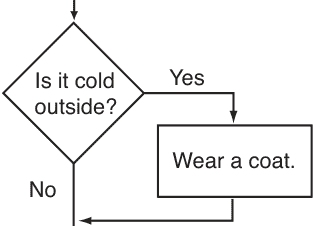

## 4.1 if 语句

在流程图中，“穿外套”这一操作只在外面冷时执行。如果外面不冷，则跳过该操作。“穿外套”操作是有条件执行的，因为它只有在特定条件（外面冷）存在时才执行。图 4-3 显示了一个更复杂的流程图，其中三个操作只在外面冷时才被执行。

## 图 4-3 三操作决策结构逻辑

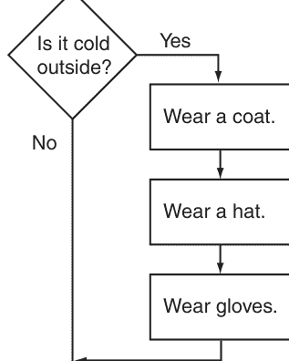

在 Java 中编写决策结构的方法是使用 `if` 语句。这里是 `if` 语句的通用格式：

```
if (BooleanExpression)
    statement;
```

`if` 语句的工作原理非常简单：括号内出现的 `BooleanExpression` 必须是一个布尔表达式。布尔表达式是一个为真或为假的表达式。如果布尔表达式为真，则执行紧随其后的条语句。否则，将跳过它。该语句是有条件执行的，因为它只在括号中的表达式为真的情况下才执行。

## 使用关系运算符形成条件

通常，由 `if` 语句测试的条件是由关系运算符形成的。关系运算符确定两个值之间是否存在特定的关系。例如，大于运算符 (`>`) 确定一个值是否大于另一个值。等于运算符 (`==`) 确定两个值是否相等。表 4-1 列出了所有的 Java 运算符。

## 表 4-1 关系运算符

| 关系运算符（按优先级排序） | 含义 |
|---|---|
| `>` | 大于 |
| `<` | 小于 |
| `>=` | 大于等于 |
| `<=` | 小于等于 |
| `==` | 等于 |
| `!=` | 不等于 |

所有的关系运算符都是二元的，使用两个操作数。这里是一个使用大于运算符的表达式示例：

```
length > width
```

此表达式确定长度是否大于宽度。如果长度大于宽度，表达式的值为真。因为表达式只能为真或为假，所以它是一个布尔表达式。下一个表达式使用小于运算符来确定长度是否小于宽度：

```
length < width
```

表 4-2 显示了几个比较变量 `x` 和 `y` 的布尔表达式示例。

## 表 4-2 使用关系运算符的布尔表达式

| 表达式 | 含义 |
|---|---|
| `x > y` | 大于 y |
| `x < y` | 小于 y |
| `x >= y` | 大于等于 y |
| `x <= y` | 小于等于 y |
| `x == y` | 等于 y |
| `x != y` | 不等于 y |

两个运算符 `>=` 和 `<=` 测试了多一种关系。`>=` 运算符确定其左侧的操作数是否大于或等于右侧的操作数。假设 `a` 为 4，`b` 为 6，`c` 为 4，则表达式 `b >= a` 和 `a >= c` 都是真的，而 `a >= 5` 是假的。在使用它时，`>` 符号必须在 `=` 符号之前，且两者之间没有空格。`<=` 运算符确定其左侧的操作数是否小于或等于右侧的操作数。再次，假设 `a` 为 4，`b` 为 6，`c` 为 4，`a <= c` 和 `b <= 10` 都是真的，但 `b <= a` 是假的。使用此运算符时，`<` 符号必须在 `=` 符号之前，且两者之间没有空格。

## 4.1 if 语句

`==` 运算符确定其左侧的操作数是否等于右侧的操作数。如果两个操作数具有相同的值，则表达式为真。假设 `a` 为 4，表达式 `a == 4` 为真，表达式 `a == 2` 为假。注意相等运算符是两个符号。不要将其与单符号的赋值运算符混淆。

`!=` 运算符不是等于运算符。它确定其左侧的操作数是否不等于右侧的操作数，它是 `==` 运算符的相反。之前一样，假设 `a` 为 4，`b` 为 6，`c` 为 4，`a != b` 和 `a != c` 是真的。

## 综合运用

让我们来看一个 `if` 语句的示例：

```
if (sales > 50)
```

该语句使用 `>` 运算符确定 `sales` 是否大于 50。如果 `sales` 大于 50，则 `bonus` 被赋值为 50。如果为假，则跳过。

```java
import java.util.Scanner;

/**
 * 此程序演示了 if 语句。
 */
public class AverageScore {
    public static void main(String[] args) {
        Scanner keyboard = new Scanner(System.in);

        System.out.print("Enter score1: ");
        double score1 = keyboard.nextDouble();

        System.out.print("Enter score2: ");
        double score2 = keyboard.nextDouble();

        System.out.print("Enter score3: ");
        double score3 = keyboard.nextDouble();

        double average = (score1 + score2 + score3) / 3.0;

        System.out.println("The average is " + average);

        if (average > 95) {
            System.out.println("That's a great score!");
        }
    }
}
```

```
Enter score1: 82
Enter score2: 76
Enter score3: 91
The average is 83.0
```

```
Enter score1: 97
Enter score2: 94
Enter score3: 100
The average is 97.0
That's a great score!
```

## 编程风格与 if 语句

即使 `if` 语句使用了多行，但它实际上是一条长语句。例如，以下语句在编写风格上是完全相同的：

```
if (average > 95)
    System.out.println("That's a great score!");

if (average > 95) System.out.println("That's a great score!");
```

在上述两个示例中，编译器将 `if` 语句和条件执行语句视为一个；末尾有分号。缩进和空格是给程序的阅读者的，而不是给编译器的。在编写 `if` 语句时，你应该采用以下两个重要的风格规则：

*   条件执行语句应该出现在 `if` 语句的下一行。
*   条件执行语句应该比 `if` 语句缩进一个层。

# 第4章 决策结构

在大多数编辑器中，每当你按下 `tab` 键时，你都会缩进一层。通过对条件执行的语句进行缩进，你可以使其在视觉上脱颖而出。这样做是为了让你一眼看出 `if` 语句执行了程序的哪些部分。这是编写 `if` 语句的标准方法，也是你应该使用的方法。

## 小心使用分号

在 `if` 语句的 `if (BooleanExpression)` 部分后面不要加分号，如图 4-5 所示。这是因为如果没有了条件执行的语句，该语句就是不完整的。

## 图 4-5 不要用分号提前终止 if 语句

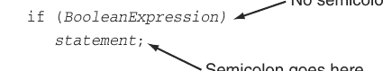

如果你用分号提前终止了 `if` 语句，编译器将不会显示错误信息，而是会假设你是在那里放置了一个空语句（null statement）。空语句是一个不执行任何操作的语句，它将成为条件执行的语句。你本打算条件执行的语句将与 `if` 语句断开，并且将始终执行。

例如，看下下面的代码：

```
int x = 0, y = 10;

// 以下 if 语句被分号
// 提前终止了。
if (x > y); {
    System.out.println("" + x + " is greater than " + y);
}
```

这段代码将始终显示消息“0 is greater than 10”。如果这段代码中的语句被分号提前终止了，由于 `println` 语句没有连接到 `if` 语句，它将始终执行。

## 具有多个条件执行语句

之前的 `if` 语句示例是条件地执行单个语句。`if` 语句也可以条件地执行一组语句，只要它们被包含在一组括号中。将一组语句包含在大括号内部创建了一个语句块。这是一个示例：

```
if (sales > 50000) {
    bonus = 500.0;
    commissionRate = 0.12;
    daysOff += 1;
}
```

## 4.1 语句 223

如果 `sales` 大于 50,000，这段代码将按照出现的顺序执行大括号内的三个语句。然而，如果不小心漏了大括号，`if` 语句将只条件地执行下一个语句。图 4-6 说明了这一点。

## 图 4-6 缺少大括号的 if 语句

```
if (sales > 50000)
    bonus = 500.0;
    commissionRate = 0.12;
    daysOff += 1;
只有这条语句被条件执行。
```

## 标志（Flags）

标志是一个布尔变量，用于信号程序中是否存在某些条件。当标志变量被设置为 `false` 时，表示条件不存在。当标志变量被设置为 `true` 时，意味着条件存在。

例如，假设有一个与之前的测试平均值程序类似的程序，它有一个布尔变量 `highScore`。该变量可能用于通过以下代码信号实现了高分。

```
if (average > 95)
    highScore = true;
```

稍后，程序可能会使用代码对 `highScore` 变量进行测试，以确定是否获得了高分。

```
if (highScore)
    System.out.println("That's a high score!");
```

你会在很多情况下发现标志变量的使用，我们将在后面的章节中重新回到它们。

## 比较字符

```
char myLetter = 'A';
if (myLetter == 'A')
    System.out.println("That is the letter A.");
```

`!=` 运算符也可以用于字符来测试不相等性。例如，以下代码确定 `char` 变量 `myLetter` 是否等于字母 'A'。

```
if (myLetter != 'A')
    System.out.println("That is not the letter A.");
```

你还可以使用 `<`、`>=` 和 `<=` 运算符来比较字符。计算机并没有在内存中以 A、B、C 等形式实际存储字符。相反，它们存储的是代表这些字符的数字代码。回想第 2 章，Java 使用 Unicode，这是一组代表所有世界字母表中所有字母（包括小写和大写）、可打印数字 0 到 9、标点符号和特殊字符的数字。当字符被存储在内存中时，存储的是实际的 Unicode 数字。当指示计算机在屏幕上打印该值时，它显示与数字代码对应的字符。

> 注意：Unicode 是一种国际编码系统，足够广泛，可以表示世界上所有字母表的所有字符。

在 Unicode 中，字母按字母顺序排列。由于 'A' 在 'B' 之前，因此字符 'A' 的数字代码小于字符 'B' 的代码（'A' 的代码是 65，'B' 的代码是 66）。附录 B 列出了所有可打印字符的代码。在后续的语句中，布尔表达式 `'A' < 'B'` 为真。

```
if ('A' < 'B')
    System.out.println("A is less than B");
```

在 Unicode 中，大写字母在小写字母之前，因此 'A' 的数字代码 (65) 小于 'a' (97)。此外，空格字符 (32) 位于所有字符之前。

## 检查点（Checkpoint）

- 4.1 写一个将 0 赋值给 `x` 的 `if` 语句。
- 4.2 写一个将 `hours` 乘以 1.5 的 `if` 语句。
- 4.3 写一个将 50 赋值给 `y` 的 `if` 语句。
- 4.4 写一个 `sales` 大于 100 的 `if` 语句。
- 4.5 写一个布尔变量为真的 `if` 语句。
- 4.6 写一个将 0 赋值给变量的 `if` 语句。
- 4.7 写一个如果不是零则显示 "Goodbye" 的 `if` 语句。

## 4.2 if-else 语句

`if-else` 语句是 `if` 语句的扩展。其通用格式如下：

```
if (BooleanExpression)
    statement
else
    statement
```

如果语句为真，则执行一组。如果表达式为假，则执行另一组。

## 代码列表 4-2 (Division.java)

```java
import java.util.Scanner;

/**
 * 此程序演示了 if-else 语句。
 */
public class Division {
    public static void main(String[] args) {
        int number1, number2;
        double quotient;

        // 创建 Scanner 对象以读取输入。
        Scanner keyboard = new Scanner(System.in);

        // 从用户获取两个数字。
        System.out.print("Enter an integer: ");
        number1 = keyboard.nextInt();
        System.out.print("Enter another integer: ");
        number2 = keyboard.nextInt();

        // 判断是否会发生除零错误。
        if (number2 == 0) {
            // 错误 - 除零
            System.out.println("Division by zero is not possible.");
            System.out.println("Please run the program again and ");
            System.out.println("enter a number other than zero.");
        } else {
            // 执行除法并显示商。
            quotient = (double)number1 / number2;
            System.out.print("The quotient of " + number1);
            System.out.print(" divided by " + number2);
            System.out.println(" is " + quotient);
        }
    }
}
```

在执行除法之前会对 `number2` 进行测试。如果用户输入 0，`if` 子句控制的语句块将被执行，显示一条指示无法执行除零的消息。否则，`else` 子句接管，将 `number1` 除以 `number2` 并显示结果。图 4-7 展示了 `if-else` 语句的逻辑。

## 图 4-7 if-else 语句的逻辑


## 检查点

- 4.8 写一个 `if-else` 语句，如果变量 `x` 大于 100，则将 20 赋值给 `y`。否则，应将 0 赋值给 `y`。
- 4.9 写一个 `if-else` 语句，当 `y` 等于 100 时，将 1 赋值给 `x`。否则，应将 0 赋值给 `x`。

## 4.3 薪资类


# 4.10 编写一个 if-else 语句

除非销售额大于或等于 `50000.0`，否则给佣金赋值 `0.1`；如果是，则给佣金赋值 `0.2`。

# 4.11 编写一个 if-else 语句

如果 `a` 小于 `10`，则给变量 `b` 赋值 `0` 并给变量 `c` 赋值 `1`。否则，它应该给变量 `b` 赋值 `-99` 并给变量 `c` 赋值 `0`。

# 第 4 章 决策结构

## 4.3 薪资类

在本节中，我们将检查一个用于确定员工总薪的 `Payroll`（薪资）类。总薪的计算方法是工作小时数乘以时薪。该类还具备在工作时间超过 40 小时时计算加班费的能力。对于超过 40 小时的所有小时，员工获得的工资为其常规时薪的 1.5 倍。图 4-8 显示了 `Payroll` 类的 UML 图。

### 图 4-8 Payroll 类的 UML 图

| Payroll |
| :--- |
| - hoursWorked : double |
| - payRate : double |
| + Payroll() |
| + setHoursWorked(hours : double) : void |
| + setPayRate(rate : double) : void |
| + getHoursWorked() : double |
| + getPayRate() : double |
| + getGrossPay() : double |

以下是该类字段的总结。

- `hoursWorked` 是 `double` 类型，存储员工工作的小时。
- `payRate` 是 `double` 类型，存储员工的时薪。

以下是该类方法的总结。

- 构造函数将字段初始化为 `0.0`。
- `setHoursWorked` 是一个修改器方法，接受一个参数并将参数的值存储在 `hoursWorked` 字段中。
- `setPayRate` 是一个修改器方法，接受一个参数并将参数的值存储在 `payRate` 字段中。
- `getHoursWorked` 是一个访问器方法，返回 `hoursWorked` 字段中的值。
- `getPayRate` 是一个访问器方法，返回 `payRate` 字段中的值。
- `getGrossPay` 方法计算并返回员工的总薪。如果工作小时数大于 40，该方法会将加班费加到总薪中。

### 代码列表 4-3 (Payroll.java)

```java
/**
 * 此类存储工作小时数和
 * 时薪的值。它计算总薪并
 * 为加班添加额外的薪水。
 */

public class Payroll
{
    private double hoursWorked; // 工作小时数
    private double payRate; // 时薪

    /**
     * 构造函数将 hoursWorked 和
     * payRate 字段初始化为 0.0。
     */

    public Payroll()
    {
        hoursWorked = 0.0;
        payRate = 0.0;
    }

    /**
     * setHoursWorked 方法接受一个参数
     * 并存储在 hoursWorked 字段中。
     */

    public void setHoursWorked(double hours)
    {
        hoursWorked = hours;
    }

    /**
     * setPayRate 方法接受一个参数
     * 并存储在 payRate 字段中。
     */

    public void setPayRate(double rate)
    {
        payRate = rate;
    }

    /**
     * getHoursWorked 方法返回 hoursWorked
     * 字段。
     */

    public double getHoursWorked()
    {
        return hoursWorked;
    }

    /**
     * getPayRate 方法返回 payRate 字段。
     */

    public double getPayRate()
    {
        return payRate;
    }

    /**
     * getGrossPay 方法计算并返回
     * 总薪。也包含了加班费。
     */

    public double getGrossPay()
    {
        double grossPay; // 存储总薪
        double overtimePay; // 存储加班费

        // 判断员工工作时间是否超过
        // 40 小时。
        if (hoursWorked > 40)
        {
            // 计算前 40 小时的常规工资。
            grossPay = 40 * payRate;

            // 按常规时薪的 1.5 倍计算加班费
            overtimePay = (hoursWorked - 40) * (payRate * 1.5);

            // 将加班费加到常规工资中。
            grossPay += overtimePay;
        }
        else
        {
            // 没有加班。
            grossPay = payRate * hoursWorked;
        }

        return grossPay;
    }
}
```

注意 `getGrossPay` 方法在第 74 行到第 90 行之间使用 `if-else` 语句来控制总薪的计算方式。如果 `hoursWorked` 大于 40，则计算总薪时包含加班费。否则，总薪简单地计算为 `payRate * hoursWorked`。代码列表 4-4 所示程序演示了 `Payroll` 类。

### 代码列表 4-4 (GrossPay.java)

**带有加粗示例输入的程序输出**

员工工作了多少小时？`30` [回车]

员工的时薪是多少？`20` [回车]

员工的总薪为 `$600.0`

**带有加粗示例输入的程序输出**

员工工作了多少小时？`50` [回车]

员工的时薪是多少？`10` [回车]

员工的总薪为 `$550.0`

## 4.4 嵌套 if 语句

概念：若要测试多于一个条件，可以将一个 `if` 语句嵌套在另一个语句内部。

有时，一个 `if` 语句必须嵌套在另一个语句内部。例如，考虑一个判断是否符合贷款条件的程序。要获得贷款，必须满足两个条件：(1) 薪水至少为 `50000`，(2) 员工已工作至少 2 年。图 4-9 显示了嵌套 `if` 语句的逻辑。

### 图 4-9 嵌套 if 语句逻辑


大括号不仅使语句更易于读，还有助于调试代码。在调试包含嵌套 `if-else` 语句的程序时，重要的是要弄清楚 `else` 子句所属的 `if` 子句。`else` 与 `if` 匹配规则是：`else` 子句属于最近的、还没有自己的 `else` 子句的 `if` 子句。当条件执行的语句包含在大括号中并正确缩进时，这一点很容易看出，如图 4-10 所示。每个 `else` 子句与其所属的 `if` 子句对齐。这些视觉提示非常重要，因为嵌套的 `if` 语句可能会非常长且复杂。

### 图 4-10 if 和 else 子句的对齐

```java
if (salary >= 50000) {
    if (yearsOnJob >= 2) {
        System.out.println("You qualify for the loan.");
    } else {
        System.out.println("You must have been on your " + "current job for at least " + "two years to qualify.");
    }
} else {
    System.out.println("You must earn at least " + "$50,000 per year to qualify.");
}
```

### 测试系列条件

在上一个示例中，你看到了程序如何使用嵌套决策结构来测试多个条件。程序拥有一系列需要测试的条件，并根据哪个条件为真来执行操作，这并不罕见。实现这一点的一种方法是让决策结构内部嵌套许多其他决策结构。例如，考虑在下面的“焦点聚焦”部分提供的程序。

### 焦点聚焦：多层嵌套决策结构

假设你的某位教授在考试中使用以下 10 分制评分标准：

| 测试分数 | 成绩等级 |
| :--- | :--- |
| 90 分及以上 | A |
| 80–89 | B |
| 70–79 | C |
| 60–69 | D |
| 60 分以下 | F |


你的教授让你写一个程序，允许用户输入分数并显示该分数对应的等级。以下是你将要使用的算法：

- 要求用户输入测试分数。
- 以以下方式确定等级：
    - 如果分数小于 60，则等级为 F。
    - 否则，如果分数小于 70，则等级为 D。
    - 否则，如果分数小于 80，则等级为 C。
    - 否则，如果分数小于 90，则等级为 B。
    - 否则，等级为 A。

确定等级的过程需要几个嵌套决策结构，如图 4-11 所示。

### 图 4-11 用于确定等级的嵌套决策结构

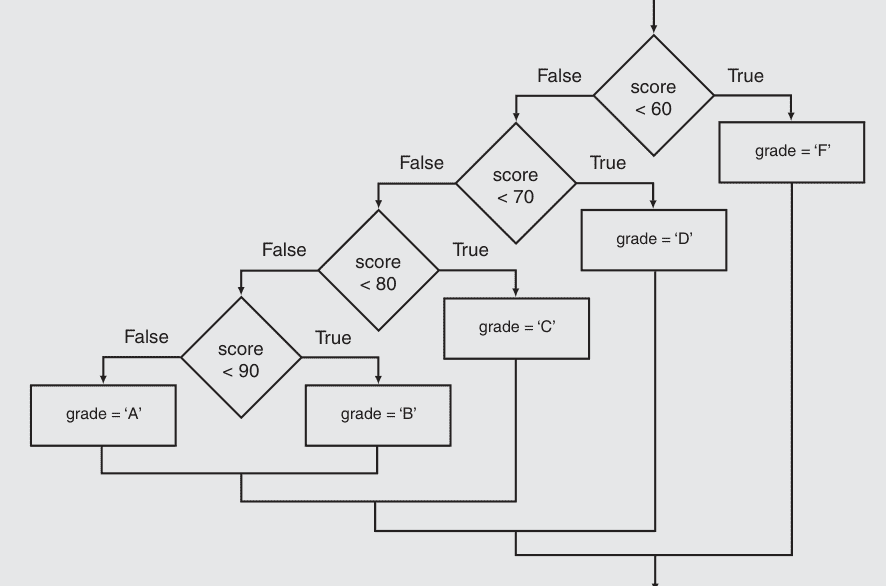

你决定创建一个名为 `TestGrade` 的类，用于根据给定的数值分数确定字母等级。图 4-12 显示了该类的 UML 图。以下是类字段和方法的总结：

- `score`：一个私有的 `int` 字段，用于存储数值测试分数。
- `TestGrade(s: int)`：构造函数，接收一个用于 `score` 字段的参数。
- `setScore(s : int) : void`：接收一个用于 `score` 字段参数的修改器方法。
- `getScore() : int`：返回 `score` 字段值的访问器方法。
- `getLetterGrade() : char`：使用图 4-11 所示的嵌套决策结构来确定分数的字母等级，并以 `char` 类型返回该等级。

### 图 4-12 TestGrade 类的 UML 图

| TestGrade |
| :--- |
| - score : int |
| + TestGrade(s: int) |
| + setScore(s : int) : void |
| + getScore() : int |
| + getLetterGrade() : char |

要使用 `TestGrade` 类，你只需要创建它的实例，并将数值测试分数作为参数传递给构造函数。你可以调用 `getLetterGrade` 方法来获取该测试分数的字母等级。代码列表 4-6 显示了类的代码。嵌套决策结构出现在第 48 行到 76 行。代码列表 4-7 显示了一个演示类的完整程序。

### 代码列表 4-6 (TestGrade.java)

```java
/**
 * TestGrade 类根据数值测试分数
 * 确定字母等级。
 */
public class TestGrade {
    private int score;

    /**
     * 构造函数接收一个用于
     * score 字段的参数。
     */
    public TestGrade(int s) {
        score = s;
    }

    /**
     * setScore 方法接收一个用于
     * score 字段的参数。
     */
    public void setScore(int s) {
        score = s;
    }

    /**
     * getScore 方法返回 score 字段。
     */
    public int getScore() {
        return score;
    }

    /**
     * getLetterGrade 返回测试分数的
     * 字母等级。
     */
    public char getLetterGrade() {
        char grade;
        if (score < 60) {
            grade = 'F';
        } else if (score < 70) {
            grade = 'D';
        } else if (score < 80) {
            grade = 'C';
        } else if (score < 90) {
            grade = 'B';
        } else {
            grade = 'A';
        }
        return grade;
    }
}
```

## 4.5 if-else-if 语句

```java
    /**
     * getScore 方法返回 score 字段。
     */

    public int getScore()
    {
        return score;
    }

    /**
     * getLetterGrade 返回测试成绩的
     * 字母等级。
     */

    public char getLetterGrade()
    {

        char grade;

        if (score < 60)
            grade = 'F';
        else if (score < 70)
            grade = 'D';
        else if (score < 80)
            grade = 'C';
        else if (score < 90)
            grade = 'B';
        else
            grade = 'A';

        return grade;
    }
}
```

让我们分析第 48 到 57 行的 `if-else-if` 语句的工作原理。首先，在第 48 行测试表达式 `score < 60`：

```java
if (score < 60)
    grade = 'F';
else if (score < 70)
    grade = 'D';
else if (score < 80)
    grade = 'C';
else if (score < 90)
    grade = 'B';
else
    grade = 'A';
```

如果 `score` 小于 60，变量 `grade` 被赋值为 `'F'`，并跳过 `if-else` 语句的剩余部分。如果 `score` 不小于 60，则第 50 行的 `else` 子句将接管并执行下一条语句：

```java
if (score < 60)
    grade = 'F';
else if (score < 70)
    grade = 'D';
else if (score < 80)
    grade = 'C';
else if (score < 90)
    grade = 'B';
else
    grade = 'A';
```

第一条语句处理了所有小于 60 的等级，因此当该语句执行时，`score` 的值将是 60 或更大。如果 `score` 小于 70，变量 `grade` 被赋值为 `'D'`，并跳过 `if-else` 语句的剩余部分。这种语句链会持续，直到发现某个表达式为真或执行语句末尾的子句。注意 `if-else` 语句使用的对齐和缩进：起始的 `if` 子句、`else` 子句以及结尾的 `else` 子句都是对齐的，而条件执行的语句则缩进。

### if-else-if 语句与嵌套决策结构的比较

你并不一定要使用 `if-else-if` 语句，因为它的逻辑可以用嵌套的 `if-else` 语句来实现。然而，在调试代码时，长系列的嵌套 `if-else` 语句有两个明显的缺点：

- 代码可能会变得复杂且难以理解。
- 由于缩进在嵌套语句中非常重要，长系列的嵌套 `if-else` 语句可能会过长，无法在不进行水平滚动的情况下显示在屏幕上。此外，长语句在纸上打印时往往换行，导致代码更难以阅读。

`if-else-if` 语句的逻辑比长系列的嵌套 `if-else` 语句更容易遵循。而且，由于 `if-else-if` 语句中的所有子句都是对齐的，语句行的长度往往更短。

### 检查点

#### 4.14 下面程序将显示什么？

```java
public class CheckPoint
{
    public static void main(String[] args)
    {
        int funny = 7, serious = 15;
    }
}
```

## 4.5 if-else-if 语句


```java
funny = serious % 2;
if (funny != 1) {
  funny = 0;
  serious = 0;
} else if (funny == 2) {
  funny = 10;
  serious = 10;
} else {
  funny = 1;
  serious = 1;
}
System.out.println(funny + " " + serious);
```

### 4.15 下面程序用于书店，确定客户可以获得多少张优惠券。请完成程序后出现的表格。

```java
import java.util.Scanner;
public class CheckPoint {
  public static void main(String[] args) {
    int books, coupons;

    Scanner keyboard = new Scanner(System.in);
    System.out.println("How many books are being purchased?");
    books = keyboard.nextInt();

    if (books < 1) {
      coupons = 0;
    } else if (books < 3) {
      coupons = 1;
    } else if (books < 5) {
      coupons = 2;
    } else {
      coupons = 3;
    }

    System.out.println("Number of coupons: " + coupons);
  }
}
```

## 第4章 决策结构

如果客户购买了这么多书籍……将给出许多优惠券。

## 4.6 逻辑运算符

**概念：** 逻辑运算符连接两个或多个表达式。Java 提供了两个二进制运算符 `&&` 和 `||`，用于组合关系表达式。它还提供了一元运算符 `!`，用于反转表达式的真值。

### 表 4-4 逻辑运算符

| 运算符 | 含义 |
|---|---|
| `&&` | 与 (AND) | 只有当两个表达式都为真时，整体表达式为真。 |
| `||` | 或 (OR) | 一个或两个表达式必须为真。 |
| `!` | 非 (NOT) | 反转表达式的真值。 |

### 表 4-5 `&&` 的真值表

| 表达式 | 结果 |
|---|---|
| `true && false` | `false` |
| `false && true` | `false` |
| `false && false` | `false` |
| `true && true` | `true` |

### `&&` 运算符

`&&` 运算符被称为逻辑与。它接收两个操作数并创建一个仅当两者都为真时才为真的表达式。如果一个操作数为假，它将执行短路求值且不再检查剩余的表达式。该运算符可以简化原本使用嵌套 `if` 语句的程序。工作原理如下：如果 `&&` 运算符左侧的表达式为假，则不会检查右侧。

你也可以对布尔变量使用逻辑运算符。例如，假设 `isValid` 是一个布尔变量，以下语句确定 `isValid` 是否为真且 `x` 是否大于 90。

```java
if (isValid && x > 90)
```

### `||` 运算符

`||` 运算符被称为逻辑或（OR）运算符。它接受两个布尔表达式作为操作数，并创建一个当子表达式之一为真时为真的布尔表达式。以下是一个使用 `||` 运算符的语句示例：

```java
if (temperature < 20 || temperature > 100)
{
    System.out.println("The temperature is in the " +
      "danger zone.");
}
```

如果 `temperature` 小于 20 或者 `temperature` 大于 100，将显示该消息。如果任何关系测试为真，整个表达式均为真。表 4-7 显示了 `||` 运算符的真值表。

### 表 4-7 `||` 运算符的真值表

| 表达式 | 结果值 |
|---|---|
| `true || false` | `true` |
| `false || true` | `true` |
| `false || false` | `false` |
| `true || true` | `true` |

OR 表达式为真，只需要其中一个子表达式为真即可。另一个子表达式是假还是真并不重要。就像 `&&` 运算符一样，`||` 运算符执行短路计算。如果 `||` 运算符左侧的子表达式为真，则不会检查右侧的表达式。因为只需要一个子表达式为真即可，检查剩余的表达式将浪费 CPU 时间。

代码列表 4-10 中的程序是代码列表 4-9 中所示程序的不同版本。此版本使用 `||` 运算符来确定 `salary >= 50000` 是否为真或 `yearsJob >= 2` 是否为真。如果任一表达式为真，该人员就符合贷款条件。

## 代码列表 4-10 (Logical.java)

```java
import java.util.Scanner; // 需要 Scanner 类

/**
此程序演示了逻辑 || 运算符。
*/
public class LogicalOr
{
    public static void main(String[] args) {
        double salary; // 年薪
        double yearsOnJob; // 当前工作的年数

        // 创建一个用于键盘输入的 Scanner。
        Scanner keyboard = new Scanner(System.in);

        // 获取用户的年薪。
        System.out.print("Enter annual salary: ");
        salary = keyboard.nextDouble();

        // 获取当前工作的年数。
        System.out.print("Enter the number of years " + "at your current job: ");
        yearsOnJob = keyboard.nextDouble();

        // 确定用户是否符合贷款条件。
        if (salary >= 50000 || yearsOnJob >= 2) {
            System.out.println("You qualify for the loan.");
        } else {
            System.out.println("You do not qualify.");
        }
    }
}
```

**带有加粗示例输入的程序输出：**

```text
Enter your annual salary: 20000.00 [Enter]
Enter the number of years at your current job: 7 [Enter]
You qualify for the loan.
```

```text
Enter your annual salary: 55000.00 [Enter]
Enter the number of years at your current job: 1 [Enter]
You qualify for the loan.
```

```text
Enter your annual salary: 20000.00 [Enter]
Enter the number of years at your current job: 1 [Enter]
You do not qualify.
```

### `!` 运算符

`!` 执行逻辑非（NOT）操作。它是一个一元运算符，接受一个布尔表达式作为操作数并反转其逻辑值。换句话说，如果表达式为真，`!` 运算符返回假；如果表达式为假，它返回真。以下是一个使用 `!` 运算符的语句：

```java
if (!(temperature > 100)) {
    System.out.println("This is below the maximum temperature.");
}
```

首先，表 4-8 显示了 `!` 运算符的真值表。

### 表 4-8 `!` 运算符的真值表

| 表达式 | 结果值 |
|---|---|
| `!true` | `false` |
| `!false` | `true` |

### 逻辑运算符的优先级和结合性

与其他运算符一样，逻辑运算符也有优先级和结合性。表 4-9 显示了逻辑运算符的优先级，从高到低。

### 表 4-9 按优先级排序的逻辑运算符

| 运算符 |
|---|
| `!` |
| `&&` |
| `||` |

`!` 运算符的优先级高于 Java 的许多运算符。当你将其应用于变量或没有其他运算符的简单表达式时，应该始终将其操作数括在括号内。例如，考虑以下表达式（假设 `x` 是一个存储了值的 `int` 变量）：

```java
!(x > 2)
!x > 2
```

第一个表达式将 `!` 运算符应用于表达式 `x > 2`。它在询问“x 不大于 2 吗？”。然而，第二个表达式尝试仅将 `!` 运算符应用于 `x`。它在询问“x 的逻辑取反值大于 2 吗？”。由于 `!` 运算符只能应用于布尔表达式，此语句将导致编译错误。

`&&` 和 `||` 运算符的优先级低于关系运算符，即使你不确定，使用括号也没有坏处。`&&` 运算符执行短路计算。如果 `&&` 运算符左侧的表达式为假，右侧的表达式将不会被检查。`||` 运算符执行短路计算。如果 `||` 运算符左侧的子表达式为真，右侧的表达式将不会被检查。因为只需要一个子表达式为真即可，检查剩余的表达式将浪费 CPU 时间。

逻辑运算符从左到右求值。在以下表达式中，`a < b` 在 `y == z` 之前求值。

```java
a < b || y == z
```

在以下表达式中，`y == z` 先求值，因为 `&&` 运算符具有更高的优先级。

```java
a < b || y == z && j
```

此表达式等同于：

```java
(a < b) || ((y == z) && j)
```

表 4-10 显示了到目前为止讨论的所有运算符的优先级。该表包含了赋值、算术、关系和逻辑运算符。

### 表 4-10 运算符的优先级

| 优先级 | 运算符 | 描述 |
|---|---|---|
| 1 | `!` | 一元否定 |
| 2 | `*`, `/`, `%` | 乘法、除法、取模 |
| 3 | `+`, `-` | 加法、减法 |
| 4 | `<`, `<=`, `>`, `>=` | 小于、小于等于、大于、大于等于 |
| 5 | `==`, `!=` | 等于、不等于 |
| 6 | `&&` | 逻辑与 |
| 7 | `||` | 逻辑或 |
| 8 | `=`, `+=`, `-=`, `*=`... | 赋值 |

### 使用逻辑运算符检查范围

有时你需要编写代码来确定数值是否在特定范围内或范围外。在确定范围内的数字时，最好使用 `&&` 运算符。例如，以下语句检查 `x` 的值是否在 20 到 40 的范围内：

```java
if (x >= 20 && x <= 40)
    System.out.println(x + " is in the range.");
```

`if` 语句中的布尔表达式仅当 `x` 大于等于 20 且小于等于 40 时为真。`x` 的值必须在 20 到 40 的范围内，该表达式才为真。

在确定范围外的数字时，最好使用 `||` 运算符。例如，以下语句确定 `x` 是否在 20 到 40 的范围之外：

```java
if (x < 20 || x > 40)
    System.out.println(x + " is outside the range.");
```

不要混淆这些逻辑运算符的逻辑是非常重要的。例如，以下 `if` 语句中的布尔表达式永远不会测试为真：

```java
if (x < 20 && x > 40)
    System.out.println(x + " is outside the range.");
```

显然，`x` 不可能小于 20 又大于 40。

## 4.7 比较 String 对象

**概念：** 你不应该使用关系运算符来比较 String 对象。相反，你应该使用适当 String 方法。

在前面的章节中，你已经看到如何使用关系运算符来比较数值。然而，你不应该使用关系运算符来比较 String 对象。请记住，String 变量存储的是 String 对象的内存地址。当你使用关系运算符比较两个 String 变量时，你比较的是变量所包含的内存地址，而不是变量所引用的 String 对象的内容。

要确定两个 String 对象是否相等，你应该使用 String 类的 `equals` 方法。该方法的通用形式为：

```java
stringReference.equals(otherString)
```

`stringReference` 是一个表示 String 对象的变量，`otherString` 是另一个表示 String 对象的变量或字符串字面量。如果两个字符串相等，该方法返回 `true`；如果不相等则返回 `false`。这是一个示例：

```java
if (name.equals(name2))
```

假设 `name` 和 `name2` 引用对象，语句中的表达式在它们相同时将返回 `true`，如果不相同则返回 `false`。

### 代码列表 4-11 (GoodStringCompare.java)

```java
import java.util.Scanner;    // 需要 Scanner 类

/**
 * 此程序使用 equals 方法正确地比较
 * 两个 String 对象。
 */
public class GoodStringCompare
{
   public static void main(String[] args)
   {
       String name, name2, name3; // 三个名字

       // 创建 Scanner 对象以读取输入。
       Scanner keyboard = new Scanner(System.in);

       // 获取一个名字。
       System.out.print("Enter a name: ");
       name = keyboard.nextLine();

       // 获取第二个名字。
       System.out.print("Enter a second name: ");
       name2 = keyboard.nextLine();

       // 获取第三个名字。
       System.out.print("Enter a third name: ");
       name3 = keyboard.nextLine();

       // 比较 name 和 name2
       if (name.equals(name2)) {
           System.out.println(name + " and " + name2 + " are the same.");
       } else {
           System.out.println(name + " and " + name2 + " are NOT the same.");
       }

       // 比较 name 和 name3
       if (name.equals(name3)) {
           System.out.println(name + " and " + name3 + " are the same.");
       } else {
           System.out.println(name + " and " + name3 + " are NOT the same.");
       }
   }
}
```

**程序输出，示例输入加粗显示：**

```text
Enter a name: Mark [Enter]
Enter a second name: Mark [Enter]
Enter a third name: Mary [Enter]
Mark and Mark are the same.
Mark and Mary are NOT the same.
```

你也可以将 String 对象与字符串字面量进行比较。只需将字符串字面量作为 `equals` 方法的参数传递，如下：

```java
if (name.equals("Mark"))
```

要确定两个字符串不相等，只需对 `equals` 方法的返回值应用 `!` 运算符即可。这是一个示例：

```java
if (!name.equals("Mark"))
```

该语句中的布尔表达式执行一个“不等于”操作。它确定由 `name` 引用的对象是否不等于“Mark”。

String 类还提供了 `compareTo` 方法，用它可以判断一个字符串是否大于、等于或小于另一个字符串。该方法的通用形式为：

```java
stringReference.compareTo(otherString)
```

`stringReference` 是引用 String 对象的变量，而 `otherString` 是另一个引用 String 对象的变量或一个字符串字面量。该方法返回一个整数值，其方式如下：

- 如果方法的返回值为负数，则 `stringReference` 引用的字符串（调用对象）小于 `otherString`。
- 如果方法的返回值为 0，则两个字符串相等。
- 如果方法的返回值为正数，则 `stringReference` 引用的字符串（调用对象）大于 `otherString`。

例如，假设 `name1` 和 `name2` 是引用 String 对象的变量。以下 `if` 语句使用 `compareTo` 方法来比较字符串。

```java
if (name1.compareTo(name2) == 0)
    System.out.println("The names are the same.");
```


此外，以下表达式比较了 `name1` 引用的字符串与字符串字面量“Joe”。

```java
if (name1.compareTo("Joe") == 0)
    System.out.println("The names are the same.");
```

代码列表 4-12 中的程序完整演示了 `compareTo` 方法。

# 代码列表 4-12 (StringCompare.java)

```java
import java.util.Scanner; // 需要 Scanner

/**
 * 此程序使用 compareTo 方法比较
 * 两个 String 对象。
 */

public class StringCompare
{
    public static void main(String[] args)
    {
        String name1, name2; // 用于存储两个名字

        // 创建 Scanner 对象以读取输入。
        Scanner keyboard = new Scanner(System.in);

        // 获取一个名字。
        System.out.print("Enter a name: ");
        name1 = keyboard.nextLine();

        // 获取第二个名字。
        System.out.print("Enter a second name: ");
        name2 = keyboard.nextLine();

        // 比较 name1 和 name2
        if (name1.compareTo(name2) == 0) {
            System.out.println(name1 + " and " + name2 + " are the same.");
        } else {
            System.out.println(name1 + " and " + name2 + " are NOT the same.");
        }
    }
}
```

## 4.8 更多关于变量声明和作用域

```java
// 提示用户输入秘密单词。
System.out.print("Enter the secret word: ");
input = keyboard.nextLine();

// 判断用户是否使用了秘密单词。
if (input.equalsIgnoreCase("PROSPERO"))
{
    System.out.println("Congratulations! You know the " +
    + "secret word!");
}
else
{
    System.out.println("Sorry, that is NOT THE " +
    + "secret word!");
}
```

加粗显示了示例输入的程序的程序输出

Enter the secret word: Ferdinand [Enter]

Sorry, that is NOT the secret word!

加粗显示了示例输入的程序的程序输出

Enter the secret word: Prospero [Enter]

Congratulations! You know the secret word!

> 请查看文件 `CompareWithoutCase.java` 以获取演示 `compareToIgnoreCase` 方法的示例。（书的源代码可在 www.pearonglobaleditions.com/gaddis 获取）。

## 检查点 (Checkpoint)

4.20 假设变量 `name` 引用一个 `String` 对象。编写一个 `if` 语句，如果 `String` 对象包含 "Timothy"，则显示 "Do I know?"。

4.21 假设变量 `name1` 和 `name2` 引用两个不同的 `String` 对象，包含不同的字符串。编写代码按字母顺序显示这些变量引用的字符串。

4.22 修改你为检查点 4.20 编写的语句，使其执行不区分大小写的比较。

## 4.8 更多关于变量声明和作用域

概念：变量的作用域局限于其声明所在代码块。

回想第 2 章，局部变量是定义在方法内部的变量。Java 允许你在方法中的任何位置创建局部变量。例如，查看代码列表 4-14 中的程序。`main` 方法声明了两个 `String` 引用变量：`firstName` 和 `lastName`。注意，这些变量的声明出现在第一次使用它们的代码附近。

## 代码列表 4-14 (VariableScope.java)

```java
import java.util.Scanner;

/**
 * 此程序演示了如何在程序中的
 * 各种位置声明变量。
 */

public class VariableScope
{
    public static void main(String[] args) {
        // 创建一个用于键盘输入的 Scanner 对象。
        Scanner keyboard = new Scanner(System.in);

        // 获取用户的第一个名字。
        System.out.print("Enter your first name: ");
        String firstName;
        firstName = keyboard.nextLine();

        // 获取用户的姓氏。
        System.out.print("Enter your last name: ");
        String lastName;
        lastName = keyboard.nextLine();

        // 显示消息。
        System.out.println("Hello " + firstName + " " + lastName);
    }
}
```

虽然在方法的开始处声明方法的所有局部变量是一种常见做法，但在较晚的位置声明它们也是可能的。有时，程序员会在程序中使用某些变量的地方附近声明它们，以使它们的意图更加明显。

> 注意：当程序运行并进入构成变量作用域的代码段时，该变量被称为“进入作用域”（comes into scope）。这仅意味着变量是可见的，程序可以引用它。同样，当变量“离开作用域”（leaves scope）时，它无法被使用。

## 条件运算符（可选）

**概念:** 你可以使用条件运算符来创建类似于 `if-else` 语句的短表达式。

条件运算符强大且独特。因为它接受三个操作数，所以它被认为是三元运算符。条件运算符提供了一种表示简单 `if-else` 语句的简写方法。运算符由问号（`?`）和冒号（`:`）组成。你可以使用该运算符编写条件表达式，格式如下：

```java
BooleanExpression ? Value1 : Value2;
```

`BooleanExpression` 类似于 `if` 语句括号中的布尔表达式。如果 `BooleanExpression` 为真，则条件表达式的值为 `Value1`。否则，条件表达式的值为 `Value2`。这里是一个使用条件运算符的语句示例：

```java
y = x < 0 ? 10 : 20;
```

上述语句执行的操作与以下 `if-else` 语句相同：

```java
if (x < 0)
    y = 10;
else
    y = 20;
```

条件运算符让你能够将决策能力封装在一行简洁的代码中。只要有一点想象力，它可以应用于许多其他编程问题。例如，考虑以下语句：

```java
System.out.println("Your grade is: " + (score < 60 ? "Fail." : "Pass."));
```

转换为 `if-else` 语句，它将写为：

```java
if (score < 60)
    System.out.println("Your grade is: Fail.");
else
    System.out.println("Your grade is: Pass.");
```

> 注意：括号放置在条件表达式周围，因为 `+` 运算符的优先级高于 `?:` 运算符。如果没有括号，`+` 运算符会将 `score` 中的值与字符串 "Your grade is: " 拼接。

## 检查点 (Checkpoint)

4.23 将以下 `if-else` 语句重写为条件表达式。

```java
if (x > y)
    z = 1;
else
    z = 20;
```

## 4.10 switch 语句

概念：`switch` 语句让变量的值决定程序在哪里分支。`switch` 语句是另一种决策结构。图 4-14 显示了 `switch` 语句的示例。

是 Java 中 `switch` 语句的通用格式：

```java
switch (testExpression) {
  case value_1:
    statement;
    statement;
    etc;
    break;
  case value_2:
    statement;
    statement;
    etc;
    break;
  case value_N:
    statement;
    statement;
    etc;
    break;
  default:
    statement;
    statement;
    etc.
    break;
}
```

语句的第一行以 `switch` 单词开头，后面是括在括号内的 `testExpression`。`testExpression` 是一个变量或表达式，可以给出 `char`、`byte`、`short`、`int` 或 `string` 类型。（如果你使用的是 Java 7 之前的版本，`testExpression` 不能是字符串。）

从下一行开始是一个用大括号括起来的代码块。在这个代码块内部有一个或多个 `case` 部分。每个 `case` 部分以 `case` 开头，后跟一个值，然后是冒号。每个 `case` 部分包含一个或多个语句，直到遇到 `break` 语句为止。在所有 `case` 之后，会出现一个可选的 `default` 部分。

当 `switch` 语句执行时，它会将 `testExpression` 的值与每个 `case` 语句后面的值进行比较（从上到下）。当它找到一个与 `testExpression` 值匹配的 `case` 时，程序分支到该 `case` 语句。`case` 语句后面的语句将执行，直到遇到 `break` 语句。在此时，程序跳出 `switch` 语句。如果 `testExpression` 不匹配任何 `case` 值，程序将分支到 `default` 语句并执行紧随其后的语句。

> 注意：每个 `case` 值必须是唯一的。

例如，以下代码的操作与图 4-14 中的流程图相同。假设月份 `month` 是一个 `int` 类型变量。

```java
switch (month)
{
    case 1:
        System.out.println("January");
        break;
    case 2:
        System.out.println("February");
        break;
    case 3:
        System.out.println("March");
        break;
    default:
        System.out.println("Error: Invalid month");
        break;
}
```

在这个示例中，`testExpression` 是 `month` 变量。对 `month` 变量进行求值并执行以下操作之一：

`switch` 语句可以作为 `if-else` 语句的替代方案，测试同一个变量或表达式以显示多个不同的值。例如，之前的 `switch` 语句的作用相当于此 `if-else` 语句：

```java
if (month == 1)
{
    System.out.println("January");
}
else if (month == 2)
{
    System.out.println("February");
}
else if (month == 3)
{
    System.out.println("March");
}
else
{
    System.out.println("Error: Invalid month");
}
```

> 注意：`default` 部分是可选的。然而，如果你省略了它，当 `testExpression` 不匹配任何 `case` 时，程序将无处可跳转。

代码列表 4-15 中的程序展示了简单的 `switch` 语句是如何工作。

## 代码列表 4-15 (SwitchDemo.java)

```java
import java.util.Scanner; // 需要 Scanner 类
/**
 * 此程序演示了 switch 语句
 * */
public class SwitchDemo
{
    public static void main(String[] args)
    {
        String input; // 用于存储键盘输入
        char choice; // 用于存储用户的选择

        // 创建一个 Scanner 对象读取输入。
        Scanner keyboard = new Scanner(System.in);

        // 询问用户输入 A, B, 或 C。
        System.out.println("Enter A, B, or C: ");
        input = keyboard.nextLine();
        choice = input.charAt(0); // 获取第一个字符

        // 确定用户输入的哪个字符。
        switch (choice)
        {
            case 'A':
                System.out.println("You entered A.");
                break;
            case 'B':
                System.out.println("You entered B.");
                break;
            case 'C':
                System.out.println("You entered C.");
                break;
            default:
                System.out.println("That's not A, B, or C!");
                break;
        }
    }
}
```

## 程序输出（示例输入已加粗显示）

Enter A, B, or C: B [Enter]

You entered B.

## 程序输出（示例输入已加粗显示）

Enter A, B, or C: F [Enter]

That's not A, B, or C!

出现在第 27、30 和 33 行的 `break` 语句。`case` 语句显示程序应从块中的哪个位置开始执行，而 `break` 语句显示程序在何处停止。如果没有 `break` 语句，程序将执行从匹配的 `case` 语句到块末尾的所有行。

> 注意：`default` 部分（如果没有 `default`，则为最后一个 `case` 部分）不需要 `break` 语句。某些程序员为了一致性，倾向于在任何地方放置一个。

代码列表 4-16 中的程序是代码列表 4-15 的修改版本，去掉了 `break` 语句。

## 代码列表 4-16 (NoBreaks.java)

```java
import java.util.Scanner; // 需要 Scanner 类

/**
 * 此程序演示了没有任何 break 语句的
 * switch 语句。
 */

public class NoBreaks
{
    public static void main(String[] args)
    {
        String input; // 用于存储键盘输入
        char choice; // 用于存储用户的选择

        // 创建一个 Scanner 对象读取输入。
        Scanner keyboard = new Scanner(System.in);

        // 询问用户输入 A, B, 或 C。
        System.out.print("Enter A, B, or C: ");
        input = keyboard.nextLine();
        choice = input.charAt(0); // 获取第一个字符

        // 确定用户输入的哪个字符。
        switch (choice) {
            case 'A':
                System.out.println("You entered A.");
            case 'B':
                System.out.println("You entered B.");
            case 'C':
                System.out.println("You entered C.");
            default:
                System.out.println("That's not A, B, or C!");
        }
    }
}
```

程序输出（示例输入已加粗显示）

Enter A, B, or C: A [Enter]

You entered A.

You entered B.

You entered C.

That's not A, B, or C!

程序输出（示例输入已加粗显示）

Enter A, B, or C: C [Enter]

You entered C.

That's not A, B, or C!

如果没有 `break` 语句，程序会“贯穿”执行位于匹配 `case` 语句之后的所有语句。有时这正是你所想要的。例如，代码列表 4-17 中的程序要求用户选择宠物食物。可选的有 A、B 和 C。

## 代码列表 4-17 (PetFood.java)


```java
import java.util.Scanner; // 需要 Scanner 类
/**
 * 此程序演示了 switch 语句。
 */
```

## 4.10 switch 语句

当 `testExpression` 不匹配任何 `case` 时，程序将无处可跳转。

`switch` 语句可以作为 `if-else` 语句的替代方案，测试同一个变量或表达式以显示多个不同的值。例如，之前的 `switch` 语句的作用相当于此 `if-else` 语句：

```java
if (month == 1)
{
    System.out.println("January");
}
else if (month == 2)
{
    System.out.println("February");
}
else if (month == 3)
{
    System.out.println("March");
}
else
{
    System.out.println("Error: Invalid month");
}
```

> 注意：`default` 部分是可选的。然而，如果你省略了它，当 `testExpression` 不匹配任何 `case` 时，程序将无处可跳转。

代码列表 4-15 中的程序展示了简单的 `switch` 语句是如何工作。

## 代码列表 4-15 (SwitchDemo.java)

```java
import java.util.Scanner; // 需要 Scanner 类
/**
 * 此程序演示了 switch 语句
 */
public class SwitchDemo
{
    public static void main(String[] args)
    {
        String input; // 用于存储键盘输入
        char choice; // 用于存储用户的选择

        // 创建一个 Scanner 对象读取输入。
        Scanner keyboard = new Scanner(System.in);

        // 询问用户输入 A, B, 或 C。
        System.out.println("Enter A, B, or C: ");
        input = keyboard.nextLine();
        choice = input.charAt(0); // 获取第一个字符

        // 确定用户输入的哪个字符。
        switch (choice)
        {
            case 'A':
                System.out.println("You entered A.");
                break;
            case 'B':
                System.out.println("You entered B.");
                break;
            case 'C':
                System.out.println("You entered C.");
                break;
            default:
                System.out.println("That's not A, B, or C!");
        }
    }
}
```

## 程序输出（示例输入已加粗显示）

Enter A, B, or C: **B** [Enter]

You entered B.

## 程序输出（示例输入已加粗显示）

Enter A, B, or C: **F** [Enter]

That's not A, B, or C!

出现在第 27、30 和 33 行的 `break` 语句。`case` 语句显示程序应从块中的哪个位置开始执行，而 `break` 语句显示程序在何处停止。如果没有 `break` 语句，程序将执行从匹配的 `case` 语句到块末尾的所有行。

> 注意：`default` 部分（如果没有 `default`，则为最后一个 `case` 部分）不需要 `break` 语句。某些程序员为了一致性，倾向于在任何地方放置一个。

代码列表 4-16 中的程序是代码列表 4-15 的修改版本，去掉了 `break` 语句。

## 代码列表 4-16 (NoBreaks.java)

```java
import java.util.Scanner; // 需要 Scanner 类

/**
 * 此程序演示了没有任何 break 语句的
 * switch 语句。
 */

public class NoBreaks
{
    public static void main(String[] args)
    {
        String input; // 用于存储键盘输入
        char choice; // 用于存储用户的选择

        // 创建一个 Scanner 对象读取输入。
        Scanner keyboard = new Scanner(System.in);

        // 询问用户输入 A, B, 或 C。
        System.out.print("Enter A, B, or C: ");
        input = keyboard.nextLine();
        choice = input.charAt(0); // 获取第一个字符

        // 确定用户输入的哪个字符。
        switch (choice) {
            case 'A':
                System.out.println("You entered A.");
            case 'B':
                System.out.println("You entered B.");
            case 'C':
                System.out.println("You entered C.");
            default:
                System.out.println("That's not A, B, or C!");
        }
    }
}
```

## 程序输出（示例输入已加粗显示）

Enter A, B, or C: **A** [Enter]

You entered A.

You entered B.

You entered C.

That's not A, B, or C!

## 程序输出（示例输入已加粗显示）

Enter A, B, or C: **C** [Enter]

You entered C.

That's not A, B, or C!

如果没有 `break` 语句，程序会“贯穿”执行位于匹配 `case` 语句之后的所有语句。有时这正是你所想要的。例如，代码列表 4-17 中的程序要求用户选择宠物食物。可选的有 A、B 和 C。

## 代码列表 4-17 (PetFood.java)

```java
import java.util.Scanner; // 需要 Scanner 类
/**
 * 此程序演示了 switch 语句。
 */
```

## 程序输出（示例输入已加粗显示）

Our food is available in

A, B, and C. Which do you want for? [Enter]

## 程序输出（示例输入已加粗显示）

Our food is available in

A, B, and C. Which do you want for? [Enter]


## 4.10 switch 语句

例如，以下代码的操作与图 4-14 中的流程图相同。假设月份 `month` 是一个 `int` 类型变量。

```java
switch (month)
{
    case 1:
        System.out.println("January");
        break;
    case 2:
        System.out.println("February");
        break;
    case 3:
        System.out.println("March");
        break;
    default:
        System.out.println("Error: Invalid month");
        break;
}
```

在这个示例中，`testExpression` 是 `month` 变量。对 `month` 变量进行求值并执行以下操作之一：

`switch` 语句可以作为 `if-else` 语句的替代方案，测试同一个变量或表达式以显示多个不同的值。例如，之前的 `switch` 语句的作用相当于此 `if-else` 语句：

```java
if (month == 1)
{
    System.out.println("January");
}
else if (month == 2)
{
    System.out.println("February");
}
else if (month == 3)
{
    System.out.println("March");
}
else
{
    System.out.println("Error: Invalid month");
}
```

> 注意：`default` 部分是可选的。然而，如果你省略了它，当 `testExpression` 不匹配任何 `case` 时，程序将无处可跳转。

代码列表 4-15 中的程序展示了简单的 `switch` 语句是如何工作。

### 代码列表 4-15 (SwitchDemo.java)

```java
import java.util.Scanner; // 需要 Scanner 类
/**
 * 此程序演示了 switch 语句
 */
public class SwitchDemo
{
    public static void main(String[] args)
    {
        String input; // 用于存储键盘输入
        char choice; // 用于存储用户的选择

        // 创建一个 Scanner 对象读取输入。
        Scanner keyboard = new Scanner(System.in);

        // 询问用户输入 A, B, 或 C。
        System.out.println("Enter A, B, or C: ");
        input = keyboard.nextLine();
        choice = input.charAt(0); // 获取第一个字符

        // 确定用户输入的哪个字符。
        switch (choice)
        {
            case 'A':
                System.out.println("You entered A.");
                break;
            case 'B':
                System.out.println("You entered B.");
                break;
            case 'C':
                System.out.println("You entered C.");
                break;
            default:
                System.out.println("That's not A, B, or C!");
                break;
        }
    }
}
```

#### 程序输出（示例输入已加粗显示）

Enter A, B, or C: **B** [Enter]

You entered B.

#### 程序输出（示例输入已加粗显示）

Enter A, B, or C: **F** [Enter]

That's not A, B, or C!

出现在第 27、30 和 33 行的 `break` 语句。`case` 语句显示程序应从块中的哪个位置开始执行，而 `break` 语句显示程序在何处停止。如果没有 `break` 语句，程序将执行从匹配的 `case` 语句到块末尾的所有行。

> 注意：`default` 部分（如果没有 `default`，则为最后一个 `case` 部分）不需要 `break` 语句。某些程序员为了一致性，倾向于在任何地方放置一个。

代码列表 4-16 中的程序是代码列表 4-15 的修改版本，去掉了 `break` 语句。

### 代码列表 4-16 (NoBreaks.java)

```java
import java.util.Scanner; // 需要 Scanner 类

/**
 * 此程序演示了没有任何 break 语句的
 * switch 语句。
 */

public class NoBreaks
{
    public static void main(String[] args)
    {
        String input; // 用于存储键盘输入
        char choice; // 用于存储用户的选择

        // 创建一个 Scanner 对象读取输入。
        Scanner keyboard = new Scanner(System.in);

        // 询问用户输入 A, B, 或 C。
        System.out.print("Enter A, B, or C: ");
        input = keyboard.nextLine();
        choice = input.charAt(0); // 获取第一个字符

        // 确定用户输入的哪个字符。
        switch (choice)
        {
            case 'A':
                System.out.println("You entered A.");
            case 'B':
                System.out.println("You entered B.");
            case 'C':
                System.out.println("You entered C.");
            default:
                System.out.println("That's not A, B, or C!");
        }
    }
}
```

#### 程序输出（示例输入已加粗显示）

Enter A, B, or C: **A** [Enter]

You entered A.
You entered B.
You entered C.
That's not A, B, or C!

#### 程序输出（示例输入已加粗显示）

Enter A, B, or C: **C** [Enter]

You entered C.
That's not A, B, or C!

如果没有 `break` 语句，程序会“贯穿”执行位于匹配 `case` 语句之后的所有语句。有时这正是你所想要的。例如，代码列表 4-17 中的程序要求用户选择宠物食物。可选的有 A、B 和 C。

### 代码列表 4-17 (PetFood.java)

```java
import java.util.Scanner; // 需要 Scanner 类
/**
 * 此程序演示了 switch 语句。
 */
```

## 检查点

- 4.24 完成程序骨架，编写一个 switch 语句，如果用户输入 1 显示 "one"，输入 2 显示 "two"，如果输入 1、2、3 以外的数字，则程序应显示错误消息。

```java
import java.util.Scanner;
public class Checkpoint
{
    public static void main(String[] args)
    {
        int userName;

        Scanner keyboard = new Scanner(System.in);
        System.out.print("Enter one of the numbers "
                "1, 2, or 3: ");
        userName = keyboard.nextInt();
        // Write the switch statement.
        //
    }
}
```

- 4.25 将 if-else 语句重写为 switch 语句。

```java
if (selection == 'A')
    System.out.println("You selected A.");
else if (selection == 'B')
    System.out.println("You selected B.");
else if (selection == 'C')
    System.out.println("You selected C.");
else if (selection == 'D')
    System.out.println("You selected D.");
else
    System.out.println("Not good with letters, eh?");
```

- 4.26 解释为什么不能将 if-else 语句转换为 switch 语句。

```java
if (temp == 100)
    x = 0;
else if (population > 1000)
    x = 1;
else if (rate < .1)
    x = -1;
```

- 4.27 下面的 switch 语句哪里有问题？

```java
// 这段代码有错误！！
switch (temp)
{
    case temp < 0 :
        System.out.println("Temp is negative.");
        break;
    case temp == 0:
        System.out.println("Temp is zero.");
        break;
    case temp > 0 :
        System.out.println("Temp is positive.");
        break;
}
```

- 4.28 下面代码将显示什么？

```java
int funny = 7, serious = 15;
funny = serious * 2;
switch (funny)
{
    case 0:
        System.out.println("That is funny.");
        break;
    case 30:
        System.out.println("That is serious.");
        break;
    case 32:
        System.out.println("That is seriously funny.");
        break;
    default:
        System.out.println(funny);
}
```


## 4.10 switch 语句

例如，以下代码的操作与图 4-14 中的流程图相同。假设月份 `month` 是一个 `int` 类型变量。

```
switch (month)
{
    case 1:
        System.out.println("January");
        break;
    case 2:
        System.out.println("February");
        break;
    case 3:
        System.out.println("March");
        break;
    default:
        System.out.println("Error: Invalid month");
        break;
}
```

在这个示例中，`testExpression` 是 `month` 变量。对 `month` 变量进行求值并执行以下操作之一：

`switch` 语句可以作为 `if-else` 语句的替代方案，测试同一个变量或表达式以显示多个不同的值。例如，之前的 `switch` 语句的作用相当于此 `if-else` 语句：

```
if (month == 1)
{
    System.out.println("January");
}
else if (month == 2)
{
    System.out.println("February");
}
else if (month == 3)
{
    System.out.println("March");
}
else
{
    System.out.println("Error: Invalid month");
}
```

> 注意：`default` 部分是可选的。然而，如果你省略了它，当 `testExpression` 不匹配任何 `case` 时，程序将无处可跳转。

代码列表 4-15 中的程序展示了简单的 `switch` 语句是如何工作。

## 代码列表 4-15 (SwitchDemo.java)

```
import java.util.Scanner; // 需要 Scanner 类
/**
 * 此程序演示了 switch 语句
 */
public class SwitchDemo
{
    public static void main(String[] args)
    {
        String input; // 用于存储键盘输入
        char choice; // 用于存储用户的选择

        // 创建一个 Scanner 对象读取输入。
        Scanner keyboard = new Scanner(System.in);

        // 询问用户输入 A, B, 或 C。
        System.out.println("Enter A, B, or C: ");
        input = keyboard.nextLine();
        choice = input.charAt(0); // 获取第一个字符

        // 确定用户输入的哪个字符。
        switch (choice)
        {
            case 'A':
                System.out.println("You entered A.");
                break;
            case 'B':
                System.out.println("You entered B.");
                break;
            case 'C':
                System.out.println("You entered C.");
                break;
            default:
                System.out.println("That's not A, B, or C!");
        }
    }
}
```

## 程序输出（示例输入已加粗显示）

Enter A, B, or C: **B** [Enter]

You entered B.

## 程序输出（示例输入已加粗显示）

Enter A, B, or C: **F** [Enter]

That's not A, B, or C!

出现在第 27、30 和 33 行的 `break` 语句。`case` 语句显示程序应从块中的哪个位置开始执行，而 `break` 语句显示程序在何处停止。如果没有 `break` 语句，程序将执行从匹配的 `case` 语句到块末尾的所有行。

> 注意：`default` 部分（如果没有 `default`，则为最后一个 `case` 部分）不需要 `break` 语句。某些程序员为了一致性，倾向于在任何地方放置一个。

代码列表 4-16 中的程序是代码列表 4-15 的修改版本，去掉了 `break` 语句。

## 代码列表 4-16 (NoBreaks.java)

```
import java.util.Scanner; // 需要 Scanner 类

/**
 * 此程序演示了没有任何 break 语句的
 * switch 语句。
 */

public class NoBreaks
{
    public static void main(String[] args)
    {
        String input; // 用于存储键盘输入
        char choice; // 用于存储用户的选择

        // 创建一个 Scanner 对象读取输入。
        Scanner keyboard = new Scanner(System.in);

        // 询问用户输入 A, B, 或 C。
        System.out.print("Enter A, B, or C: ");
        input = keyboard.nextLine();
        choice = input.charAt(0); // 获取第一个字符

        // 确定用户输入的哪个字符。
        switch (choice)
        {
            case 'A':
                System.out.println("You entered A.");
            case 'B':
                System.out.println("You entered B.");
            case 'C':
                System.out.println("You entered C.");
            default:
                System.out.println("That's not A, B, or C!");
        }
    }
}
```

## 程序输出（示例输入已加粗显示）

Enter A, B, or C: **A** [Enter]

You entered A.

You entered B.

You entered C.

That's not A, B, or C!

## 程序输出（示例输入已加粗显示）

Enter A, B, or C: **C** [Enter]

You entered C.

That's not A, B, or C!

如果没有 `break` 语句，程序会“贯穿”执行位于匹配 `case` 语句之后的所有语句。有时这正是你所想要的。例如，代码列表 4-17 中的程序要求用户选择宠物食物。可选的有 A、B 和 C。

## 代码列表 4-17 (PetFood.java)

```
import java.util.Scanner; // 需要 Scanner 类
/**
 * 此程序演示了 switch 语句。
 */
public class PetFood
{
    public static void main(String[] args)
    {
        String input;
        char choice;

        Scanner keyboard = new Scanner(System.in);

        System.out.println("Our food is available in A, B, and C. Which do you want? ");
        input = keyboard.nextLine();
        choice = input.charAt(0);

        switch (choice)
        {
            case 'a':
            case 'A':
                System.out.println("You selected A.");
                break;
            case 'b':
            case 'B':
                System.out.println("You selected B.");
                break;
            case 'c':
            case 'C':
                System.out.println("You selected C.");
                break;
            default:
                System.out.println("Invalid selection.");
        }
    }
}
```

## 程序输出（示例输入已加粗显示）

Our food is available in A, B, and C. Which do you want? **a** [Enter]

You selected A.

## 程序输出（示例输入已加粗显示）

Our food is available in A, B, and C. Which do you want? **C** [Enter]

You selected C.

## 检查点

- 4.24 完成程序骨架，编写一个 switch 语句，如果用户输入 1 显示 "one"，输入 2 显示 "two"，如果输入 1、2、3 以外的数字，则程序应显示错误消息。

```
import java.util.Scanner;
public class Checkpoint
{
    public static void main(String[] args)
    {
        int userNumber;

        Scanner keyboard = new Scanner(System.in);
        System.out.print("Enter one of the numbers 1, 2, or 3: ");
        userNumber = keyboard.nextInt();
        // Write the switch statement.
        //
    }
}
```

- 4.25 将 if-else 语句重写为 switch 语句。

```
if (selection == 'A')
    System.out.println("You selected A.");
else if (selection == 'B')
    System.out.println("You selected B.");
else if (selection == 'C')
    System.out.println("You selected C.");
else if (selection == 'D')
    System.out.println("You selected D.");
else
    System.out.println("Not good with letters, eh?");
```

- 4.26 解释为什么不能将 if-else 语句转换为 switch 语句。

```
if (temp == 100)
    x = 0;
else if (population > 1000)
    x = 1;
else if (rate < .1)
    x = -1;
```

- 4.27 下面的 switch 语句哪里有问题？

```
// 这段代码有错误！！
switch (temp)
{
    case temp < 0 :
        System.out.println("Temp is negative.");
        break;
    case temp == 0:
        System.out.println("Temp is zero.");
        break;
    case temp > 0 :
        System.out.println("Temp is positive.");
        break;
}
```

- 4.28 下面代码将显示什么？

```
int funny = 7, serious = 15;
funny = serious * 2;
switch (funny)
{
    case 0:
        System.out.println("That is funny.");
        break;
    case 30:
        System.out.println("That is serious.");
        break;
    case 32:
        System.out.println("That is seriously funny.");
        break;
    default:
        System.out.println(funny);
}
```

## 4.11 使用 DecimalFormat 类格式化数字

> 概念：`DecimalFormat` 类可用于格式化舍入到指定小数位的浮点数的显示格式。

在第 2 章中，你学习了如何使用 `System.out.printf` 方法格式化控制台输出。如果你想在图形界面（例如消息对话框）中显示格式化输出，将需要使用不同的方法。在本节中，我们将讨论 `DecimalFormat` 类，它可以用于格式化数字，无论是在控制台窗口还是消息对话框中显示。

`DecimalFormat` 类是 Java API 的一部分，但它对你的程序并非自动可用。要使用 `DecimalFormat` 类，你必须在程序的顶部包含以下导入语句：

```
import java.text.DecimalFormat;
```

该语句使你的程序可以使用该类。然后，在程序中需要格式化数字的部分创建一个 `DecimalFormat` 对象。以下是一个示例：

```
DecimalFormat formatter = new DecimalFormat("#0.00");
```

该语句创建了 `DecimalFormat` 类的一个实例。执行该语句后，`formatter` 变量将引用该对象。注意传递给构造函数的字符串中的字符。`#` 字符指定在该位置存在数字，则显示该数字。如果该位置没有数字，则不显示数字。`0` 字符也指定如果在该位置存在数字，则显示该数字。但是，如果该位置没有数字，应该显示 `0`。此外，注意小数点后有两个零。这表示数字应该被舍入到两位小数。

要使用 `DecimalFormat` 对象格式化数字，你调用它的 `format()` 方法，并将想要格式化的数字作为参数传递（你可以向该方法传递浮点值或整数值）。该方法返回一个包含格式化后数字的字符串。例如，查看代码列表 4-19 中的程序。

## 代码列表 4-19 (Format1.java)


# 第 4 章 决策结构

## 代码列表 4-19 (Format1.java)

```java
import javax.swing.JOptionPane;
import java.text.DecimalFormat;

/**
 * 此程序使用 DecimalFormat 类在消息对话框中
 * 显示格式化数字。
 */
public class Format1 {
    public static void main(String[] args) {
        double number1 = 0.16666666666666666;
        double number2 = 1.6666666666666667;
        double number3 = 16.666666666666666;
        double number4 = 166.66666666666666;

        // 创建一个 DecimalFormat 对象。
        DecimalFormat formatter = new DecimalFormat("#0.00");

        // 显示格式化变量内容。
        JOptionPane.showMessageDialog(null, formatter.format(number1));
        JOptionPane.showMessageDialog(null, formatter.format(number2));
        JOptionPane.showMessageDialog(null, formatter.format(number3));
        JOptionPane.showMessageDialog(null, formatter.format(number4));
    }
}
```

**图 4-15** 代码列表 4-19 的输出

这是由第 22 行的语句显示的。

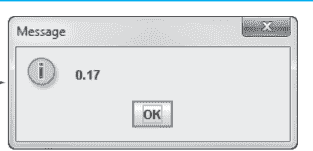

这是由第 23 行的语句显示的。

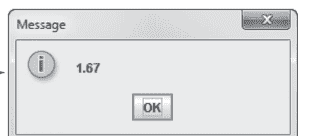

这是由第 24 行的语句显示的。

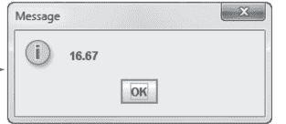

这是由第 25 行的语句显示的。

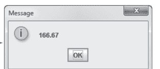

注意格式化模式中 `#` 字符和 `0` 字符输出之间的细区别：

- 如果数字在格式化模式中 `#` 字符的位置包含数字，则将显示该数字。否则，不显示任何数字。
- 如果数字在格式化模式中 `0` 字符的位置包含数字，则将显示该数字。否则，将显示 `0`。

例如，查看代码列表 4-20 中的程序。它与代码列表 4-19 显示的程序相同，但使用了不同的格式模式。程序的输出如图 4-16 所示。

## 代码列表 4-20 (Format2.java)

```java
import javax.swing.JOptionPane;
import java.text.DecimalFormat;

/**
 * 此程序使用 DecimalFormat 类在消息对话框中
 * 显示格式化数字。
 */
public class Format2 {
    public static void main(String[] args) {
        double number1 = 0.16666666666666667;
        double number2 = 1.6666666666666667;
        double number3 = 16.666666666666666;
        double number4 = 166.66666666666666;

        // 创建一个 DecimalFormat 对象。
        DecimalFormat formatter = new DecimalFormat("00.00");

        // 显示格式化变量。
        JOptionPane.showMessageDialog(null, formatter.format(number1));
        JOptionPane.showMessageDialog(null, formatter.format(number2));
        JOptionPane.showMessageDialog(null, formatter.format(number3));
        JOptionPane.showMessageDialog(null, formatter.format(number4));
    }
}
```

**图 4-16** 代码列表 4-20 的输出

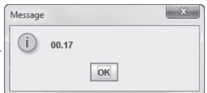

这是由第 22 行的语句显示的。

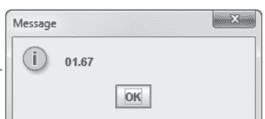

这是由第 23 行的语句显示的。

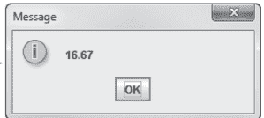

这是由第 24 行的语句显示的。

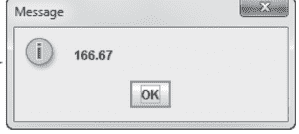

你可以在格式模式中插入逗号对格式化后的数字进行千位分隔。代码列表 4-22 中的程序演示了这一点。程序的输出如图 4-18 所示。

4.29 假设双型变量 `number` 的值为 459.6329。使用什么样的格式模式配合 `DecimalFormat` 对象将数字显示为 00459.633？

4.30 假设双型变量 `number` 的值为 .179。使用什么样的格式模式配合 `DecimalFormat` 对象将数字显示为 .18？

4.31 假设双型变量 `number` 的值为 763486.1。使用什么样的格式模式配合 `DecimalFormat` 对象将数字显示为 7,634.10？

## 4.12 关注问题解决：销售佣金

在本节中，我们将研究一个实现了本章许多主题的案例。此外，我们还将讨论如何将长算法分解为几个方法。

Hal's Home Emporium 是一家个人电脑零售商。Hal 的员工完全根据佣金工作。月底，每位销售人员的佣金根据表 4-11 计算。

### 表 4-11 佣金率

| 月销售额 | 佣金率 |
| :--- | :--- |
| 少于 $10,000 | 5% |
| $10,000–14,999 | 10% |
| $15,000–17,999 | 12% |
| $18,000–21,999 | 14% |
| $22,000 或以上 | 16% |

## 4.12 关注解决问题：SalesCommission 类

**图 4-19** SalesCommission 类的 UML 图

```
SalesCommission
- sales : double
- rate : double
- commission : double
- advance : double
+ pay : double
+ SalesCommission(s: double, a: double)
- setRate(): void
+ calculatePay(): void
+ getPay(): double
+ getCommission(): double
+ getRate(): double
+ getAdvance(): double
+ getSales(): double
```

### 表 4-12 SalesCommission 类字段

| 字段 | 描述 |
| --- | --- |
| sales | 用于存储销售人员月销售额的 double 变量。 |
| rate | 用于存储销售人员佣金率的 double 变量。 |
| commission | 用于存储佣金的 double 变量。 |
| advance | 用于存储销售人员已领预支金额的 double 变量。 |
| pay | 用于存储销售人员总工资的 double 变量。 |

### 表 4-13 SalesCommission 类方法

| 方法 | 描述 |
| --- | --- |
| 构造函数 | 构造函数接受两个参数：销售人员的销售额和已领取的预支金额。该方法将这些值赋值给 sales 和 advance 字段，然后调用 calculatePay 方法。 |
| setRate | 私有方法，根据销售人员的销售额设置佣金率。该方法从 calculatePay 方法调用。 |
| calculatePay | 私有方法，计算销售人员的佣金和实际工资。该方法从构造函数调用。 |
| getPay | 返回 double 类型的应付销售人员的总工资，金额为佣金减去预支金额。 |
| getCommission | 返回 double 类型的销售人员赚取的佣金金额。 |
| getRate | 返回 double 类型的销售人员销售额对应的佣金率。 |
| getAdvance | 返回 double 类型的销售人员领取的预支金额。 |
| getSales | 返回 double 类型的销售人员销售额。 |

## 代码列表 4-23 (SalesCommission.java)

```java
/**
 * 此类根据销售额计算
 * 销售人员的总工资。
 */
public class SalesCommission {
    private double sales,    // 月销售额
                   rate,               // 佣金率
                   commission,         // 佣金金额
                   advance,            // 预支工资
                   pay;                // 应付金额

    /**
     * 构造函数使用两个参数来接收
     * 参数：s 和 a。s 中的值被赋值给
     * sales 字段，a 中的值被赋值给
     * advance 字段。调用了 calculatePay 方法。
     */
    public SalesCommission(double s, double a) {
        sales = s;
        advance = a;
        calculatePay();
    }

    /**
     * setRate 方法根据销售额
     * 设置佣金率。该方法从
     * calculatePay 方法调用。
     */
    private void setRate() {
        if (sales < 10000)
            rate = 0.05;
        else if (sales < 15000)
            rate = 0.1;
        else if (sales < 18000)
            rate = 0.12;
        else if (sales < 22000)
            rate = 0.14;
        else
            rate = 0.16;
    }

    /**
     * calculatePay 方法计算销售人员的
     * 佣金和实际工资金额。
     */
    private void calculatePay() {
        setRate();
        commission = sales * rate;
        pay = commission - advance;
    }

    /**
     * getPay 方法返回 pay 字段。
     */
    public double getPay() {
        return pay;
    }

    /**
     * getCommission 方法返回 commission 字段。
     */
    public double getCommission() {
        return commission;
    }

    /**
     * getRate 方法返回 rate 字段。
     */
    public double getRate() {
        return rate;
    }

    /**
     * getAdvance 方法返回 advance 字段。
     */
    public double getAdvance() {
        return advance;
    }

    /**
     * getSales 方法返回 sales 字段。
     */
    public double getSales() {
        return sales;
    }
}
```

### 私有方法与算法分解

注意，该类有两个私有方法：`setRate` 和 `calculatePay`。当方法被声明为私有（`private`）时，它只能从同一类的其他方法中调用。类将包含内部处理所需的方法，但不需要在类外部使用的代码。这些方法通常被声明为私有。

在 `SalesCommission` 类中，`setRate` 和 `calculatePay` 方法是一个被分解的算法的一部分。分解算法通常意味着将其拆分为几个方法，每个方法执行特定的特定任务。例如，查看 `SalesCommission` 类的构造函数，它出现在第 22 到 27 行。注意在第 26 行，构造函数调用了 `calculatePay` 方法。然后，在第 56 行，`calculatePay` 方法调用了 `setRate` 方法，该方法出现在第 35 到 47 行。

这三个方法（构造函数、`calculatePay` 和 `setRate`）构成了单一算法的各个部分。整个算法可以写在构造函数中，看起来可能如下所示：

```java
// 写在构造函数中的整个算法
public SalesCommission(double s, double a) {
    sales = s;
    advance = a;
    if (sales < 10000)
        rate = 0.05;
    else if (sales < 15000)
        rate = 0.1;
    else if (sales < 18000)
        rate = 0.12;
    else if (sales < 22000)
        rate = 0.14;
    else
        rate = 0.16;
    commission = sales * rate;
    pay = commission - advance;
}
```

你能将此算法分解为三个方法吗？首先，它将相关任务隔离到单独的方法中：构造函数将值赋值给 `sales` 和 `advance` 字段；`setRate` 方法确定佣金率；而 `calculatePay` 方法计算销售人员的佣金。其次，将代码分成小块比一个长代码更容易阅读和调试。

### 主程序

主程序在列表 4-24 中显示。首先，它获取销售额和预支金额数据。它创建一个 `SalesCommission` 实例并将数据传递给构造函数。`SalesCommission` 对象在屏幕上显示结果。

**列表 4-24** (SalesCommissionDemo.java)


```java
import java.util.Scanner;
import java.text.DecimalFormat;

/**
 * 此类根据销售额计算
 * 销售人员的总工资。
 */
public class SalesCommission {
    private double sales,    // 月销售额
                   rate,               // 佣金率
                   commission,         // 佣金金额
                   advance,            // 预支工资
                   pay;                // 应付金额

    /**
     * 构造函数使用两个参数来接收
     * 参数：s 和 a。s 中的值被赋值给
     * sales 字段，a 中的值被赋值给
     * advance 字段。调用了 calculatePay 方法。
     */
    public SalesCommission(double s, double a) {
        sales = s;
        advance = a;
        calculatePay();
    }

    /**
     * setRate 方法根据销售额
     * 设置佣金率。该方法从
     * calculatePay 方法调用。
     */
    private void setRate() {
        if (sales < 10000)
            rate = 0.05;
        else if (sales < 15000)
            rate = 0.1;
        else if (sales < 18000)
            rate = 0.12;
        else if (sales < 22000)
            rate = 0.14;
        else
            rate = 0.16;
    }

    /**
     * calculatePay 方法计算销售人员的
     * 佣金和实际工资金额。
     */
    private void calculatePay() {
        setRate();
        commission = sales * rate;
        pay = commission - advance;
    }

    /**
     * getPay 方法返回 pay 字段。
     */
    public double getPay() {
        return pay;
    }

    /**
     * getCommission 方法返回 commission 字段。
     */
    public double getCommission() {
        return commission;
    }

    /**
     * getRate 方法返回 rate 字段。
     */
    public double getRate() {
        return rate;
    }

    /**
     * getAdvance 方法返回 advance 字段。
     */
    public double getAdvance() {
        return advance;
    }

    /**
     * getSales 方法返回 sales 字段。
     */
    public double getSales() {
        return sales;
    }

    public static void main(String[] args) {
        Scanner keyboard = new Scanner(System.in);
        DecimalFormat dollar = new DecimalFormat("$#,##00");
        DecimalFormat percent = new DecimalFormat("0%");

        System.out.print("请输入销售额：");
        double s = keyboard.nextDouble();
        System.out.print("请输入预支工资金额：");
        double a = keyboard.nextDouble();

        SalesCommission customer = new SalesCommission(s, a);

        System.out.println("\n工资报告");
        System.out.println("销售额: " + dollar.format(customer.getSales()));
        System.out.println("佣金率: " + percent.format(customer.getRate()));
        System.out.println("佣金: " + dollar.format(customer.getCommission()));
        System.out.println("预支工资: " + dollar.format(customer.getAdvance()));
        System.out.println("应付工资: " + dollar.format(customer.getPay()));
    }
}
```

# 第 4 章 决策结构

## 4.13 使用 Random 类生成随机数

> 概念：随机数用于各种应用程序。Java 提供了 `Random` 类，你可以用它生成随机数。

随机数用于许多不同的编程任务。以下是一些示例：

- 随机数常用于游戏，让玩家掷子的游戏使用随机数表示点数。从洗过的牌中抽牌的游戏使用随机数表示牌值。
- 随机数用于模拟程序。在某些模拟中，计算机必须随机决定人、动物、昆虫或其他生物的行为。可以构建公式，使用随机数来决定程序中的动作和事件。
- 随机数用于必须随机选择数据的统计程序。
- 随机数常用于计算机安全加密敏感数据。

Java API 提供了一个名为 `Random` 的类，你可以用它生成随机数。该类属于 `java.util` 包，因此任何使用它的程序都需要如下的导入语句：

```java
import java.util.Random;
```

你通过如下语句创建该类的对象：

```java
Random randomNumbers = new Random();
```

该语句执行了以下操作：

- 它声明了一个名为 `randomNumbers` 的变量。数据类型是 `Random` 类。
- 表达式 `new Random()` 创建了 `Random` 类的一个实例。
- 等号将 `Random` 类的地址赋值给 `randomNumbers` 变量。

语句执行后，`randomNumbers` 变量引用了一个 `Random` 对象。一旦创建了 `Random` 对象，就可以调用它的 `nextInt()` 方法来获取随机整数。以下代码显示了一个示例：

```java
// 声明一个 int 变量。
int number;

// 创建一个 Random 对象。
Random randomNumbers = new Random();

// 获取一个随机整数并赋值给 number。
number = randomNumbers.nextInt();
```

在上述代码执行后，`number` 变量包含一个随机整数。如果你不带参数调用 `nextInt()` 方法（如下所示），返回的整数是在 -2,147,483,648 到 +2,147,483,647 之间。或者，你可以传递一个参数来指定生成数字的上限。在以下语句中，赋值给 `number` 的值在 0 到 99 之间：

```java
number = randomNumbers.nextInt(100);
```

你可以通过加或减一个值来将范围向上或向下移动。在以下语句中，我们调用 `nextInt()` 方法来获取一个 0 到 9 之间的随机数，并对其加 1。赋值给 `number` 的数字在 1 到 10 的范围之内：

```java
number = randomNumbers.nextInt(10) + 1;
```

以下语句展示了另一个示例。它将一个 -50 到 +49 之间的随机整数赋值给 `number`：

```java
number = randomNumbers.nextInt(100) - 50;
```

`Random` 类还有其他生成随机数的方法，表 4-14 显示了其中几个。

### 表 4-14 Random 类的一些方法

| 方法 | 描述 |
| --- | --- |
| `nextDouble()` | 返回双精度类型的随机数。该数字在 0.0 到 1.0 的范围内。 |
| `nextFloat()` | 返回浮点型类型的随机数。该数字在 0.0 到 1.0 的范围内。 |
| `nextInt()` | 返回整型类型的随机数。该数字在 int 的范围内，即 -2,147,483,648 到 +2,147,483,647 |
| `nextInt(int n)` | 此方法接受一个整数参数 n。它返回一个 int 类型的随机数。该数字在 0 到 n（不包含 n）范围内。 |
| `nextLong()` | 返回长整型类型的随机数。该数字在 long 范围内，即 -9,223,372,036,854,775,808 到 +9,223,372,036,854,775,807 |

代码列表 4-25 展示了我们如何使用 `Random` 类。

### 代码列表 4-25 (MathTutor.java)

```java
import java.util.Scanner; // 需要 Scanner 类
import java.util.Random; // 需要 Random 类

/**
 * 此程序演示了 Random 类。
 */
public class MathTutor {
    public static void main(String[] args) {
        {
```

### 粗体显示示例输入时的程序输出

以下问题的答案是什么？

52 + 19 = ? 71 [回车]

正确！

### 粗体显示示例输入时的程序输出

以下问题的答案是什么？

27 + 73 = ? 101 [回车]

抱歉，答案错误。正确答案是 100

## 焦点：使用对象模拟骰子

骰子传统上有六个面，代表值 1-6。然而，某些游戏使用具有不同面数的特殊骰子。例如，幻想角色扮演游戏《地下城与龙与》（Dungeons and Dragon）使用了 4、6、8、10、12 和 20 面的骰子。

假设你正在编写一个程序，需要掷一个带有接受面数作为参数的构造函数的骰子。该类还需要具有适当的方法来掷骰子和获取骰子的值。图 4-20 显示了此类类的 UML 图，代码列表 4-26 显示了代码。

### 图 4-20 Die 类的 UML 图

| Die |
| --- |
| - sides : int |
| - value : int |
| + Die(numSides : int) |
| + roll() : void |
| + getSides() : int |
| + getValue() : int |

### 代码列表 4-26 (Die.java)

```java
import java.util.Random;

/**
 * Die 类模拟了一个具有指定面数的骰子。
 */
public class Die {
    private int sides;      // 面数
    private int value;     // 骰子的值

    /**
     * 构造函数执行初始的
     * 骰子掷。骰子的面数
     * 作为参数传递。
     */
    public Die(int numSides) {
        sides = numSides;
        roll();
    }

    /**
     * roll 方法模拟掷
     * 骰子的动作。
     */
    public void roll() {
        // 创建一个 Random 对象。
        Random rand = new Random();

        // 为骰子获取一个随机值。
        value = rand.nextInt(sides) + 1;
    }

    /**
     * getSides 方法返回
     * 骰子的面数。
     */
    public int getSides() {
        return sides;
    }

    /**
     * getValue 方法返回
     * 骰子的值。
     */
    public int getValue() {
        return value;
    }
}
```

让我们看看代码：

第 9 和 10 行：这些语句声明了两个字段。`sides` 存储骰子的面数，`value` 存储骰子掷出后的值。

第 18 到 22 行：这是构造函数。注意面数参数被赋值给 `sides` 字段。第 21 行调用 `roll()` 方法来模拟掷骰子。

第 29 到 36 行：这是 `roll()` 方法，模拟掷骰子。第 32 行创建了一个 `Random` 对象，并通过变量 `rand` 引用。第 35 行使用该对象获取获取骰子范围内的随机数。例如，如果 `sides` 设置为 6，`rand.nextInt(sides) + 1` 将返回一个 1 到 6 之间的整数。该随机数赋值给 `value` 字段。

第 43 到 46 行：这是 `getSides()` 方法，一个返回 `sides` 字段的访问器。

第 53 到 56 行：这是 `getValue()` 方法，一个返回 `value` 字段的访问器。

代码列表 4-27 演示了该类。它创建了两个 `Die` 类实例：6 面和 12 面。它模拟了掷骰子。

### 代码 4-27 (DiceDemo.java)

```java
/**
 * 此程序模拟掷骰子。
 */
public class DiceDemo {
    public static void main(String[] args) {
        final int DIE1_SIDES = 6; // 第一骰子的面数
        final int DIE2_SIDES = 12; // 第二骰子的面数

        // 创建两个 Die 类实例。
        Die die1 = new Die(DIE1_SIDES);
        Die die2 = new Die(DIE2_SIDES);

        // 显示初始信息。
        System.out.println("This simulates rolling of a " + DIE1_SIDES + " sided die and a " + DIE2_SIDES + " sided die.");

        // 掷骰子。
        System.out.println("Rolling the dice.");
        die1.roll();
        die2.roll();

        // 显示骰子的值。
        System.out.println(die1.getValue() + " " + die2.getValue());
    }
}
```

### 程序输出

这模拟了掷一个 6 面和一个 12 面骰子。

掷骰子。

5 10


# 程序分析

让我们仔细观察程序：

- **第 9 到 10 行**：这些语句声明了两个常量。`DIE1_SIDES` 是第一个骰的面数（6），`DIE2_SIDES` 是第二个的面数（12）。
- **第 13 到 14 行**：这些语句创建了两个 `Die` 类实例。注意 `DIE1_SIDES`（6）被传递给第 13 行的构造函数，而 `DIE2_SIDES`（12）被传递给第 14 行的构造函数。结果是，`die1` 引用 6 面的 `Die` 对象，`die2` 引用 12 面的 `Die` 对象。
- **第 17 到 19 行**：此语句显示关于程序的信息。
- **第 23 到 24 行**：这些语句调用 `Die` 对象的 `roll()` 方法来模拟掷骰子。
- **第 27 到 28 行**：此语句显示骰子的值。

# 4.14 需要避免的常见错误

以下列表描述了学习本章主题时常见的几种错误。

- **使用 `=` 而不是 `==` 来比较原始值。** 记住，`=` 是赋值运算符，而 `==` 用于测试相等性。
- **使用 `equals()` 方法比较 String 对象。** 你不能使用 `==` 运算符来比较 `String` 对象的内容与另一个字符串。请使用 `equals()` 或 `compareTo()` 方法。
- **忘记给 `if` 语句加上括号。** Java 要求被 `if` 测试的布尔表达式必须包含在一组括号内。如果漏掉括号或使用任何其他分组字符，会导致错误。
- **在 `if` 句末尾写分号。** 当你在 `if` 句末尾写分号时，Java 假设该条件语句是一个空语句或空语句。
- **忘记将多个条件执行的语句放在大括号中。** 通常 `if` 语句条件执行一个语句。要条件执行多个语句，必须将它们放在大括号中。
- **在 `if-else` 语句中省略 `else`。** 这不是语法错误，但可能导致逻辑错误。如果你在 `if-else` 语句中省略 `else`，当语句的布尔表达式为真时，将没有代码执行。
- **在逻辑 `||` 运算符两侧没有写完整的布尔表达式。** 你必须在逻辑 `||` 运算符两侧都写完整的布尔表达式。例如，表达式 `x > 0 < 10` 是无效的，因为 `< 10` 不是完整的表达式。该表达式应该写成 `x > 0 && x < 10`。
- **尝试用 String 类的 `equals()` 和 `compareTo()` 方法进行大小敏感的字符串比较。** 要进行大小不敏感的比较，请使用 String 类的 `equalsIgnoreCase()` 和 `compareIgnoreCase()` 方法。
- **在 `switch` 语句中使用无效的 `testExpression`。** `switch` 语句可以评估 `char`、`byte`、`short` 或 `int`。从 Java 7 开始，也可以评估字符串表达式。


# 第 4 章 决策结构

- 忘记在 case 语句的末尾写冒号。在每个 case 语句中，`CaseExpression` 之后都必须出现一个冒号。
- 忘记在 case 部分中写 `break` 语句。这不是语法错误，但可能会导致逻辑错误。程序在遇到 `break` 语句或 switch 语句的结束之前，不会跳出 switch 语句。
- 忘记在 switch 语句中写 `default` 语句。这不是语法错误，但可能会导致逻辑错误。如果省略了 `default` 部分，当没有哪个 `case` 值匹配 `testExpression` 时，将没有代码被执行。
- 使用条件运算符时，将 `?` 和 `:` 颠反了。使用条件运算符时，`?` 字符首先出现在表达式中，然后是 `:` 字符。

## 复习题与练习

### 单选题与判断题

1. 如果该语句是以下哪种示例
   a. 顺序结构。
   b. 决策结构。
   c. 路径结构。
   d. 类结构。

2. 这种表达式的值为真或假。
   a. 二元表达式
   b. 决策表达式
   c. 无条件表达式
   d. 布尔表达式

3. 下列哪项是逻辑与与运算符？
   a. `&&`
   b. `||`
   c. `==`
   d. `&`

4. 下列哪个运算符优先级最高？
   a. `+`
   b. `!=`
   c. `=`
   d. `%`

5. 这是一个无所事事的空语句。
   a. 缺失语句
   b. 虚拟语句
   c. 空语句 (null statement)
   d. 条件语句

6. 要创建一个语句块，你将语句包含在这些符号中。
   a. 圆括号 `()`
   b. 方括号 `[]`
   c. 角括号 `<>`
   d. 大括号 `{}`

7. 这是一个布尔变量，用于程序中是否存在某些条件。
   a. 标志 (flag)
   b. 信号 (signal)
   c. 哨兵 (sentinel)
   d. 警报器 (siren)

8. 字符 "A" 与字符 "B" 如何比较？
   a. "A" 大于 "B"
   b. "A" 小于 "B"
   c. "A" 等于 "B"
   d. 你不能比较字符。

9. 如果 `string1` 小于 `string2`，则函数 `int a = string1.compareTo(string2)` 返回的值。
   a. 负数
   b. 正数
   c. 零
   d. null

10. `else` 子句总是与以下项匹配
    a. 最近的且尚未有自己的 else 子句的 if 子句匹配。
    b. 最近的 if。
    c. 编译器随机选择的 if 子句。
    d. 以上均不是

11. 如果 `string1` 等于 `string2`，则函数 `int a = string1.compareTo(string2)` 返回的值。
    a. 负数
    b. 正数
    c. 零
    d. null

12. 这决定了两个不同的 String 对象是否包含相同的字符串。
    a. `==` 运算符
    b. 运算符
    c. `equals()` 方法
    d. `stringCompare()` 方法

13. 条件运算符有多少个操作数。
    a. 一个
    b. 两个
    c. 三个
    d. 四个

14. 如果没有 case 值匹配 `testExpression`，则跳转到 switch 语句的此部分。
    a. else
    b. default
    c. case
    d. otherwise

15. 正或错：`=` 运算符和 `==` 运算符执行相同的操作。

16. 正或错：所有的关系运算符都是二元运算符。

17. 正或错：Switch 语句只检查相等性。

18. 正或错：当一个语句嵌套在另一个语句的 if 子句中时，只有当外部语句的布尔表达式为真时，内部语句才会执行。

19. 正或错：当一个语句嵌套在另一个语句的 else 子句中时，只有当外部语句的布尔表达式为真时，内部语句才会执行。

20. 正或错：如果没有写 default switch 语句，将产生语法错误。

## 找错

找出以下代码中的错误。

1. // 警告！此代码包含错误！
   ```java
   if (x == 1);
     y = 2;
   else if (x == 2)
     y = 3;
   else if (x == 3)
     y = 4;
   ```

2. // 警告！此代码包含一个错误！
   ```java
   if (average == 100)
     System.out.println("Perfect Average!");
   ```

3. // 警告！此代码包含错误！
   ```java
   if (num2 == 0)
     System.out.println("Division by zero is not possible.");
     System.out.println("Please run the program again ");
     System.out.println("enter a number besides zero.");
   elelse
     Quotient = num1 / num2;
     System.out.print("The quotient of " + Num1);
     System.out.print(" divided by " + Num2 + " is ");
     System.out.println(Quotient);
   ```

4. // 警告！此代码包含错误！
   ```java
   witch (score){
     case (score > 90):
       grade = 'A';
       break;
     case (score > 80):
       grade = 'b';
       break;
     case (score > 70):
       grade = 'C';
       break;
     default:
       grade = 'F';
   }
   ```

5. 下述语句判断 x 是否大于 20。
   `if (x > 20)`

6. 下述语句判断 count 是否在 10 以内。
   `if (count >= 0)`

7. 下述语句判断 letter 是否在 0 的范围之外。
   `if (letter < 0)`

8. 如果 a 小于 10，将 0 赋值给 z。
   `z = a < 10 ? 0 : ...`

9. 下述语句应执行忽略大小写的比较。
   `equalsIgnoreCase()`

## 算法

10. 将以下 if-else 语句转换为 switch 语句：
    ```java
    if (choice == 1) {
        System.out.println("You selected 1.");
    } else if (choice == 2 || choice == 3) {
        System.out.println("You selected 2 or 3.");
    } else if (choice == 4) {
        System.out.println("You selected 4.");
    } else {
        System.out.println("Select again.");
    }
    ```

11. 将条件表达式与 if-else 语句匹配。
    a. `q = x < y ? a + b : x * 2;`
    b. `q = x < y ? x * 2 : a + b;`
    c. `x < y ? 0 : 1;`

    ```java
    if (x < y) {
        q = 0;
    } else {
        q = 1;
    }

    if (x < y) {
        q = a + b;
    } else {
        q = x * 2;
    }

    if (x < y) {
        q = x * 2;
    } else {
        q = a + b;
    }
    ```


- 12. 假设 `double` 变量 `number` 的值为 0.029。使用 `DecimalFormat` 类什么格式可以将数字显示为 00000.033？
- 13. 假设 `double` 变量的值为 5123.79。使用 `DecimalFormat` 类什么格式可以将数字显示为 5,123.79？
- 14. 编写一个语句设置费率：如果调用次数少于 101 分钟，则费率应为 0.90。如果调用次数大于 100 分钟但少于 501 分钟，则费率为 0.60。否则，费率为 0.30。

| Seat Number | Category |
| --- | --- |
| 0-50 | Silver |
| 51-120 | Gold |
| 101-120 | Platinum |

- 15. 使用下表，编写一个 `if` 语句为座位分配类别：
| Seat Number | Category |
| --- | --- |
| 0-50 | Silver |
| 51-120 | Gold |
| 101-120 | Platinum |

- 16. 编写一个语句，如果班次是 "NIGHT"，则将员工小时工资设置为 150。
- 17. 编写一个语句，如果班次是 "DAY"，则将小时工资设置为 300。
- 18. 编写一个 `if` 语句显示两个中较大的一个。
- 19. 编写一个语句，如果温度在 -50 到 150 范围内，则打印消息“数字有效”。
- 20. 编写一个语句，如果变量在 0 到 80 的范围之外，则打印消息“数字无效”。
- 21. 编写一个 `if-else` 语句，按字母顺序显示 `String` 对象 `title1` 和 `title2`。

# 编程挑战 295

- 3. 为什么对大括号内的所有语句进行缩进是一个好建议？
- 4. 当使用 `==` 运算符比较两个字符串对象时会发生什么？
- 5. 解释标志位变量（flag variable）的作用。标志位变量应该是什么数据类型？
- 6. 程序员在不在 `if-else` 语句末尾放置尾随 `else` 时会面临什么风险？
- 7. 逻辑与（AND）和逻辑或（OR）运算符中是如何使用短路求值的？
- 8. 使用嵌套的 `if-else if-else` 语句有什么缺点？
- 9. `DecimalFormat` 类中 `#` 字符和 `0` 字符之间的区别是什么？
- 10. 如何在类中使用私有方法来分解一个算法？

## 编程挑战

## 1. 罗马数字

编写一个程序，提示用户输入一个 1 到 10 范围内的数字。程序应该显示该数字的罗马数字版本。如果数字在 1–10 范围之外，程序应该显示错误信息。

## 2. 时间计算器

编写一个程序，要求用户输入一个秒数。

- 一分钟有 60 秒。如果用户输入的秒数大于或等于 60，程序应该显示该秒数等于多少分钟。
- 一小时有 3,660 秒。如果用户输入的秒数大于或等于 3,660，程序应该显示该秒数等于多少小时。
- 一天有 86,400 秒。如果用户输入的秒数大于或等于 86,400，程序应该显示该秒数等于多少天。

## 3. TestScores 类

设计一个 `TestScores` 类，其字段存储三个测试分数。（如果你已经为第 3 章挑战 8 编写了 `TestScores` 类，可以对其修改）。类构造函数应接受三个测试分数作为参数并将它们赋值给测试分数。该类还应该有测试分数的访问方法（accessor methods）、一个返回分数平均分的方法，以及一个返回根据平均分分配字母等级的方法。使用下表中的评分方案。

| 测试分数平均分 | 字母等级 |
|---|---|
| 90–100 | A |
| 80–89 | B |
| 70–79 | C |
| 60–69 | D |
| 低于 60 | F |


# 第 4 章 决策结构

## 4. 软件销售

一家软件公司销售零售价为 $99 的软件包。根据下表提供数量折扣：

| 数量 | 折扣 |
|---|---|
| 10–19 | 20% |
| 20–49 | 30% |
| 50–99 | 40% |
| 100 或更多 | 50% |

设计一个类来存储销售的单位数量，并有一个返回购买总成本的方法。

## 5. BankCharges 类

银行商业支票账户每月收取 $10 费用，外加以下支票费用：
- 如果开了少于 20 张支票，每张支票 $10
- 如果开了 20 到 39 张支票，每张支票 $08
- 如果开了 40 到 59 张支票，每张支票 $06
- 如果开了 60 张或更多支票，每张支票 $04

如果账户余额低于 $400（在应用任何支票费用之前），银行还会收取 $15 费用。设计一个类来存储账户余额和开具的支票数量。它还应该有一个返回当月银行服务费的方法。

## 6. ShippingCharges 类

快速货运公司（Fast Freight Shipping Company）收取以下费率：

| 包裹重量（公斤） | 每 500 英里的运费率 |
|---|---|
| 2 Kg 或更少 | $1.10 |
| 超过 2 Kg 但不超过 6 Kg | $2.20 |
| 超过 6 Kg 但不超过 10 Kg | $3.70 |
| 超过 10 Kg | $4.80 |

每 500 英里的运费不按比例计算。例如，如果一个 2 Kg 的包裹运送了 550 英里，费用将为 $2.20。

设计一个类来存储包裹重量，并有一个返回运费的方法。

## 7. FatGram 类

设计一个类，其方法可以存储食品中的卡里量和脂肪克数。该类应该有一个方法返回脂肪占卡里量的百分比。1 克脂肪含有 9 卡里量，所以：

脂肪热量 = 脂肪克数 * 9

脂肪百分比可以计算为：

脂肪热量 ÷ 总卡里量

# 编程挑战 297

在程序中演示该类，提示用户输入食品的卡里量和脂肪克数。程序显示脂肪热的百分比。如果卡里量少于食物总卡里量的 30%，则应显示一条消息指示食品低脂。

## 8. 跑步

设计一个类来存储跑步者的姓名以及完成比赛所需的时间。该类还应该返回这些信息。

## 9. 声速

下表显示了空气、水和钢中的声速：

| 介质 | 声速 |
|---|---|
| 空气 | 1100 |
| 水 | 4900 |
| 钢 | 1600 |

设计一个类来存储距离，并具有相应的访问方法和修改方法。该类应该有以下方法：

- `isAir()`：如果存储的距离大于或等于 1100，则返回布尔值。
- `isWater()`：如果存储的距离大于或等于 4900，则返回布尔值。
- `isSteel()`：如果存储的距离大于或等于 1600，则返回布尔值。

## 10. 冰点和沸点

下表列出了几种物质的华氏度冰点和沸点：

| 物质 | 冰点 | 沸点 |
|---|---|---|
| 酒精 | -173 | 172 |
| 氧气 | -362 | -306 |
| 水 | 32 | 212 |

设计一个类来存储温度，并具有相应的访问方法和修改方法。该类应该有以下方法：

- `isEthylFreezing()`：如果存储的温度低于或等于酒精的冰点，则返回布尔值。
- `isEthylBoiling()`：如果存储的温度高于或等于酒精的沸点，则返回布尔值。
- `isOxygenFreezing()`：如果存储的温度低于或等于氧气的冰点，则返回布尔值。
- `isOxygenBoiling()`：如果存储的温度高于或等于氧气的沸点，则返回布尔值。
- `isWaterFreezing()`：如果存储的温度低于或等于水的冰点，则返回布尔值。
- `isWaterBoiling()`：如果存储的温度高于或等于水的沸点，则返回布尔值。

编写一个程序来演示该类。程序要求用户输入一个温度，然后显示在该温度下会结冰的物质列表和会沸的物质列表。例如，如果温度为 -20，该类应该报告水在该温度下会结冰和沸。

## 11. 移动运营商

一家移动运营商为其客户提供三种订阅套餐：

- A 套餐：$39.99 提供 450 分钟。额外费用每分钟 $0.45。
- B 套餐：$59.99 提供 900 分钟。额外费用每分钟 $0.40。
- C 套餐：每月 $69.99 无限量使用。

设计一个类来计算客户的月单。它应该存储客户购买的套餐字母（A、B 或 C）和使用的分钟数。它应该有一个返回总费用的方法。在程序中演示该类，要求用户选择一个套餐并输入使用的分钟数。程序应该显示总费用。

# 编程挑战 299

## 12. 移动运营商，部分 2

修改你为编程挑战 11 编写的程序，使其也能计算并显示如果购买套餐 B 或 C，套餐 A 能够节省多少金额；以及如果购买套餐 C，套餐 B 能够节省多少金额。如果没有节省空间，则不应打印任何信息。

## 13. 体质指数

编写一个程序来计算并显示个人的体质指数（BMI）。BMI 通常用于判断一个人的体重相对于身高是否超重或体重过轻。人的 BMI 使用以下公式计算：

```
BMI = weight × 703 / height²
```

其中，`weight` 的单位是磅，`height` 的单位是英寸。程序应该显示一条消息，指示这个人是超重、体重过轻还是正常。如果人的 BMI 在 18.5 到 25 之间，则认为体重理想。如果 BMI 小于 18.5，则被认为体重过轻。如果 BMI 大于 25，则被认为超重。

## 14. 月份

编写一个名为 `Days` 的类。该类的构造函数应该接受两个参数：

- 表示月份的整数（1 = 一月，2 = 二月，等等）。
- 表示年份的整数

该类应该有一个名为 `getNumberOfDays()` 的方法，返回指定月份的天数。该方法应使用以下标准来识别闰年：

1. 确定年份是否被 100 整除。如果是，则只有当它能被 400 整除时，才是闰年。
2. 如果年份不能被 100 整除，则只有当它能被 4 整除时，才是闰年。例如，2000 年是闰年，但 2100 年不是。

在一个程序中演示该类，要求用户输入月份（允许输入 1 到 12 之间的整数），然后程序显示该月份的天数。以下是程序的运行示例：

```
Enter a month (1-12): 2 [Enter]
Enter a year: 2008 [Enter]
29 days
```

## 15. 书店俱乐部积分

Serendipellers 有一个书店俱乐部，根据每月购买的书数向客户发放积分。积分规则如下：

- 如果客户购买了 0 本书，获得 0 分。
- 如果客户购买了 1 本书，获得 5 分。
- 如果客户购买了 2 本书，获得 15 分。
- 如果客户购买了 3 本书，获得 30 分。
- 如果客户购买了 4 本或更多书，获得 60 分。

编写一个程序，要求用户输入本月购买的书数，并显示的积分。

# 第 4 章 决策结构

## 16. 魔幻日期

当我们按照以下格式写 1960 年 6 月 10 日时，它是特殊的：月份乘以日期等于年份。

6/10/60

设计一个 `MagicDate` 类。该类的构造函数应该接受月份、日期和年份的整数值。该类应该还有一个名为 `isMagic()` 的方法，如果传递给构造函数的日期是魔幻日期，则返回 `true`，否则返回 `false`。

编写一个程序，要求用户以整数形式输入月份、日期和两位数的年份。程序创建一个 `MagicDate` 类的实例来判断用户输入的日期是否为魔幻日期。如果是，程序应显示一条消息说明该日期是魔幻日期；否则，显示消息说明该日期不是魔幻日期。

## 17. 热狗食谱计算器

假设热肠是 10 个一包出售的，热狗面包是 8 个一包出售的。编写一个程序，计算聚烤所需的热肠包数和面包包数，并使剩余最少。程序要求用户输入参加聚烤的人数，以及每个人将获得几根热肠。程序应显示：

- 所需的热肠最小包数
- 所需的面包最小包数
- 剩余的热肠数量
- 剩余的面包

## 18. 轮盘颜色

在轮轮盘上，槽位的编号从 0 到 36。槽位的颜色如下：

- 0 号槽是绿色的。
- 对于 1 号到 10 号槽位，奇数编号的槽是红色的，偶数编号的槽是黑色的。
- 对于 11 号到 18 号槽位，奇数编号的槽是黑色的，偶数编号的槽是红色的。
- 对于 19 号到 28 号槽位，奇数编号的槽是红色的，偶数编号的槽是黑色的。
- 对于 29 号到 36 号槽位，奇数编号的槽是黑色的，偶数编号的槽是红色的。

编写一个 `RoulettePocket` 类。该类的构造函数接受一个槽号。该类应该有一个名为 `getPocketColor()` 的方法，以字符串返回槽的颜色。

在一个程序中演示该类，要求用户输入槽号，并显示该槽是绿色、红色还是黑色。如果数字超出 0 到 36 的范围，程序应显示错误信息。

# 第 5 章 循环与文件

## 话题

5.1 增量和减运算符
5.2 `while` 循环
5.3 使用 `while` 循环
5.4 `do-while` 循环
5.5 `for` 循环
5.6 输入验证
5.7 嵌套循环
5.8 `break` 和 `continue` 语句
5.9 决定使用哪个循环
5.10 文件输入与输出
5.11 常见错误

## 增量和减运算符

`++` 和 `--` 是用于操作变量的一元运算符。增加一个值意味着加 1，减少一个值意味着减 1。

以下语句增加数字：

```
number++;
```

以及以下语句减少数字：

```
number--;
```

代码列表 5-1 展示了 `++` `--` 运算符。

# 代码列表 5-1 (IncrementDecrement.java)

```java
/**
 * 此程序演示了 ++ -- 运算符
 */
public class IncrementDecrement {
    public static void main(String[] args) {
        int number = 4;
        // 显示 number 的值。
        System.out.println("number is " + number);
        System.out.println("I will increment number.");
        // 增加 number。
        number++;
        // 显示 number 的值。
        System.out.println("Now, number is " + number);
        System.out.println("I will decrement number.");
        // 减少 number。
        number--;
        // 显示 number 的值。
        System.out.println("Now, number is " + number);
    }
}
```

# 程序输出

```
number is 4
I will increment number.
Now, number is 5
I will decrement number.
Now, number is 4
```

代码列表 5-1 中的语句展示了在后置模式下使用的增量和减运算符，这意味着运算符放在变量之后。这些运算符在前置模式下工作，运算符放在变量名之前：

```
++number;
--number;
```

在后置和前置模式下，这些运算符都会对其操作数加 1 或减 1。代码列表 5-2 展示了这一点。

# 代码列表 5-2 (Prefix.java)

```java
/**
 * 此程序演示了前置模式下的 ++ -- 运算符。
 */
public class Prefix {
    public static void main(String[] args) {
        int number = 4;
        // 显示 number 的值。
        System.out.println("number is " + number);
        System.out.println("I will increment number.");
        // 增加 number。
        ++number;
        // 显示 number 的值。
        System.out.println("Now, number is " + number);
        System.out.println("I will decrement number.");
        // 减少 number。
        --number;
        // 显示 number 的值。
        System.out.println("Now, number is " + number);
    }
}
```

# 程序输出

```
number is 4
I will increment number.
Now, number is 5
I will decrement number.
Now, number is 4
```

# 第 5 章 循环与文件

或前缀模式。然而，当这些运算符用于不仅仅是增加或减少的语句时，这种区别就变得很重要。例如，看以下代码：

```
number = 4;
System.out.println(number++);
```

调用 `println()` 方法的语句做了两件事：(1) 显示 `number` 的值和 (2) 增加 `number`。但先发生什么呢？如果 `number` 先增加，`println()` 方法显示的值将与 `number` 最后增加时显示的值不同。答案取决于递增运算符的模式。

后置模式会导致递增在之后发生。在之前显示的语句中使用变量值之后发生，`println()` 方法将先显示 4，然后 `number` 将被增加到 5。然而，前置模式会导致递增先发生。这是一个示例：

```
number = 4;
System.out.println(++number);
```

在这些语句中，`number` 增加到了 5，然后 `println()` 方法显示 5。例如，看以下代码：

```
int x = 1, y;
y = x++;      // 后置递增
```


第一条语句声明了 `x`（初始化值为 1）和变量 `y`。第二条语句做了两件事：

- 它将 `x` 的值赋值给变量 `y`。
- 变量 `x` 被增加了。

`y` 中的值取决于递增发生的时间。因为 `++` 运算符是在前缀模式下使用的，它在赋值发生之后作用。因此，这段代码将在 `y` 中存储 1。代码执行后，`x` 将包含 2。让我们看看相同的代码，但将 `++` 运算符改为前缀模式：

```java
int x = 1, y;

y = ++x;      // 前缀递增
```

第一条语句声明了 `x`（初始化值为 1）和变量 `y`。第二条语句做了两件事：

- 变量 `x` 被增加了。
- `x` 的值被赋值给变量 `y`。

因为运算符在前缀模式下使用，它在赋值发生之前对变量起作用。因此，这段代码将在 `y` 中存储 2。代码执行后，`x` 也将包含 2。


# 检查点

以下程序段将显示什么？

- a. `x = 2;`
  `y = x++;`
  `System.out.println(y);`

- b. `x = 2;`
  `System.out.println(x++);`
- c. `x = 2;`
  `System.out.println(--x);`
- d. `x = 8;`
  `y = x--;`
  `System.out.println(y);`

## 5.2 while 循环

**概念：循环**是程序中重复执行的部分。

在第 4 章中，你学习了控制结构的概念，这些结构引导了程序的执行流。*循环* 是一种导致语句或一组语句重复的控制结构。Java 有三种循环控制结构：`while` 循环、`do-while` 循环和 `for` 循环。这三者之间的区别在于它们如何控制重复。在本节中，我们将重点关注 `while` 循环。

`while` 循环有两个重要部分：(1) 一个用于测试真假（true or false）值的布尔表达式，以及 (2) 一个只要表达式为真就会重复执行的语句或语句块。图 5-1 显示了 `while` 循环的逻辑。

**图 5-1** while 循环的逻辑

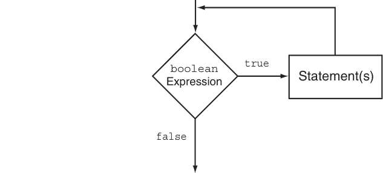

这里是 `while` 循环的通用格式：

```java
while (BooleanExpression)
   statement;
```

格式中显示的第一行有时被称为**循环头 (loop header)**。它由关键字后跟一个在括号内的布尔表达式组成。对 `BooleanExpression` 进行测试，如果它为真，则执行 `statement`。然后，再次对 `BooleanExpression` 测试。如果它为真，则执行 `statement`。这个循环不断重复，直到布尔表达式为假。

循环体。它也被视为一种条件执行的语句，因为它只有在布尔表达式为真的条件下才会被执行。

注意循环头末尾没有分号。像 `if` 语句一样，如果没有跟随其后的条件执行语句，`while` 循环是不完整的。

如果你希望 `while` 循环重复一个语句块，格式如下：

```java
while (BooleanExpression)
{
    statement;
    statement;
    // 在此处按需要放置
    // 任意语句
}
```

`while` 循环的工作原理就像一个不断执行的 `if` 语句。只要括号中的表达式为真，条件执行的语句或块就会重复。代码列表 5-3 中的程序使用 `while` 循环打印五次 "Hello"。

# 代码列表 5-3 (WhileLoop.java)

```java
1 /*
2  * 此程序演示了 while 循环。
3  */
4 
5 public class WhileLoop
6 {
7     public static void main(String[] args)
8     {
9         int number = 1;
10 
11         while (number <= 5)
12         {
13             System.out.println("Hello");
14             number++;
15         }
16 
17         System.out.println("That's all!");
18     }
}
```

# 程序输出
Hello
Hello
Hello
Hello
Hello
That's all!

## 5.2 while 循环

让我们仔细看看这个程序。在第 9 行，声明并初始化了一个整数变量 `number`，值为 1。在第 11 行，`while` 循环以该语句开始：

```java
while (number <= 5)
```

该语句测试变量是否小于等于 5。如果是，那么循环体中的语句 13 和 14 就会执行：

```java
System.out.println("Hello");
number++;
```

循环体的第一条语句（13）打印 "Hello"。第二条语句（14）使用递增运算符对 `number` 加 1。这是循环的最后语句，执行后，循环开始。如图 5-2 所示。

**图 5-2** while 循环

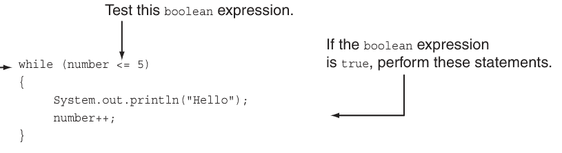

如果布尔表达式为真，执行这些语句：

循环的每次重复被称为迭代。由于变量 `number` 初始化为 1，每次执行循环体时它都会增加。当表达式 `number <= 5` 发现为假时，循环将终止，程序从循环后的语句恢复执行。图 5-3 显示了该循环的逻辑。

**图 5-3** 示例 while 循环的逻辑

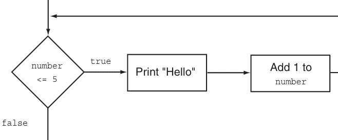

在这个示例中，`number` 变量被称为循环控制变量 (loop control variable)，因为它控制了循环迭代的次数。

# while 循环是预测试循环

`while` 循环被称为预测试（pretest）循环，这意味着它在每次迭代之前都会测试其表达式。注意代码列表 5-3 第 9 行的变量声明：

```java
int number = 1;
```

如果 `number` 被初始化为大于 5 的值（如下所示的程序段），则循环将永远不会执行：

```java
int number = 6;
while (number <= 5)
{
    System.out.println("Hello");
    number++;
}
```

`while` 循环的一个重要特点是，如果布尔表达式初始为假，它永远不会迭代。如果你想确保 `while` 循环执行第一次，你必须以使布尔表达式初始为真的方式初始化相关数据。

# 无限循环

在所有罕见的情况下，循环内部必须包含一种终止方式。这意味着循环内部某些某些最终会使布尔表达式变为假。代码列表 5-3 中的循环在 `number` 变量不再小于等于 5 时停止。

如果一个循环没有停止的方法，它被称为无限循环。无限循环会不断重复，直到程序被中断。这是一个无限循环的示例：

```java
int number = 1;
while (number <= 5) {
    System.out.println("Hello");
}
```

这是一个无限循环，因为它不包含改变 `number` 变量值的语句。每当测试布尔表达式时，`number` 都会包含值 1。

在循环的第一行之后不小心放置一个分号，也可能创建一个无限循环。这是一个示例：

```java
int number = 1;
while (number <= 5); // 这个分号是一个错误！
{
    System.out.println("Hello");
    number++;
}
```

第一行末尾的分号被认为是一个空语句，它将该语句与随后的代码块隔离开。对于编译器来说，这个循环看起来像：

```java
while (number <= 5);
```

这个循环将永远执行该空语句，而空语句什么都不做。程序看起来似乎“进入了太空”，因为没有任何内容可以显示屏幕输出或活动。

## 语句块不要忘记大括号

如果你正在使用语句块，请**不要**忘记将所有语句封装在一组大括号中。如果不小心漏掉了大括号，`while` 语句将根据条件只执行随后的第一条语句。例如，查看下面的代码：

```java
int number = 1;
// 循环缺少大括号！
while (number <= 5)
    System.out.println("Hello");
    number++;
```

在这段代码中，`number++` 不在循环体内。因为缺少了大括号，`while` 语句只执行紧随其后的语句。这个循环将无限执行，因为它的循环体中没有改变变量的代码。

## 编程风格与 while 循环

可以创建像这样的循环：

```java
while (number != 99) number = keyboard.nextInt();
```

以及像这样的：

```java
while (number <= 5) { System.out.println("Hello"); number++; }
```

## 第 5 章 循环与文件

避免这种编程风格。你在使用 `while` 循环时应该使用的编程风格与语句的风格相似：

- 如果循环只重复一个语句，它应该出现在 `while` 语句的下一行，并额外缩进一层。该语句可以选择出现在一组大括号内部。
- 如果循环重复一个代码块，循环大括号内的每行（周围代码外）都需要缩进。

这种编程风格可以在视觉上标出循环代码的内容。通常，你会发现在本章介绍的其他类型循环中也使用了类似的风格。

## 焦点聚焦：使用 while 循环设计程序

Chemical Labs, Inc. 目前正在进行的一个项目需要在一个槽中加热某种物质。技术人员必须每 15 分钟检查一次物质的温度。如果物质温度不超过 102.5 摄氏度，技术人员什么都不做。然而，如果温度大于 102.5 摄氏度，技术人员必须降低恒温器，等待 5 分钟并再次检查温度。技术人员重复这些步骤，直到温度不超过 102.5 摄氏度。工程总监让你编写一个程序引导技术人员完成这一过程。

以下是算法：

1. 提示用户输入物质的温度。
2. 只要温度大于 102.5 摄氏度，就重复以下步骤：
   a. 告诉技术人员降低恒温器，等待 5 分钟并再次检查温度。
   b. 提示用户输入物质的温度。
3. 循环结束后，告诉技术人员温度是可以的，并在 15 分钟后检查。

在回顾此算法后，你意识到如果测试条件（温度大于 102.5）最初为假，则不应执行步骤 2(a) 和 2(b)。在这种情况下，循环将运行良好，因为如果条件为假，它甚至一次都不会执行。代码列表 5-4 显示了该程序。

## 代码列表 5-4 (Temperature.java)

```java
import java.util.Scanner;

/**
 * 此程序协助技术人员检查
 * 物质温度的过程。
 */

public class CheckTemperature
{
    public static void main(String[] args) 
    {
        final double MAX_TEMP = 102.5; // 最大温度
        double temperature; // 用于存储温度

        // 创建一个 Scanner 对象用于键盘输入。
        Scanner keyboard = new Scanner(System.in);

        // 获取当前温度。
        System.out.println("输入物质的摄氏度温度： ");
        temperature = keyboard.nextDouble();

        // 只要需要，指示技术人员
        // 调整温度。
        while (temperature > MAX_TEMP) {
            System.out.println("温度为 ");
            // ... 调整温度的逻辑 ...
        }

        System.out.println("温度是可以的。");
    }
}
```

```java
public static void main(String[] args)
{
    final int MIN_PLAYERS = 9, // 每队最小玩家人数
    MAX_PLAYERS = 15; // 每队最大玩家人数

    int players, // 可用玩家人数
    teamSize, // 每队玩家人数
    teams, // 队伍数量
    leftOver; // 剩余玩家人数

    // 创建一个扫描器用于键盘输入。
    Scanner keyboard = new Scanner(System.in);

    // 获取每队的玩家人数。
    System.out.print("请输入每队的玩家人数 " + " (per team): ");
    teamSize = keyboard.nextInt();

    // 验证输入。
    while (teamSize < MIN_PLAYERS || teamSize > MAX_PLAYERS) {
        System.out.println("每队至少应该有 " + MIN_PLAYERS + " 人，但不能超过 " + MAX_PLAYERS + " 人。");
        System.out.print("请输入每队的玩家人数 " + " (per team): ");
        teamSize = keyboard.nextInt();
    }

    // 获取可用玩家人数。
    System.out.print("请输入可用玩家人数: ");
    players = keyboard.nextInt();

    // 验证输入。
    while (players < 0) {
        System.out.println("请不要输入负" + "数。");
        System.out.print("请输入可用玩家人数 " + " (of players): ");
        players = keyboard.nextInt();
    }

    // 计算队伍数量。
    teams = players / teamSize;

    // 计算剩余玩家人数。
    leftOver = players % teamSize;

    // 显示结果。
    System.out.println("将会有 " + teams + " 支队伍，"
      + "剩余 " + leftOver
      + " 个玩家。");
}
```

# 5.4 do-while 循环

# 示例程序输出（加粗显示示例）

请输入每队的玩家人数: 4 [回车]
每队至少应该有 9 人，但不能超过 15 人。
请输入每队的玩家人数: 12 [回车]
请输入可用玩家人数: -142 [回车]
请不要输入负数。
请输入可用玩家人数: 142 [回车]
将会有 11 支队伍，剩余 10 个玩家。


# 检查点 (Checkpoint)

- 5.4 编写一个输入验证循环，允许用户输入 10 到 25 之间的数字。
- 5.5 编写一个输入验证循环，要求用户输入 'Y'、'y'、'N' 或 'n'。
- 5.6 编写一个输入验证循环，要求用户输入 "Yes" 或 "No"。

# 5.4 do-while 循环

> 概念：`do-while` 循环是一种后测试循环，这意味着它的布尔表达式在每次迭代后都会进行测试。

`do-while` 循环看起来有点像一个倒置的 `while` 循环。当循环体只包含单个语句时，`do-while` 循环的格式如下：

```java
do
  statement;
while (BooleanExpression);
```

当循环体包含多个语句时，`do-while` 循环的格式如下：

```java
do
{
  statement;
  statement;
  // 在此处放置尽可能数量的
  // 语句。
} while (BooleanExpression);
```

# 第 5 章 循环与文件

> 注意：`do-while` 循环必须以分号结束。

`do-while` 循环是一种后测试循环。这意味着它在完成一次迭代之前不会测试其布尔表达式。因此，`do-while` 循环总是至少执行一次迭代，即使布尔表达式从一开始就为假值。这与 `while` 循环的行为不同，你记得 `while` 循环是一种预测试循环。例如，下面的 `while` 循环语句将完全不会执行：

```java
int x = 1;
while (x < 0)
System.out.println(x);
```

但后续 `do-while` 循环中的打印语句将执行，因为 `do-while` 循环在迭代结束之前才不会评估表达式 `x < 0`。

```java
int x = 1;
do {
  System.out.println(x);
} while (x < 0);
```


图 5-5 释了 do-while 循环的逻辑。

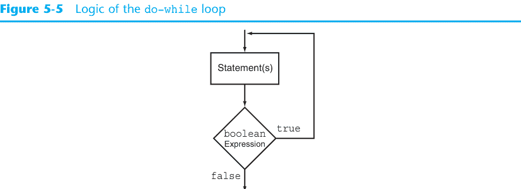

当你想要确保循环至少执行一次时，应该使用 do-while 循环。例如，代码列表 5-6 中的程序计算了一个学生三个测试成绩的平均分。在显示平均分后，它询问用户她是否想要计算另一组测试成绩的平均分。只要用户输入 Y 代表是，程序就会重复。

# 代码列表 5-6 (TestAverage.java)

```java
import java.util.Scanner;

/**
 * 此程序演示了由用户控制的循环。
 */
public class TestAverage {
    public static void main(String[] args) {
        String input; // 用于存储输入
        double score1, score2, score3; // 三个分数
        double average; // 平均分
        char repeat; // 重复标记

        // 创建一个扫描器用于键盘输入。
        Scanner keyboard = new Scanner(System.in);

        // 获取三个测试分数的。
        System.out.print("请输入第一个测试分数: ");
        score1 = keyboard.nextDouble();
        System.out.print("请输入第二个测试分数: ");
        score2 = keyboard.nextDouble();
        System.out.print("请输入第三个测试分数: ");
        score3 = keyboard.nextDouble();

        // 计算平均分。
        average = (score1 + score2 + score3) / 3;

        // 显示平均分。
        System.out.println("平均分是 " + average);

        // 询问用户是否继续计算另一组平均分。
        System.out.print("你想再计算另一组平均分吗？(y/n): ");
        repeat = keyboard.next().charAt(0);

        // 只要用户输入 Y 或 y 代表是，程序就会重复执行。
        do {
            System.out.print("请输入第一个测试分数: ");
            score1 = keyboard.nextDouble();
            System.out.print("请输入第二个测试分数: ");
            score2 = keyboard.nextDouble();
            System.out.print("请输入第三个测试分数: ");
            score3 = keyboard.nextDouble();

            // 计算平均分。
            average = (score1 + score2 + score3) / 3;

            // 显示平均分。
            System.out.println("平均分是 " + average);

            System.out.print("你想再计算另一组平均分吗？(y/n): ");
            repeat = keyboard.next().charAt(0);
        } while (repeat == 'Y' || repeat == 'y');
    }
}
```

# 5.5 for 循环

在 Java 中，for 循环是编写计数循环的理想选择。它专门设计用于初始化、测试和更新循环变量。这里是用于重复单个语句的 for 循环的格式：

```java
for (Initialization; Test; Update) statement;
```

用于重复代码块的 for 循环格式为：

```java
for (Initialization; Test; Update) {
    statement;
    // 在此处放置尽可能数量的
    // 语句。
}
```

for 循环的第一行被称为循环头。在关键字之后，括号内有三个表达式，用分号隔开。（注意第三个表达式后面没有分号。）第一个表达式是初始化表达式。它通常用于初始化循环变量的起始值。这是循环执行的第一个动作，只执行一次。第二个表达式是测试表达式。这是一个控制循环执行的布尔表达式。只要该表达式为真，for 循环体就会重复。for 循环是预测试循环，所以在每次迭代之前评估表达式。第三个表达式是更新表达式。它在每次迭代结束时执行。通常这是一个增加循环控制变量的语句。

这里有一个重复“Hello”五次的简单循环示例：

```java
for (count = 1; count <= 5; count++)
    System.out.println("Hello");
```

在这个循环中，初始化表达式是 `count = 1`，测试表达式是 `count <= 5`，更新表达式是 `count++`。循环体有一个语句，即 println 语句。图 5-6 阐释了循环执行期间的事件序列。请注意步骤 2 到 4。

# 图 5-6 for 循环执行期间的事件序列

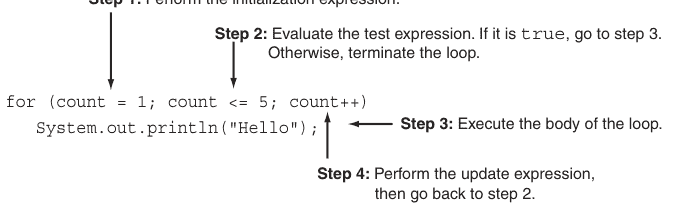

## 图 5-7 for 循环的逻辑

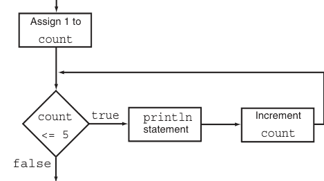

现在控制变量 `count` 被控制循环迭代的次数。在循环执行期间，该变量会取 1 到 5 的值，当测试表达式 `<= 5` 为假时，循环终止。由于这个变量记录了迭代的次数，所以它通常被称为计数器变量（counter variable）。

另请注意，`count` 变量仅用于循环头部，以控制循环迭代的次数。它不用于任何其他目的。也可以在循环体内使用控制变量。例如，看下面的代码：

```java
for (number = 1; number <= 10; number++)
    System.out.print(number + " : " + count);
```

此循环中的控制变量是 `number`。除了控制迭代次数外，它还被用于循环体中。该循环将产生以下输出：

1 2 3 4 5 6 7 8 9 10

如你所见，代码列表 5-7 中的程序展示了另一个在循环体内使用控制变量的循环示例。该程序显示了一个包含 1 到 10 数字及其平方的表格。

## 代码列表 5-7 (Squares.java)

```java
/**
   * 此程序演示了循环。
   */
public class Squares {
    public static void main(String[] args) {
        int number; // 循环控制变量
        System.out.println("Number Squared");
        System.out.println("---------------------");
        for (int number = 1; number <= 10; number++) {
            System.out.println(number + "\t\t" + number * number);
        }
    }
}
```

## 程序输出

| Number | Number Squared |
|---|---|
| 1 | 1 |
| 2 | 4 |
| 3 | 9 |
| 4 | 16 |
| 5 | 25 |
| 6 | 36 |
| 7 | 49 |
| 8 | 64 |
| 9 | 81 |
| 10 | 100 |

图 5-8 释了该 for 循环执行的事件序列。

## 图 5-8 代码列表 5-7 中 for 循环的事件序列

- 步骤 1：执行初始化表达式。
- 步骤 2：评估测试表达式。如果为真，跳转到步骤 3。否则，终止循环。

```java
for (number = 1; number <= 10; number++) {
    System.out.println(number + "\t\t" + number * number);
}
```

> 步骤 3：执行循环体。
> 步骤 4：执行更新表达式，然后返回步骤 2。

## 图 5-9 代码列表 5-7 中 for 循环的逻辑

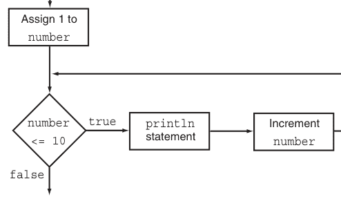

## for 循环是预测试循环（Pretest Loop）

由于 for 循环在执行迭代之前测试其布尔表达式，因此它是一个预测试循环。可以编写一个 for 循环使其永远不迭代。这是一个示例：

```java
for (count = 11; count <= 10; count++)
    System.out.println("Hello");
```

由于变量 `count` 初始化时的值从一开始就让布尔表达式为假，该循环一启动就会终止。

## 避免在 for 循环体中修改控制变量

注意不要在 for 循环体内放置修改控制变量的语句。对控制变量的所有修改都应该在更新表达式中进行，它会在每次迭代结束时自动执行。如果循环体中的语句也修改了控制变量，循环可能不会在你预期的时刻终止。例如，下面的 for 循环每次迭代会递增两次：

```java
for (x = 1; x < 10; x++) {
    System.out.println(x);
    x++;
}
```

## 更新表达式的其他形式

更新表达式不仅限于使用递增语句。这里有一个通过向计数器加 2 来显示 2 到 100 所有数字的 for 循环：

```java
for (number = 2; number <= 100; number += 2)
    System.out.println(number);
```

这是一个从 10 倒数到 0 的循环：

```java
for (number = 10; number >= 0; number--)
    System.out.println(number);
```

## 在循环的初始化表达式中声明变量

控制变量不仅可以在初始化表达式中初始化，也可以在那里进行声明。下面的代码展示了一个示例。这是对代码列表 5-7 中循环的修改。

```java
for (int number = 1; number <= 10; number++) {
    System.out.println(number + "\t\t" + number * number);
}
```

在此循环中，变量的作用范围限于循环。如果在初始化表达式中声明变量，则无法在循环外部访问它。例如，以下代码将无法编译：

```java
for (int count = 1; count <= 10; count++)
    System.out.println(count); // 错误！
```

## 创建用户循环

有时你想通过用户输入来确定循环的最大值。在循环之前的第 22 行和第 23 行，此程序要求用户输入最高值。该值存储在变量 `maxValue` 中：

```java
import java.util.Scanner;

public class Squares {
    public static void main(String[] args) {
        int number; // 循环控制变量
        int maxValue;
        Scanner keyboard = new Scanner(System.in);
        System.out.print("How high should I go?");
        maxValue = keyboard.nextInt();
        System.out.println("Number Squared");
        System.out.println("---------------------");
        for (number = 1; number <= maxValue; number++) {
            System.out.println(number + "\t\t" + number * number);
        }
    }
}
```

该程序的输出将是：

```
Number Squared
---------------------
1       1
2       4
3       9
4       16
5       25
6       36
7       49
```

## 在初始化和更新表达式中使用多个变量

此更新表达式对 `x` 和 `y` 变量进行递增。该循环产生的输出如下：

```
1 plus 1 equals 2
2 plus 2 equals 4
3 plus 3 equals 6
4 plus 4 equals 8
5 plus 5 equals 10
```

在初始化表达式和更新表达式中使用逗号连接多个语句是有效的，但不要尝试在测试表达式中也用这种方式连接多个布尔表达式。如果你想在测试表达式中组合布尔表达式，必须使用 `&&` 或 `||` 运算符。


# 焦点聚焦：设计一个计数控制的 for 循环

你的朋友 Amanda 从她叔叔那里继承了一辆欧洲跑车。Amanda 住在美国，她担心因为汽车的速度表是以每小时公里（km/h）为单位而收到超速单。她请求你写一个程序，显示一张每小时公里的速度表，将其数值转换为每小时英里（MPH）。每小时公里（KPH）转换为每小时英里（MPH）的公式为：

```
MPH = KPH * 0.6214
```

你的程序显示的表格将从 60 公里每到 130 公里每的速度，每隔 10 增加，以及它们转换为每小时英里的数值。表格看起来应该像这样：

| KPH | MPH |
|---|---|
| 60 | 37.3 |
| 70 | 43.5 |
| 80 | 49.7 |
| 130 | 80.8 |

在考虑了此表格后，你决定编写以下代码：

- 一个名为 `SpeedConverter` 的类，可以执行从公里到每小时英里的转换。
- 一个程序，创建 `SpeedConverter` 类的实例并使用该对象将每小时公里的速度转换为每小时英里。

代码列表 5-9 显示的 `SpeedConverter` 类只有一个方法 `getMPH()`。该方法出现在第 18 到 21 行，接受每小时公里的速度作为参数，并返回转换为每小时英里的速度。

## 代码列表 5-9 (SpeedConverter.java)

```java
/**
 * SpeedConverter 类将速度
 * 从 KPH (每小时公里) 转换为 MPH (每小时英里)。
 */
public class SpeedConverter {
    // 将 MPH 转换为 KPH 的因子
    final double CONVERSION_FACTOR = 0.6214;

    /**
     * getMPH 方法接受 KPH
     * 速度作为参数，并返回
     * 转换为 mph 的速度。
     */
    public double getMPH(double kph) {
        return kph * CONVERSION_FACTOR;
    }
}
```

如前所述，显示速度表的程序创建了 `SpeedConverter` 类的实例。在程序中，你决定使用 `for` 循环，使用计数器来保存每小时公里的速度。计数器的起始值为 60，结束值为 130，你需要在每次迭代后向计数器值加 10。在循环内部，你调用 `SpeedConverter` 类的 `getMPH()` 方法，并将计数器变量作为参数传递。该方法将返回转换为每小时英里的速度。代码列表 5-10 显示了代码。

## 代码列表 5-10 (SpeedTable.java)

```java
/**
 * 此程序显示从 kph
 * 转换为 mph 的速度表。
 */
public class SpeedTable {
    public static void main(String[] args) {
        // 常量
        final int STARTING_KPH = 60; // 起始速度
        final int MAX_KPH = 130; // 最大速度
        final int INCREMENT = 10; // 速度增量
        // 用于存储 kph 中的速度
        int kph; // 用于存储 kph 中的速度
        double mph; // 用于存储 kph 中的速度

        // 创建 SpeedConverter 类的实例。
        SpeedConverter converter = new SpeedConverter();

        // 显示表头。
        System.out.println("KPH\tMPH");
    }
}
```


## 代码示例

```java
24 System.out.println("--------------------");

25

26 // 显示速度。
27 for (int kph = STARTING_KPH; kph <= MAX_KPH; kph += INCREMENT) {

28     // 获取 mph。
29     mph = converter.getMPH(kph);

30     // 显示 kph 和 mph 的速度。
31     System.out.printf("%d\t%.1f\n", kph, mph);
32 }

33 }

34 }
```

## 程序输出

| KPH | MPH |
|---|---|
| 60 | 37.3 |
| 70 | 43.5 |
| 80 | 49.7 |
| 90 | 55.9 |
| 100 | 62.1 |
| 110 | 68.4 |
| 120 | 74.6 |

> **检查点**
> 写出 `for` 循环头括号内出现的三个表达式。
> 你想写一个显示 50 次 "I love program" 的 `for` 循环。假设你将使用一个名为 `count` 的控制变量。
> a. 你将使用什么初始化表达式？
> b. 你将使用什么测试表达式？
> c. 你将使用什么更新表达式？
> d. 写出该循环。
> 下面程序将显示什么？
> a. `for (int count = 0; count < 6; count++) System.out.println(count + count);`
> b. `for (int value = -5; value < 5; value++) System.out.println(value);`
> c. `for (int x = 5; x <= 14; x += 3) System.out.println(x);`
> 5. 写一个显示你名字 10 次的循环。
> 6. 写一个显示 1 到 49 奇数的循环。
> 7. 写一个显示 0 到 100 的循环。

## 累加值与哨值

> **概念**：累加值是在每次迭代中不断增加的总和。哨值是标记一组数据结束的值。例如，假设你正在编写一个显示销售总数的程序。累加值通常使用一个变量来存储。哨值是用于终止循环的数值。累加值是循环读取的数字的总和。哨值是用于指示读取数字结束的数值。注意流程图的第一步是将累加值设置为 0，这是一个关键步骤。如果累加值的初始值不是 0，那么循环结束后将无法包含正确的总和。每次循环读取一个数字，并将其加到累加值中。当循环结束，累加值将包含读取到的数字总和。让我们来看看计算销售总数的程序。代码列表 5-11 计算了这些销售数字。

## 使用哨兵值

代码列表 5-11 中的程序要求用户输入其拥有销售数据额的天数。有时，用户拥有一组非常长的输入值列表，并且不知道其中包含多少个项目。在其他情况下，用户可能从多个列表中输入值，要求对每个列表中的每个项目进行计数是不现实的。

在这种情况下，可以使用的技术是要求用户在列表末尾输入一个哨兵值（`sentinel value`）。哨兵值是一个特殊值，它不会被误认为是列表的成员，并表示没有更多需要输入的值。当用户输入哨兵值时，循环终止。

代码列表 5-12 中的程序展示了一个示例。它计算一个足球队获得的总分。它允许用户输入一系列比赛得分，输入 -1 则表示列表结束。

## 代码列表 5-12 (SoccerPoints.java)

```java
import java.util.Scanner;

/**
 * 此程序计算足球队在
 * 一系列比赛中获得的总分数。用户
 * 输入一系列得分值，完成后输入 -1。
 */
public class SoccerPoints {

    public static void main(String[] args) {

        // 比赛得分
        int points,
        totalPoints = 0; // 累加器

        // 创建键盘输入的 Scanner 对象。
        Scanner keyboard = new Scanner(System.in);

        // 显示通用指令。
        System.out.println("输入你的球队在本赛季");
        System.out.println("每场比赛的得分");
        System.out.println("完成后输入 -1.");
        System.out.println();

        // 获取第一个得分。
        System.out.print("输入比赛得分或输入 -1 结束: ");
        points = keyboard.nextInt();

        // 累加得分直到输入 -1 为止。
        while (points != -1) {

            // 将得分加到 totalPoints。
            totalPoints += points;

            // 获取下一个得分。
            System.out.print("输入比赛得分或输入 -1 结束: ");
            points = keyboard.nextInt();
        }

        // 显示总分。
        System.out.println("总分为 " + totalPoints);
    }
}
```

## 程序输出，示例输入已加粗显示

```text
输入你的球队在本赛季
每场比赛的得分。
完成后输入 -1.

输入比赛得分或输入 -1 结束: 7 [Enter]
输入比赛得分或输入 -1 结束: 9 [Enter]
输入比赛得分或输入 -1 结束: 4 [Enter]
输入比赛得分或输入 -1 结束: 6 [Enter]
输入比赛得分或输入 -1 结束: 8 [Enter]
输入比赛得分或输入 -1 结束: -1 [Enter]
总分为 34
```

> 选择 -1 作为哨兵值是因为球队不可能得到负分。注意，此程序执行了一次读取来获取第一个值。这使得如果用户输入的第一个值是 -1，循环就可以立即终止。还要注意，哨兵值不包含在运行总和中。

## 检查点

- 5.13 编写一个循环七次的 `for` 循环，要求用户输入一个数字。该循环还应该计算所有输入数字的数字和。
- 5.14 在接下来的程序段中，哪个变量是循环控制变量（也称为计数器变量），哪一个是累加器？

```java
int a, x = 0, y = 0;
Scanner keyboard = new Scanner(System.in);
while (x < 10) {
    System.out.print("输入一个数字: ");
    a = keyboard.nextInt();
    y += a;
}
System.out.println("和为 " + y);
```

- 5.15 为什么在选择哨兵值时应该小心？

## 5.7 嵌套循环

> **概念**：位于另一个循环内部的循环被称为嵌套循环。

当一个任务执行重复操作且任务本身必须重复执行时，嵌套循环是必要的。时钟是一个像嵌套循环工作的很好的例子。秒针、分针和时针在钟面上旋转。每当时针增加一次，分针就会增加 60 次。每当分针增加一次，秒针就会增加 60 次。

代码列表 5-13 中的程序使用嵌套循环来模拟时钟。

```java
/**
 * 此程序使用嵌套循环模拟时钟。
 */
public class Clock {

    public static void main(String[] args) {
        for (int hours = 1; hours <= 12; hours++) {
            for (int minutes = 0; minutes <= 59; minutes++) {
                for (int seconds = 0; seconds <= 59; seconds++) {
                    System.out.printf("%02d:%02d:%02d\n", hours, minutes, seconds);
                }
            }
        }
    }
}
```

### 程序输出

```text
01:00:00
01:00:01
01:00:02
01:00:03
...
```

### 焦点：使用嵌套循环打印模式

学习嵌套循环的一种有趣方法是使用它们来显示模式。让我们来看一个简单的示例。假设我们要在屏幕上打印如下矩形模式：

```text
******
******
******
******
******
```

如果你将此模式看作行和列，你可以看到它有八行，每行六列。以下代码可以用于显示一行星号：

```java
final int COLS = 6;
for (int col = 0; col < COLS; col++) {
    System.out.print("*");
}
```

如果我们运行这段代码，它将产生输出：

```text
******
```

为了完成整个模式，我们需要执行该循环八次。我们可以将该循环放在另一个迭代八次的循环内部，如下所示：

```java
final int COLS = 6;
final int ROWS = 8;
for (int row = 0; row < ROWS; row++) {
    for (int col = 0; col < COLS; col++) {
        System.out.print("*");
    }
    System.out.println();
}
```

我们可以很容易地编写一个程序，提示用户输入行数和列数，如代码列表 5-15所示。

## 代码列表 5-15 (RectangularPattern.java)

```java
import java.util.Scanner;

/**
 * 此程序显示一个矩形星号
 * 模式。
 */
public class RectangularPattern {

    public static void main(String[] args) {
        int rows, cols;

        // 创建一个用于键盘输入的 Scanner。
        Scanner keyboard = new Scanner(System.in);

        // 获取行数和列数。
        System.out.print("How many rows? ");
        rows = keyboard.nextInt();

        System.out.print("How many columns? ");
        cols = keyboard.nextInt();

        for (int r = 0; r < rows; r++) {
            for (int c = 0; c < cols; c++) {
                System.out.print("*");
            }
            System.out.println();
        }
    }
}
```

### 程序输出

```text
How many rows? 5 [Enter]
How many columns? 10 [Enter]
**********
**********
**********
**********
**********
```

让我们来看另一个例子。假设你想打印一个像下面这个三角形的星号模式：

```text
*
**
***
****
*****
******
*******
```

再次，将该模式看作是排列在行和列中的。该模式总共有八行。第一行有一列。第二行有两列。第三行有三列。一直持续第八行，第八行有八列。代码列表 5-16 显示了生成此模式的程序。

## 代码列表 5-16 (TrianglePattern.java)

```java
import java.util.Scanner;

/**
 * 此程序显示一个三角形模式。
 */
public class TrianglePattern {

    public static void main(String[] args) {
        final int BASE_SIZE = 8;

        for (int r = 0; r < BASE_SIZE; r++) {
            for (int c = 0; c < (r + 1); c++) {
                System.out.print("*");
            }
            System.out.println();
        }
    }
}
```

### 程序输出

```text
*
**
***
****
*****
******
*******
```

外部循环（从第 13 行开始）将迭代八次。随着循环的迭代，变量 `r` 将赋予 0 到 7 的值。

对于外部循环的每次迭代，内层循环将迭代 `r + 1` 次。因此：

- 在外部循环的第 1 次迭代中，变量 `r` 被赋值为 0。内层循环迭代一次，打印一个星号。
- 在外部循环的第 2 次迭代中，变量 `r` 被赋值为 1。内层循环迭代两次，打印两个星号。
- 在外部循环的第 3 次迭代中，变量 `r` 被赋值为 2。内层循环迭代三次，打印三个星号。
- 以此类推。

让我们来看另一个例子。假设你想显示下面的阶梯状模式：

```text
#
 #
  #
   #
    #
     #
```

该模式有六行。通常，我们可以将每一行描述为若干空格后跟一个 `#` 字符。以下是逐行的描述：

| 行号 | 描述 |
|---|---|
| 第一行 | 0 个空格后跟一个 `#` 字符。 |
| 第二行 | 1 个空格后跟一个 `#` 字符。 |
| 第三行 | 2 个空格后跟一个 `#` 字符。 |
| 第四行 | 3 个空格后跟一个 `#` 字符。 |
| 第五行 | 4 个空格后跟一个 `#` 字符。 |
| 第六行 | 5 个空格后跟一个 `#` 字符。 |

为了显示此模式，我们可以编写包含一对嵌套循环的代码，工作方式如下：

- 外部循环将迭代六次。每次迭代将执行以下操作：
- 内层循环将并排显示正确数量的空格。
- 然后显示一个 `#` 字符。

代码列表 5-17 显示了 Java 代码。

## 代码列表 5-17 (StairStepPattern.java)

```java
import java.util.Scanner;

/**
 * 此程序显示一个阶梯状模式。
 */
public class StairStepPattern {

    public static void main(String[] args) {
        final int NUM_STEPS = 6;

        for (int r = 0; r < NUM_STEPS; r++) {
            for (int c = 0; c < r; c++) {
                System.out.print(" ");
            }
            System.out.println("#");
        }
    }
}
```

### 程序输出

```text
#
 #
  #
   #
    #
     #
```

外部循环（从第 13 行开始）将迭代六次。随着循环的迭代，变量 `r` 将赋予 0 到 5 的值。对于外部循环的每次迭代，内层循环将迭代 `r` 次。因此：

- 在外部循环的第 1 次迭代中，变量 `r` 被赋值为 0。内层循环迭代 0 次。
- 在外部循环的第 2 次迭代中，变量 `r` 被赋值为 1。内层循环迭代 1 次。
- 在外部循环的第 3 次迭代中，变量 `r` 被赋值为 2。内层循环迭代 2 次。
- 以此类推。

## 循环中的 `break` 和 `continue`

> **注意**：`break` 语句用于终止循环，而 `continue` 语句用于跳过当前迭代的剩余部分，直接进入下一次迭代。

```java
for (int i = 0; i < 10; i++) {
    if (i == 4) {
        continue;
    }
    if (i == 8) {
        break;
    }
    System.out.println(i);
}
```

此代码将输出：

```text
0
1
2
3
5
6
7
```

## 文件写入示例

此语句将创建一个名为 `StudentData.txt` 的空文件，并在该文件与 `outputFile` 引用的 `PrintWriter` 对象之间建立连接。该文件将在当前目录或文件夹中创建。

你也可以将 `String` 对象的引用作为参数传递给 `PrintWriter` 构造函数。例如，以下代码指定了文件名：

```java
Scanner keyboard = new Scanner(System.in);
System.out.print("Enter the filename: ");
String filename = keyboard.nextLine();
PrintWriter outputFile = new PrintWriter(filename);
```


一旦你创建了 `PrintWriter` 类的实例并打开了文件，就可以使用 `print` 和 `println` 方法向文件写入数据。你已经知道如何使用 `print` 和 `println` 在屏幕上显示数据。它们在 `PrintWriter` 对象上的用法相同，用于向文件写入数据。例如，`outputFile` 引用一个 `PrintWriter` 对象，以下语句将字符串 "Jim" 写入文件。

```
outputFile.println("Jim");
```

当程序完成向文件写入数据后，必须关闭文件。要关闭文件，请使用 `PrintWriter` 的 `close` 方法。以下是该方法的用法示例：

```
outputFile.close();
```

你的应用程序在完成后应始终关闭文件。这是因为系统在打开文件时会创建一个或多个缓冲区。缓冲区是内存中的一个较小的“持有区域”。当程序向文件写入数据时，数据首先写入缓冲区。当缓冲区填满时，所有存储的信息都会写入文件。这种技术提高了系统的性能，因为向内存写入数据比写入磁盘要快。`close` 方法会将文件缓冲区中剩余的任何未使用数据写入。

一旦文件被关闭，它与 `PrintWriter` 对象之间的连接就会被移除。要对文件执行进一步的操作，必须重新打开它。

## 关于 PrintWriter 类 println 方法的更多信息

`PrintWriter` 类的 `println` 方法向文件写入一行数据。例如，假设一个应用程序创建并将三个名字及其测试分数写入文件，内容如下：

```java
PrintWriter outputFile = new PrintWriter("StudentData.txt");

outputFile.println("Jim");

outputFile.println(95);

outputFile.println("Karen");

outputFile.println(98);

outputFile.println("Bob");

outputFile.println(82);

outputFile.close();
```

## 5.10 文件输入和输出简介

`println` 方法向文件写入数据，然后在数据之后立即写入一个换行符。你可以通过以下方式可视化写入文件的数据：

Jim<newline>95<newline>Karen<newline>98<newline>Bob<newline>82

换行符在这里用 <newline> 表示。你实际上并看不见换行符，但当用记事本等文本编辑器打开文件时，它将如图 5-11 所示。从图中可以看到，每个换行符都会导致随后的数据显示在新的一行。

**图 5-11** 在记事本中显示的文件内容

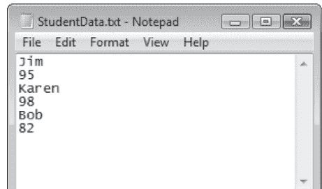

除了将文件内容分成行之外，换行符还充当分隔符。分隔符是一个分离其他项目的项目。当你使用 `println` 方法向文件写入数据时，换行符将分离单独的数据项。稍后你将看到文件中的单独数据项必须被分离，才能从文件中读取。

## PrintWriter 类的 print 方法

`print` 方法用于向文件写入一个数据项而不写入换行符。例如，查看以下代码：

```java
String name = "Jeffrey Smith";

String phone = "554-7864";

int idNumber = 4785;

PrintWriter outputFile = new PrintWriter("PersonalData.txt");

outputFile.print(name + " ");

outputFile.print(phone + " ");

outputFile.print(idNumber);

outputFile.close();
```

此代码使用 `print` 方法将 name 对象写入文件，后面跟着一个空格。使用 `print` 方法将 phone 对象写入文件，后面跟着一个空格。使用 `print` 方法写入 idNumber，后面一个换行符。图 5-12 显示了记事本中显示的内容。

**图 5-12** 在记事本中显示的文件内容

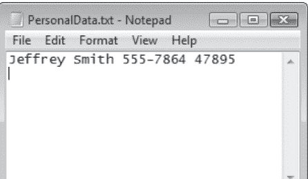

## 在方法头中添加 throws 子句

当 Java 程序发生意外事件时，可以说该程序抛出了异常。现在，你可以将异常视为一种信号，表示在处理该事件之前程序无法继续。例如，假设你创建了一个 `PrintWriter` 对象并将文件名传递给它的构造函数。意外的是，磁盘已满，无法创建文件。显然，在处理这种情况之前程序无法继续，因此抛出了异常，导致程序暂停。

当异常被抛出时，方法必须处理它或再次抛出。如果 main 方法抛出异常，方法必须处理它或再次抛出。

让我们来看一个向文件写入数据的示例程序。代码列表 5-18 程序将你朋友的名字写入文件。

```java
import java.util.Scanner;

import java.io.*;

/**
 * 此程序向文件写入数据。
 */
public class FileWriteDemo
{
    public static void main(String[] args) throws IOException
    {
        String filename;            // 文件名
        String friendName;          // 朋友的名字
        int numFriends;             // 朋友数量

        // 创建用于键盘输入的 Scanner 对象。
        Scanner keyboard = new Scanner(System.in);

        // 获取朋友数量。
        System.out.print("How many friends do you have? ");
        numFriends = keyboard.nextInt();

        // 消耗剩余的换行符。
        keyboard.nextLine();

        // 获取文件名。
        System.out.print("Enter the filename: ");
        filename = keyboard.nextLine();

        // 打开文件。
        PrintWriter outputFile = new PrintWriter(filename);

        // 获取数据并写入文件。
        for (int i = 1; i <= numFriends; i++)
        {
            // 获取朋友的名字。
            System.out.print("Enter the name of friend number " + i + ": ");
            friendName = keyboard.nextLine();
        }

        // 将名字写入文件。
        outputFile.println(friendName);

        // 关闭文件。
        outputFile.close();
    }
}
```

```java
47 System.out.println("Data written to the file.");
48 
49 )
```

# 程序输出（示例输入已加粗显示）

| 你有多少个朋友？5 [回车] |
| 输入文件名：MyFriends.txt [回车] |
| 输入第 1 个朋友的名字：Joe [回车] |
| 输入第 2 个朋友的名字：Rose [回车] |
| 输入第 3 个朋友的名字：Greg [回车] |
| 输入第 4 个朋友的名字：Kirk [回车] |
| 输入第 5 个朋友的名字：Renee [回车] |
| 数据已写入文件。 |

第 2 行的 `import` 语句是必要的，因为该程序使用了 `PrintWriter` 类，并且第 10 行的 `main` 方法有 `throws IOException`。在 `main` 方法头中我们需要这个类，因为 `PrintWriter` 类对象可能会抛出 `IOException`。

该程序要求用户输入其朋友的数量（第 20 到 21 行），以及将创建的文件名（第 27 和 28 行）。`filename` 变量引用文件名，并用于以下第 31 行的语句中：

```java
PrintWriter outputFile = new PrintWriter(filename);
```

该语句打开文件并创建一个 `PrintWriter` 对象，可用于将数据写入文件。第 34 到 43 行的 `for` 循环对用户拥有的每个朋友进行迭代，每次都询问一个朋友的名字。用户的输入由 `friendName` 变量引用。一旦输入名称，就会通过第 42 行的以下语句将其写入文件：

```
outputFile.println(friendName);
```

循环结束后，在第 46 行关闭文件。在使用示例运行所示的输入执行程序后，将创建 `MyFriends.txt` 文件。如果我们用记事本打开该文件，将看到如图 5-13 所示的内容。

## 图 5-13 在记事本中显示的文件内容

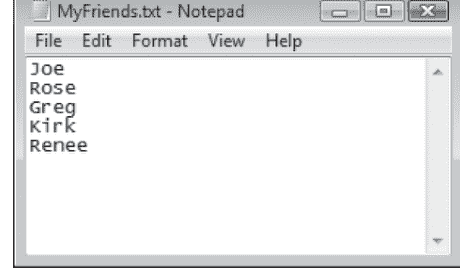

## 5.10 文件输入与输出简介

## 复习

在继续之前，让我们复习编写将数据写入文件的程序时必要的步骤：

1. 你需要在程序的顶部部分包含 `import java.io.*;` 语句。
2. 因为我们还没有学习如何处理异常，任何使用 `PrintWriter` 的方法在方法头中必须有 `throws IOException`。
3. 你创建一个 `PrintWriter` 对象，并将文件名作为字符串传递给构造函数。
4. 你使用 `PrintWriter` 类的 `print` 和 `println` 方法将数据写入文件。
5. 完成向文件的写入后，你使用 `PrintWriter` 类的 `close` 方法关闭文件。

## 向文件追加数据

当你向 `PrintWriter` 构造函数传递一个文件名且该文件已存在时，它将被擦除并创建一个同名的新空文件。然而，你可能想要保留现有文件并向其内容追加新数据。向文件追加数据意味着向文件中已存在的数据的末尾写入新数据。

要向现有文件追加数据，你首先要创建 `FileWriter` 类的实例。你向 `FileWriter` 构造函数传递两个参数：一个包含文件名的字符串和一个布尔值 `true`。以下是一个示例：

```java
FileWriter fwriter = new FileWriter("MyFriends.txt", true)
```

该语句创建了一个 `FileWriter` 并打开 `MyFriends.txt` 文件进行写入。任何写入文件的数据都将追加到文件的现有内容之后。如果文件不存在，它将会被创建。

你仍然需要创建一个 `PrintWriter` 对象，以便可以使用 `print` 和 `println` 方法将数据写入文件。当你创建 `PrintWriter` 对象时，将 `FileWriter` 引用作为参数传递给 `PrintWriter` 构造函数。例如，查看以下代码：

```java
FileWriter fwriter = new FileWriter("MyFriends.txt", true)

PrintWriter outputFile = new PrintWriter(fwriter)
```

这创建了一个 `PrintWriter` 对象，可用于将数据写入 `MyFriends.txt` 文件。任何写入它的数据都将追加到文件的现有内容之后。例如：

## 第 5 章 循环与文件

```java
13 Scanner keyboard = new Scanner(System.in);

14

15 // 获取文件名。
16 System.out.print("Enter the name of a file: ");
17 String filename = keyboard.nextLine();

18

19 // 打开文件。
20 File file = new File(filename);
21 Scanner inputFile = new Scanner(file);

22

23 // 读取文件的第一行。
24 String line = inputFile.nextLine();

25

26 // 显示该行。
27 System.out.println("The first line in the file is: ");
28 System.out.println(line);

29

30 // 关闭文件。
31 inputFile.close();

32

33 }
```

# 程序输出（示例输入已加粗显示）

Enter the name of a file: MyFriends.txt [Enter]
文件中的第一行是:
Joe

- 该程序在第 17 行从用户处获取文件名。第 20 行创建了一个 `File` 对象来表示该文件，第 21 行创建了一个 `Scanner` 对象来从文件中读取数据。第 24 行从文件中读取一行。在此语句执行后，`line` 变量引用一个持有从文件中读取的行内容的字符串对象。该行在第 28 行显示在屏幕上，并在第 31 行关闭文件。

注意，此程序创建了两个独立的 `Scanner` 对象。第 13 行创建的 `Scanner` 对象从键盘读取数据，而第 21 行创建的 `Scanner` 对象从文件读取数据。

当打开一个文件用于读取时，内部会为该文件维护一个名为“读取位置”的特殊值。文件的读取位置标记了下一个将从文件中读取的项的位置。当打开文件时，其读取位置被设置为文件中的第一个项。当读取该项时，读取位置将移动到文件中的下一个项。随着后续项目的读取，内部读取位置会穿过整个文件。例如，考虑图 5-14 所示的 `Quotation.txt` 文件。如图所示，该文件有三行。

### 图 5-14 具有三行的文件

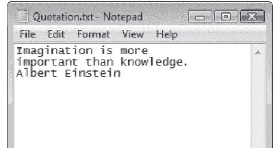

你可以通过以下方式直观地看到文件中存储的数据：

想象比知识更重要
阿尔伯特·爱因斯坦

假设一个程序使用以下代码打开文件：

```
File file = new File("Quotation.txt");
Scanner inputFile = new Scanner(file);
```

当这段代码打开文件时，其读取位置位于第一行的开头，如图 5-15 所示。

### 图 5-15 初始读取位置

> 读取位置 → 想象比知识更重要。
阿尔伯特·爱因斯坦

现在，假设程序使用以下语句从文件中读取一行：

```
String str = inputFile.nextLine();
```

该语句将从当前读取位置开始从文件中读取一行。在语句执行后，由 `str` 变量引用的对象将包含字符串 "Imagination is more"。文件的读取位置将移动到下一行，如图 5-16 所示。

### 图 5-16 读取第一行后的读取位置

> 读取位置 → 想象比知识更重要。
阿尔伯特·爱因斯坦

## 第 5 章 循环与文件

如果再次调用 `nextLine` 方法，将从文件中读取第二行，文件的读取位置将移动到第三行。在读取完所有行后，该位置将位于文件末尾。

> 注意：从 `nextLine` 方法返回的字符串不包含换行符。

### 在方法头中添加 throws 子句

当你将 `File` 对象引用传递给 `Scanner` 类构造函数时，如果未找到指定的文件，构造函数将抛出 `IOException` 异常。因此，在任何将 `File` 对象引用传递给 `Scanner` 类构造函数方法中，你都需要编写 `throws IOException` 子句。

### 检测文件结束

通常，程序必须读取文件内容，而事先不知道文件中存储了多少项。例如，程序在代码列表 5-18 中创建的 `MyFriends.txt` 文件可以存储任意数量的名字。这是因为程序会询问用户朋友的数量。如果用户输入 5，程序会创建一个包含 5 个名字的文件；如果用户输入 100，程序会创建一个包含 100 个名字的文件。

`Scanner` 类有一个名为 `hasNext` 的方法，可以判断文件中是否有更多可读数据。在调用任何其他读取文件的方法之前，先调用 `hasNext` 方法。如果文件中还有更多数据可读，`hasNext` 返回 `true`。如果已到达文件末尾且没有更多数据可读，`hasNext` 方法返回 `false`。

代码列表 5-20 显示了一个示例。该程序读取由代码列表 5-18 程序创建的包含朋友名字的文件。

### 代码列表 5-20 (FileReadDemo.java)

```java
1 import java.util.Scanner;      // 需要 Scanner
2 import java.io.*;               // 需要 IOException
3
4 /**
5 * 此程序从文件读取数据。
6 */
7 class FileReadDemo
8 {
9     public static void main(String[] args)
10 {
11     // ... (省略部分代码)
```


# 图 5-18 Numbers.txt 的内容

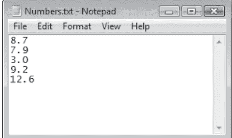

# 代码列表 5-22 (FileSumDemo.java)

```java
import java.io.*; // 需要 IOException

/**
 * 此程序演示了 FileSum 类。
 */
public class FileSumDemo {
    public static void main(String[] args) throws IOException {
        // 创建 FileSum 类的实例。
        FileSum fs = new FileSum("Numbers.txt");
        // 显示 Numbers.txt 中数值之和。
        System.out.println("The sum of the numbers in " +
                "Numbers.txt is " +
                fs.getSum());
    }
}
```

# 程序输出
Numbers.txt 中的数字之和为 41.4

# 复习

让我们快速复习一下编写一个从文件读取数据的程序时所需的步骤：

- 你需要在程序的顶部包含 `import java.util.Scanner;` 语句，这样你就可以使用 `Scanner` 类。你还需要在程序的顶部包含 `import java.io.*;` 语句。这是 `File` 类和 `IOException` 类要求的。
- 因为我们还没有学习如何处理异常，任何使用 `Scanner` 对象打开文件的方法在头部中都可能有一个 `throws IOException` 子句。
- 你创建一个 `File` 对象，并将文件名作为字符串传递给构造函数。
- 你创建一个 `Scanner` 对象，并将 `File` 对象的引用作为参数传递给构造函数。
- 你使用扫描器的 `nextLine()` 方法从文件中读取一行。该方法将数据作为字符串返回。要读取基本数据类型值，请使用 `nextInt()`、`nextDouble()` 等方法。
- 调用 `Scanner` 的 `hasNext()` 方法来确定文件中是否有更多数据可读。如果方法返回 `true`，则还有更多数据可以读取到文件末尾。
- 完成向文件写入后，使用 `Scanner` 类的 `close()` 方法关闭文件。

# 5.10 文件输入与输出简介

## 检查文件是否存在

在尝试打开文件进行输入之前，确保文件存在通常是一个好主意。如果你尝试打开一个不存在的文件，程序将抛出异常并停止。例如，如果你在代码列表 5-20 中保存的程序如果要打开的文件不存在，它将在第 21 行抛出异常。以下是发生这种情况时显示的错误消息示例：

```
Exception in "main" java.io.FileNotFoundException: MyFriends.txt (The system cannot find the file (specified))
  at java.io.FileInputStream.init(FileInputStream.java:106)
  at java.util.Scanner.init(Scanner.java:636)
  at FileReadDemo.main(FileReadDemo.java:21)
```

与其让异常抛出并允许显示这种晦涩的错误消息，你的程序可以在尝试打开文件之前检查文件是否存在。如果文件不存在，程序可以显示更用户友好的错误消息并优雅地关闭。

在你创建一个代表想要打开的文件的 `File` 对象后，可以使用 `File` 类的 `exists()` 方法来判断文件是否存在。如果存在则返回 `true`，如果不存在则返回 `false`。代码列表 5-23 显示了如何使用该方法。这是对代码列表 5-20 中 `FileReadDemo` 程序的修改。此版本的程序在尝试打开文件之前检查文件是否存在。

### 代码列表 5-23 FileReadDemo.java

```java
import java.util.Scanner;      // 需要 Scanner
import java.io.*;              // 需要 File 和 IOException

/**
 * 此程序从文件中读取数据。
 */
public class FileReadDemo {
    public static void main(String[] args) throws IOException {
        // 创建 Scanner 对象。
        Scanner keyboard = new Scanner(System.in);
        // 获取文件名。
        System.out.print("Enter the filename: ");
        String filename = keyboard.nextLine();
        // 检查文件是否存在。
        File file = new File(filename);
        if (!file.exists()) {
            // 显示错误消息。
            System.out.println("The file " + filename +
                    " does not exist.");
            // 退出程序。
            System.exit(0);
        }
        // 打开文件。
        Scanner inputFile = new Scanner(file);
        // 从文件中读取行直到没有更多。
        while (inputFile.hasNext()) {
            // 读取下一个名字。
            String friendName = inputFile.nextLine();
            // 显示下一个名字。
            System.out.println(friendName);
        }
        // 关闭文件。
        inputFile.close();
    }
}
```

# 第5章 循环与文件

### 代码列表 5-24 (FileWriteDemo.java)

```java
import java.io.*; // 需要 PrintWriter 和 IOException
import java.util.Scanner; // 需要 Scanner

/**
 * 此程序向文件写入数据。
 * 在打开之前确保文件不存在。
 */
public class FileWriteDemo {
    public static void main(String[] args) throws IOException {
        // 创建 Scanner 对象用于输入。
        Scanner keyboard = new Scanner(System.in);
        // 获取朋友数量。
        System.out.print("How many friends do you have? ");
        int numFriends = keyboard.nextInt();
        // 消耗换行符。
        keyboard.nextLine();
        // 获取文件名。
        System.out.print("Enter the filename: ");
        String filename = keyboard.nextLine();
        // 确保文件不存在。
        File file = new File(filename);
        if (file.exists()) {
            // 显示错误消息。
            System.out.println("The file " + filename + " already exists.");
            // 退出程序。
            System.exit(0);
        }
        // 打开文件。
        PrintWriter outputFile = new PrintWriter(file);
        // 获取数据并写入文件。
        for (int i = 1; i <= numFriends; i++) {
            // 获取朋友的名字。
            System.out.print("Enter the name of friend " + "number " + i + ": ");
            String friendName = keyboard.nextLine();
            // 将名字写入文件。
            outputFile.println(friendName);
        }
        outputFile.close();
        System.out.println("Data written to the file.");
    }
}
```

## 5.11 需要避免的常见错误

## 检查点 (Checkpoint)

- 5.16 输入文件和输出文件之间的区别是什么？
- 5.17 在执行文件操作的程序中，你需要哪个 import 语句？
- 5.18 使用哪个类向文件写入数据？
- 5.19 编写代码实现以下功能：打开名为 `MyName.txt` 的文件，将你的名字写入该文件，然后关闭文件。
- 5.20 你使用哪些类来从文件中读取数据？
- 5.21 编写代码实现以下功能：打开名为 `MyName.txt` 的文件，读取文件的第一行并显示它，然后关闭文件。
- 5.22 你正在打开一个已存在的文件进行输出。你如何在不删除文件的情况下打开它，并同时使写入文件的新数据追加到现有数据的末尾？
- 5.23 在执行性能操作的方法头部，你必须使用哪个类？

> 参见“摊销类案例研究”（Amortization Class Case Study）以获取使用本章主题的深入示例。该案例研究可在本书的在线资源页 www.pearsonglobal.com/gaddis 获取。

### 需要避免的常见错误

以下列表描述了在学习本章主题时经常犯的几种错误。

- 在错误的模式下使用递增或递减运算符。当递增或递减运算符放在操作数之前（左侧）时，它以前置模式使用。当这两个运算符之一放在操作数之后（右侧）时，它们以后置模式使用。
- 忘记将布尔表达式包含在 `while` 循环或 `do-while` 循环中。
- 在 `while` 或 `for` 循环头的末尾放置分号。当你在 `while` 或 `for` 循环头的末尾写分号时，Java 假设条件执行的语句是一个空语句或空语句。这将导致无限循环。
- 忘记在 `do-while` 循环末尾写分号。`do-while` 循环必须以分号结束。
- 忘记将多个语句包含在循环体中。通常情况下，循环根据条件只执行一条语句。要根据条件执行多个语句，你必须将这些语句放在循环体中。
- 在 `for` 循环中使用逗号代替分号来分隔初始化、测试和更新表达式。
- 忘记在 `while` 或 `do-while` 循环体中编写修改循环控制变量的代码。如果 `while` 或 `do-while` 循环的布尔表达式永远不变为假，循环将无限重复。你必须在循环体内包含修改循环控制变量的语句，以便布尔表达式在某个时刻变为假。
- 使用可能也可以作为有效数据值的哨兵值。记住，哨兵是一个特殊值，它不会被误认为是数据项列表的成员，并指示列表中没有更多数据项需要处理。如果你选择了一个可能出现在列表中的哨兵值，循环在遇到列表中的该值时将提前终止。
- 忘记将累加器初始化为零。为了让累加器保持正确的运行总和，在向其添加任何值之前必须将其初始化为零。

### 复习题与练习题

## 单选题和判断题

- 1. 下述代码段的输出是什么？
```java
int a = 1
```
- 2. 下述程序段将显示什么？
```java
for(int a = 2; a <= 10; a += 3)
    System.out.print(a+"");
```
a. 258
b. 2 5
c. 2 5 11
d. 2
- 3. 在表达式 `number++` 中，`++` 运算符处于什么模式？
a. 前置 (prefix)
b. 前测试 (pretest)
c. 后置 (postfix)
d. 后测试 (posttest)
- 4. 循环的每次重复被称为什么？
a. 周期 (cycle)
b. 旋转 (revolution)
c. 轨道 (orbit)
d. 迭代 (iteration)
- 5. 这是控制循环执行迭代的变量。
a. 循环控制变量 (loop control variable)
b. 累加器 (accumulator)
c. 迭代寄存变量 (iteration register variable)
d. 重复计数 (repetition meter)
- 6. `while` 循环是这种类型的循环。
a. 前测试 (pretest)
b. 后测试 (posttest)
c. 前置 (prefix)
d. 后置 (postfix)
- 7. `do-while` 循环是这种类型的循环。
a. 前测试 (pretest)
b. 后测试 (posttest)
c. 前置 (prefix)
d. 后置 (postfix)
- 8. `for` 循环是这种类型的循环。
a. 前测试 (pretest)
b. 后测试 (posttest)
c. 前置 (prefix)
d. 后置 (postfix)
- 9. 这种循环没有结束的方法，一直重复直到程序被中断。
a. 不定的 (indeterminate)
b. 不破的 (unbreakable)
c. 无限的 (infinite)
d. 无时的 (timeless)
- 10. 该表达式在 `for` 循环每次迭代的结束时执行。
a. 初始化表达式 (initialization expression)
b. 测试表达式 (test expression)
c. 更新表达式 (update expression)
d. 语句块 (statement block)
- 11. 该表达式被 `for` 循环只执行一次，无论迭代次数是多少。
a. 初始化表达式 (initialization expression)
b. 测试表达式 (test expression)
c. 更新表达式 (update expression)
d. 递增表达式 (increment expression)
- 12. 这条语句导致循环提前终止。
a. continue
b. break
c. switch
d. 以上均非
- 13. 在 Windows 计算机上，此字面量指定 `Data.txt` 在 C 盘的文件夹中。
a. `"c:\\Data.txt"`
b. `"c:Data.txt"`
c. `"cData.txt"`
- 14. 为了向文件写入，使用哪些类？
a. `PrintWriter`
b. `File`
c. `Output`
- 15. 为了从文件中读取数据，使用哪些类？
a. `File`
b. `Output`
c. `Scanner`
- 16. 哪个是分隔符？
a. newline
b. alphabets
c. digits
d. null
- 17. 哪个类允许你使用 `println()` 方法写入文件？
a. `File`
b. `FileReader`
c. `Output`
- 18. 使用 `Scanner` 类需要哪个 import 语句？
a. `java.util.*`
b. `java.io.*`
c. `java.lang.*`
d. `java.net.*`
- 19. `while` 循环是前测试循环。
- 20. `do-while` 循环是前测试循环。
- 21. 在 `for` 循环的更新表达式中更新多个变量。
- 22. `Scanner` 类是 `java.io` 的。
- 23. 变量可以定义在 `for` 循环的初始化表达式中。
- 24. 在嵌套循环中，外层循环遍历所有的迭代。
- 25. 循环计算总和。

### 找错 (Find the Error)

找出以下代码中的错误。

```java
// 此代码包含错误
// 添加两个用户输入的数字。

int num1, num2;
String input;
char again;
Scanner keyboard = new Scanner(System.in);

while (again == 'y' || again == 'Y') {
    System.out.print("输入一个数字: ");
    num1 = keyboard.nextInt();
    System.out.print("输入另一个数字: ");
    num2 = keyboard.nextInt();
    System.out.println("和为 " + (num1 + num2));
    System.out.println("你想再次操作吗？ ");
}

// 消耗换行符
keyboard.nextLine();
input = keyboard.nextLine();
again = input.charAt(0);
```

- 2. 找出以下代码中的错误。

```java
// 此代码包含错误
int count = 1, total;
while (count <= 100)
    total += count;
System.out.print("1-100 的和为 ");
System.out.println(total);
```

- 3. 找出以下代码中的错误。

```java
// 此代码包含错误
```


## 代码片段

```java
Scanner keyboard = new Scanner(System.in);

int choice, num1, num2;

do
{
    System.out.print("输入一个数字: ");
    num1 = keyboard.nextInt();
    System.out.print("输入另一个数字: ");
    num2 = keyboard.nextInt();
    System.out.println("和为 " + (num1 + num2));
    System.out.println("你想再次操作吗？ ");
    System.out.print("1 = 是，0 = 否 ");
    choice = keyboard.nextInt();
} while (choice == 1);
```

## 练习题

### 4. 找出以下代码中的错误

```java
// 此代码包含错误
// 打印 1 到 10。

for (int count = 1; count <= 10; count++)
{
    System.out.println(count);
    count++;
}
```

## 算法工作

1. 写一个循环，让用户输入一个数字。将该数字乘以 10 并将结果存储在变量 `product` 中。只要 `product` 包含的值少于 100，循环就继续执行。
2. 写一个 `do-while` 循环要求用户输入两个数字。将数字相加并显示和。询问用户是否想再次操作。如果是，则重复循环；否则终止。
3. 写一个循环打印从 $5 \times 1 = 5$ 到 $5 \times 10 = 50$ 的五倍表。
4. 写一个循环显示以下字符序列：
   `ABCDEFGHIJK`
5. 写一个循环计算以下数字序列的总和：
   $\frac{1}{30} + \frac{2}{29} + \frac{3}{28} + \dots + \frac{30}{1}$

## 第5章 循环与文件

6. 编写一个嵌套循环，显示 10 行 `#` 字符。每行应有 15 个 `#` 字符。
7. 编写嵌套循环绘制此模式：
```
******
*****
****
***
**
*
```
8. 编写嵌套循环绘制此模式：
```
#
##
###
####
#####
######
```
9. 完善以下程序，使其执行以下操作的 10 次：
   - 生成一个 0 或 1 的随机数。
   - 根据生成的随机数显示单词 "Yes" 或单词 "No"。

```java
// 在此处编写必要的 import 语句。

public class ReviewQuestion
{
    public static void main(String[] args)
    {
        // 在此处编写必要的代码。
    }
}
```

10. 将以下代码段中的循环转换为 `do-while` 循环：
```java
Scanner keyboard = new Scanner(System.in);
int x = 1;
do
{
    System.out.print("Enter a number: ");
    x = keyboard.nextInt();
} while (x > 0);
```

11. 将以下代码段中的 `do-while` 循环转换为 `while` 循环：
```java
Scanner keyboard = new Scanner(System.in);
String input;
char sure;
input = keyboard.next();
sure = input.charAt(0);
while (sure != 'Y' && sure != 'N')
{
    System.out.print("Are you sure you want to quit? ");
    input = keyboard.next();
    sure = input.charAt(0);
}
```

12. 将以下代码段中的 `while` 循环转换为 `for` 循环：
```java
for (int count = 0; count < 50; count++)
{
    System.out.println("count is " + count);
}
```

13. 编写一个嵌套循环，显示以下模式：
```
1
1 2
1 2 3
1 2 3 4 2 1
```

14. 编写一个输入验证循环，要求用户输入 1 到 5 之间的数字。
15. 编写一个输入验证循环，要求用户输入单词 "yes" 或 "no"。
16. 编写执行以下操作的代码：打开名为 `numberList.txt` 的文件，使用 `for` 循环将 1 到 50 之间的所有偶数写入文件。
17. 编写执行以下操作的代码：打开由第13题代码创建的 `numberList.txt` 文件，从文件中读取所有数字并显示，然后关闭文件。
18. 编写执行以下操作的代码：打开名为 `numberList.txt` 的文件，使用循环将 1 到 50 之间的所有奇数追加到文件中，而不删除现有数据。
19. 编写代码以打开名为 `numberList.txt` 的文件进行写入，但如果文件已存在，则不删除其内容。

## 简答

1. 简述递增运算符所使用的前置模式和后置模式之间的区别。
2. 为什么要对循环体中的语句进行缩进？
3. `while` 循环的两个重要部分是什么？
4. 为什么循环体中的语句是条件执行语句？
5. 计数控制循环必须具备的三个要素是什么？
6. 在希望循环重复直到布尔表达式为假的情况下，且循环在开始时如果测试表达式为假时不执行，你应该使用哪种循环？
7. 在希望循环重复直到布尔表达式为假的情况下，但循环至少应执行一次，你应该使用哪种循环？
8. 举例描述嵌套循环的概念。
9. 为什么累加器变量正确初始化至关重要？
10. 什么是无限循环？编写一个无限循环的代码。
11. 描述一个需要使用累加器的编程问题。
12. 让用户控制循环意味着什么？
13. 使用哨兵值的优势是什么？
14. 为什么建议尽可能在 `for` 循环中避免使用 `break`？
15. 什么样的编程问题需要使用嵌套循环？
16. 为什么应该使用 `throws` 子句？
17. 任务完成后为什么要关闭文件？
18. 文件的读取位置是指什么？
19. `print` 和 `println` 方法之间有什么区别？
20. 当到达文件末尾时，`Scanner` 的 `hasNext` 方法返回什么？
21. 为什么无法向文件追加数据？
22. 如何打开文件以写入数据？
23. 是什么之和？

## 编程挑战

### 1. 数字之和
编写一个程序，要求用户输入一个正整数。程序应使用循环获取从 1 到该数字的和。例如，如果用户输入 50...

### 2. 行程距离
距离的计算方法如下：
> 距离 = 速度 * 时间

编写一个程序计算每小时的距离。程序应显示如下所示表格：

| 小时 | 距离 |
|---|---|
| 1 | 40 |
| 2 | 80 |
| 3 | 120 |

输入验证：不要接受负数速度，不要接受小于 1 的时间。

### 3. 距离文件
修改你写的 Distance Traveled 程序，将报告写入文件而不是屏幕。使用记事本或其他文本编辑器打开文件以确认输出。

### 4. 分的工资
编写一个程序，计算一个人在某期间的收入，如果他的工资第一天是分，第二天翻倍，并以此类推。程序应显示每天的工资，然后在最后显示总工资。输出应为金额单位，而不是分。

输入验证：不要接受小于 1 的天数。

### 5. 酒店入住
酒店的入住率计算方法如下：
> 入住率 = 已入住房间数 ÷ 总房间数

编写一个程序计算酒店每层的入住率。程序首先询问层数。一个循环遍历每个楼层。在每次迭代中，循环要求用户输入楼层的房间数和已入住数。在所有迭代完成后，程序应显示酒店的总房间数、已入住数、空闲数以及入住率。

输入验证：不要接受小于 1 的层数。不要接受小于 10 的层房间数。

### 6. 人口
编写一个预测生物人口数量的类。该类应存储初始数量、平均人口增长率（百分比）以及倍增的天数。该类应有一个方法，使用循环显示每天的人口数量。

在程序中测试该类，要求用户输入初始数量、平均每日增长率和倍增天数。程序应显示人口。

输入验证：不要接受小于 2 的初始数量。不要接受负的平均人口增长率。不要接受小于 1 的倍增天数。

### 7. 平均降雨量
编写一个使用嵌套循环计算多年平均降雨量的程序。该程序首先询问年数。外层循环每年迭代一次。内层循环迭代十二次，对应每个月份。内层循环的每次迭代要求用户输入该月的降雨量（英寸）。

在所有迭代完成后，程序应显示月份数、总降雨量以及整个期间的每月平均雨量。

输入验证：年份不接受小于 1 的数字。每月降雨量不接受负数。

### 8. 最大值与最小值
编写一个程序，让用户输入一系列整数。用户输入 -99 表示序列结束。在输入所有数字后，程序应显示输入的最大的数字和最小的数字。

### 9. 薪资报表
设计一个 `Payroll` 类，用于存储员工的工号、总工资、州税、联邦税和 FICA 扣留税。该类应有一个方法来计算员工的净工资，公式如下：

```
net pay = gross pay - state tax - federal tax - FICA own
```

在一个程序中使用该类来显示一份周薪薪资报表。程序中的循环应要求用户输入员工工号、总工资、州税、联邦税和 FICA 扣留税，并将这些值传递给 `Payroll` 类的一个实例。应显示净工资。当输入的员工编号为 0 时，循环终止。

输入验证：任何项目均不接受负数。州税、联邦税或 FICA 扣留税的值不能大于总工资。如果任何员工的州税 + 联邦税 + FICA 扣留税总和大于总工资，打印错误信息并要求用户重新输入该员工的数据。

### 10. SavingsAccount 类
设计一个 `SavingsAccount` 类，用于存储储蓄账户的年利率和余额。该类的构造函数应接受储蓄初始余额的金额。该类还应具有减少取款金额、增加存款金额以及添加每月利息的方法。每月利率为年利率除以 12。要添加每月利息，将余额乘以月利率并将结果加到余额中。

在一个程序中测试该类，计算一段时间后储蓄账户的余额。它应要求用户输入年利率、初始余额以及自账户建立以来过的月数。循环应每个月迭代一次，执行以下操作：

- a. 要求用户输入当月存入账户的金额。使用类方法将此金额添加到账户余额。
- b. 要求用户输入当月从账户中取出的金额。使用类方法从账户余额中减去此金额。
- c. 使用类方法计算每月利息。

在最后迭代后，程序应显示结束余额、总存款金额、总取款金额和获得的总利息。

### 11. 存款与取款文件
使用记事本或其他文本编辑器创建一个名为 `Deposits.txt` 的文件。该文件应包含以下数字，每行一个：
- 100.00
- 125.00
- 78.92
- 37.55

接下来，创建一个名为 `Withdrawals.txt` 的文本文件。该文件应包含以下数字，每行一个：
- 29.88
- 110.00
- 27.52
- 50.00
- 12.90

`Deposits.txt` 文件中的数字是当月存入储蓄的存款金额，`Withdrawals.txt` 文件中的数字是当月取款金额。编写一个程序，创建一个你在编程挑战 10 中编写的 `SavingsAccount` 类实例。对象的初始余额为 $500.00。程序应从 `Deposits.txt` 文件中读取值并将其添加到账户余额。程序应从 `Withdrawals.txt` 文件中读取值并使用对象的方法从余额中减去它们。程序应调用类方法计算每月利息，并显示结束余额和总利息。

### 12. 柱状图
编写一个程序，要求用户输入五家商店今日日的销售额。程序应显示比较每家商店销售额的柱状图。通过显示一行星号来创建柱状图中的每个柱。每个星号代表 $100 的销售额。以下是程序输出示例：

```
Enter today's sales for store 1: 1000 [Enter]
Enter today's sales for store 2: 1200 [Enter]
Enter today's sales for store 3: 1800 [Enter]
Enter today's sales for store 4: 800 [Enter]
Enter today's sales for store 5: 1900 [Enter]

SALES CHART
Store 1: *****
Store 2: ************
Store 3: ******
Store 4: *****
Store 5: ********************
```

### 13. 摄氏度华氏度表
编写一个程序，显示 0 到 20 的摄氏度及其对应的华氏度表格。从摄氏度转换为华氏度的公式为：

```
F = (9/5)C + 32
```

其中 F 是华氏度温度，C 是摄氏温度。

### 14. FileDisplay
编写一个名为 `FileDisplay` 的类，包含以下内容：
- 构造函数：构造函数接受文件名。
- `displayHead()`：此方法仅显示前五行。
- `displayContents()`：此方法显示整个文件。
- `displayWithNumbers()`：此方法显示带编号的文件。

### 15. UpperCaseFile
编写一个名为 `UpperCaseFile` 的类。该类接受两个文件名。第一个文件用于读取，第二个文件用于写入。该类应读取第一个文件的内容，将其转换为大写，并存储在第二个文件中。

### 16. 预算分析
编写一个程序，要求用户输入预算。程序维护一个运行总。循环结束后，程序应显示是高于预算还是低于预算。

### 17. 随机数游戏
编写一个程序，生成一个随机数并让用户猜。如果用户的猜测高于随机数，程序应显示“太高了，重试”。如果用户的猜测低于随机数，程序应显示“太低了，重试”。程序循环直到用户正确猜中随机数。

### 18. 随机数游戏增强
增强你在 17 中编写的程序，记录猜测次数。当用户正确猜中随机数时，程序显示次数。

### 19. 正方形显示
编写一个程序，要求用户输入一个正整数。程序随后使用字符‘x’显示正方形。输入的数字将作为正方形的边长。例如，如果用户输入 5，程序应显示：
```
xxxxx
xxxxx
xxxxx
xxxxx
xxxxx
```
如果用户输入 8，程序应显示：
```
xxxxxxxx
...
xxxxxxxx
```


## 20. 硬币抛掷模拟器

编写一个名为 `Coin` 的类。该类具有以下字段：

- 一个字符串字段 `sideUp`。`sideUp` 字段将持有“heads”（正面）或“tails”（反面），表示硬币朝上的一面。

`Coin` 类应具有以下方法：

- 一个无参数构造函数，用于抛掷硬币。
- 一个 void 方法，模拟抛掷硬币。当调用 `toss` 方法时，它生成一个 0 到 1 之间的随机数。如果随机数是 0，它将 `sideUp` 字段设置为 "heads"。如果随机数是 1，它将 `sideUp` 字段设置为 "tails"。
- 一个名为 `getSideUp` 的方法，返回 `sideUp` 字段的值。

编写一个程序演示硬币类。程序应创建类的实例并显示初始朝向。然后，使用循环抛掷硬币 20 次。每次抛掷时，显示朝上的面。程序应记录正面和反面的次数，并在循环结束后显示这些值。

## 21. 抛币换美元

在本次作业中，你将使用编程挑战 20 中的 `Coin` 类创建一个游戏。程序应有三个 `Coin` 类实例：一个代表四角币，一个代表角币，一个代表镍币。

游戏开始时，你的初始余额为 $0。在游戏的每轮中，程序将模拟抛掷硬币。当硬币抛掷时，如果是正面朝上，则将硬币的面值加入余额。例如，如果四角币正面朝上，余额将增加 25 分。如果是反面朝上，则不增加余额。当你的余额达到 1 美元或更多时，游戏结束。如果余额恰好为 1 美元，你赢了游戏。如果你的余额超过 1 美元，则你输了。

# 第5章 循环与游戏

## 22. 骰子游戏

编写一个程序，使用第4章介绍的 `Die` 类在计算机和用户之间玩一个简单的骰子游戏。程序应该创建两个 `Die` 类的实例（每个都是六面骰）。其中一个 `Die` 对象是计算机的骰子，另一个 `Die` 对象是用户的骰子。

程序应该有一个循环 10 次的循环。在每次循环迭代时，都应该掷两颗骰子。点数大的骰子获胜。（如果平局，则该轮掷骰没有胜者）。

循环结束后，程序应该统计计算机胜和用户胜的次数。在循环完成所有迭代后，程序应该显示谁赢了游戏——计算机还是用户。

## 23. 钓鱼游戏模拟

编写一个程序，使用第4章介绍的 `Die` 类来模拟钓鱼游戏。在这个游戏中，通过掷一个六面骰子来决定用户钓到了什么。每个可能的物品都有相应的分数。分数在用户钓鱼结束之前将保持隐藏，然后根据获得的钓鱼分数显示一条祝贺用户的消息。

以下是一些关于游戏设计的建议：

- 游戏的每轮都是循环的一次迭代，只要玩家想继续钓更多物品，循环就会一直重复。
- 在每轮开始时，程序将询问用户是否想继续钓鱼。
- 程序模拟六面骰子的投掷。（使用第4章中演示的 `Die` 类。）
- 每个可以被钓到的物品都由骰子生成的数字表示。例如，1 代表“大鱼”，2 代表“一只旧鞋”，3 代表“一条小鱼”，以此类推。
- 用户钓到的每个物品价值不同的分值。
- 循环维护用户钓鱼分数的总和。
- 循环结束后，显示钓鱼总分数，以及一条根据获得分数而不同的消息。

## 24. 21点游戏

编写一个程序，使用第4章介绍的 `Die` 类编写一个游戏程序，让用户与计算机对玩一种流行的黑杰克游戏变体；使用两颗六面骰子代替扑克牌。掷骰子后，玩家尝试在不超过 21 点的情况下击败计算机的隐藏总分。

以下是一些关于游戏设计的建议：

- 游戏的每轮都是循环的一次迭代，只要玩家同意掷骰子且玩家的总分不超过 21 点，循环就会一直重复。
- 在每轮开始时，程序将询问用户是否想掷骰子来累积分数。
- 在每轮中，程序模拟两颗六面骰子的投掷：首先是计算机，然后询问用户他或她想要掷。使用第4章中演示的骰子类来模拟骰子。
- 循环维护计算机和用户分数的总和。
- 计算机的总分在循环结束之前应保持隐藏。
- 循环结束后，公布计算机的总分，在不超过 21 点的情况下，分值最高的玩家获胜。

## 25. ESP游戏

编写一个测试你的 ESP（超感应）的程序。该程序应该从以下单词列表中随机选择一个颜色名称：

红、绿、蓝、橙、黄

为了选择一个单词，程序可以生成一个随机数。例如，如果数字是 0，选中的单词是红色；如果数字是 1，选中的单词是绿色，以此类推。

接下来，程序应该要求用户输入她的猜测，程序应该显示随机选择的颜色。程序应该重复此操作 10 次，并显示猜中选择颜色的次数。

## 26. 老虎机模拟

老虎机是一种赌博设备，用户向其投入钱然后拉动拉杆（或按下按钮）。老虎机显示一组随机图像。如果其中两个或更多图像匹配，用户将赢得一笔钱，老虎机会将这些钱发放给用户。

创建一个模拟老虎机的程序。当程序运行时，它应该执行以下操作：

- 询问用户想要投入老虎机的金额。
- 程序不再显示图像，而是从列表中随机选择一个单词：樱桃、橙子、梅子、铃铛、瓜、条。
- 为了选择一个单词，程序可以生成一个 0 到 5 之间的随机数。如果数字是 0，选中的单词是樱桃；如果数字是 1，选中的单词是橙子，以此类推。程序应该从该列表中随机选择三次单词，并显示所有三个单词。
- 如果没有单词匹配，程序通知用户赢了 0 元。如果两个单词匹配，程序通知用户赢了投入金额的两倍。如果三个单词都匹配，程序通知用户赢了投入金额的三倍。
- 程序询问用户是否想再次玩游戏。如果是，则重复这些步骤。如果不是，程序显示投入老虎机的总金额。

# 6.1 静态类成员

```java
25 * this class that have been created.
26 */
public int getInstanceCount()
{
    return instanceCount;
}
```

首先，注意第 7 行中名为 `instanceCount` 的静态字段的声明。静态字段是通过在访问修饰符之后、字段数据类型之前放置 `static` 关键字创建的。注意，我们显式地将 `instanceCount` 字段初始化为值 `0`。无论创建了多少个该类的实例，这种初始化只发生一次。

> 注意：Java 会自动在所有未初始化的数值型静态成员变量中存储 0。此类中的 `instanceCount` 字段经过了显式初始化，因此任何阅读代码的人都能清楚地看到它是从值 0 开始的。

接下来，查看第 16 行到 19 行的构造函数。第 18 行的语句使用 `++` 运算符来增加 `instanceCount` 字段的值。对于 `Countable` 类的每个实例都会调用构造函数并进行加 1。因此，`instanceCount` 字段将包含已创建的 `Countable` 类实例的数量。可以通过位于第 28 行到 31 行的 `getInstanceCount` 方法来获取此值。代码列表 6-2 中的程序演示了这个类。

## 代码列表 6-2 (StaticDemo.java)

```java
/**
 * 此程序演示了 Countable 类。
 */
public class StaticDemo
{
    public static void main(String [] args) 
    {
        int objectCount;
        // 创建三个 Countable 类的实例。
        Countable object1 = new Countable();
        Countable object2 = new Countable();
        Countable object3 = new Countable();
        // 从类的静态字段中获取实例数量。
        objectCount = object1.getInstanceCount();
        System.out.println(objectCount + " instances " + "of the class were created.");
    }
}
```

## 程序输出

创建了 3 个类实例。

程序创建了三个 `Countable` 类实例，分别由变量 `object1`、`object2` 和 `object3` 引用。尽管该类有三个实例，但静态字段只有一个副本。这在图 6-1 中所示。

图 6-1 类的所有实例共享同一个静态字段

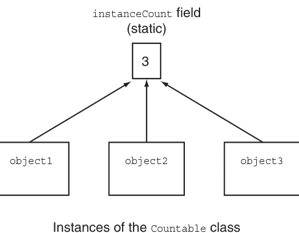

在第 19 行，程序调用 `getInstanceCount` 方法来获取已创建的实例数量。尽管是从 `object1` 调用 `getInstanceCount` 方法，但从任何对象返回的都是相同的值。

## 静态方法

当一个类包含静态方法时，不需要该类的实例来执行该方法。代码列表 6-3 中的程序演示了一个带有静态方法的类示例。

## 代码列表 6-3 (Metric.java)

```java
/**
 * 此类演示了静态方法。
 */
public class Metric
{
    /**
     * milesToKilometers 方法将英里转换为公里。应该将英里距离传递给 miles 参数。方法返回等值的公里距离。
     */
    public static double milesToKilometers(double miles)
    {
        return miles * 1.609;
    }

    /**
     * kilometersToMiles 方法将公里转换为英里。应该将公里距离传递给 kilometers 参数。方法返回英里距离。
     */
    public static double kilometersToMiles(double kilometers)
    {
        return kilometers / 1.609;
    }
}
```

静态方法是通过在修饰符之后放置 `static` 关键字创建的。静态方法不需要类的实例即可调用。`Metric` 类有两个静态方法：`milesToKilometers` 和 `kilometersToMiles`。由于它们被声明为静态的，不需要实例即可调用。静态方法通过 `类名.方法名(...)` 调用，例如：`Metric.milesToKilometers(1.0)`。

## 代码列表 6-4 (MetricDemo.java)

```java
import java.util.Scanner;
import java.text.DecimalFormat;

/**
 * 此程序演示了静态方法。
 */
public class MetricDemo
{
    public static void main(String [] args)
    {
        double miles, kilometers;
        Scanner keyboard = new Scanner(System.in);
        DecimalFormat fmt = new DecimalFormat("0.00");
        // 静态方法不需要实例即可调用
        System.out.print("Enter miles: ");
        miles = Metric.milesToKilometers(keyboard.nextDouble());
        System.out.println(fmt.format(miles) + " kilometers.");
        System.out.print("Enter kilometers: ");
        // 静态方法不需要实例即可调用
        kilometers = Metric.kilometersToMiles(keyboard.nextDouble());
        System.out.println(fmt.format(kilometers) + " miles.");
    }
}
```

## 程序输出

输入英里：10
16.09 公里。
输入公里：100
62.15 英里。

## 6.1 静态成员

静态方法对于许多任务来说非常方便，因为它们可以直接从类调用。它们通常用于创建执行操作但不需要存储数据的工具类。

如果一个类同时包含静态和实例成员，请记住以下几点：

- 实例方法可以引用静态变量。你可以在代码列表 6-1 中看到。
- 实例方法可以调用静态方法。
- 执行静态方法不需要对象。然而，实例方法或实例变量只能在对象的上下文中引用。由于静态方法不需要类的实例，静态方法无法引用实例变量或实例方法——例如，静态方法可以创建类的对象，然后使用该对象来调用。

## Math 类

`Math` 类是执行数学运算的静态方法集合。在第 2 章中介绍了 `pow` 方法，它返回一个数字的幂。例如，以下语句返回 5 的 10 次方，并将结果赋值给变量：

```java
result = Math.pow(5.0, 10.0);
```

`Math` 类有一个 `sqrt` 方法，它返回参数的平方根。例如，在以下语句中，`Math.sqrt` 方法返回存储在 `number` 变量中的值的平方根，并将结果赋值给变量：

```java
result = Math.sqrt(number);
```

`Math` 类接受一个 `double` 参数并返回一个 `double`。`Math` 类还有一个静态 `final` 变量 `PI`，它是数学常数 pi 或 π。它定义为 `3.1415926535897932384`。以下语句在计算中使用 `Math.PI`：

```java
circumference = Math.PI * diameter;
```

> `Math` 类还有其他静态成员。更多信息请参见此书在线资源页上的附录 F。

## 检查

- 6.1 实例成员变量和静态变量有什么区别？
- 6.2 静态方法可以执行哪些实例方法无法执行的操作？
- 6.3 描述静态方法的局限性。

# 重载方法

**概念：** 类中的两个或多个方法可以具有相同的名称，只要它们的签名是不同的。

有时你可能需要以不同的方式执行操作，也许是使用不同数据类型的项目。例如，考虑以下两个方法：`squareInt` 和 `squareDouble`。

```java
public static int squareInt(int number)
{
    return number * number;
}

public static double squareDouble(double number)
{
    return number * number;
}
```

这两个方法都接受一个参数并返回该参数的平方。`squareInt` 方法接受一个 `int` 类型，而 `squareDouble` 方法接受一个 `double` 类型。虽然这种方法可行，但更好的解决方案是使用方法重载。在重载中，方法具有相同的名称，但使用不同的参数。

例如，代码列表 6-5 显示了 `MyMath` 类。该类有两个名为 `square` 的方法。这两个方法都执行相同的操作：返回其参数的平方。其中一个版本的方法接受一个 `int` 参数，另一个版本接受一个 `double` 参数。

## 代码列表 6-5 (MyMath.java)

```java
1 /**
2    * 此类重载了 square 方法。
3    */
4 
5    public class MyMath
6    {
7        public static int square(int number)
8        {
9           return number * number;
10      }
11 
12      public static double square(double number)
13      {
14          return number * number;
15      }
16  }
```

## 6.2 重载方法

代码列表 6-6 中的程序使用了两个 `square` 方法。

## 代码列表 6-6 (OverloadingDemo.java)

```java
1 import java.util.Scanner;
2
3 /**
4   * 此程序使用 MyMath 类来
5   * 演示重载方法。
6  */
7
8 public class OverloadingDemo
9 {
10     public static void main(String[] args)
11     {
12         int iNumber;
13         double dNumber;
14
15         // 创建一个 Scanner 对象用于键盘输入。
16         Scanner keyboard = new Scanner(System.in);
17
18         // 获取一个整数并显示其平方。
19         System.out.print("Enter an integer: ");
20         iNumber = keyboard.nextInt();
21         System.out.println("That number's square is " + MyMath.square(iNumber));
22
23         // 获取一个双精度浮点数并显示其平方。
24         System.out.print("Enter a double: ");
25         dNumber = keyboard.nextDouble();
26         System.out.println("That number's square is " + MyMath.square(dNumber));
27     }
}
```


# 第 6 章 类与对象的再次审视

将方法与正确方法的过程被称为绑定（binding）。当调用重载方法时，Java 使用方法的名称和参数列表来确定将调用绑定到哪个方法。在代码列表 6-6 中，当将一个 `int` 参数传递给 `square` 时，会调用具有 `int` 参数的版本。同样，当将一个 `double` 参数传递给 `square` 时，会调用具有 `double` 参数的版本。

## 方法签名

Java 使用方法的签名（signature）来将其与其他同名方法区分开来。方法的签名由方法名称和参数的数据类型组成，按它们出现的顺序。例如，这里是 `MyMath` 类中 `square` 方法的签名：

```
square(int)
```

```
square(double)
```

注意，方法的返回值不是签名的一部分。例如，`square` 方法不能以以下方式进行重载：

```java
public static int square(int number)
{
    return number * number;
}
```

```java
// 错误！后续方法的参数列表将
// 与之前的 square 方法不同。
```

```java
public static double square(int number)
{
    return number * number;
}
```

尽管这些方法具有不同的返回值，但它们的签名是相同的。因此，当编译包含这些方法的类时，会发出错误信息。

当存在使用不同数量参数的相似方法时，重载也非常方便。例如，代码列表 6-7 显示了 `Pay` 类，它使用了两个方法，都名为 `getWeeklyPay()`。其中一个版本的方法返回按小时计算员工的周薪。它使用 `int` 参数表示工作小时数，使用 `double` 参数表示每小时薪率。另一个版本的方法返回薪制员工的周薪。它使用 `double` 参数表示年薪。代码列表 6-8 阐述了 `Pay` 类的用法。

### 代码列表 6-7 (Pay.java)

```java
/**
 * 此类使用重载方法来返回员工的
 * 周薪。
 */

public class Pay
{
    /**
     * 下述方法重载了
     * getWeeklyPay 方法。
     * 按小时计算员工。
     * 小时数。
     */

    public static double getWeeklyPay(int hours, double payRate)
    {
        return hours * payRate;
    }

    /**
     * 下述方法重载了
     * getWeeklyPay 方法。
     * 薪制员工。
     * 年薪。
     */

    public static double getWeeklyPay(double yearlySalary)
    {
        return yearlySalary / 52;
    }
}
```

### 代码列表 6-8 (WeeklyPay.java)

```java
import java.util.Scanner;
import java.text.DecimalFormat;

/**
 * 此程序使用 Pay 类来
 * 确定按小时计算或
 * 薪制员工的周薪。
 */

public class WeeklyPay
{
    public static void main(String[] args)
    {
        String selection;
        Scanner keyboard = new Scanner(System.in);
        DecimalFormat dateFormat = new DecimalFormat("###.00");

        System.out.println("Do you want to calculate the weekly " +
                           "hourly or salaried employees?");
        System.out.print("Enter H or S: ");
        selection = keyboard.nextLine();

        switch(selection.charAt(0))
        {
            case 'H':
                System.out.print("How many hours worked? ");
                int hours = keyboard.nextInt();
                System.out.print("What is the hourly pay rate? ");
                double payRate = keyboard.nextDouble();
                System.out.println("The weekly pay is " +
                                    dateFormat.format(Pay.getWeeklyPay(hours, payRate)));
                break;
            case 'S':
                System.out.print("What is the annual salary? ");
                double yearlySalary = keyboard.nextDouble();
                System.out.println("The weekly pay is " +
                                    dateFormat.format(Pay.getWeeklyPay(yearlySalary)));
                break;
            default:
                System.out.println("Invalid selection.");
        }
    }
}
```

## 6.3 重载构造函数

+ 概念：一个类可以定义多个构造函数。

类的构造函数可以像其他方法一样重载。重载构造函数的规则与重载其他方法相同：每个构造函数必须具有不同的签名。只要每个构造函数都有唯一的签名，编译器就能区分它们。例如，回顾第 3 章中的 `Rectangle` 类。我们在类中添加了一个接受两个参数的构造函数，这些参数被赋值给 `length` 和 `width` 字段。代码列表 6-9 显示了通过添加另一个构造函数来修改该类。

### 代码列表 6-9 (Rectangle.java)

```java
/**
 * Rectangle 类
 */

public class Rectangle
{
    private double length;
    private double width;

    /**
     * 构造函数
     */
    public Rectangle()
    {
        length = 0.0;
        width = 0.0;
    }

    /**
     * 构造函数
     */
    public Rectangle(double length, double width)
    {
        length = length;
        width = width;
    }
}
```

```java
public Rectangle()
{
    length = 0.0;
    width = 0.0;
}

/**
 * 重载构造函数
 */

public Rectangle(double len, double w)
{
    length = len;
    width = w;
}
```

类的其余部分没有更改，因此不再显示。

第一个构造函数不接受任何参数，并将 0.0 分配给 `length` 和 `width` 字段。第二个构造函数接受两个参数，并分配给 `length` 和 `width` 字段。代码列表 6-10 中的程序演示了这两个构造函数。

### 代码列表 6-10 (TwoRectangles.java)

```java
/**
 * 此程序演示了 Rectangle
 * 类的两个构造函数。
 */

public class TwoRectangles
{
    public static void main(String[] args)
    {
        // 两个 Rectangle 变量，但还没有
        // 创建类的实例。
        Rectangle box1, box2;

        // 创建一个 Rectangle 对象并使用
        // 第一个构造函数。
        box1 = new Rectangle();

        System.out.println("The box object's length " +
            "and width are " +
            box1.getLength() + " and " +
            box1.getWidth());

        // 创建第二个 Rectangle 对象并使用
        // 第二个构造函数。
        box2 = new Rectangle(5.0, 10.0);

        System.out.println("The box object's length " +
            "and width are " +
            box2.getLength() + " and " +
            box2.getWidth());
    }
}
```

### 程序输出

```
box1's length and width are 0.0 and 0.0
box2's length and width are 5.0 and 10.0
```

此程序声明了两个 `Rectangle` 变量 `box1` 和 `box2`。第 18 行的语句创建了第一个 `Rectangle` 对象。由于该语句没有向构造函数传递参数，因此执行了第一个构造函数：

```java
public Rectangle()
{
    length = 0.0;
    width = 0.0;
}
```

通过第 19 到 22 行的 `System.out.println` 调用进行了验证，它显示 `length` 和 `width` 字段的内容为 0.0。以下是第 27 行的语句，它创建了第二个 `Rectangle` 对象：

```java
box2 = new Rectangle(5.0, 10.0);
```

由于此语句向构造函数传递了两个 `double` 参数，因此调用了第二个构造函数：

```java
public Rectangle(double len, double w)
{
    length = len;
    width = w;
}
```

第 28 到 31 行的 `System.out.println` 语句验证了 `length` 字段的内容为 5.0，`width` 字段为 10.0。

## 再次回顾默认构造函数

回想第 3 章，如果你没有为类编写构造函数，Java 会自动提供一个。Java 提供的构造函数被称为**默认构造函数**。它将类所有的数值字段设置为 0，将布尔字段设置为 `false`。如果该类有任何作为引用变量的字段，默认构造函数会将它们设置为值 `null`，这意味着它们不引用任何内容。

当你没有为类编写任何构造函数时，Java 会提供一个默认构造函数。如果一个类有一个接受参数的构造函数，但它没有无参构造函数（不接受参数的构造函数），那么你就无法在不向构造函数传递参数的情况下创建该类的实例。因此，如果你为类编写了一个构造函数，如果你希望能够在不向构造函数传递参数的情况下创建类的实例，你也应该编写一个无参构造函数。

## InventoryItem 类

让我们来看一个使用多个构造函数的类。`InventoryItem` 类持有关于库存中物品的简单数据。物品描述存储在 `description` 字段中，数量存储在 `units` 字段中。图 6-2 显示了该类的 UML 图。

**图 6-2 InventoryItem 类的 UML 图**

| InventoryItem |
| :--- |
| - description : String |
| - units : int |
| + InventoryItem() |
| + InventoryItem(d : String) |
| + InventoryItem(d : String, u : int) |
| + setDescription(d : String) : void |
| + setUnits(u : int) : void |
| + getDescription() : String |
| + getUnits() : int |

类的代码在代码列表 6-11 中。

### 代码列表 6-11 (InventoryItem.java)

```java
/**
 * 此类使用了三个构造函数。
 */

public class InventoryItem
{
    private String description; // 物品描述
    private int units; // 库存中数量

    /**
     * 无参构造函数
     */

    public InventoryItem()
    {
        description = "";
        units = 0;
    }

    /**
     * 下一个构造函数接受一个
     * String 参数，并将其分配给
     * description 字段。
     */

    public InventoryItem(String d)
    {
        description = d;
        units = 0;
    }

    /**
     * 下一个构造函数接受一个
     * String 参数并将其分配给
     * description 字段，以及一个 int 参数
     * 并将其分配给 units 字段。
     */

    public InventoryItem(String d, int u)
    {
        description = d;
        units = u;
    }

    /**
     * setDescription 方法将其
     * 参数分配给 description 字段。
     */

    public void setDescription(String d)
    {
        description = d;
    }

    /**
     * setUnits 方法将其
     * 参数分配给 units 字段。
     */

    public void setUnits(int u)
    {
        units = u;
    }

    /**
     * getDescription 方法返回
     * description 字段。
     */

    public String getDescription()
    {
        return description;
    }

    /**
     * getUnits 方法返回
     * units 字段。
     */

    public int getUnits()
    {
        return units;
    }
}
```

## 6.4 将对象作为参数传递给方法

```java
displayItem(item);
}

/**
 * 此方法接受一个 InventoryItem
 * 对象作为参数并显示其内容。
 */

public static void displayItem(InventoryItem i)
{
    System.out.println("Description: " + i.getDescription());
}
```


## 程序输出

Description: Wrench
Units: 20

当对象作为参数传递时，实际上传递的是对象的引用。在该程序的 `main` 方法中，`item` 变量是一个 `InventoryItem` 引用变量。它的值作为参数传递给 `displayItem` 方法。`displayItem` 方法有一个参数变量 `i`，它也是一个 `InventoryItem` 引用变量，用于接收参数。

记住，引用持有的是对象的内存地址。当调用 `displayItem` 方法时，存储在 `item` 中的地址被传递到参数变量中。这在图 6-3 中所示。这意味着当 `displayItem` 方法执行时，`item` 和 `i` 都引用同一个对象。这在图 6-4 中所示。

### 图 6-3 将引用作为参数传递


| 一个 InventoryItem 对象 |
|---|
| description: "Wrench" |
| units: 20 |

```java
displayItem(item);

address

public static void displayItem(InventoryItem i)
{
    System.out.println("Description: " + i.getDescription());
    System.out.println("Units: " + i.getUnits());
}
```

### 图 6-4 item 和 i 都引用同一个对象

| 一个 InventoryItem |
|------|
| description: "Wrench" |
| units: 20 |

`item` 变量持有一个 `InventoryItem` 对象的地址。
参数变量持有一个 `InventoryItem` 对象的地址。

回想第 3 章，当一个变量作为参数传递给方法时，被称为按值传递（pass by value）。这意味着变量的值的拷贝被传递到方法的参数中。当方法更改参数变量的内容时，它不会影响作为参数传递的实际变量的内容。然而，当引用作为参数传递给方法时，方法可以访问这些变量引用。从图 6-4 可以看出，`displayItem` 方法可以访问 `item` 所引用的同一个 `InventoryItem` 对象。当方法接收引用变量作为参数时，该方法可能会修改该变量所引用的对象的内容。这在代码列表 6-14 中得到了演示。

### 代码列表 6-14 (PassObject2.java)

```java
1 /**
2  * 此程序将对象作为参数传递。
3  * 对象由接收的方法进行修改。
4  */
5
6 public class PassObject2
7 {
8     public static void main(String [] args)
9     {
10         // 创建一个 InventoryItem 对象。
11         InventoryItem item = new InventoryItem("Wrench", 20);
12
13         // 显示对象的内容。
14         System.out.println("The contents of item are:");
15         System.out.println("Description: "
16             + item.getDescription()
17             + " Units: " + item.getUnits());
18
19         // 将对象传递给 changeItem 方法。
20         changeItem(item);
21
22         // 再次显示对象的内容。
23         System.out.println();
24         System.out.println("Now the contents of item are:");
25         System.out.println("Description: "
26             + item.getDescription()
27             + " Units: " + item.getUnits());
28     }
29
30     /**
31      * 下方法接受 InventoryItem
32      * 对象作为参数并改变其内容。
33      */
34     public static void changeItem(InventoryItem i)
35     {
36         i.setDescription("Hammer");
37         i.setUnits(5);
38     }
39 }
```

程序输出
The contents of item are:
Description: Wrench Units: 20

Now the contents of item are:
Description: Hammer Units: 5

> 在编写一个接收引用作为参数的方法时，你必须小心不要意外修改传递的对象的内容。

## 焦点聚焦：模拟“骰半”（Cho-Han）游戏

“骰半”是一种传统的日本赌博游戏，庄主使用骰子投掷双面骰子。骰子反放在桌子上，这样骰子的值就会被隐藏。玩家随后押注骰子值之和是偶数（Cho）还是奇数（Han）。获胜者或多个获胜者将获得所有赌注，如果没有获胜者，则由赌场获得。

我们开发了一个程序来模拟该游戏的简化版。模拟的游戏将有一个庄主和两个玩家。玩家不会押注金钱，只需猜测骰子值之和是偶数（Cho）还是奇数（Han）。正确猜测结果的玩家将获得一分。游戏进行五轮，得分最多的玩家获胜。

在程序中，我们使用了第 4 章引入的 `Die` 类。除了 `Die` 类，我们还将创建以下类：

- `Dealer` 类：我们将创建该类的实例来表示庄主。它将具有掷骰子、报告骰子值以及报告骰子总值是 Cho 还是 Han 的能力。
- `Player` 类：我们将创建该类的两个实例来表示玩家。`Player` 类实例可以存储玩家名称、在 Cho 或 Han 之间做出猜测，或获得积分。

首先，让我们看看 `Dealer` 类。图 6-5 显示了该类的 UML 图，代码列表 6-15 显示了代码。

### 图 6-5 Dealer 类 UML 图


| Dealer |
|------|
| -die1Value : int |
| -die2Value : int |
| + Dealer() |
| + rollDice() : void |
| + getChoHan() : String |
| + getDie1Value() : int |
| + getDie2Value() : int |

### 代码列表 6-15 (Dealer.java)

```java
1 /**
2  * 用于骰半游戏的 Dealer 类
3  */
4
5 public class Dealer
6 {
7     // 骰子值
8     private int die1Value;
9     // 骰子值
10     private int die2Value;
11
12     /**
13      * 构造函数
14      */
15     public Dealer()
16     {
17         die1Value = 0;
18         die2Value = 0;
19     }
20
21     /**
22      * 掷骰子并保存
23      * 它们的值。
24      */
25     public void rollDice()
26     {
27         final int SIDES = 6; // 骰子面数
28
29         // 创建两个骰子对象。
30         Die die1 = new Die(SIDES);
31         Die die2 = new Die(SIDES);
32
33         // 记录它们的值
34         die1Value = die1.getValue();
35         die2Value = die2.getValue();
36     }
37
38     /**
39      * 返回骰子值之和是偶数（Cho）还是奇数（Han）的字符串。
40      */
41     public String getChoHan()
42     {
43         String result;
44         // 获取骰子值之和
45         int sum = die1Value + die2Value;
46
47         // 判断奇偶。
48         if (sum % 2 == 0)
49             result = "Cho";
50         else
51             result = "Han";
52
53         // 返回结果
54         return result;
55     }
56
57     /**
58      * 返回第一个骰子的值
59      * （存储在 die1Value 字段中）。
60      */
61     public int getDie1Value()
62     {
63         return die1Value;
64     }
65
66     /**
67      * 返回第二个骰子的值
68      * （存储在 die2Value 字段中）。
69      */
70     public int getDie2Value()
71     {
72         return die2Value;
73     }
74 }
```

### 代码列表 6-16 (Player.java)

```java
1 /**
2  * Player 类
3  */
4 public class Player
5 {
6     // 玩家名称
7     private String name;
8     // 猜测
9     private String guess;
10     // 积分
11     private int points;
12
12     /**
13      * 构造函数
14      */
15     public Player(String playerName)
16     {
17         name = playerName;
18         points = 0;
19     }
20
21     /**
22      * 做出猜测
23      */
24     public void makeGuess()
25     {
26         // 随机猜测 Cho 或 Han
27         if (Math.random() < 0.5) // 修正：原代码 Math.nextBoolean() 不存在
28             guess = "Cho";
29         else
30             guess = "Han";
31     }
32
33     /**
34      * 增加积分
35      */
36     public void addPoints(int newPoints)
37     {
38         points += newPoints;
39     }
40
41     /**
42      * 获取玩家名称
43      */
44     public String getName()
45     {
46         return name;
47     }
48
49     /**
50      * 获取猜测
51      */
52     public String getGuess()
53     {
54         return guess;
55     }
56
57     /**
58      * 获取积分
59      */
60     public int getPoints()
61     {
62         return points;
63     }
64 }
```

### 图 6-6 Player 类 UML 图

| Player |
|------|
| - name : String |
| - guess : String |
| - points : int |
| + Player(playerName : String) |
| + makeGuess() : void |
| + addPoints(newPoints : int) : void |
| + getName() : String |
| + getGuess() : String |
| + getPoints() : int |

## 6.4 将对象作为参数传递给方法

以下是 `Player` 类代码摘要：

- 第 7 行到 11 行声明了字段 `name`、`guess` 和 `points`。这些字段将存储玩家的名字、玩家的猜测以及玩家获得的积分。
- 第 15 行到 19 行的构造函数接收玩家名字作为参数，并将其赋值给 `name` 字段。`guess` 字段被赋值为空字符串，`points` 字段被设置为 0。
- 第 24 行到 31 行的 `makeGuess` 方法让玩家进行猜测。该方法生成一个随机数。如果随机数小于 0.5，则将字符串 "Cho" 赋值给 `guess` 字段；否则将字符串 "Han" 赋值给 `guess` 字段。
- 第 36 行到 39 行的 `addPoints` 方法将参数指定的积分增加到玩家的 `points` 字段。
- 第 44 行到 47 行的 `getName` 方法返回玩家的名字。
- 第 52 行到 55 行的 `getGuess` 方法返回玩家的猜测。
- 第 60 行到 63 行的 `getPoints` 方法返回玩家的得分。

### 代码列表 6-17 (ChoHan.java)

```java
1 import java.util.Scanner;
2
3 public class ChoHan
4 {
4     public static void main(String[] args)
5     {
6         final int MAX_ROUNDS = 5; // 回合数
7         String player1Name;
8         String player2Name;
9
10         // 创建一个 Scanner 对象用于键盘输入。
11         Scanner keyboard = new Scanner(System.in);
12
13         // 获取玩家的名字。
14         System.out.print("Enter the first player's name: ");
15         player1Name = keyboard.nextLine();
16         System.out.print("Enter the second player's name: ");
17         player2Name = keyboard.nextLine();
18
19         // 创建庄家。
20         Dealer dealer = new Dealer();
21
22         // 创建两个玩家。
23         Player player1 = new Player(player1Name);
```


## 代码示例：游戏主循环与辅助方法

```java
26 Player player2 = new Player(player2Name);

28 // 进行回合。
29 for (int round = 0; round < MAX_ROUNDS; round++) {
30     System.out.println("---------------------------------------");
31     System.out.printf("Now playing round %d.\n", round + 1);

34     // 掷骰子。
35     dealer.rollDice();

37     // 玩家进行猜测。
38     player1.makeGuess();
39     player2.makeGuess();

40     // 确定本轮胜者。
41     roundResults(dealer, player1, player2);
42 }

44 // 显示胜者。
45 displayWinner(player1, player2);
46 }

47 /**
48  * roundResults 方法确定当前回合的结果。
49  * 参数是：
50  * dealer: Dealer 对象
51  * player1: Player #1 对象
52  * player2: Player #2 对象
53  */
54 public static void roundResults(Dealer dealer, Player player1, Player player2) {
56     // 显示骰子点值。
57     System.out.printf("The dealer rolled %d and %d.\n", dealer.getDieValue(), dealer.getDieValue());
58     System.out.printf("Result: %s\n", dealer.getChoHan());

61     // 检查每个玩家的猜测并授予积分。
62     checkGuess(player1, dealer);
63     checkGuess(player2, dealer);
64 }

65 /**
66  * checkGuess 方法将玩家的猜测与庄家的结果进行比较。参数是：
67  * player: 要检查的 Player 对象。
68  * dealer: Dealer 对象。
69  */
71 public static void checkGuess(Player player, Dealer dealer) {
72     final int POINTS_TO_ADD = 1; // 要奖励的积分
73     String guess = player.getGuess(); // 玩家的猜测
74     String choHan = dealer.getChoHan(); // Cho 或 Han

76     // 显示玩家的猜测。
77     System.out.printf("The player %s guessed %s.\n", player.getName(), player.getGuess());

79     // 如果猜测正确则奖励积分。
80     if (guess.equalsIgnoreCase(choHan)) {
81         player.addPoints(POINTS_TO_ADD);
82     }
83 }

84 /**
85  * displayWinner 方法显示游戏的最终胜者。
86  * 参数是：
87  * player1: Player #1
88  * player2: Player #2
89  */
90 public static void displayWinner(Player player1, Player player2) {
91     System.out.println("--------------------------------");
92     System.out.println("Game over. Here are the results:");
93     System.out.printf("%s: %d points.\n", player1.getName(), player1.getPoints());
94     System.out.printf("%s: %d points.\n", player2.getName(), player2.getPoints());
95     if (player1.getPoints() > player2.getPoints())
96         System.out.println(player1.getName() + " is the grand winner!");
97     else
98         System.out.println(player2.getName() + " is the grand winner!");
99 }
```

### 程序输出示例

```
Enter the first player's name: Chelsea [Enter]
Enter the second player's name: Chris [Enter]

Now playing round 1.
The dealer rolled 3 and 6.
Result: Han (odd)
The player Chelsea guessed Han (odd).
Awarding 1 point(s) to Chelsea.
The player Chris guessed Han (odd).
Awarding 1 point(s) to Chris.

Now playing round 2.
The dealer rolled 4 and 5.
Result: Han (odd)
The player Chelsea guessed Cho (even).
The player Chris guessed Cho (even).

Now playing round 3.
The dealer rolled 5 and 6.
Result: Han (odd)
The player Chelsea guessed Cho (even).
The player Chris guessed Han (odd).
Awarding 1 point(s) to Chris.

Now playing round 4.
The dealer rolled 1 and 6.
Result: Han (odd)
The player Chelsea guessed Cho (even).
The player Chris guessed Cho (even).

Now playing round 5.
The dealer rolled 6 and 6.
Result: Cho (even)
The player Chelsea guessed Han (odd).
The player Chris guessed Cho (even).
Awarding 1 point(s) to Chris.

--------------------------------
Game over. Here are the results:
Chelsea: 1 points.
Chris: 3 points.
Chris is the grand winner!
```

## 6.5 从方法返回对象

`roundResults` 方法用于显示回合的结果，出现在第 54 到 64 行。以下是该方法的总结：

- 该方法接受 `dealer`、`player1` 和 `player2` 对象的引用作为参数。
- 第 57 到 58 行的语句显示骰子点值及结果。
- 第 58 行调用 `dealer` 对象的 `getChoHan` 方法来显示结果（Cho 或 Han）。
- 第 62 行调用 `checkGuess` 方法，并将 `player1` 和 `dealer` 对象作为参数传递。`checkGuess` 方法将玩家的猜测与 `dealer` 的结果进行比较，如果猜测正确，则加分。
- 第 63 行调用 `checkGuess` 方法，并将 `player2` 和 `dealer` 对象作为参数传递。

`checkGuess` 方法将玩家的猜测与 `dealer` 的结果进行比较，并在猜测正确时给予积分。以下是该方法的总结：

- 该方法接受一个 `Player` 对象和一个 `Dealer` 对象的引用作为参数。
- 第 72 行声明了常量 `POINTS_TO_ADD`，其值设置为 1，这是如果猜测正确，要给玩家增加的分数。
- 第 73 行将玩家的猜测赋值给 `String` 对象 `guess`。
- 第 74 行将 `dealer` 的结果（Cho 或 Han）赋值给 `String` 对象 `choHan`。
- 第 77 行的语句显示玩家的名字和猜测内容。
- 第 80 行的语句将玩家的猜测与 `dealer` 的结果进行比较。如果玩家猜测正确，则为玩家奖励 1 分。

`displayWinner` 方法显示该游戏的最终胜利者，出现在第 90 到 99 行。以下是该方法的总结：

- 该方法接受 `player1` 和 `player2` 对象的引用。
- 第 91 到 94 行的语句显示玩家的名字和得分。
- 从第 95 行开始的 `if-else` 语句确定两个玩家中谁得分最高，并将该玩家的名字显示为最终胜利者。

## 检查点

- **6.8** 当对象作为参数传递给方法时，实际传递的是什么？
- **6.9** 当对象按值传递时，方法拥有该参数的副本，无法访问原始对象。这在对象被传递给方法时是否正确？
- **6.10** 回想本章开头显示的 `Rectangle` 类。编写一个方法，接受一个 `Rectangle` 对象作为参数，并在屏幕上显示该对象的长度和宽度字段。

## 从方法返回对象

> **概念**：方法可以返回对象的引用。

正如方法可以写成返回 `int`、`double`、`float` 或其他原始数据类型一样，它们也可以被写成返回对象的引用。例如，代码列表 6-18 中的程序使用了一个方法 `getData`，该方法返回一个 `InventoryItem` 的引用。


## 第 6 章 类与对象的再次审视

## 代码列表 6-18 (ReturnObject.java)

```java
import java.util.Scanner;

/**
 * 此程序演示了方法如何返回一个对象的引用。
 */
public class ReturnObject {
    public static void main(String[] args) {
        // 声明一个变量将用于引用一个 InventoryItem 对象。
        InventoryItem item;

        // getData 方法将返回一个 InventoryItem 对象的引用。
        item = getData();

        // 显示对象的数据。
        System.out.println("Here is the data you entered:");
        System.out.println("Description: " + item.getDescription() + " Units: " + item.getUnits());
    }

    /**
     * getData 方法从用户处获取物品描述和数量。该方法返回一个包含所输入数据的 InventoryItem 对象。
     */
    public static InventoryItem getData() {
        String desc;    // 用于存储描述
        int units;      // 用于存储数量

        // 创建一个 Scanner 对象用于从键盘输入。
        Scanner keyboard = new Scanner(System.in);

        // 获取物品描述。
        System.out.print("Enter an item description: ");
        desc = keyboard.nextLine();

        // 获取数量。
        System.out.print("Enter a number of units: ");
        units = keyboard.nextInt();

        // 创建一个 InventoryItem 对象并返回它的引用。
        return new InventoryItem(desc, units);
    }
}
```

### 示例输入对应的程序输出

```
Enter an item description: Pliers [Enter]
Enter a number of units: 25 [Enter]
Here is the data you entered:
Description: Pliers Units: 25
```

注意第 36 行，`getData` 方法的返回类型为 `InventoryItem`。返回类型 `InventoryItem` 意味着方法在结束时返回一个 `InventoryItem` 对象的引用。`main` 方法第 19 行的语句将 `getData` 的值赋值给 `item`：
`item = getData();`

在执行该语句后，变量 `item` 将引用方法返回的 `InventoryItem` 对象。现在让我们看看方法。首先，方法声明了两个局部变量 `desc` 和 `units`。这些变量用于存储用户在第 46 行和第 50 行输入的描述和数量。方法的最后语句是第 54 行：
`return new InventoryItem(desc, units);`

该语句使用 `new` 关键字创建一个 `InventoryItem` 对象，并将 `desc` 和 `units` 作为参数。然后从方法返回对象的地址。

## 检查点

- **6.11** 回想本章前面的 `Rectangle` 类。编写一个方法返回 `Rectangle` 对象的引用。该方法应该在返回之前将用户的输入存储在对象的长度和宽度字段中。

## 6.6 toString 方法

> **概念**：大多数类都可以受益于名为 `toString` 的方法，通常，该方法返回一个表示对象状态的字符串。

现在你已经看到了许多创建对象并在屏幕上显示其内容的示例。之前你在代码列表 6-18 的第 23 到 25 行看到了以下语句：

```java
System.out.println("Description: " + item.getDescription() + " Units: " + item.getUnits());
```

记得 `item` 引用一个 `InventoryItem`。在该语句中，`System.out.println` 显示一个字符串，该字符串显示对象的描述字段和数量字段的值。假设对象的描述字段被设置为 "Pliers"，且数量字段被设置为 25，该语句的输出将如下：

Description: Pliers Units: 25

在该语句中，`System.out.println` 的参数是一个字符串，它由多个部分组合而成。拼接运算符 (`+`) 将这些部分连接起来。第一部分是字符串字面量 `"Description:"`，接着是 `getDescription()` 方法的值，然后是字符串字面量 `" Units:"`，最后是 `getUnits()` 方法的值。生成的字符串表示对象的当前状态。

创建一个表示对象状态的字符串是一个常见任务，许多程序员为他们的类配备一个返回字符串的方法。在 Java 中，标准做法是将此方法命名为 `toString`。让我们来看拥有 `toString` 方法类的示例。图 6-8 显示了 `Stock` 类的 UML 图，它持有关于公司的信息。

### 表 6-1 Stock 类方法

| 方法 | 描述 |
| :--- | :--- |
| 构造函数 | 此构造函数接受参数并将其赋值给 `symbol` 和 `sharePrice` 字段。 |
| `getSymbol` | 此方法返回 `symbol` 字段中的值。 |
| `getSharePrice` | 此方法返回 `sharePrice` 字段中的值。 |
| `toString` | 此方法返回一个表示对象状态的字符串。该字符串将适用于在屏幕上显示。 |

该类有两个字段：`symbol`（符号）和 `sharePrice`（股票价格）。`symbol` 字段存储公司股票的交易代码。这是一个短字符串序列，用于在证券交易所识别该符号。例如，XYZ 公司的股票交易代码可能是 XYZ。`sharePrice` 字段存储股票的当前每股价格。

代码列表 6-19 显示了 `Stock` 类的代码。（如果你下载了书的源代码，你将在 `Chapter 06/Stock Class Phase 1/` 文件夹中找到它）。

## 代码列表 6-19 (Stock.java)

```java
1 /**
```


# Stock 类

`Stock` 类存储了有关股票的数据。

```java
public class Stock {
    private String symbol;      // 股票的交易代码
    private double sharePrice; // 当前每股价格

    /**
     * 构造函数接受用于股票交易代码和股票价格的参数。
     */
    public Stock(String sym, double price) {
        symbol = sym;
        sharePrice = price;
    }

    /**
     * getSymbol 方法
     */
    public String getSymbol() {
        return symbol;
    }

    /**
     * getSharePrice 方法
     */
    public double getSharePrice() {
        return sharePrice;
    }

    /**
     * toString 方法
     */
    public String toString() {
        // 创建一个描述股票的字符串。
        String str = "Trading symbol: " + symbol
                   + "\nShare price: " + sharePrice;

        // 返回字符串。
        return str;
    }
}
```

`toString` 方法出现在第 43 到 51 行。该方法创建了一个描述股票交易代码和每股价格的字符串。随后可以将该方法的调用传递给 `System.out.println`，如下代码所示。

```java
Stock xyzCompany = new Stock("XYZ", 9.62);
System.out.println(xyzCompany.toString());
```

此代码将产生以下输出：

```
Trading symbol: XYZ
Share price: 9.62
```

实际上，在这个示例中没有必要显式地调用 `toString` 方法。如果你为一个类编写了 `toString` 方法，当对象作为参数传递给 `print` 或 `println` 时，Java 会自动调用该方法。以下代码将产生与之前所示相同的输出：

```java
Stock xyzCompany = new Stock("XYZ", 9.62);
System.out.println(xyzCompany);
```

每当你将该类的对象与字符串拼接时，Java 也会隐式地调用对象的 `toString` 方法。例如，以下代码将隐式地调用 `xyzCompany` 的 `toString` 方法：

```java
Stock xyzCompany = new Stock("XYZ", 9.62);
System.out.println("The stock data is:\n" + xyzCompany);
```

此代码将产生以下输出：

```
The stock data is:
Trading symbol: XYZ
Share price: 9.62
```

代码列表 6-20 展示了一个演示 `Stock` 类 `toString` 方法的程序。（如果你下载了书的源代码，你将在 `Chapter 06\Stock Class Phase 1` 文件夹中找到该文件。）

## 代码列表 6-20 (StockDemo1.java)

```java
/*
 * 此程序演示了 Stock 类的
 * toString 方法。
 */

public class StockDemo1 {
    public static void main(String[] args) {
        // 为 XYZ 公司创建一个 Stock 对象。
        // 交易代码为 XYZ，当前
        // 每股价格为 $9.62。
        Stock xyzCompany = new Stock("XYZ", 9.62);

        // 显示对象的属性值。
        System.out.println(xyzCompany);
    }
}
```

### 程序输出

```
Trading symbol: XYZ
Share price: 9.62
```

> **注意**：每个类都自动拥有一个 `toString` 方法，该方法返回一个包含对象类名的字符串，紧接着是 `@` 符号，然后是该对象的唯一整数。当对象作为参数传递给 `print` 或 `println` 时，会调用此方法。

---

# 第 6 章 类与对象的再次观察

## equals 方法示例

```java
public class StockCompare {
    public static void main(String[] args) {
        // 创建两个具有相同值的 Stock 对象。
        Stock company1 = new Stock("XYZ", 9.62);
        Stock company2 = new Stock("XYZ", 9.62);

        // 使用 equals 方法比较对象。
        if (company1.equals(company2)) {
            System.out.println("Both objects are the same.");
        } else {
            System.out.println("The objects are different.");
        }
    }
}
```

### 程序输出

```
Both objects are the same.
```

如果你希望能够比较给定类的对象，你应该始终为该类编写一个 `equals` 方法。

> **注意**：每个类都自动拥有一个 `equals` 方法，其工作方式与 `==` 运算符相同。如果你没有提供自己的 `equals` 方法，则在需要时会调用该方法。你将在第 9 章中学习更多相关内容。

## 6.8 复制对象的方法

> **概念**：通过为类配备一个返回对象副本的方法，可以简化复制对象的过程。

你不能像处理原始变量那样通过简单的赋值语句来复制对象。例如，看以下代码：

```java
Stock company1 = new Stock("XYZ", 9.62);
Stock company2 = company1;
```

第一条语句将 `Stock` 对象及其地址赋值给变量 `company1`。第二条语句将 `company1` 赋值给 `company2`。这并没有创建 `company1` 所引用对象的副本。相反，它复制了存储在 `company1` 中的地址，并将该地址存储在 `company2` 中。此语句执行后，`company1` 和 `company2` 变量将引用同一个对象。这如图 6-10 所示。

### 图 6-10 两个变量引用同一个对象

**一个 Stock 对象**

`company1` 变量持有一个 `Stock` 对象的地址。

| symbol: "XYZ" |
| :--- |
| sharePrice: 9.62 |

`company2` 变量持有一个 `Stock` 对象的地址。

这种类型的赋值操作被称为**引用复制**，因为只复制了对象的地址，而不是对象本身。要复制对象本身，你必须创建一个新对象，并将新对象的字段设置为与被复制对象的字段相同的值。这个过程可以通过为类配备一个执行此操作的方法来简化。该方法返回副本对象的引用。

如果你下载了书的源码，在 `Chapter 06\Stock Class Phase 3` 文件夹中，你将找到 `Stock` 类的修订版本。该版本的类有一个名为 `copy` 的方法，返回 `Stock` 对象的副本。该方法的代码如下。（类的其他部分没有发生变化，因此只显示了 `copy` 方法。）

```java
public Stock copy() {
    // 创建一个新的 Stock 对象并用调用对象
    // 持有的相同数据进行初始化。
    Stock copyObject = new Stock(symbol, sharePrice);
    // 返回新对象的引用。
    return copyObject;
}
```

`copy` 方法创建了一个新的 `Stock` 对象，并将调用对象的 `symbol` 和 `sharePrice` 字段作为参数传递给构造函数。该方法使新对象成为被复制对象的副本。代码列表 6-22 中的程序演示了 `copy` 方法。（如果你下载了书的源码，你将在 `Chapter 06\Stock Class Phase 3` 文件夹中找到此文件。）

## 代码列表 6-22 (ObjectCopy.java)

```java
/**
 * 此程序使用 Stock 类的 copy 方法
 * 创建 Stock 对象的副本。
 */
public class ObjectCopy {
    public static void main(String[] args) {
        // 创建一个 Stock 对象。
        Stock company1 = new Stock("XYZ", 9.62);

        // 声明一个 Stock 变量。
        Stock company2;

        // 让 company2 引用 company1 所
        // 引用对象的副本。
        company2 = company1.copy();

        // 显示两个对象的内容。
        System.out.println("Company 1:\n" + company1);
        System.out.println();
        System.out.println("Company 2:\n" + company2);

        // 确认我们确实有两个对象。
        if (company1 == company2) {
            System.out.println("The company1 and company2 \n" + "variables reference the same object.");
        } else {
            System.out.println("The company1 and company2 \n" + "variables reference different objects.");
        }
    }
}
```

### 程序输出

```
Company 1:
Trading symbol: XYZ
Share price: 9.62

Company 2:
Trading symbol: XYZ
Share price: 9.62

The company1 and company2 variables reference different objects.
```

## 拷贝构造函数

创建对象副本的另一种方法是使用**拷贝构造函数**。拷贝构造函数只是接受相同类的对象作为参数的构造函数。它使被创建的对象成为作为参数传递的对象的副本。

如果你下载了书的源码，在 `Chapter 06\Stock Class Phase 4` 文件夹中，你将找到 `Stock` 类的另一个修订版本。该版本的类有一个拷贝构造函数。该方法的代码如下。

```java
public Stock(Stock object2) {
    symbol = object2.symbol;
    sharePrice = object2.sharePrice;
}
```

注意构造函数接受 `Stock` 作为参数。它将 `object2` 的 `symbol` 和 `sharePrice` 字段赋值给被创建的对象。以下代码演示了拷贝构造函数。

```java
// 创建 Stock 对象。
Stock company1 = new Stock("XYZ", 9.62);
// 创建另一个 company1 的 Stock 对象
Stock company2 = new Stock(company1);
```

## 聚合

当一个类的实例是另一个类的字段时，就发生了**聚合**。

在现实生活中，对象通常是由其他对象组成的。例如，房子是由门对象、窗户对象等组成的。在设计软件时，有时根据其他对象创建一个对象是有意义的。例如，你需要一个对象来代表大学课程。你决定创建一个 `Course` 类，它包含以下：

- 课程名称
- 教师的姓、名和办公室电话
- 教科书的标题、作者和出版商

除了课程名称，该类还将包含与教师和教材相关的项。然而，良好的设计原则是将相关项分离到自己的类中。在示例中，可以创建一个 `Instructor` 类来存储教师相关数据，创建一个 `TextBook` 类来存储教材相关数据。这些类的实例可以作为 `Course` 类的字段。

### Instructor 类

```java
/**
 * 拷贝构造函数
 */
public Instructor(Instructor object2) {
    lastName = object2.lastName;
    firstName = object2.firstName;
    officeNumber = object2.officeNumber;
}

/**
 * set 方法设置每个字段。
 */
public void set(String lname, String fname, String office) {
    lastName = lname;
    firstName = fname;
    officeNumber = office;
}

/**
 * toString 方法返回一个包含
 * 讲师信息的字符串。
 */
public String toString() {
    // 创建一个表示该对象的字符串。
    String str = "\nLast Name: " + lastName
               + "\nFirst Name: " + firstName
               + "\nOffice Number: " + officeNumber;

    // 返回该字符串。
    return str;
}
```

### 图 6-12 TextBook 类的 UML 图

| TextBook |
| :--- |
| - title : String |
| - author : String |
| - publisher : String |
| +TextBook(textTitle : String, auth : String, pub : String) |
| +TextBook(object2 : TextBook) |
| +set(textTitle : String, auth : String, pub : String) : void |
| +toString() : String |

## 代码列表 6-24 (TextBook.java)

```java
/****
 * 此类存储了关于教科书的信息。
 */
public class TextBook {
    private String title, // 书名
                 author,  // 作者
                 publisher; // 出版社名称

    /**
     * 此构造函数接收标题、
     * 作者和出版者的参数。
     */
    public TextBook(String textTitle, String auth, String pub) {
        title = textTitle;
        author = auth;
        publisher = pub;
    }

    /****
     * 拷贝构造函数
     */
    public TextBook(TextBook object2) {
        title = object2.title;
        author = object2.author;
        publisher = object2.publisher;
    }
}
```


```java
34
35 /**
36  * set 方法设置每个字段。
37  */
38
39     public void set(String textTitle, String auth,
40      String pub)
41 {
42     title = textTitle;
43     author = auth;
44     publisher = pub;
45 }
46
47
48 /**
49  * toString 方法返回一个包含
50  * 教科书信息的字符串。
51 */
52     public String toString()
53 {
54     // 创建一个表示该对象的字符串。
55     String str = "Title: " + title
56               + "\nAuthor: " + author
57               + "\nPublisher: " + publisher;
58
59     // 返回该字符串。
60     return str;
61 }
62 }
```

图 6-13 显示了 `Course` 类的 UML 图。注意，`Course` 类有一个 `Instructor` 对象和一个 `Textbook` 对象作为字段。在一个类的字段中创建另一个类的实例被称为聚合（aggregation）。“聚合”一词意味着“一个由部分组成的整体”。在这个例子中，`Course` 类是一个聚合类，因为它是由部分构成的。

**图 6-13** Course 类的 UML 图

| Course |
| --- |
| - courseName : String |
| - instructor : Instructor |
| - textbook : Textbook |
| +Course(name : String, instr : Instructor, text : Textbook) |
| + getName() : String |
| + getInstructor() : Instructor |
| + getTextbook() : Textbook |
| +toString() : String |

当一个类的实例是另一个类的成员时，可以说类与类之间存在“拥有”（has）关系。例如，`Course`、`Instructor` 和 `Textbook` 之间的关系可以描述为：

- Course 拥有一个 instructor。
- Course 拥有一本 textbook。

“拥有”关系有时被称为整体-部分关系，因为一个对象是整体的一部分。Course 类的代码如列表25 所示。

第 6 章 重新观察类和对象

# 代码列表 25 (Course.java)

```java
/**
 * 此类存储了关于课程的信息。
 */
public class Course
{
    private String courseName; // 课程名称
    private Instructor instructor; // 讲师
    private Textbook textbook; // 教科书

    /**
     * 此构造函数接收名称、讲师和教科书参数。
     */
    public Course(String name, Instructor instr, Textbook text)
    {
        // 分配名称
        courseName = name;

        // 传递参数创建新的讲师。
        instructor = new Instructor(instr);

        // 传递参数创建新的教科书。
        textbook = new Textbook(text);
    }

    /**
     * getName 方法
     */
    public String getName()
    {
        return courseName;
    }

    /**
     * getInstructor 方法
     */
    public Instructor getInstructor()
    {
        // 返回讲师的拷贝。
        return new Instructor(instructor);
    }

    /**
     * getTextBook 方法
     */
    public Textbook getTextBook()
    {
        // 返回教科书的拷贝。
        return new Textbook(textbook);
    }

    /**
     * toString 方法返回一个包含课程信息的字符串。
     */
    public String toString()
    {
        // 创建表示“Course name: ” + courseName 的字符串
        String str = "\nInstructor Information:\n"
        + instructor
        + "\nTextbook Information:\n"
        + textbook;

        // 返回字符串。
        return str;
    }
}
```

第 6 章 重新观察类和对象

列表 26 中的程序演示了 `Course` 类。

# 代码列表 26 (CourseDemo.java)

```java
/**
 * 此程序演示了 Course 类。
 */
public class CourseDemo
{
    public static void main(String[] args)
    {
        // 创建一个 Instructor 对象。
        Instructor myInstructor =
            new Instructor("Kramer", "Shawn", "RH310");

        // 创建一个 Textbook 对象。
        Textbook myTextbook =
            new Textbook("Starting Out with Java", "Gaddis", "Addison-Wesley");

        // 创建一个 Course 对象。
        Course myCourse =
            new Course("Intro to Java", myInstructor, myTextbook);

        // 显示课程信息。
        System.out.println(myCourse);
    }
}
```

```
Course name: Intro to Java

Instructor Information:

Last Name: Kramer

First Name: Shawn

Office Number: RH310

Textbook Information:

Title: Starting Out with Java

Author: Gaddis

Publisher: Addison-Wesley
```

# UML 图中的聚合

在 UML 图中，通过用带有带有空心菱形的线条连接两个类来显示聚合。菱形靠近聚合所在的类。图 6-14 显示了描述 `Course`、`Instructor` 和 `Textbook` 类之间关系的 UML 图。空心菱形靠近 `Course` 类，因为它是聚合（整体）。

图 6-14 显示聚合的 UML 图


| Course |
| --- |
| - courseName : String |
| - instructor : Instructor |
| - textBook : TextBook |
| + Course(name : String, instr : Instructor, text : TextBook) |
| + getName() : String |
| + getInstructor() : Instructor |
| + getTextBook() : TextBook |
| + toString() : String |

| Instructor | TextBook |
| --- | --- |
| - lastName : String | - title : String |
| - firstName : String | - author : String |
| - officeNumber : String | - publisher : String |
| Instructor(iname : String, fname : String, office : String) | TextBook(textTitle : String, author : String, pub : String) |
| Instructor(object2 : Instructor) | TextBook(object2 : TextBook) |
| set(name : String, fname : String, office : String) | set(setText : String, auth : String, pub : String) |
| toString() : String | toString() : String |

## 聚合类的安全问题

在编写聚合类时，你应该小心不要无意中创建“安全漏洞”，允许类外部的代码修改类内部的私有数据。我们将关注两种可以防止类漏洞的特定实践：

- **创建字段对象时进行深拷贝**

聚合对象包含对其他对象的引用。当你拷贝聚合对象时，重要的是也要对这些对象的引用进行拷贝。这被称为深拷贝（deep copy）。如果你拷贝了聚合对象，但只对对象引用进行了引用拷贝，那么你执行的是浅拷贝（shallow copy）。

- **返回字段对象的拷贝，而不是原始对象**

当聚合类中的方法返回字段对象的引用时，返回该字段对象拷贝的引用。

让我们更深入地讨论这些实践。

# 在创建字段对象时执行深拷贝

让我们仔细查看代码列表 6-25 中的 `Course` 类。首先，注意第 16 行和 17 行构造函数接收的参数：

- 将一个包含课程名称的 `String` 引用传递给 `name` 参数。
- 将一个 `Instructor` 对象的引用传递给 `instr` 参数。
- 将一个 `Textbook` 对象的引用传递给 `text` 参数。

接下来，注意构造函数没有将 `instr` 合并 `instructor` 字段。相反，在第 24 行，它为 `instructor` 字段创建了一个新的 `Instructor` 对象，并将 `instr` 传递给拷贝构造函数。该语句如下：

```
instructor = new Instructor(instr);
```

当类中有一个是对象的字段时，浅拷贝操作可能会导致安全漏洞。例如，假设 `Course` 构造函数的编写方式如下：

```java
// 糟糕的构造函数！
public Course(String name, Instructor instr, Textbook text)
{
    // 赋值 courseName。
    courseName = name;

    // 赋值 instructor（引用拷贝）
    instructor = instr; // 导致安全漏洞！

    // 赋值 textbook（引用拷贝）
    textbook = text; // 导致安全漏洞！
}
```

在这个示例中，`instructor` 和 `textbook` 字段仅仅分配了传递给构造函数的对象的地址。这可能会导致问题，因为 `Course` 对象外部可能存在变量也包含指向这些 `Instructor` 和 `Textbook` 对象的引用。这些外部变量将提供直接访问 `Course` 对象私有数据的权限。

此时，你可能想知道为什么没有对 `courseName` 字段进行深拷贝。在第 20 行，构造函数执行了引用拷贝，简单地将 `name` 引用的 `String` 对象的地址赋值给 `courseName` 字段。这是允许的，因为 `String` 对象是不可变的。不可变对象不提供更改内容的方法。即使 `Course` 类外部的变量引用了与 `courseName` 相同的同一个对象，该对象也无法被更改。

# 6.9 聚合

# 返回字段对象的拷贝，而不是原始对象

当聚合类中的方法返回字段对象的引用时，它应该返回该字段对象拷贝的引用，而不是字段对象本身。例如，查看 `Course` 类中的 `getInstructor` 方法。代码所示：

```java
public Instructor getInstructor()
{
    // 返回 instructor 对象的拷贝。
    return new Instructor(instructor);
}
```

注意 `return` 语句使用 `new` 关键字创建一个新的 `Instructor` 对象，并将 `instructor` 字段传递给拷贝构造函数。创建的对象是 `instructor` 所引用的对象的拷贝。然后返回该拷贝的地址。这比简单返回字段对象本身的引用要好。例如，假设该方法是以这种方式编写的：

```java
// 糟糕的方法
public Instructor getInstructor()
{
    // 返回 instructor 对象的引用。
    return instructor; // 错误！导致安全漏洞。
}
```

此方法返回存储在 `instructor` 字段中的值，即 `Instructor` 对象的地址。任何接收该地址的变量随后都可以访问该 `Instructor` 对象。这意味着 `Course` 对象外部的代码可以通过 `Instructor` 对象更改值。这是一个安全漏洞，因为 `Instructor` 对象是一个私有字段！只有 `Course` 类内部的代码才允许访问它。

> 注意：返回 `String` 对象的引用是允许的，即使该 `String` 是私有字段。这是因为 `String` 对象是不可变的。

# 避免使用空引用

回顾第 3 章，默认情况下，引用变量是初始化为 `null` 值的实例字段。这表示该变量没有引用对象。由于空引用变量不引用对象，你无法使用它来执行需要对象存在的操作。例如，不能调用空引用变量来调用方法。如果你尝试对空引用变量执行操作，程序将终止。例如，查看代码列表 6-27 中的 `FullName` 类。

# 代码列表 6-27 (FullName.java)

```java
/**
 * 此类存储了一个人的姓、名和中间名。
 * 该类是危险的，因为它没有防止在
 * 空引用字段上进行操作。
 *
public class FullName
{
    private String lastName, // 用于存储姓
        firstName, // 用于存储名
        middleName; // 用于存储中间名

    /**
     * 下述方法设置 lastName 字段。
     */
    public void setLastName(String str)
    {
        lastName = str;
    }

    /**
     * 下述方法设置 firstName 字段。
     */
    public void setFirstName(String str)
    {
        firstName = str;
    }

    /**
     * 下述方法设置 middleName 字段。
     */
    public void setMiddleName(String str)
    {
        middleName = str;
    }

    /**
     * 下述方法返回全名的
     * 长度。
     */
    public int getLength()
{
    return lastName.length() + firstName.length()
        + middleName.length();
    }

    /**
     * 下述方法返回全名。
     */
    public String toString()
    {
        return firstName + " " + middleName + " "
        + lastName;
    }
}
```

首先，注意该类拥有 `String` 引用变量作为字段：`lastName`、`firstName` 和 `middleName`。其次，注意该类没有定义的构造函数。当创建该类的实例时，`lastName`、`firstName` 和 `middleName` 字段将初始化为 `null`。第三，注意 `getLength` 方法使用 `lastName`、`firstName` 和 `middleName` 变量来调用第 47 行和 48 行的方法。没有防止在这些引用变量被设置为 `null` 时调用长度方法。代码列表 6-28 展示了这一点。


```java
代码列表 6-28 (NameTester.java)
/**
 * 此程序创建了一个 FullName 对象，并在建立
 * 字段值之前调用了对象的 getLength 方法。
 * 结果是此程序将崩溃。
 */
public class NameTester
{
    public static void main(String[] args)
    {
        // 创建一个 FullName 对象。
        FullName name = new FullName();

        // 显示名字的长度。
        System.out.println(name.getLength());
    }
}
```

# 第6章 再次查看类和对象

此程序在运行时会崩溃，因为它在对象的字段建立引用之前就调用了 `getLength`。防止程序崩溃的一种方法是在 `getLength` 方法中使用语句确定任何字段是否被设置为 `null`。这里有一个示例：

```java
public int getLength() {
    int len = 0;

    if (lastName != null)
        len += lastName.length();

    if (firstName != null)
        len += firstName.length();

    if (middleName != null)
        len += middleName.length();

    return len;
}
```

处理此问题的另一种方法是编写一个无参构造函数，为引用字段赋值。这里有一个示例：

```java
public FullName() {
    lastName = "";
    firstName = "";
    middleName = "";
}
```

+ **检查点**

6.12 考虑以下语句：“汽车有一个发动机。”如果该语句指的是类，哪个是聚合类？

6.13 为什么返回一个私有字段对象的引用是不安全的？这对于私有字段的 `String` 对象也适用吗？为什么或为什么不？

6.14 一个类有一个引用变量作为实例字段。在分配对象地址之前使用引用变量调用方法是明智的吗？为什么或为什么不？

# 引用变量

> 概念：关键字 `this` 是对象用来引用自身的引用变量名。它在所有非静态方法中都是可用的。

¹实际上，程序会抛出一个异常。异常将在第10章中讨论。

## 6.10 引用变量

关键字 `this` 是一个引用变量的名字，对象可以使用它来引用自己。例如，回想在本章之前介绍的 `Stock` 类。该类具有以下 `equals` 方法，它将调用的 `Stock` 对象与作为参数的另一个 `Stock` 对象进行比较：

```java
public boolean equals(Stock object2)
{
    boolean status;

    // 确定此对象的 symbol 和
    // sharePrice 字段是否与 object2 的相等
    if (symbol.equals(object2.symbol) &&
        sharePrice == object2.sharePrice)
        status = true; // 是，对象相等。
    else
        status = false; // 否，对象不相等。

    // 返回 status 中的值。
    return status;
}
```

当该方法执行时，该变量包含调用对象的地址。我们可以将 `if` 语句重写如下，其执行的操作将是相同的（变化体现在）：

```java
if (symbol.equals(object2.symbol) &&
    this.sharePrice == object2.sharePrice)
```

该引用变量对类所有的非静态方法都可用。

### 使用 this 解决遮蔽（Shadowing）

`this` 关键字的一个常见用途是解决参数名对字段名的遮蔽问题。回想第 3 章，如果方法的参数名与同类中的某个字段同名，那么参数名就会遮蔽字段名。例如，看 `Stock` 类中的构造函数：

```java
public Stock(String sym, double price)
{
    symbol = sym;
    sharePrice = price;
}
```

这里使用参数 `sym` 来接收赋值给 `sharePrice` 字段的参数，并使用参数 `symbol` 来接收被赋值的参数。有时，想出一个与字段名不同的良好参数名是困难的（甚至是很耗时的）。为了避免这个问题，许多程序员会给参数赋予与它们对应的字段相同的名称，然后使用 `this` 关键字来引用字段名。例如，`Stock` 类的构造函数可以写如下：

```java
public Stock(String symbol, double sharePrice)
{
    this.symbol = symbol;
    this.sharePrice = sharePrice;
}
```

虽然参数名 `symbol` 和 `sharePrice` 遮蔽了字段名 `symbol` 和 `sharePrice`，但 `this` 关键字避免了这种遮蔽。因为这是调用对象的引用，`this.symbol` 指向调用对象的 `symbol` 字段，而 `this.sharePrice` 指向调用对象的 `sharePrice` 字段。

### 使用 this 从另一个构造函数调用重载构造函数

你在第 3 章中学过，创建对象时会自动调用构造函数。你还学到不能像调用其他方法那样显式地调用构造函数。然而，规则有一个例外：你可以使用 `this` 关键字在同类的一个构造函数中调用另一个构造函数。

为了说明这一点，回想在本章之前介绍的 `Stock` 类。它具有以下构造函数：

```java
public Stock(String sym, double price)
{
    symbol = sym;
    sharePrice = price;
}
```

该构造函数接受赋值给 `symbol` 和 `sharePrice` 字段的参数。假设我们想要一个只接收 `symbol` 字段参数、并将 `sharePrice` 字段赋值为 0.0 的构造函数。以下是编写该构造函数的一种方式：

```java
public Stock(String sym)
{
    this(sym, 0.0);
}
```

该构造函数简单地使用 `this` 变量调用第一个构造函数。它将值作为第一个参数传递，并将 0.0 作为第二个参数。结果是 `symbol` 字段被赋值为 `sym` 的值，`sharePrice` 字段被赋值为 0.0。

记住以下关于使用 `this` 调用构造函数的规则：

- `this` 只能用于从同类的另一个构造函数调用构造函数。
- 它必须是该调用的构造函数中的第一条语句。如果不是第一条语句，会导致编译错误。

## 6.11 内部类

### 检查点

6.15 查看以下代码。（你可能想复习在本章之前介绍的类。）

```java
Stock stock1 = new Stock("XYZ", 9.65);
Stock stock2 = new Stock("SUNW", 7.92);
```

当执行以下语句中的 `equals` 时，这个引用指向哪个对象？

```java
if (stock2.equals(stock1)) {
    System.out.println("The stocks are the same.");
}
```

### 内部类

概念：内部类是定义在另一个类内部的类。你目前为止编写的所有类都单独存储在各自的源文件中。Java 还允许你在另一个类定义内部编写类定义。定义在另一个类内部的类被称为*内部类*。代码列表 6-29 显示了一个带有内部类的类示例。代码列表 6-30 中的程序演示了这些类。

## 代码列表 6-29 (RetailItem.java)

```java
1 import java.text.DecimalFormat;
3 /**
4 * 此类使用了内部类。
6 */
7 public class RetailItem
8 {
9 private String description;   // 项目描述
10 private int itemNumber;      // 项目编号
11 private double costData;     // 成本数据
13 /**
14 * RetailItem 构造函数
16 */
17 public RetailItem(String desc, int itemNum,
18     double wholesale)
19 {
20 description = desc;
21 itemNumber = itemNum;
22 costData = wholesale;
23 }
24 /**
25 * toString 方法
26 */
27 public String toString()
28 {
29 String str;
30 创建 DecimalFormat 对象来格式化输出。
31 DecimalFormat dollar = new DecimalFormat("$.00");
33 创建描述项目的字符串。
34 str = "Description: " + description +
35 "\nItem Number: " + itemNumber +
36 "\nWolesale Cost: " + dollar.format(costData) +
37 "\nRetail Price: " + dollar.format(costData);
38 返回字符串。
39 return str;
40 }
41 /**
42 * 内部类
43 */
44 private class CostData
45 {
46 public double wholesale; // 批发价
47 public double retail;   // 零售价
48 /**
49 * CostData 构造函数
50 */
51 public CostData(double w, double r)
52 {
53 wholesale = w;
54 retail = r;
55 }
56 }
57 }
```

## 代码列表 6-30 (InnerClassDemo.java)

```java
1 /**
2  * 此程序演示了 RetailItem 类，
3  * 该类有一个内部类。
4  */
5 
public class InnerClassDemo
7 {
8     public static void main(String[] args)
9     {
10      // 创建 RetailItem 对象。
11      RetailItem item = new RetailItem("Candy bar", 17789,
12                             0.75, 1.5);
13 
14      // 显示项目信息。
15      System.out.println(item);
16     }
17 }
```

程序输出

Description: Candy bar

Item Number: 17789

Wolesale Cost: $0.75

Retail Price: $1.50

> 注意：当编译带有内部类的类时，内部类的字节码将存储在一个单独的文件中。该文件名将由外部类名、紧跟一个 `$` 符号、然后是内部类名、最后是 `.class` 组成。例如，代码列表 6-29 中 `CostData` 类的字节码将存储在 `RetailItem$CostData.class` 文件中。

## 6.12 枚举类型

> 概念：枚举数据类型由一组预定义的值组成。你可以使用该数据类型创建只能持有该枚举数据类型值的变量。

你已经学习了数据类型的概念以及它们如何与原始变量一起使用。例如，`int` 数据类型的变量可以存储某个范围内的整数值。你不能将浮点值赋值给 `int` 变量，因为只能给它赋值 `int` 值。数据类型定义了该数据类型的任何变量所合法的值。

有时，创建一个具有特定值集的自定义数据类型是有帮助的。例如，假设你想创建一个名为 `Day` 的数据类型（星期日、星期一等）。当你创建一个 `day` 数据类型的变量时，你只能在该变量中存储星期几天。任何其他值都是非法的。在 Java 中，这种类型被称为枚举类型。

你使用 `enum` 关键字来创建自己的数据类型，并指定属于该类型的值。以下是一个枚举数据类型的声明示例：

```java
enum Day { SUNDAY, MONDAY, TUESDAY, WEDNESDAY, THURSDAY, FRIDAY, SATURDAY };
```

枚举数据类型的声明以 `enum` 关键字开头，后面是类型名称，然后是花括号内的标识符列表。示例声明创建了一个名为 `Day` 的枚举类型。花括号内列出的标识符 `SUNDAY`、`MONDAY`、`TUESDAY`、`WEDNESDAY`、`THURSDAY`、`FRIDAY` 和 `SATURDAY` 被称为枚举常量。它们代表属于 `day` 数据类型的值。枚举数据类型的通用格式如下：

```java
enum TypeName { One or more enum constants };
```

注意枚举常量没有包含在引号中；因此它们不是字符串。枚举常量必须是合法的 Java 标识符。

> 提示：在为枚举常量命名时，并不要求全部使用全大写字母。我们可以将日期类型的枚举常量写为 `sunday`、`monday` 等。然而，由于它们代表常量值，标准的惯例是将它们写成全大写字母。

一旦你在程序中创建了枚举数据类型，就可以声明该类型的变量。例如，以下语句将 `workday` 声明为 `Day` 类型的变量：

```java
Day workday;
```

由于 `workday` 是一个变量，我们唯一合法给它赋值的值是枚举常量 `Day.SUNDAY`、`Day.MONDAY`、`Day.TUESDAY`、`Day.WEDNESDAY`、`Day.THURSDAY`、`Day.FRIDAY` 和 `Day.SATURDAY`。如果我们尝试赋值 `Day` 类型枚举常量之外的任何值，会导致编译器错误。例如，以下语句将值 `Day.WEDNESDAY` 赋值给变量 `workday`。

```java
Day workday = Day.WEDNESDAY;
```

注意我们赋值的是 `Day.WEDNESDAY` 而不仅仅是 `WEDNESDAY`。`Day.WEDNESDAY` 是该类型 `WEDNESDAY` 常量的完全限定名称。在某些情况下，你必须使用枚举常量的完全限定名称。

### 枚举类型是特殊的类

当你编写枚举类型声明时，你实际上是在创建一种特殊的类。此外，你在花括号内列出的常量实际上是该类的对象。在之前的示例中，`Day` 是一个类，而枚举常量 `Day.SUNDAY`、`Day.MONDAY`、`Day.TUESDAY`、`Day.WEDNESDAY`、`Day.THURSDAY`、`Day.FRIDAY` 和 `Day.SATURDAY` 都是该类的实例。当我们给变量赋值 `Day.WEDNESDAY` 时，我们是将 `Day.WEDNESDAY` 对象的地址赋值给该变量。这在图 6-15 中所示。

> 图 6-15 `workday` 变量引用了 `Day.WEDNESDAY` 对象


枚举常量（实际上是对象）会自动配备几个方法。其中之一是 `toString` 方法。`toString` 方法以字符串形式返回调用枚举量的名称。例如，假设 `Day` 类型已如之前所示，以下两个代码段都会显示字符串 `WEDNESDAY`。（记住，当对象传递给 `System.out.println()` 时，会隐式调用 `toString` 方法）。

```java
// 这段代码显示 WEDNESDAY。
Day workday = Day.WEDNESDAY;
System.out.println(workday);

// 这段代码也显示 WEDNESDAY。
System.out.println(Day.WEDNESDAY);
```

枚举常量有一个名为 `ordinal` 的方法。`ordinal` 方法返回一个整数，代表常量在枚举中的位置序数，第一个常量位于位置 0。图 6-16 显示了数据类型中声明的每个常量的序数值。

**图 6-16** `Day` 枚举数据类型及其常量的序数。


```java
35 else
36 System.out.println(Day.FRIDAY + " is NOT greater than "
37 + Day.MONDAY);
38 }
39 }
```

WEDNESDAY

SUNDAY 的序值为 0

SATURDAY 的序值为 6

FRIDAY 大于 MONDAY

你也可以在单独的文件中编写枚举类型声明。如果你这样做，文件名必须与类型名称匹配。例如，如果我们把 `Day` 类型存储在单独的文件中，将其命名为 `Day.java`。这是合理的，因为枚举类型是特殊的类。例如，查看代码列表 6-32。该类型 `CarType.java` 包含一个名为 `CarType` 的枚举类型的声明。编译时，将生成一个名为 `CarType.class` 的字节码文件。

# 代码列表 6-32 (CarType.java)

```java
1 /**
2 * CarType 枚举数据类型
3 */
4
5 enum CarType { PORSCHE, FERRARI, JAGUAR }
```


同时也查看代码列表 6-33。该文件 `CarColor.java` 包含一个名为 `CarColor` 的枚举类型的声明。编译时，将生成一个名为 `CarColor.class` 的字节码文件。

# 代码列表 6-33 (CarColor.java)

```java
1 /**
2 * CarColor 枚举数据类型
3 */
4
5 enum CarColor { RED, BLACK, BLUE, SILVER }
```

## 6.12 枚举类型

代码列表 6-34 显示了 `SportsCar` 类，它使用了这些枚举类型。

代码列表 6-35 展示了该类。

# 代码列表 6-34 (SportsCar.java)

```java
1  import java.text.DecimalFormat;
2  
3  /**
4   * SportsCar 类
5   */
6  
7  public class SportsCar
8  {
9      private CarType make;      // 汽车品牌
10     private CarColor color;   // 汽车颜色
11     private double price;   // 汽车价格
12     
13     /**
14      * 构造函数接受汽车的
15      * 品牌、颜色和价格的参数。
16     */
17     
18     public SportsCar(CarType aMake, CarColor aColor,
19                         double aPrice)
20     {
21         make = aMake;
22         color = aColor;
23         price = aPrice;
24     }
25     
26     /**
27      * getMake 方法
28      */
29     
30     public CarType getMake()
31     {
32         return make;
33     }
34     
35     /**
36      * getColor 方法
37      */
38     
39     public CarColor getColor()
40     {
41         return color;
42     }
43
44    /**
45     * getPrice 方法
46     */
47

48    public double getPrice()
49    {
50        return price;
51     }
52

53    /**
54     * toString 方法
55     */
56

57    public String toString()
58    {
59        // 创建一个 DecimalFormat 对象用于
60        // 美元格式化。
61        DecimalFormat dollar = new DecimalFormat("##.00");
62

63        // 创建一个表示对象的字符串。
64        String str = "Make: " + make +
65                                 "\nColor: " + color +
66                                 "\nPrice: $" + dollar.format(price);
67

68        // 返回字符串。
69        return str;
70    }
71}
```

# 代码列表 6-35 (SportsCardDemo.java)

```java
1  /**
2   * 此程序演示了 SportsCar 类。
3   */
4

5  public class SportsCardDemo
6  {
7      public static void main(String[] args)
8      {
9          // 创建一个 SportsCar 对象。
10         SportsCard yourNewCar = new SportsCard(CarType.PORSCHE,
11             CarColor.RED, 100000);
12

13         // 显示对象的值。
14         System.out.println(yourNewCar);
15     }
16 }
```

## 对枚举类型进行 switch

程序输出

你的汽车是在德国制造的。

Java 允许你使用 `switch` 语句测试枚举常量。例如，查看代码列表 6-36 中的程序。它创建了一个 `SportsCar` 对象，然后使用 `switch` 语句测试对象的字段。

# 代码列表 6-36 (SportsCarDemo2.java)

```java
/*
 * 此程序演示了你可以对枚举类型
 * 进行 switch 操作。
 */

public class SportsCarDemo2 {
    public static void main(String[] args) {
        // 创建一个 SportsCar 对象。
        SportsCar yourNewCar = new SportsCar(CarType.PORSCHE,
            CarColor.RED, 100000);

        // 测试汽车的品牌。
        switch (yourNewCar.getMake()) {
            case PORSCHE:
                System.out.println("Your car was made in Germany.");
                break;
            case FERRARI:
                System.out.println("Your car was made in Italy.");
                break;
            case JAGUAR:
                System.out.println("Your car was made in England.");
                break;
            default:
                System.out.println("The car make is unknown.");
        }
    }
}
```

# 第 6 章 类与对象的再次观察

（注：源文件中的剩余文本包含来自页眉页脚的显著重复内容/OCR 伪迹，这些已过滤以提供上述逻辑内容流。）

# 第 6 章 类与对象的再次观察

接下来，将 `null` 值赋值给 `item1`。这移除了 `item1` 变量中对对象的地址，使其不再引用该对象。图 6-18 描述了这一点。

### 图 6-18 对象仅被 item2 变量引用


该对象仍然可以访问，因为它被 `item2` 变量引用。下一条语句将 `null` 赋值给 `item2`。这移除了 `item2` 中对对象的地址，使其不再引用该对象。图 6-19 描述了这一点。由于该对象不再可以被访问，它将在下一次垃圾回收器运行时被移除。

### 图 6-19 对象不再被引用


### finalize 方法

如果一个类有一个 `finalize` 方法，它会在垃圾回收器销毁该类的实例之前自动被调用。如果你想在对象被销毁之前执行代码，可以在类中创建一个 `finalize` 方法并将代码放置在其中。`finalize` 方法不接受参数，且返回类型为 `void`。

> 注意：垃圾回收器会定期运行，你无法确切预测它会在何时执行。因此，你无法确切知道一个对象的 `finalize` 方法会在何时执行。

## 6.14 关注面向对象的设计：类协作

概念：类之间相互相互作用（或协作）以执行其操作是常见现象。面向对象的设计过程的一部分是识别类与类之间的协作。

在面向对象的应用程序中，不同类的对象进行协作是很常见的。这简单意味着对象之间会相互交互。有时，一个对象可能需要另一个对象的服务来完成它的职责。例如，假设一个对象需要从键盘读取一个数字并将该数字格式化为金额格式。该对象可能会使用 `Scanner` 的服务从键盘读取数字，并使用 `DecimalFormat` 的服务来格式化数字。例如，该对象正在与从 Java API 中的类创建的对象协作。你从自己的类中创建的对象也可以相互协作。

如果一个对象要与另一个对象协作，那么它必须了解关于另一个对象的类的信息以及如何调用它。例如，假设我们写了一个名为 `StockPurchase` 的类，它使用一个 `Stock` 类的对象（在本章稍早之前介绍）来模拟购买股票。`Stock` 类负责计算股票的成本。为了做到，它必须知道如何调用 `Stock` 类的 `getPrice` 方法来获取股票的股价。代码列表 6-37 显示了 `StockPurchase` 类的示例。（如果你下载了书的源代码，你将在 Chapter 06/StockPurchase Class 文件夹中找到它。）

### 代码列表 6-37 (StockPurchase.java)

```java
/**
 * The StockPurchase 类代表一次股票购买。
 */

public class StockPurchase
{
    private Stock stock; // 被购买的股票
    private int shares; // 拥有的股数

    /**
     * 构造函数接收用于 stock
     * 和股份数量的参数。
     */

    public StockPurchase(Stock stockObject, int numShares)
    {
        // 创建由 
        // stockObject 引用的对象的拷贝；
        stock = new Stock(stockObject);
        shares = numShares;
    }

    /**
     * getStock 方法
     */
    public Stock getStock()
    {
        // 返回由 stock 引用的对象的拷贝。
        return new Stock(stock);
    }

    /**
     * getShares 方法
     */
    public int getShares()
    {
        return shares;
    }

    /**
     * getCost 方法返回股票
     * 购买的成本。
     */
    public double getCost()
    {
        return shares * stock.getSharePrice();
    }
```

该类的构造函数接收一个代表正在购买的股票的 `Stock` 对象和一个代表要购买的股数的 `int`。在第 19 行中，我们看到了第一次协作：`StockPurchase` 构造函数通过使用 `Stock` 类的拷贝构造函数创建了 `Stock` 对象的拷贝。该拷贝在第 30 行的 `getStock` 方法中再次使用，用于返回 `Stock` 对象的拷贝。

下一次协作发生在 `getCost` 方法中。该方法计算并返回股票购买的成本。在第 49 行中，它调用 `Stock` 类的 `getSharePrice` 方法来确定股票的每股单价。代码列表 6-38 展示了该类。（如果你下载了书的源代码，你将在 Chapter 06/StockPurchase Class 文件夹中找到该文件。）

### 代码列表 6-38 (StockTrader.java)

```java
import java.util.Scanner;
import java.text.DecimalFormat;

/**
 * 此程序允许你购买
 * 股票。
 */
public class StockTrader
{
    public static void main(String[] args) {
        int sharesToBuy; // 要购买的股数
        // 为公司创建一个 Stock 对象。
        Stock stockCompany = new Stock("XYZ", 9.6);

        // 创建用于输入的 Scanner 对象。
        Scanner keyboard = new Scanner(System.in);

        // 创建 DecimalFormat 对象将
        // 数字格式化为金额。
        DecimalFormat dollar = new DecimalFormat("$##.00");

        // 显示当前股价。
        System.out.println(stockCompany + "s stock is currently "
            + dollar.format(stockCompany.getSharePrice())
            + " per share.");

        // 获取要购买的股数。
        System.out.print("How many shares do you want to buy?");
        sharesToBuy = keyboard.nextInt();

        // 为交易创建一个 StockPurchase 对象。
        StockPurchase buy = new StockPurchase(stockCompany, sharesToBuy);

        // 显示股票的成本。
        System.out.println("Cost of the stock: "
            + dollar.format(buy.getCost()));
    }
}
```

程序输出：

XYZ's stock is currently $9.60 per share.

How many shares do you want to buy? 100

0.00

## 使用 CRC 卡确定类协作

在面向对象的设计过程中，通过检查类的职责，你可以确定类之间所需的许多协作。在第 3 章 3.7 节，我们讨论了寻找类及其职责的过程。回顾该节，类的职责是

- 类负责知道的内容
- 类负责执行的操作

通常你会发现类必须与另一个类协作以履行一个或多个职责。发现类的职责和协作的一种流行方法是创建 CRC 卡。CRC 代表职责（Responsibilities）和协作（Collaborations）。

你可以使用索引卡进行此操作。一旦完成了查找（在第 3 章 3.8 节中讨论），为每个类准备一张索引卡。在索引卡的顶部写类的名称。将卡的剩余部分分为两列。在左列中写下类的每项职责。在写每项职责时，思考该类是否需要与其他类协作来完成任务。问自己例如：

- 此类的对象是否需要从另一个对象获取数据以履行此职责？
- 此类的对象是否需要请求另一个对象执行操作以履行其职责？

如果需要协作，请在对应职责的右列写下协作类的名称。如果某项职责不需要协作，只需在右列写“None”或留空。图 6-20 显示了 `StockPurchase` 类的 CRC 卡示例。

### 图 6-20 CRC 卡


从图中所示的 CRC 卡片中可以看到 `StockPurchase` 类具有以下职责和协作：

- 职责：知道要购买的股票
  - 协作：`Stock` 类
- 职责：知道要购买的股数
  - 协作：无
- 职责：计算购买成本
  - 协作：`Stock` 类

当你完成应用程序中每个类的 CRC 卡片后，你将对每个类的职责以及类与类之间如何交互有一个非常清晰的思路。

## 6.15 需要避免的常见错误

以下列表描述了在学习本章主题时经常犯的几种错误。

- 试图通过提供不同的返回类型来重载方法。重载的方法必须具有唯一的参数列表。
- 对于你希望能够不向构造函数传递参数的情况下创建的类，忘记为其编写一个无参构造函数。如果你编写了一个接受参数的构造函数，那么如果你想在不传递参数的情况下创建该类的实例，你必须也为该类编写一个无参构造函数。
- 在接受参数的方法中，编写了无意修改对象的代码。当引用变量作为参数传递给方法时，该方法可以访问该变量所引用的对象。在编写接收引用变量作为参数的方法时，你必须小心不要无意修改变量所引用对象的内容。
- 允许使用空引用（null reference）。因为空引用不引用任何对象，你不能用它来执行需要对象存在的操作。例如，不能调用空引用的方法。如果你尝试对空引用进行操作，程序将终止。这当一个类有一个引用变量作为字段，且未被初始化为对象的地址时就会发生。
- 忘记使用枚举常量的全限定名。在某些情况下你必须使用枚举常量的全限定名。例外是当枚举常量作为 `switch` 语句中的 `case` 表达式时。
- 尝试在静态方法中引用实例字段或实例方法。静态方法只能引用其他静态的类成员。

## 复习题与练习

### 单选题与判断题

1. 这种方法无法访问其所在类中的任何非静态成员变量。
   a. instance
   b. void
   c. static


# 选择题

- 1. 类中的两个或多个方法可以有相同的名称，只要以下某一点不同：
  a. 它们的返回值
  b. 它们的访问修饰符
  c. 它们的签名
  d. 它们的内存地址

- 2. 将方法调用与正确方法匹配的过程被称为
  a. matching
  b. binding
  c. linking
  d. connecting

- 3. 当对象作为参数传递给方法时，实际传递的是：
  a. 对象的副本
  b. 对象的名称
  c. 对象的引用
  d. 以上均不是。你不能传递对象。

- 4. 对应类的实例数量，创建了多少个静态字段副本？
  a. 零
  b. 一个
  c. 等于实例数量
  d. 大于实例数量

- 5. 在另一个类中创建一个某个类的实例字段被称为
  a. nesting（嵌套）
  b. class fielding（类字段化）
  c. aggregation（聚合）
  d. concatenation（拼接）

- 6. 这种引用变量的名字对于实例方法始终可用，并指向调用该方法的对象：
  a. callingObject
  b. this
  c. me
  d. instance

- 7. 此枚举方法返回枚举常量在声明中的位置。
  a. position
  b. location
  c. ordinal
  d. toString

- 8. 假设存在以下声明：
  `enum Seasons { SPRING, WINTER, SUMMER, FALL }`
  那么 `FALL` 常量的全限定名是什么？
  a. FALL
  b. enum.FALL
  c. FALL.Seasons
  d. Seasons.FALL

- 9. 下列哪个说法是错误的？
  a. 静态方法是通过在方法头部的访问修饰符之后放置 `static` 单词创建的。
  b. 外部类无法访问内部类的公共成员。
  c. `this` 关键字是对象可以使用的引用变量的名字。
  d. 方法如 `equals` 用于比较对象的内容。

- 10. 与枚举常量配合使用的 `ordinal` 方法返回
  a. 枚举常量的位置
  b. 枚举常量的值
  c. 枚举常量本身
  d. 枚举常量值的字符串数组

- 11. 考虑一个名为 `Customer` 的类，它有一个内部类 `Service`。包含该内部类字节码的文件名将是什么？
  a. Service.Class
  b. Customer.class
  c. Service$Customer.class
  d. Customer$Service.class

- 12. 如果一个类有此方法，它是否会在类实例被 JVM 销毁之前自动被调用？
  a. finalize
  b. destroy
  c. remove
  d. housekeeper

- 13. CRC 代表
  a. Class, Return value, Composition（类，返回值，组合）
  b. Class, Responsibilities, Collaborations（类，职责，协作）
  c. Class, Responsibilities, Composition（类，职责，组合）
  d. Compare, Return, Continue（比较，返回，继续）

- 14. 正确或错误：静态方法通过在方法头部访问修饰符后放置 `static` 单词创建。
- 15. 正确或错误：外部类无法访问内部类的公共成员。
- 16. 正确或错误：`this` 关键字是对象使用的引用变量的名字。
- 17. 正确或错误：当对象作为参数传递给方法时，传递的是它的引用。
- 18. 正确或错误：静态变量被初始化为默认值。
- 19. 正确或错误：该类的字节码存储在单独的文件中。
- 20. 正确或错误：可以在方法内部声明枚举类型。
- 21. 正确或错误：枚举类型是特殊的类型。
- 22. 正确或错误：枚举常量具有 `toString` 方法。

## 找错

以下类定义存在错误。请尽可能找出所有错误。

- 1.
```
class Sample {
    double d, s;

    public void display() {
        s = Math.sqrt(d);
        System.out.println(s);
    }
}
```

- 2.
```
class TwoValues {
    int x, y;

    public TwoValues() {
        x = 0;
        y = 0;
    }
}
```

- 3.
```
class MyMath {
    public static int square(int number) {
        return number * number;
    }
}
```

- 4. 假设存在以下声明：
  `enum Coffee { MEDIUM, DARK, DECAF }`
  找出 `switch` 语句中的错误：
```
Coffee myCup = Coffee.DARK;

switch (myCup) {
    case MEDIUM:
        System.out.println("Mild flavor.");
        break;
    case DARK:
        System.out.println("strong flavor.");
        break;
    case DECAF:
        System.out.println("Won't keep you awake.");
        break;
    default:
        System.out.println("Never heard of it.");
}
```

## 算法工作坊

### 1. Circle 类

考虑以下声明：

```
public class Circle {
    private double radius;

    private void getActivity() {
        return Math.PI * radius * radius;
    }

    private double getRadius() {
        return radius;
    }
}
```

a. 为此类写一个无参构造函数。它应该将 `radius` 字段赋值为 0。

b. 编写一个重载构造函数。它应该接受一个参数并赋值给 `radius` 变量。

c. 为此类写一个 `toString` 方法。该方法应该返回包含半径和面积的字符串。

d. 为此类写一个 `equals` 方法。该方法接受一个 `Circle` 对象作为参数。如果参数对象与调用对象的数据相同，则返回 `true`，否则返回 `false`。

e. 为此类写一个 `greaterThan` 方法。该方法接受一个 `Circle` 对象作为参数。如果参数对象的面积大于调用对象的面积，则返回 `true`，否则返回 `false`。

### 2. 枚举声明

宠物店卖狗、猫、鸟和鼠。编写一个枚举类型的声明，用来表示出售的宠物类型。

## 简答

1. 编写枚举类型是如何创建一个特殊类的？

2. 为什么静态方法在创建工具类很有用？

3. 考虑以下类声明：

```
public class Thing {
    private int x;
    private int y;
    private static int z = 0;

    public Thing() {
        x = z;
        y = z;
    }

    public static void putThing(int a) {
        z = a;
    }
}
```

假设包含该类定义的程序通过以下语句定义了三个 `Thing` 对象：

```
Thing one = new Thing();
Thing two = new Thing();
Thing three = new Thing();
```

a. `x` 成员有多少个实例？

b. `y` 成员有多少个实例？

c. `z` 静态成员有多少个实例？

d. 每个对象的 `x` 和 `y` 成员将存储什么值？

e. 编写一条调用 `putThing` 方法的语句。

4. 当同一类中的多个方法使用相同的名称时，Java 是如何区分它们的？

5. 当调用 Java 自动提供的默认构造函数时，数值字段、布尔字段和引用变量会被赋予什么值？

6. 描述当一个变量作为参数传递给方法时会发生什么？

7. 使用 `this` 关键字调用构造函数时必须遵循哪些规则？

8. `this` 关键字是如何克服参数名对字段名的屏蔽的？

9. 如果你尝试使用一个设置为 `null` 的引用来调用方法，会发生什么？

10. 编写一个返回私有字段对象引用的方法是否建议这样做？例外情况是什么？

11. 为什么 Java 虚拟机（JVM）定期运行名为垃圾回收器（garbage collector）的过程？

12. 查看以下声明。

```
enum Color { RED }
```

a. 该语句声明的类型名称是什么？

b. 该类型的枚举常量有哪些？

c. 编写一条语句定义该类型的变量并用有效值对其进行初始化。

13. 假设存在以下枚举声明：

```
enum Dog { POODLE, BOXER, TERRIER }
```

以下语句将显示什么？

a. 
```
System.out.println(Dog.POODLE + "\n"
    + Dog.BOXER + "\n"
    + Dog.TERRIER);
```

b. 
```
System.out.println(Dog.POODLE.ordinal() + "\n"
    + Dog.BOXER.ordinal() + "\n"
    + Dog.TERRIER.ordinal());
```

c. 
```
Dog myDog = Dog.BOXER;
if (myDog.compareTo(Dog.TERRIER) > 0)
    System.out.println(myDog + " is greater than "
        + Dog.TERRIER);
```

14. 有哪两种特定的实践可以帮助防止聚合类（aggregate classes）的安全漏洞？

## 编程挑战

### 1. 面积类

编写一个具有三个重载静态方法的类，用于计算以下几何形状的面积：

- 圆
- 矩形
- 圆柱

以下是计算这些形状面积的公式。

圆面积：$Area = \pi r^2$

其中 $\pi$ 是 `Math.PI`，$r$ 是圆的半径。

矩形面积：$Area = Width \times Length$

圆柱面积：$Area = \pi r^2h$

其中 $\pi$ 是 `Math.PI`，$r$ 是圆柱底面的半径，$h$ 是圆柱的高度。

由于这三个方法是重载的，它们应该具有相同的名称，但不同的参数列表。请在一个完整的程序演示该类。

### 2. 库存物品类的拷贝构造函数

为 `InventoryItem` 类添加一个拷贝构造函数。该构造函数应该接受一个 `InventoryItem` 对象作为参数。构造函数应该将参数中 `description` 字段的值赋值给新对象的 `description` 字段，并将参数中 `units` 字段的值赋值给新对象的 `units` 字段。结果是，新对象将是参数对象的拷贝。

### 3. 地毯计算器

Westfield 地毯公司要求你编写一个应用程序来计算矩形房间的地毯价格。计算价格时，将地板面积（宽度乘以长度）乘以每平方英尺的地毯价格。例如，长 12 英尺、宽 10 英尺的地板面积为 120 平方英尺。用地毯铺这块地板的成本（每平方英尺 8 美元）为 960 美元。$(12 \times 10 \times 8 = 960)$。

首先，你应该创建一个 `RoomDimension` 类，它包含两个字段：一个用于房间长度，一个用于宽度。`RoomDimension` 类应该有一个返回房间面积的方法。（房间面积是房间长度乘以宽度）。

接下来，你应该创建一个 `RoomCarpet` 类，它包含一个 `RoomDimension` 对象作为字段。它还应该有一个用于每平方英尺地毯成本的字段。`RoomCarpet` 类应该有一个返回地毯总成本的方法。

图 6-21 是一个显示可能的类设计并描述类之间关系的 UML 图。一旦你写了这些类，请在应用程序中使用它们，要求用户输入房间尺寸和所需地毯的每平方英尺价格。该应用程序应该显示地毯的总成本。

**图 6-21 编程挑战 3 的 UML 图**

| RoomCarpet |
| :--- |
| - size : RoomDimension |
| - carpetCost : double |
| + RoomCarpet(dim : RoomDimension, cost : double) |
| + getTotal() : double |
| + toString() : String |

| RoomDimension |
| :--- |
| - length : double |
| - width : double |
| + RoomDimension(len : double, w : double) |
| + getArea() : double |
| + toString() : String |

### 4. 地块类

创建一个 `LandTract` 类，包含两个字段：一个用于土地的长度，一个用于宽度。该类应该有一个返回土地面积的方法，以及一个 `equals` 方法和一个 `toString` 方法。在一个程序中演示该类，要求用户输入土地尺寸。程序应该显示土地的面积。

### 5. 月份类

编写一个名为 `Month` 的类。该类应该有一个 `int` 字段用于存储月份数字。例如，一月为 1，二月为 2，以此类推。此外，提供以下方法：

- 无参数构造函数，将 `monthNumber` 设置为 1。
- 接受月份名称（如 "January" 或 "February"）作为参数的构造函数。它应该将 `monthNumber` 设置为相应的值。
- 接受一个整数并赋值给 `monthNumber` 字段的构造函数。如果传入的值小于 1 或大于 12，则将 `monthNumber` 设置为 1。

### 6. 类的修改

在第3章的编程挑战1中你写了一个 `Employee` 类。为该类添加以下内容：

- 接受以下值作为参数并赋值给相应字段的构造函数：姓名、ID 号、部门和位置。
- 接受以下值作为参数并赋值给相应字段的构造函数：姓名和 ID 号。部门和位置字段应赋值为空字符串 ("")。
- 无参数构造函数将姓名、部门和位置字段赋值为空字符串 ("")，并将 ID 号字段赋值为 0。

编写一个程序测试并演示这些构造函数。

### 7. 零售物品类修改

修改此 `RetailItem` 类（它使用名为 `CostData` 的内部类），包含用于获取和设置物品批发和零售成本的访问器（accessor）和修改器（mutator）方法。在程序中演示这些方法。

### 8. 收银机类

编写一个与你在编程挑战 7 中修改的 `RetailItem` 类配合使用的 `CashRegister` 类。`CashRegister` 类应该模拟零售物品的销售。它应该有一个接受 `RetailItem` 对象作为参数的构造函数。该构造函数还应该接受一个代表购买数量的整数。此外，该类应该具有以下方法：

- `getSubtotal` 方法返回销售小计，即数量乘以零售成本。此方法必须从作为构造函数参数传递的 `RetailItem` 对象获取零售成本。
- `getTax` 方法返回购买的销售税金额。销售税率为零售销售额的 6%。
- `getTotal` 方法返回销售总额，即小计加上销售税。

编写一个程序演示该类，程序要求用户输入物品数量，并显示销售额、销售税金额和总额。

### 9. 销售收据文件

修改你在编程挑战 8 中编写的程序，创建一个包含销售收据的文件。程序应该询问用户购买的物品数量，并生成一个内容如下的文件：

```
SALE RECEIPT

Unit Price: $10.00

Quantity: 5

Subtotal: $50.00

Sales Tax: $3.00

Total: $53.00
```


# 10. 停车罚单模拟器

在此作业中，你将设计一组协同工作的类来模拟警察开具停车罚单的过程。你需要设计的类包括：

- `ParkedCar` 类：该类应模拟一辆停放的汽车。该类的职责：
  - 了解汽车的品牌、型号、颜色、车牌号以及停车的分钟数
- `ParkingMeter` 类：该类应模拟一个停车收费表。该类的职责是：
  - 了解已购买的停车时长（分钟）
- `ParkingTicket` 类：该类应模拟一张停车罚单。该类的职责：
  - 报告非法停车车辆的品牌、型号、颜色和车牌号
  - 报告罚款金额，非法停车的第一小时（或不足小时）罚款为 $25，之后每增加一小时（或不足小时）罚款 $10
- `PoliceOfficer` 类：该类应模拟检查停放车辆的警察。该类的职责是：
  - 了解警察的名字和警号号码
  - 检查 `ParkedCar` 对象和 `ParkingMeter` 对象，并判断车辆时间是否过期
  - 如果车辆时间过期，则开具停车罚单（生成一个 `ParkingTicket` 对象）

编写一个程序演示这些类是如何协作的。

# 11. 几何计算器

设计一个带有以下方法的 `Geometry` 类：

- 一个静态方法，接受圆的半径并返回圆的面积。使用以下公式：
  $Area = \pi r^2$

  使用 `Math.PI` 表示 $\pi$，使用圆的半径表示 $r$。
- 一个静态方法，接受矩形的长度和宽度并返回矩形的面积。使用以下公式：

  $Area = Length \times Width$
- 一个静态方法，接受三角形的底边和高。该方法应返回三角形的面积。使用以下公式：

  $Area = Base \times Height \times 0.5$

如果对圆的半径、矩形的长度或宽度，或者三角形的底或高使用负值，这些方法应显示错误信息。

接下来，编写一个程序来测试该类，程序应显示以下菜单并响应用户的选择：

## 几何计算器
1. 计算圆面积
2. 计算矩形面积
3. 计算三角形面积
4. 退出

输入你的选择 (1–4):
当用户在菜单中输入 1 到 4 范围之外的数字时，显示错误。

# 12. 汽车仪表模拟器

在此作业中，你将设计一组协同工作的类来模拟汽车的油表和里程表。你设计的类如下：

- `FuelGauge` 类：模拟油表。它的职责是：
  - 了解汽车当前的油量（加仑）。
  - 报告汽车当前的油量（加仑）。
  - 将油量增加 1 加仑。这模拟给汽车加油（汽车最大容量为 15 加仑）。
  - 如果油量大于 0 加仑，则将油量减少 1 加仑。这模拟汽车行驶消耗燃料。
- `Odometer` 类：模拟汽车里程表。它的职责是：
  - 了解汽车当前的里程。
  - 报告汽车当前的里程。
  - 将当前里程增加 1 英里。里程表存储的最大里程数为 999,999 英里。超过此值时，里程表将当前里程重置为 0。
  - 与 `FuelGauge` 对象配合。每行驶 24 英里，`FuelGauge` 对象的当前油量减少 1 加仑。（汽车油耗为每加仑 24 英里）。

通过创建每个类的实例来演示这些类。模拟加油，然后运行一个循环增加里程，直到燃料耗尽。在每次循环迭代中，打印汽车当前的里程和油量。

# 13. 抢点游戏

这个游戏是为两个或更多玩家设计的。在游戏中，每个玩家开始有 50 分，每个玩家轮流掷一对骰子；骰子产生的数值从玩家的分数中减去。第一个恰好剩下 1 分的玩家获胜。如果玩家剩余的分数减去骰子产生的数值小于 1，则应将该数值加上玩家的分数。（作为替代，游戏也可以按固定回合进行。在这种情况下，所有回合结束后，分数最接近 1 的玩家获胜。）

编写一个程序模拟两个玩家玩的游戏。使用第 4 章提供的骰子类来模拟骰子。编写一个 `Player` 类来模拟玩家。

# 14. 反反游戏

这个游戏是为两个或更多玩家设计的。在游戏中，玩家轮流抛硬币。在抛硬币之前，玩家应该猜测硬币是正面还是反面。如果玩家猜对，该玩家获得 1 分。如果猜错，该玩家将失去 1 分。第一个得到 5 分的玩家是胜者。

编写一个程序模拟两个玩家玩的游戏。使用你在第 5 章编程挑战 20 中编写的 `Coin` 类来模拟硬币。编写一个 `Player` 类来模拟玩家。

# 第 7 章 数组与 ArrayList 类

## 主题

- 7.1 数组简介
- 7.2 处理数组内容
- 7.3 将数组作为参数传递
- 7.4 一些常用的数组算法和操作
- 7.5 从方法返回数组
- 7.6 字符串数组
- 7.7 对象数组
- 7.8 顺序查找算法
- 7.9 选择排序与二分算法
- 7.10 二维数组
- 7.11 三维及以上数组
- 7.12 命令行参数与变长列表
- 7.13 `ArrayList` 类
- 7.14 常见错误

## 7.1 数组简介

**概念**：数组可以同时持有多个相同类型的值。

你使用的基本类型变量设计为一次只能存储一个值。图 7-1 中的每个变量声明只预留了足够的内存来存储指定数据类型的一个值。

### 图 7-1 变量声明及其分配

| 声明 | 说明 |
| --- | --- |
| `int count;` | 足够容纳一个 `int` 的内存。 |
| | 1234 |
| `double number;` | 足够容纳一个 `double` 的内存。 |
| | 1234.55 |
| `char letter;` | 足够容纳一个 `char` 的内存。 |
| | A |

数组是一个存储一组相同类型值的对象。例如，假设一个天气应用程序记录一周内每天的高温。它将记录总共七个值，每天一个。所有这些值都应该是 `double` 类型。该应用程序可以将这些值存储在 `double` 数组中。或者，假设一个销售应用程序记录每年每月的商品数量。它将记录总共 12 个值，每月一个。所有这些值都应该是 `int` 类型。该应用程序可以将这些值存储在 12 个 `int` 的数组中。

在 Java 中创建和使用数组与创建和使用任何其他类型的对象相似：声明一个引用变量并使用 `new` 关键字在内存中创建数组实例。这里有一个声明数组引用变量的语句示例：

```java
int[] numbers;
```

该语句将 `numbers` 声明为数组引用变量。`numbers` 可以引用一个 `int` 类型值的数组。注意，该语句看起来像普通的变量声明，区别在于 `int` 单词后面出现了一组括号。括号表示该变量是对一个 `int` 数组的引用。声明数组引用变量并不会创建数组。该过程的下一步是使用 `new` 关键字创建一个数组，并将其地址赋值给 `numbers` 变量。下面的语句展示了一个示例：

```java
numbers = new int[6];
```

括号内的数字是数组的大小描述符。它表示元素的数量，或者说数组可以容纳的内容。当执行该语句时，`numbers` 将引用一个可以包含六个元素的数组，每个元素都是 `int`。这在图 7-2 中所示。

### 图 7-2 `numbers` 数组

| numbers 引用一个具有足够内存容纳 6 个 `int` 值的数组 |
| :---: | :---: | :---: | :---: | :---: | :---: |
| 元素 0 | 元素 1 | 元素 2 | 元素 3 | 元素 4 | 元素 5 |

与其他类型对象一样，可以使用一条语句声明引用变量并创建一个数组实例。这里有一个示例：

```java
int[] numbers = new int[6];
```

可以声明任何类型的数组。以下都是合法的数组声明：

```java
float[] temperatures = new float[100];
char[] letters = new char[41];
long[] units = new long[50];
double[] sizes = new double[1200];
```

数组的大小描述符必须是一个非负整数表达式。它可以是一个字面量（如前面的示例所示），也可以是一个变量。使用 `final` 变量作为大小描述符是常见做法。这里有一个示例：

```java
final int ARRAY_SIZE = 6;
int[] numbers = new int[ARRAY_SIZE];
```

这种做法使得程序更容易维护。正如你看到的，使用数组的程序经常会引用它的大小。当数组的大小存储在变量中时，当我们需要更改数组时，可以使用变量代替字面量，只需要更改变量的值即可。该变量应该是 `final` 的，以便其内容在程序执行期间不能被更改。

> **注意**：一旦创建了数组，其大小就无法更改。

### 访问数组元素

虽然数组只有一个名称，但数组中的元素可以作为单独变量被访问和使用。这是因为每个元素都被分配了一个名为“下标”的数字。下标用作索引来确定数组中的特定元素。第一个元素的下标为 0，第二个元素的下标为 1，以此类推。`numbers` 数组（前文描述）中的六个元素下标为 0 到 5。这在图 7-3 中所示。

### 图 7-3 `numbers` 数组的下标

`numbers` 数组有 6 个元素，下标从 0 到 5。

下标始终从 0 开始。数组最后一个元素的下标小于数组中元素的总数。这意味着对于具有六个元素的 `numbers` 数组，5 是最后一个元素的下标。`numbers` 数组中的每个元素通过下标访问时，都可以作为 `int` 变量使用。这里有一个给数组第一个元素赋值 20 的语句示例：

```java
numbers[0] = 20;
```

> **注意**：`numbers[0]` 读作 "numbers zero"。将此赋值语句读作 "numbers zero 被赋值为 twenty"。

图 7-4 展示了执行上述语句将 20 赋值给 `numbers[0]` 后的数组内容。

### 图 7-4 将 20 赋值给 `numbers[0]` 后的数组

| `numbers[0]` | `numbers[1]` | `numbers[2]` | `numbers[3]` | `numbers[4]` | `numbers[5]` |
| :---: | :---: | :---: | :---: | :---: | :---: |
| 20 | 0 | 0 | 0 | 0 | 0 |

> **注意**：Java 默认初始化数组元素为 0。在图 7-4 中，元素 1 到 5 尚未存储值。

以下语句将 30 存储在 `numbers[3]` 中：

```java
numbers[3] = 30;
```

图 7-5 展示了执行该语句后的数组内容。

### 图 7-5 将 30 赋值给 `numbers[3]` 后的数组

| `numbers[0]` | `numbers[1]` | `numbers[2]` | `numbers[3]` | `numbers[4]` | `numbers[5]` |
| :---: | :---: | :---: | :---: | :---: | :---: |
| 20 | 0 | 0 | 30 | 0 | 0 |

到为止，你应该理解大小描述符和下标之间的区别。数组元素的数量是大小描述符，而下标用于访问元素。下标始终从 0 开始。数组最后一个元素的下标小于数组中元素的总数。这意味着对于具有六个元素的 `numbers` 数组，5 是最后一个元素的下标。

下标可以存储在变量中。这使得可以使用循环“遍历”整个数组，并对每个元素执行相同的操作。例如，代码 7-1 可以通过两个循环简化：一个用于向数组输入值，另一个用于显示数组内容。这在代码 7-2 中所示。

### 代码 7-1 (`ArrayDemo.java`)

```java
import java.util.Scanner;

/**
 * 此程序展示了数组的输入和输出。
 */
public class ArrayDemo {
    public static void main(String[] args) {
        final int NUM_EMPLOYEES = 3; // 人数

        // 创建一个数组存储小时数。
        int[] hours = new int[NUM_EMPLOYEES];

        // 创建键盘输入的 Scanner 对象。
        Scanner keyboard = new Scanner(System.in);

        System.out.println("Enter the hours worked by "
                + NUM_EMPLOYEES + " employees.");

        // 获取员工小时数。
        for (int i = 0; i < NUM_EMPLOYEES; i++) {
            System.out.print("Employee " + (i + 1) + ": ");
            hours[i] = keyboard.nextInt();
        }

        // 显示数组中的值。
        System.out.println("The hours entered are:");
        for (int i = 0; i < NUM_EMPLOYEES; i++) {
            System.out.println(hours[i]);
        }
    }
}
```

### 代码 7-2 (`ArrayDemo2.java`)

```java
import java.util.Scanner;

/**
 * 此程序展示了如何用循环处理数组。
 */
public class ArrayDemo2 {
    public static void main(String[] args) {
        final int NUM_EMPLOYEES = 3; // 人数

        // 创建一个数组存储小时数。
        int[] hours = new int[NUM_EMPLOYEES];

        // 创建键盘输入的 Scanner 对象。
        Scanner keyboard = new Scanner(System.in);

        System.out.println("Enter the hours worked by "
                + NUM_EMPLOYEES + " employees.");

        for (int i = 0; i < NUM_EMPLOYEES; i++) {
            System.out.print("Employee " + (i + 1) + ": ");
            hours[i] = keyboard.nextInt();
        }

        System.out.println("The hours entered are:");
        for (int i = 0; i < NUM_EMPLOYEES; i++) {
            System.out.println(hours[i]);
        }
    }
}
```

### 示例输入以粗体显示的程序输出

输入 3 名员工的工时。
员工 1: **40** [回车]
员工 2: **20** [回车]
员工 3: **15** [回车]
你输入的小时是：
40
20
15

让我们仔细查看此程序中的第一个循环，它出现在第 24 到 28 行。注意循环的控制变量 `index` 在第 27 行被用作下标：

```java
hours[index] = keyboard.nextInt();
```

变量 `index` 从 0 开始。在循环的第一次迭代中，用户的输入被存储在 `hours[0]` 中。然后，`index` 增加了 1，其值变为 1。在下一次迭代中，用户的输入被存储在 `hours[1]` 中。此过程一直持续，直到值都存储在数组的所有元素中。注意，循环正确地以有效的下标值（0 到 2）开始和结束控制变量，如图 7-7 所示。这确保了只使用有效的下标。

### 图 7-7 标注的循环

变量 `index` 从 0 开始，这是第一个有效的下标值。

循环在变量 `index` 达到 3 之前结束，这是第一个无效的下标值。

### Java 执行边界检查

Java 执行边界检查，这意味着它不允许语句使用数组下标范围之外的下标。例如，以下代码创建了一个包含 10 个元素的数组。该数组的有效下标是从 0 到 9。

```java
final int ARRAY_SIZE = 10;
int[] values = new int[ARRAY_SIZE];
```


# 第 7 章 数组与 ArrayList 类

## Java 执行边界检查

Java 执行边界检查，这意味着它不允许语句使用数组下标范围之外的下标。例如，以下代码创建了一个包含 10 个元素的数组。该数组的有效下标是从 0 到 9。

```java
final int ARRAY_SIZE = 10;
int[] values = new int[ARRAY_SIZE];
```

Java 不允许语句对其数组使用小于 0 或大于 9 的下标。边界检查发生在运行时。当 Java 编译器处理使用无效下标的语句时，它不会显示错误消息。相反，当该语句执行时，程序会抛出异常并终止。（异常将在第 10 章中讨论）。例如，代码列表 7-3 中的程序声明了一个三个元素的数组，但尝试在数组中存储四个值。

## 代码列表 7-3 (InvalidSubscript.java)

```java
/**
 * 此程序在数组上使用了无效下标。
 */
public class InvalidSubscript {
    public static void main(String[] args) {
        // 创建一个包含三个元素的数组。
        int[] values = new int[3];

        System.out.println("我将尝试在一个 3 元素的数组中存储四个 "
                          + "数字.");

        for (int index = 0; index < 4; index++) {
            System.out.println("正在处理元素 " + index);
            values[index] = 10;
        }
    }
}
```

### 程序输出

```
我将尝试在一个 3 元素的数组中存储四个数字。
正在处理元素 0
正在处理元素 1
正在处理元素 2
正在处理元素 3
Exception in thread "main" java.lang.ArrayIndexOutOfBoundsException: 3
at InvalidSubscript.main(InvalidSub.java:18)
```

当程序尝试在 `values[3]` 中存储一个值时，它停止了运行并显示了错误消息。

> 注意：你可能看到的错误消息可能根据你的系统而不同。

## 注意“差一错误”（Off-by-One Errors）

由于数组从 0 开始而不是 1 开始，所以你必须小心不要发生“差一错误”。例如，看下面的代码：

```java
// 这代码有一个差一错误。
final int ARRAY_SIZE = 100;
int[] numbers = new int[ARRAY_SIZE];

for (int index = 1; index <= ARRAY_SIZE; index++)
    numbers[index] = 99;
```

这段代码的意图是创建一个包含 100 个元素的整数数组，并在每个元素中存储值 99。然而，这段代码有一个差一错误。循环使用其控制变量作为 `numbers` 数组的下标。在循环执行期间，变量 `index` 取了从 1 到 100 的值，而它本应该取 0 到 99 的值。结果，下标为 0 的第一个元素被跳过了。此外，循环在最后一次迭代中尝试使用 100 作为下标。因为 100 是无效下标，程序将抛出异常并停止。

## 数组初始化

当你创建一个数组时，Java 允许你用值初始化其元素。这里有一个示例：

```java
int[] days = {31, 28, 31, 30, 31, 30, 31, 31, 30, 31, 30, 31};
```

该语句声明了引用变量 `days`，在内存中创建了一个数组，并将初始值存储在数组元素中。大括号内部用逗号分隔的一系列值被称为初始化列表。这些值按照它们出现的顺序存储在数组元素中（`days[0]`、`days[1]` 等）。第一个值 31 存储在 `days[0]` 中，第二个值 28... 注意，当你使用初始化列表时不需要使用 `new` 关键字。Java 会自动创建数组并存储初始化列表中的值。Java 编译器通过值的数量确定数组的大小。

## 7.2 处理数组内容

> 概念：单个数组元素的处理方式与其他任何类型的变量一样。

与单个数组元素的操作与处理变量没有区别。例如，以下语句将 `hours[3]` 乘以变量 `payRate`。结果存储在变量 `grossPay` 中。

```java
```


# 第 7 章 数组与 ArrayList 类

## 7.1 数组简介

### 示例输入以粗体显示的程序输出

输入 3 名员工的工时。
员工 1: 40 [回车]
员工 2: 20 [回车]
员工 3: 15 [回车]
你输入的小时是：

让我们仔细查看此程序中的第一个循环，它出现在第 24 到 28 行。注意循环的控制变量 `index` 在第 27 行被用作下标：

```java
hours[index] = keyboard.nextInt();
```

变量 `index` 从 0 开始。在循环的第一次迭代中，用户的输入被存储在 `hours[0]` 中。然后，`index` 增加了 1，其值变为 1。在下一次迭代中，用户的输入被存储在 `hours[1]` 中。此过程一直持续，直到值都存储在数组的所有元素中。注意，循环正确地以有效的下标值（0 到 2）开始和结束控制变量，如图 7-7 所示。这确保了只使用有效的下标。

### 图 7-7 标注的循环

变量 `index` 从 0 开始，这是第一个有效的下标值。

循环在变量 `index` 达到 3 之前结束，这是第一个无效的下标值。

## Java 执行边界检查

Java 执行边界检查，这意味着它不允许语句使用数组下标范围之外的下标。例如，以下代码创建了一个包含 10 个元素的数组。该数组的有效下标是从 0 到 9。

```java
final int ARRAY_SIZE = 10;
int[] values = new int[ARRAY_SIZE];
```

Java 不允许语句对其数组使用小于 0 或大于 9 的下标。边界检查发生在运行时。当 Java 编译器处理使用无效下标的语句时，它不会显示错误消息。相反，当该语句执行时，程序会抛出异常并终止。（异常将在第 10 章中讨论）。例如，代码列表 7-3 中的程序声明了一个三个元素的数组，但尝试在数组中存储四个值。

### 代码列表 7-3 (InvalidSubscript.java)

```java
/**
 * 此程序在数组上使用了无效下标。
 */
public class InvalidSubscript {
    public static void main(String[] args) {
        // 创建一个包含三个元素的数组。
        int[] values = new int[3];

        System.out.println("我将尝试在一个 3 元素的数组中存储四个 "
                          + "数字.");

        for (int index = 0; index < 4; index++) {
            System.out.println("正在处理元素 " + index);
            values[index] = 10;
        }
    }
}
```

### 程序输出

我将尝试在一个 3 元素的数组中存储四个数字。
正在处理元素 0
正在处理元素 1
正在处理元素 2
正在处理元素 3
Exception in thread "main" java.lang.ArrayIndexOutOfBoundsException: 3
at InvalidSubscript.main(InvalidSub.java:18)

当程序尝试在 `values[3]` 中存储一个值时，它停止了运行并显示了错误消息。

> 注意：你可能看到的错误消息可能根据你的系统而不同。

## 注意“差一错误”（Off-by-One Errors）

由于数组从 0 开始而不是 1 开始，所以你必须小心不要发生“差一错误”。例如，看下面的代码：

```java
// 这代码有一个差一错误。
final int ARRAY_SIZE = 100;
int[] numbers = new int[ARRAY_SIZE];
for (int index = 1; index <= ARRAY_SIZE; index++)
    numbers[index] = 99;
```

这段代码的意图是创建一个包含 100 个元素的整数数组，并在每个元素中存储值 99。然而，这段代码有一个差一错误。循环使用其控制变量作为 `numbers` 数组的下标。在循环执行期间，变量 `index` 取了从 1 到 100 的值，而它本应该取 0 到 99 的值。结果，下标为 0 的第一个元素被跳过了。此外，循环在最后一次迭代中尝试使用 100 作为下标。因为 100 是无效下标，程序将抛出异常并停止。

## 数组初始化

当你创建一个数组时，Java 允许你用值初始化其元素。这里有一个示例：

```java
int[] days = {31, 28, 31, 30, 31, 30, 31, 31, 30, 31, 30, 31};
```

## 7.2 处理数组内容

> 概念：单个数组元素的处理方式与其他任何类型的变量一样。

与单个数组元素的操作与处理变量没有区别。例如，以下语句将 `hours[3]` 乘以变量 `payRate`。结果存储在变量 `grossPay` 中。

```java
grossPay = hours[3] * payRate;
```

以下是 `score = {7, 8, 9, 10, 11};` 的示例：

```java
int[] score = {7, 8, 9, 10, 11};
++score[2]; // 前自增操作
score[4]++; // 后自增操作
```

在使用递增递减运算符时，注意不要在数组元素上使用运算符的同时在下标上也使用它。例如，以下语句递减了变量 `count`，但对 `amount[count]` 没有进行任何操作：

```java
amount[count--];
```

代码列表 7-5 展示了在简单的数学语句中使用数组元素的情况。循环遍历数组的每个元素，使用这些元素计算五名员工的总工资。

### 代码列表 7-5 (PayArray.java)

```java
import java.util.Scanner;
import java.text.DecimalFormat;

/**
 * 该程序在数组中存储五名时薪工资相同的
 * 员工的工作小时。
 */
public class PayArray {
    public static void main(String[] args) {
        final int NUM_EMPLOYEES = 5; // 员工人数
        double payRate; // 时薪率
        double grossPay; // 总工资

        // 创建一个存储员工小时数的数组。
        int[] hours = new int[NUM_EMPLOYEES];

        // 创建一个用于键盘输入的 Scanner 对象。
        Scanner keyboard = new Scanner(System.in);

        System.out.println("输入 " + 
            NUM_EMPLOYEES + " 名员工的工作小时数，" + 
            "他们的时薪相同。");

        // 获取每位员工的工作小时数。
        for (int i = 0; i < NUM_EMPLOYEES; i++) {
            System.out.print("Employee #" + (i + 1) + ": ");
            hours[i] = keyboard.nextInt();
        }

        // 获取时薪率。
        System.out.print("输入每位员工的时薪： ");
        payRate = keyboard.nextDouble();

        // 创建一个 DecimalFormat 对象来格式化数字。
        DecimalFormat dollar = new DecimalFormat("#,##.00");

        // 显示每位员工的总工资。
        System.out.println("每位员工的总工资:");

        for (int index = 0; index < NUM_EMPLOYEES; index++) {
            grossPay = hours[index] * payRate;
            System.out.println("Employee #" + (index + 1)
                                + ": $" + dollar.format(grossPay));
        }
    }
}
```

### 以加粗显示示例输入的程序的程序输出

输入 5 名时薪相同的员工的工作小时数：
Employee #1: 10
Employee #2: 20
Employee #3: 30
Employee #4: 40
Employee #5: 50
输入每位员工的时薪： 10
每位员工的总工资:
Employee #1: $100.00
Employee #2: $200.00
Employee #3: $300.00
Employee #4: $400.00
Employee #5: $500.00

在程序的第 45 行，以下语句将 `hours[index]` 乘以 `payRate` 的值赋值给 `grossPay` 变量：数组元素也可以用于关系表达式。例如，如果语句判断 `cost[20]` 是否小于 `cost[0]`：

```java
grossPay = hours[index] * payRate;

if (cost[20] < cost[0])
```

并且以下 `while` 循环只要 `value[count]` 不等于 0 就会持续迭代：

```java
while (value[count] != 0) {
    Statements
}
```

代码列表 7-6 是代码列表 7-5 的修改版本，在总工资中包含了加班工资。如果员工工作时间超过 40 小时，则超出部分将使用普通工资率的 1.5 倍作为加班工资率。

### 代码列表 7-6 (Overtime.java)

```java
import java.util.Scanner;
import java.text.DecimalFormat;

/**
 * 该程序在数组中存储五名时薪工资相同的
 * 员工的工作小时。
 * 超过 40 小时的部分支付加班工资。
 */
public class Overtime {
    public static void main(String[] args) {
        final int NUM_EMPLOYEES = 5; // 员工人数
        double payRate;
        double grossPay;
        double overtime;
        DecimalFormat dollar = new DecimalFormat("#,##.00");
        int[] hours = new int[NUM_EMPLOYEES];
        Scanner keyboard = new Scanner(System.in);

        System.out.println("输入 " + NUM_EMPLOYEES + " 名员工的工作小时数，" + "他们的时薪相同。");
        for (int i = 0; i < NUM_EMPLOYEES; i++) {
            System.out.print("Employee #" + (i + 1) + ": ");
            hours[i] = keyboard.nextInt();
        }
        System.out.print("输入每位员工的时薪： ");
        payRate = keyboard.nextDouble();

        // 显示员工的总工资。
        System.out.println("这里是每位" + "员工的总工资：");

        for (int index = 0; index < NUM_EMPLOYEES; index++) {
            if (hours[index] > 40) {
                // 计算基础工资
                grossPay = 40 * payRate;
                // 计算加班工资
                overtime = (hours[index] - 40) * (1.5 * payRate);
                // 加上基础工资和加班工资
                grossPay += overtime;
            } else {
                grossPay = hours[index] * payRate;
            }
            System.out.println("Employee #" + (index + 1)
                              + ": $" + dollar.format(grossPay));
        }
    }
}
```

### 以加粗显示示例输入的程序的程序输出

输入 5 名时薪相同的员工的工作小时数：
Employee #1: 10
Employee #2: 20
Employee #3: 30
Employee #4: 40
Employee #5: 50
输入每位员工的时薪： 10
这里是每位员工的总工资：
Employee #1: $100.00
Employee #2: $200.00
Employee #3: $300.00
Employee #4: $400.00
Employee #5: $450.00

列表 7-6 中的第二个 `for` 循环遍历数组，第 49 行的 `if` 语句测试每个元素：如果数组元素大于 40，则使用公式计算员工的总工资。

```java
if (hours[index] > 40)
```

### 数组长度

Java 中的每个数组都有一个名为 `length` 的公共字段。该字段包含数组中的元素个数。例如，考虑由以下语句创建的数组：

```java
double[] temperatures = new double[25];
```

由于 `temperatures` 数组有 25 个元素，以下语句将 25 赋值给变量：

```java
size = temperatures.length;
```

`length` 字段在处理整个数组内容时非常有用。例如，以下循环遍历数组并显示每个元素。数组的 `length` 字段用于循环的控制变量：

```java
for (int index = 0; index < temperatures.length; index++)
    System.out.println(temperatures[index]);
```

> **警告！** 使用 `length` 字段作为下标上限时，注意会导致差一错误（off-by-one error）。数组最大的下标是 `length - 1`。

> **注意：** 你不能更改数组 `length` 字段的值。

### 增强型 for 循环（foreach loop）

Java 提供了一种 `for` 循环的特殊版本，在许多情况下可以简化数组处理。它被称为增强型 for 循环。其通用格式如下：

```java
for (dataType elementVariable : array)
```

增强型循环的设计是为数组中的每个元素迭代一次。每次迭代时，它都会将一个元素复制到变量中。让我们详细查看语法：

- `elementVariable` 是一个变量声明。在每次循环迭代期间，它接收不同的数组元素值。第一次迭代时，它接收第一个元素的值；第二次迭代，它接收第二个元素的值，依此类推。该变量的类型必须与数组元素相同，或者是可以转换的类型。
- `array` 是你想要操作的数组名称。循环将为数组中的每个元素迭代一次。
- `statement` 是在循环期间执行的语句。

例如，假设我们有以下数组声明：

```java
int[] numbers = { 3, 6, 9 };
```

可以使用以下增强型 for 循环来显示 `numbers` 数组的内容：

```java
for (int val : numbers)
    System.out.println(val);
```

由于数组有三个元素，循环将迭代三次。第一次迭代时，变量 `val` 接收 `numbers[0]` 值。第二次迭代时，`val` 接收 `numbers[1]`。第三次迭代时，`val` 接收 `numbers[2]`。代码的输出如下：

```
3
6
9
```

如果你需要在增强型 for 循环中执行多条语句，只需将语句块括在大括号中即可。例如：

```java
int[] numbers = { 3, 6, 9 };
for (int val : numbers) {
    System.out.print("The next value is ");
    System.out.println(val);
}
```

此代码将产生以下输出：

```
The next value is 3
The next value is 6
The next value is 9
```


### 增强型 for 循环对比传统的 for 循环

当需要从第一个元素到最后一个元素访问数组存储的值时，增强型 for 循环比传统的 `for` 循环更简单。使用增强型 for 循环，不需要担心数组的大小，也不需要创建一个存储下标的 `index` 变量。然而，在某些情况下增强型 for 循环是不够的。你无法在增强型 for 中实现：

- 你需要更改数组元素的内容
- 你需要倒序遍历数组元素
- 你只需要访问数组的部分元素而不是全部
- 你需要在循环内部同时处理两个或多个数组
- 你需要引用特定元素的下标数字

在任何这些情况下，你都应该使用传统的 `for` 循环来处理数组。

### 让用户指定数组的大小

Java 允许使用一个整数变量来指定数组的大小声明符。这使得允许用户指定数组成为可能。以下代码是一个示例。（假设 `keyboard` 引用一个 `Scanner` 对象。）

```java
int size;
int[] numbers;
```

## 7.2 处理数组内容

```java
System.out.print("How many numbers do you have?");
size = keyboard.nextInt();
numbers = new int[size];
```

代码列表 7-7 展示了这一点，以及 `length` 字段的使用。它在数组中存储了若干测试分数，然后显示了它们。

# 代码列表 7-7 (DisplayTestScores.java)

```java
1 import java.util.Scanner;
2
3 /**
4  * 此程序演示了用户如何指定
5  * 数组的大小。
6  */
7
8 public class DisplayTestScores
9 {
10    public static void main(String[] args)
11    {
12        int numTests; // 测试次数
13        int[] tests; // 用于引用分数的数组
14
15
16        // 创建一个用于键盘输入的 Scanner 对象。
17        Scanner keyboard = new Scanner(System.in);
18
19        // 获取测试分数的数量
20        System.out.print("How many tests do you have?");
21        numTests = keyboard.nextInt();
22
23        // 创建一个数组来存放相应数量的分数。
24        tests = new int[numTests];
25
26        // 获取各个测试分数。
27        for (int index = 0; index < tests.length; index++)
28        {
29            System.out.print("Enter test score "
30                + (index + 1) + ": ");
31            tests[index] = keyboard.nextInt();
32        }
33
34        // 显示测试分数。
35        System.out.println();
36        System.out.println("Here are the scores you entered:");
37        for (int index = 0; index < tests.length; index++)
38            System.out.println(tests[index]);
39    }
40}
```

# 第 7 章 数组与 ArrayList 类

带有示例输入的程序输出（用加粗显示）
How many tests do you have? **5** [Enter]
Enter test score 1: **72** [Enter]
Enter test score 2: **85** [Enter]
Enter test score 3: **81** [Enter]
Enter test score 4: **94** [Enter]
Enter test score 5: **99** [Enter]
Here are the scores you entered:
72 85 81 94 99

此程序允许你确定数组的大小。第 23 行的语句创建了数组，使用 `numTests` 变量来确定其大小。程序使用了两个循环。第一个循环位于 26 行到 31 行，允许用户输入每个测试分数；第二个循环位于 36 行到 37 行，显示所有的测试分数。两个循环都使用 `length` 成员来控制迭代次数。

# 重新赋值数组引用变量

可以将数组引用变量重新赋值为不同的数组，如下代码所示。

```java
// 创建由 numbers 变量引用的数组。
int[] numbers = new int[10];

// 将 numbers 重新赋值为一个新数组。
numbers = new int[5];
```

第一条语句创建一个包含十个元素的整数数组，并将其地址赋值给 `numbers` 变量。这如图 7-9 所示。

图 7-9 numbers 变量引用着一个十元素的数组

| numbers 变量持有着一个 int 数组的地址。 | few |
| :--- | :--- |

第二条语句创建一个包含五个元素的整数数组，并将其地址赋值给 `numbers` 变量。这个五个元素数组的地址取代了十元素数组的位置。在这条语句执行后，`numbers` 变量引用的是五元素数组，而不是十元素数组。这如图 7-10 所示。

图 7-10 numbers 变量引用着一个五元素的数组

| numbers 变量持有着一个 int 数组的地址。 | few | 之前引用的十元素数组 | 一个五元素数组 |
| :--- | :--- | :--- | :--- |

## 7.2 处理数组 (p491)

由于该十元素数组不再被引用，它成为了垃圾回收的候选对象。下一次垃圾回收器运行时，该数组将被销毁。

# 复制数组

数组是一个对象，数组与引用它的变量之间存在区别。数组和引用变量是两个独立的实体。当你想要将一个数组的内容复制到另一个数组时，记住这一点很重要。你可能会倾向于编写如下所示的代码，认为你正在复制数组。

```java
int[] array1 = { 2, 4, 6, 8, 10 };
int[] array2 = array1; // 这并没有复制数组。
```

第一条语句创建了一个数组并将其地址赋值给 `array1` 变量。第二条语句将 `array1` 赋值给 `array2`。这并没有为 `array1` 引用的数组创建副本。相反，它复制了存储在 `array1` 中的地址并将其存储在 `array2` 中。在这条语句执行后，`array1` 和 `array2` 变量将引用同一个数组。回顾第 6 章，这被称为引用复制。这如图 7-11 所示。

图 7-11 array1 和 array2 都引用同一个数组


代码列表 7-8 展示了你不能通过仅仅赋值数组来复制数组。相反，你必须通过循环来完成，通常如下：

```java
1 /* 程序演示了你不能
2 * 通过仅仅赋值数组来复制
3 * 另一个。通常如下：
4 */
5 public class SameArray
6 {
7     public static void main(String[] args) {
8         final int ARRAY_SIZE = 5; // 数组的大小。
9         int[] array1 = {2, 4, 6, 8, 10};
10        int[] array2 = new int[ARRAY_SIZE];
11        // 使 array2 为 array1 的副本。
12        for (int index = 0; index < array1.length; index++)
13            array2[index] = array1[index];
14        // 修改 array1 的元素。
15        array1[0] = 200;
16        // 修改 array2 的元素。
17        array2[4] = 1000;
18        // 使用 array1 显示所有元素。
19        System.out.println("contents of array1:");
20        for (int value : array1)
21            System.out.print(value + " ");
22        System.out.println();
23        // 使用 array2 显示所有元素。
24        System.out.println("contents of array2:");
25        for (int value : array2)
26            System.out.print(value + " ");
27        System.out.println();
28    }
29 }
```

# 代码列表 7-9 (CopyArray.java)

```java
/**
 * 此程序演示了如何复制数组。
 */

## 7.2 处理数组内容 (p493)

public class CopyArray
{
    public static void main(String[] args) {
        final int ARRAY_SIZE = 5; // 数组的大小。
        int[] array1 = {2, 4, 6, 8, 10};
        int[] array2 = new int[ARRAY_SIZE];
        // 使 array2 为 array1 的副本。
        for (int index = 0; index < array1.length; index++)
            array2[index] = array1[index];
        // 修改 array1 的元素。
        array1[0] = 200;
        // 修改 array2 的元素。
        array2[4] = 1000;
        // 使用 array1 显示所有元素。
        System.out.println("contents of array1:");
        for (int value : array1)
            System.out.print(value + " ");
        System.out.println();
        // 使用 array2 显示所有元素。
        System.out.println("contents of array2:");
        for (int value : array2)
            System.out.print(value + " ");
        System.out.println();
    }
}
```

程序输出
The contents of array1:
200 4 6 8 10
The contents of array2:
2 4 6 8 1000

检查点
查看以下语句。

```java
int[] numbers1 = {1, 3, 6, 9};
int[] numbers2 = {2, 4, 6, 8};
int result;
```

写一条语句，将 `numbers1` 的第 0 个元素乘以 `numbers2` 数组的第 3 个元素，并将结果赋值给 `result` 变量。

# 第 7 章 数组和 ArrayList 类

7.10 一个程序使用一个名为 `array` 的变量，它引用一个整数数组。你不知道数组中元素的数量。编写一个 `for` 循环，将数组中的每个元素存储为 -1。

7.11 一个程序有以下声明：
`double[] values;`
编写代码要求用户输入数组的大小，然后创建一个指定大小的数组，并由 `values` 变量引用。

7.12 查看以下语句：
`final int ARRAY_SIZE = 7;`
`int[] a = { 1, 2, 3, 4, 5, 6, 7 };`
`int[] b = new int[ARRAY_SIZE];`
编写代码将数组复制到数组 `b` 中。代码必须执行深拷贝。

## 7.3 将数组作为参数传递给方法

> 概念：数组可以作为参数传递给方法。传递数组时只需传递引用数组的变量的值。

你通常可能想要编写处理数组中数据的方法。正如你将看到的，方法可以写成用于在数组中存储值、显示数组内容、对数组所有元素求和、计算它们的平均值等。此类方法接受数组作为参数。

当单个元素传递给方法时，它的处理方式与其他任何其他变量一样。例如，代码列表 7-10 显示了一个循环，将数组的每个元素传递给方法 `showValue`。

```java
代码列表 7-10 (PassElements.java)
```

```java
/**
 * 此程序演示了将单个数组
 * 作为参数传递给方法。
 */

public class PassElements
{
    public static void main(String[] args)
    {
        // 创建一个数组。
        int[] numbers = { 5, 10, 15, 20, 25, 30, 35, 40};

        // 将每个元素传递给 ShowValue 方法。
        for (int index = 0; index < numbers.length; index++) {
            showValue(numbers[index]);
        }
    }
}
```

```java
16 }
17
18 /**
19  * showValue 方法显示其参数。
```

```java
public static void showValue(int n)
{
    System.out.print(n + " ");
}
```

# 程序输出

5 10 15 20 25 30 35 40

第 14 到 15 行的循环调用了 `showValue` 方法，数组中的每个元素调用一次。每次调用方法时，一个数组元素都会作为参数传递给它。`showValue` 方法有一个 `int` 参数变量 `n` 来接收参数。该方法只需显示 `n` 的内容。然而，如果方法被写为接受整个数组作为参数，则必须不同的设置参数。在下面的方法定义中，参数被声明为数组引用变量。这表示参数将是一个数组，而不是单个值。

```java
public static void showArray(int[] array)
{
    for (int value : array)
        System.out.print(value + " ");
}
```

当你将数组作为参数传递时，你只需传递引用数组的变量的值，如下：

```java
showArray(numbers);
```

当将整个数组传递到方法时，它的传递方式就像传递对象一样：数组本身并没有被传递，而是数组的引用被传递到参数中。因此，该方法可以直接访问原始数组。这在图 7-12 中所示。

# 第 7 章 数组和 ArrayList 类

# 图 7-12 作为参数传递的数组引用

一个数组

| 5 | 10 | 15 | 20 | 25 | 30 | 35 | 40 |
|---|---|---|---|---|---|---|---|


代码列表 7-11 中的 `showArray` 方法使用了另一个方法 `getValues`。

`getValues` 方法接受一个数组作为参数。它要求用户为每个元素输入一个值值。

# 代码列表 7-11 (PassArray.java)

```java
1 import java.util.Scanner;
2 /**
3 *
4   * 此程序演示了将数组作为
5   * 参数传递给方法。
6  */
7 
8 public class PassArray
9 {
10  public static void main(String[] args)
11    {
12      final int ARRAY_SIZE = 4;      // 数组的大小
13      
14      // 创建一个数组。
15      int[] numbers = new int[ARRAY_SIZE];
16      
17      // 将数组传递给 getValues 方法。
18      getValues(numbers);
19      
20      System.out.println("Here are the numbers "
21        + "that you entered:");
22    }
```

```java
22
23 // 将数组传递给 showArray 方法。
24 showArray(numbers);
25 }
```


```java
27
/**
* getValues 方法接受数组作为其
* 参数。要求用户为每个元素
* 输入一个值。
 */
31
32 private void getValues(int[] array)
33 {
34 // 创建用于输入的 Scanner 对象。
35 Scanner keyboard = new Scanner(System.in);
36
37 System.out.println("Enter a series of "
38 + array.length + " numbers.");
39 // 将值读入数组。
40 for (int index = 0; index < array.length; index++) {
41     System.out.print("Number " + (index + 1) + ": ");
42     array[index] = keyboard.nextInt();
43 }
/**
* showArray 方法接受数组作为
* 参数并显示其内容。
 */
54 public static void showArray(int[] array)
55 {
56 // 显示数组元素。
57 for (int value : array)
58     System.out.print(value + " ");
59 }
```

带输入的程序输出

```
Enter a series of 4 numbers.

Number 1: 2

Number 2: 4

Number 3: 6

Number 4: 8

Here are the numbers:

2 4 6 8
```

# 第 7 章 数组和 ArrayList 类

## 检查点

### 7.13 查看以下方法：

```java
public static void myMethod(double[] array)
{
    // 以下代码显示数组声明：
    final int ARRAY_SIZE = 100;
    double[] numbers = new double[ARRAY_SIZE];
    // 你的代码写在这里
}
```

### 7.14 编写一个语句传递一个接受 `int` 作为参数并在每个元素中存储 0 的方法。

## 有用的数组算法和操作

> 概念：在本节中，你将看到在 Java 中编写的各种对数组进行的操作。

### 比较数组

在前节中你看到不能通过将引用变量赋值给另一个数组来复制数组。此外，可以使用 `==` 运算符比较两个数组引用变量并判断数组是否相等。例如，以下代码似乎在比较数组，但实际上：

```java
int[] firstArray = { 5, 10, 15, 20, 25 };
int[] secondArray = { 5, 10, 15, 20, 25 };
if (firstArray == secondArray) // 这是一个错误
    System.out.println("The arrays are the same.");
else
    System.out.println("The arrays are not the same.");
```

回想第 6 章，当你对引用变量使用 `==` 运算符时，运算符比较的是内存地址，而不是对象的内容。由于两个数组是不同的对象，它们包含不同的地址。因此，布尔表达式 `firstArray == secondArray` 的结果为假，代码报告数组不相同。

要比较两个数组的内容，必须比较数组的元素。例如，查看以下代码。

```java
int[] firstArray = { 2, 4, 6, 8, 10 };
int[] secondArray = { 2, 4, 6, 8, 10 };
boolean arraysEqual = true; // 标记变量
int index = 0; // 循环控制变量

// 首先判断大小是否相同。
if (firstArray.length != secondArray.length)
    arraysEqual = false;
```

```java
// 判断元素是否包含相同数据。
while (arraysEqual && index < firstArray.length) {
    if (firstArray[index] != secondArray[index])
        arraysEqual = false;
}

if (arraysEqual) {
    System.out.println("The arrays are equal.");
} else {
    System.out.println("The arrays are not equal.");
}
```

此代码判断 `firstArray` 和 `secondArray` 是否包含相同的值。初始化为 `true` 的布尔标记 `arraysEqual` 用于指示数组是否相等。初始化为 `0` 的另一个变量 `index` 作为循环变量。

首先，此代码判断长度是否相同。如果长度不同，数组就不相等，标记变量 `arraysEqual` 被设置为 `false`。然后运行循环。只要 `arraysEqual` 为 `true`，循环就会执行，比较数组中另一组对应的元素。当它发现两个值不同的对应元素时，标记变量 `arraysEqual` 被设置为 `false`。循环结束后，用语句检查 `arraysEqual` 变量。如果变量为 `true`，则数组相等并显示相应消息。否则，它们不等，显示不同的消息。

### 计算数值数组中所有值的总和

要对数组中的值求和，必须使用带有累加变量的循环。循环将每个元素的值加到累加器中。例如，假设以下代码出现在程序中，并且值已经存储在 `units` 数组中。

```java
final int ARRAY_SIZE = 25;
int[] units = new int[ARRAY_SIZE];
```

以下循环将数组的每个元素的值加到 `total` 变量。代码完成后，`total` 将包含所有 `units` 元素的和。

```java
int total = 0; // 初始化累加器
for (int index = 0; index < units.length; index++)
    total += units[index];
```

你也可以使用增强型 `for` 循环求数组的内容的和，如下：

```java
int total = 0; // 初始化累加器
for (int value : units)
    total += value;
```

### 计算数值数组中所有值的平均值

计算数组中所有值的平均值的第一步是这些值求和。第二步是将总和除以数组中的元素个数。假设程序中出现了以下语句，并且值已存储在 `scores` 数组中。

```java
final int ARRAY_SIZE = 10;
double[] scores = new double[ARRAY_SIZE];
```

以下代码计算 `scores` 数组中值的平均值。当代码完成后，平均值将存储在 `average` 变量中。

```java
double total = 0; // 初始化累加器
double average; // 将存储平均值
// 将数组中所有的值相加。
for (int index = 0; index < scores.length; index++)
    total += scores[index];
// 计算平均值。
average = total / scores.length;
```

注意，最后将 `total` 除以 `scores.length` 的语句不在循环内部。该语句应该在循环完成迭代后执行一次。

### 寻找数值数组中的最大值和最小值

寻找数组中最大值和最小值的算法非常相似。首先，让我们看看寻找数组中最大值的代码，它几乎是相同的。假设程序中存在以下语句，并且值已存储在 `numbers` 数组中。

```java
final int ARRAY_SIZE = 50;
int[] numbers = new int[ARRAY_SIZE];
```

寻找数组中最大值的代码如下：

```java
int highest = numbers[0];
for (int index = 1; index < numbers.length; index++)
{
    if (numbers[index] > highest)
        highest = numbers[index];
}
```

首先将数组第一个元素的值与变量 `highest` 比较。然后，循环从下标 1 开始，将数组中剩余的所有元素与 `highest` 中的值进行比较。每当它找到一个比 `highest` 大的值时，就会将该值复制到 `highest`。循环结束后，`highest` 将包含数组中的最大值。

以下代码寻找数组中的最小值。如你所见，它与寻找最大值的代码几乎相同。

```java
int lowest = numbers[0];
for (int index = 1; index < numbers.length; index++)
{
    if (numbers[index] < lowest)
        lowest = numbers[index];
}
```

### `SalesData` 类示例

```java
/**
* 此类将若干天的销售数字
* 存储在数组中，并提供获取
* 总销售、平均销售以及最高
* 最低销售金额的方法。
 */
public class SalesData
{
    private double[] sales; // 引用销售数据

    /**
     * 构造函数接受一个数组作为参数。
     * 参数数组中的元素被复制
     * 到 sales 数组中。
     */
    public SalesData(double[] s)
    {
        // 创建与 s 长度相同的新数组。
        sales = new double[s.length];

        // 将 s 中的值复制到 sales。
        for (int index = 0; index < s.length; index++)
            sales[index] = s[index];
    }

    /**
     * getTotal 方法返回 sales 数组中
     * 元素的总和。
     */
    public double getTotal()
    {
        double total = 0.0; // 累加器

        // 将 sales 数组中所有的值相加。
        for (double value : sales)
            total += value;

        // 返回总和。
        return total;
    }

    /**
     * getAverage 方法返回 sales 数组中
     * 元素的平均值。
     */
    public double getAverage()
    {
        return getTotal() / sales.length;
    }

    /**
     * getHighest 方法返回 sales 数组中
     * 存储的最大值。
     */
    public double getHighest()
    {
        // 将 sales 数组中的第一个值存储在
        // 变量 highest 中。
        double highest = sales[0];

        // 搜索数组以寻找最大值。
        for (int index = 1; index < sales.length; index++)
        {
            if (sales[index] > highest)
                highest = sales[index];
        }

        // 返回最大值。
        return highest;
    }

    /**
     * getLowest 方法返回 sales 数组中
     * 存储的最小值。
     */
    public double getLowest()
    {
        // 将 sales 数组中的第一个值存储在
        // 变量 lowest 中。
        double lowest = sales[0];

        // 搜索数组以寻找最小值。
        for (int index = 1; index < sales.length; index++)
        {
            if (sales[index] < lowest)
                lowest = sales[index];
        }

        // 返回最小值。
        return lowest;
    }
}
```

## 7.4 一些数组算法与操作

### 代码列表 7-13 (Sales.java)

```java
System.out.println("输入以下几天的"
+ "销售额。");

// 获取每周内每一天的销售额。
for (int index = 0; index < array.length; index++)
{
    System.out.print("Day " + (index + 1) + ": ");
    array[index] = keyboard.nextDouble();
}
```

### 以加粗字体显示示例输入的程序输出

```
输入以下几天的销售额。

第 1 天: 

第 2 天: 

第 3 天: 

第 4 天: 

第 5 天: 

第 6 天: 

第 7 天: 

程序输出：

总额: 1500.0

平均值: 214.29

最大值: 300.0

最小值: 150.0
```


# 第 7 章 数组与 ArrayList 类

```java
/**
 * getAverage 方法返回 sales 数组中
 * 元素的平均值。
 */
public double getAverage()
{
    return getTotal() / sales.length;
}

/**
 * getHighest 方法返回 sales 数组中
 * 存储的最大值。
 */
public double getHighest()
{
    // 将 sales 数组中的第一个值存储在
    // 变量 highest 中。
    double highest = sales[0];

    // 搜索数组以寻找最大值。
    for (int index = 1; index < sales.length; index++)
    {
        if (sales[index] > highest)
            highest = sales[index];
    }

    // 返回最大值。
    return highest;
}

/**
 * getLowest 方法返回 sales 数组中
 * 存储的最小值。
 */
public double getLowest()
{
    // 将 sales 数组中的第一个值存储在
    // 变量 lowest 中。
    double lowest = sales[0];

    // 搜索数组以寻找最小值。
    for (int index = 1; index < sales.length; index++)
    {
        if (sales[index] < lowest)
            lowest = sales[index];
    }

    // 返回最小值。
    return lowest;
}
```

## 7.4 一些数组算法与操作

### 代码列表 7-13 (Sales.java)

```java
System.out.println("输入以下几天的"
+ "销售额。");

// 获取每周内每一天的销售额。
for (int index = 0; index < array.length; index++)
{
    System.out.print("Day " + (index + 1) + ": ");
    array[index] = keyboard.nextDouble();
}
```

### 程序输出（示例输入已加粗显示）

输入以下几天的销售额。

第 1 天: 

第 2 天: 

第 3 天: 

第 4 天: 

第 5 天: 

第 6 天: 

第 7 天: 

程序输出：

总额: 1500.0

平均值: 214.29

最大值: 300.0

最小值: 150.0

### 计算数值数组中所有值的平均值

计算数组中所有值的平均值的第一步是这些值求和。第二步是将总和除以数组中的元素个数。假设程序中出现了以下语句，并且值已存储在 `scores` 数组中。

```java
final int ARRAY_SIZE = 10;
double[] scores = new double[ARRAY_SIZE];
```

以下代码计算 `scores` 数组中值的平均值。当代码完成后，平均值将存储在 `average` 变量中。

```java
double total = 0; // 初始化累加器
double average; // 将存储平均值
// 将数组中所有的值相加。
for (int index = 0; index < scores.length; index++)
    total += scores[index];
// 计算平均值。
average = total / scores.length;
```

注意，最后将 `total` 除以 `scores.length` 的语句不在循环内部。该语句应该在循环完成迭代后执行一次。

### 寻找数值数组中的最大值和最小值

寻找数组中最大值和最小值的算法非常相似。首先，让我们看看寻找数组中最大值的代码，它几乎是相同的。假设程序中存在以下语句，并且值已存储在 `numbers` 数组中。

```java
final int ARRAY_SIZE = 50;
int[] numbers = new int[ARRAY_SIZE];
```

寻找数组中最大值的代码如下：

```java
int highest = numbers[0];
for (int index = 1; index < numbers.length; index++)
{
    if (numbers[index] > highest)
        highest = numbers[index];
}
```

首先将数组第一个元素的值与变量 `highest` 比较。然后，循环从下标 1 开始，将数组中剩余的所有元素与 `highest` 中的值进行比较。每当它找到一个比 `highest` 大的值时，就会将该值复制到 `highest`。循环结束后，`highest` 将包含数组中的最大值。

以下代码寻找数组中的最小值。如你所见，它与寻找最大值的代码几乎相同。

```java
int lowest = numbers[0];
for (int index = 1; index < numbers.length; index++)
{
    if (numbers[index] < lowest)
        lowest = numbers[index];
}
```

### `SalesData` 类示例

```java
/**
 * 此类将若干天的销售数字
 * 存储在数组中，并提供获取
 * 总销售、平均销售以及最高
 * 最低销售金额的方法。
 */
public class SalesData
{
    private double[] sales; // 引用销售数据

    /**
     * 构造函数接受一个数组作为参数。
     * 参数数组中的元素被复制
     * 到 sales 数组中。
     */
    public SalesData(double[] s)
    {
        // 创建与 s 长度相同的新数组。
        sales = new double[s.length];

        // 将 s 中的值复制到 sales。
        for (int index = 0; index < s.length; index++)
            sales[index] = s[index];
    }

    /**
     * getTotal 方法返回 sales 数组中
     * 元素的总和。
     */
    public double getTotal()
    {
        double total = 0.0; // 累加器

        // 将 sales 数组中所有的值相加。
        for (double value : sales)
            total += value;

        // 返回总和。
        return total;
    }
}
```

## 7.4 某些数组算法与操作

```java
82 83  // 获取调整后的平均值。
84  average = total / (testScores.length - 1);
85
86  }
87  // 返回调整后的平均值。
88  return average;
89}
90 }
```

- 第 12 行声明了一个名为 `testScores` 的字段，用于引用一个双精度类型的测试成绩数组。
- 构造函数出现在第 19 到 24 行。它接受一个双精度数组作为参数，并将其赋值给 `testScores` 字段。
- `getLowest` 方法出现在第 31 到 49 行。它找到 `testScores` 数组中的最小值并返回该值。
- `getAverage` 方法出现在第 56 到 89 行。该方法首先确定 `testScores` 数组中的元素是否少于两个（第 65 行）。如果是这样，我们就无法删除最低分，因此会显示错误信息并将 `average` 变量设置为 0。否则，第 73 到 84 行的代码将计算去掉最低分后的测试成绩平均值，并将其赋值给 `average` 变量。第 88 行返回 `average` 变量的值。

### 代码列表 7-15 (CalcAverage.java)

```java
import java.util.Scanner;

/**
 * 此程序生成一组测试成绩，并
 * 使用 Grade 类计算去掉
 * 最低分后的平均值。
 */

public class CalcAverage
{
    public static void main(String[] args)
    {
        int numScores; // 用于保存分数的数量
        
        // 创建一个 Scanner 对象用于从键盘输入。
        Scanner scanner = new Scanner(System.in);

        // 获取测试成绩的数量。
        System.out.print("你有多少个测试成绩?");
        numScores = scanner.nextInt();

        // 创建一个数组来存储测试成绩。
        double[] scores = new double[numScores];

        // 获取测试成绩并将它们存储在数组中。
        for (int index = 0; index < numScores; index++)
        {
            System.out.print("输入成绩 #" 
                + (index + 1) + ": ");
            scores[index] = scanner.nextDouble();
        }

        // 创建一个 Grader 对象，将 scores 数组作为参数传递给构造函数。
        Grader myGrader = new Grader(scores);

        // 显示调整后的平均值。
        System.out.println("你的调整后平均值为 " 
            + myGrader.getAverage());

        // 显示最低分。
        System.out.println("你的最低测试成绩是 " 
            + myGrader.getLowestScore());
    }
}
```

**程序输出（示例输入已加粗显示）**

你有多少个测试成绩? **4 [回车]**
输入成绩 #1: **100 [回车]**
输入成绩 #2: **100 [回车]**
输入成绩 #3: **40 [回车]**
输入成绩 #4: **100 [回车]**
你的调整后平均值为 100.0
你的最低测试成绩是 **40.0**

## 部分填充的数组

有时，你需要在数组中存储一系列项目，但你并不知道这些项目的数量。因此，你不知道数组所需的精确元素数量。解决方案是让数组足够大，以容纳可能的最大数量。然而，这会导致另一个问题：如果数组中存储的项目数少于元素数量，数组将只有部分填充。当你处理部分填充的数组时，必须只处理包含有效数据的元素。

### 7.4 某些实用的数组算法与操作

部分填充的数组通常配合一个整数变量使用，该变量持有存储在数组中的项目数量。例如，假设程序使用创建一个包含 100 个元素的数组，一个名为 `count` 的 `int` 变量将持有存储在数组中的项目数：

```java
final int ARRAY_SIZE = 100;
int[] array = new int[ARRAY_SIZE];
int count = 0;
```

每当我们向数组添加内容时，我们就增加 `count`。以下代码演示了：

```java
Scanner keyboard = new Scanner(System.in);
System.out.print("输入一个数字或 -1 退出: ");
number = keyboard.nextInt();

while (number != -1 && count < array.length)
{
    array[count] = number;
    count++;
    System.out.print("输入一个数字或 -1 退出: ");
    number = keyboard.nextInt();
}
```

此哨兵控制循环的每次迭代允许用户输入一个存储在数组中的数字，或输入 -1 退出。变量 `count` 作为数组中下一个可用元素的下标，并递增。

## 7.5 返回数组

> 概念：除了接受数组，方法也可以返回数组。

方法可以返回数组。为了做到这一点，必须正确声明方法的返回类型。例如，查看以下方法：

```java
public static double[] getArray()
{
    double[] array = { 1.2, 2.3, 4.5, 6.7, 8.7, 8.9 };
    return array;
}
```

`getArray` 方法是一个返回双精度数组的公共方法。返回类型是 `double[]`。方法头部如图 7-14 所示。它指示该方法返回一个双精度数组的引用。

### 图 7-14 数组引用类型


在方法内部创建一个双精度数组，初始化了一些值，并由数组变量引用。返回语句随后返回该数组变量。方法的返回值可以存储在任何兼容的引用变量中，如代码 7-16 所示。

### 代码列表 7-16 (ReturnArray.java)

```java
/**
 * 此程序演示了如何从方法返回
 * 数组的引用。
 */

public class ReturnArray
{
    public static void main(String[] args)
    {
        double[] values;

        // 让 values 引用 getArray 方法
        // 返回的数组。
        values = getArray();

        // 显示数组中的值。
```


## 第 7 章 数组与 ArrayList 类

```java
for (double num : values)
    System.out.println(num);
}
}
```

### 程序输出

```text
1.2 2.3 4.5 6.7 8.9
```

第 14 行的语句将 `getArray` 中创建的数组赋值给数组变量。第 17 行到 18 行的循环显示了数组中每个元素的值。

我们可以轻松地修改 `getArray` 方法，创建一个指定大小的数组，并用用户输入的值填充它。下面是一个示例。

```java
public static double[] getArray(int size) {
    // 创建一个指定大小的数组。
    double[] array = new double[size];
    // 创建一个 Scanner 对象用于键盘输入。
    Scanner keyboard = new Scanner(System.in);
    System.out.println("Enter a series of " + array.length + " numbers.");
    // 从用户处获取数组的值。
    for (int index = 0; index < array.length; index++) {
        System.out.print("Number " + (index + 1) + ": ");
        array[index] = keyboard.nextInt();
    }
    // 返回数组。
    return array;
}
```

## 7.6 String 数组

> **概念**：可以创建 `String` 对象的数组，但如果数组未初始化，则数组中的每个 `String` 必须单独创建。

Java 还允许你创建 `String` 对象的数组。下面是一个创建并初始化了带特定值的 `String` 对象数组的语句。

```java
String[] names = { "Bill", "Susan", "Steven", "Jean" };
```

### 内存中的 String 数组

在内存中，`String` 对象的数组的排列方式与基本数据类型的数组不同。要使用 `String` 对象，你必须拥有该 `String` 对象的引用。因此，`String` 对象的数组实际上是一个指向 `String` 对象的引用数组。图 7-15 展示了 `names` 变量如何引用一个指向 `String` 对象的引用数组。

**图 7-15 names 变量引用 String 数组**

| | | |
| :--- | :--- | :--- |
| | `names[0]` | address → "Bill" |
| | `names[1]` | address → "Susan" |
| | `names[2]` | address → "Steven" |
| | `names[3]` | address → "Jean" |

`names` 数组中的每个元素都是对 `String` 对象的引用。`names[0]` 元素引用一个包含 "Bill" 的 `String` 对象，`names[1]` 元素引用一个包含 "Susan" 的 `String` 对象，依此类推。代码列表 7-17 中的程序演示了 `String` 对象的数组。

### 代码列表 7-17 (MonthDays.java)

```java
/*
 * 此程序演示了 String 对象的数组。
 */
public class MonthDays {
    public static void main(String[] args) {
        // 创建一个包含月份名称的 String 数组。
        String[] months = { "January", "February", "March",
            "April", "May", "July",
            "August", "September", "October",
            "November", "December" };
        // 创建一个包含每个月天数的 int 数组。
        int[] days = { 31, 28, 31, 30, 31, 30, 31,
            31, 30, 30, 31 };
        // 显示月份及其对应的对应的天数。
        for (int index = 0; index < months.length; index++) {
            System.out.println(months[index] + " has " + days[index] + " days.");
        }
    }
}
```

### 程序输出

```text
January has 31 days.
February has 28 days.
March has 31 days.
April has 30 days.
May has 31 days.
June has 30 days.
July has 31 days.
August has 31 days.
September has 30 days.
October has 31 days.
November has 30 days.
December has 31 days.
```

与基本数据类型一样，初始化列表会自动在内存中创建一个 `String` 对象的数组。如果你不提供初始化列表，则必须使用 `new` 关键字来创建数组。这里有一个示例：

```java
final int ARRAY_SIZE = 4;
String[] names = new String[ARRAY_SIZE];
```

该语句创建了一个包含四个 `String` 对象引用的数组，如图 7-16 所示。注意，该数组是四个未初始化 `String` 引用的数组。由于它们没有引用任何对象，因此它们被设置为 `null`。

**图 7-16 未初始化的 String 数组**


### 初始化 String 数组元素

当你创建一个未初始化的 `String` 数组时，你必须为每个元素赋值。这里有一个示例：

```java
final int ARRAY_SIZE = 4;
String[] names = new String[ARRAY_SIZE];
names[0] = "Bill";
names[1] = "Susan";
names[2] = "Steven";
names[3] = "Jean";
```

执行这些语句后，数组的每个元素将引用一个对象。代码列表 7-18 中的程序演示了 `String` 对象的数组。

### 代码列表 7-18 (StringMethods.java)

```java
/**
 * 此程序演示了 String 对象的数组。
 */
public class StringMethods {
    public static void main(String[] args) {
        String[] names = {"Bill", "Susan", "Steven", "Jean"};
        for (int index = 0; index < names.length; index++) {
            System.out.println(names[index].toUpperCase());
        }
    }
}
```

### 程序输出

```text
BILL
SUSAN
STEVEN
JEAN
```

## 7.7 对象数组

> **概念**：你可以创建你定义的类的数组。

与其他任何数据类型一样，你可以创建对象数组。例如，回顾第 6 章中引入的 `InventoryItem` 类。`InventoryItem` 对象的数组可以表示企业的库存。这里是声明包含五个 `InventoryItem` 对象数组的语句：

```java
final int NUM_ITEMS = 5;
InventoryItem[] inventory = new InventoryItem[NUM_ITEMS];
```

引用该数组的变量名为 `inventory`。与 `String` 数组一样，该数组中的每个元素都是引用变量，如图 7-17 所示。

**图 7-17 inventory 变量引用数组**

| | |
| :--- | :--- |
| `inventory[0]` | `null` |
| `inventory[1]` | `null` |
| `inventory[2]` | `null` |
| `inventory[3]` | `null` |
| `inventory[4]` | `null` |

从图中可以看出数组的每个元素都被初始化为 `null`。这表示数组元素尚未引用对象。你必须创建每个元素将引用的对象。以下代码使用循环为每个元素创建对象：

```java
for (int index = 0; index < inventory.length; index++)
    inventory[index] = new InventoryItem();
```

在此代码中，每个对象都会调用无参数构造函数。回顾 `InventoryItem` 类，其无参数构造函数会将 `description` 字段赋值为空字符串 (`""`)，并将 `units` 字段赋值为 `0`。在循环执行后，数组的每个元素都将引用一个对象，如图 7-18 所示。

**图 7-18 数组的每个元素引用一个对象**


### 检查点

- a. 编写一条语句，声明一个包含以下内容的 `String` 数组："Mercury"、"Venus"、"Earth"、"Mars"。
- b. 编写一个循环，显示数组的内容。
- c. 编写一个循环，显示存储在每个元素中的字符串的第一个字符。（提示：使用第 2 章中讨论过的 `String.charAt()` 方法。）

---

## 7.7 对象数组（续）

数组中的对象通过下标访问，就像数组中的任何其他数据类型一样。例如，以下代码调用了元素 `inventory[2]` 的 `setDescription()` 和 `setUnits()` 方法：

```java
inventory[2].setDescription("Wrench");
inventory[2].setUnits(20);
```

代码节录 7-19 展示了一个使用对象数组的完整程序。

### 代码节录 7-19 (ObjectArray.java)

```java
import java.util.Scanner;

/**
 * 此程序对 InventoryItem 对象的数组进行操作。
 */
public class ObjectArray {
    public static void main(String[] args) {
        final int NUM_ITEMS = 3; // 物品数量
        // 创建一个 InventoryItem 数组。
        InventoryItem[] inventory = new InventoryItem[NUM_ITEMS];
        // 调用 getItems 方法获取每个元素的数据。
        getItems(inventory);
        System.out.println("You entered the following:");
        // 显示用户输入的数据。
        for (int index = 0; index < inventory.length; index++) {
            System.out.println("Item " + (index + 1));
            System.out.println("Description: "
                + inventory[index].getDescription());
            System.out.println("Units: "
                + inventory[index].getUnits());
            System.out.println("");
        }
    }

    /**
     * getItems 方法接受一个 InventoryItem 数组作为
     * 参数。用户为每个元素输入数据。
     */
    private static void getItems(InventoryItem[] array) {
        String description; // 物品描述
        int units;           // 库存数量
        // 创建一个 Scanner 对象用于键盘输入。
        Scanner scanner = new Scanner(System.in);
        System.out.println("Enter data for " + array.length
                                 + " inventory items:");
        // 获取数组的数据。
        for (int index = 0; index < array.length; index++) {
            // 获取物品的描述。
            System.out.println("Enter the description for "
                               + " Item " + (index + 1) + ": ");
            description = scanner.nextLine();
            // 获取数量。
            System.out.println("Enter the units for "
                               + " Item " + (index + 1) + ": ");
            units = scanner.nextInt();
            // 消耗剩余的换行符。
            scanner.nextLine();
            // 创建一个用数据化的 InventoryItem 对象
            // 并将其存储在数组中。
            array[index] = new InventoryItem(description, units);
            // 在继续之前打印一个空行。
            System.out.println();
        }
    }
}
```

### 带有加粗示例输入的程序输出

```text
Enter data for 3 inventory items.
Enter the description for item 1: Wrench [Enter]
Enter the units for item 1: 20 [Enter]
Enter the description for item 2: Hammer [Enter]
Enter the units for item 2: 15 [Enter]
Enter the description for item 3: Pliers [Enter]
Enter the units for item 3: 18 [Enter]

You entered the following:
Item 1
Description: Wrench
Units: 20

Item 2
Description: Hammer
Units: 15

Item 3
Description: Pliers
Units: 18
```

### 检查点

**7.16** 回想一下我们在第 3 章中讨论过一个 `Rectangle` 类。编写代码声明一个具有五个元素的 `Rectangle` 数组。用 `Rectangle` 对象实例化每个元素。使用 `Rectangle` 构造函数为每个对象初始化长度和宽度字段的取值。

## 7.8 顺序查找算法

> **概念**：搜索算法是在较大的数据集合中定位特定项目的方法。本节将讨论顺序查找算法，这是一种用于搜索数组内容的简单技术。

程序不仅存储和处理存储在数组中的信息，搜索特定项目也是非常常见的。本节将向你展示如何使用所有算法中最简单的算法——顺序查找。

顺序查找算法使用循环按顺序遍历数组，从第一个元素开始。它将每个元素与要搜索的值进行比较，并在找到值或遇到数组末尾时停止。如果搜索的值不在数组中，则算法将未能成功搜索数组的内容。

代码节录 7-20 显示的 `SearchArray` 类使用静态方法 `sequentialSearch()` 在整数数组中查找值。该参数搜索存储在 `value` 中的数字的出现次数。如果找到了该数字，则返回其数组下标。否则，返回 `-1`，表示该值未出现在数组中。

### 代码节录 7-20 (SearchArray.java)

```java
/**
```


* 此类的 `sequentialSearch` 方法在数组中搜索指定的值。

```java
public class SearchArray {

    /**
     * sequentialSearch 方法在数组中搜索值。如果在数组中找到值，则返回元素下标。否则，返回 -1。
     */
    public static int sequentialSearch(int[] array, int value) {
        int index; // 循环控制变量
        int element; // 找到的元素
        boolean found; // 表示结果的标志位

        // 元素 0 是搜索的起点。
        index = 0;

        // 设置 element 和 found 的默认值。
        element = -1;
        found = false;

        // 搜索数组。
        while (!found && index < array.length) {
            // 该元素是值吗？
            if (array[index] == value) {
                found = true; // 找到了值。
                element = index; // 保存该值的下标。
            }
            // 增加索引。
            index++;
        }

        // 返回值的下标（如果找到）或者返回 -1 表示未找到值。
        return element;
    }
}
```

> 注意：当在数组中未找到值时返回 -1。

代码节录 7-21 是一个使用 `SearchArray` 类的完整程序。它在五个元素的数组中查找 100。

## 代码节录 7-21 (TestSearch.java)

```java
/**
 * 此程序演示了 SearchArray 的 sequentialSearch 方法。
 */
public class TestSearch {
    public static void main(String[] args) {
        int results; // 创建一个数组。
        int[] tests = {87, 75, 98, 100, 82};

        // 在数组搜索 100。
        results = SearchArray.sequentialSearch(tests, 100);

        // 判断是否在数组中找到了 100。
        if (results == -1) {
            // 表示未找到 100。
            System.out.println("You did not earn 100.");
        } else {
            // results 持有 100 的下标。
            System.out.println("You earned 100 on test " + (results + 1));
        }
    }
}
```

## 程序输出

```
You earned 100 on test 5
```

> 查看 `Tester` 类了解另一个使用数组的示例。也可以查看并行数组以学习另一种使用数组的技术。

## 顺序排序与二分查找算法

> 概念：排序算法用于将数据排列成某种顺序。搜索算法是在较大的数据集中定位特定项目的方法。顺序排序和二分查找是常用的排序和搜索算法。

## 选择排序算法

数组中的数据通常按某种顺序排序。例如，客户列表通常按字母排序。学生成绩可能从高到低排序。产品代码可以排序，以便相同色的产品存储在一起。在本节中，我们将探索如何编写排序算法。`排序算法` 是一种扫描数组并按特定顺序重新排列内容的技术。我们将探索的算法被称为 `选择排序`。

`选择排序` 的工作原理如下：找到数组中的最小值并移动到元素 0。然后找到下一个最小值并移动到元素 1。这个过程一直持续，直到所有元素都被放在正确的位置。让我们看看选择排序是如何重新排列图 7-19 中的数组元素的。

### 图 7-19 数组中的值

| 5 | 7 | 2 | 8 | 9 | 1 |
|---|---|---|---|---|---|
| Element 0 | Element 1 | Element 2 | Element 3 | Element 4 | Element 5 |

### 图 7-20 第一次交换后数组中的值

| 1 | 7 | 2 | 8 | 9 | 5 |
|---|---|---|---|---|---|
| Element 0 | Element 1 | Element 2 | Element 3 | Element 4 | Element 5 |

算法接着重复该过程，因为元素 0 已经包含了数组中的最小值，因此可以将其排除在过程之外。这一次，算法从元素 1 开始扫描。在这个示例中，元素 2 的内容与元素 1 的内容进行交换。随后数组将如图 7-21 所示。

### 图 7-21 第二次交换后数组中的值


再次重复该过程，但这次扫描从元素 2 开始。算法将发现元素 5 包含了下一个最小值。该元素的值与元素 2 的值进行交换，导致数组出现如图 7-22 所示。

### 图 7-22 第三次交换后数组中的值


接下来，扫描从元素 3 开始。它的值与元素 5 的值进行交换，导致数组出现如图 7-23 所示。

### 图 7-23 第四次交换后数组中的值


此时只剩下两个元素需要排序。算法发现元素 5 中的值小于元素 4 的值，因此对两者进行交换。这使得数组处于最终状态，如图 7-24 所示。

### 图 7-24 第五次交换后数组中的值


以下是选择排序算法的伪代码：

```
For startScan 从 0 到倒数第二个下标的每个下标
  将 minIndex 变量设置为 startScan。
  将 minValue 变量设置为 array[startScan]。
  For index 从 (startScan + 1) 到最后一个下标的每个下标
    If array[index] < minValue
      将 minValue = array[index]。
      将 minIndex = index。
    End If.
  End For.
  将 array[minIndex] = array[startScan]。
  将 array[startScan] = minValue。
End For.
```

以下静态方法对整数数组执行选择排序。作为参数传递的数组按升序排序。

```java
public static void selectionSort(int[] array) {
    int startScan, index, minIndex, minValue;
    for (startScan = 0; startScan < (array.length - 1); startScan++) {
        minIndex = startScan;
        minValue = array[startScan];
        for (index = startScan + 1; index < array.length; index++) {
            if (array[index] < minValue) {
                minValue = array[index];
                minIndex = index;
            }
        }
        array[minIndex] = array[startScan];
        array[startScan] = minValue;
    }
}
```

`selectionSort` 方法位于 `ArrayTools` 类中，该类可以从书籍的在线资源 www.pearsonglobaleditions.com/gaddis 下载。代码列表 7-22 中的程序演示了它。

## 代码列表 7-22 (SelectionSortDemo.java)

```java
/**
 * 此程序演示了 ArrayTools 类的 selectionSort 方法。
 */
public class SelectionSortDemo {
    public static void main(String[] args) {
        // 创建一个未排序的值的数组。
        int[] values = {5, 7, 2, 8, 9, 1};
        // ... 假设此处调用排序并打印输出
    }
}
```

## 程序输出

```
未排序的值为：
5 7 2 8 9 1

排序后的值为：
1 2 5 7 8 9
```

## 二分查找算法

本章之前介绍了搜索数组的顺序查找算法。顺序查找的优点是简单。它易于理解和实现。此外，它不要求数组中的数据以任何特定顺序存储。然而，它的缺点是效率低下。如果被搜索的数组包含 20,000 个元素，算法将必须查看所有 20,000 个元素才能找到存储在最后一个的值。在平均情况下，在数组末尾找到某个元素的概率与在开头相同。通常，对于一个包含 N 个项目的数组，顺序查找将在 N/2 次尝试中定位一个项目。如果一个数组有 50,000 个项目，顺序查找在典型情况下将进行 25,000 次比较。

这当然是假设搜索项在数组中始终能找到。（N/2 是平均比较次数。最大比较次数为 N。）

二分查找的效率比顺序查找高得多。它唯一的要求是数组必须按升序排序。它通过将所需的值与数组的中间元素进行比较来工作。如果它们不相等，则在数组的一半部分继续搜索。每次减半。以下是二分查找的伪代码：

```
Set first = 0。
Set last = 最后一个下标。
Set position = -1。
Set found = false。
While (!found && first <= last)
    Set middle = (first + last) / 2。
    If array[middle] == value
        Set found = true。
        Set position = middle。
    Else if array[middle] > value
        Set last = middle - 1。
    Else
        Set first = middle + 1. // 如果值在上半部分
    End If.
End While.
Return position.
```

该算法使用三个变量来标记数组中的位置：`first`、`last` 和 `middle`。`first` 和 `last` 变量标记当前搜索部分的边界。它们初始化为数组第一个和最后一个元素的下标。第一个和最后一个之间的下标被计算并存储在 `middle` 变量中。如果数组中间的元素包含搜索值，则调整 `first` 或 `last` 变量，以便在下一次迭代中搜索另一半。

以下静态方法对整数数组执行二分查找。第一个参数搜索存储在 `value` 中的数字。如果找到了，则返回其数组下标。否则，返回 -1，表示该值未在数组中。

```java
public static int binarySearch(int[] array, int value) {
    int first;             // 第一个数组元素
    last;                   // 最后一个数组元素
    middle;                 // 搜索中点
    position;               // 搜索值的位置
    boolean found;          // 标记

    // 设置初始值。
    first = 0;
    last = array.length - 1;
    position = -1;
    found = false;

    // 搜索值。
    while (!found && first <= last) {
        middle = (first + last) / 2; // 计算中间点
        if (array[middle] == value) {    // 如果在中间找到
            found = true;
            position = middle;
        } else if (array[middle] > value) { // 如果值在下半部分
            last = middle - 1;
        } else {
            first = middle + 1;         // 如果值在上半部分
        }
    }

    // 返回项目的位置，如果未找到则返回 -1。
    return position;
}
```

`binarySearch` 方法位于 `ArrayTools` 类中，该类可以从书籍在线资源页 www.pearsonglobaleditions.com/gaddis 下载。代码列表 7-23 中的程序演示了该方法。请注意，数组中的值已经按升序排列。

### 代码列表 7-23 (BinarySearchDemo.java)

```java
import java.util.Scanner;

/**
 * 此程序演示了 ArrayTools 类中的二分查找方法。
 */
public class BinarySearchDemo {
    public static void main(String[] args) {
        // 搜索结果
        int result;
        int searchValue; // 要查找的值
        String again; // 表示是否再次搜索

        // 创建用于键盘输入的 Scanner 对象。
        Scanner keyboard = new Scanner(System.in);

        // 下述数组中的值按升序排序。
        int[] numbers = {101, 142, 147, 189, 199, 207, 222, 234, 289, 296, 310, 318, 394, 417, 429, 447, 521, 536, 600};

        do {
            // 获取要查找的值。
            System.out.print("输入要查找的值: ");
            searchValue = keyboard.nextInt();

            // 查找该值
            result = ArrayTools.binarySearch(numbers, searchValue);

            // 显示结果。
            if (result == -1)
                System.out.println(searchValue + " 未找到.");
            else
                System.out.println(searchValue + " 已找到，位于索引 element " + result);

            // 消耗剩余的换行符。
            keyboard.nextLine();

            // 用户是否想搜索？
            System.out.print("你想再次搜索吗？(Y 或 N): ");
            again = keyboard.nextLine();
        } while (again.charAt(0) == 'y' || again.charAt(0) == 'Y');
    }
}
```


### 程序输出（加粗部分为示例输入）

输入要查找的值: **296** [Enter]
296 已找到，位于索引 9
你想再次搜索吗？(Y 或 N): y [Enter]
输入要查找的值: 600 [Enter]
600 已找到，位于索引 19
你想再次搜索吗？(Y 或 N): y [Enter]
输入要查找的值: 101 [Enter]
101 已找到，位于索引 0
你想再次搜索吗？(Y 或 N): y [Enter]
输入要查找的值: 207 [Enter]
207 已找到，位于索引 5
你想再次搜索吗？(Y 或 N): y [Enter]
输入要查找的值: 999 [Enter]
999 未找到。
你想再次搜索吗？(Y 或 N): n [Enter]

### 检查点

- 7.17 选择排序算法首先在数组中查找哪个值？当选择排序找到该值时，它会如何处理它？
- 7.18 在包含另一个值的数组中，选择排序会找到最小值的多少次？
- 7.19 描述顺序查找与二分查找之间的区别。
- 7.20 平均而言，对于一个拥有 20,000 个元素的数组，顺序查找将执行多少次比较？（假设要查找的项目始终在数组中能找到。）
- 7.21 如果对数组进行顺序查找，且已知某些项的搜索频率高于其他项，如何重新排列数组的内容以提高搜索的平均性能？

## 7.10 二维数组

### 概念

二维数组是数组的数组。它可以被认为具有行和列。

数组用于存储和处理一组数据。有时，有必要处理多组数据。例如，在一个成绩平均分程序中，老师可能会用一个 `double` 数组记录一个学生的所有测试成绩。如果老师有 30 个学生，这意味着他们需要 30 个数组来记录整个班的分数。然而，与其定义 30 个独立的数组，不如定义一个二维数组。

你到为止所学的数组都是一维数组。它们之所以被称为一维数组，是因为它们只能包含一组数据。二维数组（有时被称为 2D 数组）可以包含多组数据。虽然二维数组实际上是数组的数组，但最好将其视为具有行和列的元素，如图 7-25 所示。该图显示了一个测试成绩数组，它有三行四列。

#### 图 7-25 行与列

| 列 0 | 列 1 | 列 2 | 列 3 |
|---|---|---|---|
| 行 0 | | | |
| 行 1 | | | |
| 行 2 | | | |

图中描绘的数组有三行（编号从 0 到 2）和四列（编号从 0 到 3）。

要声明二维数组，需要两组括号：第一组表示行，第二组表示列。

### 程序输出，示例输入已加粗显示

此程序将计算公司所有部门的销售总额。输入以下销售数据：

```
Division 1, Quarter 1: $35698.77 [Enter]
Division 1, Quarter 2: $36148.63 [Enter]
Division 1, Quarter 3: $31258.95 [Enter]
Division 1, Quarter 4: $30864.12 [Enter]
Division 2, Quarter 1: $41289.64 [Enter]
Division 2, Quarter 2: $43278.52 [Enter]
Division 2, Quarter 3: $40927.18 [Enter]
Division 2, Quarter 4: $42818.98 [Enter]
Division 3, Quarter 1: $28914.56 [Enter]
Division 3, Quarter 2: $27631.52 [Enter]
Division 3, Quarter 3: $30596.64 [Enter]
Division 3, Quarter 4: $29834.21 [Enter]
```

公司总销售额: $419,261.72

查看第 17 行数组声明。如前所述，该数组有三行（每个部门一行）和四列（每个季度），用于存储公司的销售数据。行下标为 0、1 和 2，列下标为 0、1、2 和 3。图 7-28 展示了季度销售数据是如何存储在数组中的。

#### 图 7-28 销售数组中存储的部门和数据

| | 列 0 | 列 1 | 列 2 | 列 3 |
| --- | --- | --- | --- | --- |
| sales 变量持有双精度浮点数二维数组的地址 | address | sales[0] | sales[1] | sales[2] | sales[3] |
| 行 0 | | 存储部门 1，第一季度 | 存储部门 1，第二季度 | 存储部门 1，第三季度 | 存储部门 1，第四季度 |
| 行 1 | | scores[0] | scores[1] | sales[1] | sales[3] |
| | | 存储部门 2，第一季度 | 存储部门 2，第二季度 | 存储部门 2，第三季度 | 存储部门 2，第四季度 |
| 行 2 | | sales[2] | sales[2] | sales[2] | sales[3] |
| | | 存储部门 3，第一季度 | 存储部门 3，第二季度 | 存储部门 3，第三季度 | 存储部门 3，第四季度 |

### 初始化二维数组

在初始化二维数组时，将每行的初始化列表包含在各自的大括号中。这是一个示例：

```java
int[][] numbers = { {1, 2, 3}, {4, 5, 6}, {7, 8, 9} };
```

与一维数组一样，在提供初始化列表时不需要使用 `new` 关键字。Java 会自动创建数组并用初始化值填充其元素。在这个示例中，行 0 的初始化值为 [1, 2, 3]，行 1 的初始化值为 [4, 5, 6]，行 2 的初始化值为 [7, 8, 9]。因此，该语句声明了一个三行三列的数组。该语句也可以写成：

```java
int[][] numbers = { {1, 2, 3},
                    {4, 5, 6},
                    {7, 8, 9} };
```

无论在何种情况下，值都按照以下方式被赋值给 `numbers` 数组：
- `numbers[0][0]` 被设置为 1
- `numbers[0][1]` 被设置为 2
- `numbers[0][2]` 被设置为 3
- `numbers[1][0]` 被设置为 4
- `numbers[1][1]` 被设置为 5
- `numbers[1][2]` 被设置为 6
- `numbers[2][0]` 被设置为 7
- `numbers[2][1]` 被设置为 8
- `numbers[2][2]` 被设置为 9

图 7-29 展示了数组的初始化。

#### 图 7-29 numbers 数组

| | 列 0 | 列 1 | 列 2 |
| --- | --- | --- | --- |
| numbers 变量持有整型二维数组的地址 | address | numbers[0][0] | numbers[0][1] | numbers[0][2] |
| 行 0 | | 1 | 2 | 3 |
| 行 1 | numbers[1][0] | numbers[1][1] | numbers[1][2] | 4 | 5 | 6 |
| 行 2 | numbers[2][0] | numbers[2][1] | numbers[2][2] | 7 | 8 | 9 |

### 二维数组中的 length 字段

一维数组有一个 `length` 字段，用于存储数组中元素的数量。然而，二维数组有多个 `length` 字段。它有一个存储行数的 `length` 字段，然后每行都有一个存储列数的 `length` 字段。当你将二维数组视为“一维数组的数组”时，这非常合理。图 7-29 显示了按行和列描述的数字。图 7-30 显示了另一种思考数组的方式：数组的数组。

#### 图 7-30 numbers 数组是数组的数组

`numbers` 变量持有指向数组引用的数组的地址。从图中可以看出，`numbers` 变量引用了一个包含三个元素的一维数组。每个元素都是对另一个一维数组的引用。`numbers[0]` 所引用的数组中的元素是 `numbers[0][0]`、`numbers[0][1]` 和 `numbers[0][2]`。这种模式在 `numbers[1]` 和 `numbers[2]` 中继续。图中总共显示了四个数组。图中的每个数组都有自己的 `length` 字段。列表 7-25 中的程序使用这些 `length` 字段来显示二维数组的行数和列数。

#### 代码列表 7-25 (Lengths.java)

```java
/**
 * 此程序使用 length 字段来显示二维数组的
 * 行数和列数。
 */
public class Lengths {
    public static void main(String[] args) {
        int[][] numbers = { {1, 2, 3},
                           {4, 5, 6},
                           {7, 8, 9} };
        for (int row = 0; row < numbers.length; row++) {
            System.out.println("Row " + row + " has " + numbers[row].length + " columns");
        }
    }
}
```

### 求二维数组某行的和

```java
// 求某行的和。
for (int col = 0; col < numbers[row].length; col++)
    total += numbers[row][col];
```

```java
// 显示该行的总和。
System.out.println("Total of row " + row + " is " + total);
```

注意，作为累加器的 `total` 变量在内部循环执行之前被设置为零。这是因为内部循环累加了某行的元素并将总和存储在 `total` 中。因此，在内部循环的每次迭代之前，都必须将 `total` 变量设置为零。

### 求二维数组的列和

有时，你可能需要计算二维数组中每列的总和。例如，假设有一个二维数组用于存储一组学生的测试成绩，而你希望计算每项测试成绩的平均值。为了实现这一点，你使用了嵌套循环。外层循环控制列下标，内层循环控制行下标。内部循环计算列的总和，并将其存储在累加器中。以下代码演示了：

```java
int[][] numbers = { {1, 2, 3, 4},
                   {5, 6, 7, 8},
                   {9, 10, 11, 12} };
```

```java
int total;
for (int col = 0; col < numbers[0].length; col++) {
  // 将累加器设置为 0。
  total = 0;
  // 对一列求和。
  for (int row = 0; row < numbers.length; row++)
    total += numbers[row][col];
  // 显示列的总和。
  System.out.println("Total of column " + col + " is " + total);
}
```

### 将二维数组传递给方法

当将二维数组传递给方法时，参数必须声明为指向二维数组的引用。下面的方法头显示了一个示例。

```java
private static void showArray(int[][] array)
```

该方法的参数 `array` 被声明为指向二维 `int` 数组的引用。任何二维 `int` 数组都可以作为参数传递给该方法。代码列表 7-26 演示了两个这样的方法。

#### 代码列表 7-26 (Pass2DArray.java)

```java
/**
 * 此类演示了接受二维数组
 * 作为参数的方法。
 */
public class Pass2DArray {
    public static void main(String[] args) {
        // 创建一个整数二维数组。
        int[][] numbers = { { 1, 2, 3, 4 },
                           { 5, 6, 7, 8 },
                           { 9, 10, 11, 12 } };
        System.out.println("Here are the values in the array.");
        // 将 numbers 传递给 showArray 方法。
        // 这将显示数组的内容。
        showArray(numbers);
        // 显示数组值的总和。
        // 注意对 arraySum 方法的调用，
        // 将数组作为参数传递。
        System.out.println("The sum of the values is " + arraySum(numbers));
    }
    /**
     * showArray 方法接受一个二维
     * int 数组并显示其内容。
     */
    private static void showArray(int[][] array) {
        for (int row = 0; row < array.length; row++) {
            for (int col = 0; col < array[row].length; col++) {
                System.out.print(array[row][col] + " ");
            }
            System.out.println();
        }
    }
    /**
     * arraySum 方法接受一个二维
     * int 数组并返回其内容的总和。
     */
    private static int arraySum(int[][] array) {
        int total = 0; // 累加器
        for (int row = 0; row < array.length; row++) {
            for (int col = 0; col < array[row].length; col++)
                total += array[row][col];
        }
        return total;
    }
}
```

### 程序输出

数组中的值如下：
1 2 3 4
5 6 7 8
9 10 11 12
值的总和为 78

### 锯齿数组

由于二维数组中的行也是数组，因此每行都可以有自己的长度。当二维数组的各行长度不同时，该数组被称为锯齿数组。你通过首先创建一个具有特定行数但没有列数的二维数组来创建锯齿数组。这里是一个示例：

```java
int[][] ragged = new int[4][];
```

这行代码部分创建了一个二维数组。该数组有四行，但列尚未创建。接下来，你创建各个的行：

```java
ragged[0] = new int[3]; // 行 0 有 3 列。
ragged[1] = new int[4]; // 行 1 有 4 列。
ragged[2] = new int[5]; // 行 2 有 5 列。
ragged[3] = new int[6]; // 行 3 有 6 列。
```

## 7.11 多维数组

超过三个维的数组很难可视化，但在某些编程问题中可能非常有用。例如，在一个箱货物堆叠在托板上的工厂仓库中，可以使用四维数组来存储每个部件的零件号。每个元素的四个下标可以代表每个部件的托板号、箱号、行号和列号。同样，如果有多个仓库，则可以使用五维数组。

## 7.12 命令行参数与变长参数列表

### 概念

当你从操作系统命令行调用 Java 程序时，可以指定传递给程序 `main` 方法的参数。此外，你还可以编写一个接受变数量参数的方法。当方法运行时，它可以确定传递给它的参数数量并采取相应的行动。

### 命令行参数

你在书中看到的每个程序以及你编写的每个程序，其 `static main` 方法头如下：

```java
public static void main(String[] args)
```

在方法头的括号内是名为 `args` 的参数声明。该参数是一个数组。正如它的声明所示，它用于引用一个 `String` 数组。传递到 `args` 参数的数组来自操作系统命令行。例如，查看代码列表 7-27。

#### 代码列表 7-27 (CommandLine.java)

```java
/**
 * 此程序显示传递给
 * 它的参数，来自操作系统命令行。
 */
public class CommandLine {
    public static void main(String[] args) {
        for (int i = 0; i < args.length; i++)
            System.out.println(args[i]);
    }
}
```


如果编译此程序并使用命令 `java CommandLine` 执行，它是如何工作的？它的输出将是：

```
How
does
this
work?
```

在 `main` 方法之后，在命令行上输入的任何由空格分隔的项都是参数。在上一个示例中，考虑传递一个或多个参数到 `args` 中。"How" 被传入 `args[0]`，"does" 被传入 `args[1]`，"this" 被传入 `args[2]`，而 "work" 被传入 `args[3]`。`main` 方法中的 `for` 循环显示了每个参数。

> 注意：`main` 方法的参数数组并不强制是 `args`。你可以将其命名为任何名称。不过，使用 `args` 是一种标准约定。

## 变长参数列表

Java 提供了一种名为变长参数列表的机制，这使得编写一个接受变数量参数的方法成为可能。换句话说，你可以编写一个在调用时接受任意数量参数的方法。当方法运行时，它可以确定传递给它的参数数量并据此采取操作。

例如，假设我们需要编写一个名为 `sum` 的方法，它可以接受任意数量的参数并返回这些值的总和。我们可以像这里所示那样调用该方法：

```
result = sum(10, 20);
```

在这里，我们向方法传递了两个参数：10 和 20。执行此操作后，值 30 将存储在 `result` 变量中。但方法并不每次调用时都接受两个参数。我们可以使用不同数量的参数再次调用该方法，如下：

```
int firstVal = 1, secondVal = 2, thirdVal = 3, fourthVal = 4;
result = sum(firstVal, secondVal, thirdVal, fourthVal);
```

在这里，我们向方法传递了四个参数：`firstVal`（设置为 1）、`secondVal`（设置为 2）、`thirdVal`（设置为 3）和 `fourthVal`（设置为 4）。此代码执行后，值 10 将存储在 `result` 变量中。以下是 `sum` 方法的代码：

```java
public static int sum(int... numbers) {
    int total = 0; // 累加器
    // 相加 数组中的所有值。
    for (int val : numbers)
        total += val;
    // 返回总和。
    return total;
}
```

注意方法头中 `numbers` 参数的声明。数据类型后面的省略号（三个点）表示 `numbers` 是一种特殊的参数类型，被称为变长参数（vararg parameter）。变长参数可以接受变数量的参数。

事实上，变长参数实际上是数组。在方法中，`numbers` 参数是一个 `int` 数组。传递给 `sum` 方法的所有参数都存储在 `numbers` 的元素中。从代码可以看出，方法使用增强 for 循环遍历 `numbers` 数组的元素，并加上存储在其元素中的值。（可以从书籍在线资源下载的 `VarargsDemo.java` 程序演示了 `sum` 方法。）

你也可以使用方法来接受变数量的对象引用作为参数。例如，代码列表 7-28 中的程序显示了一个接受变数量 `InventoryItem` 引用的方法。该方法返回对象 `units` 字段的总和。

## 代码列表 7-28 (VarargsDemo2.java)

```java
/**
 * 此程序演示了一个接受
 * 变数量参数 (varargs)的方法。
 */
public class VarargsDemo2 {
    public static void main(String[] args) {
        int total = 0; // 用于持有总数
        // 创建一个包含 10 个单位的 InventoryItem。
        InventoryItem item1 = new InventoryItem("Soap", 10);
        // 创建一个包含 20 个单位的 InventoryItem 对象。
        InventoryItem item2 = new InventoryItem("Shampoo", 20);
        // 创建一个包含 30 个单位的 InventoryItem 对象。
        InventoryItem item3 = new InventoryItem("Toothpaste", 30);
        // 使用一个参数调用方法。
        total = totalUnits(item1);
        System.out.println("Total: " + total);
        // 使用两个参数调用方法。
        total = totalUnits(item1, item2);
        System.out.println("Total: " + total);
        // 使用三个参数调用方法。
        total = totalUnits(item1, item2, item3);
        System.out.println("Total: " + total);
    }

    /**
     * totalUnits 方法接受变数量
     * InventoryItem 对象并返回它们的
     * units 总和。
     */
    public static int totalUnits(InventoryItem... items) {
        int total = 0; // 累加器
        // 相加 数组中的所有值。
        for (InventoryItem item : items) {
            total += item.getUnits();
        }
        // 返回总和。
        return total;
    }
}
```

## 程序输出

```
Total: 10
Total: 30
Total: 60
```

# 第 7 章 数组与 ArrayList 类

```java
// 显示 ArrayList 的大小
System.out.println("The ArrayList has " + 
nameList.size() + 
  " objects stored in it.");
```

```java
// 现在显示 nameList 中的所有项。
for (int index = 0; index < nameList.size(); index++) {
  System.out.println(nameList.get(index));
}
```

# 程序输出

```
The ArrayList has 3 objects stored in it.
James Catherine Bill
```

请注意第 25 行，`for` 循环使用了从 `nameList` 的 `size()` 方法返回的值来控制循环迭代次数。这是为了防止发生越界检查错误。`ArrayList` 中存储的最后一个项的索引比 `ArrayList` 的大小小 1。如果你向 `get` 方法传递一个比此值更大的值，将会发生错误。

# 在 ArrayList 中使用增强型 for 循环

在本章较早之前，你已经看到如何使用增强型 for 循环来遍历数组中的每个元素。你也可以使用增强型 for 循环来遍历 `ArrayList` 中的每个项目。代码列表 7-30 展示了这一点。第 26 行和 27 行使用了增强型 for 循环显示 `ArrayList` 中存储的所有项。

# 代码列表 7-30 (ArrayDemo2.java)

```java
import java.util.ArrayList; // 需要 ArrayList 类

/**
 * 此程序演示了如何将增强型 for 循环
 * 用于 ArrayList。
 */
public class ArrayListDemo2 {
  public static void main(String[] args) {
    // 创建一个 ArrayList 来存储一些名字。
    ArrayList<String> nameList = new ArrayList<String>();

    // 向 ArrayList 中添加一些名字。
    nameList.add("James");
    nameList.add("Catherine");
    nameList.add("Bill");

    // 显示 ArrayList 的大小。
    System.out.println("The ArrayList has " +
    nameList.size() + 
     " objects stored in it");

    // 现在显示 nameList 中的项。
    for (String name : nameList) {
    System.out.println(name);
    }
  }
}
```

## 程序输出

```
The ArrayList has 3 objects stored in it.
James
Catherine
Bill
```

# ArrayList 类的 toString 方法

`ArrayList` 类有一个 `toString` 方法，它会返回一个表示 `ArrayList` 对象中存储的所有项的字符串。例如，假设我们之前所示设置了 `nameList` 对象，包含字符串 "James"、"Catherine" 和 "Bill"。我们可以使用以下 `System.out.println(nameList);`：

`ArrayList` 的内容将以如下方式显示：

```
James, Catherine, Bill
```

# 从 ArrayList 中移除项

`ArrayList` 类有一个 `remove` 方法，可以删除指定特定索引处的项。你将索引作为参数传递给该方法。代码列表 7-31 展示了这一点。

# 代码列表 7-31 (ArrayListDemo3.java)

```java
import java.util.ArrayList; // 需要 ArrayList 类

/**
 * 此程序演示 ArrayList。
 */
public class ArrayListDemo3 {
    public static void main(String[] args) {
        // 创建一个 ArrayList 来存储一些名字。
        ArrayList<String> nameList = new ArrayList<String>();
        // 向 ArrayList 中添加一些名字。
        nameList.add("James");
        nameList.add("Catherine");
        nameList.add("Bill");
        // 显示 nameList 中的项及其索引。
        for (int index = 0; index < nameList.size(); index++) {
            System.out.println("Index: " + index + " Name: " + nameList.get(index));
        }
        // 现在移除索引为 1 的项。
        nameList.remove(1);
        System.out.println("The item at index 1 is removed. " + "Here are the items now.");
        // 显示 nameList 中的项及其索引。
        for (int index = 0; index < nameList.size(); index++) {
            System.out.println("Index: " + index + " Name: " + nameList.get(index));
        }
    }
}
```

## 程序输出

```
Index: 0 Name: James
Index: 1 Name: Catherine
Index: 2 Name: Bill
The item at index 1 is removed. Here are the items now.
Index: 0 Name: James
Index: 1 Name: Bill
```

当索引为 1 的项被移除时（第 27 行），之前存储在索引 2 处的项移动到了位置 1。当从 `ArrayList` 中移除一个项时，其后的项将向下移动位置以填补空隙。这意味着被移除项之后的每个项的索引都会减小 1。

请注意，如果你使用无效的索引调用 `remove` 方法，将会发生错误。

# 插入项

之前展示的 `add` 方法将项添加到 `ArrayList` 对象的最后一个位置。`ArrayList` 类有一个 `add` 方法的重载版本，允许你向特定索引处添加项。这会将该项插入到 `ArrayList` 对象的特定位置。代码列表 7-32 展示了此操作。

# 代码列表 7-32 (ArrayListDemo4.java)

```java
import java.util.ArrayList; // 需要 ArrayList 类

/**
 * 此程序演示了插入一个项。
 */
public class ArrayListDemo4 {
    public static void main(String[] args) {
        // 创建一个 ArrayList 来存储一些名字。
        ArrayList<String> nameList = new ArrayList<String>();
        // 向 ArrayList 中添加一些名字。
        nameList.add("James");
        nameList.add("Catherine");
        nameList.add("Bill");
        // 显示 nameList 中的项及其索引。
        for (int index = 0; index < nameList.size(); index++) {
            System.out.println("Index: " + index + " Name: " + nameList.get(index));
        }
        // 现在在索引 1 处插入项。
        nameList.add(1, "Mary");
        System.out.println("The item at index 1 is inserted. " + "Here are the items now.");
        // 显示 nameList 中的项及其索引。
        for (int index = 0; index < nameList.size(); index++) {
            System.out.println("Index: " + index + " Name: " + nameList.get(index));
        }
    }
}
```

## 程序输出

```
Index: 0 Name: James
Index: 1 Name: Catherine
Index: 2 Name: Bill
The item at index 1 is inserted. Here are the items now.
Index: 0 Name: James
Index: 1 Name: Mary
Index: 2 Name: Catherine
Index: 3 Name: Bill
```

当索引为 1 的项被插入时（第 27 行），之前存储在索引 1 处的项移动到了位置 2。当向 `ArrayList` 添加一个项时，其后的项将向下移动位置以填补空隙。这意味着插入项之后的每个项的索引都会增加 1。

请注意，如果你使用无效的索引调用 `add` 方法，将会发生错误。

## 7.13 ArrayList 类

通过在尖括号内指定 `InventoryItem`，我们是在声明该 `ArrayList` 只能存放 `InventoryItem` 对象。代码列表 7-33 展示了这样一个 `ArrayList`。

### 代码列表 7-33 (ArrayListDemo6.java)

```java
1  import java.util.ArrayList;      // 需要使用 ArrayList
2
3  /**
4   * 此程序演示了如何在使用 ArrayList 类的 get 方法
5   * 时使用类型转换运算符。
6   */
7
8  public class ArrayListDemo6
9  {
10     public static void main(String[] args)
11     {
12         // 创建一个用于存放 InventoryItem 对象的 ArrayList。
13         ArrayList<InventoryItem> list = new ArrayList<InventoryItem>();
14
15         // 向 ArrayList 添加三个 InventoryItem 对象。
```


## 代码示例

```java
16         list.add(new InventoryItem("Nuts", 100));
17         list.add(new InventoryItem("Bolts", 150));
18         list.add(new InventoryItem("Washers", 75));
19
20         // 显示每个项目。
21         for (int index = 0; index < list.size(); index++)
22         {
23             InventoryItem item = (InventoryItem)list.get(index);
24             System.out.println("Item at index " + index +
25                 "\nDescription: " + item.getDescription() +
26                 "\nUnits: " + item.getUnits());
27         }
28     }
29 }
```

### 程序输出

```
Item at index 0
Description: Nuts
Units: 100

Item at index 1
Description: Bolts
Units: 150

Item at index 2
Description: Washers
Units: 75
```

## 使用菱形运算符进行类型推断 (Java 7)

从 Java 7 开始，你可以使用菱形运算符 (`<>`) 来简化 `ArrayList` 的实例化。例如，在本章中，你已经见过几个通过如下语句创建 `ArrayList` 对象的程序：

```java
ArrayList<String> list = new ArrayList<String>();
```

注意类型（在这种情况下为 `String`）出现在两个位置的尖括号之间：第一次是在声明引用变量的部分，第二次是在调用 `ArrayList` 构造函数的部分。从 Java 7 开始，你不再需要在调用 `ArrayList` 构造函数的语句部分写出数据类型。相反，你只需要写一组空尖括号，如下所示：

```java
ArrayList<String> list = new ArrayList<>();
```

通过空括号 (`<>`)，菱形运算符会让编译器从引用变量的声明中推断出所需的数据类型。这是另一个例子：

```java
ArrayList<InventoryItem> list = new ArrayList<>();
```

这创建了一个可以存放 `InventoryItem` 对象的 `ArrayList`。记住，类型推断是在 Java 7 中引入的。如果你使用的是旧版本的 Java 语言，将必须使用更冗长的声明语句形式来创建一个名为 `frogs` 的变量。

## 检查点

- 7.23 为了创建 `ArrayList` 类，你必须在代码中包含哪个 import 语句？
- 7.24 编写一条创建 `ArrayList` 对象并将其地址赋值给名为 `frogs` 变量的语句。
- 7.25 编写一条创建 `ArrayList` 对象并将其地址赋值给名为 `lizards` 变量的语句。该 `ArrayList` 只能存储 `String` 对象。
- 7.26 如何向 `ArrayList` 对象中添加项？
- 7.27 如何从 `ArrayList` 对象中删除一个项？
- 7.28 如何从 `ArrayList` 对象中检索某个特定项？
- 7.29 如何在 `ArrayList` 对象的特定位置插入一个项？
- 7.30 如何确定 `ArrayList` 对象的尺寸（size）？
- 7.31 `ArrayList` 对象的尺寸（size）与其容量（capacity）之间有什么区别？

## 需要避免的错误

以下列表描述了在学习本章主题时经常犯的错误。

- 使用无效的下标。Java 不允许你在数组有效下标范围之外使用下标值。
- 混淆整数数组元素的内容：元素的下标和存储在元素中的值不是一回事。下标标识一个元素，而该元素持有一个值。
- 导致“差一错误”（off-by-one error）。在处理数组时，下标从 0 开始，到数组元素个数减 1 结束。当循环使用 1 作为初始下标和/或使用数组元素个数作为最大下标时，经常发生差一错误。
- 使用 `=` 运算符复制数组。使用 `=` 运算符将一个数组变量赋值给另一个仅仅是将其中一个的地址复制到另一个中。要复制数组，你应该将一个数组的各个单独元素复制到另一个数组中。
- 你不能使用 `==` 运算符来比较两个数组。当你对引用变量使用 `==` 运算符时，该运算符比较的是变量所包含的内存地址，而不是所引用对象的内容。
- 在处理二维数组时反转行、列下标。当你将二维数组想为具有行和列时，第一个下标访问一行，第二个下标访问一列。如果你反转了下标，将访问错误的元素。

## 复习题与练习题

### 单选题与判断题

1. 这在数组声明中表示数组将拥有的元素个数。
   a. 下标 (subscript)
   b. 声明符 (declarator)
   c. 尺寸 (size)
   d. 变量 (variable)

2. 编写一条语句创建一个 `ArrayList` 对象并将其地址赋值给名为 `frogs` 的变量。

3. 编写一条语句创建一个 `ArrayList` 对象并将其地址赋值给名为 `lizards` 的变量。该 `ArrayList` 只能存储 `String` 对象。

4. 如何向 `ArrayList` 对象中添加项？

5. 如何从 `ArrayList` 对象中删除一个项？

6. 如何从 `ArrayList` 对象中检索某个特定项？

7. 如何在 `ArrayList` 对象的特定位置插入一个项？

8. 如何确定 `ArrayList` 对象的尺寸（size）？

9. `ArrayList` 对象的尺寸（size）与其容量（capacity）之间有什么区别？

5. 边界检查发生在
   a. 程序编译时
   b. 程序保存时
   c. 程序运行时
   d. 程序加载时

6. 数组字段表示元素的个数

7. 以下代码的输出是
   ```java
   char x[] = {'T', 'U', 'V', 'W'};
   System.out.println(x[1]);
   ```
   a. T
   b. W
   c. V

8. 以下哪种述不适用于 ArrayList？
   a. 尺寸随元素的添加而自动扩展
   b. 它可以存储基本类型
   c. 元素的下标是 1
   d. 尺寸会自动收缩

9. 顺序搜索 N 个元素时，比较次数为
   a. 2N
   b. N
   c. N²
   d. N/2

10. `ArrayList<String> list = new ArrayList<>();` 的尺寸和容量
    a. size = 0, capacity = 0
    b. size = 10, capacity = 0
    c. size = 0, capacity = 10
    d. size = 10, capacity = 10

11. 在 ArrayList 对象中存储项，使用此方法。
    a. store
    b. insert
    c. add
    d. set

12. 用于在特定索引替换项的方法是
    a. store
    b. replace
    c. add
    d. set

13. 从 ArrayList 对象中删除一个项，使用此方法。
    a. remove
    b. delete
    c. erase
    d. get

14. 确定 ArrayList 中的项数使用此方法。
    a. size
    b. capacity
    c. items
    d. length

15. 判断：你可以修改数组的 length 字段的值。

16. 判断：数组的尺寸声明符可以是负整数。

17. 判断：以下两种声明都是合法的且等价：
    ```java
    int[] numbers;
    int numbers[];
    ```

18. 判断：单维数组最后一个元素的下标比元素总数少 1。

19. 判断：初始化列表中的值按它们出现的顺序存储在数组中。

20. 判断：当 Java 编译器处理使用无效下标的语句时，不会显示错误信息。

21. 判断：数组不能存储多种类型的值。

22. 判断：二维数组的第一个尺寸声明符表示列数，第二个尺寸声明符表示行数。

23. 判断：ArrayList 的容量是在无需增加尺寸的情况下可以存储的项数。

24. 判断：ArrayList 会自动扩展以容纳存储的项。

## 找错

1. `int[] data = int[3.0];`
2. `int[] table = {8, 12, 16};`
3. 
```java
int[] table = new int[10];
Scanner keyboard = new Scanner(System.in);
for (int x = 1; x <= 10; x++) {
    System.out.print("Enter the next value: ");
    table[x] = keyboard.nextInt();
}
```

4. 
```java
int number[] = {1,2,3,4};
for(int i = 0; i <= 4; i++) {
    System.out.println(number[i]);
}
```

5. 
```java
String[] words = {"Hello", "Goodbye"};
System.out.println(words.toUpperCase());
```

## 算法工作台 (Algorithm Workbench)

- 变量 `alphabets` 引用一个包含 A 到 Z 所有 26 个字母的数组。编写一个循环来打印数组的每个元素。
- 变量 `numberArray1` 和 `numberArray2` 引用包含 100 个元素的数组。编写代码将 `numberArray1` 中的值复制到 `numberArray2`。
- 编写一条语句，声明一个字符串并用以下字符串初始化："Einstein"、"Newton"、"Copernicus" 和 "Kepler"。
- 编写一个循环，显示你在部分 a 中声明的数组中每个元素的内容。
- 编写一段代码，显示你在部分 a 中声明的数组中所有字符串的总长度。
- 在一个程序中，你需要存储 12 个国家的人口。
- 定义两个可以并行使用的数组，分别存储国家名称及其人口。
- 编写一个循环，使用这些数组打印每个国家的名称及其的人口。
- 在一个程序中，你需要存储 10 名员工的识别号（整数）和他们的总薪（双精度浮点数）。
- 定义两个可以并行使用的数组，分别存储 10 名员工的识别号和总薪金额。
- 编写一个循环，使用这些数组打印每个员工的识别号和每周总薪。
- 声明并创建一个名为 `array` 的三维 int 数组，大小为 2、6 和 3。
- 编写代码，显示从 0 到 9 的数字以及拼写成单词的数字。
- 查看以下数组声明。
  ```java
  int[][] numberArray = new int[9][11];
  ```
- 编写一条语句，将 15 分给该数组的第一行第一列。
- 编写一条语句，将 18 分给该数组的最后一行最后一列。
- 变量 `data` 引用一个 5 行 5 列二维 double 数组。
- 编写代码求出该数组中所有对角线元素的和。
- 一个应用程序使用如下声明的二维数组。
  ```java
  int[][] days = new int[29][5];
  ```
- 编写代码求出数组中每一行的和并显示结果。
- 编写代码求出数组中每一列的和并显示结果。
- 编写代码持有一个可以容纳字符串对象的 ArrayList。向 ArrayList 中添加四个可以访问互联网的人员。从 ArrayList 中删除当前离线的第二个名字。

## 简答 (Short Answer)

1. 在什么情况下必须使用和不可以使用增强型循环（enhanced for loop）？
2. 查看以下数组定义。
   ```java
   int[] values = new int[10];
   ```
   a. 数组有多少个元素？
   b. 数组中第一个元素的下标是什么？
   c. 数组中最后一个元素的下标是什么？
3. 在以下数组定义中
   ```java
   int[] values = { 4, 7, 6, 8, 2 };
   ```
   以下代码段的每个会显示什么？
   ```java
   System.out.println(values[4]);
   ```
   ```java
   x = values[2] + values[3];
   System.out.println(x);
   ```
   ```java
   x = ++values[1];
   System.out.println(x);
   ```
4. 如何将参数声明为变长参数（variable-length argument）？
5. 假设 `array1` 和 `array2` 都是数组变量，为什么不能通过以下语句将 `array2` 所引用数组的内容赋值给 `array1` 所引数组？
   ```java
   array1 = array2;
   ```
6. 下述语句创建了一个 InventoryItem 数组：
   ```java
   InventoryItem[] items = new InventoryItem[10];
   ```
   执行以下语句可以吗？
   ```java
   items[0].setDescription("Hammer");
   items[0].setUnits(10);
   ```
7. 如果一个顺序搜索方法正在查找存储在 10,000 个元素数组最后一个元素中的值，搜索代码需要检查多少个元素才能找到该值？
8. 查看以下数组定义。
   ```java
   double[] sales = new double[10];
   ```
   a. 数组有多少行？
   b. 数组有多少列？


# 第 7 章 数组与 ArrayList 类

## 编程挑战

### 1. 降雨量

编写一个 `RainFall` 类，将每月 12 个月的总降雨量存储在一个 `double` 数组中。程序应该具有返回以下内容的方法：

- 全年的总降雨量
- 平均每月降雨量
- 降水最多的月份
- 降水最少的月份

在一个完整的程序中演示该类。

**输入验证**：不接受负数作为每月降雨量。

### 2. 薪资类

编写一个 `Payroll` 类，使用以下数组作为字段：

- `employeeId`：一个包含七个整数的数组，用于存储员工识别号。数组应用以下数字初始化：
```
5658845 4520125 7895122 8777541
8451277 1302850 7580489
```
- `hours`：一个包含七个整数的数组，用于存储每个员工工作的小时
- `payRate`：一个包含七个 `double` 的数组，用于存储小时薪率
- `wages`：一个包含七个 `double` 的数组，用于存储总薪资

该类应该存储每个数组中的数据。例如，`hours` 的第 0 个元素应该是该员工工作的小时。`employeeId` 的第 0 个元素应该是识别号。`wages` 的第 0 个元素应该是总薪资。

在一个完整的程序中演示该类，允许用户输入识别号、小时和薪率，然后显示结果。

**输入验证**：不接受小时或薪率为负数。

### 3. 账户验证

创建一个类，其方法接受号码作为参数，并通过与以下列表比较确定其是否有效：
```
5658845 4520125 7895122 8777541
8451277 1302850 7580489
```

该类应使用数组存储号码。如果号码在数组中，该方法返回 `true`，表示号码有效。如果号码不在数组中，该方法返回 `false`，表示号码无效。写一个程序通过让用户输入号码来测试该类。

### 4. 大于

在一个程序中，写一个接受两个参数的方法：数组和一个 `n`。假设数组包含整数。该方法显示数组中所有大于 `n` 的数字。

### 5. 账户修改

修改你为第 3 题写的账户类，使其从文件中读取账户号码。使用记事本或其他文本编辑器创建文件。

### 6. 驾照考试

驾照办公室要求你写一个程序为驾照笔试部分评分。考试有 20 道单选题。以下是正确答案：

1. B  6. A  11. B  16. C
2. D  7. B  12. C  17. C
3. A  8. A  13. D  18. B
4. A  9. C  14. A  19. D
5. C  10. D  15. D  20. A

学生必须正确回答 20 道题中的 15 道才能通过。

编写一个名为 `DriverExam` 的类，用数组持有考试的正确答案。该类还应该有一个存储学生答案的数组。该类应具有以下方法：

- `passed()`：如果学生通过考试则返回 `true`，否则返回 `false`
- `totalCorrect()`：返回正确回答的总数
- `totalIncorrect()`：返回错误回答的总数
- `questionsMissed()`：一个包含学生错过题目编号的 `int` 数组

在一个完整的程序中演示该类，允许用户输入学生答案，并显示 `DriverExam` 类返回的结果。

**输入验证**：只接受字母 A、B、C 或 D 作为答案。

### 7. 季度统计

写一个程序，让用户输入公司六个部门的季度销售额。这些数据应存储在一个二维数组中。一旦输入数据，程序应为每个季度显示以下数据：

- 按部门列出的销售额
- 每个部门与上季度相比的增加或减少（第一个季度不显示）
- 季度的总销售额
- 公司与上季度相比的增加或减少（第一个季度不显示）
- 该季度所有部门的平均销售额
- 该季度销售额最高的部门

### 8. 成绩本

某老师有五位学生，他们参加了四次测试。老师根据学生四次测试的平均分使用以下评分标准来分配字母等级。

| 测试分数 | 字母等级 |
| :--- | :--- |
| 90–100 | A |
| 80–89 | B |
| 70–79 | C |
| 60–69 | D |
| 0–59 | F |

编写一个类，使用数组（或 `ArrayList` 对象）来存储五位学生的名字，使用一个整数数组存储他们的成绩，并使用五个包含四个 `double` 类型的数组来存储每个学生的考分集合。该类应具有以下方法：返回特定学生的姓名、其平均测试分数以及根据平均分对应的字母等级。

在一个程序中演示该类，允许用户输入每个学生的姓名和四次测试分数。程序随后显示每个学生的平均测试分数和字母等级。

**输入验证**：不接受小于 0 或大于 100 的测试分数。

### 9. 成绩本修改

修改编程挑战 8 中的成绩本应用程序，使其在确定测试分数平均值和字母等级时，去掉每个学生最低的一次分数。

### 10. 彩票应用程序

编写一个模拟彩票的类。该类应该有一个名为 `lotteryNumbers` 的整数数组。构造函数应该为数组中的每个元素生成一个 0 到 9 之间的随机数。请参考第 4 章关于 `Random` 类的讨论来生成随机数。该类还应该有一个方法，接受一个代表个人彩票号码的整数数组。该方法的作用是比较两个数组中对应的元素，并返回匹配的数字数组。例如，下面显示了存储了示例数字的 `lotteryNumbers` 和用户数组。有两个匹配的数字（元素 2 和 4）。

| 7 | 4 | 9 | 1 | 3 |
| :--- | :--- | :--- | :--- | :--- |

用户数组：

| 4 | 2 | 9 | 7 | 3 |
| :--- | :--- | :--- | :--- | :--- |

此外，该类还应该有一个方法，返回 `lotteryNumbers` 数组的副本。

在一个程序中演示该类，要求用户输入五个数字。程序应显示与随机生成的彩票号码匹配的数字个数。如果所有数字都匹配，则显示一条宣布大奖得主的消息。

### 11. ArrayOperations 类

编写一个名为 `ArrayOperations` 的类，包含以下静态方法：

- `getTotal`：该方法接受一个一维数组作为参数，并返回数组中值的总和。编写该方法的重载版本，适用于 `int`、`float`、`double` 和 `long` 数组。
- `getAverage`：该方法接受一个一维数组作为参数，并返回数组中值的平均值。编写该方法的重载版本，适用于 `int`、`float`、`double` 和 `long` 数组。
- `getHighest`：该方法接受一个一维数组作为参数，并返回数组中的最大值。编写该方法的重载版本，适用于 `int`、`float`、`double` 和 `long` 数组。
- `getLowest`：该方法接受一个一维数组作为参数，并返回数组中的最小值。编写该方法的重载版本，适用于 `int`、`float`、`double` 和 `long` 数组。

在一个完整的程序中演示该类，使用存储在各种类型数组中的测试数据。

### 12. NumberAnalysis 类

编写一个类，其构造函数接受文件名作为参数。假设该文件包含一系列数字，每个数字单独占一行。该类将文件内容读取到数组中，然后显示以下数据：

- 数组中的最小值
- 数组中的最大值
- 数组中数字的总和
- 数组中数字的平均值

学生代码文件夹 Chapter 07 包含名为 `Numbers.txt` 的文件。该文件包含 12 个随机数。编写一个程序使用该文件测试该类。

### 13. 姓名搜索

如果你下载了本书的源码（配套网站请访问 `www.pearsonglobaleditions.com/gaddis`），你将在第 7 章文件夹中找到以下文件：

- `GirlsNames.txt`：该文件列出了 2000 年到 2009 年出生在美国的女孩 200 个最受欢迎的名字。
- `BoyNames.txt`：该文件列出了 2000 年到 2009 年出生在美国的男孩 200 个最受欢迎的名字。

编写一个程序，将两个文件的内容读取到两个独立的数组或 `ArrayList` 中。用户应该能够输入男孩名字、女孩名字或两者，应用程序将显示信息，指示这些名字是否在受欢迎列表中。

### 14. 人口数据

如果你下载了本书的源码（配套网站请访问 `www.pearsonglobaleditions.com/gaddis`），你将在第 7 章文件夹中找到名为 `Population.txt` 的文件。该文件包含 1950 年到 1990 年间美国年中人口（以千为单位）。文件的第一行是 1950 年的人口，第二行是 1951 年的人口。编写一个程序将文件内容读取到数组中，然后显示以下数据：

- 数组中的最小值
- 数组中的最大值
- 数组数字的总和
- 数组数字的平均值

### 15. 世界大赛冠军

如果你下载了本书的源码（配套网站请访问 `www.pearsonglobaleditions.com/gaddis`），你将在第 7 章文件夹中找到名为 `WorldSeries.txt` 的文件。该文件包含 1903 年到 2009 年世界大赛冠军的名称。编写一个程序使用该文件测试该类。用户能够输入球队名称，应用程序将显示该球队在此期间获得世界大赛冠军的次数。

### 16. 2DOperations 类

编写一个 `2DOperations` 类，包含以下静态方法：

- `getTotal`：该方法接受一个二维数组作为参数，并返回数组中值的总和。
- `getAverage`：该方法接受一个二维数组作为参数，并返回数组中值的平均值。
- `getRow`：该方法接受一个二维数组作为参数，并返回指定行的总和。
- `getCol`：该方法接受一个二维数组作为参数，并返回指定列的总和。

在一个完整的程序中演示该类，使用存储在各种类型二维数组中的测试数据。

- `getHighestRow`：该方法接受一个二维数组作为参数，并返回指定行的最大值。编写该方法的重载版本，适用于 `int`、`float`、`double` 和 `long` 数组。
- `getLowestRow`：该方法接受一个二维数组作为参数，并返回指定行的最小值。编写该方法的重载版本，适用于 `int`、`float`、`double` 和 `long` 数组。

### 17. 问题类

`Question` 类应该具有适当的构造函数、访问方法和修改方法。

程序应该创建一个包含 10 个 `Question` 对象的数组，每个对象对应一个常识题。（如果你愿意，可以使用 `ArrayList` 代替数组。）请根据你选择的主题为对象编写自己的常识题。

### 18. 洛书魔方

洛书魔方如图 7-32 所示的 3 行 3 列的网格。洛书魔方具有以下属性：

- 网格恰好包含 1 到 9 的数字。
- 每一行、每一列以及每条对角线的和都相等。

如图 7-33 所示。

在程序中，你可以使用二维数组来模拟魔方。编写一个方法，接受二维数组作为参数，并判断该数组是否为洛书魔方。在程序中测试该方法。

**图 7-32 洛书魔方**

| 4 | 9 | 2 |
| :--- | :--- | :--- |
| 3 | 5 | 7 |
| 8 | 1 | 6 |

**图 7-33 洛书魔方中的行、列和对角线和**

| 4 | 9 | 2 |
| :--- | :--- | :--- |
| 3 | 5 | 7 |
| 8 | 1 | 6 |

---

# 第 8 章 文字处理与包装类

## 主题

- 8.1 包装类简介
- 8.2 使用 Character 类进行字符测试与转换
- 8.3 关于 String 对象的更多内容
- 8.4 StringBuilder 类
- 8.5 字符串的分词
- 8.6 数值型数据类型的包装类
- 8.7 关注问题解决：TestScoreReader 类
- 8.8 需避免的常见错误

## 8.1 包装类简介

> **概念**：Java 为原始数据类型提供了包装类。给定原始数据类型的包装类不仅包含该类型的值，还包含执行与类型相关操作的方法。

回想第 2 章，原始数据类型被称为“原始”（primitive），是因为它们不是从类创建的。你不是通过实例化对象，而是通过原始数据类型创建变量，而变量没有属性或方法。它们的设计初衷仅仅是为了在内存中存储单个值。

Java 还为所有的原始数据类型提供了包装类。包装类是一个“封装”在原始数据类型周围的类，它允许你创建对象而不是变量。此外，这些包装类还提供了对原始值执行有用操作的方法。

虽然这些包装类可以用来创建对象而非变量，但程序员可能会以这种方式使用它们。原因之一是包装类是不可变的（immutable），这意味着当你创建一个对象时，无法更改该对象的值。另一个原因是，对于简单操作，它们不像变量那样易于使用。例如，要获取存储在对象中的值，必须调用方法，而变量可以直接用于赋值语句、作为参数传递给 `print` 和 `println` 方法，依此类推。

虽然通常从包装类创建对象没有什么用处，但它们确实提供了非常有用的静态方法。在本章中，我们将检查 Java 的几个包装类。我们首先查看 `Character` 类，它是 `char` 数据类型的包装类。

## 8.2 使用 Character 类进行字符测试与转换

**概念**：`Character` 类是 `char` 数据类型的包装类。它提供了许多方法，用于测试和转换字符数据。

`Character` 类是 `java.lang` 包的一部分，因此使用该类不需要导入。该类提供了几个静态方法来测试 `char` 变量的值。其中一些方法列在表 8-1 中。每个方法都返回一个布尔值。

### 表 8-1 一些用于测试 char 值的 Character 类方法

| 方法 | 说明 |
| :--- | :--- |
| `boolean isDigit(char ch)` | 如果传递给 `ch` 的参数是 0 到 9 的数字，返回 `true`；否则返回 `false`。 |
| `boolean isLetter(char ch)` | 如果传递给 `ch` 的参数是字母，返回 `true`；否则返回 `false`。 |
| `boolean isLetterOrDigit(char ch)` | 如果传递给 `ch` 的字符包含数字（0到9）或字母，返回 `true`；否则返回 `false`。 |
| `boolean isLowerCase(char ch)` | 如果传递给 `ch` 的参数是小写字母，返回 `true`；否则返回 `false`。 |
| `boolean isUpperCase(char ch)` | 如果传递给 `ch` 的参数是大写字母，返回 `true`；否则返回 `false`。 |
| `boolean isSpace(char ch)` | 如果传递给 `ch` 的参数是空格字符，返回 `true`；否则返回 `false`。 |
| `boolean isWhitespace(char ch)` | 如果传递给 `ch` 的参数是空白字符（空格、制表符或换行符），返回 `true`；否则返回 `false`。 |

### 代码列表 8-1 (CharacterTest.java)

```java
import java.util.Scanner;

/**
 * 此程序演示了 Character 类的一些
 * 字符测试方法。
 */

public class CharacterTest
{
    public static void main(String[] args)
    {
        String inputLine;      // 一行输入
        char inputChar;       // 一个字符

        // 创建一个 Scanner 对象用于输入。
        Scanner keyboard = new Scanner(System.in);

        // 从用户处获取一个字符。
        inputLine = keyboard.nextLine();
        inputChar = inputLine.charAt(0);

        // 测试该字符。
        if (Character.isLetter(inputChar))
            System.out.println("Letter");

        if (Character.isDigit(inputChar))
            System.out.println("Digit");

        if (Character.isLowerCase(inputChar))
            System.out.println("Lowercase letter");

        if (Character.isUpperCase(inputChar))
            System.out.println("Uppercase letter");

        if (Character.isSpace(inputChar))
            System.out.println("Space");

        if (Character.isWhitespace(inputChar))
            System.out.println("Whitespace");
    }
}
```

**带有示例输入的的程序输出**：

```
Enter a character: a
Letter
Lowercase letter

Enter a character: 4
Digit

Enter a character: B
Letter
Uppercase letter

Enter a character:  
Space

Enter a character: !
Whitespace
```

---

// Test the last four characters for digits.

```java
while (goodSoFar && index < 7)
{
```


# 第 8 章 文本处理与包装类

## 字符大小转换

字符大小提供了表 8-2 列出的静态方法，用于转换字符的大小。每个方法都接受一个 `char` 参数并返回一个 `char` 值。

### 表 8-2 用于大小转换的一些 Character 类方法

| 方法 | 说明 |
| --- | --- |
| `toLowerCase(char ch)` | 返回传递给 `ch` 的参数的小写等价字符。 |
| `toUpperCase(char ch)` | 返回传递给 `ch` 的参数的大写等价字符。 |

如果小写转换方法的参数是大写字母，该方法将返回小写等价字符。例如，以下语句将在屏幕上显示一个字符：

```java
System.out.println(Character.toLowerCase('A'));
```

如果参数已经是小写，`toLowerCase` 方法将其原样返回。以下语句也显示了要显示的的小写字符：

```java
System.out.println(Character.toLowerCase('a'));
```

如果 `toUpperCase` 方法的参数是小写字母，该方法将返回大写等价字符。例如，以下语句将在屏幕上显示该字符：

```java
System.out.println(Character.toUpperCase('a'));
```

如果参数已经是大写，`toUpperCase` 方法将其原样返回。

传递给 `toLowerCase` 或 `toUpperCase` 的非字母参数都将原样返回。以下每个语句均无变化地显示该字符：

```java
System.out.println(Character.toLowerCase('*'));
System.out.println(Character.toLowerCase('$'));
System.out.println(Character.toUpperCase('&'));
System.out.println(Character.toUpperCase('%'));
```

代码列表 8-3 中的程序在循环中演示了 `toUpperCase` 方法，循环要求用户输入 Y 或 N。

### 代码列表 8-3 (CircleArea.java)

```java
import java.util.Scanner;

/**
  * 此程序演示了 Character
  * 类的 toUpperCase 方法。
*/

public class CircleArea
{
    public static void main(String[] args)
    {
        double radius; // 圆的半径
        double area; // 圆的面积
        String input; // 用于存储一行输入
        char choice; // 用于存储单个字符

        // 创建一个 Scanner 对象来读取键盘输入。
        Scanner keyboard = new Scanner(System.in);

        do
        {
            // 获取圆的半径。
            System.out.print("Enter the circle's radius: ");
            radius = keyboard.nextDouble();

            // 消耗剩余的换行符。
            keyboard.nextLine();

            // 计算并显示面积。
            area = Math.PI * radius * radius;
            System.out.printf("The area is %.2f.\n", area);

            // 还要这样做吗？
            System.out.print("Do you want to do this " + 
                "again? (Y or N)");
            input = keyboard.nextLine();
            choice = input.charAt(0);
        } while (Character.toUpperCase(choice) == 'Y' || Character.toUpperCase(choice) == 'N');
    }
}
```

### 示例输入以加粗显示的程序输出

Enter a customer number in the form LLLNNNN
(LLL = letters and NNN = numbers): **RQS4567** [Enter]
That's a valid customer number.

### 示例输入以加粗显示的程序输出

Enter a customer number in the form LLLNNNN
(LLL = letters and NNN = numbers): **AX467T9** [Enter]
That is not the proper format.
Here is an example: ABC124

在此程序中，预计客户编号长度为七个字符，由三个字母后跟四个数字组成。`isValid` 方法（第 45 到 72 行）接受一个 String 参数并返回。第 47 行和 48 行声明了局部变量：`goodSoFar`，一个初始化为 `true` 的 boolean；一个 `int`，初始化为 0。`goodSoFar` 变量是一个标志，当方法确定客户编号格式无效时，它会被立即设置为 `false`。`index` 变量是一个循环控制变量。

在第 51 行，`isValid` 测试 `custNumber` 参数。如果参数长度不是七，它返回 `false`，并在第 52 行将 `goodSoFar` 设置为 `false`。后续方法使用第 55 到 60 行的 `while` 循环来验证前三个字符。回想第 2 章，String `charAt` 方法返回字符串中特定位置的字符（位置从 0 开始）。在循环内部，第 57 行的 `if` 语句使用 `isLetter` 方法测试 `custNumber` 字符串中位置 0、1 和 2 处的字符。如果其中任何一个字符不是字母，`goodSoFar` 变量被设置为 `false`（第 58 行）且循环终止。

接下来，方法使用第 63 到 68 行的 `while` 循环验证最后四个字符。在循环内部，第 65 行的 `if` 语句使用 `Character.isDigit` 方法测试 `custNumber` 字符串中位置 3、4、5 和 6 处的字符。如果其中任何一个字符不是数字，`goodSoFar` 变量被设置为 `false`（第 66 行）且循环终止。
最后，在第 71 行，方法返回 `goodSoFar` 变量的值。

```java
if (Character.isDigit(custNumber.charAt(index)))
    goodSoFar = false;
index++;
}
```

## 8.3 关于字符串对象的更多信息

代码列表 8-4 中的程序演示了一个使用 `startsWith` 方法的搜索算法。该程序在字符串数组中搜索一个以指定字符串开头的元素。

### 代码列表 8-4 (PersonSearch.java)

```java
import java.util.Scanner;

/**
  * 此程序使用 startsWith 方法搜索
  * 部分字符串。
*/

public class PersonSearch
{
    public static void main(String[] args)
    {
        String lookup = // 用于存储查找字符串

        // 创建一个姓名数组。
        String[] people = { "Cutshaw
```

### 以粗体显示的示例输入对应的程序输出

输入要查找的姓氏的前几个字符：**Davis** [回车]
以下是匹配的姓名：
Davis, George
Davis, Jenny

### 以粗体显示的示例输入对应的程序输出

输入要查找的姓氏的前几个字符：**Russ** [回车]
以下是匹配的姓名：
Russert, Phil
Russell, Cindy

### regionMatches 方法

String 类提供了 `regionMatches` 方法的重载版本，该方法确定两个字符串的区域是否匹配。以下代码演示了这一点。

```java
String str = "Four and seven years ago";
String str2 = "Those seven years passed quickly";

if (str.regionMatches(15, str2, 6, 11))
    System.out.println("The regions match.");
else
    System.out.println("The regions do not match.");
```

这段代码将显示 "The regions match." `str` 字符串的指定区域从位置 15 开始，`str2` 字符串的区域从位置 6 开始。两个区域都包含 11 个字符。`str` 字符串中的指定区域是 "seven years"，而 `str2` 字符串中的指定区域也是 "seven years"。因为这两个区域匹配，所以 `regionMatches` 方法返回 `true`。此版本的 `regionMatches` 方法执行区分大小写的比较。另一个重载版本接受一个额外的参数，指示是否执行不区分大小写的比较。以下代码演示了这一点。

```java
String str = "Four and seven years ago";
String str2 = "THOSE SEVEN YEARS PASSED QUICKLY";

if (str.regionMatches(true, 15, str2, 6, 11))
    System.out.println("The regions match.");
else
    System.out.println("The regions do not match.");
```

这段代码也将显示 "The regions match." 此版本 `regionMatches` 方法的第一个参数可以是 `true` 或 `false`，指示是否应该执行不区分大小写的比较。在例子中，传递了 `true`，因此在比较区域 "seven years" 和 "SEVEN YEARS" 时将忽略大小写。

这些方法中的每个都返回一个布尔值，表示子字符串是否出现在字符串中。String 类还提供了不仅可以在字符串内查找项目，还能报告这些项目位置的方法。表 8-4 描述了 `indexOf` 和 `lastIndexOf` 方法的重载版本。

### 表 8-4 获取字符或子字符串位置的 String 方法

| 方法 | 描述 |
|---|---|
| `int indexOf(char ch)` | 在调用的 String 对象中搜索传递 `ch` 的字符。如果找到了该字符，返回其第一次出现的位置。否则，返回 -1。 |
| `int indexOf(char ch, int start)` | 在调用的 String 对象中搜索传递 `ch` 的字符，从传递 `start` 的位置开始到字符串末尾。如果找到了该字符，返回其第一次出现的位置。否则，返回 -1。 |
| `int indexOf(String str)` | 在调用的 String 对象中搜索传递 `str` 的字符串。如果找到了该字符串，返回其第一次出现的起始位置。否则，返回 -1。 |
| `int indexOf(String str, int start)` | 在调用的 String 对象中搜索传递 `str` 的字符串。搜索从传递 `start` 的位置开始到字符串末尾。如果找到了该字符串，返回其第一次出现的起始位置。否则，返回 -1。 |
| `int lastIndexOf(char ch)` | 在调用的 String 对象中搜索传递 `ch` 的字符。如果找到了该字符，返回其最后一次出现的位置。否则，返回 -1。 |
| `int lastIndexOf(char ch, int start)` | 在调用的 String 对象中搜索传递 `ch` 的字符，从传递 `start` 的位置开始。搜索从字符串向反进行，直到位置 0。如果找到了该字符，返回其最后一次出现的位置。否则，返回 -1。 |
| `int lastIndexOf(String str)` | 在调用的 String 对象中搜索传递 `str` 的字符串。如果找到了该字符串，返回其最后一次出现的起始位置。否则，返回 -1。 |
| `int lastIndexOf(String str, int start)` | 在调用的 String 对象中搜索传递 `str` 的字符串，从传递 `start` 的位置开始。搜索从字符串向反进行，直到位置 0。如果找到了该字符串，返回其最后一次出现的起始位置。否则，返回 -1。 |

## 使用 indexOf 和 lastIndexOf 方法查找字符

`indexOf` 和 `lastIndexOf` 方法在调用的字符串中搜索字符或子字符串。如果找到了项目，则返回其位置。否则，返回 -1。以下是搜索字符的方法示例。

```java
String str = "Four and seven years ago";
int index = str.indexOf('e');
int lastIndex = str.lastIndexOf('e');
System.out.println("The first 'e' is at " + index);
System.out.println("The last 'e' is at " + lastIndex);
```

以下是搜索子字符串的方法示例。

```java
String str = "Four and seven years ago";
int index = str.indexOf("seven");
int lastIndex = str.lastIndexOf("seven");
System.out.println("The first 'seven' is at " + index);
System.out.println("The last 'seven' is at " + lastIndex);
```

请记住，`substring` 返回的是一个新的 String 对象，其中包含子字符串的拷贝。当这段代码执行时，`fullName` 和 `lastName` 变量将引用两个不同的字符串，如图 8-1 所示。

**图 8-1** `fullName` 和 `lastName` 变量引用不同的对象


方法的第二个版本接受两个参数。第一个指定字符串的位置，第二个指定子字符串的结束位置。起始位置的字符包含在子字符串中，但结束位置的字符排除。以下是该方法的使用示例：

```java
String fullName = "Cynthia Susan Smith";
String middleName = fullName.substring(8, 13);
```

代码将产生以下输出：
The full name is Cynthia Susan Smith
The middle name is Susan

## getChars 和 toCharArray 方法

`getChars` 和 `toCharArray` 方法都将 String 对象转换为字符数组（char array）。`getChars` 方法可用于转换子字符串，而 `toCharArray` 方法则转换整个字符串。以下是 `getChars` 方法的使用示例：

```java
String fullName = "Cynthia Susan Smith";
char[] nameArray = new char[5];
fullName.getChars(8, 13, nameArray, 0);
```

这段代码将子字符串 "Susan" 的各个字符存储在 `nameArray` 的元素中，从元素 0 开始。代码将产生以下输出：

The full name is Cynthia Susan Smith
The values in the array are:
S u s a n

`toCharArray` 方法返回一个字符数组的引用，该数组包含了调用对象中的所有的字符。这是一个示例：

```java
String fullName = "Cynthia Susan Smith";
char[] nameArray;
nameArray = fullName.toCharArray();
System.out.println("The full name is " + fullName);
System.out.println("The values in the array are:");
for (int i = 0; i < nameArray.length; i++)
    System.out.print(nameArray[i] + " ");
```


# 第 8 章 文本处理与包装类

String 类是不可变量的，这意味着一旦创建了 String 对象，它的值就无法更改。任何看似修改了字符串的方法实际上都会返回一个新的 String 对象。这是一个重要的概念，因为它允许安全地在多处使用字符串。

`substring` 方法有两个重载。第一个版本接受起始索引和结束索引。起始索引是包含的，但结束索引不包含。例如：

```java
String fullName = "Cynthia Susan Smith";
String middleName = fullName.substring(8, 13);
```

代码将产生输出：

```
The full name is Cynthia Susan Smith
The middle name is Susan
```

## getChars 和 toCharArray 方法

`getChars` 和 `toCharArray` 方法都将 String 对象转换为字符数组。`getChars` 方法可转换子字符串，而 `toCharArray` 方法转换整个字符串。以下是 `getChars` 方法的使用示例：

```java
String fullName = "Cynthia Susan Smith";
char[] nameArray = new char[5];
fullName.getChars(8, 13, nameArray, 0);
```

这段代码将子字符串 "Susan" 的各个字符存储在 `nameArray` 的元素中，从元素 0 开始。代码将产生以下输出：

```
The full name is Cynthia Susan Smith
The values in the array are:
s u s n
```

`toCharArray` 方法返回一个字符数组的引用，该数组包含了调用对象中的所有的字符。示例：

```java
String fullName = "Cynthia Susan Smith";
char[] nameArray;
nameArray = fullName.toCharArray();
System.out.println("The full name is " + fullName);
System.out.println("The values in the array are:");
for (int i = 0; i < nameArray.length; i++)
    System.out.print(nameArray[i] + " ");
```

这段代码将产生输出：

```
The full name is Cynthia Susan Smith
The values in the array are:
C y n h i a   S u s a n   S m i t h
```

当对 String 对象内部的内容使用数组处理算法时，可以使用这些方法。代码列表 8-5 中的程序将 String 对象转换为数组，然后使用该数组来确定字符串中字母、数字和空白字符的数量。

## 代码列表 8-5 (StringAnalyzer.java)

```java
import java.util.Scanner;

/**
 * 此程序显示字符串中字母、数字和
 * 空白字符的数量。
 */
public class StringAnalyzer
{
    public static void main(String[] args)
    {
        String str; // 用于存储字符串形式的输入
        char[] array; // 用于存储数组形式的输入
        int letters = 0, // 字母总数
        digits = 0, // 数字总数
        whitespaces = 0; // 空白字符总数

        // 创建一个用于键盘输入的 Scanner 对象。
        Scanner keyboard = new Scanner(System.in);

        // 从用户处获取字符串。
        System.out.print("Enter a string: ");
        str = keyboard.nextLine();

        // 将字符串转换为字符数组。
        array = str.toCharArray();

        // 分析字符。
        for (int i = 0; i < array.length; i++) {
            if (Character.isLetter(array[i]))
                letters++;
            else if (Character.isDigit(array[i]))
                digits++;
            else if (Character.isWhitespace(array[i]))
                whitespaces++;
        }

        // 显示结果。
        System.out.println("That string contains " + 
            letters + " letters, " + 
            digits + " digits, and " + 
            whitespaces + " whitespace characters.");
    }
}
```

带有加粗示例输入的程序输出：
Enter a string: **99 red balloons**
That string contains 11 letters, 2 digits, and 2 whitespace characters.

## 返回修改后字符串的方法

表 8-6 列出的 String 类方法返回 String 对象的修改后的拷贝。

| 方法 | 描述 |
| --- | --- |
| String concat(String str) | 此方法返回调用 String 对象的拷贝，并将 `str` 的内容拼接在其后。 |
| String replace(char oldChar, char newChar) | 此方法返回调用 String 对象的拷贝，其中所有传递给 `oldChar` 的字符都被替换为传递给 `newChar` 的字符。 |
| String trim() | 此方法返回调用 String 对象的拷贝，其中所有开头和结尾的空白字符都被删除。 |

当与字符串一起使用时，`concat` 方法的操作与 `+` 运算符相同。例如，看下面的代码，使用了 `+` 运算符：

```java
String fullName = "Cynthia Susan Smith";
String result = fullName + " (Jr)";
```

## 静态方法

String 类有多个名为 `valueOf` 的方法的重载。该方法接受基本数据类型的值作为参数，并返回该值的字符串表示。表 8-7 描述了这些方法。

表 8-7 String 类的一些 valueOf 方法

| 方法 | 描述 |
| --- | --- |
| valueOf(boolean b) | 如果传递给 `b` 的布尔参数为 true，则方法返回字符串 "true"。如果参数为 false，则方法返回字符串 "false"。 |
| valueOf(char c) | 此方法返回一个包含传递给 `c` 的字符的字符串。 |
| valueOf(char[] array) | 此方法返回包含传递给 `array` 的字符数组中所有元素的字符串。 |
| valueOf(char[] array, int subscript, int count) | 此方法返回包含传递给 `array` 的字符数组部分的字符串。传递给 `subscript` 的参数是起始索引，传递给 `count` 的参数是元素的数量。 |
| valueOf(double number) | 此方法返回 `double` 参数的字符串表示。 |
| valueOf(float number) | 此方法返回 `float` 参数的字符串表示。 |
| valueOf(int number) | 此方法返回 `int` 参数的字符串表示。 |
| valueOf(long number) | 此方法返回 `long` 参数的字符串表示。 |

下面的代码演示了这些方法的几种。

```java
boolean b = true;
char[] letters = { 'a', 'b', 'c', 'd', 'e' };
double d = 2.4981567;
int i = 7;

System.out.println(String.valueOf(b));
System.out.println(String.valueOf(letters));
System.out.println(String.valueOf(letters, 1, 3));
System.out.println(String.valueOf(d));
System.out.println(String.valueOf(i));
```

这段代码将产生以下输出：

```
true
abc
bcd
2.4981567
7
```

## 检查点 (Checkpoint)

- 8.7 编写一个方法，接受一个 String 对象作为参数，如果参数以子字符串 "ger" 结尾，则返回 true。否则，方法应返回 false。
- 8.8 修改你为 8.7 编写的方法，使其执行不区分大小写的测试。如果参数包含任何可能的大小字母组合的 "ger"，则方法应返回 true。
- 8.9 查看以下声明：
  String className = "Broadway Cafe";
  String str;
  使用以下哪种方法可以让 str 引用字符串 "Broadway"？
  - starts
  - regionMatches
  - substring
  - indexOf
- 8.10 `indexOf` 方法和 `lastIndexOf` 方法之间的区别是什么？
- 8.11 `getChars` 方法和 `substring` 方法之间的区别是什么？
- 8.12 `+` 运算符在与字符串一起使用时，执行的操作与哪个方法的操作相同？
- 8.13 `getChars` 方法和 `toCharArray` 方法之间的区别是什么？
- 8.14 查看代码：
  String str1 = "To be, or not to be";
  String str2 = str1.replace('o', 'u');
  System.out.println(str1);
  System.out.println(str2);
  你听到一个同学声称代码将显示如下：
  Tu be ur nut tu be
  Tu be ur nut tu be
  你的同学是对的还是错的？为什么？
- 8.15 下列代码将显示什么？
  String str1 = "William ";
  str2 = " the ";
  str3 = " Conqueror";
  System.out.println(str1.trim() + str2.trim() + str3.trim());
- 8.16 假设程序有以下声明：
  double number = 9.47;
  String str;
  编写一条语句，将变量 number 的字符串表示赋值给 str。

## 8.4 StringBuilder 类

概念（CONCEPT）：StringBuilder 类与 String 类相似，不同之处在于你可以更改 StringBuilder 对象的内容。StringBuilder 还提供了 String 类不具备的几个实用方法。

StringBuilder 类与 String 类相似。两者之间的主要区别是，你可以更改 StringBuilder 对象的内容，但不能更改 String 对象的内容。回顾第 6 章，String 对象是不可变的（immutable）。这意味着一旦你设置了 String 对象的内容，就无法更改它所持有的字符串值。例如，查看以下代码：

```java
String name;
name = "George";
name = "Sally";
```


第一条语句更改了 `name` 变量。第二条语句创建一个包含字符串 "George" 的 String 对象并将其地址赋值给 `name` 变量。虽然你不能更改 String 对象的内容，但我们可以让 `name` 变量引用不同的 String 对象。第三条语句的作用是：它创建另一个包含字符串 "Sally" 的 String 对象，并将其地址赋值给 `name`。如图 8-2 所示。

## 图 8-2 包含 "George" 的 String 对象不再被引用

此 String 对象不再被引用，因此将由垃圾回收器移除。

`name` 变量持有 String 对象的地址。

| 地址 | "George" | "Sally" | 新的 String 对象 |

String 对象和 StringBuilder 对象拥有允许你修改其内容而不在内存中创建新对象的方法。你可以更改特定字符、插入字符、删除字符并执行其他操作。StringBuilder 对象的大小会根据需要增大或缩小，以适应变化。

String 对象是不可变的这一事实很少成为问题，但如果你的程序需要对一个或多个字符串进行大量更改，通过减少必须创建后由垃圾回收器移除的 String 对象数量将提高程序的效率。现在让我们来看 StringBuilder 类的构造函数和方法。

## StringBuilder 构造函数

表 8-8 列出了三个 StringBuilder 构造函数。

## 表 8-8 StringBuilder 构造函数

| 构造函数 | 描述 |
|---|---|
| `StringBuilder()` | 此构造函数不接受任何参数。它为对象提供了足够的空间来存储 16 个字符，但其中没有存储任何字符 |
| `StringBuilder(int length)` | 此构造函数为对象提供了足够的空间来存储 `length` 个字符，但其中没有存储任何字符 |
| `StringBuilder(String str)` | 此构造函数用字符串 `str` 初始化对象。对象的初始存储空间将是字符串长度加 16 |

这两个构造函数创建指定大小的空 StringBuilder 对象。第一个构造函数使 StringBuilder 对象大到容纳 16 个字符，第二个构造函数使对象大到容纳 `length` 个字符。记住，StringBuilder 会自动调整大小，因此如果你想在对象中存储更大的字符串，这并不是问题。第三个构造函数接受一个字符串作为参数并将对象的内容赋值给 StringBuilder 对象。以下是它的用法示例：

```
StringBuilder city = new StringBuilder("Charleston");

System.out.println(city);
```

这段代码创建了一个 StringBuilder 对象并将其地址赋值给变量 `city`。该对象用字符串 "Charleston" 初始化。如代码所示，你可以将 StringBuilder 对象传递给 `println` 和 `print` 方法。

StringBuilder 类的一个局限性是你不能使用赋值运算符将字符串赋值给 StringBuilder 对象。例如，以下代码将不起作用：

```
StringBuilder city = "Charleston"; // 错误！！！无法工作！
```

你不能使用赋值运算符，必须使用 `new` 关键字和构造函数，或者使用 StringBuilder 的方法之一将字符串存储在 StringBuilder 中。

## 其他 StringBuilder 方法

StringBuilder 类提供了许多与 String 类相同的方法。表 8-9 列出了某些与其对应方法工作完全相同的方法。

## 表 8-9 方法

| 方法 |
|---|
| `charAt(int position)` |
| `getChars(int start, int end, char[] array)` |
| `indexOf(String str)` |
| `lastIndexOf(String str)` |
| `length()` |
| `substring(int start)` |
| `substring(int start, int end)` |

此外，StringBuilder 类提供了许多 String 类不具备的方法。

### append 方法

StringBuilder 类有多个重载的 `append` 方法。这些方法将值追加到调用对象中。要追加的值可以是任何基本类型、字符数组或 String 对象。让我们来看其中一些。

### insert 方法

StringBuilder 类还有多个重载的 `insert` 方法，它将值插入到调用对象中。这些方法接受一个指定调用对象位置的整型以及要插入的值。以下代码显示了一个示例：

```
StringBuilder str = new StringBuilder("New City");

str.insert(4, "York");

System.out.println(str);
```

第一条语句创建一个用字符串 "New City" 初始化的 StringBuilder 对象。第二条语句在位置 4 处插入 "York"。当前位于对象位置 4 的字符将向右移动。

### replace 方法

StringBuilder 类有一个 `replace` 方法，与 String 类的 `replace` 方法不同。String 类的 `replace` 方法是用一个字符替换另一个字符，而 StringBuilder 类的 `replace` 方法是用字符串替换子字符串。以下是调用此方法的通用形式：

```
object.replace(start, end, str);
```

在通用形式中，`start` 是指定调用对象中子字符串起始位置的整型，`end` 是指定子字符串结束位置的整型（起始位置包含在子字符串中，但结束位置不）。`str` 参数是一个 String 对象。方法执行后，子字符串将被 `str` 替换。这里有一个示例：

```
StringBuilder str = new StringBuilder("We moved from Chicago to Atlanta.");

str.replace(14, 21, "New York");

System.out.println(str);
```

## 8.4 StringBuilder 类

此代码中的 `replace` 方法将单词 "Chicago" 替换为 "New York"。代码将产生以下输出：

We moved from New York to Atlanta.

### delete, deleteCharAt 和 setCharAt 方法

`delete` 和 `deleteCharAt` 方法用于从 `StringBuilder` 对象中删除子字符串或字符。`setCharAt` 方法将指定的字符更改为另一个值。表 8-10 描述了这些方法。

## 表 8-10 StringBuilder 类的 delete 和 deleteCharAt 方法

| 方法 | 描述 |
|---|---|
| `delete(int start, int end)` | `start` 参数是一个 `int`，用于指定子字符串在调用对象中的起始位置，`end` 参数是一个 `int`，用于指定子字符串的结束位置。（起始位置包含在子字符串中，但结束位置不包含。）该方法将删除该子字符串。 |
| `deleteCharAt(int position)` | `position` 参数指定要删除的字符的位置。 |
| `setCharAt(int position, char ch)` | 此方法将位置 `position` 处的字符更改为传入 `ch` 的值。 |

以下代码演示了这些方法。

```
StringBuilder str = new StringBuilder("I ate 100 blueberries!");

// Display the StringBuilder object.

System.out.println(str);

// Delete the '0'.

str.deleteCharAt(8);

// Delete "blue".

str.delete(9, 13);

// Display the StringBuilder object.

System.out.println(str);

// Change the '1' to '5'.

str.setCharAt(6, '5');

// Display the StringBuilder object.

System.out.println(str);
```

此代码将产生以下输出：

```
ate 100 blueberries!

ate 10 berries!

ate 50 berries!
```

在本节中介绍的 `StringBuilder` 方法通常是最实用的，但还有其他我们尚未涵盖的方法。更多详情请参阅 Java API 文档。

### toString 方法

如果你需要将 `StringBuilder` 对象转换为普通字符串，可以调用对象的 `toString` 方法。以下代码显示了将 `StringBuilder` 对象的内容赋值给 `String` 变量的示例：

```
StringBuilder str = new StringBuilder("This is a test.");

String str2 = str.toString();
```


## 8.4 StringBuilder 类

此代码中的 `replace` 方法将单词 "Chicago" 替换为 "New York"。代码将产生以下输出：

We moved from New York to Atlanta.

## delete、deleteCharAt 和 setCharAt 方法

`delete` 和 `deleteCharAt` 方法用于从 `StringBuilder` 对象中删除子字符串或字符。`setCharAt` 方法将指定的字符更改为另一个值。表 8-10 描述了这些方法。

## 表 8-10 StringBuilder 类的 delete 和 deleteCharAt 方法

| 方法 | 描述 |
|---|---|
| `delete(int start, int end)` | `start` 参数是一个 `int`，用于指定子字符串在调用对象中的起始位置，`end` 参数是一个 `int`，用于指定子字符串的结束位置。（起始位置包含在子字符串中，但结束位置不包含。）该方法将删除该子字符串。 |
| `deleteCharAt(int position)` | `position` 参数指定要删除的字符的位置。 |
| `setCharAt(int position, char ch)` | 此方法将位置 `position` 处的字符更改为传入 `ch` 的值。 |

以下代码演示了这些方法。

```
StringBuilder str = new StringBuilder("I ate 100 blueberries!");

// Display the StringBuilder object.
System.out.println(str);

// Delete the '0'.
str.deleteCharAt(8);

// Delete "blue".
str.delete(9, 13);

// Display the StringBuilder object.
System.out.println(str);

// Change the '1' to '5'.
str.setCharAt(6, '5');

// Display the StringBuilder object.
System.out.println(str);
```

此代码将产生以下输出：

```
I ate 100 blueberries!
I ate 10 berries!
I ate 50 berries!
```

在本节中介绍的 `StringBuilder` 方法通常是最实用的，但还有其他我们尚未涵盖的方法。更多详情请参阅 Java API 文档。

## toString 方法

如果你需要将 `StringBuilder` 对象转换为普通字符串，可以调用对象的 `toString` 方法。以下代码显示了将 `StringBuilder` 对象的内容赋值给 `String` 变量：

```
StringBuilder str = new StringBuilder("This is a test.");
String str2 = str.toString();
```


## 焦点聚焦：电话号码的格式化与反格式化

美国的电话号码通常格式化如下所示：

`(XXX) XXX-XXXX`

在该格式中，`x` 代表一个数字。括号中的三个数字是区号。区号后的三个数字是前缀，连字符后的四个数字是线路号。这里是一个例子：

`(919)555-1212`

虽然括号和连字符使得人们更容易阅读号码，但这些字符对于计算机处理来说是不必要的。在计算机系统中，电话号码通常以未格式化的数字字符串形式存储，如下：

`9195551212`

处理电话号码的程序通常需要对用户输入的号码进行反格式化。这意味着在将号码存储到文件或其他其他方式之前，必须移除括号和连字符。此外，程序还需要对字符串进行格式化的能力，以便在屏幕上显示或打印之前包含括号和连字符。

代码列表 8-6 显示了一个 `Telephone` 类，其中包含以下静态方法：

- `isFormatted`——此方法接受一个字符串参数，如果该参数格式化为 `(XXX)XXX-XXXX`，则返回 `true`。如果参数不是这种格式，则该方法返回 `false`。
- `unformat`——此方法接受一个 `String` 参数。如果该参数格式化为 `(XXX)XXX-XXXX`，该方法将返回移除了括号和连字符的参数未格式化版本。否则，该方法返回原始参数。
- `format`——此方法的目的是将数字序列格式化为 `(XXX)XXX-XXXX`。数字序列作为 `String` 参数传递。如果参数长度为 10 个字符，该方法返回插入了括号和连字符的参数。否则，该方法返回原始参数。

代码列表 8-7 中的程序演示了 `Telephone` 类。

### 代码列表 8-6 (Telephone.java)

```java
/**
 * The Telephone class provides static methods
 * for formatting and unformatting US telephone
 * numbers.
 */

public class Telephone
{
    // These constant fields hold the valid lengths of
    // strings that are formatted and unformatted.
    public final static int FORMATTED_LENGTH = 13;
    public final static int UNFORMATTED_LENGTH = 10;

    /**
     * The isFormatted method accepts a string argument
     * and determines whether it is properly formatted
     * a US telephone number in the following manner:
     * (XXX)XXX-XXXX
     * If the argument is properly formatted, the
     * returns true, otherwise false.
     */

    public static boolean isFormatted(String str)
    {
        boolean valid; // Flag to indicate valid

        // Determine whether str is properly formatted.
        if (str.length() == FORMATTED_LENGTH &&
            str.charAt(0) == '(' &&
            str.charAt(4) == ')' &&
            str.charAt(8) == '-')
        {
            valid = true;
        } else {
            valid = false;
        }
        // Return the value of the valid flag.
        return valid;
    }

    /**
     * The unformat method accepts a string
     * containing a telephone number
     * formatted as:
     * (XXX)XXX-XXXX.
     * If the argument is properly formatted, the
     * method returns an unformatted version of the
     * argument with the parentheses and the hyphen
     * removed. Otherwise, the method returns the
     * original argument.
     */
    public static String unformat(String str)
    {
        // Create StringBuilder with str.
        StringBuilder strb = new StringBuilder(str);
        // If the argument is properly formatted
        if (isFormatted(str)) {
            // First, delete the left paren.
            strb.deleteCharAt(0);
            // Next, delete the right paren.
            strb.deleteCharAt(3);
            // Next, delete the hyphen.
            strb.deleteCharAt(6);
        }
        // Return the unformatted string.
        return strb.toString();
    }
}
```

### 代码列表 8-7 (TelephoneTester.java)

```java
import java.util.Scanner;

/**
 * This program demonstrates the Telephone
 * class's static methods.
 *
 */
public class TelephoneTester
{
    public static void main(String[] args)
    {
        String phoneNumber; // To hold a number

        // Create a Scanner object for keyboard input.
        Scanner keyboard = new Scanner(System.in);

        // Get an unformatted telephone number.
        System.out.println("Enter an unformatted telephone number: ");
        phoneNumber = keyboard.nextLine();

        // Format the telephone number.
        System.out.println("Formatted: " +
            Telephone.format(phoneNumber));

        // Get a formatted telephone number.
        System.out.println("Enter a telephone number formatted as: ");
        phoneNumber = keyboard.nextLine();

        // Unformat the telephone number.
        System.out.println("Unformatted: " +
            Telephone.unformat(phoneNumber));
    }
}
```

# 第 8 章 文本处理与包装类

> 注意：Java API 提供了一个名为 `StringBuffer` 的类，它本质上与 `StringBuilder` 类相同，具有相同的构造函数和方法。这意味着它们的区别在于，`StringBuffer` 类中的方法是同步的。`StringBuilder` 类在多线程应用程序中使用是**不**安全的。多线程编程超出了本书的范畴，但简而言之，多线程应用程序是线程的并发运行。在这样的应用程序中，多个线程可以同时访问内存中的同一个对象。在多线程应用程序中，必须对方法进行同步，以防止数据损坏的可能性。

由于同步需要执行额外的步骤，`StringBuffer` 类比 `StringBuilder` 慢。在对象不会被多个线程访问的应用程序中，你应该使用 `StringBuilder` 类以获得最佳性能。在多个线程将访问该对象的应用程序中，你应该使用 `StringBuffer` 类以确保其数据不会被损坏。

# 检查点

- 8.17 该类是不可变的。这意味着什么？
- 8.18 在大量修改字符串的程序中，使用 `String` 对象还是 `StringBuilder` 对象更有效率？为什么？
- 8.19 查看以下语句：
  `String city = "Asville";`
  重写该语句，使 `city` 成为 `StringBuilder` 对象而不是 `String` 对象。
- 8.20 你想将一个字符串添加到 `StringBuilder` 对象现有内容的末尾。你使用哪个方法？
- 8.21 你想将一个字符串插入 `StringBuilder` 对象的现有内容中。你使用哪个方法？
- 8.22 你想从 `StringBuilder` 对象的现有内容删除删除字符。你使用哪个方法？
- 8.23 你想更改 `StringBuilder` 对象中的某个特定字符。你使用哪个方法？
- 8.24 `StringBuilder` 类的 `replace` 方法与 `String` 类的 `replace` 方法有什么不同？

# 8.5 字符串分词

概念：字符串分词是将字符串拆分为其各个组件的过程，这些组件被称为“标记”（tokens）。可以使用 `StringTokenizer` 类和 `String` 类的 `split` 方法对字符串进行分词。

有时一个字符串将包含一系列由空格或其他字符分隔的单词或其他数据项。例如，查看以下字符串。

`"peach strawberry vanilla"`

此字符串包含以下四个数据项：peach, raspberry, strawberry, 和 vanilla。在编程术语中，这些项目本身被称为标记。注意到项目之间出现了一个空格。分隔标记的字符是分隔符（delimiter）。这里是另一个例子：

`"17;92;81;12;46;5"`

此字符串包含以下标记：17, 92, 81, 12, 46, 和 5。注意每个项目之间都出现了分号。分号被用作分隔符。某些编程问题要求读取一个包含项目列表的字符串，并从字符串中提取所有标记进行处理。例如，查看下面包含一个的字符串：

`"11-22-2011"`

此字符串中的标记是 11, 22 和 2011，分隔符是连字符（hyphen）。程序可能需要从此类字符串中提取月份、日期和年份。另一个例子是操作系统的路径，例如：

```
/home/rsullivan/data
```

此字符串中的标记是 home, rsullivan 和 data，分隔符是 `/` 字符。程序可能需要从这样的路径中提取所有的目录名称。

将字符串拆分为标记的过程被称为字符串分词。在本节中，我们将讨论 Java 用于字符串分词的两个工具：`StringTokenizer` 类和 `String` 类的 `split` 方法。

## StringTokenizer 类

Java API 提供了一个 `StringTokenizer` 类，允许你对字符串进行分词。该类是 `java.util` 包的一部分，因此在任何使用它的程序中，都需要以下导入语句：

```java
import java.util.StringTokenizer;
```

当你创建一个 `StringTokenizer` 类的实例时，你将一个字符串作为参数传递给构造函数之一。标记将从该字符串中提取。表 8-11 总结了该类的三个构造函数。

### 表 8-11 StringTokenizer 构造函数

| 构造函数 | 描述 |
|---|---|
| `StringTokenizer(String str)` | 将待分词的字符串传递给 str。空白字符（空格、制表符和换行符）被用作分隔符。 |
| `StringTokenizer(String str, String delimiters)` | 将待分词的字符串传递给 str。delimiters 中的字符将被用作分隔符。 |
| `StringTokenizer(String str, String delimiters, boolean returnDelimiters)` | 将待分词的字符串传递给 str。delimiters 中的字符将被用作分隔符。如果 returnDelimiters 参数设置为 true，分隔符将作为标记包含。如果此参数设置为 false，分隔符将不作为标记包含。 |

第一个构造函数使用空白字符作为分隔符。以下语句实例化了一个 `StringTokenizer` 对象并使用此构造函数。

`StringTokenizer strTokenizer = new StringTokenizer("2 4 6 8");`

第二个构造函数接受第二个参数，一个包含一个或多个将用作分隔符的字符的字符串。以下语句使用此构造函数创建一个对象。它指定将 `-` 字符用作分隔符。

`StringTokenizer strTokenizer = new StringTokenizer("8-14-2011", "-");`

第三个构造函数接受第二个参数（包含一个或多个将用作分隔符的字符的字符串）以及第三个参数（指示是否包含分隔符）。以下语句使用此构造函数创建一个对象。它指定将 `-` 字符用作分隔符，并将分隔符作为标记。

`StringTokenizer strTokenizer = new StringTokenizer("8-14-2011", "-", true);`

> 注意：前两个构造函数**不**包含分隔符作为标记。

## 提取标记

一旦你创建了 `StringTokenizer` 对象，就可以使用它的方法从传递给它的字符串中提取标记。表 8-12 列出了一些 `StringTokenizer` 方法。

### 表 8-12 一些 StringTokenizer 方法

| 方法 | 描述 |
| --- | --- |
| `int countTokens()` | 返回字符串中标记的数量。 |
| `boolean hasMoreTokens()` | 如果字符串中剩余标记则返回 true。否则返回 false。 |
| `String nextToken()` | 返回字符串中找到的标记。 |

代码演示了如何从 `StringTokenizer` 对象中提取所有的标记。只要还有剩余标记待提取，循环就会执行。

```java
StringTokenizer strTokenizer = new StringTokenizer("One Two Three");

while (strTokenizer.hasMoreTokens()) {
    System.out.println(strTokenizer.nextToken());
}
```

此代码将产生以下输出：

- One
- Two
- Three

代码列表 8-8 中的 `DateComponent` 类使用了 `StringTokenizer` 对象。它的构造函数接受一个格式为 MONTH/DAY/YEAR 的日期字符串。它提取月份、日期和年份，并将这些值存储在字段中。`getMonth`、`getDay` 和 `getYear` 方法用于检索这些值。代码列表 8-9 中的程序演示了这个类。

### 代码列表 8-8 (DateComponent.java)

```java
import java.util.StringTokenizer;

/**
 * DateComponent 类从包含日期的字符串中
 * 提取月份、日期和年份。
 */
public class DateComponent {
    private String month, // 用于存储月份
                   day,   // 用于存储日期
                   year;  // 用于存储年份

    /**
     * 从字符串中提取日、月、年。
     */
    public DateComponent(String dateStr) {
        // 创建一个 StringTokenizer 对象。要分词的
    }
}
```


# 第 8 章 文本处理与包装类

## 8.5 字符串分词

### 代码列表 8-9 (DateTester.java)

```java
/**
 * 该程序演示了 DateComponent 类。
 */
public class DateTester {
    public static void main(String[] args) {
        // 创建一个包含日期的字符串。
        String date = "10/23/2014";
        // 创建 DateComponent 对象，并用日期初始化。
        DateComponent dc = new DateComponent(date);
        // 显示日期的组成部分。
        System.out.println("Here's the date: " + date);
        System.out.println("The month is " + dc.getMonth());
        System.out.println("The day is " + dc.getDay());
        System.out.println("The year is " + dc.getYear());
    }
}
```

### 程序输出

```
Here's the date: 10/23/2014
The month is 10
The day is 23
The year is 2014
```

### 使用多个分隔符

某些情况下需要在同一个字符串中使用多个字符作为分隔符。例如，以下邮箱地址：
`joe@gaddibooks.com`

该字符串使用了两个分隔符：`@`（符号）和 `.`（句点）。为了从此字符串中提取标记，我们必须在构造函数中指定这两个字符作为分隔符。这是一个示例：

```java
StringTokenizer strTokenizer = new StringTokenizer("joe@gaddibooks.com", "@.");
while (strTokenizer.hasMoreTokens()) {
    System.out.println(strTokenizer.nextToken());
}
```

这段代码将产生以下输出：

```
joe
gaddibooks
com
```

### 在分词前修剪字符串

当你对用户输入的字符串进行分词，并且使用空格以外的字符作为分隔符时，你可能需要在分词之前对字符串进行修剪。否则，如果用户输入了开头空格，它们将成为第一个标记的一部分。同样，如果用户输入了末尾空格，它们将成为最后一个标记的一部分。例如，看以下代码：

```java
// 创建一个带有前后空格的字符串。
String str = " one;two;three ;\n";
// 以分号作为分隔符进行分词。
StringTokenizer tokenizer = new StringTokenizer(str, ";");
// 显示标记。
while (tokenizer.hasMoreTokens()) {
    System.out.println("**" + tokenizer.nextToken() + " **");
}
```

这段代码将产生以下输出：

- ` one`
- `two`
- `three `

为了防止开头或结尾的空格包含在第一个和最后一个标记中，请使用 `String` 的 `trim()` 方法删除它们。以下是修改后的相同代码，使用了 `trim()` 方法。

```java
String str = " one;two;three ;\n";
StringTokenizer tokenizer = new StringTokenizer(str.trim(), ";");
while (tokenizer.hasMoreTokens()) {
    System.out.println("**" + tokenizer.nextToken() + " **");
}
```

这段代码将产生以下输出：

- `one`
- `two`
- `three`

### String 类的 split 方法

`String` 类有一个名为 `split()` 的方法，它可以对字符串进行分词并返回 `String` 对象数组。数组中的每个元素都是其中一个标记。以下代码摘自程序 `SplitDemo1.java`（书中的源码），展示了该方法的使用示例。

```java
// 创建一个要分词的字符串。
String str = "one two four";
// 获取字符串中的标记。
String[] tokens = str.split(" ");
// 显示每个标记。
for (String s : tokens) {
    System.out.println(s);
}
```

这段代码将产生以下输出：

```
one
two
four
```

`String` 类的 `split()` 方法非常强大，因为它允许你在无需使用 `StringTokenizer` 的情况下对字符串进行分词。

## 8.6 数值数据类型的包装类

### 表 8-14 parse 方法

| 包装类 | parse 方法 |
| --- | --- |
| Byte | `byte parseByte(String str)` |
| Double | `double parseDouble(String str)` |
| Float | `float parseFloat(String str)` |
| Integer | `int parseInt(String str)` |
| Long | `long parseLong(String str)` |
| Short | `short parseShort(String str)` |

以下代码演示了如何使用 parse 方法。

```java
byte bVar = Byte.parseByte("1"); // 将 1 存储在 bVar 中。
int iVar = Integer.parseInt("2599"); // 将 2599 存储在 iVar 中
short sVar = Short.parseShort("10"); // 将 10 存储在 sVar 中
long lVar = Long.parseLong("15908"); // 将 15908 存储在 lVar 中
float fVar = Float.parseFloat("12.3"); // 将 12.3 存储在 fVar 中
double dVar = Double.parseDouble("7945.6"); // 将 7945.6 存储在 dVar 中。
```

当然，你也可以将 `String` 对象作为参数传递给这些方法，如下：

```java
String str = "2599";
int iVar = Integer.parseInt(str); // 将 2599 存储在 iVar 中。
```

### 静态 toString 方法

每个包装类都有一个静态的 `toString()` 方法，可以将数字转换为字符串。该方法接受数字作为参数，并返回该数字的字符串表示。以下代码演示了该方法。

```java
int i = 14;
double d = 14.95;
String str1 = Integer.toString(i);
String str2 = Double.toString(d);
```

### toBinaryString、toHexString 和 toOctalString 方法

`toBinaryString()`、`toHexString()` 和 `toOctalString()` 是 `Integer` 和 `Long` 包装类的静态成员。这些方法接受一个整数作为参数，并返回一个将该数字转换为二进制、十六进制或八进制的字符串表示。以下代码演示了这些方法。

```java
int number = 14;
System.out.println(Integer.toBinaryString(number));
System.out.println(Integer.toHexString(number));
System.out.println(Integer.toOctalString(number));
```

该代码将产生以下输出：

```
1110
e
16
```

### MIN_VALUE 和 MAX_VALUE 常量

每个数值包装类都拥有一组静态 final 变量 `MIN_VALUE` 和 `MAX_VALUE`。这些变量持有特定数据类型的最小值和最大值。例如，`Integer.MAX_VALUE` 持有 `int` 可以允许的最大值。例如，以下代码显示了 `int` 的最小最大值：

```java
System.out.println("The minimum value for an " + "int is " + Integer.MIN_VALUE);
System.out.println("The maximum value for an " + "int is " + Integer.MAX_VALUE);
```

### 自动装箱与拆箱

可以从包装类创建对象。一种方法是向构造函数传递初始值，如下所示：

```java
Integer number = new Integer(7);
```

这创建了一个初始化为 7 的 `Integer` 对象，由变量 `number` 引用。另一种方法是简单声明一个包装类变量，并为其赋值一个原始值。例如，查看以下代码：

```java
Integer number;
number = 7;
```

代码中的第一个语句声明了一个 `Integer` 变量 `number`。它并没有创建 `Integer` 对象，第二个语句只是一个简单的赋值语句。它将原始值 7 赋值给该变量。你可能怀疑这会导致错误。毕竟，`number` 是一个引用变量，而不是原始值。然而，由于 `number` 是一个包装类变量，Java 执行了自动装箱操作。自动装箱是 Java 将值自动“装进”对象内部的过程。当执行此赋值语句时，Java 将值 7 装箱进一个 `Integer` 对象中，然后将该对象的地址赋值给变量 `number`。

拆箱是将包装类对象转换为原始类型的过程。以下代码演示了拆箱操作：

```java
Integer myInt = 5; // 对值 5 进行自动装箱
int primitiveNumber;
primitiveNumber = myInt; // 拆箱对象
```

代码中的第一个语句将 `myInt` 声明为 `Integer` 变量。原始值 5 被自动装箱，生成的对象地址被赋值给变量 `myInt`。第二个语句将 `primitiveNumber` 声明为 `int` 变量。当执行此赋值语句时，Java 自动拆箱 `myInt` 对象并将结果值（5）存储在 `primitiveNumber` 中。

尽管你很少需要显式创建包装类对象，但 Java 的自动装箱和拆箱功能使得某些操作更加方便。有时，你会发现自己处于这种情况：你想使用原始值进行操作，但该操作只能与对象一起工作。例如，回想我们在第 7 章中讨论的 `ArrayList` 类。`ArrayList` 是一个可以用于存储其他对象的数组对象。然而，你不能在 `ArrayList` 中存储原始值。它仅为对象设计。如果你编译以下语句，将发生错误。

```java
ArrayList<int> list = new ArrayList<>();
```

然而，你可以通过自动装箱在 `ArrayList` 中存储原始值。虽然它是专为对象设计的，但 Java 会处理转换。

```java
ArrayList<Integer> list = new ArrayList<>();
```

## 8.7 专注问题解决：TestScoreReader 类

哈森教授将学生的分数存储在电子表格中。图 8-3 显示了五个学生的成绩。每列包含一个分数，行代表一个学生。

**图 8-3 电子表格**

| | A | B | C | D | E |
|---|---|---|---|---|---|
| 1 | 87 | 79 | 91 | 82 | 94 |
| 2 | 72 | 79 | 81 | 74 | 80 |
| 3 | 94 | 92 | 81 | 89 | 96 |
| 4 | 77 | 56 | 67 | 81 | 79 |
| 5 | 79 | 82 | 85 | | 90 |

在处理 Excel 中的分数时，哈森博士想编写一个 Java 程序来访问它们。Excel 与许多商业应用程序一样具有将数据导出到文本文件的能力。当导出电子表格时，每行写入一行，单元格中的值用逗号分隔。例如，当导出图 8-3 所示的数据时，将以以下格式写入文本文件：

```
87,79,91,82,94
72,79,81,74,80
94,92,81,89,96
77,56,67,81,79
79,82,85,90
```

这被称为逗号分隔值文件。当你以这种格式保存电子表格时，将其保存为扩展名为 `.csv` 的文件。哈森博士决定将电子表格导出为 `.csv` 文件，然后编写一个 Java 程序读取该文件。该程序将使用 `String` 的 `split()` 方法从每行提取分数，并使用包装类将标记转换为数值。作为实验，他编写了 `TestScoreReader` 类。

### 复习题

- 数值包装类成员的 `MIN_VALUE` 和 `MAX_VALUE` 变量的用途是什么？
- 哪些包装类可以将数字转换为其他系统？
- 这些方法属于哪些包装类？
- 写一个语句，将以下字符串转换为 `double` 并存储在 `double` 变量中。
- 写一个语句，将以下整数转换为字符串并存储在 `String` 变量中。

### 代码列表：TestScoreReader.java

```java
/**
 * 该类读取测试分数文件并计算平均分。
 * 每行包含多个分数，由逗号分隔。
 */
public class TestScoreReader {
    private Scanner inputFile;
    private String line;

    /**
     * 构造函数打开一个文件以读取成绩。
     */
    public TestScoreReader(String filename) throws IOException {
        File file = new File(filename);
        inputFile = new Scanner(file);
    }

    /**
     * readNextLine 方法从文件中读取下一行。
     */
    public boolean readNextLine() throws IOException {
        boolean lineRead; // 标志位变量
        // 确定是否有更多内容需要读取。
        lineRead = inputFile.hasNext();
        // 如果有，读取下一行。
        if (lineRead) {
            line = inputFile.nextLine();
        }
        return lineRead;
    }

    /**
     * getAverage 方法计算从文件中最后读取的一组测试成绩的平均值。
     */
    public double getAverage() {
        int total = 0; // 累加器
        double average; // 测试平均分

        // 对从文件中读取的最后一行分词。
        String[] tokens = line.split(",");

        // 计算测试成绩的总和。
        for (String str : tokens) {
            total += Integer.parseInt(str);
        }

        // 计算分数的平均值。
        // 使用强制类型转换进行浮点数除法。
        average = (double) total / tokens.length;

        // 返回平均值。
        return average;
    }
}
```


## 第 8 章 文本处理与包装类

### 代码示例

```java
    * close 方法关闭文件。
    */

   public void close() throws IOException
   {
       inputFile.close();
   }
```

构造函数接受文件名作为参数并打开该文件。`readLine` 方法从文件中读取一行并将其存储在 `line` 字段中。如果成功从文件中读取到行，则该方法返回 `true`；如果没有行可读，则返回 `false`。`getAverage` 方法对从文件中读取的最后一行进行分词，将这些标记转换为 `double` 值，并计算这些值的平均值。最后返回平均值。代码列表 8-11 中的程序使用 `TestScoreReader` 类打开 `Grades.csv` 文件并获取测试成绩的平均值。

### 代码列表 8-11 (TestAverages.java)

```java
import java.io.*; // 需要 IOException

/**
    * 此程序使用 TestScoreReader 类从文件读取
    * 测试成绩并获取它们的平均值。
    */
public class TestAverages
{
    public static void main(String[] args)
        throws IOException
    {
        double average; // 用于存储平均分
        int studentNumber = 1; // 用于计数学生人数

        // 创建一个 TestScoreReader 对象。
        TestScoreReader scoreReader =
        new TestScoreReader("Grades.csv");

        // 处理文件内容。
        while (scoreReader.readLine())
        {
            // 获取该学生的平均分。
            average = scoreReader.getAverage();

            // 显示该学生的平均分。
            System.out.println("Average for student number " +
                studentNumber + " is " +
                average);

            // 增加学生人数。
            studentNumber++;
        }

        // 关闭文件。
        scoreReader.close();

        System.out.println("No more scores.");
    }
}
```

### 程序输出

```
Average for student number 1 is 86.6
Average for student number 2 is 78.8
Average for student number 3 is 90.4
Average for student number 4 is 72.0
Average for student number 5 is 83.4
No more scores.
```

> Harrison 博士的类运行正常，她决定可以扩展它来执行其他、更复杂的操作。

### 应当避免的常见错误

以下列表描述了学习本章主题时常见的几种错误。

- 像使用实例方法一样使用静态包装类方法。许多非常有用的包装类都是静态的，你应该直接从类调用它们。
- 尝试使用 `startsWith` 和 `endsWith` 等 `String` 比较方法进行不区分大小写的比较。大多数 `String` 比较方法都是区分大小写的。只有 `regionMatches` 方法执行不区分大小写的比较。
- 将字符串的第一个字符视为 1。许多 `String` 和 `StringBuilder` 方法接受字符串内部的字符位置作为 0。记住，如果你认为字符串的第一个位置是 1，你将导致差一错误（off-by-one error）。
- 将子字符串的结束位置视为其本身的位置。`getChars` 等方法接受子字符串的起始和结束位置作为参数。起始位置的字符包含在子字符串中，但结束位置的字符不包含（子字符串中的最后一个字符结束于 `end-1`）。
- 从 `StringTokenizer` 中提取比实际存在数量更多的标记。尝试从 `StringTokenizer` 对象中提取更多标记会导致错误。你可以使用 `countTokens` 方法确定标记的数量，使用 `hasMoreTokens` 方法确定是否还有更多标记。

### 复习题与练习

#### 多选题和判断题

1. `isDigit`、`isLetter` 和 `isLetterDigit` 方法是该类的成员。
   a. `String`
   b. `Character`
   c. `Character`
   d. `StringBuilder`

2. 哪一个不是包装类？
   a. `Integer`
   b. `Float`
   c. `Character`
   d. `Double`

3. `startsWith`、`endsWith` 和 `regionMatches` 方法是该类的成员。
   a. `String`
   b. `Character`
   c. `Character`
   d. `StringBuilder`

4. 下列哪些陈述是错误的？
   a. `String` 类具有相同的方法。
   b. `StringBuilder` 的方法是同步的。
   c. `StringBuilder` 的方法是同步的。
   d. `String` 比较慢。

5. `substring`、`getChars` 和 `toCharArray` 方法是该类的成员。
   a. `String`
   b. `Float`
   c. `Character`
   d. `String`

6. 此方法在用于字符串时与 `+` 运算符相同。
   a. `add`
   b. `join`
   c. `concat`
   d. `plus`

7. `String` 类有多个重载方法，接受任何基本类型作为参数，并返回该值的字符串表示。
   a. `stringValue`
   b. `valueOf`
   c. `getString`
   d. `toString`

8. 如果不向 `StringBuilder` 传递参数，它将拥有足够的内存。
   a. 16
   b. 1
   c. 256
   d. 无限制

9. 这种方法是 `String` 和 `StringBuilder` 类共有的。
   a. `append`
   b. `insert`
   c. `delete`
   d. `length`

10. 更改 `StringBuilder` 中特定字符的值，使用此方法。
    a. `changeCharAt`
    b. `setCharAt`
    c. `setChar`
    d. `change`

11. 删除 `StringBuilder` 中的特定字符，使用此方法。
    a. `deleteCharAt`
    b. `removeCharAt`
    c. `removeChar`
    d. `expunge`

12. 字符串中分隔标记的
    a. `separator`
    b. `tokenizer`
    c. `delimiter`
    d. `terminator`

13. 此 `StringTokenizer` 方法返回是否还有更多标记可以提取。
    a. `moreTokens`
    b. `tokensLeft`
    c. `getCount`
    d. `hasMoreTokens`

14. 每个数值包装类都有一个静态方法可以将字符串转换为数字。所有这些方法都以此词开头。
    a. `convert`
    b. `toString`
    c. `parse`
    d. `toNumber`

15. 这些静态常量变量是数值包装类的成员，持有特定数据类型的最小值和最大值。
    a. `MIN_VALUE` 和 `MAX_VALUE`
    b. `MIN AND MAX`
    c. `MINIMUM AND MAXIMUM`
    d. `LOWEST AND HIGHEST`

16. 判断：字符测试方法（如 `isLetter`）接受字符串作为参数并测试字符串中的每个字符。

17. 判断：如果 `toUpperCase` 方法的参数已经是大写的，则返回原样，不做任何更改。

18. 判断：`trim` 方法返回一个删除所有空白字符的 `String` 对象副本。

20. 判断：`regionMatches` 方法有两个版本：一个区分大小写，另一个可以不区分。

21. 判断：`indexOf` 和 `lastIndexOf` 方法查找字符，但不能查找子字符串。

22. 判断：`String` 的 `replace` 方法可以替换单个字符，但不能替换子字符串。

23. 判断：`StringBuilder` 的 `replace` 方法可以替换单个字符，但不能替换子字符串。

24. 判断：包装类是不可变的。

25. 判断：`StringBuilder` 对象的内容不能更改。

### 找错

找出以下代码段中的错误。

1. 
```java
int number = 99;
String str;
// 将数字转换为字符串。
str.valueOf(number);
```

2. 
```java
String str = "Bill";
str.append("Johnson");
```

3. 
```java
int number;
String str = "99";

// 修改 String 的第一个字符
// 将 str 转换为 int。
number = Integer.parseInt(str);
```

4. 将 `StringBuilder` 对象的第一个字符更改为 'Z'。
```java
str.setCharAt(1, 'Z');
```

5. 对分号分隔的字符串进行分词。该字符串有三个标记。
```java
StringTokenizer st = new StringTokenizer("One;Two;Three");
// 从字符串中提取这三个标记。
while (st.hasMoreTokens()) {
    System.out.println(st.nextToken());
}
```

### 算法工作台

1. 下述语句定义了 `choice` 是否等于 'Y' 或 'y'。
   `if (choice == 'Y' || choice == 'y')`
   重写该语句，使其只一次比较且不使用 `||` 运算符。（提示：使用 `toUpperCase` 或 `toLowerCase` 方法。）

2. 写一个循环，统计 `String` 对象 `str` 中出现的空格字符数量。

3. 写一个循环，统计 `String` 对象 `str` 中出现的数字数量。

4. 写一个循环，统计 `String` 对象 `str` 中出现的小写字母数量。

5. 写一个方法，接受一个 `String` 对象作为参数，如果参数以字符串 ".com" 结尾则返回 `true`。否则，方法应返回 `false`。

6. 修改你为问题 5 编写的方法，使其执行不区分大小写的测试。如果参数以任何可能的大小字母组合结尾 ".com"，则方法应返回 `true`。

7. 编写代码，按照以下格式为给定日期打印日、月、年：05-09-2000。

8. 查看以下字符串：
   `"cookies:milk:fudge:cake:ice cream"`
   a. 使用 `StringTokenizer` 对象编写代码，从字符串中提取以下标记并显示这些标记：cookies, milk, fudge, cake, 和 ice cream。
   b. 使用 `String` 类的 `split` 方法编写代码，提取与你在 a 部分编写的代码相同的标记。

9. 编写代码，接受两个整数作为参数并打印它们的平均值。

10. 编写代码，以二进制、十六进制和八进制显示 `int` 变量 `i` 的内容。

11. 查看下述的声明语句。
```java
String str = "237.89";
double value;
```


写一条语句，将 `str` 引用的字符串转换为 `double`，并将结果存储在 `value` 中。

# 简答

1. 为什么在频繁修改字符串的程序中，应该使用 `StringBuilder` 而不是 `String` 对象？
2. 在什么情况下应该使用 `StringBuilder` 对象而不是 `String` 对象？
3. 每个数值包装类都有一个 `parse` 方法。这些方法的作用是什么？
4. 解释 Java 的自动装箱（autoboxing）和自动拆箱（unboxing）功能如何使包装类的使用更加方便。
5. 什么是正则表达式？讨论正则表达式用于字符串分词的一些基本用途。

## 编程挑战

### 1. 翻转字符串

写一个方法，接受一个 `String` 对象作为参数并反序显示其内容。例如，如果参数是 "gravity"，该方法应显示 "ytitavarg"。在一个程序中演示该方法，要求用户输入字符串并将其传递给该方法。

### 2. 单词计数

写一个方法，接受一个 `String` 对象作为参数并返回它包含的单词数。例如，如果参数是 "Four score and seven years ago"，该方法应返回数字 6。在一个程序中演示该方法，要求用户输入字符串然后将其传递给该方法。在屏幕上显示字符串中的单词数。

### 3. 句子大写化

写一个方法，接受一个 `String` 对象作为参数并返回字符串的副本，其中每个句子的第一个字母大写。例如，如果参数是 "hello. my name is Joe. What is your name?"，该方法应返回字符串 "Hello. My name is Joe. What is your name?" 在一个程序中演示该方法，要求用户输入字符串并将其传递给该方法。在屏幕上显示修改后的字符串。


### 4. 元音与辅音

写一个类，其构造函数接受一个 `String` 对象作为参数。该类应有一个方法返回字符串中元音的数量，以及另一个方法返回字符串中辅音的数量。在一个程序中演示该类，执行以下步骤：

1. 要求用户输入一个字符串。
2. 程序显示以下菜单：
   a. 统计字符串中元音的数量
   b. 统计字符串中辅音的数量
   c. 同时统计字符串元音和辅音
   d. 输入另一个字符串
   e. 退出程序
3. 程序执行用户选择的操作并重复，直到用户选择 e 退出程序。

### 5. 密码验证器

假设你正在为一个在线购物网站开发软件包，该网站要求用户输入密码。你的软件验证密码符合以下标准：

- 密码长度至少为六个字符。
- 密码包含一个大写字母和一个小写字母。
- 密码包含一个数字。

写一个类来验证密码符合这些标准。

### 6. 电话营销列表

写一个程序，拥有两个 `String` 对象数组。一个数组存储名称，另一个存储电话号码。以下是数组的示例内容：

| 名称数组 | 电话数组 |
| :--- | :--- |
| Harrison, Rose | 2234 |
| James, Jean | 9098 |
| Smith, William | 1785 |
| Smith, Brad | 9224 |

程序应要求用户输入名称进行搜索。程序应显示所有匹配的名称。例如，如果用户输入“Smith”，程序应显示：

- Smith, William: 1785
- Smith, Brad: 9224

### 7. 支票生成器

写一个程序显示模拟支票。程序应要求用户输入日期、收款人和支票金额。然后显示大写金额的支票，如下：

| 付给 John Phillips $1920.85 |
| One thousand nine hundred twenty cents |

### 8. 字符串数字

写一个程序，要求用户输入一组用逗号分隔的数字。输入示例：

```
7,9,10,2,18,6
```

程序计算并显示所有数字的和。

### 9. 字符串数字

写一个程序，要求用户输入一组无分隔符的单位数字。程序应显示字符串中所有单位数字的和。例如，如果用户输入 2514，方法应返回 12，即 2, 5, 1 和 4 之和。程序还应显示字符串中的最大最小数字。（提示：将字符串转换为数组）。

### 10. 单词计数

写一个程序，要求用户提供文件名。程序应显示该文件包含的单词数。

### 11. 销售分析

如果你从 `pearsonglobal.com/gaddis` 下载了书籍源码，将在 `Chapter 08` 文件夹找到 `SalesData.txt` 文件。该文件包含零售店每天的销售金额。文件每行包含七个数字，代表一周的销售数据。数字用逗号分隔。文件中的示例行：

```
1245.67,1490.07,1679.87,2378.46,1783.92,2059.77
```

写一个程序打开文件并处理其内容。程序应显示：

- 每周销售额
- 每日平均销售额
- 所有周的总销售额
- 平均周销售额
- 销售额最高的周数
- 销售额最低的周数

### 12. 杂字符串操作

编写一个包含以下静态方法的类：

- `wordCount`。此方法接受一个字符串对象作为参数，并返回该对象包含的单词数。
- `arrayToString`。此方法接受一个字符数组作为参数，并将其转换为字符串对象。该方法应返回字符串对象的引用。
- `mostFrequent`。此方法接受一个字符串对象作为参数，并返回该对象中出现频率最高的字符。
- `replaceSubstring`。此方法接受三个字符串对象作为参数。称它们 `string1`, `string2` 和 `string3`。它在 `string1` 中搜索 `string2` 的所有出现处。当发现 `string2` 时，将其替换为 `string3`。例如，假设三个参数的值如下：
  - `string1`: "the dog jumped over the fence"
  - `string2`: "the"
  - `string3`: "that"
  
  使用这三个参数，方法将返回一个值为 "that dog jumped over fence" 的字符串对象。演示这些方法。

### 13. 字母电话号码

许多公司使用电话号码 555-GET-FOOD 以便客户记忆。在标准电话中，字母映射到以下数字：

- A, B, and C = 2
- D, E, and F = 3
- G, H, and I = 4
- J, K, and L = 5
- M, N, and O = 6
- P, Q, and R = 7
- T, U, and V = 8
- W, X, Y, and Z = 9

编写一个应用程序，要求用户输入格式为 `XXX-XXX-XXXX` 的电话号码。该程序应将电话号码中的任何字母转换为相应的数字。例如，如果用户输入 555-GET-FOOD，程序应显示 555-438-3663。

### 14. 单词分隔符

编写一个程序，接受一个所有单词连在一起但每个单词首字母大写的句子。将该句子转换为由空格分隔且仅第一个单词大写的字符串。例如，“AndSmellTheRoses.” 将转换为 "And smell the roses."

### 15. 皮格英语

编写一个程序读取一个句子并将每个单词转换为“皮格英语”。在皮格英语的一种版本中，通过移除第一个字母将其放在单词末尾并在末尾添加“ay”来转换单词。这是一个例子：

英语: I SLEPT OF THE NIGHT

皮格英语: IAY LEPTSAY FOETNAY

### 16. 摩斯密码转换器

编写一个程序，要求用户输入一个字符串并转换为摩斯密码。摩斯密码是一种字母表中的每个字母、每个数字和各种标点符号都由点和线的序列表示的代码。表 8-15 显示了这些代码。

#### 表 8-15 摩斯密码

| 字符 | 代码 | 字符 | 代码 | 字符 | 代码 | 字符 | 代码 |
|---|---|---|---|---|---|---|---|
| 空格 | space | 6 | -... | G | -- | Q | --.- |
| 逗号 | --..-- | --.. | 7 | --., | H | .. | R | --. |
| 句号 | .-.-. | 8 | --- | I | . | S | ... |
| 问号 | ..--. | 9 | ---- | J | ---- | T | .. |
| 0 | A | - | K | -.. | U | ..- | |
| 1 | B | .... | L | .-.. | V | .... |
| 2 | ---- | C | -.. | M | -- | W | --- |
| 3 | -... | D | -. | N | -. | X | --.- |
| 4 | .... | E | . | O | --- | Y | -.-- |
| 5 | ..... | F | ..-. | P | --.-- | Z | --.. |

# 第 9 章 继承

## 主题

- 9.1 什么是继承？
- 9.2 调用父类构造函数
- 9.3 重写父类方法
- 9.4 保护成员
- 9.5 自子类的类
- 9.6 Object 类
- 9.7 多态
- 9.8 抽象类和抽象方法
- 9.9 接口
- 9.10 应避免的常见错误

## 9.1 什么是继承？

> 概念：继承允许新类基于现有类。新类继承它所基于的类的成员。


### 一般化与特化

在现实世界中，你可以找到许多其他通用对象的特化版本。例如，“昆虫”一词描述了一种具有许多特征的非常通用生物。蚂蚁和蜜蜂都是昆虫，它们具有昆虫的所有通用特征。此外，它们也有自己的特殊特征。例如，蚂蚁具有跳跃能力，蜜蜂有蜂刺。

`GradedActivity` 类代表了学生评分活动的通用特征。然而，有许多不同类型的评分活动，例如测验、期中考试、期末考试、实验报告、论文等。由于这些评分活动对数字分数的确定方式可能有所不同，因此我们可以创建子类来处理每种活动。例如，`FinalExam` 类可以继承自 `GradedActivity` 类。图 9-3 显示了此类类的 UML 图，代码列表 9-3 显示了其代码。它包含了考试的题目数量 (`numQuestions`)、每道题的分值 (`pointsEach`) 以及学生错过的题目数量 (`numMissed`)。

**图 9-3 FinalExam 类的 UML 图**

| FinalExam |
| :--- |
| -numQuestions : int |
| -pointsEach : double |
| -numMissed : int |
| + FinalExam(questions : int, missed : int) |
| + getPointsEach() : double |
| + getNumMissed() : int |

#### 代码列表 9-3 (FinalExam.java)

```java
/**
 * 此类确定期末考试的等级。
 */
public class FinalExam extends GradedActivity
{
    private int numQuestions; // 题目数量
    private double pointsEach; // 每道题的分值
    private int numMissed; // 错过的题目数量

    /**
     * 构造函数接受考试题目数量
     * 和学生错过的题目数量作为参数。
     */
    public FinalExam(int questions, int missed)
    {
        double numericScore; // 用于计算数字分数

        // 设置 numQuestions 和 numMissed 字段。
        numQuestions = questions;
        numMissed = missed;

        // 计算每道题的分值以及
        // 本次考试的数字分数。
        pointsEach = 100.0 / questions;
        numericScore = 100.0 - (missed * pointsEach);

        // 调用父类的 setScore 方法来
        // 设置数字分数。
        setScore(numericScore);
    }

    /**
     * getPointsEach 方法返回 pointsEach
     * 字段。
     */
    public double getPointsEach()
    {
        return pointsEach;
    }

    /**
     * getNumMissed 方法返回 numMissed
     * 字段。
     */
    public int getNumMissed()
    {
        return numMissed;
    }
}
```

该类声明中唯一的新符号位于类头中（第 5 行），如图 9-4 所示。

**图 9-4 FinalExam 类声明的第一行**

```text
public class FinalExam extends GradedActivity
// 正在定义的类（子类）   // 父类
```

#### 代码列表 9-1 (GradedActivity.java)

```java
/**
 * 此类保存一个评分活动的数字分数和字母等级。
 */
public class GradedActivity
{
    private double score; // 数字分数

    /**
     * setScore 方法设置 score 字段。
     * @param s 分数值。
     */
    public void setScore(double s)
    {
        score = s;
    }

    /**
     * getScore 方法返回 score 字段。
     * @return 分数值。
     */
    public double getScore()
    {
        return score;
    }

    /**
     * getGrade 方法返回字母等级。
     * @return 字母等级。
     */
    public char getGrade()
    {
        char letterGrade;

        if (score >= 90)
            letterGrade = 'A';
        else if (score >= 80)
            letterGrade = 'B';
        else if (score >= 70)
            letterGrade = 'C';
        else if (score >= 60)
            letterGrade = 'D';
        else
            letterGrade = 'F';

        return letterGrade;
    }
}
```

#### 代码列表 9-2 (GradeDemo.java)

```java
import java.util.Scanner;

/**
 * 此程序演示了 GradedActivity 类。
 */
public class GradeDemo
{
    public static void main(String[] args)
    {
        double testScore; // 用于存储测试分数

        // 创建一个 Scanner 对象用于键盘输入。
        Scanner keyboard = new Scanner(System.in);

        // 创建一个 GradedActivity 对象。
        GradedActivity grade = new GradedActivity();

        // 从用户处获取分数。
        System.out.print("Enter a numeric test score: ");
        testScore = keyboard.nextDouble();

        // 设置 GradedActivity 对象的分数。
        grade.setScore(testScore);

        // 显示该分数的字母等级。
        System.out.println("The grade for that test is " + grade.getGrade());
    }
}
```

**程序输出（示例输入已加粗显示）**

```text
Enter a numeric test score: 89 [Enter]
The grade for that test is B
```

**程序输出（示例输入已加粗显示）**

```text
Enter a numeric test score: 75 [Enter]
The grade for that test is C
```


# 继承

`extends` 关键字表示该类自另一个类（父类）。父类的名称列在 `extends` 单词之后。因此，这行代码表示 `FinalExam` 是正在定义的类名，而 `GradedActivity` 是它继承的父类名。

当你阅读这里时，它传达了 `FinalExam` 类扩展了 `GradedActivity` 类的事实。这是合理的，因为子类是父类的扩展。如果我们想表达这两个类之间的关系，可以说 `FinalExam` 是一个 `GradedActivity`。

由于 `FinalExam` 类继承自 `GradedActivity` 类，它继承了 `GradedActivity` 类的所有公共成员。以下是 `FinalExam` 类的成员列表：

## 字段

| 字段 | 说明 |
| :--- | :--- |
| `int numQuestions` | 在 `FinalExam` 中定义 |
| `double pointsEach` | 在 `FinalExam` 中定义 |
| `int numMissed` | 在 `FinalExam` 中定义 |

## 方法

| 方法 | 说明 |
| :--- | :--- |
| 构造函数 | 在 `FinalExam` 中定义 |
| `getPointsEach()` | 在 `FinalExam` 中定义 |
| `getNumMissed()` | 在 `FinalExam` 中定义 |
| `setScore()` | 继承自 `GradedActivity` |
| `getGrade()` | 继承自 `GradedActivity` |

（注：由于原始文本存在大量重复和交叉，上述内容已根据逻辑结构进行了重构和翻译。）

## 超类构造函数

如前所述，`GradedActivity` 类只有一个构造函数，即 Java 自动为其生成的默认构造函数。当创建一个 `FinalExam` 对象时，`GradedActivity` 类的默认构造函数会在 `FinalExam` 构造函数执行之前执行。在继承关系中，超类的构造函数始终在子类的构造函数之前执行。

代码列表 9-5 显示了 `SuperClass1`，包含一个程序员定义的无参构造函数。该构造函数仅显示消息“This is the superclass constructor.”。代码列表 9-6 显示了 `SubClass1`，它继承自 `SuperClass1`。该类也有一个程序员定义的无参构造函数，它显示消息“This is the subclass constructor.”。

### 代码列表 9-5 (SuperClass1.java)

```java
public class SuperClass1
{
    // Constructor
    public SuperClass1()
    {
        System.out.println("This is the superclass " + 
                           "constructor.");
    }
}
```

### 代码列表 9-6 (SubClass1.java)

```java
public class SubClass1 extends SuperClass1
{
    // Constructor
    public SubClass1()
    {
        System.out.println("This is the subclass " + 
                           "constructor.");
    }
}
```

代码列表 9-7 中的程序创建了一个 `SubClass1` 对象。从程序输出中可以看出，超类的构造函数首先执行，然后是子类的构造函数。

### 代码列表 9-7 (ConstructorDemo1.java)

```java
/**
 * 此程序演示了超类和
 * 子类构造函数调用的顺序。
 */
public class ConstructorDemo1
{
    public static void main(String[] args)
    {
        SubClass1 obj = new SubClass1();
    }
}
```

### 程序输出

```
This is the superclass constructor.
This is the subclass constructor.
```

## 继承不可反向

在继承关系中，子类继承超类的成员，而不是反过来。这意味着超类无法调用子类的方法。例如，如果我们创建一个 `GradedActivity` 对象，它无法调用 `getPointsEach` 或 `getNumMissed` 方法，因为它们是 `FinalExam` 类的成员。

## 检查点

- **9.1** 这里是类声明的第一行。超类的名称是什么？子类的名称是什么？
- **9.2** 查看以下类声明，并回答与它们相关的问题。

```java
public class Shape
{
    private double area;

    public void setArea(double a)
    {
        area = a;
    }

    public double getArea()
    {
        return area;
    }
}
```

```java
public class Circle extends Shape
{
    private double radius;

    public void setRadius(double r)
    {
        radius = r;
        setArea(Math.PI * r * r);
    }

    public double getRadius()
    {
        return radius;
    }
}
```

- a. 哪个类是超类？哪个类是子类？
- b. 绘制一个 UML 图显示这两个类之间的关系。
- c. 当创建一个 `Circle` 对象时，它的公共成员有哪些？
- d. `Shape` 类中的哪些成员是 `Circle` 类方法无法访问的？
- e. 假设程序有以下声明：
  ```java
  Shape s = new Shape();
  Circle c = new Circle();
  ```
  判断以下语句是合法的还是非法的：
  `c.radius(10.0);`
  `s.radius(10.0);`
  `System.out.println(c.getArea());`
  `System.out.println(s.getArea());`

- **9.3** 类 B 继承自类 A。描述在创建 B 对象时类构造函数的执行顺序。

## 调用超类构造函数

> **概念**：`super` 关键字指向对象的超类。你可以使用 `super` 关键字来调用超类构造函数。

在上一节中，你学习了超类的默认构造函数或无参构造函数会在子类构造函数执行之前自动调用。但如果超类没有默认构造函数或无参构造函数呢？或者，如果超类有多个重载构造函数，你想确保调用的是哪一个？在这两种情况下，使用 `super` 关键字来显式调用超类构造函数。`super` 关键字指向对象的超类，并可访问超类的成员。

代码列表 9-8 显示了一个类 `SuperClass2`，它有一个无参构造函数和一个接受参数的构造函数。代码列表 9-9 显示了 `SubClass2`，它继承自 `SuperClass2`。该类使用 `super` 关键字调用超类的构造函数并向其传递参数。

### 代码列表 9-8 (SuperClass2.java)

```java
public class SuperClass2
{
    // No-arg constructor
    public SuperClass2()
    {
        System.out.println("This is the superclass " +
                           "no-arg constructor.");
    }

    // Constructor #2
    public SuperClass2(int arg)
    {
        System.out.println("This is the superclass " +
                           "constructor: " + arg);
    }
}
```

### 代码列表 9-9 (SubClass2.java)

```java
public class SubClass2 extends SuperClass2
{
    // Constructor
    public SubClass2()
    {
        // Call the superclass constructor
        super();

        // Display a message.
        System.out.println("This is the subclass " +
                           "constructor.");
    }
}
```

在 `SubClass2` 中，第 7 行的语句调用了超类构造函数。关于调用超类构造函数，你应该记住以下原则：
- `super` 语句必须是子类构造函数中的**第一条**语句。
- 如果子类没有显式调用超类构造函数，Java 会在执行子类构造函数代码之前自动调用超类的默认构造函数或无参构造函数。
- 你不能从任何其他方法调用超类构造函数。

### 代码示例：Cube 类

```java
/**
 * 此类存储了关于立方体的数据。
 */
public class Cube extends Rectangle {
    private double height; // 立方体的高度

    /**
     * 构造函数接受立方体的长度、
     * 宽度和高度作为参数。
     */
    public Cube(double len, double w, double h) {
        // 调用父类构造函数来
        // 初始化长度和宽度。
        super(len, w);

        // 初始化高度。
        height = h;
    }

    /**
     * getHeight 方法返回高度
     * 字段。
     */
    public double getHeight() {
        return height;
    }

    /**
     * getSurfaceArea 方法返回立方体的
     * 表面积。
     */
    public double getSurfaceArea() {
        return getArea() * 6;
    }

    /**
     * getVolume 方法返回立方体的
     * 体积。
     */
    public double getVolume() {
        return getArea() * height;
    }
}
```

`Cube` 构造函数接受参数 `len`、`w` 和 `h`。传递给 `len` 和 `w` 的值随后会在第 18 行作为参数传递给 `Rectangle` 构造函数。当 `Rectangle` 构造函数执行完成后，`Cube` 构造函数中的剩余代码将执行。代码列表 9-12 中的程序演示了该类。

### 代码列表 9-12 (CubeDemo.java)

```java
import java.util.Scanner;

/**
 * 此程序演示了向父类构造函数传递参数。
 */
public class CubeDemo
{
    public static void main(String[] args)
    {
        double length;      // 存储长度
        double width;       // 存储宽度
        double height;      // 存储高度

        // 创建一个 Scanner 对象用于键盘输入。
        Scanner keyboard = new Scanner(System.in);

        // 从用户处获取立方体的尺寸。
        System.out.println("输入立方体的以下 " + 
                           "尺寸： ");
        System.out.print("Length: ");
        length = keyboard.nextDouble();
        System.out.print("Width: ");
        width = keyboard.nextDouble();
        System.out.print("Height: ");
        height = keyboard.nextDouble();

        // 创建一个立方体对象并将尺寸
        // 传递给构造函数。
        Cube myCube = new Cube(length, width, height);

        // 显示立方体的属性。
        System.out.println("以下是立方体的" + 
                           "属性。");
        System.out.println("Length: " + myCube.getLength());
        System.out.println("Width: " + myCube.getWidth());
        System.out.println("Height: " + myCube.getHeight());
        System.out.println("Base Area: " + myCube.getBaseArea());
        System.out.println("Surface Area: " + myCube.getSurfaceArea());
        System.out.println("Volume: " + myCube.getVolume());
    }
}
```

### 带有示例输入的程序输出

```
输入立方体的以下尺寸：
Length: 10 [回车]
Width: 15 [回车]
Height: 12 [回车]
以下是立方体的属性：
Length: 10.0
Width: 15.0
Height: 12.0
Base Area: 150.0
Surface Area: 900.0
Volume: 1800.0
```

## 当父类没有默认构造函数或无参数构造函数时

回顾第 3 章，只有当你**不**为类提供构造函数时，Java 才会为该类提供默认构造函数。这使得没有默认构造函数的类成为可能。我们过的 `Rectangle` 类就是一个例子。它有一个接受两个参数的构造函数。因为我们提供了这个构造函数，`Rectangle` 类没有默认构造函数。此外，我们也没有为该类编写无参数构造函数。

如果一个父类既没有默认构造函数也没有无参数构造函数，那么继承自它的类**必须**调用该父类中存在的某一个构造函数。如果不这样做，在编译子类时将发生错误。

## 继承中构造函数问题的总结

我们涵盖了在继承关系中你应该记住的关于构造函数的几个重要问题。以下列表总结了这些问题。

- 父类构造函数始终在子类构造函数之前执行。
- 你可以编写一个 `super` 语句来调用父类构造函数，但只能在子类的构造函数中调用。你不能在任何其他方法中调用父类构造函数。

## 9.2 调用父类构造函数

- 如果调用父类构造函数的 `super` 语句出现在子类构造函数中，它必须是第一条语句。
- 如果子类构造函数没有显式调用父类构造函数，Java 将在子类构造函数的代码执行之前自动调用 `super()`。

---

代码列表 9-13 显示了 `CurvedActivity` 类的代码。

### 代码列表 9-13 (CurvedActivity.java)

```java
/**
 * 此类计算经过曲线调整的成绩。它继承自
 * GradedActivity 类。
 */
public class CurvedActivity extends GradedActivity
{
    double rawScore;     // 未调整的分数
    double percentage;   // 曲线调整百分比

    /**
     * 构造函数接受曲线调整百分比
     * 作为参数。
     */
    public CurvedActivity(double percent)
    {
        percentage = percent;
        rawScore = 0.0;
    }

    /**
     * setScore 方法重写了父类的
     * setScore 方法。此版本接受
     * 未调整的分数作为参数。该分数
     * 乘以曲线调整百分比，并将
     * 结果作为参数传递给
     * 父类的 setScore 方法。
     */
    public void setScore(double s)
    {
        rawScore = s;
        super.setScore(rawScore * percentage);
    }

    /**
     * getRawScore 方法返回 rawScore
     * 字段。
     */
    public double getRawScore()
    {
        return rawScore;
    }

    /**
     * getPercentage 方法返回
     * percentage 字段。
     */
    public double getPercentage()
    {
        return percentage;
    }
}
```


仔细观察 `CurvedActivity` 类的 `setScore` 方法，它出现在第 31 到 35 行。回想第 6 章的内容，方法的签名由方法名和方法参数的数据类型组成，并按照它们出现的顺序排列。注意，此方法的签名与父类 `GradedActivity` 中的 `setScore` 方法具有相同的签名。为了让子类方法重写父类方法，它必须具有相同的签名。当子类对象调用该方法时，它调用的是子类版本的方法，而不是父类的版本。

`CurvedActivity` 类中的 `setScore` 方法接受一个参数，即未调整的数字分数。该值存储在 `rawScore` 字段中。然后执行以下第 34 行：

```java
super.setScore(rawScore * percentage);
```

正如你所知道的，`super` 关键字指向对象的父类。该语句将表达式 `rawScore * percentage` 作为参数传递给父类版本的表达式。这是必要的，因为父类的分数字段是私有的，子类无法访问它。为了在父类的分数字段中存储值，子类必须调用父类的 `setScore` 方法。子类可以通过在方法名前加上一个点符号（.）来调用被重写的父类方法。代码列表 9-14 中的程序演示了这一点。`super` 键

```java
import java.util.Scanner;

/**
 * 此程序演示了 CurvedActivity 类，
 * 它继承自 GradedActivity 类。
 */
public class CurvedActivityDemo
{
    public static void main(String[] args)
    {
        double score, // 原始分数
        double curvePercent; // 曲线调整百分比

        // 创建一个用于键盘输入的 Scanner。
        Scanner scanner = new Scanner(System.in);

        // 获取未调整的考试分数。
        System.out.print("Enter the student's raw " +
            "numeric score: ");
        score = scanner.nextDouble();

        // 获取曲线调整百分比。
        System.out.print("Enter the curve percentage: ");
        curvePercent = scanner.nextDouble();

        // 创建一个 CurvedActivity 对象。
        CurvedActivity curvedExam =
            new CurvedActivity(curvePercent);

        // 设置考试分数。
        curvedExam.setScore(score);

        // 显示测试结果。
        System.out.println("The raw score is " +
            curvedExam.getRawScore() +
            " points.");
        System.out.println("The curved score is " +
            curvedExam.getScore());
        System.out.println("The exam grade is " +
            curvedExam.getGrade());
    }
}
```

# 示例输入的程序输出（示例部分已加粗）

Enter the raw score: 87 [Enter]
Enter curve percentage: 1.06 [Enter]
The raw score is 87.0 points.
The curved score is 92.22
The exam grade is A

此程序使用 `curvedExam` 对象来引用一个 `CurvedActivity` 对象。第 32 行的语句调用了 `setScore` 方法。因为 `curvedExam` 引用一个 `CurvedActivity` 对象，此语句调用的是 `CurvedActivity` 类的 `setScore` 方法，而不是父类的版本。

## 9.3 重写父类方法

尽管子类可以重写父类的方法，但父类对象仍然调用父类版本的方法。例如，以下代码创建了 `GradedActivity` 类的对象并调用 `setScore` 方法：

```java
GradedActivity regularExam = new GradedActivity();
regularExam.setScore(85);
```

由于 `regularExam` 引用一个 `GradedActivity` 对象，此代码调用的是 `GradedActivity` 版本的 `setScore` 方法。

### 重载 vs 重写

方法的重载（Overloading）和重写（Overriding）之间存在区别。回想第 6 章的内容，重载是指一个方法与一个或多个方法具有相同的名字，但参数列表不同。虽然重载的方法具有相同的名字，但它们具有不同的签名。然而，当方法被重写时，它们具有相同的签名。

重载和重写都可以发生在继承关系中。你已经知道，重载方法出现在同一个类中。此外，子类方法可以重载父类方法。如果类 A 是父类而类 B 是子类，类 B 可以重载类 A 的方法。另一方面，重写只能发生在继承关系中。如果类 A 是父类而类 B 是子类，类 B 可以重写类 A 的方法。以下列表总结了重载和重写的区别：

- 如果方法名相同但签名不同，则为重载。这适用于方法在同一个类中，或者一个方法在父类中另一个在子类中。
- 如果子类方法与父类方法的签名相同，则为重写。

重载和重写的区别非常重要，因为会影响子类方法的访问性。当子类重写父类方法时，可以使用子类对象调用该方法。例如，查看代码列表 9-15 中的 `SuperClass3` 类。它有两个重载方法 `showValue`。其中一个方法接受 `int` 参数，另一个方法接受 `String` 参数。

# 代码列表 9-15 (SuperClass3.java)

```java
public class SuperClass3 {

    /**
     * 以下方法显示 int。
     */
    public void showValue(int arg)
    {
        System.out.println("SUPERCLASS: The int " +
            "argument was " + arg);
    }

    /**
     * 以下方法显示 String。
     */
    public void showValue(String arg)
    {
        System.out.println("SUPERCLASS: The String " +
            "argument was " + arg);
    }
}
```

## 9.3 重写父类方法

请注意，`SubClass3` 也有两个 `showValue` 方法。第一个接受一个 `int` 参数。该方法重写了父类方法之一，因为它们具有相同的签名。第二个 `showValue` 方法接受一个 `double` 参数。该方法重载了其他 `showValue` 方法，因为其他方法中没有具有相同签名的。尽管这些类中总共有四个 `showValue` 方法，但只有其中三个可以从 `SubClass3` 对象调用。这在代码列表 9-17 中得到了演示。

## 代码列表 9-17 (ShowValueDemo.java)

```java
/**
 * 此程序演示了
 * SuperClass3 和 SubClass3 类中的方法。
 */
public class ShowValueDemo
{
    public static void main(String[] args)
    {
        SubClass3 myObject = new SubClass3();
        myObject.showValue(10); // 传递一个 int。
        myObject.showValue(1.2); // 传递一个 double。
        myObject.showValue("Hello"); // 传递一个 String。
    }
}
```

## 程序输出

```
SUBCLASS: The int argument was 10
SUBCLASS: The double argument was 1.2
SUPERCLASS: The String argument was Hello
```

当向 `showValue` 传递参数时，会调用子类的方法，因为它重写了父类方法。为了调用被重写的父类方法，我们必须在子类方法中使用 `super` 关键字。这是一个示例：

```java
public void showValue(int arg)
{
    super.showValue(arg); // 调用父类方法。
    System.out.println("SUBCLASS: The int " + "argument was " + arg);
}
```

### 防止方法被重写

当使用 `final` 修饰符声明一个方法时，它不能在子类中被重写。以下方法头是使用 `final` 修饰符的示例：

```java
public final void method()
```

这种技术可以确保子类类的是特定的父类方法，而不是其修改后的版本。

### 检查点

- 9.6 在什么情况下，子类需要重写父类方法？
- 9.7 子类如何调用被重写的父类方法？
- 9.8 如果子类中的方法与父类中的方法具有相同签名，子类是重载还是重写父类方法？
- 9.9 如果子类中的方法与父类中的方法同名但使用不同的参数列表，子类是重载还是重写父类方法？
- 9.10 如何防止方法被重写？

## 9.4 受保护成员

> 概念：类的受保护成员可以被子类的方法以及与该类同一个包的方法访问。

到目前为止，你在类内部使用了两种访问限定符：`private` 和 `public`。Java 提供了第三种访问限定符 `protected`。类的受保护成员可以被同类或子类的方法直接访问。此外，受保护成员还可以被与该成员类同包的任何类的方法访问。受保护成员并不完全是 `private`，因为它可以被类之外的方法访问。受保护成员也不完全是 `public`，因为访问被限于同类、子类以及与成员类同包的类的方法。受保护成员的访问处于 `private` 和 `public` 之间。

让我们来看一个带有受保护成员的类。代码列表 9-18 显示了之前提供的 `GradedActivity` 类。在这个类中，`score` 字段被设置为 `protected` 而不是 `private`。

## 代码列表 9-18 (GradedActivity2.java)

```java
1 /**
2  * 一个持有已评分活动分数的类。
3  */
4
public class GradedActivity2
{
    protected double score; // 分数

    /**
     * setScore 方法将其参数存储在 字段中。
     */
    public void setScore(double s) {
        score = s;
    }

    /**
     * getScore 方法返回 字段。
     */
    public double getScore() {
        return score;
    }

    /**
     * getGrade 方法根据分数返回等级。
     */
    public char getGrade() {
        char letterGrade; // 用于存储等级
        if (score >= 90) {
            letterGrade = 'A';
        } else if (score >= 80) {
            letterGrade = 'B';
        } else if (score >= 70) {
            letterGrade = 'C';
        } else if (score >= 60) {
            letterGrade = 'D';
        } else {
            letterGrade = 'F';
        }
        return letterGrade;
    }
}
```

### 继承

由于 `score` 字段已被声明，任何继承此类的类都可以访问它。代码列表 9-19 显示的 `FinalExam2` 类是之前 `GradedActivity` 类的修改版本。该类有一个新方法 `adjustScore`，它直接访问父类的 `score` 字段。如果 `score` 的小数部分大于 .5，该方法将其向上取整到整数。`adjustScore` 方法是从构造函数调用的。

## 代码列表 9-19 (FinalExam2.java)

```java
1 /**
* 此类确定期末等级。
* 如果小数部分大于 .5，分数向上取整到整数。
*/
public class FinalExam2 extends GradedActivity2
{
    private int numQuestions; // 题目数量
    double pointsEach; // 每个题的分数
    private int numMissed; // 错题数量

    /**
     * 构造函数接收题目数量和错题数量作为参数。
     */
    public FinalExam2(int questions, int missed)
    {
        double numericScore; // 用于存储分数

        // 设置 numQuestions 和 numMissed 字段。
        numQuestions = questions;
        numMissed = missed;

        // 计算每个题的分以及考试的数值分数。
        pointsEach = 100.0 / questions;
        numericScore = 100.0 - (missed * pointsEach);

        // 调用父类的 setScore 方法设置分数。
        setScore(numericScore);
        adjustScore();
    }

    /**
     * getPointsEach 方法返回 pointsEach 字段。
     */
    public double getPointsEach()
    {
        return pointsEach;
    }

    /**
     * getNumMissed 方法返回 numMissed 字段。
     */
    public int getNumMissed()
    {
        return numMissed;
    }

    /**
     * adjustScore 方法调整数值分数。
     * 如果分数与下一个整数相差在 .5以内，则向上取整。
     */
    private void adjustScore()
    {
        double fraction; // 分数的数部分

        // 获取分数的小数部分。
        fraction = score - (int) score;

        // 如果小数部分大于 .5，将分数向上取整到整数。
        if (fraction >= 0.5)
            score = score + (1.0 - fraction);
    }
}
```

代码列表 9-20 中的程序演示了该类。

## 代码列表 9-20 (ProtectedDemo.java)

```java
import java.util.Scanner;

/**
 * 此程序演示了继承自 GradedActivity 类的
 * FinalExam2 类。
 */
public class ProtectedDemo
{
    public static void main(String[] args)
    {
        int questions, // 题目数量
        int missed; // 错题数量

        // 创建一个 Scanner 对象用于键盘输入。
        Scanner scanner = new Scanner(System.in);

        // 获取期末考试的题目数量。
        System.out.print("How many questions are on " + "the final exam? ");
        questions = scanner.nextInt();
```


## 程序输出，示例输入加粗显示

How many questions are on the final exam? **40** [Enter]
How many questions did the student miss? **5** [Enter]
Each question counts 2.5 points.
The exam score is 88.0
The exam grade is B

在程序的示例运行中，学生错了 40 道题中的 5 道。未调整的数值分数为 87.5，`adjustScore` 将分数向上取整为 88。
受保护类成员可以在 UML 图中使用 `#` 符号表示。图 9-9 显示了 `GradedActivity2` 类的 UML 图，其中 `score` 字段标记为受保护。


| GradedActivity2 |
|---|
| # score : double |
| + setScore(s: double) : void |
| + getScore(): double |
| + getGrade(): char |

# 第9章 继承

在该类中，`radius`、`center` 和 `center` 字段没有赋予访问修饰符，因此编译器授予了它们包访问权限（package access）。与 `Circle` 类位于同一个包中的任何方法都可以直接访问这些成员。

受保护访问权限（protected access）和包访问权限（package access）之间存在细微差别。受保护成员可以被同一包中的方法或子类的方法访问。即使子类位于不同的包，情况也是如此。然而，具有包访问权限的成员无法被不同包中的子类访问。

你更有可能无意中给类成员赋予包访问权限，而不是刻意这样设计的，尽管在某些情况下包访问是有帮助的，但通常应该避免这样做。请务必始终为类成员指定访问修饰符。

表 9-3 和表 9-4 显示了每个访问修饰符如何影响类成员在类包内部和外部的可访问性。

## 表 9-3 类包内部的可访问性

| 访问修饰符 | 是否被同包内的子类访问？ | 是否被同包内的所有其他类访问？ |
|---|---|---|
| 默认（无修饰符） | 是 | 是 |
| public | 是 | 是 |
| protected | 是 | 是 |
| private | 否 | 否 |

## 表 9-4 类包外部的可访问性

| 访问修饰符 | 是否被包外的子类访问？ | 是否被包外的所有其他类访问？ |
|---|---|---|
| 默认（无修饰符） | 否 | 否 |
| public | 是 | 是 |
| protected | 是 | 否 |
| private | 否 | 否 |

### 检查点

- 9.11 当类成员被声明为 protected 时，哪些代码可以访问它？
- 9.12 private 成员和 protected 成员之间有什么区别？
- 9.13 为什么应该避免将类成员设置为 protected？
- 9.14 private 访问权限和包访问权限之间有什么区别？
- 9.15 为什么很容易无意中给类成员赋予包访问权限？

## 9.5 继承自子类的类

### 继承自子类的类

概念：父类也可以继承自另一个类。

有时，建立一个继承链是理想的，其中一个类继承自第二个类，第二个类又继承自第三个类，如图 9-10 所示。在某些情况下，这种类的链会持续很多层。

**图 9-10** 继承链


在图 9-10 中，`ClassC` 继承了 `ClassB` 的成员，包括 `ClassB` 继承自 `ClassA` 的成员。让我们来看这样一个继承链的示例。考虑代码列表 9-21 所示的 `PassFailActivity` 类，它继承自 `GradeActivity` 类。该类旨在确定字母等级“P”（及格）或“F”（不及格）。

**代码列表 9-21** (`PassFailActivity.java`)

```java
/**
 * 此类持有一个数值分数并决定
 * 该分数是及格还是不及格。
 */
public class PassFailActivity extends GradedActivity {
    private double minPassingScore; // 最低及格分数

    /**
     * 构造函数接受最低及格
     * 分数作为参数。
     */
    public PassFailActivity(double mps) {
        minPassingScore = mps;
    }

    /**
     * GetGrade 方法返回根据分数字段
     * 确定的字母等级。此
     * 方法重写了父类方法。
     */
    public char getGrade() {
        char letterGrade; // 用于存储字母等级
        if (super.getScore() >= minPassingScore)
            letterGrade = 'P';
        else
            letterGrade = 'F';
        return letterGrade;
    }
}
```

第 15 行到 18 行的 `PassFailActivity` 构造函数接受一个 `double` 类型参数，即该活动的最低及格分数。该值存储在 `minPassingScore` 字段中。第 26 行到 36 行的 `GetGrade` 方法重写了父类方法，如果数值分数大于或等于 `minPassingScore`，则返回等级“P”。否则，该方法返回等级“F”。

假设我们希望用另一个更专门的类来扩展它。例如，代码列表 9-22 所示的 `PassFailExam` 类，它确定考试的及格或不及格等级。它拥有用于考试题目数（`numQuestions`）、每个题目的分值（`pointsEach`）以及学生错题数（`numMissed`）的字段。

## 代码列表 9-22 (`PassFailExam.java`)

```java
/**
 * 此类确定考试的及格或不及格等级。
 */
public class PassFailExam extends PassFailActivity {
    private int numQuestions;      // 题目数量
    private double pointsEach;      // 每道题的分数
    private int numMissed;         // 错的题目数量

    /**
     * 构造函数接受作为考试
     * 题目数、学生错的
     * 题目数以及最低
     * 及格分数的参数。
     */
    public PassFailExam(int questions, int missed, double minPassing) {
        super(minPassing);
        numQuestions = questions;
        numMissed = missed;
        pointsEach = 100.0 / questions;
    }

    /**
     * GetPointsEach 方法返回每
     * 道题的分数。
     */
    public double getPointsEach() {
        return pointsEach;
    }

    /**
     * GetNumMissed 方法返回错的
     * 题目数量。
     */
    public int getNumMissed() {
        return numMissed;
    }
}
```

## 代码列表 9-23 (`PassFailDemo.java`)

```java
import java.util.Scanner;

/**
 * 程序演示了 PassFailExam 类
 */
public class PassFailDemo {
    public static void main(String[] args) {
        // 创建 Scanner 对象。
        Scanner keyboard = new Scanner(System.in);

        // 获取题目数。
        System.out.print("How many questions are on the exam?");
        int questions = keyboard.nextInt();

        // 获取学生错的题目数。
        System.out.print("How many questions did the student miss?");
        int missed = keyboard.nextInt();

        // 获取最低及格分数。
        System.out.print("What is the minimum passing score?");
        double minPassing = keyboard.nextDouble();

        // 创建一个 PassFailExam 对象。
        PassFailExam exam = new PassFailExam(questions, missed, minPassing);

        // 显示测试结果。
        System.out.println("Each question counts " +
            exam.getPointsEach() +
            " points.");

        System.out.println("The exam score is " +
            exam.getScore());

        System.out.println("The exam grade is " +
            exam.getGrade());
    }
}
```

# 使用加粗显示的示例输出

How many questions are on the exam? 100
How many questions did the student miss? 25
What is the minimum passing score? 60
Each question counts 1.0 points.
The exam score is 75.0
The exam grade is P

> 图 9-11 展示了 `GradedActivity`、`PassFailActivity` 和 `PassFailExam` 类之间继承关系的 UML 图。

## 图 9-11 GradedActivity、PassFailActivity 和 PassFailExam 类

# 类层次结构

类通常在类层次结构中以图形形式表示。就像家族树一样，类层次结构显示了类之间的继承关系。图 9-12 显示了 `GradedActivity`、`FinalExam`、`PassFailActivity` 和 `PassFailExam` 类的类层次结构。越通用的类越靠近树顶部，越具体的类越靠近树底部。

## 图 9-12 类层次结构


# 9.6 Object 类

> 概念：Java API 有一个名为 `Object` 的类，所有其他类都直接或间接继承自它。

Java 中的每一个类（包括 API 中的类以及你创建的类）都直接或间接继承自名为 `Object` 的类，该类是 `java.lang` 包的一部分。实现过程如下：当一个类没有使用 `extends` 关键字来继承另一个类时，Java 会自动将其继承自 `Object` 类。例如，查看以下类声明：

```java
public class MyClass {
    // 成员声明...
}
```

此类没有显式地继承任何其他类，因此 Java 将其处理为写如：

```java
public class MyClass extends Object {
    // 成员声明...
}
```

最终，每个类都继承自 `Object` 类。图 9-13 显示了 `PassFailExam` 类最终是如何继承自 `Object` 的。

## 图 9-13 从 Object 到 PassFailExam 的继承链


由于每个类都直接或间接继承自 `Object` 类，因此每个类都继承 `Object` 类的成员。最有用的两个是 `toString` 和 `equals` 方法。在第 6 章中你学习了每个对象都有一个 `toString` 和 `equals` 方法，现在你知道为什么了！这是因为这些方法继承自 `Object` 类。

在 `Object` 类中，`toString` 方法返回一个包含对象类名的字符串，后面跟着一个 `#` 字符，然后是对象的十六进制哈希值（对象的哈希值是该对象唯一的整数）。`equals` 方法接受对象的地址作为其参数，如果该地址与调用对象的地址相同，则返回 `true`。这在代码列表 9-24 中通过了这一点。

## 代码列表 9-24 (`ObjectMethods.java`)

```java
/**
 * 此程序演示了继承自 Object 类的
 * toString 和 equals 方法。
 */
public class ObjectMethods {
    public static void main(String[] args) {
        // 创建两个对象。
        PassFailExam exam1 = new PassFailExam(0, 0, 0);
        PassFailExam exam2 = new PassFailExam(0, 0, 0);

        // 将对象发送到打印，这将
        // 调用 toString 方法。
        System.out.println(exam1);
        System.out.println(exam2);

        // 测试 equals 方法。
        if (exam1.equals(exam2))
            System.out.println("两者是相同的.");
        else
            System.out.println("两者是不相同的.");
    }
}
```

程序输出：
```
PassFailExam@45a877
PassFailExam@1372ala
两者是不相同的。
```

如果你想为给定的类更改这两个方法之一的行为，你必须在类中重写（override）该方法。

### 检查点

- 9.16 查看以下类定义：
  `public class ClassD extends ClassB { /* 成员声明.. */ }`
  由于 `ClassD` 继承自 `ClassB`，那么 `ClassD` 不继承自 `Object` 类的说法是正确的吗？为什么？为什么不是？
- 9.17 当你创建一个类时，它会自动拥有一个 `toString` 方法和一个 `equals` 方法。为什么？为什么？

# 9.7 多态

> 概念：引用变量可以引用继承自该变量类型的类的对象。

查看以下语句，它声明了一个名为 `exam` 的引用变量：
`GradedActivity exam;`

这条语句告诉我们 `exam` 变量的数据类型是 `GradedActivity`。因此，我们可以使用 `exam` 变量引用一个 `GradedActivity` 对象，如下句所示。

```java
exam = new GradedActivity();
```

`GradedActivity` 类也被用作 `FinalExam` 类的父类。由于父类和子类之间存在“是”（is-a）的关系，`FinalExam` 类的对象不仅仅是一个 `FinalExam` 对象。它也是 `GradedActivity` 对象。（期末考试是一项评分活动。）由于这种关系，我们可以使用 `GradedActivity` 变量引用一个 `FinalExam` 对象。例如，查看以下语句：

```java
GradedActivity exam = new FinalExam(50, 50);
```

这条语句将变量声明为 `GradedActivity`。多态术语意味着采取多种形式的能力。在 Java 中，引用变量可以引用继承自该变量类型的类的对象。由于父类和子类之间存在“是”（is-a）的关系，`FinalExam` 类的对象不仅仅是一个 `FinalExam` 对象。它也是 `GradedActivity` 对象。（期末考试是一项评分活动。）由于这种关系，我们可以使用 `GradedActivity` 变量引用一个 `FinalExam` 对象。例如，查看以下语句：

```java
GradedActivity exam = new FinalExam(50, 50);
```


# 多态与继承

这条语句将变量声明为 `GradedActivity`。多态术语意味着采取多种形式的能力。在 Java 中，引用变量可以引用继承自该变量类型的类的对象。由于父类和子类之间存在“是”（is-a）的关系，`FinalExam` 类的对象不仅仅是一个 `FinalExam` 对象。它也是 `GradedActivity` 对象。（期末考试是一项评分活动。）由于这种关系，我们可以使用 `GradedActivity` 变量引用一个 `FinalExam` 对象。例如，查看以下语句：

```java
GradedActivity exam = new FinalExam(50, 50);
```

## 程序输出

测试 1: 95.0，等级 A
测试 2: 75.0，等级 P
测试 3: 86.0，等级 B

你也可以使用参数来多态地接受方法的参数。例如，查看以下方法（`GradedActivity g`）：

```java
public static void displayGrades(GradedActivity g) {
    System.out.println("Score " + g.getScore() + ", grade " + g.getGrade());
}
```

该方法是一个 `GradedActivity` 变量。但是，它可以接受任何继承自 `GradedActivity` 的类型的参数。例如，以下代码将 `FinalExam`、`PassFailActivity` 和 `PassFailExam` 类对象传递给该方法。

```java
GradedActivity exam1 = new FinalExam(50, 7);
GradedActivity exam2 = new PassFailActivity(70);
GradedActivity exam3 = new PassFailExam(100, 70);
displayGr(exam1); // 传递一个 FinalExam 对象。
displayGr(exam2); // 传递一个 PassFailActivity 对象。
displayGr(exam3); // 传递一个 PassFailExam 对象。
```

## “is-a 关系不可反向”

必须注意的是，“is-a”关系不是反向的。虽然“期末考试是一种评分活动”这个说法是正确的，但“评分活动是一种期末考试”这个说法是不正确的。这是因为并不是所有的活动都是期末考试。同样，并不是所有的 `GradedObjects` 都是 `FinalExam` 对象。因此，以下代码将无法工作。

```java
GradedActivity activity = new GradedActivity();
FinalExam exam = activity; // 错误！
```

你不能将 `GradedActivity` 对象的地址赋值给 `FinalExam` 变量。这是合理的，因为 `FinalExam` 对象具有超出 `GradedActivity` 对象范围的能力。有趣的是，如果你使用类型转换，Java 编译器将允许你进行此类赋值，如下所示：

```java
GradedActivity activity = new GradedActivity();
FinalExam exam = (FinalExam) activity; // 可以编译但无法运行。
```

但是，当赋值语句执行时，程序将会崩溃。

## instanceof 运算符

Java 中有一个 `instanceof` 运算符，可以用它来判断一个对象是否是特定类的实例。以下是使用 `instanceof` 运算符的表达式的通用形式。

```java
refVar instanceof ClassName
```

# 第9章 继承

在通用形式中，`refVar` 是引用变量，`ClassName` 是类名。这种布尔表达式的形式是：如果 `refVar` 引用的对象是 `ClassName` 的实例，则表达式返回 `true`。否则，表达式返回 `false`。例如，如果代码中的语句判断引用 `activity` 是否为 `GradedActivity` 对象：

```java
GradedActivity activity = new GradedActivity();
if (activity instanceof GradedActivity) {
    System.out.println("Yes, activity is a GradedActivity.");
} else {
    System.out.println("No, activity is not a GradedActivity.");
}
```

这段代码将显示“Yes, activity is a GradedActivity.”

`instanceof` 运算符理解当一个类继承另一个类时存在的“is-a”关系。例如，查看以下代码：

```java
FinalExam exam = new FinalExam(20, 2);
if (exam instanceof GradedActivity) {
    System.out.println("Yes, exam is a GradedActivity.");
} else {
    System.out.println("No, exam is not a GradedActivity.");
}
```

尽管 `exam` 引用的对象是一个 `FinalExam` 对象，但这段代码将显示“Yes, exam is a GradedActivity.”。`instanceof` 运算符返回 `true` 是因为 `FinalExam` 是 `GradedActivity` 的子类。

## 检查

**9.18** 回想之前讨论的 `Rectangle` 和 `Cube` 类，如图 9-14 所示。

**图 9-14** Rectangle 和 Cube 类


- a. 下述语句是合法的还是非法的？是非法的，为什么？
  `Rectangle r = new Cube(10, 12, 5);`
- b. 如果你确定 a 部分的语句是合法的，那么以下语句是否是非法的？（为每个语句注明合法或非法）。
  `System.out.println(r.getLength());`
  `System.out.println(r.getWidth());`
  `System.out.println(r.getHeight());`
  `System.out.println(r.getArea());`
- c. 下述语句是合法的还是非法的？如果是非法的，为什么？
  `Cube c = new Rectangle(10, 12);`

# 9.8 抽象类和抽象方法

**概念：** 抽象类不能被实例化，其他类继承自它。抽象方法是出现在父类中但期望在子类中被重写的方法。抽象方法只有头部而没有体。以下是抽象方法的通用格式：

```java
AccessSpecifier ReturnType methodName(ParameterList);
```

注意关键字 `abstract` 出现在头部中，且头部以分号结束。该方法没有体。这里有一个抽象方法的示例：

```java
public abstract void setValue(int value);
```

当一个抽象方法出现在父类中时，必须在子类中被重写。如果子类没有重写该方法，将会产生错误。抽象方法用于抽象类中。抽象类不被实例化，而是作为其他类的基类。在类定义中放置 `abstract` 关键字时，类变为抽象类。以下是通用形式：

```java
public abstract class className
```

例如，查看代码 9-26 中的抽象类 `Student`。它包含了所有学生的通用数据，但不包含特定专业学生的数据。

## 代码 9-26 (Student.java)

```java
/**
 * Student 类是一个抽象类，包含了关于学生的通用信息。
 * 学生继承此类。
 */
public abstract class Student {
    private String name;      // 学生姓名
    private String idNumber; // 学生 ID
    private int yearAdmitted; // 入学年份

    /**
     * 构造函数接收姓名、
     * ID 号和入学年份。
     */
    public Student(String n, String id, int year) {
        name = n;
        idNumber = id;
        yearAdmitted = year;
    }

    /**
     * toString 方法
     */
    public String toString() {
        String str = "Name: " + name
            + "\nID Number: " + idNumber
            + "\nYear Admitted: " + yearAdmitted;
        return str;
    }

    /**
     * getRemainingHours 方法是抽象的。
     * 它在子类中被重写。
     */
    public abstract int getRemainingHours();
}
```

`Student` 类包含了存储学生姓名、ID 号和入学年份的字段。它还包含一个构造函数、一个 `toString` 方法和一个名为 `getRemainingHours` 的抽象方法。

这个抽象方法必须在继承 `Student` 的类中被重写。这种设计的意图是返回其专业还需要修读的学分。它被设计为抽象，因为它旨在作为代表特定专业学生的类的基类。

## 代码 9-27 (CompSciStudent.java)

```java
public class CompSciStudent extends Student {
    // 所需学时常量
    private final int MATH_HOURS = 20;
    private final int CS_HOURS = 40;
    private final int GEN_ED_HOURS = 60;

    // 已修学时字段
    private int mathHours;
    private int csHours;
    private int genEdHours;

    /**
     * 构造函数
     */
    public CompSciStudent(String n, String id, int year) {
        super(n, id, year);
    }

    /**
     * setMathHours 方法接收一个值代表
     * 修读数学的学时。
     */
    public void setMathHours(int math) {
        mathHours = math;
    }

    /**
     * setCsHours 方法接收一个值代表
     * 修读计算机科学的学时。
     */
    public void setCsHours(int cs) {
        csHours = cs;
    }

    /**
     * setGenEdHours 方法接收一个值代表
     * 修读通教育的学时。
     */
    public void setGenEdHours(int genEd) {
        genEdHours = genEd;
    }

    /**
     * toString 方法
     */
    public String toString() {
        String str; // 用于存储字符串

        // 创建一个代表该计算机科学
        // 学生所读学时的字符串。
        str = super.toString() +
            "\nMajor: Computer Science " +
            "\nMath Hours Taken: " + mathHours +
            "\nComputer Science Hours Taken: " + csHours +
            "\nGeneral Ed Hours Taken: " + genEdHours;

        // 返回字符串。
        return str;
    }

    /**
     * getRemainingHours 方法返回
     * 剩余需要修读的时数。
     */
    public int getRemainingHours() {
        int reqHours; // 总所需学时
        int remainingHours; // 剩余学时

        // 计算总所需学时。
        reqHours = MATH_HOURS + CS_HOURS + GEN_ED_HOURS;

        // 计算剩余学时。
        remainingHours = reqHours - (mathHours + csHours + genEdHours);

        // 返回剩余学时。
        return remainingHours;
    }
}
```

`CompSciStudent` 类继承自 `Student` 类，声明了以下整数类型常量字段：`MATH_HOURS`、`CS_HOURS` 和 `GEN_ED_HOURS`。这些字段存储了计算机科学学生数学、计算机科学和通教育的学时要求。它还声明了以下字段：`mathHours`、`csHours` 和 `genEdHours`。这些字段存储了学生实际修读的数学、计算机科学和通教育学时。类提供了修改器方法来在这些字段中存储值。此外，该类重写了 `toString` 方法和抽象方法 `getRemainingHours`。

## 代码列表 9-28 (CompSciStudentDemo.java)

```java
/**
 * 此程序演示了 CompSciStudent 类。
 */
public class CompSciStudentDemo {
    public static void main(String[] args) {
        // 创建一个 CompSciStudent 对象。
        CompSciStudent csStudent = new CompSciStudent("Jennifer Haynes", "167W98337", 2011);

        // 存储数学、CS和通教育学时。
        csStudent.setMathHours(12);
        csStudent.setCsHours(20);
        csStudent.setGenEdHours(40);

        // 显示学生数据。
        System.out.println(csStudent);

        // 显示剩余学时数。
        System.out.println("Hours remaining: " + csStudent.getRemainingHours());
    }
}
```

## 程序输出

```text
Name: Jennifer Haynes
ID: 167W98337
Year Admitted: 2011
Major: Computer Science
Math Hours: 12
Computer Science Hours: 20
General Ed Hours: 40
Hours remaining: 48
```

记住以下关于抽象方法和类的要点：

- 抽象方法使用 `abstract` 关键字定义，且没有方法体。
- 抽象方法必须在子类中被重写。
- 抽象类不能被实例化。

## UML 中的抽象类

抽象类在 UML 中的绘图方式与普通类相同，只是类名使用*斜体*。例如，图 15 展示了抽象类。

| Student |
| :--- |
| - name: String |
| - id: String |
| - yearAdmitted: int |
| + toString() |
| + abstract getRemainingHours() |

## 检查点

- 19 抽象方法的目的是什么？
- 20 如果子类继承抽象类，它必须做什么？
- 21 抽象类的目的是什么？
- 22 如果类实现了接口，它必须做什么？

# 接口

接口是一种引用类型，定义方法签名但不提供实现。接口是一种约定；实现接口的类必须提供所有方法的实现。这允许一个类实现多个接口，由于 Java 不支持多重继承。

## 代码列表 9-29 (Relatable.java)

```java
/**
 * Relatable 接口
 */
public interface Relatable {
    boolean equals(GradedStudent g);
    boolean isGreater(GradedStudent g);
    boolean isLess(GradedStudent g);
}
```

## 代码列表 9-30 (FinalExam3.java)

```java
/**
 * 此类确定期末考试成绩。
 */
public class FinalExam3 extends GradedStudent implements Relatable {
    private int numQuestions; // 数量
    private double pointsEach; // 每题分数
}
```


# 第9章 继承

## 9.9 接口

### FinalExam3 类实现

```java
private int numMissed; // 错题数

/**
 * 构造函数接收考试数量以及学生错的题目数。
 */
public FinalExam3(int questions, int missed) {
    double numericScore; // 用于存储数值分数

    // 设置 numQuestions 和 numMissed 字段。
    numQuestions = questions;
    numMissed = missed;

    // 计算每题分数并
    pointsEach = 100.0 / questions;
    numericScore = 100.0 - (missed * pointsEach);

    // 调用父类的 setScore 方法
    setScore(numericScore);
}

/**
 * getPointsEach 方法返回 pointsEach 字段。
 */
public double getPointsEach() {
    return pointsEach;
}

@Override
public boolean equals(GradedStudent g) {
    // 实现
    return false;
}

@Override
public boolean isGreater(GradedStudent g) {
    // 实现
    return false;
}

@Override
public boolean isLess(GradedStudent g) {
    // 实现
    return false;
}
```

### GradedActivity 类中的接口方法实现

```java
/**
 * getNumMissed 方法返回 numMissed 字段。
 */
public int getNumMissed() {
    return numMissed;
}

/**
 * 如果调用对象的得分与参数分数相等，则 equals 方法返回 true。
 */
public boolean equals(GradedActivity g) {
    boolean status; // 比较结果
    if (this.getScore() == g.getScore()) {
        status = true;
    } else {
        status = false;
    }
    return status;
}

/**
 * 如果调用对象的得分大于参数的分数，则 isGreater 返回 true。
 */
public boolean isGreater(GradedActivity g) {
    boolean status; // 比较结果
    if (this.getScore() > g.getScore()) {
        status = true;
    } else {
        status = false;
    }
    return status;
}

/**
 * 如果调用对象的得分小于参数的分数，则 isLess 方法返回 true
 */
public boolean isLess(GradedActivity g) {
    boolean status; // 比较结果
    if (this.getScore() < g.getScore())
        status = true;
    else
        status = false;
    return status;
}
```

### 代码列表 9-31 (InterfaceDemo.java)

```java
/**
 * 此程序演示了实现 Relatable 接口的 FinalExam3 类。
 */
public class InterfaceDemo {
    public static void main(String[] args) {
        // 考试 #1 有 100 道题，学生错过了 20 道题。
        FinalExam3 exam1 = new FinalExam3(100, 20);
        // 考试 #2 有 100 道题，学生错过了 30 道题。
        FinalExam3 exam2 = new FinalExam3(100, 30);

        // 显示考试分数。
        System.out.println("Exam 1: " + exam1.getScore());
        System.out.println("Exam 2: " + exam2.getScore());

        // 比较考试分数。
        if (exam1.equals(exam2))
            System.out.println("The exam scores are equal.");
        if (exam1.isGreater(exam2))
            System.out.println("The Exam 1 score is the highest.");
        if (exam1.isLess(exam2))
            System.out.println("The Exam 1 score is the lowest.");
    }
}
```

### 程序输出

```
Exam 1: 80.0
Exam 2: 70.0
The Exam 1 score is the highest.
```

### 接口中的字段

接口可以包含字段声明，但接口中的所有字段都被视为最终的 (`final`) 和静态的 (`static`)。由于它们自动变为 `final`，因此你必须提供一个初始化值。例如，查看以下接口定义：

```java
public interface Double {
    int FIELD1 = 1,
    FIELD2 = 2;
    // (Method headers ..)
}
```

在此接口中，`FIELD1` 和 `FIELD2` 是静态变量。任何实现此接口的类都可以访问这些变量。

### 实现多个接口

你可能会好奇为什么我们需要抽象类和接口，因为它们非常相似。原因是类只能直接继承一个父类，但 Java 允许类实现多个接口。当一个类实现多个接口时，必须提供所有接口指定的方法。

在类定义中指定多个接口，只需在 `implements` 关键字后用逗号列出名称即可。这是一个实现多个接口的类的第一行：

```java
public class MyClass implements Interface1,
    Interface2,
    Interface3
```

该类实现了三个接口：`Interface1`、`Interface2` 和 `Interface3`。

### UML 中的接口

在 UML 图中，接口的绘制方式与类相似，但接口名称使用斜体，且 `<<interface>>` 标签显示在名称上方。类与接口之间的关系被称为实现关系，它用带有空箭头的虚线连接。这描绘了 `GradedActivity` 类、`FinalExam` 类和 `Relatable` 接口之间的实现关系。

#### UML 图中的实现关系

| 类 | 方法 |
| :--- | :--- |
| GradedActivity | - score: double; + setScore(double): void; + getScore(): double |
| FinalExam | - numQuestions: int; - pointsEach: int; - numMissed: int; + FinalExam(int questions, int missed); + getPointsEach(double): double; + getMissed(int): int; + equals(GradedActivity g): boolean; + isGreater(GradedActivity g): boolean; + isLess(GradedActivity g): boolean |
| Relatable | <<interface>> + equals(GradedActivity g): boolean; + isGreater(GradedActivity g): boolean; + isLess(GradedActivity g): boolean |

### 多态与接口

就像你可以引用类类型的变量一样，Java 允许你创建接口类型的变量。接口变量可以引用实现该接口的任何对象，无论其类类型是什么。这是多态的另一个示例。例如，查看代码列表 9-32 中的 `InterfaceItem` 接口。

#### 代码列表 9-32 (InterfaceItem.java)

```java
/**
 * InterfaceItem 接口
 */
public interface InterfaceItem {
    public getPrice();
}
```

此接口仅指定了一个方法：`getPrice`。代码列表 9-33 和 9-34 中的 `CompactDisc` 和 `DvdMovie` 类实现了此接口。

#### 代码列表 9-33 (CompactDisc.java)

```java
/**
 * CompactDisc 类
 */
public class CompactDisc implements InterfaceItem {
    private String title; // CD 的标题
    private String artist; // CD 的作者
    private double retailPrice; // CD 的售价

    /**
     * 构造函数
     */
    public CompactDisc(String cdTitle, String cdArtist, double retailPrice) {
        title = cdTitle;
        artist = cdArtist;
        retailPrice = retailPrice;
    }

    /**
     * getTitle 方法
     */
    public String getTitle() {
        return title;
    }

    /**
     * getArtist 方法
     */
    public String getArtist() {
        return artist;
    }

    public double getPrice() {
        return retailPrice;
    }
}
```

#### 代码列表 9-34 (DvdMovie.java)

```java
/**
 * DvdMovie 类
 */
public class DvdMovie implements InterfaceItem {
    private String title;          // DVD 的标题
    private int runningTime;       // 以分钟计算的运行时间
    private double retailPrice;    // DVD 的售价

    /**
     * 构造函数
     */
    public DvdMovie(String dvdTitle, int runTime, double dvdPrice) {
        title = dvdTitle;
        runningTime = runTime;
        retailPrice = dvdPrice;
    }

    /**
     * getTitle 方法
     */
    public String getTitle() {
        return title;
    }

    public int getRunningTime() {
        return runningTime;
    }

    /**
     * getPrice 方法（InterfaceItem 要求）
     */
    public double getPrice() {
        return retailPrice;
    }
}
```

因为它们实现了 `InterfaceItem` 接口，所以 `InterfaceItem` 引用变量可以引用这些类的对象。以下代码演示了：

```java
InterfaceItem item1 = new CompactDisc("Songs From the Heart", "Billy Nelson", 18.95);
InterfaceItem item2 = new DvdMovie("Planet X", 102, 22.95);
```

在这段代码中，声明了两个 `InterfaceItem` 引用变量 `item1` 和 `item2`。`item1` 变量引用一个 `CompactDisc`，`item2` 变量引用一个 `DvdMovie` 对象。这是可能的因为 `CompactDisc` 和 `DvdMovie` 类都实现了 `InterfaceItem` 接口。当一个类实现接口时，就建立了一种被称为接口继承的继承关系。

### 代码列表 9-35 (PolymorphicInterfaceDemo.java)

```java
public class PolymorphicInterfaceDemo {
    public static void main(String[] args) {
        // 创建一个 CompactDisc 对象。
        CompactDisc cd = new CompactDisc("Greatest Hits", "Joe Looney Band", 18.95);
        // 创建一个 DvdMovie 对象。
        DvdMovie movie = new DvdMovie("Wheels of Fury", 137, 12.95);

        // 显示 CD 的标题。
        System.out.println("Item #1: " + cd.getTitle());
        // 显示 DVD 的标题。
        System.out.println("Item #2: " + movie.getTitle());
        // 显示 DVD 的价格。
        showPrice(movie);
    }

    /**
     * showPrice 方法显示作为参数传递的 RetailItem 对象的价格。
     */
    private static void showPrice(RetailItem item) {
        System.out.printf("Price: $%.2f%n", item.getRetailPrice());
    }
}
```


# 程序输出

```text
Item #1: Greatest Hits
Price: $18.95
Item #2: Wheels of Fury
Price: $12.95
```

# 第 9 章 继承

使用接口引用变量有一些局限性。如前提到的，你不能创建接口的实例。以下代码会导致编译错误：

```java
RetailItem item = new RetailItem(); // 错误！无法编译！
```

此外，当接口变量引用一个对象时，你可以使用接口变量来调用接口中指定的所有方法。例如，看以下代码：

```java
// 使用 RetailItem 变量引用一个 CompactDisc 对象。
RetailItem item = new CompactDisc("Greatest Hits", "Joe Looney Band", 18.95);

// 调用 getRetailPrice 方法。
System.out.println(item.getRetailPrice()); // OK，这可以工作。

// 尝试调用 getTitle 方法。
System.out.println(item.getTitle()); // 错误！无法编译！
```

最后一行代码无法编译，因为 `RetailItem` 接口只指定了一个方法：`getRetailPrice`。因此，我们不能使用 `RetailItem` 引用变量来调用任何其他方法。


## 节点检查

- 9.23 接口的目的是什么？
- 9.24 接口与抽象类有什么相似之处？
- 9.25 接口与抽象类或任何类有什么区别？
- 9.26 如果接口具有字段，它们是如何处理的？
- 9.27 编写名为 `Customer` 的类的第一行，该类实现了 `Relatable` 接口。
- 9.28 编写名为 `Employee` 的类的第一行，该类实现了 `Payable` 和 `Listable` 接口。


## 需要避免的常见错误

以下列表描述了学习本章主题时常见的几种错误。

- 尝试从子类直接访问父类的私有成员。子类中的方法无法直接访问父类的私有成员。子类必须调用公共的或受保护的父类方法才能访问父类的私有成员。

> 实际上，可以将接口引用变量强制转换为它所引用的对象的类型，然后调用该类型的方法。然而，这种语法有些笨拙。示例代码中导致编译错误的语句可以写为：

```java
System.out.println(((CompactDisc)item).getTitle());
```

- 当父类没有默认构造函数或程序员定义的无参数构造函数时，忘记显式调用父类构造函数。当子类没有默认构造函数或无参数构造函数时，子类必须显式地调用父类拥有的构造函数之一。
- 当打算调用另一个子类构造函数时，允许显式调用父类的默认或无参数构造函数。如果子类没有显式调用父类构造函数，Java 会自动调用 `super()`。
- 忘记在调用被重写的子类方法之前加上前缀。当子类方法调用被重写的方法时，必须在方法调用之前加上 `super` 关键字和点 (`.`)。未这样做会导致调用子类版本的方法。
- 忘记类成员的访问修饰符。当你没有给类成员指定访问修饰符时，默认授予包访问权限。这意味着同一包中的任何方法都可以访问该成员。
- 为抽象方法编写体。抽象方法不能有方法体。它必须在子类中被重写。
- 忘记用分号结束抽象方法的头部。抽象方法没有方法体，必须以分号结束。
- 未能重写抽象方法。抽象方法必须在子类中被重写。
- 重载抽象方法而不是重写它。重载不等同于重写。当父类有一个抽象方法时，子类必须有一个一个与该抽象方法签名相同的方法。
- 尝试实例化抽象类。你不能创建抽象类的实例。
- 实现接口但忘记重写其所有方法。当类实现接口时，接口指定的方法必须在类中重写。重载不等同于重写。

### 复习题与练习题

#### 选择与判断题

1. 在继承关系中，这种类是基类。
   a. 子类
   b. 子类
   c. 派生类
   d. 父类

2. 在继承关系中，这种类是特化类。
   a. 子类
   b. 基类
   c. 子类
   d. 父类

3. 这个关键字表示类继承自另一个类。
   a. 派生
   b. 特化
   c. 基于
   d. extends

4. 这些是 `Object` 类中非常有用的成员。
   a. `toString` 和 `equals` 方法
   b. `toString` 和 `compareTo` 方法
   c. `equals` 和 `valueOf` 方法
   d. `equals`

5. 这个关键字指向父类。
   a. super
   b. base
   c. this
   d. parent

6. `instanceof` 是一个
   a. 方法
   b. 标识符
   c. 类
   d. 运算符

7. 以下是对父类的显式调用。
   a. `default()`
   b. `class()`
   c. `super()`
   d. `base()`

8. 子类中与父类方法名相同但签名不同的方法是
   a. 重载
   b. 重写
   c. 组合
   d. 错误

9. 子类中与父类方法签名相同的方法是
   a. 重载
   b. 重写
   c. 组合
   d. 错误

10. 这种访问修饰符对所有其他类可见。
    a. public
    b. private
    c. protected
    d. 无修饰符

11. 所有类直接或间接继承自此。
    a. Object
    b. Super
    c. Root
    d. Java

12. 这种类型的绑定，Java 虚拟机根据变量引用的对象类型确定要调的方法。
    a. 静态
    b. 早期
    c. 灵活
    d. 动态

13. 当类实现接口时，它必须
    a. 重载接口列出的所有方法
    b. 提供接口指定的所有方法，且签名相同
    c. 没有构造函数
    d. 是抽象类

14. 接口中的字段是
    a. 常量的 (final)
    b. 静态的 (static)
    c. 同时 final 和 static
    d. 不允许

15. 抽象方法必须被
    a. 重写
    b. 重载
    c. 删除并替换为实际方法
    d. 声明为私有

### 查找错误

找出每个代码段中的错误。

1. 
```java
// 父类
public class Vehicle
{
  (成员声明...)
}
// 子类
public class Car extends Vehicle
{
  (成员声明...)
}
```

2. 
```java
// 父类
class SuperClass1
public double price;
SuperClass(double p){
  price = p;
}
class SubClass1 extends SuperClass1{
  public double quantity;
  SubClass1(double p, double q){
  quantity = 1;
  super(p);
  }
}
```

3. 
```java
// 父类
public class Vehicle
{
  private double cost;
  public Vehicle(double c)
  {
    cost = c;
  }
  (其他方法...)
}
// 子类
public class Car extends Vehicle
{
  private int passengers;
  public Car(int p)
  {
    passengers = c;
  }
  (其他方法...)
}
```

4. 
```java
// 接口
interface Test1
{
    void testMethod1(int x);
}

interface Test2
{
    void testMethod2(int x, int y);
}

class TestClass implements Test2, Test1
{
    void testMethod1(int x, int y)
    {
        // 语句
    }

    void testMethod2(int x)
    {
        // 语句
    }
}
```

### 算法工作台

1. 为类 `ElectronicItem`、`FurniterItem` 和 `KidsItem` 编写声明。每个类都应该继承 `Item` 类。

2. 查看以下代码，它是类定义中的第一行：
   `public class Tiger extends Felis`
   类构造函数将按什么顺序执行？

3. 编写类 `B` 的声明。该类的成员应为：
   - `m`，一个整数。该变量不应被类外部的代码或任何继承类 `B` 的类访问。
   - `n`，一个整数。该变量应只能被继承类 `B` 的类或与类 `B` 在同一包中的类访问。
   - `setM`、`getM`、`setN` 和 `getN`。这些是成员变量 `m` 和 `n` 的修改器方法和访问器方法。这些方法应允许类外部的代码访问。
   - `calc`。这是一个公共抽象方法。
   
   编写类 `D` 的声明，它继承类 `B`。该类的成员应为：
   - `q`，一个双精度浮点数。该变量不应被类外部的代码访问。
   - `r`，一个双精度浮点数。该变量应被任何扩展类 `D` 的类或同一包中的类访问。
   - `setQ`、`getQ`、`setR` 和 `getR`。这些是变量 `q` 和 `r` 的修改器方法和访问器方法。这些方法应允许类外部的代码访问。
   - `calc`，一个重写了父类抽象 `calc` 方法的公共方法。该方法应返回 `q * r` 的值。

4. 编写调用父类构造函数并传递 `x`、`y` 和 `z` 的语句。

5. 父类具有以下方法：
```java
public void setData(int d1, int d2)
{
  data1 = d1;
  data2 = d2;
}
```
编写该方法的重载和重写版本。

6. 父类具有以下抽象方法：
```java
public abstract int getValue();
```
编写一个出现在子类中的 `getValue` 方法示例。

7. 一个立体声机类，它应该继承自 `SoundSystem` 类，并且应该实现 `CDplayable`、`TunerPlayable` 和 `CassettePlayable` 接口。

8. 编写一个 `Nameable` 接口，指定以下方法：
```java
public void setName(String n)
public String getNames()
```

### 简答

1. 什么是“is-a”（是一个）关系？
2. 一个程序使用了两个类：`Animal` 和 `Dog`。哪个类是父类，哪个类是子类？
3. 在行代码 `class Pet extends Dog` 中，父类是什么，子类是什么？
4. 公共（public）成员和受保护（protected）成员之间有什么区别？
5. 子类是否可以直接访问父类的私有（private）成员？
6. 哪个构造函数先被调用，子类的还是父类的？
7. 重写父类方法（overriding）和重载父类方法（overloading）之间有什么区别？
8. 在什么情况下使用 `super` 关键字？
9. 动态绑定何时发生？
10. 什么是抽象方法？
11. 为什么我们既需要抽象类又接口，尽管它们之间非常相似？
12. 抽象类和接口之间的区别是什么？

## 编程挑战

### 1. Employee 和 ProductionWorker 类

设计一个名为 `Employee` 的类。该类在字段中保留以下信息：

- 员工姓名
- 格式为 `XXX-L` 的员工编号，其中每个 `X` 是 0–9 范围内的数字，`L` 是 A–M 范围内的字母。
- 入职日期
- 班次（整数）
- 时薪率（双精度）

工作日分为两个班次：白班和夜班。班次字段识别该班次。该类识别出白班是 1，夜班是 2。编写一个或多个构造函数。演示该类。

### 2. ShiftSupervisor 类

在特定的工厂中，主管是带薪员工，负责监督。除了工资外，主管还拥有奖金。设计一个 `ShiftSupervisor` 类，它继承自你创建的 `Employee` 类。演示该类。

### 3. TeamLeader 类

在特定的工厂中，团队领袖是计时工人，负责领导团队。除了工资外，团队领袖每年需要参加时长。设计一个 `TeamLeader` 类，它继承自 `ProductionWorker` 类。编写一个或多个构造函数。演示该类。

### 4. Essay 类

设计一个 `Essay` 类，它继承自本章介绍的 `Gradedactivity` 类。学生的论文分数最高为 100 分，并按以下方式确定：

- 语法：30 分
- 拼写：20 分
- 长度：20 分
- 内容：30 分

### 5. Course Grades

在一个课程中，老师对测试和作业给出一个数值分。

- 一个由老师观察的实验活动。
- 一个有 10 道题的及格考试。及格分为 70。
- 一篇论文。
- 一个有 50 道题的期末考试。

编写一个 `CourseGrades` 类。该类应有一个名为 `grades` 的 `GradedActivity` 数组字段。该数组有四个元素，对应每个成绩。该类具有以下方法：

- `setLab(GradedActivity lab)`：该方法接受一个 `GradedActivity` 对象作为参数。该对象包含了该实验活动的分数。数组的第 0 个元素引用该对象。
- `setPassFailExam(PassFailExam exam)`：该方法接受一个 `PassFailExam` 对象作为参数。该对象包含了该考试的分数。数组的第 1 个元素引用该对象。
- `setEssay(Essay essay)`：该方法接受一个 `Essay` 对象作为参数。（如果你没有完成挑战 4，请使用 `GradedActivity` 代替。）该对象包含了该论文的分数。数组的第 2 个元素引用该对象。
- `setFinalExam(FinalExam exam)`：该方法接受一个 `FinalExam` 对象作为参数。该对象包含了该期末考试的分数。数组的第 3 个元素引用该对象。
- `toString()`：该方法返回一个包含数组中每个元素的数值分和成绩的字符串。

在程序中演示该类。

### 6. Analyzable 接口

修改你在编程挑战 5 中创建的 `CourseGrades` 类，使其实现以下接口：

```java
public interface Analyzable
{
    double getAverage();
    GradedActivity getHighest();
    GradedActivity getLowest();
}
```

`getAverage` 方法返回 `grades` 数组中存储的数值分的平均值。`getHighest` 方法返回 `grades` 数组中数值最高元素的引用。`getLowest` 方法返回 `grades` 数组中数值最低元素的引用。在一个完整的程序中演示这些新方法。

### 7. Person 和 Customer 类

设计一个名为 `Person` 的类，包含存储人员姓名、地址和电话号码的字段。编写一个或多个构造函数，以及该类字段相应的修改方法（mutator）和访问方法（accessor）。

接下来，设计一个名为 `Customer` 的类，它继承自 `Person` 类。`Customer` 类应该包含一个客户编号字段，以及一个指示客户是否希望加入邮件列表的布尔字段。编写一个或多个构造函数，以及该类字段相应的修改方法和访问方法。在一个简单的程序中演示 `Customer` 类的对象。

### 8. PreferredCustomer 类

一家零售店有一项优惠客户计划，客户在所有购买中都可以获得折扣。客户的折扣金额取决于其在店内的累计购买金额，具体如下：

- 当优惠客户消费满 $500 时，其未来的购买将可获得 5% 的折扣。
- 当优惠客户消费满 $1,000 时，其所有的购买将可获得 6% 的折扣。
- 当优惠客户消费满 $1,500 时，其所有的购买将可获得 7% 的折扣。
- 当优惠客户消费满 $2,000 或更多时，其未来的购买将可获得 10% 的折扣。

设计一个 `PreferredCustomer` 类，它继承自你在编程挑战 7 中创建的 `Customer` 类。`PreferredCustomer` 类应该包含客户购买金额和客户折扣级别的字段。编写一个或多个构造函数，以及该类字段的修改和访问方法。在一个简单的程序中演示该类。

### 9. BankAccount 和 SavingsAccount

设计一个抽象类 `BankAccount` 来存储银行账户的以下数据：

- 余额
- 本月存款次数
- 取款次数
- 年利率
- 月服务费

该类应包含以下方法：

- **Constructor (构造函数)**：构造函数应接受余额和年利率作为参数。
- **deposit (存款)**：一个接受存款金额作为参数的方法。该方法应该增加存储存款次数的变量。
- **withdraw (取款)**：一个接受取款金额作为参数的方法。该方法从余额中减去该参数。它还应该增加取款次数的变量。
- **calcInterest (计算利息)**：一个通过计算账户每月赚取的利息并将该利息加入余额来更新余额的方法。这通过以下公式执行：

```
Monthly Interest Rate = (Annual Interest Rate / 12)
Monthly Interest = Balance * Monthly Interest Rate
Balance = Balance + Monthly Interest
```


## 月度处理与储蓄账户设计

### monthlyProcess (每月处理)
一个从账户中减去月服务费、调用 `calcInterest` 方法，然后将存储取款次数、存款次数和月服务费的变量置零的方法。

接下来，设计一个扩展 `BankAccount` 的 `SavingsAccount` 类。状态字段应该代表账户的激活或非激活。如果储蓄账户的余额低于 $25，它将变为非激活状态（状态字段可以使用布尔变量）。在余额高于 $25 之前，无法进行取款，此时账户将再次变为激活。`SavingsAccount` 类应包含以下方法：

- **withdraw (取款)**：一个在取款前判断账户是否处于非激活的方法。（如果账户未激活，将不允许取款。）然后通过调用父类的方法版本执行取款。
- **deposit (存款)**：一个在存款前判断账户是否处于非激活的方法。如果账户未激活且存款使余额超过 $25，则账户将再次激活。然后通过调用父类的方法版本执行存款。
- **monthlyProcess (每月处理)**：在调用父类方法之前，该方法检查取款次数。如果本月的取款次数超过 4 次，则超过 4 次的每次取款将增加 $1 的服务费到存储月服务费的父类字段中。（不要忘记在收取服务费后检查账户余额。如果余额低于 $25，账户将变为非激活。）

## 10. Ship、CruiseShip 和 CargoShip 类

设计一个 `Ship` 类，其包含以下成员：

- 船舶名称字段（字符串）
- 船舶建造年份字段（字符串）
- 构造函数以及相应的访问方法和修改方法
- 显示成员的 `toString` 方法

设计一个扩展 `Ship` 的 `CruiseShip` 类。`CruiseShip` 类应包含以下成员：

- 乘客人数字段（整数）
- 构造函数以及相应的访问方法和修改方法
- 显示成员的 `toString` 方法

设计一个扩展 `Ship` 的 `CargoShip` 类。`CargoShip` 类应包含以下成员：

- 吨位字段（整数）
- 构造函数以及相应的访问方法和修改方法
- 显示成员的 `toString` 方法

## 10.1 处理异常

### 图 10-1 异常类层次结构的一部分


你可以看到，层次结构中的所有类都继承自 `Throwable` 类。在 `Throwable` 类正下方是 `Error` 和 `Exception` 类。`Error` 类旨在作为发生严重错误时抛出的异常的父类，例如 Java 虚拟机的内部错误或内存耗尽。你的应用程序不应尝试处理这些错误，因为它们是严重状况的结果。

你将处理的所有异常都是继承自 `Exception` 类的实例。图 10-1 显示了这些类中的两个：`IOException` 和 `RuntimeException`。这些类也充当父类。`IOException` 可作与输入输出操作相关的异常的父类。`RuntimeException` 可作由编程错误（例如数组下标越界）引起的异常的父类。

图 10-1 中的图表显示了继承 `IOException` 类的两个类：`EOFException` 和 `FileNotFoundException`。这些是创建异常对象的示例。当应用程序尝试读取文件末尾之后的内容时，会抛出一个 `EOFException` 对象；当应用程序尝试打开一个不存在的文件时，会抛出一个 `FileNotFoundException` 对象。

> 注意：异常类位于 Java API 的包中。例如，`FileNotFoundException` 位于 `java.io` 包中。当你处理一个不在 `java.lang` 包中的异常时，你需要相应的适当的 `import` 语句。

### 处理异常

要处理异常，你使用 `try` 语句。我们将查看 `try` 语句的几种变体，从下方的通用格式开始。

```java
try {
    (try block statements ...)
} catch (ExceptionType parameterName) {
    (catch block statements ...)
}
```

首先出现单词 `try`。紧接着，在大括号内部出现一段代码块，大括号是必须的。这段代码被称为 `try` 块。`try` 块包含一个或多个被执行的并可能抛出异常的语句。你可以将 `try` 块中的代码认为是受“保护”的，因为如果 `try` 块抛出异常，应用程序不会停止。

在 `try` 块之后，会出现一个 `catch` 子句。`catch` 子句以 `catch` 单词开头，后面跟着代码 `(ExceptionType parameterName)`。这是一个参数变量声明，其中 `ExceptionType` 是异常类的名称，`parameterName` 是变量名。如果 `try` 块中的代码抛出了 `ExceptionType` 类的异常，那么参数变量将引用该异常对象。此外，紧随 `catch` 子句后的代码将作为 `catch` 块执行。再次强调，大括号是必须的。

让我们来看一个使用 `try` 语句的代码示例。下方的 `try` 块内部的语句尝试打开文件 `MyFile.txt`。如果文件不存在，`Scanner` 会抛出一个 `FileNotFoundException` 类的对象。此代码设计用于在抛出该异常时对其进行处理。

```java
try {
    File file = new File("MyFile.txt");
    Scanner input = new Scanner(file);
} catch (FileNotFoundException e) {
    System.out.println("File found.");
}
```

让我们仔细观察。首先，执行 `try` 块中的代码。如果这段代码抛出异常，Java 虚拟机将搜索可以处理该异常的 `catch` 子句。为了让 `catch` 子句处理异常，其参数类型必须与异常的类型兼容。这里是该代码的 `catch` 子句：

```java
catch (FileNotFoundException e)
```

此 `catch` 将引用变量 `e` 声明为其参数。该变量可以引用 `FileNotFoundException` 类的对象。因此，此 `catch` 可以处理 `FileNotFoundException` 类的异常。如果 `try` 块中的代码抛出了 `FileNotFoundException` 类的异常，那么参数变量将引用该异常对象。此外，紧随 `catch` 子句后的代码将作为 `catch` 块执行。再次强调，大括号是必须的。

在 `catch` 块执行完毕后，程序将继续执行 `catch` 之后的语句。

> 注意：Java API 文档列出了所有可能抛出的异常。

### OpenFile.java

```java
import java.io.*;
import java.util.Scanner;

/**
 * 此程序演示了如何处理 FileNotFoundException。
 */
public class OpenFile {
    public static void main(String[] args) {
        Scanner keyboard = new Scanner(System.in);
        System.out.print("Enter the name of a file: ");
        String fileName = keyboard.nextLine();
        try {
            // 尝试打开文件
            File file = new File(fileName);
            // 如果文件不存在，此处会抛出 FileNotFoundException
            Scanner inputFile = new Scanner(file);
            // 如果成功打开，则执行此语句
            System.out.println("File was found.");
        } catch (FileNotFoundException e) {
            // 如果抛出异常，则执行 catch 块
            System.out.println("File not found.");
        }
        System.out.println("Done.");
    }
}
```

#### 程序输出（假设 BadFile.txt 不存在）：

```
Enter the name of a file: BadFile.txt
File not found.
Done.
```

#### 程序输出（假设 GoodFile.txt 存在）：

```
Enter the name of a file: GoodFile.txt
File was found.
Done.
```

### 获取默认错误消息

每个对象都有一个名为 `getMessage` 的方法，可以使用它来获取异常的默认错误消息。这与异常未被处理且程序停止时所显示的消息是相同的。代码列表 10-3 演示了 `getMessage` 方法。这是代码列表 10-2 中程序的修改版本。

## 代码列表 10-3 (ExceptionMessage.java)

```java
import java.io.*; // 用于 File 类和 FileNotFoundException
import java.util.Scanner; // 用于 Scanner 类

/**
 * 此程序演示了如何从异常对象中
 * 获取默认错误消息。
 */
public class ExceptionMessage {
    public static void main(String[] args) {
        // 创建一个用于键盘输入的 Scanner 对象。
        Scanner keyboard = new Scanner(System.in);
        // 从用户处获取文件名。
        System.out.print("Enter the name of a file: ");
        String fileName = keyboard.nextLine();
        // 尝试打开文件。
        try {
            // 创建一个代表文件的 File 对象。
            File file = new File(fileName);
            // 创建一个用于读取文件的 Scanner 对象。
            // 如果文件不存在，以下语句将抛出 FileNotFoundException。
            Scanner inputFile = new Scanner(file);
            // 如果文件成功打开，则执行以下语句。
            System.out.println("The file was found.");
        } catch (FileNotFoundException e) {
            // 如果未找到文件，则执行该语句。它显示了默认错误消息。
            System.out.println(e.getMessage());
        }
        System.out.println("Done.");
    }
}
```

### 程序输出（假设 BadFile.txt 不存在）

```
Enter the name of a file: BadFile.txt [Enter]
BadFile.txt (The system cannot find the file specified)
Done.
```

代码列表 10-4 显示了另一个示例。该程序强制 `Integer` 包装类的 `parseInt` 方法抛出异常。

## 代码列表 10-4 (ParseError.java)

```java
/**
 * 此程序演示了 Integer.parseInt
 * 方法是如何抛出异常的。
 */
public class ParseError {
    public static void main(String[] args) {
        String str = "abcde";
        int number;
        try {
            // 尝试将 str 转换为 int。
            number = Integer.parseInt(str);
        } catch (NumberFormatException e) {
            System.out.println("Conversion error: " + e.getMessage());
        }
    }
}
```

### 程序输出

```
Conversion error: For input string: "abcde"
```

如果被转换的字符串不包含数字值，则数值包装类的“parse”方法均会抛出 `NumberFormatException` 类型的异常。如程序所示，异常的 `getMessage` 返回的是一个包含无法转换的值的字符串。

## 异常的多态引用

回想第 9 章，父类类型的引用变量可以引用继承自该父类的对象。这被称为多态性。在处理异常时，你可以将多态引用作为 `catch` 子句中的参数。例如，我们处理过的所有异常都继承自 `Exception` 类。因此，使用 `Exception` 类型参数变量的 `catch` 子句能够捕获任何继承自 `Exception` 的异常。例如，代码列表 10-4 中的 `try` 语句可以写为：

```java
try {
    // 尝试将 str 转换为 int。
    number = Integer.parseInt(str);
} catch (Exception e) {
    System.out.println("The following error occurred: " + e.getMessage());
}
```

尽管 `Integer` 的 `parse` 方法抛出了 `NumberFormatException` 对象，但代码仍然可以工作，因为 `NumberFormatException` 类继承自 `Exception` 类。

## 处理多个异常

我们目前为止学习的程序只测试了单一类型的异常。但在许多情况下，`try` 块中的代码能够抛出多种一种类型的异常。在这种情况下，你需要为可能抛出的每种类型的异常编写一个 `catch` 子句。

例如，代码列表 10-5 中的程序读取 `SalesData.txt` 文件的内容。文件中的每行包含一个月的销售额，文件有几行。以下是文件的内容：

```
24987.62
26978.97
32589.45
31978.47
22781.76
29871.44
```


代码列表 10-5 中的程序从文件中读取内容并加到累加器中。`try` 块可以捕获不同的异常。例如，如果文件不存在，`Scanner` 构造函数可能会抛出 `FileNotFoundException`；如果读取到非数字数据，`Scanner.nextDouble()` 方法可能会抛出 `InputMismatchException`。为了处理这些异常，`try` 语句有两个 `catch` 子句。

## 代码列表 10-5 (SalesReport.java)

```java
1 import java.io.*; // 用于 File 和 FileNotFoundException
2 import java.util.*; // 用于 Scanner 和 InputMismatchException
3 import java.text.DecimalFormat; // 用于 DecimalFormat
4 
5 /**
6  此程序演示了如何用一个语句
 * 捕获多个异常。
7  */
8 
9 class SalesReport
10 {
11     public static void main(String[] args)
12     {
13         String filename = "SalesData.txt"; // 文件名
14         int months = 0; // 月数
15         double oneMonth; // 每月销售额
16         double totalSales = 0.0; // 总销售额
17         double averageSales; // 平均销售额
18 
19         // 创建 DecimalFormat 对象以格式化输出。
20         DecimalFormat dollar = new DecimalFormat("#,##.00");
21 
22         try
23         {
24             // 打开文件。
25             File file = new File(filename);
26             Scanner inputFile = new Scanner(file);
27 
28             // 处理文件内容。
29             while (inputFile.hasNext())
30             {
31                 // 获取一个月的销售额。
32                 oneMonth = inputFile.nextDouble();
33 
34                 // 累加金额。
35                 totalSales += oneMonth;
36 
37                 // 增加月份计数器。
38                 months++;
39             }
40 
41             // 关闭文件。
42             inputFile.close();
43
44             // 计算平均值。
45             averageSales = totalSales / months;
46 
47             // 显示结果。
48             System.out.println("Number of months: " + months);
49             System.out.println("Total Sales: $" + dollar.format(totalSales));
50             System.out.println("Average Sales: $" + dollar.format(averageSales));
51         }
52         catch(FileNotFoundException e) {
53             // 未找到文件。
54             System.out.println("The file " + filename + " does not exist.");
55         }
56         catch(InputMismatchException e) {
57             // 当发现非数字值时，由 Scanner 类的
58             nextDouble 方法抛出。
59             System.out.println("Nonnumeric data found in the file:" +
60             e.getMessage());
61         }
62     }
}
```

### 程序输出
```
Number of months: 6
Total Sales: $169,187.71
Average Sales: $28,197.95
```

代码列表 10-5 中的程序演示了 `try` 语句可以有多个 `catch` 子句来处理不同类型的异常。然而，程序并没有使用异常处理程序从任何错误中恢复。无论是找不到文件还是在文件中遇到非数字项，该程序都会停止。列表 10-6 中的程序是有效异常处理的更好示例。它尝试从尽可能多的异常中恢复。

## 代码列表 10-6 (SalesReport2.java)

```java
import java.io.*; // 用于 File 类和 FileNotFoundException
import java.util.*; // 用于 Scanner 和 InputMismatchException
import java.text.DecimalFormat; // 用于 DecimalFormat 类

/**
 * 此程序演示了如何使用异常处理程序
 * 来从错误中恢复。
 */
public class SalesReport2
{
    public static void main(String[] args) {
        String filename = "SalesData.txt"; // 文件名
        int months = 0;
        double oneMonth; // 一个月的销售额
        double totalSales = 0.0; // 总销售额
        double averageSales; // 平均销售额
        // 创建一个 DecimalFormat 对象。
        DecimalFormat dollar = new DecimalFormat("##.00");
        // 尝试调用 openFile 打开文件
        Scanner inputFile = openFile(filename);
        // 如果 openFile 方法返回 null，则说明
        // 未找到文件。获取新的文件名。
        while (inputFile == null) {
            Scanner keyboard = new Scanner(System.in);
            System.out.print("ERROR: " + filename +
                    " 不存在。\n" + 
                    "请输入另一个文件名: ");
            filename = keyboard.nextLine();
            inputFile = openFile(filename);
        }
        // 处理文件内容。
        while (inputFile.hasNext()) {
            try
            {
                // 获取一个月的销售额。
                oneMonth = inputFile.nextDouble();
                // 累积金额。
                totalSales += oneMonth;
                // 月计数器加1。
                months++;
            }
            catch(InputMismatchException e) 
            {
                // 显示错误消息。
                // 遇到了非数字数据。
                System.out.println("在文件中遇到非数字 " +
                          "数据: " +
                          e.getMessage());
                System.out.println("无效的记录 " +
                          "将被跳过。");
                // 跳过无效数据。
                inputFile.nextLine();
            }
        }
        // 关闭文件。
        inputFile.close();
        // 计算平均值。
        averageSales = totalSales / months;
        // 显示结果。
        System.out.println("月份数: " + months);
        System.out.println("总销售额: " +
                  dollar.format(totalSales));
        System.out.println("平均销售额: " +
                  dollar.format(averageSales));
    }

    /**
     * openFile 根据参数指定的名称打开
     * 文件。返回一个 Scanner 对象的引用。
     */
    public static Scanner openFile(String filename)
    {
        Scanner scan;
        // 尝试打开文件。
        try
        {
            File file = new File(filename);
            scan = new Scanner(file);
        }
        catch(FileNotFoundException e)
        {
            scan = null;
        }
        return scan;
    }
}
```

# 第 10 章 异常与高级文件 I/O

## 10.1 处理异常

让我们看看此程序是如何从 `FileNotFoundException` 中恢复的。第 90 行到 106 行的 `openFile` 方法接受文件名作为参数。该方法创建了一个 `File` 对象（将文件名传递给构造函数）和一个 `Scanner` 对象。如果 `Scanner` 类抛出 `FileNotFoundException`，该方法将返回 `null`。否则，它返回 `Scanner` 对象的引用。在 `main` 方法中，第 30 行到 38 行使用了一个循环，以便在 `openFile` 方法返回 `null` 时使用扫描器处理不同的文件名。

现在让我们看看程序是如何从在文件中意外遇到非数字项目的情况中恢复的。第 46 行调用 `Scanner` 的 `nextDouble` 方法的语句被封装在一个 `try` 语句中，该语句会捕获 `InputMismatchException`。如果 `nextDouble` 方法抛出此异常，第 54 行到 67 行的 `catch` 块将显示一条消息，指示遇到了非数字项目且无效的记录将被跳过。无效数据通过第 66 行的 `nextLine` 读取。由于第 52 行的 `months++` 语句位于 `try` 块中，当异常发生时它将不会被执行，因此月份数仍然是正确的。循环继续处理文件中的下一行。

让我们看看程序从这些错误中恢复的一些示例。假设我们将 `SalesData.txt` 文件重命名为 `SalesInfo.txt`。以下是运行程序的示例。

### 带输入的程序输出
```
ERROR: SalesData.txt 不存在。
请输入另一个文件名: SalesInfo.txt
月份数: 6
总销售额: $187.71
平均销售额: $197.95
```

现在，假设我们将文件名改回 `SalesData.txt` 并将其内容编辑为：
```
abc
```
注意第三个项目不再是数字。以下是程序的输出：

### 程序输出
```
在文件中遇到非数字数据: "abc"
无效的记录将被跳过。
月份数: 5
总销售额: $598.26
平均销售额: $319.65
```

## 每个异常仅处理一次

在不包含多态引用的情况下，一个 `try` 语句对于每种特定类型的异常只能有一个 `catch` 块。例如，下面的 `try` 语句将导致编译器发出错误信息，因为它用两个 `catch` 子句处理了 `NumberFormatException` 对象。

```java
try {
    number = Integer.parseInt(str);
} catch (NumberFormatException e) {
    System.out.println("数字格式错误.");
}
// 错误！！！ NumberFormatException 已经被捕获了！
catch (NumberFormatException e) {
    System.out.println(str + " 不是数字.");
}
```

有时你可以使用多态引用来捕获此错误。例如，查看图 10-4，它显示了 `NumberFormatException` 类的继承层次。

### 图 10-4 NumberFormatException 类的继承层次


从图中可以看出，`NumberFormatException` 继承自 `IllegalArgumentException` 类。现在看以下代码：

```java
try {
    number = Integer.parseInt(str);
} catch (IllegalArgumentException e) {
    System.out.println("数字格式错误.");
}
// 这也会导致错误。
catch (NumberFormatException e) {
    System.out.println(str + " 不是数字.");
}
```

编译器会对第二个 `catch` 子句发出错误信息，报告 `NumberFormatException` 已经被捕获。这是因为第一个 `catch` 子句（捕获 `IllegalArgumentException`）会多态地捕获 `NumberFormatException` 对象。

当在同一个语句中处理多个异常且某些异常之间通过继承关系关联时，你应该先处理更具体的异常类，再处理更通用的异常类。我们可以如下重写之前的代码，这样就不会有错误：

```java
try {
    number = Integer.parseInt(str);
} catch (NumberFormatException e) {
    System.out.println(str + " 不是数字.");
} catch (IllegalArgumentException e) {
    System.out.println("数字格式错误.");
}
```

# 堆栈跟踪

通常，一个方法会调用另一个方法，而该方法会调用另一个方法。例如，方法 A 调用方法 B，方法 B 调用方法 C。调用栈是包含所有正在执行的方法的内部列表。

当一个在多层方法调用下执行的方法抛出异常时，有时知道哪些方法负责被调用的方法是有帮助的。堆栈跟踪是调用栈中所有方法的列表。它指示了发生异常时正在执行的方法，以及为了执行该方法而顺序调用的所有方法。例如，查看代码列表 10-7 中的代码。它有三个方法：`main`、`myMethod` 和 `produceError`。`main` 方法调用 `myMethod`，`myMethod` 调用 `produceError`。`produceError` 方法通过向 `String` 类的 `charAt` 方法传递无效数字导致了异常。该异常没有被程序处理，

## 代码列表 10-7 (StackTrace.java)

```java
/**
 * 此程序演示了在抛出异常时所 
 * 产生的堆栈跟踪。
 */
public class StackTrace {
    public static void main(String[] args) {
        System.out.println("Calling myMethod...");
        myMethod();
        System.out.println("Method main is done.");
    }

    /**
     * myMethod
     */
    public static void myMethod() {
        System.out.println("Calling produceError...");
        produceError();
    }
}
```


System.out.println("myMethod is done.");

}

/**

 * produceError
 */

public static void produceError() {

    String str = "abc";

    // 下述语句将导致错误。
    System.out.println(str.charAt(3));
    System.out.println("produceError is done.");

}

# 第 10 章 异常与高级文件 I/O

## 程序输出

Calling myMethod...
Calling produceError...
Exception in thread "main" java.lang.IndexOutOfBoundsException:
Index out of range: 3
at java.lang.String.charAt(String.java:687)
at StackTrace.produceError(StackTrace.java:35)
at StackTrace.myMethod(StackTrace.java:22)
at StackTrace.main(StackTrace.java:11)

当异常发生时，错误信息显示了一个堆栈跟踪，列出了为了产生异常而调用的方法。列出的第一个方法 `charAt` 是负责该异常的方法。下一个方法 `produceError` 是调用 `charAt` 的方法。再一个方法 `myMethod` 是调用 `produceError` 的方法。最后一个方法 `main` 是调用 `myMethod` 的方法。堆栈跟踪显示了在抛出异常时被调用的方法链。

> 注意：所有异常对象都有一个继承自 `Throwable` 类的 `printTrace` 方法，该方法可以打印堆栈跟踪。

## 使用一个 catch 语句处理多个异常（Java 7 引入）

在 Java 7 之前的 Java 版本中，每个 catch 块只能处理一种类型的异常。从 Java 7 开始，一个 catch 语句可以处理多种一种类型的异常。这可以减少在需要捕获多个异常但对每个异常执行相同操作的语句中的大量重复代码。例如，假设我们在程序中有如下语句：

```java
try {

  (try block statements ...)

} catch(NumberFormatException ex) {

  respondToError();

} catch(IOException ex) {

  respondError();

}
```

该语句有两个 catch 语句：一个处理 `NumberFormatException`，另一个处理 `IOException`。注意，两个 catch 块都执行相同的操作：它们调用一个名为 `respondError` 的方法。由于两个 catch 块执行的是相同的操作，可以将这些 catch 语句合并为一个单一的 catch 语句来处理这两种异常，如下所示：

```java
try {

  (try block statements...)

} catch(NumberFormatException | IOException) {

  respondError();

}
```

注意在 catch 语句中，异常类型由 `|` 符号分隔，这与逻辑或运算符所使用的符号相同。你可以将其理解为 catch 将处理 `NumberFormatException` 或 `IOException`。接下来的代码显示了一个处理三种类型异常的 catch 语句：

```java
try {

  (try block statements...)

} catch(NumberFormatException | IOException | InputMismatchException) {

  respondError();

}
```

在这段代码中，catch 语句将处理 `NumberFormatException`，或者 `IOException`，或者 `InputMismatchException`。

使用单个 catch 语句捕获多种类型异常的能力被称为多捕获（multi-catch），它是于 Java 7 中引入的。代码列表 10-8 显示了一个使用多捕获的完整程序。第 34 行的 catch 语句可以处理 `FileNotFoundException` 或 `InputMismatchException`。

### 代码列表 10-8 (MultiCatch.java)

```java
import java.io.*; // 用于 File 类和 FileNotFoundException
import java.util.*; // 用于 Scanner 和 InputMismatchException

/**

 * 此程序演示了如何使用单个 catch 语句
 * 捕获多个异常。
 */

public class MultiCatch
{
    public static void main(String[] args)
    {
        int number; // 用于存储来自文件的数字

        try {
            // 打开文件。
            File file = new File("Numbers.txt");
            Scanner inputFile = new Scanner(file);

            // 处理文件。
            while (inputFile.hasNext()) {
                // 获取数字。
                number = inputFile.nextInt();
                // 显示数字。
                System.out.println(number);
            }

            // 关闭文件。
            inputFile.close();
        } catch (FileNotFoundException | InputMismatchException) {
            // 显示错误消息。
            System.out.println("Error processing the file.");
        }
    }
}
```

> 注意：如果你使用的是 Java 7 之前的版本，无法使用多捕获。

## 异常未被捕获

当异常被抛出但未被处理时，它必须由程序处理。如果方法不处理异常，异常会被传递给调用者。这正如 10-7 中的情况所示。由于 `produceError` 没有处理异常，它被传递给了 `myMethod`。由于 `myMethod` 没有处理异常，它被传递给了 `main`。由于 `main` 没有处理异常，它被传递给了 JVM。JVM 然后将终止并显示错误消息。

## 检查异常与未检查异常

在 Java 中，异常分为两类：未检查异常和检查异常。未检查异常是继承自 `Error` 类或 `RuntimeException` 类的异常。继承自 `Error` 的异常在发生严重错误时抛出，例如内存溢出。你不应该处理这些异常，这种情况很少发生。此外，`RuntimeException` 是作为编程错误的基类，例如下标越界。通过良好的代码也可以避免这些异常，因此你不应该处理它们。

所有剩余异常（即不继承自 `Error` 或 `RuntimeException` 的异常）都是检查异常。这些是你应该在程序处理的异常。如果方法中的代码可能抛出检查异常，那么该方法必须满足以下要求之一：

- 它必须处理该异常，或者
- 它必须在头部有一个 `throws` 子句。

`throws` 子句告知编译器该方法可能抛出的异常。例如，查看以下方法。

```java
// 此方法将无法编译！

public void displayFile(String name)
{
    // 打开文件。
    File file = new File(name);
    Scanner inputFile = new Scanner(file);

    // 读取并显示文件内容。
    while (inputFile.hasNextLine()) {
        System.out.println(inputFile.nextLine());
    }

    // 关闭文件。
    file.close();
}
```

该代码能够抛出 `FileNotFoundException`，这是一种检查异常。由于方法没有处理此异常，它必须在头部有一个 `throws` 子句，否则将无法编译。

`throws` 关键字写在方法头部的末尾，后面跟着该方法可以抛出的异常类型列表。这里是修改后的方法头部：

```java
public void displayFile(String name) throws FileNotFoundException
```

`throws` 子句告诉编译器该方法可以抛出 `FileNotFoundException`。（如果存在多种异常类型，用逗号分隔。）

## 第 10 章 异常与高级文件 I/O

现在你知道为什么在之前的章节中，对任何执行文件操作的方法都要写一个 clause 了。我们没有处理通用对象可能抛出的任何检查异常（checked exceptions），因此我们必须通知编译器我们的方法可能会将这些异常传递给堆栈。

## 检查点

- 10.1 简述描述什么是异常。
- 10.2 “抛出”（throw）异常是什么意思？
- 10.3 如果抛出了异常但程序没有处理，会发生什么？
- 10.4 除了 Object 类，所有异常都继承自什么？
- 10.5 继承自 Error 类和 Runtime 类的异常之间有什么区别？
- 10.6 try 块和 catch 块之间有什么区别？
- 10.7 在 catch 块处理完异常后，程序从哪里继续执行？
- 10.8 如何从异常中获取错误信息？
- 10.9 如果 try 块中的代码可能抛出多个异常，JVM 如何知道是将哪一个异常将程序的控制权交给了谁？
- 10.10 代码何时会进入 finally 块？
- 10.11 什么是调用堆栈？它是堆栈跟踪（stack trace）吗？
- 10.12 程序的 main 方法调用 A，A 调用 B。这些方法中都没有执行任何异常处理。B 中的代码抛出了异常。描述发生的情况。
- 10.13 检查异常（checked exception）和未检查异常（unchecked exception）之间有什么区别？
- 10.14 何时方法头部要求包含 throw clause。

## 抛出异常

> 概念：你可以编写抛出标准 Java 异常之一的代码，或者你设计的自定义异常类的实例。

你可以使用 `throw` 语句来手动抛出异常。`throw` 语句的通用格式如下：

```
throw new Exception(MessageString);
```

`throw` 语句会导致异常对象的创建和抛出。在这一通用格式中，`Exception` 是异常类名，而 `Message` 是传递给异常对象构造函数的可选 String 参数。`Message` 参数构建了一个自定义的错误信息，该信息可以通过异常对象的 `getMessage` 方法进行获取。如果你不向构造函数传递消息，异常将具有 null 消息。这是一个 `throw` 语句的示例：

```
throw new Exception("Out of fuel");
```

### 10.2 抛出异常 227

该语句创建了一个 `Exception` 类对象，并将字符串 "Out of fuel" 传递给对象构造函数。然后该对象被抛出，从而导致异常处理过程的开始。

> 注意：不要将 `throw` 语句与 `throws` clause 混淆。`throw` 语句导致异常被抛出。`throws` clause 通知编译器某个方法会抛出一个或多个异常。

回想第 6 章中的 `InventoryItem` 类。该类持有有关库存物品的简单数据。物品描述存储在 `description` 字段中，单元数量存储在 `units` 字段中。图 10-5 显示该类的 UML 图。

**图 10-5** InventoryItem 类的 UML 图

| InventoryItem |
| :--- |
| - description: String |
| - units: int |
| + InventoryItem() |
| + InventoryItem(d: String) |
| + InventoryItem(d: String, u: int) |
| + setDescription(d: String) : void |
| + setUnits(int: int) : void |
| + getDescription() : String |
| + getUnits() : int |

第二个构造函数接受用于 `description` 字段的 String 参数和一个用于 `units` 字段的 int 参数。假设我们希望防止无效数据传递给构造函数。例如，我们防止空字符串传递到 `description` 字段，防止负数传递到 `units` 字段。实现这一目标的方法之一是让构造函数在传递无效数据作为参数时抛出异常。

以下是第二个构造函数的代码，设计为在传递空字符串作为参数时抛出异常：

```java
public InventoryItem(String d) {
    if (d.equals("")) {
        throw new IllegalArgumentException("Description " + "is an empty string.");
    }
    description = d;
    units = 0;
}
```

## 第 10 章 异常与高级文件 I/O

如果 `d` 参数包含空字符串，此构造函数将抛出 `IllegalArgumentException`。消息 "Description is an empty string" 被传递给异常对象的构造函数。当我们捕获到此异常时，可以通过调用对象的 `getMessage` 方法来获取该消息。针对这种错误状况选择 `IllegalArgumentException` 类，因为它似乎是响应传递给构造函数的非法参数的最合适的异常。（`IllegalArgumentException` 继承自 `RuntimeException`，`RuntimeException` 继承自 `Exception`。）

以下是第三个构造函数的代码，设计为在向 `d` 传递空字符串或向 `u` 参数传递负数时抛出异常：

```java
public InventoryItem(String d, int u) {
    if (d.equals("")) {
        throw new IllegalArgumentException("Description " + " is an empty string.");
    }
    if (u < 0) {
        throw new IllegalArgumentException("Units is negative.");
    }
    description = d;
    units = u;
}
```

> 注意：由于 `IllegalArgumentException` 类继承自 `RuntimeException`，因此它是未检查的（unchecked）。如果选择选择一个检查异常类类，我们就必须在这些构造函数的每个头部中放置 throws clause。

代码列表 10-9 中的程序展示了这些构造函数的工作方式。

### 代码列表 10-9 (InventoryDemo.java)

```java
/**

 * 此程序演示了 InventoryItem
 * 如何抛出异常。
 */

public class InventoryDemo {
    public static void main(String[] args) {
        InventoryItem item;

        // 尝试将空字符串传递给描述字段
        try {
            item = new InventoryItem("");
        } catch (IllegalArgumentException e) {
            System.out.println(e.getMessage());
        }

        // 再次尝试将空字符串传递给描述字段
        try {
            item = new InventoryItem("", 5);
        } catch (IllegalArgumentException e) {
            System.out.println(e.getMessage());
        }

        // 将负数传递给单元字段
        try {
            item = new InventoryItem("Wrench", -1);
        } catch (IllegalArgumentException e) {
            System.out.println(e.getMessage());
        }
    }
}
```


# 程序输出

Description is an empty string.
Description is an empty string.

# 创建你的异常类

为了满足特定类或应用程序的需求，可以通过扩展 `Exception` 类或其子类来创建自己的异常。

让我们看一个使用自定义异常的示例。回想第 3 章中的 `BankAccount` 类。该类持有银行账户的数据。该类的 UML 图如图 10-6 所示。

**图 10-6** BankAccount 类的 UML 图

| BankAccount |
| :--- |
| - balance: double |
| - interestRate: double |
| - interest: double |
| + BankAccount(startBalance: double, intRate: double) |
| + deposit(amount: double) : void |
| + withdraw(amount: double) : void |
| + addInterest(): void |
| + getBalance(): double |
| + getInterest(): double |

许多错误可能会导致 `BankAccount` 对象错误地执行其职责。这里有一些具体的例子：

- 向构造函数传递负初始余额。
- 向构造函数传递负利率。
- 向 `deposit` 方法传递负数。
- 向 `withdraw` 方法传递负数。
- 传递给 `withdraw` 方法的金额超过账户余额。

为每种错误状况创建自己的异常。然后我们可以重写该类，以便在这些任何错误发生时抛出我们自定义的异常之一。让我们从为负初始余额创建一个异常类开始。代码列表 10-10 显示了一个名为 `NegativeStartingBalance` 的异常类。

## 代码列表 10-10 (NegativeStartingBalance.java)

```java
/**
 * NegativeStartingBalance 异常由 BankAccount 类抛出，
 * 每当向构造函数传递负初始余额时。
 */
public class NegativeStartingBalance extends Exception
{
}
```

## 10.2 抛出异常

```java
/**
 * 无参数构造函数
 */
public NegativeStartingBalance()
{
    super("Error: Negative starting balance");
}

/**
 * 下面的构造函数接受
 * 作为初始余额的金额。
 */
public NegativeStartingBalance(double amount)
{
    super("Error: Negative starting balance: " +
    amount);
}
```

该类继承自 `Exception` 类。它有两个构造函数。无参数构造函数将字符串 "Error: Negative starting balance" 传递给父类构造函数。可以通过对象的 `getMessage()` 方法获取到该错误消息。第二个构造函数接受一个 `double` 类型的参数作为初始余额。`amount` 用于将包含初始余额的更详细的错误消息传递给父类。

可以编写一个相似的类来处理负利率的情况。代码列表 10-11 显示了 `NegativeInterestRate` 类。该类也派自 `Exception` 类。

## 代码列表 10-11 (NegativeInterestRate.java)

```java
/**
 * 当向 BankAccount 类构造函数传递负利率时，
 * 该类会抛出 NegativeInterestRate 异常。
 */
public class NegativeInterestRate extends Exception
{
    /**
     * 无参数构造函数
     */
    public NegativeInterestRate()
    {
        super("Error: Negative interest rate");
    }

    /**
     * 下面的构造函数接受
     * 作为利率的金额。
     */
    public NegativeInterestRate(double amount)
    {
        super("Error: Negative interest rate: " + amount);
    }
}
```

现在可以如下所示重写 `BankAccount` 构造函数，当传递负值作为初始余额时，抛出 `NegativeStartingBalance` 异常；当传递负数作为利率时，抛出 `NegativeInterestRate` 异常。

```java
public BankAccount(double startBalance,
    double intRate) throws NegativeStartingBalance,
    NegativeInterestRate
{
    if (startBalance < 0)
        throw new NegativeStartingBalance(startBalance);
    if (intRate < 0)
        throw new NegativeInterestRate(intRate);
    balance = startBalance;
    interestRate = intRate;
    interest = 0.0;
}
```

注意，`NegativeStartingBalance` 和 `NegativeInterestRate` 都继承自 `Exception` 类。这意味着这两个类都是检查异常类（checked exception classes）。因此，构造函数头部必须有一个 `throws` 子句，强制其抛出这些异常。

代码列表 10-12 中的程序通过强制抛出异常来演示该构造函数。

## 代码列表 10-12 (AccountTest.java)

```java
/**
 * 此程序演示了 BankAccount 类
 * 构造函数如何抛出自定义异常。
 */
public class AccountTest
{
    public static void main(String[] args)
    {
        // 强制抛出 NegativeStartingBalance 异常。
        try
        {
            BankAccount account = new BankAccount(-1, 0.04);
        }
        catch(NegativeStartingBalance e)
        {
            System.out.println(e.getMessage());
        }
        catch(NegativeInterestRate e)
        {
            System.out.println(e.getMessage());
        }

        // 强制抛出 NegativeInterestRate 异常
        try
        {
            BankAccount account = new BankAccount(100, -0.04);
        }
        catch(NegativeStartingBalance e)
        {
            System.out.println(e.getMessage());
        }
        catch(NegativeInterestRate e)
        {
            System.out.println(e.getMessage());
        }
    }
}
```

## 程序输出

Error: Negative starting balance: -1.0
Error: Negative interest rate: -0.04

### 检查点

- 10.15 `throw` 语句的作用是什么？
- 10.16 传递给异常对象构造函数的参数作用是什么？如果不传递参数会发生什么？
- 10.17 `throw` 语句和 `throws` 子句的区别是什么？
- 10.18 如果一个方法有一个 `throw` 语句，它必须在头部有一个 `throws` 子句吗？为什么？为什么不？
- 10.19 如果编写自定义异常类，如何确保它是检查异常（checked）？如何确保它是非检查异常（unchecked）？

## 10.3 高级主题：二进制文件、随机访问文件和对象序列化

**概念**：包含原始二进制数据的文件称为二进制文件。二进制文件的内容不是文本格式，不适用于用文本编辑器打开。随机访问文件允许程序从文件的任何位置读取数据，或在文件的任何位置写入数据。序列化是将对象转换为字节流的过程。反序列化是从这些字节流中重构对象的过程。

# 表 10-2 DataInputStream 的部分方法

| 方法 | 说明 |
| --- | --- |
| `void close()` | 关闭文件。 |
| `boolean readBoolean()` | 从文件中读取一个布尔值并返回它。 |
| `byte readByte()` | 从文件中读取一个字节（byte）并返回它。 |
| `char readChar()` | 从文件中读取一个字符（char）并返回它。该字符预计以双字节 Unicode 字符存储，正如 `DataInputStream` 类的 `write` 方法写入的那样。 |
| `double readDouble()` | 从文件中读取一个双精度浮点数并返回它。 |
| `float readFloat()` | 从文件中读取一个单精度浮点数并返回它。 |
| `int readInt()` | 此处读取一个整数。 |
| `long readLong()` | 从文件中读取一个长型整数并返回它。 |
| `short readShort()` | 从文件中读取一个短型整数并返回它。 |
| `String readUTF()` | 从文件中读取一个字符串并将其作为 `String` 对象返回。该字符串必须是由 `DataOutputStream` 类的 `writeUTF` 方法写入的。 |

代码列表 10-14 中的程序打开了由代码列表 10-13 创建的 `Numbers.dat` 文件。数字从文件中读取并显示在屏幕上。注意，程序必须捕获 `EOFException` 以判断是否到达文件末尾。

## 代码列表 10-14 (ReadBinaryFile.java)

```java
import java.io.*;

/**
 * 此程序打开一个二进制文件，然后读取并显示
 * 内容。
 */
public class ReadBinaryFile
{
    public static void main(String[] args) throws IOException
    {
        int number; // 用于存储数字
        boolean endOfFile = false; // 文件结束标志

        // 将 Numbers.dat 打开为二进制文件。
        FileInputStream fstream = 
            new FileInputStream("Numbers.dat");
        DataInputStream inputStream =
            new DataInputStream(fstream);
    }
}
```

## 程序输出

从文件中读取数字：
2 4 6 8 10 12 14
完成。

### 写入和读取字符串

要向二进制文件写入字符串，你应该使用 `DataOutputStream` 类的 `writeUTF` 方法。该方法以 UTF-8 编码的格式写入其 `String` 参数。以下是该编码的工作原理：在写入字符串之前，该方法会写入一个双字节整数，表示字符串占据的字节数。然后，它以 Unicode（UTF 文本格式）写入字符串的字符。

当 `DataInputStream` 类的 `readUTF` 从文件中读取内容时，它期望前两个字节是字符串所占的字节数。然后它会读取这些字节并将它们作为 `String` 返回。

例如，假设 `outputFile` 引用一个 `DataOutputStream` 对象，以下代码使用 `writeUTF` 方法写入一个字符串：

```java
String name = "Chloe";
outputFile.writeUTF(name);
```

假设 `inputFile` 引用一个 `DataInputStream` 对象，以下语句使用 `readUTF` 方法从文件中读取一个 UTF-8 编码的字符串：

```java
String name = inputFile.readUTF();
```

请记住，只有当字符串是用 `writeUTF` 方法写入时，`readUTF` 方法才能正确地读取该字符串。

> **注意**：书的源代码可在 www.pearonglobaleditions.com/gadis 获取，包含示例程序 `WriteUTF.java` 和 `ReadUTF.java`，它们演示了如何使用这些方法写入和读取字符串。

### 向现有文件追加数据

如果你将现有文件的地址传递给 `FileOutputStream` 构造函数，它将被擦除并创建一个同名的空文件。然而，你可能想要保留现有文件并向其内容添加新数据。`FileOutputStream` 构造函数接受一个可选的第二个参数，该参数必须是一个布尔值。如果该参数为 `true`，如果文件已存在，则不会被擦除，新数据将写入文件末尾。如果参数为 `false`，如果文件已存在，将被擦除。例如，以下代码使用 `MyFile.dat` 进行输出。如果文件存在，它将不会被删除，新数据将追加到文件中。

```java
FileOutputStream fstream = new FileOutputStream("MyInfo.dat", true);
DataOutputStream outputfile = new DataOutputStream(fstream);
```

### 随机访问文件

你创建的所有程序都在访问文件，因此它们执行的是顺序文件访问。在顺序访问中，当文件以输入模式打开时，其读取位置位于文件的正开头。这意味着第一次从文件中读取数据时，数据将从开头开始读取。随着读取的继续，文件的读取位置将顺序遍历文件的内容。

顺序文件访问的问题在于，为了读取文件中的特定字节，必须先读取其之前的所有字节。例如，如果程序需要存储在文件中第100个字节处的数据，它将必须读取 99 个字节才能到达那里。如果你用过磁带机，就能理解什么是顺序访问。要听磁带末尾的歌曲，你必须听完之前所有的歌曲。

实际上，Java 提供了一种跳转到文件中任何位置的方法，而无需读取之前的字节。这被称为随机访问。顺序访问和随机访问之间的区别就像磁带和光盘的区别。

要在 Java 中创建并处理随机访问文件，你需要使用 `RandomAccessFile` 类，它位于 `java.io` 包中。该类的构造函数格式如下：

```java
RandomAccessFile(String filename, String mode)
```

第一个参数是文件名。第二个参数是表示你想使用文件的模式字符串。两种模式是：“r”用于读取，“rw”用于读取和写入。当以“r”模式打开文件时，程序只能从文件中读取。当以“rw”模式打开文件时，程序可以从文件中读取也可以写入。以下是使用 `RandomAccessFile` 类打开文件的示例：

```java
// 用于随机读取文件。
RandomAccessFile randomFile = new RandomAccessFile("MyData.dat", "r");

// 用于随机读取和写入文件。
RandomAccessFile randomFile = new RandomAccessFile("MyData.dat", "rw");
```


关于这两种模式，请记住以下重要点：

- 如果以“r”模式打开文件且文件不存在，将抛出 `FileNotFoundException`。
- 如果以“r”模式打开文件并尝试写入，将抛出 `IOException`。
- 如果以“rw”模式打开现有文件，它将不会被删除。文件内容将被保留。
- 如果以“rw”模式打开文件且文件不存在，将创建它。

### 使用 RandomAccessFile 类进行读取和写入

使用 `RandomAccessFile` 类打开或创建的文件被视为二进制文件。事实上，`RandomAccessFile` 类具有与 `DataOutputStream` 类相同的写入数据方法，以及与 `DataInputStream` 类相同的读取数据方法。事实上，你可以使用 `RandomAccessFile` 类来顺序处理二进制文件。例如，代码列表 10-15 中的程序打开一个名为 `Letters.dat` 的文件，并将字母表中的所有字母写入其中。

# 代码列表 10-15 (WriteLetters.java)

```java
import java.io.*;

/**
 * 该程序使用 RandomAccessFile 对象来创建
 * Letters.dat 文件。字母表中的字母被
 * 写入文件中。
 */
public class WriteLetters
{
    public static void main(String[] args) throws IOException
    {
        // letters 数组包含字母表中的 26 个字母。
        char[] letters = { 'a', 'b', 'c', 'd', 'e', 'f', 'g',
        'h', 'i', 'j', 'k', 'l', 'm', 'n',
        'o', 'p', 'q', 'r', 's', 't', 'u',
        'v', 'w', 'x', 'y', 'z };

        System.out.println("Opening the file.");

        // 打开一个用于读取和写入的文件。
        RandomAccessFile randomFile =
        new RandomAccessFile("Letters.dat", "rw");

        System.out.println("Writing data to the file...");

        // 顺序将 letters 数组写入文件。
        for (int i = 0; i < letters.length; i++)
            randomFile.writeChar(letters[i]);

        // 关闭文件。
        randomFile.close();

        System.out.println("Done.");
    }
}
```

程序输出：
```
Opening the file.
Writing data to the file...
Done.
```

在此程序执行后，字母表中的字母将存储在 `Letters.dat` 文件中。由于使用了 `writeChar` 方法，字母将以两个字节字符的形式存储。当我们以后想要从文件中读取字符时，了解这一事实将非常重要。

## 10.3 高级主题：二进制文件、随机访问文件和对象序列化

### 文件指针

`RandomAccessFile` 类将文件视为字节流。这些字节是有编号的，第一个字节为 0。最后一个字节的编号比文件中字节的总数少 1。这些数字类似于数组的索引，用于标识文件中的位置。

在内部，`RandomAccessFile` 类维护着一个称为文件指针（file pointer）的整数值。文件指针持有文件中字节的编号位置。当文件被打开时，文件指针被设置为 0，指向文件的第一个字节。当从文件中读取项时，将从文件指针指向的字节处开始读取。读取还会导致文件指针移动到读取字节之后的下一个字节。例如，假设文件指针指向字节 0，并从文件中读取一个 `int`，则将从字节 0 开始从文件中读取 4 个字节。读取操作后，文件指针将移动到字节数 4，即文件的第 5 个字节。如果立即读取另一个项，读取将从字节数 4 开始。如果文件指针指向的是文件末尾的字节，则在执行读取操作时会抛出 `EOFException`。

写入操作也发生在文件指针所指的位置。如果在执行写入操作时文件指针指向文件末尾，数据将写入文件末尾。如果文件指针持有文件内某个字节的编号（即数据已存储的位置），写入操作将覆盖该位置的数据。

`RandomAccessFile` 类不仅允许你读写数据，还允许你移动文件指针。这意味着你可以立即从文件的任何字节位置读取数据。这也意味着你可以将数据写入文件的任何位置，并覆盖现有数据。要移动文件指针，你可以使用 `seek` 方法。该方法的格式如下：

```java
seek(long position)
```

参数是你想让文件指针移动到的目标字节数。例如，查看以下代码：

```java
RandomAccessFile file = new RandomAccessFile("MyInfo.dat", "r");
file.seek(99);
byte b = file.readByte();
```

这段代码以读取模式打开 `MyInfo.dat`。调用 `seek` 方法将文件指针移动到字节数 99（即文件中的第 100 个字节）。然后，调用 `readByte` 方法从文件中读取编号为 99 的字节。在该语句之后，文件指针将向前移动 1 个字节，因此它将指向字节 100。我们继续代码继续处理同一个文件：

```java
file.seek(49);
int i = file.readInt();
```

首先，`seek` 方法将文件指针移动到字节数 49（即文件的第 50 个字节）。然后，调用 `readInt` 方法。这从文件中读取一个 `int`。一个 `int` 的大小为 4 个字节，因此该语句从字节数 49 开始读取 4 个字节。语句执行，文件指针将向前移动 4 个字节，因此它将指向字节 53。

尽管文件可能包含 `char`、`int`、`double`、`string` 等，但 `RandomAccessFile` 将其视为字节流。它不感知文件中存储数据的数据类型，也无法确定一个数据的结束和另一个数据的开始位置。例如，回想列表 10-14 中的程序将字母写入了 `Letters.dat`。假设第一个字母是 0，第二个字母是 1，依此类推。假设我们要读取第 5 个字母。

#### Letters.dat 的布局

| 字符 | 字节编号 |
| :--- | :--- |
| a | 0 |
| b | 2 |
| c | 4 |
| d | 6 |
| e | 8 |
| f | 10 |
| g | 12 |
| h | 14 |
| i | 16 |
| j | 18 |
| k | 20 |

尽管文件可能包含各种类型，但 `RandomAccessFile` 将其视为字节流。它不感知存储数据的数据类型，无法确定数据的边界。为了确定文件中字符的位置，我们必须考虑每个字符的大小，因为 `writeChar` 写入字符占用两个字节。

# 代码列表 10-16 (ReadRandomLetters.java)

```java
import java.io.*;

/**
 * 该程序使用 RandomAccessFile 类
 * 打开 Letters.dat 并随机读取
 * 不同位置的字母。
 */
public class ReadRandomLetters
{
    public static void main(String[] args) throws IOException
    {
        final int CHAR_SIZE = 2; // 每个字符两个字节
        long byteNum; // 用于字节编号
        char ch; // 用于存储字符

        // 以读取模式打开文件。
        RandomAccessFile file = new RandomAccessFile("Letters.dat", "r");

        // 移动到字符 5。这是从文件开始的第 6 个字符。
        byteNum = CHAR_SIZE * 5;
        file.seek(byteNum);

        // 读取存储在此位置的字符
        // 并显示。它应该是字母 f。
        ch = file.readChar();
        System.out.println(ch);

        // 移动到字符 10（第 11 个字符），
        // 读取该字符并显示。
        // 应该是字母 k。
        byteNum = CHAR_SIZE * 10;
        file.seek(byteNum);
        ch = file.readChar();
        System.out.println(ch);

        // 移动到字符 3（第 4 个字符），
        // 读取该字符并显示。
        // 应该是字母 d。
        byteNum = CHAR_SIZE * 3;
        file.seek(byteNum);
        ch = file.readChar();
        System.out.println(ch);
    }
}
```

程序输出：
```
f
k
d
```

> 附录 I “与记录和随机访问文件操作”可以在本书的在线资源页 www.pearsonglobaleditions.com/gaddis 获取。

### 对象序列化

在上一节中，你已经了解了如何获取对象的字段并将其作为记录中的字段保存到文件中。然而，如果一个对象包含其他类型的对象作为字段，那么保存其内容的过程可能会变得复杂。幸运的是，Java 允许对对象进行序列化，这是将对象保存到文件中的一种更简单的方法。

当一个对象被序列化时，它会被转换为包含对象数据的系列字节流。如果对象的设置得当，即使是它可能包含字段的其他对象也会自动被序列化。生成的字节集可以被保存以便以后检索。

为了使一个对象能够序列化，它的类必须实现 `Serializable` 接口。`Serializable` 接口位于 `java.io` 包中，它没有方法或字段。它的唯一作用是让 Java 编译器知道该类的对象可能会被序列化。此外，如果一个类包含其他类的对象作为字段，那么这些类也必须实现 `Serializable` 接口才能被序列化。

例如，该书的源代码包含一个 `InventoryItem` 类的修改版本 `InventoryItem2`。该类唯一的修改是它实现了 `Serializable` 接口。以下是该文件中修改后的代码行：

```java
import java.io.Serializable;
public class InventoryItem2 implements Serializable
```

这段新代码告诉编译器，我们想要能够序列化 `InventoryItem2` 类的对象。但是该类的描述字段（是一个 `String` 对象）呢？`String` 类以及 Java API 中的许多其他类也实现了 `Serializable` 接口。因此，`InventoryItem2` 类已经准备好进行序列化。

要将序列化对象写入文件，你需要使用一个 `ObjectOutputStream` 对象。`ObjectOutputStream` 类设计用于执行序列化过程（将对象转换为系列字节）。为了将字节写入文件，你还必须使用输出流，例如 `FileOutputStream`。以下是一个示例：

```java
FileOutputStream outStream = new FileOutputStream("Objects.dat");
ObjectOutputStream outFile = new ObjectOutputStream(outStream);
```

要序列化一个对象并将其写入文件，请使用 `ObjectOutputStream` 类的 `writeObject` 方法，如下所示：

```java
InventoryItem2 item = new InventoryItem2("Wrench", 20);
outFile.writeObject(item);
```

`readObject` 方法在发生错误时会抛出 `IOException`。

读取序列化对象的字节并从这些字节构造对象的过程被称为反序列化。要反序列化一个对象，请使用一个 `ObjectInputStream` 对象配合一个 `FileInputStream` 对象。以下是设置这些对象的示例：

```java
FileInputStream inStream = new FileInputStream("Objects.dat");
ObjectInputStream inFile = new ObjectInputStream(inStream);
```

要从文件中读取序列化对象，请使用 `ObjectInputStream` 类的 `readObject` 方法。示例所示：

```java
InventoryItem2 item;
item = (InventoryItem2) inFile.readObject();
```

`readObject` 方法返回反序列化的对象。注意，你必须将返回值强制转换为所需的类类型。`readObject` 方法在发生错误时会抛出多个不同的异常。更多信息请参见 API 文档。

以下程序演示了如何序列化和反序列化对象。代码列表 10-17 中的程序序列化了三个 `InventoryItem2` 对象，而代码列表 10-18 中的程序对它们进行了反序列化。

# 代码列表 10-17 (SerializeObjects.java)

```java
import java.util.Scanner;
import java.io.*;

/**
 * 此程序序列化数组中的
 * InventoryItem2 对象。
 */
public class SerializeObjects
{
    public static void main(String[] args) throws IOException
    {
        final int NUM_ITEMS = 3; // 项目数量
        String description; // 项目描述
        int units; // 手现有数量

        // 创建用于键盘输入的 Scanner 对象。
        Scanner keyboard = new Scanner(System.in);

        // 创建一个数组来存放 InventoryItem 对象。
        InventoryItem[] items = new InventoryItem[NUM_ITEMS];

        // 获取 InventoryItem 对象的数据。
        System.out.println("Enter data for " + NUM_ITEMS + " inventory items.");

        for (int i = 0; i < items.length; i++) {
            // 获取项目描述。
            System.out.print("Enter an item description: ");
            description = keyboard.nextLine();

            // 获取单元数量。
            System.out.print("Enter the number of units: ");
            units = keyboard.nextInt();

            // 在数组中创建 InventoryItem 对象。
            items[i] = new InventoryItem(description, units);
        }

        // 创建流对象。
        FileOutputStream outStream = new FileOutputStream("Objects.dat");
        ObjectOutputStream outFile = new ObjectOutputStream(outStream);

        // 将序列化对象写入文件。
        for (int i = 0; i < items.length; i++) {
            outFile.writeObject(items[i]);
        }

        // 关闭文件。
        outFile.close();
    }
}
```


# 带有示例输入的程序输出

Enter data for 3 inventory items.
Enter an item description: Wrench
Enter the number of units: 20
Enter an item description: Hammer
Enter the number of units: 15
Enter an item description: Pliers
Enter the number of units: 12
The serialized objects were written to the Objects.dat file.

# 代码列表 10-18 (DeserializeObjects.java)

```java
import java.io.*;

/**
 * 此程序反序列化 Objects.dat 文件
 * 对象并将其存储在数组中。
 */

public class DeserializeObjects
{
    public static void main(String[] args) throws Exception
    {
        final int NUM_ITEMS = 3; // 项目数量

        // 创建流对象。
        FileInputStream inputStream = new FileInputStream("Objects.dat");
        ObjectInputStream objectInputStream = new ObjectInputStream(inputStream);

        // 创建一个数组来存放 InventoryItem2。
        InventoryItem2[] items = new InventoryItem2[NUM_ITEMS];

        // 从文件中读取序列化对象。
        for (int i = 0; i < items.length; i++)
        {
            items[i] = (InventoryItem2) objectInputStream.readObject();
        }

        // 关闭文件。
        objectInputStream.close();

        // 显示对象。
        for (int i = 0; i < items.length; i++)
        {
            System.out.println(" " + (i + 1) + "");
            System.out.println(" Description: " + items[i].getDescription());
            System.out.println(" Units: " + items[i].getUnits());
        }
    }
}
```


# 程序输出

```
Item 1
Description: Wrench
Units: 20
Item 2
Description: Hammer
Units: 15
Item 3
Description: Pliers
Units: 12
```

# 检查 文本文件和二进制文件有什么区别？

10.21 使用哪些类向二进制文件写入输出？从二进制文件读取输出？
10.22 顺序访问和随机访问有什么区别？
10.23 使用哪个类来处理随机访问文件？
10.24 随机访问文件可以用哪两种模式打开？解释它们之间的区别。
10.25 为了对类的对象进行序列化，需要对该类做什么？

# 应避免的常见错误

以下列表描述了学习本章主题时常见的错误。

- 假设 `try` 块中的所有语句都会执行。当抛出异常时，`try` 块会立即退出。这意味着 `try` 块中出错语句之后的语句将不会执行。

- 将 `try`、`catch` 和 `finally` 子句顺序颠倒。在 `try` 语句中，`catch` 子句必须首先出现，随后是所有的 `catch` 子句，最后是可选的 `finally` 子句。

- 在 `try` 语句中编写两个处理相同异常的 `catch` 子句。在同一个 `try` 语句中，每个异常类型不能有多个 `catch` 子句。

- 在捕获多个通过继承关系相关的异常时，应先后捕获更通用的异常。当你在 `try` 语句中处理多个异常且其中某些异常通过继承关系相关时，你应该在处理更通用类之前处理更具体的异常类。否则，将会发生错误，因为编译器会提示你重复处理了同一个异常。

- 在可能抛出受检异常但未处理该异常的方法忘记编写 `throws` 子句。如果一个方法能够抛出受检异常但没有处理它，则在其方法头部必须有一个指定该异常的 `throws` 子句。

- 调用一个方法但不处理它可能抛出的异常。你必须处理该方法可能抛出的所有受检异常，或者在方法的 `throws` 子句中列出它们。

- 在自定义异常中，未能将错误消息传递给父类的构造函数。如果你不向父类的构造函数传递错误消息，异常对象将具有 `null` 消息。

- 序列化一个具有不可序列化成员的对象。如果一个类拥有其他类对象的字段，则这些类必须实现 `Serializable` 接口才能被序列化。

# 复习题与练习题

# 多选题与判断题

1. 当异常产生时，称它是被：
   a. 构建 (built)
   b. 抛出 (thrown)
   c. 捕获 (caught)
   d. 杀死 (killed)

2. 这是一段能够响应异常的代码。
   a. 异常生成器
   b. 异常处理器
   c. 异常处理器
   d. 异常监控器

3. 如果你的代码在异常抛出时没有处理它，则将由此处理。
   a. 默认异常处理器
   b. 操作系统
   c. 系统调试器
   d. 默认异常生成器

4. 所有异常类都继承自此类。
   a. Error
   b. RuntimeException
   c. JavaException
   d. Throwable

5. 这是一个受检异常。
   a. RuntimeIndexOutOfBoundsException
   b. ArrayOutOfBoundsException
   c. IOException
   d. Error

6. 你认为这段代码是“受保护”的，因为如果它抛出异常，应用程序不会停止。
   a. try 块
   b. catch 块
   c. finally 块
   d. protected 块

7. 此方法可以从异常对象中获取错误消息。
   a. errorMessage
   b. errorString
   c. getError
   d. getMessage

8. 数字包装类的所有 ‘parse’ 方法都会抛出此类型的异常。
   a. ParseException
   b. NumberFormatException
   c. IOException
   d. BadNumberException

9. 这是在 `try` 块执行之后以及在抛出异常后任何 `catch` 块执行之后始终执行的一个或多个语句。
   a. try 块
   b. catch 块
   c. finally 块
   d. protected 块

10. 这是当前正在执行方法的内部列表。
    a. 调用列表 (invocation list)
    b. 调用栈 (call stack)
    c. 调用列表 (call list)
    d. 列表跟踪 (list trace)

11. 此方法可以从任何异常对象调用，并显示了异常抛出时调用的方法链。
    a. printInvocationList
    b. printCallStack
    c. printStackTrace
    d. printSelectList

12. `RandomAccessFile` 类使用此方法移动文件指针。
    a. look
    b. find
    c. seek
    d. seek

13. 所有不继承自 `Error` 类或 `RuntimeException` 的异常都是：
    a. 不可恢复异常
    b. 未受检异常
    c. 可恢复异常
    d. 受检异常

14. 这告知编译器从方法中可能抛出的异常。
    a. throws 子句
    b. 参数列表
    c. catch 子句
    d. 方法返回类型

15. 你使用此语句手动抛出异常。
    a. try
    b. generate
    c. throw
    d. System.exit(0)

16. 这是将对象转换为代表对象数据的系列字节的过程。
    a. 序列化 (Serialization)
    b. 动态转换 (Dynamic conversion)
    c. 强制转换 (Casting)

17. 正或错：你不需要捕获继承自 `RuntimeException` 类的异常。

18. 正或错：当 `try` 块中的代码抛出异常时，`try` 块中的所有语句始终执行。

19. 正或错：`IOException` 作为与编程错误（如数组越界）相关的异常的父类。

20. 正或错：当一个方法可能抛出的所有异常都必须被处理或在调用方法的子句中时。

21. 正或错：当异常抛出时，JVM 从上到下搜索语句的 `catch` 子句，并将程序控制权传递给第一个具有与异常兼容参数的 `catch` 子句。

22. 正或错：不包括在内，一个 `try` 语句可以为每个特定类型有一个 `catch` 子句。

23. 正或错：当你在 `try` 语句中处理多个异常且其中某些异常通过继承关系相关时，你应该在处理更通用类之前处理更具体的异常类。

24. 正或错：你不需要捕获继承自 `RuntimeException` 类的异常。（注：此处原文似乎与第 17 题重复，已翻译）

# 编程挑战

- 9. 检查异常（`checked exception`）和未检查异常（`unchecked exception`）之间的区别是什么？
- 10. `throw` 语句和 `throws` 子句之间的区别是什么？
- 11. 序列化和反序列化有什么区别？
- 12. 为什么以二进制格式存储数据比文本格式（`Text Format`）更高效？
- 13. 哪个接口负责对象序列化？该接口中有多少个字段和方法？

# 编程挑战

## 1. TestScores 类

创建一个名为 `TestScores` 的类。该类的构造函数应该接受一个分数数组作为参数。该类应该有一个方法可以返回分数的平均值。如果数组中的任何分数为负数或大于 100，该类应抛出 `IllegalArgumentException`。在程序中演示该类。

## 2. TestScores 类异常

创建一个名为 `InvalidTestScore` 的类。修改你在编程挑战 1 中编写的 `TestScores` 类，使得如果数组中的任何分数无效，则抛出 `InvalidTestScore` 异常。

## 3. RetailItem 异常

第 3 章的编程挑战 4 要求你编写一个 `RetailItem` 类来持有零售商品的信息。编写一个异常类，当给出的价格为负数时可以实例化并抛出。编写另一个异常类，当提供的库存数量（`units on hand`）为负数时可以实例化并抛出。在程序中演示这些异常类。

## 4. Month 类异常

第 6 章的编程挑战 5 要求你编写一个 `Month` 类来持有有关月份的信息。为以下错误情况编写异常类：

- 给出的月份数字小于 1 或大于 12。
- 给出的月份名称是无效字符串。

修改 `Month` 类，使其在其中任一个错误发生时抛出适当的异常。在程序中演示这些类。

## 5. Payroll 类异常

第 3 章的编程挑战 5 要求你编写一个 `Payroll` 类来计算员工的工资。为以下错误情况编写异常类：

- 员工姓名给为空字符串。
- 员工 ID 给出一个无效的值。如果你将其实现为字符串，那么空字符串是无效的；如果你将其实现为数值变量，那么负数或零是无效的。
- 工作小时数给出一个无效的数字。这将负数或大于 84 的数字。
- 小时工资率给出一个无效的数字。这将负数或大于 25 的数字。

修改 `Payroll` 类，使其在任一错误发生时抛出适当的异常。在程序中演示这些异常类。

## 6. FileArray 类

设计一个具有静态方法 `writeArray` 的类。该方法应接受两个参数：文件名和一个 `int` 数组的引用。应以二进制文件打开文件，将数组的内容写入文件，然后关闭文件。

在类中编写第二个方法 `readArray`。该方法应接受两个参数：文件名和一个 `int` 数组的引用。打开文件，从文件中读取数据并存储在数组中，然后关闭文件。在程序中演示这两个方法。

## 7. 文件加密过滤器

文件加密是用密代码编写文件内容的科学。你的加密程序应该像一个过滤器一样工作：读取一个文件的内容，将数据修改为代码，并将编码后的内容写入第二个文件。第二个文件是第一个文件的版本，但使用的是密代码编写。

尽管有复杂的加密技术，但你可以自己设计一个简单的。例如，你可以一次读取第一个文件的一个字符，在将其写入第二个文件之前，将每个字符的字符码加 10。

## 8. 解密过滤器

编写一个程序来解码编程挑战 7 中程序产生的文件。解密程序应该读取编码文件的内容，将数据恢复到原始状态，并将其写入另一个文件。

## 9. 用于序列化的 TestScores

修改为编程挑战 1 中创建的 `TestScores` 类使其变为可序列化。编写一个程序创建一个至少五个 `TestScores` 对象的数组并对其进行序列化。编写另一个程序从文件中反序列化这些对象。

## 10. 银行账户随机文件

注意：要完成此项作业，请阅读附录 I，该书的在线资源页 www.pearsoneditions.com/gaddis 可用。

在本章中看到的示例类之一是 `BankAccount` 类。编写一个 `BankAccountFile` 来管理 `BankAccount` 对象记录的随机访问文件。该类应该读取和写入记录，并将文件指针移动到文件内的任何位置。（该类应与附录 I 中介绍的 `InventoryItemFile` 类似。）在一个或多个程序演示如何创建记录、随机读取记录以及随机修改记录。


## 11. 异常项目

此作业假设你已经完成了第 9 章的编程挑战 1（`Employee` 和 `ProductionWorker` 类）。修改 `Employee` 和 `ProductionWorker` 类，使其在发生以下错误时抛出异常：

- `Employee` 类在发生时应抛出名为 `InvalidEmployeeNumber` 的异常。
- `ProductionWorker` 类在发生时应抛出名为 `InvalidShift` 的异常。
- `ProductionWorker` 类在发生时应抛出名为 `InvalidPay` 的异常。

编写一个程序演示每一个。

# 11 GUI 应用——第一部分

## 话题

- 11.1 引言
- 11.2 对话框
- 11.3 创建窗口
- 11.4 布局管理器
- 11.5 复选框和单选框
- 11.6 边框
- 11.7 关注问题解决
- 11.8 扩展 `JFrame`
- 11.8 启动屏幕
- 11.9 使用控制台输出
- 11.10 需要避免的错误

## 11.1 引言

> **概念:** 在 Java 中，你使用基础类（JFC）创建图形界面。GUI（读作 "goey"）是一个图形窗口或系统。在本章中，我们将讨论使用抽象窗口工具（AWT）创建 GUI。

GUI 通常由呈现数据和允许交互的组件组成。常见的组件包括按钮、标签、文本字段、复选框和单选框。图 11-1 显示了一个窗口示例。表 11-1 描述了这些组件。

### 图 11-1 各种 GUI 组件


### 表 11-1 某些 GUI 组件

| 组件 | 描述 |
|---|---|
| 标签 | 可以显示文本的区域。 |
| 文本字段 | 用户可以通过键盘输入单行内容的区域。 |
| 组合框 | 显示下拉列表供用户从中选择的区域。组合框还提供了一个供用户输入的文本字段。由于它是列表和文本字段的结合，因此被称为组合框。 |
| 复选框 | 具有可以选中或取消选择的框的组件。 |
| 列表 | 用户可以从中选择项目的列表。 |
| 单选框 | 可以选中或取消选择的组件。单选框通常成组出现，允许用户在多个选项中选择一个。 |
| 滑块 | 允许用户通过沿轨道移动滑块来选择值的组件。 |
| 按钮 | 点击时可以触发动作的按钮。 |

## JFC、AWT 和 Swing

Java 程序员使用 Java 基础类（JFC）创建 GUI 应用程序。JFC 由若干类组成，其中许多超出了本书的范围。我们关注的 JFC 两类是 AWT 和 Swing 类。首先，我们讨论它们之间的区别。

然而，程序员在使用 AWT 时的能力是有限的。这是因为 AWT 并没有直接在屏幕上绘制用户界面组件。相反，AWT 与另一层软件（称为伙伴类，`peer classes`）进行通信，底层操作系统使用这些伙伴类来绘制其内置组件。为特定操作系统开发的每个 Java 版本，其外观与该系统上的其他应用程序保持一致。尽管如此，这也导致了一些问题。

一个问题是并不是所有的操作系统都提供相同的 GUI 组件集。例如，某个操作系统可能提供一种更复杂的滑块，而这在其他平台上都是找不到的。其他操作系统也可能有自己独特的组件。为了保持 AWT 的可移植性，它必须提供所有支持 Java 的操作系统所共有的组件。

另一个问题是组件在不同操作系统上的行为差异。一个操作系统上的组件行为可能与另一个操作系统上的组件略有不同。此外，某些操作系统的伙伴类还存在 Bug。因此，程序员在测试每个操作系统之前，无法确定他们的 AWT 程序在不同操作系统上的表现如何。

第三个问题是程序员无法轻易扩展 AWT 组件。由于这些组件依赖于底层操作系统的外观和行为，程序员几乎无法通过任何手段来改变它们的属性。

为了解决这个问题，Swing 随着 Java 2 的发布被引入。Swing 是类库，并没有取代 AWT，但为创建 GUI 应用程序和应用提供了改进的替代方案。Swing 绘制了自己的大部分组件。这意味着 Swing 组件在任何操作系统上都具有一致且可预测的行为¹。此外，Swing 组件可以扩展。Swing 库提供了许多 AWT 中没有的复杂组件。在本章和第 12 章中，我们主要使用 Swing 开发 GUI 应用程序。在第 13 章中，我们使用 AWT 开发应用。

> 注意：AWT 组件通常被称为重量级组件，因为它们与其底层伙伴类紧耦合。极少数的 Swing 组件与伙伴类耦合，因此它们被称为轻量级组件。

### `javax.swing` 和 `java.awt` 包

在本章中，我们为在 GUI 中创建的所有图形组件都使用 Swing 类。Swing 类是 `javax.swing` 包的一部分。（注意 `java` 后面跟着字母 `x`）。我们还使用一些 AWT 类来确定应用程序中何时发生事件（例如鼠标点击）。AWT 类是 `java.awt` 包的一部分。（注意在该包名中 `java` 后面没有 `x`）。

¹这并不意味着 Swing 应用程序不能具有特定操作系统的外观。程序员可以从各种“外观外观”（look and feel）主题中进行选择。

## 事件驱动编程

> **概念:** `JOptionPane` 类允许你快速显示对话框，对话框是一个显示消息或请求输入的小窗口。

第 2 章介绍了一个关于使用 `JOptionPane` 类显示对话框的可选章节。对话框是一个向用户显示消息或请求输入的小窗口。在本节中，我们回顾了使用 `JOptionPane` 的基础知识，并学习了该类的额外功能。


> 注意：如果你跳过了第 2 章中的 `JOptionPane` 章节，则不需要回去阅读。本节将提供全面的讨论。

你可以使用 `JOptionPane` 类快速显示各种类型的对话框。我们讨论了以下类型的对话框以及你如何使用 `JOptionPane` 显示它们。

- **消息对话框（Message Dialog）：** 这是一个显示消息的对话框。还会显示一个 OK 按钮。
- **输入对话框（Input Dialog）：** 这是一个提示用户输入的对话框。它提供了一个用于输入内容的文本字段。还会显示一个 OK 按钮和一个 Cancel 按钮。
- **确认对话框（Confirm Dialog）：** 这是一个询问用户是/否问题的对话框。会显示一个 Yes 按钮和一个 Cancel 按钮。

图 11-2 显示了每种类型对话框的示例。

位于 `javax.swing` 包中的 `JOptionPane` 类提供了显示每类型对话框的静态方法。

## 更多消息对话框

`showMessageDialog` 方法用于显示消息对话框。该方法有多个重载版本。表 11-2 描述了其中两个版本。

| 方法 | 说明 |
| --- | --- |
| `void showMessageDialog(Component parent, Object message)` | 此方法显示消息对话框。传递给 `parent` 的参数是对话框应显示的图形组件的引用。如果你向此参数传递 `null`，对话框将出现在屏幕中心。传递给 `message` 参数的对象包含要显示的消息。 |
| `void showMessageDialog(Component parent, Object message, String title, int messageType)` | 此方法显示消息对话框。传递给 `parent` 的参数是对话框应显示的图形组件的引用。如果你向此参数传递 `null`，对话框将出现在屏幕中心。传递给 `message` 参数的对象包含要显示的消息。传递给 `title` 参数的字符串显示在对话框标题栏中。传递给 `messageType` 的值指示消息框中显示的图标类型。 |

以下是调用该方法第一个版本的语句：


`JOptionPane.showMessageDialog(null, "Hello World");`

第一个参数可以是图形组件的引用。对话将在该组件内部显示。在语句中，我们传递 `null` 作为第一个参数。这会导致对话框出现在屏幕中心。第二个参数是我们想要显示的消息。此代码会让图 11-3 中的对话框出现。

## 图 11-3 消息对话框


注意，默认情况下，图 11-3 中的对话框在其标题栏中显示字符串“Message”，并显示一个信息图标（带有“i”字）。你可以通过 `showDialog` 方法的第二个版本来控制在对话框中显示的文本和显示的图标类型。这是一个示例：

```java
JOptionPane.showMessageDialog(null, "Invalid Data",
    "My Message Box",
    JOptionPane.ERROR_MESSAGE);
```

在此方法中，第三个参数是显示在对话框标题栏中的字符串。第四个参数是指定显示的消息类型的常量，它决定了出现在对话框中的图标类型。`JOptionPane.ERROR_MESSAGE` 指定显示错误图标。此语句显示图 11-4 所示的对话框。

## 图 11-4 指定标题和图标的消息对话框


你可以用于消息类型的常量有 `JOptionPane.ERROR_MESSAGE`、`JOptionPane.INFORMATION_MESSAGE`、`JOptionPane.WARNING_MESSAGE`、`JOptionPane.QUESTION_MESSAGE` 以及 `JOptionPane.PLAIN_MESSAGE`。以下语句使用每种类型的消息调用该方法。图 11-5 显示了这些消息显示的对话框。

## 11.2 对话框

```java
// 显示一个错误消息。
JOptionPane.showMessageDialog(null, "Error Message",
    "Error",
    JOptionPane.ERROR_MESSAGE);
```

```java
// 显示一个信息消息。
JOptionPane.showMessageDialog(null, "Information Message",
    "Information",
    JOptionPane.INFORMATION_MESSAGE);
```

```java
// 显示一个警告消息。
JOptionPane.showMessageDialog(null, "Warning Message",
    "Warning",
    JOptionPane.WARNING_MESSAGE);
```

```java
// 显示一个问题消息。
JOptionPane.showMessageDialog(null, "Question Message",
    "Question",
    JOptionPane.QUESTION_MESSAGE);
```

```java
// 显示一个普通消息。
JOptionPane.showMessageDialog(null, "Plain Message",
    "Message",
    JOptionPane.PLAIN_MESSAGE);
```

图 11-5 不同类型的消息


如果将前面的代码按所示写入程序并执行，图 11-5 中显示的五个对话框将逐个显示。用户必须点击第一个对话框上的“确定”按钮将其关闭后，才会出现第二个对话框。随后的所有对话框情况也是如此。由 `JOptionPane` 类显示的对话框是**模态对话框**。在对话框关闭之前，任何语句的执行都会暂停。例如，当调用 `JOptionPane.showMessageDialog` 方法时，在用户关闭消息框之前，方法调用之后的语句不会执行。这在图 11-6 中所示。

### 图 11-6 显示模态对话框后语句的执行

```java
statement;
statement;
JOptionPane.showMessageDialog(null, "Hello World");
statement;
statement;
statement;
// 在消息框关闭之前，这些语句将不会执行。
```

## 关于输入对话框的更多信息

输入对话框是请求用户数据的快速简单方法。表 11-3 描述了 `showInputDialog` 方法的两个重载版本，该方法显示输入对话框。

### 表 11-3 showInputDialog 方法

| 方法 | 描述 |
| :--- | :--- |
| `showInputDialog(Object message)` | 此方法显示一个输入对话框，为用户提供一个可以输入的文本字段。传递给 `message` 参数的对象包含要显示的消息。如果用户点击“确定”按钮，此方法返回用户输入的字符串。如果用户点击“取消”按钮，此方法返回 `null`。 |
| `showInputDialog(Component parent, Object message, String title, int messageType)` | 此方法显示一个输入对话框，为用户提供一个可以输入的文本字段。传递给 `parent` 参数的是该对话框应该在其内部显示的图形组件的引用。如果你传递一个 `null`，则对话框将出现在屏幕中心。传递给 `message` 参数的对象包含要显示的消息。传递给 `title` 参数的字符串将显示在对话框的标题栏中。传递给 `messageType` 的值指示在消息框中显示的图标类型。如果用户点击“确定”按钮，此方法返回用户输入的字符串。如果用户点击“取消”按钮，此方法返回 `null`。 |

## 11.2 对话框

以下代码调用了 `showInputDialog` 方法的第一版本：

```java
String name;
name = JOptionPane.showInputDialog("Enter your name.");
```

传递给方法的参数是要显示的消息。该语句会导致图 11-7 所示的对话框显示在屏幕中心。如果用户点击“确定”按钮，`name` 将引用用户在文本字段中输入的值。如果用户点击“取消”按钮，`name` 将引用 `null`。

### 图 11-7 输入对话框


默认情况下，输入对话框的标题栏中带有字符串“Input”，并显示一个问号图标。表 11-3 所示的方法的第二个版本允许你控制输入对话框标题栏中显示的文本以及输入类型。它接收字符串参数，方式类似于表 11-2 中 `showMessageDialog` 方法的第二个版本。以下是一个示例：

```java
String value;
value = JOptionPane.showInputDialog(null, "Enter the value again.",
    "Enter Carefully!",
    JOptionPane.WARNING_MESSAGE);
```

该语句显示了图 11-8 所示的输入对话框。如果用户点击“确定”按钮，`value` 将引用用户在文本字段中输入的字符串。如果用户点击“取消”按钮，`value` 将引用 `null`。

### 图 11-8 输入对话框


## 显示确认对话框

确认对话框通常向用户提出一个“是”或“否”的问题。默认情况下显示“是”按钮、“否”按钮和“取消”按钮。使用 `showConfirmDialog` 方法显示确认对话框。该方法有几个重载版本。表 11-4 描述了其中两个。

### 表 11-4 showConfirmDialog 方法

| 方法 | 描述 |
| :--- | :--- |
| `int showConfirmDialog(Component parent, Object message)` | 传递给 `parent` 的参数是对话框应该在该参数内显示的图形组件的引用。如果你传递一个 `null`，对话框将出现在屏幕中心。传递给 `message` 参数的对象包含要显示的消息。该方法返回点击按钮的整数。 |
| `int showConfirmDialog(Component parent, Object message, String title, int option)` | 传递给 `parent` 的参数是对话框应该在该参数内显示的图形组件的引用。如果你传递一个 `null`，对话框将出现在屏幕中心。传递给 `message` 参数的对象包含要显示的消息。传递给 `title` 参数的字符串将显示在对话框的标题栏中。传递给 `option` 的值指示在消息框中显示的按钮类型。该方法返回点击按钮的整数。 |

### 图 11-9 确认对话框


## 11.2 对话框

默认情况下，确认对话框的标题栏显示“Select Option”，并显示“是”、“否”和“取消”按钮。`showConfirmDialog` 方法返回点击按钮的整数。你可以通过将方法的返回值与以下常量进行比较来确定用户点击了哪个按钮：`JOptionPane.YES_OPTION`、`JOptionPane.NO_OPTION` 或 `JOptionPane.CANCEL_OPTION`。以下是一个示例：

```java
int value;
value = JOptionPane.showConfirmDialog(null, "Are you sure?");
if (value == JOptionPane.YES_OPTION) {
    // 如果用户点击“是”，则执行该代码。
} else if (value == JOptionPane.NO_OPTION) {
    // 如果用户点击“否”，则执行该代码。
} else if (value == JOptionPane.CANCEL_OPTION) {
    // 如果用户点击“取消”，则执行该代码。
}
```

表 11-4 所示方法的第二个版本允许你控制对话框标题栏中显示的文本以及按钮类型。前三个参数与表 11-2 中 `showMessageDialog` 方法的第二个版本使用的参数相同。第四个参数指定对话框中出现的按钮类型。你可以使用以下常量之一：`JOptionPane.YES_NO_OPTION` 或 `JOptionPane.NO_CANCEL_OPTION`。例如，以下代码显示了一个仅包含“是”和“否”按钮的确认对话框，如图 11-10 所示：

```java
int value;
value = JOptionPane.showConfirmDialog(null, "Are you sure?",
    "Please Confirm", JOptionPane.YES_NO_OPTION);
```

### 图 11-10 带有“是”和“否”按钮的确认对话框


# 示例程序

代码列表 11-1 中的程序显示了我们过的过的类型的对话框。它要求用户输入三个测试分数，然后显示分数的平均值。

## 第 11 章 GUI应用程序——第一部分

### 代码列表 11-1 (TestAverageDialog.java)

```java
import javax.swing.JOptionPane;

/**
 * 此程序演示了不同类型的
 * 对话框。
 */
public class TestAverageDialog
{
    public static void main(String[] args) {
        int score1, score2, score3; // 三个测试分数
        String strInput; // 字符串输入
        double average; // 平均分
        int repeat; // 确认对话框按钮点击
        do {
            // 获取第一个测试分数。
            strInput = JOptionPane.showInputDialog(null,
                "输入分数 #1.");
            score1 = Integer.parseInt(strInput);
            // 获取第二个测试分数。
            strInput = JOptionPane.showInputDialog(null,
                "输入分数 #2.");
            score2 = Integer.parseInt(strInput);
            // 获取第三个测试分数。
            strInput = JOptionPane.showInputDialog(null,
                "输入分数 #3.");
            score3 = Integer.parseInt(strInput);
            // 计算并显示平均分。
            average = (score1 + score2 + score3) / 3.0;
            JOptionPane.showMessageDialog(null,
                "平均分是 " + average);
            // 用户是否想计算另一组平均分？
            repeat = JOptionPane.showConfirmDialog(null,
                "你想再计算另一组 " + 
                "测试分数吗？","请确认。",
                JOptionPane.YES_NO_OPTION);
        } while (repeat == JOptionPane.YES_OPTION);
        System.exit(0);
    }
}
```

## 11.2 对话框

当此程序执行时，图 11-11 所示的对话框将逐一显示。

### 图 11-11 TestAverageDialog 程序显示的对话框


第一个对话框如此处所示，带有示例输入。当用户点击 OK 时，会出现第二个对话框。


第二个对话框如此处所示，带有示例输入。当用户点击 OK 时，会出现第三个对话框。


第三个对话框如此处所示，带有示例输入。当用户点击 OK 时，会出现第四个对话框。


第四个对话框如此处所示。当用户点击 OK 时，会出现第五个对话框。


第五个对话框如此处所示。如果用户点击 Yes，循环将再次迭代。

注意程序中的最后一条语句，位于第 47 行：

```java
System.exit(0);
```


该语句会导致程序结束，在任何 GUI 程序中都是必须的。与控制台程序不同，GUI 程序在到达 `main` 方法结束时不会自动停止执行。这是因为 Swing 生成了一个 `thread`（线程），它是运行在 JVM 中的一个任务。如果未调用 `System.exit` 方法，即使在 `main` 方法结束后，该线程也会继续执行。

`System.exit` 方法需要一个整数参数。该参数是传回给操作系统的退出代码。虽然此代码通常会被忽略，但它可以在程序外部使用，用于指示程序是成功结束的还是由于失败结束的。传统上，值 `0` 表示程序成功结束。

### 知识点检查

- 11.1 以下类型对话框的目的是什么？
  - 消息框
  - 输入对话框
  - 确认对话框

- 11.2 编写代码显示图 11-12 所示的每一个对话框。

- 11.3 如果用户点击 Cancel（取消）按钮，`JOptionPane.showInputDialog` 方法返回什么值？

- 11.4 你可以用什么值与 `JOptionPane.showConfirmDialog` 方法的返回值进行比较，以确定用户是否点击了 Yes（是）按钮？No（否）按钮？Cancel（取消）按钮？

### 图 11-12 对话框


## 11.3 创建窗口

**概念：** 你可以使用 Swing 对话框创建包含各种 GUI 组件的窗口。

选项对话框允许你轻松地显示消息、收集输入、获取是否问题的答案。然而，如果应用程序要提供完整的图形用户界面，则需要更多内容。通常应用程序使用一个或多个带有各种组件的窗口，用户可以在其中输入数据并与应用程序进行交互。例如，图 11-1 中显示的窗口内部有几个不同的组件。

# 第11章 GUI应用程序—部分 1

```java
19   // 设置此窗口的大小。
20   setSize(WINDOW_WIDTH, WINDOW_HEIGHT);
21
22   // 指定点击关闭按钮时发生的操作。
23   setDefaultCloseOperation(JFrame.EXIT_ON_CLOSE);
24
25   // 显示窗口。
26   setVisible(true);
27  }
28 }
```

注意第9行中的类头，内容如下：

```java
public class SimpleWindow extends JFrame
```

这表示 `SimpleWindow` 继承自 `JFrame` 类。回想第9章，继承扩展了类与类之间的“是（is）”关系。因为 `SimpleWindow` 继承自 `JFrame`，我们可以说一个 `SimpleWindow` 对象是一个 `JFrame`。

现在看构造函数中的第 14 行：

```java
super("A Simple Window");
```

该语句调用了 `JFrame` 的构造函数，并将 `"A Simple Window"` 作为参数传递。这扩展了要在标题栏中显示的文本。记住，当子类使用 `super` 关键字调用父类构造函数时，它必须是子类构造函数（或其他方法）中的第一条语句。

构造函数的其余部分调用了方法来设置窗口大小、建立点击关闭按钮时发生的操作，并使窗口可见。显示窗口所需的所有就是创建一个 `SimpleWindow` 类的实例，如代码列表 11-4 中的程序所示。当此程序运行时，将显示之前在图 11-3 中所示窗口。

# 代码列表 11-4 (SimpleWindow2Demo.java)

```java
1 /**

2   * 此程序创建了 SimpleWindow2

3   * 类的实例。

4   */

5

6 public class SimpleWindow2Demo

7   {

8     public static void main(String[] args)

9     {

10      SimpleWindow2 myWindow = new SimpleWindow2();

11  }

12 }

```

# 为 GUI 类配备 main 方法

你知道 Java 应用程序始终通过一个名为 `main` 的静态方法开始执行。之前的示例包含两个独立的文件：

- `SimpleWindow2.java`：此文件包含 `SimpleWindow2` 类，该类定义了一个 GUI 窗口。（参见代码列表 11-3）。
- `SimpleWindow2Demo.java`：此文件包含一个静态方法，用于创建 GUI 窗口的实例并显示它。（参见代码列表 11-4）。

`SimpleWindow2Demo.java` 文件的目的是创建 `SimpleWindow` 类的实例。可以通过将静态方法直接写入 `SimpleWindow2.java` 文件，从而消除第二个文件 `SimpleWindow2Demo.java`。代码列表 11-5 中的 `EmbeddedMain` 显示了一个示例。

# 代码列表 11-5 (EmbeddedMain.java)

```java
import javax.swing.*; // Swing 类所需要

/**

 * 此类继承自 JFrame 类。它的构造函数

 * 显示了一个带有标题的简单窗口。当用户

 * 点击关闭按钮时，应用程序将退出。

 */

public class EmbeddedMain extends JFrame {

    /**

     * 构造函数

     */

    public EmbeddedMain() {

        // 调用 JFrame 构造函数并传递标题。

        super("A Simple Window");

        final int WINDOW_WIDTH = 350; // 窗口宽度（像素）

        final int WINDOW_HEIGHT = 250; // 窗口高度（像素）

        // 设置此窗口的大小。

        setSize(WINDOW_WIDTH, WINDOW_HEIGHT);

        // 指定点击关闭按钮时发生的操作。

        setDefaultCloseOperation(JFrame.EXIT_ON_CLOSE);

        // 显示窗口。

        setVisible(true);

    }

/**

 * main 方法创建 EmbeddedMain

 * 类的实例，导致其显示自己的窗口。

 */

public static void main(String[] args) {

    EmbeddedMain em = new EmbeddedMain();

}

}

```

`EmbeddedMain` 类包含它自己的静态 `main` 方法（第 38 到 41 行），该方法创建类的实例。注意，`main` 方法的头部与我们写的任何其他静态方法的头部完全相同。我们可以编译 `EmbeddedMain.java` 文件，然后运行 `.class` 文件。当我们这样做时，将显示之前在图 11-3 中所示的窗口。

注意第 40 行，`main` 方法声明了一个实例的变量。由于我们不需要该变量，可以像这里这样匿名地实例化类：

```java
public static void main(String[] args) {

    new EmbeddedMain();

}

```

# 向窗口中添加组件

Swing 提供了许多可以添加到窗口的组件。三个基本组件是标签（label）、文本字段（text field）和按钮（button）。这些总结在表 11-5 中。

| 组件 | Swing 类 | 描述 |
|---|---|---|
| 标签 | `JLabel` | 可以显示文本的区域。 |
| 文本字段 | `JTextField` | 用户可以使用进行输入的区域。 |
| 按钮 | `JButton` | 点击时可以触发动作的按钮。 |

在 Swing 中，标签用 `JLabel` 类创建，文本字段用 `JTextField` 类创建，按钮用 `JButton` 类创建。为了演示这些组件，我们将构建一个简单的 GUI 应用程序：公里转换器。该应用程序将呈现一个窗口，用户可以在其中输入距离，然后点击按钮将其转换为英里。公式为：英里 = 公里 × 0.621371。

## 11.3 创建窗口

```java
44  /**

   * BuildPanel 方法向面板添加一个标签、文本字段和

   * 一个按钮。

   */

  private void buildPanel()

  {

      // 创建一个标签来显示指令。

      messageLabel = new JLabel("Enter a distance " + 

                                 "in kilometers");

      // 创建一个宽度为 10 个字符的文本字段。

      kiloTextField = new JTextField(10);

      // 创建一个标题为 "Calculate" 的按钮。

      calcButton = new JButton("Calculate");

      // 创建面板对象并让面板

      // 字段引用它。

      panel = new JPanel();

      // 将标签、文本字段和按钮

      // 组件添加到面板中。

      panel.add(messageLabel);

      panel.add(kiloTextField);

      panel.add(calcButton);

  }

  /**

   * main 方法

   */

  public static void main(String[] args)

  {

      new KiloConverter();

  }
```


让我们仔细观察这个类。首先，注意第 10 行，该类继承自 `JFrame`。`extends JFrame` 指定该类是 `JFrame` 类的子类。

在第 12 行，我们声明了一个名为 `panel` 的 `JPanel` 变量，我们将用它引用包含其他组件的面板。第 13 行我们声明了一个名为 `messageLabel` 的 `JLabel`。该变量将引用一个 `JLabel` 对象，显示指示用户输入公里为单位的距离的消息。第 14 行我们声明了一个 `JTextField` 变量 `kiloTextField`。该变量将引用一个 `JTextField` 对象，用于存储用户输入的值。第 15 行声明了一个名为 `calcButton` 的 `JButton` 变量，点击时会转换为英里。在第 16 行和第 17 行定义的 `WINDOW_WIDTH` 和 `WINDOW_HEIGHT` 常量持有窗口的宽度和高度。

现在让我们来看构造函数。第 26 行调用了 `JFrame` 类来设置窗口标题栏的文本。第 29 行调用了 `JFrame` 类的 `setSize` 方法来确定窗口的大小。`WINDOW_WIDTH` 和 `WINDOW_HEIGHT` 作为参数传递。第 32 行调用了 `JFrame` 类的 `setDefaultCloseOperation` 方法来建立点击窗口关闭按钮时应该发生的动作。

下一条语句位于第 35 行，被调用该类的 `buildPanel` 方法。`buildPanel` 方法的目的是创建一个面板、一个标签、一个文本字段和一个按钮。然后将标签、文本字段和按钮添加到面板中。

第 52 行和第 53 行的语句创建了一个 `JLabel` 对象，并将其地址赋值给 `messageLabel`。传递给 `JLabel` 构造函数的字符串将是在面板中显示的文本。第 56 行的语句创建了一个 `JTextField` 对象，并将其地址赋值给 `kiloTextField` 变量。传递给构造函数的参数是字段列的宽度。一列空间足够容纳字母 "m"，它是字母表中最宽的字母。第 59 行的语句创建了一个 `JButton` 对象，并将其地址赋值给 `cancelButton` 变量。作为参数传递给 `JButton` 构造函数的字符串将是在按钮上显示的文本。

第 63 行，该方法创建了一个 `JPanel` 对象并将其地址赋值给 `panel` 变量。`JPanel` 对象用于持有其他组件。你使用 `JPanel` 类的 `add` 方法向 `JPanel` 添加组件。第 67 行到 69 行的代码将 `messageLabel`、`kiloTextField` 和 `cancelButton` 变量引用的对象添加到 `JPanel` 对象中。

此时，面板已完全构建。`buildPanel` 方法结束，构造函数要执行的下一条语句是第 38 行。该语句调用了 `JFrame` 类的 `add` 方法，并将 `panel` 变量作为参数。`JFrame` 类的 `add` 方法将对象添加到 `JFrame` 的内容面板中。此方法将 `panel` 变量引用的 `JPanel` 对象添加到内容面板中。

构造函数的最后一条语句位于第 41 行。它调用了 `JFrame` 类的 `setVisible` 在屏幕上显示窗口。

该类有一个静态 `main` 方法，出现在第 76 行到 79 行。第 78 行创建了 `KiloConverter` 类的实例。当执行此程序时，图 11-16 所示的窗口将显示在屏幕上。（此文件也存储在源代码第 11 章 KiloConverter Phase 1 中。）

## 11-16 公里转换窗口


图 11-17 显示了窗口，这次指出了每个组件。

## 图 11-17 公里转换窗口中的组件


虽然你向文本字段中输入内容，但在你点击按钮之前，应用程序不会执行任何操作。提示：记住窗口被设置为 300 像素。

## 使用 Action 监听器处理事件

事件是 GUI 内部发生的动作，例如点击按钮。当你编写 GUI 程序时，它必须响应事件。但事件生成后会发生什么呢？事件监听器是响应事件的对象。

应用程序中可以发生不同类型的事件。例如，`JButton` 会生成事件。当你编写动作监听器类时，它必须满足以下要求：

- 它必须实现 `ActionListener` 接口。
- 它必须有一个名为 `actionPerformed` 的方法。该方法必须接受一个 `ActionEvent` 类型的参数。

> 注意：`ActionListener` 接口位于 `java.awt.event` 包，因此你需要该包的导入语句。

一旦写了动作监听器类，我们必须创建该类的对象，并将监听器对象与 `JButton` 连接。当 `JButton` 生成事件时，它会自动执行与其连接的监听器对象的 `actionPerformed` 方法，并将事件对象作为参数传递。如图 11-18 所示。

## 11-18 JButton 组件触发事件

1. 用户点击按钮。
2. `JButton` 组件生成一个事件对象并将其传递给监听器对象的 `actionPerformed` 方法。
3. `actionPerformed` 方法执行处理事件所需的语句。

## 11.3 创建窗口

你可以为事件监听器类命名任何名称。此类的名称为 `CalcButtonListener`，它实现了 `ActionListener` 接口。回想一下接口规定了实现类必须具备的方法。`ActionListener` 接口只规定了一个方法：`actionPerformed`。这里是 `actionPerformed` 方法的头文件：

`actionPerformed` 方法有一个参数 `e`，它是一个 `ActionEvent` 对象。当方法被调用时，动作接收器会接收该事件。即使我们在这个方法中未使用 `e` 参数，也必须在方法头部的括号内列出它，因为这是 `ActionListener` 接口要求的。

该方法声明了两个局部变量：`str`（一个 `String` 对象的引用）和 `miles`（一个 `double` 类型）。执行以下语句：

```
str = kiloTextField.getText();
```

`JTextField` 有一个 `getText` 方法，返回文本字段中包含的文本。这将是用户在文本字段中输入的任何值。值以字符串的形式返回。因此，该语句检索用户输入到文本字段中的任何值并将其赋值给 `str`。

这里是下一条语句：

```
miles = Double.parseDouble(str) * 0.6214;
```

这条语句将 `str` 中的值转换为 `double` 类型，并乘以 `0.6214`。这将用户输入的公里数转换为英里。结果存储在 `miles` 变量中。最后一条语句使用 `JOptionPane` 显示一个对话框，显示转换后的距离：

```
JOptionPane.showMessageDialog(null, str +
" miles = " + miles + " miles.");
```

### 注册动作监听器

现在我们已经写了动作监听器类，我们必须从按钮组件创建一个对象。将事件监听器连接到组件的过程就是注册事件监听器。`JButton` 有一个名为 `addActionListener` 的方法，用于注册事件监听器。在 `KiloConverterWindow` 类中，可以使用以下语句创建并注册 `calcButton` 对象：

```
calcButton.addActionListener(new CalcButtonListener());
```

你将动作监听器的地址作为参数传递给 `addActionListener` 方法。该语句使用表达式 `new CalcButtonListener()` 来创建一个 `CalcButtonListener` 类的实例。然后将该实例的地址传递给 `addActionListener` 方法。现在，当用户点击“Calculate”按钮时，`CalcButtonListener` 的 `actionPerformed` 方法将被执行。

代码 11-7 显示了添加了新代码的 `KiloConverterWindow` 类。新代码以粗体显示。（此文件存储在学生代码文件夹 `Chapter 11\KiloConverter Phase 2` 中）。

### 代码列表 11-7 (KiloConverter.java)

```java
1  import javax.swing.*; // 需要 Swing 类
2  import java.awt.event.*; // 需要 ActionListener 接口
3
4  /**
5   * KiloConverter 类显示一个 JFrame，
6   * 让用户以公里为单位输入距离。当
7   * 点击 Calculate 按钮时，会显示一个对话框，
8   * 显示转换为英里的距离。
9   */
10
11 public class KiloConverter extends JFrame
12 {
13   private JPanel panel;             // 引用面板
14   private JLabel messageLabel;     // 引用标签
15   private JTextField kiloTextField;  // 引用文本字段
16   private JButton calcButton;      // 引用按钮
17   private final int WINDOW_WIDTH = 310; // 窗口宽度
18   private final int WINDOW_HEIGHT = 100; // 窗口高度
19
20   /**
21    * 构造函数
22    */
23
24   public KiloConverter()
25   {
26     // 调用 JFrame 构造函数
27     super("Kilometer Converter");
28
29     // 设置窗口大小。
30     setSize(WINDOW_WIDTH, WINDOW_HEIGHT);
31
32     // 指定当点击关闭按钮时发生的情况。
33     setDefaultCloseOperation(JFrame.EXIT_ON_CLOSE);
34
35
36     // 构建面板并将其添加到框架中。
37     buildPanel();
38
39     // 将面板添加到框架的内容面板中。
40     add(panel);
41
42
43     // 显示窗口。
44     setVisible(true);
45   }
46  /**
47   * buildPanel 方法向面板添加一个标签、文本字段和
48   * 一个按钮。
49   */
50
51  private void buildPanel()
52  {
53      // 创建一个显示说明的标签。
54      messageLabel = new JLabel("Enter a distance " +
55                                 "in kilometers");
56
57      // 创建一个宽度为10个字符的文本字段。
58      kiloTextField = new JTextField(10);
59
60      // 创建一个标题为 "Calculate" 的按钮。
61      calcButton = new JButton("Calculate");
62
63      // 为按钮添加动作监听器。
64      calcButton.addActionListener(new CalcButtonListener());
65
66      // 创建一个 JPanel 对象并让面板
67      // 字段引用。
68      panel = new JPanel();
69
70      // 添加标签、文本字段和按钮
71      panel.add(messageLabel);
72      panel.add(kiloTextField);
73      panel.add(calcButton);
74  }
75
76
77  // 处理事件的内部类
78  private class CalcButtonListener implements ActionListener
79  {
80     /**
81      * actionPerformed 方法在点击 Calculate
82      * 按钮时处理事件。
83      */
84     public void actionPerformed(ActionEvent e)
85     {
86       // 此方法声明两个局部变量：
87       String str;
88       double miles;
89
90       // 执行以下语句：
91       str = kiloTextField.getText();
92
93       // JTextField 有一个 getText 方法，返回文本字段
94       // 中包含的文本。这将是用户在文本字段中
95       // 输入的任何值。值以字符串的形式返回。因此，该语句检索
96       // 输入到文本字段中的任何值并将其赋值给 str。
97
98       // 这里是下一条语句：
99       miles = Double.parseDouble(str) * 0.6214;
100
101      // 这条语句将 str 中的值转换为 double，并
102      // 乘以 0.6214。这将用户输入的
103      // 公里数转换为英里。结果存储在 miles
104      // 变量中。最后一条语句使用 JOptionPane
105      // 显示一个对话框，显示转换后的距离：
106      JOptionPane.showMessageDialog(null, str +
107      " miles = " + miles + " miles.");
108     }
109   }
110
111   public static void main(String[] args)
112   {
113     KiloConverter window = new KiloConverter();
114   }
115 }
```

# 第 11 章 GUI 应用程序——部分

当执行此程序时，屏幕上会显示图 11-19 所示的窗口。当用户在文本字段中输入 2 并点击“计算”（Calculate）按钮时，会出现图中所示的第二个窗口（对话框）。要退出应用程序，用户点击对话框上的“确定”（OK）按钮，然后点击主窗口右上角的按钮。

# 图 11-19 KiloConverter 类显示的窗口

此窗口首先出现。用户在文本字段中输入 2，然后点击“计算”（Calculate）按钮。

接下来出现此对话框。


# 关于事件对象的更多信息

传递给动作监听器 `actionPerformed` 方法的 `ActionEvent` 参数是响应事件而生成的事件对象。之前提到过事件对象包含了有关事件的信息。在我们编写的 `CalculateListener` 类中，我们没有使用事件对象，因为我们不需要了解有关事件的任何信息。我们只需要在事件发生时执行计算并显示消息。

如果你愿意，可以通过调用对象的方法来获取有关事件的特定信息。表 11-6 列出了 `ActionEvent` 的两个方法。

# 表 11-6 ActionEvent 方法

| 方法 | 描述 |
| --- | --- |
| `String getActionCommand()` | 以 String 形式返回此事件的动作命令。 |
| `Object getSource()` | 返回生成此事件的对象的引用。 |

表中列出的第一个方法 `getActionCommand` 返回与事件关联的动作命令。默认情况下，动作命令是生成该事件的 `JButton` 上显示的文本。例如，假设使用以下语句创建了一个 `JButton`：

```
JButton cancelButton = new JButton("Cancel");
```

当此组件产生事件时，动作命令将被设置为 "Cancel"。当多个按钮共享同一个动作监听器类时，也可以使用此方法来确定点击了哪个按钮。

为了演示这一点，请查看代码列表 11-8 中的类。它显示了一个带有三个按钮的窗口。这些按钮的文本分别为 "Button 1"、"Button 2" 和 "Button 3"。三个按钮都使用同一个事件监听器类，该类使用动作命令来确定点击了哪个按钮。

## 11.3 创建窗口

```java
Code Listing 11-8 (EventObject.java)

1   import javax.swing.*;  // 需要 Swing 类
2   import java.awt.event.*; // 需要事件监听器接口
3
4   /**
5   * 此类演示了如何从事件对象中
6   * 获取动作命令。
7   */
8
9   public class EventObject extends JFrame
10
```


# 第 11 章 GUI 应用

## 图 11-21 Swing 和 AWT 类层次结构的一部分


图中未阴影顶部的类是 AWT 类，位于 `java.awt` 包中。图中阴影底部的类是 Swing 类，位于 `javax.swing` 包中。注意，我们处理过的所有组件最终都派自 `Component` 类。

## 背景颜色和前景颜色

任何继承自 `Component` 类的类都具有 `setBackground` 和 `setForeground` 方法。你调用这些方法来更改组件的颜色。背景颜色是组件本身的颜色，而前景颜色是可能显示在组件上的文本颜色。

你传递给 `setBackground` 和 `setForeground` 方法的参数是一个颜色代码。作为 `java.awt` 包一部分的 `Color` 类具有几个预定义的颜色常量。它们列在表 11-7 中。

### 表 11-7 Color 类常量

| Color.BLACK | Color.BLUE |
|---|---|
| Color.CYAN | Color.DARK_GRAY |
| Color.GRAY | Color.GREEN |
| Color.LIGHT_GRAY | Color.MAGENTA |
| Color.ORANGE | Color.PINK |
| Color.RED | Color.WHITE |
| Color.YELLOW | |

例如，以下代码创建了一个显示文本 "OK" 的按钮。通过调用 `setBackground` 和 `setForeground` 方法使按钮变为蓝色，文本变为黄色。

```java
JButton jButton = new JButton("OK");
jButton.setBackground(Color.BLUE);
jButton.setForeground(Color.YELLOW);
```

代码 11-9 中的类显示了一个带有标签和三个按钮的窗口。当用户点击按钮时，它会更改包含组件的面板的背景颜色以及标签的前景颜色。

## 代码 11-9 (ColorWindow.java)

```java
import javax.swing.*; // 需要 Swing 类
import java.awt.*; // 需要 Color 类
import java.awt.event.*; // 需要事件监听器接口

/**
 * 此类演示了如何设置面板的背景颜色
 * 以及标签的前景颜色。
 */
public class ColorWindow extends JFrame {
    private JLabel messageLabel; // 用于显示消息
    private JButton redButton; // 将颜色改为红色
    private JButton blueButton; // 将颜色改为蓝色
    private JButton yellowButton; // 将颜色改为黄色
    private JPanel panel; // 用于存放组件的面板
    private final int WINDOW_WIDTH = 200; // 窗口宽度
    private final int WINDOW_HEIGHT = 125; // 窗口高度

    /**
     * 构造函数
     */
    public ColorWindow() {
        // 设置标题栏文本。
        super("Colors");
        // 设置窗口大小。
        setSize(WINDOW_WIDTH, WINDOW_HEIGHT);
        // 为关闭按钮指定操作。
        setDefaultCloseOperation(JFrame.EXIT_ON_CLOSE);
        // 创建标签。
        messageLabel = new JLabel("点击按钮选择颜色。");
        // 创建三个按钮。
        redButton = new JButton("Red");
        blueButton = new JButton("Blue");
        yellowButton = new JButton("Yellow");
        // 为所有 3 个按钮注册事件监听器。
        redButton.addActionListener(new RedButtonListener());
        blueButton.addActionListener(new BlueButtonListener());
        yellowButton.addActionListener(new YellowButtonListener());
        // 创建面板并将组件添加到面板中。
        panel = new JPanel();
        panel.add(messageLabel);
        panel.add(redButton);
        panel.add(blueButton);
        panel.add(yellowButton);
        // 将面板添加到内容面板中。
        add(panel);
        // 显示窗口。
        setVisible(true);
    }

    /**
     * 私有内部类，处理用户点击 Red
     * 按钮时的事件。
     */
    private class RedButtonListener implements ActionListener {
        public void actionPerformed(ActionEvent e) {
            // 将面板背景设置为红色。
            panel.setBackground(Color.RED);
            // 将标签文本设置为蓝色。
            messageLabel.setForeground(Color.BLUE);
        }
    }

    /**
     * 私有内部类，处理用户点击 Blue
     * 按钮时的事件。
     */
    private class BlueButtonListener implements ActionListener {
        public void actionPerformed(ActionEvent e) {
            // 将面板背景设置为蓝色。
            panel.setBackground(Color.BLUE);
            // 将标签文本设置为黄色。
            messageLabel.setForeground(Color.YELLOW);
        }
    }

    /**
     * 私有内部类，处理用户点击 Yellow
     * 按钮时的事件。
     */
    private class YellowButtonListener implements ActionListener {
        public void actionPerformed(ActionEvent e) {
            // 将面板背景设置为黄色。
            panel.setBackground(Color.YELLOW);
            // 将标签文本设置为蓝色。
            messageLabel.setForeground(Color.BLUE);
        }
    }
}
```


```java
76          messageLabel.setForeground(Color.BLUE);

77

78  }

79

80  /**

81   * 私有内部类，处理用户点击 Blue
 *   按钮时的事件。
83   */

84

85  private class BlueButtonListener implements ActionListener
86  {
87      public void actionPerformed(ActionEvent e)
88      {
89          // 将面板背景设置为蓝色。
90          panel.setBackground(Color.BLUE);
91
92          // 将标签文本设置为黄色。
93          messageLabel.setForeground(Color.YELLOW);
94      }
95  }

96

97  /**

98   * 私有内部类，处理用户点击 Yellow
99 * 按钮时的事件。
100  */

101  private class YellowButtonListener implements ActionListener
102  {
103      public void actionPerformed(ActionEvent e)
104      {
105          // 将面板背景设置为黄色。
106          panel.setBackground(Color.YELLOW);
107
108          // 将标签文本设置为蓝色。
109          messageLabel.setForeground(Color.BLUE);
110      }
111  }

112 }
```

## 更改 JFrame 对象内容面板的背景

回想一下 `JFrame` 有一个内容面板（content pane），它是所有组件的容器。当你向 `JFrame` 添加组件时，你实际上是将其添加到内容面板中。在这个示例中，我们添加了标签和一些按钮，然后将面板添加到 `JFrame`。

在某些情况下，如果你用面板填充了内容面板，你可能想要更改内容面板的背景。如果你想更改 `JFrame` 的背景颜色，你必须调用面板的 `setBackground` 方法。

```java
getContentPane().setBackground(Color.blue);
```

在此语句中，通过调用 `getContentPane()` 获取内容面板的引用。然后使用该引用调用 `setBackground` 方法。结果是内容面板的背景将变为蓝色。

## 检查点

- 11.5 什么是 frame？如何使用 Swing 创建 frame？
- 11.6 如何设置 frame 大小？
- 11.7 如何在屏幕上显示 frame？
- 11.8 什么是 content pane？
- 11.9 frame 和 panel 的区别是什么？
- 11.10 什么是事件监听器？
- 11.11 如果你为 `JButton` 编写事件监听器，该类必须实现什么接口？该类必须具有什么方法？当该方法执行时？
- 11.12 如何为 `JButton` 注册事件监听器？
- 11.13 如何更改组件的背景颜色？如何更改标签或按钮显示的文本颜色？

## 11.4 布局管理器

> 概念：布局管理器是一个管理容器内组件位置和大小的对象。当容器大小发生变化时，布局管理器会自动重新定位组件，并在某些情况下调整它们的大小。

设计 GUI 应用的一部分是确定应用程序窗口中组件的布局。我们称这种为布局。在 Java 中，你不需要指定组件在窗口中的精确位置，而是让布局管理器为你控制组件的位置。

要对一组组件使用布局管理器，你必须将组件放入容器中，然后创建一个布局管理器对象。布局管理器对象和容器共同工作。在本章中，我们将讨论在表 11-8 中描述的三种布局管理器。这些布局管理器的类位于 `java.awt` 包中。

### 表 11-8 布局管理器

| 布局管理器 | 描述 |
| --- | --- |
| `FlowLayout` | 按行排列组件。这是 `JPanel` 对象的默认布局管理器。 |
| `BorderLayout` | 将组件划分为五个区域：北、南、东、西和中心。这是 `JFrame` 内容面板（content pane）的默认布局管理器。 |
| `GridLayout` | 在具有行和列的网格中排列组件。 |

## 向容器添加布局管理器

回想图 11-21，`Container` 类是许多如 `JPanel` 等组件所派生的父类之一。任何继承自 `Container` 类的组件都可以添加布局管理器。这包括 `JFrame` 的内容面板。

你通过调用 `setLayout` 方法向容器添加布局管理器，该方法继承自 `Container` 类，并将布局管理器对象的引用作为参数传递。例如，下面的代码创建了一个 `JPanel` 对象，然后将 `BorderLayout` 设置为其布局管理器：

```java
JPanel panel = new JPanel();
panel.setLayout(new BorderLayout());
```

你可以直接从 `JFrame` 调用 `setLayout` 方法设置其内容面板。例如，以下代码可能出现在继承自 `JFrame` 的类的构造函数。它将 `FlowLayout` 设置为内容面板的布局管理器。

```java
setLayout(new FlowLayout());
```

一旦为容器建立了布局管理器，该布局管理器就会管理添加到容器中的组件的大小和位置。

## FlowLayout 管理器

`FlowLayout` 管理器按行排列组件。这是 `JPanel` 对象的默认布局管理器。以下是 `FlowLayout` 管理器遵循的一些规则：

- 你可以向使用 `FlowLayout` 管理器的容器添加多个组件。
- 当向使用 `FlowLayout` 管理器的容器添加组件时，组件将按照它们添加的顺序从左到右水平出现。
- 当某行没有更多空间但添加了更多组件时，新组件将“流”到下一行。

例如，代码列表 11-10 所示的 `FlowWindow` 类继承自 `JFrame`。该类创建了一个宽 200 像素、高 103 像素的窗口。在构造函数中，调用内容面板的 `setLayout` 方法为内容面板提供一个 `FlowLayout` 管理器。然后，创建了三个按钮并将它们添加到面板。`main` 方法创建了 `FlowWindow` 类的实例并显示该窗口。

### 代码列表 11-10 (FlowWindow.java)

```java
import java.awt.*;      // 需要 FlowLayout 管理器
import javax.swing.*;

/**
 * 此类演示了如何在 JFrame 对象的内容面板上
 * 使用 FlowLayout 管理器。
 */
public class FlowWindow extends JFrame
{
    private final int WINDOW_WIDTH = 200; // 窗口宽度
    private final int WINDOW_HEIGHT = 105; // 窗口高度

    /**
     * 构造函数
     */
    public FlowWindow() {
        // 设置标题栏文本。
        super("Flow Layout");

        // 设置窗口大小。
        setSize(WINDOW_WIDTH, WINDOW_HEIGHT);

        // 指定点击关闭按钮时发生的情况。
        setDefaultCloseOperation(JFrame.EXIT_ON_CLOSE);

        // 向内容面板添加 FlowLayout 管理器。
        setLayout(new FlowLayout());

        // 创建三个按钮。
        JButton button1 = new JButton("Button 1");
        JButton button2 = new JButton("Button 2");
        JButton button3 = new JButton("Button 3");

        add(button1);
        add(button2);
        add(button3);

        // 显示窗口。
        setVisible(true);
    }

    /**
     * main 方法创建 FlowWindow 类的实例，
     * 使其显示其窗口。
     */
    public static void main(String[] args)
    {
        new FlowWindow();
    }
}
```

图 11-23 显示了显示的窗口。注意按钮按照它们添加到内容面板的顺序从左到右出现。因为第一行有足够的空间放置前两个按钮，所以第三个按钮被放置在第二行。默认情况下，每行的内容都是居中的，且组件之间有五个像素的间隙。

### 图 11-23 FlowWindow 类显示的窗口


如果用户调整窗口大小，布局管理器将根据其规则重新定位组件。图 11-24 显示了窗口在三种不同尺寸下的外观。

### 图 11-24 调整大小后的按钮布局


## 调整 FlowLayout 对齐方式

`FlowLayout` 管理器允许将组件对齐在每行的中间，或沿每行的左边缘或右边缘。重载构造函数允许你将以下常量之一作为参数传递以设置对齐方式：`FlowLayout.CENTER`、`FlowLayout.LEFT` 或 `FlowLayout.RIGHT`。

```java
setLayout(new FlowLayout(FlowLayout.LEFT));
```

### 图 11-25 使用 FlowLayout 的窗口示例


## 调整 FlowLayout 间隙

默认情况下，`FlowLayout` 管理器在组件之间水平和垂直方向上都插入五个像素的间隙。你可以通过向 `FlowLayout` 构造函数传递水平和垂直间隙值来调整此间隙。该构造函数的格式如下：

```java
FlowLayout(int alignment, int horizontalGap, int verticalGap)
```

你将上一节讨论的对齐常量之一传递给 `alignment` 参数。`horizontalGap` 参数是水平方向的像素数，`verticalGap` 参数是垂直方向的像素数。这是一个构造函数的调用示例：

```java
setLayout(new FlowLayout(FlowLayout.LEFT, 10, 7));
```

## BorderLayout 管理器

`BorderLayout` 管理器将容器划分为五个区域。这些区域被称为北、南、东、西和中心。这些区域的布局如图 11-26 所示。

### 图 11-26 BorderLayout 的区域

| 北区域 |
| --- |

当将组件放置于由 `BorderLayout` 管理的容器时，必须将其放置在五个区域之一。每个区域每次只能放置一个组件。

向容器添加组件时，你通过将以下常量之一作为 `add` 方法的第二个参数来指定区域：`BorderLayout.NORTH`、`BorderLayout.EAST`、`BorderLayout.SOUTH`、`BorderLayout.WEST` 或 `BorderLayout.CENTER`。

例如，查看下面的代码：

```java
JPanel panel = new JPanel();
JButton button = new JButton("Click Me");
panel.setLayout(new BorderLayout());
panel.add(button, BorderLayout.NORTH);
```

第一语句创建了一个 `JPanel`，由变量 `panel` 引用。第二语句创建了一个 `JButton` 对象，由变量 `button` 引用。第三语句将 `JPanel` 对象的布局设置为 `BorderLayout` 对象。第四语句将 `JButton` 对象添加到 `JPanel` 对象的北区域。

如果你没有向 `add` 方法传递第二个参数来指定指定的区域，它将被添加到中心区域。

以下是 `BorderLayout` 管理器遵循的一些规则：

- 每个区域每次只能容纳一个组件。
- 当组件添加到区域时，它会被拉伸以填充整个区域。

查看代码列表 11-11 所示的 `BorderWindow` 类，它继承自 `JFrame`。该类创建了一个宽 400 像素、高 300 像素的窗口。调用 `setLayout` 方法为内容面板提供一个 `BorderLayout` 管理器。在构造函数中，创建了五个按钮并将每个按钮添加到不同的区域。

### 代码列表 11-11 (BorderWindow.java)

```java
import java.awt.*;      // 需要 BorderLayout
import javax.swing.*;

/**
 * 此类演示了 BorderLayout 布局管理器。
 */
public class BorderWindow extends JFrame {
    private final int WINDOW_WIDTH = 400; // 宽
    private final int WINDOW_HEIGHT = 300; // 高

    /**
     * 构造函数
     */
    public BorderWindow() {
        // 设置标题栏文本。
        super("Border Layout");

        // 设置窗口大小。
        setSize(WINDOW_WIDTH, WINDOW_HEIGHT);

        // 指定点击关闭按钮时发生的操作。
        setDefaultCloseOperation(JFrame.EXIT_ON_CLOSE);

        // 向内容面板中添加 BorderLayout 布局管理器。
        setLayout(new BorderLayout());

        // 创建五个按钮。
        button1 = new JButton("North Button");
        button2 = new JButton("South Button");
        button3 = new JButton("East Button");
        button4 = new JButton("West Button");
        button5 = new JButton("Center Button");

        // 将五个按钮添加到内容面板中。
        add(button1, BorderLayout.NORTH);
        add(button2, BorderLayout.SOUTH);
        add(button3, BorderLayout.EAST);
        add(button4, BorderLayout.WEST);
        add(button5, BorderLayout.CENTER);

        // 显示窗口。
        setVisible(true);
    }

    /**
     * main 方法创建 BorderWindow 类的实例，
     * 使其显示其窗口。
     */
    public static void main(String[] args) {
        new BorderWindow();
    }
}
```


> 注意：`JFrame` 对象的内容面板会自动赋予一个 `BorderLayout` 布局管理器。我们在代码列表 11-11 中显式地添加了它，以便清晰展示我们正在使用 `BorderLayout` 布局管理器。

图 11-27 显示了显示的窗口。通常，按钮的大小恰好足够容纳按钮本身。注意，此窗口中显示的按钮并没有保留它们的原始大小。相反，它们被拉伸以填充其所在区域的所有空间。如果用户调整窗口大小，组件的大小也会随之改变。这在图 11-28 中所示。

## 图 11-27 由 BorderWindow 类显示的窗口

| Border Layout |
|------|
| North Button |
| West Button | Center Button | East Button |
| South Button |

## 第 11 章 GUI ——第一部分

图 11-28 调整大小后的窗口


以下是决定 `BorderLayout` 布局管理器如何调整组件大小的规则：

- 放置在北部或南部区域的组件可以进行水平调整，以填充整个区域。
- 放置在东部或西部区域的组件可以进行垂直调整，以填充整个区域。
- 放置在中心区域的组件可以同时进行水平和垂直调整，以填充整个区域。

> 提示：你不需要在边界布局的每个区域中都放置组件。为了实现所需的定位，你可能只想在少数布局区域中放置组件。在第 12 章中，你将看到实现这种功能的应用程序示例。

默认情况下，区域之间没有间隙。然而，你可以使用 `BorderLayout` 构造函数的重载版本来指定水平和垂直间隙。以下是构造函数的格式：

```
BorderLayout(int horizontalGap, int verticalGap)
```

`horizontalGap` 参数是水平方向分离区域的像素数，`verticalGap` 参数是垂直方向分离区域的像素数。以下是构造函数调用的示例：

```
setLayout(new BorderLayout(5, 10));
```

该语句导致区域以 5 像素的水平间隙和 10 像素的垂直间隙出现。

## 在容器区域内嵌套面板

你可能认为 `BorderLayout` 布局管理器是有局限性的，因为它只允许一个组件区域，并且放置在其区域中的组件会自动调整大小以填充任何额外空间。然而，通过将组件添加到面板并将面板嵌套在区域内部，可以很容易克服这些限制。

例如，假设我们希望修改代码列表 11-11 中的 `BorderLayout` 类，使按钮返回原始大小。我们可以通过将每个按钮放在 `JPanel` 对象中，然后将这些 `JPanel` 对象添加到内容面板的五个区域中来实现。这如图 11-29 所示。结果是，`BorderLayout` 布局管理器调整的是 `JPanel` 对象以填充区域的空间，而不是对象包含的按钮。

## 11-29 在每个区域内嵌套 JPanel 对象

- 创建了五个 `JPanel` 对象，并在每个对象中添加了一个 `JButton` 对象。


- 然后将 `JPanel` 对象添加到内容面板中，每个区域一个。

代码列表 11-12 中的 `BorderLayout` 类演示了这种技术。该类还引入了设置窗口大小的新方法。注意，构造函数没有使用 `getSize` 方法显式地设置窗口大小。相反，它在调用 `setVisible` 方法之前调用了 `pack` 方法。`pack` 方法继承自 `JFrame`，它会调整窗口以适应图 11-30 所示的组件。

## 代码列表 11-12 (BorderPanelWindow.java)

```java
import java.awt.*; // 需要 BorderLayout
import javax.swing.*;

/**
 * 此类演示了如何将 JPanel 嵌套在
 * 由 BorderLayout 布局管理的内容面板每个区域中。
 */
public class BorderPanelWindow extends JFrame {

    /**
     * 构造函数
     */
    public BorderPanelWindow() {
        // 设置标题栏文本。
        super("Border Layout");
        // 指定点击关闭按钮时发生的操作。
        setDefaultCloseOperation(JFrame.EXIT_ON_CLOSE);
        // 向内容面板中添加 BorderLayout 布局管理器。
        setLayout(new BorderLayout());
        // 创建面板。
        JPanel panel1 = new JPanel();
        JPanel panel2 = new JPanel();
        JPanel panel3 = new JPanel();
        JPanel panel4 = new JPanel();
        JPanel panel5 = new JPanel();
        // 创建按钮。
        JButton button1 = new JButton("North Button");
        JButton button2 = new JButton("South Button");
        JButton button3 = new JButton("East Button");
        JButton button4 = new JButton("West Button");
        JButton button5 = new JButton("Center Button");
        // 将按钮添加到面板。
        panel1.add(button1);
        panel2.add(button2);
        panel3.add(button3);
        panel4.add(button4);
        panel5.add(button5);
        // 将五个面板添加到内容面板中。
        add(panel1, BorderLayout.NORTH);
        add(panel2, BorderLayout.SOUTH);
        add(panel3, BorderLayout.EAST);
        add(panel4, BorderLayout.WEST);
        add(panel5, BorderLayout.CENTER);
        // 打包并显示窗口。
        pack();
        setVisible(true);
    }

    /**
     * main 方法创建 BorderLayoutWindow 类的实例，
     * 使其显示其窗口。
     */
    public static void main(String[] args) {
        new BorderPanelWindow();
    }
}
```

## 图 11-30 由 BorderPanelWindow 类显示的窗口


> 注意：`BorderPanelWindow` 类中有多个布局管理器在工作。内容面板使用 `BorderLayout` 布局管理器，每个 `JPanel` 对象使用 `FlowLayout` 布局管理器。

## GridLayout 布局管理器

`GridLayout` 布局管理器创建一个包含行和列的网格，类似于电子表格。结果是由 `GridLayout` 对象管理的容器被划分为等大小的单元格。图 11-31 展示了一个具有三行五列的容器。这意味着该容器被划分为 15 个单元格。

### 图 11-31 GridLayout 布局管理器将容器分为单元格


以下是 `GridLayout` 布局管理器遵循的一些规则：

- 每个单元格只能包含一个组件。
- 所有单元格的大小相同。此大小是布局中放置的最大组件的大小。
- 放置在单元格中的组件会自动调整大小以填充任何额外空间。

你将容器应拥有的行数和列数作为参数传递给 `GridLayout` 构造函数。以下是构造函数的通用格式：

```
GridLayout(int rows, int columns)
```

以下语句创建了一个 `GridLayout` 布局管理器，并将其作为参数传递给 `setLayout` 方法：

```
setLayout(new GridLayout(2, 3));
```

该语句创建了一个两行三列的容器，总共有六个单元格。你可以将 0 作为行或列的参数，但不能两个都为 0。传递 0 作为参数会导致抛出 `IllegalArgumentException`。

在向由 `GridLayout` 布局管理器管理的容器中添加组件时，你不能指定大小。相反，组件按照它们添加的顺序分配到单元格中。第一个添加到容器的组件被分配给第一个单元格（位于左上角）。随着其他组件的添加，它们将从左到右分配到第一行的剩余单元格中。当第一行填满时，组件将分配到第二行，依此类推。

代码列表 11-13 显示的 `GridWindow` 展示了这一点。它创建了一个宽 400 像素、高 200 像素的窗口，由 `GridLayout` 布局管理器管理。内容面板分为两行三列，并在每个单元格中添加了一个按钮。`main` 方法创建该类的实例，显示图 11-32 所示的窗口。

## 代码列表 11-13 (GridWindow.java)

```java
import java.awt.*;      // 需要 GridLayout
import javax.swing.*;

/**
 * 此类演示了 GridLayout 布局管理器。
 */
public class GridWindow extends JFrame {

    private final int WINDOW_WIDTH = 400; // 宽度
    private final int WINDOW_HEIGHT = 200; // 高度

    /**
     * 构造函数
     */
    public GridWindow() {
        // 设置标题栏文本。
        super("Grid Layout");
        // 设置窗口大小。
        setSize(WINDOW_WIDTH, WINDOW_HEIGHT);
        // 指定关闭按钮的动作。
        setDefaultCloseOperation(JFrame.EXIT_ON_CLOSE);
        // 向内容面板添加 GridLayout 布局管理器。
        setLayout(new GridLayout(2, 3));
        // 创建六个按钮。
        JButton button1 = new JButton("Button 1");
        JButton button2 = new JButton("Button 2");
        JButton button3 = new JButton("Button 3");
        JButton button4 = new JButton("Button 4");
        JButton button5 = new JButton("Button 5");
        JButton button6 = new JButton("Button 6");
        // 将六个按钮添加到内容面板。
        add(button1); // 进入第 1 行，第 1 列
        add(button2); // 进入第 1 行，第 2 列
        add(button3); // 进入第 1 行，第 3 列
        add(button4); // 进入第 2 行，第 1 列
        add(button5); // 进入第 2 行，第 2 列
        add(button6); // 进入第 2 行，第 3 列
        // 显示窗口。
        setVisible(true);
    }

    /**
     * main 方法创建 GridWindow 类的实例，
     * 使其显示其窗口。
     */
    public static void main(String[] args) {
        new GridWindow();
    }
}
```

## 图 11-32 由 GridWindow 类显示的窗口


如前所述，`GridLayout` 布局管理器限制每个单元格只能包含一个组件，并调整组件大小以填充单元格中的所有空间。为了回避这些限制，你可以在单元格内嵌套面板，并向面板添加其他组件。例如，代码列表 11-14 显示的 `GridPanelWindow` 类是 `GridWindow` 类的修改版本。它创建了六个面板，并在每个面板添加了一个按钮和一个标签。然后这些面板被添加到内容面板的单元格中。`main` 方法创建该类的实例，显示图 11-33 所示的窗口。

## 代码列表 11-14 (GridPanelWindow.java)

```java
import java.awt.*;
import javax.swing.*;

/**
 * 此类演示了如何将面板添加到
 * GridLayout 布局管理器创建的单元格中。
 */
public class GridPanelWindow extends JFrame {

    private final int WINDOW_WIDTH = 400; // 宽度
    private final int WINDOW_HEIGHT = 200; // 高度

    /**
     * 构造函数
     */
    public GridPanelWindow() {
        // 设置标题。
        super("Grid Layout");
        // 设置窗口大小。
        setSize(WINDOW_WIDTH, WINDOW_HEIGHT);
        // 指定关闭按钮的动作。
        setDefaultCloseOperation(JFrame.EXIT_ON_CLOSE);
        // 向内容面板添加 GridLayout 布局管理器。
        setLayout(new GridLayout(2, 3));
        // 创建六个按钮。
        JButton button1 = new JButton("Button 1");
        JButton button2 = new JButton("Button 2");
        JButton button3 = new JButton("Button 3");
        JButton button4 = new JButton("Button 4");
        JButton button5 = new JButton("Button 5");
        JButton button6 = new JButton("Button 6");
        // 创建六个标签。
        JLabel label1 = new JLabel("This is cell 1.");
        JLabel label2 = new JLabel("This is cell 2.");
        JLabel label3 = new JLabel("This is cell 3.");
        JLabel label4 = new JLabel("This is cell 4.");
        JLabel label5 = new JLabel("This is cell 5.");
        JLabel label6 = new JLabel("This is cell 6.");
        // 创建六个面板。
        JPanel panel1 = new JPanel();
        JPanel panel2 = new JPanel();
        JPanel panel3 = new JPanel();
        JPanel panel4 = new JPanel();
        JPanel panel5 = new JPanel();
        JPanel panel6 = new JPanel();
        // 将标签添加到面板中。
        panel1.add(label1);
        panel2.add(label2);
        panel3.add(label3);
        panel4.add(label4);
        panel5.add(label5);
        panel6.add(label6);
        // 将按钮添加到面板中。
        panel1.add(button1);
```


## 代码片段：GridPanelWindow 类

```java
panel2.add(button2);
panel3.add(button3);
panel4.add(button4);
panel5.add(button5);
panel6.add(button6);

// 将面板添加到内容面板。
add(panel1); // 进入第 1 行，第 1 列
add(panel2); // 进入第 1 行，第 2 列
add(panel3); // 进入第 1 行，第 3 列
add(panel4); // 进入第 2 行，第 1 列
add(panel5); // 进入第 2 行，第 2 列
add(panel6); // 进入第 2 行，第 3 列

// 显示窗口。
setVisible(true);
```

```java
/**
 * main 方法创建 GridPanelWindow 类的实例，
 * 使其显示其窗口。
 */
public static void main(String[] args) {
    new GridPanelWindow();
}
```

## 图 11-33 由 GridWindow 类显示的窗口


如前所述，`GridLayout` 布局管理器限制每个单元格只能包含一个组件，并调整组件大小以填充单元格中的所有空间。为了回避这些限制，你可以在单元格内嵌套面板，并向面板添加其他组件。例如，代码列表 11-14 显示的 `GridPanelWindow` 类是 `GridWindow` 类的修改版本。它创建了六个面板，并在每个面板添加了一个按钮和一个标签。然后这些面板被添加到内容面板的单元格中。`main` 方法创建该类的实例，显示图 11-33 所示的窗口。

由于我们在内容面板中嵌套了容器，`GridPanelWindow` 类中有多个布局管理器在工作。内容面板使用 `GridLayout` 布局管理器，而每个 `JPanel` 对象使用 `FlowLayout` 布局管理器。

## 复习题

- 11.14 如何向容器添加布局管理器？
- 11.15 哪种布局管理器将容器分为北、南、东、西和中心区域？
- 11.16 哪种布局管理器按照组件添加到容器的顺序从左到右行排列组件？
- 11.17 哪种布局管理器按行和列排列组件？
- 11.18 `BorderLayout` 区域中同时可以有多少个组件？`GridLayout` 单元格中可以有多少个？
- 11.19 如何防止 `BorderLayout` 布局管理器调整放置在其区域的组件的大小？
- 11.20 如何使 `JFrame` 对象的内容面板自动调整大小以容纳其中包含的组件？
- 11.21 `JFrame` 对象的内容面板的默认布局管理器是什么？`JPanel` 对象的又是？

## 11.5 单选按钮和复选框

**概念：** 单选按钮通常成组两个或多个出现，允许用户从几个可能的选项中选择一个。复选框可以单独出现或一组出现，允许用户进行是/否或开启/关闭的选择。

### 单选按钮

当你想让用户从多个可能的选项中选择一个时，单选按钮非常有用。图 11-34 显示了一组单选按钮。

**图 11-34 单选按钮**

| 选项 1 |
| 选项 2 |
| 选项 3 |

单选按钮可以选中或取消选中。每个单选按钮都有一个小圆圈，当按钮被选中时圆圈显示为填充，当取消选中时显示为空。你使用 `JRadioButton` 类来创建单选按钮。这里是两个 `JRadioButton` 构造函数的通用格式。

```java
JRadioButton(String text)
JRadioButton(String text, boolean selected)
```

第一个构造函数创建一个未选中的按钮。传递给 `text` 参数的参数是显示在单选按钮旁字符串。例如，以下语句创建了一个旁边显示“Choice 1”文本的按钮。该单选按钮初始显示为未选中。

```java
JRadioButton radio = new JRadioButton("Choice 1");
```

第二个构造函数接受一个额外的 `boolean` 参数，传递给 `selected` 参数。如果传递 `true` 作为 `selected` 参数，则按钮初始显示为选中。如果传递 `false`，则语句将创建一个旁边显示“Choice 1”文本的按钮。该单选按钮初始显示为未选中。

```java
JRadioButton radio = new JRadioButton("Choice 1", true);
```

单选按钮通常是分组的。当一组单选按钮被分组时，在任何时间内组内只能有一个按钮被选中。点击一个单选按钮会自动取消选中同一组中的任何其他单选按钮。因为一组中在任何时候只能选中一个单选按钮，因此这些按钮被称为**互斥**的。

> **注意：** radio button（单选按钮）这个名称指的是旧式带有选择电台按按钮的收音机。一次只能按下一个按钮。当你按下一个按钮时，其他任何被按下的按钮会自动弹出。

#### 使用 ButtonGroup 类进行分组

一旦你创建了想要显示在组中的 `JRadioButton` 对象，你就必须创建一个 `ButtonGroup` 类的实例，并将所有 `JRadioButton` 添加到其中。

`ButtonGroup` 在其包含的单选按钮之间创建互斥关系。下面的代码显示了一个示例：

```java
// 创建三个单选按钮。
JRadioButton radio1 = new JRadioButton("Choice 1", true);
JRadioButton radio2 = new JRadioButton("Choice 2");
JRadioButton radio3 = new JRadioButton("Choice 3");

// 创建一个 ButtonGroup 对象。
ButtonGroup group = new ButtonGroup();

// 将单选按钮添加到 ButtonGroup 对象中。
group.add(radio1);
group.add(radio2);
group.add(radio3);
```

尽管你将单选按钮添加到了 `ButtonGroup`，但 `ButtonGroup` 对象并不是像 `JPanel` 对象或内容窗那样的容器。`ButtonGroup` 对象的作用是在其中一个按钮被选中时取消所有其他单选按钮。如果你想将单选按钮添加到面板或内容窗，你必须逐个添加，如下所示：

```java
// 将单选按钮添加到由 panel 引用的 JPanel 中。
panel.add(radio1);
panel.add(radio2);
panel.add(radio3);
```

#### 单选按钮事件

就像 `JButton` 对象一样，`JRadioButton` 对象在被点击时会产生动作事件（action event）。要响应动作事件，你必须编写一个监听器类。为了演示，我们将查看 `MetricConverter` 类，它类似于之前介绍的 `KiloConverterWindow` 类。

`MetricConverter` 类显示了一个窗口，用户可以在其中输入公里的距离，然后使用单选按钮将该距离转换为英尺或英寸。转换公式为：

- 英里 = 公里 × 0.6214
- 英尺 = 公里 × 3281.0
- 英寸 = 公里 × 39370.0

图 11-35 显示了窗口的示意图。从图中可以看出，窗口将有一个标签、一个文本字段和三个单选按钮。当用户点击其中一个单选按钮时，距离将转换为所选单位，并在独立的 `JOptionPane` 对话框中显示。

**图 11-35 公制转换窗口**


`MetricConverter` 类在代码列表 11-15 中显示。`main` 方法创建该类的实例并显示图 11-36 顶部的窗口。该图还显示了当用户点击任何单选按钮时显示的对话框。

### 代码列表 11-15 (MetricConverter.java)

```java
import java.awt.*;
import java.awt.event.*;
import javax.swing.*;

/**
 * MetricConverter 类允许用户输入以公里为单位
 * 的距离。可以选择单选按钮将
 * 公里转换为英里、英尺或英寸。
 */
public class MetricConverter extends JFrame {
    private JPanel panel; // 用于组件的面板
    private JLabel messageLabel; // 给用户的消息
    private JTextField kiloTextField; // 用于存放用户输入
    private JRadioButton milesButton; // 英里转换按钮
    private JRadioButton feetButton; // 英尺转换按钮
    private JRadioButton inchesButton; // 英寸转换按钮
    private ButtonGroup radioButtonGroup; // 用于分组
    private final int WINDOW_WIDTH; // 窗口宽度
    private final int WINDOW_HEIGHT; // 窗口高度

    /**
     * 构造函数
     */
    public MetricConverter() {
        // 调用 JFrame 构造函数
        super("Metric Converter");

        // 设置窗口大小
        setSize(WINDOW_WIDTH, WINDOW_HEIGHT);

        // 指定关闭操作
        setDefaultCloseOperation(JFrame.EXIT_ON_CLOSE);

        // 构建面板
        buildPanel();

        /**
         * buildPanel 方法将标签、
         * 文本字段和三个单选按钮
         * 添加到面板。
         */
        private void buildPanel() {
            // 创建面板并添加组件
            panel = new JPanel();
            messageLabel = new JLabel("Enter distance in kilometers");
            kiloTextField = new JTextField(10);
            milesButton = new JRadioButton("Convert to miles");
            feetButton = new JRadioButton("Convert to feet");
            inchesButton = new JRadioButton("Convert to inches");

            // 分组单选按钮
            radioButtonGroup = new ButtonGroup();
            radioButtonGroup.add(milesButton);
            radioButtonGroup.add(feetButton);
            radioButtonGroup.add(inchesButton);

            // 为单选按钮添加监听器
            milesButton.addActionListener(new ButtonListener());
            feetButton.addActionListener(new ButtonListener());
            inchesButton.addActionListener(new ButtonListener());

            // 将组件添加到面板
            panel.add(messageLabel);
            panel.add(kiloTextField);
            panel.add(milesButton);
            panel.add(feetButton);
            panel.add(inchesButton);

            // 将面板添加到框架的内容区域
            add(panel);

            // 显示窗口
            setVisible(true);
        }

        /**
         * 私有内部类，处理用户点击
         * 单选按钮之一时的
         * 事件。
         */
        private class ButtonListener implements ActionListener {
            public void actionPerformed(ActionEvent e) {
                // 从文本字段获取输入
                String input = kiloTextField.getText();

                String convertTo = ""; // 我们转换的目标
                double result = 0.0; // 用于存放转换结果

                // 判断点击了哪个按钮并
                // 执行选定的转换
                if (e.getSource() == milesButton) {
                    convertTo = "miles";
                    result = Double.parseDouble(input) * 0.6214;
                } else if (e.getSource() == feetButton) {
                    convertTo = "feet";
                    result = Double.parseDouble(input) * 3281.0;
                } else if (e.getSource() == inchesButton) {
                    convertTo = "inches";
                    result = Double.parseDouble(input) * 39370.0;
                }

                // 显示转换后的距离
                JOptionPane.showMessageDialog(null, input + 
                                       " kilometers is " + result + " " + convertTo);
            }
        }

        /**
         * main 方法创建 MetricConverter 的
         * 实例，使其显示
         * 窗口。
         */
        public static void main(String[] args) {
            new MetricConverter();
        }
    }
}
```

## 图 11-36 MetricConverter 类显示的窗口和对话框

此窗口首先出现。用户在文本框中输入 2。


当用户点击“转换为英里”单选按钮时，会出现此对话框。

当用户点击“转换为英尺”单选按钮时，会出现此对话框。


当用户点击“转换为英寸”单选按钮时，会出现此对话框。


### 在代码中判断单选按钮是否被选中

在许多应用程序中，你可能只是想知道单选按钮是否被选中。`JRadioButton` 类的 `isSelected()` 方法返回一个布尔值，表示单选按钮是否被选中。如果单选按钮被选中，该方法返回 `true`；否则，返回 `false`。在以下代码中，`radio` 变量引用一个单选按钮。该语句调用 `isSelected()` 方法来确定单选按钮是否被选中。

```java
if (radio.isSelected()) {
    // 如果单选按钮被选中，
    // 则执行此处的代码。
}
```

### 在代码中选择单选按钮

也可以通过 `JRadioButton` 类的 `doClick()` 方法在代码中选择单选按钮。当该方法被调用时，单选按钮被选中的状态就像用户点击了它一样。其结果是会生成一个事件。在以下语句中，`radio` 变量引用一个单选按钮。当此语句执行时，单选按钮将被选中。

```java
radio.doClick();
```


# 复选框

复选框以一个小方框的形式出现，旁边有一个标签。图 11-37 显示的窗口有三个复选框。

## 图 11-37 复选框


与单按钮一样，复选框可以随时被选中或取消选中。当复选框被选中时，框内会出现一个较小的勾号。虽然复选框通常成组显示，但它们通常不会像单按钮那样被分组在 `ButtonGroup` 中。这是因为复选框通常不用于进行互斥选择。相反，用户允许选择一组中显示的任何或所有复选框。

你使用 `JCheckBox` 类创建复选框。以下是两个 `JCheckBox` 构造函数的通用格式。

```
JCheckBox(String text)

JCheckBox(String text, boolean selected)
```

第一个构造函数创建一个未选中的复选框。传递给 `text` 参数的参数是显示在复选框旁的字符串。例如，以下语句创建了一个旁边显示“Macaroni”（通粉）文本的复选框。该复选框初始显示为未选中状态。

```
JCheckBox check1 = new JCheckBox("Macaroni");
```

第二个构造函数接受一个额外的布尔参数，传递给 `selected` 参数。如果传递 `true`，则 `selected` 参数为真，复选框初始显示为选中（注：此处原文逻辑描述可能存在笔误，按原意翻译为初始为选中）。如果传递 `false`，复选框初始显示为未选中。例如，以下语句创建了一个旁边显示“Macaroni”文本的复选框。该复选框初始显示为选中状态。

```
JCheckBox check1 = new JCheckBox("Macaroni", true);
```

# 响应复选框事件

当 `JCheckBox` 被选中或取消选中时，它会生成一个项目事件（item event）。你处理项目事件的方式与处理 `JButton` 和 `JRadioButton` 对象产生的动作类似。首先，你编写一个监听器类（item listener class），该类必须满足以下要求：

- 它必须实现 `ItemListener` 接口。
- 它必须有一个名为 `stateChanged` 的方法。该方法必须接受一个 `ItemEvent` 类型的参数。

> 注意：`ItemListener` 接口位于 `java.awt.event` 包中，因此你必须在源代码中包含该包的导入语句（import statement）。

一旦写好了监听器类，你就必须创建该类的对象，然后将该项目监听器向 `JCheckBox` 组件注册。当 `JCheckBox` 生成事件时，它会自动执行注册到它上面的监听器的 `itemChanged` 方法，并将事件作为参数传递。

# 在代码中判断复选框是否被选中

与 `JButton` 类似，你使用 `isSelected` 方法来确定 `JCheckBox` 组件是否被选中。该方法返回一个布尔值。如果复选框被选中，方法返回 `true`；否则，返回 `false`。在接下来，`checkBox` 变量引用一个 `JCheckBox` 组件。该语句调用 `isSelected` 方法来确定复选框被选中。

```
if (checkBox.isSelected()) {
    // 如果复选框被选中，
    // 则执行此处的代码。
}
```

代码列表 11-16 显示的 `ColorboxWindow` 类演示了如何使用复选框。`main` 方法创建类的实例，显示图 11-38 所示的窗口。当“黄色背景”（Yellow background）复选框被选中时，内容面板、标签和复选框的背景颜色变为黄色。当“红色前景”（Red foreground）复选框被选中时，标签和复选框中显示的文本颜色变为红色。当此复选框被取消选中时，颜色恢复为黑色。

## 代码列表 11-16 (ColorboxWindow.java)

```java
import java.awt.*;
import java.awt.event.*;
import javax.swing.*;

/**
 * ColorboxWindow 类演示了如何使用复选框。
 */
public class ColorboxWindow extends JFrame {
    private JLabel messageLabel;
    private JCheckBox yellowCheckBox;
    private JCheckBox redCheckbox;
    private final int WINDOW_WIDTH = 300;
    private final int WINDOW_HEIGHT = 100;

    /**
     * 构造函数
     */
    public ColorboxWindow() {
        // 设置窗口的大小
        setSize(WINDOW_WIDTH, WINDOW_HEIGHT);
        // 指定关闭的操作
        setDefaultCloseOperation(JFrame.EXIT_ON_CLOSE);
        // 设置窗口标题
        setTitle("Color Boxes");
        // 为内容面板设置布局管理器
        setLayout(new FlowLayout());
        // 添加标签和复选框到内容面板
        messageLabel = new JLabel("Select boxes to change colors.");
        yellowCheckBox = new JCheckBox("Yellow background");
        redCheckbox = new JCheckBox("Red foreground");
        // 为复选框添加项目监听器
        yellowCheckBox.addItemListener(new CheckListener());
        redCheckbox.addItemListener(new CheckListener());
        // 显示窗口
        setVisible(true);
    }

    /**
     * 处理用户点击复选框事件的私有内部类
     */
    private class CheckListener implements ItemListener {
        public void itemChanged(ActionEvent e) {
            // 判断是否点击了 yellowCheckBox
            if (e.getSource() == yellowCheckBox) {
                // yellowCheckBox 是否被选中？
                if (yellowCheckBox.isSelected()) {
                    // 将内容背景设置为黄色
                    getContentPane().setBackground(Color.YELLOW);
                    // 将 yellowCheckBox 背景设置为黄色
                    yellowCheckBox.setBackground(Color.YELLOW);
                    // 将 redCheckbox 背景设置为黄色
                    redCheckbox.setBackground(Color.YELLOW);
                } else {
                    // 将内容背景设置为灰色
                    getContentPane().setBackground(Color.LIGHT_GRAY);
                    // 将 yellowCheckBox 背景设置为灰色
                    yellowCheckBox.setBackground(Color.LIGHT_GRAY);
                    // 将 redCheckbox 背景设置为灰色
                    redCheckbox.setBackground(Color.LIGHT_GRAY);
                }
            } else if (e.getSource() == redCheckbox) {
                // redCheckbox 是否被选中？
                if (redCheckbox.isSelected()) {
                    // 将标签文字设置为红色
                    messageLabel.setForeground(Color.RED);
                    // 将 yellowCheckBox 文字设置为红色
                    yellowCheckBox.setForeground(Color.RED);
                    // 将 redCheckbox 文字设置为红色
                    redCheckbox.setForeground(Color.RED);
                } else {
                    // 将标签文字设置为黑色
                    messageLabel.setForeground(Color.BLACK);
                    // 将 yellowCheckBox 文字设置为黑色
                    yellowCheckBox.setForeground(Color.BLACK);
                    // 将 redCheckbox 文字设置为黑色
                    redCheckbox.setForeground(Color.BLACK);
                }
            }
        }
    }

    public static void main(String[] args) {
        new ColorboxWindow();
    }
}
```

```java
/**
 * main 方法创建 ColorCheckBoxWindow 
 * 类的实例，并显示其窗口。
 */
public static void main(String[] args) {
    new ColorCheckBoxWindow();
}
```

## 图 11-38 ColorCheckBoxWindow 类显示的窗口


# 在代码中选择复选框

对于单选按钮，可以通过 `doClick` 方法在代码中勾选复选框。调用该方法时，复选框会被选中，就像用户点击它一样。结果是产生一个项目事件（item event）。在以下语句中，变量 `checkBox` 是一个 JCheckBox 对象。当执行该语句时，复选框将被选中。

```
checkBox.doClick();
```

# 重新回顾 AWT 和 Swing 类层次结构

图 11-39 显示了 JRadioButton 和 JCheckBox 类在 Swing 和 AWT 类层次结构中的位置。

# 检查点 (Checkpoint)

- 11.22 你希望用户能够从一组项目中只选择一个。你会使用哪种类型的组件用于项目，单选按钮还是复选框？
- 11.23 你希望用户能够从一组项目中选择任意数量的项目。你会使用哪种类型的组件用于项目，单选按钮还是复选框？
- 11.24 `ButtonGroup` 对象的作用是什么？
- 11.25 你通常向 `ButtonGroup` 对象添加单选按钮、复选框，还是两者都有？
- 11.26 用户点击单选按钮时，它会产生什么种类型的事件？

## 11.5 单选按钮和复选框 831

- 11.27 用户点击复选框时，它会产生什么种类型的事件？
- 11.28 如何在代码中判断单选按钮是否被选中？
- 11.29 如何在代码中判断复选框是否被选中？

## 图 11-39 JRadioButton 和 JCheckBox 在 Swing 和 AWT 类层次结构中的位置


# 11.6 边框 (Borders)

**概念：** 组件可以带有几种不同样式的边框。`Border` 对象指定边框的细节。你使用 `BorderFactory` 类来创建 `Border` 对象。

有时在组件或组件组周围放置边框是有帮助的。通过将相关组件分组在边框内，你可以让窗口看起来更有组织性。例如，图 11-40 显示了一组被包含在边框内的复选框。此外，注意边框有一个标题。

## 图 11-40 带标题边框的复选框组


你可以为任何继承自 `JComponent` 类的组件添加边框。（参见图 11-39 中的 Swing 类层次结构。）派自 `JComponent` 的组件继承了一个名为 `setBorder` 的方法，用于为组件添加边框。`setBorder` 方法接受一个 `Border` 对象作为参数。`Border` 对象包含了描述边框外观的详细信息。

与其自己创建 `Border` 对象，你应该使用 `BorderFactory` 类来为你创建。`BorderFactory` 类是 `javax.swing` 包的一部分，它具有返回各种类型边框的静态方法。表 11-9 描述了可以使用 `BorderFactory` 类创建的边框。表格还列出了可以调用以创建边框的 `BorderFactory` 方法。注意每个方法都有多个重载版本。

在本章中，我们专门讨论了空边框、线边框和标题边框。

## 表 11-9 由 BorderFactory 类产生的边框

| 边框 | BorderFactory 方法 | 描述 |
| --- | --- | --- |
| 复合边框 (Compound border) | `createCompoundBorder` | 具有两个部分的边框：内边缘和外边缘。内外部边缘可以是其他边框的任何一种。 |
| 空边框 (Empty border) | `createEmptyBorder` | 仅包含空间的边框。 |
| 刻蚀边框 (Etched border) | `createEtchedBorder` | 具有 3D 外观，看起来像是“刻蚀”在背景上的边框。 |
| 线边框 (Line border) | `createLineBorder` | 显示为线的边框。 |
| 下凹斜角边框 (Lowered bevel border) | `createLowerBevelBorder` | 看起来像斜边的边框。它具有 3D 外观，给人一种凹入周围背景的错觉。 |
| 哑光边框 (Matte border) | `createMatteBorder` | 可以具有不同厚度边缘的线边框。 |
| 凸斜角边框 (Raised bevel border) | `createRaisedBevelBorder` | 看起来像斜边的边框。它具有 3D 外观，给人一种浮于周围背景的错觉。 |
| 标题边框 (Titled border) | `titledBorder` | 带标题的刻蚀边框。 |

# 空边框 (Empty Borders)

空边框只是组件边缘的空白空间。要创建空边框，请调用 `BorderFactory` 类的 `createEmptyBorder` 方法。通用格式如下：

```
createEmptyBorder(int top, int left, int bottom, int right)
```

传递的 `top`、`left`、`bottom` 和 `right` 参数以像素为单位。该方法返回 `Border` 对象的引用。这里是一个使用该方法的语句示例。假设变量 `panel` 是一个 `JPanel` 对象。

```
panel.setBorder(BorderFactory.createEmptyBorder(5, 5, 5, 5));
```

执行该语句后，`panel` 将具有5 像素的空边框。

# 线边框 (Line Borders)

线边框是出现在边缘的具有颜色和厚度的线。要创建线边框，调用 `BorderFactory` 的 `createLineBorder` 方法。通用格式如下：

```
createLineBorder(Color color, int thickness)
```

参数 `color` 和 `thickness` 指定线的颜色和厚度。该方法返回 `Border` 对象的引用。这里是一个使用该方法的语句示例。假设变量 `panel` 是一个 `JPanel` 对象。

```
panel.setBorder(BorderFactory.createLineBorder(Color.RED, 1));
```

执行该语句后，`panel` 将有一个红色1 像素宽的线边框。

# 标题边框 (Titled Borders)

标题边框是带有标题的刻蚀边框。要创建标题边框，调用 `BorderFactory` 的 `titledBorder` 方法。通用格式如下：


# 11.7 专注于问题解决：扩展 JPanel 类

## Brandi 的贝果面包店应用程序

Brandi’s Bagel House 为社区内的企业提供贝果面包和咖啡配送服务。客户可以电话订购带有各种配料的白贝果和全麦贝果。此外，客户还可以订购三种不同的咖啡（不过，不提供单独的咖啡配送）。以下是完整列表：

- 贝果面包：白贝果 $1.25，全麦贝果 $1.50
- 配料：奶油奶酪 $0.50，桃子 $0.25，果酱 $0.75，蓝莓果酱 $0.75
- 咖啡：普通咖啡 $1.25，卡布奇诺 $2.20

所有者 Brandi 需要一个“订单计算器”，以便她在接到订单时计算订单价格。该应用程序应显示小计、6% 的销售税金额以及订单总额。图 11-41 显示了应用程序窗口的草图。用户选择贝果的类型、配料和咖啡，然后点击“Calculate”（计算）按钮。弹出的对话框将显示小计、销售税金额和总金额。用户可以通过点击“Exit”（退出）按钮或右上角的标准关闭按钮来退出应用程序。

图 11-41 订单计算器窗口草图

| 订单计算器 |
| :--- |
| 欢迎来到 Brandi’s Bagel House |
| 贝果 | 配料 | 咖啡 |
| □ 白色的 | □ 奶油奶酪 | ○ 无 |
| | □ 黄油 | ○ 普通咖啡 |
| | □ 桃子果酱 | □ 脱因咖啡 |
| | □ 蓝莓果酱 | □ 卡布奇诺 |
| Calculate | Exit |

草图所示的布局可以使用窗口内容面板的 `BorderLayout` 布局管理器。显示“Welcome to Brandi’s Bagel House”的面板位于北部区域，贝果类型的单选按钮位于西部，配料的复选框位于中心区域，咖啡选择的单选按钮位于东部，而 Calculate 和 Exit 按钮位于南部。为了构建此窗口，我们创建了继承自 `JPanel` 的特化面板：

- `GreetingPanel`：此面板包含显示窗口北部区域的标签。
- `BagelPanel`：此面板包含贝果类型的单选按钮。
- `ToppingsPanel`：此面板包含贝果配料的复选框。
- `CoffeePanel`：此面板包含咖啡选择的单选按钮。

（我们不会为 Calculate 和 Exit 按钮创建特化面板，原因稍后解释。）在创建了这些类之后，我们可以从它们创建对象，并将对象添加到窗口内容面板的相应区域。让我们仔细查看这些每一个类。

## GreetingPanel 类

`GreetingPanel` 类持有显示“Welcome to Brandi’s Bagel House”的标签。代码列表 11-17 显示了该类，它继承自 `JPanel`。

### 代码列表 11-17 (GreetingPanel.java)

```java
import javax.swing.*;

/**
 * GreetingPanel 类是一个特化的 JPanel 类。
 * 它为应用程序窗口显示问候语。
 */
public class GreetingPanel extends JPanel
{
  /**
   * 构造函数
   */
  public GreetingPanel()
  {
    // 创建标签。
    JLabel greeting = new JLabel("Welcome to Brandi’s Bagel House");
    // 将标签添加到此面板中。
    add(greeting);
  }
}
```

该类的实例是一个 `JPanel` 组件，显示带有文本“Welcome to Brandi’s Bagel House”的标签。图 11-42 显示了该组件被放置在北部区域时的外观。

图 11-42 GreetingPanel 组件的外观


## BagelPanel 类

`BagelPanel` 类持有用于贝果类型的单选按钮。注意，此面板使用了两行一列的 `GridLayout` 布局管理器。代码列表 11-18 显示了该类，它继承自 `JPanel`。

### 代码列表 11-18 (BagelPanel.java)

```java
import java.awt.*;
import javax.swing.*;

/**
 * BagelPanel 类允许用户选择
 * 白贝果或全麦贝果。
 */
public class BagelPanel extends JPanel
{
  // 以下常量用于指明每种类型贝果的成本。
  public final double WHITE_BAGEL = 1.25;
  public final double WHEAT_BAGEL = 1.50;

  // 以下变量将引用白贝果和全麦贝果的单选按钮。
  private JRadioButton whiteBagel;
  private JRadioButton wheatBagel;

  // 以下变量将引用一个 ButtonGroup 以对单选按钮分组。
  private ButtonGroup bg;

  /**
   * 构造函数
   */
  public BagelPanel()
  {
    // 创建一个具有两行一列的 GridLayout 布局管理器。
    setLayout(new GridLayout(2, 1));

    // 创建单选按钮。
    whiteBagel = new JRadioButton("White", true);
    wheatBagel = new JRadioButton("Wheat");

    // 对单选按钮分组。
    bg = new ButtonGroup();
    bg.add(whiteBagel);
    bg.add(wheatBagel);

    // 将单选按钮添加到面板中。
    add(whiteBagel);
    add(wheatBagel);
  }

  /**
   * 返回所选贝果的成本。
   */
  public double getBagelCost()
  {
    if (whiteBagel.isSelected())
    {
      return WHITE_BAGEL;
    }
    else
    {
      return WHEAT_BAGEL;
    }
  }
}
```

## ToppingsPanel 类

`ToppingsPanel` 类持有用于配料的复选框。此面板使用四行一列的 `GridLayout` 布局管理器。代码列表 11-19 显示了该类。

### 代码列表 11-19 (ToppingsPanel.java)

```java
import java.awt.*;
import javax.swing.*;

/**
 * ToppingsPanel 类允许用户选择配料。
 */
public class ToppingsPanel extends JPanel
{
  // 以下常量用于指明每种配料的成本。
  public final double CREAM_CHEESE = 0.50;
  public final double BUTTER = 0.25;
  public final double PEACH_JELLY = 0.75;
  public final double BLUEBERRY_JAM = 0.75;

  // 以下变量将引用复选框。
  private JCheckBox creamCheese;
  private JCheckBox butter;
  private JCheckBox peachJelly;
  private JCheckBox blueberryJam;

  /**
   * 构造函数
   */
  public ToppingsPanel()
  {
    // 创建一个具有四行一列的 GridLayout 布局管理器。
    setLayout(new GridLayout(4, 1));

    // 创建复选框。
    creamCheese = new JCheckBox("Cream Cheese");
    butter = new JCheckBox("Butter");
    peachJelly = new JCheckBox("Peach Jelly");
    blueberryJam = new JCheckBox("Blueberry Jam");

    // 将复选框添加到面板中。
    add(creamCheese);
    add(butter);
    add(peachJelly);
    add(blueberryJam);
  }

  /**
   * 返回配料的总成本。
   */
  public double getToppingsCost()
  {
    double cost = 0.0;
    if (creamCheese.isSelected()) cost += CREAM_CHEESE;
    if (butter.isSelected()) cost += BUTTER;
    if (peachJelly.isSelected()) cost += PEACH_JELLY;
    if (blueberryJam.isSelected()) cost += BLUEBERRY_JAM;
    return cost;
  }
}
```

## CoffeePanel 类

`CoffeePanel` 类持有用于咖啡选择的单选按钮。此面板使用四行一列的 `GridLayout` 布局管理器。代码列表 11-20 显示了该类。

### 代码列表 11-20 (CoffeePanel.java)

```java
import java.awt.*;
import javax.swing.*;

/**
 * CoffeePanel 类允许用户选择咖啡。
 */
public class CoffeePanel extends JPanel
{
  // 以下常量用于指明每种咖啡的成本。
  public final double NO_COFFEE = 0.0;
  public final double REGULAR_COFFEE = 1.25;
  public final double DECAF_COFFEE = 1.25;
  public final double CAPPUCCINO = 2.20;

  // 以下变量将引用单选按钮。
  private JRadioButton noCoffee;
  private JRadioButton regularCoffee;
  private JRadioButton decafCoffee;
  private JRadioButton cappuccino;

  // 以下变量将引用一个 ButtonGroup 以对单选按钮分组。
  private ButtonGroup bg;

  /**
   * 构造函数
   */
  public CoffeePanel()
  {
    // 创建一个具有四行一列的 GridLayout 布局管理器。
    setLayout(new GridLayout(4, 1));

    // 创建单选按钮。
    noCoffee = new JRadioButton("None", true);
    regularCoffee = new JRadioButton("Regular Coffee");
    decafCoffee = new JRadioButton("Decaf Coffee");
    cappuccino = new JRadioButton("Cappuccino");

    // 对单选按钮分组。
    bg = new ButtonGroup();
    bg.add(noCoffee);
    bg.add(regularCoffee);
    bg.add(decafCoffee);
    bg.add(cappuccino);

    // 将单选按钮添加到面板中。
    add(noCoffee);
    add(regularCoffee);
    add(decafCoffee);
    add(cappuccino);
  }

  /**
   * 返回所选咖啡的成本。
   */
  public double getCoffeeCost()
  {
    if (noCoffee.isSelected()) return NO_COFFEE;
    else if (regularCoffee.isSelected()) return REGULAR_COFFEE;
    else if (decafCoffee.isSelected()) return DECAF_COFFEE;
    else return CAPPUCCINO;
  }
}
```

## BagelCalculator 类

`BagelCalculator` 类是主应用程序类，继承自 `JFrame`。它创建并组装所有特化面板，处理按钮事件并计算总价。代码列表 11-21 显示了该类。

### 代码列表 11-21 (BagelCalculator.java)

```java
import java.awt.*;
import java.awt.event.*;
import javax.swing.*;

/**
 * BagelCalculator 类创建订单计算器应用程序。
 */
public class BagelCalculator extends JFrame
{
  // 以下面板引用特化面板。
  private GreetingPanel greetingPanel;
  private BagelPanel bagelPanel;
  private ToppingsPanel toppingsPanel;
  private CoffeePanel coffeePanel;

  // 以下按钮引用 Calculate 和 Exit 按钮。
  private JButton calcButton;
  private JButton exitButton;

  // 以下面板引用按钮面板。
  private JPanel buttonPanel;

  // 常量用于窗口宽度和高度。
  private final int WINDOW_WIDTH = 400;
  private final int WINDOW_HEIGHT = 300;

  /**
   * 构造函数
   */
  public BagelCalculator()
  {
    // 设置标题。
    setTitle("Bagel Calculator");

    // 设置关闭操作。
    setDefaultCloseOperation(JFrame.EXIT_ON_CLOSE);

    // 设置布局管理器为 BorderLayout。
    setLayout(new BorderLayout());

    // 创建特化面板。
    greetingPanel = new GreetingPanel();
    bagelPanel = new BagelPanel();
    toppingsPanel = new ToppingsPanel();
    coffeePanel = new CoffeePanel();

    // 创建按钮面板。
    buildButtonPanel();

    // 将组件添加到内容面板。
    add(greetingPanel, BorderLayout.NORTH);
    add(bagelPanel, BorderLayout.WEST);
    add(toppingsPanel, BorderLayout.CENTER);
    add(coffeePanel, BorderLayout.EAST);
    add(buttonPanel, BorderLayout.SOUTH);

    // 打包并显示窗口。
    pack();
    setVisible(true);
  }

  /**
   * buildButtonPanel 方法创建包含 Calculate 和 Exit 按钮的面板。
   */
  private void buildButtonPanel()
  {
    // 创建按钮面板。
    buttonPanel = new JPanel();

    // 创建按钮。
    calcButton = new JButton("Calculate");
    exitButton = new JButton("Exit");

    // 注册动作监听器。
    calcButton.addActionListener(new CalcButtonListener());
    exitButton.addActionListener(new ExitButtonListener());

    // 将按钮添加到面板。
    buttonPanel.add(calcButton);
    buttonPanel.add(exitButton);
  }

  /**
   * CalcButtonListener 是 Calculate 按钮的动作监听器。
   */
  private class CalcButtonListener implements ActionListener
  {
    public void actionPerformed(ActionEvent e)
    {
      // 计算小计。
      double subtotal = bagelPanel.getBagelCost() +
                        toppingsPanel.getToppingsCost() +
                        coffeePanel.getCoffeeCost();

      // 计算销售税 (6%)。
      double tax = subtotal * 0.06;

      // 计算总计。
      double total = subtotal + tax;

      // 显示结果。
      JOptionPane.showMessageDialog(null,
          String.format("Subtotal: $%,.2f\nTax: $%,.2f\nTotal: $%,.2f",
                        subtotal, tax, total),
          "Order Total", JOptionPane.INFORMATION_MESSAGE);
    }
  }

  /**
   * ExitButtonListener 是 Exit 按钮的动作监听器。
   */
  private class ExitButtonListener implements ActionListener
  {
    public void actionPerformed(ActionEvent e)
    {
      System.exit(0);
    }
  }

  /**
   * 主方法
   */
  public static void main(String[] args)
  {
    new BagelCalculator();
  }
}
```

## 复习题

- 11.30 为了让组件拥有边框，它必须继承自哪个类？
- 11.31 你使用什么方法为组件设置边框？
- 11.32 创建 `Border` 对象的优选方法是什么？

## 边框示例

### `titledBorder(String title)`

```java
// 传递给 `title` 的参数是作为边框标题显示的文本。
// 该方法返回 `Border` 对象的引用。
// 这里是一个使用该方法的语句示例。
// 假设变量 `panel` 是一个 `JPanel` 对象。

panel.setBorder(BorderFactory.createTitledBorder("Choices"));
```

执行该语句后，`panel` 将有一个带有“Choices”标题的刻蚀边框。


# 11.7 专注于问题解决：扩展 JPanel 类

## Brandi 的贝果面包店应用程序

Brandi’s Bagel House 为社区内的企业提供贝果面包和咖啡配送服务。客户可以电话订购带有各种配料的白贝果和全麦贝果。此外，客户还可以订购三种不同的咖啡（不过，不提供单独的咖啡配送）。以下是完整列表：

- 贝果面包：白贝果 $1.25，全麦贝果 $1.50
- 配料：奶油奶酪 $0.50，黄油 $0.25，桃子果酱 $0.75，蓝莓果酱 $0.75
- 咖啡：普通咖啡 $1.25，脱因咖啡 $1.25，卡布奇诺 $2.00

所有者 Brandi 需要一个“订单计算器”，以便她在接到订单时计算订单价格。该应用程序应显示小计、6% 的销售税金额以及订单总额。图 11-41 显示了应用程序窗口的草图。用户选择贝果的类型、配料和咖啡，然后点击“Calculate”（计算）按钮。弹出的对话框将显示小计、销售税金额和总金额。用户可以通过点击“Exit”（退出）按钮或右上角的标准关闭按钮来退出应用程序。

### 图 11-41 订单计算器窗口草图

| 订单计算器 |
| :--- |
| 欢迎来到 Brandi’s Bagel House |
| 贝果 | 配料 | 咖啡 |
| □ 白色的 | □ 奶油奶酪 | ○ 无 |
| | □ 黄油 | ○ 普通咖啡 |
| | □ 桃子果酱 | □ 脱因咖啡 |
| | □ 蓝莓果酱 | □ 卡布奇诺 |
| Calculate | Exit |

草图所示的布局可以使用窗口内容面板的 `BorderLayout` 布局管理器。显示“Welcome to Brandi’s Bagel House”的面板位于北部区域，贝果类型的单选按钮位于西部，配料的复选框位于中心区域，咖啡选择的单选按钮位于东部，而 Calculate 和 Exit 按钮位于南部。为了构建此窗口，我们创建了继承自 `JPanel` 的特化面板：

- `GreetingPanel`。此面板包含显示窗口北部区域的标签。
- `BagelPanel`。此面板包含贝果类型的单选按钮。
- `ToppingPanel`。此面板包含贝果类型配料的复选框。
- `CoffeePanel`。此面板包含咖啡选择的单选按钮。

（我们不会为 Calculate 和 Exit 按钮创建特化面板。原因稍后解释。）在创建了这些类之后，我们可以从它们创建对象，并将对象添加到窗口内容面板的相应区域。让我们仔细查看这些每一个类。

## GreetingPanel 类

`GreetingPanel` 类持有显示“Welcome to Brandi’s Bagel House”的标签。代码列表 11-17 显示了该类，继承自 `JPanel`。

### 代码列表 11-17 (GreetingPanel.java)

```java
import javax.swing.*;

/**
 * GreetingPanel 类是一个特化的 JPanel 类。
 * 它为应用程序窗口显示问候语。
 */
public class GreetingPanel extends JPanel {

  /**
   * 构造函数
   */
  public GreetingPanel() {
    // 创建标签。
    JLabel greeting = new JLabel("Welcome to Brandi’s Bagel House");
    // 将标签添加到此面板中。
    add(greeting);
  }
}
```

该类的实例是一个 `JPanel` 组件，显示带有文本“Welcome to Brandi’s Bagel House”的标签。图 11-42 显示了该组件被放置在北部区域时的外观。

### 图 11-42 GreetingPanel 组件的外观


## BagelPanel 类

`BagelPanel` 类持有用于贝果类型的单选按钮。注意，此面板使用了两行一列的 `GridLayout` 布局管理器。代码列表 11-18 显示了该类，继承自 `JPanel`。

### 代码列表 11-18 (BagelPanel.java)

```java
import java.awt.*;
import javax.swing.*;

/**
 * BagelPanel 类允许用户选择
 * 白贝果或全麦贝果。
 */
public class BagelPanel extends JPanel {

  // 以下常量用于指明
  // 每种类型贝果的成本。
  public final double WHITE_BAGEL = 1.25;
  public final double WHEAT_BAGEL = 1.50;

  // 以下变量将引用
  // 白贝果和全麦贝果的单选按钮。
  private JRadioButton whiteBagel;
  private JRadioButton wheatBagel;

  // 以下变量将引用一个
  // ButtonGroup 以对单选按钮分组。
  private ButtonGroup bg;

  /**
   * 构造函数
   */
  public BagelPanel() {
    // 创建一个具有两行
    // 一列的 GridLayout 布局管理器。
    setLayout(new GridLayout(2, 1));

    // 创建单选按钮。
    whiteBagel = new JRadioButton("White", true);
    wheatBagel = new JRadioButton("Wheat");

    // 对单选按钮分组。
    bg = new ButtonGroup();
    bg.add(whiteBagel);
    bg.add(wheatBagel);

    // 在面板周围添加边框。
    setBorder(BorderFactory.createTitledBorder("Bagel"));

    // 将按钮添加到此面板。
    add(whiteBagel);
    add(wheatBagel);
  }

  /**
   * getBagelCost 方法返回
   * 所选贝果的费用。
   */
  public double getBagelCost() {
    double bagelCost = 0.0;
    if (whiteBagel.isSelected())
      bagelCost = WHITE_BAGEL;
    else if (wheatBagel.isSelected())
      bagelCost = WHEAT_BAGEL;
    return bagelCost;
  }
}
```

### 图 11-43 BagelPanel 组件的显示


## ToppingPanel 类

`ToppingPanel` 类持有用于贝果配料的复选框。代码列表 11-19 显示了该类，继承自 `JPanel`。

### 代码列表 11-19 (ToppingPanel.java)

```java
import java.awt.*;
import javax.swing.*;

/**
 * ToppingPanel 类允许用户选择
 * 贝果配料。
 */
public class ToppingPanel extends JPanel {

  // 以下常量用于指明
  // 每种配料的成本。
  public final double CREAM_CHEESE = 0.50;
  public final double BUTTER = 0.25;
  public final double PEACH_JELLY = 0.75;
  public final double BLUEBERRY_JAM = 0.75;

  // 以下变量将引用
  // 配料的复选框。
  private JCheckBox creamCheese;
  private JCheckBox butter;
  private JCheckBox peachJelly;
  private JCheckBox blueberryJam;

  /**
   * 构造函数
   */
  public ToppingPanel() {
    // 创建一个四行一列的 GridLayout 布局管理器。
    setLayout(new GridLayout(4, 1));

    // 创建复选框。
    creamCheese = new JCheckBox("Cream Cheese");
    butter = new JCheckBox("Butter");
    peachJelly = new JCheckBox("Peach Jelly");
    blueberryJam = new JCheckBox("Blueberry Jam");

    // 在面板周围添加边框。
    setBorder(BorderFactory.createTitledBorder("Toppings"));

    // 将复选框添加到此面板。
    add(creamCheese);
    add(butter);
    add(peachJelly);
    add(blueberryJam);
  }

  /**
   * getToppingCost 方法返回
   * 所选配料的总费用。
   */
  public double getToppingCost() {
    double toppingCost = 0.0;
    if (creamCheese.isSelected())
      toppingCost += CREAM_CHEESE;
    if (butter.isSelected())
      toppingCost += BUTTER;
    if (peachJelly.isSelected())
      toppingCost += PEACH_JELLY;
    if (blueberryJam.isSelected())
      toppingCost += BLUEBERRY_JAM;
    return toppingCost;
  }
}
```

### 图 11-44 ToppingPanel 组件的显示


## CoffeePanel 类

`CoffeePanel` 类持有用于可选咖啡选择的单选按钮。代码列表 11-20 显示了该类，它继承自 `JPanel`。

### 代码列表 11-20 (CoffeePanel.java)

```java
import java.awt.*;
import javax.swing.*;

/**
 * CoffeePanel 类允许用户选择咖啡
 */
public class CoffeePanel extends JPanel {

    // 咖啡的费用。
    public final double NO_COFFEE = 0.0;
    public final double REGULAR_COFFEE = 1.25;
    public final double DECAF_COFFEE = 1.25;
    public final double CAPPUCCINO = 2.00;

    // 用于可用咖啡的单选按钮。
    private JRadioButton noCoffee;
    private JRadioButton regularCoffee;
    private JRadioButton decafCoffee;
    private JRadioButton cappuccino;

    // 以下变量将引用
    // ButtonGroup 对象以对单选按钮分组。
    private ButtonGroup bg;

    /**
     * 构造函数
     */
    public CoffeePanel() {
        // 创建一个四行一列的 GridLayout 布局管理器。
        setLayout(new GridLayout(4, 1));

        // 创建按钮。
        noCoffee = new JRadioButton("None");
        regularCoffee = new JRadioButton("Regular coffee", true);
        decafCoffee = new JRadioButton("Decaf coffee");
        cappuccino = new JRadioButton("Cappuccino");

        // 按钮分组并添加到此面板。
        bg = new ButtonGroup();
        bg.add(noCoffee);
        bg.add(regularCoffee);
        bg.add(decafCoffee);
        bg.add(cappuccino);

        // 在面板周围添加边框。
        setBorder(BorderFactory.createTitledBorder("Coffee"));

        // 将按钮添加到此面板。
        add(noCoffee);
        add(regularCoffee);
        add(decafCoffee);
        add(cappuccino);
    }

    /**
     * getCoffeeCost 方法返回
     * 所选咖啡的费用。
     */
    public double getCoffeeCost() {
        // 以下变量将持有
        // 所选咖啡的费用。
        double coffeeCost = 0.0;

        // 确定选择了哪种咖啡。
        if (noCoffee.isSelected())
            coffeeCost = NO_COFFEE;
        else if (regularCoffee.isSelected())
            coffeeCost = REGULAR_COFFEE;
        else if (decafCoffee.isSelected())
            coffeeCost = DECAF_COFFEE;
        else if (cappuccino.isSelected())
            coffeeCost = CAPPUCCINO;

        // 返回咖啡费用。
        return coffeeCost;
    }
}
```

与 `BagelPanel` 和 `ToppingPanel` 类一样，此类没有内部监听器，因为当用户选择咖啡时，我们不执行任何代码。相反，我们希望此类能够报告所选咖啡的费用。`getCoffeeCost` 方法以 `double` 类型返回所选咖啡的费用（此方法由 Calculate 按钮的事件监听器调用）。图 11-45 显示了该组件放置在窗口东部区域时的外观。

### 图 11-45 CoffeePanel 组件的显示


## 整合一切

创建此应用程序的最后一步是编写构建应用程序窗口并添加 Calculate 和 Exit 按钮的类。该类命名为 `OrderCalculatorGUI`，继承自 `JFrame` 并在其内容面板中使用 `BorderLayout` 布局管理器。图 11-46 显示了 `GreetingPanel`、`BagelPanel`、`ToppingPanel` 和 `CoffeePanel` 的实例是如何在内容面板中布局的。

### 图 11-46 自定义面板的布局

- `GreetingPanel` 类的实例被添加到北部区域。
- `BagelPanel` 类的实例添加到西部区域。
- `CoffeePanel` 类的实例添加到东部区域。
- `ToppingPanel` 类的实例添加到中部区域。


## 第 11 章 GUI 应用程序——第一部分

我们没有创建一个用于持有 Calculate 和 Exit 按钮的自定义面板类。原因是因为 Calculate 按钮的事件监听器必须调用 `getBagelCost`、`getToppingCost` 和 `getCoffeeCost` 方法。为了调用这些方法，事件监听器必须能够访问 `OrderCalculatorGUI` 类中创建的 `BagelPanel`、`ToppingPanel` 和 `CoffeePanel` 对象。因此，`OrderCalculatorGUI` 类本身创建了按钮。`OrderCalculatorGUI` 类的代码在列表 11-21 中。

### 代码列表 11-21 (OrderCalculatorGUI.java)

```java
import java.awt.*;
import javax.swing.*;
import java.awt.event.*;
import java.text.DecimalFormat;

/**
 * OrderCalculatorGUI 类创建 GUI 应用程序。
 */
class OrderCalculatorGUI extends JFrame {

    private GreetingPanel banner;
    private BagelPanel bagels;
    private ToppingPanel toppings;
    private CoffeePanel coffee;
    private JButton calculateButton;
    private JButton exitButton;
    private JPanel buttonPanel;
    private final double TAX_RATE = 0.06;

    /**
     * 构造函数
     */
    public OrderCalculatorGUI() {
        // 设置窗口标题。
        setTitle("Order Calculator");

        // 指定关闭按钮的动作。
        setDefaultCloseOperation(JFrame.EXIT_ON_CLOSE);

        // 创建一个 BorderLayout 布局管理器。
        setLayout(new BorderLayout());

        // 创建自定义面板。
        banner = new GreetingPanel();
        bagels = new BagelPanel();
        toppings = new ToppingPanel();
        coffee = new CoffeePanel();

        // 将自定义面板添加到内容面板。
        add(banner, BorderLayout.NORTH);
        add(bagels, BorderLayout.WEST);
        add(toppings, BorderLayout.CENTER);
        add(coffee, BorderLayout.EAST);

        // 创建按钮面板。
        buildButtonPanel();

        // 将按钮面板添加到内容面板的南部区域。
        add(buttonPanel, BorderLayout.SOUTH);

        // 打包并显示窗口。
        pack();
        setVisible(true);
    }

    /**
     * buildButtonPanel 方法创建按钮面板。
     */
    private void buildButtonPanel() {
        // 创建一个面板用于按钮。
        buttonPanel = new JPanel();

        // 创建按钮。
        calculateButton = new JButton("Calculate");
        exitButton = new JButton("Exit");

        // 注册动作监听器。
        calculateButton.addActionListener(new CalculateButtonListener());
        exitButton.addActionListener(new ExitButtonListener());

        // 将按钮添加到按钮面板。
        buttonPanel.add(calculateButton);
        buttonPanel.add(exitButton);
    }

    /**
     * CalculateButtonListener 是 Calculate 按钮的动作监听器。
     */
    private class CalculateButtonListener implements ActionListener {
        public void actionPerformed(ActionEvent e) {
            // 计算小计。
            double subtotal = bagels.getBagelCost() + toppings.getToppingCost() + coffee.getCoffeeCost();

            // 计算销售税。
            double tax = subtotal * TAX_RATE;

            // 计算总计。
            double total = subtotal + tax;

            // 格式化输出。
            DecimalFormat dollar = new DecimalFormat("#,##0.00");

            // 显示结果。
            JOptionPane.showMessageDialog(null,
                "Subtotal: $" + dollar.format(subtotal) + "\n" +
                "Sales Tax: $" + dollar.format(tax) + "\n" +
                "Total: $" + dollar.format(total));
        }
    }

    /**
     * ExitButtonListener 是 Exit 按钮的动作监听器。
     */
    private class ExitButtonListener implements ActionListener {
        public void actionPerformed(ActionEvent e) {
            System.exit(0);
        }
    }

    /**
     * main 方法创建一个 OrderCalculatorGUI 实例。
     */
    public static void main(String[] args) {
        new OrderCalculatorGUI();
    }
}
```


```java
super("Order Calculator");

// 指定关闭操作。
setDefaultCloseOperation(JFrame.EXIT_ON_CLOSE);

// 使用 BorderLayout 布局管理器。
setLayout(new BorderLayout());

// 创建自定义面板。
banner = new GreetingPanel();
bagels = new BagelPanel();
toppings = new ToppingPanel();
coffee = new CoffeePanel();

// 将组件添加到内容面板。
add(banner, BorderLayout.NORTH);
add(bagels, BorderLayout.WEST);
add(toppings, BorderLayout.CENTER);
add(coffee, BorderLayout.EAST);

// 为按钮创建一个面板。
buttonPanel = new JPanel();

// 创建按钮。
calculateButton = new JButton("Calculate");
exitButton = new JButton("Exit");

// 注册事件监听器。
calculateButton.addActionListener(new CalcButtonListener());
exitButton.addActionListener(new ExitButtonListener());

// 将按钮添加到面板。
buttonPanel.add(calculateButton);
buttonPanel.add(exitButton);

add(buttonPanel, BorderLayout.SOUTH);

// 打包内容并显示。
pack();
setVisible(true);
}
```

/**
 * 处理用户点击按钮事件的
 * 私有内部类
 */
private class CalcButtonListener implements ActionListener {
    public void actionPerformed(ActionEvent e) {
        // 保存小计、税费和总额的变量
        double subtotal, tax, total;

        // 计算小计。
        subtotal = bagels.getBagelCost() +
                   toppings.getToppingCost() +
                   coffee.getCoffeeCost();

        // 计算销售税。
        tax = subtotal * TAX_RATE;

        // 计算总额。
        total = subtotal + tax;

        // 创建 DecimalFormat 对象来格式化输出。
        DecimalFormat dollar = new DecimalFormat("0.00");

        // 显示费用。
        JOptionPane.showMessageDialog(null, "Subtotal: $" +
            dollar.format(subtotal) + "\n" +
            "Tax: $" + dollar.format(tax));
    }
}

private class ExitButtonListener implements ActionListener {
    public void actionPerformed(ActionEvent e) {
        System.exit(0);
    }
}

public static void main(String[] args) {
    new OrderCalculatorGUI();
}
}
```

## 11.8 启动页

> 概念：启动页是在应用程序加载到内存并启动时显示的图形图像。

大多数应用程序都会显示启动页，这是一种在应用程序加载到内存时显示的图形图像。启动页通常显示公司标志，并在应用程序启动时吸引用户的注意力。对于加载时间较长的大型应用程序，启动页尤为重要，因为它们向用户确保程序没有发生故障。

从 Java 6 开始，你可以在 Java 应用程序中显示启动页。首先，你必须使用图形工具创建想要显示的图像。Java 支持 GIF、PNG 或 JPEG 格式的启动页。如果你使用 Windows，可以使用微软画图（Microsoft Paint）创建图像，它支持所有这些格式。

在运行应用程序时，通过以下方式使用 `java` 命令来显示启动页：

```
java -splash:FileName ClassName FileName
```

`FileName` 是包含图形图像的文件名，而 `ClassName` 是你正在运行的类名。例如，在源代码中，与 Brandi's Bagel House 应用程序相同的文件夹下，你会找到一个名为 `BagelLogo.jpg` 的文件。该图像如图 11-49 所示，是 Brandi's Bagel House 应用程序的标志。要在应用程序启动时显示启动页，使用以下命令：

```
java -splash:BagelLogo.jpg Bagel
```

当你运行此命令时，图形文件将立即显示在屏幕中央。它将一直显示，直到应用程序的窗口出现。

图 11-49 Brandi's Bagel House 应用程序的启动页


## 使用控制台输出调试 GUI 应用程序

**概念**：在调试 GUI 应用程序时，你可以使用 `System.out.println` 向控制台发送诊断消息。

当应用程序运行不正常时，程序员会编写语句，在应用程序中显示诊断消息。例如，如果应用程序对计算没有给出正确的结果，可以在程序执行的各个点显示诊断消息，显示计算中用到的所有变量的值。如果问题是由变量未正确初始化或未分配正确值引起的，诊断消息将揭示这一问题。这有助于程序员在应用程序运行时看到“内部内部”发生了什么。

`System.out.println` 方法可以是 GUI 中显示诊断消息的有效工具。因为 `System.out.println` 方法将其输出发送到控制台，所以显示诊断消息时不会与应用程序的 GUI 窗口冲突。

代码列表 11-22 显示了一个示例。这是 `KiloConverterWindow` 类的修改版本，该类在本章稍后声明。在 `JButtonListener` 内部类的 `actionPerformed` 方法中，编写了 `System.out.println` 方法。包含这些调用的行已加粗显示。这些调用显示了应用程序从文本字段中获取的值，并在计算中使用了该值。（此文件存储在源代码文件夹 `Chapter 1\KiloConverter Phase 3` 中。）

### 代码列表 11-22 (KiloConverterWindow.java)

```java
import java.swing.*;
import java.awt.event.*;

/**
 * 此版本的 KiloConverterWindow 类
 * 向控制台窗口显示调试消息。
 */
public class KiloConverterWindow extends JFrame {
    private JPanel panel;             // 一个面板容器
    private JLabel messageLabel;      // 要显示的消息
    private JTextField kiloTextField;   // 用于持有用户输入
    private JButton cancelButton;  // 执行计算
    private final int WINDOW_WIDTH = 320; // 窗口宽度
    private final int WINDOW_HEIGHT = 100; // 窗口高度

    /**
     * 构造函数
     */
    public KiloConverterWindow() {
        // 调用 JFrame 构造函数。
        super("Kilometer Converter");

        // 设置窗口大小。
        setSize(WINDOW_WIDTH, WINDOW_HEIGHT);

        // 指定点击关闭
        // 按钮时的操作。
        setDefaultCloseOperation(JFrame.EXIT_ON_CLOSE);

        // 构建面板并将其添加到框架。
        buildPanel();

        // 将面板框架的内容面板。
        add(panel);

        // 显示窗口。
        setVisible(true);
    }

    /**
     * buildPanel 方法将标签、文本字段和
     * 按钮添加到面板中。
     */
    private void buildPanel() {
        // 创建标签、文本字段和按钮组件。
        messageLabel = new JLabel("Enter a distance in kilometers");
        kiloTextField = new JTextField(10);
        calcButton = new JButton("Calculate");

        // 为按钮添加动作监听器。
        calcButton.addActionListener(new CalcButtonListener());

        // 创建一个面板来持有组件。
        panel = new JPanel();

        // 将标签、文本字段和按钮添加到面板。
        panel.add(messageLabel);
        panel.add(kiloTextField);
        panel.add(calcButton);
    }

    /**
     * 处理用户点击按钮
     * 事件的私有内部类
     */
    private class CalcButtonListener implements ActionListener {
        public void actionPerformed(ActionEvent e) {
            // 获取文本字段中输入的公里数。
            String str = kiloTextField.getText();

            // 将公里转换为英里。
            double miles = Double.parseDouble(str) * 0.62137;

            // 调试：显示从文本字段读取的内容。
            System.out.println("Reading " + str + " from the field.");

            // 显示显示消息对话框。
            JOptionPane.showMessageDialog(null, str + " kilometers = " + miles + " miles.");

            // 调试：显示应用程序已准备好下一次输入。
            System.out.println("Ready for next input.");
        }
    }

    /**
     * main 方法创建
     * KiloConverterWindow 类的实例，
     * 在屏幕上显示窗口。
     */
    public static void main(String[] args) {
        new KiloConverterWindow();
    }
}
```


让我们仔细查看。在第 86 到 87 行，向控制台显示了从文本字段获取的值。在第 88 到 89 行，另一个消息显示了转换后的值。然后，在第 100 行，显示一条消息表示应用程序可以下次输入。图 11-50 显示了在运行 Windows 的计算机上使用的示例。

## 图 11-50 应用程序执行期间在控制台中的消息

1. 在控制台窗口中输入命令执行应用程序。应用程序窗口出现。


2. 用户在文本字段中输入值并点击 `Calculate` 按钮。调试消息显示在控制台中，并弹出一个显示转换英里的消息对话框。


3. 用户关闭对话框，控制台中显示一条消息，表示应用程序已准备好下一次输入。


显示到控制台的消息仅供程序员在调试应用程序时查看。一旦程序员确认应用程序运行正常，就可以移除对 `System.out.println` 的调用。

## 需要避免的常见错误

以下列表描述了学习本章主题时常见的几种错误。

- 在 `import` 语句中拼写错误的 `javax.swing` 程序包。Swing 组件是 `javax.swing` 程序包的一部分。不要忘记 `java.` 后面出现的 `x`。
- 忘记在用户点击 `JFrame` 的关闭按钮时指定动作。默认情况下，点击关闭按钮时窗口隐藏，应用程序不会终止。如果你希望在点击 `JFrame` 的关闭按钮时退出应用程序，必须调用 `setDefaultCloseOperation` 方法并传递 `JFrame.EXIT_ON_CLOSE` 作为参数。
- 忘记为你想要响应的每个事件编写事件监听器。要响应事件，你必须编写正确类型的事件监听器，并注册生成事件的组件。
- 忘记注册事件监听器。即使你有了一个事件监听器，除非它在正确的组件上注册，否则它将不会执行。
- 在动作监听器类中使用 `actionPerformed` 方法时，没有使用 `ActionListener` 接口所需的精确方法签名。`ActionListener` 接口中 `actionPerformed` 方法的签名规定它接受一个参数，即一个 `ActionEvent` 对象。如果你提供了不同的参数列表，你没有按照要求重写该方法。
- 将组件直接放置在由 `BorderLayout` 管理的容器区域中，而你又不希望组件被调整大小，又想在每个区域添加多个组件。如果你不想让放置在区域中的组件被调整大小，请将它们放在一个 `JPanel` 组件中，然后将其添加到该区域。
- 将组件直接放置在由 `GridLayout` 管理的容器单元格中，而你又不希望组件被调整大小，又想在每个区域添加多个组件。如果你不想让放置在 `GridLayout` 单元格中的组件被调整大小，请将它们放在一个 `JPanel` 组件中，然后将其添加到该单元格。
- 忘记向 `ButtonGroup` 对象添加 `JRadioButton` 组件。只有当单选按钮被添加到 `ButtonGroup` 对象时，它们之间才会建立互斥关系。

## 复习题与练习题

### 选择与判断题

1. 此 GUI 组件提供了一个区域，用户可以在其中从键盘输入单行文本。
   a. label
   b. text field
   c. list
   d. check box

2. 这种类型的对话框会挂起任何其他语句的执行，直到对话框关闭。
   a. private
   b. modal
   c. dominant
   d. system

3. 当用户点击 OK 按钮时，`JOptionPane.showInputDialog` 方法返回此内容：
   a. null
   b. `JOptionPane.OK_BUTTON`
   c. 0
   d. 对话框字段中输入的值

4. 默认情况下，确认对话框显示：
   a. 一个 Ok 按钮和一个 Cancel 按钮
   b. 一个 Yes 按钮和一个 No 按钮
   c. 一个 Yes、No 按钮和一个 Cancel 按钮
   d. 一个 Yes、No 按钮和一个 Retry 按钮

5. 当用户点击 Yes 按钮时，`JOptionPane.showConfirmDialog` 方法返回此：
   a. null
   b. `JOptionPane.YES_OPTION`
   c. 1
   d. `JOptionPane.YES_BUTTON`

6. GUI 应用程序需要此项来停止程序执行。
   a. 一个异常
   b. 调用 `JSystem.stop` 方法
   c. 必须到达主方法的结束
   d. 调用 `System.exit` 方法

7. 在 `System.exit(0);` 语句中作为退出代码的值表示：
   a. 程序成功结束
   b. 程序因失败结果而结束
   c. 程序因异常终止而结束
   d. 异常

8. 将 `ActionListener` 注册到组件的方法是：
   a. `setActionListener`
   b. `findActionListener`
   c. `addActionEventListener`
   d. `addActionListener`

9. 这是 `JFrame` 对象的一部分，用于持有已添加到 `JFrame` 对象中的组件。
   a. 内容面板
   b. 视图区域
   c. 组件数组
   d. 对象集合

10. 这是 `JPanel` 对象的默认布局管理器。
    a. `BorderLayout`
    b. `GridLayout`
    c. `FlowLayout`
    d. 无

11. 构造函数 `GridLayout(int rows, int columns)` 在什么情况下会抛出 `IllegalArgumentException`：
    a. 传递 0 作为行的参数
    b. 传递 0 作为列的参数
    c. 两个参数都传递 0
    d. 两个参数都传递了非零值

12. 如果容器由 `BorderLayout` 布局器管理，你向其添加组件但没有传递指定区域的第二个参数，则该组件将添加到此区域中：
    a. north
    b. south
    c. east
    d. center

13. `BorderLayout` 管理器中这些区域的组件会在水平方向上调整大小，以填充整个区域。
    a. north 和 south
    b. east 和 west
    c. 仅 center
    d. north、south、east 和 west

14. `BorderLayout` 管理器中这些区域的组件会在垂直方向上调整大小，以填充整个区域。
    a. north 和 south
    b. east 和 west
    c. 仅 center
    d. north、south、east 和 west

15. `BorderLayout` 管理器中这些区域的组件会在水平和垂直方向上都调整大小，以填充整个区域。
    a. north 和 south
    b. east 和 west
    c. 仅 center
    d. north、south、east 和 west

16. 下列哪项会生成事件？
    a. `JCheckBox`
    b. `JButton`
    c. `JRadioButton`
    d. `JLabel`

17. 将单选按钮添加到此对象会创建一个互斥关系。
    a. `JButton`
    b. `RadioGroup`
    c. `LogicalGroup`
    d. `ButtonGroup`

### GUI 应用程序——第一部分

19. 使用此类创建边框。
    a. `BorderFactory`
    b. `Maker`
    c. `Creator`
    d. `Source`

20. 对错：Swing 组件是重量级的（heavyweight）。

21. 对错：只有一种类型可以显示。

22. 对错：不能显示 Panel。

23. 对错：你可以在 `GridLayout` 中放置。

24. 对错：你可以在 `BorderLayout` 中放置。

25. 对错：你可以在 `FlowLayout` 中放置。

26. 对错：将 `null` 作为第一个参数传递给 `show` 将显示在中心。

27. 对错：`GridLayout` 不填充额外的空间。

28. 对错：你通常将单选按钮添加到 `ButtonGroup`。

29. 对错：容器中的所有按钮之间存在互斥关系。

30. 对错：你可以编写一个继承自 `JPanel` 的类。

## 找错

1. 以下语句从用户处获取输入：
```
number = JOptionPane.showInputDialog("
```

2. 以下是作为 `JButton` 动作监听器的内部类：
```java
private class ButtonListener implements ActionListener {
    public void actionPerformed(ActionEvent e) {
        // 代码在这里
    }
}
```

3. 下列语句创建一个按钮并将其背景设置为红色：
```java
JButton btn1 = new JButton("Ok");
btn1.setBackground(Color.RED);
```

## 复习题与练习题

4. 写一个语句显示“Missing Data.”的对话框。标题栏将显示“Warning”。

2. 写一个语句显示“Have a nice day.”的对话框。标题栏中应该显示“Greeting”。对话框中不应显示图标。

3. 编写代码显示一个输入框以显示温度。如果用户输入的小于或等于 50，代码应显示“A bit cold!”的对话框。如果用户输入的值在 50 到 80 之间，代码应显示“Nice day!”的对话框。如果用户输入的大于或等于 80，代码应显示“A bit warm!”的对话框。

4. `myVariable` 是一个 `JFrame` 对象。写一个语句设置对话框的大小为 500 像素宽、250 像素高。

5. `myVariable` 是一个 `JFrame` 对象。写一个语句在用户点击 `JFrame` 的关闭按钮时结束应用程序。

6. `myButton` 是一个 `JButton` 对象。编写代码将对象的背景颜色白色，前景颜色设置为红色。

7. 假设有一个类继承自 `JFrame`。在类构造函数中编写代码，使内容面板使用 `BorderLayout` 布局管理器。添加到内容面板的组件应与每行的左边缘对齐。

8. 假设有一个类继承自 `JFrame`。在类构造函数中编写代码，使内容面板使用 5 行 10 列的 `GridLayout` 布局管理器。

11. 假设 `panel` 是一个 `JPanel` 对象。编写代码在其周围创建一个 2 像素宽的蓝线边框。

## 第 11 章 GUI 应用——第 1 部分

### 简答

1. 为什么 AWT 组件在多个不同的操作系统上的行为略有不同？
2. 输入对话框（input dialog box）和确认对话框（confirm dialog box）之间有什么区别？
3. 为什么 GUI 应用在到达主方法的结束处时不会停止执行？
4. 当多个按钮共享同一个事件监听器类时，如何确定是哪个按钮被点击了？
5. 为什么必须将组件放置在面板（panel）中，然后将面板放在由边界布局管理器（`BorderLayout` manager）管理的容器（container）中？
6. 在什么情况下你会使用单选按钮（radio buttons）向用户展示一组项目？使用复选框（check boxes）呢？
7. 启动界面可以使用在什么？如何在你的 Java 程序中显示启动界面？

### 编程挑战

#### 1. 价格计算器

创建一个 GUI 应用，用户可以在文本框中输入商品的批发成本和加价百分比。（例如，如果一个商品的批发成本为 5 美元，加价百分比为 100%，则零售价为 10 美元。）该应用应有一个按钮，点击后显示该商品的零售价。

#### 2. 月销售税

一家零售公司必须提交一份每月销售税报告，列出当月的总销售额以及收取的州税和县销售税金额。州税率为 4%，县税率为 2%。创建一个 GUI 应用，允许用户在文本框中输入当月的总销售额。根据该数字，应用应计算并显示以下内容：

- 县销售税金额
- 州销售税金额
- 总销售税（县税加州税之和）

在应用程序的代码中，将县税率（0.02）和州税率（0.04）表示为命名常量。

#### 3. 产税

某县根据财产的评估值征收房税，评估值是财产实际价值的 60%。如果一英亩土地价值价值 10,000 美元，其评估值为 6,000 美元。那么，每 100 美元的评估值对应的产税为 0.64 美元。对于评估值为 6,000 美元的土地，税费将为 38.40 美元。创建一个 GUI 应用，当用户输入财产的实际价值时，显示评估值和产税。


#### 4. 差旅费

创建一个 GUI 应用，计算并显示商务人士旅行期间的总差旅费用。用户必须提供以下信息：

- 旅行天数
- 机票费用（如有）
- 租车费用（如有）
- 如果使用私家车，行驶英里数
- 停车费（如有）
- 出租费（如有）
- 会议或研讨会注册费（如有）
- 每晚住宿费

公司根据以下政策报销差旅费：

- 每天 37 美元的补助
- 停车费，每天上限 10.00 美元
- 出租费，每天上限 20.00 美元
- 住宿费，每天上限 95.00 美元
- 如果使用私家车，每英里 0.27 美元

应用应计算并显示以下内容：

- 商务人士产生的总费用
- 旅行的总允许额度
- 如果有超出，商务人士必须支付的超额部分
- 如果费用低于总允许额度，商务人士节省的金额

#### 5. 影院收入

电影院仅保留票务销售收入的某百分比。剩余部分归给电影公司。创建一个 GUI 应用，允许用户在文本框中输入以下数据：

- 成人票价
- 成人票销售数量
- 儿童票价
- 儿童票销售数量

该应用应计算并显示该影院一晚票房业务的以下数据：

- 成人票总收入。这是所有成人票销售收取的金额。
- 成人票净收入。这是扣除支付电影公司的费用后，成人票销售剩余的金额。
- 儿童票总收入。这是所有儿童票销售收取的金额。
- 儿童票净收入。这是扣除支付电影公司的费用后，儿童票销售剩余的金额。
- 总总收入。这是成人票和儿童票总收入之和。
- 总净收入。这是成人票和儿童票净收入之和。

假设影院保留其票房收入的 20%。在代码中使用常量来表示此百分比。

#### 6. Joe 的汽车服务

Joe 的汽车提供以下常规维护服务：

- 换油——$26.00
- 润滑保养——$18.00
- 散热器清洗——$30.00
- 变速箱清洗——$80.00
- 检查——$15.00
- 更换消声——$100.00
- 换轮胎——$20.00

Joe 还提供其他非常服务，并收取零件和人工费（每小时 20 美元）。

#### 7. 长途

长途服务供应商对通话收取以下费率：

| 类别 | 每分钟费率 |
|---|---|
| 白天 (6:00 - 17:59) | $0.07 |
| 晚上 (18:00 - 23:59) | $0.12 |
| 峰值 (00:00 - 5:59) | $0.05 |

创建一个 GUI 应用，允许用户选择费率（通过单选按钮），并在文本框中输入分钟。

#### 8. 拉丁语翻译

查看以下拉丁语及其含义：

| 拉丁语 | 英语 |
|---|---|
| sinister | 左 |
| dexter | 右 |
| medium | 中 |

创建一个 GUI 应用将拉丁语翻译成英语。窗口应为每个拉丁语设置一个按钮。点击按钮时，标签将显示英语。

#### 9. 每加仑里程

创建一个 GUI 应用计算汽车油耗。应用让用户输入油箱容量和满箱行驶里程数。点击 `MPG` 按钮后，应用应显示每加仑的里程。使用以下公式：

$$MPG = \frac{\text{miles}}{\text{gallons}}$$

#### 10. 摄氏度转华氏度

创建一个 GUI 应用转换摄氏度。用户可以输入摄氏度温度，点击按钮，然后查看相应的华氏度。使用以下公式进行转换：

$$F = \frac{9}{5}C + 32$$

其中 $F$ 是华氏度，$C$ 是摄氏度。

## 第 12 章 GUI 应用——第 2 部分

### 主题

- 12.1 只读文本框
- 12.2 列表
- 12.3 组合框和字体
- 12.4 在标签和按钮中显示图像
- 12.5 快捷键和工具提示
- 12.6 文件选择器和颜色选择器
- 12.7 菜单
- 12.8 关于文本组件的更多信息
- 12.9 滑块
- 12.10 视图与外观
- 12.11 常见错误

### 12.1 只读文本框

概念：只读文本框显示可以通过应用程序代码更改的内容，但用户无法编辑。

只读文本框不是新组件，而是使用 `JTextField` 组件的不同方式。`JTextField` 组件有一个名为 `setEditable` 的方法，其通用格式如下：

```java
setEditable(boolean editable)
```

向此方法传递一个布尔值。默认情况下，文本框是可编辑的，这意味着用户可以从中输入数据。如果你调用 `setEditable` 方法并传递 `false` 作为参数，文本框将变为只读。这意味着用户无法编辑它。图 12-1 显示了一个带有三个只读文本框的窗口。

图 12-1 带有三个只读文本框的窗口。


## 864 第 12 章 GUI 应用——部分 2

以下代码可创建图中所示的只读文本字段。

```java
// 为小计创建一个只读文本字段。
JTextField subtotalTextField = new JTextField(10);
```


subtotalTextField.setEditable(false);

```java
// 为销售税创建一个只读文本字段。
JTextField taxTextField = new JTextField(10);
taxTextField.setEditable(false);
```

```java
// 为总计创建一个只读文本字段。
JTextField totalTextField = new JTextField(10);
totalTextField.setEditable(false);
```

只读文本字段就像是一个带有绘制围边框的标签。你可以使用 `setText` 在其内部显示数据。这里有一个示例：

```java
subtotalTextField.setText("100.00");
taxTextField.setText("6.00");
totalTextField.setText("106.00");
```

这段代码使文本字段显示如图 12-2 所示。

# 图 12-2 显示数据的只读文本字段


## 12.2 列表

> 概念：列表组件显示项目列表，并允许用户从列表中选择一个项目。

列表是一种显示项目列表的组件，同时也允许用户从列表中选择一个或多个项目。Java 提供了 `JList` 组件来创建列表。图 12-3 显示了一个示例。图中的 `JList` 组件显示了一个名称列表。在运行时，用户可以选择列表中的某项，这会导致该项目以高亮形式显示。图中选中第一个项目。

当你创建一个 `JList` 类的实例时，将一个对象数组传递给构造函数。构造函数调用的通用格式如下：

```java
JList(Object[] array);
```

# 图 12-3 一个 JList 组件


`JList` 组件使用该数组来创建项目列表。在本文中我们将一个 `String` 对象数组传递给 `JList` 构造函数。例如，图 12-3 所示的列表组件可以使用以下代码创建：

```java
String[] names = { "Bill", "Geri", "Greg", "Jean",
"Kirk", "Phillip", "Susan" };
JList list = new JList(names);
```

### 选择模式

`JList` 组件可以在以下任何选择模式下运行：

- **单选模式（Single Selection Mode）**。在此模式下，一次只能选择一个项目。当某项被选中时，当前选中的任何其他项目都会取消选中。
- **单区间选择模式（Single Interval Selection Mode）**。在此模式下，可以选择多个项目，但它们必须处于单个区间内。区间是一组连续项目的集合。
- **多区间选择模式（Multiple Interval Selection Mode）**。这种模式下，可以无限制地选择多个项目。这是默认的选择模式。

图 12-4 显示了每种选择模式下的列表示例。

# 图 12-4 选择模式

单选模式允许一次选择一个项目。单区间选择模式允许选择一个连续项目的单区间。多区间选择模式允许无限制地选择多个项目。


默认模式是多区间选择。为了保持应用程序简单，我们目前将使用选择模式。你可以通过 `setSelectionMode` 方法更改 `JList` 组件的选择模式。该方法接受一个 `int` 参数，用于确定选择模式。

位于 `javax.swing` 包中的 `ListSelectionModel` 类提供了以下常量，你可以将它们作为 `setSelectionMode` 方法的参数：

- `ListSelectionModel.SINGLE_SELECTION`
- `ListSelectionModel.SINGLE_INTERVAL_SELECTION`
- `ListSelectionModel.MULTIPLE_INTERVAL_SELECTION`

假设 `nameList` 引用一个 `JList` 组件，以下语句将该组件设置为单选模式：

```java
nameList.setSelectionMode(ListSelectionModel.SINGLE_SELECTION);
```

### 响应列表事件

当 `JList` 中的某项被选中时，它会生成一个列表选择事件。你使用列表选择监听器类来处理列表选择事件，该类必须满足以下要求：

- 它必须实现 `ListSelectionListener` 接口。
- 它必须有一个名为 `valueChanged` 的方法。该方法必须接受一个 `ListSelectionEvent` 类型的参数。

> 注意：`ListSelectionListener` 接口位于 `javax.swing.event` 包中，因此你必须在源代码中包含该类的 `import` 语句。

一旦你写好了选择监听器类，就创建该类的对象并将其作为参数传递给 `JList` 组件的 `addListSelectionListener` 方法。当 `JList` 组件生成事件时，它会自动执行选择监听器对象的 `valueChanged` 方法，并将事件对象作为参数传递。你将在示例中看到这一点。

### 获取选中的项目

你可以使用 `getSelectedValue` 或 `getSelectedIndex` 来确定选中了哪项。例如，假设 `nameList` 引用一个 `JList` 组件。`getSelectedValue` 方法返回选中的项目。`getSelectedIndex` 返回被选中项目的索引。

## 12.2 列表 869

# 图 12-5 用户选择 10 月后 ListWindow 类显示的窗口。


## 在列表周围绘制边框

与其他所有组件一样，你可以使用第 11 章中讨论过的 `setBorder` 方法为 `JList` 绘制边框。例如，可以使用以下语句在 `monthList` 组件周围绘制一个 1 像素宽的黑色线条边框：

```java
monthList.setBorder(BorderFactory.createLineBorder(Color.BLACK, 1));
```

这段代码将使列表显示如图 12-6 所示。

# 图 12-6 带有线条边框的列表


## 为列表添加滚动条

默认情况下，列表组件足够大，可以一次显示所有项目。然而，有时列表组件包含的项目过多，无法一次性显示。大多数 GUI 应用程序会在包含大量项目的的列表组件上显示滚动条。用户使用滚动条来滚动项目列表。

列表组件不会自动显示滚动条。要在列表组件上显示滚动条，你必须遵循以下通用步骤：

1. 为列表组件创建可见的行数。
2. 创建一个滚动面板对象并将列表组件添加到其中。
3. 将滚动面板添加到任何其他容器（如面板）中。

让我们仔细查看在下面的代码中，如何使用这些步骤来为列表组件应用滚动条。

```java
String[] names = { "Bill", "Geri", "Greg", "Jean",
"Kirk", "Phillip", "Susan" };
JList nameList = new JList(names);
```

首先，我们建立列表组件的大小。使用 `JList` 类的 `setVisibleRowCount` 方法。以下语句将 `nameList` 组件的可见行数设置为三个：

```java
nameList.setVisibleRowCount(3);
```

该语句导致 `nameList` 组件一次仅显示三个项目。
接下来，我们创建一个滚动面板对象并将列表组件添加到其中。滚动面板是一个在其包含的任何组件上都显示滚动条的容器。在 Java 中，我们使用 `JScrollPane` 类来创建滚动面板对象。我们将想要添加到滚动面板的对象作为参数传递给 `JScrollPane` 构造函数。以下语句演示了：

```java
JScrollPane scrollPane = new JScrollPane(nameList);
```

该语句创建一个 `JScrollPane` 对象并将 `nameList` 组件添加到其中。
接下来，我们将滚动面板添加到 GUI 所需的任何其他容器中。例如，以下代码将滚动面板添加到 `JPanel` 中，然后将其添加到 `JFrame` 的内容面板中。

```java
// 创建一个面板并将滚动面板添加到其中。
JPanel panel = new JPanel();
panel.add(scrollPane);
```

```java
// 将面板添加到此 JFrame 对象的 contentPane 中。
add(panel);
```

当列表组件显示时，它将显示如图 12-7 所示。
尽管列表组件一次只显示三个项目，但用户可以滚动查看包含的所有项目。

第 12 章 GUI 应用程序——第 2 部分

# 图 12-7 带有滚动条的列表组件


代码列表 12-2 显示的 `ListWindowWithScroll` 类是 `ListWindow` 类的修改。在此类中，`monthList` 组件一次只显示六个项目，但显示了滚动条。加粗显示的语句（第 71 到 78 行）是用于向列表添加滚动条的新行。`main` 方法创建该类的实例，显示出图 12-8 所示的窗口。

# 代码列表 12-2 (ListWindowWithScroll.java)

```java
1 import java.awt.*;
2 import javax.swing.event.*;
3 import javax.swing.*;
4
5 /**
6 * 此类演示了带有
7 * 滚动面板的列表组件。
8 */
9 public class ListWindowWithScroll extends JFrame
10 {
11     private JPanel monthPanel; // 用于存放组件
12     private JPanel selectedMonthPanel; // 用于存放组件
13     private JList monthList; // 一个月份列表
14     private JTextField selectedMonth; // 选中的月份
15     private JLabel label; // 用于显示消息
16
17     // 以下数组存储了将在月份列表
18     // 组件中显示的值。
19     private String[] months = { "January", "February", "March",
20     "April", "May", "June", "July", "August",
21     "September", "October", "November", "December" };
22
23     /**
24     * 构造函数
25     */
26
27     public ListWindowWithScroll()
28     {
29         // 调用 JFrame 构造函数
30         super("List Demo");
31         // 指定关闭的动作。
32         setDefaultCloseOperation(EXIT_ON_CLOSE);
33         // 为内容面板创建边界布局管理器。
34         setLayout(new BorderLayout());
35         // 构建 month 和 selectedMonth 面板。
36         buildMonthPanel();
37         buildSelectedMonth();
38         // 将面板添加到内容面板。
39         add(monthPanel, BorderLayout.CENTER);
40         add(selectedMonthPanel, BorderLayout.SOUTH);
41         // 调整大小并显示窗口。
42         pack();
43         setVisible(true);
44     }
45
46     /**
47     * buildMonthPanel 方法将一个包含
48     * 月份的列表添加到面板。
49     */
50
51     private void buildMonthPanel() {
52         // 创建面板。
53         monthPanel = new JPanel();
54         // 创建列表。
55         monthList = new JList(months);
56         // 设置选择模式为单选。
57         monthList.setSelectionMode(ListSelectionModel.SINGLE_SELECTION);
58         // 注册列表监听器。
59         monthList.addListSelectionListener(new ListListener());
60         // 设置可见数为 6。
61         monthList.setVisibleRowCount(6);
62         // 将列表添加到滚动面板。
63         JScrollPane scrollPane = new JScrollPane(monthList);
64         // 将滚动面板添加到面板。
65         monthPanel.add(scrollPane);
66     }
67
68     /**
69     * buildSelectedMonth 方法将一个不可编辑的
70     * 文本字段添加到面板。
71     */
72
73     private void buildSelectedMonth() {
74         // 创建面板。
75         selectedMonthPanel = new JPanel();
76         // 创建标签。
77         label = new JLabel("You selected: ");
78         // 创建文本字段。
79         selectedMonth = new JTextField(10);
80         // 使文本字段变为不可编辑。
81         selectedMonth.setEditable(false);
82         // 将标签和字段添加到面板。
83         selectedMonthPanel.add(label);
84         selectedMonthPanel.add(selectedMonth);
85     }
86
87     /**
88     * 私有内部类，处理用户从列表中
89     * 选择项目时触发事件。
90     */
91
92     private class ListListener implements ListSelectionListener {
93         public void valueChanged(ListSelectionEvent e) {
94             // 从列表中获取选中的字符串。
95             String selection = (String) monthList.getSelectedValue();
96             // 将选中的字符串设置文本字段。
97             selectedMonth.setText(selection);
98         }
99     }
100
101     /**
102     * main 方法创建该类的实例，
103     * 使其显示其窗口。
104     */
105
106     public static void main(String[] args) {
107         new ListWindowWithScroll();
108     }
109 }
```

# 图 12-8 带有滚动条的列表组件


# 876 第 12 章 GUI 应用——第2 部分

此语句创建了一个由 `nameList` 变量引用的空 `JList` 组件。你可以像这里所示向列表添加项目：

```java
String[] names = { "Bill", "Geri", "Greg", "Jean",
"Kirk", "Phillip", "Susan" };
nameList.setListData(names);
```


## 多项选择列表

为了简单起见，之前的示例使用了单次选择模式下的 `JList` 组件。回想一下另外两种选择模式是单间隔和多重间隔。这两种模式都允许你选择多个项目。让我们仔细查看这每种模式。

## 单间隔选择模式

你可以通过向组件的 `setSelectionMode` 方法传递常量 `ListSelectionModel.SINGLE_INTERVAL_SELECTION` 来创建一个单间隔选择模式下的 `JList` 组件。在间隔选择模式下，可以选择一个或多个项目。一个间隔是指一组连续的项（请参见图 12-4 以查看示例）。

要选择间隔中的所有项，点击间隔中的第一个项来选中它。然后按住 Shift 键并点击间隔中的最后一个项来选中它。列表中从第一个到最后一个的所有项都将被选中。

在间隔选择模式下，`getSelectedIndex` 方法返回所选间隔中的第一个项。`getSelectedIndex` 方法返回所选间隔中第一个项目的索引。要获取整个所选间隔，请使用 `getSelectedValues` 方法。该方法返回对象数组。你也可以使用 `getSelectedIndices` 方法，它返回一个 int 值数组。数组中的值将是所选间隔中的所有项。

## 多重间隔选择模式

你可以通过向组件的 `setSelectionMode` 方法传递常量 `ListSelectionModel.MULTIPLE_INTERVAL_SELECTION` 来创建一个多重间隔选择模式下的 `JList` 组件。在多重间隔选择模式下，可以选择多个项目，且这些项目不需要在同一个间隔内。（示例请参见图 12-4）。

在多项选择模式下，用户可以选择单个项目或间隔。当用户按住 Ctrl 键点击某个项目时，它会选中该项目而不会取消当前已选中的任何项目。这允许用户选择不在同一间隔内的多个项目。

在多重间隔选择模式下，`getSelectedValue` 方法返回第一个选中的项目。`getSelectedIndex` 方法返回第一个选中项目的索引。`getSelectedValues` 方法返回一个包含选中项目的对象数组。`getSelectedIndices` 方法返回一个 int 数组，包含列表中所有选中项目的索引。

代码列表 12-3 显示的 `MultipleIntervalSelection` 类演示了用于多重间隔选择模式的 `JList` 组件。`main` 方法创建该类的实例，并显示图 12-9 左侧的窗口。当用户从另一个 `JList` 组件中选择项目并点击“Get Selections”按钮时，选中的项目将出现在另一个 `JList` 组件中。

## 代码列表 12-3 (MultipleIntervalSelection.java)

```java
import java.awt.*;
import java.awt.event.*;
import javax.swing.*;

/**
 * 此类演示了多重间隔选择模式
 * 下 List 组件。
 */
public class MultipleIntervalSelection extends JFrame {

    private JList monthList; // 月份列表
    private JList selectedMonthList; // 选中的月份
    private JButton button; // 获取选中的项目
    private JPanel monthPanel; // 用于包含组件
    private JPanel selectedMonthPanel; // 用于包含组件
    private JPanel buttonPanel; // 用于包含按钮
    // 以下数组存储了将在 monthList 
    // 组件中显示的值。
    private String[] months = {"January", "February", "March",
        "April", "May", "June", "July", "August",
        "September", "October", "November", "December" };

    /**
     * 构造函数
     */
    public MultipleIntervalSelection() {
        // 调用 JFrame 构造函数。
        super("List Demo");
        // 为关闭按钮指定动作。
        setDefaultCloseOperation(JFrame.EXIT_ON_CLOSE);
        // 为内容面板创建一个边界布局管理器。
        setLayout(new BorderLayout());
        // 构建面板。
        buildMonthPanel();
        buildSelectedMonthsPanel();
        buildButtonPanel();
        // 将面板添加到内容面板。
        add(monthPanel, BorderLayout.NORTH);
        add(selectedMonthPanel, BorderLayout.CENTER);
        add(buttonPanel, BorderLayout.SOUTH);
        // 打包并显示窗口。
        pack();
        setVisible(true);
    }

    /**
     * buildMonthPanel 方法将包含月份
     * 名称的列表添加到面板。
     */
    private void buildMonthPanel() {
        // 创建一个用于列表的面板。
        monthPanel = new JPanel();
        // 创建列表。
        monthList = new JList(months);
        // 将列表设置为多重间隔选择模式。
        monthList.setSelectionMode(
            ListSelectionModel.MULTIPLE_INTERVAL_SELECTION);
        // ...（代码剩余部分）
    }
}
```

# 第 12 章 GUI 应用——第 2 部分

## 12.2 列表

```java
    /**
     * buildMonthPanel 方法将包含月份
     * 名称的列表添加到面板。
     */
    private void buildMonthPanel() {
        // 创建一个用于列表的面板。
        monthPanel = new JPanel();
        // 创建列表。
        monthList = new JList(months);
        // 将列表设置为多重间隔选择模式。
        monthList.setSelectionMode(
            ListSelectionModel.MULTIPLE_INTERVAL_SELECTION);
        // 将列表设置为多重间隔选择模式。
        // ...（代码剩余部分）
    }
```

## 12.3 组合框

### 组合框

> 概念：组合框允许用户从下拉列表中选择项目。

组合框呈现了一个用户可以从中选择的项目列表。与列表组件不同，组合框以下拉列表的形式呈现其项目。我们使用 `javax.swing` 包中的 `JComboBox` 类来创建组合框。我们将要作为下拉列表项显示的对象数组传递给构造函数。这是一个示例：

```java
String[] names = {"Bill", "Geri", "Greg", "Jean", "Kirk", "Phillip", "Susan"};
JComboBox nameBox = new JComboBox(names);
```

当显示时，此代码创建的组合框最初将显示如图 12-10 左侧所示按钮。按钮显示当前选中的项目。注意，当组合框显示时，列表中的第一个项目会被自动选中。当用户点击按钮时，下拉列表出现，用户可以选择另一个项目。

## 图 12-10 组合框

组合框最初显示为一个显示选中项目的按钮。当用户点击按钮时，项目列表会展开。用户可以从列表中选择另一个项目。

你可以看到，组合框是两个组件的组合。对于图 12-10 所示的组合框，它是按钮和列表的组合。这就是“组合框”名称的由来。

### 响应组合框事件

当 `JComboBox` 对象中的项目被选中时，它会产生动作事件。对于 `JButton` 组件，我们使用动作监听器处理动作事件，该监听器必须具有 `actionPerformed` 方法。当用户在组合框中选择项目时，组合框会执行其动作监听器的 `actionPerformed` 方法，并传递一个 `ActionEvent` 对象作为参数。

### 获取选中的项

在 `JComboBox` 类中，有两种方法可以用来确定列表中哪个项当前被选中：`getSelectedItem` 和 `getSelectedIndex`。`getSelectedItem` 方法返回指向当前被选中项的引用。例如，假设 `nameBox` 指向图 12-10 所示的 `JComboBox` 组件。以下代码获取当前选中的名称的引用，并将其赋值给变量 `selectedName`。

```java
String selectedName;
selectedName = (String) nameBox.getSelectedItem();
```

`getSelectedItem` 的返回值是一个 `Object` 引用。在这段代码中，我们必须将返回值强制转换为 `String` 才能存储在 `selectedName` 变量中。

`getSelectedIndex` 方法返回被选中项的索引。对于 `JList` 组件，存储在组合框中的项使用从 0 开始的索引编号。你可以使用被选中项的索引从数组中获取项。例如，以下代码用于构建图 12-10 所示的 `nameBox` 组件：

```java
String[] names = { "Bill", "Geri", "Greg", "Jean",
      "Kirk", "Phillip", "Susan" };
JComboBox nameBox = new JComboBox(names);
```

由于 `names` 数组保存了 `nameBox` 组件中显示的值，可以使用以下代码来确定被选中的项：

```java
int index;
String selectedName;
index = nameBox.getSelectedIndex();
selectedName = names[index];
```

代码列表 12-4 中的 `ComboWindow` 类演示了一个组合框。它使用了一个带有动作监听器的 `JComboBox` 组件。当从组合框中选择一个项时，该项将显示在一个只读文本字段中。`main` 方法创建了该类的实例，该实例最初在图 12-11 的左上角显示窗口。当用户点击组合框按钮时，下拉列表如图中右上角所示。当用户从列表中选择 `Espresso` 后，窗口将如图中底部所示。

## 代码列表 12-4 (ComboWindow.java)

```java
import java.awt.*;
import java.awt.event.*;
import javax.swing.*;

/**
 * 此类演示了一个组合框。
 */
public class ComboWindow extends JFrame {

    private JPanel coffeePanel; // 用于包含组件
    private JPanel selectedCoffeePanel; // 用于包含组件
    private JComboBox coffeeBox; // 咖啡列表
    private JLabel label; // 用于显示消息
    private JTextField selectedCoffee; // 选中的咖啡
    // 下列数组存储了将在 coffeeBox 组合框
    // 显示的值。
    private String[] coffee = { "Regular Coffee", "Dark Roast",
        "Cappuccino", "Espresso", "Decaf" };

    /**
     * 构造函数
     */
    public ComboWindow() {
        // 调用 JFrame 构造函数。
        super("Combo Box Demo");
        // 为关闭按钮指定动作。
        setDefaultCloseOperation(JFrame.EXIT_ON_CLOSE);
        // 为内容面板创建一个边界布局器。
        setLayout(new BorderLayout());
        // 构建面板。
        buildCoffeePanel();
        buildSelectedCoffeePanel();
        // 将面板添加到内容面板。
        add(coffeePanel, BorderLayout.CENTER);
        add(selectedCoffeePanel, BorderLayout.SOUTH);
        // 打包并显示窗口。
        pack();
        setVisible(true);
    }

    /**
     * buildCoffeePanel 方法将带有咖啡类型
     * 的组合框添加到面板中。
     */
    private void buildCoffeePanel() {
        // 创建一个包含组合框的面板。
        coffeePanel = new JPanel();
        // 创建组合框
        coffeeBox = new JComboBox(coffee);
        // 注册一个动作监听器。
        coffeeBox.addActionListener(new ComboBoxListener());
        // 将组合框添加到面板。
        coffeePanel.add(coffeeBox);
    }

    /**
     * buildSelectedCoffeePanel 方法将一个只读
     * 文本字段添加到面板中。
     */
    private void buildSelectedCoffeePanel() {
        // 创建一个包含文本字段的面板。
        selectedCoffeePanel = new JPanel();
        // 创建标签。
        label = new JLabel("You selected: ");
        // 创建不可编辑的文本字段。
        selectedCoffee = new JTextField(10);
        selectedCoffee.setEditable(false);
        // 将标签和文本字段添加到面板。
        selectedCoffeePanel.add(label);
        selectedCoffeePanel.add(selectedCoffee);
    }

    /**
     * 私有内部类，用于处理用户从
     * 组合框中选择项时的事件。
     */
    private class ComboBoxListener implements ActionListener {
        public void actionPerformed(ActionEvent e) {
            String selection = (String) coffeeBox.getSelectedItem();
            selectedCoffee.setText(selection);
        }
    }
}
```

# 第 12 章 GUI 应用——第 2 部分

## 12.3 组合框

组合框有两种类型：不可编辑的和可编辑的。组合框的默认类型是不可编辑的。可编辑组合框将文本字段与列表结合，除了从列表中选择项外，用户还可以向文本字段输入文本。通过调用 `setEditable` 方法可以使组合框变为可编辑。这是一个示例：


```
String[] names = {"Bill", "Geri", "Greg", "Jean",
      "Kirk", "Phillip", "Susan" };
JComboBox namebox = new JComboBox(names);
namebox.setEditable(true);
```

显示时，由此代码创建的组合框最初如图 12-12 左侧所示。可编辑组合框显示为一个带有小按钮的文本字段。文本字段显示当前选中的项。当用户点击它时，下拉列表如图中所示。用户可以从列表中选择项。或者用户可以在文本字段中输入值，如图右侧所示。

# 图 12-12 可编辑组合框

## 思考题

- 12.1 如何让文本字段变为只读？在代码中，如何将文本存储在文本字段中？
- 12.2 `JList` 或 `JComboBox` 组件中存储的第一项的索引是多少？如果这些组件之一包含十二项，那么第十二项的索引是多少？
- 12.3 如何从 `JList` 组件中获取被选中项？如何获取被选中项的索引？
- 12.4 如何让 `JList` 组件显示滚动条？
- 12.5 如何从 `JComboBox` 组件中获取被选中项？如何获取被选中项的索引？
- 12.6 不可编辑组合框和可编辑组合框之间有什么区别？哪种是组合框的默认类型？

# 12.4 在标签和按钮中显示图像

> 概念：可以在标签和按钮中显示图像。你使用 `ImageIcon` 类从文件中获取图像。

除了在标签中显示文本外，你还可以显示图像。例如，图 12-13 显示了一个带有两个标签的窗口。顶部的标签显示了一个笑脸图像，而底部的标签显示了一个笑脸图像和文本。

## 图 12-13 显示图像图标的标签


要显示图像，你首先创建一个 `ImageIcon` 类的实例，该类可以读取图像文件的内容。`ImageIcon` 类是 `javax.swing` 包的一部分。构造函数接受一个 `String` 类型的参数，作为图像文件名。支持的文件类型有 JPEG、GIF 和 PNG。名称也可以包含路径信息。这里是一个示例：

```
ImageIcon image = new ImageIcon("Smiley.gif");
```

该语句创建了一个 `ImageIcon` 对象，读取 `Smiley.gif` 文件的内容。由于没有提供路径，假设该文件在当前目录或文件夹中。这里有一个使用路径的示例：

```
ImageIcon image = new ImageIcon("C:\\Chapter 12\\Smiley.gif");
```

接下来，你可以通过将 `ImageIcon` 对象作为参数传递给 `JLabel` 构造函数并在标签中显示图像。以下是该构造函数的通用格式：

```
JLabel(Icon image)
```

传递给 `image` 参数的参数可以是 `ImageIcon` 或任何实现 `Icon` 接口的对象。这里是一个示例：

```
ImageIcon image = new ImageIcon("Smiley.gif");
JLabel label = new JLabel(image);
```

这创建了一个带有图像但没有文本的标签。你也可以创建一个既有图像又有文本的标签。实现此点的简单方法是像往常一样带文本创建标签，然后使用 `JLabel` 类的 `setIcon` 方法向标签添加图像。`setIcon` 方法接受一个 `ImageIcon` 作为其参数。这里是一个示例：

```
JLabel label = new JLabel("Have a nice day!");
label.setIcon(image);
```

文本将显示在图像的右侧。`JLabel` 类还有以下构造函数：

```
JLabel(String text, Icon image, int horizontalAlignment)
```

第一个参数是要显示的文本，第二个参数是要显示的图像，第三个参数是指定标签内容水平对齐方式的 `int`。你使用 `SwingConstants.LEFT`、`SwingConstants.CENTER` 或 `SwingConstants.RIGHT` 来指定水平对齐。这里是一个示例：

```
ImageIcon image = new ImageIcon("Smiley.gif");
JLabel label = new JLabel("Have a nice day!",
image,
SwingConstants.RIGHT);
```

你还可以在按钮中显示图像，如图 12-14 所示。

## 图 12-14 显示图像图标的按钮


创建带有图像的按钮的过程与创建带有图像的标签相似。使用 `ImageIcon` 对象读取图像文件，然后将 `ImageIcon` 对象作为参数传递给 `JButton` 构造函数。要创建一个带有图像且没有文本的按钮，只需向构造函数传递 `ImageIcon` 对象。这里是一个示例：

```java
// 创建一个带有图像但没有文本的按钮。
ImageIcon image = new ImageIcon("Smiley.gif");
JButton button = new JButton(image);
```

要创建一个带有图像和文本的按钮，向构造函数传递一个 `String` 和一个 `ImageIcon` 对象。这里是一个示例：

```java
// 创建一个带有图像和文本的按钮。
ImageIcon image = new ImageIcon("Smiley.gif");
JButton button = new JButton("Have a nice day!", image);
```

要向现有按钮添加图像，将 `ImageIcon` 对象传递给按钮的 `setIcon` 方法。这里是一个示例：

```java
// 创建一个带有图像和文本的按钮。
JButton button = new JButton("Have a nice day!");
ImageIcon imageIcon = new ImageIcon("Smiley.gif");
button.setIcon(imageIcon);
```

在标签或按钮中放置图像时，并不局限于较小的图形图标。例如，代码列表 12-5 中的 `MyCatImage` 类在用户点击按钮时会在标签中显示数字照片。`main` 方法创建该类的实例，该实例会显示图 12-15 左侧所示的窗口。当用户点击“Get Image”按钮时，窗口会显示图中右侧的图像。

## 代码列表 12-5 (MyCatImage.java)

```java
1 import java.awt.*;
2 import java.awt.event.*;
3 import javax.swing.*;
4
5 /**
6 * 此类演示了如何使用 ImageIcon
7 * 和 JLabel 来显示图像。
8 */
9
10 public class MyCatImage extends JFrame
11 {
12     private JLabel imageLabel; // 持有图像
13     private JButton button; // 获取图像
14     private JPanel imagePanel; // 用于存放标签
15     private JPanel buttonPanel; // 用于存放按钮
16
17
18     /**
19     * 构造函数
20     */
21
22     public MyCatImage()
23     {
24         // 调用 JFrame 构造函数。
25         super("My Cat");
26
27         // 设置关闭操作。
28         setDefaultCloseOperation(JFrame.EXIT_ON_CLOSE);
29
30         // 为内容面板设置布局管理器。
31         setLayout(new BorderLayout());
32
33         // 构建面板。
34         buildImagePanel();
35         buildButtonPanel();
36
37         // 将面板添加到内容面板。
38         add(imagePanel, BorderLayout.CENTER);
39         add(buttonPanel, BorderLayout.SOUTH);
40
41         // 调整大小并显示窗口。
42         pack();
43         setVisible(true);
44     }
45
46     /**
47     * buildImagePanel 方法向面板添加标签。
48     */
49
50     private void buildImagePanel()
51     {
52         // 创建一个面板。
53         imagePanel = new JPanel();
54
55         // 创建一个标签。
56         imageLabel = new JLabel("Click the button to see an");
57
58         // 将标签添加到面板。
59         imagePanel.add(imageLabel);
60     }
61
62     /**
63     * buildButtonPanel 方法向面板添加按钮。
64     */
65
66     private void buildButtonPanel()
67     {
68         // 创建一个面板。
69         buttonPanel = new JPanel();
70
71         // 获取笑脸图像。
72         ImageIcon smileyImage = new ImageIcon("Smiley.gif");
73
74         // 创建一个按钮。
75         button = new JButton("Get Image");
76         // 为按钮设置图标。
77         button.setIcon(smileyImage);
78
79         // 为按钮注册动作监听器。
80         button.addActionListener(new ButtonListener());
81
82         // 将按钮添加到面板。
83         buttonPanel.add(button);
84     }
85
86     /**
87     * 处理事件的内部类，
88     * 用户点击按钮时。
89     */
90
91     private class ButtonListener implements ActionListener
92     {
93         public void actionPerformed(ActionEvent e)
94         {
95             // 读取图像文件到 ImageIcon 对象。
96             ImageIcon catImage = new ImageIcon("Cat.jpg");
97
98             // 在标签中显示图像。
99             imageLabel.setIcon(catImage);
100             // 移除标签中的文本。
101             imageLabel.setText("");
102         }
103     }
104
105     /**
106     * 此程序创建 MyCatImage
107     * 类的实例，使其显示窗口。
108     */
109     public static void main(String[] args)
110     {
111         new MyCatImage();
112     }
113 }
```

## 图 12-15 MyCat 类显示的窗口

当用户点击 Get Image 按钮时，此图像出现。

这是初始显示的窗口。


# 检查点

- 12.7 如何在 `JLabel` 组件中存储图像？如何在一个 `JLabel` 组件中同时存储图像和文本？
- 12.8 如何在 `JButton` 组件中存储图像？如何在一个 `JButton` 组件中同时存储图像和文本？
- 12.9 使用什么方法可以在现有的 `JLabel` 或 `JButton` 组件中存储图像？

## 12.5 助记键（Mnemonics）与工具提示（Tool Tips）

> 概念：记忆键（Mnemonic）是在按住 Alt 键时按下用于与组件交互的键。工具提示（Tool tip）是在用户将鼠标悬停在组件上时显示在小框中的文本。

### 记忆键

记忆键是键盘上的一个键，通过与其他按键配合使用，可以快速访问按钮等组件。这些键有时被称为快捷键或热键。当你为按钮分配记忆键时，用户可以通过按住 Alt 键并按下该记忆键来点击按钮。其他人可以使用鼠标或其记忆键与组件进行交互，使用键盘的用户更倾向于使用记忆键而不是鼠标。

你通过组件的 `setMnemonic` 方法分配记忆键，该方法继承自 `AbstractButton` 类。该方法的通用格式为：

```
void setMnemonic(int key)
```

你传递给方法的参数是一个整数，表示你希望分配为记忆键的键。位于 `java.awt.event` 包中的 `KeyEvent` 类具有一些预定义的常量供你使用。这些常量以 `KeyEvent.VK_x` 的形式存在，其中 x 是键盘上的键。若要将该键分配为记忆键，你会使用 `KeyEvent.VK_A`（常量中的 VK 代表“虚拟键”，即 virtual key）。这里有一个创建一个带有“Exit”文本的按钮并分配该键为记忆键的示例。

```
JButton exitButton = new JButton("Exit");
exitButton.setMnemonic(KeyEvent.VK_X);
```

用户可以通过按下键盘上的 Alt+X 来点击此按钮。这意味着按住 Alt 键并按下 X。

如果选择的记忆键位于组件的文本中，该字母的首次出现处会在组件上显示下划线。例如，使用上述代码创建的按钮文本为 "Exit"。因为选择了 X 作为记忆键，字母 x 将带有下划线，如图 12-16 所示。


如果记忆键是一个未在文本中的字母，则没有字母会显示下划线。

> 注意：`KeyEvent` 类也包含符号的常量。例如，`!` 符号的常量是 `VK_EXCLAMATION_MARK`，`&` 符号是 `VK_AMPERSAND`。查看 `KeyEvent` 类的 Java API 文档获取所有常量列表。

你可以为单选按钮和复选框分配记忆键，如下所示：

```java
// 创建三个单选按钮并分配记忆键。
JRadioButton rb1 = new JRadioButton("Breakfast");
rb1.setMnemonic(KeyEvent.VK_B);
JRadioButton rb2 = new JRadioButton("Lunch");
rb2.setMnemonic(KeyEvent.VK_L);
JRadioButton rb3 = new JRadioButton("Dinner");
rb3.setMnemonic(KeyEvent.VK_D);
// 创建三个复选框并分配记忆键。
JCheckBox cb1 = new JCheckBox("Monday");
cb1.setMnemonic(KeyEvent.VK_M);
JCheckBox cb2 = new JCheckBox("Wednesday");
cb2.setMnemonic(KeyEvent.VK_W);
JCheckBox cb3 = new JCheckBox("Friday");
cb3.setMnemonic(KeyEvent.VK_F);
```

此代码将创建图 12-17 所示的组件。

## 图 12-17 分配了记忆键的单选按钮和复选框

| | Monday |
|---|---|
| Breakfast | | |
| Lunch | Wednesday |
| Dinner | Friday |

### 工具提示

工具提示是用户将鼠标光标悬停在组件上时显示在小框中的内容。该框通常提供组件功能的简短描述。大多数 GUI 应用程序使用工具提示作为用户提供即时且简洁帮助的方式。例如，图 12-18 显示了一个带有工具提示的按钮。

## 图 12-18 显示工具提示的按钮


你通过继承自 `JComponent` 类的 `setToolTipText` 方法为组件分配工具提示。以下是方法的通用格式。

```
void setToolTipText(String text)
```

作为参数传递的 `String` 是将显示在组件工具提示中的文本。例如，以下代码创建了图 12-18 所示的 Exit 按钮及其关联工具提示：

```java
JButton exitButton = new JButton("Exit");
exitButton.setMnemonic(KeyEvent.VK_X);
exitButton.setToolTipText("Click here to exit.");
```

## 检查点

- 12.10 什么是记忆键？如何为组件分配记忆键？
- 12.11 什么是工具提示？如何为组件分配工具提示？

## 12.6 文件选择器和颜色选择器

> 概念：Java 提供了用于打开、保存文件和选择颜色的组件。

### 文件选择器

文件选择器是一个专门的对话框，允许用户浏览文件。图 12-19 显示了文件选择器。


创建一个 `JFileChooser` 类的实例（它位于 `javax.swing` 包）来显示文件。它有几个构造函数：

```java
JFileChooser()
JFileChooser(String path)
```

第一个构造函数不需要参数。第二个构造函数需要一个有效的路径。它们的操作没有区别，只是打开对话框显示“Open”，而保存对话框显示“Save”。图 12-20 显示了文件选择器。


## 显示文件选择器对话框

要显示打开文件对话框，请使用 `showDialog` 方法。该方法的通用格式为：

```
int showDialog(Component parent)
```

参数可以是 `null` 或指向组件的引用。如果你传递 `null`，对话框通常会在屏幕中央显示。如果你传递组件的引用（例如 `JFrame`），则对话框将显示在组件上方。

`showDialog` 和 `showSaveDialog` 方法都返回一个整数，指示用户关闭对话框的操作。你可以将返回值与以下值进行比较：

- `JFileChooser.CANCEL_OPTION`：此返回值表示用户点击了取消按钮。
- `JFileChooser.APPROVE_OPTION`：此返回值表示用户点击了打开或保存按钮。
- `JFileChooser.ERROR_OPTION`：此返回值表示发生了错误，或者用户点击了窗口的标准按钮来关闭它。

如果用户选择了文件，你可以使用 `getFile` 方法确定选择了哪个文件。`getFile` 方法返回一个 `File` 对象，该对象包含有关文件的数据。`File` 类属于 `java.io` 包。然后你可以使用 `File` 对象的 `getPath` 方法获取字符串形式的路径和名称。这是一个示例：

```java
JFileChooser chooser = new JFileChooser();
int status = chooser.showDialog(null);
if (status == JFileChooser.APPROVE_OPTION) {
    File selectedFile = chooser.getSelectedFile();
    String fileName = selectedFile.getPath();
    JOptionPane.showMessageDialog(null, "You selected " + fileName);
}
```

## 颜色选择器

颜色选择器是一个专门的对话框，允许用户从预定义的调色板中选择颜色。图 12-21 显示了颜色选择器的示例。通过点击 HSB 标签，你可以指定色相、饱和度和亮度来选择颜色。通过点击 RGB 标签，你可以指定红色、绿色和蓝色分量来选择颜色。

### 图 12-21 颜色选择对话框


你使用位于 `javax.swing` 包中的 `JColorChooser` 来显示颜色选择对话框。然而，你不需要创建该类的实例。它有一个名为 `showDialog` 的静态方法，格式如下：

```
Color showDialog(Component parent, String title, Color initial)
```

第一个参数可以是 `null` 也可以是组件的引用。如果你传递 `null`，对话框通常会居于屏幕中心。如果你传递一个组件的引用（例如 `JFrame`），则对话框将显示在相应组件上方。第二个参数是显示在对话框标题栏中的文本。第三个参数指定对话框中初始被选中的颜色。该方法返回用户选择的颜色。以下代码是一个示例。此代码允许用户选择颜色，然后将该颜色赋值为面板的背景颜色。

```java
JPanel panel = new JPanel();
Color selectedColor;
selectedColor = JColorChooser.showDialog(null,
"Select a Background Color", Color.BLUE);
panel.setBackground(selectedColor);
```

## 12.7 菜单

概念：Java 提供了用于创建下拉菜单的类。菜单可以包含菜单项、复选框菜单项、单选按钮菜单项和其他菜单。

在你目前为止学习的 GUI 应用程序中，用户通过点击按钮等组件来启动操作。当一个应用程序有多个操作供用户选择时，使用菜单系统比按钮更常见。菜单系统是组织在一个或多个下拉菜单中的命令集合。在学习如何构建菜单系统之前，你必须先了解典型菜单系统中包含的基本项目。请看图 12-22 中的示例菜单系统。

### 图 12-22 示例菜单系统


图中的菜单系统由以下项目组成：

- **菜单栏（Menu Bar）**。窗口顶部、标题正下方是菜单栏。菜单栏列出了一个或多个菜单的名称。图 12-22 中的菜单栏显示了两个菜单名称：File（文件）和 Edit（编辑）。
- **菜单（Menu）**。菜单是菜单项的下拉列表。用户可以通过点击菜单栏上的名称来激活菜单。图中 Edit 菜单已被激活。
- **菜单项（Menu Item）**。用户可以选择某个菜单项。当某个菜单项被选中时，通常会执行某种类型的操作。
- **复选框菜单项（Check box menu item）**。复选框菜单项旁边带有一个小框。该项目可以被选中或取消选中。当它被选中时，框框内会出现一个勾号。当它被取消选中时，框内为空。复选框菜单项通常用于开启或关闭某个选项。用户每次选择或取消选择复选框菜单项时，都会切换其状态。
- **单选按钮菜单项（Radio button menu item）**。单选按钮菜单项可以被选中或取消选中。它旁边会出现一个小圆圈，当项目被选中时圆圈会填充，当被取消选中时显示为空。复选框菜单项和单选按钮菜单项可用于开启或关闭。当一组单选按钮菜单项与一个 `ButtonGroup` 对象分组时，一次只能其中一个被选中。当用户选择一个单选按钮项时，之前选中的那个将会被取消选中。
- **子菜单（Submenu）**。菜单中的菜单被称为子菜单。菜单上的某些命令即为子菜单的名称。你可以通过命令右侧出现的小右箭头来判断该命令是否为子菜单的名称。激活子菜单名称会导致子菜单出现。例如，在图 12-22 中，点击 Sort（排序）命令会弹出一个子菜单。
- **分隔线（Separator bar）**。分隔线是一条水平线，用于分隔菜单上的不同项目组。分隔线仅作为视觉辅助，用户无法选择。

菜单系统是用以下类构建的：

- `JMenuItem`。使用它创建一个普通菜单项。当用户选择 `JMenuItem` 组件时，它会生成一个动作事件（action event）。
- `JCheckBoxMenuItem`。使用它来创建复选框菜单项。如果项目被选中，该类的 `isSelected` 方法返回 `true`，否则返回 `false`。当用户选择 `JCheckBoxMenuItem` 时，它会生成一个动作事件。
- `JRadioButtonMenuItem`。使用它来创建单选按钮菜单项。`JRadioButtonMenuItem` 组件可以组合在 `ButtonGroup` 中，这样一次只能有一个项目被选中。如果项目被选中，该类的 `isSelected` 方法返回 `true`，否则返回 `false`。当用户选择 `JRadioButtonMenuItem` 时，它会生成一个动作事件。
- `JMenu`。使用它来创建一个菜单。`JMenu` 组件可以包含 `JMenuItem`、`JCheckBoxMenuItem` 和 `JRadioButton` 组件，以及其他的 `JMenu` 组件。子菜单是嵌套在另一个 `JMenu` 组件内部的 `JMenu` 组件。
- `JMenuBar`。使用它来创建一个菜单栏。`JMenuBar` 可以包含 `JMenu` 组件。

所有这些类都在 `javax.swing` 包中。菜单系统是一个包含 `JMenuItem`、`JCheckBoxMenuItem`、`JRadioButton` 组件以及其他 `JMenu` 组件的 `JMenu` 组件。要查看使用菜单系统的应用程序示例，请参见图 12-23。

```java
/**
* BuildTextMenu 方法构建 Text 菜单
* 并返回其 JMenu 对象的引用
 */
private void buildTextMenu() {
    // 创建单选按钮菜单项以更改文本的颜色。
    // 为每个项添加动作监听器。
    blackItem = new JRadioButton("Black", true);
    blackItem.setMnemonic(KeyEvent.VK_B);
    blackItem.addActionListener(new ColorListener());

    redItem = new JRadioButton("Red");
    redItem.setMnemonic(KeyEvent.VK_R);
    redItem.addActionListener(new ColorListener());

    blueItem = new JRadioButton("Blue");
    blueItem.setMnemonic(KeyEvent.VK_U);
    blueItem.addActionListener(new ColorListener());

    // 为单选按钮项创建一个分组组。
    ButtonGroup group = new ButtonGroup();
    group.add(blackItem);
    group.add(redItem);
    group.add(blueItem);

    // 创建一个复选框项以使文本变得可见或不可见。
    visible = new JCheckBoxMenuItem("Visible", true);
    visible.setMnemonic(KeyEvent.VK_V);
    visible.addActionListener(new VisibleListener());

    // 为 Text 菜单创建一个 JMenu。
    textMenu = new JMenu("Text");
    textMenu.setMnemonic(KeyEvent.VK_T);

    // 将菜单项添加到 Text 菜单中。
    textMenu.add(blackItem);
    textMenu.add(redItem);
    textMenu.add(blueItem);
    textMenu.addSeparator(); // 添加一个分割线。
    textMenu.add(visible);
}

/**
* 私有内部类，用于处理用户从 File
* 菜单中选择 Exit（退出）时生成的事件。
 */
private class ExitListener implements ActionListener
{
    public void actionPerformed(ActionEvent e)
    {
        System.exit(0);
    }
}

/**
 * 私有内部类，用于处理用户从
 * text 菜单中选择颜色时生成的事件。
 */
private class ColorListener implements ActionListener
{
    public void actionPerformed(ActionEvent e)
    {
        // 确定选择了哪种颜色
        // 并采取相应的操作。
        if (blackItem.isSelected())
            messageLabel.setForeground(Color.BLACK);
        else if (redItem.isSelected())
            messageLabel.setForeground(Color.RED);
        else if (blueItem.isSelected())
            messageLabel.setForeground(Color.BLUE);
    }
}

/**
 * 私有内部类，用于处理用户从
 * text 菜单中选择 Visible（可见）时生成的事件。
 */
private class VisibleListener implements ActionListener
{
    public void actionPerformed(ActionEvent e)
    {
        // 判断是否选中了 Visible
        // 并采取相应的操作。
        if (visibleItem.isSelected())
            messageLabel.setVisible(true);
        else
            messageLabel.setVisible(false);
    }
}
```

```java
/**
 * main 方法创建 MenuWindow 类的实例，
 * 这会导致它显示自己的窗口。
 */
public static void main(String[] args)
{
    new MenuWindow();
}
```


该类演示了标签如何在不同颜色下显示。注意到窗口有一个菜单栏，其中包含两个菜单：File（文件）和 Text（文本）。图 12-24 显示了菜单系统的草图。当用户打开 Text 菜单时，可以使用单选按钮项选择颜色，标签将更改为所选颜色。Text 菜单还有一个 Visible 项，这是一个复选框项。当此项被选中（勾选）时，标签是可见的。当此项未被选中（取消勾选）时，标签是不可见的。


| File | Text |
|---|---|
| Exit | ● Black |
| | ○ Red |
| | ○ Blue |
| | [x] Visible |

# 第 12 章 GUI 应用程序——部分 2

让我们仔细查看一下 Menu（菜单）。在检查菜单系统如何构建之前，应该解释第 38 到 43 行的代码。第 38 到 40 行创建了 `messageLabel` 组件并将其文本居中对齐。在第 41 和第 42 行中，调用了 `setPreferredSizeSize` 方法。`setPreferredSizeSize` 方法继承自 `JComponent`，它建立了一个首选大小。它之所以被称为首选大小，是因为布局管理器会在需要时调整组件的大小。通常情况下，标签的首选大小会更大，但是当窗口围绕标签进行打包（pack）处理时，窗口会变得更大。

`setPreferredSizeSize` 方法接受一个 `Dimension` 对象作为参数。`Dimension` 对象指定组件的宽度和高度。`Dimension` 类的构造函数的第一个参数是组件的宽度，第二个是组件的高度。在此类中，`WIDTH` 和 `HEIGHT` 常量的定义值为 400 和 200。因此，此语句将首选大小设置为 400 像素宽以 200 像素高（`Dimension` 类是 `java.awt` 包的一部分）。从图 12-23 可以看到（由于原文未提供该图，此处保留逻辑描述）...（注：原文此处似乎有中断或存在重复描述，已按翻译指令逻辑对齐）。

## 12.8 更多关于文本组件：文本区域和字体

> 概念：文本区域（text area）是一个多行文本字段，可以接受多行文本输入。继承自 `JComponent` 类的组件具有 `setColor` 方法，允许你更改组件文本的字体和样式。

### 文本区域

在第 11 章中，你学习了 `JTextField` 类，它用于创建文本字段。文本字段是允许用户输入单行文本的组件。文本区域是一种可以接受多行输入的字段。使用 `JTextArea` 类来创建文本区域。以下是该类构造函数的通用格式：

```
JTextArea(int rows, int columns)
JTextArea(String text, int rows, int columns)
```

在这两个构造函数中，`rows` 是文本区域要显示的行数或行数，`columns` 是每行显示的列数或字符数。在第二个构造函数中，`text` 是文本区域初始显示的字符串。例如，以下语句创建了一个 20 行 40 列的文本区域：

```
JTextArea inputText = new JTextArea(20, 40);
```

以下语句创建了一个 10 行 40 列的文本区域，初始将显示存储在 String 对象 `info` 中的文本：

```
JTextArea inputText = new JTextArea(info, 20, 40);
```

## 节点

- 12.12 简述以下每个菜单系统项。
    - a. 菜单栏 (Menu bar)
    - b. 菜单项 (Menu item)
    - c. 复选框菜单项 (Check box menu item)
    - d. 单选按钮菜单项 (Radio button menu item)
    - e. 子菜单 (Submenu)
    - f. 分隔条 (Separator bar)

- 12.13 使用什么类创建普通菜单？向类的构造函数传递什么参数？
- 12.14 使用什么类创建单选按钮菜单项？向类的构造函数传递什么参数？如何让它初始被选中？
- 12.15 如何单选按钮菜单项之间建立关系，使得一次只能选择其中一个？
- 12.16 如何创建复选框菜单项？如何让它初始被选中？
- 12.17 使用什么类创建菜单？向类的构造函数传递什么参数？
- 12.18 使用什么类创建菜单栏？
- 12.19 如何将菜单栏放入 JFrame 中？
- 12.20 菜单项在被用户选中时会产生什么类型的事件？
- 12.21 在创建后，如何更改 JLabel 等组件的大小？
- 12.22 向 Dimension 类的构造函数传递什么参数？


# 第 12 章 GUI ——第二部分

## 文本区域

与 `Field` 一样，`JTextArea` 类提供了 `getText()` 和 `setText()` 方法来获取和设置组件中的文本。例如，以下语句获取 `inputText` 文本区域存储的文本并将其存储在 `String` 对象 `userText` 中：

```
String userText = inputText.getText();
```

以下语句将 `String` 对象 `info` 中的文本存储到 `inputText` 文本区域中：

```
inputText.setText(info);
```

`JTextArea` 不会自动显示滚动条。要在 `JTextArea` 组件上显示滚动条，你必须将其添加到滚动面板（scroll pane）中。正如你所知的，可以使用 `JScrollPane` 类创建一个滚动面板。以下是一个创建一个文本区域并将其添加到滚动面板的示例：

```
JTextArea inputText = new JTextArea(20, 40);
JScrollPane scrollPane = new JScrollPane(inputText);
```

`JScrollPane` 对象显示垂直和水平滚动条。然而，你可以通过 `JScrollPane` 类的方法更改其行为。默认情况下，滚动条在需要之前是不可见的；`setScrollBarPolicy()` 方法接受一个 `int` 参数，指定在滚动面板中何时应该出现水平滚动条。你可以传递以下常量之一作为参数：

- `JScrollPane.HORIZONTAL_SCROLLBAR_AS_NEEDED`。这是默认设置。只有当没有足够的水平空间显示文本区域中的文本时，才会显示水平滚动条。
- `JScrollPane.HORIZONTAL_SCROLLBAR_NEVER`。此设置防止在文本区域上显示水平滚动条。
- `JScrollPane.HORIZONTAL_SCROLLBAR_ALWAYS`。使用此设置时，即使不需要，也会始终显示水平滚动条。

`setScrollBarPolicy()` 方法也接受一个 `int` 参数，指定在滚动面板中何时出现垂直滚动条。你可以传递以下常量之一作为参数：

- `JScrollPane.VERTICAL_SCROLLBAR_AS_NEEDED`。这是默认设置。只有当没有足够的垂直空间显示文本区域包含的文本时，才会显示垂直滚动条。
- `JScrollPane.VERTICAL_SCROLLBAR_NEVER`。此设置防止在文本区域上显示垂直滚动条。
- `JScrollPane.VERTICAL_SCROLLBAR_ALWAYS`。使用此设置时，即使不需要，也会始终显示垂直滚动条。

例如，以下代码指定滚动面板组件上应始终显示垂直滚动条，而不应显示水平滚动条：

```
scrollPane.setHorizontalScrollBarPolicy(
    JScrollPane.HORIZONTAL_SCROLLBAR_NEVER);
scrollPane.setVerticalScrollBarPolicy(
    JScrollPane.VERTICAL_SCROLLBAR_ALWAYS);
```

图 12-26 显示了没有滚动条的文本区域、带有垂直滚动条的文本区域以及带有水平和垂直滚动条的文本区域。（img/59575168a96e8f8e19dae4f58f86461e_911）

默认情况下，`JTextArea` 不换行。当文本进入文本区域并到达末尾时，它不会换行。

如果你想要换行，使用 `JTextArea` 的 `setLineWrap()` 方法。有两种换行样式：单词换行和字符换行。该方法接受一个布尔参数。如果你传递 `true`，文本区域将执行单词换行。默认样式是字符换行。

### 字体

组件文本的外观由字体、样式和大小决定。字体是字体名称——样式可以是普通、粗体或斜体——大小是以磅为单位的。更改组件文本的外观可以使用组件的 `setFont()` 方法，该方法继承自 `JComponent` 类。该方法的通用格式为：

```
void setFont(Font appearance)
```

你将 `Font` 对象作为参数传递给该方法。`Font` 类构造函数有以下通用格式：

```
Font(String fontName, int style, int size);
```

第一个参数是字体名称。虽然可用字体各异，但 Java 保证你有 `Dialog`、`Monospaced`、`SansSerif` 和 `Serif`。图 12-27 显示了这些字体的示例。（img/59575168a96e8f8e19dae4f58f86461e_912）

`Font` 构造函数的第二个参数是表示文本样式的 `int`。`Font` 类提供了你可以使用的常量：`Font.PLAIN`、`Font.BOLD` 和 `Font.ITALIC`。第三个参数是以磅为单位的大小。（每英寸 72 磅，因此 72 磅字体的高度为一英寸。大多数通常使用 10 磅和 12 磅字体。）以下是将标签文本更改为 24 磅粗体衬线字体的语句示例：

```
label.setFont(new Font("Serif", Font.BOLD, 24));
```

你可以通过数学相加组合样式。例如，以下语句将标签文本更改为 24 磅粗体斜体衬线字体：

```
label.setFont(new Font("Serif", Font.BOLD + Font.ITALIC, 24));
```

图 12-28 显示了衬线字体（Serif）在标准、粗体、斜体以及粗体加斜体样式下的示例。使用以下代码创建这些标签：

```
JLabel label1 = new JLabel("Serif Plain", SwingConstants.CENTER);
label1.setFont(new Font("Serif", Font.PLAIN, 24));

JLabel label2 = new JLabel("Serif Bold", SwingConstants.CENTER);
label2.setFont(new Font("Serif", Font.BOLD, 24));

JLabel label3 = new JLabel("Serif Italic", SwingConstants.CENTER);
label3.setFont(new Font("Serif", Font.ITALIC, 24));

JLabel label4 = new JLabel("Serif Bold + Italic", SwingConstants.CENTER);
label4.setFont(new Font("Serif", Font.BOLD + Font.ITALIC, 24));
```

## 图 12-28 衬线字体标准、粗体、斜体及粗体加斜体的示例


### 检查点

- 12.23 你向 `JTextArea` 构造函数传递了哪些参数？
- 12.24 如何获取存储在 `JTextArea` 组件中的文本？
- 12.25 `JTextArea` 组件会自动显示滚动条吗？如果没有，该如何实现？
- 12.26 什么是换行？换行有哪两种样式？如何开启 `JTextArea` 组件的换行功能？如何选择换行样式？
- 12.27 组件的 `setFont()` 方法接受什么类型的参数？
- 12.28 你传递给 `Font` 类构造函数的参数有哪些？

> 请参阅“简单文本编辑器”案例研究，以获取关于菜单以及本章其他主题的深入示例。案例研究可以在本书的在线资源页 www.pearsonglobalitions.com/gaddis 找到。

## 12.9 滑块 (Sliders)

**概念：** 滑块是一种允许用户在数值范围内图形化调整数字的组件。

滑块由 `JSlider` 类创建，显示一个“滑块滑钮”的图像，滑钮可以沿着轨道滑动。滑块可以是水平或垂直方向的，如图 12-29 所示。

## 图 12-29 水平和垂直滑块


滑块的设计用于表示数值范围。滑块的一端是范围的最小值，另一端是范围的最大值。图 12-29 所示的两个滑块都表示 0 到 50 的范围。滑块在字段中存储一个数值，随着用户沿轨道移动滑钮，数值会随之调整。注意图 12-29 中的滑块带有相应的刻度线（tick marks）。在每个数值处，都会显示一条主刻度线并带有一个指示该刻度数值的标签。主刻度线之间是小刻度线，在本例中，每隔两个数值显示一次。刻度线的出现、间距以及标签的外观可以通过 `JSlider` 类的方法进行控制。`JSlider` 构造函数具有以下通用格式：

```
JSlider(int orientation, int minValue,
int maxValue, int initialValue)
```

第一个参数是 `int` 类型，指定滑块的方向。你应该使用 `JSlider.HORIZONTAL` 或 `JSlider.VERTICAL` 常量之一。第二个参数是滑块范围的最小值，第三个参数是滑块范围的最大值。第四个参数是滑块的初始值，它决定了滑钮的初始位置。例如，以下代码用于创建图 12-29 所示的滑块：

```
JSlider slider1 = new JSlider(JSlider.HORIZONTAL, 0, 50, 25);
JSlider slider2 = new JSlider(JSlider.VERTICAL, 0, 50);
```

你通过 `setMajorTickSpacing()` 和 `setMinorTickSpacing()` 方法设置主、小刻度线。这些方法每个都接受一个指定刻度线间距的参数。例如，以下代码将 `slider1` 对象的主刻度线间距设置为 10，小刻度线间距设置为 2：

```
slider1.setMajorTickSpacing(10);
slider1.setMinorTickSpacing(2);
```

如果滑块组件的范围是 0 到 50，那么这些语句将导致在 0、10、20、30、40 和 50 处显示主刻度线。小刻度线将显示在 2、4、6、8，以及 12、14、16、18 等数值处。

默认情况下，刻度线是不显示的，且仅通过设置间距不会导致其显示。你通过调用 `setPaintTicks()` 方法来显示刻度线，该方法接受一个布尔参数。如果传递 `true`，则显示刻度线；传递 `false`，则不显示。这是一个示例：

```
slider1.setPaintTicks(true);
```

### 代码 12-7 (TempConverter.java)

```java
import java.awt.*;
import javax.swing.*;
import javax.swing.event.*;
import java.text.DecimalFormat;

/**
 * 此类显示一个带有滑块的窗口，
 * 用户可以通过移动滑块将摄氏度转换为华氏度。
 */
public class TempConverter extends JFrame
{
    private JTextField fahrenheitTemp;
    private JTextField celsiusTemp;
    private JLabel fpanel;
    private JLabel cpanel;
    private JSlider slider;

    public TempConverter()
    {
        // 调用构造函数
        super("温度");

        // 指定关闭按钮的操作
        setDefaultCloseOperation(JFrame.EXIT_ON_CLOSE);

        // 创建标签
        JLabel label1 = new JLabel("Fahrenheit: ");
        JLabel label2 = new JLabel("Celsius: ");

        // 创建只读文本字段
        fahrenheitTemp = new JTextField("32.0", 10);
        fahrenheitTemp.setEditable(false);
        celsiusTemp = new JTextField("0.0", 10);
        celsiusTemp.setEditable(false);

        // 创建滑块
        slider = new JSlider(JSlider.HORIZONTAL, 0, 100);
        slider.setMajorTickSpacing(20);
        slider.setMinorTickSpacing(5);
        slider.setPaintTicks(true);
        slider.setPaintLabels(true);
        slider.addChangeListener(new SliderListener());

        // 创建面板并将组件放入
        fpanel = new JPanel();
        fpanel.add(label1);
        fpanel.add(fahrenheitTemp);
        cpanel = new JPanel();
        cpanel.add(label2);
        cpanel.add(celsiusTemp);
        JPanel sliderPanel = new JPanel();
        sliderPanel.add(slider);

        // 为内容面板创建布局管理器
        setLayout(new GridLayout(3, 1));

        // 将面板添加到内容面板
        add(fpanel);
        add(cpanel);
        add(sliderPanel);

        // 调整并显示框架
        pack();
        setVisible(true);
    }

    /**
     * 私有内部类，用于处理滑块移动时产生的事件
     */
    private class SliderListener implements ChangeListener
    {
        public void stateChanged(ChangeEvent e)
        {
            double fahrenheit, celsius;
            DecimalFormat fmt = new DecimalFormat("0.0");

            celsius = slider.getValue();
            fahrenheit = (9.0 / 5.0) * celsius + 32.0;
            celsiusTemp.setText(Double.toString(celsius));

            fahrenheitTemp.setText(fmt.format(fahrenheit));
        }
    }
    
    /**
     * The main method creates an instance of the
     * TempConverter class.
     */
    public static void main(String[] args)
    {
        new TempConverter();
    }
}
```

## 图 12-30 TempConverter 类显示的窗口


### 检查点

12.29 当 `JSlider` 的滑块按钮移动时，它产生什么种类型的事件？

12.30 你使用哪些 `JSlider` 方法来执行以下操作？

- 建立主刻度线的间距。
- 建立次刻度线的间距。
- 显示刻度线。
- 显示标签。

## 12.10 外观与感觉 (Look and Feel)

> 概念：GUI 应用的外观由其外观和感觉决定。Java 允许你选择应用程序的外观和感觉。

大多数操作系统的 GUI 都有自己独特的外观和风格规范。例如，如果 Windows 用户切换到 Macintosh、UNIX 或 Linux 系统，他或她最可能注意到每个系统 GUI 外观的差异。特定系统的 GUI 外观被称为其外观和感觉（look and feel）。

Java 允许你选择 GUI 应用的外观和感觉。Java 的默认外观和感觉被称为 Ocean¹。这是我们在书中编写的所有 GUI 应用中都看到过的外观和感觉。其他一些外观和感觉是 Metal、Motif 和 Windows。Metal 是 Java 早期版本的默认外观和感觉。Motif 类似于 UNIX 的外观和感觉。Windows 是 Windows 操作系统的外观和感觉²。图 12-31 显示了本章前面介绍的 TempConverter 类窗口在这些外观和感觉中的显示。

## 图 12-31 Metal、Motif 和 Windows 的外观与感觉


要更改应用程序的外观和感觉，你需要调用 `UIManager` 的静态方法 `setLookAndFeel()`。Java 为每种外观和感觉提供了一个类，该方法将所需外观和感觉的全限定类名作为参数传递。表 12-1 列出了 Metal、Motif 和 Windows 外观和感觉的全限定类名。

## 表 12-1 外观与感觉类名

| 类名 | 外观和感觉 |
| --- | --- |


| javax.swing.plaf.metal.MetalLookAndFeel | Metal |
| --- | --- |
| com.sun.java.swing.plaf.motif.MotifLookAndFeel | Motif |
| com.sun.java.swing.plaf.windows.WindowsLookAndFeel | Window |

当你调用 `UIManager.setLookAndFeel` 方法时，任何已经创建的组件都需要更新。你通过调用 `SwingUtilities.updateComponentTreeUI` 方法来实现，并将要更新的组件引用作为参数传递。

`UIManager.setLookAndFeel` 方法抛出几个异常。具体来说，它会抛出 `ClassNotFoundException`、`InstantiationException`、`IllegalAccessExceptionException` 和 `UnsupportedLookAndFeelException`。除非你想捕获每一种类型的异常，你可以简单地捕获类型为 `Exception` 的异常。

> ¹Ocean 实际上是 Metal 外观和感觉的一种特殊主题。
>
> ² 目前 Windows 外观和感觉仅在运行 Microsoft Windows 操作系统的计算机上可用。

# 12.11 需要避免的常见错误

以下可以从 `JFrame` 对象运行的代码示例，它可以将其外观和感觉更改为 Motif：

```java
try {
  UIManager.setLookAndFeel(
    "com.sun.java.swing.plaf.MotifLookAndFeel");
  SwingUtilities.updateComponentTreeUI(this);
} catch (Exception e) {
  JOptionPane.showMessageDialog(null, "Error setting the look and feel.");
  System.exit(0);
}
```

另一个可以从 `JFrame` 对象运行的代码示例，它可以将其外观和感觉更改为 Windows：

```java
try {
  UIManager.setLookAndFeel(
    "com.sun.java.swing.plaf.windows.WindowsLookAndFeel");
  SwingUtilities.updateComponentTreeUI(this);
} catch (Exception e) {
  JOptionPane.showMessageDialog(null, "Error setting the look and feel.");
  System.exit(0);
}
```

# 12.11 需要避免的常见错误

以下描述了在学习此主题时常见的几种错误：

- 忘记调用 `updateComponentTreeUI`。
- 使用 `getSelectedIndex` 代替 `getSelectedValue`。
- 忘记将组件添加到 `JScrollPane` 中。
- 尝试使用 `getSelection` 代替 `actionPerformed`。

# 复习题与练习

# 单选题和判断题

1. 你可以使用此方法使文本框变为只读状态。
   a. `setReadOnly`
   b. `setChangeable`
   c. `setEditable`
   d. `setEditable`

2. `JList` 组件在用户选择项目时会产生哪种类型的事件？
   a. action event
   b. item event
   c. list selection event
   d. list change event

3. 要为 `JList` 组件显示滚动条，你必须：
   a. 什么都不做——如果必要，`JList` 会自动带滚动条出现
   b. 将 `JList` 组件添加到 `JScrollPane` 中
   c. 调用 `setScrollBar` 方法
   d. 你不能为 `JList` 显示滚动条

4. 这是 `JList` 组件的默认选择模式。
   a. single selection
   b. single interval selection
   c. multiple selection
   d. multiple interval selection

5. 列表选择监听器必须具有此方法。
   a. `valueChanged`
   b. `selectionChanged`
   c. `actionPerformed`
   d. `itemSelected`

6. 这是 `JList` 类 `getSelectedItem` 方法的返回值。
   a. Object reference
   b. String reference
   c. array of Object references
   d. array of String references

7. 如果列表中没有选中项目，此 `JList` 方法返回 -1。
   a. `getSelectedValue`
   b. `getSelectedItem`
   c. `getSelectedIndex`
   d. `getSelection`

8. `JComboBox` 组件在用户选择项目时会产生哪种类型的事件？
   a. action event
   b. item event
   c. list selection event
   d. list change event

9. 在 `JList` 组件的多间隔选择模式下，`getSelectedIndex` 方法返回
   a. 所有选中项目的索引
   b. 最后选中项目的索引
   c. 第一个选中项目的索引
   d. 第一个项目的索引

10. 此方法用于在 `JLabel` 或 `JButton` 组件中存储图像。
    a. `setImage`
    b. `storeImage`
    c. `getIcon`
    d. `setIcon`

11. 如果选择作为快捷键的字母位于组件文本中，该字母的首次出现将以以下方式显示
    a. 粗体
    b. 斜体
    c. 下划线
    d. 删除线

# 922 第 12 章 GUI 应用程序—第二部分

12. 这是键盘上的一个键，你可以与 `Alt` 键组合使用来快速访问按钮等组件。这被称为
    a. 提示 (tool tip)
    b. 弹出内存快捷键 (pop-up mnemonic)
    c. 虚拟键 (virtual key)
    d. 快捷键 (mnemonic)

13. 点击 `JFileChooser` 的 Open 按钮时，`showOpenDialog` 方法返回
    a. `JFileChooser.APPROVE_OPTION`
    b. `JFileChooser.APPROVED_OPTION`
    c. `JFileChooser.OPEN_OPTION`
    d. `JFileChooser.OK_OPTION`

14. 要显示一个允许用户选择颜色的对话框，你使用这个类。
    a. `JColor`
    b. `JColorDialog`
    c. `JColorOptionPane`

15. 你使用这个类创建一个菜单栏。
    a. `MenuBar`
    b. `JMenuBar`
    c. `JMenu`
    d. `JBar`

16. 此类用于创建复选框菜单项。
    a. `JMenu`
    b. `JMenuItem`
    c. `JRadioButton`
    d. `JCheckBoxMenuItem`

17. 你使用此方法将菜单栏放置在 `JFrame` 上。
    a. `setMenuBar`
    b. `setMenuBar`
    c. `placeMenuBar`
    d. `setMenu`

18. `setPreferredSize` 方法接受此作为其参数。
    a. 一个 `Size` 对象
    b. 两个 `int` 值
    c. 一个 `Dimension` 对象
    d. 一个 `int` 值

19. 此类的组件是多行文本域。
    a. `JMultilineTextField`
    b. `JTextArea`
    c. `JTextField`
    d. `JEditField`

20. Java 的默认外观和感觉称为
    a. Windows
    b. Motif
    c. Ocean
    d. System

# 复习题与练习题 923

21. 此方法设置在 `JSlider` 组件上显示主刻度线的间隔。

22. 正确或错误：你可以使用代码来更改只读文本域的内容。

23. 正确或错误：当 `JList` 组件添加到 `JScrollPane` 对象时，列表周围会自动出现边界。

24. 正确或错误：在单选模式下，用户可以从 `JList` 组件中选择多个项目。

25. 正确或错误：对于可编辑的组合框，用户只能输入出现在组件列表中的值。

26. 正确或错误：当组合框首次显示时，没有项目被自动选中。

27. 正确或错误：`pack` 方法强制 `JFrame` 调整其自身的大小。

28. 正确或错误：快捷键对使用键盘的用户很有帮助。

30. 正确或错误：`JTextArea` 组件不会自动显示滚动条。

31. 正确或错误：默认情况下，`JTextArea` 不执行自动换行。

32. 正确或错误：当滑块按钮移动时，`JSlider` 组件会产生动作事件。

33. 正确或错误：当 `JSlider` 组件上显示标签时，它们显示在主刻度线上。

# 找错

1. // 创建一个只读文本域。
   `JTextField textField = setEditable(true);`

2. 假设 `wordList` 是一个 `JList` 对象，将选择模式设为单选
   `wordList.setSelectionMode(JList.SINGLE_SELECTION);`

3. 创建一个 `JList` 并将其添加到滚动面板。
   // 假设数组已经存在。
   `JList list = new JList(array);`
   `ScrollPane scrollPane = new JScrollPane();`
   `scrollPane.add(list);`

4. 假设 `nameBox` 是一个组合框，并正确设置了供选择的列表。
   // 获取选中项的值。
   `String selectedName = nameBox.getSelectedIndex();`

5. 假设 `fileChooser` 是 `JFileChooser` 的对象。通过文件选择器获取选的文件
   `String selectedFile = fileChooser.getSelectedFile();`

```java
// 在菜单栏上添加一个菜单。
JMenuBar menuBar = new JMenuBar(menuItem);
```

```java
// 假设 slider1 是一个 Slider 对象，获取 slider1 的当前值。
intercurrentValue = slider1.getCurrentValue();
```

# 算法工作台

1. 给出一个创建只读文本域的代码示例。
2. 编写代码创建一个包含以下项目的列表：Monday, Tuesday, Wednesday, Thursday, Friday, Saturday, and Sunday。
3. 编写一段可以从 `JFrame` 对象运行的代码，将其外观和感觉更改为 Motif。
4. 假设变量 `myList` 引用一个 `JList` 对象，`selection` 是一个 `String` 变量。编写代码将 `myList` 组件中的选中项赋值给 `selection` 变量。
5. 假设变量 `myComboBox` 引用一个不可编辑的组合框，`selectionIndex` 是一个 `int` 变量。编写代码将 `myComboBox` 组件中选中项的索引赋值给 `selectionIndex` 变量。
6. 编写代码在按钮上显示图像 "Sample.jpg" 以及文本 "Start"。
7. 编写代码允许用户使用 `JChooser` 选择一种颜色，并将选中的颜色分配给面板背景色。初始选中的颜色应为红色。
8. 编写代码创建一个文本为 "Open File" 的按钮。将 `O` 键设为快捷键，并将 "this button opens a file" 作为组件的提示。
9. 编写代码显示一个文件对话框。如果用户选择了文件，则将文件路径存储在变量中。
10. 编写代码指定垂直滚动条。确保不出现水平滚动条。
11. 编写代码创建一个菜单。菜单应包含项：Open, Print, Exit。为这些项分配快捷键。
12. 编写代码创建一个 `JSlider`。其范围为 0 到 1000。主刻度每100出现。

# 简答

1. 如果你想选择单个项目，使用哪种选择模式？
2. `JList` 或 `JComboBox` 占用的空间更小？
3. 不可用组合框和可编辑组合框的区别是什么？默认类型的组合框是什么？
4. 描述如何在 `JLabel` 中存储图像和文本。
5. 快捷键如何帮助你访问组件？
6. 当分配给组件的快捷键是一个字母时会发生什么？
7. 如何对项目分组。
8. 对单选按钮组进行什么操作可以只选择一个？
9. 当选中的菜单项显示一个标记时，用户点击它会发生什么？
10. 区分单词换行和字符换行。
11. 当你想让用户输入数字但想确保该数字在范围内时，为什么 `JLabel` 组件是理想的？
12. 列出 Java 中可用的三种 GUI 外观和感觉。

## 编程挑战

## 1. 可滚动税务计算器

创建一个应用程序，允许输入购买金额，然后显示销售税金额。使用滑块在 0% 到 10% 之间调整税率。

## 2. 图像查看器

编写一个允许用户查看图像文件的应用程序。该应用程序使用按钮或菜单项显示文件选择器。当用户选择一个图像文件时，它将被加载并显示。


## 3. 宿舍与餐饮计划计算器

大学有以下宿舍：

- Allen Hall：每学期 1500 美
- Pike Hall：每1600 美
- Farthing Hall：每学期 1200 美
- University Suites：每学期 1800 美

大学还提供以下餐饮计划：

- 每周7 餐：每学期 560 美
- 每周14 餐：每学期 1095 美
- 无限制餐饮：每学期 1500 美

创建一个带有两个组合框的应用程序。一个应该包含宿舍名称，另一个包含餐饮计划。用户应该选择一个宿舍和一个餐饮计划，应用程序应显示学期总费用。

## 4. 滑板设计器

Skate Shop 销售表 12-2 中列出的滑板产品。

# 第 12 章 GUI 应用程序——第二部分

| 面板 | 车桥组件 | 轮子 |
| --- | --- | --- |
| The Master Thasher $60 | 7.75 英轴 $35 | 51 mm $20 |
| The Dictator $45 | 8 英轴 $40 | 55 mm $22 |
| The Street King $50 | 8.5 英轴 $45 | 58 mm $24 |
| | | 61 mm $28 |

此外，滑板店还出售以下杂项产品和服务：

- 尾板砂纸：$10
- 轴承：$30
- 升高垫：$2
- 螺丝钉套装：$3

创建一个应用程序，允许用户从列表组件或组合框中选择一个板面、一个车桥组件和一个轮子组。该应用程序还应包含一个列表组件，允许用户选择多个项目。该应用程序应显示小计、销售税（税率为 6%）以及订单总额。

## 5. 购物车系统

创建一个工作类似于在线书店购物车系统的应用程序。在书的源代码中（可用于 www.pearsonglobal.com/gadis），你将找到一个名为 `BookPrices.txt` 的文件。该文件包含各种书籍名称和价格，格式如下：

> I Do It Your Way, 11.95
>
> The History of Scotland, 14.50
>
> Learn Calculus in One Day, 29.95
>
> Feel the Stress, 18.50

文件中的每行包含书名、逗号以及书籍的零售价格。当你的应用程序开始执行时，它应该读取文件内容并将书籍标题存储在列表组件中。用户应该能够从列表中选择标题并将其添加到“购物车”中，这就是另一个列表组件。应用程序应具有按钮或菜单项，允许用户从购物车中移除项目、清空所有选择并结账。当用户结算时，应用程序应计算并显示购物车中所有书籍的小计、销售税（小计的 6%）以及总额。

## 6. 手机套餐

手机提供商 Cell Solutions 销售以下套餐：

- 每月 300 分钟：每月 $45.00
- 每月 800 分钟：每月 $65.00
- 每月 1500 分钟：每月 $99.00

该提供商还出售手机。（手机销售适用 6% 的销售税。）

- 型号 100：$29.95
- 型号 110：$49.95
- 型号 200：$99.95

# 编程挑战 92

客户还可以选择以下选项：

- 语音信箱：每月 $5.00
- 短信：每月 $10.00

编写一个显示菜单系统的应用程序。该菜单系统允许用户选择一个套餐、支付一部手机以及任何他们所需的选项。当用户从菜单中选择项目时，应用程序应显示所选项目的价格。

## 7. 窗帘设计器

定制窗帘设计器每扇窗帘收取 $50 的基础费用。此外，根据特定的窗帘、尺寸和颜色增加费用，具体如下。

样式：

- 普通窗帘：增加 $0
- 折叠窗帘：增加 $10
- 罗马式窗帘：增加 $15

尺寸：

- 2.5 英寸宽：增加 $0
- 27 英寸宽：增加 $2
- 32 英寸宽：增加 $4
- 40 英寸宽：增加 $6

颜色：

- 自然色：增加 $5


- 蓝色：增加 $0
- 青色：增加 $0
- 红色：增加 $0
- 绿色：增加 $0

创建一个应用程序，允许用户从列表或组合框中选择尺寸、样式、颜色和窗帘数量。应显示总费用。

# 8. 会议注册系统

创建一个计算会议注册费的应用程序。普通会议注册费为每人 $895，学生注册为每人 $495。还有可选的开幕晚宴及主题演讲，费用为每人 $30。此外，还有表 12-3 中列出的可选会前研讨会。

表 12-3 可选会前研讨会

| 研讨会 | 费用 |
| --- | --- |
| 电子商务简介 | $295 |
| Web 的未来 | $295 |
| 高级 Java 编程 | $395 |
| 网络安全 | $395 |

应用程序应允许用户选择注册类型、可选的开幕晚宴和主题演讲，以及任意数量的会前研讨会。应显示总成本。

# 9. 骰子模拟器

编写一个 GUI 应用程序来模拟一对骰子，类似于图 12-32 所示。每点击一次按钮，应用程序都会掷骰子，使用随机数来确定每个骰子的值。（本章的源代码文件夹包含你可以用于显示骰子的图像）。

图 12-32 骰子模拟器


# 10. 发牌器

本章的源代码文件夹包含你可以用于显示牌组的图像。

图 12-33 发牌器


# 11. 井字棋模拟器

创建一个井字棋游戏的 GUI 应用程序。图 12-34 显示该应用程序。该应用程序使用 `JLabel` 组件来模拟游戏。

图 12-34 井字棋


## 13.2 HTML 简介

大多数 Web 浏览器都有一个特殊的 JVM 版本用于运行 applet（小程序）。出于安全考虑，此版本的 JVM 大大限制了 applet 可以执行的操作。以下是对 applet 限制的总结：

- Applet 无法删除文件、读取文件内容或在用户系统上创建新文件。
- Applet 无法在用户的系统上运行任何其他程序。
- Applet 无法在用户的系统上执行操作程序。
- Applet 无法获取有关用户系统或用户身份的信息。
- Applet 无法与传输 applet 的服务器以外的任何系统建立网络连接。
- 如果 applet 显示了一个窗口，窗口内将自动显示一条“Warning: Applet Window”（警告：applet 窗口）的消息。这让用户知道该窗口不是由其系统上的应用程序显示的。

这些限制似乎非常严格，但它们对于防止恶意代码攻击或监视毫无防备的用户来说是必要的。如果 applet 尝试违反这些限制之一，将抛出一个异常。

## 检查点

- 13.1 与 Web 页面关联的 applet 是如何在用户系统上执行的？
- 13.2 为什么 applet 在受限环境中运行？

## 13.2 HTML 简介

> 概念：在创建 Web 页面时，你使用超文本标记语言（HTML）来创建一个可以被 Web 浏览器读取和处理的文件。

超文本标记语言（HTML）是编写 Web 页面使用的语言。虽然教你学习关于 HTML 的所有内容超出了本书的范围，但本节将为你提供基础知识之一，以便你编写简单的 Web 页面。为了运行 Java applet，你需要了解一点 HTML。如果你已经熟悉了 HTML，则本节是可选的。

### 超文本

Web 页面可以包含普通文本和超文本，这两者都会在浏览器窗口中显示。此外，超文本可以包含指向另一个 Web 页面的链接，或者可能是同一个 Web 页面中另一个位置的链接。当用户点击超文本时，会加载超文本链接的 Web 页面或位置。

### 标记语言

虽然 HTML 被称为一种语言，但它并不是像 Java 那样的编程语言。相反，HTML 是一种标记语言。它允许你通过插入特殊指令来“标记”文本文件。这些指令告诉浏览器如何格式化文本并创建任何超链接。

要创建一个 Web 页面，你需要创建一个包含 HTML 指令的文件，这些指令被称为标签（tags），以及应该在 Web 页面上显示的文本。结果被称为 HTML 文档，并且通常以 `.html` 文件扩展名保存。当 Web 浏览器读取 HTML 文档时，标签会指示如何格式化文本、在何处放置图像以及当用户点击链接或其他操作时该做什么。

大多数 HTML 标签都是成对出现的。第一个被称为起始标签（opening tag），第二个被称为结束标签（closing tag）。标签的一般格式如下：

```
<tag_name>
Text
</tag_name>
```

在此格式中，`tag_name` 是标签的名称。起始标签是 `<tag_name>`，结束标签是 `</tag_name>`。起始标签和结束标签都包含在括号（`< >`）中。注意，在结束标签中，名称前面有一个正斜杠（`/`）。起始标签和结束标签之间的文本是由标签格式化或修改的文本。

### 文档结构标签

下一个标签是 `<head>`。在 `<head>` 和 `</head>` 之间出现的所有内容都被视为文档头（document head）的一部分。文档头是 HTML 文件中的一个部分，包含有关文档的信息。例如，搜索引擎用于识别文档的键（keys）通常放置在文档头中。我们使用文档头的作用是在 Web 浏览器的标题栏中显示标题。你通过 `<title>` 标签来实现。你在 `<title>` 和 `</title>` 之间放置的任何文本将成为页面的标题，并显示在浏览器的标题栏中。代码列表 13-1 显示标题为“My First Web Page”（我的第一个 Web 页面）的 HTML 文档内容。

注意，`<title></title>` 标签在 `<head></head>` 标签内部。此 Web 页面唯一的输出是标题。图 13-3 显示了此 Web 页面在浏览器中打开时的外观。

```html
<html>
<head>
  <title>Java Applications and Applets</title>
</head>
<body>
  你可以用 Java 创建两种类型的程序：应用程序和 applet。应用程序是运行在你的计算机上的独立程序。applet 是通常作为网站一部分的 Java 程序。它们连同该网站的 Web 页面一起存储在 Web 服务器上。当远程用户使用浏览器访问 Web 页面时，任何与该 Web 页面关联的 applet 都会通过从服务器传输到远程用户的系统。
</body>
</html>
```

### 文本格式化

Web 页面中显示的文本是没有格式化的，这意味着它以纯文本的形式出现。有许多 HTML 标签可以用来更改文本的外观。例如，有六个标题标签（header tags）可以将文本格式化为某种类型。例如，`<h1>` 创建一级标题。一级标题加粗显示，并且比普通文本大得多。`<h2>` 创建二级标题。二级标题也加粗显示，但比一级标题小。标题的级别越高，它格式化的文本就越小。例如，看以下内容：

```html
<h1>这是 H1 标题</h1>
<h2>这是 H2 标题</h2>
<h3>这是 H3 标题</h3>
<h4>这是 H4 标题</h4>
<h5>这是 H5 标题</h5>
<h6>这是 H6 标题</h6>
```

这种未格式化的文本出现在 HTML 文档的体中时，会产生图 13-5 所示。

你可以使用 `<center>` 标签来让行内居中。例如，我们将以下行添加到代码列表 13-2 中：

```html
<center><h1>Java</h1></center>
```

#### 在文本中创建换行

我们将查看用于创建文档换行的三个 HTML 标签。这三个标签与我们之前学习的标签不同，因为它们不是成对出现的。当你使用这些标签之一时，只需插入一个起始标签。

`<br>` 标签会在文本中插入处产生换行符。在 HTML 文档中插入 `<br>` 标签通常是必要的，因为浏览器通常会忽略按下回车键时创建的换行符。例如，如果以下行出现在 HTML 文档体中，它将产生图 13-7 所示的输出。

```
第一行<br>第二行<br>第三行
```

图 13-7 HTML 文档中的换行


`<p>` 标签会导致段落出现在其插入的文本的位置。段落分隔符通常会在文本中插入比换行符更多的空间。例如，如果以下行出现在 HTML 文档的 `body` 中，它将导致如图 13-8 所示的输出。

```
第一段落<p>第二段落<p>第三段落
```

图 13-8 HTML 文档中的段落分隔符


`<hr>` 标签会导致水平规则出现在其插入的文本的位置。水平线是横跨 Web 页面的细水平线。例如，如果以下文本出现在 HTML 文档的 `body` 中，它将导致如图 13-9 所示的输出。

```
这是第一行文本。
<hr>
这是第二行文本。
<hr>
这是第三行文本。
```

图 13-9 Web 页面中的水平规则


代码列表 13-4 所示的 HTML 文档演示了我们讨论过的每个标签。它所在的 Web 页面如图 13-10 所示。

#### 代码列表 13-4 (BasicWebPage4.html)

```html
<html>
<head>
  <title>Java Applications and Applets</title>
</head>
<body>
<center>
  <h1>Java</h1>
</center>
你可以用 Java 创建两种类型的程序：应用程序（applications）和 Applet 程序（applets）。
<p>
  <b>Applications（应用程序）</b>
  <br>
一个<i>application（应用程序）</i>是运行在你的计算机上的独立程序。
<p>
  <b>Applets（Applet 程序）</b>
  <br>
  <i>Applets（Applet 程序）</i>通常是网站一部分的 Java 程序。它们与 Web 页面一起存储在 Web 服务器上。当远程用户使用浏览器访问 Web 页面时，与该页面相关的任何 applet 都会通过互联网从服务器传输到远程用户的系统。
  <hr>
</body>
</html>
```

图 13-10 由 BasicWebPage4.html 生成的 Web 页面


### 插入链接

如前所述，链接是 Web 页面中用户可以点击的元素。当用户点击链接时，将显示另一个 Web页面或启动某种操作。我们现在演示如何插入一个导致显示另一个 Web 页面的简单链接。用于插入链接的标签具有以下通用格式：

```
<a href="Address">Text</a>
```

起始标签和结束标签之间的文本是将在 Web 页面中显示的文本。当用户点击此文本时，位于 `Address` 的 Web 页面将在浏览器中显示。此地址通常被称为统一资源定位符（URL）。注意地址被括在引号中。这里有一个示例：

```
<a href="http://www.gaddisbooks.com">点击此处访问教材网站。</a>
```

代码列表 13-5 所示的 HTML 文档使用了此链接，图 13-11 显示了该页面在浏览器中的外观。

#### 代码列表 13-5 (LinkDemo.html)


<html>
<head>
  <title>Link Demonstration（链接演示）</title>
</head>
<body>
</html>

# 第 13 章 Applet 及其他

这演示了一个链接。

<a href="http://www.aw.com/gaddis">点击此处访问教材网站。</a>

链接显示的文本通常会以某种方式进行高亮，以让用户知道它不是普通文本。在图 13-11 中，链接文本带有下划线。当用户点击此文本时，浏览器将显示 www.gaddisbooks.com 的 Web 页面。

## 图 13-11 由 LinkDemo.html 生成的 Web 页面


## 检查点

- 13.3 什么标签标记了 HTML 文档的开始和结束？
- 13.4 什么标签标记了 HTML 文档头部（head section）的开始和结束？
- 13.5 使用什么语句来定义链接？
- 13.6 使用什么标签来定义 HTML 文档的主体（body）？
- 13.7 使用什么标签来定义水平规则？
- 13.8 什么方法用于设置 applet 的标题？
- 13.9 什么方法用于设置 applet 的大小？
- 13.10 使用什么方法用于向 applet 添加组件？
- 13.11 什么方法用于设置 applet 的布局？

# 使用 Swing 创建 Applet

**概念**：Applet 与应用程序非常相似，但它们运行在 Web 浏览器中而不是作为独立程序。要创建 applet，你需要扩展 `Applet` 类。Applet 没有自己的窗口；浏览器提供了窗口。在 applet 中常用的方法有：

- `setTitle(String title)`：设置 applet 的标题。
- `setSize(int width, int height)`：设置 applet 的大小（像素）。
- `setLayout(Layout manager)`：设置 applet 的布局管理器。
- `add(Component c)`：向内容区域添加组件。
- `pack()`：调整 applet 大小以适应组件。
- `setVisible(boolean b)`：使 applet 可视或隐藏。

代码列表 13-6 显示了一个带有标签的简单 applet。

## 代码列表 13-6 (SimpleApplet.java)

```java
import javax.swing.*;
import java.awt.*;

/**
 * 简单的 applet。
 */
public class SimpleApplet extends Applet {
    public void init() {
        // 创建标签。
        JLabel label = new JLabel("这是我的第一个 applet。");
        // 设置布局管理器。
        setLayout(new FlowLayout());
        // 将标签添加到内容区域。
        add(label);
    }
}
```

## 运行 Applet

运行 applet 的过程与运行应用程序不同。运行 applet，你需要创建一个带有 `<applet>` 标签的 HTML 文档，该标签具有以下通用格式：

```html
<applet code="Filename.class" width=Wide height=High></applet>
```

在通用格式中，`Filename.class` 是 Applet 的 .class 文件。这是包含编译字节码的文件。注意你不需要指定包含 Java 源代码的 java 文件。你可以可选指定路径。如果只指定文件名，则假设它与 HTML 文档在同一目录下。`Wide` 是 applet 的宽度（像素），`High` 是 applet 的高度（像素）。当浏览器处理 `<applet>` 标签时，它加载指定的字节代码并在由 `Wide` 和 `High` 值定义的区域内执行。

代码列表 13-7 所示的 HTML 文档使用 applet 标签来加载代码列表 13-6 所示的 applet。该文档指定 applet 应该在宽 200 像素、高 50 像素的区域内显示。图 13-12 显示了该文档在：

## 代码列表 13-7 (SimpleApplet.html)

```html
<html>
<head>
<title>一个简单的 applet</title>
</head>
<body>
    <applet code="SimpleApplet.class" width="200" height="50"></applet>
</body>
</html>
```

## 图 13-12 由 SimpleApplet.html 生成的页面


> **注意：** 当你向浏览器中加载一个使用 applet 的 Web 页面时，可能会收到安全警告。例如，图 13-13 显示了你收到的 Internet Explorer 警告。要运行它，请点击警告消息，然后从弹出的菜单中选择“允许阻塞的内容... (Allow Blocked Content...)”。

**图 13-13** Internet Explorer 中的安全警告


### 使用 appletviewer 运行 Applet

Sun JDK 自带了一个 applet viewer，它可以在不需要 Web 浏览器的情况下加载并执行 applet。该程序可以通过命令提示符使用 `appletviewer` 命令运行。当你运行该程序时，指定 HTML 文档的名称作为命令行参数。例如，以下命令将 SimpleApplet.html 作为命令行参数传递：

```
appletviewer SimpleApplet.html
```

该命令执行 SimpleApplet.html 文件中由 applet 标签引用的任何 applet。将显示图 13-14 所示的窗口。

**图 13-14** 由 appletviewer 执行的 Applet


> 注意：applet viewer 不显示 HTML 文档中由或标签生成的任何输出。它只执行 applet。如果 applet viewer 打开了一个包含多个 applet 标签的 HTML 文档，它将在各个独立的窗口中执行每个 applet。

# 在 Applet 中处理事件

在 applet 中，事件的处理方式与 GUI 应用程序完全相同，都是使用事件监听器。为了演示，我们将检查代码列表 13-8 中的 `TempConverter` 类。该类是本章开头 Web 页面中显示的 applet。它有一个文本字段，用户可以在其中输入华氏度温度转换为摄氏度，并显示在只读字段中。温度转换是在 action 监听器类中执行的，该类处理按钮的事件。

## 代码列表 13-8 (TempConverter.java)

```java
import javax.swing.*;
import java.awt.*;
import java.awt.event.*;
import java.text.DecimalFormat;

/**
 * TempConverter 类是一个 applet，用于将
 * 华氏度温度转换为摄氏度
 */
public class TempConverter extends JApplet {
    private JPanel fPanel; // 华氏度面板
    private JPanel cPanel; // 摄氏度面板
    private JPanel buttonPanel; // 按钮面板
    private JTextField fahrenheit; // 华氏度温度
    private JTextField celsius; // 摄氏度温度

    /**
     * init 方法
     */
    public void init() {
        // 构建面板。
        buildFPanel();
        buildCPanel();
        buildButtonPanel();
        // 创建一个布局管理器。
        setLayout(new GridLayout(3, 1));
        // 将面板添加到内容面板。
        add(fPanel);
        add(cPanel);
        add(buttonPanel);
    }

    /**
     * buildFPanel 方法创建一个带有文本
     * 字段的面板，用户可以在该字段中输入
     * 华氏度温度。
     */
    private void buildFPanel() {
        // 创建一个面板来持有其他组件
        fPanel = new JPanel();
        // 创建一个用于说明的标签。
        JLabel message = new JLabel("Fahrenheit Temperature: * ");
        // 为华氏度温度创建一个文本字段。
        fahrenheit = new JTextField(10);
        // 为面板创建一个布局管理器。
        fPanel.setLayout(new FlowLayout(FlowLayout.RIGHT));
        // 将标签和文本字段添加到面板中。
        fPanel.add(message);
        fPanel.add(fahrenheit);
    }

    /**
     * buildCPanel 方法创建一个面板，
     * 在只读文本 字段中显示 摄氏度温度。
     */
    private void buildCPanel() {
        // 创建一个面板来持有其他组件
        cPanel = new JPanel();
        // 创建一个用于说明的标签。
        JLabel message2 = new JLabel("Celsius Temperature: ");
        // 为摄氏度温度创建一个文本字段。
        celsius = new JTextField(10);
        // 将文本字段设为只读。
        celsius.setEditable(false);
        // 为面板创建一个布局管理器。
        cPanel.setLayout(new FlowLayout(FlowLayout.RIGHT));
        // 将标签和文本字段添加到面板中。
        cPanel.add(message2);
        cPanel.add(celsius);
    }

    /**
     * buildButtonPanel 方法创建一个面板，
     * 转换 华氏度温度
     */
    private void buildButtonPanel() {
        // 创建一个面板来持有其他组件。
        buttonPanel = new JPanel();
        // 创建一个按钮。
        JButton convButton = new JButton("Convert");
        // 注册监听器。
        convButton.addActionListener(new ButtonListener());
        // 将按钮添加到面板中。
        buttonPanel.add(convButton);
    }

    /**
     * 内部类处理点击按钮时
     * 生成的事件。
     */
    class ButtonListener implements ActionListener {
        public void actionPerformed(ActionEvent e) {
            // 华氏度
            double ftemp;
            // 用于格式化的 DecimalFormat 对象。
            DecimalFormat formatter = new DecimalFormat("0.0");
            // 获取用户输入的温度。
            ftemp = Double.parseDouble(fahrenheit.getText());
            // 将温度转换为摄氏度。
            double ctemp = (5.0 / 9.0) * (ftemp - 32);
            // 将摄氏度温度显示在
            // 只读字段中。
            celsius.setText(formatter.format(ctemp));
        }
    }
}
```

代码 13-9 显示了 TempConverter.html 的内容，这是一个使用 applet 的 HTML 文档。图 13-5 显示了该文档生成的 页面。在图中，用户输入华氏度温度并将其转换为摄氏度。

## 代码列表 13-9 (TempConverter.html)

```html
<html>
<head>
<title>Fahrenheit and Celsius</title>
</head>
<body>
<center>
<h1>Fahrenheit and Celsius</h1>
</center>
Fahrenheit and Celsius are两种使用的温度标准。

**Fahrenheit** 比例是由德国物理学家 Daniel Fahrenheit (1688-1736) 发明的。在华氏度标准中，水在 32 度结冰，在 212 度沸腾。**Celsius** 比例是由瑞典天文学家 Anders Celsius (1701-1744) 发明的。在摄氏度标准中，水在 0 度结冰，在 100 度沸腾。摄氏度转换公式为：

<p>
C=(5/9)*(F-32)
<p>
其中 F 是华氏度温度。你也可以使用此 Web 页面将华氏度温度转换为摄氏度。在下面的文本框中输入华氏度温度，然后点击转换按钮。

<p>
<applet code="TempConverter.class" width="300" height="150">
</applet>
<hr>
</body>
</html>
```


**图 13-15** TempConverter.html 生成的页面


华氏度和摄氏度是两种温度标准。华氏度由德国物理学家 Daniel Gabriel Fahrenheit (1688–1746) 发明。在华氏度标准中，水在 32 度结冰，在 212 度沸腾。摄氏度标准由瑞典天文学家 Anders Celsius (1701–1764) 发明。在摄氏度标准中，水在 0 度结冰，在 100 度沸腾。摄氏度转换公式为：

`C = (5/9) * (F - 32)`

其中 `F` 是华氏度温度。你也可以使用此 Web 页面将华氏度温度转换为摄氏度。在下面的文本框中输入华氏度温度，然后点击转换按钮。

| 华氏度 | 45 |
|---|---|
| 摄氏度 | 7.2 |

## Checkpoint

- 13.12 在 `JFrame` 内部，applet 继承自哪个类？
- 13.13 除了构造函数，applet 使用哪些方法？
- 13.14 为什么不需要静态方法来创建 applet 类的实例？
- 13.15 假设文件 `MyApplet.java` 包含 applet 的 Java 源代码。你会在 HTML 文档中编写什么标签以便在宽 200 像素、高 200 像素的区域内运行该 applet？

# 使用 AWT 实现可移植性

**概念：** 使用 Swing 组件的 Applet 可能与某些浏览器不兼容。如果你想确保 applet 兼容所有启用了 Java 的浏览器，请使用 AWT 组件代替 Swing。

Java 提供了两个类库，可以创建 GUI 组件。回想第 7 章，它们是 AWT 和 Swing。AWT 是自 Java 早期版本以来就一直作为 Java 组成部分的原始库。Swing 是随 Java 2 引入的改进库。第 11 章和第 12 章中的所有 GUI 对象以及我们在本章中学习的 applet，都使用 Swing 类作为它们的组件。

某些浏览器（如 Microsoft Internet Explorer 和旧版本的 Netscape Navigator）在 applet 中直接不支持 Swing 类。这些浏览器需要一个插件，插件是一种扩展或增强另一个程序的软件，以便运行使用 Swing 组件的 applet。幸运的是，在安装 JDK 时，插件会自动安装在计算机上。如果你已经安装了 JDK，你应该能够无缝编写使用 Swing 的 applet 而不会遇到任何问题。

如果你正在编写一个供别人在他们的计算机上运行的 applet，无法保证他们拥有所需的插件。如果是如此，你应该在 applet 的组件中使用 AWT 类来代替 Swing 类。幸运的是，AWT 组件类与 Swing 类非常相似，如果你已经知道如何使用 Swing，那么学习使用它们是非常简单的。

对于你目前为止学过的每个 Swing 类，都有一个对应的 AWT 类。这些类的名称与 Swing 类相同，但 AWT 类不以字母 `J` 开头。例如，创建框架的 AWT 类名为 `Frame`，创建面板的 AWT 类名为 `Panel`。表 13-1 列出了若干 AWT 类。所有这些类都在 `java.awt` 包中。

## 表 13-1 若干 AWT 类

| AWT 类 | 描述 | Swing 类 |
|---|---|---|
| `Applet` | 用作所有 applet 的父类。与 `JPanel` 对象不同，`Applet` 对象没有内容面板。 | `JPanel` |
| `Frame` | 创建一个可能显示为窗口的容器。与 `JFrame` 不同，`Frame` 对象没有内容面板。 | `JFrame` |
| `Panel` | 创建一个面板。 | `JPanel` |
| `Button` | 创建一个可以点击的按钮。 | `JButton` |
| `Label` | 创建一个显示文本的标签。 | `JLabel` |
| `TextField` | 创建一个单行文本字段，用户可以在其中输入。 | `JTextField` |
| `Checkbox` | 创建一个可以选中或取消选的复选框。 | `JCheckBox` |

Swing 类在设计时特意采用了与 AWT 对应类相似的构造函数和方法。此外，每组类的事件处理方式也是相同的。这使得你可以轻松地使用任何一组类，而无需为每种类学习完全不同的语法。例如，代码列表 13-10 显示了 `TempConverter` applet 的版本，该版本已重写为使用 AWT 组件代替 Swing 组件。

## 代码列表 13-10 (AWTTempConverter.java)

```java
1 import java.applet.Applet;
2 import java.awt.*;
3 import java.awt.event.*;
4 import java.awt.text.DecimalFormat;
5 
6 /**
7  * AWTTempConverter 类是一个 applet，用于
8  * 将华氏度温度转换为摄氏度。
9  */
10 
11 public class AWTTempConverter extends Applet {
12 
13   private Panel fPanel;      // 华氏度面板
14   private Panel cPanel;      // 摄氏度面板
15   private Panel buttonPanel; // 按钮面板
16   private TextField fahrenheit; // 华氏度温度
17   private TextField celsius;    // 摄氏度温度
18 
19   /**
20    * init 方法
21    */
22 
23   public void init() {
24 
25     // 构建面板。
26     buildFPanel();
27     buildCPanel();
28     buildButtonPanel();
29 
30     // 创建布局管理器。
31     setLayout(new GridLayout(3, 1));
32 
33     // 将面板添加到 applet。
34     add(fPanel);
35     add(cPanel);
36     add(buttonPanel);
37   }
38 }
```

```java
/** 
 * buildFPanel 方法创建一个带有文本
 * 的面板，用户可以在其中输入
 * 华氏度温度。
 */

private void buildFPanel() {

    // 创建一个包含其他组件的面板。
    fPanel = new Panel();

    // 为说明创建一个标签。
    Label message = new Label("华氏度温度: ");

    // 为华氏度温度创建一个文本字段。
    fahrenheit = new TextField(10);

    // 为面板创建一个布局管理器。
    fPanel.setLayout(new FlowLayout(FlowLayout.RIGHT));

    // 将标签和文本字段添加到面板。
    fPanel.add(message);
    fPanel.add(fahrenheit);
}
```

```java
/** 
 * buildCPanel 方法创建一个面板，
 * 在只读字段中显示
 * 摄氏度温度。
 */

private void buildCPanel() {

    // 创建一个包含其他组件的面板。
    cPanel = new Panel();

    // 为说明创建一个标签。
    Label message2 = new Label("摄氏度温度: ");

    // 为摄氏度温度创建一个文本字段。
    celsius = new TextField(10);

    // 设置文本字段为只读。
    celsius.setEditable(false);

    // 为面板创建一个布局管理器。
    cPanel.setLayout(new FlowLayout(FlowLayout.RIGHT));

    // 将标签和文本字段添加到面板。
    cPanel.add(message2);
    cPanel.add(celsius);
}
```

```java
/**

 * buildButtonPanel 方法创建一个带有按钮
 * 的面板，该按钮将华氏度
 * 温度转换为摄氏度。
 */

private void buildButtonPanel() {

    // 创建一个面板。
    buttonPanel = new Panel();

    // 创建按钮。
    Button convButton = new Button("转换");

    // 注册动作监听器。
    convButton.addActionListener(new ButtonListener());

    // 将按钮添加到面板。
    buttonPanel.add(convButton);
}

/**

 * 私有内部类处理用户点击按钮时
 * 产生的动作事件。
 */

class ButtonListener implements ActionListener {

    public void actionPerformed(ActionEvent e) {

        double ftemp; // 华氏度温度
        double ctemp; // 摄氏度温度

        // 创建格式化对象。
        DecimalFormat formatter = new DecimalFormat("0.0");

        // 获取用户输入的温度。
        ftemp = Double.parseDouble(fahrenheit.getText());

        // 将温度转换为摄氏度。
        ctemp = (5.0 / 9.0) * (ftemp - 32);

        // 在只读文本字段中显示摄氏度温度。
        celsius.setText(formatter.format(ctemp));
    }
}
```

所做的修改如下：

- 将 `JApplet`、`JPanel`、`JLabel`、`TextField` 和 `JButton` 类替换为 `Applet`、`Panel`、`Label`、`TextField` 和 `Button` 类。
- 删除了 `import java.awt.*;` 语句。

要在浏览器中运行 applet，必须修改 `TempConverter.html` 文件以读取：

```html
<applet code="AWTConverter.class" width=300 height=150>
</applet>
```

一旦完成此更改，`TempConverter.html` 文件将产生图 13-16 所示的网页。

## 图 13-16 运行 AWTConverter applet 的网页


## Checkpoint

- 13.16 使用 AWT 创建 applet 时，你的 applet 类继承自哪个类？
- 13.17 在 Swing 中，如果对象的类继承 `JFrame` 或 `JApplet`，你将组件添加到其内容面板。如果对象的类继承 `Frame` 或 `Applet`，你如何将组件添加到对象中？

# 13.5 绘制形状

> **概念：** 组件有一个关联的 `Graphics` 对象，可以作为按钮和标签使用，Java 允许你绘制线条和形状。

除了显示按钮和标签等标准组件外，Java 还允许你绘制线条和图形形状，如矩形、椭圆和圆弧。这些线条和形状直接绘制在组件上。这使得帧或面板可以成为你绘制的画布。在检查如何在组件上绘制图形之前，我们必须讨论 XY 坐标系。你使用 XY 坐标系来指定图形的位置。

## XY 坐标系

组件中每个像素的位置通过 X 坐标和 Y 坐标标识。坐标通常以 `(x, y)` 的形式写入。X 坐标确定像素的水平位置，Y 坐标确定其垂直位置。组件左上角像素的坐标通常为 `(0, 0)`。X 坐标从左到右增加，Y 坐标从上到下增加。例如，图 13-17 显示了一个宽 300 像素、高 200 像素的组件（如帧或面板）。图中显示了每个角像素以及组件中心像素的 X 和 Y 坐标。组件中心像素的 X 坐标为 149，Y 坐标为 99。

## 图 13-17 宽 300 像素、高 200 像素组件上的 X 和 Y 坐标


在组件上绘制线条或形状时，必须使用 X 和 Y 坐标指定其位置。

## Graphics 对象

每个组件都有一个继承自 `Graphics` 类的内部对象，该类是 `java.awt` 包的一部分。该对象有许多用于在组件表面绘制图形形状的方法。表 13-2 列出了其中一些方法。

## 表 13-2 Graphics 类的一些方法

| 方法 | 说明 |
| --- | --- |
| `void setColor(Color c)` | 将此对象的绘制颜色设置为参数指定的颜色。 |
| `void getColor()` | 返回此对象的绘制颜色。 |
| `void drawLine(int x1, int y1, int x2, int y2)` | 绘制从坐标 `(x1, y1)` 开始到坐标 `(x2, y2)` 结束的线条。线条将使用当前颜色绘制。 |
| `void drawRect(int x, int y, int width, int height)` | 在组件上绘制一个矩形。矩形的左上角位于坐标 `(x, y)`。`width` 参数指定矩形的宽度（像素），`height` 参数指定矩形的高度（像素）。矩形将使用当前颜色绘制。 |
| `void fillRect(int x, int y, int width, int height)` | 绘制一个填充矩形。参数与 `draw` 方法使用的相同。矩形将用当前绘制颜色填充。 |
| `void drawOval(int x, int y, int width, int height)` | 在组件上绘制一个椭圆。椭圆的形状和大小由包含它的不可见矩形决定。矩形的左上角位于坐标 `(x, y)`。`width` 参数指定矩形的宽度（像素），`height` 参数指定矩形的高度（像素）。椭圆将使用当前绘制颜色绘制。 |
| `void fillOval(int x, int y, int width, int height)` | 绘制一个填充椭圆。参数与 `drawOval` 方法使用的相同。椭圆将用当前绘制颜色填充。 |
| `void drawArc(int x, int y, int width, int height, int startAngle, int arcAngle)` | 此方法绘制圆弧，圆弧被椭圆的一部分。椭圆的形状和大小由包含它的不可见矩形决定。矩形的左上角位于坐标 `(x, y)`。`width` 参数指定矩形的宽度（像素），`height` 参数指定矩形的高度（像素）。弧从角度 `startAngle` 开始，到角度 `arcAngle` 结束。弧将使用当前绘制颜色绘制。 |
| `void fillArc(int x, int y, int width, int height, int startAngle, int arcAngle)` | 绘制一个填充弧。参数与 `drawArc` 方法使用的相同。弧将用当前绘制颜色填充。 |
| `void drawPolygon(int[] xPoints, int[] yPoints, int numPoints)` | 此方法在组件上绘制一个闭合多边形。`xPoints` 数组包含每个顶点的 X 坐标，`yPoints` 数组包含每个顶点的 Y 坐标。传递给 `numPoints` 的参数是多边形的顶点数。 |
| `void fillPolygon(int[] xPoints, int[] yPoints, int numPoints)` | 此方法绘制一个填充多边形。参数与 `drawPolygon` 方法使用的相同。多边形将用当前绘制颜色填充。 |
| `void drawString(String str, int x, int y)` | 使用当前坐标绘制字符串 `str`。字符串的左下角是。 |
| `void setFont(Font f)` | 设置此对象的字体。 |

## 图 13-18 LineDemo applet


注意，`paint` 方法并没有被 applet 显式调用。它在 applet 第一次执行时自动调用。如前所述，当 applet 窗口需要重新部署时，也会被调用。

代码列表 13-12 显示了 `RectangleDemo` 类，这是一个绘制两个矩形的 applet：一个是黑色轮廓的，另一个是红色填充的。每个矩形宽为 120 像素，高为 120 像素。`RectangleDemo.html` 文件与 applet 类位于同一文件夹，它通过以下代码执行 applet：

```html
<applet code="RectangleDemo.class" width="300" height="300">
</applet>
```

## 图 13-19 运行 RectangleDemo applet 的网页


## 代码列表 13-12 (RectangleDemo.java)


# 第 13 章 Applets 及更多

## 代码列表 13-12 (RectangleDemo.java)

```java
import javax.swing.*;
import java.awt.*;

/**
 * 此类是一个 applet，演示了如何绘制矩形。
 */
public class RectangleDemo extends JApplet {

    /**
     * init method
     */
    public void init() {
        // 设置背景颜色为白色。
        getContentPane().setBackground(Color.WHITE);
    }

    /**
     * paint method
     */
    public void paint(Graphics g) {
        // 调用父类的 paint 方法。
        super.paint(g);

        // 绘制一个黑色空心矩形。
        g.setColor(Color.BLACK);
        g.drawRect(20, 20, 120, 120);

        // 绘制一个红色填充矩形。
        g.setColor(Color.RED);
        g.fillRect(160, 160, 120, 120);
    }
}
```

## 图 13-19 RectangleDemo applet


---

## 代码列表 13-13 (OvalDemo.java)

```java
import javax.swing.*;
import java.awt.*;

/**
 * 此类是一个 applet，演示了如何绘制椭圆。
 */
public class OvalDemo extends JApplet {

    /**
     * init method
     */
    public void init() {
        // 设置背景颜色为白色。
        getContentPane().setBackground(Color.WHITE);
    }

    /**
     * paint method
     */
    public void paint(Graphics g) {
        // 调用父类的 paint 方法。
        super.paint(g);

        // 绘制一个黑色空心椭圆。
        g.setColor(Color.BLACK);
        g.drawOval(20, 20, 120, 75);

        // 绘制一个绿色填充椭圆。
        g.setColor(Color.GREEN);
        g.fillOval(80, 160, 180, 75);
    }
}
```

> **注意**：`OvalDemo.html` 文件与 applet 类位于同一文件夹，它通过以下标签执行 applet：
```html
<applet code="OvalDemo.class" width="300" height="255">
</applet>
```

## 图 13-20 椭圆及其包含的矩形


## 图 13-21 OvalDemo applet


---

## 13.5 绘制形状

> **提示**：要绘制圆形，只需绘制一个包含正方形包含矩形的椭圆即可。换句话说，包含矩形的宽度和高度应该相同。`drawArc()` 方法绘制圆弧，它是椭圆的一部分。你传递给 `drawArc()` 的参数与 `drawOval()` 相同，外加两个参数：圆弧的起始角度和结束角度。角度以度为单位，0 代表三点钟位置。例如，查看语句：
```java
drawArc(20, 20, 100, 100, 0, 90);
```
此语句创建了一个左上角为 (20, 20)，宽度和高度均为 100 的包含矩形。从该矩形构造的椭圆是一个圆。绘制的圆弧从 0 度开始到 90 度结束。图 13-22 展示了这个圆弧。虚线显示包含矩形，实线显示将绘制的圆弧。

## 图 13-22 圆弧


## 代码列表 13-14 (ArcDemo.java)

```java
import javax.swing.*;
import java.awt.*;

/**
 * 此类是一个 applet，演示了如何绘制圆弧。
 */
public class ArcDemo extends JApplet {

    /**
     * init method
     */
    public void init() {
        // 设置背景颜色为白色。
        getContentPane().setBackground(Color.WHITE);
    }

    /**
     * paint method
     */
    public void paint(Graphics g) {
        // 调用父类的 paint 方法。
        super.paint(g);

        // 绘制一个黑色空心圆弧，从 0 度到 90 度。
        g.setColor(Color.BLACK);
        g.drawArc(20, 20, 120, 120, 0, 90);

        // 绘制一个红色填充圆弧，从 0 度到 90 度。
        g.setColor(Color.RED);
        g.fillArc(140, 20, 120, 120, 0, 90);

        // 绘制一个绿色空心圆弧，从 0 度到 45 度。
        g.setColor(Color.GREEN);
        g.drawArc(0, 120, 120, 120, 0, 45);

        // 绘制一个蓝色填充圆弧，从 0 度到 45 度。
        g.setColor(Color.BLUE);
        g.fillArc(140, 120, 120, 120, 0, 45);
    }
}
```

> **注意**：`ArcDemo.html` 文件与 applet 类位于同一文件夹，它通过以下标签执行 applet：
```html
<applet code="ArcDemo.class" width="300" height="220">
</applet>
```

## 图 13-23 ArcDemo applet


---

`drawPolygon()` 方法绘制闭合多边形的轮廓，`fillPolygon()` 方法绘制用当前绘制颜色填充的闭合多边形。多边形由多个连接的线段组成。线段的交点称为顶点。这些方法接受两个数组作为参数。第一个数组包含每个顶点的 X 坐标，第二个数组包含每个顶点的 Y 坐标。第三个参数是一个 `int`，指定顶点或连接点的数量。

例如，假设我们使用以下数组作为多边形的 X 和 Y 坐标：

```java
int[] xcoords = {60, 100, 140, 140, 100, 60, 20, 20};
int[] ycoords = {20, 60, 100, 140, 140, 100, 60, 60};
```

这些数组指定的第一个点是 (60, 20)，第二个点是 (100, 60)，以此类推。这些数组共指定了八个点，如果我们连接每个点，就会得到图 13-24 所示的八边形。

## 图 13-24 八边形中的顶点


如果数组中指定的最后一个点与第一个点不同（如示例所示），那么这两个点将自动连接以闭合多边形。代码列表 13-15 中的 `PolygonDemo` 类使用这些数组作为参数绘制多边形。

## 代码列表 13-15 (PolygonDemo.java)

```java
import javax.swing.*;
import java.awt.*;

/**
 * 此类是一个 applet，演示了如何绘制多边形。
 */
public class PolygonDemo extends JApplet {

    /**
     * init method
     */
    public void init() {
        // 设置背景颜色为白色。
        getContentPane().setBackground(Color.WHITE);
    }

    /**
     * paint method
     */
    public void paint(Graphics g) {
        int[] xCoords = {60, 100, 140, 140, 100, 60, 20, 20};
        int[] yCoords = {20, 60, 100, 140, 140, 100, 60, 60};

        // 调用父类的 paint 方法。
        super.paint(g);

        // 设置绘制颜色。
        g.setColor(Color.RED);

        // 绘制多边形。
        g.fillPolygon(xCoords, yCoords, 8);
    }
}
```

> **注意**：文件 `PolygonDemo.html` 与 applet 类文件位于同一文件夹中，它使用以下标签执行 applet：
```html
<applet code="PolygonDemo.class" width="160" height="160">
</applet>
```

## 图 13-25 PolygonDemo applet


---

`drawString()` 方法将字符串作为图形绘制。字符串由其第一个参数（一个 `String` 对象）指定。字符串左下角的 X 和 Y 坐标由第二个和第三个参数指定。例如，假设 `g` 引用一个 `Graphics` 对象，以下语句从坐标 (100, 50) 开始绘制“Hello World”：

```java
g.drawString("Hello World", 100, 50);
```

你可以使用 `setFont()` 方法设置字符串的字体。该方法接受一个 `Font` 对象作为其参数。这里有一个示例：

```java
g.setFont(new Font("Serif", Font.ITALIC, 20));
```

`Font` 类将在后续章节中介绍。记住，`Font` 构造函数的参数是字体名称、字体样式以及以磅为单位的大小。你可以使用 `+` 运算符组合字体样式，如下：

```java
g.setFont(new Font("Serif", Font.BOLD + Font.ITALIC, 24));
```

代码列表 13-16 中的 `GraphicStringDemo` 类演示了 `drawString()` 方法。它绘制了 `PolygonDemo` 类绘制的八边形，然后在其上方绘制字符串“STOP”以创建一个停止标志。该字符串使用加粗的 35 磅无衬线字体绘制。

## 代码列表 13-16 (GraphicStringDemo.java)

```java
import javax.swing.*;
import java.awt.*;

/**
 * 此类是一个 applet，用于演示如何绘制字符串。
 */
public class GraphicStringDemo extends JApplet {

    /**
     * init 方法
     */
    public void init() {
        // 将背景颜色设置为白色。
        getContentPane().setBackground(Color.WHITE);
    }

    /**
     * paint 方法
     */
    public void paint(Graphics g) {
        int[] xCoords = {60, 100, 140, 140, 100, 60, 20, 20};
        int[] yCoords = {20, 60, 100, 140, 140, 100, 60, 60};

        // 调用父类的 paint 方法。
        super.paint(g);

        // 设置绘制颜色。
        g.setColor(Color.RED);

        // 绘制多边形。
        g.fillPolygon(xCoords, yCoords, 8);

        // 将绘制颜色设置为白色。
        g.setColor(Color.WHITE);

        // 设置字体并绘制“STOP”。
        g.setFont(new Font("SansSerif", Font.BOLD, 35));
        g.drawString("STOP", 35, 95);
    }
}
```

> **注意**：文件 `GraphicStringDemo.html` 与 applet 类文件位于同一文件夹中，它使用以下标签执行 applet：
```html
<applet code="GraphicStringDemo.class" width="160" height="160">
</applet>
```

## 图 13-26 GraphicStringDemo applet


---

## repaint() 方法

如前所述，你不需要直接调用组件的 `paint()` 方法。当组件必须重绘时，它会被自动调用。然而，有时你可能想强制应用程序或 applet 调用 `paint()` 方法。你可以通过调用 `repaint()` 方法来实现，该方法的头部如下：

```java
public void repaint()
```

`repaint()` 方法清除组件的表面，然后调用 `paint()` 方法。稍后你将看到一个使用此方法的 applet。

---

## 在面板上绘制

之前的每个示例都使用整个 Applet 窗口作为绘制画布。有时，你可能想将面板定义为窗口内较小的区域。要在面板上绘制，你只需获取面板的 `Graphics` 对象的引用并使用该对象的方法进行绘制。生成的图形只绘制在面板上。

获取 `JPanel` 组件的 `Graphics` 对象的引用与你在之前示例中看到的技术类似。然而，不要重写 `JComponent` 对象的 `paint()` 方法，而应该重写它的 `paintComponent()` 方法。这不仅适用于 `JPanel` 对象，而且对于除 `Applet` 和 `JFrame` 之外的所有 Swing 组件都是如此。`paintComponent()` 方法对 `JPanel` 以及大多数其他 Swing 对象的作用与 `paint()` 方法相同。当组件需要重绘时，它会被调用。当它被调用时，组件的 `Graphics` 对象被作为参数传递。这是该方法的头部：

```java
public void paintComponent(Graphics g)
```

当你重写此方法时，首先应该调用父类的 `paintComponent()` 方法，如下：

```java
super.paintComponent(g);
```

之后你可以调用 `Graphics` 的任何方法来绘制内容。例如，查看代码列表 13-17 中的 `GraphicsWindow` 类。当此 applet（通过 `GraphicsWindow.html` 运行，它与 applet 类位于同一文件夹中）运行时，如图 13-27 所示，一组复选框显示在窗口中。占据窗口大部分区域的是 `JPanel`，它在面板上绘制。

## 代码列表 13-17 (GraphicsWindow.java)


```java
import java.swing.*;
import java.awt.*;

/**
 * 此类显示一个面板和一组
 * 允许用户选择形状的复选框。
 */
public class GraphicsWindow extends Applet {
    // 复选框数组
    private JCheckBox[] checkBoxes;
    // 标题数组
    private String[] titles = {"Line", "Rectangle", "Oval", "Filled Rectangle", "Filled Oval", "Filled Arc", "Filled Arc"};
    // 绘制面板
    private JPanel drawingPanel;

    /**
     * init 方法
     */
    public void init() {
        // 创建复选框面板。
        checkBoxPanel = new JPanel();
        checkBoxPanel.setLayout(new GridLayout(7, 1));

        // 创建绘制面板。
        drawingPanel = new DrawingPanel(checkBoxes);

        // 将复选框面板添加到东部。
        add(checkBoxPanel, BorderLayout.EAST);
        // 将绘制面板添加到中心。
        add(drawingPanel, BorderLayout.CENTER);
    }

    /**
     * buildCheckBox() 方法创建复选框
     * 并将其添加到面板。
     */
    private void buildCheckBox() {
        // 创建复选框数组。
        checkBoxes = new JCheckBox[7];
        // 创建复选框并添加到面板。
        for (int i = 0; i < checkBoxes.length; i++) {
            checkBoxes[i] = new JCheckBox(titles[i]);
            checkBoxes[i].addActionListener(new CheckBoxListener());
            checkBoxPanel.add(checkBoxes[i]);
        }
    }

    /**
     * 一个响应复选框状态变化的
     * 私有内部类。
     */
    private class CheckBoxListener implements ItemListener {
        public void itemStateChanged(ItemEvent e) {
            drawingPanel.repaint();
        }
    }
}
```

## 图 13-27 GraphicsWindow applet


## 代码列表 13-18 (DrawingPanel.java)

```java
import java.swing.*;
import java.awt.*;

/**
 * 此类创建一个示例形状在其上
 * 绘制的面板。
 */
public class DrawingPanel extends JPanel {
    private JCheckBox[] checkBoxArray; // 复选框数组

    /**
     * 构造函数
     */
    public DrawingPanel(JCheckBox[] cbArray) {
        // 引用复选框数组。
        checkBoxArray = cbArray;

        // 将此面板的背景设置为白色。
        setBackground(Color.WHITE);

        // 设置面板的首选尺寸。
        setPreferredSize(new Dimension(300, 200));
    }

    /**
     * paintComponent 方法
     */
    public void paintComponent(Graphics g) {
        // 调用父类的 paintComponent 方法。
        super.paintComponent(g);

        // 绘制选中的形状。
        if (checkBoxArray[0].isSelected()) {
            g.setColor(Color.BLACK);
            g.drawLine(10, 10, 290, 190);
        }
        if (checkBoxArray[1].isSelected()) {
            g.setColor(Color.BLACK);
            g.drawRect(20, 20, 50, 50);
        }
        if (checkBoxArray[2].isSelected()) {
            g.setColor(Color.RED);
            g.fillRect(50, 30, 120, 120);
        }
        if (checkBoxArray[3].isSelected()) {
            g.setColor(Color.BLACK);
            g.drawOval(40, 155, 75, 50);
        }
        if (checkBoxArray[4].isSelected()) {
            g.setColor(Color.BLUE);
            g.fillOval(200, 125, 75, 50);
        }
        if (checkBoxArray[5].isSelected()) {
            g.setColor(Color.BLACK);
            g.drawArc(20, 40, 75, 50, 0, 90);
        }
        if (checkBoxArray[6].isSelected()) {
            g.setColor(Color.GREEN);
            g.fillArc(100, 155, 75, 50, 0, 90);
        }
    }
}
```

## 13.5 绘制形状

### 图 13-28 选中所有图形的 GraphicsWindowApplet


让我们仔细观察这些类。首先，注意 `GraphicsWindow` 类的第 14 到 19 行，该类有两个字段是数组引用变量。`checkBox` 变量引用一个 `CheckBox` 组件数组，而 `titles` 变量引用一个字符串数组。`titles` 中的字符串是复选框将显示的标题。

`init` 方法中的第一条语句（第 36 行）是对 `buildCheckboxPanel` 方法的调用，该方法为复选框创建一个面板，创建复选框数组，为数组中的每个元素添加项目监听器（item listener），并将每个元素添加到面板中。

`paintComponent` 方法自动调用的情况只有组件初始显示时以及组件需要重绘时。为了在用户选择复选框时显示形状，我们需要复选框项目监听器强制调用 `paintComponent` 方法。这是通过 `CheckListener` 类中 `itemChanged` 方法的第 79 行语句实现的。该语句调用 `drawingPanel` 对象的 `repaint` 方法，然后导致对象的 `paintComponent` 方法执行。因为它位于项目监听器中，所以每次用户点击复选框时都会执行它。

### 第 13 章 Applets 及更多

#### 检查点

13.18 在 AWT 组件或扩展 `JPanel` 或 `JFrame` 的类中，你是想获取 `Graphics` 对象的引用，还是重写 `paint` 或 `paintComponent` 方法？

13.19 在 `JPanel` 对象中，你是否通过重写 `paint` 或 `paintComponent` 方法来获取 `Graphics` 对象的引用？

13.20 `paint` 或 `paintComponent` 方法何时被调用？

13.21 在 `paint` 或 `paintComponent` 方法中，在执行任何事情之前应该先做什么？

13.22 你如何强制调用 `paint` 或 `paintComponent` 方法？

13.23 使用 `Graphics` 对象绘制椭圆时，该椭圆包含在一个什么不可见的形状中？

13.24 传递给 `Graphics` 对象的 `drawPolygon()` 方法的两个数组包含什么值？

13.25 你使用哪些 `Graphics` 类方法来执行以下任务？

- a. 绘制一条线
- b. 绘制一个填充矩形
- c. 绘制一个填充椭圆
- d. 绘制一个填充圆弧
- e. 设置绘制颜色
- f. 绘制矩形
- g. 绘制椭圆
- h. 绘制弧
- i. 绘制字符串
- j. 设置字体

## 13.6 处理鼠标事件

> 概念：Java 允许你创建监听器类来处理鼠标生成的事件。

### 处理鼠标事件

鼠标产生两种类型的事件：鼠标事件和鼠标移动事件。为了处理鼠标事件，你创建一个鼠标监听器类（mouse listener class）和/或鼠标移动监听器类（mouse motion listener class）。鼠标监听器可以响应任何以下事件：

- 鼠标被按下。
- 鼠标被点击。
- 鼠标被释放。
- 鼠标进入。
- 鼠标退出。
- 鼠标被拖拽。

### 表 13-3 Listener 所需的方法

| 方法 | 说明 |
|---|---|
| `mousePressed(MouseEvent e)` | 鼠标被按下。 |
| `mouseClicked(MouseEvent e)` | 鼠标被点击。 |
| `mouseReleased(MouseEvent e)` | 鼠标被释放。 |
| `mouseEntered(MouseEvent e)` | 鼠标进入组件。 |
| `mouseExited(MouseEvent e)` | 鼠标退出组件。 |

### 表 13-4 MotionListener 所需的方法

| 方法 | 说明 |
|---|---|
| `mouseDragged(MouseEvent e)` | 当鼠标按钮按下且鼠标移动时，鼠标被拖拽。 |
| `mouseMoved(MouseEvent e)` | 鼠标被移动。 |

### 代码示例

```java
/**
 * init 方法
 */
public void init() {
    // 为内容面板创建一个布局管理器。
    setLayout(new FlowLayout());

    // 创建文本字段数组。
    mouseStates = new JTextField[8];
    for (int i = 0; i < mouseStates.length; i++) {
        // 创建一个文本字段。
        mouseStates[i] = new JTextField(text[i], 10);
        // 将其设为只读。
        mouseStates[i].setEditable(false);
        // 添加到内容面板。
        add(mouseStates[i]);
    }

    // 为此 applet 添加一个鼠标监听器。
    addMouseListener(new MyMouseListener());

    // 为此 applet 添加一个鼠标运动监听器。
    addMouseMotionListener(new MyMouseMotionListener());
}

/**
 * clearTextFields 方法将所有文本
 * 背景颜色设置为浅灰色。
 */
public void clearTextFields() {
    for (int i = 0; i < 6; i++)
        mouseStates[i].setBackground(Color.LIGHT_GRAY);
}

/**
 * 下面的私有内部类处理鼠标事件。
 * 当事件发生时，该事件对应的文本字段
 * 将赋予黄色背景。
 */
private class MyMouseListener implements MouseListener {
    public void mousePressed(MouseEvent e) {
        clearTextFields();
        mouseStates[0].setBackground(Color.YELLOW);
    }

    public void mouseClicked(MouseEvent e) {
        clearTextFields();
        mouseStates[1].setBackground(Color.YELLOW);
    }

    public void mouseReleased(MouseEvent e) {
        clearTextFields();
        mouseStates[2].setBackground(Color.YELLOW);
    }

    public void mouseEntered(MouseEvent e) {
        clearTextFields();
        mouseStates[3].setBackground(Color.YELLOW);
    }

    public void mouseExited(MouseEvent e) {
        clearTextFields();
        mouseStates[4].setBackground(Color.YELLOW);
    }
}

/**
 * 下面的私有内部类处理鼠标运动事件。
 */
private class MyMouseMotionListener implements MouseMotionListener {
    public void mouseDragged(MouseEvent e) {
        clearTextFields();
        mouseStates[5].setBackground(Color.YELLOW);
    }

    public void mouseMoved(MouseEvent e) {
        mouseStates[6].setText("X: " + e.getX());
        mouseStates[7].setText("Y: " + e.getY());
    }
}
```

**图 13-29** MouseEvents.applet


### 使用适配器类

在处理鼠标事件时，很多时候你并不感兴趣于处理鼠标产生的每一个事件。`DrawBoxes` applet 就是这种情况，它只处理鼠标按下和鼠标拖动事件。

此 applet 允许你通过按下鼠标按钮并在 applet 内拖动鼠标来绘制矩形。当你按下鼠标按钮时，鼠标光标的位置将成为矩形的左上角。当你拖动鼠标时，矩形的右下角会跟随鼠标光标。当你释放鼠标光标时，矩形将跟随鼠标。图 13-30 显示了该 applet 窗口的示例。你可以用 `DrawBoxes.html` 文件运行 applet，该文件与 applet 类位于同一个源代码文件夹中。代码列表 13-20 显示了 `DrawBoxes` 类的代码。

> 注意：要绘制矩形，你必须将光标拖动到初始按下鼠标按钮位置的右侧和下方。

### 图 13-30 DrawBoxes applet


## 代码列表 13-20 (DrawBoxes.java)

```java
import javax.swing.*;
import java.awt.event.*;
import java.awt.*;

/**
 * 此 applet 演示了如何处理鼠标事件和鼠标
 * 运动事件。它允许用户通过绘制鼠标来绘制
 * 框。
 */
public class DrawBoxes extends JApplet {
    private int currentX = 0; // 当前 X 坐标
    private int currentY = 0; // 当前 Y 坐标
    private int width = 0; // 矩形宽度
    private int height = 0; // 矩形高度

    /**
     * init 方法
     */
    public void init() {
        // 为内容面板创建一个布局管理器。
        setLayout(new FlowLayout());

        // 创建文本字段数组。
        mouseStates = new JTextField[8];
        for (int i = 0; i < mouseStates.length; i++) {
            // 创建一个文本字段。
            mouseStates[i] = new JTextField(text[i], 10);
            // 将其设为只读。
            mouseStates[i].setEditable(false);
            // 添加到内容面板。
            add(mouseStates[i]);
        }
    }
}
```


mouseStates[i] = new JTextField(text[i], 10);

// 将其设为只读。
mouseStates[i].setEditable(false);

// 添加到内容面板。
add(mouseStates[i]);

}

// 为此 applet 添加一个鼠标监听器。
addMouseListener(new MyMouseListener());

// 为此 applet 添加一个鼠标运动监听器。
addMouseMotionListener(new MyMouseMotionListener());

}

/**
 * clearTextFields 方法将所有文本
 * 背景颜色设置为浅灰色。
 */
public void clearTextFields()
{
    for (int i = 0; i < 6; i++)
        mouseStates[i].setBackground(Color.LIGHT_GRAY);
}

/**
 * 下面的私有内部类处理鼠标事件。
 * 当事件发生时，该事件对应的文本字段
 * 将赋予黄色背景。
 */
private class MyMouseListener implements MouseListener
{
    public void mousePressed(MouseEvent e) {
        clearTextFields();
        mouseStates[0].setBackground(Color.YELLOW);
    }

    public void mouseClicked(MouseEvent e) {
        clearTextFields();
        mouseStates[1].setBackground(Color.YELLOW);
    }

    public void mouseReleased(MouseEvent e) {
        clearTextFields();
        mouseStates[2].setBackground(Color.YELLOW);
    }

    public void mouseEntered(MouseEvent e) {
        clearTextFields();
        mouseStates[3].setBackground(Color.YELLOW);
    }

    public void mouseExited(MouseEvent e) {
        clearTextFields();
        mouseStates[4].setBackground(Color.YELLOW);
    }
}

/**
 * 下面的私有内部类处理鼠标运动事件。
 */
private class MyMouseMotionListener implements MouseMotionListener
{
    public void mouseDragged(MouseEvent e) {
        clearTextFields();
        mouseStates[5].setBackground(Color.YELLOW);
    }
}

public void mouseMoved(MouseEvent e)
{
    mouseStates[6].setText("X: " + e.getX());
    mouseStates[7].setText("Y: " + e.getY());
}

}

# 第 13 章 Applet 及其他

## 节点检查

13.26 鼠标按下事件（mouse press event）和鼠标点击事件（mouse click event）有什么区别？

13.27 哪个接口使用监听器类来处理鼠标点击事件？鼠标按下事件？鼠标拖动事件？鼠标释放事件？鼠标移动事件？

13.28 鼠标监听器（mouse listener）和鼠标运动监听器（mouse motion listener）的方法接受什么类型的对象？这些对象提供了什么来确定鼠标光标的位置？

13.29 如果一个类实现了 `ActionListener` 接口，但不需要使用接口中指定的所有方法，可以省略这些方法的定义吗？如果不能，这些方法是如何处理的？

13.30 什么是适配器类（adapter class）？它是如何让某些编程任务变得简单的？

## 13.7 Timer 对象

`Timer` 对象按固定间隔自动生成动作事件（action events）。当你希望程序在特定时间或在经过一段时间后执行操作时，这非常有用。

`Timer` 对象是由 `Timer` 类创建的，它位于 `javax.swing` 包中。以下是 `Timer` 类构造函数的一般格式：

```
Timer(int delay, ActionListener listener)
```

传递给 *delay* 参数的参数是动作事件之间的时间，单位为毫秒。一毫秒是秒的千分之一，*延迟值*为 1,000 会导致每秒生成一次动作事件。传递给 *listener* 参数的参数是对一个要与 `Timer` 对象注册的动作监听器的引用。如果你想在稍后添加动作监听器，可以传递 `null` 作为此参数，然后使用 `Timer` 对象的 `addActionListener` 方法来注册动作监听器。表 13-5 列出了 `Timer` 类的方法。

**表 13-5** Timer 类方法

| 方法 | 说明 |
|---|---|
| `void addActionListener(ActionListener listener)` | 将 *listener* 引用的对象注册为动作监听器。 |
| `int getDelay()` | 返回以毫秒为单位的当前时间延迟。 |
| `boolean isRunning()` | 如果 Timer 对象正在运行，返回 true；否则返回 false。 |
| `void setDelay(int delay)` | 设置时间延迟。参数是以毫秒为单位的延迟量。 |
| `void start()` | 开始 `Timer` 对象，使其生成动作事件。 |
| `void stop()` | 停止 `Timer` 对象，使其停止生成动作事件。 |

应用程序可以使用 `Timer` 对象按固定间隔自动执行代码。例如，可以使用 `Timer` 对象通过定期间隔让图形在屏幕上移动一定距离来执行简单的动画。这在 `BouncingBall` 类中得到了演示，如代码列表 13-22 所示。该类是一个显示弹跳球的 applet，如图 13-31 所示。


### 图 13-31 BouncingBall applet


### 代码列表 13-22 (BouncingBall.java)

```
import javax.swing.*;
import java.awt.event.*;
import java.awt.*;

/**
 * 此 applet 使用 Timer 对象来制作弹跳球的动画。
 */
public class BouncingBall extends JApplet
{
    private final int X = 109;      // 球的 X 坐标
    private final int WIDTH = 40;   // 球的宽度
    private final int HEIGHT = 40;  // 球的高度
    private final int TIME_DELAY = 30; // 时间延迟（毫秒）
    private final int MOVE = 20;    // 球移动的像素数
    private final int MINIMUM_Y = 50; // 球的最小高度
    private final int MAXIMUM_Y = 400; // 球的最大高度
    private int y = 400;            // 球的 Y 坐标
    private Timer timer;            // Timer 对象
    private boolean loopingUp = true; // 方向指示器

    /**
     * init 方法
     */
    public void init()
    {
        // 创建一个 Timer 对象并注册一个 ActionListener;
        timer = new Timer(TIME_DELAY, new TimerListener());

        // 启动计时器。
        timer.start();
    }

    /**
     * paint 方法
     */
    public void paint(Graphics g)
    {
        // 调用父类的 paint 方法。
        super.paint(g);

        // 将绘制颜色设置为红色。
        g.setColor(Color.RED);

        // 绘制球。
        g.fillOval(X, y, WIDTH, HEIGHT);
    }

    /**
     * “following”内部类处理 Timer 对象的
     * 动作事件。
     */
    private class TimerListener implements ActionListener {
        public void actionPerformed(ActionEvent e) {
            // 更新球的 Y 坐标。
            if (loopingUp) {
                if (y >= MINIMUM_Y)
                    y -= MOVE;
                else
                    loopingUp = false;
            }
            else {
                if (y < MAXIMUM_Y)
                    y += MOVE;
                else
                    loopingUp = true;
            }
            // 强制调用 paint 方法。
            repaint();
        }
    }
}
```

`BouncingBall` 的 `init` 方法通过第 29 行的语句创建了一个 `Timer` 对象：

```
timer = new Timer(TIME_DELAY, new TimerListener());
```

这使用 30 毫秒的延迟（`TIME_DELAY` 的值）初始化了该对象，并将 `TimerListener` 的实例注册为监听器。这意味着一旦对象启动，每 30 毫秒就会生成一次动作事件，导致监听器的 `actionPerformed` 方法执行。`init` 方法中的下一条语句（第 32 行）如下启动了 `Timer` 对象：

```
timer.start();
```


# 第 13 章 Applet 及其他

## 节点检查

13.26 鼠标按下事件（mouse press event）和鼠标点击事件（mouse click event）有什么区别？

13.27 哪个接口使用监听器类来处理鼠标点击事件？鼠标按下事件？鼠标拖动事件？鼠标释放事件？鼠标移动事件？

13.28 鼠标监听器（mouse listener）和鼠标运动监听器（mouse motion listener）的方法接受什么类型的对象？这些对象提供了什么来确定鼠标光标的位置？

13.29 如果一个类实现了 `ActionListener` 接口，但不需要使用接口中指定的所有方法，可以省略这些方法的定义吗？如果不能，这些方法是如何处理的？

13.30 什么是适配器类（adapter class）？它是如何让某些编程任务变得简单的？

## 13.7 Timer 对象

`Timer` 对象按固定间隔自动生成动作事件。当你希望程序在特定时间或在经过一段时间后执行操作时，这非常有用。

`Timer` 对象是由 `Timer` 类创建的，它位于 `javax.swing` 包中。以下是 `Timer` 类构造函数的一般格式：

```
Timer(int delay, ActionListener listener)
```

传递给 *delay* 参数的参数是动作事件之间的时间，单位为毫秒。一毫秒是秒的千分之一，*延迟值*为 1,000 会导致每秒生成一次动作事件。传递给 *listener* 参数的参数是对一个要与 `Timer` 对象注册的动作监听器的引用。如果你想在稍后添加动作监听器，可以传递 `null` 作为此参数，然后使用 `Timer` 对象的 `addActionListener` 方法来注册动作监听器。表 13-5 列出了 `Timer` 类的方法。

**表 13-5** Timer 类方法

| 方法 | 说明 |
|---|---|
| `void addActionListener(ActionListener listener)` | 将 *listener* 引用的对象注册为动作监听器。 |
| `int getDelay()` | 返回以毫秒为单位的当前时间延迟。 |
| `Boolean isRunning()` | 如果 `Timer` 对象正在运行，返回 true；否则返回 false。 |
| `void setDelay(int delay)` | 设置时间延迟。参数是以毫秒为单位的延迟量。 |
| `void start()` | 开始 `Timer` 对象，使其生成动作事件。 |
| `void stop()` | 停止 `Timer` 对象，使其停止生成动作事件。 |

应用程序可以使用 `Timer` 对象按固定间隔自动执行代码。例如，可以使用 `Timer` 对象通过定期间隔让图形在屏幕上移动一定距离来执行简单的动画。这在 `BouncingBall` 类中得到了演示，如代码列表 13-22 所示。该类是一个显示弹跳球的 applet，如图 13-31 所示。


### 图 13-31 BouncingBall applet


### 代码列表 13-22 (BouncingBall.java)

```java
1 import javax.swing.*;
2 import java.awt.event.*;
3 import java.awt.*;
4
5 /**
6  * 此 applet 使用 Timer 对象来制作弹跳球的动画。
7  */
8
9 public class BouncingBall extends JApplet
10 {
11   private final int X = 109;      // 球的 X 坐标
12   private final int WIDTH = 40;   // 球的宽度
13   private final int HEIGHT = 40; // 球的高度
14   private final int TIME_DELAY = 30; // 时间延迟（毫秒）
15   private final int MOVE = 20; // 球移动的像素数
16   private final int MINIMUM_Y = 50; // 球的最小高度
17   private final int MAXIMUM_Y = 400; // 球的最大高度
18   private int y = 400; // 球的 Y 坐标
19   private Timer timer; // Timer 对象
20   private boolean loopingUp = true; // 方向指示器
21
22   /**
23   * init 方法
24   */
25
26   public void init() {
27     // 创建一个 Timer 对象并注册一个 ActionListener;
28     timer = new Timer(TIME_DELAY, new TimerListener());
29
30     // 启动计时器。
31     timer.start();
32   }
33
34   /**
35   * paint 方法
36   */
37
38   public void paint(Graphics g)
39   {
40     // 调用父类的 paint 方法。
41     super.paint(g);
42
42     // 将绘制颜色设置为红色。
43     g.setColor(Color.RED);
44
45     // 绘制球。
46     g.fillOval(X, y, WIDTH, HEIGHT);
47   }
48
49   /**
50   * “following”内部类处理 Timer 对象的
51   * 动作事件。
52   */
53   private class TimerListener implements ActionListener {
54     public void actionPerformed(ActionEvent e) {
55       // 更新球的 Y 坐标。
56       if (loopingUp) {
57         if (y >= MINIMUM_Y)
58           y -= MOVE;
59         else
60           loopingUp = false;
61       }
62       else {
63         if (y < MAXIMUM_Y)
64           y += MOVE;
65         else
66           loopingUp = true;
67       }
68       // 强制调用 paint 方法。
69       repaint();
70     }
71   }
}
```

`BouncingBall` 的 `init` 方法通过第 28 行的语句创建了一个 `Timer` 对象：

```
timer = new Timer(TIME_DELAY, new TimerListener());
```

这使用 30 毫秒的延迟（`TIME_DELAY` 的值）初始化了该对象，并将 `TimerListener` 的实例注册为监听器。这意味着一旦对象启动，每 30 毫秒就会生成一次动作事件，导致监听器的 `actionPerformed` 方法执行。`init` 方法中的下一条语句（第 31 行）如下启动了 `Timer` 对象：

```
timer.start();
```

一旦对象启动，每 30 毫秒就会生成一次动作事件，导致监听器的 `actionPerformed` 方法执行。

### 节点检查


应用程序可以使用 `Timer` 对象按固定间隔自动执行代码。例如，可以使用 `Timer` 对象通过定期间隔让图形在屏幕上移动一定距离来执行简单的动画。这在 `BouncingBall` 类中得到了演示，如代码列表 13-22 所示。该类是一个显示弹跳球的 applet，如图 13-31 所示。

## 13.8 播放音频

```java
import javax.swing.*;

/**
 * 此 applet 使用 AudioClip 类来播放
 * 声音。源自：NASA
 */
public class AudioDemo2 extends JApplet
{
    private JLabel credit; // 显示 NASA 来源
    private JButton playButton; // 播放音频片段
    private JButton loopButton; // 循环播放音频片段
    private JButton stopButton; // 停止音频片段
    private AudioClip sound; // 持有音频片段

    /**
     * init 方法
     */
    public void init() {

        // 创建一个布局管理器。
        setLayout(new FlowLayout());

        // 创建来源标签并将其添加。
        credit = new JLabel("Audio source: NASA");
        add(credit);

        // 创建按钮并添加它们。
        makeButtons();

        // 为音频文件获取一个 AudioClip 对象。
        sound = getAudioClip(getDocumentBase(), "step.wav");
    }

    /**
     * makeButtons 方法创建播放、循环和
     * 停止按钮，并将它们添加到面板中。
     */
    private void makeButtons() {

        // 创建播放、循环和停止按钮。
        playButton = new JButton("Play");
        loopButton = new JButton("Loop");
        stopButton = new JButton("Stop");

        // 为每个按钮注册动作监听器。
        playButton.addActionListener(new ButtonListener());
        loopButton.addActionListener(new ButtonListener());
        stopButton.addActionListener(new ButtonListener());

        // 将按钮添加到内容面板。
        add(playButton);
        add(loopButton);
        add(stopButton);
    }

    /**
     * 下面的私有内部类处理用户点击其中
     * 按钮时生成的动作事件。
     */
    private class ButtonListener implements ActionListener
    {
        public void actionPerformed(ActionEvent e) {
            // 判断点击了哪个按钮并
            // 执行选定的动作。
            if (e.getSource() == playButton)
                sound.play();
            else if (e.getSource() == loopButton)
                sound.loop();
            else if (e.getSource() == stopButton)
                sound.stop();
        }
    }
}
```

**图 13-32** AudioDemo2 applet


## 在应用程序中播放音频

之前的示例展示了如何在 applet 中播放音频文件。你也可以在应用程序中播放音频。然而，在一个没有继承 `Applet` 的类中获取 `AudioClip` 对象引用的过程是不同的。在第 13 章 `AudioDemo3` 的源码中，你会发现一个名为 `AudioFrame.java` 的 Swing 应用程序，它演示了如何实现。以下代码段来自该应用程序。

```java
// 为 step.wav 文件创建一个 File 对象。
File file = new File("step.wav");

// 为音频文件获取 URI 对象。
URI uri = file.toURI();

// 为音频文件获取 URL。
URL url = uri.toURL();

// 使用 Applet 的静态
// newAudioClip 方法为类的静态
// 文件获取一个 AudioClip 对象。
AudioClip sound = Applet.newAudioClip(url);
```

在第 44 行，我们创建了一个代表音频文件的 `File` 对象。然后，在第 47 行，我们调用 `File` 的 `toURI` 方法来创建一个代表音频文件的 `URI` 对象。`URI` 类位于 `java.net` 包中。（URI 代表统一资源标识符 Uniform Resource Identifier）。

然后，在第 50 行，我们调用 `Applet` 的 `toURL` 方法来创建一个代表音频文件的 `URL` 对象。请注意，如果该方法无法构造 URL，它会抛出一个受检异常——`MalformedURLException`。`MalformedURLException` 位于 `java.net` 包中。

最后，在第 55 行，我们调用 `Applet` 的静态 `staticAudioClip` 方法，并将 `URL` 对象作为参数传递。该方法返回一个 `AudioClip` 对象的引用，可以像之前演示的那样用于播放音频文件。

## 检查点

- 13.35 你可以使用什么方法来播放声音文件？

- 13.36 使用检查点 13.35 中要求的 `Applet` 方法与使用 `AudioClip` 对象播放声音文件之间有什么区别？

- 13.37 `AudioClip` 对象拥有哪些方法？它们的作用是做什么的？

- 13.38 `Applet` 的 `getDocumentBase` 和 `getCodeBase` 之间有什么区别？

## 13.9 需要避免的常见错误

以下列表描述了学习本章主题时常见的遇到的错误。

- 忘记 HTML 文档中的闭合标签。大多数 HTML 标签都有开启标签和闭合标签。如果你忘记闭合标签，页面将无法显示。

- 混淆 `<head>` 标签与 `<h1>`或其他标签。`<head>` 标签标记文档头部，而 `<h1>` 标签标记大号文本的标题。

- 使用组件外部的 X 坐标来绘制形状。如果你使用组件外部的坐标绘制形状，该形状将不会出现。

- 未调用 `paint` 方法或 `paintComponent` 方法。当你重写（override）`paint` 或 `paintComponent` 方法时，该方法在执行任何操作之前应该调用父类版本的同名方法。

- 重写 `paint` 方法但未调用父类方法。

- 使用组件外部的坐标绘制形状。

- 未调用 `paint` 方法或 `paintComponent`。

- 忘记调用 `start` 方法。

## 复习题与练习

### 选择题和判断题

1. 哪种方法可以用来播放声音文件？

2. 使用检查点 13.35 中要求的 `Applet` 方法与使用 `AudioClip` 对象播放声音文件之间有什么区别？

3. `AudioClip` 对象拥有哪些方法？它们的作用是做什么的？

4. `Applet` 的 `getDocumentBase` 和 `getCodeBase` 之间有什么区别？

*(注：由于提供的文本中复习题部分与检查点重复且格式错乱，根据“不要重复输出原文”的原则，此处按翻译逻辑处理，但由于原文文本本身存在逻辑冲突或重复，译文将保持对原文内容的对应性。)*

*(修正：观察到原文，后半部分的复习题内容似乎是重复的或格式错误的，以下是针对该部分文本内容的翻译：)*

### 复习题与练习

#### 选择题

1. 哪种方法可以用来播放声音文件？

2. 使用检查点 13.35 中要求的 `Applet` 方法与使用 `AudioClip` 对象播放声音文件之间有什么区别？

3. `AudioClip` 对象拥有哪些方法？它们的作用是做什么的？

4. `Applet` 的 `getDocumentBase` 和 `getCodeBase` 之间有什么区别？

1. 这种方法

   a. 

   b. 

   c. 

   d. 

2. 这种方法

   a. 

   b. 

   c. 

   d. 

3. 这种方法

   a. 

   b. 

   c. 

   d. 

4. 这种方法

   a. 

   b. 

   c. 

   d. 

5. 这种方法

   a. 

   b. 

   c. 

   d. 

6. 这种方法

   a. 

   b. 

   c. 

   d. 

7. 这种方法

   a. 

   b. 

   c. 

   d. 

8. 这种方法

   a. 

   b. 

   c. 

   d. 

9. 这种方法

   a. 

   b. 

   c. 

   d. 

10. 这种方法

    a. 

    b. 

    c. 

    d. 

11. 这种方法

    a. 

    b. 

    c. 

    d. 

12. 这种方法

    a. 

    b. 

    c. 

    d. 

13. 这种方法

    a. 

    b. 

    c. 

    d. 

14. 这种方法

    a. 

    b. 

    c. 

    d. 

15. 这种方法

    a. 

    b. 

    c. 

    d. 

16. 这种方法

    a. 

    b. 

    c. 

    d. 

17. 这种方法

    a. 

    b. 

    c. 

    d. 

18. 这种方法

    a. 

    b. 

    c. 

    d. 

#### 判断题

1. 这种方法

   a. 

   b. 

   c. 

   d. 

2. 这种方法

   a. 

   b. 

   c. 

   d. 

3. 这种方法

   a. 

   b. 

   c. 

   d. 

4. 这种方法

   a. 

   b. 

   c. 

   d. 

5. 这种方法

   a. 

   b. 

   c. 

   d. 

6. 这种方法

   a. 

   b. 

   c. 

   d. 

7. 这种方法

   a. 

   b. 

   c. 

   d. 

- 19. `Timer` 类中的延迟 1000 等于：

  a. 1 毫秒

  b. 1 微秒

  c. 1 分

  d. 2 秒

- 20. `Timer` 对象产生哪类型的事件：

  a. 事件 (action events)

  b. 定时事件 (timer events)

  c. 项目事件 (item events)

  d. 间隔事件 (interval events)

- 21. 以下 `Applet` 类方法返回一个包含调用 applet 的 HTML 文件位置的 `URL` 对象：

  a. `getHTMLLocation`

  b. `getDocumentBase`

  c. `getAppletBase`

  d. `getCodeBase`

- 22. 以下 `Applet` 类方法返回一个包含 applet .class 文件的 `URL` 对象：

  a. `getHTMLLocation`

  b. `getDocumentBase`

  c. `getAppletBase`

  d. `getCodeBase`

- 23. 对或错：`Applet` 不能在用户系统上创建文件。

- 24. 对或错：`Applet` 可以读取用户系统上的文件，但传输 applet 的服务器除外。

- 25. 对或错：`Applet` 不能与传输 applet 的服务器以外的任何系统建立网络连接。

- 26. 对或错：`<br>` 标签会导致文本中插入处出现换行。

- 27. 对或错：`<hr>` 标签会导致文本中插入处出现段落分隔。

- 28. 对或错：在创建 applet 类实例的静态方法中。

- 29. 对或错：在扩展 `Applet` 的类中，你向内容窗格（content pane）添加组件。

- 30. 对或错：`Applet viewer` 不显示 HTML 文档中文本或标签生成的任何输出。

- 31. 对或错：`Frame` 类的对象没有内容窗格。

- 32. 对或错：在重写的 `paint` 方法中，你不应该调用父类版本的 `paint` 对象。

- 33. 对或错：一旦 `Timer` 对象已启动，就无法通过关闭程序来停止它。

- 34. 对或错：`Applet` 类的 `play` 方法加载并播放音频文件一次，然后释放其占据的内存供垃圾回收。

- 35. 对或错：用于音频文件的 `loop` 和 `stop` 方法是 `Applet` 类的一部分。

# 找错误

找出以下代码中的错误：

- 1. `<applet code="MyApplet.class" width="300" height="300">`

</applet>

- 2. `public void paint(Graphics g)`

{

`drawLine(0, 0, 100, 100);`

}

- 3. 强制调用 `paint` 方法。

`paint();`

- 4. `public class MyApplet extends Applet`

{

`public void paintComponent(Graphics g)`

{

`g.drawString("Java", 50, 50);`

}

- 5. `private class MyMouseListener implements MouseListener`

{

`public void mouseClicked(MouseEvent e)`

{

`mouseClicks += 1;`

}

}

- 6. `public class MyMouseListener extends MouseAdapter`

{

`public void mouseClicked()`

{

`System.out.println("Mouse Clicked");`

}

}

# 算法工作台

- 1. 编写必要的 HTML 标签，将 "inbox" 显示为网站 `http://www.intramail.com/inbox.html` 的链接。

- 2. 编写一个 applet，允许你通过点击鼠标按钮并在 applet 窗口内拖动鼠标来画出一条线。

# 复习题与练习题 1001

3. 查看以下 GUI 应用类，并用行号指出应进行哪些更改以将其转换为使用 Swing 的 applet：

```java
public class SimpleWindow extends JFrame
{
    public SimpleWindow()
    {
        // 设置标题。
        setTitle("A Simple Window");

        // 指定点击关闭按钮时发生什么。
        setDefaultCloseOperation(JFrame.EXIT_ON_CLOSE);

        // 添加标签。
        JLabel label = new JLabel("This is a simple window.");
        add(label);

        // 调整包大小并绘制窗口。
        pack();
        setVisible(true);
    }
}
```

4. 假设 `g` 代表一个 `Graphics` 对象。编写执行以下操作的代码：

  - 绘制一个宽 100 像素、高 200 像素的矩形轮廓，其左上角位于 (50, 75)。

  - 绘制一个宽 300 像素、高 100 像素的填充矩形，其左上角位于 (10, 90)。

  - 绘制一个蓝色椭圆轮廓，其外接矩形宽为 100 像素，高为 50 像素，且其左上角位于 (10, 25)。

  - 从 (0, 5) 到 (150, 175) 绘制一条红线。

  - 绘制字符串 "Greetings Earth!"。字符串的左下点应位于 (80, 99)。使用加粗的、20 点的衬线字体。

  - 绘制一个顶点位于以下点的多边形：(10, 10), (10, 25), (25, 25), 和 (50, 10)。这形成什么形状？

5. 重写以下鼠标监听器，使其使用：

```java
private class MyMouseListener implements MouseListener
{
    public void mouseDragged(MouseEvent e)
    {
    }
    public void mouseMoved(MouseEvent e)
    {
        mouseClicks += 1;
    }
}
```

# 13 Applets 及更多


## 6. 假设一个类有一个用于处理事件的内部 Timer。编写代码创建一个延迟为一秒的 Timer 对象。将其实例注册其中。

# 简答

1. 当用户访问远程服务器上的 applet 时，applet 的系统会发生什么？

2. `<hr>`、`<br>` 和 `<a>` 有什么区别？

3. applet viewer 打开 HTML 文档时会发生什么？

4. 一个面板宽 600 像素，高 400 像素。左上角、右上角、左下角、右下角的坐标是多少？面板中心的坐标是多少？

5. 什么时候调用组件的 `paint` 或 `paintComponent`？

6. 什么是适配类（adapter class）？它如何让某些任务变得方便？

7. 在什么情况下你会想使用 `AudioClip` 播放声音，而不是 `Applet` 类的 `play` 方法？

## 编程挑战

1. 跟随 Applet：编写一个 applet，最初在窗口中心显示单词 "Hello"。当鼠标光标在窗口内时，该单词应该跟随。

2. 房子：编写一个 applet 绘制左侧所示的房子。右侧图显示了门和窗户关闭的房子。图 13-33

# 第 13 章 Applet 及其他

当小程序启动时，饮料售卖机应该每种饮料都有 20 个的库存。小程序应该有一个文本字段，用户可以在其中输入他给机器的金额。然后用户可以点击按钮选择要吐出的饮料。小程序还应该显示返回给用户的找零金额。小程序应该跟踪其饮料库存情况，如果用户选择了缺货的饮料，则要通知用户。务必处理好操作错误，例如在未输入金额的情况下选择饮料，以及在输入金额不足的情况下选择饮料。

# 8. 秒表 Applet

编写一个模拟秒表的小程序。它应该 包含一个“开始”（Start）按钮和一个“停止”（Stop）按钮。当点击“开始”按钮时，小程序应该计算经过的秒。当点击“停止”按钮时，小程序停止计算秒。

# 9. 幻灯片应用程序

编写一个应用程序，按顺序显示图片幻灯片，每张图片之间有时间延迟。用户应该能够选择最多 10 张图片用于幻灯片，并指定以秒为单位延迟。

# 第 14 章 使用 JavaFX 创建 GUI 应用程序

# Topic

- 14.1 引言
- 14.2 场景图
- 14.3 使用 Scene Builder 创建 JavaFX
- 14.4 编写应用程序代码
- 14.5 单选按钮和复选框
- 14.6 显示图像
- 14.7 需要避免的常见错误

# 14.1 引言

> 概念：在 Java 中，你可以使用 JavaFX 库创建 GUI 和图形应用程序。JavaFX 是为 Java 开发者提供的下一代 GUI 工具包。

在本章中，我们将讨论使用 JavaFX 创建带有图形用户界面 (GUI，读作 "goosy") 的 Java 应用程序的基础。JavaFX 是开发图形应用程序的标准库。它完全集成在 Java 中，允许你创建 GUI 应用程序，以及显示 2D 和 3D 图形的应用程序。你可以使用 JavaFX 创建运行在本地计算机上的独立图形、运行在远程服务器上的应用程序或嵌入 Web 页面中的应用程序。本章将介绍 JavaFX 作为创建独立 GUI 应用程序的工具。

与 Swing（在第 11 和 12 章中介绍）相比，JavaFX 是该库中较新的部分。尽管 JavaFX 并没有取代 Swing，但它是 Java 的下一代 GUI。

> 注意：在阅读本章之前，不需要阅读第 11 和 12 章。本书的设计初衷是你可以选择任一种方法：Swing 或 JavaFX。如果你已经读过第 11 章，可以跳过本节的其余部分，直接跳转到 14.2 节。

GUI 是应用程序提供的用于与用户交互的图形窗口或图形窗口系统。除了接受键盘输入外，GUI 通常还接受鼠标或触摸屏的输入。

GUI 中的窗口通常由几个组件组成，这些组件向用户展示数据和或允许与之交互。一些常见的 GUI 组件有按钮 (`Button`)、标签 (`Label`)、文本字段 (`TextField`)、复选框 (`CheckBox`) 和单选按钮 (`RadioButton`)。图 14-1 显示了一个包含各种组件的窗口示例。表 14-1 描述了窗口中出现的组件。

# 图 14-1 各种 GUI 组件


# 表 14-1 某些 GUI 组件

| 组件 | 描述 |
| --- | --- |
| AnchorPane | 其他组件的容器。包含在 AnchorPane 内部的组件“锚定”在距离 AnchorPane 一个或多个边缘的特定距离处。 |
| Button | 点击时会触发动作的按钮。 |
| CheckBox | 具有可以勾选或取消勾选的框的组件。 |
| ComboBox | 显示下拉列表的组件，用户可以从中选择项目。ComboBox 还提供了一个 TextField，用户可以在其中输入内容。它之所以被称为 ComboBox，是因为它可以作为列表和 TextField 的组合进行增强。 |
| Label | 能够显示文本的区域。 |
| List | 用户可以从中选择项的列表。 |
| Radio | 可以被选中或取消选中的组件。单选按钮通常成组出现，允许用户从几个选项中选择其一个。 |
| Slider | 允许用户通过沿轨道移动滑块来选择某个值的组件。 |
| TextField | 用户可以在其中从键盘输入单行内容的区域。 |
| TitledPane | 其他组件的容器。TitledPane 顶部有一个标题栏，可以在其中显示标题。TitledPane 还可以关闭或打开。 |

## 事件驱动编程

在 GUI 环境中运行的程序是事件驱动的。事件是程序内部发生的动作，例如点击按钮。编写 GUI 应用程序就是创建事件监听器。事件监听器是在特定事件发生时自动执行的方法。如果你希望应用程序执行某操作，你必须创建一个在事件发生时做出响应的事件监听器。

## 检查点

- 14.1 什么是 GUI？
- 14.2 什么是 JavaFX？
- 14.3 什么是组件？
- 14.4 什么是事件？

# 14.2 场景图

> 概念：场景图是一种用于组织组件的树形结构。

在 JavaFX 中，组件被组织为场景图。图 14-2 显示了一个示例。

# 图 14-2 场景图中的节点


场景图可以有三种节点：

- 根节点 (Root Node)：场景图只有一个根节点，它是所有节点的父节点。
- 分支节点 (Branch Node)：分支节点可以拥有子节点。
- 叶子节点 (Leaf Node)：

简而言之，根节点和分支节点可以拥有子节点，但叶子节点不能。

## 检查点

- 14.5 什么是场景图（scene graph）？
- 14.6 场景图中的三种节点是什么？
- 14.7 哪种场景图节点可以拥有子节点？哪种不能？

# 14.3 使用 Scene Builder 创建 JavaFX 应用程序

# 图 14-5 更复杂的 GUI 及其场景图


**概念**：Scene Builder 是 Oracle 提供的一款免费设计工具，用于视觉化创建 GUI。

你可以仅使用 Java 代码来编写 Java GUI 应用程序。该过程与编写 Swing 应用程序的方式类似。作为替代方案，Oracle 提供了一个名为 Scene Builder 的免费设计工具，你可以用它来视觉化地创建 GUI。它的工作原理如下：你使用 Scene Builder 将所需的组件拖放到空白窗口中来构建 GUI。你在窗口上视觉化地排列组件，并设置各种组件属性，以创建你想要的 GUI 外观。然后，你将 GUI 保存为 FXML 文件。

FXML 是一种描述 JavaFX 场景图中组件的标记语言。FXML 使用标签来组织数据，其方式类似于 HTML 使用标签在 Web 浏览器中格式化文本。如果你了解 HTML（在第 13 章对 HTML 有简要介绍），你可能可以查看 FXML 文件的内容并理解它是如何描述场景图的。例如，以下 FXML 描述了图 14-6 所示的 GUI：

```xml
<?xml version="1.0" encoding="UTF-8"?>
<?import java.lang.*?>
<?import java.util.*?>
<?import javafx.scene.control.*?>
<?import javafx.scene.layout.*?>
<?import javafx.scene.paint.*?>
```

# 图 14-6 简单 GUI


在这一节中，我们不会修改 Scene Builder 创建的 FXML 文件。然而，一旦你理解了 FXML 文件的内容，你可以在文本编辑器中打开它并进行更改，以调整你 GUI 的外观。

使用 Scene Builder 视觉化地创建 GUI 只是过程的一部分。你将 GUI 的场景图保存为 FXML 文件，下一步是编写 Java 代码来读取 FXML 并在屏幕上显示 GUI，并处理应用程序运行时发生的任何事件。在本节中，我们将介绍 Scene Builder。在下一节中，我们将讨论为了使 JavaFX 应用程序运行你需要编写的 Java 代码。

## 开始 Scene Builder

你可以从以下位置下载 Scene Builder：

`www.oracle.com/technet/java/javafx/downloads/`

在 Windows 上安装 Scene Builder 时，桌面会自动创建一个快捷方式。你可以通过双击快捷方式，或进入“所有程序 > JavaFX Scene Builder”并点击 JavaFX Scene Builder x.x（其中 x.x 将是 1.1 或 2.0 等版本号）来启动 Scene Builder。

如果你在 Mac 上安装了 Scene Builder，进入“应用程序”文件夹并双击 JavaFX Scene Builder x.x 的快捷方式（其中 x.x 将是 1.1 或 2.0 等版本号）。

## Scene Builder 主窗口

Scene Builder 主窗口由许多你将经常使用的屏幕元素组成。图 14-7 显示了主窗口及其面板的位置。

# 图 14-7 Scene Builder 主窗口


以下是主窗口每个部分的简要总结：

- **菜单栏**：Scene Builder 的命令位于菜单中，通过访问主窗口顶部的菜单栏进入。
- **库面板**：库面板提供了可以在应用程序中使用的 JavaFX 组件列表。要将组件放置在 GUI 中，你只需从库面板中拖拽它并将其落到内容面板（Content Panel）中。
- **内容面板**：内容面板是你视觉化设计应用程序 GUI 的地方。它最初显示一个 AnchorPane 作为 GUI 的根节点。通过从库面板拖拽其他组件并将其落到根节点上来在 GUI 中创建其他组件。
- **层级面板**：层级面板显示 GUI 的场景图。当你向内容面板添加组件时，节点会出现在层级面板中。你可以使用层级面板选择你想要编辑的节点。
- **选择栏**：屏幕的此区域显示场景图中当前选中节点的层级路径。
- **检查器面板**：检查器面板分为部分：属性（Properties）、布局（Layout）和代码（Code）。属性部分允许你查看并编辑所选组件属性的值；布局部分允许你指定控制 GUI 在调整大小时组件显示方式的值；代码部分允许你为组件分配 fx 处理器。


## 教程 14-1：使用 Scene Builder 创建转换器

在本教程中，接下来的部分我们将创建一个转换器。当应用程序完成后，它将显示英里。

# 图 14-8 转换器应用程序


要开始使用 Scene Builder，执行以下步骤。如图 14-9 所示，将使用：

- 一个 AnchorPane 作为根节点
- 用于显示提示的 Label
- 用户将输入距离的 TextField
- 用于显示转换结果的 Label
- 执行转换的 Button

# 图 14-9 GUI 组件


**步骤 1**：启动 Scene Builder。启动了一个新界面，如图 14-10 所示，内容面板中自动创建了一个 AnchorPane。AnchorPane 是场景图中的根节点。

# 图 14-10 自动创建了 AnchorPane 的新界面


**步骤 2**：AnchorPane 的默认尺寸为宽 600 像素高 400 像素，这对于应用程序来说太大了。你想让 AnchorPane 缩小很多。在 Scene Builder 中调整大小的方法有两种：

*调整组件的第一种方法是使用组件的缩放句柄。当内容面板中的组件时，组件边缘会出现缩放句柄。图 14-11 显示了一个示例。当你将光标悬停在缩放句柄上时，光标会变成双向箭头（$\leftrightarrow$）。当鼠标指针变为双向箭头时，你可以点击并拖动鼠标来调整组件。*

# 图 14-11 一个缩放句柄


- 调整组件的第二种方法是使用检查器面板的布局部分。通过点击图 14-12 所示的检查器面板下拉箭头并确认选中了 View Sections 来显示部分。然后，点击布局部分打开它，并如图 14-13 所示，更改 Pref Width（预览宽度）和 Pref Height（预览高度）字段为所需的宽度和高度。

使用这些技术之一将 AnchorPane 调整大小为宽 280 像素高 135 像素，如图 14-14 所示。

# 图 14-12 确保选中了 View Sections


# 第 14 章 使用 JavaFX 创建 GUI 应用程序

## 图 14-6 简单 GUI


在这一节中，我们不会修改 Scene Builder 创建的 FXML 文件。然而，一旦你理解了 FXML 文件的内容，你可以在文本编辑器中打开它并进行更改，以调整你 GUI 的外观。

使用 Scene Builder 视觉化地创建 GUI 只是过程的一部分。你将 GUI 的场景图保存为 FXML 文件，下一步是编写 Java 代码来读取 FXML 并在屏幕上显示 GUI，并处理应用程序运行时发生的任何事件。在本节中，我们将介绍 Scene Builder。在下一节中，我们将讨论为了使 JavaFX 应用程序运行你需要编写的 Java 代码。

## 开始 Scene Builder

你可以从以下位置下载 Scene Builder：

www.oracle.com/technet/java/javafx/downloads/

在 Windows 上安装 Scene Builder 时，桌面会自动创建一个快捷方式。你可以通过双击快捷方式，或进入“所有程序 > JavaFX Scene Builder”并点击 JavaFX Scene Builder x.x（其中 x.x 将是 1.1 或 2.0 等版本号）来启动 Scene Builder。

如果你在 Mac 上安装了 Scene Builder，进入“应用程序”文件夹并双击 JavaFX Scene Builder x.x 的快捷方式（其中 x.x 将是 1.1 或 2.0 等版本号）。

## 14.3 使用 Scene Builder 创建 JavaFX 应用程序

### Scene Builder 主窗口

Scene Builder 主窗口由许多你将经常使用的屏幕元素组成。图 14-7 显示了主窗口及其面板的位置。

### 图 14-7 Scene Builder 主窗口


以下是主窗口每个部分的简要总结：

- **菜单栏**：Scene Builder 的命令位于菜单中，通过访问主窗口顶部的菜单栏进入。
- **库面板**：库面板提供了可以在应用程序中使用的 JavaFX 组件列表。要将组件放置在 GUI 中，你只需从库面板中拖拽它并将其落到内容面板中。
- **内容面板**：内容面板是你视觉化设计应用程序 GUI 的地方。它最初显示一个 `AnchorPane` 作为 GUI 的根节点。通过从库面板拖拽其他组件并将其落到根节点上来在 GUI 中创建其他组件。
- **层级面板**：层级面板显示 GUI 的场景图。当你向内容面板添加组件时，节点会出现在层级面板中。你可以使用层级面板选择你想要编辑的节点。
- **选择栏**：屏幕的此区域显示场景图中当前选中节点的层级路径。
- **检查器面板**：检查器面板分为部分：属性、布局和代码。属性部分允许你查看并编辑所选组件属性的值；布局部分允许你指定控制 GUI 在调整大小时组件显示方式的值；代码部分允许你为组件分配 fx 处理器。


### 教程 14-1：使用 Scene Builder 创建转换器

在本教程中，接下来的部分我们将创建一个转换器。当应用程序完成后，它将显示英里。公式是：

$Miles = Kilometers \times 0.621$

### 图 14-8 转换器应用程序


要开始使用 Scene Builder，执行以下步骤。如图 14-9 所示，将使用：

- 一个 `AnchorPane` 作为根节点
- 用于显示提示的 `Label`
- 用户将输入距离的 `TextField`
- 用于显示转换结果的 `Label`
- 执行转换的 `Button`

### 图 14-9 GUI 组件


**步骤 1**：启动 Scene Builder。启动了一个新界面，如图 14-10 所示，内容面板中自动创建了一个 `AnchorPane`。`AnchorPane` 是场景图中的根节点。

### 图 14-10 自动创建了 AnchorPane 的新界面


**步骤 2**：`AnchorPane` 的默认尺寸为宽 600 像素高 400 像素，这对于应用程序来说太大了。你想让 `AnchorPane` 缩小很多。在 Scene Builder 中调整大小的方法有两种：

*调整组件的第一种方法是使用组件的缩放句柄。当内容面板中的组件时，组件边缘会出现缩放句柄。图 14-11 显示了一个示例。当你将光标悬停在缩放句柄时，光标会变成双向箭头（$\leftrightarrow$）。当鼠标指针变为双向箭头时，你可以点击并拖动鼠标来调整组件。*

### 图 14-11 一个缩放句柄


- 调整组件的第二种方法是使用检查器面板的布局部分。通过点击图 14-12 所示的检查器面板下拉箭头并确认选中了 View Sections 来显示部分。然后，点击布局部分打开它，并如图 14-13 所示，更改 Pref Width（预览宽度）和 Pref Height（预览高度）字段为所需的宽度和高度。

使用这些技术之一将 `AnchorPane` 调整大小为宽 280 像素高 135 像素，如图 14-14 所示。

### 图 14-12 确保选中了 View Sections


### 图 14-13 在 Layout 部分更改组件的宽度和高度


打开 Layout 部分。

将 preferred width（优先宽度）和 desired height（所需高度）更改所需的值。

### 图 14-14 调整大小后的 AnchorPane


**步骤 3**：现在你将创建 Library 面，它被分为几个不同的组。向下滚动直到看到 Controls 组，找到 `Label` 控件。如图 14-15 所示，将 `Label` 控件拖到 `AnchorPane` 上。

### 图 14-15 将 Label 组件拖入 AnchorPane


**步骤 4**：`Label` 组件显示的文本由 `Label` 的 Text 属性决定的。当你更改组件的 Text 属性值时，你就更改了它显示的文本。你在步骤 3 中创建的 `Label` 组件当前显示的是“Label”字。你需要将其更改为以公里为单位距离：在 Content 面板中选中组件（如图 14-16 所示），打开 Inspector 面板的 Properties 部分并找到 Text 属性。将 Text 属性的值更改为 Enter the distance in kilometers：如图 14-17 所示。注意，当你更改 `Label` 的 Text 属性时，它在 `AnchorPane` 上显示的文本也会随之变化。

### 图 14-16 定位 Label 的 Text 属性


### 图 14-17 Label 的 Text 属性已更改


> **提示**：更改 `Label` Text 属性的快速方法是双击 Content 面板中的组件并编辑文本。

**步骤 5**：现在你将为保存 GUI 时生成的 FXML 文件分配一个 `fx:id`。组件的 `fx:id` 将成为一个变量名，你可以在编写的运行应用程序的 Java 代码中使用它。

在 Content 面板中选中 `Label`（如图 14-18 所示），打开 Inspector 面板的 Code 部分并找到 `fx:id` 字段。将 `fx:id` 字段的值更改为 `promptLabel`，如图 14-18 所示。

### 图 14-18 Label 的 fx:id 已更改


已选中 Label。

**步骤 6**：如有必要，重新定位 `Label` 组件，使其位于 `AnchorPane` 的左上区域，如图 14-19 所示。（要移动组件，只需用鼠标点击并拖动它。）

### 图 14-19 重新定位的 Label


**步骤 7**：现在你将创建一个 `TextField` 组件，用户可以在其中输入以公里为单位的距离。在 Library 面板 Controls 组中找到 `TextField`。如图 14-20 所示，将 `TextField` 组件拖到 `AnchorPane` 上。（将 `TextField` 放在 `AnchorPane` 任意位置。你将在下一步中对其进行调整大小和移动。）

### 图 14-20 将 TextField 拖入 AnchorPane


**步骤 8**：选中 `TextField` 组件，使用缩放句柄调整其大小，然后将组件拖到大约图 14-21 所示的位置。

### 图 14-21 调整了大小并重新定位的 TextField 组件


**步骤 9**：现在你将为 `TextField` 组件分配一个 `fx:id`。在 Content 面板中选中 `TextField` 组件（如图 14-22 所示），打开 Inspector 面板的 Code 部分并找到 `fx:id` 字段。将 `fx:id` 字段的值更改为 `kilometerTextField`，如图 14-22 所示。

### 图 14-22 TextField 的 fx:id 已更改


**步骤 10**：现在你将创建一个 `Label` 组件，当用户点击 *Convert to Miles* 按钮时显示输出消息。执行以下操作：

- 从 Library 面板（Controls 组）拖入 `Label` 组件到 `AnchorPane`。
- 选中 `Label`，打开 Inspector 面板的 Properties 部分，删除 Text 属性的内容（这将使 `Label` 显示为空）。
- 如图 14-23 所示调整 `Label` 的大小并重新定位。

### 图 14-23 重新定位的 Label


- 选中 `Label`，打开 Inspector 面板的 Code 部分并将 `fx:id` 更改为 `outputLabel`。

**步骤 11**：现在你将创建一个 `Button` 组件，将用户的输入转换为 miles。执行以下操作：

- 从 Library 面板（Controls 组）拖入 `Button` 组件到 `AnchorPane`。
- 选中 `Button`，打开 Inspector 面板的 Properties 部分，将 Text 属性更改为 *Convert to Miles*。
- 如图 14-24 所示调整 `Button` 的大小并重新定位。
- 选中 `Button`，打开 Inspector 面板的 Code 部分并将 `fx:id` 字段更改为 `convertButton`。

### 图 14-24 创建并重新定位的 Button


**步骤 12**：注意图 14-25 显示的 Hierarchy 面板显示了你添加到 GUI 场景图的组件。点击 Hierarchy 面板中的组件会在 Content 面板中选中该组件。

如果你想查看 Hierarchy 面板中每个组件的 `fx:id`，点击面板顶部的箭头并选择 *Show fx:id*。图 14-26 左侧的图像是一个示例。图 14-26 右侧的图像显示了带有 fx_ids 的 Hierarchy 面板。

### 图 14-25 Hierarchy 面板


### 图 14-26 在 Hierarchy 面板中显示组件 fx:ids


**步骤 13**：现在你将 GUI 保存为 FXML 文件。在菜单栏上点击 File，然后 Save As...。在系统中选择一个位置并将文件保存为 `Converter.fxml`。（记住保存文件的位置。你将在下一个教程中将 Java 文件保存在相同的位置。）

**步骤 14**：虽然还没有编写应用程序的 Java 代码，但你可以预览 GUI 的外观。在菜单栏上点击 Preview，Preview in Window。你会看到图 14-27 所示的预览窗口。关闭预览窗口。你将在下一个教程中继续构建应用程序。

### 图 14-27 在预览窗口中显示的 GUI


## 知识点

- 14.8 什么是 FXML？
- 14.9 Scene Builder 将 GUI 保存为什么类型的文件？
- 14.10 哪个 Scene Builder 面板提供了 Java 组件列表？
- 14.11 你使用哪个 Scene Builder 面板视觉设计应用程序的 GUI？
- 14.12 哪个 Scene Builder 面板显示场景图？
- 14.13 哪个 Scene Builder 面板允许你处理组件的属性、布局和代码？
- 14.14 什么是 `fx:id`？

## 14.4 编写应用程序代码

> **概念** 一旦将应用程序 GUI 保存为 FXML 文件，就可以编写运行应用程序的 Java 代码。简单的 JavaFX 应用程序使用主应用程序类和控制器类。

### 主应用程序类

一旦你使用 Scene Builder 创建了 GUI 并将其保存为 FXML 文件，你需要编写一个执行以下操作的 Java 类：

- 加载 FXML 文件
- 在内存中构建场景图
- 显示 GUI

我们将此类称为主应用程序。代码列表 14-1 显示了公里转换器的主类。

### 代码列表 14-1 (KilometerConverter.java)

```java
import javafx.application.Application;
import javafx.fxml.FXMLLoader;
import javafx.scene.Parent;
import javafx.scene.Scene;
import javafx.stage.Stage;

public class KilometerConverter extends Application {
    public void start(Stage stage) throws Exception {
        // 加载 FXML 文件。
        Parent parent = FXMLLoader.load(getClass().getResource("KilometerConverter.fxml"));
        // 构建场景图。
        Scene scene = new Scene(parent);
        // 显示我们的窗口，使用场景图。
        stage.setTitle("Kilometer Converter");
        stage.setScene(scene);
        stage.show();
    }

    public static void main(String[] args) {
        // 启动应用程序。
        launch(args);
    }
}
```


## 14.4 编写应用程序代码

- 第 19 行设置了将在窗口标题栏中显示的文本。
- 第 20 行指定了要在窗口中显示的场景图。
- 第 21 行显示应用程序的窗口。
- `main` 方法出现在第 24 到 28 行。第 27 行调用 `launch()` 方法（继承自 `Application` 类）来启动应用程序。

在本教程中将看到的所有主应用程序类看起来都与代码列表 14-1 相似，但类名（第 7 行）、FXML 文件的名称（第 13 行）以及在窗口标题栏中显示的文本（第 19 行）会有不同。

在接下来的教程中，你将为公里转换器应用程序编写并创建主应用程序类。

## 教程 14-2：编写公里转换器 GUI 的主应用程序类

- **步骤 1：** 打开你的 Java 编辑器并创建一个名为 `KilometerConverter.java` 的新源文件。
- **步骤 2：** 严格按照代码列表 14-1 所示输入 `KilometerConverter` 类的代码。
- **步骤 3：** 将 `KilometerConverter.java` 文件保存到与上一个教程中创建的 `KilometerConverter.fxml` 文件相同的位置。
- **步骤 4：** 编译 `KilometerConverter.java` 并运行它。它应该显示图 14-28 所示的窗口。此时，应用程序仅显示 GUI。虽然你可以在 `TextField` 中输入内容，但当你触发执行“转换为英里”（Convert to Miles）按钮的事件处理器时，应用程序不会执行任何操作。这是因为你还没有在下一个教程中为 `Button` 组件编写事件处理器。


图 14-28 公里转换器应用程序


## 控制类

主应用程序负责构建场景图并显示 GUI。控制类负责处理运行期间发生的事件。控制类包含以下项：

- 必要的 `import` 语句
- 对场景图中具有 `fx:id` 的组件的私有引用
- 一个在 FXML 文件加载后自动调用的 `initialize()` 方法
- 事件监听器方法

代码列表 14-2 显示了公里转换器的控制类。

## 代码列表 14-2 (KilometerConverterController.java)

```java
import javafx.fxml.FXML;
import javafx.scene.control.Button;
import javafx.scene.control.Label;
import javafx.scene.control.TextField;

public class KilometerConverterController {

    @FXML
    private Button convertButton;

    @FXML
    private TextField kilometerTextField;

    @FXML
    private Label outputLabel;

    @FXML
    private Label promptLabel;

    // 此方法在 FXML 文件加载时被调用
    public void initialize() {
        // 在此处执行任何必要的初始化。
    }

    // convertButton 的事件监听器
    public void convertButtonListener() {
        final double CONVERSION_FACTOR = 0.6214;

        // 从 TextField 中获取公里数。
        String str = kilometerTextField.getText();

        // 将公里转换为英里。
        double miles = Double.parseDouble(str) * CONVERSION_FACTOR;

        // 显示转换后的距离。
        outputLabel.setText(str + " kilometers is " + miles + " miles.");
    }
}
```


让我们来看代码：

- 第 1 到 4 行导入了必要的 `javafx.fxml`，这对于建立控制类与 FXML 文件之间的连接是必须的。
- 第 2 行导入了 `javafx.scene.control.Button` 类。这是 `Button` 组件的类。
- 第 3 行导入了 `javafx.scene.control.Label` 类。这是 `Label` 组件的类。
- 第 4 行导入了 `javafx.scene.control.TextField` 类。这是 `TextField` 组件的类。
- 类声明从第 6 行开始。类名是 `KilometerConverterController`。
- 第 8 到 18 行声明了 GUI 组件的字段变量。变量名是组件的 `fx:id`。具体来说：
- 第 9 行声明了 `convertButton` 变量以引用 `Button` 组件。记得你在 Scene Builder 中将 `convertButton` 分配为组件的 `fx:id`。
- 第 12 行声明了 `kilometerTextField` 变量以引用 `TextField` 组件。记得你在 Scene Builder 中将 `kilometerTextField` 分配为组件的 `fx:id`。
- 第 15 行声明了 `outputLabel` 变量引用显示转换距离的 `Label` 组件。记得你在 Scene Builder 中将 `outputLabel` 分配为组件的 `fx:id`。
- 第 18 行声明了 `promptLabel` 变量引用提示用户输入距离的 `Label` 组件。记得你在 Scene Builder 中将 `promptLabel` 分配为组件的 `fx:id`。
- 注意每个字段都带有 `@FXML` 注解。
- `initialize()` 方法出现在第 21 到 24 行。它在 FXML 文件加载后自动调用。
- `convertButtonListener()` 方法出现在第 27 到 39 行。它是按钮的事件监听器。以下是关于该方法的一些细节：
- 第 29 行声明了一个常量 `CONVERSION_FACTOR`，用于公里到英里的转换。
- 第 32 行调用 `kilometerTextField.getText()` 方法获取输入的文本。
- 第 35 行将公里转换为英里，并将结果赋值给 `double` 变量 `miles`。
- 第 38 行调用 `outputLabel.setText()` 在输出标签中显示消息。该消息是传递给方法的字符串。

当你编写并编译了控制类后，你必须返回 Scene Builder 将控制类注册到 GUI。

## 教程 14-3：将控制类注册到 GUI

- **步骤 1：** 在 Scene Builder 中打开 `KilometerConverter.fxml` 文件。
- **步骤 2：** 点击层次面板中的条目选择根节点（如图 14-29 所示）。


图 14-29 AnchorPane

- **步骤 3：** 选中 AnchorPane 后，打开检查面板的代码部分。在代码部分的顶部，你会看到一个控制类的下拉列表。如图 14-30 所示，点击下拉列表并选择 `KilometerConverterController` 类。


图 14-30 选择控制类

- **步骤 4：** 此时，控制类已注册到 GUI，但你仍需要为 `Button` 组件注册事件监听器。如图 14-31 所示，在层次面板中选择 `Button` 组件。


图 14-31 选择 Button 组件

- **步骤 5：** 在检查面板的代码部分你会看到一个名为 *On Action* 的下拉列表。如图 14-32 所示，点击下拉列表并选择 `#convertButtonListener`，这是你在控制类中编写的事件监听器方法名。这会将 `convertButtonListener()` 方法注册为 `Button` 组件的事件监听器。

## 图 14-32 选择事件监听方法


- **步骤 6：** 点击 File 菜单，然后点击 Save 来保存 FXML 文件。
- **步骤 7：** 此时，应用程序的所有部分都已就位。运行主应用程序类（`KilometerConverter`）的代码。应用程序的窗口将会出现。如图 14-33 所示，在 `TextField` 中输入一个值，然后点击 `Button`。应该会出现一条消息，显示从公里转换为英里的值。

## 图 14-33 正在运行的应用程序


## 使用示例控制器骨架

作为手动输入控制器类代码的替代方案，Scene Builder 可以为控制器类提供一个示例“骨架”。要查看示例控制器骨架，点击 View 菜单，然后点击 Show Sample Controller Skeleton，如图 14-34 所示。打开一个窗口（如图 14-35 所示），包含控制器骨架。你可以点击 Copy 按钮将示例代码复制到剪贴板，并将其粘贴到 IDE 的编辑窗口中。

使用示例控制器骨架的明显优点是很多代码已经为你写好了。类包含了所有必要的 `import` 语句，并且类已经为所有具有 `fx:id` 的组件定义了私有字段声明。你只需要更改类名，并编写事件监听方法的代码即可。

## 图 14-34 访问示例控制器骨架


## 图 14-35 示例控制器骨架

```java
import java.net.URL;
import java.util.ResourceBundle;
import javafx.fxml.FXML;
import javafx.scene.control.Button;
import javafx.scene.control.Label;
import javafx.scene.control.TextField;

public class PleaseProviderClassName {

    @FXML
    private ResourceBundle resources;

    @FXML
    private URL location;

    @FXML
    private Button convertButton;

    @FXML
    private TextField kilometerTextField;

    @FXML
    private Label outputLabel;

    @FXML
    private Label promptLabel;

    // Add comments
}
```

## 创建 JavaFX 应用的总结

以下是在本章中创建 JavaFX 应用时所采取步骤的概括：

- 使用 Scene Builder 设计 GUI。确保为你计划在 Java 代码中包含的所有组件赋予一个 `fx:id`。将 GUI 保存为 FXML 文件。
- 编写主应用程序类的代码，该类加载 FXML 文件并启动应用程序。将代码保存在与 FXML 文件相同的位置并进行编译。
- 编写控制器类的代码，该类包含 GUI 的事件处理方法。将代码保存在与 FXML 文件相同的位置并进行编译。
- 在 Scene Builder 中注册控制器类，然后为每个需要响应事件的组件注册事件处理方法。再次保存 FXML 文件。

## 检查点

14.15 一般而言，主应用程序类执行了哪些操作？

14.16 什么是控制器类？

14.17 什么是事件监听器？

14.18 如何在 Scene Builder 中将控制器类注册到应用程序的 GUI？

14.19 如何在 Scene Builder 中为组件注册事件监听器？

## 14.5 单选按钮 和复选框

> 概念：单选按钮通常两个或多个一组出现，允许用户从多个可能的选项中选择一个。复选框可以单独出现或一组出现，允许用户进行是/否或开启/关闭的选择。

## 单选按钮

当你想要从多个可能的选项中选择一个时，单选按钮非常有用。图 14-36 显示了一组单选按钮。单选按钮可以被选中或取消选中。每个单选按钮都有一个小圆圈，当单选按钮被选中时显示为填充状态，当未选中时显示为空。

## 图 14-36 单选按钮


- 步骤 10：点击 `File` 菜单，然后点击 `Save` 来保存 FXML 文件。
- 步骤 11：此时，应用程序的所有部分都已就位。运行主应用程序类（`KilometerConverter`）的代码。应用程序的窗口将会出现。如图 14-33 所示，在 `TextField` 中输入一个值，然后点击 `Button`。应该会出现一条消息，显示从公里转换为英里的值。

## 图 14-33 正在运行的应用程序


## 使用示例控制器

作为手动输入控制器类代码的替代方案，Scene Builder 可以为控制器类提供一个示例“骨架”。要查看示例控制器骨架，点击 `View` 菜单，然后点击 `Show Sample Controller Skeleton`，如图 14-34 所示。打开一个窗口（如图 14-35 所示），包含控制器骨架。你可以点击 `Copy` 按钮将示例代码复制到剪贴板，并将其粘贴到 IDE 的编辑窗口中。

使用示例控制器骨架的明显优点是很多代码已经为你写好了。类包含了所有必要的 `import` 语句，并且类已经为所有具有 `fx:id` 的组件定义了私有字段声明。你只需要更改类名，并编写事件监听方法的代码即可。

**图 14-34** 访问示例控制器骨架

| View | Insert | Arrange | Preview |
| :--- | :--- | :--- | :--- |
| Content | | | `Ctrl+0` |
| Properties | | | `Ctrl+1` |
| Layout | | | `Ctrl+2` |
| Code | | | `Ctrl+3` |
| Hide Library | | | `Ctrl+4` |
| Hide Hierarchy | | | `Ctrl+5` |
| Show CSS Analyzer | | | `Ctrl+6` |
| Hide Left Panel | | | `Ctrl+7` |
| Hide Right Panel | | | `Ctrl+8` |
| Show Outlines | | | `Ctrl+E` |
| Show Sample Data | | | |
| Disable Alignment Guides | | | |

## 图 14-35 示例控制器骨架


```java
import java.net.URL;
import java.util.ResourceBundle;
import javafx.fxml.FXML;
import javafx.scene.control.Button;
import javafx.scene.control.Label;
import javafx.scene.control.TextField;

public class PleaseProviderClassName {
    @FXML
    private ResourceBundle resources;
    @FXML
    private URL location;
    @FXML
    private Button convertButton;
    @FXML
    private TextField kilometerTextField;
    @FXML
    private Label outputLabel;
    @FXML
    private Label promptLabel;

    // Add comments
}
```

## 创建 JavaFX 应用的总结

以下是在本章中创建 JavaFX 应用时所采取步骤的概括：

- 使用 Scene Builder 设计 GUI。确保为你计划在 Java 代码中包含的所有组件赋予一个 `fx:id`。将 GUI 保存为 FXML 文件。
- 编写主应用程序类的代码，该类加载 FXML 文件并启动应用程序。将代码存在与 FXML 文件相同的位置并进行编译。
- 编写控制器类的代码，该类包含 GUI 的事件处理方法。将代码存在与 FXML 文件相同的位置并进行编译。
- 在 Scene Builder 中注册控制器类，然后为每个需要响应事件的组件注册事件处理方法。再次保存 FXML 文件。

## 检查点

14.15 一般而言，主应用程序类执行了哪些操作？
14.16 什么是控制器类？
14.17 什么是事件监听器？
14.18 如何在 Scene Builder 中将控制器类注册到应用程序的 GUI？
14.19 如何在 Scene Builder 中为组件注册事件监听器？

## 14.5 单选按钮与复选框

> 概念：单选按钮通常两个或多个一组出现，允许用户从多个可能的选项中选择一个。复选框可以单独出现或一组出现，允许用户进行是/否或开启/关闭的选择。

### 单选按钮

当你想要从多个可能的选项中选择一个时，单选按钮非常有用。图 14-36 显示了一组单选按钮。单选按钮可以被选中或取消选中。每个单选按钮都有一个小圆圈，当单选按钮被选中时显示为填充状态，当未选中时显示为空。

## 图 14-36 单选按钮

| | Choice 1 |
| :--- | :--- |
| | Choice 2 |
| | Choice 3 drop |


要创建一个单选按钮，从 Library 拖入到 Content 面板。单选按钮通常在组中出现，允许用户在多个备选项中仅选择一个。

### 响应单选按钮事件

在许多情况下，你可能希望在用户点击单选按钮（`RadioButton`）时执行某些操作。在这种情况下，你必须在控制器类中为每个单选按钮编写一个事件监听器方法，并在 Scene Builder 中选择适当的方法作为事件监听器。该过程与为按钮（`Button`）组件选择事件监听器相同。

为了演示，我们将查看 `ButtonEvent` 应用程序。这与我们看到的 `RadioButtonDemo` 非常相似。然而，该应用程序没有按钮组件，但在用户点击其中一个单选按钮后，`outputLabel` 组件中会显示一条消息。图 14-41 显示了在 Scene Builder 中创建的应用程序 GUI。FXML 文件的名为 `RadioButtonEvent.fxml`。在图 14-42 中，用户选择了 Vegetarian（素食者），`outputLabel` 组件中立即显示了消息 Vegetarian。

# 图 14-41 RadioButtonEvent 应用程序的 GUI


# 图 14-42 RadioButtonEvent 应用程序


代码列表 14-5 显示了主应用程序类，代码列表 14-6 显示了控制器类。控制器类包含以下事件监听器方法：

- 第 34 到 37 行的 `veganListener` 方法是 `veganRadioButton` 组件的事件监听器。
- 第 41 到 45 行的 `vegetarianListener` 方法是 `vegetarianRadioButton` 组件的事件监听器。
- 第 48 到 52 行的 `carnivoreListener` 方法是 `carnivoreRadioButton` 组件的事件监听器。

# 代码列表 14-5 (RadioButtonEvent.java)

```java
import javafx.application.Application;
import javafx.fxml.FXMLLoader;
import javafx.scene.Parent;
import javafx.scene.Scene;
import javafx.stage.Stage;

public class RadioButtonEvent extends Application {
    public void start(Stage stage) throws Exception {
        // 加载 FXML 文件。
        Parent parent = FXMLLoader.load(
            getClass().getResource("RadioButtonEvent.fxml"));

        // 构建场景图。
        Scene scene = new Scene(parent);

        // 使用场景图显示我们的窗口。
        stage.setTitle("RadioButtons");
        stage.setScene(scene);
        stage.show();
    }

    public static void main(String[] args) {
        // 启动应用程序。
        launch(args);
    }
}
```

# 代码列表 14-6 (RadioButtonEventController.java)

```java
import javafx.fxml.FXML;
import javafx.scene.control.Label;
import javafx.scene.control.Button;
import javafx.scene.control.RadioButton;
import javafx.scene.control.ToggleGroup;

public class RadioButtonEventController {
    @FXML
    private RadioButton carnivoreRadioButton;

    @FXML
    private ToggleGroup myToggleGroup;

    @FXML
    private Label outputLabel;

    @FXML
    private Button showChoiceButton;

    @FXML
    private RadioButton veganRadioButton;

    @FXML
    private RadioButton vegetarianRadioButton;

    public void initialize() {
        // 无需初始化。
    }

    // veganRadioButton 的事件监听器
    public void veganListener() {
        if (veganRadioButton.isSelected())
            outputLabel.setText("Vegan");
    }

    // vegetarianRadioButton 的事件监听器
    public void vegetarianListener() {
        if (vegetarianRadioButton.isSelected())
            outputLabel.setText("Vegetarian");
    }

    // carnivoreRadioButton 的事件监听器
    public void carnivoreListener() {
        if (carnivoreRadioButton.isSelected())
            outputLabel.setText("Carnivore");
    }
}
```

### 复选框

复选框（`CheckBox`）是一个带有文本的小框。图 14-43 显示的窗口有三个复选框。

# 图 14-43 复选框

| ☑ 选项 1 |
| :--- |
| ☑ 选项 2 |
| ☑ 选项 3 |


和单选按钮一样，复选框可以在运行时被选中或取消。当复选框被选中时，框内会出现一个小钩。虽然复选框通常成组显示，但它们通常不用于切换组（`ToggleGroup`），单选按钮才是。这是因为复选框通常不用于互斥选择。用户允许选择组中显示的任何或所有复选框。

要创建复选框，只需从库面板将其拖入到内容面板中（复选框组件位于库面板的 `Controls` 部分）。复选框有一个 `Text` 属性，用于确定显示的文本。你可以像更改 `Label` 或按钮的 `Text` 属性一样的方法：

- 选择组件，然后在检查面板的 `Properties` 部分更改 `Text` 属性。
- 或者，双击内容面板中的复选框并编辑它显示的文本。这将更改组件的 `Text` 属性。

如果你希望复选框初始时就被选中，只需如图 14-44 所示勾选其属性。

# 图 14-44 使复选框初始选中


### 在代码中判断复选框是否选中

在控制器类中，你可以使用复选框的 `isSelected` 方法来判断复选框是否被选中。否则，它将返回 `false`。在以下代码中，假设 `checkbox` 变量引用一个复选框组件。

```java
if (checkbox.isSelected()) {
    // 如果复选框被选中则执行代码。
}
```

`CheckDemo` 应用程序是一个示例。图 14-45 显示了在 Scene Builder 中创建的应用程序 GUI。FXML 文件名为 `CheckBoxDemo.fxml`。当用户点击 `OK` 按钮时，`outputLabel` 中会出现一条消息，指示复选框是否被选中。

# 图 14-45 AnchorPane


# 图 14-46 运行中的复选框应用程序


代码列表 14-7 显示了主应用程序类，代码列表 14-8 显示了控制器类。在控制器类中，第 23 到 29 行的 `okButtonListener` 方法是 `okButton` 组件的事件监听器。

# 代码列表 14-7 (CheckBoxDemo.java)


```java
1 import javafx.application.Application;
2 import javafx.fxml.FXMLLoader;
3 import javafx.scene.Parent;
4 import javafx.scene.Scene;
5 import javafx.stage.Stage;
6
7 public class CheckBoxDemo extends Application
8 {
9     public void start(Stage stage) throws Exception
10     {
11         // 加载 FXML 文件。
12         Parent parent = FXMLLoader.load(
13             getClass().getResource("CheckBoxDemo.fxml"));
14
15         // 构建场景图。
16         Scene scene = new Scene(parent);
17
18         // 使用场景图显示我们的窗口。
19         stage.setTitle("CheckBoxes");
20         stage.setScene(scene);
21         stage.show();
22     }
23
24     public static void main(String[] args)
25     {
26         // 启动应用程序。
27         launch(args);
28     }
29 }
```

# 代码列表 14-8 (CheckBoxDemoController.java)

```java
import javafx.fxml.FXML;
import javafx.scene.control.Button;
import javafx.scene.control.Label;
import javafx.scene.control.CheckBox; 

public class CheckBoxDemoController
{
  @FXML
  private CheckBox myCheckBox;

  @FXML
  private Label outputLabel;

  @FXML
  private Button jButton;

  public void initialize()
  {
    // 无需初始化。
  }

  // jButton 组件的事件监听器
  public void jButtonListener()
  {
    if (myCheckBox.isSelected())
      outputLabel.setText("The CheckBox is selected.");
    else
      outputLabel.setText("The CheckBox is not selected.");
  }
}
```

# 响应 CheckBox 事件

有时你希望在用户点击 `CheckBox` 时执行某些操作。在这种情况下，你必须在控制器类中为 `CheckBox` 编写一个事件监听器方法，并在 Scene Builder 中选择该方法作为事件监听器。该过程与为 `Button` 组件或 `RadioButton` 组件选择事件监听器的过程相同。

为了演示，我们将查看 `CheckBoxEvent` 应用程序。此应用程序与我们看到的 `CheckBoxDemo` 应用程序非常相似。然而，此应用程序没有 `Button` 组件。在用户点击 `CheckBox` 之后，`outputLabel` 组件中会显示一条消息。图 14-47 显示了在 Scene Builder 中创建的应用程序的 GUI。FXML 文件的文件名为 `CheckBoxEvent.fxml`。图 14-48 显示了应用程序运行的示例。

## 14.5 RadioButtons 和 CheckBoxes

### 图 14-47 CheckBoxEvent 应用程序的 GUI


### 图 14-48 CheckBoxEvent 应用程序运行


代码列表 14-9 显示了主应用程序类，列表 14-10 显示了控制器类。在控制器类中，第 19 到 25 行的 `myCheckBoxListener` 方法是 `myCheckBox` 组件的事件监听器。

# 代码列表 14-9 (CheckboxEvent.java)

```java
import javafx.application.Application;
import javafx.fxml.FXMLLoader;
import javafx.scene.Parent;
import javafx.scene.Scene;
import javafx.stage.Stage;

public class CheckBoxEvent extends Application
{
    public void start(Stage stage) throws Exception
    {
        // 加载 FXML 文件。
        Parent parent = FXMLLoader.load(
            getClass().getResource("CheckboxEvent.fxml"));

        // 构建场景图。
        Scene scene = new Scene(parent);

        // 使用场景图显示我们的窗口。
        stage.setTitle("CheckBoxes");
        stage.setScene(scene);
        stage.show();
    }

    public static void main(String[] args)
    {
        // 启动应用程序。
        launch(args);
    }
}
```

# 代码列表 14-10 (CheckboxEventListener.java)

```java
import javafx.fxml.FXML;
import javafx.scene.control.Label;
import javafx.scene.control.CheckBox;

public class CheckboxEventListener
{
  @FXML
  private CheckBox myCheckBox;

  @FXML
  private Label outputLabel;

  public void initialize()
  {
    // 无需初始化。
  }

  // myCheckBox 的事件监听器
  public void myCheckboxListener()
  {
    if (myCheckBox.isSelected())
      outputLabel.setText("The Checkbox is selected.");
    else
      outputLabel.setText("The Checkbox is not selected.");
  }
}
```

- 14.20 你希望能够从一组项目中只选择一个。对于项目，你会使用哪种组件？`RadioButtons` 还是 `CheckBoxes`？

- 14.21 你希望能够从一组项目中选择任意数量的项目。对于项目，你会使用哪种组件？`RadioButtons` 还是 `CheckBoxes`？

- 14.22 切换组（toggle group）的作用是什么？

- 14.23 你通常将 `RadioButtons` 还是 `CheckBoxes` 添加到切换组中？

## 14.6 显示图像

概念：使用 `ImageView` 组件在 JavaFX 应用中显示图像。

你可以使用 `ImageView` 组件在 JavaFX 应用中显示图像。要使用 `ImageView` 组件在 JavaFX 应用中显示图像，你只需要将 `ImageView` 添加到阶段中。要使用 `ImageView` 组件在 JavaFX 应用中显示图像，你必须设置 `image` 属性。

*(注：原文中存在大量重复的段落，根据指令“不要重复输出原文”的原则，此处仅保留并翻译核心描述内容)*

## 14.6 显示图像 1051

```java
// 用于狗和猫图像的私有字段
private Image dogImage;
private Image catImage;

// 初始化方法
public void initialize() {

    // 加载狗和猫的图像
    dogImage = new Image("Dog.jpg");
    catImage = new Image("Cat.jpg");
}

// dogRadioButton 的事件监听器
public void dogRadioButtonListener() {
    if (dogRadioButton.isSelected()) {
        myImage.setImage(dogImage);
    }
}

// catRadioButtonListener 的事件监听器
public void catRadioButtonListener() {
    if (catRadioButton.isSelected()) {
        myImage.setImage(catImage);
    }
}
```

让我们来看控制器类。第 10 到第 20 行声明了引用 GUI 组件的变量。第 23 和第 24 行声明了两个 `Image` 变量来引用两个 `Image` 对象。注意，这两个声明前面没有加 `@FXML` 注解。因为 `Image` 变量不会引用 GUI 中的任何组件。因此，没有必要在声明前加上 `@FXML` 注解。

`initialize` 方法出现在第 27 到第 32 行。记住，该方法在 FXML 文件加载后会被自动调用。我们将使用 `initialize` 方法创建两个 `Image` 对象。第 30 行创建了一个与应用程序同一文件夹下的 `Image` 文件。第 31 行创建了另一个 `Image` 对象，使用同样位于同一文件夹下的 `Cat.jpg` 文件。

`dogRadioButtonListener` 方法出现在第 35 到第 39 行。这是 `dogRadioButton` 组件的事件监听器。如果 `dogRadioButton` 被选中，第 38 行将 `ImageView` 组件的属性设置为狗的图像。

`catRadioButtonListener` 方法出现在第 42 到第 46 行。这是 `catRadioButton` 组件的事件监听器。如果 `catRadioButton` 被选中，第 45 行将 `ImageView` 组件的属性设置为猫的图像。

1052 第 14 章 使用 JavaFX 创建 GUI 

## 重点

14.24 你在检查器（Inspector）面板中使用哪个 `ImageView` 属性来显示图像？

14.25 你调用哪个方法来更改 `ImageView` 的图像？

## 14.7 需要避免的常见错误

- **未给组件分配 `fx:id`**。如果你需要在 Java 代码中访问 GUI 组件，你必须在 Scene Builder 中为该组件分配 `fx:id`。

- 忘记在 Scene Builder 中为根节点选择控制器类。在为 GUI 组件选择监听器方法之前，你必须先为根节点选择包含这些监听器的控制器类。

- 忘记为控制器注册监听器。在为根节点注册了控制器类后，你必须为每个必须响应事件的组件选择监听器方法。

- 忘记为你希望应用程序响应的每个事件编写事件监听器。要做出响应，你必须在生成事件的组件上注册一个正确类型的事件监听器。

- 在控制器的私有声明中遗留了 `fx:id` 属性。如果你在控制器类中声明了一个私有字段，且该声明引用了 FXML 文件中的某个组件，则该声明前面必须加上 `@FXML` 注解。

- 未将 `RadioButtons` 放在切换组（toggle group）中。如果你有一组 `RadioButtons` 并希望用户每次只能选择一个，你必须将这些 `RadioButtons` 放在一个切换组中。

## 复习题与练习

### 单选题与判断题

- 1. A(n) ____ 是一种在特定事件发生时自动执行的方法。

   a. controller

   b. 事件监听器

   c. initialize 方法

   d. 自动响应器

- 2. A ____ 是一个树形分层数据结构，包含了 JavaFX GUI 的组件。

   a. 目录树

   b. 分支节点

   c. 节点图

   d. 场景图

- 3. A ____ 是场景图中所有其他节点的父节点。

- 4. 一个 ____ 可以包含其他节点。

  a. 根节点

   b. 分支节点

   c. 叶子节点

   d. 母亲节点

- 5. 一个 ____ 不能有子节点。

   a. 根节点

   b. 分支节点

   c. 叶子节点

   d. 终端节点

- 6. ____ 是一种描述 JavaFX 场景图的标记语言。

   a. FXML

   b. JFXMarkUp

   c. HTML

   d. sceneXML

- 7. Scene Builder 中的 ____ 面板提供了可以在应用程序中使用的 JavaFX 组件列表。

   a. 内容（Content）

   b. 检查器（Inspector）

   c. 库（Library）

   d. 层层次结构（Hierarchy）

- 8. Scene Builder 中的 ____ 面板是视觉化设计应用程序 GUI 的地方。

   a. 内容

   b. 检查器

   c. 库

   d. 层层次结构

- 9. Scene Builder 中的 ____ 面板显示场景图。

   a. 内容

   b. 检查器

   c. 库

   d. 层层次结构

- 10. Scene Builder 中的 ____ 面板允许你处理组件的属性、布局和代码。

   a. 内容

   b. 检查器

   c. 库

   d. 层层次结构

- 11. A(n) ____ 是识别 FXML 文件组件的名称。

   a. fx:name

   b. fx:id

   c. fx:component

- 12. 在 JavaFX 应用程序中，____ 加载 FXML 文件。

   a. 应用程序

   b. 控制器

   c. 事件监听器

   d. 加载

- 13. 在 JavaFX 应用程序中，____ 负责处理运行事件。

   a. 应用程序

   b. 控制器

   c. 事件监听器

   d. 加载

- 14. ____ 组件通常出现在一个组中，以便每次只能选择一个。

   a. Button

   b. CheckBox

   c. RadioButton

   d. RadioButton

- 15. 你调用哪个方法来判断 `RadioButton` 是否选中。

   a. isSelected()

   b. isSelected()

   c. isSelected()

   d. isClicked()

- 16. 你调用哪个方法来判断 `CheckBox` 是否选中。

   a. isSelected()

   b. isSelected()

   c. isSelected()

   d. isClicked()

- 17. 你可以使用 ____ 在应用程序中显示图像。

   a. ImageView

   b. Image

   c. PictureBox

   d. GraphicBox

- 18. 你调用哪个方法来更改 `ImageView` 组件的图像。

   a. image

   b. changeImage

   c. showImage

   d. setImage

- 19. 正确：在同一组的 `RadioButton` 之间会自动创建互斥关系。

- 20. 正确：组件的 `fx:id` 可以成为你在应用程序类中使用的变量名。

1056 复习题与练习


- 21. 正确：控制器类加载 FXML 文件并构建图。
- 22. 正确：你可以使用 Scene Builder 为 GUI 注册控制器类。
- 23. 正确：为 GUI 注册控制器类会自动为所有组件注册监听器。
- 24. 正确：你可以为 `RadioButton` 注册事件监听器。当用户点击 `RadioButton` 时，监听器会执行。
- 25. 正确：你不能为 `CheckBox` 注册事件监听器。

## 找错

### 1. 以下导入语句位于使用 Button 和 Label 的控制器类中。

```java
import javafx.fxml.FXML;
import javafx.scene.control.Button;
import javafx.scene.control.Label;
```

### 2. 找出控制器类中的错误。

```java
import javafx.fxml.FXML;
import javafx.scene.control.Button;

public class MyControllerClass {
    private Button okButton;
    private Label outputLabel;

    // 当 FXML 文件加载时调用此方法
    public void initialize() {
        // 在此处执行任何必要的初始化
    }

    // okButton 的事件监听器
    public void onClickListener() {
        // 在 outputLabel 中显示 "Hello World"。
        outputLabel.text("Hello World!");
    }
}
```

## 算法工作

### 1. 你在 Scene Builder 中创建一个 GUI 并将其保存为 MyGUI.fxml。编写一个主应用程序类，加载 FXML 文件、构建场景图并显示 GUI。

### 2. 你在 Scene Builder 中创建一个 GUI 并将其保存为 Testing.fxml。该 GUI 有一个 fx:id 为 myButton 的 Button 组件和一个 fx:id 为 myLabel 的 Label 组件。你已经写好了主应用程序类。编写控制器类的代码，该类应有一个针对 Button 组件的事件监听器，在 Label 组件中显示字符串“Testing 1, 2, 3”。

## 第 14 章 使用 JavaFX 创建 GUI 应用程序

### 3. 在控制器中，变量 `radioi` 引用 `RadioButton` 组件，`outputLabel` 引用 `Label` 组件。编写一个 `if` 语句来判断 `RadioButton` 是否被选中。如果 `RadioButton` 被选中，在 `outputLabel` 中显示“Selected”。否则，在 `outputLabel` 中显示“Not selected”。

## 简答

1. 什么是场景图（scene graph）？
2. 列出并描述场景图中可能出现的三个节点类型。
3. 什么是 FXML？
4. 什么是 `fx:id`？为什么在 Scene Builder 中为组件使用 `fx:id` 很重要？
5. JavaFX 应用中主应用程序类（main application class）的作用是什么？
6. JavaFX 应用中控制器类（controller class）的作用是什么？
7. 什么是事件监听器（event listener）？
8. 描述在 Scene Builder 中将控制器注册到应用程序 GUI 的步骤，以及向特定组件注册事件监听器的步骤。
9. 为什么一组 `RadioButton` 应该属于同一个切换组（toggle group）？

## 编程挑战

### 1. 零售价计算器

创建一个 JavaFX 应用程序，用户可以在 `TextField` 中输入物品的批发成本和加价百分比。（例如，如果一个物品的批发成本为 $5，加价百分比为 100%，则其零售价为 $10。）该应用程序应该有一个按钮，点击时会显示物品的零售价。

### 2. 拉丁语翻译器

查看以下拉丁语单词及其含义的列表。

| 拉丁语 | 英语 |
| :--- | :--- |
| sinister | left |
| dexter | right |
| medium | center |

创建一个 JavaFX 应用程序，将拉丁语单词翻译成英语。GUI 应该三个按钮，每个按钮对应一个拉丁语单词。当用户点击按钮时，应用程序应在 `Label` 中显示英语翻译。

### 3. 姓名格式化

创建一个 JavaFX 应用程序，允许用户输入以下数据：

- 用户的名字（first name）
- 用户的中间名（middle name）
- 用户的姓（last name）
- 用户偏的头衔（Mr., Mrs., Ms., Dr., 等）


假设用户输入了以下数据：

- 名：Kelly
- 中间名：Jane
- 姓：Smith
- 头衔：Ms.

该应用程序应该有按钮，以以下方式格式化显示用户的姓名：

- Kelly Jane Smith
- Kelly Jane Smith
- Kelly Smith
- Smith, Kelly Jane, Ms.
- Smith, Kelly Jane
- Smith, Kelly

### 4. 小费、税费和总额

创建一个 JavaFX 应用程序，允许用户输入在餐厅用餐的食物费用。当点击按钮时，应用程序应计算并显示 18% 的税费、7% 的销售税以及这三项金额的总和。

### 5. 行驶距离

假设没有事故或延误，汽车在州际公路上行驶的距离可以通过以下公式计算：

> $Distance = Speed \times Time$

创建一个应用程序，允许用户输入每小时英里的汽车速度。该应用程序应该有按钮显示以下内容：

- 汽车在 5 小时内行驶的距离
- 汽车在 8 小时内行驶的距离
- 汽车在 12 小时内行驶的距离

### 6. 正反面

创建一个 JavaFX 应用程序，模拟抛硬币。当用户点击按钮时，应用程序生成一个 0 到 1 之间的随机数。如果数字为 0，则硬币为“正面”（heads），如果数字为 1，则硬币为“反面”（tails）。使用 `ImageView` 组件以及你在书中找到硬币图像。

### 7. 摄氏度华氏度转换

假设 C 是摄氏度，可以通过以下公式转换为华氏度：

> $F = C \times 1.8 + 32$

假设 F 是华氏度，可以通过以下公式转换为摄氏度：

> $C = (F - 32) / 1.8$

创建一个 JavaFX 应用程序，允许用户输入温度。该应用程序应该有按钮显示：

- 摄氏度转换为华氏度
- 华氏度转换为摄氏度

### 8. 骰子模拟器

创建一个 JavaFX 应用程序，模拟掷骰子。当用户点击按钮时，应用程序生成两个 1 到 6 之间的随机数。使用 `ImageView` 组件显示骰子。（你将在示例程序中找到这些图像。）

### 9. 石头剪刀布游戏

创建一个 JavaFX 应用程序，让用户玩石头剪刀布游戏。程序开始时，生成 1 到 3 之间的数字。如果数字为 1，电脑选石头；如果数字为 2，电脑选剪刀；如果数字为 3，电脑选纸。

用户通过点击按钮在 `ImageView` 中显示选择。程序根据以下规则判断胜负：

- 如果一个人选石头，另一个选剪刀，则石头获胜。
- 如果一个人选剪刀，另一个选纸，则剪刀获胜。
- 如果一个人选纸，另一个选石头，则纸获胜。
- 如果双方选择相同，则必须重新游戏。

### 10. 井字游戏模拟器

创建一个 JavaFX 应用程序模拟井字游戏。图 14-54 显示了应用程序示例。窗口使用 `ImageView` 组件显示 X 和 O。

应用程序使用二维数组在内存中模拟游戏盘面。当用户点击“新游戏”按钮时，程序遍历数组，在每个元素中存储一个 0 到 1 之间的随机数。数字 0 代表 O，数字 1 代表 X。然后更新窗口以显示盘面。应用程序应显示是 X 胜、Y 胜还是平局。

#### 图 14-54 井字游戏


### 11. 老虎机模拟

老虎机是一种赌博设备，用户投入金钱然后拉拉杆（或按下按钮）。老虎机随后显示一组随机图像。如果有两个三个图像匹配，用户将赢得老虎机发放的金额。

创建一个 JavaFX 应用程序模拟老虎机。图 14-55 显示了 GUI 应该外观。应用程序允许用户在 `TextField` 中输入投入机器的金额。当用户点击“旋转”按钮时，应用程序应显示三个随机选择的符号。（老虎机传统上显示符号。你将在示例程序中找到这些符号。）程序还应显示用户在该次旋转中赢得的金额，以及所有旋转的总金额。

单次旋转的赢得金额判定方式如下：

- 如果随机显示的图像都不匹配，则用户赢得 $0。
- 如果有两个图像匹配，则用户赢得投入金额的两倍。
- 如果三个图像匹配，则用户赢得投入金额的三倍。

#### 图 14-55 老虎机应用程序


# 递归

## 主题

| 15.1 递归简介 | 15.4 递归二分查找方法 |
| :--- | :--- |
| 15.2 使用递归解决问题 | 15.5 汉诺斯塔 |
| 15.3 递归方法示例 | 15.6 需避免的常见错误 |

## 15.1 递归简介

> 概念：递归方法是一种调用其自身的方法。

你已经见过方法调用其他方法的实例。方法 A 可以调用方法 B，而方法 B 又可以调用方法 C。方法也可能调用其自身。调用自身的方法被称为递归方法。请查看代码列表 15-1 中的 `message` 方法。

### 代码列表 15-1 (EndlessRecursion.java)

```java
/**
 * 此类有一个递归方法。
 */

public class EndlessRecursion
{
    public static void message()
    {
        System.out.println("This is a recursive method.");
        message();
    }
}
```

该方法显示字符串 "This is a recursive method." 并调用其自身。每调用自身一次，循环就会重复一次。你能看出该方法中的问题吗？没有办法停止这些递归调用。该方法是一个无限循环，因为没有代码可以阻止它的重复。

就像循环一样，递归方法必须有某种方式来控制重复的次数。代码列表 15-2 中的类拥有 `message` 方法的修改版本。它传递了一个整数参数，该参数保存了方法应该调用其自身的次数。

### 代码列表 15-2 (Recursive.java)

```java
/**
 * 此类有一个递归方法 message，它会显示
 * n 次消息。
 */

public class Recursive
{
    public static void message(int n)
    {
        if (n > 0)
        {
            System.out.println("This is a recursive method.");
            message(n - 1);
        }
    }
}
```

该方法包含一个控制重复的 `if` 语句。只要参数 `n` 大于零，该方法就会显示消息并调用其自身。每调用自身一次，它都会将 `n - 1` 作为参数传递。例如，查看代码列表 15-3 中的程序。

### 代码列表 15-3 (RecursionDemo.java)

```java
/**
 * 此类演示了 Recursive.message 方法。
 */

public class RecursionDemo
{
    public static void main(String[] args)
    {
        Recursive.message(5);
    }
}
```

### 程序输出

```
This is a recursive method.
This is a recursive method.
This is a recursive method.
This is a recursive method.
This is a recursive method.
```

在第 9 行，该类的 `main` 方法带参数 5 调用了 `Recursive.message`，这导致该方法调用了自身五次。当方法第一次被调用时，`if` 语句显示消息，然后带参数 4 调用其自身。图 15-1 阐了这一点。

#### 图 15-1 方法的前两次调用

| 方法的第一次调用 | n 的值: 5 |
| :--- | :--- |
| 方法的第二次调用 | n 的值: 4 |

图 15-1 中的图表说明了方法的两次独立调用。每当方法被调用时，都会创建一个参数 `n` 的实例。当方法第一次被调用时，参数 `n` 被设置为 5。当方法调用自身时，会创建 `n` 的新实例，并将值 4 传递进去。这个循环一直重复，直到最后将零传递给方法。这在图 15-2 中所示。

如图 15-2 所示，该方法共被调用了六次。第一次是从 `Recursion` 类的 `main` 方法中调用的，其他五次是它调用自身。方法调用自身的次数被称为递归深度。在这个示例中，递归深度为五。当方法达到第六次调用时，参数 `n` 被设置为 0。此时，`if` 语句的条件表达式为假，方法返回。程序的控制从方法的第六个实例返回到第五个实例直接的方法调用点。这在图 15-3 中所示。

由于在方法调用之后没有更多要执行的语句，方法的第五个实例将程序控制权交回第四个实例。这种重复一直持续直到所有方法实例都返回。

#### 图 15-2 message 方法的六次调用


#### 图 15-3 控制返回到递归方法调用后的点

```java
public static void message(int n)
{
    if (n > 0) {
        System.out.println("This is a recursive method.");
        message(n - 1);
        // 控制从递归调用返回到这里。
        // 此方法没有更多要执行的语句
        // 所以方法返回。
    }
}
```

## 15.2 使用递归解决问题

> 概念：如果一个问题可以分解为与整体问题相同的后续问题，就可以用递归来解决。

上一节展示的 `recursive` 和 `recursion` 类演示了递归方法的机制。递归可以是解决重复性问题的强大工具，是高级计算机科学中的一个重要课题。你可能不太清楚如何使用递归来解决问题。

首先，应该指出，递归解决问题并不总是高效的。任何可以用递归解决的问题都可以用迭代的方法解决，尽管会有所损失。事实上，递归算法的效率通常低于迭代算法。这是因为方法调用需要 JVM 执行若干项操作。这些操作包括为参数和局部变量分配内存，以及存储方法结束后控制返回的程序位置地址。这些操作有时被称为开销（overhead），在每次方法调用时都会发生。而在循环中不需要这种开销。

某些重复性问题用递归比迭代更容易解决。虽然迭代算法可能会产生更快的执行速度，但程序员可能设计出递归算法。

通常，递归方法的工作原理如下：

- 如果问题可以通过递归解决，则方法解决它
- 如果问题无法通过递归解决，则方法将其简化为更小的相似问题并调用自身来解决问题。

以下代码展示了如何在 Java 方法中实现此功能。

```java
private static int factorial(int n)
{
    if (n == 0)
        return 1; // 边界情况
    else
        return n * factorial(n - 1);
}
```

代码列表 15-4 中的程序演示了该方法。

### 代码列表 15-4 (FactorialDemo.java)

```java
import java.util.Scanner;

/**
 * 此程序演示了递归阶乘方法。
 */

public class FactorialDemo
{
    public static void main(String[] args)
    {
        int number; // 用于存储一个数字

        // 创建一个 Scanner 对象用于键盘输入。
        Scanner keyboard = new Scanner(System.in);

        // 从用户处获取一个数字。
        System.out.print("输入非负整数: ");
        number = keyboard.nextInt();

        // 显示阶乘。
        System.out.println("* " + number + " ! = " + factorial(number));
    }

    /**
     * 递归阶乘方法。该方法返回其参数的阶乘，
     * 假设该参数是一个非负数。
     */
    private static int factorial(int n)
    {
        if (n == 0)
            return 1; // 边界情况
        else
            return n * factorial(n - 1);
    }
}
```

### 以加粗字体显示的示例输入的程序输出

输入非负整数: 4 [回车]

is: 24


在程序的示例运行中，调用阶乘方法时向 `n` 传递参数 4。由于 `n` 不等于 0，语句的 `else` 分句执行了第 35 行的语句。虽然这是一个返回语句，但它并没有立即返回。在确定返回值之前，必须确定 `factorial(num - 1)` 的值。阶乘方法被递归调用，直到第五次调用，此时参数 `n` 将设置为 0。图 15-4 中的图表说明了在方法的每次调用期间 `n` 的值和返回值。

## 图 15-4 阶乘方法的递归调用


此图表说明了为什么递归算法必须在每次递归调用时减少问题。最终，递归必须停止以便获得解决方案。如果每次递归调用都在问题的较小版本上工作，那么递归调用就会向边界情况靠拢。边界情况不需要递归，因此它停止了递归调用链。

通常，问题通过在每次递归调用时使一个或多个参数的值变来缩小。在我们的阶乘方法中，参数 `n` 的值在每次递归调用都会变为 0。当参数达到 0 时，方法将返回一个值而不再进行另一个递归调用。

## 直接递归与间接递归

我们目前讨论的示例展示了直接调用自身的递归方法。这被称为直接递归。程序中也有创建间接递归的可能性。当方法 A 调用方法 B，而方法 B 又调用方法 A 时就会发生这种情况。递归中可能涉及多个方法。例如，方法 A 可以调用方法 B，方法 B 可以调用方法 C，方法 C 再调用方法 A。


- 15.1 据说递归算法的开销比迭代算法大。这意味着什么？
- 15.2 什么是边界情况？
- 15.3 什么是递归情况？
- 15.4 是什么导致递归算法停止调用自己？
- 15.5 什么是直接递归？什么是间接递归？

## 递归方法的示例

### 使用递归求数组范围元素的和

在这个示例中，我们查看一个名为 `rangeSum` 的方法，它使用递归来计算数组范围元素的和。该方法接收以下参数：一个包含要求和范围元素的 `int` 数组，一个指定范围起始元素的 `int`，以及一个指定范围结束元素的 `int`。以下是该方法可能被使用方式的示例：

```java
int[] numbers = {1, 2, 3, 4, 5, 6, 7, 8, 9};
int sum;
sum = rangeSum(numbers, 3, 7);
```

此代码指定 `rangeSum` 应该返回 `numbers` 数组中从三到七元素的和。返回值（在这种情况下为 30）存储在 `sum` 中。以下是 `rangeSum` 方法的定义：

```java
public static int rangeSum(int[] array, int start, int end) {
    if (start > end)
        return 0;
    else
        return array[start] + rangeSum(array, start + 1, end);
}
```

该方法的边界情况是 `start` 参数大于 `end` 参数。如果为真，方法返回值 0。否则，方法执行以下语句：

```java
return array[start] + rangeSum(array, start + 1, end);
```

该语句返回 `array[start]` 之和加上递归调用的值。注意在递归调用中，范围内的起始元素是 `start + 1`。本质上，该语句表示“返回范围内第一个元素的值加上剩余元素的和”。

### 代码列表 15-5 (RangeSum.java)

```java
/**
 * 此程序演示了递归 rangeSum 方法。
 */

public class RangeSum
{
    /**
     * main 方法
     */
    public static void main(String[] args)
    {
        int[] numbers = {1, 2, 3, 4, 5, 6, 7, 8, 9};

        System.out.print("元素 2 到 5 的和为 " +
            rangeSum(numbers, 2, 5));
    }

    /**
     * rangeSum 方法返回指定的
     * 元素的和。
     */
    public static int rangeSum(int[] array, int start, int end) {
        if (start > end)
            return 0;
        else
            return array[start] + rangeSum(array, start + 1, end);
    }
}
```

### 程序输出

输入非负整数: 4 [回车]

is: 24

## 斐波那契数列

某些数学问题被设计为递归解决。一个著名的例子是计算斐波那契数。斐波那契数以数学家莱昂纳多·斐波那契（Leonardo Fibonacci，约1170年出生）命名，序列如下：

0, 1, 1, 2, 3, 5, 8, 13, 21, 34, 55, 89, 144, 233, ...

注意在第二个数字之后，数列中的每个数字都是前两个数的和。斐波那契数列可以定义为：

```
If n = 0      Fib(n) = 0
If n = 1      Fib(n) = 1
If n >= 2     Fib(n) = Fib(n - 1) + Fib(n - 2)
```

用于计算斐波那契数列第 `n` 个数的递归 Java 方法在此：

```java
public static int fib(int n)
{
    if (n == 0)
        return 0;
    else if (n == 1)
        return 1;
    else
        return fib(n - 1) + fib(n - 2);
}
```

注意此方法实际上有两个边界情况：`n` 等于 0，以及 `n` 等于 1 时。在任何一种情况下，方法将返回一个值而不再进行另一个递归调用。代码列表 15-7 中的程序通过显示斐波那契数列的前10个数字演示了该方法。

### 代码列表 15-7 (FibNumbers.java)

```java
/**
 * 此程序演示了递归 fib 方法。
 */

public class FibNumbers
{
  /**
   * main 方法
   */

  public static void main(String[] args)
  {
    System.out.println("The first 10 numbers in the " + "Fibonacci series are:");

    for (int i = 0; i < 10; i++)
      System.out.print(fib(i) + " ");

    System.out.println();
  }

  /**
   * fib 方法返回第 n
   * 斐波契数。
   */

  public static int fib(int n)
  {
    if (n == 0)
      return 0;
    else if (n == 1)
      return 1;
    else
      return fib(n - 1) + fib(n - 2);
  }
}
```

### 程序输出

斐波纳契数列的前10个数字是：

0 1 1 2 3 5 8 13 21 34

## 寻找最大公约数

我们的下一个递归示例是计算两个数的最大公约数（GCD）。两个正整数 `x` 和 `y` 的最大公约数是：

如果 `y` 整除 `x`，则 `gcd(x, y) = y`

否则，`gcd(x, y) = gcd(y, x % y)`

这个定义说明 `x` 和 `y` 的最大公约数没有余数。这就是基础情况。否则，答案是 `y` 和 `x % y` 的余数之间的最大公约数。列表 15-8 中的程序展示了计算 GCD 的递归方法。

### 代码列表 15-8 (GCDdemo.java)

```java
import java.util.Scanner;

/**
 * 此程序演示了递归 gcd 方法。
 */

public class GCDdemo {
    /**
     * main 方法
     */
    public static void main(String[] args) {
        int num1, num2;

        // 创建一个 Scanner 对象用于键盘输入。
        Scanner keyboard = new Scanner(System.in);

        // 从用户处获取两个数字。
        System.out.print("Enter an integer: ");
        num1 = keyboard.nextInt();
        System.out.print("Enter another integer: ");
        num2 = keyboard.nextInt();

        // 显示 GCD。
        System.out.println("The greatest common divisor " + 
            " of these two numbers is " +
            gcd(num1, num2));
    }

    /**
     * gcd 方法返回传递给 x 和 y 的
     * 参数的最大公约数。
     */
    public static int gcd(int x, int y)
    {
        if (x % y == 0)
            return y;
        else
            return gcd(y, x % y);
    }
}
```

### 带有示例输入的程序输出

Enter an integer: 49

Enter another integer: 28

The greatest common divisor of these two numbers is 7

## 15.4 递归二分查找方法

> 概念：递归二分查找算法比其迭代版本更优雅、更易理解。

在第 7 章中，你学习了二分查找算法并看到了一个用 Java 编写的迭代示例。二分查找算法也可以通过递归实现。例如，该过程可以表示为：

```
如果 array[middle] 等于搜索值，则找到了该值。
否则如果 array[middle] 小于搜索值，则对数组的上半部分执行二分查找。
否则如果 array[middle] 大于搜索值，则对数组的下半部分执行二分查找。
```

将递归二分查找与它的迭代版本进行比较时，显而易见，递归版本要优雅得多且更容易理解。递归二分查找算法也是一个很好的例子，展示了如何反复将问题分解为更小的部分直到解决。以下是该方法的代码：

```java
public static int binarySearch(int[] array, int first,
int last, int value)
{
    int middle; // 搜索的中点

    // 测试未找到值的基础情况。
    if (first > last)
        return -1;

    // 计算中间位置。
    middle = (first + last) / 2;

    // 查找该值。
    if (array[middle] == value)
        return middle;
    else if (array[middle] < value)
        return binarySearch(array, middle + 1, last, value);
    else
        return binarySearch(array, first, middle - 1, value);
}
```

第一个参数 `array` 是要搜索的数组。下一个参数 `first` 存储搜索范围（即要搜索的数组部分）内元素的下标。下一个参数 `last` 存储搜索范围内最后一个元素的下标。最后一个参数 `value` 存储要搜索的值。在迭代版本中，该方法在找到该值时返回该值的下标，如果未找到该值则返回 -1。列表 15-9 展示了该方法。

### 代码列表 15-9 (RecursiveBinarySearch.java)


```java
import java.util.Scanner;
/**
 * 此演示了递归二分查找方法。
 */
public class RecursiveBinarySearch {
    public static void main(String[] args) {
        // 数组中的值是升序排列的。
        int[] nums = {101, 142, 147, 189, 199, 207, 222, 234, 289, 296, 310, 319, 388, 394, 417, 429, 447, 521, 536, 600};
        // 创建一个 Scanner 对象用于键盘输入。
        Scanner keyboard = new Scanner(System.in);
        int result; // 结果
        int searchValue; // 要搜索的值
        String answer; // 用户输入
        do {
            // 从用户处获取一个值。
            System.out.print("Enter a value to search: ");
            searchValue = keyboard.nextInt(); // 消耗剩余的行符
            // 搜索该值
            result = binarySearch(nums, 0, nums.length - 1, searchValue);

            // 显示结果。
            if (result == -1) {
                System.out.println(searchValue + " was not found.");
            } else {
                System.out.println(searchValue + " was found at element " + result);
            }
            // 用户还想再次搜索吗？
            System.out.print("Do you want to search again? (Y or N)");
            answer = keyboard.nextLine();
        } while (answer.charAt(0) == 'y' || answer.charAt(0) == 'Y');
    }

    /**
     * binarySearch 方法对传入的
     * 数组进行搜索。如果找到，返回其
     * 下标。否则返回 -1。
     */
    public static int binarySearch(int[] array, int first, int last, int value) {
        int middle; // 搜索的中点

        // 测试未找到值的基础情况。
        if (first > last)
            return -1;

        // 计算中间位置。
        middle = (first + last) / 2;

        // 查找该值。
        if (array[middle] == value)
            return middle;
        else if (array[middle] < value)
            return binarySearch(array, middle + 1, last, value);
        else
            return binarySearch(array, first, middle - 1, value);
    }
}
```

# 带有示例输入的程序输出（部分内容加粗显示）

Enter a value to search: 289

289 was found at element 8

Do you want to search again? (Y or N)y

Enter a value to search: 388

388 was found at element 12

Do you want to search again? (Y or N)y

Enter a value to search: 101

101 was found at element 0

Do you want to search again? (Y or N)y

Enter a value to search: 999

999 was not found.

Do you want to search again? (Y or N)n

## 15.5 汉诺塔

> 概念：解决汉诺塔游戏涉及的重复步骤可以很容易通过递归算法实现。

汉诺塔是一种数学游戏，经常在计算机科学教科书中用于演示递归的力量。该游戏使用三个柱和一组中心有孔的圆盘。圆盘如图 15-6 所示堆叠在一个柱上。

### 图 15-6 汉诺塔游戏中的柱子和圆盘


注意圆盘堆叠在左侧的柱上，按大小排序，最大的圆盘在底部。这个游戏基于一个传说，汉诺某寺庙的一群僧侣有一组带有 64 个圆盘的类似柱。僧侣们的任务是将圆盘从第一个柱子移动到第三个柱。中间的柱子可以作为临时持有器。此外，僧侣们在移动盘时必须遵循以下规则：

- 一次只能移动一个盘。
- 盘不能放在更小的盘之上。
- 除非正在移动，否则所有的盘必须存储在柱子上。

根据传说，当僧侣们将所有的盘从第一个柱移动到最后一个柱时，世界将会结束。

要玩这个游戏，你必须将所有的盘从第一个柱移动到第三个柱，并遵循与僧侣相同的规则。让我们看看针对不同数量盘的一些示例解决方案。如果你只有一个盘，游戏的解决方法很简单：将盘从 1 号柱移动到 3 号柱。如果你有两个盘，解决方法需要三步：

- 将第 1 号盘移动到 2 号柱。
- 将第 2 号盘移动到 3 号柱。
- 将第 1 号盘移动到 3 号柱。

注意，这种方法使用了 2 号柱作为临时位置。随着盘数量的增加，移动的复杂性继续增加。移动三个盘需要如图 15-7 所示的七步。

### 图 15-7 移动三个柱的步骤


以下语句描述了问题的整体解决方案：

使用 2 号柱作为临时柱，将 n 个盘从 1 号柱移动到 3 号柱。

使用 B 柱作为临时柱，将 n 个盘从 A 柱移动到 C 柱：

如果 n > 0 则

移动 n-1 个盘...

以下算法可以作为递归方法的的基础，模拟游戏的解决方案。注意，在使用此算法时，我们使用变量 A、B 和 C 来存储数字。

- 使用 C 柱作为临时柱，将 n - 1 个盘从 A 移动到 C
- 将剩余的盘从 A 移动到 C
- 使用 A 柱作为临时柱，将 n - 1 个盘从 B 移动到 C

结束 如果

当没有更多盘可以移动时，就达到了递归的基例。以下代码是实现此算法的方法。该方法并没有实际移动任何东西，而是显示指示要移动所有盘的指令。

```java
private void moveDiscs(int num, int fromPeg, int toPeg, int tempPeg) {
    if (num > 0) {
        moveDiscs(num - 1, fromPeg, tempPeg, toPeg);
        System.out.println("Move a disc from peg " + fromPeg + " to peg " + toPeg);
        moveDiscs(num - 1, tempPeg, toPeg, fromPeg);
    }
}
```

该方法接受以下四个参数作为参数：

- `num`: 要移动的盘的数量。
- `fromPeg`: 盘的起始柱子。
- `toPeg`: 盘的目标柱子。
- `tempPeg`: 用作临时使用的柱子。

如果 `num` 大于 0，则有盘需要移动。第一个递归调用是：

```java
moveDiscs(num - 1, fromPeg, tempPeg, toPeg);
```

该语句是一个将所有盘从 `fromPeg` 移动到 `tempPeg` 的指令，以 `toPeg` 作为临时柱。下一个语句是：

```java
System.out.println("Move a disc from peg " + fromPeg + " to peg " + toPeg);
```

这只是显示一条消息，指示应该将一个盘从 `fromPeg` 移动到 `toPeg`。接下来，执行另一个递归调用：

```java
moveDiscs(num - 1, tempPeg, toPeg, fromPeg);
```

该语句是一个将所有盘从 `tempPeg` 移动到 `toPeg` 的指令，使用 `fromPeg` 作为临时柱。代码列表 15-10 显示了使用此方法的 `Hanoi` 类。

### 代码列表 15-10 (Hanoi.java)

```java
/**
 * 此类显示汉诺塔
 * 游戏的解决方案。
 */
public class Hanoi {
    private int numDiscs; // 盘的数量

    /**
     * 构造函数。参数是使用的
     * 盘的数量。
     */
    public Hanoi(int n) {
        // 分配盘的数量。
        numDiscs = n;

        // 使用 2 号柱作为临时存储位置
        // 将盘从 1 号柱移动到 3 号柱。
        moveDiscs(numDiscs, 1, 3, 2);
    }

    /**
     * moveDiscs 方法接受要移动
     * 的盘的数量、移动的起始柱、移动的
     * 目标柱以及临时柱作为参数。
     * 它使用递归来显示必要的
     * 盘的移动。
     */
    private void moveDiscs(int num, int fromPeg,
        int toPeg, int tempPeg) {
        if (num > 0) {
            moveDiscs(num - 1, fromPeg, tempPeg, toPeg);
            System.out.println("Move a disc from peg " +
                fromPeg + " to peg " + toPeg);
            moveDiscs(num - 1, tempPeg, toPeg, fromPeg);
        }
    }
}
```

构造函数接收了使用的盘的数量，并将它赋值给 `numDiscs` 字段。然后调用 `moveDiscs` 方法，使用 2 号柱作为临时柱，将盘从 1 号柱移动到 3 号柱。代码列表 15-11 展示了演示。

### 代码列表 15-11 (HanoiDemo.java)

```java
/**
 * 此类演示了汉诺塔
 * 的解决方案。
 */
public class HanoiDemo {
    public static void main(String[] args) {
        Hanoi h = new Hanoi(3);
    }
}
```

## 15.6 应避免的错误

以下列表列出了在学习本章时常见的错误：

- 没有编写基例。如果没有基例，方法将无限递归调用。
- 没有在每次调用时缩小问题。除非达到基例，方法将无限递归调用。
- 编写递归调用的方式导致基例无法达到。如果无法达到基例，方法将无限递归调用。

# 复习题

## 单选题和判断题

1. 该方法从 main 被调用一次，然后它递归调用四次。递归深度为
   a. 一
   b. 四
   c. 五
   d. 九

2. 这是不需要递归就可以解决的问题。
   a. 基例
   b. 可解情况
   c. 未知情况
   d. 迭代情况

3. 这是通过递归解决的问题。
   a. 基例
   b. 迭代情况
   c. 未知情况
   d. 递归情况

4. 这是显式地调用自身。
   a. 显式
   b. 模式递归
   c. 直接递归
   d. 间接递归

5. 这是方法 A 调用方法 B，B 又调用方法 A。
   a. 隐式递归
   b. 模式递归
   c. 直接递归
   d. 间接递归

6. 指的是 JVM 在调用方法时内部采取的操作。
   a. 开销
   b. 设置
   c. 清理
   d. 同步

7. 对错：迭代算法通常比等效的递归算法更快。

8. 对错：某些问题只能通过递归解决。

9. 对错：所有递归算法都必须有基例。

10. 对错：在基例中，递归方法调用一个更小版本的的问题。

# 寻找错误

1. 找出以下程序中的错误。

```java
public class FindTheError {
    public static void main(String[] args) {
        myMethod(0);
    }
    public static void myMethod(int num) {
        System.out.print(num + " ");
        myMethod(num + 1);
    }
}
```

# 算法工作坊

1. 编写一个接受字符串参数的方法。该方法使用递归显示字符串中的每个字符。

2. 修改你在问题 1 中编写的方法，使其反向显示字符串。

3. 下一个程序将显示什么？

```java
public class Checkpoint {
    public static void main(String[] args) {
        int num = 0;
        showMe(num);
    }
    public static void showMe(int arg) {
        if (arg < 10)
            showMe(arg + 1);
        else
            System.out.println(arg);
    }
}
```

4. 下一个程序将显示什么？

```java
public class ReviewQuestion4 {
    public static void main(String[] args) {
        int num = 0;
        showMe(num);
    }

    public static void showMe(int arg) {
        System.out.println(arg);
        if (arg < 10) {
            showMe(arg + 1);
        }
    }
}
```

5. 下面程序将显示什么内容？

```java
public class ReviewQuestion5 {
    public static void main(String[] args) {
        int x = 10;
        System.out.println(myMethod(x));
    }

    public static int myMethod(int num) {
        if (num <= 0) {
            return 0;
        } else {
            return myMethod(num - 1) + num;
        }
    }
}
```

6. 将以下迭代方法转换为使用递归的方法。

```java
public static void sign(int n) {
    while (n > 0) {
        System.out.println("No Parking");
        n--;
    }
}
```

7. 编写一个递归方法 `digitsAddition`，用于计算作为参数传递的整数之和。

# 简答

1. 迭代算法和递归算法之间的区别是什么？

2. 在递归中，基本情况（base case）和递归情况（recursive case）是如何相互相关的？

3. 算法工作台题 3、4、5 中列出的每个递归方法的基准情况分别是什么？

4. 你认为哪种类型的递归方法更难调试：使用递归的方法还是使用间接递归的方法？为什么？

5. 哪种重复方法的效率较低：循环还是递归方法？为什么？

6. 当方法被调用时，JVM 通常会执行哪些操作？

7. 如果递归情况无法缩小问题以最终到达基本情况会发生什么？

## 编程挑战

### 1. 递归乘法

编写一个递归函数，接受两个参数作为变量 `x` 和 `y`。该函数应返回 `x` 乘以 `y` 的值。记住，乘法可以通过重复相加来实现：

```
7 * 4 = 4 + 4 + 4 + 4 + 4 + 4 + 4 + 4
```

### 2. isMember 方法

编写一个名为 `isMember` 的布尔方法。该方法接受两个参数：一个数组和一个值。如果在数组中找到了该值，则该方法返回 `true`；如果未找到，则返回 `false`。在程序中演示该方法。

### 3. 字符串反转

编写一个递归方法，接受字符串作为参数并按反序打印字符串。在程序中演示该方法。

### 4. maxElement 方法

编写一个名为 `maxElement` 的方法，返回作为参数传递的数组中的最大值。该方法应使用递归寻找最大元素。在程序中演示该方法。

### 5. 回文检测器


# 回文

回文（palindrome）是指任何正读和反读都相同的单词、短语或句子。以下是一些众名的回文：

- Able was I ere saw Elba
- A man, a plan, a canal, Panama
- Desserts, I stressed
- Kayak

编写一个布尔方法，使用递归来判断字符串参数是否为回文。如果参数正读和反读相同，则该方法返回 `true`。在程序中演示该方法。

# 6. 字符计数器

编写一个方法，使用递归统计特定字符在字符数组中出现的次数。在程序中演示该方法。

# 7. 递归幂方法

编写一个方法，使用递归计算数字的幂。该方法接受两个参数：要计算幂的数字和指数。假设指数是非负整数。在程序中演示该方法。

# 8. 数字求和

编写一个接受整数参数的方法，并返回从 1 到传递的参数数字的所有整数之和。例如，如果传递 50 作为参数，该方法将返回 1, 2, 3, 4, ..., 50 之和。使用递归来计算该和。在程序中演示该方法。

# 9. Ackermann 函数

Ackermann 函数是一种递归数学算法，可用于测试计算机处理递归的性能。编写一个 `ackermann(m, n)` 方法来解决 Ackermann 函数。在你的方法中使用以下逻辑：

- 如果 `m = 0` 则返回 `n + 1`
- 如果 `n = 0` 则返回 `ackermann(m - 1, 1)`
- 否则，返回 `ackermann(m - 1, ackermann(m, n - 1))`

在程序中测试你的方法，显示以下方法调用的返回值：

```
ackermann(0, 0) ackermann(0, 1) ackermann(1, 1) ackermann(1, 2)
ackermann(1, 3) ackermann(2, 2) ackermann(3, 2)
```

# 10. 递归数量类

在第 5 章的编程挑战 6 中，你写了一个预测生物群在若干天后数量的类。修改该类，使其使用递归方法而不是循环来计算数量。

# 第 16 章 数据库

## 题

- 16.1 数据库管理系统简介
- 16.2 表、行和列
- 16.3 SQL SELECT 语句简介
- 16.4 插入行
- 16.5 更新行
- 16.6 删除表
- 16.7 使用 JDBC 创建数据库
- 16.8 可滚动结果集
- 16.9 结果集元数据
- 16.10 显示查询结果
- 16.11 关系数据
- 16.12 进阶主题
- 16.13 常见错误

## 16.1 数据库管理系统简介

> **概念** 数据库管理系统（DBMS）是管理数据集合软件。

如果应用程序只需要存储少量数据，文本和二进制文件效果良好。然而，当必须存储大量数据时，这些类型的文件并不实用。许多企业将成千上万的数据存储在文件中。在开发处理大量数据的应用程序时，开发者更倾向于使用数据库管理系统。DBMS 是一种专门设计用于高效存储、检索和操作大量数据的软件。一旦使用了数据库管理系统，应用程序可以使用 Java 或其他语言与其通信。与其直接检索或操作数据，不如向 DBMS 发送指令。DBMS 执行这些指令并将结果返回给应用程序。如图 16-1 所示。

### JDBC

图 16-1 是 Java 程序与 DBMS 通信的简单示意。实现这种通信的技术是 JDBC，全称为 Java 数据库连接。Java API 包含许多 JDBC 类，允许你的 Java 应用程序与 DBMS 交互。如图 16-2 所示。

# 图 16-2 一个 Java 程序使用 JDBC 类与 DBMS 交互


### SQL

SQL 是结构化查询语言（Structured Query Language），是一种用于操作数据库管理系统（DBMS）的标准语言。它最初由 IBM 在 20 世纪 70 年开发。从那时起，SQL 被大多数数据库厂商采用，与其 DBMS 交互的首选语言。

SQL 由几个关键字组成。你使用这些关键字来构造语句，这些也称为查询。这些语句或查询被提交给 DBMS，是让 DBMS 对数据执行操作的指令。当 Java 应用程序与 DBMS 交互时，Java 应用程序必须将 SQL 语句构造为字符串，然后使用 API 方法将这些字符串传递给 DBMS。在本章中，你将学习如何构造 SQL 语句并使用 API 方法调用将其传递给 DBMS。

> 尽管 SQL 是一种语言，但你并不是用它来编写应用程序。它仅作为与 DBMS 交互的标准手段。你仍然需要一种通用的编程语言（如 Java）来为普通用户编写应用程序。

### 使用 DBMS

为了使用 JDBC 与数据库交互，你需要在系统中安装一个 DBMS，或者在你的学校实验室环境可以使用它。目前有许多商业 DBMS 软件包。Oracle、Microsoft SQL Server、DB2 和 MySQL 只是最流行的几个。在学校的实验室里，你可能已经可以访问其中一个，或者可能是另一个 DBMS。

### Java DB

如果你在学校实验室无法访问 DBMS，可以使用随 JDK 提供的 Java DB。Java DB 是 Apache Derby 的开源版本，是一个纯 Java 开发的 DBMS。当你安装 JDK 7 或更高版本时，它会自动安装在你的系统中。本章中的所有示例都是用 Java DB 创建的。如果你想使用 Java DB，请参附录 J——配置 Java DB，该内容可以在本书配套网站 www.pearsongolddeitions.com/gaddis 下载。

### 创建 CoffeeDB 数据库

在本章中，我们将使用名为 CoffeeDB 的数据库作为示例。CoffeeDB 数据库记录了“午夜烘焙坊”（The Midnight Roastery）这家小型咖啡烘焙公司的业务情况。如果你已安装 Java DB DBMS，请执行以下步骤创建 CoffeeDB 数据库：

1. 确保你已经从书籍配套网站下载了源代码（Student Source Code）。
2. 在这些源代码文件中，创建一个名为 `CreateCoffeeDB.java` 的程序。
3. 编译并执行 `CoffeeDB.java` 程序。如果 Java DB 安装正确，该程序将在你的系统中创建 CoffeeDB 数据库。

> 注意：如果你在其他 Java DB 以外 DBMS 的实验室环境中，请咨询老师如何修改程序以适配你特定的 DBMS。

### 连接到 CoffeeDB 数据库

在安装 Java DB 并创建 CoffeeDB 数据库之后，你应该尝试用 Java 程序连接到该数据库。程序可以调用静态 JDBC 方法 `DriverManager.getConnection` 获取到数据库的连接。该方法有重载版本，但最简单的具有以下通用格式：

```
DriverManager.getConnection(databaseURL);
```

该方法返回一个连接对象，我们稍后会讨论。在通用格式中，`databaseURL` 是一个被称为数据库 URL 的字符串。URL 代表统一资源定位符（Uniform Resource Locator）。数据库 URL 列出了访问数据库时应使用的协议、数据库名称以及可能的其他项目。它具有以下通用格式：

```
protocol:subprotocol:databaseName
```

在这个非常简单的通用格式中，三个项用冒号列出：`protocol`、`subprotocol` 和 `databaseName`。让我们仔细观察每一个项。

- `protocol` 是数据库协议。使用 JDBC 时，协议始终是 `jdbc`。
- `subprotocol` 的值取决于我们正在连接的特定 DBMS 类型。如果你使用 Java DB，则 `subprotocol` 将是 `derby`。
- `databaseName` 是你正在连接的数据库名称。

如果我们使用 Java DB，CoffeeDB 数据库的 URL 为：

```
jdbc:derby:CoffeeDB
```

`DriverManager.getConnection` 方法会搜索并加载与 URL 指定数据库兼容的 JDBC 驱动程序。JDBC 驱动程序是一个设计用于与特定 DBMS 通信的 Java 类。每个 DBMS 都带有自己的 JDBC 驱动程序。通常，当你安装 DBMS 时，还会更新系统的 `CLASSPATH` 变量以包含 JDBC 驱动程序的位置。这将使 JVM 在调用 `DriverManager.getConnection` 时能够找到该类。

当 `DriverManager.getConnection` 方法找到兼容的驱动程序时，它返回一个 `Connection` 对象。该 `Connection` 是 `java.sql` 包中的一个接口。你需要使用此 `Connection` 来对数据库执行各种任务，因此将引用保存在变量中。以下是我们在 Java 程序中用于 Java 连接到 CoffeeDB 数据库的示例代码：

```
final String DB_URL = "jdbc:derby:CoffeeDB";
Connection conn = DriverManager.getConnection(DB_URL);
```

在处显示的第二个语句中，我们将调用 `DriverManager.getConnection` 方法并传递 CoffeeDB 数据库的 URL。该方法返回一个 `Connection` 对象的引用，将其赋值给 `conn` 变量。如果 `DriverManager.getConnection` 方法未能为指定的数据库找到合适的驱动程序，它将抛出 `SQLException`。在继续操作之前，请编译并执行代码 16-1 所示的 `TestConnection` 程序。它演示了我们目前为止涵盖的内容。（该程序假设 Java DB 已安装且 CoffeeDB 数据库已创建。）

### 代码列表 16-1 (TestConnection.java)

```java
import java.sql.*; // 需要 JDBC 类

/**
 * 此程序演示了如何使用 JDBC
 * 连接 Java 数据库。
 */
public class TestConnection {
    public static void main(String[] args) {
        // 为 URL 创建命名常量。
        // 注意：此值特定于 Java DB。
        final String DB_URL = "jdbc:derby:CoffeeDB";
        try {
            // 创建到数据库的连接。
            Connection conn = DriverManager.getConnection(DB_URL);
            System.out.println("Connection created to CoffeeDB.");

            // 关闭连接。
            conn.close();
            System.out.println("Connection closed.");
        } catch (Exception ex) {
            System.out.println("ERROR: " + ex.getMessage());
        }
    }
}
```


## 16.2 表、行和列

### 连接到受密码保护的数据库

如果你连接的数据库需要用户名和密码，可以使用 `DriverManager.getConnection` 方法的以下形式：

```
DriverManager.getConnection(DatabaseURL, Username, Password);
```

在此格式中，`Username` 是一个包含有效用户名的字符串，`Password` 是一个包含密码的字符串。

### 检查点

- 16.1 为什么大多数企业使用 DBMS 来存储数据，而不是创建自己的文本文件或二进制文件来存放数据？
- 16.2 当 Java 程序使用 DBMS 存储和操作数据时，为什么 Java 程序不需要知道有关数据物理结构的特定细节？
- 16.3 使得 Java 应用程序能够与 DBMS 通信的技术是什么？
- 16.4 用于处理数据库管理系统的标准语言是什么？
- 16.5 什么是数据库 URL？
- 16.6 假设你的系统中有一个名为 `InventoryDB` 的 Java DB 数据库。在 Java 程序中中使用哪个数据库 URL 来获取数据库的连接？
- 16.7 你调用哪个静态 JDBC 方法来获取数据库的连接？

### 16.2 表、行和列

> 概念：存储在数据库中的数据组织成表、行和列。

数据库管理系统在数据库中存储数据。你的第一步是学习 DBMS 如何工作，即学习数据在数据库内部是如何组织组织的。存储在数据库中的数据被组织成一个或多个表。每个表包含一组相关的数据。存储在表中的数据然后被组织成行和列。一行是关于单个项目的完整信息集。存储在行中的数据被分为列。每一列是关于该项目的一个单独信息。

Coffee 数据库有一个名为 `coffee` 的表，它包含了公司销售的所有不同咖啡的记录。表 16-1 显示了表的内容。

# 表 16-1 Coffee 数据库表

| 描述 (Description) | 产品编号 (ProdNum) | 价格 (Price) |
|---|---|---|
| 玻利维亚深烘 (Bolivian Dark) | 14-001 | 8.95 |
| 玻利维亚中烘 (Bolivian Medium) | 14-002 | 8.95 |
| 巴西深烘 (Brazilian Dark) | 15-001 | 7.95 |
| 巴西中烘 (Brazilian Medium) | 15-002 | 7.95 |
| 巴西无咖啡因 (Brazilian Decaf) | 15-003 | 8.55 |
| 中美深烘 (Central American Dark) | 16-001 | 9.95 |
| 中美中烘 (Central American Medium) | 16-002 | 9.95 |
| 苏门答腊深烘 (Sumatra Dark) | 17-001 | 7.95 |
| 苏门答腊无咖啡因 (Sumatra Decaf) | 17-002 | 8.95 |
| 苏门答腊中烘 (Sumatra Medium) | 17-003 | 7.95 |
| 苏门答腊有机深烘 (Sumatra Organic Dark) | 17-004 | 11.95 |
| 柯纳中烘 (Kona Medium) | 18-001 | 18.45 |
| 柯纳深烘 (Kona Dark) | 18-002 | 18.45 |
| 法式深烘 (French Roast Dark) | 19-001 | 9.65 |
| 加尔帕帕戈斯中烘 (Galapagos Medium) | 20-001 | 6.85 |
| 危地马拉拉深烘 (Guatemalan Dark) | 21-001 | 9.95 |
| 危地马拉拉无咖啡因 (Guatemalan Decaf) | 21-002 | 10.45 |
| 危地马拉拉中烘 (Guatemalan Medium) | 21-003 | 9.95 |

你可以看到，该表有 18 行。每行包含关于一种咖啡的数据。行被分为三列。第一列命名为 *Description*（描述），它包含某种咖啡的描述。第二列命名为 *ProdNum*（产品编号），它包含咖啡的编号。第三列命名为 *Price*（价格），它包含每磅咖啡的价格。如图 16-3 所示，表中的第三行包含以下数据：

- 描述：巴西深烘 (Brazilian Dark)
- 产品编号：15-001
- 价格：7.95

# 图 16-3 Coffee 数据库表

| 描述 (Description) | 产品编号 (ProdNum) | 价格 (Price) |
|---|---|---|
| 玻利维亚深烘 (Bolivian Dark) | 14-001 | 8.95 |
| 玻利维亚中烘 (Bolivian Medium) | 14-002 | 8.95 |
| 巴西深烘 (Brazilian Dark) | 15-001 | 7.95 |
| 巴西中烘 (Brazilian Medium) | 15-002 | 7.95 |
| 巴西无咖啡因 (Brazilian Decaf) | 15-003 | 8.55 |
| 中美深烘 (Central American Dark) | 16-001 | 9.95 |
| 中美中烘 (Central American Medium) | 16-002 | 9.95 |
| 苏门答腊深烘 (Sumatra Dark) | 17-001 | 7.95 |
| 苏门答腊无咖啡因 (Sumatra Decaf) | 17-002 | 8.95 |
| 苏门答腊中烘 (Sumatra Medium) | 17-003 | 7.95 |
| 苏门答腊有机深烘 (Sumatra Organic Dark) | 17-004 | 11.95 |
| 柯纳中烘 (Kona Medium) | 18-001 | 18.45 |
| 柯纳深烘 (Kona Dark) | 18-002 | 18.45 |
| 法式深烘 (French Roast Dark) | 19-001 | 9.65 |
| 加尔帕帕戈斯中烘 (Galapagos Medium) | 20-001 | 6.85 |
| 危地马拉拉深烘 (Guatemalan Dark) | 21-001 | 9.95 |
| 危地马拉拉无咖啡因 (Guatemalan Decaf) | 21-002 | 10.45 |
| 危地马拉拉中烘 (Guatemalan Medium) | 21-003 | 9.95 |


此行包含关于单个项目的数据。描述：巴西深烘 (Brazilian Dark)，编号：15-001，价格：7.95

## 列类型

数据库表中的列被分配了数据类型。注意表中的 `Description` 和 `ProdNum` 列是字符串，而 `Price` 列是浮点数。然而，列的数据是 SQL 类型。表 16-2 列出了常见的 SQL 类型以及它们通常兼容的 Java 类型。

### 表 16-2 常见的 SQL 类型

| SQL 类型 | 描述 | 对应的 Java 类型 |
|---|---|---|
| INTEGER 或 INT | 整数 | int |
| CHARACTER(n) 或 CHAR(n) | 长度为 n 的固定长度字符串 | String |
| VARCHAR(n) | 最大长度为 n 的变长度字符串 | String |
| REAL | 单精度浮点数 | float |
| DOUBLE | 双精度浮点数 | double |
| DECIMAL(t, d) | 总共 t 位、小数点后有 d 位的小数 | java.math.BigDecimal |
| DATE | 日期 | java.sql.Date |

SQL 中还有许多其他数据类型。在创建 Coffee 表时，列使用了以下数据类型：

- `Description` 列的数据类型为 `CHAR(25)`。这意味着 `Description` 列中的每个值都是长度为 25 的字符串，兼容 Java 的 `String` 类型。
- `ProdNum` 列的数据类型为 `CHAR(10)`。这意味着 `ProdNum` 列中的每个值都是长度为 10 的字符串，兼容 Java 的 `String` 类型。
- `Price` 列的数据类型为 `DOUBLE`。这意味着 `Price` 列中的每个值都是双精度浮点数，兼容 Java 的 `double` 类型。

## 主键

大多数数据库都有主键，主键是用于识别表中特定行的列。主键为每一行提供一个唯一值。如果你尝试在主键中存储重复数据，将会发生错误。

在 Coffee 表中，`ProdNum` 列为主键，因为它为每种咖啡存储了唯一的编号。以下是一些示例：

- 假设一个表存储员工数据，其中一列存储 ID 号。因为每个员工的 ID 是唯一的，所以该列可以作为主键。
- 假设一个表存储手机公司的库存数据，其中一列存储序列号。因为每个手机的序列号是唯一的，该列可以作为主键。
- 假设一个表存储发票数据，其中一列存储发票号。每张发票都有唯一的发票号，因此该列可以作为主键。

> 注意：表的主键可以是表中多个列的组合。

## 检查点

- 16.8 描述表中数据的组织方式。
- 16.9 什么是主键？
- 16.10 哪些 Java 类型对应以下 SQL 类型？
  - INTEGER
  - INT
  - REAL
  - CHAR
  - VARCHAR
  - DOUBLE

## 16.3 SQL SELECT 语句简介

> 概念：SELECT 语句在 SQL 中用于从数据库检索数据。

我们将讨论的第一条 SQL 语句是 SELECT 语句。使用它的名称，SELECT 语句允许你检索表中的特定行。我们将从一个非常简单的语句形式开始，如下：

```
SELECT Columns FROM Table
```

在通用形式中，`Columns` 是一个或多个列名，`Table` 是表名。以下是一个我们可能在 CoffeeDB 上执行的 SELECT 语句示例：

```
SELECT Description FROM Coffee
```

该语句将检索 Coffee 表中每一行的 `Description` 列。图 16-4 显示了结果的示例。

### 图 16-4 描述列 (Description Column)

| 描述 (Description) |
|---|
| 玻利维亚深烘 (Bolivian Dark) |
| 玻利维亚中烘 (Bolivian Medium) |
| 巴西深烘 (Brazilian Dark) |
| 巴西中烘 (Brazilian Medium) |
| 巴西无咖啡因 (Brazilian Decaf) |
| 中美深烘 (Central American Dark) |
| 中美中烘 (Central American Medium) |
| 苏门答腊深烘 (Sumatra Dark) |
| 苏门答腊无咖啡因 (Sumatra Decaf) |
| 苏门答腊中烘 (Sumatra Medium) |
| 苏门答腊有机深烘 (Sumatra Organic Dark) |
| 柯纳中烘 (Kona Medium) |
| 柯纳深烘 (Kona Dark) |
| 法式深烘 (French Roast Dark) |
| 加尔帕帕戈斯中烘 (Galapagos Medium) |
| 危地马拉拉深烘 (Guatemalan Dark) |
| 危地马拉拉无咖啡因 (Guatemalan Decaf) |
| 危地马拉拉中烘 (Guatemalan Medium) |

图 16-4 显示了 SELECT 语句的结果，但对程序发生了什么？在 Java 程序中，SELECT 语句的结果返回给 `ResultSet` 对象。`ResultSet` 对象是一个包含 SQL 语句结果的简单对象。将 SQL 语句发送到 DBMS 的过程可以总结为以下步骤：

1. 获取数据库连接。
2. 将包含 SQL 语句的字符串传递给 DBMS。如果 SQL 语句有结果要返回，将向程序返回一个 `ResultSet` 对象。
3. 如果向程序返回了 `ResultSet` 对象，则处理其内容。
4. 完成数据库操作后，关闭连接。

你之前在代码列表 16-1 中看到过如何执行第 1 步（获取数据库连接）和第 4 步（关闭连接）的示例。让我们来看看 SQL 语句是如何发送到 DBMS 以及在第 2 和第 3 步中处理其结果的。

### 将 SQL 语句传递给 DBMS

一旦你获取了数据库连接，就可以向 DBMS 执行 SQL 语句了。首先，你必须使用 Connection 对象的 `createStatement` 方法从 Connection 对象获取一个 Statement 对象。这是一个示例：

```
Statement stmt = conn.createStatement();
```

执行完此代码后，`stmt` 变量将引用一个 `Statement` 对象。`Statement` 是 `java.sql` 包中的一个接口。`Statement` 对象具有多种可以用于执行 SQL 查询的方法。要执行一个 SELECT 查询，你使用 `executeQuery` 方法。该方法返回一个 `ResultSet` 对象。这是一个示例：

```
String sqlStatement = "SELECT Description From Coffee";
ResultSet result = stmt.executeQuery(sqlStatement);
```

第一条语句创建了一个包含 SQL 查询的字符串。第二条语句将此字符串作为参数传递给 `executeQuery` 方法。该方法返回一个包含查询结果的 `ResultSet` 对象的引用。该引用被赋值给 `result` 变量。图 16-5 展示了变量如何引用 `ResultSet`。

### 图 16-5 ResultSet 对象包含 SQL 查询的结果


`ResultSet` 对象包含一组行和列。图 16-5 中的 `ResultSet` 对象有十八行和一列。`ResultSet` 中的行是有编号的，第一行是 row 1，第二行是 row 2，依此类推。列也有编号，第一列是 column 1，第二列是 column 2，依此类推。图 16-6 显示了带有行和列编号标签的相同 `ResultSet`。

### 图 16-6 ResultSet 行和列

| Row | Column 1 |
|---|---|
| Row 1 | Bolivian Dark |
| Row 2 | Bolivian Medium |
| Row 3 | Brazilian Dark |
| Row 4 | Brazilian Medium |
| Row 5 | Brazilian Decaf |
| Row 6 | Central American Dark |
| Row 7 | Central American Medium |
| Row 8 | Sumatra Dark |
| Row 9 | Sumatra Decaf |
| Row 10 | Sumatra Organic Dark |
| Row 11 | Sumatra Medium |
| Row 12 | Kona Medium |
| Row 13 | Kona Dark |
| Row 14 | French Roast Dark |
| Row 15 | Galapagos Medium |
| Row 16 | Guatemalan Dark |
| Row 17 | Guatemalan Decaf |
| Row 18 | Guatemalan Medium |

### 从 ResultSet 对象中获取行

`ResultSet` 对象有一个内部游标，指向 `ResultSet` 中的特定行。游标所指向的行被视为当前行。游标可以在行与行之间移动，这为你提供了一种检查 `ResultSet` 中所有行的方法。

最初，游标不指向任何行，而是位于第一行之前。这在图 16-7 中所示。

### 图 16-7 游标最初位于第一行之前


要将游标移动到新创建的 `ResultSet` 的第一行，你需要调用对象的 `next` 方法。

这是一个示例：

```
result.next();
```

假设 `result` 引用一个新创建的 `ResultSet`，`next` 方法会将游标移动到第一行。图 16-8 显示了在调用 `next` 方法后游标如何移动到 `ResultSet` 的第一行。

### 图 16-8 调用 next 方法后的游标位置

| Cursor | Column 1 |
| --- | --- |
| Row 1 | Bolivian Dark |
| Row 2 | Bolivian Medium |
| Row 3 | Brazilian Dark |
| Row 4 | Brazilian Medium |
| Row 5 | Brazilian Decaf |
| Row 6 | Central American Dark |
| Row 7 | Central American Medium |
| Row 8 | Sumatra Dark |
| Row 9 | Sumatra Decaf |
| Row 10 | Sumatra Organic Dark |
| Row 11 | Sumatra Medium |
| Row 12 | Kona Medium |
| Row 13 | Kona Dark |
| Row 14 | French Roast Dark |
| Row 15 | Galapagos Medium |
| Row 16 | Guatemalan Dark |
| Row 17 | Guatemalan Decaf |
| Row 18 | Guatemalan Medium |

`next` 方法返回一个布尔值。如果游标成功移动到下一行，则返回 `true`；如果没有更多行，则返回 `false`。以下代码展示了你如何遍历新创建的 `ResultSet` 的所有行。

```
while (result.next()) {
  // 处理行
}
```

还有其他用于导航 `ResultSet` 行的方法。我们将在本章稍后介绍其中一些。

### 获取 ResultSet 行中的列

使用 `ResultSet` 对象的 `get` 方法来获取当前行列的内容。当你调用这些方法之一时，可以将列索引或列名作为参数。`ResultSet` 接口中定义了许多 `get` 方法。表 16-3 列出了其中一些。

### 表 16-3 ResultSet 方法的一些示例

| ResultSet 方法 | 说明 |
| --- | --- |
| double getDouble(int colNumber) | 返回由 `colNumber` 指定列的 `double` 值。该列必须包含与 Java `double` 类型兼容的数据。如果发生异常，该方法将抛出 `SQLException`。 |
| double getDouble(String columnName) | 返回由 `columnName` 指定列的 `double` 值。该列必须包含与 Java `double` 类型兼容的数据。如果发生异常，该方法将抛出 `SQLException`。 |
| int getInt(int colNumber) | 返回由 `colNumber` 指定列的 `int` 值。该列必须包含与 Java `int` 类型兼容的数据。如果发生异常，该方法将抛出 `SQLException`。 |
| int getInt(String columnName) | 返回由 `columnName` 指定列的 `int` 值。该列必须包含与 Java `int` 类型兼容的数据。如果发生异常，该方法将抛出 `SQLException`。 |
| String getString(int colNumber) | 返回由 `colNumber` 指定列的 `String` 值。该列必须包含与 Java `String` 类型兼容的数据。如果发生异常，该方法将抛出 `SQLException`。 |
| String getString(String columnName) | 返回由 `columnName` 指定列的 `String` 值。该列必须包含与 Java `String` 类型兼容的数据。如果发生异常，该方法将抛出 `SQLException`。 |

## 代码列表 16-2 (ShowCoffeeDescriptions.java)

```java
import java.sql.*;  // 需要 JDBC 类

/**
 * 此程序演示了如何使用 JDBC 向数据库
 * 发送 SQL SELECT 语句。
 */

public class ShowCoffeeDescriptions {

    public static void main(String[] args) {

        // 为 URL 创建一个命名常量。
        // 注意：此值适用于 Java DB。
        final String DB_URL = "jdbc:dbby:CoffeeDB";

        try {
            // 创建到数据库的连接。
            Connection conn = DriverManager.getConnection(DB_URL);

            // 创建一个 Statement 对象。
            Statement stmt = conn.createStatement();

            // 创建包含 SELECT 语句的字符串。
            String sqlStatement = "SELECT Description FROM Coffee";

            // 将语句发送到 DBMS。
            ResultSet resultSet = stmt.executeQuery(sqlStatement);

            // 显示列表的表头。
            System.out.println("Coffees Found in the Database");
            System.out.println("--------------------------------------\n");
            // 显示结果集的内容。
            while (resultSet.next()) {
                System.out.println(resultSet.getString("Description"));
            }

            // 关闭连接。
            conn.close();
        } catch(Exception ex) {
            System.out.println("ERROR: " + ex.getMessage());
        }
    }
}
```

## 程序输出

```
Coffees Found in the Database
----------------------------
Bolivian Dark
Bolivian Medium
Brazilian Dark
Brazilian Medium
Bolivian Decaf
Central American Dark
Central American Medium
Sumatra Dark
Sumatra Decaf
Sumatra Medium
Sumatra Organic Dark
Kona Medium
Kona Dark
French Roast Dark
Galapagos Medium
Guatemalan Dark
Guatemalan Decaf
Guatemalan Medium
```


# 第 16 章 数据库

## 16.3 SQL SELECT 语句简介

让我们仔细观察代码。第 14 行声明了一个字符串常量，并初始化为 CoffeeDB 数据库的 URL。访问数据库的语句写在第 18 到 43 行的 `try` 块中。第 19 行获取到数据库的连接。在第 19 行之后，`conn` 变量将返回一个用于访问数据库的 `Connection` 对象。

此时，我们已经建立了与 CoffeeDB 数据库的连接，但还没有准备好向数据库发送 SELECT 语句。为了向数据库发送 SELECT 语句，我们必须有一个 `Statement` 对象。第 22 行调用了连接对象的 `createStatement` 方法，该方法返回一个 `Statement` 对象的引用。该引用被赋值给 `stmt`。

第 25 行声明了一个名为 `sqlStatement` 的字符串变量，并初始化为字符串 "SELECT Description From Coffee"。这是我们想要提交到数据库的 SQL 语句。第 28 行将此字符串作为参数传递给 `Statement` 对象的 `executeQuery` 方法，该方法执行该语句。该方法返回一个 `ResultSet` 对象的引用，并赋值给 `result` 变量。`ResultSet` 包含了 SELECT 语句的结果。

第 36 到 39 行的循环显示了 `ResultSet` 对象的内容。它的工作原理如下：

- 第 36 行的语句调用 `ResultSet` 对象的 `next` 方法来移动内部游标。如果游标移动成功，方法返回 `true`，循环继续迭代。如果游标位于 `ResultSet` 对象的行尾，该方法返回 `false`，循环终止。
- 每次循环迭代时，`ResultSet` 对象的内部游标将指向特定行。第 38 行获取 `Description` 列的值并将其显示出来。

第 42 行建立了到数据库的连接。

### 关于 SELECT 语句的更多信息

你可以通过逗号分隔列名在 SELECT 语句中指定多个列。这是一个示例：

```sql
SELECT Description, Price FROM Coffee
```

该语句将检索 Coffee 表中每一行的 `Description` 列和 `Price` 列。代码列表 16-3 中的程序显示了咖啡的描述及其价格。

### 代码列表 16-3 (ShowDescriptionsAndPrices.java)

```java
import java.sql.*;      // 需要 JDBC 类
/**
 * 此程序显示咖啡描述
 * 及其价格。
 */
public class ShowDescriptionsAndPrices
{
    public static void main(String[] args)
    {
        // 为 URL 创建一个命名常量
        // 注意：此值适用于 Java DB。
        final String DB_URL = "jdbc:derby:CoffeeDB";

        try {
            // 创建到数据库的连接。
            Connection conn = DriverManager.getConnection(DB_URL);

            // 创建一个 Statement 对象。
            Statement stmt = conn.createStatement();

            // 创建一个包含 SELECT 语句的字符串。
            String sqlStatement =
                "SELECT Description, Price FROM Coffee";

            // 将语句发送到 DBMS。
            ResultSet result = stmt.executeQuery(sqlStatement);

            // 显示结果集的内容。
            // 结果集将有三列。
            while (result.next()) {
                System.out.printf("%25s %.2f\n",
                    result.getString("Description"),
                    result.getDouble("Price"));
            }

            // 关闭连接。
            conn.close();
        } catch (Exception ex) {
            System.out.println("ERROR: " + ex.getMessage());
        }
    }
}
```

#### 程序输出

| Description | Price |
| :--- | :--- |
| Bolivian Dark | 8.95 |
| Bolivian Medium | 8.95 |
| Brazilian Dark | 7.95 |
| Brazilian Medium | 7.95 |
| Bolivian Decaf | 8.55 |
| Central American Dark | 9.95 |
| Central American Medium | 9.95 |
| Sumatra Dark | 7.95 |
| Sumatra Decaf | 8.95 |
| Sumatra Medium | 7.95 |
| Sumatra Organic Dark | 11.95 |
| Kona Medium | 18.45 |
| Kona Dark | 18.45 |
| French Roast Dark | 9.65 |
| Galapagos Medium | 6.85 |
| Guatemalan Dark | 9.95 |
| Guatemalan Decaf | 10.45 |
| Guatemalan Medium | 9.95 |

代码列表 16-3 与 16-2 非常相似，其区别总结如下：

- 第 25 和 26 行初始化 `sqlStatement` 变量为字符串 "SELECT Description, Price"。
- 在循环内部，第 33 到 38 行调用 `result.getString` 获取 `Description` 列，并调用 `result.getDouble` 获取 `Price` 列。
- 这些项通过 `System.out.printf` 显示。
- 如果你想检索所有列，可以使用 `*` 代替列名。这里有一个示例：

```sql
SELECT * FROM Coffee
```

该语句将检索 Coffee 表中的所有列。代码列表 16-4 显示了所有列。

### 代码列表 16-4 (ShowData.java)

```java
import java.sql.*; // 需要 JDBC 类

/**
 * 此程序显示 CoffeeDB 数据库中的所有数据。
 */
public class ShowData {
    public static void main(String[] args) {
        // 为 URL 创建一个命名常量。
        // 注意：此值适用于 Java DB。
        final String DB_URL = "jdbc:dbby:CoffeeDB";

        try {
            // 创建到数据库的连接。
            Connection conn = DriverManager.getConnection(DB_URL);

            // 创建一个 Statement 对象。
            Statement stmt = conn.createStatement();

            // 创建一个包含 SELECT 语句的字符串。
            String sqlStatement = "SELECT * FROM Coffee";

            // 将语句发送到 DBMS。
            ResultSet result = stmt.executeQuery(sqlStatement);

            // 显示结果集的内容。
            // 结果集将三列。
            while (result.next()) {
                System.out.printf("%25s %-5s %.2f\n",
                    result.getString("Description"),
                    result.getString("ProdNum"),
                    result.getDouble("Price"));
            }

            // 关闭连接。
            conn.close();
        } catch (Exception ex) {
            System.out.println("ERROR: " + ex.getMessage());
        }
    }
}
```

#### 程序输出

| Description | ProdNum | Price |
| :--- | :--- | :--- |
| Bolivian Dark | 101 | 8.95 |
| Bolivian Medium | 102 | 8.95 |
| Brazilian Dark | 103 | 7.95 |
| Brazilian Medium | 104 | 7.95 |
| Bolivian Decaf | 105 | 8.55 |
| Central American Dark | 106 | 9.95 |
| Central American Medium | 107 | 9.95 |
| Sumatra Dark | 108 | 7.95 |
| Sumatra Decaf | 109 | 8.95 |
| Sumatra Medium | 110 | 7.95 |
| Sumatra Organic Dark | 111 | 11.95 |
| Kona Medium | 112 | 18.45 |
| Kona Dark | 113 | 18.45 |
| French Roast Dark | 114 | 9.65 |
| Galapagos Medium | 115 | 6.85 |
| Guatemalan Dark | 116 | 9.95 |
| Guatemalan Decaf | 117 | 10.45 |
| Guatemalan Medium | 118 | 9.95 |

SQL 语句是自由形式的，这意味着关键字之间的制表符、换行和空格会被忽略。例如，以下语句

```sql
SELECT * FROM Coffee
```

与以下语句相同：

```sql
SELECT
*
FROM
Coffee
```

此外，SQL 关键字和表名是不区分大小写的。之前的语句可以写成：

```sql
select * from coffee
```

### 使用 WHERE 子句指定搜索条件

在有时，你可能想要检索表中的每一行。例如，如果你想获得 Coffee 表中所有咖啡的列表，之前的 SELECT 语句就会提供给你。然而，如果你想将列表缩小到几个选定的行，这就是 `WHERE` 子句大显用场的地方。`WHERE` 子句可以与 SELECT 语句一起使用，以指定搜索条件。当你使用 WHERE 子句时，只有符合搜索条件的行才会返回到结果集中。带有 WHERE 子句的 SELECT 语句通用格式如下：

```sql
SELECT Columns From Table Where Criteria
```

在通用格式中，Criteria 是一个条件表达式。这是一个使用 WHERE 子句的 SELECT 语句示例：

```sql
SELECT * FROM Coffee Where Price > 12.00
```

语句的第一部分 `SELECT * FROM Coffee` 指定了我们要查看每一列。`WHERE` 子句指定我们只想要 Price 列内容大于 12.00 的行。图 16-9 显示了该语句的执行。注意，只有两种咖啡符合此搜索条件。

#### 图 16-9 Price 大于 12.00 的行

| 描述 | ProdNum | Price |
|---|---|---|
| Kona Medium | 18-001 | 18.45 |
| Kona Dark | 18-002 | 18.45 |

标准 SQL 支持表 16-4 中列出的关系运算符，用于在 WHERE 子句中编写条件表达式。

#### 表 16-4 SQL 关系运算符

| 运算符 | 含义 |
|---|---|
| > | 大于 |
| < | 小于 |
| >= | 大于等于 |
| <= | 小于等于 |
| = | 等于 |
| <> | 不等于 |

注意，SQL 中的等于运算符和不等于运算符与 Java 中的不同不同。等于运算符是一个符号，而不是两个等号。不等于运算符是 `<>`。

让我们再看几个 SELECT 语句的示例。以下语句可以用于检索价格为 7.95 的所有咖啡的产品编号和价格：

```sql
SELECT ProdNum, Price FROM Coffee WHERE Price = 7.95
```

其结果如图 16-10 所示。

#### 图 16-10 SQL 语句结果

| ProdNum | Price |
| --- | --- |
| 15-001 | 7.95 |
| 15-002 | 7.95 |
| 17-001 | 7.95 |
| 17-003 | 7.95 |

以下 SELECT 语句检索描述为 'French Roast Dark' 的行的所有列。该语句返回的结果如图 16-11 所示。

```sql
SELECT * FROM Coffee Where Description = 'French Roast Dark'
```

#### 图 16-11 SQL 语句结果

| 描述 | ProdNum | Price |
| --- | --- | --- |
| French Roast Dark | 19-001 | 9.65 |

如果你仔细观察之前的语句，你会发现 SQL 语法与 Java 语法之间的另一个区别。在 SQL 中，字符串字面量是用单引号括起来，而不是双引号。

> **提示**：如果你需要在字符串中包含一个单引号，只需在相应位置写两个单引号即可。例如，假设你想在咖啡表中搜索一种名为 Joe's Special Blend 的咖啡。你可以使用以下语句：
>
> ```sql
> SELECT * FROM Coffee Where Description = 'Joe''s Special Blend'
> ```

让我们来看一个在 SELECT 语句中使用 WHERE 子句的示例。代码列表 15-6 中的程序允许用户输入最低价格，然后在 Coffee 表中搜索 Price 大于或等于指定价格的行。

### 代码列表 15-6 (CoffeeMinPrice.java)


```java
import java.util.Scanner;
import java.sql.*;

/**
 * 此程序允许用户搜索价格最低值的咖啡。
 */
public class CoffeeMinPrice {
    public static void main(String[] args) {
        double minPrice; // 用于存储最低价格
        int coffeeCount = 0; // 用于统计符合条件的咖啡

        // 为 URL 创建命名常量。
        // 注意：此值对于 Java DB 特有。
        final String DB_URL = "jdbc:db:CoffeeDB";

        // 创建 Scanner 对象用于键盘输入。
        Scanner keyboard = new Scanner(System.in);

        // 从用户处获取最低价格。
        System.out.print("Enter the minimum price: ");
        minPrice = keyboard.nextDouble();

        try {
            // 创建到数据库的连接。
            Connection conn = DriverManager.getConnection(DB_URL);

            // 创建一个 Statement 对象。
            Statement stmt = conn.createStatement();

            // 创建一个包含 SELECT 语句的字符串。
            // 注意，我们正在将用户的输入整合到字符串中。
            String sqlStatement = "SELECT * FROM Coffee Where Price >= " + Double.toString(minPrice);

            // 将语句发送给 DBMS。
            ResultSet result = stmt.executeQuery(sqlStatement);

            // 显示结果集的内容。
            // 结果集将有三列。
            while (result.next()) {
                // 显示结果集中的某行。
                System.out.printf("%2s %s %.2f\n",
                        result.getString("Description"),
                        result.getString("ProdNum"),
                        result.getDouble("Price"));
                // 增加计数器。
                coffeeCount++;
            }

            // 显示符合条件的咖啡数量。
            System.out.println(coffeeCount + " coffees found.");

            // 关闭连接。
            conn.close();
        } catch (Exception ex) {
            System.out.println("ERROR: " + ex.getMessage());
        }
    }
}
```

## 16.3 SQL SELECT 语句简介

同样地，以下语句将产生所有 `Description` 列以单词 "Sumatra" 开头的行。

```sql
SELECT * FROM Coffee WHERE Description LIKE '%Sumatra%'
```

下划线 (`_`) 也被用作通配符。与 `%` 字符不同，下划线代表单个字符。例如，看下面的语句。

```sql
SELECT * FROM Coffee Where ProdNum LIKE '2_00_'
```

此语句将产生所有 `ProdNum` 以 "2" 开头，随后是任意的 "-00"，最后是任意单个字符的行。该语句的结果如图 16-13 所示。

## 图 16-13 SQL 语句执行结果

| Description | ProdNum | Price |
|---|---|---|
| Galapagos Medium | 20-001 | 6.85 |
| Guatemalan Medium | 21-001 | 9.95 |
| Guatemalan Decaf | 21-002 | 10.45 |
| Guatemalan Medium | 21-003 | 9.95 |

你可以使用 `NOT` 运算符在搜索查询中排除某种字符模式。例如，假设你想列出所有不是低咖啡因（decaf）的咖啡。以下语句将只产生这些结果。

```sql
SELECT * FROM Coffee WHERE Description NOT LIKE '%Decaf%'
```

## 使用 AND 和 OR

你可以使用 `AND` 和 `OR` 运算符在 `WHERE` 子句中指定多个搜索标准。例如，看下面的语句：

```sql
SELECT * FROM Coffee WHERE Price > 10.00 AND Price < 14.00
```

`AND` 运算符要求两个搜索标准都为真，该行才被视为匹配。只有 `Price` 列包含的值大于 10.00 且小于 14.00 的行。图 16-14 显示了该语句的结果。

## 图 16-14 SQL 语句执行结果

| Description | ProdNum | Price |
|---|---|---|
| Sumatra Organic Dark | 17-004 | 11.95 |
| Guatemalan Decaf | 21-002 | 10.45 |

这是一个使用 `OR` 运算符的示例：

```sql
SELECT * FROM Coffee
WHERE Description LIKE '%Dark%' OR ProdNum LIKE '%16%'
```

`OR` 运算符要求两个搜索标准中一个为真，该行才被视为匹配。此语句搜索 `Description` 列在任何位置包含字符串 "Dark" 的行，或者 `ProdNum` 列以 "16" 开头的行。图 16-15 显示了查询结果。

## 图 16-15 SQL 语句执行结果

| Description | ProdNum | Price |
|---|---|---|
| Brazilian Dark | 14-001 | 8.95 |
| Brazilian Dark | 16-001 | 7.95 |
| Central American Dark | 16-001 | 9.95 |
| Central American Medium | 16-002 | 9.95 |
| Sumatra Dark | 17-001 | 7.95 |
| Sumatra Organic Dark | 17-004 | 11.95 |
| Kona Dark | 18-002 | 18.45 |
| French Roast Dark | 19-001 | 9.65 |
| Guatemalan Dark | 21-001 | 9.95 |

### 对 SELECT 查询结果进行排序

如果你想对 `SELECT` 查询的结果进行排序，可以使用 `ORDER BY` 子句。这里有一个示例：

```sql
SELECT * FROM Coffee ORDER BY Price
```

此语句将产生 `Coffee` 表中所有行的列表，并按 `Price` 列排序。列表将按 `Price` 列升序排列，这意味着价格最低的咖啡将首先出现。

这是一个同时使用 `WHERE` 子句和 `ORDER BY` 子句的 `SELECT` 语句：

```sql
SELECT * FROM Coffee
WHERE Price > 9.95
ORDER BY Price
```

此语句将产生 `Coffee` 表中所有 `Price` 列包含大于 9.95 值的行列表，按价格升序列出。

如果你想让列表按降序（从高到低）排序，请使用 `DESC` 运算符：

```sql
SELECT * FROM Coffee
WHERE Price > 9.95
ORDER BY Price DESC
```

### 数学函数

SQL 提供了几个用于计算的函数。例如，`AVG` 函数计算特定列的平均值。这里是一个使用 `AVG` 函数的 `SELECT` 语句示例：

```sql
SELECT AVG(Price) FROM Coffee
```

此语句产生一个值：`Price` 列中所有值的平均值。由于我们没有使用 `WHERE` 子句，它在计算中使用了 `Coffee` 表中的所有行。这里有一个计算产品号以 "20" 开头的咖啡平均价格的示例：

```sql
SELECT AVG(Price) FROM Coffee WHERE ProdNum LIKE '20%'
```

另一个数学函数是 `SUM`，它计算列值的总和。以下语句（可能不太实用）计算 `Price` 列值的总和：

```sql
SELECT SUM(Price) FROM Coffee
```

`MIN` 和 `MAX` 函数确定列中找到的最小值和最大值。以下语句将告诉我们 `Price` 列中的最小值：

```sql
SELECT MIN(Price) FROM Coffee
```

`COUNT` 函数可以用于确定行数。以下语句将告诉我们 `Price` 列中的最大值：

```sql
SELECT MAX(Price) FROM Coffee
```

`*` 表示你想要计算行数。如此处所示，使用 `COUNT` 函数返回行总数：

```sql
SELECT COUNT(*) FROM Coffee
```

数学函数返回程序返回一个列。Listing 16-6 展示了如何使用这些函数显示 `MIN`、`MAX` 和 `AVG`。

#### Listing 16-6 (CoffeeMath.java)

```java
import java.sql.*;

/**
 * 该程序演示了一些数学函数。
 */
public class CoffeeMath {
    public static void main(String[] args) {
        // 用于存储最低、最高和平均值的变量。
        double lowest = 0.0;
        double highest = 0.0;
        double average = 0.0;

        // 创建 URL 的常量。
        final String DB_URL = "jdbc:sqlite:coffee.db";

        try {
            // 创建数据库连接。
            Connection conn = DriverManager.getConnection(DB_URL);
            // 创建 Statement 对象。
            Statement stmt = conn.createStatement();

            // 获取最低价格。
            ResultSet minResult = stmt.executeQuery("SELECT MIN(Price) FROM Coffee");
            if (minResult.next()) {
                lowest = minResult.getDouble(1);
            }

            // 获取最高价格。
            ResultSet maxResult = stmt.executeQuery("SELECT MAX(Price) FROM Coffee");
            if (maxResult.next()) {
                highest = maxResult.getDouble(1);
            }

            // 获取平均价格。
            ResultSet avgResult = stmt.executeQuery("SELECT AVG(Price) FROM Coffee");
            if (avgResult.next()) {
                average = avgResult.getDouble(1);
            }

            // 显示结果。
            System.out.printf("Lowest price: $%.2f\n", lowest);
            System.out.printf("Highest price: $%.2f\n", highest);
            System.out.printf("Average price: $%.2f\n", average);

            // 关闭连接。
            conn.close();
        } catch (Exception ex) {
            System.out.println("ERROR: " + ex.getMessage());
        }
    }
}
```

#### 程序输出

最低价格: $6.85

最高价格: $18.45

平均价格: $10.16

## Checkpoint

16.11 什么是 `ResultSet` 对象？

16.12 看下面的 SQL 语句。

```sql
SELECT Id FROM Account
```

该语句从哪个表中检索数据？

被检索的列名是什么？

16.13 假设一个数据库中有一个名为 `Inventory` 的表，包含以下列：

| Column Name | Type |
|---|---|
| ProductID | CHAR(10) |
| QtyOnHand | INT |
| Cost | DOUBLE |

a. 写一个 `SELECT` 语句，返回表中每一行的所有列。

b. 写一个 `SELECT` 语句，返回每个表的 `ProductID` 列。

c. 编写一个 Select 语句，返回 `table` 表中每一行的 `ProductID` 列和 `qtyOnHand` 列。

d. 编写一个 Select 语句，仅返回 `Cost` 小于 17.00 的行的 `ProductID` 列。

e. 编写一个 Select 语句，返回所有 `ProductID` 以 "ZZ" 结尾的行的所有列。

16.14 在用于 `LIKE` 算符的字符模式中，`_` 符号的作用是什么？

16.15 在字符模式中，`%` 符号的作用是什么？下划线（`_`）字符的作用是什么？

16.16 如何根据特定列对 `SELECT` 语句的结果进行排序？

16.17 假设存在以下声明：

```java
String DB_URL = "jdbc:derby:CoffeeDB";
String sql = "SELECT * FROM Coffee";
```

编写代码使用这些对象获取数据库连接并执行该 SQL 语句。确保在完成后关闭连接。

16.18 你如何将该语句提交给 DBMS？

16.19 `ResultSet` 对象的游标是什么？你如何将游标向后移动？

16.20 假设你有一个填充了数据的 `ResultSet` 对象。你调用哪个方法来获取列值？你传递了什么作为参数？

## 插入新行

概念：你在 SQL 中使用 `INSERT` 语句向表中插入新行。

在 SQL 中，使用 `INSERT` 语句用于向表中插入新行数据。在通用格式中，`ColumnName` 是数据库表的名称。`Value1`, `Value2`, `...` 是列值列表。语句执行后，包含指定值的一行将插入到表中。以下是一个向 `Coffee` 表插入一行的示例：

注意，这些值被包含在单引号中。此外，注意这些值出现在列表中。第一个值 'Colombian Dark' 被插入到第一列（即 `Description`）。第二个值 '2001' 被插入到第二列（即 `ProdNum`）。第三个值 8.65 被插入到第三列（即 `Price`）。语句执行后，`Coffee` 表将插入一行包含以下值的新行：

Description: 'Colombian Dark'

ProdNum: 2001

Price: 8.65

### 16.4 插入行

如果你不确定列在表中出现的顺序，可以使用 `INSERT` 语句的以下通用格式来指定列名及其对应的值：


# 第 16 章 数据库

## INSERT 语句

```sql
INSERT INTO TableName (ColumnName1, ColumnName2, ...)
VALUES (Value1, Value2, ...)
```

在这个通用格式中，`ColumnName1`, `ColumnName2`, `...` 是列名列表，`Value1`, `Value2...` 是对应的值列表。`Value1` 将出现在 `ColumnName1` 指定的列中，`Value2` 将出现在 `ColumnName2` 指定的列中。

```sql
INSERT INTO Coffee (Description, ProNum, Price)
VALUES ('Colombian Dark', '2001', 8.65)
```

该语句将产生一行包含以下值的新行：

- Description: 'Breakfast Blend'
- Price: 8.95

如果我们按照以下方式执行 `INSERT` 语句，将产生一行具有相同值的新行：

```sql
INSERT INTO Coffee (ProdNum, Price, Description)
VALUES ('2001', 8.65, 'Breakfast Blend')
```

> **注意**：如果某列是主键，它必须为表中的每行存储一个唯一值。表中没有两行的主键列具有相同的值。回想起 `ProNum` 是 `Coffee` 表的主键。DBMS 不允许你插入与现有行具有相同产品编号的新行。


## 使用 JDBC 插入行

要使用 JDBC 插入行，你首先通过 `Connection` 对象的 `createStatement()` 方法获取一个 `Statement` 对象。然后使用 `Statement` 的 `executeUpdate()` 方法。该方法返回一个 `int`，表示插入到表中的行数。

```java
String sqlStatement = "INSERT INTO Coffee (ProdNum, Price, Description) VALUES ('2001', 8.65, 'Colombian Dark')";
int rows = stmt.executeUpdate(sqlStatement);
```

第一个语句创建了一个 `INSERT` 语句。第二个语句将此作为参数传递给 `executeUpdate()` 方法。该方法应返回 `int` 值，表示表中插入了一行。

## 代码列表 16-7 (CoffeeInserter.java)

```java
import java.util.Scanner;
import java.sql.*;

/**
 * 此程序允许用户向
 * CoffeeDB 数据库的 Coffee 表中插入行。
 */
public class CoffeeInserter {
    public static void main(String[] args) {
        String description; // 用于存储咖啡描述
        String prodnum; // 用于存储产品编号
        double price; // 用于存储价格

        // 为 URL 创建一个具名常量。
        // 注意：此值特定于 Java DB。
        final String DB_URL = "jdbc:derby:CoffeeDB";

        // 为键盘输入创建一个 Scanner 对象。
        Scanner keyboard = new Scanner(System.in);

        // 创建数据库连接。
        Connection conn = DriverManager.getConnection(DB_URL);

        // 创建 Statement 对象。
        Statement stmt = conn.createStatement();

        System.out.print("输入咖啡描述: ");
        description = keyboard.nextLine();
        System.out.print("输入产品编号: ");
        prodnum = keyboard.nextLine();
        System.out.print("输入价格: ");
        price = keyboard.nextDouble();

        // 创建 INSERT 语句。
        String sqlStatement = "INSERT INTO Coffee (ProdNum, Price, Description) VALUES ('" + prodnum + "', " + price + ", '" + description + "')";
        int rows = stmt.executeUpdate(sqlStatement);

        // 显示结果。
        System.out.println(rows + " 行已插入");

        // 关闭连接。
        stmt.close();
        conn.close();
    }
}
```

## 16.5 更新与删除

在 SQL 中，`UPDATE` 语句用于更新表中的行。例如，如果我们想更新 `Coffee` 表中 `Description` 为 'Colombian Dark' 的行的 `Price`，可以使用以下语句：

```sql
UPDATE Coffee SET Price = 8.95 WHERE Description = 'Colombian Dark'
```

你可以一次更新多个行。例如，如果我们想更新所有 `ProNum` 以 '21' 开头的行的 `Price`：

```sql
UPDATE Coffee SET Price = 12.95 WHERE ProNum LIKE '21%'
```

`DELETE` 语句用于从表中删除行。例如，如果我们想删除 `Description` 为 'Breakfast Blend' 的行，可以使用以下语句：

```sql
DELETE FROM Coffee WHERE Description = 'Breakfast Blend'
```

你可以一次删除多个行。例如，如果我们想删除所有 `ProdNum` 以 '20' 开头的行：

```sql
DELETE FROM Coffee WHERE ProNum LIKE '20%'
```

### 使用 JDBC 更新行

使用 JDBC 执行 `UPDATE` 语句的过程与执行 `INSERT` 语句相似。你首先通过 `Connection` 对象的 `createStatement()` 方法获取一个 `Statement` 对象。然后使用 `Statement` 的 `executeUpdate()` 方法。该方法返回一个 `int`，表示表中被更新的行数。

```java
String sqlStatement = "UPDATE Coffee SET Price = 8.95 WHERE Description = 'Colombian Dark'";
int rows = stmt.executeUpdate(sqlStatement);
```

### 使用 JDBC 删除行

使用 JDBC 执行 `DELETE` 语句的过程与执行 `INSERT` 语句相似。你首先通过 `Connection` 对象的 `createStatement()` 方法获取一个 `Statement` 对象。然后使用 `Statement` 的 `executeUpdate()` 方法。该方法返回一个 `int`，表示表中被删除的行数。

```java
String sqlStatement = "DELETE FROM Coffee WHERE Description = 'Breakfast Blend'";
int rows = stmt.executeUpdate(sqlStatement);
```

## 16.5 更新和删除行

执行 `UPDATE` 语句。该方法返回一个 `int` 值，表示受 `UPDATE` 语句影响的行数。例如：

```java
String sqlStatement = "UPDATE Coffee " +
"SET Price = 9.95 " +
"WHERE Description = 'Brazilian Decaf';"
int rows = stmt.executeUpdate(sqlStatement);
```

第一个语句创建了一个包含 `UPDATE` 语句的字符串。第二个语句将此字符串作为参数传递给 `executeUpdate()` 方法。该方法返回一个 `int` 值，表示更改的行数。

代码 16-8 展示了如何更新 `Coffee` 表中的某行。用户输入一个已有的产品编号，程序显示该产品的数据。用户为指定的产品输入新价格，程序将用新价格更新该行。

### 代码 16-8 (CoffeePriceUpdater.java)

```java
import java.util.Scanner;
import java.sql.*;

/**
 * 此程序允许用户更改
 * CoffeeDB 数据库中 Coffee 表中咖啡的价格。
 */
public class CoffeePriceUpdater {
    public static void main(String[] args) {
        String productNum; // 用于存储产品编号
        double price; // 用于存储价格

        // 创建一个 URL 的命名常量。
        // 注意：此值特定于 Java DB。
        final String DB_URL = "jdbc:derby:CoffeeDB";
        // 创建一个用于键盘输入的 Scanner 对象。
        Scanner keyboard = new Scanner(System.in);

        try {
            // 创建与数据库的连接。
            Connection conn = DriverManager.getConnection(DB_URL);

            // 创建 Statement 对象。
            Statement stmt = conn.createStatement();

            // 获取所需咖啡的产品编号。
            System.out.print("Enter the product number: ");
            prodNum = keyboard.nextLine();

            // 显示咖啡当前的数据。
            if (findAndDisplayProduct(stmt, prodNum)) {
                // 获取新价格。
                System.out.print("Enter the new price: ");
                price = keyboard.nextDouble();

                // 用新价格更新咖啡。
                updatePrice(stmt, prodNum, price);
            } else {
                // 未找到指定的产品编号。
                System.out.println("That product is not found.");
            }

            // 关闭连接。
            conn.close();
        } catch (Exception ex) {
            System.out.println("ERROR: " + ex.getMessage());
        }
    }

    /**
     * findAndDisplayProduct 方法查找指定咖啡的
     * 数据并显示它。stmt 参数是数据库的
     * Statement 对象。prodNum 参数是
     * 要查找的产品。该方法返回 true 或
     * false 表示是否找到了该产品。
     */
    public static boolean findAndDisplayProduct(Statement stmt,
        String prodNum) throws SQLException {
        boolean productFound = false; // 标记

        // 创建一个 SELECT 语句，从 Coffee 表
        // 获取指定的行。
        String sqlStatement =
            "SELECT * FROM Coffee WHERE ProdNum = '" +
            prodNum + "'";

        // 将 SELECT 语句发送给 DBMS。
        ResultSet result = stmt.executeQuery(sqlStatement);

        // 显示结果集的内容。
        if (result.next()) {
            // 显示产品。
            System.out.println("Description: " +
            result.getString("Description"));
            System.out.println("Product Number: " +
            result.getString("ProdNum"));
            System.out.println("Price: $" +
            result.getDouble("Price"));
            productFound = true;
        }
        return productFound;
    }

    /**
     * updatePrice 方法更新指定产品的价格。
     * stmt 参数是数据库的 Statement 对象。
     * prodNum 参数是要更新的产品编号。
     * price 参数是新价格。
     */
    public static void updatePrice(Statement stmt,
        String prodNum, double price) throws SQLException {
        String sqlStatement =
            "UPDATE Coffee SET Price = " + price +
            " WHERE ProdNum = '" + prodNum + "'";
        int rows = stmt.executeUpdate(sqlStatement);
        System.out.println(rows + " row(s) updated.");
    }
}
```

### 程序输出

```
Enter the product number: 17-001 [Enter]
Description: Sumatra Dark
Product Number: 17-001
Price: $7.95
Enter the new price: 9.95 [Enter]
1 row(s) updated.
```

在 `main` 方法中，第 26 行获取数据库连接，第 29 行创建 `Statement`。第 32 行和 33 行提示用户输入产品编号，并赋值给变量 `prodNum`。

在允许用户更改价格之前，我们希望显示产品的当前信息。因此，第 36 行调用 `findAndDisplayProduct()` 方法，并将 `stmt` 对象和 `prodNum` 变量作为参数。`findAndDisplayProduct()` 方法（见第 68 至 104 行）查询具有指定产品编号的行。如果没有找到该行，该方法将显示描述并返回 `false`。

如果找到了指定的产品，第 39 行和 40 行提示用户输入新价格，并将用户的输入赋值给变量 `price`。然后，第 43 行调用 `updatePrice()` 方法，将 `stmt` 对象、`prodNum` 变量和 `price` 变量作为参数。`updatePrice()` 方法（见第 113 至 127 行）用新价格更新指定产品的行。

## 删除行

在 SQL 中，你使用 `DELETE` 语句从表中删除一行或多行。`DELETE` 语句的通用格式为：

```sql
DELETE FROM Table WHERE Criteria;
```

在通用格式中，`Table` 是表名，`Criteria` 是条件表达式。你可以从表中删除多行！例如，查看以下语句：

```sql
DELETE FROM Coffee WHERE ProdNum = '17-001';
```

该语句将删除 `ProdNum` 设置为 '17-001' 的行。在使用 `DELETE` 语句时，务必不要漏掉 `WHERE` 子句，否则可能会删除表中的所有行。


```java
/**
 * findAndDisplayProduct 方法查找指定咖啡的
 * 数据并显示它。
 * stmt 参数是用于数据库的 Statement 对象。
 * prodNum 是产品编号。该方法返回 true 或
 * false 表示是否找到了该产品。
 */

public static boolean findAndDisplayProduct(Statement stmt, String prodNum)
    throws SQLException {
    boolean productFound; // 标志位

    // 创建一个 SELECT 语句，从 Coffee 表中
    // 获取指定的行。
    String sqlStatement =
        "SELECT * FROM Coffee WHERE ProdNum = ''" +
        prodNum + "";

    // 将 SELECT 语句发送给 DBMS。
    ResultSet result = stmt.executeQuery(sqlStatement);

    // 显示结果集的内容。
    if (result.next()) {
        // 显示产品。
        System.out.println("Description: " +
            result.getString("Description"));
        System.out.println("Prod Number: " +
            result.getString("ProdNum"));
        System.out.println("Price: " +
            result.getDouble("Price"));

        // 设置标志位表示产品已找到。
        productFound = true;
    } else {
        // 表示产品未找到。
        productFound = false;
    }

    return productFound;
}
```

# 第 16 章 数据库

```java
/**
 * delete 方法删除指定的咖啡。
 * stmt 参数是用于数据库的 Statement 对象。
 * prodNum 目标咖啡的产编号。
 */

public static void onDelete(Statement stmt, String prodNum)
    throws SQLException {

    // 创建一个 DELETE 语句来删除
    // 指定的产品编号。
    String sqlStatement = "DELETE FROM Coffee " +
        "WHERE ProdNum = " + prodNum + ";

    // 将 DELETE 语句发送给 DBMS。
    int rows = stmt.executeUpdate(sqlStatement);

    // 显示结果。
    System.out.println(rows + " row(s) deleted.");
}
```

# 程序输出

```
Enter the product number: 20-001 [Enter]

Description: Galapagos Medium

Product Number: 20-001

Price: $6.85

Are you sure want to delete this item? (y/n): y [Enter]

1 row(s) deleted.
```

# 检查点

16.23 “午夜烘焙坊”（Midnight Roastery）正在进行脱因咖啡特活动。编写一个 SQL 语句，将所有脱因咖啡的价格改为 4.95。
16.24 脱因咖啡的销售情况不理想，因此午夜烘焙坊决定停止销售脱因咖啡。编写一个 SQL 语句，从 Coffee 表中删除所有脱因咖啡。

# 16.6 创建和删除表

**概念：** 在 SQL 中，可以使用 `CREATE TABLE` 语句创建数据库表。可以使用 `DROP TABLE` 语句删除表。

我们一直用作示例的 CoffeeDB 数据库非常简单。它只包含一个表 Coffee，其中存储了产品信息。该数据库的用性限于查询咖啡描述、产品编号和价格。

假设我们想在数据库中存储其他数据，例如客户列表。为了做到，我们必须向数据库中添加另一个表。在 SQL 中，使用 `CREATE TABLE` 语句来创建表。以下是 `CREATE TABLE` 语句的通用格式：

```
CREATE TABLE TableName
(ColumnName DataType,
Column2 DataType,
etc.)
```

在通用格式中，`TableName` 是表的名称。`ColumnName1` 是第一列的名字，`DataType` 是第一列的 SQL 数据类型。`ColumnName2` 是第二列的名字，`DataType2` 是表中所有列的 SQL 数据类型。以下是一个示例：

```
CREATE TABLE Customer
Name CHAR(25),
Address CHAR(25),
City CHAR(12),
State CHAR(2),
Zip CHAR(5) )
```

此语句创建了一个新表 Customer。Customer 表中的列有 Name、Address、City 和 Zip。

你也可以通过在列后面列出 `PRIMARY KEY` 来指定某列为主键。记住之前关于数据库组织的讨论，主键必须为每行持有一个唯一值。当您使用 `PRIMARY KEY` 修饰符时，请确保它在表中不会被重复。以下是关于我们如何创建该表的示例：

```
CREATE TABLE Customer
Name CHAR(25),
Address CHAR(25),
City CHAR(12),
State CHAR(2),
Zip CHAR(5) );
```

此语句创建了一个新表。它与之前的表具有相同的结构，但多了一列 CustomerNumber，它是主键。请看 16-10 中的程序。

# 16-10 (CreateCustomer.java)

```java
import java.sql.*;

/**
 * 此程序在 CoffeeDB 中创建一个表。
 */

public class CreateCustomer {

    public static void main(String[] args) {

        // 为 URL 创建一个命名常量。
        final String DB_URL = "jdbc:CoffeeDB";

        try {

            // 创建与数据库的连接。
            Connection conn = DriverManager.getConnection(DB_URL);

            // 获取语句对象。
            Statement stmt = conn.createStatement();

            // 用于创建表的 sql 语句。
            String sql = "CREATE TABLE Customer ("
                "Name CHAR(25), " +
                "Address CHAR(25), " +
                "City CHAR(12), " +
                "State CHAR(2), " +
                "Zip CHAR(5));";

            // 执行语句。
            stmt.execute(sql);

            // 向新表添加一些行。
            sql = "INSERT INTO Customer " +
                "('101', 'Downtown Cafe', '17 N. Main Street', " +
                "'Asville', 'NC', '55515')";

            stmt.executeUpdate(sql);

            sql = "INSERT INTO Customer " +
                "('102', 'Main Street Grocery', '110 E. Main Street', " +
                "'Canton', 'NC', '55555')";

            stmt.executeUpdate(sql);

            sql = "INSERT INTO Customer " +
                "('103', 'The Coffee Place', '101 Center Plaza', " +
                "'Waynesville', 'NC', '55516')";

            stmt.executeUpdate(sql);

            // 关闭连接。
            conn.close();

        } catch (Exception ex) {

            System.out.println("ERROR: " + ex.getMessage());

        }

    }

}
```

# 表 16-5 插入 Customer 表的行

| CustomerNumber | Name | Address | State | Zip |
|---|---|---|---|---|
| 101 | Downtown Cafe | 17 N. Main Street | Asheville | 55515 |
| 102 | Main Street Grocery | 110 E. Main Street | Canton | NC | 55555 |
| 103 | The Coffee Place | 101 Center Plaza | Waynesville | NC | 55516 |

# 16.6 创建和删除表

```java
sql = "INSERT INTO Customer " +
  "('103', 'The Coffee Place', '101 Center Plaza', " +
  "'Waynesville', 'NC', '55516')";

stmt.executeUpdate(sql);
```

# 使用 DROP TABLE 移除表

如果需要从数据库中删除表，可以使用 `DROP TABLE` 语句。以下是该语句的通用格式：

```
DROP TableName
```

在通用格式中，`TableName` 是您想要删除的表名。例如，假设我们创建了 Customer 表，我们发现列的数据类型错误。我们可以删除该表，然后使用正确的数据类型重新创建它。删除该表的 SQL 语句为：

```
DROP Customer
```

# 检查点
16.25 编写 SQL 语句创建一个名为 Book 的表。book 表应该包含存储出版商名称、作者名称、页数和 10 位字符 ISBN 的列。
16.26 编写一个语句删除您在检查点 16.24 中创建的 book 表。

## 16.7 使用 JDBC 创建新数据库

**概念：** 使用 JDBC 创建新数据库就与向数据库 URL 中添加一个属性并使用 SQL 在数据库中创建表一样简单。

在节一节中，你学习了 `CREATE TABLE` 语句，它用于在现有数据库中创建新表。但是，假设你想使用 JDBC 创建一个完全全新的数据库，你所做的就是在数据库 URL 的末尾附加 `create=true`。例如，假设你想创建一个名为 `EntertainmentDB` 的新数据库来存储你的 DVD 收藏数据。在 Java DB 中，你想要创建的 URL 将是：

```
"jdbc:derby:EntertainmentDB;create=true"
```

由于我们在数据库 URL 中添加了 `create=true` 属性，程序在运行时将创建该数据库。然后，我们可以使用 `CREATE TABLE` 语句在数据库中创建一个表。代码 16-11 展示了如何使用 Java DB 创建数据库。

# 代码 16-11 (BuildEntertainmentDB.java)

```java
import java.sql.*;

/**
 * 此程序演示了如何使用 Java DB
 * 创建新数据库。
 */

public class BuildEntertainmentDB
{

    public static void main(String[] args)
        throws Exception
    {

        final String DB_URL =
            "jdbc:derby:EntertainmentDB;create=true";

        try
        {

            // 创建到数据库的连接。
            Connection conn =
                DriverManager.getConnection(DB_URL);

            // 创建 Statement 对象。
            Statement stmt = conn.createStatement();

            // 创建 Dvd 表。
            System.out.println("Creating TABLE Dvd...");

            stmt.execute("CREATE TABLE Dvd (" +
              "Title CHAR(25)...");

```

当此程序运行时，将创建 `EntertainmentDB` 数据库。这是因为第 13 行的数据库 URL 具有 `create=true` 属性。第 27 行到 30 行创建一个名为 Dvd 的表。

> 注意：当你使用 Java DB 创建新数据库时，你会发现系统中出现了一个与数据库同名的文件夹。该文件夹存放了数据库。要删除整个数据库，只需删除该文件夹。

## 16.8 可滚动结果集

**概念：** 可滚动结果集允许游标随机移动。默认情况下，结果集是不可滚动的。

默认情况下，`ResultSet` 对象允许你仅向前移动游标。一旦游标移过某行，你就无法向后移动游标来读取该行。如果你需要向后移动移动游标，可以创建一个可滚动结果集。你可以通过使用连接对象重载版本的 `createStatement` 方法创建一个 `Statement` 对象来实现这一点。该方法接受两个参数。第一个参数指定滚动类型。你可以对该参数使用以下常量中的任何一个：

- `ResultSet.TYPE_FORWARD_ONLY`：这是默认的滚动类型。它指定结果集的游标只能向前移动。
- `ResultSet.TYPE_SCROLL_INSENSITIVE`：它指定结果集应该是可滚动的，允许游标在结果集中向前和向后移动。此外，此结果集对数据库的更改是不敏感的（insensitive）。这意味着另一个程序或进程更改了数据库，这些更改将不会出现在此结果集中。
- `ResultSet.TYPE_SCROLL_SENSITIVE`：它指定结果集应该是可滚动的，允许游标在结果集中向前和向后移动。此外，此结果集对数据库的更改是敏感的（sensitive）。这意味着如果另一个程序或进程更改了数据库，这些更改一旦发生，就会立即出现在此结果集中。

第二个参数指定结果集的并发级别。你可以对该参数使用以下常量中的任何一个：

- `ResultSet.CONCUR_READ_ONLY`：这是默认的并发级别。如果结果集包含来自数据库的只读版本数据，你无法通过通过更改结果集的内容来更改数据库的内容。
- `ResultSet.CONCUR_UPDATEABLE`：它指定结果集应该是可更新的。可以对结果集进行更改，并将这些更改保存到数据库中。`ResultSet` 接口指定了几个可能用于更新结果集的方法，然后在不使用 SQL 语句的情况下将更新保存到数据库。有关这些方法的更多信息，请参阅 Java API 文档。

假设 `stmt` 指向 `Connection` 对象，以下是该方法的调用示例：

```java
Statement stmt = 
conn.createStatement(ResultSet.TYPE_SCROLL_SENSITIVE,
    ResultSet.CONCUR_READ_ONLY);
```


通过此调用创建的语句将是滚动的，对其他进程对数据库的更改不敏感，且不会更新。

## ResultSet 导航方法

一旦你创建了可滚动结果集，就可以使用以下 `ResultSet` 方法来移动游标：

- `first()`：将游标移动到结果集中的第一行。
- `last()`：将游标移动到结果集的最后一行。
- `next()`：将游标移动到结果集中的下一行。
- `previous()`：将游标移动到结果集中的上一行。
- `relative(rows)`：相对于当前行移动游标指定的行数。例如，`relative(2)` 将游标从当前行向前移动 2 行，而 `relative(-1)` 将游标从当前行向后移动 1 行。
- `absolute(row)`：将游标移动到指定的行。记住，编号从 1 开始。

> 注意：并非所有驱动程序都支持可滚动结果集。如果驱动不支持滚动结果集，当你尝试使用这些方法时将抛出异常。

## 16.9 结果集元数据

以下代码展示了这些方法的一个简单且实用的用法：确定结果集的行数。

```java
resultSet.last(); // 移动到最后一行
int numRows = resultSet.getRow(); // 获取行数
resultSet.first(); // 移动到第一行
```

当你在处理任何数据之前需要确定结果集的行数时，此代码非常有用。

**概念：** 结果元数据描述结果集的内容。元数据可以在查询未知的情况下确定返回了哪些列。

`ResultSet` 对象可以使用元数据来确定有关结果集的许多信息，包括它包含的列数、每列的名称等。如果你编写一个执行 SQL 查询且不知道将返回哪些列的应用，元数据将非常有用。

一旦有了 `ResultSet` 对象，就可以调用它的 `getMetaData` 获取 `ResultSetMetaData` 的引用。假设 `resultSet` 返回一个 `ResultSet` 对象，以下是一个示例：

```java
ResultSetMetaData metaData = resultSet.getMetaData();
```

`ResultSetMetaData` 是 `java.sql` 包中的一个接口。它指定了许多方法，见表 16-6。

### 表 16-6 一些 ResultSetMetaData 方法

| 方法 | 说明 |
| :--- | :--- |
| `int getColumnCount()` | 返回结果集的列数。 |
| `String getColumnName(int col)` | 返回由整数 `col` 指定列的名称。第一列是第 1 列。 |
| `String getColumnTypeName(int col)` | 返回由整数 `col` 指定列的类型名称。第一列是 1。返回的数据类型是数据库特定的 SQL 类型。 |
| `int getColumnDisplaySize(int col)` | 返回由整数 `col` 指定列的显示宽度（以字符为单位）。第一列是 1。 |
| `String getTableName(int col)` | 返回与整数 `col` 指定列关联的表名。第一列是第 1 列。 |

代码列表 16-12 中的程序演示了如何使用元数据。它要求用户为 CoffeeDB 数据库输入 SELECT 语句，然后显示结果集的信息以及结果集的内容。

#### 代码列表 16-12 (MetaDataDemo.java)

```java
import java.sql.*;
import java.util.Scanner;

/**
 * 此程序演示了结果集元数据。
 */
public class MetaDataDemo {
    public static void main(String[] args) throws Exception {
        // 为 URL 创建命名常量。
        // 注意：此值特定于 Java DB。
        final String DB_URL = "jdbc:derby:CoffeeDB";

        try {
            // 创建用于键盘输入的 Scanner。
            Scanner keyboard = new Scanner(System.in);

            // 从用户处获取 SELECT 语句。
            System.out.println("Enter a SELECT statement for " + "CoffeeDB database:");
            String query = keyboard.nextLine();

            // 建立连接。
            Connection conn = DriverManager.getConnection(DB_URL);

            // 创建 Statement 对象。
            Statement stmt = conn.createStatement();

            // 执行查询。
            ResultSet resultSet = stmt.executeQuery(query);

            // 获取元数据。
            ResultSetMetaData meta = resultSet.getMetaData();

            // 显示列数。
            System.out.println("The result set has " + meta.getColumnCount() + " column(s).");

            // 显示列名和类型。
            for (int i = 1; i <= meta.getColumnCount(); i++) {
                System.out.println(meta.getColumnName(i) + " : " + meta.getColumnTypeName(i));
            }

            // 显示行内容。
            System.out.println("\nHere are the result set rows:");
            while (resultSet.next()) {
                // 显示每一行。
                for (int i = 1; i <= meta.getColumnCount(); i++) {
                    System.out.print(resultSet.getString(i) + " ");
                }
                System.out.println();
            }

            // 关闭语句和连接。
            stmt.close();
            conn.close();
        } catch (Exception ex) {
            System.out.println("ERROR: " + ex.getMessage());
        }
    }
}
```

#### 示例输入的程序输出（以粗体显示）

Enter SELECT statement for the CoffeeDB database:
`SELECT * FROM Coffee WHERE Price > 10.00 [Enter]`
The result set has 3 column(s).

DESCRIPTION : CHAR
PRICE : DOUBLE

Here are the result set rows:
Sumatra Organic Dark 17-004 11.95
Kona Medium 18-001 18.45
Kona Dark 18-002 18.45
Guatemalan Decaf 21-002 10.45

Enter a SELECT statement for the CoffeeDB database:
`SELECT ProdNum FROM Coffee WHERE Price > 10.00 [Enter]`
The result set has 1 column(s).
PRODNUM : CHAR
Here are the result set rows:
17-004
18-001
18-002
21-002

第 33 行将查询提交给 DBMS 并获取一个 `ResultSet` 对象。第 37 行获取一个 `ResultSetMetaData` 对象。第 40 到 42 行的语句显示结果集中包含的列数。它使用 `ResultSetMetaData` 的 `getColumnCount` 方法来获取此值。第 45 到 49 行的循环对结果集中的每一列进行迭代。每次迭代都会获取列名和数据类型。使用 `ResultSetMetaData` 对象的 `getColumnName` 和 `getColumnTypeName` 方法来检索这些信息。第 61 行的 `while` 循环显示结果集的内容。它包含一个在第 56 到 59 行的嵌套 `for` 循环，该循环对结果集中的每一列进行迭代。每次迭代将列值作为字符串获取并显示。

## 16.10 在 JTable 中显示查询结果

> **概念**：`JTable` 组件是一个 Swing 类，可用于显示数据表格。它是 GUI 中显示结果数据的理想选择。

`JTable` 是一个以二维表格形式显示数据的 Swing 组件。该类有几个构造函数，但我们将要使用的这一个具有如下格式：

```java
JTable(Object[][] rowData, Object[] colNames)
```

`rowData` 参数是一个 `Object` 的二维数组。它包含了要显示的数据。数组中的每一行都成为表格的一行，数组中的每一列都成为表格的一列。`JTable` 组件调用数组中每个对象的 `toString` 方法来获取表格中每列的值。

`colNames` 参数是一个 `Object` 的一维数组。它包含了要显示的列名。再次，`JTable` 组件调用数组中每个对象的 `toString` 方法来获取值。下面的代码展示了如何设置一个简单的 `JTable` 组件的示例。

```java
String[] colNames = {"Name", "Telephone" };
String[][] rowData = {
  { "Jean", "555-2222" },
  { "Tim", "555-1212" },
  { "Matt", "555-9999" },
  { "Rose", "555-4545" },
  { "Geri", "555-5214" },
  { "Shawn", "555-7821" },
  { "Renee", "555-9640" },
  { "Joe", "555-8657" }
};
JTable myTable = new JTable(rowData, colNames);
JScrollPane scrollPane = new JScrollPane(myTable);
```

在此代码中，`colNames` 数组包含了列名，`rowData` 数组包含了表格的数据。在构造 `JTable` 对象后，它被添加到 `JScrollPane` 对象中。图 16-16 显示了该表格在框架中显示的示例。

图 16-16 显示数据的 JTable


现在，让我们来看看如何使用 `JTable` 来显示数据库查询的结果。

```java
// 创建用于表格数据的 2D String 数组。
tableData = new String[numRows][meta.getColumnCount()];

// 将列存储在 tableData 数组中。
for (int row = 0; row < numRows; row++) {
    for (int col = 0; col < meta.getColumnCount(); col++) {
        tableData[row][col] = resultSet.getString(col + 1);
    }
    // 移动到 ResultSet 中的下一行。
    resultSet.next();
}

stmt.close();
conn.close();
} catch (SQLException ex) {
    ex.printStackTrace();
}

/**
 * getDatabaseConnection 方法加载 JDBC
 * 并获取数据库的连接。
 */
private void getDatabaseConnection() {
    try {
        // 创建到数据库的连接。
        conn = DriverManager.getConnection(DB_URL);
    } catch (Exception ex) {
        ex.printStackTrace();
        System.exit(0);
    }
}

/**
 * getColumnNames 方法返回列名。
 */
public String[] getColumnNames() {
    return colNames;
}

/**
 * getTableData 方法返回表格数据。
 */
public String[][] getTableData() {
    return tableData;
}
```

在第 22 行，构造函数接受一个由 `query` 参数变量引用的字符串。这个 String 应该包含一个 SELECT 语句。在第 25 行，构造函数调用了 `getDatabaseConnection` 方法。该方法出现在第 88 到 100 行，建立了与数据库的连接。

第 27 到 30 行创建了一个 `Statement` 对象，指定了一个可滚动的结果集。第 36 和 37 行执行作为构造函数参数传递的查询，并获取一个 `ResultSet` 对象的引用。第 40 到 42 行确定结果集中的行数。这涉及将光标移动到最后一行，获取行数（存储在 `numRows` 变量中），然后将光标移动到第一行以便后续处理。

第 45 行获取一个 `ResultSetMetaData` 对象。第 48 行返回一个由 `colNames` 变量引用的 String 用于存储列名。该语句使用 `ResultSetMetaData` 对象的 `getColumnCount` 方法确定数组的大小。第 51 到 55 行的 `for` 循环从 `ResultSetMetaData` 对象中检索列名并将名称存储在 `colNames` 数组中。

第 57 到 59 行创建了一个由 `tableData` 变量引用的二维 String 数组，用于存储表格数据。它使用 `numRows` 变量来确定行数，并使用 `ResultSetMetaData` 对象的 `getColumnCount` 方法确定列数。

第 62 到 71 行的 `for` 循环将结果数据存储在数据数组中。该循环为结果集中的每一行迭代。在循环内部的第 64 到 67 行，嵌套循环为结果集中的每个列迭代一次。它以字符串的形式检索每列的值，并将其存储为 `tableData` 数组中的一个元素。第 74 和 75 行调用了 `Statement` 和 `Connection` 对象的 `close` 方法。

第 106 到 109 行的 `getColumnNames` 方法是一个访问器方法，返回 `colNames` 数组的引用。第 115 到 118 行的 `getTableData` 方法是一个访问器方法，返回 `tableData` 数组的引用。

代码列表 16-15 显示了 `CoffeeDBViewer` 类，它允许用户为 CoffeeDB 数据库输入任何 SELECT 语句，并在 `TableFormatter` 类的实例中显示结果。

## 第 16 章 数据库

### 代码列表 16-15 (CoffeeDBViewer.java)

```java
import javax.swing.*;
import java.awt.*;
import java.awt.event.*;

/**
 * CoffeeDBViewer 类是一个用于
 * CoffeeDB 数据库的简单数据库查看器。
 */
public class CoffeeDBViewer extends JFrame {
    JPanel queryPanel; // 用于包含查询的面板
    JPanel buttonPanel; // 用于包含按钮的面板
    JTextArea queryArea; // 用户在此输入查询
    JButton submitButton; // 用于提交查询
    JButton exitButton; // 用于退出应用程序

    /**
     * 构造函数
     */
    public CoffeeDBViewer() {
        // 设置窗口标题。
        setTitle("CoffeeDB Viewer");

        // 为关闭按钮指定一个动作。
        setDefaultCloseOperation(JFrame.EXIT_ON_CLOSE);

        // 构建查询面板。
        buildQueryPanel();

        // 构建按钮面板。
        buildButtonPanel();

        // 将面板添加到内容面板。
        add(queryPanel, BorderLayout.NORTH);
        add(buttonPanel, BorderLayout.SOUTH);

        // 布局并显示。
        pack();
        setVisible(true);
    }

    /**
     * buildQueryPanel 方法构建一个
     * 用于用户输入查询的面板。
     */
    private void buildQueryPanel() {
        // 创建一个面板。
        queryPanel = new JPanel();

        // 创建 8 行 50 列的文本区域。
        queryArea = new JTextArea(8, 50);
    }
}
```


## 代码示例

```java
56 开启换行。

57 queryTextArea.setLineWrap(true);

58

59 将文本区域添加到滚动面板。

60 JScrollPane qScrollPane = new JScrollPane(queryTextArea);

61 设置水平滚动条策略。

62 qScrollPane.setHorizontalScrollPolicy(JScrollPane.NEVER);

63 设置垂直滚动条策略。

64 qScrollPane.setVerticalScrollPolicy(JScrollPane.AS_NEEDED);

65

66 将滚动面板添加到面板。

67 queryPanel.add(qScrollPane);

68 }

69 /**

70 buildButtonPanel 方法构建一个

71 用于包含提交和退出按钮的面板。

72 */

73

74 private void buildButtonPanel()

75 // 创建一个面板。

76 buttonPanel = new JPanel();

77

78 // 创建提交按钮。

79 submitButton = new JButton("Submit");

80

81 // 为提交按钮注册监听器。

82 submitButton.addActionListener(new SubmitListener());

83

84 // 创建退出按钮。

85 exitButton = new JButton("Exit");

86

87 // 为退出按钮注册监听器。

88 exitButton.addActionListener(new ExitListener());

89

90 // 将按钮添加到面板。

91 buttonPanel.add(submitButton);

92 buttonPanel.add(exitButton);

93 }

94 /**

95 * SubmitListener 类是提交按钮的

96 监听器。

97 */

98

99 private class SubmitListener implements ActionListener

100 {

101 public void actionPerformed(ActionEvent e) {

102 // 获取用户的语句。

103 String userStatement = queryTextArea.getText();

104

105 // 判定其是否为 SELECT 语句。

106 if (userStatement.trim().toUpperCase()

107 startsWith("SELECT")) {

108 // 为查询创建一个 CoffeeDBQuery 对象。

109 CoffeeDBQuery dbQuery =

110 new CoffeeDBQuery(userStatement);

111

112 // 获取列名。

113 String[] colNames = dbQuery.getColumnNames();

114

115 // 获取表格数据。

116 String[][] data = dbQuery.getTableData();

117

118 // 在表格中显示结果。

119 TableFormatter =

120 new TableFormatter(data, colNames);

121 }

122 else {

123 JOptionPane.showMessageDialog(null,

124 "仅输入 SELECT 语句.");

125 }

126 }

127 }

128 /**

129 * ExitListener 类是退出按钮的

130 监听器。

131 */

132

133 private class ExitListener implements ActionListener

134 {

135 public void actionPerformed(ActionEvent e) {

136 // 退出应用程序。

137 System.exit(0);

138 }

139 }

140 /**

141 main 方法创建该类的实例。

142 */

143 public static void main(String[] args) {

144 new CoffeeDBViewer();

145 }

```

## 第 16 章 数据库

第 143 至 150 行的 `ExitListener` 类被注册为 Exit 按钮的监听器。当用户点击 Exit 按钮时，该类的 `actionPerformed` 方法将结束应用程序。

第 156 至 159 行的 `main` 方法创建了 `CoffeeDBViewer` 类的实例，启动了应用程序。图 16-17 显示了应用程序的窗口。图中，用户输入了语句 `SELECT * FROM Coffee`。当用户点击 Submit 按钮时，底部会出现一个窗口，显示查询结果。注意 `JTable` 带有滚动条，所有的行都是可见的。

### 图 16-17 与 CoffeeDBViewer 应用程序的交互


接下来会出现此窗口。用户输入 SELECT 语句并点击 Submit 按钮。

接下来会出现此窗口。它在 `JTable` 组件中显示 SELECT 语句的结果。


图 16-18 显示了应用程序的另一个会话。图中，用户输入了以下语句：

```sql
SELECT
    ProdNum, Price
FROM
    Coffee
WHERE
    Price > 9.0
ORDER BY
    ProdNum
```

当用户点击 Submit 按钮时，底部会出现窗口，显示查询结果。

### 图 16-18 与 CoffeeDBViewer 应用程序的交互

首先出现此窗口。用户输入 SELECT 语句并点击 Submit 按钮。


接下来会出现此窗口。它在 `JTable` 组件中显示 SELECT 语句的结果。


## 16.11 关系数据

**概念**：在关系型数据库中，一个表的列可以与其他表的列相关联。这种关联创建了表与表之间的关系。

在上一节中，我们为 CoffeeDB 数据库添加了 `Customer` 表。这使得数据库能够查询客户信息，以及 `Coffee` 表中持有的产品信息，从而使数据库变得更有用。

假设我们想通过存储未支付订单的信息来使数据库更有用。这样，我们就可以获得所有未余额客户的列表。为了实现这一点，我们需要向数据库中添加额外的表和更多数据。以下是用于存储订单数据的 `UnpaidOrder` 表的摘要。（稍后我们将会解释什么是外键。）

### `UnpaidOrder` 表

| 列名 | 类型 | 约束 |
| :--- | :--- | :--- |
| CustomerNumber | CHAR(10) | 外键 |
| ProdNum | CHAR(10) | 外键 |
| OrderDate | CHAR(10) | |
| Quantity | DOUBLE | |
| Cost | DOUBLE | |

第一列 `CustomerNumber` 标识下达订单的客户。但请注意，订单表并不包含任何其他客户数据，它只持有客户编号。在设计数据库时，避免不必要的数据重复是非常重要的。因为客户数据已经存储在 `Customer` 表中，我们只需要在 `UnpaidOrder` 表中存储客户编号。我们可以使用该编号在 `Customer` 表中查找客户的其余数据。

在 `UnpaidOrder` 表中，`CustomerNumber` 列被视为外键。外键是一个表中的列，它引用了另一个表中的主键。回想 `CustomerNumber` 是 `Customer` 表中的主键。当我们向 `UnpaidOrder` 表中添加一行数据时，我们在 `CustomerNumber` 列中存储的值必须与 `Customer` 表中 `CustomerNumber` 列的某个值匹配。这在 `UnpaidOrder` 表的行与 `Customer` 表的行之间创建了关系。

下一列 `ProdNum` 也是外键，因为它标识了 `Coffee` 表中的一个产品。这是客户订购的项目。再次，没有必要在 `UnpaidOrder` 表中存储所有产品数据。我们只需要存储产品编号，然后就可以在 `Coffee` 表中查找产品数据。

`UnpaidOrder` 表中的下一列是 `Date`。它将保存订单下的日期。`Quantity` 列持有客户订购的咖啡数量。`Cost` 列持有项目的成本。我们将使用以下 SQL 语句来创建订单表：

```sql
CREATE TABLE UnpaidOrder (
    CustomerNumber CHAR(10) NOT NULL REFERENCES Customer(CustomerNumber),
    ProdNum CHAR(10) NOT NULL REFERENCES Coffee(ProdNum),
    Date CHAR(10),
    Quantity DOUBLE,
    Cost DOUBLE 
);
```

注意，该语句引入了一个新的限定符 `REFERENCES`，它同时用于 `CustomerNumber` 和 `ProdNum` 列。以下是它在 `CustomerNumber` 列中的用法：

`REFERENCES Customer(CustomerNumber)`

这表示 `CustomerNumber` 列引用了 `Customer` 表中的 `CustomerNumber` 列。由于这个限定符，当你插入一行时，DBMS 会执行检查。只有当值存在于 `Customer` 表中的 `CustomerNumber` 列时，它才允许你插入一行。`REFERENCES` 也用于 `ProdNum` 列：

`REFERENCES Coffee(ProdNum)`

这表示 `ProdNum` 列引用了 `Coffee` 表中的 `ProdNum` 列。当你向表中插入一行时，其 `ProdNum` 列必须来自 `Coffee` 表的有效值。SQL 中使用了 `DATE` 类型，用于持有日期。为了保持示例简单，我们将日期仅存储为字符串。

系统设计人员通常使用实体关系图来显示表之间的关系。图 16-19 显示了 CoffeeDB 数据库的实体关系图。图中，主键用 (PK) 标记。表之间的线显示了它们是如何关联的。特别是，有两种类型的关系：

- **一对多关系** 意味着表 A 中的每一行对应表 B 中的多行。
- **多对一关系** 意味着表 A 中的许多行可以引用表 B 中的行。

注意每条线的末端显示为 1 或无限符号 (∞)。你可以将无限符号解释为“多”，将数字 1 理解为“一个”。观察连接 `Customer` 表和 `UnpaidOrder` 表的线。1 位于靠近 `Customer` 表的一端，无限符号位于 `UnpaidOrder` 表。这意味着 `Customer` 表中的行可以被 `UnpaidOrder` 表中的许多行引用。这是因为一个客户可以下多个订单（事实上，这是管理层希望的！）。

如果我们从反方向观察这种关系，可以看到 `UnpaidOrder` 表中的许多行引用 `Customer` 表中的一行。以下是图中所示关系的总结：

- `Customer` 表与 `UnpaidOrder` 表之间是**一对多关系**。`Customer` 表中的一行可以被 `UnpaidOrder` 表中的许多行引用。
- `UnpaidOrder` 表与 `Customer` 表之间是**多对一关系**。`UnpaidOrder` 表中的许多行可以引用 `Customer` 表中的一行。
- `Coffee` 表与 `UnpaidOrder` 表之间是**一对多关系**。`Coffee` 表中的一行可以被 `UnpaidOrder` 表中的许多行引用。
- `UnpaidOrder` 表与 `Coffee` 表之间是**多对一关系**。`UnpaidOrder` 表中的许多行可以引用 `Coffee` 表中的一行。

## 从多个表连接数据

当相关数据存储在多个表中时（如 CoffeeDB 数据库所示），通常需要在 `SELECT` 语句中从不同的表提取数据。例如，假设我们想查看所有未支付订单的信息。具体来说，我们想查看客户编号、客户姓名、订单日期、咖啡描述和成本。这涉及 `Customer`、`UnpaidOrder` 和 `Coffee` 表的列。由于某些表具有相同名的列，因此我们必须在 `SELECT` 语句中使用限定的列名。限定的列名格式如下：

`TableName.ColumnName`

例如，`Customer.CustomerNumber` 指定 `Customer` 表中的 `CustomerNumber` 列，而 `UnpaidOrder.CustomerNumber` 指定 `UnpaidOrder` 表中的 `CustomerNumber` 列。请查看以下查询：

```sql
SELECT
    Customer.CustomerNumber,
    Customer.Name,
    UnpaidOrder.OrderDate,
    Coffee.Description,
    UnpaidOrder.Cost
FROM
    Customer, UnpaidOrder, Coffee
WHERE
    UnpaidOrder.CustomerNumber = Customer.CustomerNumber AND
    UnpaidOrder.ProdNum = Coffee.ProdNum
```

查询的第一部分指定了我们想要的列：

```sql
SELECT
    Customer.CustomerNumber,
    Customer.Name,
    UnpaidOrder.OrderDate,
    Coffee.Description,
    UnpaidOrder.Cost
```

查询的第二部分使用了 `FROM` 子句，指定了我们想要从中提取数据的表：

```sql
FROM
    Customer, UnpaidOrder, Coffee
```

注意表名是用逗号分隔的。查询的第三部分使用了 `WHERE` 子句，指定了搜索标准：

```sql
WHERE
    UnpaidOrder.CustomerNumber = Customer.CustomerNumber AND
    UnpaidOrder.ProdNum = Coffee.ProdNum
```

搜索标准告诉 DBMS 如何链接表中的行。回想我们之前的讨论，`UnpaidOrder.CustomerNumber` 列引用了 `Customer.CustomerNumber` 列，而 `UnpaidOrder.ProdNum` 列引用了 `Coffee.ProdNum` 列。

> [!IMPORTANT]
> 从多个表连接数据时，请务必使用 `WHERE` 子句来指定链接相应列的搜索标准。否则将导致大量无关的数据集。

# 订单输入系统

现在，让我们来看一个使用关系型数据库的示例应用程序。为了使用此应用程序，你需要 CoffeeDB 数据中的 `Coffee` 表、`Customer` 表和 `UnpaidOrder` 表。在第 16.6 节中，你曾见过一个 `CreateCustomerTable.java` 程序。该程序在 CoffeeDB 数据中创建了 `Customer` 表并添加了三行示例数据。如果你还没有运行该程序，可以运行本章之前介绍的 `CoffeeDBViewer` 应用程序，并输入语句 `SELECT * FROM Customer`。你应该看到图 16-20 所示的数据。

## 图 16-20 Customer 表

| CUSTOMERNUMBER | NAME | ADDRESS | CITY | STATE | ZIP |
|---|---|---|---|---|---|
| 101 | Downtown Cafe | 17 N. Main Street | Asheville | NC | 55515 |
| 102 | Main Street Grocery | 110 E. Main Street | Canton | NC | 55555 |
| 103 | The Coffee Place | 101 Center Plaza | | NC | 55516 |

接下来，你应该运行 `UnpaidOrderTable.java` 程序。该程序位于本章的源代码文件夹，它将创建我们在本章之前讨论过的 `UnpaidOrder` 表。然而，该表将不会存储任何数据。

现在我们已经在数据库中准备好了必要的表，我们将检查一个允许我们订购咖啡的订单输入应用程序。该应用程序由多个类构建。我们将看到的第一个类是 `CoffeeDBManager` 类，如代码列表 16-16 所示。该类对 CoffeeDB 数据库执行各种操作，我们在订单输入系统中将需要这些操作。

# 代码列表 16-16 (CoffeeDBManager.java)

```java
import java.sql.*;

/**
 * CoffeeDBManager 类用于在
 * CoffeeDB 数据库上执行操作。
 */
public class CoffeeDBManager
{
    // 数据库 URL 的常量。
    public final String DB_URL =
        "jdbc:derby:CoffeeDB";

    // 数据库连接字段
    private Connection conn;

    /**
     * 构造函数
     */
```


# 第 16 章 数据库

## CoffeeDBManager 类

### 构造函数

```java
public CoffeeDBManager() throws SQLException {
    // 创建到数据库的连接。
    conn = DriverManager.getConnection(DB_URL);
}
```

### getCoffeeNames 方法

```java
/**
 * CoffeeNames 方法返回一个包含
 * 所有咖啡名称的 String 数组。
 */
public String[] getCoffeeNames() throws SQLException {
    // 为查询创建一个 Statement 对象。
    Statement stmt = conn.createStatement();
    stmt.setResultSetType(ResultSet.TYPE_SCROLL_SENSITIVE,
                          ResultSet.CONCUR_READ_ONLY);
    // 执行查询。
    ResultSet resultSet = stmt.executeQuery(
        "SELECT Description FROM Coffee");
    // 获取行数
    resultSet.last(); // 移动到最后一行
    int numRows = resultSet.getRow(); // 获取行号
    resultSet.first(); // 移动到第一行
    // 创建一个咖啡名称的数组。
    String[] listData = new String[numRows];
    // 用咖啡名称填充数组。
    for (int index = 0; index < numRows; index++) {
        // 将咖啡名称存储在数组中。
        listData[index] = resultSet.getString(1);
    }
    // 移动到结果集的下一行。
    resultSet.next();
    // 关闭连接和语句对象。
    conn.close();
    stmt.close();
}
```

> （注：代码的 OCR 文本跨页存在严重的碎片化和错误；我根据标准的 Java JDBC 和片段中提供的上下文重建了逻辑。）

剩余文本继续包含如 `getProdNum`、`getCoffPrice` 和 `getCustomerNum` 等方法，这些方法遵循使用提供的参数查询数据库的相同模式。

### submitOrder 方法

```java
/**
 * submitOrder 方法将订单提交到
 * CoffeeDB 数据库中的 unpaidOrder 表。
 * custNum 参数是客户编号。
 * prodNum 是产品编号。
 * quantity 参数是订购数量。
 * price 参数是价格。
 * OrderDate 参数是订单日期。
 */
public void submitOrder(String custNum, String prodNum,
                        int quantity, double price,
                        String orderDate) throws SQLException {
    // 计算订单成本。
    double cost = quantity * price;
    // 创建数据库连接。
    conn conn = DriverManager.getConnection(DB_URL);
    // 创建查询所需的 Statement 对象。
    Statement stmt = conn.createStatement();
    // 执行查询。
    stmt.executeUpdate("INSERT INTO UnpaidOrder VALUES ('" +
    custNum + "', '" + 
    prodNum + "', '" + orderDate + "', '" +
    quantity + "', '" + cost + "',,')");
    // 关闭连接和语句对象。
    conn.close();
    stmt.close();
}
```

## CoffeeDBManager 类方法摘要

- **构造函数**（第 21 至 25 行）建立了与数据库的连接。
- **getCoffeeNames 方法**（第 32 至 69 行）返回包含 Coffee 表所有咖啡名称的字符串数组。
- **getProdNum 方法**（第 77 至 106 行）接受一个包含咖啡名称的字符串。该方法返回咖啡的产品编号。
- **getCoffeePrice 方法**（第 114 至 143 行）接受一个包含咖啡产品编号的字符串。该方法返回指定咖啡的价格。
- **getCustomerName 方法**（第 150 至 189 行）返回包含 customer 表中所有客户名称的字符串数组。
- **getCustomerNum 方法**（第 197 至 223 行）接受一个包含客户编号的字符串。该方法返回该客户的编号。
- **submitOrder 方法**（第 235 至 257 行）在 UnpaidOrder 表中创建新行。它接受客户编号、订购数量、咖啡每磅价格和订单日期的参数。第 240 行通过数量乘以每磅价格来计算订单成本，第 243 行创建与数据库的连接，第 246 行创建一个 `Statement` 对象。第 249 至 252 行在 UnpaidOrders 表上执行 `INSERT` 语句。

## 16.11 关系型数据

我们将查看的下一个类是 `CustomerPanel`，它在代码列表 16-17 中所示，它继承自 `JPanel`，使用 `JLabel` 组件显示 customer 表中的所有客户名称。图 16-21 显示了该面板在 GUI 中显示时的示例。

### 代码列表 16-17 (CustomerPanel.java)

```java
import java.sql.*;
import javax.swing.*;

/**
 * CustomerPanel 类是一个自定义的 JPanel，
 * 在 JList 中显示名称列表
 */
public class CustomerPanel extends JPanel {
    private int NUM_ROWS = 5; // 显示的行数
    private JList customerList; // 客户名称的列表
    String[] names; // 用于存储客户名称

    /**
     * 构造函数
     */
    public CustomerPanel() {
        try {
            // 创建一个 CoffeeDBManager 对象。
            CoffeeDBManager dbManager = new CoffeeDBManager();
            // 获取字符串数组形式客户名称列表。
            names = dbManager.getCustomerNames();
            // 创建一个 JList 对象来存储客户名称。
            customerList = new JList(names);
            // 设置可见行数。
            customerList.setVisibleRowCount(NUM_ROWS);
            // 将 JList 对象放入滚动面板中。
            JScrollPane scrollPane = new JScrollPane(customerList);
            // 将滚动面板添加到面板中。
            add(scrollPane);
            // 为面板添加带标题的边框。
            setBorder(BorderFactory.createTitledBorder(
                "Select a Customer"));
        } catch (SQLException exception) {
            ex.printStackTrace();
            System.exit(0);
        }
    }

    /**
     * getCustomer 方法返回用户选择的客户名称。
     */
    public String getCustomer() {
        // JList 类的 getSelectedValue 方法返回
        // 一个对象引用，因此将其强制转换为 String。
        return (String) customerList.getSelectedValue();
    }
}
```

图 16-21 客户面板


### QtyDatePanel 类

```java
// 为日期创建一个文本字段。
dateTextField = new JTextField(10);
```

```java
// 创建一个网格布局管理器，4行1列。
setLayout(new GridLayout(4, 1));
```

```java
// 将组件添加到面板中。
add(qtyPrompt);
add(qtyTextField);
add(datePrompt);
add(dateTextField);
```

```java
/**
 * getQuantity 方法获取用户在 qtyTextField 
 * 组件中输入的数量量，并将其作为 int 类型返回。
 */
public int getQuantity() {
    return Integer.parseInt(qtyTextField.getText());
}
```

```java
/**
 * getDate 方法获取用户在 dateTextField 
 * 组件中输入的日期，并将其作为 String 类型返回。
 */
public String getDate() {
    return dateTextField.getText();
}
```

```java
/**
 * clear 方法清空文本字段。
 */
public void clear() {
    qtyTextField.setText("");
    dateTextField.setText("");
}
```

图 16-23 QtyDate 面板

| 数量 |
| --- |
| |
| 订单日期 |
| |

构造函数创建了文本字段，用户可以在其中输入订单数量和订单日期。它还创建了标签，提示用户为每个文本框提供正确的信息。随后创建一个 `GridLayout` 布局管理器，并将这些组件添加到面板中。

第 51 至 54 行的 `getQuantity` 方法将用户输入的数量作为整数返回。第 62 至 65 行的 `getDate` 方法将用户输入的订单日期作为字符串返回。第 71 至 75 行的 `clear` 方法会清空文本字段中的任何数据。

## PlaceOrder 类

现在让我们来看代码列表 16-20 显示的 `PlaceOrder` 类。该应用程序提供了图 16-24 所示的订单输入的 GUI 界面。

### 代码列表 16-20 (PlaceOrder.java)

```java
import java.sql.*;
import java.swing.*;
import java.awt.*;
import java.awt.event.*;

/**
 * PlaceOrder 类是一个简单的订单输入系统。
 */
public class PlaceOrder extends JFrame {
    CustomerPanel customerPanel; // 客户面板
    CoffeePanel coffeePanel; // 咖啡面板
    QtyDatePanel qtyDatePanel; // 数量和日期面板
    JPanel buttonPanel; // 按钮面板

    /**
     * 构造函数
     */
    public PlaceOrder() {
        // 设置窗口标题。
        setTitle("Place Order");
        // 为关闭按钮指定动作。
        setDefaultCloseOperation(JFrame.EXIT_ON_CLOSE);
        // 创建一个 CustomerPanel 对象。
        customerPanel = new CustomerPanel();
        // 创建一个 CoffeePanel 对象。
        coffeePanel = new CoffeePanel();
        // 创建一个 QtyDatePanel 对象。
        qtyDatePanel = new QtyDatePanel();
        // 构建 ButtonPanel 对象。
        buildButton();
        // 创建一个 BorderLayout 布局管理器。
        setLayout(new BorderLayout());
        // 将面板添加到内容面板。
        add(customerPanel, BorderLayout.WEST);
        add(coffeePanel, BorderLayout.CENTER);
        add(qtyDatePanel, BorderLayout.EAST);
        add(buttonPanel, BorderLayout.SOUTH);
        // 打包并显示窗口。
        pack();
        setVisible(true);
    }

    /**
     * buildButton 方法构建一个用于
     * Submit 和 Exit 按钮的面板。
     */
    public void buildButton() {
        // 为按钮创建一个面板。
        buttonPanel = new JPanel();
        // 创建一个 Submit 按钮并添加动作监听器。
        JButton submitButton = new JButton("Submit");
        submitButton.addActionListener(new SubmitButtonListener());
        // 创建一个 Exit 按钮。
        exitButton = new JButton("Exit");
        exitButton.addActionListener(new ExitListener());
        // 将按钮添加到面板中。
        buttonPanel.add(submitButton);
        buttonPanel.add(exitButton);
    }

    /**
     * 私有内部类处理提交按钮事件
     */
    private class SubmitButtonListener extends ActionListener {
        public void actionPerformed(ActionEvent e) {
            try {
                // 从 CustomerPanel 获取客户名称。
                String customerName = customerPanel.getCustomer();
                // 从 CoffeePanel 获取咖啡。
                String coffee = coffeePanel.getCoffee();
                // 从 QtyDatePanel 对象获取数量。
                int qty = qtyDatePanel.getQuantity();
                // 从 QtyDatePanel 获取日期。
                String orderDate = qtyDatePanel.getDate();
                // 创建一个 CoffeeDBManager 对象。
                CoffeeDBManager dbManager = new CoffeeDBManager();
                // 获取客户编号。
                int customerID = dbManager.getCustomer(customerName);
                // 获取产品编号。
                int productID = dbManager.getProductID(coffee);
                // 获取咖啡价格。
                double price = dbManager.getPrice(productID);
                // 提交订单。
            }
        }
    }
}
```


```java
dbManager.submitOrder(customerID, productID, qty, orderDate);

// 让用户知道订单已提交。
JOptionPane.showMessageDialog(null, "Order Placed.");

}
catch (SQLException ex)
{
    ex.printStackTrace();
    System.exit(0);
}
}

/**
 * 私有内部类处理退出按钮事件
 */
private class ExitListener extends ActionListener
{
    public void actionPerformed(ActionEvent e)
    {
        System.exit(0);
    }
}

/**
 * main 方法
 */
public static void main(String[] args)
{
    new PlaceOrder();
}
}
```

# 图 16-24 订单输入 GUI


# 1174 第16章 数据库

```sql
SELECT
Customer.CustomerNumber,
Customer.Name,
UnpaidOrder.OrderDate,
Coffee.Description,
UnpaidOrder.Cost
FROM
Customer, UnpaidOrder, Coffee
WHERE
UnpaidOrder.CustomerNumber = Customer.CustomerNumber AND
UnpaidOrder.ProdNum = Coffee.ProdNum
```

## 16-26 在 CoffeeDBViewer 中查看订单信息

此窗口出现在 CoffeeDBViewer 中。用户输入一个 `SELECT` 语句并点击提交（`Submit`）按钮。


出现此窗口。它在表格组件中显示 `SELECT` 语句的结果。


## 16.12 级主题

### 事务 (Transactions)

有时应用程序必须执行多个数据库更新来完成单个任务。例如，假设你在银行有一个账户和一笔贷款。每个月，都会从你的账户中扣除贷款。为了执行此操作，账户余额必须减少扣款金额，贷款余额也必须减少。

需要多个数据库更新的操作被称为事务。为了完成事务，必须执行事务中的所有步骤。如果事务中的任何单个步骤失败，则所有步骤都不应执行。例如，想象银行系统开始处理你的扣款，金额已从你的账户中扣除，但在减少贷款余额之前发生了错误，这将非常沮丧！

大多数数据库系统都提供撤销未完成事务步骤的方法。在编写事务代码时，你必须理解两个概念：提交（`commit`）和回滚（`rollback`）。`commit` 指对数据库进行永久更改，而 `rollback` 指撤销对数据库的更改。

默认情况下，JDBC 连接以自动提交模式运行。数据库的所有更新一旦执行立即就是永久的。然而，当关闭后，更改在执行提交命令之前不会变为永久。`rollback` 命令将撤销自上次提交以来的所有数据库更改。

在 JDBC 中，通过 `Connection` 类的 `setAutoCommit` 方法传递参数 `false` 来关闭自动提交。例如：

```java
conn.setAutoCommit(false);
```

通过调用 `Connection` 类的 `commit` 方法执行命令，如下：

```java
conn.commit();
```

通过 `Connection` 类的 `rollback` 方法执行回滚命令，如下：

```java
conn.rollback();
```

让我们来看一个例子。假设我们在 Coffee 数据库中添加新表 `Inventory` 用于存储每种咖啡的数量。该表有两个列：`Prod`（产品编号）和 `Qty`（每种咖啡的数量）。当下一个订单时，我们需要更新 `Inventory` 表和 `UnpaidOrder` 表。在 `Inventory` 表中，我们需要从库存中减去订单数量。在 `UnpaidOrder` 表中，我们需要插入代表新行。以下是可能用于处理事务的示例代码：

```java
Connection conn = DriverManager.getConnection(DB_URL);
conn.setAutoCommit(false);
Statement stmt = conn.createStatement();

// 尝试执行事务
try {
    // 更新库存记录。
    stmt.executeUpdate("UPDATE Inventory SET Qty = Qty - " + qtyOrdered + " WHERE ProdNum = '" + prodNum + "'");
    // 添加到 UnpaidOrder 表。
    stmt.executeUpdate("INSERT INTO UnpaidOrder VALUES('" + custName + "', '" + prodNum + "', '" + qtyOrdered + "', '" + cost + "')");
    // 提交这些更新。
    conn.commit();
} catch (SQLException ex) {
    // 回滚更改。
    conn.rollback();
}
```

注意在 `try` 块内部，在执行更新数据库的语句后会执行 `Connection` 类的 `commit` 方法。在 `catch` 块中，发生错误时会执行 `rollback` 方法。

### 存储过程 (Stored Procedures)

许多商业数据库系统允许你创建 SQL 语句并存储在 DBMS 内部。这些 SQL 语句被称为存储过程，由使用 DBMS 的其他应用程序执行。如果你编写了一个在各种应用程序使用的 SQL 语句，将其存储为 DBMS 中的存储过程可能会有所帮助。然后，你可以从任何应用程序中调用存储过程来执行 SQL 语句。由于存储过程已经在 DBMS 中，它们通常比从 DBMS 外部提交的 SQL 语句执行更快。

本书不会涉及存储过程的细节，但如果你想了解更多，我们将为你提供正确的方向。每个 DBMS 都有自己的创建 SQL 存储过程语法，因此你必须咨询你的 DBMS 文档来确定格式。一旦你正确编写了 SQL 存储过程，只需从任何应用程序中调用它来执行 SQL 语句即可。

### 应当避免的常见错误

- 在 SQL 语句中使用 `=` 运算符而不是 `*`。
- 使用双引号包裹字符串而不是单引号。
- 在任何 SQL 语句中使用 `&&` 和 `||`。
- 在 `UPDATE` 语句中不使用 `WHERE` 子句。你可能会更改表中每一行的内容！
- 在 `DELETE` 语句中不使用 `WHERE` 子句。你可能会删除表中的每一行！
- 在连接数据时不使用正确的 `WHERE` 子句。在连接多个表的数据时，请务必使用 `WHERE` 子句来指定适当的标准。不这样做将导致大量不相关的数据。

## 复习题与练习

### 单选题与判断题

- 1. 这是使 Java 应用程序能够与 DBMS 通信的技术。
  - a. DBMSC
  - b. JDBC
  - c. JDBC
  - d. JSQL
- 2. 数据库管理系统是一个
  - a. 语言
  - b. Java API
  - c. URL
  - d. 软件
- 3. 包含必要的 JDBC 类的包是
  - a. java.jdbc package
  - b. java.sql package
  - c. java.lang package
  - d. java.io package
- 4. `REAL` 数据类型对应的 Java 数据类型是
  - a. int
  - b. float
  - c. double
  - d. String
- 5. 这是一个为每行持有唯一值并用于识别特定行的列
  - a. ID 列
  - b. 公钥
  - c. 标识符列
  - d. 主键
- 6. 这种 SQL 语句用于从表中检索行。
  - a. RETRIEVE
  - b. GET
  - c. SELECT
  - d. READ
- 7. JDBC 方法在遇到数据库问题时抛出此异常。
  - a. SQLException
  - b. NullPointerException
  - c. FileNotFoundException
  - d. IOException
- 8. 该子句允许在 `SELECT` 语句中指定搜索条件。
  - a. SEARCH
  - b. WHERE
  - c. AS
  - d. CRITERIA
- 16. 这条 SQL 语句用于删除整个表。
  - a. REMOVE
  - b. DROP
  - c. PURGE
  - d. DELETE

### 复习题与练习题

- 17. 这是表中的一个列，引用另一个表中的主键。
  - a. 次要键 (secondary key)
  - b. 伪键 (fake key)
  - c. 外键 (foreign key)
  - d. 重复键 (duplicate key)
- 18. 正/错：JDBC 驱动是一个用于与特定 DBMS 通的 Java 类。
- 19. 正/错：使用 DBMS 存储数据的 Java 程序不需要知道数据的物理结构。
- 20. 正/错：你使用 SQL 而不是 Java 来编写整个应用程序，包括用户界面。
- 21. 正/错：下划线字符 (`_`) 在 SQL 查询中也用作通配符，表示 0 个或多个字符的序列。
- 22. 正/错：当最初创建 `ResultSet` 对象时，它的游标指向集合中的第一行。
- 23. 正/错：在事务中，可能只执行了部分数据库更新。
- 24. 正/错：`commit`（提交）术语是指撤销对数据库的更改。

# 错

- 1. 找出以下 SQL 语句中的错误。
`SELECT * FROM Coffee WHERE Price > 100.0 ## Price < 200.0`
- 2. 找出以下 SQL 语句中的错误。
`SELECT UnpaidOrder.Order, Coffee.Description FROM UnpaidOrder AND Coffee Where UnpaidOrder.ProNo = Coffee.ProNo`
- 3. 找出以下 Java 代码中的错误。假设 `conn` 引用有效的 `Connection`。
// 这段代码有一个！！！
`String sql = "SELECT * FROM Coffee";`
`Statement stmt = conn.createStatement();`
`ResultSet result = stmt.execute(sql);`

# 算法工作台

- 1. 哪些数据类型对应于 Java 类型？
  - `int`
  - `float`
  - `String`
  - `double`
- 2. 写一个 SQL 语句来创建一个 `Student` 表，包含 `Name`、`Address`、`Section` 和 `ContactNumber` 列。`EnrollmentNumber` 列应该是主键。只有 `ContactNumber` 列应包含数值，`Name` 和 `Address` 列应容纳 25 个字符，而 `EnrollmentNumber` 和 `Section` 列应容纳 10 个字符。

# 第 16 章 数据库

- 3. 写一个 `SELECT` 语句，返回表中每一行的所有列。
- 4. 写一个 `SELECT` 语句，返回表中每一行的 `TradingSymbol` 列。
- 5. 写一个 `SELECT` 语句，返回表中每一行的 `TradingSymbol` 列和 `NumShares` 列。
- 6. 写一个 `SELECT` 语句，仅返回 `PurchasePrice` 大于 25.00 的行的 `TradingSymbol` 列。
- 7. 写一个 `SELECT` 语句，返回 `TradingSymbol` 以 "SU" 开头的行的所有列。
- 8. 写一个 SQL 语句来统计 `Stock` 表中的总行数
- 9. 写一个 SQL 语句，返回 `SellingPrice` 大于 `PurchasePrice` 且 `NumShares` 大于 100 的行的 `TradingSymbol` 列和 `NumShares` 列。结果按 `NumShares` 列升序排序。
- 10. 写一个 SQL 语句向 `Stock` 表中插入一个新行。该行应具有以下列值：
```
TradingSymbol: XYZ
CompanyName: "XYZ Company"
NumShares: 150
PurchasePrice: 12.55
SellingPrice: 22.47
```
- 11. 写一个 SQL 语句执行以下操作：对于 `Stock` 表中的每一行，如果 `TradingSymbol` 列为 "XYZ"，则将其更改为 "ABC"。
- 12. 写一个 SQL 语句，返回表中每一行的 `CompanyName` 和 `SellingPrice`。结果按 `CompanyName` 列升序排序。
- 13. 假设存在此声明。
`final String DB_URL = "jdbc:derby:CoffeeDB";`
由 `DB_URL` 引用的字符串是数据库 URL。写一条语句使用它来获取数据库的连接。
- 14. 假设 `conn` 引用有效的 `Connection` 对象，编写代码创建 `Statement` 对象。（不用考虑结果集的滚动或并发问题。）
- 15. 查看以下声明。
`String sql = "SELECT * FROM Coffee WHERE Price > 10.00";`
假设 `stm` 引用有效的 `Statement` 对象。编写代码执行 `sql` 变量引用的 SQL 语句。
- 16. 假设使用以下代码从 `CoffeeDB` 表检索数据。编写循环内部应该出现的代码以显示结果集的内容。
```java
String sql = "SELECT * FROM Coffee";
Connection conn = DriverManager.getConnection(DB_URL);
Statement stmt = conn.createStatement();
ResultSet result = stmt.executeQuery(sql);
while (  {
    // 完成这段代码！！
}
stmt.close();
conn.close();
```


# 短答

1. 如果你正在编写一个存储大型企业客户和库存记录的应用程序，为什么不使用传统的文本或二进制文件？

2. 当 `REFERENCES` 限定符应用于列上时，如何确保两个表之间的引用完整性？

3. 当我们谈论数据库组织时，我们指的是行、表和列。描述数据库中的数据是如何组织成概念单元的。

4. SQL 查询中使用哪些通配符字符？

5. 滚动敏感（scroll sensitive）结果集和滚动不敏感（scroll insensitive）结果集的区别是什么？

6. 在 JDBC 中将 `autoCommit` 设置为 `false` 会发生什么？

7. 表中第一行的编号是多少？表中第一列的编号是多少？

8. 什么是元数据（meta data）？什么是结果元数据（result meta data）？什么时候有用？

9. 如何在 Java 中执行存储过程？

# 编程插入

1. **客户插入（Customer Inserter）**：编写一个连接到 `CoffeeDB` 数据库并允许用户向 `Customer` 表插入新行的应用程序。

2. **客户更新（Customer Updater）**：编写一个连接到 `CoffeeDB` 数据库并允许用户选择客户，然后更改该客户的任何信息的应用程序。（你不应该尝试更改客户编号，因为它被 `unpaidOrder` 表引用。）

3. **未付订单汇总（Unpaid Order Sum）**：编写一个连接到 `CoffeeDB` 数据库的应用程序，计算并显示未付订单的总金额。这将是 `Cost` 列之和。

4. **未付订单查询（Unpaid Order Lookup）**：编写一个连接到 `CoffeeDB` 数据库并显示 `JList` 组件的应用程序。`JList` 组件应显示有未付订单的客户列表。当用户点击客户时，应用程序应显示该客户的所有未付订单。

5. **人口数据库（Population Database）**：确保你从配套网站 `www.pearsonglobal.com/gaddis` 下载了书籍源码。在本章源码文件夹中，你会找到名为 `CreateDB.java` 的程序。编译并运行该程序。程序将创建一个名为 `CityDB` 的 Java 数据库。`CityDB` 数据库将有一个名为 `City` 的表，具有以下列：

| 列名 | 数据类型 |
|---|---|
| CityName | CHAR (50) 主键 |
| Population | DOUBLE |

`City` 列存储城市名称，`Population` 列存储该城市的人口。运行 `CreateDB.java` 程序后，`city` 表将包含 20 行各种城市及其的人口。

接下来，编写一个程序连接到 `CityDB` 数据库并允许用户选择以下操作：
* 按人口升序排序城市列表。
* 按人口降序排序城市列表。
* 按名称排序城市列表。
* 获取所有城市的总人口。
* 获取所有城市的平均人口。
* 获取最高人口。
* 获取最低人口。

6. **人员数据库创建器**

创建一个名为 `Personnel` 的数据库应用程序。该数据库应该有一个名为 `Employee` 的表，包含员工 ID、姓名、职位和时薪资率列。员工 ID 应当是主键。在 `Employee` 表中插入至少五行示例数据。

7. **员工插入器**

编写一个 GUI 应用程序，允许用户向你在编程挑战 6 中创建的 `Personnel` 数据库添加新员工。

8. **员工更新器**

编写一个 GUI 应用程序，允许用户在你在编程挑战 6 中创建的 `Personnel` 数据库中查找员工。用户能够更改员工的任何信息，但作为主键的员工 ID 除外均可更改。

9. **电话录数据库**

创建一个名为 `PhoneBook` 的数据库应用程序。该数据库应该有一个名为 `Entries` 的表，包含人员姓名和电话号码列。

接下来，编写一个应用程序，允许用户向 `Entries` 表添加行、查询某人的电话号码、修改人的电话号码以及删除指定的行。

# 开始使用 Alice

Alice 是一个创新的软件系统，允许让你在学习基础编程概念的同时创建 3D 动画和电脑游戏。通过 Alice，你可以在 3D 虚拟世界中放置人物、动物、建筑、汽车等图形对象。然后你创建编程语句让这些对象执行动作。Alice 的拖拽式程序编辑器能够轻松创建对象间具有丰富交互的动画。

本附录作为使用 Alice 版本 2 的快速参考。如果你需要使用 Alice 软件教授编程的完整文本，请参考 Pearson 出版的《Alice：视觉编程入门》。

# 下载与安装 Alice

Alice 是由卡内基梅隆大学提供的免费软件。你可以从 `http://www.alice.org` 下载最新版本。当你将 Alice 2 下载到系统时，你会得到一个名为 `Alice2.x.zip` 的文件（2.x 是版本号，例如文件名为 `Alice2.4.zip`）。Alice 没有安装向导；你只需将该内容的解压到你想安装软件的位置。

解压 `Alice2.x.zip` 的内容后，你会得到一个名为 `Alice2.x` 的文件夹。在该内部你会找到名为 `Alice.exe` 的可执行文件。双击此文件运行 Alice。

> **提示**：你可能想在桌面上为 `Alice.exe` 创建快捷方式。右键点击该文件，从菜单中选择发送到->桌面（创建快捷方式）。双击桌面上出现的快捷方式即可启动 Alice。

# 使用“欢迎 Alice！”对话框

当你启动 Alice 时，图 A-1 所示的启动界面将显示几秒。当软件完全加载后，你将看到图 A-2 所示的欢迎 Alice！对话框。

## 图 A-1 Alice 启动界面


## 图 A-2 欢迎 Alice！对话框


**注意**：如果你在系统中没有看到欢迎 Alice！对话框，说明 Alice 已配置为启动时不显示对话框，这在共享计算机实验室中可能会发生。你可以点击菜单栏上的“文件”，然后点击“新建世界”或“打开世界...”菜单项来显示对话框。

注意，欢迎 Alice！对话框的底部有一个“启动时显示此对话框”复选框。确保该复选框已勾选，这样每次启动 Alice 时都会显示对话框。

# Alice 环境

在欢迎 Alice！对话框的顶部，你会看到一组标记为 Tutorial（教程）、Recent Worlds（最近世界）、Templates（模板）、Examples（示例）和 Open a world（打开世界）的标签。以下是点击这些标签时内容的简要描述：

* **Tutorial**——点击此标签，你将看到四个作为教程的 Alice 世界。这些世界将引导你熟悉 Alice 的基本功能。如果你想运行教程，点击 Start 按钮按顺序执行它们，或者选择其中任何一个执行。
* **Recent Worlds**——点击此标签，你将看到最近在你的系统上打开的世界缩略图。你可以通过选择缩略图并点击 Open 按钮快速打开此标签中显示的任何世界。如果你没有打开过任何世界，这里将不会显示任何世界。
* **Templates**——点击此标签，你将看到一组用于创建新世界的模板。这些模板命名为 dirt（泥土）、grass（草地）、snow（雪）、space（太空）和 water（水）。每个模板都为你提供了一个地面和天空颜色。
* **Examples**——点击此标签，你将看到由 Alice 开发者创建的示例世界的缩略图。
* **Open world**——点击此标签，你将看到一个允许你打开 Alice 世界的对话框。通过此标签，你可以浏览本地系统或任何连接的网络驱动器中的 Alice 世界。注意，Alice 世界保存为以 `.a2w` 扩展结尾的文件。（`.a2w` 扩展表示该文件包含 Alice 版本 2）。

# Alice 环境

在 Alice 中，你工作的屏幕被称为 Alice 环境。Alice 环境分为以下区域：工具栏（Toolbar）、对象树（Object Tree）、详情面板（Details Panel）、方法编辑器（Method Editor）和事件编辑器（Events Editor）。此外，工具栏提供了一个垃圾桶图标和剪贴板图标。这些区域的位置如图 A-3 所示。图中，左侧的剪贴板显示了一个示例。以下是每个区域的简要描述：

* **Toolbar**——工具栏提供了 Play 按钮播放你的虚拟世界，Undo 按钮撤销操作，以及 Redo 按钮重复操作。
* **Trashcan**——工具栏旁边是垃圾桶。你通过将项目拖到垃圾桶来删除它们。
* **Clipboards**——剪贴板提供了一个存储副本的地方。在 Alice 剪贴板中，你可以存储对象、指令和事件的副本。要将项目的副本存储在剪贴板中，请点击并将其拖到剪贴板。要粘贴其中存储的项目，请点击并拖剪贴板图标到你想粘贴的位置。如果你想清空剪贴板，请将其拖到垃圾桶。

# 运行世界

当你点击“播放”（Play）按钮时，会出现一个独立的“世界运行...”（World Running...）窗口，世界的动画将在该中播放。例如，图 A-4 显示了“雪之爱”示例世界的运行。

## 图 A-4 “雪之爱”世界的运行


注意“世界运行...”窗口顶部的工具栏。以下是工具栏上出现项目的简要描述：

* **速度滑块控制**——这控制世界运行的速度。当滑块设置为 1x 时，世界以正常速度运行。将滑块向右移动会增加速度，最高达正常速度的 10 倍。
* **暂停按钮（Pause）**——点击暂停按钮会导致世界暂停。
* **播放按钮（Play）**——一旦用暂停按钮暂停世界，你可以点击播放按钮继续播放。
* **重启按钮（Restart）**——点击重启按钮会导致世界重新开始播放。
* **停止按钮（Stop）**——点击停止按钮会导致世界停止运行并关闭“世界运行...”窗口。
* **拍照按钮（Take Picture）**——点击拍照按钮可以捕获世界的图像并将其保存到文件中。点击拍照按钮时出现的对话框会报告包含图像的文件名称和路径。

# 创建新世界并向其添加对象

要创建一个新世界，你需要点击菜单栏上的**文件**（File），然后点击*新世界...*（New World...*）菜单项。这将显示如图 A-2 所示的*欢迎来到 Alice!*（Welcome to Alice！）对话框。（默认情况下，启动 Alice 时也会显示此对话框）。确保选中了“模板”（Templates）选项卡，如图 A-5 所示。

## 图 A-5 欢迎来到 Alice！对话框


模板选项卡显示了一名为泥（dirt）、草（grass）、沙（sand）、雪（snow）、太空（space）和水（water）的模板，你可以使用它们来创建一个新世界。当你从此对话框中选择一个模板并点击**打开**（Open）按钮时，Alice 将创建一个地面并设置天空的颜色。例如，图 A-6 显示了一个用沙模板创建的世界。

## 图 A-6 用沙模板创建的世界


点击“添加对象”按钮向世界中添加对象。

## 图 A-7 场景编辑器模式下的 Alice


导航栏显示我们处于本地库中。

库中的集合显示在这里。

Alice 提供了两个库：本地库（local gallery）和 Web 库（Web gallery）。*本地库*存储在你的计算机上，并随着 Alice 软件一起安装。它提供了良好的对象类型采样，适用于你的许多项目。*Web 库*由 Alice 的创建者维护，如果你的计算机连接了互联网，就可以访问。它提供了比本地库丰富多的对象类型。

图 A-7 指出了导航栏，它指示显示的是哪个库和哪个集合。导航栏下方是库中集合的缩略图。要打开一个集合并查看包含的对象类型，你需要点击该集合的缩略图。例如，其中一个集合名为“人物”（People）。它包含了各种类型的对象，如图 A-8 所示。

## 图 A-8 “人物”集合中的某些类型


向世界添加对象的一种方法是点击该类型的缩略图。你随后将看到该对象的信息窗口。例如，如果你点击“教练”（Coach）对象类型的缩略图，你将看到信息窗口，如图 A-9 所示。点击“将实例添加到世界”（Add instance to world）向世界添加此种类型的对象。

## 图 A-9 对象类型的信息窗口


向世界添加对象的另一种方法是点击并拖动对象类型的缩略图到世界视图窗口（World View Window）。当你松开鼠标按钮时（此时鼠标指针在世界视图窗口内），将创建一个对象。

在你向世界添加一个对象后，你应该会在对象树（Object Tree）中看到该对象的瓦片，如图 A-10 所示。世界中的每个对象都有一个名称，对象的瓦片将显示名称。你可以通过右键点击瓦片并选择“重命名”（rename）来重命名对象。

## 图 A-10 添加到世界的对象


# 在环境中移动摄像

# 选择对象

要在 Alice 环境中处理对象，通常需要选择该对象。
以下是选择对象的方法：

* 点击对象树中的瓦片
* 点击世界视图窗口中的对象

当你选择一个对象时，世界视图窗口中对象周围会出现一个框，如图 A-12 所示。（在你的屏幕上该框是黄色的。）这个边界框指示对象已被选中。此外，对象在对象树中的标题将高亮显示。

# 对象部分

对象通常由其他对象组成，这些对象被称为部分（subparts）。当对象树的对象旁边出现加号时，意味着该对象由部分组成。例如，查看图 A-12 所示的对象树，注意教练对象的瓦片旁边有一个加号。你可以点击对象旁边的加号展开树并查看部分的瓦片。加号会变成减号，点击时隐藏内部对象。

# 属性

Alice 世界中的每个对象都有属性，属性是指定对象特征的值。当你向 Alice 世界放置一个对象后，可以调整其属性直到它具有你需要的特征。要更改对象的属性，执行以下步骤：

1. 选择对象
2. 在详情面板（Details Panel）中选择属性（properties）选项卡，如图 A-14 所示
3. 更改属性的值（要更改属性值，点击属性值旁边的向下箭头）

## 图 A-13 已选定的子部分

此子部分已被选中。


## 图 A-14 详细面板中显示的属性


# 原始方法 (Primitive Methods)

方法是一组导致动作发生的指令。在 Alice 中，所有对象都有一组共同的内置方法用于执行基本操作。这些方法被称为原始方法（primitive methods），可以使对象移动、旋转、改变大小并执行其他基础操作。

在创建 Alice 世界时，你可以通过在世界视图窗口（World View Window）或对象树（Object Tree）中右键点击对象，来立即执行原始方法。然后，你可以从出现的菜单中选择方法。随后会弹出另一个菜单，显示你可以立即在世界视图窗口中执行的方法列表。图 A-15 显示了这些菜单的示例。表 A-1 描述了菜单上显示的每个原始方法。

## 图 A-15 选择原始方法


## 表 A-1 原始方法

| 方法名称 | 描述 |
| --- | --- |
| move | 此方法使对象向上、向下、向左、向右、向前或向后移动。你可以指定对象移动的方向和距离。 |
| turn | 此方法使对象向左、向右、向前或向后旋转。你可以指定的旋转圈数。 |
| roll | 此方法使对象向左或向右滚动。你可以指定对象想要滚动的圈数。 |
| resize | 此方法按指定的数量改变对象的大小。 |
| say | 此方法会显示一个包含消息的卡通风格对话框，就像对象在说出该消息一样。 |
| think | 此方法会显示一个包含文字的卡通风格思考气泡，就像对象在思考这些文字一样。 |
| play sound | 此方法播放声音。你可以指定 Alice 提供的任何声音，也可以导入任何 MP3 或 WAV 文件。 |

## 表 A-1 原始方法（续）

| 方法名称 | 描述 |
| --- | --- |
| move to | 此方法使对象移动到另一个对象处。当方法完成时，两个对象的中心点将位于该位置。 |
| move toward | 此方法使对象向另一个对象的方向移动。你可以以米为单位指定移动距离。 |
| move away from | 此方法使对象远离另一个对象。你可以以米为单位指定移动距离。 |
| orient to | 此方法对象的对象的与另一个指定的对象相同。当此方法执行时，对象将旋转，使其上轴、右轴和前轴与指定对象的轴对齐。 |
| turn to face | 此方法使对象旋转，使其面向另一个对象。此方法与 turn 方法类似，区别在于对象会倾斜，使其前轴“对准”指定对象的中心点。 |
| set point of view | 此方法将对象的视角设置为另一个对象的视角。它通常与相机配合，移动到另一个对象的位置并从该对象的视角提供视图。 |
| set pose | Alice 允许你以特定方式放置对象及其子部分并将其捕获为姿态（pose）。此方法使对象采用之前捕获的姿态。 |
| stand up | 此方法通过将对象的上轴与世界对齐，使对象“站起来”。 |
| set color to | 此方法将对象的颜色设置为指定的颜色，使对象显示为该颜色。 |
| set opacity to | 此方法设置对象的透明度属性，该属性决定对象的透明程度。你将此属性设置为 0% 到 100% 之间的某个值，0 为完全透明，100 为完全不透明。 |
| set vehicle to | 此方法设置对象的车辆属性。车辆属性将对象与另一个对象耦合。当另一个对象移动时，它会随之移动。 |
| set skin texture to | 此方法设置对象的皮肤纹理属性。皮肤纹理属性指定了显示在对象上的图形图像。 |
| set filling to | 填充（filling）属性决定对象的显示方式。它有三种设置：实心（solid）、线框（wireframe）和点（points）。默认设置是实心，使对象显示为实心实体。当填充属性设置为线框时，对象显示为可以透视的线框骨架。当填充属性设置为点时，对象显示为一组点。 |

大多数原始方法都需要你指定额外的信息。例如，新的 `move` 方法允许对象移动，它要求你指定两部分信息：方向和数量。这些信息被称为参数（arguments）——即执行某个方法时所需的信息。

# 删除对象

你可以通过以下方式删除对象：

* 通过右键点击对象并选择 delete（删除）来删除对象。
* 通过在对象树中右键点击并选择 delete（删除）来删除对象。
* 通过按下键盘上的 Delete 键来删除对象。

# 在场景模式下修改对象

在场景模式下，你可以使用鼠标修改对象。以下是你可以的操作：

* **Move Freely**：此方法允许在世界内自由移动。
* **Up and Down**：此方法允许向上或向下移动。
* **Left and Right**：此方法允许向左或向右旋转。
* **Forward and Backward**：此方法允许向前或向后旋转。
* **Tumble**：此方法允许对象进行翻滚。
* **Resize**：此方法使对象变大或变小。
* **Copy**：此方法创建对象的副本。

## 图 A-16 鼠标的用途


## 图 A-17 鼠标的用途


# 单视图和四视图模式

当 Alice 处于场景模式时，你可以在单视图和四视图之间切换世界的显示。到目前为止，我们一直使用单视图，这是默认显示模式。在单视图模式下，你只有一个视图——世界视图窗口。在四视图模式下，你有四个视图：世界视图窗口、右侧视图和正面视图。图 A-18 显示了这些视图的示例，并指出了四视图按钮，点击它可以切换到四视图模式。

## 图 A-18 四视图


你还会注意到在四视图模式下出现了新按钮：滚动视图（Scroll View）按钮和缩放（Zoom）按钮。通常，当你切换到四视图模式时，世界中的对象在所有视图中都无法完全可见。为了解决这个问题，你可以使用滚动视图按钮来滚动顶部、右侧或正面视图。使用该按钮请遵循以下步骤：

1. 选择滚动视图（Scroll View）按钮；鼠标指针将变为手形工具
2. 将鼠标移动到你想要滚动的视图中
3. 点击并拖动视图到你想滚动的方向

缩放（Zoom）按钮允许你对顶部、右侧和正面视图进行放大或缩小。按照以下步骤使用该按钮：

1. 选择缩放按钮；鼠标指针将变为缩放工具
2. 将鼠标移动到目标视图，并停留在你想要放大或缩小的点上
3. 通过点击并拖拽；如果想放大，向下或向右拖动；如果想缩小，则向上或向左拖动

# Alice 中的编写方法

回想一下，方法是一组导致某些动作的指令。如果你希望在运行 Alice 世界时执行某个动作，你就编写一个方法。图 A-19 显示了 Alice 环境中方法编辑器（Method Editor）的位置，你可以在这里编写在 Alice 世界中执行动作的方法。

## 图 A-19 方法编辑器


注意，图 A-19 的方法编辑器顶部出现了 `world.my first method` 方法。所有方法都有一个名称，而 `world.my first method` 是当前编辑器中打开的方法名称。

当你创建一个新世界时，Alice 会自动创建一个名为 `world.my first method` 的空方法。默认情况下，该方法在世界运行时会自动执行。

在图 A-19 中，注意方法编辑器底部出现了一组磁块（tiles）。每个磁块都是一个你可以放入方法中的指令。表 A-2 描述了这些磁块准备的指令。

## 表 A-2 Alice 指令

| 指令 | 说明 |
|--- |------ |
| 顺序执行 (Do in order) | 你在“顺序执行”指令内部放置其他指令。放置在其中的指令将按照它们出现的顺序依次执行。 |
| 同时执行 (Do together) | 你在“同时执行”指令内部放置其他指令。在其中的指令将同时执行。 |
| 如果/否则 (If/Else) | “如果/否则”指令测试一个条件（即任何返回真或假值的表达式）。如果结果为真，则执行一组指令；如果结果为假，则执行另一组指令。 |
| 循环 (Loop) | “循环”指令导致一个或多条指令重复指定的次数。 |
| 当...时 (While) | “当”指令在条件为真时重复执行一个或多条指令。 |
| 顺序遍历所有 (For all in order) | “顺序遍历所有”指令逐个处理列表中的项目，对每个项目执行相同的操作。 |
| 同时遍历所有 (For all together) | “同时遍历所有”指令同时对列表中的所有项目执行相同的操作。 |
| 等待 (Wait) | “等待”指令使方法暂停指定的秒数。 |
| 打印 (print) | “打印”指令在“世界正在运行...（World Running...）”窗口的底部区域显示消息。 |
| // | 该磁块允许你在方法中插入注释。 |

在 Alice 中，你通过将磁块拖入方法编辑器在方法中放置指令。例如，如果你想在编写的方法中放置一个“等待（Wait）”指令，只需点击并拖拽 Wait 磁块到方法编辑器中，如图 A-20 所示。当你松开鼠标按钮释放磁块时，方法中就会创建 Wait 指令。

除了使用方法编辑器底部看到的指令外，你还可以创建执行对象原始方法（primitive methods）的指令。一旦将对象添加到世界中，可以通过以下步骤查看该对象可以执行的所有方法的磁块：

1. 选择该对象
2. 在详情面板（Details Panel）中选择方法选项卡，显示表示对象方法的磁块组

## 图 A-20 将 Wait 指令拖入方法编辑器


例如，图 A-21 显示了一个带有兔子类（Hare class，实例，属于动物类 Animals class）的 Alice 世界。选中了名为 `hare` 的对象。详情面板中选择了方法选项卡，显示了 `hare` 对象原始方法的磁块组。

## 图 A-21 详情面板中显示的方法


选择方法选项卡。

这些磁块代表对象可以执行的方法。

要在你当前编写的方法中创建一个执行原始方法的指令，请拖拽原始方法的磁块并将其释放到方法编辑器中。

例如，图 A-22 显示了 `hare` 对象方法的磁块被拖入方法编辑器。

## 图 A-22 将 `hare.move` 磁块拖入方法编辑器


大多数方法都需要参数。例如，当你将磁块拖入方法编辑器时，菜单允许你选择一个方向。图 A-23 显示了此类示例。在 Alice 中，方向有上、下、左和后。

## 图 A-23 方法


# 复制和删除指令

要在同一方法内复制指令，请右键点击标题并从菜单选择“复制（copy）”。要将指令复制到不同的方法，请将其拖到剪贴板。要删除指令，右键点击方法并选择垃圾桶图标。

# 创建方法

当你希望在 Alice 世界运行时执行某个动作时，必须编写一个方法。图 A-19 显示了 Alice 环境中方法编辑器的位置。

# 变量与参数

变量是一个由名称表示的位置。与传统编程语言一样，Alice 允许使用变量来存储数据。Alice 中的变量分类如下：

* **局部变量 (Local Variables)**：属于特定的方法，可以在该方法中使用。当方法停止执行时，局部变量从内存中消失。
* **世界级变量 (World-Level Variables)**：属于世界，只要世界运行它们就存在。
* **类级变量 (Class-Level Variables)**：属于特定的对象，只要对象存在它们就存在。类级变量是属性。
* **参数变量 (Parameter Variables)**：用于持有传递给方法的参数。一旦在方法中创建了参数变量，每次调用该方法时都必须提供参数。

# 创建变量和参数

点击“创建新变量”按钮或“创建新参数”按钮。图 A-26 显示这些按钮的位置。

## 图 A-26 创建新变量按钮

点击此处创建一个参数变量。


当你点击其中一个按钮时，会弹出一个对话框，要求你输入关于变量的信息。在对话框中，你可以选择变量名称、变量类型以及初始值。图 A-27 显示了“创建新本地变量”对话框，它会在点击“新变量”按钮时出现。当你点击“创建新参数”按钮时，会显示一个与图 A-27 基本相同的对话框。

## 图 A-27 创建新本地变量对话框


在为变量提供名称、选择其类型、指定初始值并点击 OK 按钮后，方法中将创建一个变量瓷块（tile）。

创建一个世界级变量请执行以下步骤：

1. 在“对象树”（Object Tree）中选择世界对象。
2. 在“详情面板”（Details Panel）中选择“属性”（properties）选项卡。
3. 点击属性选项卡顶部的“创建新变量”按钮，如图 A-28 所示。
4. 在“创建新变量”对话框中输入变量的名称、类型和初始值，该对话框与图 A-27 类似。当你点击对话框的 OK 按钮时，详情面板属性选项卡下将创建一个变量瓷块。

## 图 A-28 创建世界级变量


创建一个类变量请执行以下步骤：

1. 在“对象树”中选择该对象。
2. 在“详情面板”中选择“属性”选项卡。
3. 点击属性选项卡顶部的“创建新变量”按钮，如图 A-29 所示。
4. 在“创建新变量”对话框中输入变量的名称、类型和初始值，该对话框与图 A-27 类似。当你点击对话框的 OK 按钮时，详情面板属性选项卡下将创建一个变量瓷块。

## 图 A-29 创建类级变量


# 变量赋值

当你创建一个变量时，会给它一个初始值。初始值将一直留在变量中，直到你在变量中存储一个不同的值。在 Alice 方法中，你可以创建“set”（设置）指令来在变量中存储一个不同的值。“set”指令简单地将变量“设置”为一个新值。

要为变量创建 set 指令，拖动变量瓷块并将其释放到“方法编辑器”（Method Editor）中你想执行 set 指令的位置。会弹出一个菜单，选择“set value”（设置值）。随后会出现另一个菜单，允许你指定想要存储在变量中的值。结果是，创建了一个 set 指令。

# 事件

事件是程序运行期间发生的动作。当 Alice 世界运行时，它们能够检测不同类型的事件。例如，当用户用鼠标点击某个对象时，会发生事件。当用户在键盘上输入按键时，也会发生事件。表 A-3 描述了 Alice 世界可以检测的所有事件。

## 表 A-3 Alice 可以检测的事件

| 事件 | 描述 |
| --- | --- |
| 世界启动时 (When the world starts) | 此事件在世界启动时立即发生。每次播放世界时发生一次。 |
| 输入按键时 (When a key is typed) | 当用户在键盘上输入按键时，按键释放时触发此事件。 |
| 鼠标点击物体时 (When the mouse is clicked on something) | 当用户用鼠标点击世界中的对象时发生此事件。 |
| 当为真时 (While something is true) | 当你指定的条件变为真时，只要条件保持为真，此事件就会发生。 |
| 变量改变时 (When a variable changes) | 当变量的值发生变化时发生此事件。 |
| 让鼠标移动 <objects> (Let the mouse move <objects>) | 此事件允许用户通过鼠标点击并拖拽来移动世界中的对象。 |
| 让方向键移动 <subject> (Let the arrow keys move <subject>) | 此事件允许用户通过在键盘上输入方向键来移动世界中的对象。 |
| 让鼠标移动相机 (Let the mouse move the camera) | 此事件允许用户通过点击并拖拽鼠标在世界中移动相机。 |
| 让鼠标调整相机方向 (Let the mouse orient the camera) | 此事件允许用户通过点击并拖拽鼠标更改相机的朝向（指向的方向）。 |

当表 A-3 列出的任何事件发生时，你的 Alice 世界都可以响应该事件执行操作，例如调用一个方法。

在 Alice 环境屏幕右上角，你会看到一个标记为“Events”（事件）的区域，如图 A-30 所示。该区域被称为“事件编辑器”（Events Editor）。当你创建 Alice 世界时，事件编辑器中会出现一个瓷块……

# 索引

## 1212

* 参数, 60, 171-173
* 数组, 494-497
* 命令行, 544-545
* main, 544-545
* 对象, 398-411
* 按值传递, 173
* 传递多个参数, 171-173
* 变长, 545-548
* 算术逻辑运算单元 (ALU), 25
* 算术运算符, 82-90
* ArrayList 类, 548-553
  * add 方法, 553-554
  * 自动装箱和拆箱, 612
  * 容量, 548-556
  * 创建对象, 548-550
  * 菱形运算符 (), 556
  * 增强型 循环, 550-551
  * get 方法, 549-550
  * remove 方法, 551-552
  * size 方法, 546-550
  * toString 方法, 551-553
* 数组, 494-497
  * 值的平均值, 500
  * 二分查找, 527-530, 1075-1078
  * 边界, 去排序, 469-470
  * 比较, 498-499
  * 概念, 471
  * 内容, 482-483
  * 复制, 491-493
  * 声明, 471-472
  * 声明, 枚举表示法, 481-482
  * 元素, 473-474
  * 增强型 循环, 478-488
  * 查找和下一个, 509-510
  * 查找中的高值, 500-501
  * 初始化, 479-481
  * 实例化, 最后, 480
  * 输入和输出, 474-478
  * 简介, 471-482
  * 长度, 468-472
  * 中的最低值, 500-501
  * 对象的对象, 516-520
  * 差一错误, 517-518
  * 部分填充, 508-509
  * 锯齿数组, 542-543
  * 方法重构, 490-491
  * 从方法返回, 510-512
  * 选择排序 排序, 523-526
  * 顺序查找, 527-530
  * 尺寸声明符, 472-473
  * 尺寸, 用户, 指定, 488-490
  * 子类对象, 516-517
  * 下标, 437
  * 内容求和, 1068-1070
  * 值的求和, 499
  * 二维数组, 531-540, 543-554
* 赋值语句, 66
* 结合性, 85-86
* 属性, 411, 151-154
* 音频, 991-995
  * 在 apple 中, 999-1004
  * 在应用中, 995-996
  * AudioClip 接口, 992-994
    * loop 方法, 992
    * play 方法, 992
    * stop 方法, 992
* 自动提交方法, JDBC, 1175
* 自动提交, 612
* AVG 函数 (SQL), 1116-1117
* AWT (抽象窗口工具包), 761, 762-763
  * Applet 类, 951, 958
  * Button 类, 951
  * Checkbox 类, 951
  * 用于解析, 951-955
  * Frame 类, 951-958
  * 层层次结构, 796-797, 830
  * Label 类, 951
  * Panel 类, 951
  * TextField, 951

## B

* BankAccount 类, 183-189
* 基类, 628
* BASIC 编程语言, 29
* 二进制位, 26
* 二进制文件, 533, 734-740
  * 向其追加数据, 740
  * 从中读取数据, 737-739
  * 向写入数据, 735-737
  * 转换为, 610-611
* 二进制运算符, 82
* 二分查找算法, 527-530
  * 递归版本, 1075-1078
* 绑定, 388
* 位, 26
* 块, 222-223
* 块元素, 107, 157
* 蓝图方法, 150
* 边界类型, 76-77
* Border 类, 832
* BorderFactory 类, 832-834
  * createEmptyBorder 方法, 833
  * createEtchedBorder 方法, 833
  * createLineBorder 方法, 813-834
  * createLoweredBorder 方法, 833
  * createInsetBorder 方法, 833
  * createTitledBorder 方法, 833, 834
* BorderLayout 类, 803, 806-813
  * CENTER 内容, 807
  * 组件调整, 810
  * 构造函数, 810
  * EAST 内容, 807
  * NORTH 内容, 807
  * SOUTH 内容, 807
  * 复合边界, 832-834
  * 空闲边界, 833
  * 刻槽边界, 833
  * 线边界, 833-834
  * 降低边界, 823
  * 哑光边界, 833
  * 放置组件, 870
  * 游过的边界, 833
  * 标题边界, 833, 834

## Index

* 分支节点, 场景图, 1007, 1008
* break 语句, 32
* 文件, 344
* button 类, 451, 762
* button 组件, JavaFX GUI, 1006, 820-821
* byte, 26
* byte 代码, 30, 34-36
* byte 类, 609
* byte 类型, 72-73, 95
* C 编程语言, 29
* C++ 编程语言, 24
* C++ 编程语言, 29
* 栈, 221
* case 类, 180-193
* case 单词, 267-268
* case 句子, 55, 57
* case 操作, 93-95
* case 子句, 706, 112
* 中央处理单元 (CPU), 24, 25-26
* char 类型, 77-79
  * 字符, 77-78
  * 比较, 223-224
  * 转换, 575-576
  * 字面量, 77-78
  * 测试, 570-774
* char 类, 570-776
  * digit 方法, 570
  * listiterator 方法, 570
  * lowerCase 方法, 570
  * uppercase 方法, 570
  * whitespace 方法, 570
  * topCase 方法, 575
  * case 方法, 775
* CHAR/CHAR 类型 (SQL), 1027
* 列表, 716, 819, 820-836
* checkbox 类, 91
* Check 组件, JavaFX GUI, 1006, 1041-1044
  * 事件报告到, 1044-1046
  * selected 方法, 1042
  * 文本属性, 1041
* 检查异常, 725-726
* 类, 43-44, 133-151
  * 抽象, 673-779
  * 适配器, 981
  * 主体, 55
  * 分步构建, 154-156
  * 协作, 453-457
  * 构造函数, 177-183
  * 复制, 422-423
  * 默认构造函数, 181, 644
  * 重载构造函数, 391-397
  * 定义, 54
  * 异常, 704-705, 730-733
  * 字段, 111, 156
  * 查找, 196-204
  * 头部, 54
  * 层层次结构, 666
  * 来自子类的实例, 661-666
  * 内部, 439-442
  * 实例字段, 174-177
  * 实例方法, 174-177
  * 实例, 44, 98, 152-154
  * 关键字, 54
  * 成员布局, 170
  * 名字, 155
  * 无参构造函数, 182, 644
  * Object, 666-669
  * 重载方法, 386-391
  * 保护方法, 654-660
  * 静态字段, 380-382
  * 静态方法, 379-385, 380, 382-385
  * 类型变量, 99
  * 包装, 269-270
  * 类类型扩展, 36
  * 类类型变量, 99
* ellipse() 方法
* DataOutputStream 类, 738
* DataOutputStream 类, 736
* COBOL 编程语言, 29
* 协作, 41-43
* 颜色选择器, 897-898. 参见 JColorchooser
* 颜色类, 798
  * 常量, 799
* 颜色, 背景和前景, 709
* DBMS, 1095-1098
* 结果集对象, 1102-1103
* 组合赋值, 91-92
* 组合框, 762, 881
* ComboBox, JavaFX GUI, 1006
* 逗号分隔值, 613
* 命令行参数, 544-545
* 注释, 54
* 逗号, 106-107
* 逗号, 107-108
* 文档, 107-109
* 多行, 106
* 单行, 106-107
* 提交, 117
* 事务处理, 117
* 回滚方法, 117
* 自动提交, 1175
* 控制台, 58
* 输出, 55
* 输出, 849-852
* 控制台输出, 59
* 常量类, 442
* 常量, 96-98
* 边界布局, 177-183
* 复制, 422-423
* 默默认构造函数, 181, 395, 644
* 文件系统类, 740
* 字体类, 911
* 图像, 1038
* JButton 类, 888
* JCheckBox 类, 826
* JFileChooser 类, 968
* JFrame 类, 776
* JLabel 类, 784, 888, 887
* JList 类, 864
* JRadioButton 类, 820
* JRadioButtonUtil 类, 906
* TextArea 类, 908
* noor, 182, 624
* 重载, 191, 397
* 随机访问类, 741
* 超类, 636-645
* 定时器类, 807
* UML, 182
* 容器, GUI, 775
  * 添加布局管理器, 803
* 容器类, 803
  * setLayout 方法, 803
* 内容面板, 781
* 背景, 着色, 801-802
* continue 语句, 342
* 控制语言, 262
* 控制器类, JavaFX
  * 示例选择, 1031-1032
  * 编写代码, 1026-1030
* 转换, 数据类型, 92-96
  * 字符串转数字, 122-125
* COAST 函数 (SQL), 517
* 计数控制循环, 318-319
* CPU. 中央处理单元 (CPU)
* CDB 类, 455-457
* CREATE TABLE 语句, 1132-1135
* Customer 类, 202-203

## 索引 1215

* 默认异常, 704
* DELET 语句, 1128–1129
* 分隔符, 345, 601
* 元组, 605–606
* 递归深度, 1063
* 派生类, 628
* 反序列化, 767
* 设计, 面向对象的, 196–204, 453–457
* 诊断消息, 849
* 对话框, 119–126, 764–775
  * 确认对话框, 764, 764–771
  * 已定义, 764
  * 文件复制, 895–897
  * 导入对话框, 119–121, 764–768
  * 消息对话框, 119–120, 764–768
  * 模型, 768
* 菱形运算符 (<), 556
* 直接递归, 1068
* 折扣, 分配, 87–79
* 磁盘驱动器, 26
* 除法, 84–85
* 错误除法, 225–226
* 文档注释, 107–109
  * \b, 64
  * \n, 62–64
  * tr, 64
  * t, 63, 64
  * 控制字符, 62
* 刻蚀边框, 833
* 事件处理器, 1210
* 事件监听器, 764, 765
  * 注册, 787
* 事件驱动编程, 764
* 事件, 107
  * 动作, 785
  * , 914
  * 复选框, 响应, 1044–1044
  * 已定义, 785
  * 触发, 785
  * 处理, 使用动作列表, 785–792
  * 项目, 826–852
  * 列表部分, 866
  * 单选按钮框, 响应, 1038–1041
  * 源, 755
* Excel 表格, 613
* 异常类, 705, 712
* 异常, 346, 703–703
  * 已勾选, 726
  * 类, 704–705–713
  * 默认错误消息, 710–712
  * 默认处理器, 704
  * 已定义, 704
  * 处理, 704
  * 处理, 704–706–709
  * 多个, 712–714, 712–724
  * 对这些类的多态引用, 712
  * throw 语句, 726–727
  * 已抛出, 726–737
  * 未检查的, 727
  * 在未寻获时, 724
* 可执行文件, 34
* is 方法, 774, 777
* 隐式导入语句, 195
* ends 关键字, 633, 666
* 内部驱动器, 275
* Double 类, 669
  * MAX 值, 651
  * MIN VALUE 常量, 611
  * 可解析方法, 610
  * toString 方法, 610
* double 数据类型 (SQL), 1097
* double 数据类型, 72–74
* double-while 循环, 312–318
* driverManager.getConnection 方法, 1095
* DROP TABLE 语句, 1135
* DVD 驱动器, 27
* 动态处理, 多态性, 669–670

## E

* E, 736
* 可编辑组合框, 885–886
* 数组的元素, 473–474
* else 类, 726
* 交易, 341
* 内嵌类, 780
* 空正体, 833
* 错误处理, 843
* 封装, 441
* 实体关系图, 1155
* enum enum 常量, 442
* enum 方法, 442
* 枚举类型, 442–450
  * compare 方法, 444–445
  * equals 方法, 444
  * ordinal 方法, 444
  * 序数值, 444
  * 切换到, 449–450
* EOFException, 705, 738
* equals 方法, 444, 667–668
* 错误类, 705, 725
  * 逻辑的, 309
  * 语法, 34, 36
* 转义, 62–64
  * \, 62
  * \, 64
  * \, 64

## F

* 阶乘算法, 1065–1068
* fetch/decouple execute, 726
* 斐波那契数列, 1072–1073
* 字段, 151, 196
* 接口, 174, 177–380
* 文件选择, 895–897, 参见 JFileChooser
* file 类, 889
  * toURI 方法, 737, 747
* FileNotFoundException 类, 705, 708, 712, 725
* FileOutputStream 类, 735, 747
  * 构造函数, 740
  * 追加数据, 349–350
* 二进制, 343, 734–740
* 检查实例, 359–392
* 关闭, 343
* 到达末尾, 354–356
* 文件 (续)
  * 输入, 343
  * 指定指定, 350
  * 输出, 343
  * 指针, 743–746
  * 随机访问, 740–746
  * 读取, 352
  * 读取数据, 351–359
  * 读取原始值, 355–368
  * 顺序访问, 746
  * 文本, 343
* final 键, 96–97, 654
* final 子句, 719–720
* if 语句, 227
* Float 类, 609
  * MAX 值, 611
  * MIN value 常量, 611
  * parse 方法, 610
* FloatField 类, 803–806
  * 对齐, 805–806
  * CENTER 常量, 806
  * LEFT 常量, 806
  * RIGHT 常量, 806
* Font 类, 911
  * 构造函数, 911
* 字体, 911–912
* 自由循环, 318–328
  * 计数器, 320, 323
  * 初始化过程, 319, 323–326
  * 测试表达式, 319–320
  * 更新表达式, 319–322, 225–326
  * 用户控制, 123–125
* 外键键, 1153
* 标志, 133–156
* 最小宽度, 130–132
* 字符串参数, 136–138
* 语法, 129
* 格式化方法, 270–275
* Special 类, 270–275
* FORTRAN 编程语言, 295

## G

* 垃圾收集, 451–452
  * finalize 方法, 452
* 垃圾输入, 垃圾输出, 712
* 一般泛化与规范, 627–628
* get(context) 方法, 792
* getArea 方法, 166–168
* getLength 方法, 162–165
* getters 方法, 718–726, 728
* getSource() 方法, 792, 796
* getWidth 方法, 162–165
* Going, 305
* 图形形状, 956–976
* 图形用户界面 (GUI), 59, 71
  * , 调试, 849–852
  * 类, 方法, 779–780
  * 组件, 761–762
  * 事件驱动编程, 1007
  * JavaScript 函数, 1000–1052
  * 窗口, 77–82
* Graphics 类, 958–963
  * drawrect 方法, 957,964
  * drawline 方法, 957
  * drawOval 方法, 957,962
  * drawPolygon 方法, 957
  * drawtext 方法, 957
  * drawstring 方法, 958,964
  * fillrect 方法, 957,964
  * fillImage 方法, 957
  * fillRect 方法, 957
  * fillPolygon 方法, 957
  * setColor 方法, 957
  * setCorner 方法, 957
  * setText 方法, 958, 968
* 最大公约数, 1074–1075
* Green Team, 30
* GridLayout, 803, 813–819
* UI (图形用户界面), 59
  * , 调试, 849–852
  * 类, 方法, 779–780
  * 组件, 761–762
  * 事件驱动编程, 1007
  * JavaScript 函数, 1000–1052
  * 窗口, 77–82

## H

* 硬盘, 26–27
* 硬式中央处理器 (CPU), 24, 25–26
  * 组件, 24
  * 已定义, 24
  * 输入设备, 24–27
  * 主内存, 24,26
  * 输出设备, 24,27
  * 二级存储, 26–27
* h-a 关系, 428
* 头部
  * 类, 54
  * 循环, 305, 319
  * 方法, 55,117–158
* 轻量级组件, 763
* 高数字, 连接到, 610–611
* 层次, 类, 666
* HTML. 超文本标记
* 超文本标记语言 (HTML), 30,931–942
  * <a> 标签, 941
  * <b> 标签, 938
  * <body> 标签, 934
  * <center> 标签, 936
  * <h1> 标签, 936
  * <head> 标签, 934
  * <hr> 标签, 938
  * <html> 标签, 934
  * <i> 标签, 938
  * <p> 标签, 939
  * <title> 标签, 934
  * 文档正文, 935
  * 文档头部, 934
  * 文档结构, 934–936
  * 链接, 941
* 接口, 679–690
  * ActionListener, 715–787
  * AudioListener, 992–994
  * ChangeListener, 914
  * 字段, 684
  * 实现, 680
  * 在 UML 中, 684–685
  * 继承, 84
  * ItemListener, 866
  * MouseListener, 976–977
  * MouseListener, 977–978
  * 多个, 实现, 684
  * 多态性和 685–690
* IDE. 集成开发环境 (IDE)
* 标识符, 61–70
* if 语句, 215–224
  * 比较图表, 222–234
  * 条件执行语句, 222–223
  * 嵌套, 213–238
  * 编程风格, 221–222
  * 关系运算符, 217–219
  * 分号, 222
* if-else 语句, 224
* if-else-if, 239–304
* IllegalArgument 类, 719, 728
* Serializable, 746
* Inventory 类, 194–397
* IOException 类, 705, 723, 741
* "is a 关系", 628, 671
* 选中方法, 628
  * CheckBox, 1024
  * Radiobutton, 1035
* 内部事件, 826–827
* ItemListener, 826–827
* itemChanges 方法, 826–827
* Image 类, 1048
* 图标, 887
* 图像, 882–894, 1052
* ImageView 组件, Java GUI, 1047–1052
* setSize 方法, Java(680)
* implements 键, 680
* import 语句, 114,195–196
* 内部运算符, 301–304
  * 后缀方法, 303
  * 前缀方法, 303–304
* applet 类, 943–950
  * 在其中处理事件, 946–950
* init 方法
* paint 方法, 958
* repaint 方法, 970
* Java DB, 192
* Java Foundation类 (JFC), 761, 762–763
* Java 编程类
  * 应用, 30
  * 应用, 31
  * 已定义, 29
  * 关键字, 32
  * 概述, 23
* Java 虚拟机 (JVM), 34–36
* Java.append 类, 196, 992
* java.awt.package, 196
* java.awt.event 类, 786, 827, 891, 984
* java.lang.package, 196, 705, 741, 847
* java.lang 类, 666, 705
* java.lang package, 196
* java.security.package, 195
* java.security.package, 196
* java.sql.package, 196
* java.swing.package, 196
* java.util.package, 196
* javax

* 间接递归, 1068
* 继承, 44, 65–628
  * "is a 关系", 628
  * 链, 628
  * 子类构造函数, 636–645
  * 泛化与规范, 627–628
  * 在 UML 图中, 635, 663
  * 接口, 688
  * 子类, 628
  * 父类, 628
* 初始化, 70–98
* 变量, 78–90
* 内部类, 42–45
* 输入设备, 24
* 输入框类, 67
* 内部事件, 826–827
* ItemListener, 826–827
* itemChanges 方法, 826–827
* Image 类, 1048
* 图标, 887
* 图像, 882–894, 1052
* ImageView 组件, Java GUI, 1047–1052
* setSize 方法, Java(680)
* implements 键, 680
* import 语句, 114,195–196
* 内部运算符, 301–304
  * 后缀方法, 303
  * 前缀方法, 303–304
* applet 类, 943–950
  * 在其中处理事件, 946–950
* init 方法
* paint 方法, 958
* repaint 方法, 970
* Java DB, 192
* Java Foundation类 (JFC), 761, 762–763
* Java 编程类
  * 应用, 30
  * 应用, 31
  * 已定义, 29
  * 关键字, 32
  * 概述, 23
* Java 虚拟机 (JVM), 34–36
* Java.append 类, 196, 992
* java.awt.package, 196
* java.awt.event 类, 786, 827, 891, 984
* java.lang.package, 196, 705, 741, 847
* java.lang 类, 666, 705
* java.lang package, 196
* java.security.package, 195
* java.security.package, 196
* java.sql.package, 196
* java.swing.package, 196
* java.util.package, 196

java.awt.package, 763, 764, 776, 797, 832, 866, 887,
896, 898, 900, 943, 988

java.awt.event.package, 866
JButton, 760, 791, 783, 866
addActionListener, 708, 791
构造函数,

image, 888-820
setConstructorMethod, 796
setIconMethod, 889

构造函数, 820
doClickMethod, 830
isSelected, 827
itemEvent, 响应, 826-

JComboBoxMenuItem, 900
JColorChooserMethod, 898
showDialogMethod, 889
JComboBox, 886

actionEvents, 响应, 881
构造函数, 881
editable, 885

getSelectedMethod, 882, 886
setSelectedItemMethod, 832
setEditableMethod, 885

undisable, 886
ComponentClass, 832
setFocusMethod, 901
setReferenceMethod, 906

JDBC (Java 数据连接), 1090-1091
autoConnect Method, 1175
删除行, 1122
插入行, 1126-1127
新数据库连接, 1136-1137
更新行, 1126

JFC (Java 函数类), 761, 762-763
FileChooserMethod, 896-897
APPROVE_OPTION, 897
CANCEL_OPTION, 897
ERROR_OPTION, 897

showDialogMethod, 897
showModalDialogMethod, 921
JFrame, 775, 781, 809, 834
构造函数, 776, 778, 784
contentPane, 802, 818
EXIT_ON_CLOSE, 777
继承, 777-778

getContentPaneMethod, 802
RIDE_CLOSE_OPTION, 777
paintMethod, 990
setCloseOperationMethod, 777
setLayoutMethod, 803
setSizeMethod, 777, 784
setVisibleMethod, 777, 784
JLabel, 760, 783
构造函数, 784, 887, 888
image, 显示, 887-892
setLayoutMethod, 888

addListListenerMethod, 886
borders, 放置于, 870
构造函数, 864
getSelectedIndexMethod, 866, 867-886
getSelectedValue, 866, 876

list selection events, 响应, 866
multiple interval method, 865, 886-877

MULTIPLE_INTERVAL_SELECTION, 866, 877
selection, 865, 866
setListDataMethod, 876
setSelectionMethod, 866, 876
single selection method, 866, 866

SINGLE_INTERVAL_SELECTION, 866, 877
SINGLE_selection, 866
JMenu, 900

JMenuItem, 900
JOptionPane, 119-726-774, 775, 791
CANCEL_OPTION, 766-777

ERROR_MESSAGE, 766-767
INFORMATION_MESSAGE, 766-767
input_Dialog, 119
input_Dialog, 768-769
message_Dialog, 764-768

NO_OPTION, 766-777
PLAIN_MESSAGE, 766-777
QUESTION_MESSAGE, 766, 777
showConfirmDialogMethod, 921, 112, 728, 769
showModalDialogMethod, 921, 120, 768
WARNING_MESSAGE, 766-777
YES, 766

JFrame, 771, 783, 784, 900, 971
继承, 834-847
paintComponentMethod, 900-970, 971
JRadioButton, 800-821

doClickMethod, 825
isSelected, 825
JRadioButtonMenuItem, 900
构造函数, 906
JFrame, 771, 783, 875, 871,

HORIZONTAL_SCROLL_BAR_CONSTANT, 900
HORIZONTAL_SCROLL_BAR_NEEDED, 900
HORIZONTAL_SCROLL_BAR_NEVER, 900, 907
showHorizontalScrollPolicyMethod, 901
setVERTICAL_SCROLL_BAR_CONSTANT, 901
VERTICAL_SCROLL_BAR_NEEDED, 910
VERTICAL_SCROLL_BAR_NEVER, 910
VERTICAL_SCROLL_BAR_NEVER, 910

changeEvent, 响应, 914
构造函数, 913
getValueMethod, 914
setSpacingMethod, 914
setMinSizeMethod, 914
setTableMethod, 914
setTableCellMethod, 914
JTable, 1142-1145
columns parameter, 1142
rows parameter, 1142
JTextArea, 908
构造函数, 908
getWidth, 910
setLineWrapMethod, 910
setTextMethod, 910
setWrapStyleMethod, 910

# Index

JTextField, 780, 783, 784, 791, 863-864
Editable method, 863-864
JVM, 决定使用, 342
defined, 305
do-while, 315-318
for, 318-320
header, 305
infinite, 308-309
iteration, 307
nested, 334-341
pretest, 308
programming language, 309-310
user-control, 318
while, 305-315
lower border, 833

key words, 31, 62
keyboard buffer, 117
keyboard input, 111-119
KeyEvent event, 893, 894

Label class, 951
label component, 762. 亦参见 JLabel class
Label component, JavaFX, 1006-108
late binding, 660-779
layout managers, 802-819
adding to content, 808
BorderLayout class, 803, 806-813
FloatingLayout, 803-806
GridLayout class, 803-813
leading zeros, padding with, 134-145
left to right alignment, 85-88
left-justified numbers, 136
lexicographical composition, 255
lightweight components, 763
logical operator (SQL), 1114-1115
line borders, 831-834
line wrapping, 388
list, 35
list component, 762-884, 800. 亦参见 List class
adding scroll to, 871-875
border around, 放置, 832
ListSelectionInterface
valueChanged method, 386
ListSelectionModel class, 866
literals, 68-69
character, 77-78
floating-point, 275
string, 16, 98
local area, 104, 194
logical errors, 309
logical operators, 244-251, 1111-1116
(NOT), 244-249
(AND), 244, 244-247
associativity, 244-250
checking numeric numbers, 250-251
precedence, 244-250
short-circuit evaluation, 244
Long class, 609
MAX VALUE constant, 611
MIR_VALUE constant, 611
parse method, 610
total method, 610-616
totalString method, 610-611
method, 610
look and feel, 917-919
loop
arrays, with, 478-488
body, 306
control variable, 308
count-controlled, 318-319

## M

* main application class, JavaFX
  * writing code for, 102-1025
* main memory, 24, 26
* main method
  * GUI classes, with, 779-780
* MalformedURLException, 995
* to many ones relationship, 115
* markup language, 934
* Math 类, 88, 90-385
  * PI constant, 97
  * pow 方法, 89-90
  * sqrt 方法, 980
* MAX function (SQL), 1117
* MAX VALUE constant, 611
* check box menu, item, 899. 亦参见 JCheckBoxMenuItem
* main menu, 829. 亦参见 JMenu class
* hradio button menu item, 900. 亦参见 RadioButton class
* separator, 900
* sum, 0
* dialog box, 764-768
* data meta, 119-142
* methods, 41, 52-56, 151
  * access, 168
  * abstract, 673-679
  * binding, 660-670
  * DataInputStream class, 738
  * DataOutputStream class, 736
  * equals, 668
  * exit, 774, 777
  * final, 654
  * getMessage, 710-712, 726
  * Graphics class, 957-958
  * header, 55
  * main, main method
  * method, 168
  * overloading, 651-653
  * overriding, 646-654
  * setDefaultCloseOperation, 777, 784
  * size, 778
  * setVisible, 774, 769
  * showMessage, 764, 765
  * method, 667-668

* Item
* Metric (SQL), 1117
* MIN_VALUE constructor, 611
* minimum width, 130-132
* metrics, 889-984
* modal dialog box, 768
* mouse event, 976-986
* mouse listener, 976-779
* SocketAdapter, 778
  * clicked method, 777
  * entered method, 777
  * mousePressed method, 777
  * released method, 777
* mouseMoved, 770
* multiline comments, 106-107
* multithreaded application, 600
* methods, 168
* capsulation, 42
* arguments, 398-411
* copy, 420-423
* returning methods, 411-414
* serialization, 746-750
* parts, 172
* octal numbers, converting to, 610
* off-one error, 479
* named constants, 96-98
* narrowing conversion, 93
* negation operator, 82
* statement, 231-238
* if-else statement, 242
* loops, 334-345
* new word, 159
* new highlight, 117-345
* line method, 351-354
* no-arg constructs, 182, 644
* nodes, scope, 1007-1008
* note, 197-202
* null references, 433-436
* null statement, 222
* numberFormatException class, 711-712, 718-719, 723
* number formatting
* Object class, 666-668
  * equals method, 667-668
  * setting method, 667-668
* object-oriented design, 196-204, 453-557
  * class, 453-557
  * finding the classes, 196-204
  * problem domain, 197-202
  * responsibilities, 202-204
* object-oriented programming (OOP), 41-45
* attributes, 41
* formatting, 275-277
* left-just, 136
* padding, with left zeros, 134-135
* right-just, 136
* with comma separators, 133-134

* OOP. Object-oriented interface (OOP)
* operators, 31
* operating system, 27
* operators, 31
  * ABI, 115-116
  * (subtraction operator), 82, 83
  * (assignment operator), 91-92
  * (logical NOT operator), 244, 249
  * (not equal to), 218, 219
  * (modulus operator), 82
  * (assignment operator), 91-92
  * (logical operator), 244, 245-247
  * (parentheses), 37, 56
  * (multiplication operator), 33, 82, 83
  * (assignment operator), 91-92
  * (comma separators), 133
  * (division operator), 82
  * comment symbols, 106-107
  * /* */ (comment symbol), 107-108
  * /* // (comment symbol), 54, 57-185
  * /* = (assignment operator), 91-92
  * /* (semicolon), 36, 57-222
  * xt-create-attribute,, 114
  * backslash, 62
  * (backslash escape sequence), 64
  * (single quote sequence), 64
  * (backspace sequence), 64
  * (newline escape sequence), 62-64
  * (return escape sequence), 64
  * (tab escape sequence), 63, 64
  * (opening brackets), 55
  * (OR logical operator), 244, 247-248
  * (closing brackets), 55
  * (single quote marks), 77-78
  * (double quote marks), 57, 68
  * (addition operator), 82
  * (string concatenation operator), 67, 414, 587
  * ++ (increment operator), 301-304
  * ++ (assignment operator), 91-92
  * < (less than operator), 217, 218, 110
  * <= (less than or equal to), 217, 218, 110
  * < (diamond operator), 556
  * != (not equal to), 107, 110
  * !== (assignment operator), 31, 66, 159
  * == (assignment operator), 1110
  * == (assignment operator), 217, 218, 110
  * > (greater than), 217, 218, 110
  * >= (greater than or equal to), 217, 218, 1110
  * 算术, 82–90
  * 结合性, 85–86–250
  * 历史, 82
  * 类型转换., 93–
  * 赋值, 91–92
  * 复合, 91
  * 条件, 259–260
  * inatosef, 671–672
  * LIBZ, 1114–1115
  * 逻辑, 244–251
  * 混合, 在表达式中, 95–96
  * 负数, 995
  * OR, 1115–1116
  * 优先级, 85–86–250
  * 精度, 131–132
  * 首选大小, 906
  * 后置模式, 303–804
  * 运算符的优先级, 85–90
  * 精度, 131–132
  * 首选大小, 906
  * 后置模式, 303–304
  * 主键, 1098, 1113
  * 基本类型读取, 313
  * 基本数据类型, 71
  * 基本类型变量, 99
  * print 方法, 59–64
  * 打印文本, 126–129
  * printin 方法, 50, 56–94
  * printStream 类
    * print 方法, 345
    * print 方法, 344–345
  * 私有访问修饰符, 156, 260–281, 660
  * 私有方法, 43
  * 问题域, 1972
  * 过程化编程, 41
  * 过程, 41
  * 程序员定义的名称, 31, 69–70
  * 编程语言, 28–32
    * BASIC,
    * C, 29
    * CR, 29
    * C++, 29
    * COBOL, 29
    * 元素, 31–33
    * FORTRAN, 29
    * Java. Seo 语言
    * JavaScript, 29
    * Pascal, 29
    * Perl, 29
    * PHP, 29
    * Visual Basic
  * 编程过程, 38–40
  * 编程风格, 109–111, 221–222, 309–310
  * 保护访问修饰符, 654–660
  * 修饰符, 502
  * 公共访问修饰符, 54, 155, 170, 660
  * 公共方法, 43
  * 标点符号, 11, 33
  * Python 编程语言, 29

## P

* 包访问, 659–660
* 包, 195–196
  * Java.servlet, 196
  * Java.awt.event, 876, 827, 973, 984
  * Java.io, 196, 705, 741, 748
  * Java.lang, 196, 668, 705
  * Java.net, 995
  * Java.security, 196
  * Java.sql, 101, 110
  * Java.swing, 196
  * Java.text, 196
  * javaxafx.scene.image, 1048
  * javax.awt, 763, 797
  * javax.util, 763, 774, 776, 777, 881, 887, 900,
    943, 987
  * Java.swing.event, 886, 914
* 带前导零的数字, 123–145
* Panel 类, 951
* 面板组件, 781. 另参见 Panel 类
* 参数变量, 157–158, 160–161, 173–174
* Unicode, 104–117
* 解析方法, 609–610
* Pascal 编程语言, 29
* 按值传递, 173
* 密码线程数据库, 1095
* Pyroll 类, 227–230
* 每个类, 763
* 百分比，计算, 87–89
* Perl 编程语言, 29
* PHP 编程语言, 29
* 像素, 776
* 插件-缓冲区, 951
* 多态性, 668–672

## Q

* 查询, 1091
* 引号, 双引号 (“ ”), 57, 68
* 引号, 单引号（’), 77–78

## R

* 单选按钮, 762, 819–825.
* RadioButton 组件, JavaFX, 1006, 1008–1033
  * 事件, 1038–1041
  * 选择, 1013–1036
* 不规则数组, 542–543
* 边界, 833
* * 号
* RAM. 随机访问内存 (RAM), 26, 283–285
* 随机文件, 740–746
* 随机数字, 283–285
* 随机访问内存 (RAM), 741–746
* 随机访问文件, 741–746
  * 指针, 741–746
  * 只读方法, 743
  * seek 方法, 742
* 范围, 250–251
* 排序类型, 93
* 原始森林, 753
* 只读文本, 863–864
* REAL 类型 (SQL), 1097
* 实现, 684–685
* 递归, 1061–1082
  * 递归情况, 1068
  * 和数组元素, 1068–1070
* 引用, 431–436
* 引用计数, 42
* 引用变量, 99
* 数组, 490–491
* 引用完整性, 1132
* 正则表达式, 607
* 关系数据, 1131–1132
  * 从多个表连接, 1133–1134
* 关系运算符, 217–219, 1110
  * (大于等于, 217, 218, 1110)
  * (= 大, 217, 218, 1110)
  * (< 小于, 217, 218, 1110)
  * (< 小, 217, 218, 1110)
  * (!= 等, 218, 219, 1110)
  * (= 等, 217, 218, 1110)
* 具有, “a”, 828
* 是, 628, 671
* 实现, 684–685
* 职责, 识别, 202–204
* 结果集, 1110–1117
  * 可滚动, 1115–1117
* ResultSet 类, 1100–1106
  * absolute() 方法, 1116
  * 列检索, 1102–1103
  * 行内容检索, 1101–1102
  * First() 方法, 1116
  * getobject 方法, 1116
  * getters 方法, 1103
  * getData 方法, 1117
  * getRow 方法, 1117
  * getrizing 方法, 1103
  * is() 方法, 1116
  * next 方法, 1116
  * next 方法, 1116
  * previous() 方法, 1116
  * relative() 方法, 1116
  * TYPE_CORNER_ORDER 常量, 1116
  * TYPE_UPDATABLE 常量, 1116
  * TYPE_FORWARD_ONLY 常量, 1115
  * TYPE_SCROLLABLE 常量, 1117
  * TYPE_SENSITIVE 常量, 1117
  * TYPE_REREAD 常量, 1116
* ResultSetMetadata 类, 1117
  * getColumnCount 方法, 1117
  * getColumnMetaData 方法, 1117
  * getColumnName 方法, 1117
  * getColumnType 方法, 1117
  * getDatabase 方法, 1117
* return 语句, 1162
* 可恢复性, 42
* 右左结合, 85–86
* 回滚, 事务处理代码, 1063
* 根节点, 场景图, 1007, 1008
* 行, 1095–1097
  * 内容检索, ResultSet 对象, 和
  * 1101–1102
  * 删除, 1006–1007
  * 插入, 1120–1101
  * 更新, 1101–1006
* Ruby 语言, 29
* 运行程序, 36
* 调整数据, 329–331
* RuntimeException 类, 705, 725, 728
* Sales 类, 276–282
* SalesData, 501–504
* Scanner 类, 111–119, 338
  * closed 方法, 355–358
  * hash 方法, 354–359
  * nextByte 方法, 136
  * nextInt 方法, 136
  * next 方法, 136
  * nextLine 方法, 116, 119, 359
  * nextlong 方法, 136
  * sort 方法, 136
  * 从文件读取, 351
* Scene 类, 以及 Java , 1029–1023
* 主窗口, 1011–1012
* 启动, 1001–1023
* 场景图, 1007–1009
  * 节点, 1007
* 雕刻, 75–76
* 范围, 103–105, 194–195, 257–258
* 滚动条, 871–875. 另参见 Slider 类
* 可滚动结果, 1115–1117

## Index 1223

* 排序算法
  * 二进制, 527–530
  * 顺序的, 520–523
* 次级存储, 24–26
* 安全, 31
* 安全警告, 945
* asql 索引, 721
* 选择算法, 523–526
* SELECT 语句, 1009–1019
* 字符串比较, 1114
* WHERE 子句, 1110–1116
* 自文档程序, 69
* 引用, 33, 57
* 引用值, 322–331
* 序列结构, 216
* 顺序访问文件, 740
* 随机访问文件, 根, 741
* 随机搜索算法, 520–523
* 可序列化接口, 746
* 实现，对象
  * action 方法, 796
  * 默认子句, 832
  * length 方法, 137–161
  * linewidth 方法, 886
  * size 方法, 777, 784
  * variable 方法, 777, 784
  * width 方法, 161–162
* 阴影, 194–195
* 删除, 256–976
* 树, 960–968
* 行, 958–960
* 值, 962–963
* 矩形, 960–961
* 字符串, 968–970
* 坐标系, 956
* 短课程, 609
  * MAX 常量, 611
  * MID 常量, 611
  * parse 方法, 610
  * noisting 方法, 610
* alert 方法, 769–771
* input 方法, 768–769
* success 方法, 764–765
* 签名, 方法, 646
* 单行注释, 105–106
* slider 组件, 912, 913–917
  * 另参见 Slider 类
* Slider 组件, JavaFX GUI, 1006
* 软件, 27
  * 应用, 27
  * 操作系统, 24
  * 固态设备, 26–27
* 排序算法, 523
* 源代码, 34
* 源文件, 34
* 崩溃, 578
* SQL 对象 (结构查询语言), 1091
  * AVG 函数, 1116–1117
  * COUNT 函数, 1117
  * CREATE TABLE 语句, 1110–1113
  * 数据类型, 1097–1098
  * DELETE 语句, 1106–1107
  * DROP TABLE 语句, 1113
  * INSERT 语句, 1120–1101
  * LIKE 运算符, 1114–1115
  * 数学函数, 1116–1117
  * MAR 函数, 1117
  * MIR 方法, 1117
  * ORDER BY 子句, 1116
  * 关系运算符, 1110
  * SELECT 语句, 1099–1110
  * 传递给 DBMS, 1100–1110
  * 存储过程, 1154
  * 字符串比较, 1114
  * SYNTAX 函数, 1117
  * UPDATE 语句, 1101–1106
  * WHERE 子句, 1110–1116
* 平方根, 980
* 跟踪跟踪, 722
* 数据层, 1069
* 标准输入设备, 112
* 标准输出设备, 119
* statement 子句, 1105–1116
  * executequery 方法, 1110
  * executeUpdate 方法, 1122, 111
* statement, 1107
* statement, 385
* 静态类方法, 379–385
* 结构体, 380–382
* 方法, 382–385
* 存储过程, 1154
* 字符串
  * 比较, 252–257
  * SQL 中的比较, 1114
  * 连接运算符, 614, 587
  * 转换为数字, 122–125
  * 字面量, 98
  * substringing, 567
  * 编码, 660–608
  * 写入和处理, 739–740
* 字符串参数, 136–138
* string 类, 104–103
  * charat 方法, 102
  * compare 方法, 254–256
  * comparetoobjects 方法, 256–257
  * conet 方法, 587–588
  * 转换为数字, 122
  * 创建对象对象, 100–101
  * endsWith 方法, 578
  * eals 方法, 252–214
  * 等价方法, 256–257
  * getChars 方法, 585–587
  * index 方法, 581–584
  * lastindex 方法, 581–584
  * length 方法, 101, 102
  * regionmatches 方法, 580
  * replace 方法, 580
  * split 方法, 607–608
  * startsWith 方法, 578–585
  * substringing 方法, 584–585
  * tochararray 方法, 585–587
  * tolLowerCaseCase 方法, 102
  * topercaseCase 方法, 102
  * trim 方法, 588
  * valueof 方法, 589
* StringBuffer 类, 600

## 1222

* StringBuilder 类, 591–600
  * append 方法, 593
  * charat 方法, 593
  * 构造函数, 593
  * delete 方法, 595
  * deleteCharAt 方法, 595–596
  * charAt 方法, 593
  * insert 方法, 593–594
  * lastIndexOf 方法, 593
  * length 方法, 593
  * replace 方法, 594–595
  * setCharAt 方法, 595–596
  * substring 方法, 593
  * toString 方法, 593
* StringTokenizer 类, 601–606
  * 构造函数, 602
  * countTokens 方法, 603
  * hashCode 方法, 603
* 强类型语言, 75, 52
* substring 类, 628
* substring, 472–484
* substring, 577–587
* TextField 类, 951
* TextField 组件, JavaFX GUI, 106
* this 引用变量, 436–438
* 线程, 123, 727
* throw 语句, 726–727
* Throwable 类, 705
* throw 类, 425–726, 727
* for 元素, 1210
* timer 类, 987–990
  * addActionListener 方法, 987
  * 构造函数, 987
  * getDelay 方法, 987
  * setDelay 方法, 987
  * start 方法, 987
  * stop 方法, 987
* 标题边框, 833
* TitledPane 类, JavaFX GUI, 1006
* toString 方法, 609
* 标记 (tokens), 621
* 顶部排序, 891–894
* toString 方法, 414–417, 666–668
* 汉诺斯塔, 1078–1082
* drawing 类, 245
* 事务, 117–416
* 截断，浮点数 794
* try 语句, 706–709
  * catch 块, 706
  * catch 子句, 706–722
  * finally 块, 719–720
  * try 块, 706, 712
* 二维数组
  * 参数, 540–542
  * 声明, 531–532
  * 显示元素, 538–539
  * 初始化, 535–536
  * length 字段, 536–538
  * 锯齿数组 (ragged arrays), 542–543
  * 行和列, 531
  * 子类, 532–533
  * 求和其中的元素, 539
  * 求和其中的列, 540
  * 求和其中的行, 538–540
* JSON 函数, 111
* Sun Microsystems, 10
* super 键, 638–645, 649
* 父类, 428
  * 构造函数, 645
  * 重写方法, 646–654
* Swings 类, 762–763
  * apply 方法, with, 943–950
  * 层次级结构, 796–797, 830
* JavaFX, 103
* JFrame 类, 110–113
* switch 语句, 260–266
  * break 关键字, 261–268
  * ease 关键字, 262
* 枚举类型, with, 449–450
  * 语法, 31
  * 语法, 34
* System 类, 60
  * exit 方法, 122, 774, 777
  * 对象, 114
  * out 方法, 660
  * System.out.print: 见 print 方法

## T

* 转换为列表, 1099–1102
  * 创建, 1110–1113
  * 删除, 1113
  * 多个，合并数据, 1133–1134
* 标签页 (tabs), in, 63–64
* 标记 (marker), 954
* 电话号码格式化, 596–599
* 三元运算符, 82
* TextArea 类, 613–616
  * 文本区域组件, 908–910. 另另 TextArea 类
* 文本编辑器, 34
* 文本字段组件, 762, 863–864, 119. 见 JTextField 类
* Text 属性
  * CheckBox 组件, 1041
  * RadioButton 组件, 1033

## U

* UML. 见统一建模语言 (UML)
* 一元运算符, 82
* 拆箱 (unboxing), 611–612
* 未勾选异常, 725
* 不良组合框, 885
* Unicode, 78–79
* 统一建模语言 (UML), 134–135
  * 抽象类和方法, 679
  * 访问规范, 169, 659
  * 聚合, 430–431
  * 类图, 154–155
  * 构造函数, 182
  * 数据类型, 169–170
  * 实例, 655–665
  * 接口, in, 684–685
  * 参数, 169–170
  * 未初始变量, 181
* 通用串总线 (USB) 驱动, 27

## X

* XY 坐标系, 956

# Credits

* 封面图 Michaela Brand/Shutterstock
* 图 1.2a © icon/Shutterstock
* 图 1.2b © Nikita Rogul/Shutterstock
* 图 1.2c © Feng Yu/Shutterstock
* 图 1.2d © Chiyacat/Shutterstock
* 图 1.2e © Eikastas/Shutterstock
* 图 1.2f © Eikastas/Shutterstock
* 图 1.2g © Viraly Korovin/Shutterstock
* 图 1.2h © Luso/Shutterstock
* 图 1.2i © jocic/Shutterstock
* 图 1.2j © Best Pictures/Shutterstock
* 图 1.2k © Peter Guess/Shutterstock
* 图 1.2l © Aquila/Shutterstock
* 图 1.3 © Creativa/Shutterstock
* 图 1.5 © Garsya/Shutterstock
* 图 1.7: Netbeans IDE 7.4: https://netbeans.org/, Oracle Counsel
* 图 2.2: © Windows Prompt
* 图 2.10: © Microsoft Explorer
* 图 2.10: javadoc 生成文档, Javadoc, Oracle Counsel
* 图 21: “Hearing in the distance/Many creatures in the dark/Creating the agony of ecstasy” George Baker (1913)
* 图 5.11–14, 5.18: © Microsoft Notepad
* 图 5.51: © Windows Prompt
* 图 13.2–16: © Microsoft Explorer
* 图 14.7: Scene Builder 主窗口, Scene Builder, Oracle Counsel
* 图 14.10: 自动创建 AnchorPane 的新界面, Scene Builder, Oracle Counsel
* 图 14.11: 调整句柄, Scene Builder, Oracle Counsel
* 图 14.12: 确保选中 View, Scene Builder, Oracle Counsel
* 图 14.13: 在 Layout 区域更改组件的宽度和高度, Scene Builder, Oracle Counsel
* 图 14.14: 调整大小后的 AnchorPane, Scene Builder, Oracle Counsel
* 图 14.15: 将 label 组件拖到 AnchorPane, Scene Builder, Oracle Counsel
* 图 14.16: 定位 Label 的 text 属性, Scene Builder, Oracle Counsel
* 图 14.17: Label 的 text 属性更改, Scene Builder, Oracle Counsel
* 图 14.18: Label 的字段更改, Scene Builder, Oracle Counsel
* 图 14.20: 将 Text Field 拖到 AnchorPane, Scene Builder, Oracle Counsel
* 图 14.22: Label 的 fx 更改, Scene Builder, Oracle Counsel
* 图 14.23: 创建、调整并放置 Label, Scene Builder, Oracle Counsel
* 图 14.24: 创建、调整并放置 Button, Scene Builder, Oracle
* 图 14.25: 层次结构面板, Scene Builder, Oracle Counsel
* 图 14.26: 在层次结构面板中显示组件要素信息, Scene Builder, Oracle Counsel
* 图 14.27: 在预览窗口中显示的 GUI, Scene Builder, Oracle Counsel
* 图 14.29: 选择 AnchorPane, Scene Builder, Oracle Counsel
* 图 14.30: 选择控制器类, Scene Builder, Oracle Counsel
* 图 14.31: 选择 Button 组件, Scene Builder, Oracle Counsel
* 图 14.32: 选择事件监听方法, Scene Builder, Oracle Counsel
* 图 14.34: 访问示例控制器骨架, Scene Builder, Oracle Counsel
* 图 14.37: 创建切换组, Scene Builder, Oracle Counsel
* 图 14.44: 使 CheckBox 初始被选中, Scene Builder, Oracle Counsel
* 图 14.50: Image 属性, Scene Builder, Oracle Counsel

© Microsoft Corporation. 经 Microsoft 许可使用。MICROSOFT 和或其相应的供应商包含的文档和相关图形是作为任何目的服务的组成部分发布的。所有文档和相关图形均按“原样”提供，不提供任何形式的保证。MICROSOFT 和或其相应的供应商在此放弃所有关于销性的保证和条件（无论是隐含或法定的、特定用途的适用性、所有权和非侵权）。在任何情况下，对于因使用或执行可用服务的信息而导致的使用、数据或利润损失的任何特殊、间接或后果性，无论是在合同、疏忽或其他侵权诉讼中。包含的文档和相关图形可能包含技术不准确之处或打印错误。此处信息会定期添加更改。MICROSOFT 和或其相应的供应商随时对此处描述的产品或程序进行改进和或更改。可以在指定的软件版本中查看完整的屏幕。
