# Java 入门指南：早期对象，全球版


# 在线访问

感谢购买《Java 入门：早期对象》（Starting Out with Java: Early Objects）第五版。您的教科书包含为期一年的书籍配套网站预付访问权限。此预付订阅将允许您充分访问以下学生支持区域：

- 在线附录
- 视频笔记 (VideoNotes)

请使用硬币刮开涂层以显示您的学生访问代码。不要使用刀或其他尖锐物体，否则可能会损坏代码。

要首次访问《Java 入门：早期对象》第五版配套网站，您将需要使用连接互联网的计算机和网络浏览器进行在线注册。该过程需要几分钟，且只需完成一次。

- 访问 `www.pearsonglobalized.com/Gadis`
- 点击 **Companion Website**（配套网站）。
- 点击 **Register**（注册）按钮。
- 在注册页面上，输入在刮层面板下方的学生访问代码*。不要输入连字符。您可以使用小写或大写。
- 按照屏幕指令操作。如果您在在线注册过程中需要帮助，只需点击 **Need Help?**（需要帮助？）图标。
- 确认您的个人登录名（Login Name）和密码（Password）后，您就可以开始使用《Java 入门：早期对象》第五版配套网站了。

注册后登录：

您只需为此配套网站注册一次。之后，您可以随时访问 `www.pearsonglobalized.com/Gadis`，并在提示时提供您的登录名和密码。

Haywood Community College

全球版贡献者 Vikas Deephiman

Amity University

副总裁兼编辑总监 ECS：Marcia J. Horton

采购编辑：Matt Goldstein

项目经理：Kayla Smith

营销助理：Karen Sanatar

高级经理：Scott Disanto

制作经理：Greg Gullen

运营专家：Linda Sager

全球版学习资产：Laura Dent

全球版媒体制作：M. Vikram Kumar

全球版采购编辑：Aditee

全球版制造：Trudy Kimber

全球版项目编辑：Shivadas

封面设计：Lumina Datamatics

封面照片：Michaela Brand/Shutterstock

内容制作：Pearson Education Limited

英国及全球公司

访问全球网站：`www.pearsonglobalized.com`

英国图书馆目录出版

本书的目录记录可在英国图书馆获取

Aptara, Inc. 使用 Sabon Std 字体制作

在 Kendallville 打印并装订

# 目录

- 序言
- 第1章 计算机与 Java 简介
- 第2章 Java 基础
- 第3章 类和对象的初探
- 第4章 决策结构
- 第5章 循环和文件
- 第6章 类和对象的再次观察
- 第7章 数组和 ArrayList 类
- 第8章 文本处理和包装类
- 第9章 继承
- 第10章 异常与高级文件 I/O
- 第11章 GUI 应用——部分 1

# 第1章 计算机与 Java 简介

## 1.1 引言

## 1.2 为什么要编程？

## 1.3 计算机系统：硬件与软件

## 1.4 编程语言

## 1.5 程序是由什么组成的？

## 1.6 编程过程

## 1.7 面向对象编程

## 复习题与练习

## 编程挑战

# 第2章 Java 基础

## 2.1 Java 程序的组成

## 2.2 System.out.print 和 System.out.println 方法以及 Java API

## 2.3 变量和字面量

## 2.4 基本数据类型

## 2.5 算术运算符

## 2.6 复合赋值运算符

## 2.7 基本数据类型之间的转换

## 2.8 使用 final 创建命名常量

## 2.9 String 类

## 2.10 作用域

## 2.11 注释

## 2.12 编程风格

## 2.13 读取键盘输入

## 2.14 对话框

## 2.15 System.out.printf 方法

## 2.16 需要避免的常见错误

## 复习题与练习

## 编程挑战

# 第3章 类与对象的初探

## 3.1 类

## 3.2 关于参数传递的更多内容

## 3.3 实例字段与方法

## 3.4 构造函数

## 3.5 一个 BankAccount 类

## 3.6 类、变量与作用域

## 3.7 包与 import 语句

## 3.8 重点关注面向对象设计：寻找类及其职责

## 3.9 需要避免的常见错误

## 复习题与练习

## 编程挑战

# 第4章 决策结构

## 4.1 if 语句

## 4.2 if-else 语句

## 4.3 Payroll 类

## 4.4 嵌套 if 语句

## 4.5 if-else-if 语句

## 4.6 逻辑运算符

## 4.7 比较字符串对象

## 4.8 更多变量声明与作用域

## 4.9 条件运算符（可选）

## 4.10 switch 语句

## 4.11 使用 DecimalFormat 类进行格式化方法

## 4.12 重点关注问题解决：SalesCommission 类

## 4.13 使用 Random 类生成随机数

## 4.14 需要避免的常见错误

## 复习题与练习

## 编程挑战

# 第5章 循环与文件

## 5.1 递增与递减运算符

## 5.2 while 循环

## 5.3 使用 while 循环进行输入验证

## 5.4 do-while 循环

## 5.5 for 循环

## 5.6 运行累计与哨兵值

## 5.7 嵌套循环

## 5.8 break 和 continue 语句

## 5.9 决定使用哪种循环

## 5.10 文件输入与输出简介

## 5.11 需要避免的常见错误

## 复习题与练习

## 编程挑战

# 第6章 类与对象的再次观察

## 6.1 静态类成员

## 6.2 重载方法

## 6.3 重载构造函数

## 6.4 将对象作为参数传递给方法

## 6.5 从方法返回对象

## 6.6 toString 方法

## 6.7 编写 equals 方法

## 6.8 复制对象方法

## 6.9 聚合

## 6.10 引用变量

## 6.11 内部类

## 6.12 枚举类型

## 6.13 垃圾回收

## 6.14 关注面向对象设计：类协作

## 6.15 需要避免的常见错误

## 复习题与练习

## 编程挑战

# 第7章 数组与 ArrayList 类

## 7.1 数组简介

## 7.2 处理数组内容

## 7.3 将数组作为参数传递给方法

## 7.4 某些实用的数组算法与操作

## 7.5 从方法返回数组

## 7.6 字符串数组

## 7.7 对象数组

## 7.8 顺序查找算法

## 7.9 选择排序算法与二分查找算法

## 7.10 二维数组

## 7.11 三维或更多维的数组

## 7.12 命令行参数与变长参数列表

## 7.13 数组类

## 7.14 需要避免的常见错误

## 复习题与练习

## 编程挑战

# 第8章 文本处理与包装类

## 8.1 包装类简介

## 8.2 使用 Character 类进行字符测试与转换

## 8.3 更多关于字符串对象

## 8.4 StringBuilder 类

## 8.5 字符串分词

## 8.6 数值类型的包装类

## 8.7 关注问题解决：TestScoreReader 类

## 8.8 需要避免的常见错误

## 复习题与练习

## 编程挑战

# 第9章 继承

## 9.1 什么是继承？

## 9.2 调用父类构造函数

## 9.3 重写父类方法

## 9.4 保护成员

## 9.5 继承自子类的类

## 9.6 Object 类

## 9.7 多态

## 9.8 抽象类与抽象方法

## 9.9 接口

## 9.10 需要避免的常见错误

## 复习题与练习

## 编程挑战

# 第10章 异常与高级文件 I/O

## 10.1 处理异常

## 10.2 抛出异常

## 10.3 高级二进制：文件、随机访问文件与对象序列化

## 10.4 需要避免的常见错误

## 复习题与练习

## 编程挑战

# 第11章 GUI 应用——部分 1

## 11.1 简介

## 11.2 对话框

## 11.3 创建窗口

## 11.4 布局管理器


- 11.5 单选按钮与复选框 ........................ 819
- 11.6 边框 ...................................................... 832
- 11.7 关注问题解决：扩展 `JPanel` 类 834
- 11.8 启动屏幕 ................................................... 848
- 11.9 使用控制台输出调试 GUI ................................................. 849
- 11.10 .......................................................... 853

复习题与练习 853

编程挑战 858

# 第 12 章 GUI 应用——部分 2 863

- 12.1 只读字段 ................................................................. 863
- 12.2 列表 ....................................................................... 864
- 12.3 组合框 ..................................................................... 881
- 12.4 在标签中显示图像 ................................................................ 887
- 12.5 记忆符与工具提示 ................................................................ 893
- 12.6 文件选择器与颜色选择器 ................................................. 895
- 12.7 菜单 ................................................................................. 899
- 12.8 更多文本组件：文本区域与字体 ................................................ 908
- 12.9 滑块 ...................................................................................... 913
- 12.10 外观与感觉 ................................................................ 917
- 12.11 需要避免的常见错误 ................................................... 919

复习题与练习 920

编程挑战 925

# 第 13 章 Applet 与更多 931

- 13.1 Applet 简介 ................................................................ 931
- 13.2 HTML 简述 ................................................................ 933
- 13.3 使用 Swing 创建 Applet ................................................ 943
- 13.4 使用 AWT 提高移植性 ................................................ 951
- 13.5 绘制形状 ...................................................................... 956
- 13.6 处理鼠标事件 ................................................................ 976
- 13.7 定时器对象 ................................................................ 987
- 13.8 播放音频 ...................................................................... 991
- 13.9 需要避免的常见错误 ................................................................ 996

复习题与练习 996

编程挑战 1002

# 第 14 章 使用 JavaFX 创建 GUI 应用 1005

- 14.1 简介 ................................................................... 1005
- 14.2 场景图 ...................................................................................... 1007
- 14.3 使用 Scene Builder 创建 JavaFX 应用 ................................ 1009
- 14.4 编写应用代码 ............................................................ 1023
- 14.5 单选按钮与复选框 ................................................ 1033
- 14.6 在标签中显示图像 ................................................................. 1047
- 14.7 需要避免的常见错误 ................................................................ 1052

复习题与练习 1052

编程挑战 1056

# 第 15 章 递归 1061

- 15.1 递归简介 ................................................................... 1061
- 15.2 使用递归解决问题 ................................................................ 1064
- 15.3 递归方法的示例 ................................................... 1068
- 15.4 递归二分查找方法 ................................................................ 1075
- 15.5 汉诺亚塔 ................................................................................................. 1078
- 15.6 需要避免的常见错误 ................................................................................................... 1082
- 复习题与练习 ................................................................................................ 1089
- 编程挑战 .......................................................................................................... 1086

# 第 16 章 数据库

- 16.1 数据库管理系统简介 ...................................................................... 1089
- 16.2 表、行和列 ....................................................................................................... 1095
- 16.3 SQL SELECT 语句简介 .......................................................................... 1099
- 16.4 插入行 ................................................................................................................................... 1120
- 16.5 更新和删除行 ................................................................................................ 1123
- 16.6 创建和删除表 ........................................................................................ 1132
- 16.7 使用 JDBC 创建新数据库 ................................................................ 1136
- 16.8 可滚动结果集 ....................................................................... 1137
- 16.9 结果集元数据 ................................................................. 1139
- 16.10 在表中查询结果 ................................................................................ 1142
- 16.11 关系数据 ...................................................................... 1153
- 16.12 高级主题 ................................................................ 1174
- 16.13 需要避免的常见错误 ................................................................. 1176
- 复习题与练习 ................................................................ 1177
- 编程挑战 .......................................................... 1182

# 致谢

信息可以在本书的在线资源页 `www.pearsongeditions.com/java` 获取：

# 前言

欢迎阅读《Java 入门：早期对象》第五版。本书适用于一个学期或两个季的 CS1 课程。尽管它是为没有编程背景的学生编写的，但经验丰富的学生也将从其中的细节受益。

# 早期对象，后期图形

本书采用的方法可以描述为“早期对象，后期图形”。书中早期就向学生引入了面向对象编程（OOP）。在转向图形和更强大的语言应用之前，书中彻底涵盖了控制结构、类和 OOP 范式。

与《Starting Out》系列的所有书籍一样，本书的特点是写作清晰、友好且易于理解。此外，它包含了许多简洁实用的示例程序。

# 本版新增：

- 关于 JavaFX 的新章节：本版新增了第 14 章：使用 JavaFX 创建应用程序。JavaFX 是用于用 Java 创建 GUI 和图形程序的下一代工具包，并与 Java 7 和 Java 8 捆绑。该章节介绍了 JavaFX 库以及如何使用 Scene Builder（Oracle 免费下载）来视觉设计 GUI。该章节的编写方式独立于 Swing 和 SWT 章节。教师可以选择跳过 Swing 和 SWT 章节直接学习 JavaFX，也可以涵盖所有的 GUI 章节。

- 重写的数据库章节：数据库章节现在包含了对各种数据操作的更详细解释。

- 扩展了 `system.out.printf` 的范围：第 2 章中 `system.out.printf` 部分已完全重写，包含了细节和额外的格式说明。

- `system.out.printf` 主要用于格式化输出：在本版中，`system.out.printf` 被用作控制台程序输出的主要方法。仍然引入了 `DecimalFormat` 类，但它用于格式化 GUI 应用程序中的数字。

- 扩展了嵌套循环的讨论：第 4 章中关于嵌套循环的部分已扩展，包含一个“焦点”部分，强调了如何使用嵌套循环打印模式。

- 扩展了随机数的使用：第 4 章中关于随机数的部分已扩展，现在包含一个“焦点”部分，演示如何使用随机数来模拟掷骰子。

- 第 6 章增加了新的类示例：在第 6 章增加了一个新的类示例。该示例展示了如何用代表玩家、庄家和骰子的类来模拟骰子游戏。

- 多捕获异常处理：第 10 章增加了对多捕获异常处理的讨论。

- 更早引入为 Swing GUI 应用程序配置静态方法：在第 11 章，为 gui 配置静态 `main` 方法的话题被提到章节早期。

- 新的练习和编程问题：许多章节都增加了新的、启发性的编程问题。

## 本书结构

本书循序渐进地教授 Java。每个章节涵盖一组主题并在学生阅读书籍的过程中建立知识。虽然章节可以按照顺序轻松教学，但具有灵活性。P-1 显示了章节之间的依赖关系。每个框代表一组章节。实线箭头从一个章节指向必须涵盖的章节。虚线箭头表示章节的某部分或小部分取决于另一个章节。

## 各章节简述

第 1 章：计算机与 Java 简介。本章介绍了计算机科学领域，涵盖了硬件、软件和编程语言的基础。通过检查一个简单程序讨论了程序的元素，如键、变量、运算符和标点符号。概述了输入源代码、编译它以及如何执行。还简述了 Java 的历史。本章以 OOP 的入门介绍结束。

第 2 章：Java 基础。本章通过介绍数据类型、标识符、变量声明、常量、注释、程序输出和算术运算让学生开始学习 Java。还介绍了编程风格规范。学生学习使用 `Scanner` 类读取控制台输入，或者作为选项，通过对话框读取。

第 3 章：类和对象的初探。本章介绍了类。一旦学生学习了字段和方法，就引入了 UML 图作为设计工具。学生学习了编写简单的 void 方法，以及返回值的简单方法。还讨论了参数和参数。最后，学生学习了如何编写构造函数，并讨论了默认构造函数的概念。`BankAccount` 类作为一个案例研究呈现，并包含了面向对象的设计。本节引导学生识别问题领域内的类及其职责的过程。还有一部分简要解释了包（packages）和 import 语句。

**第 4 章：决策结构。** 学生将探索关系运算符和关系表达式，并学习如何使用 if/else 和 if/else 语句来控制程序的流。还涵盖了条件运算符和 switch 语句。本章还讨论了如何使用 `equals`、`compareTo`、`equalsIgnoreCase` 和 `compareIgnoreCase` 方法比较 String 对象。涵盖了使用 `DecimalFormat` 对数值输出进行格式化。一个面向对象的案例研究展示了如何将复杂的算法分解为几个方法。

**第 5 章：循环与文件。** 本章涵盖了 Java 的重复结构。讲解了 `while` 循环、`do-while` 循环和 `for` 循环，以及这些设备的常见用途。讨论了计数器、累加器、运行总计、哨兵和其他与应用相关的话题。还涵盖了读写文本文件的简单操作。

**第 6 章：重新审视类与对象。** 本章展示了如何编写具有额外功能的类。讨论了静态方法和字段、对象之间的交互、将对象作为参数传递以及从方法返回对象。涵盖了聚合（Aggregation）和“具有（has a）”关系，以及枚举类型。一个关于面向对象设计的章节展示了如何使用 CRC（类、职责和协作）来确定类之间的协作关系。

**第 7 章：数组与 ArrayList 类。** 在这一章中，学生学习了如何创建和操作单维数组和多维数组。演示了许多数组处理技术，例如对数组元素求和、寻找最大值和最小值、顺序搜索任何数组。还讨论了其他主题，包括锯齿数组（ragged arrays）和可变长度数组（varargs）。引入了 `ArrayList` 类，并简要讨论和演示了 Java 的泛型。

**第 8 章：文本处理与包装类。** 本章讨论了数值类型类和包装类。涵盖了将数字转换为字符串、转换字符大小写以及转换字符大小的方法的方法。还讨论了自动装箱（Autoboxing）和拆箱（unboxing）。涵盖了更多 String 方法，包括用于分割字符串的 `split` 方法。本章涵盖 `StringBuilder` 和 `StringBuffer` 类。

**第 9 章：继承。** 本章继续对类的研究，涉及继承和多态。涵盖的主题包括父类和子类构造函数、方法重写、多态和动态绑定、保护和包访问、类层次结构和方法以及接口。

## 图 P-1 章节依赖

```
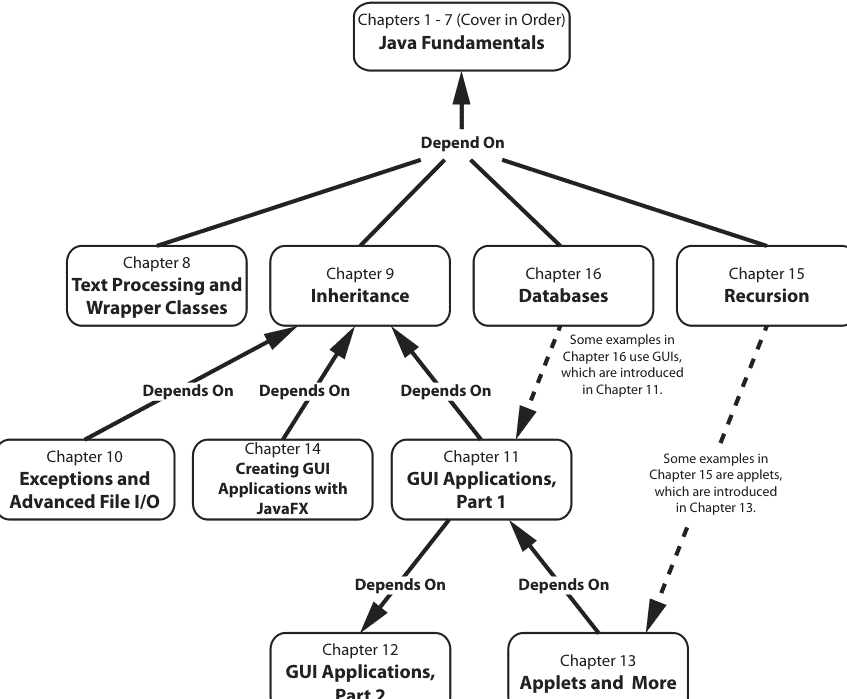
```


# 第 10 章：异常与高级文件 I/O

在这一章中，学生学习使用异常开发错误捕获。涵盖了处理异常，以及开发和抛出自定义异常。本章还讨论了处理顺序访问、随机访问、文本和二进制文件的高级技术。

# 第 11 章：GUI 应用——第一部分

本章介绍了使用 Swing 开发图形用户界面（GUI）应用程序的基础知识。涵盖了基础的 Swing 组件和事件驱动编程的概念。

# 第 12 章：GUI 应用——第二部分

本章继续研究 GUI 应用开发。涵盖了更高级的组件，以及菜单系统和外观（look-and-feel）。

# 第 13 章：Applet 及更多

在这里，学生将他们的 GUI 开发知识应用于创建 applet。除了使用 Swing applet 类外，还讨论了用于移植性的抽象窗口工具（AWT）类。还讨论了绘制简单的图形形状。

# 第 14 章：使用 JavaFX 创建 GUI 应用

本章介绍了 JavaFX，它是用于 Java 创建图形应用的下一代库。本章还展示了如何使用 Oracle 的免费屏幕设计器 Scene Builder 来设计 GUI。本章的编写独立于现有的 Swing 和 AWT 章节。你可以选择跳过第 11、12 和 13 章直接进入第 14 章，也可以涵盖所有的 GUI 章节。

# 第 15 章：递归

本章介绍了递归作为一种问题解决技术。演示了大量的递归示例。

# 第 16 章：数据库

本章向学生介绍数据库编程。首先介绍数据库管理系统和 SQL 的基本概念。然后学生学习使用 JDBC 在 Java 中编写数据库应用程序。涵盖了关系数据，并在整个章节中提供了许多示例。

# 本书特征

## 概念陈述 (Concept Statements)

书的每个主要章节都以一个概念陈述开头。该陈述总结了该节的思想。

## 示例程序 (Example Programs)

书中有大量的示例程序，每个程序都旨在突出当前正在学习的主题。在大多数情况下，这些都是实世界的示例。提供了这些程序的源代码，以便学生自行运行。

## 程序输出 (Program Output)

每个示例程序之后都有其屏幕输出示例。这能立即显示程序应该如何运行。

## 检查点 (Checkpoints)

检查点穿插在每个章节中，作为你的自测辅助。所有检查点问题的答案可以在附录 L（可下载）中找到，以便学生检查他们对新主题的掌握程度。下载附录 L，访问 `www.pearsonglobaled.com/Gadis` 的 Gaddis 资源页面。

> 注意：注释在全文适当的位置出现。它们是对与主题相关的有趣或经常被误解的点的解释。

> 警告：警告提醒学生某些导致程序故障或数据丢失的 Java 特性。

## 视频笔记 (VideoNotes)

在 `www.pearsonglobaled.com/Gadis` 提供了专为本书开发的在线视频。图标出现在文中，提醒学生注意视频主题。

## 案例研究 (Case Studies)

文中许多章节出现了模拟真实应用的案例研究，每个都提供了完整的代码。这些案例研究旨在突出章节中的主题。

## 复习题与练习 (Review Questions and Exercises)

每个章节都提供了一套详尽多样的复习和练习。包括单选、判断、找错、算法设计和简答。

# 前言 (Preface)

## 编程挑战 (Programming Challenges)

每个章节都提供一组编程挑战，以巩固学生的知识。在大多数情况下，这些作业呈现了现实世界的问题。

## 焦点 (In the Spotlight)

许多章节提供了“焦点”部分，呈现了一个编程问题，并带有详细的分步分析，展示如何解决它。


# 补充 (Supplements)

## 配套网站 (Companion Website)

学生可以通过书籍的随附网站获取许多资源。访问 `www.personalglobaled.com/Gadis`，使用封面打印的访问码获取网站上的以下资源：

- 书中每个示例程序的源代码
- 书籍的视频笔记
- 附录 B-M（见目录）
- 宝贵的案例研究集（见目录）
- 下载 Java 开发工具包的链接
- 下载多种编程环境的链接，包括 `jGRASP™`、`Eclipse™`、`TextPad™`、`NetBeans™`、`JCreator` 和 `DrJava`

## 讲师资源 (Instructor Resources)

以下补充仅供合格讲师使用。访问 `www.globaled.com` 了解如何获取它们：

- 书中所有复习题的答案
- 书中所有编程挑战的解决方案
- 每个章节的 PowerPoint 演示灯片
- 计算机测试库

# 致谢 (Acknowledgments)

本书的开发和出版有许多他人的帮助。我要感谢以下教职评审人员在本书制作过程中提供的有帮助建议和经验：

Rebecca Caldwell  
Winston-Salem State University  

Kurt Kinek  
Northeast State Community College  

Dan Rao  
Richland College  

Kevin Mess  
College of Southern Nevada  

Naser Heravi  
College of Southern Nevada  

Lisa Olivieri  
Chestnut Hill College  

Deborah Hughes  
Lyndon State College  

Mark Swanson  
Southeast Technical  

Nicole Jiao  
South Texas College  

# 前几版本的审稿人

- Ahmad Abujeleh，威斯康星大学-里弗尔斯分校
- Sander Eller，加利福尼亚州立大学-波莫纳分校
- Colin Archibald，瓦伦西亚社区学院
- Brooke Estabrook-Fishinghawk，梅萨社区学院
- Ijaz Awani，萨凡纳州立大学
- Mike Fry，利巴嫩河谷学院
- Charles W. Bane 博士，塔尔顿州立大学
- Georgia R. Grant，圣马特奥学院
- Dwight Barnett，弗吉尼亚理工大学
- Chris Haynes，印第安纳州大学
- Asoka Bhattacharyya，芝加哥圣埃维尔大学
- Ric Heishman，北弗吉尼亚州社区学院
- Marvin Bishop，曼哈顿学院
- Deedee Herrera，道奇市社区学院
- Heather Booth，田纳西州大学-诺克斯维尔分校
- Mary Hovik，利海碳社区学院
- David Boyd，瓦尔德斯塔大学
- Brian Howard，迪道奥大学
- Julius Brandstatter，金门大学
- Norm Jacobson，加利福尼亚大学欧尔文分校
- Kim Cannon，格林维尔科技大学
- Stephen Judd 博士，宾夕法尼亚大学
- James Chegwidben，塔兰县学院
- Harry Lichtbach，长谷学院
- Kay Chen，巴克斯社区学院
- Michael A. Long，加利福尼亚州立大学-奇科分校
- Brad Colton，塔尔顿州立大学
- Tim Margaugh，阿克隆大学
- Diane Christie，威斯康星大学-斯劳特分校
- Blayne E. Mayfield，俄克拉荷马州立大学
- Cara Cocking，马凯特大学
- Scott MeLeod，河滨社区学院
- Walter C. Daugethy，德克萨斯农 A&M 大学
- Dean Mellas，塞里托斯学院
- Michael Doherty，太平洋大学
- Georges Merx，圣地亚梅萨学院
- Jeanne M. Douglas，佛蒙特大学
- Martin Meyers，加利福尼亚州立大学-萨克拉门托分校
- Pati Milligan，贝勒大学
- Godfrey Muganda，北中部学院
- Steve Newberry，塔尔顿州立大学
- Lynne O'Hanlon，洛杉矶皮尔斯学院
- Merrill Parker，查塔努加州立技术社区学院
- Bryson R. Payne，北乔治亚学院与州立大学
- Rodney Pearson，密西西比州立大学
- Peter John Polito，斯普林菲尔学院
- Charles Robert Putnam，加利福尼亚州立大学-北岭分校
- Y. B. Reddy 博士，格兰布林州立大学
- Carolyn Schauble，科罗拉多州立大学
- Bonnie Smith，弗雷诺市大学
- Daniel Spiegel，库兹敦大学
- Caroline St. Clair，北中部学院
- Karen Stanton，洛梅达诺学院
- Peter H. Van Der Goes，罗斯州学院
- Tuan A Vo，圣安东尼奥山学院
- 王晓颖，密西西比大学

特别感谢 Chris Rich 为 JavaFX 章节提供的帮助。我要感谢我的家人在整个项目过程中付出的耐心、爱和支持。我感谢培逊教育（Pearson Education）的所有人员，让《入门》（Starting Out）系列取得了如此成功。我非常幸运有 Matt Gaddis 担任我的编辑。我很幸运能与 Yez Alyan 以及培逊的计算机科学营销团队合作。我很好地将我的书籍推向学术界。我有一个由 Scott Disco、Kayla Smith-Tarbox 和 Gregory Dull 领导的优秀团队。感谢大家！

培逊感谢东英兰大学的 Anthony Bagnall，以及 RCC 信息学院的 Arik Kumar Bhattacharjee 和 Simeon Mukherjee 对全球版做出的工作。

# 关于作者

Tony Gaddis 是《入门》（Starting Out）系列教材的主要作者。Tony 在北卡罗来纳州的海伍德社区学院教授了近二十年的计算机科学。他是一位广受赞誉的教师，曾被选为北卡罗来纳州年度优秀教师，并获得了国家员工和组织发展学院颁发的教学奖。除了 Java™，《入门》系列还包括使用 C++ 编程语言、Microsoft® Visual Basic、Microsoft® C#、Python、编程逻辑与设计、Alice 以及 App Inventor 的入门书籍，均由培逊出版。

# 第 1 章 计算机与 Java 导论

## 1.1 引言

本书教授如何使用 Java 进行编程。Java 是一种强大的语言，运行在各种类型的计算机上。它可以用于创建大型应用程序或小型程序（称为应用），后者是网站的一部分。在深入学习 Java 之前，本章将回顾计算机硬件和软件的基础，然后概括地介绍计算机编程。

## 1.2 为什么要编程？

> 概念：每个人都有让工作变得简单的工具。木工使用锤子、锯和卷尺。机械师使用扳手、螺丝刀。电子技术人员使用探针、螺丝和仪表表。有些工具是独特的，可以归类为单一职业。例如，外科医生拥有专为手术设计的工具。这些工具可能除了医生之外没有其他人使用。例如，螺丝刀被机械师、木工等许多人使用。

计算机是许多职业使用的工具，它无法被简单归类。它可以执行许多不同的工作，也许是人类制造的最功能最强大的工具。对于会计师来说，计算机可以平衡账目、分析损益并准备纳税报告。对于工厂工人来说，计算机控制制造机器并跟踪生产。对于机械师来说，计算机分析汽车的各种系统并定位难以发现的问题。计算机可以执行如此广泛的任务，因为是可以被编程的。它是一种专门设计用于遵循指令的机器。由于其可编程性，它不属于任何单一职业。计算机的设计是为了执行程序（或软件）要求它们执行的任务。

## 1.3 计算机系统：硬件与软件

> 概念：所有计算机系统都由类似的硬件设备和软件组件组成。

### 硬件

硬件指的是计算机组成的物理组件。我们通常认为的计算机不是一个单一设备，而是一个设备系统。就像交响乐团中的乐器一样，每个设备都有自己的角色。一个典型的计算机系统由以下主要部分组成：

- 中央处理器
- 主内存
- 存储设备
- 输入设备
- 输出设备

计算机系统的结构如图 1-1 所示。

### 图 1-1 计算机系统的组织结构

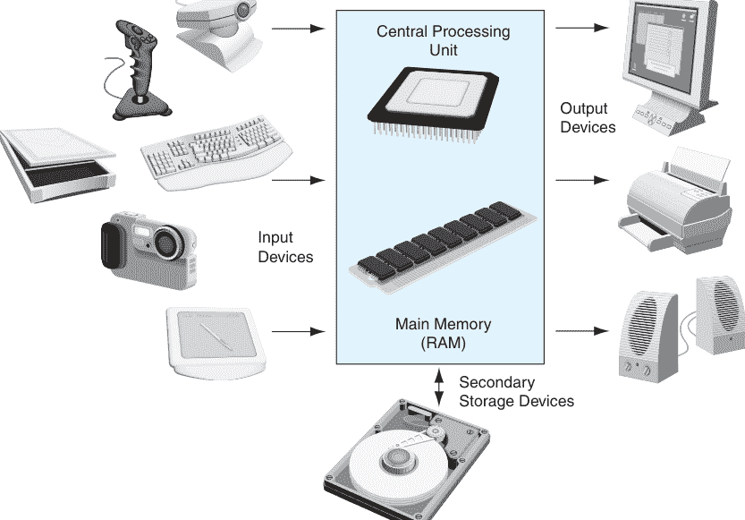

让我们仔细观察这些每一个设备。

### CPU

计算机的核心是它的中央处理器，简称 CPU。CPU 的工作是取指指令、执行指令并产生结果数据。从内部来看，中央处理器由两个部分组成：控制单元和算术逻辑单元（ALU）。控制单元协调计算机的所有操作。它负责确定从哪里获取下一条指令，并通过控制信号调节计算机的其他主要组件。算术逻辑单元顾其名，设计用于执行数学运算。CPU 的组织结构如图 1-2 所示。

### 图 1-2 CPU 的组织结构

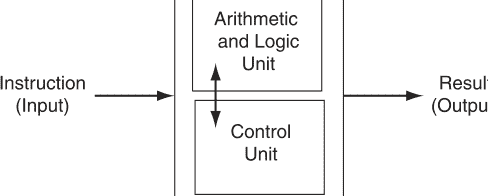

程序是存储在计算机内存中的指令序列。当计算机运行程序时，CPU 会参与到一个正式称为“取指/译码/执行”的过程中。取指/译码/执行循环的步骤如下：

- **取指（Fetch）**：控制单元从内存中取出程序指令序列中的下一条指令。
- **译码（Decode）**：指令以数字的形式编码。控制单元对指令进行解码并生成电子信号。
- **执行（Execute）**：将信号路由到计算机的相应组件（如 ALU、磁盘驱动器或其他设备）。该信号导致组件执行相应操作。

只要有指令需要执行，这些步骤就会重复进行。

### 主内存

计算机主内存通常被称为随机访问存储器或 RAM，它是一个存储数据的设备。具体来说，RAM 存储了运行程序中的指令序列以及其他正在使用的数据。

内存被分为若干部分，每个部分存储等量的数据。每个部分由“开关”组成，开关可以开启或关闭。处于开启位置的开关通常表示数字 1，处于关闭位置的开关通常表示数字 0。计算机通过设置内存位置中的开关来表示字符或数字并存储数据。这些开关中的每一个被称为位（bit），由八位组成集合。每个字节（byte）被分配一个唯一的数字作为地址。地址从低到高排序。字节通过其地址来识别，就像邮箱通过地址识别一样。图 1-3 显示了一系列字节及其地址。在图中，示例数据存储在内存中。数字 149 存储在地址为 16 的字节中，数字 72 存储在地址为 23 的字节中。

RAM 是一种易失性内存，仅用于临时存储。当计算机关闭时，RAM 中的内容会被擦除。

> 图 1-3 内存字节及其地址

| 地址 | 0 | 1 | 2 | 3 | 4 | 5 | 6 | 7 | 8 | 9 |
|---|---|---|---|---|---|---|---|---|---|---|
| 数据 | 10 | 11 | 12 | 13 | 14 | 15 | 16 | 149 | 18 | 19 |
| 地址 | 20 | 21 | 22 | 23 | 24 | 25 | 26 | 27 | 28 | 29 |
| 数据 | 72 | | | | | | | | | |

### 二级存储

二级存储是一种可以长期保存数据的内存——即使在计算机没有电源的情况下也是如此。程序通常存储在二级内存中并在需要时加载到内存中。重要数据如文字处理文档、工资数据和库存数字也会保存到二级存储中。

最常见的二级设备是磁盘驱动器。传统磁盘通过将数据磁性编码到旋转的圆盘上来存储数据。存储在固态内存中的固态硬盘（SSD）变得越来越流行。固态硬盘没有移动部件，运行速度比传统磁盘驱动器更快。大多数计算机的机箱内部都带有某种二级存储设备，无论是传统的磁盘驱动器还是固态硬盘。还有外部驱动器可以连接到计算机的某个通信接口。外部驱动器可用于备份重要数据的副本或将数据移动到另一台计算机。

除了外部驱动器，还创建了许多类型的设备用于复制数据将其移动到其他计算机。通用串行总线驱动器（USB 盘）是插入计算机 USB 端口的小型设备，在系统中显示为磁盘驱动器。然而，这些驱动器实际上并没有插入磁盘。它们将数据存储在一种名为闪存（flash memory）的特殊内存中。USB 盘廉价、可靠，且足够小，可以放在兜里。

光学设备如 CD（光盘）和 DVD（数字多功能光盘）也常用于数据存储。数据不是在光盘上磁性记录的，而是编码为光盘表面的一系列坑（pits）。CD 和 DVD 驱动器使用激光来检测坑并读取编码数据。光盘可以存储大量数据，而且由于可录制 CD 和 DVD 驱动器现在普及，它们也成为数据备份的流行选择。

### 输入设备

输入是计算机收集的数据。常见的输入设备有键盘、鼠标、扫描仪、麦克风。

### 输出设备

输出是计算机呈现的数据。常见的输出设备有显示器、打印机。

### 软件

软件分为两大类：操作系统和应用程序。操作系统是管理硬件的程序集。应用程序指的是程序。

## 思考

- 1.1 为什么计算机被不同的职业使用？
- 1.2 列出系统的五个硬件组件。
- 1.3 从内部看，CPU 由哪两个单元组成？
- 1.4 描述取指/译码/执行循环。
- 1.5 什么是内存地址？它的作用是什么？
- 1.6 解释为什么计算机有主内存和二级存储。
- 1.7 “多任务”一语是什么意思？

## 1.4 编程语言

**概念：程序是执行任务的指令集。** 编程语言是用于编写程序的特殊语言。

### 什么是程序？

计算机设计用于遵循指令。计算机程序是能够解决问题的指令集。例如，假设我们让计算机计算某人的工资。以下是计算机应该做的列表：

1. 在屏幕上显示：“你工作了多少小时？”
2. 允许用户输入小时数。
3. 用户输入数字后，将其存储在内存中。
4. 在屏幕上显示：“你的时薪是多少？”
5. 允许用户输入。


- 6. 用户输入数字后，将其存储在内存中。
- 7. 一旦输入工作小时和时薪，将这两个数字相乘并将结果存储在内存中。
- 8. 在屏幕上显示一条显示收入金额的消息。该消息必须包含第 7 步的计算结果。

这些指令统称为**算法**（algorithm）。算法是执行任务或解决问题的一系列定义良好的步骤。注意，这些步骤是顺序执行的。按照正确的顺序执行这些指令至关重要。

虽然你我可能很容易理解工资计算算法中的指令，但它还不足以在计算机上执行。计算机的 CPU 只能处理用机器语言编写的指令。如果你查看机器语言，你会看到一串二进制数（由 1 和 0 组成）。二进制数形成了机器语言指令，CPU 对其解释为命令。这里是机器语言指令的一个示例：

```
10110100000000101
```

## 1.4 编程语言

正如你可以想象的，用机器语言编码算法的过程是非常繁琐且困难的。此外，每种类型的 CPU 都有其自己的机器语言。如果你为计算机 A 编写了机器语言，然后想在具有不同类型 CPU 的计算机 B 上运行它，你就必须用计算机 B 的机器语言重新编写该程序。

编程语言使用单词而不是数字，它们的发明是为了减轻编程任务。程序可以使用编程语言编写，这种语言比机器语言更易于理解得多，并可以被翻译成机器语言。编程语言使用软件来执行这种翻译。表 1-1 列出了一些广为人知的编程语言。

### 表 1-1 编程语言

## Java 的历史

1991 年，Sun Microsystems（现已归 Oracle 所有）内部成立了一个团队，用于推测未来可能出现的重要技术趋势。该团队被称为“绿色小组”（Green Team），他们得出结论：计算机将与家用电器融合。他们的第一个项目是开发名为 Star7（读作 "star seven"）的手持设备，它可以控制各种家庭娱乐设备。为了让该设备工作，它必须使用一种可以被其控制的所有设备处理的编程语言。这带来了一个问题，因为不同品牌的消费设备使用不同的处理器，每种处理器都有自己的机器语言。

由于不存在这样的通用语言，该团队的首席工程师 James Gosling 创建了使用这种语言编写的程序（这种语言最初名为 Oak），这些程序被翻译成特定处理器的机器语言，但它们被翻译成一种称为字节码（byte code）的中间语言。另一个程序将把字节码翻译成特定消费设备中的处理器可以执行的机器语言。

遗憾的是，绿色小组开发的技术领先于时代。没有客户能够接受，主要是因为计算机控制的家用电器行业刚刚起步。但团队并没有放弃他们的工作并转向其他项目，他们看到了另一个机会：互联网是像 Oak 这样的通用编程语言的完美环境，因为许多不同的平台连接在单个网络中。

为了证明 Java 的有效性，他们展示了这种语言。1995 年，Netscape 宣布将 Java 整合到浏览器中。通过这种方式，Java 变得非常受欢迎。

## Java 应用程序与小程序

在上一节中，我们学习了可以使用 Java 编写的两种程序：应用程序（applications）和小程序（applets）。应用程序是可以在单台计算机上运行的程序，你可能已经使用过几种，例如文字处理器、电子表格、数据库管理系统。小程序是可以在 Web 浏览器中运行的程序。尽管名字相同，但 JavaScript 与 Java 无关。大多数网页使用超文本标记语言（HTML）。然而，HTML 描述的是网页的内容和布局。

## 安全

当任何内容从 Web 服务器传输到你的计算机时，安全是一个重要的问题。由于 Java 是一种功能齐全的编程语言，起初你可能对任何向你的计算机传输小程序（applet）的网站持怀疑态度。幸运的是，答案是否定的。Web 浏览器在内存的安全环境中运行小程序，并不允许它们访问该环境之外的资源，如硬盘。

## 程序由什么组成

编程语言具有某些共同的元素。

### 语言元素

所有编程语言都有共同点。表 1-2 列出了在几乎每种语言中都能看到的共同元素。

| 语言元素 | 描述 |
| --- | --- |
| 关键字 | 这些是在编程语言中具有特殊含义的单词。它们只能按预期用途使用。 |
| 运算符 | 运算符是对一个或多个操作数执行操作的符号或单词。操作数通常是一个数据项，如数字。 |
| 标点 | 大多数编程语言要求使用标点。这些字符有特定的用途，例如标记语句的开始或结束，或分隔列表项。 |
| 程序员定义的名称 | 与编程语言中的单词不同，是由程序员定义的单词或名称。它们用于识别内存中的存储位置和程序员创建的程序部分。程序员定义的名称通常被称为标识符（identifiers）。 |
| 语法 | 这些是编写程序时必须遵守的规则。语法规定了如何使用关键字和运算符，以及标点符号应该出现在何处。 |

让我们看一个 Java 示例程序并识别这些元素的实例。代码列表 1-1 显示了代码列表，并对每行进行了编号。

### 代码列表 1-1 Payroll.java

```java
public class Payroll
{
    public static void main(String[] args)
    {
        int hours = 40;
        double grossPay, payRate = 25.0;
        grossPay = hours * payRate;
        System.out.println("Your gross pay is $" + grossPay);
    }
}
```

> 注意：行号不是程序的一部分。包含行号是为了帮助指向程序的特定部分。

### 关键字（保留字）

Java 的两个关键字出现在第 1 行：`public` 和 `class`。在第 3 行中，`static` 和 `void` 都是关键字。第 5 行的单词 `int` 和第 6 行的 `double` 也是关键字。这些单词始终以小写形式编写，在 Java 中具有特殊含义，并且只能用作程序中某些事物的特定名称。然而，关键字是被保留的，不能用于其指定用途之外的任何地方。学习编程语言的一部分就是学习常用的关键字、它们的含义以及如何使用它们。

表 1-3 显示了关键字列表。

| abstract | const | for | int | public | throw |
| --- | --- | --- | --- | --- | --- |
| assert | continue | final | interface | return | throws |
| boolean | default | finally | long | short | transient |
| break | float | native | static | true | |
| byte | double | goto | new | strictfp | try |
| case | else | if | null | super | void |
| catch | enum | package | switch | volatile | |
| char | extends | private | synchronized | while | |
| class | false | instanceof | protected | this | |

### 程序员定义的名称

单词 `payRate` 和 `grossPay` 出现在程序的第 5、6、8 和 9 行中，是程序员定义的名称。它们不是 Java 语言的一部分，而是由程序员命名的名称。在这个特定的程序中，这些是变量的名称。正如你在本章稍后部分学到的，变量是可能存储数据的内存位置的名称。

## 1.5 程序是由什么组成的？

### 运算符

在第 8 行出现了以下代码行：

```java
grossPay = hours * payRate;
```

`=` 和 `*` 符号都是运算符。它们对数据项执行操作，这些项被称为操作数。`*` 运算符将它的两个操作数相乘，在本例中是 `hours` 和 `payRate`。`=` 符号是赋值运算符。它获取右侧表达式的值，并将其存储在左侧变量中。在本例中，`=` 运算符将 `hours` 乘以 `payRate` 变量的结果存储在 `grossPay` 变量中。换句话说，该语句的意思是：“将 `hours` 乘以 `payRate` 的值赋值给变量 `grossPay`”。

### 标点符号

注意第 5、6、8 和 9 行以分号结尾。Java 中的分号与英语中的分号相似：它标记了一个完整句子（在编程中称为语句）的结束。然而，Java 程序中并不是每行末尾都有分号。有规则规定了哪里需要分号，哪里不需要。学习 Java 的一部分就是学习何处放置分号和其他标点符号。

### 行与语句

通常，程序的内容是通过“行”和“语句”来教授的。行仅仅是指其本身——即在程序体中显示的单行。代码列表 1-1 的每一行都带有行号。大多数行包含某些意义的内容；然而，第 7 行是空的。空行仅用于增加程序的可读性。

语句是导致计算机执行某些操作的完整指令。以下是出现在代码列表 1-1 第 9 行的语句：

```java
System.out.println("Your gross pay is $" + grossPay);
```

此语句导致计算机在屏幕上显示一条消息。它可以是关键字、运算符和程序员定义名称的组合。语句在程序中通常占据一行，但有时会跨越多行。

### 变量

Java 程序在内存中存储数据项最基本的方法是使用变量。变量是计算机内存中一个命名的存储区域。存储在变量中的数据在程序运行时可能会改变（因此被称为变量，variable）。注意，在代码列表 1-1 中，程序员定义的名称 `hours`、`payRate` 和 `grossPay` 出现在多个地方。这三个都是变量。`hours` 变量用于存储用户工作的小时数。`payRate` 存储用户的小时薪率。`grossPay` 变量持有 `hours` 乘以 `payRate` 的结果。

变量是程序员创建的符号名称，代表计算机 RAM 中的位置。当数据存储在变量中时，它实际上存储在 RAM 中。假设一个程序有一个命名为 `length` 的变量。图 1-4 展示了变量名代表内存位置的方式。

#### 图 1-4 变量名代表一个内存位置

### 编译器与虚拟机

当程序被编写好时，它被放入一个文件中。此任务使用文本编辑器，类似于文字处理软件。Java 源文件以 `.java` 结尾。

程序员运行编译器，它将源代码翻译成字节码文件。语法错误是程序员违反规则的错误。在编译器翻译源代码之前必须修正这些错误。

大多数编程语言直接将源代码翻译成机器语言文件。Java 则不同，它将源代码翻译成字节码。这些文件不是 CPU 的机器语言。相反，它们由虚拟机执行。虚拟机（JVM）是一个读取 Java 字节码并执行它们的程序。由于这个原因，JVM 通常被称为解释器。图 1-5 展示了编写 Java 程序、将其编译为字节码并运行的过程。

### 可移植性

可移植性术语意味着程序可以在一种类型的计算机上编写，并在各种计算机上运行，只需极少或不需要修改。由于 Java 字节码在所有计算机上都是相同的，编译后的 Java 程序具有高度的可移植性。事实上，编译后的 Java 程序可以在任何带有 Java 虚拟机的计算机上运行。

#### 图 1-5 程序开发

程序员使用文本编辑器创建 Java 源文件。


虚拟机读取并执行每个字节码指令。

#### 图 1-6 Java 代码可以在任何带有 JVM 的计算机上运行

## Java 软件版本

用于创建 Java 软件的工具被称为 JDK（Java 开发包）或 SDK（软件开发包）。以下是 Oracle 提供的 JDK 版本：

- Java SE——标准版提供了编写 Java 应用程序所需的必需软件工具。
- Java EE——企业版提供了创建使用服务器并在 Web 上提供服务的大型业务应用程序的工具。
- Java ME——微型版为手机、传真机和电器等消费产品提供了一个小型、高度优化的运行时环境。

这些版本的 Java 可以从 Oracle 下载：

http://java.oracle.com

> 注意：你可以按照附录 E 中的说明（该附录可以从本书的配套网站下载）在你的系统上安装 JDK。你可以通过以下网址访问本书的配套网站：www.pearsonglobaledition.com/gaddis。

## 编译和运行 Java 程序

编译 Java 程序是一个简单的过程。要使用 JDK，请转到你操作系统的命令行提示符。

> 提示：在 Windows 中，点击“开始”按钮，进入“所有程序”，然后进入“附件”。点击“附件”菜单上的“命令提示符”。这将打开命令提示符窗口。

在操作系统的命令行提示符中，确保你处于你想要编译的 Java 程序所在的相同目录或文件夹中。然后，使用如下格式的 `javac` 命令：

```
javac Filename
```

`Filename` 是包含 Java 源代码的文件名。如前文所述，该文件具有 `.java` 扩展名。例如，如果你想编译 `Payroll.java` 文件，可以执行以下命令：

```
javac Payroll.java
```

此命令运行编译器。如果文件中包含任何语法错误，你将看到一个或多个错误信息，编译器将不会将文件转换为字节码。当发生这种情况时，你必须用编辑器打开源文件并修复错误。然后你可以再次运行编译器。如果文件没有语法错误，编译器将将其翻译为字节码。字节码将存储在具有 `.class` 扩展的文件中，该文件与源文件位于相同的目录或文件夹中。

要运行程序，请使用如下格式的 `java` 命令：

```
java ClassFilename
```

`ClassName` 是你要执行的 `.class` 文件的名称。但是，不要输入 `.class` 扩展名。例如，要运行存储在 `Payroll.class` 文件中的程序，输入以下命令：

```
java Payroll
```

此命令运行 Java 解释器（JVM）并执行程序。

## 集成开发环境

除了命令行提示符外，还有几种 Java 开发环境（IDE）。这些环境由文本编辑器、编译器、调试器和其他工具集成在一个具有单组菜单的软件包中。只需点击一下一个按钮，或从菜单中选择一个单项，即可编译并执行程序。图 1-7 显示了 NetBeans IDE 的界面。

### 图 1-7 一个 IDE

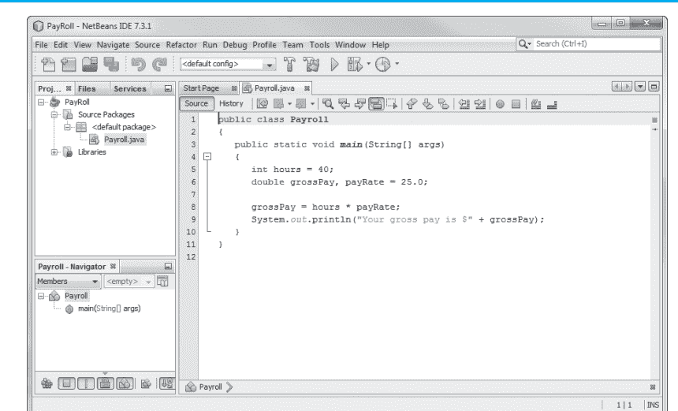

## 检查点

- 1.8 描述关键字与程序员定义符号之间的区别。
- 1.9 描述操作符与标点符号之间的区别。
- 1.10 描述程序行与语句之间的区别。
- 1.11 为什么变量被称为“variable（可变的）”？
- 1.12 当新值存储在变量中时，该变量的当前内容会发生什么？
- 1.13 什么是编译器？
- 1.14 什么是语法错误？
- 1.15 什么是字节码？
- 1.16 什么是 JVM？

## 1.6 编程过程

概念：编程过程由几个步骤组成，包括设计、创建、测试和调试活动。

现在你已经了解了什么是程序，现在是时候考虑创建程序的流程了。通常当没有经验的学生面对编程作业时，他们往往很难着手，因为他们不知道首先该做什么。如果你发现自己陷入了这种困境，以下步骤可能会有所帮助。

1. 明确定义程序要做的任务。
2. 在脑中视觉化程序在计算机上运行的过程。
3. 使用设计工具创建程序的模型。
4. 检查模型的逻辑错误。
5. 输入代码并编译。
6. 修正编译过程中发现的任何错误。
7. 使用测试数据运行程序。
8. 修正运行程序时发现的任何错误。
9. 验证程序的结果。

这些步骤强调了规划的重要性。在编写程序之前，你应该在脑中构思它。在本章中，我们将详细研究计算算法的这些步骤。

### 明确定义程序要做的任务

这一步要求你明确程序的逻辑。

**目的**：计算工资。

- **输入**：小时数。
- **处理**：小时数乘以费率。
- **输出**：显示工资。

### 2. 在脑中视觉化程序在计算机上运行的过程

在创建程序之前，你应该先想象它在计算机上运行的样子。如果有帮助，图 1-8 显示了计算界面。

```
你工作了多少小时？
你赚了多少钱？
你的工资是 $150
```

### 3. 使用设计工具创建程序的模型

在设计程序时，使用伪代码很有帮助。例如，这里的伪代码：

- 获取小时数。
- 输入费率。
- 计算小时数乘以费率。
- 显示工资。

### 4. 检查模型的逻辑错误

逻辑错误是导致程序产生错误结果的错误。如果程序没有产生预期的结果，说明


## 5. 输入代码并编译

一旦创建并检查了模型，就可以开始编写源代码了。在此期间，编译器会发现任何语法错误。

## 6. 在编译过程中发现任何错误

如果编译器报告了任何错误，必须进行修复。重复步骤 5 和 6，直到没有编译错误。

## 7. 使用测试数据运行程序

一旦生成了可执行文件，就可以对程序进行运行时测试。运行时错误是在程序运行时发生的错误。

## 8. 在运行程序时发现任何错误

当程序中发现运行时错误时，必须进行修复。你必须确定错误发生的步骤以及原因。如果是逻辑错误（例如公式错误），则必须修正陈述。如果是由于对程序的理解不完全，则必须重述程序目的并修改程序模型和源代码。然后必须重新保存、重新编译并重新测试。这意味着必须重复步骤 5 到 8，直到程序可靠地产生满意的结果。

## 9. 验证程序的结果

当你认为已经修复了所有的运行时错误时，输入测试数据并判断程序是否解决了原始问题。

## 检查点

- 1.17 在定义程序任务时，你应该识别哪些项目？
- 1.18 “在脑中视觉化程序在计算机上运行”意味着什么？这种活动的价值何在？
- 1.19 什么是伪代码？
- 1.20 描述编译器对源代码做了什么。
- 1.21 语法错误是由编译器发现还是在程序运行时发现的？


# 面向对象编程

## 概念

`Java` 是一种面向对象编程（OOP）语言。OOP 是一种软件开发方法，它有自己的实践方法、概念和术语。

目前使用的编程方法主要有两种：过程化语言和面向对象语言。最早的编程语言是过程化的，这意味着程序由一个或多个过程组成。过程是一组编程语句，这些语句共同执行特定的任务。这些语句从用户处获取输入，处理计算机内存中存储的数据，并执行计算或完成任务所需的任何其他操作。

过程通常在独立于过程的数据项上进行操作。在过程化程序中，数据项通常从一个过程传递到另一个过程，如图 1-9 所示。

### 图 1-9 数据在过程之间传递

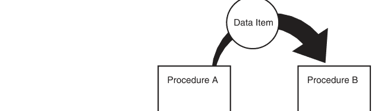

正如你所想象的，过程化编程的重点在于创建操作程序数据的过程。然而，数据与操作数据的代码分离往往会导致问题。例如，数据存储在特定的格式中，该格式由变量以及由变量创建的更复杂结构组成。操作数据的过程在设计时必须考虑这种格式。但如果数据被更改了会怎样？通常，程序的规范会发生变化，导致格式重新设计。操作数据的代码也必须更改以接受新格式。这增加了程序员的工作量，并增加了代码中出现 bug 的机会。

这种趋势影响了从过程化编程到 OOP 的转变。过程化编程以创建过程为中心，而面向对象编程以创建对象为中心。对象是一个包含数据和过程的软件实体。对象中包含的数据被称为对象的**属性**。对象执行的过程（或行为）被称为对象的**方法**。从概念上讲，对象是一个由数据（属性）和过程（方法）组成的自包含单元。这在图 1-10 中所示。

OOP 通过**封装**和**数据隐藏**解决了代码/数据分离的问题。封装是将数据和代码组合到单个对象中。数据绑定到对象，使其具有向外部代码隐藏数据的能力。

### 图 1-10 对象包含数据和过程

### 图 1-11 对象外部的代码与对象的方法交互

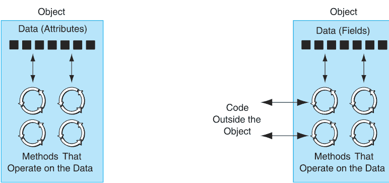

当对象的内部数据对外部代码隐藏，且对该数据的访问限制在对象的方法时，数据就能保护免受意外损坏。此外，编程代码不需要知道对象数据的格式或内部结构。代码只需要与对象的方法交互。当程序员更改对象内部数据的结构时，他或她也会修改对象的方法，以便它们能够正确地处理数据。

## 组件复用

如图 1-11 所示，对象的方法为对象外部的编程语句提供了对对象数据的间接访问。

除了解决代码和数据分离的问题外，组件复用的趋势也促进了 OOP 的使用。组件是一个执行特定的、定义良好的操作或提供特定服务的软件对象。组件不是一个独立的程序，但可以被需要该服务的程序使用。例如，`Sharon` 是一位程序员，她开发了一个用于渲染三维（3D）图像的组件。她是一个数学天才，精通计算机图形学，因此她的组件被设计为执行所有必要的 3D 数学和操作。`Tom` 正在为一家建筑公司编写程序，他的应用程序需要显示建筑的 3D 图像。由于他正面临紧迫的截止日期，并且没有许多关于计算机图形学的知识，他可以使用 `Sharon` 的组件来执行 3D 渲染（当然，需要付少部分费用！）。

组件复用和 OOP 技术为大型计算机应用程序成为独特的协作实体（组件）系统奠定了基础。

## 1.7 面向对象编程

### 对象的日常示例

将你的闹钟想象成一个对象。它具有以下属性：

- 当前秒（0–59 范围内的值）
- 当前分钟（0–59 范围内的值）
- 当前小时（1–12 范围内的值）
- 闹钟设置的时间（有效的小时和分钟）
- 闹钟是否开启（“开启”或“关闭”）

如你所见，属性仅仅是定义闹钟状态的数据值。闹钟的用户无法操作这些属性，因为它们是私有的。要更改属性的值，你必须使用对象的方法之一。以下是闹钟的一些方法：

- 设置时间 (`Set time`)
- 设置闹钟时间 (`Set alarm time`)
- 开启闹钟 (`Turn alarm`)
- 关闭闹钟 (`Turn alarm off`)

每个方法都处理一个或多个属性。例如，“set time”方法允许你设置时间。“set alarm time”方法允许你设置闹钟时间。“turn alarm”方法允许你开启闹钟。“turn alarm off”方法允许你关闭闹钟。

### 继承示例

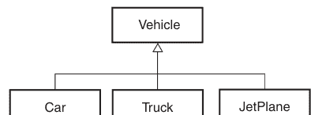

在 OOP 术语中，`Vehicle` 类是父类。`Car`、`Truck` 和 `JetPlane` 类是子类。虽然 `Vehicle` 类本质上是非常通用的，但 `Car`、`Truck` 和 `JetPlane` 类是专门的。`Vehicle` 类的所有属性和行为都被 `Car`、`Truck` 和 `JetPlane` 类继承。类之间的关系意味着 `Car` 是一个 `Vehicle`，`Truck` 是一个 `Vehicle`，而 `JetPlane` 是一个 `Vehicle`。

除了继承父类的属性和方法外，子类还会添加自己的属性。例如，`Car` 类可能有设置和指示其是轿车还是轿跑车以及其引擎类型的属性和方法。`Truck` 类可能具有设置最大载重量以及在不加油的情况下行驶里程数的属性和方法。`JetPlane` 类可能具有设置和指示飞机飞行高度和航向的属性和方法。这些新增的功能使得子类比父类更专门。

# 软件工程

软件工程领域涵盖了构建计算机软件的过程。它包括设计、编写、测试、调试、编写文档、修改和维护复杂的软件开发项目。与传统工程师一样，软件工程师在他们的工作中使用许多工具。以下是几个例子：

- 程序规格说明
- 屏幕输出图
- 表示类、对象和数据流的图表
- 伪代码
- 预期输入和期望输出的示例
- 为测试程序而设计的特殊软件

大多数商业软件应用程序都是大型且复杂的。通常由一个程序员团队而不是单个人来开发。对程序需求进行彻底分析，并将其划分为由各个团队或团队内个人处理的子任务是非常重要的。

## 检查点

- 1.24 在过程化编程中，程序的哪两个部分通常是分开的？
- 1.25 对象的属性是什么？
- 1.26 对象的方法是什么？
- 1.27 什么是封装？
- 1.28 什么是数据隐藏？

# 复习题与练习

## 单选题

1. 程序中的此循环导致信号被路由到计算机的相应组件，使该组件执行操作。
   - a. 取指
   - b. 解码
   - c. CPU
   - d. 执行

2. 下列哪项不是输出设备？
   - a. 打印机
   - b. USB 驱动器
   - c. 摄像头
   - d. 显示器

3. 每个字节都被分配了一个唯一的
   - a. 地址
   - b. CPU
   - c. 位
   - d. 变量

4. 在这些类型的辅助存储设备中，数据被编码为磁盘表面的一系列位，并使用激光来检测这些位。
   - a. 磁盘驱动器
   - b. 光设备
   - c. USB 驱动器
   - d. RAM

5. 如果你查看机器语言程序，你会看到 ________。
   - a. Java 源代码
   - b. 二进制数字流
   - c. 英语单词
   - d. 电路

6. 这是管理计算机硬件设备并控制其过程的程序集。
   - a. 输入设备
   - b. 输出设备
   - c. 操作系统
   - d. 存储设备

7. 这些在编程语言中具有特殊含义的词。
   - a. 标点符号
   - b. 程序员定义的名称
   - c. 关键字
   - d. 运算符

8. 这不是面向对象的编程语言。
   - a. Java
   - b. Ruby
   - c. C
   - d. Python

9. 这些字符具有特定用途，例如标记语句的开始或结束，或者分隔列表中的项。
   - a. 标点符号
   - b. 程序员定义的名称
   - c. 关键字
   - d. 运算符

10. 这些用于识别内存中的存储位置以及程序员创建的部分的词或名称。
    - a. 标点符号
    - b. 程序员定义的名称
    - c. 关键字
    - d. 运算符

11. 在 OOP 中，这指的是将数据和代码合并成单个对象。
    - a. 数据隐藏
    - b. 继承
    - c. 封装
    - d. 多态

12. 这些是由程序员定义的词或名称。
    - a. 类
    - b. 关键字
    - c. 标识符
    - d. 运算符

13. Java 编译器生成 ________
    - a. 机器码
    - b. 字节码
    - c. 源代码
    - d. HTML

14. 用于创建 Java 程序的软件。
    - a. Java 开发工具包 (JDK)
    - b. Java 编译器
    - c. Java 虚拟方法
    - d. Java 虚拟机

## 找错

1. 下面的伪代码算法有一个错误。该程序应该要求用户输入矩形房间的长度和宽度，然后显示房间的面积。程序必须将宽度乘以长度以确定面积。找出错误。

```
area = width × length.
Display "房间的宽度是多少?"
Input width.
Display "房间的长度是多少?"
Input length.
Display area.
```

## 算法工作台

为以下描述的程序编写伪代码算法：

1. **可用额度**
   计算客户可用额度的程序应该向用户获取以下内容：
   - 可用额度金额
   - 已使用的额度金额
   程序应该显示可用额度。

2. **图书罚金**
   计算书籍逾期费的程序应该询问用户以下内容：
   - 逾期天数
   - 每天的罚金
   程序应该显示总罚金。

3. **账户余额**
   计算储蓄账户余额的程序应该询问以下内容：
   - 初始余额
   - 存款金额
   - 取款金额
   程序应该显示最终余额。

## 预测结果

代码执行后，每个变量显示什么？

1.
```
x 为 0。
y 为 5。
x 加 1。
y 加 1。
从 y 中减去 x。
显示 x 和 y。
```

2.
```
a 为 10。
b 为 2。
a 乘以 b。
a 减去 5。
a 除以 b。
显示 a 和 b。
```

## 简答

1. 团队是什么时候形成的？为什么？
2. 为什么被称为虚拟机？
3. 哪些因素推动了面向对象的转变？
4. 说明以下操作系统属于哪些类别。
   - 系统 A 允许多个用户运行多个程序。
   - 系统 B 一时间允许一个用户，但可以运行多个程序。
   - 系统 C 一时间允许一个用户，且只能运行一个程序。
5. 为什么高级语言程序在运行之前必须翻译成机器语言？
6. 为什么用高级语言编写程序比用机器语言更容易？
7. Java 为什么需要编译器和解释器？
8. 为什么 JVM 为许多类型的计算机开发？
9. 什么是标识符？它与关键字有何区别？
10. 区分算法和程序。
11. 封装是过程化编程还是面向对象编程的特征？
12. 为什么对象应该隐藏其数据？
13. 对象的哪个部分形成了外部代码可以访问数据的接口？
14. 什么是组件复用？
15. 哪些 JDK 工具用于编译和执行 Java 程序？

## 第1章 计算机与 Java 简介

25. Java 编译器将 Java 源代码翻译成什么？
26. 假设你已经安装了 Java JDK，在操作系统的命令行提示符上输入什么命令来编译 `LabAssignment.java` 程序？
27. 假设 `LabAssignment.java` 程序在编译时没有语法错误，请回答以下问题：
   - a. 生成的文件名是什么？
   - b. 文件中包含什么？
   - c. 在操作系统的命令行提示符上输入什么命令来运行该程序？

# 编程挑战

## 1. 你的第一个 Java 程序

本次作业将帮助你熟悉你的 Java 开发软件。以下是你将要输入的 Java 程序：

```java
// This is my first Java program.
public class MyFirstProgram {
    public static void main(String[] args) {
        System.out.println("Hello World!");
    }
}
```


### 如果你在命令行提示符中使用 JDK：

1. 使用编辑器按照所示内容精确输入源代码。确保放置了所有的标点符号，并注意字母的大小写与显示的一致。将其保存为名为 `MyFirstProgram.java` 的文件。
2. 保存程序后，进入你的操作系统命令行提示符，并将当前目录或文件夹更改到包含你刚刚创建的 Java 程序的目录。使用以下命令编译程序：
   ```
   javac MyFirstProgram.java
   ```
   如果你输入的内容与所示完全一致，则不应该有任何语法错误。如果你看到错误信息，请在编辑器中打开文件并将你的代码与显示的代码进行对比。修正你出的任何错误，保存文件并再次运行编译器。如果没有看到错误信息，说明文件已成功编译。
3. 接下来，输入以下命令运行程序：
   ```
   java MyFirstProgram
   ```
   请确保 `MyFirstProgram` 的大小写与此处所示完全一致。你应该能在屏幕上看到显示“Hello World!”的消息。

### 如果你正在使用 IDE：

由于有许多 Java IDE，我们无法为所有 IDE 都提供具体的说明。以下是适用于大多数 IDE 的通用步骤。你需要查阅你所用 IDE 的文档获取特定指令。

1. 启动你的 Java IDE 并执行任何必要的设置，例如启动新项目并创建一个新的 Java 源文件。
2. 使用 IDE 的文本编辑器按照所示内容精确输入源代码。确保放置了所有的标点符号，并注意字母的大小写与显示的一致。将其保存为名为 `MyProgram.java` 的文件。
3. 保存程序后，使用你的 IDE 命令编译程序。如果你输入的内容与所示完全一致，则不应该有任何语法错误。如果你看到错误信息，请将你的代码与显示的代码进行对比。修正你出的任何错误，保存文件并再次运行编译器。如果没有看到错误信息，说明文件已成功编译。
4. 使用你的 IDE 命令运行程序。你应该看到显示“Hello World!”。

# 第二章 Java 基础

## 话题

- 2.1 Java 程序的组成部分
- 2.2 `System.out.print` 和 `System.out.println` 方法以及 Java API
- 2.3 变量与字面量
- 2.4 原始数据类型
- 2.5 算术运算符
- 2.6 复合赋值运算符
- 2.7 原始数据类型之间的转换
- 2.8 使用 `final` 创建命名常量
- 2.9 `String` 类
- 2.10 作用域
- 2.11 注释
- 2.12 编程键盘输入
- 2.13 读取对话框
- 2.15 `System.out.printf` 方法
- 2.16 需要避免常见错误

## 2.1 Java 程序的组成部分

> 概念：Java 程序具有具有特定用途的部分。

Java 程序由不同的部分组成。学习 Java 的第一步是学习这些部分是什么。我们将从一个简单的示例开始，如代码列表 2-1。

### 代码列表 2-1 (Simple.java)

```java
1 // This is a simple Java program.
2
3 public class Simple
4 {
5 public static void main(String[] args)
6 {
7 System.out.println("Programming is great fun!");
8 }
9 }
```

> 提示：记住，显示数字是为了我们可以引用程序中的特定行。

如第1章所述，Java 源代码文件的文件名以 `.java` 结尾。代码列表 2-1 所示程序名为 `Simple.java`。使用 Sun Java 编译器可以使用以下命令编译此程序：

```bash
javac Simple.java
```

编译器将创建另一个名为 `Simple.class` 的文件，其中包含翻译后的字节码。该文件可以使用以下命令执行：

```bash
java Simple
```

> 提示：记住，在使用 `java` 命令时不需要输入 `.class` 扩展名。

程序的输出如下。这是程序运行时在屏幕上显示的内容。

### 程序输出

Programming is great fun!

让我们逐行检查程序。这里是第1行的内容：

```java
// This is a simple Java program.
```

这是一个简单的 Java 程序。第2行是空的。第3行是：

```java
public class Simple
```

定义了类名。第4行是：

```java
{
```

这是一个左括号，表示类定义的开始。第5行是：

```java
public static void main(String[] args)
```


这是一个方法的头。第6行是：

```
{
```

这是一个左括号，表示方法的开始。第7行是：

```
System.out.println("Programming is great fun!");
```

这是一个打印语句。第8行是：

```
}
```

方法的右括号。第9行是：

```
}
```

类的右括号，表示类定义的结束。这两个括号之间的所有内容都是 `Simple` 类的体。

# 第2章 Java 基础

为什么这一行包含许多单词。在此时，你唯一应该关注的是 `main` 方法名，其余单词都是正确定义该方法所必需的。这在图 2-1 中所示。

回想第 1 章，在你的计算机上运行的独立 Java 程序被称为应用程序（application）。每个 Java 应用程序都必须有一个名为 `main` 的方法。`main` 方法是应用程序的起点。

# 图 2-1 方法头

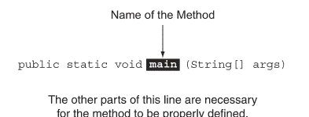

> 注意：目前，你将编写的所有程序都将包含一个带有 `main` 方法的类，其方法头与列表 2-1 中的代码完全相同。随着你阅读这本书这本书，你将学习 `public static void` 和 `(String[] args)` 的含义。现在，假设你正在学习一种组装 Java 程序的“配方”。

第 6 行有另一个左大括号：

```
{
```

这个左大括号属于 `main` 方法。记住，大括号括起语句，并且每个左大括号都必须有一个对应的右大括号。如果你看第 8 行，你会看到与此左大括号对应的括号。大括号之间的所有内容都是 `main` 方法的方法体。

第 7 行的形式如下：

```
System.out.println("Programming is great fun!");
```

简单来说，这一行在屏幕上显示一条消息。不带引号的消息为 "Programming is great fun!"。在编程中，双引号内的字符组被称为字符串字面量（string literal）。

> 注意：这是程序中唯一一行会导致在屏幕上打印任何内容的的行。其他行，如 `public class simple` 和 `public static void main(String[] args)`，对于程序的程序的框架是必要的，但它们不会导致任何屏幕输出。记住，程序是给计算机的一组指令。如果要在屏幕上显示某些内容，你必须使用编程语句来实现该目的。

行的末尾是一个分号。正如句号标记句子的结束一样，分号在 Java 中标记一个语句的结束。然而，并不是每一行代码都以分号结束。以下是不需要放置分号的地方总结：

## 2.1 Java 程序的组成部分

- 注释（Comments）不需要以分号结束，因为它们会被编译器忽略。
- 类头和方法头不以分号结束，因为它们是以大括号内部的代码体终结的。
- 大括号字符 `{` 和 `}` 不是语句，所以你不需要在它们后面放置分号。

看起来哪里放置分号的规则似乎完全不明确。现在，专注于学习程序的组成部分吧。你很快就会感觉到哪里应该以及不应该使用分号。

正如已经指出的，第 8 行和第 9 行包含了 `main` 方法和类定义的右大括号：

```
}
}
```

在继续之前，让我们回顾一下刚刚涵盖的内容，包括一些更多的规则。

- Java 是一种区分大小写的语言。它不认为大写字母与其小写形式的形式是相同的字符。
- 所有 Java 程序必须存储在以 `.java` 结尾的文件中。
- 注释会被编译器忽略。
- 一个 `.java` 文件包含许多类，但只能有一个公类（public class）。如果一个 java 文件有一个公类，则该类名必须与文件名相同。例如，如果 `Pizza.java` 包含一个公类，那么该类的名字就是 `Pizza`。
- 每个应用程序都必须有一个名为 `main` 的方法。
- 每一个左大括号（或开启大括号）必须有一个对应的右大括号（或关闭大括号）。
- 语句以分号结束。这不包括注释、类头、方法头或大括号。

在示例示例程序中，你遇到了几个特殊字符。表 2-1 总结了它们是如何使用的。

## 表 2-1 特殊字符

| 字符 | 名称 | 含义 |
|---|---|---|
| // | 双斜杠 | 标记注释的开始 |
| ( ) | 左、右括号 | 用于方法头 |
| { } | 左、右大括号 | 括起一组语句，例如类或方法的内容 |
| " | 双引号 | 括起一个字符字符串，例如要在屏幕上打印的消息 |
| ; | 分号 | 标记一个完整的编程语句的结束 |

# 第2章 Java 基础

## 检查点

2.1 下面程序将无法编译，因为行被弄乱了：

```
public static void main(String[] args)
{
    // 一个疯狂的弄乱的程序
public class Columbus
{
    System.out.println("In 1492 Columbus sailed the ocean blue.");
}
```

当行被正确排列后，程序应该在屏幕上显示以下内容：

In 1492 Columbus sailed the ocean blue.

按正确顺序重新排列行。通过在计算机上输入、编译并运行它来测试程序。

2.2 当问题 2.1 中的程序保存为文件时，文件名应该叫什么？

2.3 完成以下程序骨架，使其在屏幕上显示消息“Hello World”：

```
public class Hello
{
    public static void main(String[] args)
    {
        // 在此处插入代码以完成程序
    }
}
```

2.4 在纸上写一个程序，将在屏幕上显示你的名字。通过在计算机上输入、编译和运行来测试程序。

2.5 程序的文件名必须以

- a. 分号
- b. 类
- c. .java
- d. 以上都是

2.6 每个应用程序都必须有

- a. 一个名为 main 的方法
- b. 类定义
- c. 一个或多个方法

## 2.2 System.out.print 和 System.println 方法

> 概念：System.out.print 和 System.println 方法用于显示输出。它们是 Java API，用于执行特定操作的集合。

在本节中，你将学习如何编写在屏幕上输出的程序。简单的输出类型是控制输出。控制输出是纯文本。当你显示控制输出时，会出现一个类似于图 2-2 的窗口。图 2-2 控制窗口

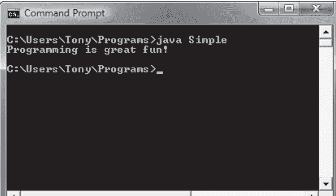

console 这个词是一个老的计算机术语。它源于操作员通过终端交互的时代。那个终端就是控制台。今天，标准输出指的是设备。输出是通过 API 完成的。API 代表应用程序接口（Application Interface）。API 是执行特定操作的预定义类。这些类和方法对所有 Java 程序可用。

列表 2-1 中的程序使用以下语句在屏幕上打印一条消息：

```
System.out.println("Programming is great!");
```

System 是一个属于 Java API 的类。System 类包含了执行系统级操作的对象。System 类包含的对象之一名为 out。out 对象具有如 print 和 println 等方法，用于执行屏幕输出。System、out、print 和 println 之间的层次关系如图 2-3 所示。

## 2-3 System 类、out 对象与 print 和 println 方法之间的关系

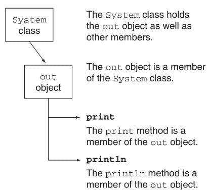

以下是其工作原理的概要：

- System 类是 Java API 的。它具有执行系统级操作的成员对象和方法，例如输出到控制台。
- out 对象是 System 类的成员。它提供了输出到屏幕的方法。
- print 和 println 方法是 out 对象的成员。它们实际上执行在屏幕上写入字符的工作。

这种层次结构解释了为什么执行 println 的语句如此长。System.out.println 指定 println 是 out 的成员，而 out 是 System 的成员。

> 注意：分离名称之间的点读作 "dot"。System.out.println 读作 "system out dot print line。"要在屏幕上显示的值被放在括号内。这个值被称为参数（argument）。例如，以下语句使用字符串 "King Arthur" 执行 println 方法。这将在屏幕上打印 "King Arthur"（引号不会显示在屏幕上）。

```
System.out.println("King Arthur");
```

## 2.2 System.out.print 和 System.out.println 方法以及 Java API

关于 `println` 方法需要了解的一个重要点是，它会显示消息，并将光标移动到下一行的开头。屏幕上打印的下一个项目将位于该位置。例如，查看代码列表 2-2 中的程序。

### 代码列表 2-2 TwoLines.java

```
1 // This is another simple Java program.
2
3 public class TwoLines
4 {
5     public static void main(String[] args)
6 {
7     System.out.println("Programming is great fun!");
8     System.out.println("I can't get enough of it!");
9 }
10 }
```

## 程序输出

Programming is great fun!

I can't get enough of it!

由于每个字符串都是通过独立的 `println` 语句打印的，它们出现在不同的行。

## print 方法

`print` 方法也是 `System.out` 对象的一部分，其作用与 `println` 类似——在屏幕上显示输出。然而，`print` 方法在显示消息后不会将光标移动到下一行。查看代码列表 2-3。

### 代码列表 2-3 GreatFun.java

```
1 // This is another simple Java program.
2
3 public class GreatFun
4 {
5     public static void main(String[] args)
6 {
7     System.out.print("Programming is ");
8     System.out.println("great fun!");
9 }
10 }
```

## 程序输出

Programming is great fun!

## 第 2 章 Java 基础

关于代码列表 2-3 需要理解的一个重要概念是，虽然输出被分成了两个编程语句，但该程序仍然会在行上显示消息。发送到 `print` 方法的数据以连续流的形式显示。有时这可能会产生不尽人意的结果。代码列表 2-4 中的程序就是一个例子。

### 代码列表 2-4 (Unlucky.java)

```
1 // An unruly printing program
2
3 public class Unruly
4 {
5 public static void main(String[] args)
6 {
7 System.out.print("Are we top sellers:");
8 System.out.print("Computer games")
9 System.out.print("Coffee")
10 System.out.println("Aspirin")
11 }
12 }
```

## 程序输出

Are our top sellers:ComputergamesCoffeeAspirin

实际输出的布局与源代码中字符串的排列完全不同。首先，尽管输出在源代码中被分为四行（第 7 到 10 行），但它在屏幕上以单行的形式出现。其次，注意某些单词显示时没有空格分隔。字符串完全按照它们发送到 `print` 方法的方式显示。如果显示了空格，它们必须出现在字符串中。

修复此程序有两种。最明显的方法是使用 `println` 代替 `print` 方法。另一种方法是使用转义序列将输出分离到不同的行。转义序列以反斜杠 (\) 开头，后跟着一个或多个控制字符。它允许你通过在字符串内部嵌入命令来控制输出的显示。导致输出光标到下一行的转义序列是 `\n`。代码列表 2-5 说明了它的用法。

### 代码列表 2-5 (Adjusted.java)

```
1 // A well adjusted printing program
2
3 public class Adjusted
4 {
5 public static void main(String[] args)
6 {
7 System.out.print("These are our top sellers:\n");
8 System.out.print("Computer games\n");
9 System.out.println("Aspirin");
10 }
11
```

## 程序输出

These are our top sellers:

Computer games

Coffee

Aspirin

`\n` 字符被称为换行转义序列。当 `print` 或 `println` 方法遇到字符串中的转义 `\n` 时，它们不会在屏幕上打印 `\n` 字符，而是将其解释为将输出光标移动到下一行的特殊命令。还有其他几个转义序列。例如，`\t` 是制表符序列。当 `print` 或 `println` 在字符串中遇到它时，它会导致输出光标移动到下一个制表位置。代码列表 2-6 显示了它的用法。

### 代码列表 2-6 (Tabs.java)

```
1 // Another well-adjusted printing program
2
3 public class Tabs
4 {
5     public static void main(String[] args)
6 {
7         System.out.print("These are our top sellers:\n");
8         System.out.print("\tComputer games\tCoffee\n");
9         System.out.println("\taspirin");
10 }
11 }
```

## 程序输出

These are our top sellers:

Computer games

Coffee

Aspirin

> 注意：虽然你必须输入两个字符来编写转义序列，但它们在内存中存储为单个字符。

## 第 2 章 Java 基础

表 2-2 列出了常见的转义序列并对其进行了描述。

### 表 2-2 常见转义序列

| 转义序列 | 名称 | 描述 |
| --- | --- | --- |
| \n | 换行 | 将光标移动到下一行 |
| \t | 水平制表符 | 使光标跳到 |
| \b | 退格 | 使光标向左移动 |
| \r | 回车 | 使光标回到行开头 |
| \\ | 反斜杠 | 打印反斜杠 |
| \' | 单引号 | 打印单引号 |
| \" | 双引号 | 打印双引号 |

> 注意：不要混淆反斜杠 (\) 和斜杠 (/)。

## 2.3 变量与字面量

正如你在第 1 章中发现的，变量允许你存储和处理数据。字面量是写入代码中的值。工作是确定需要多少变量以及它们将持有什么类型的数据。代码列表 2-7 中的程序是变量的示例。

### 代码列表 2-7 (Variable.java)

```
1 // This program has a variable.
2
3 public class Variable
4 {
5     public static void main(String[] args)
6 {
7     int value = 5;
8
9     System.out.print("The value is ");
10     System.out.println(value);
11
12 }
13 }
```

## 程序输出

The value is 5

### 代码列表 2-8 (Variable2.java)

```
1 // This program has a variable.
2
3 public class Variable2
4 {
5     public static void main(String[] args)
6 {
7     int value;
8
9     value = 5;
10     System.out.print("The value is ");
11     System.out.println("value");
12
13 }
14 }
```

## 程序输出

The value is value

## 2.3 变量与字面量

当在单词 value 周围加上双引号时，它就变成了一个字符串字面量，而不是变量名。字符串字面量被发送到 `print` 或 `println`，它们将按照引号内出现的内容完整显示。

### 使用 + 运算符显示多个项目

当 `+` 运算符与字符串一起使用时，被称为字符串拼接运算符。拼接意味着追加，因此字符串拼接运算符将一个字符串附加到另一个字符串之后。例如，看以下语句：

```
System.out.println("This is " + "one string.");
```

该语句将打印：

This is one string.

`+` 运算符产生一个由作为操作数的两个字符串组合成的字符串。你也可以 `+` 运算符将变量的内容拼接到字符串中。下面的代码显示了一个示例：


```
number = 5;
System.out.println("The value is " + number);
```

第二行使用 `+` 运算符将 `number` 变量的内容与字符串 "the value is" 拼接。尽管 `number` 不是字符串，但 `+` 运算符会将其值转换为字符串，然后将该值与第一个字符串拼接。将显示的输出为：

The value is 5

有时，你用于 `print` 或 `println` 的参数太长，无法放入程序代码的一行中。然而，字符串字面量不能在一行开始并在另一行结束。以下代码会导致错误：

```java
// This is an error;
System.out.println("Enter a value that is greater than
and less than 10.");
```

你可以通过将参数拆分为较小的字符串字面量并使用字符串拼接将其扩展到多行来解决这个问题。这是一个示例：

```java
System.out.println("Enter a value that is " + 
"greater than zero and less " + 
"than 10.");
```

在该语句中，参数被拆分成三个字符串并使用 `+` 运算符连接。这个示例展示了当变量内容是拼接的一部分时使用的相同技术：

```java
sum = 249;
System.out.println("The sum of the three 
"numbers is " + sum);
```

### 注意引号

如代码列表 2-8 所示，在变量名周围加上引号会改变程序的运行。事实上，在任何并非打算作为字符串字面量的内容周围加上引号都会创建某种类型的错误。例如，在代码列表 2-7 和 2-8 中，数字 5 被赋值给变量 `value`。以这种方式进行赋值将是一个错误：

```java
value = "5"; // Error!
```

在该语句中，5 不再是整数，而是字符串字面量。由于 `value` 被声明为整数变量，你只能向其中存储整数。换句话说，5 和 "5" 不是一回事。

数字可以被表示为字符串这一事实经常让初学者的学生感到困惑。只需记住，字符串是为了人类阅读而设计的。它们被打印在计算机屏幕或纸上。然而，数字是为了数学运算的。你不能对字符串进行数学运算，而且在数字显示在屏幕之前，必须先将其转换为字符串。（格式上，`print` 和 `println` 在你将数字发送给变量或显示时会自动处理转换。代码列表 2-9 既包含字面量也包含变量。）如果这仍然让你困扰，请不要担心。在本章的后后部分，我们将通过讨论它们的内部存储，进一步阐明数字、字符和字符串之间的区别。

### 更多关于字面量

字面量是写在程序代码中的值。字面量通常被赋值给变量或显示。代码列表 2-9 既包含字面量包含变量。

代码列表 2-9 (Literals.java)

```java
// 该程序包含字面量和一个变量。

public class Literals
{
    public static void main(String[] args)
    {
        int apples;

        apples = 20;
        System.out.println("Today we sold " + apples + " bushels of apples.");
    }
}
```

程序输出

Today we sold 20 bushels of apples.

## 2.3 变量与字面量

当然，这个程序中的变量是 `apples`。它被声明为整数。表 2-3 显示了程序中找到字面量列表。

### 表 2-3 字面量

| 字面量 | 字面量类型 |
| --- | --- |
| 20 | 整数字面量 |
| "Today we sold " | 字符串字面量 |
| "bushels of apples." | 字符串字面量 |

### 标识符

标识符是程序员定义的、代表程序某些元素的名称。变量名和类名都是标识符的示例。在 Java 中，你可以选择自己的变量和类名，只要你不使用任何 Java 关键字。关键字构成了语言的核心，每个关键字都有特定的用途。第1章表 1-3 和附录 B 显示了 Java 单词的完整列表。

你应该始终为变量选择能够指示其用途的名字。因为你可能会忍不住声明像这样的变量名：

```java
int x;
```

无描述性的名称 `x` 没有提供关于该变量用途的任何线索。这是一个更好的例子：

```java
int itemsOrdered;
```

`itemsOrdered` 这个名字让任何阅读程序的人了解该变量的用途。这种编码方法有助于产生自文档式程序，这意味着你只需通过阅读代码就能理解程序在做什么。因为现实世界的程序有成千上万行代码，让它们具有自文档性是重要的。你可能已经注意到名称中大写和小写字母的混合。尽管 Java 关键字必须小写，但变量名通常以小写字母开头，并对名称的每个单词的首字母大写。以下是所有标识符必须遵循的特定规则：

- 第一个字符必须是 a-z、A-Z、下划线 (_) 或美元符号 ($)。
- 在第一个字符之后，你可以使用字母 a-z 或 A-Z、数字 0–9、下划线 (_) 或美元符号 ($)。
- 大写字母和小写字母是有区别的。这意味着 `itemsOrdered` 与 `itemsordered` 不同。
- 标识符不能包含空格。

> 注意：虽然 $ 是合法的标识符字符，但它通常用于特殊目的。因此，不要在变量名中使用。

表 2-4 显示了变量名列表并告知它们在 Java 中是否合法。

| 变量名 | 合法或非法 |
|---|---|
| dayOfWeek | 合法 |
| 3dGraph | 非法，因为标识符不能以数字开头 |
| june1997 | 合法 |
| mixture#3 | 非法，因为标识符只能使用字母、数字、下划线或美元符号 |
| week day | 非法，因为标识符包含空格 |

### 类名

如前所述，标准做法是以小写字母开始变量名，并将构成名称的每个单词的首字母大写。标准做法也是将类名的首字母大写，以及它包含的每个单词的首字母大写。这有助于区分变量名和类名。例如，`payRate` 是一个变量名，而 `Employee` 是一个类名。

## 检查点

2.10 检查以下程序。

```java
public class BigLittle{
  public static void main(String[] args)
{
    int little;
    int big;

    little = 2;
    big = 2000;
    System.out.println("The little number is " + little);
  }
}
```

```java
} System.out.println("The big number is " + big);
  
}
```

列出程序中找到变量和字面量。

2.11 下面程序将在屏幕上显示什么内容？

```java
public class CheckPoint
{
    public static void main(String[] args)
    {
        int number = 712;
        System.out.println("The value is " + "number");
    }
}
```

# 原始数据类型

**概念：有许多不同类型的数据。变量根据其数据类型进行分类，数据类型决定了其中可以存储什么种类的数据。**

计算机程序从现实世界收集数据片段并以各种方式对其进行处理。许多许多类型的数据。例如，在数值数据领域，有整数和小数；负数和正数；以及大到无法命名或小到甚至没有名字的数字。还有文本信息。例如，名称和地址是以字符字符串的形式存储的。当你编写程序时，必须确定它可能会遇到什么类型的数据。

每个变量都有一个数据类型，即变量可以包含的数据类型。选择合适的数据类型是非常重要的，因为变量的数据类型决定了变量使用的内存量以及格式化和存储数据的方式。选择与程序将处理的数据类型匹配的数据类型非常重要。如果你正在编写一个计算到遥远恒星里程数的程序，你需要能够存储极大数字的变量。如果你正在设计记录微观尺寸的软件，你需要存储非常小且精确数字的变量。如果你正在编写一个必须执行数千次密集计算的程序，你希望变量可以被快速处理。变量的数据类型决定了所有这些因素。

表 2-5 显示了用于存储数值的所有 Java 原始数据类型。

# 表 2-5 用于数值数据的原始数据类型

| 数据类型 | 大小 | 范围 |
| --- | --- | --- |
| byte | 1 byte | -128 到 +127 之间的整数 |
| short | 2 bytes | -32,768 到 +32,767 之间的整数 |
| int | 4 bytes | -2,147,483,648 到 +2,147,483,647 之间的整数 |
| long | 8 bytes | -9,223,372,036,854,775,808 到 +9,223,372,036,854,775,808 之间的整数 |
| float | 4 bytes | ±3.4 × 10^-38 到 ±3.4 × 10^38 之间的浮点数，具有 7 位精度 |
| double | 8 bytes | ±1.7 × 10^-308 到 ±1.7 × 10^308 之间的浮点数，具有 15 位精度 |

表 2-5 左列列出的词汇是你在变量声明中使用的关键字。变量声明采用以下通用格式：

```
DataType VariableName;
```

`DataType` 是数据类型的名称，`VariableName` 是变量的名称。以下是变量声明的一些示例：

- `byte index;`
- `int speed;`
- `short month;`
- `float salesCommission;`
- `double distance;`

表 2-5 中的“大小”列显示了每个数据类型的变量所使用的字节数。例如，一个 `int` 变量使用 4 个字节，一个 `double` 变量使用 8 个字节。“范围”列显示了每个数据类型变量中可能存储的数字范围。例如，一个 `int` 变量可以包含从 -2,147,483,648 到 +2,147,483,647 的数字。Java 语言的特性之一是，所有原始数据类型的大小和范围在所有计算机上都是相同的。

> 注意：这些类型被称为“原始”，是因为你不能使用它们来创建对象。回想第1章关于面向对象编程讨论，对象具有属性和方法。对于原始数据类型，你只能创建变量，而变量只能用于存储单个值。此类变量没有属性或方法。

# 整数数据类型

表 2-5 列出的前四个数据类型 `byte`、`int`、`short` 和 `long` 都是整数数据类型。整数变量可以存储如 7、125、-14 和 6928 等整数。代码列表 2-10 中的程序显示了几个不同数据类型的变量。

## 2.4 原始数据类型

# 代码列表 2-10 (IntegerVariables.java)

```java
1 // 此程序具有几种整数类型的变量。
2
3 public class IntegerVariables
4 {
5 public static void main(String[] args)
6 {
7 int checking; // 声明名为 checking 的 int 变量。
8 byte miles; // 声明名为 miles 的 byte 变量。
9 short minutes; // 声明名为 minutes 的 short 变量。
10 long days; // 声明名为 days 的 long 变量。
11
12 checking = -20;
13 miles = 105;
14 minutes = 120;
15 days = 189000;
16 System.out.println("We have made a journey of " + miles + " ");
17 miles.");
18 System.out.println("It took us " + minutes + " minutes.");
19 System.out.println("Our account balance is $" + checking);
20 System.out.println("About " + days + " days ago Columbus " + 
21 "stood on this spot.");
22
23 }
```

## 程序输出

We have made a journey of 105 miles.

It took us 120 minutes.

Our account balance is $-20

About 189000 days ago Columbus stood on this spot.

在大多数程序中，你需要任何给定数据类型的多个实例。如果一个程序使用了三个整数：长度、宽度和面积，可以分别声明它们，如下：

```java
int length;
int width;
int area;
```

在同一行中声明它们更简单：

```java
int length, width, area;
```

# Java 基础

# 整数

# 字面量

当你写一个整数字面量时，Java 假设它是一个 `int`。例如，在代码列表 2-10 中，字面量 -20、105、120 和 189000 都是 `int` 字面量。如果你想创建一个 `long` 字面量，需要在数字后面加上 `L`：

```java
long days = 189000L;
```

## 浮点类型

表 2-5 列出的前四个数据类型 `byte`、`int`、`short` 和 `long` 都是整数数据类型。整数变量可以存储如 7、125、-14 和 6928 等整数。代码列表 2-10 中的程序显示了几个不同数据类型的变量。

# 浮点字面量

浮点字面量可以表示小数。当你写一个浮点字面量时，Java 假设它是一个 `double`。例如，在代码列表 2-11 中，字面量 3.14 和 2.5 都是 `double` 字面量。如果你想创建一个 `float` 字面量，需要在数字后面加上 `F`：

```java
float pi = 3.14F;
```

# 代码列表 2-11 (Sale.java)

```java
// 此程序演示了 double 类型。

public class Sale
{
    public static void main(String[] args)
    {
        double price = 3.14;
        double tax = 2.5;
        System.out.println("The price is " + price);
        System.out.println("The tax is " + tax);
    }
}
```

## 程序输出

The price is 3.14

The tax is 2.5

## 表 2-6 浮点数表示

| 十进制计数法 | 科学计数法 | E 计数法 |
| --- | --- | --- |
| 247.91 | 2.4791 × 10² | 2.4791E2 |
| 0.00072 | 7.2 × 10⁻⁴ | 7.2E-4 |
| 2,900,000 | 2.9 × 10⁶ | 2.9E6 |

> 注意：E 可以是大写或小写。

代码列表 2-12 展示了用 E 计数表示的浮点字面量的用法。

```java
// 此程序使用了 E 计数法。
public class SunFacts
{
    public static void main(String[] args)
    {
        double distance, mass;

        distance = 1.495979E11;
        mass = 1.989E30;
        System.out.println("The Sun is " + distance +
        " meters away.");
        System.out.println("The Sun's mass is " + mass +
        " kilograms.");
    }
}
```

程序输出

The Sun is 1.495979E11 meters away.

The Sun's mass is 1.989E30 kilograms.

## boolean 数据类型

`boolean` 数据类型允许你创建可能持有两个可能值之一的变量：`true`（真）或 `false`（假）。代码列表 2-13 展示了 `boolean` 变量的声明和赋值。

## 代码列表 2-13 (TrueFalse.java)

```java
1 // 用于演示 boolean 变量程序
2
3 public class TrueFalse
4 {
5 public static void main(String[] args)
6 {
7 boolean bool;
8
9 bool = true;
10 System.out.println(bool);
11 bool = false;
12 System.out.println(bool);
13 }
14 }
```

## 程序输出

true

false

`boolean` 数据类型的变量用于评估为真或假的条件。然而，在第 3 章之前你不会使用它们，但现在只需记住以下几点：

- `boolean` 变量只能持有值 `true` 或 `false`。
- `boolean` 变量的内容不能被复制到任何其他类型的的变量中。

## char 数据类型

`char` 数据类型用于存储字符。`char` 数据类型的变量一次可以持有一个字符。字符字面量用单引号括起来。代码列表 2-14 使用了 `char` 变量。在程序运行时，字符字面量 'A' 和 'B' 被赋值给该变量。

## 代码列表 2-14 (Letters.java)


## 代码列表 2-14 (Letters.java)

```
1 // 此程序演示 char 数据类型。
2
3 public class Letters
4 {
5 public static void main(String[] args)
6 {
7 char letter;
8
9 letter = 'A';
10 System.out.println(letter);
11 letter = 'B';
12 System.out.println(letter);
13 }
14
```

## 程序输出

A

B

不要混淆字符字面量与字符串字面量，后者用双引号括起来。字符串字面量不能赋值给 `char` 变量。

## Unicode

字符在内部由数字表示。每个可打印字符（以及许多不可打印字符）都被分配了一个唯一的数字。Java 使用 Unicode，这是一组被用作表示字符代码的数字。每个 Unicode 需要两个字节的内存，因此字符占用两个字节。当字符被存储在内存中时，存储的实际上是数字代码。当指令计算机在屏幕上打印该值时，它会显示与数字代码相对应的字符。

你可能想参考附录 B，它显示了 Unicode 字符集的一部分。注意数字 65 是 A 的代码，66 是 B 的代码，以此类推。代码列表 2-15 展示了当你处理字符时，你实际上是在处理数字。

## 代码列表 2-15 (Letters2.java)

```
1 // 此程序演示了字符与整数
2 //之间的紧密关系。
3
4 public class Letters2
5 {
6 public static void main(String[] args)
7 {
8 char letter;
9
10 letter = 65;
11 System.out.println(letter);
12 letter = 66;
13 System.out.println(letter);
14 }
15 }
```

## 程序输出

A

B

图 2-4 说明了当你认为字符 A、B 和 C 被存储在内存中时，实际上存储的是数字 65,66 和 67。

### 图 2-4 字符及其在内存中的存储方式

| A | B | C |
|---|---|---|
| 00 65 | 00 66 | 00 67 |

这些字符被存储在内存中……

## 变量赋值与初始化

正如你已经在几个示例中看到的，通过赋值语句将值放入变量。例如，以下语句将值 12 分配给变量 `unitsSold`：

```
unitsSold = 12;
```

该符号被称为赋值运算符。运算符对数据执行操作。`boolean` 数据类型的变量用于评估为真或假的条件。然而，在第 3 章之前你不会使用它们，但现在只需记住以下几点：

- `boolean` 变量只能持有值 `true` 或 `false`。
- `boolean` 变量的内容不能被复制到任何其他类型的变量中。

## char 数据类型

`char` 数据类型用于存储字符。`char` 数据类型的变量一次可以持有一个字符。字符字面量用单引号括起来。在代码列表 2-14 使用了 `char` 变量。在程序运行时，字符字面量 `'A'` 和 `'B'` 被赋值给该变量。

## Unicode

字符在内部由数字表示。每个可打印字符（以及许多不可打印字符）都被分配了一个唯一的数字。Java 使用 Unicode，这是一组被用作表示字符代码的数字。每个 Unicode 需要两个字节的内存，因此字符占用两个字节。当字符被存储在内存中时，存储的实际上是数字代码。当指令计算机在屏幕上打印该值时，它会显示与数字代码相对应的字符。

你可能想参考附录 B，它显示了 Unicode 字符集的一部分。注意数字 65 是 A 的代码，66 是 B 的代码，以此类推。代码列表 2-15 展示了当你处理字符时，你实际上是在处理数字。

## 变量赋值与初始化

正如你已经在几个示例中看到的，通过赋值语句将值放入变量。例如，以下语句将值 12 分配给变量 `unitsSold`：

```
unitsSold = 12;
```

该符号被称为赋值运算符。运算符对数据执行操作。`boolean` 数据类型的变量用于评估为真或假的条件。然而，在第 3 章之前你不会使用它们，但现在只需记住以下几点：

- `boolean` 变量只能持有值 `true` 或 `false`。
- `boolean` 变量的内容不能被复制到任何其他类型的变量中。

## char 数据类型

`char` 数据类型用于存储字符。`char` 数据类型的变量一次可以持有一个字符。字符字面量用单引号括起来。在代码列表 2-14 使用了 `char` 变量。在程序运行时，字符字面量 `'A'` 和 `'B'` 被赋值给该变量。

## Unicode

字符在内部由数字表示。每个可打印字符（以及许多不可打印字符）都被分配了一个唯一的数字。Java 使用 Unicode，这是一组被用作表示字符代码的数字。每个 Unicode 需要两个字节的内存，因此字符占用两个字节。当字符被存储在内存中时，存储的实际上是数字代码。当指令计算机在屏幕上打印该值时，它会显示与数字代码相对应的字符。

你可能想参考附录 B，它显示了 Unicode 字符集的一部分。注意数字 65 是 A 的代码，66 是 B 的代码，以此类推。代码列表 2-15 展示了当你处理字符时，你实际上是在处理数字。

## 变量赋值与初始化

正如你已经在几个示例中看到的，通过赋值语句将值放入变量。例如，以下语句将值 12 分配给变量 `unitsSold`：

```
unitsSold = 12;
```

该符号被称为赋值运算符。运算符对数据执行操作。`boolean` 数据类型的变量用于评估为真或假的条件。然而，在第 3 章之前你不会使用它们，但现在只需记住以下几点：

- `boolean` 变量只能持有值 `true` 或 `false`。
- `boolean` 变量的内容不能被复制到任何其他类型的变量中。

## char 数据类型

`char` 数据类型用于存储字符。`char` 数据类型的变量一次可以持有一个字符。字符字面量用单引号括起来。在代码列表 2-14 使用了 `char` 变量。在程序运行时，字符字面量 `'A'` 和 `'B'` 被赋值给该变量。

## Unicode

字符在内部由数字表示。每个可打印字符（以及许多不可打印字符）都被分配了一个唯一的数字。Java 使用 Unicode，这是一组被用作表示字符代码的数字。每个 Unicode 需要两个字节的内存，因此字符占用两个字节。当字符被存储在内存中时，存储的实际上是数字代码。当指令计算机在屏幕上打印该值时，它会显示与数字代码相对应的字符。

你可能想参考附录 B，它显示了 Unicode 字符集的一部分。注意数字 65 是 A 的代码，66 是 B 的代码，以此类推。代码列表 2-15 展示了当你处理字符时，你实际上是在处理数字。


程序中的第 15 行将 `basePay` 乘以 `regularHours`，并将结果（1000）存储在 `regularWages` 中：

```
regularWages = basePay * regularHours;
```

第 16 行将 `overtimePay` 乘以 `overtimeHours`，并将结果（375）存储在 `overtimeWages` 中：

```
overtimeWages = overtimePay * overtimeHours;
```

第 17 行将常规工资和加班费相加，并将结果 1375 存储在 `totalWages` 中：

```
totalWages = regularWages + overtimeWages;
```

第 18 和 19 行中的 `println` 语句在屏幕上显示报告工人工资的消息。

### 整数除法

当除法运算符的两个操作数都是整数时，该运算符将执行整数除法。除法结果也将是一个整数。如果有余数，它将被丢弃。例如，看以下代码：

```
double number;
number = 5 / 2;
```

### 焦点聚焦：计算百分比与折扣

确定百分比是计算机编程中一种常见的计算。虽然在通用数学中使用 `%` 符号来表示百分比，但许多编程语言（包括 Java）并不使用 `%` 符号来实现此目的。在程序中，你必须将百分比转换为浮点数，就像使用计算器一样。例如，50% 被写为 0.5，2% 被写为 0.02。

让我们来看一个例子。假设你每月赚取 6,000 美元，并且允许将每月总工资的一部分存入退休计划。你想确定，如果你将每月税前总额的 5%、8% 或 10% 存入计划，将会有多少资金进入该计划。为了进行这一测定，你编写了一个类似于代码列表 2-18 所示的程序。

#### 代码列表 2-18 (Contribution.java)

```java
// 此程序计算扣除月工资 5%、
// 7% 或 10% 后，
// 存入退休计划的金额。

public class Contribution
{
    public static void main(String[] args)
    {
        // 用于存储月工资和
        double monthlyPay = 6000.0;
        double contribution;

        // 计算并显示 5% 的贡献金额。
        contribution = monthlyPay * 0.05;
        System.out.println("5 percent is $" + contribution + " per month.");

        // 计算并显示 8% 的贡献金额。
        contribution = monthlyPay * 0.08;
        System.out.println("8 percent is $" + contribution + " per month.");

        // 计算并显示 10% 的贡献金额。
        contribution = monthlyPay * 0.1;
        System.out.println("10 percent is $" + contribution + " per month.");
    }
}
```

#### 程序输出

```
5 percent is $300.0 per month.
8 percent is $480.0 per month.
10 percent is $600.0 per month.
```

第 11 行和第 12 行声明了两个变量：`monthlyPay` 和 `contribution`。`monthlyPay` 变量被初始化为 6000.0，存储了你的月工资金额。`contribution` 变量存储了退休计划的贡献金额。

第 15 行到第 18 行的语句计算并显示了月工资的 5%。计算在第 15 行完成，其中 `monthlyPay` 变量乘以 0.05。结果被赋值给 `contribution` 变量，然后通过第 16 行到第 18 行的语句显示。

第 21 行到第 24 行采取了类似的步骤，计算并显示了月工资的 8%；第 27 行到第 30 行计算并显示了月工资的 10%。

#### 计算百分比折扣

另一种常见情况是确定百分比折扣。例如，假设一家零售企业销售某件常规标价为 59 美元的商品，并计划进行促销活动，将商品价格降低 20%。你被要求编写一个程序来计算该商品的销售价格。

要确定销售价格，你需要执行两次计算：

- 首先，你计算出折扣金额，即商品原价的 20%。
- 其次，你从商品原价中减去折扣金额。这便得到了销售价格。

代码列表 2-19 展示了在 Java 中如何实现。

#### 代码列表 2-19 (Discount.java)

```java
1 // 此程序计算常规标价为
2 // 59 美元的商品销售价格，
3 // 减去 20% 的折扣。
4
5 public class Discount
6 {
7   public static void main(String[] args)
8   {
9     // 用于存储原价、
10     // 折扣金额以及销售价格的变量。
11     double regularPrice = 59.0;
12     double discount;
13     double salePrice;
14     // 计算 20% 折扣的金额。
15     discount = regularPrice * 0.2;
16
17     // 通过从原价中减去
18     // 折扣来计算销售价格。
19     salePrice = regularPrice - discount;
20
21     // 显示结果。
22     System.out.println("Regular price: $" + regularPrice);
23     System.out.println("Discount amount: $" + discount);
24     System.out.println("Sale price: $" + salePrice);
25   }
26 }
```

#### 程序输出

```
Regular price: $59.0
Discount amount: $11.8
Sale price: $47.2
```

第 11 行到第 13 行声明了三个变量。`regularPrice` 变量存储商品的原价，并初始化为 59.0。`discount` 变量存储计算出的折扣金额。`salePrice` 变量存储商品的销售价格。

第 16 行通过将 `regularPrice` 乘以 0.2 计算出 20% 折扣的金额。结果存储在 `discount` 变量中。第 20 行通过从 `regularPrice` 中减去 `discount` 计算销售价格。结果存储在 `salePrice` 变量中。第 23 行到第 25 行的语句显示了结果。

### 2.5 算术运算符

### Math 类

Java API 提供了一个名为 `Math` 的类，包含了许多操作的方法。在本节中，我们将简要查看 `pow` 和 `sqrt`。

#### pow 方法

`Math.pow` 接受两个参数。它将第一个参数的第二个参数幂。这是一个示例：

```java
result = Math.pow(x, 2);
```

#### sqrt 方法

`Math.sqrt` 接受一个 double 并返回其平方根。这是一个示例：

```java
result = Math.sqrt(x);
```

### 检查点

**2.22 完成下表，写出每个表达式的值。**

| 表达式 | 值 |
|---|---|
| 6 + 3 | |
| 12 - 4 | |
| 9 * 2 | |
| 14 / 7 | |
| 5 % 3 | |
| (6 + 2) * 3 | |
| 14 % 8 | |
| 9 / 3 | |

**代码示例中的除法语句是整数除法还是浮点数除法？**

```java
double portion;
portion = 7 / 3;
```

### 复合运算符

概念：复合运算符将赋值运算符与算术运算符相结合。

通常，程序会有如下形式的赋值语句：

```java
x = x + 1;
```

在赋值运算符的右侧，1 被加到 x。结果被赋值给 x，替换了之前的值。实际上，这条语句是将 x 增加了 1。这是另一个示例：

```java
balance = balance + deposit;
```

假设 `balance` 和 `deposit` 是变量，该语句将 `balance + deposit` 的值赋值给 `balance`。该语句的作用是将 `deposit` 加到存储在 `balance` 中的值。这是另一个示例：

```java
balance = balance - withdrawal;
```

假设 `balance` 和 `withdrawal` 是变量，该语句将 `balance - withdrawal` 的值赋值给 `balance`。该语句的作用是从存储在 `balance` 中的值中减去 `withdrawal`。

这类操作非常常见。为了方便，Java 提供了一组专门为这些工作设计的特殊运算符。表 2-13 展示了复合赋值运算符，也称为复合运算符。

#### 表 2-13 复合赋值运算符

| 运算符 | 示例用法 | 等于 |
| --- | --- | --- |
| += | x = 5; | x = x + 5; |
| -= | y = 2; | y = y - 2; |
| *= | z = 10; | z = z * 10; |
| /= | a = b; | a = a / b; |
| %= | c = 3; | c = c % 3; |

如你所见，复合赋值运算符不需要程序员输入两次变量名。以下语句：

```
balance = balance + deposit;
```

可以重写为：

```
balance += deposit;
```

同样，语句

```
balance = balance - withdrawal;
```

可以重写为：

```
balance -= withdrawal;
```

#### 检查点

2.24 使用复合赋值运算符编写语句执行以下操作：

a. 将 x 加上 6
b. 从 amount 中减去 4
c. 将 y 乘以 4
d. 将 total 除以 27
e. 将 x 除以 7 的结果存储在内存 x 中

### 2.7 原生数据类型之间的转换

> 概念：在值存储到变量之前，该值的数据类型必须与变量的数据类型兼容。Java 会自动在数据类型之间进行某些转换，但不会自动执行任何可能导致数据丢失的转换。在评估包含混合类型的算术表达式时，Java 同样遵循一套规则。

Java 是一种强类型语言。这意味着在将值赋值给变量之前，Java 会检查变量和被赋值值的数据类型，以确定它们是否兼容。例如，看以下语句：

```
int x;
double y = 2.5;
x = y;
```

赋值语句试图将一个 double 值 (2.5) 存储在 int 变量中。当 Java 编译器遇到这行代码时，将报错并显示错误消息“可能丢失精度”（possible loss of precision）（Sun JDK 显示此消息）。

并不是所有数据类型不匹配的赋值会被编译器拒绝。例如，看以下程序段：

```
int x;
short y = 2;
x = y;
```

此赋值将一个 short 存储在 int 中，这可以正常工作。那么 Java 允许将 double 存储在 int 中吗？明显的原因是 double 可以存储小数，并且可以持有比 int 大的值。如果 Java 允许将 double 赋值给 int，可能会导致数据丢失。

就像军队中的军官一样，数据类型也是分级的。如果一个数据类型可以存储更大的数字，那么它的排名就高于另一个类型。例如，float 高于 int，而 int 高于 short。图 2-6 显示了按排序的数值数据类型。数据类型出现越高，排名越高。

**图 2-6** 原生数据类型排名

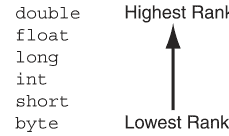

在赋值语句中，当将低级类型的值存储在高级类型中时，Java 会自动将低级值转换为高级类型。这被称为*宽转换*（widening conversion）。例如，以下代码演示了宽转换，这种转换发生在将 int 存储到 double 变量中：

```
double x;
int y = 10;
x = y; // 执行宽转换
```

*窄转换*（narrowing conversion）是将值转换为低级类型的转换。例如，将 double 转换为 int 就会发生窄转换。因为窄转换可能导致数据丢失，Java 不会自动执行。

#### 强制转换运算符

*强制转换运算符*（cast operator）允许你手动转换一个值，即使这意味着将发生窄转换。强制转换运算符是单元运算符，表现为括在括号内的类型名称。运算符位于被转换值之前。这里有一个示例：

```
x = (int)number;
```

该语句中的强制转换运算符是括号内的单词。它返回 `number` 中的值，并将其转换为 int。这个转换后的值存储在 `x` 中。如果 `number` 是浮点数变量（例如 float 或 double），返回的值将被截断，这意味着 `number` 的小数部分将丢失。然而，变量中的原始值不会改变。

表 2-14 显示了使用强制转换运算符的几个示例。

#### 表 2-14 强制转换运算符的用法示例

| 语句 | 描述 |
| --- | --- |
| littleNum = (short)bigNum; | 强制转换运算符返回 `bigNum` 中的值，并转换为 short。转换后的值赋值给变量 `littleNum`。 |
| x = (long)3; | 强制转换运算符应用于表达式 3.7。运算符返回值 3，赋值给变量 `x`。 |
| number = (int)72.566; | 强制转换运算符应用于表达式 72.566。运算符返回 72，用于初始化变量 `number`。 |
| value = (float)x; | 强制转换运算符返回 `x` 中的值，并转换为 float。转换后的值赋值给变量。 |
| value = (byte)number; | 强制转换运算符返回 `number` 中的值，并转换为 byte。转换后的值赋值给变量。 |

> 警告！强制转换运算符可以应用于整个括号内的表达式。例如，看以下语句：
>
> `piesPerson = (double)(pies / people);`
>
> 该语句并没有将 `pies` 或 `people` 转换为 double，而是转换表达式 `pies / people` 的结果。如果使用了该语句，将执行整数除法。原因如下：表达式 `pies / people` 的结果为 2（因为进行了整数除法）。2 转换为 double 为 2.0。为了防止整数除法，必须将操作数之一转换为 double。

#### 混合整数运算

Java语言的微妙之处之一在于它内部处理 int、byte 和 short 变量算术的方式。当 byte 或 short 类型变量被用于算术表达式时，它们会被临时转换为 int。仅使用 byte、short 或 int 的算术运算的结果总是 int。

例如，以下表达式中的 `b` 和 `c` 是 short 变量：

```
b + c
```

尽管 `b` 和 `c` 都是 short 变量，表达式 `b + c` 的结果也是 int。这意味着当将此类表达式的结果存储在变量中时，变量必须是 int 或更高数据类型。例如，看以下代码：

```
short firstNumber = 10,
secondNumber = 20,
thirdNumber;
```

// 下述语句会导致错误！

`thirdNumber = firstNumber + secondNumber;`

当这段代码编译时，下述语句会导致错误：

```
thirdNumber = firstNumber + secondNumber;
```

错误源于 `firstNumber` 和 `secondNumber` 也是 short 变量，表达式 `firstNumber + secondNumber` 产生一个 int 值。如果 `thirdNumber` 声明为 int，或者在赋值时使用强制转换运算符，程序就可以修正，如下所示：

```
thirdNumber = (short)(firstNumber + secondNumber);
```

#### 其他混合数学表达式

在数学表达式中包含一个或多个 double、float 或 long 数据类型的值时，Java 努力将表达式中的所有操作数转换为相同的数据类型。让我们看看控制此类表达式评估的特定规则。

- 1. 如果操作符的操作数之一是 double，那么另一个操作数的值将转换为 double。表达式的结果将是一个 double。例如，在以下语句中，假设 `b` 是一个 double 而 `c` 是一个 int：

```
a = b + c;
```

在进行加法之前，`c` 中的值将转换为 double。加法的结果将是一个 double，因此变量 `a` 必须是 double。

- 2. 如果操作符的操作数之一是 float，那么另一个操作数的值将转换为 float。表达式的结果将是一个 float。例如，在以下语句中，假设 `x` 是一个 short 而 `y` 是一个 float：

```
z = x * y;
```


# 类型转换与变量作用域

## 数值类型转换规则

在进行乘法之前，`x` 中的值将转换为 `float`。乘法的结果将是一个 `float`，因此变量 `a` 必须是 `double` 或 `float`。

3. 如果操作符的操作数之一是 `long`，那么另一个操作数的值将转换为 `long`。表达式的结果将是一个 `long`。例如，在以下语句中，假设 `a` 是一个 `long` 而 `b` 是一个 `short`：

```
c = a - b;
```

在进行减法之前，变量 `b` 将转换为 `long`。减法的结果将是一个 `long`，因此变量 `c` 也必须是 `long`、`float` 或 `double`。

## 节点检查点

### 2.25 程序中出现了以下声明：

```
short totalPay, basePay = 500, bonus = 1000;
```

在同一个程序中出现了以下语句：

```
totalPay = basePay + bonus;
```

- a. 该语句会正常编译还是会导致错误？
- b. 如果该语句导致了错误，原因是什么？你可以如何修复它？

### 2.26 变量 `a` 是 `float` 类型，变量 `b` 是 `double` 类型。写一条语句，将 `b` 的值赋值给 `a`，且在程序编译时不会产生错误。

## 使用 `final` 创建命名常量

> **概念**：`final` 关键字可以用于变量声明，以使变量成为命名常量。命名常量用一个值进行初始化，并且该值在程序执行期间不能更改。

假设以下语句出现在一个计算贷款相关内容的银行程序中：

```
amount = balance * 0.069;
```

在这样的程序中，会出现两个潜在问题。首先，除了原始程序员之外，没有人清楚 `0.069` 是什么。它看起来像是一个利率，但在某些情况下，贷款支付还会有相关的费用。在不费力检查程序其他部分的情况下，如何确定此语句的目的呢？

第二个问题发生在该数字在整个程序中的其他计算中使用，并且必须定期更改时。假设该数字是利率，如果利率从 6.9% 变为 8.2% 呢？程序员必须搜索整个源代码以找到该数字的所有出现处。

这两个问题都可以通过使用命名常量来解决。命名常量是一个值是只读且在程序执行期间不能更改的变量。`final` 关键字写在数据类型之前。这是一个示例：

```
final double INTEREST_RATE = 0.069;
```

这条语句看起来像普通的变量声明，区别是 `final` 单词出现在数据类型之前，且变量名使用了全大写字母。并不要求变量名必须全大写，但许多程序员倾向于这样写，以便将其与普通变量区分开来。

在使用带有 `final` 修饰符的变量时，必须给初始化值，否则在程序编译时会导致错误。如果程序中有任何尝试更改 `final` 变量值的语句，也会导致编译错误。

使用命名常量的优势是它能让程序更具自文档性。以下语句：

```
amount = balance * 0.069;
```

可以更改为

`amount = balance * INTEREST_RATE;`

新程序员可以阅读第二条语句并知道正在发生什么。显而易见，`balance` 乘以利率。这种方法的另一个优势可以容易地对程序进行广泛的更改。假设利率出现在整个程序中的十几个语句中。当利率变化时，只需要修改命名常量定义中的初始化值。如果利率增加到 8.2%，可以将声明更改为如下：

```
final double INTEREST_RATE = 0.082;
```

程序就可以准备重新编译。每个使用 `INTEREST_RATE` 的语句都将使用新值。

### Math.PI 命名常量

`Math` 类是 Java API 的一部分，提供了一个预定义的命名常量 `Math.PI`。该常量被赋值为 `3.14159265358979323846`，这是数学值 pi 的近似值。例如，看以下语句：

```
area = Math.PI * radius * radius;
```

假设 `radius` 变量持有圆的半径，该语句使用 `Math.PI` 常数来计算圆的面积。

> 有关 `Math` 类的更多信息，请参见此书的在线资源页面 www.pearsonglobaleditions。

## 2.9 String 类

### String 类概述

由 Java API 提供处理字符串的类名为 `String`。使用字符串类的第一步是声明一个 `String` 类的变量。这是一个 `String` 变量的示例：

```
String name;
```

> **提示**：`S` 是大写的。按照习惯，类名的第一个字母总是大写。

这条语句将 `name` 声明为 `String` 变量。记住 `String` 是类，而不是基本类型。让我们简单看看基本类型变量和类变量的区别。

### 基本类型变量和类变量

两种类型的变量都可以与数据项相关联。基本类型变量持有它们关联的实际数据项。例如，假设 `number` 是一个 `int` 变量。以下语句将值 `25` 存储在变量中：

```
number = 25;
```

这在图 2-7 中所示。

**图 2-7** 基本类型变量持有与其关联的数据

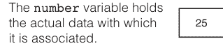

类变量并不持有它关联的实际数据项，而是持有它关联的数据的内存地址。如果 `name` 是类变量，那么 `name` 可以持有字符串对象的内存地址。这在图 2-8 中所示。

**图 2-8** `String` 类变量可以持有 `String` 对象的地址

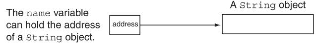

当类变量持有对象的地址时，称该变量引用了对象。由于这个原因，类变量通常被称为引用变量。

### 创建字符串对象

每当你在程序中编写字符串字面量时，Java 都会在内存中创建一个 `String` 对象来持有它。你可以通过一个简单的赋值语句在内存中创建一个 `String` 对象，并将其地址存储在 `String` 变量中。这是一个示例：

```
name = "Joe Mahoney";
```

在这里，字符串字面量会导致在内存中创建一个 `String` 对象，并在其中存储为 `"Joe Mahoney"` 的值。然后，赋值运算符将该对象的地址存储在 `name` 变量中。执行完此语句后，可以说 `name` 变量引用了一个 `String` 对象。这在图 2-9 中所示。

**图 2-9** `name` 变量持有 `String` 对象的地址

| 一个 String 对象 | | |
| :--- | :--- | :--- |
| name 变量持有 String 对象的地址 | 地址 | "Joe Mahoney" |

你也可以使用 `=` 运算符来初始化 `String` 变量，如下所示：

```
String name = "Joe Mahoney";
```

该语句将 `name` 声明为 `String` 变量，创建一个存储值为 `"Joe Mahoney"` 的值的 `String` 对象，并将该对象的内存地址分配给 `name` 变量。代码列表 2-20 显示了 `String` 变量的声明、初始化以及 `println` 语句中的用法。

### 代码列表 2-20 (StringDemo.java)

```
1 // 一个演示 String 对象的简单程序。
3 public class StringDemo
{
    public static void main(String[] args)
    {
        String greeting = "Good morning ";
        String name = "Herman";
        System.out.println(greeting + name);
    }
}
```

**程序输出**

Good morning Herman

### String 类方法

由于 `String` 类型是一个类而不是基本数据类型，它提供了许多用于处理字符串的方法。例如，`String` 类有一个名为 `length` 的方法，返回存储在对象中的字符串的长度。假设 `name` 变量引用一个 `String` 对象，以下语句将其字符串的长度存储在变量 `stringSize` 中（假设 `stringSize` 是一个 `int` 变量）：

```
stringSize = name.length();
```

该语句调用了 `name` 所引用的对象的 `length` 方法。要调用方法并执行它，方法的通用形式如下：

```
referenceVariable.method(arguments...)
```

`referenceVariable` 是引用对象的变量名，`method` 是方法名，而 `arguments` 是传递给方法的零或多个参数。如果没有向方法传递任何参数（如 `length` 方法所示），则在方法名后跟一对空括号。

`String` 类的 `length` 方法返回其 `int` 值。这意味着该方法向它调用的方法传回一个 `int` 值。该值可以存储在变量中、显示在屏幕上，或在计算中使用。代码列表 2-21 演示了该方法。

### 代码列表 2-21 (StringLength.java)

```
1 // 程序演示了 String 类的 length 方法。
2
3 public class StringLength
4 {
5 public static void main(String[] args)
6 {
7 String name = "Herman";
8 int stringSize;
9
10 stringSize = name.length();
11 System.out.println(name + " " + stringSize +
12 " characters.");
13 }
14 }
```

**程序输出**

Herman has 6 characters.

> **注意**：`String` 类的 `length` 方法返回字符串中字符的个数，包括空格。

你将在第 10 章详细学习字符串类方法，但让我们再看几个例子。除了 `length` 之外，表 2-15 还描述了 `charAt`、`toLowerCase` 和 `toUpperCase` 方法。

### 表 2-15 几个 String 类方法

| 方法 | 描述 |
| --- | --- |
| `charAt(index)` | 参数 `index` 是一个 `int` 值，指定字符串中的某个字符位置。第一个字符位于位置 0，第二个字符位于位置 1，依此类推。该方法返回指定位置的字符。返回值的类型为 `char`。<br><br>示例：<br>`char letter;`<br>`String name = "Herman";`<br>`letter = name.charAt(3);`<br><br>执行此代码后，变量 `letter` 将持有 `'m'`。 |
| `length()` | 此方法返回字符串中的字符数。返回值的类型为 `int`。<br><br>示例：<br>`int stringSize;`<br>`String name = "Herman";`<br>`stringSize = name.length();`<br><br>执行此代码后，变量 `stringSize` 将持有值 `6`。 |
| `toLowerCase()` | 此方法返回一个新字符串，它是调用对象所包含字符串的小写等效字符串。<br><br>示例：<br>`String bigName = "HERMAN";`<br>`String littleName = bigName.toLowerCase();`<br><br>执行此代码后，`littleName` 引用的对象将持有字符串 `"herman"`。 |
| `toUpperCase()` | 此方法返回一个新字符串，它是调用对象所包含字符串的大写等效字符串。<br><br>示例：<br>`String littleName = "herman";`<br>`String bigName = littleName.toUpperCase();`<br><br>执行此代码后，`bigName` 引用的对象将持有字符串 `"HERMAN"`。 |

### 代码列表 2-22 (StringMethods.java)

```
1 // 程序演示了几个 String 方法。
2
3 public class StringMethods
4 {
5 public static void main(String[] args)
6 {
7 String message = "Java is Fun!";
8 String upper = message.toUpperCase();
9 String lower = message.toLowerCase();
10 char letter = message.charAt(2);
11 int stringSize = message.length();
12
13 System.out.println(message);
14 System.out.println(upper);
15 System.out.println(lower);
16 System.out.println(letter);
17 System.out.println(stringSize);
18 }
}
```

**程序输出**

Java is Fun!

JAVA IS FUN!

java is fun!

v

12

## 2.10 作用域

> **概念**：变量的作用域是程序可以访问的部分。每个变量都有作用域。变量的作用域是可以访问的地方。定义变量作用域的规则是复杂的，我们在这里介绍这一概念。在书的其他章节中我们将再次讨论它。

到目前为止，你只在 `main` 方法中声明了变量。在方法内部声明的变量被称为局部变量。稍后我们将学习方法外部定义的变量，但现在让我们关注局部变量的使用。

局部变量的作用域从它的声明开始，到声明它的方法结束结束。这意味着局部变量无法被该区域之外的代码访问。这意味着局部变量无法被方法外部或方法内部声明之前的代码访问。代码列表 2-23 中的程序提供了一个示例。

### 代码列表 2-23 (Scope.java)

```
// 此程序找不到其变量。

public class Scope
{
    public static void main(String[] args)
    {
        System.out.println(value); // 错误！
        int value = 10;
    }
}
```

该程序无法编译，因为它在声明变量 `value` 之前尝试将其内容发送给 `println`。重要的是，编译器是从上到下读取你的程序的。如果在声明变量之前使用了它，就会发生错误。要修复程序，必须将变量声明写在任何使用它的语句之前。

> **注意**：关于局部变量的作用域，你必须记住的另一个规则是在同一个作用域内不能有两个同名的局部变量。例如，查看以下方法。

```
public static void main(String[] args)
{
    // 声明一个名为 number 的变量并
    // 显示它的值。
    int number = 7;
    System.out.println(number);
    // 声明另一个名为 number 的变量并
    // 显示它的值。
    int number = 100;      // ERROR!!!
    System.out.println(number);   // ERROR!!!
}
```

此方法声明了一个名为 `number` 的变量并将其初始化为值 `7`。该变量的作用域从声明语句开始，延伸到方法的结束。在变量的作用域内出现了一条声明另一个变量 `number` 的语句。这条语句将导致错误，因为你不能在同一个作用域内拥有两个同名的局部变量。

## 2.11 注释

> **概念**：注释是解释性的说明，用于记录程序的某行或某部分。注释是程序的一部分，但编译器会忽略它们。注释是为那些可能阅读源代码的人准备的。

注释是放置在程序不同部分的简短说明，用于解释程序的各个部分是如何运作的。注释不是为编译器准备的。它们是为了帮助程序员理解代码。编译器会跳过程序中出现的所有注释。

作为一名初级程序员，你可能会抑制写注释的欲望。毕竟，编写实际作用的代码要有趣得多！然而，花额外时间写注释是非常重要的，当你将来需要修改或调试程序时，这会为你节省时间。良好的注释即使是大型且复杂的程序也易于阅读和理解。

在 Java 中三种类型的注释：单行注释、多行注释和文档注释。让我们简要讨论一下每种。

### 单行注释

你已经见过在 Java 程序中编写注释的第一种方法。你只需要在想开始注释的地方放置两个正斜杠 `//`。编译器会忽略从该处开始到行尾的所有内容。代码列表 2-24 显示，注释可以大量地分布在程序中。

### 代码列表 2-24 (Comment1.java)

```java
1 // 程序：Comment1.java
2 // 由 Herbert Dorf 
3 // 此程序计算公司利润
4
5 public class Comment1
6 {
7     public static void main(String[] args)
8 {
9         double payRate;      // 存储时薪
10 double hours;      // 存储工作小时
11 int employeeNumber; // 存储员工编号
12 
13 // 程序的其余部分省略。
14 }
15 }
```

说明说明编写程序的人和描述变量的作用之外，注释还可以用于解释代码中复杂的过程。

### 多行注释

Java 中的第二种注释是多行注释。多行注释以 `/*`（正斜杠后跟星号）开始，并以 `*/`（星号后跟正斜杠）结束。这些标记之间的所有内容都会被忽略。代码列表 2-25 展示了如何使用多行注释。

### 代码列表 2-25 (Comment2.java)


```java
/*
程序：Comment2.java
由 Herbert Dorfmann 编写
此程序计算公司工资
*/

public class Comment2
{
    public static void main(String[] args)
    {
        double payRate;      // 存储时薪
        double hours;        // 存储工作小时
        int employeeNumber;  // 存储员工编号

        // 程序的其余部分省略。
    }
}
```

与以 `//` 开始的注释不同，多行注释可以跨多行。这使得编写大块注释更加方便，因为你不需要标记每一行。因此，多行注释对于编写单行注释来说不方便，因为你必须输入起始和结束注释符号。

在使用多行注释时请记住以下建议：

- 注意不要反转起始符号和结束符号。
- 务必不要忘记结束符号。

许多程序员使用星号或其他字符在注释周围绘制边界或方框。这有助于在视觉上将注释与周围的代码隔离开。这些被称为块注释。表 2-16 显示了四个块注释的示例。

### 表 2-16 块注释

```text
/**
 * 此程序演示了
 * 编写注释的方法
 */

//////////////////////////////////////
// 此程序演示了
// 编写注释的方法
//////////////////////////////////////

/**********************/
// 此程序演示了 *
// 编写注释的方法 *
/**********************/

/--------------------
// 此程序演示了
// 编写注释的方法
/--------------------
```

### 文档注释

第三种注释被称为文档注释。文档注释可以被一个名为 `javadoc` 的程序读取和处理，该程序随 Sun JDK 一提供。`javadoc` 程序的目的是读取 Java 源代码文件并生成格式准确的 HTML 文档。如果源代码文件包含任何文档注释，注释中的信息将成为 HTML 文档的一部分，可以在 Web 浏览器中查看。

任何以 `/**` 开始并以 `*/` 结束的注释都被视为文档注释。通常，你在类头之前编写文档注释，对类进行简短描述。你还会在每个方法头之前编写文档注释，对方法进行简短描述。例如，代码列表 2-26 显示了一个带有文档注释的程序。该程序在类头之前有一个文档注释，在 `main` 方法头之前有一个文档注释。

### 代码列表 2-26 (Comment3.java)

```java
/**
 * 此类创建了一个计算公司工资的程序。
 */
public class Comment3
{
    /**
     * main 方法是起始点。
     */
    public static void main(String[] args) {
        double payRate;      // 存储时薪
        double hours;        // 存储工作小时
        int employeeNumber;  // 存储员工编号
        
        // 程序的其余部分省略。
    }
}
```

在该命令执行后，将在文件所在的目录下创建多个文档文件。其中一个文件将命名为 `index.html`。图 2-10 显示在 Internet Explorer 中查看 `index.html`。注意文件中编写的文本。


## 2.12 编程风格

如果你查看在 Web 浏览器中查看的 JDK 文档，你会发现它们的格式与 `javadoc` 相同。使用 `javadoc` 文档化的好的好处是你的文档将具有 Java 文档相同的专业外观和感受。

可以通过阅读本书资源页面 www.pearsonglobal.com/gaddis 上的附 F 来了解更多关于文档注释和 `javadoc` 工具的信息。从书中这里开始，将在示例源代码中使用简单的块注释和单行注释。

## 检查点

- 2.32 你如何编写单行注释？你如何编写多行注释？你如何编写文档注释？
- 2.33 文档注释与其他类型的注释有何不同？

## 第 2 章 Java 基础

尽管程序在语法上是正确的（它没有违反 Java 的任何规则），但它很难阅读。代码列表 2-28 显示了该程序，使用了更易读的风格编写。

### 代码列表 2-28 (Readable.java)

```java
// 这个示例比 Compact.java 可读性得多。

public class Readable
{
    public static void main(String[] args)
    {
        int shares = 220;
        double averagePrice = 14.67;

        System.out.println("There " + shares
                             + " shares sold at $"
                             + averagePrice + " per share.");
    }
}
```

### 程序输出

有 220 股以每股 $14.67 出售。

编程风格通常指源代码的编写方式。它包括在程序中一致地放置空格和缩进的技术，从而创建视觉线索。这些线索可以快速告诉程序员关于程序的重要信息。

例如，在代码列表 2-28 中，类的大括号每行都缩进了，`main` 方法的大括号内部每行也缩进了。在一组大括号内缩进所有行是一种常见的编程风格，如图 2-11 所示。

### 图 2-11 缩进

```java
// 这个示例比 Compact.java 可读性得多。
public class Readable
{
    public static void main(String[] args)
    {
        int shares = 220;
        double averagePrice = 14.67;
        System.out.println("There " + shares
                             + " shares sold at $"
                             + averagePrice + " per share.");
    }
}
```

编程风格的另一个方面是如何处理长到无法用单行显示的语句。注意 `println` 语句跨越了三行。在语句的第二行和第三行开头插入了额外的空格，这表示它们是延续。

在单个语句中声明多个相同类型的变量时，通常的做法是将每个变量写在单独的一行，并用注释说明变量的用途。这是一个示例：

```java
int fahrenheit; // 用于存储华氏度温度
int celsius;    // 用于存储摄氏温度
int kelvin;     // 用于存储开尔文温度
```

你可能已经在示例程序中注意到，变量声明和随后的语句之间插入了一个空行。这是为了将声明与可执行的语句分开。

还有许多其他与编程风格相关的问题。它们将贯穿本书。

## 2.13 读取键盘输入

- **概念**：可以使用 `Scanner` 类的对象从键盘读取输入。

之前我们讨论了 `System.out` 对象以及它如何引用标准输出设备。Java API 有另一个对象 `System.in`，它引用标准输入设备。标准输入设备通常是键盘。你可以使用 `System.in` 读取在键盘上键入按键。然而，使用 `System.in` 并不像使用 `System.out` 那么简单直接，因为 `System.in` 对象仅以字节值读取输入。这非常不利，因为程序需要其他数据类型的值作为输入。为了解决这个问题，你可以结合 `Scanner` 类对象使用 `System.in` 对象。`Scanner` 类设计用于从源（如 `System.in`）读取输入，并提供了你可以使用的方法来获取格式化的原始类型值或字符串。

首先，创建一个 `Scanner` 对象并将其连接到 `System.in`。这是一个执行该操作的语句示例：

```java
Scanner keyboard = new Scanner(System.in);
```

让我们将语句拆分为两个部分。语句的第一部分，

```java
Scanner keyboard
```

声明了一个名为 `keyboard` 的变量。变量的类型是 `Scanner`。因为 `Scanner` 是一个类，`keyboard` 变量是一个类类型。回顾对 `String` 对象的讨论，类变量持有对象的地址。因此，`keyboard` 变量将用于存储 `Scanner` 对象的地址。语句的第二部分如下：

```java
new Scanner(System.in);
```

我们在语句的这部分中看到的第一个内容是赋值运算符 (`=`)。赋值运算符将某些内容赋值给 `keyboard` 变量。在赋值运算符之后我们看到了单词 `new`，这是一个关键字。`new` 的目的是创建一个对象。接下来指定将创建的对象类型。在这种情况下，我们使用列在 `new` 单词之后的 `Scanner(System.in)`。这表示应该创建一个 `Scanner` 对象，并将其连接到 `System.in`。对象的地址通过 `=` 运算符被赋值给变量 `keyboard`。语句执行后，`keyboard` 变量将引用内存中创建的 `Scanner` 对象。

图 2-12 指出了该语句的每个部分。图 2-13 说明了 `keyboard` 变量如何引用 `Scanner` 类的对象。


`Scanner` 类有用于读取字符串、字节、整数、长整数、浮点数和双精度数字的方法。例如，以下代码使用 `Scanner` 类对象从键盘读取 `int` 值并赋值给 `number` 变量。

```java
int number;
Scanner keyboard = new Scanner(System.in);
System.out.print("Enter an integer value: ");
number = keyboard.nextInt();
```

这里显示的最后一个语句调用了 `Scanner` 类的 `nextInt()` 方法。`nextInt()` 将输入值格式化为 `int`，然后返回该值。因此，该语句将键盘输入的输入格式化为 `int` 并返回它。该值被赋值给 `number` 变量。

表 2-17 列出了 `Scanner` 类的几个方法并描述了它们的用法。

### 表 2-17 Scanner 类的一些方法

| 方法 | 示例和描述 |
| :--- | :--- |
| `nextByte()` | **使用示例**：<br>`byte x;`<br>`Scanner keyboard = new Scanner(System.in);`<br>`System.out.print("Enter a byte value: ");`<br>`x = keyboard.nextByte();`<br>**描述**：将输入返回为字节。 |
| `nextDouble()` | **使用示例**：<br>`double number;`<br>`Scanner keyboard = new Scanner(System.in);`<br>`System.out.print("Enter a double value: ");`<br>`number = keyboard.nextDouble();`<br>**描述**：将输入返回为双精度数。 |
| `nextFloat()` | **使用示例**：<br>`float number;`<br>`Scanner keyboard = new Scanner(System.in);`<br>`System.out.print("Enter a float value: ");`<br>`number = keyboard.nextFloat();`<br>**描述**：将输入返回为浮点数。 |
| `nextInt()` | **使用示例**：<br>`int number;`<br>`Scanner keyboard = new Scanner(System.in);`<br>`System.out.print("Enter an integer value: ");`<br>`number = keyboard.nextInt();`<br>**描述**：将输入返回为整数。 |
| `nextLine()` | **使用示例**：<br>`String name;`<br>`Scanner keyboard = new Scanner(System.in);`<br>`System.out.print("Enter your name: ");`<br>`name = keyboard.nextLine();`<br>**描述**：将输入返回为字符串。 |
| `nextLong()` | **使用示例**：<br>`long number;`<br>`Scanner keyboard = new Scanner(System.in);`<br>`System.out.print("Enter a long value: ");`<br>`number = keyboard.nextLong();`<br>**描述**：将输入作为 `long` 返回。 |
| `nextShort()` | **使用示例**：<br>`short number;`<br>`Scanner keyboard = new Scanner(System.in);`<br>`System.out.print("Enter a short value: ");`<br>`number = keyboard.nextShort();`<br>**描述**：将输入作为 `short` 返回。 |

### 使用 import 语句

在使用 `Scanner` 类之前，你必须了解它的最后一个细节。`Scanner` 类不会自动供你的 Java 程序使用。任何使用 `Scanner` 类的程序都应该在文件的开头（在任何类定义之前）包含以下语句：

```java
import java.util.Scanner;
```

该语句告诉 Java 编译器在 Java 库中寻找 `Scanner` 类，并使其可供你的程序使用。代码列表 2-29 展示了如何使用 `Scanner` 类读取一个 `String`、一个 `int` 和一个 `double`。

### 代码列表 2-29 (Payroll.java)

```java
import java.util.Scanner; // Scanner 类所需要

/**
 * 此程序演示了 Scanner 类。
 */
public class Payroll
{
    public static void main(String[] args)
    {
        String name;      // 用于存储姓名
        int hours;        // 工作小时数
        double payRate;   // 时薪
        double grossPay;  // 总工资

        // 创建一个 Scanner 对象以读取输入。
        Scanner keyboard = new Scanner(System.in);

        // 获取用户的姓名。
        System.out.print("What is your name? ");
        name = keyboard.nextLine();

        // 获取本周的工作小时数。
        System.out.print("How many hours did you work this week? ");
        hours = keyboard.nextInt();
    }
}
```


// 获取用户的时薪。

`System.out.print("What is your hourly pay rate? ")`

`payRate = keyboard.nextDouble()`

// 计算总工资。

`grossPay = hours * payRate`

// 显示结果信息。

`System.out.println("Hello " + name)`

`System.out.println("Your gross pay is $" + grossPay)`

**程序输出，示例输入用加粗显示**
What is your name? Joe Mahoney [Enter]
How many hours did you work this week? **40** [Enter]
What is your hourly pay rate? **20** [Enter]
Hello Joe Mahoney
Your gross pay is $800.0

> 注意：请，我们使用的每个 `Scanner` 类方法都会等待用户按下 Enter 键后才返回值。按下 Enter 键后，光标会自动移动到下一行以便进行后续操作。

## 读取字符
有时你想从键盘上读取单个字符。例如，你的程序可能会向用户提一个是否问题，并指定其输入 Y 或 N 表示是否。然而，`Scanner` 类没有读取单个字符的方法。我们在本书中使用的读取字符的方法是使用 `Scanner` 类的 `nextLine` 方法从键盘读取一个字符串，然后使用 `String` 类的 `charAt` 方法提取字符串的第一个字符。这将是用户在键盘上输入的字符。以下是一个示例：

```java
String input; // 用于存储行输入
char answer; // 用于存储单个字符
```

```java
// 创建一个 Scanner 对象用于键盘输入。
Scanner keyboard = new Scanner(System.in);
```

```java
// 询问用户问题。
System.out.print("Are you having fun? (Y=yes, N=no)");
input = keyboard.nextLine(); // 获取一行输入。
answer = input.charAt(0); // 获取第一个字符。
```

变量 `input` 引用一个 `String`。此代码的最后语句调用了 `String` 类的 `charAt` 方法来获取位置 0 的字符，即字符串中的第一个字符。在该语句执行后，`answer` 将持有用户在键盘上输入的字符。

## 混合调用 nextLine 与其他方法
当你调用 `Scanner` 类的某个方法来读取基本数据类型值（如 `nextInt` 或 `nextDouble`），然后调用 `nextLine` 方法读取字符串时，可能会出现一个讨厌且难以发现的问题。例如，查看代码列表 2-30 中的程序。

# 代码列表 2-30 (InputProblem.java)

```java
1 import java.util.Scanner; // Scanner 类所需要
2
3 /**
4  * 此程序在读取输入时存在问题。
5  */
6
7 public class InputProblem
8 {
9    public static void main(String[] args)
10   {
11     String name; // 用于存储用户的姓名
12     int age; // 用于存储用户的年龄
13
14     double income; // 用于存储用户的收入
15
16     // 创建一个 Scanner 对象以读取输入。
17     Scanner keyboard = new Scanner(System.in);
18
19     // 获取用户的年龄。
20     System.out.print("What is your age? ");
21     age = keyboard.nextInt();
```

```java
System.out.println("Hello " + name + ". Your age is " + 
age + " and your income is $" + 
income);
}
```

# 程序输出，示例输入已加粗显示

| 你的年龄是多少？**24** [Enter] |
| 你的年收入是多少？50000.00 [Enter] |
| 你的名字是什么？Mary Simpson [Enter] |

Hello Mary Simpson. 你的年龄是 24，你的收入是 $50000.0

在第 24 行通过 `nextDouble` 方法读取用户收入后，第 27 行调用了 `nextLine` 方法。此调用的目的是消除或移除留在键盘缓冲区中的换行符。然后，在第 31 行再次调用了 `nextLine` 方法。这次它正确地读取了用户的姓名。

> 注意：注意在第 27 行中，当我们消耗剩余的换行符时，我们没有将方法的返回值赋值给任何变量。这是因为我们只是调用了该方法来移除换行符，不需要保留方法的返回值。

# 对话框

概念：`JOptionPane` 类允许你快速显示一个对话框，这是一个显示消息或请求输入的小型图形窗口。

对话框是一个向用户显示消息或请求输入的小型图形窗口。你可以使用 `JOptionPane` 类快速显示对话框。本节将讨论以下类型的对话框以及你如何使用使用 `JOptionPane` 显示它们：

- 消息对话框（Message Dialog）：显示消息的对话框；还会显示一个 OK 按钮。
- 输入对话框（Input Dialog）：提示用户输入并提供文本字段进行输入的输入的对话框；还会显示一个 OK 按钮和一个取消（Cancel）按钮。

图 2-14 显示了每个类型对话框的示例。

# 图 2-14 消息对话框和输入对话框

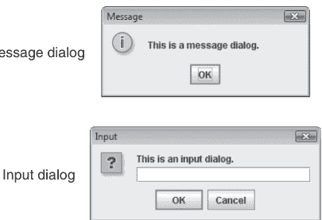

`JOptionPane` 类并不是 Java 程序自动可用的。任何使用 `JOptionPane` 类的程序都必须在文件开头包含以下语句：

```java
import javax.swing.JOptionPane;
```

该语句告诉编译器寻找 `JOptionPane` 类并使其对程序可用。

# 显示消息对话框

`showMessageDialog` 方法用于显示消息对话框。以下是调用该方法的语句：

```java
JOptionPane.showMessageDialog(null, "Hello World");
```

第一个参数仅在显示其他图形窗口的程序中重要。你将在第 7 章中学习更多内容。在此之前，我们始终将键值 `null` 作为第一个参数。这会导致对话框显示在屏幕中央。第二个参数是我们希望在对话框中显示的消息。代码将调用图 2-15 中的对话框出现。当用户点击 OK 按钮时，

# 图 2-15 消息对话框

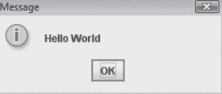

# 显示输入对话框

输入对话框是要求用户输入数据的一种快速简单的方法。你使用 `JOptionPane` 类的 `showInputDialog` 方法来显示输入对话框。以下代码调用了该方法：

```java
String name;
name = JOptionPane.showInputDialog("Enter your name.");
```

传递方法的参数是要显示在对话框中的消息。此状态会导致图 2-16 所示对话框显示在屏幕中央。如果用户点击 OK 按钮，`name` 将引用用户输入文本字段的字符串值。如果用户点击取消按钮，`name` 将引用特殊值 `null`。

图 2-16 输入对话框

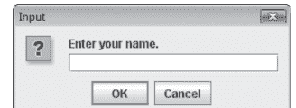

# 示例程序

代码列表 2-32 中的程序演示了如何使用两种类型的对话框。该程序使用输入对话框要求用户输入其名、中间名和姓，然后用消息对话框显示问候。当此程序执行时，图 2-17 所示对话框将逐一个显示。

# 代码列表 2-32 (NamesDialog.java)

```java
import javax.swing.JOptionPane;

/**
* 此程序演示了如何使用 JOptionPane
* 对框。
 */
public class NamesDialog
{
    public static void main(String[] args)
    {
        String firstName; // 用户的名
        String middleName; // 用户的中间名
        String lastName; // 用户的姓
```

```java
// 获取用户的名。
firstName = 
JOptionPane.showInputDialog("What is " + 
  "your first name? ");
```

```java
// 获取用户的中间名。
middleName = 
JOptionPane.showInputDialog("What is " + 
  "your middle name? ");
```

```java
// 获取用户的姓。
lastName = 
JOptionPane.showInputDialog("What is " + 
  "your last name? ");
```

## 2.14 对话框

```java
// 将输入转换为 int 类型。
hours = Integer.parseInt(inputString);
// 获取小时薪率。
inputString = JOptionPane.showInputDialog("What is your hourly rate?");
// 将输入转换为 double 类型。
payRate = Double.parseDouble(inputString);
// 计算总工资。
grossPay = hours * payRate;
// 显示结果。
JOptionPane.showMessageDialog(null, "Hello " + name + ".\ Your gross pay is $" + grossPay);
// 结束程序。
System.exit(0);
```

图 2-18 由 PayrollDialog.java 生成的对话框

## 检查点 (Checkpoint)

2.34 以下类型对话框的目的是什么？
2.35 编写代码显示图 2-19 所示的每个对话框。
2.36 编写代码显示一个输入对话框，要求用户输入其年龄。将输入值转换为 int 并存储在名为 `age` 的变量中。
2.37 在使用 `JOptionPane` 类的程序中，你会写什么语句？

图 2-19 用于检查点的对话框

## 2.15 System.out.printf 方法

概念：`System.out.printf` 方法允许你以多种方式格式化输出。当你使用 `System.out.println` 或 `System.out.printf` 显示数字时，你对数字外观的的控制力很小。例如，`double` 类型的值可以显示为 6 位小数，如下代码所示：

```java
double number = 10.0;
System.out.println(number);
```

此代码将显示：

```
10.000000
```

通常，你希望格式化数字以便特定的方式显示。例如，你可能希望将浮点数格式化为特定的小数位数，或者插入逗号分隔符使数字更易读。幸运的是，Java 为你提供了一种使用 `System.out.printf` 方法来实现的方法：

```
System.out.printf(FormatString, ArgumentList)
```

在通用格式中，`FormatString` 是一个包含文本的字符串，`ArgumentList` 是一个零或多个参数列表，这些参数将根据格式字符串中列出的格式说明符进行格式化。

## 2.15 System.out.printf 方法

使用 `System.out.printf` 方法最简单的方法是仅使用格式字符串而不使用额外的参数。这里是一个示例：

```java
System.out.printf("I love programming.");
```

格式字符串 "I love programming" 不执行任何特殊格式化；它简单地打印字符串 "I love programming"。在大多数情况下，你将以以下方式调用 `System.out.printf` 方法：

- 格式字符串将包含一个或多个说明符。格式说明符是显示时插入到字符串中的值的占位符。
- 在格式字符串之后，将出现一个或多个参数。每个额外的参数都将与格式字符串内部的一个格式说明符相对应。

以下代码显示了一个示例：

```java
double sales = 1234.67;
System.out.printf("Our sales are %f\n", sales);
```

注意 `System.out.printf` 方法调用的特征：

- 在格式字符串内部，`%f` 是一个格式说明符。字母 f 表示在显示时将向字符串中插入一个浮点值。
- 在格式字符串之后，`sales` 变量作为参数传递。该参数对应于格式字符串之后出现的 `%f` 说明符。

当 `System.out.printf` 方法执行时，`%f` 将不会显示在屏幕上。取而代之的是将显示 `sales` 参数的值。以下是代码的输出：

```
Our sales is 1234.670000
```

图 2-20 中的图显示了 `sales` 变量如何对应 `%f` 说明符。

```java
System.out.printf("Our sales are %f\n", sales);
```

这是另一个示例：

```java
double temp1 = 72.5, temp2 = 83.7;
System.out.printf("The temperatures are %f and %f degrees.\n", temp1, temp2);
```

## 第 2 章 Java 基础

首先，注意此示例在格式字符串使用了两个 `%f` 说明符。同样注意格式字符串之后出现了两个额外的参数。第一个参数 `temp1` 的值将代替第一个 `%f` 打印，第二个参数 `temp2` 的值将代替第二个 `%f` 打印。代码将产生以下输出：

```
The temperatures are 72.500000 and 83.700000 degrees.
```

格式说明符与出现在格式字符串之后的参数之间存在一一对应的关系。图 2-21 中的图显示了第一个说明符如何对应第一个参数，而第二个说明符对应于格式字符串之后的第二个参数。

图 2-21 格式说明符与对应参数

```java
System.out.printf("The temperatures are %f and %f degrees.\n", temp1, temp2);
```

以下代码显示另一个示例：

```java
double value1 = 3.0;
double value2 = 6.0;
double value3 = 9.0;
System.out.printf("%f %f\n", value1, value2, value3);
```

在 `System.out.printf` 方法调用中，格式字符串之后有三个说明符和额外的参数。此代码将产生以下输出：

```
3.000000 6.000000 9.000000
```

图 2-22 显示了格式说明符如何对应格式字符串之后的参数。

图 2-22 格式说明符与对应参数

```java
System.out.printf("%f %f\n", value1, value2, value3);
```

之前的示例演示了如何使用 `%f` 说明符格式化浮点数。格式说明符中的 `%f` 表示被格式化参数的数据类型。它可以用于任何 `float` 或 `double`。

如果你想格式化整数值，必须使用 `%d` 说明符。转换字符代表十进制整数，它可以用于 `int`、`short` 和 `long` 类型。这里有一个显示 `int` 的示例：

```java
int hours = 40;
System.out.printf("I worked %d hours this week.\n", hours);
```

在此示例中，`%d` 说明符对应 `hours` 参数。此代码将显示：

```
I worked 40 hours this week.
```

这是一个显示两个值的示例：

```java
int dogs = 2;
int cats = 4;
System.out.printf("We have %d dogs and %d cats.\n", dogs, cats);
```

此代码将显示：

```
We have 2 dogs and 4 cats.
```


# 精度

你可能在之前的示例中注意到，`%f` 格式指定符会导致浮点值显示为六位小数。你可以更改显示的小数位数，如下例所示：

```java
double temp = 78.42819;
System.out.printf("The temperature is %.2f degrees.\n", temp);
```

请注意，这个示例没有使用普通的 `%f` 格式指定符，而是使用了 `%.2f`。`.2` 出现在 `%` 和 `f` 之间，指定显示值的精度。它会将 `temp` 变量的值四舍五入到两位小数。这段代码将产生以下输出：

```
The temperature displays 78.43 degrees.
```

下面的示例显示相同的数值，但四舍五入到一位：

```java
double temp = 78.42819;
System.out.printf("The temperature is %.1f degrees.\n", temp);
```

这段代码将产生以下输出：

```
The temperature shows 78.4 degrees.
```

下面的代码展示了另一个示例：

```java
double value1 = 123.45678;
double value2 = 123.45678;
double value3 = 123.45678;
System.out.printf("%.1f %.2f %.3f\n", value1, value2, value3);
```

在这个示例中，`value1` 被四舍五入到一位小数，`value2` 被四舍五入到两位小数，`value3` 被四舍五入到三位小数。这段代码将产生以下输出：

```
123.5 123.46 123.457
```

记住，你只能对浮点值指定精度。如果在 `%d` 指定符中指定精度，将会发生错误。

# 指定最小字段宽度

格式指定符还可以包含一个最小字段宽度，即显示值时使用的最小空格数。下面的示例在一个 20 个空格的字段中打印一个浮点数：

```java
double number = 12345.6789;
System.out.printf("The number is:%20f\n", number);
```

请注意 `20` 出现在格式指定符中，位于 `%` 和 `f` 之间。这段代码将产生以下输出：

```
The number is:        12345.67890
```

在这个示例中，出现在 `%f` 格式指定符内部的 `20` 表示该数字应该在一个至少有 20 个空格的字段中显示。这如图 2-23 所示。

## 图 2-23 数字显示在一个宽度为 20 个空格的字段中

```
The number is: 12345.67890
The number is displayed in
field that is 20 spaces wide.
```

在这种情况下，显示的数字比它所在的字段短。数字 `12345.67890` 在屏幕上只占用了 12 个空格，但它显示在一个宽度为 20 个空格的字段中。在这种情况下，数字将在字段中右对齐。如果一个值太大无法容入指定的字段，字段将自动扩大以容纳它。下面的示例在一个仅有一个空格宽的字段中打印一个浮点数（注：原文此处格式字符串缺失宽度数值，逻辑上应为 `%1f` 或类似，但按原文保留）：

```java
double number = 12345.6789;
System.out.printf("The number variable is:%f\n", number);
```

然而，`number` 的值需要多个空格，因此字段宽度被扩大以容纳整个数字。这段代码将产生如下：
```
The number is:12345.67890
```

你可以为整数指定最小字段宽度，也可以为浮点值指定。下面的示例显示了一个最小字段宽度为六个字符的整数（注：原文代码中格式字符串为 `%d` 未体现宽度 6，按原文保留）：

```java
int number = 200;
System.out.printf("The number is:%d\n", number);
```

这段代码将显示：
```
The number is:200
```

# 在同一格式指定符中结合最小字段宽度和精度

在同一个格式指定符中指定浮点数的最小字段宽度和精度时，记住字段宽度必须先出现，然后是精度。下面的代码在一个 12 个空格的字段中显示一个数字，并四舍五入到两位小数：

```java
double number = 12345.6789;
System.out.printf("The number is:%12.2f\n", number);
```

这段代码将产生以下输出：
```
The number is: 12345.68
```

当你需要列对齐打印数字时，字段宽度很有帮助。例如，查看代码列表 2-34。每个变量都显示在一个宽度为八个空格的字段中，并四舍五入到两位小数。数字看起来列对齐了。

## 代码列表 2-34 (Columns.java)

```java
/**
 * 此程序在列中显示各种
 * 浮点数，并使它们的小数点对齐。
 */
public class Columns
{
    public static void main(String[] args) {
        // 声明各种 double 变量。
        double num1 = 127.899;
        double num2 = 3465.14;
        double num3 = 3.76;
        double num4 = 264.821;
        double num5 = 88.081;
        double num6 = 12345.799;

        // 在 8 个空格宽的字段中显示每个变量
        // 并四舍五入到两位小数。
        System.out.printf("%8.2f\n", num1);
        System.out.printf("%8.2f\n", num2);
        System.out.printf("%8.2f\n", num3);
        System.out.printf("%8.2f\n", num4);
        System.out.printf("%8.2f\n", num5);
        System.out.printf("%8.2f\n", num6);
    }
}
```


# 精度

你可能在之前的示例中注意到，`%f` 格式指定符会导致浮点值显示为六位小数。你可以更改显示的小数位数，如下例所示：

```java
double temp = 78.42819;
System.out.printf("The temperature is %.2f degrees.\n", temp);
```

请注意，这个示例没有使用普通的 `%f` 格式指定符，而是使用了 `%.2f`。`.2` 出现在 `%` 和 `f` 之间，指定显示值的精度。它会将 `temp` 变量的值四舍五入到两位小数。这段代码将产生以下输出：

```
The temperature displays 78.43 degrees.
```

下面的示例显示相同的数值，但四舍五入到一位：

```java
double temp = 78.42819;
System.out.printf("The temperature is %.1f degrees.\n", temp);
```

这段代码将产生以下输出：

```
The temperature shows 78.4 degrees.
```

下面的代码展示了另一个示例：

```java
double value1 = 123.45678;
double value2 = 123.45678;
double value3 = 123.45678;
System.out.printf("%.1f %.2f %.3f\n", value1, value2, value3);
```

在这个示例中，`value1` 被四舍五入到一位小数，`value2` 被四舍五入到两位小数，`value3` 被四舍五入到三位小数。这段代码将产生以下输出：

```
123.5 123.46 123.457
```

记住，你只能对浮点值指定精度。如果在 `%d` 指定符中指定精度，将会发生错误。

# 指定最小字段宽度

格式指定符还可以包含一个最小字段宽度，即显示值时使用的最小空格数。下面的示例在一个 20 个空格的字段中打印一个浮点数：

```java
double number = 12345.6789;
System.out.printf("The number is:%20.2f\n", number);
```

请注意 `20` 出现在格式指定符中，位于 `%` 和 `f` 之间。这段代码将产生以下输出：

```
The number is:        12345.68
```

在这个示例中，出现在 `%f` 格式指定符内部的 `20` 表示该数字应该在一个至少有 20 个空格的字段中显示。这如图 2-23 所示。

## 图 2-23 数字显示在一个宽度为 20 个空格的字段中

```
The number is: 12345.67890
The number is displayed in
field that is 20 spaces wide.
```

在这种情况下，显示的数字比它所在的字段短。数字 `12345.67890` 在屏幕上只占用了 12 个空格，但它显示在一个宽度为 20 个空格的字段中。在这种情况下，数字将在字段中右对齐。如果一个值太大无法容入指定的字段，字段将自动扩大以容纳它。下面的示例在一个仅有一个空格宽的字段中打印一个浮点数：

```java
double number = 12345.6789;
System.out.printf("The number variable is:%f\n", number);
```

然而，`number` 的值需要多个空格，因此字段宽度被扩大以容纳整个数字。这段代码将产生如下输出：

```
The number is:12345.67890
```

你可以为整数指定最小字段宽度，也可以为浮点值指定。下面的示例显示了一个最小字段宽度为六个字符的整数：

```java
int number = 200;
System.out.printf("The number is:%6d\n", number);
```

这段代码将显示：

```
The number is:   200
```

# 在同一格式指定符中结合最小字段宽度和精度

在同一个格式指定符中指定浮点数的最小字段宽度和精度时，记住字段宽度必须先出现，然后是精度。下面的代码在一个 12 个空格的字段中显示一个数字，并四舍五入到两位小数：

```java
double number = 12345.6789;
System.out.printf("The number is:%12.2f\n", number);
```

这段代码将产生以下输出：

```
The number is:  12345.68
```

字段宽度可以帮助你需要在打印列对齐的数字时使用。例如，查看代码列表 2-34。每个变量都显示在一个宽度为 8 个空格的字段中，并四舍五入到两位小数。数字看起来列对齐了。

## 代码列表 2-34 (Columns.java)

```java
/**
 * 此程序演示如何使用字段宽度对齐数字列。
 */
public class Columns {
    public static void main(String[] args) {
        double num1 = 123.456;
        double num2 = 78.9;
        double num3 = 1000.0;
        
        System.out.printf("%8.2f\n", num1);
        System.out.printf("%8.2f\n", num2);
        System.out.printf("%8.2f\n", num3);
    }
}
```

## 2.15 System.out.printf 方法

下面的示例显示了一个填充了前导零的 `int`，其最小宽度为七个字符：

```java
int number = 1234;
System.out.printf("The number is:%07d", number);
```

这段代码将显示如下内容：

```
The number = 0001234
```

代码列表 2-36 中的程序演示了另一个示例。该程序显示了各种浮点数，填充了前导零，在九个空格的字段内显示，并保留两位小数。

### 代码列表 2-36 (LeadingZeros.java)

```java
/**
 * 此程序显示填充了前导零的数字。
 */
public class LeadingZeros {
    public static void main(String[] args) {
        // 声明各种 double 变量。
        double number1 = 1.234;
        double number2 = 12.345;
        double number3 = 123.456;

        // 显示每个变量并带有前导
        // 零，在 9 个空格的字段内，保留
        // 2 位小数。
        System.out.printf("%09.2f\n", number1);
        System.out.printf("%09.2f\n", number2);
        System.out.printf("%09.2f\n", number3);
    }
}
```

```
程序输出
000001.23
000012.35
000123.46
```

### 左对齐数字

默认情况下，当数字的长度小于其显示的字段时，该数字在该字段内右对齐。如果你想让数字在其字段内左对齐，可以在格式说明符中插入一个减号 (`-`) 标志。代码列表 2-37 显示了一个示例。

### 代码列表 2-37 (LeftJustified.java)

```java
/**
 * 此程序显示各种数字
 * 在列中左对齐。
 */
public class LeftJustified {
    public static void main(String[] args) {
        // 声明各种 int 变量。
        int num1 = 123;
        int num2 = 12;
        int num3 = 45678;
        int num4 = 456;
        int num5 = 123456;
        int num6 = 1234;

        // 显示每个变量左对齐
        // 在一个 8 空格字段内。
        System.out.printf("%-8d%-8d%-8d\n", num1, num2, num3);
        System.out.printf("%-8d%-8d%-8d\n", num4, num5, num6);
    }
}
```

## 程序输出

```
123     12      45678   
456     123456  1234    
```

### 字符串参数

如果你想打印一个字符串，使用 `%s` 格式说明符。这是一个示例：

```java
String name = "Ringo";
System.out.printf("Your name is %s\n", name);
```

这段代码产生输出：`Your name is Ringo`

在打印字符串时也可以使用字段宽度。例如，查看下面的代码：

```java
String name1 = "George";
String name2 = "Franklin";
String name3 = "Jay";
String name4 = "Ozzy";
String name5 = "Carmine";
String name6 = "Dee";

System.out.printf("%10s%10s\n", name1, name2);
System.out.printf("%10s%10s\n", name3, name4);
System.out.printf("%10s%10s\n", name5, name6);
```

`%s` 格式说明符在 10 个空格宽的字段中打印字符串。此代码在三行两列的表格中显示变量的值。每列的宽度为 10 个空格。代码的输出如下：

```
    George Franklin
      Jay Ozzy
    Carmine Dee
```

注意字符串是右对齐的。你可以使用减号标志将字符串在其字段内左对齐。下面的代码演示了：

```java
String name1 = "George";
String name2 = "Franklin";
String name3 = "Jay";
String name4 = "Ozzy";
String name5 = "Carmine";
String name6 = "Dee";

System.out.printf("%-10s%-10s\n", name1, name2);
System.out.printf("%-10s%-10s\n", name3, name4);
System.out.printf("%-10s%-10s\n", name5, name6);
```

这是代码的输出：

```
George    Franklin
Jay       Ozzy
Carmine   Dee
```

下面的示例显示了如何打印不同类型的参数：

```java
int hours = 40;
double pay = hours * 25;
String name = "Jay";
System.out.printf("Name: %s, Hours: %d, Pay: %.2f\n", name, hours, pay);
```

在这个示例中，我们正在显示一个 `String`、一个 `int` 和一个 `double`。代码将产生输出：

```
Name: Jay, Hours: 40, Pay: 1000.00
```

注意：我们展示的格式说明符是最基本的。Java 为复杂需求提供了更强大的说明符。API 文档提供了它们的概述。

## 练习题

2.38 假设有变量声明：
```java
double number = 1234567.456;
```
编写一个使用 `System.out.printf` 的语句，将变量的值格式化为：
```
1,234,567.46
```

2.39 假设程序中存在变量声明：
```java
double number = 123.456;
```
编写一个使用 `System.out.printf` 的语句，将变量的值保留一位小数显示在 10 个空格宽的字段中。不要使用逗号分隔符。

2.40 假设程序中存在变量声明：
```java
double number = 123.456;
```
编写一个使用 `System.out.printf` 的语句，将变量的值填充前导零显示在 8 个空格宽的字段中，并保留一位小数。不要使用逗号分隔符。

2.41 假设程序中存在变量声明：
```java
int number = 1234567;
```
编写一个使用 `System.out.printf` 的语句，在 10 个空格宽的字段中显示数字的值，并使用逗号分隔符。

2.42 假设程序中存在变量声明：
```java
double number = 1234567.789;
```
编写一个使用 `System.out.printf` 的语句，将变量的值左对齐并使用逗号分隔符，显示在 20 个空格宽的字段中，保留两位小数。

2.43 假设程序中存在变量声明：
```java
String name = "James";
```


编写一个使用 `System.out.printf` 的语句，在 20 个空格宽的字段中显示 `name` 的值。

### 要避免的常见错误

以下列表描述了学习本章主题时常见的几种错误。

- 不匹配的大括号、引号或圆括号。在本章中，你看到构成类定义的语句被包含在大括号中。同样，你看到方法中的语句也被包含在大括号中。对于每一个左括号，在正确的位置都必须有一个右括号。对于包含字符串字面量的双引号和包含字符字面量的单引号也是如此。此外，在使用了圆括号的语句中（例如数学表达式），你必须为每个左括号提供一个闭的右括号。
- 关键字拼写错误。Java 不识别拼写错误的关键字。
- 在关键字中使用大写字母。记住 Java 是一种区分大小写的语言，所有的关键字都是小写的。在关键字中使用大写字母等同于拼写错误。
- 将关键字作为变量名。关键字被保留用于特殊用途；不能用于任何其他用途。
- 变量名拼写不一致。每次使用变量名时，其拼写必须与声明中的拼写完全一致。

# 复习题与判断题

## 单选题与判断题

- 1. 下列哪个是访问修饰符？
   a. `javac`
   b. `class`
   c. `public`
   d. `void`

- 2. 以下数据
   72
   'A'
   "Hello World"
   2.8712
   都是 _____ 的示例
   a. 变量
   b. 字面量
   c. 字符串
   d. 以上均不是

- 3. 一组语句（例如类或方法的内容）被包含在
   a. 大括号 `{}`
   b. 圆括号 `()`
   c. 中括号 `[]`
   d. 以上任选一均可

- 4. 下列哪个转义序列表示退格键？
   a. `\\`
   b. `\n`
   c. `\r`

- 5. 以下哪些项不是有效的 `println` 语句？（选出所有适用）
   a. `System.out.println + "Hello World"`
   b. `System.out.println("Have a nice day")`
   c. `System.out.println(value);`
   d. `println.out(Programming is great fun);`

- 6. 有效的变量名是 _____
   a. `monthOfYear`
   b. `3dobject`
   c. `data#`
   d. `last day`

- 7. 这个关键字用于声明命名常量。
   a. `constant`
   b. `namedConstant`
   c. `final`
   d. `concrete`

- 8. 下列哪个不是原始数据类型？
   a. `String`
   b. `int`
   c. `float`
   d. `boolean`

- 9. 这些字符标记了单行注释的开始。
   a. `//`
   b. `/*`
   c. `*/`
   d. `/\**`

- 10. 这些字符标记了文档注释的开始。
   a. `//`
   b. `/*`
   c. `*/`
   d. `/\**`

- 11. 你使用哪个 `Scanner` 类方法来读取字符串输入？
   a. `nextString`
   b. `nextLine`
   c. `readString`
   d. `getLine`

- 12. 下列哪个语句会产生错误？
   a. `int x = 10;`
   b. `boolean b = true;`
   c. `char c = 'x';`
   d. `float f = 5.0;`

- 13. 你可以使用此类来显示对话框。
   a. `JOptionPane`
   b. `BufferedReader`
   c. `InputStreamReader`
   d. `DialogBox`

- 14. 当 Java 将低级值转换为高级类型时，这被称为
   a. 4位转换
   b. 升级转换
   c. 宽转换 (widening conversion)
   d. 窄转换 (narrowing conversion)

- 15. 从右向左结合的运算符是 ________。
   a. `-` (一元否定)
   b. `*`
   c. `+`
   d. `/`

- 16. 正确或错误：Java 程序中的左大括号后面总是跟着一个右大括号。

- 17. 正确或错误：Java 是一种强类型语言。

## 第二章 Java 基础

- 18. 正确或错误：在单个 Java 文件中，你可以有多个非嵌套的 `public` 类。

- 19. 正确或错误：你不能更改使用 `final` 关键字声明的变量的值。

- 20. 正确或错误：布尔型变量可能持有值 0 或 1。

- 21. 正确或错误：如果运算符的一个操作数是 `double` 而另一个操作数是 `int`，Java 将自动将 `double` 转换为 `int`。

# 预测输出

以下代码段将在屏幕上打印什么？

- 1.
```
int freeze = 32, boil = 21;
freeze = 0;
boil = 100;
System.out.println(freeze + "\n" + boil);
```

- 2.
```
int x = 0, y = 2;
x = y * 4;
System.out.println(x + "\n" + y);
```

- 3.
```
System.out.print("I am the");
System.out.print("computing\machine");
System.out.print("\and I will namaze\n");
System.out.println("you.");
```

- 4.
```
System.out.print("Be careful\n");
System.out.print("This might\n ");
System.out.println("question?");
```

- 5.
```
int a, x = 23;
a = x % 2;
System.out.println(x + "\n" + a);
```

## 找错

以下程序中有许多语法错误。请尽可能找出。

```java
/* 这个程序哪里有问题？ */

public class MyProgram {

    public static void main(String[] args) {

        int a, b, c;

        a = 3;

        b = 4;

        c = a;

        System.out.println("The value of c + c);

    }

}
```

## 算法工作台

1. 声明一个 `boolean` 变量并初始化为 `false`。同样，声明一个名为 `letter` 的 `char` 变量并赋值。

2. 声明变量 `hour`、`minute` 和 `second`，并将它们初始化为 10、30 和 6。显示结果为 10:30:6。

3. 编写赋值语句对 `a`、`b`、`c` 执行以下操作：
   a. 将 `a` 加上 2 结果存储在 `b` 中
   b. 将 `b` 乘以 4 结果存储在 `a` 中
   c. 将 `a` 除以 3 结果存储在 `b` 中
   d. 从 `b` 中减去 8 结果存储在 `a` 中
   e. 将字符 `'K'` 存储在 `c` 中
   f. 将 `'B'` 的 Unicode 编码存储在 `c` 中

4. 假设 `w`、`x`、`y`、`z` 是整数。以下每个 `result` 将存储什么值？
   a. `result = x + y;`
   b. `result = z * 2;`
   c. `result = y / x;`
   d. `result = y % z;`
   e. `result = w & 2;`

5. 以下各项如何用 E 表示法表示？
   a. 3.287 x 10⁶
   b. -9.7865 x 10⁻²
   c. 7.6549 x 10³

6. 修改程序，每行文本之间打印两个空行。

```java
public class Test {

    public static void main(String[] args) {

        System.out.print("This is line 1.");

        System.out.print("This is line 2.");

        System.out.print("This is line 3.");

        System.out.print("This is line 4.");

        System.out.println("This is line 5.");

    }

}
```

7. 以下代码输出什么？
```
int apples = 0, bananas = 2, pears = 10;
apples += 10;
bananas *= 10;
pears /= 10;
System.out.println(apples + " " + bananas + " " + pears);
```

8. 以下代码输出什么？
```
double d = 12.9;
int i = (int)d;
System.out.println(i);
```

9. 以下代码输出什么？
```
String message = "Have a day!";
System.out.println(message.charAt(5));
```

10. 以下代码输出什么？
```
String message = "Have a day!";
System.out.println(message.toUpperCase());
```

11. 以下代码输出什么？
```
String message = "Have a day!";
System.out.println(message);
```

12. 以下代码输出什么？
```
int force = 20;
double time = 17.5;
double area = force * time;
System.out.println(area);
```

13. 以下代码输出什么？
```
int force = 20;
double pressure = 27.5;
double result = force / pressure;
System.out.println(result);
```

14. 一个表达式将一个 `byte` 变量和一个 `short` 变量相加。结果是什么数据类型？

## 简答

- 5. 简要解释 `print` 和 `println` 方法与 `System` 类的关系。
- 6. 标识符必须遵循哪些特定规则？
- 7. `out` 对象的 `print()` 和 `println()` 方法有什么区别？
- 8. 在决定为变量使用数据类型时必须考虑哪些因素？
- 9. 描述变量赋值和变量初始化之间的区别。
- 10. 以 `//` 开头的注释与以 `/*` 开头的注释有什么区别？
- 11. 描述编程风格的含义。为什么你的风格应该保持一致？
- 12. 假设程序使用命名常量 `PI` 表示值 3.14。使用命名常量代替在每个语句中使用 3.14 有什么优势？
- 13. 假设文件 `SalesAverage.java` 是包含文档注释的 Java 源文件。假设你在源代码所在的文件夹或目录下，在操作系统命令行输入什么命令来生成 HTML 文档？
- 14. “大小写敏感语言”是什么意思？

## 编程挑战

### 1. 姓名、年龄和年收入

编写程序声明以下：
   * 一个 `String` 变量 `name`
   * 一个 `int` 变量 `age`
   * 一个 `double` 变量 `annualPay`

将你的年龄、姓名和期望年收入作为字面量存储在变量中。程序应在屏幕上显示如下值：

My name is Joe Mahoney, my age is 26
I hope to earn 100000.0 per year.

### 2. 姓名和首字母

编写程序具有以下 `String` 变量：`firstName`、`middleName` 和 `lastName`。用你的名、中间名和姓初始化这些变量。程序还应该具有以下 `char` 变量：`firstInitial`、`middleInitial` 和 `lastInitial`。将每个首字母存储在这些变量中。程序应在屏幕上显示这些变量的内容。

### 3. 个人信息

编写程序显示以下信息，每行一个：
   * 你的姓名
   * 你的地址，包括城市、州和邮政编码
   * 你的电话
   * 你的大学专业

尽管这些项目应该在不同的输出行上显示，但在程序中仅使用单个 `print` 语句。

### 4. 星号图案

编写一个程序显示以下图案：

```
*
***
*****
******
***
*
```

### 5. 饼干卡路里

一袋饼干含有 40 块饼干。袋上的卡路里信息声称袋内有 10 份，每份等于 300 卡路里。编写一个程序，让用户输入实际吃的饼干数量，然后报告消耗的总卡路里。

### 6. 销售预测

某公司的东海岸销售部产生了总销售额的 65%。根据该百分比，编写一个程序预测如果公司今年的销售额为 830 万美元，东海岸部将产生多少销售。

> 提示：使用值 0.65 表示 65%。

### 7. 土地计算

一英亩土地相当于 43,560 平方英尺。编写一个程序计算面积为 389,767 平方英尺的土地包含多少英亩。

> 提示：将土地面积除以一英亩面积即可获得英亩数。

### 8. 销售税

编写一个程序，要求用户输入购买金额。程序应计算州销售税和县销售税。假设州税为 5.5%，县销售税为 2%。程序应显示购买金额、州税、县税、总税额和总账单。

> 提示：使用值 0.02 表示 2%，使用 0.055 表示 5.5%。

### 9. 每加仑英里

汽车的每加仑英里（MPG）可以使用以下公式计算：

```
MPG = Miles driven / Gallons of gas used
```

编写一个程序询问用户行驶的英里数和使用的汽油量。它应该计算汽车的 MPG 并在屏幕上显示结果。

### 10. 测试平均分

编写一个程序，要求用户输入三个测试分数。程序应显示每个测试分数以及分数的平均值。

### 11. 男性女性百分比

编写一个程序，询问用户注册某课程的男性和女性人数。程序应显示班级男性和女性的百分比。

提示：假设班级有 8 名男性和 12 名女性。班上有 20 名学生。男性的百分比可以计算为 8 ÷ 20 = 0.4，即 40%。女性的百分比可以计算为 12 ÷ 20 = 0.6，即 60%。

### 12. 字符串处理器

编写一个程序，要求用户输入其喜欢的城市名称。使用 `String` 变量存储输入内容。程序应显示：

* 城市名称的字符数
* 全大写的城市名称
* 全小写的城市名称
* 城市名称的第一个字符

### 13. 餐厅账单

编写一个程序计算餐厅账单的税费和小费。程序要求用户输入餐费金额。税费应为餐费的 7.5%。小费应为餐费的 15%。在屏幕上显示餐费、税额、小费金额和总账单。

### 14. 股票佣金

Kathy 以每股 25.50 美元的价格购买了 1000 股股票。她必须向经纪人支付 2% 的交易佣金。编写一个程序计算并显示：

* 仅购买股票的金额（不含佣金）
* 佣金金额
* 总支付金额（股票加佣金）

### 15. 配料调整

一个饼干配方需要以下原料：

* 1.5 杯糖
* 1 杯黄油
* 2.75 杯面粉

该配方可制作 48 块饼干。编写一个程序，询问用户想做多少块饼干，然后显示所需相应原料的杯数。

### 16. 能量消耗

某软饮料公司最近调查了 15,000 名客户，发现 18% 的人购买能量饮料。在这些购买能量饮料的客户中，约 64% 偏好柑橘口味。编写一个程序显示以下：

* 购买能量饮料的客户人数
* 偏好柑橘口味能量饮料的客户人数

### 17. 单词游戏

编写一个程序，要求用户输入以下内容：

* 他的名字
* 他的年龄
* 城市名称
* 大学
* 一种职业
* 一种动物

在用户输入这些项目后，程序应该显示一个故事：

> 以前有一个叫 NAME 的人住在 CITY。在 AGE 岁时，NAME 上了 COLLEGE 大学毕业，成为一名 PROFESSION。然后，NAME 养了一只 ANIMAL。

### 18. 股票交易

上个月 Joe 购买了 Acme 公司的股票。购买详情如下：

* Joe 购买的股票数为 1,000 股。
* 他以每股 32.87 美元的价格购买股票。
* 他向经纪人支付了 2% 的股票佣金。

两周后 Joe 卖出了股票。销售详情如下：

* Joe 卖出的股票数为 1,000 股。
* 他以每股 33.92 美元的价格卖出股票。
* 他再次向经纪人支付了 2% 的股票佣金。

#### 挑战

编写一个程序显示以下信息：

* Joe 购买股票的金额。
* 他购买股票时支付给经纪人的佣金。
* 他卖出股票的金额。
* 他卖出股票时支付给经纪人的佣金。
* 卖出股票并支付两笔佣金后的利润。（如果你的程序显示的利润金额为负数，则 Joe 在交易中亏损了。）

---

对象在 Java 中非常重要；例如，如果你需要在内存中存储一个字符串，你会使用字符串对象；如果你需要从键盘读取输入，你会使用一个扫描器（`Scanner`）对象。当程序需要某个特定类型对象的服务时，它会在内存中创建该对象，然后根据需要调用该对象的方法。

### 作为对象的字符串

第 2 章向你介绍了 Java 原始数据类型：`byte`、`short`、`int`、`long`、`char`、`float`、`double` 和 `boolean`。你使用这些数据类型来创建变量，变量是计算机内存中的存储位置。原始数据类型之所以说是“原始”的，是因为使用它创建的变量除了存储值之外，没有其他内置功能。

第 2 章还向你介绍了 `String` 类，它允许你创建对象。除了存储字符串外，字符串对象还有许多方法，可以对它们所持有的字符串执行操作。为了复习，让我们来看一个例子。考虑以下内容：

```java
String className = "Charleston";
```


## 类与对象初探

对于 Java 程序中出现的每一个字符串字面量，内存中都会被创建一个 `String` 对象来持有它。此语句中出现的字符串字面量 "Charleston" 声明了一个名为 `className` 的变量，该变量引用了 `String` 对象。这意味着 `className` 持有该字符串对象的内存地址。这在图 3-1 中所示。

**图 3-1** `className` 变量引用了一个 `String` 对象

| `className` 变量 | `String` 对象 |
| :--- | :--- |
| 持有...的地址 | 地址 \| "Charleston" |

假设同一个程序中有一个变量 `stringSize`。看以下语句：

```java
stringSize = className.length();
```

该语句调用了 `String` 类的 `length` 方法，该方法返回字符串的长度。表达式 `className.length()` 返回由 `className` 引用的字符串的长度。执行该语句后，`stringSize` 变量将包含值 10，即字符串 "Charleston" 的长度。

正如你在第 2 章中看到的，`String` 类除了 `length` 之外还有其他方法。这说明了从类创建的对象与从原始数据类型创建的变量之间的区别。类对象拥有可以对其数据执行有用操作的方法。然而，原始变量只存储数据而没有方法。任何在原始变量上执行的操作都必须写在变量外部的代码中。

### 类与实例

对象非常有用，但它们不会魔术般地出现在你的程序中。在程序可以使用特定类型的对象之前，该对象必须在内存中被创建。而在对象在内存中被创建之前，你必须为该对象准备一个类。

类是描述特定类型对象的代码。它指定了对象可以持有的数据（对象的属性）以及对象可以执行的操作（对象的方法）。你可以将类看作一个可以创建特定类型对象的“蓝图”。它的作用与房屋的蓝图类似。蓝图本身不是房子，而是对房屋的详细描述。当我们使用蓝图来建造实际的房屋时，我们可以说我们正在建造蓝图所描述的房屋的实例（instance）。如果我们愿意，可以从同一张蓝图建造出好几栋完全相同的房子。每栋房子都是蓝图所描述的房屋的独立实例。这个思想在图 3-2 中所示。

**图 3-2** 蓝图以及根据蓝图建造的房子

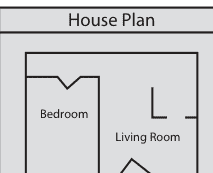

蓝图所描述的房屋实例


因此，类不是对象，而是对对象的描述。当程序运行时，我们可以根据需要使用类来创建许多对象。每个对象都是根据需要创建的。

## 为类编写代码

让我们通过填充类某些成员的代码来继续编写我们的矩形类。首先，我们编写类属性 `length`（长度）和 `width`（宽度）的代码。我们将使用 `double` 数据类型的变量作为这些属性。新添加的代码行如**粗体**所示：

```java
public class Rectangle
{
    private double length;
    private double width;
}
```

我们添加的这二行代码声明了变量 `length` 和 `width`。注意，这两个声明都以关键字 `private` 开头，位于数据类型之前。`private` 关键字是一个访问修饰符。它表示这些变量不能被类外部的语句访问。

回想我们在第 1 章关于面向对象编程的讨论，对象可以实现数据隐藏，即当关键数据隐藏在对象内部时，能够不受外部代码的干扰。在 Java 中，类的 `private` 成员是被隐藏的，只能由同一类中的方法访问。当对象的数据对外部代码隐藏，且对数据的访问限制在对象的方法上时，数据就能免受意外损坏的风险。在面向对象编程中，隐藏类的所有属性并通过方法提供访问权限是一种常见做法。

在编写类时，我们主要为类成员使用 `private` 和 `public` 访问修饰符。表 3-1 总结了这些访问修饰符。

### 表 3-1 类成员的 `private` 和 `public` 访问修饰符总结

| 访问修饰符 | 说明 |
| :--- | :--- |
| `private` | 当 `private` 访问修饰符应用于类成员时，该成员不能被类外部的代码访问。该成员只能通过同一类中的方法访问。 |
| `public` | 当 `public` 访问修饰符应用于类成员时，类内部或外部的代码都可以访问该成员。 |

你可以选择性为属性初始化一个值。例如，以下语句声明了 `length` 和 `width` 并分别将其初始化为值 10 和 12：

```java
private double length = 10;
private double width = 12;
```

如果你没有为数值属性提供初始化值，它们将自动初始化为 0。我们将在本章稍后更详细地讨论默认初始化。

在继续之前，我们将引入“字段（field）”。在 Java 中，字段是持有数据的类成员。在我们的矩形类中，`length` 和 `width` 变量都是字段。

> **提示**：我们曾将 `length` 和 `width` 称为属性和字段。不要让你困惑。“属性（attribute）”是一个通用的面向对象术语，指的是对象持有的数据项。“字段（field）”是一个 Java 特有的术语，指的是持有数据的类成员。在 Java 中，请使用字段作为属性。

## 编写 `setLength` 方法

现在我们将开始编写类方法。我们将从 `setLength` 方法开始。该方法允许类外部的代码在 `length` 字段中存储一个值。代码列表 3-1 显示了处于此阶段的 `Rectangle` 类。`setLength` 方法位于第 16 行到第 19 行。（如果你从 `www.pearsonglobaleditions.com/gadis` 下载了本书的源码，你将在 `Chapter 03\Rectangle Class 1` 文件夹中找到此文件）。

### 代码列表 3-1 (`Rectangle.java`)

```java
1  /*
2   * Rectangle class, Phase 1
3   * Under Construction!
4   */
5
6  public class Rectangle
7  {
8      private double length;
9      private double width;
10
11     /**
12      * The setLength method accepts argument
13      * that is stored in the length field.
14      */
15
16     public void setLength(double len)
17     {
18         length = len;
19     }
20  }
```

在 11 到 14 行中，我们写了一个块注释，对方法进行了简要描述。始终编写描述类方法的注释是很好的，这样未来任何阅读代码的人都能更好地理解它。方法的定义出现在块注释之后的第 16 行到第 19 行。方法定义的第一行（出现在第 16 行）被称为方法头（method header）。它的形式如下：

```java
public void setLength(double len)
```

该方法有几个部分。让我们来看每一个部分：

*   关键字 `public` 是访问修饰符。它表示该方法可以被类外部的语句调用。
*   `void`。这是方法的返回类型。关键字 `void` 表示该方法向调用它的语句不返回任何数据。
*   `setLength`。这是方法的名称。
*   `(double len)`。这是参数变量的声明。参数变量持有传递给方法的参数值。参数变量的名字是 `len`，其数据类型为 `double`。

**图 3-6** 标注了 `setLength` 方法头的每个部分。

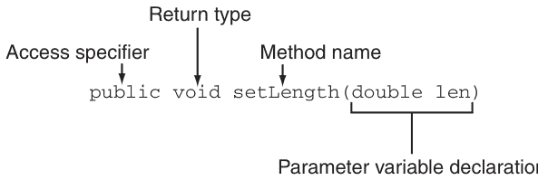

在方法头之后，方法体出现在大括号内：

```java
{
    length = len;
}
```

该方法只有一条语句，将 `len` 的值赋值给 `length`。这条语句将 `len` 的值赋值给 `length` 字段。当方法执行时，`length` 字段将接收 `len` 的值。该方法允许类外部的代码在 `length` 字段中存储一个值。

### 代码列表 3-2 (`LengthDemo.java`)

```java
1  /**
2   * This program demonstrates the
3   * setLength method.
4   */
5
6  public class LengthDemo
7  {
8      public static void main(String[] args)
9      {
10         Rectangle box = new Rectangle();
11
12         System.out.println("Sending the value 10.0 to "
13             + "the setLength method.");
14         box.setLength(10.0);
15         System.out.println("Done.");
16     }
17  }
```

请注意，图 3-7 显示 `Rectangle` 对象的长度和宽度字段被设置为 0。一个类的所有数值型字段默认都初始化为 0。

> **提示**：此语句中的括号是必须的。将语句写成下面会导致错误：
>
> ```java
> Rectangle box = new Rectangle; // ERROR!!
> ```

第 12 行和第 13 行调用 `println` 方法在屏幕上显示消息：

```java
System.out.println("Sending the value 10.0 to " + "the setLength method.");
```

第 14 行调用了对象的 `setLength` 方法。正如你之前在 `String` 类的示例中所看到的，使用点运算符（.）来访问类对象的成员。回想第 2 章，方法调用的通用形式为：

```java
refVariable.method(arguments...)
```

其中 `refVariable` 是引用对象的变量名，`method` 是方法名，而 `arguments...` 是传递给方法的零或多个参数。参数是传递给方法的值。以下是第 14 行调用 `setLength` 方法的语句：

```java
box.setLength(10.0);
```

该语句将参数 10.0 传递给 `setLength` 方法。当该方法执行时，值 10.0 被复制到 `len` 变量中。这如图 3-8 所示。

**图 3-8** 复制到参数变量 `len` 中的参数 10.0

```java
box.setLength(10.0)

public void setLength(double len)
{
    length = len;
}
```

在 `setLength` 方法中，参数变量 `len` 包含值 10.0。方法将 `len` 的值赋值给 `length` 字段然后结束。图 3-9 显示了方法执行后对象的状态。

**图 3-9** 执行 `setLength` 方法后 `box` 对象的状态

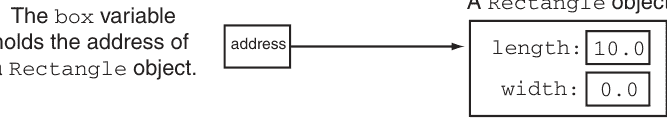

### 3.1 类

在向方法传递参数时，参数的数据类型必须与参数变量的数据类型兼容。否则，将会发生错误。例如，`setLength` 中的 `len` 参数是一个 `double` 变量。你不能传递一个无法自动转换为 `double` 数据类型的参数。因此，以下语句会导致错误，因为参数是一个字符串：

```java
box.setLength("10.0"); // ERROR!
```

## 编写 `setWidth` 方法

现在我们已经看到 `setLength` 方法可以工作了，让我们为 `Rectangle` 类添加 `setWidth` 方法。`setWidth` 方法与 `setLength` 类似。它接受一个参数，并将其赋值给 `width` 字段。代码列表 3-3 显示了更新后的 `Rectangle` 类。`setWidth` 方法位于第 26 到 29 行（如果你从 `www.pearsonglobaleditions.com/gaddis` 下载了本书源码，你将在 `03\Rectangle Class Phase 2` 文件夹中找到该文件）。

### 代码列表 3-3 (`Rectangle.java`)

```java
1  /**
2   * Rectangle 类，阶段 2
3   * 构建中！
4   */
5
6  public class Rectangle
7  {
8      private double length;
9      private double width;
10
11     /**
12      * setLength 方法接受一个参数
13      * 并存储在 length 字段中。
14      */
15
16     public void setLength(double len)
17     {
18         length = len;
19     }
20
21     /**
22      * setWidth 方法接受一个参数
23      * 并存储在 width 字段中。
24      */
25
26     public void setWidth(double w)
27     {
28         width = w;
29     }
30  }
```

`setWidth` 方法有一个名为 `w` 的参数。当参数传递给该方法时，该参数的值被复制到 `w` 变量中。`w` 变量的值被赋值给 `width` 字段。例如，假设 `box` 引用一个 `Rectangle` 对象并执行了以下语句：


box.setWidth(20.0);

执行该语句后，`box` 对象的宽度将被设置为 20.0。

## 编写 getLength 和 getWidth 方法

由于 `length` 和 `width` 字段是私有的，我们编写了 `setLength` 和 `setWidth` 方法以允许 `Rectangle` 外部的代码在字段中存储值。我们还编写了允许类外部代码获取其中存储值的方法。这就是 `getLength` 和 `getWidth` 方法要做的。`getLength` 方法返回存储在 `length` 字段中的值，而 `getWidth` 方法返回存储在 `width` 字段中的值。

以下是 `getLength` 方法的代码：

```java
public double getLength()
{
    return length;
}
```

注意，头部没有使用 `void` ，而是使用了 `double` 作为方法的返回值。同样注意，括号内没有声明任何参数变量。这意味着该方法不接受参数。然而，括号仍然是必须的。

## 3.1 类 165

```java
14   System.out.println("The box's length is " + box.getLength());
16   System.out.println("The box's width is "
17   + box.getWidth());
18 }
19 }
```

程序输出
The box's length is 10.0
The box's width is 20.0

让我们来看这个程序。首先，这个程序创建了一个 `Rectangle` 对象，并由 `box` 变量引用。第 12 行和 13 行的语句执行：

```java
box.setLength(10.0);
box.setWidth(20.0);
```

在这些语句执行后，`box` 对象的 `length` 字段被设置为 10.0，其 `width` 字段被设置为 20.0。对象的状态如图 3-11 所示。

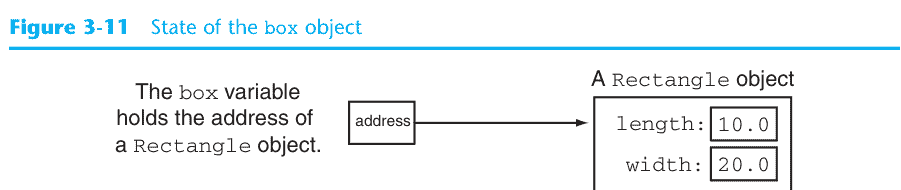

接下来，第 14 行和第 15 行的语句执行：

```java
System.out.println("The box's length is "
+ box.getLength());
```

该语句调用了 `box.getLength()` 方法，该方法返回值 10.0。屏幕上显示以下消息：

The box's length is 10.0

然后执行第 16 行和第 17 行的语句：

```java
System.out.println("The box's width is "
+ box.getWidth());
```

该语句调用了 `box.getWidth()` 方法，该方法返回值 20.0。屏幕上显示以下消息：

The box's width is 20.0

## 编写 getArea 方法

我们为 `Rectangle` 类编写的最后一个方法是 `getArea`。该方法返回矩形的面积，即长度乘以宽度。以下是 `getArea` 方法的代码：

```java
public double getArea() {
    return length * width;
}
```

该方法返回数学表达式 `length * width` 的结果。例如，假设 `area` 是一个 `double` 类型且 `box` 引用一个 `Rectangle` 对象，并执行以下代码：

```java
box.setLength(10.0);
box.setWidth(20.0);
area = box.getArea();
```

最后一条语句将 `getArea` 方法返回的值赋值给变量。在执行之后，`area` 将包含 200.0。

代码列表 3-6 显示了 `Rectangle` 类，包含了我们目前为止讨论的所有成员。`getArea` 方法出现在第 56 行到第 59 行。（如果你从 pearsonglobaleditions.com/gaddis 下载了书的源码，你将在 `Chapter 03/Rectangle Class Phase 4` 文件中找到它。）

## 代码列表 3-6 (Rectangle.java)

```java
1  /**
2   * Rectangle class, Phase 4
3   * Under Construction!
4   */
5 
6  public class Rectangle
7  {
8      private double length;
9      private double width;
10 
11     /**
12         * setLength method accepts an argument
13         * that is stored in the length field.
14         */
15 
16     public void setLength(double len)
17     {
18         length = len;
19     }
20 
21     /**
22         * setWidth method accepts an argument
23         * that is stored in the width field.
24         */
25 
26     public void setWidth(double w)
27     {
28         width = w;
29     }
30 
31     /**
32     * The getLength method returns the value
33     * stored in the length field.
34     */
35 
36     public double getLength()
37     {
38         return length;
39     }
40 
41     /**
42     * The getWidth method returns the value
43     * stored in the width field.
44     */
45 
46     public double getWidth()
47     {
48         return width;
49     }
50 
51     /**
52     * The getArea method returns the value of the
53     * length field times the width field.
54     */
55 
56     public double getArea()
57     {
58         return length * width;
59     }
60 
61 }
```

代码列表 3-7 中的程序演示了 `Rectangle` 类的所有方法，包括 `getArea`。（如果你从 www.pearsonglobaleditions.com/gaddis 下载了书的源码，你将在 `Chapter 03/Rectangle Class Phase 4` 文件夹中找到它。）

## 代码列表 3-7 (RectangleDemo.java)

```java
1  /**
2  * This program demonstrates the Rectangle class's
3  * setLength, setWidth, getLength, getWidth, and
4  * getArea methods.
5  */
6 
7  public class RectangleDemo
8  {
9      public static void main(String[] args) {
10         // Create a Rectangle object.
11         Rectangle box = new Rectangle();
12 
13         // Set the length and width.
14         box.setLength(10.0);
15         box.setWidth(20.0);
16 
17         // Display the length, width, and area.
18         System.out.println("The box's length is " + box.getLength());
19         System.out.println("The box's width is " + box.getWidth());
20         System.out.println("The box's area is " + box.getArea());
21 
22     }
23 }
```

程序输出
The box's length is 10.0
The box's width is 20.0
The box's area is 200.0

## 第 3 章 初识类和对象

### 访问器和修改器方法

如前所述，获取类值的方法被称为访问器，更改字段的方法被称为修改器。在行业中，修改器方法被称为 "setters"，而访问器方法被称为 "getters"。

### 数据隐藏重要性

数据隐藏是面向对象编程中的一个重要概念。通过隐藏类数据并仅允许通过方法访问，你可以确保类按预期运行。作为初学者，你可能会疑惑为什么要隐藏数据。在大型软件系统中，你之外的程序员将使用你的类。

### 避免过时数据

回想 `Rectangle` 类有 `getLength`、`getWidth` 和 `getArea`。`getLength` 和 `getWidth` 方法返回字段的值，但 `getArea` 方法返回计算结果。如果一个值依赖于其他数据并在数据变化时未更新，则称它为过时的。如果矩形的面积存储在字段中，当长度或宽度变化时，该字段将变得错误。在设计类时，你应该注意不要将计算数据存储在字段中。相反，提供一个返回结果的方法。

### 在 UML 图中显示访问规范

在 3-5 中我们展示了矩形的 UML 图。该图列出了类的所有成员，但没有指示哪些是私有的。在 UML 图中，你可以在成员名称前放置 `-` 字符表示它是私有的，或者放置 `+` 字符表示它是公共的。图 3-12 显示了经过修改的 UML 图。

**图 3-12** 矩形的 UML 图

| Rectangle |
| :--- |
| - length |
| - width |
| + setLength() |
| + setWidth() |
| + getLength() |
| + getWidth() |
| + getArea() |

### UML 图中的数据类型和参数符号

统一建模语言（UML）还提供了你可以用于指示字段、方法和参数数据类型的符号。要指示字段的数据类型，在字段名称后放置冒号以及数据类型的名称。例如，`Rectangle` 类中的 `length` 字段是 `double` 类型。它在 UML 图中可以这样列出：

- length : double

方法的返回类型也可以以相同的方式列出：在方法名称后放置冒号以及返回类型。`Rectangle` 类的 `getLength` 方法返回 `double`，因此它在 UML 图中可以这样列出：

- getLength() : double

参数变量及其数据类型可以列在方法的括号内。例如，`Rectangle` 类的 `setLength` 方法有一个名为 `len` 的 `double` 类型参数，在 UML 图中可以如下所示：

```
+ setLength(len : double) : void
```

**图 3-13** 带有参数和数据类型定义的 Rectangle 类 UML 图

| Rectangle |
| :--- |
| - length : double |
| - width : double |
| + setLength(len : double) : void |
| + setWidth(w : double) : void |
| + getLength() : double |
| + getWidth() : double |
| + getArea() : double |

## 类成员的布局

注意，在 `Rectangle` 类中，首先声明字段变量，然后定义方法。你不需要在方法定义之前编写字段声明。事实上，有些程序员倾向于先写公共方法的定义，再写私有字段的声明。无论你使用哪种风格，都应该保持一致。在书中，我们总是先写字段声明，然后是方法定义。图 3-14 显示了这种布局。

```java
public class ClassName {
    // Field declarations
    // Method definitions
}
```

### 检查点

- 3.1 在这种情况下，我们使用蓝图的比喻来描述类和对象。在这个比喻中，类是蓝图还是房子？
- 3.2 描述一下基本数据类型与对象之间的不同之处。
- 3.3 当说一个变量引用了某个对象时，变量中实际存储了什么？
- 3.4 字符串字面量（例如 "Joe"）会创建什么类型的对象？
- 3.5 查看图 3-15 中的 UML 图并回答问题。
    a. 类的名称是什么？
    b. 属性有哪些？
    c. 方法有哪些？
    d. 私有成员有哪些？
    e. 公有成员有哪些？
- 3.6 假设 `line1` 是一个引用了图 3-15 所示类实例的变量。编写一条调用 `setName` 并传递参数 "Cadillac" 的语句。

**图 3-15** UML 图

| Car |
| :--- |
| - make |
| - yearModel |
| + setMake() |
| + setYearModel() |
| + getMake() |
| + getModel() |

- 3.7 `new` 关键字的作用是什么？
- 3.8 什么是参数变量？
- 3.9 什么是访问器？什么是修改器？
- 3.10 什么是过期数据项？

# 3.2 关于传递参数更多

> 概念：方法可以有多个参数变量，允许你向方法传递多个参数。当参数传递给方法时，它是按值传递的。这意味着参数变量持有传递给它的值的副本。对参数进行的更改不会影响实参。

## 传递多个参数

通常情况下，向方法传递多个参数是有帮助的。例如，`Rectangle` 类有两个方法用于设置长度和宽度字段：`setLength` 和 `setWidth`。使用这些方法设置长度和宽度需要调用两次方法。我们可以添加另一个接受两个参数的方法，其中一个用于长度，一个用于宽度，从而可以通过一次方法调用同时设置长度和宽度字段。这是一个这样的方法：

```java
public void set(double len, double w)
{
    length = len;
    width = w;
}
```

在方法头部的括号内声明了两个参数变量 `len` 和 `w`。在这里，我们在调用方法时向方法传递了两个参数。例如，假设 `box` 引用一个 `Rectangle` 对象并执行了以下语句：

```java
box.set(10.0, 20.0);
```

该语句将值 10.0 传递给 `len` 参数，将值 20.0 传递给 `w` 参数，如图 3-16 所示。

**图 3-16** 传递给 set 方法的多个参数

```java
box.set(10.0, 20.0);

public void set(double len, double w)
{
    length = len;
    width = w;
}
```

注意，参数是它们在方法调用中出现的顺序传递给参数变量的。换句话说，第一个参数传递给第一个参数，第二个参数传递给第二个参数。例如，以下方法会将 15.0 传递给 `len` 参数，将 30.0 传递给 `w` 参数：

```java
box.set(15.0, 30.0);
```

程序代码列表 3-8 演示了向 `set` 方法传递两个参数。在程序中，在 `main` 方法中声明的变量被作为参数传递。（如果你从 www.pearsonglobaleditions.com/gaddis 下载了书的源码，你将在 `Chapter 03/Rectangle Class 5` 文件夹中找到此文件以及 `Rectangle` 类的修改版本。）

## 代码列表 3-8 (MultipleArgs.java)

```java
import java.util.Scanner; // 需要 Scanner

/**
 * 此程序演示了如何向方法
 * 传递多个参数。
 */
public class MultipleArgs
{
    public static void main(String[] args)
    {
        double boxLength, // 用于存储长度
               boxWidth;  // 用于宽度

        // 创建 Scanner 对象用于键盘输入。
        Scanner keyboard = new Scanner(System.in);

        // 创建 Rectangle 对象。
        Rectangle box = new Rectangle();

        // 获取并存储框的尺寸。
        System.out.print("What is the box's length? ");
        boxLength = keyboard.nextDouble();
        box.setLength(boxLength);
    }
}
```


```java
System.out.print("What is the box's width? ");

boxWidth = keyboard.nextDouble();

box.setWidth(boxWidth);

}
}
```

# 程序输出示例

What is the box's length? 10.0
What is the box's width? 20.0
The box's length is 10
The box's width is 20
The box's area is 200

在程序中，存储在 `boxLength` 和 `boxWidth` 中的值被作为参数传递。第 30 行的语句调用了 `set` 方法，传递了 `boxLength` 和 `boxWidth`。

```java
box.set(boxLength, boxWidth);
```

当该语句执行时，`boxLength` 变量的值传递给 `len` 参数，`boxWidth` 变量的值传递给 `w` 参数。

# 参数按值传递

在 Java 中，所有基本类型的参数都是按值传递的，这意味着传递的是参数的值副本。方法参数与调用中的参数是分开且独立的。如果在方法内部更改了参数变量，对实参没有影响。

# 3.3 实例字段与方法

> 概念：类的每个实例都有一组字段，称为实例字段。你可以创建类的多个实例，并在每个实例中存储不同的值。对实例的操作称为实例方法。

代码列表 3-7 中的程序创建了 `Rectangle` 类的一个实例。可以创建同一类的多个实例，每个实例都有自己的数据。例如，代码列表 3-9 中的 `RoomAreas.java` 程序创建了三个 `Rectangle` 类实例，由变量 `kitchen`、`bedroom` 和 `den` 表示。

### 代码列表 3-9 (RoomAreas.java)

```java
import java.util.Scanner;

/**
 * 此程序创建了三个
 * Rectangle 类实例。
 */
public class RoomAreas {
    public static void main(String[] args) {
        double number, // 用于存储数值输入
               totalArea; // 所有房间的总面积

        // 创建 Scanner 对象用于键盘输入。
        Scanner keyboard = new Scanner(System.in);

        // 创建三个 Rectangle 对象。
        Rectangle kitchen = new Rectangle();
        Rectangle bedroom = new Rectangle();
        Rectangle den = new Rectangle();

        // 获取并存储厨房的尺寸。
        System.out.print("What is the kitchen's length? ");
        number = keyboard.nextDouble();
        kitchen.setLength(number);
        System.out.print("What is the kitchen's width? ");
        number = keyboard.nextDouble();
        kitchen.setWidth(number);
    }
}
```

## 3.3 实例字段与方法

```java
// 获取并存储卧室的尺寸。
System.out.print("What is the bedroom's length?");
number = keyboard.nextDouble();
bedroom.length(number);
System.out.print("What is the bedroom's width?");
number = keyboard.nextDouble();
bedroom.setWidth(number);
```

```java
// 获取并存储书房的尺寸。
System.out.print("What is the den's length?");
number = keyboard.nextDouble();
den.length(number);
System.out.print("What is the den's width?");
number = keyboard.nextDouble();
den.setWidth(number);
```

```java
// 计算房间的总面积。
totalArea = kitchen.getArea() + bedroom.getArea()
+ den.getArea();
```

```java
// 显示房间的总面积。
System.out.println("The total area of the rooms is "
+ totalArea);
```

# 程序输出（示例输入已加粗显示）

What is the kitchen's length? **10** [Enter]
What is the kitchen's width? **14** [Enter]
What is the bedroom's length? **15** [Enter]
What is the bedroom's width? **12** [Enter]
What is the den's length? **20** [Enter]
What is the den's width? **30** [Enter]
The total area of the rooms is 920.0

在程序中，第 19 到 21 行的代码创建了三个对象，它们是 `Rectangle` 类的实例：

```java
Rectangle kitchen = new Rectangle();
Rectangle bedroom = new Rectangle();
Rectangle den = new Rectangle();
```

图 3-17 展示了厨房、卧室和书房是如何引用对象的。
在程序的示例演示中，用户输入 10 和 14 作为厨房的长度和宽度，15 和 12 作为卧室的长度和宽度，20 和 30 作为书房的长度和宽度。图 3-18 显示了这些值存储在对象后对象的状态。

# 图 3-17 厨房、卧室和书房变量引用的 Rectangle 对象

`kitchen` 变量持有一个 `Rectangle` 对象的地址。

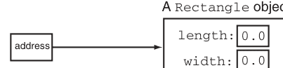

`bedroom` 变量持有一个 `Rectangle` 对象的地址。

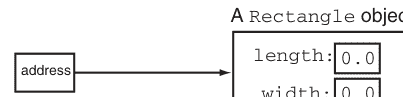

`den` 变量持有一个 `Rectangle` 对象的地址。

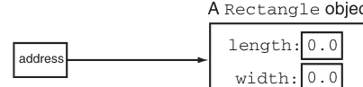

# 图 3-18 数据存储后对象的状态

`kitchen` 变量持有一个 `Rectangle` 对象的地址。

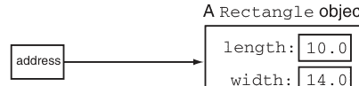

`bedroom` 变量持有一个 `Rectangle` 对象的地址。

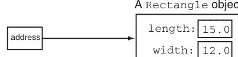

`den` 变量持有一个 `Rectangle` 对象的地址。

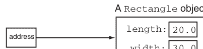

从图 3-18 可以看出，`Rectangle` 类的每个实例都有自己的长度和宽度。由于这些变量被称为**实例变量**或**实例字段**。类的每个实例都有自己的一组实例字段，并可以在这些字段中存储自己的值。

对类实例操作的方法被称为**实例方法**。`Rectangle` 类中的所有方法都是实例方法，因为它们在类的特定实例上执行操作。例如，查看 `RoomsAreas.java` 程序中的第 26 行：

```java
kitchen.setWidth(number);
```

该语句调用了 `setWidth` 方法，在 `kitchen` 对象的 `length` 字段中存储一个值。现在看同一程序的程序的第 34 行。

```java
bedroom.setWidth(number);
```

## 3.4 构造方法

该语句也调用了 `setWidth` 方法，但这次它在 `bedroom` 对象的 `length` 字段中存储了一个值。同样，第 42 行调用了 `setLength` 方法在 `den` 的 `length` 字段中存储一个值：

```java
den.setLength(number);
```

`setLength` 方法在 `Rectangle` 类的特定实例中存储值。对于 `Rectangle` 类中的所有成员方法都是如此。

## 检查点

假设 `r1` 和 `r2` 是引用 `Rectangle` 对象的变量，并执行了以下语句：

```java
r1.setLength(5.0);
r2.setLength(10.0);
r1.setWidth(20.0);
r2.setWidth(15.0);
```

填满图 3-19 中代表每个对象的长度和宽度字段的方框。

# 图 3-19 填充每个对象的长度和宽度字段

| 对象 | length | width |
| :--- | :--- | :--- |
| r1 | | |
| r2 | | |

构造方法是在对象创建时初始化对象的特殊方法。构造方法的名称与类名相同，且没有返回类型——甚至没有 `void`。当使用 `new` 关键字创建类的实例时，构造方法会被自动调用。

例如，以下代码展示了一个简单的构造方法：

```java
public Rectangle(double length, double width) {
    length = length;
    width = width;
}
```

## 第 3 章 类与对象的初探

```java
15
16 //  Rectangle 变量以引用
17 // 厨房、卧室和书房的对象。
18 Rectangle kitchen, bedroom, den;
19
20 // 创建一个 Scanner 对象用于键盘输入。
21 Scanner keyboard = new Scanner(System.in);
22
23 // 获取并存储厨房的尺寸。
24 System.out.print("What is the kitchen's length? ");
25 roomLength = keyboard.nextDouble();
26 System.out.print("What is the kitchen's width? ");
27 roomWidth = keyboard.nextDouble();
28 kitchen = new Rectangle(roomLength, roomWidth);
29
30 // 获取并存储卧室的尺寸。
31 System.out.print("What is the bedroom's length? ");
32 roomLength = keyboard.nextDouble();
33 System.out.print("What is the bedroom's width? ");
34 roomWidth = keyboard.nextDouble();
35 bedroom = new Rectangle(roomLength, roomWidth);
36
37 // 获取并存储书房的尺寸。
38 System.out.print("What is the den's length? ");
39 roomLength = keyboard.nextDouble();
40 System.out.print("What is the den's width? ");
41 roomWidth = keyboard.nextDouble();
42 den = new Rectangle(roomLength, roomWidth);
43
44 // 计算房间的总面积。
45 totalArea = kitchen.getArea() + bedroom.getArea()
46 + den.getArea();
47
48
49 // 显示房间的总面积。
50 System.out.println("The total area of the rooms is "
51 + totalArea);
52
 }
```

**程序输出（示例输入已加粗显示）**
What is the kitchen's length? 10 [Enter]
What is the kitchen's width? 14 [Enter]
What is the bedroom's length? 15 [Enter]
What is the bedroom's width? 20 [Enter]
What is the den's length? 12 [Enter]
What is the den's width? 30 [Enter]
The total area of the rooms is 920.0.

## 3.4 构造器

在程序中，第 18 行的以下语句声明了 `kitchen`、`bedroom` 和 `den` 的 `Rectangle` 变量：

```java
Rectangle kitchen, bedroom, den;
```

然而，这些变量尚未引用 `Rectangle` 类的实例。由于这些变量尚未持有对象的地址，因此它们是未初始化的引用变量。在这些变量引用对象之前，无法使用它们。出现在第 28 行的以下语句创建了一个 `Rectangle` 对象，将 `roomLength` 和 `roomWidth` 变量作为参数传递给构造器，并将对象的地址赋值给 `kitchen` 变量。

在该语句执行后，`kitchen` 变量将引用该 `Rectangle` 对象。程序后面还出现了类似的语句，使得 `bedroom` 和 `den` 变量引用了对象。

## 默认构造器

当对象被创建时，它的构造器总是会被调用。但如果我们不在对象的类中编写构造器呢？如果你没有在类中编写构造器，Java 在代码编译时会自动提供一个。默认构造器不接受参数。它将类中所有的数值字段设为 0，布尔字段设为 false，字符字段设为 Unicode 值 0。如果对象具有作为引用变量的字段，默认构造器会将它们设置为特殊值 `null`，这意味着它们不引用任何内容。

Java 提供默认构造器的唯一情况是你没有为该类编写你自己的构造器。例如，在本章的开始时，我们开发了 `Rectangle` 类，但没有为它编写构造器。当我们编译该类时，编译器生成了将 `length` 和 `width` 字段都设置为 0.0 的代码。假设以下代码使用该版本的类创建一个 `Rectangle` 对象：

```java
// Rectangle 类没有构造器。
Rectangle r = new Rectangle(); // 调用默认构造器
```

当我们使用该版本的类创建 `Rectangle` 对象时，我们没有向默认构造器传递任何参数，因为默认构造器是不接受参数的。

后来，我们在类中添加了自己的自己的构造器。这个构造器为 `length` 和 `width` 字段添加了参数。当我们从那时编译该类时，Java 不再提供默认构造器。我们添加的构造器成为了该类唯一的构造器。当我们使用该版本的类创建 `Rectangle` 对象时，必须向构造器传递长度和宽度参数。使用该版本的类，以下语句会导致错误，因为我们没有为构造器提供任何参数。

```java
// 现在我们为 Rectangle 类编写了自身的构造器。
Rectangle box = new Rectangle(); // 错误！现在必须传递参数。
```

由于我们添加了需要两个参数的自定义构造器，该类不再拥有默认构造器。

## 无参数构造器

不接受参数的构造器被称为无参数构造器。默认构造器不接受参数，因此它被认为无参数构造器。此外，你也可以编写自己的无参数构造器。例如，假设我们为 `Rectangle` 类编写了如下构造器：

```java
public Rectangle() {
    length = 1.0;
    width = 1.0;
}
```

如果我们在 `Rectangle` 类中使用这个构造器，在创建 `Rectangle` 对象时将不会传递任何参数。以下代码显示了一个示例。如果这段代码执行，`Rectangle` 的 `length` 和 `width` 字段将被设置为 1.0。

```java
// 现在我们有了自己的无参数构造器。
Rectangle r = new Rectangle();
```


## 在 UML 图中显示构造器

在 UML 图中显示构造器有多种方法。在本书中，我们可能将构造器显示为任何方法，但不列出类型。图 3-20 显示了 `Rectangle` 类的 UML 图。

图 3-20 类 UML 图

| Rectangle |
| :--- |
| - length : double |
| - width : double |
| + Rectangle(len: double, w: double) |
| + setLength(len: double) : void |
| + setWidth(w: double) : void |
| + getLength() : double |
| + getWidth() : double |
| + getArea() : double |

## String 构造器

通过简单的声明创建原始变量，通过 `new` 运算符创建对象。然而，有一个类不需要 `new` 运算符就可以实例化：`String` 类。字符串字面量非常常见，Java 允许你不使用 `new` 运算符就创建 `String` 对象。示例如下：

```java
String name = "Joe Mahoney";
```

## 3.5 BankAccount 类

上一节讨论的矩形允许你创建描述矩形的对象。现在我们来看一个更实体建模的类：从该类创建的对象将模拟银行账户，允许我们执行如存款、取款、计算和增加利息、获取当前余额等操作。图 3-21 显示了 `BankAccount` 类的 UML 图。

图 3-21 BankAccount 类 UML 图

| BankAccount |
| :--- |
| - balance : double |
| - interestRate : double |
| - interest : double |
| + BankAccount(startBalance : double, intRate : double) |
| + deposit(amount : double) : void |
| + withdraw(amount : double) : void |
| + addInterest() : void |
| + getBalance() : double |
| + getInterest() : double |

以下是 `BankAccount` 类字段的总结：

* `balance` 是账户当前余额的 `double` 类型字段。
* `interestRate` 是账户每月利率的 `double` 类型字段。每月利率是年利率除以 12。例如，如果年利率为 3%，则月利率为 0.25%。我们将此值作为 0.0025 存储在 `interestRate` 字段中。
* `interest` 是一个 `double` 类型变量，用于存储账户赚取的利息金额。

以下是类方法的摘要：

* 构造函数有两个变量：`startBalance` 和 `intRate`。两个参数都是 `double` 类型。当构造函数执行时，账户余额被传递给 `startBalance` 参数，账户的月利率被传递给 `intRate` 参数。构造函数将 `startBalance` 赋值给 `balance` 字段，将 `intRate` 赋值给 `interestRate` 字段。此外，构造函数将 `interest` 字段赋值为 0.0。
* `deposit` 方法有一个参数 `amount`，类型为 `double`。当调用该方法时，将要存入账户的金额传递给此参数。该参数的值将加到 `balance` 字段的值上。
* `withdraw` 方法有一个参数 `amount`，类型为 `double`。当调用该方法时，将要从账户中取出的金额传递给此参数。该参数的值将从 `balance` 字段的值中减去。
* `addInterest` 方法将 `interestRate` 乘以 `balance` 字段，以确定赋值给 `interest` 字段的利息金额，并加到 `balance` 字段中。
* `getBalance` 方法返回 `balance` 字段的值，即当前账户余额。
* `getInterest` 方法返回 `interest` 字段的值，即上一次调用 `addInterest` 方法时赚取的利息金额。

代码 3-13 显示了 `BankAccount` 类的代码，存储在 `BankAccount.java` 文件。

## 代码列表 3-13 (BankAccount.java)

```java
/**
  * BankAccount 类
  * 此类模拟了一个银行账户。
  */
public class BankAccount
{
  private double balance;      // 余额
  private double interestRate;  // 利率
  private double interest;     // 赚取的利息

  /**
  * 构造函数使用传递给 startBalance
  * 和 intRate 的值来初始化 balance
  * 和 interestRate 字段。interest
  * 字段被赋值为 0.0。
  */
  public BankAccount(double startBalance,
      double intRate)
  {
      balance = startBalance;
      interestRate = intRate;
      interest = 0.0;
  }

  /**
   * deposit 方法将金额
   * 加到 balance 字段。
   */
  public void deposit(double amount)
  {
      balance += amount;
  }

  /**
   * withdraw 方法从 balance 
   * 中减去参数 amount
   */
  public void withdraw(double amount)
  {
      balance -= amount;
  }

  /**
   * addInterest 方法将当月的
   * 利息加到 balance 字段中。
   */
  public void addInterest()
  {
      interest = balance * interestRate;
      balance += interest;
  }

  /**
   * getBalance 方法返回 balance
   * 字段的值。
   */
  public double getBalance()
  {
      return balance;
  }

  /**
   * getInterest 方法返回
   * interest 字段的值。
   */
  public double getInterest()
  {
      return interest;
  }
}
```

代码列表 3-14 显示的 `AccountTest.java` 程序演示了 `BankAccount` 类。

## 代码列表 3-14 (AccountTest.java)

```java
import java.util.Scanner; // 需要 Scanner 类

/**
 * 此程序演示了 BankAccount 类。
 */
public class AccountTest{
    public static void main(String[] args)
    {
        BankAccount account; // 引用 BankAccount 对象
        double balance; // 账户的初始余额
        double interestRate; // 月利率
        double pay; // 用户的工资
        double cashNeeded; // 要取出的现金

        // 创建一个 Scanner 用于键盘输入。
        Scanner keyboard = new Scanner(System.in);

        // 获取初始余额。
        System.out.print("您的账户初始 " + "余额是多少？ "); 
        balance = keyboard.nextDouble();

        // 获取月利率。
        System.out.print("您的月利率是多少？ ");
        interestRate = keyboard.nextDouble();

        // 创建一个 BankAccount 对象。
        account = new BankAccount(balance, interestRate);

        // 获取工资。
        System.out.print("本月您获得了多少工资？ ");
        pay = keyboard.nextDouble();
        System.out.println("我们将您的工资存入账户。");
        account.deposit(pay);
        System.out.println("您当前的余额为 $" + account.getBalance());

        // 从账户中提取现金。
        System.out.print("您想取出多少钱？ ");
        cashNeeded = keyboard.nextDouble();
        account.withdraw(cashNeeded);

        // 将月利息加入账户。
        account.addInterest();
        System.out.println("本月您赚了 $" + account.getInterest() + " 的利息。");
        System.out.println("现在您的余额为 $" + account.getBalance());
    }
}
```

## 带有示例输入的程序输出（加粗显示输入）

您的账户初始余额是多少？500 [回车]
您的月利率是多少？0.045 [回车]
本月您获得了多少工资？1000 [回车]
我们将您的工资存入账户。
您当前的余额为 $1500.0
您想取出多少钱？900 [回车]
本月您赚了 $27.0 的利息。
您的余额为 $627.0

让我们来看这个程序的一些细节。首先，通过以下语句声明了一些变量，这些语句出现在第 11 到 15 行：

* `BankAccount account;` // 引用 BankAccount 对象
* `double balance;` // 账户的初始余额
* `double interestRate;` // 月利率
* `double pay;` // 用户的工资
* `double cashNeeded;` // 要取出的现金

第一个声明的变量是 `account`。注意，`account` 是对 `BankAccount` 对象的引用。声明了变量 `balance`、`interestRate`、`pay` 和 `cashNeeded`。这些变量将持有程序后续使用的值。

## 焦点关注：创建 CellPhone 类

Wireless Solutions, Inc. 是一家销售手机和无线服务的公司。你是公司 IT 部门的一名程序员，你的团队正在设计一个程序来管理库存中所有的手机。你被分配设计一个表示手机的类。类中应保留的库存数据如下：

* 将手机制造商的名称赋值给 `manufact` 字段。
* 将手机的型号赋值给 `model` 字段。
* 将手机的零售价赋值给 `retailPrice` 字段。

该类还将具有以下方法：

* 一个构造方法，接受制造商、型号和零售价作为参数。
* 一个 `setManufact` 方法，接受制造商作为参数。此方法允许我们在对象创建后更改 `manufact` 字段的值（在必要时是很有用的）。
* 一个 `setModel` 方法，接受型号作为参数。此方法允许我们在对象创建后更改 `model` 字段的值（在必要时）。
* 一个 `setRetailPrice` 方法，接受零售价作为参数。此方法允许我们在对象创建后更改 `retailPrice` 字段的值（在必要时）。
* 一个 `getManufact` 方法，返回手机的制造商。
* 一个 `getModel` 方法，返回手机的型号。
* 一个 `getRetailPrice` 方法，返回手机的零售价。

图 3-22 显示了该类的 UML 图。代码列表 3-15 显示了类的定义。

图 3-22 CellPhone 类的 UML 图

| CellPhone |
| :--- |
| - manufact : String |
| - model : String |
| - retailPrice : double |
| + CellPhone(man: String, model: String, price: double) |
| + setManufact(man: String): void |
| + setModel(mod: String): void |
| + setRetailPrice(price: double): void |
| + getManufact(): String |
| + getModel(): String |
| + getRetailPrice(): double |

## 代码列表 3-15 (CellPhone.java)

```java
/**
 * CellPhone 类表示手机。
 */
public class CellPhone {

    // 字段
    private String manufact; // 制造商
    private String model; // 型号
    private double retailPrice; // 零售价

    /**
     * 构造方法接受参数
     * 手机的制造商、型号、
     * 以及零售价。
     */
    public CellPhone(String man, String mod, double price) {
        manufact = man;
        model = mod;
        retailPrice = price;
    }

    /**
     * setManufact 接受参数
     * 手机制造商的名称。
     */
    public void setManufact(String man) {
        manufact = man;
    }

    /**
     * setModel 接受参数
     * 手机的型号。
     */
    public void setModel(String mod) {
        model = mod;
    }

    /**
     * setRetailPrice 接受参数
     * 手机的零售价。
     */
    public void setRetailPrice(double price) {
        retailPrice = price;
    }

    /**
     * getManufact 方法返回
     * 手机制造商的名称。
     */
    public String getManufact() {
        return manufact;
    }

    /**
     * getModel 方法返回手机的
     * 型号。
     */
    public String getModel() {
        return model;
    }

    /**
     * getRetailPrice 方法返回
     * 手机的零售价。
     */
    public double getRetailPrice() {
        return retailPrice;
    }
}
```

`CellPhone` 类将由你团队正在开发的几个程序所使用。为了对该类进行简单测试，你编写了代码列表 3-16 所示的程序。这是一个简单的程序，提示用户输入手机的制造商、型号和零售价。创建了一个 `CellPhone` 类的实例并将数据赋值给其属性。

## 代码列表 3-16 (CellPhoneTest.java)

```java
import java.util.Scanner;

/**
 * 此程序对 CellPhone 类进行
 * 简单测试。
 */
public class CellPhoneTest {
    public static void main(String[] args) {
        // 创建一个 Scanner 用于键盘输入。
        Scanner keyboard = new Scanner(System.in);

        // 获取制造商。
        System.out.print("请输入手机制造商： ");
        String manufact = keyboard.nextLine();

        // 获取型号。
        System.out.print("请输入手机型号： ");
        String model = keyboard.nextLine();

        // 获取零售价。
        System.out.print("请输入手机零售价： ");
        double retailPrice = keyboard.nextDouble();

        // 创建一个 CellPhone 对象。
        CellPhone phone = new CellPhone(manufact, model, retailPrice);

        // 显示手机数据。
        System.out.println("这是您提供的数据：");
        System.out.println("制造商：" + phone.getManufact());
        System.out.println("型号：" + phone.getModel());
        System.out.println("零售价：" + phone.getRetailPrice());
    }
}
```


```java
6 */

7

8 public class CellPhoneTest

9 {

10    public static void main(String[] args)

11    {

12      String testMan; // 用于存储制造商

13      String testMod; // 用于存储型号号

14      double testPrice; // 用于存储价格

15 

16      // 创建一个 Scanner 对象用于键盘输入。

17      Scanner keyboard = new Scanner(System.in);

18 

19      // 获取制造商。

20      System.out.print("Enter the manufacturer: ");

21      testMan = keyboard.nextLine();

22 

23      // 获取型号号。

24      System.out.print("Enter the model number: ");

25      testMod = keyboard.nextLine();

26 

27      // 获取零售价。

28      System.out.print("Enter the retail price: ");

29      testPrice = keyboard.nextDouble();

30 

31      // 创建 CellPhone 类的实例并将数据赋值给属性。

32      CellPhone phone = new CellPhone(testMan, testMod, testPrice);

33 

34      // 获取数据并显示。

35      System.out.println("Here is the data provided:");

36      System.out.println("Manufacturer: " + phone.getManufact());

37      System.out.println("Model number: " + phone.getModel());

38      System.out.println("Retail price: " + phone.getRetailPrice());

39    }

40 }
```

### 示例输入的程序输出

```
Enter the manufacturer: Acme
Enter the model number: M100
Enter the retail price: 299.99

Here is the data provided:
Manufacturer: Acme
Model number: M100
Retail price: 299.99
```

## 类、变量与作用域

> **概念** 实例字段对整个类可见的。局部变量（包括参数变量）仅在它们定义的地方可见。

回顾第 2 章，变量的作用域是程序中可以通过其名称访问的部分。变量的位置决定了变量的作用域。到目前为止，你有以下位置变量：

- 方法内部。在方法内部定义的变量称为局部变量。
- 类内部但在方法外部。在类内部定义的变量称为字段。
- 方法头部括号内。方法头部括号内的变量称为参数变量。

以下列表总结了这些类型的作用域：

- **局部变量**。局部变量的作用域是定义它的方法，从变量声明到方法结束。只有该区域的语句可以访问该变量。
- **字段**。我们将字段的作用域定义为所在的整个类。字段可以被该类的任何方法访问。（完全准确地说，实例字段可以被同类的任何实例方法访问。我们在第 7 章中讨论非实例类成员）。
- **参数变量**。参数变量的作用域是定义它的方法。只有方法内部的语句可以访问参数变量。

## 阴影

在第 2 章中，你看到在同一作用域内不能有两个同名的局部变量。参数变量本质上是一个局部变量。因此，你不能在同一作用域内给参数变量和局部变量赋予相同的名称。

然而，你可以让局部变量或参数变量与字段具有相同的名称。当你这样做时，局部变量或参数变量的名字会*遮蔽*字段的名字。这意味着字段被局部变量或参数变量隐藏了。

例如，假设 `Rectangle` 类的 `setLength` 方法是如下编写的。

```java
public void setLength(double len)
{
    double length; // 局部变量
    length = len;
}
```

在这段代码中，局部变量使用了与字段相同的名称。因此，局部变量的名字遮蔽（shadows）了字段的名字。当执行语句 `length = len` 时，`len` 的值被赋值给局部变量 `length`，而不是字段。对字段名的无意遮蔽会导致难以查觉的错误，因此你需要小心不要给局部变量起与字段相同的名称。

## 3.7 包与导入语句

> **概念** Java API 中的类被组织成包。导入语句（`import statement`）告诉编译器某个类位于哪个包中。

在第 2 章中，你接触了 Java API，它是一个包含预写类的标准库。Java API 中的每个类都是为特定目的而设计的，你可以在自己的程序中使用这些类。你已经使用过 API 中的几个类，例如 `String` 类、`Scanner` 类和 `JOptionPane` 类。

Java API 中的所有类都组织在包中。包是一组相关的类的集合。每个包都有自己的名称。例如，`Scanner` 类位于 `java.util` 包中。

Java API 中的许多类并不会对你的程序自动可用。事实上，你必须导入一个 API 类才能使用它。你使用 `import` 关键字来导入一个类。例如，导入 `Scanner` 类需要以下语句：

```java
import java.util.Scanner;
```

该语句告诉编译器 `Scanner` 类位于 `java.util` 包中。如果没有这条语句，编译器将无法找到 `Scanner` 类，程序将无法编译。

### 显式导入与通配符导入语句

导入语句有两种类型：显式（explicit）和通配符（wildcard）。显式导入语句指定单个类的包位置。例如，以下语句指定了 `Scanner` 类的位置：

```java
import java.util.Scanner;
```

`java.util` 包中除了 `Scanner` 类外还包含其他几个类。例如，在第 7 章中我们将使用 `StringTokenizer` 类，在第 8 章中我们将使用 `ArrayList` 类。这两个类都是包的一部分。如果一个程序需要使用 `Scanner` 类、`ArrayList` 类和 `StringTokenizer` 类，它必须导入这三个类。实现这一点的一种方法是为每个类编写显式导入语句，如下所示：

```java
import java.util.Scanner;
import java.util.ArrayList;
import java.util.StringTokenizer;
```

另一种导入所有类的方法是使用通配符导入语句。通配符导入语句告诉编译器导入该包中的所有类。这里是一个示例：

```java
import java.util.*;
```


- 紧跟在包后面的 `*` 告诉编译器导入 `java.util` 包中的所有类。使用通配符导入语句不会影响程序的性能或大小。它只是告诉编译器，你希望让特定包中的每个类都对你的程序可用。

### java.lang 包

Java API 有一个包名为 `java.lang`，它会被自动导入到每个 Java 程序中。该包包含了通用类，如 `String` 和 `System`，这些类对于 Java 编程语言是至关重要的。对于 `java.lang` 包中的任何类，你都不需要编写导入语句。

### 其他 API 包

Java API 中有许多个包。表 3-2 列出了其中少数几个。

#### 表 3-2 一些标准的 Java 包
| 包 | 描述 |
| --- | --- |
| java.applet | 提供创建小应用程序（applet）所需的类。 |
| java.awt | 提供抽象窗口工具包（Abstract Window Toolkit）的类。这些类用于绘制图像和创建图形用户界面。 |
| java.io | 提供执行各种类型输入和输出的类。 |
| java.lang | 提供 Java 语言的通用类。该包会被自动导入。 |
| java.net | 提供网络通信的类。 |
| java.security | 提供安全功能的类。 |
| java.sql | 提供用于数据库访问的类。 |
| java.text | 提供文本处理的类。 |
| java.util | 提供各种工具类。 |
| javax.swing | 提供创建图形用户界面的类。 |

> 关于包的更多信息，请参见附录 H。

## 3.8 关注对象设计：寻找类与职责

**概念：** 在面向对象设计中，第一步是识别问题中的类，然后是确定这些类的职责。

到目前为止，你已经学习了面向对象设计的几个基础。寻找类的过程通常涉及以下步骤：

1. 获取问题的描述。
2. 识别描述中的所有名词（包括代词）。
3. 精炼名词列表，只保留必要的类。

### 寻找类

在开发面向对象应用时，第一步是识别问题中的类，然后是确定这些类的职责。在这个例子中，假设我们为一家汽车店编写一个简单的管理程序。

**Joe's Automotive Shop**（乔的汽车店）经营 **foreign cars**（进口汽车），这些 **cars**（汽车）包括 **Mercedes**（梅赛德斯）和 **Porsche**（保时捷）。**customer**（客户）会来到店里服务。

当一个 **customer**（客户）带着 **car**（汽车）来到 **shop**（店里）时，**manager**（经理）会获取 **customer's name**（客户姓名）、**address**（地址）和 **telephone number**（电话号码）。**manager**（经理）随后会确定 **make**（品牌）、**model**（型号）和 **year**（年份），并为 **customer**（客户）提供 **service quote**（服务报价）。**service quote**（服务报价）将显示 **estimated charges**（预计费用）、**sales tax**（销售税）和 **total charges**（总费用）。

### 编写描述

在开始寻找类之前，我们需要对问题进行详细描述。在这个例子中，我们考虑一家汽车店。

**Joe's Automotive Shop**（乔的汽车店）经营 **foreign cars**（进口汽车），这些 **cars**（汽车）包括 **Mercedes**（梅赛德斯）和 **Porsche**（保时捷）。**customer**（客户）会来到店里服务。

当一个 **customer**（客户）带着 **car**（汽车）来到 **shop**（店里）时，**manager**（经理）会获取 **customer's name**（客户姓名）、**address**（地址）和 **telephone number**（电话号码）。**manager**（经理）随后会确定 **make**（品牌）、**model**（型号）和 **year**（年份），并为 **customer**（客户）提供 **service quote**（服务报价）。**service quote**（服务报价）将显示 **estimated charges**（预计费用）、**sales tax**（销售税）和 **total charges**（总费用）。

问题描述应该包含：
- 承担某种角色的人，如 **manager**（经理）、**employee**（员工）、**customer**（客户）
- 业务事件，如 **order**（订单）
- 需要记录的各项信息

### 识别所有名词

下一步是识别所有的名词和短语。（如果描述中包含代词，也把它们包含进来。）让我们再次看之前的问题描述。这次我们对名词和短语加粗。

**Joe's Automotive Shop**（乔的汽车店）经营 **foreign cars**（进口汽车），这些 **cars**（汽车）包括 **Mercedes**（梅赛德斯）和 **Porsche**（保时捷）。**customer**（客户）会来到店里服务。

当一个 **customer**（客户）带着 **car**（汽车）来到 **shop**（店里）时，**manager**（经理）会获取 **customer's name**（客户姓名）、**address**（地址）和 **telephone number**（电话号码）。**manager**（经理）随后会确定 **make**（品牌）、**model**（型号）和 **year**（年份），并为 **customer**（客户）提供 **service quote**（服务报价）。**service quote**（服务报价）将显示 **estimated charges**（预计费用）、**sales tax**（销售税）和 **total charges**（总费用）。

注意，有些名词重复了。以下列表显示了所有不重复的名词。

| foreign cars | Porsche |
| BMW | Joe's Automotive Shop | sales tax |
| car | make | service quote |
| cars | manager | shop |
| customer | Mercedes | telephone number |
| estimated charges | model | total charges |
| estimated charges | name | year |

### 精炼名词列表

出现在描述中的名词只是类的候选。并不是每个名词都需要变成类。下一步是精炼列表，只包含解决特定问题所需的类。我们将查看从列表中消除名词的常见原因：

1. **某些名词实际上指的是同一个东西。**

   在这个例子中，以下名词组指的是同一个东西：
   - `cars` 和 `foreign cars` 都指的是汽车的通用概念。
   - `Joe's Automotive Shop` 和 `shop` 这两个都指的是“Joe's Automotive Shop”公司。

   我们可以为这些每组名词确定一个类。在这个例子中，我们任意从列表中删除 `foreign cars`，并使用 `cars`。同样，我们从列表中删除 `Joe's Automotive Shop`，并使用 `shop`。更新后的潜在类列表为：

   - address
   - BMW
   - car
   - cars
   - customer
   - estimated charges
   - make
   - manager
   - Mercedes
   - model
   - name
   - Porsche
   - sales tax
   - service quote
   - shop
   - telephone number
   - total charges
   - year

2. **一些名词代表了我们在解决问题时不需要关注的条目。**

   对问题描述的快速回顾提醒了我们，应用程序应该执行什么：打印服务报价单。在这个示例中，我们可以从列表中删除不必要的类：
   - 我们可以从列表中删掉 `shop`，因为我们的应用程序只需要关注单个的服务报价单。它不需要处理或确定任何公司范围的信息。如果问题描述要求我们保留所有服务报价单的总和，那么为商店设立一个类就是有意义的。
   - 我们不需要为 `manager`（经理）创建一个类，因为问题说明没有引导我们获取任何关于经理的信息。如果有多个商店经理，且问题描述要求我们记录是哪个经理生成了每份服务报价单，那么为经理建立一个记录就有意义了。

   此时，更新后的潜在类列表如下：

   - address
   - BMW
   - car
   - cars
   - customer
   - estimated charges
   - make
   - Mercedes
   - model
   - name
   - Porsche
   - sales tax
   - service quote
   - telephone number
   - total charges
   - year

3. **一些名词可能代表对象，而不是类。**

   例如，`Mercedes`、`Porsche`、`BMW` 和 `car` 作为类，因为在示例中，它们都代表特定的汽车，可以被视为 `Car` 类的实例。此外，我们还从列表中删除了 `car` 这个词。在描述中，它指的是客户带到商店的特定汽车。因此，它也代表 `Car` 类的一个实例。

   > **提示：** 一些面向对象的设计的设计师会注意名词是复数还是单数。有时，复数名词表示一个类，而单数名词则表示一个对象。

   此时，更新后的潜在类列表为：

   - address
   - customer
   - estimated charges
   - make
   - model
   - name
   - sales tax
   - service quote
   - telephone number
   - total charges
   - year

4. **一些名词可能代表简单的值，可以存储在原始变量中，而不需要类。**

   记住，一个类包含字段（fields）和方法（methods）。字段是存储在类对象中的相关项，定义了对象的状态。方法是类对象可以执行的操作或行为。如果一个名词代表的项类型没有任何可识别的字段或方法，那么它可能从列表中删除。为了帮助判断一个名词是否代表具有字段和方法的条目，可以对其提出以下问题：
   - 你会使用一组相关值来表示该条目的状态吗？
   - 该条目是否有明显可以执行的操作？

   如果这些问题的答案都是“否”，那么该名词可能代表一个可以存储在原始变量中的值。如果我们对列表中剩余的每个名词应用这项测试，我们可以得出结论，以下不是类：`address`、`estimated charges`、`make`、`model`、`name`、`sales tax`、`telephone number`、`total charges` 和 `year`。这些都是简单的字符串或数值，可以存储在原始变量中。

   以下是更新后的潜在类列表：

   - customer
   - service quote

   正如从列表所示，我们删除了 `customer` 和 `service quote` 以外的所有内容。这意味着在我们的应用程序中，我们需要类来表示 `Customer` 和 `ServiceQuote`。结合之前确定的 `Car` 类，最终我们将编写一个 `Car` 类、一个 `Customer` 类和一个 `ServiceQuote` 类。

### 识别类的职责

一旦确定了类，接下来的任务就是识别每个类的职责。一个类的职责是：

- 类负责知道的事物
- 类负责执行的操作

当你确定了类负责知道的事物时，你就确定了该类的属性（attributes）。这些值将存储在字段中。同样，当你确定了类负责执行的操作时，你就确定了它的方法（methods）。

问一个问题通常是有帮助的：“在这个问题的背景下，类必须知道什么？类必须做什么？”寻找答案的第一个地方是问题领域的描述。有些类可能在问题描述中直接找到答案，但有些可能需要脑风暴。让我们使用这种方法来处理从问题领域识别出的类。

#### Customer 类

在问题的背景下，`Customer` 类必须知道什么？描述直接提到了以下项，它们都是客户的属性：

- name
- address
- phone

这些都是可以表示为字符串并存储在类中的值。在某些应用程序中，`Customer` 类可能知道电子邮件地址。这种特定的问题领域没有提到将其作为职责。

现在让我们识别类的方法。在问题的背景下，`Customer` 类必须做什么？唯一明显的操作是：

- 创建 `Customer` 类的对象
- 设置和获取 name
- 设置和获取 address
- 设置和获取 phone

从这个列表中可以看出，`Customer` 类将有一个构造函数，以及每个字段的访问器和修改器方法。图 3-23 显示了 `Customer` 类的 UML 图。

**图 3-23 Customer 类的 UML 图**

| Customer |
| --- |
| - name : String |
| - address : String |
| - phone : String |
| + Customer() |
| + setName(n : String) : void |
| + setAddress(s : String) : void |
| + setPhone(p : String) : void |
| + getName() : String |
| + getAddress() : String |
| + getPhone() : String |

#### Car 类

在问题的背景下，`Car` 类对象必须知道什么？以下项都是汽车的属性，并在问题领域中提到：

- make
- model
- year

现在让我们识别类的方法。在问题的背景下，`Car` 类必须做什么？再次，唯一明显的操作是我们在大多数类中常见的标准方法集（构造函数、访问器和修改器）。具体来说，操作有：

- 创建 `Car` 类的对象
- 设置和获取 make
- 设置和获取 model
- 设置和获取 year

图 3-24 显示了 `Car` 类的 UML 图。

**图 3-24 Car 类的 UML 图**

| Car |
| --- |
| - make : String |
| - model : String |
| - year : int |
| + Car() |
| + setMake(m : String) : void |
| + setModel(m : String) : void |
| + setYear(y : int) : void |
| + getMake() : String |
| + getModel() : String |
| + getYear() : int |

#### ServiceQuote 类

在我们的问题领域中，`ServiceQuote` 类的对象必须知道什么？问题领域提到了以下项目：

- partsCharges
- laborCharges
- salesTax
- totalCharges

经过仔细的思考和一些头脑风暴，你会发现其中两个项目是计算结果：`salesTax` 和 `totalCharges`。这些项目依赖于 `partsCharges` 和 `laborCharges` 的值。为了避免持有过期数据的风险，我们不会将这些值存储在字段中。相反，我们将提供计算这些值并返回它们的方法。该类需要的其他方法是构造函数，以及针对 `partsCharges` 和 `laborCharges` 的访问器和修改器。图 3-25 显示了 `ServiceQuote` 类的 UML 图。

**图 3-25 ServiceQuote 类的 UML 图**

| ServiceQuote |
| --- |
| - partsCharges : double |
| - laborCharges : double |
| + ServiceQuote() |
| + setPartsCharges(c : double) : void |
| + setLaborCharges(c : double) : void |
| + getPartsCharges() : double |
| + getLaborCharges() : double |
| + getSalesTax() : double |
| + getTotalCharges() : double |

### 这仅仅是开始

你应该将本节中讨论的过程仅仅视为一个起点。重要的一点是，设计面向对象的应用程序是一个迭代过程。你可能需要尝试几次才能识别出所需的所有类，并确定它们的所有职责。随着设计过程的展开，你将对问题有更深入的理解，因此你也将看到改进设计的方法。

## 检查点

- 3.15 什么是问题领域？
- 3.16 在设计面向对象的应用程序时，由谁来编写问题领域的描述？
- 3.17 如何在问题领域描述中识别潜在的类？
- 3.18 类的职责是什么？
- 3.19 为了确定类的职责，你应该问哪两个问题？
- 3.20 类所有的操作都总是会直接出现在问题领域的描述中吗？

## 应该避免的常见错误

以下列表描述了学习本章主题时常见的几种错误：

- 在方法头部的末尾加分号。方法头部末尾永远不会出现分号。
- 声明一个变量来引用对象，但忘记使用 `new` 关键字来创建对象。声明引用对象的变量不会创建对象。你必须使用 `new` 关键字来创建对象。
- 忘记在 `new` 关键字之后的类名后加上括号。类名出现在 `new` 关键字之后，类名之后紧跟有一组括号。即使不向构造函数传递任何参数，你也必须写括号。
- 在构造函数需要参数时忘记提供参数。使用带有参数的构造函数时，你必须为它们提供参数。
- 忘记方法调用中的括号。在调用方法的语句中，你必须在方法名后写上括号，即使没有传递任何参数。
- 忘记向需要参数的方法传递参数。如果一个方法有参数，在调用该方法时必须提供参数。
- 在方法中，无意中声明了一个与同类字段同名的局部变量，局部变量会遮蔽（shadow）字段名。
- 向方法传递与参数变量数据类型不兼容的参数。传递给方法的参数必须是与接收它的参数兼容的数据类型。
- 使用一个变量接收方法的返回值，但该变量的数据类型与返回值的数据类型不兼容。接收方法返回值的变量必须是与返回值数据类型兼容的类型。

## 复习题与练习

### 多选题和判断题

1. 当此修饰符应用于类成员时，该成员无法被类外部访问。此修饰符是？
   a. public
   b. private
   c. void
   d. protected
2. 类比
   a. blueprint
   b. house
   c. architect
   d. attribute
3. 对象是一个（ ）
   a. blueprint
   b. attribute
   c. variable
   d. instance
4. 这是类的持有数据的成员。
   a. method
   b. instance
   c. field
   d. constructor
5. UML 代表
   a. Universal Modeling Language
   b. Unified Modeling Language
   c. Unified Modeling Language
   d. Unicode Language
6. 关键字导致一个值从方法传给调用它的语句。
   a. send
   b. return
   c. value
   d. public
7. 这是从类的字段获取值但不改变它的方法。
   a. accessor
   b. constructor
   c. void
   d. mutator
8. 这是在字段中存储值或通过其他方式改变字段的方法。
   a. accessor
   b. constructor
   c. void
   d. mutator
9. 当某项的值取决于其他数据，且其他数据改变时，该值变成了（ ）
   a. bitter
   b. stale
   c. asynchronous
   d. moldy
10. 此方法没有返回值类型——即使是 void。
    a. accessor
    b. void
    c. mutator
    d. constructor
11. 当局部变量与字段同名时，局部变量名（ ）字段名。
    a. shadows
    b. complements
    c. deletes
    d. merges with
12. 如果你没有为类编写构造函数，类会自动提供此。
    a. accessor method
    b. default instance
    c. default constructor
    d. predefined constructor
13. `String` 和 `System` 类属于哪个包。
    a. java.io
    b. java.util
    c. java.lang
    d. java.net
14. 判断对错：Java 程序中字符串字面量的出现会在内存中创建一个用该字面量初始化的 `String` 对象。
15. 判断对错：向方法传递参数时，方法的数据类型必须与参数变量的数据类型兼容。
16. 判断对错：向方法传递多个参数时，参数的传递顺序并不重要。
17. 判断对错：类的每个实例都有自己的实例字段。
18. 判断对错：当你为类编写构造函数时，它仍然有 Java 提供的默认构造函数。
19. 判断对错：为了找到面向对象应用程序所需的类，你在问题领域的描述中识别所有的变量。

## 找错

1. 找出以下类中的错误。

```java
```


# 第3章 类与对象的初探

## 算法工作台

### 1. 设计一个 Pet 类

**属性：**
- `name`：存储宠物的名字
- `animal`：存储宠物的类型（示例值："Dog", "Cat", "Bird"）
- `age`：存储宠物的年龄

**方法：**
- `setName()`：在 `name` 属性中存储一个值
- `setAnimal()`：在 `animal` 属性中存储一个值
- `setAge()`：在 `age` 属性中存储一个值
- `getName()`：返回 `name` 属性的值
- `getAnimal()`：返回 `animal` 属性的值
- `getAge()`：返回 `age` 属性的值

**要求：**
- 画出类的 UML 图，包含显示每个属性和方法的访问规范及数据类型，以及显示任何方法参数及其数据类型的符号
- 编写类的 Java 代码

### 2. 查看部分类定义并回答后续问题

```java
public class Book {
    private String title;
    private String author;
    private String publisher;
    private int copiesSold;
}
```

**要求：**
- 为该类编写一个构造函数，构造函数应为每个字段接受一个参数
- 为每个字段编写访问器和修改器
- 为该类画 UML 图，包括你编写的方法

### 3. 查看以下问题领域的描述

银行为其客户提供以下类型的账户：储蓄账户、支票账户和货币市场账户。客户被允许向账户存款（从而增加余额）、从账户取款（从而减少余额）以及账户赚取利息。

## 编程挑战

假设你正在编写一个应用程序，用于计算银行账户的利息金额。

- a. 识别该问题领域中的潜在情况
- b. 精炼列表，只包含解决此问题所需的类或多个类
- c. 识别这些类或多个类的职责

## 简答

1. 使用构造函数时必须遵循哪些规则？
2. 承包商使用蓝图建造一组相同的房子。类类比蓝图或房屋。
3. 什么是未初始变量？
4. 将字段设为私有是一个好主意吗？为什么？
5. 如果一个类有一个私有字段，什么可以访问该字段？
6. `new` 关键字的作用是什么？
7. 假设程序 `MailList.java` 存储在硬盘的数据库中。该程序创建了 `Customer` 和 `Account` 类的对象。描述编译器在定位和编译 `customer` 和 `account` 类时经历的步骤。
8. 区分访问方法（accessor method）和修改方法（mutator method）。
9. 为什么构造函数对于执行“启动”操作很有用？
10. 为什么原始数据类型被称为“原始（primitive）”？
11. 对参数变量进行的更改将如何影响参数（argument）？
12. 在什么情况下 Java 会为类提供默认构造函数？
13. 定义局部变量、字段和参数变量的作用域。

## 编程挑战

### 1. Employee 类

编写一个 `Employee` 类，包含以下字段：

- `name`：`String` 对象，存储员工名称
- `idNumber`：`int` 类型，存储员工的 ID 号
- `department`：`String` 对象，存储员工工作部门的名称
- `position`：`String` 对象，存储员工的职位

编写相应的修改方法向这些字段中存储值，以及返回这些字段值的访问方法。写好类后，编写一个单独程序创建三个 `Employee` 对象来存储以下数据。

| 姓名 | ID 号 | 部门 | 职位 |
| :--- | :--- | :--- | :--- |
| Susan Myers | 47899 | 会计 | 副总裁 |
| Mark Jones | 39119 | IT | 程序员 |
| Joy Rogers | 81774 | 制造 | 工程师 |

程序应该在三个对象中存储这些数据，然后在屏幕上显示每个员工的数据。

### 2. Car 类

编写一个名为 `Car` 的类，具有以下字段：

- `yearModel`：`int`，存储汽车的年份
- `make`：`String` 对象，存储汽车的品牌
- `speed`：`int`，存储汽车当前的速度

此外，该类应该具有以下方法：

- 构造函数：接受汽车年份和品牌作为参数，赋值给对象的 `yearModel` 和 `make` 字段，将 `speed` 字段赋值为 0
- 访问方法：相应的访问方法获取存储在对象的 `yearModel`、`make` 和 `speed` 字段中的值
- `accelerate()`：每次调用时向 `speed` 字段加 5
- `brake()`：每次调用时从 `speed` 字段减 5

在一个程序中演示该类：先创建一个汽车对象，然后调用 `accelerate()` 方法五次。在每次调用 `accelerate()` 方法后，获取汽车当前的速度并显示出来。然后，调用 `brake()` 方法五次。

### 3. 信息类

持有以下个人数据的类：姓名、地址、年龄和电话号码。编写相应的访问和修改方法。通过编写一个创建该类三个实例的程序来演示该类。一个实例存储你的信息，另外两个存储你朋友或家人的信息。

### 4. Temperature 类

编写一个 `Temperature` 类，它将存储一个华氏温度，并提供获取华氏、摄氏和开尔文温度的方法。

**字段：**
- `ftemp`：`double`，存储华氏温度

**方法：**
- 构造函数：接受一个华氏温度（作为 `double`）并存储在 `ftemp` 字段中
- `setFahrenheit()`：接受一个华氏温度（作为 `double`）并存储在 `ftemp` 字段中
- `getFahrenheit()`：返回 `ftemp` 字段的值，作为华氏温度（无需转换）
- `getCelsius()`：返回将 `ftemp` 字段转换为摄氏度的值
- `getKelvin()`：返回将 `ftemp` 字段转换为开尔文的值

**转换公式：**
- 摄氏度：`Celsius = (5/9) × (Fahrenheit - 32)`
- 开尔文：`Kelvin = (5/9) × (Fahrenheit - 32) + 273`

通过编写一个单独的程序演示 `Temperature` 类，该程序向用户询问华氏温度。程序创建一个 `Temperature` 类的实例，并将用户输入的值传递给构造函数。然后程序调用方法显示摄氏度和开尔文的温度。

### 5. RetailItem 类

编写一个 `RetailItem` 类，持有关于物品的数据。

**字段：**
- `description`：`String` 对象，存储物品的简要描述
- `unitsOnHand`：`int` 变量，存储库存中的数量
- `price`：`double`，存储零售价

编写相应的修改方法向这些字段存储值，以及返回这些值的访问方法。写好类后，编写一个单独程序创建三个 `RetailItem` 对象并存储以下数据。

| 项目编号 | 描述 | 库存数量 | 价格 |
| :--- | :--- | :--- | :--- |
| 项目 #1 | 外夹 | 12 | 59.95 |
| 项目 #2 | 设计师牛仔 | 40 | 34.95 |
| 项目 #3 | 衬衫 | 20 | 20.95 |

### 6. Payroll 类

设计一个 `Payroll` 类，具有姓名、ID 号、薪率和工作小时的字段。编写相应的访问和修改方法以及一个接受员工姓名和 ID 号的构造函数。该类还应有一个返回总工资的方法，总工资为工作小时乘以薪率。编写一个程序，通过要求用户输入员工数据来演示该类。

### 7. 小部件工厂

为小部件制造厂设计一个类。该类应该有一个方法，其参数是必须生产的小部件数量。（假设每小时可以生产 10 个小部件。工厂每天运行两个班次，每个班次 8 小时。）计算生产这些部件需要多少天。

---

# 第4章 决策结构

## 目录

- 4.1 if 语句
- 4.2 if-else 语句
- 4.3 薪资类
- 4.4 嵌套语句
- 4.5 if-else-if 语句
- 4.6 逻辑运算符
- 4.7 比较字符串对象
- 4.8 关于变量声明和作用域更多
- 4.9 条件运算符（可选）范围
- 4.10 switch 语句
- 4.11 使用 DecimalFormat 类格式化数字
- 4.12 专注于问题解决：销售佣金类
- 4.13 使用 Random 类生成随机数
- 4.14 需要避免的常见错误

## 4.1 if 语句

> **概念**：`if` 语句用于创建决策结构，允许程序拥有多条执行路径。`if` 语句仅在布尔表达式为真时才执行一个或多个语句。

在你目前为止编写的所有方法中，语句按照它们出现的顺序依次执行。你可以将顺序执行的语句想象成你在路上行走时采取的步骤。为了完成旅程，你必须从开始一个接一个地迈每一步，直到到达目的地。如图 4-1 所示。

### 图 4-1 顺序结构

```java
public class SquareArea {
    public static void main(String[] args) {
        double length, width, area;
        // Step 1 -> length = 10;
        // Step 2 -> width = 5;
        // Step 3 -> area = length * width;
        System.out.print("The area is " + area);
    }
}
```

图 4-1 中的代码类型被称为顺序结构，因为语句是顺序执行的，没有分支到另一个方向。然而，程序通常需要多条执行路径，许多算法要求在某些情况下仅通过特定路径执行某些语句。这可以通过决策结构来实现。

在最简单的决策结构中，仅在存在条件时才采取特定行动。如果条件不存在，则不执行该行动。图 4-2 中的流程图显示了决策结构的逻辑。菱形符号表示是/否问题或真/假条件。如果问题的答案是是（或条件为真），程序将遵循一条通往执行行动的路径。如果问题的答案是否（或条件为假），程序流将遵循另一条跳过该行动的路径。

### 图 4-2 简单决策结构逻辑

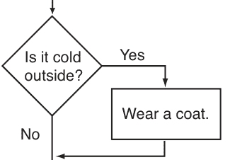

在流程图中，“穿外套”这一行动仅在外面冷时才执行。如果外面不冷，则跳过该行动。“穿外套”行动是条件执行的，因为它仅在存在特定条件（外面冷）时才执行。图 4-3 显示了一个更详细的流程图，其中三个行动仅在外面冷时被采取。

### 图 4-3 三行动决策结构逻辑


在 Java 中编写决策结构的方法是使用 `if` 语句。以下是 `if` 语句的通用格式：

```java
if (BooleanExpression)
    statement;
```

**`if` 语句的工作方式**：括号内的 `BooleanExpression` 必须是一个布尔表达式。布尔表达式为真或假。如果布尔表达式为真，则执行语句。否则，跳过它。语句是条件执行的，因为它仅在表达式为真的情况下执行。

### 使用关系运算符创建条件

通常，`if` 语句测试的条件是用关系运算符形成的。关系运算符确定两个值之间是否存在特定关系。例如，大于运算符 (`>`) 判断一个值是否大于另一个。等于运算符 (`==`) 判断两个值是否相等。表 4-1 列出了所有的 Java 关系运算符。

### 表 4-1 关系运算符

| 关系运算符（优先级顺序） | 意义 |
|---|---|
| `>` | 大于 |
| `<` | 小于 |
| `>=` | 大于等于 |
| `<=` | 小于等于 |
| `==` | 等于 |
| `!=` | 不等于 |

所有的关系运算符都是二元的，这意味着它们使用两个操作数。以下是一个使用大于运算符的表达式示例：

```java
length > width
```

### 程序示例

```java
// 获取第一个分数。
System.out.print("Enter score #1: ");
score1 = keyboard.nextDouble();

// 获取第二个分数。
System.out.print("Enter score #2: ");
score2 = keyboard.nextDouble();

// 获取第三个分数。
System.out.print("Enter score #3: ");
score3 = keyboard.nextDouble();

// 计算并显示平均分。
average = (score1 + score2 + score3) / 3.0;
System.out.println("The average is " + average);

// 如果平均分大于 95，祝贺用户。
if (average > 95)
    System.out.println("That's a great score!");
```

**程序输出（示例输入加粗）**

```
此程序计算 3 个测试成绩的平均值。
输入分数 #1: 82 [Enter]
输入分数 #2: 76 [Enter]
输入分数 #3: 91 [Enter]
平均分是 83.0
```

```
此程序计算 3 个测试成绩的平均值。
输入分数 #1: 97 [Enter]
输入分数 #2: 94 [Enter]
输入分数 #3: 100 [Enter]
平均分是 97.0
这个分数很高！
```

第 40 行和第 41 行的语句导致祝贺信息的打印。

```java
if (average > 95)
    System.out.println("That's a great score!");
```

### 图 4-4 if 语句的逻辑

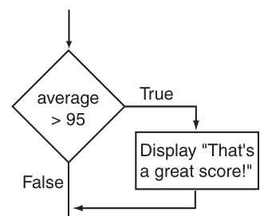

### 表 4-3 if 语句的其他示例

| 语句 | 结果 |
| --- | --- |
| `if (hours > 40) overtime = true;` | 如果 `hours` 大于 40，则将布尔变量 `overtime` 赋值为 `true`。 |
| `if (value < 32) System.out.println("Invalid number");` | 如果 `value` 小于 32，显示消息 "Invalid number"。 |

### 编程风格与 if 语句

尽管 `if` 语句使用了多行代码，但它实际上是一条很长的语句。例如，以下语句除了写法风格外，是完全相同的：

```java
if (average > 95)
    System.out.println("That's a great score!");

if (average > 95) System.out.println("That's a great score!");
```


在这两个示例中，编译器都将该语句和条件执行的语句视为整体，并在末尾正确地放置了分号。缩进和间距是为了程序的类阅读者，而不是为了编译器的。在编写 `if` 语句时，你应该采用以下两个重要的风格规则：

- 条件执行的语句应该出现在 `if` 语句的下一行。
- 条件执行的语句应该比 `if` 语句缩进一级。

## 第 4 章 决策结构

在大多数编辑器中，每当你按下 `tab` 键，你都会缩进一级。通过缩进条件执行的语句，你使其在视觉上脱颖而出。这样你可以一眼看出 `if` 语句执行了程序的哪部分。这是编写 `if` 语句的标准写法，也是你应该使用的方法。

## 注意分号

你不需要在语句的 `if (BooleanExpression)` 部分之后放置分号，如图 4-5 所示。这是因为在没有跟其条件执行的语句的情况下，该语句是不完整的。

## 图 4-5 勿用分号提前终止 if 语句

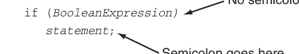

如果你用分号提前终止了 `if` 语句，编译器不会显示错误信息，但会假设你是在那里放置了一个空语句（null statement）。空语句是一个不执行任何操作的空语句，它将成为条件执行的语句。你打算条件条件执行的语句将与 `if` 语句断开，并始终执行。

例如，看以下代码：

```java
int x = 0, y = 10;

// 以下 if 语句被分号

// 提前终止了。

if (x > y); // is greater than x + y);

    System.out.println("message is " + "greater than 10");
```

这段代码将始终显示消息 "0 is greater than 10"。因为代码中的语句被分号提前终止了。由于 `println` 语句没有与 `if` 连接，它将始终执行。

## 具有多个条件执行的语句

之前的 `if` 语句示例是条件地执行单个语句。`if` 语句也可以条件地执行一组语句，只要它们被括在一组大括号中。在大括号内包含一组语句会创建一个语句块（block）。有一个示例：

```java
if (sales > 50000)
{
    bonus = 500.0;
    commissionRate = 0.12;
}
```

如果 `sales > 50000`，大括号内的语句将执行。如果省略了大括号，将执行第一条语句。

## 图 4-6 缺少大括号的 if 语句

如果 `sales > 50000`，大括号内的语句将执行。如果省略了大括号，将执行第一条语句。

## 标志（Flags）

标志是一个赋值为 `true` 或 `false` 的布尔变量。你会在很多情况下发现标志的使用。例如，假设标志用于判断是否满足条件。当标志被设置为 `true` 时，意味着条件存在。

## 比较字符

你可以使用关系运算符来测试字符数据以及数字。例如，使用 `==` 运算符比较 `myList`：

```java
char myList = 'A';

if (myLetter == 'A')
    System.out.println("That is A.");
```

`!=` 运算符也可以用于字符来测试不等性。例如，该代码判断 `myList` 是否不等于 `'A'`。

```java
if (myLetter != 'A')
    System.out.println("That is not.");
```

你还可以使用 `<`、`>` 和 `<=` 运算符比较字符。计算机内存并不存储字符 A、B、C 等。它们存储的是表示字符的数字。回顾第 2 章，Java 使用 Unicode，这是一个表示所有字符的数字集。当字符存储在内存中时，存储的是 Unicode 数字。当指示计算机在屏幕上打印该值时，它显示的是该代码对应的字符。

在 Unicode 中，大写字母在小写字母之前，因此 `'A'` 的数字代码 (65) 小于 `'B'` (97)。此外，空格字符（代码 32）位于所有字母之前。在以下语句中，表达式 `'A' < 'B'` 为真。

```java
if ('A' < 'B') {
   System.out.println("A is less than B");
}
```

- 4.1 当 y 等于 20 时，编写一条语句将 x 赋值零。
- 4.2 将 paysrate 乘以 1.5。
- 4.3 如果 sales 大于或等于 10000，将 commission 赋值为 0.2。
- 4.4 如果布尔变量为真，将变量 fees 赋值为 50。
- 4.5 如果 x 大于 10，将变量 y 赋值为 20 并将变量 z 赋值为 40。
- 4.6 如果 a 小于 10，将变量 b 赋值为 0 并将变量 c 赋值为 1。
- 4.7 如果变量 myCharacter 包含字符 'D'编写一条语句显示 "Goodbye"。

## if-else 语句

概念：`if-else` 语句会在其布尔表达式为真时执行一组语句，或者在为假时执行另一组语句。

## 4.2 if-else 语句

`if-else` 语句是 `if` 语句的扩展。以下是它的通用格式：

```
if (Expression)
    statement or block
else
    statement or block
```

会对语句或布尔表达式求值。如果表达式为真（`true`），则执行语句或语句块。如果表达式为假（`false`），则执行另一组语句。代码列表 4-2 中的程序使用了 `if-else` 语句来处理一个经典的编程问题：除以零。除以零在数学上是不可能的，在 Java 中它会导致运行时发生错误。

# 代码列表 4-2 (Division.java)

```java
import java.util.Scanner; // 需要 Scanner 类

/**

 * 此程序演示了 if-else 语句。

 * */

public class Division
{
    public static void main(String[] args)
    {
        int number1, number2; // 两个数字
        double quotient; // 两个数的商

        // 创建一个 Scanner 对象以读取输入。
        Scanner keyboard = new Scanner(System.in);

        // 从用户处获取两个数字。
        System.out.print("Enter an integer: ");
        number1 = keyboard.nextInt();
        System.out.print("Enter another integer: ");
        number2 = keyboard.nextInt();

        // 判断是否会发生除以零。
        if (number2 == 0)
        {
            // 错误 - 除以零。
            System.out.println("Division by zero is not possible.");
            System.out.println("Please run the program again and ");
        }
        else
        {
            System.out.println("enter a number other than zero.");
        }

        // 执行除法并显示商。
        quotient = (double)number1 / number2;
        System.out.print("The quotient of " + number1);
        System.out.println(" is " + quotient);
    }
}
```

# 程序输出（示例输入加粗）

Enter an integer: 10 [Enter]
Enter another integer: 0 [Enter]
Division by zero is not possible.
Please run the program again and
enter another other than zero.

# 程序输出（示例输入加粗）

Enter an integer: 10 [Enter]
Enter another integer: 5 [Enter]
The quotient of 10 divided by 5 is 2.0

> 在执行除法之前会测试 `number2` 的值。如果用户输入了 0，则执行由 `if` 子句控制的语句块，显示一条指示程序无法执行除以零的消息。否则，由 `else` 子句接管控制，将 `number1` 除以 `number2` 并显示结果。图 4-7 显示了 `if-else` 语句的逻辑。

# 图 4-7 if-else 语句的逻辑

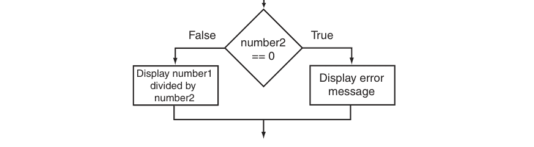

## 检查点

- 4.8 写一个 `if-else` 语句，如果变量 x 大于 100，则给变量 y 赋值 20。否则，应给变量 y 赋值 0。
- 4.9 写一个 `if-else` 语句，当 y 等于 100 时，给 x 赋值 1。否则应给 x 赋值 0。

## 4.3 Payroll 类

- 4.10 写一个 `if-else` 语句，除非销售额大于或等于 50000.0，否则给佣金赋值 0.1；在那种情况下，给佣金赋值 0.2。
- 4.11 写一个 `if-else` 语句，如果 a 小于 10，则给变量 b 赋值 0 并给变量 c 赋值 1。否则，应给变量 b 赋值 -99 并给变量 c 赋值 0。

在本节中，我们将研究一个确定员工总工资的 `Payroll` 类。总工资的计算方法是时长乘以时薪。如果工作超过超过 40 小时，该类还具有计算加班的能力。对于超过 40 小时的所有小时，员工赚取其标准时薪的 1.5 倍。图 4-8 显示了 `Payroll` 类的 UML 图。

# 图 4-8 Payroll 类的 UML 图

| Payroll |
| :--- |
| - hoursWorked : double |
| - payRate : double |
| + Payroll() |
| + setHoursWorked(hours : double) void |
| + setPayRate(rate : double) : void |
| + getHoursWorked() : double |
| + getPayRate() : double |
| + getGrossPay() : double |

以下是类字段的总结。

- `hoursWorked` 是一个 `double` 类型，存储员工工作的小时。
- `payRate` 是一个 `double` 类型，存储员工的小时薪率。

以下是类方法的总结。

- 构造函数将字段初始化为 0.0。
- `setHoursWorked` 是一个变变器方法（mutator method），接受一个参数并将参数的值存储在 `hoursWorked` 字段中。
- `setPayRate` 是一个变变器方法，接受一个参数并将参数的值存储在 `payRate` 字段中。
- `getHoursWorked` 是一个访问器方法（accessor method），返回 `hoursWorked` 字段中的值。
- `getPayRate` 是一个访问器方法，返回 `payRate` 字段中的值。
- `getGrossPay` 是一个访问器方法，返回员工的总工资。总工资的。如果工作超过 40 小时，该类会计算加班工资。代码列表 4-3 显示了 `Payroll` 类的逻辑。总工资的计算方法是时长乘以时薪。如果工作超过 40 小时，该类还具有计算加班的能力。对于超过 40 小时的所有小时，员工赚取其标准时薪的 1.5 倍。图 4-8 显示了 `Payroll` 类的 UML 图。

# 代码列表 4-3 (Payroll.java)

```java
import java.util.Scanner; // 需要 Scanner 类

/**

 * 此程序使用 Payroll 类来计算员工的总工资。

 */

class Payroll {
    private double hoursWorked; // 工作
    private double payRate;     // 时率

    /**

     * 构造函数将字段初始化为 0.0。

     */

    public Payroll() {
        hoursWorked = 0.0;
        payRate = 0.0;
    }

    /**

     * setHoursWorked 方法接受一个参数并将参数的值存储在 hoursWorked 字段中。

     */

    public void setHoursWorked(double hours) {
        hoursWorked = hours;
    }

    /**

     * setPayRate 方法接受一个参数并将参数的值存储在 payRate 字段中。

     */

    public void setPayRate(double rate) {
        payRate = rate;
    }

    /**

     * getHoursWorked 方法返回 hoursWorked 字段中的值。

     */

    public double getHoursWorked() {
        return hoursWorked;
    }

    /**

     * getPayRate 方法返回 payRate 字段中的值。

     */

    public double getPayRate() {
        return payRate;
    }

    /**

     * getGrossPay 方法返回员工的总工资。如果工作超过 40 小时，该类会计算加班工资。

     */

    public double getGrossPay() {
        double grossPay;

        if (hoursWorked > 40) {
            // 计算前 40 小时的工资。
            grossPay = 40 * payRate;
            // 按时薪的 1.5 倍计算加班工资。
            double overtimePay = (hoursWorked - 40) * (payRate * 1.5);
            grossPay += overtimePay;
        } else {
            // 没有加班工资。
            grossPay = payRate * hoursWorked;
        }

        return grossPay;
    }
}
```

# 代码列表 4-4 (GrossPay.java)

```java
import java.util.Scanner; // 需要 Scanner 类

/**

 * 此程序使用 Payroll 类来计算员工的总工资。

 */

public class GrossPay
{
    public static void main(String[] args)
    {
        double hours,    // 用于存储工作时长
        rate;         // 用于存储时薪

        // 创建一个 Scanner 对象以读取输入。
        Scanner keyboard = new Scanner(System.in);

        // 创建一个 Payroll 对象。
        Payroll employee = new Payroll();

        // 获取工作的小时数。
        System.out.print("How many hours did the employee work? ");
        hours = keyboard.nextDouble();

        // 获取时薪。
        System.out.print("What is the employee's hourly pay rate? ");
        rate = keyboard.nextDouble();

        // 存储数据。
        employee.setHoursWorked(hours);
        employee.setPayRate(rate);

        // 显示总工资。
        System.out.println("The employee's gross pay is $" + employee.getGrossPay());
    }
}
```


# 程序输出（示例输入已加粗显示）

员工工作了多少小时？50 [回车]
员工的小时薪资率是多少？10 [回车]
员工的毛收入为 $550.0。

## 4.4 嵌套 if 语句

概念：若要测试多个条件，可以将一个 `if` 语句嵌套在另一个语句内部。

有时，一个 `if` 语句必须嵌套在另一个语句内部。例如，考虑一个银行程序，用于判断银行客户是否符合获得特殊利率贷款的条件。要符合条件，必须满足两个条件：(1) 客户薪水至少为 $50,000，且 (2) 客户目前的职位必须至少满 2 年。图 4-9 显示了用于此类程序的算法流程图。

图 4-9 嵌套 if 语句的逻辑

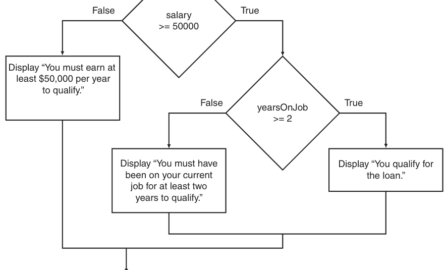

## 第 4 章 决策结构

如果我们遵循流程图中的执行流，可以看到测试了表达式 `salary >= 50000`。如果该表达式为假，则无需进行进一步测试；我们知道客户不符合特殊利率的条件。然而，如果表达式为真，我们需要测试第二个条件。这是通过嵌套决策结构实现的，该结构测试表达式 `yearsJob >= 2`。如果该表达式为真，客户符合特殊利率条件。如果该表达式为假，客户则不符合。代码列表 4-5 显示了完整的程序。

### 代码列表 4-5 (LoanQualifier.java)

```java
import java.util.Scanner;

/**
 * 此程序演示了嵌套的 if 语句。
 */
public class LoanQualifier
{
    public static void main(String[] args)
    {
        double salary;          // 年薪
        double yearsJob;        // 在当前职位的年限

        // 创建一个 Scanner 对象用于键盘输入。
        Scanner keyboard = new Scanner(System.in);

        // 获取用户的年薪。
        System.out.print("Enter your annual salary: ");
        salary = keyboard.nextDouble();

        // 获取当前职位的年限。
        System.out.print("Enter the number of years: ");
        yearsJob = keyboard.nextDouble();

        // 判断用户是否符合贷款条件。
        if (salary >= 50000)
        {
            if (yearsJob >= 2)
            {
                System.out.println("You qualify for the loan.");
            }
            else
            {
                System.out.println("You must have been on your "
                    + "current job for at least "
                    + "two years to qualify.");
            }
        }
        else
        {
            System.out.println("You must earn at least "
                + "$50,000 per year to qualify.");
        }
    }
}
```

### 程序输出（示例输入已加粗显示）

Enter your annual salary: 55000.00 [回车]
Enter the number of years at your current job: 1 [回车]
You must have been on your current job for at least two years to qualify.

### 程序输出（示例输入已加粗显示）

Enter your annual salary: 25000.00 [回车]
Enter the number of years at your current job: 5 [回车]
You must earn at least $50,000 per year to qualify.

### 程序输出（示例输入已加粗显示）

Enter your annual salary: 55000.00 [回车]
Enter the number of years at your current job: 5 [回车]
You qualify for the loan.

第一个语句（从第 27 行开始）有条件地执行第二个语句（从第 29 行开始）。程序执行第二个 `if` 语句的唯一方式是 `salary` 变量包含一个大于或等于 50,000 的值。在这种情况下，第二个语句测试 `yearsOnJob` 变量。如果它包含一个大于或等于 2 的值，程序将显示一条消息，告知用户其符合贷款条件。

需要注意的是，此程序中 `if` 语句中使用的大括号不是必须的。语句可以写如下：

```java
if (salary >= 50000)
    if (yearsOnJob >= 2)
        System.out.println("You qualify for the loan.");
    else
        System.out.println("You must have been on your "
          + "current job for at least "
          + "two years to qualify.");
else
    System.out.println("You must earn at least "
      + "$50,000 per year to qualify.");
```

大括号不仅让语句更容易读，还有助于调试代码。在调试带有嵌套 `if-else` 语句的程序时，确定 `else` 子句属于哪个 `if` 子句非常重要。匹配 `else` 子句与 `if` 子句的规则是：`else` 子句与其最近的且还没有自己的 `else` 子句的子句匹配。当 `if` 语句正确缩进时，这一点很容易看出，如图 4-10 所示。

图 4-10 if 和 else 子句的对齐有助于识别哪个 `else` 子句属于哪个 `if` 子句。

```java
if (salary >= 50000)
    if (yearsOnJob >= 2)
        System.out.println("You qualify for the loan.");
    else
        System.out.println("You must have been on your "
          + "current job for at least "
          + "two years to qualify.");
else
    System.out.println("You must earn at least "
      + "$50,000 per year to qualify.");
```

## 测试一系列条件

在以前的示例中，你看到了嵌套 `if` 语句如何测试多个条件。通常有一系列条件需要检查。例如，考虑一个银行程序，用于判断银行客户是否符合获得特殊利率贷款的条件。要符合条件，必须满足两个条件：(1) 客户薪水至少为 $50,000，且 (2) 客户目前的职位必须至少满 2 年。图 4-9 显示了用于此类程序的算法流程图。

第一个语句（从第 27 行开始）有条件地执行第二个语句（从第 29 行开始）。程序执行第二个 `if` 语句的唯一方式是 `salary` 变量包含一个大于或等于 50,000 的值。在这种情况下，第二个语句测试 `yearsOnJob` 变量。如果它包含一个大于或等于 2 的值，程序将显示一条消息，告知用户其符合贷款条件。

## 多决策结构

假设一位教授使用以下评分标准：

| 测试分数 | 成绩 |
| --- | --- |
| 低于 60 | F |
| 60–69 | D |
| 70–79 | C |
| 80–89 | B |
| 90 及以上 | A |

### 代码列表 4-6 (TestGrade.java)

```java
public class TestGrade
{
    private int score; // 测试分数

    /**
     * 构造函数接受测试分数作为参数。
     */
    public TestGrade(int s)
    {
        score = s;
    }

    /**
     * getScore 方法返回测试分数。
     */
    public int getScore()
    {
        return score;
    }

    /**
     * getLetterGrade 方法根据测试分数返回
     * 字母等级。
     */
    public char getLetterGrade()
    {
        char grade;

        if (score < 60)
        {
            grade = 'F';
        }
        else if (score < 70)
        {
            grade = 'D';
        }
        else if (score < 80)
        {
            grade = 'C';
        }
        else if (score < 90)
        {
            grade = 'B';
        }
        else
        {
            grade = 'A';
        }

        return grade;
    }
}
```

### 代码列表 4-7 (TestResults.java)

```java
import java.util.Scanner; // 需要 Scanner 类

/**
 * 此程序使用 TestGrade 类来根据数值型测试分数
 * 确定字母等级。
 */
public class TestResults
{
    public static void main(String[] args)
    {
        int testScore; // 用于存储测试分数
        char letterGrade; // 用于存储字母等级

        // 创建一个 Scanner 对象来读取输入。
        Scanner keyboard = new Scanner(System.in);

        // 获取数值分数。
        System.out.print("请输入你的数值型测试分数和 \n" + "我将告诉你等级:");
        testScore = keyboard.nextInt();

        // 使用数值分数创建一个 TestGrade 对象。
        TestGrade test = new TestGrade(testScore);

        // 获取字母等级。
        letterGrade = test.getLetterGrade();

        // 显示等级。
        System.out.print("你的等级是 " + test.getLetterGrade());
    }
}
```

以加粗显示示例输入的程序输出：
请输入你的数值型测试分数和我将告诉你等级：**80** [回车]
你的等级是 B

以加粗显示示例输入的程序输出：
请输入你的数值型测试分数和我将告诉你等级：**72** [回车]
你的等级是 C

## 4.5 if-else-if 语句

### 点

4.12 编写嵌套的 `if` 语句来执行以下测试：如果 `amount1` 大于 10 且 `amount2` 小于 100，则显示两个值中较大的一个。

4.13 编写代码测试变量 `x` 以确定其是否大于 0。如果 `x` 大于 20，代码应测试变量 `y` 以确定其是否小于 20。如果 `y` 小于 20，代码应将 1 赋值给变量 `z`。如果 `y` 不小于 20，代码应将 0 赋值给变量 `z`。

## 4.5 if-else-if 语句

概念：`if-else-if` 语句测试一系列条件。使用 `if-else-if` 语句测试一系列条件，通常比使用一组嵌套的 `else-if` 语句更简单。

尽管 `else-if` 类只是一个简单的示例（参见代码列表 4-6），但第 48 行到 76 行中嵌套决策结构的逻辑相当复杂。你也可以选择使用 `if-else-if` 语句来测试一系列条件。`if-else-if` 语句使得某些类型嵌套逻辑的编写变得更加简单。`if-else-if` 语句的通用格式如下：

```java
if (expression_1) {
    statement
    statement
    etc.
}
else if (expression_2) {
    statement
    statement
    etc.
}
else {
    statement
    statement
    etc.
}
```


## 第 4 章 决策结构

### 代码列表 4-7 (TestResults.java)

根据需要插入尽可能多的 `else-if` 子句。

当语句执行时，`expression_1` 为真，则执行紧随其后的语句块，结构的其余部分被忽略。然而，如果 `expression_i` 为假，程序将跳转到下一个 `else if` 子句并测试 `expression_2`。如果为真，则执行紧随其后的语句块，然后忽略结构的其余部分。此过程从底部继续，直到发现其中一个表达式为真。如果没有任何表达式为真，则最后一个 `else` 子句将接管，并执行紧随其后的语句块。

后面没有跟 `if` 语句的最后一个 `else` 子句被称为“尾随 else”（trailing else）。尾随 else 是可选的，但在大多数情况下你都会使用它。

> 注意：通用格式包围了每个条件执行的语句块。与 `if` 语句的其他形式一样，只有当条件执行执行多条语句时才需要大括号。

```java
32  */
33  public int getScore()
34  {
35      return score;
36  }
37  
38  /**
40   * getLetterGrade 方法根据测试分数
41   * grade for the test score. 返回字母等级。
42   */
43  
44  public char getLetterGrade()
45  {
46      char grade;
47  
48      if (score < 60)
49      {
50          grade = 'F';
51      }
52      else
53      {
54          if (score < 70)
55          {
56              grade = 'D';
57          }
58      else
59      {
60          if (score < 80)
61          {
62              grade = 'C';
63          }
64        else
65        {
66            if (score < 90)
67            {
68                grade = 'B';
69            }
70          else
71          {
72              grade = 'A';
73          }
74        }
75      }
76  
77      return grade;
78  }
79}
```


```java
import java.util.Scanner; // 需要 Scanner 类

/**
 * 此程序使用 TestGrade 类来根据数值型测试分数
 * 确定字母等级。
 */
public class TestResults
{
    public static void main(String[] args)
    {
        int testScore; // 用于存储测试分数
        char letterGrade; // 用于存储字母等级

        // 创建一个 Scanner 对象来读取输入。
        Scanner keyboard = new Scanner(System.in);

        // 获取数值分数。
        System.out.print("请输入你的数值型测试分数和 \n" + "我将告诉你等级:");
        testScore = keyboard.nextInt();

        // 使用数值分数创建一个 TestGrade 对象。
        TestGrade test = new TestGrade(testScore);

        // 获取字母等级。
        letterGrade = test.getLetterGrade();

        // 显示等级。
        System.out.print("你的等级是 " + test.getLetterGrade());
    }
}
```

以加粗显示示例输入的程序输出：

请输入你的数值型测试分数和我将告诉你等级：**80** [回车]

你的等级是 B

以加粗显示示例输入的程序输出：

请输入你的数值型测试分数和我将告诉你等级：**72** [回车]

你的等级是 C

## 4.5 if-else-if 语句

### 检查

4.12 编写嵌套的 `if` 语句来执行以下测试：如果 `amount1` 大于 10 且 `amount2` 小于 100，则显示两个值中较大的一个。

4.13 编写代码测试变量 `x` 以确定其是否大于 0。如果 `x` 大于 20，代码应测试变量 `y` 以确定其是否小于 20。如果 `y` 小于 20，代码应将 1 赋值给变量 `z`。如果 `y` 不小于 20，代码应将 0 赋值给变量 `z`。

## 4.5 if-else-if 语句

概念：`if-else-if` 语句测试一系列条件。使用 `if-else-if` 语句测试一系列条件，通常比使用一组嵌套的 `else-if` 语句更简单。

尽管 `else-if` 类只是一个简单的示例（参见代码列表 4-6），但第 48 行到 76 行中嵌套决策结构的逻辑相当复杂。你也可以选择使用 `if-else-if` 语句来测试一系列条件。`if-else-if` 语句使得某些类型嵌套逻辑的编写变得更加简单。`if-else-if` 语句的通用格式如下：

```java
if (expression_1) {
    statement
    statement
    etc.
}
else if (expression_2) {
    statement
    statement
    etc.
}
else {
    statement
    statement
    etc.
}
```

根据需要插入尽可能多的 `else-if` 子句。

当语句执行时，`expression_1` 为真，则执行紧随其后的语句块，结构的其余部分被忽略。然而，如果 `expression_i` 为假，程序将跳转到下一个 `else if` 子句并测试 `expression_2`。如果为真，则执行紧随其后的语句块，然后忽略结构的其余部分。此过程从底部继续，直到发现其中一个表达式为真。如果没有任何表达式为真，则最后一个 `else` 子句将接管，并执行紧随其后的语句块。

后面没有跟 `if` 语句的最后一个 `else` 子句被称为尾随 `else`（`trailing else`）。尾随 `else` 是可选的，但在大多数情况下你都会使用它。

> 注意：通用格式包围了每个条件执行的语句块。与 `if` 语句的其他形式一样，只有当条件执行执行多条语句时才需要大括号。

### 代码列表 4-8 (TestGrade)

代码列表 4-8 展示了 `if-else-if` 语句。`TestGrade` 类。

```java
if (score < 60)
    grade = 'F';
else if (score < 70)
    grade = 'D';
else if (score < 80)
    grade = 'C';
else if (score < 90)
    grade = 'B';
else
    grade = 'A';
```

`TestGrade` 类展示了 `if-else-if` 语句。

让我们分析 `if-else-if` 语句在 48-57 行是如何工作的。首先，测试 48 行中的表达式 `score < 60`：

```java
if (score < 60)
    grade = 'F';
else if (score < 70)
    grade = 'D';
else if (score < 80)
    grade = 'C';
else if (score < 90)
    grade = 'B';
else
    grade = 'A';
```

如果 `score` 小于 60，`grade` 变量将被赋值为 `'F'`，并且 `if-else` 语句的其余部分被忽略。如果 `score` 不小于 60，则 50 行的 `else` 子句将接管，并导致执行下一条语句：

```java
if (score < 60)
    grade = 'F';
else if (score < 70) 
    grade = 'D';
else if (score < 80)
    grade = 'C';
else if (score < 90)
    grade = 'B';
else
    grade = 'A';
```

第一个语句处理了所有小于 60 的分数，因此当该语句执行时，`score` 的值将是 60 或更大。如果 `score` 小于 70，`grade` 变量将被赋值为 `'D'`，并且 `if-else` 语句的其余部分被忽略。这种链式评估持续，直到发现其中一个表达式为真或执行语句末尾的子句。注意 `if-else` 语句的对齐和缩进：起始 `if`、`else` 子句以及尾随 `else` 子句全部对齐，条件执行的语句则缩进。

## if-else-if 语句与嵌套决策结构的比较

### 检查

4.14 以下程序将显示什么？

```java
public class CheckPoint
{
    public static void main(String[] args)
    {
        int funny = 7, serious = 15;
        funny = serious % 2;
        if (funny != 1) {
            funny = 0;
            serious = 0;
        } else if (funny == 2) {
            funny = 10;
            serious = 10;
        } else {
            funny = 1;
            serious = 1;
        }
        System.out.println(funny + " " + serious);
    }
}
```

4.15 下面程序用于书店，以确定客户可以获得多少优惠券。完成程序后出现的表格。

```java
import java.util.Scanner;
public class CheckPoint {
    public static void main(String[] args) {
        int books, coupons;

        Scanner keyboard = new Scanner(System.in);
        System.out.println("How many books are being purchased?");
        books = keyboard.nextInt();

        if (books < 1) {
            coupons = 0;
        } else if (books < 3) {
            coupons = 1;
        } else if (books < 5) {
            coupons = 2;
        } else {
            coupons = 3;
        }

        System.out.println("Number of coupons: " + coupons);
    }
}
```

如果客户购买了这些书籍 . . . 将获得相应的优惠券。

| 书籍 | 优惠券 |
|---|---|
| 1 | 0 |
| 2 | 1 |
| 3 | 2 |
| 4 | 2 |
| 5 | 3 |
| 10 | 3 |

## 4.6 逻辑运算符

概念：逻辑运算符将两个或多个关系表达式连接成一个，或者反转表达式的逻辑。

Java 提供了两个二元逻辑运算符 `&&` 和 `||`，用于将布尔表达式组合成单个表达式。它还提供一元运算符 `!`，用于反转布尔表达式的真值。表 4-4 描述了这些逻辑运算符。

### 表 4-4 逻辑运算符

| 运算符 | 含义 | 效果 |
|---|---|---|
| `&&` | 与 (AND) | 将两个布尔表达式连接成一个。只有当两个表达式都为真时，整个表达式才为真。 |
| `||` | 或 (OR) | 将两个布尔表达式连接成一个。其中一个或两个表达式为真，整体即为真。只需要其中一个为真即可，具体哪一个并不重要。 |
| `!` | 非 (NOT) | 反转布尔表达式的真值。如果它应用于一个为真的表达式，运算符返回假。如果它应用于一个为假的表达式，运算符返回真。 |

### 表 4-5 使用逻辑运算符的布尔表达式

| 表达式 | 含义 |
|---|---|
| `x > y && a < b` | `x` 是否大于 `y` 且 `a` 小于 `b`？ |
| `x == y || x == z` | `x` 是否等于 `y` 或等于 `z`？ |
| `!(x > y)` | 表达式 `x > y` 是否不为真？ |

让我们仔细观察这些运算符中的每一个。

### && 运算符

`&&` 运算符被称为逻辑“与”运算符。它接受两个布尔表达式作为操作数，并创建一个仅当两个子表达式都为真时才为真的布尔表达式。这里是一个使用 `&&` 运算符的 `if` 语句示例：

```java
if (temperature < 20 && minutes > 12)
{
    System.out.println("The temperature is in the "
    + "danger zone.");
}
```

在该语句中，两个布尔表达式 `temperature < 20` 和 `minutes > 12` 被组合为一个表达式。只有当 `temperature` 小于 20 且 `minutes` 大于 12 时，才会显示消息。如果任何一个布尔表达式为假，整个表达式为假，消息就不会显示。

### 表 4-6 && 运算符的真值表

| 表达式 | 结果值 |
|---|---|
| `true && false` | `false` |
| `false && true` | `false` |
| `false && false` | `false` |
| `true && true` | `true` |

如表所示，只有两个子表达式都为真，`&&` 运算符才会返回真值。该运算符执行短路求值。其工作原理如下：如果 `&&` 运算符左侧的表达式为假，则右侧的表达式将不会被检查。因为只要一个子表达式为假，整个表达式为假，检查剩余的表达式将浪费 CPU 时间。因此，当 `&&` 运算符发现其左侧表达式为假时，它会短路且不再评估右侧的表达式。

该运算符可以简化原本需要嵌套 `if` 语句的程序。代码列表 4-9 显示了另一个贷款资格程序。这个程序使用了该运算符。

### 代码列表 4-9 (LogicalAnd.java)

```java
import java.util.Scanner; // 需要 Scanner 类
/**
 * 此程序演示了逻辑 && 运算符。
 */
public class LogicalAnd
{
    public static void main(String[] args) {
        double salary; // 年薪
        double yearsOnJob; // 当前工作年限

        // 创建用于键盘输入的 Scanner 对象。
        Scanner keyboard = new Scanner(System.in);

        // 获取用户的年薪。
        System.out.print("Enter annual salary: ");
        salary = keyboard.nextDouble();

        // 获取当前工作年限。
        System.out.print("Enter the number of years at current job: ");
        yearsOnJob = keyboard.nextDouble();

        // 判断用户是否符合贷款资格。
        if (salary >= 5000 && yearsOnJob >= 2) {
            System.out.println("You qualify for the loan.");
        } else {
            System.out.println("You do not qualify.");
        }
    }
}
```

### ! 运算符

`!` 运算符执行逻辑非（NOT）操作。它是一个一元运算符，接受布尔表达式作为操作数并反转其逻辑值。换句话说，如果表达式为真，`!` 运算符返回假；如果表达式为假，它则返回真。以下是一个使用 `!` 运算符的 `if` 语句：

```java
if (!(temperature > 100)) {
    System.out.println("This is below the maximum temperature.");
}
```

首先，测试表达式 `(temperature > 100)`，其结果为真或假其中之一。然后，对该值应用 `!` 运算符。如果表达式 `(temperature > 100)` 为真，`!` 运算符返回假。如果表达式 `(temperature > 100)` 为假，`!` 运算符返回真。之前的代码等同于询问：“温度是否不大于 100？”。

### 表 4-8 ! 运算符的真值表

| 表达式 | 结果值 |
|---|---|
| `!true` | `false` |
| `!false` | `true` |

## 逻辑运算符的优先级和结合性

与其他运算符一样，逻辑运算符也有优先级和结合性。表 4-9 显示了逻辑运算符的优先级，从高到低排序。

### 表 4-9 按优先级排序的逻辑运算符

| 优先级 | 运算符 |
|---|---|
| 1 | `!` |
| 2 | `&&` |
| 3 | `||` |

`!` 运算符的优先级高于 Java 的许多其他运算符。当你打算将 `!` 运算符应用于变量或不包含其他运算符的简单表达式时，应该始终将其操作数括在括号中。例如，考虑以下表达式（假设 `x` 是一个存储了值的 `int` 型变量）：

```java
!(x > 2)
!x > 2
```

第一个表达式将 `!` 运算符应用于表达式 `x > 2`。它在询问“`x` 是否不大于 2？”。然而，第二个表达式尝试仅对 `x` 应用 `!` 运算符。它在询问“大于 2 的逻辑补码（逻辑取反）是什么吗？”。因为 `!` 运算符只能应用于布尔表达式，此语句将导致编译错误。

`&&` 和 `||` 运算符的优先级低于关系运算符，因此较少发生优先级问题。但是，如果你不确定，始终使用括号也无大碍。

```java
(a > b) && (x < y)    等同于    a > b && x < y
(x == y) || (b > a)    等同于    x == y || b > a
```

逻辑运算符从左到右评估表达式。在下面的表达式中，`a < b` 在 `y == z` 之前被评估。

```java
a < b || y == z
```

在下面的表达式中，`y == z` 先被评估，因为 `&&` 运算符的优先级高于 `||`。

```java
a < b || y == z && m > j
```

该表达式等同于：

```java
(a < b) || ((y == z) && (m > j))
```

### 表 4-10 到此为止讨论的所有运算符的优先级

| 优先级 | 运算符 | 描述 |
|---|---|---|
| 1 | `-` `!` | 一元否定，逻辑非 |
| 2 | `*` `/` `%` | 乘法、除法、取模 |
| 3 | `+` `-` | 加法、减法 |


| 4 | < >= <= >= | 小于、大于、小于等于、大于等于 |
| 5 | == != | 等于、不等于 |
| 6 | && | 逻辑与 (AND) |
| 7 | || | 逻辑或 (OR) |
| 8 | = += *= /= &= | 赋值和复合赋值 |

## 使用逻辑运算符检查数值范围

有时，你需要编写代码来确定一个数值是否在特定的范围内或在特定范围之外。在判断数字是否在范围内时，最好使用 `&&` 运算符。例如，以下语句检查 `x` 的值以确定它是否在 20 到 40 的范围内：

```java
if (x >= 20 && x <= 40)
    System.out.println(x + " is in the acceptable range.");
```

## 4.6 逻辑运算符

`if` 语句中的布尔表达式只有在 `x` 大于等于 20 且小于等于 40 时才为真。`x` 中的值必须在 20 到 40 的范围内，该表达式为真。

在判断一个数字是否在范围之外时，使用 `||` 运算符是最好的。以下语句判断 `x` 是否在 20 到 40 的范围之外：

```java
if (x < 20 || x > 40)
  System.out.println(x + " is outside the acceptable range.");
```

不要混淆这些逻辑运算符的逻辑是非常重要的。例如，`if` 语句中的布尔表达式永远不会测试为真：

```java
if (x < 20 && x > 40)
  System.out.println(x + " is outside the acceptable range.");
```

显然，`x` 不可能既小于 20 同时又大于 40。

## 检查点

- 4.16 下面的真值表显示了由逻辑运算符连接的 `true` 和 `false` 值的各种组合。通过指明此类组合的结果来完成表格。

| 逻辑表达式 | 结果 (true 或 false) |
|---|---|
| `true && true` | |
| `true && false` | |
| `false && true` | |
| `false && false` | |
| `true || true` | |
| `true || false` | |
| `false || true` | |
| `false || false` | |

- 4.17 假设 `a = true`, `b = false`, `c = true`。通过指明此类组合的结果来完成表格。

| 逻辑表达式 | 结果 (true 或 false) |
|---|---|
| `a && b` | |
| `a && c` | |
| `b && a` | |
| `b && c` | |
| `a || b` | |
| `a || c` | |
| `b || a` | |
| `b || c` | |

- 4.18 写一个 `if` 语句，如果 `x` 在 20 到 40 的范围内，打印“The number is valid”。
- 4.19 写一个 `if` 语句，如果 `x` 在 20 到 40 的范围之外，打印“The number is not valid”。

# 第4章 决策结构

要判断两个字符串是否不等，只需将 `!` 运算符作用于 `equals` 方法的返回值即可。这里是一个示例：

```java
if (!name.equals("Mark"))
```

该语句中的布尔表达式执行了不等于操作。它确定了由 `name` 引用的对象是否等于 "Mark"。

`String` 类还提供了 `compareTo` 方法，可以用于确定一个字符串大于、等于或小于另一个字符串。该方法的通用形式为：

```
Reference.compareTo(otherString)
```

`Reference` 是一个引用 `String` 对象的变量，而 `otherString` 是另一个引用 `String` 对象的变量或字符串字面量。该方法返回一个整数，可以如下方式使用：

- 如果方法的返回值为负，则 `Reference` 引用的字符串（调用对象）小于 `otherArgument`。
- 如果方法的返回值为 0，则两个字符串相等。
- 如果方法的返回值为正，则 `StringReference` 引用的字符串（调用对象）大于 `otherArgument`。

例如，假设 `name1` 和 `name2` 是引用 `String` 对象的变量。以下语句使用 `compareTo` 方法来比较字符串。

```java
if (name1.compareTo(name2) == 0)
    System.out.println("The names are the same.");
```

此外，以下表达式比较了 `name1` 引用的字符串与字符串字面量 "Joe"。

```java
if (name1.compareTo("Joe") == 0)
    System.out.println("The names are the same.");
```

代码列表 4-12 中的程序完整演示了 `compareTo` 方法。

# 代码列表 4-12 (StringCompare.java)

```java
1 import java.util.Scanner; // 需要 Scanner
2
3 /**
4 * 此程序使用 compareTo 方法比较
 * 两个 String 对象。
6 */
7
8 public class StringCompare
9 {
10 public static void main(String[] args)
11 {
12 String name, name2; // 用于存储两个名字
13
// 创建 Scanner 对象以读取输入。
Scanner keyboard = new Scanner(System.in);

// 获取一个名字。
System.out.print("Enter a name: ");
name = keyboard.nextLine();

// 获取另一个名字。
System.out.print("Enter another name: ");
name2 = keyboard.nextLine();

// 比较名字。
if (name.compareTo(name2) < 0) {
    System.out.println(name + " is less than " + name2);
} else if (name.compareTo(name2) == 0) {
    System.out.println(name + " is equal to " + name2);
} else if (name.compareTo(name2) > 0) {
    System.out.println(name + " is greater than " + name2);
}
```

**程序输出（示例输入已加粗显示）**

Enter a name: **Mary [Enter]**

Enter another name: **Mark [Enter]**

Mary is greater than Mark

让我们仔细观察这个程序。当你使用 `compareTo` 方法比较两个字符串时，字符串是逐个字符进行比较的。这通常被称为字典序比较。程序使用 `compareTo` 方法比较 "Mary" 和 "Mark"，从第一个（或最左侧）字符开始。这如图 4-13 所示。

**图 4-13** "Mary" 和 "Mark" 的字符串比较

| M | a | r | y |
|---|---|---|---|
| M | a | r | k |

比较过程如下：

1. 将 "Mary" 中的 "M" 与 "Mark" 中的 "M" 进行比较。由于它们是相同的，因此比较下一个字符。
2. 将 "Mary" 中的 "a" 与 "Mark" 中的 "a" 进行比较。由于它们是相同的，因此比较下一个字符。
3. 将 "Mary" 中的 "r" 与 "Mark" 中的 "r" 进行比较。由于它们并不相同，因此比较下一个字符。
4. 将 "Mary" 中的 "y" 与 "Mark" 中的 "k" 进行比较。由于它们并不相同，`StringReference` 引用的字符串（调用对象）大于 `otherArgument`。

# 忽略字符串大小写

`equals` 和 `compareTo` 方法是区分大小写的，这意味着大写字母与其对应的小写字母不同。`String` 类提供了 `equals` 和 `compareToIgnoreCase` 方法。这些方法的作用与 `equals` 和 `compareTo` 方法相似，只是忽略了大小写。例如，代码列表 4-13 中的程序允许用户...

## 4.9 条件运算符（可选）

**概念：** 你可以使用条件运算符来创建类似于 `if-else` 语句的短路表达式。

*条件运算符*非常强大且独特。因为它接受三个操作数，因此被认为是一个三元运算符。条件运算符提供了一种表示简单 `if-else` 语句的简写方法。条件运算符由问号（`?`）和冒号（`:`）组成。你按照以下格式使用条件运算符编写条件表达式：

```
BooleanExpression ? Value : Value2;
```

`BooleanExpression`（布尔表达式）类似于 `if` 语句括号中的布尔表达式。如果 `BooleanExpression` 为真（`true`），则条件表达式的值即为 `Value`。否则，条件表达式的值为 `Value2`。这里有一个使用条件运算符的状态使用示例：

```
y = x < 0 ? 10 : 20;
```

上述语句执行的操作与以下 `if-else` 语句执行的操作相同：

```
if (x < 0)
    y = 10;
else
    y = 20;
```

条件运算符让你能够将决策能力封装在简洁的一行中。只需一点想象力，它可以应用于许多其他编程问题。例如，考虑以下语句：

```
System.out.println("Your grade is: " + (score < 60 ? "Fail." : "Pass."));
```

如果转换为 `if-else` 语句，它的写法将如下：

```
if (score < 60)
    System.out.println("Your grade is: Fail.");
else
    System.out.println("Your grade is: Pass.");
```

> **注意：** 括号放在条件表达式周围是因为 `+` 的优先级高于 `?:` 运算符。如果没有括号，`+` 将将 `score` 中的值与字符串 "Your grade is: " 拼接在一起。

## 检查点

4.23 将以下 `if-else` 语句重写为条件表达式。

- a. `if (x > y) z = 1; else z = 20;`
- b. `if (temp > 45) population = base * 10; else population = base * 2;`
- c. `if (hours > 40) wages *= 1.5; else wages *= 1;`
- d. `if (result >= 0) System.out.println("The result is positive."); else System.out.println("The result is negative.")`

## 4.10 switch 语句

> 概念：`switch` 语句允许变量或表达式的值决定程序分支到何处。

`switch` 语句是一种多分支选择决策结构。它允许你测试变量或表达式的值，然后利用该值来决定执行哪条语句或一组语句。图 4-14 显示了多分支选择决策结构在流程中的外观。

**图 4-14** 多分支选择决策结构

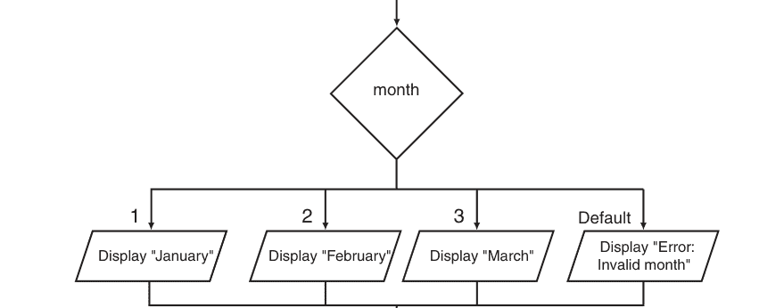

在流程图中，菱形符号表示 `month`，这是一个变量名。如果 `month` 变量包含值 1，程序显示 January（一月）。如果 `month` 变量包含值 2，程序显示 February（二月）。如果 `month` 变量包含值 3，程序显示 March（三月）。如果 `month` 变量不包含这些值之一，则执行标记为 Default（默认）的操作。在这种情况下，程序显示 Error: Invalid month（错误：无效月份）。

以下是 Java 中 `switch` 语句的通用格式：

`testExpression` 是一个变量或表达式。

```
switch (testExpression) {
  case value_1:
    statement;
    statement;
    etc.
    break;
}
```

如果 `testExpression` 等于 `value_1`，则执行这些语句。

```
  case value_2:
  statement;
  statement;
  etc.
  break;
}
```

如果 `testExpression` 等于 `value_2`，则执行这些语句。

根据需要插入尽可能多个 case。

```
  case value_N:
  statement;
  statement;
  etc.
  break;
}
```

如果 `testExpression` 等于 `value_N`，则执行这些语句。

```
  default:
  statement;
  statement;
  etc.
  break;
}
```

如果 `testExpression` 不等于任何一个 case 值，则执行这些语句。

语句的第一行以 `switch` 关键字开头，后面跟着一个括在括号内的 `testExpression`。`testExpression` 是一个产生 `char`、`byte`、`short`、`int` 或 `string` 的变量或表达式。（如果你使用的是 Java 7 之前的版本，`testExpression` 不能是字符串。）

下一行是一个用大括号括起来的代码块。代码块内部包含一个或多个 case。每个 case 部分以一个值开始，后面跟着冒号。每个 case 包含一个或多个语句，直到 `break` 语句。在所有 case 之后，会出现可选的 default 部分。

当 `switch` 语句执行时，它会将 `testExpression` 与各个值进行比较。当找到匹配的 case 时，程序进入该 case。`break` 语句跳出 `switch` 语句。

> 注意：case 值必须是唯一的。

例如，以下代码的操作与流程图 4-14 相同。假设 `month` 是一个 `int`。

```java
switch (month)
{
    case 1:
        System.out.println("January");
        break;
    case 2:
        System.out.println("February");
        break;
    case 3:
        System.out.println("March");
        break;
    default:
        System.out.println("Error: Invalid month");
        break;
}
```

`switch` 语句可以作为 `if-else` 语句的替代：

```java
if (month == 1)
{
    System.out.println("January")
}
else if (month == 2)
{
    System.out.println("February")
}
else if (month == 3)
{
    System.out.println("March")
}
else
{
    System.out.println("Error: Invalid month")
}
```

> 注意：default 部分是可选的。但是，如果你省略它，当 `testExpression` 不匹配任何 case 值时，程序将无处去。代码列表 4-15 中的程序展示了简单的 `switch` 语句是如何工作的。

# 代码列表 4-15 (SwitchDemo.java)


```java
import java.util.Scanner;    // 需要 Scanner 类
/**
 * 此程序演示了 switch 语句。
 */
public class SwitchDemo
{
    public static void main(String[] args)
    {
        String input; // 用于存储输入
        char choice; // 用于存储用户的选择

        // 创建 Scanner 对象以读取输入。
        Scanner scanner = new Scanner(System.in);

        // 询问用户输入 A、B 或 C。
        System.out.println("Enter A, B, or C: ");
        input = scanner.nextLine();
        choice = input.charAt(0); // 获取第一个字符

        // 确定用户输入的哪个字符。
        switch (choice)
        {
            case 'A':
                System.out.println("You entered A.");
                break;
            case 'B':
                System.out.println("You entered B.");
                break;
        }
    }
}
```

## 第 4 章 决策结构

```java
31 case 'C':
32 System.out.println("You entered C")
33 break;
34 default:
35 System.out.println("That's not A, B, or C!")
36 
37 }
```

# 程序输出（示例输入已加粗）

Enter A, B, or C: **B** [Enter]

You entered B.

# 程序输出（示例输入已加粗）

Enter A, B, or C: **F** [Enter]

That's not A, B, or C!

出现在第 27、30 和 33 行的 `break` 语句。`case` 语句显示了程序从块中的何处开始执行，而 `break` 语句显示了程序在何处停止。如果没有 `break` 语句，程序将执行从匹配的 `case` 语句到块结束的所有代码行。

> 注意：`default` 部分（或如果没有 default，则为最后一个 case 部分）不需要 `break` 语句。某些程序员为了一致性，习惯在任何地方都放置一个。

代码列表 4-16 中的程序是代码列表 4-15 的修改版本，去掉了 `break` 语句。

# 代码列表 4-16 (NoBreaks.java)

```java
1 import java.util.Scanner; // 需要 Scanner 类
2 
3 /**
4 * 此程序演示了没有任何 break 语句的
 * switch 语句。
6 */
7 
8 public class NoBreaks
9 {
10 public static void main(String[] args)
11 {
12 String input; // 用于存放输入
13 char choice; // 用于存储用户的选择
14 
15 创建一个 Scanner 对象来读取输入。
16 Scanner keyboard = new Scanner(System.in);
17 要求用户输入 A、B 或 C。
18 System.out.println("Enter A, B, or C: ");
19 input = keyboard.nextLine();
20 choice = input.charAt(0); // 获取第一个字符
21
22 确定用户输入了哪个字符。
23 switch (choice) 
24 {
25 case 'A':
26 System.out.println("You entered A.");
27
28 case 'B':
29 System.out.println("You entered B.");
30
31 case 'C':
32 default:
33 System.out.println("That's not A, B, or C!")
34 }
35 }
36 }
```

# 程序输出（示例输入已加粗）

Enter A, B, or C: **A** [Enter]

You entered A.

You entered B.

You entered C.

That's not A, B, or C!

# 程序输出（示例输入已加粗）

Enter A, B, or C: **C** [Enter]

You entered C.

That's not A, B, or C!

如果没有 `break` 语句，程序会“贯穿”执行所有匹配 `case` 表达式的语句下方的所有语句。有时这正是你想要的。例如，代码列表 4-17 中的程序要求用户选择宠物食品的等级。可选有 A、B 和 C。`switch` 语句可以识别大写或小写字母。

# 代码列表 4-17 (PetFood.java)

```java
1 import java.util.Scanner; // 需要 Scanner 类
2
3 /**
4 * 此程序演示了 switch 语句。
5 */
6
7 public class PetFood
8 {
9 public static void main(String[] args)
10 {
11 String input; // 用于存放输入
12 char feedGrade; // 用于存放食品等级
13 创建一个 Scanner 对象来读取输入。
14 Scanner keyboard = new Scanner(System.in);
15 获取所需的宠物食品等级。
16 System.out.println("Our pet food is available in \n" + " three grades:");
17 System.out.println("A, B, and C. Which do you want \n" + " pricing for?");
18 input = keyboard.nextLine();
19 feedGrade = input.charAt(0); // 获取第一个字符。
20 确定输入的等级。
21 switch(feedGrade)
22 {
23 case 'a':
24 case 'A':
25 System.out.println("30 cents per lb.");
26 break;
27 case 'b':
28 case 'B':
29 System.out.println("20 cents per lb.");
30 break;
31 case 'c':
32 case 'C':
33 System.out.println("15 cents per lb.");
34 break;
35 default:
36 System.out.println("Invalid choice.")
37 }
38 }
```

# 程序输出（示例输入已加粗）

Our dog food is available in three grades:

A, B, and C. Which do you want pricing for? **b** [Enter]

20 cents per lb.

# 程序输出（示例输入已加粗）

Our dog food is available in three grades:

A, B, and C. Which do you want pricing for? **B** [Enter]

20 cents per lb.

## 4.10 switch 语句

当用户输入 'a' 时，对应的 case 没有没有语句，因此程序会执行到下一个 `case`，即 'A'：

```java
case 'a':
case 'A':
System.out.println("30 cents per lb.")
break;
```

相同的技术也用于 'b' 和 'c'。在 Java 7 之前的版本中，`switch` 表达式可以是 char、short 或 int。从 Java 7 开始，表达式可以是 string。代码列表 4-18 中的程序就演示了这一点。

# 代码列表 4-18 (Seasons.java)

```java
import java.util.Scanner;

/**
 * 此程序将英语季节名称翻译成西班牙语。
 */
public class Seasons
{
    public static void main(String[] args)
    {
        String input;
        // 为输入创建一个 Scanner 对象。
        Scanner keyboard = new Scanner(System.in);

        // 从用户处获取季节。
        System.out.println("Enter the name of a season: ");
        input = keyboard.nextLine();

        // 翻译成西班牙语。
        switch (input)
        {
            case "spring":
                System.out.println("la primavera");
                break;
            case "summer":
                System.out.println("el verano");
                break;
            case "autumn":
            case "fall":
                System.out.println("el otoño");
                break;
            case "winter":
                System.out.println("el invierno");
                break;
            System.out.println("Please enter one of these words:\n"
                + "spring, summer, autumn, or winter.")
        }
    }
}
```

# 程序输出（示例输入已加粗）

Enter the name of a season: **summer** [Enter]

el verano

# 程序输出（示例输入已加粗）

Enter the name of a season: **fall** [Enter]

el otoño

# Checkpoint

通过编写 switch 语句来完成程序框架：当用户输入 1 时显示 "one"，输入 2 时显示 "two"，输入 3 时显示 "three"。输入的不是 1、2 或 3，程序应显示错误消息。

```java
import java.util.Scanner;
public class Checkpoint {
    public static void main(String[] args) {
        int userName;

        Scanner keyboard = new Scanner(System.in);
        System.out.print("Enter one of the numbers " +
                         "1, 2, or 3: ");
        userName = keyboard.nextInt();
        // 在此处编写 switch 语句。
        //
    }
}
```

4.25 将 if-else-if 语句重写为 switch 语句。

```java
if (selection == 'A')
    System.out.println("You selected A.");
else if (selection == 'B')
    System.out.println("You selected B.");
```

```java
else if (selection == 'C')
System.out.println("You selected C.")
else if (selection == 'D')
System.out.println("You selected D.")
else
System.out.println("Not good with letters, eh?")
```

4.26 解释为什么不能将 if-else 语句转换为 switch 语句。

```java
if (temp == 100)
x = 0;
else if (population > 1000)
x = 1;
else if (rate < .1)
x = -1;
```

4.27 下面的 switch 语句有什么问题？

```java
// 此代码有错误!!
switch(temp)
{
    case temp < 0:
        System.out.println("Temp is negative.")
        break;
    case temp == 0:
        System.out.println("Temp is zero.")
        break;
    case temp > 0:
        System.out.println("Temp is positive.")
        break;
}
```

4.28 下面的代码将显示什么？

```java
int funny = 7, serious = 15;
funny = serious * 2;
switch(funny)
{
    case 0:
        System.out.println("That is funny.")
        break;
    case 30:
        System.out.println("That is serious.")
        break;
    case 32:
        System.out.println("That is seriously funny.")
        break;
    default:
        System.out.println(funny);
}
```

## 4.11 使用 DecimalFormat 类格式化数字

> 概念：DecimalFormat 类用于格式化保留指定小数位数的浮点数。

在第 2 章中，你学习了如何使用 `System.out.printf` 方法格式化控制台输出。如果你想在图形界面（如消息框）中显示格式化输出，你需要不同的方法。在本节中，我们将讨论 `DecimalFormat` 类，它可以格式化无论是在控制台还是消息框中显示的数字。

`DecimalFormat` 类是 Java API 的一部分，但它不会自动供程序使用。要使用 `DecimalFormat` 类，你必须在程序中包含以下导入语句：

```java
import java.text.DecimalFormat;
```

该语句使类对你的程序可用。然后，在程序需要格式化数字的地方，创建一个 `DecimalFormat` 对象。例如：

```java
DecimalFormat formatter = new DecimalFormat("#0.00");
```

该语句创建了 `DecimalFormat` 类的一个实例。语句执行后，`formatter` 变量将引用该对象。注意传递给构造函数的字符串中的字符。`#` 字符表示如果该位置有数字，则显示它；如果该位置没有数字，则不显示数字。`0` 字符也表示如果该位置有数字，则显示它；然而，如果该位置没有数字，则应该显示 0。此外，注意小数点后有两个零。这表示数字应该被保留到两位小数。

要使用 `DecimalFormat` 对象格式化数字，可以调用它的方法并将要格式化的数字作为参数传递。（你可以向该方法传递浮点值或整数值。）该方法返回一个包含格式化数字的字符串。例如，查看代码列表 4-19 中的程序。

# 代码列表 4-19 (Format1.java)

```java
import javax.swing.JOptionPane;
import java.text.DecimalFormat;
/**
* 此程序使用 DecimalFormat 类在消息框中显示
* 格式化的数字。
 */
public class Format1
```


```java
10 {
11     public static void main(String[] args)
12     {
13         double number1 = 0.1666666666666667;
14         double number2 = 1.6666666666666667;
15         double number3 = 16.666666666666666;
16         double number4 = 166.66666666666666;
17
18
19
20         // 创建一个 DecimalFormat 对象。
21         DecimalFormat formatter = new DecimalFormat("#0.00");
22
23
24         // 显示格式化后的变量内容。
25         JOptionPane.showMessageDialog(null, formatter.format(number1));
26         JOptionPane.showMessageDialog(null, formatter.format(number2));
27         JOptionPane.showMessageDialog(null, formatter.format(number3));
28         JOptionPane.showMessageDialog(null, formatter.format(number4));
29     }
30 }
```

### 图 4-15 代码列表 4-19 的输出

这是由第 22 行的语句输出的。

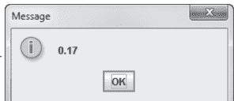

这是由第 23 行的语句输出的。

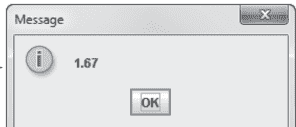

这是由第 24 行的语句输出的。

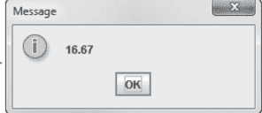

这是由第 25 行的语句输出的。

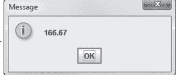

## 第 4 章 决策结构

注意格式化模式中 `#` 字符和 `0` 字符输出之间的细微区别：

- 如果数字在格式化模式中 `#` 字符的位置包含数字，则将显示该数字。否则，不显示任何数字。
- 如果数字在格式化模式中 `0` 字符的位置包含数字，则将显示该数字。否则，将显示 `0`。

例如，查看代码列表 4-20 中的程序。该程序与代码列表 4-19 显示的程序相同，但使用了不同的格式化模式。程序的输出如图 4-16 所示。

```java
1  import javax.swing.JOptionPane;
2  import java.text.DecimalFormat;
3  /*
4   * **
5   * 此程序使用 DecimalFormat 类在消息对话框中
6   * 显示格式化后的数字。
7   */
8  
9  public static void main(String[] args)
10 {
11   
12     double number1 = 0.16666666666666667;
13     double number2 = 1.6666666666666667;
14     double number3 = 16.666666666666666;
15     double number4 = 166.66666666666666;
16

17
18
19     // 创建一个 DecimalFormat 对象。
20     DecimalFormat formatter = new DecimalFormat("00.00");
21

22
23     // 显示格式化后的变量内容。
24     JOptionPane.showMessageDialog(null, formatter.format(number1));
25     JOptionPane.showMessageDialog(null, formatter.format(number2));
26     JOptionPane.showMessageDialog(null, formatter.format(number3));
27     JOptionPane.showMessageDialog(null, formatter.format(number4));
28 }
29 }
```

代码列表 4-20 (Format2.java)

## 4.11 使用 DecimalFormat 类格式化数字

### 图 4-16 代码列表 4-20 的输出

这是由第 22 行的语句输出的。

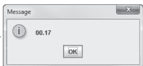

这是由第 23 行的语句输出的。

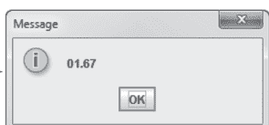

这是由第 24 行的语句输出的。


这是由第 25 行的语句输出的。

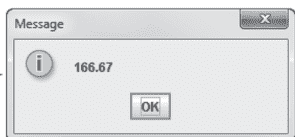

你可以在格式化模式中插入逗号，以便在格式化数字中创建分组分隔符。代码列表 4-21 中的程序演示了这一点。程序的输出如图 4-17 所示。

### 代码列表 4-21 (Format3.java)

```java
1  import javax.swing.JOptionPane;
2  import java.text.DecimalFormat;
3  
4  /**
5  * 此程序使用 DecimalFormat 类在消息对话框中
6  * 显示格式化后的数字。
7  */
8  
9  public class Format3
10 {
11  public static void main(String[] args)
12  {
13     double number1 = 0.16666666666666667;
14     double number2 = 1.6666666666666667;
15     double number3 = 16.666666666666666;
16     double number4 = 166.66666666666666;
17
double number5 = 166.66666666666666;
18

19     // 创建一个 DecimalFormat 对象。
20     DecimalFormat formatter = new DecimalFormat("###.00");
21

22     // 显示格式化后的变量内容。
23     JOptionPane.showMessageDialog(null, formatter.format(number1));
24     JOptionPane.showMessageDialog(null, formatter.format(number2));
25     JOptionPane.showMessageDialog(null, formatter.format(number3));
26     JOptionPane.showMessageDialog(null, formatter.format(number4));
27     JOptionPane.showMessageDialog(null, formatter.format(number5));
28 }
```

### 图 4-17 代码列表 4-21 的输出

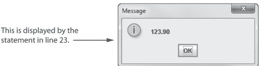

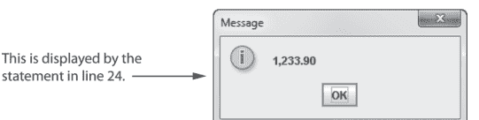

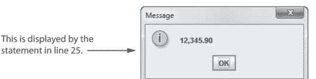

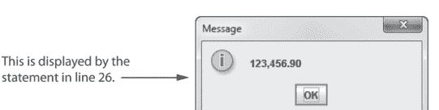

你可以通过在格式化模式末尾写入 `%` 字符来将数字格式化为百分比。这将数字乘以 100 并在最后附加 `%` 字符。代码列表 4-22 演示了这一点。程序的输出如图 4-18 所示。

### 代码列表 4-22 (Format4.java)

```java
1  import javax.swing.JOptionPane;
2  import java.text.DecimalFormat;
3  
4  /**
5  * 此程序使用 DecimalFormat 类在消息对话框中
6  * 显示格式化后的数字。
7  */
8  
9  public class Format4
10 {
11  public static void main(String[] args)
12  {
13     double number1 = 0.12;
14     double number2 = 0.05;
15

16     // 创建一个 DecimalFormat 对象。
17     DecimalFormat formatter = new DecimalFormat("#0.%");
18

19     // 显示格式化后的变量内容。
20     JOptionPane.showMessageDialog(null, formatter.format(number1));
21     JOptionPane.showMessageDialog(null, formatter.format(number2));
22  }
23 }
```

### 图 4-18 代码列表 4-22 的输出

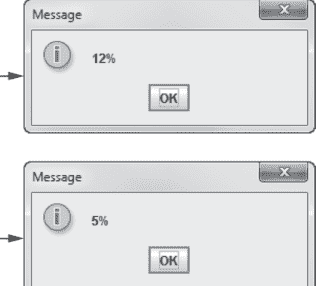

这是由第 20 行的语句输出的。

这是由第 21 行的语句输出的。

**Checkpoint**

4.29 假设数字变量 `number` 的值为 459.632。你会使用什么格式化模式通过 `DecimalFormat` 类将数字显示为 00459.63？

4.30 假设数字变量 `number` 的值为 0.17。你会使用什么格式化模式通过 `DecimalFormat` 类将数字显示为 .18？

4.31 假设数字变量 `number` 的值为 7634869.1。你会使用什么格式化模式通过 `DecimalFormat` 类将数字显示为 7,634,869.10？

## 4.12 关注问题解决：SalesCommission 类

在本节中，我们将检查一个实现了本章所讨论的许多主题的案例。此外，我们讨论如何将一个长的算法分解为多个方法。

Hal 的家庭电脑城是个人电脑的零售商。Hal 的员工完全根据佣金工作。每个月底，根据表 4-11 计算每位销售人员的佣金。

### 图 4-19 SalesCommission 类的 UML 图

```
SalesCommission
- sales : double
- rate : double
- commission : double
- advance : double
- pay : double
+ SalesCommission(s: double, a: double)
- setRate(): void
- calculatePay(): void
+ getPay(): double
+ getCommission(): double
+ getRate(): double
+ getAdvance(): double
+ getSales(): double
```

### 表 4-12 SalesCommission 类字段

| 字段 | 描述 |
| --- | --- |
| sales | 一个用于存储销售人员每月总销售额的 `double` 变量。 |
| rate | 一个用于存储销售人员佣金率的 `double` 变量。 |
| commission | 一个用于存储佣金金额的 `double` 变量。 |
| advance | 一个用于存储销售人员已提取预付金额的 `double` 变量。 |
| pay | 一个用于存储销售人员总薪水金额的 `double` 变量。 |

### 表 4-13 SalesCommission 类方法

| 方法 | 描述 |
| --- | --- |
| 构造函数 | 构造函数接受两个参数：销售人员完成的销售额和销售人员提取的预付金额。该方法将这些值赋值给 `sales` 和 `advance` 字段，然后调用 `calculatePay()` 方法。 |
| setRate() | 私有方法，根据销售人员完成的销售额设置佣金率。该方法由 `calculatePay()` 方法调用。 |
| calculatePay() | 私有方法，用于计算销售人员的佣金和实际工资。该方法由构造函数调用。 |
| getPay() | 以 `double` 类型返回应付销售人员的总薪水，即佣金金额减去预付金额。 |
| getCommission() | 以 `double` 类型返回销售人员赚取的佣金金额。 |
| getRate() | 以 `double` 类型返回销售人员完成销售额对应的佣金率。 |
| getAdvance() | 以 `double` 类型返回销售人员提取的预付金额。 |
| getSales() | 以 `double` 类型返回销售人员完成的销售额金额。 |

### 代码列表 4-23 (SalesCommission.java)

```java
1 /**
2 * 此类根据销售额计算销售人员的
3 * 总工资。
4 */
5 public class SalesCommission
6 {
7 private double sales, // 每月销售额
8 rate, // 佣金率
9 commission, // 佣金金额
10 advance, // 预付工资
11 pay; // 应付金额
12

13
14 /**
15 * 构造函数使用两个参数来接收
16 * 参数：s 和 a。s 中的值被赋值给
17 * sales 字段，a 中的值被赋值给
18 * 预付工资。调用了 calculatePay() 方法。
19 */
20
21 public SalesCommission(double s, double a)
22 {
23 sales = s;
24 advance = a;
25 calculatePay();
26 }
27

28 /**
29 * setRate() 方法根据销售额设置
30 * 佣金率。该方法是从 calculatePay() 方法
31 * 调用的。
32 */
33 private void setRate() {
34     if (sales < 10000)
35         rate = 0.05;
36     else if (sales < 15000)
37         rate = 0.1;
38     else if (sales < 18000)
39         rate = 0.12;
40     else if (sales < 22000)
41         rate = 0.14;
42     else
43         rate = 0.16;
44 }

45 /**
46 * calculatePay() 方法计算销售人员的
47 * 佣金和实际工资金额。
48 */
49 private void calculatePay() {
50     setRate();
51     commission = sales * rate;
52     pay = commission - advance;
53 }

54 /**
55 * getPay() 方法返回 pay 字段。
56 */
57 public double getPay() {
58     return pay;
59 }

60 /**
61 * getCommission() 方法返回 commission 字段。
62 */
63 public double getCommission() {
64     return commission;
65 }

66 /**
67 * getRate() 方法返回 rate 字段。
68 */
69 public double getRate() {
70     return rate;
71 }

72 /**
73 * getAdvance() 方法返回 advance 字段。
74 */
75 public double getAdvance() {
76     return advance;
77 }

78 /**
79 * getSales() 方法返回 sales 字段。
80 */
81 public double getSales() {
82     return sales;
83 }
84 }
```

### 私有方法与算法分解

注意该类有两个私有方法：`setRate()` 和 `calculatePay()`。当一个方法被声明为私有时，它只能从同一类的其他方法中调用。小型类将包含内部处理必需的方法，但对类外部代码没有用。在 `SalesCommission` 类中，`setRate()` 和 `calculatePay()` 方法被声明为私有。分解算法通常意味着将其拆分为几个方法，每个方法执行特定的任务。例如，查看 `SalesCommission` 构造函数，它出现在第 22 到 27 行。将算法分解为多个小块比一个长方法更易于阅读和调试。这些方法（构造函数、`setRate()` 和 `calculatePay()`）构成了整个算法。构造函数看起来如下：

## 4.13 使用 Random 类生成随机数

> 概念：随机数用于许多应用程序。Java 提供了 `Random` 类，你可以使用它来生成随机数。

随机数对许多不同的编程任务都有用。以下是几个示例：


- 随机数常用于游戏，因为计算机游戏允许玩家掷骰子，使用随机数来表示骰子的值。显示从洗过的牌组中抽牌的程序使用随机数来表示牌面的点数。

- 随机数在模拟程序中非常有用。在某些模拟中，计算机必须随机决定人、动物、昆虫或其他生物的行为。可以构建公式，其中使用随机数来确定程序中发生的各种动作和事件。

- 随机数对于必须随机选择数据进行分析的统计程序非常有用。

- 随机数常用于计算机安全中的敏感数据加密。

Java API 提供了一个名为 `Random` 的类，你可以用它生成随机数。该类是 `java.util` 包的一部分，因此任何使用它的程序都需要一个 `import` 语句，例如：

```java
import java.util.Random;
```

你使用如下语句从 `Random` 类创建一个对象：

```java
RandomNumbers = new Random();
```

该语句执行了以下操作：

- 它声明了一个名为 `RandomNumbers` 的变量。数据类型是 `Random` 类。

- 表达式 `new Random()` 创建了 `Random` 类的一个实例。

- 等号将 `Random` 类的地址分配给 `RandomNumbers` 变量。

在该语句执行后，`RandomNumbers` 变量引用了一个 `Random` 对象。一旦你创建了 `Random` 对象，就可以调用它的 `nextInt` 方法来获取一个随机整数。接下来的代码显示了一个示例：

```java
// 声明一个 int 变量。
int number;
```

```java
// 创建一个 Random 对象。
RandomNumbers = new Random();
```

```java
// 获取一个随机整数并将其赋值给 number。
number = randomNumbers.nextInt();
```

在该代码执行后，`number` 变量包含一个随机整数。如果你像本示例所示不带参数地调用 `nextInt` 方法，返回的整数将位于 –2,147,483,648 和 +2,147,483,647 之间。或者，你可以传递一个参数来指定生成数范围的上限。在下面的语句中，赋值给 `number` 的值位于 0 到 99 之间：

```java
number = randomNumbers.nextInt(100);
```

你可以通过加或减一个值来将数值范围向上或向下移动。在下面的语句中，我们调用 `nextInt` 方法来获取 0 到 9 范围内的随机数，然后对其加 1。赋值给 `number` 的值位于 1 到 10 的范围内：

```java
number = randomNumbers.nextInt(10) + 1;
```

下面的语句显示了另一个示例。它将一个 –50 到 +49 之间的随机整数赋值给 `number`：

```java
number = randomNumbers.nextInt(100) - 50;
```

`Random` 类还有其他用于生成随机数的方法，表 4-14 对它们进行了总结。

### 表 4-14 Random 类的一些方法

| 方法 | 说明 |
| :--- | :--- |
| `nextDouble()` | 返回作为 `double` 类型的随机数。该数字在 0.0 到 1.0 之间。 |
| `nextFloat()` | 返回作为 `float` 类型的随机数。该数字在 0.0 到 1.0 之间。 |
| `nextInt()` | 返回作为 `int` 类型的随机数。该数字在 `int` 的范围内，即 –2,147,483,648 到 +2,147,483,647 之间。 |
| `nextInt(int n)` | 此方法接受一个整数参数 `n`。它返回一个 `int` 类型的随机数。该数字在 0 且不包含 `n` 的范围内。 |
| `nextLong()` | 返回作为 `long` 类型的随机数。该数字在 `long` 的范围内，即 –9,223,372,036,854,775,808 到 +9,223,372,036,854,775,807 之间。 |

代码列表 4-25 中的程序演示了 `Random` 类的用法。

### 代码列表 4-25 (MathTutor.java)

```java
import java.util.Scanner; // 需要 Scanner 类
import java.util.Random; // 需要 Random 类

/**
 * 此程序演示了 Random 类。
 */
public class MathTutor {
    public static void main(String[] args) {
        int number1;          // 第一个数字
        int number2;          // 第二个数字
        int sum;              // 数字之和
        int userAnswer;      // 用户的答案

        // 为键盘创建一个 Scanner 对象。
        Scanner keyboard = new Scanner(System.in);

        // 创建一个 Random 对象。
        Random randomNumbers = new Random();

        // 获取两个随机数。
        int number1 = randomNumbers.nextInt(100);
        int number2 = randomNumbers.nextInt(100);

        // 显示一个加法题。
        System.out.println("What is the answer to " + number1 + " + " + number2 + " = ?");

        // 计算答案。
        sum = number1 + number2;

        // 获取用户的答案。
        userAnswer = keyboard.nextInt();

        // 显示结果。
        if (userAnswer == sum) {
            System.out.println("Correct!");
        } else {
            System.out.println("Sorry, the answer is " + sum);
        }
    }
}
```

**Program Output with Input:**

What is the answer to 52 + 19 = ?

Correct!

**Program Output with Input:**

What is the answer to 27 + 73 = ?

Sorry, the answer is 100

## 焦点：使用对象模拟骰子

骰子传统上有六面。然而，某些游戏使用不同面数的骰子。例如，角色扮演游戏《地下城城》使用 4、6、8、10 和 20 面骰子。

假设你正在编写一个需要处理不同面数骰子的程序。图 4-20 显示了该类的 UML 图，代码列表 4-26 显示了代码。

### 图 4-20 Die 类的 UML 图

| Die |
| :--- |
| - sides: int |
| - value: int |
| + Die(numSides : int) |
| + roll(): void |
| + getSides(): int |
| + getValue(): int |

### 代码列表 4-26 (Die.java)

```java
import java.util.Random;

/**
 * Die 类模拟指定面数的骰子。
 */
public class Die {
    private int sides;      // 面数
    private int value;      // 数

    /**
     * 构造函数执行骰子的初始化投掷。
     * 骰子的面数作为参数传递。
     */
    public Die(int numSides) {
        sides = numSides;
        roll();
    }

    /**
     * roll 方法模拟掷掷。
     */
    public void roll() {
        // 创建一个 Random 对象。
        Random rand = new Random();

        // 获取骰子的随机值。
        value = rand.nextInt(sides) + 1;
    }

    /**
     * getSides 方法返回骰子的面数。
     */
    public int getSides() {
        return sides;
    }

    /**
     * getValue 方法返回骰子的值。
     */
    public int getValue() {
        return value;
    }
}
```

让我们来看看该类的代码：

第 9 和 10 行：这些语句声明了两个字段。`sides` 字段存储骰子的面数，`value` 字段存储骰子投掷后的值。

第 18 到 22 行：这是构造函数。注意构造函数有一个关于面数的参数。第 20 行将参数赋值给 `sides` 字段。第 21 行调用了 `roll` 方法，该方法模拟了掷骰子。

第 29–36 行：这是 `roll` 方法，用于模拟掷骰子。在第 32 行创建了一个 `Random` 对象，并通过变量 `rand` 引用它。第 35 行使用该 `Random` 对象获取一个该特定骰子相应范围内的随机数。例如，如果 `sides` 设置为 6，表达式 `rand.nextInt(sides) + 1` 将返回一个 1 到 6 之间的随机整数。该随机数被赋值给 `value` 字段。

第 43–46 行：这是 `getSides` 方法，一个返回 `sides` 字段的访问器方法。

第 53–56 行：这是 `getValue` 方法，一个返回 `value` 字段的访问器方法。

代码 4-27 中的程序演示了这个类。它创建了该类的两个实例：一个是 6 面的，另一个是 12 面的。它模拟了掷骰子。

### 代码列表 4-27 (DiceDemo.java)

```java
/*
 * 此程序模拟掷骰子。
 */
public class DiceDemo {
    public static void main(String[] args) {
        final int DIE1_SIDES = 6; // 骰子 #1 的面数
        final int DIE2_SIDES = 12; // 骰子 #2 的面数

        // 创建 Die 类的两个实例。
        Die die1 = new Die(DIE1_SIDES);
        Die die2 = new Die(DIE2_SIDES);

        // 显示初始信息。
        System.out.println("This simulates the rolling of a " +
        DIE1_SIDES + " sided die and a " +
        DIE2_SIDES + " sided die.");

        // 掷骰子。
        System.out.println("Rolling the dice.");
        die1.roll();
        die2.roll();

        // 显示骰子的值。
        System.out.println(die1.getValue() + " " +
        die2.getValue());
    }
}
```

## 程序输出

这模拟了掷一个 6 面骰子和一个 12 面骰子的过程。

Rolling the dice.

```
5 10
```


## 4.14 应该避免的常见错误

让我们仔细观察一下程序：

第 9-10 行：

这些语句声明了两个常量 `DIE1_SIDES` 是第一个骰子的面数（6），`DIE2_SIDES` 是第二个骰子的面数（12）。

第 13-14 行：

这些语句创建了 `Die` 类的两个实例。注意 `DIE1_SIDES`（值为6）被传递给第 13 行的构造函数，而 `DIE2_SIDES`（值为12）被传递给第 14 行的构造函数。因此，`die1` 引用一个 6 面 `Die` 对象，`die2` 引用一个 12 面 `Die` 对象。

第 17–19 行：

该语句显示了关于程序的信息。

第 23–24 行：

这些语句调用 `Die` 对象的 `roll` 方法来模拟掷骰子。

第 27–28 行：

该语句显示了骰子的值。

### 应该避免的常见错误

- 下列表列出了在学习本章主题时经常犯的几种错误。

- 使用 `=` 代替 `==` 来比较基本数据类型的值。记住，`=` 是赋值运算符，而 `==` 用于测试相等性。

- 使用 `==` 代替 `equals` 方法来比较 `String` 对象与另一个对象的内容。你不能使用 `==` 运算符来调用 `equals` 或 `compareTo` 方法。

- 忘记给 `if` 语句的布尔值加上括号。Java 要求被 `if` 测试的布尔表达式必须包含在一对括号中。如果你省略了括号或使用任何其他分组字符，将导致错误。

- 在 `if` 子句末尾写了分号。当你在 `if` 子句末尾写分号时，Java 假设条件执行的语句是空语句（null statement）。

- 忘记用花括号包含多个条件执行的语句。通常 `if` 语句只执行一条语句。要条件地执行多条语句，必须将它们包含在花括号中。

- 在 `if-else` 语句末尾省略 `else` 不是语法错误，但可能导致逻辑错误。如果你省略了 `if-else` 语句末尾的 `else`，当没有任何表达式为真时，将没有任何代码执行。

- 在逻辑运算符 `||` 的两侧没有编写完整的布尔表达式。你必须在逻辑 `&&` 或 `||` 运算符的两侧都编写完整的布尔表达式。例如，表达式 `x > 0 && < 10` 是无效的，因为 `< 10` 不是完整的表达式。该表达式应该写成 `x > 0 && x < 10`。

- 尝试使用 `String` 类的 `equals` 和 `compareTo` 方法进行区分大小写的字符串比较。要进行忽略大小写的比较，请使用 `String` 类的 `equalsIgnoreCase` 和 `compareToIgnoreCase` 方法。

- 在 `switch` 语句中使用无效的 `testExpression`。`switch` 语句可以评估 `char`、`short` 或 `int`。

- 忘记在 `case` 语句末尾写冒号。冒号必须出现在 `case` 值之后。

- 忘记在 `switch` 语句中包含 `break` 语句。这不是语法错误，但可能导致逻辑错误。如果你省略了 `break` 语句，程序将继续执行随后的 `case`，直到到达 `switch` 的结束。

# 复习题

## 多选题和判断题

1. 该语句是 ___ 的示例：

   a. 顺序结构。

   b. 决策结构。

   c. 路径结构。

   d. 类结构。

2. 这种表达式的值为真或假。

   a. 布尔表达式

   b. 决策表达式

   c. 无条件表达式

   d. 表达式

3. 下列哪项是逻辑与运算符？

   a. `&&`

   b. `||`

   c. `=`

   d. `&`

4. 下列哪项优先级最高？

   a. `+`

   b. `!=`

   c. `=`

   d. `%`

5. 这是一个无所作为的空语句。

   a. 缺失语句

   b. 虚拟语句

   c. 空语句

   d. 条件语句

6. 要创建一个语句块，你将其包含在 ___ 中。

   a. 圆括号 `()`

   b. 中括号 `[]`

   c. 尖括号 `<>`

   d. 花括号 `{}`

7. ___ 是程序中存在的布尔变量。

   a. flag（标志位）

   b. signal（信号）

   c. sentinel（哨兵标记值）

   d. siren（警报器）

8. "A" 如何与 "B" 比较？

   a. "A" 大于 "B"

   b. "A" 小于 "B"

   c. "A" 等于 "B"

   d. 无法比较字符

9. 当 `string1` 小于 `string2` 时，该函数返回值为 ___。

   a. 负

   b. 正

   c. 零

   d. 空

10. `else` 子句总是与 ___ 关联。

    a. 最匹配的 `if` 语句。

    b. 编译器随机选择的 `if` 语句。

11. 当 `string1` 等于 `string2` 时，该函数返回值为 ___。

    a. 负

    b. 正

    c. 零

    d. 空

12. ___ 确定不同的 `String` 对象是否包含相同的字符串。

    a. `==` 运算符

    b. 运算符

    c. `equals` 方法

    d. `string` 方法

13. 条件运算符接收 ___ 个操作数。

    a. 一

    b. 二

    c. 三

    d. 四

14. 当没有值匹配 `testExpression` 时，`switch` 语句跳转到 ___。

    a. `else`

    b. `default`

    c. `case`


# 第 4 章 决策结构

## 对错题

15. 对错：`=` 运算符和 `==` 运算符执行相同的操作。

16. 对错：所有的关系运算符都是二元运算符。

17. 对错：`switch` 语句只检查相等性。

18. 对错：当语句嵌套在另一个语句的 `if` 子句中，只有当外部语句的布尔表达式为真时，内部语句才会执行。

19. 对错：当语句嵌套在另一个语句的 `else` 子句中，只有当外部语句的布尔表达式为真时，内部语句才会执行。

20. 对错：如果 `switch` 语句中没有 `default` 语句，则会产生语法错误。

## 找错

找出代码中的错误。

1. // 警告：此代码包含错误！

```java
if (x == 1);
    y = 2;
if (x == 2)
    y = 3;
else if (x == 3)
    y = 4;
```

2. // 警告：此代码包含错误！

```java
if (average == 100)
    System.out.println("Perfect Average!");
```

3. // 警告：此代码包含错误！

```java
if (num2 == 0)
    System.out.println("Division by zero is not possible.");
System.out.println("Please run the program again.");
System.out.println("enter a number besides zero.");
else
    Quotient = num1 / num2;
System.out.print("The quotient of " + Num1);
System.out.print(" divided by " + Num2 + " is ");
```

5. 下述语句判断 `x` 是否不大于 20。它哪里错了？

```java
if (1x > 20)
```

6. 下述语句应该判断 `count` 是否在 0 到 100 的范围内。它哪里错了？

```java
if (count >= 0 || count <= 10)
```

7. 下述语句应该判断 `char` 类型变量 `letter` 是否在 'A' 到 'F' 的范围内。它哪里错了？

```java
if (letter > 'a' && letter < 'f')
```

8. 下述语句应该在 `a` 小于 10 时给 `z` 赋值 0，否则给 `z` 赋值 7。它哪里错了？

```java
z = (a < 10) ? 0 : 7;
```

9. 假设 `partnerNumber` 是一个 `String` 对象。下述语句应该执行忽略大小写的比较。

```java
if (partnerNumber.equals("")) available = true;
```

# 算法练习

1. 写一个 `if` 语句检查 `x` 是否等于 `y`。

2. 写一个 `if-else` 语句，当 `y` 等于 10 时给 `x` 赋值 0。否则给 `x` 赋值 1。

3. 使用下表，写一个 `if` 语句，根据座位号为场馆座位分配类别：

| 座位号 | 类别 |
|---|---|
| 1 到 50 | 银级 |
| 51 到 100 | 金级 |
| 101 到 120 | 铂级 |

4. 写一个 `if` 语句，如果班次是 `"DAY"`，则将每小时工资设置为 150；如果班次是 `"NIGHT"`，则将其设置为 300。

5. 写嵌套的 `if` 语句来执行以下测试：如果 `amount1` 大于 10 且 `amount2` 小于 100，显示较大的值。

6. 写一个 `if` 语句，如果变量 `grade` 在 0 到 100 的范围内，打印“数字有效”。

7. 写一个 `if` 语句，如果变量 `temperature` 在 -50 到 150 的范围内，打印“数字有效”。

8. 写一个 `if` 语句，如果变量 `hours` 在 0 到 80 之外，打印“数字无效”。

9. 写一个 `if-else` 语句，按字母顺序显示对象 `title1` 和 `title2`。

10. 将下面的 `if-else-if` 语句转换为 `switch` 语句：

```java
if (choice == 1)
{
    System.out.println("You selected 1.");
} else if (choice == 2 || choice == 3)
{
    System.out.println("You selected 2 or 3.");
} else if (choice == 4)
{
    System.out.println("You selected 4.");
} else
{
    System.out.println("Select again please.");
}
```

11. 将条件表达式与执行相同操作的 `if-else-if` 语句匹配：

a. `q = x < y ? a + b : x * 2;`

b. `q = x < y ? x * 2 : a + b;`

c. `x < y ? q = 0 : q = 1;`

```java
if (x < y)
    q = 0;
else
    q = 1;
if (x < y)
    q = a + b;
else
    q = x * 2;
if (x < y)
    q = x * 2;
else
    q = a + b;
```

12. 假设 `double` 类型变量 `number` 的值为 0.0329。使用 `DecimalFormat` 类可以使用什么格式模式来显示 `00000.033`？

13. 假设 `double` 类型变量的值 5123.789。使用 `DecimalFormat` 类可以使用什么格式模式来显示 `5,123.79`？

14. 根据以下规则编写资费的语句：如果通话少于 100 分钟，资费应为 0.90。如果通话超过 100 分钟但少于 501 分钟，资费应为 0.60。否则资费应为 0.30。

## 简答

1. 解释“条件执行”一词的意思。

2. 解释为什么错误位置的分号会导致 `if` 语句运行不正确。

3. 为什么在大括号内的所有语句进行缩进是一个好建议？

4. 当使用 `==` 运算符比较两个字符串时会发生什么？

5. 解释标志变量（`flag variable`）的作用。标志变量应该是什么数据类型？

6. 程序员在 `if-else-if` 语句末尾不放置最后的 `else` 会承担什么风险？

7. 逻辑 `AND` 和 `OR` 运算符中如何使用短路求值？

8. 使用嵌套 `if-else` 语句有什么缺点？

9. `String` 类和 `DecimalFormat` 类之间是什么？

10. 如何使用类中的私有方法来分解算法？

## 编程挑战

### 1. 罗马数字

写一个程序，提示用户输入 1 到 10 范围内的数字。程序应该显示该数字的罗马数字。如果数字超出范围，程序显示错误信息。

### 2. 时间计算器

写一个程序，要求用户输入秒数。

- 一分钟有 60 秒。如果用户输入的秒数大于或等于 60，程序显示分钟数。
- 一小时有 3600 秒。如果用户输入的秒数大于或等于 3600，程序显示小时数。
- 一天有 86400 秒。如果用户输入的秒数大于或等于 86400，程序显示天数。

### 3. TestScores 类

设计一个 `TestScores` 类，其字段存储测试分数（如果你已经为挑战 8 写了 `TestScores` 类，可以修改它）。该类的构造函数接受测试分数并将其赋值给字段。该类还应该有测试分数的访问方法、一个返回平均分的方法，以及一个根据下表为平均分返回字母等级的方法：

| 测试平均分 | 字母等级 |
|---|---|
| 90–100 | A |
| 80–89 | B |
| 70–79 | C |
| 60–69 | D |
| 低于60 | F |

### 4. 软件销售

一家软件公司销售价为 $99 的软件包。根据下表给予折扣：

| 数量 | 折扣 |
|---|---|
| 10–19 | 20% |
| 20–49 | 30% |
| 50–99 | 40% |
| 100 或以上 | 50% |

设计一个类存储销售数量，并有一个返回购买总成本的方法。

### 5. BankCharges 类

银行每月收取 $10 加上以下支票费用：

- 少于 20 支支票每支 $0.10
- 20 到 39 支支票每支 $0.08
- 40 到 59 支支票每支 $0.06
- 60 支或以上支票每支 $0.04

如果余额低于 $400，银行还会额外收取 $15。设计一个存储账户余额和支票数量的类。它还应该有一个返回每月服务费的方法。

### 6. ShippingCharges 类

快速货运公司收取以下费率：

| 包裹重量（公斤） | 每500英里的费率 |
|---|---|
| 2公斤或以下 | $1.10 |
| 大于2公斤至6公斤以内 | $2.20 |
| 大于6公斤至10公斤以内 | $3.70 |
| 大于10公斤 | $4.80 |

500英里的运费是按比例计算的。例如，如果一个2公斤的包裹运了550英里，费用将为 $2.20。设计一个类存储包裹重量，并有一个返回运费的方法。

### 7. FatGram 类

设计一个类，其方法存储食品中的卡路里和脂肪克数。该类应该有一个返回脂肪百分比的方法。每克脂肪含有9卡路里，所以：

脂肪热量 = 脂肪克数 * 9

可以计算脂肪百分比：

### 8. 跑步比赛

设计一个类存储三名跑步者的姓名和他们完成比赛所需的时间（分钟）。该类应该有方法返回第一、第二、第三名的名字。

### 9. 声速

下表显示了声在空气、水和钢中的近似声速。

| 介质 | 速度 |
|---|---|
| 空气 | 1100 英尺/秒 |
| 水 | 4900 英尺/秒 |
| 钢 | 16400 英尺/秒 |

设计一个类存储声波传播的距离字段（英尺）。该类应该有该字段相应的访问和修改方法。此外，该类应具有：

- **getSpeedInAir**。该方法返回声波在空气中传输字段中距离所需的秒数。计算声波在空气中传输特定距离的时间公式：
  `Time = distance / 1100`

- **getSpeedInWater**。该方法返回声波在水中传输字段中距离所需的秒数。计算声波在水中传输特定距离的时间公式：
  `Time = distance / 4900`

- **getSpeedInSteel**。该方法返回声波在钢中传输字段中距离所需的秒数。计算公式：
  `Time = distance / 16400`

写一个程序来演示该类。程序应显示一个菜单，允许用户选择空气、水或钢。一旦用户做出选择，应要求其输入声波在所选介质中传输的距离。程序随后将显示所需的时间。检查用户是否从菜单中选择了可用选项。

### 10. 冰点与沸点

下表列出了几种物质在华氏度下的冰点和沸点。

| 物质 | 冰点 | 沸点 |
|---|---|---|
| 乙醇 | -173 | 172 |
| 氧气 | -362 | -306 |
| 水 | 32 | 212 |

设计一个类，将温度存储在一个字段中，并为该字段提供相应的访问器（`accessor`）和修改器（`mutator`）方法。该类应包含以下方法：

- **isEthanolFreezing**。如果字段存储的温度等于或低于乙醇的冰点，该方法返回布尔值 `true`。否则，该方法返回 `false`。
- **isEthanolBoiling**。如果字段存储的温度等于或高于乙醇的沸点，该方法返回布尔值 `true`。否则，该方法返回 `false`。
- **isOxygenFreezing**。如果字段存储的温度等于或低于氧气的冰点，该方法返回布尔值 `true`。否则，该方法返回 `false`。
- **isOxygenBoiling**。如果字段存储的温度等于或高于氧气的沸点，该方法返回布尔值 `true`。否则，该方法返回 `false`。
- **isWaterFreezing**。如果字段存储的温度等于或低于水的冰点，该方法返回布尔值 `true`。否则，该方法返回 `false`。
- **isWaterBoiling**。如果字段存储的温度等于或高于水的沸点，该方法返回布尔值 `true`。否则，该方法返回 `false`。

编写一个程序来演示该类。该程序要求用户输入一个温度，并显示在该温度下会结冰和沸腾的物质列表。例如，如果温度为 -20，该类应该报告水在该温度下会结冰。

### 11. 移动运营商

一家移动运营商为其客户提供订阅套餐：

- 套餐 A：$39.99 提供 450 分钟。额外分钟每分钟 $0.45。
- 套餐 B：$59.99 提供 900 分钟。额外分钟每分钟 $0.40。
- 套餐 C：$69.99 提供无限量分钟。

设计一个类来计算客户的月账单。它应该存储客户购买的套餐字母（A、B 或 C）以及使用的分钟数。它应该有一个返回总费用的方法。在程序中演示该类，程序要求用户选择一个套餐并输入使用的分钟数。程序应显示总额。

### 12. 移动运营商，部分 2

修改你为挑战 11 题编写的程序，使其也能计算并显示 A 类客户购买 B 套餐可以节省的金额，或者 B 类客户购买 C 套餐可以节省的金额。如果没有节省，则不应打印任何消息。

### 13. 体质指数

编写一个计算并显示个人体质量指数（BMI）的程序。BMI 通常用于判断一个人的身高体重是否超重或过轻。一个人的 BMI 计算公式如下：

`BMI = 重量 × 703 / 身高²`，重量以磅为单位，身高以英寸为单位。程序应显示一条消息，表明该人是超重、体重轻还是处于理想状态。如果 BMI 小于 18.5，则该人被视为体重轻。如果 BMI 大于 25，则该人被视为超重。

### 14. 月份的天数

编写名为 `MonthDays` 的类。该类的构造函数应接受两个参数：

- 月份整数（1 = 1 月，2 = 2 月，等）。
- 年份整数。

该类应有一个名为 `getDays` 的方法，返回指定月份的天数。该方法应使用以下标准识别闰年：

1. 判断年份是否能被 100 整除。如果是，则只有在被 400 整除时才是闰年。例如，2000 年是闰年，但 2100 年不是。
2. 如果年份被 4 整除，则是闰年。例如，2008 年。

在程序中演示该类，程序要求用户输入月份（1 到 12 之间的整数）和年份。程序应显示该月份的天数。以下是程序的运行示例：

```
输入月份 (1-12): 2
输入年份: 2008
29
```

### 15. 书籍积分

书店根据客户每月购买的书数发放积分。积分规则如下：

- 购买 0 本书，获得 0 分。
- 购买 1 本书，获得 5 分。
- 购买 2 本书，获得 15 分。
- 购买 3 本书，获得 30 分。
- 购买 4 本或更多，获得 60 分。

编写一个程序要求用户输入每月购买的书数，然后显示积分。

### 16. 魔日期

1960年6月10日在以以下格式写作时是特殊的：`6/10/60`。

设计一个 `MagicDate` 类。类的构造函数接受月份、日期和年份的整数值。该类还有一个名为 `isMagic` 的方法，如果传递给构造函数的日期是魔日，则返回 `true`，否则返回 `false`。

编写一个程序要求用户输入月份、日期和两位年份。程序应创建一个 `MagicDate` 类来判断用户输入的日期是否为魔日。如果是，程序应显示该日期是魔日的消息；否则，应显示该日期不是魔日。

### 17. 热狗派计算器

假设热狗每 10 个一包，热狗包每 8 个一包。编写一个程序，计算派对所需的热狗包和热狗包的数量，并计算剩余数量。程序应要求用户输入参加派对的人数以及每个人分配的热狗数量。程序应显示：

- 所需的热狗包数
- 所需的面包包数
- 剩余的热狗数量
- 剩余的面包数量

### 18. 轮盘颜色

在轮盘上，口袋从 0 到 36 编号。口袋的颜色如下：

- 0 号口袋为绿色。
- 1 到 10 号口袋，奇数号为红色，偶数号为黑色。
- 11 到 18 号口袋，奇数号为黑色，偶数号为红色。
- 19 到 28 号口袋，奇数号为红色，偶数号为黑色。
- 29 到 36 号口袋，奇数号为黑色，偶数号为红色。

编写一个 `RoulettePocket` 类。该类的构造函数接受一个口袋编号。该类有一个名为 `getColor` 的方法，以字符串形式返回口袋的颜色。

在程序中演示该类，程序要求用户输入口袋编号，并显示该口袋是绿色、红色还是黑色。如果用户输入的数字不在 0 到 36 的范围之内，程序应显示错误信息。

# 第 5 章 循环与文件

代码列表 5-1 中的程序演示了 `++` 和 `--` 操作符。

## 代码列表 5-1 (IncrementDecrement.java)

```java
/**
 *  此程序演示了 ++ 和 -- 操作符。
 * */
public class IncrementDecrement {
    public static void main(String[] args) {
        int number = 4;
        // 显示 number 的值。
        System.out.println("number is " + number);
        System.out.println("I will increment number.");
        // 增加 number。
        number++;
        // 显示 number 的值。
        System.out.println("Now, number is " + number);
        System.out.println("I will decrement number.");
        // 递减 number。
        number--;
        // 显示 number 的值。
        System.out.println("Now, number is " + number);
    }
}
```

## 程序输出

```
number is 4
I will increment number.
Now, number is 5
I will decrement number.
Now, number is 4
```


# 第 5 章 循环与文件

I will increment number.

Now, number is 5

I will decrement number.

number is 4

代码列表 5-1 中的语句显示了用于后置模式的递增和递减操作符，这意味着操作符被放在变量之后。操作符在前置模式下工作，即操作符放在变量名之前：

```java
++number;
--number;
```

在后置模式和前置模式下，这些操作符都会对其操作数加 1 或减 1。代码列表 5-2 演示了这一点。

# 代码列表 5-2 (Prefix.java)

```java
/**
 * 此程序演示了前置模式下的 ++ 和 -- 操作符
 */
public class Prefix {
    public static void main(String[] args) {
        int number = 4;

        // 显示 number 的值。
        System.out.println("number is " + number);
        System.out.println("I will increment number.");

        // 增加 number。
        ++number;

        // 显示 number 的值。
        System.out.println("Now, number is " + number);
        System.out.println("I will decrement number.");

        // 显示 number 的值。
        System.out.println("Now, number is " + number);
    }
}
```

## 程序输出

number is 4

I will increment number.

Now, number is 5

I will decrement number.

Now, number is 4

# 后置模式与前置模式的区别

在代码列表 5-1 和 5-2 中，语句 `number++` 和 `++number` 都会增加变量，而语句 `number--` 和 `--number` 都会递减变量 `number`。在这些简单语句中，操作符是在后置模式还是前置模式并不重要。然而，当这些操作符用于不仅仅是递增或递减的语句时，区别就变得重要了。例如，看以下代码：

```java
number = 4;
System.out.println(number++);
```

调用 `println` 方法的语句做了两件事：(1) 显示 number 的值和 (2) 增加 number。但哪一个先发生呢？如果先增加 `number`，`println` 方法显示的值与最后增加 `number` 时不同。答案取决于递增操作符的模式。

**后置模式**会导致递增在表达式使用变量值**之后**发生。在之前的语句中，`println` 方法将显示 4，然后 `number` 将增加到 5。然而，**前置模式**会导致递增**先**发生。这是一个示例：

```java
number = 4;
System.out.println(++number);
```

在这些语句中，`number` 增加到 5，然后 `number` 将显示 5。另一个例子，看以下代码：

```java
int x = 1, y;
y = x++; // 后置递增
```

第一个语句声明了变量 `x`（初始化值为 1）和变量 `y`。第二语句做了两件事：

- 它将 `x` 的值赋值给变量 `y`。
- 变量 `x` 增加了。

`y` 中的值取决于递增发生的时间。由于 `++` 操作符在**后置模式**下，它在赋值发生之后作用。因此，此代码 `y` 中存储 1。代码执行后，`x` 将包含 2。让我们看看相同的代码，但使用前置模式的 `++` 操作符：

```java
int x = 1, y;
y = ++x; // 前置递增
```

第一个语句声明了变量 `x`（初始化值为 1）和变量 `y`。第二个语句做了两件事：

- 变量 `x` 增加了。
- `x` 的值赋值给变量 `y`。

由于操作符在**前置模式**下，它在赋值发生之前对变量起作用。因此，此代码 `y` 中存储 2。代码执行后，`x` 也将包含 2。


## 检查点

5.1 下面的程序段将显示什么？

```java
a. x = 2;
y = x++;
System.out.println(y);

b. x = 2;
System.out.println(x++);

c. x = 2;
System.out.println(--x);

d. x = 8;
y = x--;
System.out.println(y);
```

# 5.2 while 循环

概念：循环是重复执行的程序部分。在第 4 章中你接触了控制结构，它们控制程序的流程。循环是重复执行的语句或块。Java 有三种循环结构：`while` 循环、`do-while` 循环和 `for` 循环。在本节中我们将关注 `while` 循环。

`while` 循环有两个重要的部分：(1) 被测试的布尔表达式和 (2) 当表达式为真时重复执行的语句。图 5-1 显示了 `while` 循环的逻辑。

# 图 5-1 while 循环逻辑

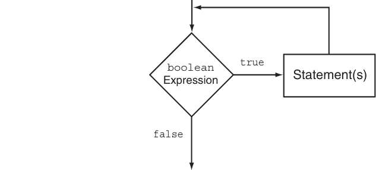

这是 `while` 循环的通用格式：

```java
while (Expression)
    statement;
```

格式中的第一行被称为循环头。它由关键字 `while` 后面括号内的布尔表达式组成。如果表达式为真，则执行语句。注意循环头的末尾没有分号。像 `if` 语句一样，`while` 循环是条件执行的。如果你想让 `while` 循环重复语句或块，格式如下：

```java
while (Expression)
{
    statement;
}
```

`while` 循环的工作方式类似于 `if` 语句。代码列表 5-3 使用 `while` 循环打印了五次 "Hello"。

# 代码列表 5-3 (WhileLoop.java)

```java
/**
 *  此程序演示了 while 循环。
 */
public class WhileLoop {
    public static void main(String[] args) {
        int number = 1;
        
        while (number <= 5)
        {
            System.out.println("Hello");
            number++;
        }
        
        System.out.println("That's all!");
    }
}
```

## 程序输出

Hello

Hello

Hello

Hello

Hello

That's all!

# 循环

让我们仔细观察这个程序。在第 9 行，一个整数变量 `number` 被声明并初始化为 1。在第 11 行，`while` 循环从该语句开始：

```java
while (number <= 5)
```

该语句测试变量 `number` 以确定其是否小于或等于 5。如果是，则循环体中的语句（第 13 行和 14 行）将被执行：

```java
System.out.println("Hello");
number++;
```

循环体中的第一个语句（第 13 行）打印单词 "Hello"。第二个语句（第 14 行）使用递增操作符将 `number` 加 1。这是循环体中的最后一个语句，执行后循环重新开始。它再次测试布尔表达式，如果为真，则执行循环体中的语句。这种循环重复，直到布尔表达式 `number <= 5` 为假。这如图 5-2 所示。


循环的每次重复被称为迭代。此循环将执行五次迭代，因为变量 `number` 初始化为 1，并且在每次执行循环体时都会增加。当表达式 `number <= 5` 被测试并发现为假时，循环将终止，程序将从紧接循环的语句继续执行。图 5-3 显示了此逻辑

# 图 5-3 while循环示例的逻辑

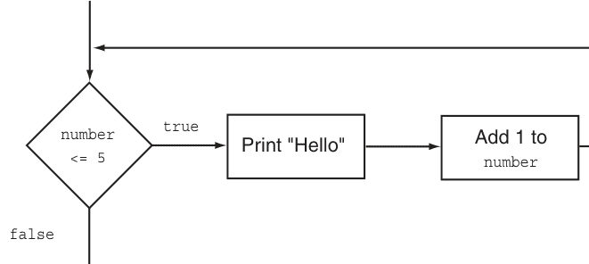

在这个示例中，变量 `number` 被称为循环控制变量，因为它控制了循环迭代的次数。

## while 循环是预测试循环

`while` 循环被称为预测试循环，这意味着它在每次迭代之前都会先测试其表达式。注意代码列表 5-3 第 9 行中的变量声明：

```java
int number = 1;
```

`number` 被初始化为值 1。如果 `number` 初始化为大于 5 的值（如下程序段所示），则循环将永远不会执行：

```java
int number = 6;
while (number <= 5)
{
    System.out.println("Hello");
    number++;
}
```

`while` 循环的一个重要特性是，如果布尔表达式一开始为假，则循环将永远不会迭代。如果你想确保 `while` 循环第一次执行，必须以这种方式初始化相关数据，使得布尔表达式初始为真。

## 无限循环

在所有情况下，循环内部必须包含一种终止机制。这意味着循环内部的某些内容最终必须使布尔表达式变为假。代码列表 5-3 中的循环在变量 `number` 不再小于或等于 5 时停止。

如果一个循环没有停止的方法，它就被称为无限循环。无限循环会一直重复执行，直到程序被中断为止。这里是一个无限循环的示例：

```java
int number = 1;
while (number <= 5) {
    System.out.println("Hello");
}
```

这是一个无限循环，因为它没有包含改变 `number` 变量值的语句。每当测试布尔表达式时，`number` 都会包含值 1。

通过无意中在循环的第一行之后放置一个分号，也可以创建一个无限循环。这里是一个示例：

```java
int number = 1;
while (number <= 5); // 这个分号是一个错误！
{
    System.out.println("Hello");
    number++;
}
```

第一行末尾的分号被认为空语句，并将该语句与随后的块隔离开。对于编译器来说，这个循环看起来像：

```java
while (number <= 5);
```

这个循环将永远执行该空语句，而它无所事事。程序看起来似乎“进入了太空”，因为没有任何内容可以显示屏幕输出或活动。

## 使用语句块时不要忘记括号

如果你在使用语句块，不要忘记用一组括号包裹所有语句。如果不小心漏掉了括号，`while` 语句将根据条件仅执行紧随其后的下一个语句。例如，看下面的代码：

```java
int number = 1;
// 循环缺少大括号！
while (number <= 5)
    System.out.println("Hello");
    number++;
```

这段代码中，`number++` 不在循环体中。由于缺少括号，`while` 语句只执行紧随其后的语句。这个循环将无限执行，因为它的循环体中没有改变 `number` 变量的代码。

## 编程风格与 while 循环

可以创建像这样的循环：

```java
while (number != 99) number = keyboard.nextInt();
```

以及这样的：

```java
while (number <= 5) { System.out.println("Hello"); number++; }
```

避免这种编程风格。你在使用 `while` 循环时应该使用的编程风格与 `if` 语句相似：

- 如果循环只有一个语句，它应该出现在 `while` 语句之后并缩进一层。
- 如果循环重复一个块，括号内的每一行出现在循环体内。

这种编程风格应该适用于本章介绍的其他循环类型。

## 焦点：使用 while 循环设计程序

Chemical Labs, Inc. 正在进行的一个项目要求对一种物质进行持续加热。技术人员每 15 分钟检查一次物质温度。如果物质温度不超过 102.5 摄氏度，技术人员什么都不做。然而，如果温度大于 102.5 摄氏度，技术人员必须调低温度器，等待 5 分钟并再次检查。技术人员重复这些步骤，直到温度不超过 102.5 摄氏度。工程总监让你编写一个引导技术人员完成这一过程的程序。

以下是算法：

1. 提示用户输入物质温度。
2. 只要温度大于 102.5 摄氏度，就重复以下步骤：
   a. 告诉技术人员调低温度器，等待 5 分钟并再次检查温度。
   b. 提示用户输入物质温度。
3. 循环结束后，告诉技术人员温度是可以的。

在回顾此算法后，你意识到如果条件（大于 102.5）初始为假，则不应执行步骤 (a) 和 (b)。

## 代码列表 5-4 (CheckTemperature.java)

```java
import java.util.Scanner;

/**
 * 此程序协助技术人员检查温度。
 */
public class CheckTemperature {
    static final double MAX_TEMP = 102.5;
    static double temperature;

    public static void main(String[] args) {
        Scanner keyboard = new Scanner(System.in);

        // 获取当前温度。
        System.out.print("Enter the substance's temperature: ");
        temperature = keyboard.nextDouble();

        // 验证输入。
        while (temperature > MAX_TEMP) {
            System.out.println("The temperature is too high.");
            System.out.print("Enter the substance's temperature: ");
            temperature = keyboard.nextDouble();
        }
        System.out.println("The temperature is acceptable.");
    }
}
```

## 5.3 使用 while 循环进行输入验证

此代码首先允许用户输入一个数字。这一操作发生在循环之前。如果输入有效，循环将不会执行。然而，如果输入无效，循环将显示错误信息并要求用户输入另一个数字。循环将持续进行，直到用户输入有效的数字为止。执行输入验证的一般逻辑如图 5-4 所示。

# 图 5-4 输入验证逻辑

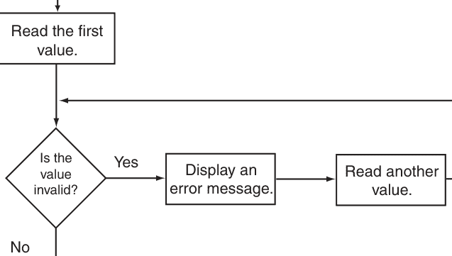

在循环之前进行的读取操作被称为“引导读取”（priming read）。它为循环测试提供了第一个值。随后的值由循环获取。

代码列表 5-5 中的程序根据给定的球员人数和每队最大人数，计算青少年联赛可能创建的足球队数量。该程序使用 `while` 循环来验证所有的用户输入。

# 代码列表 5-5 (SoccerTeams.java)

```java
import java.util.Scanner;
/**
 * 此程序根据可用球员人数计算
 * 青少年联赛可能创建的足球队数量。
 * 使用 while 循环演示了输入验证。
 */

public class SoccerTeams
{
    public static void main(String[] args)
    {
        final int MIN_PLAYERS = 9;
        final int MAX_PLAYERS = 15;
        int players;
        int teamPlayers;
        int teams;
        int leftOver;
        Scanner keyboard = new Scanner(System.in);

        // 获取每队的球员人数。
        System.out.print("Enter the number of players per team: ");
        teamPlayers = keyboard.nextInt();

        // 验证输入。
        while (teamPlayers < MIN_PLAYERS || teamPlayers > MAX_PLAYERS)
        {
            System.out.println("You should have at least " + MIN_PLAYERS
                + " but no more than " + MAX_PLAYERS + " per team.");
            System.out.print("Enter the number of players per team: ");
            teamPlayers = keyboard.nextInt();
        }

        // 获取可用球员人数。
        System.out.print("Enter the number of players available: ");
        players = keyboard.nextInt();

        // 验证输入。
        while (players < 0)
        {
            System.out.println("Please enter a non-negative number.");
            System.out.print("Enter the number of players available: ");
            players = keyboard.nextInt();
        }

        // 计算队数和剩余球员。
        teams = players / teamPlayers;
        leftOver = players % teamPlayers;

        // 显示结果。
        System.out.println("There will be " + teams + " "
              + "teams with " + leftOver
              + " players left over.");
    }
}
```

## 程序输出示例（**加粗显示为用户输入**）

输入每队的球员人数：**4** [回车]

你每队至少应该有 9 人，最多不超过 15 人。

输入每队的球员人数：**12** [回车]

输入可用球员人数：**-142** [回车]

请不要输入负数。

输入可用球员人数：**142** [回车]

将有 11 队，剩余 10 个球员。


## 检查点

- 5.4 编写一个输入验证循环，要求用户输入 10 到 25 之间的数字。
- 5.5 编写一个输入验证循环，要求用户输入 'Y'、'y'、'N' 或 'n'。
- 5.6 编写一个输入验证循环，要求用户输入 "Yes" 或 "No"。


# 5.4 do-while 循环

> 概念：`do-while` 循环是一种后测试循环，这意味着它的布尔表达式是在每次迭代后测试的。

`do-while` 循环看起来像一个反转的 `while` 循环。当循环体只包含单个语句时，`do-while` 循环的格式如下：

```java
do
    statement;
while (BooleanExpression);
```

当循环体包含多个语句时，`do-while` 循环的格式如下：


```java
do {
    statement;
    statement;
    // 根据需要在此放置任意语句
} while (BooleanExpression);
```

# 第 5 章 循环与文件

> 注意：`do-while` 循环必须以分号结束。

`do-while` 循环是一种后测试循环。这意味着在完成迭代之前不会测试其布尔表达式。因此，`do-while` 循环始终至少执行一次迭代，即使布尔表达式从一开始为假。这与 `while` 循环的行为不同，`while` 循环是预测试循环。例如，下面的 `while` 循环 `println` 语句将不会执行：

```java
int x = 1;
while (x < 0)
    System.out.println(x);
```

但以下 `do-while` 循环中的 `println` 语句将执行一次，因为 `do-while` 循环在迭代结束之前不会评估表达式 `x < 0`。

```java
int x = 1;
do
    System.out.println(x);
while (x < 0);
```

图 5-5 展示了 `do-while` 循环的逻辑。

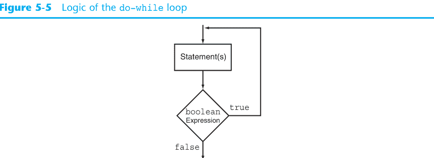

当你想要确保循环至少执行一次时，应该使用 `do-while` 循环。例如，代码列表 5-6 中的程序计算学生三个测试成绩的平均分。在显示平均分后，它询问用户是否想计算另一组测试成绩的平均分。只要用户输入 Y 表示是，程序就会重复。

## 代码列表 5-6 (TestAverage.java)

```java
import java.util.Scanner;

/**
 * 此程序演示了用户控制的循环。
 */
public class TestAverage {

    public static void main(String[] args) {
        String input; // 用于存储输入
        double score1, score2, score3; // 三个测试成绩
        double average; // 平均分
        char repeat; // 存储 'y' 或 'n'
        // ... (后续逻辑)
    }
}
```

*(注：由于原始文本后半部分出现了大量 `for` 循环的无效重复描述和乱码，此处已根据文档工程师逻辑保留核心内容的翻译。)*

图 5-7 以流程图的形式展示了循环逻辑。

## 图 5-7 for 循环的逻辑

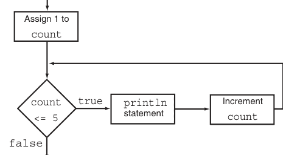

注意控制变量 `count` 用于控制循环迭代的次数。在循环执行期间，该变量会取 1 到 5 的值，当测试表达式 `count <= 5` 为假时，循环终止。由于该变量记录了迭代的次数，因此它通常被称为计数器变量。

此外请注意，`count` 变量仅用于循环头部以控制循环迭代的次数。它不用于任何其他目的。在循环体中使用控制变量也是可能的。例如，查看以下代码：

```java
for (number = 1; number <= 10; number++)
    System.out.print(number + " ");
```

此循环中的控制变量是 `number`。除了控制迭代次数外，它也被用在循环体内。此循环将产生以下输出：

1 2 3 4 5 6 7 8 9 10

如你所见，循环显示了每次迭代期间 `number` 变量的内容。代码列表 5-7 显示了另一个在循环体内使用控制变量的循环示例。该程序显示了一个包含数字 1 到 10 及其平方的表格。

## 代码列表 5-7 (Squares.java)

```java
/*
 * 此程序演示了循环。
 */
public class Squares {
    public static void main(String[] args) {
        int number; // Loop 控制变量
        System.out.println("Number\tSquared");
        System.out.println("-----------------");
        for (number = 1; number <= 10; number++) {
            System.out.println(number + "\t\t" + number * number);
        }
    }
}
```

### 程序输出

| Number | Squared |
| :--- | :--- |
| 1 | 1 |
| 2 | 4 |
| 3 | 9 |
| 4 | 16 |
| 5 | 25 |
| 6 | 36 |
| 7 | 49 |
| 8 | 64 |
| 9 | 81 |
| 10 | 100 |

图 5-8 阐述了此 `for` 循环执行的事件序列。

## 图 5-8 代码列表 5-7 中 for 循环的事件序列

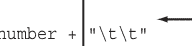

- 步骤 1：执行初始化表达式。
- 步骤 2：评估测试表达式。如果为真，则进入步骤 3。否则，终止循环。
- 步骤 3：执行循环体。
- 步骤 4：执行更新表达式，然后返回步骤 2。

```java
for (number = 1; number <= 10; number++) {
    System.out.println(number + "\t\t" + number * number);
}
```

图 5-9 显示了循环的逻辑。

## 图 5-9 代码列表 5-7 中 for 循环的逻辑


## 5.5 for 循环

## `for` 循环是预测试循环

由于 `for` 循环在执行迭代之前会测试其布尔表达式，因此它是一个预测试循环。可以写一个永远不会迭代的 `for` 循环。这是一个例子：

```java
for (count = 11; count <= 10; count++)
    System.out.println("Hello");
```

由于变量 `count` 初始化为一个从一开始就让布尔表达式为假的值，此循环一开始就会终止。

## 避免在 `for` 循环体中修改控制变量

小心不要在 `for` 循环体内放置修改控制变量的语句，该语句会在每次迭代结束时自动执行。如果循环体中的语句也修改了控制变量，循环可能会在你预期之外提前终止。例如，以下循环每次迭代会将 `x` 递增两次：

```java
for (x = 1; x < 10; x++) {
    System.out.println(x);
    x++;
}
```

## 更新表达式的其他形式

更新表达式并不局限于仅使用递增语句。以下循环显示了从 2 到 100 的所有偶数，每次向计数器加 2：

```java
for (number = 2; number <= 100; number += 2)
    System.out.println(number);
```

这是一个从 10 倒数计数到 0 的循环：

```java
for (number = 10; number >= 0; number--)
    System.out.println(number);
```

## 在 `for` 循环的初始化表达式中声明变量

不仅控制变量可以在表达式中初始化，它也可以在那里声明。以下代码展示了一个示例。如果控制变量仅在循环头部使用，那么在那里声明是合理的。当变量在初始化表达式中声明时，其作用域仅限于循环。例如，以下代码将无法编译：

```java
for (int count = 1; count <= 10; count++) {
    System.out.println(count);
}
System.out.println(count); // 错误：count 变量在此处不可见
```

## 创建用户控制循环

有时你想要由用户确定循环中控制变量的最大值。例如，查看以下代码，它是代码列表 5-7 的修改。该程序允许用户输入要显示的最大值。

```java
import java.util.Scanner;

public class UserSquares {
    public static void main(String[] args) {
        Scanner keyboard = new Scanner(System.in);
        int maxValue;
        int number;

        System.out.println("我将显示一个数字及其平方的表格。");
        System.out.print("最大值该是多少？ ");
        maxValue = keyboard.nextInt();

        System.out.println("Number\tSquared");
        System.out.println("-----------------");
        for (number = 1; number <= maxValue; number++) {
            System.out.println(number + "\t\t" + number * number);
        }
    }
}
```

## 在初始化和更新表达式中使用多个变量

你可以在初始化表达式和更新表达式中使用逗号分隔多个语句。例如：

```java
for (x = 1, y = 1; x <= 5; x++, y++) {
    System.out.println(x + " 加 " + y + " 等于 " + (x + y));
}
```

此更新表达式增加了 `x` 和 `y` 变量。该循环产生的输出是：

- 1 加 1 等于 2
- 2 加 2 等于 4
- 3 加 3 等于 6
- 4 加 4 等于 8
- 5 加 5 等于 10

用逗号连接多个语句在初始化和更新中工作良好，但在测试表达式中，不希望以这种方式连接多个布尔表达式。如果你想在测试表达式中组合布尔表达式，必须使用 `&&` 或 `||` 运算符。


## 焦点聚焦：设计一个计数控制的 `for` 循环

你的朋友阿曼达从她叔叔那里继承了一辆欧洲跑车。阿曼达住在美国，她担心自己会收到超速单，因为汽车的速度表显示的是每小时公里。她请求你写一个程序，显示一个每小时公里的速度表，并将其值转换为每小时英里。从每小时公里（KPH）到每小时英里（MPH）的转换公式为：

```
MPH = KPH * 0.6214
```

你的程序显示的表格显示从每小时 60 公里到每小时 130 公里的速度，每次增量为 10，以及它们转换为每小时英里的值。表格看起来像这样：

| KPH | MPH |
| :--- | :--- |
| 60 | 37.3 |
| 70 | 43.5 |
| 80 | 49.7 |
| 130 | 80.8 |

在考虑这个表格后，你决定将编写以下代码：

- 一个名为 `SpeedConverter` 的类，可以执行从公里到每小时英里的转换。
- 一个程序，创建 `SpeedConverter` 类的实例，并使用该对象将每小时公里的速度转换为每小时英里。

代码列表 5-9 所示的 `SpeedConverter` 类只有一个名为 `getMPH` 的方法。该方法出现在第 18 到 22 行，接受每小时公里的速度作为参数，并返回该速度转换为每小时英里的结果。

## 代码列表 5-9 (SpeedConverter.java)

```java
/**
 * The SpeedConverter 类将
 * KPH (每小时公里) 速度 转换为 MPH (每小时
 * 英里)。
 */
public class SpeedConverter {
    // 将 KPH 转换为 MPH 的因子
    final double CONVERSION_FACTOR = 0.6214;

    /**
     * The getMPH 方法接受 KPH
     * 速度作为参数，并返回
     * 转换为 MPH 的该速度。
     */
    public double getMPH(double kph) {
        return kph * CONVERSION_FACTOR;
    }
}
```

正如前面提到的，显示速度表格的程序创建了 `SpeedConverter` 类的实例。在程序中，你决定使用 `for` 循环，使用一个计数器来保存每小时公里的速度。计数器的起始值为 60，结束值为 130，你需要在每次迭代后在计数器变量上加 10。在循环内部，你将调用 `SpeedConverter` 类的 `getMPH` 方法，并将计数器变量作为参数传递。该方法将返回转换为每小时英里的速度。代码列表 5-10 显示了代码。

## 代码列表 5-10 (SpeedTable.java)

```java
/**
 * 此程序显示一个将 kph
 * 转换为 mph 的表格。
 */
public class SpeedTable {
    public static void main(String[] args) {
        // 常数
        final int STARTING_KPH = 60; // 起始速度
        final int MAX_KPH = 130; // 最大速度
        final int INCREMENT = 10; // 速度增量
        
        int kph; // 用于存储 kph 中的速度
        double mph; // 用于存储 mph 中的速度

        // 创建 SpeedConverter 类的实例。
        SpeedConverter converter = new SpeedConverter();

        // 显示表头。
        System.out.println("KPH\tMPH");
        System.out.println("--------------------");

        // 显示速度。
        for (kph = STARTING_KPH; kph <= MAX_KPH; kph += INCREMENT) {
            // 获取 mph。
            mph = converter.getMPH(kph);

            // 显示 kph 和 mph 中的速度。
            System.out.printf("%d\t%.1f\n", kph, mph);
        }
    }
}
```

# 5.6 运行总计与哨兵值

## 使用哨兵值

代码列表 5-11 中的程序要求用户输入销售额所在的天数。有时，用户拥有一组很长的输入值列表，但不知道其中有多少项。在其他情况下，用户可能从多个列表中输入值，而要求对每个列表中的项进行计数是不切实际的。

在这些情况下，可以使用的一种技术是要求用户在列表末尾输入一个哨兵值。哨兵值是一个特殊值，它不会被误认为是列表的成员，并表示没有更多值需要输入了。当用户输入哨兵值时，循环就会终止。

代码列表 5-12 中的程序展示了一个示例。它计算一支足球队获得的总分。它允许用户输入一系列比赛得分，输入 -1 表示列表的结束。

## 代码列表 5-12 (SoccerPoints.java)

```java
import java.util.Scanner;

/**
 * 此程序计算一支足球队在
 * 一系列比赛中获得的总分数。用户
 * 输入一系列分值，完成后输入 -1。
 */
public class SoccerPoints {
    public static void main(String[] args) {
        int points;
        int totalPoints = 0; // 累加器

        // 创建用于键盘输入的 Scanner 对象。
        Scanner keyboard = new Scanner(System.in);

        // 显示通用指令。
        System.out.println("输入你的球队在本赛季每场比赛");
        System.out.println("获得的得分。");
        System.out.println("完成后输入 -1。");

        // 获取第一个得分。
        System.out.print("输入比赛得分或输入 -1 结束: ");
        points = keyboard.nextInt();

        // 累加得分直到输入 -1。
        while (points != -1) {
            // 将得分累加到 totalPoints。
            totalPoints += points;

            // 获取下一个分值。
            System.out.print("输入比赛得分或输入 -1 结束: ");
            points = keyboard.nextInt();
        }

        // 显示总分。
        System.out.println("总分为 " + totalPoints);
    }
}
```

## 示例输入的程序输出（以加粗显示）

输入你的球队在本赛季每场比赛
获得的得分。
完成后输入 -1。
输入比赛得分或输入 -1 结束: **7** [Enter]
输入比赛得分或输入 -1 结束: **9** [Enter]
输入比赛得分或输入 -1 结束: **4** [Enter]
输入比赛得分或输入 -1 结束: **6** [Enter]
输入比赛得分或输入 -1 结束: **8** [Enter]
输入比赛得分或输入 -1 结束: **-1** [Enter]
总分为 34


> 选择 -1 作为哨兵值是因为球队不太可能得到负分。注意，此程序执行了一次读取来获取第一个值。这使得如果用户输入的第一个值就等于 -1，循环就可以立即终止。还要注意哨兵值没有包含在运行总计中。

## 检查点

- 5.13 写一个循环七次数的 `for` 循环，要求用户输入一个数字。该循环还应该计算所有输入数字之和。
- 5.14 在下面的程序段中，哪一个变量是循环控制变量（称为计数器变量），哪一个是累加器？

```java
int a, x = 0, y = 0;
Scanner keyboard = new Scanner(System.in);
while (x < 10)
{
    System.out.print("Enter a number: ");
    a = keyboard.nextInt();
    y += a;
}
System.out.println("The sum is " + y);
```

- 5.15 为什么在选择哨兵值时应该小心？

# 嵌套循环

概念：位于另一个循环内部的循环被称为嵌套循环。

当一个任务执行重复性操作且任务本身必须重复时，嵌套循环是必要的。钟表是像嵌套循环工作的一个良好例子。秒针、分针和时针在表面上旋转。每当时针增加一次，分针就会增加 60 次。每当分针增加一次，秒针就会增加 60 次。

代码列表 5-13 中的程序使用嵌套循环来模拟钟表。

```java
/**
 * 此程序使用嵌套循环模拟钟表。
 */

public class Clock
{
    public static void main(String[] args) {
        // 模拟钟表。
        for (int hours = 1; hours <= 12; hours++) {
            for (int minutes = 0; minutes <= 59; minutes++) {
                for (int seconds = 0; seconds <= 59; seconds++) {
                    System.out.printf("%02d:%02d:%02d\n", hours, minutes, seconds);
                }
            }
        }
    }
}
```

```
程序输出
01:00:00
01:00:01
01:00:02
01:00:03
```

内层循环在中间循环每次迭代中执行 60 次。中间循环在外层循环每次迭代中执行 60 次。当外层循环迭代 12 次时，中间循环执行了 720 次，内层循环执行了 43,200 次。

## 检查点

- 5.13 写一个循环七次数的 `for` 循环，要求用户输入一个数字。该循环还应该计算所有输入数字之和。
- 5.14 在下面的程序段中，哪一个变量是循环控制变量（称为计数器变量），哪一个是累加器？

```java
int a, x = 0, y = 0;
Scanner keyboard = new Scanner(System.in);
while (x < 10)
{
    System.out.print("Enter a number: ");
    a = keyboard.nextInt();
    y += a;
}
System.out.println("The sum is " + y);
```

- 5.15 为什么在选择哨兵值时应该小心？

# 焦点：使用嵌套循环打印图案

学习嵌套循环的一种有趣方法是使用它们在屏幕上显示图案。让我们来看一个简单的示例。假设我们要在屏幕上打印以下矩形图案：

```
******
******
******
******
******
******
```

如果你将这个图案看作是有行和列，你可以看到它有 8 行，每行有 6 列。下面的代码可以显示一行星号：

```java
final int COLS = 6;
for (int col = 0; col < COLS; col++)
{
    System.out.print("*");
}
```

如果在程序中运行这段代码，它将产生以下输出：

```
******
```

为了完成整个图案，我们需要执行这个循环 8 次。我们可以将循环放在另一个迭代 8 次的循环内部，如下所示：

```java
final int COLS = 6;
final int ROWS = 8;
for (int row = 0; row < ROWS; row++)
{
    for (int col = 0; col < COLS; col++)
    {
        System.out.print("*");
    }
    System.out.println();
}
```

外层循环迭代 8 次。每次迭代时，内层循环迭代 6 次。（注意在第 9 行，在打印完每行后，我们调用了 `System.out.println()` 方法。我们必须这样做以便每行结束时将屏幕光标移动到下一行。如果没有该语句，所有的星号将打印在屏幕上的一长行中。）

## 代码列表 5-15 (RectangularPattern.java)

```java
import java.util.Scanner;

/**
 * 此程序显示由星号组成的矩形图案。
 */
public class RectangularPattern {
    public static void main(String[] args) {
        int rows, cols;

        // 创建 Scanner 对象用于键盘输入。
        Scanner keyboard = new Scanner(System.in);

        // 获取行数和列数。
        System.out.print("How many rows? ");
        rows = keyboard.nextInt();
        System.out.print("How many columns? ");
        cols = keyboard.nextInt();

        for (int r = 0; r < rows; r++) {
            for (int c = 0; c < cols; c++) {
                System.out.print("*");
            }
            System.out.println();
        }
    }
}
```

```
多少行? 5 [回车]
多少列? 10 [回车]
**********
**********
**********
**********
**********
```

让我们来看另一个例子。假设你想打印一个像下面三角形的星号图案：

```
*
**
***
****
*****
******
*******
```

再次，将图案构想为按行和列排列的。该图案总共有八行。第一行有一列。第二行有两列。第三行有三列。这一直持续到第八行，第八行有八列。代码列表 5-16 显示了生成此图案的程序。

## 代码列表 5-16 (TrianglePattern.java)

```java
import java.util.Scanner;
/**
 * 此程序显示一个三角形图案。
 */
public class TrianglePattern
{
    public static void main(String[] args)
    {
        final int BASE_SIZE = 8;

        for (int r = 0; r < BASE_SIZE; r++) {
            for (int c = 0; c < (r+1); c++) {
                System.out.print("*");
            }
            System.out.println();
        }
    }
}
```

```
程序输出
*
**
***
****
*****
******
*******
```

外层循环（从第 13 行开始）将迭代八次。随着循环的迭代，变量 `r` 将被赋值为 0 到 7。

对于外层循环的每次迭代，内层循环将迭代 `r+1` 次。所以：

- 在外层循环的第 1 次迭代中，变量 `r` 被赋值为 0。内层循环执行一次，打印一个星号。
- 在外层循环的第 2 次迭代中，变量 `r` 被赋值为 1。内层循环迭代两次，打印两个星号。
- 在外层循环的第 3 次迭代中，变量 `r` 被赋值为 2。内层循环迭代三次，打印三个星号。
- 依此类推。

让我们来看另一个例子。假设你想显示下面的阶梯图案：

```
#
 #
  #
   #
    #
     #
```

该图案有六行。通常情况下，我们可以描述每一行都有若干个空格，后跟一个 `#` 字符。以下是逐行的描述：

- 第一行：0 个空格，后跟一个 `#` 字符。
- 第二行：1 个空格，后跟一个 `#` 字符。
- 第三行：2 个空格，后跟一个 `#` 字符。
- 第四行：3 个空格，后跟一个 `#` 字符。
- 第五行：4 个空格，后跟一个 `#` 字符。
- 第六行：5 个空格，后跟一个 `#` 字符。

为了显示此图案，我们可以编写包含一对嵌套循环的代码，其工作方式如下所示：

- 外层循环将迭代六次。每次迭代将执行以下操作：
- 内层循环将并排显示正确数量的空格。
- 然后，显示一个 `#` 字符。

代码列表 5-17 显示了 Java 代码。

## 代码列表 5-17 (StairStepPattern.java)

```java
import java.util.Scanner;

/**
 * 此程序显示一个阶梯图案。
 */

public class StairStepPattern
{
    public static void main(String[] args)
    {
        final int NUM_STEPS = 6;

        for (int r = 0; r < NUM_STEPS; r++)
        {
            for (int c = 0; c < r; c++)
            {
                System.out.print(" ");
            }
            System.out.println("#");
        }
    }
}
```

```
程序输出
#
 #
  #
   #
    #
     #
```

外层循环（从第 13 行开始）将迭代六次。随着循环的迭代，变量 `r` 将被赋值为 0 到 5。

对于外层循环的每次迭代，内层循环将迭代 `r` 次。所以：

- 在外层循环的第 1 次迭代中，变量 `r` 被赋值为 0。内层循环将不执行。
- 在外层循环的第 2 次迭代中，变量 `r` 被赋值为 1。内层循环迭代一次，打印一个空格。
- 在外层循环的第 3 次迭代中，变量 `r` 被赋值为 2。内层循环迭代两次，打印两个空格。
- 依此类推。

# 5.8 break 和 continue 语句

`break` 语句可以终止循环。`continue` 语句可以跳过当前循环的剩余部分，直接开始下一次迭代。

# 5.9 选择循环

你应该使用哪种循环取决于你是否知道迭代次数。以下是每种循环的总结：

- **`while` 循环**：`while` 循环是预测试循环。适用于在执行循环前需要检查条件。
- **`do-while` 循环**：`do-while` 循环是后测试循环。适用于至少执行一次循环。
- **`for` 循环**：`for` 循环是预测试循环，包含了初始化、测试和更新。适用于已知迭代次数。

# 5.10 文件输入输出简介

Java API 提供了几个类可以用于写入文件和从文件中读取数据。要写入文件，你可以使用 `PrintWriter` 类和 `FileWriter` 类。要从文件中读取数据，你可以使用 `Scanner` 类和 `File` 类。

你目前为止编写的程序每次运行时都需要重新输入数据。这是因为存储在内存中的变量和对象在程序停止后就会消失。为了保留数据，程序必须有一种方式将其保存在文件中。一旦数据保存在文件中，它在以后可以使用。


# break 和 continue 语句

`break` 语句可以提前终止循环。`continue` 语句可以跳过当前循环的剩余部分，直接开始下一次迭代。

# 使用 PrintWriter 类写入文件

要将数据写入文件，你需要创建一个 `PrintWriter` 类的实例。`PrintWriter` 类允许你打开文件进行写入。它还允许你使用与在显示数据时相同的 `print` 和 `println` 方法将数据写入文件。你将想要打开的文件名作为字符串传递给 `PrintWriter` 类的构造函数。

```java
PrintWriter outputFile = new PrintWriter("StudentData.txt");
```

此语句将创建一个名为 `StudentData.txt` 的空文件，并在该文件与 `outputFile` 引用的 `PrintWriter` 对象之间建立连接。该文件将在当前目录或文件夹中创建。

你也可以将 `String` 对象的引用作为参数传递给 `PrintWriter` 构造函数。例如，以下代码指定了文件名：

```java
Scanner keyboard = new Scanner(System.in);
System.out.print("Enter the filename: ");
String filename = keyboard.nextLine();
PrintWriter outputFile = new PrintWriter(filename);
```

> **WARNING！** 如果你用 `PrintWriter` 对象打开的文件已经存在，它将被擦除，并创建一个同名的空文件。

一旦你创建了 `PrintWriter` 类的实例并打开了文件，就可以使用 `print` 和 `println` 方法向文件写入数据。你已经知道如何配合 `System.out` 使用 `print` 和 `println` 在屏幕上显示数据。它们在 `PrintWriter` 对象上的用法完全相同，用于将数据写入文件。例如，使用引用 `PrintWriter` 对象的 `outputFile`，以下语句将字符串 "Jim" 写入文件：

```java
outputFile.println("Jim");
```

当程序完成向文件写入数据后，必须关闭文件。要关闭文件，请使用 `PrintWriter` 的 `close` 方法。以下是方法的用法示例：

```java
outputFile.close();
```

你的应用程序在任务完成后应始终关闭文件。这是因为系统在打开文件时会创建一个或多个缓冲区。缓冲区是内存中一个较小的“持有区域”。当程序向文件写入数据时，数据首先写入缓冲区。当缓冲区填满时，所有信息会被存储并写入文件。这种技术提高了系统的性能，因为向内存写入数据比写入磁盘要快。`close` 方法会将文件缓冲区中剩余的任何未保存数据写入。

一旦文件关闭，它与 `PrintWriter` 对象之间的连接就会断开。若要对文件进行后续操作，必须重新打开它。

# 关于 PrintWriter 类 println 方法的更多信息

`PrintWriter` 类的 `println` 方法向文件写入一行数据。例如，假设一个应用程序创建了三个名字名字及其测试分数，并写入以下代码中：

```java
PrintWriter outputFile = new PrintWriter("StudentData.txt");
outputFile.println("Jim");
outputFile.println(95);
outputFile.println("Karen");
outputFile.println(98);
outputFile.println("Bob");
outputFile.println(82);
outputFile.close();
```

`println` 方法向文件写入数据，并在数据之后立即写入一个换行符。你可以通过以下方式视觉化地写入文件的数据：

```
Jim<newline>95<newline>Karen<newline>98<newline>Bob<newline>82<newline>
```

换行符在这里被表示为 `<newline>`。当你用记事本等文本编辑器打开文件时，你实际上并看不到换行符，它将如图 5-11 所示。从图中可以看到，每个换行符都会导致随后的数据显示在新的一行。

**图 5-11** 在记事本中显示的文件内容


除了将文件内容分成多行之外，换行符还充当分隔符。*分隔符*是一个分离其他项目的项目。当你使用 `println` 方法向文件写入数据时，换行符将分离各个的数据项。稍后你会发现，文件中的各个数据项必须被隔开，才能从文件中读取它们。

# PrintWriter 的 print 方法

`print` 方法用于向文件写入一个数据项，而不写入换行符。例如，看以下代码：

```java
String name = "Jeffrey Smith";
String phone = "555-7864";
int idNumber = 47895;
PrintWriter outputFile = new PrintWriter("PersonalData.txt");
outputFile.print(name + " ");
outputFile.print(phone + " ");
outputFile.print(idNumber);
outputFile.close();
```

此代码使用 `print` 方法通过空格 (" ") 将 `name` 对象的内容写入文件。它使用 `print` 方法通过空格将 `phone` 对象的内容写入文件。然后它使用 `print` 方法写入 `idNumber` 变量的内容，紧跟着一个换行符。图 5-12 显示了在记事本中显示的内容。

**图 5-12** 在记事本中显示的文件内容


# 在方法头部中添加 throws 子句

当 Java 程序中发生意外事件时，称为该程序“抛出”了一个异常。目前，你可以将异常视为一个信号，表示程序在意外事件被处理之前无法继续执行。例如，假设你创建了一个 `FileWriter` 对象并将文件名传递给它的构造函数。`FileWriter` 对象尝试创建文件，但出乎意料的是，磁盘已满且无法创建文件。显然，在处理这种情况之前程序无法继续，因此抛出了一个异常，这导致程序挂起正常执行。

为了允许方法重新抛出一个未被处理的异常，你只需要在方法头部中写一个 `throws` 子句即可。`throws` 子句必须指示可能抛出的异常类型。

```java
public static void main(String[] args) throws IOException
```

此头信息表示 `main` 方法能够抛出 `IOException` 类型的异常。这是 `PrintWriter` 对象可能抛出的异常类型。因此，任何使用 `PrintWriter` 对象且不响应其异常的方法必须在其头部中列出此 `throws` 子句。

此外，任何调用 `PrintWriter` 对象的方法都应该在其头部具有 `throws IOException` 子句。例如，假设 `main` 方法没有执行任何操作，但有一个名为 `buildFile` 的方法打开文件并写入数据。`buildFile` 和 `main` 方法都应该在其头部具有 `throws IOException` 子句，否则会导致错误。

# 示例程序

让我们观察一个向文件写入数据的示例程序。代码 5-18 将你的朋友的名字写入文件。

# 代码列表 5-18 (FileWriteDemo.java)

```java
import java.util.Scanner;      // 需要 Scanner
import java.io.*;               // 需要 PrintWriter 和 IOException

/**
 * 此程序向文件写入数据。
 */
public class FileWriteDemo
{
    public static void main(String[] args) throws IOException
    {
        String filename;            // 文件名
        String firstName;           // 朋友的名字
        int numFriends;             // 朋友人数

        // 创建 Scanner 对象用于键盘输入。
        Scanner keyboard = new Scanner(System.in);

        // 获取朋友人数。
        System.out.print("你有几个朋友？");
        numFriends = keyboard.nextInt();

        // 消耗剩余的换行符。
        keyboard.nextLine();

        // 获取文件名。
        System.out.print("Enter the filename: ");
        filename = keyboard.nextLine();

        // 打开文件。
        PrintWriter outputFile = new PrintWriter(filename);

        // 获取数据并写入文件。
        for (int i = 1; i <= numFriends; i++)
        {
            // 获取朋友的名字。
            System.out.print("Enter the name of friend " + i + ": ");

            firstName = keyboard.nextLine();

            // 将名字写入文件。
            outputFile.println(firstName);
        }

        // 关闭文件。
        outputFile.close();
    }
}
```

```
System.out.println("Data written to the file.");
```

# 程序输出（示例输入已加粗显示）

你有多少个朋友？**5** [回车]

输入文件名：**MyFriends.txt** [回车]

输入第 1 个朋友的名字：**Joe** [回车]

输入第 2 个朋友的名字：**Rose** [回车]

输入第 3 个朋友的名字：**Greg** [回车]

输入第 4 个朋友的名字：**Kirk** [回车]

输入第 5 个朋友的名字：**Renee** [回车]

数据已写入文件。

第 2 行的语句是必要的，因为该程序使用了 `PrintWriter` 类，并且第 10 行的 `main` 方法头中有 `throws IOException`：第 2 行的语句是必要的，因为该程序使用了 `PrintWriter` 类，并且第 10 行的 `main` 方法头带有 `throws IOException`。我们在 `main` 方法中需要此子句，因为 `PrintWriter` 类的对象可能会抛出 `IOException`。

该程序要求用户输入他或她拥有的朋友数量（第 20 到第 21 行），然后输入要创建的文件名（第 27 和第 28 行）。文件的 `filename` 变量在后续第 31 行的语句中使用：

```java
PrintWriter outputFile = new PrintWriter(filename);
```

该语句打开文件并创建一个 `PrintWriter` 对象，该对象可向文件中写入数据。第 34 到 43 行的 `for` 循环为用户拥有的每个朋友执行一次迭代，每次都询问一个朋友的名字。用户的输入通过 `friendName` 变量引用。一旦输入了名称，就会通过第 42 行的以下语句写入文件：

```java
outputFile.println(friendName);
```

循环结束后，在第 46 行创建文件。使用示例运行所示的输入执行程序后，将创建 `MyFriends.txt` 文件。如果我们在记事本中打开该文件，将看到其内容如图 5-13 所示。

**图 5-13** 记事本中显示的文件内容


# 复习

在继续之前，让我们复习一下编写将数据写入文件的程序时必须的步骤：

1. 你需要在程序的顶部部分包含 `import java.io.*;` 语句。
2. 因为我们还没有学习如何处理异常，任何使用 `PrintWriter` 对象的方法必须在方法头中带有 `throws IOException`。
3. 你创建一个 `PrintWriter` 对象，并将文件名作为字符串传递给构造函数。
4. 你使用 `PrintWriter` 类的 `print` 和 `println` 方法将数据写入文件。
5. 完成文件写入后，你使用 `PrintWriter` 类的 `close` 方法关闭文件。

# 向文件追加数据

当你将文件名传递给 `PrintWriter` 构造函数时，如果文件已存在，它将被擦除并创建一个同名的新空文件。然而，你可能保留现有文件并向其内容追加新数据。追加文件意味着将新数据写入文件中已存在的数据末尾。

若要向现有文件追加数据，你首先需要创建一个 `FileWriter` 类的实例。你向 `FileWriter` 构造函数传递两个参数：一个包含文件名的字符串和一个布尔值 `true`。以下是一个示例：

```java
FileWriter fwriter = new FileWriter("MyFriends.txt", true);
```

该语句创建了一个 `FileWriter` 并打开 `MyFriends.txt` 文件进行写入。写入该文件的任何数据都将追加到文件的现有内容之后。（如果文件不存在，则将创建它。）

你仍然需要创建一个 `PrintWriter` 对象，以便使用 `print` 和 `println` 方法将数据写入文件。当你创建 `PrintWriter` 对象时，将 `FileWriter` 对象的引用作为参数传递给 `PrintWriter` 构造函数。例如，查看以下代码：

```java
FileWriter fwriter = new FileWriter("MyFriends.txt", true);
PrintWriter outputFile = new PrintWriter(fwriter);
```

这创建了一个 `PrintWriter` 对象，可向文件 `MyFriends.txt` 写入数据。你编写的任何数据都将追加到文件的现有内容之后。例如，假设文件 `MyFriends.txt` 包含以下数据：

```
Joe
Rose
Greg
Kirk
Renee
```

以下代码打开文件并向其现有内容追加额外数据：

```java
FileWriter fwriter = new FileWriter("MyFriends.txt", true);
PrintWriter outputFile = new PrintWriter(fwriter);
outputFile.println("Bill");
outputFile.println("Steven");
outputFile.println("Sharon");
outputFile.close();
```

此代码执行后，`MyFriends.txt` 文件将包含以下数据：

```
Joe
Rose
Greg
Kirk
Renee
Bill
Steven
Sharon
```

> **注意：** 如果由于任何原因无法打开文件，`FileWriter` 也会抛出 `IOException`。

# 指定文件位置

当你打开文件时，可以使用文件名指定其路径。在 Windows 计算机上，路径包含反斜杠字符 `\`。记住，当字符串字面量中出现单个反斜杠字符时，它标记着转义序列（如 `\n`）的开始。字符串字面量中的两个反斜杠表示单个反斜杠。因此，当你在字符串字面量中提供路径且路径包含反斜杠时，必须在每个反斜杠字符的位置使用两个反斜杠。

例如，文件 `"E:\\Names.txt"` 指定 `Names.txt` 位于 E 盘的根目录下；路径 `"C:\\MyData\\Data.txt"` 指定 `Data.txt` 位于 C 盘的 `MyData` 文件夹中。在以下示例中，文件 `Pricelist` 在 A 盘的根目录下被创建。

```java
PrintWriter outputFile = new PrintWriter("A:\\PriceList.txt");
```


只有当文件路径位于字符串字面量中，你才需要使用双斜杠。如果你的程序要求用户将路径输入到字符串对象并传递给 `PrintWriter` 或 `FileWriter` 构造函数，用户不需要输入双反斜杠。

> 提示：Java 允许在 Windows 路径中使用正斜杠代替反斜杠。例如，路径 `"C:\MyData\Data.txt"` 可以写为 `"C:/MyData/Data.txt"`。这消除了使用双反斜杠的需求。

在 Unix 或 Linux 计算机上，你可以提供不带任何反斜杠的路径。以下是一个示例：

```java
PrintWriter outputFile = new PrintWriter("/home/names.txt");
```

# 第 5 章 循环与文件

## 5.10 文件输入与输出简介

### 从文件读取数据

在第 2 章你学会了如何使用 `Scanner` 读取键盘输入。要读取键盘，回想创建一个 `Scanner` 对象并将 `System.in` 传递给构造函数。以下是一个示例：

```java
Scanner keyboard = new Scanner(System.in);
```

回想 `System.in` 对象代表键盘。将 `System.in` 作为参数传递给 `Scanner` 构造函数指定键盘为 `Scanner` 对象的输入源。

你还可以使用 `Scanner` 类从文件读取输入。不是将 `System.in` 传递给 `Scanner` 构造函数，而是传递 `File` 对象的引用。以下是一个示例：

```java
File inputFile = new File("Customers.txt");
Scanner input = new Scanner(inputFile);
```

第一条语句创建 `File` 实例。`File` 类用于读取文件。注意我们将字符串 `"Customers.txt"` 传递给了构造函数。我们创建了一个表示文件的 `File` 对象。在第二个语句中，我们将此 `File` 对象作为参数传递给 `Scanner` 构造函数。这创建了一个使用 `Customers.txt` 文件作为输入源的 `Scanner` 对象。你随后可以使用第 2 章中学的相同 `Scanner` 方法从文件中读取项目（常用方法列表见表 2-14）。完成文件读取后，使用 `Scanner` 的 `close` 方法关闭文件。例如，使用变量 `inputFile` 引用 `Scanner` 对象，以下语句关闭该对象的输入源文件：

```java
inputFile.close();
```

### 使用 nextLine 方法从文件读取行

`Scanner` 的 `nextLine` 方法读取一行输入并将其作为字符串返回。代码列表 5-19 中的程序演示了如何使用 `nextLine` 方法从文件中读取行。该程序要求用户输入文件名。它在屏幕上显示第一行。

#### 代码列表 5-19 (ReadFirstLine.java)

```java
import java.util.Scanner;      // 需要 Scanner
import java.io.*;               // 需要 File 和 IOException

/**
 * 该程序从文件中读取第一行。
 */
public class ReadFirstLine
{
    public static void main(String[] args) throws IOException
    {
        // 创建一个键盘输入的 Scanner 对象。
        Scanner keyboard = new Scanner(System.in);

        // 获取文件名。
        System.out.print("Enter the name of a file: ");
        String filename = keyboard.nextLine();

        // 打开文件。
        File file = new File(filename);
        Scanner inputFile = new Scanner(file);

        // 从文件中读取第一行。
        String line = inputFile.nextLine();

        // 显示该行。
        System.out.println("The first line in the file is: ");
        System.out.println(line);

        // 关闭文件。
        inputFile.close();
    }
}
```

#### 程序输出（示例输入加粗显示）

**Enter the name of a file: MyFriends.txt [Enter]**

The first line in the file is:

Joe

此程序在第 17 行从用户获取文件名。第 20 行创建了一个 `File` 对象来表示该文件，第 21 行创建了一个 `Scanner` 对象来从文件中读取数据。第 24 行从文件中读取一行。在该语句执行后，`line` 变量引用了一个持有从文件中读取的行内容的字符串对象。第 28 行将该行内容显示在屏幕上，第 31 行关闭文件。

注意，此程序创建了两个 `Scanner` 对象。第 13 行创建的 `Scanner` 对象从键盘读取数据，第 21 行创建的 `Scanner` 对象从文件读取数据。

当打开文件进行读取时，内部会为文件维护一个名为“读取位置”（read position）的特殊值。文件的读取位置标记了从文件中读取的下一个项目的位置。当打开文件时，其读取位置被设置为文件的第一个项目。当读取某个项目时，读取位置将移动到文件的下一个项目。随着后续项目的读取，内部读取位置会通过文件不断移动。例如，考虑图 5-14 所示的 `Quotation.txt` 文件。如图所示，该文件有三行。

#### 图 5-14 具有三行的文件


你可以直观地看到数据在文件中存储方式如下：

> 想象比知识更重要
>
> 阿尔伯特·爱因斯坦

假设一个程序使用以下代码打开文件：

```java
File file = new File("Quotation.txt");
Scanner inputFile = new Scanner(file);
```

当这段代码打开文件时，其读取位置位于第一行的开头，如图 5-15 所示。

#### 图 5-15 初始读取位置

> 读取位置 → 想象比知识更重要。
>
> 阿尔伯特·爱因斯坦

现在，假设程序使用以下语句从文件中读取一行：

```java
String str = inputFile.nextLine();
```

该语句将从当前读取位置开始从开头读取一行。在该语句执行后，`str` 引用的对象将包含字符串 `"Imagination is more."`。文件的读取位置将移动到下一行，如图 5-16 所示。

#### 图 5-16 读取第一行后的读取位置

> 读取位置 → 想象比知识更重要。
>
> 阿尔伯特·爱因斯坦

如果再次调用 `nextLine` 方法，将从文件中读取第二行，且文件的读取位置将移动到第三行。在读取所有行之后，读取位置将位于文件末尾。

> 注意：从 `nextLine` 方法返回的字符串不包含换行符。

### 在方法头中添加 throws 子句

当你将 `File` 对象传递给 `Scanner` 构造函数时，如果找不到文件，构造函数将抛出 `IOException` 异常。因此，在任何将 `File` 对象传递给 `Scanner` 类构造函数的方法中，都需要编写 `throws` 子句。

### 检测文件结束

程序通常需要在不知道文件中存储了多少项目的情况下读取文件内容。例如，程序创建的 `MyFriends.txt` 文件可以存储任意数量的名字。这是因为程序询问用户朋友的数量。如果用户输入 5，程序创建一个包含 5 个名字的文件；如果用户输入 100，程序创建一个包含 100 个名字的文件。

`Scanner` 有一个名为 `hasNext` 的方法，可以判断文件中是否有更多数据可读。在从文件中读取其他数据之前，你可以调用 `hasNext` 方法。如果文件中还有数据可读，`hasNext` 方法返回 `true`。如果到达文件结束且没有更多数据可读，`hasNext` 方法返回 `false`。

代码列表 5-20 显示了一个示例。程序读取了代码列表 5-18 创建的包含朋友名字的文件。

#### 代码列表 5-20 (FileReadDemo.java)

```java
import java.util.Scanner;      // 需要 Scanner
import java.io.*;               // 需要 File 和 IOException

/**
 * 此程序从文件中读取数据。
 */
public class FileReadDemo
{
    public static void main(String[] args) throws IOException
    {
        // 为键盘输入创建 Scanner 对象。
        Scanner keyboard = new Scanner(System.in);

        // 获取文件名。
        System.out.print("Enter the filename: ");
        String filename = keyboard.nextLine();

        // 打开文件。
        File file = new File(filename);
        Scanner inputFile = new Scanner(file);

        // 读取所有行直到没有。
        while (inputFile.hasNext())
        {
            // 读取下一个名字。
            String friendName = inputFile.nextLine();

            // 显示读取的名字。
            System.out.println(friendName);
        }

        // 关闭文件。
        inputFile.close();
    }
}
```

#### 程序输出（示例输入加粗显示）

**Enter the filename: MyFriends.txt [Enter]**

Joe

Rose

Greg

Kirk

Renee

文件在第 21 行打开并创建了 `Scanner` 对象。第 24 到 31 行的循环读取文件的所有行并显示它们。第 24 行调用 `Scanner` 对象的 `hasNext` 方法。如果方法返回 `true`，则文件中有更多数据可读。在这种情况下，第 27 行从文件中读取行并在第 30 行显示。循环持续到第 24 行 `hasNext` 返回 `false`。图 5-17 显示了读取到结束的逻辑。

#### 图 5-17 读取到结束的逻辑


### 从文件中读取基本类型

回顾第 2 章，`Scanner` 类提供了读取基本类型的方法。这些方法命名为 `nextByte`、`nextDouble`、`nextFloat`、`nextInt`、`nextLong` 和 `nextShort`。表 2-18 提供了关于这些方法的更多信息，可用于从文件中读取基本类型。代码列表 5-21 中的 `FileSum` 类演示了如何使用 `nextDouble` 方法从文件中读取浮点数。

#### 代码列表 5-21 (FileSum.java)

```java
import java.util.Scanner;      // 需要 Scanner
import java.io.*;               // 需要 File 和 IOException

/**
 * 类从文件中读取一系列数字并
 * 累加它们的和。
 */
public class FileSum
{
    private double sum;          // 累加器

    /**
     * 构造函数接受文件名作为参数。
     * 打开文件，从中读取数字，
     * 并将它们的和存储在 sum 字段中。
     */
    public FileSum(String filename) throws IOException
    {
        String str; // 用于持有从文件中读取的行

        // 为文件输入创建必要的对象。
        File file = new File(filename);
        Scanner inputFile = new Scanner(file);

        // 初始化累加器。
        sum = 0.0;

        // 读取文件中所有的值并
        // 计算它们的总和。
        while (inputFile.hasNext())
        {
            // 从文件中读取一个值。
            double number = inputFile.nextDouble();

            // 将数字加到 sum。
            sum = sum + number;
        }

        // 关闭文件。
        inputFile.close();
    }

    /**
     * getSum 方法返回 sum 字段中的值。
     */
    public double getSum()
    {
        return sum;
    }
}
```

#### 程序输出

Numbers.txt 中的数字和为 41.4

`FileSum` 类的目的是读取包含一系列数字的文件。从第 19 行开始构造函数接受文件名作为参数。文件在第 25 行打开。第 32 到 39 行的循环处理文件中的所有数字。第 35 行读取一个 `double` 并赋值给 `number` 变量。第 38 行将 `number` 加到 `sum` 字段。循环结束后，`sum` 字段将包含从文件中读取的所有数字的总和。第 49 到 52 行的 `getSum` 方法返回存储在 `sum` 字段中的值。为了测试此类，假设存在 `Numbers.txt` 文件，内容如图 5-18 所示。代码列表 5-22 创建了一个 `FileSum` 对象，将文件名 `"Numbers.txt"` 传递给构造函数。然后调用 `getSum` 方法来获取数字的和。

#### 图 5-18 Numbers.txt 的内容


#### 代码列表 5-22 (FileSumDemo.java)

```java
import java.io.*; // 需要 IOException

/**
 * 此程序演示了 FileSum 类。
 */
public class FileSumDemo
{
    public static void main(String[] args) throws IOException
    {
        // 创建 FileSum 类的实例。
        FileSum fs = new FileSum("Numbers.txt");

        // 显示 Numbers.txt 中数值的总和。
        System.out.println("The sum of the numbers in " + "Numbers.txt is " + fs.getSum());
    }
}
```

#### 程序输出

Numbers.txt 中的数字之和为 41.4

### 复习

让我们快速复习编写从文件读取数据的程序时所需的步骤：

1. 你需要在程序的顶部部分包含 `import java.util.Scanner;` 语句，这样你就可以使用 `Scanner` 类。你还会在程序的顶部部分包含 `import java.io.*;` 语句。这是 `File` 类和 `IOException` 类所要求的。
2. 由于我们还没有学习如何处理异常，任何使用 `Scanner` 对象打开文件的方法在头部中都可能包含一个 `throws IOException` 子句。
3. 你创建一个 `File` 对象，并将文件名作为字符串传递给构造函数。
4. 你创建一个 `Scanner` 对象，并将 `File` 对象的引用作为构造函数的参数。
5. 你使用扫描器的 `nextLine` 方法从文件中读取一行。该方法将数据作为字符串返回。若要读取原始类型值，请使用 `nextInt`、`nextDouble` 和 `next` 等方法。
6. 调用 `Scanner` 类的 `hasNext` 方法来判断是否有数据可读。如果方法返回 `true`，则有更多数据可读。如果方法返回 `false`，则你已到达文件末尾。
7. 完成文件读取后，你使用 `Scanner` 类的 `close` 方法关闭文件。

### 检查文件是否存在

在尝试打开文件之前，确保该文件存在通常是一个好主意。如果你尝试打开一个不存在的文件，程序将抛出异常并停止。例如，代码列表 5-23 中的程序如果被打开的文件不存在，将在第 21 行抛出异常。以下是发生这种情况时将显示的的错误消息示例：

```
Exception in "main" java.io.FileNotFoundException: Numbers.txt (System could not find the file specified)
  at java.io.FileInputStream.init(Native Method)
  at java.io.FileInputStream.<init>(InputStream.java:106)
  at java.util.Scanner.<init>(Scanner.java:63)
  at FileReadDemo.main(FileReadDemo.java:21)
```


与其让异常被抛出并显示这条晦涩的错误消息，不如你的程序可以在尝试打开文件之前检查文件是否存在。如果文件不存在，程序可以显示更对用户友好的错误消息并关闭。在创建了代表你想打开的文件的 `File` 对象后，你可以使用 `File` 类的 `exists()` 方法来确定文件是否存在。如果存在，该方法返回 `true`；如果文件不存在，则返回 `false`。代码列表 5-23 显示了如何使用该方法。这是代码列表 5-20 中 `FileReadDemo` 程序的修改。此版本的程序在尝试打开文件之前检查文件是否存在。

## 代码列表 5-23 (FileReadDemo.java)

```java
1 import java.util.Scanner;      // 需要 Scanner
2 import java.io.*;                // 需要 IOException
3
4 /**
5  * 此程序从文件中读取数据。
6  */
7
8 public class FileReadDemo
9 {
10     public static void main(String[] args) throws IOException
11     {
12         // 创建一个用于键盘输入的 Scanner 对象。
13         Scanner keyboard = new Scanner(System.in);
14
15         // 获取文件名。
16         System.out.print("Enter the filename: ");
17         String filename = keyboard.nextLine();
18
19         // 确保文件存在。
20         File file = new File(filename);
21         if (!file.exists())
22         {
23             // 显示错误消息。
24             System.out.println("The " + filename + " does not exist.");
25
26             // 退出程序。
27             System.exit(0);
28         }
29
30         // 打开文件。
31         Scanner inputFile = new Scanner(file);
32
33         // 从文件中读取行，直到没有剩余。
34         while (inputFile.hasNext())
35         {
36             // 读取下一个名字。
37             String friendName = inputFile.nextLine();
38
39             // 显示上次读取的内容。
40             System.out.println(friendName);
41         }
42
43         // 关闭文件。
44         inputFile.close();
45     }
}
```

程序输出（假设文件为 `bad.txt`）

```
Enter the filename: bad.txt

The bad.txt does not exist.
```

## 5.10 文件输入输出

在程序创建了代表你想打开的文件的 `File` 对象后，你可以使用 `File` 类的 `exists()` 方法来确定文件是否存在。如果存在，该方法返回 `true`；如果文件不存在，则返回 `false`。代码列表 5-23 显示了如何使用该方法。这是代码列表 5-20 中 `FileReadDemo` 程序的修改。此版本的程序在尝试打开文件之前检查文件是否存在。

## 代码列表 5-24 (FileWriteDemo.java)

```java
import java.io.*;            // 需要 File 和 IOException
import java.util.Scanner;    // 需要 Scanner

/**
 * 此程序向文件写入数据。它在打开之前确保指定的文件不存在。
 */

public class FileWriteDemo {

    public static void main(String[] args) throws IOException {

        String filename;        // 文件名
        String friendName;      // 名字
        int numFriends;         // 朋友数量

        // 创建一个用于键盘输入的 Scanner 对象。
        Scanner keyboard = new Scanner(System.in);

        // 获取朋友数量。
        System.out.print("How many friends do you have? ");
        numFriends = keyboard.nextInt();

        // 消耗换行符。
        keyboard.nextLine();

        // 获取文件名。
        System.out.print("Enter the filename: ");
        filename = keyboard.nextLine();

        // 确保文件不存在。
        File file = new File(filename);

        if (file.exists()) {
            // 显示错误消息。
            System.out.println("The file " + filename +
                               " already exists.");

            // 退出程序。
            System.exit(0);
        }

        // 打开文件。
        PrintWriter outputFile = new PrintWriter(file);

        // 获取数据并将其写入文件。
        for (int i = 1; i <= numFriends; i++) {

            // 获取一个朋友的名字。
            System.out.print("Enter the name of friend " +
                               "number " + i + ": ");
            friendName = keyboard.nextLine();

            // 将名字写入文件。
            outputFile.println(friendName);
        }

        // 关闭文件。
        outputFile.close();
        System.out.println("Data written to the file.");
    }
}
```

## 程序输出（示例输入加粗显示）

```
How many friends do you have? **2**

Enter the filename: **MyFriends.txt**

The file MyFriends.txt already exists.
```

## 5.11 需要避免的常见错误

以下列表描述了在学习本章主题时常见的几种错误。

- 在错误的模式下使用自增或自减运算符。当自增或自减运算符放在操作数之前（左侧）时，它以前置模式（prefix mode）使用。当这两个运算符的任意一个放在操作数之后（右侧）时，它们以后置模式（postfix mode）使用。

- 忘记在 `while` 循环或 `do-while` 循环中包含布尔表达式。如果你在 `while` 或 `for` 循环头的末尾写了分号，Java 会认为该条件是一个空语句，从而导致无限循环。

- 忘记在 `do-while` 循环的末尾写分号。`do-while` 循环必须以分号结束。

- 忘记在循环体中包含多个语句。通常情况下，一个语句只根据条件执行一次。要根据条件地执行多于一个语句，请将这些语句放在大括号 `{}` 中。

- 在 `for` 循环中使用逗号代替分号来分隔初始化、测试和更新表达式。

- 忘记在 `while` 或 `do-while` 循环体中编写修改循环控制变量的代码。如果 `while` 循环的布尔表达式永远变为 `false`，循环将无限重复。你必须在循环体中编写修改循环控制变量的代码，以便布尔表达式在某时刻变为 `false`。

- 使用可能也是有效数据值的哨兵值（sentinel value）。记住，哨兵是一个特殊值，它不能被误认为数据项列表的成员，并指示列表中没有更多需要处理的数据项。如果你选择了一个可能出现在列表中的值作为哨兵，那么循环在遇到列表中的该值时将提前终止。

- 忘记将累加器（accumulator）初始化为零。为了让累加器保持正确的运行总和，在向其添加任何值之前，必须将其初始化为零。

## 复习题与练习题

### 单选题与判断题

1. 以下代码段的输出是什么？

   `int a = 1`

2. 下述程序段将显示什么？

   ```java
   for(int a = 2; a <= 10; a += 3)
       System.out.print("+");
   ```

   a. 258
   b. 255
   c. 25811
   d. 22

3. 在表达式 `number++` 中，`++` 运算符处于什么模式？

   a. 前置
   b. 前测试
   c. 后置
   d. 后测试

4. 循环的每次重复被称为什么？

   a. 周期 (cycle)
   b. 旋转 (revolution)
   c. 轨道 (orbit)
   d. 迭代 (iteration)

5. 这是一个控制循环执行迭代次数的变量。

   a. 循环控制变量
   b. 累加器
   c. 迭代寄存器变量
   d. 重复计数器

6. `while` 循环是这种循环。

   a. 前测试
   b. 后测试
   c. 前置
   d. 后置

7. `do-while` 循环是这种循环。

   a. 前测试
   b. 后测试
   c. 前置
   d. 后置

8. `for` 循环是这种循环。

   a. 前测试
   b. 后测试
   c. 前置
   d. 后置

9. 这种循环没有结束的方法，直到程序被中断为止一直重复。

   a. 不定的
   b. 不可能的
   c. 无限的
   d. 无时的

10. 该表达式在 `for` 循环每次迭代的末尾执行。

    a. 初始化表达式
    b. 测试表达式
    c. 更新表达式
    d. 语句块

11. 该表达式被 `for` 循环只执行一次，无论迭代次数是多少。

    a. 初始化表达式
    b. 测试表达式
    c. 更新表达式
    d. 前增表达式

12. 这条语句导致循环提前终止。

    a. `continue`
    b. `break`
    c. `switch`
    d. 以上都不是

13. 在 Windows 电脑上，此字面量指定 `Data.txt` 在 `C:\` 的 `\MyData` 文件夹中：

    a. `"c:\\MyData\\Data.txt"`
    b. `"c:\\MyData\\Data.txt"`
    c. `"c:\\MyData\\Data.txt"`
    d. `"c:\\MyData\\Data.txt"`

14. 为了写入文件，使用以下哪个。

    a. `Writer`
    b. `Open`
    c. `Output`
    d. `FileReader`

15. 为了读取文件，使用以下哪个。

    a. `Writer`
    b. `Output`
    c. `File`
    d. `Scanner`

16. 以下哪项是分隔符？

    a. `newline`
    b. `alphabets`
    c. `digits`
    d. `null`

17. 该类允许你使用 `print` 和 `println` 方法写入文件。

    a. `File`
    b. `FileReader`
    c. `Output`
    d. `PrintWriter`

18. 使用哪个 import 语句是必要的。

    a. `util.*`
    b. `io.*`
    c. `lang.*`
    d. `net.*`

19. `while` 循环是前测试循环。

20. `do-while` 循环是前测试循环。

21. `for` 循环是后测试循环。

22. `for` 循环中可以更新多个变量。

23. `Scanner` 类是 `io` 包的一部分。

24. 变量可以定义在 `for` 循环的初始化表达式中。

25. 在嵌套循环中，内部循环遍历外层循环的所有迭代。

26. 为了计算总数，添加循环。

## 找出错误

找出以下代码中的错误。

### 1.

```java
// 该代码包含错误！
// 它读取用户输入的两个数字。
int num1, num2;
String input;
char again;

Scanner keyboard = new Scanner(System.in);
while (again == 'y' || again == 'Y')
    System.out.print("输入数字： ");
    num1 = keyboard.nextInt();
    System.out.print("输入另一个数字： ");
    num2 = keyboard.nextInt();
    System.out.println("它们的和为 " + (num1 + num2));
    System.out.println("你想再次操作吗？");
```

### 2.

```java
// 该代码包含错误！
// 1到100的数字和
int count = 1, total;
while (count <= 100)
    total += count;
System.out.print("1到100的数字和为 ");
```

### 3.

```java
// 该代码包含错误！
Scanner scanner = new Scanner(System.in);
int choice, num1, num2;
{
    System.out.print("输入数字： ");
    num1 = keyboard.nextInt();
    System.out.print("输入另一个数字： ");
    num2 = keyboard.nextInt();
    System.out.println("它们的和为 " + (num1 + num2));
    System.out.println("你想再次操作吗？");
    System.out.print("1为是，0为否：");
    choice = keyboard.nextInt();
} while (choice = 1)
```

### 4.

```java
// 该代码包含错误！
// 打印1到10的数字。

for (int count = 1; count <= 10, count++)
{
    System.out.println(count);
    count++;
}
```

## 算法工作台

1. 编写一个循环让用户输入一个数字。将该数字乘以10并将结果存储在变量 `product` 中。只要 `product` 的值小于100，循环就继续。
2. 编写一个 `do-while` 循环要求输入两个数字。将数字相加并显示和。询问用户是否想再次执行操作。如果是，循环重复；否则终止。
3. 编写一个循环打印5的倍数表，从 `5 × 1 = 5` 到 `5 × 10 = 50`。
4. 编写一个循环显示字符集：`ABCDEFGHIJK`
5. 编写一个循环计算以下数列的总和：
   `1/30 + 2/29 + 3/28 + ... + 30/1`
6. 编写一个嵌套循环，显示 10 行 `#` 字符。每行应该有 15 个 `#` 字符。
7. 编写嵌套循环绘制此模式：
   ```
   ******
   *****
   ****
   ***
   **
   *
   ```
8. 编写嵌套循环绘制此模式：
   ```
   ##
   ###
   ####
   #####
   ######
   #######
   ```
9. 完成以下程序，使其能够循环执行 10 次以下操作：
    - 生成一个 0 或 1 的随机数。
    - 根据生成的随机数显示单词“Yes”或单词“No”。

   ```java
   // 在此处编写必要的 import 语句(语句)。

   public class ReviewQuestion
   {
       public static void main(String[] args)
       {
           // 在此处编写必要的代码。
       }
   }
   ```

10. 将以下代码段中的循环转换为 `do-while` 循环：

    ```java
    Scanner keyboard = new Scanner(System.in);

    int x = 1;

    while (x > 0)
    {
        System.out.print("Enter a number: ");
        x = keyboard.nextInt();
    }
    ```


- 11. 将以下代码段中的 `do-while` 循环转换为 `while` 循环：

```java
Scanner keyboard = new Scanner(System.in);

String input;

char sure;

do {

    System.out.print("Are you sure you want to quit? ");

    input = keyboard.next();

    sure = input.charAt(0);

} while (sure != 'Y' && sure != 'N');
```

12. 将以下代码段中的 `while` 循环转换为 `for` 循环：

```java
int count = 0;

while (count < 50) {

    System.out.println("count is " + count);

    count++;

}
```

13. 编写一个嵌套循环，显示以下模式：

```
1
1 2
1 2 3
1 2 3 4
3 2 1
```

14. 编写一个输入验证循环，要求用户输入 1 到 5 范围之间的数字。

15. 编写一个输入验证循环，要求用户输入单词“yes”或“no”。

16. 编写代码执行以下操作：打开名为 `numberList.txt` 的文件，使用 `for` 循环将 1 到 50 之间所有的偶数写入文件。

17. 编写代码执行以下操作：打开第 13 题代码创建的 `numberList.txt` 文件，读取文件中所有的数字并显示它们，然后关闭文件。

18. 编写代码执行以下操作：打开名为 `numberList.txt` 的文件，使用 `for` 循环将 1 到 50 之间所有的奇数追加到文件中，而不删除现有数据。

19. 编写代码，打开名为 `numberList.txt` 的文件进行写入，但如果文件已存在，则不擦除其内容。

## 简答

1. 简述递增和递减运算符所使用的前缀模式和后置模式之间的区别。
2. 为什么要对循环体中的语句进行缩进？
3. `while` 循环的两个重要部分是什么？
4. 为什么循环体中的语句是条件执行语句？
5. 计数控制循环必须具备的三个关键元素是什么？
6. 在希望循环重复直到布尔表达式为假，且循环在开始时如果测试表达式为假则不执行的情况下，应该使用哪种循环？
7. 在希望循环重复直到布尔表达式为假，但循环应至少执行一次的情况下，应该使用哪种循环？
8. 描述嵌套循环的概念。
9. 为什么累加变量正确初始化至关重要？
10. 什么是无限循环？编写无限循环的代码。
11. 描述一个需要使用累加器的编程问题。
12. 让用户控制循环意味着什么？

# 第 5 章 循环与文件

13. 使用哨兵有什么好处？
14. 为什么建议尽可能避免在 `for` 循环中使用 `break` 语句？
15. 描述一个需要使用 `do-while` 循环的编程问题。
16. 为什么要使用 `PrintWriter` 类？
17. 为什么完成后应该关闭文件？
18. 读取文件意味着什么？
19. 在写入文件时，`print` 和 `println` 有什么区别？
20. 当到达文件末尾时，`Scanner` 类返回什么？
21. 如何查看文件内容？
22. 如何向文件追加数据？

## 编程挑战

1. 数字之和
   编写一个程序，要求用户输入一个正整数。该程序应使用循环找到从 1 到用户输入数字的所有整数之和。例如，如果用户输入 50。

2. 行程
   行驶距离可以通过以下方式计算：

   ```
   Distance = Speed * Time
   ```

   设计一个类，存储速度（mph）和行驶的小时数。它应该有一个名为 `getDistance` 的方法，返回距离。在一个程序中演示该类，显示每小时的距离。输出应该是一个类似下方的表格：

   | Hour | Distance |
   |---|---|
   | 1 | 40 |
   | 2 | 80 |
   | 3 | 120 |

   输入验证：不要接受负数速度，不要接受小于 1 的时间。

3. 距离文件
   修改你编写的 Distance Traveled 程序，使其将报告写入文件而不是屏幕。使用记事本或其他编辑器打开文件以确认输出。

4. 分的工资
   编写一个程序，计算一个人在某期间的收入，如果其工资第一天翻倍，第二天继续翻倍。程序应显示每天的工资，最后显示总工资。输出应该是金额单位，而不是分。

   输入验证：不要接受小于 1 的天数。

5. 酒店入住
   酒店的入住率计算公式如下：
   入住率 = 房间数 ÷ 总房间数

   编写一个计算每层入住率的程序。程序首先要求用户输入酒店的层数。循环应每层迭代一次。在每次迭代中，循环应要求用户输入该层的房间数和入住数。在所有迭代完成后，程序应显示酒店的房间数、入住数、空闲数以及酒店的入住率。

   输入验证：不要接受小于 1 的层数。不要接受小于 10 的房间数。

6. 人口
   编写一个预测生物种数量的类。该类应存储初始数量、平均人口增长率（百分比）以及它们繁殖的天数。该类应该有一个使用循环显示每天人口的方法。

   在一个程序中测试该类，要求用户输入人口的初始大小、平均每日增长率以及繁殖的天数。程序应显示人口数量。

   输入验证：不要接受小于 2 的初始人口大小。不要接受负的平均人口增长率。不要接受小于 1 的繁殖天数。

7. 平均降水量
   编写一个使用嵌套循环计算多年平均平均降水量的程序。程序首先要求用户输入年数。外层循环每年迭代一次。内层循环迭代 12 次，每月迭代一次。内层循环的每次迭代都会要求用户输入该月的降水量英寸。

   在所有迭代完成后，程序应显示月份数、总降雨量以及整个期间的每月平均雨量。

   输入验证：年份不接受小于 1 的数字。每月雨量不接受负数。

8. 求最大值与最小值
   编写一个带有循环的程序，让用户输入一系列整数。用户应输入 -99 来表示序列的结束。在输入所有数字后，程序应显示遇到的最大和最小数字。

9. 薪资报表
   设计一个薪资类（`Payroll`），用于存储员工的工号、总工资、州税、联邦税和个人扣税额。该类应该有一个方法来计算员工的净工资，公式如下：

   - 净工资 = 总工资 - 州税 - 联邦税 - 个人扣税

   在程序中使用该类显示每周薪资报表。程序中的循环应要求用户输入工号、总工资、州税、联邦税和个人扣税额，并将这些值传递给 `Payroll` 类的实例。程序应显示净工资。当输入的工号为 0 时，循环终止。数据输入完成后，程序应显示总工资、州税、联邦税、个人扣税和净工资的总和。

   输入验证：总工资的任何项目均不接受负数。州税、联邦税或个人扣税的值不应大于总工资。如果任何员工的州税+联邦税+个人扣税之和大于总工资，则打印错误信息并要求用户重新输入该员工的数据。

10. SavingsAccount 类（储蓄账户）
    设计一个 `SavingsAccount` 类，用于存储存款的年利率和余额。该类的构造函数应接受存款的初始余额金额。该类还应该具有减去取款金额、增加存款金额以及将利息加入余额的方法。每月利率为年利率除以 12。要将每月利息加入余额中，将每月利率乘以余额并将结果加到余额上。

    在一个程序中测试该类，计算一段时间后储蓄账户的余额。该程序应要求用户输入年利率、初始余额以及账户建立以来经过的月数。循环应每个月迭代一次，执行以下操作：

    - a. 要求用户输入当月存入账户的金额。使用类方法将此金额添加到账户余额。
    - b. 要求用户输入当月从账户提取的金额。使用类方法将此金额从账户余额中减去。
    - c. 使用类方法计算每月利息。

    最后迭代结束后，程序应显示结束余额、总存款金额、总取款金额和获得的总利息。

11. 存款与取款文件
    使用记事本或其他文本编辑器创建一个名为 `Deposits.txt` 文件。该文件应包含以下数字，每行一个：

    - 100.00
    - 125.00
    - 78.92
    - 37.55

    接下来，创建一个名为 `Withdrawals.txt` 的文本文件。该文件应包含以下数字，每行一个：

    - 29.88
    - 110.00
    - 27.52
    - 50.00
    - 12.90

    `Deposits.txt` 文件中的数字是当月存入储蓄账户的存款金额，`Withdrawals.txt` 文件中的数字是当月的取款金额。创建一个程序，创建你在编程挑战 10 中编写的 `SavingsAccount` 类实例。对象的初始余额为 $500.00。程序应从 `Deposits.txt` 文件读取值，并使用对象的方法将其添加到账户余额中。程序应从 `Withdrawals.txt` 文件读取值，并使用对象的方法从账户余额中减去。程序应调用计算每月利息的方法，并显示结束余额和总利息。

12. 柱形图
    编写一个程序要求用户输入五家商店今天的销售额。程序应显示比较每家商店销售额的柱形图。通过显示一行星号来创建柱形图中的每个条。每个星号代表 $100 的销售额。以下是程序输出的示例：

    ```
    Enter today's sales for store 1: 1000 [Enter]
    Enter today's sales for store 2: 1200 [Enter]
    Enter today's sales for store 3: 1800 [Enter]
    Enter today's sales for store 4: 800 [Enter]
    Enter today's sales for store 5: 1900 [Enter]
    SALES CHART
    Store 1: *********
    Store 2: *****************
    Store 3: *******
    Store 4: ******
    Store 5: *********************
    ```

13. 摄氏度到华氏度表
    编写一个程序显示 0 到 20 摄氏度对应的华氏度表。将温度从摄氏度转换为华氏度的公式为

    ```
    F = \frac{9}{5}C + 32
    ```

    其中 F 是华氏度温度，C 是摄氏度温度。

14. File 类（文件类）
    编写一个 `File` 类，具有以下方法：

    - Constructor: 构造函数接收文件。
    - displayHead: 此方法只显示头部。
    - displayContents: 此方法显示整个文件。
    - displayNumbers: 此方法显示整个文件，每行带有编号。

15. UpperCaseFile（大写文件类）
    编写一个 `UpperCaseFile` 类。该类的构造函数接受两个文件名。第一个文件用于读取，第二个文件用于写入。该类应读取第一个文件，将所有字符转换为大写，并将结果存储在第二个文件中。

16. 预算
    编写一个程序要求用户输入每月的开支。循环应计算总和。循环结束后，程序应显示超出预算金额。

17. 随机数猜测游戏
    编写一个程序生成一个随机数并让用户猜它。如果用户的数字大于随机数，程序显示“太高了，请重试。”如果用户的数字小于随机数，程序显示“太低了，请重试。”循环直到用户猜中。

18. 随机数猜测游戏增强
    增强你在 17 中编写的程序，使其记录用户猜测的次数。

19. 正方形显示
    编写一个程序要求用户输入一个不超过 15 的正整数。程序随后使用字符 'x' 显示一个正方形。例如，如果用户输入 5，程序应显示：

    ```
    xxxxx
    xxxxx
    xxxxx
    xxxxx
    xxxxx
    ```

    如果用户输入 8，程序应显示：

    ```
    xxxxxxxx
    xxxxxxxx
    xxxxxxxx
    xxxxxxxx
    xxxxxxxx
    xxxxxxxx
    xxxxxxxx
    xxxxxxxx
    ```

20. 硬币模拟器
    编写一个 `Coin` 类。`Coin` 类应具有以下字段：

    - 一个名为 `sideUp` 的字符串。`sideUp` 字段存储“heads”（正面）或“tails”（反面），表示朝上的硬币面。

    `Coin` 类应具有以下方法：

    - 一个无参构造函数，调用接下来的硬币抛掷。
    - 一个名为 `toss` 的 void 方法，模拟硬币抛掷。它生成 0 到 1 之间的随机数。如果随机数是 0，则将 `sideUp` 字段设置为 "heads"。如果随机数是 1，则将 `sideUp` 字段设置为 "tails"。
    - 一个名为 `getSideUp` 的方法，返回 `sideUp` 字段的值。

    编写一个演示 `Coin` 类的程序。程序创建一个类的实例并显示初始朝上的面。然后，使用循环抛掷硬币 20 次。每次抛掷硬币时，显示朝上的面。程序应记录正面的次数和反面的次数，并在循环结束后显示这些值。

21. 抛掷硬币凑美元
    在本次作业中，你将使用编程挑战 20 中的 `Coin` 类创建一个程序。程序应有三个 `Coin` 类的实例：分别代表分币、角币和镍币。当游戏开始时，你的初始余额为 $0。在游戏的每轮中，程序将模拟硬币抛掷。当硬币抛掷时，如果是正面，则将硬币的面值添加到余额中。例如，如果分币落在正面，则余额增加 25 美分。如果硬币落在反面，则余额不增加任何金额。当你的余额达到美元或更多时，游戏结束。如果你的余额恰好为美元，你就赢了游戏。如果你的余额超过美元，你就输了。

22. 骰子游戏
    编写一个程序，使用第4章介绍的 `Die` 类来玩一个计算机与用户之间的简单游戏。程序应该创建两个 `Die` 类实例（每个都是六面骰子）。一个 `Die` 对象是计算机的骰子，另一个 `Die` 对象是用户的。

    程序应该有一个循环 10 次的循环。循环每次迭代时，都应该掷两颗骰子。数值最高的骰子获胜。（如果平局，则该轮没有获胜者。）

    在循环迭代过程中，程序应该统计计算机胜的次数和用户胜的次数。循环执行完成后，程序应该显示获胜者是计算机还是用户。

23. 钓鱼游戏模拟
    编写一个程序，使用第4章介绍的 `Die` 类来模拟钓鱼游戏。在这个游戏中，通过掷一个六面骰子来决定用户钓到了什么。每个可能的物品都有对应数量的钓鱼分。分数在用户钓鱼结束之前保持隐藏，结束后，根据获得的钓鱼分显示一条祝贺信息。

    以下是关于游戏设计的一些建议：

    - 游戏的每一轮都是循环的一次迭代，只要玩家想继续钓更多物品，循环就会重复。
    - 在每一轮开始时，程序将询问用户是否想继续钓鱼。
    - 程序模拟掷一个六面骰子。（使用第4章中演示的 `Die` 类。）
    - 每个可以钓到的物品都由骰子生成的数字表示。例如，1代表“一条大鱼”，2代表“一只旧鞋”，3代表“小鱼”，以此类推。
    - 用户钓到的每个物品的分值都不同。
    - 循环记录用户钓鱼分的总和。
    - 循环结束后，显示总钓鱼分，以及一条根据得分多少而不同的信息。

24. 21点游戏
    编写一个程序，使用第4章介绍的 `Die` 类，让用户在一种流行的黑杰克游戏变体中与计算机对战。在这个游戏的变体中，使用两颗六面骰子代替扑克牌。掷骰子后，玩家尝试在不超过21的情况下击败计算机的隐藏总分。

    以下是关于游戏设计的一些建议：

    - 游戏的每一轮都是循环的一次迭代，只要玩家同意掷骰子且玩家的总分不超过21，循环就会重复。
    - 在每一轮开始时，程序将询问用户是否想掷骰子来累积分数。
    - 在每一轮中，程序模拟掷两颗六面骰子。先为计算机掷骰子，然后询问用户想不想也掷骰子。使用第4章中演示的骰子类来模拟骰子。
    - 循环记录计算机和用户分数的总和。
    - 计算机的总分在循环结束之前应保持隐藏状态。
    - 循环结束后，揭示计算机的总分，得分最高的玩家获胜，超过21分的将获胜。

25. ESP游戏

26. 老虎机模拟
    老虎机是一种赌博设备，用户向其投入金钱，然后拉动杠杆（或按下按钮）。老虎机显示一组随机图像。如果其中两个或多个图像匹配，用户将赢得老虎机吐还给用户的金额金钱。

    创建一个模拟老虎机的程序。当程序运行时，它应该执行以下操作：

    - 询问用户想要投入老虎机的金钱金额。
    - 程序不再显示图像，而是从以下列表中随机选择一个单词：
      Cherries（樱桃）, Oranges（橙子）, Plums（梅子）, Bells（铃）, Melons（瓜）, Bars（条）
    - 为了选择单词，程序可以生成一个 0 到 5 之间的随机数。如果数字是 0，选中的单词是 Cherries；如果是 1，选中的单词是 Oranges，以此类推。程序应该从该列表中随机选择三个单词并显示所有单词。
    - 如果没有单词匹配，程序通知用户赢了 $0。如果两个单词匹配，程序通知用户赢得了所入金额的两倍。如果三个单词匹配，程序通知用户赢得了所入金额的三倍。
    - 程序询问用户是否想再次玩。如果是，则重复这些步骤。如果不是，程序将显示投入老虎机的总金额和赢取的总金额。

# 类与对象的再次审视

- 6.1 静态类成员
- 6.2 重载方法
- 6.3 重载构造函数
- 6.4 将对象作为参数传递给方法
- 6.5 方法返回对象
- 6.6 toString 方法
- 6.7 编写 equals 方法
- 6.8 复制对象的方法
- 6.9 聚合
- 6.10 this 引用变量
- 6.11 内部类
- 6.12 枚举类型
- 6.13 垃圾收集
- 6.14 关注对象设计：对象协作
- 6.15 常见错误

# 静态类成员

> 概念：静态类成员属于类，而不是属于该类的实例化对象。

# 实例字段和实例方法的快速回顾

回顾第3章，每个类都有自己的一组字段，这些被称为实例字段。你可以创建该类的多个实例，并在每个实例的字段中存储不同的值。例如，我们在第3章中创建的矩形类有一个长度字段和一个宽度字段。假设 `box` 引用一个矩形类的实例，并执行以下语句：

```java
box.setLength(10);
```

该语句将 `box` 所引用的实例的长度字段设置为10。你可以认为实例字段是属于实例的。
你还会记得类也有实例方法。当你调用实例方法时，它会在特定的类实例上执行操作。例如，假设 `box` 引用一个矩形类的实例，查看以下语句：

```java
x = box.getLength();
```

## 6.1 静态类成员

```java
25    * 已经创建的该类。
26    */
27
28    public int getInstanceCount()
29    {
30        return instanceCount;
31    }
32 }
```


首先，是第 7 行名为 `instanceCount` 的静态字段声明。静态字段是通过在访问修饰符之后、字段数据类型之前放置 `static` 关键字来创建的。请注意，我们显式地将 `instanceCount` 字段初始化为值 0。这种初始化只会发生一次，无论创建了多少个该类的实例。

> 注意：Java 会自动在所有未初始化的数值静态变量中存储 0。此类中的 `instanceCount` 字段经过显式初始化，因此任何阅读代码的人都能清楚地看到它是从值 0 开始的。

接下来，是第 16 行到 19 行的构造函数。第 18 行的语句使用 `++` 运算符来增加 `instanceCount` 字段的值。每当创建一个 `Countable` 类的实例时，就会调用构造函数并增加该字段的值。结果，`instanceCount` 字段将包含已创建的 `Countable` 类实例的数量。出现在第 28 行到 31 行的 `getInstanceCount` 方法可检索此值。代码列表 6-2 中的程序演示了这个类。

# 代码列表 6-2 (StaticDemo.java)

```java
1 /**
2  * 此程序演示了 Countable 类。
3  */
4
5 public class StaticDemo
6 {
7     public static void main(String[] args)
8     {
9         int objectCount;
10
11         // 创建三个
12         // Countable 类的实例。
13         Countable object1 = new Countable();
14         Countable object2 = new Countable();
15         Countable object3 = new Countable();
16
17         // 从类的静态字段中
18         // 获取实例数量。
19         objectCount = object1.getInstanceCount();
20
21         System.out.println(objectCount + " instances " + "of the class were created.");
22     }
}
```

程序输出
```
3 instances of the class were created.
```

程序创建了三个 `Countable` 类实例，分别由变量 `object1`、`object2` 和 `object3` 引用。尽管该类有三个实例，但静态字段只有一个副本。这如图 6-1 所示。

**图 6-1** 类的所有实例共享同一个静态字段


在第 19 行，程序调用 `getInstanceCount` 方法来检索已创建的实例数量。虽然程序是从 `object1` 调用 `getInstanceCount` 方法的，但从任何对象都会返回相同的值。

# 静态方法

当类包含一个静态方法时，不需要该类的实例来执行该方法。代码列表 6-3 中的程序展示了一个带有静态方法的类示例。

## 代码列表 6-3 (Metric.java)

```java
/**
 * 此类演示了静态方法。
 */
public class Metric
{
    /**
     * milesToKilometers 方法将英里
     * 转换为公里。英里的距离应该
     * 传递给 miles 参数。该方法
     * 返回等值的公里距离。
     */
    public static double milesToKilometers(double miles)
    {
        return miles * 1.609;
    }

    /**
     * kilometersToMiles 方法将公里
     * 转换为英里。公里的距离应该
     * 传递给 kilometers 参数。
     * 返回英里的距离。
     */
    public static double kilometersToMiles(double kilometers)
    {
        return kilometers / 1.609;
    }
}
```

静态方法是通过在方法头中在访问修饰符之后放置 `static` 关键字来创建的。`Metric` 类有两个静态方法：`milesToKilometers` 和 `kilometersToMiles`。由于它们被声明为静态，因此属于该类，并且可以在不存在任何类实例的情况下调用。你只需要在方法中使用点运算符之前编写类名即可。这里有一个示例：

`kilos = Metric.milesToKilometers(10.0);`

该语句调用了 `milesToKilometers` 方法，并将值 10.0 作为参数传递。注意，该方法不是从类的实例调用的，而是直接从 `Metric` 类调用的。代码列表 6-4 显示了一个使用 `Metric` 类程序。

# 代码列表 6-4 (MetricDemo.java)

```java
1 import java.util.Scanner;
2 import java.text.DecimalFormat;
3
4 /**
```

带有加粗示例输入的程序输出

Enter a distance in miles: **10 [Enter]**
10.00 miles equals 16.09 kilometers.
Enter a distance in kilometers: **100 [Enter]**
100.00 kilometers equals 62.15 miles.

## 6.1 静态成员

静态方法对于许多任务非常方便，因为可以根据需要直接从类调用。它们通常用于创建工具类，因为它们不需要操作实例状态。

## Math 类

`Math` 类是一组用于执行数学运算的静态方法。更多信息请参阅本书的在线资源附录 F。

## 检查点

- 6.1 实例成员变量和静态变量之间有什么区别？
- 6.2 静态方法可以实现哪些是实例方法无法做到的？
- 6.3 描述静态方法的局限性。

## 6.2 重载方法

**概念：** 类中的多个方法可以具有相同的名称，只要它们的签名不同。

有时，你可能需要以不同的方式执行某种操作，可能使用不同的数据类型。例如，考虑以下两个方法，`squareInt` 和 `squareDouble`。

```java
public static int squareInt(int number)
{
    return number * number;
}

public static double squareDouble(double number)
{
    return number * number;
}
```

这两个方法都接受参数并返回该参数的平方。`squareInt` 方法接受 `int`，`squareDouble` 方法接受 `double`。虽然这种方法可行，但更好的解决方案是使用方法重载。*在方法重载中*，方法具有相同的名称，但使用不同的参数。

例如，代码列表 6-5 展示了 `MyMath` 类。该类有两个名为 `square` 的方法。这两个方法执行相同的操作：返回其参数的平方。一个方法版本接受 `int` 参数，另一个接受 `double`。

# 代码列表 6-5 (MyMath.java)

```java
/**
 * 此类重载了 square 方法。
 */
public class MyMath
{
    public static int square(int number)
    {
        return number * number;
    }

    public static double square(double number)
    {
        return number * number;
    }
}
```

## 6.2 方法重载

代码列表 6-6 中的程序使用了两个 `square` 方法。

# 代码列表 6-6 (OverloadingDemo.java)

```java
1 import java.util.Scanner;
2
3 /**
4  * 此程序使用 MyMath 类来
5  * 演示重载方法。
6  */
7
8 public class OverloadingDemo
9 {
10     public static void main(String[] args)
11     {
12         int iNumber;
13         double dNumber;
14
15         // 创建 Scanner 对象用于键盘输入。
16         Scanner keyboard = new Scanner(System.in);
17
18         // 获取一个整数并显示其平方。
19         System.out.print("Enter an integer: ");
20         iNumber = keyboard.nextInt();
21         System.out.println("That number's square is "
22             + MyMath.square(iNumber));
23
24         // 获取一个双精度浮数并显示其平方。
25         System.out.print("Enter a double: ");
26         dNumber = keyboard.nextDouble();
27         System.out.println("That number's square is "
28             + MyMath.square(dNumber));
29
30     }
}
```

# 带有加粗示例输入的程序输出

Enter an integer: **5 [Enter]**
That number's square is 25
Enter a double: **1.2 [Enter]**
That number's square is 1.44

# 第 6 章 类与对象的再次审视

将方法调用与正确的方法匹配的过程被称为绑定（binding）。当调用重载方法时，Java 使用方法的名称和参数列表来决定调用哪一个方法。在代码列表 6-6 中，当将一个 `int` 类型参数传递给 `square` 时，会调用具有 `int` 参数的方法版本。同样，当将一个 `double` 类型参数传递给 `square` 时，会调用具有 `double` 参数的版本。

## 方法签名

Java 使用方法的签名（signature）将其与同名的其他方法区分开来。方法的签名由方法的名称和方法参数的数据类型，按照它们出现的顺序组成。例如，这里是 `MyMath` 类中出现的 `square` 方法的签名：

```
square(int)
```

```
square(double)
```

注意，方法的返回值不是签名的一部分。例如，`square` 方法不能以以下方式进行重载：

```java
public static int square(int number)
{
    return number * number;
}

// 错误！以下方法的参数列表将
// 与之前的 square 方法不区别。
public static double square(int number)
{
    return number * number;
}
```

尽管这些方法有不同的返回值，但它们的签名是相同的。因此，在编译包含这些方法的类时，将抛出错误信息。

当存在使用不同数量参数的相似方法时，重载也非常方便。例如，代码列表 6-7 显示了 `Pay` 类，它使用了两个命名为 `getWeeklyPay` 的方法。这些方法返回员工的周薪。其中一个版本返回小时制员工的周薪。它使用一个 `int` 参数表示工作小时数，使用一个 `double` 参数表示小时薪率。该方法的另一个版本返回月薪员工的周薪。它使用一个 `double` 参数表示年薪。代码列表 6-8 阐述了 `Pay` 类用法。

# 代码列表 6-7 (Pay.java)

```java
/**
 * 此类使用重载方法返回员工的
 * 周薪。
 */
public class Pay
{
    /**
     * 下方法计算小时制员工的
     * 周工作总小时数。参数持有
     * 工作小时数。参数 payRate 持有
     * 小时薪率。方法返回周薪。
     */
    public static double getWeeklyPay(int hours, double payRate)
    {
        return hours * payRate;
    }

    /**
     * 下方法重载了 getWeeklyPay 方法。
     * 它计算月薪员工的周薪
     * 员工。参数持有员工的年
     * 薪水。方法返回周薪。
     */
    public static double getWeeklyPay(double yearlySalary)
    {
        return yearlySalary / 52;
    }
}
```

# 代码列表 6-8 (WeeklyPay.java)

```java
1 import java.util.Scanner;
2 import java.text.DecimalFormat;
3
4 /**
5  * 此程序使用 Pay 类来确定员工
6  * 的周薪。它可以处理小时制
7  * 或月薪员工。
8  */
9
10 public class WeeklyPay
11 {
12     public static void main(String[] args) {
13         String selection; // 用户的选择，H 或 S
14         int hours; // 工作小时数
15         double hourlyRate; // 小时薪率
16         double yearly; // 年薪
17
         // 创建 Scanner 对象用于键盘输入。
         Scanner keyboard = new Scanner(System.in);
18
         // 创建 DecimalFormat 对象用于格式化。
         DecimalFormat dollarFormat = new DecimalFormat("###.00");
19
         // 确定是小时制还是月薪。
         System.out.println("Do you want to calculate the " +
             "weekly salary of hourly paid or salaried?");
         System.out.print("Enter H or S: ");
         selection = keyboard.nextLine();
20
         // 根据选择处理。
         switch(selection.charAt(0)) {
             case 'H':
                 System.out.print("How many hours worked? ");
                 hours = keyboard.nextInt();
                 System.out.print("What is the hourly rate? ");
                 hourlyRate = keyboard.nextDouble();
                 System.out.println("The weekly pay is $" +
                     dollarFormat.format(Pay.getWeeklyPay(hours, hourlyRate)));
                 break;
             case 'S':
                 System.out.print("What is the salary? ");
                 yearly = keyboard.nextDouble();
                 System.out.println("The weekly pay is $" +
                     dollarFormat.format(Pay.getWeeklyPay(yearly)));
                 break;
             default:
                 System.out.println("Invalid selection.");
         }
     }
 }
```


## 6.3 构造函数

### 程序输出示例

```
Do you want to calculate the weekly salary of hourly paid or salaried?
Enter H or S: h [Enter]
How many hours worked? 40 [Enter]
What is the hourly rate? 26.50 [Enter]
The weekly pay is $1060.00

Do you want to calculate the weekly salary of hourly paid or salaried?
Enter H or S: s [Enter]
What is the salary? 65000.00 [Enter]
The weekly pay is $1250.00
```

### 概念

一个类可以定义多个构造函数。类的构造函数可以像其他方法一样重载。重载构造函数的规则与重载方法相同：每个构造函数必须具有不同的签名。只要每个构造函数的签名是唯一的，编译器就能区分它们。例如第 3 章中的 `Rectangle` 类。我们为类添加了一个接受两个参数的构造函数，这些参数被赋值给长度和宽度字段。代码列表 6-9 显示了通过添加另一个构造函数来修改类。

#### 代码列表 6-9 (Rectangle.java)

```java
/**
 * Rectangle 类
 */
public class Rectangle {
    private double length;
    private double width;

    /**
     * 构造函数
     */
    public Rectangle() {
        length = 0.0;
        width = 0.0;
    }

    /**
     * 重载构造函数
     */
    public Rectangle(double len, double w) {
        length = len;
        width = w;
    }

    // 该类的其余部分没有更改，因此不再显示。
}
```

第一个构造函数不接受参数，并将 `0.0` 赋值给长度和宽度字段。第二个构造函数接受两个参数，这些参数被赋值给长度和宽度字段。代码列表 6-10 程序演示了这两个构造函数。

#### 代码列表 6-10 (TwoRectangles.java)

```java
/**
 * 此程序演示了 Rectangle 类
 * 的构造函数。
 */
public class TwoRectangles {
    public static void main(String[] args) {
        // 声明两个 Rectangle 变量，但还没有
        // 创建类的实例。
        Rectangle box1, box2;

        // 创建一个 Rectangle 对象并使用
        // 第一个构造函数。
        box1 = new Rectangle();

        System.out.println("The " + box1.getLength() + " and width are " + box1.getWidth());

        // 创建另一个 Rectangle 对象
        // 使用第二个构造函数。
        box2 = new Rectangle(5.0, 10.0);

        System.out.println("The box2 object's length " + " and width are " + box2.getLength() + " and " + box2.getWidth());
    }
}
```

#### 程序输出

```
box1 的长度和宽度为 0.0 和 0.0
box2 的长度和宽度为 5.0 和 10.0
```

此程序声明了两个 `Rectangle` 变量，`box1` 和 `box2`。第 18 行的语句创建了第一个 `Rectangle` 对象。由于该语句没有向构造函数传递任何参数，因此执行了第一个构造函数：

```java
public Rectangle() {
    length = 0.0;
    width = 0.0;
}
```

通过第 19 到第 22 行的 `System.out.println` 调用验证了这一点，它显示了 `length` 和 `width` 字段的内容为 `0.0`。以下是第 27 行的语句，它创建了第二个 `Rectangle` 对象：

```java
box2 = new Rectangle(5.0, 10.0);
```

由于该语句向构造函数传递了两个 `double` 参数，因此调用了第二个构造函数：

```java
public Rectangle(double len, double w) {
    length = len;
    width = w;
}
```

第 28 到第 31 行的 `System.out.println` 验证了 `length` 字段的内容为 `5.0`，`width` 字段的内容为 `10.0`。

### 重新回顾默认构造函数

回顾第 3 章的内容，如果你没有为类编写构造函数，Java 会自动提供一个。Java 提供的构造函数被称为默认构造函数。它将类所有的数值型字段设置为 `0`，将布尔型字段设置为 `false`。如果该类有任何作为引用变量的字段，默认构造函数将它们设置为空值 `null`，这意味着它们不引用任何内容。

只有当你没有为一个类编写任何构造函数时，Java 才会提供默认构造函数。如果一个类有一个接受参数的构造函数，它将没有无参构造函数（不接受参数的构造函数），你就无法在不向构造函数传递参数的情况下创建该类的实例。因此，如果你为一个类编写了构造函数，如果你希望能够在不向构造函数传递参数的情况下创建类的实例，你也应该编写一个无参构造函数。

### InventoryItem 类

让我们来看一个使用多个构造函数的类。`InventoryItem` 类持有关于库存中物品的简单数据。物品描述存储在 `description` 字段中，数量存储在 `units` 字段中。图 6-2 显示了该类的 UML 图。

**图 6-2 InventoryItem 类的 UML 图**

| InventoryItem |
| :--- |
| - description : String |
| - units : int |
| + InventoryItem() |
| + InventoryItem(d : String) |
| + InventoryItem(d : String, u : int) |
| + setDescription(d : String) : void |
| + setUnits(u : int) : void |
| + getDescription() : String |
| + getUnits() : int |

该类的代码见代码列表 6-11。

#### 代码列表 6-11 (InventoryItem.java)

```java
/**
 * 此类使用了三个构造函数。
 */
public class InventoryItem {
    private String description; // 物品描述
    private int units; // 库存数量

    /**
     * 无参构造函数
     */
    public InventoryItem() {
        description = "";
        units = 0;
    }

    /**
     * 构造函数接受 String 参数。
     */
    public InventoryItem(String d) {
        description = d;
    }

    /**
     * 构造函数接受 String 和 int 参数。
     */
    public InventoryItem(String d, int u) {
        description = d;
        units = u;
    }

    /**
     * 设置 description。
     */
    public void setDescription(String d) {
        description = d;
    }

    /**
     * 设置 units。
     */
    public void setUnits(int u) {
        units = u;
    }

    /**
     * 获取 description。
     */
    public String getDescription() {
        return description;
    }

    /**
     * 获取 units。
     */
    public int getUnits() {
        return units;
    }
}
```

*(注：由于提供的原文文本在 Code Listing 6-11 部分存在严重的格式混乱和重复错误，排版时已根据逻辑结构进行了修复和对齐，以确保代码逻辑的正确性。)*

---

### 对象引用传递示例

**图 6-4 item 和 i 引用同一个对象**

| InventoryItem (物品项) |
|---|---|
| description | "扳手" |
| units | 20 |

`item` 变量持有一个 `InventoryItem` 对象的地址。
`parameter` 变量持有一个 `InventoryItem` 对象的地址。

回想第 3 章，当一个变量作为参数传递给方法时，被称为**按值传递**。这意味着变量值的副本被传递到方法的参数中。当该方法更改参数变量的内容时，它不会影响作为参数传递的实际变量的内容。然而，当一个引用作为参数传递给方法时，方法可以访问变量的引用。从图 6-4 可以看出，`displayItem` 方法可以访问与 `item` 引用同一个 `InventoryItem` 对象。当方法接收引用作为参数时，该方法可能会修改变量所引用的对象的内容。这在代码列表 6-14 中展示了这一点。

#### 代码列表 6-14 (PassObject2.java)

```java
/**
 * 此程序将对象作为参数传递。
 * 对象由接收它的方法进行修改。
 */
public class PassObject2 {
    public static void main(String[] args) {
        // 创建一个 InventoryItem。
        InventoryItem item = new InventoryItem("Wrench", 20);

        // 显示对象的内容。
        System.out.println("The contents of item are:");
        System.out.println("Description: " + item.getDescription() + " Units: " + item.getUnits());

        // 将对象传递给 changeItem 方法。
        changeItem(item);

        // 再次显示对象的内容。
        System.out.println();
        System.out.println("Now the contents of item are:");
        System.out.println("Description: " + item.getDescription() + " Units: " + item.getUnits());
    }

    /**
     * 该方法接收一个 InventoryItem
     * 对象作为参数并更改其内容。
     */
    public static void changeItem(InventoryItem i) {
        i.setDescription("Hammer");
        i.setUnits(5);
    }
}
```

**程序输出**

```
The contents of item are:
Description: Wrench Units: 20

Now the contents of item are:
Description: Hammer Units: 5
```

在编写接收引用作为参数的方法时，你必须小心不要意外修改传递的对象的内容。

---

## 焦点聚焦：模拟“骰子”（Cho-Han）游戏

骰子（Cho-Han）是一种传统的日本赌博游戏，庄家使用杯子投掷双面骰子。杯子倒放在桌子上，这样骰子的数值就会被隐藏。玩家然后根据骰子数值之和是偶数（Cho）还是奇数（Han）进行下注。胜者或多个胜者获得所有赌注，如果没有胜者，则由庄家收走。

我们开发了一个程序来模拟该游戏的简化版本。模拟的游戏将有一个庄家和两个玩家。玩家不会下注现金，而是简单地猜测骰子数值之和是偶数（Cho）还是奇数（Han）。正确猜测结果的玩家或多个玩家将获得一分。游戏共进行五轮，得分最多的玩家是大获胜者。

在程序中，我们使用了第 4 章引入的 `Dice` 类。我们将创建该类的两个实例来表示双面骰子。除了 `Dice` 类，我们还将编写以下类：

*   **Dealer 类（庄家）**：我们将创建该类的实例来代表庄家。它将具有掷骰子、报告骰子值以及报告骰子总和是 Cho 还是 Han 的功能。
*   **Player 类（玩家）**：我们将创建该类的两个实例来代表玩家。Player 实例可以存储玩家名称、在 Cho 或 Han 之间进行猜测并获得积分。

首先，让我们看看 `Dealer` 类。图 6-5 显示了该类的 UML 图，代码列表 6-15 显示了代码。

**图 6-5 Dealer 类的 UML 图**

| Dealer |
| --- |
| - die1Value : int |
| - die2Value : int |
| + Dealer() |
| + rollDice() |
| + getChoOrHan() |
| + getDie1Value() |
| + getDie2Value() |

#### 代码列表 6-15 (Dealer.java)

```java
/**
 * Dealer 类，用于骰子游戏
 */
public class Dealer {
    private int die1Value; // die1值
    private int die2Value; // die2值

    /**
     * 构造函数
     */
    public Dealer() {
        die1Value = 0;
        die2Value = 0;
    }

    /**
     * rollDice 方法模拟掷骰子。
     */
    public void rollDice() {
        final int SIDES = 6; // 骰子面
        Random rand = new Random(); // 创建一个随机对象
        die1Value = rand.nextInt(SIDES) + 1; // 骰子面
        die2Value = rand.nextInt(SIDES) + 1; // 骰子面
    }

    /**
     * getChoOrHan 方法返回骰子之和是
     * 偶数（Cho）还是奇数（Han）。
     */
    public String getChoOrHan() {
        String result; // 结果
        int sum = die1Value + die2Value; // 骰子之和
        // 确定是偶数还是奇数
        if (sum % 2 == 0)
            result = "Cho"; // 偶数
        else
            result = "Han"; // 奇数
        // 返回结果
        return result;
    }

    /**
     * getDie1Value 方法返回 die1。
     */
    public int getDie1Value() {
        return die1Value;
    }

    /**
     * getDie2Value 方法返回 die2。
     */
    public int getDie2Value() {
        return die2Value;
    }
}
```


# 第 6 章 类与对象的再次审视

## 图 6-4 item 和 i 引用同一个对象

| InventoryItem (物品项) |
| :--- |
| description: "扳手" |
| units: 20 |

`item` 变量持有一个 `InventoryItem` 对象的地址。

`parameter` 变量持有一个 `InventoryItem` 对象的地址。

回想第 3 章，当一个变量作为参数传递给方法时，被称为**按值传递**。这意味着变量值的副本被传递到方法的参数中。当该方法更改参数变量的内容时，它不会影响作为参数传递的实际变量的内容。然而，当一个引用作为参数传递给方法时，方法可以访问变量的引用。从图 6-4 可以看出，`displayItem` 方法可以访问与 `item` 引用同一个 `InventoryItem` 对象。当方法接收引用作为参数时，该方法可能会修改变量所引用的对象的内容。这在代码列表 6-14 中展示了这一点。

## 代码列表 6-14 (PassObject2.java)

```java
/**
 * 此程序将对象作为参数传递。
 * 对象由接收它的方法进行修改。
 */
public class PassObject2 {
    public static void main(String[] args) {
        // 创建一个 InventoryItem。
        InventoryItem item = new InventoryItem("Wrench", 20);

        // 显示对象的内容。
        System.out.println("The contents of item are:");
        System.out.println("Description: " + item.getDescription() + " Units: " + item.getUnits());

        // 将对象传递给 changeItem 方法。
        changeItem(item);

        // 再次显示对象的内容。
        System.out.println();
        System.out.println("Now the contents of item are:");
        System.out.println("Description: " + item.getDescription() + " Units: " + item.getUnits());
    }

    /**
     * 该方法接收一个 InventoryItem 对象作为参数并更改其内容。
     */
    public static void changeItem(InventoryItem i) {
        i.setDescription("Hammer");
        i.setUnits(5);
    }
}
```

### 程序输出

```text
The contents of item are:
Description: Wrench Units: 20

Now the contents of item are:
Description: Hammer Units: 5
```

在编写接收引用作为参数的方法时，你必须小心不要意外修改传递的对象的内容。

## 焦点聚焦：模拟骰子（Cho-Han）游戏

骰子（Cho-Han）是一种传统的日本赌博游戏，庄家使用杯子投掷双面骰子。杯子倒放在桌子上，这样骰子的数值就会被隐藏。玩家然后根据骰子数值之和是偶数（Cho）还是奇数（Han）进行下注。胜者或多个胜者获得所有赌注，如果没有胜者，则由庄家收。

我们开发了一个程序来模拟该游戏的简化版本。模拟的游戏将有一个庄家和两个玩家。玩家不会下注现金，而是简单地猜测骰子数值之和是偶数（Cho）还是奇数（Han）。正确猜测结果的玩家或多个玩家将获得一分。游戏共进行五轮，得分最多的玩家是大获胜者。

在程序中，我们使用了第 4 章引入的 `Dice` 类。我们将创建该类的两个实例来表示双面骰子。除了 `Dice` 类，我们还将编写以下类：

- **Dealer 类（庄家）**：我们将创建该类的实例来代表庄家。它将具有掷骰子、报告骰子值以及报告骰子总和是 Cho 还是 Han 的功能。
- **Player 类（玩家）**：我们将创建该类的两个实例来代表玩家。Player 实例可以存储玩家名称、在 Cho 或 Han 之间进行猜测并获得积分。

首先，让我们看看 Dealer 类。图 6-5 显示了该类的 UML 图，代码列表 6-15 显示了代码。

### 图 6-5 Dealer 类的 UML 图

| Dealer |
| :--- |
| - die1Value: int |
| - die2Value: int |
| + Dealer() |
| + rollDice() |
| + getOrHan() |
| + get1Value() |
| + get2Value() |

## 代码列表 6-15 (Dealer.java)

```java
/**
 * Dealer 类，用于骰子游戏
 */
public class Dealer {
    private int die1Value; // die1值
    private int die2Value; // die2值

    /**
     * 构造函数
     */
    public Dealer() {
        die1Value = 0;
        die2Value = 0;
    }

    /**
     * rollDice 方法模拟掷骰子。
     */
    public void rollDice() {
        final int SIDES = 6; // 骰子面
        Random rand = new Random(); // 创建一个随机对象
        die1Value = rand.nextInt(SIDES) + 1; // 骰子面
        die2Value = rand.nextInt(SIDES) + 1; // 骰子面
    }

    /**
     * getOrHan 方法返回骰子之和是
     * 偶数（Cho）还是奇数（Han）。
     */
    public String getOrHan() {
        String result; // 结果
        int sum = die1Value + die2Value; // 骰子之和
        // 确定是偶数还是奇数
        if (sum % 2 == 0)
            result = "Cho"; // 偶数
        else
            result = "Han"; // 奇数
        // 返回结果
        return result;
    }

    /**
     * get1Value 方法返回 die1。
     */
    public int get1Value() {
        return die1Value;
    }

    /**
     * get2Value 方法返回 die2。
     */
    public int get2Value() {
        return die2Value;
    }
}
```

让我们仔细查看 `Dealer` 类的代码：第 7-8 行声明了 `die1Value` 和 `die2Value`。这些字段将持有骰子的值。第 11-14 行的构造函数将 `die1Value` 和 `die2Value` 初始化为 0。第 17-26 行的 `rollDice` 方法模拟掷骰子。第 20-21 行创建了随机对象，并保存了骰子的值。第 29-42 行的 `getOrHan` 方法返回骰子之和是偶数（Cho）还是奇数（Han）。第 45-48 行的 `get1Value` 方法返回 `die1Value` 值。第 51-54 行的 `get2Value` 方法返回 `die2Value` 值。

*(注：由于提供的原文文本中描述部分的行号标注与实际代码块不完全对应，翻译时已根据代码逻辑进行了语义对齐处理)*

## 代码列表 6-16 (Player.java)

```java
import java.util.Random;

/**
 * Player 类，用于骰子游戏
 */
public class Player {
    private String name;    // 玩家名字
    private String guess;   // 玩家猜测
    private int points;     // 玩家得分

    /**
     * 构造函数
     * 接收玩家的名称作为参数
     */
    public Player(String playerName) {
        name = playerName;
        guess = "";
        points = 0;
    }

    /**
     * makeGuess 方法让玩家猜测
     * 无论是“Cho（偶数）”还是“Han（奇数）”。
     */
    public void makeGuess() {
        // 创建一个随机对象。
        Random rand = new Random();
        int guessNumber = rand.nextInt(2);

        // 将随机数转换为猜测
        // 无论是“Cho（偶数）”还是“Han（奇数）”
        if (guessNumber == 0)
            guess = "Cho (even)";
        else
            guess = "Han (odd)";
    }

    /**
     * addPoints 方法将指定的积分
     * 添加到玩家的当前余额。
     */
    public void addPoints(int newPoints) {
        points += newPoints;
    }

    /**
     * getName 方法返回玩家的名字。
     */
    public String getName() {
        return name;
    }

    /**
     * getGuess 方法返回玩家的猜测。
     */
    public String getGuess() {
        return guess;
    }

    /**
     * getPoints 方法返回玩家的得分。
     */
    public int getPoints() {
        return points;
    }
}
```

以下是 `Player` 类代码摘要：

- 第 7-9 行声明了字段 `name`、`guess` 和 `points`。这些字段将存储玩家的名字、玩家的猜测以及玩家获得的分数。
- 第 12-18 行的构造函数接受一个玩家名称作为参数，并将其赋值给 `name` 字段。`guess` 字段被赋值为空字符串，`points` 字段被设置为 0。
- 第 21-33 行的 `makeGuess` 方法让玩家进行猜测。该方法生成一个 0 或 1 的随机数。如果随机数为 0，则将字符串 `"Cho (even)"` 赋值给 `guess` 字段；如果随机数为 1，则将字符串 `"Han (odd)"` 赋值给 `guess` 字段。
- 第 36-38 行的 `addPoints` 方法将参数指定的积分加到 `points` 字段上。
- 第 41-44 行的 `getName` 方法返回玩家的名字。
- 第 47-50 行的 `getGuess` 方法返回玩家的猜测。
- 第 53-56 行的 `getPoints` 方法返回玩家的得分。

## 6.4 将对象作为参数传递给方法

代码列表 6-17 显示了使用类模拟程序的程序，该程序模拟了五轮游戏，显示每轮的结果，然后显示游戏的总结果。

## 代码列表 6-17 (ChoHan.java)

```java
import java.util.Scanner;

public class ChoHan {
    public static void main(String[] args) {
        final int MAX_ROUNDS = 5; // 轮数
        String player1Name; // 第一个玩家的名字
        String player2Name; // 第二个玩家的名字

        // 创建用于键盘输入的 Scanner 对象。
        Scanner keyboard = new Scanner(System.in);

        // 获取玩家的名字。
        System.out.print("Enter the first player's name: ");
        player1Name = keyboard.nextLine();
        System.out.print("Enter the second player's name: ");
        player2Name = keyboard.nextLine();

        // 创建庄家。
        Dealer dealer = new Dealer();

        // 创建两个玩家。
        Player player1 = new Player(player1Name);
        Player player2 = new Player(player2Name);

        // 进行游戏回合。
        for (int round = 0; round < MAX_ROUNDS; round++) {
            System.out.println("---------- Round " + (round + 1) + " ----------");
            System.out.printf("Now playing round %d.\n", round + 1);

            // 掷骰子。
            dealer.rollDice();

            // 玩家猜测。
            player1.makeGuess();
            player2.makeGuess();

            // 确定本轮获胜者。
            roundResults(dealer, player1, player2);
        }
    }
    // 假设后续还有 roundResults 方法定义
}
```


## 6.5 从方法返回对象

`roundResults` 方法用于显示每一回合的结果，出现在第 56 行至 67 行。以下是该方法的总结：

- 该方法接收 `dealer`（庄家）、`player1` 和 `player2` 对象的引用作为参数。
- 第 60 行至 61 行的语句显示两者的值。
- 第 62 行调用 `dealer` 的 `getChoHan()` 方法来显示结果，Cho（乔）或 Han（韩）。
- 第 65 行调用 `checkGuess` 方法，该方法将 `player1` 和 `dealer` 对象作为参数。
- 第 66 行调用 `checkGuess` 方法，该方法将 `player2` 和 `dealer` 对象作为参数。

`checkGuess` 方法用于比较玩家的猜测与 `dealer` 的结果，并在猜测正确为玩家加分，出现在第 76 行至 81 行。以下是该方法的总结：

- 该方法接收一个 `Player` 对象和一个 `Dealer` 对象的引用作为参数。
- 第 78 行的 `if` 语句判断玩家的猜测（`player.getGuess()`）是否等于 `dealer` 的结果（`dealer.getChoHan()`）。
- 如果猜测正确，第 79 行调用 `player.addPoints(1)` 为玩家加分。

`displayGrandWinner` 方法显示游戏的最终获胜者，出现在第 102 行至 117 行。以下是该方法的总结：

- 该方法接收 `player1` 和 `player2` 对象的引用。
- 第 106 行至 109 行的语句显示两个玩家的名字和分数。
- 从第 111 行开始的 `if-else-if-else` 语句确定哪一个玩家得分最高，并显示该玩家的名字为最终获胜者。如果两个玩家得分相同，则宣布为平局。

### 检查点

- 6.8 当对象作为参数传递给方法时，实际传递的是什么？
- 6.9 当按值传递参数时，方法拥有该参数的拷贝，无法访问原始对象。这仅当对象被传递给方法时为如此。
- 6.10 回顾本章开头所示 `Rectangle` 类。编写一个方法，接收 `Rectangle` 对象作为参数，并在屏幕上显示该对象的长度和宽度字段。

## 从方法返回对象

**概念：** 方法可以返回对象的引用。

就像方法可以写成返回 `int`、`double`、`float` 或其他原始数据类型一样，它们也可以被写成返回对象的引用。例如，代码列表 6-18 中的程序使用了 `getData` 方法，该方法返回一个 `InventoryItem` 对象的引用。

### 代码列表 6-18 (ReturnObject.java)

```java
import java.util.Scanner;

/**
 * 此程序演示了方法如何返回
 * 对象的引用。
 */

public class ReturnObject
{
    public static void main(String[] args)
    {
        // 声明一个将用于引用
        // InventoryItem 对象的变量。
        InventoryItem item;

        // getData 方法将返回一个
        // InventoryItem 对象的引用。
        item = getData();

        // 显示对象的数据。
        System.out.println("Here is the data you entered:");
        System.out.println("Description: "
            + item.getDescription()
            + " Units: " + item.getUnits());
    }

    /**
     * getData 方法从用户处获取物品的描述
     * 和数量。该方法
     * 返回一个包含所输入
     * 数据的 InventoryItem 对象。
     */

    public static InventoryItem getData()
    {
        String desc; // 用于存储描述
        int units; // 用于存储数量

        // 创建一个 Scanner 对象用于键盘输入。
        Scanner keyboard = new Scanner(System.in);

        // 获取物品描述。
        System.out.print("Enter an item description: ");
        desc = keyboard.nextLine();

        // 获取数量。
        System.out.print("Enter a number of units: ");
        units = keyboard.nextInt();

        // 创建一个 InventoryItem 对象并返回
        // 它的引用。
        return new InventoryItem(desc, units);
    }
}
```

### 程序输出（示例输入已加粗显示）

**Enter an item description: Pliers [Enter]**
**Enter a number of units: 25 [Enter]**
Here is the data you entered:
Description: Pliers Units: 25

注意第 36 行，`getData` 方法返回了一个 `InventoryItem` 对象的引用。主方法中第 19 行的后续语句将返回值赋值给 `item`：

```java
item = getData();
```

在执行此语句后，`item` 变量将引用 `InventoryItem` 对象。现在让我们来看 `getData` 方法。首先，该方法声明了两个局部变量 `desc` 和 `units`。这些变量用于存储用户在第 46 行和第 50 行输入的物品描述和数量。方法中的最后一条语句是 `return` 语句，它出现在第 54 行：

```java
return new InventoryItem(desc, units);
```

该语句使用 `new` 关键字来创建一个 `InventoryItem` 对象，并将 `desc` 和 `units` 作为参数。然后从方法返回该对象的地址。

### 检查点

- 6.11 回顾本章之前所示的 `Rectangle` 类。编写一个方法返回 `Rectangle` 的引用。该方法在返回之前，应将用户的输入存储在对象的长度和宽度字段中。

## 6.6 toString

**概念：** 大多数类受益于拥有名为 `toString` 的方法，该方法在某些情况下会被隐式调用。

到目前，你已经看到了许多示例，在创建对象时将其内容用于屏幕上显示的消息中。之前，你在代码列表 6-18 的第 23 行至 25 行中看到了以下语句：

```java
System.out.println("Description: "
    + item.getDescription()
    + " Units: " + item.getUnits());
```

记得 `item` 引用一个 `InventoryItem`。在该语句中，`System.out.println` 显示了对象的描述和数量字段的值。假设对象的描述字段设置为 "Pliers"，数量字段设置为 25，该语句的输出将如下：

Description: Pliers Units: 25

创建一个表示对象状态的字符串是一个常见任务，许多程序员为类配备一个返回字符串的方法。在 Java 中，标准是将方法命名为 `toString`。让我们来看拥有 `toString` 方法类的示例。图 6-8 显示了 `Stock` 类的 UML 图，它持有关于公司的数据。

**图 6-8 股票类的 UML 图**

| Stock |
| :--- |
| - symbol : String |
| - sharePrice : double |
| + Stock(sym : String, price : double) |
| + getSymbol() : String |
| + getSharePrice() : double |
| + toString() : String |

```java
/**
 * Stock 类持有关于股票的数据。
 */

public class Stock
{
    private String symbol; // 股票的交易代码
    private double sharePrice; // 每股当前价格

    /**
     * 构造函数接收股票的
     * 交易代码和股价作为参数。
     */

    public Stock(String sym, double price)
    {
        symbol = sym;
        sharePrice = price;
    }

    /**
     * getSymbol 方法
     */

    public String getSymbol()
    {
        return symbol;
    }

    /**
     * getSharePrice 方法
     */

    public double getSharePrice()
    {
        return sharePrice;
    }

    /**
     * toString 方法
     */

    public String toString()
    {
        // 创建一个描述股票的字符串。
        String str = "Trading symbol: " + symbol
            + " Share price: " + sharePrice;

        // 返回字符串。
        return str;
    }
}
```

`toString` 方法出现在第 43 到 51 行。该方法创建一个列出股票交易代码和每股价格的字符串。然后该字符串从方法返回。对该方法的调用可以传递给 `System.out.println`，如下代码所示。

```java
Stock xyzCompany = new Stock("XYZ", 9.62);
System.out.println(xyzCompany.toString());
```

这段代码将产生以下输出：

```
Trading symbol: XYZ
Share price: 9.62
```

在实际上，在这个示例中没有必要显式调用 `toString` 方法。如果你为一个类写了 `toString` 方法，当对象作为参数传递给 `print` 或 `println` 时，Java 会自动调用该方法。以下代码将产生与之前相同的输出：

```java
Stock xyzCompany = new Stock("XYZ", 9.62);
System.out.println(xyzCompany);
```

### 6.6 toString 方法

每当你将类的对象与字符串拼接时，Java 也会隐式地调用对象的 `toString` 方法。例如，以下代码将隐式调用 `xyzCompany` 对象的 `toString` 方法：

```java
Stock xyzCompany = new Stock("XYZ", 9.62);
System.out.println("The stock data is:\n" + xyzCompany);
```

这段代码将产生以下输出：

The stock data is:
Trading symbol: XYZ
Share price: 9.62

代码列表 6-20 显示了一个演示 `Stock` 类 `toString` 方法的完整程序。（如果你下载了书的源代码，你将在 `Chapter 6: Stock Class Phase 1` 文件夹中找到此文件。）

### 代码列表 6-20 (StockDemo1.java)

```java
/*
 * 此程序演示了 Stock 类的
 * toString 方法。
 */

public class StockDemo1
{
    public static void main(String[] args)
    {
        // 为 XYZ 公司创建一个对象。
        // 交易代码是 XYZ，当前
        // 每股价格为 $9.62。
        Stock xyzCompany = new Stock("XYZ", 9.62);

        // 显示对象的值。
        System.out.println(xyzCompany);
    }
}
```

### 程序输出

```
Trading symbol: XYZ
Share price: 9.62
```

> **注意：** 每个类都自动有一个 `toString` 方法，它返回一个包含对象类名的字符串，随后是 `@` 符号，然后是该对象唯一的整数。如果你没有提供自己的 `toString` 方法，则会在需要时调用此方法。你将在第 9 章中学习更多内容。

## 6.7 编写 equals 方法

**概念：** 你无法通过使用 `==` 运算符来判断两个对象是否包含相同的数据。相反，类必须有一个诸如 `equals` 的方法来比较对象的内容。

回顾第 4 章，`String` 类有一个名为 `equals` 的方法，可以确定两个字符串是否相等。你也可以为你的任何类写一个 `equals` 方法。

事实上，你必须为类写一个 `equals` 方法（或一个功能类似的方法），以便判断该类的两个对象是否包含相同的值。这是因为你不能使用 `==` 运算符来比较两个对象的内容。例如，以下代码看起来像是在比较两个股票对象的内容，但实际上并没有那样做。

```java
// 创建两个具有相同值的 Stock 对象。
Stock company1 = new Stock("XYZ", 9.62);
Stock company2 = new Stock("XYZ", 9.62);

// 使用 == 运算符比较对象。
// （这是一个错误。）
if (company1 == company2)
    System.out.println("Both objects are the same.");
else
    System.out.println("The objects are different.");
```


# 第 6 章 类与对象的再次观察

## 6.9 聚合

当你对引用使用 `==` 运算符时，运算符比较的是变量包含的内存地址，而不是变量所引对象的内容。这如图 6-9 所示。

**图 6-9** if 语句测试引用变量的内容，而不是变量所引对象的内容


### 图 6-10 两个变量引用同一个对象

一个 Stock 对象

`company1` 变量持有一个指向 Stock 对象的地址。

| symbol: "XYZ" |
|---|
| sharePrice: 9.62 |

`company2` 变量持有一个指向 Stock 对象的地址。

这种类型的赋值操作被称为“引用拷贝”（reference copy），因为它只复制了对象的地址，而不是对象本身。要复制对象本身，你必须创建一个新对象，然后将新对象的字段设置为与被复制对象的字段相同的值。这可以通过一个执行此操作的方法来复制类来简化。该方法返回指向复制对象的引用。

如果你已经下载了书的源代码，在 `Chapter 06\Stock Class Phase 3` 文件夹中，你将找到 `Stock` 类的修订版本。该版本的类有一个名为 `copy` 的方法，该方法返回 Stock 对象的副本。下面是该方法的代码。（类的其他部分没有变化，仅显示了 `copy` 方法。）

```java
public Stock copy() {
    // 创建一个新的 Stock 对象并用调用对象
    // 所持有的相同数据进行初始化。
    Stock copyObject = new Stock(symbol, sharePrice);
    // 返回新对象的引用。
    return copyObject;
}
```

`copy` 方法创建了一个新的 Stock 对象，并将调用对象的 `symbol` 和 `sharePrice` 字段作为参数传递给构造函数。这使得新对象成为调用对象的副本。代码列表 6-22 中的程序演示了 `copy` 方法。（如果你已经下载了书的源代码，你将在 `Chapter 06\Stock Class Phase 3` 文件夹中找到此文件。）

### 代码列表 6-22 (ObjectCopy.java)

```java
/**
 * 此程序使用 Stock 类的 copy 方法
 * 创建 Stock 对象的副本。
 */
```

**程序输出：**
Company 1:
Trading symbol: XYZ
Share price: 9.62

Company 2:
Trading symbol: XYZ
Share price: 9.62

`company1` 和 `company2` 变量引用了不同的对象。

### 拷贝构造函数

创建对象副本的另一种方法是使用拷贝构造函数（copy constructor）。拷贝构造函数简单来说就是接受一个同类对象作为参数的构造函数。它使正在创建的对象成为作为参数传递的对象的副本。

如果你已经下载了书的源代码，在 `Chapter 06\Stock Phase 4` 文件夹中，你将找到 `Stock` 类的另一个版本。该版本的类有一个拷贝构造函数。下面是拷贝构造函数的代码。（类的其他部分没有变化，因此仅显示了拷贝构造函数）。

```java
public Stock(Stock object2) {
    symbol = object2.symbol;
    sharePrice = object2.sharePrice;
}
```

注意，该构造函数接受一个 `Stock` 对象作为参数。参数变量 `object2` 将引用作为参数传递的对象。构造函数将 `object2` 的 `symbol` 和 `sharePrice` 字段的值复制到正在创建对象的 `symbol` 和 `sharePrice` 字段中。

以下代码演示了拷贝构造函数。它创建了一个被变量 `company1` 引用的 Stock 对象。然后它创建了另一个被 `company2` 引用的 Stock 对象。`company2` 引用的对象是 `company1` 引用的对象的副本。

```java
// 创建一个 Stock 对象。
Stock company1 = new Stock("XYZ", 9.62);
// 创建另一个作为 company1 副本的 Stock 对象。
Stock company2 = new Stock(company1);
```

### 聚合

**概念：** 当一个类的实例是另一个类的字段时，就会发生聚合（Aggregation）。

在现实生活中，对象是由其他对象组成的。例如，一栋房子是由门对象、窗户对象等组成的。所有对象的组合才构成了一栋房子。

在设计软件时，从其他对象创建一个对象有时是有意义的。例如，你需要一个对象来代表你在大学修读的一门课程。你决定创建一个 `Course` 类，它将包含以下信息：

- 课程名称
- 教师的姓、名和办公室号码
- 教科的标题、作者和出版商

除了课程名称外，该类还将持有与教师和教材相关的项目。然而，一个良好的设计原则是将相关项目分离到各自的类中。在这个示例中，可以创建一个 `Instructor` 类来存储与教师相关的数据，并创建一个 `Textbook` 类来存储与教科书相关的数据。这些类的实例可以作为 `Course` 类的字段。


**图 6-11** Instructor 类的 UML 图

| Instructor |
| :--- |
| - lastName : String |
| - firstName : String |
| - officeNumber : String |
| + Instructor(name : String, fname : String, office : String) |
| + Instructor(object2 : Instructor) |
| + set(name : String, fname : String, office : String) : void |
| + toString() : String |

让我们仔细观察这可能是如何实现的。图 6-11 显示了 `Instructor` 的 UML 图。为了保持简单，该类具有以下内容：

- 一个接受姓、名和办公室号码的构造函数
- 一个拷贝构造函数
- 一个设置每个字段的 set 方法
- 一个 toString 方法

`Instructor` 的代码显示在代码列表 23 中。

### 代码列表 23 (Instructor.java)

```java
/**
 * 此类存储教师的信息。
 */
public class Instructor {
    private String lastName, // 姓
        firstName, // 名
        officeNumber; // 办公室号码

    /**
     * 此构造函数接受姓、名和办公室号码的参数。
     */
    public Instructor(String lname, String fname, String office) {
        lastName = lname;
        firstName = fname;
        officeNumber = office;
    }

    /**
     * 拷贝构造函数
     */
    public Instructor(Instructor object2) {
        lastName = object2.lastName;
        firstName = object2.firstName;
        officeNumber = object2.officeNumber;
    }

    /**
     * set 方法设置每个字段。
     */
    public void set(String lname, String fname, String office) {
        lastName = lname;
        firstName = fname;
        officeNumber = office;
    }

    /**
     * toString 方法返回包含教师信息的字符串。
     */
    public String toString() {
        // 创建表示对象的字符串。
        String str = "\nLastName: " + lastName +
            "\nFirstName: " + firstName +
            "\nOffice Number: " + officeNumber;
        // 返回字符串。
        return str;
    }
}
```

**图 6-12** 显示了 `Textbook` 类的 UML 图。和之前一样，我们希望保持类简单。它拥有的方法只有构造函数、拷贝构造函数、set 方法和 toString 方法。`Textbook` 类的代码显示在代码列表 24 中。

### 代码列表 24 (Textbook.java)

```java
/**
 * 此类存储教科书的信息。
 */
public class Textbook {
    private String title, // 书名
        author, // 作者的姓
        publisher; // 出版社名称

    /**
     * 此构造函数接受标题、作者和出版商的参数。
     */
    public Textbook(String textTitle, String auth, String pub) {
        title = textTitle;
        author = auth;
        publisher = pub;
    }

    /**
     * 拷贝构造函数
     */
    public Textbook(Textbook object2) {
        title = object2.title;
        author = object2.author;
        publisher = object2.publisher;
    }

    /**
     * The set method sets each field.
     */
    public void setTitle(String textTitle, String auth, String pub) {
        title = textTitle;
        author = auth;
        publisher = pub;
    }

    /**
     * The toString method returns a string containing
     * the textbook information.
     */
    public String toString() {
        // Create a string representing the object.
        String str = "Title: " + title
            + "\nAuthor: " + author
            + "\nPublisher: " + publisher;
        // Return the string.
        return str;
    }
}
```

**图 6-13** Course 类的 UML 图

| Course |
| :--- |
| - courseName : String |
| - instructor : Instructor |
| - textbook : Textbook |
| + Course(name : String, instr : Instructor, text : Textbook) |
| + getName() : String |
| + getInstructor() : Instructor |
| + getBook() : Textbook |
| + toString() : String |

注意 Course 类有一个 `Instructor` 对象和 `Textbook` 对象作为字段。在另一个类中创建一个类字段的实例被称为聚合（aggregation）。aggregate一词的意思是“由组成部分组成的整体”。在这个例子中，Course 类是一个聚合类，因为它是由组成部分组成的。

当一个类的实例是另一个类的成员时，称这两个类之间存在“拥有（has）”关系。例如，Course、Instructor 和 Textbook 类之间存在的关系可以描述如下：

- 课程拥有一位教师（instructor）。
- 课程拥有一教科书（textbook）。

“拥有”关系有时被称为整体与部分关系（whole–part relationship），因为一个对象是一个更大整体的一部分。Course 类的代码如代码列表 6-25。

### 代码列表 6-25 (Course.java)

```java
/**
 * 此类存储了关于课程的信息。
 */
public class Course {
    private String courseName;   // 课程名称
    private Instructor instructor; // 教师
    private Textbook textbook; // 教科书

    /**
     * 此构造函数接受课程名称、
     * 教师和教科书的参数。
     */
    public Course(String name, Instructor instr, Textbook text) {
        // 分配 courseName。
        courseName = name;
        // 创建一个新的 Instructor 对象，将
        // instr 作为参数传递给拷贝构造函数。
        instructor = new Instructor(instr);
        // 创建一个新的 Textbook 对象，将
        // text 作为参数传递给拷贝构造函数。
        textbook = new Textbook(text);
    }

    /**
     * getName 方法
     */
    public String getName() {
        return courseName;
    }

    /**
     * getInstructor 方法
     */
    public Instructor getInstructor() {
        // 返回 instructor 对象的副本。
        return new Instructor(instructor);
    }

    /**
     * getTextBook 方法
     */
    public Textbook getTextBook() {
        // 返回 textbook 对象的副本。
        return new Textbook(textbook);
    }

    /**
     * toString 方法返回一个包含
     * 课程信息的字符串。
     */
    public String toString() {
        // 创建表示 "Course name: " + courseName 的字符串。
        String str = "\nInstructor Information:\n"
            + instructor
            + "\nTextbook Information:\n"
            + textbook;
        // 返回字符串。
        return str;
    }
}
```

**输出：**
Course 类：

代码列表 6-26 中的程序演示了 Course 类。

### 代码列表 6-26 (CourseDemo.java)

```java
/**
 * 此程序演示了 Course 类。
 */
public class CourseDemo {
    // 创建一个教师对象。
    Instructor instructor = new Instructor("Shawn");
    // 创建一个教科书对象。
    Textbook textbook = new Textbook("Starting with Java");
    // 创建一个 Course 对象。
    Course course = new Course("Intro to Java", instructor, textbook);
    // 显示课程信息。
    System.out.println(course);
}
```


# 6.9 聚合

## 返回字段对象的拷贝，而不是原始对象

当聚合类中的方法返回一个字段对象的引用时，它应该返回该字段对象拷贝的引用，而不是字段对象本身。例如，看 `Course` 类中的 `getInstructor()` 方法。它如下所示：

```java
public Instructor getInstructor() {
    // 返回 instructor 对象的拷贝。
    return new Instructor(instructor);
}
```

注意，`return` 语句使用了 `new` 关键字来创建一个新的 `Instructor` 对象，并将 `instructor` 字段传递给拷贝构造函数。创建的对象是 `instructor` 字段引用的对象的拷贝。然后返回该拷贝的地址。这比直接返回字段对象本身的引用要好。例如，假设该方法是这样写的：

```java
// 错误的方法
public Instructor getInstructor() {
    // 返回 instructor 对象的引用。
    return instructor; // 错误！会导致安全漏洞。
}
```

此方法返回存储在 `instructor` 字段中的值，该值即为 `Instructor` 对象的地址。任何接收该地址的变量随后都可以访问该 `Instructor` 对象。这意味着 `Course` 对象外部的代码可以更改 `Instructor` 对象的值。这是一个安全漏洞，因为 `Instructor` 对象是一个私有字段！只有 `Course` 类内部的代码才被允许访问它。

> **注意**：返回 `String` 对象的引用是允许的，即使该 `String` 是私有字段。这是因为 `String` 对象是不可变的。

## 避免使用 null 引用

回想第 3 章，默认情况下，引用变量是初始化为 `null` 值的实例字段。这表示变量没有引用任何对象。由于 `null` 引用变量不引用对象，你不能使用它来执行任何需要对象存在的操作。例如，不能使用 `null` 引用变量来调用方法。如果你尝试对 `null` 引用变量执行操作，程序将终止。例如，看代码列表 6-27 中的 `FullName` 类。

### 代码列表 6-27 (FullName.java)

```java
1  /**
2   * 此类存储了一个人的姓、名和中间名。
3   * 该类是危险的，因为它没有防止对
4   * null 引用字段进行操作。
5   */
6
7  public class FullName
8  {
9      private String lastName,  // 用于存储姓
10             firstName,         // 用于存储名
11             middleName;        // 用于存储中间名
12
13     /**
14      * 下述方法设置 lastName 字段。
15      */
16
17     public void setLastName(String str)
18     {
19         lastName = str;
20     }
21
22     /**
23      * 下述方法设置 firstName 字段。
24      */
25
26     public void setFirstName(String str)
27     {
28         firstName = str;
29     }
30
31     /**
32      * 下述方法设置 middleName 字段。
33      */
34
35     public void setMiddleName(String str)
36     {
37         middleName = str;
38     }
39
40     /**
41      * 下述方法返回全名的
42      * 长度。
43      */
44
45     public int getLength()
46     {
47         return lastName.length() + firstName.length()
48         + middleName.length();
49     }
50
51     /**
52      * 下述方法返回全名。
53      */
54
55     public String toString()
56     {
57         return firstName + " " + middleName + " "
58         + lastName;
59     }
60 }
```

首先，注意该类有三个 `String` 引用变量作为字段：`lastName`、`firstName` 和 `middleName`。其次，注意该类没有由程序员定义的构造函数。当创建该类的实例时，`lastName`、`firstName` 和 `middleName` 字段将由默认构造函数初始化为 `null`。第三，注意 `getLength()` 方法在第 47 行和 48 行使用 `lastName`、`firstName` 和 `middleName` 变量调用 `String` 的 `length()` 方法。这没有防止在任何或所有这些引用变量设置为 `null` 时仍调用 `length()` 方法。代码列表 6-28 中的程序演示了这一点。

### 代码列表 6-28 (NameTester.java)

```java
1  /**
2   * 此程序创建了一个 FullName 对象，然后在为
3   * 引用字段建立值之前调用了
4   * 对象的 getLength 方法。
5   * 结果是，此程序将会崩溃。
6   */
7
8  public class NameTester
9  {
10      public static void main(String[] args)
11      {
12          // 创建 FullName 对象。
13          FullName name = new FullName();
14
15          // 显示名字的长度。
16          System.out.println(name.getLength());
17      }
18  }
```

运行此程序将会崩溃，因为它在设置字段之前就调用了 `getLength()`。防止程序崩溃的方法是在 `getLength()` 中使用语句。以下是一个示例：

```java
public int getLength() {
    int len = 0;
    if (lastName != null)
        len += lastName.length();
    if (firstName != null)
        len += firstName.length();
    if (middleName != null)
        len += middleName.length();
    return len;
}
```

另一种处理此问题的方法是编写无参构造函数来给字段赋值。这是一个示例：

```java
public FullName() {
    lastName = "";
    firstName = "";
    middleName = "";
}
```

# 10 引用变量

> **概念**：`this` 关键字是对象用于引用自身的引用变量名。它适用于所有非静态方法。

`this` 关键字是对象用于引用自身的引用变量名。例如，回想本章之前介绍的 `Stock` 类。该类具有如下 `equals()` 方法，将调用对象与另一个 `Stock` 对象进行比较：

```java
public boolean equals(Stock object2)
{
    boolean status;
    // 判断此对象的 symbol 和 sharePrice 字段是否等于 object2 的
    if (symbol.equals(object2.symbol) &&
        sharePrice == object2.sharePrice)
        status = true; // 是的，对象相等。
    else
        status = false; // 否，对象不相等。
    // 返回 status 中的值。
    return status;
}
```

当执行此方法时，`this` 变量包含调用对象的地址。我们可以将语句重写为如下，其执行效果与上方相同：

```java
if (symbol.equals(object2.symbol) &&
    this.sharePrice == object2.sharePrice)
```

`this` 引用变量适用于类所有的非静态方法。

## 用于解决遮蔽

`this` 关键字的一个常见用途是解决参数名对字段名的遮蔽问题。回想第 3 章，如果方法的参数名与同一类中的字段名相同，那么参数名就会遮蔽字段名。例如，看 `Stock` 类中的构造函数：

```java
public Stock(String sym, double price)
{
    symbol = sym;
    sharePrice = price;
}
```

此方法使用 `sym` 来接受赋值给 `symbol` 字段的参数，并使用参数 `price` 来接受 `sharePrice` 字段的参数。有时很难（甚至耗时）想出一个与字段名不同的良好的参数名。为了避免这个问题，许多程序员会给参数与其对应的字段赋予相同的名称，然后使用 `this` 关键字来引用字段名。例如，`Stock` 类的构造函数可以写如下：

```java
public Stock(String symbol, double sharePrice)
{
    this.symbol = symbol;
    this.sharePrice = sharePrice;
}
```

虽然参数名 `symbol` 和 `sharePrice` 屏蔽了字段名 `symbol` 和 `sharePrice`，但 `this` 关键字涵盖了这种屏蔽。由于这是对调用对象的引用，表达式 `this.symbol` 指向调用对象的 `symbol` 字段，而表达式 `this.sharePrice` 指向调用对象的 `sharePrice` 字段。

## 使用 this 从另一个构造函数调用重载的构造函数

你在第 3 章中学习过，在创建对象时会自动调用构造函数。你还了解到不能像调用方法那样显式地调用构造函数。然而，这里有一个例外：你可以使用 `this` 关键字从同一个类中的一个构造函数调用另一个构造函数。

为了说明这一点，回想本章之前介绍的 `Stock` 类。它有以下构造函数：

```java
public Stock(String symbol, double sharePrice)
{
    this.symbol = symbol;
    this.sharePrice = sharePrice;
}
```

此构造函数接受赋值给 `symbol` 和 `sharePrice` 字段的参数。假设我们想要一个只接受 `symbol` 字段参数，并为 `sharePrice` 字段赋值 0.0 的构造函数。这是编写该构造函数的一种方式：

```java
public Stock(String sym)
{
    this(sym, 0.0);
}
```

此构造函数简单地使用该变量来调用第一个构造函数。它将 `sym` 中的值作为第一个参数，并将 0.0 作为第二个参数传递。结果是 `symbol` 字段被赋值为 `sym` 的值，`sharePrice` 字段被赋值为 0.0。

记住关于使用 `this` 调用构造函数的以下规则：

- `this` 只能用于从同一个类的一个构造函数调用另一个构造函数。
- 它必须是构造函数中的第一条语句。如果不是第一条语句，会导致编译器错误。

## 6.11 内部类

### 6.15 查看下面的代码。（你可能想复习本章之前介绍的 `Stock` 类。）

```java
Stock stock1 = new Stock("XYZ", 9.65);
Stock stock2 = new Stock("SUNW", 7.92);
```

当执行以下语句并进行 `equals()` 操作时，该引用指向哪个对象？

```java
if (stock2.equals(stock1))
    System.out.println("The stocks are the same.");
```

## 内部类

**概念**：内部类是在另一个类内部定义的类，而不是单独存储在它们的源文件中。Java 还允许你在另一个类定义内部编写一个类定义。定义在另一个类内部的类称为内部类。² 代码列表 6-29 显示了一个带有内部类的类示例。代码列表 6-30 中的程序演示了这些类。

²当定义在另一个类内部的类使用 `static` 修饰符时，它被称为嵌套类，而不是内部类。我们在此书中不讨论嵌套类。

### 代码列表 6-29 (RetailItem.java)

```java
import java.text.DecimalFormat;

/**
 * 此类使用了内部类。
 */
public class RetailItem {
    private String description; // 项目描述
    private int itemNumber;     // 项目编号
    private CostData cost;      // 成本数据

    /**
     * RetailItem 类构造函数
     */
    public RetailItem(String desc, int itemNum,
                      double wholesale, double retail)
    {
        description = desc;
        itemNumber = itemNum;
        cost = new CostData(wholesale, retail);
    }

    /**
     * RetailItem 类 toString 方法
     */
    public String toString()
    {
        String str;

        // 创建 DecimalFormat 对象以持有格式输出。
        DecimalFormat dollar = new DecimalFormat("#,##.00");

        // 创建描述该的字符串。
        str = "Description: " + description
            + " Item Number: " + itemNumber
            + " Wholesale Cost: $"
            + dollar.format(cost.wholesale)
            + " Retail Price: $"
            + dollar.format(cost.retail);

        // 返回字符串。
        return str;
    }

    /**
     * CostData 内部类
     */
    private class CostData
    {
        public double wholesale;  // 批发价
        public double retail;     // 零售价

        /**
         * CostData 类构造函数
         */
        public CostData(double w, double r)
        {
            wholesale = w;
            retail = r;
        }
    }
}
```

### 代码列表 6-30 (InnerClassDemo.java)

```java
/**
 * 此程序演示了 RetailItem 类，
 * 它有一个内部类。
 */
public class InnerClassDemo
{
    public static void main(String[] args)
    {
        // 创建一个 RetailItem 对象。
        RetailItem item = new RetailItem("Candy bar", 17789,
                                  0.75, 1.5);

        // 显示项目信息。
        System.out.println("The item's information.");
        System.out.println(item);
    }
}
```


## 6.12 枚举类型

**概念**：枚举类型是由一组预定义值的类型。你可以使用枚举类型来创建变量。

你已经学习了数据类型以及它们如何与原始类型一起工作。例如，`int` 类型可以持有整数值。你不能给 `int` 类型赋值浮点值，因为只有整数可以赋值。数据类型定义了该类型的合法值。

有时创建一个具有特定值的自定义类型很有帮助。例如，假设你想创建一个名为 `Day` 的类型（周一、周二等）。当你创建一个 `Day` 类型的变量时，只能存储星期几名称。任何其他值都是非法的。在 Java 中，这种类型被称为枚举类型。

你使用 `enum` 关键字来创建自己的数据类型并指定它所属的值。这里有一个枚举类型的声明示例：

```java
enum Day { SUNDAY, MONDAY, TUESDAY, WEDNESDAY, THURSDAY, FRIDAY, SATURDAY };
```

枚举类型声明以 `enum` 关键字开头，后面跟着类型名称，然后是大括号内的标识符列表。示例声明创建了一个名为 `Day` 的枚举类型。`SUNDAY`、`MONDAY`、`TUESDAY`、`WEDNESDAY`、`THURSDAY`、`FRIDAY` 和 `SATURDAY` 列表在大括号内，被称为枚举常量。它们代表了 `Day` 数据类型的值。这里是枚举类型的通用格式：

```java
enum TypeName { 一个或多个枚举常量 }
```

注意，枚举常量没有在引号内；因此它们不是字符串。枚举常量必须是合法的 Java 标识符。

> **提示**：为枚举常量命名时，并不要求它们全部大写字母。我们可以将枚举常量写为 `sunday`、`monday` 等。然而，因为它们代表常量值，标准惯例是使用全大写字母。

### 声明枚举类型变量

一旦你在程序中创建了枚举数据类型，就可以声明该类型的变量。例如，以下语句将 `workDay` 声明为 `Day` 类型的变量：

```java
Day workDay;
```

由于 `workDay` 是一个变量，我们唯一可以合法给它的值是枚举常量 `Day.SUNDAY`、`Day.MONDAY`、`Day.TUESDAY`、`Day.WEDNESDAY`、`Day.THURSDAY`、`Day.FRIDAY` 和 `Day.SATURDAY`。如果你尝试分配 `Day` 类型常量之外的任何值，会导致编译器错误。例如，以下语句将值 `Day.WEDNESDAY` 赋值给 `workDay` 变量：

```java
Day workDay = Day.WEDNESDAY;
```

注意我们赋值的是 `Day.WEDNESDAY` 而不仅仅是 `WEDNESDAY`。`Day.WEDNESDAY` 是类型常量 `WEDNESDAY` 的全限定名。在某些情况下，你必须使用枚举常量的全限定名。

### 枚举类型是特殊的类

当你编写枚举类型声明时，你实际上是在创建一种特殊的类。此外，你在大括号内列出的枚举常量实际上是该类的对象。在上一个示例中，`Day` 是一个类，而枚举常量 `Day.SUNDAY`、`Day.MONDAY`、`Day.TUESDAY`、`Day.WEDNESDAY`、`Day.THURSDAY`、`Day.FRIDAY` 和 `Day.SATURDAY` 都是该类的实例。我们将 `Day.WEDNESDAY` 赋值给 `workDay` 变量时，如图 6-15 所示。


枚举常量（实际上是对象）自带几个方法。其中之一是 `toString()` 方法。`toString()` 方法以字符串形式返回调用枚举量的名称。例如，假设 `Day` 类型已如之前所示，以下两个代码段都会显示字符串 `WEDNESDAY`。（记住，当对象传递给 `System.out.println()` 时会隐式调用 `toString()` 方法）：

```java
// 这段代码显示 WEDNESDAY。
Day workDay = Day.WEDNESDAY;
System.out.println(workDay);

// 这段代码也显示 WEDNESDAY。
System.out.println(Day.WEDNESDAY);
```

枚举常量有一个名为 `ordinal()` 的方法。`ordinal()` 方法返回一个表示常量序数的整数。常量的序数值是它在枚举中的位置，第一个常量位于位置 0。图 6-16 显示了 `Day` 数据类型中声明的常量的序数。

**图 6-16 Day 枚举数据类型及其常量的序数。**

```java
enum Day { SUNDAY, MONDAY, TUESDAY, WEDNESDAY,
           THURSDAY, FRIDAY, SATURDAY }
// 索引:  0      1       2        3
//        4      5       6
```

例如，假设 `Day` 类型之前已经声明，查看以下代码段：

```java
Day lastWorkDay = Day.FRIDAY;
System.out.println(lastWorkDay.ordinal());
System.out.println(Day.MONDAY.ordinal());
```

`Day.FRIDAY` 的序数是 5，`Day.MONDAY` 的序数是 1，因此这段代码将显示：

```
5
1
```

我们在这里讨论的枚举类型方法还有 `equals()` 和 `compareTo()`。`equals()` 接受一个对象作为参数，如果该对象等同于调用的枚举常量，则返回 `true`。例如，假设 `Day` 类型之前已经声明，以下代码段将显示“The two are the same”：

```java
Day myDay = Day.TUESDAY;
if (myDay.equals(Day.TUESDAY))
    System.out.println("The two are the same.");
```

`compareTo()` 方法用于比较相同类型的枚举常量。它接受一个对象作为参数并返回：

- 如果调用的枚举常量序数小于参数的序数，则返回一个负整数
- 如果调用的枚举常量与参数相同，则返回零
- 如果调用的枚举常量序数大于参数的序数，则返回一个正整数

例如，假设 `Day` 类型已如所示声明，以下代码段将显示“FRIDAY is greater than MONDAY”：

```java
Day workDay = Day.FRIDAY;
if (workDay.compareTo(Day.MONDAY) > 0)
    System.out.println(workDay + " is greater than MONDAY");
```

声明枚举类型的一个地方是类。如果你在类中声明枚举类型，它就不能写在方法内部。代码列表 6-31 显示了一个示例。它演示了枚举类型。

#### 代码列表 6-31 (EnumDemo.java)

```java
/**
 * 此程序演示了枚举类型。
 */
public class EnumDemo
{
    // 声明 Day 类型。
    enum Day { SUNDAY, MONDAY, TUESDAY, WEDNESDAY,
               THURSDAY, FRIDAY, SATURDAY }

    public static void main(String[] args)
    {
        // 声明一个 Day 变量并给它赋值。
        Day workDay = Day.WEDNESDAY;

        // 下述语句显示 WEDNESDAY。
        System.out.println(workDay);

        // 下述语句显示 SUNDAY 的序数，为 0。
        System.out.println("The ordinal value for SUNDAY is " + Day.SUNDAY.ordinal());

        // 下述语句显示 SATURDAY 的序数，为 6。
        System.out.println("The ordinal value for SATURDAY is " + Day.SATURDAY.ordinal());

        // 下述语句比较两个常量。
        if (Day.FRIDAY.compareTo(Day.MONDAY) > 0)
            System.out.println("FRIDAY is greater than MONDAY");
        else
            System.out.println("FRIDAY is NOT greater than MONDAY");
    }
}
```

你也可以在自己的文件中编写枚举类型声明。如果这样做，文件名必须与类型名称匹配。例如，如果我们把 `Day` 类型存储在单独的文件中，我们将该文件命名为 `Day.java`。这是合理的，因为枚举类型是特殊的类。例如，查看代码列表 6-32。该文件 `CarType.java` 包含一个名为 `CarType` 的枚举类型的声明。编译时，将生成一个名为 `CarType.class` 的字节码文件。

#### 代码列表 6-32 (CarType.java)

```java
/**
 * CarType 枚举数据类型
 */
enum CarType { PORSCHE, FERRARI, JAGUAR }
```

此外查看代码列表 6-33。该文件 `CarColor.java` 包含一个名为 `CarColor` 的枚举类型的声明。编译时，将生成一个名为 `CarColor.class` 的字节码文件。

#### 代码列表 6-33 (CarColor.java)

```java
/**
 * CarColor 枚举类型
 */
enum CarColor { RED, BLACK, SILVER }
```

代码列表 6-34 显示了使用了这些枚举类型的 `SportsCar` 类。代码列表 6-35 演示了该类。

#### 代码列表 6-34 (SportsCar.java)

```java
import java.text.DecimalFormat;

/**
 * SportsCar 类
 */
public class SportsCar
{
   private CarType make; // 车的品牌
   private CarColor color; // 车的颜色
   private double price; // 车的价格

   /**
    * 构造函数接受品牌、颜色和价格参数。
    */
   public SportsCar(CarType aMake, CarColor aColor, double aPrice)
   {
      make = aMake;
      color = aColor;
      price = aPrice;
   }

   /**
    * getMake 方法
    */
   public CarType getMake()
   {
      return make;
   }

   /**
    * getColor 方法
    */
   public CarColor getColor()
   {
      return color;
   }

   /**
    * getPrice 方法
    */
   public double getPrice()
   {
      return price;
   }

   /**
    * toString 方法
    */
   public String toString()
   {
      // 创建用于数字格式化的 DecimalFormat 对象。
      DecimalFormat dollar = new DecimalFormat("#,##0.00");

      // 创建表示对象的字符串。
      String str = "Make: " + make +
                   "\nColor: " + color +
                   "\nPrice: $" + dollar.format(price);

      // 返回字符串。
      return str;
   }
}
```

#### 代码列表 6-35 (SportsCarDemo.java)

```java
/**
 * 此程序演示了 SportsCar 类。
 */
public class SportsCarDemo
{
    public static void main(String[] args)
    {
        // 创建一个 SportsCar 对象。
        SportsCar yourNewCar = new SportsCar(CarType.PORSCHE,
            CarColor.RED, 100000);

        // 显示对象的值。
        System.out.println(yourNewCar);
    }
}
```

**程序输出**

```
Make: PORSCHE
Color: RED
Price: $100,000.00
```

### 对枚举类型进行 switch

Java 允许你使用 `switch` 语句对枚举常量进行测试。例如，请看代码列表 6-36 中的程序。它创建了一个 `SportsCar` 对象，然后使用 `switch` 语句测试该对象的字段。

#### 代码列表 6-36 (SportsCarDemo2.java)

```java
/**
 * 此程序演示你可以对枚举
 * 类型进行 switch。
 */
public class SportsCarDemo2
{
    public static void main(String[] args)
    {
        // 创建一个 SportsCar 对象。
        SportsCar yourNewCar = new SportsCar(CarType.PORSCHE,
                                             CarColor.RED, 100000);

        // 获取汽车品牌并进行 switch。
        switch (yourNewCar.getMake())
        {
            case PORSCHE:
                System.out.println("Your car was made in Germany.");
                break;
            case FERRARI:
                System.out.println("Your car was made in Italy.");
                break;
            case JAGUAR:
                System.out.println("Your car was made in England.");
                break;
            default:
                System.out.println("I'm not sure where that car "
                                    + "was made.");
        }
    }
}
```

**程序输出**

```
Your car was made in Germany.
```

在第 15 行，`switch` 语句测试了 `yourNewCar.getMake()` 方法返回的值。该方法返回一个 `CarType` 枚举常量。根据方法返回的值，程序跳转到相应的 `case`。注意，在这种情况下枚举常量不是完全限定的。换句话说，我们必须编写 `PORSCHE`、`FERRARI` 和 `JAGUAR`，而不是 `CarType.PORSCHE`、`CarType.FERRARI` 和 `CarType.JAGUAR`。如果你将完全限定的枚举名称作为 case 表达式，会导致编译错误。

> **提示**：注意代码列表 6-36 中的 `switch` 语句有一个 `default` 部分，尽管它为 `CarType` 类型上的每个枚举常量都编写了 `case` 语句。这可以在向 `CarType` 文件添加更多枚举常量的情况下处理情况。这种类型的规划是“防御性”编程的一个示例。

### 检查点

**6.16** 查看以下语句，它声明了一个枚举数据类型。

```java
enum Flower { ROSE, DAISY, PETUNIA }
```

a. 该数据类型的名称是什么？
b. 枚举常量 `ROSE` 的序数值是多少？`DAISY` 呢？`PETUNIA` 又是呢？
c. 枚举常量 `ROSE`、`DAISY` 和 `PETUNIA` 的完全限定名分别是什么？
d. 写一个语句声明一个该枚举数据类型的变量。变量名应为 `flower`。用 `PETUNIA` 常量初始化该变量。

**6.17** 假设 `enum Creatures { HOBBIT, ELF, DRAGON }` 已经声明。

以下代码将显示什么？

```java
System.out.println("Creatures.HOBBIT " + " " +
                   Creatures.ELF + " " +
                   Creatures.DRAGON);
```


# 6.18 枚举比较示例

假设声明了以下枚举数据类型：

```java
enum Letters { Z, Y, X }
```

以下代码将显示什么？

```java
if (Letters.Z.compareTo(Letters.X) > 0) {
    System.out.println("Z is greater than X.");
} else {
    System.out.println("Z is not greater than X.");
}
```

# 垃圾回收

**概念：** Java 虚拟机定期运行一种名为垃圾回收的进程，它会从内存中移除未引用的对象。

当一个对象不再被需要时，应该将其销毁，这样它使用的内存就可以释放给其他用途。幸运的是，你不需要在使用对象后手动销毁它们。JVM 定期执行名为垃圾回收的进程，自动从内存中移除未引用的对象。例如，查看以下代码：

```java
// 声明两个 InventoryItem 引用变量。
InventoryItem item1, item2;
```

```java
// 创建一个对象并用 item1 引用它。
item1 = new InventoryItem("Wrench", 20);
```

```java
// 使用 item2 引用同一个对象。
item2 = item1;
```

```java
// 在 item1 中存入 null，使其不再引用该对象。
item1 = null;
```

```java
// 尽管如此，该对象仍被 item2 引用。
// 在 item2 中存入 null，使其不再引用该对象。
item2 = null;
```

```java
// 现在对象不再被引用，因此可以被垃圾回收器移除。
```

此代码使用了两个引用变量 `item1` 和 `item2`。创建了一个 `InventoryItem` 对象并由 `item1` 引用。然后将 `item1` 赋值给 `item2`，导致 `item2` 引用与 `item1` 相同的对象。这如图 6-17 所示。

图 6-17 所有 item1 和 item2 引用同一个对象


# 454 第 6 章 重新观察类和对象

```java
22

23  /**
24   * getStock 方法
25   */
26
27  public Stock getStock()
28  {
29      // 返回 stock 所引用对象的拷贝。
30      return new Stock(stock);
31  }
32
33  /**
34   * getShares 方法
35   */
36
37  public int getShares()
38  {
39      return shares;
40  }
41
42  /**
43   * getCost 方法返回购买股票的成本。
44   */
45
46  public double getCost()
47  {
48      return shares * stock.getSharePrice();
49  }
```

该类的构造函数接受一个代表正在购买的股票的 `stock` 对象和一个代表要购买股数的 `int` 参数。在第 19 行，我们看到了第一次协作：`StockPurchase` 构造函数通过使用 `Stock` 类的拷贝构造函数创建了 `Stock` 对象的拷贝。该拷贝在第 30 行的 `getStock` 方法中再次被使用，用于返回 `Stock` 对象的拷贝。

下次协作发生在 `getCost` 方法中。该方法计算并返回购买股票的成本。在第 48 行，它调用 `Stock` 类的 `getSharePrice()` 方法来确定股票的价格。代码列表 6-38 中的程序演示了这个类。（如果你下载了书的源代码，将在 `Chapter 06/StockPurchase Class` 文件夹中找到此文件。）

## 6.14 关注面向对象的设计：类协作

## 代码列表 6-38 (StockTrader.java)

```java
import java.util.Scanner;
import java.text.DecimalFormat;

/**
 *  此程序允许你购买 XYZ 公司的股票。
 */
public class StockTrader
{
    public static void main(String[] args) {
        int sharesToBuy; // 要购买的股数。

        // 为公司股票创建一个 Stock 对象。
        // 交易代码为 XYZ，股票目前
        // 每股价格为 $96.62。
        Stock xyzCompany = new Stock("XYZ", 9.62);

        // 创建一个 Scanner 对象用于键盘输入。
        Scanner keyboard = new Scanner(System.in);

        // 创建一个 DecimalFormat 对象将数字
        // 格式化为金额。
        DecimalFormat dollar = new DecimalFormat("$##.00");

        // 显示当前股价。
        System.out.println("XYZ 公司的股票目前价格为每股 $"
            + dollar.format(xyzCompany.getSharePrice())
            + ".");

        // 获取要购买的股数。
        System.out.print("你想买多少股？ ");
        sharesToBuy = keyboard.nextInt();

        // 为该交易创建一个 StockPurchase 对象。
        StockPurchase buy =
            new StockPurchase(xyzCompany, sharesToBuy);

        // 显示交易成本。
        System.out.println("股票成本: $"
            + dollar.format(buy.getCost()));
    }
}
```

## 示例输入的程序输出（加粗部分为用户输入）

XYZ 公司的股票目前价格为每股 $96.22。
你想买多少股？**100** [回车]
股票成本: $962.00

## 使用 CRC 卡确定类协作

在面向对象的设计过程中，你可以通过检查类的职责来确定类与类之间需要多少协作。在第 3 章第 3.7 节中，我们讨论了寻找类及其职责的过程。回顾该节内容，类的职责是：

- 类负责知道的事情
- 类负责执行的操作

通常，你会发现该类必须与另一个类协作以完成其一个或多个职责。发现类职责和协作的一种流行方法是创建 CRC 卡。CRC 代表类（Class）、职责（Responsibilities）和协作（Collaborations）。

你可以使用 CRC 卡来识别类的职责和协作。一旦完成该过程，为每个类准备一张索引卡片。在卡片顶部写上类的名称。将卡片的其余部分分为两列。在左列写下类的职责。在右列写下协作关系。在编写每项职责时，问问自己：

- 该类需要与另一个类协作吗？
- 另一个类需要与此类协作吗？

如果不需要协作，在右列写下“无”。图 6-20 显示了 CRC 卡的示例。

从所示的 CRC 卡中，我们可以看到 `StockPurchase` 具有以下职责：

- 知道股数
- 计算成本

## 6.15 应避免的错误

以下列表描述了学习这些主题时常见的错误：

- 尝试通过不同的返回类型来重载方法。
- 忘记为类编写无参构造函数。
- 允许使用空引用。
- 在静态方法中引用实例字段或方法。

# 复习题

## 单选题和判断

1. 这种类型的方法无法访问类的任何非静态成员。
   a. instance
   b. void
   c. static
   d. nonstatic

2. 类中的多个方法可以相同的名称，只要这些不同。
   a. 返回值
   b. 访问修饰符
   c. 方法签名
   d. 内存地址

3. 将方法调用与正确方法匹配的过程被称为
   a. matching
   b. binding
   c. linking
   d. connecting

4. 当对象作为参数传递给方法时，实际传递的是。
   a. 对象的拷贝
   b. 对象的名称
   c. 对象的引用
   d. 以上都不是。你不能传递对象。

5. 对应类实例数量创建了多少个静态字段拷贝？
   a. 零
   b. 一个
   c. 等于实例数量
   d. 大于实例数量

6. 在一个类中将另一个类的实例作为字段被称为
   a. nesting
   b. fielding
   c. aggregation
   d. concatenation

7. 这种引用变量名称在实例方法中始终可用，并指向调用方法的对象。
   a. callingObject
   b. this
   c. me
   d. instance

8. 这种枚举方法返回枚举常量在声明中的位置。
   a. position
   b. location
   c. ordinal
   d. toString

9. 假设存在以下声明：
   `enum Seasons { SPRING, WINTER, SUMMER, FALL }`
   `FALL` 常量的完全限定名是什么？
   a. FALL
   b. enum.FALL
   c. FALL.Seasons
   d. Seasons.FALL

10. 下列陈述中错误的是？
    a. 静态方法是通过在方法头部的访问修饰符之后放置 `static` 关键字创建的。
    b. 外部类无法访问内部类的 `public` 成员。
    c. `this` 关键字是一个引用变量的名称，对象可以使用它来引用自己。
    d. 像 `equals` 这样的方法比较对象的内容。

11. 与枚举常量配合 `ordinal` 方法返回：
    a. 枚举常量的位置
    b. 枚举常量的值
    c. 枚举常量
    d. 枚举常量值的字符串数组

12. 考虑一个名为 `Customer` 的类，它有一个内部类 `Service`。包含该内部类字节码的文件名是什么？
    a. Service.class
    b. Customer.class
    c. Service$Customer.class
    d. Customer$Service.class

13. 如果一个类具有此方法，它会在类实例被 JVM 销毁之前自动调用
    a. finalize
    b. destroy
    c. remove
    d. housekeeper

14. CRC 代表
    a. Class, Return value, Composition
    b. Class, Responsibilities, Collaborations
    c. Class, Responsibilities, Composition
    d. Compare, Return, Continue

15. 正确或错误：静态成员方法可以任何时候引用同一类的非静态成员变量。

16. 正确或错误：所有静态成员变量默认都初始化为 -1。

17. 正确或错误：一个类可以有多个一个构造方法。

18. 正确或错误：当对象作为参数传递给方法时，该方法可以访问该参数。

19. 正确或错误：当类包含静态方法时，有必要创建该类的实例。

20. 正确或错误：当带有内部类的类被编译时，内部类的字节码存储在一个单独的文件。

# 第 6 章 类与对象的再次审视

21. 正确或错误：你可以在方法内部声明枚举数据类型。

22. 正确或错误：枚举数据类型实际上是特殊类型的类。

23. 正确或错误：枚举常量拥有一个 `toString()` 方法。

# 找错误

以下每个类定义都有错误。请尽可能多地找出。

```java
1. class Sample {

    double d, s;

    public void display() {

        d = 5.7;

        s = sqrt(d);

        System.out.println(s);

    }

}
```

```java
2. public class TwoValues {

    private int x, y;

    public TwoValues() {
        x = 0;
    }

    public TwoValues() {
        x = 0;
        y = 0;
    }

}
```

```java
3. public class MyMath {

    public static int square(int number) {
        return number * number;
    }

    public static double square(int number) {
        return number * number;
    }

}
```

4. 假设存在以下声明。
   `enum Coffee { MEDIUM, DARK, DECAF }`
   找出以下 `switch` 语句中的错误。
   ```java
   // 此代码有错误！
   Coffee myCup = DARK;
   switch (myCup)
   {
       case Coffee.MEDIUM :
           System.out.println("Mild flavor.");
           break;
       case Coffee.DARK :
           System.out.println("strong flavor.");
           break;
       case Coffee.DECAF :
           System.out.println("Won't keep you awake.");
           break;

       default:
           System.out.println("Never heard of it.");
   }
   ```

# 算法工作台

1. 考虑以下类声明：
   ```java
   public class Circle
   {
       private double radius;

       private void getArea()
       {
           return Math.PI * radius * radius;
       }

       ()
       Radius()
       {
           return radius}
   }
   ```

   a. 为一个无参构造方法。它应该将 `radius` 字段赋值为 0。

   b. 为此类写一个重载构造方法。它应该接受一个参数赋值给 `radius` 变量。

   c. 为此类写一个 `toString()` 方法。它应该返回包含半径和面积的字符串。

   d. 为此类写一个 `equals()` 方法。它应该接受一个 `Circle` 对象作为参数。如果参数对象与调用对象的数据相同，返回 `true`，否则返回 `false`。

   e. 为此类写一个 `greaterThan()` 方法。它应该接受一个 `Circle` 对象作为参数。如果参数对象的面积大于调用对象的面积，返回 `true`，否则返回 `false`。

2. 宠物店卖狗、猫、鸟。写一个可以表示宠物类型的枚举声明。

# 简答

1. 编写枚举类型是如何创建一个特殊类的？

2. 静态方法在工具类中有什么用？

3. 考虑以下声明：

   ```java
   public class Thing {
       private int x;
       private int y;
       private static int z = 0;

       public Thing() {
           x = z;
           y = z;
       }

       public static void putThing(int a) {
           z = a;
       }
   }
   ```

   假设一个包含该类的程序定义了三个 `Thing` 对象：

   ```java
   Thing one = new Thing();
   Thing two = new Thing();
   Thing three = new Thing();
   ```

   a. 存在多少个 `x` 实例？

   b. 存在多少个 `y` 实例？

   c. 存在多少个 `z` 实例？

   d. 每个对象的 `x` 和 `y` 成员将存储什么值？

   e. 写一条调用 `putThing()` 的语句。

4. 当多个方法使用相同的名称时，Java 能区分它们吗？

# 编程挑战

5. 调用 Java 提供的默认构造方法时，数值字段、布尔字段和引用变量会自动设置什么值？

6. 当变量作为参数传递给方法时会发生什么？

7. 使用 `this` 关键字调用构造方法必须遵循哪些规则？

8. `this` 如何克服字段名的屏蔽？

9. 如果尝试使用设置为 `null` 的引用变量调用方法会发生什么？

10. 写一个返回私有字段的方法是否建议？例外是什么？

11. 虚拟机为什么要定期运行称为垃圾回收的过程？

12. 查看以下声明：

    `enum Color { RED, ORANGE, GREEN, BLUE }`

    a. 声明的数据类型名称是什么？

    b. 该类型的枚举常量有哪些？

    c. 写一条定义该类型变量并用有效值初始化的语句。

13. 假设存在以下枚举：

    `enum Dog { POODLE, BOXER, TERRIER }`

    以下语句将显示什么？

    a. `System.out.println(Dog.POODLE + "\n" + Dog.BOXER + "\n" + Dog.TERRIER);`


## 编程挑战

### 1. Area 类

编写一个具有重载静态方法的类，用于计算以下几何形状的面积：

* 圆形
* 矩形
* 圆柱

以下是计算形状面积的公式：

* 圆形面积：$Area = \pi r^2$，其中 $\pi$ 是 `Math.PI`，$r$ 是圆的半径。
* 矩形面积：$Area = Width \times Length$
* 圆柱面积：$Area = \pi r^2h$，其中 $\pi$ 是 `Math.PI`，$r$ 是圆柱底面的半径，$h$ 是圆柱的高度。

由于三个方法是重载的，它们应该具有相同的名称，但不同的参数列表。在一个完整的程序中演示该类。

### 2. InventoryItem 类构造方法

为 `InventoryItem` 类添加一个拷贝构造方法。该构造方法应该接受一个 `InventoryItem` 对象作为参数。构造方法应该将参数中 `description` 字段的值赋值给 `description` 和 `units` 字段。作为结果，新对象将是参数对象的拷贝。

### 3. 地毯计算器

Westfield 地毯公司要求你写一个应用程序来计算矩形房间的地毯价格。计算价格时，将地板面积（宽度乘以长度）乘以每平方英尺的地毯价格。例如，长 12 英尺、宽 10 英尺的地板面积为 120 平方英尺。用每平方英尺 8 美分的地毯覆盖该地板花费 9.60 美元 $(12 \times 10 \times 0.08 = 9.60)$。

首先，你应该创建一个 `RoomDimension` 类，它有两个字段：一个是房间的长度，另一个是宽度。`RoomDimension` 类应该有一个返回房间面积的方法。房间面积是房间长度乘以宽度。

接下来，你应该创建一个 `RoomCarpet` 类，它包含一个 `RoomDimension` 对象作为字段。你还应该有一个表示每平方英尺地毯成本的字段。`RoomCarpet` 类应该有一个返回地毯总成本的方法。

图 6-21 是一个显示可能的类设计并描绘类之间关系的 UML 图。在编写这些类后，在应用程序中使用它们，并要求用户输入房间尺寸和所需地毯的每平方英尺价格。应用程序应该显示地毯的总成本。

**图 6-21 编程挑战 3 的 UML 图**

| RoomCarpet |
| :--- |
| - size : RoomDimension |
| - carpetCost : double |
| + RoomCarpet(dim : RoomDimension, cost : double) |
| + getTotal() : double |
| + toString() : String |

| RoomDimension |
| :--- |
| - length : double |
| - width : double |
| + RoomDimension(len, w : double) |
| + getArea() : double |
| + toString() : String |

### 4. LandTract 类

创建一个 `LandTract` 类，它包含两个字段：一个用于土地的长度，另一个用于宽度。该类应该有一个方法返回土地的面积，以及一个 `equals` 方法和一个 `toString` 方法。在程序中演示该类，程序要求用户输入两块土地的尺寸。程序应显示每块土地的面积，并指示这两块土地的大小是否相等。

### 5. Month 类

编写一个名为 `Month` 的类。该类应该有一个 `int` 类型的字段 `monthNumber`，用于存储月份数字。例如，一月为 1，二月为 2，依此类推。此外，提供以下方法：

* 一个无参构造函数，用于将 `monthNumber` 字段设置为 1。
* 一个接受月份数字作为参数的构造函数。它应该将 `monthNumber` 字段设置为传递的参数值。如果传递的值小于 1 或大于 12，构造函数应将 `monthNumber` 设置为 1。
* 一个接受月份名称（如 "January" 或 "February"）作为参数的构造函数。它应该将 `monthNumber` 字段设置为正确的对应值。
* 一个 `setMonthNumber` 方法，接受一个 `int` 参数并将其赋值给 `monthNumber` 字段。如果传递的值小于 1 或大于 12，该方法应将 `monthNumber` 设置为 1。
* 一个 `getMonthNumber` 方法返回 `monthNumber` 字段中的值。
* 一个 `getMonthName` 方法返回月份名称。例如，如果 `monthNumber` 字段包含 1，则该方法应返回 "January"。
* 一个 `toString` 方法返回与 `getMonthNumber` 方法相同的值。
* 一个 `equals` 方法接受一个 `Month` 对象作为参数。如果参数对象持有与调用对象相同的数据，该方法应返回 `true`。否则，应返回 `false`。
* 一个 `greaterThan` 方法接受一个 `Month` 对象作为参数。如果调用对象的 `monthNumber` 字段大于参数的 `monthNumber` 字段，该方法应返回 `true`。否则，应返回 `false`。
* 一个 `lessThan` 方法接受一个 `Month` 对象作为参数。如果调用对象的 `monthNumber` 字段小于参数的 `monthNumber` 字段，该方法应返回 `true`。否则，应返回 `false`。

### 6. Employee 类修改

在第 3 章的编程挑战 1 中，你写了一个 `Employee` 类。为该类添加以下内容：

编写一个测试并演示这些构造函数的程序。

### 7. RetailItem 类修改

修改此 `RetailItem` 类（它使用一个名为 `CostData` 的内部类），包含获取和设置项目批发价及零售价的访问器（accessor）和变器方法（mutator）。在程序中演示这些方法。

### 8. CashRegister 类

编写一个 `CashRegister` 类，用于你在编程挑战 7 中修改的 `RetailItem` 类。`CashRegister` 类应该模拟零售商品的销售过程。它应该有一个接受 `RetailItem` 对象作为参数的构造函数。该构造函数还应该接受一个表示购买商品数量的整数。此外，该类应该具有以下方法：

* `getSubtotal` 方法应返回销售小计，即数量乘以零售价。此方法必须从作为构造函数参数传递的 `RetailItem` 对象中获取零售价。
* `getTax` 方法应返回购买金额的销售税金额。销售税率为零售销售额的 6%。
* `getTotal` 方法应返回销售总额，即小计加上销售税。

在程序中演示该类，程序要求用户输入正在购买的商品数量，然后显示销售小计、销售税金额和总额。

### 9. 销售收据文件

修改你在编程挑战 8 中编写的程序，创建一个包含销售收据的文件。程序应要求用户输入购买的商品数量，然后生成一个内容如下的文件：

```
SALES RECEIPT
Unit Price: $10.00
Quantity: 5
Subtotal: $50.00
Sales Tax: $3.00
Total: $53.00
```

### 10. 停车单模拟器

对于此作业，你将设计一组协同工作的类，以模拟警察开具违规停车单。你设计的类如下：

* **ParkedCar 类**：该类应模拟一辆停放的汽车。该类的职责是：
  * 知道车辆的品牌、型号、颜色、车牌号以及车辆停车的分钟数
* **ParkingMeter 类**：该类应模拟一个停车表。该类的唯一职责是：
  * 知道已购买的停车分钟数
* **ParkingTicket 类**：该类应模拟一张停车单。该类的职责是：
  * 报告违规停车车辆的品牌、型号、颜色和车牌号
  * 报告罚款金额，第一个小时或不足一小时为 25 美元，之后每小时或不足一小时 10 美元
  * 报告警察的姓名和警号，其负责开具罚单
* **PoliceOfficer 类**：该类应模拟一名检查车辆的警察。该类的职责是：
  * 知道姓名和警号
  * 检查 `ParkedCar` 对象和 `ParkingMeter` 对象，判断停车时间是否过期
  * 如果停车时间过期，开具（生成 `ParkingTicket` 对象）

编写一个程序演示这些类如何协作。

### 11. Geometry 计算器

设计一个 `Geometry` 类，具有以下方法：

* 一个接受圆半径并返回圆形面积的静态方法。使用公式：$Area = \pi r^2$。使用 `Math.PI` 作为 $\pi$，使用圆半径作为 $r$。
* 一个接受矩形长度和宽度并返回矩形面积的静态方法。使用公式：$Area = Length \times Width$。
* 一个接受三角形底和高并返回三角形面积的静态方法。使用公式：$Area = Base \times Height \times 0.5$。

如果圆半径、矩形的长度或宽度、三角形的底或高使用了负值，方法应显示错误信息。

接下来，编写一个程序来测试该类，程序显示以下菜单并响应用户的选择：

```
Geometry Calculator
1. 计算圆形面积
2. 计算矩形面积
3. 计算三角形面积
4. 退出
输入你的选择 (1–4):
```

如果用户输入的数字不在 1 到 4 的范围内，显示错误信息。

### 12. 仪表模拟器

对于此作业，你将设计一组协同工作的类，以模拟汽车油表和里程表。你设计的类如下：

* **FuelGauge 类**：该类模拟油表。它的职责是：
  * 知道汽车当前的燃油量（加仑）
  * 报告当前的燃油量（加仑）
  * 将油量增加 1 加仑。模拟加油过程。（汽车最多可容纳 15 加仑）
  * 如果油量大于 0 加仑，则将油量减少 1 加仑。模拟行驶消耗燃油。
* **Odometer 类**：该类模拟里程表。它的职责是：
  * 知道当前的里程数
  * 报告当前的里程数
  * 将里程数增加 1 英里。里程表存储的最大里程数为 999,999。当超过此值时，里程数重置为 0。
  * 与 `FuelGauge` 对象配合工作。每行驶 24 英里，应减少 `FuelGauge` 对象中的燃油量 1 加仑。

通过创建每个类的实例来演示这些类。模拟汽车加油，然后运行一个循环增加里程，直到燃油耗尽。在每次循环中，打印汽车当前的里程数和燃油量。

### 13. 抢一分游戏

这个游戏适用于两个或更多玩家。在游戏中，每个玩家初始有 5 分，每位玩家轮流掷骰子；骰子产生的数值从玩家的分数中减去。第一个剩余恰好为 1 分的玩家获胜。如果玩家的剩余分数减去骰子产生的数值小于 1，则应该将该数值加到玩家的分数上。（作为替代方案，也可以按照规定的回合数进行游戏。在这种情况下，在所有回合结束后，分数最接近 1 的玩家获胜。）

编写一个程序来模拟两个玩家玩的游戏。使用第 4 章介绍的 `Die` 类来模拟骰子。编写一个 `Player` 类来模拟玩家。

### 14. 正反面游戏

这个游戏适用于两个或更多玩家。在游戏中，玩家轮流抛硬币。在抛硬币之前，玩家应该猜测硬币会落在正面还是反面。如果玩家猜对，该玩家将获得 1 分。如果玩家猜错误，该玩家将失去 1 分。第一个得到 5 分的玩家获胜。

编写一个程序来模拟两个玩家玩的游戏。使用你在第 5 章作业（编程挑战 20）中编写的 `Coin` 类来模拟硬币。编写一个 `Player` 类来模拟玩家。

## 数组与 ArrayList 类

* 7.1 数组简介
* 7.2 数组内容的处理
* 7.3 将数组作为参数传递给方法
* 7.4 一些常用的数组算法和操作
* 7.5 从方法返回数组
* 7.6 字符串数组
* 7.7 对象数组
* 7.8 顺序查找算法
* 7.9 选择排序算法与二分查找算法
* 7.10 二维数组
* 7.11 三或更多维数组
* 7.12 命令行参数与变长参数
* 7.13 ArrayList 类
* 7.14 需要避免的常见错误

## 7.1 数组简介

**概念：** 数组可以同时存储多个相同数据类型的值。

你目前为止使用的原始类型变量设计为一次只能存储一个值。图 7-1 中的每个变量声明只预留了足够存储一个指定数据类型值的内存。

数组是一个对象，可以存储一组相同类型的值。例如，假设一个与天气相关的应用程序记录一周内每天的最高温度。它将记录总共 7 个值，每天一个。所有这些值都将是 `double` 类型。该应用程序可以将这些值存储在一个 `double` 类型的数组中。或者，假设一个与销售相关的应用程序记录每年销售的商品数量。它将记录总共 12 个值，每月一个。所有这些都是 `int` 类型。该应用程序可以将这些值存储在一个包含 12 个 `int` 的数组中。

在 Java 中创建和使用数组与创建和使用任何其他类型的对象相似：你声明一个引用变量并使用 `new` 关键字在内存中创建数组的实例。这里是一个声明数组引用变量的语句示例：

```java
int[] numbers;
```

### 图 7-1 变量声明及其内存分配

```
int count;
```
足够存储一个 `int` 的内存。
```
1234
```

```
double number;
```
足够存储一个 `double` 的内存。
```
1234.55
```

```
char letter;
```
足够存储一个 `char` 的内存。
```
A
```

该语句将 `numbers` 声明为数组引用变量。`numbers` 可以引用 `int` 类型值的数组。注意，该语句看起来像普通的变量声明，区别在于 `int` 后面出现了一组括号。括号表示该变量是对 `int` 数组的引用。声明数组引用变量并不会创建数组。该过程的下一步是使用 `new` 关键字创建一个数组并将其地址赋值给 `numbers` 变量。以下语句显示了一个示例。

```java
numbers = new int[6];
```

括号内的数字是数组的大小声明符。它表示数组可以容纳的元素数量。当执行该语句时，`numbers` 将引用一个可以包含 6 个元素的数组，每个元素都是一个 `int`。这如图 7-2 所示。

### 图 7-2 numbers 数组

| numbers 变量引用的数组具有足够存储 6 个 `int` 值的内存 |
| :---: |
| 元素 0 | 元素 1 | 元素 2 | 元素 3 | 元素 4 | 元素 5 |

与任何其他类型的对象一样，可以使用一条语句声明引用变量并创建数组实例。这里有一个示例：

```java
int[] numbers = new int[6];
```

可以声明任何类型的数组。以下都是有效的数组声明：

```java
float[] temperatures = new float[100];
char[] letters = new char[41];
long[] units = new long[50];
double[] sizes = new double[1200];
```

数组的大小声明符必须是一个非负整数的表达式。它可以是一个字面量值（如前面的示例所示），也可以是一个变量。使用 `final` 变量作为大小声明符是一种常见的做法。这里有一个示例：

```java
final int ARRAY_SIZE = 6;
int[] numbers = new int[ARRAY_SIZE];
```

这种做法使得程序更容易维护。正如你将看到的，使用数组的程序通常会引用它。当我们把数组的大小存储在变量中时，在引用数组大小时，可以使用该变量代替字面量数字。如果我们需要更改数组的大小，只需要更改变量的值。该变量应该是 `final` 的，这样它的内容在程序执行期间就不会被更改。

> **注意：** 一旦创建了数组，其大小就不能更改。

## 访问数组元素

虽然数组只有一个名称，但数组中的元素可以作为单独的变量被访问和使用。这是因为每个元素都被分配了一个被称为“下标”（subscript）的数字。下标用作索引来确定数组中特定元素。第一个元素的下标分配为 0，第二个元素分配为 1，以此类推。

### 图 7-3 数组的下标

`numbers` 数组有六个元素。最后一个元素的下标小于元素的总数。下标始终从 0 开始。

表达式 `numbers[0]` 读作 "numbers sub zero"。这里有一个将 20 存储在数组第一个元素的赋值示例：

```java
numbers[0] = 20;
```

### 图 7-4 将 20 赋值给 numbers[0] 后数组的内容

| numbers[0] | numbers[1] | numbers[2] | numbers[3] | numbers[4] | numbers[5] |
| :---: | :---: | :---: | :---: | :---: | :---: |
| 20 | 0 | 0 | 0 | 0 | 0 |

> **注意：** 默认情况下，Java 将数组元素初始化为 0。在图 7-4 中，元素 1 到 5 没有存储任何值，因此它们显示为 0。

以下语句将整数 30 存储在 `numbers[3]` 中，它是数组的第四个元素：

```java
numbers[3] = 30;
```

图 7-5 展示了该语句执行后数组的内容。

### 图 7-5 将 30 赋值给 numbers[3] 后数组的内容


# 第 7 章 数组和 ArrayList 类

## 7.1 数组简介

### 输入和输出数组内容

如果你想向数组输入值，你必须逐个将值输入到各个数组元素中。例如，如果你有一个五个元素的数组，向数组输入值将需要五次输入操作，每个元素一次。输出数组内容的情况也是如此。如果你想显示五个元素数组的内容，那么你必须显示每个单独数组元素的内容。

### 代码列表 7-1 (ArrayDemo.java)

```java
import java.util.Scanner;

/**
 * 此程序展示了将值读入数组元素
 * 然后进行显示。
 */
public class ArrayDemo
{
    public static void main(String[] args) {
        final int NUM_EMPLOYEES = 3; // 员工人数

        // 创建一个数组存储员工工作小时。
        int[] hours = new int[NUM_EMPLOYEES];

        // 创建一个 Scanner 对象用于键盘输入。
        Scanner keyboard = new Scanner(System.in);

        System.out.println("Enter the hours worked by " + NUM_EMPLOYEES + " employees.");

        // 获取员工 1 的工时。
        System.out.print("Employee 1: ");
        hours[0] = keyboard.nextInt();

        // 获取员工 2 的工时。
        System.out.print("Employee 2: ");
        hours[1] = keyboard.nextInt();

        // 获取员工 3 的工时。
        System.out.print("Employee 3: ");
        hours[2] = keyboard.nextInt();

        // 显示数组中的值。
        System.out.println("The hours you entered are:");
        System.out.println(hours[0]);
        System.out.println(hours[1]);
        System.out.println(hours[2]);
    }
}
```

### 带有示例输入的程序输出

```
Enter the hours worked by 3 employees.
Employee 1: 40 [Enter]
Employee 2: 20 [Enter]
Employee 3: 15 [Enter]
The hours you entered are:
40
20
15
```

### 图 7-6 hours 数组的内容

| hours[0] | hours[1] | hours[2] |
|---|---|---|
| 40 | 20 | 15 |

下标数字可以存储在变量中。这使得使用循环来“循环”或“遍历”整个数组并对每个元素执行相同的操作成为可能。例如，代码列表 7-1 可以通过两个循环简化：一个用于将值输入数组，另一个用于显示数组内容。这在代码列表 7-2 中所示。

### 代码列表 7-2 (ArrayDemo2.java)

```java
import java.util.Scanner;
/**
* 此程序展示了如何使用循环处理数组。
*/
public class ArrayDemo2
{
    public static void main(String[] args)
    {
        final int NUM_EMPLOYEES = 3; // 员工人数

        // 创建一个数组存储员工工作小时。
        int[] hours = new int[NUM_EMPLOYEES];

        // 创建一个 Scanner 对象用于键盘输入。
        Scanner keyboard = new Scanner(System.in);

        System.out.println("Enter the hours worked by "
            + NUM_EMPLOYEES + " employees.");

        // 遍历数组，获取每个
        // 员工的工时。
        for (int index = 0; index < NUM_EMPLOYEES; index++)
        {
            System.out.print("Employee " + (index + 1) + ": ");
            hours[index] = keyboard.nextInt();
        }

        // 遍历数组显示每个元素。
        System.out.println("The hours you entered:");
        for (int index = 0; index < NUM_EMPLOYEES; index++) {
            System.out.println(hours[index]);
        }
    }
}
```

### 带有加粗示例输入的程序输出

```
Enter the hours worked by 3 employees.
Employee 1: 40 [Enter]
Employee 2: 20 [Enter]
Employee 3: 15 [Enter]
The hours you entered are:
40
20
15
```

让我们仔细观察此程序中的第一个循环，它出现在第 24 到第 28 行。注意循环的控制变量 `index` 在第 27 行被用作下标：

```java
hours[index] = keyboard.nextInt();
```

变量 `index` 从 0 开始。在循环的第一次迭代中，用户的输入存储在 `hours[0]` 中。然后，`index` 增加，其值变为 1。在下一次迭代中，用户的输入存储在 `hours[1]` 中。这种持续持续，直到值被存储在数组的所有元素中。注意，循环以合法的下标值（0 到 2）正确地开始和结束控制变量，如图 7-7 所示。这确保了只使用有效的下标。

### 图 7-7 注释循环

变量 `index` 从 0 开始，这是第一个有效的下标值。循环在变量 `index` 达到 3 之前结束，3 是第一个无效的下标。

```java
for (int index = 0; index < NUM_EMPLOYEES; index++) {
  System.out.print("Employee " + (index + 1) + ": ");
  hours[index] = keyboard.nextInt();
}
```

### Java 执行边界检查

Java 执行数组检查，这意味着它不允许语句使用数组范围之外的下标。例如，以下代码创建了一个具有 10 个元素的数组，数组的有效下标是 0 到 9。

```java
int ARRAY_SIZE = 10;
int[] values = new int[ARRAY_SIZE];
```

Java 不允许语句使用小于 0 或大于 9 的下标。边界检查发生在运行时。当语句使用无效下标时，Java 编译器不会显示错误，而是程序抛出异常（异常将在第 10 章中讨论）。例如，代码列表 7-3 中的程序声明了一个三元素数组，但尝试在数组中存储四个值。

### 代码列表 7-3 (Invalidscript.java)

```java
/**
 * 此程序使用了数组的无效下标。
 */
public class Invalidscript {
  public static void main(String[] args) {
    // 创建一个三元素的数组。
    int[] values = new int[3];
    System.out.println("I will attempt to store four in 3-element array.");
    for (int index = 0; index < 4; index++) {
      System.out.println("Now processing element " + index);
      values[index] = 10;
    }
  }
}
```

### 程序输出

```
I will attempt to store four in 3-element array.
Now processing element 0
Now processing element 1
Now processing element 2
Exception in thread "main" java.lang.ArrayIndexOutOfBoundsException: 3
    at Invalidscript.main(Invalidscript.java:18)
```

当程序尝试在 `values[3]` 中存储值时，它停止并显示了错误消息。注意：你看到的错误消息取决于你的系统。

### 注意差错误

由于数组下标从 0 开始而不是 1，必须小心发生差错误。例如，看以下代码：

```java
// 这段代码有差错误。
int ARRAY_SIZE = 100;
int[] numbers = new int[ARRAY_SIZE];
for (int index = 1; index <= ARRAY_SIZE; index++)
    numbers[index] = 99;
```

这段代码的目的是创建一个创建一个元素的整数数组并在每个元素中存储值 99。然而，这段代码存在差错误。在循环执行期间，控制变量 `index` 访问了 1 到 100 的值，而它应该是 0 到 99。结果是下标为 0 的第一个元素被跳过了。此外，循环在最后一次迭代中尝试使用 100 作为下标。因为 100 是无效下标，程序将抛出异常并停止。

### 数组初始化

当你创建一个数组时，Java 允许用值对其元素进行初始化。例如：

```java
int[] days = {31, 28, 31, 30, 31, 30, 31, 31, 30, 31, 31};
```

这条语句声明了引用变量 `days`，在内存中创建一个数组并在数组元素中存储初始值。括号内部用逗号分隔的一系列值被称为初始化列表。这些值按照它们在 `days` 中出现的顺序存储在数组元素（第一个值 31 存储在 `days[0]`，第二个值 28 存储在 `days[1]`，依此类推）。注意，使用初始化列表时不使用 `new` 关键字。Java 会自动创建数组并存储初始化列表中的值。

Java 编译器通过初始化列表中项目的数量确定数组的大小。由于示例语句的初始化列表中有 12 个项目，数组将有 12 个元素；图 7-8 显示了初始化后数组的内容。代码列表 7-4 中的程序演示了数组。

### 图 7-8 初始化后数组的内容

| subscripts | 0 | 1 | 2 | 3 | 4 | 5 | 6 | 7 | 8 | 9 | 10 | 11 |
|---|---|---|---|---|---|---|---|---|---|---|---|---|
| | 31 | 28 | 31 | 30 | 31 | 30 | 31 | 31 | 30 | 31 | 30 | 31 |

### 代码列表 7-4 (ArrayInitialization.java)

```java
/**
 * 此程序展示了数组的初始化过程。
 */

public class ArrayInitialization
{
    public static void main(String[] args)
    {
        final int MONTHS = 12; // 月数

        // 创建并初始化数组。
        int[] days = { 31, 28, 31, 30, 31, 30, 31, 30, 31, 30, 31, 31 };

        // 显示每个月的天数。
        for (int index = 0; index < MONTHS; index++)
        {
            System.out.println("Month " + (index + 1) +
                " has " + days[index] + " days.");
        }
    }
}
```

### 程序输出

```
第1个月有31天。
第2个月有28天。
第3个月有31天。
第4个月有30天。
第5个月有31天。
第6个月有30天。
第7个月有31天。
第8个月有31天。
第9个月有30天。
第10个月有31天。
第11个月有30天。
第12个月有31天。
```

Java 允许你将初始化列表跨越多行。以下两种数组声明是等价的：

```java
double[] coins = { 0.05, 0.1, 0.25, 0.5, 1.0 };

double[] coins = { 0.05,
0.1,
0.25,
0.5,
1.0 };
```

### 数组声明备表示法

Java 允许你在声明数组变量时使用两种不同的风格。第一种风格是我们在书中使用的样式，括号紧跟在数据类型后面，如下：

```java
int[] numbers;
```

在第二种风格中，括号放在变量名之后，如下：

```java
int numbers[];
```

这两条语句的作用相同：它们都声明 `numbers` 是 `int` 数组的引用。这两种风格之间的差异在同一语句中声明多个变量时会被注意到。例如，看以下语句：

```java
int[] numbers, codes, scores;
```

该语句声明了三个变量：`numbers`、`codes` 和 `scores`。它们都是 `int` 数组的引用。这完全合理，因为 `int[]` 是该语句中声明的所有变量的数据类型。现在看下面这条语句，它使用了备用表示法。

```java
int numbers[], codes, scores;
```

该语句声明了相同的三个变量，但只有 `numbers` 是 `int` 数组的引用。`codes` 和 `scores` 变量是普通的 `int` 变量。这是因为 `int` 是语句中声明的所有变量的数据类型，而只有 `numbers` 后面跟着括号。要使用备用表示法将所有变量都声明为 `int` 数组的引用，你需要在每个变量名后写一组括号。这是一个示例：

```java
int numbers[], codes[], scores[];
```

第一种风格是大多数 Java 程序员的标准表示法，因此我们将在书中继续使用该风格。

### 检查点

- 7.1 编写创建以下数组的语句：
  - a. 一个由变量 `employeeNumbers` 引用的 100 元素数组。
  - b. 一个由变量 `payRates` 引用的 25  double 数组。
  - c. 一个由变量 `miles` 引用的 14 元素 float 数组。
  - d. 一个由变量 `letters` 引用的 100 元素 char 数组。

- 7.2 下列数组声明哪里错了？
  ```java
  int[] readings = new int[-1];
  double[] measurements = new double[4.5];
  ```

- 7.3 在一个四元素数组中，有效的下标值会是什么？

- 7.4 数组的尺寸描述符和下标之间的区别是什么？

- 7.5 下标越界意味着什么？

- 7.6 当程序尝试使用越界的下标时，Java 中会发生什么？

- 7.7 以下代码的输出是什么？
  ```java
  for (int count = 0; count < 5; count++)
      values[count] = count + 1;

  for (int count = 0; count < 5; count++)
      System.out.println(values[count]);
  ```

- 7.8 编写一条语句创建并初始化一个具有以下值的 double 数组：1.7, 6.4, 8.9, 3.1 和 9.2。数组中有多少元素？

## 7.2 处理数组内容

> 概念：单个数组元素的处理方式与任何其他类型的变量相同。

处理单个数组元素与处理变量没有区别。例如，下述语句将 `hours[3]` 乘以变量 `payRate`。结果存储在变量 `grossPay` 中。

```java
grossPay = hours[3] * payRate;
```

以下是在数组元素上进行前自增和后自增操作的示例：

```java
int[] score = {7, 8, 9, 10, 11};
++score[2]; // 前自增操作
score[4]++; // 后自增操作
```

在使用自增和自减运算符时，注意不要在打算对数组元素使用运算符时却将其用在下标上。例如，下述语句减少了变量 `count` 的值，但对 `amount[count]` 没有做任何操作：

```java
amount[--count];
```

代码列表 7-5 展示了在简单的数学语句中使用数组元素。循环遍历数组的每个元素，使用这些元素计算五名员工的总工资。

### 代码列表 7-5 (PayArray.java)


```java
import java.util.Scanner;
import java.text.DecimalFormat;

/**
 * 此程序在数组中存储五名员工的工时
 * 他们的时薪相同。
 */
class PayArray
{
  public static void main(String[] args)
  {
    final int NUM_EMPLOYES = 5; // 人数
    double payRate; // 时薪
    double grossPay; // 总工资

    // 创建一个员工工时的数组。
    int[] hours = new int[NUM_EMPLOYES];

    // 创建一个用于键盘输入的 Scanner 对象。
    Scanner keyboard = new Scanner(System.in);

    System.out.println("Enter the hours worked by " + 
NUM_EMPLOYES + " employees who " + 
"all the same hourly rate.");

    // 获取每个员工的工时。
    for (int index = 0; index < NUM_EMPLOYES; index++)
    {
      System.out.print("Employee " + (index + 1) + ": ");
      hours[index] = keyboard.nextInt();
    }

    // 获取时薪。
    System.out.print("Enter the hourly rate for ");
    + "each employee: ");
    payRate = keyboard.nextDouble();

    // 创建一个 DecimalFormat 对象来格式化输出。
    DecimalFormat dollar = new DecimalFormat("#.00");

    // 显示每个员工的总工资。
    for (int index = 0; index < NUM_EMPLOYES; index++)
    {
      grossPay = hours[index] * payRate;
      System.out.println("Employee " + (index + 1) + ": $" + dollar.format(grossPay));
    }
  }
}
```

# 带有示例输入的程序输出

Enter the hours worked by 5 employees who all earn the same hourly rate.

Employee 1: 10

Employee 2: 20

Employee 3: 30

Employee 4: 40

Employee 5: 50

Enter the hourly rate for each employee: 10

Gross pay for each employee:

Employee 1: $100.00

Employee 2: $200.00

Employee 3: $300.00

Employee 4: $400.00

Employee 5: $500.00

在程序的第 45 行，以下语句将 `hours[index]` 乘以 `payRate` 的结果赋值给变量 `grossPay`：

```
grossPay = hours[index] * payRate;
```

数组元素也可以用于关系表达式。例如，以下语句判断 `cost[20]` 是否小于 `cost[0]`：

```
if (cost[20] < cost[0])
```

并且只要 `value[count]` 不等于 0，以下 `while` 循环就会持续：

```
while (value[count] != 0)
```

代码列表 7-6 是代码列表 7-5 的修改。如果员工工作超过 40 小时，则使用时薪的 1.3 倍作为加班费。

# 代码列表 7-6 (Overtime.java)

```java
import java.util.Scanner;
import java.text.DecimalFormat;

/**
此程序在数组中存储五名员工的工时
他们的时薪相同。
超过 40 小时的部分支付加班费。
*/
class Overtime
{
  public static void main(String[] args)
  {
    final int NUM_EMPLOYES = 5; // 人数
    double payRate; // 时薪
    double grossPay; // 总工资
    double overtime; // 加班费

    // 创建一个员工工时的数组。
    int[] hours = new int[NUM_EMPLOYES];

    // 创建一个用于键盘输入的 Scanner 对象。
    Scanner keyboard = new Scanner(System.in);

    System.out.println("Enter the hours worked by " + 
NUM_EMPLOYES + " employees who " + 
"all the same hourly rate.");

    // 获取每个员工的工时。
    for (int index = 0; index < NUM_EMPLOYES; index++)
    {
      System.out.print("Employee " + (index + 1) + ": ");
      hours[index] = keyboard.nextInt();
    }

    // 获取时薪。
    System.out.print("Enter the hourly rate for " + 
+ "each employee: ");
    payRate = keyboard.nextDouble();

    // 创建一个 DecimalFormat 对象来格式化输出。
    DecimalFormat dollar = new DecimalFormat("#.00");

    // 显示每个员工的总工资。
    for (int index = 0; index < NUM_EMPLOYES; index++)
    {
      if (hours[index] > 40)
        {
          overtime = (hours[index] - 40) * (payRate * 1.3);
          grossPay = (40 * payRate) + overtime;
        }
        else
        {
          grossPay = hours[index] * payRate;
        }
      System.out.println("Employee " + (index + 1) + ": $" + dollar.format(grossPay));
    }
  }
}
```

# 第 7 章 数组与 ArrayList 类

```java
DecimalFormat dollar = new DecimalFormat("#.##00");

// 显示每位员工的总工资。
System.out.println("Here is the gross pay for "
+ "each employee:");
for (int index = 0; index < NUM_EMPLOYEES; index++)
{
    if (hours[index] > 40)
    {
        // 计算基本工资
        grossPay = 40 * payRate;

        // 计算加班费
        overtime = (hours[index] - 40) * (1.5 * payRate);

        //加上基本工资和加班费
        grossPay += overtime;
    }
    else
    {
        grossPay = hours[index] * payRate;
    }

    System.out.println("Employee " + (index + 1)
    + ": $" + dollar.format(grossPay));
}
```

# 程序输出（示例输入已加粗显示）

该程序处理 5 名员工，所有人的时薪均相同。

Employee #1: 10 [Enter]

Employee #2: 40 [Enter]

Employee #3: 60 [Enter]

Employee #4: 50 [Enter]

Employee #5: 30 [Enter]

Enter the hourly rate for each employee: 10 [Enter]

Employee #1: $100.0

Employee #2: $400.0

Employee #3: $700.0

Employee #4: $550.0

Employee #5: $300.0

代码列表 7-6 中的第二个 `for` 循环正在遍历数组，它通过第 49 行的 `if` 语句测试每个元素：

```java
if (hours[index] > 40)
```

如果数组元素大于 40，则使用加班公式计算员工的总工资。

## 7.2 处理数组内容

### 数组长度

Java 中的每个数组都有一个公共字段名为 `length`。该字段包含数组中元素的个数。例如，考虑由以下语句创建的数组：

```java
double[] temperatures = new double[25];
```

由于 `temperatures` 数组有 25 个元素，以下语句会将 25 赋值给变量 `size`。

```java
size = temperatures.length;
```

在处理数组的所有内容时，`length` 字段非常有用。例如，下面的循环遍历数组并显示每个元素的内容。数组的长度在测试表达式中作为循环变量的限制：

```java
for (int index = 0; index < temperatures.length; index++)
    System.out.println(temperatures[index]);
```

> **警告！** 在使用 `length` 字段作为下标的上限时，注意不要导致差一错误（off-by-one error）。`length` 字段包含数组的元素数量。数组最大的下标是 `length - 1`。

> **注意：** 你不能更改数组 `length` 字段的值。

### 增强型 for 循环（Enhanced for Loop）

Java 提供了一种特化的 `for` 循环版本，在许多情况下简化了数组处理。它被称为增强型 for 循环。该语句的通用格式如下：

```java
for (dataType elementVariable : array)
    statement;
```

增强型循环设计用于为数组中的每个元素迭代一次。循环每次迭代时，它都会将一个元素复制到变量。让我们更仔细地观察语法：

- `dataType elementVariable` 是变量声明。在每次循环迭代期间，它将接收来自不同数组元素的值。在第一次迭代中，它接收第一个元素的值；在第二次迭代中，它接收第二个元素的值，依此类推。该变量的类型必须与数组元素的类型相同，或者是元素可以转换进去的类型。

- `array` 是你想要操作的数组名称。循环将为数组中的每个元素迭代一次。

- `statement` 是在循环迭代期间执行的语句。

例如，假设我们有以下数组声明：

```java
int[] numbers = { 3, 6, 9 };
```

我们可以使用以下增强型 for 循环来显示 `numbers` 数组的内容：

```java
for (int val : numbers)
    System.out.println(val);
```

由于数组有三个元素，循环将迭代三次。第一次迭代时，`val` 变量将接收 `numbers[0]` 中的值。在第二次迭代中，`val` 将接收 `numbers[1]` 中的值。在第三次迭代中，`val` 将接收 `numbers[2]` 中的值。代码输出如下：

```
3
6
9
```

如果你需要在增强型 for 循环中执行多条语句，只需将语句块括在花括号中。这里是一个示例：

```java
int[] numbers = { 3, 6, 9 };
for (int val : numbers)
{
    System.out.print("The next value is ");
    System.out.println(val);
}
```

此代码将产生以下输出：

```
The next value is 3
The next value is 6
The next value is 9
```

### 增强型 for 循环对比传统的 for 循环

当你需要从第一个元素到最后一个元素访问数组中存储的值时，增强型 for 循环比传统的 `for` 循环更简单。使用增强型 for 循环，你不需要担心数组的大小，也不需要创建一个存储下标的 `index` 变量。然而，在某些情况下增强型循环是不够的。在以下情况下，你无法使用增强型循环：

- 你需要修改数组的内容
- 你需要反向遍历数组元素
- 你只需要访问数组的部分元素
- 你需要在循环中同时处理两个或多个数组
- 你需要引用特定元素的下标

在任何这些情况下，都应该使用传统的 `for` 循环来处理数组。

### 让用户指定数组大小

Java 允许使用整数变量来指定数组的大小声明符。这使得允许用户指定数组的大小成为可能。以下代码展示了一个示例。（假设 `keyboard` 是一个 `Scanner` 对象。）

```java
int size;
int[] numbers = new int[size];
```

#### 列表 7-7

*(注：此处由于原文不全，已根据逻辑补全为标准代码结构)*

```java
import java.util.Scanner;

/**
 * 此程序允许用户确定数组的大小，然后显示所有测试成绩。
 */
public class DisplayScores {
    public static void main(String[] args) {
        Scanner keyboard = new Scanner(System.in);
        int size;

        System.out.print("你有多少次测试？ ");
        size = keyboard.nextInt();
        int[] tests = new int[size];

        for (int index = 0; index < size; index++) {
            System.out.print("输入成绩 " + (index + 1) + ": ");
            tests[index] = keyboard.nextInt();
        }

        System.out.println("这里是你输入的成绩：");
        for (int index = 0; index < tests.length; index++) {
            System.out.println(tests[index]);
        }
    }
}
```

由于这个十元素数组不再被引用，它成为了垃圾回收的候选对象。下一次垃圾回收器运行时，该数组将被销毁。

## 复制数组

由于数组是一个对象，因此数组和引用它的变量之间存在区别。数组和引用变量是两个独立的实体。当你想要将一个数组的内容复制到另一个数组时，记住这一点非常重要。你可能会忍不住写出像下面的代码，认为你正在复制一个数组。

```
int[] array1 = { 2, 4, 6, 8, 10 };
int[] array2 = array1; // 这并没有复制数组。
```

第一个语句创建了一个数组并将其地址赋值给数组变量。第二个语句将 `array1` 赋值给 `array2`。这并没有为 `array1` 所引用的数组创建副本，而是复制了存储在 `array1` 中的地址并将其存储在 `array2` 中。在执行该语句后，`array1` 和 `array2` 变量将引用同一个数组。回想第 6 章，这被称为引用复制。这在图 7-11 中所示。

图 7-11 array1 和 array2 都引用同一个数组


代码列表 7-8 展示了将数组的地址赋值给两个引用变量。无论程序使用哪个变量，它操作的都是同一个数组。

## 代码列表 7-8 (SameArray.java)


# 第 7 章 数组与 ArrayList 类

## 代码列表 7-8 (SameArray.java)

```java
/*
 * 此程序演示了两个变量可以
 * 引用同一个数组。
 */
public class SameArray
{
    public static void main(String[] args)
    {
        int[] array = { 2, 4, 6, 8, 10 };
        int[] array2 = array;

        // 使用 array1 修改其中一个元素。
        array[0] = 200;

        // 使用 array2 修改其中一个元素。
        array2[4] = 1000;

        // 使用 array1 显示所有元素
        System.out.println("The contents of array1:");
        for (int value : array)
            System.out.print(value + " ");
        System.out.println();

        // 使用 array2 显示所有元素
        System.out.println("The contents of array2:");
        for (int value : array2)
            System.out.print(value + " ");
        System.out.println();
    }
}
```

### 程序输出

```text
The contents of array1:
200 4 6 8 1000
The contents of array2:
200 4 6 8 1000
```

代码列表 7-8 中的程序说明你不能仅仅通过将一个数组引用赋值给另一个来复制数组。相反，你必须将一个数组的各个元素复制到另一个数组。通常，使用循环完成是最好的，例如：

```java
final int ARRAY_SIZE = 5;
int[] firstArray = {5, 10, 15, 20, 25};
int[] secondArray = new int[ARRAY_SIZE];
```

```java
for (int index = 0; index < firstArray.length; index++)
    secondArray[index] = firstArray[index];
```

上面的循环将 `firstArray` 的每个元素复制到 `secondArray`。代码列表 7-9 证明了这一点，它是代码列表 7-8 中程序的修改版本。该版本的程序创建了 `array` 所引用数组的副本。

## 代码列表 7-9 (CopyArray.java)

```java
/**
 * 此程序演示了如何复制数组。
 */
public class CopyArray
{
    public static void main(String[] args) {
        final int ARRAY_SIZE = 5; // 数组的大小。
        int[] array1 = {2, 4, 6, 8, 10};
        int[] array2 = new int[ARRAY_SIZE];

        // 使 array2 引用 array1 的副本。
        for (int index = 0; index < array1.length; index++)
            array2[index] = array1[index];

        // 修改 array1 的其中一个元素。
        array1[0] = 200;

        // 修改 array2 的其中一个元素。
        array2[4] = 1000;

        // 使用 array1 显示所有元素
        System.out.println("The contents of array1:");
        for (int value : array1)
            System.out.print(value + " ");
        System.out.println();

        // 使用 array2 显示所有元素
        System.out.println("The contents of array2:");
        for (int value : array2)
            System.out.print(value + " ");
        System.out.println();
    }
}
```

### 程序输出

```text
The contents of array1:
200 4 6 8 10
The contents of array2:
2 4 6 8 1000
```

## 检查点

**7.10** 一个程序使用一个引用整数数组的命名数组。你不知道数组元素的数量。编写一个 `for` 循环在数组的每个元素中存储 `-1`。

**7.11** 程序有以下声明：

```java
double[] values;
```

编写代码让用户输入数组的大小，创建一个由 `values` 变量引用的指定大小的数组。

**7.12** 查看以下赋值：

```java
final int ARRAY_SIZE = 7;
int[] a = { 1, 2, 3, 4, 5, 6, 7 };
int[] b = new int[ARRAY_SIZE];
```

编写代码将数组 `a` 复制到 `b`。代码必须执行深拷贝。

## 7.3 将数组作为参数传递给方法

```java
// 将数组传递给 showArray 方法。
showArray(numbers);
```

```java
/**
 * getValues 方法接收一个数组作为其参数。
 * 用户被要求为每个元素输入一个值。
 */
private static void getValues(int[] array)
{
    // 创建一个 Scanner 对象用于键盘输入。
    Scanner keyboard = new Scanner(System.in);

    System.out.println("Enter a series of "
        + array.length + " numbers.");

    // 将值读入数组。
    for (int index = 0; index < array.length; index++) {
        System.out.print("Number " + (index + 1) + ": ");
        array[index] = keyboard.nextInt();
    }
}
```

```java
/**
 * showArray 方法接收一个数组作为
 * 参数并显示其内容。
 */
public static void showArray(int[] array)
{
    // 显示数组元素。
    for (int value : array) {
        System.out.print(value + " ");
    }
}
```

### 程序输出（示例输入已加粗）

```text
Enter a series of 4 numbers.
Number 1: **2** [Enter]
Number 2: **4** [Enter]
Number 3: **6** [Enter]
Number 4: **8** [Enter]
Here are the numbers that you entered:
2 4 6 8
```

## 检查点

**7.13** 查看以下方法：

```java
public static void myMethod(double[] array)
```

以下代码显示了一个数组声明：

```java
final int ARRAY_SIZE = 100;
double[] numbers = new double[ARRAY_SIZE];
```

**7.14** 编写一条语句将 `numbers` 数组传递给 `myMethod`。

编写一个静态方法 `zero`，它接收一个 `int` 数组作为参数并在每个元素中存储值 `0`。

## 7.4 一些常用的数组算法与操作

> 概念：在本节中，你将看到用 Java 编写的算法，这些算法对数组执行实用的操作。

### 比较数组

在上一节中，你看到不能通过将一个数组的引用赋值给另一个数组的引用来复制数组。此外，你不能使用 `==` 运算符比较两个数组引用变量并判断数组是否相等。例如，下面的代码似乎在比较两个数组，但实际上：

```java
int[] firstArray = { 5, 10, 15, 20, 25 };
int[] secondArray = { 5, 10, 15, 20, 25 }; // 这是一个错误。
if (firstArray == secondArray)
    System.out.println("The arrays are the same.");
else
    System.out.println("The arrays are not the same.");
```

回想第 6 章，当你对引用变量使用 `==` 运算符时，该运算符比较的是变量包含的内存地址，而不是所引用对象的内容。由于这两个数组是不同的对象，它们将包含不同的地址。因此，布尔表达式 `firstArray == secondArray` 的结果为 `false`，代码报告数组不相同。

要比较两个数组的内容，你必须比较这两个数组的元素。例如，查看以下代码：

```java
int[] firstArray = { 2, 4, 6, 8, 10 };
int[] secondArray = { 2, 4, 6, 8, 10 };
boolean arraysEqual = true; // 标记变量
int index = 0; // 循环控制变量
```

```java
// 首先确定数组的大小是否相同。
if (firstArray.length != secondArray.length)
    arraysEqual = false;
```

```java
// 确定元素是否包含相同的数据。
while (index < firstArray.length && arraysEqual)
{
    if (firstArray[index] != secondArray[index])
        arraysEqual = false;
    index++;
}

if (arraysEqual) {
    System.out.println("The arrays are equal.");
} else {
    System.out.println("The arrays are not equal.");
}
```

这段代码确定 `firstArray` 和 `secondArray` 是否包含相同的值。使用初始化为 `true` 的布尔标志 `arraysEqual` 来指示数组是否相等。另一个初始化为 `0` 的 `index` 被用作循环控制变量。

首先，这段代码确定数组的长度是否相同。如果长度不同，则数组就不相等，因此标记变量 `arraysEqual` 被设置为 `false`。然后开始循环。只要 `arraysEqual` 为 `true`，循环就会一直执行。在每次迭代中，它比较数组中对应的元素。当它发现两个具有不同值的对应元素时，标记变量 `arraysEqual` 被设置为 `false`。循环结束后，一条语句检查 `arraysEqual` 变量。如果该变量为 `true`，则数组相等并显示相应的消息。否则，它们不相等，则显示不同的消息。

### 对数值数组中的值求和

要对数组中的值求和，你使用一个带有累加器变量的循环。循环将每个数组元素的值加到累加器。例如，假设以下代码出现在程序中：

```java
int ARRAY_SIZE = 25;
int[] units = new int[ARRAY_SIZE];
```

```java
int total = 0; // 累加器
// 将数组中的所有值相加。
for (int index = 0; index < units.length; index++) {
    total += units[index];
}
```

你也可以使用增强型 `for` 循环，如下：

```java
int total = 0; // 累加器
for (int value : units) {
    total += value;
}
```

### 获取数值数组的平均值

第一步是求所有值的和。第二步是将和除以元素数量。假设数组存储了以下内容：

```java
int ARRAY_SIZE = 10;
double[] scores = new double[ARRAY_SIZE];
```

以下代码计算值的平均值。当代码完成后，平均值将存储在 `average` 变量中。

```java
double total = 0; // 累加器
// 将数组中的所有值相加。
for (int index = 0; index < scores.length; index++) {
    total += scores[index];
}
// 计算平均值。
double average = total / scores.length;
```

### 寻找数值数组中的最大值与最小值

寻找数组中最大值的算法如下。首先，我们将第一个元素赋值给变量。然后循环将从 `1` 开始的所有剩余元素与该变量进行比较。

```java
int highest = numbers[0];
for (int index = 1; index < numbers.length; index++) {
    if (numbers[index] > highest)
        highest = numbers[index];
}
```

寻找最低值的代码如下：

```java
int lowest = numbers[0];
for (int index = 1; index < numbers.length; index++) {
    if (numbers[index] < lowest)
        lowest = numbers[index];
}
```

### 代码列表 7-13 (Sales.java)

```java
/**
 * getAverage 方法返回 sales 数组中
 * 元素的平均值。
 */
public double getAverage()
{
    return getTotal() / sales.length;
}

/**
 * getHighest 方法返回 sales 数组中
 * 存储的最高值。
 */
public double getHighest()
{
    // 将 sales 数组中的第一个值存储
    // 在 highest 变量中。
    double highest = sales[0];

    // 寻找最高值。
    for (int index = 1; index < sales.length; index++)
    {
        if (sales[index] > highest)
            highest = sales[index];
    }

    // 返回最高值。
    return highest;
}

/**
 * getLowest 方法返回 sales 数组中
 * 存储的最低值。
 */
public double getLowest()
{
    // 将 sales 数组中的第一个值存储
    // 在 lowest 变量中。
    double lowest = sales[0];

    // 在数组中寻找最低值。
    for (int index = 1; index < sales.length; index++)
    {
        if (sales[index] < lowest)
            lowest = sales[index];
    }

    // 返回最低值。
    return lowest;
}
```


```java
import java.util.Scanner;
import java.text.DecimalFormat;

/**
 * 该程序收集一周的销售额。
 * 它使用 `SalesData` 类显示总额、
 * 平均值、最高和最低销售额。
 */
public class ClassSales
{
    public static void main(String[] args) {
        final int ONE_WEEK = 7; // 数组元素的个数

        // 创建一个数组来存储一周的
        // 数字。
        double[] sales = new double[ONE_WEEK];

        // 获取每周数据并将其存储
        // 在数组中。
        getValues(sales);

        // 创建一个用数组初始化的 `SalesData` 对象；
        SalesData week = new SalesData(sales);

        // 创建一个用于输出格式化的 `DecimalFormat` 对象。
        DecimalFormat dateFormat = new DecimalFormat("#.00");

        // 显示该周的总额、平均值、最高和最低
        //金额。
        System.out.println("总销售额为 " + dateFormat.format(week.getTotal()));
        System.out.println("平均销售额为 " + dateFormat.format(week.getAverage()));
        System.out.println("最高销售额为 " + dateFormat.format(week.getHighest()));
        System.out.println("最低销售额为 " + dateFormat.format(week.getLowest()));
    }

    /**
     * 下方法接受数组作为其
     * 参数。要求用户输入每个元素的
     * 销售额。
     */
    private static void getValues(double[] array) {
        // 创建一个用于键盘输入的 `Scanner` 对象。
        Scanner scanner = new Scanner(System.in);
        System.out.println("输入以下几日的销售额：");

        // 获取每周每天的销售额。
        for (int index = 0; index < array.length; index++)
        {
            System.out.print("第 " + (index + 1) + " 天: ");
            array[index] = scanner.nextDouble();
        }
    }
}
```

#### 示例程序输出

输入以下几日的销售额：

第 1 天: 2374.55 [Enter]

第 2 天: 1459.04 [Enter]

第 3 天: 1762.99 [Enter]

第 4 天: 1207.82 [Enter]

第 5 天: 2978.53 [Enter]

第 6 天: 2207.64 [Enter]

第 7 天: 2194.51 [Enter]

总销售额为 $14,005.08

平均销售额为 $2,000.73

最高销售额为 $2,798.53

最低销售额为 $1,207.82

## 焦点：创建一个处理数组的对象

LaClaire 博士在化学课上进行多场考试。在学期末，她在计算剩余分数的平均值之前，会去掉每个学生的最低分。她让你写一个程序，读取学生的考试分数作为输入，并计算舍除最低分后的平均分。

以下伪代码显示了计算舍除最低分后分数平均值的步骤：

- 计算分数的总和。
- 找到最低分。
- 从总和中减去最低分。得到调整后的总和。
- 将调整后的总和除以（分数个数 - 1）。这就是平均值。

你决定创建一个名为 `Grade` 的类，该类的构造函数接受一个存储考试分数的 `double` 数组。`Grade` 类将有一个 `getLowest()` 方法返回数组中的最低分，以及一个 `getAverage()` 方法用于返回舍除最低分后的考试分数平均值。图 7-13 显示了该类的 UML 图。

### 图 7-13 Grade 类的 UML 图

| Grade |
| :--- |
| - testScores: double[] |
| + Grade(doubleArray[]) |
| + getLowest() : double |
| + getAverage() : double |

### 代码列表 7-14 (Grade.java)

```java
/**
 * Grade 类计算
 * 测试数组的平均值，
 * 舍除最低分。
 */
public class Grade
{
    // testScores 字段是一个用于
    // 引用数组的变量。
    private double[] testScores;

    /**
     * 构造函数接受一个
     * 测试分数数组参数。
     */
    public Grade(double[] scoreArray)
    {
        // 将数组参数赋值
        // testScores 字段。
        testScores = scoreArray;
    }

    /**
     * getLowest 方法返回
     * 数组中的最低分。
     */
    public double getLowest()
    {
        // 获取数组中的第一个测试分。
        double lowest = testScores[0];

        // 遍历数组剩余部分。当发现比最低
        // 小的值时，将其赋值 lowest。
        for (int index = 1; index < testScores.length; index++)
        {
            if (testScores[index] < lowest)
                lowest = testScores[index];
        }

        // 返回最低分。
        return lowest;
    }

    /**
     * getAverage 方法返回舍除
     * 最低分的测试分数平均值。
     */
    public double getAverage()
    {
        double total = 0; // 用于总和
        double lowest; // 用于最低分
        double average; // 用于存储平均值

        // 如果数组包含少于两个测试分数，
        // 显示错误并将平均值设为 0。
        if (testScores.length < 2)
        {
            System.out.println("错误：你至少要有两个分数！");
            average = 0;
        }
        else
        {
            // 首先，计算分数的总和。
            for (double score : testScores)
                total += score;

            // 接下来获取最低分。
            lowest = getLowest();

            // 从总和中减去最低分。
            total -= lowest;

            // 计算调整后的平均值。
            average = total / (testScores.length - 1);

            // 返回调整后的平均值。
            return average;
        }
    }
}
```

# 第 7 章 数组与 ArrayList 类

```java
22      // 创建一个数组来存储测试分数。
23      double[] scores = new double[numScores];
24
25      // 获取测试分数并将它们存储
26      在数组中。
27      for (int index = 0; index < numScores; index++)
28      {
29          System.out.print("Enter score #"
30              + (index + 1) + ": \ ");
31              scores[index] = keyboard.nextDouble();
32      }
33
34      // 创建一个 Grader 对象，将
35      // scores 数组作为参数传递给
36      // 构造函数。
37      myGrader = new Grader(scores);
39
      // 显示调整后的平均分。
40      System.out.println("Your adjusted average is "
41          + myGrader.getAdjustedAverage());
42
43      // 显示最低分。
44      System.out.println("Your lowest test score was "
45          + myGrader.getLowestScore());
46      }
47 )
```

带有示例输入的程序输出（部分已加粗显示）：

你有几个测试分数？**4** [回车]

输入分数 #1: **100** [回车]

输入分数 #2: **100** [回车]

输入分数 #3: **40** [回车]

输入分数 #4: **100** [回车]

你的调整平均分是 100.0

你的最低测试分是 **40.0**

## 部分填充的数组

有时你需要在数组中存储一系列项目，但你不知道项目的具体数量。因此，你不知道数组所需的确切元素数量。解决方案之一是将数组创建得足够大，以容纳可能的最大项目数量。然而，这会导致另一个问题：如果存储在数组中的实际项目少于元素数量，数组将是部分填充的。当你处理部分填充的数组时，必须只能处理包含有效数据的元素。

## 7.4 一些实用的数组算法和操作

部分填充的数组通常伴随一个整数变量，该变量保存存储在数组中的项目数量。例如，假设有一个程序创建一个包含 100 个元素的数组，并有一个名为 `count` 的 `int` 变量来保存存储在数组中的项目数：

```java
final int ARRAY_SIZE = 100;
int[] array = new int[ARRAY_SIZE];
int count = 0;
```

每当我们向数组添加一个元素时，我们都会增加 `count`。以下代码演示了：

```java
Scanner keyboard = new Scanner(System.in);
System.out.print("Enter a number or -1 to quit: ");
number = keyboard.nextInt();
while (number != -1 && count < array.length)
{
    array[count] = number;
    count++;
    System.out.print("Enter a number or -1 to quit: ");
    number = keyboard.nextInt();
}
```

此哨兵控制循环的每次迭代都允许用户输入一个存储在数组中的数字，或者输入 -1 退出。`count` 变量被用作数组下一个元素的下标并递增。当用户输入 -1 时，`count` 达到数组的末尾。随后循环显示数组中的所有项目：

```java
for (int index = 0; index < count; index++)
{
    System.out.println(array[index]);
}
```

注意，我们使用 `count` 来确定使用的最大数组下标。

> 注意：如果将部分填充的数组作为参数传递给方法，则存储数组项目数量的变量也必须作为参数传递。否则，方法将无法确定存储在数组中的项目数量。

## 数组与文件的操作

保存数组的内容是一个直接的程序：使用循环将数组的每个元素写入文件。例如，假设程序按如下方式定义数组：

```java
int[] numbers = { 10, 20, 30, 40, 50 };
```

以下代码打开文件 Values.txt 并将 `numbers` 中每个元素的内容写入文件：

```java
// 打开文件。
PrintWriter outputFile = new PrintWriter("Values.txt");

// 将数组元素写入文件。
for (int index = 0; index < numbers.length; index++)
    outputFile.println(numbers[index]);

// 关闭文件。
outputFile.close();
```

以下代码演示了如何打开 Values.txt 文件并将其内容读取到数组。

```java
final int SIZE = 5;
int[] numbers = new int[SIZE];
int index = 0; // 循环控制变量

// 打开文件。
File file = new File("Values.txt");
Scanner inputFile = new Scanner(file);

// 将内容读取到数组。
while (inputFile.hasNext() && index < numbers.length)
{
    numbers[index] = inputFile.nextInt();
    index++;
}

// 关闭文件。
inputFile.close();
```

`while` 循环在 `inputFile.hasNext()` 为真且 `index` 小于 `numbers.length` 时从文件中读取值。循环将值读取到数组中。

## 7.5 方法中的数组

> 概念：除了接受数组作为参数外，方法还可以返回数组。为此，必须声明方法的返回类型。例如，查看以下内容：

```java
/**
 getArray 方法返回一个 double 数组。
 */
public static double[] getArray()
{
    double[] array = { 1.2, 2.3, 4.5, 6.7, 8.9 };
    return array;
}
```

## 代码列表 16

```java
/**
 * 此程序演示了如何从方法返回
 * 数组引用。
 */
public class ReturnArray
{
    public static void main(String[] args)
    {
        double[] values;
        // 让 values 引用 getArray
        // 返回的数组。
        values = getArray();

        // 显示数组中的值。
        for (double num : values)
            System.out.println(num);
    }
}

/**
 getArray 方法返回一个 double 数组。
 */
public static double[] getArray()
{
    double[] array = { 1.2, 2.3, 4.5, 6.7, 8.9 };
    return array;
}
```

## 7.6 字符串数组

> 概念：可以创建 `String` 对象数组，但如果数组未初始化，数组中的每个 `String` 必须单独创建。

Java 还允许你创建 `String` 对象的数组。以下是创建一个并初始化了值的 `String` 对象数组的语句。

```java
String[] names = {"Bill", "Susan", "Steven", "Jean" };
```

## 7.6 字符串数组 (String Arrays)

在内存中，`String` 对象的数组与基本数据类型数组的排列方式不同。要使用 `String` 对象，你必须拥有指向该对象的引用。因此，`String` 对象的数组实际上是一个指向 `String` 对象的引用数组。图 7-15 展示了 `names` 变量如何引用一个指向 `String` 对象的引用数组。

### 图 7-15 names 变量引用 String 数组

String 数组是一个指向 String 对象的引用数组

`names` 变量持有一个 String 数组的地址。

| | 地址 |
|---|---|
| names[0] | "Bill" |
| names[1] | "Susan" |
| names[2] | "Steven" |
| names[3] | "Jean" |


`names` 数组中的每个元素都是对 String 对象的引用。`names[0]` 元素引用一个包含 "Bill" 的 String 对象，`names[1]` 元素引用一个包含 "Susan" 的 String 对象，以此类推。代码列表 7-17 中的程序演示了一个 String 对象的数组。

### 代码列表 7-17 (MonthDays.java)

```java
/*
 * 此程序演示了 String 对象的数组。
 */

public class MonthDays
{
    public static void main(String[] args)
    {
        // 创建一个包含月份名称
        // 的字符串数组。
        String[] months = { "January", "February", "March",
        "April", "May", "June", "July",
        "August", "September", "October",
        "November", "December" };

        // 创建一个包含每个月份天数
        // 的整型数组。
        int[] days = { 31, 28, 31, 30, 31, 30, 31,
        31, 30, 31, 30, 31 };

        // 显示月份及其对应的天数。
        for (int index = 0; index < months.length; index++)
        {
            System.out.println(months[index] + " has " + days[index] + " days.");
        }
    }
}
```

## 程序输出

January has 31 days.

February has 28 days.

March has 31 days.

April has 30 days.

May has 31 days.

June has 30 days.

July has 31 days.

August has 31 days.

September has 30 days.

October has 31 days.

November has 30 days.

December has 31 days.

与基本数据类型一样，初始化列表会自动在内存中创建一个 String 对象的数组。如果你不提供初始化列表，则必须使用 `new` 关键字来创建数组。以下是一个示例：

```java
final int ARRAY_SIZE = 4;
String[] names = new String[ARRAY_SIZE];
```

该语句创建了一个包含四个指向 String 对象引用的数组，如图 7-16 所示。注意，该数组是一个包含四个未初始化 String 引用的数组。由于它们没有引用任何对象，因此它们被置为 `null`。

### 图 7-16 未初始化的 String 数组


当你创建一个未初始化的 String 对象数组时，你必须为数组中的每个元素赋值一个值。以下是一个示例：

```java
final int ARRAY_SIZE = 4;
String[] names = new String[ARRAY_SIZE];
names[0] = "Bill";
names[1] = "Susan";
names[2] = "Steven";
names[3] = "Jean";
```

执行完这些元素后，`names` 数组的每个元素将引用一个 String 对象。

### 从数组元素调用 String 方法

回想第 2 章，String 对象有多个方法。例如，`toUpperCase` 方法返回 String 对象的大写等效字符串。由于数组的每个元素都是 String 对象，你可以使用某个元素来调用 String 方法。例如，以下语句从 `names` 数组的第 0 个元素调用了 `toUpperCase` 方法。

代码列表 7-18 中的程序展示了如何从 `names` 数组的每个元素调用 `toUpperCase` 方法。

```java
System.out.println(names[0].toUpperCase());
```

### 代码列表 7-18 (StringMethods.java)

```java
/*
 * 此程序演示了从 String 数组
 * 元素中调用 toUpperCase 方法
 */

public class StringArrayMethods
{
    public static void main(String[] args)
    {
        // 创建一个字符串数组。
        String[] names = { "Bill", "Susan", "Steven", "Jean" };

        // 以大写形式显示 names 数组
        // 中的每个字符串。
        for (int index = 0; index < names.length; index++) {
            System.out.println(names[index].toUpperCase());
        }
    }
}
```

## 程序输出


> 提示：数组有一个名为 `length` 的字段，而 String 对象有一个名为 `length` 的方法。在处理 String 数组时，不要混淆这两者。以下循环显示了 String 数组中每个字符串的长度。注意，循环使用了数组的 `length` 字段和每个元素的 `length` 方法。

```java
for (int index = 0; index < names.length; index++) {
    System.out.println(names[index].length());
}
```

## 检查点

- 7.15 a. 写一个语句，声明一个 String 数组并用以下字符串初始化："Mercury", "Venus", "Earth" 和 "Mars"。

- b. 写一个循环，显示在检查点 7.15a 中声明的数组中每个元素的内容。

- c. 写一个循环，显示你在检查点 7.15a 中声明的数组中每个元素所存储字符串的第一个字符。（提示：使用第 2 章讨论过的 String 类的 `charAt` 方法。）

## 7.7 对象数组 (Arrays of Objects)

概念：你可以创建由你编写的类实例组成的对象数组。

与任何其他数据类型一样，你可以创建类对象的数组。例如，回想第 6 章引入的 `InventoryItem` 类。`InventoryItem` 对象的数组可以用于表示业务的库存记录。以下是一个声明包含五个 `InventoryItem` 对象数组语句：

```java
final int NUM_ITEMS = 5;
InventoryItem[] inventory = new InventoryItem[NUM_ITEMS];
```

引用该数组的变量名为 `inventory`。与 String 数组一样，该数组中的每个元素都是引用变量，如图 7-17 所示。

### 图 7-17 inventory 变量引用引用数组

该数组是一个指向 InventoryItem 对象的引用数组

`inventory` 变量持有一个 InventoryItem 数组的地址。

| | 地址 |

|---|---|

| inventory[0] | null |

| inventory[1] | null |

| inventory[2] | null |

| inventory[3] | null |

| inventory[4] | null |

从图中可以看出数组的每个元素都被初始化为 `null` 值。这表示数组元素尚未引用对象。你必须创建每个元素将引用对象。以下代码使用循环为每个元素创建对象。

```java
for (int index = 0; index < inventory.length; index++)
    inventory[index] = new InventoryItem();
```

在此代码中，为每个对象调用了无参数构造函数。回想 `InventoryItem` 类有一个无参数构造函数，它为 description 字段赋值空字符串 ("") 并为 units 字段赋值 0。循环执行后，`inventory` 数组的每个元素将引用一个对象，如图 7-18 所示。

### 图 7-18 数组的每个元素引用一个对象


对象的访问方式类似于数组中的任何其他数据类型。例如，以下代码调用了 `inventory[2]` 元素的 `setDescription` 和 `setUnits` 方法：

```java
inventory[2].setDescription("Wrench");
inventory[2].setUnits(20);
```

代码列表 7-19 展示了一个使用对象的完整程序。

### 代码列表 7-19 (ObjectArray.java)

```java
import java.util.Scanner;

/**
 * 此程序与对象数组一起工作。
 */
public class ObjectArray
{
    public static void main(String[] args)
    {
        final int NUM_ITEMS = 3; // 项目数量

        // 创建一个 InventoryItem 数组。
        InventoryItem[] inventory = new InventoryItem[NUM_ITEMS];

        // 调用 getItems 方法获取每个元素的数据。
        getItems(inventory);

        System.out.println("你输入了以下内容：");

        // 显示用户输入的数据。
        for (int index = 0; index < inventory.length; index++) {
            System.out.println("Item " + (index + 1));
            System.out.println("Description: " + inventory[index].getDescription());
            System.out.println("Units: " + inventory[index].getUnits());
        }
        System.out.println("");
    }

    /**
     * getItems 方法接收 InventoryItem 数组作为参数。
     * 用户为每个元素输入数据。
     */
    public static void getItems(InventoryItem[] inventory) {
        // 注意方法体在原文中缺失
    }
}
```

## 7.7 对象数组

```java
private static void getItems(InventoryItem[] array) {
    String description; // 项目描述
    int units; // 现有数量

    // 创建一个用于键盘输入的 Scanner 对象。
    Scanner keyboard = new Scanner(System.in);

    System.out.println("Enter data for " + array.length + " inventory items:");

    // 获取数组的数据。
    for (int index = 0; index < array.length; index++) {
        // 获取项目的的描述。
        System.out.print("Enter the description for " + "Item " + (index + 1) + ": ");
        description = keyboard.nextLine();

        // 获取数量。
        System.out.print("Enter the units for " + "Item " + (index + 1) + ": ");
        units = keyboard.nextInt();
        // 消耗剩余的换行符。
        keyboard.nextLine();

        // 创建一个初始化数据的 InventoryItem
        // 并将对象存储在数组中。
        array[index] = new InventoryItem(description, units);

        // 在继续之前显示一个空行。
        System.out.println();
    }
}
```

# 程序输出（示例输入已加粗显示）

```
Enter data for 3 inventory items.
Enter the description for item 1: Wrench
Enter the units for item 1: 20

Enter the description for item 2: Hammer
Enter the units for item 2: 15

Enter the description for item 3: Pliers
Enter the units for item 3: 18
```

第7章 数组和 ArrayList 类

```
You entered the following:
Item 1
Description: Wrench
Units: 20

Item 2
Description: Hammer
Units: 15

Item 3
Description: Pliers
Units: 18
```

# Checkpoint

7.16 回想我们在第 3 章中讨论过 Rectangle 类。编写代码声明一个包含五个元素的 Rectangle 数组。为每个元素实例化一个 Rectangle 对象。使用 Rectangle 构造函数为每个对象初始化长度和宽度字段的值。

## 7.8 顺序查找算法

> 概念：搜索算法是在较大的数据集合中定位特定项的方法。本节讨论了顺序查找算法，这是一种搜索数组内容的简单技术。

程序并不总是存储和处理存储在数组中的信息，而是在数组中查找特定项。本节将向你展示如何使用所有算法中最简单的——顺序查找。

顺序查找算法使用循环按顺序遍历数组，从第一个元素开始。它将每个元素与要查找的值进行比较，并在找到该值或遇到数组末尾时停止。如果要查找的值不在数组中，则搜索将失败并到达数组末尾。

代码列表 7-20 所示的 Array 类使用静态方法 `sequentialSearch` 在整数数组中查找某个值。搜索的参数是查找存储在变量 `value` 中的数字的出现情况。如果找到了该数字，则返回其数组下标。否则，返回 -1，表示该值未出现在数组中。

# 代码列表 7-20 (SearchArray.java)

```java
/**
 * 此类的 sequentialSearch 方法在 int 
 * 数组中搜索指定的值（value）。
 */
public class SearchArray {
    /**
     * sequentialSearch 方法在数组中查找
     * value。如果在数组中找到了值，则返回
     * 元素的下标。否则，返回 -1。
     */
    public static int sequentialSearch(int[] array, int value) {
        int index, // 循环控制变量
        int element; // 找到值的元素
        boolean found; // 搜索结果标志

        // 元素 0 是搜索的起点。
        index = 0;

        // 存储 element 和 found 的默认值。
        element = -1;
        found = false;

        // 搜索数组。
        while (!found && index < array.length) {
            // 此元素包含该值吗？
            if (array[index] == value) {
                found = true; // 表示找到了值。
                index = index; // 保存值的下标。
            }

            // 增加索引，以便查看下一个元素。
            index++;
        }

        // 返回该值的下标（如果找到）
        // 或返回 -1 表示未找到该值。
        return element;
    }
}
```

> 注意：当在数组中未找到该值时，返回 -1。

# 代码列表 7-21 (TestSearch.java)


```java
/**
 * 此程序演示了 SearchArray 的
 * sequentialSearch 方法。
 */
public class TestSearch {
    public static void main(String[] args) {
        int[] tests = { 87, 75, 98, 100, 82 };
        int results;

        // 在数组中查找 100。
        results = SearchArray.sequentialSearch(tests, 100);

        if (results == -1) {
            System.out.println("Not found.");
        } else {
            System.out.println("Found at index " + results);
        }
    }
}
```

## 7.9 选择排序算法与二分查找算法

此时，只剩下两个元素需要排序了。算法发现元素 5 的值小于元素 4 的值，因此对这两个元素进行交换。这使得数组处于最终的排列状态，如图 7-24 所示。

### 图 7-24 第五次交换后数组中的值


以下是选择排序的伪代码：

```
For startScan is each subscript in array from 0 through the next-to-last subscript
  Set minValue variable to startScan.
  Set minValue variable to array[startScan].
  For index is each subscript in array from (startScan + 1) through the last subscript
    If array[index] is less than minValue
      Set minValue = array[index].
      Set minIndex = index.
    End If.
    Increment index.
  End For.
  Set array[minIndex] to array[startScan].
  Set array[startScan] to minValue.
End For.
```

以下静态方法对整数数组执行选择排序。作为参数传递的数组将按升序排序。

```java
public static void selectionSort(int[] array) {
    int startScan, index, minIndex, minValue;
    for (startScan = 0; startScan < array.length - 1; startScan++) {
        minIndex = startScan;
        minValue = array[startScan];
        for (index = startScan + 1; index < array.length; index++) {
            if (array[index] < minValue) {
                minValue = array[index];
                minIndex = index;
            }
        }
        array[minIndex] = array[startScan];
        array[startScan] = minValue;
    }
}
```

`selectionSort` 方法位于 `ArrayTools` 类中，该类可以在书籍的在线资源页面 `www.pearsonglobalizeditions.com/gadis` 下载。代码列表 7-22 中的程序演示了该方法。

### 代码列表 7-22 (SelectionSortDemo.java)

```java
/**
 * 此程序演示了 ArrayTools 类中的
 * selectionSort 方法。
 */
public class SelectionSortDemo {
    public static void main(String[] args) {
        // 创建一个无序值的数组。
        int[] values = {5, 7, 2, 8, 9, 1};

        // 显示未排序的数组。
        System.out.println("The unsorted values are:");
        for (int index = 0; index < values.length; index++) {
            System.out.print(values[index] + " ");
        }
        System.out.println();

        // 排序数组。
        ArrayTools.selectionSort(values);

        // 显示排序后的数组。
        System.out.println("The sorted values are:");
        for (int index = 0; index < values.length; index++) {
            System.out.print(values[index] + " ");
        }
    }
}
```

## 程序输出

The unsorted values are:

5 7 2 8 9 1

The sorted values are:

1 2 5 7 8 9

## 二分查找算法

本章之前介绍了用于搜索数组的顺序查找算法。

顺序查找的优点是其简单性。它易于理解和实现。此外，它不需要数组中的数据以任何特定顺序存储。然而，它的缺点是效率低下。如果被搜索的数组包含 20,000 个元素，算法必须查看所有 20,000 个元素才能找到存储在最后一个的值。在平均情况下，在数组末尾找到项目的概率与在开头找到的概率是一样的。通常，对于一个包含 N 个元素的数组，顺序查找将在 N/2 次尝试内定位一个元素。如果数组有 50,000 个元素，在典型情况下，顺序查找将与其中 25,000 个元素进行比较。

当然，这假设搜索项在数组中是一直能找到的。（N/2 是平均比较次数。最大比较次数始终是 N。）当顺序查找无法定位某个元素时，它必须与数组中的每个元素进行比较。随着失败尝试次数的增加，平均比较次数也随之增加。显然，如果速度很重要，就不应在大数组上使用顺序查找。

二分查找是一种聪明的算法，比顺序查找高效得多。它唯一的要求是数组中的值必须按升序排序。该算法不是测试数组的第一个元素，而是从中间元素开始。如果中间元素恰好包含所需的值，那么搜索就结束。否则，中间元素的值大于或小于我们正在搜索的值。如果大于，所需值（如果它在列表中）将在数组的前半部分某处找到。如果小于，那么所需值（再次，如果它在列表中）将在数组的后半部分某处找到。在任何情况下，半个数组都被排除了。

二分查找使用了三个变量：`first`、`last` 和 `middle`。它们标记了数组的边界。它们初始化为数组的下标。计算数组的中间点。如果找到了值，则返回其下标。否则返回 -1，表示该值不在数组中。以下是二分查找的伪代码：

```
Set first to 0.
Set last to array.length - 1.
Set position to -1.
Set found to false.
While (!found && first <= last)
  Set middle to (first + last) / 2.
  If array[middle] == value
    Set found to true.
    Set position to middle.
  Else if array[middle] > value
    Set last to middle - 1.
  Else
    Set first to middle + 1.
  End If.
End While.
Return position.
```

```java
// 消耗剩余换行符。
keyboard.nextLine();

// 用户想再次搜索吗？
System.out.print("Do you want to search again? (Y or N): ");
again = keyboard.nextLine();

while (again.charAt(0) == 'y' || again.charAt(0) == 'Y');
```

### 带有加粗示例输入的程序输出

输入要搜索的值：**296** [Enter]

在元素 9 找到 296

再次搜索吗？(Y or N): y [Enter]

输入要搜索的值：**600** [Enter]

在元素 19 找到 600

再次搜索吗？(Y or N): y [Enter]

输入要搜索的值：**101** [Enter]

在元素 0 找到 101

再次搜索吗？(Y or N): y [Enter]

输入要搜索的值：**207** [Enter]

在元素 5 找到 207

再次搜索吗？(Y or N): y [Enter]

输入要搜索的值：**999** [Enter]

未找到 999。

再次搜索吗？(Y or N): n [Enter]

# 检查点

- 7.17 选择排序算法首先查找的是数组中的哪个值？当选择查找找到该值时，它会对该值做什么操作？
- 7.18 在一个包含另一个值的数组中，选择排序会找到多少次数组中的最小值？
- 7.19 描述顺序搜索与二分查找之间的区别。
- 7.20 平均而言，对于一个拥有 20,000 个元素的数组，顺序搜索将执行多少次比较？（假设所搜索的项始终在数组中能找到。）
- 7.21 如果对数组进行顺序搜索，并且已知某些项的搜索频率比其他项高，如何重新排列数组的内容以提高搜索的平均性能？

# 7.10 二维数组

概念：二维数组是“数组的数组”。它可以被看作具有行和列。

数组对于存储和处理一组数据非常有用。有时，需要处理多组数据。例如，在一个成绩平均分程序中，老师可能会用一个 `double` 类型的数组记录一个学生的所有测试分数。如果老师有 30 名学生，这意味着他们将需要 30 个数组来记录全班的分数。然而，与其定义 30 个独立的数组，不如定义一个二维数组。

你目前为止学过的数组都是一维数组。它们之所以被称为一维数组，是因为它们只能持有一组数据。二维数组（有时被称为 2D 数组）持有多组数据。虽然二维数组实际上是数组的数组，但最好的方法是将其看作具有行和列的元素，如图 7-25 所示。该图显示了一个分数数组，有三行和四列。

### 图 7-25 行与列

| | 列 0 | 列 1 | 列 2 | 列 3 |
|---|---|---|---|---|
| 行 0 | | | | |
| 行 1 | | | | |
| 行 2 | | | | |

图中描述的数组有三行（编号为 0 到 2）和四列（编号为 0 到 3）。数组中共有 12 个元素。

要声明一个二维数组，需要两组括号和两个大小声明：第一个用于行数，第二个用于列数。这里是一个具有三行四列的二维数组示例：

```java
double[][] scores = new double[3][4];
```

数据类型中的两组括号表示变量将引用一个二维数组。数字 3 和 4 是大小声明。第一个大小指定行数，第二个大小指定列数。注意每个大小声明都包含在自己的括号中。如图 7-26 所示。

### 图 7-26 二维数组的声明

```java
double[][] scores = new double[3][4];
```

与一维数组一样，使用 `final` 变量来定义二维数组的大小是常见做法。例如：

```java
final int ROWS = 3;
final int COLS = 4;
```

处理二维数组数据时，每个元素有两个下标：一个用于行，另一个用于列。在 `scores` 数组中，第 0 行的元素称为：

```java
scores[0][0]
scores[0][1]
scores[0][2]
scores[0][3]
```

第 1 行的元素为：

```java
scores[1][0]
scores[1][1]
scores[1][2]
scores[1][3]
```

第 2 行的元素为：

```java
scores[2][0]
scores[2][1]
scores[2][2]
scores[2][3]
```

### 图 7-27 `scores` 数组每个元素的下标

| | 列 0 | 列 1 | 列 2 | 列 3 |
|---|---|---|---|---|
| 行 0 | scores[0][0] | scores[0][1] | scores[0][2] | scores[0][3] |
| 行 1 | scores[1][0] | scores[1][1] | scores[1][2] | scores[1][3] |
| 行 2 | scores[2][0] | scores[2][1] | scores[2][2] | scores[2][3] |

要访问二维数组中的某个元素，必须使用下标。例如，以下语句将 95 存储在 `scores[2][1]` 中：

```java
scores[2][1] = 95;
```

可以使用循环处理二维数组。例如，以下代码提示用户输入 `scores` 数组中的每个元素：

```java
final int ROWS = 3;
final int COLS = 4;
double[][] scores = new double[ROWS][COLS];
for (int row = 0; row < ROWS; row++) {
    for (int col = 0; col < COLS; col++) {
        System.out.print("Enter a score: ");
        double number = keyboard.nextDouble();
        scores[row][col] = number;
    }
}
```

以下代码显示 `scores` 数组中的所有元素。

```java
for (int row = 0; row < ROWS; row++) {
    for (int col = 0; col < COLS; col++) {
        System.out.println(scores[row][col]);
    }
}
```

代码列表 7-24 中的程序使用二维数组存储销售数据。该数组有三行（每个部门一行）和四列（每个季度一列）。

### 代码列表 7-24 (CorpSales.java)


```java
import java.util.Scanner;

/**
 * 此程序演示了二维数组。
 */
public class CorpSales {
    public static void main(String[] args) {
        final int DIVS = 3; // 公司三个部门
        final int QTRS = 4; // 四季度
        double totalSales = 0.0; // 累加器

        // 创建一个数组来存储每个部门每个季度的销售额。
        double[][] sales = new double[DIVS][QTRS];

        // 创建用于输入的 Scanner 对象。
        Scanner keyboard = new Scanner(System.in);

        // 显示引言。
        System.out.println("This program will calculate the total sales of:");
        System.out.println("Enter the following sales data:");

        // 使用嵌套循环填充每个部门每季度的销售数据。
        for (int div = 0; div < DIVS; div++) {
            for (int qtr = 0; qtr < QTRS; qtr++) {
                System.out.printf("Division %d, Quarter %d: $%%", (div + 1), (qtr + 1));
                sales[div][qtr] = keyboard.nextDouble();
            }
        }
        System.out.println(); // 打印空行。

        // 使用嵌套循环相加数组的所有元素。
        for (int div = 0; div < DIVS; div++) {
            for (int qtr = 0; qtr < QTRS; qtr++) {
                totalSales += sales[div][qtr];
            }
        }
        // 显示总销售额。
        System.out.printf("Total sales: $%,.2f\n", totalSales);
    }
}
```

## 带有加粗示例输入的程序输出

此程序将计算各部门的总销售额。输入以下销售数据：

```
Division 1, Quarter 1: **35698.77** [Enter]
Division 1, Quarter 2: **31648.63** [Enter]
Division 1, Quarter 3: **31258.95** [Enter]
Division 1, Quarter 4: **30864.12** [Enter]
Division 2, Quarter 1: **41289.64** [Enter]
Division 2, Quarter 2: **43278.52** [Enter]
Division 2, Quarter 3: **40927.18** [Enter]
Division 2, Quarter 4: **42818.98** [Enter]
Division 3, Quarter 1: **28914.56** [Enter]
Division 3, Quarter 2: **27631.52** [Enter]
Division 3, Quarter 3: **30596.64** [Enter]
Division 3, Quarter 4: **29834.21** [Enter]

总销售额: $419261.72
```

查看第 17 行的数组声明。如前所述，该数组有三行（每个部门一行）和四列（每个季度一列）。图 28 展示了季度销售数据是如何存储在数组中的。

# 第 7 章 数组和 ArrayList 类

与一维数组一样，当你提供初始化列表时，不需要使用 `new` 关键字。Java 会自动创建数组并用初始化值填充其元素。在这个例中，第 0 行的初始化值为 `[1, 2, 3]`，第 1 行的初始化值为 `[4, 5, 6]`，第 2 行的初始化值为 `[7, 8, 9]`。因此，该语句也可以写成：

```java
int[][] numbers = {
    {1, 2, 3},
    {4, 5, 6},
    {7, 8, 9} };
```

无论在何种情况下，数字都按照以下方式赋值给 `numbers` 数组：

- `numbers[0][0]` 被设置为 1
- `numbers[0][1]` 被设置为 2
- `numbers[0][2]` 被设置为 3
- `numbers[1][0]` 被设置为 4
- `numbers[1][1]` 被设置为 5
- `numbers[1][2]` 被设置为 6
- `numbers[2][0]` 被设置为 7
- `numbers[2][1]` 被设置为 8
- `numbers[2][2]` 被设置为 9

## 图 7-29 numbers 数组

| | column 0 | column 1 | column 2 |
|---|---|---|---|
| 变量持有一个 int 类型二维数组的地址。 | | `numbers[0][0]` | `numbers[0][1]` | `numbers[0][2]` |
| row 0 | 1 | 2 | 3 |
| row 1 | `numbers[1][0]` | `numbers[1][1]` | `numbers[1][2]` |
| | 4 | 5 | 6 |
| row 2 | `numbers[2][0]` | `numbers[2][1]` | `numbers[2][2]` |
| | 7 | 8 | 9 |

## 二维数组中的 length 字段

一维数组有一个 `length` 字段，它用于存储数组中元素的个数。然而，二维数组有多个 `length` 字段。它有一个存储行数的 `length` 字段，然后每一行又都有一个存储列数的 `length` 字段。当你把二维数组看作是一维数组的数组时，这种理解就是合理的。图 7-29 显示了以行和列表示的数字。图 7-30 显示了另一种思考数组的方式：作为“数组的数组”。

### 7.10 二维数组

## 图 7-30 numbers 数组是一个数组的数组

`numbers` 变量持有一个指向数组引用的数组地址。


从图中可以看出，`numbers` 变量引用了一个包含三个元素的一维数组。每个元素都是对另一个一维数组的引用。`numbers[0]` 所引用的数组中的元素是 `numbers[0][0]`、`numbers[0][1]` 和 `numbers[0][2]`。这种模式在 `numbers[1]` 和 `numbers[2]` 中同样持续。图中总共显示了四个数组。图中的每个数组都有它们自己的 `length` 字段。代码列表 7-25 中的程序使用这些 `length` 字段来显示二维数组的行数和列数。

## 代码列表 7-25 (Lengths.java)

```java
/**
 * 此程序使用二维数组的 length 字段
 * 显示行数以及每行的
 * 列数。
 */
public class Lengths {
    public static void main(String[] args) {
        // 声明一个具有 3 行
        // 和 4 列的二维数组。
        int[][] numbers = { { 1, 2, 3, 4 },
                           { 5, 6, 7, 8 },
                           { 9, 10, 11, 12 } };

        // 显示行数。
        System.out.println("The number of rows is " + numbers.length);
        // 显示每行的列数。
        for (int index = 0; index < numbers.length; index++) {
            System.out.println("The number of columns " + "in row " + index + " is " + numbers[index].length);
        }
    }
}
```

## 程序输出

```
The number of rows is 3
The number of columns in row 0 is 4
The number of columns in row 1 is 4
The number of columns in row 2 is 4
```

## 显示二维数组的所有元素

正如你在之前的示例程序中所看到的，可以使用一对嵌套循环来显示二维数组的所有元素。例如，以下代码创建了一个具有三行四列的数组，然后显示了数组中的所有元素。

```java
int[][] numbers = { { 1, 2, 3, 4 },
                   { 5, 6, 7, 8 },
                   { 9, 10, 11, 12 } };

for (int row = 0; row < 3; row++) {
    for (int col = 0; col < 4; col++) {
        System.out.println(numbers[row][col]);
    }
}
```

*(注：原文此处代码块存在语法错误，如缺少大括号，翻译时已按要求保留原样)*

该方法的参数 `array` 被声明为指向二维 `int` 数组的引用。任何二维 `int` 数组都可以作为参数传递给该方法。代码列表 7-26 展示了两个这样的方法。

## 代码列表 7-26 (Pass2DArray.java)


# 第7章 数组与 ArrayList 类

## 7.11 三维或更多维数组

**概念：** Java 不限制数组可以拥有的维度。可以创建多维数组来模拟出现在多个集合中的数据。

Java 允许你创建几乎任意维数的数组。以下是一个三维数组声明的示例：

```java
double[][][] seats = new double[3][5][8];
```

该数组可以被看作三组五行，每行包含八个元素。该数组可能用于存储阶场内座椅的价格，其中每排有八个座位，每个区域有五行，总共有三个区域。

图 7-31 描述了将三维数组视为二维数组的“页”的概念。

图 7-31 三维数组


超过三维的数组很难可视化，但在某些编程问题中可能很有用。例如，在工厂仓库中，小零件箱堆叠在托板上，可以使用四维数组来存储每个小零件的零件号。每个元素的四个下标可以代表托板号、箱子号、行号和列号。

## 锯齿数组 (Ragged Arrays)

由于二维数组的行也是数组，因此每行都可以有自己的长度。当二维数组的行长度不同时，该数组被称为锯齿数组（ragged array）。你通过先创建一个特定行数但没有列数的二维数组来创建一个锯齿数组。以下是一个示例：

```java
int[][] ragged = new int[4][];
```

这部分创建了一个二维数组。该数组可以有四行，但行尚未被创建。接下来，你如下代码所示创建单独的行。

```java
ragged[0] = new int[3]; // 行 0 有 3 列。
ragged[1] = new int[4]; // 行 1 有 4 列。
ragged[2] = new int[5]; // 行 2 有 5 列。
ragged[3] = new int[6]; // 行 3 有 6 列。
```

这段代码创建了三行。行 0 有三列，行 1 有四列，行 2 有五列，行 3 有六列。接下来的代码显示每行的列数。

```java
for (int index = 0; index < ragged.length; index++) {
    System.out.println("The number of columns "
    + "in row " + index + " is " + ragged[index].length);
}
```

这段代码将显示以下内容：

The number of columns in row 0 is 3

The number of columns in row 1 is 4

The number of columns in row 2 is 5

The number of columns in row 3 is 6

## 检查点

7.22 锯齿数组允许每行有不同数量的元素。

A. 正确

B. 错误

## 7.12 命令行参数与变长参数列表

**概念：** 当你从命令行调用 Java 程序时，可以指定传递给 main 方法的参数。此外，你可以编写接受任意数量参数的方法。

### 命令行参数

在命令行上输入的、用空格分隔的任何项都被视为传递给 main 的参数。如果编译并执行 `CommandLine How this work?`，它的输出将是

How

does

this

work?

注意：main 的参数数组名称不需要是 `args`。你可以将其命名为任何名称。但习惯上使用 `args` 这个名称。

## 代码列表 7-27 (CommandLine.java)

```java
/**
 * 程序显示从命令行
 * 传递的参数。
 */
public class CommandLine
{
    public static void main(String[] args)
    {
        for (int i = 0; i < args.length; i++)
            System.out.println(args[i]);
    }
}
```

### 变长参数列表

Java 提供了一种变长参数列表机制，这使得编写接受任意数量参数的方法成为可能。换句话说，当你调用方法时，可以接受任意数量的参数。当方法运行时，它可以确定传递给它的参数数量并采取相应的行动。

例如，假设我们需要编写一个名为 `sum` 的方法，它可以接受任意数量的参数并返回这些数值之和。我们可以如下所示调用该方法：

```java
result = sum(10, 20);
```

在这里我们向方法传递了两个参数：10 和 20。执行后，值 30 将存储在 `result` 变量中。但该方法并不是每次调用都必须接受两个参数。我们可以使用不同数量的参数再次调用方法，如下：

```java
int firstVal = 1, secondVal = 2, thirdVal = 3, fourthVal = 4;
result = sum(firstVal, secondVal, thirdVal, fourthVal);
```

在这里我们向方法传递了四个参数：`firstVal`（设置为 1）、`secondVal`（设置为 2）、`thirdVal`（设置为 3）以及 `fourthVal`（设置为 4）。

执行后，值 10 将存储在 `result` 变量中。这里是 `sum` 方法的代码：

```java
public static int sum(int... numbers)
{
    int total = 0; // 累加器

    // 将数字数组中的所有值。
    for (int val : numbers)
        total += val;

    // 返回总和。
    return total;
}
```

注意方法头中 `numbers` 参数的声明。在数据类型 `numbers` 之后的省略号（三个点）是一种特殊的参数类型，被称为变长参数（vararg parameter）。变长参数可以接受任意数量的参数。

事实上，变长参数实际上是数组。在 `sum` 方法中，`numbers` 参数是一个 `int` 类型的数组。所有传递给 `sum` 方法的参数都存储在 `numbers` 数组的元素中。你可以从代码中看到增强 for 循环是如何遍历 `numbers` 数组的元素，并将存储在元素中的值的。（书籍在线资源可以下载的 `VarargsDemo.java` 程序演示了 `sum` 方法。）

你也可以写一个方法来接受任意数量的引用引用。例如，代码列表 7-28 中的程序显示了一个接受任意数量 `InventoryItem` 对象的方法。该方法返回对象 `units` 字段的总和。

# 代码列表 7-28 (VarargsDemo2.java)

```java
/**
 * 此程序演示了一个接受
 * 任意数量参数（变长参数）的方法。
 */

public class VarargsDemo2
{

    public static void main(String[] args)
    {
        int total = 0; // 用于持有总数

        // 创建拥有 10 个单位的 InventoryItem。
        InventoryItem item1 = new InventoryItem("Soap", 10);

        // 创建拥有 20 个单位的 InventoryItem。
        InventoryItem item2 = new InventoryItem("Shampoo", 20);

        // 创建一个拥有 30 个单位的 InventoryItem 对象。
        InventoryItem item3 = new InventoryItem("Toothpaste", 30);

        // 使用一个参数调用该方法。
        total = totalUnits(item1);
        System.out.println("Total: " + total);

        // 使用两个参数调用该方法。
        total = totalUnits(item1, item2);
        System.out.println("Total: " + total);

        // 使用三个参数调用该方法。
        total = totalUnits(item1, item2, item3);
        System.out.println("Total: " + total);
    }

    /*
     * totalUnits 方法接受任意数量的
     * InventoryItem 对象，并返回它们的
     * 单位总和。
     */
    public static int totalUnits(InventoryItem... items) {
        int total = 0; // 累加器

        // 将数字数组中的所有值。
        for (InventoryItem itemObject : items) {
            total += itemObject.getUnits();
        }

        // 返回总和。
        return total;
    }
}
```

## 程序输出

Total: 10

Total: 30

Total: 60

你可以写一个方法来接受固定参数和变长参数列表的混合。例如，假设你想写一个名为 `courseAverage` 的方法，它接受一个 `String` 类型的课程名称和一个变长的 `double` 类型的测试分数列表。我们可以这样写方法头：

```java
public static void courseAverage(String course, double... scores)
```

该方法有一个名为 `course` 的普通字符串参数，以及名为 `scores` 的变长参数。当我们调用此方法时，总是传递一个字符串参数和一组 `double` 值列表（此方法在 `VarDemo3.java` 中演示，该程序可从书籍在线资源页面 www.pearsongeditions.com/gaddis 下载）。请注意，当方法接受固定参数和变长参数时，变长参数必须是最后一个。

> 注意：你也可以向变长参数传递一个数组。这在 `VarDemo4.java` 中演示，该程序可从书籍在线资源页面 www.pearsongeditions.com/gaddis 下载。

## 7.13 ArrayList 类

**概念：ArrayList 是 Java API 中的一个类，与数组类似，允许你存储对象。与数组不同，ArrayList 对象的大小会自动调整，以适应存储的项的数量。**

当你创建一个 ArrayList 对象时，可以将其视为持有其他对象的容器。ArrayList 与数组相似，但比数组有许多优势。这些如下：

- 当 ArrayList 中添加项时，它会自动扩展。
- 在向 ArrayList 中添加项时，你也可以移除项。
- 从 ArrayList 中移除项时，它会自动缩小。

`ArrayList` 类位于 `java.util` 包中，因此需要以下导入语句：

```java
import java.util.ArrayList;
```

### 创建与使用 ArrayList

创建一个 ArrayList 的示例：

```java
ArrayList<String> list = new ArrayList<>();
```

此语句创建了一个新的 ArrayList 对象。注意，在这个例子中，ArrayList 将持有 `String` 类型。向 ArrayList 添加项，你使用 `add` 方法：

```java
list.add("Apple");
list.add("Banana");
list.add("Cherry");
```

执行这些语句后，ArrayList 将持有 "Apple"、"Banana" 和 "Cherry"。要查找 ArrayList 中的项数，你使用 `size` 方法：

```java
System.out.println(list.size());
```

`size` 方法返回当前 ArrayList 中的项数。要从 ArrayList 中检索项，你使用 `get` 方法：

```java
System.out.println(list.get(0));
```

`get` 方法返回指定索引处的项。要从 ArrayList 中移除项，你使用 `remove` 方法：

```java
list.remove(1);
```

`remove` 方法移除索引处的项并移动剩余项。要遍历 ArrayList，可以使用增强 for 循环：

```java
for (String fruit : list) {
    System.out.println(fruit);
}
```

增强 for 循环遍历 ArrayList 中的每一个项。检查 ArrayList 是否包含特定项，你使用 `contains` 方法：

```java
if (list.contains("Banana")) {
    System.out.println("Banana is in the list.");
}
```

`contains` 方法在找到项时返回 `true`，否则返回 `false`。要清除 ArrayList，你使用 `clear` 方法：

```java
list.clear();
```

`clear` 方法移除 ArrayList 中的所有项。

```java
// 向 ArrayList 中添加一些名称。
nameList.add("James");
nameList.add("Catherine");
nameList.add("Bill");
```

```java
// 显示 ArrayList 的大小。
System.out.println("The ArrayList has " + 
nameList.size() + 
" objects stored in it");
```

```java
// 现在显示 nameList 中的项。
for (String name : nameList)
    System.out.println(name);
```

## 程序输出

ArrayList 存储了 3 个对象。

James

Catherine

Bill

### ArrayList 类的 toString 方法

ArrayList 类有一个 `toString` 方法，该方法可以返回一个表示 ArrayList 对象中存储的所有项的字符串。例如，假设我们像之前显示的那样建立了 nameList 对象，包含字符串 "James"、"Catherine" 和 "Bill"。我们可以使用以下语句来显示所有名称：

```java
System.out.println(nameList);
```


ArrayList 的内容将显示如下：

James, Catherine, Bill

# 从 ArrayList 中删除项

`ArrayList` 类有一个 `remove` 方法，可以删除指定索引处的项。你将索引作为参数传递给该方法。代码列表 7-31 中的程序演示了这一点。

# 代码列表 7-31 (ArrayListDemo3.java)

```java
import java.util.ArrayList; // 需要 ArrayList 类
/**
 * 此程序演示 ArrayList。
 */
public class ArrayListDemo3 {
    public static void main(String[] args) {
        // 创建一个 ArrayList 来存放一些名称。
        ArrayList<String> nameList = new ArrayList<String>();

        // 向 ArrayList 中添加一些名称。
        nameList.add("James");
        nameList.add("Catherine");
        nameList.add("Bill");

        // 显示 nameList 中的项及其索引。
        for (int index = 0; index < nameList.size(); index++) {
            System.out.println("Index: " + index + " Name: " + nameList.get(index));
        }

        // 删除索引为 1 的项。
        nameList.remove(1);

        System.out.println("The item at index 1 is removed. Here are the items now.");

        // 显示 nameList 中的项及其索引。
        for (int index = 0; index < nameList.size(); index++) {
            System.out.println("Index: " + index + " Name: " + nameList.get(index));
        }
    }
}
```

## 程序输出

```
Index: 0: Name: James
Index: 1: Name: Catherine
Index: 2: Name: Bill
The item at index 1 is removed. Here are the items now.
Index: 0: Name: James
Index: 1: Name: Bill
```

当删除索引 1 的项时（第 27 行），之前存储在索引 2 处的项移动到了位置 1。当从 `ArrayList` 中删除一个项时，其后的项会向下移动位置以填补空隙。这意味着被删除项之后的每个项的索引都会减一。

注意，如果使用无效索引调用 `remove` 方法，将发生错误。

# 插入项

之前显示的 `add` 方法在 `ArrayList` 对象的最后一个位置添加项。`ArrayList` 类有一个 `add` 方法的重载版本，允许你在指定索引处添加项。这会将该项插入到 `ArrayList` 对象的特定位置。代码列表 7-32 中的程序演示了这一点。

# 代码列表 7-32 (ArrayListDemo4.java)

```java
import java.util.ArrayList; // 需要 ArrayList 类

/**
 * 此程序演示插入一个项。
 */
public class ArrayListDemo4 {
    public static void main(String[] args) {
        // 创建一个 ArrayList 来存放一些名称。
        ArrayList<String> nameList = new ArrayList<String>();

        // 向 ArrayList 中添加一些名称。
        nameList.add("James");
        nameList.add("Catherine");
        nameList.add("Bill");

        // 显示 nameList 中的项及其索引。
        for (int index = 0; index < nameList.size(); index++) {
            System.out.println("Index: " + index + " Name: " + nameList.get(index));
        }

        // 现在在索引 1 处插入一个项。
        nameList.add(1, "Mary");

        System.out.println("Mary was added at index 1. " +
            "Here are the items now.");

        // 显示 nameList 中的项及其索引。
        for (int index = 0; index < nameList.size(); index++) {
            System.out.println("Index: " + index + " Name: " +
                nameList.get(index));
        }
    }
}
```

## 程序输出

```
Index: 0: Name: James
Index: 1: Name: Catherine
Index: 2: Name: Bill
Mary was added at index 1. Here are the items now.
Index: 0: Name: James
Index: 1: Name: Mary
Index: 2: Name: Catherine
Index: 3: Name: Bill
```

当在索引 1 处插入项时，该索引及之后的所有项都会向后移动一个位置以腾出空间。这意味着被插入项之后的每个项的索引都会加一。

# 替换项

`set` 方法可以用于在指定索引处替换项。例如，以下语句将替换索引 1 处的项：

```java
list.set(1, "Becky");
```

这在 `ArrayListDemo5` 程序中演示了，该程序可以从书的在线资源下载。

# 容量

之前你学过 `size` 是 `ArrayList` 中包含的项的数量。当你向 `ArrayList` 添加项时，`size` 会增加；当你从 `ArrayList` 中删除项时，`size` 会减少。

`ArrayList` 还有容量，它是它在不增加大小的情况下可以携带的项目数。你可以通过向 `ArrayList` 构造函数传递 `int` 参数来指定不同的容量。例如，以下语句创建一个初始容量为 100 的 `ArrayList`：

```java
ArrayList<String> list = new ArrayList<>(100);
```

到目前为止，我们看到的示例都使用 `ArrayList` 对象来存储字符串。你可以创建一个存储任何类型对象的 `ArrayList`。例如，以下语句创建了一个可以持有 `InventoryItem` 对象的 `ArrayList`：

```java
ArrayList<InventoryItem> list = new ArrayList<InventoryItem>();
```

# 7.13 ArrayList 类

通过在角括号内指定 `InventoryItem`，我们声明了该 `ArrayList` 只能持有 `InventoryItem` 对象。代码列表 7-33 演示了这样一个 `ArrayList`。

# 代码列表 7-33 (ArrayListDemo6.java)

```java
import java.util.ArrayList; // 需要 ArrayList 类

/**
  * 此程序演示了在使用 ArrayList 类的 get 方法时
  * 使用转换运算符。
 *
  */
public class ArrayListDemo {
    public static void main(String[] args) {
        // 创建一个 ArrayList 来存放 InventoryItem 对象。
        ArrayList<InventoryItem> list = new ArrayList<InventoryItem>();

        // 向 ArrayList 添加三个 InventoryItem 对象。
        list.add(new InventoryItem("Nuts", 100));
        list.add(new InventoryItem("Bolts", 150));
        list.add(new InventoryItem("Washers", 75));

        // 显示每项内容。
        for (int index = 0; index < list.size(); index++) {
            InventoryItem item = (InventoryItem)list.get(index);
            System.out.println("Description: " + item.getDescription() +
                "\nUnits: " + item.getUnits());
        }
    }
}
```

## 程序输出

```
Item at index 0
Description: Nuts
Units: 100
Item at index 1
Description: Bolts
Units: 150
Item at index 2
Description: Washers
Units: 75
```

# 使用钻石操作符进行类型推断 (Java 7)

从 Java 7 开始，你可以通过钻石操作符 (`<>`) 来简化 `ArrayList` 的实例化。例如，在本章中，你已经看到几个通过如下语句创建 `ArrayList` 对象的程序：

```java
ArrayList<String> list = new ArrayList<String>();
```

注意数据类型（在此例中为 `String`）出现在两个位置的括号之间：第一次是在声明引用变量的部分，再次是在调用 `ArrayList` 构造函数的部分。从 Java 7 开始，你不再需要在调用 `ArrayList` 构造函数的语句部分编写数据类型。相反，你只需要写空括号，如下：

```java
ArrayList<String> list = new ArrayList<>();
```

通过空括号 (`<>`)，钻石操作符会让编译器从引用变量声明中推断所需的数据类型。这是另一个例子：

```java
ArrayList<InventoryItem> list = new ArrayList<>();
```

这创建了一个可以存放 `InventoryItem` 对象的 `ArrayList`。记住，类型推断是在 Java 7 中引入的。如果你使用的是 Java 之前的版本，则必须使用更冗长的声明语句来创建 `ArrayList`。

## 检查点

- 7.23 在代码中创建 `ArrayList` 类必须包含哪条 `import` 语句？
- 7.24 编写一条语句创建一个 `ArrayList` 对象并将其地址赋值给名为 `frogs` 的变量。
- 7.25 编写一条语句创建一个 `ArrayList` 对象并将其地址赋值给名为 `lizards` 的变量。该 `ArrayList` 应该只能存储 `String` 对象。
- 7.26 如何向 `ArrayList` 对象中添加项？
- 7.27 如何从 `ArrayList` 对象中删除项？
- 7.28 如何从 `ArrayList` 对象中检索特定项？
- 7.29 如何在 `ArrayList` 对象的特定位置插入一个项？
- 7.30 如何确定 `ArrayList` 的大小 (`size`)？
- 7.31 `ArrayList` 对象的大小 (`size`) 和容量 (`capacity`) 之间的区别是什么？

# 7.14 需要避免的常见错误

以下列表描述了学习本章主题时常见的几种错误。

- 使用了无效的下标。Java 不允许使用超出数组有效下标范围的下标值。
- 混淆了整数数组元素的内容与元素的下标，存储在元素中的值不是一回事。下标标识元素，而元素持有某个值。
- 导致差一错误 (off-by-one error)。在处理数组时，下标从 0 开始，且比数组元素个数至少少 1。当循环使用 1 作为初始下标和/或使用等于数组元素个数的最大下标时，经常会出现差一错误。
- 使用 `=` 运算符复制数组。使用 `=` 运算符将一个引用变量赋值给另一个仅仅是将其中一个地址复制到另一个。要复制数组，你应该将一个数组的元素复制到另一个数组中。
- 你不能使用 `==` 运算符比较两个数组。使用 `==` 运算符比较两个引用变量并判断数组是否相等。当你对引用变量使用 `==` 时，该运算符比较的是变量所包含的内存地址，而不是它们所引用的对象的内容。
- 在处理二维数组时反转了行列下标。当认为二维数组具有行和列时，第一个下标访问一行，第二个下标访问一列。如果你反转了下标，将访问错误的元素。

# 复习题与练习

# 多选题与判断题

- 1. 这在数组声明中表示数组应拥有的元素个数。
  - a. 下标 (subscript)
  - b. 大小声明符 (size declarator)
  - c. 元素和 (element sum)
  - d. 引用变量 (reference variable)

- 2. 数组的每个元素通过一个数字访问，该数字被称为
  - a. 下标 (subscript)
  - b. 大小声明符 (size declarator)
  - c. 地址 (address)
  - d. 指定符 (specifier)

- 3. `int[] x,y,z;` 这：
  - a. 创建了一个数组
  - b. 声明了一个数组变量
  - c. 产生了语法错误
  - d. 以上都不是

- 4. `int[] x,y,z;` 这：
  - a. 声明了一个数组引用变量 `x` 和两个普通变量 `y` 和 `z`
  - b. 声明了三个数组引用变量 `x`, `y` 和 `z`
  - c. 产生了语法错误
  - d. 以上都不是

- 5. 数组边界检查发生在
  - a. 程序编译时
  - b. 程序保存时
  - c. 程序运行时
  - d. 程序加载到内存时

- 6. 该字段持有数组拥有的元素个数。
  - a. size
  - b. elements
  - c. length
  - d. width

- 7. 下述代码段的输出是
  ```java
  char[] x = {'T', 'U', 'V', 'W'};
  System.out.println(x[1]);
  ```
  - a. T
  - b. W
  - c. V
  - d. U

- 8. 下述语句中哪一个不适用于 `ArrayList` 对象？
  - a. 它的大小随着元素的添加而自动扩大
  - b. 它不能存储基本类型值
  - c. 第一个元素存储在索引 1
  - d. 它的大小随着元素的删除而自动收缩

- 9. 这是对 N 个元素的数组进行顺序查找时所执行的最大比较次数（假设值总能找到）。
  - a. 2N
  - b. N
  - c. N²
  - d. N/2

- 10. `ArrayList<String> nameList = new ArrayList<String>();` 的大小和容量为
  - a. size = 0, capacity = 0
  - b. size = 10, capacity = 0
  - c. size = 0, capacity = 10
  - d. size = 10, capacity = 10

- 11. 在 `ArrayList` 对象中存储项使用此方法。
  - a. store
  - b. insert
  - c. add
  - d. get

- 12. 这是用于替换特定索引项的方法。
  - a. store
  - b. replace
  - c. add
  - d. set

- 13. 从 `ArrayList` 中删除一个项使用此方法。
  - a. remove
  - b. delete
  - c. erase
  - d. get

- 14. 确定 `ArrayList` 中存储的项数使用此方法。
  - a. size
  - b. capacity
  - c. items
  - d. length

- 15. 对或错：你可以改变数组的 `length` 值。
- 16. 对或错：数组的大小声明符可以是负整数。
- 17. 对或错：以下两种声明都是合法的：
  ```java
  int[] numbers;
  int numbers[] = {};
  ```
- 18. 对或错：一维数组最后一个元素的下标比元素总数少 1。
- 19. 对或错：初始化列表中的值按它们出现的顺序存储在数组中。
- 20. 对或错：当语句使用无效下标时，Java 编译器不会显示错误。
- 21. 对或错：数组不能持有多种类型的值。
- 22. 对或错：二维数组中的第一个声明符表示列数。第二个声明符表示行数。


# 判断题

- 23. 对或错：`ArrayList` 的容量是在不增加大小的情况下可以存储的项。
- 24. 对或错：`ArrayList` 会自动扩大大小以适应其中的项。

# 找错

- 1. `int[] data = new int[3];`
- 2. `int[] hours = {8, 12, 16};`
- 3. 
```
int[] table = new int[10];
Scanner keyboard = new Scanner(System.in);
for (int x = 1; x <= 10; x++) {
    System.out.print("Enter the next value: ");
    table[x] = keyboard.nextInt();
}
```
- 4. 
```
int number[] = {1, 2, 3, 4};
for(int i = 0; i <= 4; i++) {
    System.out.println(number[i]);
}
```
- 5. 
```
String[] words = {"Hello", "Goodbye"};
System.out.println(words.toUpperCase());
```

# 算法工作

变量 `alphabets` 指向包含从 A 到 Z 的 26 个字母的数组。编写一个循环打印数组的每个元素。

- 1. `numberArray1` 和 `numberArray2` 指向具有 100 个元素的数组。编写代码将 `numberArray1` 中的值复制到 `numberArray2`。
- 2. 编写一条语句声明一个字符串数组，并用以下字符串初始化："Einstein", "Newton", "Copernicus", 和 "Kepler"。
- 3. 编写一个循环显示你在 a 部分声明的数组中每个元素的内容。
- 4. 编写代码显示你在 a 部分声明的数组中所有字符串的总长度。
- 5. 在程序中，你需要存储 12 个国家的人口。
- 6. 定义两个数组，可以并行存储国家名称及其人口。
- 7. 编写一个循环，使用这些数组打印每个国家名称及其人口。
- 8. 在程序中，你需要存储 10 个员工的编号（整数）和他们的每周总工资（double 值）。
- 9. 定义两个数组，可以并行存储 10 个编号和总工资金额。
- 10. 编写一个循环，使用这些数组打印每个员工的编号和每周总工资。
- 11. 声明并创建一个名为 `array` 的大小为 2、6、3 的三维 int 数组。
- 12. 编写代码显示数字 0 到 9 以及拼写成单词的数字。
- 13. 查看以下数组声明：
  `int[][] numberArray = new int[9][11];`
- 14. 编写一条语句将 15 赋值给该数组的第一行第一列。
- 15. 编写一条语句将 18 赋值给该数组的最后一行列。
- 16. 变量 `data` 指向一个 5 行 5 列的二维 double 数组。编写代码计算该数组中所有对角元素的和。
- 17. 一个应用程序使用如下声明的二维数组：
  `int[][] days = new int[29][5];`
- 18. 编写代码计算数组中每行的和并显示结果。
- 19. 编写代码计算数组中每列的和并显示结果。
- 20. 编写代码持有一个可以存储字符串对象的 `ArrayList`。将四个可以访问互联网的人添加到 `ArrayList` 中。从 `ArrayList` 中删除第二个离线的名字。

# 简答

1. 在什么情况下必须使用以及不可以使用增强 for 循环（`enhanced for loop`）？
2. 查看下面的数组定义。
   `int[] values = new int[10];`
   a. 该数组有多少个元素？
   b. 数组第一个元素的下标是什么？
   c. 数组最后一个元素的下标是什么？
3. 在下面的数组定义中：
   `int[] values = { 4, 7, 6, 8, 2 };`
   以下每个代码段会显示什么内容？
   `System.out.println(values[4]);`
   `x = values[2] + values[3];`
   `System.out.println(x);`
   `x = ++values[1];`
   `System.out.println(x);`
4. 如何将一个参数声明为变长参数（`variable-length argument`）？
5. 假设 `array1` 和 `array2` 都是数组变量，为什么不能通过语句 `array1 = array2;` 将 `array2` 所指向的数组的内容赋值给 `array1` 所指向的数组？
6. 下述语句创建了一个 `InventoryItem` 数组：
   `InventoryItem[] items = new InventoryItem[10];`
   执行以下语句是否可以？
   `items[0].setDescription("Hammer");`
   `items[0].Units(10);`
7. 如果一个顺序搜索方法正在查找存储在 10,000 个元素数组最后一个元素中的值，搜索代码需要检查多少个元素才能找到该值？
8. 查看下面的数组定义。
   `double[][] sales = new double[8][10];`
   a. 该数组有多少行？
   b. 该数组有多少列？
   c. 该数组有多少个元素？
   d. 编写一条语句，在数组的最后行的最后一列中存储一个数字。

# 编程挑战

## 1. 降雨量 (Rainfall)

编写一个 `RainFall` 类，将每 12 个月的总降雨量存储在一个 double 类型的数组中。该程序应该包含返回以下内容的方法：

- 年度总降雨量
- 平均每月降雨量
- 雨水最多的月份
- 雨水最少的月份

在一个完整的程序中演示该类。

输入验证：不接受每月降雨量的负数。

## 2. 工资类 (Payroll Class)

编写一个 `Payroll` 类，使用以下数组作为字段：

- `employeeId`。一个包含七个整数的数组，用于存储员工 ID。该数组应用以下数字初始化：
```
5658845 450125 7895122 8777541
8451277 1302850 7580489
```
- `hours`。一个包含七个整数的数组，用于存储每个员工的工作小时。
- `payRate`。一个包含七个 double 的数组，用于存储每个员工的时薪。
- `wages`。一个包含七个 double 的数组，用于存储每个员工的总工资。

该类应该通过下标存储每个数组中的数据。例如，`hours` 数组 0 元素中的数字应该是存储在 `employeeId` 数组 0 元素中的员工的工作小时数。该同一员工的时薪应存储在 `payRate` 数组的 0 元素中。

除了访问器（`accessor`）和修改器（`mutator`）方法外，该类还应该有一个方法，接受员工 ID 作为参数并返回该员工的总工资。

在一个完整的程序中演示该类，显示每个员工编号并要求用户输入员工的小时和时薪。然后显示每个员工的 ID 和总工资。

输入验证：不接受小时数的负值，不接受小于 6.00 的时薪。

## 3. 信用卡账户验证 (Charge Account Validation)

创建一个类，其包含一个接受信用卡账户号码作为参数的方法。方法应通过与以下有效账户列表比较来确定该号码是否有效。

```
5688845 450125 7895122 8777541 8451277 1302850
8080152 4562535 5552012 5050552 7285787 1205255
1005231 6452535 3852085 7756651 7881200 4581002
```

这些数字应存储在数组中。使用顺序搜索或二分查找查找作为参数传递的数字。如果数字在数组中，该方法应返回 true，表示号码有效。如果数字不在数组中，该方法应返回 false，表示号码无效。

编写一个程序来测试该类，要求用户输入信用卡账户号码。程序应显示一条指示该号码有效或无效的消息。

## 4. 大于 n (Larger Than n)

在程序中，编写一个接受两个参数的方法：一个数组和一个数字 n。假设该数组包含整数。该方法应显示数组中所有大于 n 的元素。

## 5. 信用卡账户修改 (Charge Account Modification)

修改你为挑战 3 编写的信用卡账户类，使其从文件中读取账户号码。使用记事本或其他编辑器创建该文件。

## 6. 驾照考试 (Driver's Exam)

当地驾政办公室要求你写一个程序来为笔试部分评分。考试有 20 道单选题。编写一个名为 `DriverExam` 的类，在数组中存储正确答案。该类还应具有以下方法：

- 如果学生通过考试，返回 true；如果失败，则返回 false
- `totalCorrect`：返回回答正确的题目总数
- `totalIncorrect`：返回回答错误的题目总数
- `missed`：返回一个包含错过的题目的数组

在一个程序中演示该类，允许用户输入答案，然后显示结果。输入验证：只接受 A 到 D。

## 7. 季度销售 (Quarterly Sales)

编写一个程序，让用户输入六个部门的销售额。这些数字应存储在二维数组中。一旦输入了数字，程序将为每个季度显示以下内容：

- 各部门的销售额
- 每个部门与上一个季度相比的增加或减少（第一季度不显示）
- 该季度的总销售额
- 销售额最高的部门

输入验证：不接受销售额的负数。

## 8. 成绩本 (Grade Book)

老师有五位学生参加了四次测试。老师根据四次测试分数的平均分，使用以下量表给学生分配等级。

| 测试分数 | 字母等级 |
| :--- | :--- |
| 90–100 | A |
| 80–89 | B |
| 70–79 | C |
| 60–69 | D |
| 0–59 | F |

编写一个类，使用 String 数组（或 `ArrayList` 对象）来存储学生的成绩，一个名称数组，以及五个 double 数组来存储每个学生的得分集。该类应具有方法，根据平均分返回特定学生的姓名、平均测试分数和字母等级。

在一个程序中演示该类，允许用户输入每个学生的姓名和他们的四次分数。然后应显示每个学生的平均测试分数和字母等级。

输入验证：不接受小于 0 或大于 100 的分数。

## 9. 成绩本修改 (Grade Book Modification)

修改挑战 8 中的成绩本应用，使其在确定测试平均分和等级时放弃每个学生的最低分。

## 10. 彩票应用程序 (Lottery Application)

编写一个模拟彩票的类。该类 应该有一个名为 `lotteryNumbers` 的整数数组。构造函数应为数组中的每个元素生成一个 0 到 9 之间的随机数。参考第 4 章关于随机类的讨论来生成随机数。该类还应该有一个方法，接受一个五个整数的数组，代表一个人的彩票。该方法是比较两个数组中相应的元素，并返回匹配数字数组。例如，下面显示了存储示例数字的 `lotteryNumbers` 数组和用户数组。有两个匹配数字（元素 2 和 4）。

`lotteryNumbers` 数组：

| 7 | 4 | 9 | 1 | 3 |
| :--- | :--- | :--- | :--- | :--- |
| 4 | 2 | 9 | 7 | 3 |

用户数组：

此外，该类应该有一个方法返回 `lotteryNumbers` 数组的副本。

在一个程序中演示该类，要求用户输入五个数字。程序应显示与随机生成的彩票数字匹配的数字个数。如果所有数字都匹配，则显示一条消息，宣布你是大奖得主。

## 11. ArrayOperations 类

编写一个名为 `ArrayOperations` 的类，包含以下静态方法：

- `total`。此方法接受一个一维数组作为参数，并返回数组中值的总和。编写该方法的重载版本，适用于 `int`、`float`、`double` 和 `long` 数组。
- `getAverage`。此方法接受一个一维数组作为参数，并返回数组中值的平均值。编写该方法的重载版本，适用于 `int`、`float`、`double` 和 `long` 数组。
- `getHeight`。此方法接受一个一维数组作为参数，并返回数组中的最高值。编写该方法的重载版本，适用于 `int`、`float`、`double` 和 `long` 数组。
- `lowest`。此方法接受一个一维数组作为参数，并返回数组中的最低值。编写该方法的重载版本，适用于 `int`、`float`、`double` 和 `long` 数组。

在一个完整的程序中演示该类，测试数据存储在各种数据类型的数组中。

## 12. Number Analysis 类

编写一个类，其构造函数接受文件名作为参数。假设该文件包含一系列数字，每个数字单独行。该类应将文件内容读取到数组中，并显示以下数据：

- 数组中的最小数字
- 数组中的最大数字
- 数组中数字的总和
- 数组中数字的平均值

学生源代码文件夹 Chapter 7 包含一个名为 `Numbers.txt` 的文件。该文件包含 12 个随机数字。编写一个程序使用该文件来测试该类。

## 13. 数字搜索

如果你下载了这本书的源码（配套网站地址为 www.pearsonglobaleditions.com/gaddis），你将在 Chapter 7 文件夹中找到以下文件：

- `GirlsNames.txt`——该文件包含 2000 年至 2009 年出生在美国的女孩的 200 个最受欢迎的名字列表。
- `BoyNames.txt`——该文件包含 2000 年至 2009 年出生在美国的男孩的 200 个最受欢迎的名字列表。

编写一个程序，将两个文件的内容读取到两个独立的数组或 `ArrayList` 中。用户能够输入男孩的名字、女孩的名字或两者都有，应用程序将显示消息，指示这些名字是否在最受欢迎列表中。

# 第 7 章 数组和 ArrayList 类

## 14. 人口数据

如果你下载了这本书的源码（配套网站地址为 www.pearsonglobaleditions.com/gaddis），你将在 Chapter 7 文件夹中找到一个名为 `USPopulation.txt` 的文件。该文件包含 1950 年至 1990 年间美国每年中人口（单位：千）。文件的第一行是 1950 年的人口，第二行是 1951 年的人口，依此类推。

编写一个程序将文件内容读取到数组或 `ArrayList` 中，以显示以下数据：

- 该期间人口的年平均变化量
- 该期间人口增长最多的年份
- 该期间人口增长最少的年份

## 15. 世界系列赛冠军

如果你下载了这本书的源码（配套网站地址为 www.pearsonglobaleditions.com/gaddis），你将找到一个名为 `WorldSeriesWinners.txt` 的文件。该文件包含 1900 年至 2009 年世界系列赛冠军的时间列表。（文件的第一行是 1903 年冠军球队的名称，最后一行是 2009 年冠军球队的名称。注意，1904 年和 1994 年没有举办世界系列赛，因此文件中没有这些年份的条目）

编写一个程序让用户输入球队名称，然后显示该球队在 1903 年至 2009 年期间获得世界系列赛冠军的次数。

> 提示：将 `WorldSeriesWinners.txt` 文件的内容读取到数组或 `ArrayList` 中。当用户输入球队名称时，程序应遍历数组或 `ArrayList`，统计所选球队出现的次数。

## 16. 2ArrayOperations 类

编写一个名为 `2ArrayOperations` 的类，包含以下静态方法：

- `getTotal`。此方法接受一个二维数组作为参数，并返回数组中所有值的总和。编写该方法的重载版本，适用于 `int`、`float` 和 `long` 数组。
- `getAverage`。此方法接受一个二维数组作为参数，并返回数组中所有值的平均值。编写该方法的重载版本，适用于 `int`、`float` 和 `long` 数组。
- `getRow`。此方法接受一个二维数组作为第一个参数，一个整数作为第二个参数。第二个参数应该是行的索引。该方法返回指定行中值的总和。编写该方法的重载版本，适用于 `int`、`float` 和 `long` 数组。
- `getColTotal`。此方法接受一个二维数组作为第一个参数，一个整数作为第二个参数。第二个参数应该是列的索引。该方法返回指定列中值的总和。编写该方法的重载版本，适用于 `int`、`float` 和 `long` 数组。
- `getHighest`。此方法接受一个二维数组作为第一个参数，一个整数作为第二个参数。第二个参数应该是行的索引。该方法返回指定行中的最大值。编写该方法的重载版本，适用于 `int`、`float`、`double` 和 `long` 数组。
- `getLowest`。此方法接受一个二维数组作为第一个参数，一个整数作为第二个参数。第二个参数应该是行的索引。该方法返回指定行中的最低值。编写该方法的重载版本，适用于 `int`、`float`、`double` 和 `long` 数组。

在一个完整的程序中演示该类，测试数据存储在各种数据类型的二维数组中。

## 17. SearchBenchmarks

修改本章中的 `sequentialSearch` 和 `binarySearch` 方法，使其能够计数并在屏幕上显示找到目标值之前所做的比较次数。编写一个带有 20 个整数数组的程序。它应调用 `sequentialSearch` 定位五个值。然后调用 `binarySearch` 定位相同的值。平均而言，哪种方法的比较次数更少？

## 18. 电话录 ArrayList

编写一个 `PhoneBookEntry` 类，包含姓名和电话号码字段。该类应具有构造函数以及相应的访问方法（`accessor`）和修改方法（`mutator`）。编写一个程序创建至少五个 `PhoneBookEntry` 并将其存储在 `ArrayList` 中。使用循环显示 `ArrayList` 中每个对象的内容。

## 19. 问答游戏


在这个编程挑战中，你将为两个玩家创建一个简单的问答游戏。程序的工作原理如下：

- 从玩家 1 开始，每位玩家轮流回答 5 个问答问题。（共有 10 个问题，每个玩家 5 个）。当提出问题时，还会显示四个可能的答案。只有一个答案是正确的，如果玩家选择了正确答案，即可得到 1 分。
- 在回答所有问题后，程序显示每个玩家的分数，并宣布得分最高的玩家。

你需要设计一个`Question`类来存储问答问题的数据。该`Question`类应包含包含以下数据的字段：

- 一个问答问题
- 可能的答案 #1
- 可能的答案 #2
- 可能的答案 #3
- 可能的答案 #4
- 正确答案的编号（1, 2, 3 或 4）

# 第 7 章 数组与 ArrayList 类

`Question`类应该具有适当的构造函数、访问方法（`accessor`）和修改方法（`mutator`）。

程序应该创建一个包含 10 个`Question`对象的数组，每个代表一个常识问题。（如果你愿意，可以使用`ArrayList`代替数组）。针对你选择的主题或对象为这些对象编写自己的常识问题。

## 20. 洛数方

洛数方如图 7-32 所示的 3 行 3 列网格。洛数方具有以下属性：

- 网格正好包含 1 到 9 的数字。
- 每行、每列以及每条对角线的和都相同的数字。
- 这在图 7-33 中所示。

在程序中，你可以使用二维数组模拟魔方。编写一个方法接受二维数组作为参数，并判断该数组是否为洛数方。在程序中测试该方法。

图 7-32 洛数方

| 4 | 9 | 2 |
|---|---|---|
| 3 | 5 | 7 |
| 8 | 1 | 6 |

图 7-33 洛数方的行、列和对角线和

| 4 | 9 | 2 |
|---|---|---|
| 3 | 5 | 7 |
| 8 | 1 | 6 |

# 第 8 章 文本处理与包装类

## 课题

- 8.1 包装类简介
- 8.2 使用`Character`类进行字符测试和转换
- 8.3 关于`String`对象的更多内容
- 8.4 `StringBuilder`类
- 8.5 字符串分词
- 8.6 数值数据类型的包装类
- 8.7 专注于问题解决：`TestScoreReader`类
- 8.8 需要避免的常见错误

## 8.1 包装类简介

> 概念：Java 为基本数据类型提供了包装类。给定基本数据类型的包装类不仅包含该类型的值，还包含了执行与该类型相关操作的方法。

回想第 2 章，基本数据类型被称为“基本”的是因为它们不是从类创建的。你不是实例化对象，而是从基本数据类型创建变量，而变量没有属性或方法。它们的设计仅仅是为了在内存中存储单个值。

Java 还为所有基本数据类型提供了包装类。包装类是一个“包裹”基本数据类型周围的类，允许你创建对象而不是变量。此外，这些包装类对基本值执行实用的操作。

虽然这些包装类可以用来创建对象而不是变量，但程序员正是那样使用它们的。原因之一是包装类是不可变的（`immutable`），这意味着你一旦创建了对象，就不能更改对象的值。另一个原因是对于简单操作，它们不像变量那样易于使用。例如，要获取对象中存储的值，必须调用方法，而变量可以直接用于赋值语句，并可以作为参数传递给`print`和`println`方法等。

虽然从包装类创建对象通常没有用处，但它们确实提供了非常有用的静态方法。在本章中，我们将检查 Java 的几个包装类。我们首先从`Character`类开始，它是`char`数据类型的包装类。

## 8.2 使用 Character 类进行字符测试和转换

> 概念：`Character`类是`char`数据类型的包装类。它提供了许多方法用于测试和转换字符数据。

`Character`类是`java.lang`包的一部分，因此使用该类时不需要导入（`import`）。该类提供了几个静态方法来测试`char`变量的值。其中一些方法列在表 8-1 中。每个方法都接受一个`char`参数并返回一个布尔值。

表 8-1 用于测试 char 值的某些静态类方法

| 方法 | 说明 |
| :--- | :--- |
| `boolean isDigit(char ch)` | 如果传递给`ch`的参数是数字 0 到 9，则返回`true`。否则返回`false`。 |
| `boolean isLetter(char ch)` | 如果传递给`ch`的参数是字母，则返回`true`。否则返回`false`。 |
| `boolean isLetterOrDigit(char ch)` | 如果传递给`ch`的字符包含数字（0到9）或字母，则返回`true`。否则返回`false`。 |
| `boolean isLowerCase(char ch)` | 如果传递给`ch`的参数是小写字母，则返回`true`。否则返回`false`。 |
| `boolean isUpperCase(char ch)` | 如果传递给`ch`的参数是大写字母，则返回`true`。否则返回`false`。 |
| `boolean isSpace(char ch)` | 如果传递给`ch`的参数是空格字符，则返回`true`。否则返回`false`。 |
| `boolean isWhitespace(char ch)` | 如果传递给`ch`的参数是空白字符（空格、制表符或换行符），则返回`true`。否则返回`false`。 |

### 代码列表 8-1 (CharacterTest.java)

```java
import java.util.Scanner;

/**
 * 此程序演示了 Character 类的一些
 * 字符测试方法。
 */

public class CharacterTest
{
   public static void main(String[] args)
   {
     String inputLine; // 用于存储一行
     char inputChar;   // 一个字符

     // 创建一个用于输入的 Scanner 对象。
     Scanner keyboard = new Scanner(System.in);

     // 从用户处获取一个字符。
     System.out.print("Enter a character: ");
     inputLine = keyboard.nextLine();
     inputChar = inputLine.charAt(0);

     // 测试该字符。
     if (Character.isLetter(inputChar))
         System.out.println("Letter");

     if (Character.isDigit(inputChar))
         System.out.println("Digit");

     if (Character.isLowerCase(inputChar))
         System.out.println("Lowercase letter");

     if (Character.isUpperCase(inputChar))
         System.out.println("Uppercase letter");

     if (Character.isSpace(inputChar))
         System.out.println("Space");

     if (Character.isWhitespace(inputChar))
         System.out.println("Whitespace");
   }
}
```

代码列表 8-2 显示了字符测试方法的更多实际应用。它测试一个字符串以判断是否为符合格式的七位客户编号。

### 代码列表 8-2 (CustomerNumber.java)

```java
import java.util.Scanner;

/**
此程序测试客户编号以确定
其是否符合正确的格式。
*/

public class CustomerNumber
{
   public static void main(String[] args)
   {
       String customer; // 用于存储客户编号

       // 创建一个用于输入的 Scanner 对象。
       Scanner keyboard = new Scanner(System.in);

       // 从用户处获取客户编号。
       System.out.println("Enter a customer in the LLLNNNN");
       System.out.print("LLL letters and NNNN numbers:");
       customer = keyboard.nextLine();

       // 判断其是否有效。
       if (isValid(customer)) {
           System.out.println("That's a valid customer number.");
       } else {
           System.out.println("That is not the proper format.");
           System.out.println("Here is an example: ABC1234");
       }
   }

   /*
    * isValid 方法接受一个字符串作为参数
    * 并测试其内容是否为有效的客户编号。
    */
   private static boolean isValid(String customerNumber) {
      boolean goodSoFar = true; // 标记
      int index = 0; // 控制变量

      // 字符串长度是否正确？
      if (customerNumber.length() != 7) {
          goodSoFar = false;
      }

      // 测试前三个字符是否为字母。
      while (goodSoFar && index < 3) {
          if (!Character.isLetter(customerNumber.charAt(index))) {
              goodSoFar = false;
          }
          index++;
      }

      // 测试最后四个字符是否为数字。
      while (goodSoFar && index < 7)
      {
          if (!Character.isDigit(customerNumber.charAt(index)))
              goodSoFar = false;
          index++;
      }

      // 返回结果
      return goodSoFar;
   }
}
```

按照 LLLNNNN 格式输入客户（LLL = 字母，NNN = 数字）：RQS4567 [回车]

有效的客户编号。

按照 LLLNNNN 格式输入客户（LLL = 字母，NNN = 数字）：AX467T9 [回车]

格式不正确。

这是一个示例：ABC1234

在程序中，客户编号预计为七个字符，由三个字母后面跟四个数字组成。第 35 到 53 行的`isValid`方法接受一个`String`参数并返回`boolean`。在第 36 和 37 行中声明了局部变量：`goodSoFar`是一个初始化为`true`的布尔值；`index`是一个初始化为 0 的`int`类型。`goodSoFar`变量是一个标志，当方法确定客户编号格式不有效时，它会被立即设置为`false`。`index`变量是一个循环控制变量。

在第 40 行，`isValid`测试了`customerNumber`参数的长度。如果长度不是七个字符，它是无效的，并在第 41 行将`goodSoFar`变量设置为`false`。后续方法使用第 44 到 50 行的`while`循环来验证前三个字符。回想第 2 章，`String.charAt`方法返回字符串中特定位置的字符（位置从 0 开始）。在循环内部，第 46 行的语句使用`isLetter`方法测试`customerNumber`字符串中位置 0、1 和 2 的字符。如果其中任何一个不是字母，`goodSoFar`变量被设置为`false`（第 47 行）且循环终止。

下一个方法使用第 52 到 58 行的`while`循环来验证最后四个字符。在循环内部，第 54 行的语句使用`Character.isDigit`方法测试`customerNumber`字符串中位置 3、4、5 和 6 的字符。如果其中任何字符不是数字，`goodSoFar`变量被设置为`false`（第 55 行）且循环终止。

最后，在第 60 行，方法返回`goodSoFar`变量的值。

## 8.2 使用 Character 类进行字符测试与转换

### 字符大小转换

`Character`类提供了表 8-2 列出的静态方法，用于转换字符的大小。每个方法接受一个`char`参数并返回一个`char`值。

表 8-2 用于大小转换的某些 Character 类方法

| 方法 | 说明 |
| --- | --- |
| `char toLowerCase(char ch)` | 返回传递给`ch`的参数的小写等价物。 |
| `char toUpperCase(char ch)` | 返回传递给`ch`的参数的大写等价物。 |

如果字符参数是大写字母，则该方法返回其小写等价物。例如，以下语句将在屏幕上显示一个字符。

```java
System.out.println(Character.toLowerCase('A'));
```

如果参数已经是小写字母，`toLowerCase`方法将原样返回它。以下语句也显示了要显示的字符：

```java
System.out.println(Character.toLowerCase('a'));
```

如果字符参数是小写字母，则该方法返回其大写等价物。例如，以下语句将在屏幕上显示该字符：

```java
System.out.println(Character.toUpperCase('a'));
```

如果参数已经是大写字母，`toUpperCase`方法将其原样返回。

任何传递给`toLowerCase`或`toUpperCase`的非字母都将原样返回。以下每个语句都显示未任何更改的方法结果：

```java
System.out.println(Character.toLowerCase('*'));
System.out.println(Character.toLowerCase('$'));
System.out.println(Character.toUpperCase('&'));
System.out.println(Character.toUpperCase('%'));
```

代码列表 8-3 中的程序演示了在循环中使用`toUpperCase`方法，该循环要求用户输入 Y 或 N。

### 代码列表 8-3 (CircleArea.java)

```java
import java.util.Scanner;
/**
 *
 * 此程序演示了 Character
 * 类的 toUpperCase 方法。
 */
```


```java
public class CircleArea
{
    public static void main(String[] args) {
        double radius; // 圆的半径
        double area; // 圆面积
        String input; // 用于存储一行输入
        char choice; // 用于存储单个字符

        // 创建 Scanner 对象读取键盘输入。
        Scanner keyboard = new Scanner(System.in);

        do {
            // 获取圆的半径。
            System.out.print("Enter the circle's radius: ");
            radius = keyboard.nextDouble();

            // 消耗剩余的换行符。
            keyboard.nextLine();

            // 计算并显示面积。
            area = Math.PI * radius * radius;
            System.out.printf("The area is %.2f\n", area);

            // 询问用户是否重复
            System.out.print("Do you want to repeat again? (Y): ");
            input = keyboard.nextLine();
            choice = input.charAt(0);
        } while (Character.toUpperCase(choice) == 'Y');
    }
}
```

### 示例输入的程序输出

按照 `LLLNNNN` 格式输入客户（`LLL` = 字母，`NNN` = 数字）：`RQS4567` [回车]

有效的客户编号。

按照 `LLLNNNN` 格式输入客户（`LLL` = 字母，`NNN` = 数字）：`AX467T9` [回车]

格式不正确。

这是一个示例：`ABC1234`

## 8.3 关于 String 对象的更多

`String` 类提供了许多搜索和处理 `String` 对象的方法。

### 搜索子字符串

子字符串项通常用于指代另一个字符串的一部分字符串。表 8-3 总结了这些方法。让我们仔细观察每一个。

### startsWith 和 endsWith 方法

`startsWith` 方法判断字符串是否以某个子字符串开头。例如，以下代码判断 `"Four score and seven ago"` 是否以 `"Four"` 开头。

```java
String str = "Four score and seven ago";
if (str.startsWith("Four")) {
    System.out.println("The string starts with Four.");
} else {
    System.out.println("The string does not start with Four.");
}
```

`endsWith` 方法判断字符串是否以某个子字符串结尾。例如，以下代码判断 `"Four score and seven ago"` 是否以 `"ago"` 结尾。

```java
String str = "Four score and seven ago";
if (str.endsWith("ago")) {
    System.out.println("The string ends with ago.");
} else {
    System.out.println("The string does not end with ago.");
}
```

在代码中，`str.startsWith("Four")` 返回 `true`，因为字符串确实以 `"Four"` 开头。`startsWith` 方法是大小敏感的，所以调用 `str.startsWith("four")` 将返回 `false`。`endsWith` 方法也是大小敏感的。

在代码中，`str.endsWith("ago")` 返回 `true`，因为字符串确实以 `"ago"` 结尾。`endsWith` 方法同样大小敏感的，所以调用 `str.endsWith("Ago")` 将返回 `false`。

### 表 8-3 搜索子字符串的 String 方法

| 方法 | 说明 |
| :--- | :--- |
| `boolean startsWith(String str)` | 如果调用字符串以传递的 `str` 开头，则返回 `true`。否则返回 `false`。 |
| `boolean endsWith(String str)` | 如果调用字符串以传递的 `str` 结尾，则返回 `true`。否则返回 `false`。 |
| `boolean regionMatches(int start, String str, int start2, int n)` | 如果调用字符串的指定区域与 `str` 的指定区域匹配，则返回 `true`。`start` 参数表示调用字符串中区域的位置。`start2` 参数表示 `str` 中该区域的起始位置。`n` 参数表示两个区域的字符数。 |
| `boolean regionMatches(boolean ignoreCase, int start, String str, int start2, int n)` | `regionMatches` 方法的重载版本有一个额外的 `ignoreCase` 参数。如果向此参数传递 `true`，方法将忽略调用字符串的大小并比较区域。如果向 `ignoreCase` 传递 `false`，则比较是大小敏感的。 |

## 8.3 关于 String 对象的更多

### 表 8-4 获取字符或子字符串位置的 String 方法

| 方法 | 说明 |
| :--- | :--- |
| `int indexOf(char ch)` | 在调用的 `String` 对象中搜索传入 `ch` 的字符。如果找到了该字符，返回其第一次出现的位置。否则，返回 -1。 |
| `int indexOf(char ch, int start)` | 从指定的 `start` 位置开始，在调用的 `String` 对象中搜索传入 `ch` 的字符。如果找到了该字符，返回其第一次出现的位置。否则，返回 -1。 |
| `int indexOf(String str)` | 在调用 `String` 对象中搜索传入 `str` 的字符串。如果找到了该字符串，返回其第一次出现的位置。否则，返回 -1。 |
| `int indexOf(String str, int start)` | 从指定的 `start` 位置开始，在调用 `String` 对象中搜索传入 `str` 的字符串。如果找到了该字符串，返回其第一次出现的位置。否则，返回 -1。 |
| `int lastIndexOf(char ch)` | 在调用 `String` 对象中搜索传入 `ch` 的字符。如果找到了该字符，返回其最后一次出现的位置。否则，返回 -1。 |
| `int lastIndexOf(char ch, int start)` | 从指定的 `start` 位置开始，在调用 `String` 对象中搜索传入 `ch` 的字符。搜索向反向进行到位置 0。如果找到了该字符，返回其最后一次出现的位置。否则，返回 -1。 |
| `int lastIndexOf(String str)` | 在调用 `String` 对象中搜索传入 `str` 的字符串。如果找到了该字符串，返回其最后一次出现的位置。否则，返回 -1。 |
| `int lastIndexOf(String str, int start)` | 从指定的 `start` 位置开始，在调用 `String` 对象中搜索传入 `str` 的字符串。搜索向反向进行到位置 0。如果找到了该字符串，返回其最后一次出现的位置。否则，返回 -1。 |

## 8.3 关于字符串对象的更多信息

这段代码将产生以下输出：

```
The full name is Cynthia Susan Smith
The last name is Smith
```

请记住，`substring` 方法返回一个持有子字符串副本的 `String` 对象。当这段代码执行时，`fullName` 和 `lastName` 变量将引用两个不同的 `String` 对象，如图 8-1 所示。

**图 8-1** `fullName` 和 `lastName` 变量引用不同的对象


该方法的第二个版本接受两个参数。第一个指定子字符串的起始位置，第二个指定子字符串的结束位置。起始位置的字符包含在子字符串中，但结束位置的字符排除。以下是该方法的用法示例：

```java
String fullName = "Cynthia Susan Smith";
String middleName = fullName.substring(8, 13);
System.out.println("The full name is " + fullName);
System.out.println("The middle name is " + middleName);
```

这段代码将产生以下输出：

```
The full name is Cynthia Susan Smith
The middle name is Susan
```

### getChars 和 toCharArray 方法

`getChars` 和 `toCharArray` 方法都将调用的 `String` 对象转换为字符数组（`char array`）。`getChars` 方法可用于转换子字符串，而 `toCharArray` 方法转换整个字符串。以下是 `getChars` 方法的用法示例：

```java
String fullName = "Cynthia Susan Smith";
char[] nameArray = new char[5];
fullName.getChars(8, 13, nameArray, 0);
System.out.println("The full name is " + fullName);
System.out.println("The values in the array are:");
for (int i = 0; i < nameArray.length; i++) {
    System.out.print(nameArray[i] + " ");
}
```

这段代码将子字符串 `"Susan"` 的各个字符存储在 `nameArray` 的元素中，从元素 0 开始。这段代码将产生以下输出：

```
The full name is Cynthia Susan Smith
The values in the array are:
S u s a n
```

`toCharArray` 方法返回一个字符数组的引用，该数组包含调用对象中的所有字符。这是一个示例：

```java
String fullName = "Cynthia Susan Smith";
char[] nameArray;
nameArray = fullName.toCharArray();
System.out.println("The full name is " + fullName);
System.out.println("The values in the array are:");
for (int i = 0; i < nameArray.length; i++)
    System.out.print(nameArray[i] + " ");
```

这段代码将产生以下输出：

```
The full name is Cynthia Susan Smith
The values in the array are:
C y n t h i a   S u s a n   S m i t h
```

当你想对 `String` 对象的内容使用数组处理算法时，可以使用这些方法。代码列表 8-5 中的程序将 `String` 对象转换为数组，然后使用该数组确定字符串中字母、数字和空白字符的数量。

### 代码列表 8-5 (StringAnalyzer.java)

```java
import java.util.Scanner;

/**
 * 此程序显示字符串中字母、数字和
 * 空白字符的数量。
 */

public class StringAnalyzer
{
    public static void main(String[] args)
    {
        String str; // 用于存储字符串形式的输入
        char[] array; // 用于存储数组形式的输入
        int letters = 0, // 字母总数
            digits = 0, // 数字总数
            whitespaces = 0; // 空白字符总数

        // 创建用于键盘输入的 Scanner 对象。
        Scanner keyboard = new Scanner(System.in);

        // 从用户获取字符串。
        System.out.print("Enter a string: ");
        str = keyboard.nextLine();

        // 将字符串转换为字符数组。
        array = str.toCharArray();

        // 分析字符。
        for (int i = 0; i < array.length; i++)
        {
            if (Character.isLetter(array[i]))
                letters++;
            else if (Character.isDigit(array[i]))
                digits++;
            else if (Character.isWhitespace(array[i]))
                whitespaces++;
        }

        // 显示结果。
        System.out.println("That string contains " +
            letters + " letters, " +
            digits + " digits, and " +
            whitespaces +
            " whitespace characters.");
    }
}
```

带有示例输入的程序输出（加粗显示）：

`Enter a string: ` **`99 red balls`** [Enter]

`That string contains 11 letters, 2 digits, and 2 whitespace characters.`

## 返回修改后字符串的方法

表 8-6 列出的 `String` 类方法返回 `String` 对象的修改副本。

### 表 8-6 返回 String 对象修改副本的方法

| 方法 | 描述 |
| :--- | :--- |
| `concat(String str)` | 此方法返回一个追加了指定字符串的字符串副本。 |
| `substring(int beginIndex, int endIndex)` | 此方法返回从 `beginIndex` 到 `endIndex - 1` 的字符串副本。 |
| `substring(int beginIndex)` | 此方法返回从 `beginIndex` 到字符串末尾的字符串副本。 |
| `replace(char oldChar, char newChar)` | 此方法返回将所有 `oldChar` 替换为 `newChar` 的字符串副本。 |
| `replace(int beginIndex, int endIndex, String replacement)` | 此方法返回一个将 `beginIndex` 到 `endIndex - 1` 的子字符串替换为 `replacement` 的字符串副本。 |
| `replaceAll(String regex, String replacement)` | 此方法返回一个将所有匹配正则表达式替换为 `replacement` 的字符串副本。 |
| `toLowerCase()` | 此方法返回一个将所有字符转换为小写的字符串副本。 |
| `toUpperCase()` | 此方法返回一个将所有字符转换为大写的字符串副本。 |
| `trim()` | 此方法返回一个删除了头部和尾部空白的字符串副本。 |

# 第 8 章 文本处理与包装类

## 检查点

- 8.7 编写一个方法，接受一个 `String` 对象作为参数，如果该参数以子字符串 `"ger"` 结尾，则返回 `true`。否则，该方法返回 `false`。
- 8.8 修改你为检查点 8.7 编写的方法，使其执行不区分大小写的测试。如果参数以任何可能的大小写字母组合的 `"ger"` 结尾，该方法应返回 `true`。
- 8.9 查看以下声明：

`String className = "Broadway Cafe";`

`String str;`

你会使用以下哪种方法使 `str` 引用字符串 `"Broadway"`？

`startsWith`

`regionMatches`

`substring`

`indexOfOf`

- 8.10 `indexOf` 方法和 `lastIndexOf` 方法之间的区别是什么？
- 8.11 `getChars` 方法和 `substring` 方法之间的区别是什么？
- 8.12 `+` 运算符在与字符串一起时，其操作与哪个 `String` 方法的操作相同？
- 8.13 `getChars` 方法和 `toCharArray` 方法之间的区别是什么？
- 8.14 查看以下代码：

```java
String str1 = "To be, or not to be";
String str2 = str1.replace('o', 'u');
```


System.out.println(str1);

System.out.println(str2);

你听到一位同学声称代码将显示如下：

Tu be ur nut tu be

Tu be ur nut tu be

你的同学是对是错？为什么？

### 8.15 下列代码将显示什么？

```java
String str1 = " William ",
str2 = " the ",
str3 = " Conqueror";

System.out.println(str1.trim() + str2.trim() + str3.trim());
```

### 8.16 假设程序有以下声明：

```java
double number = 9.47;
String str;
```

写一条语句，将变量的字符串表示赋值给 str。

## 8.4 StringBuilder 类

> **概念：** `StringBuilder` 类与 `String` 类相似，不同之处在于你可以更改 `StringBuilder` 对象的内容。`StringBuilder` 类还提供了几个 `String` 类没有的有用方法。

`StringBuilder` 类与 `String` 类相似。两者之间的主要区别是你可以更改 `StringBuilder` 对象的内容，但你不能更改 `String` 对象的内容。回想第 6 章，`String` 对象是不可变的。这意味着一旦你设置了 `String` 对象的内容，就无法更改它所持有的值。例如，看以下代码：

```java
String name;
name = "George";
name = "Sally";
```

第一语句创建了 `name` 变量。第二语句创建了一个包含 "George" 的 `String` 对象，并将地址赋值给 `name` 变量。虽然你不能更改 `String` 对象的内容，但我们可以让 `name` 变量引用不同的 `String` 对象。第三语句的作用是：创建了另一个包含 "Sally" 的 `String` 对象，并将其地址赋值给 `name`。如图 8-2 所示。


该 `String` 对象不再被引用，因此它将被垃圾回收器移除。

`name` 变量持有 `String` 对象的地址。

```
"address"
```

```
"George"
```

```
"Sally"
```

新的 `String` 对象

与 `String` 对象不同，`StringBuilder` 对象拥有方法，允许你在不创建内存中创建新对象的情况下修改其内容。你可以更改特定字符、插入字符、删除字符并执行其他操作。`StringBuilder` 对象将根据需要增长或缩小以适应变化。

如果你的程序需要对一个或多个字符串进行大量更改，`String` 对象的不可变性很少是一个问题。这将减少必须创建后由垃圾回收器移除的 `String` 对象的数量，提高程序的效率。现在让我们来看 `StringBuilder` 类的构造函数和方法。

## StringBuilder 构造函数

表 8-8 列出了三个 `StringBuilder` 构造函数。

### 表 8-8 StringBuilder 构造函数

| 构造函数 | 说明 |
|---|---|
| `StringBuilder()` | 此构造函数不接受参数。它为对象提供了足够的存储空间来存放 16 个字符，但其中没有存储任何字符。 |
| `StringBuilder(int length)` | 此构造函数为对象提供了足够的存储空间来存储指定长度的字符，但其中没有存储任何字符。 |
| `StringBuilder(String str)` | 此构造函数使用 str 初始化对象。对象的初始存储空间将是字符串长度加 16。 |

这两个构造函数创建指定大小的空 `StringBuilder` 对象。第一个构造函数使 `StringBuilder` 对象足够大以容纳 16 个字符，第二个构造函数使对象足够大以容纳 `length` 个字符。记住，`StringBuilder` 对象会自动调整大小，因此如果你以后想在对象中存储更大的字符串，这并不是问题。第三个构造函数接受一个字符串作为参数并将其内容赋值给 `StringBuilder`。以下是它的用法示例：

```java
StringBuilder city = new StringBuilder("Charleston");
System.out.println(city);
```

这段代码创建了一个 `StringBuilder` 对象并将其地址赋值给 `city` 变量。该对象用字符串 "Charleston" 初始化。如代码所示，你可以使用打印方法。`StringBuilder` 类的一个局限性是，你不能使用赋值运算符将字符串赋值给 `StringBuilder` 对象。例如，以下代码将不起作用：

```java
StringBuilder city = "Charleston"; // 将无法工作！
```

不要使用赋值运算符，而是应该使用 `new` 关键字和构造函数，或者使用 `StringBuilder` 方法。

## 其他 StringBuilder 方法

`StringBuilder` 类提供了许多与 `String` 类相同的方法。表 8-9 列出了与 `String` 类通用的方法。

### 表 8-9 通用的方法

```
charAt(int index)
getChars(int src, int srcStart, char[] dst, int dstStart, int len)
indexOf(String str)
indexOf(String str, int fromIndex)
lastIndexOf(String str)
lastIndexOf(String str, int fromIndex)
length()
substring(int start)
substring(int start, int end)
```

## append 方法

`StringBuilder` 类提供了许多重载的 `append` 方法，这些方法与 `String` 类的方法完全相同。参数可以是基本类型、字符数组或字符串。我们将查看 `append` 的通用形式：

```java
object.append(value);
```

在调用 `append` 方法后，对象的内容将包含该值。以下代码显示了 `append` 方法的用法：

```java
StringBuilder sb = new StringBuilder();
sb.append("We sold ");
sb.append(12);
sb.append(" doughnuts for ");
sb.append(15.95);
System.out.println(sb);
```

这段代码将产生：

We sold 12 doughnuts for 15.95

## insert 方法

`StringBuilder` 类也有许多重载的 `insert` 方法，用于在对象中插入值。这些方法接受两个参数：一个指定插入位置的整数和一个要插入的值。要插入的值可以是基本类型、字符数组或字符串。我们将查看 `insert` 的通用形式：

```java
object.insert(int offset, value);
```

在调用该方法后，对象的内容将发生变化。

```java
StringBuilder sb = new StringBuilder("New City");
sb.insert(4, "York");
System.out.println(sb);
```

这段代码将产生：New York

以下代码显示了如何将字符数组插入 `StringBuilder`：

```java
char[] charArray = {'2', '0', ' '};
StringBuilder sb = new StringBuilder("In we sold cars.");
sb.insert(6, charArray);
System.out.println(sb);
```

这段代码将产生：In 20 sold cars.

## replace 方法

`StringBuilder` 类有一个 `replace` 方法，与 `String` 类的 `replace` 方法逻辑不同。`String` 类的 `replace` 方法是将一个字符替换为另一个，而 `StringBuilder` 类的 `replace` 方法是将指定的子字符串替换为字符串。这是该方法的通用形式：

```java
object.replace(int start, int end, String str);
```

在通用形式中，`start` 是对象中子字符串起始位置的整数，`end` 是子字符串结束位置的整数（起始位置包含在内，但结束位置不包含）。`str` 参数是一个 `String` 对象。执行该方法后，子字符串将被 `str` 替换。这里是一个示例：

```java
StringBuilder str = new StringBuilder("We moved from Chicago to Atlanta.");
str.replace(14, 21, "New York");
System.out.println(str);
```

这段代码将产生：We moved from New York to Atlanta.

此代码中的 `replace` 方法将单词 "Chicago" 替换为 "New York"。代码将产生以下输出：

We moved from New York to Atlanta.

## delete、deleteCharAt 和 setCharAt 方法

`delete` 和 `deleteCharAt` 方法用于从 `StringBuilder` 对象中删除子字符串或字符。`setCharAt` 方法将指定的字符更改为另一个值。表 8-10 描述了这些方法。

### 表 8-10 StringBuilder 类的 delete 和 deleteCharAt 方法

| 方法 | 描述 |
|---|---|
| `StringBuilder delete(int start, int end)` | `start` 参数是一个 `int` 类型，指定调用对象中子字符串的起始位置，`end` 参数是一个 `int` 类型，指定子字符串的结束位置。（起始位置包含在子字符串中，但结束位置不包含。）该方法将删除该子字符串。 |
| `StringBuilder deleteCharAt(int position)` | `position` 参数指定要删除的字符的位置。 |
| `void setCharAt(int position, char ch)` | 此方法将位置处的字符更改为传入 `ch` 的值。 |

以下代码演示了这两种方法。

```java
StringBuilder str = new StringBuilder("I ate 100 blueberries!");

// 显示 StringBuilder 对象。
System.out.println(str);

// 删除 '0'。
str.deleteCharAt(8);

// 删除 "blue"。
str.delete(9, 13);

// 将 '1' 改为 '5'
str.setCharAt(6, '5');

// 显示 StringBuilder 对象。
System.out.println(str);
```

此代码将产生以下输出：

```
I ate 100 blueberries!
I ate 10 berries!
I ate 50 berries!
```

尽管本节介绍的 `StringBuilder` 方法通常是最常用的，但还有其他我们尚未涵盖的方法。请参阅 Java API 文档获取更多详情。

## toString 方法

如果你需要将 `StringBuilder` 对象转换为普通字符串，可以调用对象的 `toString` 方法。以下代码显示了将 `StringBuilder` 的内容赋值给 `String` 变量的示例：

```java
StringBuilder str = new StringBuilder("This is a test.");
String str = str.toString();
```

## 焦点

### 电话号码的格式化与取消格式化

美国的电话号码通常格式化为如下形式：

(XXX) XXX-XXXX

在该格式中，`x` 代表一个数字。括号中的三个数字是区号。区号后的三个数字是前缀码，连字符后的四个数字是线路号。这里是一个示例：

(919) 555-1212

虽然括号和连字符使得号码更容易让人们阅读，但对于计算机处理来说，这些字符是不必要的。在计算机系统中，电话号码通常存储为无符号数字字符串，如下：

9195551212

处理电话号码的程序通常需要对用户输入的数字进行格式化。这意味着在将号码存储到文件或其他方式之前，必须移除括号和连字符。此外，程序还提供了对数字进行格式化的功能，使其在屏幕上显示或打印之前包含括号和连字符。

代码列表 8-6 显示了一个名为 `Telephone` 的类，它包含以下静态方法：

- `isFormatted`——此方法接受一个字符串参数，如果该参数格式化为 (XXX)XXX-XXXX，则返回 `true`。如果参数不是这种格式，则该方法返回 `false`。
- `unformat`——此方法接受一个字符串参数。如果参数格式化为 (XXX)XXX-XXXX，则该方法返回一个去除了连字符和括号的参数取消格式化版本。否则，该方法返回原始参数。
- `format`——该方法的目的是将数字序列格式化为 (XXX)XXX-XXXX。数字序列作为 `String` 参数传递。如果参数的长度为 10 个字符，该方法返回插入了括号和连字符的参数。否则，该方法返回原始参数。

代码列表 8-7 中的程序演示了 `Telephone` 类。

## 代码列表 8-6 (Telephone.java)

```java
/**
 * Telephone 类提供了静态方法
 * 用于格式化和取消格式化美国电话
 * 号码。
 */
public class Telephone
{
    // 这些常量字段持有格式化和未格式化
    // 字符串的有效长度。
    public final static int FORMATTED_LENGTH = 13;
    public final static int UNFORMATTED_LENGTH = 10;

    /**
     * isFormatted 方法接受一个字符串参数
     * 并判断它是否按照如下方式正确格式化
     * 为美国电话号码：
     * (XXX)XXX-XXXX
     * 如果参数格式正确，该方法
     *     返回 true，否则返回 false。
     */
    public static boolean isFormatted(String str)
    {
        boolean valid; // 用于指示有效格式的标记
        if (str.length() == FORMATTED_LENGTH &&
            str.charAt(0) == '(' &&
            str.charAt(4) == ')' &&
            str.charAt(8) == '-')
            valid = true;
        else
            valid = false;

        // 返回 valid 标记的值。
        return valid;
    }

    /**
     * unformat 方法接受一个包含
     * 格式化为 (XXX)XXX-XXXX 的电话号码的 字符串。
     * 如果参数是这种格式，则该方法返回一个
     * 去除了连字符和括号的参数取消格式化版本。
     * 否则，该方法返回原始参数。
     */
    public static String unformat(String str)
    {
        // 创建一个包含格式化为
        // (XXX)XXX-XXXX 的电话号码的 StringBuilder。
        StringBuilder strb = new StringBuilder(str);

        // 如果参数格式正确，
        if (isFormatted(str)) {
            // 首先删除位置 0 处的括号。
            strb.deleteCharAt(0);
            // 接着删除位置 4 处的括号。
            strb.deleteCharAt(4);
            // 最后删除位置 8 处的连字符。
            strb.deleteCharAt(8);
        }

        // 返回未格式化的字符串。
        return strb.toString();
    }
}
```

## 第8章 文本处理与包装类

- `format`——方法的目的是将数字序列格式化为 (XXX)XXX-XXXX。数字序列作为 `String` 参数传递。如果参数的长度为 10 个字符，该方法返回插入了括号和连字符的参数。否则，该方法返回原始参数。


```java
public static String format(String str)
{
    // 创建一个包含原始字符串的 StringBuilder。
    StringBuilder strb = new StringBuilder(str);

    // 如果参数长度正确
    if (str.length() == UNFORMATTED_LENGTH) {
        // 在位置 0 处插入左括号。
        strb.insert(0, "(");
        // 在位置 5 处插入右括号。
        strb.insert(5, ")");
        // 在位置 9 处插入连字符。
        strb.insert(9, "-");
    }

    // 返回格式化后的字符串。
    return strb.toString();
}
```

代码列表 8-7 (TelephoneTester.java)

```java
import java.util.Scanner;
/*
 * 此程序演示了 Telephone
 * 类的静态方法。
 */
public class TelephoneTester {
    public static void main(String[] args) {
        String phoneNumber; // 用于存储电话号码

        // 创建一个 Scanner 对象用于键盘输入。
        Scanner keyboard = new Scanner(System.in);

        // 获取未格式化的电话号码。
        System.out.println("Enter an unformatted telephone number: ");
        phoneNumber = keyboard.nextLine();

        // 格式化电话号码。
        System.out.println("Formatted: " +
            Telephone.format(phoneNumber));

        // 获取格式化的电话号码。
        System.out.println("Enter a telephone number formatted as: (XXX)XXX-XXXX: ");
        phoneNumber = keyboard.nextLine();

        // 取消格式化电话号码。
        System.out.println("Unformatted: " +
            Telephone.unformat(phoneNumber));
    }
}
```

# 控制台输出，示例输入已加粗

Enter an unformatted telephone number: **9195551212** [Enter]

Formatted: (919)555-1212

Enter a telephone number formatted as: (XXX)XXX-XXXX: **(828)555-1212** [Enter]

Unformatted: 8285551212

注意：Java API 提供了一个名为 `StringBuffer` 的类，它本质上与 `StringBuilder` 类相同，具有相同的构造函数和方法。这意味着它们的区别在于 `StringBuffer` 类中的方法是同步的。`StringBuffer` 类在多线程应用程序中使用是安全的。多线程编程超出了本书的范围，但简而言之，多线程应用程序是运行多个执行线程的程序。在这样的应用程序中，多个线程可以同时访问内存中的同一个对象。在多线程应用程序中，必须对方法进行同步，以防止数据损坏的可能性。

由于同步需要执行额外的步骤，`StringBuffer` 类比 `StringBuilder` 类慢。在对象不会被多个线程访问的应用程序中，你应该使用 `StringBuilder` 类来获得最佳性能。在多个线程将访问对象的应用程序中，你应该使用 `StringBuffer` 类以确保其数据不被损坏。

## Checkpoint

- 8.17 `String` 类是不可变的。这意味着什么？

- 8.18 在一个对字符串进行大量修改的程序中，使用 `String` 对象还是 `StringBuilder` 对象更高效？为什么？

- 8.19 查看以下语句：

  `String city = "Asville";`

  重写此语句，使 `city` 成为一个 `StringBuilder` 对象而不是 `String` 对象。

- 8.20 你想向 `StringBuilder` 对象的现有内容末尾添加字符串。你使用哪个方法？

- 8.21 你想向 `StringBuilder` 对象的现有内容插入一个字符串。你使用哪个方法？

- 8.22 你想从 `StringBuilder` 对象的现有内容删除一个特定字符。你使用哪个方法？

- 8.23 你想更改 `StringBuilder` 对象中的一个特定字符。你使用哪个方法？

- 8.24 `StringBuilder` 类的 `replace` 方法与 `String` 类的 `replace` 方法有何不同？

## 8.5 字符串分词 (Tokenizing Strings)

概念：字符串分词是将字符串分解为它的组件的过程，这些组件被称为标记。可以使用 `StringTokenizer` 类和 `String` 类的 `split` 方法来对字符串分词。

有时一个字符串将包含一组由空格或其他字符分隔的单词或其他数据项。例如，查看以下字符串。

"peach strawberry vanilla"

此字符串包含以下四个数据项：peach, raspberry, strawberry, 和 vanilla。在编程术语中，这些项目被称为标记。注意项目之间出现了一个空格。分隔标记的字符是分界符（delimiter）。这是另一个示例：

> "17;92;81;12;46;5"

此字符串包含以下标记：17, 92, 81, 12, 46 和 5。注意每个项目之间出现了一个分号。分号被用作分隔符。某些编程问题要求你读取一个包含项目列表的字符串并从字符串中提取所有标记进行处理。例如，查看下面包含一个冒号的字符串：

> "17:92:81:12:46:5"

此字符串包含以下标记：17, 92, 81, 12, 46 和 5。注意每个项目之间出现了一个冒号。冒号被用作分隔符。


```java
/**
 * ... 从字符串中提取日、月、年。
 */
public void dateFormat(String dateStr)
{
    // 创建一个 StringTokenizer 对象。要分词
    //的字符串是 dateStr，而 "/" 是分隔符。
    StringTokenizer strTokenizer =
        new StringTokenizer(dateStr, "/");

    // 获取第一个标记，即月份。
    month = strTokenizer.nextToken();

    // 获取下一个标记，即日期。
    day = strTokenizer.nextToken();

    // 获取下一个标记，即年份。
    year = strTokenizer.nextToken();
}

/**
 * getMonth 方法返回月份字段。
 */
public String getMonth()
{
    return month;
}

/**
 * getDay 方法返回日期字段。
 */
public String getDay()
{
    return day;
}

/**
 * getYear 方法返回年份字段。
 */
public String getYear()
{
    return year;
}
```

# 代码列表 8-9 (DateTester.java)

```java
/**
 * 此程序演示了 DateComponent 类。
 */
public class DateTester {

    public static void main(String[] args) {
        // 创建一个包含日期的字符串。
        String date = "10/23/2014";

        // 创建一个 DateComponent 对象，并用
        //期初始化。
        DateComponent dc = new DateComponent(date);

        // 显示日期的组成部分。
        System.out.println("Here's the date: " + date);
        System.out.println("The month is " + dc.getMonth());
        System.out.println("The day is " + dc.getDay());
        System.out.println("The year is " + dc.getYear());
    }
}
```

## 程序输出

```
Here's the date: 10/23/2014
The month is 10
The day is 23
The year is 2014
```

# 使用多个分隔符

某些情况需要你在同一个字符串中使用多个字符作为分隔符。例如，查看以下电子邮件地址：`joe@gaddisbooks.com`

该字符串使用了两个分隔符：`@`（at 符号）和 `.`（句号）。为了从此字符串中提取标记，我们必须在构造函数中同时指定这两个字符作为分隔符。以下是一个示例：

```java
String strTokenizer =
    new StringTokenizer("joe@gaddisbooks.com", "@.");
while (strTokenizer.hasMoreTokens()) {
    System.out.println(strTokenizer.nextToken());
}
```

# 第 8 章 文本处理与包装类

此代码将产生以下输出：

```
joe
gaddisbooks
com
```

# 在分词前修剪字符串

当你对用户输入的字符串进行分词，并且使用空格以外的字符作为分隔符时，你可能希望分词之前对其进行修剪（`trim()`）。否则，如果用户输入了尾随空格字符，它们将成为第一个标记的一部分。同样，如果用户输入了尾随空格字符，它们将成为最后一个标记的一部分。例如，查看以下代码：

```java
// 创建带有前和结尾空格的字符串。
String str = " one;two;three {} ";
// 使用分号作为分隔符对字符串进行分词。
Tokenizer tokenizer = new StringTokenizer(str, ";\n");
while (tokenizer.hasMoreTokens()) {
    System.out.println("*" + tokenizer.nextToken() + " **");
}
```

此代码将产生以下输出：

- `* one*`
- `*two*`
- `*three*`

为了防止前导或结尾空格字符包含在第一个和最后一个标记中，请使用 `String` 的 `trim()` 方法移除它们。以下是修改后使用 `trim` 方法的相同代码。

```java
String str = " one;two;three {} ";
Tokenizer tokenizer = new StringTokenizer(str.trim(), ";");
while (tokenizer.hasMoreTokens()) {
    System.out.println("*" + tokenizer.nextToken() + " **");
}
```

此代码将产生以下输出：

- `* one*`
- `*two*`
- `*three*`

请参阅本书在线资源 (`www.gaddisbooks.com`) 上的 `String` 类案例研究，获取另一个使用 `StringTokenizer` 类的示例。

# String 类的 split 方法

`String` 类有一个名为 `split` 的方法，它可以对字符串进行分词并返回 `String` 对象的数组。数组中的每个元素都是标记之一。以下代码摘自程序 `SplitDemo.java`（位于书源码中），展示了该方法的用法：

```java
// 创建一个用于分词的字符串。
String str = "one two three";
// 从字符串中获取标记。
String[] tokens = str.split(" ");
// 显示每个标记。
for (String s : tokens) {
    System.out.println(s);
}
```

传递给 `split` 方法的参数表示分隔符。在这个示例中，使用空格作为分隔符。该代码将产生以下输出：

```
one
two
three
```

之前的代码演示了多字符分隔符（包含多个字符的分隔符）。你也可以指定一系列字符，其中每个单独的字符都是一个分隔符。在讨论 `StringTokenizer` 类时，我们使用了以下字符串作为需要多个分隔符的示例：

`joe@gaddisbooks.com`

该字符串使用了两个分隔符：`@`（"at" 字符）和 `.`（句号）。为了指定 `@` 字符和 `.` 字符都是分隔符，我们必须在正则表达式中将其括起来。正则表达式如下：

`[@.]`

由于 `@` 和 `.` 字符被括起来了，每个都将被视为分隔符。以下代码摘自程序 `SplitDemo.java`（位于书源码中），演示了：

```java
// 创建一个用于分词的字符串。
String str = "joe@gaddisbooks.com";
// 使用 @ 和 . 作为分隔符获取标记。
String[] tokens = str.split("[@.]");
// 显示标记。
for (String s : tokens)
    System.out.println(s);
```

此代码将产生以下输出：

```
joe
gaddisbooks
com
```

# Checkpoint

- 8.25 查看以下字符串：
  `"apples pears bananas"`
  该字符串包含三个标记。它们是什么？
  分隔符是什么字符？

- 8.26 查看以下代码：
  `StringTokenizer st = new StringTokenizer("one two three four");`
  `int x = st.countTokens();`
  `String stuff = st.nextToken();`
  `x` 存储了什么值？
  `stuff` 引用什么？

- 8.27 查看以下字符串：
  `"/home/rjones/mydata.txt"`
  a. 声明 `StringTokenizer` 对象，用于从字符串中提取以下标记：home, rjones, mydata 和 txt。
  b. 编写使用 `String` 类的 `split` 方法的代码，用于提取部分 a 中指定的相同标记。

- 8.28 查看以下字符串：
  `dog@bird%squirrel`
  编写使用 `String` 类的 `split` 方法的代码，用于从字符串中提取以下标记：dog, cat, bird 和 squirrel。

# 8.6 数值数据类型的包装类

**概念：** Java API 为每个数值原始类型都提供了包装类。这些类具有涉及数值原始值的有用方法。

在本章的早期阶段，我们讨论了 `Character` 包装类及其的一些静态方法。Java API 还为所有数值原始类型提供了包装类，如表 8-13 所示。这些包装类具有数值操作的方法。

**表 8-13** 数值原始数据类型的包装类

| 包装类 | 它所适用的原始类型 |
|---|---|
| `Byte` | `byte` |
| `Double` | `double` |
| `Float` | `float` |
| `Integer` | `int` |
| `Long` | `long` |
| `Short` | `short` |

# 第 8 章 文本处理与包装类

### 表 8-14 parse 方法

| 包装类 | parse 方法 |
| --- | --- |
| `Byte` | `byte parseByte(String str)` |
| `Double` | `double parseDouble(String str)` |
| `Float` | `float parseFloat(String str)` |
| `Integer` | `int parseInt(String str)` |
| `Long` | `long parseLong(String str)` |
| `Short` | `short parseShort(String str)` |

以下代码演示了如何使用这些 `parse` 方法。

```java
byte bVar = Byte.parseByte("1");              // 在 bVar 中存储 1
int iVar = Integer.parseInt("2599");      // 在 iVar 中存储 2599
short sVar = Short.parseShort("10");      // 在 sVar 中存储 10
long lVar = Long.parseLong("15908");       // 在 lVar 中存储 15908
float fVar = Float.parseFloat("12.3");     // 在 fVar 中存储 12.3
double dVar = Double.parseDouble("7945.6"); // 在 dVar 中存储 7945.6.
```

当然，你也可以将 `String` 对象作为参数传递给这些方法，如下：

```java
String str = "2599";
int iVar = Integer.parseInt(str);      // 在 iVar 中存储 2599.
```

### 静态 String 方法

每个包装类都有一个静态 `toString` 方法，可以将数字转换为字符串。该方法接受数字作为参数，并返回该数字的字符串表示。以下代码演示了这一点。

```java
int i = 14;
double d = 14.95;
String str1 = Integer.toString(i);
String str2 = Double.toString(d);
```

### toBinaryString, toHexString 和 toOctalString 方法

`toBinaryString`、`toHexString` 和 `toOctalString` 是 `Integer` 和 `Long` 包装类的静态成员。这些方法接受一个整数作为参数，并返回该数字转换为二进制、十六进制或八进制后的字符串表示。以下代码演示了这些方法。

```java
int number = 14;
System.out.println(Integer.toBinaryString(number));
System.out.println(Integer.toHexString(number));
System.out.println(Integer.toOctalString(number));
```

### 8.6 数值类型的包装类

此代码将产生以下输出：

```
1110
e
16
```

### MIN_VALUE 和 MAX_VALUE 常量

数值包装类各拥有一组名为 `MIN_VALUE` 和 `MAX_VALUE` 的静态最终变量。这些变量持有特定数据类型的最小值和最大值。例如，`Integer.MAX_VALUE` 保存了 `int` 允许的最大值。以下代码显示了 `int` 的最小值和最大值：

```java
System.out.println("The minimum value for an " +
"int is " + Integer.MIN_VALUE);
System.out.println("The maximum value for an " +
"int is " + Integer.MAX_VALUE);
```

### 自动装箱与拆箱

可以从包装类创建对象。一种方法向构造函数传递初始值，如下：

```java
Integer number = new Integer(7);
```

这创建了一个初始化值为 7 的 `Integer` 对象，由变量 `number` 引用。另一种方法是直接声明一个包装类变量并为其赋值一个原始值。例如，查看以下代码：

```java
Integer number;
number = 7;
```

代码中的第一条语句声明了一个名为 `number` 的 `Integer` 变量。它并没有创建 `Integer` 对象，第二条语句只是简单的赋值语句。它将原始值 7 赋值给该变量。你可能怀疑这会导致错误，毕竟 `number` 是一个引用变量而不是原始值。然而，由于自动装箱适用于包装类变量，Java 会执行自动装箱操作。自动装箱是 Java 自动将值“装箱”到对象内部的过程。当该赋值执行时，Java 将值 7 装箱进一个 `Integer` 对象中，然后将该对象的地址分配给变量 `number`。

拆箱是将包装类对象转换为原始类型的过程。以下代码演示了拆箱操作：

```java
Integer myInt = 5; // 自动装箱值 5
int primitiveNumber;
primitiveNumber = myInt; // 拆箱对象
```

第一条语句声明 `myInt` 为 `Integer`，原始值 5 被自动装箱，生成的对象地址被分配给变量 `myInt`。第二条语句声明 `primitiveNumber` 为 `int`。第三条语句将 `myInt` 对象赋值给 `primitiveNumber`。当该赋值执行时，Java 自动拆箱 `myInt` 包装类对象，并将结果值（即 5）存储在 `primitiveNumber` 中。

# 第 8 章 文本处理与包装类

虽然你很少需要创建包装类，但 Java 的自动装箱和拆箱使得某些操作变得更加方便。有时你会发现自己处于这样的情况：你想使用原始值执行操作，但该操作只能与对象一起使用。例如，回想我们在第7章中讨论过的 `ArrayList` 类。`ArrayList` 是可以存储其他对象的数组对象。然而，你不能在 `ArrayList` 中存储原始值。它专为对象设计。如果你编译以下语句，将会发生错误。

```java
ArrayList<int> list = new ArrayList<>();
```


```java
/**
 * 每行分数的数量。
 */
public class TestScoreReader
{
    private Scanner inputFile;
    private String line;

    /**
     * 构造函数打开一个文件以读取成绩。
     */
    public TestScoreReader(String filename) throws IOException
    {
        File file = new File(filename);
        inputFile = new Scanner(file);
    }

    /**
     * readNextLine 从文件中读取下一行内容。
     */
    public boolean readNextLine() throws IOException
    {
        boolean lineRead; // 标志变量

        // 确定是否还有更多可读的内容。
        lineRead = inputFile.hasNext();

        // 如果有，则读取下一行。
        if (lineRead)
            line = inputFile.nextLine();

        return lineRead;
    }

    /**
     * getAverage 方法计算从文件中读取的上一组测试分数的平均值。
     */
    public double getAverage()
    {
        int total = 0; // 累加器
        double average; // 平均测试分数

        // 对文件中读取的最后一行进行分词。
        String[] tokens = line.split(",*");

        // 计算测试分数的总和。
        for (String str : tokens)
        {
            total += Integer.parseInt(str);
        }

        // 计算平均分。
        // 使用强制转换进行整数除法。
        average = (double) total / tokens.length;

        // 返回平均值。
        return average;
    }

    /**
     * close 方法关闭文件。
     */
    public void close() throws IOException
    {
        inputFile.close();
    }
}
```

## 8.7 关注问题解决：TestScoreReader 类

构造函数接受一个文件名作为参数并打开该文件。`readNextLine()` 从文件中读取一行并将其存储在 `line` 字段中。如果成功从文件中读取到行，该方法返回 `true`；如果没有行可读，则返回 `false`。`getAverage()` 方法对文件中读取的最后一行进行分词，将标记转换为 `double` 值，并计算这些值的平均值。最后返回该平均值。代码列表 8-11 中的程序使用 `TestScoreReader` 类来打开 `Grades.csv` 文件并获取其中包含的测试分数的平均值。

## 代码列表 8-11 (TestAverages.java)

```java
import java.io.*;      // 需要 IOException

/**
 * 此程序使用 TestScoreReader 类从文件中读取测试分数并获取它们的平均值。
 */
public class TestAverages
{
    public static void main(String[] args) throws IOException
    {
        double average; // 用于存储平均分
        int studentNumber = 1; // 用于计数学生人数

        // 创建一个 TestScoreReader 对象。
        TestScoreReader scoreReader = new TestScoreReader("Grades.csv");

        // 处理文件内容。
        while (scoreReader.readNextLine())
        {
            // 获取该名学生的平均分。
            average = scoreReader.getAverage();

            // 显示该名学生的平均分。
            System.out.println("Average for student number " + studentNumber + " is " + average);

            // 增加学生人数。
            studentNumber++;
        }

        // 关闭文件。
        scoreReader.close();
        System.out.println("No more scores.");
    }
}
```

### 程序输出

```text
Average for student number 1 is 86.6
Average for student number 2 is 78.8
Average for student number 3 is 90.4
Average for student number 4 is 72.0
Average for student number 5 is 83.4
```

## 第8章 文本处理与包装类

Harrison 博士的类运行正常，她决定可以扩展它来执行更复杂的操作。

## 常见错误

以下列表描述了学习本章主题时常见的错误。

- 将静态类方法当做实例方法使用。许多有用的类方法都是静态的，您应该直接从类调用它们。
- 尝试使用 `startsWith()` 和 `endsWith()` 等 `String` 方法进行区分大小写的比较。大多数 `String` 比较方法都是区分大小写的。只有 `regionMatches()` 方法可以执行不区分大小写的比较。
- 将字符串的第一个位置认为是 1。许多 `String` 和 `StringBuilder` 方法都接受字符串内的位置作为参数。记住，如果你认为字符串的第一个位置是 1，将会导致差一错误（off-by-one error）。
- 将结束位置认为是子字符串的结尾。如 `getChars()` 等方法接受起始和结束位置作为参数。起始位置的字符包含在子字符串中，但结束位置的字符不。
- 从 `StringTokenizer` 对象中提取更多标记会导致错误。您可以使用 `countTokens()` 方法来确定是否有更多标记。

# 复习题与练习

### 多选题与判断题

1. `isDigit()`、`isLetter()` 和 `isLetterDigit()` 方法是该类的成员。
   a. String
   b. Char
   c. Character
   d. StringBuilder

2. 下列哪不是包装类？
   a. Integer
   b. Float
   c. Char
   d. Double

3. `startsWith()`、`endsWith()` 和 `regionMatches()` 方法是该类的成员。
   a. String
   b. Char
   c. Character
   d. StringTokenizer

4. 下列叙述不正确的是
   a. StringBuilder 类的方法与 String 类相同。
   b. StringBuilder 类的方法是同步的。
   c. String 类的方法是同步的。
   d. StringBuilder 类比 String 类慢。

5. `substring()`、`getChars()` 和 `toCharArray()` 方法是该类的成员。
   a. String
   b. Float
   c. Character
   d. StringTokenizer

6. String 类方法在用于字符串时与 `+` 操作符相同。
   a. add
   b. join
   c. concat
   d. plus

7. String 类有多个重载方法接受任何基本类型作为参数并返回该值的字符串表示。
   a. stringValue
   b. indexOf
   c. getString
   d. toString

8. 如果不向 StringBuilder 构造函数传递参数，它将足够的内存存储
   a. 16
   b. 1
   c. 256
   d. Unlimited

9. 这是 String 和 StringBuilder 类共有的方法。
   a. append
   b. insert
   c. delete
   d. length

10. 要更改 StringBuilder 对象中的特定字符，使用此方法。
    a. changeCharAt
    b. setCharAt
    c. setChar
    d. change

11. 要删除 StringBuilder 对象中的特定字符，使用此方法。
    a. deleteCharAt
    b. removeCharAt
    c. removeChar
    d. expunge

12. 字符串中分隔标记的字符
    a. separator
    b. tokenizer
    c. delimiter
    d. terminator

13. 此 StringTokenizer 方法返回字符串中是否有更多标记可提取。
    a. moreTokens
    b. tokensLeft
    c. getToken
    d. hasMoreTokens

14. 每个数值包装类都有一个静态方法将字符串转换为数字。这些方法均以单词开头。
    a. convert
    b. toString
    c. parse
    d. toNumber

15. 这些静态常量是数值包装类的成员，持有特定数据类型的最小值和最大值。
    a. MIN_VALUE 和 MAX_VALUE
    b. MIN AND MAX
    c. MINIMUM AND MAXIMUM
    d. LOWEST AND HIGHEST

16. 判断：字符测试方法（如 `isLetter()`）接受字符串作为参数并测试字符串中的每个字符。

17. 判断：如果 `toUpperCase()` 方法的参数已经是大写，则按原样返回，不做更改。

18. 判断：`trim()` 方法返回删除所有末尾空白字符的字符串副本。

19. 判断：`startsWith()` 和 `endsWith()` 方法区分大小写。

20. 判断：`regionMatches()` 方法有两个版本：一个是区分大小写的，另一个可以不区分大小写。

21. 判断：`indexOf()` 和 `lastIndexOf()` 方法查找字符，但找不到子字符串。

22. 判断：String 类的 `replace()` 方法可以替换单个字符，但不能替换子字符串。

23. 判断：StringBuilder 类的 `replace()` 方法可以替换单个字符，但不能替换子字符串。

24. 判断：包装类是不可变的。

25. 判断：StringBuilder 对象的内容不能更改。

## 找错

找出以下代码段中的错误。

```java
// 1.
int number = 99;
String str;
// 将数字转换为字符串。
str.valueOf(number);
```

```java
// 2.
String str = "Bill";
str.append("Johnson");
```

```java
// 3.
int number;
String str = "99";
// 将 str 转换为 int。
number = Integer.parseInt(str);
```

```java
// 4.
// 将 StringBuilder 对象的第 0 个字符改为 'Z'；
str.setCharAt(0, 'Z');
```

```java
// 5.
// 对以分号分隔的字符串进行分词。
// 该字符串有三个标记。
StringTokenizer st = new StringTokenizer("One;Two;Three");
// 从字符串中提取三个标记。
while (st.hasMoreTokens()) {
    System.out.println(st.nextToken());
}
```

## 算法工作台

1. 下述语句定义了 `choice` 是否等于 `'Y'` 或 `'y'`。
   `if (choice == 'Y' || choice == 'y')`
   重写此语句，使其仅进行比较且不使用 `||` 运算符。（提示：使用 `toUpperCase()` 或 `toLowerCase()` 方法。）

2. 编写代码以统计 `String` 对象 `str` 中出现的空格字符数量。

3. 编写代码以统计 `String` 对象 `str` 中出现的数字数量。

4. 编写代码以统计 `String` 对象 `str` 中出现的小写字母数量。

5. 编写一个方法接受一个 `String` 对象作为参数，如果参数以子字符串 “.com”结尾，则返回 `true`。否则，该方法应返回 `false`。

6. 修改你为问题 5 编写的方法，使其执行不区分大小写的测试。如果参数以任何可能的字母大小写组合 ".com" 结尾，该方法应返回 `true`。

7. 编写代码，按照以下格式打印给定日期的日、月、年：05-09-2000。

8. 观察以下字符串：
   `"cookies:milk:fudge:cake:ice cream"`
   a. 使用 `StringTokenizer` 对象编写代码，从字符串中提取并分割以下标记：cookies, milk, fudge, cake, 和 ice cream。
   b. 使用 `String` 类的 `split()` 方法编写代码，提取与你在 a 小题中编写的代码相同的标记。

9. 编写代码，接受两个整数作为参数并打印它们的平均值。

## 编程挑战

10. 编写代码以二进制、十六进制和八进制显示 `int` 变量 `i` 的内容。

11. 观察以下声明语句。
    ```java
    String str = "237.89";
    double value;
    ```
    编写一条语句，将 `str` 引用的字符串转换为 `double` 并结果存储在 `value` 中。

## 简答

1. 为什么在频繁修改字符串的程序中，应该使用 `StringBuilder` 而不是 `String` 对象？

2. 在什么情况下应该使用 `StringBuilder` 对象而不是 `String` 对象？

3. 每个数值包装类都有一个 "parse" 方法。这些方法的作用是什么？

4. 解释 Java 的自动装箱（autoboxing）和拆箱（unboxing）特性如何使包装类的使用更加方便。

5. 什么是正则表达式？讨论用于字符串分词的正则表达式的一些基础知识。

## 编程挑战

### 1. 倒序字符串

编写一个接受 `String` 对象作为参数并反向显示其内容的方法。例如，如果字符串参数为 "gravity"，该方法应显示 "ytivarg"。在一个程序中演示该方法，要求用户输入一个字符串，然后将其传递给方法。

### 2. 单词计数器

编写一个接受 `String` 对象作为参数并返回其包含单词数量的方法。例如，如果参数为 "Four score and seven years ago"，该方法应返回数字 6。在一个程序中演示该方法，要求用户输入一个字符串，然后将其传递给方法。字符串中的单词数应显示在屏幕上。

### 3. 句首大写器

编写一个接受 `String` 对象作为参数并返回每个句子首字母字母大写的字符串副本的方法。例如，如果参数为 "hello. My name is Joe. What is your name?"，该方法应返回 "Hello. My name is Joe. What is your name?"。在一个程序中演示该方法，要求用户输入一个字符串，然后将其传递给方法。修改后的字符串应显示在屏幕上。


### 4. 元音与辅音

编写一个类，其构造函数接受一个 `String` 对象作为参数。该类应有一个方法返回字符串中元音的数量，以及另一个方法返回字符串中辅音的数量。在一个程序中演示该类，执行以下步骤：

1. 要求用户输入一个字符串。
2. 程序显示以下菜单：
   a. 统计字符串中元音的数量
   b. 统计字符串中辅音的数量
   c. 同时统计字符串中的元音和辅音
   d. 输入另一个字符串
   e. 退出程序
3. 程序执行用户选择的操作并重复执行，直到用户选择 e 退出程序。

### 5. 密码验证器

假设你正在为一个在线购物网站开发软件包，该网站要求用户输入自己的密码。你的软件验证用户的密码是否符合以下标准：

- 密码长度至少为六个字符。
- 密码应包含一个大写字母。
- 密码应包含一个数字。

编写一个类来验证密码符合标准。在一个程序中演示该类。

### 6. 电话列表


编写一个带有两个数组的程序。一个数组存储名称，另一个存储电话号码。以下是两者的示例内容：

| 名称数组示例 | 电话数组示例 |
| :--- | :--- |
| "Harrison, Rose" | 555-2234 |
| "James, Jean" | 555-9098 |
| "Smith, William" | 555-1785 |
| "Smith, Brad" | 555-9224 |

程序应要求用户输入名称的前几个字符。程序应显示所有匹配的名称及其电话号码。例如，如果用户输入 "Smith,"，程序应显示：

```
Smith, William: 555-1785
Smith, Brad: 555-9224
```

# 7. 支票生成器

编写一个程序显示支票。程序应要求用户输入日期、收款人姓名和票金额。它应显示一张金额写成形式的支票，如下所示：

| 付给：John Phillips 日期：11/24/2014 |

# 8. 字符串中的数字之和

编写一个程序，要求用户输入由逗号分隔的数字。这是一个有效输入示例：

7,9,10,2,18,6

程序应计算并显示所有数字之和。

# 9. 字符串中的数字之和

编写一个程序，要求用户输入一组无分隔符的单数字。程序应显示字符串中所有数字之和。例如，如果用户输入 2514，方法应返回 12，即 2、5、1 和 4 之和。程序还应显示字符串中的最大和最小数字。（提示：将字符串转换为数组）。

# 10. 单词计数器

编写一个程序，要求用户输入文件名。程序应显示文件中包含的单词数。

# 11. 销售分析

如果你从 `pearsonglobalitions.com/gaddis` 下载了书籍源码，将在 `Chapter 08` 文件夹中找到 `SalesData.txt`。该文件包含零售店每周每天的销售金额。文件中的每行包含七个数字，这些数字由逗号分隔。以下是文件中的行行：

1245.67,1490.07,1679.87,2378.46,1783.92,1468.99,2059.77

编写一个程序打开文件并处理其内容。程序应显示以下内容：

- 每周的总额
- 每周的平均销售额
- 所有周的销售额
- 平均周销售额
- 销售额最高的周数
- 销售额最低的周数

624 第 8 章 文本处理与包装类

# 12. 杂字符串操作

编写一个包含以下静态方法的类：

- `wordCount`。此方法接受一个字符串对象作为参数，并返回该对象中包含的单词数。
- `arrayToString`。此方法接受一个字符数组作为参数，并将其转换为字符串对象。该方法应返回该字符串对象的引用。
- `mostFrequent`。此方法接受一个字符串对象作为参数，并返回对象中出现频率最高的字符。
- `replaceSubstring`。此方法接受三个字符串对象作为参数。我们称它们为 `string1`、`string2` 和 `string3`。它在 `string1` 中搜索 `string2` 的所有出现处。当它找到 `string2` 的出现处时，将其替换为 `string3`。例如，假设这三个参数的值如下：
  - `string1`: "the dog jumped over the fence"
  - `string2`: "the"
  - `string3`: "that"

使用这三个参数，该方法将返回一个值为 "that dog jumped over that fence" 的字符串对象。

在一个完整的程序中演示这些每一个方法。

# 13. 字母电话号码翻译器

许多公司使用如 555-GET-FOOD 这样的电话号码，以便客户更容易记忆。在标准电话上，字母映射到数字的方式如下：

- A, B, 和 C = 2
- D, E, 和 F = 3
- G, H, 和 I = 4
- J, K, 和 L = 5
- M, N, 和 O = 6
- P, Q, R, 和 S = 7
- T, U, 和 V = 8
- W, X, Y, 和 Z = 9

编写一个应用程序，要求用户输入 `XXX-XXX-XXXX` 格式的 10 位电话号码。该程序应显示电话号码，并将原始出现的任何字母转换为对应的数字等效值。例如，如果用户输入 555-GET-FOOD，该程序应显示 555-438-3663。

# 14. 单词分隔符

编写一个程序，接收一个句子作为输入，其中所有单词连在一起，但每个单词的首字母大写。将该句子转换为字符串，其中单词由空格隔开，且只有第一个单词大写写开头。例如，字符串 `StopAndSmellTheRoses` 将转换为 "Stop and smell the roses."

# 15. 猪爪来语

编写一个程序读取一个句子作为输入并将每个单词转换为“猪爪来语”。在猪爪来语的一个版本中，你通过移除第一个字母、将其放在单词末尾，并在单词末尾附加“ay”来转换单词。这是一个例子：

英语：I SLEPT MOST OF THE NIGHT

猪爪来语：IAY LEPTSAY OSTMAY FOAY IGHTNAY

# 16. 摩斯密码转换器

编写一个程序要求用户输入一个字符串并将该字符串转换为摩斯密码。摩斯密码是一种代码，英语字母表中的每个字母、每个数字以及各种标点符号都由一系列点和破折号表示。表 8-15 显示了部分代码。

表 8-15 摩斯密码

| 字符 | 代码 | 字符 | 代码 | 字符 | 代码 | 字符 | 代码 |
| :--- | :--- | :--- | :--- | :--- | :--- | :--- | :--- |
| 空格 | space | 6 | ... | G | --. | Q | --.- |
| 逗号 | --..-- | 7 | --.. | H | -- | R | .. |
| 句号 | ...-. | 8 | --- | I | .. | S | ... |
| 问号 | ..-- | 9 | ---- | J | --- | T | - |
| 0 | ----- | A | K | -.- | U | ..- | |
| 1 | .---- | B | -.. | L | ... | V | ..- |
| 2 | ..--- | C | -.. | M | -- | W | -- |
| 3 | ...... | D | -.. | N | -. | X | -.- |
| 4 | ....- | E | . | O | --- | Y | -.-- |
| 5 | ----- | F | ..-. | P | --.-- | Z | --.. |

# 第 9 章 继承

## 主题

- 9.1 什么是继承？
- 9.2 调用父类构造函数
- 9.3 重写父类方法
- 9.4 保护成员
- 9.5 继承自子类的类
- 9.6 Object 类
- 9.7 多态
- 9.8 抽象类和抽象方法
- 9.9 接口
- 9.10 应该避免的常见错误

## 9.1 什么是继承？

**概念**：继承允许新类基于现有的类。新类继承它所基于的类的成员。

### 泛化与特化

在现实世界中，你可以发现许多对象是其他更通用对象的特化版本。例如，“昆虫”一词描述了一种具有许多特征的非常通用生物。因为蚂蚱和蜜蜂都是昆虫，所以它们拥有昆虫的所有通用特征。此外，它们还有自己的特殊特征。例如，蚂蚱具有跳跃能力，而蜜蜂具有蜇刺。蚂蚱和蜜蜂是昆虫的特化版本。这在图 9-1 中所示。

 628 第 9 章 继承

### 继承与“is a”关系

当一个对象是另一个对象的特化版本时，存在“is a”关系。例如，蚂蚱是昆虫。这里有一些“is a”关系的例子：

- 贵宾是狗。
- 汽车是车辆。
- 花是植物。
- 矩形是形状。
- 足球运动员是运动员。

当对象之间存在“is a”关系时，意味着涉及继承。父类也称为基类，子类称为派生类。你可以将子类视为基类的扩展版本。子类继承基类的字段和方法，无需重写它们。此外，可以向子类添加新的字段和方法使其特化。

让我们看看一个使用继承的例子。老师会给学生布置分级活动。对于特定的等级 A、B、C、D 图 9-2 显示了 `GradedActivity` 类的 UML 图，该类设计用于持有数值分。`setScore` 方法设置数值分，`getGrade` 方法返回与数值分对应的字母等级。注意该类没有程序员定义的构造函数，因此 Java 将自动为它生成默认构造函数。这将是以后讨论的一个点。列表 9-1 显示了类的代码，列表 9-2 中的程序演示了该类。

#### 9-2 GradedActivity 类的 UML 图

| GradedActivity |
| --- |
| - score : double |
| + setScore(s : double) : void |
| + getScore() : double |
| + getGrade() : char |

#### 代码列表 9-1 (GradedActivity.java)

```java
/**
 * 用于活动分数的类。
 */
public class GradedActivity {
    private double score; // 数值分
    /**
     * setScore 方法将其参数存储
     * score 字段中。
     */
    public void setScore(double s) {
        score = s;
    }
    /**
     * getScore 方法返回 score 字段。
     */
    public double getScore() {
        return score;
    }
    /**
     * getGrade 方法返回从 score 字段
     * 定的字母等级。
     */
    public char getGrade() {
        char letterGrade; // 用于持有等级
        if (score >= 90)
            letterGrade = 'A';
        else if (score >= 80)
            letterGrade = 'B';
        else if (score >= 70)
            letterGrade = 'C';
        else if (score >= 60)
            letterGrade = 'D';
        else
            letterGrade = 'F';

        return letterGrade;
    }
}
```

#### 代码列表 9-2 (GradeDemo.java)

```java
import java.util.Scanner;

/**
 * 程序演示了 GradedActivity 类。
 */
public class GradeDemo {
    public static void main(String[] args) {
        double testScore; // 用于存储分数

        // 创建 Scanner 对象用于键盘输入。
        Scanner keyboard = new Scanner(System.in);

        // 创建 GradedActivity 对象。
        GradedActivity grade = new GradedActivity();

        // 获取用户输入的分数。
        System.out.print("Enter a test score: ");
        testScore = keyboard.nextDouble();

        // 设置 GradedActivity 对象的分数。
        grade.setScore(testScore);

        // 显示该分数的字母等级。
        System.out.println("The grade for that test is " + grade.getGrade());
    }
}
```

**示例输入输出**

Enter a test score: 89

The grade for that test is B

**示例输入输出**

Enter a test score: 75

The grade for that test is C

`GradedActivity` 类代表了作业的通用特征。有许多类型的作业，例如测验、中考、期末考试、实验报告、论文等。由于这些作业的分数计算方式不同，我们可以为每种作业创建一个子类。例如，`FinalExam` 类可以继承自 `GradedActivity` 类。图 9-3 显示了该类的 UML 图。对于考试题数（`numQuestions`）、每题分（`pointsEach`）以及学生错的题数（`numMissed`）。

#### 图 9-3 FinalExam 类的 UML 图

| FinalExam |
| :--- |
| -numQuestions : int |
| -pointsEach : double |
| -numMissed : int |
| +FinalExam(questions : int, missed : int) |
| +getPointsEach() : double |
| +getNumMissed() : int |

#### 代码列表 9-3 (FinalExam.java)

```java
/**
 * 此类确定期末考试的等级。
 */
public class FinalExam extends GradedActivity
{
    private int numQuestions; // 题数
    private double pointsEach; // 每题分
    private int numMissed; // 错题数

    /**
     * 构造函数接收题数和学生错题数作为参数。
     */
    public FinalExam(int questions, int missed)
    {
        double numericScore; // 用于计算分数

        // 设置 numQuestions 和 numMissed 字段。
        numQuestions = questions;
        numMissed = missed;

        // 计算每题的分以及考试的数值分数。
        pointsEach = 100.0 / questions;
        numericScore = 100.0 - (missed * pointsEach);

        // 调用父类的 setScore 方法设置数值分数。
        setScore(numericScore);
    }

    /**
     * getPointsEach 方法返回 pointsEach 字段。
     */
    public double getPointsEach()
    {
        return pointsEach;
    }

    /**
     * getNumMissed 方法返回 numMissed 字段。
     */
    public int getNumMissed()
    {
        return numMissed;
    }
}
```

该类中唯一的新符号位于类头（第5行），如图 9-4 所示。

### 9.1 什么是继承？

#### 图 9-4 FinalExam 类的第一行

```java
public class FinalExam extends GradedActivity
// 类定义（子类）
// 父类
```

`extends` 关键字表示该类继承另一个类（父类）。父类的名称列在 `extends` 单词之后。因此，这行代码表示 `FinalExam` 是被定义的类名，而 `GradedActivity` 是它所继承的类名。

当你阅读这里时，它传达了 `FinalExam` 类扩展自 `GradedActivity`。这是合理的，因为子类是父类的扩展。如果我们想表达这两个类之间的关系，可以说 `FinalExam` 是 `GradedActivity`。由于 `FinalExam` 类继承自 `GradedActivity`，它继承了 `GradedActivity` 的所有公共成员。以下是 `FinalExam` 的成员列表：

字段：

```java
int numQuestions; // 在 FinalExam 中声明
double pointsEach; // 在 FinalExam 中声明
int numMissed; // 在 FinalExam 中声明
```

方法：

```java
Constructor // 在 FinalExam 中声明
getPointsEach // 在 FinalExam 中声明
getNumMissed // 在 FinalExam 中声明
setScore // 继承自 GradedActivity
getGrade // 继承自 GradedActivity
```

注意 `GradedActivity` 的 `score` 字段没有列在 `FinalExam` 类成员中。这是因为该字段是私有的（private）。父类的私有成员无法被子类访问，从技术上讲，它们没有被继承。当创建子类对象时，父类的私有成员存在内存中，但只有父类中的方法可以访问它们。它们对于子类来说是真正的私有。

你还会发现父类的构造函数没有列在 `FinalExam` 类的成员中。父类构造函数不被继承是合理的，因为它们的目的是构造父类的对象。为了看到继承在这个示例中是如何工作的，让我们仔细观察 `FinalExam` 构造函数。构造函数接受两个参数：考试的题数、学生错的题数。这些值在第 22 行和 23 行赋值给 `numQuestions` 和 `numMissed` 字段。然后，在第 27 行计算每题的分数，在第 28 行计算数值分数。


```java
setScore(numericScore);
```

这是调用父类的 `setScore` 方法设置数值分数。虽然 `setScore` 方法出现在 `FinalExam` 类中，但它是继承自 `GradedActivity` 类。

# 代码列表 9-4 (GradeDemo.java)

```java
import java.util.Scanner;

/**
 * 程序演示了 FinalExam 类。
 */
public class GradeDemo {
    public static void main(String[] args) {
        int questions, // 题数
        int missed; // 错题数

        // 创建 Scanner 对象用于键盘输入。
        Scanner keyboard = new Scanner(System.in);

        // 创建 GradedActivity 对象。
        GradedActivity grade = new GradedActivity();

        // 获取考试的题数。
        System.out.print("How many questions are on the exam? ");
        questions = keyboard.nextInt();

        // 获取学生错的题数。
        System.out.print("How many questions did the student miss? ");
        missed = keyboard.nextInt();

        // 显示该分数的字母等级。
        System.out.println("The grade for that test is " + grade.getGrade());
    }
}
```

# 示例输入输出

How many questions are on the exam? 20

How many questions did the student miss? 3

Each question counts 5.0 points.

The exam score is 85.0.

The exam grade is B

# 超类构造函数

如前所述，`GradedActivity` 类只有一个构造函数，即 Java 自动为其生成的默认构造函数。当创建一个 `FinalExam` 对象时，`GradedActivity` 的默认构造函数会在 `FinalExam` 构造函数执行之前执行。在继承关系中，超类的构造函数始终在子类的构造函数之前执行。

代码列表 9-5 显示了 `SuperClass1`，它有一个程序员定义的无参构造函数。该构造函数显示消息“This is the superclass constructor.”。代码列表 9-6 显示了继承自 `SuperClass1` 的 `SubClass1`。该类也有一个程序员定义的无参构造函数，显示消息“This is the subclass constructor.”。

# 代码列表 9-5 (SuperClass1.java)

```java
1 public class SuperClass1
2 {
3   // Constructor
4   public SuperClass1()
5   {
6     System.out.println("This is the superclass " +
7       "constructor.");
8   }
9 }
```

# 代码列表 9-6 (SubClass1.java)

```java
1 public class SubClass1 extends SuperClass1
2 {
3   // Constructor
4   public SubClass1()
5   {
6     System.out.println("This is the subclass " +
7       "constructor.");
8   }
9 }
```

代码列表 9-7 中的程序创建了一个 `SubClass1` 对象。从程序输出中可以看出，超类构造函数首先执行，然后是子类构造函数。

# 代码列表 9-7 (ConstructorDemo1.java)

```java
1 /**
2  * This program demonstrates the order in which superclass
3  * and subclass constructors are called.
4  */
5 
6  public class ConstructorDemo1
7  {
8    public static void main(String[] args)
9    {
10      SubClass1 obj = new SubClass1();
11    }
12 }
```

程序输出

This is the superclass constructor.

This is the subclass constructor.

# 继承不可反向

在继承关系中，子类继承超类的成员，而不是反过来。这意味着超类是不可能调用子类方法的。例如，如果我们有一个 `GradedActivity`，它不能调用 `getPointsEach` 或 `getNumMissed` 方法，因为它们是 `FinalExam` 类的成员。

## 检查点

- 9.1 这里是类声明的第一行。超类的名称是什么？子类的名称是什么？

- 9.2 查看下面的类声明，并回答随其后的问题。

```java
public class Shape
{
    private double area;
    public void setArea(double a)
    {
        area = a;
    }
    public double getArea()
    {
        return area;
    }
}
```

```java
public class Circle extends Shape
{
    private double radius;

    public void setRadius(double r)
    {
        radius = r;
        setArea(Math.PI * r * r);
    }

    public double getRadius()
    {
        return radius;
    }
}
```

- a. 哪一个是超类？哪一个是子类？

- b. 绘制一个 UML 图，显示这两个类之间的关系。

- c. 当创建一个 `Circle` 对象时，它的公共成员有哪些？

- d. `Shape` 类的哪些成员是 `Circle` 类方法无法访问的？

- e. 假设程序有以下声明：

   Shape s = new Shape();

   Circle c = new Circle();

指示以下语句是合法的还是非法的：

c.radius(10.0);

s.radius(10.0);

System.out.println(c.getArea());

System.out.println(s.getArea());

- 9.3 类 B 继承类 A。描述创建 B 对象时，该类构造函数执行的顺序。

# 调用超类构造函数

> 概念：`super` 关键字指向对象的超类。你可以使用 `super` 关键字来调用超类构造函数。

在上一节中，你学习了超类的默认构造函数或无参构造会在子类构造函数执行之前自动被调用。但如果子类没有默认构造函数或无参构造函数呢？或者，如果超类有多个重载构造函数，而你想确保调用的是哪一个？在这两种情况下，请使用 `super` 关键字显式地调用超类构造函数。`super` 关键字指向对象的超类，并可访问超类的成员。

代码列表 9-8 显示了一个类 `SuperClass2`，它没有无参构造函数，只有一个接受参数的构造函数。代码列表 9-9 显示了继承自 `SuperClass2` 的 `SubClass2`。该类使用 `super` 关键字调用超类的构造函数并向其传递参数。


# 代码列表 9-8 (SuperClass2.java)

```java
1 public class SuperClass2
2 {
3   // No-arg constructor
4   public SuperClass2()
5   {
6     System.out.println("This is the superclass " +
7       "constructor.");
8   }
9
10  // Constructor
11  public SuperClass2(int arg)
12  {
13    System.out.println("The following argument was " +
14    passed to the superclass constructor.");
15  }
16 }
```

# 代码列表 9-9 (SubClass2.java)

```java
1 public class SubClass2 extends SuperClass2
2 {
3   public SubClass2()
4   {
5     // Call the superclass constructor
6     super();
7     System.out.println("This is the subclass " +
8       "constructor.");
9   }
10 }
```

在 `SubClass2` 构造函数中，第7行调用了超类并传递了一个参数。关于调用超类，请记住以下三个准则：

- `super`语句必须是子类构造函数的第一条语句。

- `super` 不能从任何其他方法调用。

- 如果子类没有显式调用超类构造函数，Java 将在执行子类构造函数代码之前自动调用超类的默认构造函数或无参构造函数。这等同于将该语句放在子类构造函数的开头。

# 代码列表 9-11 (Cube.java)

```java
/**
 * 此类存储了关于立方体的数据。
 */
public class Cube extends Rectangle
{
    private double height; // 立方体的高度
    /**
     * 构造函数接受立方体的长度、
     * 宽度和高度作为参数。
     */
    public Cube(double len, double w, double h)
    {
        // 调用父类构造函数来
        // 初始化长度和宽度。
        super(len, w);
        // 初始化高度。
        height = h;
    }
    /**
     * getHeight 方法返回高度
     * 字段。
     */
    public double getHeight() {
        return height;
    }
    /**
     * getSurfaceArea 方法返回立方体的
     * 表面积。
     */
    public double getSurfaceArea() {
        return getArea() * 6;
    }
    /**
     * getVolume 方法返回立方体的
     * 体积。
     */
    public double getVolume()
    {
        return getArea() * height;
    }
}
```

Cube 构造函数接受参数 `w`、`len` 和 `h` 的参数。传递给 `w` 和 `len` 的值随后作为参数传递给第 18 行的 `Rectangle` 构造函数。当 `Rectangle` 构造函数完成后，将执行 `Cube` 构造函数的剩余代码。代码列表 9-12 中的程序演示了这个类。

# 代码列表 9-12 (CubeDemo.java)

```java
import java.util.Scanner;
/**
 * 此程序演示了向父类构造函数传递参数。
 */
public class CubeDemo
{
    double length
```

# 644 第9章 继承

```java
// 显示立方体的属性。
System.out.println("Here are the properties of " + 
  "the cube.");
System.out.println("Length: " + myCube.getLength());
System.out.println("Width: " + myCube.getWidth());
System.out.println("Height: " + myCube.getHeight());
System.out.println("Base Area: " + myCube.getBaseArea());
System.out.println("Surface Area: " + 
  myCube.getSurfaceArea());
System.out.println("Volume: " + myCube.getVolume());
```

# 粗体显示的示例输入的程序输出

输入以下立方体的以下尺寸：

Length: 10 [回车]

Width: 15 [回车]

Height: 12 [回车]

Here are the properties of the cube.

Length: 10.0

Width: 15.0

Height: 12.0

Base Area: 150.0

Surface Area: 900.0

Volume: 1800.0

# 当父类没有默认或无参构造函数时

回想第3章，只有当你没有为类提供任何构造函数时，Java 才会为该类提供默认构造函数。这使得拥有没有默认构造函数的类成为可能。我们看过的 `Rectangle` 类就是一个例子。它有一个一个接受两个参数的构造函数。因为我们提供了这个构造函数，`Rectangle` 类就没有默认构造函数了。此外，我们还没有为该类编写无参构造函数。

如果父类既没有默认构造函数也没有无参构造函数，那么继承自它的类*必须*调用父类所拥有的其中一个构造函数。如果没有这样做，在编译子类时将发生错误。

# 继承中构造函数问题的总结

我们涵盖了在继承关系中，关于构造函数，你应该记住的几个重要问题。以下列表总结了这些问题。

- 父类构造函数始终在子类构造函数之前执行。

- 你可以编写调用父类构造函数的 `super` 语句，但只能在子类的构造函数中调用。你不能从任何其他方法调用父类构造函数。

# 9.2 调用父类构造函数

- 如果调用父类构造函数的 `super` 语句出现在子类构造函数中，它必须是第一条语句。

- 如果子类构造函数没有显式调用父类构造函数，Java 将在子类代码执行之前自动调用 `super()`。

- 如果子类没有默认构造函数也没有无参构造函数，那么继承自它的类必须调用父类所拥有的其中一个构造函数。


## 检查点

查看以下类：

```java
public class Ground {
    public Ground() {
        System.out.println("You are on the ground.");
    }
}
public class Sky extends Ground {
    public Sky() {
        System.out.println("You are in the sky.");
    }
}
```

以下程序将显示什么？

```java
public class Checkpoint {
    public static void main(String[] args) {
        Sky object = new Sky();
    }
}
```

9.5 查看以下类：

```java
public class Ground {
    public Ground() {
        System.out.println("You are on the ground.");
    }
    public Ground(String groundColor) {
        System.out.println("The ground is " + groundColor);
    }
}
```

# 646 第9章 继承

```java
}
public class Sky extends Ground
{
    public Sky()
    {
        System.out.println("You are in the sky.");
    }
}
```

以下程序将显示什么？

```java
public class Checkpoint
{
    public static void main(String[] args) {
        Sky object = new Sky();
    }
}
```

9.5 查看以下类：


```java
public class Ground {
    public Ground() {
        System.out.println("You are on the ground.");
    }
    public Ground(String groundColor) {
        System.out.println("The ground is " + groundColor);
    }
}
```

# 第 9 章 继承

## 9.3 方法重写

> **概念**：子类可能拥有与父类签名相同的方法。在这种情况下，子类重写了父类的方法。这被称为方法重写。

有时子类继承父类的方法，但该方法对于子类的目的来说是不够的。回想一下在本章之前介绍的 `GradedActivity` 类有一个 `setScore` 方法，它接受一个数值分数和一个根据该分数返回字母成绩的 `getGrade` 方法。假设 Harrison 博士想要对她的类进行评分，她将每个学生的分数乘以某个百分比。为了满足这一点，我们可以设计一个新的类 `CurvedActivity`，它继承自 `GradedActivity` 并拥有它专门的 `setScore` 方法。子类重写了父类的 `setScore` 方法。图 9-8 展示了 `GradedActivity` 类与 `CurvedActivity` 类之间的关系。

**图 9-8 GradedActivity 和 CurvedActivity 类**

| GradedActivity |
|---|
| - score : double |
| + setScore(s : double) : void |
| + getScore() : double |
| + getGrade() : char |

| CurvedActivity |
|---|
| - rawScore : double |
| - percentage : double |
| + CurvedActivity(percent : double) |

表 9-1 总结了 `CurvedActivity` 类的字段，表 9-2 总结了该类的方法。

**表 9-1 字段**

| 字段 | 说明 |
|---|---|
| rawScore | 此字段存储学生的未调整分数。 |
| percentage | 此字段存储未调整分数必须乘以该值以获得评分的值。 |

**表 9-2 方法**

| 方法 | 说明 |
|---|---|
| 构造函数 | 构造函数接受一个 `double` 类型参数作为评分百分比。该值被赋值给 `percentage` 字段，`rawScore` 字段被赋值为 0.0。 |
| setScore | 此方法接受一个 `double` 类型参数作为学生的未调整分数。该方法将参数存储在 `rawScore` 字段中，然后将 `rawScore * percentage` 的结果作为参数传递给父类的 `setScore` 方法。 |
| getRawScore | 此方法返回 `rawScore` 字段中的值。 |
| getPercentage | 此方法返回 `percentage` 字段中的值。 |

代码列表 9-13 显示了 `CurvedActivity` 类的代码。

```java
// Code Listing 9-13 (CurvedActivity.java)
/**
 * 此类计算曲线后的评分。它继承
 * 自 GradedActivity 类。
 */
public class CurvedActivity extends GradedActivity {
    double rawScore, // 未调整的得分
    percentage; // 曲线百分比

    /**
     * 构造函数接受曲线百分比
     * 作为参数。
     */
    public CurvedActivity(double percent) {
        percentage = percent;
        rawScore = 0.0;
    }

    /**
     * setScore 方法重写了父类的
     * setScore 方法。此版本接受
     * 未调整的分数作为参数。该分数
     * 乘以曲线百分比，并将
     * 结果作为参数传递给
     * 父类的 setScore 方法。
     */
    public void setScore(double s) {
        rawScore = s;
        super.setScore(rawScore * percentage);
    }

    /**
     * getRawScore 方法返回 rawScore
     * 字段。
     */
    public double getRawScore() {
        return rawScore;
    }

    /**
     * getPercentage 方法返回
     * percentage 字段。
     */
    public double getPercentage() {
        return percentage;
    }
}
```

### 重写父类方法

仔细观察 `CurvedActivity` 类中的 `setScore` 方法，它出现在第 31 到 35 行。回想第 6 章，方法的签名由方法名和方法参数的数据类型组成，并按照它们出现的顺序排列。注意，该方法与父类 `GradedActivity` 中的 `setScore` 方法具有相同的签名。为了让子类能够重写父类方法，它必须具有相同的签名。当子类对象调用该方法时，它调用的是子类版本的方法，而不是父类的版本。

`CurvedActivity` 类中的 `setScore` 方法接受一个参数，即学生未调整的数字分数。该值存储在 `rawScore` 字段中。然后执行以下第 34 行：

```java
super.setScore(rawScore * percentage);
```

正如你所知道的，`super` 关键字指向父类。该语句调用了父类的 `setScore` 方法，并将表达式 `rawScore * percentage` 的结果作为参数传递。这是必要的，因为父类的分数是私有的（`private`），子类无法直接访问它。为了在父类的分数字段中存储一个值，子类必须调用父类的 `setScore` 方法。子类可以通过在方法名前加上 `super` 关键字和点（`.`）来调用重写的父类方法。代码列表 9-14 中的程序演示了这个类。

**代码列表 9-14 (CurvedActivityDemo.java)**

```java
import java.util.Scanner;

/**
 * 此程序演示了 CurvedActivity 类，
 * 它继承自 GradedActivity 类。
 */
public class CurvedActivityDemo {
    public static void main(String[] args) {
        double score, // 原始
        double curvePercent; // 曲线百分比

        // 创建一个 Scanner 对象用于键盘输入。
        Scanner scanner = new Scanner(System.in);

        // 获取未调整的考试分数。
        System.out.print("Enter the student's raw " +
        "numeric score: ");
        score = scanner.nextDouble();

        // 获取曲线百分比。
        System.out.print("Enter the curve percentage: ");
        curvePercent = scanner.nextDouble();

        // 创建一个 CurvedActivity 对象。
        CurvedActivity curvedExam = new CurvedActivity(curvePercent);

        // 设置考试分数。
        curvedExam.setScore(score);

        // 显示测试结果。
        System.out.println("The raw score is " +
        curvedExam.getRawScore() + " points.");

        System.out.println("The curved score is " +
        curvedExam.getScore());
        System.out.println("The exam grade is " +
        curvedExam.getGrade());
    }
}
```

**示例输入与程序输出**

> **Enter the student's raw numeric score: 87** [Enter]
>
> **Enter the curve percentage: 1.06** [Enter]
>
> The raw score is 87.0 points.
>
> The curved score is 92.22
>
> The exam grade is A

此程序使用 `CurvedActivity` 对象来引用一个 `CurvedActivity` 对象。第 32 行的语句调用了 `setScore` 方法。由于 `curvedExam` 引用一个 `CurvedActivity` 对象，该语句调用的是 `CurvedActivity` 类的 `setScore` 方法，而不是父类的版本。

尽管子类可以重写父类的方法，但子类对象仍然调用父类版本的方法。例如，以下代码创建 `GradedActivity` 类的对象并调用了 `setScore` 方法：

```java
GradedActivity regularExam = new GradedActivity();
regularExam.setScore(85);
```

由于 `regularExam` 引用一个 `GradedActivity` 对象，这调用的是 `GradedActivity` 的版本。

### 重载（Overloading）与重写（Overriding）

重载和重写的区别很重要，因为它们会影响子类中方法的可访问性。当子类重写父类方法时，两个方法都可以通过子类对象调用。然而，当子类重载一个方法时，只有子类的版本可以通过子类对象调用。

重载是指两个方法具有相同的名字但签名不同。这发生在同一个类中，或者一个方法在父类中而另一个在子类中。相反，重写只能发生在继承关系中。例如，查看代码列表 9-15 中的 `SuperClass3` 类。它有两个重载的方法。一个方法接受一个 `int` 参数，另一个接受一个 `String` 参数。

**代码列表 9-15 (SuperClass3.java)**

```java
public class SuperClass3 {
    /**
     * 此方法显示整数。
     */
    public void showValue(int arg) {
        System.out.println("SUPERCLASS: The int " + arg);
    }

    /**
     * 此方法显示字符串。
     */
    public void showValue(String arg) {
        System.out.println("SUPERCLASS: The String " + arg);
    }
}
```

现在查看代码列表 9-16 中的 `SubClass3` 类。它继承自 `SuperClass3` 类。

**代码列表 9-16 (SubClass3.java)**

```java
public class SubClass3 extends SuperClass3 {
    /**
     * 此方法重写了父类方法之一。
     */
    public void showValue(int arg) {
        System.out.println("SUBCLASS: The int " + arg);
    }

    /**
     * 此方法重载了基类方法。
     */
    public void showValue(double arg) {
        System.out.println("SUBCLASS: The double " + arg);
    }
}
```

注意 `SubClass3` 也有两个名为 `showValue` 的方法。第一个方法接受一个 `int` 类型参数。该方法重写了父类方法之一，因为它们具有相同的签名。第二个 `showValue` 方法接受一个 `double` 类型参数。该方法重载了其他 `showValue` 方法，因为其他方法中没有签名相同的。虽然这些类中总共有四个 `showValue` 方法，但其中三个可以从 `SubClass3` 对象调用。这在代码列表 9-17 中得到了演示。

**代码列表 9-17 (ShowValueDemo.java)**

```java
/**
 * 此程序演示了
 * SuperClass3 和 SubClass3 类的方法。
 */
public class ShowValueDemo {
    public static void main(String[] args) {
        SubClass3 myObject = new SubClass3();

        myObject.showValue(10); // 传递一个 int。
        myObject.showValue(1.2); // 传递一个 double。
        myObject.showValue("Hello"); // 传递一个 String。
    }
}
```

**程序输出**

| 子类：int 类型参数为 10 |
| :--- |
| 子类：double 类型参数为 1.2 |
| 父类：String 类型参数为 Hello |

当向 `showValue` 传递参数时，会调用子类的方法，因为它重写了父类方法。为了调用被重写的父类方法，我们必须在子类方法中使用 `super` 关键字。这里是一个示例：

```java
public void showValue(int arg) {
    super.showValue(arg); // 调用父类方法。
    System.out.println("SUBCLASS was " + "argument was " + arg);
}
```

### 防止方法被重写

当使用 `final` 修饰符声明一个方法时，该方法不能在子类中被重写。接下来的方法头是使用 `final` 修饰符的示例：

```java
public final void method()
```

如果子类尝试重写 `final` 方法，编译器将生成错误。这种技术可以用于确保特定的父类方法被子类使用，而不是其修改后的版本。

### 检查点

- 9.6 在什么情况下，子类需要重写父类方法？
- 9.7 子类如何调用被重写的父类方法？
- 9.8 如果子类中的方法与父类中的方法具有相同签名，子类是重载还是重写父类方法？
- 9.9 如果子类中的方法与父类中的方法同名，但使用了不同的参数列表，子类是重载还是重写父类方法？
- 9.10 如何防止方法被重写？

## 保护成员

> **概念**：类的受保护（`protected`）成员可以被子类的方法访问，也可以被与该类处于相同包的方法访问。

到目前为止，你在类内部使用了两种访问规范：`private` 和 `public`。Java 提供了第三种访问规范：`protected`。受保护成员可以被子类的方法访问，也可以被与该类相同包的方法访问。

让我们看看一个具有受保护成员的类。代码列表 9-18 显示了 `GradedActivity2` 类，它是 `GradedActivity` 类的修改。在此类中，`score` 字段从 `private` 改为了 `protected`。

**代码列表 9-18 (GradedActivity2.java)**


```java
/**
* 一个持有作业分数的类。
 */
public class GradedActivity2
{
    protected double score; // 数字分数
    /**
     * setScore 方法将其参数存储在分数字段中。
     */
    public void setScore(double s) {
        score = s;
    }
    /**
     * getScore 方法返回分数字段。
     */
    public double getScore() {
        return score;
    }
    /**
     * getGrade 方法根据分数字段返回字母等级。
     */
    public char getGrade() {
        char letterGrade; // 用于存储等级
        if (score >= 90) {
            letterGrade = 'A';
        } else if (score >= 80) {
            letterGrade = 'B';
        } else if (score >= 70) {
            letterGrade = 'C';
        } else if (score >= 60) {
            letterGrade = 'D';
        } else {
            letterGrade = 'F';
        }
        return letterGrade;
    }
}
```

# 第 9 章 继承

由于 `score` 字段被声明为 `protected`，任何继承该类的类都可以访问它。代码列表 9-19 中的 `FinalExam2` 类是一个示例。它是 `FinalExam` 类的修改。该类有一个新方法 `adjustScore`，它直接访问父类的分数字段。如果 `score` 的内容小数部分为 .5 或更大，该方法将其向上进位到下一个数字。`adjustScore` 方法从构造函数中调用。

## 代码列表 9-19 (FinalExam2.java)

```java
/**
* 一个持有作业分数的类。
 */
public class FinalExam2 extends GradedActivity2
{
    private int numQuestions;
    private double pointsEach;
    private int numed;

    /**
     * 构造函数接受考试数量和学生错题数。
     */
    public FinalExam2(int questions, int missed) {
        numQuestions = questions;
        numed = missed;
        pointsEach = 100.0 / questions; // 每题分数
    }

    /**
     * adjustScore 方法调整分数。
     */
    private void adjustScore() {
        double fraction = score - (int) score; // 获取分数的小数部分
        // 如果小数部分为 0.5 或更大，
        // 将分数向上进位到下一个数字。
        if (fraction >= 0.5)
            score = score + (1.0 - fraction);
    }
}
```

## 9.4 保护成员

代码列表 9-20 中的程序演示了该类。

## 代码列表 9-20 (ProtectedDemo.java)

```java
import java.util.Scanner;

/**
* 此程序演示了 FinalExam2 类
 */
```

在该类中，`radius`、`centerX` 和 `centerY` 字段没有赋予访问修饰符，因此编译器授予了它们包访问权限（package access）。与 `Circle` 类处于同一个包中的任何方法都可以访问这些成员。

`protected` 访问和包访问之间存在细微的区别。`protected` 成员可以被相同包中的方法或子类的方法访问。即使子类位于不同的包，这一点依然成立。然而，具有包访问权限的成员无法被不同包中的子类访问。

你无意中给类成员赋予包访问权限的可能性比你刻意设计它的要大得多，因为很容易忘记写访问修饰符。虽然在某些情况下包访问是有帮助的，但通常你应该避免它。务必始终为类成员指定访问修饰符。

表 9-3 和表 9-4 显示了每个访问修饰符如何影响类成员在类包内部和外部的可访问性。

### 表 9-3 从类包内部的访问性

| 访问修饰符 | 是否可被同包内的子类访问？ | 是否可被同包内的所有其他类访问？ |
|---|---|---|
| default (无修饰符) | 是 | 是 |
| public | 是 | 是 |
| protected | 是 | 是 |
| private | 否 | 否 |

### 表 9-4 从类包外部的访问性

| 访问修饰符 | 是否可被包外的子类访问？ | 是否可被包外的所有其他类访问？ |
|---|---|---|
| default (无修饰符) | 否 | 否 |
| public | 是 | 是 |
| protected | 是 | 否 |
| private | 否 | 否 |

> 检查点

9.11 当一个类成员被声明为 `protected` 时，什么代码可以访问它？

9.12 `private` 成员和 `protected` 成员之间有什么区别？

9.13 为什么尽可能应该避免将类成员设为 `protected`？

9.14 `private` 访问和包访问之间有什么区别？

9.15 为什么很容易无意中给类成员赋予包访问权限？

## 继承自子类的类

概念：父类也可以继承自另一个类。

有时，建立一个继承链是有利的，其中一个类继承第二个类，而第二个类又继承第三个类，如图 9-10 所示。在某些情况下，这种类的链会持续很多层。

**图 9-10** 继承链


在图 9-10 中，`ClassC` 继承了 `ClassB` 的成员，包括 `ClassB` 从 `ClassA` 继承的成员。让我们来看这样一个继承链的示例。考虑代码列表 9-21 所示的 `PassFailActivity` 类，它继承自 `GradedActivity` 类。该类旨在确定合格为 "P" 或不合格为 "F" 的字母等级。

**代码列表 9-21** (PassFailActivity.java)

```java
/**
* 此类持有一个分数并确定
* 该分数是合格还是不合格。
 */

public class PassFailActivity extends GradedActivity {
    private double minPassingScore; // 最低合格分数

    /**
     * 构造函数接受最低合格
     *分数作为参数。
     */
    public PassFailActivity(double mps) {
        minPassingScore = mps;
    }
   
    /**
    * getGrade 方法返回根据分数字段
    * 确定字母等级。此
    * 方法重写了父类方法。
    */
    public char getGrade() {
        char letterGrade; // 保存字母等级
       
        if (super.getScore() >= minPassingScore)
            letterGrade = 'P';
        else
            letterGrade = 'F';
       
        return letterGrade;
    }
}
```

第 15 到 18 行的 `PassFailActivity` 构造函数接受一个 `double` 参数作为活动的合格分数。该值存储在 `minPassingScore` 字段中。第 26 到 36 行的 `getGrade` 方法重写了父类方法，如果分数大于或等于 `minPassingScore`，则返回 "P"。否则返回 "F"。

假设我们用另一个更具体的类来扩展它。例如代码列表 9-22 所示的 `PassFailExam` 类，它确定考试的合格或不合格等级。它具有题目数量 (`numQuestions`)、每道题的分数 (`pointsEach`) 以及学生错的题数 (`numMissed`) 字段。

**代码列表 9-22** (PassFailExam.java)

```java
/**
 * 此类确定考试的合格或不合格等级。
 */
public class PassFailExam extends PassFailActivity
{
    private int numQuestions; // 题目数量
    private double pointsEach; // 每题分数
    private int numMissed; // 错题数

    /**
     * 构造函数接受题目
     * 数、学生错的
     * 数量以及最低
     * 合格分数。
     */
    public PassFailExam(int questions, int missed, double minPassing)
    {
        // 调用父类构造函数。
        super(minPassing);

        // 声明分数的局部变量。
        double numericScore;

        // 设置 numQuestions 和 numMissed 字段。
        numQuestions = questions;
        numMissed = missed;

        // 计算每题分数和
        // 考试分数。
        pointsEach = 100.0 / questions;
        numericScore = 100.0 - (missed * pointsEach);

        // 调用父类的 setScore 方法
        // 设置分数。
        setScore(numericScore);
    }

    /**
    * getPointsEach 方法返回 pointsEach
    * 字段。
    */
    public double getPointsEach() {
        return pointsEach;
    }

    /**
    * getNumMissed 方法返回 numMissed
    * 字段。
    */
    public int getNumMissed() {
        return numMissed;
    }
}
```

`PassFailExam` 类继承了 `PassFailActivity` 的成员，包括 `PassFailActivity` 从 `GradedActivity` 继承的成员。代码列表 9-23 展示了该类。

**代码列表 9-23** (PassFailDemo.java)

```java
import java.util.Scanner;
/**
 * 此程序演示了 PassFailExam 类。
 */
public class PassFailDemo
{
    public static void main(String[] args) {
        int questions;
        Scanner input = new Scanner(System.in);
        System.out.print("考试有多少道题? ");
        questions = input.nextInt();
        System.out.print("学生错了几道题? ");
        int missed = input.nextInt();
        System.out.print("最低合格分数是多少? ");
        double minPassing = input.nextDouble();

        PassFailExam exam = new PassFailExam(questions, missed, minPassing);

        // 显示测试结果。
        System.out.println("每道题得 " +
            exam.getPointsEach() +
            " 分.");
        System.out.println("考试分数是 " +
            exam.getScore());
        System.out.println("考试等级是 " +
            exam.getGrade());
    }
}
```

# 程序输出，示例输入已**加粗**

考试有多少道题? 100

学生错了几道题? 25

最低合格分数是多少? 60

每道题得 1.0 分。

考试分数是 75.0

考试等级是 P

## 9-11 GradedActivity, PassFailActivity 和 PassFailExam 类

图 9-11 显示了描绘 `GradedActivity`、`PassFailActivity` 和 `PassFailExam` 类之间继承关系的 UML 图。


## 类层次结构

类通常以类层次结构的图形化形式表示。就像家族树一样，类层次结构显示了类与类之间的继承关系。图 9-12 显示了 `GradedActivity`、`FinalExam`、`PassFailActivity` 和 `PassFailExam` 类的层次结构。更通用的类位于树的顶端，而更具体的类位于底部。

图 9-12 类层次结构


## 9.6 Object 类

概念：Java API 有一个名为 Object 类，所有类都直接或间接继承自它。

Java 中的每个类，包括 API 中的类和你创建的类，都直接或间接继承自一个名为 Object 的类。它是这样发生的：当一个类没有使用 `extends` 关键字继承另一个类时，Java 会自动将其扩展自 Object 类。例如，考虑以下类声明：

```java
public class MyClass
{
    (Member Declarations...)
}
```

该类没有显式扩展任何其他类，因此 Java 将其处理为写成如下形式：

```java
public class MyClass extends Object
{
    (Member Declarations...)
}
```

最终，每个类都继承自 Object 类。图 9-13 显示了 `PassFailExam` 类最终继承自 Object。

# 图 9-13 从 Object 到 PassFailExam 的继承链


由于每个类都直接或间接继承自 Object 类，因此每个类都继承了 Object 类的成员。其中最有用的两个是 `toString` 和 `equals` 方法。在第 6 章中，你学习了每个对象都拥有一个 `toString` 和 `equals` 方法，现在你知道为什么了！这是因为这些方法是继承自 Object 类。

在 Object 类中，`toString` 方法返回一个包含对象类名的字符串，紧接着是 `@` 字符，然后是对象的十六进制哈希值（hashcode）。（对象的哈希值是一个该对象特有的整数。）`equals` 方法接受一个对象的地址作为参数，如果该地址与调用对象的地址相同，则返回 `true`。这在代码列表 9-24 中均有演示。

## 代码列表 9-24 (ObjectMethods.java)

```java
/**
* 此程序演示了从 Object 类继承的
* toString 和 equals 方法。
*/

public class ObjectMethods
{
    public static void main(String[] args)
    {
        // 创建对象。
        PassFailExam exam1 = new PassFailExam(0, 0, 0);
        PassFailExam exam2 = new PassFailExam(0, 0, 0);

        // 将对象发送到打印，这将
        // 调用 toString 方法。
        System.out.println(exam1);
        System.out.println(exam2);

        // 测试 equals 方法。
        if (exam1.equals(exam2))
            System.out.println("The two are the same.");
        else
            System.out.println("The two are not the same.");
    }
}
```

程序输出

PassFail@45a877

PassFailExam@1372ala


The two are not the same.

如果你想更改给定类中这两个方法的任一行为，你必须在类中重写该方法。

## 检查点

### 9.16
观察以下类定义：

```java
public class ClassD extends ClassB
{
    // 成员声明..
}
```

由于 `ClassD` 继承自 `ClassB`，那么“`ClassD` 不继承自 `Object` 类”这个说法是否正确？为什么？或者？

### 9.17
当你创建一个类时，它会自动拥有一个 `toString` 方法和一个 `equals` 方法。为什么？为什么？

## 9.7 多态性

**概念**：引用变量可以引用继承自该变量所在类的对象。

查看以下声明一个名为 `exam` 的引用变量的语句。

```java
GradedActivity exam;
```

这条语句告诉我们该变量的数据类型是 `GradedActivity`。因此，我们可以使用该变量引用一个 `GradedActivity` 对象，如下所示。

```java
exam = new GradedActivity();
```

`GradedActivity` 类也被用作 `FinalExam` 类的父类。由于父类和子类之间存在“是”（is-a）关系，`FinalExam` 类的对象不仅仅是一个 `FinalExam` 对象。它也是一个 `GradedActivity` 对象。（期末考试是一项评分活动。）由于这种关系，我们可以使用 `GradedActivity` 变量来引用 `FinalExam` 对象。例如，查看以下语句：

```java
GradedActivity exam = new FinalExam(50, 7);
```

这条语句将 `exam` 声明为 `GradedActivity` 变量。它创建了一个 `FinalExam` 对象并将对象的地址存储在 `exam` 变量中。这条语句是完全合法的，不会引起错误信息，因为 `FinalExam` 对象也是一个 `GradedActivity` 对象。

这是一个多态性的例子。多态性一词意味着采取多种形式的能力。在 Java 中，引用变量是多态的，因为只要这些类型与其类型有继承关系，它就可以引用不同类型的对象。所有声明都是合法的，因为 `FinalExam`、`PassFailActivity` 和 `PassFail` 类都继承自 `GradedActivity`。

```java
GradedActivity exam1 = new FinalExam(50, 7);
GradedActivity exam2 = new PassFailActivity(70);
GradedActivity exam3 = new FinalExam(100, 10, 7);
```

虽然 `GradedActivity` 可以引用任何继承自它的类的对象，但该变量能做的事情有限制。`GradedActivity` 类有三个方法：`setScore`、`getScore` 和 `getGrade`。因此，无论引用的对象类型是什么，`GradedActivity` 变量只能调用这三个方法。例如，查看以下代码：

```java
GradedActivity exam = new PassFailExam(100, 10, 70);
System.out.println(exam.getScore()); // 有效
System.out.println(exam.getGrade()); // 有效
System.out.println(exam.getPoints()); // 错误！
```

在此代码中，`exam` 被声明为 `GradedActivity` 变量，并被赋予 `PassFail` 对象的地址。`GradedActivity` 类只有 `setScore`、`getScore` 和 `getGrade`，所以这些是变量唯一知道如何执行的方法。代码中的最后语句是调用 `getPoints` 方法，该方法定义在 `PassFail` 类中。

## 多态性与动态绑定

当变量引用子类对象时，就会出现一个潜在问题。如果子类重写了父类中的某个方法，且变量调用了该方法，它调用的是父类版本还是子类版本？例如，查看以下代码：

```java
GradedActivity exam = new PassFailActivity(60);
exam.setScore(70);
System.out.println(exam.getGrade());
```

记得 `PassFailActivity` 继承自 `GradedActivity` 类，并且重写了 `getGrade` 方法。当最后一条调用 `getGrade` 时，它调用的是 `GradedActivity` 类的版本（返回 "A","B","C","D" 或 "F"），还是 `PassFailActivity` 类的版本（返回 "P" 或 "F"）？

回想第 6 章，将方法调用与正确的方法定义相匹配的过程被称为绑定（binding）。当变量包含多态引用时，Java 执行动态绑定或晚期绑定。这意味着 Java 虚拟机根据变量引用的对象类型来决定调用哪个方法。因此，是对象的类型决定了调用哪个方法，而不是变量的类型。在这种情况下，变量引用一个 `PassFailActivity` 对象，因此调用了 `getGrade` 方法。代码中的最后语句将显示评级 P。

代码列表 9-25 中的程序演示了多态行为。它声明了一个 `GradedActivity` 变量数组，并将各种类型对象的地址赋值给数组元素。

### 代码列表 9-25 (Polymorphic.java)

```java
/**
 * 此程序演示了多态行为。
 */
public class Polymorphic {
    public static void main(String[] args) {
        // 创建一个 GradedActivity 引用引数组。
        GradedActivity[] tests = new GradedActivity[3];

        // 第一个测试是一个普通考试，
        // 分数为 95。
        tests[0] = new GradedActivity();
        tests[0].setScore(95);

        // 第二个测试是一个通过/不通过测试。
        // 及其格线是 60。
        tests[1] = new PassFailActivity(20, 60);

        // 第三个测试是期末考试。
        // 及其格线是 7。
        tests[2] = new FinalExam(50, 7);

        // 显示成绩。
        for (int index = 0; index < tests.length; index++) {
            System.out.println("Test " + (index + 1) + ": " +
                tests[index].getScore() + ", grade " + tests[index].getGrade());
        }
    }
}
```

**输出**

```text
Test 1: 95.0, grade A
Test 2: 75.0, grade P
Test 3: 86.0, grade B
```

你也可以使用参数多态地接受参数。例如，查看以下方法（`GradedActivity g`）：

```java
public static void displayGrades(GradedActivity g) {
    System.out.println("Score " + g.getScore() + ", grade " + g.getGrade());
}
```

该方法是一个 `GradedActivity` 变量。但它可以接受任何继承自 `GradedActivity` 的类型。例如，以下代码将 `FinalExam`、`PassFailActivity` 和 `PassFailExam` 类传递给方法。

```java
GradedActivity exam1 = new FinalExam(50, 7);
GradedActivity exam2 = new PassFailActivity(70);
GradedActivity exam3 = new PassFailExam(100, 10, 70);
displayGrades(exam1);
displayGrades(exam2);
displayGrades(exam3);
```

## instanceof 运算符

Java 中有一个运算符，可以用它判断一个对象是否是特定类的实例。以下是使用 `instanceof` 运算符的表达式的通用形式。

```
refVar instanceof ClassName
```

在通用形式中，`refVar` 是一个引用变量，`ClassName` 是类名。这是一个布尔表达式的形式，如果 `refVar` 引用的对象是 `ClassName` 的实例，该表达式返回 `true`。否则，表达式返回 `false`。例如，如果代码中的语句判断引用活动是否引用一个 `GradedActivity` 对象：

```java
GradedActivity activity = new GradedActivity();
if (activity instanceof GradedActivity) {
    System.out.println("Yes, activity is a GradedActivity.");
} else {
    System.out.println("No, activity is not a GradedActivity.");
}
```

这段代码将显示“Yes, activity is a GradedActivity.”。

`instanceof` 运算符理解类继承自另一个类时存在的“is-a”关系。例如，查看以下代码：

```java
FinalExam exam = new FinalExam(20);
if (exam instanceof GradedActivity) {
    System.out.println("Yes, exam is a GradedActivity.");
} else {
    System.out.println("No, exam is not a GradedActivity.");
}
```

尽管 `exam` 引用的对象是一个 `FinalExam` 对象，这段代码仍会显示“Yes, exam is a GradedActivity.”。

`instanceof` 运算符返回 `true` 是因为 `FinalExam` 是 `GradedActivity` 的子类。

### 检查点

#### 9.18
回顾之前讨论的 `Rectangle` 和 `Cube` 类，如图 9-14 所示。

**图 9-14 Rectangle 和 Cube 类**


a. 下述语句合法还是非法？如果不合法，为什么？

`Rectangle r = new Cube(10, 12, 5);`

b. 如果你确定 a 部分的语句是合法的，那么以下语句合法还是非法？（请对每个语句注明合法或非法）。

```java
System.out.println(r.getLength());
System.out.println(r.getWidth());
System.out.println(r.getHeight());
System.out.println(r.getSurfaceArea());
```

c. 下述语句合法还是非法？如果不合法，为什么？

`Cube c = new Rectangle(10, 12);`

## 9.8 抽象类和抽象方法

**概念**：抽象类不能被实例化，但其他类可以继承它。抽象方法出现在父类中但期望在子类中被重写的方法。抽象方法只有头部而没有方法体。以下是抽象方法的通用格式：

```
AccessSpecifier abstract ReturnType methodName(ParameterList);
```

注意，`abstract` 关键字出现在头部中，且该头部以分号结束。该方法没有方法体。这里有一个抽象方法的示例：

```java
public abstract void setValue(int value);
```

当抽象方法出现在一个类中时，该方法必须在子类中被重写。如果子类未能重写该方法，将导致错误。抽象方法用于确保子类实现该方法。

当一个类包含抽象方法时，你无法创建该类的实例。抽象方法通常用于抽象类。抽象类本身不被实例化，而是作为其他类的父类。抽象类代表了所有继承自它的类的通用或抽象形式。

例如，考虑一个制造飞机的工厂。该工厂不制造通用的飞机，而是制造三种特定类型的飞机：两种型号的螺旋飞机和一种喷气式模型。编目录飞机的软件可能会使用一个抽象类 `Airplane`。该类拥有代表所有飞机特征的成员。此外，软件还为工厂制造的三种特定飞机型号各有一个类。所有类都继承自 `Airplane` 类，并拥有代表每种飞机独特特征的成员。`Airplane` 类从不实例化，而是作为其他类的父类使用。

当你在类定义中放置 `abstract` 关键字时，该类就变成了抽象类。以下是通用格式：

```
public abstract class className
```

例如，查看代码列表 9-26 显示的抽象类 `Student`。它持有所有学生共有的数据，但不包含特定专业学生所需的所有数据。

### 代码列表 9-26 (Student.java)

```java
/**
 * Student 类是一个抽象类，它持有
 * 关于学生的一般数据。表示
 * 特定类型学生的类应该继承
 * 此类。
 */
public abstract class Student
{
    private String name;      // 学生姓名
    private String idNumber; // 学生 ID
    private int yearAdmitted; // 学生入学的年份

    /**
     * 构造函数接收学生的
     * 姓名、ID 号和入学
     * 年份作为参数。
     */
    public Student(String n, String id, int year)
    {
        name = n;
        idNumber = id;
        yearAdmitted = year;
    }

    /**
     * toString 方法
     */
    public String toString()
    {
        String str;

        str = "Name: " + name
            + "\nID Number: " + idNumber
            + "\nYear Admitted: " + yearAdmitted;
        return str;
    }
    
    public abstract int getRemainingHours();
}
```

`Student` 类包含姓名、ID 号和入学年份的字段。它还有一个构造函数、一个 `toString` 方法以及一个名为 `getRemainingHours` 的抽象方法。该抽象方法必须在子类中被重写。这种背后的思想是返回剩余的修学分。让我们查看代码列表 9-27 显示的 `CompStudent` 类示例。

### 代码列表 9-27 (CompStudent.java)

```java
public abstract class CompStudent extends Student
{
    private final int MATH_HOURS = 20;
    private final int CS_HOURS = 40;
    private final int GEN_ED_HOURS = 60;
    private int mathHours;
    private int csHours;
    private int genEdHours;

    public CompStudent(String n, String id, int year)
    {
        super(n, id, year);
    }

    public void setMathHours(int math)
    {
        mathHours = math;
    }

    public void setCSSHours(int cs)
    {
        csHours = cs;
    }

    public void setGenEdHours(int genEd)
    {
        genEdHours = genEd;
    }

    @Override
    public String toString()
    {
        String str;
        str = super.toString() +
            "\nName: Computer Science" +
            "\nMath Hours Taken: " + mathHours +
            "\nComputer Science Hours Taken: " + csHours +
            "\nGeneral Ed Hours Taken: " + genEdHours;
        return str;
    }

    public abstract int getRemainingHours();
}
```

### 代码列表 9-28 (CompSciStudentDemo.java)


```java
/**
 *  此程序演示了 CompSciStudent 类。
 */
public class CompSciStudent {
    public static void main(String[] args) {
        // 创建一个 CompSciStudent 对象。
        CompSciStudent csStudent = new CompSciStudent("Jennifer Haynes",
                                            "167W98337", 2011);

        // 存储数学、计算机和通识课的小时。
        csStudent.setMathHours(12);
        csStudent.setCsHours(20);
        csStudent.setGenEdHours(40);

        // 显示学生的数据。
        System.out.println(csStudent);

        // 显示剩余小时数。
        System.out.println("Hours remaining: " + csStudent.getRemainingHours());
    }
}
```

## 程序输出

姓名: Jennifer Haynes

学号: 167W98337

入学年份: 2011

专业: 计算机科学

数学小时: 12

已修计算机科学小时: 20

通识课小时: 40

剩余小时: 48

请记住关于抽象方法和类的以下几点：

- 抽象方法和抽象类使用 `abstract` 关键字定义。
- 抽象方法没有方法体，其方法头必须以分号结束。
- 抽象方法必须在子类中被重写。
- 当一个类包含抽象方法时，它不能被实例化。它必须作为超类使用。
- 抽象类不能被实例化。它必须作为超类使用。

## UML 中的抽象类

在 UML 中，抽象类的绘制方式与普通类相同，但类名和抽象方法的名称用*斜体*显示。例如，图 9-15 显示了学生类的 UML 图。

图 9-15 学生类的 UML 图

| Student |
| :--- |
| - name: String |
| - idNumber: String |
| - yearmitted: int |
| + Student(n: String, id: String, year: int) |
| + toString(): String |
| + getRemainingHours(): int |

## 检查点

- 9.19 抽象方法的目的是什么？
- 9.20 如果子类继承了带有抽象方法的父类，你必须在子类中做什么？
- 9.21 抽象类的目的是什么？
- 9.22 如果一个类被定义为抽象类，你不能对该类做什么？

## 9.9 接口

概念：接口规范了类的行为。

在上一节中，你学习了抽象类不能被实例化，但其目的是作为超类使用。你还学习了抽象方法没有方法体，并且必须在子类中被重写。接口类似于包含所有抽象方法的抽象类。它不能被实例化，且接口中列出的所有方法都必须在其他地方编写。

接口的作用是为类指定特定的行为。接口的形式与类相似，但方法没有方法体，而是以分号结束。接口中列出的所有方法必须在实现类中实现。

```java
public interface Relatable {
    boolean equals(GradedStudent other);
    boolean isGreater(GradedStudent other);
    boolean isLess(GradedStudent other);
}
```

## 代码 30 (FinalExam3.java)

```java
/**
 * 此类实现了 Relatable 接口。
 */
public class FinalExam3 extends GradedStudent implements Relatable {
    private int numQuestions;
    private int missed;

    /**
     * 构造函数初始化考试数据。
     */
    public FinalExam3(int questions, int missed) {
        numQuestions = questions;
        missed = missed;
    }

    /**
     * 计算分数。
     */
    @Override
    public double getScore() {
        return (double)(numQuestions - missed) / numQuestions * 100;
    }

    @Override
    public boolean equals(GradedStudent other) {
        return this.getScore() == other.getScore();
    }

    @Override
    public boolean isGreater(GradedStudent other) {
        return this.getScore() > other.getScore();
    }

    @Override
    public boolean isLess(GradedStudent other) {
        return this.getScore() < other.getScore();
    }
}
```

## 代码 31 (InterfaceDemo.java)

```java
/**
 * 此程序演示了 Relatable 接口的使用。
 */
public class InterfaceDemo {
    public static void main(String[] args) {
        FinalExam3 exam1 = new FinalExam3(100, 20);
        FinalExam3 exam2 = new FinalExam3(100, 30);

        System.out.println("考试 1分数: " + exam1.getScore());
        System.out.println("考试 2分数: " + exam2.getScore());

        if (exam1.isGreater(exam2)) {
            System.out.println("考试 1 分数更高");
        } else if (exam1.isLess(exam2)) {
            System.out.println("考试 2 分数更高");
        } else if (exam1.equals(exam2)) {
            System.out.println("两次考试分数相同");
        }
    }
}
```

# 第9章 继承

```java
if (exam1.isGreater(exam2))
    System.out.println("The Exam 1 score is the highest.");

if (exam1.isLess(exam2))
    System.out.println("The Exam 1 score is the lowest.");
```

## 程序输出

Exam 1: 80.0

Exam 2: 70.0

The Exam 1 score is the highest.

# 接口中的字段

接口可以包含字段声明，但接口中的所有字段都被视为 `final`（常量）和 `static`（静态）。由于它们会自动变为 `final`，必须提供一个初始化值。例如，看下面的接口定义：

```java
public interface Double
{
    int FIELD1 = 1,
    FIELD2 = 2;
    (Method headers ..)
}
```

在这个接口中，`FIELD1` 和 `FIELD2` 是静态常量变量。任何实现此接口的类都可以访问这些变量。

# 实现多个接口

你可能会疑惑，为什么我们既需要抽象类又需要接口，因为它们非常相似。原因是一个类只能直接自一个父类，但 Java 允许类实现多个接口。当一个类实现多个接口时，它必须提供所有接口都指定的方法。

要在类定义中指定多个接口，只需在 `implements` 关键字后列出用逗号分隔的接口名称即可。这里是实现多个接口的类的第一行：

```java
public class MyClass implements Interface1,
Interface2,
Interface3
```

该类实现了三个接口：`Interface1`、`Interface2` 和 `Interface3`。

# UML 中的接口

在 UML 图中，接口的绘制方式与类相似，但接口名称和方法名使用*斜体*，并且会显示 `<<interface>>` 标签。类与接口之间的关系被称为实现关系（realization relationship，即类实现了该接口）。在 UML 图中，通过用一根带有带有空心箭头的虚线连接类和接口来展示实现关系。箭头指向接口。这描绘了实现关系。图 9-16 展示了一幅描绘了 `GradedActivity` 类、`FinalExam3` 类与 `Relatable` 接口之间之间关系的 UML 图。

# 9-16 UML 图中的实现关系


# 多态与接口

正如你可以创建类类型的引用变量一样，Java 也允许你创建接口类型的引用变量。接口变量可以引用任何实现了它的对象，无论其类类型是什么。这是多态的另一个例子。例如，查看代码列表 9-32 中的 `RetailItem` 接口。

# 代码列表 9-32 (RetailItem.java)

```java
/**
 * RetailItem 接口
 */ 

public interface RetailItem
{
    public double getRetailPrice();
}
```

该接口只指定了一个方法：`getRetailPrice`。代码列表 9-33 和 9-34 显示的 `CompactDisc` 和 `DvdMovie` 类都实现了这个接口。

# 代码列表 9-33 (CompactDisc.java)

```java
/**
 * Compact Disc 类
 */
public class CompactDisc implements RetailItem
{
    private String title;      // CD 的标题
    private String artist;     // CD 的艺术家
    private double retailPrice; // CD 的零售价

    /**
     * 构造函数
     */
    public CompactDisc(String cdTitle, String cdArtist, double cdPrice)
    {
        title = cdTitle;
        artist = cdArtist;
        retailPrice = cdPrice;
    }

    /**
     * getTitle 方法
     */
    public String getTitle() {
        return title;
    }

    /**
     * getArtist 方法
     */
    public String getArtist() {
        return artist;
    }

    /**
     * getRetailPrice 方法（RetailItem 接口要求）
     */
    public double getRetailPrice()
    {
        return retailPrice;
    }
}
```

# 代码列表 9-34 (DvdMovie.java)

```java
/**
 * DvdMovie 类
 */
public class DvdMovie implements RetailItem {
    private String title;          // DVD 的标题
    private int runningTime;       // 运行时间（分钟）
    private double retailPrice;    // DVD 的零售价

    /**
     * 构造函数
     */
    public DvdMovie(String dvdTitle, int runTime, double dvdPrice) {
        title = dvdTitle;
        runningTime = runTime;
        retailPrice = dvdPrice;
    }

    /**
     * getTitle 方法
     */
    public String getTitle() {
        return title;
    }

    /**
     * getRunningTime 方法
     */
    public int getRunningTime() {
        return runningTime;
    }

    /**
     * getRetailPrice 方法（RetailItem 接口要求）
     */
    public double getRetailPrice() {
        return retailPrice;
    }
}
```

由于我们实现了 `RetailItem` 接口，这些类的对象可以被 `RetailItem` 引用变量引用。以下代码演示了这一点。

```java
RetailItem item1 = new CompactDisc("Songs From the Heart", "Billy Nelson", 18.95);

RetailItem item2 = new DvdMovie("Planet X", 102, 19.95);
```

在代码中，`item1` 和 `item2` 都是 `RetailItem` 类型的变量。由于它们都实现了 `RetailItem` 接口，因此它们都可以调用 `getRetailPrice` 方法。代码 9-35 演示了接口类型如何作为参数使用。

# 代码列表 9-35 (PolymorphicDemo.java)

```java
/**
 * 该程序演示了接口类型
 * 作为参数使用。
 */
public class PolymorphicDemo
{
    public static void main(String[] args) {
        // 创建 CompactDisc 对象。
        RetailItem cd = new CompactDisc("Greatest Hits", "Looney", 18.95);
        // 创建 DvdMovie 对象。
        RetailItem movie = new DvdMovie("Wheels of Fury", 107, 12.95);

        // 显示 CD 的标题。
        System.out.println("Item #1: " + cd.getTitle());
        // 显示 CD 的。
        showPrice(cd);

        // 显示 DVD 的标题。
        System.out.println("Item #2: " + movie.getTitle());
        // 显示 DVD 的。
        showPrice(movie);
    }

    /*
     * showPrice 方法显示传递给
     * RetailItem 对象的价格。
     */
    private static void showPrice(RetailItem item) {
        System.out.printf("Price: $%.2f%n", item.getRetailPrice());
    }
}
```

## 输出

Item #1: Greatest Hits

Price: $18.95

Item #2: Wheels of Fury

Price: $12.95

# 限制

引用变量也有一些局限。正如之前提到的，你不能实例化接口。以下代码会导致编译错误：

```java
RetailItem item = new RetailItem(); // 编译错误！
```

此外，当接口变量引用一个对象时，你只能使用该接口变量调用接口中定义的所有方法。例如，查看下面的代码：

```java
// 使用 RetailItem 变量引用 CompactDisc 对象。
RetailItem item = new CompactDisc("Hits", 18.95);

// 调用 getRetailPrice 方法。
System.out.println(item.getRetailPrice()); // 可以，这有效
// 尝试调用 getTitle 方法。
System.out.println(item.getTitle()); // 编译错误！
```

最后一行代码无法编译，因为 `RetailItem` 接口只指定了一个方法：`getRetailPrice`。

# 练习

- 9.23 接口的目的是什么？
- 9.24 接口与抽象类有什么相似之处？
- 9.25 接口与抽象类或任何类的区别是什么？


- 9.26 如果接口有字段，这些字段是如何处理的？

- 9.27 编写实现名为 `Relatable` 接口的类的第一行。

- 9.28 编写实现 `Payable` 和 `Listable` 接口的类的第一行。

# 应避免的常见错误

以下列表描述了学习本章主题时常见的错误。

- 在子类中直接访问父类的私有成员。父类的私有成员无法被子类方法直接访问。子类必须调用公共或受保护的父类方法来访问父类的私有成员。

> 实际上，可以将接口引用变量强制转换为它所引用的对象的类型，然后调用该类型的方法。然而，这种语法有些别拙。示例代码中引起编译错误的语句可以重写为：

```java
System.out.println(((CompactDisc)item).getTitle());
```

复习题与练习 691

- 当父类没有默认构造函数或程序员定义的无参构造函数时，忘记显式调用父类构造函数。当父类没有默认构造函数或无参构造函数时，子类必须显式调用父类拥有的构造函数之一。

- 调用另一个父类构造函数时，允许显式调用父类的默认构造函数或无参构造函数。如果子类没有显式调用父类构造函数，Java会自动调用 `super()`

- 忘记调用重写的子类方法。当子类方法调用被重写的方法时，必须在方法调用之前使用关键字 `super` 和点操作符（`.`）。未这样做将导致调用子类版本的方法。

- 忘记指定类成员的访问修饰符。当你没有给类成员指定访问修饰符时，它默认被授予包访问权限（package access）。这意味着同一包中的任何方法都可以访问该成员。

- 为抽象方法编写方法体。抽象方法不能有方法体。它必须在子类中被重写。

- 忘记用分号结束抽象方法的头部。抽象方法的头部没有方法体，必须以分号结束。

- 未能重写抽象方法。抽象方法必须在子类中被重写。

- 重载抽象方法而不是重写它。重载与重写不是同一种。当父类有一个抽象方法时，子类必须有一个与该抽象方法签名相同的方法。

- 尝试实例化抽象类。你不能创建抽象类的实例。

- 实现接口但忘记重写其所有的方法。当一个类实现接口时，接口中指定的所有方法都必须在该类中被重写。

- 重载接口而不是重写它。如前所述，重载与重写不是同一种。当一个类实现接口时，该类必须拥有与接口指定方法签名相同的方法。

# 复习题与练习

## 单选题与判断题

+ 1. 在继承关系中，这是泛类。

   a. 子类 (subclass)

   b. 子类 (subclass)

   c. 派生类 (derived class)

   d. 子类 (child class)

+ 2. 在继承关系中，这是特化类。

   a. 子类 (subclass)

   b. 基类 (base)

   c. 子类 (subclass)

   d. 父类 (parent class)

+ 3. 这个关键字表示一个类继承自另一个类。

   a. 派生 (derived)

   b. 特化 (specialized)

   c. 基于 (based)

   d. 扩展 (extends)

+ 4. 这些是 `Object` 类中最用的两个成员。

   a. `toString` 和 `equals` 方法

   b. `toString` 和 `compareTo` 方法

   c. `equals` 和 `valueOf` 方法

   d. `equals` 和 `split` 方法

+ 5. 这个关键字指的是对象的父类。

   a. `super`

   b. `base`

   c. `this`

   d. `parent`

+ 6. `instanceof` 是一个[n]

   a. 方法 (method)

   b. 标识符 (identifier)

   c. 类 (class)

   d. 运算符 (operator)

+ 7. 下面是对父类默认构造函数的显式调用。

   a. `default();`

   b. `class();`

   c. `super();`

   d. `base();`

+ 8. 子类中的方法与父类中的方法具有相同签名，是以下的示例：

   a. 重载 (overloading)

   b. 重写 (overriding)

   c. 组合 (composition)

   d. 错误 (error)

+ 9. 子类中的方法与父类中的方法同名但签名不同，是以下的示例：

   a. 重载 (overloading)

   b. 重写 (overriding)

   c. 组合 (composition)

   d. 错误 (error)

+ 10. 这个访问修饰符同一包内的所有其他类无法访问。

   a. `public`

   b. `private`

   c. `protected`

   d. 无修饰符 (no modifier)

+ 11. 所有类直接或间接继承自这个类。

   a. `Object`

   b. `Super`

   c. `Root`

   d. `Java`

+ 12. 通过这种这种类型的绑定，Java 虚拟机根据变量引用的对象类型在运行时确定要调用哪个方法。

   a. 静态 (static)

   b. 早期 (early)

   c. 灵活 (flexible)

   d. 动态 (dynamic)

+ 13. 当一个类实现接口时，它必须

   a. 重载接口中列出的所有方法

   b. 提供接口中列出的所有方法，并具有指定的精确签名

   c. 没有构造函数

   d. 是一个抽象类

+ 14. 接口中的字段是

   a. `final`（常量）

   b. `static`（静态）

   c. 既是 `final` 也是 `static`

   d. 不允许的

+ 15. 抽象方法必须被

   a. 重写 (overridden)

   b. 重载 (overloaded)

   c. 删除并替换为实际方法

   d. 声明为私 (private)

+ 16. 抽象类不能

   a. 被用作父类

   b. 拥有抽象方法

   c. 被实例化

   d. 拥有字段

+ 17. 正确或错误：父类继承了子类的成员。

+ 18. 正确或错误：调用父类构造函数的 `super` 语句可以在子类构造函数中仅作为只读的。

+ 19. 正确或错误：如果子类构造函数没有显式调用父构造函数，Java 将不会调用子类的任何构造函数。

+ 20. 正确或错误：父类的对象可以访问在子类中声明的成员。

+ 21. 正确或错误：父类构造函数始终在子类构造函数之前执行。

+ 22. 正确或错误：如果子类方法是 `final` 的，它可以被。

+ 23. 正确或错误：具有包访问权限的父类可以访问此成员。

+ 24. 正确或错误：`protected` 成员由子类方法访问。

+ 25. 正确或错误：子类可以引用对象。

+ 26. 正确或错误：当子类方法为 `final` 时，它不能被重写。

+ 27. 正确或错误：类可以实现一个接口。

+ 28. 正确或错误：接口变量不能引用任何类型。

694 第9章 继承

## 找错

在每个段中找出错误：

+ 1. // 父类

```java
public class Vehicle
{
    (Member declarations...)
}
```

// 子类

```java
public class Car extends Vehicle
{
    (Member declarations...)
}
```

+ 2. // SuperClass1

```java
class SuperClass1
public double price;

SuperClass1(double p){
    price = p;
}

class SubClass1 extends SuperClass1
public double quantity;

SubClass1(double p, double q){
    Quantity = 1;
        super(p);
}
```

+ 3. // 父类

```java
public class Vehicle
{
    private double cost;

    public Vehicle(double c){
        cost = c;
    }
}
```

// 子类

```java
public class Car extends Vehicle
{
    private int passengers;

    public Car(int p){
        passengers = c;
    }
}
```

695

# 复习题与练习 695

```java
// 接口
interface Test1
{
    void testMethod1(int x);
}
interface Test2
{
    void testMethod2(int x, int y);
}
class TestClass implements Test2,Test1
{
    void testMethod1(int, int y)
{
        // statements
    }
    void testMethod2(int x)
{
        // statements
    }
}
```

## 算法工作台

+ 1. 编写 `ElectronicItem`、`FurnitureItem` 和 `KidsItem` 的声明。这些类都应该继承自 `Item` 类。

+ 2. 观察以下是类定义的第一行代码：

```java
public class Tiger extends Felis
```

类构造函数的执行顺序是怎样的？

+ 3. 编写类 `B` 的声明。该类的成员应该是：

- `m`，一个整数。该变量不能被类外部或任何继承自 `B` 的类访问。

- `n`，一个整数。该变量仅可被类 `B` 或与 `B` 在同一包的类访问。

- `setM`、`getM`、`setN` 和 `getN`。这些是变量 `m` 和 `n` 的修改器和访问器。这些方法对类外部可见。

- `calc`。这是一个公共抽象方法。

接下来是类 `D` 的声明，它继承自类 `B`。该类的成员应该是：

- `q`，一个双精度浮点数。该变量不能被类外部访问。

- `r`，一个双精度浮点数。该变量可以被任何扩展 `D` 的类或在同一包中的类访问。

- `setQ`、`getQ`、`setR` 和 `getR`。这些是变量 `q` 和 `r` 的修改器和访问器。这些方法对类外部可见。

- `calc`，一个重写了父类抽象方法 `calc` 的公共方法。该方法应该返回 `q` 乘以 `r` 的值。

+ 4. 编写调用父类构造函数并传递参数 `x`、`y`、`z` 的语句。

# 第 9 章 继承

- 5. 超类具有以下方法：

```java
public void setData(int d1, int d2)
{
    data1 = d1;
    data2 = d2;
}
```

为该方法编写一个重载（overloaded）和一个重写（overridden）的版本。

- 6. 超类具有以下抽象方法：

```java
public abstract int getValue();
```

编写一个出现在子类 `getValue` 方法示例。

- 7. 编写一个立体类定义的第一行。该类应该继承自 `SoundSystem` 类，并实现 `CDplayable`、`TunerPlayable` 和 `CassettePlayable` 接口。

- 8. 写一个名为 `Nameable` 的接口，指定以下方法：

```java
public void setName(String n)
public String getName()
```

## 简答

- 1. 什么是“是”（is-a）关系？

- 2. 一个程序使用了两个类：`Animal`（动物）和 `Dog`（狗）。哪个类是超类，哪个类是子类？

- 3. 在以下代码行中，哪个是超类，哪个是子类？

```java
class Pet extends Dog
```

- 4. 公有（public）成员和保护（protected）成员之间有什么区别？

- 5. 子类可以访问其超类的私有（private）成员吗？

- 6. 先调用的是哪个构造方法，子类的还是超类的？

- 7. 重写超类方法（overriding）和重载超类方法（overloading）有什么区别？

- 8. 在什么情况下你会使用 `super` 关键字？

- 9. 动态绑定（dynamic binding）何时发生？

- 10. 什么是抽象方法？

- 11. 既然抽象类和接口非常相似，为什么我们既需要抽象类也接口？

- 12. 抽象类和接口之间有什么区别？

## 编程挑战

## 1. Employee 和 ProductionWorker 类

设计一个名为 `Employee` 的类。该类应该在字段中保留以下信息：

- 员工姓名

- 格式为 `XXX-L` 的员工编号，其中每个 `X` 是0–9 范围内的数字，`L` 是 A–M 范围内的字母

- 入职日期

为该类编写一个或多个构造方法以及相应的访问器（accessor）和修改器（mutator）方法。

接下来编写一个名为 `ProductionWorker` 的类，它继承自 `Employee` 类。`ProductionWorker` 类应该拥有持有以下信息的字段：

- 班次（整数）

- 时薪（双精度浮 `double`）

工作日分为两个班次：白班和夜班。`shift` 字段是一个代表员工工作的班次的整数。白班是 `Shift 1`，夜班是 `Shift 2`。为该类编写一个或多个构造方法以及相应的访问器和修改器方法。通过编写一个使用 `ProductionWorker` 对象的程序来演示该类。

## 2. ShiftSupervisor 类

在某工厂中，主管是一名负责监督班次的薪制员工。除了工资外，当主管达到生产目标时，还会获得奖金。设计一个 `ShiftSupervisor` 类，它继承自你在编程挑战 1 中创建的 `Employee` 类。`ShiftSupervisor` 类应该有一个持有年薪的字段和一个持有主管已获年奖的字段。为该类编写一个或多个构造方法以及相应的访问器和修改器方法。通过编写一个使用 `ShiftSupervisor` 对象的程序来演示该类。

## 3. TeamLeader 类

在某工厂中，团队领袖是一个带领小团队的时制生产工人。除了工资外，团队领还获得固定的每月奖金。团队领被要求每年参加最少小时数的培训。设计一个 `TeamLeader` 类，它继承自你在编程挑战 1 中设计的 `ProductionWorker` 类。`TeamLeader` 类应该拥有每月奖金、所需培训小时数以及团队领已参加培训小时数的字段。为该类编写一个或多个构造方法以及相应的访问器和修改器方法。通过编写一个使用 `TeamLeader` 对象的程序来演示该类。

## 4. Essay 类

设计一个 `Essay`（论文）类，它继承自本章介绍的 `GradedActivity` 类。`Essay` 类应该决定学生论文的成绩。学生的论文得分最高为 100 分，并按以下方式确定：

- 语法：30 分

- 拼写：20 分

- 长度正确：20 分

- 内容：30 分

在一个简单的程序中演示该类。

# 第 9 章 继承

## 5. 课程成绩

在某课程中，老师给出测试，由老师观察并分配数值分数。

- 一项实验活动

- 一个包含 10 道题的通过/不通过考试。最低及格分为 70 分。

- 一篇分配了数值分的论文。

- 一次包含 50 道题的期末考试。

编写一个 `CourseGrades` 类。该类应该有一个名为 `grades` 的 `GradedActivity` 数组作为字段。数组应该有四个元素，对应之前描述的每个作业。该类应该具有以下方法：

**setLab:**

该方法接受一个 `GradedActivity` 对象作为参数。该对象应该已经持有学生实验活动中的得分。`grades` 字段的元素 0 应该引用此对象。

**setPassFailExam:**

该方法接受一个 `PassFailExam` 对象作为参数。该对象应该已经持有学生在通过/不通过考试中的得分。`grades` 字段的元素 1 应该引用此对象。

**setEssay:**

该方法接受一个 `Essay` 对象作为参数。（参见编程挑战 4 中的 `Essay` 类。如果你还没有完成编程挑战 4，请使用 `GradedActivity`。）该对象应该已经持有论文得分。`grades` 字段的元素 2 应该引用此对象。

**setFinalExam:**

该方法接受一个 `FinalExam` 对象作为参数。该对象应该已经持有得分。`grades` 字段的元素 3 应该引用此对象。

**toString:**

该方法返回一个包含数组中每个元素的数值分数的字符串。

通过程序演示该类。

## 6. Analyzable 接口

修改你在挑战 5 中创建的 `CourseGrades` 类，使其实现以下接口：

```java
public interface Analyzable
{
    double getAverage();
    GradedActivity getHighest();
    GradedActivity getLowest();
}
```

`getAverage` 方法应该返回存储在数组中的数值分数的平均值。`getHighest` 方法应该返回数组中最高分元素的引用。`getLowest` 方法应该返回数组中最低分元素的引用。在一个完整的程序中演示这些方法。

## 7. Person 和 Customer 类

设计一个名为 `Person` 的类，具有姓名、地址和电话号码字段。为该类编写一个或多个构造方法以及访问器和修改器方法。

接下来，设计一个 `Customer` 类，它继承自 `Person` 类。`Customer` 类应该有一个客户编号的字段和一个指示客户是否希望加入邮件列表的布尔字段。为该类编写一个或多个构造方法以及访问器和修改器方法。在一个简单的程序中演示 `Customer` 类对象。

## 8. PreferredCustomer 类


# 某零售店优惠客户计划

某零售店有一种优惠客户计划，客户可以购买时获得折扣。折扣的金额取决于客户在商店的累计购买金额，如下：

- 当优惠客户消费 500 元时，未来的购买享受 5% 折扣。
- 当优惠客户消费 1000 元时，未来的购买享受 6% 折扣。
- 当优惠客户消费 1500 元时，未来的购买享受 7% 折扣。
- 当优惠客户消费 2000 元或更多时，未来的购买享受 10% 折扣。

设计一个名为 `PreferredCustomer` 的类，它继承自你在挑战 7 中创建的 `Customer` 类。`PreferredCustomer` 类应该拥有客户购买金额和折扣等级的字段。为该类编写一个或多个构造方法以及访问器和修改器方法。在一个简单的程序中演示该类。

# 9. BankAccount 和 SavingsAccount 类

设计一个抽象类 `BankAccount`，用于持有银行账户的数据：

- 余额
- 本月存款次数
- 本月取款次数
- 年利率
- 每月服务费

构造方法应该接受余额和利率作为参数。

## 构造方法

一个接受存款金额作为参数的方法。该方法应该将金额加到账户余额中。该方法还应该增加持有存款次数的变量。

## deposit

一个接受取款金额作为参数的方法。该方法应该从余额中减去该金额。它还应该增加持有取款次数的变量。

## withdraw

## calcInterest

该方法通过计算账户获得的每月利息来更新余额，并将此利息添加到余额中。通过以下公式实现：

```
月利率 = (年利率/12)
每月利息 = 余额 * 月利率
余额 = 余额 + 每月利息
```

## monthlyProcess

该方法从账户中扣除每月服务费，调用 `calcInterest`，然后将存储取款次数、存款次数和每月服务费的变量置零。

接下来，设计一个继承 `BankAccount` 类的 `SavingsAccount` 类。`SavingsAccount` 应该有一个状态字段来表示账户的激活或非激活。如果储蓄账户的余额低于 $25，它将变为非激活状态。状态字段可以是一个布尔变量。除非余额高于 $25，否则不能再进行取款，此时账户将重新变为激活状态。`SavingsAccount` 类应包含以下方法：

## withdraw

该方法在执行取款前判断是否处于非激活状态。（如果账户未激活，将不允许取款。）然后通过调用父类方法的版本来执行取款。

## deposit

该方法在执行存款前判断账户是否处于非激活状态。如果账户是非激活状态且存款使余额高于 $25，账户将重新变为激活状态。然后通过调用父类方法的版本来执行存款。

## monthlyProcess

在调用父类方法之前，此方法会检查取款次数。如果本月的取款次数超过 4 次，则每次超出 4 次的取款会将 $1 服务费添加到存储每月服务费的父类字段中。（不要忘记扣除服务费后检查账户余额。如果余额低于 $25，账户将变为非激活状态。）

# 10. Ship、CruiseShip 和 CargoShip 类

设计一个具有以下成员的 `Ship` 类：

- 一个用于船舶名称的字段（字符串）
- 一个用于船舶建造年份的字段（字符串）
- 一个构造函数以及相应的访问器（accessors）和修改器（mutators）
- 一个显示船舶名称和建造年份的 `toString` 方法

设计一个继承 `Ship` 类的 `CruiseShip` 类。`CruiseShip` 类应具有以下成员：

- 一个用于最大乘客人数的字段（整数）
- 一个构造函数以及相应的访问器和修改器
- 一个重写基类中 `toString` 方法的 `toString` 方法。`CruiseShip` 类的 `toString` 方法应仅显示名称和最大乘客人数。

设计一个继承 `Ship` 类的 `CargoShip` 类。`CargoShip` 类应具有以下成员：

- 一个用于载货量吨位的字段（整数）
- 一个构造函数以及相应的访问器和修改器
- 一个重写基类中 `toString` 方法的 `toString` 方法。`CargoShip` 类的 `toString` 方法应仅显示名称和载货量。

在一个带有 `Ship` 数组的程序中演示这些类。将各种 `Ship`、`CruiseShip` 和 `CargoShip` 对象赋值给数组元素。程序应该遍历数组，调用每个对象的 `toString` 方法。（参见代码列表 9-25 作为示例。）

# 异常与高级文件 I/O

## 主题

- 10.1 处理异常
- 10.2 抛出异常
- 10.3 高级主题：二进制文件、随机访问文件和对象序列化
- 10.4 应当避免的常见错误

# 10.1 处理异常

> 概念：异常是由于错误或意外事件而产生的对象。为了防止异常导致程序崩溃，你必须编写检测并处理这些异常的代码。

在 Java 运行期间可能会发生许多错误情况，导致执行停止。到为止，你可能已经经历过很多次。例如，查看代码列表 10-1 中的程序。该程序尝试读取数组边界之外的内容。

## 代码列表 10-1 (BadArray.java)

```java
/**
 * 此程序会导致错误并崩溃。
 */

public class BadArray
{
    public static void main(String[] args) {
        // 创建一个有三个元素的数组。
        int[] numbers = { 1, 2, 3 };
    }
}
```

```java
// 尝试读取超出数组范围的内容。
for (int index = 0; index <= 3; index++)
    System.out.println(numbers[index]);
}
```

## 程序输出

```
Exception in thread "main" java.lang.ArrayOutOfBoundsException
    at BadArray.main(BadArray.java:15)
```

此程序中的 `numbers` 数组只有三个元素，下标为 0 到 2。当程序尝试读取 `numbers[3]` 元素时，程序崩溃，并显示你在程序输出末尾看到的错误消息。此消息表示发生了异常，并提供了关于异常的一些信息。*异常*是一个由于错误结果或意外事件产生的对象。当异常产生时，称其为被“抛出”（thrown）。除非应用程序检测并处理了异常，否则它会导致应用程序停止。

为了检测是否抛出了异常并防止其导致你的应用程序停止，Java 允许你创建异常处理器。*异常处理器是一段检测并处理异常的代码。*

代码列表 10-1 中导致异常的错误很容易避免。如果代码写得恰当，它就不需要读取数组边界。然而，某些错误是由应用程序之外的条件引起的，是无法避免的。例如，假设应用程序在磁盘上创建了一个文件并将其删除。随后应用程序尝试打开该文件进行读取，因为文件不存在，发生了错误。结果抛出了异常。

# 异常类

如前所述，异常是一个对象。异常对象是从 API 中的类创建的。API 拥有广泛的异常层次。图 10-1 显示了该层次的一部分。

## 图 10-1 异常层次的一部分


可见，层次结构中的所有类都继承自 `Throwable` 类。`Throwable` 类下方是 `Error` 和 `Exception`。`Error` 类旨在作为发生严重错误时抛出的异常的父类，例如虚拟机内部错误或内存不足。应用程序不应尝试处理这些错误，因为它们是严重状况的结果。

你处理的所有异常都是继承自 `Exception` 的类的实例。图 10-1 显示了这些类中的两个：`IOException` 和 `RuntimeException`。这些类也作为父类。`IOException` 是输入输出操作相关异常的父类。`RuntimeException` 是由编程错误引起的异常的父类，例如数组下标越界。

图 10-1 中的图表显示了继承自 `IOException` 的两个类：`EOFException` 和 `FileNotFoundException`。这些都是异常对象的。当应用程序尝试读取文件末尾之后的内容时，会抛出 `EOFException`；当应用程序尝试打开不存在的文件时，会抛出 `FileNotFoundException` 对象。

> 注意：异常类位于 Java API 的包中。例如，`FileNotFoundException` 位于 `java.io` 包。当你处理不在 `java.lang` 包中的异常时，需要适当的导入语句。

# 处理异常

要处理异常，你可以使用 `try` 语句。我们将查看 `try` 语句的几种变体，从以下通用格式开始。

```
try {
    (try block statements ...)
}
catch (ExceptionType ParameterName) {
    (catch block statements ...)
}
```

出现第一个单词 `try`。大括号内出现一个 `catch` 代码子句，大括号是必须的。这段代码被称为 `try` 块（try block）。`try` 块是一个或多个被执行并可能抛出异常的语句。你可以将 `try` 块中的代码视为是“受保护”的，因为如果 `try` 块抛出异常，应用程序也不会停止。

在 `try` 块之后，会出现一个 `catch` 子句。`catch` 子句以单词 `catch` 开头，后面跟着代码 `(ExceptionType ParameterName)`。这是一个参数变量声明，其中 `ExceptionType` 是异常类的名称，`ParameterName` 是变量名。如果 `try` 块抛出了 `ExceptionType` 类的异常，那么参数变量将引用该异常对象。此外，紧随 `catch` 子句之后的代码将被执行。紧随 `catch` 之后的代码是 `catch` 块（catch block）。再次，大括号是必须的。

让我们来看使用 `try` 语句的代码示例。以下 `try` 块中的语句尝试打开文件 `MyFile.txt`。如果文件不存在，`Scanner` 对象将抛出 `FileNotFoundException` 类的异常。这段代码旨在处理抛出的该异常。

```
try {
    File file = new File("MyFile.txt");
    Scanner input = new Scanner(file);
}
catch (FileNotFoundException e) {
    System.out.println("File not found.");
}
```

让我们仔细观察。`try` 块中的第一个代码被执行。如果它抛出异常，Java 虚拟机将搜索可以处理该异常的 `catch` 子句。为了让 `catch` 子句处理异常，其参数必须是与异常类型兼容的类型。这里是该代码的 `catch` 子句：

```
catch (FileNotFoundException e)
```

该 `catch` 子句将其引用变量 `e` 声明为其参数。该变量可以引用 `FileNotFoundException` 类的对象。因此，此 `catch` 可以处理 `FileNotFoundException` 类的异常。如果 `try` 块抛出了 `FileNotFoundException` 类的异常，该变量将引用该对象，`catch` 块中的代码将执行。在这种情况下，将打印消息“File not found”。在执行 `catch` 块后，程序将恢复从整个 `try/catch` 结构之后的代码继续运行。

> 注意：Java API 文档列出了每个方法可能抛出的所有异常。

代码列表 10-2 显示了一个程序，该程序要求用户输入文件名并打开文件。如果文件不存在，则会打印错误信息。

## 代码列表 10-2 (OpenFile.java)

```java
1 import java.io.*; // 用于 File 类和 FileNotFoundException
2 import java.util.Scanner; // 用于 Scanner 类
3
4 /**
5 * 此程序演示了如何处理 FileNotFoundException
6 * 异常。
7 */
8
9 public class OpenFile
10 {
11 public static void main(String[] args)
12 {
13 // 为键盘输入创建一个 Scanner 对象。
14 Scanner keyboard = new Scanner(System.in);
15
16 // 从用户处获取文件名。
17 System.out.print("Enter the name of a file: ");
18 String fileName = keyboard.nextLine();
19
20 // 尝试打开文件。
21 try
22 {
23 // 创建一个代表文件的 File 对象。
24 File file = new File(fileName);
25
26 // 创建一个 Scanner 对象来读取文件。
27 // 如果文件不存在，下面的
28 // 语句将抛出 FileNotFoundException。
29 Scanner inputFile = new Scanner(file);
30 // 如果文件成功打开，
31 // 下面的语句将执行。
32 System.out.println("The file was found.");
33 }
catch (FileNotFoundException e) {
34 // 如果找不到文件，下面的
35 // 语句将执行。
36 System.out.println("File not found.");
37 }
38 System.out.println("Done.");
```

## 图 10-2 异常发生时的事件序列

```
try {
  // 创建一个代表文件的 File 对象。
  File file = new File(fileName);

  // 创建一个 Scanner 对象来读取文件。
  // 如果文件不存在，下面的
  // 语句将抛出 FileNotFoundException。
  Scanner inputFile = new Scanner(file);

  // 如果文件成功打开，
  // 下面的语句将执行。
  System.out.println("The file was found.");
}
catch (FileNotFoundException e) {
  // 如果找不到文件，下面的
  // 语句将执行。
  System.out.println("File not found.");
}
```

如果此语句抛出异常……那么这些行将被跳过。如果异常是 `FileNotFoundException` 类的对象，程序将跳转到此子句。在执行 `catch` 块后，程序将从紧随 `try/catch` 结构之后的语句处恢复。该语句打印消息“Done.”。

现在看程序的第二个示例。在这种情况下，用户输入了 `GoodFile.txt`，这是一个存在的文件名。由于 `try` 块中没有抛出异常，程序直接跳过 `catch` 块并跳转到 `try/catch` 结构之后的语句。该语句打印“Done.”。

## 程序输出（假设文件不存在）

Enter the name of a file: **BadFile.txt**

File not found.

Done.

## 程序输出（假设文件存在）

Enter the name of a file: **GoodFile.txt**

The file was found.

Done.

观察程序的第一次运行。用户输入了 `BadFile.txt`。在第 24 行，`try` 块内部创建了 `File` 对象并将文件名传递给 `Scanner` 构造函数。由于文件不存在，`Scanner` 构造函数抛出了 `FileNotFoundException` 异常。程序跳转到第 35 行的 `catch` 子句，并执行 `catch` 块。图 10-2 说明了这一过程。

# 获取默认错误消息

每个对象都有名为 `getMessage` 的方法，可以获取异常的默认错误消息。这就是异常未处理且应用程序停止时显示的消息。代码列表 10-3 演示了 `getMessage` 方法。它是代码列表 10-2 程序的修改版本。

## 代码列表 10-3 (ExceptionMessage.java)


# 第 10 章 异常与高级文件 I/O

## 10.1 处理异常

```java
1 import java.io.*; // 用于 File 类和 FileNotFoundException
2 import java.util.Scanner; // 用于 Scanner 类
3
4 /**
5  * 此程序演示了如何从异常对象中
6  * 获取默认错误消息。
7  */
8
9 public class ExceptionMessage
10 {
11     public static void main(String[] args)
12     {
13         // 为键盘输入创建一个 Scanner 对象。
14         Scanner keyboard = new Scanner(System.in);
15
16         // 从用户处获取文件名。
17         System.out.print("Enter the name of a file: ");
18         String fileName = keyboard.nextLine();
19
20         // 尝试打开文件。
21         try
22         {
23             // 创建一个代表文件的 File 对象。
24             File file = new File(fileName);
25
26             // 创建一个 Scanner 对象来读取文件。
27             // 如果文件不存在，下面的
28             // 语句将抛出 FileNotFoundException。
29             Scanner inputFile = new Scanner(file);
30
31             // 如果文件成功打开，
32             // 下面的语句将执行。
33             System.out.println("The file was found.");
34         }
35         catch (FileNotFoundException e)
36         {
37             // 如果找不到文件，下面的
38             // 语句将执行。它显示
39             // 默认错误消息。
40             System.out.println(e.getMessage());
41         }
42         System.out.println("Done.");
43     }
44 }
```

### 程序输出

输入文件名: `BadFile.txt` [回车]

`BadFile.txt (系统找不到指定的文件)`

`Done.`

---

### 代码列表 10-4 (ParseIntError.java)

```java
1  /**
2   * 此程序演示了 Integer.parseInt 
3   * 方法是如何抛出异常的。
4   */
5  
6  public class ParseIntError
7  {
8      public static void main(String[] args)
9      {
10         String str = "abcde";
11         int number;
12
13           try
14           {
15               // 尝试将 str 转换为 int。
16               number = Integer.parseInt(str);
17           }
18
19           catch (NumberFormatException e)
20           {
21               System.out.println("Conversion error: "
22                                  + e.getMessage());
23           }
24     }
}
```

#### 程序输出

`Conversion error: For input string: "abcde"`

如果被转换的字符串不包含可转换的数值，则数值包装类的所有 `parse` 方法都会抛出类型为 `NumberFormatException` 的异常。正如你从程序中所看到的，异常的 `getMessage` 方法会返回一个包含无法转换的值的字符串。

## 异常的多态引用

回想第 9 章的内容，父类类型的引用变量可以引用继承自该父类的对象。这被称为多态性。在处理异常时，你可以将多态引用作为 `catch` 句中的参数。例如，我们处理过的所有异常都继承自 `Exception` 类。因此，一个使用 `Exception` 类型参数变量的 `catch` 句能够捕获任何继承自 `Exception` 类的异常。例如，代码列表 10-4 中的 `try` 语句可以写成：

```java
try {
  // 尝试将 str 转换为 int。
  number = Integer.parseInt(str);
} catch (Exception e) {
  System.out.println("The following error occurred: \n"  + e.getMessage());
}
```

尽管 `Integer` 类的 `parseInt` 方法抛出了 `NumberFormatException` 对象，但代码仍然运行，因为 `NumberFormatException` 类继承自 `Exception` 类。

## 处理多个异常

我们为止学习的程序只测试了单一类型的异常。在许多情况下，`try` 块中的代码可能会抛出多种类型的异常。在这种情况下，你需要为每种可能被抛出的异常类型编写一个 `catch` 句。

例如，代码列表 10-5 中的程序读取名为 `SalesData.txt` 的文件的内容。文件中的每行包含一个月的金额，该文件有几行。以下是文件的内容：

```
24987.62
26978.97
32589.45
31978.47
22781.76
29871.44
```

代码列表 10-5 中的程序从文件中读取每个数字并将其加到累加器中。`try` 块可以捕获不同类型的异常。例如，如果找不到文件，`Scanner` 类的构造函数可能会抛出 `FileNotFoundException`，如果 `Scanner` 类的 `nextDouble` 方法从文件中读取到非数值，可能会抛出 `InputMismatchException`（位于 `java.util` 包中）。为了处理这些异常，`try` 语句有两个 `catch` 句。

### 代码列表 10-5 (SalesReport.java)

```java
1 import java.io.*;      // File 类和 FileNotFoundException
2 import java.util.*;      // Scanner 类和 InputMismatchException
3 import java.text.DecimalFormat; // DecimalFormat 类
4 
5 /**
6  * 此程序演示了如何用一个 try 语句
7  * 捕获多个异常。
8  */
9 
10 class SalesReport
11 {
12     public static void main(String[] args)
13     {
14         String filename = "SalesData.txt"; // 文件名
15         int months = 0;                  // 月计数器
16         double oneMonth;                // 一个月的金额
17         double totalSales = 0.0;        // 总金额
18         double averageSales;            // 平均金额
19 
20         // 创建 DecimalFormat 对象。
21         DecimalFormat dateFormat = 
22             new DecimalFormat("#,##.00");
23
24         try
25         {
26             // 打开文件。
27             File file = new File(filename);
28             Scanner inputFile = new Scanner(file);
29 
30             // 处理文件内容。
31             while (inputFile.hasNext())
32             {
33                 // 获取一个月的金额。
34                 oneMonth = inputFile.nextDouble();
35 
36                 // 累加金额。
37                 totalSales += oneMonth;
38 
38                 // 增加月计数器。
40                 months++;
41             }
42             // 关闭文件。
43             inputFile.close();
44 
45             // 计算平均值。
46             averageSales = totalSales / months;
47 
48             // 显示结果。
49             System.out.println("Number of months: " + months);
50             System.out.println("Total Sales: $" + dateFormat.format(totalSales));
51             System.out.println("Average Sales: $" + dateFormat.format(averageSales));
52         } catch (FileNotFoundException e) {
53             // 未找到文件。
54             System.out.println("The file " + filename + " does not exist.");
55         } catch (InputMismatchException e) {
56             // Scanner 的 nextDouble 方法在文件中发现非数值时。
57             System.out.println("Nonnumeric data found in the file:" + e.getMessage());
58         }
59     }
60 }
```

#### 程序输出

`Number of months: 6`

`Total Sales: $169187.71`

`Average Sales: $28197.95`

## 使用异常处理器从错误中恢复

当 `try` 块中的代码抛出异常时，JVM 会搜索 `try` 语句中与异常匹配的 `catch` 句。它从上到下搜索 `catch` 句，并将控制传递给第一个匹配异常的 `catch` 句。

代码列表 10-5 演示了 `try` 语句如何拥有 `catch` 句来处理不同类型的异常。然而，程序并没有使用异常处理器从错误中恢复。无论是找不到文件还是遇到了非数值，该程序都会停止。代码列表 10-6 是一个更好的示例。它尝试尽可能从许多异常中恢复。

### 代码列表 10-6 (SalesReport2.java)

```java
1 import java.io.*; // File 类和 FileNotFoundException
2 import java.util.*; // Scanner 类和 InputMismatchException
3 import java.text.DecimalFormat; // DecimalFormat 类
4 
5 /**
6  * 此程序演示了如何使用异常处理器
7  * 从错误中恢复。
8  */
9 
10 class SalesReport2
11 {
12     public static void main(String[] args)
13     {
14         String filename = "SalesData.txt"; // 文件名
15         int months = 0;                  // 月计数器
16         double oneMonth;                 // 一个月的金额
17         double totals = 0.0;             // 总金额
18         double averageSales;             // 平均金额
19 
20         // 创建 DecimalFormat 对象。
21         DecimalFormat dateFormat = 
22             new DecimalFormat("#,##.00");
23
24         // 通过调用 openfile 方法尝试
25         // 打开文件。
26         Scanner inputFile = openFile(filename);
27 
28         // 如果 openFile 方法返回 null，则说明
29         // 文件未找到。获取一个新的文件名。
30         while (inputFile == null)
31         {
32             Scanner keyboard = new Scanner(System.in);
33             System.out.print("ERROR: " + filename +
34 " does not exist.\n" +
35 "Enter another file name: ");
36             filename = keyboard.nextLine();
37             inputFile = openFile(filename);
38         }
 
39         // 处理文件内容。
40         while (inputFile.hasNext())
41         {
42             try
43             {
44                 // 获取一个月的金额。
45                 oneMonth = inputFile.nextDouble();
 
46                 // 累加金额。
47                 totals += oneMonth;
 
48                 // 增加月计数器。
49                 months++;
50             } catch (InputMismatchException e) {
51                 // Scanner 的 nextDouble 方法在文件中
52                 // 发现非数值时。
53                 System.out.println("Nonnumeric data found in the file:" + e.getMessage());
54             }
55         }
 
56         // 关闭文件。
57         inputFile.close();
 
58         // 计算平均值。
59         averageSales = totals / months;
 
60         // 显示结果。
61         System.out.println("Number of months: " + months);
62         System.out.println("Total Sales: $" + dateFormat.format(totals));
63         System.out.println("Average Sales: $" + dateFormat.format(averageSales));
64     }
 
    // 假设存在 openFile 辅助方法
    private static Scanner openFile(String filename) {
        try {
            return new Scanner(new File(filename));
        } catch (FileNotFoundException e) {
            return null;
        }
    }
}
```


- `openFile` 方法根据参数指定的名称打开文件。该方法会返回一个 `Scanner` 对象的引用。

```java
public static Scanner openFile(String filename)
{
  Scanner scan;

  // 尝试打开文件。
  try
  {
    File file = new File(filename);
    scan = new Scanner(file);
  }
  catch(FileNotFoundException e)
  {
    scan = null;
  }
  return scan;
}
```

让我们来看看此程序是如何从 `FileNotFoundException` 中恢复的。第 90 到 106 行的 `openFile` 方法接受文件名作为参数。该方法创建了一个 `File` 对象（将文件名传递给构造函数）和一个 `Scanner` 对象。如果 `Scanner` 类的构造函数抛出 `FileNotFoundException`，则该方法将返回 `null`。否则，它将返回一个 `Scanner` 对象的引用。在 `main` 方法中，第 30 到 38 行使用了文件名，以便在 `openFile` 方法返回 `null` 时向用户请求另一个文件名。

现在，让我们看看程序是如何从在文件中意外遇到非数字项目的情况中恢复的。第 46 行调用 `Scanner` 类的 `nextDouble` 方法的语句被封装在一个捕获 `InputMismatchException` 的 `try` 块中。如果 `nextDouble` 方法抛出此异常，第 54 到 67 行的 `catch` 块将显示一条消息，指示遇到了非数字项目，并将跳过该无效记录。无效数据将通过第 66 行的 `nextLine` 方法从文件中读取。由于第 52 行的 `months++` 语句位于 `try` 块中，当异常发生时它将不会被执行，因此 `months` 的数量将仍然是正确的。循环将继续处理文件的下一行。

让我们来看一些程序如何从这些错误中恢复的示例。假设我们把 `SalesData.txt` 文件重命名为 `SalesInfo.txt`。以下是运行程序的示例。

## 示例输入（粗体显示）对应的程序输出

```
ERROR:SalesData.txt 不存在。
请输入另一个文件名: SalesInfo.txt [Enter]
月份数: 6
总销售额: $169,187.71
平均销售额: $28,197.95
```

现在，假设我们将文件名改回 `SalesData.txt` 并按如下所示编辑其内容：

```
24987.62
26978.98
abc
31978.47
22781.76
29871.44
```

注意第三项不再是数字。以下是程序的输出：

```
程序输出
文件中遇到非数字数据：输入字符串 "abc"
将跳过无效记录。
月份数: 5
总销售额: $136,598.26
平均销售额: $27,319.65
```

## 在 try 语句中仅处理一次异常

在不包含多态引用的情况下，`try` 语句对每个特定类型的异常只能有一个 `catch`。例如，下面的 `try` 语句会导致编译器发出错误信息，因为它用两个 `catch` 子句处理了 `NumberFormatException` 对象。

```java
try {
    number = Integer.parseInt(str);
} catch (NumberFormatException e) {
    System.out.println("数字格式错误.");
}
// 错误！！！NumberFormatException 已经被捕获！
catch (NumberFormatException e) {
    System.out.println(str + " 不是数字。");
}
```

有时你可以通过使用多态引用来避免这种情况。例如，查看图 10-4，它显示了层级结构。

### 图 10-4 异常类的层级结构


```java
try {
  String str = "abc";

  // The following statement will cause an error.
  System.out.println(str.charAt(3));
  System.out.println("produceError is done.");

}
```

## 程序输出

Calling myMethod...

Calling produceError...

Exception in thread "main" java.lang.IndexOutOfBoundsException:

String index out of range: 3

```
at java.lang.String.charAt(String.java:687)
	at StackTrace.produceError(StackTrace.java:35)
	at StackTrace.myMethod(StackTrace.java:22)
	at StackTrace.main(StackTrace.java:11)
```

当发生异常时，错误信息会显示堆栈跟踪，列出了产生该异常而调用的方法。列出的第一个方法 `charAt` 是负责产生异常的方法。下一个方法 `produceError` 是调用 `charAt` 的方法。下一个方法 `myMethod` 是调用 `produceError` 的方法。最后一个方法 `main` 是调用 `myMethod` 的方法。堆栈跟踪显示了在抛出异常时被调用的方法链。

> 注意：所有异常对象都有一个 `printStackTrace` 方法，该方法继承自 `Throwable` 类，用于打印堆栈跟踪。

# 使用一个 catch 子句处理多个异常（Java 7 引入）

在 Java 7 之前的 Java 版本中，每个 `catch` 只能处理一种类型的异常。然而，从 Java 7 开始，一个 `catch` 子句可以处理多种类型的异常。这可以减少 `try` 语句中大量的重复代码，当它需要捕获多个异常但对每个异常执行相同操作时。例如，假设我们在程序中有如下语句：

```java
try {
  (try block statements ...)
} catch (FormatException ex) {
  respondToError();
} catch (IOException ex) {
  respondError();
}
```

这个 `try` 有两个 `catch` 子句：一个处理 `NumberFormatException`，另一个处理 `IOException`。注意，两个 `catch` 块执行的是相同的操作：它们都调用了名为 `respondError` 的方法。由于两个 `catch` 块执行的操作相同，可以将 `catch` 合并为一个单一的 `catch` 子句来同时处理这两种异常，如下所示：

```java
try {
  (try block statements...)
} catch (NumberFormatException | IOException ex) {
  respondError();
}
```

注意在 `catch` 中，异常类型由 `|` 符号分隔，这与逻辑或运算符运算符使用的符号相同。你可以将其理解为 `catch` 将捕获 `NumberFormatException` 或 `IOException`。接下来的代码显示了一个处理三种类型异常的 `catch` 子句：

```java
try {
  (try block statements...)
} catch (NumberFormatException | IOException | InputMismatchException ex) {
  respondError();
}
```

在这段代码中，`catch` 子句将处理 `NumberFormatException`、`IOException` 或 `InputMismatchException`。

使用单个 `catch` 子句捕获多种类型异常的能力被称为“多异常捕获”（multi-catch），它是在 Java 7 中引入的。代码列表 10-8 显示了一个使用多异常捕获的完整程序。第 34 行的 `catch` 子句可以处理 `FileNotFoundException` 或 `InputMismatchException`。

# 代码列表 10-8 (MultiCatch.java)

```java
import java.io.*; // For File class and FileNotFoundException
import java.util.*; // For Scanner and InputMismatchException
/*
/**
 * 此程序演示了如何使用单一 catch 子句
 * 捕捉多个异常。
 */
public class MultiCatch
{
    public static void main(String[] args)
    {
        int number; // To hold a number from the file
        try {
            // 打开文件。
            File file = new File("Numbers.txt");
            Scanner inputFile = new Scanner(file);
            // 处理文件内容。
            while (inputFile.hasNext()) {
                // 从文件中读取一个数字。
                number = inputFile.nextInt();
                // 显示数字。
                System.out.println(number);
            }
            // 关闭文件。
            inputFile.close();
        }
        catch(FileNotFoundException | InputMismatchException ex) {
            // 打印错误信息。
            System.out.println("Error processing the file.");
        }
    }
}
```

> 注意：如果你使用的是 Java 7 之前的 Java 版本，则无法使用多异常捕获。

# 当异常未被捕获时

当异常被抛出时，它会被忽略。它必须由程序或默认异常处理器来处理。当方法中的代码抛出异常时，方法的正常执行会停止，JVM 在方法内部搜索兼容的异常处理器。如果方法内部没有处理异常的代码，程序的控制权将传递给堆栈调用中的上一个方法（即调用故障方法的方法）。如果该方法无法处理该异常，则控制权将向上传递给堆栈调用的上一个方法。此过程一直持续直到控制权到达 `main` 方法。如果 `main` 方法没有处理异常，程序将停止，并由默认异常处理器处理异常。

代码列表 10-7 中的程序就是这种情况。因为 `produceError` 方法没有处理异常，所以控制权返回了 `myMethod()`。它也没有处理异常，因此控制权返回了 `main`。由于 `main` 没有处理异常，程序停止，并由默认异常处理器处理异常。

## 10.2 抛出异常

此语句创建一个 `Exception` 类的对象，并将字符串 "Out of fuel" 传递给对象的构造函数。随后抛出该对象，从而导致异常处理过程开始。

> 注意：不要将 `throw` 语句与 `throws` 子句混淆。`throw` 语句会导致异常被抛出。`throws` 子句则告知编译器某个方法会抛出一个或多个异常。

回想第 6 章中的 `InventoryItem` 类。该类持有有关库存的简单数据。物品描述存储在 `description` 字段中，数量存储在 `units` 字段中。图 10-5 显示了该类的 UML 图。

### 图 10-5 `InventoryItem` 类的 UML 图

| InventoryItem |
| --- |
| - description: String |
| - units: int |
| + InventoryItem() |
| + InventoryItem(d: String) |
| + InventoryItem(d: String, u : int) |
| + setDescription(d: String) : void |
| + setUnits(int units) : void |
| + getDescription() : String |
| + getUnits() : int |

第二个构造函数接受一个用于 `description` 字段的 String 参数和一个用于 `units` 字段的 int 参数。我们希望防止无效数据被传递给构造函数。例如，我们可以防止空字符串被传递到 `description` 字段，防止负数被传递到 `units` 字段。实现这一目标的方法之一是在传递无效数据作为参数时，让构造函数抛出异常。

以下是第二个构造函数的写法，它在传递空字符串作为参数时会抛出异常：

```java
public InventoryItem(String d) {
    if (d.equals("")) {
        throw new IllegalArgumentException("Description " + "is an empty string.");
    }
    description = d;
    units = 0;
}
```

如果参数 `d` 为空字符串，此构造函数将抛出 `IllegalArgumentException`。消息 "Description is an empty string" 被传递给异常对象的构造函数。当我们捕获到此异常时，可以通过调用对象的 `getMessage` 方法来获取消息。对于这种错误情况，选择 `IllegalArgumentException` 类是因为它似乎是响应传递给构造函数的非法参数最合适的异常（`IllegalArgumentException` 继承自 `RuntimeException`，而 `RuntimeException` 继承自 `Exception`）。

以下是第三个构造函数的代码，它在向参数 `u` 传递空字符串或负数时会抛出异常：

```java
public InventoryItem(String d, int u) {
    if (d.equals("")) {
        throw new IllegalArgumentException("Description " + " is an empty string.");
    }
    if (u < 0) {
        throw new IllegalArgumentException("Units is negative.");
    }
    description = d;
    units = u;
}
```

> 注意：由于 `IllegalArgumentException` 类继承自 `RuntimeException` 类，因此它是未检查异常（unchecked）。如果我们选择一个检查异常（checked）类，则必须在这些每个构造函数的头部放置一个 `throws` 子句。

代码列表 10-9 中的程序演示了这些构造函数是如何工作的。

# 代码列表 10-9 (InventoryDemo.java)

```java
/**
 * 此程序演示了 InventoryItem 类
 * 如何抛出异常。
 */
public class InventoryDemo
{
    public static void main(String[] args) {
        InventoryItem item;
    }
}
```

## 程序输出

```
Description is an empty string.
Description is an empty string.
Units is negative.
```

## 创建你自己的异常类

为了满足特定类或应用程序的需求，你可以通过扩展 `Exception` 类或其一个子类来创建自己的异常类。

让我们来看一个使用程序员定义异常的示例。回想第 3 章中的 `BankAccount` 类。该类持有银行账户的数据。该类的 UML 图如图 10-6 所示。

### 图 10-6 UML 图

| BankAccount |
| --- |
| - balance: double |
| - interestRate: double |
| - interest: double |
| + BankAccount(double startBalance, double intRate) |
| + deposit(double amount) : void |
| + withdraw(double amount) : void |
| + getBalance() : double |
| + getInterestRate() : double |
| + getInterest() : double |

某些错误可能会导致 `BankAccount` 类出现异常。我们可以通过重写构造函数，在这些错误发生时抛出自定义的异常。例如：

- 传递负数初始余额。
- 传递负数利率。
- 向 `deposit` 方法传递负数金额。
- 向 `withdraw` 方法传递负数金额。

我们可以通过扩展 `Exception` 类来创建异常类以表示这些错误。然后我们可以重写构造函数，在传递负数初始余额时抛出异常。代码列表 10-10 显示了 `StartingBalance` 异常类。


# 代码列表 10-10 (StartingBalance.java)

```java
/**
 * StartingBalance 异常在传递负数
 * 余额时被抛出。
 */
public class StartingBalance extends Exception {
    /**
     * 无参数构造函数
     */
    public StartingBalance() {
        super("Error: Starting balance");
    }

    /**
     * 该构造函数接收作为初始余额的 double 类型参数。
     */
    public StartingBalance(double amount) {
        super("Error: Starting balance: " + amount);
    }
}
```

该类继承自 `Exception` 类。它有两个构造函数。无参数构造函数将 "Error: Starting balance" 传递给父类构造函数。该错误消息可以通过对象的 `getMessage()` 方法获取。

我们可以编写一个类似的类来处理利率。代码列表 10-11 显示了 `InterestRate` 类。该类也派生自 `Exception` 类。

# 代码列表 10-11 (InterestRate.java)

```java
/**
 * InterestRate 异常在传递负数
 * 利率时被抛出。
 */
public class InterestRate extends Exception {
    /**
     * 无参数构造函数
     */
    public InterestRate() {
        super("Error: Interest rate");
    }

    /**
     * 该构造函数接收作为利率的 double 类型参数。
     */
    public InterestRate(double amount) {
        super("Error: Interest rate: " + amount);
    }
}
```

现在可以重写 `BankAccount` 构造函数，在传递负数作为初始余额时抛出 `StartingBalance` 异常，或者在传递负数作为利率时抛出 `InterestRate` 异常。

```java
public BankAccount(double startBalance,
    double intRate) throws StartingBalance,
    InterestRate {

    if (startBalance < 0)
        throw new StartingBalance(startBalance);
    if (intRate < 0)
        throw new InterestRate(intRate);

    balance = startBalance;
    interestRate = intRate;
    interest = 0.0;
}
```

注意，`StartingBalance` 和 `InterestRate` 都继承自 `Exception` 类。这意味着这两个类都是检查异常类。由于此原因，构造函数头部必须有一个 `throws` 子句来强制其抛出这些异常。

代码列表 10-12 中的程序通过强制其抛出异常来演示此构造函数。

# 代码列表 10-12 (AccountTest.java)

```java
/**
 * 此程序演示了 Bank 类
 * 构造函数如何抛出自定义异常。
 */
public class AccountTest {
    public static void main(String[] args) {
        try {
            BankAccount account1 = new BankAccount(-1000, 0.05);
        } catch (Exception e) {
            System.out.println(e.getMessage());
        }

        try {
            BankAccount account2 = new BankAccount(1000, -0.05);
        } catch (Exception e) {
            System.out.println(e.getMessage());
        }
    }
}
```

```java
public static void main(String[] args)
{
    // 强制触发 NegativeStartingBalance 异常
    try
    {
        BankAccount account = new BankAccount(-1, 0.04);
    }
    catch(NegativeStartingBalance e)
    {
        System.out.println(e.getMessage());
    }
    catch(NegativeInterestRate e)
    {
        System.out.println(e.getMessage());
    }
    
    // 强制触发 NegativeInterestRate 异常
    try
    {
        BankAccount account = new BankAccount(100, -0.04);
    }
    catch(NegativeStartingBalance e)
    {
        System.out.println(e.getMessage());
    }
    catch(NegativeInterestRate e)
    {
        System.out.println(e.getMessage());
    }
}
```

## 程序输出

```
Error: Negative starting balance: -1.0

Error: Negative interest rate: -0.04
```

## 检查点

- 10.15 `throw` 语句的作用是什么？

- 10.16 传递给异常对象构造函数的参数的目的是什么？如果不向构造函数传递参数会发生什么？

- 10.17 `throw` 语句和 `throws` 子句之间的区别是什么？

- 10.18 如果一个方法有一个 `throw` 语句，它在方法头中必须包含一个 `throws` 子句吗？为什么，或者为什么不需要？

- 10.19 如果你正在编写一个自定义异常类，如何确保它是受检查的（checked）异常？又如何确保它是未受检查的（unchecked）异常？

# 10.3 高级主题：二进制文件、随机访问文件和对象序列化

概念：包含原始数据的文件被称为二进制文件。二进制文件的内容不是以文本格式化的，也不用于在文本编辑器中打开。随机访问文件（random access file）允许程序从文件的任何位置读取数据，或向文件的任何位置写入数据。对象序列化（Object serialization）是将对象转换为一系列字节并将其保存到文件的过程。反序列化（Deserialization）是重构序列化对象的过程。

## 二进制文件

你目前为止所处理的所有文件都是文本文件。这意味着存储在文件中的数据已按文本格式化。当使用 `print()` 或 `println()` 方法存储在文本文件中的数字被转换为文本时。例如，考虑以下代码段：

```java
PrintWriter outputFile = new PrintWriter("Number.txt");
int x = 129;
outputFile.print(x);
```

最后一条语句将变量的内容写入 `Number.txt` 文件。然而，当写入该数字时，它是以字符 '1'、'2'、'9' 和 '7' 存储的。如图 10-7 所示。

**图 10-7 以字符表示的数字 1297**

| 以字符表示的 1297 |
| :--- |
| '1' | '2' | '9' | '7' |

当数字 1297 存储在计算机内存中，它并不是以文本形式存储的，而是被格式化为二进制数。图 10-8 显示了数字 1297 如何以二进制形式存储在内存的 `int` 变量中。记住 `int` 变量占用 4 个字节。图 10-8 以二进制形式存储在内存中的数字 1297

| 二进制表示的 1297 |
| :--- |
| 00000000 | 00000000 | 00000101 | 00010001 |

图 10-8 所示数字的二进制表示是数据在内存中存储的原始方式。事实上，这有时被称为原始二进制格式。数据可以以原始二进制格式存储在文件中。包含数据的文件通常被称为二进制文件。

以二进制格式存储数据比以文本格式存储更高效，因为需要进行的转换更少。此外，某些类型的数据应该只以原始二进制格式存储。图像就是一个例子。当数据存储在二进制文件中时，你无法在记事本等文本编辑器中打开该文件。当文本编辑器打开文件时，它假设文件内容是文本。

## 向二进制文件写入数据

要向二进制文件写入数据，你必须创建以下类的对象：

- `FileOutputStream`：允许你打开一个文件以写入二进制数据并与之建立连接。然而，它只提供了向文件写入字节的基本功能。
- `DataOutputStream`：允许你将任何基本类型或 `String` 对象写入二进制文件。然而，`DataOutputStream` 并不直接访问文件。它与一个已连接文件的 `FileOutputStream` 对象配合使用。

你将 `DataOutputStream` 包装在 `FileOutputStream` 对象周围以向二进制文件写入数据。以下代码显示了如何打开名为 `MyInfo.dat` 的文件进行二进制输出。

```java
FileOutputStream fstream = new FileOutputStream("MyInfo.dat");
DataOutputStream outputFile = new DataOutputStream(fstream);
```

第一行创建了 `FileOutputStream` 对象的实例，它具有打开文件进行二进制输出并建立连接的能力。你将想要的文件名作为字符串传递给构造函数。第二行创建了 `DataOutputStream` 对象的实例。

### 表 10-2 DataInputStream 的部分方法

| 方法 | 说明 |
| --- | --- |
| `void close()` | 关闭文件。 |
| `boolean readBoolean()` | 从文件中读取一个布尔值并返回。 |
| `byte readByte()` | 从文件中读取一个字节值并返回。 |
| `char readChar()` | 从文件中读取一个字符值并返回。该字符预期以双字节 Unicode 字符的形式存储，正如 `DataInputStream` 类的 `writeChar()` 方法写入的那样。 |
| `double readDouble()` | 从文件中读取一个 double 类型值并返回。 |
| `float readFloat()` | 从文件中读取一个 float 类型值并返回。 |
| `int readInt()` | 从文件中读取一个 int 类型值并返回。 |
| `long readLong()` | 从文件中读取一个 long 类型值并返回。 |
| `short readShort()` | 从文件中读取一个 short 类型值并返回。 |
| `String readUTF()` | 以 String 对象从文件中读取字符串。该字符串必须是由 `DataOutputStream` 类的 `writeUTF()` 方法写入的。 |

代码列表 10-14 中的程序打开了由代码列表 10-13 程序创建的 `Numbers.dat` 文件。数字从文件中读取并显示在屏幕上。注意，程序必须捕获 `EOFException` 以判断是否到达文件末尾。

#### 代码列表 10-14 (ReadBinaryFile.java)

```java
import java.io.*;

/**
 * 此程序打开一个二进制文件，然后读取并显示
 * 内容。
 */
public class ReadBinaryFile
{
    public static void main(String[] args) throws IOException
    {
        int number; // 用于存储一个数字
        boolean eofFile = false; // 文件结束标志

        // 将 Numbers.dat 作为二进制文件打开。
        FileInputStream fstream = new FileInputStream("Numbers.dat");
        DataInputStream data = new DataInputStream(fstream);

        System.out.println("Reading numbers from the file:");
        // 从文件中读取数据。
        while (!eofFile)
        {
            try {
                number = data.readInt();
                System.out.print(number + " ");
            } catch (EOFException e) {
                eofFile = true;
            }
        }
        // 关闭文件。
        data.close();
        System.out.println("\nDone.");
    }
}
```

**程序输出**

```
Reading numbers from the file: 4 6 8 10 12
Done.
```

### 写入与读取字符串

要向二进制文件写入字符串，你应该使用 `DataOutputStream` 类的 `writeUTF()` 方法。该方法以称为 UTF-8 编码的格式写入其 String 参数。其工作原理如下：在写入字符串之前，该方法会写入一个整数，表示字符串占用的字节数。然后以 Unicode 格式写入字符串的字符。当 `DataInputStream` 类从文件中读取时，它预期前两个字节是其占用的字节数。然后它读取许多字节并将其作为 String 返回。

例如，假设 `outputFile` 引用一个 `DataOutputStream` 对象，以下代码使用 `writeUTF()` 方法写入字符串：

```java
String name = "Chloe";
outputFile.writeUTF(name);
```

假设 `inputFile` 引用一个 `DataInputStream` 对象，以下语句使用 `readUTF()` 方法从文件中读取 UTF-8 编码的字符串：

```java
String name = inputFile.readUTF();
```

记住，只有当字符串是用 `writeUTF()` 方法写入时，`readUTF()` 方法才能正确读取字符串。

> **注意**：书籍的源码可以在 www.pearglobal.com 获取，包含示例程序 `WriteUTF.java` 和 `ReadUTF.java`，它们演示了如何使用这些方法写入和读取字符串。

### 向现有二进制文件追加数据

如果你将现有文件的名称传递给 `FileOutputStream` 构造函数，它将被擦除并创建一个空文件。然而，如果你想保留现有文件并向内容添加新数据，`FileOutputStream` 构造函数接受一个可选的第二个参数，该参数必须是布尔值。如果参数为 `true`，如果文件已存在则不会被擦除，新数据将写入文件末尾。如果参数为 `false`，文件将被擦除。例如，以下代码使用 `MyFile.dat` 进行输出。如果文件存在，它将不会被删除，任何写入文件的数据都将追加其中。

```java
FileOutputStream stream = new FileOutputStream("MyFile.dat", true);
DataOutputStream outputFile = new DataOutputStream(stream);
```

## 随机访问文件

你目前创建的所有程序都执行的是顺序文件访问。在顺序访问中，当文件被打开用于输入时，其读取位置位于文件的起始。这意味着第一次从文件中读取数据时，数据是从开头开始读取的。随着读取的继续，文件的读取位置会顺序通过文件内容。

顺序文件访问的问题是，为了读取文件中的特定字节，必须先读取其之前的所有字节。例如，如果程序需要存储在文件第百个字节处的数据，它必须读取 99 个字节才能到达那里。如果你用过卡带播放机，你就能理解什么是顺序访问。要听完磁带末尾的一首歌，你必须听完之前所有的歌曲，或者快进跳过它们。没有办法立即跳转到那首歌。

尽管顺序文件访问在许多情况下很有用，但它会极大地降低程序速度。如果文件很大，加载深层的数据需要很长时间。或者，Java 允许程序执行随机文件访问。在随机访问中，程序可以立即跳转到文件的任何位置，而无需先读取之前的字节。顺序访问与随机访问的区别就像磁带与光盘（CD）的区别。在听 CD 时，不需要听或快进过的歌曲。你只需跳转到你想听的曲目即可。这如图 10-9 所示。

**图 10-9 顺序访问与随机访问**

- 顺序访问：文件中的项按顺序一个接一个访问。


# 代码列表 10-15 (WriteLetters.java)

```java
import java.io.*;

/**
 * 此程序使用 RandomAccessFile 对象创建
 * Letters.dat 文件。字母表中的字母被
 * 写入该文件。
 */
public class WriteLetters
{
    public static void main(String[] args) throws IOException {
        // letters 数组包含了字母表中的所有 26 个字母。
        char[] letters = { 'a', 'b', 'c', 'd', 'e', 'f', 'g',
        'h', 'i', 'j', 'k', 'l', 'm', 'n',
        'o', 'p', 'q', 'r', 's', 't', 'u',
        'v', 'w', 'x', 'y', 'z' };

        System.out.println("Opening the file.");

        // 打开一个用于读写的文件。
        RandomAccessFile randomFile = new RandomAccessFile("Letters.dat", "rw");

        System.out.println("Writing data to the file...");

        // 顺序将 letters 数组写入文件。
        for (int i = 0; i < letters.length; i++)
            randomFile.writeChar(letters[i]);

        // 关闭文件。
        randomFile.close();
        System.out.println("Done.");
    }
}
```

## 程序输出

```
Opening the file.
Writing data to the file...
Done.
```

在该程序执行后，字母表中的字母将存储在 `Letters.dat` 文件中。由于使用了 `writeChar` 方法，字母将以双字节字符的形式存储。当我们以后想要从文件中读取字符时，了解这一点将至关重要。

## 10.3 高级主题：二进制文件、随机访问文件和对象序列化

### 文件指针 (The File Pointer)

`RandomAccessFile` 类将文件视为一个字节流。这些字节是有编号的，第一个字节是字节 0。最后一个字节的编号小于文件中的字节总数。这些数字类似于数组的索引，用于标识文件中的位置。

在内部，`RandomAccessFile` 类持有一个名为“文件指针”的 `long` 整数值。文件指针存储了文件中的位置数字。当文件指针被设置为“指向”文件的第一个字节时，如果从文件中读取一个 `int`，它将从文件指针所指向的那个字节开始读取。读取操作还会导致文件指针移动到被读字节的下一个字节。例如，假设文件指针指向字节 0，从文件中读取一个 `int`，则将从字节 0 开始从文件中读取 4 个字节。读取该 `int` 后，文件指针将移动到字节 4，即文件中的第 5 个字节。如果紧接着读取另一个 `int`，读取将从字节 4 开始。如果文件指针指向的字节编号超出文件末尾，在执行读取操作时将抛出 `EOFException`。

写入操作也发生在文件指针指向的位置。当执行写入操作时，如果文件指针指向文件末尾，数据将写入文件末尾。如果文件指针持有文件内部某个已存储数据的字节编号，写入操作将覆盖该位置的现有数据。

`RandomAccessFile` 类不仅允许你读写数据，还允许你移动文件指针。这意味着你可以立即从文件的任何位置读取数据。你也可以向文件的任何位置写入数据。要移动文件指针，你可以使用 `seek` 方法。它的通用格式如下：

```java
seek(long position)
```

参数是你想要移动指针指针到的字节数。例如，查看以下代码：

```java
RandomAccessFile file = new RandomAccessFile("MyInfo.dat", "r");
file.seek(99);
byte b = file.readByte();
```

这段代码打开 `MyInfo.dat` 进行读取。`seek` 方法将文件指针移动到字节 99（即文件的第 100 个字节）。然后，调用 `readByte` 方法读取字节 99。执行该语句后，文件指针将移动 1 个字节，因此指向字节 100。假设我们通过以下代码继续处理文件：

```java
file.seek(49);
int i = file.readInt();
```

首先，`seek` 方法将文件指针移动到字节 49（即文件的第 50 个字节）。然后，调用 `readInt` 方法。它从字节 49 开始读取一个 4 字节大小的 `int`。执行该语句后，文件指针将移动 4 个字节，因此指向字节 53。

尽管文件可能包含 `char`、`int`、`double`、`String` 等，但 `RandomAccessFile` 将其视为字节流。它不知道文件中存储的数据类型，无法确定一个数据的结束和另一个的开始。从随机访问文件中读取数据时，你有责任了解数据的结构。

例如，回顾代码列表 10-15 中的程序演示了如何使用 `RandomAccessFile` 向文件写入字符。为了读回数据，可以使用以下代码：

### 对象序列化

要将序列化后的对象写入文件，你需要使用 `ObjectOutputStream` 对象。`ObjectOutputStream` 类设计用于执行序列化过程（将对象转换为一系列字节）。为了将这些字节写入文件，你还必须使用输出流，例如 `FileOutputStream`。以下是一个示例：

```java
FileOutputStream outputStream =
new FileOutputStream("Objects.dat");
ObjectOutputStream outputFile =
new ObjectOutputStream(outputStream);
```

要序列化一个对象将其写入文件，请使用 `ObjectOutputStream` 类的 `writeObject` 方法，如下所示：

```java
InventoryItem2 item = new InventoryItem2("Wrench", 20);
output.writeObject(item);
```

`writeObject` 方法会抛出 `IOException`。

读取序列化对象的字节并根据它们构建对象的过程被称为反序列化。要反序列化一个对象，请使用 `ObjectInputStream` 对象配合 `FileInputStream` 对象。以下是设置这些对象的示例：

```java
FileInputStream inputStream =
new FileInputStream("Objects.dat");
ObjectInputStream inputFile =
new ObjectInputStream(inputStream);
```

要从文件中读取序列化对象，请使用 `ObjectInputStream` 类的 `readObject` 方法。以下是一个示例：

```java
InventoryItem2 item =
item = (InventoryItem2) inputFile.readObject();
```

`readObject` 方法返回反序列化后的对象。注意，你必须将返回值强制转换为所需的类类型。如果发生错误，`readObject` 方法会抛出多种不同的异常。请参阅 API 文档获取更多信息。

以下程序演示了如何序列化和反序列化对象。代码列表 10-17 中的程序序列化了三个 `InventoryItem2` 对象，而代码列表 10-18 中的程序则反序列化了它们。

## 代码列表 10-17 (SerializeObjects.java)

```java
import java.util.Scanner;
import java.io.*;

/**
 * 该程序序列化数组中的
 * InventoryItem2 对象。
 */
public class SerializeObjects {
    public static void main(String[] args) throws Exception
    {
        final int NUM_ITEMS = 3; // 物品数量
        String description; // 物品描述
        int units; // 现有数量

        // 创建一个用于键盘输入的 Scanner 对象。
        Scanner keyboard = new Scanner(System.in);

        // 创建一个存储 InventoryItem 对象的数组。
        InventoryItem[] items = new InventoryItem[NUM_ITEMS];

        // 获取 InventoryItem 对象所需的数据。
        System.out.println("Enter data for " + NUM_ITEMS + " inventory items:");
        for (int i = 0; i < items.length; i++) {
            // 获取描述。
            System.out.print("Enter item description: ");
            description = keyboard.nextLine();

            // 获取数量。
            System.out.print("Enter the number of units: ");
            units = keyboard.nextInt();

            // 消耗剩余的行内容。
            keyboard.nextLine();

            // 在数组中创建 InventoryItem 对象。
            items[i] = new InventoryItem(description, units);
        }

        // 创建流对象。
        FileOutputStream outputStream = new FileOutputStream("Objects.dat");
        ObjectOutputStream outputFile = new ObjectOutputStream(outputStream);

        // 将序列化后的对象写入文件。
        for (int i = 0; i < items.length; i++) {
            outputFile.writeObject(items[i]);
        }

        // 关闭文件。
        outputFile.close();
        System.out.println("The serialized objects were written to the " + 
        "Objects.data file.");
    }
}
```

## 带有示例输入的程序输出（加粗部分为输入）

**Enter data for 3 inventory items.**

**Enter an item description: Wrench [Enter]**

**Enter the number of units: 20 [Enter]**

**Enter an item description: Hammer [Enter]**

**Enter the number of units: 15 [Enter]**

**Enter an item description: Pliers [Enter]**

**Enter the number of units: 12 [Enter]**

**The serialized objects were written to the Objects.data file.**

## 代码列表 10-18 (DeserializeObjects.java)

```java
import java.io.*;

/**
 * 该程序序列化 Objects.dat
 * 文件中的对象并将其存储在数组中。
 */

public class DeserializeObjects
{
    public static void main(String[] args) throws Exception
    {
        final int NUM_ITEMS = 3; // 物品数量

        // 创建流对象。
        FileInputStream inStream = 
            new FileInputStream("Objects.dat");
        ObjectInputStream objectInputFile = 
            new ObjectInputStream(inStream);

        // 创建一个存储 InventoryItem 对象的数组。
        InventoryItem2[] items = new InventoryItem2[NUM_ITEMS];

        // 从文件读取序列化后的对象。
        for (int i = 0; i < items.length; i++)
        {
            items[i] = (InventoryItem2) objectInputFile.readObject();
        }

        // 关闭文件。
        objectInputFile.close();
        System.out.println("The serialized objects were written to the " + 
        "Objects.data file.");
    }
}
```

# 第 10 章 异常与高级文件 I/O

## 复习题

4. 所有异常类都继承自此类。

   a. `Error`
   
   b. `RuntimeException`
   
   c. `JavaException`
   
   d. `Throwable`

5. 这是一个检查异常（checked exception）。

   a. `RuntimeException`
   
   b. `ArrayOutOfBoundsException`
   
   c. `IOException`
   
   d. `Error`

6. 你可以认为这段代码是受“保护”的，因为即使它抛出异常，应用程序也不会停止。

   a. `try` 块
   
   b. `catch` 块
   
   c. `finally` 块
   
   d. `protected` 块

7. 此方法可以从异常对象中获取错误消息。

   a. `errorMessage`
   
   b. `errorString`
   
   c. `getError`
   
   d. `getMessage`

8. 数值包装类的所有的 ‘parse’ 方法都会抛出这种类型的异常。

   a. `ParseException`
   
   b. `FormatException`
   
   c. `IOException`
   
   d. `BadNumberException`

9. 这是一条或多条，它们在 `try` 块执行之后以及在抛出异常后任何 `catch` 块执行之后始终执行。

   a. `try` 块
   
   b. `catch` 块
   
   c. `finally` 块
   
   d. `protected` 块

10. 这是当前正在执行的所有方法的内部列表。

    a. 调用列表 (invocation list)
    
    b. 调用栈 (call stack)
    
    c. 调用列表 (call list)
    
    d. 追踪列表 (trace list)

11. 此方法可以从任何异常对象调用，并显示抛出异常时调用的方法链。

    a. `printInvocationList`
    
    b. `printStackTrace`
    
    c. `printStackTrace`
    
    d. `printCallList`

12. `RandomAccessFile` 类使用此方法移动文件指针。

    a. `look`
    
    b. `search`
    
    c. `find`
    
    d. `seek`

13. 所有未继承自 `Error` 类或 `RuntimeException` 的异常都是

    a. 不可恢复异常
    
    b. 未检查异常（unchecked exceptions）
    
    c. 可恢复异常
    
    d. 检查异常（checked exceptions）

14. 这编译器方法可能会抛出的异常。

    a. `throws` 子句
    
    b. 参数列表
    
    c. `catch` 子句
    
    d. 方法返回类型


# 第10章 异常与高级文件I/O

## 选择题

15. 你使用此语句手动抛出异常。
   a. `try`
   b. `generate`
   c. `throw`
   d. `System.exit(0)`

16. 这是将对象转换为代表对象数据的系列字节流的过程。
   a. 序列化 (Serialization)
   b. 反序列化 (Deserialization)
   c. 动态转换
   d. 强制转换 (Casting)

17. 正确或错误：你不需要捕获继承自 `RuntimeException` 类的异常。

18. 正确或错误：当 `try` 块的代码抛出异常时，`try` 块中的所有语句始终会被执行。

19. 正确或错误：`IOException` 是编程错误（如数组下标越界）相关的异常的父类。

20. 正确或错误：方法可能抛出的所有检查异常必须要么被处理，要么包含在调用方法的 `throws` 子句中。

21. 正确或错误：当抛出异常时，JVM 从上到下搜索语句的 `catch` 子句，并将程序的控制权传递给第一个参数与异常兼容的 `catch` 子句。

22. 正确或错误：不包含多态引用，一个 `try` 语句对于每种特定类型的异常只能有一个 `catch` 子句。

23. 正确或错误：当在同一个 `try` 语句中处理多个异常，且某些异常通过继承关系相互关联时，你应该在处理更具体的异常类之前先处理更通用的异常类。

24. 正确或错误：如果一个类拥有其他类的对象作为字段，那么这些类必须实现 `Serializable` 接口才能被序列化。

## 找错

找到每个代码段中的错误。

### 1.
```
catch (FileNotFoundException e)
{
   System.out.println("File not found.");
}

try{
   File file = new File("MyFile.txt");
   Scanner input = new Scanner(file);
}
```

### 2.
// 假设是类中的方法。
```
void displayData()
{
   System.out.println("Before Exception");
   throw new FileNotFoundException("Missing File")
   System.out.println("After Exception");
}
```

### 3.
```
try
{
   number = Integer.parseInt(str);
} catch (Exception e)
{
   System.out.println(e.getMessage());
} catch (IllegalArgumentException e)
{
   System.out.println("Bad number.");
} catch (FormatException e)
{
   System.out.println(str + " is not a number.");
}
```

## 算法工作台

1. 查看以下程序并告诉程序的输出是什么。

```java
public class ExceptionTest
{
    public static void main(String[] args)
    {
        int number;
        String str;

        try {
            str = "xyz";
            number = Integer.parseInt(str);
            System.out.println("A");
        } catch (NumberFormatException e) {
            System.out.println("B");
        } catch (IllegalArgumentException e) {
            System.out.println("C");
        }

        System.out.println("D");
    }
}
```

2. 查看以下程序并告诉程序的输出是什么。

```java
public class ExceptionTest
{
    public static void main(String[] args)
    {
        int number;
        String str;

        try {
            str = "xyz";
            number = Integer.parseInt(str);
            System.out.println("A");
        } catch (NumberFormatException e) {
            System.out.println("B");
        } catch (IllegalArgumentException e) {
            System.out.println("C");
        } finally {
            System.out.println("D");
        }
        System.out.println("E");
    }
}
```

3. 写一个方法，在数值数组中搜索指定的值。如果找到了该元素，该方法应返回该元素的子串。如果没有找到该值，该方法应抛出一个消息为“Element not found.”的 `Exception` 类异常。

4. 写一个具有 `double` 数据类型参数的方法。该方法应该验证参数值，如果参数值小于 0.8，则抛出一个消息为“Number below range”的 `Exception` 类异常；如果参数值大于 1.3，则抛出一个消息为“Number higher than range”的 `Exception` 类异常。

5. 写一个异常类，当向方法传递负数时，可以抛出该异常。

6. 写一条语句，抛出你在第 5 题中创建的异常类的实例。

7. 方法 `getValueFromFile` 是公共的并返回 `int`。它不接受参数。该方法能够抛出 `IOException` 和 `FileNotFoundException`。写出此方法的头部。

8. 写一条调用第 7 题描述的 `getValueFromFile` 的语句。确保处理该方法可能抛出的所有异常。

9. 写一条语句，创建一个 `ObjectOutputStream`，可以向 `DataFile.txt` 写入数据而不擦除现有数据。

10. 假设变量 `r` 指向一个可序列化的对象。编写代码将该对象序列化到文件 `ObjectData.dat`。

## 简答

1. 说异常被抛出（thrown）是指什么意思？

2. 当 `try` 块发生异常和未发生异常时，`try/catch` 和 `finally` 块的执行顺序是怎样的？

3. 当抛出异常但 `try` 语句没有能够捕获它的 `catch` 子句时会发生什么？

4. `finally` 子句的目的是什么？

5. 异常抛出并捕获后，执行从何处恢复？

6. 当以“r”模式打开文件且文件不存在时，会抛出哪个异常类？

7. 什么类型的对象可以被抛出？

8. 在什么情况下需要在方法头部使用 `throws` 子句？

## 编程挑战

9. 检查异常（checked exception）和未检查异常（unchecked exception）的区别是什么？

10. `throw` 语句和 `throws` 子句的区别是什么？

11. 序列化和反序列化之间有什么不同？

12. 为什么用二进制格式存储数据比文本格式更高效？

13. 哪个接口负责对象序列化？该接口中有多少字段和方法？

### 1. TestScores 类

写一个名为 `TestScores` 的类。该类的构造函数应该接受分数数组作为参数。该类应该有一个返回分数平均值的方法。如果数组中的任何分数为负或大于 100，该类应抛出 `IllegalArgumentException`。在程序中演示该类。

### 2. TestScores 类异常

写一个名为 `InvalidTestScore` 的异常。修改你在第 1 题中编写的 `TestScores` 类，如果数组中的任何分数无效，则抛出 `InvalidTestScore`。

### 3. RetailItem 异常

第 3 章的编程挑战 4 要求你写一个持有零售物品信息的 `RetailItem` 类。写一个异常类，当给出的价格为负时可以实例化并抛出。再写另一个异常类，当给出的库存为负时可以实例化并抛出。在程序中演示这些异常类。

### 4. Month 类异常

第 6 章的编程挑战 5 要求你写一个持有月份信息的 `Month` 类。针对以下错误情况编写异常类：

* 给出的月份数字小于 1 或大于 12。
* 给出的月份名称是无效字符串。

修改 `Month` 类，以便在发生任一这些错误时抛出相应的异常。在程序中演示这些类。

### 5. Payroll 类异常

第 3 章的编程挑战 5 要求你写一个计算员工薪资的 `Payroll` 类。针对以下错误情况编写异常类：

* 给出的员工名称为空字符串。
* 给出的员工 ID 编号值无效。如果你将其实现为字符串，则空字符串是无效的；如果你将其实现为数值变量，则负数或零是无效的。
* 给出的工作小时数无效。这将是一个负数或大于 84 的数。
* 时薪率给出了一个无效数字。这可能是一个负数或大于 25 的数。

修改 `Payroll` 类，使其在发生这些错误任何一个时抛出相应的异常。在程序中演示这些异常类。

### 6. FileArray 类

设计一个具有静态方法 `writeArray` 的类。该方法接受两个参数：文件名和一个对 `int` 数组的引用。文件应以二进制文件的格式打开，将数组的内容写入文件，然后关闭文件。

在类中编写第二个方法 `readArray`。该方法接受两个参数：文件名和一个对 `int` 数组的引用。打开文件后，从文件中读取数据并将其存储在数组中，然后关闭文件。在程序中演示这两个方法。

### 7. 文件加密过滤器

文件加密是将文件内容以代码形式写入的科学。你的加密程序应该像过滤器一样工作：读取一个文件的内容，将数据修改为代码，并将编码后的内容写入第二个文件。第二个文件是第一个文件的版本，但是使用秘密代码编写。

尽管有复杂的加密技术，但你可以设计一个简单的。例如，你可以一次读取一个字符，在每个字符被写入第二个文件之前，将其字符编码加 10。

### 8. 解密过滤器

编写一个程序来解码由“编程挑战 7”中的程序产生的文件。解密程序应该读取编码文件的内容，将数据恢复到原始状态，并将其写入另一个文件。

### 9. 用于序列化的 TestScores

修改为“编程挑战 1”中创建的 `TestScores` 类，使其可序列化。编写一个程序创建一个至少五个 `TestScores` 对象的数组并对其进行序列化。编写另一个程序，从文件中反序列化这些对象。

### 10. 银行账户随机文件

> 注意：要完成此作业，请务必阅读附录 I，这可以在本书的在线资源 www.pearsonglobalitions.com/gaddis 上获取。

我们在本课中看到的示例之一是 `BankAccount` 类。编写一个 `BankAccountFile` 来管理包含 `BankAccount` 记录的随机访问文件。该类应该能够读取和写入记录，并将文件指针移动到文件内的任何位置。（该类应与附录 I 中介绍的 `InventoryItemFile` 类似。）在一个或多个程序中演示如何创建记录以及随机修改记录。

### 11. 异常项目

此作业假设你已经完成了第 9 章的编程挑战 1（`Employee` 和 `ProductionWorker` 类）。修改 `Employee` 和 `ProductionWorker` 类，使其在发生以下错误时抛出异常：

* 当 `Employee` 类接收到的小于 0 或大于 999 的员工号时，应抛出一个名为 `InvalidEmployeeNumber` 的异常。
* 当 `ProductionWorker` 类接收到无效班次时，应抛出一个名为 `InvalidShift` 的异常。
* 当 `ProductionWorker` 类接收到负的时薪率时，应抛出一个名为 `InvalidPayRate` 的异常。

编写一个测试程序，演示这些条件每个是如何工作的。

# GUI 应用—第一部分

| 主题 | |
| :--- | :--- |
| 11.1 引言 | 11.7 关注问题解决： |
| 11.2 对话框 | 11.7 扩展 `JFrame` 类 |
| 11.3 创建窗口 | 11.8 启动屏幕 |
| 11.4 布局管理器 | 11.9 使用控制台输出调试 |
| 11.5 单选按钮和复选框 | 11.9 GUI 应用 |
| 11.6 边界 | 11.10 需要避免的常见错误 |

## 11.1 引言

概念：在 Java 中，你使用 Java 基础类（Java Foundation Classes）来创建图形界面。在本章中，我们讨论使用窗口工具包（AWT）创建 GUI 的基础。

GUI（读作 "gooey"）通常使用 JFC 来创建图形界面。除了接受键盘输入，GUI 通常还接受鼠标输入。GUI 通常由文本字段、复选框和单选按钮组成。图 11-1 显示了 GUI 的各种组件。

图 11-1 各种 GUI 组件 

表 11-1 的 GUI 组件

### JFC、AWT 与 Swing

Java 使用 Java 基础类（JFC）来创建图形界面。自早期以来，Java 就配备了用于窗口工具包（AWT）用于创建图形界面的类。AWT 允许程序员通过窗口与用户交互。然而，程序员在 AWT 方面的能力是有限的，因为 AWT 依赖于一种被称为“原生类”（peer classes）的软件层。JFC 包含许多类，其中许多超出了本书范围。每个操作系统的 Java 版本都有自己的原生类。这意味着 Java 程序在相同系统上是一致的，但也导致了一些问题。

一个问题是并不是所有操作系统都提供相同的 GUI 组件。例如，某个操作系统可能提供在其他平台上未发现的复杂滑块。其他操作系统也有其独特的组件。

另一个问题是组件在不同操作系统的行为。一个操作系统上的组件与另一个操作系统上的相同组件可能会有不同。此外，某些操作系统的原生类被报告存在 Bug。结果是程序员无法确定他们的 AWT 程序在不同操作系统上的表现。

第三个问题是程序员无法扩展 AWT 组件。因为这些组件依赖于操作系统的外观和行为，程序员对其属性的改进有限。

为了解决这个问题，Swing 随着 Java 的发布而引入。Swing 是一个类库，它并没有替换 AWT，而是为 GUI 应用和程序提供了改进的替代方案。Swing 很少依赖其自身的组件。这意味着 Swing 组件在任何操作系统上都有一致且可预测的行为¹。此外，Swing 组件可以被扩展。Swing 库提供了许多 AWT 中没有的复杂组件。在本章和第 12 章中，我们主要使用 Swing 开发 GUI 应用。在第 13 章中，我们使用 AWT 开发程序。

### java.swing 和 java.awt 包

在本章中，我们使用 Swing 类来创建 GUI 中的所有图形组件。Swing 类属于 `javax.swing` 包（注意 `java` 后面有字母 x）。我们还使用一些 AWT 类来确定事件（如鼠标点击）何时发生在应用程序中。AWT 类属于 `java.awt` 包（注意 `java` 后面没有 x）。

¹这并不意味着 Swing 应用不能具有特定操作系统的外观。程序员可以从多种“外观和感觉”主题中进行选择。

### 事件驱动编程

在 GUI 环境中运行的程序必须是事件驱动的。事件是程序内部发生的动作，例如点击按钮。编写 GUI 应用程序就是创建事件监听器。监听器是一个对象，当特定事件发生时，它会自动执行它的一个方法。如果你希望应用程序在某个特定事件发生时执行某些操作，你必须创建一个在该事件发生时做出响应的监听器对象。

## 11.2 对话框

概念：`JOptionPane` 类允许你快速显示对话框，对话框是一个显示消息或请求输入的小窗口。

第 2 章介绍了一个关于使用 `JOptionPane` 类显示对话框的可选章节。对话框是一个向用户显示消息或请求输入的小窗口。在本节中，我们回顾了使用 `JOptionPane` 的基础知识，并学习该类的其他功能。

> 注意： 如果你跳过了第 2 章中的 `JOptionPane` 章节，则不需要回过阅读。本节将进行全面的讨论。

你可以使用 `JOptionPane` 类快速显示各种对话框。我们讨论了以下类型的对话框以及你如何使用 `JOptionPane` 显示它们。

* 消息对话框（Message Dialog）：这是一种显示消息的对话框。还会显示一个 OK 按钮。
* 输入对话框（Input Dialog）：这是一个提示用户输入的对话框。它提供了一个可以输入内容的文本字段。还会显示 OK 按钮和 Cancel 按钮。
* 确认对话框（Confirm Dialog）：这是一种向用户提是/否问题的对话框。会显示一个 Yes 按钮、一个 No 按钮和一个 Cancel 按钮。

图 11-2 显示了每种类型对话框的示例。

`JOptionPane` 类位于 `javax.swing` 包中，提供了显示每种类型对话框的静态方法。

### 关于消息对话框

`showMessageDialog` 方法用于显示消息对话框。该方法有多个重载版本。表 11-2 描述了其中两个版本。

图 11-2 消息框、输入框和确认框


### 表 11-2 showMessageDialog 方法

| 方法 | 描述 |
| --- | --- |


## 11.2 对话框

### 消息对话框

| 方法 | 描述 |
| --- | --- |
| `void showMessageDialog(Component parent, Object message)` | 此方法显示一个消息对话框。传递给 `parent` 的参数是对话框应该显示的内部图形组件的引用。如果你向此参数传递 `null`，则对话框将出现在屏幕中心。传递给 `message` 参数的对象包含了要显示的消息。 |
| `void showMessageDialog(Component parent, Object message, String title, int messageType)` | 此方法显示一个消息对话框。传递给 `parent` 的参数是对话框应该显示的内部图形组件的引用。如果你向此参数传递 `null`，则对话框将出现在屏幕中心。传递给 `message` 参数的对象包含了要显示的消息。传递给 `title` 参数的字符串显示在对话框的标题栏中。传递给 `messageType` 的值表示在消息框中显示的图标类型。 |

以下是调用该方法第一个版本的语句：

```java
JOptionPane.showMessageDialog(null, "Hello World");
```

第一个参数可以是图形组件的引用。对话框将显示在该组件内部。在这一条语句中，我们将 `null` 作为第一个参数传递，这会导致对话框显示在屏幕中心。第二个参数是我们想要显示的消息。这段代码会导致图 11-3 中的对话框出现。

#### 图 11-3 消息对话框


注意，默认情况下，图 11-3 中的对话框在标题栏中显示字符串 "Message"，并显示了一个信息图标（显示为 "i"）。你可以通过使用 `showMessageDialog` 方法的第二个版本来控制标题栏中显示的文本以及显示的图标类型。示例如下：

```java
JOptionPane.showMessageDialog(null, "Invalid Data", "Message", JOptionPane.ERROR_MESSAGE);
```

在此方法中，第三个参数是显示在对话框标题栏中的字符串。第四个参数指定了要显示的图标类型。

#### 图 11-4 带有标题和图标的消息对话框


可用于类型的常量有：`JOptionPane.ERROR_MESSAGE`、`JOptionPane.INFORMATION_MESSAGE`、`JOptionPane.WARNING_MESSAGE`、`JOptionPane.QUESTION_MESSAGE` 和 `JOptionPane.PLAIN_MESSAGE`。

如果将前面的代码按所示编写到程序中并执行，那么图 11-5 中显示的对话框将一个接一个显示。用户必须点击第一个对话框上的 OK 按钮将其关闭后，第二个对话框才会出现。对于所有对话框都是如此。由 `JOptionPane` 类创建的对话框是模态对话框。模态对话框会在对话框关闭之前挂起任何其他语句的执行。例如，调用 `JOptionPane.showMessageDialog` 方法时，在用户关闭消息框之前，方法之后的语句不会执行。这在图 11-6 中所示。

#### 图 11-6 显示模态对话框后的语句执行

```
statement;
statement;
JOptionPane.showMessageDialog(null, "Hello World");
statement;
statement;
statement;
这些语句在消息框关闭之前不会执行。
```

### 输入对话框

输入对话框是要求用户数据的快速简单方法。下表描述了 `showInputDialog` 方法的两个重载版本，该方法显示输入对话框。

#### 表 11-3 showInputDialog 方法

| 方法 | 描述 |
| --- | --- |
| `showInputDialog(Object message)` | 此方法显示一个输入对话框，为用户提供一个文本字段。传递给 `message` 参数的对象包含了要显示的消息。如果用户点击 OK 按钮，该方法返回用户输入的字符串。如果用户点击 Cancel 按钮，该方法返回 `null`。 |
| `showInputDialog(Component parent, Object message, String title, int messageType)` | 此方法显示一个输入对话框，为用户提供一个文本字段。传递给 `parent` 的参数是对话框应该显示的内部图形组件的引用。如果你向此参数传递 `null`，则对话框将出现在屏幕中心。传递给 `message` 参数的对象包含了要显示的消息。传递给 `title` 参数的字符串显示在对话框的标题栏中。传递给 `messageType` 的值表示在消息框中显示的图标类型。 |

#### 图 11-5 不同类型的消息


以下代码调用了 `showInputDialog` 方法的第一个版本：

```java
String name;
name = JOptionPane.showInputDialog("Enter your name.");
```

传递给方法的参数是需要显示的消息。该语句会将图 11-7 所示的对话框显示在屏幕中央。如果用户点击 OK（确定）按钮，`name` 将引用用户在文本字段输入的字符串值。如果用户点击 Cancel（取消）按钮，`name` 将引用 `null`。

#### 图 11-7 输入对话框


默认情况下，输入对话框的标题栏中有一个字符串“Input”（输入），并显示一个问号图标。表 11-3 所示的方法的第二个版本允许你控制输入对话框标题栏中显示的文本以及输入参数的类型，类似于 `showMessageDialog` 方法的第二个版本。以下是一个示例：

```java
String value;
value = JOptionPane.showInputDialog(null, "Enter the value again.",
    "Enter Carefully!",
    JOptionPane.WARNING_MESSAGE);
```

该语句显示了图 11-8 所示的输入对话框。如果用户点击 OK 按钮，`value` 将引用用户在文本字段输入的字符串值。如果用户点击 Cancel 按钮，`value` 将引用 `null`。

#### 图 11-8 输入对话框


### 确认对话框

确认对话框通常向用户询问一个是或否的问题。默认显示一个 Yes（是）按钮、一个 No（否）按钮和一个 Cancel（取消）按钮。使用 `showConfirmDialog` 方法显示确认对话框。该方法有多个重载版本。下表描述了其中两个。

#### 表 11-4 showConfirmDialog 方法

| 方法 | 描述 |
| --- | --- |
| `int showConfirmDialog(Component parent, Object message)` | 传递给 `parent` 的参数是对对话框应该显示的其中图形组件的引用。如果你向此参数传递 `null`，则对话框将出现在屏幕中央。传递给 `message` 参数的对象包含要显示的消息。该方法返回一个整数，表示用户点击的按钮。 |
| `int showConfirmDialog(Component parent, Object message, String title, int optionType)` | 传递给 `parent` 的参数是对对话框应该显示的其中图形组件的引用。如果你向此参数传递 `null`，则对话框将出现在屏幕中央。传递给 `message` 参数的对象包含要显示的消息。传递给 `title` 参数的字符串将显示在对话框的标题栏中。传递给 `optionType` 的值指示在对话框中显示的按钮类型。该方法返回一个整数，表示用户点击的按钮。 |

以下代码调用了方法的第一个版本：

```java
int value;
value = JOptionPane.showConfirmDialog(null, "Are you sure?");
```

第一个参数可以是图形组件的引用，对话框将显示在该组件内部。在语句中我们传递了 `null`，这会导致对话框显示在屏幕中央。第二个参数是我们想要显示的消息。这段代码导致图 11-9 中的对话框出现。

#### 图 11-9 确认对话框


默认情况下，确认对话框在标题栏中显示“Select an”，并显示一个 Yes 按钮、一个 No 按钮和一个 Cancel 按钮。`showConfirmDialog` 返回一个表示用户点击按钮的整数。你可以通过将方法的返回值与以下常量之一进行比较来确定用户点击了哪个按钮：`JOptionPane.YES_OPTION`、`JOptionPane.NO_OPTION` 或 `JOptionPane.CANCEL_OPTION`。以下是一个示例：

```java
int value;
value = JOptionPane.showConfirmDialog(null, "Are you sure?");
if (value == JOptionPane.YES_OPTION)
{
    // 如果用户点击了 Yes，执行此处的代码。
}
else if (value == JOptionPane.NO_OPTION)
{
    // 如果用户点击了 No，执行此处的代码。
}
else if (value == JOptionPane.CANCEL_OPTION)
{
    // 如果用户点击了 Cancel，执行此处的代码。
}
```

表 11-4 所示的方法的第二个版本允许你控制对话框标题栏中显示的文本以及显示的按钮类型。前两个参数与 `showMessageDialog` 方法第二个版本使用的参数相同。第四个参数指定了对话框中出现的按钮类型。你可以使用以下常量之一：`JOptionPane.YES_NO_OPTION` 或 `JOptionPane.YES_NO_CANCEL_OPTION`。例如，以下代码显示了一个仅包含 Yes 和 No 按钮的确认对话框，如图 11-10 所示：

```java
int value;
value = JOptionPane.showConfirmDialog(null, "Are you sure?",
    "Please Confirm", JOptionPane.YES_NO_OPTION);
```

#### 图 11-10 带有 Yes 和 No 按钮的确认对话框


### 示例程序

默认情况下，确认对话框在标题栏中显示“Select an”，一个 Yes 按钮，一个 No 按钮和一个 Cancel 按钮。`showConfirmDialog` 返回一个整数表示用户点击的按钮。你可以通过将方法的返回值与以下常量之一进行比较来确定用户点击了哪个按钮。

#### 代码清单 11-1 (TestAverage.java)

```java
import javax.swing.JOptionPane;

/**
 * 此程序演示了各种不同的对话框类型。
 */
public class TestAverage {
    public static void main(String[] args) {
        int score1, score2, score3;
        double average;
        int repeat;

        // 循环获取分数
        do {
            // 获取第一个分数
            score1 = Integer.parseInt(JOptionPane.showInputDialog("Enter score 1"));
            // 获取第二个分数
            score2 = Integer.parseInt(JOptionPane.showInputDialog("Enter score 2"));
            // 获取第三个分数
            score3 = Integer.parseInt(JOptionPane.showInputDialog("Enter score 3"));

            // 计算平均值
            average = (score1 + score2 + score3) / 3.0;

            // 显示平均值
            JOptionPane.showMessageDialog(null, "The average is " + average);

            // 询问用户是否继续
            repeat = JOptionPane.showConfirmDialog(null,
                    "Would you like to average another set?", "Confirm",
                    JOptionPane.YES_NO_OPTION);

        } while (repeat == JOptionPane.YES_OPTION);

        // 退出程序
        System.exit(0);
    }
}
```

当此程序运行时，图 11-11 显示的对话框逐一出现。

#### 图 11-11 由 TestAverage 程序显示的对话框


第一个对话框以输入框的形式出现。当用户点击 OK 时，第二个对话框出现。


第二个对话框以输入框的形式出现。当用户点击 OK 时，第三个对话框出现。


第三个对话框以输入框的形式出现。当用户点击 OK 时，第四个对话框出现。


第四个对话框以输入框的形式出现。当用户点击 OK 时，第五个对话框出现。


第五个对话框带有 Yes 和 No 按钮。如果用户点击 Yes，循环将再次迭代。

`System.exit(0)` 方法导致程序结束，这对于任何 GUI 程序都是必须的。与控制台程序不同，GUI 程序在 main 方法结束后不会自动停止。这是因为 Swing 生成了一个`线程`，线程是在 JVM 中运行的任务。如果不调用 `System.exit` 方法，线程在 main 方法结束后将继续执行。

`System.exit` 方法需要一个整数参数。该参数是传递回操作系统的`退出代码`。虽然此代码通常被忽略，但它可以用于程序外部指示程序是成功结束还是失败结束。值 0 传统表示程序成功结束。

### 检查点

- 11.1 以下类型对话框的目的是什么？
    - 消息框
    - 输入对话框
    - 确认对话框

- 11.2 编写代码显示图 11-12 所示的每个对话框。

- 11.3 如果用户点击 Cancel 按钮，`JOptionPane.showInputDialog` 方法返回什么值？

- 11.4 你可以将什么值与 `JOptionPane.showConfirmDialog` 方法的返回值进行比较，以确定用户点击了 Yes 按钮？No 按钮？Cancel 按钮？

#### 图 11-12 对话框


## 11.3 创建窗口

> **概念：** 你可以使用 Swing 类来创建包含各种 GUI 组件的窗口。

`JOptionPane` 对话框允许你轻松显示消息、收集输入并获取是或否问题的答案。然而，如果一个应用程序要提供完整的图形用户界面，就需要更多功能。通常，应用程序需要一个或多个带有各种组件的窗口，允许用户输入/或选择数据并与应用程序交互。例如，图 11-1 显示的窗口内部包含不同的组件。

窗口是一个容器，因为它包含了其他组件，所以它被视为容器。容器仅仅是持有其他组件的组件。在 GUI 术语中，容器可以显示为名为帧的窗口。帧是一个基础窗口，周围有边框、标题栏以及一组用于最小化、最大化和关闭窗口的按钮。在 Swing 应用程序中，你通过 `JFrame` 类创建一个帧。创建窗口涉及许多步骤，因此让我们来看一个例子。代码清单 11-2 中的程序显示了图 11-1 所示的窗口。

### 代码清单 11-2 (SimpleWindow.java)


```java
import javax.swing.*; // 需要 Swing 类

/**
 * 此程序显示一个带标题的简单窗口。
 * 当用户点击关闭按钮时，应用程序退出。
 */
public class SimpleWindow {
    public static void main(String[] args) {
        final int WINDOW_WIDTH = 350; // 窗口宽度（像素）
        int WINDOW_HEIGHT = 250; // 窗口高度（像素）
        // 创建一个带标题的窗口。
        JFrame frame = new JFrame("A Simple Window");
        // 设置窗口大小。
        frame.setSize(WINDOW_WIDTH, WINDOW_HEIGHT);
        // 指定点击关闭按钮时发生什么。
        frame.setDefaultCloseOperation(JFrame.EXIT_ON_CLOSE);
        // 显示窗口。
        frame.setVisible(true);
    }
}
```

# 图 11-1 SimpleWindow.java 显示的窗口


图 11-1 显示窗口是在运行 Windows 的系统上生成的。注意该窗口具有边框和显示有“A Simple Window”的标题栏。此外，它右上角有标准的 Windows 按钮：最小化按钮、最大化按钮和关闭按钮。这些标准功能有时被称为装饰。如果你运行此程序，你将在屏幕上看到该窗口。当你点击关闭按钮时，窗口消失，程序终止。

让我们仔细查看代码。首先，注意第 1 行中的 `import` 语句。我们需要它，因为 `JFrame` 以及其他 Swing 类都是 `javax.swing` 包的部。

在第 12 行和第 13 行中，定义了常量 `WINDOW_WIDTH` 和 `WINDOW_HEIGHT`。我们在程序后部分使用这些常量将窗口大小设置为宽 350 像素、高 250 像素。像素是构成屏幕显示的小点之一；你的显示器分辨率是以像素为单位衡量的。如果你的显示器分辨率是 1024，那么屏幕宽度为 1024 像素，高度为 768 像素。

在第 16 行中，我们使用以下语句创建了 `JFrame` 类的实例：

```java
JFrame window = new JFrame("A Simple Window");
```

该语句在内存中创建了一个 `JFrame` 对象并将其地址赋值给变量 `window`。传递给构造函数的字符串会在窗口显示时出现在其标题栏中。然而，该语句并没有在屏幕上显示窗口；`JFrame` 初始是不可见的。

在第 19 行中，我们调用 `JFrame` 对象的 `setSize` 方法来设置窗口大小。传递给 `setSize` 的两个参数指定了窗口的宽度和高度（像素）。在程序中，我们使用之前定义的常量 `WINDOW_WIDTH` 和 `WINDOW_HEIGHT` 将窗口大小设置为 350 像素乘 250 像素。

在第 22 行中，我们指定了当用户点击窗口右上角的按钮时想要执行的操作。当用户点击关闭按钮时，可以发生许多操作。`setDefaultCloseOperation` 方法接收一个指定操作的输入。在该语句中，我们传递了常量 `JFrame.EXIT_ON_CLOSE`，这会导致应用程序通过 `System.exit` 方法结束。如果我们传递的是 `JFrame.HIDE_ON_CLOSE`，窗口将从视图中隐藏，但应用程序不会退出。默认操作是 `JFrame.HIDE_ON_CLOSE`。

在第 25 行中，我们调用 `JFrame` 对象的 `setVisible` 方法来显示窗口。`setVisible` 方法接收一个布尔参数。如果参数为 `true`，则窗口变为可见；如果是 `false`，则窗口被隐藏。

## 扩展 JFrame 类

代码 11-2 中的程序执行了一个非常简单的操作：创建了 `JFrame` 类的实例并显示它。大多数情况下，你的 GUI 应用程序会比这复杂。随着本章的深入，你需要许多组件和功能。

与其创建一个 `JFrame` 类的实例，更好的技术是创建一个继承自 `JFrame` 的新类。例如，查看 `SimpleWindow2` 类。

# 代码 11-3 (SimpleWindow2.java)

```java
import javax.swing.*;

/**
 * 此类继承自 JFrame 类。
 * 它显示一个带标题的简单窗口。
 * 当用户点击关闭按钮时，应用程序退出。
 */
public class SimpleWindow2 extends JFrame {

    public SimpleWindow2() {
        // 调用 JFrame 构造函数并传递标题。
        super("A Simple Window");

        final int WINDOW_WIDTH = 350; // 窗口宽度（像素）
        int WINDOW_HEIGHT = 250; // 窗口高度（像素）

        // 设置窗口大小。
        setSize(WINDOW_WIDTH, WINDOW_HEIGHT);

        // 指定点击关闭按钮时发生什么。
        setDefaultCloseOperation(JFrame.EXIT_ON_CLOSE);

        // 显示窗口。
        setVisible(true);
    }
}
```

# 代码 11-4 (SimpleWindowDemo.java)

```java
/**
 * 此程序创建 SimpleWindow2 类的实例。
 */
public class SimpleWindowDemo {
    public static void main(String[] args) {
        SimpleWindow2 myWindow = new SimpleWindow2();
    }
}
```

## 为 GUI 类配备 main 方法

你已知 Java 应用程序总是从名为 `main` 的静态方法开始执行。之前的示例由两个独立的文件：

- `SimpleWindow2.java`：该文件包含定义 GUI 窗口的类（见代码 11-3）。
- `SimpleWindowDemo.java`：该文件包含一个创建 GUI 窗口对象的静态方法（见代码 11-4）。

`SimpleWindowDemo.java` 文件的目的是创建 `SimpleWindow2` 实例。通过将静态方法直接写入 `SimpleWindow2.java` 文件，可以消除第二个文件 `SimpleWindowDemo.java`。代码 11-5 中的 `EmbeddedMain` 展示了一个示例。

# 代码列表 11-5 (EmbeddedMain.java)

```java
import javax.swing.*;

/**
 * 此类继承自 JFrame 类。
 * 它显示一个带标题的简单窗口。
 * 当用户点击关闭按钮时，应用程序退出。
 */
public class EmbeddedMain extends JFrame {

    /**
     * 构造函数
     */
    public EmbeddedMain() {
        // 调用 JFrame 构造函数并传递标题。
        super("A Simple Window");

        final int WINDOW_WIDTH = 350; // 窗口宽度（像素）
        int WINDOW_HEIGHT = 250; // 窗口高度（像素）

        // 设置窗口大小。
        setSize(WINDOW_WIDTH, WINDOW_HEIGHT);

        // 指定点击关闭按钮时发生什么。
        setDefaultCloseOperation(JFrame.EXIT_ON_CLOSE);

        // 显示窗口。
        setVisible(true);
    }

    public static void main(String[] args) {
        EmbeddedMain myWindow = new EmbeddedMain();
    }
}
```

# 第 11 章 GUI 应用程序—第一部分

```java
33  /**
34   * main method creates an instance of the EmbeddedMain
35   * class, which causes it to display its window.
36   */
37

38  public static void main(String[] args)
39  {
40      EmbeddedMain em = new EmbeddedMain();
41  }
42  }
```

`EmbeddedMain` 类包含自己的静态 `main` 方法（第 38 到 41 行），该方法创建了类的实例。注意，`main` 方法的头部与我们创建的任何其他静态方法完全相同。我们可以编译 `EmbeddedMain.java` 文件，然后运行 `.class` 文件。当我们这样做时，可以看到之前在图 11-13 中显示的窗口。

注意在第 40 行，`main` 方法声明了一个变量 `em` 来引用该类的实例。一旦创建，该变量就不会被再次使用。由于我们不需要该变量，可以像这里这样匿名实例化该类：

```java
public static void main(String[] args)
{
    new EmbeddedMain();
}
```

在方法的这个版本中，内存中创建了一个 `EmbeddedMain` 类的实例，但它的地址没有分配给任何引用变量。

# 向窗口添加组件

Swing 提供了许多可以添加到窗口的组件。三个基本组件是标签、文本字段和按钮。这些内容在表 11-5 中进行了总结。

表 11-5 标签、文本字段和按钮控件

| 组件 | Swing 类 | 描述 |
| --- | --- | --- |
| 标签 | `JLabel` | 一个可以显示文本的区域。 |
| 文本字段 | `JTextField` | 用户可以使用键盘进行单行输入的区域。 |
| 按钮 | `JButton` | 点击时可以触发操作的按钮。 |

在 Swing 中，标签使用 `JLabel` 类创建，文本字段使用 `JTextField` 类创建，而按钮使用 `JButton` 类创建。为了演示这些组件，我们将构建一个简单的 GUI 应用程序：公里转换器。该应用程序将显示一个窗口，用户可以在其中输入公里的距离，然后点击按钮将该距离转换为英里。转换公式为：

英里 = 公里 × 0.6214

# 11.3 创建窗口

在设计 GUI 应用程序时，画一个描绘你正在创建的窗口的草图通常很有帮助。图 11-14 显示了公里转换器应用程序窗口草图。从图中可以看出，窗口将有一个标签、一个字段和一个按钮。当用户点击按钮时，英里的距离将在一个 `JOptionPane` 对话框中显示。

### 图 11-14 公里转换器窗口草图


# 内容面板与面板

在我们开始编写代码之前，你应该熟悉内容面板和面板。内容面板是每个 `JFrame` 对象的一部分的容器。你无法直接看到内容面板，且它没有边框，但任何添加到 `JFrame` 的组件都必须添加到它的内容面板中。

面板也是可以包含 GUI 组件的容器。与 `JFrame` 对象不同，面板不能单独显示。然而，它们通常用于包含和组织相关组件的集合。在 Swing 中，你使用 `JPanel` 类创建面板。在我们的公里转换器应用程序中，我们将创建一个面板来存放标签、文本字段和按钮。当我们把面板添加到 `JFrame` 对象的内容面板时（这在图 11-15 中所示）。

### 图 11-15 将面板添加到内容面板


代码列表 11-6 显示了 `KilometerConverter` 类的初始代码。随着应用程序开发，我们将对其进行补充。（该文件存储在 student 文件夹中）

# 代码列表 11-6 (KilometerConverter.java)

```java
1 import javax.swing.*;
2
3 /**
4 * KilometerConverter 类显示一个 JFrame
5 * 让用户输入公里的距离。
6 * 点击 Calculate 按钮时，将显示
7 * 转换为英里的距离对话框。
8 * /
9 */
10 public class KilometerConverter extends JFrame
11 {
12 private JPanel panel; // 引用面板
13 private JLabel messageLabel; // 引用标签
14 private JTextField textField; // 引用文本字段
15 private JButton cancelButton; // 引用按钮
16 private final int WINDOW_WIDTH = 310; // 窗口宽度
17 private final int WINDOW_HEIGHT = 100; // 窗口高度
18
19 /**
20 * 构造函数
21 */
22
23 public KilometerConverter()
24 {
25 // 调用 JFrame 构造函数。
26 super("Kilometer Converter");
27
28 // 设置窗口大小。
29 setSize(WINDOW_WIDTH, WINDOW_HEIGHT);
30
31 // 设置关闭窗口的操作。
32 setDefaultCloseOperation(JFrame.EXIT_ON_CLOSE);
33
34 // 构建面板。
35 buildPanel();
36
37 // 将面板添加到内容面板。
38 add(panel);
39
40 // 显示窗口。
41 setVisible(true);
42 }
43
44 private void buildPanel() {
45 // 创建面板
46 panel = new JPanel();
47
48 // 创建标签。
49 messageLabel = new JLabel("Enter a distance in kilometers:");
50
51 // 创建文本字段。
52 textField = new JTextField(10);
53
54 // 创建按钮。
55 cancelButton = new JButton("Calculate");
56
57 // 将标签、文本字段和按钮添加到面板中。
58 panel.add(messageLabel);
59 panel.add(textField);
60 panel.add(cancelButton);
61 }
}
```

# 11-17 公里转换器窗口组件


尽管你可以向文本字段输入文本，但当你点击“计算”按钮时，应用程序不会执行任何操作。这是因为我们还没有编写一个在点击按钮时执行的事件处理程序。这是下一步。

> 提示：记住，`KilometerConverter` 类中的窗口大小设置为 320 像素乘 100 像素。这是通过 `WINDOW_WIDTH` 和 `WINDOW_HEIGHT` 常量设置的。图 11-16 和 11-17 显示了在视频分辨率为 1024x768 像素的系统上的窗口。如果你的视频分辨率低于此值，窗口显示可能与图中所示不相同。如果是这种情况，你可以增加 `WINDOW_WIDTH` 和 `WINDOW_HEIGHT` 常量的值并重新编译程序。这对于书中的所有 GUI 应用程序都是。

## 使用监听器处理事件

事件是程序内部发生的动作，例如点击按钮。当事件发生时，负责该事件的组件会在内存中创建一个事件对象。该事件对象包含有关事件的信息。产生事件的组件被称为事件源。例如，当用户点击按钮时，`JButton` 会生成一个事件对象。产生事件的 `JButton` 组件就是事件源。

但当事件由源组件产生时会发生什么呢？如果源组件连接到一个或多个事件监听器，那么事件监听器就是一个响应事件的对象。如果源组件连接到一个事件监听器，事件对象将传递给事件监听器中的某个特定方法。然后，该方法将执行其程序编写为响应事件的任何操作。这个过程有时被称为事件触发。

当你编写 GUI 应用程序时，你有责任为应用程序所需的事件监听器编写类。你创建事件监听器类的实例，并将它们连接到适当的组件。例如，让我们查看创建一个事件监听器的步骤，以便当用户点击你的公里转换器应用程序中的按钮时它能做出响应。

应用程序内部可能会发生不同类型的事件。`JButton` 组件产生动作事件，因此我们必须编写一个动作监听器类。当你编写动作监听器类时：

- 它必须实现 `ActionListener` 接口。
- 它必须有一个名为 `actionPerformed` 的方法。该方法必须接受一个 `ActionEvent` 类型的参数。

# 第 11 章 GUI 应用程序——第一

> 注意：`ActionListener` 接口位于 `java.awt.event` 包，因此你必须在源代码中包含该包的导入语句。


# 一旦我们写好了动作监听器类

一旦我们写好了动作监听器类，就必须创建该类的对象，然后将动作监听器对象与 `JButton` 组件连接起来。当 `JButton` 产生事件时，它会自动执行它所连接的动作监听器对象的 `actionPerformed` 方法，并将事件对象作为参数传递。这如图 11-18 所示。

## 图 11-18 触发动作事件的 JButton 组件


1. 用户点击按钮。
2. `JButton` 组件产生一个事件对象并将其传递给动作监听器对象的 `actionPerformed` 方法。

编写动作监听器类的常用技术将其写为包含 GUI 的类内部的私有内部类。以下是我们将添加到 `KiloConverterWindow` 类中的动作监听器类代码：

```java
private class CalcActionListener implements ActionListener {
    public void actionPerformed(ActionEvent e) {
        String str; // 用于存储输入的文本
        double miles; // 用于存储英里

        // 获取文本字段中输入的
        // 公里数。输入是一个字符串。
        str = kiloTextField.getText();

        // 将公里转换为英里。
        miles = Double.parseDouble(str) * 0.6214;

        // 显示包含英里的消息对话框。
        JOptionPane.showMessageDialog(null, str + 
            " kilometers is " + miles + " miles.");
    }
}
```

# 11.3 创建窗口

你可以为你的事件监听器类命名任何名称。该类的名称是 `CalcButtonListener`，它实现了 `ActionListener` 接口。记住，接口规定了实现类必须具备的方法。`ActionListener` 接口指定了一个方法：`actionPerformed`。以下是 `actionPerformed` 方法头：

```java
void actionPerformed(ActionEvent e)
```

`actionPerformed` 有一个参数 `e`，它是一个 `ActionEvent` 对象。当方法被调用时，动作监听器接收该事件。如果我们不在此方法中使用 `e` 参数，我们仍然必须将其留在方法标题的括号内，因为这是 `ActionListener` 接口要求的。

此方法声明了两个局部变量：`str`（一个 `String` 对象的引用）和 `miles`（`double` 类型）。执行以下语句：

```java
str = kiloTextField.getText();
```

`JTextField` 有一个 `getText` 方法，返回文本字段中包含的文本。这将用户在文本字段中输入的任何值。值以字符串的形式返回。因此，此语句检索用户输入文本字段的任何值并将其赋值给 `str`。

这是下一条语句：

```java
miles = Double.parseDouble(str) * 0.6214;
```

此语句将 `str` 中的值转换为 `double`，并乘以 0.6214。结果存储在 `miles` 中。最后一条语句使用 `JOptionPane` 显示距离对话框：

```java
JOptionPane.showMessageDialog(null, str + " kilometers is " + miles + " miles.");
```

## 注册动作监听器

现在我们已经写好了动作监听器类，必须创建该类的对象并将其与 `JButton` 组件连接。将事件监听器连接到组件的过程被称为注册事件监听器。在 `KiloConverter` 类中，可以使用以下语句创建 `CalcButtonListener` 并将其与按钮注册：

```java
calcButton.addActionListener(new CalcButtonListener());
```

你将动作监听器作为参数传递给 `addActionListener` 方法。此语句使用表达式 `new CalcButtonListener()` 创建 `ButtonListener` 类的实例。该实例的地址传递给 `addActionListener` 方法。现在，当用户点击计算按钮时，`ButtonListener` 对象的 `actionPerformed` 方法将被执行。代码 11-7 显示了带有新代码的 `KiloConverter` 类。新代码以**粗体**显示。

```java
/**
   * buildPanel 方法向面板中添加一个标签、文本字段
   * 以及一个按钮。
   */
  private void buildPanel()
  {
      // 创建一个标签来显示指令。
      messageLabel = new JLabel("Enter a distance " + 
                                 "in kilometers");

      // 创建一个宽度为10个字符的文本字段。
      kiloTextField = new JTextField(10);

      // 创建一个标题为"Calculate"的按钮。
      calcButton = new JButton("Calculate");

      // 为按钮添加动作监听器。
      calcButton.addActionListener(new CalcButtonListener());

      // 创建一个 JPanel 对象并让面板字段引用它。
      panel = new JPanel();

      // 将标签、文本字段和按钮组件
      // 添加到面板中。
      panel.add(messageLabel);
      panel.add(kiloTextField);
      panel.add(calcButton);
  }

  /**
   * CalcButtonListener 是 Calculate 按钮的动作监听器类。
   */
  private class CalcButtonListener implements ActionListener
  {
      /**
       * 当用户点击 Calculate 按钮时，执行
       * actionPerformed 方法。
       * ActionEvent 参数是必须的。
       */
      public void actionPerformed(ActionEvent e)
      {
          final double CONVERSION = 0.6214;
          String input; // 用于存储用户的输入
          double miles; // 英里数

          // 获取用户输入文本字段的文本。
          input = kiloTextField.getText();

          // 将输入转换为英里。
          miles = Double.parseDouble(input) * CONVERSION;

          // 显示结果。
          OptionPane.showMessageDialog(null, input + 
          " kilometers is " + miles + " miles.");

      }

  /**
     * main 方法
     */
  public static void main(String[] args) {
      new KiloConverter();
  }
```

# 第 11 章 GUI 应用程序—第 1 部分

首先，注意我们在第 2 行添加了 `import java.awt.*;` 语句。这是为了让我们的程序使用 `ActionListener` 接口。接下来，查看第 81 行的后续代码：

```java
private class CalcButtonListener implements ActionListener
```

该头部用于一个内部类，我们将使用它来创建监听器对象。该类的名为 `CalcButtonListener`，它实现了 `ActionListener` 接口。我们可以为该类命名任何名称，但因为它将处理 `JButton` 的动作事件 `actionPerformed`，而这是 `ActionListener` 接口所要求的。该类有一个方法 `actionPerformed`，它是 `ActionListener` 接口要求的。`actionPerformed` 方法的头部出现在第 89 行，内容如下：

```java
public void actionPerformed(ActionEvent e)
```

当用户点击 `JButton` 组件时，将执行此方法。它有一个参数 `e`，类型为 `ActionEvent` 对象。该参数接收在方法被调用时传递给该方法的事件对象。尽管我们在此方法方法中没有实际使用 `e` 参数，但我们仍然必须在方法的括号内列出它，因为 `ActionListener` 接口要求这么做。

`actionPerformed` 方法在第 91 行声明了一个转换因数的常量，并在第 92 行和第 93 行声明了两个局部变量：`input`（一个 `String` 对象的引用）和 `miles`（一个 `double` 类型）。以下语句出现在第 97 行：

```java
input = kiloTextField.getText();
```

## 11.3 创建窗口

所有的 `JTextField` 对象都拥有 `getText` 方法，该方法返回字段中的文本。这将是用户输入文本字段的任何值。该值以字符串的形式返回。因此，此语句检索用户输入文本字段的任何值并将其赋值给 `input`。

以下语句出现在第 100 行：

```java
miles = Double.parseDouble(input) * CONVERSION;
```

此语句将 `input` 中的值转换为 `double`，并乘以常量 `CONVERSION`（该常量被设置为 `0.6214`）。这将转换用户输入的公里数。结果存储在 `miles` 变量中。方法的最后一条语句（第 103 行和第 104 行）使用 `JOptionPane` 显示一个对话框，显示转换后的距离，如下：

```java
JOptionPane.showMessageDialog(null, input + 
    " kilometers = " + miles + " miles.");
```

编写动作监听器类也是处理 `JButton` 组件动作事件过程的一部分。我们必须从该类创建一个对象，然后将其与 `JButton` 组件进行注册。当我们将动作监听器注册到 `JButton` 组件时，我们实际上是在两个对象之间建立了一个连接。

`JButton` 组件有一个 `addActionListener` 方法，用于注册动作监听器。在第 63 行（位于面板方法中），以下语句创建了一个 `CalcButtonListener` 对象并将其与回调对象注册：

```java
calcButton.addActionListener(new CalcButtonListener());
```

当你将动作监听器作为参数传递给 `addActionListener` 方法时。此语句使用 `new CalcButtonListener()` 创建 `CalcButtonListener` 类的实例。然后将该实例的地址传递给 `addActionListener` 方法。现在，当用户点击按钮时，`CalcButtonListener` 对象的 `actionPerformed` 方法将被执行。

> 提示：与其第 63 行的单一语句，我们可以编写以下语句：

```java
JButtonListener listener = new JButtonListener();
calcButton.addActionListener(listener);
```

这里的第一个语句声明了一个名为 `listener` 的 `JButtonListener` 变量，创建一个新的 `JButtonListener` 对象，并将对象的地址赋值给 `listener` 变量。第二条语句执行的操作与第 63 行的单一语句相同，但它声明了一个我们在程序中不会使用的变量 `listener`。更好的方法是使用出现在第 63 行的语句，如下：

```java
calcButton.addActionListener(new JButtonListener());
```

记得 `new` 关键字会创建一个对象并返回对象的地址。此语句使用 `new` 关键字创建一个 `JButtonListener` 对象，并将对象的地址直接传递给 `add` 方法。由于我们不需要再次引用该对象，因此我们没有将对象的地址赋值给变量。这被称为匿名对象。

当执行此程序时，会显示图 11-19 所示的第一个窗口。用户在文本字段中输入 `2` 并点击 Calculate 按钮，随后显示所示的第二个窗口（一个对话框）。要退出应用程序，用户点击对话框上的 OK 按钮。

# 图 11-19 KiloConverter 显示的窗口

此窗口首先出现。用户在文本字段中输入 `2` 并点击 Calculate 按钮。接下来出现这个对话框。


## 关于事件对象

传递给监听器 `actionPerformed` 方法的 `ActionEvent` 参数是响应事件而生成的事件对象。早些提到过，事件对象包含了有关事件的信息。在我们写的 `ButtonListener` 中，我们没有使用事件对象，因为我们不需要知道关于事件的任何信息。我们只需要在事件发生时执行计算并显示消息。

如果你愿意，可以通过调用事件对象的方法来获取有关事件的特定信息。`ActionEvent` 的两个方法列在表 11-6 中。

### 表 11-6 ActionEvent 方法

| 方法 | 说明 |
| --- | --- |
| `getActionCommand()` | 返回与事件关联的动作命令 |
| `getSource()` | 返回事件源对象 |

表中列出的第一个方法 `getActionCommand` 返回与事件关联的动作命令。默认情况下，动作命令是生成事件的 `JButton` 上显示的文本。例如，假设使用以下语句创建了一个 `JButton`：

```java
JButton cancelButton = new JButton("Cancel");
```

当此组件生成事件时，动作命令将被设置为 "Cancel"。当多个按钮共享同一个动作监听器时，此方法也可以用于确定点击了哪个按钮。

为了演示这一点，请查看代码列表 11-8 中的类。它显示了一个带有三个按钮的窗口。按钮上的文本为 "Button 1"、"Button 2" 和 "Button 3"。所有三个按钮都使用同一个事件监听器，该监听器使用动作命令来确定点击了哪个按钮。

## 11.3 创建窗口

### 代码列表 11-8 (EventObject.java)


```java
import javax.swing.*; // 需要 Swing 类
import java.awt.event.*; // 需要事件监听器接口

/**
 * 此类演示了如何从事件对象中
 * 获取动作命令（action command）。
 */
public class EventObject extends JFrame
{
    private JButton button1; // 按钮 1
    private JButton button2; // 按钮 2
    private JButton button3; // 按钮 3
    private JPanel panel; // 用于存放组件的面板
    private final int WINDOW_WIDTH = 300; // 窗口宽度
    private final int WINDOW_HEIGHT = 70; // 窗口高度

    /**
     * 构造函数
     */
    public EventObject()
    {
        // 设置标题栏文本。
        super("Event Object Demonstration");

        // 设置窗口大小。
        setSize(WINDOW_WIDTH, WINDOW_HEIGHT);

        // 点击关闭按钮时的操作。
        setDefaultCloseOperation(JFrame.EXIT_ON_CLOSE);

        // 创建三个按钮。
        button1 = new JButton("Button 1");
        button2 = new JButton("Button 2");
        button3 = new JButton("Button 3");

        // 为三个按钮注册事件监听器。
        button1.addActionListener(new ButtonListener());
        button2.addActionListener(new ButtonListener());
        button3.addActionListener(new ButtonListener());

        // 创建一个面板并将按钮添加到其中。
        panel = new JPanel();
        panel.add(button1);
        panel.add(button2);
        panel.add(button3);

        // 将面板添加到内容面板。
        add(panel);

        // 显示窗口。
        setVisible(true);
    }

    /**
     * 私有内部类，处理用户
     * 点击按钮时的事件。
     */
    private class ButtonListener implements ActionListener
    {
        public void actionPerformed(ActionEvent e)
        {
            // 获取动作命令。
            String actionCommand = e.getActionCommand();
            
            // 确定哪个按钮被点击并显示
            // 消息。
            if (actionCommand.equals("Button 1")) {
                JOptionPane.showMessageDialog(null, "Button 1 was clicked");
            }
        }
    }

    /**
     * main 方法
     */
    public static void main(String[] args)
    {
        new EventObject();
    }
}
```

此应用程序为所有三个按钮使用了同一个动作监听器类。在第 39 行中，我们为三个按钮分别创建并注册了三个独立的 `ButtonListener` 实例。

```java
button1.addActionListener(new ButtonListener());
button2.addActionListener(new ButtonListener());
button3.addActionListener(new ButtonListener());
```

图 11-20 显示了用户点击 Button 1、Button 2 和 Button 3 时程序的输出。

### 图 11-20 EventObject 类的输出


用户点击 Button 1，接下来会出现此对话框。用户点击 OK 按钮关闭对话框。

用户点击 Button 2，接下来会出现此对话框。用户点击 OK 按钮关闭对话框。


用户点击 Button 3，接下来会出现此对话框。用户点击 OK 按钮关闭对话框。


## 第 11 章 GUI ——第一部分

> 提示：按钮上显示的文本是默认的动作命令。你可以通过调用 `JButton` 类的 `setActionCommand` 方法来更改动作命令。例如，假设 `myButton` 是一个 `JButton` 组件，以下语句将动作命令更改为 "The button was clicked"：

```java
myButton.setActionCommand("The button was clicked");
```

更改 `JButton` 的动作命令不会更改显示在按钮上的文本。

### getSource 方法

表 11-6 中列出的 `ActionEvent` 方法 `getSource` 返回作为事件源的组件引用。与 `setActionCommand` 方法类似，如果你有多个按钮并使用同一个动作监听器对象来响应你的事件，你可以使用 `getSource` 方法来确定哪个按钮被点击。例如，代码列表 11-8 中 `ButtonListener` 的 `actionPerformed` 方法可以写如下所示：

```java
public void actionPerformed(ActionEvent e) {
    // 确定哪个按钮被点击并显示
    // 消息；
    if (e.getSource() == button1) {
        JOptionPane.showMessageDialog(null, "Button 1 was clicked");
    } else if (e.getSource() == button2) {
        JOptionPane.showMessageDialog(null, "Button 2 was clicked");
    } else if (e.getSource() == button3) {
        JOptionPane.showMessageDialog(null, "Button 3 was clicked");
    }
}
```

此代码来自 `ColorWindow2.java`。

### 组件如何在 Swing 层次结构中分布

现在你已经看到了一些基础组件，让我们来看看它们在层次结构中是如何分布的。图 11-21 显示了 Swing 类的部分：`JFrame`、`JPanel`、`JLabel`、`JTextField` 和 `JButton`。注意所有这些类最终都派自 `Component` 类。

# 800 第11章 GUI应用程序—第一部分

```java
68  private class RedButtonListener implements ActionListener
69  {
70      public void actionPerformed(ActionEvent e)
71      {
72          // 将面板的背景色设置为红色。
73          panel.setBackground(Color.RED);
74
75          // 将标签的文本设置为蓝色。
76          messageLabel.setForeground(Color.BLUE);
77
78      }
79
80      /**
81       * 私有内部类，用于处理用户点击
82       * 蓝色按钮时的事件。
83       */
84
85      private class BlueButtonListener implements ActionListener
86      {
87          public void actionPerformed(ActionEvent e)
88          {
89              // 将面板的背景色设置为蓝色。
90              panel.setBackground(Color.BLUE);
91
92              // 将标签的文本设置为黄色。
93              messageLabel.setForeground(Color.YELLOW);
94          }
95      }
96
97      /**
98       * 私有内部类，用于处理用户点击
99       * 黄色按钮时的事件。
100       */
101      private class YellowButtonListener implements ActionListener
102      {
103          public void actionPerformed(ActionEvent e)
104          {
105              // 将面板的背景色设置为黄色。
106              panel.setBackground(Color.YELLOW);
107
108              // 将标签的文本设置为黑色。
109              messageLabel.setForeground(Color.BLACK);
110          }
111      }
112
113      /**
114       * main 方法
115       */
116      public static void main(String[] args)
117      {
118          new ColorWindow();
119      }
118  }
```

注意，该类有三个动作类，每个类对应一个按钮。动作监听器为 `RedButtonListener`、`BlueButtonListener` 和 `YellowButtonListener`。第 45 行到 47 行的以下语句将这些类的实例注册到相应的组件中：

```java
redButton.addActionListener(new RedButtonListener());
blueButton.addActionListener(new BlueButtonListener());
yellowButton.addActionListener(new YellowButtonListener());
```

当你运行程序时，窗口如图 11-22 所示。

## 图 11-22 由 ColorWindow 类产生的窗口


## 更改 JFrame 对象内容面板的背景颜色

回想一下，`JFrame` 有一个内容面板（content pane），它是添加到 `JFrame` 中的所有组件的容器。当你向 `JFrame` 对象添加组件时，你实际上是将其添加到了内容面板中。在所示的示例中，我们向一个面板添加了标签和一些按钮，然后将该面板添加到 `JFrame` 的内容面板中。当我们更改背景颜色时，我们更改的是面板的背景颜色。在这个示例中，内容面板的颜色并不重要，因为它被面板填满了。

在某些情况下，如果你没有用面板填满 `JFrame` 的内容面板，你可能想要更改内容面板的背景颜色。如果你想更改 `JFrame` 对象内容面板的背景颜色，必须调用面板的 `setBackground` 方法，即 `JFrame` 对象的 `getContentPane()` 方法返回的面板对象的 `setBackground` 方法。例如，在继承 `JFrame` 类的类中，可以使用以下语句将内容面板的背景色设置为蓝色：

```java
getContentPane().setBackground(Color.BLUE);
```

在该语句中，调用了 `getContentPane` 方法来获取 `JFrame` 对象内容面板的引用。然后使用该引用来调用内容面板的 `setBackground` 方法。结果是内容面板的背景颜色将变为蓝色。

## 检查点

- 11.5 什么是帧（frame）？如何使用 Swing 创建帧？
- 11.6 如何设置帧的大小？
- 11.7 如何在屏幕上显示帧？
- 11.8 什么是内容面板（content pane）？
- 11.9 帧和面板（panel）之间有什么区别？
- 11.10 什么是事件监听器？
- 11.11 如果你为 `JButton` 编写一个事件监听器类，该类必须实现哪个接口？该类必须具有什么方法？该方法何时执行？
- 11.12 如何为 `JButton` 注册事件监听器？
- 11.13 如何更改组件的背景颜色？如何更改标签或按钮上显示的文本颜色？

## 11.4 布局管理器

> 概念：布局管理器是一个对象，负责管理容器内组件的位置和大小。布局管理器会自动重新安排组件的位置，并在某些情况下，当容器调整大小时，它会调整组件的大小。

设计 GUI 应用程序的重要部分是确定应用程序窗口中显示的组件的布局。“布局”（layout）一词指的是组件的定位和大小设置。在 Java 中，你不需要指定组件在窗口内的精确位置。相反，你让布局管理器来为你控制组件的位置。布局管理器是一个对象，它对于组件如何定位和调整大小有自己的规则，并在容器调整大小时进行调整。

要使用布局管理器，容器必须设置布局管理器。在本章中，我们将讨论 `java.awt` 包中的布局管理器。

### 表 11-8 布局管理器

| 布局管理器 | 描述 |
| :--- | :--- |
| `FlowLayout` | 按顺序排列组件。这是 `JPanel` 的默认管理器。 |
| `BorderLayout` | 将组件分布在五个区域：北、南、东、西和中心。这是 `JFrame` 内容面板的默认管理器。 |
| `GridLayout` | 以网格形式排列组件。 |

## 添加布局管理器

回想一下，`JFrame` 有一个内容面板，它是添加到 `JFrame` 中的所有组件的容器。当你向 `JFrame` 对象添加组件时，你实际上是将其添加到了内容面板中。在所示的示例中，我们向一个面板添加了标签和一些按钮，然后将该面板添加到 `JFrame` 的内容面板中。当我们更改背景颜色时，我们更改的是面板的背景颜色。在这个示例中，内容面板的颜色并不重要，因为它被面板填满了。

在某些情况下，如果你没有用面板填满 `JFrame` 的内容面板，你可能想要更改内容面板的背景颜色。如果你想更改 `JFrame` 对象内容面板的背景颜色，必须调用面板的 `setBackground` 方法，即 `JFrame` 对象的 `getContentPane()` 方法返回的面板对象的 `setBackground` 方法。例如，在继承 `JFrame` 类的类中，可以使用以下语句将内容面板的背景色设置为蓝色：

```java
getContentPane().setBackground(Color.BLUE);
```

在该语句中，调用了 `getContentPane` 方法来获取 `JFrame` 对象内容面板的引用。然后使用该引用来调用内容面板的 `setBackground` 方法。结果是内容面板的背景颜色将变为蓝色。

## FlowLayout 管理器

# 代码列表 11-10 (FlowWindow.java)


```java
1 import java.awt.*;      // FlowLayout 需要的
2 import javax.swing.*;
3
4 /**
5  * 此类演示了如何在 JFrame 对象内容面板中使用
6  * FlowLayout 管理器。
7  */
8
9 public class FlowWindow extends JFrame
10 {
11     private final int WINDOW_WIDTH = 200;  // 宽度
12     private final int WINDOW_HEIGHT = 105; // 高度
13     /**
14      * 构造函数
15      */
16
17     public FlowWindow()
18     {
19         // 设置标题栏文本。
20         super("Flow Layout");
21
22         // 设置窗口大小。
23         setSize(WINDOW_WIDTH, WINDOW_HEIGHT);
24
25         // 指定点击关闭按钮时发生什么。
26         setDefaultCloseOperation(JFrame.EXIT_ON_CLOSE);
27
28         // 为内容面板添加 FlowLayout管理器。
29         setLayout(new FlowLayout());
30
31         // 创建三个按钮。
32         JButton button1 = new JButton("Button 1");
33         JButton button2 = new JButton("Button 2");
34         JButton button3 = new JButton("Button 3");
35
36         // 将三个按钮添加到内容面板中。
37         add(button1);
38         add(button2);
39         add(button3);
40
41         // 显示窗口。
42         setVisible(true);
43     }
44 }
```

```java
/**
 * The main method creates an instance of the
 * FlowWindow class, causing it to display its window.
 */
public static void main(String[] args)
{
    new FlowWindow();
}
```

图 11-23 显示了窗口。注意按钮按照它们被添加到内容面板（content pane）的顺序从左到右出现。由于第一行的空间仅容于前两个按钮，第三个按钮被放置在第二行。默认情况下，每行的内容都是居中对齐，组件之间有五像素的间隙。

# 图 11-23 由 FlowWindow 类显示的窗口


如果用户缩放窗口大小，布局管理器将根据其规则重新调整组件的位置。图 11-24 显示了窗口在三种不同尺寸下的外观。

# 图 11-24 调整大小后的按钮布局


# 调整 FlowLayout 对齐方式

`FlowLayout` 管理器允许你将组件在每行的中间或沿每行的左侧或右边缘对齐。一个重载的构造函数允许你将以下常量之一作为参数传递以设置对齐：`FlowLayout.CENTER`、`FlowLayout.LEFT` 或 `FlowLayout.RIGHT`。以下是一个设置左对齐示例：

```java
setLayout(new FlowLayout(FlowLayout.LEFT));
```

# 第 11 章 GUI 应用——第一部分

图 11-25 显示了使用左对齐、居中和右对齐的 `FlowLayout` 管理器的窗口示例。

# 图 11-25 左、居中和右对齐


# 调整 FlowLayout 组件间隙

默认情况下，`FlowLayout` 管理器在组件之间水平和垂直方向都会插入五像素的间隙。你可以通过向重载的 `FlowLayout` 构造函数传递水平和垂直间隙的值来调整此间隙。该构造函数具有以下格式：

```java
FlowLayout(int alignment, int horizontalGap, int verticalGap)
```

你将上一节讨论的对齐常量之一传递给 `alignment` 参数。`horizontalGap` 参数是水平方向分离组件的像素数，`verticalGap` 参数是垂直方向分离组件的像素数。以下是该构造函数调用的示例：

```java
setLayout(new FlowLayout(FlowLayout.LEFT, 10, 7));
```

这会导致组件左对齐，水平间隙为 10 像素，垂直间隙为 7 像素。

# BorderLayout 管理器

`BorderLayout` 管理器将容器分为五个区域。这些区域被称为北（north）、南（south）、东（east）、西（west）和中心（center）。这些区域的布局如图 11-26 所示。

# 图 11-26 BorderLayout 管理器的区域

| 北区域 | | |
| :--- | :--- | :--- |
| 西区域 | 中心区域 | 东区域 |
| 南区域 | | |

当将组件置于由 `BorderLayout` 管理器管理的容器中时，组件必须放置在这五个区域之一。每个区域一次只能放置一个组件。

在向容器添加组件时，你通过向容器的 `add` 方法传递以下常量之一作为第二个参数来指定区域：`BorderLayout.NORTH`、`BorderLayout.SOUTH`、`BorderLayout.EAST`、`BorderLayout.WEST` 或 `BorderLayout.CENTER`。

例如，查看以下代码：

```java
JPanel panel = new JPanel();
JButton button = new JButton("Click Me");
panel.setLayout(new BorderLayout());
panel.add(button, BorderLayout.NORTH);
```

第一条语句创建了一个由 `panel` 变量引用的 `JPanel` 对象。第二条语句创建了一个由 `button` 变量引用的 `JButton` 对象。第三条语句将 `JPanel` 的布局管理器设置为一个 `BorderLayout` 对象。第四条语句将 `JButton` 对象添加到 `JPanel` 对象的北部区域。

如果你没有向 `add` 方法传递第二个参数（即指定添加组件的区域），它将被添加到中心区域。

以下是 `BorderLayout` 管理器遵循的一些规则：

- 每个区域一次只能容纳一个组件。
- 当组件被添加到某个区域时，它会被拉伸以填充整个区域。

查看代码列表 11-11 所示的 `Window` 类，它继承自 `JFrame`。该类创建了一个宽 400 像素、高 300 像素的窗口。调用 `setLayout` 方法为内容面板提供一个 `BorderLayout` 管理器。在构造函数中，创建了五个按钮，每个按钮被添加到不同的区域。`main` 方法创建了 `BorderLayout` 类的实例，并显示窗口。

# 第 11 章 GUI 应用——第一部分

# 代码列表 11-11 (BorderWindow.java)

```java
1 import java.awt.*;      // 需要 BorderLayout
2 import javax.swing.*;
3
4 /**
5 * 此类演示了 BorderLayout 管理器。
6 */
7
8 public class BorderWindow extends JFrame
9 {
10    private final int WINDOW_WIDTH = 400; // 宽
11    private final int WINDOW_HEIGHT = 300; // 高
12
13    /**
14     * 构造函数
15     */
16    public BorderWindow() {
17        // 设置标题。
18        setTitle("Border Layout");
19
20        // 设置窗口大小。
21        setSize(WINDOW_WIDTH, WINDOW_HEIGHT);
22
23        // 指定当按钮被点击时发生的情况。
24        setDefaultCloseOperation(JFrame.EXIT_ON_CLOSE);
25
26        // 向内容面板添加 BorderLayout 管理器。
27        setLayout(new BorderLayout());
28
29        // 创建五个按钮。
30        JButton button1 = new JButton("North Button");
31        JButton button2 = new JButton("South Button");
32        JButton button3 = new JButton("East Button");
33        JButton button4 = new JButton("West Button");
34        JButton button5 = new JButton("Center Button");
35
37        // 将五个按钮添加到各个区域。
38        add(button1, BorderLayout.NORTH);
39        add(button2, BorderLayout.SOUTH);
40        add(button3, BorderLayout.EAST);
41        add(button4, BorderLayout.WEST);
42        add(button5, BorderLayout.CENTER);
43    }
44
45    // 显示窗口。
46    setVisible(true);
47 }
48
49 /**
50  * The main method creates an instance of the
51  * FlowWindow class, causing it to display its window.
52  */
53 public static void main(String[] args)
54 {
55    new BorderWindow();
56 }
57 }
```

> 注意：`JFrame` 对象会自动被赋予一个 `BorderLayout` 管理器。我们在代码列表 11-11 中显式添加了它。

图 11-27 显示了显示的窗口。通常按钮的大小恰好能容纳文本。注意此窗口中的按钮并没有保持原始大小，相反它们被拉伸以填充整个区域。如果用户缩放窗口，组件的大小也会随之改变。这如图 11-28 所示。

# 图 11-27 由 BorderWindow 类显示的窗口


# 第 11 章 GUI 应用——第一部分

# 图 11-28 调整大小后的窗口


以下是 `BorderLayout` 管理器如何调整组件大小的规则：

- 放置在北部或南部区域的组件可能会水平拉伸以填充整个区域。
- 放置在东部或西部区域的组件可能会垂直拉伸以填充整个区域。
- 放置在中心区域的组件可能会水平和垂直拉伸以填充整个区域。

> 提示：你不需要在边界布局的每个区域都放置组件。为了实现所需的定位，你可能只想在某些区域中放置组件。在第 12 章中你将看到此类应用程序的示例。

默认情况下区域之间没有间隙。你可以使用重载的 `BorderLayout` 构造函数来指定水平和垂直间隙，这里是构造函数的格式：

```java
BorderLayout(int horizontalGap, int verticalGap)
```

`horizontalGap` 参数是水平方向分离区域的像素数，`verticalGap` 参数是垂直方向分离区域的像素数。

这里是该构造函数调用的示例：

```java
setLayout(new BorderLayout(5, 10));
```

该语句会导致区域以 5 像素的水平间隙和 10 像素的垂直间隙出现。

# 在容器区域内嵌套面板

你可能认为 `BorderLayout` 管理器是有局限性的，因为它每个区域内只允许放置一个组件，并且放置在区域中的组件会自动调整大小以填充任何额外空间。然而，通过向面板（panels）添加组件并将面板嵌套在区域内部，可以很容易克服这些限制。

例如，假设我们修改代码列表 11-11 中的 `BorderLayout` 类，使按钮返回原始大小。我们可以通过将每个按钮放在一个 `JPanel` 对象中，然后将这些 `JPanel` 对象添加到内容面板的五个区域来实现。如图 11-29 所示。结果，`BorderLayout` 管理器调整的是 `JPanel` 对象的大小以填充区域的空间，而不是 `JPanel` 对象包含的按钮。

## 图 11-29 在每个区域内嵌套 JPanel 对象

- 1. 创建了 `JPanel` 对象并在每个对象中添加了一个 `JButton`。


- 2. 然后将 `JPanel` 对象添加到内容面板中，每个区域一个。


代码列表 11-12 中的 `BorderLayout` 类演示了这种技术。它还引入了调整窗口大小的新方法。注意，构造函数没有通过 `setLayout` 显式设置窗口的大小。相反，它在调用 `setVisible` 之前调用了 `pack` 方法。`pack` 方法继承自 `JFrame`（`JFrame` 继承自 `Window` 类），它会自动调整窗口大小以容纳其中包含的组件。该方法创建了 `BorderLayout` 类的实例，显示图 11-30 所示的窗口。

## 代码列表 11-12 (BorderJPanel.java)

```java
1 import java.awt.*; // Needed for BorderLayout
2 import javax.swing.*;
3
4 /**
5 * 此类演示了如何将 JPanel 嵌套
6 * 在 BorderLayout 管理器控制的内容面板
7 * 每个区域内。
8 */
9
10 public class BorderLayoutWindow extends JFrame
11 {
12 /**
13  * 构造函数
14  */
15 public BorderLayoutWindow()
16 {
17 // 设置标题栏文本。
18 super("Border Layout");
19
20 // 为关闭按钮指定动作。
21 setDefaultCloseOperation(JFrame.EXIT_ON_CLOSE);
22
23 // 向内容面板添加 BorderLayout 管理器。
24 setLayout(new BorderLayout());
25
26 // 创建五个面板。
27 panel1 = new JPanel();
28 JPanel panel2 = new JPanel();
29 JPanel3 = new JPanel();
30 JPanel4 = new JPanel();
31 panel5 = new JPanel();
32
33 // 创建五个按钮。
34 button1 = new JButton("North Button");
35 button2 = new JButton("South Button");
36 button3 = new JButton("East Button");
37 button4 = new JButton("West Button");
38 button5 = new JButton("Center Button");
39
40 // 将按钮添加到面板。
41 panel1.add(button1);
42 panel2.add(button2);
43 panel3.add(button3);
44 panel4.add(button4);
45 panel5.add(button5);
46
47 // 将五个面板添加到内容面板。
48 add(panel1, BorderLayout.NORTH);
49 add(panel2, BorderLayout.SOUTH);
50 add(panel3, BorderLayout.EAST);
51 add(panel4, BorderLayout.WEST);
52 add(panel5, BorderLayout.CENTER);
55 // 打包并显示窗口。
56 pack();
57 setVisible(true);
58 }
59 /**
60 * 主方法创建 BorderLayoutWindow 类的
61 * 实例，使其显示
62 * 窗口。
63 */
64
65 public static void main(String[] args)
66 {
67 new BorderLayoutWindow();
68 }
69 }
```

## 图 11-30 BorderLayoutWindow 类显示的窗口


> 注意：`BorderLayoutWindow` 类中有多个布局管理器在工作。内容面板使用 `BorderLayout` 管理器，每个 `JPanel` 对象都使用 `FlowLayout` 管理器。

# GridLayout 管理器

`GridLayout` 管理器创建一个包含行和列的网格，类似于电子表格。因此，由 `GridLayout` 对象管理的容器被划分为等大小的单元格。图 11-31 演示了一个具有三行五列的容器。这意味着该容器被划分为 15 个单元格。

## 图 11-31 GridLayout 管理器将容器划分为单元格

以下是 `GridLayout` 管理器遵循的一些规则：

- 每个单元格只能容纳一个组件。
- 所有单元格的大小相同。
- 这是布局中放置的最大的组件的大小。
- 放置在单元格中的组件会自动调整大小以填充任何额外空间。

你将容器应该具有的行数列数作为参数传递给 `GridLayout` 构造函数。通用格式如下：

```
GridLayout(int rows, int columns)
```

以下语句创建了一个 `GridLayout` 管理器并将其作为参数传递给 `setLayout` 方法：

```
setLayout(new GridLayout(2, 3));
```

该语句创建一个具有两行三列的容器，总共六个单元格。你可以将 0 作为行或列的参数，但不能两个都传。传递 0 作为参数会导致抛出 `IllegalArgumentException`。

在向由 `GridLayout` 管理器管理的容器添加组件时，你不能指定单元格顺序。相反，组件按照它们添加的顺序分配到单元格中。第一个添加到容器的组件被分配到第一个单元格（位于左上角）。随着其他组件的添加，它们将从左到右分配到第一行的剩余单元格中。当第一行填满后，组件将分配到第二行的单元格中，依此类推。

代码列表 11-13 显示的 `JFrame` 窗口演示了这一点。它创建了一个宽 400 像素、高 200 像素的窗口，由 `GridLayout` 管理器管理。内容面板被划分为两行三列，每个单元格都添加了一个按钮。主方法创建了该类的实例，显示图 11-32 所示窗口。

## 代码列表 11-13 (GridWindow.java)

```java
1 import java.awt.*; // Needed for GridLayout
2 import javax.swing.*;
3
4 /**
5 此类演示了 GridLayout 管理器。
6 */
7
8 public class GridWindow extends JFrame
9 {
10    private int WINDOW_WIDTH = 400; // Width
11    private int WINDOW_HEIGHT = 200; // Height
12
13    /**
14     * 构造函数
15     */
16    public GridWindow()
17    {
18        // 设置标题栏文本。
19        super("Grid Layout");
20
21        // 设置窗口的大小。
22        setSize(WINDOW_WIDTH, WINDOW_HEIGHT);
23
24        // 为关闭按钮指定动作。
25        setDefaultCloseOperation(JFrame.EXIT_ON_CLOSE);
26
27        // 向内容面板添加 GridLayout 管理器。
28        setLayout(new GridLayout(2, 3));
29
30        // 创建六个按钮。
31        button1 = new JButton("Button 1");
46
47    // 显示窗口。
48    setVisible(true);
49    }
50
```

如前所述，`GridLayout` 管理器限制每个单元格只有一个组件，并调整组件大小以填充单元格空间。为了克服这些限制，你可以在单元格内嵌套面板并在面板中添加组件。例如，代码列表 11-14 是 `GridWindow` 类的修改版本。它创建了六个面板并在每个面板添加了一个按钮和一个标签。这些面板然后添加到内容面板的单元格中。主方法创建该类的实例，显示图 11-33 所示的窗口。

## 代码列表 11-14 (GridPanelWindow.java)

```java
1 import java.awt.*;
2 import javax.swing.*;
3
4 /**
5 此类演示了如何将面板添加到
6 由 GridLayout 管理器创建的单元格中。
7 */
8
9 public class GridPanelWindow extends JFrame
10 {
11    private int WINDOW_WIDTH = 400; // 宽度
12    private int WINDOW_HEIGHT = 200; // 高
13
14    /**
15     * 构造函数
16     */
17    public GridPanelWindow()
18    {
19        // 设置标题栏文本。
20        super("Grid Layout");
21
22        // 设置窗口的大小。
23        setSize(WINDOW_WIDTH, WINDOW_HEIGHT);
24
25        // 为关闭按钮指定动作。
26        setDefaultCloseOperation(JFrame.EXIT_ON_CLOSE);
27
28        // 向内容面板添加 GridLayout 管理器。
29        setLayout(new GridLayout(2, 3));
30
31        // 创建六个面板。
32        JPanel panel1 = new JPanel();
33        JPanel panel2 = new JPanel();
34        JPanel panel3 = new JPanel();
35        JPanel panel4 = new JPanel();
36        JPanel panel5 = new JPanel();
37        JPanel panel6 = new JPanel();
38
39        // 创建六个按钮。
40        JButton button1 = new JButton("Button 1");
41        JButton button2 = new JButton("Button 2");
42        JButton button3 = new JButton("Button 3");
43        JButton button4 = new JButton("Button 4");
44        JButton button5 = new JButton("Button 5");
45        JButton button6 = new JButton("Button 6");
46
47        // 创建六个标签。
48        JLabel label1 = new JLabel("This is cell 1.");
49        JLabel label2 = new JLabel("This is cell 2.");
50        JLabel label3 = new JLabel("This is cell 3.");
51        JLabel label4 = new JLabel("This is cell 4.");
52        JLabel label5 = new JLabel("This is cell 5.");
53        JLabel label6 = new JLabel("This is cell 6.");
54
55        // 将按钮和标签添加到面板。
56        panel1.add(button1);
57        panel1.add(label1);
58        panel2.add(button2);
59        panel2.add(label2);
60        panel3.add(button3);
61        panel3.add(label3);
62        panel4.add(button4);
63        panel4.add(label4);
64        panel5.add(button5);
65        panel5.add(label5);
66        panel6.add(button6);
67        panel6.add(label6);
68
69        // 将六个面板添加到内容面板。
70        add(panel1);
71        add(panel2);
72        add(panel3);
73        add(panel4);
74        add(panel5);
75        add(panel6);
76
77        // 显示窗口。
78        setVisible(true);
79    }
80
81    /**
82     * 主方法创建 GridPanelWindow 类的
83     * 实例，使其显示窗口。
84     */
85
86    public static void main(String[] args)
87    {
88        new GridPanelWindow();
89    }
90 }
```

```java
      // 创建六个面板。
      JPanel panel1 = new JPanel();
      JPanel panel2 = new JPanel();
      JPanel panel3 = new JPanel();
      JPanel panel4 = new JPanel();
      JPanel panel5 = new JPanel();
      JPanel panel6 = new JPanel();

      // 将标签添加到面板中。
      panel1.add(label1);
      panel2.add(label2);
      panel3.add(label3);
      panel4.add(label4);
      panel5.add(label5);
      panel6.add(label6);

      // 将按钮添加到面板中。
      panel1.add(button1);
      panel2.add(button2);
      panel3.add(button3);
      panel4.add(button4);
      panel5.add(button5);
      panel6.add(button6);

      // 将面板添加到内容面板。
      add(panel1); // 进入第 1 行第 1 列
      add(panel2); // 进入第 1 行第 2 列
      add(panel3); // 进入第 1 行第 3 列
      add(panel4); // 进入第 2 行第 1 列
      add(panel5); // 进入第 2 行第 2 列
      add(panel6); // 进入第 2 行第 3 列

      // 显示窗口。
      setVisible(true);
  }

  /**
   * main 方法创建 Gridanel 类的实例，
   * 使其显示其窗口。
   */
  public static void main(String[] args)
  {
    new JPanelWindow();
  }
```

# 11.5 单选按钮与复选框

**图 11-33** GridLayoutPanel 类显示的窗口

因为我们在内容面板内部嵌套了容器，所以 GridLayoutPanel 类中有多个布局管理器在工作。内容面板使用 `GridLayout` 布局管理器，而每个 `JPanel` 对象都使用 `FlowLayout` 布局管理器。

## 检查点

- 11.14 如何向容器添加布局管理器？
- 11.15 哪种布局管理器将容器划分为所谓的北、南、东、西和中（north, south, east, west, and center）区域？
- 11.16 哪种布局管理器按照组件添加到容器的顺序从左到右按行排列组件？
- 11.17 哪种布局管理器按行和列排列组件？
- 11.18 在一个 `BorderLayout` 区域中同时可以有多少个组件？在 `GridLayout` 单元格中可以有多少个组件？
- 11.19 如何防止 `BorderLayout` 管理器调整已放置在其区域的组件的大小？
- 11.20 如何确保 `JFrame` 对象的内容面板自动调整大小以容纳其中包含的组件？
- 11.21 `JFrame` 对象的内容面板的默认布局管理器是什么？`JPanel` 对象的又是什么？

# 11.5 单选按钮与复选框

**概念：** 单选按钮通常以两个或更多一组出现，允许用户从几个可能的选项中选择一个。复选框可以单独出现也可以成组出现，允许用户进行是/否或开启/关闭的选择。

# 单选按钮

当你想让用户从几个可能的选项中选择一个选择时，单选按钮非常有用。图 11-34 显示了一组单选按钮。

**图 11-34** 单选按钮

| 选项 1 |
| :--- |
| 选项 2 |
| 选项 3 |

单选按钮可以被选中或取消选中。每个单选按钮都有一个小圆圈，选中时显示为填充状态，未选中时显示为空。使用 `JRadioButton` 类来创建单选按钮。其构造函数格式如下：

```
RadioButton(String text)
RadioButton(String text, boolean selected)
```

第一个构造函数创建一个未选中的按钮。第二个构造函数接受一个额外的布尔参数，如果为 true，按钮初始为选中状态；如果为 false，则为未选中。

# 使用 ButtonGroup 分组

单选按钮通常以两个或更多一组出现，且组内按钮之间是互斥的。一旦你创建了单选按钮，必须将它们添加到 `ButtonGroup` 中。以下代码示例：

```java
// 创建三个按钮。
radioButton1 = new JRadioButton("选项 1", true);
radioButton2 = new JRadioButton("选项 2");
radioButton3 = new JRadioButton("选项 3");
```

```java
// 创建一个 ButtonGroup。
ButtonGroup group = new ButtonGroup();
```

```java
// 将按钮添加到 ButtonGroup。
group.add(radioButton1);
group.add(radioButton2);
group.add(radioButton3);
```

# 响应按钮事件

`JButton` 对象在点击时会产生动作事件。要响应动作事件，你需要编写一个监听器。为了演示，我们将查看 `MetricConverter` 类，它允许用户输入公里，然后通过单选按钮转换为英里、英尺或英寸。转换公式如下：

- 英里 = 公里 × 0.6214
- 英尺 = 公里 × 3281.0
- 英寸 = 公里 × 39370.0

图 11-35 显示了窗口的草图。从草图中可以看出，窗口将有一个标签、一个文本字段以及三个单选按钮。当用户点击一个单选按钮时，距离将转换为选定的单位并显示在单独对话框中。


```java
// 将面板添加到框架的内容窗格中。
add(panel);

// 显示窗口。
setVisible(true);
```

```java
/**
 * buildPanel 方法向面板中添加一个标签、一个文本字段和
 * 三个单选按钮。
 */
private void buildPanel()
{
    // 创建标签、文本字段和单选按钮。
    messageLabel = new JLabel("输入公里的距离");
    kiloTextField = new JTextField(10);
    milesButton = new JButton("转换为英里");
    footButton = new JButton("转换为英尺");
    inchesButton = new JButton("转换为英寸");

    // 对单选按钮进行分组。
    radioButtonGroup = new ButtonGroup();
    radioButtonGroup.add(milesButton);
    radioButtonGroup.add(footButton);
    radioButtonGroup.add(inchesButton);

    // 为单选按钮添加动作监听器。
    milesButton.addActionListener(new RadioButtonListener());
    footButton.addActionListener(new RadioButtonListener());
    inchesButton.addActionListener(new RadioButtonListener());

    // 创建一个面板并将组件添加到其中。
    panel = new JPanel();
    panel.add(messageLabel);
    panel.add(kiloTextField);
    panel.add(milesButton);
    panel.add(footButton);
    panel.add(inchesButton);
}
```

```java
/**
 * 一个私有内部类，用于处理用户点击
 * 其中一个单选按钮时触发事件。
 */
private class RadioListener implements ActionListener
{
    public void actionPerformed(ActionEvent e)
    {
        String input;      // 用于存储输入
        String convertTo = "";  // 我们要转换的目标
        double result = 0.0;  // 用于存储转换结果

        // 从文本字段中获取输入。
        input = kiloTextField.getText();

        // 确定点击了哪个按钮并
        // 执行指定的转换。
        if (e.getSource() == milesButton)
        {
            convertTo = "miles.";
            result = Double.parseDouble(input) * 0.6214;
        }
        else if (e.getSource() == feetButton)
        {
            convertTo = "feet.";
            result = Double.parseDouble(input) * 3281.0;
        }
        else if (e.getSource() == inchesButton)
        {
            convertTo = "inches.";
            result = Double.parseDouble(input) * 39370.0;
        }

        // 显示转换后的距离。
        JOptionPane.showMessageDialog(null, input + 
                            " kilometers is " + result + convertTo);
    }
}
```

```java
/**
 * main 方法创建 MetricConverter 的实例，
 * 从而显示其
 * 窗口。
 */
public static void main(String[] args)
{
    new MetricConverter();
}
```

# 图 11-36 由 MetricConverter 类显示的窗口和对话框

此窗口首先出现。用户在文本字段中输入 2。


当用户点击“转换为英里”单选按钮时，会出现此对话框。

当用户点击“转换为英尺”单选按钮时，会出现此对话框。


当用户点击“转换为英寸”单选按钮时，会出现此对话框。


# 在代码中判断单选按钮是否被选中

在许多应用程序中，你只想知道单选按钮是否被选中。`JRadioButton` 类的 `isSelected` 方法返回一个布尔值，表示单选按钮是否被选中。如果单选按钮被选中，该方法返回 `true`；否则，返回 `false`。在下面的代码中，`checkBox` 是一个单选按钮。

```java
if (checkBox.isSelected()) {
    // 如果框被选中，
    // 在此处编写代码。
}
```

# 选择单选按钮

在许多应用程序中，你只想知道单选按钮是否被选中。`JRadioButton` 类的 `isSelected` 方法返回一个布尔值，表示单选按钮是否被选中。如果单选按钮被选中，该方法返回 `true`；否则，返回 `false`。在下面的代码中，`checkBox` 是一个单选按钮。

```java
if (checkBox.isSelected()) {
    // 如果框被选中，
    // 在此处编写代码。
}
```

# 响应复选框事件

在许多应用程序中，你只想知道单选按钮是否被选中。`JRadioButton` 类的 `isSelected` 方法返回一个布尔值，表示单选按钮是否被选中。如果单选按钮被选中，该方法返回 `true`；否则，返回 `false`。在下面的代码中，`checkBox` 是一个单选按钮。

```java
if (checkBox.isSelected()) {
    // 如果框被选中，
    // 在此处编写代码。
}
```

# 828 第 11 章 GUI 应用——第一部分

```java
/**
 * 构造函数
 */
public class ColorCheckWindow()
{
    // 调用 JFrame 构造函数。
    super("Color Check Boxes");

    // 设置窗口大小。
    setSize(WINDOW_WIDTH, WINDOW_HEIGHT);

    // 为关闭按钮指定动作。
    setDefaultCloseOperation(JFrame.EXIT_ON_CLOSE);

    // 创建一个向用户显示消息的标签。
    messageLabel = new JLabel("选择复选框 " +
        "以更改颜色.");

    // 创建复选框。
    yellowCheckBox = new JCheckBox("黄色背景");
    redCheckBox = new JCheckBox("红色前景");

    // 为复选框添加监听监听。
    yellowCheckBox.addItemListener(new CheckListener());
    redCheckBox.addItemListener(new CheckListener());

    // 为内容面板添加 FlowLayout 布局。
    setLayout(new FlowLayout());

    // 将标签和复选框添加到内容面板。
    add(messageLabel);
    add(yellowCheckBox);
    add(redCheckBox);

    // 显示窗口。
    setVisible(true);
}

/**
 * 私有内部类，处理用户
 * 点击其中一个复选框时的事件。
 */
private class CheckBoxListener implements ItemListener
{
    public void itemStateChanged(ItemEvent en
```

# 11.5 单选按钮和复选框

```java
// 确定 yellowCheckbox 是否被点击。
if (e.getSource() == yellowCheckbox)
{
    // yellowCheckbox 是否被选中？
    if (yellowCheckbox.isSelected())
    {
        // 将内容面板背景设置为黄色。
        getContent().setBackground(Color.YELLOW);
        // 将 yellowCheckbox 背景设置为黄色。
        yellowCheckbox.setBackground(Color.YELLOW);
        // 将 redCheckbox 背景设置为黄色。
        redCheckbox.setBackground(Color.YELLOW);
    }
    else
    {
        // 将内容面板设置为灰色。
        getContent().setBackground(Color.LIGHT_GRAY);
        // 将 yellowCheckbox 背景设置为灰色。
        yellowCheckBox.setBackground(Color.LIGHT_GRAY);
        // 将 redCheckbox 背景设置为灰色。
        redCheckbox.setBackground(Color.LIGHT_GRAY);
    }
}
// 确定 redCheckbox 是否被点击。
else if (e.getSource() == redCheckbox)
{
    // redCheckbox 是否被选中？
    if (redCheckbox.isSelected())
    {
        // 将标签文字设置为红色。
        messageLabel.setForeground(Color.RED);
        // 将 yellowCheckbox 文字设置为红色。
        yellowCheckBox.setForeground(Color.RED);
        // 将 redCheckbox 文字设置为红色。
        redCheckbox.setForeground(Color.RED);
    }
    else
    {
        // 将标签文字设置为黑色。
        messageLabel.setForeground(Color.BLACK);
        // 将 yellowCheckbox 文字设置为黑色。
        yellowCheckBox.setForeground(Color.BLACK);
        // 将 redCheckbox 文字设置为黑色。
        redCheckbox.setForeground(Color.BLACK);
    }
}
```

# 第 11 章 GUI 应用——第一部分

```java
/**
 * main 方法创建 ColorCheckBoxWindow 
 * 类的实例，并显示其窗口。
 */

public static void main(String[] args) {
    new ColorCheckBoxWindow();
}
```

图 11-38 由 ColorCheckBoxWindow 类显示的窗口


在代码中选择复选框

与单选按钮一样，可以使用 `JCheckBox` 类的 `click` 方法在代码中选中复选框。当调用该方法时，复选框会被选中，就像用户点击了它一样。结果是生成了一个项目事件。在下面的语句中，`checkbox` 变量引用一个 `JCheckBox` 对象。执行此语句时，复选框将被选中。

```java
checkBox.click();
```

# 复习 AWT 和 Swing 类层次

图 11-39 显示了 `JRadioButton` 和 `JCheckBox` 在 Swing 和 AWT 类层次中的位置。

> 检查
>
> 11.22 你希望一组项目中只能选择一个。应该使用哪种组件？单选按钮还是复选框？
>
> 11.23 你希望从一组项目中选择任意数量的项目。应该使用哪种组件？单选按钮还是复选框？
>
> 11.24 `ButtonGroup` 对象的目的是？
>
> 11.25 你通常将单选按钮、复选框还是两者添加到 `ButtonGroup` 对象中？
>
> 11.26 用户点击单选按钮时会产生什么种类型的事件？

# 11.5 单选按钮和复选框 831

11.27 用户点击复选框时会产生什么种类型的事件？

11.28 如何在代码中确定单选按钮是否被选中？

11.29 如何在代码中确定复选框是否被选中？

# 11.6 边框

> **概念:** 组件可以具有多种风格的边框。在本章中，我们专门讨论了空边框、线边框和标题边框。

传递给 `color` 和 `thickness` 的参数指定了线条的颜色和以像素为单位的大小。该方法返回一个 `Border` 对象的引用。以下是一个使用该方法的语句示例。假设 `panel` 变量引用一个 `JPanel` 对象。

```java
panel.setBorder(BorderFactory.createLineBorder(Color.RED, 1));
```

在该语句之后，由 `panel` 引用的 `JPanel` 边缘将有一个 1 像素厚的红色边框。

## 标题边框 (Titled Borders)

标题边框上刻有一个显示的标题。要创建一个标题边框，请调用 `BorderFactory` 类的 `createTitledBorder` 方法。以下是该方法的通用格式：

```
createTitledBorder(String title)
```

传递给 `title` 的参数是要显示为边框标题的文本。该方法返回一个 `Border` 对象的引用。以下是一个使用该方法的语句示例。假设 `panel` 变量引用一个 `JPanel` 对象。

```java
panel.setBorder(BorderFactory.createTitledBorder("Choices"));
```

在该语句之后，由 `panel` 引用的 `JPanel` 将有一个带有标题“Choices”的刻痕边框。

- 11.30 为了让组件拥有边框，它必须继承自哪个类？
- 11.31 使用什么方法在组件周围设置边框？
- 11.32 创建 `Border` 对象的优选方式是什么？

## 11.7 关注问题解决：扩展 JPanel 类

> 概念：通过编写一个继承自 `JPanel` 的类，你可以创建一个自定义面板组件，该组件可以包含其他组件及其相关代码。

在这一章到目前为止的应用程序中，我们编写了继承自 `JFrame` 类的类。子类是 `JFrame` 类的特殊版本，它的构造函数创建了面板、按钮以及所有需要的其他组件。这种方法对于简单的应用程序有效。但对于使用许多组件的应用程序，这种方法可能会非常繁琐。将大量组件的所有代码和事件监听器封装在一个类中会导致类变得庞大且复杂。更好的方法是将较小的相关组件及其事件监听器封装在它们自己的类中。

一种常用的技术是编写一个继承自 `JPanel` 的类，这允许你创建自己的特殊面板组件，该组件可以包含其他组件和相关代码（如事件监听器）。一个使用众多组件的复杂应用程序可以由几个特殊组件构建。在本节中，我们将检查这样一个应用程序。

### Brandi’s Bagel House 应用程序

Brandi’s Bagel House 为社区的商家提供贝果和咖啡外送服务。客户可以打电话订购带有各种配料的白色和全麦贝果。此外，客户还可以订购三种不同的咖啡。（但无法提供咖啡外卖）；以下是完整的价格表：

- 贝果：白果 $1.25，全麦贝果 $1.50
- 配料：奶油奶士 $0.50，$0.25，桃子果 $0.75，蓝莓酱 $0.75


- 咖啡：普通咖啡 $1.25，卡布奇 $2.20

老板 Brandi 需要一个“订单计算器”，以便她在接到订单时用来计算订单价格。应用程序应该显示小计、6% 的销售税金额以及订单总额。图 11-4 显示了应用程序窗口的草图。用户选择贝果类型、配料和咖啡，然后点击 `Calculate`（计算）按钮。弹出的对话框显示小计、销售税金额和总额。用户可以通过点击 `Exit`（退出）按钮或右上角的标准关闭按钮退出应用程序。

**图 11-4** 订单计算器窗口草图

| Order Calculator |
|---|---|
| Welcome to Brandi’s Bagel House |
| Bagel | Toppings | Coffee |
| ○ White | [ ] Cream cheese | ○ None |
| ○ Whole wheat | [ ] Butter | ○ Regular coffee |
| | [ ] Peach jelly | ○ Decaf coffee |
| | [ ] Blueberry jam | ○ Cappuccino |
| | Calculate | Exit |

草图所示布局可以使用窗口内容面板的 `BorderLayout` 布局管理器来实现。显示“Welcome to Brandi’s Bagel House”的布局位于北部（north），贝果类型的单选按钮位于西部（west），配料的复选框位于中心（center），咖啡选择的单选按钮位于东方（east），`Calculate` 和 `Exit` 按钮位于南部（south）。为了构建这个结构，我们创建了继承自 `JPanel` 的特殊面板类：

- `JPanel`：此面板包含出现在窗口北部区域的标签。
- `BagelPanel`：此面板包含贝果类型的单选按钮。
- `ToppingsPanel`：此面板包含配料类型的复选框。
- `CoffeePanel`：此面板包含咖啡选择的单选按钮。

（我们不会为 `Calculate` 和 `Exit` 按钮创建特殊面板。原因稍后会解释。）在创建这些类之后，我们可以从它们创建对象，并将对象添加到窗口内容面板的正确区域。让我们仔细查看这些类中的每一个。

## GreetingPanel 类

`GreetingPanel` 类持有显示“Welcome to Brandi’s Bagel House”的标签。代码列表 11-17 显示了继承自 `JPanel` 的类。

### 代码列表 11-17 (GreetingPanel.java)

```java
import javax.swing.*;

/**
 * The GreetingPanel 类是一个 JPanel。
 * 它显示文本 "Welcome to Brandi’s Bagel House".
 */
public class GreetingPanel extends JPanel {

  /**
   * 构造函数
   */
  public GreetingPanel() {
    // 创建标签
    JLabel greeting = new JLabel("Welcome to Brandi’s Bagel House");

    // 将标签添加到面板
    add(greeting);
  }
}
```

`GreetingPanel` 类的实例是一个显示“Welcome to Brandi’s Bagel House”的 `JPanel`。图 11-4 显示了它位于北部区域时。

## BagelPanel 类

`BagelPanel` 类持有贝果类型的单选按钮。注意此面板使用了 `GridLayout` 布局。

### 代码列表 11-18 (BagelPanel.java)

```java
import java.awt.*;
import javax.swing.*;

/**
 * BagelPanel 类允许用户选择
 * 白色或全麦贝果。
 */
public class BagelPanel extends JPanel {

    // 以下常量指示每种类型
    public final double WHITE_BAGEL = 1.25;
    public final double WHEAT_BAGEL = 1.50;

    // 以下变量将引用白色和全麦的按钮
    private JButton whiteBagel;
    private JButton wheatBagel;

    // 以下变量将引用用于分组单选按钮的 ButtonGroup
    private ButtonGroup bg;

    /**
     * 构造函数
     */
    public BagelPanel() {
        // 创建两列的 GridLayout
        setLayout(new GridLayout(2, 1));

        // 创建单选按钮
        whiteBagel = new JButton("White", true);
        wheatBagel = new JButton("Wheat");

        // 分组单选按钮
        bg = new ButtonGroup();
        bg.add(whiteBagel);
        bg.add(wheatBagel);

        // 为面板添加边框
        setBorder(BorderFactory.createTitledBorder("Bagel"));
    }

    /**
     * getBagel 方法返回所选贝果的成本。
     */
    public double getBagelCost() {
        // 以下变量将持有所选贝果的价格
        double bagelCost = 0.0;

        // 确定选择了哪种贝果
        if (whiteBagel.isSelected())
            bagelCost = WHITE_BAGEL;
        else
            bagelCost = WHEAT_BAGEL;

        // 返回所选贝果的价格
        return bagelCost;
    }
}
```

注意，`whiteBagel` 按钮在创建时会被自动选中。这是默认选择。该类没有事件监听器，因为我们不希望在用户选择贝果时执行任何代码。相反，我们希望该类能够报告所选贝果的价格。对于 `getBagelCost` 方法，该方法以 `double` 类型返回所选贝果的价格。（该方法由 `Calculate` 按钮的事件监听器调用。）图 11-43 显示了该组件位于窗口西部区域时的外观。

图 11-43 BagelPanel 的外观


## ToppingPanel 类

`ToppingPanel` 类持有用于可用配料的复选框。代码列表 11-19 显示了该类，它继承自 `JPanel`。

### 代码列表 11-19 (ToppingPanel.java)

```java
import java.awt.*;
import javax.swing.*;

/**
 * ToppingPanel 类允许用户选择
 * 贝果的配料。
 */

public class ToppingPanel extends JPanel
{
    // 以下常量用于表示
    // 配料的价格。
    public final double CREAM_CHEESE = 0.50;
    public final double BUTTER = 0.25;
    public final double PEACH_JELLY = 0.75;
    public final double BLUEBERRY_JAM = 0.75;

    // 可用配料的复选框。
    private JCheckBox creamCheese; // 奶油乳士
    private JCheckBox butter; // 黄油
    private JCheckBox peachJelly; // 桃子酱
    private JCheckBox blueberryJam; // 蓝莓酱

    /**
     * 构造函数
     */

    public ToppingPanel()
    {
        // 创建一个具有
        // 行一列的 GridLayout 布局管理器。
        setLayout(new GridLayout(4, 1));

        // 创建复选框。
        creamCheese = new JCheckBox("Cream cheese");
        butter = new JCheckBox("Butter");
        peachJelly = new JCheckBox("Peach jelly");
        blueberryJam = new JCheckBox("Blueberry jam");

        // 为面板添加边框。
        setBorder(BorderFactory.createTitledBorder("Toppings"));

        // 将复选框添加到此面板。
        add(creamCheese);
        add(butter);
        add(peachJelly);
        add(blueberryJam);
    }

    /**
     * getToppingCost 方法返回所选配料的价格。
     */
    public double getToppingCost()
    {
        // 以下变量将保存
        // 所选配料的价格。
        double toppingCost = 0.0;

        // 确定选择了哪些配料。
        // 可能选择了多个。
        if (creamCheese.isSelected())
            toppingCost += CREAM_CHEESE;
        if (butter.isSelected())
            toppingCost += BUTTER;
        if (peachJelly.isSelected())
            toppingCost += PEACH_JELLY;
        if (blueberryJam.isSelected())
            toppingCost += BLUEBERRY_JAM;

        // 返回配料费用。
        return toppingCost;
    }
}
```

与 `BagelPanel` 类相比，此类没有内部事件监听器类，因为我们不希望在用户选择配料时执行任何代码。相反，我们希望此类能够报告所有所选配料的总费用。这就是 `getToppingCost` 方法的目的，它以 `double` 类型返回所有所选配料的价格。（该方法由 `Calculate` 按钮的事件监听器调用。）图 11-44 显示了该组件被放置在窗口中心区域时的外观。

## 11.7 关注问题解决：扩展 JPanel 类

图 11-44 ToppingPanel 组件的显示

| 配料 |
| :--- |
| 奶油乳士 |
| 黄油 |
| 桃子酱 |
| 蓝莓酱 |

## CoffeePanel 类

`CoffeePanel` 类持有用于可用咖啡选择的单选按钮。代码列表 11-20 显示了该类，它继承自 `JPanel`。

### 代码列表 11-20 (CoffeePanel.java)

```java
import java.awt.*;
import javax.swing.*;

/**
 * CoffeePanel 类允许用户选择咖啡
 */

public class CoffeePanel extends JPanel
{
    // 常量用于表示
    // 咖啡的价格。
    public final double NO_COFFEE = 0.0;
    public final double REGULAR_COFFEE = 1.25;
    public final double DECAF_COFFEE = 1.25;
    public final double CAPPUCCINO = 2.00;

    // 可用咖啡的单选按钮。
    private JRadioButton noCoffee; // 无咖啡
    private JRadioButton regularCoffee; // 普通咖啡
    private JRadioButton decafCoffee; // 脱因咖啡
    private JRadioButton cappuccino; // 卡布奇诺

    // 以下变量将引用
    // ButtonGroup 对象来对单选按钮。
    private ButtonGroup bg;

    /**
     * 构造函数
     */
    public CoffeePanel()
    {
        // 创建一个具有
        // 行一列的 GridLayout 布局管理器。
        setLayout(new GridLayout(4, 1));

        // 创建按钮。
        noCoffee = new JRadioButton("None");
        regularCoffee = new JRadioButton("Regular coffee", true);
        decafCoffee = new JRadioButton("Decaf coffee");
        cappuccino = new JRadioButton("Cappuccino");

        // 将分组并添加到此面板。
        bg = new ButtonGroup();
        bg.add(noCoffee);
        bg.add(regularCoffee);
        bg.add(decafCoffee);
        bg.add(cappuccino);

        // 为面板添加边框。
        setBorder(BorderFactory.createTitledBorder("Coffee"));
    }

    /**
     * getCoffee 方法返回
     * 所选咖啡的价格。
     */
    public double getCoffee()
    {
        // 以下变量将保存
        // 所选咖啡的价格。
        double coffeeCost = 0.0;

        // 确定选择了哪些咖啡。
        if (noCoffee.isSelected())
            coffeeCost = NO_COFFEE;
        if (regularCoffee.isSelected())
            coffeeCost = REGULAR_COFFEE;
        if (decafCoffee.isSelected())
            coffeeCost = DECAF_COFFEE;
        if (cappuccino.isSelected())
            coffeeCost = CAPPUCCINO;

        // 返回咖啡费用。
        return coffeeCost;
    }
}
```

## 第 11 章 GUI 应用—第一部分

### 整合

创建此应用程序的最后一步是编写一个构建窗口并添加 `Calculate` 和 `Exit` 按钮的类。我们将该类命名为 `OrderCalculatorGUI`，它继承自 `JFrame` 并在内容面板使用 `BorderLayout` 布局管理器。图 11-46 显示了 `GreetingPanel`、`BagelPanel`、`ToppingPanel` 和 `CoffeePanel` 的实例是如何放置在内容面板中的。

图 11-46 自定义面板的放置

`GreetingPanel` 的实例被添加到北部区域。

图 11-44 ToppingPanel 组件的显示

图 11-45 CoffeePanel 组件的显示

图 11-46 自定义面板的放置

## 11.7 关注解决问题：扩展 JPanel 类 845


```java
37 // 创建自定义面板。
38 banner = new GreetingPanel();
39 bagels = new BagelPanel();
40 toppings = new ToppingPanel();
41 coffee = new CoffeePanel();

43 // 创建按钮面板。
44 buildButtonPanel();

46 // 将组件添加到内容面板中。
47 add(banner, BorderLayout.NORTH);
48 add(bagels, BorderLayout.WEST);
49 add(toppings, BorderLayout.CENTER);
50 add(coffee, BorderLayout.EAST);
51 add(buttonPanel, BorderLayout.SOUTH);

53 // 打包窗口内容并显示。
54 pack();
55 setVisible(true);

57 /**
58 * buildButton 方法构建按钮面板。
59 */
60 private void buildButtonPanel() {

62 // 为按钮创建一个面板。
63 buttonPanel = new JPanel();

65 // 创建按钮。
66 calcButton = new JButton("Calculate");
67 exitButton = new JButton("Exit");

69 // 动作监听器。
70 calcButton.addActionListener(new CalcButtonListener());
71 exitButton.addActionListener(new ExitButtonListener());

73 // 将按钮添加到按钮面板。
74 buttonPanel.add(calcButton);
75 buttonPanel.add(exitButton);
76 }

79 /**
80 * 私有内部类，用于处理用户点击
81 * Calculate 按钮时的事件。
82 */
```

## 第 11 章 GUI 应用——第一部分

```java
85 private class CalcButtonListener implements ActionListener {

     public void actionPerformed(ActionEvent e) {

          // 用于存储小计、税费和总额的变量
          double subtotal, tax, total;

      92 // 计算小计。
      subtotal = bagels.getBagelCost() +
          toppings.getToppingCost() +
          coffee.getCoffeeCost();

      97 // 计算销售税。
      tax = subtotal * TAX_RATE;

100 // 计算总额。
     total = subtotal + tax;

103 // 创建 DecimalFormat 对象以格式化输出。
     DecimalFormat dollar = new DecimalFormat("0.00$");

106 // 显示费用。
     JOptionPane.showMessageDialog(null, "Subtotal: $" +
         dollar.format(subtotal) + "\n" +
         "Tax: $" + dollar.format(tax) + "\n" +
         "Total: $" + dollar.format(total));

111 }
112 }

113 /**
114 *
115 * 私有内部类，用于处理用户点击
116 * Exit 按钮时的事件。
117 */
119 private class ExitButtonListener implements ActionListener {

     public void actionPerformed(ActionEvent e) {
         System.exit(0);
     }
 }

126 /**
127 *
128 main 方法
129 */
```

```java
public static void main(String[] args) {
    new OrderCalculatorGUI();
}
```

当应用程序运行时，会出现图 11-47 所示窗口。图 11-48 显示了当用户选择带有奶油乳士、黄油和脱因咖啡的小麦贝果时显示的 `JOptionPane` 对话框。

### 图 11-47 订单计算器窗口


### 图 11-48 显示的小计、税费和总额


## 11.8 启动界面 (Splash Screens)

> 概念：启动界面是在应用程序加载到内存并启动时显示的图形图像。

大型应用程序会显示启动界面，这是在应用程序加载到内存时显示的图形图像。启动界面通常显示公司 Logo，并在启动期间保持用户的注意力。对于加载时间较长的大型应用程序，启动界面尤为重要，因为它们向用户保证程序没有发生故障。

从 Java 6 开始，你可以在 Java 应用程序中显示启动界面。首先，你需要使用一个程序来创建想要显示的图像。Java 支持 GIF、PNG 或 JPEG 格式的启动界面。如果你使用 Windows，可以使用微软画图创建图像，它支持所有这些格式。

要显示启动界面，你可以使用以下命令：

```bash
java -splash:FileName ClassName
```

`FileName` 是图像的名称，`ClassName` 是类的名称。例如，如果你使用名为 `SplashLogo.jpg` 的文件，启动界面将显示在窗口中心。

### 图 11-9 应用程序的启动界面


## 使用控制台输出调试 GUI 应用

> 概念：在调试 GUI 应用时，你可以使用 `System.out.println` 向控制台发送诊断消息。

当应用程序运行不正常时，向控制台输出 `System.out.println` 语句可以揭示问题。这是在执行过程中各个点显示变量值的有用工具。

### 代码 11-22 (KiloWindow.java)

```java
import javax.swing.*;
import java.awt.event.*;

/**
 * 此版本的 KiloWindow 向控制台输出诊断消息。
 */
public class KiloWindow extends JFrame {
    private JPanel panel; // 一个面板
    private JLabel messageLabel; // 显示的标签
    private JTextField textField; // 用于输入
    private JButton cancelButton; // 执行计算
    private final int WINDOW_WIDTH = 320; // 窗口宽度
    private final int WINDOW_HEIGHT = 100; // 窗口高度

    /**
     * 构造函数
     */
    public KiloWindow() {
        // 调用 JFrame 构造函数。
        super("Kilometer Converter");

        // 设置窗口大小。
        setSize(WINDOW_WIDTH, WINDOW_HEIGHT);

        // 指定关闭按钮的操作。
        setDefaultCloseOperation(JFrame.EXIT_ON_CLOSE);

        // 构建面板并添加到框架。
        buildPanel();

        // 将面板添加到框架的内容中。
        add(panel);

        // 显示窗口。
        setVisible(true);
    }

    /**
     * buildPanel 方法将标签、文本字段和按钮添加到面板中。
     */
    private void buildPanel() {
        // 创建标签、文本字段和按钮组件。
        messageLabel = new JLabel("Enter a distance in kilometers");
        textField = new JTextField(10);
        cancelButton = new JButton("Calculate");

        // 为按钮添加动作监听器。
        cancelButton.addActionListener(new CalcButtonListener());

        // 创建用于这些组件的面板。
        panel = new JPanel();

        // 将标签、文本字段和按钮添加到面板。
        panel.add(messageLabel);
        panel.add(textField);
        panel.add(cancelButton);
    }
}
```

### 11.9 使用控制台输出调试 GUI

```java
/**
 * 私有内部类，用于处理用户
 * 点击计算按钮的事件。
 */
```

```java
private class CalcButtonListener implements ActionListener {
    public void actionPerformed(ActionEvent e) {
        String str; // 用于存储输入的文本
        double miles; // 用于存储英里

        // 获取在文本字段中输入的公里数。
        // 输入是一个字符串。
        str = kiloTextField.getText();

        // 为了调试，显示输入的文本以及
        // 将其转换为 double 后的值。
        System.out.println("Reading " + str +
            " from the text field.");
        System.out.println("Converted value: " +
            Double.parseDouble(str));

        // 将公里转换为英里。
        miles = Double.parseDouble(str) * 0.6214;

        // 显示消息对话框，列出英里数。
        JOptionPane.showMessageDialog(null, str + 
            " kilometers is " + miles + " miles.");

        // 为了调试，显示一条消息，
        // 指示应用程序已准备好接受再次输入。
        System.out.println("Ready for the next input.");
    }
}
```

```java
/**
 * main 方法创建 KiloConverterWindow 的实例，
 * 它会在屏幕上显示一个窗口。
 */
public static void main(String[] args) {
    new KiloConverterWindow();
}
```

# 第 11 章 GUI ——第一部分

让我们仔细观察一下。在第 86 到 87 行，控制台显示了一条消息，显示了从文本字段中读取的值。在第 88 到 89 行，另一条消息显示了转换为 `double` 后的值。在第 100 行，显示了一条消息表示应用程序已准备好接受下次输入。图 11-50 显示了在运行 Windows 的计算机上该应用程序的示例。控制台窗口和应用程序窗口均可见。

# 图 11-50 应用程序执行期间显示在控制台的消息

1. 在控制台窗口中输入命令来执行应用程序。应用程序窗口出现。


2. 用户在文本字段中输入一个值并点击“计算”按钮。控制台窗口出现调试消息，并弹出一个消息对话框显示转换为英里的值。


3. 用户关闭对话框，控制台窗口显示一条消息，表示应用程序已准备好接受下次输入。


显示在控制台上的消息仅供程序员在调试应用程序时查看。一旦程序员确认应用程序运行正常，就可以删除对 `System.out.println` 的调用。

# 应当避免的常见错误

以下列表描述了学习本章主题时常见的几种错误。

- 在 `import` 语句中误拼写了 `javax.swing` 包的名字。Swing 组件是 `javax.swing` 包的一部分。不要忘记 `java` 之后的字母 `x`。

- 忘记在用户点击 `JFrame` 的关闭按钮时指定动作。默认情况下，点击关闭按钮时窗口只是被隐藏，应用程序不会终止。如果你希望在点击 `JFrame` 的关闭按钮时退出应用程序，必须调用 `setDefaultCloseOperation` 方法并将 `JFrame.EXIT_ON_CLOSE` 作为参数。

- 忘记为你想要响应的每个事件编写事件监听器。要响应事件，你必须编写正确类型的事件监听器并将其注册到产生事件的组件上。

- 忘记注册事件监听器。即使你创建了它，除非它已向正确的组件注册，否则它不会执行。

- 在动作监听器类中使用 `actionPerformed` 方法时，没有使用 `ActionListener` 接口要求的精确方法签名。`ActionListener` 接口中 `actionPerformed` 方法的签名规定它接受一个 `ActionEvent` 对象。如果你提供了不同的参数列表，你没有按要求重写该方法。

- 当将组件直接放置在由 `BorderLayout` 管理的容器区域中，而你又不希望组件被调整大小，又想每个区域添加多个一个组件时。如果你不希望放置在 `BorderLayout` 区域的组件被调整大小，可以将它们放在 `JPanel` 组件中，然后将 `JPanel` 添加到该区域。

- 将组件直接放置在由 `GridLayout` 管理的容器单元格中，而你又不希望组件被调整大小，又想每个区域添加多个一个组件时。如果你不希望放置在 `GridLayout` 单元格中的组件被调整大小，可以将它们放在 `JPanel` 组件中，然后将 `JPanel` 添加到单元格。

- 忘记向 `ButtonGroup` 对象添加 `JRadioButton` 组件。只有当单选按钮被添加到 `ButtonGroup` 对象时，才会创建互斥关系。

# 复习题与练习题

# 多选题与判断题

1. 这个 GUI 组件提供了一个区域，用户可以在其中从键盘输入单行文本。

   a. label
   b. text field
   c. list
   d. box

2. 这种类型的对话框在关闭之前会挂起其他语句的执行。

   a. private
   b. modal
   c. dominant
   d. system

3. 用户点击 OK 按钮时，`JOptionPane.showConfirmDialog` 返回。

   a. null
   b. YES_OPTION
   c. 0
   d. BUTTON

4. 默认情况下，对话框显示

   a. OK button and Cancel button
   b. Yes button and No button
   c. Yes, No button and Cancel button
   d. Yes, No button and Retry button

5. 用户点击 Yes 按钮时，`JOptionPane.showConfirmDialog` 返回

   a. null
   b. YES_OPTION
   c. 1

6. GUI 应用程序需要

   a. an exception
   b. a call to stop
   c. the end of main

7. 语句 `System.exit(0);` 表示

   a. program ended successfully
   b. program ended as the result of failure
   c. program ended abnormal

8. 向组件注册 `ActionListener` 的方法是

   a. setActionListener
   b. findActionListener
   c. addEventListener
   d. addActionListener

9. 这是 `JFrame` 对象的一部分，持有已添加的组件。

   a. content pane
   b. viewing area
   c. component array
   d. object collection

10. 这是 `JPanel` 对象的默认布局管理器。

    a. BorderLayout


# 复习题与练习

## 选择题

- 11. 当我们向 `GridLayout(int rows, int columns)` 构造函数传递以下内容时，会抛出 `IllegalArgumentException`：
  a. 0 as an argument for the rows
  b. 0 as an argument for the columns
  c. both arguments
  d. non-zero value for both

- 12. 如果容器由 `BorderLayout` 管理器管理且你向其添加组件，但没有传递指定区域的第二个参数，则组件将被添加到此区域。
  a. north
  b. south
  c. east
  d. center

- 13. `BorderLayout` 区域中的组件在水平方向上调整以填充整个区域。
  a. north and south
  b. east and west
  c. center only
  d. north, south, east, and west

- 14. `BorderLayout` 区域中的组件在垂直方向上调整以填充整个区域。
  a. north and south
  b. east and west
  c. center only
  d. north, south, east, and west

- 15. `BorderLayout` 区域中的组件在水平和垂直方向上均调整以填充整个区域。
  a. north and south
  b. east and west
  c. center only
  d. north, south, east, and west

- 16. 下列哪个组件产生项目事件？
  a. `JCheckBox`
  b. `JButton`
  c. `JRadioButton`
  d. `JLabel`

- 17. 将单选按钮组件添加到此类类型的对象中，会在它们之间创建互斥关系。
  a. MutualExclude
  b. RadioGroup
  c. LogicalGroup
  d. `ButtonGroup`

# 第 11 章 GUI —第一部分

- 18. 任何继承自此类的组件都可以有一个边框。
  - a. `Container`
  - b. `Object`
  - c. `JComponent`
  - d. `JFrame`

- 19. 你使用此类来创建 `Border` 对象。
  - a. `BorderFactory`
  - b. `BorderMaker`
  - c. `BorderCreator`
  - d. `BorderSource`

- 20. 正确或错误：Swing 组件通常是重量级组件。

- 21. 正确或错误：`JOptionPane` 消息框中只能显示一种类型的图标。

- 22. 正确或错误：`Panel` 不能单独显示。

- 23. 正确或错误：你可以在 `GridLayout` 内部放置多个组件。

- 24. 正确或错误：你可以在 `BorderLayout` 区域内放置多个组件。

- 25. 正确或错误：你可以在由 `FlowLayout` 布局管理器管理的容器中放置多个组件。

- 26. 正确或错误：在 `JOptionPane` 的 `showDialog` 方法中将 `null` 作为第一个参数传递会将对话框显示在屏幕中心。

- 27. 正确或错误：放置在 `GridLayout` 管理器单元格中的组件不会调整大小以填充单元格中的任何额外空间。

- 28. 正确或错误：你通常将 `JCheckBox` 组件添加到 `ButtonGroup` 中。

- 29. 正确或错误：在同一个容器中的所有 `JRadioButton` 组件之间会自动创建互斥关系。

- 30. 正确或错误：你可以写一个继承自 `JPanel` 的类。

## 找错

- 1. 以下语句从用户处获取输入并显示一个消息为“Missing Data.”的消息框
`int number = JOptionPane.showInputDialog("Enter the number ");`

- 2. 以下是一个内部类，它将被注册为 `JButton` 组件的动作监听器。

```java
private class JButtonListener implements ActionListener
{
    public void actionPerformed(ActionEvent e)
    {
        // 代码在此处。
    }
}
```

- 3. 以下语句创建了一个按钮并将其背景颜色设置为红色。

```java
JButton bl1 = new JButton("Ok");
bl1.setBackground(Color.RED);
```

# 复习题与练习

4. `panel` 变量引用一个受 `BorderLayout` 管理的 `JPanel`。以下语句尝试将按钮组件添加到 `panel` 的北部（north）。`panel.add(button, NORTH);`

5. `panel` 引用一个 `JPanel` 对象。以下语句的意图是在 `panel` 周围创建一个倾斜边框。`panel.setBorder(new TitledBorder("Choices"));`

## 算法工作台

- 1. 写一条语句，显示一个消息为“Missing Data.”的消息框。标题栏将显示“Warning”。

- 2. 写一条语句，显示一个消息为“Have a nice day.”的消息框。文本“Greeting”应该出现在对话框的标题栏中。对话框中不应显示图标。

- 3. 编写代码显示一个温度的输入框。如果用户输入 50 或以下，代码应显示一个消息为“A bit cold!”的消息框。如果用户输入 50 到 80 之间的值，代码应显示一个消息为“Nice day!”的消息框。如果用户输入 80 或以上，代码应显示一个消息为“A bit warm!”的消息框。

- 4. `myVariable` 引用一个 `JFrame` 对象。写一条语句将对象的大小设置为 500 像素宽和 250 像素高。

- 5. `myVariable` 引用一个 `JFrame` 对象。写一条语句，当用户点击 `JFrame` 的关闭按钮时使应用程序结束。

- 6. `myButton` 引用一个 `JButton` 对象。编写代码将对象的背景颜色设置为白色，前景颜色设置为红色。

- 7. 假设一个类继承自 `JFrame` 类。编写可以出现在类构造函数中的代码，为内容面板（content pane）提供 `BorderLayout` 布局管理器。添加到内容面板的组件应与每行的左边缘对齐。

- 8. 假设一个类继承自 `JFrame` 类。编写可以出现在类构造函数中的代码，为内容面板提供一个五行十列的 `GridLayout` 布局管理器。

- 9. 假设一个类继承自 `JFrame` 类。编写可以出现在类构造函数中的代码，为内容面板提供一个三行三列的 `GridLayout` 布局管理器。每个单元格都应包含一个 1 到 9 的数字形式的按钮，数字显示在 `JButton` 上。

- 10. 编写代码创建三个文本为“Option 1”、“Option 2”和“Option 3”的单选按钮。显示文本“Option 1”的单选按钮初始应被选中。确保这些组件被分组，以便它们之间存在互斥关系。

- 11. 假设 `panel` 引用一个 `JPanel` 对象。编写代码在其周围创建一个 2 像素厚的蓝色线边框。

## 简答

1. 为什么 AWT 组件在多个操作系统上的行为略有不同？

2. 输入对话框（input dialog box）和确认对话框（confirm dialog box）有什么区别？

3. 为什么 GUI 在到达主方法结束时不停止执行？

4. 当多个按钮共享同一个动作监听器类时，如何显示点击了哪个按钮？

5. 为什么必须将组件放在面板内，然后将面板放置在由 `BorderLayout` 管理的容器内？

6. 在什么情况下你会使用单选按钮向用户展示一组项目？使用复选框呢？

7. 启动界面（splash screen）如何在应用程序中使用？如何在你的 Java 程序中显示启动界面？

## 编程挑战

### 1. 零售价格计算器

创建一个 GUI 程序，用户在文本框中输入物品的批发成本和加价百分比。（例如，如果物品的批发成本为 $5，加价百分比为 100%，则零售价格为 $10。）该程序应有一个按钮，点击时会显示用户的零售价格。

### 2. 月度销售税

一家零售公司必须提交每月销售税报告，列出当月的总销售额以及州税和县销售税金额。州税率为 4%，县税率为 2%。创建一个 GUI 程序，允许用户在文本框中输入当月的总销售额。根据该数字，程序应计算并显示以下内容：

- 县销售税金额
- 州销售税金额
- 总销售税（县和州之和）

在程序的代码中，将县税率（0.02）和州税率（0.04）表示为命名常量。

### 3. 产税

某县根据财产评估值征收产税。产税为财产评估值的 60%。如果财产评估价值为 $10,000，则评估值为 $6,000。创建一个 GUI 程序，当用户输入实际价值时，显示评估值和产税。每 $100 评估值，税额为 $0.64。对于 $6,000 的评估值，税额将为 $38.40。


### 4. 差旅费

创建一个 GUI 程序，计算并显示人员出差的总费用。用户必须提供以下信息：

- 出差天数
- 餐费（如有）
- 租车费（如有）
- 使用私家车的行驶里程数
- 停车费（如有）
- 出租费（如有）
- 会议或研讨会费用（如有）
- 住宿费，每晚

公司根据以下政策报销差旅费：

- 每天餐费 $37
- 每天停车费 $10.00
- 每天出租费 $20.00
- 每天住宿费 $95.00
- 如果使用私家车，每里 $0.27

程序应计算并显示以下内容：

- 人员产生的总费用
- 差旅允许费用
- 人员必须支付的差额（如有）
- 如果费用低于总额，节省的金额

### 5. 剧院收入

电影院仅保留门票销售收入的百分比。剩余部分归电影公司。创建一个 GUI 程序，允许用户在文本框中输入以下数据：

- 成人票价
- 成人票数量
- 儿童票价
- 儿童票数量

程序应计算并显示剧院一晚售票业务的以下数据：

- 成人票总收入。这是所有成人票的收入金额。
- 成人票净收入。扣除电影公司费用后的成人票销售收入。
- 儿童票总收入。这是所有儿童票的收入金额。
- 儿童票净收入。扣除电影公司费用后的儿童票销售收入。
- 总总收入（成人和儿童票总收入之和）。
- 总净收入（成人和儿童净收入之和）。

# 第 11 章 GUI 应用—第一部分

假设剧院保留其 20% 的票房收入。请在你的代码中使用常量来表示此百分比。

## 6. Joe 的汽车维修

Joe 的汽车维修提供以下例行维护服务：

- 换油——$26.00
- 润滑——$18.00
- 散热器清洗——$80.00
- 变速箱——$80.00
- 检查——$15.00
- 更换消声——$100.00
- 换轮胎——$20.00

Joe 还提供非例服务，并对零件和人工进行收费（每小时 20 美元）。创建一个 GUI 应用，显示客户在 Joe 那里访问的总费用。

## 7. 长途电话

长途电话提供电话通话的收费费率：

| 费率类别 | 每分钟费率 |
| :--- | :--- |
| 白天（早上 6:00 至下午 5:59） | $0.07 |
| 晚上（下午 6:00 至晚上 11:59） | $0.12 |
| 非峰值（凌晨 12:00 至早上 5:59） | $0.05 |

创建一个 GUI 应用，允许用户选择费率类别（从一组单选按钮中选择），并在文本框中输入通话的分钟数。对话框将显示通话费用。

## 8. 拉丁语翻译器

查看以下拉丁语单词及其含义列表。

| 拉丁语 | 英语 |
| :--- | :--- |
| sinister | left |
| dexter | right |
| medium | center |

编写一个 GUI 应用将拉丁语单词翻译成英语。窗口应有三个按钮，对应每个拉丁语单词。当用户点击按钮时，程序在标签（label）中显示英语翻译。

## 9. 每加仑英里计算器

编写一个计算汽车油耗的 GUI 应用。应用程序允许用户输入汽车油箱的加仑数，以及满油箱可以行驶的英里数。当点击 *Calculate MPG* 按钮时，应用程序应显示汽车每加仑油可以行驶的英里数。使用以下公式计算每加仑英里：

$MPG = \frac{\text{miles}}{\text{gallons}}$

## 10. 摄氏度转华氏度

编写一个将摄氏温度转换为华氏度温度的 GUI 应用。用户应该输入摄氏度温度，点击按钮，然后看到等值的华氏度温度。使用以下公式进行转换：

$F = \frac{9}{5}C + 32$

其中 $F$ 是华氏度温度，$C$ 是摄氏度温度。

# GUI 应用—第二部分

# 主题

- 12.1 只读文本框
- 12.2 列表
- 12.3 组合框区域和字体
- 12.4 在标签和按钮中显示图像
- 12.5 记忆键和工具提示
- 12.6 文件选择器和颜色选择器
- 12.7 菜单
- 12.8 关于文本组件的更多信息：文本
- 12.9 滑块
- 12.10 视图与外观
- 12.11 需要避免的常见错误

## 12.1 只读文本框

> 概念：只读文本框显示可以由应用程序代码更改的文本，但不能由用户编辑。

只读文本框不是新组件，而是使用 `JTextField` 组件的另一种方式。`JTextField` 组件有一个名为 `setEditable` 的方法，其通用格式如下：

```
setEditable(boolean editable)
```

你向此方法传递一个参数。默认情况下，文本框是可编辑的，这意味着可以在其中输入数据。如果你调用 `setEditable` 方法并传递 `false` 作为参数，文本框将变为只读。这意味着它将不可由用户编辑。图 12-1 显示了一个带有三个只读文本框的窗口。

图 12-1 带有三个只读文本框的窗口


可以使用以下代码创建图中所示的只读文本框。

```java
// 为小计创建一个只读文本框。
JTextField subtotalTextField = new JTextField(100);
subtotalTextField.setEditable(false);
```

```java
// 为销售税创建一个只读文本框。
JTextField taxTextField = new JTextField(100);
taxTextField.setEditable(false);
```

```java
// 为总计创建一个只读文本框。
JTextField totalTextField = new JTextField(100);
totalTextField.setEditable(false);
```

只读文本框显示一个可以由应用程序代码更改的文本，但不能由用户编辑。这是一个标签（label）显示在 `totalTextField` 。例如：

```java
totalTextField.setEditable(false);
```


只读文本框不是新组件，而是使用 `JTextField` 组件的另一种方式。`JTextField` 组件有一个名为 `setEditable` 的方法，其通用格式如下：

```
setEditable(boolean editable)
```

你向此方法传递一个参数。默认情况下，文本框是可编辑的，这意味着可以在其中输入数据。如果你调用 `setEditable` 方法并传递 `false` 作为参数，文本框将变为只读。这意味着它将不可由用户编辑。图 12-1 显示了一个带有三个只读文本框的窗口。

图 12-1 带有三个只读文本框的窗口


（注：此处由于原文内容存在大量重复和错乱，翻译时已根据逻辑尽可能对齐）

## 12.2 列表

> 概念：列表显示允许用户选择的项目列表。

列表是一个显示项目并允许用户选择的组件。图 12-3 显示了一个列表。当你创建一个列表时，传递一个对象数组。其通用格式如下：

```
JList(Object[] array)
```

图 12-3 列表


列表使用字符串数组。例如，以下代码：

```
String[] names = {"Bill", "Geri", "Jean", "Kirk", "Phill", "Susan"};
JList nameList = new JList(names);
```

### 选择模式

`JList` 可以按以下选择模式运行。`ListSelectionModel` 作为 `setSelectionMode` 方法参数的常量：

- `SINGLE_SELECTION`：只选择一个项目
- `INTERVAL_SELECTION`：选择连续的项目
- `MULTIPLE_SELECTION`：可以选择多个项目

假设 `nameList` 引用 `JList` 组件，以下语句将组件设置为单选：

```
nameList.setSelectionMode(ListSelectionModel.SINGLE_SELECTION);
```

### 响应列表事件

当 `JList` 中的项目更改时，它会生成列表事件。你使用监听器类处理列表事件，该类必须满足以下条件：

- 它必须实现 `ChangeListener` 接口。
- 它必须有一个名为 `changed` 的方法。该方法必须接受 `ListSelectionEvent` 类型的参数。

> 注意：`ChangeListener` 接口在 `javax.swing.event` 包中，因此你需要该包的导入语句。

编写好监听器类后，创建它的对象并作为参数传递给 `JList` 组件的 `addListListener` 方法。当 `JList` 组件生成事件时，会自动调用监听器对象的 `changed` 方法并将事件对象作为参数。

### 获取选中项

你可以使用 `getSelectedValue` 方法或 `getSelectedIndex` 方法来确定列表中的哪个项目被选中。`getSelectedValue` 方法返回当前选中项目的引用。例如，`nameList` 引用前面所示的 `JList` 组件。以下代码获取当前选中名称的引用并赋值给 `selectedName` 变量。

```
String selectedName;
selectedName = (String) nameList.getSelectedValue();
```

注意 `getSelectedValue` 方法的返回值是一个 `Object` 引用。在此代码中，我们必须将返回值强制转换为 `String` 以存储在 `selectedName` 变量中。如果列表中没有项目，该方法将返回 `null`。

`getSelectedIndex` 方法返回选中项目的索引，如果没有选中项目，则返回 `-1`。在内部，存储在列表中的是有编号的。每个项目的编号被称为索引。第一个项（存储在列表顶部）的索引为 0，第二个项的索引为 1，依此类推。你可以使用所选项目的索引从数组中检索该项。例如，假设使用以下代码构建了图 12-3 中的 `nameList` 组件：

```
String[] names = {"Bill", "Geri", "Greg", "Jean",
"Kirk", "Phillip", "Susan" };
List nameList = new JList(names);
```

由于数组存储了 `namesList` 组件中显示的值，因此使用以下代码来选择索引：

```
int index;
String selectedName;
index = nameList.getSelectedIndex();
if (index != -1)
selectedName = names[index];
```

代码列表 12-1 中的 `Window` 类演示了我们目前为止所学的概念。它使用了一个带有列表选择器的 `JList` 组件。当从列表中选择一个项时，该项将显示在一个只读文本字段中。`main` 方法创建了 `Window` 类的实例，该实例会显示如图 12-5 左侧所示的窗口。当用户从列表中选择“October”（十月）后，窗口将如图右所示。

### 代码列表 12-1 (ListBox.java)

```
1 import java.awt.*;
2 import javax.swing.event.*;
3 import javax.swing.*;
4
5 /**
6 * 此类演示了列表组件（List Component）。
7 */
8
9 public class ListWindow extends JFrame
10 {
11 private JPanel monthPanel; // 用于持有组件
12 private JPanel selectedMonthPanel; // 用于持有组件
13 private JList monthList; // 月份列表
14 private JTextField selectedMonth; // 选择的月份
15 private JLabel label; // 显示月份
16
17 // 数组存储了将在 monthList 组件
18 // 中显示的值。
19 String[] months = {"January", "February", "March",
20 "April", "May", "June", "July", "August",
21 "September", "October", "November", "December" };
22
23 /**
24 * 构造函数
25 */
26 public ListWindow()
27 {
28     // 调用 JFrame 构造函数。
29     super("List Demo");
30
31     // 为关闭按钮指定操作。
32     setDefaultCloseOperation(JFrame.EXIT_ON_CLOSE);
33
34     // 为内容面板创建一个边界布局管理器。
35     setLayout(new BorderLayout());
36
37     // 构建 monthPanel 和 selectedMonthPanel 面板。
38     buildMonthPanel();
39     buildSelectedMonthPanel();
40
41     // 将面板添加到内容面板。
42     add(monthPanel, BorderLayout.CENTER);
43     add(selectedMonthPanel, BorderLayout.SOUTH);
44
44     // 整理大小并显示窗口。
45     pack();
46     setVisible(true);
47 }
48
49 /**
50  * buildMonthPanel 方法将一个包含月份
51  * 名称的列表添加到面板中。
52  */
53 private void buildMonthPanel() {
54     // 创建一个持有列表的面板。
55     monthPanel = new JPanel();
56
57     // 创建列表。
58     monthList = new JList(months);
59
60     // 将选择模式设置为单次选择。
61     monthList.setSelectionMode(ListSelectionModel.SINGLE_SELECTION);
62
63     // 注册列表选择监听器。
64     monthList.addSelectionListener(new ListListener());
65
66     // 将列表添加到面板。
67     monthPanel.add(monthList);
68 }
69
70 /**
71  * buildSelectedMonthPanel 方法将一个不可编辑的
72  * 文本字段添加到面板中。
73  */
74 private void buildSelectedMonthPanel()
75 {
76     // 创建一个持有文本字段的面板。
77     selectedMonthPanel = new JPanel();
78
78     // 创建标签。
79     label = new JLabel("You selected: ");
80
81     // 创建文本字段。
82     selectedMonth = new JTextField(10);
83
84     // 使文本字段不可编辑。
85     selectedMonth.setEditable(false);
86
87     // 将标签和文本字段添加到面板。
88     selectedMonthPanel.add(label);
89     selectedMonthPanel.add(selectedMonth);
90 }
91
92 /**
93  * 私有内部类，用于处理用户从列表中
94  * 选择项时触发的事件。
95  */
96 private class ListListener implements ListSelectionListener
97 {
98     public void valueChanged(ListSelectionEvent e)
99     {
100         // 从列表中获取被选中的字符串。
101         String selection = (String) monthList.getSelectedValue();
102
103         // 将选中的字符串存储在文本字段中。
104         selectedMonth.setText(selection);
105     }
106 }
107
108 /**
109  * main 方法创建 ListWindow 类的实例，
110  * 导致其显示窗口。
111  */
112 public static void main(String[] args)
113 {
114     new ListWindow();
115 }
116 }
```

### 图 12-5 由 ListWindow 类显示的窗口

初始显示的窗口。用户选择 October 后的窗口。


### 在列表周围绘制边框

与其他组件一样，你可以使用在第 11 节中讨论过的 `setBorder` 方法在 `JList` 周围绘制边框。例如，以下语句可以在 `monthList` 周围绘制一个 1 像素厚的边框：

```
monthList.setBorder(BorderFactory.createBorder(Color.BLACK, 1));
```

这将导致列表如图 12-6 所示。


### 为列表添加滚动条

默认情况下，列表组件足够显示所有项。然而，如果列表组件的项过多无法一次性显示，它将使用滚动条。要在列表上显示滚动条，请遵循以下步骤：

- 设置列表的可视行数。
- 创建滚动面板对象。
- 将滚动面板添加到任何容器。

让我们在代码中仔细观察这些步骤：

```
String[] names = {"Bill", "Geri", "Greg", "Jean",
"Kirk", "Phillip", "Susan" };
JList monthList = new JList(names);
```

首先，使用以下语句建立列表的大小：

```
monthList.setVisibleRowCount(3);
```

接下来，我们创建一个滚动面板对象并将其列表。在 Java 中我们使用 `JScrollPane` 类来创建滚动面板。我们将要添加到滚动面板的对象作为构造函数的参数传递：

```
JScrollPane scrollPane = new JScrollPane(monthList);
```

该语句创建了一个滚动面板并将列表添加到其中。接下来我们将滚动面板添加到任何其他容器中，例如面板。例如：

```
JPanel panel = new JPanel();
panel.add(scrollPane);
add(panel);
```

当列表组件显示时，它将如图 12-7 所示。

### 图 12-7 带有滚动条的列表组件


```java
public ListWindowWithScroll()
{
    // Call the JFrame constructor
    super("List Demo");

    // Specify an action for the close button.
    setDefaultCloseOperation(JFrame.EXIT_ON_CLOSE);

    // Create a BorderLayout manager for the content pane.
    setLayout(new BorderLayout());

    // Build the month and selectedMonth panels.
    buildMonthPanel();
    buildSelectedMonthPanel();

    // Add the panels to the content pane.
    add(monthPanel, BorderLayout.CENTER);
    add(selectedMonthPanel, BorderLayout.SOUTH);

    // Pack and display the window.
    pack();
    setVisible(true);
}

/**
 * The buildMonthPanel method adds a list containing
 * the names of the months to a panel.
 */
private void buildMonthPanel() {
    // Create a panel to hold the list.
    monthPanel = new JPanel();

    // Create the list.
    monthList = new JList(months);

    // Set the selection mode to single selection.
    monthList.setSelectionMode(ListSelectionModel.SINGLE_SELECTION);

    // Register the list selection listener.
    monthList.addListSelectionListener(new ListListener());

    // Set the number of visible rows to 6.
    monthList.setVisibleRowCount(6);

    // Add the list to a scroll pane.
    JScrollPane scrollPane = new JScrollPane(monthList);

    // Add the scroll pane to the panel.
    monthPanel.add(scrollPane);
}

/**
* The buildSelectedMonth panel method adds an uneditable
* test field to a panel.
*/
private void buildSelectedMonth() {
    // Create a panel to hold the text field.
    selectedMonthPanel = new JPanel();

    // Create the label.
    label = new JLabel("You selected: ");

    // Create the text field.
    selectedMonth = new JTextField(10);

    // Make the text field uneditable.
    selectedMonth.setEditable(false);

    // Add the label and text field to the panel.
    selectedMonthPanel.add(label);
    selectedMonthPanel.add(selectedMonth);
}

/**
* Private inner class that handles the event when
* the user selects an item from the list.
*/
```


# 第 12 章 GUI 应用程序——第 2 部分

## 图 12-8 带有滚动条的 List 组件


> **注意**：默认情况下，当 `JList` 组件被添加到 `JScrollPane` 时，只有当列表中的项目多于可见行数时，才会显示滚动条。
>
> **注意**：当 `JList` 组件添加到 `JScrollPane` 对象时，列表周围会自动出现边框。

## 向现有的 JList 组件添加项目

`JList` 类的 `setListData` 方法允许你向现有的 `JList` 组件存储项目。以下是该方法的通用格式：

```java
setListData(Object[] data)
```

传递给 `data` 的参数对象数组，这些对象将成为当前 `JList` 组件中显示的项目。组件当前显示的任何项目都将被新项目替换。

除了替换列表中的现有项目，你还可以通过向 `JList` 构造函数传递空参数，使用此方法向空列表添加项目。示例所示：

```java
JList nameList = new JList();
```

该语句创建了一个由 `nameList` 变量引用的空 `JList` 组件。你可以像这样向列表添加项目：

```java
String[] names = { "Bill", "Geri", "Greg", "Jean", "Kirk", "Phillip", "Susan" };
nameList.setListData(names);
```

## 多选列表

为了简单起见，之前的示例使用了单选模式下的 `JList` 组件。回想起另外两种选择模式是单间隔选择（Single Interval）和多间隔选择（Multiple Interval）。

### 单间隔模式

将常量 `ListSelectionModel.SINGLE_INTERVAL_SELECTION` 传递给组件的 `setSelectionMode` 方法。在该模式下，可以选择多个连续的项目。

### 多间隔模式

将常量 `ListSelectionModel.MULTIPLE_INTERVAL_SELECTION` 传递给组件的 `setSelectionMode` 方法。在该模式下，可以选择多个不连续的项目。

获取选中项的方法：
- `getSelectedValue()` 方法返回第一个选中的项目。
- `getSelectedIndex()` 方法返回第一个选中项目的索引。
- `getSelectedValues()` 方法返回包含所有选中项目的对象数组。
- `getSelectedIndices()` 方法返回一个包含所有选中项目索引的 `int` 数组。

## 代码示例：MultipleIntervalSelection 类

```java
// 为内容面板创建一个边界布局管理器。
setLayout(new BorderLayout());

// 构建面板。
buildMonthPanel();
buildSelectedMonthsPanel();
buildButtonPanel();

// 将面板添加到内容面板。
add(monthPanel, BorderLayout.NORTH);
add(selectedMonthPanel, BorderLayout.CENTER);
add(buttonPanel, BorderLayout.SOUTH);

// 打包大小并显示窗口。
pack();
setVisible(true);

/**
 * buildMonthPanel 方法将一个包含月份
 * 名称的列表添加到面板中。
 */
private void buildMonthPanel() {
    // 创建一个用于持有列表的面板。
    monthPanel = new JPanel();

    // 创建列表。
    monthList = new JList(months);

    // 将列表设置为多选间距选择模式。
    monthList.setSelectionMode(
        ListSelectionModel.MULTIPLE_INTERVAL_SELECTION);

    // 将可见行数设置为 6。
    monthList.setVisibleRowCount(6);

    // 将列表添加到滚动面板中。
    JScrollPane monthScrollPane = 
        new JScrollPane(monthList);

    // 将滚动面板添加到面板中。
    monthPanel.add(monthScrollPane);
}

/**
 * buildSelectedMonthsPanel 方法将一个列表添加到
 * 面板中。这将持有已选的月份。
 */
private void buildSelectedMonthsPanel() {
    // 创建一个用于持有列表的面板。
    selectedMonthPanel = new JPanel();

    // 创建列表。
    selectedMonthList = new JList();

    // 将可见行数设置为 6。
    selectedMonthList.setVisibleRowCount(6);

    // 将列表添加到滚动面板中。
    JScrollPane selectedMonthScrollPane = 
        new JScrollPane(selectedMonthList);

    // 将滚动面板添加到面板中。
    selectedMonthPanel.add(selectedMonthScrollPane);
}

/**
 * buildButtonPanel 方法将一个按钮添加到面板中。
 */
private void buildButtonPanel() {
    // 创建一个用于持有按钮的面板。
    buttonPanel = new JPanel();

    // 创建按钮。
    button = new JButton("Get Selections");

    // 为按钮添加动作监听器。
    button.addActionListener(new ButtonListener());

    // 将按钮添加到面板中。
    buttonPanel.add(button);
}

/**
 * 私有内部类，用于处理用户点击
 * "Get Selections" 按钮时触发事件。
 */
private class ButtonListener implements ActionListener {
    public void actionPerformed(ActionEvent e) {
        // 获取所有被选中的项。
        Object[] selections = monthList.getSelectedValues();

        // 在 selectedMonthList 中显示这些项。
        selectedMonthList.setListData(selections);
    }
}

/**
 * main 方法创建类的实例，
 * 从而导致其显示窗口。
 */
public static void main(String[] args) {
    new MultipleIntervalSelection();
}
```

## 图 12-9 由 MultipleIntervalSelection 类显示的窗口

这是该窗口初始显示时的状态。

这是用户从顶部列表选择某些项并点击 Get Selections 按钮后的窗口。


## 12.3 组合框

### 概念

组合框允许用户从下拉列表中选择一个项。组合框展示了一组用户可以选择的项。与列表组件不同，组合框以下拉列表的形式呈现其项。你使用位于 `javax.swing` 包中的 `JComboBox` 类来创建组合框。你向构造函数传递一个对象数组，这些对象将作为下拉列表中的项。这里是一个示例：

```java
String[] names = { "Bill", "Geri", "Greg" };
JComboBox comboBox = new JComboBox(names);
```

## 代码示例：ComboBoxWindow 类

```java
// 创建一个面板存放组合框。
coffeePanel = new JPanel();

// 创建组合框
coffeeBox = new JComboBox(coffee);

// 注册动作监听器。
coffeeBox.addActionListener(new ComboBoxListener());

// 将组合框添加到面板中。
coffeePanel.add(coffeeBox);

/**
 * buildSelectedCoffeePanel 方法向面板添加一个
 * 文本字段。
 */
private void buildSelectedCoffeePanel() {
    // 创建一个面板来存放文本字段。
    selectedCoffeePanel = new JPanel();

    // 创建标签。
    label = new JLabel("您选择了： ");

    // 创建不可编辑的文本字段。
    selectedCoffee = new JTextField(10);
    selectedCoffee.setEditable(false);

    // 将标签和文本字段添加到面板中。
    selectedCoffeePanel.add(label);
    selectedCoffeePanel.add(selectedCoffee);
}

/**
 * 私有内部类，用于处理用户从组合框
 * 中选择项目时的触发事件。
 */
private class ComboBoxListener implements ActionListener {
    public void actionPerformed(ActionEvent e) {
        String selection = (String) coffeeBox.getSelectedItem();
        selectedCoffee.setText(selection);
    }
}

/**
 * main 方法创建该类的实例，
 * 从而显示其窗口。
 */
public static void main(String[] args) {
    new ComboBoxWindow();
}
```

## 图 12-11 由 ComboBoxWindow 类显示的窗口

这是初始显示的窗口。当用户点击组合框按钮时，会出现下拉列表。


用户选中的项目会显示在只读文本字段中。


## 可编辑的组合框

组合框有两种类型：不可编辑的和可编辑的。组合框的默认类型是不可编辑的。不可编辑的组合框将按钮与列表结合，允许用户仅从列表中选择项目。这就是在之前的示例中使用的组合框类型。

可编辑的组合框将文本字段和列表结合。除了从列表中选择项目外，用户还可以向文本字段输入内容。你可以通过调用组件的 `setEditable` 方法并传递 `true` 作为参数来使组合框变为可编辑。这是一个示例：

```java
String[] names = { "Bill", "Geri", "Greg", "Jean",
    "Kirk", "Philip", "Susan" };
JComboBox nameBox = new JComboBox(names);
nameBox.setEditable(true);
```


# 第 12 章 GUI 应用——第 2 部分

显示时，此代码创建的组合框最初显示如图 12-12 左侧所示。可编辑的组合框显示为一个文本字段，旁边带有一个显示箭头的微按钮。文本字段显示当前选中的项目。当用户点击按钮时，会出现如图中间所示的下拉列表。或者，用户也可以在文本字段中输入一个值，如图右侧所示。用户不受限于列表中出现的值，可以在文本字段中输入任何内容。

## 图 12-12 一个可编辑的组合框


你可以使用 `getSelectedItem()` 方法来获取当前选中项目的引用。该方法返回在组合框文本字段中显示的项目，因此它可能是、也可能不是组合框列表中出现的项目。

`getSelectedIndex()` 方法返回所选项目的索引。然而，如果用户在文本字段中输入了一个未出现在列表中的值，此方法将返回 −1。

## 检查点

- 12.1 如何让文本字段变为只读？在代码中，你如何向文本字段中存储文本？
- 12.2 存储在 `JList` 或 `JComboBox` 组件中的第一个项目的索引是多少？如果其中一个组件包含十二个项目，那么第 12 个项目的索引是多少？
- 12.3 如何从 `JList` 组件中检索选中的项目？如何获取选中项目的索引？
- 12.4 如何让 `JList` 组件显示滚动条？
- 12.5 如何从 `JComboBox` 组件中检索选中的项目？如何获取选中项目的索引？
- 12.6 不可编辑组合框和可编辑组合框之间的区别是什么？哪一种是组合框的默认类型？

## 12.4 在标签和按钮中显示图像

**概念：** 图像可以显示在标签和按钮中。

要显示图像，首先创建一个 `ImageIcon` 实例。你可以通过调用 `setEditable(true)` 方法来使组合框变为可编辑。以下是一个示例：

```java
JComboBox<String> comboBox = new JComboBox<>();
comboBox.setEditable(true);
```

要向现有按钮中添加图像，请将 `ImageIcon` 对象传递给按钮的 `setIcon()` 方法。以下是一个示例：

```java
// 创建一个带有图像和文本的按钮。
JButton button = new JButton("Have a nice day!");
ImageIcon image = new ImageIcon("Smiley.gif");
button.setIcon(image);
```

在标签或按钮中放置图像时，并不局限于较小的图形。例如，代码列表 12-5 中的 `MyCatImage` 类在用户点击按钮时会在标签中显示一张数字照片。`main()` 方法创建了该类的实例，显示了图 12-15 左侧所示的窗口。当用户点击 `Get` 按钮时，窗口会显示右侧的图像。

## 代码列表 12-5 (MyCatImage.java)

```java
1 import java.awt.*;
2 import java.awt.event.*;
3 import javax.swing.*;
4 
5 /**
6  * 此类演示了如何使用 ImageIcon
7  * 和 JLabel 来显示图像。
8  */
9 
10 public class MyCatImage extends JFrame
11 {
12     private JLabel imageLabel; // 存储图像
13     private JButton button; // 获取图像
14     private JPanel imagePanel; // 用于持有标签
15     private JPanel buttonPanel; // 用于持有按钮
16 
17 
18     /**
19     * 构造函数
20     */
21 
22     public MyCatImage()
23     {
24         // 调用 JFrame 构造函数。
25         super("My Cat");
26 
26         // 为关闭按钮指定动作。
27         setDefaultCloseOperation(JFrame.EXIT_ON_CLOSE);
28 
29         // 为内容面板创建一个 BorderLayout 布局管理器。
30         setLayout(new BorderLayout());
31 
32         // 构建面板。
33         buildImagePanel();
34         buildButtonPanel();
35 
36         // 将面板添加到内容面板中。
37         add(imagePanel, BorderLayout.CENTER);
38         add(buttonPanel, BorderLayout.SOUTH);
39 
40         // 调整大小并显示窗口。
41         pack();
42         setVisible(true);
43 
44     }
45 
46     /**
47     * buildImagePanel 方法向面板添加一个标签。
48     */
49 
50     private void buildImagePanel()
51     {
52         // 创建一个面板。
53         imagePanel = new JPanel();
54 
55         // 创建一个标签。
54         imageLabel = new JLabel("Click the button to see an " + 
55                      "image of my cat.");
56 
57         // 将标签添加到面板中。
58         imagePanel.add(imageLabel);
59     }
60 
61     /**
62     * buildButtonPanel 方法向面板添加一个按钮
63     * 。
64     */
65 
66     private void buildButtonPanel()
67     {
68         // 创建一个面板。
69         buttonPanel = new JPanel();
70 
71         // 获取笑脸图像。
72         ImageIcon smileyIcon = new ImageIcon("Smiley.gif");
73 
74         // 创建一个按钮。
75         button = new JButton("Get Image");
76         button.setIcon(smileyIcon);
77 
78         // 为按钮注册一个动作监听器。
79         button.addActionListener(new ButtonListener());
80 
81         // 将按钮添加到面板中。
82         buttonPanel.add(button);
83     }
84 
85     /**
86     * 私有内部类，用于处理用户
87     * 点击按钮时发生的事件。
88     */
89 
90     private class ButtonListener implements ActionListener
91     {
92         public void actionPerformed(ActionEvent e)
93         {
94             // 将图像文件读入 ImageIcon 对象中。
95             ImageIcon catImage = new ImageIcon("Cat.jpg");
96 
96             // 在标签中显示图像。
97             imageLabel.setIcon(catImage);
98 
99             // 移除标签上的文本。
100             imageLabel.setText(null);
101 
102             // 再次调整框架大小以适应
103             // 标签的新尺寸。
104             pack();
105         }
106     }
107 
108     /**
109     * 此程序创建了 MyCatImage 类的实例
110     * 使其显示窗口。
111     */
112 
113     public static void main(String[] args)
114     {
115         new MyCatImage();
116     }
117 }
```

## 图 12-15 由 MyCatImage 类显示的窗口

此窗口最初出现。
当用户点击 Get 按钮时，会出现此图像。
My Cat
Click the button to see an image of my cat.


让我们仔细观察 `MyCatImage` 类。在初始设置后（第 24 到 31 行），构造函数调用了 `buildImagePanel()` 和 `buildButtonPanel()` 方法。在第 53 行，`buildImagePanel()` 方法创建了由 `imagePanel` 引用的 `JPanel`，在第 54 到 55 行，它创建了由 `imageLabel` 引用的 `JLabel`。在构造函数的第 34 行调用了 `buildButtonPanel()`，它创建了 Get 按钮并将其添加到面板。`ButtonListener` 类的实例也被注册为按钮的动作监听器。当用户点击 Get 按钮时执行 `actionPerformed()` 方法。在第 95 行从 `Cat.jpg` 创建了 `ImageIcon` 对象。该文件与类在同一目录下。在第 97 行调用了 `imageLabel` 组件的 `setIcon()` 方法，并将图像作为参数。这在标签中存储了图像。第 100 行调用 `imageLabel` 组件的 `setText()` 方法，参数为 `null`。这移除了标签中显示的文本。第 104 行调用了 `JFrame` 的 `pack()` 方法，调整 `JLabel` 组件以适应其内容。`JFrame` 不会自动调整大小，因此我们必须调用 `pack()`。这强制 `JFrame` 调整大小。

## 检查点

- 12.7 如何在 `JLabel` 组件中存储图像？如何在标签中同时存储图像和文本？
- 12.8 如何在 `JButton` 组件中存储图像？如何在按钮中同时存储图像和文本？
- 12.9 使用什么方法在现有的 `JLabel` 或 `JButton` 组件中存储图像？

## 12.5 快捷键和工具提示

**概念：** 快捷键是你配合 Alt 键与组件交互的键。工具提示是当鼠标光标悬停在组件上时显示在小框中的文本。

### 快捷键

快捷键是结合 Alt 键快速访问组件（如按钮）的键。这些有时被称为快捷键或热键。当你为按钮分配快捷键时，用户可以通过按下 Alt 键并按下快捷键来点击。可以使用继承自 `AbstractButton` 类的 `setMnemonic()` 方法。该方法的通用格式为：

```java
void setMnemonic(int key)
```

传递给方法的整数表示你希望作为快捷键的键。位于 `java.awt.event` 包中的 `KeyEvent` 类具有你可以使用的常量。这些常量采用 `VK_X` 的形式，其中 `X` 是键盘上的一个键。要将键分配为快捷键，你会使用 `KeyEvent.VK_A`（常量中的 VK 代表“虚拟键”）。这里有一个带有文本 "Exit" 的按钮并分配 X 为快捷键的示例：

```java
JButton exitButton = new JButton("Exit");
exitButton.setMnemonic(KeyEvent.VK_X);
```

用户可以通过按下键盘上的 Alt+X 点击此按钮（这意味着按住 Alt 并按下 X）。如果快捷键位于组件文本中，该字母首次出现的地方带有下划线，如图 12-16 所示。

## 图 12-16 带有快捷键的按钮


> **注意：** `KeyEvent` 类还有符号常量。例如，符号 `!` 的常量是 `VK_EXCLAMATION_MARK`，请查看 `KeyEvent` 类的 Java API 文档。

你可以像下面的代码所示为单选按钮和复选框分配快捷键：

```java
// 创建三个单选按钮并分配快捷键。
JRadioButton rb1 = new JRadioButton("Breakfast");
rb1.setMnemonic(KeyEvent.VK_B);

JRadioButton rb2 = new JRadioButton("Lunch");
rb2.setMnemonic(KeyEvent.VK_L);

JRadioButton rb3 = new JRadioButton("Dinner");
rb3.setMnemonic(KeyEvent.VK_D);

// 创建三个复选框并分配快捷键。
JCheckBox cb1 = new JCheckBox("Monday");
cb1.setMnemonic(KeyEvent.VK_M);

JCheckBox cb2 = new JCheckBox("Wednesday");
cb2.setMnemonic(KeyEvent.VK_W);

JCheckBox cb3 = new JCheckBox("Friday");
cb3.setMnemonic(KeyEvent.VK_F);
```

此代码将创建图 12-17 所示的组件。

## 图 12-17 分配了快捷键的单选按钮和复选框


### 工具提示

工具提示是当用户将鼠标光标悬停在组件上时显示在小框中的文本。该框通常给出组件功能的简短描述。大多数 GUI 应用使用工具提示作为为用户提供即时且简洁帮助的方式。例如，图 12-18 显示了一个显示了工具提示的按钮。

## 图 12-18 显示工具提示的按钮


使用 `setToolTipText()` 方法为组件分配工具提示，该方法继承自 `JComponent` 类。这里是该方法的一般格式：

```java
void setToolTipText(String text)
```

作为参数传递的 `String` 是在组件提示中显示的文本。例如，以下代码创建了图 12-18 所示的退出（Exit）按钮及其关联提示。

```java
JButton exitButton = new JButton("Exit");
exitButton.setMnemonic(KeyEvent.VK_X);
exitButton.setToolTipText("Click here to exit.");
```

## 检查点

- 12.10 什么是快捷键？如何为它分配快捷键？
- 12.11 什么是工具提示？如何为组件分配工具提示？

## 12.6 文件选择器和颜色选择器

**概念：** Java 提供了组件，为你的应用程序配备标准的对话框，用于打开文件、保存文件以及选择颜色。

### 文件选择器

文件选择器是一种特殊的对话框，允许用户浏览并选择文件。图 12-19 显示了一个文件选择器对话框示例。

## 图 12-19 打开文件的文件选择器对话框


你创建一个 `JFileChooser` 类的实例来显示文件选择器对话框，该类属于 `javax.swing` 包。该类有几个构造函数。我们将关注其中两个，它们具有以下的一般格式：

```java
JFileChooser()
JFileChooser(String path)
```


所示第一个构造函数不接受任何参数。该构造函数使用默认目录作为所有对话框的起始点。如果你使用 Windows，这可能是你账户下的“我的文档”文件夹。如果你使用 UNIX，这将是你的登录目录。第二个构造函数接收一个包含有效路径的字符串。该路径将作为该对象对话框的起始点。

`JFileChooser` 对象可以显示两种类型的预定义对话框：打开文件对话框和保存文件对话框。图 12-19 显示了一个打开文件对话框的示例。它允许用户浏览已存在的文件。保存文件对话框（如图 12-20 所示）在用户需要浏览到文件时使用。这两个对话框看起来相同，只是打开文件对话框在标题栏中显示“打开”（Open），而保存文件对话框显示“保存”（Save）。它们的操作方式上没有区别。

图 12-20 保存文件的文件对话框


## 显示文件选择器对话框

要显示打开文件对话框，使用 `showOpenDialog` 方法。该方法的一般格式为：

```
int showOpenDialog(Component parent)
```

参数可以是 `null` 或指向组件的引用。如果你传递 `null`，对话框通常会居于屏幕中央。如果你传递组件的引用（例如 `JFrame`），对话框将显示在组件上方。

要显示文件对话对话框，使用 `showSaveDialog` 方法。该方法的一般格式为：

```
int showSaveDialog(Component parent)
```

再次，参数可以是 `null` 或指向组件的引用。`showOpenDialog` 和 `showSaveDialog` 方法都返回一个整数，表示用户关闭对话框时采取的操作。你可以将返回值与以下内容进行比较：

- `JFileChooser.CANCEL_OPTION`。此返回值表示用户点击了“取消”按钮。
- `JFileChooser.APPROVE_OPTION`。此返回值表示用户点击了“打开”按钮。
- `JFileChooser.ERROR_OPTION`。此返回值表示发生了错误，或者用户点击窗口来关闭它。

如果用户选择了文件，你可以使用 `getSelectedFile` 方法确定被选的文件。`getSelectedFile` 方法返回一个 `File` 对象。`File` 类是 `java.io` 包的一部分。你可以使用 `File` 对象的 `getPath` 方法获取路径和文件名作为字符串。这是一个示例：

```
JFileChooser chooser = new JFileChooser();

int status = chooser.showOpenDialog(null);

if (status == JFileChooser.APPROVE_OPTION) {

    File selectedFile = chooser.getSelectedFile();

    String filename = selectedFile.getPath();

    JOptionPane.showMessageDialog(null, "You selected " + filename);

}
```

## 颜色选择器

颜色选择器是一种特殊的对话框，允许用户从定义的调色板中选择颜色。图 12-21 显示了一个颜色选择器示例。通过点击 HSB 标签可以通过色调、饱和度和亮度选择颜色。通过点击 RGB 标签可以通过红、绿、蓝组件选择颜色。

图 12-21 颜色选择器对话框


你使用 `javax.swing` 包中的 `JColorChooser` 类来显示颜色选择器对话框。你不需要创建类的实例。它有一个名为 `showDialog` 的静态方法，格式如下：

```
Color showDialog(Component parent, String title, Color initial)
```

第一个参数可以是 `null` 或指向组件的引用。如果你传递 `null`，对话框居于屏幕中央。如果你传递组件的引用（例如 `JFrame`），对话框将显示在组件上方。第二个参数是显示在对话框标题栏中的文本。第三个参数是初始颜色。该方法返回用户选择的颜色。以下代码允许用户选择颜色，然后将其分配面板背景：

```
JPanel panel = new JPanel();

Color selectedColor;

selectedColor = JColorChooser.showDialog(null, "Select a Color", Color.BLUE);

panel.setBackground(selectedColor);
```

## 12.7 菜单

> 概念：Java 提供了创建下拉菜单的类。菜单可以包含菜单项、选中项目、单选项目和其他菜单。

在你目前学习的 GUI 应用中，用户通过点击按钮等组件来启动操作。当应用程序有多个操作供用户选择时，菜单系统比按钮常用。菜单系统是组织在一个多个下拉菜单中的命令集合。在学习构建菜单系统之前，你必须了解基本项目。查看图 12-22 中的示例菜单。

图 12-22 菜单系统示例


图菜单系统由以下项目组成：

- **菜单栏 (Menu Bar)**。在窗口顶部、标题栏下方是菜单栏。菜单栏列出了一个或多个菜单的。图 12-22 中的菜单栏显示了两个菜单名称：File（文件）和 Edit（编辑）。
- **菜单 (Menu)**。菜单是菜单项的下拉列表。用户可以通过点击菜单栏上的名称激活菜单。在图中，Edit 已被激活。
- **菜单项 (Menu Item)**。用户可以选择菜单项。当菜单项被选中时，通常会执行某种操作。
- **复选菜单项 (Check box menu item)**。复选菜单项旁边带有一个小框。该项目可以被选中或取消选中。当被选中时，框中会出现勾号。当取消选中时，框为空。复选菜单项通常用于开启或关闭选项。用户每次选择它时都会切换复选菜单项的状态。
- **单选菜单项 (Radio button menu item)**。单选菜单项可以被选中或取消选中。它旁边有一个小圆，当项目被选中时圆会被填充，当取消选中时显示为空。单选菜单项可以与 `ButtonGroup` 对象分组，使得其中只能有一个可以被选中。当用户选择一个单选菜单项时，之前选中的那个会被取消选中。
- **子菜单 (Submenu)**。菜单中的菜单被称为子菜单。菜单上的某些命令是子菜单名称。你可以通过指向右侧的小箭头判断命令何时是子菜单名称。激活子菜单名称会导致子菜单的出现。例如，在图 12-22 中，点击 Sort（排序）会导致子菜单出现。
- **分隔线 (Separator bar)**。分隔线是一条水平线，用于分离菜单上的项目组。分隔线仅作为视觉辅助，不能被用户选择。

菜单系统使用以下类构建：

- `JMenuItem`。使用它来创建一个普通的菜单项。当用户选择它时，`JMenuItem` 组件会产生一个事件。
- `JCheckBox`。使用它创建一个复选菜单项。该类的 `isSelected` 方法在项目被选中时返回 `true`，否则返回 `false`。当用户选择它时，`JCheckBox` 组件会产生一个事件。
- `JRadioButtonMenuItem`。使用它创建一个单选菜单项。单选菜单项可以分组到 `ButtonGroup` 对象中，使得一次只有一个可以被选中。该类的 `isSelected` 方法在项目被选中时返回 `true`，否则返回 `false`。当用户选择它时，`JRadioButtonMenuItem` 组件会产生一个事件。
- `JMenu`。使用它创建一个菜单。`JMenu` 组件可以包含菜单项、复选项目、单选项目和其他菜单。子菜单是嵌套在菜单内部的 `JMenu`。
- `JMenuBar`。使用它创建一个菜单栏。`JMenuBar` 可以包含 `JMenu` 组件。

这些类都在 `javax.swing` 包中。菜单系统是一个包含一个或多个 `JMenu` 组件的 `JMenuBar` 组件。

### 代码示例：MenuWindow 类

```java
/**
 * MenuWindow 类演示了一个菜单系统。
 */
public class MenuWindow extends JFrame {

    private JLabel messageLabel; // 用于显示消息的标签
    private final int LABEL_WIDTH = 400; // 标签宽度
    private final int LABEL_HEIGHT = 200; // 标签高度

    // 以下变量将引用菜单组件。
    private JMenuBar menuBar; // 菜单栏
    private JMenu fileMenu; // 文件菜单
    private JMenu textMenu; // 文本菜单
    private JMenuItem exitItem; // 退出应用程序的项目
    private JRadioButtonMenuItem blackItem; // 将文本变为黑色
    private JRadioButtonMenuItem redItem; // 将文本变为红色
    private JRadioButtonMenuItem blueItem; // 将文本变为蓝色
    private JCheckBoxMenuItem visible; // 用于切换可见性

    /**
     * 构造函数
     */
    public MenuWindow() {
        // 调用 JFrame 构造函数。
        super("示例菜单系统");

        // 指定关闭按钮的操作行为。
        setDefaultCloseOperation(JFrame.EXIT_ON_CLOSE);

        // 创建消息标签并设置其大小和颜色。
        messageLabel = new JLabel("Use the Text menu to " +
            "change my color and make me invisible.",
            SwingConstants.CENTER);
        messageLabel.setSize(new Dimension(LABEL_WIDTH, LABEL_HEIGHT));
        messageLabel.setForeground(Color.BLACK);

        // 将标签添加到内容面板。
        add(messageLabel);

        // 构建菜单栏。
        buildMenuBar();

        // 封装并显示窗口。
        pack();
        setVisible(true);
    }

    /**
     * buildMenuBar 方法构建菜单栏。
     */
    private void buildMenuBar() {
        // 创建菜单栏。
        menuBar = new JMenuBar();

        // 创建文件菜单和文本菜单。
        buildFileMenu();
        buildTextMenu();

        // 将文件菜单和文本菜单添加到菜单栏。
        menuBar.add(fileMenu);
        menuBar.add(textMenu);

        // 设置窗口的菜单栏。
        setJMenuBar(menuBar);
    }

    /**
     * buildFileMenu 方法构建文件菜单
     * 并返回其 JMenu 对象的引用。
     */
    private void buildFileMenu() {
        // 创建一个退出菜单项。
        exitItem = new JMenuItem("Exit");
        exitItem.setMnemonic(KeyEvent.VK_X);
        exitItem.addActionListener(new ExitListener());

        // 创建文件菜单的 JMenu 对象。
        fileMenu = new JMenu("File");
        fileMenu.setMnemonic(KeyEvent.VK_F);

        // 将退出菜单项添加到文件菜单。
        fileMenu.add(exitItem);
    }

    /**
     * buildTextMenu 方法构建文本菜单
     * 并返回其 JMenu 对象的引用。
     */
    private void buildTextMenu() {
        // 创建单选框菜单项以更改文本颜色。
        // 为每个项添加动作监听器。
        blackItem = new JRadioButtonMenuItem("Black", true);
        blackItem.setMnemonic(KeyEvent.VK_B);
        blackItem.addActionListener(new ColorListener());

        redItem = new JRadioButtonMenuItem("Red");
        redItem.setMnemonic(KeyEvent.VK_R);
        redItem.addActionListener(new ColorListener());

        blueItem = new JRadioButtonMenuItem("Blue");
        blueItem.setMnemonic(KeyEvent.VK_U);
        blueItem.addActionListener(new ColorListener());

        // 创建单选框项的分组。
        ButtonGroup group = new ButtonGroup();
        group.add(blackItem);
        group.add(redItem);
        group.add(blueItem);

        // 创建复选框项以使文本可见或不可见。
        visible = new JCheckBoxMenuItem("Visible", true);
        visible.setMnemonic(KeyEvent.VK_V);
        visible.addActionListener(new VisibleListener());

        // 创建文本菜单的 JMenu 对象。
        textMenu = new JMenu("Text");
        textMenu.setMnemonic(KeyEvent.VK_T);

        // 将菜单项添加到文本菜单。
        textMenu.add(blackItem);
        textMenu.add(redItem);
        textMenu.add(blueItem);
        textMenu.addSeparator(); // 添加分隔线。
        textMenu.add(visible);
    }

    /**
     * 私有内部类，用于处理用户从
     * 文件菜单中选择退出（Exit）时生成的事件。
     */
    private class ExitListener implements ActionListener {
        public void actionPerformed(ActionEvent e) {
            System.exit(0);
        }
    }

    /**
     * 私有内部类，用于处理用户从
     * 文本菜单中选择颜色时生成的事件。
     */
    private class ColorListener implements ActionListener {
        public void actionPerformed(ActionEvent e) {
            // 确定选择了哪种颜色
            // 并进行相应操作。
            if (blackItem.isSelected())
                messageLabel.setForeground(Color.BLACK);
            else if (redItem.isSelected())
                messageLabel.setForeground(Color.RED);
            else if (blueItem.isSelected())
                messageLabel.setForeground(Color.BLUE);
        }
    }

    /**
     * 私有内部类，用于处理用户切换
     * 可见性复选框菜单项时生成的事件。
     */
    private class VisibleListener implements ActionListener {
        public void actionPerformed(ActionEvent e) {
            messageLabel.setVisible(visible.isSelected());
        }
    }
}
```


## 12.7 菜单

它们被分组在 `ButtonGroup` 中。因此，同一组中的菜单项同时只能有一个被选中。当选中其中一个时，组中的任何其他菜单项都会取消选中。

接下来，在第 126 行创建了 `Visible` 项，这是一个复选框菜单项。注意 `true` 是作为构造函数的第二个参数传递的。这导致该项在初始时被选中。在第 127 行分配了一个助记键（mnemonic key），并在第 128 行为组件添加了动作监听器。

第 131 行创建了 `Text` 菜单，这是一个 `JMenu` 组件，第 132 行为其分配了助记键。从第 135 行至 137 行将 `blackItem` 和 `blueItem` 单选按钮菜单项添加到菜单中。在第 138 行，在添加 `blueItem` 组件之后、添加 `visibleItem` 组件之前，调用了 `addSeparator` 方法，它将出现在菜单的 `Blue` 项和 `Visible` 项之间。第 139 行将 `Visible` 项添加到 `Text` 菜单中。

回到 `buildMenuBar` 方法（第 70 和 71 行），`File` 菜单和 `Text` 菜单被添加到菜单栏。在第 74 行，调用了 `setMenuBar` 方法，并将菜单栏作为参数传递。你传递一个 `JMenuBar` 作为参数。当 `JFrame` 显示时，菜单栏将出现在其顶部。

图 12-25 显示了打开 `File` 菜单和 `Text` 菜单时的类显示状态。从 `Text` 菜单中选择颜色会导致 `ColorListener` 类的实例执行其 `actionPerformed` 方法，从而更改文本颜色。选择 `Visible` 项会导致 `VisibleListener` 的实例执行其 `actionPerformed` 方法，从而切换标签的可见性。

### 图 12-25 打开了 File 菜单和 Text 菜单的窗口

打开了 File 菜单的窗口。


打开了 Text 菜单的窗口。


## 检查点

12.12 简要描述以下每个菜单系统项。

- a. 菜单栏 (Menu bar)
- b. 菜单项 (Menu item)
- c. 复选框菜单项 (Check box menu item)
- d. 单选按钮菜单项 (Radio button menu item)
- e. 子菜单 (Submenu)
- f. 分隔条 (Separator bar)

12.13 使用哪个类来创建普通菜单？向类的构造函数传递什么？

12.14 使用哪个类来创建单选按钮菜单项？向类的构造函数传递什么？如何让它在初始时被选中？

12.15 如何在单选按钮菜单项之间建立关系，以便同时只能被选中一个？

12.16 使用哪个类来创建复选框菜单项？向类的构造函数传递什么？如何让它在初始时被选中？

12.17 使用哪个类来创建菜单？向类的构造函数传递什么？

12.18 使用哪个类来创建菜单栏？

12.19 如何在 `JFrame` 中放置菜单栏？

12.20 菜单项被用户选中时产生什么种类型的事件？

12.21 在创建后，如何更改如 `JLabel` 等组件的大小？

12.22 向 `Dimension` 类的构造函数传递哪些参数？

## 关于文本组件的更多信息：文本区域与字体

> **概念**：文本区域多行文本字段，可以接受多行文本输入。继承自 `JComponent` 类的组件具有一个 `setFont` 方法，允许你更改组件的字体和样式。

### 文本区域

在第 11 章中介绍了 `JTextArea`，它是可以接受多行文本输入的多行文本字段。继承自 `JComponent` 类的组件具有 `setFont` 方法，允许你更改组件的字体和样式。构造函数如下：

```java
JTextArea(int rows, int columns)
JTextArea(String text, int rows, int columns)
```

### 行与列

在两个构造函数中，`rows` 是行数，`columns` 是每行的字符数。你也可以在创建后使用 `setRows` 和 `setColumns` 方法设置文本区域的大小。

```java
textArea.setRows(int rows);
textArea.setColumns(int columns);
```

### 可滚动文本区域

默认情况下，`JTextArea` 不显示滚动条。这意味着如果文本大于可见区域，用户将无法看到全部。要添加滚动条，必须将文本区域封装在 `JScrollPane` 中。`JScrollPane` 类提供了水平和垂直滚动条。

```java
JScrollPane scrollPane = new JScrollPane(textArea);
frame.add(scrollPane);
```

### 换行

默认情况下，`JTextArea` 不执行换行。这意味着当组件输入文本并到达行尾时，文本不会换到下一行。要启用换行，使用 `JTextArea` 类的 `setLineWrap` 方法将其开启。该方法接受一个布尔参数。传递 `true`，则开启换行；传递 `false`，则关闭换行。以下是开启文本区域换行的语句示例：

```java
textArea.setLineWrap(true);
```

### 换行样式

有两种换行样式：单词换行和字符换行。执行单词换行时，换行总是发生在单词之间，而不是单词中间。执行字符换行时，行在字符之间中断。这意味着行可以在单词中间断开。使用 `JTextArea` 类的 `setWrapStyleWord` 方法来指定你偏好的换行样式。该方法接受一个布尔参数。传递 `true`，文本区域将执行单词换行；传递 `false`，文本区域将执行字符换行。默认样式是字符换行。

```java
textArea.setWrapStyleWord(true);
```

### 文本区域中的字体

文本区域的字体可以使用继承自 `JComponent` 类的 `setFont` 方法进行更改。要更改字体，你需要创建一个 `Font` 对象并将其传递给 `setFont` 方法。

```java
textArea.setFont(new Font("Arial", Font.BOLD, 14));
```

## 12.8 更多关于文本组件：文本区域与字体

### 字体

组件文本的外观由文本的字体、样式和大小决定。字体是字体的名称——样式可以是普通、粗体或斜体——大小是以磅（points）为单位的尺寸。要更改组件文本的外观，你可以使用组件的 `setFont` 方法，该方法继承自 `JComponent` 类。该方法的通用格式如下：

```java
void setFont(Font appearance)
```

你将一个 `Font` 对象作为参数传递给此方法。`Font` 类的构造函数具有以下通用格式：

```java
Font(String fontName, int style, int size);
```

第一个参数是字体名称。虽然可用字体随系统而异，但 Java 保证你拥有 `Dialog`、`DialogInput`、`Monospaced`、`SansSerif` 和 `Serif`。图 12-27 显示了这些字体的示例。

#### 图 12-27 字体示例


`Font` 构造函数的第二个参数是一个表示文本样式的 `int`。`Font` 类提供了以下你可以使用的常量：`Font.PLAIN`、`Font.BOLD` 和 `Font.ITALIC`。第三个参数是以磅为单位的文本大小。（每英寸 72 磅，因此 72 磅的字体高度为一英寸。大多数应用程序通常使用十磅字体。）以下是将标签文本更改为 24 磅粗体 Serif 字体的语句示例：

```java
label.setFont(new Font("Serif", Font.BOLD, 24));
```

你可以通过数学相加来组合样式。例如，以下语句将标签的文本更改为 24 磅的粗体加斜体 Serif 字体：

```java
label.setFont(new Font("Serif", Font.BOLD + Font.ITALIC, 24));
```

## 第 12 章 GUI 应用——第 2 部分

图 12-28 显示了 Serif 字体在普通、粗体、斜体以及粗体加斜体样式下的示例。使用以下代码创建了标签：

```java
JLabel label1 = new JLabel("Serif Plain", SwingConstants.CENTER);
label1.setFont(new Font("Serif", Font.PLAIN, 24));

JLabel label2 = new JLabel("Serif Bold", SwingConstants.CENTER);
label2.setFont(new Font("Serif", Font.BOLD, 24));

JLabel label3 = new JLabel("Serif Italic", SwingConstants.CENTER);
label3.setFont(new Font("Serif", Font.ITALIC, 24));

JLabel label4 = new JLabel("Serif Bold + Italic", SwingConstants.CENTER);
label4.setFont(new Font("Serif", Font.BOLD + Font.ITALIC, 24));
```

### 图 12-28 Serif 普通、粗体、斜体及粗体加斜体示例


## 检查点

- 12.23 向 `JTextArea` 构造函数传递了哪些参数？
- 12.24 你如何获取存储在 `JTextArea` 组件中的文本？
- 12.25 `JTextArea` 组件会自动显示滚动条吗？如果不会，你如何实现？
- 12.26 什么是换行？换行有哪两种样式？你如何开启 `JTextArea` 组件的换行？你如何选择换行样式？
- 12.27 组件的 `setFont` 方法接受什么类型的参数？
- 12.28 你传递给 `Font` 类构造函数的参数是什么？

> 可以查阅“简单文本编辑器案例研究”，以深入了解本章中的菜单和其他主题。该案例研究可以在本书的在线资源页面 www.pearsonlobaleditions.com/gaddis 获取。

## 12.9 滑块（Sliders）

**概念**：滑块（Slider）是一种组件，允许用户在给定的值范围内图形化地调整一个数字。

滑块由 `JSlider` 类创建，它显示一个“滑块滑钮”的图像，滑钮可以沿着轨道滑动。滑块可以是水平或垂直方向的，如图 12-29 所示。

### 图 12-29 水平和垂直滑块


滑块的设计用于表示一组数值范围。在滑块范围的一端是最小值，另一端是范围的最大值。图 12-29 所示的两个滑块都代表从 0 到 50 的范围。滑块在字段中持有一个数值，随着用户沿着轨道移动滑钮，该数值会随之调整。注意图 12-29 中的滑块带有相应的刻度线（tick marks）。在每个值处，都会显示一个主刻度线以及一个指示该位置数值的标签。

`JSlider` 构造函数具有以下通用格式：

```java
JSlider(int orientation, int min, int max, int value);
```

`orientation` 参数是 `JSlider.HORIZONTAL` 或 `JSlider.VERTICAL`。`min` 和 `max` 参数定义了范围，`value` 设置滑钮的初始位置。

```java
slider.setMinorTickSpacing(5);
slider.setPaintTicks(true);
slider.setPaintLabels(true);
slider.addChangeListener(new SliderListener());

// 创建面板并将组件放入面板中。
fpanel = new JPanel();
fpanel.add(label1);
fpanel.add(fahrenheitTemp);
cpanel = new JPanel();
cpanel.add(label2);
cpanel.add(celsiusTemp);
sliderPanel = new JPanel();
sliderPanel.add(slider);

// 为内容区域创建一个布局管理器。
setLayout(new GridLayout(3, 1));

// 将面板添加到内容区域中。
add(fpanel);
add(cpanel);
add(sliderPanel);

// 打包并显示框架。
pack();
setVisible(true);
}

/**
 * 私有内部类，用于处理当滑块移动
 * 时生成的更改事件。
 */
private class SliderListener implements ChangeListener
{
    public void stateChanged(ChangeEvent e)
    {
        double fahrenheit, celsius;
        DecimalFormat fmt = new DecimalFormat("0.0");

        celsius = slider.getValue();
        fahrenheit = (9.0 / 5.0) * celsius + 32.0;
        celsiusTemp.setText(Double.toString(celsius));
        fahrenheitTemp.setText(fmt.format(fahrenheit));
    }
}

/**
 * 主方法创建 TempConverter
 * 类的实例。
 */
public static void main(String[] args) 
{
    new TempConverter();
}
```


## 图 12-30 TempConverter 类显示的窗口


## Checkpoint
12.29 当 `JSlider` 的滑块移动时，它会产生什么类型的事件？
12.30 你使用哪些 `JSlider` 方法来执行这些操作？

- a. 建立主刻度线的间距。
- b. 建立小刻度线的间距。
- c. 使刻度线显示。
- d. 使标签显示。

# 12.10 外观感觉

> 概念：GUI 应用的外观由其外观和感觉决定。Java 允许你选择应用程序的外观感觉。

大多数操作系统的 GUI 都有其独特的视觉和样式规范。例如，如果一个 Windows 用户切换到 Macintosh、UNIX 或 Linux 系统，他最可能注意到的不同是每个系统 GUI 外观的差异。特定系统 GUI 的外观被称为其外观和感觉。

# 第 12 章 GUI ——第 2 部分

Java 允许你选择 GUI 应用的外观感觉。Java 的默认外观和感觉被称为 Ocean¹。这是你在我们在书中编写的所有 GUI 应用中看到的外观和感觉。其他外观和感觉选择包括 Metal、Motif 和 Windows。Metal 是之前版本 Java 的默认外观感觉。Motif 类似于 UNIX 的外观感觉。Windows 是 Windows 操作系统的外观和感觉²。图 12-31 显示了在本章之前预先选择的 TempConverter 窗口类在这些外观感觉中的样式。

## 图 12-31 Metal、Motif 和 Windows 的外观感觉


要更改应用程序的外观感觉，你需要调用 `UIManager` 的静态方法 `setLookAndFeel`。Java 为每种外观感觉提供了一个类，该方法接受所需外观感觉的完全限定类名作为参数。类名必须作为字符串传递。表 12-1 列出了 Metal、Motif 和 Windows 外观感觉的完全限定类名。

## 表 12-1 外观感觉类名

| 类名 | 外观感觉 |
| --- | --- |
| `javax.swing.plaf.metal.MetalLookAndFeel` | Metal |
| `com.sun.java.swing.plaf.motif.MotifLookAndFeel` | Motif |
| `com.sun.java.swing.plaf.windows.WindowsLookAndFeel` | Windows |

当你调用 `UIManager.setLookAndFeel` 方法时，任何已经创建的组件都需要更新。你通过调用 `SwingUtilities.updateComponentTreeUI` 方法来实现这一点，并将你想要更新的组件引用作为参数传递。

`UIManager.setLookAndFeel` 方法会抛出多个异常。具体来说，它会抛出 `ClassNotFoundException`、`IllegalArgumentException`、`IllegalAccessException` 和 `UnsupportedLookAndFeelException`。除非你想捕获每一个异常，你可以简单地捕获 `Exception` 类型的异常。

> ¹Ocean 实际上是 Metal 外观感觉的一种特殊主题。
> ²目前 Windows 外观感觉仅在运行 Microsoft Windows 操作系统的计算机上可用。

```java
try {
    UIManager.setLookAndFeel("com.sun.java.swing.plaf.MetalLookAndFeel");
    SwingUtilities.updateComponentTreeUI(this);
} catch (Exception e) {}

try {
    UIManager.setLookAndFeel("com.sun.java.swing.plaf.MotifLookAndFeel");
    SwingUtilities.updateComponentTreeUI(this);
} catch (Exception e) {}

try {
    UIManager.setLookAndFeel("com.sun.java.swing.plaf.WindowsLookAndFeel");
    SwingUtilities.updateComponentTreeUI(this);
} catch (Exception e) {}
```


# 常见错误

以下列表描述了学习时常见的几种错误：

- 忘记向容器添加 `JScrollPane`。要显示滚动条，必须将组件添加到 `JScrollPane`。
- 对 `JTextField` 未调用 `setEditable(true)`。要使文本框可编辑，必须调用 `setEditable`。
- 尝试打开不支持类型的图像文件。目前 `ImageIcon` 可以打开 JPEG、GIF 或 PNG 的文件。
- 将图像加载到 `JLabel` 中导致裁剪。如果你没有设置 `JLabel` 的尺寸，加载图像时不会自动调整。然而，包含 `JLabel` 的 `JFrame` 不会自动调整，可以使用 `JFrame` 的 `pack` 方法或 `setSize` 方法来调整。
- 为多个组件分配相同的快捷键。如果你在窗口的多个组件上分配相同的快捷键，它仅对第一个分配的组件有效。
- 将菜单项添加到 `JMenu`，并将 `JMenu` 组件添加到 `JMenu`。当你创建一个菜单项时，将其添加到 `JMenu` 才能在菜单中显示。同样，`JMenu` 组件必须是 `JMenu` 才能在菜单中显示。
- 未调用 `JFrame` 对象的 `setMenuBar` 方法放置菜单栏。要显示菜单栏，必须调用 `setMenuBar` 方法并将其参数传递。
- 将 `JRadioButtonMenuItem` 组在 `ButtonGroup` 对象中。与按钮组件一样，你必须将单选按钮菜单项组在按钮组中以便它们之间创建互斥关系。

# 与练习

# 单选题与判断题

- 1. 你可以使用什么方法使文本框变为只读？
  a. `setReadOnly`
  b. `setChangeable`
  c. `setEditable`
  d. `setEditable`

- 2. 当用户选择项目时，`JList` 组件产生什么类型的事件？
  a. action event
  b. item event
  c. list selection event
  d. list change event

- 3. 要为 `JList` 组件显示滚动条，你需要：
  a. 什么都不做——`JList` 如果需要会自动显示滚动条
  b. 将 `JList` 组件添加到 `JScrollPane`
  c. 调用 `setScrollBar`
  d. 你无法为 `JList` 组件显示滚动条

- 4. 这是 `JList` 组件的默认选择模式。
  a. 单项选择
  b. 单个区间选择
  c. 多项选择
  d. 多个区间选择

- 5. 列表选择监听器（List selection listener）必须包含此方法。
  a. `valueChanged`
  b. `selectionChanged`
  c. `actionPerformed`
  d. `itemSelected`

- 6. 这是 `JList` 类中 `getSelectedItem` 方法的返回值。
  a. Object 引用
  b. String 引用
  c. Object 引用数组
  d. String 引用数组

- 7. 如果列表中没有被选中的项，此 `JList` 方法将返回 -1。
  a. `getSelectedValue`
  b. `getSelectedItemItem`
  c. `getSelectedIndexIndex`
  d. `getSelection`

- 8. 当用户选择一个项目时，`JComboBox` 组件会产生此种类型的事件。
  a. 动作事件 (action event)
  b. 项目事件 (item event)
  c. 列表选择事件 (list selection event)
  d. 列表改变事件 (list change event)

- 9. 在 `JList` 组件的多个区间选择模式下，`getSelectedIndexIndex` 方法返回：
  a. 所有被选中项目的索引
  b. 最后一个被选中项目的索引
  c. 第一个被选中项目的索引
  d. 第一个项目的索引

- 10. 此方法可用于在 `JLabel` 或 `JButton` 组件中存储。
  a. `setImage`
  b. `storeImage`
  c. `getIcon`
  d. `setIcon`

- 11. 如果被选为快捷键（mnemonic）的字母位于组件文本中，该字母的第一次出现将：
  a. **粗体**
  b. *斜体*
  c. 下划线
  d. 划线

## 第12 章 GUI 应用——部分 2

- 12. 这是键盘上的一个键，通过与 Alt 键组合来快速访问按钮等组件。
  a. 提示框 (tool tip)
  b. 弹出快捷键 (pop-up mnemonic)
  c. 虚拟键 (virtual key)
  d. 快捷键 (mnemonic)

- 13. 点击 `JFileChooser` 的“打开”（Open）按钮时，`showDialog` 方法返回：
  a. `JFileChooser.APPROVE_OPTION`
  b. `JFileChooser.APPROVED_OPTION`
  c. `JFileChooser.OPEN_OPTION`
  d. `JFileChooser.OK_OPTION`

- 14. 为了显示允许用户选择颜色的对话框，你可以使用此类。
  a. `JColor`
  b. `JColorDialog`
  c. `JColorChooser`
  d. `JColorOptionPane`

- 15. 你使用此类来创建菜单栏。
  a. `MenuBar`
  b. `JMenuBar`
  c. `JMenu`
  d. `JBar`

- 16. 此类用于创建复选框菜单项。
  a. `JMenu`
  b. `JJButton`
  c. `JCheckBoxMenuItem`

- 17. 你使用此方法将菜单栏放置在 `JFrame` 上。
  a. `setMenuBar`
  b. `setMenuBar`
  c. `placeMenuBar`
  d. `setMenu`

- 18. `setPreferredSize` 方法接受以下内容作为其参数：
  a. 一个 `Size` 对象
  b. 两个 `int` 值
  c. 一个 `Dimension` 对象
  d. 一个 `int` 值

- 19. 此类的组件是多行文本字段。
  a. `JMultiTextField`
  b. `JTextArea`
  c. `JTextField`
  d. `JEditField`

- 20. Java 的默认外观和外观感觉（look and feel）被称为
  a. Windows
  b. Motif
  c. Ocean
  d. System

## 复习题与练习题

21. 此方法设置 `JSlider` 组件上显示主刻度线的间距。
  a. `setMajorTickSpacing`
  b. `setMajorTickIntervals`
  c. `setTickSpacing`
  d. `setIntervals`

22. 正确或错误：你可以使用代码来更改只读文本框的内容。

23. 正确或错误：当 `JList` 组件被添加到 `JScrollPane` 中时，列表周围会自动出现一个边框。

24. 正确或错误：在单项选择模式下，用户可以从 `JList` 组件中选择多个项目。

25. 正确或错误：对于可编辑的组合框，用户只能输入组件列表中出现的值。

26. 正确或错误：当组合框第一次显示时，没有项目被自动选中。

27. 正确或错误：`pack` 方法会强制 `JFrame` 调整自身大小。

28. 正确或错误：快捷键（Mnemonics）对于使用键盘的用户很有帮助。

29. 正确或错误：`JMenuBar` 对象充当 `JMenu` 组件的容器。

30. 正确或错误：`JTextArea` 对象不能包含其他 `JMenu` 对象。

31. 正确或错误：默认情况下，`JTextArea` 不会执行自动换行。

32. 正确或错误：当滑块按钮移动时，`JSlider` 组件会产生一个动作事件。

33. 正确或错误：当在 `JSlider` 组件上显示标签时，它们显示在主刻度线上。

## 找错

- 1. // 创建一个只读文本框
```
JTextField textField = new JTextField(10);
textField.setEditable(true);
```

- 2. 假设 `wordList` 是一个 `JList` 对象，将选择模式设置为单项选择
```
wordList.setSelection(JList.SINGLE_SELECTION);
```

- 3. // 创建一个 `JList` 并将其添加到滚动面板中。
// 假设它已经存在。
```
JList list = new JList(array);
JScrollPane scrollPane = new JScrollPane();
scrollPane.add(list);
```

- 4. 假设 `nameBox` 是一个组合框，让用户从列表中选择。
// 获取选中的项。
```
nameBox.getSelectedItem();
```

- 5. 假设 `fileChooser` 是一个对话框。获取选中的项。
```
String item = fileChooser.getSelectedItem();
```

- 6. // 添加菜单栏。
```
JMenuBar menuBar = new JMenuBar();
```

- 7. 假设 `slider1` 是一个滑块，获取其值。
```
int selectionValue = slider1.getValue();
```

## 算法

1. 创建一个只读文本框。
2. 假设 `wordList` 是一个 `JList` 对象，将选择模式设置为单项选择。
3. 创建一个 `JList` 并将其添加到滚动面板中。假设它已经存在。使用 `scrollPane.add(list)`。
4. 假设 `nameBox` 是一个组合框，让用户从列表中选择。使用 `nameBox.getSelectedItem()`。
5. 假设 `fileChooser` 是一个对话框。获取选中的项。`String item = fileChooser.getSelectedItem()`。
6. 添加菜单栏。`JMenuBar menuBar = new JMenuBar()`。
7. 假设 `slider1` 是一个滑块，获取其值。`int selectionValue = slider1.getValue()`。

# 第 12 章 GUI 应用程序——部分 2

## 表 12-2 滑板产品

| 板板 | 炸桥组件 | 轮子 |
|---|---|---|
| The Master Thrasher $60 | 7.75 英寸轴 $35 | 51 mm $20 |
| The Dictator $40 | 8 英寸轴 $40 | 55 mm $22 |
| The Street King $50 | 8.5 英寸轴 $45 | 58 mm $24 |
| | | 61 mm $28 |

此外，滑板店还出售以下杂项产品和服务：

- 滑板磨砂纸：$10
- 轴承：$30
- 升高垫：$2
- 螺丝螺包：$3

创建一个应用程序，允许用户从列表组件或组合框中选择一个板板、一组炸桥组件和一个轮子组。该应用程序还应该有一个列表组件，允许用户选择多个列表项。应用程序应显示小计、销售税金额（按 6% 计算）以及订单总额。

## 5. 购物车系统

创建一个类似于在线书店购物车系统的应用程序。在书的源码中（可在 www.pearsongoldimedia.com/gaddis 获取），你将找到一个名为 `BookPrices.txt` 的文件。该文件包含各种书籍名称和价格，格式如下：

> I Did It Your Way, 11.95
> The History of Scotland, 14.50
> Learn Calculus in One Day, 29.95
> Feel the Stress, 18.50

文件中的每行包含书名，后面是一个逗号，然后是书籍的零售价格。当应用程序开始执行时，它应该读取文件内容并将标题存储在列表组件中。用户应该能够从列表中选择项目并将其添加到“购物车”（只是另一个列表组件）。应用程序应具有按钮或菜单项，允许用户从购物车中移除项目、清除购物车中的所有选择并结账。当用户结账时，应用程序应计算并显示购物车中所有书籍的小计、销售税（小计的 6%）以及总额。

## 6. 手机套餐

手机提供商 Cell Solutions 出售以下套餐：

- 每月 300 分钟：每月 $45.00
- 每月 800 分钟：每月 $65.00
- 每月 1500 分钟：每月 $99.00

该提供商出售手机。（手机销售适用 6% 的销售税。）

- 型号 100：$29.95
- 型号 110：$49.95
- 型号 200：$99.95

客户还可以选择以下选项：

- 语音信：每月 $5.00
- 短信：每月 $10.00

编写显示菜单系统的应用程序。该菜单系统应允许用户选择一个套餐、一部手机以及任何所需的选项。当用户从菜单中选择项目时，应用程序应显示所选项目的价格。

## 7. 窗帘设计器

定制窗帘设计师对每扇窗帘收取 $50 的基础费用。此外，根据特定的样式、尺寸和颜色增加费用如下。

样式：

- 普通窗帘：增加 $0
- 折叠窗帘：增加 $10
- 罗马式窗帘：增加 $15

尺寸：

- 25 英寸宽：增加 $0
- 27 英寸宽：增加 $2
- 32 英寸宽：增加 $4
- 40 英寸宽：增加 $6

颜色：

- 自然色：增加 $5
- 蓝色：增加 $0
- 青色：增加 $0
- 红色：增加 $0
- 绿色：增加 $0

创建一个应用程序，允许用户从列表或组合框中选择样式、尺寸、颜色和窗帘数量。应显示总费用。

## 8. 会议注册系统

创建一个计算会议注册费用的应用程序。普通注册费用为每人 $895，学生注册为每人 $495。此外，还有每人 $30 的可选开幕晚宴（包含主题演讲）。此外，还可以参加表 12-3 中列出的可选会前研讨会。

### 表 12-3 可选会前研讨会

| 研讨会 | 费用 |
|---|---|
| 电子商务简介 | $295 |
| Web 的未来 | $295 |
| 高级 Java 编程 | $395 |
| 网络安全 | $395 |

应用程序应允许用户选择注册类型、可选的开幕晚宴和主题演讲，以及任意数量的会前研讨会。应显示总成本。

## 9. 骰子模拟器

编写一个模拟双骰子的 GUI 应用程序，类似于图 12-32。每次点击按钮，应用程序都会掷骰子，使用数字来确定每个骰子的值。（本章的源码文件夹包含你可以用于显示骰子的图像。）

图 12-32 骰子模拟器


## 10. 发牌器

本章的源码文件夹包含你可以用于显示骰子的图像。编写一个类似于图 12-33 所示的 GUI 应用程序，从牌中选择一张牌。

图 12-33 发牌器


## 11. 井字游戏模拟器

一个模拟井字游戏的 GUI 应用程序。该应用程序应允许两个玩家相互对战或与电脑对。

# 13.2 HTML 简介

大多数 Web 浏览器都拥有一个特殊版本的 JVM，用于运行 applet（小程序）。出于安全考虑，此版本的 JVM 极大地限制了 applet 可以执行的操作。以下是对 applet 实施的限制摘要：

- Applet 无法在用户的系统上删除文件、读取文件内容或创建文件。
- Applet 无法在用户的系统上运行任何其他程序。
- Applet 无法在用户的系统上执行操作系统的过程。
- Applet 无法获取有关用户系统的信息或用户的身份。
- Applet 无法与传输 applet 的服务器以外的任何系统建立网络连接。
- 如果 applet 显示一个窗口，该窗口会自动显示“警告：Applet 窗口 (Warning: Applet Window)”消息。这让用户知道该窗口不是由其系统上的应用程序显示的。

这些限制看起来可能非常严格，但对于防止恶意代码攻击或监视毫无防备的用户来说是必要的。如果 applet 尝试违反这些限制之一，将抛出一个异常。

# 检查点 (Checkpoint)

- 13.1 与 Web 页面关联的 applet 是如何在用户系统上执行的？
- 13.2 为什么 applet 在受限环境中运行？

# 13.2 HTML 简介

> 概念：在创建 Web 页面时，你使用超文本标记语言（HTML）来创建一个可以被 Web 浏览器读取和处理的文件。

超文本标记语言（HTML）是编写 Web 页面使用的语言。虽然教你关于 HTML 的所有内容超出了本书的范围，但本节将为你提供足够的的基础知识，以便你能够编写简单的 Web 页面。为了运行 Java applet，你需要了解一点 HTML。如果你已经熟悉 HTML，则本节是可选的。

在继续之前，让我们看看“超文本 (hypertext)”和“标记语言 (markup language)”这两个术的含义。

# 超文本 (Hypertext)

Web 页面可以包含普通文本和超文本，它们都会在浏览器窗口中显示。此外，超文本可以包含指向另一个 Web 页面的链接，或者可能是同一页面中的另一个位置。当用户点击超文本时，它会加载超文本所链接的 Web 页面或位置。

# 标记语言 (Markup Language)

虽然 HTML 被称为语言，但它不是像 Java 那样的编程语言。相反，HTML 是一种标记语言。它允许你通过插入特殊指令来“标记”文本文件。这些指令告诉浏览器格式化文本并创建任何超链接。

要创建一个 Web 页面，你需要创建一个包含 HTML 指令（称为**标签 (tags)**）的文本文件，以及应该在 Web 页面上显示的文本。生成的文件被称为 HTML 文档，通常以 .html 扩展名保存。当 Web 浏览器读取 HTML 文档时，标签会指示它格式化文本、在何处放置图像、用户点击链接时做什么等。

大多数 HTML 标签都是成对出现的。第一个被称为起始标签 (opening tag)，第二个被称为结束标签 (closing tag)。标签的通用格式为：


<tag_name>

Text

</tag_name>

在此种格式中，`tag_name` 是标签的名称。起始标签是 `<tag_name>`，结束标签是 `</tag_name>`。起始标签和结束标签都包含在括号（`< >`）中。注意在结束标签中，标签名称前面有一个正斜杠（`/`）。出现在起始和结束标签之间的文本是经过标签格式化或修改的文本。

# 文档结构标签

某些 HTML 标签用于建立 HTML 文档的结构。你应该学习的结构标签第一个是 `<html>`。此标签标记了 HTML 文档的开始和结束。这些标签之间的所有内容（包括其他标签）都是 Web 页面的内容。当你编写 HTML 文档时，在开始处使用 `<html>`，在结束处使用 `</html>`。

下一个结构标签是 `<head>`。`<head>` 和 `</head>` 之间的所有内容都是文档的头部信息。例如，搜索引擎使用 `<head>` 来识别文档。标题通常放置在 `<head>` 标签内。`<title>` 标签用于定义页面的标题。注意在 `<head>` 标签内，`<title>` 标签和 `</title>` 标签。`<title>` 标签是 HTML 文档的一部分。`<title>` 和 `</title>` 之间的文本是页面的标题。代码 13-1 显示了带有标题的 HTML 文档的结构。

## 带有标题的 HTML 文档

```html
<html>
<head>
  <title>Applet Window</title>
</head>
</html>
```

## 图像 13-1 带有标题的 HTML 文档

在 `<head>` 标签之后是文档的 `<body>`。`<body>` 和 `</body>` 之间的内容是给用户的实际内容。

## 代码 13-1 (BasicPage.html)

```html
<html>
<head>
  <title>My First Page</title>
</head>
<body>
  这是我的第一个 Web 页面。
</body>
</html>
```

## 图像 13-2 BasicPage.html

## 代码 13-2 (Page2.html)

```html
<html>
<head>
  <title>Java and Applets</title>
</head>
<body>
  这是我的第一个 Web 页面。
  <p>这是一个段落。</p>
</body>
</html>
```

## 图像 13-3 Page2.html

## 图像 13-4 Page2.html 的输出

# 文本格式化

文本是没有格式的，这意味着它以纯文本的形式显示。有很多 HTML 标签可以更改文本的外观。例如，有六种标题标签可以使用。标题的数字越高，显示的文本越小。

```html
<h1>这是 H1 标题</h1>
<h2>这是 H2 标题</h2>
<h3>这是 H3 标题</h3>
<h4>这是 H4 标题</h4>
<h5>这是 H5 标题</h5>
<h6>这是 H6 标题</h6>
```

你可以使用 `<center></center>` 标签将浏览器窗口中的某行居中。为了演示，我们在之前代码 13-2 中的文档中添加以下行：

```html
<center><h1>Java</h1></center>
```

## 图像 13-5 标题级别

## 代码 13-3 (BasicWebPage3.html)

```html
<html>
<head>
  <title>Java Applications and Applets</title>
</head>
<body>
  <center>
    <h1>Java</h1>
  </center>
  你有两种可以使用 Java 编写的程序：应用程序和 applet。应用程序是可以在你的计算机上运行的独立程序。applet 通常是 Web 站点的一部分。当远程用户使用浏览器访问 Web 页面时，与页面关联的任何 applet 都会从服务器传输到远程用户系统。
</body>
</html>
```

## 图像 13-6 BasicWebPage3.html 的输出

## 第 13 章 Applet 及更多

### 图 13-6 由 BasicWebPage3.html 生成的网页


注意 HTML 文档中，单词“Java”被包含在两组标签中：`<center>` 标签和 `<h1>` 标签。使用哪一组标签都没有关系。如果我们按照如下编写该行，将得到相同的结果：

`<h1><center>Java</center></h1>`

你可以使用 `<b>` 和 `</b>` 标签显示粗体文本，并使用 `<i>` 和 `</i>` 标签显示斜体文本。例如，以下内容将使文本“Hello World”以粗体形式显示：

`<b>Hello World</b>`

以下内容将使“Hello World”以斜体形式显示：

`<i>Hello World</i>`

以下内容将使“Hello World”同时以粗体和斜体形式显示：

`<b><i>Hello World</i></b>`

## 在文本中创建换行

我们将查看三个用于在文档文本中创建行的 HTML 标签。这三个标签与我们之前学习的标签不同之处在于它们不是成对出现的。当你使用其中一个标签时，只需插入一个起始标签。

`<br>` 标签会在文本中插入处产生换行。在 HTML 文档中，插入 `<br>` 标签通常是必要的，因为浏览器通常会忽略你按 Enter 键时产生的换行符。例如，如果以下行出现在 HTML 文档的正文中，它将导致如图 13-7 所示的输出。

第一行<br>第二行<br>第三行

## 图 13-7 HTML 文档中的换行


`<p>` 标签会在文本中插入处产生段落换行。段落换行在文本中通常比换行插入更多的空间。例如，如果以下行出现在 HTML 文档的正文中，它将导致如图 13-8 所示的输出。

第一段<p>第二段<p>第三段

## 图 13-8 HTML 文档中的段落换行


`<hr>` 标签会在文本中插入处产生水平规则。水平线是横跨 Web 页的细水平线。例如，如果以下文本出现在 HTML 文档的正文中，它将导致如图 13-9 所示的输出。

```
这是第一行文本。
<hr>
这是第二行文本。
<hr>
这是第三行文本。
```

## 图 13-9 网页中的水平规则


代码列表 13-4 所示的 HTML 文档演示了我们讨论过的每一个标签。该网页如图 13-10 所示。

## 代码列表 13-4 (BasicWebPage4.html)

```html
<html>
<head>
  <title>Java Applications and Applets</title>
</head>
<body>
  <center>
    <h1>Java</h1>
  </center>
  你可以用 Java 创建两种类型的程序：应用程序（applications）和 Applet（applets）。
  <p>
  <b>Applications（应用程序）</b>
  <br>
  一个<i>application（应用程序）</i>是运行在你计算机上的独立程序。
  <p>
  <b>Applets（Applet）</b>
  <br>
  <i>Applets</i>通常是 Web 网站部分的 Java 程序。它们与 Web 页面一起存储在 Web 服务器上。当远程用户使用浏览器访问某个网页时，任何与该网页关联的 applet 都将通过互联网从服务器传输到远程用户的系统。
  <hr>
</body>
</html>
```

## 13.2 HTML 简述

## 图 13-10 由 BasicWebPage4.html 生成的网页


## 插入链接

如前所述，链接是 Web 页面中用户可以点击的元素。当用户点击链接时，会显示另一个网页，或启动某种操作。我们现在演示如何插入一个导致显示另一个网页的简单链接。用于插入链接的标签具有以下通用格式：

```html
<a href="Address">Text</a>
```

出现在起始标签和结束标签之间的文本是显示在页面上的文本。注意，地址通常称为统一资源定位符（URL）。这是一个示例：

```html
<a href="http://www.google.com">点击此处</a>
```

代码列表 13-5 所示的 HTML 文档演示了链接在浏览器中的显示方式。

## 代码列表 13-5 (LinkDemo.html)

```html
<html>
<head>
  <title>链接演示</title>
</head>
<body>
  <center>
    这是一个链接。
    <a href="http://www.google.com">点击此处</a>
  </center>
</body>
</html>
```

## 图 13-11 由 LinkDemo.html 生成的网页


```java
public void init() {
    // 创建一个标签。
    JLabel label = new JLabel("This is my very first applet.");
    // 设置布局管理器。
    setLayout(new FlowLayout());
    // 将标签添加到内容面板中。
    add(label);
}
```

这段代码与普通的 GUI 非常相似。虽然该类继承自 `Applet` 而不是 `JFrame`，但你仍然以相同的方式将组件添加到内容面板中并使用布局管理器。

# 运行 Applet

运行 applet 的过程与运行应用程序不同。要运行 applet，你需要创建一个带有 `<applet>` 标签的 HTML 文档，其通用格式如下：

```html
<applet code="Filename.class" width="Wide" height="High"></applet>
```

在通用格式中，`Filename.class` 是 Applet 的 `.class` 文件的名称。该文件是包含编译后的字节字节码的文件。请注意，你不需要指定包含 Java 源代码的 `.java` 文件。你可以可选地指定文件名所在的路径。如果你只指定了文件名，则假设该文件与 HTML 文档在同一目录下。`Wide` 是 applet 的宽度（像素值），`High` 是 applet 的高度（像素为）。当浏览器处理 `<applet>` 标签时，它会加载指定的字节码并在由 `Wide` 和 `High` 值指定的区域内执行它。

代码列表 13-7 显示的 HTML 文档使用 `<applet>` 标签来加载代码列表 13-6 显示的 applet。该文档指定 applet 应该显示在宽 200 像素、高 50 像素的区域内。图 13-12 显示了该文档：

## 代码列表 13-7 (SimpleApplet.html)

```html
<html>
<head>
  <title>A Simple Applet</title>
</head>
<body>
  <applet code="SimpleApplet.class" width="200" height="50">
  </applet>
</body>
</html>
```

## 图 13-12 SimpleApplet.html 产生的网页


注意：当你向浏览器加载使用 applet 的网页时，可能会收到安全警告。例如，图 13-13 显示了你从 Internet Explorer 中收到的警告。要运行 applet，点击警告消息并从弹出的菜单中选择“允许阻塞的内容... (Allow Blocked Content...)”。

## 图 13-13 Internet Explorer 中的安全警告


# 使用 appletviewer 运行 Applet

Sun JDK 自带了一个 applet viewer，它可以在不需要浏览器的情况下加载并执行 applet。该程序可以通过命令行提示符使用 `appletviewer` 命令运行。当你运行该程序时，需要指定 HTML 文档的名称。

```bash
appletviewer SimpleApplet.html
```

使用 appletviewer 运行 applet 是测试 applet 的一种方便方法，因为它不需要配置 Web 服务器或处理浏览器兼容性问题。appletviewer 允许你快速查看 applet 的效果。

# 第 13 章 Applet 及其他

这里是华氏温度。你也可以使用此网页将华氏温度转换为摄氏温度。只需在下面的文本框中输入华氏温度，然后点击转换（Convert）按钮即可。

```html
<p>
<applet code="TempConverter.class" width="300" height="150">
</applet>
<hr>
</body>
</html>
```


# 13-15 由 TempConverter.html 生成的网页


## 检查点

- 13.12 与 `JFrame` 不同，applet 是从哪个类扩展而来的？
- 13.13 与构造函数不同，applet 使用什么方法？
- 13.14 为什么不需要静态方法来创建 applet 类的实例？
- 13.15 假设文件 `MyApplet.java` 包含 applet 的 Java 源代码。在 HTML 文档中编写什么标签才能在宽 400 像素、高 200 像素的区域内运行该 applet？

# 使用 AWT 实现可移植性

> **概念：** 使用 Swing 组件的 applet 可能与某些浏览器不兼容。如果你想确保 applet 兼容所有启用 Java 的浏览器，请使用 AWT 组件代替 Swing。

Java 提供了两个用于创建 GUI 组件的类库。回想第 7 章，这些库是 AWT 和 Swing。AWT 是 Java 自早期版本以来就一直是组成部分的原始库。Swing 是在 Java 2 引入的改进库。第 11 章和第 12 章中所有的 GUI 对象以及我们在本章中学习的 applet，其组件都使用了 Swing 类。

某些浏览器，例如微软 Internet Explorer（IE）和旧版本的 Netscape Navigator，并不直接支持 applet 中的 Swing 类。这些浏览器需要一个插件（plug-in，即一种扩展或增强另一个程序的软件）来运行使用 Swing 的 applet。幸运的是，当在电脑上安装 JDK 时，Swing 会自动安装。如果你已经安装了 JDK，你应该能够无问题地编写并运行使用 Swing 的 applet。

如果你正在为他人编写供在他们电脑上运行的 applet，则无法保证他们拥有所需的插件。如果是如此，你应该在 applet 的组件中使用 AWT 类来代替 Swing 类。幸运的是，AWT 组件类与 Swing 类非常相似，如果你已经知道如何使用 Swing，那么学习使用它们是非常简单的。

你所学过的每个 Swing 类都有一个对应的 AWT 类，因此 AWT 类的名称与 Swing 类相同，只是 AWT 类不以字母 J 开头。例如，创建框架的 AWT 类名为 `Frame`，创建面板的 AWT 类名为 `Panel`。表 13-1 列出了若干 AWT 类。所有这些类都在 `java.awt` 包中。

## 表 13-1 若干 AWT 类

| AWT 类 | 描述 | Swing 类 |
| --- | --- | --- |
| `Applet` | 用作所有 applet 的父类。与 `JPanel` 对象不同，`Applet` 对象没有内容面板。 | |
| `Frame` | 创建一个可能显示为窗口的容器。与 `JFrame` 对象不同，`Frame` 对象没有内容面板。 | `JFrame` |
| `Panel` | 创建一个容器。 | `JPanel` |
| `Button` | 创建一个可以点击的按钮。 | `JButton` |
| `Label` | 创建一个显示文本的标签。 | `JLabel` |
| `TextField` | 创建一个单行文本字段，用户可以在其中输入。 | `JTextField` |
| `Checkbox` | 创建一个可以勾选或取消选择的复选框。 | `JCheckBox` |

Swing 类在设计时特意采用了与 AWT 对应类相似的构造函数和方法。此外，每组类处理事件的方式也是相同的。这使得你能够轻松地使用任何一组类，而无需为每种类学习一套完全不同的语法。例如，代码列表 13-10 显示了 `TempConverter` applet 的版本，该版本已重写为使用 AWT 组件代替 Swing 组件。

## 代码列表 13-10 (AWTempConverter.java)

```java
1 import java.applet.Applet;
2 import java.awt.*;
3 import java.awt.text.DecimalFormat;
4 
5 
6 /**
7 * AWTempConverter 类是一个 applet，用于将
 * 华氏温度转换为摄氏温度。
 * 
 */
10 
11 public class AWTempConverter extends Applet
12 {
13   private Panel fPanel; // 华氏度面板
14   private Panel cPanel; // 摄氏度面板
15   private Panel buttonPanel; // 按钮面板
16   private TextField fahrenheit; // 华氏温度
17   private TextField celsius; // 摄氏度温度
18
19   /**
20   * init 方法
21   */
22 
23   public void init()
24   {
25     // 构建面板。
26     buildFPanel();
27     buildCPanel();
28     buildButtonPanel();
29 
30     // 创建布局管理器。
31     setLayout(new GridLayout(3, 1));
32 
33     // 将面板添加到 applet 中。
34     add(fPanel);
35     add(cPanel);
36     add(buttonPanel);
37   }
```

## 13.4 使用 AWT 实现可移植性

```java
/**
 * buildFPanel 方法创建一个允许用户输入华氏温度的面板。
 */
private void buildFPanel() {
  // 创建一个面板。
  fPanel = new Panel();
  // 创建一个标签。
  Label message = new Label("华氏度: ");
  // 创建一个文本字段。
  fahrenheit = new TextField(10);
  // 为面板创建布局管理器。
  fPanel.setLayout(new FlowLayout(FlowLayout.RIGHT));
  // 将标签和文本字段添加到面板。
  fPanel.add(message);
  fPanel.add(fahrenheit);
}

/**
 * buildCPanel 方法创建一个在只读文本字段中显示摄氏温度的面板。
 */
private void buildCPanel() {
  // 创建一个面板。
  cPanel = new Panel();
  // 创建一个标签。
  Label message2 = new Label("摄氏度: ");
  // 创建一个文本字段。
  celsius = new TextField(10);
  // 设置文本字段为只读。
  celsius.setEditable(false);
  // 为面板创建布局管理器。
  cPanel.setLayout(new FlowLayout(FlowLayout.RIGHT));
  // 将标签和文本字段添加到面板。
  cPanel.add(message2);
  cPanel.add(celsius);
}

/**
 * buildButtonPanel 方法创建一个带有将华氏温度转换为摄氏度的按钮的面板。
 */
private void buildButtonPanel() {
  // 创建一个面板。
  buttonPanel = new Panel();
  // 创建一个按钮。
  Button convButton = new Button("转换");
  // 注册事件监听器。
  convButton.addActionListener(new ButtonListener());
  // 将按钮添加到面板。
  buttonPanel.add(convButton);
}

private class ButtonListener implements ActionListener {
  public void actionPerformed(ActionEvent e) {
    double ftemp; // 华氏温度
    double ctemp; // 摄氏温度
    // 创建一个 DecimalFormat 对象用于格式化。
    DecimalFormat formatter = new DecimalFormat("0.0");
    // 获取用户输入的温度。
    ftemp = Double.parseDouble(fahrenheit.getText());
    // 将温度转换为摄氏度。
    ctemp = (5.0 / 9.0) * (ftemp - 32);
    // 设置摄氏度字段的文本。
    celsius.setText(formatter.format(ctemp));
  }
}
```

所做的修改如下：

- 将 `JApplet`、`JPanel`、`JLabel`、`JTextField` 和 `JButton` 类替换为 `Applet`、`Panel`、`Label`、`TextField` 和 `Button` 类。
- 删除了 `import javax.swing.*;` 语句以及 `applet` 标签。

要在浏览器中运行 applet，必须修改 `TempConverter.html` 文件中的 applet，使其按如下代码读取：

```html
<applet code="AWTTempConverter.class" width=300 height=150></applet>
```

完成此更改后，`TempConverter.html` 文件将生成图 13-16 所示的网页。

## 13-16 运行 AWTTempConverter applet 的网页


## 检查点

- 13.16 要使用 AWT 创建 applet，你应该从哪个类继承你的 applet 类？
- 13.17 在 Swing 中，如果一个对象的类扩展了 `JFrame` 或 `JApplet`，你向其内容面板添加组件。如何向扩展了 `Frame` 或 `Applet` 的对象类添加组件？

# 13.5 绘制形状

> **概念：** 组件具有关联的 `Graphics` 对象，可用于绘制线条和形状。

除了显示按钮和标签等标准组件外，Java 还允许你绘制线条和矩形、椭圆、弧等图形形状。这些线条和形状直接绘制在组件上。这使得框架或面板可以成为绘画的画布。在研究如何在组件上绘制图形之前，我们必须讨论 XY 坐标系。你使用 XY 坐标系来指定图形的位置。

## XY 坐标系

组件中的每个像素通过 X 坐标和 Y 坐标来识别。坐标通常以 `(x, y)` 的形式写入。X 坐标确定像素的水平位置，Y 坐标确定其垂直位置。组件左上角像素的坐标通常为 `(0, 0)`。X 坐标从左到右增加，Y 坐标从上到下增加。例如，图 13-17 展示了一个宽 300 像素、高 200 像素的组件（如框架或面板）。图中标示了每个角像素的 X 和 Y 坐标，以及组件中心像素。组件中心像素的 X 坐标为 149，Y 坐标为 99。

## 图 13-17 300 像素宽、200 像素高组件上的 X 和 Y 坐标


在组件上绘制线条或形状时，必须使用 X 和 Y 坐标指定其位置。

## Graphics 对象

每个组件都有一个继承自 `Graphics` 类的内部对象，该类是 `java.awt` 包的一部分。该对象有许多方法可以在组件表面上绘制图形形状。表 13-2 列出了其中一些方法。

## 表 13-2 Graphics 类的一些方法

| 方法 | 说明 |
| --- | --- |
| `void setColor(Color c)` | 将此对象的绘制颜色设置为参数指定的颜色。 |
| `void getColor()` | 返回此对象的绘制颜色。 |
| `void drawLine(int x1, int y1, int x2, int y2)` | 绘制一条从坐标 `(x1, y1)` 开始到坐标 `(x2, y2)` 结束的线条。该线条将使用当前绘制颜色绘制。 |
| `void drawRect(int x, int y, int width, int height)` | 在组件上绘制一个矩形。矩形的左上角位于坐标 `(x, y)`。`width` 参数指定矩形的宽度（像素为单位），`height` 指定矩形的高度（像素为单位）。矩形将使用当前绘制颜色绘制。 |
| `void fillRect(int x, int y, int width, int height)` | 绘制填充矩形。参数与 `drawRect` 方法使用的相同。矩形将用当前绘制颜色填充。 |
| `void drawOval(int x, int y, int width, int height)` | 在组件上绘制一个椭圆。椭圆的形状和大小由包含它的矩形的大小决定。矩形的左上角位于坐标 `(x, y)`。`width` 参数指定矩形的宽度（像素为单位），`height` 指定矩形的高度（像素为单位）。椭圆将使用当前绘制颜色绘制。 |
| `void fillOval(int x, int y, int width, int height)` | 绘制填充椭圆。参数与 `drawOval` 方法使用的相同。椭圆将用当前绘制颜色填充。 |
| `void drawArc(int x, int y, int width, int height, int startAngle, int arcAngle)` | 绘制弧，该弧被视为椭圆的一部分。椭圆的形状和大小由包含它的隐矩形决定。矩形的左上角位于坐标 `(x, y)`。`width` 参数指定矩形的宽度（像素为单位），`height` 指定矩形的高度（像素为单位）。椭圆将使用当前绘制颜色绘制。 |
| `void fillArc(int x, int y, int width, int height, int startAngle, int arcAngle)` | 绘制填充弧。参数与 `drawArc` 方法使用的相同。弧将用当前绘制颜色填充。 |
| `void drawPolygon(int[] xPoints, int[] yPoints, int n)` | 使用指定的坐标绘制多边形。 |
| `void fillPolygon(int[] xPoints, int[] yPoints, int n)` | 使用指定的坐标绘制填充多边形。 |

## 代码列表 13-11 (LineDemo.java)

```java
1 import javax.swing.*;
2 import java.awt.*;
3 
4 /**
5 此类是一个 applet，演示了如何
6 绘制线条。
7 */
8 
9 public class LineDemo extends JApplet
10 {
11 
12   /**
13   * init 方法
14   */
15 
16   public void init()
17   {
18     // 将背景设置为白色。
19     getContentPane().setBackground(Color.WHITE);
20   }
21 
22   /**
23   * paint 方法
24   */
25 
26   public void paint(Graphics g)
27   {
28     // 调用父类的 paint 方法。
29     super.paint(g);
30 
31     // 绘制一条线。
32     g.drawLine(0, 0, 200, 200);
33   }
34 }
```

图 13-18 显示了在 applet viewer 中运行的 applet。

## 图 13-18 LineDemo applet


注意，`paint` 方法并没有由 applet 显式调用。它在 applet 首次执行时自动调用。如前所述，当 applet 窗口需要重绘时，它也会被调用。

代码列表 13-12 显示了 `RectangleDemo` 类，这是一个绘制两个矩形的 applet：一个是黑色轮廓，另一个是红色填充的。每个矩形宽为 120 像素，高为 120 像素。与 applet 类位于同一文件夹下的文件 `RectangleDemo.html` 使用以下代码执行 applet：

```html
<applet code="RectangleDemo.class" width="300" height="300">
</applet>
```

图 13-19 显示了在 applet viewer 中运行的 applet。

## 代码列表 13-12 (RectangleDemo.java)

```java
1 import javax.swing.*;
2 import java.awt.*;
3 
4 /**
5 此类是一个 applet，演示了如何
6 绘制矩形。
7 */
8 
9 public class RectangleDemo extends JApplet
10 {
11 
12   /**
13   * init 方法
14   */
15 
16   public void init()
17   {
18     // 将背景设置为白色。
19     getContentPane().setBackground(Color.WHITE);
20   }
21 
22   /**
23   * paint 方法
24   */
25 
26   public void paint(Graphics g)
27   {
28     // 调用父类的 paint 方法。
29     super.paint(g);
30 
31     // 绘制一个黑色不填充矩形。
32     g.setColor(Color.BLACK);
33     g.drawRect(20, 20, 120, 120);
34 
35     // 绘制一个红色填充矩形。
36     g.setColor(Color.RED);
37     g.fillRect(160, 160, 120, 120);
38   }
39 }
```

## 图 13-19 RectangleDemo applet


# 第 13 章 Applets 及其他

## 图 13-19 RectangleDemo applet


## 代码列表 13-13 (OvalDemo.java)

```java
1 import javax.swing.*;
2 import java.awt.*;
3
4 /**
5  * 此类是一个 applet，演示了如何
6  * 绘制椭圆。
7  */
8
9 public class OvalDemo extends JApplet
10 {
11   /**
12    * init 方法
13    */
14
15   public void init()
16   {
17     // 将背景设置为白色。
18     getContentPane().setBackground(Color.WHITE);
19   }
20
21   /**
22    * paint 方法
23    */
24
25   public void paint(Graphics g)
26   {
27     // 调用父类的 paint 方法。
28     super.paint(g);
29
30     // 绘制一个黑色不填充椭圆。
31     g.setColor(Color.BLACK);
32     g.drawOval(20, 20, 120, 75);
33
34     // 绘制一个绿色填充椭圆。
35     g.setColor(Color.GREEN);
36     g.fillOval(80, 160, 180, 75);
37   }
38 }
```

当你调用 `drawOval` 或 `fillOval` 方法时，你将包含矩形左上角的 X 和 Y 坐标以及矩形的宽度和高度作为参数传递。

## 图 13-20 一个椭圆及其包含它的矩形


> **注意**：文件 `OvalDemo.html` 与 applet 类位于同一文件夹，使用以下标签执行 applet：

```html
<applet code="OvalDemo.class" width=300 height=255>
</applet>
```

## 图 13-21 OvalDemo applet


> **提示**：要画一个圆，只需绘制一个包含正方形矩形的椭圆即可。换句话说，包含矩形的宽度和高度应该相同。`drawArc` 方法绘制一段弧，它是椭圆的一部分。传递给 `drawArc` 的参数与 `drawOval` 相同，外加两个参数：弧的起始角和结束角。角度以度为单位，0度位于3点钟位置。例如，看以下语句：
> 
> ```java
> g.drawArc(20, 20, 100, 100, 0, 90);
> ```
> 
> 该语句创建一个左上角为 (20, 20)，宽和高均为 100 的矩形。该矩形构造的椭圆是一个圆。绘制的弧从 0 度开始到 90 度结束。图 13-22 展示了这一点。虚线显示包含的矩形，实线显示将绘制的弧。

## 图 13-22 一段弧


代码显示了 `ArcDemo` 类，这是一个绘制四个弧的 applet：两个不填充，两个填充。填充的弧使用 `fillArc` 方法绘制。

> **注意**：文件 `ArcDemo.html` 与 applet 类位于同一文件夹，使用以下标签执行 applet：
> 
> ```html
> <applet code="ArcDemo.class" width=300 height=220>
> </applet>
> ```

## 图 13-23 ArcDemo applet


## 代码列表 13-14 (ArcDemo.java)

```java
1 import javax.swing.*;
2 import java.awt.*;
3
4 /**
5  * 此类是一个 applet，演示了如何
6  * 绘制弧。
7  */
8
9 public class ArcDemo extends JApplet {
10
11     /**
12      * init 方法
13      */
14
15     public void init() {
16         // 将背景设置为白色。
17         getContentPane().setBackground(Color.WHITE);
18     }
19
20     /**
21      * paint 方法
22      */
23
24     public void paint(Graphics g) {
25         // 调用父类的 paint 方法。
26         super.paint(g);
27
28         // 绘制从0度到90度的黑色不填充弧。
29         g.setColor(Color.BLACK);
30         g.drawArc(0, 20, 120, 120, 0, 90);
31
32         // 绘制从0度到90度的红色填充弧。
33         g.setColor(Color.RED);
34         g.fillArc(140, 20, 120, 120, 0, 90);
35
36         // 绘制从0度到45度的绿色不填充弧。
37         g.setColor(Color.GREEN);
38         g.drawArc(0, 120, 120, 120, 0, 45);
39
40         // 绘制从0度到45度的蓝色填充弧。
41         g.setColor(Color.BLUE);
42         g.fillArc(140, 120, 120, 120, 0, 45);
43     }
44 }
```

## 13.5 绘制形状

如果数组指定的最后一个点与第一个点不同（如示例所示），则两个点会自动连接以关闭多边形。代码列表 13-15 中的 `PolygonDemo` 类使用这些数组作为参数绘制填充多边形。

## 代码列表 13-15 (PolygonDemo.java)

```java
1 import javax.swing.*;
2 import java.awt.*;
3
4 /**
5  * 此类是一个 applet，演示了如何
6  * 绘制多边形。
7  */
8
9 public class PolygonDemo extends JPanel
10 {
11
12     /**
13      * init 方法
14      */
15
16     public void init() {
17         // 将背景设置为白色。
18         getContentPane().setBackground(Color.WHITE);
19     }
20
21     /**
22      * paint 方法
23      */
24
25     public void paint(Graphics g) {
26         int[] xCoords = {60, 100, 140, 140, 100, 60, 20, 20};
27         int[] yCoords = {20, 20, 60, 100, 140, 100, 140, 60};
28
29         // 调用父类的 paint 方法。
30         super.paint(g);
31
32         // 设置绘制颜色。
33         g.setColor(Color.RED);
34
35         // 绘制多边形。
36         g.fillPolygon(xCoords, yCoords, 8);
37     }
38 }
```

> **注意**：文件 `PolygonDemo.html` 与 applet 类位于同一文件夹，使用以下标签执行 applet：
> 
> ```html
> <applet code="PolygonDemo.class" width=160 height=160>
> </applet>
> ```

## 图 13-25 PolygonDemo applet


`drawString` 将字符串作为图形绘制。字符串由其第一个参数（`String` 对象）指定。字符串左下角的 X 和 Y 坐标由第二个和第三个参数指定。例如，假设 `g` 引用 `Graphics` 对象，以下语句在坐标 100, 50 处绘制 "Hello World"：

```java
g.drawString("Hello World", 100, 50);
```

你可以使用 `setFont` 方法为字符串设置字体。该方法接受一个 `Font` 对象作为参数。示例如下：

```java
g.setFont(new Font("Serif", Font.ITALIC, 20));
```

`Font` 类在第 12 章中介绍过。回顾一下 `Font` 构造函数的参数是字体名称、字体样式和磅为单位的大小。你可以使用 `+` 运算符组合字体样式，如下：

```java
g.setFont(new Font("Serif", Font.BOLD + Font.ITALIC, 24));
```

代码列表 13-16 中的 `GraphicStringDemo` 类演示了 `drawString` 方法。它绘制了与 `PolygonDemo` 类绘制的相同的八边形，然后在上面绘制了字符串 "STOP" 以创建一个停止标志。该字符串使用加粗的 35 磅无衬线字体绘制。

## 代码列表 13-16 (GraphicsStringDemo.java)

```java
/**
 * 此类是一个 applet，演示了如何绘制
 * 字符串。
 */
public class GraphicStringDemo extends Applet {

    /**
     * init 方法
     */
    public void init() {
        // 将背景颜色设置为白色。
        getContentPane().setBackground(Color.WHITE);
    }

    /**
     * paint 方法
     */
    public void paint(Graphics g) {
        int[] xCoords = {60, 100, 140, 100, 140, 60, 20, 20};
        int[] yCoords = {20, 20, 60, 100, 140, 140, 60, 60};

        // 调用父类的 paint 方法。
        super.paint(g);

        // 设置绘制颜色为红色。
        g.setColor(Color.RED);

        // 绘制多边形。
        g.fillPolygon(xCoords, yCoords);

        // 将绘制颜色设置为白色。
        g.setColor(Color.WHITE);

        // 设置字体并绘制 "STOP"。
        g.setFont(new Font("SansSerif", Font.BOLD, 35));
        g.drawString("STOP", 35, 95);
    }
}
```

> **注意**：文件 `GraphicStringDemo.html` 与 applet 类位于同一个文件夹中，它使用以下标签执行 applet：
> 
> ```html
> <applet code="GraphicStringDemo.class" width="160" height="160">
> </applet>
> ```

## 图 13-26 GraphicStringDemo applet


## repaint 方法

如前所述，你不会直接调用组件的 `paint` 方法。当组件必须重绘时，该方法会被自动调用。然而，有时你可能希望强制应用程序或 applet 调用 `paint` 方法。你可以通过调用 `repaint` 方法来实现，该方法的头部如下：

```java
public void repaint()
```

`repaint` 方法会清除组件的表面，然后调用 `paint` 方法。稍后你将看到一个使用此方法的 applet。

## 在面板上绘制

以下每个示例都使用整个 `JFrame` 窗口作为绘制画布。有时，你可能希望将你的面板定义为窗口内一个较小的区域，例如一个面板。要在面板上绘图，你只需获取面板的 `Graphics` 对象的引用，并使用该对象的方法进行绘制。生成的图形将只绘制在面板上。

获取 `JPanel` 组件的 `Graphics` 对象的引用与你在之前的示例中看到的技术类似。然而，你不应该重写 `JFrame` 对象的 `paint` 方法，而应该重写它的 `paintComponent` 方法。这不仅适用于 `JPanel` 对象，也适用于除 `Applet` 和 `JFrame` 之外的所有 Swing 组件。`paintComponent` 方法对于 `JPanel` 和大多数其他 Swing 对象所起的作用与 `paint` 方法相同。当组件需要重绘时，它会被自动调用。当它被调用时，组件的 `Graphics` 对象将作为参数传递。这里是该方法的头部：

```java
public void paintComponent(Graphics g)
```

当你重写此方法时，首先应该调用父类的 `paintComponent` 方法，以确保组件被正确显示。这里是调用父类版本方法的示例：

```java
super.paintComponent(g);
```

此之后，你可以调用 `Graphics` 对象的所有方法来绘制内容。作为一个示例，我们查看代码列表 13-17 中的 `GraphicsWindow` 类。当运行此 applet 时（通过 `GraphicsWindow.html` 文件，该文件与 applet 类位于同一个源文件夹中），将显示图 13-27 所示的窗口。窗口右侧的 `JPanel` 组件中显示了一组复选框。占据窗口大部分区域的白色区域是一个 `DrawingPanel` 对象。`DrawingPanel` 类继承自 `JPanel`，其代码位于代码列表 13-18 中。当选择其中一个复选框时，`DrawingPanel` 对象中就会出现一个形状。图 13-28 显示了当选了所有复选框时，applet 的外观是那样的。

## 代码列表 13-17 (GraphicsWindow.java)

```java
import javax.swing.*;
import java.awt.*;
import java.awt.event.*;

/**
 * 此类显示一个绘制面板和一组复选框，
 * 允许用户选择形状。选中的
 * 形状被绘制在绘制面板上。
 */
public class GraphicsWindow extends JApplet {

    // 以下将引用一个复选框数组。
    private JCheckBox[] checkBoxes;

    // titles 数组包含复选框的标题。
    private String[] titles = { "Line", "Rectangle",
        "Filled Rectangle", "Oval", "Filled Oval",
        "Arc", "Filled Arc" };

    // 以下将引用一个包含
    // 复选框的面板。
    private JPanel checkBoxPanel;

    // 以下将引用 DrawingPanel
    // 类的一个实例。这是一个用于绘图的面板。
    private DrawingPanel drawingPanel;

    /**
     * init 方法
     */
    public void init() {
        // 构建复选框。
        buildCheckBox();
        // 创建绘制面板。
        drawingPanel = new DrawingPanel();
        // 将复选框面板添加到东部
        // 将绘制面板添加到中心。
        add(checkBoxPanel, BorderLayout.EAST);
        add(drawingPanel, BorderLayout.CENTER);
    }

    /**
     * buildCheckBox 方法创建
     * 复选框数组并将它们
     * 添加面板。
     */
    private void buildCheckBox() {
        // 创建面板。
        checkBoxPanel = new JPanel();
        checkBoxPanel.setLayout(new GridLayout(7, 1));
        // 创建复选框数组。
        checkBoxes = new JCheckBox[7];
        // 创建复选框并将它们
        // 添加面板。
        for (int i = 0; i < titles.length; i++) {
            checkBoxes[i] = new JCheckBox(titles[i]);
            checkBoxes[i].addItemListener(new CheckListener());
        }
    }
}
```


# 第 13 章 Applets 及其他

## 代码示例

```java
checkBox.add(checkBoxes[i]);
```

```java
/**
 * 响应状态
 * 变化的内部类。
 */
private class CheckListener implements ItemListener {
    public void itemChanged(ItemEvent e) {
        drawingPanel.repaint();
    }
}
```

图 13-27 GraphicsWindow applet  代码列表 13-18 (DrawingPanel.java)

```java
import javax.swing.*;
import java.awt.*;

/**
 * 此类创建一个在
 * 上绘制的形状的面板。
 */
public class DrawingPanel extends JPanel {
    // 复选框数组
    private JCheckBox[] checkBox;

    /**
     * 构造函数
     */
    public DrawingPanel(JCheckBox[] cbArray) {
        // 引用复选框数组。
        checkBox = cbArray;
        // 将此面板背景颜色设置为白色。
        setBackground(Color.WHITE);
        // 设置面板的大小。
        setPreferredSize(new Dimension(300, 200));
    }

    /**
     * paint 方法
     */
    public void paintComponent(Graphics g) {
        // 调用父类的 paint 方法。
        super.paintComponent(g);
        // 绘制选中的形状。
        if (checkBox[0].isSelected()) {
            g.setColor(Color.BLACK);
            g.drawLine(10, 10, 290, 190);
        }
        if (checkBox[1].isSelected()) {
            g.setColor(Color.BLACK);
            g.drawRect(20, 20, 50, 50);
        }
        if (checkBox[2].isSelected()) {
            g.setColor(Color.RED);
            g.fillRect(50, 30, 120, 120);
        }
        if (checkBox[3].isSelected()) {
            g.setColor(Color.BLACK);
            g.drawOval(40, 155, 75, 50);
        }
        if (checkBox[4].isSelected()) {
            g.setColor(Color.BLUE);
            g.fillOval(200, 125, 75, 50);
        }
        if (checkBox[5].isSelected()) {
            g.setColor(Color.BLACK);
            g.drawArc(20, 40, 75, 50, 0, 90);
        }
        if (checkBox[6].isSelected()) {
            g.setColor(Color.GREEN);
            g.fillArc(100, 155, 75, 50, 0, 90);
        }
    }
}
```

图 13-28 选了所有图形的 GraphicsWindowApplet 

## 节点练习

13.18 在 AWT 组件中，或者扩展了 `JPanel` 或 `JFrame` 的类中，你是想获取 `Graphics` 对象的引用，还是重写了 `paint` 或 `paintComponent` 方法？

13.19 在一个 `JPanel` 对象中，你是否通过重写 `paint` 或 `paintComponent` 方法来获取 `Graphics` 对象的引用？

13.20 `paint` 或 `paintComponent` 方法在何时被调用？

13.21 在 `paint` 或 `paintComponent` 方法中，在执行任何操作之前应该做什么？

13.22 你如何强制调用 `paint` 或 `paintComponent` 方法？

13.23 使用 `Graphics` 对象绘制椭圆时，该椭圆被包含在一个什么不可见的形状中？

13.24 传递给 `Graphics` 对象的 `drawPolygon` 方法的两个数组包含哪些值？

13.25 你使用哪些 `Graphics` 类方法来执行以下任务？
a. 绘制一条线
b. 绘制实心矩形
c. 绘制实心椭圆
d. 绘制实心圆弧
e. 设置绘制颜色
f. 绘制矩形
g. 绘制椭圆
h. 绘制圆弧
i. 绘制字符串
j. 设置字体

## 13.6 处理鼠标事件

> 概念：Java 允许你创建监听器类来处理鼠标生成的事件。

### 处理鼠标事件

鼠标产生两种类型的事件：鼠标事件和鼠标移动事件。为了处理鼠标事件，你创建一个鼠标监听器类（mouse listener）和/或鼠标移动监听器类（mouse motion listener）。鼠标监听器可以响应以下任何事件：

- 鼠标被按下。
- 鼠标按钮被释放。
- 鼠标按钮被点击（按下后释放未移动）。
- 鼠标光标进入组件区域。
- 鼠标光标离开组件区域。

鼠标监听器必须实现 `MouseListener` 接口，该接口位于 `java.awt.event` 包中。该类还必须具有表 13-3 列出的方法。

### 表 13-3 MouseListener 接口要求的方法

| 方法 | 说明 |
| :--- | :--- |
| `public void mousePressed(MouseEvent e)` | 如果鼠标光标位于组件上且鼠标按钮被按下，则调用此方法。 |
| `public void mouseClicked(MouseEvent e)` | 点击被定义为按下鼠标按钮并在释放时不移动鼠标。如果鼠标光标位于组件上并点击了鼠标，则调用此方法。 |
| `public void mouseReleased(MouseEvent e)` | 当鼠标按钮在按下后释放时调用此方法。`mousePressed` 方法始终在此方法之前被调用。 |
| `public void mouseEntered(MouseEvent e)` | 当鼠标光标进入属于组件的屏幕区域时调用此方法。 |
| `public void mouseExited(MouseEvent e)` | 当鼠标光标离开属于组件的屏幕区域时调用此方法。 |

请注意，表 13-3 中列出的每个方法都接受一个 `MouseEvent` 对象作为参数。`MouseEvent` 对象包含有关鼠标事件的数据。我们将使用 `MouseEvent` 对象的两个方法：`getX` 和 `getY`。这些方法在事件发生时返回鼠标光标的 X 和 Y 坐标。

一旦你创建了鼠标监听器类，就可以使用从组件类继承的 `addMouseListener` 方法将其注册到组件中。当相应的鼠标事件发生时，鼠标监听器类中的相应方法会被自动调用。

鼠标移动监听器类可以响应以下事件：

- 鼠标被拖动（按钮按下且在按住时移动鼠标）。
- 鼠标被移动。

鼠标移动监听器类必须实现 `MouseMotionListener` 接口，该接口位于 `java.awt.event` 包中。该类还必须具有表 13-4 列出的方法。注意，这些方法每个也接受一个 `MouseEvent` 对象作为参数。

### 表 13-4 MouseMotionListener 接口要求的方法

| 方法 | 说明 |
| :--- | :--- |
| `public void mouseDragged(MouseEvent e)` | 当鼠标按钮被按下且在按住时移动鼠标时，鼠标被拖动。当在组件上开始拖动操作时调用此方法。`mousePressed` 方法始终在此方法之前被调用。 |
| `public void mouseMoved(MouseEvent e)` | 当鼠标光标位于组件上并被移动时，调用此方法。 |

当你创建一个鼠标移动监听器类时，可以使用从 `Component` 类继承的 `addMouseMotionListener` 方法将其注册到组件中。当相应的鼠标事件发生时，移动监听器类中的相应方法会被自动调用。

代码列表 13-19 所示的 `MouseEvents` 类是一个演示了鼠标监听器和鼠标移动监听器的 applet。文件 `MouseEvents.html` 与 applet 位于同一个源文件夹中，可启动该 applet。图 13-29 显示了运行中的 applet。窗口显示了只读文本字段，代表不同的鼠标和鼠标移动事件。当事件发生时，相应的文本字段会更新。最后两个字段持续显示鼠标光标的 X 和 Y 坐标。运行此 applet，通过在窗口内点击鼠标、拖动鼠标、将鼠标光标移入窗口以及将光标移到文本字段上来进行实验。

### 代码列表 13-19 (MouseEvents.java)

```java
import javax.swing.*;
import java.awt.*;
import java.awt.event.*;

/**
 * 此 applet 显示鼠标事件发生的情况。
 */
public class MouseEvents extends JApplet {
    private JTextField[] mouseStates;
    private String[] text = { "Pressed", "Clicked", "Released", "Entered", "Exited", "Dragged", "X:", "Y:" };

    /**
     * init 方法
     */
    public void init() {
        // 为内容面板创建一个布局管理器。
        setLayout(new FlowLayout());
        // 创建文本字段数组。
        mouseStates = new JTextField[8];
        for (int i = 0; i < mouseStates.length; i++) {
            // 创建文本字段。
            mouseStates[i] = new JTextField(text[i], 10);
            // 设置为只读。
            mouseStates[i].setEditable(false);
            // 将其添加到内容面板。
            add(mouseStates[i]);
        }
        // 为此 applet 添加鼠标监听器。
        addMouseListener(new MyEventListener());
        // 为此 applet 添加移动监听器。
        addMouseMotionListener(new MyMotionListener());
    }

    /**
     * clearTextFields 方法将所有背景设置为灰色。
     */
    public void clearTextFields() {
        for (int i = 0; i < 6; i++) {
            mouseStates[i].setBackground(Color.LIGHT_GRAY);
        }
    }

    /**
     * 下一个内部类处理鼠标事件。
     */
    private class MyEventListener implements MouseListener {
        public void mousePressed(MouseEvent e) {
            clearTextFields();
            mouseStates[0].setBackground(Color.YELLOW);
        }

        public void mouseClicked(MouseEvent e) {
            clearTextFields();
            mouseStates[1].setBackground(Color.YELLOW);
        }

        public void mouseReleased(MouseEvent e) {
            clearTextFields();
            mouseStates[2].setBackground(Color.YELLOW);
        }

        public void mouseEntered(MouseEvent e) {
            clearTextFields();
            mouseStates[3].setBackground(Color.YELLOW);
        }

        public void mouseExited(MouseEvent e) {
            clearTextFields();
            mouseStates[4].setBackground(Color.YELLOW);
        }
    }

    /**
     * 下一个内部类处理鼠标移动事件。
     */
    private class MyMotionListener implements MouseMotionListener {
        public void mouseDragged(MouseEvent e) {
            clearTextFields();
            mouseStates[5].setBackground(Color.YELLOW);
        }

        public void mouseMoved(MouseEvent e) {
            mouseStates[6].setText("X: " + e.getX());
            mouseStates[7].setText("Y: " + e.getY());
        }
    }
}
```

图 13-29 MouseEvents applet 

## 第 13 章 Applets 及更多

### 图 13-30 DrawBoxes applet


### 代码列表 13-20 (DrawBoxes.java)

```java
import javax.swing.*;
import java.awt.event.*;
import java.awt.*;

/**
 * 此 applet 演示了如何处理鼠标事件和鼠标
 * 移动事件。它允许用户通过移动鼠标
 * 来绘制矩形。
 */
public class DrawBoxes extends Applet {
    private int currentX = 0; // 当前 X 坐标
    private int currentY = 0; // 当前 Y 坐标
    private int width = 0; // 矩形宽度
    private int height = 0; // 矩形高度

    /**
     * init 方法
     */
    public void init() {
        // 添加鼠标监听器和鼠标移动监听器。
        addMouseListener(new MyMouseListener());
        addMouseMotionListener(new MyMouseMotionListener());
    }

    /**
     * paint 方法
     */
    public void paint(Graphics g) {
        // 调用父类的 paint 方法。
        super.paint(g);
        // 绘制一个矩形。
        g.drawRect(currentX, currentY, width, height);
    }

    /**
     * 鼠标监听器类
     */
    private class MyMouseListener implements MouseListener {
        public void mousePressed(MouseEvent e) {
            // 获取鼠标光标的 X 和 Y 坐标。
            currentX = e.getX();
        }
    }
}
```


currentY = e.getY();

}

}

/**

 * 以下方法未被使用，但仍然
 * MouseListener 接口需要。
 */

public void mouseClicked(MouseEvent e)
{
}

public void mouseReleased(MouseEvent e)
{
}

public void mouseEntered(MouseEvent e)
{
}

public void mouseExited(MouseEvent e)
{
}

}

}

```

## 第 13 章 Applets 及更多

```java

/**

 * 鼠标移动监听器类
 */

private class MyMouseMotionListener
    implements MouseMotionListener
{

    public void mouseDragged(MouseEvent e)
    {

        // 计算矩形的尺寸。
        width = e.getX() - currentX;
        height = e.getY() - currentY;

        // 重绘窗口。
        repaint();

    }

}

/**

 * 以下方法被使用了，但仍然
 * MouseMotionListener 接口需要。
 */

public void mouseMoved(MouseEvent e)
{
}

```

在鼠标监听器和鼠标移动监听器类中，有几个方法是空的。尽管该 applet 只处理鼠标事件，但 `MyMouseListener` 和 `MyMotionListener` 类必须包含其所实现的接口所要求的所有方法。如果遗漏了这些方法中的任何一个，就会发生编译错误。

Java API 提供了一种创建这些类的替代技术，它消除了为你不感兴趣的事件定义空方法的需要。与其实现 `MouseListener` 或 `MouseMotionListener` 接口，你可以从 `MouseAdapter` 或 `MouseMotionAdapter` 类扩展你的类。这些类实现了 `MouseListener` 和 `MouseMotionListener` 接口，并为所有要求的方法提供了空定义。当你扩展这些适配器类中的一个时，它会继承这些空方法。在你的扩展类中，你可以覆盖你想要的方法，而忽略其他方法。`MouseAdapter` 和 `MouseMotionAdapter` 类都在 `java.awt` 包中。

代码列表 13-21 所示的 `DrawBoxes2` 类是之前显示的 `DrawBoxes` 类的修改。在这个版本中，`MouseListener` 类继承自 `MouseAdapter`，`MyMotionListener` 类继承自 `MouseMotionAdapter`。此 applet 的操作与 `DrawBoxes` applet 完全相同。唯一的区别是该类的监听器类中没有那些空方法。

> 注意：Java 为 API 中所有多于一个方法的接口都提供了一个适配器类。

# 代码列表 13-21 (DrawBoxes2.java)

```java

import javax.swing.*;
import java.awt.event.*;
import java.awt.*;

/**
 * 此 applet 演示了如何使用鼠标事件
 * 类。
 */
public class DrawBoxes2 extends JApplet
{
    private int currentX = 0; // 当前 X 坐标
    private int currentY = 0; // 当前 Y 坐标
    private int width = 0; // 矩形宽度
    private int height = 0; // 矩形高度

    /**
     * init 方法
     */
    public void init()
    {
        // 添加鼠标监听器和鼠标移动监听器。
        addMouseListener(new MyMouseListener());
        addMouseMotionListener(new MyMouseMotionListener());
    }

    /**
     * paint 方法
     */
    public void paint(Graphics g)
    {
        // 调用父类的 paint 方法。
        super.paint(g);
        // 绘制一个矩形。
        g.drawRect(currentX, currentY, width, height);
    }

    /**
     * 鼠标监听器类
     */
    private class MyMouseListener extends MouseAdapter {
        public void mousePressed(MouseEvent e) {
            // 获取鼠标光标的 X 和 Y 坐标。
            currentX = e.getX();
            currentY = e.getY();
        }
    }

    /**
     * 鼠标移动监听器
     */
    private class MyMouseMotionListener
    extends MouseAdapter {
        public void mouseDragged(MouseEvent e) {
            // 计算矩形的尺寸。
            width = e.getX() - currentX;
            height = e.getY() - currentY;
            // 重绘窗口。
            repaint();
        }
    }
}

```

## 检查点

13.26 鼠标监听器（mouse listener）和鼠标点击事件（mouse click event）的区别是什么？

13.27 鼠标监听器移动监听器接受什么类型的对象？按下事件？拖拽事件？释放事件？移动事件？

13.28 这些类型提供了哪些方法来确定光标的位置？

13.29 如果一个类实现了接口但不需要所有的方法，该如何处理这些方法？

13.30 什么是适配器类（adapter class）？它是如何让某些编程任务变得简单的？

## 13.7 Timer 对象

> 概念：Timer 对象按程序员指定的时间间隔定期生成动作事件。

Timer 对象会自动生成动作事件。当你希望程序在特定时间或经过一段时间后执行操作时，这非常有用。

Timer 对象是由 `Timer` 类创建的，该类位于 `javax.swing` 包中。这是 `Timer` 类构造函数的通用格式：

```
Timer(int delay, ActionListener listener)
```

传入 `delay` 参数的值是动作事件之间的时间，以毫秒为单位。毫秒是秒的千分之一，因此 1000 的延迟值会导致每秒生成一次事件。传入 `listener` 参数的值是与 Timer 对象注册的动作监听器的引用。如果你想在稍后添加动作监听器，可以传递 `null` 作为此参数，然后使用 Timer 对象的 `addActionListener` 方法注册动作监听器。

### 表 13-5 Timer 类的方法

| 方法 | 描述 |
| --- | --- |
| `void addActionListener(ActionListener listener)` | 将 listener 引的对象注册为动作监听器。 |
| `int getDelay()` | 返回当前的毫秒延迟时间。 |
| `boolean isRunning()` | 如果 Timer 对象正在运行，则返回 true；否则返回 false。 |
| `void setDelay(int delay)` | 设置延迟。参数是以毫秒为单位的延迟时间。 |
| `void start()` | 启动 Timer 对象，使其开始生成动作事件。 |
| `void stop()` | 停止 Timer 对象，使其停止生成动作事件。 |

## 第 13 章 Applets 及其他

# 图 13-31 BouncingBall 小程序


# 代码列表 13-22 (BouncingBall.java)

```java
1 import javax.swing.*;
2 import java.awt.event.*;
3 import java.awt.*;
4
5 /**
6 * 此小程序使用 Timer 对象来制作小球的动画。
7 */
8
9 public class BouncingBall extends JApplet
10 {
11     private final int X = 109;      // 球的 X 坐标
12     private final int WIDTH = 40;   // 球的宽度
13     private final int HEIGHT = 40; // 球的高度
14     private final int TIME_DELAY = 30; // 延迟（毫秒）
15     private final int MOVE = 20; // 球移动的像素数
16     private final int MINIMUM_Y = 50; // 球的最小高度
17     private final int MAXIMUM_Y = 400; // 球的最大高度
18     private int y = 400; // 球的 Y 坐标
19     private Timer timer; // Timer 对象
20     private boolean loopingGoing = true; // 方向指示器
22
23     /**
24     * init 方法
25      */
26     public void init(){
27     {
28         // 创建一个 Timer 对象并注册一个 ActionListener。
29         timer = new Timer(TIME_DELAY, new TimerListener());
30         
31         // 启动定时器。
32         timer.start();
33     }
35
36     /**
37     * paint 方法
38      */
39     public void paint(Graphics g)
40     {
41         // 调用父类的 paint 方法。
42         super.paint(g);
43         
44         // 将绘制颜色设为红色。
45         g.setColor(Color.RED);
46         
47         // 绘制小球。
48         g.fillOval(X, y, WIDTH, HEIGHT);
50
51     }
52
53     /**
54     * "following" 私有内部类处理 Timer 对象的
55     * 动作事件。
56     */
56     private class TimerListener implements ActionListener
57     {
58         public void actionPerformed(ActionEvent e)
         {
             // 更新球的 Y 坐标。
             if (goingUp) {
                 if (y >= MINIMUM_Y)
                     y -= MOVE;
                 else
                     goingUp = false;
             }
             if (y < MAXIMUM_Y)
                 y += MOVE;
             else
                 goingUp = true;
             }
             // 强制调用 paint 方法。
             repaint();
         }
     }
} }
```

`BouncingBall` 类的 `init` 方法通过第 29 行的语句创建了一个 `Timer` 对象：

```java
timer = new Timer(TIME_DELAY, new TimerListener());
```

该语句使用 30 毫秒的延迟（`TIME_DELAY` 的值）初始化对象，并注册 `TimerListener` 类的实例作为动作监听器。这意味着一旦对象启动，每隔 30 毫秒就会产生一个动作事件，导致监听器的 `actionPerformed` 方法执行。`init` 方法中的下一条语句（第 32 行）如下所示启动 `Timer` 对象：

```java
timer.start();
```

这会导致 `Timer` 对象开始生成动作事件。`TimerListener` 类的 `actionPerformed` 方法计算跳动球的新位置并重绘屏幕。

## 检查点

- 13.31 Timer 对象产生什么种类型的事件？
- 13.32 如何测量 Timer 对象动作事件之间的时间间隔？
- 13.33 如何让 Timer 对象开始生成动作事件？
- 13.34 如何让 Timer 对象停止生成动作事件？

## 13.8 播放音频

概念：存储在音频文件中的声音可以通过 Java 程序进行播放。

Java applet 可以播放存储在多种流行声音文件格式中的音频。applet 直接支持的格式如下：

- .aif 或 .aiff (Macintosh 音频文件)
- .au (Sun 音频文件)
- .mid 或 .rmi (MIDI 文件)
- .wav (Windows 波形文件)

为了播放音频，你的计算机必须配备声卡和扬声器。播放音频文件的方法是使用 applet 类的 `play` 方法。我们使用的方法版本如下：

```java
play(URL baselocation, String fileName)
```

传递给 `baseLocation` 的参数是一个指定文件位置的 `URL` 对象。传递给 `fileName` 的参数是文件名。文件中录制的声音将播放一次。

在调用 `play` 方法时，通常会使用 applet 类中的 `getDocumentBase` 或 `getCodeBase` 方法来获取第一个参数的 URL。`getDocumentBase` 返回一个包含 HTML 文件位置的 `URL` 对象。

# 第 13 章 Applet 及更多

```java
51      // 为每个按钮注册一个动作监听器。
52 playButton.addActionListener(new ButtonListener());
53      loopButton.addActionListener(new ButtonListener());
54      stopButton.addActionListener(new ButtonListener());
55
56
57      // 将按钮添加到内容面板中。
58      add(playButton);
59      add(loopButton);
60      add(stopButton);
61  }
62
63  /**
64   * 以下的私有内部类处理当用户点击
65   * 按钮之一时生成的动作事件。
66   * 
67   */
68  private class ButtonListener implements ActionListener
69  {
70      public void actionPerformed(ActionEvent e)
71      {
72          // 确定哪个按钮被点击了，并
73          // 执行选定的动作。
74          if (e.getSource() == playButton)
75              sound.play();
76          else if (e.getSource() == loopButton)
77              sound.loop();
78          else if (e.getSource() == stopButton)
79              sound.stop();
80      }
81  }
82  }
```


**图 13-32** AudioDemo2 applet


# 在应用程序中播放音频

之前的示例展示了如何在 applet 中播放音频文件。你也可以在应用程序中播放音频。然而，在没有继承 `Applet` 的类中，获取 `AudioClip` 引用的过程是不同的。在第 13 章的 AudioDemo3 源码中，你会找到一个名为 `AudioFrame.java` 的 Swing 应用程序，它演示了如何实现。以下代码段来自该应用程序。

```java
43 // 为 step.wav 文件创建一个 File 对象。
44 File file = new File("step.wav");
45
46 // 获取音频文件的 URI 对象。
47 URI uri = file.toURI();
48
49 // 获取音频文件的 URL。
50 URL url = uri.toURL();
51
52 // 使用 Applet 类的静态
53 // newAudioClip 方法为音频文件获取 AudioClip 对象。
54 sound = Applet.newAudioClip(url);
```

在第 44 行中，我们创建了一个代表音频文件的 `File` 对象。然后，在第 47 行，我们调用 `File` 的 `toURI` 方法创建一个代表音频文件的 `URI` 对象。`URI` 类位于 `java.net` 包中。（URI 代表统一资源标识符）。

然后，在第 50 行，我们调用 `URI` 的 `toURL` 方法创建一个代表音频文件的 `URL` 对象。请注意，如果该方法无法构造 URL，它会抛出一个检查异常——`MalformedURLException`。`MalformedURLException` 类位于 `java.net` 包中。

最后，在第 54 行，我们调用 `Applet` 的静态方法 `newAudioClip`，并将 `URL` 对象作为参数传递。该方法返回 `AudioClip` 对象的引用，可以像之前演示的那样用于播放音频。


## 检查点

- 13.35 你可以使用什么 `Applet` 方法来播放声音文件？
- 13.36 使用检查点 13.35 中要求的 `Applet` 方法与使用 `AudioClip` 对象播放声音文件之间有什么区别？
- 13.37 `AudioClip` 对象拥有哪些方法？它们的作用是什么？
- 13.38 `Applet` 类的 `getDocumentBase` 方法和 `getCodeBase` 方法之间有什么区别？

# 应当避免的常见错误

以下列表描述了在学习本章主题时经常犯的错误。

- 忘记 HTML 文档中的闭合标签。大多数 HTML 标签都有起始标签和闭合标签。如果你忘记了闭合标签，页面将无法正常显示。
- 将 `<head></head>` 标签与 `<h1></h1>` 或另一个标题标签混淆。`<head></head>` 标签标记文档的头部，而 `<h1></h1>` 标签标记的是标题，即大号文本。
- 在绘制形状时使用了组件之外的 X 和/或 Y 坐标。如果你使用组件外的坐标绘制形状，形状将不会出现。
- 未调用 `paint` 方法或 `paintComponent` 方法。当你重写 `paint` 或 `paintComponent` 方法时，重写的方法在执行任何操作之前应该调用父类的同名方法。
- 使用扩展自 `JComponent` 的组件重写 `paint` 方法。你应该重写 `paintComponent` 方法，但应在执行任何操作之前调用父类的方法。
- 未调用 `repaint` 方法来绘制形状。如果你使用组件外的坐标来绘制形状，形状将不会出现。
- 未为鼠标监听器提供必要的定义。在编写鼠标监听器时，必须实现接口中定义的所有方法。

# 查找错误

找出以下代码中的错误：

1. 
```html
<applet code="MyApplet.class" width="300" height="300">
</applet>
```

2. 
```java
public void paint(Graphics g)
{
    drawLine(0, 0, 100, 100);
}
```

3. 
```java
// 强制调用 paint 方法。
paint();
```

4. 
```java
public class MyApplet extends Applet
{
    public void paintComponent(Graphics g)
    g.drawString("Java", 50, 50);
}
```

5. 
```java
private class MyMouseListener implements MouseListener
{
    public void mouseClicked(MouseEvent e)
    {
        mouseClicks += 1;
    }
}
```

6. 
```java
public class MyMouseListener extends MouseAdapter
{
    public void mouseClicked()
    {
        System.out.println("Mouse Clicked");
    }
}
```

# 算法工作台

1. 编写必要的 HTML 标签，将“inbox”显示为指向网站 `http://www.intramail.com/inbox.html` 的链接。

2. 编写一个 applet，允许你通过点击鼠标按钮并在 applet 窗口内拖动鼠标来画出一条线。

3. 查看下面的 GUI 类，并用行号指出应进行哪些更改以将其转换为使用 Swing 的 applet：

```java
public class SimpleWindow extends JFrame
{
    public SimpleWindow()
    {
        // 设置标题。
        setTitle("A Simple Window");

        // 指定当点击关闭按钮时发生什么。
        setDefaultCloseOperation(JFrame.EXIT_ON_CLOSE);

        // 添加一个标签。
        JLabel label = new JLabel("This is a simple window.");
        add(label);

        // 封装并绘制窗口。
        pack();
        setVisible(true);
    }
}
```

4. 假设 `g` 是一个 `Graphics` 对象。编写执行以下操作的代码：

- 绘制一个宽 100 像素、高 200 像素的矩形轮廓，其左上角位于 (50, 75)。
- 绘制一个宽 300 像素、高 100 像素的填充矩形，其左上角位于 (10, 90)。
- 绘制一个蓝色椭圆轮廓，其包含的矩形宽 100 像素、高 50 像素，其左上角位于 (10, 25)。
- 绘制一条从 (0, 5) 到 (150, 175) 的红线。
- 绘制字符串 "Greetings Earth!"。字符串的左下角点应位于 (80, 99)。使用加粗的、20 点的衬线字体。
- 绘制一个顶点位于以下点的多边形：(10, 10), (10, 25), (25, 25) 和 (50, 10)。这段代码生成了什么形状？

5. 重写以下鼠标监听器，使其使用适配器类：

```java
private class MyMouseListener implements MouseListener
{
    public void mouseDragged(MouseEvent e)
    {
    }

    public void mouseMoved(MouseEvent e)
    {
        mouseMovements += 1;
    }
}
```


## 6. 编程题

假设一个类有一个名为 `MyTimerListener` 的内部类，可以用于处理 `Timer` 对象生成的事件。编写代码创建一个时间延迟为半秒的 `Timer` 对象。在该类中注册 `MyTimerListener` 的实例。

# 简答题

1. 当用户使用浏览器访问远程服务器上的 Web 页面，或者该 Web 页面关联有一个 applet 时，该 applet 是由服务器执行还是由用户的系统执行？
2. 当 applet 尝试违反对其设置的限制时会发生什么？
3. 标签 `<hr>`、`<b>` 和 `<a>` 有什么区别？
4. 如何在不使用浏览器的情况下运行 applet？
5. 当 applet viewer 程序打开包含多个一个 applet 标签的 HTML 文档时会发生什么？
6. 一个面板（panel）宽 600 像素，高 400 像素。左上角像素的 X 和 Y 坐标分别是多少？右上角的呢？左下角的呢？右下角的呢？面板中心呢？
7. 组件的 `paint` 或 `paintComponent` 方法叫什么名字？
8. 什么是适配器类（adapter class）？它如何让某些编程任务变得更方便？在什么情况下 Java API 会提供 applet 类？
9. 在什么情况下你会想要使用 `AudioClip` 对象来播放声音文件，而不是 `Applet` 类的方法？

## 编程挑战

1. **FollowApplet**  
   编写一个 applet，最初在窗口中心显示单词 "Hello"。当鼠标光标在窗口内时，该单词应该跟随鼠标光标移动。

2. **House Applet**  
   编写一个 applet，绘制图 13-33 左侧所示的房屋。当用户点击门或窗户时，它们应该关闭。右侧图显示了门和窗户关闭的房屋。  
   

3. **WatchMe**  
   编写一个 applet，在窗口中心显示眼睛。当鼠标光标不在窗口内时，眼睛应该跟随光标。这在图 13-34 中所示。  
   

4. **Thermometer**  
   编写一个 applet 显示一个温度计。用户应该通过滑动条（slider）控制温度。

5. **Polygon Drawer**  
   编写一个 applet 允许用户点击点。在点被点击后，applet 应该绘制一个多边形。

6. **GridFiller**  
   编写一个 applet 显示一个 4x4 的网格。当用户点击一个方格时，applet 应该绘制一个圆形。

7. **DrinkMachine**  
   编写一个 applet 模拟饮料售卖机。机器提供以下饮料：可乐、柠檬味汽水、葡萄汁、根汁啤酒和水。每份价格 0.75 美元。当 applet 启动时，它应该有饮料库存。用户可以选择饮料。如果饮料缺货，applet 也应该通知用户。

---

# 1006 第 14 章 使用 JavaFX 创建 GUI 应用程序

GUI 窗口通常由几个组件组成，这些组件向用户展示数据并允许与应用程序进行交互。常见的 GUI 组件有按钮（`Button`）、标签（`Label`）、文本框（`TextField`）、复选框（`CheckBox`）和单选按钮（`RadioButton`）。图 14-1 显示了一个包含各种组件的窗口示例。表 14-1 描述了窗口中出现的组件。


### 表 14-1 部分 GUI 组件

| 组件 | 说明 |
|---|---|
| `AnchorPane` | 其他组件的容器。包含在 `AnchorPane` 中的组件可以相对于 `AnchorPane` 的一个或多个边缘以特定距离进行“锚定”。 |
| `Button` | 点击时可以触发某种动作的按钮。 |
| `CheckBox` | 具有可以勾选或取消勾选的框的组件。 |
| `ComboBox` | 显示项目下拉列表的组件，用户可以从中进行选择。`ComboBox` 还提供了一个用户可以在其中输入内容的 `TextField`。它之所以被称为 `ComboBox`，是因为它可以作为列表和 `TextField` 的组合来工作。 |
| `Label` | 可以显示文本的区域。 |
| `List` | 用户可以从中选择项的列表。 |
| `RadioButton` | 可以被选中或取消选择的组件。单选按钮通常成组出现，允许用户从几个选项中选择其中一个。 |
| `Slider` | 允许用户通过沿轨道移动滑块来选择值的组件。 |
| `TextField` | 用户可以在其中从键盘输入单行内容的区域。 |
| `TitledPane` | 其他组件的容器。`TitledPane` 顶部有一个标题栏（title-bar），可以在其中显示一个标题。`TitledPane` 还可以被关闭或打开。 |

## 事件驱动编程

程序在 GUI 环境中运行是基于事件驱动的。事件是程序内部发生的动作，例如点击按钮。编写 GUI 应用程序的过程就是创建事件监听器。事件监听器是一个在特定事件发生时自动执行的方法。如果你希望应用程序在特定事件发生时执行某项操作，你必须创建一个在该事件发生时做出响应的事件监听器。

## 检查点

- 14.1 什么是 GUI？
- 14.2 什么是 JavaFX？
- 14.3 什么是组件？
- 14.4 什么是事件？什么是事件监听器？

## 14.2 场景图

**概念**：场景图（scene graph）是一种树形分级数据结构，用于组织 JavaFX GUI 中的组件。

在 JavaFX 中，GUI 中的组件被组织成场景图。场景图是一种包含节点（nodes）的树形分级数据结构。图 14-2 显示了一个示例。


场景图可以包含三种节点：

- **根节点（Root Node）**：场景图只能有一个根节点，它是场景图中所有其他节点的父节点。它是结构中的第一个节点。
- **分支节点（Branch Node）**：分支节点可以拥有其他节点作为孩子。
- **叶子节点（Leaf Node）**：叶子节点不能有子节点。

简而言之，根节点和分支节点可以拥有子节点，但叶子节点不能。但是，这与 GUI 中的组件有什么关系呢？在 JavaFX 中，可以拥有子节点的节点是一个容器。它是一个可以包含其他组件的组件。JavaFX 库提供了几种不同类型的容器。`AnchorPane` 容器（在表 14-1 中描述）通常被用作 GUI 的根节点。

分支节点是放置根节点内部或其他分支节点内部的容器。例如，你可能在 `AnchorPane` 内部有一个 `Pane`（最简单的 JavaFX 容器之一）。叶子节点是一个不是容器的组件。例如，`Button` 和 `Label` 组件就是叶子节点。

例如，看图 14-3 所示的 GUI。最外层的容器是 `AnchorPane`。`AnchorPane` 内部有一个 `Pane` 和一个 `Button`。`Pane` 内部有一个 `Label` 和两个 `RadioButton` 组件。描述此 GUI 的场景图如图 14-4 所示。注意该场景图的以下特征：

- `AnchorPane` 是根节点。
- `Pane` 是分支节点，`Button` 是叶子节点。
- `Label` 和 `Radio` 组件是 `Pane` 内部的叶子节点。

### 图 14-3 示例 GUI


### 图 14-4 示例场景图


图 14-5 左侧显示了一个更复杂的 GUI。它具有：

- `AnchorPane` 是根节点。
- `TitledPane` 是分支节点，`AnchorPane` 是其内部的分支节点。
- `RadioButtons` 是 `TitledPane` 内部的叶子节点。

右侧显示了场景图是如何组织的。

## 14.3 使用 Scene Builder 开发 JavaFX

**概念**：Scene Builder 是 Oracle 提供的一种免费设计工具，用于视觉化创建 GUI。

你可以使用 Scene Builder 通过将组件拖放到空白窗口中来创建 JavaFX。你使用 Scene Builder 设置各种组件属性。FXML 是一种标记语言，其描述场景图的方式类似于 HTML 使用标签。如果你了解 HTML（在 13 章中对 HTML 有简要介绍），你可能可以查看 FXML 文件的内容。例如，以下 FXML 描述了该 GUI：

```xml
<?xml version="1.0" encoding="UTF-8"?>

<?import java.lang.*
import java.util.*
import javafx.scene.*
import javafx.scene.layout.*
import .....?>

<AnchorPane id="Pane" maxHeight="Infinity" maxWidth="Infinity"
minHeight="Infinity" minWidth="Infinity" prefHeight="1130.0"
prefWidth="1170.0" xmlns:fx="http://javafx.com/fxml"
xmlns="http://javafx.com/javafx/2">

  <children>
    <Label fx:id="myLabel" layoutX="53.0" layoutY="31.0"
    text="Hello World!" />
    <Button fx:id="myButton" layoutX="53.0" layoutY="80.0"
    mnemonicParsing="false" text="Click Me" />
  </children>
</AnchorPane>
```


图 14-5 左侧显示了一个更复杂的 GUI。它包含：

- 一个 `AnchorPane`
- 一个 `TitledPane`
- 另一个 `AnchorPane`
- 三个 `RadioButtons`

当你将 GUI 的场景图保存为 FXML 文件后，下一步是编写 Java 代码来读取该 FXML 文件并在屏幕上显示 GUI，处理应用程序运行期间发生的任何事件。在本节中，我们将介绍 Scene Builder。在下一节中，我们将讨论编写 JavaFX 应用程序所需的 Java 代码。

## 检查点

- 14.5 什么是场景图？
- 14.6 有哪三种节点？
- 14.7 什么类型的节点可以拥有子节点？

## 启动 Scene Builder

你可以从以下地址下载 Scene Builder：

`www.oracle.com/technwork/java/javafx/downloads/`

在 Windows 上安装 Scene Builder 后，桌面上会自动创建一个快捷方式。你可以通过双击快捷方式启动 Scene Builder，或者通过“所有程序” > JavaFX Scene Builder 并点击 JavaFX Scene Builder x.x（x.x 为版本号 1.1 或 2.0）。

如果你在 Mac 上安装了 Scene Builder，进入“应用程序”文件夹并双击 JavaFX Scene Builder x.x 快捷方式（x.x 为版本号 1.1 或 2.0）。

## 14.3 使用 Scene Builder 创建 JavaFX 应用程序

### Scene Builder 主窗口

Scene Builder 主窗口由若干个你经常使用的屏幕元素组成。图 14-7 显示了主窗口及其各个面板的位置。

**图 14-7 Scene Builder 主窗口**


以下是主窗口每个部分的简要说明：

- **菜单栏（Menu Bar）：** Scene Builder 的命令位于通过主窗口顶部菜单栏访问的菜单中。
- **库面板（Library Panel）：** 库面板提供了许多你可以在应用程序中使用的 JavaFX 组件列表。要将组件放入 GUI 中，只需从库面板中将其拖动并释放到内容面板（`Content Panel`）中即可。
- **内容面板（Content Panel）：** 内容面板是你视觉化设计应用程序 GUI 的地方。它初始显示一个 `AnchorPane` 作为 GUI 的根节点。你可以通过从库面板拖拽组件并将其放置到内容面板上来在 GUI 中创建其他组件。
- **层级面板（Hierarchy Panel）：** 层级面板显示 GUI 的场景图。当你向内容面板添加组件时，节点会出现在层级面板中。你可以使用层级面板来选择你想要编辑的节点。
- **选择栏（Selection Bar）：** 屏幕此区域显示场景图中当前选中节点的层级路径。
- **检查器面板（Inspector Panel）：** 检查器面板分为三个部分：属性（`Properties`）、布局（`Layout`）和代码（`Code`）。属性部分允许你查看和编辑所选组件属性的值，这些值决定了组件的外观。布局部分允许你指定 GUI 调整大小时组件的显示值。代码部分允许你为组件分配一个 `fxid`，这类似于为组件分配变量名。代码部分还允许你指定事件处理器，当所选组件发生特定事件时执行这些处理程序。


要开始使用 Scene Builder，请按照以下教程中的步骤操作。

### 教程 14-1：使用 Scene Builder 创建公里转换器 GUI

在本教程及下一个教程中，你将创建一个公里转换器应用程序。当应用程序完成后，它将呈现一个窗口，用户可以在其中输入以公里的距离，然后点击按钮查看该距离转换为英里。公式为：

$Miles = Kilometers \times 0.6214$

图 14-8 显示了完成后的公里转换器应用程序将如何工作。左侧图像显示了用户输入 1000 公里后的应用程序窗口。右侧图像显示了用户点击“转换为英里”（Convert to Miles）按钮后的窗口，显示了转换后的英里距离。

**图 14-8 公里转换器应用程序**


在本教程中，你将使用 Scene Builder 创建应用程序的 GUI。如图 14-9 所示，你将使用以下组件：

- 作为根节点的 `AnchorPane`
- 用于显示提示 *Enter distance in kilometers*（输入公里距离）的 `Label`
- 用户用于输入距离的 `TextField`
- 用于显示距离转换为英里消息的 `Label`
- 执行转换的 `Button`

**图 14-9 GUI 组件**


**第 1 步：** 启动 Scene Builder。启动一个新的用户界面项目，如图 14-10 所示，内容面板中会自动创建一个一个 `AnchorPane`。`AnchorPane` 是场景图中的根节点。

**图 14-10 自动创建 AnchorPane 的用户界面**


**第 2 步：** `AnchorPane` 的默认大小为 600 像素乘 400 像素，对于应用程序来说太大了。你想让它比现在小。在 Scene Builder 中调整组件大小有两种方法：

- 调整组件大小的第一种方法是使用组件的缩放句柄。当内容面板中选中组件时，组件边缘会出现缩放句柄。图 14-11 显示了一个示例。当你将鼠标光标置在缩放句柄上时，光标会变为双向箭头 ($\leftrightarrow$)。当鼠标光标变为双向箭头时，你可以点击并拖动鼠标来调整组件大小。

**图 14-11 缩放句柄**


- 调整组件大小的第二种方法是使用检查器面板的布局部分。点击图 14-12 所示的下拉箭头并确认选择了“View Sections”（显示部分）来显示这些部分。然后，点击布局部分打开它，如图 14-13 所示，将 `Pref Width`（首选宽度）和 `Pref Height`（首选高度）字段更改所需的宽度和高度。

使用这些技术之一将 `AnchorPane` 调整为宽 280 像素、高 135 像素，如图 14-14 所示。

**图 14-12 确保选中了 View Sections**


**图 14-13 更改组件的宽度**


**图 14-14 调整大小后的 AnchorPane**


**第 3 步：** 现在你将创建 `Label`。库被分为若干组。向下滚动直到看到 Controls（控件）组，然后找到 `Label`。如图 14-15 所示，将 `Label` 拖到 `AnchorPane` 上。

**图 14-15 将 Label 拖到 AnchorPane**


**第 4 步：** 显示的文本由 `Label` 的 `Text` 属性决定。当你更改组件的 `Text` 属性时，它显示的文本会发生变化。你在第 3 步创建的 `Label` 目前显示 Label。如图 14-16 所示，在内容面板中选中组件，打开检查器的属性部分并定位 `Text` 属性。将 `Text` 属性的值更改为 `Enter in kilometers`。

> 提示：更改 `Label` `Text` 属性的快速方法是双击内容面板中的组件

**图 14-16 定位 Label 的 Text 属性**


**图 14-17 更改了 Label 的文本**


现在你将为 `Label` 组件分配一个 `fxid`。`fxid` 是在你保存 GUI 时生成的 FXML 文件中标识组件的名称。组件的 `fxid` 将成为你在运行应用程序的 Java 代码中使用的变量名。如图 14-18 所示，在内容面板中选中 `Label` 组件，打开检查器的代码部分并定位 `fxid` 字段。将 `fxid` 字段的值更改为 `promptLabel`，如图 14-18 所示。

**图 14-18 更改了 Label 的 fxid**


**第 5 步：** 如果必要，重新定位 `Label` 组件使其位于 `AnchorPane` 的左上区域，如图 14-19 所示。（要移动组件，只需用鼠标点击并拖动它。）

**图 14-19 重新定位的 Label**


**第 6 步：** 现在你将创建一个 `TextField` 组件，用户将在其中输入以公里的距离。在库面板中，你会在 Controls 组找到 `TextField`。如图 14-20 所示，将 `TextField` 组件拖到 `AnchorPane` 上。（将文本字段放置在 `AnchorPane` 的任何位置。你将在下一步中对其进行缩调整和移动。）

**图 14-20 将文本字段拖入 AnchorPane**


**第 7 步：** 选中 `TextField` 组件，使用其调整大小句柄对其进行缩放，然后将该组件拖动到大约如图 14-21 所示的位置。

**图 14-21 调整大小并重新定位的 TextField 组件**


**第 8 步：** 现在你将为 `TextField` 组件分配一个 `fx:id`。在内容（`Content`）面板中选中 `TextField` 组件（如图 14-22 所示），打开检查器（`Inspector`）面板的代码（`Code`）部分，并找到 `fx:id` 字段。将 `fx:id` 的值更改为 `kilometerTextField`，如图 14-22 所示。

**图 14-22 更改 TextField 的 fx:id**


**第 9 步：** 现在你将创建一个 `Label` 组件，它用于在用户点击“转换为英里”（Convert to Miles）按钮时显示输出消息。执行以下操作：

- 从库（`Library`）面板（Controls 部分）将 `Label` 组件拖到 `AnchorPane` 上。
- 选中选中的 `Label`，打开检查器面板的属性（`Properties`）部分，并删除 `Text` 属性的内容（这会导致 `Label` 不显示任何文本）。
- 类似于图 14-23 所示，对 `Label` 组件进行调整大小处理并重新定位。

**图 14-23 已创建、调整大小并重新定位的 Label**


- 选中该 `Label`，打开检查器面板的代码（`Code`）部分，并将 `fx:id` 字段更改为 `outputLabel`。

**第 10 步：** 现在你将创建一个 `Button` 组件，用于将用户的输入转换为英里。执行以下操作：

- 从库（`Library`）面板（Controls 部分）将 `Button` 组件拖到 `AnchorPane` 上。
- 选中该 `Button`，打开检查器面板的属性（`Properties`）部分，并将 `Text` 属性更改为 *Convert to Miles*（转换为英里）。
- 类似于图 14-24 所示，对 `Button` 组件进行调整大小处理并重新定位。
- 选中该 `Button`，打开检查器面板的代码（`Code`）部分，并将 `fx:id` 字段更改为 `convertButton`。

**图 14-24 已创建、调整大小并重新定位的 Button**


**第 11 步：** 注意，如图 14-25 所示的层级（`Hierarchy`）面板显示了你已添加到 GUI 场景图中的组件。点击层级面板中的组件会在内容面板中选中该组件。

如果你想在层级面板中查看每个组件的 `fx:id`，请点击面板顶部出现的向下箭头，并选择 *Show fx:id*（显示 fx:id）。图 14-26 左侧的图像显示了一个示例。图 14-26 右侧的图像显示了显示 fx:ids 的层级面板。

**图 14-25 层级面板**


**图 14-26 在层级面板中显示组件 fx:ids**


**第 12 步：** 现在你将 GUI 保存为 FXML 文件。在菜单栏上，点击文件（`File`），然后点击另存为……（`Save As...`）。在你的系统中选择一个位置，并将文件保存为 `Converter.fxml`。（记住你保存文件的位置。在下一个教程中，你需要在相同位置保存一些 Java 文件。）

**第 13 步：** 虽然你还没有编写应用程序的 Java 代码，但你可以预览 GUI 将出现的方式。在菜单栏上，点击预览（`Preview`），然后点击在窗口中预览（`Preview in Window`）。你将看到预览窗口出现，如图 14-27 所示。关闭预览窗口。你将在下一个教程中继续构建应用程序。

**图 14-27 在预览窗口中显示的 GUI**


## 检查点

- 14.8 什么是 FXML？
- 14.9 Scene Builder 保存的是什么文件？
- 14.10 哪个面板提供了 JavaFX？
- 14.11 你使用哪个面板设计 GUI？
- 14.12 哪个面板显示场景图？
- 14.13 哪个面板允许使用 `fx:id`？
- 14.14 代码是什么？

# 14.4 编写应用程序代码

概念：一旦你使用 Scene Builder 创建了 GUI 并将其保存为 FXML 文件，你就必须为该应用程序编写 Java 代码。在接下来的教程中，你将编写并创建主应用程序类。它执行以下操作：

- 加载 FXML 文件
- 构建场景图
- 显示 GUI

## 代码 14-1 (KilometerConverter.java)

```java
import javafx.application.Application;
import javafx.fxml.FXMLLoader;
import javafx.scene.Parent;
import javafx.scene.Scene;
import javafx.stage.Stage;

public class KilometerConverter extends Application {

    @Override
    public void start(Stage stage) throws Exception {
        // Load the FXML file
        Parent parent = FXMLLoader.load(getClass().getResource("Converter.fxml"));

        // Build the scene
        Scene scene = new Scene(parent);

        // Display the window
        stage.setTitle("Kilometer Converter");
        stage.setScene(scene);
        stage.show();
    }

    public static void main(String[] args) {
        // Launch the application
        launch(args);
    }
}
```


让我们仔细观察代码：

- 第 1 到 5 行导入了必要的 Java 类。
- 类声明位于第 7 行。类名为 `KilometerConverter`，它继承了 `Application`。`Application` 是 JavaFX 中的一个抽象类。
- `start` 方法出现在第 9 到 22 行。这是应用程序的主入口点，我们必须重写它。注意该方法有一个参数 `stage`。
- 第 12 到 13 行加载 FXML 文件。
- 第 16 行创建场景图。根节点由 `scene` 引用。
- 第 19 行设置在窗口标题栏显示的文本。
- 第 20 行指定要显示的图。
- 第 21 行显示应用程序。
- `main` 方法出现在第 24 到 28 行。第 27 行调用 `launch` 方法（继承自 `Application`）来启动应用程序。

# 教程 14-2：为公里转换器 GUI 编写主应用程序类

- **第 1 步：** 打开你的 Java 编辑器并创建名为 `KilometerConverter.java` 的源文件。
- **第 2 步：** 按照代码 14-1 所示输入 `KilometerConverter` 类的代码。
- **第 3 步：** 将 `KilometerConverter.java` 文件保存到与之前教程中创建的 `Converter.fxml` 文件相同的位置。
- **第 4 步：** 编译 `KilometerConverter.java` 并运行它。它应该显示图 14-28 所示的窗口。此时应用程序仅显示 GUI。虽然你可以在 `TextField` 中输入内容，但当你点击“转换为英里”按钮时应用程序什么也不会做。这是因为你还没有编写在被点击时处理点击的事件处理器。你将在下一个教程中为 `Button` 组件编写事件处理器。

图 14-28 公里转换器应用程序


# 控制器类 (Controller Class)

主应用程序类负责构建场景图并显示 GUI。控制器类负责处理应用程序运行期间发生的事件。控制器类包含以下项：

- 必要的导入语句
- 对场景图中具有 `fx:id` 的组件的私有引用
- 一个在 FXML 文件加载后自动调用的 `initialize` 方法
- 事件监听器方法

代码列表 14-2 显示了公里转换器（Kilometer Converter）程序的控制器类。

# 代码列表 14-2 (KilometerConverterController.java)

```
1 import javafx.fxml.FXML;
2 import javafx.scene.control.Button;
3 import javafx.scene.control.Label;
4 import javafx.scene.control.TextField;
5
6 public class KilometerConverterController
7 {
8     @FXML
9     private Button convertButton;
10
11    @FXML
12    private TextField kilometerTextField;
13
14    @FXML
15    private Label outputLabel;
16
17    @FXML
18    private Label promptLabel;
19
20    // 此方法在 FXML 文件加载时调用
21    public void initialize()
22    {
23        // 在此处执行任何必要的初始化。
24        }
25
26    // convertButton 的事件监听器
27    public void convertButtonListener()
28    {
29        final double CONVERSION_FACTOR = 0.6214;
30
31        // 从 TextField 中获取公里数。
32        String str = kilometerTextField.getText();
33
// 将公里转换为英里。
double miles = Double.parseDouble(str) * CONVERSION_FACTOR;

// 显示转换后的距离。
outputLabel.setText(str + " kilometers is " + miles + " miles.");

}
```


让我们来看看代码：

- 第 1 到 4 行导入了必要的 JavaFX 类：
- 第 1 行导入了 `javafx.fxml.FXML`，这对于建立控制器与 JavaFX FXML 文件之间的连接是必须的。
- 第 2 行导入了 `javafx.scene.control.Button` 类。这是 `Button` 组件的类。
- 第 3 行导入了 `javafx.scene.control.Label` 类。这是 `Label` 组件的类。
- 第 4 行导入了 `javafx.scene.control.TextField` 类。这是 `TextField` 组件的类。
- 类声明从第 6 行开始。类名为 `KilometerConverterController`。
- 第 8 行为 GUI 组件声明了 4 个私有字段变量。变量名是组件的 `fx:id`。具体来说：
- 第 9 行声明了 `convertButton` 以引用 `Button` 组件。记得你将 `convertButton` 分配为组件的 `fx:id`。
- 第 12 行声明了 `kilometerTextField` 以引用 `TextField` 组件。记得你在 Scene Builder 中将 `kilometerTextField` 分配为组件的 `fx:id`。
- 第 15 行声明了 `outputLabel` 以引用显示转换距离的 `Label` 组件。记得你在 Scene Builder 中将 `outputLabel` 分配为组件的 `fx:id`。
- 第 18 行声明了 `promptLabel` 以引用提示用户输入距离的 `Label` 组件。记得你在 Scene Builder 中将 `promptLabel` 分配为组件的 `fx:id`。

注意每个字段的声明都带有 `@FXML` 的行（参见第 8、11、14 和 17 行）。这是一个特殊的注解，必须位于 FXML 文件使用的任何公共字段或方法定义之前。

`initialize` 方法出现在第 21 到 24 行。该方法在 FXML 文件加载时自动调用。如果你有任何初始化代码，请将其写在 `initialize` 方法中。

`convertButtonListener` 出现在第 27 到 29 行。该方法是 `Button` 组件的事件监听器。关于该方法的细节如下：

- 第 29 行声明了一个常量 `CONVERSION_FACTOR`，用于公里到英里的转换。
- 第 32 行调用 `kilometerTextField.getText()` 获取用户在 `TextField` 中输入的文本。文本被赋值给 `String` 变量。
- 第 35 行将公里转换为英里，并将结果赋值给 `double miles`。
- 第 38 行调用 `outputLabel.setText` 在 `outputLabel` 组件中显示消息。该消息是作为参数传递给方法的拼接字符串。

一旦你编写并编译了控制器类，就必须返回 Scene Builder 将控制器类注册到应用程序 GUI。教程 14-3 提供了编写控制器类、将其注册 GUI 以及运行应用程序的步骤。

# 教程 14-3：将控制器类注册到应用程序 GUI

- 步骤 1：打开 Java 编辑器并创建一个名为 `KilometerConverterController.java` 的新源文件。
- 步骤 2：按照代码列表 14-2 所示精确输入 `KilometerConverterController` 类的代码。
- 步骤 3：将 `KilometerConverterController.java` 文件保存在教程 14-1 中相同的位置。
- 步骤 4：编译 `KilometerConverterController.java` 文件。
- 步骤 5：在 Scene Builder 中打开 `KilometerConverter.fxml` 文件。
- 步骤 6：点击层级面板（Hierarchy panel）中的项选择根节点（如图 14-2 所示）。


- 步骤 7：选中 `AnchorPane`，打开检查面板（Inspector panel）的 Code 部分。在 Code 部分顶部，你会看到控制类的下拉列表。如图 14-30 所示，点击下拉列表并选择 `KilometerConverterController` 类。

# 图 14-30 选择控制器类


**步骤 8：** 此时控制器类已注册到 GUI，但你仍需要为 `Button` 组件注册事件监听器。如图 14-31 所示，在层级面板中选择 `Button` 组件。

# 图 14-31 选择 Button 组件


**步骤 9：** 在检查面板的代码中，你会看到一个名为 *Action* 的下拉列表。如图 14-32 所示，点击下拉列表并选择 `convertButtonListener`。事件监听器方法的名称就是你在控制器类中写的 `convertButtonListener` 方法。这会将 `convertButtonListener` 方法注册为 `Button` 组件的事件监听器。

# 图 14-32 选择事件监听器


- 步骤 10：点击 File 菜单保存 FXML 文件。
- 步骤 11：此时应用程序的所有部分已就位。运行主应用程序类（`KilometerConverter`）的代码。应用程序窗口应该出现。如图 14-33 所示，在 `TextField` 中输入一个值然后点击 `Button`。应该出现一条显示从公里转换为英里数值的消息。

# 图 14-33 应用程序运行


# 使用示例控制器框架 (Sample Controller Skeleton)

作为手动输入控制器类代码的替代方案，Scene Builder 可以为控制器类提供一个示例“框架”（skeleton）。要查看示例控制器框架，点击 View 菜单，然后点击 Show Controller Skeleton，如图 14-34 所示。会出现一个窗口，如图 14-35 所示，包含控制器框架。你可以点击 Copy 按钮将示例代码复制到剪贴板，并将其粘贴到 IDE 中的编辑器窗口中。

使用示例控制器框架的明显用处是很多代码已经为你写好了。框架包含了所有必要的导入语句，并且类已经为所有具有 `fx:id` 的组件声明了私有字段。你只需要更改类名，并编写事件监听器方法的代码。

# 图 14-34 获取示例控制器框架

| View | Insert | Modify | Arrange | Preview |
|---|---|---|---|---|
| Content | | | | Ctrl+0 |
| Properties | | | | Ctrl+1 |
| Layout | | | | Ctrl+2 |
| Code | | | | Ctrl+3 |
| Hide Library | | | | Ctrl+4 |
| Hide Hierarchy | | | | Ctrl+5 |
| Show CSS Analyzer | | | | Ctrl+6 |
| Hide Left Panel | | | | Ctrl+7 |
| Hide Right Panel | | | | Ctrl+8 |
| Show Outlines | | | | Ctrl+E |
| Show Sample Data | | | | |
| Disable Alignment Guides | | | | |
| **Show Sample Controller Skeleton** | | | | |

# 第 14 章 使用 JavaFX 创建 GUI 应用

图 14-35 示例控制器骨架


# 创建 JavaFX 总结

以下是在本章中创建 JavaFX 应用程序时所采取的步骤概括：

- 使用 Scene Builder 设计 GUI。确保为你计划在 Java 代码中访问的所有组件都赋予一个 `fx:id`。将 GUI 存为 FXML 文件。
- 为主应用程序类编写代码，该类加载 FXML 文件并启动应用程序。将代码保存在与 FXML 文件相同的路径并进行编译。
- 为控制器类编写代码，该类包含用于 GUI 的事件处理方法。将代码保存在与 FXML 文件相同的路径并进行编译。
- 在 Scene Builder 中注册控制器类，然后为每个需要响应事件的组件注册事件处理方法。再次保存 FXML 文件。

## 14.5 单选按钮 (RadioButtons) 和复选框 (CheckBoxes)

检查点

- 14.15 一般来说，主应用程序类执行哪些操作？
- 14.16 什么是控制器类？
- 14.17 什么是事件监听器？
- 14.18 如何在 Scene Builder 中将控制器类注册到应用程序的 GUI 中？
- 14.19 如何在 Scene Builder 中为组件注册事件监听器？

> 概念：单选按钮通常以两个或更多一组的形式出现，允许用户在几个可能的选项中选择一个。复选框可以单独出现也可以一组出现，允许用户进行“是/否”或“开启/关闭”的选择。

# 单选按钮

当你希望用户从几个可能的选项中选择一个时，单选按钮非常有用。图 14-36 显示了一组单选按钮。单选按钮可以被选中或取消选中。每个单选按钮都有一个小圆圈，当单选按钮被选中时，圆圈显示为填充状态；当未选中时则显示为空。

图 14-36 单选按钮

| 选项 1 |
| :--- |
| 选项 2 |
| 选项 3 |

要创建一个单选按钮，只需将其从库（Library）面板拖动并释放到内容（Content）面板。（单选按钮组件位于库面板的 Controls 部分）。单选按钮有一个 `Text` 属性，用于确定文本显示。你可以像更改 `Label` 或 `TextBox` 的属性一样来更改单选按钮的 `Text` 属性：

- 选择该组件，然后在检查器（Inspector）面板的属性（Properties）部分中更改 `Text` 属性。
- 或者双击内容面板中的单选按钮，并编辑它显示的文本。这会更改组件的 `Text` 属性。

单选按钮通常位于一个切换组（toggle group）中。在一个切换组内，同时只有一个单选按钮可以被选中。点击单选按钮会选中它，并自动取消同一切换组内任何其他单选按钮的选中。由于切换组在任何时刻只能选中一个单选按钮，因此这些按钮被称为是互斥的。

以下是将单选按钮添加到切换组的步骤：

- 在内容面板中创建第一个单选按钮组件。
- 打开检查器面板的属性部分，找到 `Toggle Group` 属性。输入你想给该切换组起的名字。图 14-37 显示了一个示例。
- 创建下一个单选按钮。对于它的 `Toggle Group` 属性，你应该能够点击向下箭头并选择你为第一个单选按钮创建的切换组。对位于同一切换组的每个后续单选按钮重复此操作。

# 图 14-37 创建切换组


如果你希望单选按钮初始显示为选中状态，请如图 14-38 所示勾选其 `Selected` 属性。请记住，切换组内只能有一个单选按钮被选中。如果你选择了某个单选按钮，同一切换组内之前被选中的单选按钮都将被取消选中。

> 注意：单选按钮（radio button）这一名称指的是旧式带有选择电台按钮的老收电台。一次只有一个按钮可以按下。当你按下一个按钮时，它会自动弹开其他被按下的按钮。

# 图 14-38 使单选按钮初始为选中状态


勾选 `Selected` 属性以初始选中单选按钮。

# 在代码中判断单选按钮是否选中

在控制器类中，使用单选按钮的 `isSelected` 方法来判断单选按钮是否被选中。`isSelected` 方法返回一个布尔值。如果单选按钮被选中，该方法返回 `true`。否则，返回 `false`。在以下代码中，假设变量 `radio` 引用一个单选按钮组件。该语句调用 `isSelected` 方法来判断单选按钮是否被选中。

```
if (radio.isSelected()) {
  // 如果单选按钮被选中，
  // 则执行代码。
}
```

`RadioButtonDemo` 应用程序是一个示例。图 14-39 显示了该在 Scene Builder 中创建的应用程序。FXML 文件为 `RadioButtonDemo`。按钮位于一个切换组中，因此它们其中一个可以被选中。

# 图 14-39 RadioButtonDemo 应用程序

s GUI


用户选择一个单选按钮并点击 "Show" 按钮，消息就会出现在 `outputLabel` 组件中。例如，在图 14-40 中，用户选择了“Vegetarian”（素食），消息“Vegetarian”显示在 `outputLabel` 组件中。代码列表 14-3 显示主应用程序，代码列表 14-4 显示了控制器类。在控制器类中，`showChoice` 方法是 `Button` 组件的事件监听器。

## 代码列表 14-3 (RadioButtonDemo.java)

```java
import javafx.application.Application;
import javafx.fxml.FXMLLoader;
import javafx.scene.Parent;
import javafx.scene.Scene;
import javafx.stage.Stage;

public class RadioButtonDemo extends Application {

    public void start(Stage stage) throws Exception {
        // 加载 FXML 文件。
        Parent parent = FXMLLoader.load(getClass().getResource("RadioButtonDemo.fxml"));

        // 构建场景。
        Scene scene = new Scene(parent);

        // 显示窗口。
        stage.setTitle("RadioButtons");
        stage.setScene(scene);
        stage.show();
    }

    public static void main(String[] args) {
        // 启动应用程序。
        launch(args);
    }
}
```

## 代码列表 14-4 (RadioButtonController.java)

```java
import javafx.fxml.FXML;
import javafx.scene.control.Button;
import javafx.scene.control.Label;
import javafx.scene.control.RadioButton;
import javafx.scene.control.ToggleGroup;

public class RadioButtonController {

    @FXML
    private RadioButton carnivoreRadioButton;

    @FXML
    private ToggleGroup myToggleGroup;

    @FXML
    private Label outputLabel;

    @FXML
    private Button showChoiceButton;

    @FXML
    private RadioButton veganRadioButton;

    @FXML
    private RadioButton vegetarianRadioButton;

    public void initialize() {
        // 无需初始化。
    }
}
```

## 单选按钮事件

在许多情况下，你希望在用户点击单选按钮时执行某些操作。如果是这样，你必须在控制器类中为每个单选按钮编写事件监听器方法，并在 Scene Builder 中选择相应的方法作为事件监听器。此过程与为 `Button` 组件选择监听器相同。

为了演示，我们将查看“Event”应用程序。这与我们过的 `RadioButtonDemo` 应用程序非常相似。该应用程序没有 `Button` 组件，但在用户点击其中一个单选按钮后，消息会显示在 `outputLabel` 组件中。图 14-41 显示了该应用程序的 GUI，它是在 Scene Builder 中创建的。图 14-42 显示用户选择了“Vegetarian”，消息“Vegetarian”立即显示在 `outputLabel` 组件中。

代码列表 14-5 显示了主应用程序类，代码列表 14-6 显示了控制器类。控制器类包含以下事件监听器方法：

- 第 34 到 37 行的 `veganListener` 方法是 `veganRadioButton` 组件的事件监听器。
- 第 41 到 45 行的 `vegetarianListener` 方法是 `vegetarianRadioButton` 组件的事件监听器。
- 第 48 到 52 行的 `carnivoreListener` 方法是 `carnivoreRadioButton` 组件的事件监听器。

## 代码列表 14-5 (RadioButtonEvent.java)

```java
import javafx.application.Application;
import javafx.fxml.FXMLLoader;
import javafx.scene.Parent;
import javafx.scene.Scene;
import javafx.stage.Stage;

public class RadioButton extends Application {
    public void start(Stage stage) throws Exception {
        // Load the FXML loader.
        Parent parent = FXMLLoader.load(
            getClass().getResource("RadioButtonEvent.fxml"));

        // Build the scene graph.
        Scene scene = new Scene(parent);

        // Display our window, using the scene graph.
        stage.setTitle("RadioButtons");
        stage.setScene(scene);
        stage.show();
    }

    public static void main(String[] args) {
        // Launch the application.
        launch(args);
    }
}
```

## 代码列表 14-6 (RadioButtonEventListener.java)

```java
import javafx.fxml.FXML;
import javafx.scene.control.Label;
import javafx.scene.control.RadioButton;
import javafx.scene.control.ToggleButton;
import javafx.scene.control.ToggleGroup;

public class RadioButtonController {
    @FXML
    private RadioButton carnivoreRadioButton;

    @FXML
    private ToggleGroup myToggleGroup;

    @FXML
    private Label outputLabel;

    @FXML
    private Button showChoiceButton;

    @FXML
    private RadioButton veganRadioButton;

    @FXML
    private RadioButton vegetarianRadioButton;

    public void initialize() {
        // Nothing to initialize.
    }

    // Event listener for the veganEventListener
    public void veganListener() {
        if (veganRadioButton.isSelected())
            outputLabel.setText("Vegan");
    }

    // Event listener for the vegetarianEventListener
    public void vegetarianListener() {
        if (vegetarianRadioButton.isSelected())
            outputLabel.setText("Vegetarian");
    }

    // Event listener for the carnivoreEventListener
    public void carnivoreListener() {
        if (carnivoreRadioButton.isSelected())
            outputLabel.setText("Carnivore");
    }
}
```

## 14.5 按钮和复选框

### 复选框 (CheckBoxes)

`CheckBox` 是一个带有文本的小框。图 14-43 显示的窗口有三个复选框。

**图 14-43 复选框**

- 选择 1
- 选择 2
- 选择 3

与单选按钮（`RadioButtons`）一样，复选框可以在运行时被选中或取消选中。当复选框被选中时，框内会出现一个小标记。虽然复选框通常成组显示，但它们通常不会像单选按钮那样用于切换组（`ToggleGroup`）。这是因为复选框通常不用于实现互斥选择。用户允许选择组中显示的任何或所有复选框。

要创建一个复选框，只需从库（Library）中拖拽并释放到内容面板（Content panel）上（`CheckBox` 组件位于库面板的 Controls 部分）。`CheckBox` 有一个 `Text` 属性，它决定了你显示的文本。你可以以更改 `Label` 或 `Button` 的 `Text` 属性相同的方式来更改复选框的 `Text` 属性：

- 选择组件，然后在检查器面板（Inspector panel）的属性部分更改 `Text` 属性。
- 或者双击内容面板中的复选框，编辑它显示的文本。这会更改组件的 `Text` 属性。

如果你希望复选框初始显示为选中状态，只需如图 14-44 所示勾选其 `Selected` 属性即可。

**图 14-44 使复选框初始被选中**


### 在代码中判断复选框是否选中

在控制器类中，你可以使用 `CheckBox` 的 `isSelected` 方法来判断复选框是否被选中。`isSelected` 方法返回一个布尔值。如果复选框被选中，该方法返回 `true`。否则，它返回 `false`。在以下代码中，假设变量 `checkbox` 引用一个 `CheckBox` 组件。代码使用 `isSelected` 方法来判断复选框是否被选中。

```java
if (checkbox.isSelected()) {
    // Code executes if the
    // CheckBox is selected.
}
```

`CheckBoxDemo` 应用程序是一个示例。图 14-45 显示了应用程序的 GUI，该 GUI 是 Scene Builder 中创建的。FXML 文件的名为 `CheckBoxDemo.fxml`。当用户点击 OK 时，输出组件中会出现一条消息，指示复选框是否被选中。图 14-46 显示了应用程序的运行情况。

**图 14-45 复选框的 GUI**


**图 14-46 CheckBoxDemo 应用程序运行**


代码列表 14-7 显示了主应用程序类，代码列表 14-8 显示了控制器类。在控制器类中，第 23 到 29 行的方法是按钮的事件监听器。

## 代码列表 14-7 (CheckboxDemo.java)

```java
import javafx.application.Application;
import javafx.fxml.FXMLLoader;
import javafx.scene.Parent;
import javafx.scene.Scene;
import javafx.stage.Stage;

class CheckboxDemo extends Application {
    public void start(Stage stage) throws Exception {
        // Load the FXML file.
        Parent parent = FXMLLoader.load(
            getClass().getResource("CheckboxDemo.fxml"));

        // Build the scene graph.
        Scene scene = new Scene(parent);

        // Display our window, using the scene graph.
        stage.setTitle("CheckBoxes");
        stage.setScene(scene);
        stage.show();
    }

    public static void main(String[] args) {
        // Launch the application.
        launch(args);
    }
}
```

## 代码列表 14-8 (CheckBoxController.java)

```java
import javafx.fxml.FXML;
import javafx.scene.control.Button;
import javafx.scene.control.Label;
import javafx.scene.control.CheckBox;

class CheckBoxController {
    @FXML
    private CheckBox myCheckBox;

    @FXML
    private Label outputLabel;

    @FXML
    private Button jButton;

    public void initialize() {
        // Nothing to initialize.
    }

    // Event listener for the jButton
    public void jButtonListener() {
        if (myCheckBox.isSelected())
            outputLabel.setText("Selected");
        else
            outputLabel.setText("Not selected");
    }
}
```

### 响应复选框事件

有时你希望在点击复选框时执行某些操作。在这种情况下，你需要在控制器类中为复选框编写事件监听器方法，并在 Scene Builder 中选择该方法。这与为按钮或单选按钮选择事件监听器相同。

为了演示，我们将查看 `CheckBoxEvent` 应用程序。它与我们刚刚看到的 `CheckBoxDemo` 应用程序非常相似，但它没有按钮组件。在用户点击复选框后，`outputLabel` 组件中会显示消息。图 14-47 显示了该应用程序的 GUI，它是在 Scene Builder 中创建的。FXML 文件的名为 `CheckBoxEvent.fxml`。图 14-48 显示了该应用程序的运行情况。

**图 14-47 CheckBoxEvent 的 GUI**


**图 14-48 CheckBoxEvent 应用程序运行**


## 代码列表 14-9 (CheckBoxEvent.java)

```java
import javafx.application.Application;
import javafx.fxml.FXMLLoader;
import javafx.scene.Parent;
import javafx.scene.Scene;
import javafx.stage.Stage;

public class CheckBoxEvent extends Application {
    public void start(Stage stage) throws Exception {
        // Load the FXML file.
        Parent parent = FXMLLoader.load(
            getClass().getResource("CheckBoxEvent.fxml"));

        // Build the scene graph.
        Scene scene = new Scene(parent);

        // Display our window, using the scene graph.
        stage.setTitle("CheckBoxes");
        stage.setScene(scene);
        stage.show();
    }

    public static void main(String[] args) {
        // Launch the application.
        launch(args);
    }
}
```

## 代码列表 14-10 (CheckboxEventListener.java)

```java
import javafx.fxml.FXML;
import javafx.scene.control.Label;
import javafx.scene.control.CheckBox;

public class CheckBoxController {
    @FXML
    private CheckBox myCheckBox;

    @FXML
    private Label outputLabel;

    public void initialize() {
        // Nothing to initialize.
    }

    // Event listener for the CheckBox
    public void checkBoxListener() {
        if (myCheckBox.isSelected())
            outputLabel.setText("Selected");
        else
            outputLabel.setText("Not selected");
    }
}
```


```java
1 import javafx.fxml.FXML;
2 import javafx.scene.control.Label;
3 import javafx.scene.control.Checkbox;
4 
5 public class CheckboxEventController
6 {
7     @FXML
8     private Checkbox myCheckbox;
9 
10    @FXML
11     private Label outputLabel;
12 
13     public void initialize()
14 {
15         // 无需初始化。
16 }
17 
18     // myCheckbox 的事件监听器
19     public void myChangeListener()
20 {
21         if (myCheckbox.isSelected())
22             outputLabel.setText("The CheckBox is selected.");
23         else
24             outputLabel.setText("The CheckBox is not selected.");
25 }
26 }
```

## 检查点

+ 14.20 你希望用户能够从一组项目中仅选择其中一个项。你会使用哪种类型的组件？单选按钮（`RadioButtons`）还是复选框（`CheckBoxes`）？

+ 14.21 你希望用户能够从一组项目中选择任意数量的项。你会使用哪种类型的组件？单选按钮（`RadioButtons`）还是复选框（`CheckBoxes`）？

+ 14.22 切换组（`toggle group`）的作用是什么？

+ 14.23 你通常在切换组中添加单选按钮还是复选框？

# 14.6 显示图像

> 概念：使用 `ImageView` 组件在 JavaFX 应用程序中显示图像。

你可以使用 `ImageView` 组件在应用程序的 GUI 中显示图像。你只需要从 库（`Library`）面板拖动该组件（你可以在控件 `Controls` 部分找到它），并将其放置到内容面板（`Content Panel`）上。这将创建一个空的 `ImageView` 组件，如图 14-49 所示。虽然该组件尚未显示图像，但它具有缩放手柄，在选中时会显示其尺寸和位置。

图 14-49 一个空的 ImageView 组件


一旦你创建了 `ImageView` 控制器，就可以使用它的 `Image` 属性来指定它将显示的图像。图 14-50 显示了检查器（`Inspector`）面板中属性部分中的该属性。点击省略号按钮 `[...]` 浏览你的文件系统以查找要显示的图像文件。图 14-51 显示了在 `ImageView` 组件中显示图像的示例。

图 14-50 Image 属性


# 图 14-51 在 ImageView 组件中显示的图像


## 使用代码显示图像

有时，你可能需要编写代码在应用程序运行时更改 `ImageView` 组件中正在显示的图像。在你的控制器类中，你可以调用 `ImageView` 组件的 `setImage` 方法来实现这一点。

首先，你必须创建一个 `Image` 类的实例，它可以读取图像文件的内容。`Image` 类位于 `javafx.scene.image` 包中。该类的构造函数接受一个 `String` 参数，即图像文件名。以下是一个示例：

```java
myImage = new Image("Dog.jpg");
```

该语句创建了一个读取 `Dog.jpg` 文件内容的 `Image` 对象。由于没有提供路径，假设该文件位于当前目录。这里有一个示例：

```java
myImage = new Image("C:\\Images\\Dog.jpg");
```

一旦你创建了 `Image` 对象，就可以将其传递给 `ImageView` 组件的 `setImage` 方法。如下所示：

```java
myImageView.setImage(myImage);
```

为了演示其工作原理，我们将查看图 14-52 中的应用程序。初始情况下，`ImageView` 显示狗的图像。如果用户点击单选按钮，图像将变为猫的图像。图 14-52 应用程序的 GUI


# 14-53 应用程序运行


# 14-53 


# 14-10 (CheckboxEventListener.java)

```java
1 import javafx.fxml.FXML;
2 import javafx.scene.control.Label;
3 import javafx.scene.control.Checkbox;
4 
5 public class CheckboxEventController
6 {
7     @FXML
8     private Checkbox myCheckbox;
9 
10    @FXML
11     private Label outputLabel;
12 
13     public void initialize()
14 {
15         // 无需初始化。
16 }
17 
18     // myCheckbox 的事件监听器
19     public void myChangeListener()
20 {
21         if (myCheckbox.isSelected())
22             outputLabel.setText("The CheckBox is selected.");
23         else
24             outputLabel.setText("The CheckBox is not selected.");
25 }
26 }
```

# 14-11 (ImageViewDemo.java)

```java
1 import javafx.application.Application;
2 import javafx.fxml.FXMLLoader;
3 import javafx.scene.Parent;
4 import javafx.scene.Scene;
5 import javafx.scene.control.RadioButton;
6 import javafx.scene.image.ImageView;
7 import javafx.scene.image.Image;
8 import javafx.stage.Stage;
9 
10 class ImageViewDemo extends Application {
11 
12     @FXML
13     private ImageView imageView;
14 
15     @FXML
16     private RadioButton dogRadioButton;
17 
18     @FXML
19     private RadioButton catRadioButton;
20 
21     @Override
22     public void start(Stage stage) throws Exception {
23         FXMLLoader loader = new FXMLLoader(getClass().getResource("ImageViewDemo.fxml"));
24         Parent root = loader.load();
25         Scene scene = new Scene(root, 400, 400);
26         stage.setScene(scene);
27         stage.setTitle("ImageViewDemo");
28         stage.show();
29     }
30 
31     public static void main(String[] args) {
32         launch(args);
33     }
34 }
```

# 14-12 (ImageViewDemoController.java)

```java
1 import javafx.fxml.FXML;
2 import javafx.scene.control.RadioButton;
3 import javafx.scene.image.Image;
4 import javafx.scene.image.ImageView;
5 
6 public class ImageViewDemoController {
7 
8     @FXML
9     private ImageView imageView;
10 
11    @FXML
12    private RadioButton dogRadioButton;
13 
14    @FXML
15    private RadioButton catRadioButton;
16 
17     public void initialize() {
18         dogRadioButton.setOnAction(e -> {
19             imageView.setImage(new Image("Dog.jpg"));
20         });
21         catRadioButton.setOnAction(e -> {
22             imageView.setImage(new Image("Cat.jpg"));
23         });
24     }
25 }
```

- 4. 一个 ____ 可以包含其他节点。

  a. 根节点

  b. 分支节点

  c. 叶子节点

  d. 母节点

- 5. 一个 ____ 不能有子节点。

  a. 根节点

  b. 分支节点

  c. 叶子节点

  d. 终端节点

- 6. ____ 是一种描述 JavaFX 场景图的标记语言。

  a. `FXML`

  b. `JFXMarkUp`

  c. `HTML`

  d. `sceneXML`

- 7. Scene Builder 中的 ____ 面板提供了可以在应用程序中使用的 JavaFX 组件列表。

  a. 内容 (`Content`)

  b. 检查器 (`Inspector`)

  c. 库 (`Library`)

  d. 层级结构 (`Hierarchy`)

- 8. Scene Builder 中的 ____ 面板是视觉化设计应用程序 GUI 的地方。

  a. 内容 (`Content`)

  b. 检查器 (`Inspector`)

  c. 库 (`Library`)

  d. 层级结构 (`Hierarchy`)

- 9. Scene Builder 中的 ____ 面板显示场景图。

  a. 内容 (`Content`)

  b. 检查器 (`Inspector`)

  c. 库 (`Library`)

  d. 层级结构 (`Hierarchy`)

- 10. Scene Builder 中的 ____ 面板允许你处理组件的属性、布局和代码。

  a. 内容 (`Content`)

  b. 检查器 (`Inspector`)

  c. 库 (`Library`)

  d. 层级结构 (`Hierarchy`)

- 11. 一(个)_________ 是标识 FXML 文件中组件的名称。

  a. `fx:name`

  b. `fx:id`

  c. `fx:component`

  d. `fx:variable`

## 第 14 章 使用 JavaFX 创建 GUI 应用程序

- 12. 在 JavaFX 应用程序中，该类加载 FXML 文件并构建场景图。

  a. 主应用程序 (`main application`)

  b. 控制器 (`controller`)

  c. 事件监听器 (`event listener`)

  d. 加载器 (`Loader`)

- 13. 在 JavaFX 应用程序中，该类负责处理应用程序运行期间发生的事件。

  a. 主应用程序 (`main application`)

  b. 控制器 (`controller`)

  c. 事件监听器 (`event listener`)

  d. 加载器 (`Loader`)

- 14. ____ 是一个可以被选中或取消选择的组件。组件通常成一组出现，以便组内同时只有一个组件可以被选中。

  a. 按钮 (`Button`)

  b. 复选框 (`CheckBox`)

  c. 单选按钮 (`RadioButton`)

  d. 单选按钮 (`RadioButton`)

- 15. 你调用该方法来判断 `RadioButton` 是否被选中。

  a. `isSelected`

  b. `isOn`

  c. `isSelected`

  d. `isClicked`

- 16. 你调用该方法来判断 `CheckBox` 是否被选中。

  a. `isCheckBoxSelected`

  b. `isOn`

  c. `isSelected`

  d. `isClicked`

- 17. 你可以使用该组件在应用程序的 GUI 中显示图像

  a. 图像视图 (`ImageView`)

  b. 图片 (`Image`)

  c. 图片框 (`PictureBox`)

  d. 图形框 (`GraphicBox`)

- 18. 你调用该方法来更改 `ImageView` 组件的图像。

  a. `image`

  b. `changeImage`

  c. `showImage`

  d. `setImage`

- 19. 正确或错误：在位于同一个切换组（`toggle group`）的 `RadioButton` 组件之间会自动创建互斥关系。

- 20. 正确或错误：组件的 `fx:id` 可以成为变量名，你可以在应用程序的控制器类中使用。

## 复习题与练习题

- 21. 正确或错误：控制器类通常加载 FXML 文件并构建场景

- 22. 正确或错误：你可以使用 Scene Builder 将控制器类注册到 GUI 中。

- 23. 正确或错误：将控制器类注册到 GUI 会自动注册事件

- 24. 正确或错误：你可以为 `RadioButton` 注册事件监听器。当用户点击 `RadioButton` 时，事件监听器将执行。

- 25. 正确或错误：你不能为 `CheckBox` 注册事件监听器。

## 找错

- 1. 这里的导入语句位于一个使用了 `Button` 组件和 `Label` 组件的控制器类中。

```java
import java.fxml.FXML;
import java.scene.control.Button;
import java.scene.control.Label;
```

- 2. 找到以下控制器类中的错误。

```java
1 import javafx.fxml.FXML;
2 import javafx.scene.control.Button;
3
4 public class MyControllerClass
5 {
6 private Button onClick;
7
8 private Label outputLabel;
9
10 // 此方法在 FXML 文件加载时被调用
11 public void initialize(){
12 {
13 // 在此处执行任何必要的初始化。
14 }
15
16 // onClickButton 的事件监听器
17 public void onClickListener()
18 {
19 // 在 outputLabel 中显示 "Hello World"。
20 outputLabel.text("Hello World!");
21 }
22 }
```

## 算法工作台

- 1. 你在 Scene Builder 中创建了一个 GUI 并将其保存为文件 `MyGUIfxml`。编写一个应用程序类，加载该 FXML 文件、构建场景图并显示 GUI。

- 2. 你在 Scene Builder 中创建了一个 GUI 并将其保存为名为 `Testing.fxml` 的文件。该 GUI 具有一个 `fx:id` 为 `myFunction` 的 `Button` 组件和一个 `fx:id` 为 `myLabel` 的 `Label` 组件。你已经写好了主应用程序类。为控制器类编写代码。该控制器类应该有一个针对 `Button` 组件的事件监听器，显示字符串“Testing, 1, 2”。

- 3. 在 JavaFX 应用程序中，____ 是一个可以被选中或取消选择的组件。组件通常成一组出现，以便组内同时只有一个组件可以被选中。

## 第 14 章 使用 JavaFX 创建 GUI 应用程序

- 3. 在 JavaFX 应用程序中，____ 是一个可以被选中或取消选择的组件。组件通常成一组出现，以便组内同时只有一个组件可以被选中。

## 简答

- 1. 什么是场景图（`scene graph`）？

- 2. 节点有哪些？

- 3. 什么是 `FXML`？

- 4. 什么是 `fx:id`？

- 5. 主应用程序的作用是什么？

- 6. 控制器的作用是什么？

- 7. 事件监听器？

- 8. 为什么 `RadioButtons` 属于同一个切换组？

- 9. 描述注册控制器的步骤。

## 编程挑战

- 1. 零售价：创建一个 JavaFX 应用程序，让用户输入商品的成本和加价百分比。当点击时，应用程序应显示零售价。

- 2. 拉丁语翻译：查看以下拉丁语及其含义。

| 拉丁语 | 英语 |


| --- | --- |
| sinister | 左 |
| dexter | 右 |
| medium | 中 |

## 创建一个翻译拉丁语的 JavaFX 应用程序

### 3. 姓名格式化

创建一个 JavaFX 应用程序，让用户输入以下内容：

* 名
* 中名
* 姓
* 称呼（Mr., Mrs. 等）

假设用户输入了以下数据：

- 名：Kelly
- 中名：Jane
- 姓：Smith
- 称呼：Ms.

应用程序应该通过以下方式显示姓名：

Kelly Jane Smith  
Kelly Jane  
Smith, Kelly, Ms.  
Smith, Kelly

### 4. 小费、税和总额

创建一个 JavaFX 应用程序，让用户输入用餐费用。当点击按钮时，应用程序应计算并显示 18% 的小费、7% 的销售税以及总额。

### 5. 行驶距离

假设没有事故或延迟，汽车在州际公路上行驶的距离可以通过以下公式计算：

$Distance = Speed \times Time$

创建一个应用程序，允许用户输入汽车每小时的速度。该应用程序应该有按钮显示：

- 汽车在 5 小时内行驶的距离
- 汽车在 8 小时内行驶的距离
- 汽车在 12 小时内行驶的距离

### 6. 正反面

创建一个 JavaFX 应用程序模拟抛币。当用户点击按钮时，应用程序生成一个 0 到 1 之间的随机数。如果数字为 0，则硬币正面朝上；如果数字为 1，则硬币反面朝上。使用 `ImageView` 组件以及书中提供的学生示例程序中的硬币图像，在抛硬币时显示硬币的一面。

# 第 14 章 使用 JavaFX 创建 GUI 应用

创建一个 JavaFX 应用程序，允许用户输入温度。该应用程序应包含以下描述的 `Button` 组件：

- 一个显示为“转换为华氏度”（Convert to Fahrenheit）的按钮。如果用户点击此按钮，应用程序将输入的温度视为摄氏度，并将其转换为华氏度。
- 一个显示为“转换为摄氏度”（Convert to Celsius）的按钮。如果用户点击此按钮，应用程序将输入的温度视为华氏度，并将其转换为摄氏度。

## 8. 骰子模拟器

创建一个 JavaFX 应用程序，模拟掷两对骰子的过程。当用户点击按钮时，应用程序应该生成两个范围在 1 到 6 之间的随机数，代表骰子的值。使用 `ImageView` 组件来显示骰子。（在示例程序中，你会找到六张命名为 `Die1.png`、`Die2.png`、`Die3.png`、`Die4.png`、`Die5.png` 和 `Die6.png` 的图像，你可以在 `ImageView` 组件中使用它们。）

## 9. 石剪刀布游戏

创建一个 JavaFX 应用程序，让用户玩石头剪刀布游戏。程序的工作流程如下：

- 当程序开始时，会生成一个 1 到 3 之间的随机数。如果数字是 1，则电脑选择了石头；如果数字是 2，则电脑选择了纸；如果数字是 3，则电脑选择了剪刀。
- 用户通过点击 `Button` 选择她的石头、纸或剪刀。`ImageView` 组件中应显示用户选择的图像。（你可以在书的示例文件中找到石头、纸和剪刀的图像文件。）
- 显示电脑选择的图像。
- 根据以下规则产生胜者：
  - 如果一个玩家选择石头，另一个玩家选择剪刀，则石头胜。（石头压碎剪刀）。
  - 如果一个玩家选择剪刀，另一个玩家选择纸，则剪刀胜。（剪刀剪断纸）。
  - 如果一个玩家选择纸，另一个玩家选择石头，则纸胜。（纸包住石头）。
  - 如果两个玩家做出相同的选择，则必须重新游戏以决定胜者。

## 10. 井棋模拟器

创建一个 JavaFX 应用程序，模拟井棋游戏。图 14-54 显示了应用程序 GUI 的示例。图中所示窗口使用 `ImageView` 组件来显示 X 和 O。（你可以在书的示例文件中找到图像。）

该应用程序应使用二维 `int` 数组在内存中模拟游戏板。当用户点击“新游戏”（New Game）按钮时，应用程序应遍历数组，在每个元素中存储一个 0 到 1 之间的随机数。数字 0 代表字母 O，数字 1 代表字母 X。随后更新应用程序窗口以显示游戏板。应用程序应显示消息，指示玩家 X 胜、玩家 Y 胜还是平局。

### 图 14-54 井棋应用程序


## 11. 老虎机模拟

老虎机是一种赌博设备，用户向其中投入钱然后拉动拉杆（或按下按钮）。老虎机显示一组随机图像。如果有两个或多个图像匹配，用户将赢得老虎机发放给用户的金额。

创建一个 JavaFX 应用程序来模拟老虎机。图 14-55 显示了 GUI 应该是什么样的示例。应用程序应允许用户在 `TextField` 中输入他投入机器的金额。当用户点击“旋转”（Spin）按钮时，应用程序应显示三个随机选择的符号。（老虎机传统显示水果符号。你会在学生示例程序中找到一组水果符号。）程序还应显示用户单次旋转赢得金额以及所有旋转赢得的总金额。

单次旋转赢得金额按以下方式确定：

- 如果随机显示的图像都不匹配，则用户赢了 $0。
- 如果有两个图像匹配，用户赢了输入金额的两倍。
- 如果三个图像匹配，用户赢了输入金额的三倍。

**图 14-55** 老虎机应用程序


# 15 递归

## 主题

- 15.1 递归简介
- 15.4 递归二分查找方法
- 15.2 使用递归解决问题
- 15.5 汉诺亚塔
- 15.3 递归方法示例
- 15.6 需避免的常见错误

# 15.1 递归简介

**概念**：递归方法是一种调用它自身的方法。

你已经见过方法调用其他方法的实例。方法 A 可以调用方法 B，然后方法 B 可以调用方法 C。方法也可能调用它自己。调用自身的方法就是递归方法。查看代码列表 15-1 中的 `message` 方法。

### 代码列表 15-1 (EndlessRecursion)

```java
public class EndlessRecursion {
    public static void message() {
        System.out.println("This is a recursive method.");
        message();
    }

    public static void main(String[] args) {
        message();
    }
}
```

### 代码列表 15-2 (Recursive)

```java
public class Recursion {
    public static void main(String[] args) {
        message(5);
    }

    public static void message(int n) {
        if (n > 0) {
            System.out.println("This is a recursive method.");
            message(n - 1);
        }
    }
}
```

### 代码列表 15-3 (RecursionDemo)

```java
public class RecursionDemo {
    public static void main(String[] args) {
        Recursion.message(5);
    }
}
```

在代码列表 15-3 中，该类中的 `main` 方法带有参数 5 调用 `Recursion.message` 方法，这导致该方法调用自身五次。程序的输出是：

```
Program Output
This is a recursive method.
This is a recursive method.
This is a recursive method.
This is a recursive method.
This is a recursive method.
```

### 图 15-1 方法的前调用

| 方法调用 | n 的值 |
| :--- | :--- |
| 第一次调用方法 | 5 |
| 第二次调用方法 | 4 |

### 15-2 message 方法共调用了六次


### 15-3 控制返回到递归方法调用之后

```java
static void message(int n) {
    if (n > 0) {
        System.out.println("This is a recursive method.");
        message(n - 1);
        // 控制从递归调用返回这里。
        // 此方法中没有更多需要执行的语句
        // 所以方法返回。
    }
}
```

## 15.2 使用递归解决问题

> **概念**：如果一个问题可以被分解为若干与整体问题相同的连续较小问题，那么就可以用递归来解决。

上一节展示的递归方法和递归类演示了递归的机制。递归可以是解决重复性问题的强大工具，也是高级计算机科学中的重要课题。可能不太清楚的是如何使用递归来解决问题。

首先应该指出，解决问题并不总是必须使用递归。任何可以用递归解决的问题都可以通过循环迭代解决。事实上，递归算法的效率通常比迭代算法低。这是因为方法调用需要 JVM 执行若干项操作。这些操作包括为参数以及局部变量分配内存，并存储方法终止后控制返回的程序位置地址。这些操作有时被称为开销（overhead），在每次方法调用时都会发生。而在循环中，这种开销是不必要的。

有些重复性问题用递归比迭代更容易解决。虽然迭代算法可能会导致更快的执行时间，但程序员可能更倾向于设计一个更快的递归算法。

通常情况下，递归方法的工作原理如下：

- 如果问题可以在不递归的情况下解决，则该方法解决它
- 如果问题无法解决，则该方法将其还原为更小的相似问题并调用自己来解决该问题。

为了应用这种方法，我们首先识别出至少一个不需要递归即可解决的情况。这被称为基本情况（base case）。其次，我们确定在所有其他情况下使用递归来解决问题的方法。在递归情况下，我们必须始终将问题还原为原始问题的较小版本。通过每次递归调用缩小问题，最终将到达基本情况，递归将停止。

让我们从数学中举一个例子来执行递归的应用。在数学中，符号 `n!` 表示数字 `n` 的阶乘。负阶乘由以下规则定义：

```
If n = 0      n! = 1
If n > 0     n! = 1 × 2 × 3 × ... × n
```

我们将符号 `n!` 替换为 `factorial(n)`，它看起来有点像代码，并将这些规则重写为：

```
If n = 0      factorial(n) = 1
If n > 0     factorial(n) = 1 × 2 × 3 × ... × n
```

这些规则规定，如果 `n` 为 0，它的阶乘为 1。当 `n` 大于 0 时，它的阶乘是从 1 到 `n` 所有正整数的乘积。例如，`factorial(6)` 的计算结果为 1 × 2 × 3 × 4 × 5 × 6。

在设计计算任何数字阶乘的递归算法时，我们首先识别基本情况，即我们不需要递归即可解决计算部分。即 `n` 等于 0 的情况：

```
If n = 0      factorial(n) = 1
```

这告诉我们当 `n` 等于 0 时如何解决问题，但当 `n` 大于 0 时该怎么办？这就是递归情况，或者说是使用递归来解决的问题部分。我们这样表达：

```
If n > 0      factorial(n) = n × factorial(n - 1)
```

这表示如果 `n` 大于 0，`n` 的阶乘是 `n` 乘以 `n - 1` 的阶乘。注意递归调用是如何调用问题的还原版本 `n - 1` 的。因此，我们计算数字阶乘的递归规则可能看起来如下：

```
If n = 0      factorial(n) = 1
If n > 0     factorial(n) = n × factorial(n - 1)
```

下面的代码展示了如何在 Java 方法中实现它。

```java
private static int factorial(int n)
{
    if (n == 0)
        return 1; // Base case
    else
        return n * factorial(n - 1);
}
```

### 代码列表 15-4 (FactorialDemo.java)

```java
import java.util.Scanner;

/**
 * 此程序演示了递归阶乘方法。
 */
public class FactorialDemo {
    public static void main(String[] args) {
        int number;
        Scanner keyboard = new Scanner(System.in);

        System.out.print("Enter a nonnegative integer: ");
        number = keyboard.nextInt();

        // 显示阶乘。
        System.out.println(number + "! is " + factorial(number));
    }

    /**
     * 递归阶乘方法。
     */
    private static int factorial(int n) {
        if (n == 0)
            return 1; // Base case
        else
            return n * factorial(n - 1);
    }
}
```

#### 输出

```
Enter a nonnegative integer: 4
4! is 24
```

# 15.3 递归方法的示例

此代码规定 `rangeSum` 应该返回 `numbers` 数组中索引 3 到 7 的元素之和。返回值（在此情况下为 30）存储在 `sum` 中。以下是 `rangeSum` 方法的定义：

```java
public static int rangeSum(int[] array, int start, int end) {
    if (start > end)
        return 0;
    else
        return array[start] + rangeSum(array, start + 1, end);
}
```

该方法的基准情况是 `start` 参数大于 `end` 参数。如果条件为真，方法返回值 0。否则，该方法执行以下语句：

```
return array[start] + rangeSum(array, start + 1, end);
```

该语句返回 `array[start]` 的值加上递归调用的结果。注意在递归调用中，范围的起始元素是 `start + 1`。从本质上说，这条语句的意思是“返回范围内第一个元素的值加上范围内其余元素的元素的和”。代码列表 15-5 中的程序演示了该方法。

### 代码列表 15-5 (RangeSum.java)

```java
/**
 * 此程序演示了递归 rangeSum 方法。
 */

public class RangeSum
{
    /**
     * main 方法
     */
    public static void main(String[] args)
    {
        int[] numbers = {1, 2, 3, 4, 5, 6, 7, 8, 9};

        System.out.print("The sum of elements 2 through 5 is " + 
            rangeSum(numbers, 2, 5));
    }
    /**
     * rangeSum 方法返回数组中指定范围
     * 元素的元素的和。start 参数
     * 指定了起始元素，end 参数
     * 指定了结束参数。
     */
    public static int rangeSum(int[] array, int start, int end) {
        if (start > end)
            return 0;
        else
            return array[start] + rangeSum(array, start + 1, end);
    }
}
```

#### 程序输出

```
The sum of elements 2 through 5 is 18
```

## 绘制同心圆

在这个示例中，我们查看了 circles applet，它使用递归来绘制同心圆。同心圆是不同大小的圆，一个套一个，且共用一个中心点。图 15-5 显示了 applet 的输出。applet 代码在代码列表 15-6 中。

### 图 15-5 Circles applet


### 代码列表 15-6 (Circles.java)


```java
import javax.swing.*;
import java.awt.*;

/**
 * 此 applet 使用递归方法来绘制
 * 同心圆。
 */

public class Circles extends JApplet {

    /**
     * init 方法
     */
    public void init() {
        // 将背景颜色设置为白色。
        setBackground(Color.WHITE);
    }

    /**
     * paint 方法
     */
    public void paint(Graphics g) {
        // 绘制 10 个同心圆。最外层圆的
        // 包接矩形应该位于 (5, 5)，它的
        // 宽度为 300 像素，高度为 300 像素。
        drawCircles(g, 10, 5, 300);
    }

    /**
     * DrawCircles 方法绘制同心圆。
     * 它接受以下参数：
     * g，一个 Graphics 对象
     * n，最外层圆
     * 包接矩形的左上坐标
     * size，最外层圆
     * 包接矩形的宽度和高度。
     */
    private void drawCircles(Graphics g, int n, int topXY, int size) {
        if (n > 0) {
            g.drawOval(topXY, topXY, size, size);
            drawCircles(g, n - 1, topXY + 15, size - 30);
        }
    }
}
```

`drawCircles` 方法由 applet 的 `paint` 方法调用，使用递归绘制同心圆。`n` 参数持有要绘制的数量。如果该参数设置为 0，方法达到基准情况。否则，它调用 `g` 对象的 `drawOval` 方法绘制一个圆。`topXY` 参数作为矩形的 X 和 Y 坐标。`size` 参数作为矩形的宽度和高度。绘制圆后，递归调用 `drawCircles` 以绘制下一个圆。

# 斐波那契数列

某些数学问题被设计为递归解决。一个著名的例子是计算斐波那契数。以意大利数学家斐波那契（约出生于1170 年）命名的斐波那契数如下：

0, 1, 1, 2, 3, 5, 8, 13, 21, 34, 55, 89, 144, ...

注意第二个数字之后，数列中的每个数都是前两个数的和。斐波那契数列可以定义为：

```
If n = 0, fib(n) = 0
If n = 1, fib(n) = 1
If n >= 2, fib(n) = fib(n - 1) + fib(n - 2)
```

计算斐波那契数列第 n 个数的递归 Java 方法如下：

```java
public static int fib(int n) {
    if (n == 0)
        return 0;
    else if (n == 1)
        return 1;
    else
        return fib(n - 1) + fib(n - 2);
}
```

该方法有两个基准情况：n=0 和 n=1。在任何情况下，方法都在不进行递归调用的情况下返回值。代码 15-7 通过显示斐波那契数列的前 10 个数演示了这一点。

## 15.3 递归方法的示例

### 代码列表 15-7 (FibNumbers.java)

```java
/**
 * 此程序演示了递归 fib 方法。
 */

public class FibNumbers {
    /**
     * main 方法
     */
    public static void main(String[] args) {
        for (int i = 0; i < 10; i++) {
            System.out.print(fib(i) + " ");
        }
    }

    /**
     * fib 方法返回斐波那契数列的
     * n 个数。
     */
    public static int fib(int n) {
        if (n == 0)
            return 0;
        else if (n == 1)
            return 1;
        else
            return fib(n - 1) + fib(n - 2);
    }
}
```

程序输出

The Fibonacci series are: 0 1 1 2 3 5 8 13 21 34 55

## 寻找最大公约数

我们的下一个递归示例是计算两个正整数的最大公约数（GCD）。算法规定，如果 y 能整除 x，则 GCD 就是 y。否则，过程继续递归。代码列表 15-8 显示了用于计算 GCD 的递归方法。

### 代码列表 15-8 (GCDdemo.java)

```java
import java.util.Scanner;

/**
 * 此程序演示了 gcd 方法。
 */

public class GCDdemo {
    /**
     * main 方法
     */
    public static void main(String[] args) {
        int num1, num2;

        // 创建一个 Scanner 对象用于输入。
        Scanner keyboard = new Scanner(System.in);

        // 从用户处获取两个数字。
        System.out.print("Enter an integer: ");
        num1 = keyboard.nextInt();
        System.out.print("Enter another integer: ");
        num2 = keyboard.nextInt();

        // 显示 GCD。
        System.out.println("The greatest divisor of these two numbers is " + gcd(num1, num2));
    }

    /**
     * gcd 方法返回传入 x 和 y 的参数的最大公约数。
     */
    public static int gcd(int x, int y) {
        if (x % y == 0)
            return y;
        else
            return gcd(y, x % y);
    }
}
```

程序输出 示例输入

Enter an integer: 49

Enter another integer: 28

The greatest divisor of these two numbers is 7

## 15.4 递归二分查找方法

> 概念：递归二分查找算法比迭代版本更优雅且更容易理解。

在第 7 章中学习了二分查找算法并看到了迭代示例。二分查找算法也可以通过递归实现。例如，该过程可以表示为：

```
如果 array[middle] 等于搜索值，则找到了。
否则如果 array[middle] 小于搜索值，则在数组的上半部分进行二分查找。
否则如果 array[middle] 大于搜索值，则在数组的下半部分进行二分查找。
```

```java
public static int binarySearch(int[] array, int first,
int last, int value) {
    int middle; // 搜索中点

    // 测试未找到该值的基准情况。
    if (first > last)
        return -1;

    // 计算中间位置。
    middle = (first + last) / 2;
}
```

```java
// 查找该值。
if (array[middle] == value)
    return middle;
else if (array[middle] < value)
    return binarySearch(array, middle + 1, last, value);
else
    return binarySearch(array, first, middle - 1, value);
```

第一个参数 `array` 是要搜索的数组。下一个参数 `first` 存储搜索范围（数组中要搜索的部分）中第一个元素的下标。下一个参数 `last` 存储搜索范围中最后一个元素的下标。最后一个参数 `value` 存储要查找的值。在迭代版本中，该方法在找到了该值，则返回该值的下标；如果未找到则返回 -1。列表 15-9 展示了该方法。

### 代码列表 15-9 (RecursiveBinarySearch.java)

```java
import java.util.Scanner;
/**
 * 这演示了递归二分查找方法。
 */
public class RecursiveBinarySearch {
    public static void main(String[] args) {
        // 下面数组中的值按升序
        // 排序。
        int[] numbers = {101, 142, 147, 189, 199, 207, 222, 234, 289, 296, 310, 319, 388, 394, 417, 429, 447, 521, 536, 600};
        int result; // 搜索结果
        int searchValue; // 要查找的值
        String input; // 用户输入
        // 创建一个 Scanner 对象用于键盘输入。
        Scanner keyboard = new Scanner(System.in);
        do {
            // 获取一个要查找的值。
            System.out.print("Enter a value to search for: ");
            searchValue = keyboard.nextInt();
            // 查找该值
            result = binarySearch(numbers, 0, (numbers.length - 1), searchValue);

            // 显示结果。
            if (result == -1) {
                System.out.println(searchValue +
                    " was not found.");
            } else {
                System.out.println(searchValue +
                    " found at element " 
                    + result);
            }

            // 消耗剩余的行符。
            keyboard.nextLine();

            // 用户是否想再次搜索？
            System.out.print("Do you want to search again? " +
                ("Y or N :");
            String again = keyboard.nextLine();
        } while (again.charAt(0) == 'y' || again.charAt(0) == 'Y');

        /**
        * BinarySearch 方法对整数数组执行二分查找。
        * 在数组中搜索传递给 value 的数字。
        * 如果找到了该数字，则返回其数组下标。
        * 否则，返回 -1，表示在数组中未找到该值。
        */

        public static int binarySearch(int[] array, int first,
            int last, int value)
        {
            int middle; // 搜索的中点
            // 测试未找到值的基准情况。
            if (first > last)
                return -1;
            // 计算中间位置。
            middle = (first + last) / 2;
            // 查找该值。
            if (array[middle] == value)
                return middle;
            else if (array[middle] < value)
                return binarySearch(array, middle + 1, last, value);
            else
                return binarySearch(array, first, middle - 1, value);
        }
}
```

# 程序输出（示例输入已加粗）

Enter a value to search for: 289 [Enter]
289 was found at element 8
Do you want to search again? (Y or N): y [Enter]
Enter a value to search for: 388 [Enter]
388 was found at element 12
Do you want to search again? (Y or N): y [Enter]
Enter a value to search for: 101 [Enter]
101 was found at element 0
Do you want to search again? (Y or N): y [Enter]
Enter a value to search for: 999 [Enter]
999 was not found.
Do you want to search again? (Y or N): n [Enter]

## 15.5 汉诺塔

### 代码列表 15-10 (Hanoi.java)

```java
/**

 * 此类显示汉诺塔游戏的

 * 解决方案。

 */

public class Hanoi {

    private int numDiscs; // 盘子数量

    /**

     * 构造函数。参数是要使用的

     * 盘子数量。

     */

    public Hanoi(int n) {

        // 分配盘子数量。

        numDiscs = n;

        // 将盘子从 1 号柱移动到 3 号柱，

        // 使用 2 号柱作为临时存取位置。

        moveDiscs(numDiscs, 1, 3, 2);

    }

    /**

     * moveDiscs 方法接收要移动的盘子数量、

     * 目标柱、要移动的柱以及

     * 临时柱作为参数。

     * 它使用递归来显示必要的

     * 盘子移动。

     */

    private void moveDiscs(int num, int fromPeg, int toPeg, int tempPeg) {

        if (num > 0) {

            moveDiscs(num - 1, fromPeg, tempPeg, toPeg);

            System.out.println("Move a disc from peg " + fromPeg + " to peg " + toPeg);

            moveDiscs(num - 1, tempPeg, toPeg, fromPeg);

        }

    }

}
```

# 第 15 章 递归

类构造函数接收一个参数，即游戏中使用的盘子数量。它将此值赋值给 `numDiscs` 字段，然后在第 22 行调用 `moveDiscs` 方法。简而言之，这条语句的指令是将所有盘子从 1 号柱移动到 3 号柱，使用 2 号柱作为临时柱。代码列表 15-11 中的程序演示了该类。它显示了移动三个盘子的指令。

### 代码列表 15-11 (HanoiDemo.java)

```java
/**

 * 此类演示了 Hanoi 类，该类

 * 显示了解决汉诺塔游戏所需的需的步骤。

 */

public class HanoiDemo {

    static void main(String[] args) {

        Hanoi towersOfHanoi = new Hanoi(3);

    }

}
```

## 程序输出

```
Move a disc from peg 1 to peg 3
Move a disc from peg 1 to peg 2
Move a disc from peg 3 to peg 2
Move a disc from peg 1 to peg 3
Move a disc from peg 2 to peg 1
Move a disc from peg 2 to peg 3
Move a disc from peg 1 to peg 3
```


## 15.6 需避免的常见错误

以下列表描述了学习本章主题时常见的几种错误。

- 没有基准情形（`base case`）。当到达基准情形时，递归方法停止调用自身。
- 没有在每次递归调用中减少问题。除非在每次递归调用时都减少问题（通常意味着一个或多个关键参数的值减小），否则方法将无法到达基准情形。如果没有到达基准情形，方法将无限调用自身。
- 编写递归调用的方式导致永远无法到达基准情形。你可能有基准情形和一个减少问题的递归调用，但如果计算执行的方式导致最终无法到达基准情形，方法将无限调用自身。

# 复习题与练习

## 单选题与判断题

- 1. 方法从程序的主方法中调用一次，然后它又调用自身四次。递归深度是
   a. 一
   b. 四
   c. 五
   d. 九

- 2. 这是问题中可以不通过递归解决的部分。
   a. 基准情形
   b. 可解情况
   c. 已知情况
   d. 迭代情况

- 3. 这是问题中通过递归解决的部分。
   a. 基准情形
   b. 迭代情况
   c. 未知情况
   d. 递归情况

- 4. 这是指方法显式地调用自身的情况。
   a. 显式递归
   b. 模式递归
   c. 直接递归
   d. 间接递归

- 5. 这是指方法 A 调用方法 B，方法 B 又调用方法 A 的情况。
   a. 隐式递归
   b. 模式递归
   c. 直接递归
   d. 间接递归

- 6. 这指的是当调用方法时 JVM 内部采取的动作。
   a. 开销
   b. 设置
   c. 清理
   d. 同步

- 7. 正对或错误：迭代算法通常比等效递归算法运行得更快。

- 8. 正对或错误：某些问题只能通过递归解决。

- 9. 正对或错误：所有的递归算法都必须有基准情形。

- 10. 正对或错误：在基准情形中，递归方法用原始问题的更小版本调用自身。

## 找错

- 1. 找出以下程序中的错误。

```java
public class FindTheError
{
    public static void main(String[] args)
    {
        myMethod(0);
    }

    public void myWeb(int num)
    {
        System.out.print(" ");
        myMethod(num);
    }
}
```

## 算法工作台

- 1. 编写一个接收字符串的方法。它应该使用递归来显示。
- 2. 修改你写的方法以反反显示字符串。
- 3. 以下程序将显示什么？

```java
public class Checkpoint
{
    public static void main(String[] args)
    {
        int num = 10;
        showMethod(num);
    }

    public static void showMethod(int arg)
    {
        if (arg < 0)
            System.out.print(" ");
        else
            showMethod(arg);
    }
}
```

- 4. 以下程序将显示什么？

```java
public class Review
{
    public static void main(String[] args)
    {
        int x = 10;
        showMethod(x);
    }

    public static int methodName(int num)
    {
        if (num <= 0)
            return 0;
        else
            return methodName(num-1);
    }
}
```

- 5. 以下程序将显示什么？

```java
public class Hanoi5
{
    public static void main(String[] args)
    {
        int num = 10;
        showMethod(num);
    }

    public static void showMethod(int arg)
    {
        if (arg <= 0)
            System.out.println("No");
        else
            showMethod(arg-1);
    }
}
```

- 6. 将以下迭代方法转换为使用递归的方法。

```java
public static void sign(int n)
{
    while (n > 0)
    {
        System.out.println("Parking");
        n--;
    }
}
```

- 7. 编写一个递归方法来计算整数的和。

## 答

- 1. 迭代算法和递归算法的区别是什么？
- 2. 基准情形和递归情形是如何相关的？
- 3. 算法工作台 3、4、5 中递归方法的基准情形是什么？
- 4. 你认为哪种递归方法更难调试：直接递归还是间接递归？为什么？
- 5. 哪种重复方法的效率较低：循环还是递归方法？为什么？
- 6. 当调用方法时，JVM 通常执行哪些动作？
- 7. 如果递归情形无法将问题缩小以到达基准情形，会发生什么？

## 编程挑战

- 1. 递归乘：编写一个递归函数接收两个参数 `x` 和 `y`。该函数返回 `x` 乘以 `y` 的值。记住，乘法可以通过重复加法实现：

```
7 * 4 = 4 + 4 + 4 + 4 + 4 + 4 + 4
```

- 2. `isMember` 方法：编写一个名为 `isMember` 的递归方法。该方法接收两个参数：一个数组和一个值。如果在数组找到了该值，则返回 `true`，否则返回 `false`。在程序中演示该方法。
- 3. 字符串反转：编写一个递归方法，接收字符串作为参数并反序打印字符串。在程序中演示该方法。
- 4. `maxElement` 方法：编写一个 `maxElement` 方法，返回作为参数传递的数组最大值。该方法应使用递归寻找最大元素。在程序中演示该方法。
- 5. 回文检测器：编写一个布尔方法，使用递归判断字符串参数是否为回文。如果参数正反读都相同，则返回 `true`。在程序中演示该方法。
- 6. 字符计数：编写一个递归方法，统计特定字符在字符数组中出现的次数。在程序中演示该方法。

### 7. 递归幂算法

编写一个方法，使用递归来计算一个数字的幂。该方法应接受两个参数：要计算幂的数字和指数。假设指数是非负整数。请在程序中演示该方法。

### 8. 数字求和

编写一个方法，接受一个整数参数，并返回从 1 到传递的参数的数字的所有整数之和。例如，如果传递 50 作为参数，该方法将返回 1, 2, 3, 4, ... 50 的和。使用递归来计算该和。在程序中演示该方法。

### 9. 阿曼函数（Ackermann’s Function）

阿曼函数是一种递归数学算法，可以用于测试计算机执行递归的性能。编写一个 `ackermann(m, n)` 方法来求解阿曼函数。在你的方法中使用以下逻辑：

```
If m = 0 return n + 1
If n = 0 return ackermann(m - 1, 1)
Otherwise, return ackermann(m - 1, ackermann(m, n - 1))
```

在程序中测试你的方法，显示以下方法调用的返回值：

```
ackermann(0, 0) ackermann(0, 1) ackermann(1, 1) ackermann(1, 2)
ackermann(1, 3) ackermann(2, 2) ackermann(3, 2)
```

### 10. 递归种群类

在第 5 章的编程挑战 6 中，你写了一个种群类，预测若干天后生物种群的大小。修改该类，使用递归方法而不是循环来计算生物的数量。

# 第 16 章 数据库

## 题目录

- 16.1 数据库管理系统简介
- 16.2 表、行和列
- 16.3 SQL SELECT 语句简介
- 16.4 插入行
- 16.5 更新和删除现有行
- 16.6 创建和删除表
- 16.7 使用 JDBC 创建新数据库
- 16.8 可滚动结果集
- 16.9 结果集元数据
- 16.10 在 JTable 中显示查询结果
- 16.11 关系型数据
- 16.12 高级主题
- 16.13 需要避免的错误

## 16.1 数据库管理系统简介

> 概念：数据库管理系统（DBMS）是管理大量数据集的软件。

如果应用程序只需要存储少量数据，文本和二进制文件效果良好。然而，当必须存储和处理大量数据时，这些类型的文件就不够实用了。许多企业在文件中保留了数十万甚至数百万个数据项。当文本或二进制文件包含大量数据时，简单的操作（如搜索、插入和删除）会变得繁琐且低效。

在开发处理大量数据的应用程序时，大多数开发者倾向于使用数据库管理系统，或 DBMS。DBMS 是一种专门设计用于以组织且高效的方式存储、检索和处理大量数据的软件。可以使用 Java 或其他语言编写应用程序来与 DBMS 通信。应用程序不是直接检索或处理数据，而是向 DBMS 发送指令。DBMS 执行这些指令并将结果传回应用程序。图 16-1 说明了这一点。

### 图 16-1 Java 应用程序与 DBMS 交互，后者处理数据


虽然图 16-1 是简化的，但它说明了处理大量数据的应用程序的分层性质。图 16-1 展示了 Java 应用程序与 DBMS 交互，后者处理数据。分层性质是处理大量数据的应用程序的分层结构。顶层软件是用 Java 编写的，与 DBMS 交互。应用程序不是直接检索或处理数据，而是向 DBMS 发送指令。DBMS 执行这些指令并将结果传回应用程序。例如，假设一个公司在文件中保留了数据。为了使用数据库，应用程序必须构造 SQL 字符串。在本章中，学习将 。DBMSDBMS 并并将数据传给应用程序。这种分层方法的优势是，应用程序不需要知道数据库的物理结构。它只需要知道如何与 DBMS 交互。

### JDBC

使得这种通信成为可能的技术被称为 JDBC，即 Java 数据库连接。JDBC 包含了许多允许应用程序与 DBMS 交互的类。图 16-1 给出了 Java 应用程序与 DBMS 交互的示例。

## 16.1 数据库管理系统简介

### 图 16-2 Java 应用程序使用 JDBC 类与 DBMS 交互


## SQL

SQL，即结构化查询语言，是一种用于数据库管理系统的标准语言。它最初由 IBM 在 70 年代开发。从那时起，SQL 被数据库厂商采纳为首选语言。SQL 由几个关键字组成，称为查询。这些查询提交给 DBMS 以执行操作。在本章中，你将学习如何使用 JDBC 。

## 使用 DBMS

为了使用 JDBC 操作数据库，你需要在系统中安装一个 DBMS。有很多常用的 DBMS 软件包。Oracle、Microsoft SQL Server、DB2 和 MySQL 只是其中几种。在学校实验室中，你可能已经可以使用其中之一，或者是 Java DB，它是随 JDK 自动安装的纯 Java DBMS。如果你想使用 Java DB，请参见附录 J——配置 Java DB。

## 创建 CoffeeDB 数据库

在本章中，我们将名为 CoffeeDB 的数据库作为示例。CoffeeDB 数据基于一家小型咖啡烘焙公司的业务。在你安装了 Java DB 之后，执行以下步骤创建 CoffeeDB 数据库：

1. 确保你已从书籍的配套网站下载了源代码文件。
2. 在源代码文件中创建一个名为 `CreateCoffeeDB.java` 的程序。
3. 编译并执行 `CreateCoffeeDB.java` 程序。如果 Java DB 安装正确，该程序将在你的系统中创建 CoffeeDB 数据库。

> 注意：如果你在 Java DB 以外的实验室环境中，请咨询你的导师如何修改程序以适用于特定的 DBMS。

## 连接到 CoffeeDB 数据库

在安装 Java DB 并创建 CoffeeDB 数据库后，你应该尝试用 Java 程序连接到数据库。程序可以调用静态方法 `DriverManager.getConnection()` 获取数据库连接。该方法有多个重载版本，但最简单的具有以下通用格式：

```
DriverManager.getConnection(databaseURL);
```

该方法返回一个连接对象，我们稍后会讨论。在通用格式中，`databaseURL` 是一个被称为数据库 URL 的字符串。URL 代表统一资源定位符。数据库 URL 列出了访问数据库应使用的协议、数据库名称以及可能的其他项目。简单的数据库 URL 具有以下通用格式：

```
protocol:subprotocol:databaseName
```

## 16.1 数据库管理系统简介

在这个非常简单的通用格式中，列出了三项内容，并用冒号分隔：协议（`protocol`）、子协议（`subprotocol`）和数据库名称（`databaseName`）。让我们来详细查看每一项。

- `protocol` 是数据库协议。使用 JDBC 时，协议始终是 `jdbc`。
- `subprotocol` 的值将取决于我们正在连接的特定 DBMS 类型。如果你正在使用 Java DB，子协议将是 `derby`。
- `databaseName` 是你正在连接的数据库名称。

如果我们正在使用 Java DB，CoffeeDB 数据库的 URL 为：

```
jdbc:derby:CoffeeDB
```

`DriverManager.getConnection()` 方法搜索并加载与 URL 指定数据库兼容的 JDBC 驱动程序。JDBC 驱动程序是一个设计用于与特定 DBMS 通信的 Java 类。每个 DBMS 通常带有自带的 JDBC 驱动程序。通常，当你安装 DBMS 时，还会更新系统的 `CLASSPATH` 变量以包含 JDBC 驱动程序的位置。这将使 JVM 在调用 `DriverManager.getConnection()` 时找到该驱动程序。

当 `DriverManager.getConnection()` 方法找到兼容的驱动程序时，它会返回一个 `Connection` 对象。该 `Connection` 是 `java.sql` 包中的一个接口。你需要使用此 `Connection` 来执行数据库的各种任务，因此在变量中引用它是有帮助的。以下是在 Java 应用程序中使用 Java DB 获取 CoffeeDB 数据库连接的代码示例：

```
String DB_URL = "jdbc:derby:CoffeeDB";
Connection conn = DriverManager.getConnection(DB_URL);
```

在此处显示的第二个语句中，我们调用了 `DriverManager.getConnection()` 方法，并传递了 CoffeeDB 数据库的 URL。该方法返回一个 `Connection` 对象的引用，我们将其赋值给变量 `conn`。如果 `DriverManager.getConnection()` 方法无法为指定的数据库找到合适的驱动程序，它将抛出 `SQLException`。

在继续学习之前，请编译并执行代码列表 16-1 所示的 `TestConnection` Java 程序。它演示了我们目前为止涵盖的内容（该程序假设已安装了 Java DB 并创建了 CoffeeDB 数据库）。

## 代码列表 16-1 (TestConnection.java)

```java
1 import java.sql.*;      // JDBC 类所需要
2 
3 /**
4  * 此程序演示了如何使用 JDBC
5  * 连接到 Java DB 数据库。
6  */
7 
8  public class TestConnection
9  {
10     public static void main(String[] args)
11     {
12         // 为 URL 创建一个命名常量。
13         // 注意：此值对 Java DB 特有。
14         final String DB_URL = "jdbc:derby:CoffeeDB";
15 
16         try
17         {
18             // 创建到数据库的连接。
19             Connection conn = DriverManager.getConnection(DB_URL);
20             System.out.println("Connection created to CoffeeDB.");
21 
22 
23             // 关闭连接。
24             conn.close();
25             System.out.println("Connection closed.");
26         }
27 
28         catch (Exception ex) {
29 
30             System.out.println("ERROR: " + ex.getMessage());
31         }
32     }
}
```


程序输出：
Connection created to CoffeeDB.
Connection closed.

注意第 1 行导入了 `java.sql` 包中的所有类。该包包含了许多 JDBC 类。第 14 行创建了一个包含 CoffeeDB 数据库 URL 的字符串常量。

如果 JDBC 方法遇到数据库问题，将抛出 `SQLException`。出于这个原因，我们使用 `try-catch` 语句来处理任何异常。让我们详细查看块内部的语句：

- 第 19 行执行了以下操作：
    - 它声明了一个名为 `conn` 的 `Connection` 变量。
    - 它调用 `DriverManager.getConnection` 方法获取到 CoffeeDB 数据库的连接。
    - `DriverManager.getConnection` 方法返回一个 `Connection` 对象的引用。该引用被赋值给变量 `conn`。
- 第 20 行显示一条消息表示已创建连接。
- 第 23 行调用连接对象的 `close` 方法，该方法简单地关闭数据库连接。
- 第 24 行显示一条消息表示连接已关闭。

如果在第 19 行无法创建连接，或者在第 23 行无法关闭连接，将抛出异常。第 26 行的 `catch` 子句将处理该异常，第 28 行将显示异常对象的默认错误消息。

## 连接到受密码保护的数据库

如果你连接的数据库需要用户名和密码，你可以使用 `DriverManager.getConnection` 方法的以下格式：

```
DriverManager.getConnection(DatabaseURL, Username, Password);
```

在这种格式中，`Username` 是包含有效用户名的字符串，`Password` 是包含密码的字符串。

## 检查点

- 16.1 为什么大多数企业使用 DBMS 存储数据，而不是创建自己的文本文件或二进制文件存储数据？
- 16.2 当 Java 应用程序使用 DBMS 存储和操作数据时，为什么 Java 应用程序不需要知道数据物理结构的特定细节？
- 16.3 使 Java 应用程序与 DBMS 通信的技术是什么？
- 16.4 用于操作数据库系统的标准语言是什么？
- 16.5 什么是数据库 URL？
- 16.6 假设你的系统中有一个名为 `InventoryDB` 的 Java DB。在 Java 程序中哪个数据库 URL 来获取该数据的连接？
- 16.7 调用哪个 JDBC 方法来获取数据库的连接？

## 16.2 表、行和列

概念：数据库中的数据被组织成表、行和列。数据库系统在数据库中存储数据。你的第一步是学习数据库内部的数据是如何组织的。数据库中的数据被组织成一个或多个表。每个表包含一组相关数据。表中的数据被组织成行。每一行都是关于单个项目的完整信息。行中的数据被组织成列。每一列是单独的信息。数据库有一个名为 `coffee` 的表，包含了公司销售的所有咖啡记录。表 16-1 显示了表的内容。

表 16-1 Coffee 数据库

| Description | ProdNum | Price |
|---|---|---|
| Bolivian Dark | 14001 | 8.95 |
| Bolivian Medium | 14002 | 8.95 |
| Brazilian Dark | 15001 | 7.95 |
| Brazilian Medium | 15002 | 7.95 |
| Brazilian Decaf | 15003 | 8.55 |
| Central American Dark | 16001 | 9.95 |
| Central American Medium | 16002 | 9.95 |
| Sumatra Dark | 17001 | 7.95 |
| Sumatra Decaf | 17002 | 8.95 |
| Sumatra Medium | 17003 | 7.95 |
| Sumatra Organic Dark | 17004 | 11.95 |
| Kona Medium | 18001 | 18.45 |
| Kona Dark | 18002 | 18.45 |
| French Roast | 19001 | 9.65 |
| Galapagos Medium | 20001 | 6.85 |
| Guatemalan Dark | 21001 | 9.95 |
| Guatemalan Decaf | 21002 | 10.45 |
| Guatemalan Medium | 21003 | 9.95 |

你可以看到，该表有 18 行。每行包含关于一种咖啡的数据。行被划分为三列。第一列名为 `Description`，它包含咖啡的描述。第二列名为 `ProdNum`，它包含咖啡的产品编号。第三列名为 `Price`，它包含咖啡每磅的价格。如图 16-3 所示，表的第三行包含以下数据：

Description: Brazilian Dark
Product Number: 15001
Price: 7.95

图 16-3 Coffee 数据库

| Description | ProdNum | Price |
|---|---|---|
| Bolivian Dark | 14001 | 8.95 |
| Bolivian Medium | 14002 | 8.95 |
| Brazilian Dark | 15001 | 7.95 |
| Brazilian Medium | 15002 | 7.95 |
| Brazilian Decaf | 15003 | 8.55 |
| Central American Dark | 16001 | 9.95 |
| Central American Medium | 16002 | 9.95 |
| Sumatra Dark | 17001 | 7.95 |
| Sumatra Decaf | 17002 | 8.95 |
| Sumatra Medium | 17003 | 7.95 |
| Sumatra Organic Dark | 17004 | 11.95 |
| Kona Medium | 18001 | 18.45 |
| Kona Dark | 18002 | 18.45 |
| French Roast | 19001 | 9.65 |
| Galapagos Medium | 20001 | 6.85 |
| Guatemalan Dark | 21001 | 9.95 |
| Guatemalan Decaf | 21002 | 10.45 |
| Guatemalan Medium | 21003 | 9.95 |

## 列数据类型

数据库表中的列被分配了一个数据类型。注意，咖啡表中的 `Description` 和 `ProdNum` 列包含字符串，而 `Price` 列包含浮点数。然而，列的数据类型并不是数据类型，而是 SQL 数据类型。表 16-2 列出了了一些标准 SQL 类型，并显示了每种通常兼容的 Java 类型。

表 16-2 一些 SQL 数据类型

| SQL 数据类型 | 说明 | 对应的 Java 类型 |
|---|---|---|
| INTEGER or INT | 整数 | int |
| CHARACTER(n) or CHAR(n) | 长度为 n 字符的固定长度字符串 | String |
| VARCHAR(n) | 最大长度为 n 字符的变长度字符串 | String |
| REAL | 单精度浮点数 | float |
| DOUBLE | 双精度浮点数 | double |
| DECIMAL(t, d) | 具有 t 位数字、小数点后有 d 位的小数值 | java.math.BigDecimal |
| DATE | 日期 | java.sql.Date |

SQL 中还有许多其他数据类型。在创建 Coffee 表时，列使用了以下数据类型：

- Description 列的数据类型为 `CHAR(25)`。这意味着 Description 列中的每个值都是一个固定长度为 25 个字符的字符串，与 Java 中的 string 类型兼容。
- Probum 列的数据类型为 `CHAR(10)`。这意味着 Probum 列中的每个值都是一个固定长度为 10 个字符的字符串，与 Java 中的 string 类型兼容。
- Price 列的数据类型为 `DOUBLE`。这意味着 Price 列中的每个值都是双精度浮点数，与 Java 中的 double 类型兼容。

## 主键

大多数数据库都有主键，主键是一个可以用于识别表中特定行的列。被指定为主键的列对每一行都有一个唯一的值。如果你尝试在主键列中重复数据，将会发生错误。

在 Coffee 表中，Probum 列是主键，因为它为每种类型的咖啡存储了一个唯一的产品编号。以下是一些示例：

- 假设有一个表存储了员工数据，其中一列存储了 ID 。由于每个员工的 ID 都是唯一的，因此该列可以作为主键。
- 假设有一个表存储了手机公司库存的数据，其中一列存储了手机号码。由于每部手机的号码都是唯一的，因此该列可以作为主键。
- 假设有一个表存储发票数据，其中一列存储了发票号。每张发票都有唯一的发票号，因此该列可以作为主键。

> 注意：表的主键可以是表中几列的组合。

## 检查点

16.8 描述数据在表中是如何存储和组织的。
16.9 什么是主键？
16.10 哪些 Java 数据类型与以下 SQL 类型对应？

- INTEGER
- INT
- REAL
- CHAR
- CHARACTER
- VARCHAR
- DOUBLE

## 16.3 SQL SELECT 语句简介

**概念**：SELECT 语句在 SQL 中用于从数据库检索数据。

我们将讨论的第一条 SQL 语句是 SELECT 语句。你使用 SELECT 语句来检索表中的行。正如其名所示，SELECT 语句允许你选择特定的行。我们将从该语句的最简单形式开始，如下：

```
SELECT Columns FROM Table
```

在通用形式中，Columns 是一个或多个列名，Table 是表名。这是一个我们可能在 Coffee 数据库上执行的 SELECT 语句示例：

```
SELECT Description FROM Coffee
```

该语句将检索 Coffee 表中每一行的 Description。图 16-4 显示了结果示例。


| Description |
|---|---|
| Bolivian Dark |
| Bolivian Medium |
| Brazilian Dark |
| Brazilian Medium |
| Brazilian Decaf |
| Central American Dark |
| Central American Medium |
| Sumatra Dark |
| Sumatra Decaf |
| Sumatra Medium |
| Sumatra Organic Dark |
| Kona Medium |
| Kona Dark |
| French Roast Dark |
| Galapagos Medium |
| Guatemala |
| Guatemala Decaf |
| Guatemala Medium |

图 16-4 显示了 SELECT 语句的结果，但这些结果会发生什么呢？在 Java 程序中，SELECT 语句的结果以 `ResultSet` 对象的形式返回给程序。`ResultSet` 对象是一个包含 SQL 语句结果的简单对象。向 DBMS 发送 SQL 语句的过程可以总结为以下步骤：

1. 获取数据库的连接。
2. 将包含 SQL 语句的字符串传递给 DBMS。如果 SQL 语句有结果要返回，将向程序返回一个 `ResultSet` 对象。
3. 如果向程序返回了 `ResultSet` 对象，处理其内容。
4. 完成数据库操作后，关闭连接。

你之前在代码列表 16-1 中见过如何执行步骤 1（获取数据库连接）和步骤 4（关闭连接）的示例。让我们看看在步骤 2 和 3 中，如何将 SQL 语句发送给 DBMS 并处理其结果的细节。

## 向 DBMS 传递 SQL 语句

一旦获取了数据库连接，你就可以向 DBMS 执行 SQL 语句了。首先，你必须使用 `Connection` 对象的 `createStatement` 方法获取一个 `Statement` 对象。这是一个示例：

```
Statement stmt = conn.createStatement();
```

执行此代码后，`stmt` 变量将引用一个 `Statement` 对象。`Statement` 是 `java.sql` 包中的一个接口。`Statement` 对象具有多种可用于执行 SQL 查询的方法。要执行 SELECT 查询，你使用 `executeQuery` 方法。它返回一个 `ResultSet` 对象。这是一个示例：

```
String sqlStatement = "SELECT Description From Coffee";

ResultSet result = stmt.executeQuery(sqlStatement);
```

第一条语句创建了一个包含 SQL 查询的字符串。第二条语句将此字符串作为参数传递给 `executeQuery` 方法。该方法返回一个 `ResultSet` 对象的引用。16-5 阐释了变量如何包含结果。

## 表 16-3 常用 ResultSet 方法

| ResultSet 方法 | 描述 |
|---|---|
| double getDouble(int columnName) | 返回存储在 colNumber 或 columnName 指定列中的 double 类型数值。该列必须包含与 Java 中的 double 数据类型兼容的数据。如果发生错误，该方法将抛出 SQLException。 |
| double getDouble(String columnName) | |
| int getInt(int colNumber) | 返回存储在 colNumber 或 columnName 指定列中的 int 值。该列必须包含与 Java 中的 int 数据类型兼容的数据。如果发生错误，该方法将抛出 SQLException。 |
| int getInt(String columnName) | |
| String getString(int columnName) | 返回存储在 colNumber 或 columnName 指定列中的字符串。该列必须包含与 Java 中的 String 类型兼容的数据。如果发生错误，该方法将抛出 SQLException。 |
| String getString(String columnName) | |

回，列具有 SQL 数据类型。SQL 数据类型与 Java 数据类型不同，但与它们是兼容的。要检索列的内容，请调用为该列数据类型设计的方法。例如，如果列包含字符串，你将使用 `getString` 方法检索其值。如果列包含整数，你将使用 `getInt` 方法。同样，如果列包含双精度浮，你将调用 `getDouble` 方法。

当你调用其中一个 "get" 方法时，必须告诉它你想要检索当前行中的哪一列。这些方法接受整数参数（即列号）或持有列名的 String 字符串。

我们在示例中查看的 ResultSet 只有一列：Description 列。Description 的数据类型是 `CHAR(25)`，这意味着它是一个 25 个字符的固定长度字符串。这与 Java 中的 String 类型兼容。要显示当前行中 Description 列的内容，我们可以使用以下语句：

该列存储的值与 String 类型兼容，因此我们使用 `getString` 方法来检索其内容。我们也可以使用列号来检索内容。这里是一个示例：

```
System.out.println(result.getString(1));
```

> 注意：数据库表中的列名不区分大小写。DESCRIPTION、description 和 Description 都是相同的。

让我们仔细看看一个展示我们到目前为止涵盖内容的完整程序。代码列表 16-2 显示了 CoffeeDB 数据库中所有行的 Description 列。

# 第 16 章 数据库

## 代码列表 16-2 (ShowCoffeeDescriptions.java)

```java
1 import java.sql.*;      // 需要 JDBC 类

2

3 /**

4 * 此程序演示了如何使用 JDBC 向数据库发送

5 * SQL SELECT 语句。

6 */

7

8 public class ShowCoffeeDescriptions

9

10 public static void main(String[] args)

11 {

12     // 为 URL 创建常量。

13     // 注意：此值特定于 Java DB。

14     final String DB_URL = "jdbc:derby:CoffeeDB";

15

16     try {

17

18         // 创建与数据库的连接。

19         Connection conn = DriverManager.getConnection(DB_URL);

20

21         // 创建 Statement 对象。

22         Statement stmt = conn.createStatement();

23

24         // 创建带有 SELECT 语句的字符串。

25         String sqlStatement = "SELECT Description FROM Coffee";
```


```java
// 将语句发送到 DBMS。
ResultSet result = stmt.executeQuery(sqlStatement);

// 为列表显示表头。
System.out.println("Coffees Found in the Database");
System.out.println("--------------------------------");

// 显示结果集的内容。
// 结果集将有三列。
while (result.next()) {
    System.out.println(result.getString("Description"));
}

// 关闭连接。
conn.close();
}
catch(Exception ex)
{
    System.out.println(" ERROR: " + ex.getMessage());
}
```

## 程序输出

Coffees Found in the Database

- Bolivian Dark
- Bolivian Medium
- Brazilian Dark
- Brazilian Medium
- Bolivian Decaf
- Central American Dark
- Central American Medium
- Sumatra Dark
- Sumatra Decaf
- Sumatra Medium
- Sumatra Organic Dark
- Kona Medium
- Kona Dark
- French Roast Dark
- Galapagos Medium
- Guatemalan Dark
- Guatemalan Decaf
- Guatemalan Medium

让我们仔细看看代码。第 14 行声明了一个字符串常量，初始化为 CoffeeDB 数据库的 URL。访问数据库的语句写在第 18 到 43 行的 `try` 块中。第 19 行获取与数据库的连接。第 19 行之后，`conn` 变量将返回一个可以访问数据库的 `Connection` 对象。

## 16.3 SQL SELECT 语句简介

### 关于 SELECT 语句更多

```sql
SELECT Description, Price FROM Coffee
```

此语句将检索 Coffee 表中每一行的 Description 列和 Price 列。

# 1108 第 16 章 数据库

代码列表 16-3 中的程序与代码列表 16-2 非常相似。这两个程序之间的区别总结如下：

- 第 25 行和 26 行使用字符串 `"SELECT Description, Price From Coffee"` 初始化 `sqlStatement`。该语句将从数据库表中检索 Description 和 Price 列。
- 在循环内部，即第 33 行到第 38 行，我们调用 `result.getString` 来获取当前行的 Description 列，并调用 `result.getDouble` 来获取当前行的 Price 列。这些项目通过 `System.out.printf` 显示。

如果你想检索每一列，可以使用 `*` 字符来代替列名。以下是一个示例：

```sql
SELECT * From Coffee
```

该语句将检索 Coffee 表中的每一行。代码列表 16-4 中的程序显示了 Coffee 表中的所有列。

# 代码列表 16-4 (ShowCoffeeData.java)

```java
import java.sql.*;      // 需要的 JDBC 类

/**
  * 此程序显示 CoffeeDB 数据库中
  * Coffee 表的所有列。
 */
public class ShowCoffeeData
{
    public static void main(String[] args) {
        // 为 URL 创建命名常量。
        // 注意：此值适用于 Java DB。
        final String DB_URL = "jdbc:db:CoffeeDB";

        try {
            // 创建与数据库的连接。
            Connection conn = DriverManager.getConnection(DB_URL);

            // 创建 Statement 对象。
            Statement stmt = conn.createStatement();

            // 创建包含 SELECT 语句的字符串。
            String sqlStatement = "SELECT * FROM Coffee";

            // 将语句发送到 DBMS。
            ResultSet result = stmt.executeQuery(sqlStatement);

            // 显示结果集的内容。
            // 结果将有三列。
            while (result.next()) {
                System.out.printf("%25s %6s $%5.2f\n",
                        result.getString("Description"),
                        result.getString("ProdNum"),
                        result.getDouble("Price"));
            }

            // 关闭连接。
            conn.close();
        } catch (Exception ex) {
            System.out.println("ERROR: " + ex.getMessage());
        }
    }
}
```


# 16.3 SQL SELECT 语句简介

## 程序输出

| Description | ProdNum | Price |
| :--- | :--- | :--- |
| Bolivian Dark | 14-001 | 8.95 |
| Bolivian Medium | 14-002 | 8.95 |
| Brazilian Dark | 15-001 | 7.95 |
| Brazilian Medium | 15-002 | 7.95 |
| Brazilian Decaf | 15-003 | 8.55 |
| Central American Dark | 16-001 | 9.95 |
| Central American Medium | 16-002 | 9.95 |
| Sumatra Dark | 17-001 | 7.95 |
| Sumatra Decaf | 17-002 | 8.95 |
| Sumatra Medium | 17-003 | 7.95 |
| Sumatra Organic Dark | 17-004 | 11.95 |
| Kona Dark | 18-001 | 18.45 |
| Kona Dark | 18-002 | 18.45 |
| French Roast Dark | 19-001 | 9.65 |
| Galapagos Medium | 20-001 | 6.85 |
| Guatemalan Dark | 21-001 | 9.95 |
| Guatemalan Decaf | 21-002 | 10.45 |
| Guatemalan Medium | 21-003 | 9.95 |

SQL 语句是自由形式，这意味着制表符、换行符和关键字之间的空格会被忽略。例如，语句

```sql
SELECT * FROM Coffee
```

与以下相同：

```sql
SELECT
*
FROM
Coffee
```

此外，SQL 关键字和表名是不区分大小写的。之前的语句可以写成：

```sql
select * from coffee
```

## 使用 WHERE 子句指定条件

你可能需要检索表中的每一行。例如，如果你想要 `Coffee` 表中所有列的列表，之前的 `SELECT` 语句可以给你。然而，你想将列表缩小到表中的几行。这就是 `WHERE` 子句的用处。`WHERE` 子句可以与 `SELECT` 语句一起使用，指定搜索条件。当你使用 `WHERE` 子句时，结果集中仅返回符合条件的行。带有 `WHERE` 子句的 `SELECT` 语句通用格式为：

```sql
SELECT Columns FROM Table WHERE Criteria
```

在通用格式中，`Criteria` 是条件表达式。这是一个使用 `WHERE` 子句的 `SELECT` 语句示例：

```sql
SELECT * FROM Coffee WHERE Price > 9
```

语句的第一部分 `SELECT * FROM Coffee` 指定我们想查看每一列。`WHERE` 子句指定 `Price` 列的内容大于 12.00。图 16-9 显示了该语句的结果。注意只有两种咖啡符合此条件。

### 图 16-9 Price 大于 12.00

| Description | ProdNum | Price |
| :--- | :--- | :--- |
| Kona Medium | 18-001 | 18.45 |
| Kona Dark | 18-002 | 18.45 |

标准 SQL 支持表 16-4 中用于在 `WHERE` 子句中编写条件表达式的运算符。

### 表 16-4 运算符

| Operator | 含义 |
| :--- | :--- |
| `>` | 大于 |
| `<` | 小于 |
| `>=` | 大于等于 |
| `<=` | 小于等于 |
| `=` | 等于 |
| `<>` | 不等于 |

注意 SQL 中的等号运算符与 Java 不同。等于运算符是一个符号，而不是两个。不等于运算符是 `<>`。

## 16.3 SQL 语句简介

让我们看看更多 `SELECT` 语句示例。以下语句可以检索价格为 7.95 的所有咖啡的产品和价格：

```sql
SELECT ProdNum, Price FROM Coffee WHERE Price = 7.95
```

该语句的结果见图 16-10。

| ProdNum | Price |
| :--- | :--- |
| 15-001 | 7.95 |
| 15-002 | 7.95 |
| 17-001 | 7.95 |
| 17-003 | 7.95 |

以下 `SELECT` 语句检索描述为 'French Roast Dark' 的行的所有列。该语句返回的结果见图 16-11。

```sql
SELECT * FROM Coffee WHERE Description = 'French Roast Dark'
```

| Description | ProdNum | Price |
| :--- | :--- | :--- |
| French Roast Dark | 19-001 | 9.65 |

如果你仔细观察之前的语句，你会发现 SQL 语法的另一个区别。在 SQL 中，字符串字面量是用单引号括起来，而不是双引号。

> **提示**：如果你需要在字符串中包含单引号，只需编写两个单引号。例如，假设要在咖啡表中查找名为 Joe's Special Blend 的咖啡。你可以使用以下语句：
>
> ```sql
> SELECT * FROM Coffee WHERE Description = 'Joe''s Special Blend'
> ```

让我们看一个在 `SELECT` 语句中使用 `WHERE` 的示例。代码列表 15-6 让用户输入最小价格，然后在 `Coffee` 表中搜索 `Price` 列大于或等于指定价格的数据。

### 代码列表 15-5 (CoffeeMinPrice.java)

```java
import java.util.Scanner;
import java.sql.*;

/**
 * 此程序允许用户搜索
 * 价格最低值的咖啡。
 */
public class CoffeeMinPrice
{
    public static void main(String[] args)
    {
        double minPrice;       // 用于存储最小价格
        int coffeeCount = 0;  // 计算符合条件的咖啡

        // 为 URL 创建命名常量。
        // 注意：此值适用于 Java DB。
        final String DB_URL = "jdbc:db:CoffeeDB";

        // 创建一个 Scanner 对象用于键盘输入。
        Scanner keyboard = new Scanner(System.in);

        // 从用户处获取最小价格。
        System.out.print("Enter the minimum price: ");
        minPrice = keyboard.nextDouble();

        // 创建与数据库的连接。
        Connection conn = DriverManager.getConnection(DB_URL);

        // 创建 Statement 对象。
        Statement stmt = conn.createStatement();

        // 创建包含 SELECT 语句的字符串。
        // 注意我们正在整合用户的字符串。
        String sqlStatement = 
            "SELECT * FROM Coffee WHERE Price >= " + 
            Double.toString(minPrice);

        // 将语句发送到 DBMS。
        ResultSet result = stmt.executeQuery(sqlStatement);

        // 显示结果集的内容。
        // 结果将有三列。
        while (result.next()) {

            // 显示结果集中的某行。
            System.out.printf("%2s %6s %.2f\n", 
                result.getString("Description"), 
                result.getString("ProdNum"), 
                result.getDouble("Price"));
            
            // 计数器。
            coffeeCount++;
        }

        // 显示符合条件的咖啡数量。
        System.out.println(coffeeCount + " coffees found.");

        // 关闭连接。
        conn.close();
    }
    catch(Exception ex)
    {
        System.out.println("ERROR: " + ex.getMessage());
    }
}
```

## 程序输出

| 输入最低价格：12.00 [回车] | | |
|---|---|---|
| Kona Medium | 18-001 | 18.45 |
| Kona Dark | 18-002 | 18.45 |
| 找到了 2 种咖啡。 | | |

## 程序输出

| 输入最低价格：10.00 [回车] | | |
|---|---|---|
| Sumatra Organic Dark | 17-004 | 11.95 |
| Kona Medium | 18-001 | 18.45 |
| Kona Dark | 18-002 | 18.45 |
| Guatemalan Decaf | 21-002 | 10.45 |
| 找到了 4 种咖啡。 | | |

## 程序输出

| 输入最低价格：20.00 [回车] | | |
|---|---|---|
| 找到 0 种咖啡。 | | |

代码列表 15-6 中有些地方值得解释。在第 24 行和第 25 行，程序提示用户输入最低价格，并将用户的输入赋值给双精度类型变量 `minPrice`。然后，在第 38 到 40 行，`minPrice` 变量被转换为字符串并连接到包含 `SELECT` 语句的字符串上。当程序运行时，如果用户输入 10.00，第 38 到 40 行创建的 `SELECT` 语句将是：

```sql
SELECT * FROM Coffee WHERE Price >= 10.00
```

或者，如果用户输入 12.00，第 38 到 40 行创建的 `SELECT` 语句将是：

```sql
SELECT * FROM Coffee WHERE Price >= 12.00
```

# 第 16 章 数据库

程序通常需要使用此类技术来创建包含用户输入的 SQL 语句。

### Select 语句中的字符串比较

SQL 中的字符串比较是大小敏感的。如果你对 `CoffeeDB` 数据库运行以下语句，你将得不到任何结果：

```sql
SELECT * FROM Coffee WHERE Description = 'french roast dark'
```

然而，你可以使用 `UPPER()` 函数将字符串转换为大写。这是一个示例：

```sql
SELECT * FROM Coffee WHERE UPPER(Description) = 'FRENCH ROAST DARK'
```

该语句将返回与图 16-11 所示相同的的结果。SQL 还提供了一个 `LOWER` 函数，它可以将其参数转换为小写。

### 使用 LIKE 运算符

有时，搜索精确字符串可能无法得到你想要的结果。例如，假设我们想要咖啡表中所有无咖啡因（decaf）咖啡的列表。以下语句将不起作用。你能看出为什么吗？

```sql
SELECT * FROM Coffee WHERE Description = 'Decaf%'
```

该语句将搜索 `Description` 字段等于字符串 'Decaf' 的行。遗憾的是，它什么也找不到。如果你扫一眼表 16-1，你会发现咖啡表中没有一行的 `Description` 列等于 'Decaf'。然而，你会发现 "Decaf" 这个词确实出现在某些行的 `Description` 列中。在其中一行中，你将找到 'Brazilian Decaf'。在另一行中，你将找到 'Sumatra Decaf'。除了单词 'Decaf' 之外，还有 'Guatemalan Decaf'；这些词组中的每一个都包含了其他字符。

为了找到所有无咖啡因咖啡，我们需要搜索 `Description` 列中 "Decaf" 作为子字符串出现的行。你可以仅使用 `LIKE` 运算符进行搜索。这里有一个使用方法的示例：

```sql
SELECT * FROM Coffee WHERE Description LIKE '%decaf%'
```

`LIKE` 运算符后面跟着包含字符模式的字符串。在这个示例中，字符模式 `%` 代表 0 个或多个字符的任意序列。模式 `%decaf%` 指定字符串 "Decaf" 必须出现在它前后的任意字符序列中。该语句的结果如图 16-12 所示。


| Description | ProdNum | Price |
|---|---|---|
| Brazilian Decaf | 15-003 | 8.55 |
| Sumatra Decaf | 17-002 | 8.95 |
| Guatemalan Decaf | 21-002 | 10.45 |

## 16.3 SQL SELECT 语句简介

同样，接下来的语句将导致 `Description` 列以单词 "Sumatra" 开头的行。

```sql
SELECT * FROM Coffee WHERE Description LIKE 'Sumatra%'
```

下划线 (`_`) 也用作通配符。与 `%` 字符不同，下划线代表单个字符。例如，看以下语句。

```sql
SELECT * FROM Coffee WHERE ProdNum LIKE '2_'
```

该语句将产生所有 `ProdNum` 以 "2" 开头、后跟任意单个字符的行。该语句的结果如图 16-13 所示。

### 图 16-13 语句结果

| Description | ProdNum | Price |
|---|---|---|
| Kona Medium | 18-001 | 18.45 |
| Kona Dark | 18-002 | 18.45 |
| Guatemalan Decaf | 21-002 | 10.45 |

你可以使用 `NOT` 运算符在搜索中排除某种模式。你可以使用 `AND` 和 `OR` 运算符来指定多个标准。

`AND` 运算符要求搜索标准都为真，某行才符合条件。例如，假设你想要一个所有非咖啡因咖啡的列表。以下语句将产生：

```sql
SELECT * FROM Coffee WHERE Description NOT LIKE '%Decaf%'
```

`OR` 运算符要求搜索标准之一为真。这里有一个使用 `OR` 的示例：

```sql
SELECT * FROM Coffee
WHERE Description LIKE '%Dark%' OR ProdNum LIKE '16%'
```

SQL 提供了几个用于计算的函数。例如，`AVG` 函数计算特定列的平均值。这是一个使用 `AVG` 函数的示例 `SELECT` 语句：

```sql
SELECT AVG(Price) FROM Coffee
```

该语句产生单一值：`Price` 列中所有值的平均值。因为我们没有使用 `WHERE` 子句，它使用了咖啡表中的所有的行。

## 16.3 SQL 语句简介

计算。以下是一个示例，计算所有产品号以 "20" 开头的咖啡的平均价格：

```sql
SELECT AVG(Price) FROM Coffee WHERE ProdNum LIKE '20%'
```

另一个数学函数是 `SUM`，它计算一列值的总和。以下语句（可能没有太大用处）计算 `Price` 列中值的总和：

```sql
SELECT SUM(Price) FROM Coffee
```

`MIN` 和 `MAX` 函数用于确定列中的最小值和最大值。以下语句将告诉我们 `Price` 列中的最小值：

```sql
SELECT MIN(Price) FROM Coffee
```

以下语句将告诉我们 `Price` 列中的最大值：

```sql
SELECT MAX(Price) FROM Coffee
```

`COUNT` 函数可以用于确定表中的行数，如下所示：

```sql
SELECT COUNT(*) FROM Coffee
```

`*` 简单地表示你想计算整行。这里是另一个示例，它告诉我们价格大于 9.95 的咖啡数量：

```sql
SELECT COUNT(*) FROM Coffee WHERE Price > 9.95
```

如此处示例所示，使用数学函数的查询只返回一个值。因此，当你使用 JDBC 向 DBMS 提交语句时，返回给程序的 `ResultSet` 对象将包含只有行一列。代码列表 16-6 所示的程序展示了如何使用这些函数显示 `MIN`、`MAX` 和 `AVG`，以找到 `Coffee` 表中的最低、最高和平均价格。

### 代码列表 16-6 (CoffeeMinPrice.java)


# 第 16 章 数据库

## 示例程序：SQL 数学函数演示

```java
import java.sql.*;

/**
 * 此程序演示了一些 SQL 数学函数。
 */
public class CoffeeMath {
    public static void main(String[] args) {
        // 用来存储咖啡的最低、最高和平均价格的变量。
        double lowest = 0.0,
               highest = 0.0,
               average = 0.0;

        // 为 URL 创建一个命名常量。
        // 注意：此值对 Java DB 特有。
        final String dbURL = "jdbc:db:CoffeeDB";

        try {
            // 创建到数据库的连接。
            Connection conn = DriverManager.getConnection(dbURL);

            // 创建 Statement 对象。
            Statement stmt = conn.createStatement();

            // 创建 SELECT 语句以从 Coffee 表中获取最低、最高和平均价格。
            String minStatement = "SELECT MIN(Price) FROM Coffee";
            String maxStatement = "SELECT MAX(Price) FROM Coffee";
            String avgStatement = "SELECT AVG(Price) FROM Coffee";

            // 获取最低价格。
            ResultSet minResult = stmt.executeQuery(minStatement);
            if (minResult.next())
                lowest = minResult.getDouble(1);

            // 获取最高价格。
            ResultSet maxResult = stmt.executeQuery(maxStatement);
            if (maxResult.next())
                highest = maxResult.getDouble(1);

            // 获取平均价格。
            ResultSet avgResult = stmt.executeQuery(avgStatement);
            if (avgResult.next())
                average = avgResult.getDouble(1);

            // 显示结果。
            System.out.printf("Lowest price: %.2f\n", lowest);
            System.out.printf("Highest price: %.2f\n", highest);
            System.out.printf("Average price: %.2f\n", average);

            // 关闭连接。
            conn.close();
        } catch (Exception ex) {
            System.out.println("ERROR: " + ex.getMessage());
        }
    }
}
```

### 程序运行输出

```text
Lowest price: $6.85
Highest price: $18.45
Average price: $10.16
```

第 31 到 33 行声明了三个字符串：`minStatement`、`maxStatement` 和 `avgStatement`。每个字符串包含一个使用数学函数的 `SELECT` 语句。

第 36 到 38 行的代码获取表中的最低价格。以下是代码的工作原理：

- 第 36 行执行 `minStatement` 的内容，并返回 `minResult` 引用。
- 第 37 行语句移动 `ResultSet` 游标，第 38 行获取第 1 列的值并赋值给 `lowest`。

第 41 到 43 行的代码获取表中的最高价格。以下是代码的工作原理：

- 第 41 行执行 `maxStatement` 的内容，并返回 `maxResult` 引用。
- 第 42 行语句移动 `ResultSet` 游标，第 43 行获取第 1 列的值并赋值给 `highest`。

第 46 到 48 行的代码获取表中的平均价格。以下是代码的工作原理：

- 第 46 行执行 `avgStatement` 的内容，并返回 `avgResult` 引用。
- 第 47 行语句移动 `ResultSet` 游标，第 48 行获取第 1 列的值并赋值给 `average`。

### 检查点

1. 什么是 `ResultSet` 对象？
2. 查看以下语句：
   ```sql
   SELECT * FROM Account
   ```
   该语句的表名是什么？正在查询的列名是什么？
3. 假设数据库有一个名为 `Inventory` 的表，具有以下列：
   | 列名 | 类型 |
   | :--- | :--- |
   | `ProductID` | `CHAR(10)` |
   | `Quantity` | `INT` |
   | `Cost` | `DOUBLE` |
   a. 写一个返回每行所有列的 `SELECT` 语句。
   b. 写一个返回每行 `ProductID` 列的 `SELECT` 语句。
   c. 写一个返回每行 `ProductID` 和 `Quantity` 列的语句。
   d. 写一个返回 `Cost` 小于 10 的 `ProductID` 列的语句。
   e. 写一个返回 `ProductID` 以 "ZZ" 结尾的行所有列的语句。
4. `LIKE` 操作符使用的 `%` 符号的作用是什么？
5. `_` 字符的作用是什么？下划线的作用是什么？
6. 如何对特定列排序 `SELECT` 语句的结果？
7. 假设存在以下声明：
   ```java
   final String DB_URL = "jdbc:db:CoffeeDB";
   String sql = "SELECT * FROM Coffee";
   ```
   编写使用这些对象获取数据库连接并执行 SQL 语句。完成后使用语句关闭连接。
8. 如何向 DBMS 提交 `SELECT`？
9. `ResultSet` 游标最初指向哪里？如何向前移动游标？
10. 假设存在填充了数据的有效 `ResultSet`。调用什么方法获取第 3 列？向该方法传递什么参数？

## 16.4 插入行

**概念**：你使用 SQL 中的 `INSERT` 语句向数据库插入一个新行。在 SQL 中，使用 `INSERT` 语句向数据库表插入一个行。

```sql
INSERT INTO TableName VALUES (Value1, Value2...)
```

在通用格式中，`TableName` 是数据库表的名称。`Value1`、`Value2` 等是列值的列表。语句执行后，包含指定值的行将插入到表中。以下是一个在 `CoffeeDB` 的 `Coffee` 表中插入一行的示例：

```sql
INSERT INTO Coffee VALUES ('Honduran Dark', '22-001', 0.65)
```

注意值被包含在单引号中。此外，注意列表中出现的值。第一个值 `'Honduran Dark'` 被插入到表的第一列，即 `Description`。第二个值 `'22-001'` 被插入到表的第二列，即 `ProdNum`。第三个值 `0.65` 被插入到表的第三列，即 `Price`。在该语句执行后，`Coffee` 表中将插入一个包含以下列值的新行：

- `Description`: `Honduran Dark`
- `ProdNum`: `22-001`
- `Price`: `8.95`

如果你不确定列在表中出现的顺序，可以使用 `INSERT` 语句的以下通用格式来指定列名及其对应的值。

```sql
INSERT INTO TableName
(ColumnName, ColumnName2, etc...)
VALUES
(Value1, Value2, etc...)
```

在这种通用格式中，`ColumnName1`、`ColumnName2` 等是列名列表，`Value1`、`Value2`... 将出现在 `ColumnName` 指定的列中，`Value2` 将出现在 `ColumnName` 指定的列中，这是一个示例：

```sql
INSERT INTO Coffee
(Description, ProNum, Price)
VALUES
('Honduran Dark', '22-001', 0.65);
```

此语句将产生一个包含以下值的行：

- `Description`: `'Honduran Dark'`
- `ProNum`: `22-001`
- `Price`: `8.95`

如果我们按照以下方式重写 `INSERT` 语句，将产生一个具有相同值的行：

```sql
INSERT INTO Coffee
(ProNum, Price, Description)
VALUES
('22-001', 'Honduran Dark')
```

> **注意**：如果某列为主键，它必须为表的每行持有一个唯一值。表中没有两个行的主键列中具有相同的值。记得 `ProNum` 是 `Coffee` 表的主键。DBMS 不允许你插入与现有行相同产品编号的新行。

### 使用 JDBC 插入行

要使用 JDBC 使用 `INSERT` 语句，必须先使用 `createStatement()` 方法从 `Connection` 对象获取 `Statement` 对象。该方法返回插入到表中的行数。

```java
String sqlStatement = "INSERT INTO Coffee " +
"(ProNum, Price, Description) " +
"VALUES ('22-001', 8.65, 'Honduran Dark')";
int rows = stmt.executeUpdate(sqlStatement);
```

第一个语句创建了一个 `INSERT` 语句。第二个语句将此字符串作为参数传递给 `executeUpdate()` 方法。该方法应该返回 `int` 值 `1`，表示向表中插入了一行。

### 代码列表 16-7 (CoffeeInserter.java)

```java
import java.util.Scanner;
import java.sql.*;

/**
 * 此程序允许用户向 CoffeeDB 数据库的 Coffee 表插入插入行。
 */
public class CoffeeInserter {
    public static void main(String[] args) {
        String description; // 用于存储咖啡描述
        String prodnum;     // 用于存储产品编号
        double price;       // 用于存储价格

        // 为 URL 创建一个命名常量。
        // 注意：此值特定于 Java DB。
        final String DB_URL = "jdbc:derby:CoffeeDB";

        // 创建一个 Scanner 对象用于键盘输入。
        Scanner keyboard = new Scanner(System.in);
        try {
            // 创建与数据库的连接。
            Connection conn = DriverManager.getConnection(DB_URL);

            // 获取新咖啡的数据。
            System.out.print("Enter the coffee description: ");
            description = keyboard.nextLine();
            System.out.print("Enter the product number: ");
            prodnum = keyboard.nextLine();
            System.out.print("Enter the price: ");
            price = keyboard.nextDouble();

            // 创建一个 Statement 对象。
            Statement stmt = conn.createStatement();

            // 创建带有 INSERT 语句的字符串。
            String sqlStatement = "INSERT INTO Coffee " +
                "(ProdNum, Price, Description) " +
                "VALUES ('" + prodnum + "', " +
                price + ", '" +
                description + "');";

            // 将语句发送给 DBMS。
            int rows = stmt.executeUpdate(sqlStatement);

            // 显示结果。
            System.out.println(rows + " row(s) added to the table.");

            // 关闭连接。
            conn.close();
        } catch (Exception ex) {
            System.out.println("ERROR: " + ex.getMessage());
        }
    }
}
```

#### 程序输出

```text
Enter the coffee description: Honduran Dark [Enter]
Enter the product number: 22-001 [Enter]
Enter the price: 8.65 [Enter]
1 row(s) added to the table.
```

> **检查点**
>
> 16.21 编写一个 SQL 语句，向 `Coffee` 表插入一个行包含以下数据的新行：
> - `Description`: `Eastern Blend`
> - `ProdNum`: `30-001`
> - `Price`: `18.95`
>
> 16.22 重写以下 `INSERT` 语句，使其指定 `Coffee` 表的列名。
> ```sql
> INSERT INTO Coffee VALUES ('Honduran Dark', '22-001', 8.65)
> ```

## 16.5 更新和删除现有行

**概念**：你使用 SQL 中的 `UPDATE` 语句来更改现有行的值。使用 `DELETE` 语句从表中删除删除行。

在 SQL 中，`UPDATE` 语句用于更改表中现有行的内容。例如，如果巴西低咖啡因咖啡的价格发生变化，我们可以使用 `UPDATE` 语句来更改该行的 `Price` 列。这里是 `UPDATE` 语句的通用格式：

```sql
UPDATE Table
SET Column = Value
WHERE Criteria
```

在通用格式中，`Table` 是表名，`Column` 是列名，`Value` 是存储在列中的值，而 `Criteria` 是条件表达式。以下是一个将巴西低咖啡因咖啡的价格更改为 9.95 的 `UPDATE` 语句：

```sql
UPDATE Coffee
SET Price = 9.95
WHERE Description = 'Brazilian Decaf'
```

这是另一个示例：

```sql
UPDATE Coffee
SET Description = 'Galapagos Organic Medium'
WHERE ProdNum = '20-001'
```

该语句找到 `ProdNum` 为 `'20-001'` 的位置，并将 `Description` 字段设置为 `'Galapagos Organic Medium'`。

可以更新多行。例如，假设我们想将每种危地马拉咖啡的价格改为 12.95。如果你查看表 16-1，你会发现每种危地马拉咖啡的产品编号都以 `'21'` 开头。我们需要一个 `UPDATE` 语句，找到所有 `ProdNum` 列以 `'21'` 开头的所有行，并将这些行的 `Price` 列更改为 12.95。这就是这样的语句：

```sql
UPDATE Coffee
SET Price = 12.95
WHERE ProdNum LIKE '%21%'
```

> **警告！** 在使用 `UPDATE` 语句时，务必不要遗漏 `WHERE` 子句和条件表达式。你可能会更改表中每一行的价格！例如，查看以下语句：
>
> ```sql
> UPDATE Coffee
> SET Price = 4.95
> ```
>
> 该语句没有 `WHERE` 子句，它将把 `Coffee` 表中每一行的 `Price` 列都改为 4.95！

### 使用 JDBC 更新行

在 JDBC 中发布 `UPDATE` 语句的过程与发布 `INSERT` 语句的过程相似。首先，你使用 `Connection` 对象的 `createStatement()` 方法获取一个 `Statement` 对象。然后，你使用 `Statement` 对象的 `executeUpdate()` 方法发布 `UPDATE` 语句。该方法返回一个 `int` 值，表示受 `UPDATE` 语句影响的行数。这是一个示例：


```java
String sqlStatement = "UPDATE Coffee SET Price = 9.95"
```

第一个语句包含了 UPDATE 语句。第二个语句使用 `executeUpdate` 方法发布 UPDATE 语句。该方法返回一个 int 值，表示受 UPDATE 语句影响的行数。这里是一个示例：

```java
String sqlStatement = "UPDATE Coffee SET Price = 9.95 WHERE Description = 'Brazilian Decaf'"
```

第一个语句包含了 UPDATE 语句。第二个语句使用 `executeUpdate` 方法发布 UPDATE 语句。该方法返回一个 int 值，表示受 UPDATE 语句影响的行数。

注意：此值特定于 Java DB。

```java
final String DB_URL = "jdbc:derby:CoffeeDB";

// 创建一个 Scanner 对象用于键盘输入。
Scanner keyboard = new Scanner(System.in);

try {
    // 创建与数据库的连接。
    Connection conn = DriverManager.getConnection(DB_URL);

    // 获取新咖啡的数据。
    System.out.print("Enter the coffee description: ");
    description = keyboard.nextLine();

    System.out.print("Enter the product number: ");
    prodnum = keyboard.nextLine();

    System.out.print("Enter the price: ");
    price = keyboard.nextDouble();

    // 创建一个 Statement 对象。
    Statement stmt = conn.createStatement();

    // 创建带有 INSERT 语句的字符串。
    String sqlStatement = "INSERT INTO Coffee " + 
        "(ProdNum, Price, Description) " + 
        "VALUES ('" + prodnum + "', " +
        price + ", '" +
        description + "');";

    // 将语句发送给 DBMS。
    int rows = stmt.executeUpdate(sqlStatement);

    // 显示结果。
    System.out.println(rows + " row(s) added to the table.");

    // 关闭连接。
    conn.close();
} catch(Exception ex) {
    System.out.println("ERROR: " + ex.getMessage());
}
```

### 代码 8-8 (PriceUpdater.java)

```java
import java.util.Scanner;
import java.sql.*;

/**
 * 此程序允许用户更改
 * CoffeeDB 数据库的 Coffee 表中的现有行价格。
 */
public class PriceUpdater {
    public static void main(String[] args) {
        String prodNum; // 用于存储产品编号
        double price; // 用于存储价格

        // 为 URL 创建一个命名常量。
        // 注意：此值特定于 Java DB。
        final String DB_URL = "jdbc:derby:CoffeeDB";

        // 创建一个 Scanner 对象用于键盘输入。
        Scanner keyboard = new Scanner(System.in);

        try {
            // 创建与数据库的连接。
            Connection conn = DriverManager.getConnection(DB_URL);

            // 创建一个 Statement 对象。
            Statement stmt = conn.createStatement();

            // 获取新咖啡的数据。
            System.out.print("Enter the product number: ");
            prodNum = keyboard.nextLine();

            if (findAndDisplayProduct(stmt, prodNum)) {
                // 获取新价格。
                System.out.print("Enter the new price: ");
                price = keyboard.nextDouble();

                // 更新咖啡的价格。
                updatePrice(stmt, prodNum, price);
            } else {
                // 指定的产品未找到。
                System.out.println("That product is not found.");
            }

            // 关闭连接。
            conn.close();
        } catch (Exception ex) {
            System.out.println("ERROR: " + ex.getMessage());
        }
    }

    /**
     * findAndDisplayProduct 方法查找指定咖啡的数据
     * 并显示它。stmt 参数是数据库的 Statement 对象。
     * prodNum 是要搜索的产品编号。方法返回 true 或
     * false 表示是否找到了产品。
     */
    public static boolean findAndDisplayProduct(Statement stmt, String prodNum) throws SQLException {
        boolean productFound; // 标记

        // 创建 SELECT 语句获取 Coffee 表
        // 中的行。
        String sqlStatement = "SELECT * FROM Coffee WHERE ProdNum = '" + prodNum + "'";

        // 将 SELECT 语句发送给 DBMS。
        ResultSet result = stmt.executeQuery(sqlStatement);

        // 显示结果集的内容。
        if (result.next()) {
            // 显示产品。
            System.out.println("Description: " + result.getString("Description"));
            System.out.println("Product Number: " + result.getString("ProdNum"));
            System.out.println("Price: " + result.getDouble("Price"));

            // 设置标记找到了产品。
            productFound = true;
        } else {
            // 表明未找到产品。
            productFound = false;
        }

        return productFound;
    }

    /**
     * updatePrice 方法更新指定咖啡的价格。
     * stmt 参数是数据库的 Statement 对象。
     * prodNum 是目标咖啡的产品编号。
     * price 是新的价格。
     */
    public static void updatePrice(Statement stmt, String prodNum, double price) throws SQLException {
        // 创建更新语句来更新
        // 指定产品的的价格。
        String sqlStatement = "UPDATE Coffee SET price = " +
            Double.toString(price) +
            " WHERE ProdNum = '" + prodNum + "'";

        // 将 UPDATE 语句发送给 DBMS。
        int rows = stmt.executeUpdate(sqlStatement);

        // 显示结果。
        System.out.println("rows = " + rows + " row(s) updated.");
    }
}
```

## 程序输出

```
Enter the product number: 17-001 [Enter]
Description: Sumatra Dark
Product Number: 17-001
Price: $7.95
Enter the new price: 9.95 [Enter]
row(s) updated.
```

在 `main` 方法中，第 26 行获取数据库连接，第 29 行创建了一个 `Statement` 对象。第 32 和 33 行提示用户输入产品号，并将其赋值给变量 `prodNum`。

在允许用户更改产品价格之前，我们想要显示产品的当前信息。因此，第 36 行调用了名为 `findAndDisplayProduct` 的方法，并将 `Statement` 对象和 `prodNum` 变量作为参数传递。`findAndDisplayProduct` 方法（见第 68 至 104 行）会查询数据库表中具有指定产品号的行。如果找到了该行，该方法将显示该行的内容并返回 `true`。如果未找到该行，该方法返回 `false`。

如果找到了指定的产品，第 39 和 40 行会提示用户输入新价格，并将用户的输入赋值给 `price` 变量。然后，第 43 行调用 `updatePrice` 方法，将 `Statement` 对象、`prodNum` 变量和 `price` 变量作为参数传递。`updatePrice` 方法（见第 113 至 127 行）用新价格更新包含指定产品的行。

请注意，`findAndDisplayProduct` 方法和 `updatePrice` 方法都没有处理可能发生的 `SQLException`。如果这两个方法中的任何一个发生了 `SQLException`，它将抛给 `main` 方法，并由 `try-catch` 语句进行处理。

# 使用 DELETE 语句删除行

在 SQL 中，你使用 `DELETE` 语句从表中删除一行或多行。`DELETE` 语句的通用格式为：

```
DELETE FROM Table Where Criteria
```

在通用格式中，`Table` 是表名，`Criteria` 是条件表达式。以下是一个删除 `ProdNum` 为 '20-001' 的行的 `DELETE` 语句：

```
DELETE FROM Coffee WHERE ProdNum = '20-001'
```

该语句定位到 `Coffee` 表中 `ProdNum` 列值为 '20-001' 的行，并删除该行。

可以使用 `DELETE` 语句删除多行。例如，查看以下语句：

```
DELETE FROM Coffee WHERE Description LIKE 'Sumatra%'
```

该语句将删除 `Coffee` 表中所有 `Description` 列以 'Sumatra' 开头的行。如果你查看表 16-1，你会发现将有四行被删除。

# 16.5 更新和删除行

> 警告！使用 `DELETE` 语句时，务必不要遗漏 `WHERE` 子句和条件表达式。否则可能会删除表中的每一行！例如，查看以下语句：
>
> ```
> DELETE FROM Coffee
> ```
>
> 由于该语句没有 `WHERE` 子句，它将删除 `Coffee` 表中的每一行！

# 使用 JDBC 删除行

在 JDBC 中发布 `DELETE` 语句的过程与发布 `INSERT` 语句或 `UPDATE` 语句相似。首先，你通过 `Connection` 对象的 `createStatement` 方法获取一个 `Statement` 对象。然后，你使用 `Statement` 的 `executeUpdate` 方法发布 `DELETE` 语句。该方法返回一个表示被删除行数的 `int` 值。这是一个示例：

```java
String sqlStatement = "DELETE FROM Coffee " + \
"WHERE ProdNum = '20-001'";

int rows = stmt.executeUpdate(sqlStatement);
```

第一条语句创建一个包含 `DELETE` 语句的字符串。第二个语句将此字符串作为参数传递给 `executeUpdate` 方法。该方法返回一个表示已删除行数的 `int` 值。

代码列表 16-9 中的程序演示了如何从 `Coffee` 表中删除一行。

# 代码列表 16-9 (CoffeeDeleter.java)

```java
import java.util.Scanner;
import java.sql.*;

/**
 * 此程序允许用户从 CoffeeDB 数据库的 Coffee 表中
 * 删除咖啡。
 */
public class CoffeeDeleter {
    public static void main(String[] args) throws SQLException {
        String prodNum; // 用于存储产品号
        String sure; // 用于确保用户确实想要删除

        // 为 URL 创建一个命名常量。
        // 注意：此值特定于 Java DB。
        final String DB_URL = "jdbc:derby:CoffeeDB";

        // 创建一个 Scanner 对象用于键盘输入。
        Scanner keyboard = new Scanner(System.in);

        try {
            // 创建数据库的连接。
            Connection conn = DriverManager.getConnection(DB_URL);

            // 创建 Statement 对象。
            Statement stmt = conn.createStatement();

            // 获取所需咖啡的产品号。
            System.out.print("Enter the product number: ");
            prodNum = keyboard.nextLine();

            // 显示咖啡的当前数据。
            if (findAndDisplayProduct(stmt, prodNum)) {
                // 询问用户是否删除此产品。
                System.out.print("Are you want to delete " + "this item? (y/n): ");
                sure = keyboard.nextLine();

                // 删除指定的咖啡。
                if (Character.toUpperCase(sure.charAt(0)) == 'Y') {
                    deleteCoffee(stmt, prodNum);
                } else {
                    System.out.println("The item was not deleted.");
                }
            } else {
                // 未找到指定的产品号。
                System.out.println("That product is not found.");
            }

            // 关闭连接。
            conn.close();
        } catch (Exception ex) {
            System.out.println("ERROR: " + ex.getMessage());
        }
    }

    /**
     * findAndDisplayProduct 方法查找指定咖啡的数据
     * 并显示它。stmt 参数是数据库的 Statement 对象。
     * prodNum 是要搜索的产品编号。方法返回 true 或
     * false 表示是否找到了产品。
     */
    public static boolean findAndDisplayProduct(Statement stmt, String prodNum) throws SQLException {
        boolean productFound; // 标记

        // 创建 SELECT 语句获取 Coffee 表
        // 中的行。
        String sqlStatement = "SELECT * FROM Coffee WHERE ProdNum = '" + prodNum + "'";

        // 将 SELECT 语句发送给 DBMS。
        ResultSet result = stmt.executeQuery(sqlStatement);

        // 显示结果集的内容。
        if (result.next()) {
            // 显示产品。
            System.out.println("Description: " + result.getString("Description"));
            System.out.println("Product Number: " + result.getString("ProdNum"));
            System.out.println("Price: " + result.getDouble("Price"));

            // 设置标记找到了产品。
            productFound = true;
        } else {
            // 表明未找到产品。
            productFound = false;
        }

        return productFound;
    }

    /**
     * deleteCoffee 方法删除指定的咖啡。
     * stmt 参数是数据库的 Statement 对象。
     * prodNum 是要删除的产品编号。
     */
    public static void deleteCoffee(Statement stmt, String prodNum) throws SQLException {
        // 创建 DELETE 语句。
        String sqlStatement = "DELETE FROM Coffee WHERE ProdNum = '" + prodNum + "'";

        // 将 DELETE 语句发送给 DBMS。
        int rows = stmt.executeUpdate(sqlStatement);

        // 显示结果。
        System.out.println(rows + " row(s) deleted.");
    }
}
```


# 16.5 更新和删除行

```java
/**
 * findAndDisplayProduct 方法查找指定咖啡的数据
 * 并将其显示。
 * stmt 是用于数据库的 Statement 对象。
 * prodNum 是产品号。该方法返回 true 或
 * false 表示是否找到了该产品。
 */
public static boolean findAndDisplayProduct(Statement stmt,
    String prodNum)
    throws SQLException {

    boolean productFound; // 标志位

    // 创建一个 select 语句从 Coffee 表中获取
    // 指定行。
    String sqlStatement =
    "SELECT * FROM Coffee WHERE ProdNum = '" +
    prodNum + "'";

    // 将 select 语句发送到 DBMS。
    ResultSet result = stmt.executeQuery(sqlStatement);

    // 检查结果集。
    if (result.next()) {
        // 显示结果。
        System.out.println("Description: " + result.getString("Description"));
        System.out.println("Product Number: " + result.getString("ProdNum"));
        System.out.println("Price: " + result.getDouble("Price"));
        // 设置找到产品。
        productFound = true;
    } else {
        // 设置为未找到产品。
        productFound = false;
    }

    return productFound;
}
```

# 第16章 数据库

# 代码列表 16-10 (CreateCustomerTable.java)

```java
1 import java.sql.*;      // 需要 JDBC 类
2
3 /**
4 * 此程序在 CoffeeDB 数据库中创建一个 Customer
5 * 表。
6 */
7
8 public class CreateCustomerTable
9 {
10 public static void main(String[] args)
11
// 为 URL 创建命名常量。
// 注意：此值特定于 Java DB。
final String DB_URL = "jdbc:db:CoffeeDB";
16
{
    // 创建到数据库的连接。
    conn = DriverManager.getConnection(DB_URL);
    // 获取语句对象。
    Statement stmt = conn.createStatement();
    // 一个创建表的 SQL 语句。
    String sql = "CREATE TABLE Customer " +
    " CustomerName CHAR(10) NOT NULL PRIMARY KEY, " +
    " Name CHAR(25)," +
    " Address CHAR(25)," +
    " City CHAR(12)," +
    " State CHAR(2)," +
    " Zip CHAR(5) ";
    // 执行语句。
    stmt.execute(sql);
    // 向新表添加一些行。
    sql = "INSERT INTO Customer VALUES " +
    "'101', 'Downtown Cafe', '17 N. Main Street'," +
    "'Asville', 'NC', '55515';";
    stmt.executeUpdate(sql);
    sql = "INSERT INTO Customer VALUES " +
    "'102', 'Main Street Grocery'," +
    "'110 E. Main Street'," +
    "'Canton', 'NC', '55555';";
    stmt.executeUpdate(sql);
}
```

```java
    sql = "INSERT INTO Customer VALUES " +
    "('103', 'The Coffee Place', '101 Center Plaza'," +
    "'Waynesville', 'NC', '55516');";
    stmt.executeUpdate(sql);
    // 关闭连接。
    conn.close();
} catch (Exception ex)
{
    System.out.println("ERROR: " + ex.getMessage());
}
```

### 表 16-5 插入 Customer 表的行

| CustomerNumber | Name | Address | City | State | Zip |
|---|---|---|---|---|---|
| 101 | Downtown Cafe | 17 N. Main Street | Asheville | NC | 55515 |
| 102 | Main Street Grocery | 110 E. Main Street | Canton | NC | 55555 |
| 103 | The Coffee Place | 101 Center Plaza | Waynesville | NC | 55516 |

## 使用 DROP TABLE 语句删除表

如果需要从数据库中删除表，可以使用 `DROP TABLE` 语句。以下是该语句的通用格式：

```
DROP TABLE tableName
```

在通用格式中，`tableName` 是你想要删除的表名。例如，假设我们创建了 Customer 表，但发现列的数据类型错误。我们可以删除该表并使用正确的类型重新创建它。删除表的 SQL 语句为：

```
DROP TABLE Customer
```

**检查点** 16.25 编写 SQL 语句创建一个名为 Book 的表。Book 表应该包含用于存储出版者名称、作者名称、页数和 10 位字符 ISBN 编号的列。
16.26 编写一个语句来删除你在检查点 16.24 中创建的 Book 表。

## 16.7 使用 JDBC 创建新数据库

**概念**：使用 JDBC 创建新数据库仅需向数据库 URL 添加一个属性，并使用 SQL 在数据库中创建表，简单。

在上一节中，你学习了 `CREATE TABLE` 语句，它被用于在现有数据库中创建新表。但是，假设你想使用 JDBC 创建一个全新的数据库，你只需要在数据库 URL 后面附加 `create=true` 属性。例如，假设你想创建一个名为 EntertainmentDB 的新数据库，用于存储你的 DVD 集合数据。在 Java DB 中，你想要创建的 URL 为：

```
jdbc:derby:EntertainmentDB;create=true
```

由于我们在数据库 URL 中附加了 `create=true` 属性，程序运行时将创建该数据库。然后，我们可以使用 `CREATE TABLE` 语句在数据库中创建表。代码 16-11 展示了如何使用 Java DB 创建数据库。

# 代码 16-11 (BuildEntertainmentDB.java)

```java
import java.sql.*;

/**
 * 此程序演示了如何使用 Java DB
 * 创建新数据库。
 */
public class BuildEntertainmentDB
{
    public static void main(String[] args)
        throws Exception
    {
        final String DB_URL = "jdbc:derby:EntertainmentDB;create=true";
        try {
            // 创建到数据库的连接。
            Connection conn = DriverManager.getConnection(DB_URL);
            // 获取语句对象。
            Statement stmt = conn.createStatement();
            // 一个创建表的 SQL 语句。
            String sql = "CREATE TABLE Customer (" +
                " CustomerName CHAR(10) NOT NULL PRIMARY KEY, " +
                " Name CHAR(25)," +
                " Address CHAR(25)," +
                " City CHAR(12)," +
                " State CHAR(2)," +
                " Zip CHAR(5))";
            // 执行语句。
            stmt.execute(sql);
            // 向新表添加一些行。
            sql = "INSERT INTO Customer VALUES " +
                "'101', 'Downtown Cafe', '17 N. Main Street'," +
                "'Asville', 'NC', '55515';";
            stmt.executeUpdate(sql);
            sql = "INSERT INTO Customer VALUES " +
                "'102', 'Main Street Grocery'," +
                "'110 E. Main Street'," +
                "'Canton', 'NC', '55555';";
            stmt.executeUpdate(sql);
            sql = "INSERT INTO Customer VALUES " +
                "('103', 'The Coffee Place', '101 Center Plaza'," +
                "'Waynesville', 'NC', '55516');";
            stmt.executeUpdate(sql);
            // 关闭连接。
            conn.close();
        } catch (Exception ex)
        {
            System.out.println("ERROR: " + ex.getMessage());
        }
    }
}
```

## 16.8 可滚动结果集

**概念**：可滚动结果集允许随机移动。默认情况下，结果集是不可滚动的。

如果你需要向后移动，必须使用可滚动结果集。默认情况下，结果集只能向前移动。要创建可滚动结果集，必须使用重载的 `createStatement` 方法。第一个参数指定滚动类型。你可以使用以下常量：

- `ResultSet.TYPE_FORWARD_ONLY`：这是默认的滚动类型。指定结果集只能向前移动。
- `ResultSet.TYPE_SCROLL_INSENSITIVE`：指定结果集是滚动的，且对数据库的变化不敏感。
- `ResultSet.TYPE_SCROLL_SENSITIVE`：指定结果集是滚动的，且对数据库的变化敏感。

第二个参数指定并发级别。你可以使用以下常量：

- `ResultSet.CONCUR_READ_ONLY`：这是默认的并发级别。指定结果集包含只读版本的数据。
- `ResultSet.CONCUR_UPDATEABLE`：指定结果集应该是可更新的。

假设 `conn` 是连接对象，以下是方法调用的示例：

```java
Statement stmt = conn.createStatement(ResultSet.TYPE_SCROLL_SENSITIVE, ResultSet.CONCUR_READ_ONLY);
```

由此代码创建的对象将滚动的，对数据库的变化敏感，且不可更新。

# ResultSet 导航

一旦你创建了可滚动结果集，可以使用以下 `ResultSet` 方法来移动光标：

- `first()` 将光标移动到结果集的第一行。
- `last()` 将光标移动到结果集的最后一行。
- `next()` 将光标移动到结果集的下一行。
- `previous()` 将光标移动到结果集的上一个行。
- `relative(rows)` 相对于当前行移动参数 `rows` 指定的行数。例如，`relative(2)` 将光标从当前行向前移动 2 行，而 `relative(-1)` 将从当前行向后移动 1 行。
- `absolute(row)` 将光标移动到整数 `row` 指定的行。记住，行号从 1 开始，因此 `absolute(1)` 将光标移动到结果集的第一行。

> 注意：并不是所有的 JDBC 驱动程序都支持可滚动结果集。如果你的驱动程序不支持可滚动结果集，当你尝试使用不支持的导航方法时，它会抛出异常。

## 16.9 结果集元数据

以下代码展示了这些方法的一种简单而实用的用法：确定结果集的行数。

```java
resultSet.last(); // 移动到最后一行
int numRows = resultSet.getRow(); // 获取当前行号
resultSet.first(); // 回到第一行
```

当你需要在处理结果集中的任何数据之前确定其行数时，这段代码将非常有用。第一条语句将光标移动到最后一行。第二条语句调用 `ResultSet` 方法 `getRow`，它返回当前行的行数。第三条语句将光标移到第一行，以便进行后续处理。

## 16.9 结果集元数据

> 概念：ResultSet 元数据描述了结果集的内容。当无法预知查询结果时，可以使用元数据来确定返回了哪些列。

元数据指的是其他数据。`ResultSet` 对象拥有元数据；你可以使用结果集元数据来确定关于结果集的几点信息，包括它包含的列数、列名、每列的类型等。如果你正在编写一个将执行 SQL 查询的应用程序，并且预先不知道会有哪些列，那么 `ResultSet` 元数据将非常有用。

一旦你拥有了 `ResultSet` 对象，就可以调用它的 `getMetaData` 来获取 `ResultSetMetaData` 的引用。假设 `resultSet` 是一个 `ResultSet` 对象，示例所示：

```java
ResultSetMetaData metaData = resultSet.getMetaData();
```

`ResultSetMetaData` 是 `java.sql` 包中的一个接口。它指定了许多方法，这些方法在表 16-6 中。

### 表 16-6 常用 ResultSetMetaData 方法

| 方法 | 描述 |
| --- | --- |
| `int getColumnCount()` | 返回结果集的列数。 |
| `String getColumnName(int col)` | 返回由整数 `col` 指定的列名。第一列为第 1 列。 |
| `String getColumnType(int col)` | 返回由整数 `col` 指定的列类型名称。第一列为第 1 列。返回的数据类型是数据库特定的 SQL 类型。 |
| `int getColumnDisplaySize(int col)` | 返回由整数 `col` 指定的列的宽度（以字符为单位）。第一列为第 1 列。 |
| `String getTableName(int col)` | 返回与由整数 `col` 指定的列相关的表名。第一列为第 1 列。 |

代码列表 16-12 中的程序演示了如何使用元数据。它要求用户为 CoffeeDB 数据库输入一个 SELECT 语句，然后显示有关结果集的信息以及结果集的内容。

### 代码列表 16-12 (MetaDataDemo.java)

```java
1 import java.sql.*;
2 import java.util.Scanner;
3
4 /**
5 * 此程序演示了结果集元数据。
6 */
7
8 public class MetaDataDemo
9 {
```


# 第 16 章 数据库

## 代码示例：数据库查询与显示

```java
public static void main(String[] args) throws Exception {
    // 为 URL 创建命名常量。
    // 注意：此值特定于 Java DB。
    final String DB_URL = "jdbc:derby:CoffeeDB";

    try {
        // 创建一个用于键盘输入的 Scanner 对象。
        Scanner keyboard = new Scanner(System.in);

        // 从用户处获取 SELECT 语句。
        System.out.println("Enter a SELECT statement for " +
                "CoffeeDB database:");
        String sql = keyboard.nextLine();

        // 创建数据库连接。
        Connection conn = DriverManager.getConnection(DB_URL);

        // 创建 Statement 对象。
        Statement stmt = conn.createStatement();

        // 执行查询。
        ResultSet resultSet = stmt.executeQuery(sql);

        // 获取结果集元数据。
        ResultSetMetaData meta = resultSet.getMetaData();

        // 显示返回的列数。
        System.out.println("The result set has " +
                meta.getColumnCount() +
                " column(s).");

        // 显示列名和类型。
        for (int i = 1; i <= meta.getColumnCount(); i++) {
            System.out.println(meta.getColumnName(i) + " " +
                    meta.getColumnTypeName(i));
        }

        // 显示行内容。
        System.out.println("\nHere are the result set rows:");
        while (resultSet.next()) {
            // 显示一行。
            for (int i = 1; i <= meta.getColumnCount(); i++) {
                System.out.print(resultSet.getString(i));
            }
            System.out.println();
        }

        // 关闭语句和连接。
        stmt.close();
        conn.close();
    } catch (Exception ex) {
        System.out.println("ERROR: " + ex.getMessage());
    }
}
```

#### 带有加粗示例输入的程序输出

```text
Enter a SELECT statement for the CoffeeDB database:
SELECT * FROM Coffee WHERE Price > 10.00
The result set has 3 column(s).
NAME VARCHAR
PRICE DOUBLE

Here are the result set rows:
Arabica 12.50
Robusta 11.00
Sumatra 14.00
```

## 16.10 在 JTable 中显示查询结果

### TableFormatter 类

```java
public class TableFormatter extends JFrame {

    // 尺寸常量。
    private final int WIDTH = 400;
    private final int HEIGHT = 200;

    /**
     * 构造函数
     */
    public TableFormatter(Object[][] data, Object[] colNames) {
        // 为关闭按钮指定动作。
        setDefaultCloseOperation(JFrame.DISPOSE_ON_CLOSE);

        // 创建一个包含结果的 JTable。
        JTable table = new JTable(data, colNames);

        // 将表格放入滚动面板中。
        JScrollPane scrollPane = new JScrollPane(table);

        // 将表格添加到内容面板。
        add(scrollPane, BorderLayout.CENTER);

        // 设置尺寸并显示。
        setSize(WIDTH, HEIGHT);
        setVisible(true);
    }
}
```

让我们来看看构造函数。在第 18 行，它接收一个二维 `Object` 数组 `data` 和一个一维 `Object` 数组 `colNames`，用于在表格中显示。在第 24 行，它们被传递给 `JTable` 构造函数。还要注意第 21 行，我们在 `setDefaultCloseOperation` 方法中使用了 `JFrame.DISPOSE_ON_CLOSE`。由于这个 `JFrame` 是由另一个类实例化的，我们不希望用户点击标准关闭按钮时关闭整个应用程序。相反，我们只需要释放这个 `JFrame`。

### 代码列表 16-14 (CoffeeDBQuery.java)

```java
import java.sql.*;

/**
 * 此类在 CoffeeDB 数据库上执行查询
 * 并以数组形式提供结果。
 */
public class CoffeeDBQuery {

    // 数据库 URL 常数
    public final String DB_URL = "jdbc:derby:CoffeeDB";

    private Connection connection; // 数据库连接
    private String[][] tableData; // 表格数据
    private String[] colNames; // 列名

    /**
     * 构造函数
     */
    public CoffeeDBQuery(String query) {
        // 获取数据库的连接。
        getDatabaseConnection();

        try {
            // 为查询创建一个 Statement 对象。
            Statement stmt = conn.createStatement(ResultSet.TYPE_SCROLL_INSENSITIVE,
                    ResultSet.CONCUR_READ_ONLY);

            // 执行查询。
            ResultSet resultSet = stmt.executeQuery(query);

            // 获取行数
            resultSet.last(); // 移动到最后一行
            int numRows = resultSet.getRow(); // 获取行号
            resultSet.first(); // 移动到第一行

            // 获取结果集的元数据对象。
            ResultSetMetaData meta = resultSet.getMetaData();

            // 为列名创建一个 String 类型的数组。
            colNames = new String[meta.getColumnCount()];

            // 将列名存储在 colNames 数组中。
            for (int i = 0; i < meta.getColumnCount(); i++) {
                // 获取列名。
                colNames[i] = meta.getColumnLabel(i + 1);
            }

            // 为表格数据创建一个二维 String 数组。
            tableData = new String[numRows][meta.getColumnCount()];

            // 将列存储在 tableData 数组中。
            for (int row = 0; row < numRows; row++) {
                for (int col = 0; col < meta.getColumnCount(); col++) {
                    tableData[row][col] = resultSet.getString(col + 1);
                }
                // 移动到 ResultSet 的下一行。
                resultSet.next();
            }

            // 关闭语句和连接对象。
            stmt.close();
            conn.close();
        } catch (SQLException ex) {
            ex.printStackTrace();
        }
    }

    /**
     * getDatabaseConnection 方法加载 JDBC
     * 并获取到数据库的连接。
     */
    private void getDatabaseConnection() {
        try {
            // 创建到数据库的连接。
            conn = DriverManager.getConnection(DB_URL);
        } catch (Exception ex) {
            ex.printStackTrace();
            System.exit(0);
        }
    }

    /**
     * getColumnNames 方法返回列名。
     */
    public String[] getColumnNames() {
        return colNames;
    }

    /**
     * getData 方法返回表格数据。
     */
    public String[][] getData() {
        return tableData;
    }
}
```

在第 22 行，构造函数接收由 `query` 参数引用的字符串。该字符串应该包含一个 `SELECT` 语句。在第 25 行，构造函数调用了 `getDatabaseConnection` 方法。该方法出现在第 88 行到 100 行，建立了与数据库的连接。第 30 行创建了一个 `Statement` 对象，指定了可滚动的结果集。第 36 行和 37 行执行了作为参数传递给构造函数的查询，并获取了 `ResultSet` 对象的引用。在第 40 行，我们确定了行数。这涉及将光标移动到最后一行，获取行号（存储在 `numRows` 变量中），然后将光标移动到第一行以便进行后续处理。第 45 行获取 `ResultSetMetaData`。第 48 行创建了由 `colNames` 变量引用的字符串数组，用于存储名称。这使用了 `ResultSetMetaData` 对象的 `getColumnCount` 方法来确定数组的大小。第 51 行到 55 行的 `for` 循环从 `ResultSetMetaData` 对象中检索列名并将其存储在 `colNames` 数组中。第 58 行创建了一个由 `tableData` 变量引用的二维数组，用于存储表格数据。它使用 `numRows` 变量确定行数，并使用 `ResultSetMetaData` 对象的 `getColumnCount` 方法确定列数。第 62 行到 71 行的 `for` 循环处理数组中的结果数据。该循环为结果集中的每一行进行迭代。在循环内部的第 64 行到 67 行，一个嵌套循环为结果集中的每一列进行迭代。它获取每列的值（字符串形式），并将其存储为 `tableData` 数组中的一个元素。第 106 行到 109 行的 `getColumnNames` 方法返回列名。第 115 行到 118 行的 `getData` 方法返回表格数据。

### 代码列表 16-15 (CoffeeDBViewer.java)

```java
// 为退出按钮注册动作监听器。
exitButton.addActionListener(new ExitButtonListener());

// 将两个按钮添加到面板。
buttonPanel.add(submitButton);
buttonPanel.add(exitButton);
```

```java
/**
 * SubmitButtonListener 类是 Submit 按钮的
 * 动作监听器。
 */
private class SubmitButtonListener implements ActionListener {
    public void actionPerformed(ActionEvent e) {
        // 获取用户的语句。
        String userStatement = textArea.getText();

        // 确认它是一个 SELECT 语句。
        if (userStatement.trim().toUpperCase().startsWith("SELECT")) {
            // 为该查询创建一个 CoffeeDBQuery 对象。
            CoffeeDBQuery dbQuery = new CoffeeDBQuery(userStatement);

            // 获取列名。
            String[] colNames = dbQuery.getColumnNames();

            // 获取表数据。
            String[][] data = dbQuery.getData();

            // 在表格中显示结果。
            TableFormatter formatter = new TableFormatter(data, colNames);
        } else {
            JOptionPane.showMessageDialog(null,
                    "只能输入 SELECT 语句。");
        }
    }
}
```

```java
/**
 * ExitButtonListener 类是 Exit 按钮的
 * 动作监听器。
 */
private class ExitButtonListener implements ActionListener {
    public void actionPerformed(ActionEvent e) {
        // 结束应用程序。
        System.exit(0);
    }
}

/**
 * main 方法创建该类的实例。
 */
public static void main(String[] args) {
    new CoffeeDBViewer();
}
```


在第 25 行设置了按钮文本，在第 28 行为关闭按钮建立了动作。在第 31 行，调用了 `buildQueryPanel` 方法。该方法出现在第 50 行到 71 行，它创建一个包含 `JTextField` 组件的面板。用户将在此 `JTextArea` 中输入 SELECT 语句。

在第 34 行调用了 `buttonPanel` 方法。该方法出现在第 78 行到 99 行，创建一个包含 Submit 按钮和 Exit 按钮的面板。在第 37 行和 38 行，查询面板和按钮面板被添加到 `JFrame` 的内容面板中，在第 41 行和 42 行，`JFrame` 被打包并显示。

`SubmitButtonListener` 类位于第 105 行到 136 行，注册为 Submit 按钮的动作监听器。当用户点击按钮时，执行第 107 行到 135 行的 `actionPerformed` 方法。在第 110 行，获取用户在 `JTextArea` 区域输入的文本。它判断文本是否以 "SELECT" 开头。由于此应用程序设计用于执行 SELECT 语句，我们拒绝任何其他类型的语句。如果文本以 "SELECT" 开头，我们就继续。否则，会在第 132 行和 133 行显示错误消息。

第 117 行和 118 行创建 `CoffeeDBQuery` 类的实例，并将用户的 SQL 语句作为参数传递给构造函数。第 121 行调用 `CoffeeDBQuery` 方法 `getNames` 来检索一个包含列名的数组。第 124 行调用 `CoffeeDBQuery` 方法 `getTableData` 来检索一个包含表数据的二维数组。第 127 行和 128 行创建 `TableFormatter` 类的实例，将包含表数据和列名的数组作为参数传递给构造函数。

`ExitButtonListener` 类位于第 143 行到 150 行，注册为 Exit 按钮的动作监听器。当用户点击 Exit 按钮时，该类的 `actionPerformed` 方法将结束应用程序。

第 156 行到 159 行的 `main` 方法创建 `CoffeeDBViewer` 类的实例，启动应用程序运行。图 16-17 显示了应用程序的窗口。在图中，用户输入了语句 SELECT * FROM Coffee。当用户点击 Submit 按钮时，底部会出现一个窗口，显示查询结果。注意 JTable 有滚动条，并不是所有的行都是可见的。

### 图 16-17 与 CoffeeDBViewer 应用程序的交互

此窗口首先出现。用户输入 SELECT 语句并点击 Submit 按钮。


接下来出现此窗口。它在 JTable 组件中显示 SELECT 语句的结果。


图 16-18 显示了应用程序的另一个会话。在图中，用户输入了以下内容：

```
SELECT
Num, Price
FROM
Coffee
WHERE
Price > 9.0
ORDER BY
ProdNum
```

当用户点击 Submit 按钮时，底部会出现一个窗口，显示查询结果。

### 图 16-18 与 CoffeeDBViewer 应用程序的交互

此窗口首先出现。用户输入 SELECT 语句并点击 Submit 按钮。


接下来出现此窗口。它在 JTable 组件中显示 SELECT 语句的结果。


## 16.11 关系数据

概念：在关系型数据库中，一个表中的列可以与其他表的列关联。这种关联在表与表之间建立了关系。

在上一节中，我们向 CoffeeDB 数据库添加了一个 `Customer` 表。这通过利用查找客户信息以及 Coffee 表中持有的产品信息，使得数据库变得更有用。

假设我们想通过存储未付款客户订单信息来使数据库更有用。这样，我们就可以获得所有余额客户的列表。为了做到这一点，我们需要向数据库添加一个额外的表和更多数据。以下是 `Unpaid` 表的摘要：

| 列名 | 类型 | 备注 |
| :--- | :--- | :--- |
| CustomerNumber | CHAR(10) | 外键 |
| ProdNum | CHAR(10) | 外键 |
| OrderDate | CHAR(10) | |
| Quantity | DOUBLE | |
| Cost | DOUBLE | |

## 16.11 关系数据

系统设计人员通常使用实体关系图来展示数据库表之间的关系。图 16-19 显示了 CoffeeDB 数据库的实体关系图。在图中，主键用 (PK) 表示。表与表之间的线显示它们是如何关联的。关系有两种类型：

- 一对多关系意味着对于 A 表中的每一行，B 表中可以有许多行对其进行引用。
- 多对一关系意味着 A 表中的许多行可以引用 B 表中的某一行。

注意每条线的末端显示的是数字 1 或无限大符号（∞）。你可以将无限符号解释为“多”，将 1 解释为“一”。观察客户表（customer）与未付款订单表（UnpaidOrder）之间的连线。1 位于靠近客户表的线末端，而无限符号位于 UnpaidOrder 表附近。这意味着 Customer 表中的某行可以被 UnpaidOrder 表中的许多行引用。这是合理的，因为一个客户可以下许多个订单（事实上，这正是管理层希望看到的！）。

如果我们从反方向看这种关系，会发现 UnpaidOrder 表中的许多行可以引用 Customer 表中的某一行。以下是图中所有关系的总结：

- 客户表与 UnpaidOrder 表之间存在一对多关系。Customer 表中的某一行可能被 UnpaidOrder 表中的许多行引用。
- UnpaidOrder 表与客户表之间存在多对一关系。UnpaidOrder 表中的许多行可能引用 Customer 表中的某一行。
- Coffee 表与 UnpaidOrder 表之间存在一对多关系。Coffee 表中的某一行可能被 UnpaidOrder 表中的许多行引用。
- UnpaidOrder 表与 Coffee 表之间存在多对一关系。UnpaidOrder 表中的许多行可能引用 Coffee 表中的某一行。

## 图 16-19 实体关系图

| CustomerTable | UnpaidOrder Table | CoffeeTable |
|---|---|---|
| CustomerNumber (PK) | CustomerNumber | Description |
| Name | ProdNum ∞ | ProdNum (PK) |
| Address | Quantity | Price |
| City | Cost | |
| Zip | | |
| Phone | | |

## 合并来自多个表的数据

当相关数据存储在多个表中时（如 CoffeeDB 数据库所示），通常需要在 SELECT 语句中从不同的表中提取数据。例如，假设我们要查看所有未付款订单的信息。具体来说，对于每个未付款订单，我们想查看客户编号、客户名称、订单日期、咖啡描述和成本。这涉及来自 Customer、UnpaidOrder 和 Coffee 表的列。由于这些某些表具有相同名的列，我们必须在 SELECT 语句中使用限定的列名（qualified column names）。限定的列名格式如下：

```
TableName.ColumnName
```

例如，`Customer.CustomerNumber` 指定 Customer 表中的 CustomerNumber 列，而 `UnpaidOrder.CustomerNumber` 指定 UnpaidOrder 表中的 CustomerNumber 列。查看以下查询：

```
SELECT
  Customer.CustomerNumber,
  Customer.Name,
  UnpaidOrder.OrderDate,
  Coffee.Description,
  UnpaidOrder.Cost
FROM
  Customer, UnpaidOrder, Coffee
WHERE
  UnpaidOrder.CustomerNumber = Customer.CustomerNumber AND
  UnpaidOrder.ProdNum = Coffee.ProdNum
```

查询的第一部分指定了我们想要的列：

```
SELECT
  Customer.CustomerNumber,
  Customer.Name,
  UnpaidOrder.OrderDate,
  Coffee.Description,
  UnpaidOrder.Cost
```

查询的第二部分使用 FROM 子句，指定了我们要从哪些表中提取数据：

```
FROM
  Customer, UnpaidOrder, Coffee
```

注意表名之间用用逗号隔开。查询的第三部分使用 WHERE 子句，指定了搜索标准：

```
WHERE
  UnpaidOrder.CustomerNumber = Customer.CustomerNumber AND
  UnpaidOrder.ProdNum = Coffee.ProdNum
```

搜索标准告诉 DBMS 如何链接表中的行。回想我们之前的讨论，`UnpaidOrder.CustomerNumber` 列引用 `Customer.CustomerNumber` 列，而 `UnpaidOrder.ProdNum` 列引用 `Coffee.ProdNum` 列。

> **WARNING！** 在合并多个表的数据时，务必使用 WHERE 子句来指定链接相应列的搜索标准。这样做将导致大量不相关的数据。

## 订单输入系统

现在，让我们来看一个使用关系数据库的应用程序。为了使用此应用程序，你需要 CoffeeDB 数据中的 Coffee 表、Customer 表和 UnpaidOrder 表。在第 16 节中，你曾见过一个名为 `CreateCustomerTable.java` 的程序。该程序在 CoffeeDB 数据中创建了 Customer 表并添加了三行示例。如果你还没有运行该程序，可以运行本章之前介绍的 CoffeeDBViewer 应用程序，它将创建语句 `SELECT * FROM Customer`。你应该看到图 16-20 所示的数据。

### 图 16-20 客户表


接下来，你应该运行 `UnpaidTable.java` 程序。该程序位于本章的源代码中，它将创建本章之前讨论过的 UnpaidOrder 表。不过，该表中会有存储的数据。

## 列表 16-16 (CoffeeManager.java)

```java
import java.sql.*;

/**
 * CoffeeManager 类执行对
 * CoffeeDB 数据库的操作。
 */
public class CoffeeManager
{
    // 数据库的常量。
    public final String DB_URL = "jdbc:coffee";

    // 连接的字段
    private Connection conn;

    /**
     * 构造函数
     */
    public CoffeeManager() throws SQLException
    {
        // 创建到数据库的连接。
        conn = DriverManager.getConnection(DB_URL);
    }

    /**
     * getCoffeeNames 方法返回包含
     * 所有咖啡名称的数组。
     */
    public String[] getCoffeeNames() throws SQLException
    {
        // 为查询创建一个 Statement。
        Statement stmt = conn.createStatement(ResultSet.TYPE_SCENSITIVE, ResultSet.CONCUR_READ_ONLY);

        // 执行查询。
        ResultSet resultSet = stmt.executeQuery("SELECT Description FROM Coffee");

        // 获取行数
        resultSet.last();
        int numRows = resultSet.getRow();
        resultSet.first();

        // 创建一个咖啡名称的数组。
        String[] listData = new String[numRows];

        // 填充咖啡名称。
        for (int index = 0; index < numRows; index++)
        {
            // 将咖啡名称存储在数组中。
            listData[index] = resultSet.getString(1);
        }

        // 移动到结果集的下一行。
        resultSet.next();

        // 关闭连接和语句对象。
        conn.close();
        stmt.close();

        // 返回 listData 数组。
        return listData;
    }

    /**
     * getProdNum 方法返回特定
     * 咖啡的产品编号。coffeeName
     * 参数是指定的咖啡名称。
     */
    public String getProdNum(String coffeeName) throws SQLException
    {
        String prodNum = ""; // 产品编号

        // 创建到数据库的连接。
        conn = DriverManager.getConnection(DB_URL);

        // 为查询创建一个 Statement。
        Statement stmt = conn.createStatement();

        // 执行查询。
        ResultSet resultSet = stmt.executeQuery("SELECT ProdNum FROM Coffee WHERE Description = '' + coffeeName + \"\"");

        // 如果结果集有一行，跳转到那里
        // 获取产品编号。
        if (resultSet.next())
            prodNum = resultSet.getString(1);

        // 关闭连接和语句对象。
        conn.close();
        stmt.close();

        // 返回产品编号。
        return prodNum;
    }

    /**
     * getCoffeePrice 方法返回咖啡的
     * 价格。
     */
    public double getCoffeePrice(String prodNum) throws SQLException
    {
        double price = 0.0; // Coffee price

        // Create a connection to the database.
        conn = DriverManager.getConnection(DB_URL);

        // Create a Statement object for the query.
        Statement stmt = conn.createStatement();

        // Execute the query.
        ResultSet resultSet = stmt.executeQuery(
            "SELECT Price " +
            "FROM Coffee " +
            "WHERE ProdNum = " +
            prodNum + "");

        // If the result set has a row, go to it
        if (resultSet.next()) {
            price = resultSet.getDouble(1);
        }

        // Close the connection and statement objects.
        conn.close();
        stmt.close();

        // Return the price.
        return price;
    }

    /**
     * The getCustomerNames method returns an array
     * of Strings containing all the customer names.
     */
    public String[] getCustomerNames() throws SQLException
    {
        // Create a connection to the database.
```


```java
conn = DriverManager.getConnection(DB_URL);

// Create a Statement object for the query.
Statement stmt = conn.createStatement(
    ResultSet.TYPE_SCROLL_SENSITIVE,
    ResultSet.TYPE_CONCUR_READ_ONLY);

// Execute the query.
ResultSet resultSet = stmt.executeQuery("SELECT Name FROM Customer");

// Get the number of rows
resultSet.last(); // Move last row
int numRows = resultSet.getRow(); // Get row number
resultSet.first(); // Move to first row

// Create an array for the customer names.
String[] listData = new String[numRows];

// Populate the array with customer names.
for (int index = 0; index < numRows; index++) {
    // Store the customer name in the array.
    listData[index] = resultSet.getString(1);
}

// Go to the next row in the result set.
resultSet.next();

// Close the connection and statement objects.
conn.close();
stmt.close();

// Return the listData array.
return listData;
}

/**
 * customer's number. The name parameter is the
 * specified customer's name.
 */
public String getCustomerNum(String name) throws SQLException {
    String customerNumber = "";

    // Create a connection to the database.
    conn = DriverManager.getConnection(DB_URL);

    // Create a Statement object for the query.
    Statement stmt = conn.createStatement();

    // Execute the query.
    ResultSet resultSet = stmt.executeQuery("SELECT CustomerNumber " + 
    "FROM Customer " + 
    "WHERE Name = '" + name + "'");

    if (resultSet.next()) {
        customerNumber = resultSet.getString(1);
    }

    // Close the connection and statement objects.
    conn.close();
    stmt.close();

    // Return the customer number.
    return customerNumber;
}
```

# 16.11 关系型数据

- `submitOrder` 方法将订单提交到 CoffeeDB 数据库中的 `UnpaidOrder` 表。
- `custNum` 参数是客户编号。
- `prodNum` 参数是产品编号。
- `quantity` 参数是订购数量。
- `price` 参数是价格。
- `OrderDate` 参数是订单日期。

```java
public void submitOrder(String custNum, String prodNum,
    int quantity, double price,
    String orderDate) throws SQLException
{
    // Calculate the cost of the order.
    double cost = quantity * price;

    // Create a connection to the database.
    conn = DriverManager.getConnection(DB_URL);

    // Create a Statement object for the query.
    Statement stmt = conn.createStatement();

    // Execute the query.
    stmt.executeUpdate("INSERT INTO UnpaidOrder VALUES ('" +
    custNum + "', '" +
    prodNum + "', '" + orderDate + "', '" +
    quantity + "', '" + cost + "");

    // Close the connection and statement objects.
    conn.close();
    stmt.close();
}
```

以下是 `CoffeeDBManager` 类方法的摘要：

- 构造函数位于第 21 行至 25 行，建立了与数据库的连接。
- `getCoffNames` 方法位于第 32 行至 69 行，返回一个包含 Coffee 表中所有咖啡名称的字符串数组。
- `getProdNum` 方法位于第 77 行至 106 行，接受一个包含咖啡名称的字符串。该方法返回咖啡的产品编号。
- `getPrice` 方法位于第 114 行至 143 行，接受一个包含咖啡产品编号的字符串。该方法返回指定咖啡的价格。
- `getNames` 方法位于第 150 行至 189 行，返回一个包含所有客户名称的字符串数组。
- `getCustomerNum` 方法位于第 197 行至 223 行，接受一个包含客户名称的字符串并返回客户编号。
- `submitOrder` 方法位于第 235 行至 257 行，接受客户编号、产品编号、数量、价格和订单日期，计算成本并将订单插入 `UnpaidOrder` 表中。

# 第 16 章 数据库

```java
29   // 创建一个 JList 对象来存储咖啡名称。
30   coffeeList = new JList(coffeeNames);
31
32   // 设置可见行数。
33   coffeeList.setRowCount(NUM_ROWS);
34
35   // 将 JList 对象放入滚动面板中。
36   JScrollPane scrollPane = new JScrollPane(coffeeList);
37
38   // 将滚动面板添加到面板中。
39   add(scrollPane);
40
41   // 为面板添加带标题的边框。
42   setBorder(BorderFactory.createTitledBorder(
43       "选择咖啡"));
44   )
45 } catch (SQLException ex)
46   {
47     ex.printStackTrace();
48     System.exit(0);
49   }
50 }
51
 /**
52  * getCoffee 方法返回用户选择的
53  * 咖啡描述。
54  */
55
public String getCoffee()
56 {
57   // JList 类的 getValue 方法返回一个
58   // 对象引用，因此我们将其强制转换为 String。
59   return (String) coffeeList.getSelectedValue();
60 }
```

图 16-22 咖啡面板


## 16.11 关系型数据

构造函数中的第 24 行创建了 `CoffeeDBManager` 类的实例。第 27 行调用 `getCoffeeNames` 方法获取一个包含咖啡名称的 `String` 数组。第 30 行创建了一个 `JList` 组件，并将名称数组作为参数传递给构造函数。这将导致 `JList` 组件填充 `Coffee` 表中的所有咖啡。第 33 行设置了 `JList` 组件的可见行数，第 36 行将 `JList` 放入滚动面板中。第 39 行将滚动面板添加到面板，第 42 至 43 行在 `JList` 组件中选中的面板周围创建一个带标题的边框。

第 57 至 62 行的 `getCoffee` 方法返回当前 `JList` 组件中选中的咖啡名称。

下一个类 `QtyLayoutPanel` 位于代码列表 16-19。该类继承自 `JPanel`，简单地显示用于订购咖啡数量（以磅为单位）和订单日期的 `JTextField` 组件。图 16-23 显示了该面板在 GUI 应用程序显示时的示例。

## 代码列表 16-19 (QtyLayoutPanel.java)

```java
import javax.swing.*;
import java.awt.*;

/**
 * QtyLayoutPanel 提供了用于订购咖啡
 * 数量和订单日期的 文本字段。
 */
public class QtyLayoutPanel extends JPanel
{
    private JTextField qtyTextField; // 订单数量
    private JTextField dateTextField; // 订单日期

    /**
     * 构造函数
     */
    public QtyLayoutPanel()
    {
        // 创建一个标签提示用户输入
        // 数量。
        JLabel qtyPrompt = new JLabel("数量");

        // 创建数量的文本字段。
        qtyTextField = new JTextField(10);

        // 创建一个标签提示用户输入
        // 日期。
        JLabel datePrompt = new JLabel("订单日期");

        // 创建日期的文本字段。
        dateTextField = new JTextField(10);

        // 创建一个网格布局管理器，4 行 1 列。
        setLayout(new GridLayout(4, 1));

        // 将组件添加到面板中。
        add(qtyPrompt);
        add(qtyTextField);
        add(datePrompt);
        add(dateTextField);
    }

    /**
     * getQuantity 方法获取用户在
     * qtyTextField 组件中输入的数量，
     * 并将其作为 int 返回。
     */
    public int getQuantity()
    {
        return Integer.parseInt(qtyTextField.getText());
    }

    /**
     * getDate 方法获取用户在
     * dateTextField 组件中输入的日期，
     * 并将其作为 String 返回。
     */
    public String getDate()
    {
        return dateTextField.getText();
    }

    /**
     * clear 方法清除文本字段。
     */
    public void clear()
    {
        qtyTextField.setText("");
        dateTextField.setText("");
    }
}
```

## 图 16-23 QtyDate 面板

| 数量 |
| --- |
| 订单日期 |
| |

构造函数创建了用户可以其中输入订单数量和订单日期的文本字段。它还创建了标签，提示用户为每个文本框输入正确的信息。然后创建了 `GridLayout` 布局，并将这些组件添加到面板中。第 51 至 54 行的 `getQuantity` 方法返回用户输入的数量。第 62 至 65 行的 `getDate` 方法返回用户输入的日期。现在让我们来看代码列表 16-20 显示的 `PlaceOrder` 类。

## 代码列表 16-20 (PlaceOrder.java)

```java
import java.sql.*;
import javax.swing.*;
import java.awt.*;

/**
 * PlaceOrder 类是一个简单的订单 GUI 接口。
 */
public class PlaceOrder extends JFrame
{
    private CustomerPanel customerPanel;
    private CoffeePanel coffeePanel;
    private QtyDatePanel qtyDatePanel;
    private JPanel buttonPanel;
    private JButton submitButton;
    private JButton exitButton;

    /**
     * 构造函数
     */
    public PlaceOrder()
    {
        // 设置窗口标题。
        setWindowTitle("下单");

        // 设置关闭行为。
        setDefaultCloseOperation(EXIT_ON_CLOSE);

        // 创建 CustomerPanel 对象。
        customerPanel = new CustomerPanel();

        // 创建 CoffeePanel 对象。
        coffeePanel = new CoffeePanel();

        // 创建 QtyDatePanel 对象。
        qtyDatePanel = new QtyDatePanel();

        // 用于按钮的面板。
        buttonPanel = new JPanel();

        // 创建 BorderLayout 布局管理器。
        setLayout(new GridLayout(4, 1));

        // 将面板添加到内容区域。
        add(customerPanel, BorderLayout.WEST);
        add(coffeePanel, BorderLayout.CENTER);
        add(qtyDatePanel, BorderLayout.EAST);
        add(buttonPanel, BorderLayout.SOUTH);

        // 创建提交 按钮。
        submitButton = new JButton("提交");
        submitButton.addActionListener(new SubmitListener());

        // 创建退出 按钮。
        exitButton = new JButton("退出");
        exitButton.addActionListener(new ExitListener());

        // 将按钮添加到面板中。
        buttonPanel.add(submitButton);
        buttonPanel.add(exitButton);

        // 打包并显示窗口。
        pack();
        setVisible(true);
    }

    /**
     * 处理提交事件的内部类
     */
    private class SubmitListener implements ActionListener
    {
        public void actionPerformed(ActionEvent e)
        {
            try {
                // 从 CustomerPanel 获取客户名。
                String customerName = customerPanel.getCustomer();

                // 从 CoffeePanel 获取咖啡描述。
                String coffee = coffeePanel.getCoffee();

                // 从 QtyDatePanel 获取数量。
```


```java
int qty = qtyDatePanel.getQuantity();

// 从 QtyDatePanel 获取订单日期。
String orderDate = qtyDatePanel.getDate();

// 创建 CoffeeDBManager 对象。
CoffeeDBManager dbManager = new CoffeeDBManager();

// 获取客户编号。
String customerNum = dbManager.getCustomerNum(customerName);

// 获取咖啡产品编号。
String prodNum = dbManager.getProdNum(coffee);

// 获取咖啡每磅价格。
double price = dbManager.getCofeePrice(prodNum);

// 提交订单。
dbManager.submitOrder(customerNum, prodNum, qty, price, orderDate);
} catch (SQLException ex) {
    ex.printStackTrace();
}
}
}

/**
 * 处理退出事件的内部类
 */
private class ExitListener implements ActionListener {
    public void actionPerformed(ActionEvent e) {
        System.exit(0);
    }
}
}
```

# 第 16 章 数据库

```java
120        // 通知用户订单已提交。
121        JOptionPane.showMessage(null, "Order Placed.");
122
123    } catch (SQLException ex)
124    {
125
126        ex.printStackTrace();
127        System.exit(0);
128
129    }
130
131    /**
132     * 处理退出按钮事件的私有内部类
133     */
134
135    private class ExitButtonListener implements ActionListener
136    {
137        public void actionPerformed(ActionEvent e)
138        {
139            System.exit(0);
140        }
141    }
142
143    /**
144     * main 方法
145     */
146
147    public static void main(String[] args)
148    {
149        new PlaceOrder();
150    }
151 }
```

图 16-24 订单输入 GUI

| 提交订单 | 选择咖啡 | 数量 |
|---|---|---|
| 选择客户 | 玻维亚深烘 | |
| Downtown Cafe | 玻维亚中烘 | |
| Main Street Grocery | 巴西深烘 | |
| The Coffee Place | 巴西中烘 | |
| | 巴西无咖啡因咖啡 | 订单日期 |

### 16.11 关系型数据

在构造函数中，第 24 到 27 行设置了 `JFrame` 并指定了关闭按钮的动作。第 30、33 和 36 行创建了 `CustomerPanel`、`CoffeePanel` 和 `QuantityPanel` 类的实例。第 39 行调用了 `buildButton` 方法。出现在第 60 到 76 行的 `buildButton` 方法创建了一个包含 `JButton` 组件的面板：一个提交（Submit）按钮和一个退出（Exit）按钮。我们稍后查看这些按钮的事件处理程序。回到构造函数，第 42 行创建了一个 `BorderLayout` 布局管理器。第 45 到 49 行将面板添加到内容面板的相应区域。第 51 和 52 行显示了 `JFrame`。

第 82 到 129 行的 `SubmitListener` 类是提交按钮的事件处理程序。第 89 行从 `CustomerPanel` 对象中获取客户名称。第 92 到 98 行从 `QuantityPanel` 对象中获取数量和订单日期。第 101 行创建了 `CoffeeDBManager` 类的实例，我们用它来提交订单。

我们已经有了下单的客户名称和所购咖啡的名称，为了提交订单，我们需要客户编号和产品编号。第 104 到 105 行调用 `CoffeeDBManager` 的 `getCustomer` 方法获取客户编号。第 108 行调用 `CoffeeDBManager` 的 `getProduct` 方法获取产品编号。我们还需要咖啡的价格。第 111 行调用 `CoffeeDBManager` 的 `getPrice` 方法获取此信息。第 114 到 115 行调用 `CoffeeDBManager` 的 `submit` 方法来提交订单。订单提交后，第 118 行清空持有数量和订单日期的文本框，以便输入下一个订单。第 121 行显示一个对话框，指示订单已提交。

图 16-25 显示了已选择客户、咖啡并输入订单日期的订单输入 GUI。


在提交了图 16-25 所示的订单后，我们可以运行 `CoffeeDBViewer` 应用并输入 `SELECT` 语句从与订单相关的各种表中提取数据。图 16-26 显示了 `CoffeeDBViewer` 程序的启动界面，其中已经填充了 `SELECT` 语句及其执行结果。

```sql
SELECT
Customer.CustomerNumber,
Customer.Name,
UnpaidOrder.Order,
Coffee.Description,
UnpaidOrder.Cost
FROM
Customer, UnpaidOrder, Coffee
WHERE
UnpaidOrder.CustomerNumber = Customer.CustomerNumber AND
UnpaidOrder.ProdNum = Coffee.ProdNum
```

### 16-26 在 CoffeeDBViewer 中查看的订单信息

此窗口出现在 `CoffeeDBViewer` 应用中。用户输入一个 `SELECT` 语句并点击提交按钮。


接下来会出现此窗口。它在 `Table` 组件中显示 `SELECT` 语句的结果。

| 客户编号 | 姓名 | 订单日期 | 描述 | 费用 |
|---|---|---|---|---|
| 102 | Main Street Grocery | 12/15/2014 | Brazilian Medium | 79.5 |

### 16.12 高级主题

#### 事务

有时应用程序必须执行多次数据库更新来完成单一任务。例如，假设你在银行有一个储蓄账户和一个车贷。每个月，车贷会自动从你的储蓄账户中扣除。为了执行此操作，你的储蓄账户余额必须减少车贷金额，贷款余额也必须减少。

需要多次更新的操作被称为事务（transaction）。如果事务的任何一步失败，数据库都可能会处于不一致状态。为了防止这种情况，我们使用事务来确保所有更新要么执行，要么不执行。

要使用事务，我们首先关闭自动提交。默认情况下，JDBC 会执行发送的每个 SQL 语句。要更改这一点，使用 `setAutoCommit(false)` 方法。

```java
Connection conn = DriverManager.getConnection(DB_URL);
conn.setAutoCommit(false);
```

执行更新后，我们调用 `commit()` 方法永久更改。如果发生错误，我们调用 `rollback()` 方法撤销更改。

```java
try {
    // ... 执行更新 ...
    conn.commit();
} catch (SQLException e) {
    conn.rollback();
}
```


#### 存储过程

许多商业数据库系统允许你在 DBMS 中创建并存储 SQL 语句。这些 SQL 语句被称为存储过程，可以被其他应用程序调用。如果你编写了一个在多种应用程序中常用的 SQL 语句，将其存储为存储过程可能会有用。因为存储过程已经在数据库中，它们的执行速度通常比外部提交的语句更快。

书中不会涉及存储过程，但如果你想了解更多，我们会提供方向。每个 DBMS 都有自己的存储过程语法，你需要咨询其文档来确定格式。一旦你在 SQL 中正确编写了存储过程，只需使用 `execute` 方法将其提交给 DBMS 即可。要执行存储过程，必须创建一个 `CallableStatement` 对象。`CallableStatement` 是 `java.sql` 包中的一个接口。要创建语句对象，调用 Connection 的 `prepareStatement`。

#### 应避免的常见错误

- 在 SQL 语句中使用赋值运算符而不是相等比较运算符。SQL 中的相等运算符是符号 `=`，而不是 `==`。
- 字符串使用双引号而不是单引号。SQL 中的字符串字面量使用单引号，而不是双引号。
- 在任何 SQL 语句中使用 `&&` 和 `||`。SQL 中的逻辑与和逻辑或运算符分别是单词 `AND` 和 `OR`。
- `UPDATE` 语句中缺少正确的 `WHERE` 子句。在使用 `UPDATE` 时不要漏掉 `WHERE` 子句和条件，可能会更改表中的所有行！
- `DELETE` 语句中缺少正确的 `WHERE` 子句。在使用 `DELETE` 时不要漏掉 `WHERE` 子句和条件，可能会删除表中的所有行！

# 复习题与练习题

## 单选题与判断题

- 1. 这种技术使得 Java 能够与 DBMS 通信。
   a. DBMSC
   b. JDBC
   c. DBMS
   d. SQL

- 2. 数据库管理系统是一个
   a. 语言
   b. Java API
   c. URL
   d. 软件

- 3. 包含必要的 JDBC 类的包是：
   a. java.jdbc package
   b. java.sql package
   c. java.lang package
   d. java.io package

- 4. SQL REAL 数据类型对应的 Java 数据类型是：
   a. int
   b. float
   c. double
   d. String

- 5. 这种列为每行存储一个唯一值，并可用于识别特定行。
   a. ID 列
   b. 公钥 (public key)
   c. 设计符列
   d. 主键 (primary key)

- 6. 这种 SQL 语句用于从表中检索行。
   a. RETRIE
   b. GET
   c. SELECT
   d. READ

- 7. JDBC 方法在遇到数据库问题时会抛出此异常。
   a. SQLException
   b. NullPointerException
   c. FileNotFoundException
   d. IOException

- 8. 该子句允许你在 SELECT 语句中指定搜索条件。
   a. SEARCH
   b. WHERE
   c. AS
   d. CRITERIA

- 9. SQL 中的等于和不等于运算符是：
   a. == and !=!
   b. = and !=!
   c. = and <>
   d. == and <>

- 10. 这是一个字符串，列出了访问数据库应使用的协议、数据库名称以及可能的其他项目。
   a. JDBC 驱动
   b. JDBC 定位符
   c. 数据库 URL
   d. 数据库指定符

- 11. 该方法在 Statement 接口中定义，用于执行 SELECT 语句。
   a. execute
   b. executeUpdate
   c. executeQuery
   d. executeSelect

- 12. 该方法在 Statement 接口中定义，用于执行 DELETE 语句。
   a. execute
   b. executeUpdate
   c. executeQuery
   d. executeData

- 13. 该方法在 Statement 接口中定义，用于执行 CREATE 语句
   a. execute
   b. executeUpdate
   c. executeQuery
   d. executeData

- 14. 这条 SQL 语句用于向表中插入行。
   a. INSERT
   b. ADD
   c. CREATE
   d. UPDATE

- 15. 这条 SQL 语句用于删除表中的所有行。
   a. REMOVE
   b. DROP
   c. DELETE
   d. ERASE

- 16. 这条 SQL 语句用于删除整个表。
   a. REMOVE
   b. DROP
   c. PURGE
   d. DELETE

- 17. 这是一个表中的列，引用了另一个表的主键。
   a. 次要键
   b. 伪键
   c. 外键 (foreign key)
   d. 重复键

- 18. 对/错：JDBC 驱动是一个设计用于与特定 DBMS 通信的 Java 类。

- 19. 对/错：使用 DBMS 存储数据的 Java 程序不需要知道数据的物理结构。

- 20. 对/错：你使用 SQL 而不是 Java 来编写整个应用程序，包括用户界面。

- 21. 对/错：下划线字符 (_) 在 SQL 查询中也用作通配符，表示 0 或多个字符的序列。

- 22. 对/错：当 ResultSet 对象被初始创建时，它的游标指向结果集中的第一行。

- 23. 对/错：在事务中，允许只对部分数据库更新...

- 24. 对/错：commit（提交）指的是撤销对数据库的更改。

## 找错

- 1. 找出以下 SQL 语句中的错误。
  `SELECT * FROM Customer WHERE Price > 100.0 Price < 200.0`

- 2. 找出以下 SQL 语句中的错误。
  `SELECT UnpaidOrder.Order, Coffee.Description FROM UnpaidOrder AND CoffeeUnpaidOrder.ProNo = Coffee.ProNo`

- 3. 找出以下 Java 代码中的错误。假设 conn 指向一个有效的连接对象。
  // 此代码有错误！！！
  `String sql = "SELECT * FROM Coffee";`
  `Statement stmt = conn.createStatement();`
  `ResultSet result = stmt.execute(sql);`

## 算法工作台

- 1. 哪些 SQL 数据类型对应以下 Java 类型？
  * int
  * float
  * String
  * double

- 2. 写一个 SQL 语句，创建一个 Student 表，包含 Name、EnrollmentNumber、Address、Section 和 ContactNumber 列。EnrollmentNumber 列应该是主键。只有 ContactNumber 列应包含数值，Name 和 Address 列应能容纳 25 个字符，而 EnrollmentNumber 和 Section 列应容纳 10 个字符。

- 3. 写一个 SELECT 语句，返回表中每一行的所有列。

- 4. 写一个 SELECT 语句，返回表中每一行的 TradingSymbol 列。

- 5. 写一个 SELECT 语句，返回表中所有行的 TradingNumber 列。

- 6. 写一个 SELECT 语句，返回 Price 大于 25 的所有行。

- 7. 写一个 SELECT 语句，返回以 "S" 开头的 TradingSymbol。

- 8. 写一个 SQL 语句，统计表的行数。

- 9. 写一个 SQL 语句，返回 Price 大于 100 的行，并按 NumShares 升序排列。

- 10. 写一个 SQL 语句，向表中插入新行。行包含以下值：
  TradingSymbol: XYZ
  CompanyName: "XYZ"
  NumShares: 150
  PurchasePrice: 12.55

- 11. 写一个 SQL 语句，返回 TradingSymbol 为...

- 12. 写一个 SQL 语句，返回 CompanyName 和 SellingPrice，按 CompanyName 升序排列。

- 13. 假设存在以下声明：
  `final String DB_URL = "jdbc:mysql://"`

- 14. 假设 conn 是有效的连接，创建一个 Statement 对象。

## 简答

- 1. 为什么不使用传统的文本文件？

- 2. 主键如何确保引用完整性？

- 3. 我们谈论数据库组织时，数据是如何组织的？

- 4. SQL 查询中使用了哪些通配符？

- 5. 敏感型结果集和不敏感型结果集有什么区别？

- 6. 当 autoCommit 设置为 false 时发生什么？

- 7. 表的第一行是什么？表的第一列是什么？

- 8. 什么是元数据？什么是结果集元数据？结果集元数据何时有用？

- 9. 如何在 Java 中执行存储过程？

## 编程插入

### 1. 插入器
编写一个连接到 CoffeeDB 的程序，允许用户向 Customer 表插入新行。

### 2. 更新器
编写一个连接到 CoffeeDB 的程序，允许用户选择客户并更改其任何信息。（你不应该尝试更改编号，因为它被 unpaidOrder 表引用。）

### 3. 订单总和
编写一个连接到 CoffeeDB 的程序，计算并显示欠款金额。这将是 Cost 列的总和。

### 4. 订单查询
编写一个连接到 CoffeeDB 的程序显示一个 JList 组件。该 JList 组件应显示有订单的客户列表。当用户点击客户时，应用程序应显示该客户的所有未订单。

### 5. 人口数据库
确保你已从配套网站下载了源码。在本章的源码文件夹中，你会找到一个名为 CreateCityDB.java 的程序。编译并运行该程序。该程序将创建一个名为 CityDB 的 Java 数据库。该数据库有一个名为 City 的表，列如下：

| 列名 | 数据类型 |
| --- | --- |
| CityName | CHAR (50) 主键 |
| Population | DOUBLE |

运行 CreateCityDB.java 程序后，city 表将包含 20 行城市及其人口。接下来，编写一个连接到 CityDB 数据库的程序，允许用户选择以下操作：

- 按人口升序排列城市列表。
- 按人口降序排列城市列表。
- 按名称排序城市。
- 获取所有城市的总人口。
- 获取平均人口。
- 获取最高人口。
- 获取最低人口。

# 6. 人员数据库创建器

编写创建一个名为 Personnel 的数据库应用程序。该数据库应该有一个名为 Employee 的表，包含员工 ID、姓名、职位和时薪资率的列。员工 ID 应作为主键。在 Employee 表中插入至少五行示例数据。

# 7. 员工插入

编写一个 GUI 应用程序，允许用户向你在编程挑战 6 题中创建的 Personnel 数据库中添加新员工。

# 8. 员工更新

编写一个 GUI 应用程序，允许用户在你在编程挑战 6 题中创建的 Personnel 数据库中查找员工。用户可以更改员工的任何信息，但作为主键的员工 ID 除外。

# 9. 电话录数据库

编写创建一个名为 PhoneBook 的数据库应用程序。该数据库应该有一个名为 Entries 的表，包含姓名和电话号码的列。

接下来，编写一个应用程序，允许用户向 Entries 表中添加行、查找某人的电话号码、修改某人的电话号码以及删除指定的行。

# 附录 Alice 快速入门

Alice 是一款创新的软件系统，允许你在学习基础编程概念的同时创建 3D 动画和游戏。通过 Alice，你可以将人物、动物、建筑、汽车等图形对象放在 3D 虚拟世界中。然后，你创建编程语句让对象执行动作。Alice 的拖放式程序编辑器可以轻松创建对象间具有丰富交互的动画。

本附录作为使用 Alice 2 的快速参考。如果你需要一本使用 Alice 软件教授编程的完整教程，请参阅 Pearson 出版的《Starting Out with Alice: Visual Introduction to Programming》。

# 下载和安装 Alice

Alice 是由卡内基·梅隆大学提供的免费软件。你可以从 `http://www.alice.org` 下载最新版本。当你将 Alice 2 下载到你的系统上时，你将得到一个名为 `Alice2.x.zip` 的文件。（2.x 是版本号。例如，文件名将为 `Alice2.4.zip`）。Alice 不需要安装；你只需将该文件的内容解压到想要安装软件的位置即可。

当你解压 `Alice2.x.zip` 的内容时，将得到一个名为 `Alice2.x` 的文件夹。在这个文件夹内部，你会找到一个名为 `Alice.exe` 的可执行文件。双击此文件运行 Alice。

> 提示：你可能想在桌面上为 `Alice.exe` 文件创建一个快捷方式。右键点击该文件并从菜单中选择“发送->桌面（创建快捷方式）”。要启动 Alice，双击桌面上出现的快捷方式。

# 使用“欢迎来到 Alice！”对话框

当你启动 Alice 时，图 A-1 所示的启动屏幕将显示几秒。当软件完全加载后，你应该看到如图 A-2 所示的“Welcome to Alice!”对话框。

# 图 A-1 Alice 启动界面


# 图 A-2 Welcome to Alice! 对话框


注意：如果你在系统中没有看到 Welcome to Alice! 对话框，说明 Alice 已配置为在启动时不显示该对话框，这在共享计算机实验室中可能。你可以通过点击菜单栏上的“File（文件）”，然后点击“New World（新世界）”或“Open World...（打开世界...）”菜单项来显示对话框。

注意 Welcome to Alice! 对话框底部有一个“Show this dialog at start（启动时显示此对话框）”复选框。确保勾选此复选框，这样每次启动 Alice 时都会显示该对话框。

# Alice 环境

在 Welcome to Alice! 对话框的顶部你会看到一组标签：Tutorial（教程）、Recent Worlds（最近世界）、Examples（示例）和 Open（打开）。以下是这些标签的详细说明：

- Tutorial（教程）：点击此标签，你会看到引导你操作 Alice 的系列教程。
- Recent Worlds（最近世界）：点击此标签，你可以看到最近打开过的世界。如果你想运行这些世界，可以点击它们中的一个。
- Examples（示例）：点击此标签，你将看到一些示例世界。
- Open（打开）：点击此标签，你可以打开任何 .2w 文件。

你使用的屏幕被称为 Alice 环境。Alice 环境划分为几个区域：Toolbar（工具栏）、World View（视图窗口）、Object Tree（对象树）、Details Panel（详情面板）、Method Editor（方法编辑器）和 Events Editor（事件编辑器）。工具栏还提供了垃圾桶图标。这些区域的位置如图 A-3 所示：

- Toolbar（工具栏）：工具栏提供了运行世界的按钮、撤销之前的操作（Undo）按钮和重做（Redo）按钮。
- World View（视图窗口）：视图显示你的虚拟世界。每个虚拟世界都有摄像头；视图窗口充当取景器。
- Object Tree（对象树）：对象树持有世界中所有对象的列表。世界中的每个对象都由一个瓷砖（tile）表示，它就是一个矩形图标。
- Details Panel（详情面板）：显示在 World View 或 Object Tree 中选择对象的详细信息。
- Method Editor（方法编辑器）：方法编辑器是你创建方法（导致某些动作发生的指令集）的地方。你通过排列瓷砖来创建方法。
- Events Editor（事件编辑器）：事件是在世界播放期间发生的某些动作，例如点击鼠标或按键。Alice 能够检测各种事件的发生。你可以使用事件编辑器指定在事件发生时执行的操作。

默认情况下，Alice 只有一个剪贴板。要更改剪贴板的数量，点击 Edit（编辑）菜单并点击 Preferences（首选项）。在出现的对话框中，点击 Seldom Used（很少使用）标签，并更改 number of clipboards（剪贴板数量）旁边的数字。

# 运行世界

当你点击“播放”（Play）按钮时，会出现一个独立的“运行中...”（World Running...）窗口，世界的动画将在该窗口中播放。例如，图 A-4 显示了 SnowLove 示例世界的运行。

**图 A-4** 运行中的 SnowLove 世界


注意“运行中...”窗口顶部的工具栏。以下是工具栏上出现的项目的简要描述：

- **速度滑块控制 (Speed Slider Control)**——控制世界运行的速度。当滑块设置为1x时，世界以正常速度运行。将滑块向右移动可以将速度增加到最高正常速度的10倍。
- **暂停按钮 (Pause Button)**——点击暂停按钮会导致世界暂停。
- **播放按钮 (Play Button)**——一旦用暂停按钮暂停世界，你可以点击播放按钮恢复播放。
- **重启按钮 (Restart Button)**——点击重启按钮会导致世界重新开始运行。
- **停止按钮 (Stop Button)**——点击停止按钮会导致世界停止运行并关闭“运行中...”窗口。
- **拍照按钮 (Take Picture Button)**——点击拍照按钮会捕捉世界的图像并将其保存到文件中。点击拍照按钮时出现的对话框会报告包含图像的文件名和路径。

## 创建新世界并向其中添加对象

要创建一个新世界，点击菜单栏上的“文件”（File），然后点击“新建...”（New...）菜单项。这将显示“欢迎来到 Alice！”（Welcome to Alice!）对话框，如图 A-2 所示。（默认情况下，启动 Alice 时也会显示此对话框。）确保选择了“模板”（Templates）选项卡，如图 A-5 所示。

**图 A-5** 欢迎来到 Alice 的对话框


模板选项卡显示了一名为泥（dirt）、草（grass）、沙（sand）、雪（snow）、太空（space）和水（water）的模板，你可以使用它们创建一个新世界。当你从此对话框中选择一个模板并点击“打开”（Open）按钮时，Alice 将创建一个地面并设置天空颜色。例如，图 A-6 显示了一个用沙模板创建的世界。

图 A-6 显示了世界视图窗口（World View Window）下方的“添加对象”（Add Objects）按钮。当你点击此按钮时，Alice 环境将变为编辑器模式，如图 A-7 所示。画库（Gallery）是不同类型对象的集合，并组织成各种对象集合，如动物、建筑、家具和人物。

Alice 提供了两个库：本地库和网络库（Web gallery）。本地库存储在你的计算机上，并随 Alice 软件一起安装。它提供了良好的对象类型采样，能够满足你的许多项目需求。网络库由 Alice 的创建者维护，如果你的计算机连接到互联网，就可以访问它。它提供了比本地库丰富的对象类型集合。

**图 A-6** 用沙模板创建的世界


点击“添加对象”按钮向世界中添加对象。

**图 A-7** 场景编辑器模式下的 Alice


导航栏指示我们正在本地库中。

库中的集合显示在这里。

图 A-7 指出了指示当前显示哪个库和集合的导航栏。导航栏下方是库中集合的缩略图。要打开一个集合并查看对象类型，你需要点击集合的缩略图。例如，其中一个集合名为“人物”（People）。它包含了各种类型的对象，如图 A-8 所示。

**图 A-8** “人物”集合中的某些类型


向世界中添加对象的一种方法是点击该对象类型的缩略图。然后你将看到该对象的信息窗口。例如，如果你点击教练（Coach）对象类型的缩略图，将看到信息窗口，如图 A-9 所示。点击“将实例添加到世界”（Add instance to world）按钮向世界中添加此类型的对象。

**图 A-9** 类对象类型的信息窗口


向世界中添加对象的另一种方法是点击并拖动对象类型的缩略图到世界视图窗口。当你释放鼠标按钮时（此时鼠标指针在世界视图窗口内），将创建一个对象。

在向世界中添加对象后，你应该在对象树（Object Tree）中看到该对象的瓦片，如图 A-10 所示。世界中的每个对象都有一个名称，对象的瓦片将显示该名称。你可以通过右键点击其瓦片并选择“重命名”（rename）来命名对象。

**图 A-10** 对象被添加到世界


**图 A-11** 相机控制


每个控件都显示一组箭头。你通过拖动箭头远离相机控制中心来操作这些控件。指针拖动得离相机控制中心越远，相机移动得就越快。

## 选择对象

在环境中操作对象时，通常需要先选择该对象。以下是选择对象的方法：

- 点击对象树中的对应瓦片
- 点击世界视图窗口中的对象

当你选择一个对象时，世界视图窗口中该对象周围会出现一个框，如图 A-12 所示。（在你的屏幕上，框将是黄色的。）*边界框*（Bounding box）表示该对象已被选中。此外，对象树中的对象标题将以高亮显示。

**图 A-12** 教练对象被选中


## 对象子部分

对象通常由其他对象组成，这些对象被称为*子部分*（subparts）。当对象树中的对象旁边出现加号时，意味着该对象由子部分组成。例如，查看图 A-12 所示的对象树，注意教练对象的瓦片旁边出现了加号。要展开树并查看子部分的瓦片，加号会变成减号，点击时它会隐藏内部对象。

**图 A-13** 展开对象树以显示子部分

## 属性

Alice 世界中的每个对象都有*属性*（properties），这些是指定对象特征的值。一旦你将对象放入 Alice 世界，你就可以调整其属性，直到它具有你所需的特征。要更改对象的属性，请执行以下步骤：

- 选择对象
- 在详情面板（Details Panel）中选择“属性”（properties）选项卡，如图 A-14 所示
- 更改所需属性的值（要更改属性值，点击属性值旁边出现的向下箭头）

**图 A-13** 已选中的子部分


该子部分已被选中。

**图 A-14** 详情面板中显示的属性


## 原始方法

方法是一组导致动作发生的指令。在 Alice 中，所有对象都有一组共同内置方法用于执行基本动作。这些方法被称为原始方法（primitive methods），会导致对象移动、旋转、改变大小并执行其他基础操作。

在创建 Alice 世界时，你可以通过在视图窗口（World View Window）或对象树（Object Tree）中右键点击对象来立即执行原始方法。然后你可以从出现的菜单中选择方法。另一个菜单将会出现，显示你可以在视图窗口中立即执行的方法列表。图 A-15 显示了这些菜单的示例。表 A-1 描述了菜单上显示的每种原始方法。

**图 A-15** 选择原始方法


**表 A-1 原始方法**

| 方法名称 | 描述 |
| --- | --- |
| move | 此方法导致对象向上、向下、向左、向右、向前或向后移动。你可以指定对象想要移动的方向和距离。 |
| turn | 此方法导致对象向左、向右、向前或向后旋转。你可以指定的旋转圈数。 |
| roll | 此方法导致对象向左或向右翻滚。你可以指定对象想要翻滚的圈数。 |
| resize | 此方法按指定的幅度改变对象的大小。 |
| say | 此方法会显示一个包含消息的卡通对话框，就像对象在说这条消息一样。 |
| think | 此方法会显示一个包含文字的卡通思维框，就像对象在思考这些文字一样。 |
| play sound | 此方法播放声音。你可以指定 Alice 提供的声音之一，也可以导入任何 MP3 或 WAV 文件。 |

**表 A-1 原始方法（续）**

| 方法名称 | 描述 |
| --- | --- |
| move to | 此方法导致对象移动到另一个对象。当方法完成后，两个对象的中心点将位于该位置。 |
| move toward | 此方法导致对象朝另一个方向移动。你可以指定移动的距离（米）。 |
| move away from | 此方法导致对象远离另一个对象。你可以指定移动的距离（米）。 |
| orient to | 此方法使对象的朝向与另一个指定的对象相同。当此方法执行时，对象将旋转，使其向上、向右和向前轴与指定对象的轴对齐。 |
| turn to face | 此方法导致对象旋转，使其面向另一个对象。此方法与 turn face 方法类似，区别在于对象会倾斜，使其正向轴“指向”指定对象的中心点。 |
| set point of view | 此方法将对象的视角设置为另一个对象的视角。它通常与相机配合，移动到另一个对象的位置并从该对象的视角提供视图。 |
| set pose | Alice 允许你以某种方式放置对象及其子部分，然后将其捕获为姿态（pose）。此方法使对象采用之前捕获的姿态。 |
| stand up | 此方法通过将对象的轴与世界对齐使对象“站立”。 |
| set color to | 此方法将对象的颜色属性设置为指定的颜色，使对象呈现该颜色。 |
| set opacity to | 此方法设置对象的透明度属性，该属性决定其透明性。你将此属性设置为 0% 到 100% 之间的某个值，0 为完全透明，100 为完全不透明。 |
| set vehicle to | 此方法设置对象的车辆属性。车辆属性将对象与另一个对象耦合。当另一个对象移动时，它会随之移动。 |
| set skin texture to | 此方法设置对象的皮肤纹理属性。皮肤纹理属性指定了显示在对象上的图像。 |
| filling | 填充属性决定了对象的显示方式。它有三种设置：实心（solid）、线框（wireframe）和点（points）。默认设置为是实心，导致对象显示为实心状态。当 fillingStyle 属性设置为线框时，对象显示为可以透视的线骨架。当 fillingStyle 属性设置为点时，对象显示为一组点。 |

绝大多数原始方法都需要你指定额外信息。例如，`move` 方法要求对象移动，并且要求你指定两部分信息：方向和数量。这些信息被称为参数（arguments）——方法执行时所需的信息。

## 删除对象

你可以删除对象。

- 你可以通过在对象树中右键点击对象并选择 Delete（删除）来删除对象。
- 你也可以通过选择对象并按下键盘上的 Delete 键来删除对象。

## 修改对象

当 Alice 处于场景编辑器模式时，你可以在单视图（single view）和四视图（quad view）之间切换世界的显示。为止我们一直使用单视图模式，这是默认显示模式。在单视图模式下，你只有一个世界的视图——视图窗口。在四视图模式下，你有四个视图：视图窗口、顶部视图、右侧视图和正面视图。图 A-18 显示了这些视图之一，并指出了四视图按钮，点击它可以切换到四视图。

**图 A-18** 四视图

点击此处切换到四视图。


你可以使用鼠标在任何视图中修改对象。如果你在四视图模式下仔细观察鼠标模式按钮，你会发现向上移动（Move Up）和向下移动（Move Down）按钮不再出现，因为右侧视图和正面的视图窗口支持上下移动。如果你想在四视图中向上或向下移动对象，只需选择“自由移动对象”（Move Objects Freely）按钮，然后在右侧视图或正面视图中移动对象。

注意按钮下方出现了一个标记为影响子部分（affect subparts）的复选框。默认情况下，它是未勾选的。未勾选时，你使用鼠标模式按钮进行的修改将应用于整个对象。然而，如果你勾选影响子部分框，修改将仅应用于对象的某个子部分。

你还会注意到在四视图模式下会出现两个新按钮：滚动视图（Scroll View）按钮和缩放（Zoom）按钮。通常当你切换到四视图模式时，世界中的对象在所有视图中都无法完全可见。为了解决这个问题，你可以使用滚动视图来滚动顶部、右侧或正面视图。要使用按钮，请遵循以下步骤：

- 1. 选择滚动视图（Scroll View）按钮；鼠标指针将变为手形工具
- 2. 将鼠标指针移动到你想要滚动的视图中
- 3. 点击并拖动视图到你想要滚动的方向

缩放（Zoom）按钮允许你对顶部、右侧和正面视图进行放大或缩小。你可以按照以下步骤使用它：

- 1. 选择缩放按钮；鼠标指针将变为缩放工具
- 2. 将鼠标指针移动到所需的视图，并将其放置在你想要放大或缩小的起始点上
- 3. 通过点击并拖动；如果你想放大，就向下或向右拖动；如果你想缩小，就向上或向左拖动

# Alice 中的编写方法

请记住，方法（method）是一组导致某些动作执行的指令。如果你希望在运行 Alice 世界时发生某个动作，你必须编写一个方法。图 A-19 显示了 Alice 环境中方法编辑器（Method Editor）的位置，你可以在那里编写用于在 Alice 世界中执行动作的方法。

**图 A-19** 方法编辑器


注意，图 A-19 方法编辑器的顶部出现了一个 `world.my first method` 标签。所有方法都有一个名称，`world.my first method` 就是该方法的名称。

当前在编辑器中。当你创建一个新世界时，Alice会自动创建一个名为 `world.my first method` 的空方法。默认情况下，此方法在运行世界时会自动执行。

在图 A-19 中，注意到方法编辑器底部出现了一组瓷块（tiles）。其中的每一个瓷块都是你可以放置在方法中的指令。表 A-2 描述了这些瓷块代表的指令。

**表 A-2 Alice 指令**

| 指令 | 说明 |
| --- | --- |
| 顺序执行 (Do in order) | 你在“顺序执行”指令内部放置其他指令。你放置在“顺序执行”内部的指令将按照它们出现的顺序执行。 |
| 同时执行 (Do together) | 你在“同时执行”指令内部放置其他指令。你放置在“同时执行”内部的指令将同时执行。 |
| 如果/否则 (If/Else) | “如果/否则”指令测试一个条件，即任何产生真或假值的值。如果值为真，则执行一组指令；如果值为假，则执行另一组指令。 |
| 循环 (Loop) | “循环”指令导致一个或多条指令重复指定的次数。 |
| 当... (While) | “当...”指令导致一个或多条指令在条件为真时一直重复。 |
| 所有顺序执行 (For all in order) | “所有顺序执行”指令会逐个遍历列表中的项目，一次一个对每个项目执行相同的操作。 |
| 所有同时执行 (For all together) | “所有同时执行”指令会同时对列表中的所有项目执行相同的操作。 |
| 等待 (Wait) | “等待”指令导致方法暂停指定的秒数。 |
| 打印 (print) | “打印”指令在 World 运行窗口底部的特殊区域显示消息... |
| // | 该瓷块允许你在方法中插入注释。 |

在 Alice 中，你通过将瓷块拖入方法编辑器来在方法中放置指令。例如，如果你想在正在编写的方法中放置一个等待指令，只需点击并拖动等待瓷块拖入方法编辑器，如图 A-20 所示。当你放开瓷块（释放鼠标按钮）时，方法中将创建该等待指令。

除了使用方法编辑器底部看到的指令外，你还可以创建执行对象原始方法（primitive methods）的指令。一旦你向世界添加了对象，你就可以看到该对象所有方法的瓷块。

## 创建变量

在 Alice 中，你可以创建三种作用域的变量：参数、局部变量和全局/类级变量。

要创建一个参数或局部变量，你需要在方法编辑器中点击创建新变量按钮或创建新参数按钮。图 A-26 显示了这些按钮的位置。

**图 A-26** 创建变量按钮

点击此处创建一个新的参数变量。


点击此处创建一个新的局部变量。

当你点击这两个按钮之一时，会弹出一个对话框，要求你输入更多关于变量的信息。在对话框中，你输入变量名称并选择变量的类型和初始值。图 A-27 显示了“新建本地变量”对话框，它会在你点击创建变量按钮时出现。当你点击创建新参数按钮时，弹出的对话框与图 A-27 中的几乎相同。

**图 A-27** “新建本地变量”对话框


在为变量命名后，选择其类型，指定其初始值并点击 OK 按钮，方法中就会创建一个变量的瓦片。

要创建一个全局级变量，你需要执行以下步骤：

1. 在对象树（Object Tree）中选择世界对象。
2. 在详情面板（Details Panel）中选择属性选项卡。
3. 点击创建新变量按钮，该按钮出现在属性选项卡的顶部，如图 A-28 所示。
4. 在创建新变量对话框中输入变量的名称、类型和初始值，该对话框与图 A-27 显示的。当你点击对话框的 OK 按钮时，详情面板的属性选项卡下将创建一个变量的瓦片。

**图 A-28** 创建全局级变量


选择世界对象。
点击此处创建一个新的全局级变量。

要在对象中创建一个类级变量，你需要执行以下步骤：

1. 在对象树中选择该对象。
2. 在详情面板中选择属性选项卡。
3. 点击创建新变量按钮，该按钮出现在属性选项卡的顶部，如图 A-29 所示。
4. 在创建新变量对话框中输入变量的名称、类型和初始值，该对话框与图 A-27 显示的。当你点击对话框的 OK 按钮时，详情面板的属性选项卡下将创建一个变量的瓦片。

**图 A-29** 创建类级变量


选择该对象。
点击此处创建一个新的类级变量。

## 变量赋值

当你创建一个变量时，会给它一个初始值。该初始值将保留在变量中，直到你在变量中存储不同的值。在 Alice 方法中，你可以创建设置（set）指令来在变量中存储不同的值。设置指令简单地将变量“设置”为一个新值。

要为变量创建设置指令，拖动变量瓦片并将其释放到方法编辑器（Method Editor）中你想执行设置指令的位置。会弹出一个菜单，你选择设置值（set value）。随后会出现另一个菜单，允许你指定想要存储在变量中的值。结果是创建了一个设置指令。

## 事件

事件是程序运行期间发生的动作。当 Alice 世界运行时，它们能够检测不同类型的事件。例如，当用户用鼠标点击对象时，就会发生一个事件。当用户在键盘上输入按键时，也会发生事件。表 A-3 描述了 Alice 世界可以检测的所有事件。

**表 A-3** Alice 可以检测的事件

| 事件 | 描述 |
|---|---|
| 当世界启动时 | 此事件在世界启动时立即发生。每次播放世界时仅发生一次。 |
| 当输入按键时 | 当用户在键盘上输入按键时，此事件在按键释放时发生。 |
| 当点击某处时 | 当用户用鼠标点击世界中的对象时发生此事件。 |
| 当为真时 | 当你指定的条件变为真时，只要条件保持为真，此事件就会发生。 |
| 当变量改变时 | 当变量的值发生变化时发生此事件。 |
| 让鼠标移动 <object> | 允许用户通过鼠标点击并拖拽对象来移动世界中的对象。 |
| 让方向键移动 <subject> | 允许用户通过在键盘上输入方向键来移动世界中的对象。 |
| 让鼠标移动相机 | 允许用户通过点击并拖拽鼠标在世界中移动相机。 |
| 让鼠标调整相机方向 | 允许用户通过点击并拖拽鼠标来改变相机的朝向（指向的方向）。 |

当表 A-3 中列出的任何事件发生时，你的 Alice 世界都可以响应该事件执行动作，例如调用一个方法。

在环境的右上角，你可以看到如图 A-30 所示的 Events Editor。该区域被称为事件编辑器（Events Editor）。当你创建 Alice 世界时，事件编辑器会出现一个瓦片，内容如下：


When the world starts, `world.first` method


此瓦片指定当世界启动时执行 `world.first` 方法。瓦片的左部分显示事件名称“当世界启动时”，右部分显示在事件发生时将执行的方法名称。你可以点击向下箭头选择不同的方法。

## A-30 事件编辑器


响应事件的过程就是处理事件。为了让 Alice 世界处理事件，事件编辑器中必须出现一个瓦片。当创建世界时，事件编辑器中唯一的瓦片是针对“世界启动时”的。如果你想让世界处理任何其他事件，你需要为事件编辑器创建一个瓦片。要创建新瓦片，点击创建事件按钮，如图 A-30 所示。接下来会出现可用事件的菜单。从菜单中选择你想要处理的事件。事件编辑器中将为该事件创建一个瓦片。

大多数事件要求你指定额外的参数，例如响应事件而执行的方法。被执行的方法通常称为事件处理器（event handler）。例如，图 A-30 所示的事件指定当世界启动时调用 `world.first` 方法。`world.first` 方法即为事件处理器。

## A-31 事件瓦片示例

假设此瓦片出现在一个名为 `fridge`（冰箱）的对象的世界中。该事件瓦片指定：当点击 `fridgeDoor` 时，`fridgeDoor` 将旋转 25 周。


# 索引

## 1212

参数, 60, 171–173
数组, 494–497
命令行, 544–545
`main` 方法, 544–555
对象, 398–411
按值传递, 173
`sp` 多重, 171–173
变长数组, 545–548
算术逻辑单元 (ALU), 25
算术运算符, 82–90
`ArrayList` 类, 548–556
`add` 方法, 553–554
自动装箱和拆箱, 612
容量, 548–556
创建一个对象, 548–550
菱形运算符 `<>`, 556
`for each` 循环方法, 550–551
`get` 方法, 549–550
`remove` 方法, 551–552
`size` 方法, 548–550
`toString` 方法, 551

数组, 494–497
取平均值, 500
二分查找, 527–530, 1075–1078
破坏性更改, 479–480
比较, 498–499
概念, 471
内容, 482–483
复制, 491–493
声明, 471–472
声明, 内联符号, 481–482
元素, 473–474
启用的 `for` 循环, 478–488
查找和下一个, 509–510
查找中的高值, 500
初始化, 479–481
实例化, 最后的, 480
输入和输出, 474–478
简介, 471–482
长度, 468
其中的最小值, 500–501
其数组对象, 516–520
按引用传递的, 572
部分填充的, 508–509
锯齿数组, 542–543
重构方法, 490–491
从方法返回, 510–512
选择排序, 523–526
顺序查找, 532
声明的、指定的尺寸, 488–490
子类, 512–516
求内容之和, 1068–1070
求值之和, 499
二维数组, 531–543, 543–554
赋值语句, 66
结合性, 65–86
致敬, 41, 151–154
音频, 991–995
在应用中, 1003–1004
在应用程序中, 995
`AudioClip` 接口, 192–994
`loop` 方法, 992
`play` 方法, 992
`stop` 方法, 992
JDBC自动提交方法, JDBC, 1175
自动装箱, SQL2
`AVG` 函数, 1116–1117
AWT (抽象工具包), 761, 762–763
`Applet` 类, 951, 958
`Button` 类, 951
`Checkbox` 类, 951
用于解析, 951–955
`Frame` 类, 951
分级结构, 796–797
`Label` 类, 951
`Panel` 类, 951
`TextField` 类, 951

## B

`Bankaccount` 类, 183–189
基类, 628
BASIC 编程语言, 29
位, 216
二进制文件, 334, 734–740
向其输入数据, 740
从其读取数据, 737–739
向其写入数据, 737–742
二进制数, 734–735
二进制运算符, 082
二分查找, 527–530
递归版本, 1075–1078
绑定, 388
位, 216
块, 222–223
块元素, 107, 157
蓝图方法, 150
布尔数据类型, 类型, 76–77
`Border` 类, 832
`BorderFactory` 类, 832–834
`createEmptyBorder` 方法, 833
`createStyledBorder` 方法, 833
`createBorderStyle` 方法, 833–834
`createLoweredBorder` 方法, 833
`createInsetBorder` 方法, 833
`createTitledBorder` 方法, 833, 834
`BorderLayout` 类, 803, 806–813
CENTER, 807
以及组件复用, 810
构造函数, 810
EAST 内容, 807
NORTH 内容, 807
SOUTH 内容, 807
顺序, 832–834
复合边框, 833
空边框, 833
线边框, 833–834
下凹边框, 833
材质边框, 833
列表组件周围, 870
凸起边框方法, 833
标题边框, 833, 834

## 索引 1213

分支节点，场景图, 1007, 1008
`break` 语句, 32
构造函数, 177–183
拷贝构造函数, 422–423
默认构造函数, 181, 644
重载构造函数, 191–397
定义, 54
文件, 344
异常, 704–705, 730–733
字段, 111, 156
查找, 196–204
按钮组件, 762, 另参见 `Button` 类
`Button` 组件, JavaFX GUI, 1006
`ToggleButton` 类, 820–821
层次结构, 666
内部子类, 661–666
`byte`, 26
`byte` 代码, 30, 34–36
`byte` 数据类型, 72–73, 95
`Byte` 类, 609
`byte` 方法, 610
调整尺寸方法, 610
内部, 439–452
实例字段, 174–177
实例方法, 174–177
实例对象, 44, 98, 152–
关键字, 54
布局的成员, 170
成员, 155
C 编程语言, 29
C++ 语言, 29
调用栈, 221
`case` 类, 263
`case` 关键字, 261–267
`case` 语句处理, 55, 57
`case` 操作, 706
`catch` 子句, 702
多重异常处理, 222
无参数构造函数, 182, 644
`Object`, 666–669
重载方法, 386–391
受保护方法, 654–660
静态字段, 380–382
静态方法, 379–385
静态方法, 380, 382–885
CD (光盘), 27
`CellElement` 类, 180–193
中央处理器 (CPU), 24, 25–26
`ChangeListener` 接口, 912
`stateChanged` 方法, 914
`char` 数据类型, 77–79
字符, 72–79
比较, 223–224
转换, 575–576
类型变量, 94
`class` 扩展, 36
字面量, 77–78
从键盘读取, 115–116
测试, 570–774
`Character` 类, 570–576
`isDigit` 方法, 570
`listIterator` 方法, 570
`listIterator` 方法, 570
`isLowerCase` 方法, 570
`isInnerChar` 方法, 570
`isUpperCaseChar` 方法, 570
`isWhiteSpace` 方法, 570
`topLevel` 方法, 575
`DataOutputStream` 类, 738
`DataOutputStream` 类, 736
COBOL 编程语言, 29
协作, 41–43
CHAR/CHAR 数据类型 (SQL), 1027
`check` 方法, 716, 819–830
`Checkbox` 类, 931
颜色, 897–898, 另参见 `Color` 类
`Color` 类, 798
常量, 799
颜色，背景和前景, 797
MS, 1095–1098
`Checkbox`, JavaFX GUI, 1006
1041–1044
事件报告到, 1044–1046
选择方法, 1042
内容结果，`ResultSet` 对象, 1102–1103
组合赋值运算符, 91–92
`*=`, 91–92
`*=`, 91–92
`*/`, 91–92
文本属性, 1041
检查异常, 725–726
`class`, 43–44, 151–157
抽象, 673–779
组合框组件, 762, 881–886, 另参见 `ComboBox`
`ComboBox`, JavaFX GUI, 1006
逗号分隔值, 613
命令行参数, 544–545
注释, 54
主体, 55
分步构建, 154–156
协作, 453–457
`/* */`, 106–107
符号, 107–108
文档, 107–109
多行, 106–107
单行, 105–106

## 索引 1214

`Component` 类, 797
`addMouseListener`, 977
`addMouseListener` 方法, 978
背景, 798
添加布局管理器到, 803
连接, 67, 414, 587
条件行, 318
条件运算符, 595
条件执行, 217, 217–234, 240
确认对话框, 64, 769, 771
`Connector` 类, 1175
`commit` 事务处理, 175
`createStatement`, 1100, 1101, 1124, 1124, 1129, 1137
`rollback` 方法, 1175
`scode` 方法, 582
控制, 849–852
控制输出, 59
常量 类, 442
命名常量, 96–98
构造函数, 177–183
拷贝, 422–423
默认, 181, 395–394
`AndroidResource` 类, 810
`Font` 类, 911
`Image` 类, 1048
`JButton` 类, 888
`JCheckBox` 类, 826
`JFileChooser` 类, 968
`JFrame` 类, 775
`JLabel` 类, 864
`JComboBox` 类, 820
`JRadioButtonMenuItem` 类, 906
`JScrollPane` 类, 871
`JSlider` 类, 913–914
`JTextArea` 类, 908
`RandomAccessFile` 类, 741
普通, 191–397
父类, 636–645
`Timer` 类, 87
UML 在, 182
容器类, GUI, 775
容器类, 803
`setLayout` 方法, 803
内容面板, 781, 808
背景，连接, 801–802
常量语句, 342
控制语言, 62
控制单元, 275
控制器类, JavaFX
示例选择, 1031–1032
写入代码, 1026–1030
转换数据, 92–96
字符串到数字, 122–125
C函数 (SQL), 517
中央处理器 (CPU)
`DB` 类, 456–457
`CREATE TABLE` 语句, 1132–1135
`Customer` 类, 202–203

## D

数据隐藏, 41–42
数据类型, 71–81
布尔, 76–77
`byte`, 72–73, 95
`char`, 77–79
修正, 96–92
`float`, 74–75
浮点数, 74–76
`int`, 72, 75
整数, 724
`long`, 72–73
原始类型, 71–81
排序, 953
`short`, 72–73, 95
UML, 169–170
数据库管理系统 (DBMS), 1089–1098
列, 1095–1098
Java DB, 1092
JDBC, 1096–1097
密码保护, 1093
主键, 1098
行, 1091–1092
SQL, 1091
SQL 语句解析到, 1110
存储过程, 1176
表, 1095–1098
使用, 1091–1092
`DataInputStream` 类, 737–738
方法类, 738
`readBoolean` 方法, 738
`readBinary` 方法, 738
`readChar` 方法, 738
`readDouble` 方法, 738
`readFloat` 方法, 738
`readInt` 方法, 738
`readLong` 方法, 738
`readMethod`, 738
`readUTF` 方法, 739–740
`OutputStream` 类, 735–736
`writeBoolean` 方法, 736
`writeByte` 方法, 736
`writeChar` 方法, 736
`writeDouble` 方法, 736
`writeFloat` 方法, 736
`writeInt` 方法, 736
`writeLong` 方法, 736
`writeShort` 方法, 736
`writeUTF`, 736, 739–740

## 索引 1215

- 默认异常, 704
- `DELETE` 语句, 1128–1129
- 分隔符, 345, 601
- 多个, 605–606
- 递归深度, 1063
- 派生类, 628
- 反序列化, 767
- 设计，面向对象, 196–204, 453–457
- 诊断消息, 849
- 对话框, 119–126, 764–774, 775
- 确认对话框, 764, 766–777
- 已定义, 764
- 文件复制, 895–897
- 导入对话框, 119–121, 764, 768–769
- 消息对话框, 119–120, 764–768
- 模型, 764
- 菱形运算符 `<>`, 556
- 直接递归, 1068
- 折扣，分配, 87–79
- 磁盘驱动器, 26
- 分发，错误, 84
- 通过错误分发, 225–226
- 文档注释, 107–109
- `\b`, 64
- `\n`, 62–64
- `\r`, 64
- `\t`, 63, 64
- 控制字符, 62
- 刻蚀边框, 833
- 事件处理器, 810
- 事件监听器, 764, 765
- 注册, 787
- 事件驱动编程, 764
- 事件, 107
- `,`, 785
- 改变, 914
- 复选框，响应, 1044–1046
- 已定义, 785
- 触发, 785
- 处理，带有动作列表, 785–792
- 项, 826–852
- 列表部分, 866
- 计算, 613
- 单选按钮，响应, 1038–1041
- `Double` 类, 609
- `MAX_VALUE` 常量, 611
- `MIN_VALUE` 常量, 613
- 可解析方法, 610
- `toString` 方法, 610
- `DOUBLE` 数据类型 (SQL), 1097
- 数据类型范围, 72–74
- `do-while` 循环, 312–318
- `double` 关键字, 422
- `DriverManager.getConnection`, 1095
- `DROP TABLE` 语句, 1135
- DVD 驱动器, 27
- 动态绑定，多态与, 669–670

## E

- 枚举, 76
- 可编辑组合框, 885–886
- 数组的元素, 473–474
- `else` 类, 226
- 追踪, 341
- 嵌入主类, 780
- 空正体, 838
- 封装, 413
- 封装性, 41
- 实体关系图, 1155
- 枚举常量, 442
- 枚举类型, 442–450
- `compareTo` 方法, 444–445
- `equals` 方法, 444
- `ordinal` 方法, 444
- 序数值, 444
- 切换，在, 449–450
- `EOFException`, 725
- `equals` 方法, 444, 667–668
- 错误代码, 705–725
- 逻辑错误, 309
- 语法，ta, 36
- 转义，子, 62–64
- `\\`, 62
- `\'`, 64
- `\"`, 64
- `Exception` 类, 705, 738
- 异常, 346, 703–733
- 检查的, 726
- 类, 704–705–713
- 默认错误消息, 710–712
- 默认处理器, 704
- 已定义, 704
- 处理, 704–706–709
- 多个, 712–714, 722–724
- 多态引用, 712
- 树形语句, 726–727
- 未检查的, 723
- 当未查找时, 724
- 可执行文件, 34
- `exist` 方法, 774, 777
- 隐式导入语句, 195
- `extends` 关键字, 633, 666
- 外部驱动器, 27

## F

- 阶乘算法, 1065–1068
- `execute/execute`, 256
- 斐波那契数列, 1072–1073
- 文件, 151, 156
- 接口, 174, 177–380
- 文件选择, 895–897
- 文件类, 897
- `for` 方法, 733, 747
- 异常类, 705, 708, 717, 725, 741
- 流类, 735, 747
- 构造函数, 740
- 追加数据, 349–350
- 二进制, 343, 734–740
- 检查实例, 359–362
- 关闭, 343
- 检测的, 354–356
- 文件（续）
- 输入, 343
- 位置，指定, 350
- 输出, 343
- 指针, 743–746
- 随机访问, 740–746
- 输出, 352
- 从...读取数据, 351–359
- 从...读取原始值, 355–368
- 顺序访问, 746
- 文本, 343
- `final` 键, 96–97, 654
- `finally` 子句, 719–720
- `if` 语句, 227
- `Float` 类, 609
- `MAX_VALUE` 常量, 611
- `MIN_VALUE` 常量, 611
- `parseFloat` 方法, 610
- `toFixed` 方法, 610
- `FlowLayout` 类, 803–806
- 对齐, 805–806
- `CENTER` 类, 805–806
- `LEFT` 类, 805–806
- `RIGHT` 类, 805–806
- `Font` 类, 911
- 字体, 911–912
- `for` 循环, 318–328
- 计数器变量, 320
- 初始化, 319, 325–326
- 测试表达式, 319
- 更新表达式, 319, 322–323, 325–326
- 使用控制, 123–325
- 外键, 153
- 标志, 131–136
- 最小宽度, 130–132
- 精度, 130,131
- 字符串参数, 136–138
- 格式化数字, 270–275
- `Boolean` 类, 与 270–275
- FORTRAN 编程语言, 29
- `Frame` 类, 951
- `pack` 方法, 958
- `fix` 方法, 970
- GUI, 775
- XML, 1009–1010

## G

- 垃圾回收, 451
- `finalize` 方法, 452
- 垃圾输入，垃圾输出, 712
- 泛化与规格, 627–628
- `getClass()` 方法, 792
- `getArea` 方法, 166–168
- `getLength` 方法, 162–165
- `getMethod` 方法, 722, 726, 728
- `getSource()` 方法, 792, 796
- `getWidth` 方法, 162–165
- 图形形状, 956–976
- 图形用户界面 (GUI), 59, 71
- 应用，调试, 849–852
- 类，与 779–780
- 组件, 761–762
- 事件驱动编程, 1007
- JavaFX GUI, 1000–1052
- 窗口, 775–882
- `Graphics` 类, 958–966
- `drawArc` 方法, 957,964
- `drawLine` 方法, 957
- `drawOval` 方法, 957,962
- `drawPolygon` 方法, 957,966
- `drawRect` 方法, 957
- `drawString` 方法, 958,964
- `fillArc` 方法, 957,962
- `fillRect` 方法, 957
- `fillPolygon` 方法, 958
- `setColor` 方法, 957
- `setFont` 方法, 957
- `setRect` 方法, 958,968
- 最大公约数，寻找, 1074–1075
- 硬盘, 26–27
- 硬盘, 829
- 中央处理单元 (CPU), 24–26
- 组件, 24
- 输入设备，到 24–27
- 主方法, 24,26
- 输出设备, 24,27
- 二级存储, 26–27
- `has-a` 关系, 428
- `class`, 54
- 循环, 305, 319
- 方法, 155–158
- 重量，连接到, 610–611
- 层次，类, 666
- 标签, 849–852
- 超文本标记语言 (HTML), 30–31,932

## 索引 1217

- `title` 标签, 814
- 文档主体, 935
- 文档结构, 934
- 链接, 941
- 格式标签, 936–938
- 集成开发环境 (IDE)，标识符, 31–60
- `if` 语句, 215–224
- 条件语句, 222–223
- 嵌套, 218–304
- 编程风格, 222–221
- 关系运算符, 217–219
- 分号, 222
- `if-else` 语句, 224
- `if-else-if` 语句, 239–242
- `IllegalArgumentException` 类, 719, 814
- `Image` 类, 1048
- `Image` 构造函数, 887
- 显示, 888–892, 1047–1052
- `ImageView` 组件, JavaFX, 1047–1052
- `setEventHandler`, 方法，实现，键, 680
- 导入语句, 114, 195–196
- 导入运算符, 301–304
- 后置方法, 303–304
- 前缀方法, 303–304
- 间接，递归, 1068
- 实例, 44, 45–627
- 和 "is-a" 类, 628
- 继承链, 61–628
- 构造函数，`super`, 635–645
- 泛化与规格, 627–628
- UI 元素，对话框, 633–665
- 接口, 688
- 子类, 628
- 父类, 628
- 初始化, 78–90
- 变量, 78–90
- 内部类, 624–644
- 输入设备, 24–27
- 输入对话框, 764,768–769
- `Insertable` 类, 712, 717
- `INSERT` 语句, 1120–1123
- 格式的, 112
- 与 112–123
- 实例的，类, 44
- `instanceof` 运算符, 671–672
- `Integer` 类, 609
- `MAX_VALUE` 常量, 611
- `MIN_VALUE` 常量, 611
- `toBinaryString` 方法, 610–611
- `toHexString` 方法, 610–611
- `toString` 方法, 610–611
- 编码方法, 610–611
- `INTEGER` 数据类型 (SQL), 1097
- 内部划分, 84–85
- 集成开发环境 (IDE), 36, 37
- 接口, 679
- 接口, 679–690
- `ActionListener`, 715–787
- `AudioListener`, 992–994
- `ChangeListener`, 914
- 字段中的, 684
- 实现, 680
- 在 UML 中, 684–685
- `ItemListener`, 826–827
- 列表选择, 866
- `MouseListener`, 976–977
- `MouseEventListener`, 977–978
- 多重继承, 684
- 多态与, 685–690
- `Serializable`, 746–794
- `InventoryEvent` 类, 705, 723, 741
- 和 "is-a" 关系, 628, 671
- `isSelected` 方法, 628
- `CheckBox`, 1042
- 单选按钮, 1035
- 内部事件类, 826–827
- `ItemListener`, 826–827
- `itemStateChanged` 方法, 826–827
- `itemStateChanged`, 826–827
- `JApplet` 类, 943–950
- 在...处理事件, 946–950
- `init` 方法, 945
- `paint` 方法, 958
- `repaint` 方法, 970

## 1218

- `java.awt` 包, 763, 764, 797, 832, 866, 881, 896, 898, 940, 943
- `java.awt.event` 包, 866
- `JButton`, 790, 781, 786,
    - `addActionListener`, 787, 791
    - 构造函数, 888
    - 图像, 888-892
    - `setActionCommand` 方法, 796
    - `setIcon` 方法, 889
- `JCheckBox` 类, 826, 830
    - `doClick` 方法, 830
    - `isSelected` 方法, 827
    - 项事件, 响应, 826-827
- `JCheckBoxMenuItem`, 900
- `JColorChooser` 类, 898
    - `showDialog` 方法, 898
- `JComboBox`, 866-881
    - 动作事件, 响应, 881
    - 构造函数, 880
    - 可编辑, 885-896
    - `setSelectedItem` 方法, 882, 886
    - `setSelected` 方法, 832
    - `setEditable` 方法, 886
    - 不可编辑, 885
- `JComponent` 类, 832
    - `setBorder` 方法, 906
    - `setToolTipText` 方法, 895
- JDBC (Java Data Connectivity), 1090-1091
    - 自动提交方法, 1175
    - 删除行, 1112
    - 插入行, 1122-1126
    - 新数据库, 数据库创建, 1136-1137
    - 更新行, 1126
- JDBC (Java Database Connectivity), 761, 762-763
- `JFileChooser` 类, 896-897
    - `APPROVE_OPTION` 常量, 897
    - `CANCEL_OPTION` 常量, 897
    - `ERROR_OPTION` 常量, 897
    - `showOpenDialog` 方法, 898
    - `showSaveDialog` 方法, 897
- `JFrame` 类, 775-776, 809, 834
    - 构造函数, 776, 778, 784
    - 内容面板方法, 801-802
    - `EXIT_ON_CLOSE` 常量, 777
    - 扩展, 777-778
    - `getContentPane` 方法, 802
    - `paint` 方法, 900
    - `setDefaultCloseOperation` 方法, 777
    - `setLayout` 方法, 903
    - `setSize` 方法, 777, 778
    - `setVisible` 方法, 777, 784
- `JLabel` 类, 760, 784, 887, 888
    - 图像, 887-892
    - `setIcon` 方法, 888
- `JList` 类, 864-880
    - `addListSelectionListener` 方法, 866
    - 边框, 放置周围, 870
    - 构造函数, 864
    - `getSelectedIndex` 方法, 866-866-878
    - `getSelectedValue` 方法, 866, 876
    - 列表选择事件, 响应, 866
    - 多重区间选择模式, 865-866-877
    - `MULTIPLE_INTERVAL_SELECTION` 常量, 866, 877
    - `setListData` 方法, 876
    - `setSelectionMode` 方法, 866, 866-876
    - 单区间选择模式, 866-876
    - `SINGLE_INTERVAL_SELECTION` 常量, 866, 872
    - `SINGLE_SELECTION` 常量, 866
- `JMenu` 类, 900
- `JMenuItem` 类, 900
- `JOptionPane` 类, 119-126, 774, 775
    - `CANCEL_OPTION` 常量, 766-767
    - `ERROR_MESSAGE` 常量, 766-767
    - `INFORMATION_MESSAGE` 常量, 766-767
    - 输入对话框, 119-121
    - `showConfirmDialog` 方法, 766-769
    - `showInputDialog` 方法, 766-769
    - 消息对话框, 764-768
    - `NO_OPTION` 常量, 766-767
    - `PLAIN_MESSAGE` 常量, 766-767
    - `QUESTION_MESSAGE` 常量, 766-771
    - `showConfirmDialog` 方法, 768, 122, 768-769
    - `showMessageDialog` 方法, 110, 121
    - `WARNING_MESSAGE` 常量, 766-767
    - `YES_OPTION` 常量, 766
- `JPanel` 类, 781, 783, 980, 971
    - 扩展, 834-847
    - `paintComponent` 方法, 970, 971, 975
- `JRadioButton` 类, 819-820
    - 动作事件, 响应, 821-825
    - `doClick` 方法, 825
    - `isSelected` 方法, 825
- `JRadioButtonMenuItem` 类, 900
- `JScrollPane` 类, 871-875
    - 构造函数, 873
    - `HORIZONTAL_SCROLLBAR_ALWAYS` 常量, 900
    - `HORIZONTAL_SCROLLBAR_NEVER` 常量, 900
    - `horizontalScrollbarPolicy` 方法, 900
    - `setVerticalScrollbarPolicy` 方法, 900
    - `VERTICAL_SCROLLBAR_ALWAYS` 常量, 910
    - `VERTICAL_SCROLLBAR_NEVER` 常量, 910
- `JSlider` 类, 911-913
    - 更改事件, 响应, 914
    - `getValue` 方法, 914
    - `setMajorTickSpacing` 方法, 914
    - `setMinorTickSpacing` 方法, 914
    - `setPaintTicks` 方法, 914
- `JTable` 类, 1142-1145
    - 列参数, 142
    - 行参数, 142
- `JTextArea` 类, 908-910
    - 构造函数, 908
    - `getLineCount` 方法, 910
    - `setLineWrap` 方法, 910
    - `setText` 方法, 909

## 索引 1219

- `JTextField`, 780, 783, 784, 791, 863-864
    - `addActionListener` 方法, 863-864
- JVM, Java Virtual Machine
    - 使用, 342
    - 定义, 305
    - `do-while`, 315-318
    - 循环头, 305
    - 无限循环, 308-309
    - 迭代, 307
    - 嵌套, 334-341
    - 测试, 308
    - 编程风格, 309-310
    - 用户控制, 318
    - `while`, 305-315
- 下凹边框, 833

## K

- 关键字, 31, 62
    - 键盘缓冲区, 117
    - 键盘输入, 111-119
- `KeyEvent`, 893, 894

## L

- `Label`, 951
    - 标签组件, 762, 见 `Label` 类
    - 标签组件, JavaFX GUI, 1006-1008
    - 晚期绑定, 660-779
    - 布局管理器, 802-819
- 主应用程序类, JavaFX
    - 写代码, 1023-1025
    - 主存储器, 24, 26
    - 命名方法
    - GUI 类, 外部, 779-780
    - `MalformedURLException`, 995
    - 多对一关系, 115
- 标记语言, 934
- `Math` 类, 88-90, 385
    - `pow` 方法, 89-90
    - `sqrt` 方法, 940
- `MAX` 函数 (SQL), 1011
- `MAX_VALUE` 常量, 611
- 菜单, 897-908
    - 添加菜单项, 801
- `BorderLayout` 类, 803, 806-813
- `GridLayout` 类, 803-813
    - 前导零, 填充, 134-135
    - 左节点, 场景图, 1007-1008
    - 左右结合性, 85-86
- 左对齐数字, 136
- 字典序比较, 255
- `LIKE` 操作符 (SQL), 1114-1115
- 线边框, 813-834
- 换行, 385
- 菜单项, 复选框, 889, 899, 见 `JCheckBoxMenuItem`
- 菜单项, 单选按钮, 900, 见 `JRadioButtonMenuItem`
- 分隔符, 子菜单, 900
- 消息对话框, 764-768
- 数据元数据, 1139-142
- 方法, 41, 55-56, 151
    - 访问器, 168
    - 抽象, 673-779
    - 绑定, 660-672
- `DataInputStream` 类, 738
- `DataOutputStream` 类, 736
    - `equals`, 668-773
    - `exit`, 774, 777
    - `final`, 654
    - `getMessage`, 710-712, 716, 728
- `Graphics` 类, 957-958
    - 方法头, 555
    - `main`, 见 `main` 方法
    - 修改器, 168
    - 重载, 重写, 651-653
    - 递归, 646-654
- `ResultSet` 类, 1138
    - `setDefaultCloseOperation`, 777, 784
    - `setLayout`, 778
    - `setVisible`, 777, 784
    - `showConfirmDialog`, 768-769
    - `showInputDialog`, 768-769
    - `showMessageDialog`, 764-768
    - 签名, 667-668

## 索引 1221

- `>=` (大于等于), 217, 218, 1110
- 算术, 82-90
- 结合性, 85-86-250
- 历史, 82
- 转换, 93-95
- 复合赋值, 91-92
- 复合, 91
- 条件, 259-260
- `instanceof`, 671-672
- `LIKE`, 1114-1115
- 逻辑, 244-251
- 表达式中的混合的, 95-96
- 运算符, 95-98
- `OR`, 1115-1115
- 优先级, 85-86-250
- 关系, 217-219
- 三元, 82
- `OR` 运算符 (SQL), 1115-1115
- 输出设备, 24, 27
- 重载, 106
- 重载方法, 386-391
- 构造函数, 397-401
- 重载,
- 重写, 651-653
- 重写方法, 646-654
- 重载是, 651-653
- 防止, 654
- 与动态, 669-670
- 与异常, 712
- 与接口, 685-690
- 可移植性, 30-35
- 后置方法, 303-804
- 优先级，顺序, 85-86
- 精度, 131-132
- 优选尺寸, 906
- `print` 方法, 303-304
- 主键, 1098, 1113
- 引导, 313
- 打印基本数据类型, 71
- 打印类型变量, 99
- `print` 方法, 59-64
- `printf` 方法, 126-129
- `println` 方法, 56, 59-64
- `PrintStream` 类, 94
- `print` 方法, 345
- `PrintWriter` 类, 344-345
- 私有访问修饰符, 156, 280-281, 660
- 私有方法, 43
- 问题, 197-202
- 过程化编程, 41
- 过程, 41
- 用户定义名称, 31, 62-70
- 编程语言, 21, 32
- BASIC, 29
- C, 29
- C++, 29
- 包访问, 659-660
- 包, 195-196
- `java.servlet`, 192
- `java.awt`, 196
- `java.awt.event`, 776, 827, 893, 976, 984
- `java.io`, 196, 705, 741, 748
- `java.lang`, 196, 605
- `java.net`, 195-198
- `java.security`, 196
- `java.sql`, 116, 1180
- `java.swing`, 196
- `java.text`, 196
- `javafx.scene.image`, 1048
- `javax.swing`, 763, 797
- `javax.swing`, 763, 774, 776, 777, 886, 887, 990, 943, 987
- `javax.swing.event`, 886, 914
- 填充数字，前导零, 123-145
- `Panel` 类, 951
- 面板构造函数, 781. 还有 `JPanel` 类
- 参数变量, 157-158, 160-161, 173-174
- UI 模型, 160-170
- `parse` 方法, 609-610
- Pascal 编程语言, 29
- 值传递, 173
- 密码保护数据库，连接, 1095
- `Payroll` 类, 227-230
- 每类, 673
- 百分比，计算, 87-89
- Perl 编程语言, 29
- PHP 编程语言, 29
- 像素, 776
- 像素缓冲区, 951
- 多态性, 668-672
- 编程过程, 38-40
- 编程风格, 109-111, 221-222, 309-310
- 保护访问修饰符, 654-660
- `protected` 修饰符, 654
- 公共访问修饰符, 154, 155, 160, 676
- 公共方法, 43
- 标点, 11, 33
- Python 编程语言, 29
- Q 查询, 1091
- 双引号 (`"`), 57, 68
- 单引号 (`\'`), 77-78
- R 单选按钮组件, 762, 819-825. 另见 `JRadioButton`
- `RadioButton` 组件, JavaFX GUI, 1006, 1008, 1033-1034
    - 事件，响应, 1038-1041
    - 选择, 1035-1036
    - 文本属性, 542
- 锯齿数组, 542-543
- 凸起边框, 833

## 索引 1222

- RAM. 参见随机存取存储器。
- 随机访问文件, 740-746
- 顺序文件对比 `RandomAccessFile`, 283-285
- `nextInt` 方法, 284
- `nextFloat` 方法, 284
- `nextLong` 方法, 284
- 随机数, 283-285
- 随机存取存储器 (RAM), 26, 33
- `RandomAccessFile` 类, 741-746
- 构造函数, 741
- `read` 方法, 743
- `write` 方法, 742
- 范围, 250-251
- 原始数据类型, 95
- 原始二进制文件, 73
- 只读文本, 863-864
- `REAL` 数据类型 (SQL), 1097
- 实现, 684-685
- 递归, 1061-1082
- 基类, 1065
- 二分搜索算法, 1075
- 同心圆, 1070-1072
- 深度, 1063
- 直接, 1068
- 阶乘算法, 1063-1068
- 斐波那契数列, 1072
- 最大公约数, 1074-1075
- 间接, 1068
- 引入, 1061-1064
- 解决问题, 1064-1068
- 递归情况, 1068
- 数组元素, 1068-1070
- 汉诺塔, 1078-1082
- 引用计数, 431-436
- 引用变量, 99
- 数组, 490-491
- 类型, 436-438
- 未初始化的, 1181
- 引用完整性, 1132
- 正则表达式, 607
- 关系数据, 1111-1132
- 从多个表连接, 1133-1134
- 关系运算符, 217-219, 1110
- `>=`, 217, 218, 1110
- `>`, 217, 218, 1110
- `<`, 217, 218, 1110
- `!=`, 217, 218, 1110
- `==`, 217, 218, 1110
- 关系, 217-219, 1110
- "has-a", 828
- "is-a", 628, 671
- 实现, 684-685
- 预留关键字. 参见关键字
- 职责, 202-204
- 结果集数据, 1110-1117
- 可滚动的, 1115-1117
- `ResultSet` 类, 1110-1116
- `absolute` 方法, 1116
- 列检索, 1102-1103
- 行检索, 1101-1102
- `first` 方法, 1116
- `get` 方法, 1116
- getters, 1103
- `getMetaData` 方法, 1117
- `getRow` 方法, 1117
- `getString` 方法, 1103
- `last` 方法, 1116
- `next` 方法, 1116
- `previous` 方法, 1116
- `relative` 方法, 1116
- `TYPE_FORWARD_ONLY` 常量, 1117
- `TYPE_SCROLL_INSENSITIVE` 常量, 1117
- `TYPE_SCROLL_SENSITIVE` 常量, 1117
- `getColumnCount` 方法, 1117
- `getColumnLabel` 方法, 1117
- `getColumnName` 方法, 1117
- `getColumnType` 方法, 1117
- `return` 语句, 1162
- 可用性, 42
- 右结合性, 85-86
- 事务回滚代码, 1163
- 场景图根节点, 1007, 1008
- 行, 1095-1097
- 内容检索，`ResultSet` 对象和, 1101-1102
- 删除, 1006-1107
- 插入, 1120-1121
- 更新, 1101-1106
- Ruby 语言, 29
- 运行程序, 36
- 总计, 329-331
- `RuntimeException` 类, 1075, 725, 728
- `Sales` 类, 276-282
- `Scanner` 类, 501-504
- `Scanner` 类, 111-119
- `close` 方法, 315-358
- `hasNext` 方法, 354-359
- `nextDouble` 方法, 116
- `nextFloat` 方法, 116
- `nextInt` 方法, 116
- `nextLine` 方法, 116, 116-319
- `nextLong` 方法, 116
- 从文件读取, 351
- 场景分析及应用, 1029-1023
- 主窗口, 1011-1012
- 启动, 1010
- 教程, 1012-1023
- 场景图, 1007-1009
- 节点, 1007
- 作用域, 75-76, 103-105, 194-195-257
- 滚动条, 871-875
- 可滚动结果, 1115-1117

## 索引 1223

- 搜索算法: 二分, 527–530, 顺序, 520–523
- 二级存储, 24, 26–27
- 安全, 31
- 安全警告, 945
- 哨兵值, 33, 56–57, 222
- 序列结构, 216
- 顺序访问，文件, 740
- 随机文件访问, 763
- 顺序搜索算法, 520–523
- `Serializable` 接口, 746
- 序列化对象, 740–750
- 服务, 704
- `setActionCommand` 方法, 796
- `setBorder` 方法, 832
- `setDefaultCloseOperation` 方法, 777
- `setLength` 方法, 137–161
- `setSelectionMode` 方法, 866
- `setSize` 方法, 777, 784
- `setVisible` 方法, 777, 784
- 解决问题, 1064-1068
- 形状, 194-195
- 关系, 217-219
- 关系运算符, 217-219, 1110
- 关系数据, 1111-1132
- 关系, 217-219, 1110
- 字符串, 252-257
- 字符串比较, SQL, 1114-115
- 字符串, 114-115
- `showConfirmDialog` 方法, 769-771
- `showInputDialog` 方法, 768-769
- 单行注释, 101-106
- `Slider` 组件, JavaFX GUI, 1006, 1008, 1033-1034
- 作用域, 104-105
- 字符串参数, 136-138
- `String` 类, 102-104
- `charAt` 方法, 102
- `compareTo` 方法, 252–254
- `compareToIgnoreCase` 方法, 256–257
- `concat` 方法, 587–588
- 转换为数字, 122-125
- 创建一个对象, 101
- `endsWith` 方法, 578
- `equals` 方法, 252–254
- `equalsIgnoreCase` 方法, 256–257
- `getChars` 方法, 585–587
- `indexOf` 方法, 581–584
- `lastIndexOf` 方法, 581–584
- `length` 方法, 102
- `regionMatches` 方法, 580
- `replace` 方法, 583
- `split` 方法, 607–608
- `startsWith` 方法, 578
- `substring` 方法, 584–585
- `toCharArray` 方法, 585–587
- `toLowerCase` 方法, 102
- `toUpperCase` 方法, 102
- `trim` 方法, 588
- `valueOf` 方法, 589

## 1224

- `StringBuilder` 类, 591–600
- `append` 方法, 593
- `charAt` 方法, 593
- 构造函数, 593
- `delete` 方法, 595
- `deleteCharAt` 方法, 595–596
- `getChars` 方法, 593
- `indexOf` 方法, 593
- `insert` 方法, 593–594
- `lastIndexOf` 方法, 593
- `length` 方法, 593
- `replace` 方法, 594–595
- `setCharAt` 方法, 595–596
- `substring` 方法, 593
- `toString` 方法, 593
- `StringTokenizer` 类, 601–606
- 构造函数, 602
- `countTokens` 方法, 603
- `hasMoreTokens` 方法, 603
- 强类型语言, 79, 52
- 子类, 628
- `subArray` 方法, 472–474
- 子字符串, 577–587
- `TextField` 类, 951
- `TextField` 组件, JavaFX GUI, 1006
- `this` 引用变量, 436–438
- 线程, 123, 722
- `throw` 语句, 726–727
- `Throwable` 类, 705
- `throws` 子句, 426–725, 727
- `for-each` 循环, 1210
- 分时共享, 27
- `Timer` 类, 987–990
- `addActionListener` 方法, 987
- 构造函数, 987
- `getDelay` 方法, 987
- `isRepeating` 方法, 987
- `setDelay` 方法, 987
- `start` 方法, 987
- `stop` 方法, 987
- 标题边框, 833
- `TitledPane` 组件, JavaFX GUI, 1008
- 标记, 600–609
- 标记, 621
- 顶部, 构建, 894–895
- `toString` 方法, 414–417, 666–668
- 汉诺塔, 1078–1082
- 尾部 `else`, 246
- 事务, 1174–1176
- 截断点, 994
- `try` 语句, 706–709
- `catch` 块, 706
- `catch` 子句, 706–722
- `finally` 块, 720
- `finally` 子句, 719–720
- `try` 块, 706, 712
- 二维数组
    - 参数, 540–542
    - 声明, 531–532
    - 显示元素, 538–539
    - 初始化, 535–536
    - 长度字段, 536–538
    - 锯齿数组, 542–543
    - 行和列, 531
    - 下标, 532–533
    - 求数组内元素和, 539
    - 求列内元素和, 540
    - 求行内元素和, 538–540
- `AVG` 函数, 111
- Sun Microsystems, 110
- `super` 关键字, 638–645, 649
- 超类, 628
    - 构造函数调用, 645
    - 重写方法, 646–654
- Swing 类, 762–763
- `Applet`, 与 943–950
    - 层次结构, 796–797, 830
- JavaFX, 1103
- `Table` 类, 1130–1131
- `switch` 语句, 260–262
    - `break` 关键字, 261–268
    - `case` 关键字, 261–267
- 枚举类型, 与 449–450
    - 语法, 31
    - 语法错误, 340
- `System` 类, 60
    - `exit` 方法, 122, 774, 777
    - `err` 对象, 114
    - `out` 对象, 114
    - `System.out.print` 方法: 见 `print` 方法
    - `System.out.println` 方法: 见 `println` 方法
- `try-catch`, 1098–1099
- 创建, 1110–1113
- 删除, 1113
- 多个，合并数据, 1133–1134
- 输出中的制表符, 61–64
- 标记, 824
- 电话号码格式化, 596–599
- 三元运算符, 82
- `TextArea` 类, 613–616
- 文本区域组件, 908–910. 另见 `JTextArea` 类
- 文本编辑器, 34
- 文本字段组件, 762, 863–864, 1169. 另见
    - `JTextField` 类
    - 文本属性
    - `CheckBox` 组件, 1041
    - `RadioButton` 组件

## U

- UML. 见统一建模语言
- 一元运算符, 82
- 装箱方法, 611–622
- 未检查异常, 725
- 可编辑组合框, 885
- Unicode, 78–79
- 统一建模语言 (UML), 154–155
- 抽象类和方法, 679
    - 访问规范, 169, 659
    - 聚合, 430–531
    - 类图, 154–155
    - 构造函数, 182
    - 数据类型, 169–170
    - 继承, 655–665
    - 接口中的, 684–685
    - 参数, 169–170
    - 未初始化变量, 181
- 通用串行总线 (USB) 驱动器, 27
- UNIX, 27, 35
- `UPDATE` 语句, 1123–1128
- `URI` 类
    - `toString` 方法, 995
- `URL` 类, 591
- 用户控制的循环, 318, 323
- UTF-8 编码, 739
- `VARCHAR` 数据类型 (SQL), 1097
- 变长列表, 545–548
- 变量, 33–34, 65–70
- 赋值, 79–80
- 类类型, 99
- 声明, 66
- 定义, 33
- 初始化, 79–80
- 文档, 104, 194
- 参数, 155–158, 160–161, 169–173, 194
- 原始类型, 99
- 引用, 97
- 作用域, 103–105, 194–195, 257–258
- 遮蔽, 194–195
- 临时值, 80–81
- 顶点, 966
- Visual Basic 语言, 29
- `WHERE` 子句, 1110–1116, 1124, 129
- `while` 循环
    - 输入验证, 312–315
- 通配符导入语句, 195–196
- 编程风格, 309–310
- 宽转换, 93–95
- 窗口
    - 添加组件, 780–785
    - 创建, 775–785
    - 装饰, 775
- Windows, 27, 35
- 换行, 910
- 包装类, 569–570
- `Byte`, 609
- `Character`, 570–777

- XY 坐标系, 956

## 致谢

- 封面图 © Michaela Brandl/Shutterstock
- 图 1.2a © iko/Shutterstock
- 图 1.2b © Nikita Rogul/Shutterstock
- 图 1.2c © Feng Yu/Shutterstock
- 图 1.2d © Chiyacat/Shutterstock
- 图 1.2e © Eikastas/Shutterstock
- 图 1.2f © Eikastas/Shutterstock
- 图 1.2g © Viraly Korovin/Shutterstock
- 图 1.2h © Lusimages/Shutterstock
- 图 1.2i © jocic/Shutterstock
- 图 1.2j © Best Pictures here/Shutterstock
- 图 1.2k © Peter Guess/Shutterstock
- 图 1.2l © Aquila/Shutterstock
- 图 1.3 © Creativa/Shutterstock
- 图 1.5 © Garsya/Shutterstock
- 图 1.7: © NetBeans IDE 7.4: https://netbeans.org/, Oracle Corporate Counsel
- 图 2.2: © Microsoft Windows 命令提示符
- 图 2.10: © Microsoft Internet Explorer
- 图 2.10: 由 javadoc 生成的文档, Javadoc, Oracle Corporate Counsel
- 第 121 页：“远方的听声/黑暗中两个像曼陀林一样的生物/创造极乐的痛苦” © George Baker (1913–1991)
- 图 5.11–5.14, 5.18: © Microsoft 记事本
- 图 11.51 © Microsoft Windows 命令提示符
- 图 13.2–13.16 © Microsoft Internet Explorer
- 图 14.7: Scene Builder 主窗口, Scene Builder, Oracle Corporate Counsel
- 图 14.10: 自动创建 AnchorPane 的新用户界面, Scene Builder, Oracle Corporate Counsel
- 图 14.11: 调整大小句柄, Scene Builder, Oracle Corporate Counsel
- 图 14.12: 确保选中 View 章节, Scene Builder, Oracle Corporate Counsel
- 图 14.13: 在 Layout 章节更改组件的宽度和高度, Scene Builder, Oracle Corporate Counsel
- 图 14.14: 调整大小后的 AnchorPane, Scene Builder, Oracle Corporate Counsel
- 图 14.15: 拖动标签到 AnchorPane, Scene Builder, Oracle Corporate Counsel
- 图 14.16: 定位 Label 的 Text 属性, Scene Builder, Oracle Corporate Counsel
- 图 14.17: Label 的 Text 属性, Scene Builder, Oracle Corporate Counsel
- 图 14.18: Label 的 Text 属性, Scene Builder, Oracle Corporate Counsel
- 图 14.20: 拖动文本字段到 AnchorPane, Scene Builder, Oracle Corporate Counsel
- 图 14.22: 属性图, Scene Builder
- 图 14.23: 创建、调整大小并定位的按钮, Scene Builder, Oracle Corporate Counsel
- 图 14.24: 创建、调整大小并定位的标签, Scene Builder, Oracle Corporate Counsel
- 图 14.25: 层次结构面板, Scene Builder
- 图 14.26: 层次结构面板中的组件, Oracle Corporate Counsel
- 图 14.27: 在预览窗口中显示的 GUI, Scene Builder, Oracle Corporate Counsel
- 图 14.29: 选择 AnchorPane, Scene Builder
- 图 14.30: 选择控制器类, Scene Builder
- 图 14.31: 选择按钮组件, Scene Builder
- 图 14.32: 选择事件监听器, Scene Builder
- 图 14.34: 访问示例控制器, Scene Builder
- 图 14.37: 创建切换组, Scene Builder
- 图 14.38: 初始选中的 RadioButton, Scene Builder
- 图 14.44: 初始选中的 CheckBox, Scene Builder
