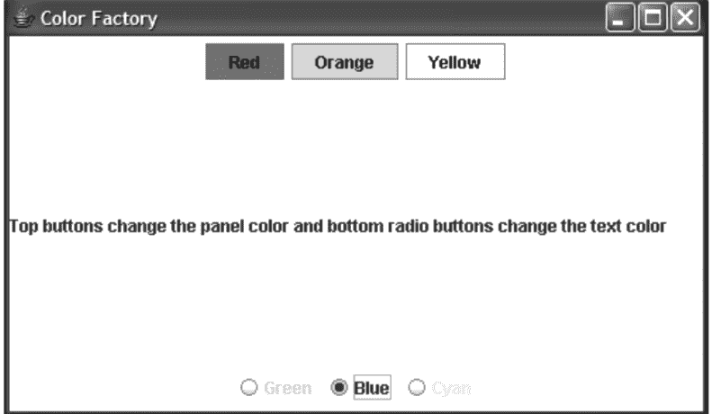
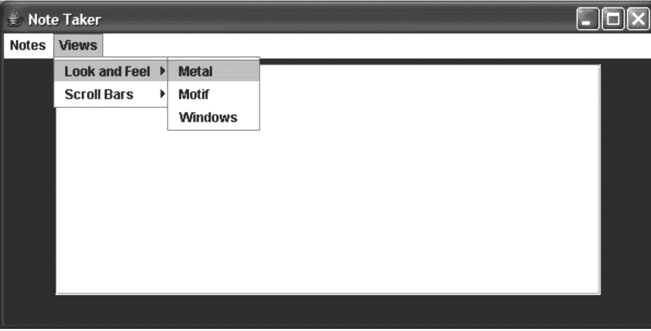
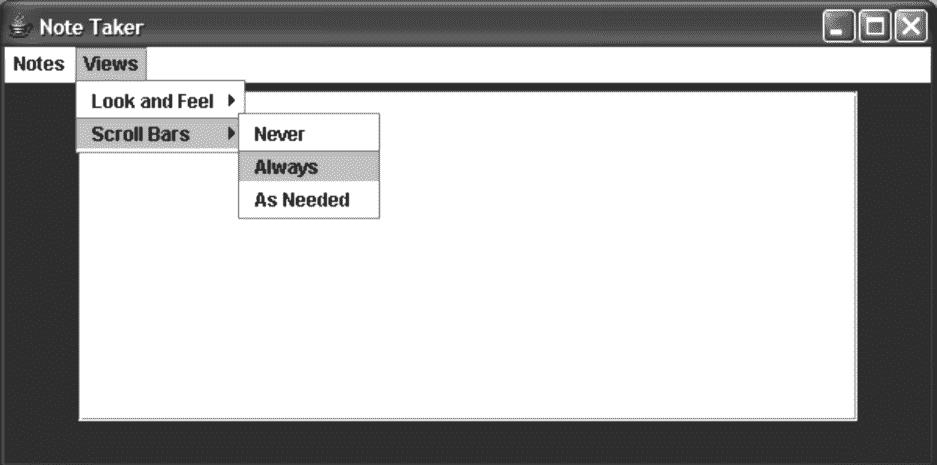
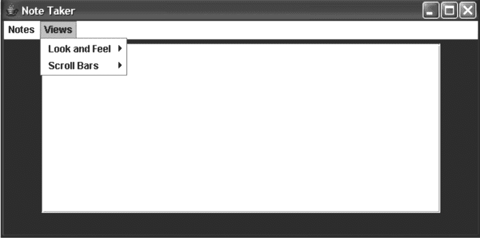
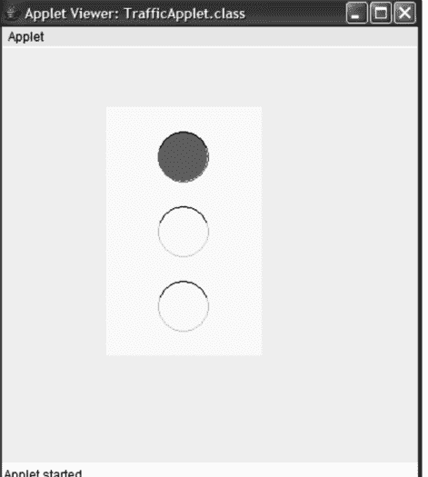

# Java 入门：从控制结构到对象实验手册

出版商 Greg Tobin

主编 Michael Hirsch

副编辑 Lindsey Triebel

封面设计 Nicole Clayton

高级营销经理 Michelle Brown

营销助理 Sarah Milmore

印前与制造 Carol Melville

补充材料协调员 Marianne Groth

校对员 Melanie Aswell

# 前言

## 关于本实验手册

本书配合 Tony Gaddis 编写的《Java入门：从控制结构到对象》一同使用。每个实验都让学生获得每章主要主题的实践经验。它专为封闭式实验室设计——即由教师监督的定期安排的课程，时长约为两小时。实验手册与教材章节对应。实验手册中的每一章都包含学习目标（一个或两个），以及供学生完成的各种任务，并列出了作为每个实验起始基础的代码列表。这些实验旨在在阅读了相应的教材章节之后、但在进行教材每章的编程挑战之前使用。

学生应当复制部分编写的代码（可在 `www.aw.com/support` 获取），并使用每个任务中提供的指令来完成代码，使其能够运行。指令将指导他们完成每个实验，并在部分编写的程序的特定位置添加代码。学生将获得编写代码、编译和调试、测试计划，以及最后执行和测试其程序的经验。

> 注意：实验 7 和实验 12 完全由学生根据各项任务中的指令自行编写，因此没有提供作为起始基础的代码。

## 你在本实验手册中将发现什么

实验手册包含 15 个实验，帮助学生学习如何应用基础编程概念：

## 补充材料

- 学生可以在 `www.aw.com/support` 找到实验的源代码，作者为“Christie”，标题为“Java入门：配套实验手册（Lab Manual to Accompany Starting Out with Java: From Control Structures to Objects）”。

教师资源中心可在 `www.aw.com/irc` 注册。解决方案文件代码由 Addison-Wesley 提供。

## 谢谢

我想感谢威斯康星大学-斯劳特分校的同事，他们为本实验手册提供的想法、耐心和支持。同时也感谢 Addison-Wesley 的所有支持。

## 第1章实验

### 算法、错误与测试

## 目标

- 能够编写算法
- 能够编译 Java 程序
- 能够使用 Java 执行程序
- 能够测试程序
- 能够调试带有语法和逻辑错误的程序

## 引言

你的老师将介绍 Java 的编程环境。在教材的第一章中，我们讨论了编写你的第一个程序。它通过工作时间乘以时薪来计算总工资。然而，并不总是这样计算的。如果你工作了45 小时呢？加班时间需要支付1倍。在本实验中，你将获得一个计算包含或不包含加班费的程序。为了输出结果，我们将使用伪代码来编写算法。这将使你在学习 Java 语言的同时练习算法。

你还需要测试此程序以确保算法的正确性。你需要开发代表用户可能使用的所有类型的数据。你也将调试程序。错误有几种。在本实验中，你将遇到语法错误和逻辑错误。我们将在实验2中探索运行时错误。

1. 语法错误——编程语言的“语法”。这些错误由编译器捕捉并列出行号和错误。你将通过经验理解它们告诉你的。所有的语法错误必须在程序运行之前修正。如果程序运行，并不意味着它是正确的，只意味着没有语法错误。错误的示例是变量名拼写错误、缺少分号、括号不匹配等。

2. 逻辑错误——算法逻辑中的错误。这些错误强调了对正确算法的需求。如果语句顺序错误、公式有错误或缺少步骤，程序仍然可以运行并输出，但输出可能是错误的。逻辑错误没有列表，除非检查输出，否则你可能意识不到自己有错误。知道预期的结果非常重要。你应该用不同的输入来测试程序，并知道每种情况下预期的输出。例如，如果你的程序计算工资，你应该检查三种不同的情况：少于40小时、40小时和超过40小时。在运行程序之前，手动计算每种情况，以便知道预期的结果。你可能会在一种情况下得到正确答案，但在另一种情况下却不会。这将帮助你找出逻辑错误在哪里。

## 任务 #1 编写算法

1. 从 `www.aw.com/cssupport` 或按照教师的指导复制 `Pay.java` 文件（参见代码列表 1.1）。
2. 按照教师的指导，在你的 Java 集成开发环境 (IDE) 或文本编辑器中打开该文件。检查该文件并将其与教材第 1.6 节第 3 步中的详细伪代码版本进行比较。注意，伪代码并不包含每一行代码。程序代码包含了标识符声明以及为了使 Java 能够从键盘读取的语句。这些内容并不是完成“计算薪水”实际任务的一部分，因此没有包含在伪代码中。示例伪代码与 Java 代码之间的唯一区别在于计算部分。下面是该示例的详细伪代码，但不包含计算部分。你需要填充这些行，用英文说明 `Pay.java` 的计算执行的内容。

显示：你工作了多少小时？

输入小时数

显示：每小时工资是多少？

输入费率

显示 pay 变量中的值。

## 任务 #2 编译并执行程序

1. 按照教师的指导，使用 Sun JDK 或 Java IDE 编译 `Pay.java`。
2. 你不应该收到任何错误信息。
3. 当此程序执行时，它会向用户请求输入。你应该手动计算几种不同的结果。你应该测试三种不同的情况：临界点、临界点以上的数字和临界点以下的数字。你手动计算是为了检查程序的逻辑。请在下表中填入你的测试用例以及手动计算得到的结果。
4. 使用你的第一组数据执行程序。记录你的结果。你需要执行程序三次以测试你的所有数据。注意：你不需要再次执行程序。一旦程序成功编译一次，就可以执行很多次。只有当你对代码进行更改时，你才需要重新编译。

| 小时 | 费率 | 薪水（手动计算） | 薪水（程序结果） |
|---|---|---|---|
| | | | |
| | | | |

## 任务 #3 调试 Java 程序

1. 按照教师的指导，从 `www.aw.com/cssupport` 复制 `SalesTax.java` 文件（参见代码列表 1.2）。
2. 按照教师的指导，在你的 IDE 或文本编辑器中打开该文件。此文件包含一个带有错误的简单 Java 程序。编译程序。你可能会得到语法错误列表。纠正所有的语法错误，在修复某些错误后，你可能需要重新编译。
3. 当所有语法错误都被纠正后，程序应该可以编译。与上一个练习一样，你可能需要准备一些测试数据。使用下表记录你的测试数据以及计算的结果。
4. 使用你的测试数据执行程序并记录结果。如果程序的输出与你计算的结果不符，通常表示存在逻辑错误。检查程序并纠正逻辑错误。再次编译程序并使用测试数据执行。重复此过程，直到所有输出都符合预期。

| 项目 | 价格 | 税费 | 总计（计算） | 总计（输出） |
|---|---|---|---|---|
| | | | | |

```java
//此程序计算用户的总薪水
import java.util.Scanner;      //为了能够从键盘读取

public class Pay
{
    public static void main(String [] args)
    {
        //创建一个Scanner对象以从键盘读取
        Scanner keyboard = new Scanner(System.in);

        //标识符声明
        double hours;              //工作小时数
        double rate;              //每小时工资率
        double pay;               //总薪水

        //显示提示并获取输入
        System.out.print("How many hours did you work? ");
        hours = keyboard.nextDouble();

        System.out.print("How much do you get paid per hour? ");
        rate = keyboard.nextDouble();

        //计算
        if(hours <= 40)
            pay = hours * rate;
        else
            pay = (hours - 40) * (1.5 * rate) + 40 * rate;

        //显示结果
        System.out.println("You earned $" + pay);
    }
}
```


```java
import java.util.Scanner;

public class SalesTax
{
    public static void main(String[] args)
    {
        // 标识符声明
        final double TAX_RATE = 0.055;
        double price;
        double tax;
        double total;
        String item;

        // 创建一个 Scanner 对象以从键盘读取
        Scanner keyboard = new Scanner(System.in);

        // 显示提示并获取输入
        System.out.print("Item description: ");
        item = keyboard.nextLine() + " $$";
        System.out.print("Item price: ");
        price = keyboard.nextDouble();

        // 计算
        tax = price * TAX_RATE;
        total = price + tax;

        // 显示结果
        System.out.print(item + " $$");
        System.out.println(price);
        System.out.print("Tax ");
    }
}
```

# 第 2 章 实验

## 目标

- 编写算术表达式完成任务
- 使用强制类型转换
- 使用字符串方法
- 使用 `Scanner` 类或对话框与用户交互
- 从伪代码创建程序
- 文档程序

## 简介

本实验室旨在让你练习 Java 的基础知识。我们将通过查看数学公式来纠正逻辑错误，继续第 1 章的思路。我们将探索整数除法与计算器除法的区别。同样，在 Java 中，我们提供了用于操作程序的数学操作，可以在 `Math` 类中使用。我们将学习如何使用 `Math` 类在球体积公式中立方半径。

本实验室还介绍了与用户的交互。我们在第 1 章已经看到了控制台的输入输出。现在我们需要学习如何编写输入，通过研究使用 `Scanner` 类需要添加的代码行。我们还将学习输出的方法。

或者，你可以使用对话框与用户交互。通过 `JOptionPane` 类探索图形用户界面 (GUI) 编程。

引入 `String` 类，我们将使用一些可用方法为字符串处理做准备。

我们将通过创建一个程序将所学结合起来。最后，你通过添加注释来记录程序。注释不是给计算机的，而是给程序员使用的。它们有助于程序员记录程序的功能以及如何实现这些功能。当程序员需要修改他人编写的代码时，这非常重要。

### 任务 #1 纠正公式中的逻辑错误

1. 从 www.aw.com/cssupport 或按照教师的指导下载 `NumericTypes.java` 文件（参见代码列表 2.1）。
2. 编译源文件，运行程序并观察输出。部分输出是**错误**的。你需要**纠正平均值公式和温度转换公式中的逻辑错误**。逻辑错误可能是由于类型之间的转换、运算顺序或公式问题引起的。必要的公式是：

   `average = score1 + score2 / numberOfScores`
   
   `C = 5/9(F - 32)`

3. 每当你对程序进行更改时，必须重新编译使更改生效，然后再次运行程序。
4. 在继续之前，确保输出是合理的。95 和 100 的平均值应该是 97.5，水沸腾的温度是 100 摄氏度。

### 任务 #2 使用 Scanner 类进行用户输入

1. 在类声明上方添加 `import`，使你的程序可以使用 `Scanner` 类。
2. 在 `main` 方法中，创建一个 `Scanner` 对象并将其连接到 `System.in` 对象。
3. 提示用户输入其名。
4. 使用 `next` 方法从键盘读取名称，并将其存储在名为 `firstName` 的变量中（你需要声明使用的任何变量）。
5. 提示用户输入其姓。
6. 从键盘读取名称并将其存储在名为 `lastName` 的变量中。
7. 将 `firstName` 和 `lastName` 拼接，中间加空格，并将结果存储在名为 `fullName` 的变量中。
8. 打印 `fullName`。
9. 使用你的名字作为测试数据进行编译、调试和运行。
10. 由于我们是在同一个程序上进行添加，每次运行程序时，我们会在当前任务的输出之前获得之前任务的输出。

### 任务 #2（备）使用对话框进行用户输入

1. 在类声明上方添加 `import` 语句，使你的程序可以使用 `JOptionPane` 类。
2. 在 `main` 方法中，通过显示输入对话框提示用户输入其名，并将用户输入存储在名为 `firstName` 的变量中（你需要声明使用的任何变量）。
3. 通过显示输入对话框提示用户输入其姓，并将用户输入存储在名为 `lastName` 的变量中。
4. 将 `firstName` 和 `lastName` 拼接，中间加空格，并将结果存储在名为 `fullName` 的变量中。
5. 使用消息对话框显示 `fullName`。
6. 使用你的名字作为测试数据进行编译、调试和运行。
7. 由于我们是在同一个程序上进行添加，每次运行程序时，我们会在当前任务的输出之前获得之前任务的输出。

### 任务 #3 处理字符串

1. 使用 `charAt` 方法获取 `firstName` 中的第一个字符，并存储在名为 `firstinitial` 的变量中（你需要声明使用的任何变量）。
2. 打印用户的首字母。
3. 使用 `toUpperCase` 方法将 `fullName` 转换为全大写，并将其存回 `fullName` 变量中。
4. 添加一行打印 `fullName` 的值以及 `fullName` 存储的字符串包含多少个字符（包括空格）（使用 `length` 方法获取该信息）。
5. 编译、调试并运行。在之前任务输出之后添加的新输出应该包含你的首字母和全大写的全名。

### 任务 #4 使用预定义的 Math 函数

1. 添加一行提示用户输入球的直径。
2. 读取并将该数字存储在名为 `diameter` 的变量中（你需要声明使用的任何变量）。
3. 直径是半径的两倍，因此计算并将半径存储在一个命名恰当的变量中。
4. 球体体积的公式为 $V = \frac{4}{3}\pi r^3$。
5. 使用适当的消息将你的结果打印到屏幕上。
6. 使用以下测试数据进行编译、调试和运行，并记录结果。

将公式转换为 Java，并添加一行计算并将体积值存储在命名恰当的变量中。使用 `Math.PI` 表示 $\pi$，并使用 `Math.pow` 计算半径的立方。

| 直径 | 体积（手动计算） | 体积（输出结果） |
| :--- | :--- | :--- |
| 2 | | |
| 25.4 | | |
| 875.000 | | |

### 任务 #5 从零开始创建程序

在此任务中，学生将创建一个计算每加仑英里数的新程序。学生将使用字符串表达式、赋值语句、输入和输出语句与用户通信。

1. 在你的 IDE 或文本编辑器中创建一个新文件。
2. 通过输入以下内容创建你第一个程序的框架：

```java
public class Mileage
{
    public static void main(String[] args)
    {
        // 在此处添加你的声明和代码
    }
}
```

3. 将文件保存为 `Mileage.java`。
4. 将下面的算法转换为 Java。不要忘记在变量使用之前进行声明。每个变量必须是一个单词（不能有空格）。

# 第 3 章 实验：选择控制结构

## 目标

- 能够构建布尔表达式来评估给定的条件
- 能够比较字符串
- 能够使用标记
- 能够构建 `if` 和 `if-else-if` 语句来执行特定任务
- 能够构建 `switch` 语句
- 能够对数字进行格式化

## 引言

到目前为止，你编写的所有程序都具有顺序控制结构。这意味着所有语句都按顺序一个接一个地执行。有时，我们需要让计算机根据数据做出决策。选择控制结构允许计算机选择执行哪条语句。

为了让计算机做出决策，我们需要进行比较。因此，我们将学习编写布尔表达式。布尔表达式使用关系运算符和逻辑运算符来创建一个可以评估为真或假的条件。

一旦我们有了条件，就可以根据条件选择性执行语句。这意味着程序中的某些语句可能会执行，也可能不执行，取决于条件。

我们还可以将条件语句链在一起，允许计算机从几种方案中进行选择。我们将通过嵌套的 `if-else` 语句以及 `switch` 语句来探索这一点。

在实验中，我们将修改一个披萨订单程序。该程序根据用户所需的规格创建一个披萨对象。它会引导用户点餐，提供用户选择，程序然后根据这些选择来决定如何制作披萨以及披萨的成本。如果用户的名字是 Mike 或 Diane，他们还将获得 $2.00 的折扣。

### 任务 #1 if 语句、字符串比较和标记

1. 从 www.aw.com/support 或按照教师的指示复制 `PizzaOrder.java` 文件（参见代码列表 3.1）。
2. 编译并运行 `PizzaOrder.java`。你将能够进行选择，但此时，无论你选择什么，都将获得一个基础价格为 $12.99 的手拍披萨。你可以选择配料，这些配料应该被正确地添加到价格中。你还会注意到输出格式看起来并不漂亮。因此，我们需要编辑 `PizzaOrder.java` 来完成程序，使其正常工作。
3. 构建一个简单的 `if` 语句。该条件将用户输入的第一个名字字符串与所有者 Mike 和 Diane 的名字进行比较。请确保比较是不区分大小写的。
4. 如果用户拥有其中一个名字，则将折扣标记设置为 `true`。这在此时不会影响价格。

### 任务 #2 if-else-if 语句

1. 编写一个 `if-else-if` 语句，根据用户输入的尺寸（10, 12, 14 或 16）让计算机选择执行哪条语句。对于每个选项，都需要将成本设置为相应的金额。
2. 上述 `if-else` 语句的默认 `else` 应该打印一条语句，说明用户输入的不是选项之一，因此将制作 12 英寸的披萨。它还应该将尺寸设置为 12，成本设置为 12.99。
3. 编译、调试并运行。你现在应该能够获得尺寸和价格的正确输出（它仍然是手拍饼底，输出看起来不像金钱，而且尚未应用折扣）。多次运行你的程序，分别订购 10、12、14、16 和 17 英寸的披萨（注：17 英寸将用于测试 `else` 逻辑）。

### 任务 #3 switch 语句

1. 编写一个 `switch` 语句，将用户的选择与相应的字符进行比较（确保大写字母和小写字母都可以用）。
2. 每个 `case` 将指示饼底类型的相应字符串赋值给 `crust` 变量。
3. `default` 情况将打印一条语句，说明用户输入的不是选项之一，因此将制作手拍饼底。
4. 编译、调试并运行。你现在应该能够获得手拍以外的饼底类型。多次运行你的程序，以确保 `switch` 语句的所有情况运行正常。

### 任务 #4 使用标记作为条件

1. 编写一个使用标记作为条件的 `if` 语句。记住标记是一个布尔变量，因此为 `true` 或 `false`。它不需要与任何内容进行比较。
2. `if` 语句体应包含两个语句：
   a) 打印消息的语句，表明用户有资格获得 $2.00 的折扣。
   b) 将变量成本减少 2 的语句。
3. 编译、调试并运行。使用所有者的名字（包括大写和非大写）以及不同的名字来测试你的程序。此时折扣应该是正确的。

### 任务 #5 数字格式化

1. 在类声明上方添加 `import` 语句以使用 `DecimalFormat` 类。
2. 创建一个始终显示 2 位小数的 `DecimalFormat` 对象。
3. 编辑 `main` 方法中的相应行，使任何货币输出都保留 2 位小数。
4. 编译、调试并运行。此时你的输出应该是完全正确的，数字输出应该看起来像金钱。

```java
import java.util.Scanner;
import java.text.DecimalFormat;

/**
 * 此程序允许用户订购披萨。
 */
public class PizzaOrder {
    public static void main(String[] args) {
        Scanner keyboard = new Scanner(System.in);
        String firstName;
        boolean discount = false;
        int inches;
        char crustType;
        String toppings = "";
        int numberOfToppings = 0;
        double cost = 12.99;
        final double TAX_RATE = .08;
        double tax;
        DecimalFormat df = new DecimalFormat("$0.00");

        System.out.println("Welcome to Mike and Diane's Pizza");
        System.out.print("Enter first name: ");
        // ... 省略部分代码逻辑

        cost = cost + (1.25 * numberOfToppings);

        // 显示订单确认
        System.out.println("Your order is as follows: ");
        System.out.println(inches + " inch pizza");
        System.out.println(crustType + " crust");
        System.out.println(toppings);

        // 如果用户符合条件则应用折扣
        // 在此处为任务 #4 添加代码

        // 为任务 #5 修改程序
        // 使得所有金额输出都保留 2 位小数
        System.out.println("The cost of your order is: " + df.format(cost));

        // 计算并显示税费和总费用
        tax = cost * TAX_RATE;
        System.out.println("The tax is: " + df.format(tax));
        System.out.println("The total due is: " + df.format(tax + cost));

        System.out.println(
            "Your order will be ready for pickup in 30 minutes.");
    }
}
```

# 第 4 章 实验：循环与文件

## 实验目标

- 能够将使用控制结构的算法转换为 Java
- 能够编写 `while` 循环
- 能够编写 `do-while` 循环
- 能够编写 `for` 循环
- 能够使用 `Random` 类生成随机数
- 能够使用文件流处理文件末尾（EOF）
- 能够编写读取到文件末尾的循环
- 能够实现累加器和计数器

## 介绍

这是一个掷骰子的模拟实验。只有当样本量很大时，实际结果才会接近理论。因此，我们需要重复掷骰子很多次（我们将使用 10,000 次）。掷出特定数字点数的理论概率是 1/36，或者说在每掷出一对骰子的 10,000 次中大约有 278 次。由于这是一个模拟过程，每次运行时的数字会有细微变化。

查看如何使用随机数生成器（在书中第 4.11 节介绍）来获取 1 到 6 之间的数字，以创建模拟实验。

我们将继续使用已经学过的控制结构，同时探索用于重复的控制结构。我们还将继续算法工作，将给定的算法转换为 Java 以完成我们的程序。我们将从一个 `while` 循环开始，然后使用同一个程序，将循环改为 `do-while` 循环，然后是 `for` 循环。

我们将学习文件输入和输出。我们将逐行读取文件，将每行转换为一个数字。然后我们将使用这些数字计算平均值和标准差。

首先，我们将学习如何使用文件输出将结果保存到文件中。接下来我们将使用文件输入从文件中读取数字并计算平均值。最后，我们发现当文件关闭并重新打开时，我们将再次从文件开头开始读取，以便计算标准差。

### 任务 #1 While loop

1. 从 www.aw.com/cssupport 或按照老师指示复制 `DiceSimulation.java` 文件（见代码列表 4.1）。`DiceSimulation.java` 是不完整的。由于缺少了大部分程序，如果你运行 `DiceSimulation.java`，输出将是错误的。
2. 我已经声明了所有变量。你需要添加代码来模拟掷骰子并跟踪点数相同。将下面的算法转换为 Java，并将其放在 `main` 方法中、变量声明之后、输出语句之前。你将使用几个控制结构：一个 `while` 循环和一个嵌套在另一个语句中的 `if-else` 语句。算法的缩进将帮助你判断哪些内容包含在循环中，哪些包含在语句中，哪些包含在嵌套的 `if-else-if` 语句中。
3. 要“掷”骰子，使用随机数生成器的 `nextInt` 方法生成一个 1 到 6 之间的整数。

当掷骰次数小于骰子应该掷的次数时重复执行：

- 通过“掷”第一颗骰子获取第一个骰子的值
- 通过“掷”第二颗骰子获取第二个骰子的值
- 如果第一个骰子的值与第二个骰子的值相等
  - 如果第一个骰子的值为 1：累加掷出“蛇眼”（两个1）的次数
  - 否则如果第一个骰子的值为 2：累加掷出 2 的次数
  - 否则如果第一个骰子的值为 3：累加掷出 3 的次数
  - 否则如果第一个骰子的值为 4：累加掷出 4 的次数
  - 否则如果第一个骰子的值为 5：累加掷出 5 的次数
  - 否则如果第一个骰子的值为 6：累加掷出 6 的次数
- 累加掷骰子的次数

4. 编译并运行。对于每一对不同的点数，你应该得到相当接近 278 的数字。运行几次。你应该得到与第一次不同的结果，但仍然应该接近 278。

### 任务 #2 使用其他类型的循环

1. 将循环改为 `do-while` 循环。编译并运行。你应该得到相同的结果。
2. 将循环改为 `for` 循环。编译并运行。你应该得到相同的结果。

### 任务 #3 输出内容到文件

1. 从 www.aw.com/cssupport 或按照老师指示复制文件 `StatsDemo.java`（见代码列表 4.2）和 `Numbers.txt`。
2. 首先，我们将输出写入到文件：
   a) 创建一个 `PrintWriter` 对象并传递文件名“Results.txt”。
   b) 使用 `PrintWriter` 对象并在 `main` 方法头中添加 `throws` 子句。
   c) 将平均值和标准差输出到文件。
   d) 关闭文件。
3. 编译、调试并运行。运行程序会创建一个名为 **Results.txt** 的文件。此时得到的输出应该是：mean = 0.000, standard deviation = 0.000。

### 任务 #4 计算平均值

1. 创建一个 `File` 对象并传入文件名。
2. 创建一个 `Scanner` 对象。
3. 将累加和计数器初始化为 0。
4. 编写一个读取到文件末尾的循环。
   a) 从文件中读取 `double`。
   b) 将读取到的值加到累加器。
   c) 计数器加 1。
5. 循环结束时关闭文件。
6. 通过除以计数器计算平均值。
7. 编译、调试并运行。你应该得到平均值 77.444，但标准差仍然是 0。

### 任务 #5 计算标准差

1. 创建一个 `File` 对象并传入文件名。
2. 创建一个 `Scanner` 对象并传入 `File` 对象。
3. 初始化数字之和为 0。
4. 初始化累加的数字个数为 0。
5. 编写一个循环，直到到达文件末尾。
   a) 读取一个 `double` 值并减去平均值。
   b) 将差的平方加到累加器。
   c) 计数器加 1。
6. 关闭输入文件。
7. 存储计算出的标准差。

```java
/**
 * 此类模拟掷一对骰子 10,000 次，并
 * 计算每对点数掷出双倍的次数。
 */
public class DiceSimulation
{
    public static void main(String[] args)
    {
        final int NUMBER = 10000;      // 掷骰子的次数

        // 模拟掷骰子使用的随机数生成器
        Random generator = new Random();

        int die1Value;                  // 第一颗骰子的值
        int die2Value;                  // 第二颗骰子的值
        int count = 0;                  // 掷骰子的次数
        int snakeEyes = 0;              // 掷出“蛇眼”次数
        int twos = 0;                   // 掷出双2的次数
        int threes = 0;                 // 掷出双3的次数
        int fours = 0;                  // 掷出双4的次数
        int fives = 0;                  // 掷出双5的次数
        int sixes = 0;                  // 掷出双6的次数
    }
}
```

代码列表 4.1 延续见下一页。

```java
// 在此处输入你的算法代码

System.out.println("你掷出了双蛇眼 " + 
    snakeEyes + "，共 " + count + " 次.");
System.out.println("你掷出了双二 " + twos + 
    "，共 " + count + " 次.");
System.out.println("你掷出了双三 " + 
    threes + "，共 " + count + " 次.");
System.out.println("你掷出了双四 " + fours + 
    "，共 " + count + " 次.");
System.out.println("你掷出了双五 " + fives + 
    "，共 " + count + " 次.");
System.out.println("你掷出了双六 " + sixes + 
    "，共 " + count + " 次.");
}
```

```java
import java.text.DecimalFormat; // 用于数字格式化
import java.util.Scanner; // 用于键盘输入
import java.io.*; // 用于使用文件

public class StatsDemo
{
    public static void main(String[] args) throws Exception
    {
        double sum = 0; // 数字之和
        int count = 0; // 累加的数字个数
        double mean = 0; // 数值的平均值
        double stdDev = 0; // 数值的标准差
        double difference; // 数值与平均值之间的差

        // 创建 DecimalFormat 类型的对象
        DecimalFormat threeDecimals = new DecimalFormat("0.000");
        // 创建 Scanner 类型的对象
        Scanner keyboard = new Scanner(System.in);
        String filename; // 用户输入的文件名
        // 提示用户并读取文件名
        System.out.println("此程序计算一个包含一系列数字文件的统计数据");

        // 编写一个循环从文件中读取，直到到文件末尾
        // 从文件中读取一个 double 并将其加到 sum 中
        // 计数器加 1
        // 关闭输入文件
        // 存储计算出的平均值

        // 在此处添加任务 #5 的代码
        // 创建一个 File 对象并传入文件名
        // 创建一个 Scanner 对象并传入 File 对象
        // 初始化数字之和
        // 初始化累加的数字个数
        // 编写一个循环，直到到达文件末尾
        // 读取一个 double 值并减去平均值
        // 将差的平方加到 sum 中
        // 计数器加 1
        // 关闭输入文件
        // 存储计算出的标准差

        // 在此处添加任务 #3 的代码
        // 创建一个 PrintWriter 类型的对象
        // 使用 "Results.txt" 作为文件名
        // 将结果打印到输出文件
        // 关闭输出文件
    }
}
```

# 第 5 章 实验：方法

## 目标
- 能够编写方法
- 能够调用方法
- 能够编写 javadoc 注释
- 能够使用 javadoc 为 Java 类创建 HTML 文档

## 简介
方法通常用于将问题分解为小的、易于管理的单元。一个大任务可以分解为较小的任务（方法），这些任务包含了如何完成该小任务的细节。然后通过按顺序实现较小的任务（调用方法）来解决大问题。

这也为了提高效率，因为方法可以根据需要多次调用，而无需每次都重新编写代码。

最后，我们将为每个方法使用文档注释，并生成与我们见过的 Java API 类似的 HTML 文档。

### 任务 #1 void 方法

1. 复制 `Geometry.java` 文件（代码列表 5.1）。按照老师的要求完成该文件。该程序可以编译，但在运行时，它似乎什么都不做。在 `main` 方法上方，为 `Geometry` 类创建一个名为 `printMenu` 的静态方法，它没有参数且没有返回值。该方法将向用户显示如下菜单：
   ```
   这是一个几何计算器
   1. 圆形的面积
   2. 矩形的面积
   3. 三角形的面积
   4. 圆形的周长
   5. 矩形的周长
   6. 三角形的周长
   你的选择：
   ```
2. 在 `main` 方法中添加代码来调用 `printMenu` 方法。使用 `do-while` 循环允许用户选择任何选项。
3. 编译、调试并运行程序。

### 任务 #2 返回值的方法

1. 编写一个名为 `circleArea` 的静态方法，接收半径并返回 $\pi r^2$。
2. 编写一个名为 `rectangleArea` 的静态方法，接收长度和宽度并返回 $lw$。
3. 编写一个名为 `triangleArea` 的静态方法，接收底和高并返回 $\frac{1}{2}bh$。
4. 编写一个名为 `circleCircumference` 的静态方法，接收半径并返回 $2\pi r$。
5. 编写一个名为 `rectanglePerimeter` 的静态方法，接收长度和宽度并返回 $2l+2w$。
6. 编写一个名为 `trianglePerimeter` 的静态方法，接收三边长度并返回 $s1+s2+s3$。

### 任务 #3 调用方法

1. 在 `main` 方法中添加代码调用这些方法。
2. 在下方编写一些示例数据来测试方法。
3. 编译、调试并运行。

### 任务 #4 Java 文档

1. 为你的每个方法编写 javadoc 注释。它们应该包含：
   - 方法功能的一行总结。
   - 方法所需的参数描述。
   - `@param` 参数列表。
   - `@return` 返回信息的描述。

```java
import java.util.Scanner;

/**
 * 此程序演示静态方法
 */
public class Geometry
{
    public static void main(String[] args)
    {
        int choice; // 用户的选择
        double value = 0; // 方法返回的值
        char letter; // 用户决定是否退出的 Y 或 N

        double radius; // 圆形的半径
        double length; // 矩形的长度
        double width; // 矩形的宽度
        double height; // 三角形的高
        double base; // 三角形的底
        double side1; // 三角形的第一边
        double side2; // 三角形的第二边
        double side3; // 三角形的第三边

        // 创建一个 Scanner 对象以从键盘读取
        Scanner keyboard = new Scanner(System.in);

        // 使用 do 循环允许首次显示菜单
        do
        {
            // 调用 printMenu 方法
            printMenu();
            choice = keyboard.nextInt();

            switch (choice)
            {
                case 1:
                    System.out.print("输入圆形的半径: ");
                    radius = keyboard.nextDouble();
                    // 调用 circleArea 方法并将结果存储在 value 中
                    value = circleArea(radius);
                    System.out.println("圆形的面积是 " + value);
                    break;

                case 2:
                    System.out.print("输入矩形的长度: ");
                    length = keyboard.nextDouble();
                    System.out.print("输入矩形的宽度: ");
                    width = keyboard.nextDouble();
                    // 调用 rectangleArea 方法并将结果存储在 value 中
                    value = rectangleArea(length, width);
                    System.out.println("矩形的面积是 " + value);
                    break;

                case 3:
                    System.out.print("输入三角形的高度: ");
                    height = keyboard.nextDouble();
                    System.out.print("输入三角形的底: ");
                    base = keyboard.nextDouble();
                    // 调用 triangleArea 方法并将结果存储在 value 中
                    value = triangleArea(base, height);
                    System.out.println("三角形的面积是 " + value);
                    break;

                case 4:
                    System.out.print("输入圆形的半径: ");
                    radius = keyboard.nextDouble();
                    // 调用 circleCircumference 方法并将结果存储在 value 中
                    value = circleCircumference(radius);
                    System.out.println("圆形的周长是 " + value);
                    break;

                case 5:
                    System.out.print("输入矩形的长度: ");
                    length = keyboard.nextDouble();
                    System.out.print("输入矩形的宽度: ");
                    width = keyboard.nextDouble();
                    // 调用 rectanglePerimeter 方法并将结果存储在 value 中
                    value = rectanglePerimeter(length, width);
                    System.out.println("矩形的周长是 " + value);
                    break;

                case 6:
                    System.out.print("输入三角形的边 1 长度: ");
                    side1 = keyboard.nextDouble();
                    System.out.print("输入三角形的边 2 长度: ");
                    side2 = keyboard.nextDouble();
                    System.out.print("输入三角形的边 3 长度: ");
                    side3 = keyboard.nextDouble();
                    // 调用 trianglePerimeter 方法并将结果存储在 value 中
                    value = trianglePerimeter(side1, side2, side3);
                    System.out.println("三角形的周长是 " + value);
                    break;
                default:
                    System.out.println("你没有输入有效的选择。");
            }
            // 消耗数字后的换行符
            keyboard.nextLine();

            System.out.println("你想退出程序吗 (Y/N)?: ");
            String answer = keyboard.nextLine();
            letter = answer.charAt(0);
        } while (letter != 'Y' && letter != 'y');
    }

    // 任务 #1: printMenu 方法
    public static void printMenu() {
        System.out.println("这是一个几何计算器");
        System.out.println("1. 圆形的面积");
        System.out.println("2. 矩形的面积");
        System.out.println("3. 三角形的面积");
        System.out.println("4. 圆形的周长");
        System.out.println("5. 矩形的周长");
        System.out.println("6. 三角形的周长");
        System.out.print("你的选择：");
    }

    // 任务 #2: 返回值的方法
    public static double circleArea(double radius) {
        return Math.PI * radius * radius;
    }

    public static double rectangleArea(double length, double width) {
        return length * width;
    }

    public static double triangleArea(double base, double height) {
        return 0.5 * base * height;
    }

    public static double circleCircumference(double radius) {
        return 2 * Math.PI * radius;
    }

    public static double rectanglePerimeter(double length, double width) {
        return 2 * length + 2 * width;
    }

    public static double trianglePerimeter(double side1, double side2, double side3) {
        return side1 + side2 + side3;
    }
}
```

# 第 6 章 实验：类与对象

## 目标

- 能够声明新类
- 能够编写构造函数
- 能够编写返回值的实例方法
- 能够编写带有参数的实例方法
- 能够实例化对象
- 能够使用调用实例方法来访问和更改对象的状态

## 引言

每个人对电视机都很熟悉。这就是我们将在本实验中创建的对象。首先，我们需要一个蓝图。所有制造商在生产的电视中都有相同的基本元素，也有许多选项。我们将处理所有电视共有的几个基本元素。想一下一台普通的电视。它有一个品牌名称（由特定制造商制造）。电视屏幕有特定的尺寸。它有一些基础控制按钮。有一个开关电源的控制按钮。有一个切换频道的控制按钮。还有一个音量控制按钮。在任何时刻，电视的状态都可以通过这些控制按钮的设置来描述。

我们将编写 `Television` 类。从 `Television` 类创建的每个对象都必须拥有字段的实例。因此，电视的状态将具有以下属性：

- **manufacturer**（制造商）。`manufacturer` 属性将持有品牌名称。电视创建后，该属性无法更改，因此它是一个命名常量。
- **screenSize**（屏幕尺寸）。`screenSize` 属性将持有电视屏幕的大小。电视创建后，该属性无法更改，因此它是一个命名常量。
- **powerOn**（电源状态）。如果电源开启，该属性持有 `true` 值；如果关闭，则持有 `false`。
- **channel**（频道）。`channel` 属性将持有电视正在显示的电台频道值。
- **volume**（音量）。`volume` 属性将持有一个代表响度的数值值（0 表示无声）。

这些属性成为我们类中的字段。电视对象还能控制其属性的状态。这些控制功能是类中的方法。

- **setChannel**：`setChannel` 方法将所需的状态存储在 `channel` 字段中。
- **power**：`power` 方法将在开启和关闭之间切换电源，将存储在 `powerOn` 中的值从 `false` 更改为 `true` 或从 `true` 更改为 `false`。
- **increaseVolume**：`increaseVolume` 方法将 `volume` 字段中存储的值加 1。
- **decreaseVolume**：`decreaseVolume` 方法将 `volume` 字段中存储的值减 1。
- **getChannel**：`getChannel` 方法返回 `channel` 字段的值。
- **getVolume**：`getVolume` 方法返回 `volume` 字段的值。
- **getManufacturer**：`getManufacturer` 方法返回品牌名称。
- **getScreenSize**：`getScreenSize` 方法返回电视屏幕的尺寸。

### 任务 #1 创建类

1. 在新文件中，创建一个名为 `Television` 的类。
2. 在顶部添加头信息（文档）：
   ```java
   // 此类的目的是模拟一台电视机
   // 你的姓名和今天的日期
   ```
3. 在 UML 图中声明常量字段。
4. 在 UML 图中声明剩余字段。
5. 为每个字段编写注释说明其代表含义。
6. 将此文件保存为 `Television.java`。
7. 编译并调试。

### 任务 #2 编写构造函数

1. 创建一个带有两个参数（制造商和屏幕尺寸）的构造函数。
2. 在构造函数内部，将传入的值赋值给字段。
3. 将 `powerOn` 初始化为 `false`（关闭），音量初始化为 20，频道为 2。
4. 在方法头上方编写描述构造函数目的的注释。
5. 编译并调试。

### 任务 #3 方法

1. 定义 `getVolume`、`getChannel`、`getManufacturer` 和 `getScreenSize` 访问方法，返回相应字段的值。
2. 定义一个修改方法 `setChannel`，接收一个值并存储在 `channel` 字段中。
3. 定义一个名为 `power` 的修改方法，将状态从 `false` 变为 `true`。如果布尔变量 `powerOn` 为 `true`，则变为反之。这可以使用非运算符 (`!`) 实现。使用赋值语句：`powerOn = !powerOn;` 更改 `powerOn` 的状态并将其存回 `powerOn`。
4. 定义两个修改音量的方法。一个方法名为 `increaseVolume`，增加 1。另一个方法名为 `decreaseVolume`，减少 1。
5. 在每个方法头上方编写 Javadoc 注释。
6. 编译并调试。

### 任务 #4 运行应用程序

1. 你只能执行带有 `main` 方法的程序，因此有一个编写好的程序用于测试你的 `Television` 类。从提供的源代码或根据教师指示复制文件 `TelevisionDemo.java`（代码列表 6.1）。确保它与 `Television.java` 位于同一目录下。
2. 编译并运行 `TelevisionDemo` 并按照提示操作。
3. 如果你的输出与下方的输出匹配，则 `Television.java` 是完整且正确的。你不需要为此实验对其进行进一步修改。

输出（**粗体为用户输入**）

一台 55 英寸的松下电视已开启。
看哪个频道？**56**
频道: 56 音量: 21
太大了！！我正在降低音量。
频道: 56 音量: 15

### 任务 #5 创建另一个电视实例

1. 编辑 `TelevisionDemo.java` 文件。
2. 声明另一个名为 `portable` 的电视机对象。
3. 实例化 `portable` 为一台 19 英寸的 Sharp 电视机。
4. 调用 `power` 方法开启电源。
5. 调用访问器方法打印开启了哪台电视机。
6. 调用修改器方法将通道更改为用户的喜好，并将音量减二。
7. 调用访问器方法打印 `portable` 改变后的状态。
8. 编译并调试此类。
9. 再次运行 `TelevisionDemo`。
10. 任务 #5 的输出将在上述输出之后出现，因为我们在程序的末尾添加了内容。任务 #5 的输出如下。

输出（**粗体部分为用户输入**）

一台 19 英寸的 Sharp 电视机已开启。
你想看哪个频道？**7**
频道： 7 音量： 18


```java
import java.util.Scanner;

/** 此类演示了 Television 类 */

public class TelevisionDemo {

    public static void main(String[] args) {

        // 创建一个 Scanner 对象从键盘读取输入
        Scanner keyboard = new Scanner(System.in);

        // 声明变量
        int station; // 用户的通道选择

        // 声明并实例化一个电视对象
        Television bigScreen = new Television("Toshiba", 55);

        // 开启电源
        bigScreen.power();

        // 显示电视状态
        System.out.println("A " + bigScreen.getScreenSize() + \
            bigScreen.getManufacturer() +
            " has been turned on.");

        // 提示用户输入并存储到 station 中
        System.out.print("What channel do you want?");
        station = keyboard.nextInt();

        // 更改电视通道
        bigScreen.setChannel(station);

        // 增大电视音量
        bigScreen.increaseVolume();

        // 显示电视当前的通道和音量
        System.out.println("Channel: " +
            bigScreen.getChannel() +
            " Volume: " + bigScreen.getVolume());
    }
}
```

代码列表 6.1 继续于下一页。

# 第 6 章 实验 类与对象 59

```java
System.out.println(
    "Too loud! I am lowering the volume.");

// 减小电视音量
bigScreen.decreaseVolume();
bigScreen.decreaseVolume();
bigScreen.decreaseVolume();
bigScreen.decreaseVolume();
bigScreen.decreaseVolume();
bigScreen.decreaseVolume();

// 显示电视当前的通道和音量
System.out.println("Channel: " +
    bigScreen.getChannel() +
    " Volume: " + bigScreen.getVolume());

System.out.println(); // 用于留空行

// 在这里你执行任务 #5
```

# 第 7 章 实验 GUI

## 目标

- 能够创建一个可以关闭的窗口
- 能够创建包含按钮的面板
- 能够使用不同的布局
- 能够处理按钮事件

## 引言

在本实验中，我们将创建一个图形用户界面（GUI），允许用户选择一个按钮来更改中心面板的颜色，并选择单选按钮来更改中心面板文本的颜色。我们需要使用多种 Swing 组件来完成此任务。

我们将构建两个面板：一个包含三个按钮的顶部面板和一个包含三个单选按钮的底部面板。将使用布局（Layouts）将这些面板添加到窗口的指定位置。窗口将添加一个包含说明的标签。将使用监听器（Listeners）来处理用户所需的事件。
我们的最终 GUI 应该如下



## 任务 #1 创建 GUI

1. 导入所需的 Java 库。
2. 创建一个继承自 `JFrame` 的类 `ColorFactory`。
3. 为帧创建宽度 500 和高度 300 的常量。
4. 编写一个默认构造函数，执行以下操作：
   a) 将窗口标题设置为 Color Factory。
   b) 使用常量设置窗口大小。
   c) 指定点击关闭按钮时发生的情况。
   d) 获取 `JFrame` 的内容面板并将布局管理器设置为边界布局（border layout）。
   e) 调用构建顶部面板的方法（按照下方说明编写）。
   f) 将面板添加到内容面板的北部（north）。
   g) 调用构建底部面板的方法（按照下方说明编写）。
   h) 将此面板添加到内容面板的南部（south）。
   i) 创建一个包含消息“顶部按钮更改面板颜色，底部单选按钮更改文本颜色。”的标签。
   j) 将此标签添加到内容面板的居中心区域（center）。

## 任务 #2 编写私有方法

1. 编写一个私有方法，如下构建顶部面板：
   a) 创建一个包含红色、橙色和黄色按钮的面板。
   b) 为面板使用流式布局（flow layout）并将背景设置为白色。
   c) 按钮应以颜色名称标记并同样显示。
   d) 设置按钮的命令为颜色名称。
   e) 添加一个用于按钮的监听器。
2. 以相同的方式创建一个底部面板，但使用绿色、蓝色和青色的单选按钮。

## 任务 #3 编写内部类

1. 编写实现 `ActionListener` 的内部类 `ButtonListener`。它包含一个 `actionPerformed` 方法来处理事件。
2. 编写另一个类似于 `ButtonListener` 的内部类 `RadioButtonListener`。它将处理单选按钮事件。

## 任务 #4 运行 GUI

1. 编写一个 `main` 方法，声明并创建一个 `ColorFactory` 实例，然后使用 `setVisible` 方法显示它。

# 第 8 章 实验 数组

## 目标

- 能够声明和实例化数组
- 能够使用 for 循环填充数组
- 能够访问并处理数组中的数据
- 能够编写排序方法
- 能够使用对象数组

## 引言

每个人熟悉列表。我们制作购物列表、待办列表、作业列表、生日列表等。注意尽管列表中有很多项目，但我们通过名称调用列表。在本实验中，我们将以数组的形式处理列表。

我们将从数字列表开始。我们将学习如何处理数组。我们还将探索排序算法，使用选择排序。我们将转向复杂的数组，即包含对象的数组。

## 任务 #1 Average 类

根据 UML 图创建一个 `Average` 类。

| Average |
| --- |
| -data[] : int |
| -mean: double |
| +Average() |
| +calculateMean(): void |
| +toString(): String |
| +selectionSort(): void |

此类允许用户向数组输入 5 个分数。它将数据按降序排列并计算平均值。

- `data[]`——包含分数的数组
- `mean`——分数的算术平均值

- `Average`——构造函数。它为数组分配内存。使用 for 循环反复显示，指示用户应输入分数 1，提示分数 2，注意：计算机从 0 开始计数，但人们从 1 开始计数，你的提示应该考虑到这一点。例如，当用户输入分数 1 时，它将存储在索引 0 中。用户将调用 `selectionSort` 和 `calculateMean` 方法。
- `calculateMean`——该方法使用 for 循环访问数组中的每个分数并将其加到运行总中。总和除以分数数量（数组长度），结果存储在 `mean` 中。
- `toString`——返回一个包含降序数据和平均值的字符串。
- `selectionSort`——该方法使用选择排序算法将数据从高到低重新排列。

## 任务 #2 平均值驱动程序

1. 创建一个 `AverageDriver` 类。该类只包含 main 方法。main 方法应该声明并实例化 `Average` 对象。然后将该 `Average` 对象的信息打印到控制台。
2. 编译、调试并运行程序。它应该从高到低输出数据集集以及平均值。将计算机的输出结果与你使用计算器手动计算的结果进行比较。如果两者不同，在修正代码之前请不要继续。

## 任务 #3 对象数组

1. 从 aw.com/cssupport 或按照老师指示复制 `Song.java`（代码列表 8.1）、`CompactDisc.java`（代码列表 8.2）和 `Classics.txt`（代码列表 8.3）。`Song.java` 是完整的，不需要编辑。`Classics.txt` 是 `CompactDisc.java`（你将编辑的文件）的数据文件。
2. 在 `CompactDisc.java` 中，有注释指示放置缺失代码的位置。声明一个大小为 6 的 `Songs` 数组，命名为 `cd`。
3. 通过创建一个带有标题和艺术家的新歌曲并将其存储在数组适当的位置来填充数组。
4. 将数组的内容打印到控制台。
5. 编译、调试并运行。你的输出应该如下：
   Classics 内容
   巴赫的欢乐颂
   柴汤可夫斯基的睡美人
   布拉姆的摇篮曲
   巴赫的卡农
   贝多芬的第五交交响曲
   施劳斯的蓝色多瑙河华尔舞曲

## 代码列表 8.1 (Song.java)

```java
/* 此程序代表一首歌 */

public class Song {

    /** 歌曲的标题 */
    private String title;

    /** 演唱此歌曲的艺术家 */
    private String artist;

    /**
     * @param title 歌曲的标题
     * @param artist 演唱此歌曲的艺术家
     */
    public Song(String title, String artist) {
        this.title = title;
        this.artist = artist;
    }

    /** toString 方法返回歌曲的描述
     @return 包含名称和艺术家的字符串
     */
    public String toString() {
        return title + " by " + artist + "\n";
    }
}
```

## 代码列表 8.2 (CompactDisc.java)

```java
import java.io.*;
import java.util.Scanner;

/** 此程序通过读取文件为 CD 创建歌曲列表 */
public class CompactDisc {

    public static void main(String[] args) throws IOException {
        File file = new File("Classics.txt");
        Scanner input = new Scanner(file);
        String title;
        String artist;

        // 声明一个大小为 6 的歌曲数组，名为 cd
        for (int i = 0; i < cd.length; i++) {
            title = input.readLine();
            artist = input.readLine();

            // 通过创建一个带有标题和艺术家的
            // 新歌曲并将其存储在数组的
            // 适当的位置填充数组
        }

        System.out.println("Contents of Classics:");
        for (int i = 0; i < cd.length; i++) {
            // 将数组的内容打印到控制台
        }
    }
}
```


## 代码列表 8.3 (Classics.txt)

欢乐颂
巴赫
睡美人
柴汤可夫斯基
摇篮曲
布拉姆斯
卡农
巴赫
第五交响曲
贝多芬
蓝色多瑙河华尔舞曲
施劳

## 第 9 章实验：更多类和对象

### 目标

- 能够编写拷贝构造函数
- 能够编写 `equals` 和 `toString` 方法
- 能够使用由其他对象组成的对象（聚合）
- 能够编写传递和返回对象的方法

### 引言

我们在第 6 章中讨论了对象，并在第 6 章的实验中设计了一台电视。我们希望在该实验的基础上继续工作，更多地与对象交互。这一次，我们选择的对象更为复杂。它由其他对象组成。这被称为聚合。信用卡是一个非常常见的对象，但不像电视那么简单。信用卡的属性包括所有者信息，以及余额和信用额度。这些将是实例字段。信用卡允许你进行支付和扣款。这些是方法。正如我们之前看到的，该对象还会有其他关联方法，用于构造对象和访问其字段。

检查下方的 UML 图。注意 `CreditCard` 类中的字段是其他类型的对象，`Person` 或 `Money` 对象。我们可以说 `CreditCard` 有一个 `Person`，这意味着聚合，而 `Person` 有一个 `Address` 对象作为其实例字段之一。这种聚合结构可以创建一个非常复杂的对象。我们将尽量保持这个实验简单。

首先，我们将编辑一个部分编写类。你将编写的构造函数是一个拷贝构造函数。这意味着它应该创建一个新对象，但其实例变量中的值与被复制的对象相同。

接下来，我们将编写 `equals` 和 `toString` 方法。当你编写一个类来建模对象时，这些是非常常用的方法。你还会看到一个常用方法 `compareTo`。

在完成 `Money` 类后，我们将编写一个 `CreditCard` 类。它包含 `Money` 对象，因此你将使用编写的方法来完成 `Money` 类。`CreditCard` 类将探索对象的传递及其产生的问题。我们将使用 `Money` 类的拷贝构造函数创建具有相同信息的新对象，通过访问方法返回给用户。

### 信用卡

| 类 | 成员 |
| :--- | :--- |
| `CreditCard` | `-balance: Money`<br>`-creditLimit: Money`<br>`-owner: Person`<br>`+CreditCard(Person, Money limit)`<br>`+getBalance(): Money`<br>`+getCreditLimit(): Money`<br>`+getPerson(): String`<br>`+charge(Money amount): void`<br>`+payment(Money amount): void` |
| `Money` | `-dollars: long`<br>`-cents: long`<br>`+Money(double amount)`<br>`+Money(Money otherObject)`<br>`+add(Money otherAmount): Money`<br>`+subtract(Money otherAmount): Money`<br>`+compareTo(Money otherObject): int`<br>`+equals(Money otherObject): boolean`<br>`+toString(): String` |
| `Person` | `-lastName: String`<br>`-firstName: String`<br>`-home: Address`<br>`+toString(): String` |
| `Address` | `-street: String`<br>`-city: String`<br>`-state: String`<br>`-zip: String`<br>`+toString(): String` |

## 任务 #1 编写拷贝构造函数

1. 从 aw.com/cssupport 或按照老师指示复制 `Address.java`（代码列表 9.1）、`Person.java`（代码列表 9.2）、`Money.java`（代码列表 9.3）、`MoneyDriver.java`（代码列表 9.4）和 `CreditCardDemo.java`（代码列表 9.5）。`Address.java`、`Person.java`、`Money.java` 和 `CreditCardDemo.java` 是完整的，不需要修改。我们将从修改 `Money.java` 开始。
2. 重载构造函数。你编写的构造函数是一个拷贝构造函数。它应该通过拷贝参数对象的每个实例变量创建一个重复对象。

## 任务 #2 编写 equals 和 toString 方法

1. 编写并记录 `equals` 方法。该方法比较对象的实例变量与参数对象的实例变量，如果调用对象的美元和分与参数对象的相同，则返回 `true`。否则返回 `false`。
2. 编写并记录 `toString` 方法。该方法将返回一个带有美元符号的字符串。记住，如果分小于 10，你需要在分前面加 0 以便正确显示两位小数。
3. 编译、调试并运行 `MoneyDriver.java` 程序。你应该得到输出：

```
The current amount is $500.00
Adding $10.02 gives $510.00
Subtracting $10.88 gives $499.14
$10.02 equals $10.02
$10.88 does not equal $10.02
```

## 任务 #3 传递和返回对象

1. 根据后面的 UML 图创建一个 `CreditCard` 类。它应该包含 `Person` 类型的所有者、`Money` 类型的余额以及 `Money` 类型的额度。
2. 它应该有一个接收两个参数的构造函数：一个 `Person` 和一个初始化额度的 `Money` 值。余额可以初始化为 `Money` 值零。记住你正在传递对象（通过引用），所以你传递的是地址对象。如果你想让 `CreditCard` 拥有自己的额度和余额，你应该使用 `Money` 类中的构造函数创建每个新对象。
3. 它应该有获取余额和可用额度的访问方法。由于这些是对象（通过引用），我们不想通过传递地址来暴露不安全的信用卡，因此必须返回一个具有相同值的新对象。再次使用构造函数创建一个可以返回的 `Money` 类型对象。
4. 它应该有一个访问方法来获取所有者信息，但格式为可以打印的字符串。可以通过调用所有者（一个 `Person`）的 `toString` 方法来实现。
5. 它应该有一个方法，如果参数中的 `Money` 金额不会超过额度，则将其添加到余额中。如果超过额度，则不应添加金额并可以在控制台打印错误信息。
6. 它应该有一个方法，通过从余额中减去参数中的 `Money` 金额来支付。
7. 编译、调试并运行 `CreditCardDemo.java`。你应该得到输出：

```
Diane Christine, 237J Harvey Hall, Mononie, WI 54751
Balance: $0.00
Attempt to charge $200.00
Charge: $200.00
Balance: $200.00
Attempt to charge $10.02
Charge: $10.02
Balance: $210.02
Attempt to pay $25.00
Payment: $25.00
Balance: $185.02
Attempt to charge $990.00
Exceeds credit limit
Balance: $185.02
```

## 代码列表 9.1 (Address.java)

```java
/* 使用街道定义一个地址 */

/* 街道门牌号和街道名称 */
private String street;

/* 地址所在的城市 */
private String city;

/* 地址所在的州/省份 */
private String state;

/* 与该城市和街道关联的邮政编码 */
private String zip;

/* 构造函数使用四个参数创建一个地址
@param road 说明街道门牌号和名称
@param town 说明城市
@param st 说明州/省
@param zipCode 说明邮政编码*/
public Address(String road, String town, String st, String zipCode) {
    street = road;
    city = town;
    state = st;
    zip = zipCode;
}

/** toString 方法返回关于地址的信息
@return 关于地址的所有信息*/
public String toString() {
    return (street + ", " + city + ", " + state + " " + zip);
}
```

## 代码列表 9.2 (Person.java)

```java
/** 通过姓名和地址定义一个人 */
public class Person {

    /** 人的姓 */
    private String lastName;

    /** 人的名 */
    private String firstName;

    /** 人的地址 */
    private Address home;

    /** 构造函数根据姓、名和地址创建一个人
    @param last 人的姓
    @param first 人的名
    @param residence 人的地址*/
    public Person(String last, String first, Address residence) {
        lastName = last;
        firstName = first;
        home = residence;
    }

    /** toString 方法返回关于人的信息
    @return 关于人的信息*/
    public String toString() {
        return (firstName + " " + lastName + ", " + home.toString());
    }
}
```

## 代码列表 9.3 (Money.java)

```java
/* 对象代表非负的金额金额 */
public class Money {

    /** 美元数 */
    private long dollars;

    /** 分数 */
    private long cents;

    /** 构造函数使用用小数表示的美元和分的金额创建一个 Money 对象
    @param amount 传统小数格式的金额*/
    public Money(double amount) {
        if (amount < 0) {
            System.out.println("Error: 不允许负数金额 " + "金额。");
            System.exit(0);
        } else {
            long allCents = Math.round(amount * 100);
            dollars = allCents / 100;
            cents = allCents % 100;
        }
    }

    /** 将调用的 Money 对象添加到参数 Money 对象中。
    @param otherAmount 要加的金额
    @return 用的 Money 对象与参数 Money 对象的和*/
    public Money add(Money otherAmount) {
        Money sum = new Money(0);
        sum.cents = this.cents + otherAmount.cents;
        long carryDollars = sum.cents / 100;
        sum.cents = sum.cents % 100;
        sum.dollars = this.dollars + otherAmount.dollars + carryDollars;
        return sum;
    }

    /** 从调用的 Money 对象中减去参数 Money 对象并返回差值。
    @param amount 要减的金额
    @return 用的 Money 对象与参数 Money 对象之间的差值*/
    public Money subtract(Money amount) {
        Money difference = new Money(0);
        if (this.cents < amount.cents) {
            this.dollars = this.dollars - 1;
            this.cents = this.cents + 100;
        }
        difference = this.dollars - amount.dollars;
        difference.cents = this.cents - amount.cents;
        return difference;
    }

    /** 比较调用对象的实例变量与参数对象。如果调用对象的美元和分小于参数对象的美元和分，则返回 -1；如果调用对象的美元和分等于参数对象的美元和分，则返回 0；如果调用对象的美元和分大于参数对象的美元和分，则返回 1。
    @param amount 要比较的金额
    @return 如果调用对象的美元和分小于参数对象的美元和分，则返回 -1；如果调用对象的美元和分等于参数对象的美元和分，则返回 0；如果调用对象的美元和分大于参数对象的美元和分，则返回 1.*/
    public int compareTo(Money amount) {
        int value;
        if (this.dollars < amount.dollars) {
            value = -1;
        } else if (this.dollars > amount.dollars) {
            value = 1;
        } else if (this.cents < amount.cents) {
            value = -1;
        } else if (this.cents > amount.cents) {
            value = 1;
        } else {
            value = 0;
        }
        return value;
    }
}
```

## 代码列表 9.4 (MoneyDriver.java)

```java
/** 测试 Money 类.*/
public class MoneyDriver {

    // 这是一个测试该类的程序
    public static void main(String[] args) {
        final int BEGINNING = 500;
        final Money FIRST_AMOUNT = new Money(10.02);
        final Money SECOND_AMOUNT = new Money(10.02);
        final Money THIRD_AMOUNT = new Money(10.88);
        Money balance = new Money(BEGINNING);
        System.out.println("Current amount is " + balance.toString());
        balance = balance.add(SECOND_AMOUNT);
        System.out.println("Adding " + SECOND_AMOUNT + " gives " + balance.toString());
        balance = balance.subtract(THIRD_AMOUNT);
        System.out.println("Subtracting " + THIRD_AMOUNT + " gives " + balance.toString());
        boolean equal = SECOND_AMOUNT.equals(FIRST_AMOUNT);
        if (equal) {
            System.out.println(SECOND_AMOUNT + " equals " + FIRST_AMOUNT);
        } else {
            System.out.println(SECOND_AMOUNT + " does not equal " + FIRST_AMOUNT);
        }
        equal = THIRD_AMOUNT.equals(FIRST_AMOUNT);
        if (equal) {
```


```java
System.out.println(THIRD_AMOUNT + " equals " + FIRST_AMOUNT);

} else {

    System.out.println(THIRD_AMOUNT + " does not equal " + FIRST_AMOUNT);

}

}

}
```

## 代码列表 9.5 (CreditCardDemo.java)

```java
/** 演示 CreditCard 类*/
public class CreditCardDemo {

    public static void main(String[] args) {

        final Money LIMIT = new Money(1000);

        final Money FIRST_AMOUNT = new Money(200);

        final Money SECOND_AMOUNT = new Money(10.02);

        final Money THIRD_AMOUNT = new Money(25);

        final Money FOURTH_AMOUNT = new Money(990);

        Person owner = new Person("Christie", "Diane",
            new Address("237J Harvey Hall", "Monmonie",
            "WI", "54751"));

        CreditCard visa = new CreditCard(owner, LIMIT);

        System.out.println(visa.getPersonals());

        System.out.println("Balance: " + visa.getBalance());

        System.out.println("Credit Limit: " + visa.getCreditLimit());

        System.out.println("Attempt to charge " + FIRST_AMOUNT);

        visa.charge(FIRST_AMOUNT);

        System.out.println("Balance: " + visa.getBalance());

        System.out.println("Attempt to charge " + SECOND_AMOUNT);

        visa.charge(SECOND_AMOUNT);

        System.out.println("Balance: " + visa.getBalance());

        System.out.println("Attempt to pay " + THIRD_AMOUNT);

        visa.payment(THIRD_AMOUNT);

        System.out.println("Balance: " + visa.getBalance());

        System.out.println("Attempt to charge " + FOURTH_AMOUNT);

        visa.charge(FOURTH_AMOUNT);

        System.out.println("Balance: " + visa.getBalance());

    }

}
```

# 第 10 章实验：文本处理与包装类

## 目标

- 使用 `Character` 类和 `String` 类的方法来处理文本
- 能够使用 `StringTokenizer` 和 `StringBuilder` 类

## 引言

在本次实验中，我们要求用户输入军事时间（24 小时制）。如果输入的是有效的军事时间，程序将将其转换并显示相应的常规时间（12 小时制，带有 AM 或 PM）。如果输入的不是有效的军事时间，则会在控制台上打印一条错误信息。

思考一下你将如何将军事时间 00:00 到 23:59 转换为常规时间。同时也要考虑哪些军事时间是有效的。要成为有效数据，数据必须具有特定的格式。首先，它必须恰好有 5 个字符。其次，第一个和最后两个位置只允许数字，且中间位置始终使用冒号。接着，我们需要确保小时数不会超过 23，分钟不会超过 59。这要求我们分离出包含小时和分钟的子字符串。在将军事时间转换为常规时间时，我们不需要担心小时大于 12 的情况，完全不需要对数字做任何处理。为了进行转换，我们需要减去 12，将其与冒号和分钟重新组合，并指示为 PM。请记住，军事时间的 00:00 是 12:00 AM（午夜），军事时间的 12:00 是 12:00 PM（正午）。

我们需要使用多种 `Character` 类和 `String` 方法来验证数据并将其分离以便进行处理。我们还将使用一个 `Character` 类方法允许用户在需要时继续程序。

`StringTokenizer` 类将允许我们处理文本文件以解码秘密消息。我们将使用从文件中读取的每 5 个标记的第一个字母来显示秘密消息。

## 任务 #1 Character 和 String 类方法

1. 从 www.awave.com/cssupport 或按照教师指示复制文件 `Time.java`（代码列表 10.1）和 `TimeDemo.java`（代码列表 10.2）。

2. 在 `Time.java` 文件中，为决策结构添加验证数据的条件。需要这些条件来：
   a) 检查字符串的长度
   b) 检查冒号的位置
   c) 检查所有其他字符均为数字

3. 添加行将字符串分离为两个包含小时和分钟的子字符串。将这些子字符串转换为整数并保存到实例变量中。

4. 在 `TimeDemo` 类中，为循环添加一个条件，在检查用户答案之前将其转换为大写字母。

5. 编译、调试并运行。使用以下有效输入测试你的程序：00:00, 12:00, 04:05, 10:15, 23:59, 00:35 以及以下无效输入：7:56, 15:78, 08:60, 24:00, 3e:33, 1:111。

## 任务 #2 StringTokenizer 和 StringBuilder 类

1. 从 www.aw.com/cssupport 或按照教师指示复制文件 `secret.txt`（代码列表 10.3）。该文件只有一行。

2. 编写一个 `main` 方法读取 `secret.txt` 文件并将其分离为单词标记。

3. 你应该通过获取文件中每第 5 个单词的第一个字母来处理这些标记。这些字母应转换为大写，然后附加到 `StringBuilder` 对象中形成一个单词，并打印到控制台上以显示秘密消息。

## 代码列表 10.1 (Time.java)

```java
/**使用习惯惯例用小时和分钟表示时间*/
public class Time
{
    /**常规时间中的小时*/
    private int hours;
    /**常规时间中的分钟*/
    private int minutes;
    /**如果是下午时间为 true，如果是早晨时间为 false*/
    private boolean afternoon;

    /**根据军事格式 ### 的军事时间构造一个常规时间（12 小时，am 或 pm）*/
    @param militaryTime
    public Time(String militaryTime)
    {
        //检查以确保输入了内容
        if (militaryTime == null)
        {
            System.out.println(
                "你必须输入有效的军事时间.");
        }
        //检查以确保有 5 个字符
        else if (//检查字符串长度的条件)
        {
            System.out.println(militaryTime +
                " 不是有效的军事时间.");
        }
        else
        {
            //检查以确保冒号在
            // 正确的位置
            if (//检查冒号位置的条件)
            {
                System.out.println(militaryTime +
                " 不是有效的军事时间.");
            }
        }
    }
}
```

## 代码列表 10.1 (续)

```java
//检查以确保所有其他字符都是
//数字
else if ((检查数字的条件))
{
    System.out.println(militaryTime +
        " 不是有效的军事时间.");
}
else if ((检查数字的条件))
{
    System.out.println(militaryTime +
        " 不是有效的军事时间.")
}
else if ((检查数字的条件))
{
    System.out.println(militaryTime +
        " 不是有效的军事时间.")
}
else if ((检查数字的条件))
{
    System.out.println(militaryTime +
        " 不是有效的军事时间.")
}
else
{
    // 将字符串分离为包含小时和分钟的
    // 子字符串。将这些子字符串转换为整数
    // 并保存到实例变量中。在将军事时间转换为常规时间时，
    // 我们不需要担心小时大于 12 的情况，
    // 我们不需要对数字做任何处理。为了转换，
    // 我们需要减去 12，将其与冒号和分钟重新组合，
    // 并指示为 PM。请记住军事时间的 00:00 是 12:00 AM（午夜），
    // 军事时间的 12:00 是 12:00 PM（正午）。
}
```


# 第 10 章实验

文本处理与包装类

## 目标

- 使用 `Character` 类和 `String` 类的方法来处理文本
- 能够使用 `StringTokenizer` 和 `StringBuilder` 类

## 引言

在本次实验中，我们要求用户输入一个军事时间（24 小时制）。如果输入的是有效的军事时间，程序将将其转换并显示相应的常规时间（12 小时制，带有 AM 或 PM）。如果输入的不是有效的军事时间，则会在控制台上打印一条错误信息。

思考一下你将如何将军事时间 00:00 到 23:59 转换为常规时间。同时也要考虑哪些军事时间是有效的。要成为有效数据，数据必须具有特定的格式。首先，它必须恰好有 5 个字符。其次，第一个和最后两个位置只允许数字，且中间位置始终使用冒号。接着，我们需要确保小时数不会超过 23，分钟不会超过 59。这要求我们分离出包含小时和分钟的子字符串。在将军事时间转换为常规时间时，我们不需要担心小时大于 12 的情况，我们完全不需要对数字做任何处理。为了转换，我们需要减去 12，将其与冒号和分钟重新组合，并指示为 PM。请记住军事时间的 00:00 是 12:00 AM（午夜），军事时间的 12:00 是 12:00 PM（正午）。

我们需要使用多种 `Character` 类和 `String` 方法来验证数据并将其分离以便进行处理。我们还将使用一个 `Character` 类方法允许用户在需要时继续程序。

`StringTokenizer` 类将允许我们处理文本文件以解码秘密消息。我们将使用从文件中读取的每 5 个标记的第一个字母来显示秘密消息。

## 任务 #1 Character 和 String 类方法

- 1. 从 www.awave.com/cssupport 或按照教师指示复制文件 `Time.java`（代码列表 10.1）和 `TimeDemo.java`（代码列表 10.2）。
- 2. 在 `Time.java` 文件中，为决策结构添加验证数据的条件。需要这些条件来：
  a) 检查字符串的长度
  b) 检查冒号的位置
  c) 检查所有其他字符均为数字
- 3. 添加行将字符串分离为两个包含小时和分钟的子字符串。将这些子字符串转换为整数并保存到实例变量中。
- 4. 在 `TimeDemo` 类中，为循环添加一个条件，在检查用户答案之前将其转换为大写字母。
- 5. 编译、调试并运行。使用以下有效输入测试你的程序：00:00, 12:00, 04:05, 10:15, 23:59, 00:35 以及以下无效输入：7:56, 15:78, 08:60, 24:00, 3e:33, 1:111。

## 任务 #2 StringTokenizer 和 StringBuilder 类

- 1. 从 www.aw.com/cssupport 或按照教师指示复制文件 `secret.txt`（代码列表 10.3）。该文件只有一行。
- 2. 编写一个 `main` 方法读取 `secret.txt` 文件并将其分离为单词标记。
- 3. 你应该通过获取文件中每第 5 个单词的第一个字母来处理这些标记。这些字母应转换为大写，然后附加到 `StringBuilder` 对象中形成一个单词，并打印到控制台上以显示秘密消息。

## 代码列表 10.1 (Time.java)

```java
/**使用习惯惯例用小时和分钟表示时间*/
public class Time {
    /**常规时间中的小时*/
    private int hours;
    /**常规时间中的分钟*/
    private int minutes;
    /**如果是下午时间为 true，如果是早晨时间为 false*/
    private boolean afternoon;
    /**根据军事格式 ### 的军事时间构造一个常规时间（12 小时，am 或 pm）*/
    @param militaryTime
    public Time(String militaryTime) {
        //检查以确保输入了内容
        if (militaryTime == null) {
            System.out.println("你必须输入有效的军事时间.");
        }
        //检查以确保有 5 个字符
        else if (//检查字符串长度的条件) {
            System.out.println(militaryTime + " 不是有效的军事时间.");
        } else {
            //检查以确保冒号在正确的位置
            if (//检查冒号位置的条件) {
                System.out.println(militaryTime + " 不是有效的军事时间.");
            }
        }
    }
}
```

```java
//检查以确保所有其他字符都是数字
else if ((检查数字的条件)) {
    System.out.println(militaryTime + " 不是有效的军事时间.");
}
else if ((检查数字的条件)) {
    System.out.println(militaryTime + " 不是有效的军事时间.");
}
else if ((检查数字的条件)) {
    System.out.println(militaryTime + " 不是有效的军事时间.");
}
else if ((检查数字的条件)) {
    System.out.println(militaryTime + " 不是有效的军事时间.");
}
else {
    // 将字符串分离为包含小时和分钟的子字符串。将这些子字符串转换为整数并保存到实例变量中。在将军事时间转换为常规时间时，我们不需要担心小时大于 12 的情况，我们不需要对数字做任何处理。为了转换，我们需要减去 12，将其与冒号和分钟重新组合，并指示为 PM。请记住军事时间的 00:00 是 12:00 AM（午夜），军事时间的 12:00 是 12:00 PM（正午）。
}
```

# 第 11 章实验

继承

## 目标

- 能够从现有类派生类
- 能够定义一个类层次结构，其中方法被重写且字段被隐藏
- 能够使用派生类对象
- 实现拷贝构造

## 引言

在本次实验中，你将创建派自 `BankAccount` 类的新类。检查账户是银行账户，储蓄账户也是银行账户。这建立了一种称为继承的关系，`BankAccount` 是父类，`CheckingAccount` 和 `SavingsAccount` 是子类。

这种关系允许 `CheckingAccount` 继承 `BankAccount` 的属性（如所有者、余额和账户号码），但它也可以拥有特定账户的新属性，如开支票的费用。它还允许 `CheckingAccount` 继承 `BankAccount` 的方法（如存款），这些方法对所有账户都是通用的。

你将在 `CheckingAccount` 中编写一个 `withdraw` 方法来重写 `BankAccount` 中的 `withdraw` 方法，以便执行与原始 `withdraw` 方法不同的操作。

你将在 `SavingsAccount` 中使用名为 `accountNumber` 的实例变量来隐藏从 `BankAccount` 继承的 `accountNumber` 变量。


# 第 10 章实验 文本处理与包装类

## 任务 #1 扩展 Time 类

- 3. 添加行将字符串分离为两个包含小时和分钟的子字符串。将这些子字符串转换为整数并保存到实例变量中。
- 4. 在 `TimeDemo` 类中，为循环添加一个条件，在检查用户答案之前将其转换为大写字母。
- 5. 编译、调试并运行。使用以下有效输入测试你的程序：`00:00`、`12:00`、`04:05`、`10:15`、`23:59`、`00:35` 以及以下无效输入：`7:56`、`15:78`、`08:60`、`24:00`、`3e:33`、`1:111`。

## 任务 #2 StringTokenizer 和 StringBuilder 类

- 1. 从 `www.aw.com/cssupport` 或按照教师指示复制文件 `secret.txt`（代码列表 10.3）。该文件只有一行。
- 2. 编写一个 `main` 方法读取 `secret.txt` 文件并将其分离为单词标记。
- 3. 你应该通过获取文件中每第 5 个单词的第一个字母来处理这些标记。这些字母应转换为大写，然后附加到 `StringBuilder` 对象中形成一个单词，并打印到控制台上以显示秘密消息。

## 代码列表 10.1 (Time.java)

```java
/**使用习惯惯例用小时和分钟表示时间*/
public class Time
{
    /**常规时间中的小时*/
    private int hours;
    /**常规时间中的分钟*/
    private int minutes;
    /**如果是下午时间为 true，如果是早晨时间为 false*/
    private boolean afternoon;

    /**根据军事格式 ### 的军事时间构造一个常规时间（12 小时，am 或 pm）*/
    @param militaryTime
    public Time(String militaryTime)
    {
        //检查以确保输入了内容
        if (militaryTime == null)
        {
            System.out.println(
                "你必须输入有效的军事时间.");
        }
        //检查以确保有 5 个字符
        else if (//检查字符串长度的条件)
        {
            System.out.println(militaryTime +
                " 不是有效的军事时间.");
        }
        else
        {
            //检查以确保冒号在
            // 正确的位置
            if (//检查冒号位置的条件)
            {
                System.out.println(militaryTime +
                " 不是有效的军事时间.");
            }
        }
    }
}
```

代码列表 10.1 见下一页

```java
//检查以确保所有其他字符都是
//数字
else if ((检查数字的条件))
{
    System.out.println(militaryTime +
        " 不是有效的军事时间.");
}
else if ((检查数字的条件))
{
    System.out.println(militaryTime +
        " 不是有效的军事时间.");
}
else if ((检查数字的条件))
{
    System.out.println(militaryTime +
        " 不是有效的军事时间.");
}
else if ((检查数字的条件))
{
    System.out.println(militaryTime +
        " 不是有效的军事时间.");
}
else
{
    // 将字符串分离为包含小时和分钟的
    // 子字符串。将这些子字符串转换为整数
    // 并保存到实例变量中。在将军事时间转换为常规时间时，
    // 我们不需要担心小时大于 12 的情况，
    // 我们不需要对数字做任何处理。为了转换，
    // 我们需要减去 12，将其与冒号和分钟重新组合，
    // 并指示为 PM。请记住军事时间的 00:00 是 12:00 AM（午夜），
    // 军事时间的 12:00 是 12:00 PM（正午）。
```

# 第 11 章实验 继承

## 目标 

- 能够从现有类派生类
- 能够定义一个类层次结构，其中方法被重写且字段被隐藏
- 能够使用派生类对象
- 实现拷贝构造

## 引言

在本次实验中，你将创建派自 `BankAccount` 类的新类。检查账户*是* 银行账户，储蓄账户*也是*银行账户。这建立了一种称为继承的关系，`BankAccount` 是父类，`CheckingAccount` 和 `SavingsAccount` 是子类。

这种关系允许 `CheckingAccount` 继承 `BankAccount` 的属性（如所有者、余额和账户号码），但它也可以拥有特定账户的新属性，如开支票的费用。它还允许 `CheckingAccount` 继承 `BankAccount` 的方法（如存款），这些方法对所有账户都是通用的。

你将在 `CheckingAccount` 中编写一个 `withdraw` 方法来重写 `BankAccount` 中的 `withdraw` 方法，以便执行与原始 `withdraw` 方法不同的操作。

你将在 `SavingsAccount` 中使用名为 `accountNumber` 的实例变量来隐藏从 `BankAccount` 继承的 `accountNumber` 变量。

《Starting Out with Java 5：从控制结构到对象》配套实验手册

继承关系的 UML 图如下所示：

| BankAccount |
| :--- |
| -balance:double |
| -owner:String |
| -accountNumber:String |
| #numberOfAccounts:int |
| +BankAccount() |
| +BankAccount(name:String,amount:double) |
| +BankAccount(oldAccount:BankAccount,amount:double) |
| +deposit(amount:double):void |
| +withdraw(amount:double):boolean |
| +getBalance():double |
| +getOwner():String |
| +getAccountNumber(double):void |
| +setBalance(amount:double):void |
| +setAccountNumber(newAccountNumber:String):void |

| CheckingAccount | SavingsAccount |
| :--- | :--- |
| -FEE:double | -rate:double |
| +CheckingAccount(name:String,amount:double) | +SavingsAccount(name:String,amount:double) |
| +withdraw(amount:double):boolean | +SavingsAccount(oldAccount:SavingsAccount,amount:double) |
| -savingsNumber:int | +postInterest():void |
| -accountNumber:String | +getAccountNumber():String |

## 任务 #1 扩展 BankAccount

1. 从 `www.aw.com/cssupport` 或按照老师指示复制文件 `AccountDriver.java` (代码列表 11.1) 和 `BankAccount.java` (代码列表 11.2)。`BankAccount.java` 已完成，不需要修改。
2. 创建一个名为 `CheckingAccount` 的新类，它继承自 `BankAccount`。
3. 它应该有一个静态常量 `FEE`，代表处理一张支票的费用。它的值应等于 15 分。
4. 编写一个接受名称和初始金额作为参数的构造函数。它应该将 `accountNumber` 初始化为当前 `accountNumber` 值拼接 `-10`。所有的支票账户通过扩展 `-10` 来标识。每个账号只能有一个账户。记住，由于 `accountNumber` 是 `BankAccount` 中的私有成员，必须通过变器方法（mutator method）进行更改。
5. 编写一个新的实例方法 `withdraw`，重写父类中的 `withdraw` 方法。该方法应该接收要提取的金额，将其加上支票处理费，并调用父类的 `withdraw` 方法。记住，要重写该方法，必须具有相同的方法头。注意父类中的 `withdraw` 方法根据是否能够完成提取返回 `true` 或 `false`。重写的方法也必须返回调用父类 `withdraw` 方法后相同的 `true` 或 `false`。
6. 编译并调试此类。

## 任务 #2 创建第二个子类

1. 创建一个名为 `SavingsAccount` 的新类，它继承自 `BankAccount`。
2. 它应该包含一个实例变量 `rate`，代表年利率。将其设置为 2.5%。
3. 它还应该有一个实例变量 `savingsNumber`，初始化为 0。在该银行中，你有一个账号，但每个账号下可以有多个储蓄账户。每个单独的储蓄账户通过连字符 `-` 之后的数字来标识。例如，`10001-0` 是第一个储蓄账户，`10001-1` 是另一个属于你账户的账户。这样你就可以将资金与其他资金分开，就像圣诞储蓄账户一样。
4. 实例变量 `accountNumber` 将隐藏父类中的 `accountNumber`，该变量也应该在此类中。
5. 编写一个接受名称和初始余额作为参数的构造函数，并调用父类的构造函数。它应该将 `accountNumber` 初始化为父类 `accountNumber`（隐藏的实例变量）的值拼接一个连字符，然后 `savingsNumber`。
6. 编写一个没有参数且没有返回值的方法 `postInterest`。该方法将计算一个月的利息并存入账户。
7. 编写一个重写父类中 `getAccountNumber` 方法。
8. 编写一个拷贝构造函数，为同一个人创建另一个储蓄账户。它应该接受原始储蓄账户和初始余额作为参数。它应该调用父类的拷贝构造函数，将 `savingsNumber` 设置为原始储蓄账户 `savingsNumber` 加一。它应该将 `accountNumber` 设置为父类的 `accountNumber` 拼接连字符以及新账户的 `savingsNumber`。
9. 编译并调试此类。
10. 使用 `AccountDriver` 类测试你的类。如果你正确命名并创建了类和方法，不会遇到任何困难。如果你有错误，请勿编辑 `AccountDriver` 类。你必须使你的类与此程序配合。
11. 运行程序应得到以下输出：

```
Account Number 10001-10 belonging to Benjamin Franklin
Initial balance = $1000.00
After deposit of $500.00, balance = $1500.00
After withdrawal of $1000.00, balance = $499.85
Account Number 100002-0 belonging to William Shakespeare
Initial balance = $400.00
After deposit of $500.00, balance = $900.00
Insufficient funds to withdraw $1000.00, balance = $900.00
After monthly interest has been posted, balance = $901.88
Account Number 100002-1 belonging to William Shakespeare
Initial balance = $5.00
After deposit of $500.00, balance = $505.00
Insufficient funds to withdraw $1000.00, balance = $505.00
Account Number 10001-10 belonging to Benjamin Franklin
```

## 代码列表 11.2 (BankAccount.java 片段)

```java
/**拷贝构造函数
@param oldAccount 要复制的账户
@param amount 新账户的初始余额*/
public BankAccount(BankAccount oldAccount, double amount)
{
    owner = oldAccount.owner;
    balance = amount;
    accountNumber = oldAccount.accountNumber;
}
```

```java
/**允许你向账户中存入资金
@param amount 存入账户的金额*/
public void deposit(double amount)
{
    balance = balance + amount;
}
```

```java
/**允许你从账户中提取资金，如果
有足够的资金。如果交易没有足够的
完成，则返回 true；如果资金不足
则返回 false。
@param amount 从账户中提取的金额
@return 如果有足够的资金完成
交易，则返回 true，否则返回 false*/
public boolean withdraw(double amount)
{
    boolean completed = true;

    if (amount <= balance)
    {
        balance = balance - amount;
    }
    else
    {
        completed = false;
    }
    return completed;
}
```

```java
/**余额的访问器方法
@return 账户余额*/
public double getBalance()
{
    return balance;
}
```

```java
/**所有者的访问器方法
@return 账户所有者*/
public String getOwner()
{
    return owner;
}
```

```java
/**账户号码的访问器方法
@return 账户号码*/
public String getAccountNumber()
{
    return accountNumber;
}
```

```java
/**更改余额的变器方法
@param newBalance 账户的新余额*/
public void setBalance(double newBalance)
{
    balance = newBalance;
}
```

```java
/**更改账户号码的变器方法
@param newAccountNumber 新的账户号码*/
public void setAccountNumber(String newAccountNumber)
{
    accountNumber = newAccountNumber;
}
```

# 第 12 章实验 异常与高级文件 IO

## 目标

- 能够编写处理异常的代码
- 能够编写抛出异常的代码
- 能够编写自定义异常类

## 引言

此程序将向用户询问姓名和社会安全号。然后，程序将检查社会安全号是否有效。如果输入无效的 SSN，将抛出一个异常。

你将在此程序中创建自己的异常类。你还将创建一个使用该异常类的驱动程序。在驱动程序中，你将包含一个抛出异常的静态方法。注意：由于你正在为本实验创建所有类，因此 aw.com 上没有相关文件。

## 任务 #1 编写自定义异常类

1. 创建一个名为 `SocSecException` 的异常类。该类的 UML 图如下。

| SocSecException |
| :--- |
| +SocSecException(String error): |

构造函数将调用父类的构造函数。它将与异常关联的消息设置为“Invalid social security number”连接错误字符串。

2. 创建一个名为 `SocSecProcessor.java` 的驱动程序。该程序将包含一个 `main` 方法和一个名为 `isValid` 的静态方法，用于检查社会安全号是否有效。

| SocSecProcessor |
| :--- |
| +main(args:String[]):void |
| +isValid(ssn:String):boolean |

## 任务 #2 编写处理异常的代码

1. 在方法中：
   a) `main` 方法应从用户处读取姓名和社会安全号作为字符串。
   b) `main` 方法应包含一个 `try-catch` 语句。这尝试使用 `isValid` 方法检查社会安全号是否有效。如果抛出 `SocSecException`，它应该捕获并打印输入的姓名、社会安全号以及指示社会安全号无效原因的关联错误消息。
   c) 应使用循环允许用户继续操作，直到用户表示不想继续为止。

2. 静态 `isValid` 方法：
   a) 该方法尝试处理 `SocSecException`。
   b) 如果社会安全号有效，则返回 `true`，否则返回 `false`。


c) 该方法检查以下错误并带有适当的消息抛出 `SocSecException`。

i) 字符数不等于 11。（只需检查字符串的长度）

ii) 连字符位置错误。

iii) SSN 中的任何非数字字符。

iv) 提示：使用循环遍历字符串的每个字符，检查适当位置是否为数字或连字符。

3. 编译、调试并运行你的程序。示例输出所示，加粗部分为用户输入。

```
输出（加粗为用户输入）
Name? Sam Sly
SSN? 333-00-999
Invalid the social security number, wrong number of characters
Continue? Y
Name? George Washington
SSN? 123-45-6789
George Washington 123-45-6789 is valid
Continue? Y
Name? Dudley Doright
SSN? 222-00-9990
Invalid the social security number, contains a character that is not a digit
Continue? Y
```

Starting Out with Java 5: From Control Structures to Objects 配套实验手册

Name? Jane Doe

SSN? 333-00-999

Invalid the social security number, dashes at positions

Continue? Y

# 第 13 章

高级 GUI

## 目标

- 能够向菜单栏添加菜单
- 能够使用嵌套菜单
- 能够添加滚动条，允许用户使用
- 能够更改界面外观

## 引言

在本实验中，我们将创建一个简单的笔记记录界面。它目前是一个可以运行的程序，但我们将为其添加功能。程序显示了一个带有 `Notes` 选项的菜单栏，允许用户清除文本区域或退出程序。我们希望为程序添加界面外观。

## 任务 #1 创建带有子菜单的菜单

1. 根据老师的指示从 aw.com 复制 `NoteMaker.java` 文件（代码列表 13.1）。

2. 编译并运行程序。观察顶部的菜单栏，只有一个 `Notes`。我们将添加另一个名为 `Views` 的选项，它包含子菜单。一个 `Look and Feel`，另一个 `Scroll Bars`。

3. 我们希望在逻辑上分解问题，并使程序更容易阅读和理解。我们将使用独立的方法来创建每个垂直菜单。方法头为 `createScrollBars()` 和 `createLookAndFeel()`。

4. 让我们从 `createLookAndFeel()` 方法开始。这将创建图1所示的第一个子菜单。此菜单上有三个项目：Metal、Motif 和 Windows。我们将通过以下步骤创建此菜单：

   a) 创建一个名为 Look and Feel 的新菜单
   b) 创建一个名为 Metal 的新项
   c) 为菜单项添加动作监听器（查看 `createNotes()` 方法了解如何这样做）。
   d) 将菜单项添加到菜单。

5. 同样地，编写 `createScrollBars()` 方法创建一个包含三个项目（Never、Always 和 As Needed）的 `JMenu`。见图2。

6. 现在我们有了子菜单，这些菜单将成为 `Views` 的菜单项。`createViews()` 方法将调用如图所示从 `Views` 选项展开的垂直菜单。我们将如下操作：

   a) 创建一个名为 Views 的新 `JMenu`。
   b) 调用 `createLookAndFeel()` 方法创建 Look and Feel 子菜单。
   c) 为 Look and Feel 添加动作监听器。
   d) 将 look and feel 添加到 Views 菜单。
   e) 对 Scroll Bars 菜单项重复步骤 b 到 d，这次调用 `createScrollBars()` 方法。

7. 通过在构造函数中将 `Views` 添加到菜单栏，完成你的菜单系统的创建。

## 任务 #2 添加滚动条和编辑动作监听器

1. 通过在构造函数中完成以下步骤为区域添加滚动条：

   a) 创建一个名为 `scrolledText` 的 `JScrollPane` 对象，并传入 `theText`。
   b) 修改添加到 `textPanel` 的那行代码，传入 `scrolledText`（它现在包含了 `theText`）。

2. 编辑动作监听器，通过在 `else-if` 分支中增加 6 个分支，将 `actionCommand` 与 6 个子菜单项进行比较：`Metal`（金属）、`Motif`（图案）、`Windows`（窗口）、`Never`（从不）、`Always`（总是）和 `As Needed`（需要）。

   a) 每个 **Look and Feel**（外观与感觉）子菜单项将使用 `try-catch` 语句将外观设置为相应的值，如果未实现，则显示错误消息。
   b) 每个 **Scroll Bars**（滚动条）子菜单项将把水平和垂直滚动条策略设置为相应的值。
   c) 所有已创建的组件都需要更新。这可以通过调用 `SwingUtilities.updateComponentTreeUI` 方法实现，并将你想要更新的组件引用作为参数传递。具体来说，你需要在逻辑结构中刚刚添加的每个分支中加入行：

   ```
   SwingUtilities.updateComponentTreeUI(getContentPane());
   ```

图 1



图 2



图 3



## 代码列表 13.1 (NoteTaker.java)

```java
import javax.swing.*;
import java.awt.*;
import java.awt.event.*;
```

```java
public class NoteTaker extends JFrame {
    // 笔记区域的常量
    public static final int WIDTH = 600;
    public static final int HEIGHT = 300;
    public static final int LINES = 13;
    public static final int CHAR_PER_LINE = 45;

    // GUI 中的对象
    private JTextArea theText; // 笔记的区域
    private JMenuBar mBar; // 水平菜单栏
    private JPanel textPanel; // 用于容滚动文本区域的面板
    private JMenu notesMenu; // 带有笔记选项的垂直菜单

    // ***** 这些项目尚未使用。
    // ***** 你将在本次实验中创建它们
    private JMenu viewMenu; // 带有视图选项的垂直菜单
    private JMenu lookAndFeelMenu; // 带有外观与感觉的垂直菜单
    private JMenu sbMenu; // 带有滚动条的垂直菜单
    private JScrollPane scrolledText; // 滚动条

    // 笔记
    private String note1 = "No String 1.";
    private String note2 = "No Note 2.";

    /** 构造函数 */
    public NoteTaker() {
        // 创建一个特定大小的可关闭 JFrame
        super("Note Taker");
        setSize(WIDTH, HEIGHT);
        setDefaultCloseOperation(JFrame.EXIT_ON_CLOSE);

        // 设置窗口布局
        setLayout(new BorderLayout());

        // 创建垂直菜单
        createNotes();
        createViews();

        // 创建水平菜单栏并
        // 将垂直菜单添加到其中
        mBar = new JMenuBar();
        mBar.add(notesMenu);
        // **** 在此处将视图添加到菜单栏
        setJMenuBar(mBar);

        // 创建一个用于记笔记的面板
        textPanel = new JPanel();
        textPanel.setBackground(Color.BLUE);
        theText = new JTextArea(LINES, CHAR_PER_LINE);
        theText.setBackground(Color.WHITE);
        // **** 在此处创建一个名为 scrolledText 的 JScrollPane 对象
        // **** 传入 theText，然后
        // **** 通过传入 scrolledText 修改下方的 theText
        textPanel.add(theText);
        add(textPanel, BorderLayout.CENTER);
    }

    /** 创建与菜单栏上 Notes 菜单项关联的垂直菜单 */
    public void createNotes() {
        notesMenu = new JMenu("Notes");
        JMenuItem item;

        item = new JMenuItem("Save Note 1");
        item.addActionListener(new MenuListener());
        notesMenu.add(item);

        item = new JMenuItem("Save Note 2");
        item.addActionListener(new MenuListener());
        notesMenu.add(item);

        item = new JMenuItem("Open Note 1");
        item.addActionListener(new MenuListener());
        notesMenu.add(item);

        item = new JMenuItem("Open Note 2");
        item.addActionListener(new MenuListener());
        notesMenu.add(item);

        item = new JMenuItem("Clear");
        item.addActionListener(new MenuListener());
        notesMenu.add(item);

        item = new JMenuItem("Exit");
        item.addActionListener(new MenuListener());
        notesMenu.add(item);
    }

    /** 创建与菜单栏上 Views 菜单项关联的垂直菜单 */
    public void createViews() {
    }

    /** 创建外观与感觉 */
    public void createLookAndFeel() {
    }

    /** 创建滚动条 */
    public void createScrollBars() {
    }

    private class MenuListener implements ActionListener {
        public void actionPerformed(ActionEvent e) {
            String actionCommand = e.getActionCommand();
            String not = theText.getText();

            if (actionCommand.equals("Save Note 1")) {
                // 逻辑在此处
            } else if (actionCommand.equals("Save Note 2")) {
                // 逻辑在此处
            } else if (actionCommand.equals("Clear")) {
                // 逻辑在此处
            } else if (actionCommand.equals("Open Note 1")) {
                // 逻辑在此处
            } else if (actionCommand.equals("Open Note 2")) {
                // 逻辑在此处
            } else if (actionCommand.equals("Exit")) {
                System.exit(0);
            }
        }
    }

    public static void main(String[] args) {
        NoteTaker gui = new NoteTaker();
        gui.setVisible(true);
    }
}
```

# 第 14 章实验 Applet 以及

## 目标

- 能够编写 applet
- 能够绘制矩形、圆形
- 能够重写 paint 方法
- 能够使用计时器

## 引言

在实验中，我们将创建一个改变灯光的 applet。你创建的 applet 将绘制交通灯的外矩形并进行填充。然后它绘制一列三个圆，代表红、橙、绿灯。一次只有一个圆被填充。它将从绿色开始循环到橙色，然后红色。然而，每个灯持续的时间相同。为了实现这一点，我们将使用计时器。

当你完成后，applet 应该如图 1 所示，但填充的圆是循环的。



## 任务 #1 创建 Applet

1. 从或按照教师指示复制 `TrafficApplet.java`（参见代码列表 14.1）。

2. 该类目前包含了你交通灯所需的所有常量。它没有其他内容。你需要修改类头以继承 `JApplet`。

## 任务 #2 计时器

1. Applet 没有构造函数或 main 方法。相反，它有一个名为 `init` 的方法执行与构造函数相同的操作。`init` 方法不接受参数且返回类型为 void。编写 `init` 方法。

2. 在 `init` 方法内部，创建一个计时器对象，传入 `TIME_DELAY` 常量和一个新的 `TimerListener`（我们将编写监听器类）。

3. 调用计时器对象的 `start` 方法以生成动作事件。

## 任务 #3 TimerListener 类

1. 编写一个实现 `ActionListener` 的私有内部类 `TimerListener`。

2. 在该类内部，编写一个 `actionPerformed` 方法。该方法将检查状态变量以确定当前是红色、橙色还是绿色。由于我们希望灯光像交通信号一样循环，我们需要按照绿、橙、红、绿、橙、红的顺序进行循环。一旦确定了状态，应将状态设置为循环中的下一种颜色。

3. 通过调用 `repaint` 方法重新绘制图形组件（接下来将创建）。

## 任务 #4 绘制图形

1. 通过重写 `paint` 方法绘制交通灯。对于所有图形，请使用类中包含的命名常量。

2. 调用父类中被重写的方法。常量...

3. 为交通灯创建一个黄色矩形（实色）。常量 `X_TRAFFICLIGHT`、`Y_TRAFFICLIGHT`、`TRAFFICLIGHT_WIDTH` 和 `TRAFFICLIGHT_HEIGHT` 已经定义好供你使用。

4. 为信号创建红色、橙色和绿色的灯。这些应该是这些颜色的轮廓。常量 `X_LIGHTS`、`Y_REDLIGHT`、`Y_GREENLIGHT`、`Y_ORANGELIGHT` 和 `LIGHT_DIAMETER` 已经定义好供你使用。一次只有一个灯会被填充，当状态指示某个灯被选中时。你需要检查状态来确定要填充哪一个灯。记住，状态只在 `actionPerformed` 方法（已定义）中改变，该方法同时也调用了 `repaint` 方法。

5. 通过在每个灯上方绘制黑色圆弧来放置方的阴影。常量 `HOOD_START_ANGLE` 和 `HOOD_ANGLE_SWEPT` 已经定义好供你使用。

6. 尝试你的 applet。如果时间允许，创建一个可以在其中显示你 applet 的网页。

## 代码列表 14.1 (TrafficApplet.java)


```java
import java.awt.*;
import java.awt.event.*;
import javax.swing.*;

public class TrafficApplet
{
    public final int WIDTH = 300;
    public final int HEIGHT = 400;

    public final int X_TRAFFICLIGHT = WIDTH/3;
    public final int Y_TRAFFICLIGHT_WIDTH = HEIGHT/7;
    public final int TRAFFICLIGHT_WIDTH = WIDTH/2;
    public final int TRAFFICLIGHT_HEIGHT = TRAFFICLIGHT*3/5;
    public final int LIGHT_DIAMETER = TRAFFICLIGHT_HEIGHT/5;
    public final int HOOD_START_ANGLE = 20;
    public final int HOOD_ANGLE_SWEPT = 140;
    public final int X_LIGHTS =
        TRAFFICLIGHT_WIDTH/3 + X_TRAFFICLIGHT;
    public final int Y_REDLIGHT =
        TRAFFICLIGHT_HEIGHT/10 + Y_TRAFFICLIGHT;
    public final int Y_ORANGELIGHT =
        TRAFFICLIGHT_HEIGHT*4/10 + Y_TRAFFICLIGHT;
    public final int Y_GREENLIGHT =
        TRAFFICLIGHT_HEIGHT*7/10 + Y_TRAFFICLIGHT;
    public final int TIME_DELAY = 1000;

    private String status = "green"; //从绿色开始
    //灯
    private Timer timer; //将允许灯光循环
}
```

# 第 15 章实验：递归

## 目标

- 能够追踪递归函数的调用
- 能够编写非递归和递归方法来寻找等比数列和调和数列

## 引言

在本次实验中，我们将遵循计算机如何执行递归方法的方法，并编写自己的递归方法以及等效的迭代方法。数学中有常见的数列：等比数列和调和数列。等比数列定义为前 $n$ 个整数的乘积。调和数列定义为前 $n$ 个整数倒数的乘积。从数学上，定义如下

> 等比 $(n) = \prod_{i=1}^{n} i = i \times \prod_{i=1}^{n-1} i$
>
> 调和 $(n) = \prod_{i=1}^{n} \frac{1}{i} = \frac{1}{i} \times \prod_{i=1}^{n-1} \frac{1}{i}$

让我们来看一些例子。如果我们使用 $n = 4$，等比数列将是 $1 \times 2 \times 3 \times 4$，调和数列将是 $\frac{1}{1} \times \frac{1}{2} \times \frac{1}{3} \times \frac{1}{4}$。

## 任务 #1 追踪递归方法

1. 复制 `Recursion.java` 文件（见代码 15.1）。
2. 运行程序以确认结果。按以下方式修改 `factorial` 方法：
   a) 在 `if` 语句上方添加这些代码：
   ```java
   int temp;
   System.out.println("Method call - ");
   ```
   b) 在递归部分的末尾删除此行：
   ```java
   return (factorial(n-1));
   ```
   c) 在递归部分添加这些代码：
   ```java
   temp = factorial(n-1);
   System.out.println("Factorial of: " + temp);
   ```
3. 重新运行程序，注意递归调用是如何构建在栈上的，然后值是如何在栈弹出时计算的。

## 任务 #2 写方法的递归和迭代版本

1. 复制 `Progression.java` 文件（见代码 15.2）。
2. 你需要为每种数列编写静态（`static`）迭代和递归方法。你将拥有四个方法：`geometricRecursive()`、`geometricIterative()`、`harmonicRecursive()` 和 `harmonicIterative()`。确保它们与 `main` 方法中的调用相匹配。
