# Visual C# 2012 入门指南（附 CD-ROM），全球版

**Tony Gaddis**

Haywood 社区学院

全球版贡献者：

**Piyali Sengupta**

本书中引用其他来源并复制的感谢和致谢出现在相应的页文中。

英国图书馆提供此书的目录记录

10 9 8 7 6 5 4 3 2 1

14 13 12 11

由 Apertura, Inc. 使用 Salon Ltd 字体排

由 Courtney Kendville 在美国打印并装订


- 教程 3-2：计算燃油效率 ... 164

## 前言

## 给同学的提示

# 第1章 计算机与编程简介

- 1.1 简介
- 1.2 硬件与软件
- 1.3 计算机如何存储数据
- 1.4 程序如何工作
- 1.5 图形用户界面
- 1.6 对象
- 1.7 图形开发过程
- 1.8 开始使用 Visual Studio 环境
- 教程 1-1：启动 Visual Studio 并设置环境
- 教程 1-2：创建一个新的 C# 项目
- 教程 1-3：保存并关闭项目
- 教程 1-4：打开现有项目
- 教程 1-5：熟悉 Visual Studio 环境
- 关键术语 · 复习题 · 编程题

# 第2章 Visual C# 简介

- 2.1 开始使用表单与控件
- 2.2 创建第一个 Visual C# 应用程序的 GUI：Hello World 应用程序
- 教程 2-1：为 Hello World 应用程序创建 GUI
- 2.3 C# 代码简介
- 2.4 为 Hello World 应用程序编写代码
- 教程 2-2：为 Hello World 应用程序编写代码
- 2.5 Label 控件
- 教程 2-3：创建语言翻译器
- 2.6 理解 IntelliSense（智能感知）
- 2.7 PictureBox 控件
- 教程 2-4：创建旗帜应用程序
- 教程 2-5：创建卡片翻转应用程序
- 2.8 注释、空行与缩进
- 2.9 编写关闭应用程序窗的代码
- 2.10 处理语法错误
- 关键术语 · 复习题 · 编程题

# 第3章 数据处理

- 3.1 使用 TextBox 控件读取输入
- 3.2 变量初探
- 教程 3-1：数据字符串应用程序的诞生
- 3.3 数值数据类型与变量
- 3.4 执行计算
- 3.5 数值的输入与输出
- 教程 3-2：计算油耗
- 3.6 使用 ToString 方法格式化数字
- 教程 3-3：创建带有货币格式化的安全价格计算器应用程序
- 3.7 简单异常处理
- 教程 3-4：创建带有异常处理的测试平均分应用程序
- 3.8 使用命名常量
- 3.9 将变量定义为字段
- 教程 3-5：创建计数器应用程序
- 3.10 使用 Math 类
- 3.11 GUI 细节
- 关键术语 · 复习题 · 编程题

# 第4章 决策制定

- 4.1 决策结构与 if 语句
- 教程 4-1：完成测试成绩平均分应用程序
- 4.2 if-else 语句
- 教程 4-2：创建工资应用程序
- 4.3 嵌套结构
- 教程 4-3：创建贷款资格应用程序
- 4.4 逻辑运算符
- 4.5 bool 变量与旗帜
- 4.6 字符串比较
- 4.7 使用 TryParse 方法进行转换
- 教程 4-4：计算油耗
- 4.8 验证
- 4.9 单选按钮与复选框
- 教程 4-5：创建主题应用程序
- 4.10 Switch 语句
- 4.11 列表
- 教程 4-6：创建时区应用程序
- 关键术语 · 复习题 · 编程题

# 第5章 循环、函数与随机数

- 5.1 更多列表
- 5.2 while 循环
- 教程 5-1：使用 while 循环计算余额
- 教程 5-2：增强余额应用程序
- 5.3 + 运算符
- 5.4 for 循环
- 教程 5-3：使用 for 循环
- 5.5 do-while 循环
- 5.6 使用文件存储数据
- 教程 5-4：向文本文件写入数据
- 教程 5-5：向 Friend.txt 追加数据
- 教程 5-6：使用循环读到文件末尾
- 教程 5-7：计算运行总额
- 5.7 OpenFileSaveFileDialog 控件
- 5.8 随机数
- 教程 5-8：模拟硬币投掷
- 5.9 加载事件


# 第5章

## 教程 5-9：创建事件处理器

### 关键术语
### 复习题
### 编程题

# 第6章 使用方法实现代码模块化

## 6.1 方法简介

## 6.2 void 方法

## 教程 6-1：创建并调用方法

## 6.3 向方法传递参数

## 教程 6-2：向方法传递参数

## 6.4 按引用传递参数

## 教程 6-3：使用输出参数

## 6.5 返回值方法

## 教程 6-4：返回值方法

## 教程 6-5：使用布尔方法实现模块化

### 关键术语
### 复习题
### 编程题

# 第7章 数组与列表

## 7.1 值类型与引用类型

## 7.2 数组

## 教程 7-1：使用数组存储随机数列表

## 7.3 使用文件处理数组

## 7.4 数组传递参数

## 7.5 一些实用的数组算法

## 教程 7-2：处理数组

## 7.6 排序和搜索数组的高级算法

## 7.7 二维数组


# 目录

## 第 7 章 数组和列表

- 教程 7-3：完成座位图应用程序 ................................................................................................................................. 455
- 7.8 锯齿数组 .............................................................................................................................................................................. 461
- 7.9 List 集合 .............................................................................................................................................................................. 462
- 教程 7-4：完成测试成绩列表应用程序 ................................................................................................................................. 468

## 第 8 章 更多关于数据处理 .................................................................................................................................................. 481

- 8.1 引言 ...................................................................................................................................................................................... 481
- 8.2 字符串和字符处理 .............................................................................................................................................................. 481
- 教程 8-1：完成密码验证应用程序 ...................................................................................................................................... 487
- 教程 8-2：完成电话格式应用程序 ...................................................................................................................................... 500
- 教程 8-3：完成电话去格式化应用程序 .............................................................................................................................. 504
- 教程 8-4：完成 CSV 读取器应用程序 .............................................................................................................................. 510
- 8.3 结构 .................................................................................................................................................................................... 515
- 教程 8-5：完成通讯录应用程序 ...................................................................................................................................... 525
- 8.4 枚举类型 .......................................................................................................................................................................... 530
- 教程 8-6：完成色彩光谱应用程序 ...................................................................................................................................... 533
- 8.5 ImageList 控件 .............................................................................................................................................................. 538
- 教程 8-7：完成随机卡片应用程序 ...................................................................................................................................... 540

> 关键术语 543 · 复习题 543 · 编程题 547

## 第 9 章 类与多窗体项目 .................................................................................................................................................. 551

- 9.1 类 ...................................................................................................................................................................................... 551
- 教程 9-1：创建和使用硬币类 .............................................................................................................................................. 558
- 9.2 属性 .................................................................................................................................................................................. 563
- 教程 9-2：创建和使用手机类 .............................................................................................................................................. 566
- 9.3 参数化构造函数和重载 ................................................................................................................................................. 571
- 教程 9-3：创建银行账户类 .............................................................................................................................................. 572
- 9.4 在数组和列表中存储类对象 .......................................................................................................................................... 578
- 教程 9-4：完成单元库存应用程序 ...................................................................................................................................... 580
- 9.5 在问题中寻找类及其职责 .............................................................................................................................................. 584
- 9.6 在项目中创建多个窗体 ................................................................................................................................................. 592
- 教程 9-5：创建一个具有两个窗体的应用程序 .................................................................................................................. 597

> 关键术语 602 · 复习题 602 · 编程题 606

## 第 10 章 继承与多态 ........................................................................................................................................................ 609

- 10.1 继承 .............................................................................................................................................................................. 609
- 教程 10-1：创建和测试储蓄账户和 CD 账户类 .............................................................................................................. 619
- 10.2 多态 .............................................................................................................................................................................. 627
- 教程 10-2：完成多态应用程序 .......................................................................................................................................... 632
- 10.3 抽象类 .......................................................................................................................................................................... 637
- 教程 10-3：完成计算机科学学生应用程序 ...................................................................................................................... 639

> 关键术语 644 · 复习题 644 · 编程题 647

## 第 11 章 数据库 ................................................................................................................................................................ 649

- 11.1 数据库管理系统引言 .................................................................................................................................................. 649
- 11.2 表、行和列 .................................................................................................................................................................... 651
- 11.3 在 Visual Studio 中创建数据库 ................................................................................................................................ 654
- 教程 11-1：启动通讯录应用程序并创建 `Phonelist.mdf` 数据库 .............................................................................. 655
- 11.4 `DataGridView` 控件 .................................................................................................................................................. 664
- 教程 11-2：完成通讯录应用程序 ...................................................................................................................................... 664
- 11.5 连接到现有数据库并使用详细视图控件 ...................................................................................................................... 672
- 教程 11-3：创建产品应用程序并使用详细视图 .............................................................................................................. 673
- 11.6 关于数据绑定控件的更多信息 ...................................................................................................................................... 681
- 教程 11-4：创建产品查找应用程序 .................................................................................................................................. 685
- 教程 11-5：创建多窗体产品应用程序 .............................................................................................................................. 688
- 11.7 编写 SQL `SELECT` 语句 .......................................................................................................................................... 693
- 教程 11-6：创建产品查询应用程序 .................................................................................................................................. 700
- 教程 11-7：创建产品查询应用程序 .................................................................................................................................. 709
- 教程 11-8：创建产品搜索应用程序 .................................................................................................................................. 713

> 关键术语 719 · 复习题 719 · 编程题 723

---

# 前言

欢迎学习《Starting Out with C# 2012》。本书是为入门编程课程设计的，非常适合没有经验的学者。初学者将受益于书中提供的清晰、易懂的详细说明。作为《Starting Out》系列的一部分，本书的特点是清晰、友好且易于理解。每个章节都包含了大量的示例代码，帮助学生通过实践来学习。此外，每章还设有复习题和编程题，以巩固所学知识。通过本书的学习，学生将掌握 C# 编程的基础知识，并能够创建各种 Windows 应用程序。

## 基于 GUI 的方法

这种方法让学生学习如何创建图形用户界面（GUI），并学习如何创建事件驱动的应用程序。

## 章节简述

**第 1 章：计算机导论**。本章开始解释计算机的工作原理、数据是如何存储的以及我们为什么要使用高级语言。

**第 2 章：C# 导论**。在本章中，学生将学习如何创建带有标签和按钮的窗体，并学习属性。学生将接触 C# 代码以及命名空间、类和方法。

**第 3 章：数据处理**。本章介绍了在窗体内定义的变量。学生将学习创建从 `TextBox` 控件输入、执行数学运算并产生格式化输出的应用程序。学生将学习用户向 `TextBox` 输入无效数据时可能发生的异常，并学习编写异常处理代码来解决这些问题。介绍了命名常量作为不变值以及创建自文档、可维护代码的方法。

**第 4 章：决策**。在本章中学生将学习关系运算符和布尔表达式，并学习如何使用决策结构控制程序流。介绍了 `if`、`if-else` 和 `else if` 语句。还介绍了嵌套决策结构、逻辑运算符和 `switch` 语句。学生将学习使用三元运算符来验证输入并防止异常。

**第 5 章：循环、文件和随机数**。本章展示了如何使用循环创建重复结构。介绍了 `while` 循环、`for` 循环和 `do-while` 循环。还讨论了计数器、累加器和运行总量。学生将学习向文件写入数据和读取内容的各种编程技术。章节最后以伪随机数及其应用的讨论结束。

**第 6 章：通过方法模块化代码**。在本章中学生将学习如何创建和调用方法。本章展示了使用方法模块化程序的优点以及自顶而下的设计方法。然后，学生将学习如何按值传递参数，介绍了输出参数。最后，学生将学习编写有返回值的方法。

**第 7 章：数组和列表**。由于数组和列表在 C# 中是引用类型对象，因此本章首先讨论 C# 语言中值类型和引用类型对象之间的区别。然后，学生将学习创建和使用一维和二维数组。学生将学习将数组作为参数传递给方法，在数组和文件之间传输数据，处理部分填充的数组，并创建交错数组。提供了许多数组处理的示例，包括数组求和、平均值、最大值和最小值的示例。最后，学生将学习创建对象并将数据存储在其中。

**第 8 章：更多关于数据处理**。本章介绍了几个多样化的话题。既然学生已经学习了 Visual C# 编程的基础知识，可以使用本章介绍的话题来执行更高级的操作。首先，引入了字符串和字符处理技术。然后，学生学习了使用结构体将多个变量封装到单个单元中。接着，学生学习了创建和使用枚举类型。最后，学生学习了 `ImageList` 控件，这是一个用于存储和检索图像的数据结构。

**第 9 章：类与多窗体项目**。到此为止，学生使用的一直是 .NET Framework 类的实例对象。在本章中，学生将学习创建类或自己的对象。学生将学习创建字段、方法和构造函数以实现属性。还讨论了创建对象数组以及在 `List` 中存储对象。书中还提供了对问题中的类及其职责的入门介绍。最后，本章展示了如何在项目中创建多个窗体、实例化这些类并显示它们。

**第 10 章：继承与多态**。本章将继续对类的研究，主题是继承和多态。涵盖的话题包括基类、派生类、构造函数在继承中的工作原理、方法重写以及多态。讨论了抽象类和抽象方法。

**第 11 章：数据库**。本章向学生介绍了基本的数据库概念。学生首先学习表、行、列以及如何在 Visual Studio 中创建 SQL Server 数据库。然后，学生学习如何将数据库连接到 Visual C# 应用程序并在 `DataGridView` 控件、详细视图和其他数据绑定控件中显示表格。最后，学生学习了编写 SQL 语句从表中检索数据。

## 附录 A：原始数据类型

本附录提供了 C# 中使用的原始数据类型的概述。

## 附录 B：其他用户界面控件

本附录展示了如何创建各种控件，如 `ToolTips`、滚动条、`TabControls`、`WebBrowser` 控件、`ErrorProvider` 组件等许多控件。

## 附录 C：ASCII/Unicode 字符

本附录列出了美国信息交换标准代码字符集，这也是 Unicode 的拉丁子集。

## 附录 D：检查点问题答案

本附录提供了书中每章中出现的检查点问题的答案。

## 本书结构

本书循序渐进地教授 C#。每章都涵盖一组主要的编程主题，介绍控件和 GUI 元素，并随着学生阅读书籍的不断构建知识。尽管具有灵活性，但图 1 显示了章节之间的依赖关系。如图所示，第 1–7 章介绍了 Visual C# 编程的基础，应该按顺序学习。然后，你可以直接跳到第 8 章，或者在第 5 章之后学习第 9 章或第 10 章。

## 图 P-1 章节依赖关系

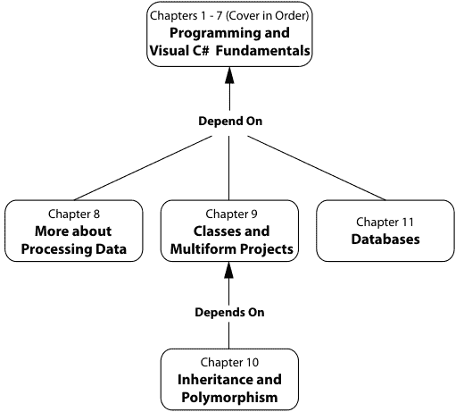

## 本书特点

- **概念陈述**。书中每个节都以一个概念陈述开头。该陈述简洁地总结了该节的要点。
- **教程**。每章都有几个实操教程，引导学生开发应用程序。每个教程都提供了详细的、逐步的说明，以及应用程序的编译代码和完成窗体的截图。
- **示例程序**。每章都有大量的代码示例，旨在突出当前主题。
- **笔记**。笔记出现在书中的多个处。它们是对与主题相关的有趣点或易被误解的点的简要解释。
- **提示**。提示为学生提供了处理不同编程或问题的最佳技术建议。
- **警告**。警告学生注意可能导致程序功能故障或数据丢失的编程技术或实践。
- **检查点**。每章每隔都设置了检查点。它们设计用于在学生学习新主题后快速查询其知识情况。检查点问题的答案可以在附录 D 中找到。
- **复习题**。每章都提供了详尽且多样的复习题。它们包括单选题、判断题、算法工作台和简答题。
- **编程题**。每章都提供了一个编程题库，以巩固学生对当前所学主题的知识。
- **视频笔记**。书中的每个教程都有配套的视频笔记，可以通过书籍的网站 `www.pearsonglobaleducation.com/Gaddis` 访问。学生可以跟随作者在视频中完成每个教程。此外，每章末尾的一个编程题也有配套的视频笔记，向学生展示如何创建解决方案。

## 补充材料

### 学生可用

书中附带以下补充材料：

- 章节教程所需的源代码和文件可在 `www.pearsonglobaleditions.com/Gaddis` 获得
- 书中所有复习题的答案
- 书中所有编程题的解决方案
- 所有教程的完成版本
- 每一章的 PowerPoint 演示幻灯片
- 试题库

### 教师可用

合格教师可以获得以下补充材料：

- 书中所有复习题的答案
- 书中所有编程题的解决方案
- 所有教程的完成版本
- 每一章的 PowerPoint 演示幻灯片
- 试题库

有关如何访问这些补充材料的信息，请访问 Pearson Education 教师资源网站 `www.pearsonglobaleditions.com/Gaddis`。

## 致谢

我要感谢我的家人和朋友的爱与支持。我非常幸运有 Matt Goldstein 作为我的编辑，Jenah Blitz-Stoch 作为我的助理。我很幸运有 Yaz Alayan 作为营销经理。他们在将书籍推向学术界方面付出了努力。我还有一个由 Kayla Smith-Tarbox 领导的优秀团队将手稿印刷。感谢大家！


Pearson 感谢并认可下列人员对全球版的工作贡献：

## 审阅员

- Ela Kashyap，Amity University 教授
- Harsh Bashin，Jamia Hamdard 教授
- Mohanesh BM，Mys 教授

## 作者

Tony Gaddis 是《Starting Out》系列的主要作者。Tony 在 Haywood 学院教授计算机课程拥有近 20 年的经验。他是一位深受誉的教师，曾被评为北卡罗来纳州年度教师，并获得了国家人员组织发展卓越奖。

《Starting Out》系列包括使用 C++ 语言、Java™ 语言、Microsoft® Visual Basic、C#、Python、逻辑设计以及 Alice 的入门书籍，均由 Addison-Wesley 出版。

---

**第二部分：安装指南**

## 学生注意

## 安装 Visual C#

为了完成书中的教程和编程题，你需要在计算机上安装 Visual C# 2012。在开始书中的任何教程之前，请在计算机上安装该软件。

你可以通过以下网站下载 Visual Studio 2012 Express for Windows Desktop：

`http://www.microsoft.com/en-us/download/details.aspx?id=34673`

> 注意：如果你在学校实验室工作，可能安装的是 Microsoft Visual Studio 而不是 Visual Studio Express。如果是这种情况，你的老师将指导如何启动 Visual Studio。书中的教程可以使用 Visual Studio 2012 或 Visual Studio 2012 Express for Windows Desktop 完成。

## 安装学生示例程序文件

书中配套的学生示例程序文件可以通过书籍的配套网站下载：

`www.pearsonglobaleditions.com/Gaddis`

这些文件是书中许多教程所需要的。只需将学生示例程序文件下载到硬盘上易于访问的位置即可。

---

# 第 1 章 计算机与编程简介

## 章节目录

- 1.1 引言
- 1.2 硬件与软件
- 1.3 计算机如何存储数据
- 1.4 程序是如何运作的
- 1.5 图形用户界面
- 1.6 对象
- 1.7 程序开发过程
- 1.8 上手 Visual Studio 环境

## 1.1 引言

想一下人们使用计算机的各种方式。在学校里，学生使用计算机完成各种任务，如写论文、搜索文章、发送电子邮件以及参加在线课程。在工作中，人们使用计算机分析数据、做出预测、进行业务交易、控制制造设施中的机器，以及与客户和同事交流。在家里，人们使用计算机完成支付账单、在线购物、与朋友家人保持联系以及玩游戏等任务。不要忘记智能手机、iPad®、汽车导航系统以及许多其他设备也是计算机。在日常生活中，计算机的用途几乎是无边际的。

计算机可以完成许多可以编程的事情，许多计算机的设计不仅仅是为了完成某一项工作，而是为了完成程序告诉它们完成的任何工作。程序是计算机遵循以执行任务的一系列指令。例如，图 1-1 显示了两个常用的 Microsoft 程序：Word 和 PowerPoint。Word 是一种文字处理程序，允许你创建、编辑和打印文档。PowerPoint 允许你创建图形幻灯片并将其用于演示文稿。

程序通常被称为软件。软件对计算机是至关重要的，因为没有软件，计算机什么也做不了。让我们的计算机变得实用的软件是由被称为程序员或软件开发人员的个人创建的。程序员或软件开发人员是指经过训练并具备设计、创建和测试计算机程序技能的人。计算机编程是一项令人兴奋且有回报的职业。今天，程序员工作在商业、医学、政府、法律执法、农业、娱乐以及几乎所有其他领域。

## 图 1-1 文字处理程序与演示文稿程序

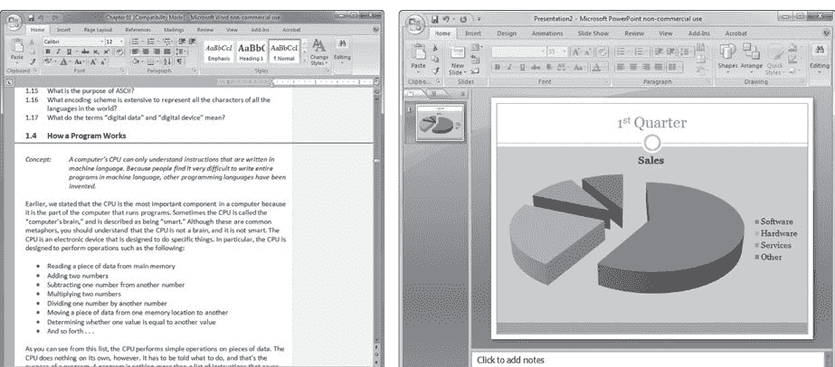

本书使用 C# 编程语言介绍了计算机编程的基本概念。在我们开始探索这些概念之前，你需要了解关于计算机及其工作原理的一些基础知识。本章为你提供了坚实的知识基础，在你学习计算机科学的过程中将不断依赖这些基础。首先，我们将讨论通常由哪些物理组件组成。然后，我们将查看计算机如何存储数据和执行程序。接下来，我们向你介绍现代软件设计的两个基本元素：图形用户界面和对象。最后，我们将简要介绍用于编写 C# 程序的软件。

## 1.2 硬件与软件

> 概念：构成计算机的物理设备被称为**硬件**。运行在计算机上的程序被称为**软件**。

### 硬件

硬件指的是构成计算机的所有物理设备或组件。计算机不是单一设备，而是一个由所有共同工作的设备组成的系统。就像交响乐团中不同的乐器一样，计算机中的每个设备都有自己的部分。

如果你买过计算机，你可能见过列出组件的文献，如处理器、内存、磁盘驱动器、视频显示器、显卡等。除非你已经对计算机非常了解，或者至少有一个了解计算机的朋友，否则理解这些不同组件的作用可能会令人困惑。如图 1-2 所示，典型的计算机系统由以下主要组件组成：

- 中央处理单元 (CPU)
- 主内存
- 次级存储设备
- 输入设备
- 输出设备

让我们仔细观察这些组件中的每一个。

## 图 1-2 计算机系统的典型组件

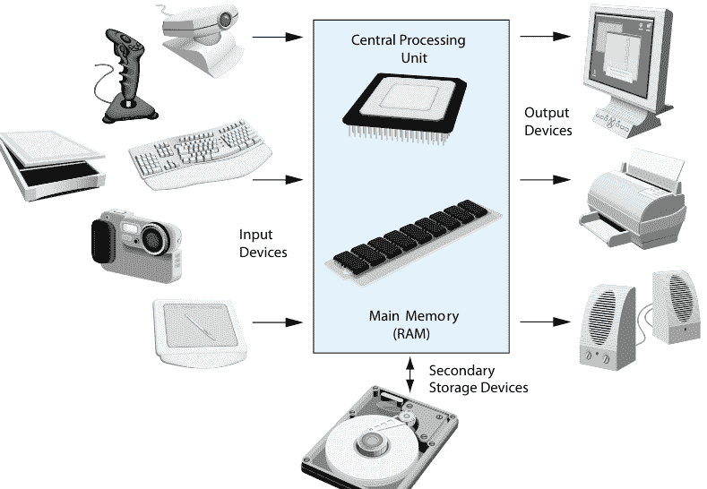

### CPU

当计算机正在执行程序要求它执行的任务时，我们说计算机正在**运行**或**执行**程序。**中央处理单元**（简称 CPU）是计算机实际运行程序的部分。CPU 是计算机最重要的组件，因为没有它，计算机就无法运行软件。

在最早的计算机中，CPU 是由真空管和开关等电气和机械组件制成的巨大设备。图 1-3 显示了这样一个设备。照片中的两位女性正在操作的是可以长时间保存数据的设备，这甚至被认为是世界上第一个可编程电子计算机——ENIAC，它建于 1945 年，为美国陆军计算火炮弹道表。

## 图 1-3 ENIAC 计算机

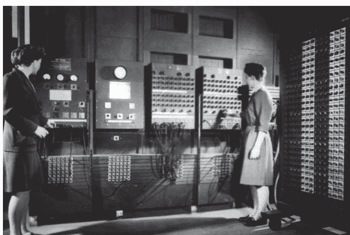

这台机器主要是一个巨大的 CPU，高 8 英尺，长 100 英尺，重 30 吨。

今天，CPU 是被称为微处理器的小型芯片。图 1-4 显示了一位实验室技术人员持有现代微处理器的照片。微处理器比早期计算机中的旧机电 CPU 小得多，而且性能也强大得多。

## 图 1-4 实验室技术人员持有现代微处理器


### 主内存

你可以把主内存看作是工作区域，它是计算机在运行时存储数据的地方。主内存通常被称为随机访问存储器，简称 RAM。主内存是计算机存储数据的一种类型，因为 CPU 能够快速访问存储在 RAM 中的任何位置。内存是易失性类型，当计算机关闭时，RAM 的内容会被擦除。数据存储在图 1-5 所示的芯片中。

## 图 1-5 内存芯片

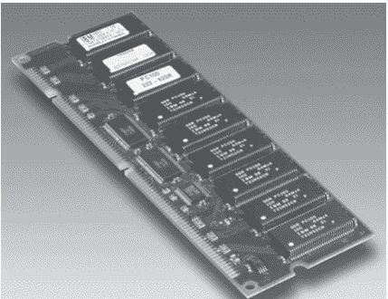

### 次级存储设备

次级存储是能够长时间保存数据的内存类型，当计算机关闭电源时。最常见的次级存储类型是磁盘驱动器。磁盘驱动器通过将数据磁性编码到圆形磁盘上进行存储。大多数计算机的机箱内部安装了驱动器。连接到计算机端口的外部磁盘驱动器也可用。外部磁盘驱动器可以创建数据备份或将数据移动到其他计算机。

除了外部磁盘驱动器，还创建了许多类型的设备用于拷贝数据和移动数据。软盘记录数据的方式，可以从驱动器中取出。软盘有很多缺点，例如，存储容量有限且访问速度慢。近年来，软盘的使用量大幅下降。USB 驱动器等设备是插入计算机 USB 端口的小设备，并在系统中显示为磁盘驱动器。然而，这些驱动器实际上并没有磁盘。它们将数据存储在被称为闪存的特殊内存中。USB 驱动器也称为优盘和闪存盘，价格便宜，且小到可以放在口袋里。

光学设备如光盘 (CD) 和数字多功能光盘 (DVD) 也是数据存储的热门。数据并不是机械地记录在光学磁盘上，而是编码为磁盘表面的一系列凹坑。CD 和 DVD 驱动器可以保存大量数据，由于可刻录 CD 和 DVD 驱动器现在已非常普遍，它们是创建数据备份的良好介质。

### 输入设备

输入是计算机从人类或其他设备收集的任何数据。收集数据并将其发送计算机的组件被称为输入设备。常见的输入设备有键盘、鼠标、扫描仪、麦克风和数字相机。磁盘驱动器和光驱器也可以认为是输入设备，因为程序和数据是从它们检索并加载到计算机内存中的。

### 输出设备

输出是计算机为人类或其他设备产生的任何数据。它可能是销售报告、姓名列表或图形。数据被发送到输出设备，对其进行格式化并展示。常见的输出设备有视频显示器和打印机。磁盘驱动器和 CD 或 DVD 录像机也可以认为是输出设备，因为系统将数据发送给它们以便保存。

### 软件

如果一台计算机要运行，软件是必不可少的。从你开启电源到关机，计算机所做的一切都在软件的控制之下。软件分为两大类：系统软件和应用软件。大多数程序显然属于这两类之一。让我们详细查看每种类型。

### 系统软件

控制和管理计算机基本操作的程序称为系统软件。系统软件通常包括以下类型的程序：

#### 操作系统

操作系统是计算机上最基础的一组程序。操作系统控制计算机的内部操作，管理所有连接到计算机的设备，允许从存储设备保存和检索数据，并允许其他程序在计算机上运行。

#### 实用程序

实用程序执行特定的任务，以增强计算机运行或保护其数据。实用程序的示例包括病毒扫描器、文件压缩程序和数据备份程序。

#### 软件开发工具

程序员用于创建、修改和测试软件的软件工具称为软件开发工具。汇编器、编译器和解释器在本章稍后讨论，它们是属于这一类的程序示例。

### 应用软件

使计算机对日常任务有用的程序是那些通常在大部分时间里运行在计算机上的程序。图 1-1（我们稍后将在本章开头看到）显示了两个常用应用程序的界面——Microsoft Word（一个文字处理程序）和 Microsoft PowerPoint（一个演示文稿程序）。应用软件的其他示例还有电子表格程序、电子邮件程序、Web 浏览器和游戏程序。

## 检查点

- 1.1 什么是程序？
- 1.2 什么是硬件？
- 1.3 列出计算机系统的五个主要组成。
- 1.4 计算机的哪个部分实际运行程序？
- 1.5 计算机的哪个部分作为工作区域，在程序运行时存储程序及其数据？
- 1.6 计算机的哪个部分可以长时间保存数据，即使计算机没有电也是如此？
- 1.7 计算机的哪个部分从人类和其他设备收集数据？
- 1.8 计算机的哪个部分为人类或其他设备格式化并展示数据？
- 1.9 哪一组基础程序控制计算机硬件的内部操作？
- 1.10 执行特定任务（如病毒扫描器、文件压缩程序或数据备份程序）的程序称为什么？
- 1.11 文字处理程序、电子表格程序、电子邮件程序、Web 浏览器和游戏程序属于哪一类软件？

## 1.3 计算机如何存储数据

**概念：** 存储在计算机中的所有数据都被转换为 0 和 1 的序列。

计算机内存被分为微小的存储位置，称为字节（byte）。一个字节仅足以存储一个字母或一个数字。为了完成任何有意义的操作，计算机必须拥有大量的字节。今天大多数计算机拥有数百万或数十亿字节的内存。

每个字节分为八个更小的存储位置，称为位（bit）。该术语代表二进制数字。计算机通常将位视为可以开启或关闭的微型开关。然而，从传统意义上说，位并不是“开关”。大多数计算机系统中，位是能够带有正电或负电的微型电子元件。计算机科学家将正电视为处于*开启*位置的开关，将负电视为处于*关闭*位置的开关。图 1-6 显示了计算机科学家考虑字节的方式：作为一组被拨到开启或关闭位置的开关。

## 图 1-6 被视为八个开关的字节

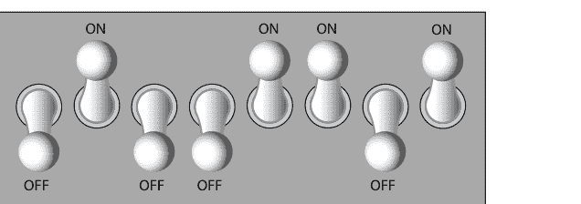

当数据被存储在字节中时，计算机会将八个位设置为代表该数据的开启/关闭模式。例如，图 1-7 左侧所示的模式显示了数字 77 是如何存储在字节中的，右侧的模式显示了字母 A 是如何存储在字节中的。稍后你将看到这些模式是如何确定的。

## 图 1-7 数字 77 和字母 A 的位模式

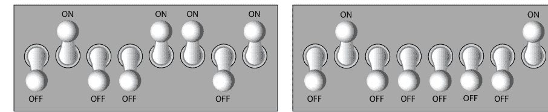

存储在字节中的数字 77。存储在字节中的字母 A。

### 存储数字

位可以用非常有限的方式来表示数字。取决于位的开启或关闭，它可以代表两个不同的值之一。在计算机系统中，关闭的位代表数字 0，开启的位代表数字 1。这与**二进制计数系统**完美对应。在二进制计数系统（或称为**二进制**）中，所有的数值都写为 0 和 1 的序列。以下是一个数字用二进制表示的示例：

```
1001101
```

二进制数中的每个数字都有一个对应的位置值。从最右边的数字开始向左移动，位置值为 $2^0, 2^1, 2^2, 2^3$ 等，位置值分别为 1, 2, 4, 8 等。

## 图 1-8 以 2 的幂次方表示的二进制数字值

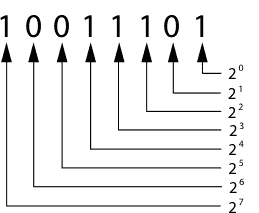

## 图 1-9 二进制数字的值

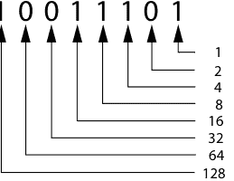

要确定一个二进制数的值，只需将所有 1 的位置值相加即可。例如，在二进制数 10011101 中，1 的位置值为 1, 4, 8, 16 和 128。这在图 1-10 中所示。所有这些位置值的总和是 157。因此，二进制数 10011101 的值是 157。

## 图 1-10 确定 10011101 的值

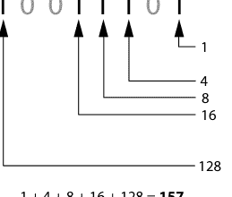

## 1.4 程序是如何运行的

如图 1-14 所示，图像中的每个像素都被转换为代表该像素颜色的数字代码。该数字代码以二进制的形式存储在内存中。

> 图 1-14 以二进制格式存储的数字图像

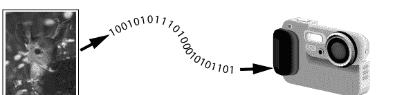

你在 CD 播放器、iPod 或 MP3 播放器上播放的音乐也是数字。一首数字歌曲被切分成小的片段，称为样本（samples）。每个样本都被转换为一个二进制数，并存储在内存中。歌曲划分的样本越多，播放时听起来就越像原始音乐。一首 CD 质量的歌曲每秒被分为超过 44,000 个样本！

### 检查点

- 1.12 多大的内存足够存储一个字母表中的字母或较小的数字？
- 1.13 这种可以设置为开启或关闭的微型“开关”称为什么？
- 1.14 在哪种计数系统中，所有的数值都被写为 0 和 1 的序列？
- 1.15 ASCII 的目的是什么？
- 1.16 哪种编码方案足够广泛，可以表示世界上许多语言的所有字符？
- 1.17 数字数据（digital data）和数字设备（digital device）是指什么意思？

## 1.4 程序是如何运行的

概念：计算机的 CPU 只能理解用机器语言编写的指令。由于人们发现很难用机器语言编写整个程序，因此发明了其他编程语言。

之前，我们提到 CPU 是计算机中最重要的组件，因为它是计算机中运行程序的部分。有时 CPU 被称为“计算机的大脑”，并被认为是“智能的”。虽然这些常见的比喻，但你应该理解 CPU 并不是大脑，也不智能。CPU 是一种设计用于执行特定任务的电子设备。特别是，CPU 设计用于执行如下所示的操作：

- 从主内存中读取一段数据
- 两个数字相加
- 从一个数字中减去另一个数字
- 两个数字相乘
- 将一个数字除以另一个数字
- 将数据从一个内存位置移动到另一个位置
- 判断一个值是否等于另一个值

从这个列表中可以看出，CPU 对数据段执行了几项操作。然而，CPU 本身无所事事；它必须被告知该做什么，这就是程序的目的。程序无非是一系列告诉 CPU 执行操作的指令列表。

程序中的每条指令都是一条告诉 CPU 执行特定操作的命令。这里有一个可能出现在程序中的指令示例：

```
10110000
```

对你和我来说，这只是一系列 0 和 1。但对 CPU 来说，这是一条执行某项操作的指令。它是用 0 和 1 编写的；CPU 只能理解用机器语言编写的指令，而机器语言指令总是以二进制形式编写的。

CPU 能够执行的每种操作都有对应的机器语言指令。例如，有一个用于数字相加的指令；有一个从一个数字减去另一个的指令；依此类推。CPU 可以执行的所有指令集合被称为 CPU 的指令集（instruction set）。


> 注意：今天有几家微处理器公司制造 CPU。一些知名的微处理器公司包括 Intel、AMD 和 Motorola。如果你仔细观察你的计算机，可能会发现它微处理器的标签。

每个品牌的微处理器都有它们自己的指令集，该指令集通常只能被同一品牌的微处理器理解。例如，Intel 微处理器理解相同的指令，但它们不理解 Motorola 处理器的指令。

之前显示的机器语言指令仅是一条指令的示例。然而，要让计算机完成任何有意义的事，需要的远多于一条。因为 CPU 熟知如何执行的操作如此基础，只有当 CPU 执行许多操作时，才能完成一项有意义的任务。例如，如果你想计算本月从储蓄账户中获得的利息，CPU 必须按照正确的顺序执行大量的指令。程序中包含成千上万甚至多达一百万条机器指令并不罕见。

程序存储在磁盘驱动器等次级存储设备上。当你在计算机上安装程序时，程序通常会从 CD-ROM 或可能是某个网站复制到你的计算机磁盘中。

虽然程序可以存储在磁盘驱动器等次级存储设备上，但每次 CPU 执行它时，都必须将其复制到内存（RAM）中。例如，假设你的计算机磁盘上有一个文字处理程序。要执行该程序，你用鼠标双击程序图标。这会导致程序从磁盘复制到主内存。然后，CPU 执行主内存中的程序副本。这个过程如图 1-15 所示。

> 所示的示例是一条针对 Intel 微处理器的实际指令。它告诉微处理器将一个值移入 CPU。

## 图 1-15 程序被复制到主内存并执行


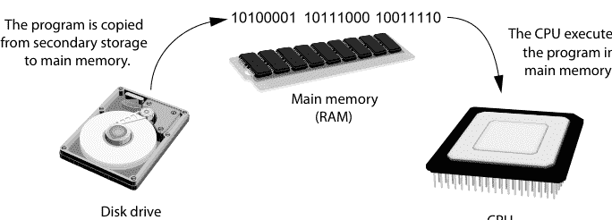

当 CPU 执行程序时，它处于一个被称为取指-解码-执行（fetch-decode-execute）的循环中。这个循环由三个步骤组成，程序中的每条指令都会重复这个循环。这个循环是数字化的，步骤如下：

1. **取指（Fetch）**：从内存中获取指令。
2. **解码（Decode）**：CPU 解码刚刚获取的指令。
3. **执行（Execute）**：循环的最后一步是执行或执行该操作。

图 16 明了这些步骤。

### 图 16 取指-解码-执行循环


用某种语言执行相同的操作将需要多条指令，并且对 CPU 如何与计算机视频电路交互有非常深入的了解。正如此示例所示，高级语言允许程序员专注于他们想要让程序执行的任务，而不是去关注 CPU 将如何执行这些任务的细节。

自 20 世纪 50 年代以来，已经创建了数千种高级语言。表 1-1 列出了一些最著名的语言。

| 语言 | 描述 |
| --- | --- |
| Ada | Ada 创建于 20 世纪 70 年代，主要用于美国国防部的应用程序。该语言以计算领域具有影响力的历史人物洛夫莱拉斯伯夫人（Countess Lovelace）命名。 |
| BASIC | 初学者全用符号指令代码是一种通用语言，最初设计于 20 世纪 60 年代初，旨在简单到足以初学者学习。今天，BASIC 有许多版本。 |
| FORTRAN | 是第一种高级编程语言。它设计于 20 世纪 50 年代，用于执行复杂的数学计算。 |
| COBOL | 通用面向商业语言创建于 20 世纪 50 年代，为业务应用设计。 |
| Pascal | Pascal 创建于 1970 年，最初设计用于教学编程。该语言以数学家、物理学家和哲学家布莱斯·帕斯卡（Blaise Pascal）命名。 |
| C 和 C++ | C++（"c plus plus"）是贝尔实验室开发的强大通用语言。C 语言创建于 1972 年，C++ 语言创建于 1983 年。 |
| C# | 读作 "sharp"，这种语言由微软在 2000 年左右创建，用于开发基于微软 .NET 框架的应用程序。 |
| Java | Java 由 Sun 公司于 20 世纪 90 年代初创建。它可以用于开发在单台计算机上运行或通过 Web 服务器在互联网上运行的程序。 |
| JavaScript | 创建于 1995 年，可用于网页。尽管名字相似，但 JavaScript 与 Java 没有关系。 |
| Python | Python 是 20 世纪 90 年代初创建的通用语言。它在商业和学术应用中变得非常流行。 |
| Ruby | Ruby 是 20 世纪 90 年代创建的通用语言。它是运行在 Web 服务器上的程序日益日益流行的语言。 |
| Visual Basic | Visual Basic（通常称为 VB）是微软的一种编程语言和软件开发环境，允许程序员创建基于 Windows 的应用程序。VB 最初创建于 20 世纪 90 年代初。 |

每种高级语言都有自己的一套预定义单词来编写程序。构成高级语言的单词被称为*关键字*或*保留字*。每个关键字都有特定的含义，不能用于任何其他用途。表 1-2 显示了 C# 编程语言中的关键字。

| abstract | as | base | bool |
|---|---|---|---|
| break | byte | case | catch |
| char | checked | class | const |
| continue | decimal | default | delegate |
| do | double | else | enum |
| event | explicit | extern | false |
| finally | fixed | float | for |
| foreach | goto | | implicit |
| in | int | lock | interface |
| internal | is | null | long |
| namespace | new | | object |
| operator | out | public | params |
| private | protected | | readonly |
| ref | return | sbyte | static |
| short | sizeof | stackalloc | |
| string | struct | switch | this |
| throw | true | | typeof |
| uint | ulong | unchecked | unsafe |
| ushort | using | virtual | void |
| volatile | while | | |

除了关键字外，编程语言还有用于在数据上执行各种操作的运算符。在 C# 以及大多数其他语言中，`+` 号是一个相加两个数字的运算符。以下是 12 和 75：

```
12 + 75
```

C# 语言中还有许多其他运算符，你将在学习本文的过程中学到它们。

除了关键字和运算符外，每种语言都有自己的语法，语法是一套在编写程序时必须严格遵守的规则。语法规定了关键字、运算符和各种标点字符在程序中必须如何使用。当你学习一种编程语言时，你必须学习该特定语言的规则。

你在用高级编程语言编写程序时使用的单个指令称为语句（statements）。一个编程语句由关键字、运算符、标点符号和其他允许的编程元素组成，并按正确的顺序排列以执行操作。

## 编译器和解释器

由于 CPU 仅能理解机器语言指令，因此用高级语言编写的程序必须翻译成机器语言。根据编写程序时使用的语言，程序员将使用编译器或解释器来进行翻译。

编译器是一个将高级语言程序翻译成独立的机器语言程序的程序。然后可以在需要时任何时候执行该机器语言程序。

## 1.4 程序是如何运行的

这如图 1-18 所示。如图所示，编译和执行是两个不同的过程。

### 图 1-18 编译高级程序并执行它

| 高级语言程序 | 机器语言程序 |
|---|---|
| 编译器用于将高级语言程序翻译成机器语言程序。显示“Hello, Earthling”等…… | 编译器 | 10100001 10111010 10011110 等…… |

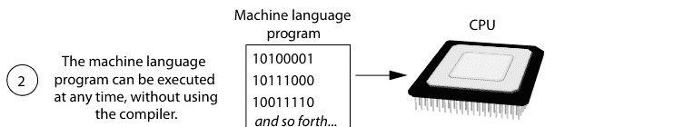

某些编程语言使用解释器，解释器是一个既翻译又执行高级语言程序中指令的程序。当解释器读取程序中的每条指令时，它将其转换为机器语言指令并立即执行。这个过程对程序中的每条指令都会重复。这一过程如图 1-19 所示。由于解释器将翻译和执行相结合，它们不会创建独立的机器语言程序。

### 图 1-19 使用解释器执行高级程序


解释器翻译程序中的每条指令，将其转换为机器语言指令并立即执行。这个过程对程序中的每条指令都会重复。

你在用高级编程语言编写程序时使用的称为语句。一个编程语句由关键字、运算符、标点符号和其他允许的编程元素组成，并按正确的顺序排列以执行操作。

程序员将代码输入文本编辑器，并将其保存为计算机上的文件。接下来，程序员使用编译器或解释器来翻译代码。如果代码包含语法错误，则无法进行翻译。语法错误通常由关键字拼写错误、缺少标点符号或运算符使用不当引起。当发生这种情况时，编译器或解释器会显示错误。程序员修正错误并再次尝试。

> 注意：人类语言也有语法规则。你还记得你上课学习所有那些规则吗？

尽管人们在说话和写作时通常会违反其母语的语法规则，但其他人通常能理解他们的意思。遗憾的是，编译器和解释器没有这种能力。即使出现一个语法错误，程序也无法编译或执行。

## 思考

- 1.18 CPU 仅理解什么语言编写的指令？
- 1.19 程序每次执行时必须复制到什么类型的内存中？
- 1.20 当 CPU 执行程序中的指令时，它正在进行什么过程？
- 1.21 汇编语言？
- 1.22 哪类型的编程允许你在不知道 CPU 如何工作的情况下创建强大的复杂的程序？
- 1.23 每种语言在编写程序时都有一套必须严格遵守的规则。这套规则称为什么？
- 1.24 将高级语言程序翻译成独立的机器的程序称为什么？
- 1.25 既翻译又执行高级语言程序中指令的程序称为什么？
- 1.26 通常由关键字拼写错误、缺少标点符号或运算符使用不当引起的什么类型的错误？

## 图形用户界面

> 概念：图形用户界面允许用户使用图标、按钮和对话框等图形元素与程序交互。

程序员通常使用“用户”一术来描述任何可能使用计算机及其程序的虚拟人物。计算机的用户界面是用户与计算机交互的部分。用户界面的一部分由硬件设备组成，如键盘和视频显示器。用户界面的另一部分涉及计算机操作系统和软件如何接受用户的命令。

## 1.5 图形用户界面

图 1-20 命令行界面

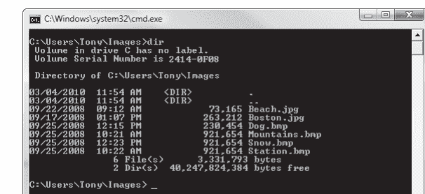

许多用户（尤其是初学者）认为命令行界面难以使用。这是因为有许多命令需要学习，而且每个命令都有其特定的语法，就像编程语句一样。如果输入的命令不正确，它将无法工作。

在 20 世纪 80 年代，一种新型图形用户界面开始在商业操作系统中使用。图形用户界面，简称 GUI（读音为 "gooey"），允许用户通过屏幕上的图形元素与操作系统和应用程序进行交互。GUI 还普及了鼠标作为输入设备的用法。GUI 不再要求用户在键盘上输入命令，而是允许用户指向图形元素并点击鼠标按钮来激活它们。

与 GUI 的大部分交互是通过窗口完成的，窗口显示信息并允许用户执行操作。图 1-21 显示了一个允许用户更改系统 Internet 设置的窗口示例。用户不需要输入晦涩的命令，而是与图标、按钮和滑块等图形元素进行交互。

图 1-21 图形用户界面中的窗口

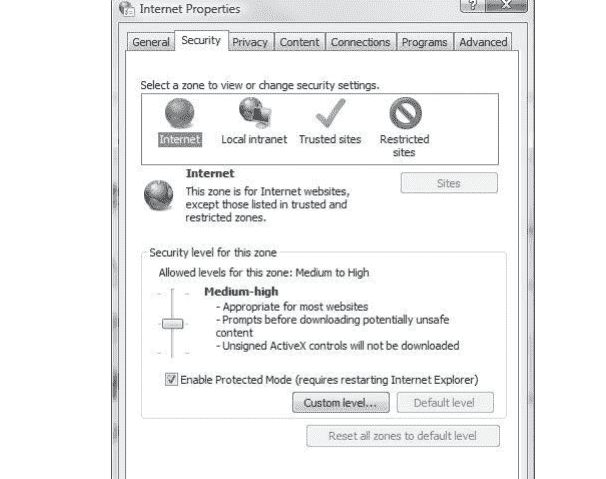

### 事件驱动 GUI 程序

在文本环境（如命令行界面）中，程序决定事件发生的顺序。例如，图 1-22 显示了在文本环境中与一个计算员工总工资的程序进行的交互。首先，程序要求用户输入工作小时数。在图中，用户输入了 40 并按了 Enter 键。程序要求用户输入其时薪。在图中，用户输入了 50 并按了 Enter 键。然后，程序显示了用户的总工资。在程序运行期间，用户只能按照要求的顺序输入数据。

图 1-22 文本环境中与程序的交互

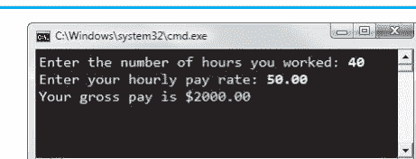

然而，在 GUI 环境中，由用户决定事件发生的顺序。例如，图 1-23 显示了一个计算员工总工资的 GUI 程序。注意，这里有一个用户输入工作小时数和时薪的框。用户可以按照自己喜欢的任何顺序输入小时数和薪。如果用户犯了错，可以删除已输入的数据并重试。当程序准备好计算时，或者用户使用鼠标点击“Gross Pay”（总工资）按钮时，程序就会执行计算。

图 1-23 一个 GUI 程序

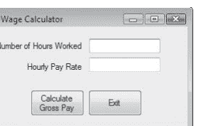

由于 GUI 程序必须响应用户的操作，因此它们被认为是事件驱动的。用户触发事件（例如点击按钮），而程序对这些事件做出响应。

本书专门关注使用 C# 编程语言开发 GUI 应用程序。在学习本书的过程中，你将学习如何创建通过窗口图形对象与用户交互的应用程序。你还将学习如何编写应用程序，以响应用户与程序交互时发生的事件。

### 检查点

- 1.27 什么是用户界面？
- 1.28 命令行界面是如何工作的？
- 1.29 当用户在文本环境（如命令行）中运行程序时，什么决定了事件发生的顺序？
- 1.30 什么是事件驱动程序？

## 对象

**概念**：对象是一个包含数据并执行操作的程序组件。程序使用对象来执行特定任务。

你开过汽车吗？如果是的话，你就知道汽车是由许多组件组成的。汽车有方向盘、加速油门踏板、刹车踏板、档杆、速度表以及许多其他与驾驶员交互的设备。引擎盖下还有许多组件，例如引擎、电池、散热器等。汽车不仅仅是一个对象，而是一组协同工作的对象的集合。

这个名称也适用于计算机编程。今天使用的大多数语言都是**面向对象**的。当你使用面向对象的语言时，你通过组合一组对象来创建程序。在编程中，对象不是一个物理设备（如方向盘或刹车踏板）。相反，它是存在于计算机内存中的软件组件。在软件中，对象具有两个通用能力：

- 对象可以存储数据。存储在对象中的数据通常称为字段（fields）或属性（properties）。
- 对象可以执行操作。对象执行的操作称为方法（methods）。

由于 GUI 程序必须响应用户的操作，因此它们被称为事件驱动的。用户触发事件（例如点击按钮），程序对这些事件做出响应。

本书专门关注使用 C# 编程语言开发 GUI 应用程序。在学习本书的过程中，你将学习如何创建通过窗口图形对象与用户交互的应用程序。你还将学习如何编写应用程序，以响应用户与程序交互时发生的事件。由于 C# 语言并不提供创建 GUI 和执行许多其他高级操作所需的类和其他代码，那么这些类和代码从何而来？


# 计算机与编程简介

## 对象

- 对象可以存储数据。存储在对象中的数据通常称为字段（fields）或属性（properties）。
- 对象可以执行操作。对象执行的操作称为方法（methods）。

在使用对象来执行特定任务时，程序使用对象来执行特定任务。汽车不仅仅是一个对象，而是一组协同工作的对象的集合。

这个名称也适用于计算机编程。今天使用的大多数语言都是**面向对象**的。当你使用面向对象的语言时，你通过组合一组对象来创建程序。在编程中，对象不是一个物理设备（如方向盘或刹车踏板）。相反，它是存在于计算机内存中的软件组件。在软件中，对象具有两个通用能力：

- 对象可以存储数据。存储在对象中的数据通常称为字段（fields）或属性（properties）。
- 对象可以执行操作。对象执行的操作称为方法（methods）。

在使用对象来执行特定任务时，程序使用对象来执行特定任务。汽车不仅仅是一个对象，而是一组协同工作的对象的集合。

这个名称也适用于计算机编程。今天使用的大多数语言都是**面向对象**的。当你使用面向对象的语言时，你通过组合一组对象来创建程序。

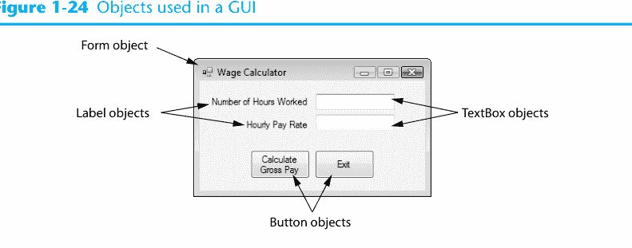

## 文本对象

### 文本框对象

- 文本框显示为可以接受用户输入的矩形区域。图 1-24 有两个文本框对象：一个用户输入工作小时数，另一个输入时薪。

## 按钮对象

按钮在表单上以带有文字的形式出现。当用户点击按钮时，就会发生操作。图 1-24 有两个按钮对象。一个显示“计算工资”，当用户点击此按钮时，程序计算总工资。另一个显示“退出”，当用户点击此按钮时，程序结束。

## 可见对象与不可见对象

图形界面中可见的对象通常被称为控件。我们可以说图 1-24 包含标签控件、文本框控件和按钮控件。

并不是所有对象都显示在屏幕上，某些对象只存在于内存中，用于帮助程序执行。例如，有读取文件、生成随机数、存储和排序大型数据集的类型等。这些类型的对象帮助程序执行任务，但它们并不直接在屏幕上显示任何内容。当你编写程序时，你使用的某些对象是控件（GUI 中可见），而其他对象是不可见的。

## 类：对象从哪里来

对象非常有用，但它们并不会魔法地出现在你的程序中。在使用特定类型的对象之前，必须先在内存中创建它。而且，在内存中创建对象之前，必须为它有一个类。

类是描述特定类型对象的代码。它规定了对象可以持有的数据（对象的字段和属性）以及对象可以执行的操作（对象的方法）。随着学习深入，你将学习更多关于类的知识，但现在请将类视为创建特定类型对象的代码“蓝图”。

## .NET 框架

C# 是一种非常流行的编程语言，但它有很多自己无法完成的事情。例如，你无法仅通过 C# 创建图形用户界面、从文件读取数据、处理数据库以及许多程序通常需要执行的其他操作。C# 只提供了构建程序所需的各种关键字和运算符。

由于 C# 语言并不提供创建 GUI 和执行许多其他高级操作所需的类和其他代码，那么这些类和代码来自哪里？答案是 `.NET Framework`。`.NET Framework` 是类和其他代码的集合，它们可以结合 C# 等编程语言，为 Windows 操作系统创建程序。例如，`.NET Framework` 提供了创建 `Forms`（表单）、`TextBox`（文本框）、`Labels`（标签）、`Buttons`（按钮）以及许多其他对象的类。

当你使用 C# 写程序时，你正在结合使用 C# 语言和 `.NET Framework`。在本书中，你不仅将学习 C#，还将学习 `.NET Framework` 提供的许多类和其他特性。

### 编写自己的类

`.NET Framework` 提供了许多预定义的类，供你的程序使用。然而，在某些情况下，你可能希望有一个对象来执行特定任务，而 `.NET Framework` 中不存在这样的类。这不是问题，因为在 C# 中，你可以编写自己的类，并包含任何情况下所需的特定字段、属性和方法。在第 9 章中，你将学习为程序所需的特定对象创建类。

### 检查点

- 1.31 什么是对象？
- 1.32 使用对象集合来创建程序使用的是哪种类型的语言？
- 1.33 对象具有哪两个通用能力？
- 1.34 通常用什么术语指代程序图形用户界面中可见的 `TextBox`、`Label` 和 `Button` 等对象？
- 1.35 不在屏幕上显示而仅存在内存中的对象的目的是什么？
- 1.36 什么是类？
- 1.37 什么是 `.NET Framework`？
- 1.38 为什么你可能需要编写自己的类？

## 1.7 程序开发过程

> **概念**：创建一个程序需要几个步骤，包括设计程序逻辑、创建用户界面、编写代码、测试和调试。

### 程序开发周期

在本章在此之前，你已经学习了程序员使用 C# 等高级语言来创建程序。然而，创建一个程序远比写代码要复杂。创建一个运行正确的程序的过程需要图 1-25 所示的六个阶段。整个过程被称为程序开发周期。

一旦你对为程序表单创建的草图满意，就可以开始在计算机上创建实际表单了。作为一名 Visual Studio 程序员，Visual Studio 提供了一个“所见即所得”的编辑器，允许你视觉化地设计程序表单。你可以使用 Visual Studio 创建：

### 图 1-26 表单草图

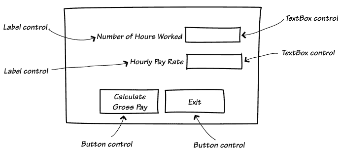

表单，在表单上放置所有必要的控件，并设置每个控件的属性以获得所需的外观。例如，图 1-27 显示了你可能为计算总工资的工资计算程序创建的实际表单。

### 图 1-27 工资计算程序的表单

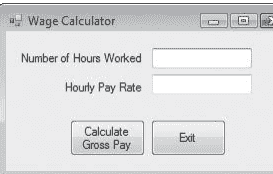

#### 3. 设计程序逻辑

在此阶段，你将程序必须执行的每个任务分解为一系列逻辑步骤。例如，回想图 1-27，注意计算工资的程序表单有一个标记为“计算总额”（Calculate Gross）的按钮控件。当用户点击此按钮时，你希望程序显示员工的总工资。以下是程序执行该任务应采取的步骤：

- 步骤 1：从适当的 `TextBox` 获取工作小时数。
- 步骤 2：从适当的 `TextBox` 获取小时薪率。
- 步骤 3：用工作小时数乘以小时薪率计算总工资。
- 步骤 4：在弹出窗口中显示总工资。

这是一个算法的示例，它是执行任务时必须采取的一系列定义良好的逻辑步骤。

假设你正在设计一个程序。你不需要担心违反任何语法规则，可以专注于程序必须执行的逻辑步骤。

流程图是程序员用于设计程序的另一种工具。流程图是直观图形化描绘算法步骤的图表。图 1-28 显示了你如何为工资计算算法创建一个流程图。注意流程图中有三种符号：椭圆、平行四边形和矩形。这些符号中的每一个都代表算法中的一个步骤，描述如下：

- 出现在流程图顶部和底部的椭圆称为终端符号。`Start`（开始）符号标记程序的起点，`End`（结束）终端符号标记程序的终点。
- 平行四边形用作输入符号和输出符号。它们代表程序读取输入或显示输出的步骤。
- 矩形是程序对数据执行某些功能（如数学计算）的步骤。

### 图 1-28 工资计算程序的流程图

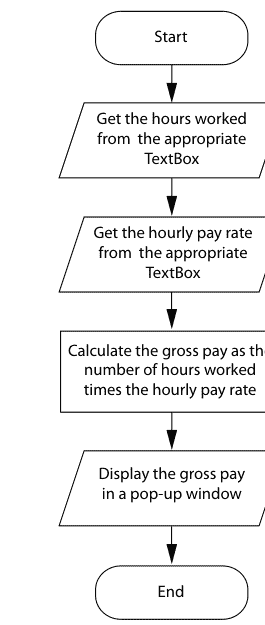

符号由箭头连接，箭头代表程序的“流”。要按照正确的顺序遍历符号，你从 `Start` 终端开始，顺着箭头移动直到到达 `End` 终端。

#### 4. 编写代码

一旦你创建了程序的图形用户界面（GUI）并设计了算法，就可以开始编写代码。在此过程中，你将参考在步骤 3 中创建的伪代码或流程图并使用 Visual Studio 编写 C# 代码。

#### 5. 修正语法错误

你之前在本章中学习过，如 C# 等编程语言在编写程序时必须遵循语法规则。语法规定了关键字、运算符和标点符号。如果程序员违反了这些任何规则，就会发生语法错误。如果程序包含语法错误，程序将无法编译或执行。

#### 6. 测试程序并修正逻辑

一旦代码处于可执行形式，必须对其进行测试以确定是否存在错误。逻辑错误是指程序可以运行但产生错误结果的错误。如果程序产生错误结果，程序员会发现并修正逻辑错误。有时在此过程中，程序员发现程序的原始设计必须更改。在这种情况下，程序开发周期重新开始，直到没有错误。


### 检查点

- 1.39 列出程序周期的六个步骤。
- 1.40 什么是算法？
- 1.41 什么是伪代码？
- 1.42 什么是流程图？
- 1.43 流程图中以下每个符号意味着什么？
  - 椭圆
  - 平行四边形
  - 矩形


## 1.8 使用 Visual Studio 环境

> **概念**：Visual Studio 和 Visual Studio Express for Windows 由用于构建应用程序的工具组成。使用 C# 的第一步是了解这些工具。

为了遵循本书中的教程并创建 C# 应用程序，你需要在计算机上安装 Visual Studio 2012 或 Visual Studio Express for Windows。Visual Studio 2012 是一个强大的集成开发环境 (IDE)，提供了创建、测试和调试软件所需的所有工具。它不仅可以使用 C# 创建应用程序，还可以用于 Visual Basic 和 C++ 等语言。如果你在学校的计算机实验室，很有可能已安装 Visual Studio 2012。


## 第 1 章：计算机与编程简介

如果你没有 Visual Studio 2012，可以安装 Visual Studio Express for Windows，这是一个可以从微软网站下载的免费编程环境。（购买本书时，会附带一张包含 Visual Studio Express for Windows 的 DVD。）

对于本书而言，你使用的是 Visual Studio 2012 还是 Visual Studio Express for Windows 并不重要。这两个产品看起来非常相似，工作方式也相似。当存在差异时，书中会提醒你。为了简单起见，本书将使用“Visual Studio”一词指代 Visual Studio 2012 或 Visual Studio Express for Windows。当你被指示使用 Visual Studio 执行某些任务时，请使用计算机上安装的系统。

Visual Studio 是一个自定义环境。如果你在学校的计算机实验室工作，可能有人根据自己的喜好自定义了编程环境。如果是这样，你看到的可能与书中显示的不匹配。因此，在创建 C# 应用程序之前重置编程环境是一个好主意。教程 1-1 将引导你完成这一过程。

## 教程 1-1：启动 Visual Studio 并设置环境

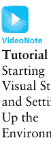

**步骤 1**：向你的导师确认你使用的是 Visual Studio 2012 还是 Visual Studio Express for Windows Desktop。然后点击开始按钮，打开程序菜单并执行以下操作之一：

- 如果你使用的是 Visual Studio，打开 Microsoft Visual Studio 2012 程序组并执行 Visual Studio 2012。
- 如果你使用的是 Visual Studio 2012 Express for Windows Desktop，打开 Microsoft Visual Studio 2012 Express 程序组并执行 VS for Desktop。

> **注意**：第一次运行 Visual Studio 时，你会看到一个标题为“选择默认环境设置”的窗口。从列表中选择“Visual C# 开发”并点击“启动 Visual”按钮。

**步骤 2**：图 1-29 显示了 Visual Studio 环境。图中所示屏幕被称为起始页（Start Page）。默认情况下，启动 Visual Studio 时会显示起始页，但你可能看不到，因为它可以被禁用。

注意起始页左下角的框。如果未勾选此框，启动 Visual Studio 时将不会显示起始页。如果你没有看到起始页，始终可以通过点击屏幕顶部菜单栏上的“视图”（VIEW）然后点击“起始页”来显示它。

## 图 1-29 Visual Studio 起始页

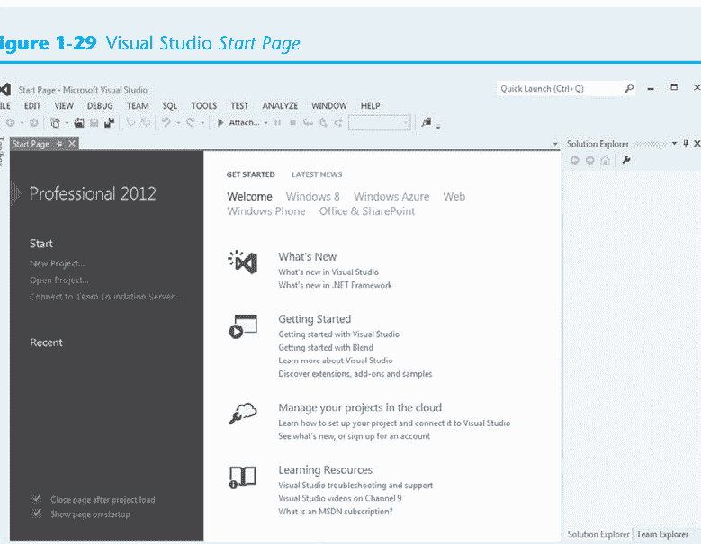

在计算机实验室中，Visual Studio 环境可能已经为 Visual C# 以外的编程语言进行了设置。为了确保 Visual Studio 的外观和行为与本书中的描述一致，你应该确保选择 Visual Studio C# 作为编程环境。请执行以下操作：

- 如图 1-30 所示，点击菜单栏上的“工具 (TOOLS)”，然后点击“导入和导出设置 (Import and Export Settings)……”
- 在弹出的屏幕上，选择“重置设置 (Reset settings)”并点击“下一步 (Next >)”
- 在接下来出现的屏幕上，选择“不，仅重置设置 (No, just reset settings)”覆盖你当前的设置。如果你使用的是 Visual Studio Express，此时点击“完成 (Finish)”按钮，继续教程的第 4 步。如果你使用的是 Visual Studio，点击“下一步 (Next >)”按钮。
- 如果你使用的是 Visual Studio，将显示图 1-31 所示的窗口。选择“C# 开发设置 (C# Development Settings)”，然后点击“完成 (Finish)”按钮。稍等片刻，你会看到“重置完成 (Reset complete)”。点击“关闭 (Close)”并继续教程的下一步。

**第 4 步**：现在你将把 Visual Studio 的布局重置为默认配置。如图 1-32 所示，点击菜单栏上的“窗口 (WINDOW)”并点击“重置窗口布局 (Reset Window Layout)”。接下来你将看到一个对话框，询问“你是否确定要恢复环境的默认窗口布局？”点击“是 (Yes)”。

## 图 1-30 选择导入和导出设置的工具

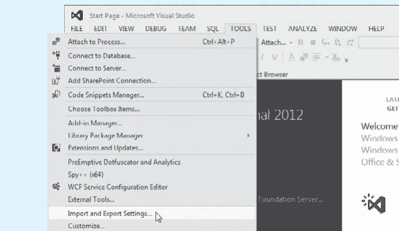

## 图 1-31 选择 Visual C# 开发设置

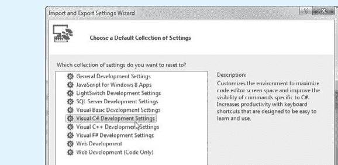

## 图 1-32 重置窗口布局

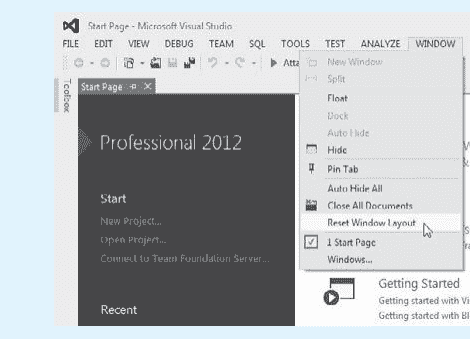

## 创建新项目

你创建的每个 Visual C# 应用程序都称为项目。当你准备好创建一个新应用程序时，请启动新项目。教程 1-2 将引导你完成启动新 Visual C# 项目的步骤。

## 教程 1-2：启动 Visual C# 项目

**第 1 步**：如果 Visual Studio 尚未运行，请按照教程 1-1 中的方法启动它。

**第 2 步**：

- 如果你使用的是 Visual Studio 2012：点击屏幕菜单栏上的“文件 (FILE)”，然后选择“新建 (New)”，并选择“项目 (Project)”。执行此操作后，将显示图 1-33 所示的“新建项目”窗口。
- 如果你使用的是 Visual Studio 2012 Express：点击屏幕顶部菜单栏上的“文件 (FILE)”并选择“新建项目 (New Project)”。执行此操作后，应显示一个与图 1-33 类似的“新建”窗口。（使用 Visual Studio Express 时，窗口中的项目会比图中少。）

### 图 1-33 新项目窗口

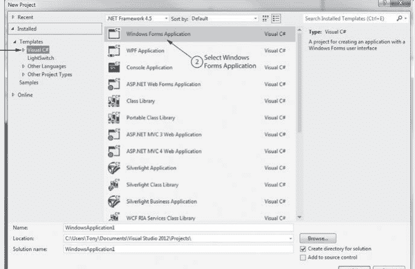

**第 3 步**：在窗口左侧的“已安装的模板 (Installed Templates)”下，确保选中了 Visual C#。然后，如图 1-33 所示，选择“Windows Forms 应用程序 (Windows Forms Application)”。

**第 4 步**：在“新建项目”窗口的底部，你会看到一个“名称 (Name)”文本框。名称文本框将自动填充一个默认名称。在图 1-33 中，默认名称为 `WindowsApplication1`。如图 1-34 所示，将项目名称更改为 `My First Project`。

### 图 1-34 将项目名称更改为 My First Project

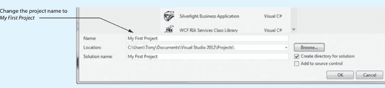

如果你使用的是 Visual Studio 2012：在“名称”文本框下方，你会看到一个“位置 (Location)”文本框和一个“解决方案名称 (Solution name)”文本框。

- “位置”文本框显示了将创建哪个文件夹来存放项目。如果你想更改位置，点击“浏览 (Browse)”按钮并选择所需的位置。
- 解决方案（solution）是一个包含项目的容器，“解决方案名称”文本框显示了将包含你的项目的解决方案名称。默认情况下，解决方案名称与项目名称相同。对于你在书中创建的所有项目，你应该保持解决方案名称与项目名称一致。


> 注意：在学习这本书的过程中，你将创建很多 Visual C# 项目。在此过程中，你会发现像 `Windows-Application1` 这样的默认名称无法帮助你记住每个项目的功能。因此，你应该始终更改名称。

第 5 步：点击“确定 (OK)”按钮创建项目。稍等片刻，你会看到“重置完成”。Visual Studio 环境如图 1-35 所示。项目名称显示在 Visual Studio 标题栏中。

保持 Visual Studio 运行并完成下一个教程。

## 图 1-35 打开了新项目的 Visual Studio 环境

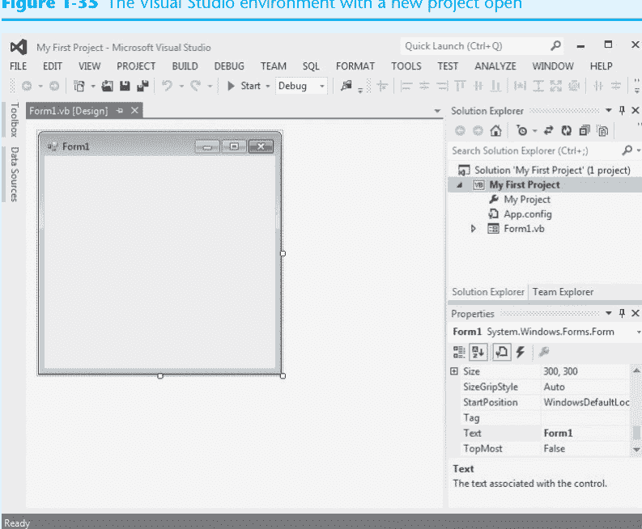

## 教程 1-3：保存并关闭项目

当你处理项目时，应该养成经常保存的习惯。在本教程中，你将保存 My First Project 并关闭它。

第 1 步：Visual Studio 仍在运行。要保存当前项目，点击菜单栏上的“文件 (FILE)”然后点击“全部保存 (Save All)”。

第 2 步：要关闭项目，点击菜单栏上的“文件 (FILE)”然后点击“关闭解决方案 (Close Solution)”。

## Visual Studio 环境

Visual Studio 环境由许多你经常使用的窗口组成。图 1-36 显示了 Visual Studio 环境中的以下窗口：**设计器 (Designer)**、**解决方案资源管理器 (Solution Explorer)** 和**属性 (Properties)**。以下是每个窗口的简要说明：

- **设计器窗口** 你使用**设计器窗口**创建应用程序的图形用户界面。**设计器**窗口显示表单，并允许你放置应用程序运行时所需的控件。

- **解决方案资源管理器** 解决方案是一个包含项目的容器。（我们稍后会详细讨论解决方案。）当你创建一个新的 C# 项目时，会自动创建一个解决方案来包含它。解决方案资源管理器允许你导航 C# 项目的文件。

- **属性窗口** 控件的外观和其他特性由控件的属性决定。当你创建 Visual C# 应用程序时，使用属性窗口来查看和更改控件的属性。

记住，Visual Studio 是可以自定义的。你可以移动各种窗口，因此它们可能不会出现在图 1-36 所示的精确位置。

## 显示解决方案资源管理器属性窗口

如果你看不到解决方案资源管理器或属性窗口，可以按照以下步骤使它们可见：

- 如果看不到解决方案资源管理器，点击菜单栏上的“视图 (VIEW)”。在“视图”菜单中点击“解决方案资源管理器 (Solution Explorer)”。

- 如果看不到属性窗口，点击菜单栏上的“视图 (VIEW)”。在“视图”菜单中点击“属性 (Properties)”。

## 1.8 开始使用 Visual Studio 环境

## 图 1-37 自动隐藏推入图标

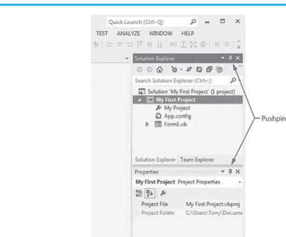

当启用自动隐藏（Auto Hide）时，窗口将仅以标签的形式显示在 Visual Studio 环境的边缘边缘。此功能为你提供了更多空间来查看应用程序的表单和代码。图 1-38 显示了解决方案管理器（Solution Explorer）和属性（Properties）是如何出现在屏幕右边缘的。注意当开启自动隐藏功能时，可以看到显示“解决方案管理器”和“属性”的标签。图 1-38 还显示了团队资源管理器（Team Explorer）标签页。如果你在使用 Visual Studio 2012，可能会看到这个标签页。我们在本书中不会讨论团队资源管理器。

## 图 1-38 隐藏的解决方案管理器和属性窗口

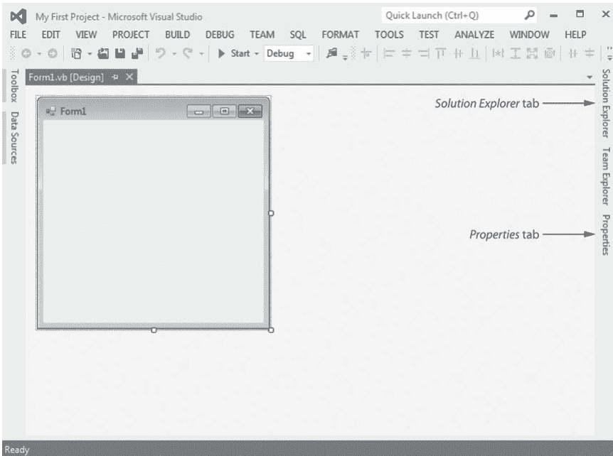

## 菜单栏和标准工具栏

你已经使用过几次 Visual Studio 菜单栏了。这是 Visual Studio 窗口顶部的栏，提供了文件（FILE）、编辑（EDIT）、视图（VIEW）、项目（PROJECT）等菜单。随着学习的深入，你将熟悉许多菜单。

菜单栏下方是标准工具栏。标准工具栏包含执行常用命令的按钮。工具栏上显示的所有命令也可以从菜单执行，但标准工具栏为你提供了更快的访问。图 1-1 标识了你最常用的标准工具栏按钮，图 1-3 对每个按钮进行了简要描述。

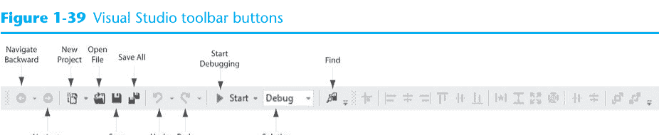

## 表 1-3 Visual Studio 工具栏按钮

| 工具按钮 | 说明 |
|---|---|
| 向后导航 (Navigate Backward) | 移动到设计器窗口中上一个活动标签 |
| 向前导航 (Navigate Forward) | 移动到设计器窗口中下一个活动标签 |
| 新项目 (New Project) | 启动新项目 |
| 打开文件 (Open File) | 打开名为 filename 的现有文件 |
| 保存 (Save) | 保存当前项目中的文件 |
| 全部保存 (Save All) | 保存当前项目中的所有文件 |
| 撤销 (Undo) | 撤销最近的操作 |
| 重做 (Redo) | 重做最近被撤销的操作 |
| 开始调试 (Start Debugging) | 开始调试（运行）你的程序 |
| 解决方案配置 (Solution Configurations) | 配置你项目的可执行代码 |
| 查找 (Find) | 在你的应用程序代码中搜索文本 |

## 工具箱 (The Toolbox)

工具箱是一个允许你选择应用程序界面中所需的控件的窗口。当你想要在应用程序表单上放置按钮（Button）、标签（Label）、文本框（TextBox）或其他控件时，可以在工具箱中选择它们。在开发 C# 应用程序时，你将频繁使用工具箱。

工具箱出现在 Visual Studio 环境的左侧。如果工具箱处于自动隐藏模式，其标签将如图 1-40 所示。图 1-41 显示了打开且关闭自动隐藏的工具箱。

## 1.8 开始使用 Visual Studio 环境

## 图 1-40 工具箱标签（自动已关闭）

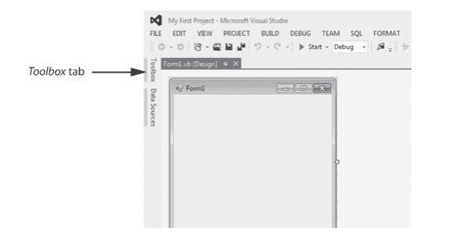

## 图 1-41 打开的工具箱（自动已关闭）

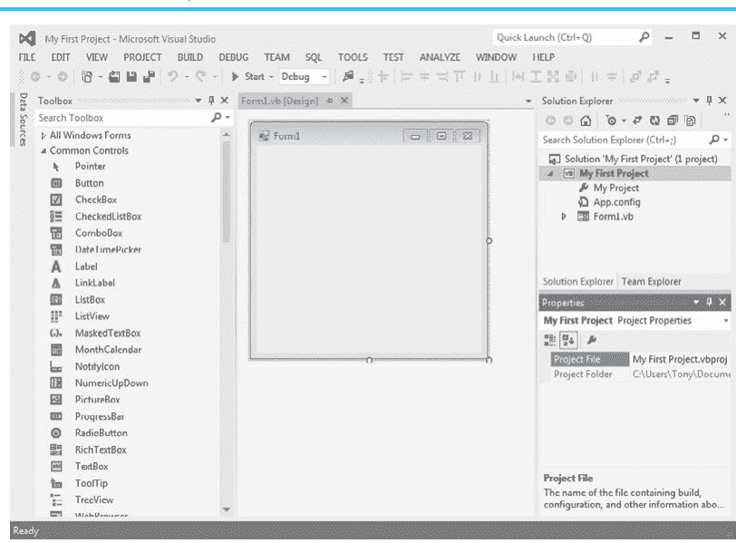

> 注意：如果你在 Visual Studio 环境侧边没有看到工具箱或其标签，请点击菜单栏上的“视图”（VIEW），然后点击“工具箱”（Toolbox）。

工具箱被分为若干部分，每个部分都有一个名称。在图 1-41 中，你可以看到“所有窗口”（All Windows）和“常用控件”（Common Controls）部分。如果你滚动工具箱，会看到许多其他部分。

如果你想打开工具箱的某个部分，只需点击它的名称。在图 1-41 中，“常用控件”部分是打开的。你使用常用控件来访问经常需要的控件，如按钮、标签和文本框。你可以通过鼠标拖动将任何部分移动到顶部。

## 使用工具提示 (ToolTips)

当你将鼠标指针悬停在工具箱中的按钮上几秒钟时，会弹出一个小矩形框，它包含该按钮功能的简短描述。图 1-42 显示了光标停留在“保存”（Save）按钮上时出现的工具提示。当你忘记某个功能的功能时，可以使用工具提示。

## 图 1-42 保存工具提示


## 停靠和浮动窗口

图 1-41 显示了停靠的工具箱、解决方案管理器属性窗口，这意味着它们附在 Visual Studio 窗口的边缘。或者，窗口可以是浮动的。你可以通过以下方式控制窗口的停靠或浮动：

- 将窗口从停靠改为浮动：右键点击其标题栏并选择“浮动”（Float）。
- 将窗口从浮动改为停靠：右键点击其标题栏并选择“停靠”（Dock）。

图 1-43 显示了浮动的工具箱、解决方案管理器和属性窗口。当窗口浮动时，你可以点击其标题栏并在场景中移动它。你可以使用你喜欢的样式——停靠或浮动。当窗口浮动时，你可以根据喜好调整大小。

> 注意：如果启用了自动隐藏功能，窗口无法浮动。

> 提示：记住，你可以点击菜单栏上的“窗口”（WINDOW）然后选择“重置窗口布局”（Reset Window Layout）。如果你不小心关闭了设计器窗口、解决方案管理器或属性窗口，可以使用“视图”（VIEW）菜单重新显示它们。

## 图 1-43 浮动的工具箱、解决方案项目和属性窗口


## 项目和解决方案

当你学习 Visual C# 编程时，你会经常看到“项目”（project）和“解决方案”（solution）这两个词。这两个词并不是一个意思，但有时互换使用。让我们简要讨论项目和解决方案之间的区别。

你创建的每个 Visual C# 应用程序被称为项目。一个 Visual C# 项目由多个文件组成。你可以将项目视为属于单个应用程序的文件的集合。

解决方案是一个包含一个或多个 Visual C# 项目的容器。如果你为大型组织开发应用程序，可能会发现将多个相关项目存储在同一个解决方案非常方便。

虽然解决方案可以包含多个项目，但书中创建的每个项目将保存在自己的解决方案中。每当你创建一个新项目时，都会创建一个新的解决方案来存放它。图 1-44 释了这一概念。通常，解决方案将与项目相同的名称。

## 图 1-44 解决方案和项目结构


## 磁盘上解决方案和项目的典型结构

当你创建一个新项目时，指定项目名称、解决方案名称以及解决方案应存储的磁盘位置。如果你使用 Visual Studio，可以在“新项目”（New Project）窗口的底部指定这些信息，如图 1-45 所示。如果你使用 Visual Studio Express，将在第一次保存项目时在“保存项目”（Save Project）窗口中指定这些信息。

## 图 1-45 指定项目名称、解决方案名称和位置


让我们使用图 1-45 查看一个“My Project”解决方案和项目在磁盘上组织的示例。注意在图 1-45 中，以下位置是解决方案的路径：

`C:\Users\Tony\Documents\Visual Studio 2012\Projects`

在你的系统中，位置不会与此完全相同，但会很相似。在此位置，将创建一个名为“My First Project”的解决方案文件夹。如果我们使用 Windows 查看该文件夹内部，我们将看到图 1-46 所示的两个项目。注意其中一个是另一个名为“My First Project”的文件夹。那是项目文件夹，包含了与项目相关的各种文件。另一个是解决方案文件。在 Windows 中，你可以双击解决方案文件在 Visual Studio 中打开项目。

## 图 1-46 My First Project 解决方案文件夹的内容


# 打开现有项目

如果 Visual Studio 已经在运行，你可以按照以下步骤打开现有项目：

- 点击 Visual Studio 菜单栏上的“文件”（FILE），然后选择“打开”（Open），并选择“项目/解决方案”（Project/Solution）。
- 将“打开项目”窗口。导航到目标解决方案文件夹，选择解决方案文件，并点击“打开”（Open）。

在 Visual Studio Express 中，执行以下步骤打开现有项目：

- 点击 Visual Studio 菜单栏上的“文件”（FILE），然后选择“打开项目”（Open Project）。
- 将“打开项目”窗口。导航到目标解决方案文件夹，选择解决方案文件，并点击“打开”（Open）。

# 教程 1-4：打开现有项目

在本教程中，你将回顾在教程 1-2 中创建的“第一个项目”应用程序。


**第 1 步：** Visual Studio 应该仍在上一个教程结束后运行。执行以下操作之一重新打开“我的第一个项目”（My First Project）：

### 如果你使用的是 Visual Studio：

点击菜单栏上的“文件”（FILE）；然后选择“打开”（Open），再次选择“项目/解决方案”（Project/Solution）。出现“打开项目”窗口。导航到“我的第一个项目”解决方案，选择解决方案文件，并点击“打开”按钮。

### 如果你使用的是 Visual Studio Express：

点击菜单栏上的“文件”（FILE），然后选择“打开项目”（Open Project）。出现“打开项目”窗口。导航到“我的第一个项目”解决方案，选择解决方案文件，并点击“打开”按钮。

执行此步骤后，“我的第一个项目”应当打开。如果你计划完成下一个教程，请保持 Visual Studio 运行并打开“我的第一个项目”。

# 显示设计器（当未自动出现时）

有时当你打开一个现有项目时，项目的表单不会自动显示在设计器中。图 1-4 显示了一个已打开项目但设计器中未显示表单的 Visual Studio 环境示例。当这种情况发生时，执行以下步骤在设计器中显示项目表单：

- 如图 1-48 所示，在“解决方案资源管理器”（Solution Explorer）中右键点击 `Form.cs`。
- 点击弹出菜单中的“设计器”（Designer）。

# 访问 Visual Studio 文档

你可以通过点击菜单栏上的“帮助”（HELP），然后选择“查看帮助”（View Help）来访问 Visual Studio 文档。（或者，你可以按 `Ctrl+F1`，然后在键盘上按 V。）这将启动你的网络浏览器并打开在线开发者网络（MSDN）库。MSDN 库为 Visual C# 以及 Visual Studio 中的其他编程语言提供了完整的文档。你还可以在那里找到代码示例、教程、文章以及教程视频访问。

# 图 1-47 一个已打开但设计器中未显示表单的项目

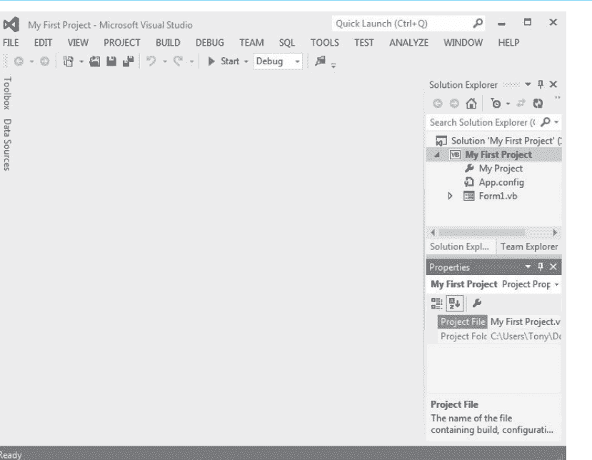

# 图 1-48 使用解决方案资源管理器在设计器中打开表单

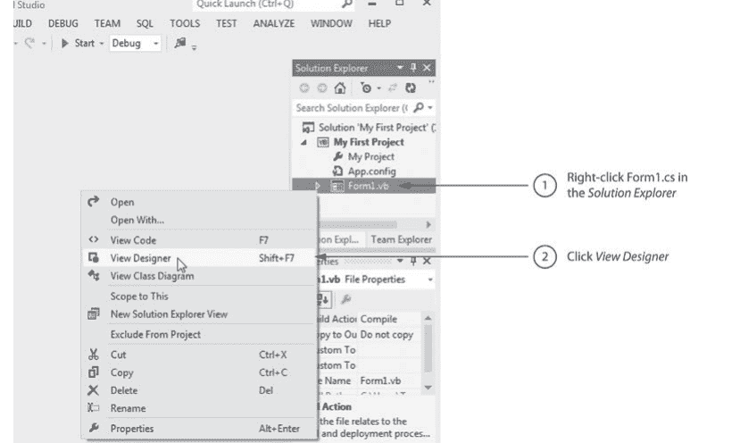

# 1.8 开始使用 Visual Studio 环境

# 教程 1-5：熟悉 Visual Studio 环境

此练习将让你练习与解决方案资源管理器（Solution Explorer）窗口、属性窗口（Properties window）和工具箱（Toolbox）进行交互。

- 第 1 步：如果 Visual Studio 仍在你的电脑上运行，重复第 2 步。如果电脑上没有运行 Visual Studio，请重复教程 1-4 中的步骤打开“我的第一个项目”。
- 第 2 步：练习解决方案资源管理器窗口、属性窗口和工具箱的“自动隐藏”（Auto Hide）功能。回想之前的讨论，点击每个窗口标题栏中的图钉图标可以开启或关闭自动隐藏。完成后，确保这些窗口的自动隐藏都是关闭状态。你的屏幕应该看起来像图 1-41。
- 第 3 步：练习解决方案资源管理器窗口和工具箱的悬浮和停靠。回想之前的讨论，你可以通过右键点击任何这些窗口的标题栏并选择“悬浮”（Float）来使其变为悬浮。通过右键点击悬浮窗口的标题栏并选择“停靠”（Dock）来停靠该窗口。
- 第 4 步：工具箱、解决方案资源管理器和属性窗口的右上角都有一个关闭按钮。点击每个窗口的关闭按钮来关闭它们。
- 第 5 步：你还记得工具栏上哪些按钮可以恢复解决方案资源管理器、属性窗口和工具箱吗？如果不记得，将鼠标指针悬停在工具栏上的任何按钮上并停留直到工具提示（ToolTip）出现。在不同的按钮上重复此过程，直到你找到对应解决方案资源管理器、属性窗口和工具箱的按钮。（请参考图 1-39 和表 1-3 获取更多帮助。）
- 第 6 步：点击工具栏上的相应按钮来恢复解决方案资源管理器、属性窗口和工具箱。
- 第 7 步：点击菜单栏中的“文件”（FILE）然后点击“退出”（Exit）退出 Visual Studio。你可能会看到一个对话框询问你是否要保存对多个项目的更改。点击“是”。

### 检查点

- 1.44 简述解决方案资源管理器窗口的作用。
- 1.45 简述属性窗口的作用。
- 1.46 简述标准工具栏的作用。
- 1.47 工具栏（toolbar）和工具箱（Toolbox）之间的区别是什么？
- 1.48 什么是工具提示（ToolTip）？
- 1.49 什么是项目（project）？
- 1.50 什么是解决方案（solution）？

# 关键术语

- 算法 (algorithm)
- 美国信息交换标准代码 (ASCII)
- 应用程序 (application software)
- 汇编器 (assembler)
- 汇编语言 (assembly language)
- 自动隐藏 (Auto Hide)
- 二进制 (binary)
- 二进制数字 (binary digit)
- 二进制计数系统 (binary numbering system)
- 位 (bit)
- 字节 (byte)
- 中央处理单元 (central processing unit)
- 类 (class)
- 代码 (code)
- 命令行界面 (command line)
- 编译器 (compiler)
- 控制控件 (controls)
- 调试 (debug)
- 设计器 (Designer)
- 数字 (digital)
- 数字数据 (digital data)
- 数字设备 (digital device)
- 磁盘驱动器 (disk drive)
- 事件驱动 (event driven)
- 字段 (fields)
- 浮点数 (floating-point)


- 流程图 (flowchart)
- 硬件 (hardware)
- 高级语言 (high-level languages)
- 输入 (input)
- 输入设备 (input device)
- 指令集 (instruction set)
- 集成开发环境 (integrated development environment)
- 解释器 (interpreter)
- 关键字 (keywords)
- 标签 (Label)
- 逻辑错误 (logic error)
- 低级语言 (low-level language)
- 机器语言 (machine language)
- 主内存 (main memory)
- 方法 (methods)
- 微处理器 (microprocessors)
- 助符 (mnemonics)
- .NET Framework
- 面向对象 (object oriented)
- 操作系统 (operating system)
- 运算符 (operators)
- 输出 (output)
- 输出设备 (output device)
- 输出符号 (output symbols)
- 像素元素 (picture element)
- 像素 (pixel)
- 处理符号 (processing symbols)
- 程序 (program)
- 程序开发周期 (program development cycle)
- 程序员 (programmer)
- 项目 (project)
- 项目文件夹 (project folder)
- 属性 (properties)
- 设计器 (Properties)
- 伪代码 (pseudocode)
- 随机访问内存 (random-access memory)
- 保留字 (reserved words)
- 运行 (running)
- 示例 (samples)
- 二级存储 (secondary storage)
- 应用程序 (application)
- 软件 (software)
- 软件开发者 (software developer)
- 软件开发工具 (software development tools)
- 解决方案 (solution)
- 解决方案资源管理器窗口 (Solution Explorer window)
- 解决方案文件 (solution file)
- 解决方案文件夹 (solution folder)
- 源代码 (source code)
- 标准工具栏 (standard toolbar)
- 终端 (start terminal)
- 语句 (statements)
- 语法 (syntax)
- 语法错误 (syntax error)
- 系统软件 (system software)
- 终端符号 (terminal symbol)
- 文本框 (TextBox)
- 工具箱 (Toolbox)
- 工具提示 (ToolTip)
- 补码法 (two's complement)
- Unicode
- 通用串行总线 (universal serial bus)
- 易失性 (volatile)
- 用户 Visual Studio (user Visual Studio)
- 用户界面 Visual Studio 2012 (user interface Visual Studio 2012)
- 实用程序 Visual Studio 2012 Express (utility program Visual Studio 2012 Express)

# 复习题 / 单选题

1. ________ 是计算机执行任务的一组指令。

   a. 编译器
   b. 程序
   c. 解释器
   d. 编程语言

2. 计算机的物理设备被称为 ________。

   a. 硬件
   b. 软件
   c. 操作系统
   d. 工具

3. 运行程序的部件被称为 ________。

   a. RAM
   b. 二级存储
   c. 主内存
   d. CPU

4. 现在，CU 是被称为 ________ 的小型芯片。

   a. ENIAC
   b. 微处理器
   c. 内存芯片
   d. 操作系统

5. 计算机在程序运行时将程序以及程序正在处理的数据存储在 ________ 中。

   a. 二级存储
   b. CPU
   c. 主内存

6. ________ 是一种仅在程序运行时用于临时存储的易失性内存。

   a. RAM
   b. 二级存储
   c. 磁盘驱动器
   d. USB 驱动器

7. 即使在计算机断电的情况下也能长时间保存数据的某种类型内存被称为 ________。

   a. RAM
   b. 主内存
   c. 二级存储
   d. CPU 存储

8. 一种从人员或其他设备收集数据并发送到计算机的组件称为 ________。

   a. 输出设备
   b. 输入设备
   c. 辅助存储设备
   d. 主内存

9. 视频显示器是一种 ________ 设备。

   a. 输出设备
   b. 输入设备
   c. 辅助存储设备
   d. 主内存

10. ________ 是一个足够存储一个字母表字母或较小数字的内存。

    a. 字节
    b. 位
    c. 开关
    d. 晶体管

11. 一个字节由八个 ________ 组成。

    a. CPU
    b. 指令
    c. 变量
    d. 位

12. 在 ________ 计数系统中，所有的数值都都被写成 0 和 1 的序列。

    a. 十六进制
    b. 二进制
    c. 八进制
    d. 十进制

13. 关闭的位代表以下值：________。

    a. 1
    b. -1
    c. 0
    d. "no"

14. 一组代表英文字母、各种标点符号和其他字符的 128 个数字代码是 ________。

    a. 二进制计数
    b. ASCII
    c. Unicode
    d. ENIAC

15. 一种可以表示世界上许多语言字符的广泛编码方案是 ________。

    a. 二进制计数
    b. ASCII
    c. Unicode
    d. ENIAC

16. 负数使用 ________ 技术进行编码。

    a. 补码
    b. 浮点数
    c. ASCII
    d. Unicode

17. 实数使用 ________ 技术进行编码。

    a. 补码
    b. 浮点数
    c. ASCII
    d. Unicode

18. 数字图像组成的微小颜色点被称为 ________。

    a. 位
    b. 字节
    c. 颜色包
    d. 像素

19. 如果你查看机器语言程序，你会看到 ________。

    a. C# 代码
    b. 一串二进制数
    c. 英文单词
    d. 电路

20. 在取指-解码-执行循环的 ________ 部分，CPU 决定了它应该执行的操作。

    a. 取 (fetch)
    b. 解码 (decode)
    c. 执行 (execute)
    d. 指令执行后立即

21. 计算机只能执行用 ________ 写的程序。

    a. C#
    b. 汇编语言
    c. 机器语言
    d. Java

22. ________ 将汇编程序翻译成机器语言。

    a. 汇编器
    b. 编译器
    c. 翻译器
    d. 解释器

23. 构成高级编程语言的单词被称为 ________。

    a. 二进制指令
    b. 助符
    c. 命令
    d. 关键字

24. 编写程序时必须遵守的规则被称为 ________。

    a. 语法
    b. 标点符号
    c. 关键字
    d. 运算符

25. ________ 是一个将高级语言程序翻译成独立的机器语言程序的程序。

    a. 汇编器
    b. 编译器
    c. 翻译器
    d. 实用程序

26. 一个 ______ 是任何使用程序并为其提供输入的假设性人员。

    a. 设计师
    b. 用户
    c. 实验鼠
    d. 测试对象

27. ______ 错误不会阻止程序运行，但会导致它产生错误结果。

    a. 语法
    b. 硬件
    c. 逻辑
    d. 致命

28. 一个 ______ 是执行某项任务必须采取的一组定义良好的逻辑步骤。

    a. 对数
    b. 行动计划
    c. 逻辑计划
    d. 算法

29. 一种没有语法规则且不是为了编译或执行的非正式语言被称为 ______。

    a. 伪代码 (faux code)
    b. 伪代码 (pseudocode)
    c. C#
    d. 流程图

30. ______ 是一种图形描绘程序中发生步骤的图。

    a. 流程图
    b. 步骤图
    c. 代码图
    d. 程序图

31. 程序的图形用户界面中可见的对象通常被称为 ____。

    a. 按钮
    b. 控件
    c. 表单
    d. 窗口

32. ______ 是描述特定类型对象的代码。

    a. 命名空间
    b. 蓝图
    c. 模式
    d. 类

33. ______ 是类和其他代码的集合，可以与 C# 等编程语言一起使用，为 Windows 操作系统创建程序。

    a. .NET framework
    b. 标准模板库
    c. GUI 框架
    d. MSDN 库

34. ________ 是计算机与用户交互的部分。

    a. 中央处理器
    b. 用户界面
    c. 控制系统
    d. 交互系统

35. 在 GUI 流行之前，________ 是最常用的。

    a. 命令行
    b. 远程终端
    c. 感官
    d. 事件驱动

36. ________ 程序通常是事件驱动的。

    a. 命令行
    b. 基于文本的
    c. GUI
    d. 过程

# 正确或错误

1. 如今，CPU 是由真空管和开关等电子和机械元件组成的巨大设备。
2. 主内存也称为 RAM。
3. 任何数据都是一个位（bit）。
4. 一个字节由八位组成。
5. 在二进制计数系统中，所有的数值都都被写成 0 和 1 的序列。
6. ASCII 代表英文字母。
7. 逻辑错误不会阻止程序运行，但会导致它产生错误结果。
8. 算法是执行某项任务必须采取的一组定义良好的逻辑步骤。
9. 伪代码是一种没有语法规则且不是为了编译或执行的非正式语言。
10. 流程图是一种图形描绘程序中发生步骤的图。
11. 控件是程序图形用户界面中可见的对象。
12. 类是描述特定对象的代码。
13. .NET framework 是类和其他代码的集合，可以与 C# 等编程语言一起使用，为 Windows 操作系统创建程序。
14. 用户界面是计算机与用户交互的部分。
15. 在 GUI 流行之前，命令行是最常用的。
16. GUI 程序通常是事件驱动的。

## 第 2 章 Visual C# 简介

### 图 2-1 在设计器中显示空白表单的新项目

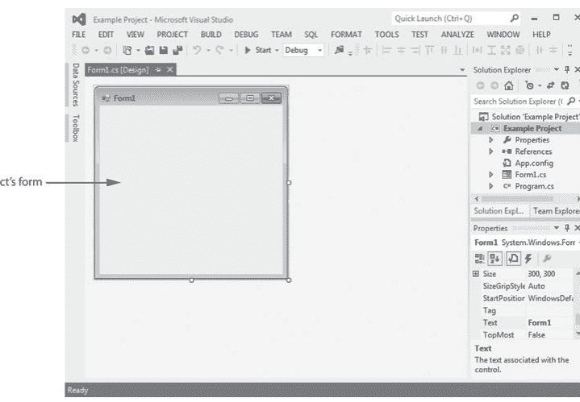

如果你仔细观察表单，你会发现它被一条虚线包围，这被称为边界框（`bounding box`）。如图 2-2 所示，边界框有微小的调整手柄，这些手柄出现在表单的右边缘、底部和右下角。当设计器中的某个对象周围出现边界框时，表示该对象已被选中并已准备好进行编辑。

### 图 2-2 表单的边界框和调整手柄

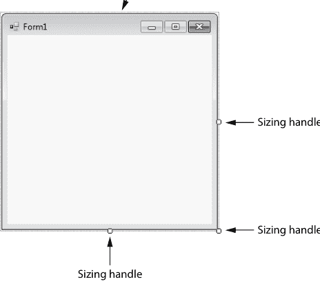

最初，表单的大小为宽 300 像素、高 300 像素。你可以用鼠标轻松调整表单的大小。当你将光标置于任何带有调整手柄的边缘或角上时，光标会变为双向箭头（`↔`）。图 2-3 显示了这些示例。当鼠标变成双向箭头时，你可以点击并拖动鼠标来调整表单的大小。

## 2.1 入门：表单和控件

**图 2-3** 使用鼠标调整表单大小

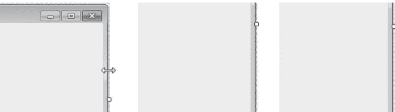

### 通过名称识别表单和控件

应用程序的 GUI 由表单和各种控件组成。应用程序 GUI 中的每个表单和控件都必须有一个用于标识的名称。Visual Studio 在新项目中最初创建的空白表单命名为 `Form1`。

> 注意：在本书的后续章节中，你将学习如何更改表单的名称，但目前你将保留默认名称 `Form1`。

### 属性窗口

GUI 对象的外观和其他特征由该对象的属性决定。当你在设计器中选择一个对象时，其属性将显示在属性窗口中。例如，当选中 `Form1` 时，它的属性将显示在属性窗口中，如图 2-4 所示。

> 提示：回忆第 1 章，如果属性窗口处于“自动隐藏”模式，你可以点击其标签页来打开它。如果你没有看到属性窗口，点击菜单栏上的“视图”（VIEW）。在“视图”菜单中，点击“属性”（Properties）。在 Visual Express 中，点击“视图”、“其他窗口”、“属性”）。

属性窗口顶部区域显示当前选中对象的名称。你可以从图 2-4 中看到被选中对象的名称是 `Form1`。下方是可滚动的属性列表。该列表有两列：左列显示每个属性的名称，右列显示每个属性的值。例如，查看图 2-4 中的表单 `Size`（大小）属性。它的值是 `300, 300`。这意味着表单的大小为宽 300 像素、高 300 像素。查看表单的 `Text`（文本）属性。`Text` 属性决定了在表单标题栏（表单顶部的栏）中显示的文本。它的当前值为 `Form1`，因此文本 `Form1` 显示在表单的标题栏中。

创建表单时，其 `Text` 属性最初被设置为与表单名称相同的值。当你启动新项目时，设计器中出现的空白表单始终被命名为 `Form1`，因此文本 `Form1` 将始终出现在表单的标题栏中。如果你想将表单属性的值更改为有意义的内容，例如，假设当前选中了 `Form1`，你可以执行以下步骤将其 `Text` 属性更改为 `My First Program`。

### 图 2-4 属性窗口，显示被选中对象的属性

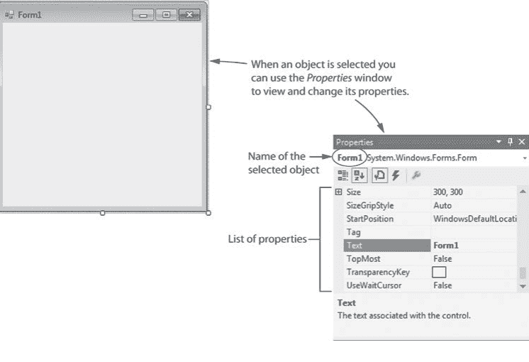

**步骤 1：** 在属性窗口中，找到 `Text` 属性。

**步骤 2：** 双击当前显示为 `Text` 属性值的单词 `Form1`，并使用 `Delete`（删除）键将其删除。

**步骤 3：** 在表单中输入 `My First Program` 并按 `Enter`（回车）键。文本 `My First Program` 现在将出现在表单的标题栏中，如图 2-5 所示。

> 注意：更改对象的 `Text` 属性不会改变对象的名称。例如，如果你将 `Form1` 的 `Text` 属性更改为 `My First Program`，表单的名称仍然是 `Form1`。你只更改了表单标题栏中显示的文本。

### 图 2-5 表单标题栏中显示的 Text 属性值

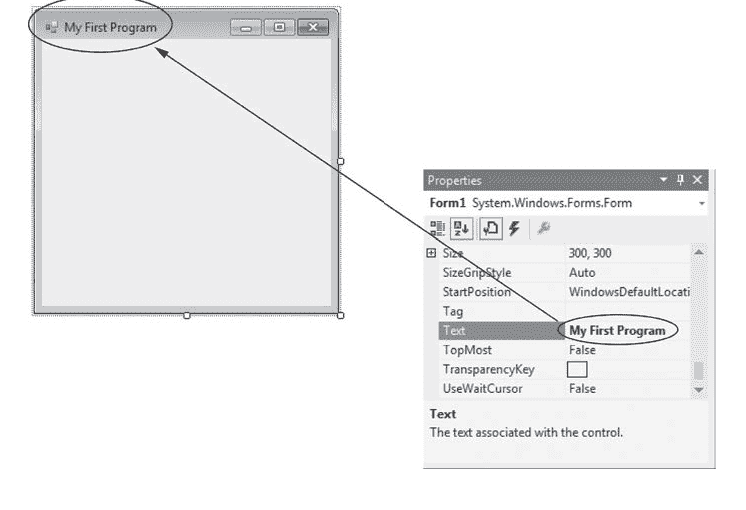

### 更改表单大小

之前我们讨论了如何在设计器中使用鼠标调整表单的大小。另一种方法是在属性窗口中更改表单的 `Size` 属性。例如，假设当前选中了 `Form`。你可以执行以下步骤将其大小更改为 400 像素以 100 像素。

- **步骤 1：** 在属性窗口中，找到 `Size` 属性。
- **步骤 2：** 点击包含 `Size` 属性的区域，删除当前值。
- **步骤 3：** 在此处输入 `400, 100` 并按 `Enter` 键。表单的大小将如图 2-6 所示。

### 图 2-6 表单大小更改为 400x100

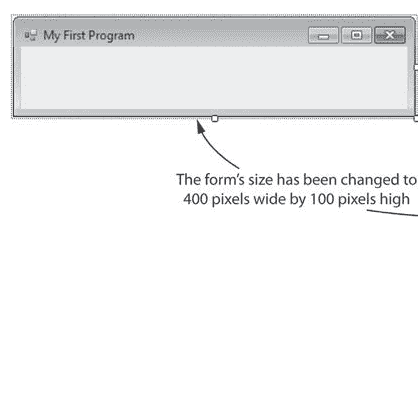

> 注意：注意图 2-6，属性窗口顶部选择了“字母顺序”（Alphabetical）按钮。这使得属性按字母顺序显示。或者，可以选择“分类”（Categorized）按钮，使属性按分组显示。字母排序是默认选择，大多数情况下它更容易用。

### 向表单添加控件

向表单添加控件时，例如，使用工具箱（`Toolbox`）。注意，如果工具箱是隐藏的，你可以点击其标签打开它。如果你没有看到工具箱，点击菜单栏上的“视图”（VIEW）。在“视图”菜单中，点击“工具箱”（在 Visual Express 中，点击“视图”、“其他窗口”）。

应用程序的 GUI 由表单和各种控件组成。应用程序 GUI 中的每个表单和控件都必须有一个用于标识的名称。Visual Studio 在新项目中最初创建的空白表单命名为 `Form1`。

> 注意：在本书的后续章节中，你将学习如何更改表单的名称，但目前你将保留默认名称 `Form1`。

属性窗口顶部区域显示当前选中对象的名称。你可以从图 2-4 中看到被选中对象的名称是 `Form1`。下方是可滚动的属性列表。该列表有两列：左列显示每个属性的名称，右列显示每个属性的值。例如，查看图 2-4 中的表单 `Size` 属性。它的值是 `300, 300`。这意味着表单的大小为宽 300 像素、高 300 像素。查看表单的 `Text` 属性。`Text` 属性决定了在表单标题栏（表单顶部的栏）中显示的文本。它的当前值为 `Form1`，因此文本 `Form1` 显示在表单的标题栏中。

创建表单时，其 `Text` 属性最初被设置为与表单名称相同的值。当你启动新项目时，设计器中出现的空白表单始终被命名为 `Form1`，因此文本 `Form1` 将始终出现在表单的标题栏中。如果你想将表单属性的值更改为有意义的内容，例如，假设当前选中了 `Form1`，你可以执行以下步骤将其 `Text` 属性更改为 `My First Program`。

### 图 2-7 工具箱

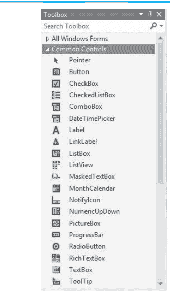

### 图 2-8 创建按钮

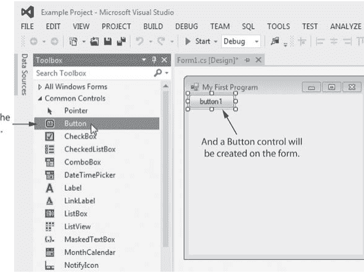

### 调整控件的大小和移动


之前我们讨论了如何在设计器中使用鼠标调整表单的大小。另一种方法是在属性窗口中更改表单的 `Size` 属性。例如，假设当前选中了 `Form`。你可以执行以下步骤将其大小更改为 400 像素以 100 像素。

- **步骤 1：** 在属性窗口中，找到 `Size` 属性。
- **步骤 2：** 点击包含 `Size` 属性的区域，删除当前值。
- **步骤 3：** 在此处输入 `400, 100` 并按 `Enter` 键。表单的大小将如图 2-6 所示。

### 图 2-9 调整了大小并移动的控件

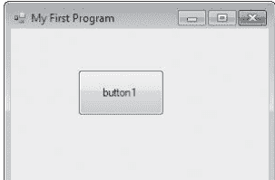

### 删除控件

删除控件非常简单：选中它，然后按 `Delete` 键。

### 关于按钮控件的更多信息

你学习了应用程序 GUI 中的每个表单和控件都必须有一个用于标识的名称。当你创建控件时，它们被赋予默认名称，如 `button1`、`button2` 等。

按钮控件有一个 `Text` 属性，该属性存储显示在按钮上的文本。创建按钮时，其 `Text` 属性最初被设置为与表单名称相同的值。因此，当你创建一个按钮时，它的名称将显示在按钮表面。例如，图 2-10 中的表单包含三个命名为 `button1`、`button2` 和 `button3` 的控件。

### 图 2-10 带有三个按钮控件的表单

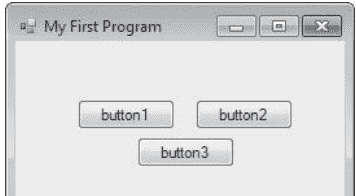

## 第 2 章 Visual C# 简介

图 2-11 展示了更改 `Button`（按钮）控件的 `Text` 属性如何更改按钮表面显示的文本的示例。

### 图 2-11 更改后的 Button 控件 Text 属性

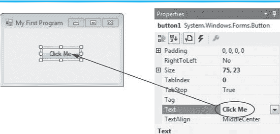

## 修改控件的名称

控件的名称（`Name`）在应用程序代码和 Visual Studio 环境中标识该控件。当你在应用程序表单（form）上创建控件时，应该将控件的名称更改为比 Visual Studio 提供的默认名称更有意义的内容。控件的名称应该反映其用途。

例如，假设你创建了一个 `Button` 来计算税额。像 `Button1` 这样的默认名称无法传达按钮的用途。使用 `calculateTaxButton` 作为名称要好得多。当你处理应用程序并看到 `calculateTaxButton` 这个名称时，你将确切知道指的是哪一个按钮。

你可以通过更改控件的 `Name` 属性来修改其名称。以下是步骤：

- **步骤 1：** 确保控件已选中。（如果你没有看到控件周围的边界框和句柄，只需点击控件即可选中。）
- **步骤 2：** 在 Properties（属性）窗口中，你应该能看到 `Name` 属性，如图 2-12 所示。（`Name` 属性被括在括号中，以便使其出现在属性列表的顶部。这使其更容易找到。）
- **步骤 3：** 点击包含 `Name` 值的区域并删除当前名称。然后，其中输入你的新名称并按 `Enter` 键。你已成功更改了控件的名称。

### 图 2-12 `Name` 属性

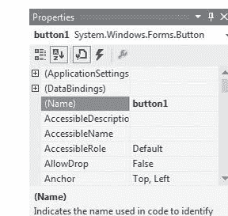

### 2.1 入门 Forms和控件

图 2-13 显示了将 `Button` 控件名称更改为 `calculateTaxButton` 后的 Properties 窗口。

### 图 2-13 更改为 calculateTaxButton 的 Name 属性

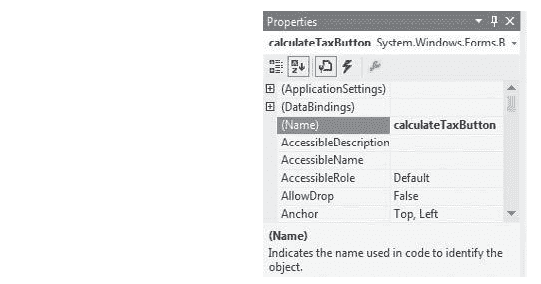

### 命名规则

控件名称也称为标识符。命名控件时必须遵循以下 C# 规则：

- 第一个字符必须是 a 到 Z 的字母之一或下划线 (`_`)。
- 在第一个字符之后，你可以使用 a 到 Z 的字母、0 到 9 的数字或下划线。
- 名称不能包含空格。

表 2-1 列出了某些可以用于控件名称的标识符，并指出了每个在 C# 中是合法或非法的标识符。

| 标识符 | 合法或非法 |
| :--- | :--- |
| `showDayButton` | 合法 |
| `3rdQuarterButton` | 非法，标识符不能以数字开头 |
| `change*colorButton` | 非法，因为不允许 `*` |
| `displayTotalButton` | 合法 |
| `calculate Button` | 非法，因为标识符不能包含空格 |

控件的名称应该反映控件的用途，程序员经常创建由多个单词组成的名称。例如，考虑以下名称：

```
calculatetbutton
printreportbuttonisplaybutton
```

遗憾的是，这些名称肉眼难以阅读，因为单词之间没有分隔。由于控件名称中不能有空格，因此我们需要找到另一种方法来分隔多单词名称中的单词，使其对肉眼更具可读性。程序员通过对控件使用**驼峰命名法（camelCase）**来解决这个问题。驼峰命名按以下方式编写：

- 以小写字母开始编写名称。
- 第二个及后续单词的第一个字母大写。

例如，以下控件使用了驼峰命名法：

```
calculateTaxButton
btnPrint
displayAnimationButton
```

> **注意：** 这种命名样式被称为 camelCase，因为名称中出现的大写字母让人联想到骆驼的驼峰。

### 检查点

- 2.1 当你开始一个新的 Visual C# 项目时，哪个部分在 Designer 中被自动创建并设计？
- 2.2 你如何在 Designer 中判断一个对象是否被选中以进行编辑？
- 2.3 对象缩放句柄的用途是什么？
- 2.4 应用程序 GUI 中的每个表单和控件必须具备什么？
- 2.5 Properties 窗口的用途是什么？
- 2.6 当在 Properties 窗口中选中字母按钮（alphabetical button）时，它做什么？
- 2.7 当在 Properties 窗口中选中分类按钮（categorized button）时，它做什么？
- 2.8 表单的 `Text` 属性决定什么？
- 2.9 表单的 `Size` 属性决定什么？
- 2.10 Toolbox（工具箱）中显示了什么？
- 2.11 如何向表单添加控件？
- 2.12 显示在 `Button` 控件上的文本应该是什么种样的？
- 2.13 命名控件的规则是什么？
- 2.14 大多数 C# 程序员使用什么命名约定来分隔多单词标识符中的单词？

## 创建你的第一个 Visual C# 应用程序的 GUI：Hello World 应用程序

当学生学习计算机编程时，从学习编写 Hello World 程序是传统做法。Hello World 程序是一个简单的程序，仅仅在屏幕上显示“Hello World”字样。在本章中，你将创建一个第一个 C# 应用程序，它是一个事件驱动的 Hello World 程序。当该程序运行时，它将显示图 2-14 所示的表单。注意，表单包含一个名为 Display Message 的按钮。当你点击该按钮时，将显示该窗口。

### 2.2 为你的第一个 C# 应用程序创建 GUI：Hello World 应用程序

#### 图 2-14 Hello World 程序的屏幕

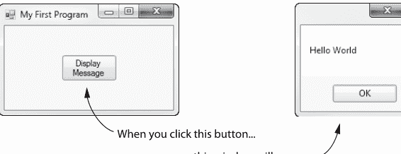

当你点击此按钮...将出现。

创建此应用程序的过程分为两个部分。首先，你将创建 GUI；其次，你将编写代码在用户点击时显示 Hello World。教程 2-1 将引导你完成 GUI 的创建。

### 教程 2-1：为 Hello World 应用程序创建 GUI

- **步骤 1：** 启动 Visual Studio。
- **步骤 2：** 通过以下操作启动新项目：
    - 如果你使用 Visual Studio，点击菜单栏上的 `FILE`，然后选择 `New > Project...`
    - 如果你使用 Visual Studio Express，点击 `FILE` 选择 `New Project...`
- **步骤 3：** `New Project` 窗口将出现。在窗口左侧的 `Installed`（已安装）> `Templates`（模板）下，选择 `Visual C#`。然后选择 `Windows Forms Application` 作为应用程序类型。在底部的 `Name` 框中，将项目名称更改 `Hello World`，然后点击 `OK`。
- **步骤 4：** 确保 `Toolbox`（工具箱）、`Solution Explorer`（解决方案管理器）和 `Properties`（属性）窗口可见，并关闭这些窗口的自动隐藏功能。Visual Studio 环境将如图 2-15 所示出现。
- **步骤 5：** 将 `Form1` 的 `Text` 属性更改为 `My First Program`，如图 2-16 所示。
- **步骤 6：** 表单的默认大小对于此应用程序太大了，因此你需要将其调小。使用上一节讨论的技术用鼠标调整表单的大小。表单看起来与图 2-17 相似。（不用担心表单的大小，只需使其看起来像图 2-17。）
- **步骤 7：** 现在你准备好向表单添加一个 `Button` 控件了。在 `Toolbox` 中找到 `Button` 控件并双击它。表单上会出现 `Button` 控件，如图 2-18 所示。移动 `Button` 控件使其大致位于表单中心，如图 2-19 所示。

#### 图 2-18 在表单上创建的按钮控件


#### 图 2-19 移动后的按钮控件


- **步骤 8：** 将 `Button` 控件的 `Text` 属性值更改为 `Display Message`。此后，你会注意到按钮上显示的文本已更改，如图 2-20 所示。

#### 图 2-20 Button 控件的 Text 属性已更改


- **步骤 9：** `Button` 控件的大小还不足以容纳你在 `Text` 属性中输入的所有文本，要放大 `Button` 控件，如图 2-21 所示。

#### 图 2-21 放大的按钮控件


- **步骤 10：** 如前一节所述，控件的名称应该反映其用途。你在此应用程序中创建的 `Button` 控件在被点击时将显示消息。然而，按钮本身并没有转换这一用途。将 `Button` 控件的 `Name` 属性更改为 `messageButton`。`Properties`（属性）窗口应该如图 2-22 所示。

### 图 2-22 Button 控件的 Name 已更改为 messageButton


- **步骤 11：** 点击 Visual Studio 菜单栏上的 `FILE`（文件），然后点击 `Save All`（全部保存）来保存项目。
- **步骤 12：** 你已经部分完成了应用程序，但现在可以运行它来查看 GUI 在屏幕上的样子。要运行应用程序，请按键盘上的 `F5` 键或点击工具栏上的 `Start Debugging`（启动调试）按钮。这将导致应用程序被编译并执行。你会注意到 Visual Studio 环境发生了某种变化，并且你会看到应用程序的表单出现在屏幕上，如图 2-23 所示。

### 图 2-23 运行中的应用程序


尽管应用程序正在运行，但它无法执行显示表单以外的任何操作。如果你点击 `Display Message` 按钮，什么都不会发生。这是因为你还没有编写在按钮被点击时执行的代码。要结束应用程序，请点击表单右上角的 Windows 关闭按钮。

## C# 代码简介

**概念：** 你使用 Visual Studio 代码编辑器来编写应用程序代码。你在应用程序中编写的大部分代码将是事件处理程序。事件处理程序响应应用程序运行时发生的特定事件。

在本章的前几节中，你学习了创建应用程序 GUI 的基础知识。应用程序不仅仅是一个用户界面；如果你想让应用程序执行任何有意义的操作，你就必须编写代码。本节介绍了 Visual C# 代码，并展示了如何编写程序以响应按钮点击。

包含程序代码的文件是源文件。当你启动一个 C# Windows Forms 项目时，Visual Studio 会自动创建几个源文件并将它们添加到项目中。如果你查看解决方案管理器（`Solution Explorer`），将看到两个源文件的名称：`Form1.cs` 和 `Program.cs`。（C# 源文件始终以 `.cs` 扩展结尾）。

### 图 2-24 解决方案管理器中显示的源代码文件


以下是这两个文件的说明：

- **Program.cs** 文件包含应用程序的启动代码，这些代码在应用程序运行时执行。该文件中的代码执行后台初始化任务，这些任务对于启动和运行应用程序是必要的。重要的是，不要修改此文件的内容，因为可能会导致应用程序无法执行。
- **Form1.cs** 文件包含与 `Form1` 表单相关的代码。当你编写定义与 `Form1` 相关的操作代码（例如响应按钮点击）时，你将在该文件中编写代码。

> **注意：** 你在解决方案管理器中看到的额外源文件可能比图 2-24 所示的多。

`Form1.cs` 已经包含了 Visual Studio 在创建项目时生成的代码。你可以将这些自动生成的代码视为一个大纲，在开发应用程序时你可以在其中添加自己的自己的代码。

让我们来看代码。如果你已经打开了上一个教程中的 Hello World 项目，请在解决方案管理器中右键点击 `Form1.cs`。会弹出一个菜单；点击 `View Code`（查看代码）。如图 2-25 所示，将显示代码编辑器窗口。

### 图 2-25 代码编辑器窗口


### 图 2-26 代码编辑器窗口


### 2.3 C# 简介

此时，没有必要理解 C# 的语法，但了解它是如何组织的对你将会有帮助。C# 代码以三种方式组织起来：

- 命名空间（`namespace`）是相关类的容器。
- 类（`class`）是方法的容器。
- 方法（`method`）是一组执行特定操作的语句。

如图 2-27 所示，代码组织如下：

```csharp
using System;
using System.Collections.Generic;
using System.ComponentModel;
using System.Drawing;
using System.Linq;
using System.Threading.Tasks;
using System.Windows.Forms;

namespace HelloWorld
{
    public partial class Form1 : Form
    {
        public Form1()
        {
            InitializeComponent();
        }
    }
}
```

### 图 2-27 代码编辑器结构


### 在代码编辑器和设计器之间切换

当你打开代码编辑器时，它与设计器（`Designer`）出现在屏幕相同区域。在开发 Visual 应用程序时，你会发现自己需要在设计器和代码编辑器之间来切换。快速切换这两个窗口的一种方法是使用图 2-29 中的标签。注意，最左侧的标签显示 `Form1.cs`。那是代码编辑器的标签。最右侧的标签显示 `Form1.cs` [Design]。那是设计器的标签。（标签并不总是按这种顺序出现。）要在设计器和代码编辑器之间切换，只需点击所需窗口的标签即可。

### 图 2-29 代码编辑器和设计器标签


你还可以拖动代码编辑器并将其移动到屏幕的其他部分。这允许你同时看到代码编辑器和设计器。如图 2-30 所示，点击代码编辑器标签并将其拖到屏幕上的理想位置。（如果你的电脑连接了多个显示器，你甚至可以将代码编辑器拖到另一个显示器上。）要将代码编辑器返回 IDE 中的位置，请右键点击代码编辑器窗口中源文件的标签，并选择 `Move to Main Document`（移动到主文档）。如图 2-31 所示。

### 图 2-30 通过点击并拖拽分离代码编辑器


### 图 2-31 将代码编辑器恢复到停靠位置


### 向项目中添加你自己的代码

现在你已经准备好学习如何向项目添加你自己的代码了。假设你创建了一个名为 Code Demo 的项目，现在用一个 `Button` 控件测试该项目的表单，如图 2-32 所示。该 `Button` 控件命名为 `myButton`，其 `Text` 属性为 `Click Me!`。


# 第 2 章 Visual C# 简介

## 2.3 C# 简介

假设你希望在用户点击按钮时，应用程序显示 *Thanks for clicking the button!* 消息。为了实现这一点，你需要编写一种特殊类型的方法，称为事件处理器（event handler）。事件处理器是在应用程序运行时当特定事件发生时执行的方法。在这个项目中，你需要编写一个在用户点击 `myButton` 控件时执行的事件处理器。要创建事件处理器，请在设计器（Designer）中双击 `myButton` 控件。这会在代码编辑器中打开 `Form1.cs` 文件，如图 2-33 所示，并在其中添加一些新代码。

### 图 2-32 带有 Button 控件的窗体


### 图 2-33 打开了事件处理器代码的代码窗口


当应用程序运行时，用户点击控件时，该控件上发生了一个 `Click` 事件。已添加到 `Form1.cs` 文件中的代码（如图 2-33 所示）是一个事件处理器，当在 `myButton` 控件上发生 `Click` 事件时它将被执行。你不需要理解事件处理器的所有部分。你需要理解的是以下概念：

- 如图 2-34 所示，事件处理器的名称为 `myButton_Click`。名称中的 "myButton" 部分表示该事件处理器与 `myButton` 相关联，而名称中的 "Click" 部分表示该事件处理器响应 `Click` 事件。这是 Visual Studio 在生成事件处理器时使用的典型命名规范。当你看到你的 `myButton_Click` 时，你就理解它是一个在点击 `myButton` 控件时执行的事件处理器。

### 图 2-34 事件处理器代码详细视图


- Visual Studio 生成的事件处理器实际上并没有做任何事情。你可以把它看作一个空容器，你可以在其中添加你自己的代码。注意事件处理器的第二行是左括号 (`{`)，最后一行是右括号 (`}`)。任何你希望在用户点击 `myButton` 控件时执行的代码都必须写在这些括号之间。

现在你已经知道如何为 Button 控件创建一个 `Click` 事件处理器了。但你在事件处理器内部编写什么代码呢？在这个例子中，我们编写了在消息框中显示 *Thanks for clicking the button!* 消息的代码，消息框是一个小弹出窗口。

### 消息框

消息框是一个小窗口，有时被称为对话框（dialog box），用于显示消息。图 2-35 显示了一个显示 *Thanks for clicking the button!* 消息的消息框示例。注意消息框还有一个 OK 按钮。当用户点击 OK 按钮时，消息框就会关闭。

### 图 2-35 消息框


.NET Framework 提供了一个名为 `MessageBox.Show` 的方法，你可以在 Visual C# 中使用它来显示消息框。如果你执行 `MessageBox.Show` 方法，你需要编写一个作为方法调用的语句（程序员将执行方法的行为称为“调用方法”）。以下语句展示了如何调用 `MessageBox.Show` 方法来显示图 2-35 所示的消息框：

```csharp
MessageBox.Show("Thanks for clicking the button!");
```

当你调用 `MessageBox.Show` 方法时，你在括号内编写一个字符串。（在编程中，我们使用 `string` 一词来指代字符串）。你在括号内编写的字符串将显示在消息框中。在这个例子中，字符串 `"Thanks for clicking the button!"` 被写在括号内。

注意字符串被双引号包围着。然而，当消息被显示时（如图 2-35 所示），双引号并不会出现。代码中需要双引号来指示字符串的开始和结束。

此外注意语句末尾有一个分号。这是 C# 语法要求的。正如句号标记句子的结束一样，分号标记语句的结束。

回到你的 Code Demo 项目，图 2-36 显示了完整的代码结构：

```csharp
using System;
using System.Collections.Generic;
using System.ComponentModel;
using System.Data;
using System.Drawing;
using System.Linq;
using System.Text;
using System.Threading.Tasks;
using System.Windows.Forms;

namespace Code_Demo
{
    public partial class Form1
    {
        public Form1()
        {
            InitializeComponent();
        }

        private void myButton_Click(object sender, EventArgs e)
        {
            MessageBox.Show("Thanks for clicking the button!");
        }
    }
}
```

### 图 2-30 通过点击并拖拽分离代码编辑器


### 图 2-31 将代码编辑器恢复到停靠位置


## 向项目中添加你自己的代码

现在你已经准备好学习如何向项目添加你自己的代码了。假设你创建了一个名为 Code Demo 的项目，现在用一个 Button 控件测试该项目的表单，如图 2-32 所示。该 Button 控件命名为 `myButton`，其 `Text` 属性为 `Click Me!`。

## 2.4 为“Hello World”应用程序编写代码

> 注意：在计算文献和网络上，你会看到 *run time*（运行时）也拼写为 *runtime* 或 *run-time*。所有变体通常表示相同的意思。

### 检点点

- 2.15 包含程序代码的文件被称为什么类型的文件？
- 2.16 如果你想让应用程序执行任何有意义的操作，你必须做什么？
- 2.17 `Program.cs` 文件包含什么内容？
- 2.18 `Form1.cs` 文件包含什么内容？
- 2.19 C# 代码是有组织的吗？
- 2.20 什么是命名空间（namespace）？
- 2.21 命名空间、类和方法等代码容器使用什么字符来编码代码？
- 2.22 你如何在 *Designer*（设计器）和代码编辑器之间切换？
- 2.23 如何为按钮创建一个事件处理程序？
- 2.24 什么是 Click（点击）事件？
- 2.25 在 Visual C# 中你使用哪个方法来显示消息框？
- 2.26 什么是字面量（literal）？
- 2.27 字符串字面量被包含在什么之中？
- 2.28 如何运行你在 Visual Studio 中打开的项目？

你已经掌握完成 *Hello World* 项目所需的所有知识。在教程 2-2 中，你将打开项目并为 `messageButton` 控件添加 Click 事件处理程序。该事件处理程序将调用 `MessageBox.Show` 方法来显示带有消息 *Hello World* 的消息框。

### 教程 2-2：为“Hello World”应用程序编写代码


**步骤 1：** 如果 Visual Studio（或 Visual Studio Express）尚未运行，请启动它。打开你在教程 2-1 中启动的 Hello World 项目。

**步骤 2：** 确保 Form1 在 *Designer* 中可见，如图 2-40 所示。如果不可见，右键点击 *Solution Explorer*（解决方案管理器）中的 Form1.cs，并从弹出菜单选择 *View Designer*（查看设计器）。

**步骤 3：** 在 *Designer* 中，双击 `messageButton` 控件。这将导致代码编辑器打开，如图 2-41 所示。注意，已创建了一个名为 `messageButton_Click` 的空事件处理程序。

#### 图 2-40 在设计器中加载了 Form1 的 Hello World 项目


#### 图 2-41 带有空事件处理程序的代码编辑器


**步骤 4：** 在 `messageButton_Click` 处理程序内部，完全按照所示内容输入以下语句：

```csharp
MessageBox.Show("Hello World");
```

不要忘记在语句末尾输入分号！完成后，代码窗口应该像图 2-42 所示。

### 图 2-42 事件处理程序内部编写的语句


```csharp
Form1.cs * X Form1.cs [Design]
// Hello.WorldForm
using System;
using System.Collections.Generic;
using System.ComponentModel;
using System.Data;
using System.Drawing;
using System.Linq;
using System.Text;
using System.Threading.Tasks;
using System.Windows.Forms;

namespace Hello_World
{
    public partial class Form1 : Form
    {
        public Form1()
        {
            InitializeComponent();
        }
        private void messageButton_Click(object sender, EventArgs e)
        {
            MessageBox.Show("Hello World");
        }
    }
}
```

**步骤 5：** 保存项目。

**步骤 6：** 按键盘上的 F5 键，点击工具栏上的启动调试按钮来编译并运行应用程序。

> 注意：如果你在 `messageButton_Click` 处理程序中（步骤 4 中）正确输入了语句，应用程序应该就会运行。然而，如果你没有正确输入语句，将出现一个报告生成错误的窗口。如果发生这种情况，点击窗口中的 No（否）按钮，然后修正语句，使其与图 2-42 所示完全一致。

当应用程序运行时，它将显示图 2-43 左侧所示表单。当你点击“Display Message”（显示消息）按钮时，图中右侧的消息框将会出现。你可以点击消息框上的 OK（确定）按钮将其关闭。

### 图 2-43 Hello World 应用程序


## 2.5 Label 控件

**概念：** Label 控件在表单上显示文本。Label控件具有多种影响控件外观的属性。Label控件可以用于显示文本或程序输出。

当你想在表单上显示文本时，使用 Label 控件。图 2-44 显示了一个带有该控件的表单示例。


### 图 2-44 带有 Label 控件


# 图 2-53 AutoSize 设置为 False 的 Label 控件


**注意：** 当 Label 的 `AutoSize` 属性设置为 `True` 时，文本将始终显示在单行。当 `AutoSize` 属性设置为 `False` 时，如果文本过长无法在一行显示，它将换行显示多行。

# TextAlignment 属性

当你将 Label 的 `AutoSize` 属性设置为 `False` 并手动调整控件大小时，就有必要更改标签文本的对齐方式。默认情况下，标签的文本与标签边界框的顶部和左边缘对齐。例如，查看图 2-53 所示的 Label。注意文本是如何位于图表的左上角的。

如果我们希望文本在标签内以不同的方式对齐怎么办？例如，如果我们想让文本在 Label 中居中或放置在右下角呢？我们可以通过 `TextAlignment` 属性更改标签中文本的对齐。`TextAlignment` 属性可以设置为以下任何值：TopLeft, TopCenter, TopRight, MiddleLeft, MiddleCenter, MiddleRight, BottomLeft, BottomCenter 和 BottomRight。图 2-54 显示了九个 Label，每个 具有不同的 `TextAlignment` 值。

# 图 2-54 文本对齐方式

| 这是 TopLeft | 这是 TopCenter | 这是 TopRight |
|---|---|---|
| 这是 MiddleLeft | 这是 MiddleCenter | 这是 MiddleRight |
| 这是 BottomLeft | 这是 BottomCenter | 这是 BottomRight |

要更改 `TextAlignment` 属性，请在属性（Properties）窗口中选择它，并点击其值旁边出现的向下箭头按钮。这将弹出一个带有按钮的对话框，如图 2-55 左侧的图像所示，这九个按钮代表了 `TextAlignment` 属性的有效设置。

# 使用代码在 Label 控件中显示输出

除了在表单上显示不变的文本外，Label 控件在应用程序运行时显示输出也非常有用。例如，假设你正在创建一个执行计算的应用程序，并且你希望在表单上的特定位置显示计算结果。使用 Label 控件显示输出将是一个理想的解决方案。以下是你需要执行的一般步骤：

# 图 2-55 设置 TextAlign 属性


- **步骤 1：** 在创建应用程序 GUI 时，将 Label 控件放置在表单上显示结果的位置。然后，在属性窗口中输入 Label 控件 `Text` 属性的内容。由于控件的 `Text` 属性为空，当应用程序运行时，控件不会显示任何内容。

- **步骤 2：** 在应用程序代码中，编写必要的语句执行计算，然后将计算结果设置为 Label 控件的 `Text` 属性。这将结果显示在 Label 控件中。

> 注意：我们不再讨论第 3 章之后的计算，因此在本章中，我们查看显示非数学数据的输出示例。

在代码中，你使用赋值语句将值存储在控件的属性中。例如，假设你创建了一个 Label 并命名为 `outputLabel`。以下赋值将 "Thank you very much" 存储在控件的属性中。

```
outputLabel.Text = "Thank you very much";
```

等号 (`=`) 被称为赋值运算符。它将右侧出现的值分配给左侧出现的项目。在本例中，赋值运算符左侧的项目是表达式 `outputLabel.Text`。这是 `outputLabel` 控件的 `Text` 属性。赋值运算符右侧的值是 "Thank you very much"。当此语句执行时，字符串 "Thank you very much" 被分配给 `outputLabel` 控件的 `Text` 属性。当此语句执行时，文本 Thank you very much 将显示在 Label 控件中。

> **警告！** 在编写赋值语句时，请记住接收值的项目必须位于 `=` 运算符的左侧。以下语句是一个示例，在编译程序时会导致错误：

```
"Thank you very much" = outputLabel; ← 错误！
```

> 注意：在代码中引用控件属性的标准表示法是：`ControlName.PropertyName`

让我们来看一个使用 Label 控件显示输出的应用程序。请确保你已经从书籍的配套网站（www.pearsoneditions.com/Gaddis）下载了学生示例程序。在 Chap02 文件夹中，你将找到一个名为 `Presidential Trivia` 的项目。该应用程序的目的是显示关于美国总统的趣味知识问题。当用户点击按钮时，答案将显示在表单上。该项目的表单如图 2-56 所示。

# 图 2-56 Presidential Trivia 表单


如表单所示，表单有三个控件：

- 一个名为 `questionLabel` 的 Label 控件。此标签显示趣味知识问题。
- 一个名为 `answerLabel` 的 Label 控件。它最初为空，但将用于显示输出。
- 一个名为 `answerButton` 的按钮控件。下表 2-2 列出了控件的设置。

# 表 2-2 控件设置

| 控件名称 | 控件类型 | 属性设置 |
| --- | --- | --- |
| questionLabel | Label | AutoStyle: False<br>BorderStyle: None<br>Font: Microsoft Sans Serif (Regular, Size: 10 point)<br>Text: |
| answerLabel | Label | AutoStyle: False<br>BorderStyle: None<br>Font: Microsoft Sans Serif (Regular, Size: 10 point)<br>Text: |
| answerButton | Button | AutoStyle: False<br>BorderStyle: None<br>Font: Microsoft Sans Serif (Regular, Size: 10 point)<br>Text: |

该项目的表单如图 2-56 所示。

# 图 2-57 Form1

如果你打开 Form1.cs 文件，如图 2-53 所示的编辑器：

```csharp
using System;
using System.Collections.Generic;
using System.ComponentModel;
using System.Drawing;
using System.Linq;
using System.Text;
using System.Threading.Tasks;
using System.Windows.Forms;

namespace Presidential_Trivia
{
    public partial class Form1 : Form
    {
        public Form1()
        {
            InitializeComponent();
        }

        private void answerButton_Click(object sender, EventArgs e)
        {
            answerLabel.Text = "Thank you very much";
        }
    }
}
```

如图 2-53 所示的编辑器：

```csharp
// 自动生成的代码，请勿修改
partial class Form1
{
    private System.ComponentModel.IContainer components = null;
    private System.Windows.Forms.Button answerButton;
    private System.Windows.Forms.Label answerLabel;
    private System.Windows.Forms.Label questionLabel;

    protected override void Dispose(bool disposing)
    {
        if (disposing && (components != null))
        {
            components.Dispose();
        }
        base.Dispose(disposing);
    }

    private void InitializeComponent()
    {
        this.answerButton = new System.Windows.Forms.Button();
        this.answerLabel = new System.Windows.Forms.Label();
        this.questionLabel = new System.Windows.Forms.Label();
        this.SuspendLayout();
        // 
        // answerButton
        this.answerButton.AutoSize = true;
        this.answerButton.Location = new System.Drawing.Point(150, 150);
        this.answerButton.Name = "answerButton";
        this.answerButton.Text = "Answer";
        this.answerButton.Size = new System.Drawing.Size(75, 23);
        this.answerButton.UseVisualStyle = true;
        this.answerButton.Click += new System.EventHandler(this.answerButton_Click);
        // 
        // answerLabel
        this.answerLabel.AutoSize = true;
        this.answerLabel.Location = new System.Drawing.Point(150, 120);
        this.answerLabel.Name = "answerLabel";
        this.answerLabel.Size = new System.Drawing.Size(100, 15);
        // 
        // questionLabel
        this.questionLabel.AutoSize = true;
        this.questionLabel.Location = new System.Drawing.Point(50, 50);
        this.questionLabel.Name = "questionLabel";
        this.questionLabel.Size = new System.Drawing.Size(200, 15);
        this.questionLabel.Text = "Who was the 16th US President?";
        // 
        // Form1
        this.Controls.Add(this.answerButton);
        this.Controls.Add(this.answerLabel);
        this.Controls.Add(this.questionLabel);
        this.Name = "Form1";
        this.Text = "Presidential Trivia";
        this.ResumeLayout(false);
        this.ClientSize = new System.Drawing.Size(300, 250);
        this.PerformLayout(null);
    }
}
```

# 图 2-58 Presidential Trivia 运行


如图 2-58 所示，运行应用程序后，点击按钮，答案将显示在表单上。

# 图 2-59 Language Translator 表单


## 2.5 标签控件 (Label Controls)

## 表 2-3 控件属性设置

| 控件名称 | 控件类型 | 属性设置 |
|---|---|---|


| instructionLabel | Label | Text: Select a language and I will say Good Morning. |
|---|---|---|
| translationLabel | Label | AutoSize:False BorderStyle:FixedSingle Font: Microsoft Sans Serif (Style: Bold, Size: 10 point) Text: (The contents of the property have been erased.) TextAlign: MiddleCenter |
| italianButton | Button | Text: Italian |
| spanishButton | Button | Text: Spanish |
| germanButton | Button | Text: German |

- **步骤 4：** 切回设计视图并双击西班牙控件。在代码编辑器中，你将看到一个名为 `spanishButton_Click` 的空事件处理程序。在事件处理程序内编写以下语句：`translationLabel.Text = "Buenos Dias";`
- **步骤 5：** 切回设计视图并双击德语控件。在代码编辑器中，你将看到一个名为 `germanButton_Click` 的事件处理程序。在事件处理程序内编写以下语句：`translationLabel.Text = "Guten Morgen";`
- **步骤 6：** 窗单代码现在应该与程序 2-1 中的代码一致。显示行号是为了让你和老师能够更方便地引用程序的不同部分。加粗显示的行是你输入的代码。请确保你输入的代码与所示的内容完全一致。（不要忘记分号！）

## 程序 2-1 用于语言翻译器应用程序的完成后的 Form1

```csharp
1 using System;
2 using System.Collections.Generic;
3 using System.ComponentModel;
4 using System.Data;
5 using System.Drawing;
6 using System.Linq;
7 using System.Text;
8 using System.Threading.Tasks;
9 using System.Windows.Forms;
10
11 namespace Language_Translator
12 {
13     public partial class Form1
14     {
15         public Form1()
16         {
17             InitializeComponent();
18         }
19     }
}
```

```csharp
private void italianButton_Click(object sender, EventArgs e) {
    translationLabel.Text = "Buongiorno";
}

private void spanishButton_Click(object sender, EventArgs e) {
    translationLabel.Text = "Buenos Dias";
}

private void germanButton_Click(object sender, EventArgs e) {
    translationLabel.Text = "Guten Morgen";
}
```

步骤 7：保存项目。然后，按下键盘上的 `F5` 键或点击工具栏上的“启动调试”按钮来编译并运行应用程序。

> **注意：** 如果你在事件处理程序内正确输入了语句，应用程序应该运行。如果你没有正确输入，将会出现一个窗口报告生成错误。如果发生这种情况，请点击窗口中的“否”按钮并修正代码，使其与之前所示的内容完全一致。

图 2-60 显示了应用程序启动以及在你点击每个按钮控件后的窗单状态。在测试完每个按钮后，关闭应用程序。

## 图 2-60 运行中的语言翻译器应用程序


### 检查点

2.29 在工具箱的哪个组中可以找到 Label 控件？

2.30 一旦窗单上放置了 Label 控件，你使用哪个属性来设置想要显示的文本？

2.31 使用哪个属性可以更改 Label 控件文本的外观？

2.32 标签的 `BorderStyle` 属性的默认值是什么？

2.33 如何在属性窗口中更改控件的 `BorderStyle` 属性？

2.34 哪个属性决定了标签是否可以调整大小？

2.35 什么决定了 Label 控件中文本的对齐方式？

2.36 你如何使用 Label 控件在程序运行时显示输出？

2.37 如果给控件的 `Text` 属性赋值一个空字符串，会发生什么情况？

## 理解 IntelliSense（智能感知）

> **概念：** 当你在 Visual Studio 代码编辑器中输入代码时，IntelliSense 框会弹出以提供帮助。你只需输入前几个字符，就可以使用 IntelliSense 框自动补全某些编程语句。

IntelliSense 是 Visual Studio 的一项功能，在你编写语句时提供自动代码补全。一旦学会了如何使用 IntelliSense，它就能帮助你更快地编写代码。如果你已经完成了本章之前的教程，例如，在教程 2-3 的步骤 3 中，你被指示在 `italianButton_Click` 处理程序中编写以下语句：

```csharp
translationLabel.Text = "Buongiorno";
```

你是否注意到一旦当你开始输入该语句时，屏幕上就会弹出一个框？这是一个 IntelliSense 列表框。列表框的内容随着你的输入而变化。图 2-61 显示了在你输入字符后的 IntelliSense 列表框。

**图 2-61** 显示的 IntelliSense 列表


## 2.7 PictureBox（图片框）控件

> **概念：** PictureBox 控件在窗单上显示图像。PictureBox 控件具有控制图像显示方式的属性。PictureBox 控件可以有一个 Click 事件，在用户点击它时做出响应。

在工具箱中，PictureBox 工具位于“常用”组。当你双击时，窗单上会创建一个 PictureBox 控件，如图 2-63 所示。虽然控件没有显示图像，但它有一个显示尺寸的边界框。它们被命名为类似 `pictureBox1`。

一旦创建了 PictureBox 控件，你就使用它的 `Image` 属性指定要显示的图像。按照以下步骤操作：

- **步骤 1：** 点击属性窗口中的 `Image` 属性。会出现一个省略号（..），如图 2-64 左侧所示。
- **步骤 2：** 点击省略号，资源窗口将弹出，如图 2-64 右侧所示。
- **步骤 3：** 在资源窗口中，点击“导入”按钮。将弹出一个打开对话框。使用该对话框找到并选择想要显示的图像文件。
- **步骤 4：** 在你选择图像文件后，你将在资源窗口中看到它的内容。这表明图像已导入到项目中。图 2-65 显示了一个示例。
- **步骤 5：** 点击资源窗口中的“确定”按钮，选定的图像将出现在 PictureBox 控件中。

## 图 2-63 空的 PictureBox 控件


## 图 2-64 Image 属性的资源选择窗口


## 图 2-65 被选中并导入的图像


## 图 2-66 在 PictureBox 控件中显示的图像


## SizeMode 属性

PictureBox 的 `SizeMode` 属性指定了控件图像的显示方式。它可以设置为以下值之一：

- **Normal**

  Normal 是默认值。图像将放置在 PictureBox 控件的左上角。如果图像太大无法放入 PictureBox 控件，则它将被裁剪。

- **StretchImage**

  StretchImage 会在水平和垂直方向上都调整图像大小以适应 PictureBox 控件。如果图像在一个方向上的调整幅度比另一个方向更多，它看起来就会被拉伸。

- **AutoSize**

  使用 AutoSize 时，PictureBox 控件会自动调整大小以适应图像的大小。

- **CenterImage**

  CenterImage 在 PictureBox 控件中居中显示图像，而不调整大小。

- **Zoom**

  Zoom 均匀地调整图像大小以适应 PictureBox，且不丢失其宽高比例（宽高比例 是图像宽度与高度的比例）。这使得图像在调整大小的同时不会出现拉伸变形。

图 2-67 显示了在 PictureBox 控件中显示图像的示例。控件的 `SizeMode` 设置为 Zoom，因此它可以调整大小而不出现拉伸变形。

**图 2-67** 使用 SizeMode 设置为 Zoom 后调整大小的图像


> 注意：PictureBox 控件还具有 `BorderStyle` 属性，其工作方式与 Label 控件的 `BorderStyle` 属性相同。

## 创建可点击的图像

按钮是唯一可以响应 Click 事件的控件。PictureBox 控件也可以。这意味着应用程序可以显示图像并在用户点击图像时执行某些操作。

要使图像变得可点击，你只需为显示该图像的 PictureBox 控件创建一个 Click 事件处理程序。你创建 PictureBox 控件 Click 事件处理的方法与创建 Button 控件 Click 事件处理程序相同：

- 在设计器中双击 PictureBox 控件。这会在表单源代码中创建一个空的 Click 事件处理程序。
- 在编辑器中，你在处理程序内部编写想要在点击图像时执行的语句。

作为示例，请查看本教材学生示例程序中 Chapter2 文件夹下的 *Cat* 项目。图 2-68 显示了应用程序的表单。PictureBox 控件的名称为 `pictureBox`。它的图像是 `Cat.jpg`，该文件也位于学生示例程序的 Chapter2 文件夹中。`SizeMode` 设置为 Zoom，`BorderStyle` 属性被设置为 Fixed。

在编辑器中打开 `Form1.cs` 文件，你会发现你已经为 `catPictureBox` 控件创建了一个 Click 事件处理程序，如图 2-69 所示。如果你运行应用程序并点击 PictureBox，将弹出一个消息框显示 *Meow*。

## 图 2-68 Cat 表单


## 图 2-69 Cat 项目 Form1.cs 文件的代码

```csharp
using System;
using System.Collections.Generic;
using System.ComponentModel;
using System.Data;
using System.Drawing;
using System.Linq;
using System.Text;
using System.Threading.Tasks;
using System.Windows.Forms;

namespace Cat
{
    public partial class Form1 : Form
    {
        public Form1()
        {
            InitializeComponent();
        }

        private void catPictureBox_Click(object sender, EventArgs e)
        {
            MessageBox.Show("Hello");
        }
    }
}
```

教程 2-4 给你了一个练习使用 PictureBox 控件的机会。在教程中，你将创建一个带有三个可点击 PictureBox 控件的应用程序，显示随附书籍的学生示例程序文件中提供的图像。

# 教程 2-4：创建旗帜应用程序

在教程中，你将创建一个应用程序，在 PictureBox 控件中显示芬兰、法国和德国的国旗。当用户点击这些 PictureBox 中的任何一个时，该国家的名称将出现在 Label 控件中。

- **步骤 1：** 启动 Visual Studio（或 Visual Studio Express）并开始创建一个名为 Flags 的 Windows Forms 应用程序项目。
- **步骤 2：** 如图 2-70 所示设置应用程序表单。注意表单的 `Text` 属性被设置为 Flags。控件的名称如图所示。每个控件的相关属性设置请参考表 2-4。

## 图 2-70 Flags 表单


## 表 2-4 控件设置

| 控件名称 | 控件类型 | 属性设置 |
| :--- | :--- | :--- |
| instructionLabel | Label | 点击旗帜查看国家名称。 |
| finlandPictureBox | PictureBox | Image: 从学生示例程序的 Chapter2 文件夹中选择并导入 Finland.bmp。Border: Fixed, SizeMode: AutoSize |
| francePictureBox | PictureBox | Image: 从学生示例程序的 Chapter2 文件夹中选择并导入 France.bmp。Border: Fixed, SizeMode: AutoSize |
| germanyPictureBox | PictureBox | Image: 从学生示例程序的 Chapter2 文件夹中选择并导入 Germany.bmp。Border: Fixed, SizeMode: AutoSize |
| countryLabel | Label | AutoSize: False, Border: Fixed, Font: Microsoft Sans (粗体, 字号: 10 点), Text: (属性内容已清除。), TextAlign: MiddleCenter |

- **步骤 3：** 一旦设置好表单及其控件，你就可以为控件创建 Click 处理程序了。在设计器中，双击 `finlandPictureBox` 控件。这将打开代码编辑器，你会看到一个名为 `finlandPictureBox_Click` 的空事件处理程序。在处理程序内部编写以下语句：

```csharp
countryLabel.Text = "Finland";
```

- **步骤 4：** 切换回设计器视图，双击 `francePictureBox` 控件。这将打开代码编辑器，你会看到一个名为 `francePictureBox_Click` 的空事件处理程序。在处理程序内部编写以下语句：

```csharp
countryLabel.Text = "France";
```

- **步骤 5：** 切换回设计器视图，双击 `germanyPictureBox` 控件。这将打开代码编辑器，你会看到一个名为 `germanyPictureBox_Click` 的空事件处理程序。在处理程序内部编写以下语句：

```csharp
countryLabel.Text = "Germany";
```

- **步骤 6：** 表单代码现在如 Program 2-2 所示。正如之前的教程提到的，行号仅供参考，加粗的行是你编写的。（不要忘记分号！）

# Program 2-2 Flags 应用程序 Form1 代码


# Flags 应用程序代码示例

```csharp
using System;
using System.Collections.Generic;
using System.ComponentModel;
using System.Data;
using System.Drawing;
using System.Linq;
using System.Text;
using System.Threading.Tasks;
using System.Windows.Forms;

namespace Flags
{
    public partial class Form1 : Form
    {
        public Form1()
        {
            InitializeComponent();
        }

        private void finlandPictureBox_Click(object sender, EventArgs e)
        {
            countryLabel.Text = "Finland";
        }

        private void francePictureBox_Click(object sender, EventArgs e)
        {
            countryLabel.Text = "France";
        }

        private void germanyPictureBox_Click(object sender, EventArgs e)
        {
            countryLabel.Text = "Germany";
        }
    }
}
```

- **步骤 7**：保存项目。然后，按下键盘上的 `F5` 键，或点击工具栏上的启动按钮编译并运行应用程序。

> **注意**：如果你在事件处理程序中正确输入了语句，应用程序应该运行。如果你没有正确输入语句，将出现生成错误窗口。如果发生这种情况，点击窗口中的“否”，修正代码使其如之前所示。

图 2-71 显示了应用程序启动时的表单，然后你点击了每个 `PictureBox` 控件。如果你点击了每个旗帜以确保应用程序正常工作，请关闭表单。

**图 2-71 运行中的 Flags 应用程序**


# Visible 属性

大多数控件都有一个 `Visible` 属性，它决定控件在运行时是否在表单上显示。`Visible` 属性是一个布尔属性，这意味着它可以设置为 `True` 或 `False` 值。如果控件的 `Visible` 属性设置为 `True`，则控件在运行时是可见的。如果控件的 `Visible` 属性设置为 `False`，则控件在运行时不可见。

当你在设计时使用属性窗口控制 `Visible` 属性时，控件在设计器中仍然可见。运行应用程序时，控件在表单上不会显示。例如，图 2-72 左侧的图像显示了一个设置为 `False` 的控件，但在设计器中仍然可以看到它。右侧的图像显示了运行时的表单。在运行时，控件是不可见的。

`Visible` 属性也可以通过赋值语句在代码中修改，这使得可以在运行时隐藏或显示控件。例如，图 2-72 所示的 `PictureBox` 控件名为 `spiderPictureBox`。以下语句将控件的 `Visible` 属性设置为 `true`：

```csharp
pictureBox.Visible = true;
```

当执行此语句时，`spiderPictureBox` 控件将变为可见。例如下面的语句将控件的 `Visible` 属性设置为 `false`：

```csharp
spiderPictureBox.Visible = false;
```

当执行此语句时，`spiderPictureBox` 控件将变为不可见。

> **注意**：在代码中编写 `true` 和 `false` 值时（如之前的赋值语句所示），它们必须全部小写。`true` 和 `false` 是 C# 关键字，如果你不小写，将会发生错误。然而，当你使用“属性”窗口设置布尔属性（如 `Visible`）时，`True` 和 `False` 将以首字母大写的形式显示。尽量不要让这种不一致性困扰到你！

在教程 2-5 中，你将创建一个应用程序，使用两个 `PictureBox` 控件的 `Visible` 属性来模拟卡片翻转。

# 教程 2-5：创建卡片翻转应用程序

在本教程中，你将创建一个模拟卡片翻转的应用程序。当程序运行时，它将显示图 2-73 左所示的表单。当用户点击“显示卡正面”按钮时，卡片将翻转显示其正面，如右侧表单所示。当用户点击“显示卡背面”按钮时，卡片将翻转显示其背面。

卡片翻转的模拟将通过以下逻辑实现：

- 当用户点击“显示卡正面”按钮时，显示卡片背面的 `PictureBox` 将变为不可见，显示卡片正面的 `PictureBox` 将变为可见。
- 当用户点击“显示卡背面”按钮时，显示卡片正面的 `PictureBox` 将变为不可见，显示卡片背面的 `PictureBox` 将变为可见。

**图 2-73 卡片翻转应用程序**


**步骤 1**：启动 Visual Studio（或 Visual Studio Express）并开始一个名为 *Card Flip* 的新 Windows Forms 项目。

**步骤 2**：如图 2-74 所示设置应用程序的表单。注意表单的 `Text` 属性设置为 *Card Flip*。图中显示了控件名称。使用“属性”窗口按照表 2-5 所示进行属性设置。（特别注意：`cardBackPictureBox` 控件的 `Visible` 属性设置为 `True`，而 `cardFacePictureBox` 控件的 `Visible` 属性设置为 `False`。）

**图 2-74 卡片翻转表单**


| 控件名称 | 控件类型 | 属性设置 |
| :--- | :--- | :--- |
| `cardBackPictureBox` | `PictureBox` | `Image`: 从学生示例程序的 `Chap02` 文件夹中选择并导入 `Backface_Blue.jpg` 文件。<br>`Size`: 100, 140<br>`SizeMode`: `Zoom`<br>`Visible`: `True` |
| `cardFacePictureBox` | `PictureBox` | `Image`: 从学生示例程序的 `Chap02` 文件夹中选择并导入 `Ace_Spades.jpg` 文件。<br>`Size`: 100, 140<br>`SizeMode`: `Zoom`<br>`Visible`: `False` |
| `showBackButton` | `Button` | `Text`: Show the Card Back（显示卡背面）（手动调整按钮大小以适应文本，如图 2-74 所示。） |
| `showFaceButton` | `Button` | `Text`: Show the Card Face（显示卡正面）（手动调整按钮大小，如图 2-74 所示。） |

**步骤 3**：一旦设置好表单及其控件，就可以为控件创建 `Click` 事件处理程序。在设计器中，双击 `showBackButton`。这将打开代码编辑器，你将看到一个名为 `showBackButton_Click` 的事件处理程序。在事件处理器内部编写以下语句：

```csharp
cardBackPictureBox.Visible = true;
cardFacePictureBox.Visible = false;
```

**步骤 4**：将视图切回设计器并双击 `showFaceButton` 控件。这将打开代码编辑器，你将看到一个名为 `showFaceButton_Click` 的事件处理程序。在事件处理器内部编写以下语句：

```csharp
cardBackPictureBox.Visible = false;
cardFacePictureBox.Visible = true;
```

**步骤 5**：代码现在应该如程序 2-3 所示。记住，行号仅供参考，不是代码的一部分。以加粗显示的行是你输入的代码。确保你输入的代码与此处所示的完全一致。（不要忘记分号！）

# 程序 2-3 完成的卡片翻转应用程序的 Form1

```csharp
using System;
using System.Collections.Generic;
using System.ComponentModel;
using System.Data;
using System.Drawing;
using System.Linq;
using System.Text;
using System.Threading.Tasks;

namespace CardFlip
{
    public partial class Form1 : Form
    {
        public Form1()
        {
            InitializeComponent();
        }

        private void showBackButton_Click(object sender, EventArgs e)
        {
            cardBackPictureBox.Visible = true;
            cardFacePictureBox.Visible = false;
        }

        private void showFaceButton_Click(object sender, EventArgs e)
        {
            cardBackPictureBox.Visible = false;
            cardFacePictureBox.Visible = true;
        }
    }
}
```

---

# 使用空行和缩进让代码更易于读

程序员通常在代码中使用空行和缩进来创建视觉上的组织感。这与作者在书籍页面上安排文本的方式相似。他们不是将每一章都写成一长串句子，而是将文本分成在页面上视觉上分离的段落。这并不会改变书中的信息，但让它变得更易读。

例如，在下面的代码示例中，我们在方法内部插入了一个空行，以便在视觉上将代码分为两组语句。空行并不是必须的，但它让代码更便于人类阅读。

```csharp
private void showButton_Click(object sender, EventArgs e)
{
    // 让卡背面的图像可见。
    cardBackPictureBox.Visible = true;
    // 让卡正面的图像不可见。
    cardFacePictureBox.Visible = false;
}
```

程序员还使用缩进来组织代码。你可能已经注意到，在代码编辑器中，所有出现在大括号 (`{}`) 内部的语句都缩进了。例如，命名空间内部的所有语句都缩进了，类内部的所有语句都缩进了，方法内部的所有语句都缩进了。事实上，Visual Studio 通常设置为对你以这种方式编写的代码进行自动缩进。

虽然缩进不是强制的，但它让你的代码变得易读得多。通过缩进方法内部的语句，你可以在视觉上将它们隔离开来。因此，你可以一眼看出哪些语句属于该方法。类和命名空间也是如此。这种缩进的做法是几乎所有程序员都遵循的约定。

### 检查点

- 2.45 代码注释的作用是什么？
- 2.46 行注释和块注释有什么不同之处？
- 2.47 在记住块注释的开始和结束符号时，你应该注意什么？
- 2.48 为什么程序员要在代码中插入空行和缩进？

---

# 编写关闭应用程序表单的代码

> **概念**：要在代码中关闭应用程序的表单，你使用 `this.Close();` 语句。

在本教程中创建的所有应用程序都需要用户点击标准的 Windows 关闭按钮 (X) 来关闭应用程序。标准的 Windows 关闭按钮出现在几乎每个窗口的右上角。然而，在许多应用程序中，你可能想给用户提供关闭应用程序的替代方案。例如，你可能想创建一个退出按钮，在点击它时关闭应用程序。

要关闭应用程序的表单，执行以下语句：

```csharp
this.Close();
```

让我们来看这个语句如何使用的示例。图 2-75 显示了来自 Exit Button Demo 项目的表单和代码。你在表单上看到的 `Button` 控件是 `exitButton`。在表单的代码中，你可以看到我们为该按钮创建了一个 `Click` 处理程序。当用户点击按钮时，它会关闭表单，从而关闭应用程序。

**图 2-75 带有退出按钮的表单**


# 2.10 处理语法错误

**概念**：Visual Studio 代码编辑器会在你输入时检查每个语句，并报告发现的语法错误。这允许你快速纠正错误。


# 第 2 章 Visual C# 简介

编写代码需要非常精细。即使是微小的错误，例如在应该使用小写字母的地方使用了大写字母或者忘记用分号结束语句，都会阻止应用程序代码编译和执行。回想第 1 章，这类错误被称为语法错误。

`Visual Studio` 代码编辑器在你在输入错误后很快就能很好地报告语法错误。当你向编辑器中输入一个语句时，`Visual Studio` 会对其进行分析，如果发现语法错误，它会用波浪线标记出来。图 2-75 显示了来自 Exit Button Demo 项目的表单和代码。图 2-76 显示了一个示例。如果你将鼠标悬停在波浪线上，错误的描述将会在工具提示（`ToolTip`）窗口中弹出。

```csharp
private void button_Click(object sender, EventArgs e)
{
    MessageBox.Show("Hello world");
}
```

注意，错误列表（`Error List`）显示错误的描述、行号和列号以及项目名称。如果你双击错误，它将显示错误的原因。

### 检查点

- 2.49 代码注释的作用是什么？
- 2.50 你用什么来关闭应用程序的表单？
- 2.51 将光标悬停在波浪线上发生什么？
- 2.52 尝试编译执行会发生什么？

## 关键术语

- 按字母顺序的
- 方面 (aspect)
- 自动大小 (AutoSize)
- 赋值运算符
- 赋值语句
- 布尔型 (Boolean)
- 边界样式 (BorderStyle)
- 边界框 (bounding box)
- 大括号 (braces)
- 驼峰法 (camelCase)
- 分类 (Categorized)
- 点击事件 (Click event)
- 设计时间 (design time)
- 对话框 (dialog box)
- 文档注释 (documentation comments)
- 文档 (documentation)
- 事件 (event)
- 事件处理程序 (event handler)
- 事件方法 (event method)
- 字体 (Font)
- 表单 (Form)
- 标识符 (identifiers)
- IntelliSense
- 标签 (Label)
- 行注释 (line comment)
- 消息框 (message box)
- 方法调用 (method call)
- 命名空间 (namespace)
- 对象 (object)
- 属性 (property)
- 图片框 (PictureBox)
- Program.cs
- 运行时间 (run time)
- 分号 (semicolon)
- 字符串 (string)
- 文字对齐 (TextAlign)
- 标签 (Tag)
- 可见属性 (Visible property)

## 复习题

### 单选题

1. 设计中的________是围绕对象的虚线。
   a. selection
   b. binding
   c. marker
   d. marker

2. 表单的右边缘、底部和右下角被称为________。
   a. hooks
   b. edges
   c. tags
   d. handles

3. `Visual Studio` 在新项目中创建的表单名为________。
   a. Form1
   b. Main
   c. New1
   d. Blank

4. ________属性持有显示在按钮上的名称。
   a. Name
   b. Text
   c. Tag
   d. Face

5. 包含设计代码的文件称为________。
   a. destination code file
   b. executable file
   c. machine language file
   d. source code file

6. 命名空间是________的容器。
   a. methods
   b. names
   c. spaces
   d. classes

7. ________是在应用程序运行时发生特定事件时执行的方法。
   a. action
   b. event handler
   c. runtime procedure
   d. event method

8. 语句 `MessageBox.Show("Hello World");` 是________的示例。
   a. method call
   b. namespace
   c. Click event
   d. event handler

9. 在编程中我们使用 string 指的是。
   a. 许多行代码
   b. 并行内存位置
   c. 字符字符串
   d. virtually

10. ________ 标记 C# 编程语句的结束。
    a. semicolon
    b. period
    c. hyphen
    d. underscore

11. 写入程序代码的数据是一个(n)________。
    a. identifier
    b. specifier
    c. keyword
    d. literal

12. 你构建 GUI 并编写应用程序代码的时间被称为________。
    a. run time
    b. design time
    c. code time
    d. planning

13. 应用程序执行的时间被称为________。
    a. go time
    b. design time
    c. execution
    d. run time

14. 当你想在表单上显示文本时，你使用 ________ 控件。
    a. Button
    b. PictureBox
    c. 标签 (Label)
    d. 框 (TextBox)

15. 该属性允许你设置控件文本的字体、字体样式和大小。
    a. 样式 (Style)
    b. 自动大小 (AutoSize)
    c. 文字 (Text)
    d. 字体 (Font)

16. 属性可以设置为两个可能值之一：True（真）或 False（假）。
    a. 布尔 (Boolean)
    b. 逻辑 (Logical)
    c. 二进制 (Binary)
    d. 双重 (Dual)

17. `Label` 控件有一个属性可以控制它们调整大小的方式。
    a. 伸展 (Stretch)
    b. 自动大小 (AutoSize)
    c. 尺寸 (Dimension)
    d. 固定 (Fixed)

18. `TextPosition` 属性可以更改标签中对的对齐。
    a. 文本位置 (TextPosition)
    b. 自动对齐 (AutoAlign)
    c. 文本居中 (TextCenter)
    d. 文本对齐 (TextAlign)

19. 在代码中，使用（一个）在控件的属性中存储值。
    a. 点击事件 (Click event)
    b. 方法调用 (method call)
    c. 赋值语句 (assignment statement)
    d. 布尔值 (Boolean value)

20. 等号 (=) 被称为
    a. 等于符号 (equality symbol)
    b. 赋值运算符 (assignment operator)
    c. 等于运算符 (equality operator)
    d. 属性位置 (property position)

21. 引用属性代码的标准符号是
    a. 控件名.属性名 (ControlName.PropertyName)
    b. 控件名=属性名 (ControlName=PropertyName)
    c. 属性名.控件名 (PropertyName.ControlName)
    d. 属性名=控件名 (PropertyName=ControlName)

22. ________ 是 `Visual Studio` 的一项功能，在你编写编程语句时提供自动代码完成。
    a. 自动代码 (AutoCode)
    b. 自动完成 (AutoComplete)
    c. 智能感应 (IntelliSense)
    d. 智能代码 (IntelliCode)

23. 你可以使用（一个）控件控件在表单上显示图形图像。
    a. 图形 (Graphics)
    b. 图片框 (PictureBox)
    c. 绘制 (Drawing)
    d. 图像框 (ImageBox)

24. 一旦你创建了 `PictureBox` 控件，你就可以使用它的属性来指定它将显示的图像。
    a. 图像 (Image)
    b. 来源 (Source)
    c. 绘制源 (DrawSource)
    d. 图像列表 (ImageList)

25. `PictureBox` 控件的属性指定了控件图像如何显示。
    a. 渲染模式 (RenderMode)
    b. 绘制模式 (DrawMode)
    c. 尺寸模式 (SizeMode)
    d. 图像模式 (ImageMode)

26. ________ 是图像的宽高比例。
    a. 纵横比 (Aspect ratio)
    b. 尺寸比例 (Size ratio)
    c. 投影比例 (Projection ratio)
    d. 面积比例 (Area ratio)

27. 大多数控件都有一个属性，决定控件在运行时是否可见。
    a. 渲染 (Render)
    b. 可视 (Viewable)
    c. 可视 (Visible)
    d. 绘制 (Draw)

28. 一个（种）出现在程序的一单行中。
    a. 行内注释 (inline comment)
    b. 行注释 (line comment)
    c. 前向注释 (forward comment)
    d. 块注释 (block comment)

29. 一个（种）可以占据程序中的多个连续行。
    a. 块注释 (block comment)
    b. 方框注释 (square comment)
    c. 多行注释 (multiline comment)
    d. 机器注释 (machine comment)

30. 程序通常在它们代码中使用空行和缩进来营造……的感觉。
    a. 逻辑 (logic)
    b. 视觉组织 (visual organization)
    c. 文档 (documentation)
    d. 程序流 (program flow)

31. 在代码中关闭应用程序的表单，你使用语句
    a. Close();
    b. Close.This();
    c. Close()
    d. this.Close();

## 复习题 129

- 1. 更改对象的 `Text` 属性也会更改对象的名称。
- 2. 当创建表单时，它的 `Text` 属性最初被设置为与表单名称相同的值。
- 3. 表单标题显示在表单顶部的栏中。
- 4. C# 源文件始终以 `.cs` 扩展名结尾。
- 5. 在开发应用程序时，你将代码添加到 `Program.cs` 文件。
- 6. C# 代码被组织为方法，方法包含在类中，而类又包含在命名空间中。
- 7. 在 C# 代码中，每个左大括号必须在程序的后续某个有一个对应的右大括号。
- 8. 当你在设计器中双击控件时，`Visual Studio` 不仅会创建一个空的事件处理程序，还会项目的其他地方编写你看不见的代码，这些代码对于事件处理程序的正常运行是必要的。
- 9. `Label` 的 `Text` 属性最初被设置为与 `Label` 控件相同的值。
- 10. 当标签的 `AutoSize` 属性设置为 True 时，你无法通过点击和拖动它的边界框来手动更改控件的大小。
- 11. 默认情况下，标签的文本与标签边界框的底部和右边缘对齐。
- 12. `Label` 控件用于在应用程序运行时显示输出。
- 13. 赋值运算符将出现在左侧的值分配给出现在右侧的项。
- 14. `PictureBox` 控件也有 `BorderStyle`，其工作方式类似于 `Label` 控件的 `BorderStyle`。
- 15. 按钮是唯一可以响应 `Click` 事件的控件。
- 16. `Visible` 属性是一个二进制属性，这意味着它只能设置为值 1 和 0。
- 17. 当你在代码中编写值 true 或 false 时，必须用小写字母编写。
- 18. 在 C# 中有三种类型的注释：行注释、块注释和。
- 19. 在代码中关闭应用程序的表单，你使用语句
- 20. `Visual Studio` 检查你输入的语句并报告任何错误。

## 简答题

- 1. 更改控件的尺寸在属性窗口中反映。
- 2. 如果你想在属性窗口中查看分组的。
- 3. 如何在表单上删除。
- 4. 更改控件名称需要哪些步骤？
- 5. 更改表单的 `Text` 属性需要哪些步骤？
- 6. 在属性窗口中显示*的哪些步骤？
- 7. 使用鼠标将控件移动到新位置？
- 8. 更改按钮的 `Text` 属性需要哪些步骤？
- 9. 你理解事件驱动程序？
- 10. 在 `Visual Studio` 中创建一个新项目？
- 11. `Program.cs` 文件和 `Form.cs` 文件之间的区别
- 12. 简述设计时和运行时的。
- 13. 标签控件可用的各种样式？
- 14. 如何让显示的文本大小？
- 15. `Label` 字体属性的作用是什么？
- 16. `PictureBox` 控件可以显示的各种格式？
- 17. `SizeMode` 属性可以设置为哪些值。
- 18. 你可以使用的三种注释类型？
- 19. `Visual Studio` 如何帮助你纠正语法错误？

## 算法工作

- 1. 写一个语句在表单的标题栏上显示“My Form”。
- 2. 使用什么语句关闭上述？
- 3. 假设你的应用程序有一个名为 `registerButton` 的按钮。编写什么语句在按钮上显示 Register？
- 4. 应用程序有一个名为 `exitButton` 的退出按钮。编写一个点击此按钮后显示消息的事件处理程序。
- 5. 假设应用程序有一个名为 `myPicture` 的 `PictureBox`。写一个语句使控件隐藏。

## 编程问题

- 1. 书籍与作者

| Books | Author |
| --- | --- |
| Gone with the Wind | Margaret Mitchell |
| Roots | Alex Haley |
| Atlas Shrugged | Ayn Rand |

创建一个显示特定书籍作者的应用程序。表单应该有三个标签，每个书籍一个。当用户点击按钮时，应用程序在另一个标签中显示名称。

- 2. 点击数字

在随书的 Chap02 文件夹的示例程序中，你会找到图 2-79 所示的图像。创建一个在 `PictureBox` 控件中显示图像的应用程序。应用程序应该执行以下操作：
  - 当用户点击 1 时，应用程序在消息框中显示单词 One。
  - 当用户点击 2 时，应用程序在消息框中显示单词 Two。
  - 当用户点击 3 时，应用程序在消息框中显示单词 Three。
  - 当用户点击 4 时，应用程序在消息框中显示单词 Four。
  - 当用户点击 5 时，应用程序在消息框中显示单词 Five。

- 3. 卡片识别

# 怀旧歌曲

你喜欢怀旧歌曲，并想为这些歌曲创建一个数据库。为此，你想收集你最喜爱的歌曲的标题和歌手。

以这首歌为例：《1969年的夏天》（Summer of '69）
以及这首歌的歌手：布莱恩·亚当（Bryan Adams）

想想你最喜欢的五首歌，并识别出它们的歌手或乐队名称。然后，创建一个表单上有一个标签（`Label`）和两个按钮的应用程序。其中一个按钮显示“歌曲”（Song），另一个按钮显示“艺术家”（Artist）。当点击“歌曲”时，歌曲标题将显示在标签控件中。当点击“艺术家”按钮时，歌手的名字将显示在标签控件中。

# 正反反面

在随本书的学生示例程序中，你会找到一个名为 ImagesCoins 的文件夹，其中包含显示硬币正面和反面的图像。创建一个带有“显示正面”（Show Heads）和“显示反面”（Show Tails）按钮的应用程序。当用户点击“显示正面”按钮时，应该出现硬币正面的图像。当用户点击“显示反面”按钮时，应该出现硬币反面的图像。图 2-81 显示了应用程序表单可能的外观示例。

> 图 2-81 正反面应用程序
> 

# 猎户座

猎户座是夜空中最著名的星座之一。在随本书的学生示例程序的第 2 章文件夹中，你会找到一个名为 `Orion.bmp` 的文件，其中包含猎户座的图表。创建一个应用程序，在 `PictureBox` 中显示猎户座图像，如图 2-82 左侧所示。该应用程序应该有一个按钮，点击后可以显示每颗星的名字，如图 2-82 右侧所示。应用程序还应该有另一个按钮，点击后可以隐藏这些星。这些恒星的名字是：参户座、缅形成星、参森四、参尼然星、闵塔卡星、参七星和参尾二。

提示：在表单上使用带有猎户座图像的 `PictureBox` 控件。然后在 `PictureBox` 上放置包含恒星名称的 `Label` 控件。使用属性窗口将每个 `Label` 控件的 `Visible` 属性设置为 False。这将导致标签在程序运行时是不可见的。“显示恒星名称”（Show Star Names）按钮将把每个 `Label` 控件的 `Visible` 属性设置为 true，“隐藏恒星名称”（Hide Star Names）按钮将把每个 `Label` 控件的 `Visible` 属性设置为 false。

# 图 2-82 猎户座应用程序


本页特意留。

# 第三章 数据处理

# 话题


# 第三章 数据处理

## 话题

- 3.1 使用 TextBox 控件读取输入
- 3.2 变量初探
- 3.3 数字数据类型和变量
- 3.4 执行计算
- 3.5 输入和输出数值
- 3.6 使用 TextBox 方法格式化数字
- 3.7 简单异常处理
- 3.8 使用命名常量
- 3.9 将变量声明为字段
- 3.10 使用 Hash 类
- 3.11 更多 GUI 细节

## 3.1 使用 TextBox 控件读取输入

> **概念**：`TextBox` 控件是一个矩形区域，可以接受用户的键盘输入。

从现在开始，你编写的许多程序将需要用户输入数据。用户输入的数据随后将用于某些操作。你从用户那里获取数据的主要控件之一是 `TextBox` 控件。

`TextBox` 控件在表单上显示为一个矩形区域。当应用程序运行时，用户可以在 `TextBox` 控件中输入内容。程序可以获取用户输入的文本，并将其用于任何必要的操作。

在工具箱中，`TextBox` 控件位于 Common Controls（常用控件）组。当你双击它时，表单上会创建一个 `TextBox`，如图 3-1 所示。当你创建 `TextBox` 控件时，它们会被自动赋予默认名称，如 `TextBox1` 等。正如你在第 2 章中所学习的那样，你应该将控件的默认名称更改为更有意义的内容。

当用户在 `TextBox` 控件中输入文字时，文本存储在控件的 `Text` 属性中。如果你想获取输入到 `TextBox` 中的数据，只需获取控件 `Text` 属性的内容即可。

### 图 3-1 Textbox 控件


> **注意**：当你获取 `Text` 属性的内容时，你总是得到一个字符串。任何可以在字符串上执行的操作都可以在控件的 `Text` 属性上执行。

让我们来看一个例子。确保你已经从书的配套网站（www.pearsonglobaleditions.com/Gaddis）下载了学生示例程序。在 `Chap03` 文件夹中，你会找到一个名为 TextBox Demo 的项目。图 3-2 显示了指定了大部分控件名称的表单，图 3-3 显示了表单的代码。在图 3-3 中，为了节省页面空间，我们在代码顶端将 `using` 指令分开了。

在图 3-3 中，`readInputButton` 的 Click 事件执行了以下赋值：

```csharp
outputLabel.Text = ...
```

此语句将 `textBox.Text` 的值赋值给 `outputLabel` 控件。当程序运行时，用户可以在 `TextBox` 控件中输入内容。程序可以获取用户输入的文本并将其用于任何必要的操作。

### 图 3-2 TextBox 示例


## 3.2 变量初探

假设应用程序有一个名为 `userInputTextBox` 的 TextBox。在第 11 行中，我们将 TextBox 控件的 `Text` 属性值赋值给字符串变量。这是因为控件的 `Text` 属性值始终是一个字符串。

然而，下面的代码将无法运行，因为它试图将非字符串值赋值给字符串变量：

```csharp
// Declare a string variable.
string employeeID;

// Assign a value to the variable. Will this work?
employeeID = 125; // ERROR!
```

在第 5 行中，我们正尝试将数字 125 赋值给字符串变量。数字与字符串变量不兼容，因此该语句在代码编译时会导致错误。

> **注意**：虽然你不能在字符串变量中存储数字 125，但你可以将字符串字面量 "125" 存储在字符串变量中。

### 字符串变量

我们考虑的第一个原始数据类型是字符串（`string`）类型。字符串类型的变量可以包含任何字符字符串，例如人的姓名、地址、密码等。以下是一个声明名为 `productDescription` 的字符串变量的语句示例：

```csharp
string productDescription;
```

声明变量后，你可以使用赋值运算符 (`=`) 将值存储在变量中。以下是一个示例：

```csharp
productDescription = "Italian Espresso Machine";
```

当执行此语句时，字符串字面量 `"Italian Espresso Machine"` 会被赋值给 `productDescription` 变量。在编写赋值语句时，请记住赋值运算符会将右侧的值赋值给左侧的变量。

一旦你为变量分配了值，就可以在其他操作中使用该变量。例如，`productLabel` 是 `Label` 控件。以下语句将 `productDescription` 字符串赋值给 `productLabel` 控件的 `Text` 属性：

```csharp
productLabel.Text = productDescription;
```

执行此语句后，存储在 `productDescription` 变量中的字符串将显示在 `productLabel` 控件中。以下语句了另一个示例：

```csharp
MessageBox.Show(productDescription);
```

执行此语句时，存储在 `productDescription` 变量中的字符串将显示在消息框中。

### 字符串拼接

对字符串的一种常用操作是拼接，或将一个字符串附加另一个字符串的末尾。在 C# 中，你使用 `+` 来拼接字符串。`+` 运算符产生作为其操作数的两个字符串的组合。以下代码显示了一个示例：

```csharp
string message;
message = "Hello " + "world";
MessageBox.Show(message);
```

第一个语句声明了一个名为 `message` 的字符串变量。第二个语句结合字符串 `"Hello "` 和 `"world"` 生成字符串 `"Hello world"`。然后将字符串 `"Hello"` 赋值给 `message` 变量。第三个语句在消息框中显示 `message` 变量的内容。它显示了字符串 Hello world。

让我们来看一个演示字符串拼接的应用程序。在本书第 3 章的学生示例中（可从 www.pearsonglobaleditions.com/Gaddis/ 下载），你将找到一个名为 StringVariable Demo 的项目。图 3-5 显示了表单，其中大多数控件都已命名，图 3-6 显示了表单的代码。（在图 3-6 中，为了节省页面空间，我们略过了代码顶部的 `using` 指令。）

### 图 3-5 String Variable Demo 应用程序


### 图 3-6 表单代码（不包括 using 指令）


在图 3-6 中，指出了 `showNameButton_Click` 事件处理程序中的三个语句：

1. 此语句是一个变量声明语句。它声明了一个名为 `fullName` 的字符串变量。
2. 此语句将字符串拼接的结果赋值给 `fullName`。赋值给变量的字符串是 `firstNameTextBox` 控件的 `Text` 属性值，后面跟着空格 (`" "`)，然后是 `lastNameTextBox` 控件的 `Text` 属性值。例如，如果用户在 `firstNameTextBox` 控件中输入 Joe，在 `lastNameTextBox` 控件中输入 Smith，此语句将 "Joe Smith" 赋值给 `fullName` 变量。
3. 此语句将 `fullName` 变量赋值给 `fullNameLabel` 控件的 `Text` 属性。结果是存储在 `fullName` 变量中的字符串显示在 `fullNameLabel` 控件中。

如果你运行该应用程序，图 3-7 显示了在你输入第一个名 Chris 和姓氏 Jones 并点击 `showNameButton` 控件后表单的样子。

### 图 3-7 在标签中显示的用户全名


### 使用前声明变量

变量声明语句的作用是告诉编译器，你计划在程序中使用指定名称的变量来存储特定类型的数据。变量声明语句会导致变量在内存中创建。由于这个原因，变量的声明语句必须出现在方法中使用该变量的其他任何语句之前。这完全合理，因为如果变量没有在内存中创建，你就无法在变量中存储值。

### 局部变量

注意，图 3-6 中的 `fullName` 变量是在事件处理方法内部声明的。在方法内部声明的变量被称为局部变量。局部变量属于它被声明的方法，只有该方法内部的语句可以访问该变量（“局部”一词表示该变量只能在局部使用）。

如果一个方法中的语句尝试访问另一个方法的局部变量，就会发生错误。例如，让我们来看图 3-8 中的示例：

1. 此语句声明了一个名为 `myName` 的变量。该变量是 `firstButton_Click` 处理程序的局部变量。
2. 此语句将 `nameTextBox` 控件的 `Text` 属性赋值给 `myName`。这同样在 `firstButton_Click` 处理程序中。
3. 此语句尝试在 `secondButton_Click` 处理程序中将 `myName` 赋值给 `outputLabel` 控件的 `Text` 属性。这将不起作用，因为 `myName` 是 `firstButton_Click` 处理程序的局部变量。

### 图 3-8 访问局部变量的方法

```csharp
private void firstButton_Click(object sender, EventArgs e)
{
    // 声明一个字符串变量。
    string myName;
    // 给 nameTextBox 控件的 Text 属性赋值。
    myName = nameTextBox.Text;
}

private void secondButton_Click(object sender, EventArgs e)
{
    // 给字符串变量赋值
    outputLabel.Text = myName; // 错误！
}
```

### 变量的作用域

程序员使用作用域（scope）来描述程序中可以访问变量的部分。变量仅对其作用域内部的语句可见。

局部变量的作用域从它的声明开始，到它被声明的方法结束。正如你在上一个示例中看到的，局部变量无法被方法外的语句访问。此外，局部变量无法被方法内部声明之前的代码访问。

### 变量的生命周期

变量的生命周期（lifetime）是程序执行期间变量在内存中存在的时间。局部变量在其被声明的方法开始时在内存中创建。当方法结束时，所有的局部变量都会被销毁。因此，局部变量的生命周期是它执行的方法期间。

### 重复变量名

你不能在同一个作用域内声明两个同名的变量。例如，如果你在一个事件处理程序中声明了一个名为 `productDescription` 的变量，你不能在该事件处理程序中声明另一个同名的变量。然而，你可以在不同的方法中声明同名的变量。

### 赋值兼容性

只有当值与数据类型兼容时，你才能为变量赋值。只有字符串与字符串类型兼容，因此以下代码示例中的所有赋值都是有效的：

```csharp
// 初始化字符串变量。
string productDescription = "Chocolate Truffle";

// 声明另一个字符串变量。
string myFavoriteProduct;

// 给字符串变量赋值。
myFavoriteProduct = productDescription;

// 将 TextBox 的值赋值给字符串变量。
productDescription = userTextBox.Text;
```

以下注释解释了这些代码行：

- 在第 2 行，我们用字面量初始化字符串。这可行是因为字符串字面量与字符串变量赋值兼容。
- 在第 8 行，我们将一个字符串变量赋值给另一个字符串变量。这之所以可行是因为显而易见的，字符串变量与其他字符串变量兼容。

### 变量一次存储一个值

变量在程序运行时可以存储不同的值，但它们一次只能存储一个值。当你给变量赋值时，该值将一直保持，直到你为该变量赋值一个不同的值。例如，看下面的示例代码：

```csharp
// Declare a string variable.
string productDescription;

// Assign a value to the variable.
productDescription = "Large Medium-Roast Coffee";

// Display the variable's value.
MessageBox.Show(productDescription);

// Assign a different value to the variable.
productDescription = "Chocolate Truffle";

// Display the variable's value.
MessageBox.Show(productDescription);
```

注释解释了我们所做的操作：

- 第 2 行声明了一个名为 `productDescription` 的字符串。
- 第 5 行将 "Large Medium-Roast Coffee" 赋值给 `productDescription` 变量。
- 第 8 行在消息框中显示 `productDescription` 的值。（消息框将显示 Large Medium-Roast Coffee.）。
- 第 11 行给 `productDescription` 变量赋值一个不同的值。在该语句执行后，`productDescription` 变量将持有字符串 "Chocolate Truffle"。
- 第 14 行在消息框中显示 `productDescription` 的值。（消息框将显示 Chocolate Truffle.）


# 第3章 数据处理

此代码示例说明了变量两个重要特性：

- 变量一次只存储一个值。
- 当你向变量中存储值时，该值将替换变量中之前的值。

教程 3-1 为你提供了使用变量的练习。你将创建一个应用程序，使用 `Textbox` 获取输入值，将这些值存储在变量中，并在操作中使用这些变量。

### 教程 3-1：生日字符串

在本教程中，你将创建一个应用程序，允许用户输入以下信息或出生日期：

- 星期（周一、周二等）
- 月份名称（一月、二月等）
- 月份数字日期
- 年份

图 3-9 显示了应用程序的表单以及所有控件的名称。当应用程序运行时，用户将每条数据输入到 `TextBox` 中。当用户点击 **Show Date** 时，应用程序会将 `TextBox` 的内容拼接成一个字符串，格式为 *Friday, June 1, 1990*。该字符串显示在 `dateOutputLabel` 控件中。当用户点击 **Clear** 按钮时，`TextBox` 和 `dateOutputLabel` 控件的内容将被清空。**Exit** 按钮将清除应用程序的表单。

> 图 3-9 生日字符串

| Birth Date String | | |
|---|---|---|
| dayOfWeekPromptLabel | Enter the day of the week | dayOfWeekTextBox |
| monthPromptLabel | Enter the name of the month | monthTextBox |
| dayOfMonthPromptLabel | Enter the numeric day of the month | dayOfMonthTextBox |
| yearPromptLabel | Enter the year | yearTextBox |
| | | dateOutputLabel |
| showDateButton | clear | exitButton |

**第 1 步：**启动 Visual Studio（或 Visual Studio Express）并创建一个名为 *Birth Date String* 的新 Forms Application 项目。

**第 2 步：**按照如图 3-9 所示设置应用程序表单。注意表单的 `Text` 属性设置为 *Birth Date String*。控件的名称显示在图中。当你将每个控件放置在表单上时，请参考表 3-1 进行相关的属性设置。

**第 3 步：**一旦你设置好了带有控件的表单，就可以为 `Button` 控件创建事件处理程序。在教程结束时，程序 3-1 显示了表单的完整代码。你将被指示参考程序 3-1。

## 3.2 变量初探

```cs
{
    InitializeComponent();

    private void showButton_Click(object sender, EventArgs e) {
        // 声明一个字符串变量。
        string output;

        // 拼接输入并构建输出字符串。
        output = dayOfMonthTextBox.Text + " " +
                 monthTextBox.Text + ", " +
                 dayOfMonthTextBox.Text + ", " +
                 yearTextBox.Text;

        // 在 Label 控件中显示输出字符串。
        dateOutputLabel.Text = output;
    }

    private void clearButton_Click(object sender, EventArgs e) {
        // 清空 TextBoxes。
        dayOfMonthTextBox.Text = "";
        monthTextBox.Text = "";
        dayOfMonthTextBox.Text = "";
        yearTextBox.Text = "";

        // 清空 dateOutputLabel 控件.
        dateOutputLabel.Text = "";
    }

    private void exitButton_Click(object sender, EventArgs e) {
        // 关闭表单。
        this.Close();
    }
}
```

注意：在教程 3-1 中，第 26–29 行的语句展示了如何将一条语句拆分为多行的示例。通常，你会发现自己编写的语句太长，无法完全放入代码窗口。如果你必须通过水平滚动代码窗口来查看长语句，那么你的代码将变得难以阅读。此外，如果你或你的导师选择打印代码，过长而无法在页的一行显示的语句将换行到下一行，并使你的代码看起来杂乱无章。由于这些原因，通常最好的方法是将一个长语句拆分为多行。

在输入语句时，你可以在到达合适的位置时直接按 Enter 键，以便在下一行继续该语句。然而，你不能拆分关键字、带引号的字符串或标识符（例如变量或控件名称）。

## 初始化变量

在 C# 中，变量在使用之前必须为其赋值值。例如，请看这段代码：

```cs
string productDescription;
MessageBox.Show(productDescription);
```

这段代码声明了一个名为 `productDescription` 的变量，然后尝试在消息框中显示该值。唯一的问题是我们没有给该变量赋值。当我们编译应用程序时，会得到诸如“使用未赋值的局部变量 'productDescription'”之类的错误消息。C# 编译器不会编译尝试使用未赋值变量的代码。

确保变量已赋值的一种方法是在声明变量时用一个值对其进行初始化。例如，以下语句声明了一个名为 `productDescription` 的字符串变量，并立即将字符串 "Chocolate Truffle" 赋值给它：

```cs
string productDescription = "Chocolate Truffle";
```

我们称这用字符串 "Chocolate Truffle" 初始化了 `productDescription` 变量。这是另一个例子：

```cs
string lastName = lastNameTextBox.Text;
```

假设该语句属于一个拥有名为 `lastNameTextBox` 的 `TextBox` 的应用程序。语句声明了一个名为 `lastName` 的变量，并用 `lastNameTextBox` 控件属性的值对其进行初始化。

## 使用一条语句声明多个变量

你可以用一条声明语句声明多个相同类型的变量。这是一个示例：

```cs
string lastName, firstName, middleName;
```

该语句声明了三个名为 `lastName`、`firstName` 和 `middleName` 的变量。注意用逗号来分隔这些变量。以下是我们如何用一条语句声明并初始化变量的示例：

```cs
string lastName = "Jones", firstName = "Jill", middleName = "Rebecca";
```

记住，如果一个长语句跨越了两或多行，你可以将其拆分。有时你需要跨越多行进行变量声明，如下所示：

```cs
string lastName = "Jones",
firstName = "Jill",
middleName = "Rebecca";
```

### 检查点

3.5 变量的作用是什么？

3.6 给出一个变量声明的示例，用于存储你喜欢的食物名称。

## 3.3 数值数据类型与变量

3.7 对于以下每一项，确定数据类型应该是整数、字符串还是实数类型。

- a. 宠物名字
- b. 销售税
- c. 邮寄地址
- d. 游戏得分

3.8 说明以下每个项是否为合法的变量名。如果不是，请解释原因。

- a. payRate
- b. speed of sound
- c. totalCost
- d. 2ndPlaceName

3.9 执行以下语句后，消息框中的结果将是什么？

```cs
string message = "He" + "ll" + "o1";
```

3.10 在 Click 事件处理程序内部声明的变量其生命周期是多少？

3.11 假设变量 `greeting` 未赋值，以下语句的结果将是什么？

```cs
MessageBox.Show(greeting);
```

3.12 下述语句会导致错误吗？为什么或为什么不会？

```cs
string luckyNumber = ;
```

3.13 为变量 `name`、`city` 和 `state` 编写一条声明语句。

## 数值数据类型与变量

> 概念：如果你需要在变量中存储数字并在数学运算中使用该数字，则变量必须是数值数据类型。你需要选择与要存储的数字类型合适的数值数据类型。

在上一节中，你学习了字符串变量。字符串类型变量可以用于存储文本，但它们不能用于数学运算的数值数据。如果你需要存储数字并进行数学运算，必须使用数值数据类型。C# 语言提供了原始数据类型。你可以在附录中了解所有的 C# 原始类型。C# 提供的许多数据类型超出了本书的范围。对于数值数据，你通常会使用表 3-2 中描述的原始数据类型。

以下是声明各种数据类型变量的示例：

```cs
int speed;
double distance;
decimal grossPay;
```

第一个语句声明了一个名为 `speed` 的 `int` 变量。第二个示例声明了一个名为 `distance` 的 `double` 变量。第三条语句声明了一个名为 `grossPay` 的 `decimal` 变量。

## 表 3-2 你常用的原始数值数据类型

| 数据类型 | 说明 |
| --- | --- |
| int | `int` 数据类型的变量只能存储整数。例如，`int` 变量可以存储 42、0 和 -99。`int` 不能存储带有小数的部分，例如 22.1 或 -4.9。`int` 类型是存储整数的主要数据类型。每我们需要处理整数时，都会本书中使用它。`int` 使用 32 位内存，可以存储 -2,147,483,648 到 2,147,483,647 之间的整数。 |
| double | `double` 数据类型的变量可以存储实数，例如 3.5、-87.9 或 3.0。存储在 `double` 变量中的数字被保留到 15 位精度。我们使用 `double` 类型变量来存储任何可能带有小数数字。`double` 数据类型对于存储极大或极小的数字特别有用。在内存中，`double` 变量使用 64 位内存。它以程序员称为*双精度浮点表示*的形式存储。`double` 数据类型的变量可以存储范围在 -5.0 × 10⁻³⁸ 到 1.7 × 10³⁸ 之间的数字。 |
| decimal | `decimal` 数据类型的变量可以存储比 `double` 类型精度更高的实数。存储在 `decimal` 变量中的数字被保留到 28 位精度。由于 `decimal` 变量存储实数的精度很高，它们最用于财务应用程序。在本书中，我们存储金额时通常使用 `decimal` 数据类型。在内存中，`decimal` 变量使用 128 位内存。它以程序员称为*十进制*的形式存储。`decimal` 数据类型的变量可以存储范围在 ±1.0 × 10³²⁸ 到 ±7.9 × 10³²⁸ 之间的数字。 |

## 3.3 数值数据类型与变量

在程序代码中编写数值字面量时，该数值字面量会被分配一个数据类型。在 C# 中，如果一个数值字面量是整数（不带小数点编写）并且它在 `int` 的取范围内（最小值和最大值参见表 3-2），则该数值字面量被处理为 `int`。被处理为 `int` 的数值字面量称为整数字面量。例如，以下语句中的每一个都使用整数初始化了变量：

```csharp
int hoursWorked = 40;
int unitsSold = 650;
int score = -23;
```

如果数值字面量带有小数点编写，并且它在 `double` 的取范围内（最小值和最大值参见表 3-2），则该数值字面量被处理为 `double`。被处理为 `double` 的数值字面量称为 double 字面量。例如，以下语句中的每一个都使用 double 字面量初始化了变量：

```csharp
double distance = 28.75;
double speed = 87.3;
double temperature = -10.0;
```

当在数值字面量后加上字母 `M` 时，它被处理为小数并称为 decimal 字面量。以下是一些示例：

```csharp
decimal payRate = 28.75m;
decimal price = 8.95M;
decimal profit = -50m;
```

> 提示：由于 `decimal` 是存储货币金额的首选数据类型，记住 "m" 代表 "money" 可能帮助你记住 decimal 字面量必须以字母 M 或 m 结尾。

### int 变量的赋值兼容性

你可以为 `int` 变量赋值，但不能将 `double` 或 `decimal` 赋值给 `int` 变量。例如，查看以下声明：

```csharp
int hoursWorked = 40; // ← 正确
int unitsSold = 650m; // ← 错误
int score = -25.5; // ← 错误
```

第一个声明有效，是因为你正在使用 `int` 值初始化 `int` 变量。然而，第二个声明会导致错误，因为你不能将 `decimal` 赋值给 `int` 变量。第三声明也会导致错误，因为你不能将 `double` 赋值给 `int` 变量。

你不能将 `double` 或 `decimal` 值赋值给 `int` 变量，因为这种赋值可能会导致数据丢失。原因如下：

- `double` 和 `decimal` 值可能是小数，但 `int` 变量只能存储整数。如果你允许在 `int` 变量中存储小数值，该值的小数部分将被舍弃。
- `double` 和 `decimal` 值可能比 `int` 变量范围允许的大得多或小得多。`double` 或 `decimal` 数字可能大或小到以至于无法放入 `int` 变量中。

### double 变量的赋值兼容性

你可以为 `double` 变量赋值 `int` 或 `decimal` 值，但不能将 `decimal` 值赋值给 `double` 变量。例如，查看以下声明。

```csharp
double distance = 28.75; // 这有效
double speed = 75;      // 这有效
double sales = 6500.0m;  // 错误!
```

第一个声明有效，是因为我们正在用 `int` 值初始化 `double`。第二个声明有效，是因为我们正在用 `int` 值初始化 `double` 变量。然而，第三声明会导致错误，因为你不能将 `decimal` 值赋值给 `double` 变量。

允许为 `double` 变量赋值 `int` 值是有的，因为任何可以存储为 `int` 的数字都可以转换为 `double` 而不会丢失数据。当你将 `int` 值赋值给 `double` 变量时，该值会进行隐式转换。

你不能将 `decimal` 值赋值给 `double` 变量，因为 `decimal` 数据类型比 `double` 数据类型具有更高的精度。`decimal` 值可以具有 28 位精度，而 `double` 只能提供 15 位精度。在 `double` 变量中存储 `decimal` 值可能会导致数据丢失。

### decimal 变量的赋值兼容性

你可以为 `decimal` 变量赋值 `int` 或 `decimal` 值，但不能将 `double` 值赋值给 `decimal` 变量。例如，查看以下声明。

```csharp
decimal balance = 9280.73; // 这有效
decimal price = 50;      // 这有效
decimal sales = 6500.0m;   // 错误!
```

第一个声明有效，是因为我们正在初始化 `decimal` 变量。第二个声明有效，是因为我们正在用 `int` 值初始化 `decimal` 变量。当你将 `int` 值赋值给 `decimal` 变量时，该值会隐式转换为 `decimal` 且不会丢失数据。然而，第三声明会导致错误，因为你不能将 `double` 值赋值给 `decimal` 变量。`double` 值可能比 `decimal` 范围允许的大得多或小得多。

### 使用强制转换符显式转换变量

让我们考虑一种假设。由于某种原因，你需要将 `double` 变量的内容赋值给 `int` 变量。在这种特定情况下，你知道 `double` 变量的值是一个可以安全转换为 `int` 而不丢失任何数据的值（例如 3.0 或 98.0）。但是，C# 编译器不会允许你进行赋值，因为 `double` 值与 `int` 变量不兼容。在这种情况下，难道没有办法覆盖 C# 的规则并强制进行赋值吗？

答案是肯定的，有一种方法。你可以使用强制转换符显式地将一种数据类型转换为另一种，即使这种转换可能会导致数据丢失。强制转换符是目标类型的名称，写在括号内并放置在你想要转换的值左侧。以下代码示例演示了：


```csharp
// 声明一个 int 变量。
int wholeNumber;

// 声明一个 double 变量。
double realNumber = 3.0;

// 将 double 赋值给 int。
wholeNumber = (int)realNumber;
```

以下点描述了代码：

- 第 2 行声明了一个名为 `wholeNumber` 的变量。
- 第 5 行声明了一个名为 `realNumber` 的 `double` 变量，并用值 `3.0` 进行初始化。
- 第 8 行使用强制转换符将 `realNumber` 转换为 `int`，并将转换后的值赋值给 `wholeNumber`。

表 3-3 显示了强制转换符的其他代码示例

| 代码示例 | 描述 |
|---|---|
| `int wholeNumber; decimalNumber = 4500; wholeNumber = (int)moneyNumber;` | `(int)` 强制转换符将 `moneyNumber` 的值转换为 `int`。转换后的值赋值给 `wholeNumber`。 |
| `double realNumber; decimalNumber = 625.70; realNumber = (double)moneyNumber;` | `(double)` 强制转换符将 `moneyNumber` 的值转换为 `double`。转换后的值赋值给 `realNumber`。 |
| `decimal moneyNumber; doubleNumber = 98; moneyNumber = (decimal)realNumber;` | `(decimal)` 强制转换符将 `realNumber` 的值转换为 `decimal`。转换后的值赋值给 `moneyNumber`。 |

当你使用强制转换符时，你实际上是在告诉编译器你知道做什么，并且愿意接受转换的。仍然可能发生数据丢失。例如，查看以下代码示例：

```csharp
int wholeNumber;
double realNumber = 8.9;
wholeNumber = (int)realNumber;
```

在这个示例中，`double` 变量包含一个小数。当强制转换符将该小数转换为 `int` 时，数字小数点之后的部分被丢弃。这种丢弃数字小数部分的过程被称为截断（truncation）。在这些代码执行后，`wholeNumber` 包含值 `8`。

重要的是要意识到，当强制转换符应用于变量时，它不会改变变量的内容。强制转换符仅仅返回存储在变量中的值，并将其转换为指定的类型。在之前的代码示例中，当 `(int)` 强制转换符应用于 `realNumber` 时，强制转换符返回值 `8`。然而，`realNumber` 变量保持不变，仍然包含值 `8.9`。

# 节点 (Checkpoint)

## 3.14 为下列每个值指定合适的原始数值数据类型。

- a. 24 美元
- b. 12 根香蕉
- c. 14.5 英寸
- d. 83 分
- e. 2 张演唱会票

## 3.15 下列哪个变量声明会导致错误？为什么？

- a. `decimal payRate = 24m;`
- b. `int playerScore = 1340.5;`
- c. `double boxWidth = 205.25;`
- d. `string lastName = "Hol";`

## 3.16 编写一条编程语句，将 `decimal` 变量转换为 `int`，并将结果存储在名为 `dollars` 的 `int` 变量中：

```csharp
decimal deposit = 976.54m;
```

## 3.17 在执行以下代码后，变量 `wholePieces` 将包含什么值：

```csharp
double totalPieces = 6.5;
int wholePieces = (int)totalPieces;
```

# 3.4 执行计算

> 概念：你可以使用数学运算符来执行简单的计算。数学表达式可以使用数学运算符和括号来编写。数学表达式的结果可以赋值给变量。

大多数程序都需要执行某种形式的计算。程序员执行计算的工具是数学运算符。C# 提供了表 3-4 所示的数学运算符。

| 运算符 | 运算符名称 | 说明 |
| --- | --- | --- |
| `+` | 加法 | 将两个数字相加 |
| `-` | 减法 | 从一个数字中减去另一个 |
| `*` | 乘法 | 将一个数字乘以另一个 |
| `/` | 除法 | 将一个数字除以另一个并得到商 |
| `%` | 取模 | 将一个整数除以另一个整数并得到余数 |

表 3-4 数学运算符

程序员使用表 3-4 所示的运算符来创建表达式。数学表达式执行计算并给出一个值。以下是一个简单数学表达式的示例：

```csharp
12 * 2
```

`*` 运算符左右两侧的值被称为操作数。这些是 `*` 运算符相乘的值。该表达式给出的值是 `24`。

数学表达式也可以使用变量。例如，假设我们有名为 `hoursWorked` 和 `payRate` 的变量。以下数学表达式使用 `*` 运算符将 `hoursWorked` 变量中的值乘以 `payRate` 变量中的值：

```csharp
hoursWorked * payRate
```

当我们使用数学表达式来计算一个值时，我们必须对结果进行某种处理。通常，我们希望将值保存在内存中，以便在程序中使用它。我们通过赋值语句来实现。例如，假设我们有一个名为 `grossPay` 的变量。以下语句将 `hoursWorked` 乘以 `payRate` 的值赋值给变量 `grossPay`：

```csharp
grossPay = hoursWorked * payRate;
```

这里是其他一些赋值数学表达式结果的语句示例：

```csharp
total = price + tax;
sale = price - discount;
commission = sales * percent;
half = number / 2;
```

取模运算符 (`%`) 执行两个整数之间的除法，但它返回的不是商，而是余数。以下语句将 `2` 赋值给 `leftOver`：

```csharp
leftOver = 17 % 3;
```

该语句将 `2` 赋值给 `leftover`，因为 `17` 除以 `3` 等于 `5`，余数为 `2`（注：此处原文 `3x3 is 5` 应为笔误，逻辑上 `17 / 3 = 5...2`）。你不会频繁使用取模运算符，但在某些情况下它是很有用的。它通常用于计算中以检测奇数或偶数、确定星期、或者测量时间的流逝以及特殊操作。

# 运算顺序

你可以对带有多个运算符的数学表达式进行运算。以下语句将 `17`、变量 `x`、`21` 和变量 `y` 的和赋值给变量 `answer`：

```csharp
answer = 17 + x + 21 + y;
```

某些表达式并不是直观的。考虑以下内容：

```csharp
outcome = 12 + 6 / 3;
```

`outcome` 中将存储什么值？数字 `6` 被用作加法运算符和除法运算符的操作数。结果可能是 `6` 或 `14`，取决于除法发生的时间。答案是 `14`，因为运算顺序规定除法运算符在加法运算符之前执行。

运算顺序可以总结如下：

1. 执行任何封装在括号内的操作。
2. 从左到右执行任何乘法、除法或取模操作。
3. 从左到右执行任何加法或减法。

数学表达式从左到右求值。乘法和除法始终在加法和减法之前执行，语句

```csharp
outcome = 12 + 6 / 3;
```

工作原理如下：

1. `6` 除以 `3`，得到结果 `2`。
2. `12` 加上 `2`，得到结果 `14`。

它可以像图 3-11 所示绘图。

表 3-5 显示了其他示例表达式及其值。

# 图 3-11 运算顺序的演示


| 表达式 | 值 |
| --- | --- |
| `5 + 2 * 4` | `13` |
| `10 - 2 * 3` | `4` |
| `(5 + 2) * 4` | `28` |
| `10 / 2 + 3` | `8` |

# 使用括号分组

数学表达式的部分可以使用括号分组，以强制某些操作在其他操作之前执行。在以下语句中，`a` 和 `b` 相加：

```csharp
result = (a + b) / 4;
```

但如果我们省略括号，如下所示：

```csharp
result = a + b / 4;
```

我们将得到不同的结果。表 3-6 显示了一些使用括号的表达式。

# 表 3-6 表达式

| 表达式 | 值 |
| --- | --- |
| `(5 + 2) * 4` | `28` |
| `5 + 2 * 4` | `13` |
| `10 / (2 + 3)` | `2` |
| `10 / 2 + 3` | `8` |

# 表达式混合数据类型

当你对操作数执行数学运算时，结果的数据类型取决于操作数。如果操作数的类型相同，结果也是该类型。例如：

- 对两个 `int` 值执行操作，结果将是 `int`。
- 对两个 `double` 值执行操作，结果将是 `double`。
- 对两个 `decimal` 值执行操作，结果将是 `decimal`。

然而，数学表达式的操作数具有不同类型并不罕见。C# 处理涉及 `int`、`double` 和 `decimal` 的操作的方式如下：

例如，一个计算薪资的程序有以下变量声明：

```csharp
int hoursWorked; // 存储工作小时数
decimal payRate; // 存储时薪
decimal grossPay; // 存储总工资
```

然后，在程序的后期出现了：

```csharp
grossPay = hoursWorked * payRate;
```

运算符右侧的数学表达式将 `int` 乘以 `decimal`。当该语句执行时，`hoursWorked` 变量的值被临时转换为 `decimal`，然后乘以 `payRate` 变量。结果是 `decimal` 并赋值给 `grossPay` 变量。

可能的情况下，你应该避免使用混合 `double` 和 `decimal` 操作数的数学运算。C# 不允许涉及这些类型的操作，除非使用转换运算符转换其中一个操作数。例如，假设一个计算产品成本的程序有以下变量声明：

```csharp
double weight; // 产品重量
decimal pricePerPound; // 每磅价格
decimal total; // 总成本
```

在程序的后期，你需要计算总成本，如下：

```csharp
total = weight * pricePerPound; // 错误！
```

编译器不会允许此语句，因为 `weight` 是 `double` 而 `pricePerPound` 是 `decimal`。为了修复该语句，你可以插入转换运算符，所示：

```csharp
total = (decimal)weight * pricePerPound;
```

转换运算符将 `weight` 变量的值转换为 `decimal`，转换后的值乘以 `pricePerPound`。表达式的结果是 `decimal` 并赋值给 `total`。

## 整数除法

在 C# 中，用一个整数除以另一个整数时，结果始终以整数给出。如果结果带有小数部分，将被截断。例如，查看以下代码：

```csharp
int length; // 将 length 声明为 int
double half; // 将 half 声明为 double
length = 75; // 将 75 赋值给 length
half = length / 2; // 计算长度的一半
```

最后语句将 `length` 的值除以 `2` 并将结果赋值给 `half`。从数学角度来说，`75` 除以 `2` 的结果是 `37.5`。然而，这并不是通过表达式得到的。`length` 变量是一个 `int`，它被除以数字 `2`，而 `2` 也被视为 `int`。除法的结果被截断，得到值 `37`。这就是赋值给 `half` 变量的值。`half` 变量被声明为 `double` 无关，在赋值发生之前，结果的小数部分已经被截断。

## 复合赋值运算符

有时你想增加变量的特定值。例如，假设你有一个名为 `number` 的变量，并想将其值增加 `1`。你可以通过以下语句实现此点：

```csharp
number = number + 1;
```

赋值运算符右侧的表达式计算 `number` 加上 `1` 的值。然后将结果赋值给 `number`，替换之前存储的值。该语句实际上向 `number` 加了 `1`。例如，如果在该语句执行之前 `number` 等于 `6`，那么在语句执行后它就等于 `7`。

同理，以下语句从 `number` 中减去 `5`：

```csharp
number = number - 5;
```

如果在该语句执行之前 `number` 等于 `15`，那么在语句执行后它就等于 `10`。这里是另一个例子。以下语句将 `number` 变量的值翻倍：

```csharp
number = number * 2;
```

这类运算符在编程中非常常见。为了方便起见，C# 提供了一组特殊的运算符，称为复合赋值运算符，它们专为这些任务设计。表 3-7 显示了复合赋值运算符。

## 表 3-7 复合赋值运算符

| 运算符 | 示例用法 | 等效于 |
| --- | --- | --- |
| `+=` | `x += 5;` | `x = x + 5;` |
| `-=` | `y -= 2;` | `y = y - 2;` |
| `*=` | `z *= 10;` | `z = z * 10;` |
| `/=` | `a /= b;` | `a = a / b;` |
| `%=` | `c %= 3;` | `c = c % 3;` |

## 3.5 输入和输出数值

如你所见，复合赋值运算符不需要程序员输入两次变量名。此外，它们清晰地指示了语句正在发生什么。

### 检查点

- 3.18 列出以下数学表达式的数数。
  `length = width`

- 3.19 总结数学运算的顺序。

- 3.20 重写以下代码，使其不会导致错误。

```csharp
decimal priceFoot = 2.99;
double boardLength = 10.5;
decimal totalCost = boardLength * priceFoot;
```

- 3.21 假设 `result` 是一个变量。当执行以下语句时，`result` 中将存储什么值？
  `result = 4 + 10 / 2;`

- 3.22 假设 `result` 是一个 `int` 变量。当执行以下语句时，`result` 中将存储什么值？
  `result = (2 + 5) * 10;`

- 3.23 假设 `result` 是一个 `double` 变量。当执行以下语句时，`result` 中将存储什么值？
  `result = 5 / 2;`

- 3.24 使用复合赋值运算符重写以下语句：
  a. `count = count + 1;`
  b. `amount = amount - 5;`
  c. `radius = radius * 10;`
  d. `length = length / 2;`

## 输入和输出数值

> 概念：如果用户在 TextBox 中输入了一个数字，该数字将以字符串的形式存储在 TextBox 的 `Text` 属性中。如果你想将该数字存储为数值，你必须将其转换为适当的数值类型。当你想在 Label 控件或消息框中显示数值变量的值时，你必须将其转换为字符串。

## 从 TextBox 获取数字

GUI 使用 TextBox 控件来读取键盘输入。用户输入到 TextBox 中的任何数据如果不是数字，都将以字符串的形式存储在控件的 `Text` 属性中。例如，如果用户在 TextBox 控件中输入数字 `72`，则输入作为字符串 `"72"` 存储在控件的 `Text` 属性中。

如果用户在 TextBox 控件中输入了数值，并且你想将该值赋值给数值变量，你必须将控件的 `Text` 属性转换为所需的数值类型。遗憾的是，你不能使用强制转换运算符将字符串转换为……

## 第 3 章 处理数据

要将字符串转换为任何数值类型，我们使用 .NET Framework 中一组称为 Parse 方法（解析方法）的方法。在计算机科学中，`parse` 通常意味着为了某些目的对字符字符串进行分析。Parse 方法用于将字符串转换为特定的数据类型。.NET Framework 中有许多方法，但由于我们主要使用 `int`、`double` 和 `decimal` 数值类型，因此我们只需要其中的三种方法：

- `int.Parse()` 将字符串转换为 `int`。
- `double.Parse()` 将字符串转换为 `double`。
- `decimal.Parse()` 将字符串转换为 `decimal`。

当你调用其中一个 Parse 方法时，将要转换的字符串作为参数传递，方法返回转换后的值。图 3-12 显示了如何使用 `int` 方法。

### 图 3-12 将 TextBox 输入转换为 int

用户在 `hoursWorked` 控件中输入 `40`。


以下代码显示了如何使用 `int` 方法。假设 `hoursWorkedTextBox` 是 TextBox 的名称。

```csharp
// 声明一个存储工作小时的 int 变量
int hoursWorked;

// 从 TextBox 获取工作小时
hoursWorked = int.Parse(hoursWorkedTextBox.Text);
```

字符串 `"40"` 存储在控件的 `Text` 属性中。因为用户在 TextBox 中输入了 `40`，整数值 `40` 由 `int.Parse` 方法返回并赋值给 `hoursWorked`。图 3-13 显示了如何使用 `double` 方法。假设 `temperatureTextBox` 是 TextBox 的名称。

```csharp
// 声明一个存储温度的 double 变量
double temperature;

// 从 TextBox 获取温度
temperature = double.Parse(temperatureTextBox.Text);
```

表达式将 `temperatureTextBox.Text` 作为参数传递给方法。该值被转换为 `double`，由 `double` 方法返回，并赋值给 `temperature`。图 3-14 显示了如何使用 `decimal` 方法。假设 `moneyTextBox` 是 TextBox 的名称。


// 声明一个存储金额的 decimal 变量
decimal money;

// 从 TextBox 获取金额
money = decimal.Parse(moneyTextBox.Text);

表达式将 `moneyTextBox.Text` 解析为参数传递给 `decimal.Parse` 方法。该值被转换为 decimal，由 `decimal.Parse` 方法返回并赋值给 `money`。

## 无效转换

`Parse` 方法仅在当正在转换的字符串包含有效的数值值时起作用。如果字符串包含无效字符或无法转换为指定数据类型的数字，就会以异常（exception）的形式发生错误。在程序运行时发生意外的错误，如果处理不当，会导致程序崩溃。

例如，假设 `hoursWorked` 是一个 `int`，而 `hoursWorkedTextBox` 是一个 TextBox 控件。用户在 TextBox 中输入了 xyz 并执行以下语句：

```
hoursWorked = int.Parse(hoursWorkedTextBox.Text);
```

162 第 3 章 数据处理

# 图 3-14 报告的异常


# 图 3-15 报告的异常


在本章后面你将学习如何捕获此类错误并防止程序停止。

## 显示数值

假设一个应用程序有一个名为 `grossPay` 的十进制变量和一个名为 `grossPayLabel` 的 Label。为了在 Label 控件中显示变量的值，必须将 `grossPay` 变量的值放入 `grossPayLabel` 控件的 `Text` 属性。然而，以下赋值将不起作用：

```
grossPayLabel.Text = grossPay; // 错误！
```

你不能将数值赋值给控件属性，因为 `Text` 属性只能赋值字符串。如果你想在 Label 控件中显示数值变量的值，你必须将变量转换为字符串。

幸运的是，所有对象都有一个 `ToString` 方法，你可以调用它将变量的值转换为字符串。你可以使用以下通用格式调用 `ToString` 方法：

```
variableName.ToString()
```

在通用格式中，`variableName` 是任何变量的名称。表达式将变量的值作为字符串返回。这里是一个演示代码示例：

```
decimal grossPay = 1550.0;
grossPayLabel.Text = grossPay.ToString();
```

第一个语句声明了一个名为 `grossPay` 的十进制变量，并初始化值为 1550.0。在第二个语句中，运算符右侧的表达式调用 `grossPay` 变量的 `ToString` 方法。该方法返回字符串 "1550.0"，运算符将字符串 "1550.0" 赋值给 `grossPayLabel` 控件的 `Text` 属性。结果是值 1550.0 显示在 `grossPayLabel` 控件中。该过程如图 3-16 所示。

# 图 3-16 在 Label 控件中显示数值数据


在将数值传递给 `MessageBox.Show` 方法之前，你也必须将数值转换为字符串。以下示例显示了如何将一个 int 变量的值转换为字符串并显示在消息框中：

```
int firstNumber = 123;
MessageBox.Show(firstNumber.ToString());
```

第一个语句声明了一个名为 `firstNumber` 的 int 变量，初始化值为 123。在第二个语句中，发生了以下情况：

- 调用了 `firstNumber` 的 `ToString` 方法。
- 返回字符串 "123"。
- 将字符串 "123" 传递给 `MessageBox.Show` 方法。结果值 123 显示在消息框中。

## 使用 + 运算符的隐式字符串转换

在本章中你学习了 `+` 运算符有两个用途：字符串拼接和数值相加。如果你使用 `+` 运算符编写表达式且两个操作数都是字符串，则 `+` 运算符将拼接字符串。如果两个操作数都是兼容类型，则 `+` 运算符将数字相加。但如果一个操作数是字符串另一个操作数是数字呢？数字将被隐式转换为字符串，两个操作数将进行拼接。这是一个示例：

```
int idNumber = 1044;
string output = "Your ID number is " + idNumber;
```

在第二个语句中，字符串 `output` 初始化为字符串 "Your ID number is 1044"。这是另一个示例：

```
double testScore = 88.5;
MessageBox.Show("Your test score is " + testScore);
```

第二个语句显示一个带有字符串 "Your test score is 88.5" 的消息框。

在教程 3-2 中，你将使用在本节中讨论的一些技术。你将创建一个应用程序，从 TextBox 控件中读取数值输入，并在 Label 控件中显示数值输出。

## 教程 3-2：计算油耗率

在美国，汽车的油耗率是以每加仑英里（MPG）衡量。我们使用以下公式计算汽车的 MPG：

$MPG = Miles \div Gallons of gas$

在本教程中，你将创建一个应用程序，允许用户输入他行驶的英里数和使用的加仑数。应用程序将计算并显示汽车的 MPG。

图 3-17 显示了应用程序的表单，带有所有控件的名称。当应用程序运行时，用户在 `milesTextBox` 中输入英里数，在 `gallonsTextBox` 中输入加仑数。当用户点击 `calculateButton` 时，应用程序计算汽车的 MPG 并结果显示在 `mpgLabel` 中。`exitButton` 关闭应用程序的表单。


- **步骤 1:** 启动 Visual Studio（或 Visual Studio Express）并开始一个名为 `Fuel Economy` 的新 Windows Forms 项目。
- **步骤 2:** 如图 3-17 所示设置表单。注意控件的名称参见表 3-8。
- **步骤 3:** 切换到设计视图并双击 `calculateButton`。这将打开代码编辑器并创建一个空事件处理程序。
- **步骤 4:** 切换到设计视图并双击 `exitButton`。完成 `exitButton` 事件处理程序。
- **步骤 5:** 保存项目。然后，按下键盘上的 F5 或工具栏上的调试按钮来编译并运行应用程序。

### 表 3-8 控件属性设置

| 控件名称 | 控件类型 | 属性设置 |
| :--- | :--- | :--- |
| milesPromptLabel | Label | 输入英里数: |
| gasPromptLabel | Label | 使用加仑数: |
| outputLabel | Label | 汽车的 MPG: |
| milesTextBox | TextBox | 无更改 |
| gallonsTextBox | TextBox | 无更改 |
| mpgLabel | Label | AutoSize: False TextAlign: MiddleCenter |
| calculateButton | Button | Text: Calculate MPG |
| exitButton | Button | Text: Exit |

## Program-3-2 完成的 Form1 代码

```csharp
using System;
using System.Collections.Generic;
using System.ComponentModel;
using System.Data;
using System.Drawing;
using System.Linq;
using System.Text;
using System.Threading.Tasks;
using System.Windows.Forms;

namespace Fuel_Economy
{
    public partial class Form1 : Form
    {
        public Form1()
        {
            InitializeComponent();
        }

        private void calculateButton_Click(object sender, EventArgs e)
        {
            double miles; // 用于英里数
            double gallons; // 用于加仑数
            double mpg; // 用于 MPG

            // 获取英里数并将其赋值给
            // miles 变量。
            miles = double.Parse(milesTextBox.Text);

            // 获取加仑数并将其赋值给
            // gallons 变量。
            gallons = double.Parse(gallonsTextBox.Text);

            // 计算 MPG。
            mpg = miles / gallons;

            // 在 mpgLabel 控件中显示 MPG。
            mpgLabel.Text = mpg.ToString();
        }

        private void exitButton_Click(object sender, EventArgs e)
        {
            // 关闭表单。
            this.Close();
        }
    }
}
```

## 3.6 使用 ToString 方法格式化数字

> 检查点

3.25 哪个方法可以将字符串字面量 "40" 转换为 int 数据类型的值？

3.26 编写一条语句，使用 `decimal.Parse` 方法将以下字符串值转换为 `decimal` 数据类型。

- a. "9.05"
- b. grandTotal
- c. "50"
- d. priceTextBox.Text

3.27 假设一个应用程序有一个名为 `total` 的 `decimal` 变量和一个名为 `totalLabel` 的 Label。执行以下赋值语句后的结果是什么？

```
totalLabel.Text = total;
```

3.28 编写一条语句，在消息框中显示以下每个数字变量。

- a. grandTotal
- b. highScore
- c. sum
- d. width

3.29 编写一条语句，将名为 `result` 的 int 变量的值存储在名为 `resultLabel` 的 Label 的 Text 属性中。

## 3.6 使用 ToString 方法格式化数字

> 概念：ToString 方法可以可选地对数字进行格式化，使其以特定方式带有逗号显示。

当你显示大数字时，通常希望对它们进行逗号格式化以便阅读。例如，487,634,789.0 比 487634789.0 更易读。此外，当你显示金额时，通常希望将它们保留两位小数，并显示货币符号，例如美元符号 ($)。

当你调用 `ToString` 方法时，可以可选地将格式化字符串作为参数传递给该方法。格式化字符串指示你希望数字在作为方法返回字符串时以特定方式出现。例如，当你将格式化字符串 "c" 传递给 `ToString` 方法时，数字将作为货币返回。假设你在美国，格式化为货币的数字前面会有美元符号 ($)，保留两位小数，并在必要时有逗号分隔符。以下代码示例演示了：

```
decimal amount = 123456789.45678;
MessageBox.Show(amount.ToString("c"));
```

注意语句中的格式化字符串 "c" 被传递给了 `amount` 变量的 `ToString` 方法。对话框中显示该语句的效果如图 3-19 所示。

还有其他几种可以使用 `ToString` 方法的格式化字符串，每种字符串都会产生不同类型的格式化。表 3-9 显示了其中几种。

### 图 3-19 格式化为货币的数字


### 表 3-9 一些格式化字符串

| 格式字符串 | 描述 |
|--- |--- |
| "N" 或 "n" | 数字数字格式 |
| "F" 或 "f" | 固定点科学格式 |
| "E" 或 "e" | 指数法科学格式 |
| "C" 或 "c" | 货币格式 |
| "P" 或 "p" | 百比格式 |

### 数字数字格式

数字格式 ("n" 或 "N") 显示带有逗号分隔符和显示点的数值值。默认情况下，小数点后有两位数字。负值用前导负号显示。例如 –2,345.67。

### 固定点格式

固定点格式 ("F" 或 "f") 显示不带千位分隔符和显示点的数值值。默认情况下，小数点后有两位数字。负值用前导负号 (-) 显示。例如 –2345.6700。

### 指数格式

指数格式 ("E" 或 "e") 以科学计数法显示数值值。数字在小数点左侧显示一位数字。字母 e 出现在指数前面，并带有前导 + – 符号。默认情况下，小数点后有六位数字，如果数字为负则使用前导负号。例如 –2.345670e+003。

### 货币格式

货币格式 ("c" 或 "C") 显示货币符号（如 $）、数字、逗号和显示点。默认情况下，小数点后有两位数字。负值用括号括起来。值的示例为 ($2,345.67)。

### 使用百分比格式

百分比格式 ("p" 或 "P") 会将数字乘以 100，并带有尾随空格和 % 号显示。默认情况下，小数点后有两位数字。负值用前导负号显示。例如，数字 0.125 将被格式化为 12.5 %，数字 -0.2345 将被格式化为 -23.45 %。

### 指定精度

每个数字格式都可以可选地跟随一个整数，该整数指示小数点后有多少位数。例如，格式 "n3" 显示小数点后三位数字。表 3-10 显示了基于北美区域设置的各种数字格式化示例。

### 表 3-10 数字格式化示例（北美区域设置）

| 数字 | 格式字符串 | ToString() 返回值 |
| --- | --- | --- |
| 1.23 | "n3" | 1.230 |
| 1.2348 | "n2" | 1.23 |
| 1234567.1 | "N" | 1,234,567.10 |
| 123456.0 | "f2" | 123456.00 |
| 123456.0 | "e3" | 1.235e+005 |
| .234 | "p" | 23.40 % |
| -1234567.8 | "C" | ($1,234,567.80) |

### 四舍五入

当你在格式字符串中指定的小数点后位数少于数值的精度时，就会发生四舍五入。例如，假设值 1.235 使用格式字符串 "n2" 显示。那么显示的值将是 1.24。如果显示数字后的下一个数字是 5 或更高，则显示的数字将远离零舍入。

### 表 3-11 使用 "n2" 的四舍五入示例

| 数字 | 格式化 |
| --- | --- |
| 1.23 | 1.23 |
| 1.235 | 1.24 |
| 1.234 | 1.23 |
| 1.236 | 1.24 |

### 整数的前零

你可以使用 "d" 或 "D" 格式字符串来指定最小数字位数。表 3-12 显示：

### 表 3-12 带有前零的整数格式化

| 值 | 格式字符串 | 格式化结果 |
|---|---|---|
| 5 | "d3" | 005 |
| 42 | "d3" | 042 |
| 123 | "d3" | 123 |

# 第 3 章 处理数据

**第 31 行：** 该语句将 `discountPercentageTextBox` 控件的 `Text` 属性转换为小数类型，并将结果赋值给 `discountPercentage` 变量。

**第 34 行：** 该语句将 `discountPercentage` 除以 100，并将结果存回 `discountPercentage` 中。这会将 `discountPercentage` 变量中的小数点向左移动两位。

**第 37 行：** 该语句计算折扣金额。它将 `originalPrice` 乘以 `discountPercentage`，并将结果赋值给 `discountAmount`。

**第 40 行：** 该语句计算商品的售价。它从 `originalPrice` 变量中减去 `discountAmount` 变量，并将结果赋值给 `salePrice`。

**第 43 行：** 该语句以货币金额的形式显示售价。它将 `salePrice` 转换为字符串，并将结果赋值给 `salePriceLabel` 控件的属性。请注意，格式字符串 "c" 被传递给 `salePrice` 的 `ToString()` 方法。


- **步骤 4：** 将视图切换回设计器并双击`exit`控件。在编辑器中，你会看到一个名为`exit_Click`的空事件处理程序。通过输入程序 3-3 中第 48-49 行的代码完成`exit_Click`事件处理程序。

- **步骤 5：** 保存项目。然后，按下键盘上的`F5`键或点击工具栏上的“开始调试 (▷)”来运行应用程序。通过在`TextBoxes`中输入值并点击“计算售价 (Calculate Sale price)”来测试应用程序。售价将显示，类似于图 3-21。点击退出按钮，表单将关闭。

图 3-21 售价计算器应用程序


程序 3-3 售价计算器的完成`Form1`

```cs
using System;
using System.Collections.Generic;
using System.ComponentModel;
using System.Data;
using System.Drawing;
using System.Linq;
using System.Text;
using System.Threading.Tasks;
using System.Windows.Forms;

namespace Sale_Price_Calculator
{
    public partial class Form1 : Form
    {
        public Form1()
        {
            InitializeComponent();
        }

        private void calculateButtonClick(object sender, EventArgs e)
        {
            decimal originalPrice; // 商品的原价
            decimal discountPercentage; // 折扣百分比
            decimal discountAmount; // 折扣金额
            decimal salePrice; // 商品售价

            // 获取商品的原价。
            originalPrice = decimal.Parse(originalPriceTextBox.Text);

            // 获取折扣百分比。
            discountPercentage = decimal.Parse(discountPercentageTextBox.Text);

            // 将百分比的小数点左移两个空间。
            discountPercentage = discountPercentage / 100;

            // 计算折扣金额。
            discountAmount = originalPrice * discountPercentage;

            // 计算售价。
            salePrice = originalPrice - discountAmount;

            // 显示售价。
            salePriceLabel.Text = salePrice.ToString("c");
        }

        private void exitButtonClick(object sender, EventArgs e)
        {
            // 关闭表单。
            this.Close();
        }
    }
}
```

### 3.6 使用 ToString 方法格式化数字

```img/8a88e1d8c69a687988c05f162ce32cac_173_0.png)

3.0 写一条程序语句，使用货币格式在消息框中显示名为`salary`变量的字符串值。

3.31 以下变量名指示了数据存储的内容。对于每个变量，用你认为最合适的格式化字符串。

- a. `discountPercentage`
- b. `atomicWeight`
- c. `retailPrice`
- d. `quantityPurchased`
- e. `degrees`

### 处理数据

3.32 执行以下代码，消息框将显示什么值？

```cs
double apples = 12.0;
MessageBox.Show(apples.ToString("n0"));
```

3.33 检查以下整数变量，使用`d`格式指定前导零的数量。

```cs
int valueA = 234, valueB = 56, valueC = 7, valueD = 89123;
```

3.34 写一条程序语句，使用名为`millimeters`的变量，显示小数点后四位数字的科学计数法。

### 简单异常处理

> **概念：** 异常（exception）是程序运行时发生的意外错误，如果未得到妥善处理，程序将停止。异常通常由程序员无法控制的情况引起。例如，假设用户在`TextBox`中输入了一个值，且该值预期为数字。程序使用`Parse`方法之一将用户的文本转换为数值数据类型，但字符串包含无效字符且无法转换。`Parse`方法无法继续，因此发生了异常。

（注：原文中此处存在大量重复的 OCR 错误，已根据要求清理并保留核心逻辑）

### 3.7 处理异常

C# 与大多数编程语言一样，允许你编写代码在异常抛出时做出响应并防止程序崩溃。这种代码被称为异常处理程序。有多种方法编写`try-catch`，但以下通用格式最简单：

```cs
try
{
    statement;
}
catch
{
    statement;
}
```

当你编写`try-catch`语句时，将所有可能抛出异常的代码放在`try`块中。在编辑器的此版本中，`try`块出现在让我们看看`try-catch`语句如何在 Fuel 应用程序中使用的。这里是事件处理程序的修改版本：

```cs
private void calculateButtonClick(object sender, EventArgs e)
{
    try
    {
        double miles; // 存储里程
        double gallons; // 存储油量
        double mpg; // 存储 MPG

        // 获取行驶里程并赋值
        miles = double.Parse(milesTextBox.Text);

        // 获取消耗的油量并赋值
        gallons = double.Parse(gallonsTextBox.Text);

        // 计算 MPG。
        mpg = miles / gallons;

        // 在 mpgLabel 中显示 MPG。
        mpgLabel.Text = mpg.ToString();
    }
    catch
    {
        // 显示错误消息。
        MessageBox.Show("Invalid data was entered.");
    }
}
```

当你编写`try-catch`语句时，将所有可能抛出异常的代码放在`try`块中。在编辑器的此版本中，`try`块出现在第 5-21 行。如果`try`块中的任何语句抛出异常，程序将立即跳转到第 23 行的`catch`子句。然后将执行`catch`块（第 25-26 行）中的语句。假设应用程序正在运行，用户在`milesTextBox`控件中输入内容。当事件处理程序运行时，第 11 行的语句抛出异常，因为`double.Parse`方法无法将文本转换为`double`。程序将立即跳转到第 23 行的`catch`子句，然后执行`catch`块。第 26 行显示一个消息框。图 3-24 说明了这一过程。

图 3-2 异常在


### 显示异常的默认错误消息

当异常被抛出时，内存中会创建一个名为异常对象的对象。异常对象具有包含异常相关数据的各种属性。当你编写`catch`子句时，可以选择为异常对象分配一个名称，如下所示：

```cs
catch (Exception ex)
```

### 3.7 简单异常处理

图 3-24 处理异常

```csharp
private void calculateButtonClick(object sender, EventArgs e)
{
    try
    {
        double miles; // 用于存储行驶里程
        double gallons; // 用于存储消耗油量
        double mpg; // 用于存储 MPG

        // 获取行驶里程并将其赋值给 miles 变量。
        miles = double.Parse(milesTextBox.Text);

        // 获取消耗油量并将其赋值给 gallons 变量。
        gallons = double.Parse(gallonsTextBox.Text);

        // 计算 MPG。
        mpg = miles / gallons;

        // 在 mpgLabel 中显示 MPG。
        mpgLabel.Text = mpg.ToString();
    }
    catch
    {
        // 显示错误消息。
        MessageBox.Show("Invalid data was entered.");
    }
}
```

在`catch`块中，我们可以使用名称来访问异常对象的属性。其中之一是`Message`属性，它包含了默认的错误消息。下面的代码展示了如何操作。这是对 Fuel Economy 的`calculateButtonClick_event`程序的另一种修改。

```csharp
private void calculateButtonClick(object sender, EventArgs e)
{
    try
    {
        double miles; // 用于存储行驶里程
        double gallons; // 用于存储消耗油量
        double mpg; // 用于存储 MPG

        // 获取行驶里程并将其赋值给 miles 变量。
        miles = double.Parse(milesTextBox.Text);

        // 获取消耗油量并将其赋值给 gallons 变量。
        gallons = double.Parse(gallonsTextBox.Text);

        // 计算 MPG。
        mpg = miles / gallons;

        // 在 mpgLabel 控制中显示 MPG。
        mpgLabel.Text = mpg.ToString();
    }
    catch (Exception ex)
    {
        // 显示默认错误消息。
        MessageBox.Show(ex.Message);
    }
}
```

第 26 行的语句仅将异常对象的`Message`属性传递给`MessageBox.Show`方法。这会导致消息框中显示默认错误消息。图 3-25 显示了当用户为`milesTextBox`或`gallonsTextBox`控制输入无效输入时，显示的消息示例。

**图 3-25** 显示异常默认错误消息的消息框


在教程 3-4 中，你将创建一个应用程序，该程序使用`try-catch`语句来处理用户在`TextBox`控制中输入无效数据时抛出的异常。

### 教程 3-4：创建带有异常处理的测试应用程序

确定一组数值的平均值是一个简单的计算：将所有数值相加，然后将和除以数值个数。虽然这种计算非常直接，但在编写计算平均值的程序时很容易出错。例如，假设变量`a`、`b`和`c`各持有一个值，我们想要计算这些值的平均值。如果我们粗心，可能会编写如下的语句来执行计算：

```csharp
average = a + b + c / 3.0;
```

你能看出这条语句中的错误吗？当执行它时，将先进行除法运算。`c`中的值将被除以 3，然后将结果加到`a + b`上。这不是计算平均值的正确方法。为了纠正这个错误，我们需要在`a + b + c`周围使用括号，如下：

```csharp
average = (a + b + c) / 3.0;
```


在本教程中，你将创建一个计算三个测试分数平均值的应用程序。图 3-26 显示了应用程序的表单，以及所有控件的名称。

**图 3-26** 测试平均分表单

| 控件名称 | 标签文本 | 控件名称 |
| :--- | :--- | :--- |
| `test1PromptLabel` | test 1: | `test1TextBox` |
| `test2PromptLabel` | test 2: | `test2TextBox` |
| `test3PromptLabel` | test 3: | `test3TextBox` |
| | Average Test Score: | `averageLabel` |
| `calculateButton` | `clearButton` | `exitButton` |

## 3.7 简单异常处理

当应用程序运行时，用户将测试分数输入到 `TextBox` 控件中。当用户点击 `calculateButton` 控件时，应用程序将计算平均测试分并在 `averageLabel` 控件中显示结果。

`clearButton` 控件将清除 `TextBox` 的内容和 `averageLabel` 控件。`exitButton` 控件关闭应用程序的表单。

- **步骤 1**：启动 Visual Studio（或 Visual Studio Express）并开始创建一个名为 "Test Average" 的新 Windows Forms 应用程序。

- **步骤 2**：如图 3-26 所示设置应用程序的表单。注意表单属性已设置为 "Test Average"。在将每个控件放置在表单上时，控件的名称位于图中，请参考表 3-14 了解相关的属性设置。

## 表 3-14 控件属性设置

| 控件名称 | 控件类型 | 属性设置 |
| :--- | :--- | :--- |
| `test1PromptLabel` | `Label` | Text: 1: |
| `test2PromptLabel` | `Label` | Text: 2: |
| `test3PromptLabel` | `Label` | Text: 3: |
| `averageLabel` | `Label` | Text: Average Score: |
| `test1TextBox` | `TextBox` | |
| `test2TextBox` | `TextBox` | |
| `test3TextBox` | `TextBox` | |
| `averageLabel` | `Label` | |
| `calculateButton` | `Button` | |
| `clearButton` | `Button` | |
| `exitButton` | `Button` | |

- **步骤 3**：一旦你设置好了带有控件的表单，就可以创建事件处理器了。让我们仔细查看代码：将视图切换到设计器，双击 `calculateButton` 控件。这将打开代码编辑器，你将看到一个名为 `calculateButton_Click` 的事件处理器。通过输入程序 3-4 中第 22-45 行的代码来完成 `calculateButton` 事件处理器。让我们仔细查看代码：

第 22 行：这是 `try-catch` 语句的开始。`try` 块出现在第 24–39 行，`catch` 块出现在第 43–44 行。

第 24-27 行：这些语句声明了以下变量：`test1`、`test2`、`test3` 和 `average`。这些变量将存储三个测试分数和平均分。

- **步骤 4**：将视图切换到设计器并双击 `clearButton` 控件。在代码中你将看到一个空的 `clearButton_Click` 事件处理器。通过输入程序 3-4 中第 51-53 行的代码来完成 `clearButton` 事件处理器。

第 51-53 行：这些语句中的每一个都将空字符串 `""` 赋予 `TextBox` 控件的 `Text` 属性。当这些语句执行完毕，`TextBox` 控件将为空。

第 54 行：该语句将空字符串 `""` 赋予 `averageLabel` 控件的属性。语句执行后，标签为空。

- **步骤 5**：将视图切换回设计器并双击 `exitButton` 控件。在代码中你将看到一个空的 `exitButton_Click` 事件处理器。通过输入程序 3-4 中第 59-60 行的代码来完成 `exitButton` 事件处理器。

- **步骤 6**：保存项目。按下键盘上的 F5 或点击工具栏上的启动调试按钮 (▷) 来编译并运行应用程序。首先，通过在 `TextBox` 中输入有效的数值并点击“Calculate Average”按钮来测试应用程序。应该会显示测试平均分，类似于图 3-27 左侧所示的图像。

**图 3-27** 测试平均分应用程序


接下来，点击 Clear（清除）按钮以清除 `TextBox` 和平均值。然后为 test 1 输入一个非数值，并点击 Calculate Average（计算平均值）按钮。将抛出一个异常，你应该看到图 3-27 右侧所示的消息框。

根据你的需要继续测试应用程序。完成后，点击 Exit（退出）按钮，表单应该关闭。

## 程序 3-4 Test Average 应用程序的完整 Form1 代码

```csharp
using System;
using System.Collections.Generic;
using System.ComponentModel;
using System.Data;
using System.Drawing;
using System.Linq;
using System.Text;
using System.Threading.Tasks;
using System.Windows.Forms;

namespace Test_Average
{
    public partial class Form1 : Form
    {
        public Form1()
        {
            InitializeComponent();
        }

        private void calculateButton_Click(object sender, EventArgs e)
        {
            try
            {
                // 存储测试分数 #1
                double test1 = double.Parse(test1TextBox.Text);
                // 存储测试分数 #2
                double test2 = double.Parse(test2TextBox.Text);
                // 存储测试分数 #3
                double test3 = double.Parse(test3TextBox.Text);
                // 计算平均测试分数。
                average = (test1 + test2 + test3) / 3.0;
                // 显示平均测试分数，
                // 输出保留 1 位小数。
                averageLabel.Text = average.ToString("n1");
            }
            catch (Exception ex)
            {
                // 显示默认错误消息。
                MessageBox.Show(ex.Message);
            }
        }

        private void clearButton_Click(object sender, EventArgs e)
        {
            // 清除输入和输出控件。
            test1TextBox.Text = "";
            test2TextBox.Text = "";
            test3TextBox.Text = "";
            averageLabel.Text = "";
        }

        private void exitButton_Click(object sender, EventArgs e)
        {
            // 关闭表单。
            this.Close();
        }
    }
}
```

## 知识检查点 (Checkpoint)

- 3.35 什么原因会导致应用程序抛出异常？
- 3.36 当抛出异常时如何退出断点模式（break mode）？
- 3.37 `try-catch` 语句块包含什么类型的代码？
- 3.38 什么导致程序跳转到 `catch` 子句并执行 `try-catch` 语句的 `catch` 块？
- 3.39 当抛出异常时如何显示默认错误消息？
- 3.40 为一个计算两个整数和并显示结果的应用程序编写 `try-catch` 语句。该应用程序使用两个名为 `value` 和 `value2` 的 `TextBox` 控件来收集输入，使用一个名为 `sumLabel` 的 `Label` 来显示结果。

## 3.8 使用命名常量

> **概念**：命名常量是一个代表在程序执行期间无法更改的值名称。

假设以下语句出现在一个计算贷款数据的银行程序中：

`amount = balance * 0.069;`

在这样的程序中，会出现两个潜在问题。首先，对于原始程序员以外的人来说并不清楚 `0.069` 是什么。它看起来像是一个利率，但在某些情况下，贷款还涉及费用。在不费力检查程序其余部分的情况下，如何确定此语句的目的？

第二个问题发生在此数字被程序中的其他计算使用并且必须定期更改时。假设该数字是利率，如果利率从 6.9% 变为 7.2% 呢？程序员必须搜索整个源代码以找到该数字的所有出现。

这两个问题都可以通过使用命名常量解决。命名常量是一个在程序执行期间无法更改的值。以下是一个如何在 C# 中声明命名常量的示例：

```csharp
const double INTEREST_RATE = 0.129;
```

该语句声明了一个初始化为值 `0.129` 的命名常量 `INTEREST_RATE`。它看起来像普通的变量声明，区别在于 `const` 关键字出现在变量名之前，且名称使用大写字母。该关键字是一个修饰符，告诉编译器将该变量设为只读。如果语句尝试更改常量的值，在程序编译时将发生错误。当你声明命名常量时，需要一个初始化值。

并不要求常量名必须写成大写，但许多程序员倾向于这样写，以便它们与普通变量名区分开来。当你阅读程序代码并看到大写标识符时，你就知道它是一个常量。


使用命名常量的优点是它们使程序具有自解释性。该语句

`amount = balance * 0.069;`

可以改为

`amount = balance * INTEREST_RATE;`

第二个语句清楚地说明了正在发生什么。显而易见的是 `balance` 乘以利率。这种方法的另一个优势是可以轻松地对程序进行广泛更改。假设利率出现在十个不同的语句中。如果利率增加到 7.2%，初始化值是唯一需要修改的值。当利率变化时，可以将声明改为：

```csharp
const double INTEREST_RATE = 0.072;
```

## 3.9 将变量声明为字段

> **概念**：字段是声明在类级别的变量。字段的作用范围是整个类。

到为止，在本章中，我们处理的所有变量都是局部变量。局部变量声明在方法内部，仅对该方法可见。另一种变量类型是字段，它是声明在类内部但不在任何方法内部的变量。字段的作用范围是整个类，因此当你声明一个字段时，类中的方法可以访问它。

通常，字段声明在类的顶部，在任何方法之前。图 3-28 显示了在类内部插入字段声明的位置。当你需要编写字段声明时，可以在类的起始大括号 (`{}`) 之后插入一些空行，并在该空间编写字段声明。

**图 3-28** 插入字段声明的位置


让我们来看字段声明的示例。假设以下语句位于类声明内部，但在任何方法内部。这声明了一个 `int` 字段 `number`，初始化值为 `0`：

```csharp
private int number = 0;
```

字段声明与任何其他变量声明相似，区别在于修饰符通常出现在数据类型之前。例如，关键字 `private` 就是修饰符。修饰符指定了类成员如何被类外部代码访问。当你在字段声明中使用 `private` 修饰符时，外部代码无法访问该字段。它只能被类内部的方法访问。

将字段设置为私有对外部代码隐藏是一个良好的做法。这防止了外部代码更改类字段的值，并有助于防止 Bug 进入你的程序。你将在第 10 章学习更多内容。在此之前，如果你在类中声明字段，应该养成将其设为私有的习惯。

> **注意**：还有其他修饰符，正如你将在本书后半部分学到的。如果你不在字段声明中写出修饰符，C# 会自动将字段设为私有。编写 `private` 修饰符仍然是一个好主意，因为它让任何阅读代码的人清楚该字段确实是私有的。

在之前的字段声明示例中，数字字段被初始化为值 `0`。如果一个字段是数值数据类型（如 `int`、`double` 或 `decimal`）的变量，如果你没有显式地为它初始化值，它将默认初始化为 `0`。良好的做法是初始化字段，即使你并不打算在开始时给出一个值。这可以为任何阅读代码的人清楚地指示该字段的起始值。

> **警告！** 如果你不初始化字符串字段，它将以一个被称为 `null` 的值开始。如果你尝试使用被设置为 `null` 的字符串将会发生错误。

在表单中，字段对于存储必须在表单事件处理程序之间共享的数据片段非常有用。例如，在本书的示例程序 Chap03 文件夹中（可在 www.pearsonableditions.com/Gaddis 下载），你将找到一个名为 Field Demo 的项目。图 3-29 显示了应用程序表单以及按钮的名称。

## 图 3-29 Field Demo 表单


图 3-5 显示了 Form1 代码。注意在第 16 行中，一个变量名被声明为字段并初始化为值 `"Charles"`。接下来查看按钮事件：

- 在 `showButton_Click` 事件处理程序中，第 25 行显示一个消息框，显示 `name` 变量的值。
- 在 `chrisButton_Click` 事件处理程序中，第 30 行将 `name` 变量的值改为 `"Chris"`。
- 在 `carmenButton_Click` 事件处理程序中，第 35 行将 `name` 变量的值改为 `"Carmen"`。

如你所见，`Form1` 类中的所有事件处理程序都可以访问 `name` 变量。如果你运行应用程序并点击 Show Name 按钮，将弹出一个消息框显示 Charles。如果你点击 Change Name to Chris 然后点击 Show Name 按钮，将弹出一个消息框显示 Chris。如果你点击 Change Name to Carmen 然后点击 Show Name 按钮，将弹出一个消息框显示 Carmen。

## 程序 3-5 Field Demo 应用程序的 Form1 代码

```csharp
using System.Collections.Generic;
using System.ComponentModel;
using System.Data;
using System.Drawing;
using System.Linq;
using System.Text;
using System.Threading.Tasks;
using System.Windows.Forms;

namespace Field_Demo
{
    public partial class Form1 : Form
    {
        // 声明一个私有字段来存储名称。
        private string name = "Charles";

        public Form1()
        {
            InitializeComponent();
        }

        private void showButton_Click(object sender, EventArgs e)
        {
            MessageBox.Show(name);
        }

        private void chrisButton_Click(object sender, EventArgs e)
        {
            name = "Chris";
        }

        private void carmenButton_Click(object sender, EventArgs e)
        {
            name = "Carmen";
        }
    }
}
```


## 表单类中字段的生命周期

在表单类中声明字段时，字段的生命周期持续表单存在。这与局部变量的生命周期不同，局部变量仅在声明它的方法中存在。局部变量来去匆匆，但表单字段只要表单存在就会一直存在。

你可以在 **Field Demo** 应用程序中看到这一点。`name` 字段在 `Form1` 创建时在内存中创建，并只要 `Form1` 存在就会一直存在。当一个事件处理程序在字段中存储值时，该值将留在字段中直到它再次被更改（可能由另一个事件处理程序更改）。因此，字段提供了一种存储值的方法，这些值在特定方法结束时不会消失。

## 注意事项

虽然字段使得类中方法之间共享数据变得容易，但你应该谨慎使用它们。过度使用字段会使类的代码调试变得困难，特别是当类有许多方法时。如果字段中存储了错误的值，你必须跟踪类中访问该字段的每一个语句，以确定错误值的来源。在大多数情况下，字段应该仅用于必须在多个方法之间共享且在方法未执行时继续存在内存中的数据。

## 常量字段

常量字段是类中任何语句无法更改的字段。如果编译器发现尝试更改常量字段值的语句，将发生错误。字段使用 `const` 关键字声明并用值初始化。以下是一个示例：

```csharp
private const decimal INTEREST_RATE = 0.075m;
```

该语句声明了一个名为 `INTEREST_RATE` 的常量字段，初始化值为 0.075。常量字段通常用于表示类中许多方法所需的、不变的值。假设一个银行程序使用常量字段来表示利率。如果利率在几个方法中使用，那么创建一个常量字段比在每个方法中创建一个局部常量要简单。这同时也简化了代码的维护。如果利率发生变化，只需要更改常量的声明，而不需要更改多个声明。

> 注意：由于常量字段的值无法被其他语句更改，因此你不需要担心与过度使用普通字段相关的潜在调试问题。

## 教程 3-5：创建找零计数器 (Change Counter)

在本教程中，你将创建一个 Change Counter 应用程序，该程序使用类中的字段来存储数据，并使用常量字段来表示不变的值。应用程序显示硬币的图像（5分、10分、25分和50分）。用户每次点击硬币值时，硬币就会加到总额中，并显示总额。图 3-30 显示了表单以及控件的名称。

### 图 3-30 Change Counter 表单

| | Change Counter |
|---|---|
| | `instructionLabel` |
| | `fiveCentsPictureBox` |
| | `tenCentsPictureBox` |
| | `twentyFiveCentsPictureBox` |
| | `fiftyCentsPictureBox` |
| | `outputDescriptionLabel` |
| | `totalLabel` |
| | `exitButton` |

- **步骤 1:** 启动 Visual Studio 并开始一个名为 ChangeCounter 的新 Windows Forms 项目。
- **步骤 2:** 如图 3-30 所示设置应用程序的表单。注意表单的 `Text` 属性设置为 Change Counter。控件的名称在您将每个控件放置在表单上时显示在图中，属性设置请参考表 3-15。

### 表 3-15 控件设置

| 控件名称 | 控件类型 | 属性设置 |
|---|---|---|
| `instructionLabel` | Label | Font: Microsoft Sans Serif (Style: Bold, Size: 10 pt), Text: Click the Coins |
| `fiveCentsPictureBox` | PictureBox | Image: 选择并导入 Sample Programs 中 Chap03 文件夹下的 5cents.file, Mode:AutoSize |
| `tenCentsPictureBox` | PictureBox | Image: 选择并导入 Sample Programs 中 Chap03 文件夹下的 10cents.file, Mode:AutoSize |
| `twentyFiveCentsPictureBox` | PictureBox | Image: 选择并导入 Sample Programs 中 Chap03 文件夹下的 25cents.file, Mode:AutoSize |
| `fiftyCentsPictureBox` | PictureBox | Image: 选择并导入 Sample Programs 中 Chap03 文件夹下的 50cents.file, Mode:AutoSize |
| `outputDescriptionLabel` | Label | Font: Microsoft Sans Serif (Style: Bold, Size: 10 pt), Text: Total |
| `totalLabel` | Label | Auto:False, Border:FixedSingle, Text: (Text 属性的内容已清除）， TextAlign:MiddleCenter |
| `exitButton` | Button | Text: Exit |

- **步骤 3:** 一旦你用控件设置了表单，就可以开始编写代码。将视图切换到代码编辑器（右键点击 Solution 资源管理器中的 Form1 从弹出菜单中选择 View Code）。首先，你编写字段的声明。在程序 3-6 的第 16-23 行编写声明。让我们仔细查看代码：

**第 16 行:** 该语句声明了一个名为 `FIVE_CENTS_VALUE` 的常量十进制字段，初始化值为 0.05。该常量表示 5 分硬币的值。

**第 17 行:** 该语句声明了一个名为 `TEN_CENTS_VALUE` 的常量十进制字段，初始化值为 0.10。该常量表示 10 分硬币的值。

**第 18 行:** 该语句声明了一个名为 `TWENTY_FIVE_CENTS_VALUE` 的常量十进制型字段，初始化值为 0.25。该常量代表 25 分硬币的值。

**第 19 行:** 该语句声明了一个名为 `FIFTY_CENTS_VALUE` 的常量十进制型字段，初始化值为 0.50。该常量代表 50 分硬币的值。

**第 23 行:** 该语句声明了一个名为 `total` 的十进制型字段，初始化值为 0。该字段用于记录用户点击的硬币总金额。

- **步骤 4:** 现在你可以为 `PictureBox` 创建点击事件处理器了。将视图切换回设计器，并双击 `fiveCentsPictureBox`。这将打开编辑器，你会看到一个名为 `fiveCentsPictureBox_Click` 的事件处理器。通过在 Program 3-6 的第 32–36 行输入代码来完成 `fiveCentsPictureBox_Click` 事件处理器。让我们来看代码：

**第 33 行:** 该语句将常量 `FIVE_CENTS_VALUE` 的值加到 `total` 字段中。

**第 36 行:** 该语句将变量 `total` 转换为字符串并将结果赋值给 `totalLabel` 的 `Text` 属性。"c" 格式字符串将待格式化的数字指定为货币格式。

- **步骤 5:** 将视图切换回设计器，并双击 `tenCentsPictureBox`。这将打开编辑器，你会看到一个名为 `tenCentsPictureBox_Click` 的事件处理器。通过在 Program 3-6 的第 41–45 行输入代码来完成 `tenCentsPictureBox_Click` 事件处理器。让我们来看代码：

**第 42 行:** 该语句将常量 `TEN_CENTS_VALUE` 的值加到 `total` 字段中。

**第 45 行:** 该语句将变量 `total` 转换为字符串并将结果赋值给 `totalLabel` 的 `Text` 属性。"c" 格式字符串将待格式化的数字指定为货币格式。

- **步骤 6:** 将视图切换回设计器，并双击 `twentyFiveCentsPictureBox`。这将打开编辑器，你会看到一个名为 `twentyFiveCentsPictureBox_Click` 的事件处理器。通过在 Program 3-6 的第 50–54 行输入代码来完成 `twentyFiveCentsPictureBox_Click` 事件处理器。让我们来看代码：

**第 51 行:** 该语句将常量 `TWENTY_FIVE_CENTS_VALUE` 的值加到 `total` 字段中。

**第 54 行:** 该语句将变量 `total` 转换为字符串并将结果赋值给 `totalLabel` 的 `Text` 属性。"c" 格式字符串将待格式化的数字指定为货币格式。

- **步骤 7:** 将视图切换回设计器，并双击 `fiftyCentsPictureBox`。这将打开编辑器，你会看到一个名为 `fiftyCentsPictureBox_Click` 的事件处理器。通过在 Program 3-6 的第 55–63 行输入代码来完成 `fiftyCentsPictureBox_Click` 事件处理器。让我们来看代码：

**第 60 行:** 该语句将常量 `FIFTY_CENTS_VALUE` 的值加到 `total` 字段中。

**第 63 行:** 该语句将变量 `total` 转换为字符串并将结果赋值给 `totalLabel` 的 `Text` 属性。"c" 格式字符串将待格式化的数字指定为货币格式。

- **步骤 8:** 现在你为 Exit 按钮编写事件处理器。将视图切换回设计器，并双击 `exitButton` 控件。这将打开编辑器，你会看到一个名为 `exitButton_Click` 的空事件处理器。通过输入 Program 3-6 中第 68-69 行所示的代码来完成 `exitButton_Click` 事件处理器。

- **步骤 9:** 保存项目。然后，按下键盘上的 F5 键或点击工具栏上的“启动调试”（Start Debugging）按钮来编译并运行应用程序。按你喜欢的顺序点击硬币来测试应用程序。表单上显示的总金额在每次点击硬币时应更新为正确的金额。完成后，点击 Exit 按钮，表单应当关闭。

## 找零计数应用程序的 Program 3-6 Form1 代码

```csharp
using System;
using System.Collections.Generic;
using System.ComponentModel;
using System.Data;
using System.Drawing;
using System.Linq;
using System.Text;
using System.Threading.Tasks;
using System.Windows.Forms;

namespace Change_Counter
{
    public partial class Form1 : Form
    {
        // 常量字段
        const decimal FIVE_CENTS_VALUE = 0.05m;
        const decimal TEN_CENTS_VALUE = 0.10m;
        const decimal TWENTY_FIVE_CENTS_VALUE = 0.25m;
        const decimal FIFTY_CENTS_VALUE = 0.50m;

        // 用于存储总额的变量，
        // 初始化为 0。
        private decimal total = 0;

        public Form1()
        {
            InitializeComponent();
        }

        private void fiveCentsPictureBox_Click(object sender, EventArgs e)
        {
            // 将 5 分的值加到总额中。
            total += FIVE_CENTS_VALUE;

            // 以货币格式显示总额。
            totalLabel.Text = total.ToString("c");
        }

        private void tenCentsPictureBox_Click(object sender, EventArgs e)
        {
            // 将 10 分的值加到总额中。
            total += TEN_CENTS_VALUE;

            // 以货币格式显示总额。
            totalLabel.Text = total.ToString("c");
        }

        private void twentyFiveCentsPictureBox_Click(object sender, EventArgs e)
        {
            // 将 25 分的值加到总额中。
            total += TWENTY_FIVE_CENTS_VALUE;

            // 以货币格式显示总额。
            totalLabel.Text = total.ToString("c");
        }

        private void fiftyCentsPictureBox_Click(object sender, EventArgs e)
        {
            // 将 50 分的值加到总额中。
            total += FIFTY_CENTS_VALUE;

            // 以货币格式显示总额。
            totalLabel.Text = total.ToString("c");
        }

        private void exitButton_Click(object sender, EventArgs e)
        {
            // 关闭表单。
            this.Close();
        }
    }
}
```

## Math 类的其他方法与常量

以下代码示例展示了使用 `Math.Pow` 方法的另一个示例。它将 x 乘上 3 次方：

```csharp
double x;
x = 3 * Math.Pow(6.0, 3.0);
```

`Math.Sqrt` 方法接受一个参数并返回该参数的平方根。以下是它的用法示例：

```csharp
double result;
result = Math.Sqrt(16.0);
```

该语句调用了 `Math.Sqrt` 方法并将 16.0 作为参数传递。该方法返回 16.0 的平方根（作为 double 类型），并将其赋值给变量。

### Math.PI 和 Math.E 命名常量

`Math` 类还提供了两个定义常量 `Math.PI` 和 `Math.E`，它们被赋予了 pi 和 e 的数学值。你可以在需要这些值的方程中使用这些变量。例如，下面计算圆面积的语句使用了 `Math.PI`。

```csharp
area = Math.PI * radius * radius;
```


> 注意：如果你在代码编辑器中查看表单源代码的顶部，你应该能看到一条使用 `System;` 的指令。任何使用 `Math` 类的程序都需要该指令。

### 检查点

- 3.47 编写一个使用 `Math.Pow` 方法的编程语句，存储数字 12 并结果存储在名为 `product` 的 double 变量中。
- 3.48 `Math` 类的哪个方法可以确定两个值中的较大值？
- 3.49 `Math` 类的哪个方法可以确定两个值中的较小值？

# 3.11 更多 GUI 细节

在第 2 章中，你学习了通过在表单上放置控件并设置各种属性来创建 GUI 的基础。在本节中，你将学习调整应用程序 GUI 的许多方面。

## 控制表单的标签顺序

当应用程序运行并显示表单时，表单的一个控件始终拥有焦点。拥有焦点的控件是接收用户键盘输入的控件。例如，当 `TextBox` 拥有焦点时，它会接收用户在键盘上输入的字符。当按钮拥有焦点时，按下 `Enter` 键会执行按钮的 `Click` 事件处理程序。

> 注意：只有能够接收某种类型输入的控件（如文本框和按钮）可能拥有焦点。

你可以通过在运行时查看表单来判断哪个控件拥有焦点。当 `TextBox` 拥有焦点时，内部会出现一个闪烁的文本光标，或者 `TextBox` 内部的文本行通常高亮显示。当按钮拥有焦点时，控件周围会出现一条细虚线。

当应用程序运行时，按下 `Tab` 键会将焦点从一个控件切换到另一个控件。控件接收焦点的顺序被称为标签顺序。当你在 Visual C# 中在表单上放置控件时，标签顺序是它们被创建的顺序。在许多情况下，你会重新排列表单上的控件、删除控件并添加新控件。这些修改通常会导致标签顺序混乱，这可能会困扰并恼怒你应用程序的用户。

用户希望按照逻辑顺序通过 `Tab` 键平滑地从一个控件标签切换到下一个控件。你可以通过更改控件的 `TabIndex` 属性来修改标签顺序。`TabIndex` 属性包含一个数值，指示控件在标签顺序中的位置。当你创建一个控件时，Visual C# 会自动为其 `TabIndex` 属性赋值。你在表单上创建的第一个控件 `TabIndex` 为 0，依此类推。标签顺序中的第一个控件是 Index 为 0 的控件。标签顺序中的下一个控件是 Index 为 1 的控件。标签顺序按此序列继续。

你可以通过逐一选择并在属性窗口中更改它们的 `TabIndex` 属性来更改表单控件的标签顺序。然而，更简单的方法是点击 Visual Studio 菜单中的 `VIEW`（视图）并点击 `Tab Order`（标签顺序）。这会导致表单以标签顺序选择模式显示。图 3-31 左侧的图像显示了普通视图下的表单，右侧的图像显示了标签顺序选择模式下的表单。为了参考，我们在图像中插入了 `TextBox` 和 `Button` 控件的名称。

### 图 3-31 在标签顺序选择模式下显示的表单


在标签顺序选择模式下，每个控件的 `TabIndex` 值显示在控件左上角的小框中。注意图 3-31 右侧中的内容：

- `nameTextControl` 的 `TabIndex` 是 2。
- `addressTextBox` 的 `TabIndex` 是 3。
- `cityTextBoxControl` 的 `TabIndex` 是 0。
- `stateTextBox` 的 `TabIndex` 是 4。
- `zipTextBoxControl` 的 `TabIndex` 是 1。
- `clearButtonControl` 的 `TabIndex` 是 8。

> 注意：虽然 `Label` 控件具有 `TabIndex` 值，但在本示例中这些值是无关的，因为 `Label` 控件无法接收焦点。

当你观察图 3-31 时，考虑一下应用程序运行时控件接收焦点的顺序。

- `cityTextBox` 具有最低的 `TabIndex` 值 (0)，所以它将首先接收焦点。
- 如果按下 `Tab` 键，焦点将跳转到 `zipTextBox` 控件，因为它具有下一个 `TabIndex` 值 (1)。
- 按下 `Tab` 键，焦点将跳转到 `nameTextBox` 控件（`TabIndex` 设置为 2）。
- 按下 `Tab` 键，焦点将跳转到 `addressTextBox` 控件（`TabIndex` 设置为 3）。
- 按下 `Tab` 键，焦点将跳转到 `stateTextBox` 控件（`TabIndex` 设置为 4）。
- 按下 `Tab` 键，焦点将跳转到 `clearButton` 控件（`TabIndex` 设置为 8）。

这是一个混乱的标签顺序，应该重新排列。当表单以标签顺序模式显示时，你只需按照你想要的顺序用鼠标点击控件即可建立新的标签顺序。为了修复图 3-31 所示的混乱顺序，我们执行以下操作：

- 首先，是 `nameTextBox`。控件的 `TabIndex` 值变为 0。
- 接下来是 `addressTextBox` 控件。控件的 `TabIndex` 值变为 1。
- 接下来是 `cityTextBox` 控件。控件的 `TabIndex` 值变为 2。
- 接下来是 `stateTextBox` 控件。控件的 `TabIndex` 值变为 3。
- 接下来是 `zipTextBox` 控件。控件的 `TabIndex` 值变为 4。
- 最后，是 `clearButton` 控件。控件的 `TabIndex` 值变为 5。

完成后，按下 `Esc` 键退出标签顺序模式。

## 使用 Focus 方法更改焦点

通常，你想要确保特定的控件拥有焦点。例如，如图 3-31 所示的表单。`Clear` 按钮的目的是清除用户输入的所有内容并重置表单，以便准备接受另一组输入。

在代码中，通过调用 `Focus` 方法将焦点移动到控件。方法的语法为：

```
ControlName.Focus();
```

其中 `ControlName` 是控件的名称。例如，你使用此语句将焦点移动到 `nameTextBox.Focus`：

```
nameTextBox.Focus();
```

执行该语句后，`nameTextBox` 控件将拥有焦点。以下是 `clearButtonControl` 的 `Click` 事件处理程序的示例：

```csharp
private void clearButton_Click(object sender, EventArgs e)
{
   // 清空 TextBox 控件。
   nameTextBox.Text = "";
   addressTextBox.Text = "";
   cityTextBox.Text = "";
   stateTextBox.Text = "";
   zipTextBox.Text = "";
   // 将焦点设置为 nameTextBox。
   nameTextBox.Focus();
}
```

## 为按钮分配键盘访问键

访问键（也称为记忆键）是与 `Alt` 键组合按下以快速访问按钮控件。当你为按钮分配访问键时，可以通过鼠标点击按钮或使用访问键来触发 `Click` 事件。使用键盘的用户更倾向于使用访问键而不是鼠标。

你通过按钮的 `Text` 属性为按钮分配访问键。例如，假设应用程序有一个 `Text` 属性设置为 `Exit` 的按钮。如果你想为该按钮分配访问键 `Alt`+`X`，以便用户可以通过按下键盘上的 `Alt`+`X` 来触发按钮的 `Click` 事件。要进行此分配，在按钮的 `Text` 属性的字母 `x` 之前放置一个和符号 (`&`)：图 3-32 显示了 `Text` 属性在属性窗口中的外观。

### 图 3-32 Text 属性 E&xit


虽然连接符号 `&` 是按钮控件的 `Text` 属性的一部分，但它不会显示在按钮上。在字母 `x` 前加上 `&` 后，该字母将以带下划线的形式显示，如图 3-33 所示。这表示可以通过键盘上的 `Alt` + `x` 点击该按钮。（在设计期间你会看到下划线。但在运行时，当用户按下 `Alt` 键时，下划线可能不会出现。）

### 图 3-33 具有 &exit Text 属性的按钮控件


> 注意：访问键不区分大小写字母。`Alt` + `X` 和 `Alt` + `x` 没有任何区别。

假设我们在按钮的 `Text` 属性中使用 `&exit`。`&` 位于字母 `E` 之前，因此 `Alt` + `E` 变成了访问键。按钮显示将如图 3-34 所示。

### 图 3-34 具有 &Exit Text 属性的按钮控件


### 为多个按钮分配相同的访问键

注意不要为同一个表单上的两个或多个按钮分配相同的访问键。如果两个或多个按钮共享同一个访问键，当用户按下访问键时，将触发创建的第一个按钮的 `Click` 事件。

### 在按钮上显示 & 字符

如果你想在按钮上显示连接符号 `&` 字符，请在 `Text` 属性中使用两个 `&`。使用两个 `&` 会显示一个单个 `&` 且不定义访问键。例如，如果按钮的 `Text` 属性为 `Save & Exit`，按钮显示将如图 3-35 所示。

### 图 3-35 具有 Save & Exit text 属性的按钮控件


## 接受按钮和取消按钮

接受按钮是表单上的一个按钮，当用户按下 `Enter` 键时，该按钮会被点击。取消按钮是表单上的一个按钮，当用户按下 `Escape` 键时，该按钮会被点击。表单具有 `AcceptButton` 和 `CancelButton` 属性，它们允许你指定一个接受按钮和一个取消按钮。当你在属性窗口中选择这些属性时，会出现一个下拉箭头按钮，点击后会显示下拉列表。该列表包含表单上的所有按钮。你选择想要指定为接受或取消按钮的按钮。

任何经常被点击的按钮都应该被选择为接受按钮。这将允许键盘用户快速方便访问该按钮。`Exit`（退出）或 `Cancel`（取消）按钮可能是取消按钮的候选者。

## BackColor 属性

表单和控件都有 `BackColor` 属性，允许你更改对象的颜色。当你在属性窗口中选择 `BackColor` 属性时，会出现一个下拉箭头按钮，点击后会显示可用颜色的下拉列表，如图 3-36 所示。

下拉列表有三个选项卡：`Custom`（自定义）、`Web`（网页）和 `System`（系统）。`System` 选项卡列出了当前 Windows 配置中定义的颜色。`Web` 选项卡列出了在 Web 浏览器中显示一致的颜色。`Custom` 选项卡显示了一个调色板。从任一选项卡中选择一种颜色，对象的背景颜色将被设置为该颜色。

## ForeColor 属性

显示文本的控件具有 `ForeColor` 属性，允许你更改文本颜色。当你在属性窗口中选择控件的 `ForeColor` 属性时，会出现一个下拉箭头按钮，点击后会显示图 3-36 所示的可用颜色下拉列表。从任一选项卡中选择一种颜色，控件显示的文本将被设置为该颜色。

### 图 3-36 颜色的下拉列表

| Custom | Web | System |
|---|---|---|
| ActiveBorder | | |
| ActiveCaption | | |
| ActiveCaptionText | | |
| AppWorkspace | | |
| ButtonFace | | |
| ButtonHighlight | | |
| ButtonShadow | | |
| Color | | |
| ControlDark | | |
| ControlDarkDark | | |
| ControlLight | | |
| ControlLightLight | | |

## 在代码中设置颜色

除了使用属性窗口外，你还可以用代码设置 `BackColor` 和 `ForeColor` 属性的值。.NET Framework 提供了许多表示颜色的值，并可以分配给代码中的 `ForeColor` 和 `BackColor` 属性。以下是其中几个：

`Color.Black`
`Color.Blue`
`Color.Cyan`
`Color.Green`
`Color.Magenta`
`Color.Red`
`Color.White`
`Color.Yellow`

例如，假设应用程序有一个名为 `messageLabel` 的 `Label` 控件。以下代码将 `Label` 的背景颜色设置为黑色，前景颜色设置为黄色：

```
messageLabel.BackColor = Color.Black;
messageLabel.ForeColor = Color.Yellow;
```

.NET Framework 还提供了表示你系统颜色的值。例如，值 `SystemColors.Control` 代表默认背景颜色，`SystemColors.ControlText` 代表默认控件颜色。以下语句将 `messageLabel` 的背景和前景设置为默认颜色。

```
messageLabel.BackColor = SystemColors.Control;
messageLabel.ForeColor = SystemColors.ControlText;
```


> 注意：如果你有一个事件处理器并想更改颜色为，`this.BackColor = Color.Blue;`

### 表单的背景图像

在第 2 章中，你学习了使用 `PictureBox` 控件显示图像。图像也可以作为表单的背景。表单具有 `BackgroundImage` 属性，允许你导入并显示图像。如果你知道如何使用 `Image`，它们的操作是相同的：

- 点击属性窗口中的 `BackgroundImage` 属性。
- 点击省略按钮。会出现 `Select Resource` 窗口。
- 在 `Select Resource` 窗口中，点击 `Open` 按钮找到并选择要显示的图像。
- 在 `Select Resource` 窗口中点击 `OK`。

表单的 `BackgroundImageLayout` 类似于 `PictureBox` 控件的 `SizeMode` 属性。它指定背景图像如何显示。它可以设置为以下：

- `None`：图像位于表单的左上角。如果它太大无法适应表单，会被裁剪。
- `Tile`：这是默认值。图像在表单上平铺。
- `Center`：图像居于表单，而不调整大小。
- `Stretch`：图像水平和垂直缩放以适应表单。如果图像在某个方向上的缩放大于另一个方向，它会被拉伸。
- `Zoom`：图像均匀缩放以适应表单，而不丢失宽高比例。

图 3-37 显示了这些的示例。

### 使用 GroupBox 和 Panel 组织控件

`GroupBox` 控件是一个矩形控件，带有细边框，左上角有一个可选标题。它是一个可以包含其他控件的容器。你可以使用 `GroupBox` 在表单上创建视觉组织感。

`GroupBox` 控件可以在工具箱的 `Containers`（容器）部分找到。当你创建一个 `GroupBox` 时，可以设置其 `Text` 属性，设置为你想要显示在 `GroupBox` 左上角的文本。如果你不想在 `GroupBox` 上显示标题，可以清除其 `Text` 属性的内容。

图 3-38 显示了一个 `GroupBox` 控件。该控件的 `Text` 属性设置为 `Personal Data`，多个控件位于 `GroupBox` 内部。

## 创建组框并向其添加控件

假设你刚刚创建了一个 `GroupBox`（组框）控件。要向该组框添加另一个控件，请选择该 `GroupBox` 控件，并在工具箱中双击所需的工具，即可在组框内放置另一个控件。

## 将现有控件移动到组框

如果一个现有控件不在 `GroupBox` 中，但你想将其移动到 `GroupBox` 中，请按照以下步骤操作：

1. 选择你想要添加到 `GroupBox` 的控件。
2. 将该控件剪切到剪贴板。
3. 选择 `GroupBox`。
4. 粘贴该控件。

## 移动和调整组框大小

如果在 `Designer`（设计器）中选择了 `GroupBox`，组框的左上角会出现一个四头箭头（※ ）。点击并拖动四头箭头即可移动组框。组框内的任何控件都会随之移动。

## 删除组框

要删除 `GroupBox`，只需在 `Designer`（设计器）中选择它并按下 `Delete` 键。组框内的任何控件也会随之被删除。

## 组框的 Tab 顺序

控件的 `TabIndex` 值在控件被放置在 `GroupBox` 控件内部时处理方式不同。`GroupBox` 控件有自己的 `TabIndex` 属性，而组框内部控件的 `TabIndex` 值相对于 `GroupBox` 的 `TabIndex` 属性。例如，图 3-39 显示了处于 Tab 顺序选择模式下的一个 `GroupBox` 控件。如你所见，`GroupBox` 的控件被设置为 0。组框内部控件的 `TabIndex` 显示为 0.0、0.1、0.2 等。

> 图 3-39 GroupBox TabIndex 值


> **注意：** 组框内控件的 `TabIndex` 属性在属性窗口中不会以这种方式显示。它们将显示为 0, 1, 2 等。

`Panel`（面板）控件是一个用于存放其他控件的矩形容器，类似于 `GroupBox`。`Panel` 和 `GroupBox` 之间有几点主要区别：

- `Panel` 无法显示标题，且没有 `Text` 属性。
- `Panel` 的边框可以通过其 `BorderStyle` 属性指定。可用的设置为 `None`、`FixedSingle` 和 `Fixed3D`。该属性默认设置为 `None`，这意味着不会出现边框。如果将 `BorderStyle` 设置为 `FixedSingle`，控件将用细边框勾勒。如果将 `BorderStyle` 设置为 `Fixed3D`，控件将具有凹陷的 3D 效果。

图 3-40 显示了一个包含 `Panel` 的表单示例。`Panel` 的 `BorderStyle` 属性设置为 `Fixed3D`。

## 图 3-40 包含其他控件的 Panel


### 检查点

3.50 当 `Button`（按钮）控件拥有焦点时，按下 `Enter` 键会发生什么？

3.51 如何在 Tab 顺序选择模式下显示表单？如何退出 Tab 顺序选择模式？

3.52 编写一条编程语句，赋予名为 `numberTextBox` 的 `TextBox` 控件焦点。

3.53 如何为 `Button` 控件分配访问键（access key）？

3.54 如何在 `Button` 控件上显示 `&` 符号？

3.55 编写代码，将名为 `resultLabel1` 的 `Label` 控件的 `BackColor` 属性更改为白色，`ForeColor` 属性更改为红色。

3.56 列出表单 `BackgroundImageLayout` 属性的不同值。

3.57 当 `GroupBox` 控件被删除时，内部的控件会发生什么？

3.58 组框内部控件的 `TabIndex` 属性是如何组织的？

3.59 `Panel` 控件与 `GroupBox` 控件有什么不同？

## 关键术语

- 接收按钮 (accept button)
- 访问键 (access key)
- 访问修饰符 (access modifier)
- 参数 (argument)
- `BackColor` 属性
- 中断模式 (break mode)
- 取消按钮 (cancel button)
- 强制转换运算符 (cast operator)
- `catch` 块 (catch block)
- `catch` 子句 (catch clause)
- 复合赋值运算符 (combined assignment operators)
- 字符串拼接 (concatenation)
- 常数字段 (const field)
- 数据类型 (data type)
- 十进制字面量 (decimal literal)
- `decimal.Parse` 方法
- 双精度字面量 (double literal)
- `double.Parse` 方法
- 异常 (exception)
- 异常处理器 (exception handler)
- 异常对象 (exception object)
- 字段 (field)
- 焦点 (focus)
- `Focus` 方法
- `ForeColor` 属性
- 格式化字符串 (formatting string)
- `GroupBox` 控件
- 初始化 (initialize)
- `int.Parse` 方法
- 整数字面量 (integer literal)
- 周期 (lifetime)
- 局部变量 (local variable)
- 数学表达式 (math expression)
- 数学运算符 (math operators)
- 助记符 (mnemonic)
- 具名常量 (named constant)
- 数字字面量 (numeric literal)
- 操作数 (operands)
- 运算顺序 (order of operations)
- `Panel` 控件
- 解析 (parse)
- `Parse` 方法
- 原始数据类型 (primitive data types)
- 作用域 (scope)
- Tab 顺序 (tab order)
- Tab 顺序选择模式 (tab order selection mode)
- `TextBox` 属性
- `TextBox` 控件
- `ToString` 方法
- 截断 (truncation)
- `try` 块 (try block)
- `try-catch` 语句
- 变量 (variable)
- 变量声明 (variable declaration)
- 变量名 (variable name)

## 复习题

1. 当用户在 `TextBox` 控件中输入时，文本存储在控件的 `Text` 属性中。
2. A `变量` 是内存中由名称表示的存储位置。
3. 在 C# 中，在使用变量存储数据之前，你必须对变量进行 `声明` 操作。

   a. Input
   b. Text
   c. String
   d. Data

4. `格式化字符串` 表示你想让数字以格式化的形式出现。

   a. 格式化字符串
   b. insert 方法
   c. 数据类型
   d. 变量名

5. `格式化字符串` 指明数字在返回时将以特定的方式显示。

   a. 变量名
   b. 数据类型
   c. 作用域
   d. 值

6. 字符串、整数和实数等基础类型被称为 `原始数据类型`。

   a. 变量名
   b. 数据类型
   c. 作用域
   d. 值

7. 对字符串的一种常用操作是 `拼接`，即将一个字符串与另一个合并。

   a. 加法
   b. 合并
   c. 拼接
   d. 绑定

8. `局部变量` 在方法内部可以访问。

   a. 范围
   b. 作用域
   c. 标识
   d. 值

9. `异常` 是程序运行时发生的意外错误，如果不妥善处理，会导致程序停止。

   a. 断点
   b. 错误
   c. 语法错误
   d. 异常

10. `周期` 是变量存在的时间段。

    a. 周期
    b. 运行时间
    c. 生命周期
    d. 半

11. 确保变量已赋值的一种方法是 `初始化` 它。

    a. 合并
    b. 初始化
    c. 限制
    d. 声明

12. 你可以使用 `强制转换运算符` 将值从一种数据类型显式转换为另一种类型，即使转换可能会导致数据丢失。

    a. 语句
    b. 强制转换运算符
    c. 转换
    d. 字面量

13. 丢弃数字的小数被称为 `截断`。

    a. 移位
    b. 补码
    c. 舍入
    d. 截断

14. 用于计算的工具是 `数学运算符`。

    a. 数学运算符
    b. 数字字面量
    c. 局部变量
    d. 原始

15. `数学表达式` 执行计算。

    a. 数字字面量
    b. 数学表达式
    c. 机器指令
    d. 语句

16. C# 提供了一组特殊的 `复合赋值运算符`，用于在不需要输入变量两次的情况下更改变量值。

    a. 复合赋值运算符
    b. 高级数学运算符
    c. 修饰符
    d. 序列

17. 在计算机科学中，`解析` 通常意味着对字符串进行某种分析。

    a. 编译
    b. 计算
    c. 调试
    d. 解析

18. `参数` 是传入方法的数据。

    a. 变量
    b. 参数
    c. 字符串
    d. 字面量

19. 你通过点击调试按钮或按键盘上的 `F5` 启动应用程序。如果抛出异常，应用程序将停止，Visual Studio 进入一种特殊模式。

    a. 中断模式
    b. 调试模式
    c. 崩溃模式

20. `格式化字符串` 表示你想让数字在从 `ToString` 方法返回时以特定的格式显示字符串。

    a. 格式化字符串
    b. insert 方法
    c. 数据类型
    d. 变量名

21. 在抛出异常时做出响应并防止程序突然崩溃的代码被称为 `异常处理器`。

    a. 退出策略
    b. 故障安全
    c. 事件处理器
    d. 异常处理器

22. `具名常量` 是一个在程序运行期间不能更改的名称。

    a. 具名字面量
    b. 具名常量
    c. 变量签名
    d. 关键术语

23. `字段` 是在类内部但在任何方法内部定义的变量。

    a. 术语
    b. 类变量
    c. 字段
    d. 助记符

24. `访问修饰符` 指定了类外部代码如何访问类成员。

    a. 命名空间
    b. 访问修饰符
    c. 作用域分隔符
    d. 类指令

25. `常数字段` 是类中任何语句都无法更改的字段。

    a. 静态字段
    b. 类名
    c. 关键字段
    d. 常数字段

26. .NET Framework 提供了一个名为 `Math` 的类，它包含了许多对高级数学运算非常有用的方法。

    a. Math
    b. Calc
    c. Trig
    d. Linq

28. 当控制具有 `焦点` 时，它会接收用户的键盘输入。

-   a. 文本 (text)
-   b. 标签顺序 (tab order)
-   c. 焦点 (focus)
-   d. 输入分配器 (input allocator)

29. 控制接收焦点的顺序被称为 `标签顺序`。

-   a. 操作顺序
-   b. 程序流
-   c. 执行序列
-   d. 标签顺序

30. `TabIndex` 属性 一个数值，指示控制在标签顺序中的位置。

-   a. IndexOf 属性
-   b. TabIndex 属性
-   c. ControlOrder 属性
-   d. TabOrder 属性

## 判断题

- 1. 你可以像清除 `Label` 控件的内容一样清除 `TextBox` 控件的内容。
- 2. 在 C# 中，在使用变量存储数据之前，你必须在程序中声明它。
- 3. 你可以用一次声明声明多个不同数据类型的变量。
- 4. 当在数字字面量后附加字母 `m` 或 `M` 时，它被视为小数，并被称为小数字面量。
- 5. 运算顺序规定除法运算符在加法运算符之前运行。
- 6. 所有变量都有一个 `ToString` 方法，你可以调用它来将变量转换为字符串。
- 7. 当向 `ToString` 方法传递格式字符串 `"c"` 或 `"C"` 时，数字将以货币格式返回。
- 8. 当声明一个命名常量时，需要一个初始化值。
- 9. 如果编译器发现尝试更改常量值的语句，将发生错误。
- 10. 表单（Forms）和大多数控件都有一个 `BackColor` 属性，允许你更改对象的背景颜色。

## 简答

- 1. 输入到 `TextBox` 中的文本存储在哪个属性中？
- 2. 为什么在程序中使用变量之前要先对其进行声明？
- 3. 变量的的作用域（scope）和生命周期（lifetime）之间的区别是什么？
- 4. 什么是命名常量？如何声明命名常量？
- 5. 为什么我们不能将 `decimal` 或 `double` 值赋值给 `int` 类型？
- 6. 什么是强制转换运算符？强制转换运算符是如何工作的？
- 7. C# 在处理混合 `int`、`double` 和 `decimal` 数据类型操作数的数学表达式时遵循哪些规则？
- 8. 当抛出异常时，内存中创建了什么对象具有包含异常数据的各种属性？
- 9. `try-catch` 语句的作用是什么？
- 10. .NET Framework 中的哪个类提供了预定义的常量，分配 pi 和 e 的数学值？
- 11. 你调用哪个函数来将焦点移动到控件上？
- 12. 你如何理解表单的标签顺序（tab order）？如何更改它？

## 编程题

### 1. 学生信息

创建一个应用程序，从以下数据中收集学生信息：

- 学生姓名
- 年龄
- 所就读年级
- 所就读学校名称

假设用户输入了以下数据：

姓名: John Paul
年龄: 12
年级: 7
学校: King's College

该程序应具有按钮，按以下格式显示学生信息：

John Paul
John Paul is 12 years old
John Paul is in standard 7
John Paul goes to King’s College, School
John Paul, 12 years, Standard 7, from King’s College


### 2. 小费、税费和总额

创建一个应用程序，允许用户输入餐厅用餐的费用。当点击按钮时，应用程序应计算并显示 15% 的小费、7% 的销售税以及这三个金额的总和。

### 3. 围栏成本

围栏成本取决于其周长。假设你需要计算矩形字段的围栏成本，其计算公式为：

> 总成本 = 单价 × 2 (长度 + 宽度)

创建一个应用程序，允许用户输入字段的长度、宽度和围栏单价。该程序应具有按钮来显示以下内容：

- 字段面积
- 字段周长
- 字段成本

### 4. 所得税计算

创建一个应用程序，允许用户输入其年度总收入、标准扣除额和免税额。程序应计算该个人应缴纳的所得税。所得税按净收入征收，净收入是通过从总收入中减去标准扣除和其他免税额获得。假设所得税率为 15%。程序应显示总收入、净收入以及该个人应缴纳的税额。

### 5. 度和弧度转换器

假设 D 是以度为单位的角度，该公式将角度转换为弧度：

```
$R = D \times \frac{\pi}{180^\circ}$
```

假设 R 是以弧度为单位的角度，该公式将角度转换为度：

```
$D = R \times \frac{180^\circ}{\pi}$
```


# 编程练习

## 6. 滑梯长度

承包商安装公园滑梯。创建一个应用程序，允许他输入高度和倾斜度。应用程序应显示滑梯长度，计算公式如下：

```
Length = height / sin(angle)
```

## 7. 句子生成

图 41 包含各种单词、短语和标点符号。创建一个类似的表单。当应用程序运行时，用户点击按钮生成句子，显示在 `Label` 控件中。重置（`Reset`）按钮应清除句子，以便用户重新开始。

**图 3-41** 句子生成


## 8. 保险

许多财务专家建议房主应至少按重建成本的 80% 为房屋购买保险。创建一个应用程序，允许用户输入建筑成本，然后计算应购买金额。

## 9. 热量计数器

一袋饼干含有热量。包装上的热量信息声称每袋有 10 份，每份等于 300 卡路里。创建一个应用程序，允许用户输入吃过的饼干数量，并报告消耗的热量。

## 10. 热量计数器

创建一个类似于图 3-42 的应用程序表单。`PictureBox` 显示水果（香蕉、橙子、梨）图像及其热量。你可以在 `Chap03` 文件夹中找到这些图像。

当应用程序启动时，显示的总热量为零。每当用户点击一个 `PictureBox` 时，该水果的热量就会累加到总数，并显示总热量。当用户点击重置按钮时，总热量将重置为零。

**图 3-42** 热量计数器表单


## 11. 汽车费用

创建一个应用程序，允许用户输入每月各项费用：贷款还款、保险、汽油、轮胎和维护。程序应显示这些费用的每月总费用和年度总费用。

## 12. 油漆作业估算

一家油漆公司确定，每 115 平方英尺的墙面需要 1 桶油漆和 8 小时工时。公司每小时收费 20.00 美元。创建一个应用程序，允许用户输入要粉刷的墙平方英尺数和每桶油漆的价格。程序应显示以下数据：

- 所需油漆桶数
- 所需工时
- 油漆费用
- 工人工费用
- 涂漆作业总费用

## 13. 房产税

如果你在某个县拥有房地产，你每年缴纳的房产税按物业价值每 100 美元 64 分计算。例如，如果物业价值为 10,000 元，那么房产税的计算方式为：

```
Tax = 10000 / 100 * 0.64
```

创建一个应用程序，允许用户输入物业价值并显示该房产的房产税。

## 14. 场馆座位

体育馆有三种座位类别。对于棒球赛，A 类座位为 15 美元，B 类座位为 12 美元，C 类为 9 美元。创建一个应用程序，允许用户输入每个类别的售票数量。程序能够显示每个类别销售产生的收入以及总收入。该程序的外观应与图 3-43 一致。

**图 3-43** 场馆座位表


使用以下测试数据来确定程序的计算是否正确：

| 门票销售 | A 类 | B 类 | C 类 |
| :--- | :--- | :--- | :--- |
| 测试 1 | 320 | 570 | 890 |
| 测试 2 | 500 | 750 | 1,200 |
| 测试 3 | 100 | 300 | 500 |

| 收入 | A 类 | B 类 | C 类 | 总收入 |
| :--- | :--- | :--- | :--- | :--- |
| 测试 1 | $4,800.00 | $6,840.00 | $8,010.00 | $19,650.00 |
| 测试 2 | | | | $27,300.00 |
| 测试 3 | $1,500.00 | $3,600.00 | $4,500.00 | $9,600.00 |

# 第 4 章 决策

## 主题

- 4.1 决策结构与 `if` 语句
- 4.2 `if-else` 语句
- 4.3 嵌套决策结构
- 4.4 逻辑运算符
- 4.5 `bool` 变量与标志位
- 4.6 字符串比较
- 4.7 使用 `TryParse` 方法防止数据转换异常
- 4.8 输入验证
- 4.9 单选按钮与复选框
- 4.10 `switch` 语句
- 4.11 列表框简介

## 4.1 决策结构与 if 语句

> **概念**：决策结构允许程序仅在特定条件下执行某些操作。在代码中，你可以使用 `if` 语句来编写简单的决策结构。

控制结构是控制一组语句执行顺序的逻辑设计。到目前为止，我们在书中使用了最简单的控制结构：顺序结构。顺序结构是一组按照其出现顺序执行的语句。例如，下面的代码示例就是一个顺序结构，因为语句是从上到下执行的。

```
int ageInYears, ageInDays;

ageInYears = int.Parse(ageTextBox.Text);

ageInDays = ageInYears * 365;

daysLabel = ageInDays.ToString();
```

尽管顺序结构在编程中被广泛使用，但它无法处理所有类型的任务。某些问题无法通过顺序执行一组有序步骤来解决。例如，一个计算工资的程序需要判断员工是否加班。如果员工工作时间超过 40 小时，则对超过 40 小时的所有小时将支付额外报酬；否则，应跳过加班计算。此类程序需要不同的控制结构：一种仅在特定情况下执行一组语句的结构。这可以通过决策结构来实现。（决策结构也称为选择结构。）

在决策结构的最简单形式中，只有当特定条件存在时才会执行特定操作。如果条件不存在，则不执行该操作。图 4-1 所示的流程图展示了如何将日常决策的逻辑绘制成决策结构。菱形符号表示真假条件。如果条件为真，我们遵循其中一条路径并执行操作；如果条件为假，我们遵循另一条路径并跳过该操作。

**图 4-1** 简单的决策结构


在流程图中，菱形符号表示必须测试的某个条件。在这种情况下，我们正在判断“外面冷”这个条件是真还是假。如果该条件为真，则执行“穿外套”的操作。如果条件为假，则跳过该操作。该操作是条件执行的，因为它只在特定条件为真时才执行。程序员将图 4-1 所示的决策结构称为“单分支决策结构”，因为它只提供了一种备选执行路径。如果菱形符号中的条件为真，我们就走备选路径；否则，跳过。

> **注意**：相等运算符是由两个 `==` 符号组成的。不要将此运算符与赋值运算符（单个 `=` 符号）混淆。

### `!=` 运算符

`!=` 是不等于运算符。它确定左侧的操作数是否不等于右侧的操作数，这与 `==` 运算符相反。与之前一样，假设 `a` 为 4，`b` 为 6，`c` 为 4，那么 `a != b` 和 `b != c` 在条件下为真，因为 `a` 不等于 `b` 且 `b` 不等于 `c`。然而，`a != c` 为假，因为 `a` 等于 `c`。

### 综合运用

让我们来看下面的 `if` 语句示例：

```
if (sales > 50000)
{
    bonus = 500;
}
```

该语句使用 `>` 运算符来判断 `sales` 是否大于 50,000。如果表达式 `sales > 50000` 为真，则变量 `bonus` 被赋值为 500。如果表达式为假，则跳过赋值语句。图 4-3 显示了这段代码的流程图。

**图 4-3** 决策结构示例


下面的代码示例根据条件执行三条语句。图 4-4 显示了这段代码的流程图。

```
if (sales > 50000)
{
    bonus = 500;
    commissionRate = 0.12;
    MessageBox.Show("You met your sales quota!");
}
```


# 4.1 决策结构与 if 语句

> 注意：相等运算符是由两个 `==` 符号组成的。不要将此运算符与赋值运算符（单个 `=` 符号）混淆。

## != 运算符

`!=` 是不等于运算符。它确定左侧的操作数是否不等于右侧的操作数，这与 `==` 运算符相反。与之前一样，假设 `a` 为 4，`b` 为 6，`c` 为 4，那么 `a != b` 和 `b != c` 在条件下为真，因为 `a` 不等于 `b` 且 `b` 不等于 `c`。然而，`a != c` 为假，因为 `a` 等于 `c`。

## 综合运用

让我们来看下面的 `if` 语句示例：

```
if (sales > 50000)
{
    bonus = 500;
}
```

该语句使用 `>` 运算符来判断 `sales` 是否大于 50,000。如果表达式 `sales > 50000` 为真，则变量 `bonus` 被赋值为 500。如果表达式为假，则跳过赋值语句。图 4-3 显示了这段代码的流程图。

### 图 4-3 决策结构示例


下面的代码示例根据条件执行三条语句。图 4-4 显示了这段代码的流程图。

```
if (sales > 50000)
{
    bonus = 500;
    commissionRate = 0.12;
    MessageBox.Show("You met your sales quota!");
}
```


# 第 4 章 做出决策

当你运行一个 `if` 语句时，Visual Studio 会自动对执行的语句进行缩进，如之前的示例所示。缩进不是必须的，但它让代码更易读且于调试。通过对条件执行的语句进行缩进，你可以在视觉上将它们与周围代码隔离开。这让你能一眼看出程序的哪个部分是由 `if` 语句控制的。大多数程序员在编写 `if` 语句时都会使用这种缩进风格。

## 图 4-4 决策结构示例


## 教程 4-1：完成测试分数平均分应用程序

在本教程中，你将完成一个应用程序，允许用户输入三个分数并计算测试平均分。如果平均分大于 95，应用程序还会显示一条祝贺用户的消息。

为了节省时间，项目已经为你启动，应用程序的表单也已创建。要完成该项目，请遵循教程中的步骤操作。

- **步骤 1**：启动 Visual Studio（或 Visual Studio Express）。在本书的 `Chapter04` 文件夹中有一个名为 `Test Score Average` 的项目，该项目可以在 `www.pearsonglobaleditions.com/Gaddis` 下载。

- **步骤 2**：在设计器中打开 `Form1`。图 4-5 显示了该表单并标记了重要控件的名称。

### 图 4-5 分数平均分表单


## 4.1 决策结构与 if 语句

**步骤 3**：现在你将为 `Button` 控件创建事件处理器。在教程结束时，`Program 4-1` 显示了表单的完成代码。在编写事件处理器时，你将被指示参考 `Program 4-1`。在设计器中，双击 `calculateButton` 控件。这将打开代码编辑器，你会看到一个名为 `calculateButton_Click` 的空事件处理器。通过输入 `Program 4-1` 中第 22-49 行所示的代码来完成 `calculateButton_Click` 事件处理器。

- 第 22 行：这是 `try-catch` 语句的开始。`try` 块出现在第 24-43 行，`catch` 块出现在 47-48 行。此 `try-catch` 语句的目的是当用户为任何测试输入了无效输入时，能够优雅地响应。如果第 28、29 和 30 行中的任何语句抛出异常，程序都不会崩溃。它会跳转到 `catch` 块，第 48 行显示错误消息。
- 第 24 行：此语句声明了一个名为 `HIGH_SCORE` 的常量，值为 `95.0`。我们使用此常量来判断平均分是否更高。如果平均分大于此常量，程序将显示一条祝贺你的消息。
- 第 25 行：此语句声明了以下变量：`test1`、`test2` 和 `average`。这些变量存储三个分数和平均分。
- 第 28 行：此语句将 `test1TextBox` 的 `Text` 属性转换为 `double`，并将结果赋值给 `test1` 变量。
- 第 29 行：此语句将 `test2TextBox` 的 `Text` 属性转换为 `double`，并将结果赋值给 `test2` 变量。
- 第 30 行：此语句将 `test3TextBox` 的 `Text` 属性转换为 `double`，并将结果赋值给 `test3` 变量。
- 第 33 行：此语句计算 `test1`、`test2` 和 `test3` 变量的平均值，并将结果赋值给 `average` 变量。
- 第 36 行：此语句将 `average` 转换为字符串（保留 1 位小数），并将结果赋值给 `averageLabel` 的 `Text` 属性。
- 第 40 行：此语句判断平均分是否大于 `HIGH_SCORE`。如果平均分大于此常量，程序将显示一条祝贺你的消息。

## 第 4 章 决策

```csharp
this.Close();

}
}
```

## 检查点

- 4.1 什么是控制结构？
- 4.2 什么是决策结构？
- 4.3 什么是单路选择决策结构？
- 4.4 什么是布尔表达式？
- 4.5 你可以使用关系运算符测试数值值之间的哪些类型关系？
- 4.6 编写一个 `if` 语句，判断变量 `y` 是否等于 20。如果是，则给变量 `x` 赋值 0。
- 4.7 写一个 `if` 语句，判断变量 `sales` 是否大于或等于 10,000。如果是，则给变量 `commissionRate` 赋值 2。

## 4.2 if-else 语句

> 概念：`if-else` 语句在其布尔表达式为真（`true`）时执行一个语句块，如果布尔表达式为假（`false`），则执行另一个语句块。

上一节介绍了单路选择决策结构（`if` 语句），它只有一条执行路径。现在我们将查看双路选择决策结构，它有两条可能的执行路径——如果布尔表达式为真，则执行一条路径；如果布尔表达式为假，则执行另一条路径。图 4-8 显示了双路选择决策结构的流程图。

### 图 4-8 双路选择决策结构


流程图中的决策结构测试 `temperature < 40`。如果表达式为真，则显示消息“有点冷，不是吗？”。如果表达式为假，则显示消息“天气真不错”。

在代码中，我们将双路选择决策结构写为 `if-else` 语句。以下是 `if-else` 语句的通用格式：

```csharp
if (expression)
{
    statement;
    statement;
    etc;
    // 如果布尔表达式为真，
    // 执行这组语句。
}
else
{
    statement;
    statement;
    etc;
    // 如果布尔表达式为假，
    // 执行这组语句。
}
```

`if-else` 语句包含两个部分：`if` 子句和 `else` 子句。与普通的 `if` 语句一样，`if-else` 语句测试一个布尔表达式。如果布尔表达式为真，则执行 `if` 子句后的语句集。如果布尔表达式为假，则执行 `else` 子句后的语句集。

`if-else` 语句有两组条件执行的语句。其中一组仅在布尔表达式为真的情况下执行，另一组仅在布尔表达式为假的情况下执行。在任何情况下，两组条件执行的语句都不会同时被执行。

如果任一个条件执行的语句只包含一条语句，则不需要大括号。例如，以下通用格式显示了 `if` 子句后只有一条语句，`else` 子句后也只有一条语句：

```csharp
if (expression)
{
    statement;
}
else
{
    statement;
}
```

虽然在只有一个条件执行的语句时不需要大括号，但使用它们仍然是一个好主意。在讨论 `if` 语句时，我们提到这是一个良好的编程风格，因为可以减少错误。如果 `if` 子句或 `else` 子句后面有多个条件执行的语句，这些语句必须包含在大括号中。如果你养成了始终将条件执行语句包含在大括号中的习惯，那么你就不可能忘记它们。

在教程 4-2 中，你将完成一个使用 `if-else` 语句的应用程序。

## 教程 4-2：完成加班薪资应用程序

在实际业务中，如果员工每周工作超过 40 小时，就称该员工加班了。例如，一周工作 45 小时的员工有 5 小时的加班时间。加班的员工前 40 小时获得其标准时薪，超过 40 小时的所有部分获得其标准时薪的 1.5 倍。在本教程中，你将完成一个计算员工总工资（包括加班费）的薪资应用程序。

应用程序允许用户在文本框中输入工作小时和时薪。当用户点击按钮时，将按以下方式计算总工资：

如果工作小时大于 40 小时：

```
base pay = hourly pay rate × 40
overtime hours = hours worked - 40
overtime pay = overtime hours hourly pay rate × 1.5
gross pay = base pay + overtime pay
```

否则：

```
gross pay = hours worked × hourly pay rate
```

为了节省时间，项目已经启动，应用程序表单也已经创建。要完成该项目，请按照教程中的步骤进行。

- **步骤 1**：启动 Visual Studio（或 Visual Studio Express）。打开本书示例程序中 `Chap4` 文件夹下名为 `Payroll with Overtime` 的项目。
- **步骤 2**：在设计器中打开 `Form1` 表单。图 4-9 显示了该表单以及重要控件的名称。

### 图 4-9 加班薪资


- **步骤 3**：现在你将为按钮控件创建事件处理器。在本教程结束时，程序 4-2 显示了表单完成的代码。在设计器中，双击 `calculateButton` 控件。你会看到一个名为 `calculateButton_Click` 的事件处理器。通过输入第 22-69 行的代码来完成 `calculateButton_Click` 事件处理器。

### 4.2 if-else 语句

让我们仔细看看代码：

- 第 22 行：这是 `try` 语句的开始。如果 `try` 语句内的任何语句抛出异常，程序将跳转到 `catch` 块，程序 4-2 的第 68 行显示错误消息。
- 第 25-26 行：这些语句声明了以下常量：
  - `BASE_HOURS`，设为 `40` 的常量。这是员工每周无需加班的小时。
  - `OT_MULTIPLIER`，设为 `1.5` 的常量。这是加班费率倍数。
- 第 29-34 行：这些语句声明了以下变量：
  - `hoursWorked`，用于存储工作小时的十进制变量
  - `hourlyPay`，用于存储时薪的十进制变量
  - `overtimeHours`，用于存储加班小时的十进制变量
- 第 37 行：此语句将 `hoursWorkedTextBox` 的 `Text` 属性转换为十进制型，并将结果赋值给 `hoursWorked`。
- 第 38 行：此语句将 `hourlyPayTextBox` 的 `Text` 属性转换为十进制型，并将结果赋值给 `hourlyPay`。
- 第 41 行：此语句判断 `hoursWorked` 是否大于 `BASE_HOURS` (40)。如果是，则允许第 43-54 行的语句执行。否则，执行第 58-59 行的语句。
- 第 43-54 行：这些语句执行了计算加班总工资的所有必要计算：
  - 第 44 行：计算底薪，即前 40 小时的工资。
  - 第 47 行：计算加班小时，即超过 40 小时的部分。
  - 第 50 和 51 行：计算加班费，即超过 40 小时的工资。
  - 第 54 行：计算总工资，即底薪加加班费。结果被赋值给 `grossPay` 变量。
- 第 59 行：此语句仅在工作时间为 40 小时或少的情况下执行，计算总工资并将结果赋值给 `grossPay`。
- 第 63 行：此语句将 `grossPay` 变量的值转换为货币格式的字符串，并将结果赋值给 `grossPayLabel` 控件的属性。

- **步骤 4**：切换回设计器视图并双击 `clearButton` 控件。在代码编辑器中，你会看到一个名为 `clearButton_Click` 的事件处理器。通过输入第 74-80 行的代码来完成 `clearButton_Click` 事件处理器。这些语句清空文本框和 `grossPayLabel` 控件，并将焦点设置到 `hoursWorkedTextBox` 控件。

- **步骤 5**：切换回设计器视图并双击 `exitButton` 控件。在代码编辑器中你会看到一个名为 `exitButton_Click` 的空事件处理程序。通过输入程序 4-2 中第 85–86 行所示的代码完成 `exitButton_Click` 事件处理程序。

- **步骤 6**：保存项目并运行应用程序。首先，在工作小时数输入 40，在小时薪率输入 20。点击“Calculate Gross Pay”按钮，应用程序应该显示 $800.00 为总工资。没有加班小时，因此工资简单地计算为工作小时数 × 薪率。点击“Clear”按钮。在工作小时数输入 50，在小时薪率输入 20。点击“Calculate Gross Pay”按钮，应用程序应该显示 $1000.00 为总工资。这次工作时间超过了 40 小时，因此应用程序在计算工资时包含了加班费。根据你的需要继续测试应用程序。完成后，点击“Exit”按钮，表单将关闭。

## 程序 4-2 带有加班费的工资单应用程序的 Form1 完成代码

```csharp
using System;
using System.Collections.Generic;
using System.ComponentModel;
using System.Data;
using System.Drawing;
using System.Linq;
using System.Text;
using System.Threading.Tasks;
using System.Windows.Forms;

namespace Payroll_with_Overtime
{
    public partial class Form1 : Form
    {
        public Form1()
        {
            InitializeComponent();
        }

        private void calculateButton_Click(object sender, EventArgs e)
        {
            try
            {
                // 命名常量
                const decimal BASE_HOURS = 40m;
                const decimal OT_MULTIPLIER = 1.5m;

                // 局部变量
                decimal hoursWorked; // 工作小时数
                decimal hourlyPayRate; // 薪率
                decimal basePay; // 不包含加班费的工资
                decimal overtimeHours; // 加班小时
                decimal overtimePay; // 加班费
                decimal grossPay; // 总工资

                // 获取工作小时数和小时薪率。
                hoursWorked = decimal.Parse(hoursWorkedTextBox.Text);
                hourlyPayRate = decimal.Parse(hourlyPayRateTextBox.Text);

                // 计算总工资。
                if (hoursWorked > BASE_HOURS)
                {
                    // 计算基础工资（不含加班费）。
                    basePay = hourlyPayRate * BASE_HOURS;
                    // 计算加班小时数。
                    overtimeHours = hoursWorked - BASE_HOURS;
                    // 计算加班费。
                    overtimePay = overtimeHours * hourlyPayRate * OT_MULTIPLIER;
                    // 计算总工资。
                    grossPay = basePay + overtimePay;
                }
                else
                {
                    // 计算总工资。
                    grossPay = hoursWorked * hourlyPayRate;
                }

                grossPayLabel.Text = grossPay.ToString("c");
            }
            catch (Exception ex)
            {
                // 显示错误消息。
                MessageBox.Show(ex.Message);
            }
        }

        private void clearButton_Click(object sender, EventArgs e)
        {
            // 清空文本框和总工资标签。
            hoursWorkedTextBox.Text = "";
            hourlyPayRateTextBox.Text = "";
            grossPayLabel.Text = "";
            // 重置焦点。
            hoursWorkedTextBox.Focus();
        }

        private void exitButton_Click(object sender, EventArgs e)
        {
            // 关闭表单。
            this.Close();
        }
    }
}
```


### 检查点

- 4.8 描述备用决策结构的工作原理。
- 4.9 在 `if-else` 语句中，`else` 子句之后的语句在什么情况下会执行？
- 4.10 编写一个逻辑所示的 `if-else` 语句：如果销售变量 `sales` 大于等于 50,000，则给 `commissionRate` 变量赋值值 0.2。否则，给 `commissionRate` 变量赋值值 0.1。

# 嵌套决策结构

**概念：** 为了测试多一个条件，可以将一个决策结构嵌套在另一个决策结构内部。

在 4.1 节中，我们提到控制结构决定了一组语句执行的顺序。程序通常被设计为不同控制结构的组合。例如，图 4-10 显示了一个将决策结构与两个顺序结构相结合的流程图。

**图 4-10** 将顺序结构与决策结构相结合


## 4.3 嵌套决策结构

图 4-10 中的流程图从一个顺序结构开始。假设你窗户上有一个温度计，第一步是“去窗边”，下一步是“读取温度计”。接下来是一个决策结构，测试条件“外面很冷”。如果该条件为真，则执行操作“穿外套”。接下来是另一个顺序结构。执行步骤“打开门”，然后是“去到室外”。

很多情况下，结构必须嵌套在其他结构内部。例如，看图 4-11 中的部分流程图。它显示了一个嵌套了顺序结构的决策结构。该决策结构测试条件“外面很冷”。如果该条件为真，则执行顺序结构中的步骤。

**图 4-11** 嵌套在决策结构内部的顺序结构


你也可以拥有嵌套的决策结构，即决策结构出现在另一个决策结构内部。这通常用于需要测试多个条件的情况。例如，考虑一个判断客户是否符合贷款条件的程序。要获得贷款，必须满足两个条件：1) 年薪至少 $40,000；2) 在当前工作工作至少 2 年。图 4-12 显示了这种逻辑。假设 `salary` 变量包含年收入，`years` 变量包含工作年数。如果 `salary >= 40000` 表达式为假，则不符合条件。如果该表达式为真，我们需要检查 `years >= 2` 表达式。如果该表达式为假，则不符合条件。如果该表达式为真，则符合条件。

## 4章 决策

# 图 4-12 嵌套决策结构


## 4-3 教程：完成贷款申请应用程序

在这些程序中，`if-else` 语句用于判断客户是否符合贷款。要获得贷款，必须满足两个条件：1) 年薪至少 $40,000；2) 在当前工作工作至少 2 年。图 4-12 显示了这种逻辑。假设 `salary` 变量包含年收入，`years` 变量包含工作年数。如果 `salary >= 40000` 表达式为假，则不符合条件。如果该表达式为真，我们需要检查 `years >= 2` 表达式。如果该表达式为假，则不符合条件。如果该表达式为真，则符合条件。

## 4章 决策 

# 图 4-13 贷款决策器


在设计器中，双击 `checkButton` 控件。这打开了编辑器，你会看到一个名为 `checkButton_Click` 的空事件处理程序。通过输入程序 4-3 中第 67–73 行所示的代码完成 `checkButton_Click` 事件处理程序。让我们仔细观察代码：第 22 行是 `try` 语句的开始。`try` 块出现在 24–56 行，`catch` 块出现在 60–61 行。此 `try-catch` 语句的作用是在用户输入无效内容时做出响应。如果块内的任何语句抛出异常，程序将跳转到 `catch` 块，第 61 行显示错误消息。

第 25–26 行语句定义了以下命名常量：

- `MINIMUM_SALARY`，赋值为 40000，这是获得贷款所需的最低薪水。
- `MINIMUM_YEARS_ON_JOB`，赋值为 2，这是获得贷款所需的当前工作最低年限。

第 29–30 行语句声明了以下变量：

- `salary`，用于存储工资的十型变量
- `yearsOnJob`，用于存储工作年数的整型变量

第 33–34 行语句从 `TextBox` 控件中获取工资和工作年限，并将这些值赋值给 `salary` 和 `yearsOnJob` 变量。

第 37 行 `if` 语句判断 `salary` 是否大于等于 `MINIMUM_SALARY`。如果是，程序继续执行第 39 行。否则，程序跳转到第 51 行的 `else` 子句，并在 54–55 行将“未达到最低工资要求”赋值给 `decisionLabel` 的 `Text` 属性。

第 39 行 `if` 语句判断 `yearsOnJob` 是否大于等于 `MINIMUM_YEARS_ON_JOB`。如果是，程序继续执行第 42 行，显示“您符合贷款条件”。否则，程序跳转到第 44 行的 `else` 子句，并在 47–48 行将“当前工作年限不符”赋值给 `decisionLabel` 的 `Text` 属性。

第 5 步：切换回设计器（Designer）视图并双击 `exitButton` 控件。在代码编辑器中使用名为 `exitButton_Click` 的事件处理器。通过输入程序 4-3 中第 78–79 行的代码来完成 `exitButton_Click` 事件处理器。

第 6 步：保存项目并运行应用程序。首先，薪资输入 45000，当前工作年限输入 1。点击 Check qualifications，应用程序应显示“Minimum years at current job not met（未达到当前工作最低年限）”。
点击 Clear。薪资输入 35000，当前工作年限输入 5。点击 Check qualifications，应用程序应显示消息“Minimum salary requirement not met（未达到最低工资要求）”。
点击 Clear。薪资输入 45000，当前工作年限输入 5。点击 Check qualifications，应用程序应显示消息“您符合贷款”。

继续使用应用程序。完成后，点击 Exit 按钮，表单关闭。

# 程序 4-3 贷款资格程序的完整表单代码

```csharp
using System;
using System.Collections.Generic;
using System.ComponentModel;
using System.Data;
using System.Drawing;
using System.Linq;
using System.Text;
using System.Threading.Tasks;
using System.Windows.Forms;

namespace Loan_Qualifier
{
    public partial class Form1 : Form
    {
        public Form1()
        {
            InitializeComponent();
        }

        private void checkButton_Click(object sender, EventArgs e)
        {
            try
            {
                // 名称常量
                const decimal MINIMUM_SALARY = 40000m;
                const int MINIMUM_YEARS_ON_JOB = 2;

                // 变量
                decimal salary;
                int yearsOnJob;

                // 获取薪资和工作年限。
                salary = decimal.Parse(salaryTextBox.Text);
                yearsOnJob = int.Parse(yearsTextBox.Text);

                // 判断用户是否符合资格。
                if (salary >= MINIMUM_SALARY)
                {
                    if (yearsOnJob >= MINIMUM_YEARS_ON_JOB)
                    {
                        // 用户符合资格。
                        decisionLabel.Text = "You qualify for the loan.";
                    }
                    else
                    {
                        // 用户不符合资格。
                        decisionLabel.Text = "Minimum years at current " + 
                        "job not met.";
                    }
                }
                else
                {
                    // 用户不符合资格。
                    decisionLabel.Text = "Minimum salary requirement " + 
                    "not met.";
                }
            }
            catch (Exception ex)
            {
                // 显示错误消息。
                MessageBox.Show(ex.Message);
            }
        }

        private void clearButton_Click(object sender, EventArgs e)
        {
            // 清空 TextBoxes 和 decisionLabel。
            salaryTextBox.Text = "";
            yearsTextBox.Text = "";
            decisionLabel.Text = "";

            // 重置焦点。
            salaryTextBox.Focus();
        }

        private void exitButton_Click(object sender, EventArgs e)
        {
            // 关闭表单。
            this.Close();
        }
    }
}
```

# 嵌套决策结构中的缩进与对齐

对于调试而言，在嵌套的 `if` 语句中使用正确的对齐和缩进至关重要。这有助于更容易看到结构中的每个部分执行了哪些操作。例如，以下代码功能上与程序 4-3 中的第 37–56 行等效。虽然这段代码在逻辑上是正确的，但由于没有正确缩进，调试将非常困难。

# 第 4 章 决策

```csharp
if (salary >= MINIMUM_SALARY)
{
    if (yearsOnJob >= MINIMUM_YEARS_ON_JOB)
    {
        // 用户符合资格。
        decisionLabel.Text = "You qualify for the loan."
    } 
    else
    {
        // 用户不符合资格。
        decisionLabel.Text = "Minimum years at current " + 
        "job not met.";
    }
} 
else
{
    // 用户不符合资格。
    decisionLabel.Text = "Minimum salary requirement " + 
    "not met.";
}
```

幸运的是，Visual Studio 会自动对决策结构中的语句进行缩进和对齐。正确的缩进和对齐可以更容易判断 `if` 和 `else` 子句是否属于在一起，如图 4-14 所示。

# 图 4-14 if 和 else 子句的对齐


# 测试一系列条件

在教程 4-3 中，你展示了程序如何使用嵌套决策结构来处理一系列多个布尔表达式。程序中拥有一系列布尔表达式并根据其中哪个表达式为真来执行操作，这并不稀见。实现这一点的一种方法是使用一个决策结构，并在内部嵌套许多其他决策结构——例如，查看此书示例程序第 4 章中的 Grader 应用程序。

图 4-15 显示了应用程序的表单，带有若干控件的名称。当你运行应用程序时，在 `scoreTextBox` 控件中输入数值分数并点击 `determineGradeButton` 控件；随后等级将显示在 `gradeLabel` 中。

# 4.3 嵌套决策结构

# 图 4-15 应用程序的表单


使用以下 10 分制标准来确定等级：

| 测试分数 | 等级 |
| :--- | :--- |
| 90 及以上 | A |
| 80-89 | B |
| 70-79 | C |
| 60-69 | D |
| 60 以下 | F |

确定等级的逻辑可以如下：

- 如果测试分数小于 60，等级为 F。
- 否则，如果测试分数小于 70，等级为 D。
- 否则，如果测试分数小于 80，等级为 C。
- 否则，如果测试分数小于 90，等级为 B。

这需要嵌套决策结构，如图 4-16 所示。

# 图 4-16 嵌套决策结构


# 第 4 章 决策

打开代码编辑器查看第 12–41 行的 `determineButton_Click`。

```csharp
private void determineButton_Click(object sender, EventArgs e) {
    try {
        // 存储测试分数的变量。
        double testScore;
        // 获取分数。
        testScore = double.Parse(scoreTextBox.Text);
        // 确定等级。
        if (testScore < 60) {
            gradeLabel.Text = "F";
        } else if (testScore < 70) {
            gradeLabel.Text = "D";
        } else if (testScore < 80) {
            gradeLabel.Text = "C";
        } else if (testScore < 90) {
            gradeLabel.Text = "B";
        } else {
            gradeLabel.Text = "A";
        }
    }
    catch (Exception ex) {
        // 显示错误消息。
        MessageBox.Show(ex.Message);
    }
}
```

# if-else-if 语句

尽管之前的 Grader 应用程序是一个示例，但 C# 提供了一种决策结构的特殊版本，称为 `if-else-if`，它使得这种逻辑的编写更加简单。你使用以下通用格式编写 `if-else-if`：

```csharp
if (BooleanExpression_1) {
    statement;
    etc;
} else if (BooleanExpression_2) {
    statement;
    etc;
}
// 根据需要插入多个 else if...
else {
    statement;
    etc;
}
```

当语句执行时，会测试 `BooleanExpression_1`。如果 `BooleanExpression_1` 为真，则执行随后的语句，并跳过结构的其余部分。如果 `BooleanExpression_1` 为假，程序跳转到下一个 `else` 子句并测试 `BooleanExpression_2`。如果它为真，则执行随后的语句，并跳过结构的其余部分。此过程持续进行，直到找到为真的布尔表达式，或者没有剩余的 `else`。如果没有任何布尔表达式为真，则执行最后一个 `else` 子句之后的语句。

```csharp
try {
    gradeLabel.Text = "A";
}
catch (Exception ex) {
    // 显示错误消息。
    MessageBox.Show(ex.Message);
}
```

注意 `if-else-if` 语句中使用的对齐和缩进：`if`、`else if` 和 `else` 子句全部对齐，而条件执行的语句则被缩进。

你永远不需要使用 `if-else-if` 语句，因为它的逻辑可以用嵌套的 `if-else` 语句来编写。然而，在调试代码时，一系列嵌套的 `if-else` 语句有两个特别的缺点：

- 代码可能会变得复杂且难以理解。
- 因为在嵌套语句中缩进非常重要，一长串嵌套的 `if-else` 语句可能会变得太长，导致在计算机上显示时需要水平滚动。此外，长语句在打印到纸上时往往会换行，使代码更难以阅读。

`if-else-if` 语句的逻辑比长串嵌套的 `if-else` 语句更容易遵循。而且，由于 `if-else-if` 语句中的所有子句都是对齐的，语句中的行长度往往更短。

## Checkpoint

4.11 将以下嵌套的 `if-else` 语句转换为 `if-else-if` 语句：

```csharp
if (number == 1)
{
    MessageBox.Show("One");
}
else if (number == 2)
{
    MessageBox.Show("Two");
}
else if (number == 3)
{
    MessageBox.Show("Three");
}
else
{
    MessageBox.Show("Unknown");
}
```

## 逻辑运算符


> **概念：** 逻辑与运算符 (`&&`) 和逻辑或运算符 (`||`) 允许你连接多个布尔表达式以创建一个复合表达式。逻辑非运算符 (`!`) 会反转布尔表达式的真值。

C# 语言提供了一组被称为运算符的运算符，你可以使用它们来创建复杂的布尔表达式。表 4-3 描述了这些运算符。

### 表 4-3 逻辑运算符

| 运算符 | 含义 |
| --- | --- |
| `&&` | 这是逻辑与运算符。它将两个布尔表达式连接成一个复合表达式。只有当两个子表达式都为真时，复合表达式才为真。 |
| `||` | 这是逻辑或运算符。它将两个布尔表达式连接成一个复合表达式。只要一个或两个子表达式为真，复合表达式就为真。其中一个子表达式为真是必要的，这并不重要。 |
| `!` | 这是逻辑非运算符。它是一个一元运算符，意味着它作用于一个操作数。非运算符反转其操作数的真值。如果它应用于一个为真的表达式，运算符返回假。如果它应用于一个为假的表达式，运算符返回真。 |

表 4-4 显示了使用逻辑运算符的几个复合布尔表达式示例。

### 表 4-4 使用逻辑运算符的复合布尔表达式

| 表达式 | 含义 |
| --- | --- |
| `x > y && a < b` | 大于 y 且 a 小 b？ |
| `x == y || x == z` | 等于 y 或 x 等 z？ |
| `!(x > y)` | 表达式 x > y 是否不成立？ |

## && 运算符

`&&` 运算符是逻辑与运算符。它接受两个布尔表达式作为操作数，并创建一个只有在两个子表达式都为真时才真的复合布尔表达式。以下使用该运算符的 `if` 语句示例：

```csharp
if (temperature < 20 && minutes > 12)
    MessageBox.Show("温度处于危险区域。");
```

在该语句中，两个布尔表达式 `temperature < 20` 和 `minutes > 12` 被组合为一个复合表达式。如果 `temperature` 小于 20 且 `minutes` 大于 12，则执行 `MessageBox.Show` 语句。如果任何一个布尔子表达式为假，复合表达式为假，就不会显示消息。

表 4-5 显示了 `&&` 运算符的真值表。真值表列出了与 `&&` 运算符连接的所有真和假的可能组合。表达式的结果值也显示出来。

### 表 4-5 与与运算符的真值表

| 表达式 | 表达式的值 |
| --- | --- |
| `true && false` | `false` |
| `false && true` | `false` |
| `false && false` | `false` |
| `true && true` | `true` |

如表所示，`&&` 运算符的两侧都必须为真，运算符才能返回真值。

## || 运算符

`||` 运算符是逻辑或运算符。它接受两个布尔表达式作为操作数，并创建一个当任一子表达式为真时为真的布尔表达式。以下使用 `||` 运算符的 `if` 语句示例：

```csharp
if (temperature < 20 || temperature > 100)
{
  MessageBox.Show("温度处于危险区域。");
}
```

只有当 `temperature` 小于 20 或 `temperature` 大于 100 时，才会执行 `MessageBox.Show` 语句。如果任一子表达式为真，复合表达式为真。表 4-6 显示了 `||` 运算符的真值表。

### 表 4-6 || 运算符的真值表

| 表达式 | 表达式的值 |
| --- | --- |
| `true || false` | `true` |
| `false || true` | `true` |
| `false || false` | `false` |
| `true || true` | `true` |

`||` 表达式需要其中一侧为真。

## 短路求值

`&&` 和 `||` 运算符都执行短路求值。这里是 `&&` 运算符的工作方式：如果 `&&` 运算符的左侧为假，则不会检查右侧。这里是 `||` 运算符的工作方式：如果 `||` 运算符的左侧为真，则不会检查右侧。

## ! 运算符

该运算符是逻辑非运算符。它是一个一元运算符，作用于布尔表达式并反转其逻辑值。如果表达式为真，运算符返回假；如果表达式为假，运算符则返回真。以下是使用 NOT 运算符的 `if` 语句：

```csharp
if (!(temperature > 100)) {
    MessageBox.Show("低于最大值。");
}
```

首先，测试表达式 `(temperature > 100)` 并得到真或假的值。然后对该值应用 `!`。如果 `(temperature > 100)` 为真，运算符返回假。如果 `(temperature > 100)` 为假，运算符返回真。之前的代码等同于询问“温度是否大于 100？”

注意在示例中，我们为表达式 `temperature > 100` 加了括号。这是必要的，因为 `!` 运算符的优先级高于关系运算符。如果我们不给 `temperature > 100` 加上括号，`!` 运算符将只作用于 `temperature` 变量。

表 4-7 显示了 `!` 运算符的真值表

### 表 4-7 ! 运算符的真值表

| 表达式 | 表达式的值 |
|---|---|
| `! true` | `false` |
| `! false` | `true` |

## 逻辑运算符的优先级

我们提到 `!` 运算符的优先级高于关系运算符。例如，考虑以下表达式：

```csharp
creditScore > 700 || accountBalance > 9000
```

在计算此表达式时，先处理 `>` 运算符，然后处理 `||` 运算符。这与以下相同：

```csharp
(creditScore > 700) || (accountBalance > 9000)
```

许多程序员会将逻辑运算符两侧的表达式放在括号内。

## 使用逻辑运算符检查数值范围

有时我们需要编写代码来判断数值值是否在特定的数值范围内或在特定范围之外。在判断数字是否在范围内时，最好使用 `&&` 运算符。例如，以下语句检查 `x` 的值是否在 20 到 40 之间：

```csharp
if (x > 20 && x < 40) {
    MessageBox.Show("数值在接受范围内。");
}
```

此语句所测试的复合布尔表达式仅当 `x` 大于 20 且小于 40 时为真。`x` 的值必须在 20 和 40 之间，该复合表达式才为真。

在判断一个数字是否在范围之外时，最好使用 `||` 运算符。以下语句用于判断 `x` 是否在从 20 到 40 的范围之外：

```csharp
if (x < 20 || x > 40)
{
    MessageBox.Show("The value is outside the acceptable range.");
}
```

在测试数字范围时，不要混淆逻辑运算符的逻辑是非常重要的。例如，以下代码中的复合布尔表达式永远不会通过测试：

```csharp
// 这是一个错误！
if (x < 20 && x > 40)
{
    MessageBox.Show("The value is outside the acceptable range.");
}
```

显然，`x` 不可能同时小于 20 且 `x` 的范围又大于 40。

让我们来看一个示例应用程序，它可以检查用户输入的范围值。该书示例程序中 Chap04 文件夹下的 Range Checker（范围检查）应用程序。图 4-17 显示了应用程序的表单以及某些控件的名称。当你运行应用程序时，在 `TextBox` 控件中输入一个整数并点击复选框控件。如果你输入的数字在 1 到 10 的范围内，将会出现一个消息框通知你该数字是可以接受的。否则，会出现一个消息框通知该数字不可接受。

> 图 4-17 Range Checker 应用程序的表单


以下代码显示了 `checkBox_Click` 事件处理器。第 7 行声明了一个名为 `number` 的 `int` 变量，并用 `TextBox` 控件中输入的值进行初始化。第 10 行开始的语句判断数字是否大于等于 1 且小于等于 10。如果布尔表达式为真，则执行第 12 行的语句。否则，执行第 16 行的语句。

```csharp
private void checkBox_Click(object sender, EventArgs e)
{
    try
    {
        // 声明一个变量并用用户的
        // 输入进行初始化。
        int number = int.Parse(TextBox);
        // 检查数字范围。
        if (number >= 1 && number <= 10)
        {
            MessageBox.Show("That number is acceptable.");
        }
        else
        {
            MessageBox.Show("That number is NOT acceptable.");
        }
    }
    catch (Exception ex)
    {
        // 显示错误消息。
        MessageBox.Show(ex.Message);
    }
}
```

### 检查点

4.12 什么是复合布尔表达式？

4.13 下面的真表显示了由逻辑运算符连接的 true 和 false 值的各种组合。通过圈出 T 或 F 来完成表格，以指示此类组合的结果为真还是假。

| 逻辑表达式 | 结果（圈 T 或 F） |
|---|---|
| `true && false` | T F |
| `true && true` | T F |
| `false && false` | T F |
| `false || false` | T F |
| `true || true` | T F |
| `false || true` | T F |
| `false || false` | T F |
| `! true` | |
| `! false` | |

4.14 假设变量 `a = 2, b = 4, c = 6`。对于以下每个条件，圈出 T 或 F 以指示其为真为假。

```csharp
a == 4 || b > 2
6 <= c && a > 3
1 == !b && c != 3
a >= -1 || a <= b
!(a > 2)
```

4.15 解释短路求值如何配合 `&&` 和 `||` 运算符工作。

4.16 写一个 `if` 语句，如果变量 `speed` 在 0 到 200 的范围内，则在消息框中显示消息“The number is valid”。

4.17 写一个 `if` 语句，如果变量 `speed` 在 0 到 200 的范围之外，则在消息框中显示消息“The number is not valid”。


## 4.5 变量与标志

> **概念：** 你可以将 true 和 false 值存储在 `bool` 变量中，这些变量通常用作标志。

C# 语言提供了 `bool` 数据类型，你可以用它创建持有 true 或 false 值的变量。以下是变量定义的示例：

```csharp
bool grandMaster;
```

这声明了一个名为 `grandMaster` 的 `bool` 变量。在程序中，我们可以为变量赋值 true 或 false，如下所示：

```csharp
if (points > 5000)
{
    grandMaster = true;
}
else
{
    grandMaster = false;
}
```

`bool` 类型的变量通常用作标志。标志是一个用来指示是否满足某个条件的变量。当标志为 true 时，表示该条件存在。当标志为 false 时，意味着条件不满足。例如，我们可以使用标志来判断用户是否赢得了超过 500 分：

```csharp
if (points > 5000)
{
    grandMaster = true;
}
else
{
    grandMaster = false;
}
```

### 检查点

4.18 你可以在 `bool` 变量中存储哪些值？

4.19 什么是标志？

## 4.6 字符串比较

> **概念：** 你可以将 true 和 false 值存储在 `bool` 变量中，这些变量通常用作标志。

C# 语言提供了 `bool` 数据类型，你可以用它创建持有 true 或 false 值的变量。以下是变量定义的示例：

```csharp
bool grandMaster;
```

这声明了一个名为 `grandMaster` 的 `bool` 变量。在程序中，我们可以为变量赋值 true 或 false，如下所示：

```csharp
if (points > 5000)
{
    grandMaster = true;
}
else
{
    grandMaster = false;
}
```

`bool` 类型的变量通常用作标志。标志是一个用来指示是否满足某个条件的变量。当标志为 true 时，它指示该条件存在。当标志为 false 时，意味着条件不满足。例如，我们可以使用标志来判断用户是否赢得了超过 500 分：

```csharp
if (points > 5000)
{
    grandMaster = true;
}
else
{
    grandMaster = false;
}
```

### 检查点

4.18 你可以在 `bool` 变量中存储哪些值？

4.19 什么是标志？

## 其他比较

除了判断字符串是否相等，你还可以使用 `String.Compare` 方法判断一个字符串是否大于或小于另一个。这种功能非常有用，因为有时我们需要对字符串进行排序。在查看该方法如何工作之前，我们应该回顾字符是如何存储的。回顾第 1 章，计算机实际上并没有在内存中存储像 A、B、C 等字符。相反，它们存储表示字符的数值。我们在第 1 章中提到 C# 使用 Unicode 来表示字符。关于 Unicode 有一些事实：

- 大写字母 A 到 Z 用 65 到 90 表示。
- 小写字母 a 到 z 用 97 到 122 表示。
- 数字 0 到 9 在内存中存储为字符，它们用数值代码 48 到 57 表示。（例如，字符串 `"abc123"` 存储在内存中的代码为 97, 98, 99, 49, 50, 和 51）。
- 空格用 32 表示。

除了为内存中的字符建立一组数值代码外，Unicode 码还为字符建立了一个顺序。字符 A 在字符 B 之前，字符 B 在字符 C 之前。

当程序比较字符串时，它实际上比较的是字符的代码。字符 A 会小于字符 B，因为字符 A 的数值代码小于字符 B 的数值代码。

让我们来看包含多个字符的字符串是如何比较的。假设我们在内存中存储了字符串 `"Mary"` 和 `"Mark"`：

```csharp
string name1 = "Mary";
string name2 = "Mark";
```

### 图 4-19 字符串 "Mary" 和 "Mark" 的字符代码


当程序中比较这些字符串时，它们是逐字符进行比较的，从第一个（即最左侧）字符开始。这如图 4-20 所示。

### 图 4-20 比较字符串中的每个字符


以下是比较的发生：

1. 将 `"Mary"` 中的 M 与 `"Mark"` 中的 M 进行比较。它们是相同的，因此继续比较下一个字符。
2. 将 `"Mary"` 中的 a 与 `"Mark"` 中的 a 进行比较。它们是相同的，继续比较下一个字符。
3. 将 `"Mary"` 中的 r 与 `"Mark"` 中的 r 进行比较。它们是相同的，因此继续比较下一个字符。
4. 将 `"Mary"` 中的 y 与 `"Mark"` 中的 k 进行比较。由于它们不相同，这两个字符串不相等。y 的字符编码 (121) 高于 k (107)，因此判定字符串 `"Mary"` 大于字符串 `"Mark"`。

在比较时，如果一个字符串比另一个短，则只有对应的字符会被认为小于较长的字符串。例如，假设比较字符串 `"High"` 和 `"Hi"`。由于 `"Hi"` 更短，所以 `"High"` 比 `"Hi"`。

在 C# 中，你不能使用关系运算符来确定一个字符串是否大于另一个字符串。相反，你应该使用 `String.Compare` 方法。你使用以下通用格式调用该方法：

```csharp
String.Compare(string1, string2)
```

在通用格式中，`string1` 和 `string2` 是要比较的字符串。该方法返回一个指示比较结果的整数值。该整数值为以下之一：

- 如果 `string1` 大于 `string2`，则大于 0。
- 如果 `string1` 等于 `string2`，则返回零。
- 如果 `string1` 小于 `string2`，则返回小于 0。

这是一个使用该方法按字母顺序显示两个名称的示例代码：

```csharp
string str1 = "Joe";
string str2 = "Kerry";
if (String.Compare(str1, str2) < 0)
{
    MessageBox.Show(str1 + " < " + str2);
}
else
{
    MessageBox.Show(str2 + " < " + str1);
}
```

第 4 行的语句调用了 `String.Compare` 方法，并将 `str1` 和 `str2` 作为参数传递。如果你执行此代码，方法将返回一个小于 0 的值，因为字符串 `"Joe"` 小于 `"Kerry"`。因此，第 6 行的语句将显示 Joe Kerry。

`String.Compare` 方法执行大小敏感比较，这意味着大写字母不被认为与其小写字母相同。例如，字符串 `"Joe"` 和 `"joe"` 是不等的，因为每个字符串第一个字母的大小不同。如果你想执行不区分大小的比较，可以将布尔值 `true` 作为可选的第三参数传递给 `String.Compare` 方法。这是一个示例：


注意第 4 行的语句将 `true` 作为第三参数传递给 `String.Compare` 方法。这指定了我们要进行不区分大小的比较。结果是，方法将返回 0，第 6 行的语句将显示 JOE and joe are equal。

## Check

- 4.20 如果以下代码是完整程序的一部分，将显示什么？

```csharp
if (String.Compare("z", "a") < 0)
{
    MessageBox.Show("z is less than a.");
}
else
{
    MessageBox.Show("z is not less than a.");
}
```

- 4.21 如果以下代码是完整程序的一部分，将显示什么？

```csharp
string s1 = "New York";
string s2 = "Boston";
if (String.Compare(s1, s2) > 0)
{
    MessageBox.Show(s2);
    MessageBox.Show(s1);
}
else
{
    MessageBox.Show(s1);
    MessageBox.Show(s2);
}
```

## 4.7 使用 TryParse 方法防止数据转换异常

> 概念：应该防止异常。你可以使用 `TryParse` 方法来防止因用户输入无效数据导致的异常。

在第 3 章中，你学习了当尝试使用 `Parse` 方法将非数字数据转换为数值数据类型时，它们会抛出异常。如果你使用其中一个 `Parse` 方法来转换 TextBox 控件的 Text 属性，存在抛出异常的可能性。毕竟，用户可以自由在 TextBox 中输入任何内容。为了处理由 `Parse` 方法引起的异常，我们一直在使用 `try-catch` 语句。

许多异常产生于程序员无法预料的原因（例如系统故障），而某些异常是可预见的。例如，你知道使用 `Parse` 方法将非数字输入转换为数值数据类型将抛出异常。在像这种可以预见异常的情况下，你应该编写代码来防止异常。与其允许异常发生并让 `try-catch` 语句对其做出反应，不如防止异常是更好的做法。你应该主要地将 `try-catch` 语句用于那些你无法控制的异常。

> 注意：到目前为止，我们只是简单地让异常发生并让 `try-catch` 语句对它们做出响应。读完上一段话后，你可能会奇怪为什么我们完全没有防止异常。原因是你需要了解如何编写语句来执行本节中讨论的技术。

以下代码展示了使用 `decimal.TryParse` 方法的示例。在示例中，假设 `inputTextBox` 是一个 TextBox 控件。

```csharp
decimal number;
if (decimal.TryParse(inputTextBox.Text, out number))
{
    MessageBox.Show("Success!");
}
else
{
    MessageBox.Show("Enter a valid decimal.");
}
```

## 验证多个 TextBox 中的数据

如果一个表单有多个 TextBox，用户就有很多机会输入无效数据。设计良好的程序应该验证每个 TextBox 的内容。当发现无效数据时，程序应该显示错误消息，告诉用户哪个 TextBox 包含了错误数据。

这种技术需要一组嵌套语句。例如，假设有两个 TextBox。下面的伪代码显示了验证每个 TextBox 的逻辑。（在伪代码中，一组虚线表示每条语句及其对应的 `Else` 子句和其结束标记。）

```
如果第一个 TextBox 中的数据是正确的，则
    如果第二个 TextBox 中的数据是正确的，则
        处理两个 TextBox 中的数据
    否则
        显示关于第二个 TextBox 的错误消息
    结束如果
否则
    显示关于第一个 TextBox 的错误消息
结束如果
```

让我们看看该逻辑在 C# 代码中是如何写的。在本书的第 4 章文件夹的学生示例程序中，你会找到一个名为 `Add Two Numbers` 的项目。应用程序如图 4-21 所示。运行应用程序，在每个 TextBox 控件中输入一个整数并点击 Add 按钮。将弹出一个消息框显示两个数字的和。如果你在任何一个 TextBox 中输入整数以外的任何内容，将出现错误消息，告知哪个 TextBox 包含无效数据。

图 4-21 Add Two Numbers 表单


以下是 `addButton_Click` 事件处理程序的代码：

```csharp
private void addButton_Click(object sender, EventArgs e)
{
    // 本地变量
    int first, second, sum;

    if (int.TryParse(firstTextBox.Text, out first))
    {
        if (int.TryParse(secondTextBox.Text, out second))
        {
            // 相加两个数字并显示和。
            sum = first + second;
            MessageBox.Show(sum.ToString());
        }
        else
        {
            // 显示关于第二个 TextBox 的错误消息。
            MessageBox.Show("The second TextBox contains invalid data.");
        }
    }
    else
    {
        // 显示关于第一个 TextBox 的错误消息。
        MessageBox.Show("The first TextBox contains invalid data.");
    }
}
```

让我们仔细观察：

- 第 4 行声明三个变量：`first`、`second` 和 `sum`。

- 第 6 行的 `if` 语句尝试将 `firstTextBox.Text` 转换为 `int`。如果转换成功，结果将存储在第一个变量中，程序继续执行第 8 行。如果转换失败，程序跳转到第 10 行的 `else` 子句，第 23 行显示关于第一个 TextBox 的错误消息。

- 第 8 行的 `if` 语句尝试将 `secondTextBox.Text` 转换为 `int`。如果转换成功，结果将存储在第二个变量中，程序继续执行第 10 行。如果转换失败，程序跳转到第 14 行的 `else` 子句，第 17 行显示关于第二个 TextBox 控件的错误消息。

- 第 11 行和 12 行的语句只有在两个 TextBox 控件都包含有效整数时才执行。这些语句将第一个和第二个变量相加并显示它们的和。

如果你需要验证三个 TextBox 控件，你需要编写一组嵌套的 `if` 语句。

```
如果第一个 TextBox 中的数据是正确的，则
    如果第二个 TextBox 中的数据是正确的，则
        如果第三个 TextBox 中的数据是正确的，则
            处理所有三个 TextBox 中的数据
        否则
            显示关于第三个 TextBox 的错误消息
        结束如果
    否则
        显示关于第二个 TextBox 的错误消息
    结束如果
否则
    显示关于第一个 TextBox 的错误消息
结束如果
```


在教程 4-4 中，你将完成一个使用 `TryParse` 方法验证输入到两个 TextBox 控件中数据的应用程序。


## 教程 4-4：计算油耗

在教程 3-2 中，你创建了一个计算汽车每加仑英里（MPG）油耗的应用程序。回想起应用程序允许用户输入行驶里程数和使用的加仑数。应用程序计算并显示汽车的 MPG。在本教程中，你将创建一个应用程序的新版本，用于验证用户输入的数据。

为了节省时间，项目已经为你启动，应用程序表单也已经创建。

- 步骤 1：启动 Visual Studio。
- 步骤 2：打开项目 `Fuel Economy with TryParse`。
- 步骤 3：切换回设计视图并双击 `calculateButton` 控件。
- 步骤 4：切换到设计视图并双击 `exitButton` 控件。
- 步骤 5：保存项目并运行应用程序。


```csharp
public partial class Form1 : Form
{
    public Form1()
    {
        InitializeComponent();
    }

    private void cancelButton_Click(object sender, EventArgs e)
    {
        double miles; // 用于存储行驶里程
        double gallons; // 用于存储消耗加仑数
        double mpg; // 用于存储 MPG

        // 验证 milesTextBox 控制。
        if (double.TryParse(milesTextBox.Text, out miles))
        {
            // 验证 gallonsTextBox 控制。
            if (double.TryParse(gallonsTextBox.Text, out gallons))
            {
                // 计算 MPG。
                mpg = miles / gallons;
                // 在 mpgLabel 控制中显示 MPG。
                mpgLabel.Text = mpg.ToString("\n");
            }
            else
            {
                // 为 gallonsTextBox 显示错误消息。
                MessageBox.Show("Invalid input for gallons.");
            }
        }
        else
        {
            // 为 milesTextBox 显示错误消息。
            MessageBox.Show("Invalid input for miles.");
        }
    }

    private void exitButton_Click(object sender, EventArgs e)
    {
        // 关闭表单。
        this.Close();
    }
}
```

### 检查点

- 4.22 如果字符串参数成功转换，TryParse 方法返回什么值？如果字符串未被转换，它返回什么值？
- 4.23 如果 TryParse 方法成功转换了字符串参数，存储的结果是什么？
- 4.24 如果 TryParse 方法无法转换字符串参数，第二个参数中会存储什么内容？
- 4.25 当关键字写在方法调用的参数之前时，代表什么意思？

## 输入验证

**概念：** 输入验证是对输入到程序的数据进行检查的过程，以确保数据在计算中使用之前是有效的。

在上一节中，你学习了如何使用 `TryParse` 来验证用户输入的数据类型。你还应该验证用户所输入数据的准确性。计算机程序员之间最著名的格言之一是“垃圾进，垃圾出”（garbage in, garbage out）。这个说法有时缩写为 GIGO，反映了计算机无法区分好输入和坏输入的事实。如果用户向程序提供坏数据，程序将处理这些坏数据，并产生坏输出。

例如，考虑一个工资程序，它接受员工在某一周内工作的小时数。如果薪资单员不小心输入了 400 小时而不是 40 小时，将会开出一张金额异常巨大的支票，因为一周少于 400 小时！然而，薪资单员并不知道这一点，除非程序编写得能够捕获此类错误，否则它将像处理好数据一样处理这些坏数据。

新闻中经常会有有关计算机错误的报道，这些错误导致人们因小额购物被收取数千美元费用，或者收到了他们不应有的巨额退税。这些“计算机错误”很少是由计算机引起的；然而，它们通常是由软件漏洞或作为程序输入的坏数据引起的。

程序输出的完整性完全取决于其输入的完整性。为了这一点，你应该这样编写程序：确保永远不接受坏输入。当给程序提供输入时，应该在处理之前对其进行检查。如果输入无效，程序应该丢弃它并提示用户输入正确的数据。这个过程被称为**输入验证**。

例如，在工资程序中，我们可能会这样验证工作小时数：

```csharp
if (int.TryParse(hoursWorked.Text, out int hours))
{
    if (hours > 0 && hours <= 168)
    {
        // 继续处理输入。
    }
    else
    {
        MessageBox.Show("Invalid number of hours entered.");
    }
}
else
{
    MessageBox.Show("The hours worked must be an integer.");
}
```

假设应用程序使用一个名为 `hoursWorked` 的 TextBox 来获取工作小时数。假设变量 `hours` 已经声明为 `int`。外部语句（第 1 行）使用 `int.TryParse` 来确保用户输入了整数。如果是这样，该值将存储在 `hours` 变量，程序继续执行内部语句（第 3 行）。内部语句确保只有当 `hours` 大于 0 且小于等于 168 时才处理输入。这是因为我们不能为工作 0 小时开支票，而 168 是一周内的最大小时数。

让我们看另一个例子。以下代码来自一个获取测试分数作为输入的应用程序。有效的测试分数是 0 到 100 之间的整数。

```csharp
if (int.TryParse(testScoreTextBox.Text, out testScore))
{
    if (testScore > 0 && testScore <= 100)
    {
        // 继续处理输入。
    }
    else
    {
        MessageBox.Show("Test score must be in the range 0 - 100.");
    }
}
else
{
    MessageBox.Show("Test score must be an integer.");
}
```

假设应用程序使用一个名为 `testScoreTextBox` 的 TextBox 来获取测试分数。假设变量 `testScore` 已经声明为 `int`。外部 `if` 语句（第 1 行）使用 `int.TryParse` 确保用户输入了整数。如果是这样，该值存储在 `testScore` 变量中，程序继续执行内部语句（第 3 行）。内部语句确保只有当 `testScore` 大于 0 且小于等于 100 时才处理输入。

## 4.9 单选按钮和复选框

> 概念：GUI 通常使用单选按钮和复选框让用户选择项目。

### 单选按钮

当你希望用户从多个选项中选择一个时，单选按钮非常有用。图 4-24 显示了一个带有三个单选按钮的表单。单选按钮允许用户选择咖啡、茶或软饮料。

图 4-24 单选按钮


单选按钮可以被选中或取消选择。被选中时，小圆圈显示填充，未选中时显示为空。在图 4-24 中，咖啡单选按钮被选中了。

在运行时，一组单选按钮中只能选中一个。点击单选按钮会选中它，并自动取消该组中其他单选按钮。我们称这为互斥选择。

> 注意：单选按钮指的是用于选择选项的老式按下按钮。一次只能按下一个按钮。当你按下一个按钮时，它会弹出当前选中的按钮。

当你想在表单上创建单选按钮组时，可以使用 `RadioButton`，它位于工具箱的常用控件中。单选按钮通常通过以下方式分组成组：

- 将它们放在 `GroupBox` 控件中。位于 `GroupBox` 内部的所有 `RadioButton` 控件属于同一组。
- 将它们放在 `Panel` 控件中。位于 `Panel` 内部的所有 `RadioButton` 控件属于同一组。
- 将它们放在表单上但在 `GroupBox` 或 `Panel` 外。位于表单上但不在 `GroupBox` 或 `Panel` 内的所有 `RadioButton` 控件属于同一组。

图 4-25 显示了一个具有两个单选按钮组的表单。左侧的组是一个 `GroupBox` 控件，右侧的组位于 `Panel` 内部。当应用程序运行时，用户在每个组中只能选择一个 `RadioButton`。左组选了咖啡，右组选了午餐。

图 4-25 具有两个单选按钮组的表单


**RadioButton 控件的 Text 属性**


RadioButton 控件有一个 `Text` 属性，存储了显示在单选按钮控件旁边的文本。例如，图 4-24 中所示的单选按钮的 `Text` 属性分别被设置为咖啡、茶和软饮料。

## 4.9 单选按钮和复选框

> **提示：** 当您创建一组 RadioButton 控件时，应始终在属性窗口中将其中一个控件的 `Checked` 属性设置为 True。如果组中的所有 RadioButton 的 `Checked` 属性都设置为 False，那么当您运行应用程序时，`TabIndex` 值最小的那个 RadioButton 的 `Checked` 属性将自动设置为 True。

## 在代码中处理单选按钮

在代码中，你可以通过测试其 `Checked` 属性来确定 RadioButton 控件是否被选中。例如，假设表单有一个名为 `choiceRadioButton` 的 RadioButton。以下语句确定了它是否被选中：

```csharp
if (radioButton.Checked)
{
    MessageBox.Show("You selected Choice 1");
}
```

注意，我们不需要使用 `==` 运算符来显式将 `Checked` 属性与真值进行比较。这等同于：

```csharp
if (radioButton.Checked == true)
{
    MessageBox.Show("You selected Choice 1.");
}
```

让我们来看一个使用 RadioButton 控件的示例。在学生示例程序的 `Chap4` 文件夹中有一个 `RadioButton` 项目。应用程序的表单如图 4-26 所示。运行应用程序时，选择一个单选按钮并点击 OK 按钮。将弹出一个消息框显示你选择的运动。

图 4-26 RadioButtonExample 表单


以下是 `okButton_Click` 事件处理程序的代码：

```csharp
private void okButton_Click(object sender, EventArgs e)
{
    if (footballRadioButton.Checked)
    {
        MessageBox.Show("You selected Football.");
    }
    else if (basketballRadioButton.Checked)
    {
        MessageBox.Show("You selected Basketball.");
    }
    else if (baseballRadioButton.Checked)
    {
        MessageBox.Show("You selected Baseball.");
    }
}
```

当事件处理程序执行时，第 3 行的语句确定 `footballRadioButton` 控件的 `Checked` 属性是否为真。如果是，则在第 5 行显示消息 "You selected Football"。否则，第 7 行确定 `basketballRadioButton` 控件的 `Checked` 属性是否为真。如果是，则在第 9 行显示消息 "You selected Basketball"。否则，第 11 行确定 `baseballRadioButton` 的 `Checked` 属性是否为真。如果是，则在第 13 行显示消息 "You selected Baseball"。

## 复选框

复选框显示为一个带有伴随文本的小方框。图 4-27 显示了一个示例。它们是“已选”状态的框，因为点击一个空的复选框会在框内出现一个标记。如果复选框中已经出现了标记，点击它将移除该标记。

图 4-27 一个复选框


复选框与单选按钮类似，不同之处在于复选框不是互斥的。你可以在一组中拥有一个或多个复选框，并且可以在任何时间选择其中的任何数量。

当你想在表单上创建复选框时，使用 `CheckBox` 控件，它位于工具箱的“常用控件”部分。

## CheckBox 控件的 Text 属性

CheckBox 控件有一个 `Text` 属性，它保存显示在复选框旁的文本。例如，图 4-27 所示的 CheckBox 控件的 `Text` 属性被设置为 Pepperoni。

## CheckBox 控件的 Checked 属性

与单选按钮一样，CheckBox 有一个 `Checked` 属性。当 CheckBox 控件被选中或勾选时，其 `Checked` 属性被设置为 True。当 CheckBox 控件被取消选中或取消勾选时，其 `Checked` 属性被设置为 False。

## 在代码中处理 CheckBox 控件

在代码中，你可以通过测试其属性来确定 CheckBox 控件是否被选中。例如，假设表单有一个名为 `option1Checkbox` 的 CheckBox 控件。以下语句确定它是否被选中：

```csharp
if (option1Checkbox.Checked)
{
    MessageBox.Show("You selected Option 1.");
}
```

让我们来看一个示例程序。打开本书示例程序中 `Chap04` 文件夹下的 `CheckBox Example` 项目。应用程序的表单如图 4-28 所示。运行应用程序时，选择任何复选框，然后点击 OK 按钮。将出现一个或多个消息框，向你显示你选择的项目。

图 4-28 CheckBox Example 表单


以下是 `okButton_Click` 事件处理程序的代码：

```csharp
private void okButton_Click(object sender, EventArgs e)
{
    if (pepperoniCheckbox.Checked)
    {
        MessageBox.Show("You selected Pepperoni.");
    }
    if (cheeseCheckbox.Checked)
    {
        MessageBox.Show("You selected Cheese.");
    }
    if (anchoviesCheckbox.Checked)
    {
        MessageBox.Show("You selected Anchovies.");
    }
}
```

注意我们没有使用 `==` 运算符来显式将 `Checked` 属性与真值比较。这等同于：

```csharp
if (radioButton.Checked == true)
{
    MessageBox.Show("You selected Choice 1.");
}
```

## 第 4 章 做出决策

```csharp
{
    this.BackColor = Color.Yellow;
}

private void redRadioButton_CheckedChanged(object sender, EventArgs e)
{
    if (redRadioButton.Checked)
    {
        this.BackColor = Color.Red;
    }
}

private void whiteRadioButton_CheckedChanged(object sender, EventArgs e)
{
    if (whiteRadioButton.Checked)
    {
        this.BackColor = Color.White;
    }
}

private void normalRadioButton_CheckedChanged(object sender, EventArgs e)
{
    if (normalRadioButton.Checked)
    {
        this.BackColor = SystemColors.Control;
    }
}

private void exitButton_Click(object sender, EventArgs e)
{
    // 关闭表单。
    this.Close();
}
```

### 检查点

- 4.26 如果在同一个 GroupBox 中创建了多个 RadioButton 控件，一次可以选中其中哪几个？
- 4.27 如果在同一个 GroupBox 中创建了多个 CheckBox 控件，一次可以选中其中哪几个？
- 4.28 在代码中，如何判断 RadioButton 或 CheckBox 控件是否被选中？

# switch 语句

> **概念：** switch 语句允许根据变量或表达式的值决定执行程序将采取哪条路径。

switch 语句是一种多重选择决策结构。它允许你测试变量或表达式的值，然后使用该值来确定执行哪条或一组语句。图 4-30 显示了多重选择决策结构在流程图中的示例。

### 图 4-30 多重选择决策结构


在流程图中，菱形符号表示 `month`，这是一个变量名。如果 `month` 变量包含值 1，程序显示“January”。如果 `month` 变量包含值 2，程序显示“February”。如果 `month` 变量包含值 3，程序显示“March”。如果 `month` 变量不包含这些值中的任何一个，则执行标记为 Default（默认）的操作。在这种情况下，程序显示“Error: Invalid month”。

以下是 C# 代码中 switch 语句的通用格式：

```csharp
switch (testExpression)
{
    case value_1:
        statement;
        statement;
        etc;
        break; // 如果 testExpression 等于 value_1，则执行这些语句

    case value_2:
        statement;
        statement;
        etc;
        break; // 如果 testExpression 等于 value_2，则执行这些语句

    // 根据需要插入尽可能多的 case 部分。

    case value_N:
        statement;
        statement;
        etc;
        break; // 如果 testExpression 等于 value_N，则执行这些语句

    default:
        statement;
        statement;
        etc;
        break; // 如果 testExpression 不等于任何 case 值，则执行这些语句；
}
```

语句的第一行以 `switch` 单词开头，后面跟着圆括号中的 `testExpression`。`testExpression` 数据是一个变量或表达式，返回整数、字符串或布尔（bool）值。（其他尚未讨论过的的数据类型也是可能的。要记住的重要的一点是，`testExpression` 不能是浮点数或小数值。）

从下一行开始是一个用大括号括起来的代码块。一个 switch 包含一个或多个 case 部分。每个 case 部分以 `case` 单词开头，后面紧跟一个值。每个 case 部分包含一个或多个语句，后面紧跟一个 `break` 语句。每个 case 部分都必须以 `break` 语句结束。`default` 是一个可选的默认部分。`default` 语句也必须以 `break` 语句结束。

当 switch 语句执行时，它会将 `testExpression` 的值与每个 case 语句后面跟随的值进行比较（从上到下）。如果它找到一个与 `testExpression` 值匹配的 case，程序将跳转到该 case 语句。case 语句后面的语句将开始执行，直到遇到 `break` 语句为止。在那个点，程序将跳出 switch 语句。如果 `testExpression` 不匹配任何 case 值，程序将跳转到 `default` 语句并执行紧随其后的语句。

例如，以下代码执行的操作与图 4-30 中的流程图相同：

```csharp
switch (month)
{
    case 1:
        MessageBox.Show("January");
        break;
    case 2:
        MessageBox.Show("February");
        break;
    case 3:
        MessageBox.Show("March");
        break;
    default:
        MessageBox.Show("Error: Invalid month");
        break;
}
```

在这个示例中，`testExpression` 是 `month` 变量。如果 `month` 变量中的值为 1，程序将跳转到 `case 1:` 部分并执行紧随其后的 `MessageBox.Show("January")` 语句。如果 `month` 变量中的值为 2，程序将跳转到 `case 2:` 部分并执行紧随其后的 `MessageBox.Show("February")` 语句。如果 `month` 变量中的值为 3，程序将跳转到 `case 3:` 部分并执行 `MessageBox.Show("March")` 语句。如果 `month` 变量中的值不是 1、2 或 3，程序将跳转到 `default` 部分并执行紧随其后的 `MessageBox.Show("Error: Invalid month")` 语句。

switch 语句可以作为 if-else 语句的替代方案。例如：

```csharp
if (month == 1)
{
    MessageBox.Show("January");
}
else if (month == 2)
{
    MessageBox.Show("February");
}
else if (month == 3)
{
    MessageBox.Show("March");
}
else
{
    MessageBox.Show("Error: Invalid month");
}
```

### 检查点

- 4.29 将 if-else 代码转换为 switch 语句。

# 4.11 ListBox 简介

> **概念：** ListBox 显示项目列表并允许用户从列表中选择项目。

ListBox 显示项目列表并允许用户从列表中选择一个或多个项目。在 Visual C# 中使用 ListBox 控件在表单上创建列表。图 4-31 显示了一个带有 ListBox 控件的表单。在运行时，用户可以选择项目之一，使其显示为选中。

图 4-31 中顶部的 ListBox 没有滚动条，但底部的有。当 ListBox 包含的项目多于显示空间时，就会出现滚动条。在图中，顶部 ListBox 有四个项目（Poodle、Great Dane、German Shepherd 和 Terrier），所有项目都已显示。底部 ListBox 显示四个项目（Siamese、Persian、Bobtail 和 Burmese），但由于有滚动条，其中的项目多于四个。

你可以在工具箱的 Common Controls 部分找到 ListBox 控件。一旦创建了 ListBox 控件，就可以向其 Items 属性添加项目。你添加到 ListBox Items 属性的项目将显示在 ListBox 中。

要在设计时设置 Items 属性，请按照以下步骤：

- 在设计器中选择 ListBox 控件。
- 在属性窗口中，Items 属性的设置显示为 (Collection)。当你选择 Items 属性时，会出现省略号。
- 点击省略号。出现 String Collection Editor 对话框，如图 4-32 所示。
- 将显示在 ListBox 中的值输入到 String Collection Editor 对话框中。通过按 Enter 键每个值单独占一行。
- 输入所有值后，点击 OK 按钮。

### 图 4-32 String Collection Editor 对话框


> **注意：** 一旦掌握了必要的技能，你将能够从外部数据源（例如数据库）填充列表的 Items 集合。

## SelectedItem 属性


# 当用户在列表框中选择一个项时

当用户在列表框（`ListBox`）中选择一个项时，该项将存储在 `ListBox` 的 `SelectedItem` 属性中。例如，假设应用程序有一个名为 `fruitListBox` 的 `ListBox` 控件和一个名为 `fruitFruit` 的字符串变量。`fruitListBox` 包含 Apples、Pears 和 Bananas 三项。如果用户选择了 Pears，以下语句将字符串 "Pears" 赋值给变量 `fruitFruit`：

```
selectedFruit = fruitListBox.SelectedItem.ToString();
```

注意，你必须调用 `SelectedItem` 属性的 `ToString` 方法来以字符串形式获取值。

## 判断项目是否被选中

如果在 `ListBox` 中没有选择任何项目就尝试获取 `ListBox` 的 `SelectedItem` 属性值，将抛出异常。因此，在读取 `SelectedItem` 属性之前，你应该始终确保已选择了一个项目。你可以通过 `SelectedIndex` 属性来实现这一点。

存储在 `ListBox` 中的项目都有一个索引。索引是标识项目在 `ListBox` 中位置的数字。第一个项目的索引为 0，下一个项目的索引为 1，依此类推。最后一个值是 n-1，其中 n 是 `ListBox` 中的项目数。当用户选择 `ListBox` 中的一个项目时，该索引将存储在 `ListBox` 的 `SelectedIndex` 属性中。如果 `ListBox` 中没有选择任何项目，`SelectedIndex` 将设置为 -1。

你可以使用 `SelectedIndex` 属性在尝试获取 `SelectedItem` 属性值之前确保 `ListBox` 中已选择了一个项目。你只需要在尝试读取 `SelectedItem` 属性之前确保 `SelectedIndex` 属性不等于 -1 即可。这是一个示例：

```
if (fruitListBox.SelectedIndex != -1)
{
    selectedFruit = fruitListBox.SelectedItem.ToString();
}
```

在教程 4-6 中，你将创建一个应用程序，允许用户从 `ListBox` 控件选择一个项目。

## 教程 4-6：创建时区应用程序

在本教程中，你将创建一个应用程序，允许用户从 `ListBox` 控件选择一个城市。当用户点击按钮时，应用程序将显示该城市时区的名称。图 4-33 显示了应用程序表单以及所有控件的名称。

- **步骤 1：** 启动 Visual Studio（或 Visual Studio Express）并开始创建一个名为 "Time Zone" 的新 Windows Forms 项目。

- **步骤 2：** 如图 4-33 所示设置应用程序表单。`Text` 属性设置为 "Time Zone"。控件的名称如图所示。在将每个控件放置在表单上时，请参考表 4-9 进行相关的属性设置。

### 图 4-33 颜色主题


### 表 4-9 控件属性设置

| 控件名称 | 控件类型 | 属性设置 |
| --- | --- | --- |
| promptLabel | Label | Text: 请选择一个城市，我将为你提供时区。 |
| cityListBox | ListBox | Items: Denver Honolulu Minneapolis New York San Francisco |
| outputDescriptionLabel | Label | Text: Time Zone: |
| timeZoneLabel | Label | AutoSize: FixedSingle Text: (该属性内容已清除) TextAlign: MiddleCenter |
| okButton | Button | Text: OK |
| exitButton | Button | Text: Exit |

**步骤 3：** 一旦设置好表单及其控件，选择代码编辑器。双击按钮控件的 Click 处理程序。在本教程的结束处，程序 4-6 显示了表单的完整代码。在编写处理程序时，你会被指示参考程序 4-6。

在设计器中，双击 `okButton` 控件。这会打开代码编辑器，你会看到一个名为 `okButton_Click` 的事件处理程序。通过在程序 4-6 的第 22-53 行输入代码来完成 `okButton_Click` 事件处理程序。让我们仔细查看代码：

- **第 22 行：** 这声明了一个名为 `city` 的字符串变量。它用于存储用户从 `ListBox` 中选择的城市名称。
- **第 24 行：** 这判断用户是否在 `cityListBox` 中选择了一个项目。`SelectedIndex` 属性被设置为项目的索引（0 或大于 0 的值），程序继续执行到第 26 行。然而，如果没有选择任何项目，控件的 `SelectedIndex` 将跳转到第 49 行的 `else` 子句。
- **第 27 行：** 该语句从 `ListBox` 获取所选项目并将其赋值给 `city` 变量。
- **第 30 行：** `switch` 语句测试 `city` 变量并根据变量的值跳转到其中一个 `case` 语句：
  - 如果 `city` 变量等于 "Honolulu"，程序跳转到第 32 行的 `case` 语句。
  - 如果 `city` 变量等于 "San Francisco"，程序跳转到第 35 行的 `case` 语句。
  - 如果 `city` 变量等于 "Denver"，程序跳转到第 38 行的 `case` 语句。
  - 如果 `city` 变量等于 "Minneapolis"，程序跳转到第 41 行的 `case` 语句。
  - 如果 `city` 变量等于 "New York"，程序跳转到第 44 行的 `case` 语句。

**步骤 4：** 将视图切回设计器并双击 `exitButton` 控件。在代码编辑器中，你会看到一个空的事件处理程序 `exitButton_Click`。通过在程序 4-6 的第 58-59 行输入代码来完成 `exitButton_Click`。

**步骤 5：** 将视图切回设计器，并在 `ListBox` 中选择一个城市。保存项目并运行应用程序。点击 *OK* 按钮查看其时区。

### 程序 4-6 完整代码

```
using System;
using System.Collections.Generic;
using System.ComponentModel;
using System.Data;
using System.Drawing;
using System.Linq;
using System.Text;
using System.Threading.Tasks;
using System.Windows.Forms;

namespace Time_Zone
{
    public partial class Form1 : Form
    {
        public Form1()
        {
            InitializeComponent();
        }

        private void okButton_Click(object sender, EventArgs e)
        {
            string city; // 存储城市名称

            if (cityListBox.SelectedIndex != -1)
            {
                // 获取所选项目。
                city = cityListBox.SelectedItem.ToString();
            }
            // 判断时区。

            switch (city)
            {
                case "Honolulu":
                    timeZoneLabel.Text = "Aleutian";
                    break;
                case "San Francisco":
                    timeZoneLabel.Text = "Pacific";
                    break;
                case "Denver":
                    timeZoneLabel.Text = "Mountain";
                    break;
                case "Minneapolis":
                    timeZoneLabel.Text = "Central";
                    break;
                case "New York":
                    timeZoneLabel.Text = "Eastern";
                    break;
            }
            else
            {
                // 没有选择城市。
                MessageBox.Show("Select a city.");
            }
        }

        private void exitButton_Click(object sender, EventArgs e)
        {
            // 关闭表单。
            this.Close();
        }
    }
}
```

## 要点

- 4.30 如何使用属性窗口向 `ListBox` 添加项目？
- 4.31 如何获取 `ListBox` 中被选项目？
- 4.32 如何判断 `ListBox` 中是否已选择项目？

## 关键术语

- `&&` 运算符
- `||` 运算符
- `bool` 类型
- 布尔逻辑表达式
- 复选框
- `CheckBox` 控件
- `Checked` 属性
- `CheckedChanged` 事件
- 条件执行的
- 控制结构
- `decimal.TryParse` 方法
- 决策结构
- `double.TryParse` 方法
- 双分支决策结构
- 标志位
- `if-else` 语句
- `if-else-if` 语句
- 索引
- 输入验证
- `int.TryParse` 方法
- `Items` 属性
- `ListBox` 控件
- 逻辑与运算符
- 逻辑非运算符
- 逻辑运算符
- 逻辑或运算符
- 多分支决策结构
- 互斥选择
- 嵌套决策结构
- 输出变量
- 单选按钮
- `RadioButton` 控件
- 关系运算符
- `SelectedIndex` 属性
- `SelectedItem` 属性
- 选择结构
- 顺序结构
- 短路求值
- 单分支决策结构
- `switch` 语句
- `TryParse` 方法

## 复习题

### 单选题

1. _________ 结构只在某些情况下执行一组语句。
   a. 顺序
   b. 某些
   c. 决策
   d. 布尔

2. _________ 结构提供另一种执行路径。
   a. 顺序
   b. 单分支决策
   c. 单路径备选
   d. 单执行决策

3. 一个 ________ 表达式的值为真或假。
   a. 二元的
   b. 决策
   c. 无条件的
   d. 布尔

4. 符号 >、< 和 == 都是 ________ 运算符。
   a. 关系
   b. 逻辑
   c. 条件
   d. 三元

5. 一种结构测试一个条件，如果条件为真则执行其中一条路径，如果条件为假则执行另一条路径。
   a. 多分支语句
   b. 单选择决策
   c. 双选择决策
   d. 顺序

6. 你使用一种（n）语句来编写单选择决策结构。
   a. test-jump
   b. if
   c. if-else
   d. if-call

7. 你使用一种（n）语句来编写双选择决策结构。
   a. test-jump
   b. if
   c. if-else
   d. if-call

8. 决策结构被写在另一个决策结构内部。
   a. 嵌套
   b. 分层
   c. 离散
   d. 层级

9. `&&`、`||` 和 `!` 是运算符。
   a. 关系
   b. 逻辑
   c. 逻辑
   d. 三元

10. 使用运算符 `&&` 创建的复合布尔表达式只有在两个子表达式都为真时才为真。
    a. `&&`
    b. `||`
    c. `!`
    d. 都是

11. 使用运算符 `||` 创建的复合布尔表达式只要其中一个子表达式为真，即为真。
    a. `&&`
    b. `||`
    c. `!`
    d. 任意

12. 运算符 `!` 取布尔表达式作为操作数并反转其逻辑值。
    a. `&&`
    b. `||`
    c. `!`
    d. 任意

13. 标志位（flag）是一个布尔变量，用于指示程序是否存在某些条件。
    a. flag
    b. signal
    c. 哨兵
    d. 报警

14. `TryParse` 系列方法可以将字符串转换为特定的数据类型，而不抛出异常。
    a. TryConvert
    b. Parse
    c. TryParse
    d. SafeConvert

15. 如果 `GroupBox` 中存在多个控件，一次只能有一个被选中。
    a. CheckBox
    b. RadioButton
    c. ListBox
    d. SelectionButton

16. 你使用 `switch` 语句来创建多选择决策结构。
    a. menu
    b. branch
    c. select
    d. switch

17. `switch` 语句的默认部分在没有任何 `case` 匹配测试表达式时跳转到此处。
    a. else
    b. default
    c. case
    d. otherwise

18. `ListBox` 的索引编号从几开始
    a. 0
    b. 1
    c. -1
    d. 你指定的任何值

19. 你可以使用 `SelectedIndex` 属性来确定 `ListBox` 中的项是否被选中。
    a. Index
    b. SelectedItem
    c. SelectedIndex
    d. Items.SelectedIndex

20. `SelectedItem` 属性持有 `ListBox` 控件中被选中的项。
    a. Index
    b. SelectedItem
    c. SelectedIndex
    d. Items.SelectedIndex

### 判断对错

1. 你可以仅使用顺序结构来编写任何程序。
2. 单选择决策结构测试一个条件，如果条件为真则执行其中一条路径，如果条件为假则执行另一条路径。
3. `if-else` 语句是一个双选择决策结构。
4. 决策结构可以嵌套在另一个决策结构内部。
5. 使用 `&&` 运算符创建的复合布尔表达式只有当两个子表达式都为真时才为真。
6. 如果字符串参数无法转换，`TryParse` 方法会抛出异常。
7. 同一个 `GroupBox` 中的多个 `CheckBox` 控件可以同时选中。
8. `switch` 语句中的测试表达式可以是双精度浮点数或小数。
9. 如果 `ListBox` 中未选中项，控件的 `SelectedIndex` 属性将设置为 0。
10. 要在 `ListBox` 中存储项，你需要将它们添加到控件的 `Text` 属性中。

### 简答

1. 如果 `if` 语句中的布尔表达式返回假会发生什么？
2. 什么是结构？什么是布尔表达式？在代码中如何实现单选择决策结构？决策结构与顺序结构有何不同？
3. 你如何理解短路求值？
4. 什么数据类型最适合实现标志位（flag）？
5. 逻辑非、与 和或 运算符相对于关系运算符的原则是什么？
6. 哪个方法允许按某种顺序对字符串排序？
7. 什么是输入验证？输入验证中使用哪种方法？
8. 如何判断 `RadioButton` 控件或 `CheckBox` 被选中？
9. 如何在表单中分组 `RadioButton` 控件？
10. 如何从 `ListBox` 读取选中项，同时防止在未选中时发生异常？

### 算法工作台

1. 写一个 `if` 语句，如果 `x` 和 `y` 不相等，则增加变量 `y` 并减少变量 `x` 1。
2. 写一个 `if` 语句，如果和小于 100，则给变量 `p` 赋值 10，给变量 `q` 赋值 20。
3. 写一个 `if-else` 语句，检查变量 `a` 是否大于 20，并在两种情况下显示适当的消息框。
4. 写一个嵌套决策结构，检查变量 `a` 是否大于 20，并在两种情况下显示适当的消息框。
5. 写一个 `if-else` 语句，检查值是否至少为 100 但不超过 200，并显示适当的消息。
6. 写一个 `if-else` 语句，检查年份是否能被 4 整除但不能被 100 整除，并显示消息。
7. 假设 `tempTextBox` 是一个控件。使用 `TryParse` 方法将其 `Text` 属性转换为双并将结果存储在 `temperature` 变量。
8. 将 `if-else` 语句重写为 `switch` 语句：

```
if (grade == 'A')
{
    MessageBox.Show("Excellent.");
}
else if (grade == 'B')
{
    MessageBox.Show("Good");
}
else if (grade == 'C')
{
    MessageBox.Show("Passed.");
}
else if (grade == 'D')
{
    MessageBox.Show("Failed.");
}
```


- 9. 假设 `ListBox` 是一个 `ListBox`。编写代码从 `ListBox` 读取选中项。确保在没有选中项时防止异常。

## 编程题

### 1. 西班牙语数字
创建一个应用程序，允许用户在 `TextBox` 中输入 1 到 10 之间的整数。程序应显示该数字的西班牙语。如果数字超出范围，则显示错误。

| 数字 | 西班牙语 |
|---|---|
| 1 | uno |
| 2 | dos |
| 3 | tres |
| 4 | quatre |
| 5 | cinco |
| 6 | seis |
| 7 | siete |
| 8 | ocho |
| 9 | nueve |
| 10 | diez |

### 2. 质量与重量
科学家用千克测量质量，用牛顿测量重量。如果你知道对象的质量，就可以计算其重量：

$Weight = Mass \times 9.8$

创建一个应用程序，让用户输入对象的质量并计算其重量。如果重量超过 1000 牛顿，显示消息表示很重。如果重量小于 10 牛顿，显示消息表示太轻。

### 3. 阿姆斯特数
数字 371 非常特殊，因为它每个数字的立方和等于数字本身。这样的数字被称为阿姆斯特数：

```
3 * 3 * 3 + 7 * 7 * 7 + 1 * 1 * 1 = 371
```

创建一个应用程序，让用户输入一个三位数。程序应判断其每个数字的立方和是否等于该数字。如果是，用户应显示消息说该数字是阿姆斯特数。否则，应显示相反的消息。

### 4. 颜色混合
红、蓝、黄色被称为主色，因为它们不能通过混合其他颜色产生。混合两种主色时，你会得到间色，如下：

- 混合红色和蓝色得到紫色。
- 混合红色和黄色得到橙色。
- 混合蓝色和黄色得到绿色。

创建一个应用程序，让用户从不同的 `RadioButton` 组中选择两种主色。表单还需要一个混合按钮。当用户点击混合按钮时，表单背景应变为混合两种主色得到的颜色。

> **注意**：如果用户从两组 `RadioButton` 中选择了同一种颜色，将表单背景设为该颜色。

### 5. 距离转换器
图 4-35 显示了应用程序表单的示例。在示例中，用户在 `TextBox` 中输入需要转换的距离。`ListBox` 允许用户选择要转换的单位，另一个 `ListBox` 则允许用户选择要转换的目标单位。

#### 图 4-35 距离转换器表单


> **注意**：请务必处理用户从两个列表中选择相同单位的情况。转换后的值将与输入的值相同。

### 6. 信用卡积分
好撒马利亚人银行（Good Samaritan Banking Company）有一项政策，根据客户每月使用信用卡购买的金额发放积分。

积分规则如下：

- 如果客户消费金额为 $100 或以下，获得 1 分积分。
- 如果客户消费金额在 $101–$500 之间，获得 5 分积分。
- 如果客户消费金额在 $501–$1000 之间，获得 10 分积分。
- 如果客户消费金额在 $1001–$2000 之间，获得 15 分积分。
- 如果客户消费金额为 $2001 及以上，获得 20 分积分。

创建一个应用程序，让用户输入其一个月内的消费金额，并显示奖励积分数。

### 7. 所得税计算
所得税是根据适用于特定纳税收入范围的税率缴纳的，该范围称为税率级。以下是一个虚构的税率表：

| 税率 | 税率级 |
|---|---|
| 10% | $0 – $10,000 |
| 15% | $10,001 – $50,000 |
| 25% | $50,001 – $100,000 |
| 30% | $100,001 以上 |

创建一个应用程序，允许用户输入其应纳税收入。程序应检查用户处于哪个税率级，计算并显示应缴纳的税额，以及缴税后的净收入。

### 8. 体质指数程序增强
在第 3 章的编程题 6 中，你被要求创建一个计算个人体质指数（BMI）的应用程序。回想一下，BMI 用于判断一个人的体重相对于身高是否超重或体重不足。人的 BMI 使用以下公式计算：

```
BMI = Weight * 703 / Height^2
```

在公式中，重量以磅（pounds）为单位，身高以英寸（inches）为单位。增强程序，使其显示消息指示该人体重理想、体重不足还是超重。如果一个人的 BMI 在 18.5 到 25 之间，则认为体重理想。如果 BMI 小于 18.5，则认为该人体重不足。如果 BMI 值大于 25，则认为该人超重。

### 9. 美元找零游戏
创建一个找零游戏，让用户输入凑齐整 1 美元所需的硬币数量。程序应允许用户输入分币（pennies）、角币（dimes）和四分之一美元（quarters）。如果输入的硬币总价值等于 1 美元，程序应祝贺用户赢得游戏。否则，程序应显示消息，说明输入的金额是多于还是少于 1 美元。

### 10. 脂肪百分比计算器
每克脂肪含有 9 卡路里。如果你知道特定食物中脂肪的克数，可以使用以下公式计算来自脂肪的热量：

来自脂肪的热量 = 脂肪克数 × 9

如果你知道食物的总卡路里，可以使用以下公式计算脂肪热量的百分比：

脂肪热量百分比 = 来自脂肪的热量 ÷ 总热量

创建一个应用程序，允许用户输入：

- 一种食品的总卡路里
- 该食品中的脂肪克数

应用程序应计算并显示：

- 来自脂肪的热量
- 来自脂肪的热量百分比

此外，应用程序表单还应有一个 `CheckBox`，如果用户想知道该食品是否被认为是低脂，可以勾选（如果脂肪热量少于食品总热量的 30%，则该食品被认为是低脂）。

使用以下数据来判断应用程序计算是否正确：

| 热量与脂肪 | 脂肪百分比 |
|---|---|
| 200 卡路里，8 克脂肪 | 脂肪热量百分比：36% |
| 150 卡路里，2 克脂肪 | 脂肪热量百分比：12%（低脂食品） |
| 300 卡路里，3 克脂肪 | 脂肪热量百分比：54% |

> **注意**：确保卡路里数和脂肪克数不小于 0。此外，来自脂肪的热量不能大于总卡路里。如果发生这种情况，显示错误消息，指示卡路里或脂肪输入错误。

### 11. 时间计算器
创建一个应用程序，允许用户输入秒数：

- 一分钟有 60 秒。如果用户输入的秒数大于或等于 60，程序应显示该秒数对应的分钟数。
- 一小时有 3,600 秒。如果用户输入的秒数大于或等于 3,600，程序应显示该秒数对应的小时数。
- 一天有 86,400 秒。如果用户输入的秒数大于或等于 86,400，程序应显示对应的天数。

### 12. 研讨会选择器
下表显示了培训公司的研讨会、每个研讨会的持续天数及其注册费。

| 研讨会 | 天数 | 注册费 |
|---|---|---|
| 压力管理 | 3 | $1,000 |
| 时间管理 | 3 | $800 |
| 监督技能 | 3 | $1,500 |
| 谈判技巧 | 5 | $1,300 |
| 如何面试 | 1 | $500 |

该培训公司在下表所示地点举办研讨会。表还显示了每日住宿费。

| 地点 | 每日住宿费 |
|---|---|
| 奥斯汀 | $150 |
| 芝加哥 | $225 |
| 达拉斯 | $175 |
| 奥兰多 | $300 |
| 凤凰城 | $175 |
| 罗利 | $150 |

当客户注册研讨会时，必须支付注册费加住宿费。例如，在奥兰多参加监督技能研讨会的费用如下：

注册费：$1,500
住宿费：$300 × 3 天 = $900
总计：$2,400

创建一个应用程序，允许用户从一个 `ListBox` 中选择研讨会，从另一个 `ListBox` 中选择地点。当用户点击按钮时，应用程序应计算并显示注册费用、住宿费用和总费用。

## 图 5-1 列表应用程序


以下是 `addButton_Click` 事件处理程序的代码：

```java
1 private void addButton_Click(object sender, EventArgs e)
2 {
3     nameListBox.Items.Add("Chris");
4     nameListBox.Items.Add("Alicia");
5     nameListBox.Items.Add("Justin");
6     nameListBox.Items.Add("Holly");
7 }
```

你可以添加其他类型的值。在书籍示例程序的 Chap5 文件夹中，你将找到一个名为 Number List 的项目。图 5-2 显示应用程序的控件名称为 `listBox`。如左侧图所示，`ListBox` 的名称是 `listBox`，按钮的控件是 `addButton`。在运行时，当你点击 `addButton` 时，右侧图中显示的数字会被添加到 `numberListBox` 控件中。

## 图 5-2 数字列表应用程序


以下是 `addButton_Click` 事件处理程序的代码：

```java
1 private void addButton_Click(object sender, EventArgs e)
2 {
3     numberListBox.Items.Add(10);
4     numberListBox.Items.Add(20);
5     numberListBox.Items.Add(30);
6     numberListBox.Items.Add(40);
7 }
```

## Items.Count 属性
`ListBox` 控件具有 `Items.Count` 属性，用于报告 `ListBox` 中存储的项目数量。如果 `ListBox` 为空，`Items.Count` 属性等于 0。例如，

## 5.2 while 循环
假设一个应用程序有一个名为 `employeesListBox` 的 `ListBox` 控件。以下 `if` 语句会在 `ListBox` 中没有项目时显示消息框：

```java
if (employeesListBox.Items.Count == 0)
    MessageBox.Show("There are no items in the list!");
```

`Items.Count` 属性持有一个整数值。假设 `numEmployees` 是一个 `int` 变量，以下语句将 `employeesListBox` 中的项目数赋值给 `numEmployees` 变量：

```java
numEmployees = employeesListBox.Items.Count;
```

## Items.Clear 方法
`ListBox` 控件具有 `Items.Clear` 方法，用于擦除 `Items` 属性中的所有项目。以下是方法的通用格式：

```
ListBoxName.Items.Clear();
```

例如，一个应用程序有一个名为 `employeesListBox` 的 `ListBox` 控件。以下语句清除列表中的所有项目：

```java
employeesListBox.Items.Clear();
```

### 检查点
- 5.1 在代码中，如何向 `ListBox` 控件添加项目？
- 5.2 如何确定存储在 `ListBox` 控件中的项目数量？
- 5.3 如何擦除 `ListBox` 控件的内容？

## while 循环
> **概念**：`while` 循环导致只要布尔表达式为真，语句或一组语句就会重复执行。

`while` 循环的名称源于 `while`（当）：当布尔表达式为真时，执行某些任务。该循环包含两个部分：(1) 用于测试真假值的布尔表达式，以及 (2) 只要布尔表达式为真就会重复的语句或一组语句。图 5-3 显示了 `while` 循环的逻辑。

### 图 5-3 while 循环的逻辑


菱形符号表示被测试的布尔表达式。注意当表达式为真时会发生什么：执行一个或多个语句，程序的执行流返回到菱形符号上方的点。再次测试布尔表达式，如果为真，则重复该过程。如果布尔表达式为假，程序退出循环。我们称循环正在迭代，或正在执行迭代。

`while` 循环的通用格式如下：

```java
while (BooleanExpression)
{
    statement;
    etc;
}
```

我们将第一行称为 `while` 子句。`while` 子句以单词 `while` 开始，后面跟着用括号括起的布尔表达式。从下一行开始是一组用大括号括起的语句。这个语句块被称为循环体。

当循环执行时，会测试布尔表达式。如果布尔表达式为真，则执行循环体中的语句，然后循环重新开始。如果布尔表达式为假，循环结束，程序恢复执行循环紧后的代码。

```java
while (BooleanExpression)
    statement;
```

当按这种格式编写循环时，会测试布尔表达式。如果为真，则执行下一行的语句，然后循环重新开始。如果布尔表达式为假，循环结束。

虽然当循环体中只有一条语句时不需要大括号，但使用它们仍然是一个好主意，如下面的通用格式所示：

```java
while (BooleanExpression)
{
    statement;
}
```


我们在第 4 章“错误”中讨论各种 `if` 语句时，曾提到使用它们是一个好主意，因为这使得代码更易读。通过对循环体中的语句进行缩进，你不太可能忘记它们。让我们来看一个例子。在书籍示例程序的 Chap5 文件夹中，你将找到一个名为 Number List 的项目。图 5-4 显示应用程序的控件名称为 `listBox`。如左侧图所示，ListBox 的名称是 `listBox`，按钮的控件是 `addButton`。在运行时，当你点击 `addButton` 时，右侧图中显示的数字会被添加到 `numberListBox` 控件中。

## 5.2 while 循环

### 教程 5-1：使用循环计算账户余额

在本教程中，你将完成“终结余额”（Ending Balance）应用程序。该项目已经为你准备好，位于本书第 Chap05 章节的学生示例程序文件夹中。应用程序的表单如图 5-7 所示。

视频笔记
教程 5-1：
使用
循环
计算
账户
余额

图 5-7 终结余额表单


当你完成该应用程序时，它将允许用户在 `startingBalTextBox` 控件中输入账户的初始余额，并在 `monthTextBox` 控件中输入账户赚利的月数。当用户点击 `calculateButton` 控件时，应用程序将计算该时间段结束时的账户余额。账户的月利率为 0.005，利息按月复利。

- **步骤 1：** 启动 Studio（或 Visual Studio Express）。在本书的学生示例程序的 Chap05 文件夹中打开 `Ending Balance` 项目。
- **步骤 2：** 在设计器中打开 `Form1`。图 5-7 显示了该表单以及重要控件的名称。
- **步骤 3：** 现在你将为 Button 控件创建事件处理程序。在本教程结束时，Program 5-1 显示了表单的完整代码。你将被指示编写代码。

在设计器中，双击 `calculateButton` 控件。这将打开编辑器，你将看到一个名为 `calculateButton_click` 的空事件处理程序。通过在 Program 5-1 的第 22–59 行输入代码来创建 `calculateButton_click` 事件处理程序。让我们来看看：

**第 23 行：** 该语句声明了一个名为 `INTEREST_RATE` 的十进制常量，值设置为 0.005。这是月利率。

**第 26–28 行：** 这些语句声明了以下变量：

- `balance`，一个用于存储账户余额的十进制变量。
- `months`，一个用于存储账户赚利月数的整数变量。
- `count`，一个用于在循环迭代时计算月份的整数。注意 `count` 变量的初始化值为 1。

**第 31 行：** 该语句尝试将 `startingBalTextBox.Text` 转换为十进制。如果转换成功，结果将存储在 `balance` 变量中，程序继续第 33 行执行。如果转换失败，程序将跳转到第 55 行的 `else` 子句，第 58 行显示错误信息 Invalid for starting balance。

**第 34 行：** 该语句尝试将 `monthsTextBox.Text` 转换为整数。如果转换成功，结果将存储在 `months` 变量中，程序继续第 36 行执行。如果转换失败，程序将跳转到第 49 行的 `else` 子句，第 52 行显示错误信息 Invalid for months。

**第 37 行：** 这是 while 循环的开始。只要表达式 `count <= months` 为真，循环就会执行。

**第 39-43 行：** 这些是循环体。第 40 行计算月利并将其加到 `balance` 变量中。第 43 行将 `count` 变量加 1。

**第 47 行：** 该语句在循环完成所有迭代后执行。它将 `balance` 变量转换为字符串（格式化为货币），并将结果赋值给 `endingBalanceLabel` 控件的属性。

**步骤 4：** 回到设计器并双击 `clearButton`。在代码编辑器中，你将看到一个名为 `clearButton_Click` 的事件处理程序。通过在 Form-1 的第 64-70 行输入代码来完成 `clearButton` 事件处理程序。

**步骤 5：** 回到设计器并双击 `exitButton`。在代码编辑器中，你将看到一个名为 `exitButton_Click` 的事件处理程序。通过在 Form-1 的第 75-76 行输入代码来完成 `exitButton_Click` 事件处理程序。

**步骤 6：** 保存项目。然后，按键盘上的 F5，或点击启动调试按钮 ()。首先，输入 1000 作为初始余额，输入 48 作为月数。点击 Calculate Average 按钮，应该出现 $1,270.49 作为终结余额。思考你输入的月数值。第 36 行的 while 循环迭代了多少次？（答案：48 次）。

接下来，点击 Clear 按钮清除 TextBoxes 和终结余额。现在，输入 100 作为初始余额，输入 1 作为月数。点击 Calculate Average 按钮，应该出现 $100.50 作为终结余额。这次 while 循环迭代了多少次？（答案：1 次）。

根据你的意愿继续测试应用程序。完成后，点击 Exit，表单应当关闭。（如果你计划继续下一个教程，请在 Visual Studio 中保持项目打开）。

```csharp
using System;
using System.Collections.Generic;
using System.ComponentModel;
using System.Data;
using System.Drawing;
using System.Linq;
using System.Text;
using System.Threading.Tasks;
using System.Windows.Forms;

namespace Ending_Balance
{
    partial class Form1 : Form
    {
        public Form1()
        {
            InitializeComponent();
        }

        private void calculateButtonClick_Click(object sender, EventArgs e)
        {
            // Constant for the monthly interest rate.
            const decimal INTEREST_RATE = 0.005m;

            // Local variables The account balance
            decimal balance;
            int months; // The number of months
            int count = 1; // Loop counter, initialized with 1

            // Get the starting balance.
            if (decimal.TryParse(startingBalanceText.Text, out balance))
            {
                // Get the number of months.
                if (int.TryParse(monthsTextBox.Text, out months))
                {
                    // The following loop calculates the balance.
                    while (count <= months)
                    {
                        // Add this month's interest to the balance.
                        balance = balance + (INTEREST_RATE * balance);

                        // Add to the loop counter.
                        count = count + 1;
                    }

                    // Display the ending balance.
                    endingBalanceLabel.Text = balance.ToString("c");
                }
                else
                {
                    // Invalid number of months was.
                    MessageBox.Show("Invalid for months");
                }
            }
            else
            {
                // Invalid starting balance was entered.
                MessageBox.Show("Invalid for starting balance");
            }
        }

        private void clearButton_Click(object sender, EventArgs e)
        {
            // Clear the TextBoxes and the ending balance.
            startingBalTextBox.Text = "";
            monthsTextBox.Text = "";
            endingBalanceLabel.Text = "";

            // Reset the focus.
            startingBalTextBox.Focus();
        }

        private void exitButton_Click(object sender, EventArgs e)
        {
            // Close the form.
            this.Close();
        }
    }
}
```

### 教程 5-2：增强终结余额应用程序

在本教程中，你将增强教程 5-1 中完成的终结余额应用程序。首先，在表单上添加一个 ListBox，如图 5-8 所示。然后，修改 `calculateButtonClick` 处理程序，以便在 ListBox 中显示每个月的余额。图 5-9 显示了一个示例。

视频笔记
教程 5-2：
增强
终结
应用程序

图 5-8 修改后的终结余额表单


- **步骤 1：** 启动 Studio（或 Visual Studio Express）并打开教程 5-1 完成的 `Ending Balance` 项目。
- **步骤 2：** 增大表单，使其与图 5-8 大（310 像素宽以 325 像素高即可）。
- **步骤 3：** 创建一个名为 `detailListBox` 的 ListBox。按照图 5-8 调整 ListBox。

图 5-9 输出示例


- **步骤 4：** 回到代码编辑器，并在 Program 5-2 的第 42–45 行插入代码。（新代码行已加粗显示。）第 43–45 行的语句将字符串添加到 `detailListBox` 控件中。
- **步骤 5：** 找到 `clearButton` 事件处理程序。按照第 69–70 行更新注释，并插入第 74 行所示的代码。（行已加粗显示。）第 74 行的语句清除 `detailListBox` 控件的内容。
- **步骤 6：** 保存项目。然后，按键盘上的 F5 或点击启动调试按钮以编译并运行应用程序。如图 5-9 所示，输入 *1000* 作为初始余额，8 作为月数。点击 *Calculate Average* 按钮。你的输出应该像图 5-9 所示。

**Program 5.2** 终结余额应用程序的完整表单代码

```csharp
public partial class Form1 : Form
{
    public Form1()
    {
        InitializeComponent();
    }

    private void calculateButton_Click(object sender, EventArgs e)
    {
        // 每月利率常量。
        const decimal INTEREST_RATE = 0.005m;

        // 局部变量
        decimal balance; // 账户余额
        int months; // 月数
        int count = 1; // 循环计数器，初始化为 1

        // 获取起始余额
        if (decimal.TryParse(startingTextBox.Text, out balance))
        {
            // 获取月数
            if (int.TryParse(monthsTextBox.Text, out months))
            {
                // 以下循环计算结束余额。
                while (count <= months)
                {
                    // 将本月的利息加入余额。
                    balance = balance + (INTEREST_RATE * balance);

                    // 显示月的结束余额。
                    detailListBox.Items.Add("for " + count + " is = " + balance.ToString("c"));
                    count++;
                }

                // 显示结束余额。
                endingBalanceLabel.Text = balance.ToString("c");
            }
            else
            {
                // 输入的月份无效。
                MessageBox.Show("Invalid value for months.");
            }
        }
        else
        {
            // 输入的起始余额无效。
            MessageBox.Show("Invalid value for starting balance.");
        }
    }

    private void clearButton_Click(object sender, EventArgs e)
    {
        // 清空 TextBox、endingBalanceLabel 控件
        // 以及 ListBox。
        startingBalText.Text = "";
        monthsText.Text = "";
        endingBalanceLabel.Text = "";
        detailListBox.Items.Clear();

        // 重置焦点。
        startingBalText.Focus();
    }

    private void exitButton_Click(object sender, EventArgs e)
    {
        // 关闭表单。
        this.Close();
    }
}
```

## 5.2 while 循环

### 无限循环

在所有少数情况下，循环必须包含一种内部终止机制。这意味着循环内部的某些内容最终必须使循环的布尔表达式变为假。程序 5-2 中的循环在表达式 `count <= months` 为假时停止。如果一个循环没有停止的方法，它被称为无限循环。无限循环会一直重复，直到程序被中断。无限循环通常发生在程序员忘记在循环内部编写能使测试条件为假的代码时。在某些情况下，应该避免使用无限循环。

下面的代码示例演示了一个无限循环。在第 1 行中，声明了 `count` 变量并将其初始化为 1。`while` 代码从第 5 行开始，只要 `count` 小于或等于 5，它就会执行。循环内部没有修改 `count` 变量值的代码，因此第 5 行的表达式 `count <= 5` 始终为真。结果是循环没有停止的方法。

```csharp
// 声明一个计算循环次数的变量。
int count = 1;

// 这个循环将迭代多少次？
while (count < 5)
{
    // 显示消息框。
    MessageBox.Show("Hello");
}
```

### 检查点

- 5.4 什么是循环迭代？
- 5.5 什么是计数器变量？
- 5.6 什么是预测试循环？
- 5.7 while 循环是在执行迭代之前还是之后测试其条件？
- 5.8 什么是无限循环？

## 5.3 ++ 和 -- 运算符

> 概念：增加变量意味着增加其值，递减变量意味着减少其值。C# 提供了特殊的运算符来递增变量。

增加变量意味着增加其值，递减变量意味着减少其值。以下两个语句都会将变量增加 1：

```csharp
num = num + 1;
num += 1;
```

在以下语句中，`num` 减少了 1：

```csharp
num = num - 1;
num -= 1;
```

递增递减在程序中非常常见；C# 提供了一组专门用于变量增递减的一元运算符。递增运算符是 `++`，递减运算符是 `--`。以下语句使用 `++` 运算符给 `num` 加 1：


# 第5章 循环、文件与随机数

## 5.4 for 循环

`num++`;

执行此语句后，`num` 的值增加了 1。以下语句使用 `--` 运算符从 `num` 中减去 1：

```csharp
num--;
```

> 注意：`++` 运算符读作 "plus plus"，`--` 运算符读作 "minus minus"。表达式 `num++` 读作 "num plus plus"，表达式 `num--` 读作 "num minus minus"。

在这些示例中，我们将 `++` 和 `--` 运算符写在操作数之后（或者说，在操作数的右侧）。运算符也可以写在操作数之前（或者，在操作数的左侧），这被称为前缀模式。以下是示例：

```csharp
++num;
--num;
```

当你编写一个简单的语句来递增或递减变量时（如此处所示），使用前缀模式还是后置模式都没有区别。运算符在两种模式下的作用是相同的。然而，如果你编写了将这些运算符与其他运算符或其他操作混合的语句，则是有区别的。

这是对 `MessageBox.Show` 方法的调用。以下是该循环执行时发生的情况总结：

1. 执行初始化表达式 `count = 1`。这将 1 赋值给变量 `count`。
2. 测试表达式 `count <= 5`。如果该表达式为真，则继续执行第 3 步。否则，循环结束。
3. 执行语句 `MessageBox.Show("Hello");`。
4. 执行更新表达式 `count++`。在变量 `count` 的基础上加 1。
5. 回到第 2 步。

图 5-11 描述了这一系列事件。注意，当测试表达式为真时，第 2–4 步会重复执行。图 5-12 以流程图的形式展示了循环的逻辑。

### 图 5-11 for 循环中的事件序列


### 图 5-12 for 循环的逻辑


让我们来看一个使用 `for` 循环的完整应用程序。在本书的学生示例程序的 `Chap05` 文件夹中，你会找到一个名为 `Squares` 的项目。该应用程序的目的是显示 1–10 的数字及其平方。图 5-13 显示了应用程序的表单。如左图所示，`ListBox` 是 `outputListBox`，按钮控件是 `goButton`。在运行时，当你点击 `goButton` 控件时，`outputListBox` 控件会显示程序的输出，如右图所示。

### 图 5-13 Squares 应用程序


以下是 `goButton_Click` 事件处理程序的代码：

```csharp
private void goButton_Click(object sender, EventArgs e)
{
    // 最大数值常量
    const int MAX_VALUE = 10;

    // 循环计数器
    int number;

    // 显示数字列表及其平方列表。
    for (int number = 1; number <= MAX_VALUE; number++)
    {
        outputListBox.Items.Add("The square of " + number + " is " + (number * number));
    }
}
```

让我们来看这段代码：

- 第 4 行定义了一个名为 `MAX_VALUE` 的 `int` 常量，设置为 10。这是我们用于计算平方的最大数字。
- 第 7 行声明了一个名为 `number` 的 `int` 变量。该变量既用作计数器，也用于平方的计算。
- 第 10 行是 `for` 循环的开始。从这一行你可以看到循环的工作原理如下：
    - 初始化：变量被初始化为值 1。
    - 测试：在每次迭代开始时执行表达式 `number <= MAX_VALUE`。
    - 更新：在每次迭代结束时执行 `number++`。
- 由于 `MAX_VALUE` 常量被设置为 10，`number` 变量在循环中会被赋值 1 到 10 的值。
- 第 12 和第 13 行：这向 `ListBox` 添加一行，显示变量的当前值及其平方。

### for 循环是预测试循环

因为 `for` 循环在执行迭代之前会测试其布尔表达式，所以它是一个预测试循环。可以编写一个永远不进行迭代的 `for` 循环。这里有一个例子：

```csharp
for (int count = 6; count <= 5; count++)
{
   MessageBox.Show("Hello");
}
```

由于变量初始化的值从一开始就让布尔表达式为假，因此这个循环一启动就会终止。

### 在初始化表达式中声明计数器变量

计数器变量不仅可以在初始化表达式中初始化，也可以在其中声明。以下代码展示了一个示例：

```csharp
for (int count = 1; count <= 5; count++)
{
  MessageBox.Show("Hello");
}
```

在这个循环中，计数器变量在初始化表达式中既被声明又被初始化。如果变量仅在循环内部使用，那么在循环头定义它是有意义的。这使得变量的作用域更加清晰。

当变量在 `for` 循环的初始化表达式中声明时，其作用域仅限于循环。这意味着无法在循环外部访问该变量。例如，以下代码会导致编译器错误，因为第 6 行的语句无法访问 `count` 变量。

```csharp
for (int count = 1; count <= 5; count++)
{
  MessageBox.Show("Hello");
}

MessageBox.Show("The value of count is " + count);
```

### 更新表达式的其他形式

在更新表达式中，计数器变量通常递增 1。这使得在递增表达式中使用 `++` 运算符非常方便。尽管如此，你可以在表达式中编写任何你想要的递增。例如，下面的循环将 `count` 递增 10。

```csharp
for (int count = 0; count < 100; count += 10)
{
  MessageBox.Show(count.ToString());
}
```

注意更新表达式中的 `count += 10`。这意味着在每次迭代结束时，`count` 增加 10。第一次迭代时 `count` 设置为 0，第二次迭代时设置为 10，第三次迭代时设置为 20，以此类推。

### 通过递减计数器变量进行计数

虽然计数器变量通常在更新表达式中递增，但你也可以通过递减来使用它。例如，看下面的循环：

```csharp
for (int count = 10; count >= 0; count--)
{
  MessageBox.Show(count.ToString());
}
```

在这个循环中，计数器变量初始化为 10。只要 `count` 大于等于 0，循环就会继续。在每次迭代结束时，`count` 递减 1。第一次迭代显示 10。

### 避免在循环体中修改计数器变量

不要在 `for` 循环的体中修改计数器变量。如果你在循环体中修改它，循环可能不会按照预期的次数工作。例如：

```csharp
for (int count = 1; count <= 10; count++)
{
    MessageBox.Show((count++).ToString()); // 错误！
}
```

### 教程 5-3：使用 for 循环

你的朋友 Amanda 继承了一辆欧洲跑车。她住在美国，她的速度表显示的是公里数（KPH）。她请求你写一个程序，将公里数（KPH）转换为英里每小时（MPH）。转换公式如下：

`MPH = KPH * 0.6214`

在公式中，MPH 是英里每小时，KPH 是公里每小时。表格应该像这样：

| KPH | MPH |
|---|---|
| 60 | 37.284 |
| 70 | 43.498 |
| 80 | 49.712 |
| ... | |

在考虑了这个表格后，你决定使用 `for` 循环来处理公里数的速度。计数器的起始值将是 60，结束值为 130，你将在更新表达式中每次增加 10。在循环内部，你将使用计数器计算英里每小时的速度。

名为 `SpeedConverter` 的项目已经为你启动好了。它位于本书的学生示例程序的 `Chap05` 文件夹中。应用程序的表单如图 5-14 所示。左侧图像显示了控件的名称。右侧图像显示了用户点击 `Display` 按钮后表单的样子。

### 图 5-14 Speed Converter


- 步骤 1：启动 Visual Studio（或 Visual Studio Express）。打开 `Chap05` 文件夹中的 `SpeedConverter` 项目。
- 步骤 2：在设计器中打开 `Form1`。
- 步骤 3：在设计器中双击 `displayButton` 控件。这将打开编辑器，你通过输入程序 5-3 第 22-41 行的代码将看到一个空的事件处理器。让我们仔细看看这段代码：
  - 第 22-26 行：这些语句声明了以下名称：
    - `START_SPEED`，设置为 60 的 `int` 常量。这是转换列表的起始速度，也是循环计数器变量初始值。
    - `END_SPEED`，设置为 130 的 `int` 常量。这是转换列表的结束速度。当计数器超过此值时，循环停止。
    - `INTERVAL`，设置为 10 的 `int` 常量。这是你每次迭代后增加循环计数器的值。
    - `CONVERSION_FACTOR`，设置为 0.6214 的 `double` 常量。这是你用于将 KPH 转换为 MPH 的公式中的转换因子。

更新：表达式 `kph += INTERVAL` 在每次迭代结束时执行。这会将 `INTERVAL` 的值（即10）加到 `kph` 变量上。

随着循环迭代，`kph` 变量被赋值为 60、70、80 等值，直到 130。

第 36 行：此语句将 `kph` 变量的值转换为每小时并将结果赋值给 `mph` 变量。

第 39-40 行：此语句将 `kph` 变量的当前值添加到输出列表中，以每小时显示。

- **第 4 步：** 切换到设计视图并双击 `exitButton`。在编辑器中，你会看到一个名为 `exitButton_Click` 的事件程序。通过在程序 5-3 的第 46-47 行输入代码来完成 `exitButton_Click`。
- **第 5 步：** 保存项目。然后按键盘上的 [F5] 或点击启动按钮编译并运行应用程序。点击“显示”按钮，你应该看到图 5-14 所示的输出。点击“退出”按钮关闭表单。

### 程序 5-3 完整的 Speed Converter Form1 代码

```csharp
using System;
using System.Collections.Generic;
using System.ComponentModel;
using System.Data;
using System.Drawing;
using System.Linq;
using System.Text;
using System.Threading.Tasks;
using System.Windows.Forms;

namespace Speed_Converter
{
    public partial class Form1 : Form
    {
        public Form1()
        {
            InitializeComponent();
        }

        private void displayButton_Click(object sender, EventArgs e)
        {
            // 常量
            const int START_SPEED = 60;
            const int END_SPEED = 130;
            const int INTERVAL = 10;
            const double CONVERSION_FACTOR = 0.6214;

            // 变量
            int kph; // 每公里
            double mph; // 每英里

            // 显示速度表
            for (kph = START_SPEED; kph <= END_SPEED; kph += INTERVAL)
            {
                // 计算每英里
                mph = kph * CONVERSION_FACTOR;

                // 显示转换结果
                outputBox.Items.Add(kph + " KPH 等于 " + mph + " MPH");
            }
        }

        private void exitButton_Click(object sender, EventArgs e)
        {
            // 关闭表单
            this.Close();
        }
    }
}
```

### 检查点

5.11 写出 for 循环第一行括号内的三个表达式。

5.12 你想写一个 for 循环显示 50 次“I love to program”。假设使用名为 `count` 的变量作为计数器。
- a. 你将使用什么初始化表达式？
- b. 你将使用什么测试表达式？
- c. 你将使用什么更新表达式？
- d. 写出该循环。

5.13 以下代码将显示什么？
```csharp
for (int count = 1; count <= 5; count++)
{
    MessageBox.Show(count.ToString());
}
```

5.14 以下代码将显示什么？
```csharp
for (int count = 0; count <= 500; count += 10)
{
    MessageBox.Show(count.ToString());
}
```

## 5.5 do-while 循环

概念：do-while 循环是一种后测试循环，这意味着它在测试布尔表达式之前执行迭代。

你已经了解到 while 循环和 for 循环是预测试循环；它们在执行迭代之前测试布尔表达式。do-while 循环是后测试循环。它在测试布尔表达式之前执行迭代。结果是，即使布尔表达式最初为假，do-while 循环也会至少执行一次。do-while 循环的逻辑如图 5-15 所示。

### 图 5-15 do-while 循环的逻辑


在流程图中，执行一个或多个语句，然后测试布尔表达式。如果布尔表达式为真，程序的执行回到循环体第一个语句上方的点，并重复此过程。如果布尔表达式为假，程序退出循环。

在代码中，do-while 循环看起来像反转的 while 循环。以下是 do-while 循环的通用格式：

```csharp
do
{
  语句;
  语句;
  等等
} while (布尔表达式);
```

与 while 循环一样，如果循环体只有一个语句，大括号是可选的。这是只有一个条件执行语句的 do-while 循环通用格式：

```csharp
do
{
  语句;
} while (布尔表达式);
```

注意 do-while 语句末尾有一个分号。这个分号是必须的；漏掉是一个常见错误。

do-while 循环是后测试的。这意味着它在完成迭代之前不会测试布尔表达式。结果是，do-while 循环至少执行一次迭代，即使表达式最初为假。这与 while 循环的行为不同。例如，在下面的循环中，调用 `MessageBox.Show` 的语句将不会执行：

```csharp
int count = 1;
while (count < 0)
{
    MessageBox.Show(count.ToString());
}
```

do-while 循环在执行 1 次迭代后才测试布尔表达式：

```csharp
int count = 1;
do
{
    MessageBox.Show(count.ToString());
} while (count < 0);
```

### 检查点

5.15 什么是后测试循环？

5.16 while 循环和 do-while 循环有什么区别？

5.17 以下循环迭代多少次？
```csharp
int count = 0;
do
{
    MessageBox.Show(count.ToString());
    count++;
} while (count < 0);
```

## 5.6 使用文件存储数据


### 使用文件存储数据

概念：当程序需要保存数据时，将其写入文件。数据保存在磁盘上以便以后检索。

大多数每天使用的软件都使用文件数据：

- **文字处理器**：用于编写信函、备忘录和其他。
- **图像编辑器**：用于绘制图形，例如使用数字相机拍摄的内容。
- **电子表格**：用于行和列中的数据。
- **游戏**：许多游戏将分数存储在文件中，以便从开始继续。
- **网络浏览器**：某些使用 Cookie 来跟踪会话；浏览器存储一个小文件。

每天广泛使用文件的程序：工资程序保留员工数据，库存保留公司产品，会计系统保留财务运营数据等等。

# 第5章 循环、文件与随机数

程序员通常将向文件保存数据的过程称为写入文件。当数据被写入文件时，它从内存中的变量复制到文件中。如图 5-16 所示。输出文件的术语用于描述写入的文件。它被称为输出文件，是因为程序向其中存储输出。

## 图 5-16 写入文件


从文件中检索数据的过程被称为读取文件。当数据从文件中读取时，它从文件复制到内存中的变量中。图 5-17 展示了这一点。输入文件的术语用于描述从文件中读取的文件。它被称为输入文件，是因为程序从文件中获取输入。

## 图 5-17 从文件中读取数据


在本节中，我们将讨论向文件写入数据和从文件中读取数据的程序。程序使用文件时必须采取三个步骤：

1. **打开文件**：打开文件建立了文件与程序之间的连接。打开输出文件通常会在磁盘上创建文件并允许程序向其写入数据。打开输入文件允许从文件中读取数据。
2. **处理文件**：在这一步中，数据被写入文件（如果是输出文件）或从文件中读取（如果是输入文件）。
3. **关闭文件**：当程序完成文件使用时，必须关闭文件。关闭文件会断开文件与程序之间的连接。

## 5.6 使用文件进行数据存储

### 文件类型

通常情况下，文件有两种类型：文本文件和二进制文件。文本文件包含使用 Unicode 等方案编码的数据。即使文件中包含数字，这些数字在文本编辑器中也是以一系列字符的形式存储的。因此，可以使用如记事本等文本编辑器打开并查看该文件。二进制文件包含未转换为文本的数据。结果是，你无法使用文本编辑器查看二进制文件的内容。

### 文件访问方法

大多数编程语言提供了两种访问存储在文件中数据的方法：顺序访问和直接访问。当你使用顺序访问文件工作时，你是从文件的开始到结束访问数据。如果你想读取存储在文件末尾的某个数据，你必须读取其之前的所有数据，或者直接跳转到该数据。这类似于磁带的工作方式。如果你想听磁带上的最后一首歌，你必须快速快进过它之前的所有歌曲，或者一首一首听完它们。没有办法可以直接跳转到某首歌。

当你使用直接访问文件（也称为随机访问文件）工作时，你可以直接跳转到文件的任何部分，而无需读取其之前的数据。这类似于 CD 播放器或 MP3 播放器的工作方式。你可以直接跳转到任何你想听的歌曲。

本章涵盖了顺序访问文件。顺序访问文件易于操作，你可以利用它们来理解文件操作。

### 文件名和文件对象

磁盘上的文件通过文件名识别。例如，当你用文字处理器创建一个文档并将其保存到文件中时，你必须指定文件名。当你使用 Windows 资源管理器等工具浏览磁盘内容时，你会看到一个文件列表。图 5-18 显示了三个名为 `cat.jpg`、`notes.txt` 和 `resume.doc` 的文件在 Windows 资源管理器中的表示方式。

#### 图 5-18 三个文件


每个操作系统都有自己的文件命名规则。许多系统支持使用扩展名，扩展名是出现在文件名末尾的短字符序列，前面带有一个点（被称为“点号”）。例如，图 5-18 所示的文件具有 `.jpg`、`.txt` 和 `.doc` 扩展。扩展名通常指示文件中存储的数据类型。例如，`jpg` 扩展名表示使用 JPEG 图像标准压缩的图像。`.txt` 扩展名表示文件包含文本。`.doc` 扩展名通常表示它是一个 Microsoft Word 文档。

为了与计算机磁盘上的文件工作，程序必须在内存中创建一个文件对象。文件对象是一个与特定文件关联的对象，并为程序提供了处理该文件的方法。在程序中，变量与文件关联。我们说该变量引用文件以执行在文件上执行的任何操作。这一概念如图 5-19 所示。

#### 图 5-19 引用与文件关联的文件对象的变量


你将使用 .NET Framework 中的两个类来创建文件对象。当你想向文本文件写入数据时，使用 `StreamWriter` 类；当想从文本文件读取数据时，使用 `StreamReader` 类。这些类位于 .NET Framework 的 `System.IO` 命名空间，因此你需要在程序的顶部编写以下指令：

```csharp
using System.IO;
```

> 注意：在编程术语中，文件被视为数据流。在 C# 中，你使用 `StreamWriter` 对象打开一个流（如文件）并从中写入数据。你使用 `StreamReader` 对象打开一个流（如文件）并从中读取数据。

### 使用 StreamWriter 对象向文件写入数据

你可以使用 `StreamWriter` 类的 `WriteLine` 方法向文件写入一行文本。假设你想编写一个程序，创建一个 `courses.txt` 文本文件，并将你正在修的课程名称写入文件。以下代码示例显示了如何实现：

```csharp
1 StreamWriter outputFile;
2 outputFile = File.CreateText("courses.txt");
3
4 outputFile.WriteLine("Intro to Computer Science");
5 outputFile.WriteLine("English Composition");
6 outputFile.WriteLine("Calculus I");
7 outputFile.WriteLine("Music Appreciation");
8
9 outputFile.Close();
```

让我们来看每行代码。

- **第 1 行**：该语句声明了一个名为 `outputFile` 的变量，它可以用于引用 `StreamWriter` 对象。
- **第 2 行**：在 null 环境中，该语句打开了你正在写入的文件。它通过调用 `File.CreateText` 方法并传递字符串 `"courses.txt"` 作为参数来实现。
    - 它创建了一个由参数指定的名称的文件。如果文件已存在，其内容将被擦除。
    - 它在内存中创建一个与文件关联的 `StreamWriter` 对象。
    - 它返回对 `StreamWriter` 对象的引用。

注意，赋值运算符将 `File.CreateText` 方法返回的值分配给 `outputFile` 变量。这导致 `outputFile` 引用了由方法创建的 `StreamWriter` 对象。

在第 2 行语句执行后，磁盘上创建了 `courses.txt` 文件，内存中存在与该文件关联的 `StreamWriter` 对象，且 `outputFile` 变量引用该对象。

- **第 4 行**：该语句将 `"Intro to Computer Science"` 写入 `courses.txt` 文件。它通过调用 `StreamWriter` 类的 `WriteLine` 方法来实现，并将要写入文件的字符串作为参数。`WriteLine` 方法将数据写入文件，它会在数据之后紧接着写入一个换行符。换行符是一个指定行结束的不可见字符。
- **第 5 行**：该语句将字符串 `"English Composition"` 写入 `courses.txt` 文件。
- **第 6 行**：该语句将字符串 `"Calculus I"` 写入 `courses.txt` 文件。
- **第 7 行**：该语句将字符串 `"Music Appreciation"` 写入 `courses.txt` 文件。
- **第 9 行**：该语句关闭了 `courses.txt` 文件。它通过调用 `StreamWriter` 类的 `Close` 方法来实现。

在此代码之后，我们可以使用文本编辑器打开 `courses.txt` 文件并查看其内容。图 5-20 显示了文件在记事本中的外观。

#### 图 5-20 记事本中的 courses.txt 文件


### 使用 Write 方法写入数据

之前我们了解到 `StreamWriter` 类的 `WriteLine` 方法将数据写入文件并写入一个换行符。因为每个字符串之后都写入了换行符，当在文本编辑器查看时，字符串将显示在不同的行。图 5-21 左侧显示了文件在记事本中的显示。

```csharp
1 StreamWriter outputFile;
2 outputFile = File.CreateText("Example.txt");
3
4 outputFile.WriteLine("One");
5 outputFile.WriteLine("Two");
6 outputFile.WriteLine("Three");
7
8 outputFile.Close();
```

#### 图 5-21 使用 WriteLine 和 Write 方法写入的项目


在某些情况下，你可能希望向文件写入项目时不跟换行符。`StreamWriter` 类提供了 `Write` 方法来实现此目的。它将数据写入文件，但不写入换行符。以下代码示例演示了这一点。图 5-21 右侧显示了结果文件在记事本中的显示。

```csharp
1 StreamWriter outputFile;
2 outputFile = File.CreateText("Example.txt");
3
4 outputFile.Write("One");
5 outputFile.Write("Two");
6 outputFile.Write("Three");
7
8 outputFile.Close();
```

### 处理文件相关异常

在处理文件时，可能会发生意外问题。例如，当程序调用 `File.CreateText` 方法时，可能没有足够的权限创建文件；或者调用 `StreamWriter` 类的 `WriteLine` 方法时，磁盘可能已满。当发生此类意外错误时，会抛出异常。为了处理此类异常，你可以编写 `try-catch` 语句，并将执行操作的代码放置在 `try` 块中。示例所示：

```csharp
1 try
2 {
3     StreamWriter outputFile;
4     outputFile = File.CreateText("courses.txt");
5
6     outputFile.WriteLine("Intro to Computer Science");
7     outputFile.WriteLine("English Composition");
8     outputFile.WriteLine("Calculus I");
9     outputFile.WriteLine("Music Appreciation");
10
11     outputFile.Close();
12 }
13 catch (Exception ex)
14 {
15     // 显示错误消息。
16     MessageBox.Show(ex.Message);
17 }
```

在教程 5-4 中，你将完成一个从 TextBox 控件读取输入并写入文件的应用程序。

# 教程 5-4：将数据写入文本文件

在本教程中，你将完成 Friend 应用程序。该项目已经为你准备好，位于本书学生示例程序的 `Chap05` 文件夹中。应用程序的表单如图 5-22 所示。

#### 图 5-22 Friend 表单


当你完成应用程序后，它将允许你在 `nameTextBox` 控件中输入名称。当用户点击 `writeNameButton` 控件时，它会打开名为 `Friend.txt` 的文本文件，将输入到 `TextBox` 控件中的名称写入文件，然后关闭文件。

- **步骤 1**：启动 Visual Studio（或 Visual Studio Express）。在代码编辑器中打开该项目。在本教程结束时，在程序 5-4 的第 10 行插入 `using System.IO;` 指令。这是必要的，因为 `StreamWriter` 控件是 .NET Framework 中 `System.IO` 命名空间的一部分。
- **步骤 2**：在代码编辑器中打开 `Form1` 表单。图 5-22 显示了该表单及其重要控件的名称。双击 `writeNameButton` 控件。这将打开代码编辑器，你会看到一个名为 `writeNameButton_click` 的事件处理程序。通过在程序 5-4 的第 23-44 行输入代码完成 `writeNameButtonButtonClick`。让我们仔细查看代码。
    - **第 23 行**：这是 `try-catch` 语句的开始。`try` 块出现在 25-38 行，`catch` 块出现在 42-44 行。如果 `try` 块中的任何语句抛出异常，程序将跳转到 `catch` 块，第 43 行显示错误消息。
    - **第 26 行**：该语句声明了一个名为 `outputFile` 的 `StreamWriter` 变量。
    - **第 29 行**：该语句调用 `File.Create` 创建一个名为 `Friend.txt` 的文本文件。该方法还会在内存中创建一个与该文件相关的 `StreamWriter` 对象。该方法返回该对象的引用，并将其分配给 `outputFile` 变量。结果是 `outputFile` 引用该 `StreamWriter` 对象。你可以使用 `outputFile` 对 `Friend.txt` 文件执行操作。
    - **第 32 行**：该语句使用 `outputFile` 变量调用 `StreamWriter` 类的 `Write` 方法。将 `nameTextBox` 控件的 `Text` 属性作为参数传递。结果是输入 `TextBox` 的值被写入 `Friend.txt` 文件。
    - **第 35 行**：该语句关闭了 `Friend.txt` 文件。
    - **第 38 行**：该语句显示一个消息框，告知用户名称已写入文件。

- **步骤 4**：将视图切换到设计器并双击 `exitButton` 控件。在代码编辑器中，你会看到一个事件处理程序 `exitButtonClick`。通过在程序 5-4 的第 49-50 行输入代码完成 `exitButton` 事件处理。
- **步骤 5**：保存项目，按下键盘上的 F5 或点击工具栏上的“启动调试”按钮以编译并运行应用程序。

在 `TextBox` 控件中输入一个名称，点击“Write Name”按钮。你应该会看到一个消息框告知你名称已写入文件。点击“OK”按钮关闭消息框；然后点击应用程序表单上的“Exit”按钮结束应用程序。

- **步骤 6**：现在将查看应用程序创建的 `Friend.txt` 文件的内容。根据你使用的是 Visual Studio 还是 Visual Studio Express，执行以下操作之一：
    - 如果你使用的是 Visual Studio，点击菜单栏上的 FILE，点击 Open，然后点击 File。
    - 如果你使用的是 Visual Studio Express，点击菜单栏上的 FILE，然后点击 Open File。
- **步骤 7**：现在你应该已经看到“打开文件”窗口，查看 Friend 项目文件的内容。如图 5-23 所示，打开 `bin` 文件夹，然后打开 `Debug` 文件夹，最后选择 `Friend.txt` 文件。（取决于你的系统的设置，你可能看不到 `.txt` 扩展名。）点击打开按钮。

#### 图 5-23 在打开窗口中打开 Friend.txt 文件


- **步骤 8**：你现在应该能在 Visual Studio 中看到 `Friend.txt` 文件的内容，如图 5-24 所示。（图示例显示了用户在文件中输入 Tim Owens 后的内容）。当你完成文件内容处理时，可以在下一个教程中回来查看。

#### 图 5-24 在 Visual Studio 中显示的 Friend.txt 文件示例内容


## 程序 5-4 用于 Friend 文件应用程序的完成后的 Form1 代码

```csharp
1 using System;
2 using System.Collections.Generic;
3 using System.ComponentModel;
4 using System.Data;
5 using System.Drawing;
6 using System.Linq;
7 using System.Text;
8 using System.Threading.Tasks;
9 using System.Windows.Forms;
10 using System.IO;
11
12 namespace Friend_File
13 {
14     public partial class Form1 : Form
15     {
```


## 向文件写入数值数据

你可以使用 `StreamWriter` 类的 `WriteLine` 方法将数字（如 `int`、`double` 和 `decimal`）写入文本文件，但这些数字会被转换为字符串。例如，查看以下代码（摘自示例程序）：

```cs
private void writeNumbersButtonClick(object sender, EventArgs e)
{
    try
    {
        // 声明一个 StreamWriter.
        StreamWriter outputFile;

        // 创建一个文件并获取一个 StreamWriter 对象。
        outputFile = File.Create("Numbers.txt");

        // 将数字 1-10 写入文件。
        for (int count = 1; count <= 10; count++)
        {
            outputFile.WriteLine(count);
        }

        // 关闭文件。
        outputFile.Close();
    }
    catch (Exception ex)
    {
        // 显示错误消息。
        MessageBox.Show(ex.Message);
    }
}
```

当此事件处理程序执行时，第 9 行创建了一个名为 `Numbers.txt` 的文件，第 12-15 行的循环将数字 1-10 写入文件。图 5-25 显示了用 Notepad 打开文件时的样子。

**图 5-25** 在 Notepad 中打开的 Numbers.txt 文件


## 追加到现有文件

当你调用 `File.Create` 方法打开文件时，如果参数指定的文件已存在，它会被擦除并创建一个同名的空文件。例如，当你运行教程 5-4 中完成的 Friend 应用程序时，每次点击“Write Name”按钮，`Friend.txt` 文件都会被擦除并创建一个新文件。

有时你想保留现有文件并向其内容追加新数据。要向现有文件追加数据，你需要使用 `File.AppendText` 方法打开它。它与 `File.Create` 方法类似，但如果文件已存在则不会擦除。写入文件的任何数据将追加到现有内容之后。

例如，文件 `Names.txt` 存在且包含图 5-26 所示的数据：

**图 5-26** Names.txt 文件


以下代码打开文件并向其现有内容追加数据：

```cs
StreamWriter outputFile;
outputFile = File.AppendText("Names.txt");
outputFile.WriteLine("Lynn");
outputFile.WriteLine("Steve");
outputFile.WriteLine("Bill");
outputFile.Close();
```

执行此代码后，`Names.txt` 文件包含图 5-27 所示的数据：

**图 5-27** 追加数据后的 Names.txt 文件


## 教程 5-S：向 Friend.txt 文件追加数据

在本教程中，你将修改 Friend 应用程序，使其数据追加到 `Friend.txt` 文件中。当用户点击写入名称（Write Name）按钮时，应用程序将不会删除文件的当前内容，而是将 `nameText` 控件的内容添加到 `Friend.txt` 文件中。

- **步骤 1：** 如果 Visual Studio（或 Visual Studio Express）中当前没有打开教程 5-4 中的 Friend 项目，请打开它。
- **步骤 2：** 在代码编辑器中打开 Form1 代码。你将对 `writeNameButton_click` 事件处理程序进行修改。教程末尾的程序 5-5 显示了在完成以下更改后编辑器控件的样子。
    - **第 8 行和第 9 行：** 按照所示修改注释，以反映第 10 行打开 `Friend.txt` 文件的方式。
    - **第 10 行：** 修改此语句，使其调用 `File.CreateText` 方法的 `File.AppendText` 方法。
    - **第 21-25 行：** 添加这些行所示的新注释和语句。第 22 行清空 `nameTextBox` 的内容，第 25 行将焦点赋予 `nameTextBox` 控件。这使得应用程序向文件中添加多个名称更加方便。
- **步骤 3：** 保存项目。按键盘上的 F5 或点击启动调试按钮以编译并运行应用程序。在 `nameTextBox` 控件中输入一个名称，然后点击写入名称按钮。你将看到一个消息框，告知你名称已写入文件。当你点击 OK 按钮关闭消息框时，注意 `nameTextBox` 已清空，且焦点被交给了 TextBox。输入另一个名称，并点击写入名称按钮。你再次会看到消息框。点击 OK 按钮关闭消息框，然后点击退出（Exit）按钮结束应用程序。
- **步骤 4：** 现在，你将看到 `Friend.txt` 文件的内容。
    - 如果你使用的是 Visual Studio，点击菜单栏上的 FILE（文件），然后点击 Open（打开），并点击 File（文件）。
    - 如果你使用的是 Visual Studio Express，点击菜单栏上的 FILE（文件），然后点击 Open（打开）。

你现在将看到打开窗口，查看 Friend 项目文件夹的内容。打开 `bin` 文件夹，然后打开 `Debug` 文件夹，最后选择 `Friend.txt` 文件。（取决于系统的设置，你可能看不到 `.txt` 扩展名。）点击 Open（打开）按钮。

- **步骤 5：** 现在你应该可以在 Visual Studio 中看到 `Friend.txt` 文件的内容。图 5-28 显示了一个示例。注意，每次点击写入名称按钮时，你输入的名称都会追加到文件中。当你检查完该标签页的内容后，将来可以回到此项目。

**图 5-28** 在 Visual Studio 中显示的 Friend.txt 文件示例内容


**程序 5-5** Friend File 应用程序中 Form1 的部分代码

```cs
private void writeNameButtonClick(object sender, EventArgs e)
{
    try
    {
        // 一个 StreamWriter 变量。
        StreamWriter outputFile;

        // 打开 Friend.txt 文件进行追加，
        // 并获取一个 StreamWriter 对象。
        outputFile = File.AppendText("Friend.txt");

        // 将朋友的名字写入文件。
        outputFile.WriteLine(nameTextBox.Text);

        // 关闭文件。
        outputFile.Close();

        // 通知用户名称已写入。
        MessageBox.Show("The name was written.");

        // 清空 nameTextBox 控件。
        nameTextBox.Text = "";

        // 将焦点赋予 nameTextBox 控件。
        nameTextBox.Focus();
    }
    catch (Exception ex)
    {
        // 显示错误消息。
        MessageBox.Show(ex.Message);
    }
}
```

## 指定输出文件的位置

当你调用 `File.CreateText` 或 `File.AppendText` 方法来打开文件时，你将文件名作为字符串参数传递。如果文件名不包含文件路径，则文件位置将是项目文件夹下的 `bin\Debug` 文件夹。你在教程 5-4 和 5-5 中在 Visual Studio 中打开 `Friend.txt` 文件时见过这一点。

如果你想在不同的位置打开文件，可以在传递给 `File.CreateText` 或 `File.AppendText` 方法的参数中指定路径以及文件名。如果你在字符串字面量中指定路径，请确保在其前面加缀 `@` 字符。这是一个示例：

```cs
StreamWriter outputFile;
outputFile = File.CreateText(@"C:\Users\Chris\Documents\Names.txt");
```

> **提示：** 你也可以让用户指定文件位置。有关 `SaveFileDialog` 控件的更多信息，请参见第 5.7 节。

## 从文件中读取数据

要从文件中读取数据，你需要创建一个 `StreamReader` 对象。然后，你可以使用 `StreamReader` 的 `ReadLine` 方法读取一行。例如，假设存在一个名为 `Students.txt` 的文件，其中包含图 5-27 所示的名字。

```cs
try
{
    // 一个变量来存储从文件中读取的一行。
    string studentName;

    // 一个 StreamReader。
    StreamReader inputFile;

    // 打开文件并获取一个 StreamReader 对象。
    inputFile = File.OpenText("Students.txt");

    // 读取并显示第一个名字。
    studentName = inputFile.ReadLine();
    MessageBox.Show(studentName);

    // 读取并显示第二个名字。
    studentName = inputFile.ReadLine();
    MessageBox.Show(studentName);

    // 读取并显示第三个名字。
    studentName = inputFile.ReadLine();
    MessageBox.Show(studentName);

    // 读取并显示第四个名字。
    studentName = inputFile.ReadLine();
    MessageBox.Show(studentName);

    // 关闭文件。
    inputFile.Close();
}
catch (Exception ex)
{
    // 显示错误消息。
    MessageBox.Show(ex.Message);
}
```


# 第 5 章 循环、文件与随机数

## 5.6 使用文件进行数据存储

### 读取位置

当程序处理输入文件时，内部会为该文件维护一个名为**读取位置**（read position）的特殊值。文件的读取位置标记了将从文件中读取的下一个项目的位置。当打开输入文件时，其读取位置最初设置为文件中的第一个项目。随着项目的读取，读取位置会向前移动，直到文件末尾。

让我们看看之前的代码示例（来自 Students 项目）是如何操作的。在第 10 行的语句执行后，`Students.txt` 文件的读取位置如图 5-30 所示。

**图 5-30 初始读取位置**

| Joe Merrel | 换行 | Chris Rich | 换行 | Kathryn Stevens | 换行 | Carly Colombo | 换行 |
| :--- | :--- | :--- | :--- | :--- | :--- | :--- | :--- |

第 13 行的 `ReadLine` 方法从文件的当前读取位置读取一个项目并将其赋值给 `studentName`。执行后，`studentName` 变量被赋值字符串 "Joe Merrel"。此外，文件的读取位置将移动到文件的下一个项目，如图 5-31 所示。

**图 5-31 第一次调用 ReadLine 方法后的读取位置**

| Joe Merrel | 换行 | Chris Rich | 换行 | Kathryn Stevens | 换行 | Carly Colombo | 换行 |
| :--- | :--- | :--- | :--- | :--- | :--- | :--- | :--- |

第 17 行的 `ReadLine` 方法从文件的当前读取位置读取一个项目并将该值赋值给 `studentName`。执行后，`studentName` 变量被赋值字符串 "Chris Rich"。文件的读取位置移动到下一个项目，如图 5-32 所示。

**图 5-32 第二次调用 ReadLine 方法后的读取位置**

| Joe Merrel | 换行 | Chris Rich | 换行 | Kathryn Stevens | 换行 | Carly Colombo | 换行 |
| :--- | :--- | :--- | :--- | :--- | :--- | :--- | :--- |

第 21 行的 `ReadLine` 方法调用从文件的当前位置读取一个项目并将值赋值给 `studentName`。执行后，`studentName` 变量被赋值字符串 "Kathryn Stevens"。文件的读取位置移动到下一个项目，如图 5-33 所示。

**图 5-33 第三次调用 ReadLine 方法后的读取位置**

| Joe Merrell | 换行 | Chris Rich | 换行 | Kathryn Stevens | 换行 | Carly Colombo | 换行 |
| :--- | :--- | :--- | :--- | :--- | :--- | :--- | :--- |

最后一个 `ReadLine` 方法出现在第 25 行。它从文件的当前位置读取一个项目并将值赋值给 `studentName` 变量。执行后，`studentName` 变量被赋值字符串 "Carly Colombo"。文件的读取位置移动到文件的末尾，如图 5-34 所示。

**图 5-34 第四次调用 ReadLine 方法后的读取位置**

| Joe Merrell | 换行 | Chris Rich | 换行 | Kathryn Stevens | 换行 | Carly Colombo | 换行 |
| :--- | :--- | :--- | :--- | :--- | :--- | :--- | :--- |

> **注意**：你是否注意到之前的代码示例是按照从文件开始到文件末尾的顺序读取 `students.txt` 文件中的项目的？回想一下在本节开始时的我们的讨论，这就是**顺序访问文件**本质。

### 从文本文件中读取数值数据

请记住，当数据存储在文本文件中时，它是使用类似 Unicode 的方案编码为文本的。即使文件中包含数字，这些数字在文件中也是作为一系列字符存储的。此外，当你使用 `StreamReader` 类的 `ReadLine` 方法从文本文件中读取项目时，它以字符串的形式返回。

假设一个文本文件包含数值数据，如图 5-35 所示。当我们使用 `ReadLine` 方法从文件中读取项目时，我们得到了 "10"、"20" 和 "30"。如果我们需要对这些值进行数学运算，我们必须将每个值从字符串转换为数值类型。可以使用你已经熟悉的 `Parse` 或 `TryParse` 系列方法来执行此转换。

**图 5-35 包含数值数据的文本文件**


假设你想写一个程序，从图 5-35 中的 `NumericData.txt` 文件读取三个数字，并在消息框中显示它们的总和。下面的代码示例展示了演示（该代码示例摘自本书 Chap05 文件夹下的 Numeric Data 项目）。

```cs
try
{
    // 用于存储从文件中读取的数字以及它们的总和
    int number1, number2, number3, total;

    // 一个 StreamReader 变量
    StreamReader inputFile;

    // 打开文件并获取 StreamReader 对象
    inputFile = File.OpenText("NumericData.txt");

    // 从文件中读取三个数字
    number1 = int.Parse(inputFile.ReadLine());
    number2 = int.Parse(inputFile.ReadLine());
    number3 = int.Parse(inputFile.ReadLine());

    // 计算总和
    total = number1 + number2 + number3;

    // 显示总和
    MessageBox.Show("The total is " + total);

    // 关闭文件
    inputFile.Close();
}
catch (Exception ex)
{
    // 显示错误消息
    MessageBox.Show(ex.Message);
}
```

让我们来看看代码：
- 第 1 行：`try` 块的开始。
- 第 5 行：声明变量 `number1`、`number2`、`number3`、`total`。
- 第 8 行：声明 `StreamReader` 变量 `inputFile`。
- 第 11 行：打开文件并获取 `StreamReader` 对象。
- 第 14 行：从文件中读取第一个数字并赋值给 `number1`。
- 第 15 行：从文件中读取第二个数字并赋值给 `number2`。
- 第 16 行：从文件中读取第三个数字并赋值给 `number3`。
- 第 19 行：计算总和。
- 第 22 行：在消息框中显示总和。
- 第 23 行：关闭文件。
- 第 24 行：`catch` 块的开始。
- 第 27 行：显示错误消息。

## 教程 5-6：使用循环读取文件到末尾

在本教程中，你将完成本书学生示例程序中 Chap05 文件夹下的南美（South America）应用程序。该应用程序的表单已经创建，如图 5-36 所示。应用程序还有一个名为 `Countries.txt` 的配套文本文件，存储在项目下的 `bin\Debug` 文件夹中。`Countries` 文件包含了南美国家的名称。图 5-37 显示了该文件在记事本中显示的内容。

**图 5-36 南美应用程序的表单**


**图 5-37 Countries.txt 文件**


当完成的应用程序运行时，用户点击“获取国家”（Get Countries）按钮，应用程序将从文件中读取每个国家名称并将其添加到 `listBox` 控件中。

- **步骤 1**：启动 Visual Studio（或 Visual Studio Express）。打开本书学生示例程序中 Chap05 文件夹下名为 `South America` 的项目。
- **步骤 2**：在代码编辑器中打开 `Form1` 表单的代码。在本教程结束时，在程序 5-6 的第 10 行处插入 `using System.IO;` 指令。此语句是必要的，因为 `StreamReader` 类属于 .NET Framework 中的 `System.IO` 命名空间。
- **步骤 3**：从设计器（Designer）打开 `Form1`。图 5-36 显示了表单以及重要控件的名称。双击 `getCountriesButton` 控件。这将打开代码编辑器，你会看到一个名为 `getCountriesButton_Click` 的空事件处理器。通过输入程序 5-6 中的第 23-46 行代码来创建 `getCountriesButton_Click` 事件处理器。让我们来看代码：

  - 第 23 行：这是 `try-catch` 语句的开始，用于处理处理文件时抛出的任何异常。如果 `try` 块中的任何语句抛出异常，程序将跳转到第 50 行的 `catch` 子句。
  - 第 26 行：此语句声明了字符串 `countryName`，用于保存从文件中读取的文本行。
  - 第 29–32 行：执行这些语句后，将打开 `Countries.txt` 文件进行读取，`inputFile` 变量引用一个与文件相关的 `StreamReader` 对象。
  - 第 35 行：此语句清除 `countriesListBox` 控件中可能显示的所有内容（这防止了当用户多次点击“获取”按钮时，国家名称在 ListBox 中出现多次）。
  - 第 38 行：这是 `while` 循环的开始，只要没有到达 `Countries.txt` 文件的末尾，循环就会持续。
  - 第 41 行：此语句从文件中读取一行文本并将其赋值给 `countryName` 变量。
  - 第 44 行：此语句将 `countryName` 变量的内容添加到 ListBox 中。
  - 第 48 行：此语句关闭文件。

- **步骤 4**：将视图切换回设计器并双击 `exitButton` 控件。在代码编辑器中，你将看到一个名为 `exitButton_Click` 的空事件处理器。通过输入程序 5-6 中第 59–60 行所示的代码完成 `exitButton_Click` 事件处理器。
- **步骤 5**：保存项目。在键盘上按 F5 或点击工具栏上的“启动调试”（Start Debugging）按钮以编译并运行应用程序。当应用程序运行时，点击“获取国家”（Get Countries）按钮。这应该填充 ListBox 中来自 `Countries.txt` 文件的国家名称，如图 5-38 所示。点击“退出”（Exit）按钮退出应用程序。

**图 5-38 显示国家列表的南美应用程序**


### 程序 5-6 南美应用程序中 Form1 的完成代码

```csharp
using System;
using System.Collections.Generic;
using System.ComponentModel;
using System.Data;
using System.Drawing;
using System.Linq;
using System.Text;
using System.Threading.Tasks;
using System.Windows.Forms;
using System.IO;

namespace South_America
{
    public partial class Form1 : Form
    {
        public Form1()
        {
            InitializeComponent();
        }

        private void getCountriesButton_Click(object sender, EventArgs e)
        {
            try
            {
                // 声明一个变量存储国家名称
                string countryName;

                // 声明一个 StreamReader 变量
                StreamReader inputFile;

                // 打开文件并获取 StreamReader 对象
                inputFile = File.OpenText("Countries.txt");

                // 清除 ListBox 中当前的内容
                countriesListBox.Items.Clear();

                // 读取文件内容
                while (!inputFile.EndOfStream)
                {
                    // 获取国家名称
                    countryName = inputFile.ReadLine();

                    // 将国家名称添加到 ListBox 中
                    countriesListBox.Items.Add(countryName);
                }

                // 关闭文件
                inputFile.Close();
            }
            catch (Exception ex)
            {
                // 显示错误消息
                MessageBox.Show(ex.Message);
            }
        }

        private void exitButton_Click(object sender, EventArgs e)
        {
            this.Close();
        }
    }
}
```


# 计算运行总

许多编程任务需要你计算一组数字的和。在本节中，你将学习如何计算存储在文件中一组数字的和。例如，假设你有一个包含某公司每天销售额的文件，你需要编写一个计算所有金额总和的程序。程序将读取文件值并在读取时保持总和。

计算系列数字和的程序通常使用两个元素：

- 读取系列数字的循环
- 在读取时累加总数的变量

用于累加数字总数的变量被称为累加器（accumulator）。人们经常说循环保持了一个运行总，因为它在读取每个数字时都会进行累加。图 5-39 显示了计算运行总的循环的通用逻辑。

**图 5-39** 计算运行总的逻辑


循环结束后，累加器将包含循环读取的数字和。注意流程图中的第一步将累加器变量设置为 0。这是一个关键步骤。循环每次读取一个数字，都会将其加到累加器中。如果累加器的初始值不是 0，则循环结束时它将不会包含正确的总和。

在教程 5-7 中，你将完成一个计算文件中值运行总的应用程序。

## 教程 5-7：计算运行总

在本教程中，你将完成本书学生示例程序中 `Chap05` 文件夹下的南美（South America）应用程序。该应用程序的表单已经创建，如图 5-40 所示。应用程序还有一个名为 `Sales.txt` 的配套文本文件，存储在项目下的 `bin\Debug` 中。`Sales` 文件包含了图 5-41 所示的金额。

**图 5-40** 南美应用程序的表单


**图 5-41** Sales.txt 文件的内容


## 5.6 使用文件进行数据存储

第 23 行：这是一个 `try-catch` 语句的开始，用于处理处理文件时抛出的任何异常。如果 `try` 块中的任何语句抛出异常，程序将跳转到第 52 行的 `catch` 句。

第 26-27 行：这些语句声明了 `decimal` 型变量 `sales` 和 `total`。`sales` 变量存储从文件中读取的每个值，而 `total` 变量被用作累加器。注意 `total` 变量被显式初始化为 0。

第 30-33 行：执行完这些语句后，将以读取模式打开 `Sales.txt` 文件，`inputFile` 变量将引用与该文件相关的 `StreamReader` 对象。

第 36 行：这是一个 `while` 循环的开始，只要没有到达 `Sales.txt` 文件的末尾，循环就会一直迭代。

第 39 行：该语句从文件中读取一行文本，将其转换为 `decimal` 型，并将结果赋值给 `sales` 变量。

第 42 行：该语句将 `sales` 变量加到 `total` 变量上。

第 46 行：该语句关闭文件。

- 步骤 4：将视图切换回设计器界面，并双击 `exitButton` 控件。在代码编辑器中，你将看到一个名为 `exitButton_Click` 的事件处理程序。通过输入程序 5-7 中第 61-62 行所示的代码来完成 `exitButton_Click` 事件处理程序。

- 步骤 5：保存项目。然后，在键盘上按 `F5` 或点击工具栏上的“启动调试”按钮来编译并运行所有内容。当应用程序运行时，点击“Read Sales & Calculate Total”按钮。总销售额应该被计算并显示，如图 5-42 所示。点击“Exit”按钮退出应用程序。

**图 5-42** 显示总销售额的 Total Sales 应用程序


## 程序 5-7 Total Sales 应用程序中 Form1 的完整代码

```csharp
1 using System;
2 using System.Collections.Generic;
3 using System.ComponentModel;
4 using System.Data;
5 using System.Drawing;
6 using System.Linq;
7 using System.Text;
8 using System.Threading.Tasks;
9 using System.Windows.Forms;
10 using System.IO;
11
12 namespace Total_Sales
13 {
14     public partial class Form : Form
15     {
16         public Form()
17         {
18             InitializeComponent();
19         }
20     
21     private void calculateButton_Click(object sender, EventArgs e)
22     {
23         try
24         {
25             // 变量
26             decimal sales;
27             // 用于存储销售金额
28             decimal total = 0; // 累加器，设置为 0
29
30             // 声明一个 StreamReader 变量。
31             StreamReader inputFile;
33
34             // 打开文件并获取 StreamReader 对象。
35             inputFile = File.OpenText("Sales.txt");
37
38             // 读取文件内容。
39             while (!inputFile.EndOfStream)
40             {
41                 // 获取销售金额
42                 sales = decimal.Parse(inputFile.ReadLine());
44
45                 // 将销售金额加到 total 中。
46                 total += sales;
47             }
48
49             // 关闭文件。
50             inputFile.Close();
51
52             // 显示总额。
53             totalLabel.Text = total.ToString("C");
54         }
55         catch (Exception ex)
56         {
57             // 显示错误消息。
58             MessageBox.Show(ex.Message);
59         }
60     }
61
62     private void exitButton_Click(object sender, EventArgs e)
63     {
64         // 关闭表单。
65         this.Close();
66     }
67 }
}
```

### 检查点

5.18 什么是输出文件？

5.19 什么是输入文件？

5.20 程序在用文件时必须采取哪三个步骤？

5.21 文本文件和二进制文件之间有什么区别？

5.22 文件访问的两种类型是什么？这两种之间有什么区别？

5.23 如果你想向文本文件写入数据，你会创建什么类型的对象？

5.24 如果你想从文本文件中读取数据，你会创建什么类型的对象？

5.25 如果你调用 `File.Create` 方法且指定的文件已存在，现有文件会发生什么？

5.26 如果你调用 `File.Append` 方法且指定的文件已存在，现有文件会发生什么？

5.27 本章讨论的 `WriteLine` 和 `Write` 方法之间有什么区别？

5.28 调用哪个方法来打开文本文件以从中读取数据？

5.29 文件的读取位置是什么？当打开输入文件时，读取位置在哪里？

5.30 如何从文本文件中读取一行文本？

5.31 如何关闭文件？

5.32 假设 `inputFile` 引用与已打开文件相关的 `StreamReader` 对象。哪个循环的格式正确，可以读取文件中的所有项目？

```
Loop A:
while (inputFile.EndOfStream)
{
    // 从文件中读取一个项目。
}

Loop B:
while (!inputFile.EndOfStream)
{
    // 从文件中读取一个项目。
}
```

## 5.7 OpenFileDialog 和 SaveFileDialog 控件

> 概念：`OpenFileDialog` 和 `SaveFileDialog` 控件允许你的应用程序显示标准的 Windows 对话框，用于打开和保存文件。这些允许用户轻松地指定文件的名称和位置。

在本章为止，打开文件是将文件名指定为字符串字面量。然而，大多数用户习惯于使用对话框来浏览要打开的文件或保存文件的位置。你可以使用 `OpenFileDialog` 和 `SaveFileDialog` 控件为应用程序配备这些标准的 Windows 对话框，以实现这些目的。

### OpenFileDialog

`OpenFileDialog` 控件显示标准的 Windows 对话框，如图 5-43 所示。它对于可能打开现有文件的应用程序非常有用。

**图 5-43** Windows 打开对话框


#### 添加 OpenFileDialog 控件

通过双击工具箱中的 Dialogs 组将 `OpenFileDialog` 控件添加到表单。当控件创建时，它不会出现在表单上，而是出现在设计器底部的区域。图 5-44 显示了一个 `OpenFileDialog` 控件。

**图 5-44** 组件栏中的 OpenFileDialog 控件


#### 显示打开对话框

在代码中，你可以通过调用 `OpenFileDialog` 控件的 `ShowDialog` 方法来显示打开对话框。例如，假设你创建了一个 `OpenFileDialog` 控件并将其重命名为 `openFile`。以下语句调用该方法：

```csharp
openFile.ShowDialog();
```

在许多情况下，你可能想知道用户点击的是“打开”按钮还是“取消”按钮来关闭对话框。`ShowDialog` 方法返回一个值，指示用户点击了哪个按钮。如果用户点击了“打开”按钮，则返回 `DialogResult.OK`。如果点击了“取消”，则返回 `DialogResult.Cancel`。假设 `openFile` 是 `OpenFileDialog` 控件的名称，以下是一个 `if-else` 语句的示例，它调用 `ShowDialog` 方法并判断用户点击的是“打开”按钮还是“取消”按钮。

```csharp
if (openFile.ShowDialog() == DialogResult.OK)
{
    MessageBox.Show("你点击了打开按钮.");
}
else
{
    MessageBox.Show("你点击了取消按钮.");
}
```

#### FileName 属性

当用户使用打开对话框选择文件时，文件的路径和名称存储在控件的 `FileName` 属性中。假设 `openFile` 是 `OpenFileDialog` 控件的名称。以下代码演示了如何显示打开对话框，并且如果用户点击“打开”按钮关闭对话框，则处理所选的文件。

```csharp
StreamReader inputFile;
if (openFile.ShowDialog() == DialogResult.OK)
{
    // 打开所选的文件。
    inputFile = File.OpenText(openFile.FileName);
    // 继续处理文件...
}
else
{
    MessageBox.Show("操作已取消。");
}
```

#### InitialDirectory 属性

默认情况下，打开对话框显示用户“文档”目录（或文件夹）的内容。你可以通过将路径存储在 `InitialDirectory` 属性中来指定另一个初始目录。例如，以下代码在显示打开对话框之前，将路径 `C:\Data` 存储在 `openFile` 控件的 `InitialDirectory` 属性中：

```csharp
openFile.InitialDirectory = @"C:\Data";
if (openFile.ShowDialog() == DialogResult.OK)
    // 继续处理所选文件...
else
    // 操作已取消。
```

在此示例中，当显示打开对话框时，它会显示 `C:\Data` 目录的内容。

#### Title 属性

默认情况下，打开对话框标题栏显示“打开”字样。你可以通过更改控件的 `Title` 属性来更改标题栏中的默认文本。

### SaveFileDialog 控件

`SaveFileDialog` 控件显示标准的 Windows 保存对话框，如图 5-45 所示。“另存为”对话框允许用户浏览系统并为要保存的文件选择位置和名称。

**图 5-45** Windows 另存为对话框


#### 在项目中添加 SaveFileDialog 控件

`SaveFileDialog` 控件与 `OpenFileDialog` 控件有许多共同点。要在表单上添加 `SaveFileDialog` 控件，可以在工具箱的“对话框”组下双击 `SaveFileDialog`。当它被创建时，会作为组件出现在设计器的底部。该控件将获得默认名称 `saveFileDialog1`，但你可以通过 `Name` 属性更改名称。

#### 显示另存为对话框

在代码中，你可以通过调用 `SaveFileDialog` 控件的 `ShowDialog` 方法来显示另存为对话框。例如，假设我们已经创建一个 `SaveFileDialog` 控件并将其名称更改为 `saveFile`。以下语句调用了控件的 `ShowDialog` 方法：

```csharp
saveFile.ShowDialog();
```

`ShowDialog` 方法返回一个值，指示用户点击的是“保存”按钮还是“取消”按钮来关闭另存为对话框。如果用户点击“保存”按钮，方法返回值 `DialogResult.OK`。假设 `saveFile` 是 `SaveFileDialog` 控件的名称。以下是一个 `if-else` 语句的示例，它调用 `ShowDialog` 方法并判断用户点击的是“保存”按钮还是“取消”按钮。

```csharp
if (saveFile.ShowDialog() == DialogResult.OK)
{
    MessageBox.Show("你点击了保存按钮.");
}
else
{
    MessageBox.Show("你点击了取消按钮.");
}
```

#### FileName 属性

当用户使用“另存为”对话框指定位置和文件名时，文件的路径和文件名存储在控件的 `FileName` 属性中。假设 `saveFile` 是 `SaveFileDialog` 控件的名称。以下代码演示了如何显示另存为对话框，如果用户点击“保存”关闭对话框，则打开所选文件。

```csharp
StreamWriter outputFile;
if (saveFile.ShowDialog() == DialogResult.OK)
{
    // 创建所选文件。
    outputFile = File.CreateText(saveFile.FileName);
    // 向文件写入数据...
}
else
{
    MessageBox.Show("操作取消。");
}
```


让我们来看代码。第1行声明了一个名为 `outputFile` 的 `StreamWriter` 变量。第3行的 `if` 语句调用 `saveFile` 控件的 `ShowDialog` 方法来显示另存为对话框。如果用户点击“保存”按钮关闭对话框，程序继续执行第6行，从控件的 `Filename` 属性中获取所选的名称和路径；如果用户点击“取消”按钮，程序跳转到第10行的 `else` 句。

# InitialDirectory 属性

默认情况下，另存为对话框显示用户“文档”目录（或文件夹）的内容。你可以通过将路径存储在 `InitialDirectory` 属性中来指定任何其他初始化目录。以下代码在显示另存为对话框之前，将路径 `C:\Data` 存储在 `saveFile` 控件的 `InitialDirectory` 属性中：

```csharp
saveFile.InitialDirectory = "C:\\Data";

if (saveFile.ShowDialog() == DialogResult.OK)
{
  // 继续处理文件...
}
else
{
  // 操作取消。
}
```

在此示例中，当显示另存为对话框时，它会显示 `C:\Data` 目录的内容。

# Title 属性

默认情况下，打开对话框中显示“打开”字样。你可以通过更改控件的 `Title` 属性来更改标题栏中的默认文本。

### 检查点

- 33 使用 `InitialDirectory` 的好处是什么？
- 34 `OpenFileDialog` 和 `SaveFileDialog` 属性的作用是什么？

# 5.8 随机数

> **提示：** 当你创建一个 `OpenFileDialog` 控件时，它的 `Filename` 属性最初被设置为控件的默认名称。例如，如果控件的默认名称是 `openFileDialog1`，那么 `Filename` 属性也会设置为 `openFileDialog1`。请务必设置 `Filename` 属性的默认值。

.NET Framework 提供了 `Random` 类来生成随机数。在本节中，我们将探索如何使用 `Random` 类生成随机整数和浮点数。

要生成随机数，首先创建一个 `Random` 类实例。

```csharp
Random rand = new Random();
```

使用 `Next` 方法生成随机数。`Next` 方法有多个重载：

- `Next()`：返回一个 0 到 2,147,483,647 之间的随机非负整数。
- `Next(int maxValue)`：返回一个 0 到 `maxValue`（不包含）之间的随机非负整数。
- `Next(int minValue, int maxValue)`：返回一个 `minValue`（包含）到 `maxValue`（不包含）之间的随机整数。
- `NextDouble()`：返回一个 0.0（包含）到 1.0（不包含）之间的随机 `double` 类型。

以下代码展示了如何使用这些重载：

```csharp
Random rand = new Random();

int n1 = rand.Next();
int n2 = rand.Next(100);
int n3 = rand.Next(1, 11);
double d1 = rand.NextDouble();
```

如果你需要在特定范围内生成随机数，可以使用 `Next(int minValue, int maxValue)` 重载。例如，要生成一个 1 到 10 之间的随机数，你会使用：

```csharp
int roll = rand.Next(1, 11);
```

`Random` 类在许多应用程序中非常有用，例如游戏、模拟和生成测试数据。

## 教程 5-8：模拟硬币抛掷

在本教程中，你将创建一个模拟硬币抛掷的应用程序。每当用户抛掷硬币时，应用程序都会使用 `Random` 对象获取 0 到 1 范围内的随机整数。如果随机数为 0，则硬币反面向上；如果随机数为 1，则硬币正面朝上。应用程序将根据随机数的值，显示正面或反面的硬币图像。

- **第 1 步**：启动 Visual Studio（或 Visual Studio Express）并开始创建一个名为 Coin Tosses 的新 Windows Forms 应用程序项目。

- **第 2 步**：如图 5-47 所示设置应用程序表单。注意表单的属性已设置为 Coin Toss。图中显示了控件的名称，如表单上的每个控件的名称所示，相关的属性设置请参阅表 5-1。（确保 `headsPictureBox` 控件的 `Visible` 属性设置为 `True`，`tailsPictureBox` 控件的 `Visible` 属性设置为 `False`。这将导致在应用程序运行时，硬币初始显示为正面。）

图 5-47 硬币抛掷表单的初始设置


表 5-1 控件属性设置

| 控件名称 | 控件类型 | 属性设置 |
| :--- | :--- | :--- |
| `headsPictureBox` | PictureBox | Image: 从学生示例程序的 Chap05 文件夹中选择并导入 Heads1.bmp 文件。Size: 170, 170 SizeMode: Zoom Visible: True |
| `tailsPictureBox` | PictureBox | Image: 从学生示例程序的 Chap05 文件夹中选择并导入 Tails1.bmp 文件。Size: 170, 170 SizeMode: Zoom Visible: False |
| `tossButton` | Button | Text: Toss |
| `exitButton` | Button | Text: Exit |

- **第 3 步**：在按照表 5-1 所示设置好所有控件属性后，将两个 PictureBox 控件堆叠在一起，如图 5-48 所示。（在图中，`headsPictureBox` 在上方，但实际上哪个在在上并不重要。）同时，缩小表单宽度，并如图所示调整按钮的位置。

## 图 5-48 重新定位的控件并调整表单大小


- **第 4 步**：现在你将为 Button 控件创建 `Click` 事件处理程序。在本教程结束时，程序 5-8 显示了表单的完整代码。在编写事件处理程序时，你将被指示参考程序 5-8。

在设计器中，双击 `tossButton` 控件。这会打开代码编辑器，你将通过输入程序 5-8 中第 22-44 行所示的代码，看到一个名为 `tossButton_Click` 的事件处理程序。让我们仔细查看：

- **第 23 行**：此语句声明了一个名为 `sideUp` 的 `int` 变量。该变量用于存储一个随机数，指示硬币的哪一面朝上。
- **第 26 行**：此语句执行了以下操作：
  - 它声明了一个名为 `rand` 的变量，用于引用 `Random` 对象。
  - 它在内存中创建了一个 `Random` 对象。
  - 运算符使用 `rand` 变量引用该 `Random` 对象。
- **第 30 行**：此语句生成一个 0 到 1 范围内的随机整数，并将其赋值给 `sideUp` 变量。随机整数代表硬币哪一面朝上。值 0 表示反面向上，而
- **第 34 行**：此 `if-else` 语句显示当前朝上的硬币面。如果 `sideUp` 等于 0，则第 36 和 37 行的语句显示 `tailsPictureBox` 控件并隐藏 `headsPictureBox` 控件。如果 `sideUp` 等于 1，则第 42 和 43 行的语句显示 `headsPictureBox` 控件并隐藏 `tailsPictureBox` 控件。

- **第 5 步**：切换回设计器视图并双击 `exitButton` 控件。在编辑器中，你将看到一个名为 `exitButton_Click` 的事件处理程序。通过输入程序 5-8 中第 49-50 行所示的代码来完成 `exitButtonClick` 事件处理程序。

- **第 6 步**：保存项目。然后，按键盘上的 F5 或点击工具栏上的“启动”按钮来编译并运行应用程序。应用程序运行时，多次点击 Toss 按钮以模拟多次硬币抛掷。完成后，点击 exit 按钮退出应用程序。

## 程序 5-8 Coin Toss 应用程序中 Form1 的完整代码

```csharp
using System;
using System.Collections.Generic;
using System.ComponentModel;
using System.Data;
using System.Drawing;
using System.Linq;
using System.Text;
using System.Threading.Tasks;
using System.Windows.Forms;

namespace Coin_Toss
{
    public partial class Form1 : Form
    {
        public Form1()
        {
            InitializeComponent();
        }

        private void tossButton_Click(object sender, EventArgs e)
        {
            // Variable to indicate which side is up
            int sideUp;

            // Create a Random object.
            Random rand = new Random();

            // Get which side of the coin is facing up.
            sideUp = rand.Next(2);

            // If sideUp is 0, tails is up.
            if (sideUp == 0)
            {
                // Display the tailsPictureBox and hide the headsPictureBox.
                tailsPictureBox.Visible = true;
                headsPictureBox.Visible = false;
            }
            else
            {
                // Display the headsPictureBox and hide the tailsPictureBox.
                headsPictureBox.Visible = true;
                tailsPictureBox.Visible = false;
            }
        }

        private void exitButton_Click(object sender, EventArgs e)
        {
            // Close the application.
            this.Close();
        }
    }
}
```

## 随机数种子

`Random` 类生成的数字不是真正的随机。相反，它们是通过公式计算出的伪随机数。生成随机数的公式必须初始化一个被称为种子的值。种子在创建 `Random` 对象时使用。如果每次创建 `Random` 对象都使用相同的种子，它将生成相同的随机序列。由于系统时间每秒变化一次，通常情况下建议使用时间。但是，你可以在创建 `Random` 对象时指定一个特定的整数值作为种子。例如：

```csharp
Random rand = new Random(1000);
```

## 练习

- 5.35 `Random` 对象的 `Next` 方法返回什么？
- 5.36 `Random` 对象的 `NextDouble` 方法返回什么？
- 5.37 编写代码创建一个 Random 对象并将 1 到 100 范围内的随机整数赋值给变量。
- 5.38 编写代码创建一个 Random 对象并将 100 到 399 范围内的随机整数赋值给变量。
- 5.39 如果指定，`Random` 对象将使用什么种子值？
- 5.40 如果每次创建 `Random` 对象都使用相同的种子，会发生什么？

## Load 事件

> **概念：** 当应用程序的表单加载到内存时，会发生一个名为 Load 事件。你可以为 Load 事件编写一个事件处理程序，该程序将在表单显示之前执行。

当你运行应用程序时，应用程序的表单被加载到内存并发生一个名为 Load 事件。Load 事件发生在表单显示在屏幕上之前。如果你想在此处执行某些代码，可以编写包含所需代码的 Load 事件处理程序。

要为表单创建 Load 事件处理程序，双击设计器中没有其他控件的表单区域。代码编辑器将打开并带有一个 Load 事件处理程序。如果表单名为 Form1，则该事件名为 `Form1_Load`。

## 5.9 Load 事件

请记住，Load 事件在表单显示在屏幕上之前发生。当包含此事件处理程序的应用程序运行时，消息框会在表单出现之前显示。

Load 事件处理程序对于执行设置操作非常有用。在教程 5-9 中，你将完成一个应用程序，该程序使用 Load 事件处理程序从文本文件中读取项目并添加到列表框（ListBox）中。

## 教程 5-9：创建 Load 事件处理程序

在本教程中，你将完成位于书中第 5 章“学生示例程序”中的 Load 事件应用程序。该应用程序是你在教程 5-6 中创建的南美（South America）应用程序的变体。此版本的应用程序使用 Load 事件处理程序读取 `Countries.txt` 文件的内容，并将这些项目添加到 ListBox 中。

应用程序的表单已经创建，如图 5-49 所示。应用程序还有一个名为 `Countries.txt` 的配套文本文件，存储在项目文件夹下的 `bin\Debug` 文件夹中。`Countries.txt` 文件包含了南洲国家的名称。

### 图 5-49 Load 事件应用程序的表单


- **步骤 1**：启动 Visual Studio（或 Visual Studio Express）。打开书中学生示例程序第 05 文件夹中名为 `Load Event` 的项目。

- **步骤 2**：在编辑器中打开 `Form1` 的代码。在程序 5-9 的第 10 行处插入 `using System.IO;` 指令。此语句是必要的，因为你将使用 `StreamReader` 类，它是 .NET Framework 中 `System.IO` 命名空间的一部分。

- **步骤 3**：在设计器中打开 `Form1`。图 5-49 显示了表单以及控件名称。双击表单上不包含控件的区域（确保不要点击 Label 控件、ListBox 控件或 Button 控件）。这将打开编辑器，你将看到一个名为 `Form1_Load` 的空事件处理程序。通过输入程序 5-9 第 23–46 行所示的代码来完成 `Form1_Load` 事件处理程序。让我们仔细查看代码：

  - **第 23 行**：这是 `try-catch` 语句的开始，用于处理处理文件时抛出的任何异常。如果在语句块中抛出异常，程序将跳转到第 47 行的 `catch` 子句。
  - **第 26 行**：此语句声明字符串变量 `countryName`，用于存储从文件中读取的文本。
  - **第 29-32 行**：执行这些语句后，将打开 `Countries.txt` 文件进行读取，`inputFile` 变量引用与文件关联的 `StreamReader` 对象。
  - **第 35 行**：这是一个 `while` 循环的开始，在到达 `Countries.txt` 文件的末尾之前循环迭代。
  - **第 38 行**：此语句从文件中读取文本并将其赋值给 `countryName` 变量。
  - **第 41 行**：此语句将 `countryName` 变量的内容添加到 ListBox 中。
  - **第 45 行**：此语句关闭文件。

- **步骤 4**：切换回设计器视图并双击 `exitButton` 控件。在编辑器中你将看到一个名为 `exitButton_Click` 的空事件处理程序。通过输入程序 5-9 第 56-57 行所示的代码来完成 `exitButton` 事件处理程序。

- **步骤 5**：保存项目。然后，按键盘上的 F5 或点击工具栏上的“启动调试”按钮运行应用程序。当应用程序运行时，ListBox 应该充满来自 `Countries.txt` 文件的国家名称，如图 5-50 所示。点击 Exit 按钮退出应用程序。

> **图 5-50** 显示国家列表的 Load 事件应用程序
> 

**程序 5-9** Load 事件 Form1 代码

```csharp
using System;
using System.Collections.Generic;
using System.ComponentModel;
```


using System.Data;
using System.Drawing;
using System.Linq;
using System.Text;
using System.Threading.Tasks;
using System.Windows.Forms;
using System.IO;

```csharp
namespace Load_Event
{
    public partial class Form1
    {
        public Form1()
        {
            InitializeComponent();
        }

        private void Load_Load(object sender, EventArgs e)
        {
            try
            {
                // 声明存储国家名称变量
                string countryName;
                // 声明 StreamReader 变量
                StreamReader inputFile;
                // 打开文件并获取 StreamReader 对象
                inputFile = File.OpenText("Countries.txt");
                // 读取文件内容
                while (!inputFile.EndOfStream)
                {
                    // 获取一个国家名称
                    countryName = inputFile.ReadLine();
                    // 将国家名称添加到 ListBox
                    countriesListBox.Items.Add(countryName);
                }
                // 关闭文件
                inputFile.Close();
            }
            catch (Exception ex)
            {
                // 显示错误消息
                MessageBox.Show(ex.Message);
            }
        }

        private void exitButton_Click(object sender, EventArgs e)
        {
            // 关闭表单
            this.Close();
        }
    }
}
```

### 检查点

5.41 Load 事件在何时发生？

5.42 如何为 Load 事件创建事件处理程序？

## 关键术语

- 累加器 (accumulator)
- 二进制文件 (binary file)
- 主体 (body)
- 组件 (component)
- 计数器变量 (counter variable)
- 递减 (decrement)
- 直接访问文件 (direct access file)
- 文件对象 (file object)
- 文件名 (filename)
- 文件扩展名 (filename extensions)
- FileName属性 (Filename property)
- 递增 (increment)
- 初始目录属性 (InitialDirectory property)
- 初始化表达式 (initialization expression)
- 输入文件 (input file)
- Items.Add 方法
- Items.Clear 方法
- Items.Count 属性
- 迭代 (iteration)
- Load 事件 (Load event)
- 换行符 (newline character)
- Next 方法
- 打开对话框 (Open dialog box)
- OpenFileDialog 控件
- 输出文件 (output file)
- 后置模式 (postfix mode)
- 后测试循环 (posttest loop)
- 前置模式 (prefix mode)
- 前测试循环 (pretest loop)
- 伪随机数 (pseudorandom numbers)
- 随机访问文件 (random access file)
- 读取位置 (read position)
- ReadLine 方法
- 运行总量 (running total)
- 保存对话框 (Save As dialog box)
- SaveFileDialog 控件
- 种子值 (seed value)
- 顺序访问文件 (sequential access file)
- StreamReader 类
- StreamWriter 类
- 测试表达式 (test expression)
- 文本文件 (text file)
- Title属性 (Title property)
- 更新表达式 (update expression)
- while 循环
- Write 方法
- WriteLine 方法

## 复习题

### 单选题

- 1. ListBox 控件有一个方法可以清除 Items 中的所有项
   a. Items.Erase
   b. Items.Remove
   c. Items.Clear
   d. Items.Empty

- 2. ________ 常用于控制循环的次数。
   a. 计数器变量
   b. 测试表达式
   c. while 子句
   d. 控制变量

- 3. ________ 在执行迭代前测试条件。
   a. 抢占式循环
   b. 前测试循环
   c. 无限循环
   d. 逻辑循环

- 4. ________ 用于描述被写入的文件。
   a. 输入文件
   b. 输出文件
   c. 保存的文件
   d. 用户文件

- 5. 术语 ________描述从文件中读取数据。
   a. 数据文件
   b. 写入文件
   c. 读取文件
   d. 输入文件

- 6. ________ 包含使用 Unicode 方案编码为文本的数据。
   a. 文本文件
   b. 字符文件
   c. Unicode 文件
   d. 系统文件

- 7. 当你处理 ________ 时，你从文件的开始到末尾访问数据。
   a. 直接访问文件
   b. 随机访问文件
   c. 顺序访问文件
   d. 二进制访问文件

- 8. 磁盘上的文件通过 ________ 标识
   a. 唯一标识符
   b. 文件名
   c. 二进制序列器
   d. 文件扩展名

- 9. ________ 是与特定文件关联的对象，并为程序处理该文件提供方法。
   a. 数据对象
   b. 目录对象
   c. 流对象
   d. 文件对象

- 10. 当程序处理输入文件时，内部为该文件维护一个称为 ________ 的特殊值，用于标记将从文件中读取的下一个项的位置。
    a. 输入定位器
    b. 累加器
    c. 读取位置
    d. 顺序读取值

- 11. 当用户使用 Open 对话框选择文件时，文件的路径和文件名存储在控件的 ________ 中。
    a. Filename 属性
    b. FilePath 属性
    c. Pathname 属性
    d. Text 属性

- 12. ________ 控件用于显示“另存为”对话框。
    a. SaveAsDialog 控件
    b. FileDialog 控件
    c. SaveFileDialog 控件
    d. StandardDialog 控件

- 13. 一旦你创建了 `Random` 对象，就可以调用它来获取一个随机整数。
    a. Generate 方法
    b. Rand 方法
    c. NextInteger 方法
    d. Next 方法

- 14. ________ 用于计算返回序列中的下一个随机数。
    a. 起始值
    b. 种子值 (seed value)
    c. 下数值
    d. 序列值

- 15. 当你运行应用程序时，应用程序的表单会被加载到内存中，并发生一个名为 ________ 的事件。
    a. 启动事件 (Startup event)
    b. 开始事件 (Begin event)
    c. 加载事件 (Load event)
    d. 初始化事件 (Initialize event)

### 判断对错

- 1. 如果 List为空，Items.Count 属性等于 –1。
- 2. while 循环被称为预判循环，这意味着它在迭代之前会测试条件。
- 3. 增加一个变量是为了增加它的值，减少一个变量意味着减少它的值。
- 4. 当变量在 for 循环的初始化表达式中声明时，该变量的作用范围限制在循环内。
- 5. while 循环始终至少执行一次迭代，即使它的布尔表达式初始为假。
- 6. “读取文件”一词被用来描述一个被读取的文件。
- 7. 若要向现有文件追加数据，可以使用 `File.AppendText` 方法打开文件。
- 8. 随着从文件中读取项目，读取位置会向前移动，直到文件末尾。
- 9. Random 类生成的数字是真正的随机数。
- 10. Load 事件在表单显示在屏幕之后发生。

### 简答

- 1. 计数器变量的作用是什么？
- 2. 编写一条编程语句，使用后置模式增加名为 `count` 的变量的值。
- 3. 如果 for 循环的测试表达式初始为假，将发生多少次迭代？
- 4. 文本文件和二进制文件有什么区别？
- 5. 你是如何理解输入文件的“读取位置” (read position) 的？
- 6. 在不知道文件中包含多少项目的情况下，如何读取文件中的所有项目？
- 7. 用于累加总和的变量称为什么？
- 8. 默认情况下，Open 对话框显示用户“文档”目录的内容。如何指定另一个目录进行初始化？
- 9. 为什么系统时间是 `Random` 对象的首选值？
- 10. Load 事件中应该放置什么样的代码？

### 算法工作台

- 1. 编写一个循环，显示 3 的倍法表。
- 2. 编写一个循环，显示 1 到 99 之间所有的偶数。
- 3. 编写一个循环，显示 2 到 200 之间所有的质数。
- 4. 编写代码示例，使用循环将 1 到 1000 之间所有的质数写入文件。
- 5. 假设名为 `rainfall.txt` 的文件包含一个月的降雨数据。编写一个代码示例，使用 `while` 循环读取文件，并将其显示在 ListBox 控件中。

### 编程题

- 1. 距离计算器

如果你知道车辆的速度和行驶的时间，你可以按照如下公式计算行驶的距离：

> 距离 = 速度 × 时间

例如，如果一列火车以每小时 40 英里的速度行驶 3 小时，距离为 120 英里。创建一个与图 5-51 所示表单类似的应用程序。用户在框中输入车辆的速度和行驶的小时。当用户点击“计算”按钮时，应用程序应该使用循环在列表中显示车辆在该期间每小时行驶的距离。

图 5-51 距离计算器应用程序


- 2. 距离文件

修改为编程题 1 的距离计算器程序，使其输出到文件而不是显示在 ListBox 控件中。在记事本或 Visual Studio 中打开文件以确认输出。

- 3. 摄氏度转华氏度表

假设 C 是摄氏温度，以下公式将温度转换为华氏温度 (F)：

```
F = 9/5 * C + 32
```

创建一个应用程序，显示 0–20 的摄氏温度及其对应的华氏温度。该应用程序应使用循环在列表中显示这些温度。

- 4. 测量细菌生长

创建一个应用程序，模拟理想情况下细菌的指数级增长。该应用程序应使用文本框允许用户输入初始细菌数量以及生物翻倍所需的天数。由于细菌是翻倍的，增长率将为 2。特定天数（假设为 t）内的增长模式将遵循方程：

若干天后的细菌数量 = (细菌数量) × (增长率)^(翻倍所需的天数)

如果样本中的初始细菌数量为 600，翻倍所需天数为 4，则应用程序应该在 ListBox 控件中显示以下数据表。

| 天数 | 细菌数量 |
| :--- | :--- |
| 1 | |
| 2 | |
| 3 | |
| 4 | |
| 5 | |
| 6 | |
| 7 | |
| 8 | |
| 9 | |
| 10 | |

- 5. 人口增长

美国人口普查局（USCB）估计全球人口约为 10 亿，且每年增长 1%。创建一个应用程序，预测未来年份的人口。

- 6. 臭氧层消耗

该应用程序允许用户输入预测的年份，并计算该时段的人口总量。

- 6. 臭氧层消耗

臭氧层目前每十年减少约特定的量。创建一个应用程序，显示未来十年的 DU 数量。

- 7. 循环热量

以每小时 12 英里的速度循环，每 10 分钟消耗大约 70 热量。

- 8. 薪资增长

全职薪资为 $60,000。宣布薪资每年增加 5%。创建一个应用程序，循环显示未来五年的薪资金额。（在 Student 的 Chap5 文件夹中，你可以找到名为 Die1.bmp, Die2.bmp, Die3.bmp, Die4.bmp, Die5.bmp, Die6.bmp 的图像，可以在 PictureBox 中。）

- 9. 骰子模拟器

创建一个掷骰子的应用程序。当用户点击按钮时，应用程序应生成两个 1 到 6 之间的随机数来代表骰子的值。使用 PictureBox 控件显示骰子。

- 10. 加法辅导

创建一个应用程序，生成 100 到 500 之间的随机整数。这些数字应作为加法题显示在应用程序表单上，例如

```
247 + 129 =
```

表单有一个文本框供用户输入答案。当点击按钮时，应用程序应执行以下操作：

- 检查用户的输入并显示指示答案是否正确。
- 生成两个随机数并显示新题目。

- 11. 斐波纳契数列

从数学上讲，该序列的第 $n$ 项为：

```
F_n = F_{n-1} + F_{n-2}
```

创建一个应用程序，允许用户输入一个非负整数，使用循环计算指定数量的斐波纳契数列，并将其显示在 `ListBox` 中。

- 12. 随机数文件写入器

创建一个应用程序，将一系列随机数写入文件。每个随机数的范围应在 1 到 100 之间。该程序应允许用户指定文件中包含多少个随机数，并使用 `SaveFileDialog` 控件让用户指定文件的名称和位置。

- 13. 随机数文件读取

本练习假设你已经完成了编程问题 12，“随机数文件写入器”。创建另一个应用程序，使用 `OpenFileDialog` 控件让用户选择你为问题 12 程序创建的文件。该程序应从文件中读取数字，将数字显示在 `ListBox` 控件中，然后显示以下数据：
- 数字和
- 从文件中读取的随机数个数

## 使用方法使你的代码模块化

# 话题

| 6.1 方法简介 | 6.4 按引用传递参数 |
| :--- | :--- |
| 6.2 void 方法 | 6.5 返回值的方法 |
| 6.3 向方法传递参数 | |

## 6.1 方法简介

> **概念**: 方法可以用于将复杂的程序拆分为较小、易于管理的单元。`void` 方法简单地执行一组语句然后终止。返回值的方法则向调用它的语句返回一个值。

从广义意义上说，方法是执行特定任务的语句集合。到目前为止，你已经通过两种方式体验了方法：

- 你创建了事件处理程序。事件处理程序是一种特殊的方法，用于响应事件。
- 你执行了来自 .NET Framework 的预定义方法，例如 `MessageBox.Show` 和 `TryParse` 方法。

在本章中，你将学习如何创建自己的方法，这些方法可以在你执行 .NET Framework 时被执行。

方法通常用于将问题拆分为较小、易于管理的单元。与其编写一个包含解决问题所需所有语句的方法，你可以编写几个小方法来划分问题的特定部分。这些小方法可以按照所需的顺序执行以解决问题。这种方法有时被称为“分而治之”，因为它将一个大问题划分为若干较小的问题，每个问题都被独立处理。图 6-1 和 6-2 通过比较两个程序来说明了这一思想：一个是使用长而复杂的事件处理程序（包含解决问题所需的所有语句），另一个是将问题划分为较小的问题，每个问题都由单独的方法处理。

# 图 6-1 使用一个长语句序列来执行任务

```cs
namespace Example
{
    public partial class Form1 : Form
    {
        private void myButton_Click(object sender, EventArgs e)
        {
            statement;
            statement;
            statement;
            // 在此程序中，任务通过
            // 事件处理程序中的一个长
            // 语句序列来执行。
            statement;
            statement;
            statement;
            statement;
            statement;
            ...以此类推;
        }
    }
}
```

# 图 6-2 使用方法分而治之解决问题

```cs
namespace Example
{
    public partial class Form1 : Form
    {
        private void myButton_Click(object sender, EventArgs e)
        {
            Method2();
            Method3();
        }
    }
}
```


# 第 6 章 使用方法对代码进行模块化

方法通常用于将问题拆分为较小、易于管理的单元。与其编写一个包含解决问题所需所有语句的方法，不如编写几个小方法来划分问题的特定部分。这些小方法可以按照所需的顺序执行以解决问题。这种方法有时被称为“分而治之”，因为它将一个大问题划分为若干较小的问题，每个问题都被独立处理。图 6-1 和 6-2 通过比较两个程序来说明了这一思想：一个是使用长而复杂的事件处理程序（包含解决问题所需的所有语句），另一个是将问题划分为较小的问题，每个问题都由单独的方法处理。

## 调用方法

方法在被调用时执行。事件处理程序在特定事件发生时被调用，而其他方法则是通过方法调用语句执行的。当一个方法被调用时，程序跳转到该方法并执行其体内的语句。以下是一个方法调用示例，调用了我们之前检查过的 `DisplayMessage` 方法：

```
DisplayMessage();
```

该语句非常简单，它由方法名后跟一组括号组成。因为它是一个完整的语句，所以以分号结尾。

让我们来看一个使用 `DisplayMessage` 方法的完整程序。在本书的学生示例程序 `Chap6` 文件夹中，有一个名为 `Simple Method` 的项目。图 6-5 显示了应用程序的表单，程序 6-1 显示了表单的代码。

### 图 6-5 Simple Method 应用程序表单


### 程序 6-1 Simple Method 应用程序 Form1 代码

```csharp
1 using System;
2 using System.Collections.Generic;
3 using System.ComponentModel;
4 using System.Data;
5 using System.Drawing;
6 using System.Linq;
7 using System.Text;
8 using System.Threading.Tasks;
9 using System.Windows.Forms;
10
11 namespace Simple_Method
12 {
13     public partial class Form1 : Form
14     {
15         public Form1()
16         {
17             InitializeComponent();
18         }
19
20         private void goButton_Click(object sender, EventArgs e)
21         {
22             MessageBox.Show("This is the goButton_Click method.");
23             DisplayMessage();
24
25             MessageBox.Show("Back in the goButton_Click method.");
26         }
27
28         private void DisplayMessage()
29         {
30             MessageBox.Show("This is the DisplayMessage method.");
31         }
32     }
33 }
```

让我们逐步分析代码。当用户点击 Go 按钮时，`goButton_Click` 事件处理程序执行。在第 22 行的事件处理程序语句内部，消息框中显示“This is the goButtonClick method”。然后，第 23 行调用了 `DisplayMessage` 方法。如图 6-6 所示，程序跳转到 `DisplayMessage` 方法并执行其体内的语句。`DisplayMessage` 方法体中只有一条语句，即第 29 行。该语句显示 `DisplayMessage` 方法，然后该方法结束。如图 6-7 所示，程序跳转回调用 `DisplayMessage` 方法的程序部分，并从该点继续执行。在这种情况下，程序在第 24 行继续执行，该语句“Back in the goButtonClick event handler”在第 25 行结束。

### 图 6-6 调用 DisplayMessage 方法

```csharp
private void goButtonClick(object sender, EventArgs e)
{
    MessageBox.Show("This is the goButtonClick method.");
    DisplayMessage();
    MessageBox.Show("Back in the goButtonClick method.");
}

private void DisplayMessage()
{
    MessageBox.Show("This is the DisplayMessage method.");
}
```

当程序跳转到 `DisplayMessage` 方法并执行其体内的语句时。

### 图 6-7 DisplayMessage 方法返回

```csharp
private void goButtonClick(object sender, EventArgs e)
{
    MessageBox.Show("This is the goButtonClick method.");
    DisplayMessage();
    MessageBox.Show("Back in the goButtonClick method.");
}

private void DisplayMessage()
{
    MessageBox.Show("This is the DisplayMessage method.");
}
```

当 `DisplayMessage` 方法结束时，程序返回到调用它的程序部分，并在该点恢复执行。

当方法被调用时，系统会执行一些“后台”操作，以便系统知道在方法结束后返回到程序的何处。首先，系统保存了它应该返回的位置地址。这通常是紧接在方法调用语句后的语句。这个内存位置被称为返回点。然后，系统跳转到方法并执行其体内的语句。当方法结束时，系统跳转回返回点并恢复执行。

> **注意**：当程序调用一个方法时，程序员通常说程序的控制权转移到了该方法。这意味着该方法获取了程序执行的控制权。

在教程 6-1 中，你将获得调用方法的实践机会。

## 教程 6-1：创建和调用方法

本书的学生示例程序 `Chap06` 文件夹包含一个名为 `Lights` 的部分项目。在本教程中，你将完成该项目，使其模拟灯的开启或关闭。该项目的表单在其初始设置如图 6-8 所示。


以下是关于特定属性设置的一些细节：

- `LightOnPictureBox` 控件的 `Visible` 属性初始设置为 `True`。
- `LightOffPictureBox` 控件的 `Visible` 属性初始设置为 `False`。
- `StateLabel` 在应用程序运行时显示 `ON` 或 `OFF`，以指示灯的开启或关闭。初始时，`Text` 属性设置为 `ON`。

运行时，当用户点击 `Switch Light` 按钮时，状态会发生反转。也就是说，如果灯是开启的，它会被关闭；如果灯是关闭的，它会被开启。当灯开启时，将执行以下操作：

- `LightOnPictureBox` 控件的 `Visible` 属性设置为 `true`。
- `LightOffPictureBox` 控件的 `Visible` 属性设置为 `false`。
- `StateLabel` 的 `Text` 属性设置为 `"ON"`。

当灯关闭时，将执行以下操作：

- `LightOffPictureBox` 控件的 `Visible` 属性设置为 `true`。
- `LightOnPictureBox` 控件的 `Visible` 属性设置为 `false`。
- `StateLabel` 的 `Text` 属性设置为 `"OFF"`。

为了对代码进行模块化，你创建一个名为 `TurnOn` 方法（包含开启灯的代码），以及另一个名为 `TurnOff` 方法（包含关闭灯的代码）。当你需要开启灯时，调用 `TurnOn` 方法；当你需要关闭灯时，调用 `TurnOff` 方法。

**第 1 步**：启动 Visual Studio（或 Visual Studio Express）。打开位于 `Chap06` 文件夹中的 `Lights` 项目。

**第 2 步**：在设计器中打开 `Form`。表单显示了重要的控件名称，如图 6-8 所示。

**第 3 步**：将两个 `PictureBox` 移动到重叠的位置，如图 6-9 所示。（在图中，`lightPictureBox` 控件在上方，但哪个在上并不重要。）同时，调整表单宽度并如图所示放置按钮控件。

### 图 6-9 重新排列控件并调整表单尺寸


**第 4 步**：程序 6-2，在本教程中，表单已完成。打开代码编辑器以及 `TurnOn` 和 `TurnOff` 方法的代码，位于第 20-42 行。

**第 5 步**：接下来，为按钮控件创建 `Click` 事件处理程序。切换回设计器并双击 `switchButton` 控件。打开代码编辑器，你会看到一个名为 `switchButton_Click` 的空事件处理程序。通过输入程序 6-2 中第 46-54 行所示的代码来完成 `switchButton_Click` 事件处理程序。

**第 6 步**：将你的视图切换回**设计器**（Designer）并双击 `exitButtoncontrol`。在编辑器中，你会看到一个名为 `exitButton_Click` 的事件处理程序。通过输入程序 6-2 中第 59–60 行所示的代码，完成 `exitButton_Click` 事件。

**第 7 步**：保存项目项目。然后，按下键盘上的 **F5**，或点击工具栏上的**开始调试**（Start Debugging）按钮 ▷ 来编译并运行应用程序。当应用程序运行时，多次点击*切换灯光*（Switch Light）按钮以模拟抛硬币。完成后，点击**退出**（Exit）退出应用程序。

### 程序 6-2 应用程序中 Form1 的完成代码

```csharp
1 using System;
2 using System.Collections.Generic;
3 using System.ComponentModel;
4 using System.Drawing;
5 using System.Data;
6 using System.Linq;
7 using System.Text;
8 using System.Threading.Tasks;
9 using System.Windows.Forms;
10
11 namespace Lights
12 {
13     public partial class Form1 : Form
14     {
15         public Form1()
16         {
17             InitializeComponent();
18         }
19
20         private void TurnLightOn()
21         {
22             // 显示“灯亮”的图像。
23             lightOnPictureBox.Visible = true;
24
25             // 隐藏“灯关”的图像。
26             lightOffPictureBox.Visible = false;
27
28             // 显示灯的状态。
29             lightStateLabel.Text = "ON";
30
31         }
32
33         private void TurnLightOff()
34         {
35             // 显示“灯关”的图像。
36             lightOffPictureBox.Visible = true;
37
38             // 隐藏“灯开”的图像。
39             lightOnPictureBox.Visible = false;
40
41             // 显示灯的状态。
42             lightStateLabel.Text = "OFF";
43         }
44
45         private void switchButton_Click(object sender, EventArgs e)
46         {
47             // 反转灯的状态。
48             if (lightOnPictureBox.Visible == true)
49             {
50                 TurnLightOff();
51             }
52             else
53             {
54                 TurnLightOn();
55             }
56         }
57
58         private void exitButton_Click(object sender, EventArgs e)
59         {
60             // 关闭表单。
61             this.Close();
62         }
63     }
64 }
```

## 自顶向下的设计

在本节中，我们讨论并演示了方法是如何工作的。你已经看到，当方法被调用时，程序会跳转到该方法，并在方法结束时返回到调用该方法的程序部分。理解方法的这些机械方面是有关重要的。

与理解方法如何工作同样重要的是理解如何对程序进行**模块化**。程序员通常使用一种被称为“自顶向下”（top-down）的技术来将算法分解为多个方法。自顶向下的设计过程按以下步骤执行：

- 将程序要执行的整体任务分解为一系列子任务。
- 检查每个子任务，以确定其是否可以进一步分解为更多的子任务。重复此过程，直到无法识别出更多子任务为止。
- 一旦确定了所有子任务，就将它们编写成代码。

这个过程被称为自顶向下的设计，因为程序员首先查看必须执行的最顶层任务，并将这些任务分解为较低层次的子任务。

> **注意**：自顶向下的设计过程有时被称为逐步细化（stepwise refinement）。

### 检查点

- 6.1 `void` 方法和返回结果的方法之间有什么区别？
- 6.2 方法定义包含哪两个部分？
- 6.3 “调用方法”这个短语是什么意思？
- 6.4 当 `void` 方法执行时，到达方法末尾时会发生什么？
- 6.5 描述自顶向下的设计过程中涉及的步骤。

## 向方法传递参数

**概念**：参数（argument）是在调用方法时传递到方法中的任何数据。形参（parameter）是接收传入方法的参数的变量。

有时候，不调用方法，而是向方法发送一个或多个数据片段是有用的。发送到方法的数据片段被称为参数。方法可以在计算或其他操作中使用这些参数。

你已经熟悉了如何在方法调用中使用参数。例如，请看以下语句：

```csharp
MessageBox.Show("Hello");
```

此语句调用了 `MessageBox.Show` 方法，并将字符串 "Hello" 作为参数传递。这里是另一个例子：

```csharp
number = int.Parse(str);
```

假设 `num` 是一个 `int` 变量，`str` 是一个字符串变量。此语句调用了 `int.Parse` 方法，并将 `str` 作为参数传递。

如果你正在编写方法并希望在调用它时接收参数，你必须为方法配备一个或多个参数变量。参数变量（通常称为参数）是一种在方法被调用时接收参数的特殊变量。这是一个带有参数变量的方法示例：

```csharp
private void DisplayValue(int value)
{
    MessageBox.Show(value.ToString());
}
```

注意，这里的参数变量 `int value` 是在方法被调用时接收参数的特殊变量。


# 第 6 章 使用方法实现代码模块化

> 注意：在本文中传递到方法的值称为参数（arguments），而接收这些值的变量称为形式参数（parameters）。这些术语有几种用法。在某些领域中，这些术语的含义是相反的。此外，有些人将参数称为实际参数（actual parameters），将形式参数称为形式参数（formal parameters）。另一些人使用实际参数和形式参数。无论你使用哪一组术语，保持一致性至关重要。

在教程 6-2 中，你将完成一个调用方法并向其传递参数的应用程序。

## 教程 6-2：向方法传递参数

在本教程中，你将在本书 Student Programs 的 `Chap06` 文件夹中创建 `Cards` 项目。该项目的表单（如图 6-12 所示）已经为你创建好了。你的 `PictureBox` 控件显示注释和三张卡片。每个 `PictureBox` 控件的 `Visible` 属性都设置为 `False`，因此它们在应用程序运行时最初不会显示。在你完成应用程序后，用户可以从 `ListBox` 中选择卡片名称，点击 `Show Card` 按钮，所选卡片的图像就会显示。

图 6-12 Cards 项目的表单


- 步骤 1：启动 Visual Studio（或 Visual Studio Express）。打开本书 Student Programs 中 `Chap06` 文件夹下的 `Cards` 项目。
- 步骤 2：教程结束处的程序 6-4 显示了表单的完成代码。代码编辑器显示了 `ShowCard` 方法的注释和代码，位于程序 6-4 的第 20-36 行。

`ShowCard` 方法的作用是显示卡片 `PictureBox` 控件之一。让我们仔细查看代码。

第 22 行：这是方法的开始。该方法有一个名为 `card` 的字符串参数。当我们调用方法时，我们将用户在 `ListBox` 中选择的项作为参数传递，方法将显示指定的卡片。

### 6.3 向方法传递参数

第 24–35 行：这是一个 `switch` 语句，用于测试参数的值。如果 `card` 等于 `"Ace of Spades"`（黑桃A），程序将跳转到第 26 行的 `case` 语句并调用第 27 行的 `ShowSpades` 方法。如果 `card` 等于 `"10 of Hearts"`（红桃10），程序将跳转到第 29 行的 `case` 语句并调用第 30 行的 `ShowHearts` 方法。如果 `card` 等于 `"King of Clubs"`（梅花K），程序将跳转到第 32 行的 `case` 语句并调用第 33 行的 `ShowClubs` 方法。

- 步骤 3：输入 `ShowSpades` 方法的注释和代码，见 Program-4 的 38–45 行。该方法使 `aceSpadesPictureBox` 控件可见，隐藏其他的 `PictureBox` 控件。
- 步骤 4：输入 `ShowHearts` 方法的注释和代码，见 Program-4 的 47–54 行。该方法使 `tenHeartsPictureBox` 控件可见，隐藏其他的 `PictureBox` 控件。
- 步骤 5：输入 `ShowKingClubs` 方法的注释和代码，见 Program-4 的 56–63 行。该方法使 `kingClubsPictureBox` 控件可见，隐藏其他的 `PictureBox` 控件。
- 步骤 6：接下来你点击 `Button` 控件的事件处理器。切换回设计器，双击 `cardButton` 控件。这会打开编辑器并创建一个名为 `cardButton_Click` 的事件处理器。通过输入 Program-4 第 67–76 行所示的代码来完成 `cardButton_Click` 事件处理器。

让我们回顾这段代码。第 68 行确定用户是否在 `cardListBox` 中选择了某个项。如果选择了某个值，第 70 行调用 `ShowCard` 方法。注意，在 `ListBox` 中选中的项（转换为字符串）被作为参数传递。如果用户没有在 `cardListBox` 中选择项，第 72 行的 `else` 子句将接管，第 74–77 行显示选择卡片的消息。
- 步骤 7：将视图切换到设计器，双击 `exitButton` 控件。在代码编辑器中你将看到一个名为 `exitButton_Click` 的事件处理器。通过输入 Program-4 第 81–82 行所示的代码完成 `exitButton_Click` 事件处理器。
- 步骤 8：保存项目。然后，按键盘上的 `F5` 或点击工具栏上的启动调试来编译并运行应用程序。通过选择 `ListBox` 中的每张卡片并点击 `Show Card` 按钮来测试应用程序。完成后，点击 `Exit` 按钮退出应用程序。

### 程序 6-4 Cards 应用程序中 Form1 的完成代码

```csharp
using System;
using System.Collections.Generic;
using System.ComponentModel;
using System.Data;
using System.Drawing;
using System.Linq;
using System.Text;
using System.Threading.Tasks;
using System.Windows.Forms;

namespace Cards
{
    public partial class Form1 : Form
    {
        public Form1()
        {
            InitializeComponent();
        }

        // ShowCard 方法接收一个命名为所选卡片的字符串，并显示该卡片。
        private void ShowCard(string card)
        {
            switch (card)
            {
                case "Ace of Spades":
                    ShowAceSpades();
                    break;
                case "Ten of Hearts":
                    ShowTenHearts();
                    break;
                case "King of Clubs":
                    ShowClubs();
                    break;
            }
        }

        // ShowAceSpades 方法使黑桃A可见，并隐藏其他卡片。
        private void ShowAceSpades()
        {
            aceSpadesPictureBox.Visible = true;
            tenHeartsPictureBox.Visible = false;
            kingClubsPictureBox.Visible = false;
        }

        // ShowTenHearts 方法使红桃10可见，并隐藏其他卡片。
        private void ShowTenHearts()
        {
            tenHeartsPictureBox.Visible = true;
            aceSpadesPictureBox.Visible = false;
            kingClubsPictureBox.Visible = false;
        }

        // ShowClubs 方法使梅花K可见，并隐藏其他卡片。
        private void ShowClubs()
        {
            kingClubsPictureBox.Visible = true;
            aceSpadesPictureBox.Visible = false;
            tenHeartsPictureBox.Visible = false;
        }

        private void showButton_Click(object sender, EventArgs e)
        {
            // 如果在 ListBox 中选择了卡片，则显示它。
            if (cardListBox.SelectedIndex != -1)
            {
                ShowCard(cardListBox.SelectedItem.ToString());
            }
            else
            {
                MessageBox.Show("请从列表框中" +
                    "选择卡片。");
            }
        }

        private void exitButton_Click(object sender, EventArgs e)
        {
            // 关闭表单。
            this.Close();
        }
    }
}
```

# 第 6 章 使用方法模块化代码

```csharp
void ShowMax(int num1, int num2)
{
    if (num1 == num2)
    {
        MessageBox.Show("The numbers are equal.");
    }
    else if (num1 > num2)
    {
        MessageBox.Show(num1 + " is the greatest.");
    }
    else
    {
        MessageBox.Show(num2 + " is the greatest.");
    }
}
```

注意，参数变量 `num1` 和 `num2` 是在方法头的括号内（第 1 行）声明的。这通常被称为参数列表。还要注意用逗号分隔这些声明。以下是一个调用该方法的语句示例：

```csharp
ShowMax(5, 10);
```

该语句将参数 `5` 和 `10` 传递给方法。参数被传递到参数变量所在的位置。换句话说，第一个参数传递给第一个参数变量，第二个参数传递给第二个参数变量，依此类推。因此，该语句要求将 `5` 传递给 `num1` 参数，将 `10` 传递给 `num2` 参数。如图 6-13 所示。

图 6-13 按照位置传递给方法的两个参数


假设我们反转方法调用中参数列出的顺序，如下：

```csharp
ShowMax(10, 5);
```

这会导致 `10` 被传递给 `num1` 参数，而 `5` 被传递给 `num2` 参数。下面的代码演示了另一个将变量作为参数传递的示例：

```csharp
int value1 = 2;
int value2 = 3;
ShowMax(value1, value2);
```

当 `ShowMax` 执行此代码的结果时，`num1` 参数包含 `2`，`num2` 参数包含 `3`。

## 6.3 向方法传递参数

> 注意：你必须为参数列表中声明的每个参数变量编写数据类型。例如，如果 `ShowMax` 方法按如下所示编写，将发生编译错误：

```csharp
private void ShowMax(num1, num2) // 错误！
```

必须列出 `num1` 和 `num2` 参数变量的数据类型，如下：

```csharp
private void ShowMax(int num1, int num2)
```

### 具名参数

除了传统的位置参数传递方法（将第一个参数传递给方法的第一个参数，第二个参数传递给方法的第二个参数，依此类推）外，C# 还允许你指定应该将哪个参数传递给谁。要指定传递哪个参数，请使用以下格式在方法调用中编写参数：

- `parameterName : value`

在此格式中，`parameterName` 是参数的名称，`value` 是传递给该参数的值。使用这种语法编写的参数被称为“具名参数”。为了演示，请看以下方法：

```csharp
private void ShowName(string firstName, string lastName)
{
    MessageBox.Show(firstName + " " + lastName);
}
```

以下语句显示了如何使用具名参数调用该方法：

```csharp
ShowName(lastName: "Smith", firstName: "Suzanne");
```

该语句指定将 `"Smith"` 传递给 `lastName` 参数，将 `"Suzanne"` 传递给 `firstName` 参数。你将获得与使用位置参数这样调用方法时相同的结果：

```csharp
ShowName("Suzanne", "Smith");
```

### 默认参数

C# 允许你为方法参数提供默认参数。当为参数提供默认参数时，就可以在不显式传递参数的情况下调用方法。以下是一个带有默认参数的方法示例：

```csharp
private void ShowTax(decimal price, decimal taxRate = 0.07m)
```

在此方法定义中，为 `taxRate` 参数提供了默认参数。注意参数名后面跟着一个等号和一个值。等号后面的值就是默认参数。在这种情况下，值 `0.07m` 是 `taxRate` 参数的默认参数。因为 `taxRate` 参数有一个默认参数，所以我们在调用方法时可以选择省略该参数。示例如所示：

```csharp
ShowTax(100.0m);
```

该语句调用 `ShowTax` 方法，将 `100.0m` 作为 `price` 参数的参数。因为我们没有向 `taxRate` 参数传递参数，它的值将为 `0.07m`。如果我们想让 `taxRate` 参数有一个不同的值，可以在调用方法时为它指定一个参数，如下：

```csharp
ShowTax(100.0m, 0.08m);
```

该语句调用 `ShowTax` 方法，将 `100.0m` 作为 `price` 参数的参数，将 `0.08m` 作为 `taxRate` 参数的参数。

在使用默认参数时，需要记住一些细节：

- 默认参数必须是字面量或常量。你不能指定变量作为默认参数。
- 你可以为方法的所有参数提供默认参数。然而，当只有部分参数具有默认参数时（如前面的示例），你必须将带有默认参数的参数声明在最后。例如，如果我们这样编写 `ShowTax` 方法头，将发生编译错误：
- 当一个方法有多个默认参数且你在调用方法时省略了其中一个，你必须省略其后面的所有参数。

```csharp
// 非法方法头：
private void ShowTax(decimal taxRate = 0.07m, decimal price);
```

> 注意：默认参数是在 Visual C# 2010 中引入的。在旧版本的 C# 中无法使用。

### 按值传递参数

你目前看到的所有示例都是按值传递参数。参数和参数变量是内存中独立的项。按值传递时，只有参数的值传递到参数变量。如果在方法内部更改了参数变量的内容，对调用部分中的参数没有影响。

例如，下面的代码来自“值传递”项目。当你运行应用程序并点击按钮时，你会看到以下消息序列。

```csharp
private void goButton_Click(object sender, EventArgs e)
{
    int number = 99;

    // 显示 number 的值。
    MessageBox.Show("The value of number is " + number);

    // 调用 ChangeMe，将 number 作为参数。
    ChangeMe(number);
}

private void ChangeMe(int myValue)
{
    // 修改 myValue 参数的值。
    myValue = 0;

    // 显示 myValue 的值。
    MessageBox.Show("In ChangeMe, myValue is " + myValue);
}
```

图 6-14 由值传递应用程序显示的消息序列


# 检查点

- 6.6 参数的目的是什么？
- 6.7 简要总结赋值兼容性是如何应用于参数传递的。
- 6.8 参数变量的作用范围是什么？
- 6.9 什么是命名参数？
- 6.10 参数按值传递意味着什么？

# 按引用传递参数

> **概念**：当参数按引用传递给方法时，该方法可以更改程序调用部分中该参数的值。

当你希望一个方法能够更改作为参数传递给它的变量的值时，该变量必须被**按引用传递**。在 C# 中，有两种方法可以按引用传递参数：

- 你可以在方法中使用引用参数（reference parameter）。
- 你可以在方法中使用输出参数（output parameter）。

## 使用引用参数

**引用参数**（reference parameter）是一种特殊的参数变量。当你将一个参数传递给引用参数时，该引用参数不会接收参数值的拷贝。相反，它变成了传入参数的引用。对引用参数执行的任何操作实际上都是对它所引用的参数执行的。

引用参数对于在方法之间建立双向通信非常有用。当一个方法调用另一个方法并按引用传递参数时，方法之间的通信可以通过以下方式进行：

- 调用方法可以通过传递参数来与被调用方法进行通信。
- 被调用方法可以通过引用参数修改参数的值与调用方法进行通信。

在 C# 中，你通过在变量数据类型之前编写 `ref` 关键字来声明引用参数。例如，查看以下方法：

```csharp
private void SetZero(ref int number)
{
    number = 0;
}
```


在方法内部，关键字 `ref` 表示 `number` 是一个引用变量。该方法将 0 赋值给 `number` 参数。因为它引用参数，此操作是在作为参数传递给方法的变量上执行的。

当你调用引用参数时，必须在参数之前也编写 `ref` 关键字。下面的代码示例显示了一个例子：

```csharp
int myVar = 99;
SetZero(ref myVar);
```

## 6.4 按引用传递参数

第一条语句将 `myVar` 声明为 int 变量，并初始化值为 99。第二条语句调用 `SetZero` 方法，按引用传递 `myVar`。方法调用后，`myVar` 变量被设置为 0。

当你将参数传递给 `ref` 参数时，该参数必须已经设置为某个值。例如，如果一个变量没有初始化或赋值，则你无法将其作为参数传递到 `ref` 参数中。以下代码会导致编译错误：

```csharp
// 声明 myVar 但没有初始值。
int myVar;
SetZero(ref myVar); // 错误！myVar 未设置值。
```

让我们来看一个使用 `SetZero` 方法的完整程序。在本书的第 6 章学生程序中，你将找到一个名为 "Pass By Ref" 的项目。图 6-15 显示了应用程序的单，程序 6-5 显示了代码的形式。

### 图 6-15 Pass By Ref 应用程序表单


### 程序 6-5 Pass By Ref 应用程序 Form1 的代码

```csharp
1 using System;
2 using System.Collections.Generic;
3 using System.ComponentModel;
4 using System.Data;
5 using System.Drawing;
6 using System.Linq;
7 using System.Text;
8 using System.Threading.Tasks;
9 using System.Windows.Forms;
10
11 namespace Pass_By_Ref
12 {
13     public partial class Form1 : Form
14     {
15         public Form1()
16         {
17             InitializeComponent();
18         }
19
20         // SetZero 方法接收一个 int 参数
21         // 按引用并将其设置为零。
22         private void SetZero(ref int number)
23         {
24             number = 0;
25         }
26
27         // 使用方法模块化代码
28         private void goButtonClick(object sender, EventArgs e)
29         {
30             // 声明局部变量。
31             int x = 99, y = 100, z = 101;
32
33             // 显示这些变量的值。
34             outputListBox.Clear();
35             outputListBox.Items.Add("x is set to " + x + "");
36             outputListBox.Items.Add("y is set to " + y + "");
37             outputListBox.Items.Add("z is set to " + z + "");
38
39             // 将每个变量传递给 SetZero。
40             SetZero(ref x);
41             SetZero(ref y);
42             SetZero(ref z);
43
44             // 再次显示这些变量的值。
45             outputListBox.Items.Add("--------------------------------");
46             outputListBox.Items.Add("x is set to " + x + "");
47             outputListBox.Items.Add("y is set to " + y + "");
48             outputListBox.Items.Add("z is set to " + z + "");
49         }
50
51         private void exitButtonClick(object sender, EventArgs e)
52         {
53             // 关闭表单。
54             this.Close();
54         }
55     }
56 }
```

## 6.4 通过引用传递参数

第 62 行：此语句将 `countryName` 变量的内容添加到 ListBox 中。

第 66 行：此语句关闭文件。

**步骤 6：** 在**设计器 (Designer)** 中打开 Form1。双击 `getCountriesButton` 控件。你将看到此代码编辑器，并看到一个名为 `getCountries_click` 的空事件处理程序。通过输入程序 6-6 中第 77-83 行的代码来完成 `getCountriesButton` 事件处理程序。让我们来看代码：

第 77 行：此语句声明了一个名为 `filename` 的字符串变量。

第 80 行：此语句调用 `GetFileName` 方法，并将 `filename` 变量作为参数传递。当方法返回时，`filename` 变量包含用户选择的文件名。

第 83 行：此语句调用 `GetCountries` 方法，并将 `filename` 变量作为参数传递。该方法打开指定的文件并用内容填充 `listBox` 控件。

**步骤 7：** 将视图切换回**设计器 (Designer)** 并双击 `exitButton` 控件。在代码编辑器中你将看到一个名为 `exitButton_click` 的空事件处理程序。通过输入程序 6-6 中第 85-89 行的代码来完成 `exitButton` 事件处理程序。

**步骤 8：** 保存项目。然后，按键盘上的 **F5** 或点击工具栏上的**启动调试** (⏵) 按钮来编译并运行应用程序。应用程序运行时，点击 **Get Countries** 按钮。应该弹出一个打开对话框。导航到 Student Sample Programs 中的 Chap06 文件夹，选择 `NorthAmerica.txt` 文件，并点击 **Open** 按钮。这应该会在 ListBox 中填充所选文件中的国家名称，如图 6-18 所示。点击 **Exit** 按钮退出应用程序。

> 图 6-18 显示国家列表的北美应用程序


### 程序 6-6 北美应用程序中 Form1 的完整完成代码

```csharp
using System;
using System.Collections.Generic;
using System.ComponentModel;
using System.Data;
using System.Drawing;
using System.Linq;
using System.Text;
using System.Threading.Tasks;
using System.Windows.Forms;
using System.IO;

namespace North_America
{
    public partial class Form1 : Form
    {
        public Form1()
        {
            InitializeComponent();
        }

        // GetFileName 方法从用户处获取文件名
        // 并将其赋值给作为参数传递的变量。
        private void GetFileName(out string selectedFile)
        {
            if (openFile.ShowDialog() == DialogResult.OK)
            {
                selectedFile = openFile.FileName;
            }
            else
            {
                selectedFile = "";
            }
        }

        // GetCountries 方法接受文件名
        // 参数。它打开文件并在 countriesListBox
        // 控件中显示其内容。
        private void GetCountries(string filename)
        {
            try
            {
                // 声明一个存储国家名称的变量。
                string countryName;

                // 声明一个 StreamReader 变量。
                StreamReader inputFile;

                // 打开文件并获取 StreamReader 对象。
                inputFile = File.OpenText(filename);

                // 清空 ListBox 中的所有内容。
                countriesListBox.Items.Clear();

                // 读取文件内容。
                while (!inputFile.EndOfStream)
                {
                    // 获取国家名称。
                    countryName = inputFile.ReadLine();

                    // 将国家名称添加到 ListBox 中。
                    countriesListBox.Items.Add(countryName);
                }

                // 关闭文件。
                inputFile.Close();
            }
            catch (Exception ex)
            {
                // 显示错误消息。
                MessageBox.Show(ex.Message);
            }
        }

        private void getCountriesButton_Click(object sender, EventArgs e)
        {
            string filename;
            // 用于存储文件名

            // 从用户处获取文件名。
            GetFileName(out filename);

            // 从文件获取国家。
            GetCountries(filename);
        }

        private void exitButton_Click(object sender, EventArgs e)
        {
            // 关闭表单。
            this.Close();
        }
    }
}
```

### 检查点

- 6.11 什么是引用参数？
- 6.12 方法如何使用引用参数进行通信？
- 6.13 使用什么关键字来指定引用参数？
- 6.14 什么是输出参数？

## 返回值的方法

> **概念：** 返回值的方法是一种向其调用的程序部分返回值的方法。

返回值的方法在以下方面与 void 方法相似：

- 它包含一组语句。
- 当你执行它时，它会返回一个值。
- 你为方法指定了数据类型。
- 它必须有一个 `return` 语句。


# 6.5 返回值的方法

返回值的方法是一种向其调用的程序部分返回值的方法。返回值的方法在以下方面与 `void` 方法相似：

- 你为方法指定了数据类型。
- 它必须有一个 `return` 语句。

## 6.5 模块化方法

返回值的方法。程序部分调。。a。。--。

返回值的方法是一种向其调用的程序部分返回值的方法。返回的方法的。

返回值的方法是一种向其调用的程序部分返回值的方法。返回值的方法在以下方面与 `void` 方法相似：

- 你为方法指定了数据类型。
- 它必须有一个 `return` 语句。

## Sum 应用 Form1 的程序 6-7 代码

```csharp
1 using System;
2 using System.Collections.Generic;
3 using System.ComponentModel;
4 using System.Data;
5 using System.Drawing;
6 using System.Linq;
7 using System.Text;
8 using System.Threading.Tasks;
9 using System.Windows.Forms;
10
11 namespace Sum
12 {
13 public class Form1 : Form
14 {
15 public Form1()
16 {
17 InitializeComponent();
18 }
19
20 // Sum 方法接收两个 int 参数
21 // 并返回参数的和。
22 private int Sum(int num1, int num2)
23 {
24 return num1 + num2;
25 }
26
27 private void calculateButton_Click(object sender, EventArgs e)
28 {
29 // 声明变量以存储两个年龄及其总和。
30 int userAge, friendAge, combinedAge;
31
32 // 获取用户的年龄。
33 if (int.TryParse(ageTextBox.Text, out userAge))
34 {
35 // 获取朋友的年龄。
36 if (int.TryParse(age2TextBox.Text, out friendAge))
37 {
38 // 获取年龄的和。
39 combinedAge = Sum(userAge, friendAge);
40
41 // 显示总年龄。
42 combinedAgeLabel.Text = combinedAge.ToString();
43 }
44 else
45 {
46 // 显示错误消息。
47 MessageBox.Show("Enter an integer for your age.");
48 }
49 }
50 else
51 {
52 // 显示错误消息。
53 MessageBox.Show("Enter an integer for your age.");
54 }
55 }
56 private void exitButton_Click(object sender, EventArgs e)
57 {
58 // 关闭表单。
59 this.Close();
60 }
61 }
62 }
```

## 6.5 返回值的方法

在第 33 行，输入到 `ageTextBox` 控件中的值被转换为 `int` 并存储在 `userAge` 变量中。在第 36 行，输入到 `age2TextBox` 控件中的值被转换为 `int` 并存储在 `friendAge` 变量中。第 39 行将 `userAge` 和 `friendAge` 变量作为参数传递给 `Sum` 方法。方法返回这两个变量的和并赋值给 `combinedAge` 变量。在第 42 行，`combinedAge` 变量转换为字符串显示在 `combinedAgeLabel` 控件中。

假设 `userAge` 变量被设置为 23，`friendAge` 变量被设置为 25。图 6-23 显示了参数是如何传递给方法的以及值是如何从方法返回的。

### 图 6-23 传递给 Sum 的参数和返回的值


当你调用返回值的方法时，你通常希望对返回值做一些有意义的操作。在程序 6-7 的第 39 行中，从 `Sum` 方法返回的值被赋值给一个变量。这是返回值的常用使用方式，但你也可以对它们做许多其他事情。例如，以下代码显示了一个使用 `Sum` 方法调用的数学表达式：

```csharp
int x = 10, y = 15;
double average;
average = Sum(x, y) / 2.0;
```

在最后一个语句中，调用了 `Sum` 方法并将 `x` 和 `y` 作为其参数。方法的返回值 25 被除以 2.0。结果 12.5 被赋值给 `average`。这里是另一个例子：

```csharp
int x = 10, y = 15;
MessageBox.Show("The sum is " + Sum(x, y));
```

这段代码将 `Sum` 方法的返回值发送到 `MessageBox.Show`，以便其在屏幕上显示。显示了和 25。记住，返回值的方法返回一个特定数据类型的值。你可以在任何使用相同类型值的地方使用方法的返回值。这意味着，在任何可以使用 `int` 值的地方，都可以使用返回 `int` 的方法的调用。同样，在任何可以使用 `double` 值的地方，都可以使用返回 `double` 的方法的调用。所有其他数据类型也是如此。

在教程 6-4 中，你完成了一个将值从一个测量单位转换为另一个单位的应用程序。代码将使用返回值的方法来执行转换。

## 教程 6-4：编写返回值的方法

杯和流盎司是食品的常用单位。有时，当食谱要求使用以杯为单位的物品时，你会发现杂货店里的物品是以流盎司出售的。为了知道食谱需要购买多少，你需要将所需的杯数转换为流盎司。公式为：

```
Ounces = Cups × 8
```

在本教程中，你通过输入此本书学生程序中的 `Chap06` 文件夹来完成 `Cups To Ounces` 应用程序。该应用程序已经创建并如图 6-24 所示。

### 图 6-24 Cups To Ounces 应用程序


- **步骤 1：** 在 Visual Studio 中打开 `Cups To Ounces` 项目。
- **步骤 2：** 打开 `Form1` 的代码。
- **步骤 3：** 创建 `CupsToOunces` 方法。
- **步骤 4：** 实现 `convertButton_Click` 事件处理程序。
- **步骤 5：** 保存项目。
- **步骤 6：** 运行应用程序并使用不同的值进行测试。

## 程序 6-8 Form1 的完成代码


```csharp
1 using System;
2 using System.Collections.Generic;
3 using System.ComponentModel;
4 using System.Data;
5 using System.Drawing;
6 using System.Linq;
7 using System.Text;
8 using System.Threading.Tasks;
9 using System.Windows.Forms;
10
11 namespace CupsToOunces
12 {
13 partial class Form1 : Form
14 {
15 public Form1()
16 {
17 InitializeComponent();
18 }
19
20 // CupsToOunces 方法接受 cups 作为参数
21 // 并返回相应的盎。
22 private double CupsToOunces(double cups)
23 {
24 return cups * 8;
25 }
26
27 private void convertButton_Click(object sender, EventArgs e)
28 {
29 // 用于存储 cups 和 ounces 的变量。
30 double cups, ounces;
31
32 // 获取杯数。
33 if (double.TryParse(cupsTextBox.Text, out cups))
34 {
35 // 将杯转换为盎司。
36 ounces = CupsToOunces(cups);
37
38 // 显示结果。
39 ouncesLabel.Text = ounces.ToString();
40 }
41 else
42 {
43 // 显示错误消息。
44 MessageBox.Show("Enter a valid number for cups.");
45 }
46 }
47 private void exitButton_Click(object sender, EventArgs e)
48 {
49 // 关闭表单。
50 this.Close();
51 }
52 }
```

## 布尔方法

布尔方法返回 `true` 或 `false`。你可以使用布尔方法来测试条件，然后返回 `true` 或 `false` 以指示该条件是否存在。布尔方法对于简化决策和循环结构中测试的复杂条件有用。

例如，假设你正在编写一个程序，要求用户输入数字并判断该数字是偶数还是奇数。以下代码显示了如何进行这种判断。假设 `number` 是包含用户输入数字的 `int` 变量。

```csharp
if (number % 2 == 0)
{
    MessageBox.Show("The number is even.");
}
else
{
    MessageBox.Show("The number is odd.");
}
```

此 `if-else` 语句测试的布尔表达式的含义并不清楚，让我们仔细观察：

`number % 2 == 0`

`%` 运算符在第二章引入。记得 `%` 运算符除两个整数并返回除余数。因此，这段代码的意思是，如果除以 2 的余数等于 0，则显示指示数字为偶数的框，否则显示指示数字为奇数的框。例如，你可以写一个名为 `IsEven` 的布尔方法，它接受一个 `int` 作为参数，如果数字是偶数，则返回 `true`，否则返回 `false`。以下是 `IsEven` 方法的编写示例：

```csharp
private bool IsEven(int number)
{
    // 用于存储 true 或 false 的局部变量
    bool numberIsEven;
    // 确定该数字是否为偶数。
    if (number % 2 == 0)
    {
        numberIsEven = true;
    }
    else
    {
        numberIsEven = false;
    }
    // 返回结果。
    return numberIsEven;
}
```

然后，你可以重写 `if-else` 语句，使其调用 `IsEven` 方法来判断数字是否为偶数：

```csharp
if (IsEven(number))
{
    MessageBox.Show("The number is even.");
}
else
{
    MessageBox.Show("The number is odd.");
}
```

这种逻辑不仅更容易理解，而且你现在有了一个方法，可以在需要测试数字以判断其是否为偶数时在程序中随时使用。（本书的学生示例程序中的 Chap06 文件夹包含一个名为 Even Number 的项目，演示了此 `IsEven` 方法。）

## 使用布尔方法实现输入验证模块化

布尔方法可以用于输入验证模块化。当表单有多个 `TextBox` 时，输入验证通常需要多个 `if` 语句。在许多情况下，可以通过创建一个布尔方法来简化代码，该方法执行所有输入验证，如果所有输入有效则返回 `true`，如果其中任何无效则返回 `false`。在教程 6-5 中，你将完成一个使用这种方法的应用程序。


## 教程 6-5：使用布尔方法实现输入验证模块化

除了基本工资，公司还会向员工发放年度奖金。公司将员工总薪酬（总工资加奖金）的 5% 投入退休账户。在本教程中，你将创建一个应用程序，允许你输入员工的工资和奖金金额，并计算退休缴款金额。该项目名为 Pay and Bonus，位于本书的学生示例程序的 Chap06 文件夹中。图 6-25 显示了应用程序表单，该表单已经为你创建。

### 图 6-25 Pay and Bonus 应用程序的表单


- 步骤 1：启动 Visual Studio（或 Studio Express）。打开书籍示例程序 Chapter6 文件夹中的 `Pay and Bonus` 项目。
- 步骤 2：在代码编辑器中打开 `Form1` 表单。插入 Program 6-9 第 15 行和第 16 行所示的注释和字段声明。该常量设置为值 0.0，用于退休缴款的计算。
- 步骤 3：输入 Program 6-9 第 23 行至 54 行所示的 `InputValid` 方法的注释和代码。在第 27 行，注意该方法对总工资和奖金使用了引用参数。该方法的目的是获取用户输入的值，将其转换为十进制值，并将它们分配给参数变量。如果输入转换成功，方法返回 `true`。否则，将显示错误消息并且方法返回 `false` 以表示输入无效。
- 步骤 4：在设计器中打开 `Form1` 表单。双击 `calculateButton` 控件。打开代码编辑器，你将看到一个名为 `calculateButton_click` 的事件处理程序。通过输入 Program 6-9 第 58-68 行的代码来完成 `calculateButton_click` 事件处理器。让我们看看下面的代码：
  - 第 59 行：此语句声明了 `decimal` 变量来存储总工资、奖金金额和缴款。
  - 第 61-68 行：如果此语句调用 `InputValid` 方法并按引用传递 `grossPay` 和 `bonus` 变量，由于方法返回 `true`，变量将包含用户输入的工资和奖金金额。第 64 行计算账户缴款，第 67 行显示该金额。
- 步骤 5：将视图切换回设计器并双击 `exitButton` 控件。在代码编辑器中，你将看到一个名为 `exitButton_Click` 的事件处理程序。通过输入 Program 6-9 第 73-74 行的代码来完成 `exitButton_click` 事件处理器。
- 步骤 6：保存项目。然后，在键盘上按 F5 或点击调试按钮以编译并运行应用程序。应用程序运行时，为总工资输入 8000，为奖金输入 2000。点击 Calculate 按钮。应用程序应显示缴款金额为 $5000.00。如果需要，可以尝试其他值。点击 Exit 按钮退出应用程序。

### Program 6-9 Pay and Bonus 中 Form1 的完整代码

```csharp
1 using System;
2 using System.Collections.Generic;
3 using System.ComponentModel;
4 using System.Data;
5 using System.Drawing;
6 using System.Linq;
7 using System.Text;
8 using System.Threading.Tasks;
9 using System.Windows.Forms;
10
11 namespace Pay_and_Bonus
12 {
13     public partial class Form1 : Form
14     {
15         // 用于缴款率的常量字段
16         const decimal CONTRIB_RATE = 0.05m;
17
18         public Form1()
19         {
20             InitializeComponent();
21         }
22
23         // InputValid 方法转换用户输入并将其存储在参数中（按引用传递）。
24         // 如果转换成功，方法返回 true。否则返回 false；
25         private bool InputValid(ref decimal pay, ref decimal bonus)
26         {
27             // 用此指示输入是否良好的标志变量
28             bool inputGood = false;
29
30             // 尝试将两个输入都转换为十进制。
31             if (decimal.TryParse(grossTextBox.Text, out pay))
32             {
33                 if (decimal.TryParse(bonusTextBox.Text, out bonus))
34                 {
35                     // 两个输入都是好的。
36                     inputGood = true;
37                 }
38                 else
39                 {
40                     // 为奖金显示错误消息。
41                     MessageBox.Show("Bonus amount is invalid.");
42                 }
43             }
44             else
45             {
46                 // 为总工资显示错误消息。
47                 MessageBox.Show("Gross pay is invalid.");
48             }
49             // 返回结果。
50             return inputGood;
51         }
52
53         private void calculateButton_Click(object sender, EventArgs e)
54         {
55             // 总工资、奖金和缴款的变量
56             decimal grossPay, bonus, contributions;
57             if (InputValid(ref grossPay, ref bonus))
58             {
59                 // 计算账户缴款。
60                 contributions = (grossPay + bonus) * CONTRIB_RATE;
61                 // 显示结果。
62                 MessageBox.Show("The contribution amount is " + contributions.ToString("C"));
63             }
64             else
65             {
66                 // 显示错误消息。
67                 MessageBox.Show("Please check your input.");
68             }
69             // 包含总工资和奖金金额。
70         }
71
72         private void exitButton_Click(object sender, EventArgs e)
73         {
74             // 关闭表单。
75             this.Close();
76         }
77     }
78 }
```

## 返回字符串的方法

所以你已经看到了返回数值和布尔值的方法的示例。你可以编写返回任何类型数据的方法。让我们来看一个使用字符串获取的方法。书籍示例程序的 Chapter6 文件夹包含一个名为 Name 的项目。图 6-26 显示了应用程序的表单，Program 6-10 显示了代码。当你运行应用程序时，在每个 `TextBox` 控件中输入名、中间名和姓。点击 Show Full Name 按钮时，你的姓名将显示在 `fullName` 控件中。

### 图 6-27 全名应用程序的示例输出


### Program 6-10 Full Name 应用程序的 Form1 代码

```csharp
1 using System;
2 using System.Collections.Generic;
3 using System.ComponentModel;
4 using System.Data;
5 using System.Drawing;
6 using System.Linq;
7 using System.Text;
8 using System.Threading.Tasks;
9 using System.Windows.Forms;
10
11 namespace Full_Name
12 {
13 public partial class Form1 : Form
14 {
15 public Form1()
16 {
17 InitializeComponent();
18 }
19
20 // FullName 方法接收名、中间名和姓作为参数。
21 // 它返回全名。
22
23 private string FullName(string first, string middle, string last)
24 {
25 return first + " " + middle + " " + last;
26 }
27
28 private void showFullNameButton_Click(object sender, EventArgs e)
29 {
30 // 用于名、中间名、姓和全名的变量
31 string first, middle, last, full;
32
33 // 获取名、中间名和姓。
34 first = firstNameTextBox.Text;
35 middle = middleNameTextBox.Text;
36 last = lastNameTextBox.Text;
37
38 // 获取全名。
39 full = FullName(first, middle, last);
40
41 // 显示全名。
42 fullNameLabel.Text = full;
43 }
44
45 private void exitButton_Click(object sender, EventArgs e)
46 {
47 // 关闭表单。
48 this.Close();
49 }
50 }
}
```

第 23–26 行定义了一个名为 `FullName` 的方法。注意该方法的几点：

* 它的返回类型是 `string`。
* 它有三个字符串参数：`first`、`middle` 和 `last`。当我们调用方法时，传递名、中间名和姓作为参数。
* 在第 25 行，它返回一个由 `first`、`middle` 和 `last` 参数拼接的字符串，并在它们之间插入了空格。

### 检查点

- 6.15 什么是返回数值的方法？如何使用它？
- 6.16 布尔类型方法返回什么？
- 6.17 方法可以写成返回任何类型的数据吗？

# 关键术语

- 参数 (arguments)
- 代码复用 (code reuse)
- 默认参数 (default-argument)
- 分而治法 (divide and conquer)
- 方法体 (method body)
- 方法头 (method header)
- 模块化程序 (modularized program)
- 命名参数 (named argument)
- 输出参数 (output parameter)
- 参数 (parameter)
- 参数变量 (parameter variable)
- 帕斯卡命名法 (Pascal case)
- 引用传递 (passed by reference)
- 值传递 (passed by value)
- 引用参数 (reference parameter)
- 返回点 (return point)
- 返回类型 (return type)
- 逐步细化 (stepwise refinement)
- 自顶向下设计 (top-down design)
- 返回数值的方法 (value-returning method)
- void 方法 (void method)

# 复习题

# 单选题

- 1. 一般来说，将程序分解成较小的代码单元（如方法）被称为 a(n)
  - a. 面对象程序
  - b. 模块化程序
  - c. 过程化程序
  - d. 方法驱动程序

- 2. 编写代码执行一次任务然后在每次需要执行该任务时重复使用它，这是使用方法带来的好处
  - a. 代码复用
  - b. 单次哲学
  - c. 方法回收
  - d. 代码重处理

- 3. 当你调用 `void` 方法时，它会执行包含的语句并终止。
  - a. 内置方法
  - b. 空方法
  - c. 逻辑方法
  - d. void 方法

- 4. 出现在方法定义开头的 ________ 列出了关于该方法的重要信息，包括方法名。
  - a. 方法标题
  - b. 方法描述
  - c. 方法头
  - d. 方法声明

- 5. ________ 是方法执行时被封装在一组大括号内的语句集合。
  - a. 方法体
  - b. 方法指定
  - c. 方法代码
  - d. 方法分类


# 选择题

- 6. ________ 是系统在调用时保存的内存地址，是方法结束后系统应该返回的的位置。

  a. 调用地址

  b. 方法地址

  c. 返回点

  d. 回到位置

- 7. 程序员通常使用名为 ________ 的技术将算法分解为方法。

  a. 原型设计

  b. 方法建模

  c. 算法划分

  d. 自顶向下设计

- 8. 发送到方法的数据片段被称为 ____

  a. 参数

  b. 引用

  c. 方法变量

  d. 数据项

- 9. A(n) 是一个特殊的变量，在方法被调用时接收参数。

  a. 引用变量

  b. 参数变量

  c. 参数变量

  d. 方法变量

- 10. 一个 ____ 指定了应该将哪个参数传递到

  a. 命名参数

  b. 特殊参数

  c. 常量参数

  d. 字面量参数

- 11. 当参数提供了 a(n) 时，就可以在不显式向参数传递参数的情况下调用该方法。

  a. 本地参数

  b. 空参数

  c. 默认参数

  d. 维度参数

- 12. 当参数被 ____ 时，只有参数值的副本被传递到变量中。

  a. 命名常量

  b. 关联传递

  c. 引用传递

  d. 值传递

- 13. 当你希望方法能够更改作为参数传递的变量的值时，该变量必须被 ____

  a. 引用传递

  b. 局部变量

  c. 值传递

  d. 命名常量

- 14. A ____ 是一种特殊的参数变量，有助于在方法之间建立双向通信。

  a. 通信变量

  b. 引用参数

  c. 方法参数

  d. 全局变量

# 复习题

- 15. A(n) 可以接收一个未初始化的值，但在它所属的方法执行完毕之前，必须设置为某个值。

  a. 输入参数

  b. 引用参数

  c. 输出参数

  d. 默认参数

- 16. 方法的 ________ 是方法返回的值的类型。

  a. 数据类型

  b. 返回类型

  c. 值类型

  d. 方法类型

# 判断对错

- 1. 将一个大问题分解为几个易于解决的小问题有时被称为分而治法。

- 2. 在帕斯卡命名法中，第一个字符始终是大写的。

- 3. 如果一个方法属于一个类，你必须在类内部编写方法的定义。

- 4. 变量的内容和表达式的值不能作为参数传递。

- 5. 如果参数列表中声明的参数变量都是同一种数据类型，则不需要为每个参数变量编写数据类型。

- 6. 输出参数的作用就像值传递参数一样。

- 7. 返回数值函数必须包含一个 return 语句。

- 8. 布尔方法返回是或否。

# 简答

- 1. 执行其包含的语句并返回一个值的方法称为什么什么？

- 2. 方法的标准命名规范是什么？

- 3. 什么是自顶向下设计？

- 4. 什么是参数？

- 5. 输出参数和引用参数有什么区别？

- 6. 布尔方法可以输入验证吗？

- 7. 什么是返回数值的方法？

- 8. 什么是参数列表？

# 算法工作台

- 1. 检查以下方法，写一个调用示例：

  `private int getTotal(int n1, int n2)`

- 2. 下述语句了一个名为 ShowDouble 的方法。编写该方法：

  `ShowDouble(3.5);`

- 3. 写一个名为 ShowRetail 的方法。该方法应包含价格和加成百分比的参数。编写该方法，使加成百分比的默认参数为50%。

- 4. 检查方法头；写一个调用示例：

  `private void ResetValue(int value)`

- 5. 程序包含以下返回数值的方法：

  ```java
  private int Square(int value) {
    return value * value;
  }
  ```

  写一条语句，将值10传递给此方法并将其返回值赋值给变量 `result`。

# 编程题

- 1. 销售佣金

  创建一个应用程序，让用户输入销售收入和佣金率，并显示佣金。例如：

  * 如果销售员在支付5%的公司销售了100000美元，佣金为5000美元。

  * 如果销售员在支付8%的公司销售了100000美元，佣金为8000美元。

  程序应该有一个名为 `CalculateCommission` 的方法，接收销售额和佣金百分比作为参数并返回佣金。

- 2. 下落速度

  当物体由于重力落下时，可以使用公式确定物体在特定时间的速度：

  v = gt

  公式中的变量如下：v是米/秒的速度，g是9.8，t是物体落下的秒数。创建一个应用程序，允许用户输入物体落的时间，然后显示物体落下的距离。应用程序应该有一个名为 `FallingVelocity` 的函数。`FallingVelocity`函数接受物体的落下时间（秒）作为参数。该函数返回物体在该间隔内实现的速度（米/秒）。

- 3. 动能

  在物理学中，运动物体被认为具有动能。使用公式确定运动物体的动能：

  KE = \frac{1}{2}mv^2

  m是以千克为单位的质量，v是以米/秒为单位的速度。创建一个应用程序，允许用户输入物体的质量并显示物体的动能。应用程序应该有一个名为 `KineticEnergy` 的函数，接受质量（千克）和速度（米/秒）作为参数。该函数返回物体拥有的动能量。

# 编程问题

## 4. 将日元和欧元转换为美元

你的朋友在一家外汇机构工作，帮助访问美国的游客将日本日元和欧元转换为美元。她会询问游客想要兑换的外币币种，然后根据日元（JPY）的当前汇率计算出转换后的美元金额。

```
1 JPY = 0.0098 USD
```

同样，她使用的欧元（EUR）兑美元的当前市场汇率为：

```
1 EUR = 1.37 USD
```

创建一个应用程序来执行这些计算。在应用程序中，你应该拥有以下方法：

- `YenToUSD()`——此方法接受一个日元单位的货币值作为参数，并返回其对应的美元值。

- `EuroToUSD()`——此方法接受一个欧元单位的货币值作为参数，并返回其对应的美元值。

## 5. Joe 的汽车服务

Joe 的汽车服务中心提供以下常规维护服务：

- 换机油-$26.00

- 润滑保养-$18.00

- 散热器冲洗-$30.00

- 变速箱冲洗-$80.00

- 检查-$15.00

- 消声器更换-$100.00

- 轮胎换位-$20.00

Joe 还提供其他非现场服务，并收取零件和人工费（每小时 20 美元）。创建一个应用程序，显示客户在 Joe 那里访问的总费用。表单应类似于图 6-28 所示。

图 6-28 汽车


## 第 6 章使用方法模块化代码

应用程序应该具有以下返回值方法：

- `OilCharges()`——返回换机油和/或润滑保养的总费用（如果有的话）。

- `FlushFlushes()`——返回散热器冲洗和/或变速箱冲洗的总费用（如果有的话）。

- `MiscCharges()`——返回检查、消声器更换和/或轮胎换位的总费用（如果有的话）。

- `OtherCharges()`——返回其他服务（零件和人工费）的总费用（如果有的话）。

- `TaxCharges()`——返回销售税金额（如果有的话）。销售税为 6%，收于零件上。如果客户仅购买服务，则不收取销售税。

- `TotalCharges()`——返回总费用。

应用程序应该具有以下 void 方法，当用户点击“清除（Clear）”按钮时调用：

- `ClearOil()`——清除机油和润滑保养的选框。

- `ClearFlushes()`——清除散热器冲洗和变速箱冲洗的选框。

- `ClearMisc()`——清除检查、消声器更换和轮胎换位的选框。

- `ClearOther()`——清除零件和人工费的文本框。

- `ClearFees()`——清除标记为“摘要（Summary）”区域显示的标签。

## 6. 豪华度假村的费用

创建一个计算酒店住宿总成本的应用程序。每日住宿费用为 550 美元。酒店提供其他服务，如餐厅、Spa、租车冥想。应用程序应接受以下输入：

- 在酒店停留的天数

- 包含增值税（VAT）的餐厅费用

- Spa 和健康治疗的累计金额

- 租车的累计金额

- 医疗和康复服务的累计金额

在应用程序中使用以下返回值方法：

- `CalcStay()`——计算并返回酒店住宿的基础费用。计算方法为 550 美元乘以在酒店的天数。

- `CalcMisc()`——计算并返回食品单、Spa 费用、租车和冥想费的总和。

- `CalcTotal()`——计算并返回总费用。

## 7. 二次方程的根

在数学中，你一定学习过二次方程。二次方程是形式为 $ax^2 + bx + c = 0$ 的二次多项式；其中 $a, b$ 和 $c$ 是整数，称为系数。此类方程的根取决于系数的值，可以是实数、相等或虚数。你可以使用以下公式计算此类方程的根：

```
r = \frac{-b \pm \sqrt{b^2 - 4ac}}{2a}
```

以下关于二次方程的信息：

- 根取决于表达式：$b^2 - 4ac$，它被称为判别式。

- 当判别式为正时，根为实数。

- 当判别式为零时，根相等。

- 当判别式为负时，根为虚数。

编写一个名为 `Discriminant` 的方法来计算判别式。该方法接受方程的系数作为参数并返回判别式。在一个应用程序中演示该方法，让用户可以实验二次方程，计算此类方程的根，并在列表（Listbox）中显示根和适当的消息。

## 8. 阿姆斯特斯特数（Armstrong Numbers）

阿姆斯特斯特数是一个 n 位数，其每个数字的 n 次方之和等于该数本身。例如，371 是一个三位数的阿姆斯特斯特数，因为它的数字的立方之和等于该数，即 3³ + 7³ + 1³ = 371。编写一个名为 `Armstrong` 的布尔函数，接受一个三位数，如果如果是阿姆斯特斯特数则返回 true，否则返回 false。

> 提示：记住 % 运算符除以一个数并返回余数。在如 `number % 10` 这样的表达式中，% 运算符返回最后一位数字。

## 9. 阿姆斯特斯特列表

在这个练习中，你已经写好了 `Armstrong` 函数。创建另一个应用程序，使用该函数显示所有阿姆斯特斯特数。

## 10. 石头剪刀布

创建一个应用程序，让用户与电脑玩石头剪刀布游戏。程序的工作如下：

1. 当程序开始时，生成一个 1 到 3 之间的随机数。如果数字是 1，电脑选择了石头；如果数字是 2，电脑选择了布；如果数字是 3，电脑选择了剪刀。（不要显示电脑的选择。）

2. 用户选择她的石头、布或剪刀。为了获取此输入，你可以使用按钮（Buttons）。

3. 显示电脑的选择。

4. 根据以下规则选出胜者：

    * 如果一个玩家选择石头，另一个玩家选择剪刀，则石头获胜（石头压碎剪刀）。

    * 如果一个玩家选择剪刀，另一个玩家选择布，则剪刀获胜（剪刀剪破布）。

    * 如果一个玩家选择布，另一个玩家选择石头，则布获胜（布包住石头）。

    * 如果双方做出相同的选择，则必须重新游戏。

请务必将程序模块化为执行每个主要任务的方法。

回想第 3 章的内容，`int` 使用 32 位内存（4 字节），`double` 使用 64 位内存（8 字节），而 `decimal` 使用 128 位内存（16 字节）。这些声明会导致内存如图 7-1 所示进行分配。

# 图 7-1 分配的内存


为值类型变量分配的内存是存储分配给该变量的值的实际位置。例如，假设我们使用以下语句为图 7-1 所示的变量赋值：

```
wholeNumber = 99;
realNumber = 123.45;
moneyNumber = 800.0m;
```

图 7-2 显示了赋值的值是如何存储在每个变量的内存位置中的。

# 图 7-2 分配变量的值


从这些插图中可以看出，值类型是直观的。当你处理值类型时，你正在使用一个持有部分数据的变量。

这与引用变量的工作方式不同。当你处理引用类型时，你正在使用两样东西：

- 在内存中创建了一个对象

- 一个反映该对象的变量

在内存的某些块中创建对象，并对某些数据执行操作。（具体什么数据和操作取决于它是哪种对象。）为了操作代码，你需要某种方式来引用它。这就是变量用用场的地方。变量并不持有实际的数据，而是持有一种名为*引用*（reference）的特殊值，该值将变量与对象连接起来。当你想要操作该对象时，使用引用它的变即可。

> ^1 引用类似于内存地址。它是一个标识对象内存位置的值。

## 7.1 值类型和引用类型

用于引用对象的变量通常称为引用变量。引用变量只能用于引用对象。图 7-3 描述了内存中创建的两个对象，每个对象由一个变量引用。

# 图 7-3 变量引用的两个对象


为了理解引用变量和对象是如何协同工作的，请想象放风筝。为了放风筝，你需要一个连接在上面的上面的线轴。当风筝在空中飞行时，你使用线轴来抓住风筝并控制它。这与对象与引用对象的变量之间的关系相似。如图 7-4 所示，对象就像风筝，而引用对象的变量就像线轴。

# 图 7-4 风筝和线线的比喻


创建引用类型对象通常需要以下两个步骤：

- 1. 你声明一个引用变量。

- 2. 你创建对象并将其与引用变量关联。

执行这些步骤后，你就可以使用引用变量来操作该对象。让我们来看你已经学过的一个例子：创建 `Random` 类的对象。回想第 5 章，`Random` 类允许你的程序生成随机数。这里是如何从 `Random` 类创建对象的示例：

```
Random rand = new Random();
```

让我们来看这条语句的各个部分：

- 语句的第一部分出现在 `=` 运算符的左侧，表示 `rand` 声明了一个名为 `rand` 的变量，该变量可以引用 `Random` 类型的对象。

- 语句的第二部分出现在 `=` 运算符的右侧，读作 `new Random()`。`new` 运算符在内存中创建一个对象并返回对该对象的引用。因此，表达式 `new Random()` 创建了一个来自 `Random` 类的对象并返回该对象的引用。

- `=` 运算符将 `new` 运算符返回的引用赋值给 `rand` 变量。

在执行此语句后，`rand` 变量引用一个 `Random` 对象，如图 7-5 所示。然后可以使用 `rand` 变量对该对象执行操作，例如生成随机数。

# 图 7-5 引用 Random 对象的 rand 变量


### 检查点

- 7.1 C# 中的数据类型和底层的 .NET Framework 属于哪两类？

- 7.2 处理值类型和引用类型的方式有什么区别？

- 7.3 对象与引用变量之间的关系与风筝和线轴何相似？

- 7.4 `Random` 类的变量是引用类型还是值类型？

## 7.2 数组基础

> 概念：数组允许你存储相同类型的多个值。

数组是引用类型。回想第 7.1 节，创建和使用引用类型需要两个步骤：

- 1. 声明引用变量。

- 2. 创建对象并将其与引用变量关联。

假设你想创建一个可以存储 `int` 值的数组。以下是为数组声明引用变量的示例：

```
int[] numbersArray;
```

这条语句声明了一个名为 `numbersArray` 的引用变量。注意此语句在 `int` 关键字后面多了一组括号 `[]`。表达式 `int[]` 表示该变量是 `int` 数组的引用。因此，我们不能使用该变量来存储 `int` 值。相反，可以使用它来引用数组。

过程的下一步是创建数组对象并与 `numbersArray` 关联。下面显示了一个示例：

```
numbersArray = new int[6];
```

如前，`new` 关键字创建一个对象。`new` 关键字后面的表达式指定了要创建什么类型的对象。在这种情况下，表达式 `int[6]` 指定该对象应该是足够容纳六个 `int` 值的数组。括号内的数字是数组的大小。它标识了数组能够持有的值的数量。

`new` 关键字还会返回它创建的对象的引用。在前面的语句中，`new` 关键字创建一个数组并返回该数组的引用。`=` 运算符将引用赋值给 `numbersArray` 变量。执行此语句后，`numbersArray` 变量将引用一个可以存储六个值的 `int` 数组。这如图 7-6 所示。

> 图 7-6 引用 int 数组的 numbersArray 变量

| numbersArray | 可以存储六个 int 值的数组 |
|---|---|
| | | | | | |

# 第7章 数组与列表

在之前的示例中，我们使用了两个语句来 (1) 声明一个引用变量和 (2) 创建一个数组对象。这两个步骤可以合并为一条语句，如下所示：

```
int[] numbersArray = new int[6];
```

你可以创建任何数据类型的数组。以下都是合法的数组声明：

```
double[] temperatures = new double[100];
decimal[] prices = new decimal[50];
string[] nameArray = new string[120];
```

数组的大小必须是非负整数。它可以是一个字面量值（如之前的示例所示），也可以是一个变量。使用具名常量作为大小声明符是一种更优的实践，这里有一个示例：

```
const int SIZE = 6;
int[] numbersArray = new int[SIZE];
```


这种做法可以使程序更容易维护。正如你将在本章稍后部分看到的，许多数组处理技术都需要你引用数组的大小。当你使用具名常量作为大小声明符时，你可以在算法中使用它来引用数组的大小。如果你需要修改数组为不同的大小，只需要更改具名常量的值即可。

# 数组元素与下标

数组中的存储位置被称为元素（elements）。在内存中，数组元素位于连续的内存位置上。数组中的每个元素都被分配了一个唯一的数字，称为下标（subscript）。下标用于标识数组中的元素。第一个元素被分配下标 0，第二个元素被分配下标 1，依此类推。例如，假设一个程序有以下声明：

```
const int SIZE = 5;
int[] numbersArray = new int[SIZE];
```

如图 7-7 所示，由 `numbersArray` 引用的数组有五个元素。这些元素被分配了下标 0-4。由于下标从 0 开始计数，因此数组最后一个元素的下标比数组中元素的总数少 1。

# 图 7-7 数组下标


# 数组的默认值

注意，图 7-7 显示数组的每个元素都包含值 0。当你在 C# 中创建一个数值型数组时，其元素默认被设置为值 0。

记住，你可以创建一个数组来存放任何类型的值。创建一个引用类型对象的数组是可能的。如果你创建一个引用类型对象的数组，数组的每个元素都充当一个引用变量。默认情况下，引用类型对象数组的元素被设置为特殊值 `null`；`null` 表示引用变量未设置为有效对象，且不能用于任何有意义的用途。

> 注意：如你在第 8 章中看到的，字符串实际上是引用类型，因此字符串数组元素的默认值是 `null`。

# 操作数组元素

你通过下标访问数组中的单个元素。例如，以下代码创建了一个带有元素的 int 数组，并为它的每个元素赋值赋值。

```
const int SIZE = 5;
int[] numbersArray = new int[SIZE];
numbersArray[0] = 20;
numbersArray[1] = 30;
numbersArray[2] = 40;
numbersArray[3] = 50;
numbersArray[4] = 60;
```

这段代码将值 20 分配给元素 0，将 30 分配给元素 1，图 7-8 显示了这些语句执行后数组的内容。

# 图 7-8 分配给每个元素的值


> 注意：表达式 `numbersArray[0]` 读作 "numbersArray zero"。

以下代码是另一个示例。它创建了一个包含三个元素的字符串数组，并为它的每个元素分配了字符串。

```
const int SIZE = 3;
string[] names = new string[SIZE];
names[0] = "Chris";
names[1] = "Laura";
names[2] = "Joe";
```

以下代码展示了如何将值从 TextBox 控件赋值给数组元素。假设应用程序三个 TextBox 控件 `amount1TextBox`、`amount2TextBox` 和 `amount3TextBox`，用户已经在每个控件中输入了数值。以下代码创建了一个 decimal 数组，并将每个 TextBox 控件的输入值赋值给数组元素。

```
const int SIZE = 3;
decimal[] amounts = new decimal[SIZE];
amounts[0] = decimal.Parse(amount1TextBox.Text);
amounts[1] = decimal.Parse(amount2TextBox.Text);
amounts[2] = decimal.Parse(amount3TextBox.Text);
```

# 第7章 数组与列表

让我们来看一个完整的程序，它演示了如何为数组赋值以及显示数组中的值。在本书的学生示例程序（Student Sample Programs）的 Chap07 文件夹中，你会找到一个名为 `Display Elements` 的项目。图 7-9 显示了应用程序的表单。

图 7-9 Display Elements 应用程序的表单


以下是 `getNames_Click` 事件的代码：

```csharp
private void getNames_Click(object sender, EventArgs e)
{
    // 创建包含三个字符串的数组。
    const int SIZE = 3;
    string[] names = new string[SIZE];

    // 从 TextBox 控件赋值。
    names[0] = amount1TextBox.Text;
    names[1] = amount2TextBox.Text;
    names[2] = amount3TextBox.Text;

    // 显示名称。
    MessageBox.Show(names[0]);
    MessageBox.Show(names[1]);
    MessageBox.Show(names[2]);
}
```

## 7.2 数组基础

### 数组初始化

当你创建一个数组时，可以选择用一组值对其进行初始化。这是一个示例：

```
const int SIZE = 5;
int[] numbersArray = new int[SIZE] { 10, 20, 30, 40, 50 };
```

括号内并用逗号分隔的值是初始化列表。这些值按照出现的顺序存储在数组中。第一个值 10 存储在 `numbersArray[0]`，第二个值 20 存储在 `numbersArray[1]`，依此类推。

当你提供初始化列表时，可以省略大小声明符。编译器根据初始化列表中的数量确定数组的大小。这是一个示例：

```
int[] numbersArray = new int[] { 10, 20, 30, 40, 50 };
```

在提供初始化列表时，你也可以省略 `new` 运算符及其随后的表达式。这是一个示例：

```
int[] numbersArray = { 10, 20, 30, 40, 50 };
```

这里有三种独立的方法来声明并初始化名为 `days` 的数组。这些示例都会产生相同的数组：

- 示例 1

```
const int SIZE = 7;
string[] days = new string[SIZE] { "Sunday", "Monday", "Tuesday", "Wednesday", "Thursday", "Friday", "Saturday" };
```

- 示例 2

```
string[] days = { "Sunday", "Monday", "Tuesday", "Wednesday", "Thursday", "Friday", "Saturday" };
```

- 示例 3

```
string[] days = { "Sunday", "Monday", "Wednesday", "Thursday", "Friday", "Saturday" };
```

### 使用循环遍历数组

你可以将数字存储在 int 变量中，并将变量作为下标。这使得可以使用循环遍历数组，并对每个元素执行相同的操作。例如，查看下面的代码示例：

```csharp
// 创建一个包含三个整数的数组。
const int SIZE = 3;
int[] myValues = new int[SIZE];

// 为每个数组元素赋值 99。
for (int index = 0; index < SIZE; index++)
{
    myValues[index] = 99;
}
```

第 3 行创建了一个包含三个元素的 int 数组。从第 6 行开始的循环使用 int 类型变量 `index` 作为计数器。`index` 变量初始化为值 0，并在每次循环后递增。只要 `index` 小于 3，循环就会迭代。循环将迭代三次。在迭代过程中，`index` 变量被赋值为 0、1 和 2。

在循环内部，第 8 行的语句使用 `index` 变量作为下标将值 99 赋值给数组元素。循环迭代时发生的情况如下：

- 循环第一次迭代，`index` 被设置为 0，因此将 99 赋值给 `myValues[0]`。
- 循环第二次迭代，`index` 被设置为 1，因此将 99 赋值给 `myValues[1]`。
- 循环第三次迭代，`index` 被设置为 2，因此将 99 赋值给 `myValues[2]`。

### 无效下标

在处理数组时，不要使用无效下标是非常重要的。你不能使用小于 0 或大于数组大小减 1 的下标。例如，假设一个数组有 100 个元素。该数组的有效下标是 0 到 99 的整数。如果你尝试使用此范围之外的任何值，将在运行时抛出异常。下面的代码示例演示了编写不当的循环如何导致此类异常：

```csharp
// 创建存储三个整数的数组
const int SIZE = 3;
int[] myValues = new int[SIZE];
// 此循环会导致异常吗？
for (int index = 0; index <= SIZE; index++)
{
    myValues[index] = 99;
}
```

### Length 属性

在 C# 中，所有数组都有一个 `Length` 属性，该属性被设置为数组元素的数量。例如，通过以下语句创建的数组：

```csharp
double[] temperatures = new double[25];
```

该数组的 `Length` 属性将被设置为 25。如果你执行以下语句 `MessageBox.Show("The temperatures array has 25 elements." + temperatures.Length + " elements.");`

当使用循环处理数组的所有内容时，`Length` 属性非常有用。最后一个元素的下标始终比数组的 `Length` 属性 1。以下是一个示例：

```csharp
for (int index = 0; index < temperatures.Length; index++)
{
    MessageBox.Show(temperatures[index].ToString());
}
```


> 注意：数组的 `Length` 属性是只读的，因此你不能更改它的值。

在教程 7-1 中，你将完成一个生成类似于教程中使用的随机数集的应用程序。这些数字将存储在数组中。

## 教程 7-1：使用数组存储彩票号码列表

在本教程中，你将完成一个随机生成彩票号码的应用程序。应用程序的表单如图 7-10 所示。当点击生成数字（Generate Numbers）按钮时，应用程序将生成五个两位整数并将它们存储在数组中。数组的内容将显示在 Label 控件中。

图 7-10 彩票应用程序表单


**第 1 步：**启动 Visual Studio（或 Visual Studio Express）。打开本书示例程序中 Chap07 的 Lottery Numbers 项目。

**第 2 步：**在设计器中打开 Form1。双击 `generateButton` 控件。这将进入编辑器，你会看到一个名为 `generateButton_click` 的事件处理程序。通过输入 Program 7-1 中第 22-41 行所示的代码完成 `generateButton_click` 事件处理程序。仔细查看代码：

- 第 23 行：该语句声明了一个名为 `SIZE` 的 int 变量，值为 5。它被用作数组大小声明符。
- 第 24 行：该语句创建了一个名为 `lotteryNumbers` 的包含五个元素的 int 数组。
- 第 27 行：该语句创建了一个由变量 `rand` 引用的 Random 对象。
- 第 31 行：该 `for` 循环使用了一个名为 `index` 的 int 变量。`index` 变量初始化为值 0，并在每次迭代后递增。只要 `index` 小于 `lotteryNumbers.Length`（即 5），循环就会迭代。因此，循环将迭代五次。在迭代过程中，`index` 被赋值为 0、1、2、3 和 4。
- 第 33 行：该语句获取一个 0 到 99 之间的随机数并将其赋值给 `lotteryNumbers[index]`。循环第一次迭代，该语句将一个随机数赋值给 `lotteryNumbers[0]`。循环第二次迭代，该语句将一个随机数赋值给 `lotteryNumbers[1]`。这一直持续到循环结束。此时，数组中的每个元素都已赋值了一个随机数。

**第 3 步：**切换到设计器并双击 `generateButton`。这将进入编辑器，你会看到一个名为 `generateButton_click` 的事件处理程序。通过输入 Program 7-1 中第 22-41 行所示的代码完成 `generateButton_click` 事件处理程序。

**第 4 步：**保存项目并按 F5 运行应用程序。应用程序应在 Label 控件中显示五个随机数。如果你再次点击生成按钮，应用程序将生成五个新的随机数并显示在 Label 控件中。

```csharp
using System;
using System.Windows.Forms;

namespace Lottery_Numbers
{
    public partial class Form1 : Form
    {
        public Form1()
        {
            InitializeComponent();
        }

        private void generateButton_Click(object sender, EventArgs e)
        {
            int SIZE = 5;
            int[] lotteryNumbers = new int[SIZE];
            Random rand = new Random();

            for (int index = 0; index < SIZE; index++)
            {
                lotteryNumbers[index] = rand.Next(0, 100);
            }

            label1.Text = lotteryNumbers[0].ToString();
            label2.Text = lotteryNumbers[1].ToString();
            label3.Text = lotteryNumbers[2].ToString();
            label4.Text = lotteryNumbers[3].ToString();
            label5.Text = lotteryNumbers[4].ToString();
        }
    }
}
```

# 第7章 数组与列表

出现在大括号内的语句是循环体。这些是在在每次循环迭代时执行执行的语句。与其他控制结构一样，如果循环体只包含一条语句，则大括号是可选的，如下面的通用格式所示：

```
foreach(Type VariableName in ArrayName)
statement;
```

让我们查看括号内出现的项：

- `Type` 是数组中值的数据类型。
- `VariableName` 是迭代变量的名称。
- `in` 是必须跟在 VariableName 之后的关键字。
- `ArrayName` 是数组的名称。

假设我们有以下数组声明：

```
int[] numbers = { 3, 6, 9 };
```

我们可以使用以下循环来显示 `numbers` 数组的内容：

```csharp
foreach (int val in numbers)
{
    MessageBox.Show(val.ToString());
}
```

由于数组有三个元素，此循环将迭代三次。在第一次迭代时，val 将包含 `numbers[0]` 的值，因此消息框将显示值 3。在第二次迭代期间，val 将包含 `numbers[1]` 的值，因此消息框将显示值 6。在第三次迭代期间，val 将包含 `numbers[2]` 的值，因此消息框将显示值 9。

### foreach 循环与 for 循环

当你需要从第一个元素到最后一个元素读取数组中存储的值时，`foreach` 循环比 `for` 循环更简单。使用 `foreach` 循环，你不需要担心数组的大小，也不需要创建一个计数器来存储下标。然而，由于迭代变量是只读的，在某些情况下 `foreach` 循环是不够的。如果你需要执行以下任何操作，则无法使用 `foreach` 循环：

- 修改数组元素的内容
- 按反序处理数组元素
- 访问数组的某些而非全部元素
- 在循环中同时处理两个或多个数组

在任何这些情况下，你都应该使用 `for` 循环来处理数组。

### 重新赋值数组引用变量

可以将数组引用变量重新赋值为不同的数组，代码所示：

```csharp
// 创建一个由 numbers 变量引用的数组。
int[] numbers = new int[6];

// 将 numbers 变量重新赋值为一个新数组。
numbers = new int[3];
```


第 2 行语句创建了一个包含六元素的 `int` 数组。数组的引用被赋值给 `numbers` 变量。图 7-11 显示了在该语句执行后 `numbers` 变量如何引用该六元素的数组。

## 7.2 数组基础

### 图 7-11 numbers 变量引用一个六元素的数组


然后，第 5 行语句创建了一个新的三元素 `int` 数组。新数组的引用被赋值给 `numbers` 变量。当第 5 行执行时，当前存储在 `numbers` 变量中的引用将被指向三元素数组的引用替换。在该语句执行后，`numbers` 变量将引用三元素的数组而不是六元素的数组。这如图 7-12 所示。

### 图 7-12 numbers 变量引用一个三元素的数组


注意图 7-12，这六元素的数组仍然存在于内存中，但它不再被任何变量引用。它无法被访问。当一个对象不再被引用时，它就可以进行垃圾回收。垃圾回收是一个定期运行的过程，会从内存中移除所有未引用的对象。

### 检查点

- 7.5 编写一条语句，声明一个引用变量 `monthlyPay`，用于一个可以存储小数值的数组。
- 7.6 编写一条语句，使得检查点 7.5 中的 `monthlyPay` 变量引用一个可以存储 12 个值的 `decimal` 数组。
- 7.7 使用一个名称将检查点 7.5 和 7.6 中的语句合并为一条语句。
- 7.8 编写一条语句，初始化一个名为 `monthlyPay` 的数组并赋予特定值。
- 7.9 在什么情况下你应该使用 `for` 循环而不是 `foreach` 循环？
- 7.10 当一个对象不再被引用时会发生什么？

## 文件与数组的操作

**概念：** 对于某些问题，文件和数组可以结合使用。将数组的内容写入文件也是很简单的：打开文件并使用循环写入数组的每个元素。例如，在 Student Sample Programs 的 Chap07 文件夹中，你会找到一个名为 To File 的项目。以下代码显示了 Values 按钮的事件处理器：

```csharp
private void jButton_Click(object sender, EventArgs e)
{
    try
    {
        // 创建一个带有数值值的数组。
        int[] numbers = { 10, 20, 30, 40, 50 };

        // 声明一个 StreamWriter。
        StreamWriter outputFile = File.CreateText("Values.txt");

        // 将数组的内容写入文件。
        for (int index = 0; index < numbers.Length; index++)
        {
            outputFile.WriteLine(numbers[index]);
        }

        // 关闭文件。
        outputFile.Close();

        // 通知用户已完成。
        MessageBox.Show("Done");
    }
    catch (Exception ex)
    {
        // 显示错误。
        MessageBox.Show(ex.Message);
    }
}
```

## 从文件读取值并存储到数组

将文件内容读取到数组也是简单的：打开文件并使用循环从文件中读取每个项，并将每个项存储在数组元素中。循环应持续到数组填满或到达文件末尾。例如，在 Student Sample Programs 的 Chap07 文件夹中，你会找到一个名为 To Array 的项目。当你调用 Get Values 按钮时，应用程序将从 Values.txt 文件读取值到 `int` 数组中。

### 代码示例

```csharp
11    // 声明 StreamReader 变量。
12    StreamReader inputFile;

14    // 打开文件并获取 StreamReader 对象。
15    inputFile = File.OpenText("Values.txt");

17    // 将文件内容读入数组中。
18    while (index < numbers.Length && !inputFile.EndOfStream)
19    {
20        numbers[index] = int.Parse(inputFile.ReadLine());
21        index++;
22    }

24    // 关闭文件。
25    inputFile.Close();

27    // 在列表框中显示数组元素。
28    foreach (int value in numbers)
29    {
30        outputListBox.Items.Add(value);
31    }
32}
    catch (Exception ex)
34    {
35        // 显示错误消息。
36        MessageBox.Show(ex.Message);
37    }
38}
```

`try-catch` 语句处理了任何与文件相关的错误。以下是 `try` 块中代码的摘要：

- 行 6 和 7 创建了一个五个元素的 `int` 数组。
- 行 10 声明了一个 `int` 变量 `index`，并初始化值为 0。该变量将在循环中用于存储下标。
- 行 13 声明了一个名为 `inputFile` 的 `StreamReader`。（你在此代码中没有看到它，但通过 `using System.IO;` 指令它出现在文件顶部。这是第 13 行 `StreamReader` 声明所要求的。）
- 行 16 打开名为 `Values.txt` 的文件进行读取。执行此语句后，`inputFile` 变量引用一个关联的 `StreamReader` 对象。
- 行 19 是 `while` 循环的开始，从文件中读取并赋值给 `numbers` 数组的元素。注意，循环测试了两个由 `&&` 运算符连接的布尔表达式。第一个表达式是 `index < numbers.Length`。该表达式的目的是防止在数组满运行时继续读取，循环停止。第二个表达式是 `!inputFile.EndOfStream`。该表达式的目的是防止读取到文件末尾。当文件中没有更多值可读时，循环停止。
- 在循环内部，第 21 行从文件中读取一行文本，将其转换为 `int` 并赋值给 `numbers[index]`。然后，第 22 行增加 `index` 值。
- 行 26 关闭文件。
- 行 29–32 中的 `foreach` 循环在 `outputListBox` 控件中显示数组元素。

### 图 7-14 点击 "Get Values" 按钮后的应用程序表单


## 7.4 将数组作为参数传递给方法

**概念：** 数组可以作为参数传递给方法。要传递数组，只需传递引用数组的变量即可。

有时你希望编写一个接受整个数组作为参数并对该数组执行操作的方法。例如，以下代码显示了一个名为 `ShowArray` 的方法。该方法接受字符串数组作为参数，并在消息中显示每个元素。

```csharp
private void ShowArray(string[] strArray)
{
    foreach (string str in strArray)
    {
        MessageBox.Show(str);
    }
}
```

在第 1 行中，该方法有一个参数变量 `strArray`，且该参数的数据类型为 `string[]`，这表明该参数是字符串数组的引用。当你调用它时，必须传递一个字符串数组作为参数。

当你调用方法并将数组作为参数传递时，只需传递引用该数组的变量即可。以下代码展示了 `ShowArray` 方法（之前显示过的）可能的使用方式：

```csharp
// 创建一个字符串数组。
string[] people = { "Bill", "Jill", "Phil", "Will" };
// 将数组传递给 ShowArray 方法。
ShowArray(people);
```

第 2 行创建了一个名为 `people` 的字符串数组，并用四个字符串对其初始化。第 5 行调用 `ShowArray` 方法，并将数组作为参数传递。

记住，数组*始终*是通过引用传递的。当你将数组作为参数传递时，传递到参数中的是数组的引用。这在图 7-15 中所示。如图所示，`people` 变量包含对数组的引用。当 `people` 被传递给 `ShowArray` 方法时，对数组的引用被传递给 `strArray` 参数变量。图 7-16 显示，在 `ShowArray` 方法执行期间，`people` 变量和 `strArray` 参数变量引用内存中的同一个数组。

### 图 7-15 作为参数传递的数组

```csharp
ShowArray(people);
```


```csharp
private void ShowArray(string[] strArray) {
    foreach (string str in strArray) {
        MessageBox.Show(str);
    }
}
```

### 图 7-16 people 和 strArray 引用同一个数组

```csharp
ShowArray(people);
```


```csharp
private void ShowArray(string[] strArray) {
    foreach (string str in strArray) {
        MessageBox.Show(str);
    }
}
```

因为数组始终是通过引用传递的，所以接收数组作为参数的方法可以访问实际数组（而不是数组的副本）。在示例程序的 `Chap07` 文件夹中，你将找到一个名为 `Array Argument` 的项目。图 7-17 显示了用户点击 Go 按钮后的应用程序表单。

### 图 7-17 Array 应用程序


### 代码示例：SetZero 方法

```csharp
// Click 事件处理器。
private void goButton_Click(object sender, EventArgs e)
{
    // 创建一个数组。
    int[] numbers = { 1, 2, 3 };
    // 在列表框中显示。
    outputListBox.Items.Add("The array's original contents:");
    foreach (int value in numbers)
    {
        outputListBox.Items.Add(value);
    }
    // 将数组传递给 SetZero 方法。
    SetZero(numbers);
    // 在列表框中显示。
    outputListBox.Items.Add("After calling SetZero:");
    foreach (int value in numbers)
    {
        outputListBox.Items.Add(value);
    }
}

// SetZero 方法接收数组并将其元素设为 0。
private void SetZero(int[] iArray)
{
    for (int index = 0; index < iArray.Length; index++)
    {
        iArray[index] = 0;
    }
}
```

让我们仔细观察 `goButton_Click` 处理器：

- 行 5 创建了一个 `int` 数组，并用 1, 2, 3 初始化。
- 行 8 在 `outputListBox` 中显示 "The array's original contents:"。
- 行 9–12 中的 `foreach` 循环显示了数组的内容。看图 7-17，注意数组是 1, 2, 3。
- 行 15 调用了 `SetZero` 方法，并将数组作为参数。
- 行 18 在 `outputListBox` 中添加了一个空行，行 19 显示了 "After calling SetZero:"。
- 行 9–12 中的 `foreach` 循环再次显示数组的内容。从图 7-17 可以看出，数组的值变成了 0, 0, 0。

`SetZero` 方法更改了 `numbers` 数组中存储的值。让我们看看 `SetZero` 方法：

- 注意第 28 行，该方法接受一个数组。
- 因为 `iArray` 参数是所传递数组的引用，第 32 行的语句修改了 `numbers` 数组中的一个元素。

## 使用 ref 和 out 数组参数

你在上一个示例中已经看到数组始终是通过引用传递的。当你将数组作为参数传递给方法时，该方法可以直接访问用于传递它的原始引用变量。例如，在示例程序的 `Chap07` 文件夹中，你将找到一个名为 `Change Array 1` 的项目。图 7-18 显示了用户点击 "Go" 按钮后的应用程序表单。

### 图 7-18 Change Array 1 应用程序


```csharp
private void goButton_Click(object sender, EventArgs e)
{
    // 创建一个数组。
    int[] numbers = { 1, 2, 3 };

    // 在列表框中显示数组的内容。
    outputListBox.Items.Add("The array's original contents:");
    foreach (int value in numbers)
    {
        outputListBox.Items.Add(value);
    }

    // 将数组传递给 ChangeArray 方法。
    ChangeArray(numbers);

    // 在列表框中显示数组的内容。
    outputListBox.Items.Add("After calling ChangeArray:");
    foreach (int value in numbers)
    {
        outputListBox.Items.Add(value);
    }
}
```

```csharp
private void ChangeArray(int[] iArray)
{
    const int NEW_SIZE = 5;
    // 让 iArray 引用不同的数组。
    iArray = new int[NEW_SIZE];
    // 将新数组的元素设置为99。
    for (int index = 0; index < iArray.Length; index++) {
        iArray[index] = 99;
    }
}
```

让我们仔细观察 `goButton_Click` 事件处理程序：

- 第 4 行创建了一个名为 `numbers` 的数组，并用值 1、2 和 3 初始化。
- 第 7-11 行在 `outputListBox` 中显示数组内容。查看图 7-18，你会注意到数组的值为 1、2 和 3。
- 第 14 行调用了 `ChangeArray` 方法，并将 `numbers` 作为参数传递。
- 第 17-21 行在 `ChangeArray` 方法执行后，在 `outputListBox` 中显示 `numbers` 数组的内容。查看图 7-18，你会注意到数组的值仍然是 1、2 和 3。显然，该方法并没有更改数组。

让我们来看 `ChangeArray` 方法：

- 注意第 24 行，该方法接受一个 `int` 数组作为参数。变量名为 `iArray`。请记住，当我们在第 14 行调用此方法并将 `numbers` 作为参数时，`iArray` 参数和 `numbers` 变量引用的是同一内存。
- 第 26 行声明了一个 `int` 常量 `NEW_SIZE`，设置为值 5。
- 第 29 行在内存中创建了一个具有五个元素的 `int` 数组。该数组的引用被赋值给 `iArray` 参数变量。如图 7-19 所示。

### 图 7-19 第 29 行执行后

| 三元素 int 数组 | | |
| :--- | :--- | :--- |
| 1 | 2 | 3 |

以此类推，这导致 `iArray` 参数变量不再引用作为参数传递的数组。相反，`iArray` 参数引用了新数组。

- 第 32–35 行的循环将 `iArray` 所引用的数组的每个元素赋值为 99。这不会影响 `numbers` 数组。


# 7.5 有用的算法

## 顺序查找

程序通常需要搜索存储在数组中的数据。各种搜索算法已被开发用于在数据集中定位特定项目。在本节中，我们将讨论最简单的算法——顺序查找。顺序查找使用循环从数组第一个元素开始，将每个元素与搜索值进行比较，直到找到该值或遇到数组末尾。如果搜索值不在数组中，则搜索到末尾。

让我们来看一个例子。在第 7 章，你会发现一个名为 *American Colonies* 的项目。该应用程序是一个关于美国历史的游戏。在图 7-22 中，应用程序表单在 ListBox 中显示了州。选择你认为是民地的州并点击 OK 按钮。

### 图 7-22 American Colonies 应用


OK 按钮的 `Click` 事件处理器从第 26 行开始。让我们仔细查看一下事件处理器的代码：

- 第 28 行声明了一个字符串变量 `selection`。该变量将存储从 ListBox 控件中选中的项。
- 第 31–35 行声明了一个字符串数组 `colonies`。该数组用美国殖民地的名称进行初始化。
- 第 37 行的语句判断 `selectionBox` 控件中是否已选择某项。如果选择了某项，将执行以下操作：
    - 第 40 行获取选中的项并将其赋值给 `selection` 变量。
    - 第 43 行的语句调用 `SequentialSearch` 方法，并将 `colonies` 数组和 `selection` 变量作为参数传递。如果在 `colonies` 数组中找到了 `selection` 的值，该方法将返回一个非 -1 的值，第 45 行显示消息框，告知选中的项是殖民地之一。然而，如果 `selection` 变量的值在 `colonies` 数组中未找到，该方法将返回 -1，第 49 行显示消息框，告知用户选中的项不是殖民地之一。

## 复制数组

由于数组是一个对象，因此数组和引用它的变量之间存在区别。数组和引用变量是两个独立的实体。当你想要将一个数组的内容复制到另一个数组时，记住这一点非常重要。你可能会想编写以下代码，认为你正在复制数组：

```csharp
int[] array1 = {2, 4, 6, 8, 10};
int[] array2 = array1; // 这并没有复制 array1.
```

第一条语句创建了一个由 `array1` 引用的数组。第二条语句将 `array1` 赋值给 `array2`。这并没有为 `array1` 引用的数组创建副本，而是将 `array1` 的引用赋值给了 `array2`。在该语句执行后，`array1` 和 `array2` 变量将引用同一个数组。这种类型的赋值操作被称为*引用*拷贝。只复制了数组对象的引用，而不是数组对象的内容。这如图 7–23 所示。

**图 7–23** array1 和 array2 引用同一个数组


如果你想复制一个数组，必须在内存中创建第二个数组，然后将第一个数组的各个元素复制到第二个。这通常通过循环实现，如下：

```csharp
const int SIZE = 5;
int[] firstArray = {5, 10, 15, 20, 25};
int[] secondArray = new int[SIZE];

for (int index = 0; index < firstArray.Length; index++)
{
    secondArray[index] = firstArray[index];
}
```

这段代码中的循环将 `firstArray` 的每个元素复制到 `secondArray` 对应的元素中。

### 比较数组

你不能使用 `==` 运算符来比较两个数组变量并判断数组是否相等。例如，以下代码似乎在比较两个数组，但实际上并没有：

```csharp
int[] firstArray = { 5, 10, 15, 20, 25 };
int[] secondArray = { 5, 10, 15, 20, 25 };

if (firstArray == secondArray) // 这是一个错误。
{
    MessageBox.Show("The arrays are the same.");
}
else
{
    MessageBox.Show("The arrays are not the same.");
}
```

当我们对引用变量使用 `==` 运算符时，该运算符比较的是变量持有的引用，而不是变量所引用对象的内容。由于示例中的 `firstArray` 和 `secondArray` 变量引用内存中不同的对象，因此布尔表达式 `firstArray == secondArray` 的结果为假，代码报告它们不相等。

要比较两个数组的内容，你必须比较这两个数组的元素。例如，看以下代码：

```csharp
int[] firstArray = { 2, 4, 6, 8, 10 };
int[] secondArray = { 2, 4, 6, 8, 10 };
bool arraysEqual = true; // 标志变量
int index = 0; // 用于存储数组下标
// 首先判断数组大小是否相同。
if (firstArray.Length != secondArray.Length)
{
    arraysEqual = false;
}
// 接下来判断元素包含相同的数据。
while (arraysEqual && index < firstArray.Length)
{
    if (firstArray[index] != secondArray[index])
    {
        arraysEqual = false;
    }
    index++;
}

if (arraysEqual)
{
    MessageBox.Show("The arrays are equal.");
}
else
{
    MessageBox.Show("The arrays are not equal.");
}
```

### 寻找数组中的最大值与最小值

#### 图 7-24 寻找数组中最大值的流程图


在某些程序中，你对寻找一组数据中的最小值比最大值更感兴趣。例如，假设你正在编写一个程序，用数组存储几位球员的高尔夫球得分，并且你需要找到最高分数。在高尔夫球运动中，分数越低越好，因此你需要一个能够找到数组中最小值的算法。

寻找数组中最小值的算法与寻找最高分的算法非常相似。它的工作原理如下：你创建一个变量来存储最小值（接下来的示例将该变量命名为 `lowest`）。然后，将值 0 赋值给 `lowest` 变量。接下来，你使用循环来遍历数组的其余元素，从元素 1 开始。每次循环迭代时，它会将一个数组元素与 `lowest` 变量进行比较。如果数组元素小于 `lowest` 变量，则将数组中的值赋值给 `lowest` 变量。循环结束后，`lowest` 变量就包含了数组中的最小值。图 7-25 中的流程图阐述了这一逻辑。

#### 图 7-25 寻找数组中最小值的流程图


以下代码演示了该算法：

```csharp
// 创建数组。
int[] numbers = { 8, 1, 12, 6, 2 };

// 声明一个变量来存储最小值，并
// 使用数组中的第一个值对其初始化。
int lowest = numbers[0];

// 从元素 1 开始遍历数组的其余部分。
// 当发现比 lowest 小的值时，
// 将值赋值给 lowest。
for (int index = 1; index < numbers.Length; index++)
{
    if (numbers[index] < lowest)
    {
        lowest = numbers[index];
    }
}
// 显示最小值。
MessageBox.Show("The lowest value is " + lowest);
```

### 部分填充的数组

有时，你需要在数组中存储一系列项目，但你不知道数组所需的确切元素数量。解决方案是让数组足够大，以容纳该系列中可能数量的最大数量。这会导致另一个问题：如果存储在数组中的实际项目数量少于元素个数，那么数组将只被部分填充。当你处理一个部分填充的数组时，你必须只处理包含有效数据的元素。

部分填充的数组通常会配合一个整数变量，该变量存储实际存储在数组中的项目数量。如果数组是空的，则在该变量中存储 0，因为数组中没有项目。每当向数组中添加一个项目时，该值就会加 1。当代码遍历数组元素时，使用该变量的值而不是数组的大小来确定最大下标。

例如，在“示例程序”的第 7 章中，你将找到一个名为 `PartiallyFilled` 的项目。当你点击 Go 按钮时，应用程序将从文件中读取最多 100 个值，并将它们存储在一个具有 100 个元素的 `int` 数组中。如果文件包含的值少于 100 个，应用程序将部分填充数组。数组的内容显示在列表框中。图 7-26 显示了用户点击 Go 按钮后应用程序的表单。以下代码显示了 Get Values 按钮的 Click 事件处理器。

#### 图 7-26 部分填充数组应用程序


```csharp
private void goButton_Click(object sender, EventArgs e)
{
    try
    {
        // 创建一个数组来存储从文件中读取的项目。
        const int SIZE = 100;
        int[] numbers = new int[SIZE];

        // 用于存储数组中
        // 项目数量的变量
        int count = 0;

        // 声明一个 StreamReader 变量。
        StreamReader inputFile;

        // 打开文件获取 StreamReader 对象。
        inputFile = File.OpenText("Values.txt");

        // 将文件内容读入数组，直到
        // 到达文件末尾或数组已满。
        while (!inputFile.EndOfStream && count < numbers.Length)
        {
            // 从文件中读取下一个项目。
            numbers[count] = int.Parse(inputFile.ReadLine());

            // 计数加。
            count++;
        }

        // 关闭文件。
        inputFile.Close();

        // 在列表框中显示数组元素。
        outputListBox.Items.Add("The file contains " + count + " items:");

        for (int index = 0; index < count; index++)
        {
            outputListBox.Items.Add(numbers[index]);
        }
    }
    catch (Exception ex)
    {
        // 显示错误。
        MessageBox.Show(ex.Message);
    }
}
```

## 教程 7-2：处理数组

在本教程中，你将创建一个应用程序，从文件中读取五个分数并将其存储在数组中。该应用程序将显示分数以及最高分、最低分和平均分。图 7-27 显示了应用程序的表单，该表单已经为你创建。一组分数存储在名为 `Scores.txt` 的文件中，该文件也已经为你创建。

**步骤 1**：启动 Visual Studio（或 Visual Studio Express）。打开位于 `Chapter7` 文件夹下的 Test Average 项目。

**步骤 2**：在代码编辑器中打开 Form1 的代码。在程序 7-2 的第 10 行插入 `using System` 指令。此语句是必要的，因为我们将使用 `StreamReader` 类，它是 .NET Framework 中 System 命名空间的一部分。

**步骤 3**：在代码编辑器打开的情况下，输入 `Average` 方法的注释和代码，见程序 7-2 的第 21-40 行。`Average` 方法的作用是接受一个 `int` 数组作为参数并返回数组中的值。该方法使用了与在本章早期使用的数组平均类似的算法。

**步骤 4**：输入 `Highest` 方法的注释和代码，见程序 7-2 的第 42-63 行。`Highest` 方法的作用是接受一个 `int` 数组作为参数并返回数组中的最高值。此方法使用的算法与你在本章之前看到的用于查找数组中最高值的算法相似。

## 知识点检查 (Checkpoint)

- 7.11 当你将数组作为参数传递时，发生了什么？
- 7.12 接收数组作为参数的方法是访问数组本身，还是只是它的副本？
- 7.13 当对数组使用 `ref` 或 `out` 关键字时，结果是什么？


# 步骤 5：输入 Lowest 方法的注释和代码

输入 Lowest 方法的注释和代码，如程序 7-2 的第 65–86 行所示。Lowest 方法的作用是接受一个 `int` 作为参数并返回数组中的最小值。此方法使用的算法与你在本章之前看到的用于查找数组中最小值的算法相似。

# 步骤 6：创建 Button 控件的点击事件处理程序

现在你为 Button 控件创建点击事件处理程序。切换回设计器并双击 `getScoresButton` 控件。这将打开代码编辑器，你将看到一个名为 `getScoresButton_Click` 的空事件处理程序。通过输入程序 7-2 中第 90–134 行的代码来完成 `getScoresButton_Click` 事件处理程序。让我们回顾你的代码：

## 第 90 行

这是 `try-catch` 语句的开头，用于处理在从文件读取和处理数据时抛出的任何异常。如果在 `try` 块（第 92–128 行）中发生异常，程序将跳转到 `catch` 块，并在第 133 行显示错误消息。

## 第 93–99 行：变量声明

以下是这些行中的声明：

- `SIZE`——一个常量，设置为 5，表示测试分数的数量
- `scores`——一个存储测试分数的 `int` 数组
- `index`——一个初始化为 0 的 `int` 变量，用于循环中查找数组的元素
- `highestScore`——一个存储最高分的 `int`
- `lowestScore`——一个存储最低分的 `int`
- `averageScore`——一个存储平均分的 `double`
- `inputFile`——一个引用 `StreamReader` 对象的变量，用于从文件读取数据

## 第 102 行

在此语句执行后，`Tests.txt` 文件将被打开以进行读取，`inputFile` 变量将是一个与该文件关联的 `StreamReader` 对象。

## 第 105 行

这是一个 `while` 循环，只要没有到达文件末尾且 `index` 小于 `scores.Length`，循环就会继续执行（记住 `index` 从值 0 开始）。

## 第 107 行

该语句从文件中读取一行文本并将其赋值给数组元素 `scores[index]`。

## 第 108 行

该语句增加 `index` 变量。

## 第 112 行

该语句关闭 `Tests.txt` 文件。

## 第 115–120 行

该 `foreach` 循环在 `ScoresListBox` 控件中显示 `scores` 数组的内容。

## 第 121 行

该语句调用 `Highest` 方法，并将 `scores` 数组作为参数传递。该方法返回数组中的最高值，并将其赋值给变量 `highestScore`。

## 第 122 行

该语句调用 `Lowest` 方法，并将 `scores` 数组作为参数传递。该方法返回数组中的最小值，并将其赋值给变量 `lowestScore`。

## 第 123 行

该语句调用 `Average` 方法，并将 `scores` 数组作为参数传递。该方法返回数组数值的平均值，并将其赋值给变量 `averageScore`。

## 第 126–128 行

这些语句显示最高分、最低分和平均分。


# 步骤 7：完成 exitButton_Click 事件处理程序

将视图切换回设计器并双击 `exitButton` 控件。在代码编辑器中你将看到一个空的 `exitButton_Click` 事件处理程序。通过输入程序 7-2 中第 139–140 行的代码来完成 `exitButton_Click` 事件处理程序。

# 步骤 8：保存并运行项目

保存项目。然后，按键盘上的 `F5` 键编译，或点击工具栏上的启动调试按钮（▶）运行应用程序。当应用程序运行时，点击 Get Scores 按钮。这应该会在 ListBox 中显示一组测试分数，以及分数的最高、最低和平均值，如图 7-28 所示。点击 Exit 按钮退出应用程序。

*Test Average 应用*


# 程序 7-2：Test Average 应用中 Form1 的完整代码

```csharp
using System;
using System.Collections.Generic;
using System.ComponentModel;
using System.Data;
using System.Drawing;
using System.Linq;
using System.Text;
using System.Threading.Tasks;
using System.Windows.Forms;
using System.IO;

namespace Test_Average
{
    public partial class Form1 : Form
    {
        public Form1()
        {
            InitializeComponent();
        }

        // Average 方法接受一个 int 数组参数
        // 并返回数组中数值的平均值。
        private double Average(int[] iArray)
        {
            int total = 0; // 计数器，初始化为 0
            double average; // 用于存储平均值

            // 遍历数组，将每个元素加到计数器中。
            for (int index = 0; index < iArray.Length; index++)
            {
                total += iArray[index];
            }

            // 计算平均值。
            average = (double)total / iArray.Length;
            // 返回平均值。
            return average;
        }

        // Highest 方法接受一个 int 数组
        // 并返回数组中的最高值。
        private int Highest(int[] iArray)
        {
            // 声明一个存储最高值的变量，
            // 使用数组中的第一个值初始化。
            int highest = iArray[0];
            // 遍历数组的其余部分，从元素 1 开始。
            // 如果找到比最高值更大的值，则赋值。
            for (int index = 1; index < iArray.Length; index++)
            {
                if (iArray[index] > highest)
                {
                    highest = iArray[index];
                }
            }
            // 返回最高值。
            return highest;
        }

        // Lowest 方法接受一个 int 数组
        // 并返回数组中的最小值。
        private int Lowest(int[] iArray)
        {
            // 声明一个存储最低值的变量，
            // 使用数组中的第一个值初始化。
            int lowest = iArray[0];
            // 遍历数组的其余部分，从元素 1 开始。
            // 如果找到比最低值小的值，则赋值。
            for (int index = 1; index < iArray.Length; index++)
            {
                if (iArray[index] < lowest)
                {
                    lowest = iArray[index];
                }
            }
            // 返回最低值。
            return lowest;
        }

        private void getScoresButton_Click(object sender, EventArgs e)
        {
            // 局部变量
            const int SIZE = 5; // 测试数量
            int[] scores = new int[SIZE]; // 数组
            int index = 0; // 计数器
            int highestScore; // 存储最高分
            int lowestScore; // 存储最低分
            double averageScore; // 用于平均分
            StreamReader inputFile; // 用于文件

            try
            {
                // 打开文件和 StreamReader。
                inputFile = new StreamReader("Test.txt");

                // 将分数读取到数组中。
                while (!inputFile.EndOfStream && index < scores.Length)
                {
                    scores[index] = int.Parse(inputFile.ReadLine());
                    index++;
                }

                // 关闭文件。
                inputFile.Close();

                // 显示分数。
                foreach (int value in scores)
                {
                    scoresListBox.Items.Add(value);
                }

                // 获取最高、最低和平均分。
                highestScore = Highest(scores);
                lowestScore = Lowest(scores);
                averageScore = Average(scores);

                // 显示数值。
                highLabel.Text = highestScore.ToString();
                lowLabel.Text = lowestScore.ToString();
                averageLabel.Text = averageScore.ToString();
            }
            catch (Exception ex)
            {
                // 显示错误消息。
                MessageBox.Show(ex.Message);
            }
        }

        private void exitButton_Click(object sender, EventArgs e)
        {
            // 关闭表单。
            this.Close();
        }
    }
}
```

# 排序和搜索的高级算法

排序算法用于按顺序排列数据。搜索算法是在集合中定位特定项目的方法。选择排序和二分查找是常用的排序搜索算法。

## 排序算法

数组中的数据通常按某种顺序排序。例如，客户列表通常按字母顺序排序。学生成绩可能从高到低排序。产品代码可以排序，以便将相同颜色的产品存储在一起。在本节中我们将探索如何编写自己的排序算法。我们探索的算法是选择排序。

选择排序的工作如下：找到数组中的最小值并将其移动到元素 0。找到下一个最小值并将其移动到元素 1。这个过程一直持续，直到所有元素按正确顺序放置。让我们看看选择排序在安排下图中的数组元素是如何工作的。


| 5 | 7 | 2 | 8 | 9 | 1 |
|---|---|---|---|---|---|
| 元素 0 | 元素 1 | 元素 2 | 元素 3 | 元素 4 | 元素 5 |

选择排序扫描数组，找到值最小的元素。然后将该元素的内容与元素 0 的内容交换。在这个例子中，存储在元素 5 中的 1 与存储在元素 0 中的 5 交换。交换后，数组如下图所示。


> 这两个元素交换了。

| 1 | 7 | 2 | 8 | 9 | 5 |
|---|---|---|---|---|---|
| 元素 0 | 元素 1 | 元素 2 | 元素 3 | 元素 4 | 元素 5 |

算法重复该过程，但由于元素 0 已经包含了数组中的最小值，所以可以将其排除在程序之外。这一次，算法从元素 1 开始扫描。然后，将元素 2 的值与元素 1 的值交换。

### 图 7-31：第二次交换后数组中的值

这两个元素进行了交换。

| 1 | 2 | 7 | 8 | 9 | 5 |
|---|---|---|---|---|---|
| 元素 0 | 元素 1 | 元素 2 | 元素 3 | 元素 4 | 元素 5 |

过程再次重复，但这次从元素 2 开始扫描。算法发现元素 5 有下一个最小值。该元素的值与元素 2 的值进行交换，导致数组如下图所示。

### 图 7-32：第三次交换后数组中的值

这两个元素进行了交换。

| 1 | 2 | 5 | 8 | 9 | 7 |
|---|---|---|---|---|---|
| 元素 0 | 元素 1 | 元素 2 | 元素 3 | 元素 4 | 元素 5 |

接下来，扫描从元素 3 开始。它的值与元素 5 的值进行交换，导致数组如下图所示。

### 图 7-33：第四次交换后数组中的值

这两个元素进行了交换。

| 1 | 2 | 5 | 7 | 9 | 8 |
|---|---|---|---|---|---|
| 元素 0 | 元素 1 | 元素 2 | 元素 3 | 元素 4 | 元素 5 |

此时，只剩下两个元素需要排序。算法发现元素 5 的值比元素 4 的值小，两者进行交换。这使得数组处于最终排列，如下图所示。

### 图 7-34：第五次交换后数组中的值

这两个元素进行了交换。

| 1 | 2 | 5 | 7 | 8 | 9 |
|---|---|---|---|---|---|
| 元素 0 | 元素 1 | 元素 2 | 元素 3 | 元素 4 | 元素 5 |

## 交换数组元素

正如你在选择排序算法描述中所看到的，当算法遍历数组时，某些元素会被交换。让我们简要讨论在计算机内存中交换两个值的过程。假设我们有以下变量声明：

```csharp
int a = 1;
int b = 9;
```

假设我们想要交换这些变量的值，使得变量 `a` 包含 9，变量 `b` 包含 1。起初，你可能认为只需要互相赋值，例如：

```csharp
// 错误！以下代码并没有交换变量。
a = b;
b = a;
```

为了理解为什么这不起作用，让我们逐步执行代码。第一个语句是 `a = b`。这导致值 9 被赋值给 `a`。但之前存储在 `a` 中的值 1 会发生什么？记住，当你给变量分配新值时，新值会替换之前存储在该处的任何值。因此，旧值 1 被丢弃了。下一条语句是 `b = a`。由于变量 `a` 包含 9，这会将 9 赋值给 `b`。执行这些语句后，变量 `a` 和 `b` 都包含 9。

要成功交换两个变量的内容，我们需要第三个变量来作为临时存储位置：

```csharp
int temp;
```

然后我们可以执行以下步骤来交换变量 `a` 和 `b` 的值：

- 将 `a` 的值赋值给 `temp`。
- 将 `b` 的值赋值给 `a`。
- 将 `temp` 的值赋值给 `b`。

图 7-35 显示了执行每个步骤时这些变量的内容。注意，在完成这些步骤后，`a` 和 `b` 中的值已经交换。

### 图 7-35：交换 a 和 b 的值


这是一个 `Swap` 方法的代码，我们可以用它来交换两个 `int` 类型的值：

```csharp
private void Swap(ref int a, ref int b)
{
    int temp = a;
    a = b;
    b = temp;
}
```

> **注意**：在 `Swap` 方法中使用引用参数至关重要，因为该方法必须能够更改作为参数传递的项的值。

让我们来看演示选择排序算法的完整程序。在 Student Sample Programs 的 `Chap07` 文件夹中，你会找到一个 Selection Sort 项目。图 7-36 显示了程序的表单。在左侧，你看到带有各种控件名称的表单；在右侧，你看到点击 Go 按钮后的表单。当你点击 Go 时会发生以下操作：

- 创建数组并用未排序的值初始化。
- 数组的内容显示在原始的 `listBox` 控件中。
- 将数组作为参数传递给 `SelectionSort` 方法。该方法使用选择排序算法对数组进行排序。
- 数组的内容显示在 `sortedListBox` 控件中。

程序 7-3 显示了 Selection Sort 程序的完整代码。

### 图 7-36：选择排序应用程序的表单


# 程序 7-3：Selection Sort 程序中 Form1 的完整代码

```csharp
using System;
using System.Collections.Generic;
using System.ComponentModel;
using System.Data;
using System.Drawing;
using System.Linq;
using System.Text;
using System.Threading.Tasks;
using System.Windows.Forms;

namespace Selection_Sort
{
    public partial class Form1 : Form
    {
        public Form1()
        {
            InitializeComponent();
        }
    }
}
```


# 7.6 数组排序与搜索的高级算法

找到，搜索范围将缩小到元素之前或之后的四分之一区域。该过程将持续，直到找到要搜索的值或没有更多元素可以测试。

以下是对数组执行二分查找的方法的伪代码：

```
Method BinarySearch(array, searchValue)
Set first to 0
Set last to the last subscript in the array
Set position to -1
Set found to false
While found is not true and first is less than or equal to
Set middle to the subscript half between array[first] and array[last]
If array[middle] equals searchValue
Set found to true
Set position to middle
Else If array[middle] is greater than searchValue
Set last to middle - 1
Else
Set first to middle + 1
End If
End While
End Method
```

该算法使用三个变量来标记数组中的位置：`first`、`last` 和 `middle`。`first` 和 `last` 变量标记了正在搜索的数组边界。它们被初始化为数组第一个和最后一个元素的下标。`first` 和 `last` 之间中间元素的下标被计算并存储在 `middle` 变量中。如果数组中间的元素不包含搜索值，则调整 `first` 或 `last`，以便在下次迭代中只搜索数组的顶部或底部。这在每次循环定位搜索值时减少了被搜索的数组部分。

以下 C# 代码对整数数组执行二分查找。第一个参数 `iArray` 用于搜索存储在 `value` 中的数字是否出现。如果找到了该数字，则返回其下标。否则，返回 -1，表示该值未出现在数组中。

```csharp
private int BinarySearch(int[] iArray, int value)
{
    int first = 0;                // 第一个数组元素
    int last = iArray.Length - 1; // 最后一个数组元素
    int middle;                  // 搜索中间点
    int position = -1;            // 搜索值的位置
    bool found = false;           // 标记

    // 搜索该值。
    while (!found && first <= last) {
        // 计算中间点。
        middle = (first + last) / 2;

        // 如果在中间点找到了值
        if (iArray[middle] == value) {
            found = true;
            position = middle;
        }
        // else 如果值在下半部分 . . .
        else if (iArray[middle] > value)
        {
            last = middle - 1;
        }
        // else 如果值在上半部分 . . .
        else
        {
            first = middle + 1;
        }
    }

    // 返回项目的位置，如果未找到则返回 -1。
    return position;
}
```

如果你想查看使用二分查找算法的完整应用程序，请查看位于学生示例程序中 `Chap07` 文件夹下的二分查找项目。它从文件中加载名称列表到数组中，然后执行二分查找以在数组中查找特定名称。

## 检查点

- 7.14 什么是搜索算法？
- 7.15 排序算法的目的是？
- 7.16 二分查找算法的唯一要求是什么？

# 二维数组

> 概念：二维数组就像几个相同的数组组合在一起。它对于存储多组数据非常有用。

你为止所学的数组被称为一维数组。它们之所以被称为一维数组，是因为它们只能存储一组数据。二维数组（也称为 2D 数组）可以存储多组数据。将二维数组想象成具有行和列元素，如图 7-37 所示。该图显示了一个三行四列的二维数组。注意行编号为 0、1 和 2，列编号为 0、1、2 和 3。数组中总共有 12 个元素。

## 图 7-37 二维数组

| 列 0 | 列 1 | 列 2 | 列 3 |
|---|---|---|---|
| 行 0 | | | | |
| 行 1 | | | | |
| 行 2 | | | | |

## 7.7 二维数组

二维数组对于处理多组数据非常有用。例如，假设你正在为老师设计一个计算成绩平均分的程序。老师有六个学生，每个学生在学期内参加五次考试。一种方法是创建六个一维数组，每个学生创建一个。这些数组每个都有五个元素，每个对应一次考试。然而，这种方法会很麻烦，因为你必须单独处理每个数组。更好的方法是使用一个具有六行（每个学生一个）和五列（每次考试一个）的二维数组，如图 7-38 所示。

## 图 7-38 六行五列的二维数组

| 此列 | 此列 | 此列 | 此列 | 此列 |
| --- | --- | --- | --- | --- |
| 包含考试 1 的分数。 | 包含考试 2 的分数。 | 包含考试 3 的分数。 | 包含考试 4 的分数。 | 包含考试 5 的分数。 |
| 列 0 | 列 1 | 列 2 | 列 3 | 列 4 |
| 行 0 | | | | | |
| 行 1 | | | | | |
| 行 2 | | | | | |
| 行 3 | | | | | |
| 行 4 | | | | | |
| 行 5 | | | | | |

## 声明二维数组

声明二维数组需要两个声明：第一个用于行数，第二个用于列数。这里是一个具有三行四列的二维数组示例：

```csharp
double[,] scores = new double[3, 4];
```

注意括号中出现的逗号，它表示这是一个二维数组。数字 3 和 4 是声明符。与一维数组一样，最好使用命名常量作为声明符。这里有一个示例：

```csharp
int ROWS = 3;
int COLS = 4;
int[,] scores = new int[ROWS, COLS];
```

处理二维数组数据时，每个元素有两个下标：行和列。在 `scores` 数组中，行 0 的元素引用如下：

```csharp
scores[0,0]
scores[0,1]
scores[0,2]
scores[0,3]
```

行 1 的元素引用如下：

```csharp
scores[1,0]
scores[1,1]
scores[1,2]
scores[1,3]
```

行 2 的元素引用如下：

```csharp
scores[2,0]
scores[2,1]
scores[2,2]
scores[2,3]
```

## 图 7-39 `scores` 数组元素的下标

| | 列 0 | 列 1 | 列 2 | 列 3 |
|---|---|---|---|---|
| 行 0 | scores[0,0] | scores[0,1] | scores[0,2] | scores[0,3] |
| 行 1 | scores[1,0] | scores[1,1] | scores[1,2] | scores[1,3] |
| 行 2 | scores[2,0] | scores[2,1] | scores[2,2] | scores[2,3] |

## 访问二维数组中的元素

访问二维数组中的元素必须使用两个下标。例如，我们有如下声明：

```csharp
int ROWS = 5;
int COLS = 10;
int[,] values = new int[ROWS, COLS];
```

以下语句将 95 赋值给 `values[2,1]`：

```csharp
values[2,1] = 95;
```

程序通常使用循环来处理二维数组。例如，以下代码将随机数赋值给 `values` 数组的每个元素：

```csharp
// 创建一个 Random 对象。
Random rand = new Random();

// 创建一个二维 int 数组。
int ROWS = 5;
int COLS = 10;
int[,] values = new int[ROWS, COLS];

// 用随机数填充数组。
for (int row = 0; row < ROWS; row++) {
    for (int col = 0; col < COLS; col++) {
        values[row, col] = rand.Next(100);
    }
}
```

以下嵌套循环在名为 `outputBox` 的 ListBox 中显示 `values` 数组的所有元素：

```csharp
// 显示数组内容。
for (int row = 0; row < ROWS; row++) {
    for (int col = 0; col < COLS; col++) {
        outputBox.Items.Add(values[row, col].ToString());
    }
}
```

## 二维数组的隐式大小和初始化

与一维数组一样，你可以为数组提供初始化列表，但不能提供上限下标。在初始化二维数组时，必须提供指示维度的代码。以下是带有初始化列表的二维数组示例：

```csharp
int[,] values = { {1, 2, 3},
{4, 5, 6},
{7, 8, 9} };
```

每行的初始化值封装在各自的大括号中。在这个示例中，行 0 的初始化值为 (1, 2, 3)，行 2 的初始化值为 (7, 8, 9)。因此，该语句声明了一个具有三行三列的数组。值赋值给数组如下：

- `values[0, 0]` 被赋值为 1。
- `values[0, 1]` 被赋值为 2。
- `values[0, 2]` 被赋值为 3。
- `values[1, 0]` 被赋值为 4。
- `values[1, 1]` 被赋值为 5。
- `values[1, 2]` 被赋值为 6。
- `values[2, 0]` 被赋值为 7。
- `values[2, 1]` 被赋值为 8。
- `values[2, 2]` 被赋值为 9。

## 图 7-40 座位图应用程序表单


| 列 | 0 | 1 | 2 | 3 |
|---|---|---|---|---|
| 行 0 | $450 | $450 | $450 | $450 |
| 行 1 | $425 | $425 | $425 | $425 |
| 行 2 | $400 | $400 | $400 | $400 |
| 行 3 | $375 | $375 | $375 | $375 |
| 行 4 | $375 | $375 | $375 | $375 |
| 行 5 | $350 | $350 | $350 | $350 |

当你编写应用程序的代码时，将创建一个二维数组来存储这些值。

- **步骤 1：** 打开 Visual Studio（或 Visual Studio Express）。在书籍的 Student Sample Programs 的 `Chap7` 文件夹中打开 Seating Chart 项目。
- **步骤 2：** 在设计器中打开 `Form1` 表单。双击 `displayPriceButton` 控件。这会打开编辑器，你将看到一个名为 `displayPriceButton_click` 的事件处理器。通过输入 Program 7-4 中第 22–78 行所示的代码来创建该事件处理器。让我们仔细查看代码：
  - **第 23 行：** 该语句声明了两个 `int` 变量 `row` 和 `col`，用于存储用户选择的行和列。
  - **第 26–27 行：** 这些语句声明了名为 `MAX_ROW` 和 `MAX_COL` 的 `int` 常量，分别设置为 5 和 3。它们被用作数组大小声明符。
  - **第 30–36 行：** 该语句创建了一个名为 `prices` 的二维数组，并用之前显示的座位价格进行初始化。
  - **第 39 行：** 该语句将 `rowTextBox` 控件中输入的值转换为 `int` 并将结果存储在 `row` 变量中。如果转换成功，程序继续。如果转换失败，程序跳转到第 74 行的 `else` 分句，然后第 77 行显示错误消息。
  - **第 42 行：** 该语句将 `colTextBox` 控件中输入的值转换为 `int` 并将结果存储在 `col` 变量中。如果转换成功，程序继续。如果转换失败，程序跳转到第 68 行的 `else` 分句，然后第 71 行显示错误消息。
  - **第 45 行：** 该语句确定 `row` 是否在 0 到 `MAX_ROW` 的范围内。如果是，程序继续。否则，程序跳转到第 61 行的 `else` 分句，然后第 65 行显示错误消息。
  - **第 48 行：** 该语句确定 `col` 是否在 0 到 `MAX_COL` 的范围内。如果是，程序继续。否则，程序跳转到第 54 行的 `else` 分句，然后第 57–58 行显示错误消息。
  - **第 51–52 行：** 该语句使用 `row` 和 `col` 从 `prices` 数组中检索座位价格并显示在 `priceLabel` 控件中。
- **步骤 3：** 切回设计器视图并双击 `exitButton` 控件。在代码编辑器中，你将看到一个名为 `exitButton_Click` 的空处理器。通过输入 Program 7-4 中第 83–84 行的代码来实现该事件。
- **步骤 4：** 保存项目。然后，按键盘上的 F5 或点击工具栏上的“开始调试”来编译并运行应用程序。当应用程序运行时，尝试输入不同座位的行号和列号，并将显示的价格与上方所示表格进行比较。完成后，点击“退出”按钮以结束应用程序。

# 程序 7-4 Seating Chart 应用程序中 Form 1 的完成代码

```csharp
using System;
using System.Collections.Generic;
using System.ComponentModel;
using System.Data;
using System.Drawing;
using System.Linq;
using System.Text;
using System.Threading.Tasks;
using System.Windows.Forms;

namespace Seating_Chart
{
    public partial class Form1 : Form
    {
        public Form1()
        {
            InitializeComponent();
        }

        private void displayPriceButton_Click(object sender, EventArgs e)
        {
            // 用于选定行和列的变量
            int row, col;
        }
    }
}
```


# 图 7-40 座位图应用程序的表单


| 列 | 0 | 1 | 2 | 3 |
|---|---|---|---|---|
| 行 0 | $450 | $450 | $450 | $450 |
| 行 1 | $425 | $425 | $425 | $425 |
| 行 2 | $400 | $400 | $400 | $400 |
| 行 3 | $375 | $375 | $375 | $375 |
| 行 4 | $375 | $375 | $375 | $375 |
| 行 5 | $350 | $350 | $350 | $350 |

当你编写应用程序的代码时，你将创建一个二维数组来存储这些值。

- **步骤 1：** 启动 Visual Studio（或 Visual Studio Express）。在书籍的 Student Sample Programs 的 `Chap7` 文件夹中打开 Seating Chart 项目。
- **步骤 2：** 在设计器中打开 `Form1` 表单。双击 `displayPriceButton` 控件。这会打开编辑器，你将看到一个名为 `displayPriceButton_click` 的事件处理器。通过输入 Program 7-4 中第 22–78 行所示的代码来创建该事件处理器。让我们仔细查看代码：
- **第 23 行：** 该语句声明了两个 `int` 变量 `row` 和 `col`，用于存储用户选择的行和列。
- **第 26–27 行：** 这些语句声明了名为 `MAX_ROW` 和 `MAX_COL` 的 `int` 常量，分别设置为 5 和 3。它们被用作数组大小声明符。
- **第 30–36 行：** 该语句创建了一个名为 `prices` 的二维数组，并用之前显示的座位价格进行初始化。
- **第 39 行：** 该语句将 `rowTextBox` 控件中输入的值转换为 `int` 并将结果存储在 `row` 变量中。如果转换成功，程序继续。如果转换失败，程序跳转到第 74 行的 `else` 分句，然后第 77 行显示错误消息。
- **第 42 行：** 该语句将 `colTextBox` 控件中输入的值转换为 `int` 并将结果存储在 `col` 变量中。如果转换成功，程序继续。如果转换失败，程序跳转到第 68 行的 `else` 分句，然后第 71 行显示错误消息。
- **第 45 行：** 该语句确定 `row` 是否在 0 到 `MAX_ROW` 的范围内。如果是，程序继续。否则，程序跳转到第 61 行的 `else` 分句，然后第 65 行显示错误消息。
- **第 48 行：** 该语句确定 `col` 是否在 0 到 `MAX_COL` 的范围内。如果是，程序继续。否则，程序跳转到第 54 行的 `else` 分句，然后第 57–58 行显示错误消息。
- **第 51–52 行：** 该语句使用 `row` 和 `col` 从 `prices` 数组中检索座位价格并显示在 `priceLabel` 控件中。
- **步骤 3：** 切回设计器视图并双击 `exitButton` 控件。在代码编辑器中，你将看到一个名为 `exitButton_Click` 的空处理器。通过输入 Program 7-4 中第 83–84 行的代码来实现该事件。
- **步骤 4：** 保存项目。然后，按键盘上的 F5 或点击工具栏上的“开始调试”来编译并运行应用程序。当应用程序运行时，尝试输入不同座位的行号和列号，并将显示的价格与上方所示表格进行比较。完成后，点击“退出”按钮以结束应用程序。

# 程序 7-4 Seating Chart 应用程序中 Form 1 的完成代码

```csharp
using System;
using System.Collections.Generic;
using System.ComponentModel;
using System.Data;
using System.Drawing;
using System.Linq;
using System.Text;
using System.Threading.Tasks;
using System.Windows.Forms;

namespace Seating_Chart
{
    public partial class Form1 : Form
    {
        public Form1()
        {
            InitializeComponent();
        }

        private void displayPriceButton_Click(object sender, EventArgs e)
        {
            // 用于选定行和列的变量
            int row, col;

            // 最大行和列下标的常量
            const int MAX_ROW = 5;
            const int MAX_COL = 3;

            // 创建一个包含座位价格的数组。
            decimal[,] prices = {
                {450m, 450m, 450m, 450m},
                {425m, 425m, 425m, 425m},
                {400m, 400m, 400m, 400m},
                {375m, 375m, 375m, 375m},
                {375m, 375m, 375m, 375m},
                {350m, 350m, 350m, 350m}
            };

            // 获取选定的行号。
            if (int.TryParse(rowTextBox.Text, out row))
            {
                // 获取选定的列号。
                if (int.TryParse(colTextBox.Text, out col))
                {
                    // 确保行在范围内。
                    if (row >= 0 && row <= MAX_ROW)
                    {
                        // 确保列在范围内。
                        if (col >= 0 && col <= MAX_COL)
                        {
                            // 显示座位价格。
                            priceLabel.Text = prices[row, col].ToString();
                        }
                        else
                        {
                            // 错误消息
                            MessageBox.Show("列必须在 0 到 " + MAX_COL + " 之间。");
                        }
                    }
                    else
                    {
                        // 错误消息
                        MessageBox.Show("行必须在 0 到 " + MAX_ROW + " 之间。");
                    }
                }
                else
                {
                    // 错误消息
                    MessageBox.Show("列必须在 0 到 " + MAX_COL + " 之间。");
                }
            }
            else
            {
                // 错误消息
                MessageBox.Show("行必须在 0 到 " + MAX_ROW + " 之间。");
            }
        }

        private void exitButton_Click(object sender, EventArgs e)
        {
            this.Close();
        }
    }
}
```


# 图 7-40 座位图应用程序的表单


| 列 | 0 | 1 | 2 | 3 |
|---|---|---|---|---|
| 行 0 | $450 | $450 | $450 | $450 |
| 行 1 | $425 | $425 | $425 | $425 |
| 行 2 | $400 | $400 | $400 | $400 |
| 行 3 | $375 | $375 | $375 | $375 |
| 行 4 | $375 | $375 | $375 | $375 |
| 行 5 | $350 | $350 | $350 | $350 |

当你编写应用程序的代码时，你将创建一个二维数组来存储这些值。

- **步骤 1：** 启动 Visual Studio（或 Visual Studio Express）。在书籍的 Student Sample Programs 的 Chap7 文件夹中打开 Seating Chart 项目。
- **步骤 2：** 在设计器中打开 `Form1` 表单。双击 `displayPriceButton` 控件。这会打开编辑器，你将看到一个名为 `displayPriceButton_click` 的事件处理器。通过输入 Program 7-4 中第 22–78 行所示的代码来创建该事件处理器。让我们仔细查看代码：
- **第 23 行：** 该语句声明了两个 `int` 变量 `row` 和 `col`，用于存储用户选择的行和列。

第 26–27 行：这些语句声明了名为 `MAX_ROW` 和 `MAX_COL` 的 `int` 常量，分别设置为 5 和 3。它们被用作数组大小声明符。

第 30–36 行：该语句创建了一个名为 `prices` 的二维数组，并用之前显示的座位价格进行初始化。

第 39 行：该 `if` 语句将 `rowTextBox` 控件中输入的值转换为 `int` 并将结果存储在 `row` 变量中。如果转换成功，程序继续。如果转换失败，程序跳转到第 74 行的 `else` 分句，然后第 77 行显示错误消息。

第 42 行：该 `if` 语句将 `colTextBox` 控件中输入的值转换为 `int` 并将结果存储在 `col` 变量中。如果转换成功，程序继续。如果转换失败，程序跳转到第 68 行的 `else` 分句，然后第 71 行显示错误消息。

第 45 行：该 `if` 语句确定 `row` 是否在 0 到 `MAX_ROW` 的范围内。如果是，程序继续。否则，程序跳转到第 61 行的 `else` 分句，然后第 65–65 行显示错误消息。

第 48 行：该 `if` 语句确定 `col` 是否在 0 到 `MAX_COL` 的范围内。如果是，程序继续。否则，程序跳转到第 54 行的 `else` 分句，然后第 57–58 行显示错误消息。

第 51–52 行：该语句使用 `row` 和 `col` 从 `prices` 数组中检索座位价格并显示在 `priceLabel` 控件中。

- **步骤 3：** 切回设计器视图并双击 `exitButton` 控件。在代码编辑器中，你将看到一个名为 `exitButton_Click` 的空处理器。通过输入 Program 7-4 中第 83–84 行的代码来实现该事件。

- **步骤 4：** 保存项目。然后，按键盘上的 F5 或点击工具栏上的“开始调试”来编译并运行应用程序。当应用程序运行时，尝试输入不同座位的行号和列号，并将显示的价格与上方所示表格进行比较。完成后，点击“退出”按钮以结束应用程序。

# 程序 7-4 Seating Chart 应用程序中 Form 1 的完成代码

```csharp
using System;
using System.Collections.Generic;
using System.ComponentModel;
using System.Data;
using System.Drawing;
using System.Linq;
using System.Text;
using System.Threading.Tasks;
using System.Windows.Forms;

namespace Seating_Chart
{
    public partial class Form1 : Form
    {
        public Form1()
        {
            InitializeComponent();
        }

        private void displayPriceButton_Click(object sender, EventArgs e)
        {
            // 用于选定行和列的变量
            int row, col;

            // 最大行和列下标的常量
            const int MAX_ROW = 5;
            const int MAX_COL = 3;

            // 创建一个包含座位价格的数组。
            decimal[,] prices = {{450m, 450m, 450m, 450m},
                                 {425m, 425m, 425m, 425m},
                                 {400m, 400m, 400m, 400m},
                                 {375m, 375m, 375m, 375m},
                                 {375m, 375m, 375m, 375m},
                                 {350m, 350m, 350m, 350m}};

            // 获取选定的行号。
            if (int.TryParse(rowTextBox.Text, out row))
            {
                // 获取选定的列号。
                if (int.TryParse(colTextBox.Text, out col))
                {
                    // 确保行在范围内。
                    if (row >= 0 && row <= MAX_ROW)
                    {
                        // 确保列在范围内。
                        if (col >= 0 && col <= MAX_COL)
                            // 显示座位价格。
                            priceLabel.Text = prices[row, col].ToString();
                        else
                            // 错误消息
                            MessageBox.Show("列必须在 0 到 " + MAX_COL + " 之间。");
                    }
                    else
                        // 错误消息
                        MessageBox.Show("行必须在 0 到 " + MAX_ROW + " 之间。");
                }
                else
                    // 错误消息
                    MessageBox.Show("列必须在 0 到 " + MAX_COL + " 之间。");
            }
            else
                // 错误消息
                MessageBox.Show("行必须在 0 到 " + MAX_ROW + " 之间。");
        }

        private void exitButton_Click(object sender, EventArgs e)
        {
            this.Close();
        }
    }
}
```

# 第 7 章 数组与列表

## 7.8 锯齿数组 (Jagged Arrays)

> **概念**：锯齿数组类似于二维数组，但锯齿数组的每行可以有不同的长度。

在传统的二维数组中，每行都有相同数量的列。在心智中，我们将二维数组可视化为一种矩形结构。之前显示的图 7-37 就是一个示例。由于这个原因，二维数组有时被称为矩形数组。

锯齿数组类似于二维数组，但锯齿数组的行可以有不同的列数。这是可能的因为锯齿数组实际上是一个一维数组，而数组的每个元素也是一个一维数组。图 7-41 显示了一个示例。在图中，行 0 有四列，行 1 有三列，行 2 有五列。

**图 7-41** 锯齿数组

| | 1 | 2 | 3 | 4 |
|---|---|---|---|---|
| 行 0 | 1 | 2 | 3 | 4 |
| 行 1 | 5 | 6 | 7 | |
| 行 2 | 8 | 9 | | 10 | 12 |

因为锯齿数组是数组的数组，所以它的设置方式与二维数组不同。首先，你创建一个数组，然后创建作为第一个数组元素的每个数组。以下代码显示了如何创建和初始化图 7-41 中的锯齿数组的示例。

```cs
// 创建一个包含 3 个 int 数组的数组。
int[][] jaggedArray = new int[3][];

// 创建每个作为元素的数组
jaggedArray[0] = new int[4]{ 1, 2, 3, 4 };
jaggedArray[1] = new int[3]{ 5, 6, 7 };
jaggedArray[2] = new int[5]{ 8, 9, 10, 11, 12 };
```

让我们来看这段代码：

- 第 2 行声明了一个名为 `jaggedArray` 的数组。注意其数据类型是 `int[][]`，带有两组括号。这表示我们正在声明一个数组的数组。同样注意 `new` 表达式 `int[3][]` 只使用了一个大小声明，指定了行数。列的大小必须单独指定。
- 第 6 行创建了元素 0，这是一个具有四列的数组。这些列用值 1, 2, 3 和 4 初始化。
- 第 7 行创建了元素 1，它是一个具有三列的 `int` 数组。这些列用值 5, 6 和 7 初始化。
- 第 8 行创建了元素 2，这是一个具有五列的数组。这些列用值 8, 9, 10, 11, 12 初始化。

由于锯齿数组是数组的数组，它的设置方式与二维数组不同。要访问锯齿数组中特定行和列的项目，将行和列的下标封装在各自的括号中。以下语句显示了之前声明的 `jaggedArray` 第 1 行第 2 列的值：

```cs
MessageBox.Show(jaggedArray[1][2].ToString());
```

以下语句将 99 赋值给 `jaggedArray` 第 0 行第 3 列：

```cs
jaggedArray[0][3] = 99;
```

锯齿数组有一个 `Length` 属性用于保存行数，而每行都有自己的 `Length` 属性。你可以使用行的 `Length` 属性来确定该行的列数。以下嵌套循环显示了之前声明的 `jaggedArray` 中的值：

```cs
for (int row = 0; row < jaggedArray.Length; row++)
{
    for (int col = 0; col < jaggedArray[row].Length; col++)
    {
        MessageBox.Show(jaggedArray[row][col].ToString());
    }
}
```

### 检查点

7.20 为什么二维数组有时表示为矩形数组？
7.21 写一个语句声明 `int` 类型的锯齿数组并用下表的数据初始化每一行：

| 2 | 4 | 6 |
|---|---|---|
| 3 | 5 | 9 |
| 5 | 9 | 11 |

## 7.9 List 集合 (List Collection)

> **概念**：`List` 是 .NET Framework 中的一个类，类似于数组。与数组不同，`List` 对象的大小会自动调整以适应存储其中的项目。一旦创建了 `List` 对象，就可以将其视为存储其他项目的容器。`List` 对象与数组相似，但具有许多优势：

- 创建 `List` 对象时，不需要知道要在其中存储多少项目。
- 当向 `List` 添加项目时，`List` 对象会自动扩展。
- 除了向 `List` 添加项目，你还可以移除项目。
- 从 `List` 移除项目时，`List` 对象会自动缩小。

### 创建 List

这是一个用于持有字符串的 `List` 对象的示例：

```cs
List<string> nameList = new List<string>();
```

该语句创建一个由 `nameList` 变量引用的 `List` 对象。注意在这个示例中，`string` 写在尖括号 `<>` 里面。这指定了 `List` 可以持有 `string` 类型的对象。如果你尝试在该 `List` 中存储其他类型的对象，就会发生错误。

这是一个用于持有整数的 `List` 对象的示例：

```cs
List<int> numberList = new List<int>();
```

### 初始化 List

你可以在声明时初始化 `List` 对象：

```cs
List<int> numberList = new List<int>() { 1, 2, 3 };
```

该语句创建了一个可以持有整数的 `List` 对象，并用值 1, 2 和 3 初始化。这是一个创建一个持有字符串并用三个字符串初始化的 `List` 示例：

```cs
List<string> nameList = new List<string>() { "Chris", "Kathryn", "Bill" };
```

### 向 List 添加项目

要向现有 `List` 添加项目，使用 `Add` 方法。例如，以下语句创建了一个 `List` 并向其添加：

```cs
List<string> nameList = new List<string>();
nameList.Add("Chris");
nameList.Add("Kathryn");
nameList.Add("Bill");
```

执行这些语句后，`nameList` 对象包含字符串 "Chris"、"Kathryn" 和 "Bill"。

### Count 属性

`List` 对象有一个 `Count` 属性，保存存储其中的数量。例如，以下语句使用 `Count` 属性显示项目数量：

```cs
MessageBox.Show("The List has " + nameList.Count + " objects in it.");
```

### 访问 List 中的项目

你可以使用下标符号访问 `List` 中的项目，就像使用数组一样。例如，以下循环显示了 `nameList`：

```cs
for (int index = 0; index < nameList.Count; index++)
{
    MessageBox.Show(nameList[index]);
}
```

注意循环在测试表达式中使用 `Count` 属性来控制迭代次数。这是一个从文本文件读取值并添加到 `List` 中的示例：

```cs
// 打开 Names.txt 文件。
StreamReader inputFile = File.OpenText("Names.txt");

// 创建一个持有字符串的 List 对象。
List<string> nameList = new List<string>();

// 读取文件内容。
while (!inputFile.EndOfStream)
{
    // 读取一行并将其添加到 List 中。
    nameList.Add(inputFile.ReadLine());
}
```

在该代码执行后，`nameList` 对象包含了从 `Names.txt` 文件读取的所有行。你也可以使用 `foreach` 循环来遍历 `List` 中的项目。如下：

```cs
foreach (string str in nameList)
{
    MessageBox.Show(str);
}
```

### 将 List 传递给方法

有时你想要编写一个接受 `List` 作为参数并对 `List` 执行操作的方法。例如，以下代码显示了一个名为 `DisplayList` 的方法。该方法接受一个字符串列表作为参数并显示 `List` 中的每个项目。

```cs
private void DisplayList(List<string> sList)
{
    foreach (string str in sList)
    {
        MessageBox.Show(str);
    }
}
```

注意第 1 行，该方法有一个名为 `list` 的参数，且该参数的数据类型为 `List<string>`。参数变量是对一个 `List<string>` 对象的引用。当你调用此方法时，你必须传递一个 `List<string>` 对象作为参数。

当你调用并传递一个 `List<string>` 对象作为参数时，你只需要传递引用 `List` 的变量即可。下面的代码显示了如何调用 `DisplayList` 方法（之前显示过的）：

```cs
// 创建一个字符串列表。
List<string> nameList = new List<string>() { "Chris",
"Kathryn", "Bill" };

// 将 List 传递给 DisplayList 方法。
DisplayList(nameList);
```


## 从 List 中删除项

你可以使用 `RemoveAt` 移除 List 中特定索引处的项。下面的代码显示了示例：

```cs
// 创建一个字符串列表。
List<string> nameList = new List<string>() { "Chris", "Kathryn", "Bill" };

// 移除索引为 0 的项。
nameList.RemoveAt(0);
```

第 2 和 3 行的语句创建一个包含字符串 "Chris"、"Kathryn" 和 "Bill" 的 List。第 6 行的语句删除了索引为 0 的字符串。执行该语句后，List 包含字符串 "Kathryn" 和 "Bill"。

如果你知道想从 List 中删除的项的值，但不知道它的索引，可以使用 `Remove` 方法。`Remove` 方法会在 List 中搜索该项。如果找到了该项，则将其移除。这里是一个示例：

```cs
// 创建一个字符串列表。
List<string> nameList = new List<string>() { "Chris", "Kathryn", "Bill" };

// 从 List 中移除 "Bill"。
nameList.Remove("Bill");
```

第 2 和 3 行的语句创建一个包含字符串 "Chris"、"Kathryn" 和 "Bill" 的 List。然后，第 6 行的语句从 List 中移除了 "Bill"。执行该语句后，List 包含字符串 "Chris" 和 "Kathryn"。

`Remove` 方法返回一个布尔值，表示该项是否确实从 List 中被移除。如果在 List 中找到了指定的项并将其移除，`Remove` 方法返回 `true`。如果在 List 中未找到该项，`Remove` 方法返回 `false`。下面的代码演示了你如何使用该方法的返回值：

```cs
// 创建一个字符串列表。
List<string> nameList = new List<string>() { "Chris", "Kathryn", "Bill" };

// 移除 "Susan"
if (!nameList.Remove("Susan"))
{
    MessageBox.Show("未找到 Susan.");
}
```

第 2 和 3 行的语句创建一个包含字符串 "Chris"、"Kathryn" 和 "Bill" 的 List。然后，第 6 行的语句尝试从 List 中移除 "Susan"。List 不包含字符串 "Susan"，因此移除方法返回 `false`。显示消息 "未找到 Susan."。执行此代码后，List 仍然包含字符串 "Chris"、"Kathryn" 和 "Bill"。

> 注意：`Remove` 方法执行顺序搜索以定位指定的项。如果 List 包含大量项，其性能将会很慢。

如果你想从 List 中的所有项，可以使用 `Clear` 方法。这里是一个示例：

```cs
nameList.Clear();
```

执行该语句后，`nameList` 对象变为空。

## 插入项

你可以使用 `Insert` 方法在 List 的特定索引处插入项。下面的代码显示了示例：

```cs
// 创建一个字符串列表。
List<string> nameList = new List<string>() { "Chris", "Kathryn", "Bill" };

// 在索引 0 处插入项。
nameList.Insert(0, "Joanne");
```

第 2 和 3 行的语句创建一个包含字符串 "Chris"、"Kathryn" 和 "Bill" 的 List。然后，第 6 行的语句在索引 0 处插入字符串 "Joanne"。执行该语句后，List 包含字符串 "Joanne"、"Chris"、"Kathryn" 和 "Bill"。

> 注意：如果指定的索引小于 0 或大于 List 的 `Count` 属性，将发生异常。

## 在 List 中搜索项

由于你使用下标表示法来访问 List 中的项，你可以修改你在本章早些时候看到的任何数组处理算法，使其适用于 List。例如，你可以编写代码在 List 上执行顺序搜索、二分查找、选择查找等。

然而，在 List 中搜索项的简单简便方法是使用 `IndexOf` 方法。`IndexOf` 方法接受一个值作为参数，并在 List 中搜索该值。如果找到了该值，该方法返回其索引。如果未找到该值，该方法返回 -1。下面的示例显示：

```cs
// 创建一个字符串列表。
List<string> nameList = new List<string>() { "Chris", "Kathryn", "Bill" };

// 搜索 "Kathryn"
position = nameList.IndexOf("Kathryn");
```

第 2 和 3 行的语句创建一个包含字符串 "Chris"、"Kathryn" 和 "Bill" 的 List。第 5 行的语句调用 `IndexOf` 方法搜索 "Kathryn"。结果赋值给 `position` 变量。

`IndexOf` 方法的重载版本允许你指定起始索引：

```cs
// 创建一个字符串列表。
List<string> nameList = new List<string>() { "Chris", "Kathryn", "Bill" };

// 从索引 1 开始搜索 "Chris"
position = nameList.IndexOf("Chris", 1);
```

第 2 和 3 行的语句创建一个包含字符串 "Chris"、"Kathryn" 和 "Bill" 的 List。第 5 行的语句尝试从索引 1 开始搜索 "Chris"。由于 "Chris" 在索引 0，因此未找到，方法返回 -1。

## 教程 7-4：完成成绩评分应用程序

在本教程中，你将完成成绩评分应用程序。应用程序的表单如图 7-4 所示已经为你创建。当你完成应用程序后，它将从文件读取一组成绩到 List 中。成绩显示在 ListBox 中。将计算平均分，以及高于平均和低于平均分的数量。

- 步骤 1：启动 Studio（或 Visual Studio）。打开 Chap7 文件夹中的 Test Score 项目。
- 步骤 2：在代码编辑器中打开表单代码。在程序 7-5 的第 10 行插入 `System.IO;` 指令。这是必要的，因为我们将使用 `StreamReader` 类，它是 .NET Framework System 命名的一部分。
- 步骤 3：在打开代码编辑器的情况下，输入 `ReadScores` 方法的注释，见程序 7-5 的第 21-44 行。`ReadScores` 方法的作用接受一个 `List<int>` 对象作为参数并将 TestScores.txt 文件的内容读取到其中。
- 步骤 4：输入 `DisplayScores` 方法的注释和代码，见程序 7-5 的第 46–54 行。`DisplayScores` 方法的作用接受一个 `List<int>` 对象作为参数并将其显示在 TestScoresListBox 中。
- 步骤 5：输入 `Average` 方法的注释和代码，见程序 7-5 的第 56–74 行。`Average` 方法的作用接受一个 `List<int>` 对象作为参数并返回 List 的平均值。
- 步骤 6：输入 `AboveAverage` 方法的注释和代码，见程序 7-5 的第 76-96 行。`AboveAverage` 方法的作用接受一个 `List<int>` 对象作为参数并返回高于平均分的数量。
- 步骤 7：输入 `BelowAverage` 方法的注释和代码，见程序 7-5 的第 98–118 行。`BelowAverage` 方法的作用接受一个 `List<int>` 对象作为参数并返回低于平均分的数量。

### 步骤 8

接下来，为 Button 控件创建 Click 事件处理程序。返回设计器并双击 getScores 按钮。这将打开代码编辑器，你将看到一个名为 `getScoresButton_Click` 的空事件处理程序。通过输入程序 7-5 中第 122–124 行所示的代码来完成 `getScoresButton_Click` 事件。让我们复习这段代码。

第 122–124 行：这些语句声明了以下变量：

- `averageScore`——该变量用于存储平均测试分数。
- `numAboveAverage`——该变量用于存储高于平均分的测试数的个数。
- `numBelowAverage`——该变量用于存储低于平均分的测试分数的个数。

第 127 行：该语句创建了一个 `List<int>` 对象，并由变量 `scoresList` 引用。

第 130 行：该语句调用了 `ReadScores` 方法，并将 `scoresList` 对象作为参数传递。在该语句执行后，`scoresList` 对象包含了 `TestScores.txt` 文件中的测试分数。

第 133 行：该语句调用了 `DisplayScores` 方法，并将 `scoresList` 对象作为参数传递。在该语句执行后，`scoresList` 对象中的项将显示在 `TestScoresList` 框中。

第 136 行：该语句调用了 `Average` 方法，并将 `scoresList` 对象作为参数传递。该方法返回 `scoresList` 对象中值的平均值，并将其赋值给 `averageScore` 变量。

第 137 行：该语句在 `averageLabel` 中显示平均分。

第 140 行：该语句调用了 `AboveAverage` 方法，并将 `scoresList` 对象作为参数传递。该方法返回 `scoresList` 对象中高于平均分的分数的个数，并将其赋值给 `numAboveAverage` 变量。

第 141 行：该语句在 `aboveAverageLabel` 控件中显示高于平均分数的个数。

第 144 行：该语句调用了 `BelowAverage` 方法，并将 `scoresList` 对象作为参数传递。该方法返回 `scoresList` 对象中低于平均分的分数的个数，并将其赋值给 `numBelowAverage` 变量。

第 145 行：该语句在 `belowAverageLabel` 控件中显示低于平均分数的个数。

### 步骤 9

将视图切换回设计器并双击 `exitButton` 控件。在代码编辑器中你将看到一个名为 `exitButton_Click` 的空事件处理程序。通过输入程序 7-5 中第 150–151 行所示的代码来完成该事件处理程序。

### 步骤 10

保存项目，然后按键盘上的 `F5` 或点击工具栏上的 Start Debugging（启动调试）按钮运行应用程序。程序运行时，点击 Get Scores（获取分数）按钮。这应该会在 ListBox 中显示一组测试分数，以及平均分、高于平均分数的个数和低于平均分数的个数，如图 7-43 所示。点击 Exit（退出）按钮退出应用程序。

## 图 7-43 测试分数列表应用程序


## 程序 7-5 测试分数列表应用程序中 Form1 的完成代码

```cs
using System;
using System.Collections.Generic;
using System.ComponentModel;
using System.Data;
using System.Drawing;
using System.Linq;
using System.Text;
using System.Threading.Tasks;
using System.Windows.Forms;
using System.IO;

namespace Test_Score_List
{
    public partial class Form1 : Form
    {
        public Form1()
        {
            InitializeComponent();
        }
    }

    // The ReadScores 方法从
    // TestScores.txt 文件读取分数到 scoresList 参数中。
    private void ReadScores(List<int> scoresList)
    {
        try
        {
            // 打开 TestScores.txt 文件。
            StreamReader inputFile = File.OpenText("TestScores.txt");

            // 将分数读入列表。
            while (!inputFile.EndOfStream)
            {
                scoresList.Add(int.Parse(inputFile.ReadLine()));
            }

            // 关闭文件。
            inputFile.Close();
        }
        catch (Exception ex)
        {
            // 显示错误消息。
            MessageBox.Show(ex.Message);
        }
    }

    // DisplayScores 方法在 ListBox 控件中显示
    // scoresList 参数的内容。
    private void DisplayScores(List<int> scores)
    {
        foreach (int score in scores)
        {
            testScoresListBox.Items.Add(score);
        }
    }

    // Average 方法返回
    // scoresList 参数中值的平均值。
    private double Average(List<int> scores)
    {
        int total = 0;
        // (省略部分逻辑)
        return (double)total / scores.Count;
    }

    // AboveAverage 方法返回 scoresList 对象
    // 高于平均分数的个数。
    private int AboveAverage(List<int> scores)
    {
        int numAbove = 0;
        double avg = Average(scores);
        foreach (int score in scores)
        {
            if (score > avg)
            {
                numAbove++;
            }
        }
        return numAbove;
    }

    // BelowAverage 方法返回 scoresList 对象
    // 低于平均分数的个数。
    private int BelowAverage(List<int> scores)
    {
        int numBelow = 0;
        double avg = Average(scores);
        foreach (int score in scores)
        {
            if (score < avg)
            {
                numBelow++;
            }
        }
        return numBelow;
    }

    private void getScoresButton_Click(object sender, EventArgs e)
    {
        // (省略部分逻辑)
    }
}
```


*(注：由于原文代码块在提供时存在部分重复和断裂，翻译时根据逻辑补全了关键注释和结构)*

## 练习题

- 7.22 编写一个语句初始化包含 4 个 double 类型的列表。
- 7.23 编写一个语句向练习 7.22 创建的列表添加一个新值。
- 7.24 编写一个语句清除练习 7.22 创建的列表的内容。
- 7.25 是否可以在列表上编写执行顺序查找、二分查找、选择排序等代码？为什么？

## 关键点词汇

- Add 方法
- 数组
- 二分查找
- Clear 方法
- Count 属性
- 元素
- foreach 循环
- 垃圾收集
- IndexOf 方法
- 初始化列表
- Insert 方法
- 迭代变量
- 锯齿数组
- Length 属性
- List
- new 运算符
- 差一错误
- 一维数组
- 矩形数组
- 引用
- 引用拷贝
- 引用类型
- 引用变量
- Remove 方法
- RemoveAt 方法
- 搜索算法
- 选择排序
- 顺序查找算法
- 尺寸声明符
- 下标
- 二维数组
- 值类型

## 复习选择

1. 分配给 ________ 的内存是该变量将存储的任何值的实际位置。
   a. 引用类型
   b. 普通类型
   c. 值类型
   d. 框架类型

2. 用于引用对象的变量通常称为（n）________。
   a. 引用变量
   b. 资源变量
   c. 对象变量
   d. 组件变量

3. 当你想操作对象时，使用持有特殊值的变量 ________ 来将变量与对象连接起来。
   a. 联合
   b. 引用
   c. 对象链接
   d. 数据耦合

4. ________ 运算符在内存中创建对象并返回该对象的引用。
   a. = 运算符
   b. 对象分配器
   c. 引用变量
   d. new 运算符

5. A(n) ________ 是可以包含一组数据类型相同值的对象。
   a. 数组
   b. 集合
   c. 容器
   d. 集合

6. ________ 表示数组能够容纳的值个数。
   a. 分配限制
   b. 尺寸声明符
   c. 数据类型
   d. 编译器

7. 数组中的存储位置被称为 _________
   a. 元素
   b. 扇区
   c. 页
   d. 块

8. 数组中的每个元素都被分配了一个唯一的数字，称为 a(n) _________
   a. 元素标识符
   b. 下标
   c. 索引
   d. 序列器

9. 当你创建一个数组时，可以选择性地用一组称为 a(n) 的值来初始化它。
   a. 默认值组
   b. 初始化列表
   c. 定义集合
   d. 值列表

10. 在 C# 中，所有数组都有一个 _________，其值设置为数组中元素的个数。
    a. Limit 属性
    b. Size 属性
    c. Length 属性
    d. Maximum 属性

11. 当循环多迭代一次或少迭代一次时，会发生 a(n) _________。
    a. 普通错误
    b. 逻辑错误
    c. 循环计数错误
    d. 差一错误

12. C# 提供了一种特殊的循环，在很多情况下可以简化数组处理。它被称为 _________。
    a. for 循环
    b. foreach 循环
    c. while 循环
    d. do-while 循环

13. foreach 循环设计用于一个临时只读变量，该变量被称为 _________。
    a. 元素变量
    b. 循环变量
    c. 索引变量
    d. 迭代变量

14. _________ 是一个定期运行的过程，从内存中移除所有未引用的对象。
    a. 系统重新分配
    b. 内存清理
    c. 垃圾收集
    d. 对象维护

15. 开发了各种被称为 ________ 的技术，用于在较大的数据集（如数组）中定位特定项目。
    a. 查找函数
    b. 请求方法
    c. 遍历过程
    d. 搜索算法

16. ________ 使用循环逐步遍历数组，从第一个元素开始查找某个项目。
    a. 顺序搜索算法
    b. 自顶向下的方法
    c. 升序搜索算法
    d. 基础搜索函数

17. a(n) ________ 是一种赋值操作类型，它拷贝数组的引用而不是数组的内容。
    a. 对象复制
    b. 引用复制
    c. 双引用
    d. 平行复制

18. ________ 是一种聪明的算法，比顺序搜索效率得多。
    a. 线性搜索
    b. 冒泡排序
    c. 二分搜索
    d. 选择排序

19. 一 ________ 类似于二维数组，但每行的列数不同。
    a. 一维数组
    b. 柱形数组
    c. 锯齿数组
    d. 分割行数组

20. .NET Framework 提供了一个名为 ________ 的类，可用于存储和检索项目。
    a. Matrix
    b. Database
    c. Container
    d. List

## 判断对错

1. 当你处理值类型时，你正在使用一个持有一部分数据的变量。
2. 引用变量仅能用于引用对象。
3. 单个变量非常适合存储和处理数据列表。
4. 数组是引用类型对象。
5. 你可以在 C# 数组中存储混合类型。
6. 当你在 C# 中创建一个数值型数组时，其元素默认被设置为值 0。
7. 最后一个元素的下标总是比数组的 Length 属性少 1。
8. 你使用 == 运算符来比较两个数组引用变量，并判断数组是否相等。
9. 锯齿数组类似于二维数组，但锯齿数组中的行可以有不同的列数。
10. 当你创建一个 List 对象时，你不需要知道打算在其中存储的项目数量。

## 简答

1. 当你声明一个值类型变量时，编译器分配了多少内存？
2. 在代码中处理对象需要什么类型的变量？
3. 创建引用类型对象通常需要哪两个步骤？
4. 变量适合处理数据列表吗？为什么或为什么不？
5. 数组的 Length 属性返回什么值？
6. 在处理数组时，什么会导致差一错误？
7. 如何跟踪部分填充数组中包含数据的元素？
8. 描述选择排序算法。
9. 二分搜索为什么比顺序搜索算法高效？
10. List 比数组有哪些优势？

## 算法工作台

1. 假设 name 是一个引用包含 20 个字符串值的数组变量。写一个 foreach 循环显示每个元素。
2. 假设 number1 和 number2 是各自包含 10 个元素的数组。写一个 foreach 循环将值从 number1 复制到 number2。
3. 假设 grades 是一个整数数组。写一个搜索来确定某个值是否在数组中。
4. 假设 grades 是一个 18 行 12 列的二维数组。写一个语句求和数组中的元素。
5. 写一个语句计算数组的平均值。
6. 创建一个 List 对象，使用二分搜索查找一个值。显示是否找到了该值。

## 编程题

### 1. 解决销售总额
在 Chap7 文件夹中，你会找到一个名为 Sales.txt 的文件。该文件包含销售数据。创建一个应用程序读取文件内容到数组，显示数组并计算总和。

### 2. 销售分析
修改你在练习 1 中创建的应用程序，使其显示：
- 数组的平均值
- 数组中的最大值
- 数组中的最小值

### 3. 费用验证
在 Sample Programs 文件夹中，你会找到一个名为 ChargeAccounts.txt 的文件。该文件包含公司的账号列表。文件中共有 18 个账号，每个账号都是 7 位数字。
创建一个应用程序将文件内容读入数组或 List。应用程序随后让用户输入一个账号。程序通过在数组或 List 中搜索来确定该号码是否有效。如果该号码在数组或 List 中，程序将显示有效。如果不在数组或 List 中，程序将显示无效。

### 4. 驾照考试
当地驾照管理处要求你创建一个应用程序为驾驶考试的笔试评分。考试有 20 道单选题。以下是答案：
1. B 2. D 3. A 4. A 5. C
6. A 7. B 8. A 9. C 10. D
11. B 12. C 13. D 14. A 15. D
16. C 17. C 18. B 19. D 20. A

你的程序应该将正确答案存储在数组中。程序从测试文件中读取学生对每个 20 个问题的回答，并存储在另一个文件中。（创建你自己的文本文件来测试应用程序。）当学生的答案从文件中读取后，程序应显示一条消息，说明学生是通过还是没通过考试。（学生必须正确回答 20 道题中的 13 道才能通过考试。）它应该显示正确回答的总数、错误回答的总数，以及错误回答题号的列表。

### 5. 世界大赛冠军
在 Student Sample Programs 文件夹中，你会找到以下内容：
- Teams.txt——此文件包含若干按字母顺序排列的大联盟棒球球队。文件中列出的每个球队至少获得过一次世界大赛冠军。
- WorldSeriesWinners.txt——此文件包含 1903 年至 2012 年世界赛冠军球队的顺序列表。（文件的第一行是 1903 年获胜球队的名称，最后一行是 2012 年获胜球队的名称。注意，1904 年和 1994 年没有举办世界赛。）

创建一个应用程序，在 ListBox 中显示 Teams.txt 文件的内容。当用户在 ListBox 中选择一个球队时，应用程序应显示该球队在 1903 年至 2012 年期间获得世界赛冠军的次数。
> 提示：将 WorldSeriesWinners.txt 文件的内容读取到 List 或数组中。当用户选择一个球队时，算法应该遍历列表或数组，统计该球队出现的次数。

### 6. 姓名搜索
在学生示例程序的 Chap07 文件夹中，你将找到以下文件：
- GirlNames.txt——此文件包含美国从 2000 年到 2009 年间女孩最受欢迎的 200 个名字列表。
- BoyNames.txt——此文件包含美国从 2000 年到 2009 年间男孩最受欢迎的 200 个名字列表。

创建一个应用程序，将这两个文件的内容读取到单独的数组或 List 中。用户应该输入男孩的名字、女孩的名字或两者都输入，应用程序应显示消息，指示这些名字是否是最流行的。

### 7. 人口数据
在学生示例程序的 Chap07 文件夹中，你将找到一个名为 USPopulation.txt 的文件。该文件包含 1950 年至 1990 年美国每年的年中人口（单位：千）。文件的第一行包含 1950 年的人口，第二行包含 1951 年的人口，依此类推。
创建一个应用程序，将文件内容读取到数组或 List 中。应用程序应显示以下数据：
- 该时期内人口的平均变化
- 该时期内人口增长最大的年份
- 该时期内人口增长最少的年份

### 8. 井字棋模拟器
创建一个模拟井字棋的应用程序。图 7-45 显示了应用程序表单的示例。该图中使用大型 Label 控件来显示带有 X 和 O 的棋盘。
应用程序应使用二维数组在内存中模拟游戏棋盘。当用户点击“新游戏”按钮时，应用程序应遍历数组，在每个元素中存储 0 到 1 之间的随机数。数字 0 代表字母 O，数字 1 代表字母 X。然后应更新表单以显示棋盘。应用程序应显示消息，指示玩家 X 获胜、玩家 O 获胜还是平局。

### 9. 成绩的锯齿数组
Hunter 教授教授她的计算机科学导论课程。第 1 组有 12 个学生，第 2 组有 8 个学生，第 3 组有 10 个学生。在学生示例程序的 Chap07 文件夹中，你将找到以下文件：
- Section1.txt——此文件包含第 1 组每个学生的期末考试成绩。（文件中有 12 个整数分）
- Section2.txt——此文件包含第 2 组每个学生的期末考试成绩。（文件中有 8 个整数分）
- Section3.txt——此文件包含第 3 组每个学生的期末考试成绩。（文件中有 10 个整数分）

创建一个应用程序，读取这三个文件并将其内容存储在锯齿数组中。数组的第一行应存储第 1 组学生的考试成绩，第二行存储第 2 组学生的考试成绩，第三行存储第 3 组学生的考试成绩。
应用程序应在单独的 ListBox 中显示每个学生的考试成绩，并使用锯齿数组确定以下内容：
- 每个独立小组的平均分
- 三个小组所有学生的平均考试成绩
- 三个小组中的最高考试成绩以及该分数所在的组别
- 三个小组中的最低考试成绩以及该分数所在的组别

## 关于数据处理的更多信息

| 8.1 引言 | 8.4 枚举类型 |
| :--- | :--- |
| 8.2 字符串和字符处理 | 8.5 ImageList 控件 |
| 8.3 结构 | |

## 引言

本章介绍了几个多样化的话题。现在你已经学习了使用 Visual C# 的编程基础，可以使用本章介绍的主题来执行更高级的操作。首先，我们讨论了字符串和字符处理技术，这些技术在大量处理文本的应用程序中有用。然后我们讨论了结构，它允许你将多个变量封装到一个项中。之后，我们讨论了枚举类型，这是你可以创建的数据类型。最后，我们讨论了用于显示图像的 ImageList。

## 字符串和字符处理

字符串和字符处理技术在大量处理文本的应用程序中有用。我们将讨论如何操作字符串和字符。

### char 类型

到目前为止，我们在书中一直使用 string 类型来存储文本。C# 还提供了 char 类型，用于存储单个字符。char 类型的变量一次只持有一个字符。以下是你如何声明一个 char 变量的示例：

```csharp
char letter;
```

此语句声明了一个名为 letter 的 char 变量，它可以存储一个字符。在 C# 中，char 字面量用单引号括起来。以下是我们如何将一个 char 赋值给 letter 变量的示例：

```csharp
letter = 'g';
```

此语句将字符 'g' 赋值给 letter 变量。由于 char 变量只能包含一个字符，它们与字符串不兼容。例如，你不能将字符串赋值给 char 变量，即使字符串只包含一个字符。语句无法编译：

```csharp
letter = "g"; // 错误！不能将字符串赋值给 char
```

重要的是不要混淆单引号括围的 char 字面量与双引号括围的字符串字面量。当你需要将 char 变量转换为字符串时，可以调用其 ToString 方法。例如，以下语句在消息框中显示 letter 变量的值：

```csharp
MessageBox.Show(letter.ToString());
```

以下语句显示了另一个示例。假设 letter 是 char 变量，outputLabel 是 Label 的名称：

```csharp
outputLabel.Text = letter.ToString();
```

### 获取字符串中的单个字符

C# 允许使用下标符号访问字符串中的单个字符。这使得能够像处理字符数组一样处理字符串。你使用下标 0 获取第一个字符，使用下标 1 获取第二个字符，依此类推。最后一个字符的下标是字符串长度减 1。以下代码显示了一个示例：

```csharp
// 声明一个字符串和一个 char。
string name = "Jacob";
char letter;

// 获取第一个字符（位置 0）。
letter = name[0];
// 显示字符。
MessageBox.Show(letter.ToString());
```

在这段代码中，第 2 行声明了一个名为 name 的字符串变量，并将其初始化为字符串 "Jacob"。第 3 行声明了一个名为 letter 的 char 变量。第 6 行获取了 name 中索引为 0 的字符（字符串中的第一个字符）并将其赋值给变量 `letter`。第 9 行在消息框中显示 `letter` 的值。如果执行此代码，将弹出一个消息框显示字符 J。

> 注意：与数组一样，如果尝试对字符串使用无效的下标，将会发生异常。字符串的下标必须至少为 0，且必须小于字符串的长度。

下面的代码示例展示了如何使用循环遍历字符串中的字符。注意在 `for` 循环中，索引的变量值为 0，并在每次迭代后增加 1，只要 `index` 小于 `name.Length`，循环就会继续。如果执行此代码，将出现一系列消息框显示字符 J、a、c、o 和 b。

```csharp
// 声明一个字符串和一个字符。
string name = "Jacob";
char letter;

// 显示字符串中的字符。
for (int index = 0; index < name.Length; index++)
{
    letter = name[index];
    MessageBox.Show(letter.ToString());
}
```

请记住，下标提供了对字符串字符的只读访问权限。你不能使用下标来更改字符的值。例如，下面的代码将无法编译，因为第二个语句允许通过下标表达式更改 `name` 变量中第一个字符的值：

```csharp
string name = "Jill";
name[0] = 'B'; // 错误！这将不起工作！
```


```csharp
// 声明一个字符串和一个字符。
string name = "Jacob";
char letter;

// 显示字符串中的字符。
foreach (char letter in name)
{
    MessageBox.Show(letter.ToString());
}
```

## 字符测试与转换方法

`char` 类型提供了几种测试字符值的方法。其中一些方法列在表 8-1 中。注意，表中列出的每个方法都返回 `true` 或 `false` 的布尔值。

### 表 8-1 某些字符测试方法

| 方法 | 说明 |
| --- | --- |
| `char.IsDigit(ch)` | 参数 `ch` 是一个字符。如果 `ch` 是数字（0 到 9），则返回 `true`，否则返回 `false`。<br>示例：<br>```csharp\nstring str = "12345";\nif (char.IsDigit(str[0]))\n{\n    MessageBox.Show("Character 0 is " + "a digit.");\n}\n``` |
| `char.IsDigit(str, index)` | 参数 `str` 是字符串，`index` 是字符在 `str` 中的位置。如果指定的字符是数字（0 到 9），则返回 `true`，否则返回 `false`。<br>示例：<br>```csharp\nstring str = "12345";\nif (char.IsDigit(str, 0))\n{\n    MessageBox.Show("Character 0 is " + "a digit.");\n}\n``` |
| `char.IsLetter(ch)` | 参数 `ch` 是一个字符。如果 `ch` 是字母，则返回 `true`，否则返回 `false`。<br>示例：<br>```csharp\nstring str = "Hello World";\nif (char.IsLetter(str[0]))\n{\n    MessageBox.Show("Character 0 is " + "a letter.");\n}\n``` |
| `char.IsLetter(str, index)` | 参数 `str` 是字符串，`index` 是字符在 `str` 中的位置。如果指定的字符是字母，则返回 `true`，否则返回 `false`。<br>示例：<br>```csharp\nstring str = "Hello World";\nif (char.IsLetter(str, 0))\n{\n    MessageBox.Show("Character 0 is " + "a letter.");\n}\n``` |
| `char.IsLetterOrDigit(ch)` | 参数 `ch` 是一个字符。如果 `ch` 是字母或数字，则返回 `true`。否则返回 `false`。<br>示例：<br>```csharp\nstring str = "Hello World";\nif (char.IsLetterOrDigit(str[0]))\n{\n    MessageBox.Show("Character 0 is " + "either a letter " + "or a digit.");\n}\n``` |

### 表 8-1 某些字符测试方法（续）

| 方法 | 说明 |
| --- | --- |
| `char.IsLetterOrDigit(str, index)` | 参数 `str` 是字符串，`index` 是字符在 `str` 中的位置。如果指定的字符是字母或数字，则返回 `true`，否则返回 `false`。<br>示例：<br>```csharp\nstring str = "12345";\nif (char.IsLetterOrDigit(str, 0))\n{\n    MessageBox.Show("Character 0 is " + "either a letter " + "or a digit.");\n}\n``` |
| `char.IsLower(ch)` | 参数 `ch` 是一个字符。如果 `ch` 是小写字母，则返回 `true`，否则返回 `false`。<br>示例：<br>```csharp\nstring str = "hello world";\nif (char.IsLower(str[0]))\n{\n    MessageBox.Show("Character 0 is " + "lowercase.");\n}\n``` |
| `char.IsLower(str, index)` | 参数 `str` 是字符串，`index` 是字符在 `str` 中的位置。如果指定的字符是小写字母，则返回 `true`，否则返回 `false`。<br>示例：<br>```csharp\nstring str = "hello world";\nif (char.IsLower(str, 0))\n{\n    MessageBox.Show("Character 0 is " + "lowercase.");\n}\n``` |
| `char.IsPunctuation(ch)` | 参数 `ch` 是一个字符。如果 `ch` 是标点符号，则返回 `true`，否则返回 `false`。<br>示例：<br>```csharp\nstring str = "Hello!";\nif (char.IsPunctuation(str[5]))\n{\n    MessageBox.Show("Character 5 is " + "punctuation mark.");\n}\n``` |
| `char.IsPunctuation(str, index)` | 参数 `str` 是字符串，`index` 是字符在 `str` 中的位置。如果指定的字符是标点符号，则返回 `true`，否则返回 `false`。<br>示例：<br>```csharp\nstring str = "Hello!";\nif (char.IsPunctuation(str, 5))\n{\n    MessageBox.Show("Character 5 is " + "punctuation mark.");\n}\n``` |

### 表 8-1 某些字符测试方法（续）

| 方法 | 说明 |
| --- | --- |
| `char.IsUpper(ch)` | 参数 `ch` 是一个字符。如果 `ch` 是大写字母，则返回 `true`，否则返回 `false`。<br>示例：<br>```csharp\nstring str = "Hello World";\nif (char.IsUpper(str[0]))\n{\n    MessageBox.Show("Character 0 is " + "uppercase.");\n}\n``` |
| `char.IsUpper(str, index)` | 参数 `str` 是字符串，`index` 是字符在 `str` 中的位置。如果指定的字符是大写字母，则返回 `true`，否则返回 `false`。<br>示例：<br>```csharp\nstring str = "Hello World";\nif (char.IsUpper(str, 0))\n{\n    MessageBox.Show("Character 0 is " + "uppercase.");\n}\n``` |
| `char.IsWhitespace(ch)` | 参数 `ch` 是一个字符。如果 `ch` 是空白字符，则返回 `true`，否则返回 `false`（空白字符包括空格、制表符、回车符、分页符、垂直制表符和换行符）。<br>示例：<br>```csharp\nstring str = " ";\nif (char.IsWhitespace(str[0]))\n{\n    MessageBox.Show("Character 0 is " + "whitespace.");\n}\n``` |
| `char.IsWhitespace(str, index)` | 参数 `str` 是字符串，`index` 是字符在 `str` 中的位置。如果指定的字符是空白字符，则返回 `true`，否则返回 `false`（空白字符包括空格、制表符、回车符、分页符、垂直制表符和换行符）。<br>示例：<br>```csharp\nstring str = " ";\nif (char.IsWhitespace(str, 0))\n{\n    MessageBox.Show("Character 0 is " + "whitespace.");\n}\n``` |

在教程 8-1 中，你将在一个验证密码的应用程序中使用多种字符测试方法。

## 教程 8-1：完成密码验证应用程序

许多密码保护系统允许用户设置自己的密码。当用户创建密码时，系统会检查密码是否符合最低要求。如果不符合，系统将拒绝该密码并要求用户创建另一个更安全的密码。

在本教程中，你将完成密码验证。应用程序的表单已经为你创建好，如图 8-1 所示。应用程序完成后，用户将输入密码并点击 Check 按钮；应用程序将检查密码以确保它符合要求：

- 密码必须至少八个字符。
- 密码必须至少包含一个大写字母。
- 密码必须至少包含一个小写字母。
- 密码必须至少包含一个数字。

图 8-1 密码验证应用程序的表单


**步骤 1**：启动 Visual Studio 或 Visual Studio Express。在 Student Sample Programs 的 `Chap08` 文件夹中打开名为 Password Validation 的项目。

**步骤 2**：在代码编辑器中打开 Form1 表。输入程序 8-1 第 20–37 行所示的 `NumberUppercase` 方法的注释和代码。`NumberUppercase` 方法的作用是接受字符串作为参数并返回字符串中大写字母的数量。

**步骤 3**：输入程序 8-1 第 39–56 行所示的 `NumberLowerCase` 方法的注释和代码。`NumberLowerCase` 方法的作用是接受字符串作为参数并返回字符串中小写字母的数量。

**步骤 4**：输入程序 8-1 第 58–75 行所示的 `NumberDigits` 方法的注释和代码。`NumberDigits` 方法的作用是接受字符串作为参数并返回字符串中数字的数量。

**步骤 5**：接下来，你为 Button 控件创建 Click 事件处理器。返回设计器并双击 `PasswordButton` 控件。这将打开代码编辑器，你将看到一个名为 `checkPasswordButton_Click` 的事件处理器。通过在程序 8-1 的第 79-96 行中输入代码来完成该事件处理程序。让我们回顾一下这段代码：

第 79–82 行：第 79 行的语句声明了一个最小密码长度的常量。第 82 行声明并使用用户输入的值对其初始化。

第 85 行：从第 85 行开始的 `if-else` 评估一个复合布尔值。用通俗来说，该语句可以解释为：

如果密码长度至少为 8 位且密码中的大写字母至少有 1 个且密码中的小写字母至少有 1 个且密码中的数字至少有 1 个，那么密码是有效的。否则密码不符合要求。

**步骤 6**：返回设计器并双击 `exitButton` 控件。在代码编辑器中，你将看到一个名为 `exitButton_Click` 的事件处理器。通过在程序 8-1 的第 101–102 行中输入代码来完成该事件处理程序。

**步骤 7**：保存项目。然后，在键盘上按 `F5` 或点击工具栏上的 Start Debugging（启动调试）按钮运行应用程序。当应用程序运行时，测试密码以确认应用程序运行正常。完成后，点击 Exit 按钮退出应用程序。

## 程序 8-1 密码验证应用程序中 Form1 的完成代码

```csharp
1 using System;
2 using System.Collections.Generic;
3 using System.ComponentModel;
4 using System.Data;
5 using System.Drawing;
6 using System.Linq;
7 using System.Text;
8 using System.Threading.Tasks;
9 using System.Windows.Forms;
10
11 namespace Password_Validation
12 {
13     public partial class Form1 : Form
14     {
15         public Form1()
16         {
17             InitializeComponent();
18         }
19 
20         // NumberUppercase 方法接收一个字符串参数
21         // 并返回它包含的大写字母数量。
22         private int NumberUppercase(string str)
23         {
24             int upperCase = 0;  // 大写字母的数量
25             // 统计 str 中的大写字母字符。
26             foreach (char ch in str)
27             {
28                 if (char.IsUpper(ch))
29                 {
30                     upperCase++;
31                 }
32             }
33             // 返回大写字母的数量。
34             return upperCase;
35         }
36 
37         // NumberLowerCase 方法接收一个字符串
38         // 并返回它包含的小写字母数量。
39         private int NumberLowerCase(string str)
40         {
41             int lowerCase = 0; // 小写字母的数量
42             // 统计 str 中的小写字母字符。
43             foreach (char ch in str)
44             {
45                 if (char.IsLower(ch))
46                 {
47                     lowerCase++;
48                 }
49             }
50             // 返回小写字母的数量。
51             return lowerCase;
52         }
53 
54         // NumberDigits 方法接收一个字符串参数
55         // 并返回它包含的数字。
56         private int NumberDigits(string str)
57         {
58             int digits = 0; // 数字的数量
59             // 统计 str 中的数字。
60             foreach (char ch in str)
61             {
62                 if (char.IsDigit(ch))
63                 {
64                     digits++;
65                 }
66             }
67             // 返回数字的数量。
68             return digits;
69         }
70 
71         private void checkPasswordButton_Click(object sender, EventArgs e)
72         {
73             const int MIN_LENGTH = 8; // 密码的最小长度
74             // 从 TextBox 获取密码。
75             string password = passwordTextBox.Text;
76 
77             // 验证密码。
78             if (password.Length >= MIN_LENGTH &&
79                 NumberUppercase(password) >= 1 &&
80                 NumberLowerCase(password) >= 1 &&
81                 NumberDigits(password) >= 1)
82             {
83                 MessageBox.Show("The password is valid.");
84             }
85             else
86             {
87                 MessageBox.Show("The password does not meet " +
88                     "the requirements.");
89             }
90         }
91 
92         private void exitButton_Click(object sender, EventArgs e)
93         {
94             // 关闭表单。
95             this.Close();
96         }
97     }
98 }
```

## 8.2 字符串和字符处理

### 字符大小写转换

`char` 类型还提供了表 8-2 列出的 `ToLower` 和 `ToUpper` 方法，用于转换字符的大小写。每个方法都接受一个 `char` 参数并返回一个 `char` 值。

#### 表 8-2 字符大小写转换方法

| 方法 | 说明 |
| --- | --- |
| `char.ToLower(ch)` | 参数 `ch` 是一个字符。该方法返回 `ch` 的小写等效字符。 |
| `char.ToUpper(ch)` | 参数 `ch` 是一个字符。该方法返回 `ch` 的大写等效字符。 |

如果 `ch` 是大写字符，`ToLower` 方法将返回 `ch` 的小写等效字符。例如，如下代码所示：

```csharp
char ch = 'A';
char lower = char.ToLower(ch); // 返回 'a'
```

如果 `ch` 是小写字符，`ToUpper` 方法将返回 `ch` 的大写等效字符。例如，如下代码所示：

```csharp
char ch = 'a';
char upper = char.ToUpper(ch); // 返回 'A'
```

如果 `ch` 已经是大写的，`ToUpper` 方法将返回其本身。

### 子串


某些任务要求在字符串中搜索特定的字符串。`String` 类型有几个方法可以搜索子串。表 8-3 总结了 `Contains`、`StartsWith` 和 `EndsWith` 方法。这些方法返回一个布尔值，表示是否找到了子串。

## 表 8-3 子串方法

| 方法 | 说明 |
| --- | --- |
| `stringVar.Contains(substring)` | `stringVar` 是一个字符串变量或字符串表达式。参数 `substring` 是一个字符串。如果 `stringVar` 包含子串，该方法返回 `true`，否则返回 `false`。 |
| `stringVar.StartsWith(substring)` | `stringVar` 是一个字符串变量或字符串表达式。参数 `substring` 是一个字符串。如果 `stringVar` 以子串开头，该方法返回 `true`，否则返回 `false`。 |
| `stringVar.EndsWith(substring)` | `stringVar` 是一个字符串变量或字符串表达式。参数 `substring` 是一个字符串。如果 `stringVar` 以子串结尾，该方法返回 `true`，否则返回 `false`。 |

示例代码：

```csharp
string str = "Hello World";
Console.WriteLine(str.Contains("Hello")); // 输出 true
Console.WriteLine(str.StartsWith("Hello")); // 输出 true
Console.WriteLine(str.EndsWith("World")); // 输出 true
Console.WriteLine(str.Contains("abc")); // 输出 false
```

## 8.2 字符串和字符处理

## 表 8-4 获取字符或子字符串位置的方法（续）

| 方法 | 描述 |
| --- | --- |
| `stringVar.IndexOf(substring, start, count)` | `stringVar` 是变量名或字符串表达式。参数 `substring` 是字符串，参数 `start` 是整数，参数 `count` 也是整数。该方法在 `stringVar` 中搜索 `substring`，从 `start` 指定的位置开始，并继续计数 `count` 个字符。如果在 `stringVar` 的这部分找到了 `substring`，该方法返回其第一次出现的整数位置。如果未找到 `substring`，该方法返回 -1。<br><br>示例：<br>```csharp\n// The following code displays "6"\nstring str = "xx oo oo xx";\nint position = str.IndexOf("xx", 3, 8);\nif (position != -1)\n{\n    MessageBox.Show(position.ToString());\n}\nelse\n{\n    MessageBox.Show("xx was not found.");\n}\n``` |
| `stringVar.IndexOf(ch)` | `stringVar` 是变量名或字符串表达式。参数 `ch` 是一个字符。如果找到了 `ch`，该方法返回其初次出现的位置。如果未找到 `ch`，该方法返回 -1。<br><br>示例：<br>```csharp\n// The following code displays "2"\nstring str = "chocolate ice cream";\nint position = str.IndexOf('o', 0);\nif (position != -1)\n{\n    MessageBox.Show(position.ToString());\n}\nelse\n{\n    MessageBox.Show("o was not found.");\n}\n``` |
| `stringVar.IndexOf(ch, start)` | `stringVar` 是字符串变量名或字符串表达式。参数 `ch` 是一个字符，参数 `start` 是整数。该方法在 `stringVar` 中搜索 `ch`，从 `start` 指定的位置开始直到 `stringVar` 的末尾。如果在 `stringVar` 的此位置找到了 `ch`，该方法返回其第一次出现的整数位置。如果未找到 `ch`，该方法返回 -1。<br><br>示例：<br>```csharp\n// The following code displays "4"\nstring str = "chocolate ice cream";\nint position = str.IndexOf('o', 3);\nif (position != -1)\n{\n    MessageBox.Show(position.ToString());\n}\nelse\n{\n    MessageBox.Show("o was not found.");\n}\n``` |
| `stringVar.IndexOf(ch, start, count)` | `stringVar` 是字符串变量名或字符串表达式。参数 `ch` 是字符，参数 `start` 是整数，`count` 也是整数。该方法在 `stringVar` 中搜索 `ch`，从 `start` 指定的位置开始，并继续计数 `count` 个字符。如果在 `stringVar` 的此位置找到了 `ch`，该方法返回其第一次出现的整数位置。如果未找到 `substring`，该方法返回 -1。<br><br>示例：<br>```csharp\n// The following code displays "12"\nstring str = "chocolate ice cream";\nint position = str.IndexOf('e', 10, 4);\nif (position != -1)\n{\n    MessageBox.Show(position.ToString());\n}\nelse\n{\n    MessageBox.Show("e was not found.");\n}\n``` |
| `stringVar.LastIndexOf(substring)` | `stringVar` 是变量名或字符串表达式。参数 `substring` 也是字符串。如果在 `stringVar` 中找到了 `substring`，该方法返回 `substring` 最后一次出现的整数位置。如果在 `stringVar` 中未找到 `substring`，该方法返回 -1。<br><br>示例：<br>```csharp\n// The following code displays "11"\nstring str = "blue green blue";\nint position = str.LastIndexOf("blue");\nif (position != -1)\n{\n    MessageBox.Show(position.ToString());\n}\nelse\n{\n    MessageBox.Show("blue was not found.");\n}\n``` |
| `stringVar.LastIndexOf(substring, start)` | `stringVar` 是变量名或字符串表达式。参数 `substring` 是字符串，参数 `start` 是整数。该方法在 `stringVar` 中搜索 `substring`，从 `start` 指定的位置开始向 `stringVar` 的开头反向搜索。如果在 `stringVar` 的这部分找到了 `substring`，该方法返回其整数位置。如果未找到 `substring`，该方法返回 -1。<br><br>示例：<br>```csharp\n// The following code displays "6"\nstring str = "xx oo xx";\nint position = str.LastIndexOf("xx", 10);\nif (position != -1)\n{\n    MessageBox.Show(position.ToString());\n}\nelse\n{\n    MessageBox.Show("xx was not found.");\n}\n``` |
| `stringVar.LastIndexOf(substring, start, count)` | `stringVar` 是变量名或字符串表达式。参数 `substring` 是字符串，参数 `start` 是整数，参数 `count` 也是整数。该方法在 `stringVar` 中搜索 `substring`，从 `start` 指定的位置开始，向 `stringVar` 的开头反向搜索 `count` 个字符。如果在 `stringVar` 的这部分找到了 `substring`，该方法返回其整数位置。如果未找到 `substring`，该方法返回 -1。 |
| `stringVar.LastIndexOf(ch)` | `stringVar` 是字符串变量名或字符串表达式。参数 `ch` 是字符。如果在 `stringVar` 中找到了 `ch`，该方法返回 `ch` 最后一次出现的整数位置。如果在 `stringVar` 中未找到 `ch`，该方法返回 -1。 |
| `stringVar.LastIndexOf(ch, start)` | `stringVar` 是字符串变量名或字符串表达式。参数 `ch` 是字符，参数 `start` 是整数。该方法在 `stringVar` 中搜索 `ch`，从 `start` 指定的位置开始向 `stringVar` 的开头反向搜索。如果在 `stringVar` 的这部分找到了 `ch`，该方法返回其整数位置。如果未找到 `ch`，该方法返回 -1。 |
| `stringVar.LastIndexOf(ch, start, count)` | `stringVar` 是变量名或字符串表达式。参数 `ch` 是字符，参数 `start` 是整数，参数 `count` 也是整数。该方法在 `stringVar` 中搜索 `ch`，从 `start` 指定的位置开始，反向搜索 `count` 个字符。如果在 `stringVar` 的这部分找到了 `ch`，该方法返回其整数位置。如果未找到 `substring`，该方法返回 -1。<br><br>示例：<br>```csharp\n// The following code displays "12"\nstring str = "chocolate ice cream";\nint position = str.LastIndexOf('e', 14, 8);\nif (position != -1)\n{\n    MessageBox.Show(position.ToString());\n}\nelse\n{\n    MessageBox.Show("e was not found.");\n}\n``` |

## 第 8 章 更多关于数据处理的内容

## 修改字符串的方法

表 8-6 描述了字符串对象通过以下方式修改字符串内容的几种方法：

- `Insert` 方法将一个字符串插入到另一个字符串中。
- `Remove` 方法从字符串中删除指定的字符。
- `ToLower` 方法将字符串转换为所有小写字母。
- `ToUpper` 方法将字符串转换为所有大写字母。
- `Trim` 方法移除字符串开头和末尾的空格。（开头空格是出现在字符串开头的空格，末尾空格是出现在字符串末尾的空格。）
- `TrimStart` 方法移除字符串开头的空格。
- `TrimEnd` 方法移除字符串末尾的空格。

需要记住重要的一点是，表 8-6 所示的方法实际上并不会修改调用者的字符串。它们返回的是被调用者字符串对象的一个修改后的副本。例如，请看下面的代码，它演示了 `Remove` 方法：

```csharp
string str1 = "sunshine";
string str2 = str1.Remove(3);
MessageBox.Show(str1);
MessageBox.Show(str2);
```

## 表 8-6 修改字符串的方法

| 方法 | 说明 |
| :--- | :--- |
| `stringVar.Insert(start, item)` | `stringVar` 是变量名或一个字符串表达式。`start` 参数是一个整数，指定 `stringVar` 中的某个位置，`item` 参数是要插入的字符串。该方法返回 `stringVar` 的副本，在由 `start` 指定的位置插入了 `item`。<br><br>示例：<br>// 以下将显示 "New York City"。<br>```csharp\nstring str1 = "New City";\nstring str2 = str1.Insert(4, " York");\nMessageBox.Show(str2);\n``` |
| `stringVar.Remove(start)` | `stringVar` 是变量名或一个字符串表达式。`start` 参数是一个整数，指定 `stringVar` 中的某个位置。该方法返回一个字符串，其中包含 `stringVar` 的副本，并删除了从 `start` 指定位置到末尾的所有字符。<br><br>示例：<br>// 以下内容显示 "blue"。<br>```csharp\nstring str1 = "blueberry";\nstring str2 = str1.Remove(4);\nMessageBox.Show(str2);\n``` |
| `stringVar.Remove(start, count)` | `stringVar` 是变量名或一个字符串表达式。`start` 参数是一个整数，指定 `stringVar` 中的某个位置，`count` 是一个指定字符数量的整数。该方法返回一个字符串，其中包含 `stringVar` 的副本，并从 `start` 指定的位置开始删除了 `count` 个字符。<br><br>示例：<br>// 以下将显示 "jelly doughnuts"。<br>```csharp\nstring str1 = "jelly filled doughnuts";\nstring str2 = str1.Remove(6, 7);\nMessageBox.Show(str2);\n``` |
| `stringVar.ToLower()` | `stringVar` 是字符串变量名或一个字符串表达式。该方法返回一个字符串，其中包含 `stringVar` 转换为小写字母后的副本。<br><br>示例：<br>// 以下将显示 "abc"。<br>```csharp\nstring str1 = "ABC";\nstring str2 = str1.ToLower();\nMessageBox.Show(str2);\n``` |
| `stringVar.ToUpper()` | `stringVar` 是字符串变量名或一个字符串表达式。该方法返回一个字符串，其中包含 `stringVar` 转换为大写字母后的副本。<br><br>示例：<br>// 以下将显示 "ABC"。<br>```csharp\nstring str1 = "abc";\nstring str2 = str1.ToUpper();\nMessageBox.Show(str2);\n``` |
| `stringVar.Trim()` | `stringVar` 是字符串变量名或一个字符串表达式。该方法返回一个字符串，其中包含 `stringVar` 移除了所有开头和末尾空格的副本。<br><br>示例：<br>// 以下将显示 "Hello"。<br>```csharp\nstring str1 = " Hello";\nstring str2 = str1.Trim();\nMessageBox.Show(">" + str2 + "<");\n``` |
| `stringVar.TrimStart()` | `stringVar` 是字符串变量名或一个字符串表达式。该方法返回一个字符串，其中包含 `stringVar` 移除了所有开头空格的副本。<br><br>示例：<br>// 以下将显示 ">Hello"。<br>```csharp\nstring str1 = " Hello";\nstring str2 = str1.TrimStart();\nMessageBox.Show(">" + str2 + "<");\n``` |
| `stringVar.TrimEnd()` | `stringVar` 是字符串变量名或一个字符串表达式。该方法返回一个字符串，其中包含 `stringVar` 移除了所有末尾空格的副本。<br><br>示例：<br>// 以下将显示 ">Hello"。<br>```csharp\nstring str1 = "Hello ";\nstring str2 = str1.TrimEnd();\nMessageBox.Show(">" + str2 + "<");\n``` |

第 1 行声明了一个字符串变量 `str1`，并初始化为字符串 "sunshine"。第 2 行调用了 `str1.Remove` 方法，并将 `3` 作为参数传递。该方法返回 `str1` 的副本，删除了从位置 3 到字符串末尾的所有字符。（该方法返回字符串 "sun"）。返回的字符串被赋值给变量 `str2`。第 3 行显示变量 `str1`（其内容为 "sunshine"），第 4 行显示变量 `str2`（其内容为 "sun"）。

教程 8-2 和 8-3 中，我们在格式化和格式美国电话号码的应用程序使用了讨论过的多种字符串方法。

## 教程 8-2：完成电话格式化应用程序

美国的电话号码通常格式化为：

`(XXX) XXX-XXXX`


在格式中，`X` 代表一个数字。括号内的三个数字是区码。区码后的三个数字是交换机，连字符后的四个数字是线路号码。这是一个示例：

```
(919)555-1212
```

虽然括号和连字符使得号码更易读，但对于计算机处理来说，这些字符是不必要的。在计算机系统中，电话号码通常存储为未格式化的数字序列，如下：

```
9195551212
```

处理电话号码的程序有时需要对用户输入的号码进行去格式化。这意味着在将号码存储文件中或进行其他处理之前，必须移除括号和连字符。此外，程序还需要能够将号码格式化为包含括号和连字符的形式，以便显示或打印。

在本教程中，你将完成电话格式化应用程序。应用程序的表单已经为你创建好，如图 8-2 所示。应用程序完成后，你将能够在 `numberTextBox` 中输入一组 10 位数字字符串，并点击 Format 按钮看到该数字字符串格式化为电话号码。

图 8-2 电话格式化应用程序

第 73 行：此语句调用 `IsNumber` 方法，将输入变量作为参数传递。如果输入变量的值是有效数字，该方法返回 `true`，程序继续执行到第 75 行。在第 75 行，调用了 `TelephoneFormat` 方法，将输入按引用作为参数传递，然后第 76 行在消息框中显示输入变量的值。如果输入变量不是有效数字，`IsNumber` 方法返回 `false`，程序跳转到第 78 行的 `else` 分句。然后，第 81 行显示错误信息。

**第 5 步：** 将视图切换回设计器，并双击 `exitButton` 控件。创建一个名为 `exitClick` 的空事件处理程序。通过在 Program-8 的第 87-88 行输入代码来创建该事件处理程序。

**第 6 步：** 选择项目，按下键盘上的 F5 或点击工具栏上的启动调试 (▶) 按钮进行编译并运行。当应用程序运行时，测试输入值以确认应用程序运行正常。例如，如果你输入 9195551212，应用程序应该显示 (919)-555-1212；如果你输入 abc5551212，应用程序应该显示“Invalid input”。完成后后，点击 Exit 按钮退出应用程序。

# Telephone Format 应用中 Form1 的 Program-2 已完成代码

```
1 using System;
2 using System.Collections.Generic;
3 using System.ComponentModel;
4 using System.Data;
5 using System.Drawing;
6 using System.Linq;
7 using System.Text;
8 using System.Threading.Tasks;
9 using System.Windows.Forms;
10
11 namespace Telephone_Format
12 {
13     public partial class Form1 : Form
14     {
15         public Form1()
16         {
17             InitializeComponent();
18         }
19
20
21         // The IsNumber 方法接受一个字符串
22         // 如果它包含 10 个数字，则返回 true，否则返回
23         // false。
24         private bool IsValidNumber(string str)
25         {
26             const int VALID_LENGTH = 10; // 有效字符串的长度
27             bool valid = true; // 用于指示有效性的标志
28
29
30             // 检查字符串的长度。
31             {
32                 if (str.Length == VALID_LENGTH)
33                 {
34                     // 检查 str 中的每个字符。
35                     foreach (char ch in str)
36                     {
37                         // 如果此字符不是数字，则
38                         // 字符串无效。
39                         if (!char.IsDigit(ch))
40                         {
41                             valid = false;
42                         }
43                     }
44                 }
45                 else
46                 {
47                     // 长度错误。
48                     valid = false;
49                 }
50             }
51             // 返回状态。
52             return valid;
53         }
54
55         // TelephoneFormat 方法按引用接受一个字符串参数
56         // 并将其格式化为电话号码。
57         private void TelephoneFormat(ref string str)
58         {
59             // 首先，在位置 0 处插入左括号。
60             str = str.Insert(0, "(");
61             // 接下来，在位置 4 处插入右括号。
62             str = str.Insert(4, ")");
63             // 接下来，在位置 8 处插入连字符。
64             str = str.Insert(8, "-");
65         }
66
67         private void formatbutton_Click(object sender, EventArgs e)
68         {
69             // 获取用户输入的修剪副本。
70             string input = numberTextBox.Text.Trim();
71             // 如果输入是有效数字，对其进行格式化
72             // 并显示。
73             if (IsValidNumber(input))
74             {
75                 TelephoneFormat(ref input);
76                 MessageBox.Show(input);
77             }
78             else
78             {
79                 // 显示错误信息。
80                 MessageBox.Show("Invalid input");
81             }
82         }
83         private void exitButton_Click(object sender, EventArgs e)
84         {
85             // 关闭表单。
86             this.Close();
87         }
88     }
89 }
```

# 8.2 字符串和字符处理

# 教程 8-3: 完成 Telephone Unformat 应用程序

在本教程中，你将完成 Telephone Unformat 应用程序。应用程序的表单已经为你创建好，如图 8-3 所示。当应用程序完成后，你将能够在 `NumberTextBox` 控件中以 (xxx)xxx-xxxx 的格式输入电话号码，并点击 Unformat 按钮将其删除连字符后进行格式化。

图 8-3 Telephone Unformat 应用程序的表单


- 第 1 步：启动 Studio（或 Visual Studio Express）。打开 Student Sample Programs 中 Chap0 文件夹下名为 Telephone Unformat 的项目。

- 第 2 步：在编辑器中打开 Form1 的代码。在 Program 8-3 的第 20–44 行输入 `IsValidMethod` 的注释和代码。该方法接受字符串作为参数，如果字符串的格式为 (XXX)XXX-XXXX，则返回 `true`。否则，使用此方法可以确保用户输入了格式正确的电话号码。让我们仔细查看代码：

第 28 行：此语句声明了常量 `VALID_LENGTH`，并初始化为值 13，用于表示格式正确的电话号码的长度。

第 29 行：此语句声明了一个布尔变量 `valid`，并将其初始化为 `true`。该变量被用于指示格式是否正确。

第 32-33 行：`if` 语句判断字符串长度是否正确：

```
if (str.Length == VALID_LENGTH)
{
    valid = true;
}
else
{
    valid = false;
}
```

执行 `if` 语句后，`valid` 变量将为 `true` 或 `false`，指示格式是否正确。

第 39 行：此语句返回 `valid` 的值。

- 第 3 步：在 Program 8-3 的第 46–65 行中输入 `Unformat` 方法的注释和代码。`Unformat` 方法按引用接受字符串作为参数。该方法假设字符串格式为 (xxx)xxxx。当方法完成后，字符串将删除括号和连字符。让我们仔细查看代码：

第 54 行：此语句删除位置 0 处的字符 "("。剩余字符向左移动以填充被删除字符留的位置。

第 59 行：此语句删除位置 3 处的字符 ")"。之前位于位置 4 的字符会自动向左移动以填充被删除字符留的位置。

- 第 4 步：接下来，为按钮控件创建 Click 事件处理程序。切换回设计器并双击 `formatTextBox`。这将打开编辑器，你会看到一个名为 `formatClick` 的事件处理程序。通过在第 69-83 行输入代码来完成该事件处理程序。

第 70 行：注意 `=` 右边的表达式是 `numberTextBox.Trim()`。这调用了 Text 属性的 `Trim` 方法。该方法返回一个去除了前后空格的 Text 属性副本。结果赋值给输入变量。

第 74 行：此语句调用 `isValidFormat`，将输入变量作为参数传递。如果输入格式正确，方法返回 `true`，程序继续执行到第 76 行。在第 76 行调用了 `Unformat` 方法，将输入按引用作为参数传递，然后第 77 行在消息框中显示输入变量的值。

如果输入格式不正确，`isValidFormat` 方法返回 `false`，程序跳转到第 79 行的 `else` 分句，然后第 82 行显示错误信息。

- 第 5 步：将视图切换回设计器，并双击 `exitButton`。在编辑器中你会看到一个名为 `exitButtonClick` 的事件处理程序。通过在第 88-89 行输入代码来完成该事件处理程序。

- 第 6 步：保存项目。然后，按下键盘上的 F5 或点击工具栏上的启动调试 (▶) 按钮运行应用程序。当应用程序运行时，测试不同的输入值以确认应用程序运行正常。例如，如果你输入 (919)555-1212，应用程序应该显示 9195551212；如果你输入 999-555-1212，应用程序应该显示“invalid input”。完成后，点击 Exit 按钮退出应用程序。

# 字符串分词 (Tokenizing Strings)

有时字符串包含一组由空格或其他字符分隔的单词或其他项目。例如，查看以下字符串：

"raspberry strawberry vanilla"

此字符串包含以下四个数据项：peach、raspberry、strawberry 和 vanilla。在编程术语中，这些项目被称为**标记（tokens）**。注意项目之间出现了一个空格。分隔标记的字符被称为**分隔符（delimiters）**。这里是另一个例子：

"17;92;81;12;46;5"

此字符串包含标记：17、92、81、12、46 和 5。注意每个项目之间都有一个分号。在这个例子中，分号被用作分隔符。某些编程项目需要你读取一个包含项目列表的字符串，然后从字符串中提取所有标记进行处理。例如，查看以下包含日期的字符串：

"3-22-2014"

此字符串中的标记是 3、22 和 2014，分隔符是连字符。程序可能需要从此类字符串中提取月份、日期和年份。

将字符串拆分为标记的过程称为**分词（tokenizing）**。在 C# 中，字符串对象有一个名为 `Split` 的方法用于对字符串进行分词。当你调用字符串的 `Split` 方法时，该方法从字符串中提取标记并将它们作为字符串数组返回。数组中的每个元素都是其中一个标记。

我们讨论两种调用 `Split` 方法的方法。第一种方法是传递 `null` 值作为参数。当你向 `Split` 方法传递 `null` 作为参数时，该方法使用空白字符作为分隔符对字符串进行分词。（空白字符包括空格、制表符、换行符、回车符、分页符、垂直制表符和换行符。）该方法返回一个字符串数组，数组的每个元素包含其中一个标记。以下代码是一个示例：

```csharp
// 创建一个需要分词的字符串。
string str = "one two three four";

// 从字符串中获取标记。
string[] tokens = str.Split(null);

// 显示每个标记。
foreach (string s in tokens)
{
  MessageBox.Show(s);
}
```

让我们来看代码：

- 第 2 行声明了一个名为 `str` 的变量，初始化为字符串 "one two three four"
- 第 5 行声明了一个名为 `tokens` 的字符串数组。`tokens` 数组由 `str.Split(null)` 方法返回的数组初始化。执行后，数组将有四个元素，包含字符串 "one," "two," "three," 和 "four"。
- 8-11 行的 `foreach` 循环在消息框中显示每个标记元素。循环执行后，会在消息框中显示四个标记。

调用 `Split` 方法的第二种方法是传递一个字符数组作为参数。字符数组的每个元素都被用作分隔符。以下代码是一个示例：

```csharp
// 创建一个需要分词的字符串。
string str = "one;two;three;four";

// 创建一个包含分号的字符数组。
char[] delim = {';' };

// 从字符串中获取标记。
string[] tokens = str.Split(delim);

// 显示每个标记。
foreach (string s in tokens)
{
  MessageBox.Show(s);
}
```

让我们来看代码：

- 第 2 行声明了一个名为 `str` 的变量，初始化为字符串 "one;two;three;four"
- 第 5 行声明了一个名为 `delim` 的字符数组。`delim` 数组包含一个字符。
- 第 8 行声明了一个名为 `tokens` 的字符串数组。`tokens` 数组由 `str.Split(delim)` 方法返回的数组初始化。执行后，数组将有四个元素，包含字符串 "one," "two," "three," 和 "four"。
- 8-11 行的 `foreach` 循环在消息框中显示每个标记元素。循环执行后，会在消息框中显示四个标记。

某些情况需要使用多个字符作为分隔符。例如，查看以下电子邮件地址：

joe@fishbooks.com

此字符串使用了两个分隔符：@（at符号）和 .（点）。为了从此字符串提取标记，我们必须指定哪些字符作为分隔符。这里是一个示例：

```csharp
// 创建一个需要分词的字符串。
string str = "joe@fishbooks.com";

// 创建一个分隔符的字符数组。
char[] delim = {'@', '.' };

// 从字符串中获取标记。
string[] tokens = str.Split(delim);

// 显示每个标记。
foreach (string s in tokens)
{
    MessageBox.Show(s);
}
```

让我们仔细查看代码：

- 第 2 行创建一个名为 `str` 的字符串变量，初始化为字符串 "joe@fishbooks.com"。
- 第 5 行创建一个名为 `delim` 的字符数组，初始化为字符 '@' 和 '.'。
- 第 8 行创建一个名为 `tokens` 的数组。该数组由 `str.Split(delim)` 方法调用返回的数组初始化。执行此操作后，数组将有三个元素，包含字符串 "joe", "fishbooks" 和 "com"。
- 11-14 行的 `foreach` 循环在消息框中显示 `tokens` 数组的每个元素。循环执行时，会在消息框中显示 "joe", "fishbooks"。

# 在分词前修剪字符串

当你对输入的字符串使用空格以外的字符作为分隔符进行分词时，可能需要在分词之前对其修剪。否则，如果用户输入了前空白字符，它们将成为第一个标记的一部分。同样，如果用户输入了空白字符，例如，查看以下代码：

```csharp
// 创建一个带有前导后空格的字符串。
String str = " one;two;three ";
// 创建一个包含分号的字符数组。
char[] delim = {';' };

// 从字符串中获取标记。
string[] tokens = str.Split(delim);

// 显示每个标记。
foreach (string s in tokens)
{
    MessageBox.Show("*" + s + " *");
}
```

这段代码将产生三个消息框，显示以下输出：

* one
* two
* three

注意，第一个标记（token）包含前导空格，最后一个标记包含尾随空格。为了防止领先和/或空白字符包含在第一个和最后一个标记中，请使用 `Trim` 方法将其删除。以下是修改后使用 `Trim` 方法的相同代码：

```
1 // 创建一个带有前后空白字符的字符串。
2 String str = "one;two;three  ";
3
4 // 创建一个包含分号的字符数组。
5 char[] delim = {';' };
6
7 // 修剪字符串。
8 str = str.Trim();
9
10 // 从字符串中获取标记。
11 string[] tokens = str.Split(delim);
12
13 // 显示每个标记。
14 foreach (string s in tokens)
15 {
16 MessageBox.Show("*" + s + "*");
17 }
```

这段代码将产生三个消息框，显示以下输出：

* one
* two
* three

在教程 8-4 中，你将完成一个应用程序，读取并分词来自 Microsoft Excel 导出的数据。

## 教程 8-4：完成 CSV 读取器应用程序


# 第8章 更多数据处理

一位教授在 Microsoft Excel 电子表格中记录学生的考试成绩。图 8-4 显示了五个学生的五个成绩。每列包含一个考试成绩，每行代表一个学生的成绩。

## 图 8-4 Microsoft Excel 电子表格

| | A | B | C | D | E | F |
|---|---|---|---|---|---|---|
| 1 | | 87 | 79 | 91 | 82 | 94 |
| 2 | | 72 | 79 | 81 | 74 | 88 |
| 3 | | 94 | 92 | 81 | 89 | 96 |
| 4 | | 77 | 56 | 67 | 81 | 79 |
| 5 | | 79 | 82 | 85 | 81 | 90 |

假设教授想编写一个 C# 应用程序，从 Excel 电子表格中读取成绩并对其进行某些操作。Excel 与许多商业应用程序一样，具有将数据导出为文本文件的能力。


当导出电子表格中的数据时，每行被写入一行，单元格值之间用逗号分隔。例如，图 8-4 所示的数据被导出，将以以下格式写入文本文件：

```
87,79,91,82,94
72,79,81,74,88
94,92,81,89,96
77,56,67,81
79,82,85,81,90
```

这就是逗号分隔值（或 CSV）格式。当你在 Excel 中保存电子表格时，它将以 `.csv` 扩展名保存。在 C# 应用程序中，你可以从文件中读取一行到字符串变量中，然后使用 `Split` 方法提取这些值作为标记。

为了学习如何实现此操作，你将完成 CSV 读取器应用程序。该应用程序的表单已经为你创建，如图 8-5 所示。还为你创建了一个名为 `Grades.csv` 的文件，其中包含图 8-4 所示数据。当你运行完成的应用程序并点击 Get Scores 按钮时，它将从 `Grades.csv` 文件中读取成绩。将计算每个学生的平均考试分并显示在 `averagesListBox` 中。

## 图 8-5 CSV 读取器应用程序的表单


- 步骤 1：启动 Visual Studio（或 Visual Studio Express）。在 Student Sample Programs 的 `Chap08` 文件夹中打开名为 CSV Reader 的项目。
- 步骤 2：在代码编辑器中打开 Form1 的代码。在 Program 8-4 的第 10 行输入 `using System.IO;` 指令。该指令是必要的，因为我们将使用 `StreamReader` 对象从文件中读取输入。
- 步骤 3：接下来，你为 Button 控件创建 Click 处理程序。切换到设计视图并双击 `getScoresButton` 控件。这会打开代码编辑器，你会看到一个名为 `getScoresButton_Click` 的空事件处理器。通过在 Program 8-4 的第 23–74 行输入代码来完成事件处理器。让我们回顾这段代码：
  - 第 23 行：这是 `try-catch` 语句的开始。`try` 块出现在第 25–68 行，`catch` 块出现在第 72–73 行。如果 `try` 块中的任何语句抛出异常，程序将跳转到 `catch` 块，第 73 行将显示错误消息。
  - **第 25-29 行：** 这些语句声明了以下内容：
    - `inputFile`：将从文件中读取输入的 `StreamReader`
    - `line`：用于存储行的 `string` 变量
    - `count`：用于统计学生人数的 `int`（注意 `count` 初始化为 0。）
    - `total`：用于存储总和的 `int`
    - `average`：将存储平均分的 `double`
  - 第 32 行：该语句创建了一个字符数组。
  - 第 35 行：打开 `Grades.csv` 文件。
  - 第 37 行：这是一个遍历标记的 `while` 循环。
  - 第 40 行：增加 `count` 值（注意 `count` 在第一次迭代为 1，第二次为 2，以此类推）。
  - 第 43 行：该语句从文件中读取一行并赋值给 `line` 变量。
  - 第 46 行：将 `total` 设置为 0。
  - 第 55 行：将平均分显示在 `averagesListBox` 中。
  - 第 58 行：关闭 `Grades.csv` 文件。
- 步骤 4：切换到设计视图并双击 `exitButton`。在代码中看到一个名为 `exitButton_Click` 的事件处理器。通过输入第 79-80 行所示的代码来实现。
- 步骤 5：保存项目。按键盘上的 F5 或点击工具栏上的调试按钮编译并运行应用程序。应用程序运行时，点击 Get Scores 按钮。平均分将如图 8-6 所示。查看完平均分后，点击 Exit 退出。

## 图 8-6 显示的平均分


## Program 8-4 CSV 应用程序中 Form1 的完成代码

```csharp
using System;
using System.Collections.Generic;
using System.ComponentModel;
using System.Data;
using System.Drawing;
using System.Linq;
using System.Text;
using System.Threading.Tasks;
using System.Windows.Forms;
using System.IO;

namespace CSV_Reader
{
    partial class Form1 : Form
    {
        public Form1()
        {
            InitializeComponent();
        }

        private void getScoresButton_Click(object sender, EventArgs e)
        {
            try
            {
                StreamReader inputFile; // 用于读取文件
                string line; // 用于存储文件的行
                int count = 0; // 学生计数器
                int total; // 累加器
                double average; // 考试成绩平均分

                //
                char[] delimiter = { ',' }; // 创建分隔符数组。

                //
                // 打开 CSV 文件。
                inputFile = File.OpenText("Grades.csv");

                while (!inputFile.EndOfStream)
                {
                    // 增加学生计数器。
                    count++;

                    // 从文件中读取一行并赋值给 line 变量。
                    line = inputFile.ReadLine();

                    // 将 total 设置为 0。
                    total = 0;

                    // 获取测试分数的标记（tokens）。
                    string[] tokens = line.Split(delimiter);

                    // 计算测试分数标记的总和。
                    foreach (string str in tokens)
                    {
                        total += int.Parse(str);
                    }

                    // 计算这些测试分数的平均值。
                    average = (double)total / tokens.Length;

                    // 显示平均值。
                    averagesListBox.Items.Add("Average for student " + count + " is " + average.ToString("n2"));
                }

                // 关闭文件。
                inputFile.Close();
            }
            catch (Exception ex)
            {
                // 显示错误消息。
                MessageBox.Show(ex.Message);
            }
        }

        private void exitButton_Click(object sender, EventArgs e)
        {
            // 关闭表单。
            this.Close();
        }
    }
}
```

## Check点

- 8.1 声明一个名为 `letter` 的 `char` 变量并将字母 'A' 赋值给该变量。
- 8.2 编写一条语句，在消息框中显示名为 `letterGrade` 的 `char` 变量的值。
- 8.3 编写一条语句，声明一个名为 `lastLetter` 的 `char` 变量，并将字符串 `alphabet` 的最后一个字符存储在变量中。
- 8.4 编写一个循环，在消息框中显示名为 `serialNumber` 的字符串变量的每个字符。
- 8.5 编写 `if` 语句的第一行，调用 `char.IsPunctuation` 方法并将名为 `sentence` 的字符串变量的最后一个字符作为参数传递。

```csharp
struct StructureName
{
    Field Declarations
}
```

# 8.3 结构

结构声明的第一行以关键字 `struct` 开始，后面紧跟结构名称。接下来出现一组大括号，大括号内包含一个或多个字段声明。以下是一个结构声明的示例：

```csharp
struct Automobile
{
    public string make;
    public int year;
    public double mileage;
}
```

该结构的名称为 `Automobile`。在本书中，我们始终以大写字母开始结构名称。这并不是强制要求的，但许多程序员都遵循这一习惯，因为这有助于区分结构名称和变量名。

第 3、4 和 5 行声明了三个字段。第 3 行声明了一个 `string` 类型的字段 `make`，第 4 行声明了一个 `int` 类型的字段 `year`，第 5 行声明了一个 `double` 类型的字段 `mileage`。每个声明都以关键字 `public` 开始。`public` 关键字是一个访问修饰符，指定了结构外部的语句如何访问该字段。

> 注意：C# 中的结构功能比我们在本书中讨论的要多。例如，在声明字段时，你也可以在结构内部编写方法。我们使用结构仅用于最简单的用途：将一组变量封装到单个项目中。如果你发现自己对结构的需求不仅于此，可能应该使用类（`class`）。我们将在第 9 章讨论类。

在第 2 章中，我们讨论了 C# 如何组织命名空间、类和方法。结构声明可以写在多个地方。例如，结构声明可以出现在以下位置：

- 应用程序命名空间外部
- 应用程序命名空间内部
- 类内部
- 另一个结构内部

在本书中，我们在应用程序的命名空间内部声明结构，但在类外部。图 8-7 显示了我们通常以代码形式编写结构声明的位置。

## 图 8-7 我们通常编写结构声明的位置

```csharp
using System;
using System.Collections.Generic;
using System.ComponentModel;
using System.Data;
using System.Drawing;
using System.Linq;
using System.Text;
using System.Threading.Tasks;
using System.Windows.Forms;

namespace Example
{
    struct Automobile
    {
        public string make;
        public int year;
        public double mileage;
    } // 我们在这里编写结构声明。

    public partial class Form1 : Form
    {
        public Form1()
        {
            InitializeComponent();
        }
    }
}
```


声明。在图中我们在应用程序命名空间内部编写了 `Automobile` 结构的声明，但不在 `Form1` 类内部。

请记住，结构声明不会在内存中创建任何内容。它告诉 C# 编译器结构是由什么组成的。在使用结构存储数据之前，你必须在内存中创建该结构的实例。（在编程中，实例和对象是同一回事。当你创建一个结构的实例时，你实际上在创建一个对象。）

在第 7 章开头，我们讨论了值类型和引用类型。结构是值类型，因此创建结构的实例就像声明变量一样简单。例如，假设我们想创建一个 `Automobile` 结构的实例，并希望实例的名称为 `sportsCar`。我们将写道：

```csharp
Automobile sportsCar;
```

> 图 8-8 作为 Automobile 结构实例的 sportsCar 对象

| sportsCar 对象 | |
| :--- | :--- |
| make | |
| year | | |
| mileage | | |

你可以通过一个声明语句创建多个结构实例，如下所示：

```csharp
Automobile sportsCar, pickupTruck;
```

这条语句创建了两个 `Automobile` 结构实例。这些对象命名为 `sportsCar` 和 `pickupTruck`。如图 8-9 所示，每个对象都有自己的 `make`、`year` 和 `mileage` 字段。

> 图 8-9 Automobile 结构的两个实例

| sportsCar | pickupTruck |
| :--- | :--- |
| make | make |
| year | year |
| mileage | mileage |

## 使用 new 运算符创建结构实例

当你使用简单的声明创建结构时（如上所示），对象的字段是未初始化的，如果在赋值之前使用它们，会导致编译错误。作为替代，你可以使用 `new` 运算符来创建实例，如下：

```csharp
Automobile sportsCar = new Automobile();
```

`new` 运算符不仅创建实例，还将字段初始化为默认值 0。（如果结构包含任何引用类型字段，它们将初始化为 `null`。）以下是创建结构实例的示例：

```csharp
Automobile car = new Automobile();
Automobile pickupTruck = new Automobile();
```

## 访问结构字段

一旦创建了结构实例，就可以使用运算符 `.` 访问其字段。例如，假设应用程序包含之前所示的声明以及以下代码：

```csharp
sportsCar = new Automobile();
sportsCar.make = "Ford Mustang";
sportsCar.year = 1965;
sportsCar.mileage = 67500.0;
```

第 1 行在内存中创建一个结构实例。对象的名称为 `sportsCar`。第 2 行将 "Ford Mustang" 赋值给 `sportsCar` 的 `make` 字段。第 3 行将 1965 赋值给 `sportsCar` 的 `year` 字段。第 4 行将 67500.0 赋值给 `sportsCar` 的 `mileage` 字段。

以下是使用同一 `sportsCar` 对象的示例。这些语句在消息框中显示字段的值：

```csharp
MessageBox.Show(sportsCar.make);
MessageBox.Show(sportsCar.year.ToString());
MessageBox.Show(sportsCar.mileage.ToString());
```

这是另一个示例。该语句在消息框中显示如“1965 Ford Mustang with 67500 miles.”的消息：

```csharp
MessageBox.Show(sportsCar.year + " " + sportsCar.make + " with " + sportsCar.mileage + " miles.");
```

## 将结构对象赋值给另一个

你可以使用赋值运算符 `=` 将一个结构对象赋值给另一个。例如，假设 `car1` 和 `car2` 都是 `Automobile` 结构的实例。以下语句将 `car1` 赋值给 `car2`：

```csharp
car2 = car1;
```

执行此语句后，`car2` 对象的字段包含与 `car1` 对象字段相同的值。

## 将结构对象传递给方法

与其他类型的对象一样，你可以将结构对象作为参数传递给方法。以下代码显示了一个名为 `DisplayAuto` 的方法，它编写用于接受 `Automobile` 结构的实例作为参数：

```csharp
private void DisplayAuto(Automobile auto)
{
    MessageBox.Show(auto.year + " " + auto.make + " with " + auto.mileage + " miles.");
}
```

注意第 1 行，该方法有一个名为 `auto` 的参数变量，其数据类型为 `Automobile`。当我们调用此方法时，我们将一个 `Automobile` 对象作为参数传递，如下代码所示：


```csharp
1 // 创建 Automobile 结构体的实例。
2 Automobile sportsCar = new Automobile();
3
4 // 给对象的字段赋值。
5 sportsCar.name = "Chevy Corvette"
6 sportsCar.year = 1970;
7 sportsCar.mileage = 50000.0;
8
9 // 显示对象的字段。
10 DisplayAuto(sportsCar);
```

在第 10 行，`sportsCar` 对象作为参数传递给 `DisplayAuto` 方法。在 `DisplayAuto` 方法内部，`auto` 参数包含了 `sportsCar` 对象的副本。

结构体对象可以按值传递，也可以按引用传递。通常情况下，结构体对象是按值传递的。参数变量包含参数的副本，对参数进行的任何更改都不会影响原始参数。然而，如果接收方法需要更改原始参数的内容，可以在参数声明中使用 `ref` 或 `out` 关键字。以下代码显示了一个方法使用了 `Automobile` 类型的引用参数。假设应用程序表单有一个名为 `TextBox`、`yearTextBox` 和 `mileageText` 的 `TextBox` 控件。

```csharp
1 private void GetData(ref Automobile auto)
2 {
3
4 // 从 TextBoxes 中获取数据。
5 auto.make = TextBox.Text;
6 auto.year = int.Parse(yearTextBox.Text);
7 auto.mileage = double.Parse(mileageTextBox.Text);
8 }
10 catch (Exception ex)
11 {
12
13 // 显示异常消息。
14 MessageBox.Show(ex.Message);
15 }
```

注意 `auto` 参数是使用 `ref` 关键字声明的。第 6-8 行的语句从 `TextBox` 控件获取数据并赋值给 `auto` 参数的字段。由于它是 `ref` 参数，值会被自动分配到作为参数传递给方法的对象。

当我们调用此方法时，我们通过引用传递 `Automobile` 对象，如下所示：

```csharp
1 // 创建 Automobile 结构体的实例。
2 Automobile car = new Automobile();
3
4 // 获取对象的数据。
5 GetData(ref car);
```

方法执行后，`car` 对象包含了输入到 `TextBox` 控件的数据。

## 比较结构体对象

你不能直接对结构体对象执行比较操作。例如，假设 `sportsCar` 和 `raceCar` 是 `Automobile` 结构体的实例。以下语句将导致错误。

```csharp
if (sportsCar == raceCar) // 错误！
```

为了比较结构体对象，你必须比较各个单独字段，如下代码所示：

```csharp
if (sportsCar.make == raceCar.make &&
    sportsCar.year == raceCar.year &&
    sportsCar.mileage == raceCar.mileage)
{
    Message.Show("两者相等。");
}
```

## 结构体对象数组

结构体对象可以存储在数组中。例如，假设应用程序中之前提到的 `Automobile` 结构体。以下代码创建了一个五个 `Automobile` 对象的数组：

```csharp
const int SIZE = 5;
Automobile[] cars = new Automobile[SIZE];
```

当你创建一个结构体数组时，数组的每个元素都是一个结构体实例，每个实例的字段都被初始化为 0。（如果任何字段是引用变量，则被初始化为 `null`）。

数组的每个元素都可以通过下标访问。例如，`cars[0]` 是数组中的第一个对象，`cars[1]` 是第二个，依此类推。要访问任何元素的字段，只需在下标后放置点操作符和字段名即可。例如，以下表达式引用 `cars[2]` 的里程数：

```csharp
cars[2].mileage
```

以下 `for` 循环遍历 `cars` 数组，显示存储在每个元素中的数据：

```csharp
for (int index = 0; index < cars.Length; index++)
{
    Message.Show(cars[index].year + " " + +
                 cars[index].make + " with " + +
                 cars[index].mileage + " miles.");
}
```

你也可以使用 `foreach` 循环遍历结构体数组中的所有元素，如下代码所示：

```csharp
foreach (Automobile aCar in cars)
{
    Message.Show(aCar.year + " " + +
                  aCar.make + " with " + +
                  aCar.mileage + " miles.");
}
```

## 在 List 中存储结构体对象

在第 7 章中我们讨论了 `List` 类，它是存储对象集合的容器。这里有一个创建一个可以包含 `Automobile` 对象的 List 的示例：

```csharp
List<Automobile> carList = new List<Automobile>();
```

该语句创建一个由 `carList` 变量引用的 `List` 对象。注意 `Automobile` 单词写在 `List` 单词之后的尖括号 `< >` 中。这指定了 `List` 只能包含 `Automobile` 数据类型的对象。

要向 List 添加结构体，请使用 `Add` 方法。以下代码是一个示例：

```csharp
1 // 创建一个存放 Automobile 对象的 List。
2 List<Automobile> carList = new List<Automobile>();
3
4 // 创建 Automobile 结构体的实例。
5 Automobile sportsCar = new Automobile();
6
7 // 给对象的字段赋值。
8 sportsCar.make = "Chevy Corvette"
9 sportsCar.year = 1970;
10 sportsCar.mileage = 50000.0;
11
12 // 将对象添加到 List。
13 carList.Add(sportsCar);
```

该语句创建一个由 `carList` 变量引用的 `List` 对象。注意 `Automobile` 单词写在 `List` 单词之后的尖括号 `< >` 中。这指定了 `List` 只能包含 `Automobile` 数据类型的对象。第 5 行创建了一个 `Automobile` 结构体的实例，第 8-10 行给对象的字段赋值。第 13 行将对象添加到 `List`。

请记住结构体实例是值对象，当你将值对象添加到 `List` 时，`List` 将包含该对象的副本。例如，看以下代码：

```csharp
1 // 创建一个存放 Automobile 对象的 List。
2 List<Automobile> carList = new List<Automobile>();
3
4 // 创建 Automobile 结构体的实例。
5 sportsCar = new Automobile();
6
7 // 给对象的字段赋值。
8 sportsCar.make = "Chevy Corvette";
9 sportsCar.year = 1970;
10 sportsCar.mileage = 50000.0;
11
12 // 将对象添加到 List。
13 carList.Add(sportsCar);
```

## 第8章 更多处理数据

让我们来看一个完整的程序，它演示了结构体对象如何添加到 `List` 中。在本书学生程序的 `Chap8` 文件夹中，你会找到一个名为 `Car List` 的项目。图 8-10 显示应用程序的表单。

当你运行应用程序时，可以在 `TextBox` 控件中输入汽车数据。当你点击 `addButton` 控件时，数据会被分配给一个 `Automobile` 对象并添加到 `List` 中。你可以多次执行此操作。当你点击 `displayButton` 控件时，`List` 中每个对象的数据将显示在 `carListBox` 控件中。图 8-11 显示了在添加四个对象并点击 `displayButton` 控件后，应用程序表单的示例。

## 8.3 结构体

第 33-47 行：这些行出现了 `getData` 方法。该方法接受一个 `Automobile` 对象作为引用参数传递。输入到表单 `TextBox` 控件中的数据被赋值给该对象的字段。

第 49-67 行：这些行出现了 `Click_` 事件处理程序。以下是该事件处理程序的总结：

- 第 52 行创建了 `car` 对象，它是 `Automobile` 结构体的实例。
- 第 55 行调用了 `getData` 方法，将 `car` 对象作为引用参数传递。在执行该语句后，`car` 对象的字段包含了用户在 `TextBoxes` 中输入的数据。
- 第 58 行将 `car` 对象的副本添加到 `carList` 中。
- 第 61–63 行清空了 `TextBoxes` 的内容。
- 第 66 行将焦点赋予 `maxTextBox` 控件。

第 69-87 行：这些行出现了 `display_click` 事件处理程序。以下是该事件处理程序的总结：

- 第 72 行声明了一个名为 `output` 的字符串变量。该 `output` 用于存储显示在 `ListBox` 控件中的某行输出。
- 第 75 行清空了 `ListBox` 控件的内容。
- `foreach` 循环显示 `carList` 中每个对象的数据。
- 第 81-82 行的语句创建了一行输出并将其赋值给 `output` 变量。
- 第 85 行将 `output` 变量添加到 `carListBox` 控件。

## Car 应用中 Form1 的程序 8-5 代码

```csharp
1 using System;
2 using System.Collections.Generic;
3 using System.ComponentModel;
4 using System.Data;
5 using System.Drawing;
6 using System.Linq;
7 using System.Text;
8 using System.Threading.Tasks;
9 using System.Windows.Forms;
10
11 namespace Car_List
12 {
13 struct Automobile
14 {
15 public string make;
16 public int year;
17 public double mileage;
18 }
19
20 public partial class Form1 : Form
21 {
22
23 // 创建一个 List 作为字段。
24 private List<Automobile> carList = new List<Automobile>();
25
26 public Form1()
27 {
28 InitializeComponent();
29 }
30
31 // 等等，行号偏移了
32 // GetData 方法获取用户输入的
33 // 数据并将其赋值给参数
34 // 对象的字段。
35 private void Getdata(ref Automobile auto
{
try {
    // 从 TextBoxes 获取数据。
    auto.make = makeTextBox.Text;
    auto.year = int.Parse(yearTextBox.Text);
    auto.mileage = double.Parse(mileageTextBox.Text);
} catch (Exception ex) {
    // 显示异常消息。
    MessageBox.Show(ex.Message);
}
}

private void addButtonClick(object sender, EventArgs e) {
    // 创建 Automobile 结构体的实例。
    Automobile car = new Automobile();
    // 获取用户输入的数据。
    GetData(ref car);
    // 将 car 对象添加到 List 中。
    carList.Add(car);
    // 清空 TextBoxes。
    makeTextBox.Clear();
    yearTextBox.Clear();
    mileageTextBox.Clear();
    // 重置表单。
    makeTextBox.Focus();
}

private void displayButtonClick(object sender, EventArgs e) {
    // 清空 ListBox 的当前内容。
    carListBox.Items.Clear();
    // 在 List 中显示汽车信息。
    foreach (Automobile aCar in carList) {
        // 创建一行输出。
        output = aCar.year + " " + aCar.mileage + " " + "miles";
        // 将输出行添加到 ListBox。
        carListBox.Items.Add(output);
    }
}
```

在教程 8-5 中，你将完成一个使用结构体对象列表的电话录应用程序。

## 教程 8-5：完成电话录应用程序

在本节教程中，你将完成电话录应用程序。应用程序完成后，它将允许你从 `ListBox` 中选择一个姓名，然后显示该人的电话号码。图 8-12 显示了表单在运行时外观的示例。在 `ListBox` 控件中选择了 Kevin，Kevin 的电话号码显示在 `Label` 中。应用程序的表单已经为你创建好，并在图 8-13 中显示了其控件。

图 8-12 选中了姓名的电话录应用程序表单（img/8a88e1d8c69a687988c05f16ce32cac_525_0.png）

图 8-13 电话录应用程序表单（img/8a88e1d8c69a687988c05f16ce32cac_525_1.png）

在开始编写代码之前，让我们先概述一下应用程序将如何工作。已经为你创建了一个名为 `PhoneList.txt` 的文件，其中包含几个姓名和电话号码（它位于项目的 debug 文件夹中）。其内容所示如图 8-14。注意文件中的每行都包含一个姓名，随后是电话号码。

- 一个包含多个姓名和电话号码的 `PhoneList.txt` 文件已经为你创建了（它位于项目的 debug 文件夹中）。其内容所示如图 8-14。注意文件中的每行都包含一个姓名，随后是电话号码。

当应用程序启动时，`Load` 事件调用 `ReadFile` 方法。`ReadFile` 方法打开 `PhoneList.txt` 文件。`while` 循环持续到文件结束。在每次迭代中，执行以下代码：

- 第 54 行从文件读取一行并赋值给 `line` 变量。
- 第 57 行使用逗号作为分隔符对 `line` 变量进行分词。标记结果赋值给 `tokens` 数组（执行该语句后，`tokens[0]` 姓名，`tokens[1]` 电话号码）。
- 第 60-61 行将标记结果赋值给 `entry` 对象的 `name` 和 `phone` 字段（它是 `PhoneEntry` 结构体的实例）。

```csharp
struct PhoneEntry {
    public string name;
    public string phone;
}
```

`ReadFile` 方法完成后，`entry` 对象被添加到 `phoneList` 中。`ReadFile` 方法调用另一个方法 `DisplayNames`，显示 `ListBox` 控件中的项。

当用户点击 `ListBox` 控件中的姓名时，会发生 `SelectedChanged` 事件。该事件处理程序使用 `ListBox` 的索引从 `phoneList` 中检索对象。

# 第 8 章

更多关于数据处理

> 注意：当两个数据结构中的项通过它们的索引关联时，这意味着数据结构之间存在并行关系。

**步骤 7：** 接下来你创建表单的 `Load` 事件处理器。返回设计器，双击表单上任何不包含控件的区域。这将打开代码编辑器，你将看到一个名为 `Form_Load` 的空事件处理器。在第 86-86 行输入代码完成完成事件处理器。第 87 行的语句调用了 `ReadFile` 方法，第 90 行调用了 `DisplayNames` 方法。

**步骤 8：** 现在为 `nameListBox` 创建 `SelectedChange` 处理器。返回设计器，双击 `nameListBox` 控件。这将打开代码编辑器，你将看到一个名为 `nameListBox_SelectedIndexChange` 的空事件处理器。在程序 8-6 的第 95-99 行输入代码以完成该事件处理器。


我们在步骤 6 中提到过，`ListBox` 中的名称和 `phoneList` 中的对象是通过它们的索引关联的。当我们使用 `ListBox` 中的名称时，我们必须获取该项的索引，并使用相同的索引从 `phoneList` 中检索对应的对象。这正是事件处理器中所发生的情况。第 96 行获取 `nameListBox` 控件中选中项的索引并将其赋值给变量 `index`。第 99 行使用 `index` 变量从 `phoneList` 中获取对象。将检索到的对象的 `phone` 字段赋值给 `nameLabel.Text`。

**步骤 9：** 将视图切换回设计器并双击 `exitbutton`。在代码编辑器中，你将看到一个名为 `exitbutton_Click` 的空事件处理器。在程序 8-6 的第 104-105 行输入代码以完成该事件处理器。

**步骤 10：** 保存项目。然后，在键盘上按 F5 或点击工具栏上的“启动调试”按钮 () 来编译并运行应用程序。当应用程序运行时，在 `ListBox` 中选择不同的名称以确认应用程序运行正常。完成后，点击“退出”按钮返回应用程序。

# 程序 8-6 通讯录应用中 Form 1 的完整代码

```csharp
using System;
using System.Collections.Generic;
using System.ComponentModel;
using System.Data;
using System.Drawing;
using System.Linq;
using System.Text;
using System.Threading.Tasks;
using System.Windows.Forms;
using System.IO;

namespace Phonebook
{
    struct PhoneBookEntry
    {
        public string name;
        public string phone;
    }

    public partial class Form1 : Form
    {
        // 用于存储 PhoneBookEntry 对象列表的字段。
        private List<PhoneBookEntry> phoneList = new List<PhoneBookEntry>();

        public Form1()
        {
            InitializeComponent();
        }

        // ReadFile 方法读取 PhoneList.txt 文件的内容
        // 并将其作为 PhoneBookEntry 对象存储在 phoneList 中。
        private void ReadFile()
        {
            try
            {
                StreamReader inputFile; // 用于读取文件
                string line; // 用于存储文件中的行

                // 创建 PhoneBookEntry 结构的实例。
                PhoneBookEntry entry = new PhoneBookEntry();

                // 创建分隔符数组。
                char[] delim = { ',' };

                // 打开 PhoneList 文件。
                inputFile = File.OpenText("PhoneList.txt");

                // 读取文件中的行。
                while (!inputFile.EndOfStream)
                {
                    // 从文件中读取一行。
                    line = inputFile.ReadLine();

                    // 分割行
                    string[] tokens = line.Split(delim);

                    // 将令牌存储在 entry 对象中。
                    entry.name = tokens[0];
                    entry.phone = tokens[1];

                    // 将对象添加到列表。
                    phoneList.Add(entry);
                }
            }
            catch (Exception ex)
            {
                // 显示错误消息。
                MessageBox.Show(ex.Message);
            }
        }

        // DisplayNames 方法在 namesListBox 控件中显示名称列表。
        private void DisplayNames()
        {
            foreach (PhoneBookEntry entry in phoneList)
            {
                nameListBox.Items.Add(entry.name);
            }
        }

        private void Form1_Load(object sender, EventArgs e)
        {
            // 读取 PhoneList.txt 文件。
            ReadFile();

            // 显示名称。
            DisplayNames();
        }

        private void nameListBox_SelectedIndexChanged(object sender, EventArgs e)
        {
            // 获取选中项的索引。
            int index = nameListBox.SelectedIndex;

            // 显示对应的电话号码。
            phoneLabel.Text = phoneList[index].phone;
        }

        private void exitButton_Click(object sender, EventArgs e)
        {
            this.Close();
        }
    }
}
```

## 8.3 结构

你必须使用枚举器的完全限定名称，因为在多个枚举类型中可能存在相同的枚举项。这里是另一个示例：

```
Day weekendDay = Day.Saturday;
```

该语句声明了一个名为 `weekendDay` 的变量，并将其初始化为 `Day.Saturday`。

以下代码显示了另一个示例。（假设应用程序的表单有一个名为 `mondayRadioButton` 的单选按钮控件。）

```
1 Day selectedDay;
2 if (mondayRadioButton.Checked)
3 {
4     selectedDay = Day.Monday;
5 }
```

在这段代码中，第 1 行声明了一个名为 `selectedDay` 的变量。第 2 行的语句判断 `mondayRadioButton` 控件是否被选中。如果是，第 4 行的语句将 `Day.Monday` 赋值给 `selectedDay` 变量。以下代码显示了一个示例：

```
1 if (selectedDay == Day.Wednesday)
2 {
3     MessageBox.Show("Halfway through the week!");
4 }
```

第 1 行的语句判断 `selectedDay` 变量是否等于 `Day.Wednesday`。如果是，第 3 行将显示一个消息框。

以下代码显示了如何在 `switch` 语句中测试枚举变量。（假设 `selectedDay` 是一个 `Day` 类型变量。）

```
1 switch (selectedDay)
2 {
3     case Day.Sunday:
4         MessageBox.Show("Rest.");
5         break;
6     case Day.Monday:
7         MessageBox.Show("Back to work.");
8         break;
9     case Day.Tuesday:
10         MessageBox.Show("Just a regular work day.");
11         break;
12     case Day.Wednesday:
13         MessageBox.Show("Halfway through the week.");
14         break;
15     case Day.Thursday:
16         MessageBox.Show("Almost there.");
17         break;
18     case Day.Friday:
19         MessageBox.Show("Last day!");
20         break;
21     case Day.Saturday:
22         MessageBox.Show("Sleep late today.");
23         break;
24 }
```

第 1 行的 `switch` 语句确定 `selectedDay` 变量。根据变量的值，程序跳转到相应的 `case` 语句。

## 使用枚举器或枚举变量的 ToString 方法

枚举器和枚举变量都有一个 `ToString` 方法。当你调用枚举器的 `ToString` 方法时，它会以字符串的形式返回枚举器的名称。例如，以下代码将在消息框中显示字符串 "Sunday"：

```
MessageBox.Show(Day.Sunday.ToString());
```

当你调用枚举变量的 `ToString` 方法时，它会以字符串的形式返回变量所包含的值的名称。例如，以下代码将在消息框中显示字符串 "Thursday"：

```
Day today = Day.Thursday;
MessageBox.Show(today.ToString());
```

当你在对字符串和枚举变量使用 `+` 运算符时，会隐式调用枚举变量的 `ToString` 方法。（对字符串和 `int` 变量使用 `+` 运算符时，也会发生相同的情况。`int` 变量的 `ToString` 方法会被隐式调用。）这里有一个示例：

```
Day today = Day.Thursday;
MessageBox.Show("Today is " + today);
```

这段代码将在消息框中显示字符串 "Today is Thursday"。

在教程 8-6 中，你将完成一个使用枚举类型来表示光谱颜色的应用程序。

## 教程 8-6：完成色彩光谱应用程序

助记法 ROY G BIV 常用于帮助记忆可见光谱的以下颜色序列：红、橙、黄、绿、蓝、靛蓝和紫。在本教程中，你将完成显示这些颜色的“色彩光谱”应用程序。当你点击某种颜色时，应用程序将显示该颜色的名称。

应用程序的表单已经为你创建，如图 8-17 所示。这些颜色实际上是一组 `Label` 控件，通过它们的 `BackColor` 属性设置相应的颜色。

**图 8-17 色彩光谱应用程序的表单**

| orangeLabel | yellowLabel | greenLabel | blueLabel | indigoLabel |
| --- | --- | --- | --- | --- |


**步骤 1：** 启动 Visual Studio（或 Visual Studio Express）。打开 Student Programs 中 `Chap08` 文件夹下名为 `Color Spectrum` 的项目。

**步骤 2：** 在代码编辑器中打开 `Form1` 的代码。编写 Program 8-7 中第 13–17 行所示的 `Spectrum` 枚举类型声明。确保将声明写在 `Color_Spectrum` 命名空间内部。注意 `Spectrum` 类型中的枚举项代表你将要使用的颜色。

**步骤 3：** 编写 `DisplayColor` 方法的注释和代码，如 Program 8-7 中第 26–31 行所示。注意第 28 行，该方法有一个 `Spectrum` 类型的参数变量。当调用此方法时，将一个 `Spectrum` 枚举作为参数传递。在第 30 行，枚举器的名称显示在 `colorLabel` 控件中。

**步骤 4：** 接下来为 `Label` 控件创建 `Click` 事件。回到设计器并双击 `redlabel` 控件，你将看到一个名为 `redlabel_Click` 的事件程序。通过输入 Program 8-7 中第 35 行所示的语句来完成它。该语句调用了 `DisplayColor` 方法。

**步骤 5：** 对其余 `Label` 控件重复此过程。

**步骤 6：** 保存项目。然后，按下键盘上的 F5 或点击工具栏上的启动按钮运行应用程序。点击颜色以确认应用程序运行正常。

```csharp
using System;
using System.Windows.Forms;

namespace Color_Spectrum
{
    enum Spectrum
    {
        Red,
        Orange,
        Yellow,
        Green,
        Blue,
        Indigo,
        Violet
    }

    public partial class Form1 : Form
    {
        private Label colorLabel;
        private Label redLabel;
        private Label orangeLabel;
        private Label yellowLabel;
        private Label greenLabel;
        private Label blueLabel;
        private Label indigoLabel;
        private Label violetLabel;

        public Form1()
        {
            InitializeComponent();
        }

        private void DisplayColor(Spectrum color)
        {
            colorLabel.Text = color.ToString();
        }

        private void redLabel_Click(object sender, EventArgs e)
        {
            DisplayColor(Spectrum.Red);
        }

        private void orangeLabel_Click(object sender, EventArgs e)
        {
            DisplayColor(Spectrum.Orange);
        }

        private void yellowLabel_Click(object sender, EventArgs e)
        {
            DisplayColor(Spectrum.Yellow);
        }

        private void greenLabel_Click(object sender, EventArgs e)
        {
            DisplayColor(Spectrum.Green);
        }

        private void blueLabel_Click(object sender, EventArgs e)
        {
            DisplayColor(Spectrum.Blue);
        }

        private void indigoLabel_Click(object sender, EventArgs e)
        {
            DisplayColor(Spectrum.Indigo);
        }

        private void violetLabel_Click(object sender, EventArgs e)
        {
            DisplayColor(Spectrum.Violet);
        }
    }
}
```

### 8.4 枚举类型

| 行 | 代码 |
| --- | --- |
| 26 | DisplayColor 方法显示 |
| 27 | 颜色的名称。 |
| 28 | private void DisplayColor(Spectrum color) |
| 29 | { |
| 30 | colorLabel.Text = color.ToString(); |
| 31 | } |
| 32 | private void redLabel_Click(object sender, EventArgs e) |
| 33 | { |
| 34 | DisplayColor(Spectrum.Red); |
| 35 | } |
| 36 | private void orangeLabel_Click(object sender, EventArgs e) |
| 37 | { |
| 38 | DisplayColor(Spectrum.Orange); |
| 39 | } |
| 40 | private void yellowLabel_Click(object sender, EventArgs e) |
| 41 | { |
| 42 | DisplayColor(Spectrum.Yellow); |
| 43 | } |
| 44 | private void greenLabel_Click(object sender, EventArgs e) |
| 45 | { |
| 46 | DisplayColor(Spectrum.Green); |
| 47 | } |
| 48 | private void blueLabel_Click(object sender, EventArgs e) |
| 49 | { |
| 50 | DisplayColor(Spectrum.Blue); |
| 51 | } |
| 52 | private void indigoLabel_Click(object sender, EventArgs e) |
| 53 | { |
| 54 | DisplayColor(Spectrum.Indigo); |
| 55 | } |
| 56 | private void violetLabel_Click(object sender, EventArgs e) |
| 57 | { |
| 58 | DisplayColor(Spectrum.Violet); |
| 59 | } |


| 44 | private void blueLabel_Click(object sender, EventArgs e) |
| 45 | { |
| 46 | DisplayColor(Spectrum.Blue); |
| 47 | } |
| 48 | private void indigoLabel_Click(object sender, EventArgs e) |
| 49 | { |
| 50 | DisplayColor(Spectrum.Indigo); |
| 51 | } |
| 52 | private void violetLabel_Click(object sender, EventArgs e) |
| 53 | { |
| 54 | DisplayColor(Spectrum.Violet); |
| 55 | } |

### 获取枚举器或枚举变量的 ToString 值

你不能直接将枚举项赋值给 `int` 变量，但可以使用强制转换将枚举转换为其底层整数类型。这里有一个示例：

```
int value = (int)Day.Friday;
```

在执行该语句后，`value` 将等于 5。

### 为枚举项指定整数值

默认情况下，枚举类型中的枚举项被分配 0、1、2 等等值。如果这不合适，你可以指定要分配的值，如下例：

```
enum Water { Freezing = 32, Boiling = 212 }
```

在这个示例中，`Water.Freezing` 枚举项被分配整数值 32，`Water.Boiling` 枚举项被分配 212。

# 8.4 枚举类型

枚举符和枚举变量可以直接与整数值进行比较。例如，以下代码显示了消息“星期日 等于 0。”。

```csharp
if (Day.Sunday == 0)
{
    MessageBox.Show("Sunday is equal to zero.");
}
```

## 使用枚举变量遍历数组元素

由于枚举符表示的是整数值，因此它们可以在循环中使用，用于遍历数组的元素。例如，看以下代码：

```csharp
decimal[] sales = {
    1000, 2000, 3000, 4000,
    5000, 6000, 7000
};
for (Day dayCount = Day.Sunday; dayCount <= Day.Saturday; dayCount++)
{
    MessageBox.Show("Sales for " + dayCount + " were " + 
    sales[(int)dayCount].ToString(""));
}
```

第 1 行和第 2 行创建了一个名为 `sales` 的十进制数数组。从第 4 行开始的循环使用变量名 `dayCount` 作为其计数变量。关于以下循环的说明：

- `dayCount` 变量初始化为 `Day.Sunday`。

- 只要 `dayCount` 小于或等于 `Day.Saturday`，循环就会迭代。

- 在每次迭代结束时，`dayCount` 加 1。

在示例行中，`(int)dayCount` 用作数组下标。随着循环执行，它将显示以下消息：

- "Sales for Sunday was $1,000.00"
- "Sales for Monday was $2,000.00"
- "Sales for Tuesday was $3,000.00"
- "Sales for Wednesday was $4,000.00"
- "Sales for Thursday was $5,000.00"
- "Sales for Friday was $6,000.00"
- "Sales for Saturday was $7,000.00"


### 检查点

8.23 查看以下声明。

```csharp
enum Flower { Rose, Daisy, Petunia }
```

- 数据类型的名称是什么？
- 在内存中，为枚举符 `Flower.Rose` 将存储什么值？`Flower.Daisy` 呢？`Flower.Petunia` 又是？
- 写出一条声明此枚举类型变量的语句。使用 `Flower.Petunia` 枚举初始化该变量。

8.24 你使用什么方法来显示枚举符的字符串值？

8.25 如何获取枚举符的整数值？

# 8.5 ImageList 控件

> **概念：** `ImageList` 控件允许你存储一组图像。在运行时，你可以从 `ImageList` 控件中检索图像并将其显示在 `PictureBox` 控件中。

`ImageList` 控件是一个可以包含多个图像的容器。正如其名称所示，它是一个图像列表。你可以使用索引从 `ImageList` 控件中检索图像，并将其显示在 `PictureBox` 控件中，正如同你计划在应用程序中使用 `ImageList` 控件的那样：

- 所有存储在 `ImageList` 控件中的图像都应该是相同的大小。
- 存储在 `ImageList` 控件中的图像大小不能超过 256x256 像素。
- 所有存储在 `ImageList` 控件中的图像都应该是相同的格式（.bmp、.jpg 等）。

尽管这些指南看起来可能具有限制性，但请记住，`ImageList` 控件设计用于存储作为图标或缩略图的小型图像。它们在将图像作为卡片的游戏程序中也运行良好。

你可以在工具箱的“组件”（Components）部分找到 `ImageList` 控件。当你双击工具箱中的 `ImageList` 工具时，设计器（Designer）底部的组件区域创建一个 `ImageList` 控件。（`ImageList` 控件不会显示在表单上。）图 8-18 显示了一个示例。当你创建 `ImageList` 控件时，它们会被赋予默认名称，如 `imageList1`、`imageList2` 等。

图 8-18 一个 ImageList 控件


在创建 `ImageList` 控件后，你应该将它的 `ImageSize` 属性设置为你想存储在控件中的图像的大小。默认大小为 16,16。你可以将 `ImageSize` 属性设置为 0.0 到 256,256 之间的任何值。（如果 `ImageSize` 属性的值与存储在控件中的图像大小不匹配，图像在显示时将失真。）

然后，你可以使用 `Images` 属性向控件添加图像。在属性窗口中，点击属性附近出现的省略号 (...)。这将显示图 8-19 所示的“图像集合编辑器”窗口。点击“添加”（Add）按钮，打开一个对话框以定位并选择你想添加到 `ImageList` 控件的图像文件（或多个图像文件）。

图 8-19 图像集合编辑器窗口


图 8-20 显示了添加四个图像后的 Images 集合窗口。列表中显示的图像名称为 `2_Clubs.bmp`、`2_Diamonds.bmp`、`2_Hearts.bmp` 和 `2_Spades.bmp`。注意每个图像名称旁边会出现一个索引值。你以后将使用该索引值从控件中检索图像。当你添加了所有需要的图像后，点击“确定”（OK）按钮。

图 8-20 添加了四个图像


如果你知道特定图像的索引值，可以从 `ImageList` 控件中检索该图像并将其显示在 `PictureBox` 中。以下代码显示了一个示例。假设 `myImageList` 是 `ImageList` 控件的名称，`pictureBox` 是 `PictureBox` 的名称。

```csharp
pictureBox.Image = myImageList.Images[5];
```

# 关于处理的更多

此语句从 `myImageList` 获取索引为 5 的图像，并将其分配给 `PictureBox` 的 `Image` 属性。结果是图像显示在 `PictureBox` 中。

在代码中，你可以通过以下方式确定枚举符的整数值（假设 `myImageList` 是 `ImageList` 控件的名称）：

```csharp
pictureBox = myImageList.Count;
```

在 8-7 教程中，你使用 `ImageList` 控件随机显示图像。


# 8-7 教程：完成 ImageList 应用程序

在此教程中，你使用 `ImageList` 控件随机显示图像。图 8-21 显示了已经创建的表单。

图 8-21 应用程序的表单


```csharp
// 显示一个卡片。
cardPictureBox.Image = cardImageList.Images[index];
```

# 检查点 (Checkpoint)

- 8.26 你如何确定 `ImageList` 中存储了多少幅图像？
- 8.27 `ImageList` 控件位于工具箱（Toolbox）的哪个栏目下？
- 8.28 在计划在应用程序中使用 `ImageList` 控件时，你应该遵循一些准则。它们是什么？
- 8.29 如何向 `ImageList` 控件添加图像？
- 8.30 哪个值决定了 `ImageList` 中的哪幅图像显示在 `PictureBox` 中？

# 关键术语 (Key Terms)

- 字符字面量 (character literals)
- 逗号分隔值 (CSV)
- Contains 方法
- 分隔符 (delimiter)
- EndsWith 方法
- 枚举数据类型 (enumerated data type)
- 枚举器 (enumerators)
- ImageList 控件
- IndexOf 方法
- 实例 (instance)
- LastIndexOf 方法
- 前导空格 (leading spaces)
- 并行关系 (parallel relationship)
- StartsWith 方法
- 结构 (structure)
- 子字符串 (substring)
- Substring 方法
- 分词 (tokenizing)
- 标记 (tokens)
- ToLower 方法
- ToUpper 方法
- 后置空格 (trailing spaces)

# 复习题 (Review Questions)

### 单选题

1. 在 C# 中，____ 被包含在单引号中。
   a. 字符串 (strings)
   b. 枚举器 (enumerators)
   c. 标记 (tokens)
   d. 字符字面量 (character literals)

2. `char` 类型提供了转换字符大小的 ____。
   a. Lowercase 和 Uppercase 方法
   b. ToLower 和 ToUpper 方法
   c. IsDigit 和 IsLetter 方法
   d. IsWhiteSpace 和 IsPunctuation 方法

3. 字符串内部的字符串称为 ____
   a. 字符 (character)
   b. 内部字符串 (inner string)
   c. 子字符串 (substring)
   d. 线程 (thread)

4. 字符串对象的 ____ 允许你搜索子字符串。
   a. TrimStart 和 TrimEnd 方法
   b. IndexOf 和 LastIndexOf 方法
   c. IsWhiteSpace 和 IsPunctuation 方法
   d. Contains, StartsWith, 和 EndsWith 方法

5. 当你想知道字符串的位置时，可以使用字符串对象的其中一个 ____ 方法。
   a. TrimStart 和 TrimEnd 方法
   b. IndexOf 或 LastIndexOf 方法
   c. ToLower 或 ToUpper 方法
   d. StartsWith 或 EndsWith 方法

6. 字符串对象的 ____ 可从字符串中检索特定的字符集。
   a. Substring 方法
   b. IndexOf 方法
   c. TrimStart 和 TrimEnd 方法
   d. StartsWith 和 EndsWith 方法

7. ______ 是出现在字符串开头的空格。
   a. 前导空格 (Leading spaces)
   b. 主要空格 (Primary spaces)
   c. 起始空格 (Starting spaces)
   d. 空格 (Empty spaces)

8. ______ 是出现在字符串末尾的空格。
   a. 空格 (Blank spaces)
   b. 次要空格 (Secondary spaces)
   c. 结束空格 (Ending spaces)
   d. 后置空格 (Trailing spaces)

9. 包含在字符串中并由空格或其他字符分隔的一系列单词或其他数据称为 ____。
   a. 子字符串 (substrings)
   b. 元素 (elements)
   c. 字符 (characters)
   d. 标记 (tokens)

10. 分隔标记的字符称为 ____。
    a. 分区 (partition)
    b. 字面量 (literal)
    c. 分隔符 (delimiter)
    d. 符号 (symbol)

11. 将字符串拆分为标记的过程称为 ____。
    a. 提取 (extracting)
    b. 分词 (tokenizing)
    c. 分隔 (delimiting)
    d. 解析 (parsing)

12. ______ 文件格式常用于将电子表格数据导出到文本文件。
    a. spreadsheet数据量，或 SDV
    b. 逗号分隔值，或 CSV
    c. 可扩展标记语言，或 XML
    d. 便携式文档格式，或 PDF

13. ______ 是你可以创建的一种数据类型，包含一个或多个变量作为字段。
    a. 结构 (structure)
    b. 集合 (collection)
    c. 容量 (volume)
    d. 列表 (list)

14. 在使用结构存储数据之前，你必须在内存中创建该结构的一个 ____。
    a. 副本 (copy)
    b. 实例 (instance)
    c. 声明 (declaration)
    d. 引用 (reference)

15. 当两个数据结构中的项通过它们的索引相关时，称数据结构之间存在一个 ____。
    a. 二进制合并 (binary union)
    b. 并行关系 (parallel relationship)
    c. 单向绑定 (unilateral bond)
    d. 虚拟连接 (virtual connection)

16. 当你创建一个 ________ 时，你指定了属于该数据类型的符号值集。
    a. 抽象数据类型 (abstract data type)
    b. 符号数据类型 (symbolic data type)
    c. 枚举数据类型 (enumerated data type)
    d. 密码数据类型 (cryptic data type)

17. ________ 是代表整数值的常量。
    a. 字面量 (Literals)
    b. 枚举器 (Enumerators)
    c. 常量 (Constants)
    d. 标记 (Tokens)

18. ________ _________ 是一个可以包含多幅图像的容器。
    a. ImageList 控件
    b. GroupBox 控件
    c. PictureBox 控件
    d. ComboBox 控件

### 判断对错 (True or False)

1. 你不能在每个数据类型的变量中存储字符串。
2. C# 允许你使用下标表示法访问字符串中的单个字符。
3. 当你调用字符串对象的 split 方法时，该方法将字符串划分为两个子字符串并以字符串数组的形式返回它们。
4. 结构中找到字段必须是相同的数据类型。
5. 在使用结构存储数据之前，你必须在内存中创建该结构的实例。
6. 结构对象可以传递到方法中。
7. 你不能直接在对象上执行操作。
8. 枚举必须包含在引号内。
9. 枚举声明只能出现在命名空间内。
10. 赋值给枚举的值不需要是唯一的。
11. 你可以比较枚举和变量。
12. `ImageList` 控件设计用于存储图像。

### 简答 (Short Answer)

1. 什么方法可以用于将字符串转换为枚举？
2. 列出用于判断以下字符串字符串的真假方法：
   a. 数字
   b. 字母
   c. 空格
   d. 标点符号
   e. 小写字母
   f. 大写字母
3. 简述以下字符串方法：
   a. Insert
   b. Remove
   c. ToLower
   d. ToUpper
   e. Trim
   f. TrimStart
   g. TrimEnd
4. 在调用 split 方法时，哪些字符被视为分隔符？
5. 列出在哪些地方可以声明结构。
6. 假设应用程序有一个名为 `Fruit` 的结构。如何使用 `List` 遍历元素？
7. 枚举可以在循环中处理字符串吗？
8. 在创建实例时，为什么使用 `new` 运算符？
9. 如果 `ImageList` 控件的大小不匹配，结果是什么？


# 算法工作坊 (Algorithm Workbench)

1. 编写一个接受字符串并检查其大写字母的方法。如果字符串符合标准则返回 `true`，否则返回 `false`。

2. 编写一个接受字符串并反向显示的方法。例如，如果字符串是 `"gravity"`，方法应显示 `"ytivarg"`。

3. 查看以下结构定义：

```csharp
struct Engine
{
    public int cylinders;
    public int horsepower;
    public int torque;
}
```

编写一个接受两个 `Engine` 参数的方法，判断它们是否相等，如果相等则返回 `true`。

4. 定义一个名为 `Direction` 的枚举类型，包含 `North`、`South` 和 `West`。

5. 写一个语句从 `slideImageList` 中检索索引为 0 的对象并在 `slideshow` 中显示。

# 编程问题 (Programming Problems)

1. 创建一个应用程序，接受逗号分隔的项目列表并返回项数组。例如，如果你的应用程序要求用户输入喜欢的颜色，该方法应发送颜色列表。

2. 回文是指单词、短语、数字或其他正反相同的序列。编写并使用一个方法检查用户输入的单词是否为回文。

3. 创建一个接受结构对象并显示其所有字段的方法。编写一个库应用程序，让用户通过询问标题、作者、出版年份和书籍 ISBN 等字段来输入信息。应用程序应创建一个 `book` 结构并将其传递给方法。该方法应显示用户输入的内容。

4. 创建一个应用程序，其方法接受字符串并返回字符串中元音的数量。应用程序应该有另一个接受字符串的方法并返回字符串中辅音的数量。应用程序应让用户输入字符串并显示元音和辅音的数量。

5. 创建一个应用程序，让用户输入字符串并显示字符串中出现频率最高的字符。

6. 创建一个应用程序，接受一个所有单词合并但每个单词首字母大写的句子。将该句子转换为由空格分隔且仅第一个单词首字母大写的字符串。例如，字符串 `"stopAndSmellTheRoses."` 将转换为 `"stop and smell the roses."`。

7. 创建一个应用程序接受句子作为输入并将每个单词转换为“皮丁语”。在一种版本中，将单词转换为皮丁语是移除第一个字母并将其放在单词末尾，然后在最后附加字符串 `"ay"`。例如：

   英语：`I SLEPT OF THE NIGHT`

   皮丁语：`IAY LAYPTS OSTMAY FOAY HETAY IGHTNA`

# 9. 字母电话号码转换器

许多公司使用如 `555-GET-FOOD` 这样的电话号码，以便客户更容易记忆。在标准电话上，字母与数字的映射关系如下：

- A, B, and C = 2
- D, E, and F = 3
- G, H, and I = 4
- J, K, and L = 5
- M, N, and O = 6
- P, Q, R, and S = 7
- T, U, and V = 8
- W, X, and Z = 9

创建一个应用程序，允许用户以 `XXX-XXX-XXXX` 的格式输入 10 个字符的电话号码。应用程序应该显示电话号码，并将原始号码中出现的任何字母字符转换为对应的数字数字。例如，如果用户输入 `555-GET-FOOD`，应用程序应显示 `555-438-3663`。

# 10. 摩斯密码转换器

设计一个程序，要求用户输入一个字符串并将其转换为摩斯密码。摩斯密码是一种代码，英文字表中的每个字母、数字和标点符号都由一系列点和破号表示。表 8-7 显示了部分代码。

## 表 8-7 摩斯密码

| 字符 | 代码 | 字符 | 代码 | 字符 | 代码 | 字符 | 代码 |
| --- | --- | --- | --- | --- | --- | --- | --- |
| 空格 | space | 6 | `....` | G | `--.` | Q | `--.-` |
| 逗号 | `,..--` | 7 | `--..` | H | `....` | R | `---.` |
| 句号 | `..-.` | 8 | `---` | I | `..` | S | `---` |
| 问号 | `..--.` | 9 | `----.` | J | `.---` | T | `--` |
| 0 | `-----` | A | `.-.-` | K | `-.-` | U | `..-` |
| 1 | `.----` | B | `-...` | L | `.-..` | V | `...-` |
| 2 | `....` | C | `-.-.` | M | `--` | W | `.--` |
| 3 | `...` | D | `-..` | N | `-.` | X | `--..` |
| 4 | `....-` | E | `.` | O | `---` | Y | `-.--` |
| 5 | `.....` | F | `..-.` | P | `..--` | Z | `--..` |

# 11. 饮料自动售卖机模拟

创建一个模拟软饮料自动售卖机的应用程序。应用程序应允许用户选择以下软饮料之一：

- 可乐 ($1.00 每份)
- 根啤 ($1.00 每份)
- 柠檬汽水 ($1.50 每份)
- 葡萄汽水 ($1.50 每份)
- 奶油汽水 ($1.50 每份)

图 8-22 显示了应用程序表单示例。（PictureBox 控件中显示的图像位于学生示例程序的 `Images\Drink Machine` 文件夹中。）

## 图 8-22 饮料自动售卖机模拟


当应用程序启动时，自动售卖机每种软饮料将有 20 个。每当用户选择一种饮料时，应用程序应从所选饮料的数量中减 1。它还应该更新并显示销售总额。如果用户选择了已售罄的饮料，应显示相应的提示消息。

在应用程序代码中，创建一个包含以下数据字段的结构体：

- 饮料名称
- 饮料标价
- 机器中的饮料数量

程序应该创建一个包含五个结构体对象的数组。数组的每个元素都应该存储特定类型软饮料的数据。

# 12. 老虎机模拟

老虎机是一种赌博设备，用户向其投入金币并拉动杠杆（或按下按钮）。老虎机随后会显示一组随机图像。如果其中两个或多个图像匹配，用户将赢得机器退还给用户的金额。

创建一个模拟老虎机的应用程序。图 8-23 显示了表单预期外观的示例。应用程序应允许用户在 `TextBox` 中输入其向机器投入的金币金额。

## 图 8-23 老虎机应用程序


当用户点击 `Spin` 按钮时，应用程序应显示三个随机选择的符号。（老虎机传统上显示水果符号。你会在学生示例程序的 `Images\Fruit Symbols` 文件夹中找到一组水果符号。）

如果没有任何随机图像匹配，程序将通知用户其赢得了 $0。如果其中两个图像匹配，程序将通知用户其赢得了输入金额的两倍金额。如果三个图像匹配，程序将通知用户其赢得了输入金额的三倍金额。当用户点击 `Exit` 按钮退出应用程序时，程序将显示投入老虎机的总金额和赢取的总金额。

# 第 9 章 类与多表单项目

## 9.1 类引论

## 9.2 属性

## 9.3 参数化构造函数与重载

## 9.4 在数组中存储对象

### 9.1 类引论

**概念：类是对象的蓝图。**

类不是对象，而是对象的规格说明。当程序运行时，可以使用该类创建任意数量特定类型对象。从类创建的每个对象都称为该类的*实例*（instance）。

例如，Jessica 是一位昆虫学家（研究昆虫），她也编写计算机程序。她设计了一个程序对不同类型的昆虫进行分类。在程序中，她创建了一个名为 `Insect` 的类，规定了处理和操作所有昆虫类型数据的字段、属性和方法。`Insect` 类不是对象，而是可以从中创建对象的规格。接下来，她编写编程语句创建一个 `firstly` 对象，它是 `Insect` 类的实例。`first` 对象是一个占据内存并存储关于蝇数据的实体。它具有 `Insect` 类指定的字段、属性和方法。然后她编写编程语句创建一个 `mosquito` 对象。`mosquito` 对象也是 `Insect` 类的实例。它有自己的内存区域并存储关于蚊的数据。虽然 `firstly` 和 `mosquito` 对象是内存中的独立实体，但它们都创建自 `Insect` 类。这意味着每个对象都拥有 `Insect` 类描述的字段、属性和方法。如图 9-1 所示。

### 图 9-1 蓝图及生成的房屋


### 蓝图描述的房屋实例


### 图 9-2 作为 Insect 类实例的 firstly 和 mosquito 对象


## 9.1 类声明

类声明的第一行被称为类头（class header）。它以单词 `class` 开头，后面跟着类的名称。变量命名的相同规则也适用于类的命名。大多数程序员遵循类名以大写字母开头的习惯。这有助于在阅读代码时区分类名和变量名。

类头之后是一个左大括号。接下来是定义类的字段（fields）、属性和方法的语句。类体出现在类声明的最后。

让我们来看一个简单的例子。假设我们正在编写一个模拟抛硬币的程序。在程序中，我们需要重复抛掷硬币并判断它落在正面还是反面。首先，我们写一个名为 `Coin` 的类，它可以执行硬币的行为。以下代码示例展示了硬币类。（注意，这只是应用程序的一部分。稍后你将看到它应该出现在项目中，但现在我们只关注这个类。）

```csharp
class Coin {
    // 用于表示面朝上侧的字段；
    private string sideUp;
    // 构造函数
    public Coin() {
        sideUp = "Heads";
    }
    // toss 方法模拟抛掷硬币。
    public void toss() {
        // 创建一个 Random 对象。
        Random rand = new Random();
        // 使用随机数来决定
        // 硬币哪个面朝上。
        // 0 = 正面 (Heads), 1 = 反面 (Tails)
        if (rand.Next(2) == 0) {
            sideUp = "Heads";
        } else {
            sideUp = "Tails";
        }
    }
    // GetSideUp 方法返回 sideUp 字段的值。
    public string GetSideUp() {
        return sideUp;
    }
}
```

第一行是类的声明。它指定了类的名称。在第 2 行和第 3 行的大括号包含了类的内容。让我们仔细查看类内部的代码：

**第 4 行：** 该语句声明了一个名为 `sideUp` 的命名字段。`sideUp` 字段是一个字符串变量，指示硬币的哪个面朝上。如果正面朝上，则给该字段赋值字符串 `"Heads"`。如果反面朝上，则给该字段赋值字符串 `"Tails"`。

注意字段声明以关键字 `private` 开头。关键字 `private` 是一个访问修饰符，意味着类外的语句无法直接访问该字段。

通过使用 `private` 访问修饰符，类字段对外部代码隐藏，数据免受意外损坏。一种常见的做法是将类的所有字段设为 `private`，并仅通过方法提供对这些字段的访问。

**第 7–10 行：** 此代码定义了一个特殊方法作为构造函数。**构造函数**是在对象创建时自动执行的方法。在大多数情况下，构造函数用于用初始值初始化对象的字段。它之所以被称为构造函数，是因为它可以帮助构造对象。

此构造函数执行初始化。在第 9 行中，它将字符串 `"Heads"` 赋值给 `sideUp` 字段。结果，我们创建一个 `Coin` 类的对象，对象的 `sideUp` 字段最初被赋值为字符串 `"Heads"`。

注意关于第 7 行构造函数头部的以下几点：

- 构造函数的名称与类名相同。在这种情况下，构造函数的名称是 `Coin`。
- 头部没有返回类型——即使是 `void` 也没有。
- 构造函数头部以 `public` 访问修饰符开头。在大多数情况下，类的构造函数是 `public` 的。我们始终对构造函数使用 `public` 访问修饰符。

**第 13–29 行：** 此代码定义了一个名为 `toss` 的 `void` 方法。注意第 13 行的方法头部使用了 `public` 访问修饰符。因为该方法是公共的，所以它可以从类外的代码调用。

`toss` 方法的目的是模拟抛硬币。当调用该方法时，第 16 行创建了一个由变量 `rand` 引用的随机对象。第 21 行的语句获取 0 到 1 之间的随机数。如果数字是 0，则第 24 行将字符串 `"Heads"` 赋值给 `sideUp` 字段。否则，第 27 行将字符串 `"Tails"` 赋值给 `sideUp` 字段。

**第 33–36 行：** 此代码定义了一个名为 `GetSideUp` 方法。注意第 33 行使用了 `public` 访问修饰符，这意味着该方法可以从类外的代码调用。还要注意该方法返回一个字符串。

`GetSideUp` 方法的目的是返回一个指示硬币哪个面朝上的字符串。注意在第 35 行返回了 `sideUp` 字段的值。

## 创建对象

记住，类不是对象，而是对对象的描述。类指定了 `Coin` 对象是由什么组成的，但它并没有在内存中创建 `Coin` 对象。要创建一个 `Coin` 对象，我们必须编写如下的语句：

```csharp
myCoin = new Coin();
```

在你的学习的这个阶段，你已经创建了许多对象，所以这种类型的语句对你来说很熟悉。例如，`Random` 对象、数组和 `List` 都是这样创建的。让我们看看这条语句的不同部分：

- 语句的第一部分出现在 `=` 的左侧，声明了变量。
- 语句的第二部分出现在 `=` 的右侧，即 `new Coin()`，创建了类的实例。

在执行此语句后，`myCoin` 变量被设置为 `"Heads"`，如图 9-3 所示。

> 注意：类是引用类型。当你从类创建对象时，使用变量来引用。

一旦我们创建了对象，就可以对它进行操作。例如，假设变量 `myCoin` 引用该对象，接下来的语句调用对象的 `Toss`：

```csharp
myCoin.toss();
```

以及，接下来的语句显示硬币的面：

```csharp
MessageBox.Show(myCoin.GetSideUp());
```

## 类的位置

在 C# 中，你对类声明的位置具有灵活性。当你将类写入项目时，可以将它们写在包含该类的同一个文件中。图 9-4 显示了如何在同一个文件中编写类。注意图中类写在项目命名空间内。（类写在 `Form1` 类之前或之后无所谓）。

虽然这种方法对于小类可能是可以的，但建议将每个类写在独立的文件中。这样做可以让你的代码更有组织，并保持源代码文件的大小在范围内。它有助于你在其他项目中重用类。在书中，我们始终将类存储在自己的文件中。

Visual Studio 可以向向项目中新类。当你准备好编写新类时，按照以下步骤为类创建源代码：

1. 在 Visual Studio 中打开项目，点击菜单栏上的 `项目`；然后选择 `添加类...`。如图 9-5 所示。
2. “新建项”窗口（如图 9-6 所示）应该出现。注意图中 `名称` 文本框中出现了 `Class1.cs`。这是 Visual Studio 提供的默认文件名。将其更改为以匹配你正在创建的类的名称。例如，如果你正在创建一个名为 `Coin` 的类，请将名称更改为 `Coin.cs`。（确保文件名以 `.cs` 扩展名结尾）。
3. 点击添加（Add）按钮。

在执行这些步骤后，指定的源代码文件将在项目中创建并在代码编辑器中显示。源代码文件已经包含了几条指令和一个空的类声明，你可以对其进行编辑。图 9-7 显示了一个示例。你还会在“解决方案管理器”（Solution Explorer）中看到新源文件的条目，如图 9-8 所示。

### 图 9-5 在项目菜单上选择添加类...

### 图 9-6 添加新建项窗口


### 图 9-7 在代码编辑器中显示的新类文件


### 图 9-8 解决方案管理器窗口


教程 9-1 将引导你完成在应用程序中创建 `Coin` 类的过程，该应用程序用于模拟一个可以抛掷的硬币。


# 教程 9-1：创建和使用 Coin 类

在本教程中，你将完成“硬币抛掷”。应用程序的表单已经为你创建，如图 9-9 所示。当你运行完成后的应用程序时，可以点击“掷五次”（Toss Five）按钮，应用程序将模拟抛掷五次硬币。每次抛掷的结果将显示在列表中。

## 图 9-9 硬币抛掷应用程序的表单


**步骤 1：** 启动 Visual Studio（或 Visual Studio Express）。打开学生示例程序中 `Chap09` 文件夹下名为 `Coin Toss` 的项目。

**步骤 2：** 点击 Visual Studio 菜单栏上的“项目”（PROJECT）；选择“添加类（Add Class...）”。“新建项”窗口将会出现。（示例参见图 9-6。）确保所选的项类型为“类（Class）”。注意文本框中出现了默认文件名 `Class.cs`；请将名称更改为 `Coin.cs`（如图 9-10 所示），然后点击“添加”（Add）按钮。这将向项目添加一个源代码文件。


# 步骤 3：代码现在应该显示在代码编辑器中

如图 9-11 所示。注意文件已经包含了几条 `using` 指令，并创建了一个空的 `Coin` 类。通过输入程序 9-1 中第 11–45 行的内容来完成 `Coin` 类代码。

# 9.1 类介绍

## 图 9-10 文件名更改为 Coin.cs


## 图 9-11 代码编辑器中的 Coin.cs 文件


# 步骤 4：接下来，你为按钮控件创建点击事件处理器

点击代码编辑器上方区域标有 `Form1.cs [Design]` 的标签页，将你的视图切换到设计器中的 Form1 表单。（或者，你也可以双击**解决方案管理器**中的 `Form1.cs` 条目。）

# 步骤 5：双击 `todaButton` 控件

这会在代码编辑器中打开 `Form1.cs` 文件，你将看到一个名为 `Button_Click` 的空事件处理器。通过输入程序 9-2 中第 22–36 行所示的代码来完成该事件处理器。让我们复习这段代码：

**第 23 行：** 该语句执行以下操作：

- 它声明了一个名为 `myCoin` 的 `Coin` 引用变量。
- 它在内存中创建了一个 `Coin` 对象并调用了构造函数。
- 它将 `Coin` 对象的引用赋值给 `myCoin` 变量。

**第 26 行：** 该语句清空 `outputListBox` 控件。

**第 29–36 行：** 该循环迭代五次，模拟抛掷五次硬币。在每次迭代中，发生以下操作：

- 第 32 行调用 `myCoin.Toss()` 方法。
- 第 35 行调用 `myCoin.GetUp()` 方法来获取朝上的硬币面。方法调用的结果显示在 `outputListBox` 控件中。

# 步骤 6：将视图切换回设计器中的 Form1 表单，并双击 `exitButton` 控件

在代码编辑器中，你将看到一个名为 `exitButton_Click` 的空事件处理器。通过输入程序 9-2 中第 41–42 行所示的代码来完成该事件处理器。

# 步骤 7：保存项目

然后，按键盘上的 F5 或点击“启动调试”（>>）按钮来编译并运行应用程序。当应用程序运行时，点击“掷五次”按钮并查看结果。图 9-12 显示了应用程序输出的一个示例。你可以根据需要多次点击该按钮以查看不同的随机结果。完成硬币抛掷后点击“退出”（Exit）按钮。

## 图 9-12 硬币抛掷应用程序的输出示例


# 程序 9-1 硬币抛掷应用程序中 Coin.cs 文件的完整代码

```csharp
using System;
using System.Collections.Generic;
using System.Linq;
using System.Text;
using System.Threading.Tasks;

namespace Coin_Toss
{
    class Coin
    {
        // 用于表示朝上面的字段；
        private string sideUp;
        Random rand = new Random();

        // 构造函数
        public Coin()
        {
            sideUp = "Heads";
        }

        // The toss 方法模拟抛掷硬币。
        public void Toss()
        {
            if (rand.Next(2) == 0)
            {
                sideUp = "Heads";
            }
            else
            {
                sideUp = "Tails";
            }
        }

        // GetUp 方法返回 sideUp 字段的值。
        public string GetUp()
        {
            return sideUp;
        }
    }
}
```

# 程序 9-2 硬币抛掷应用程序中 Form1 的完整代码

```csharp
using System;
using System.Windows.Forms;

namespace Coin_Toss
{
    public partial class Form1 : Form
    {
        private Coin myCoin;

        public Form1()
        {
            InitializeComponent();
            myCoin = new Coin();
        }

        private void Button_Click(object sender, EventArgs e)
        {
            outputListBox.Clear();
            for (int count = 0; count < 5; count++)
            {
                myCoin.Toss();
                outputListBox.Add(myCoin.GetUp());
            }
        }

        private void exitButton_Click(object sender, EventArgs e)
        {
            this.Close();
        }
    }
}
```

# 9.4 列出在 Visual C# 项目中添加新类的三个步骤。

# 9.5 当你将一个类的实例的对象作为参数传递时，传递到参数变量的是什么？

# 9.2 属性

## 概念

属性是类的一个成员，用于存储关于对象的一部分数据。属性被实现为特殊方法，用于设置和获取相应字段的值。

属性是类成员的一种特殊类型，允许对象存储和检索某部分数据。你已经熟悉属性了，因为你已经在创建表单时大量使用过它们。GUI 控件具有决定其特征的属性。例如，`Label` 的 `Text` 属性决定了控件显示的内容。

在代码中，你处理属性的方式与处理变量的方式相同。例如，假设 `messageLabel` 是一个 `Label` 控件的名称。你可以为控件的 `Text` 属性分配一个特定值，如下所示：

```csharp
messageLabel.Text = "Hello";
```

此外，你还可以将属性赋值给变量。以下语句使用 `messageLabel` 的 `Text` 属性初始化变量：

```csharp
string str = messageLabel.Text;
```

从这些示例中，你可以看到属性是一个行为上类似于公共字段的类成员。然而，属性并不是公共字段；它是一组特殊的方法，称为访问器，它们与私有字段配合工作。该私有字段被称为属性的后端字段，它持有赋值给它的任何数据。访问器允许类外部的代码获取属性的值并为其赋值。

让我们来看一个具有属性的类的示例代码。假设你想创建一个名为 `Pet` 的类来表示宠物类。该类将有一个 `Name` 属性来存储宠物的名称。以下代码展示了 `Pet` 类是如何写的：

```csharp
class Pet
{
    // 用于存储宠物名称的字段
    private string _name;
    // 构造函数
    public Pet()
    {
        _name = "";
    }
    // Name 属性
    public string Name
    {
        get
        {
            return _name;
        }
        set
        {
            _name = value;
        }
    }
}
```

让我们来看类内部的代码：

**第 4 行：** 该语句声明了一个名为 `_name` 的私有字符串字段。`_name` 是 `Name` 属性的后端字段。当一个值赋值给 `Name` 属性时，它被存储在 `_name` 字段中。

注意，我们以下划线字符开头字段。这并不是强制要求的，但某些程序员以下划线开始为字段命名，以消除字段名和属性名之间的混淆。通过遵循这种做法，当你阅读代码并看到以下划线开头的变量名时，你会立即知道它是属性的后端字段。

**第 7 行：** 这是构造函数。当 `Pet` 的实例被创建时，此构造函数会将一个空字符串分配给 `_name` 字段。

**第 13 行：** 这是属性声明的开始。它指定了关于该属性的三个点信息：

- 属性是公有的（`public`），因此它可以在类外部使用。（大多数属性都被声明为公有。）
- `string`——属性的数据类型是 `string`。
- `Name`——属性的名称是 `Name`。

**第 14 行：** 此处出现了一个左大括号。对应的右大括号出现在第 24 行。这些括号内部是 `Name` 的访问器。

**第 15-18 行：** 这是属性的 getter 访问器（获取器）。你可以将 getter 认为是一个返回属性值的方法。你可以看到第 17 行是一个返回语句，返回了 `_name` 字段的值。每当读取属性时，getter 访问器就会执行。

**第 20-23 行：** 这是属性的 setter 访问器（存设器）。setter 访问器的目的是将属性设置为一个值。setter 访问器有一个名为 `value` 的隐式参数。它之所以是“隐式的”，是因为它没有被声明，而普通方法中的参数是声明的。`value` 参数由编译器自动创建，其数据类型与属性的类型相同。在这种情况下，`value` 参数的数据类型是 `string`。每当给属性赋值一个值时，属性的 setter 访问器就会执行，分配的值会被传递给 `value` 参数。第 22 行将该值分配给 `_name` 字段。

以下代码展示了如何使用 `Pet` 类的属性。

```csharp
// 创建两个 Pet 对象。
Pet dog = new Pet();
Pet myCat = new Pet();

// 设置它们的 Name 属性。
dog.Name = "Fido";
myCat.Name = "Sylvester";

// 显示它们的名称。
MessageBox.Show("My dog's name is " + dog.Name);
MessageBox.Show("My cat's name is " + myCat.Name);
```

让我们来看代码：

**第 2 行：** 该语句声明了一个 `Pet` 对象，调用了 `Pet` 类的构造函数，并将对象的引用分配给 `dog` 变量。在该语句执行后，`dog` 变量引用一个 `Pet` 对象。

**第 3 行：** 该语句创建一个 `Pet` 对象，调用了 `Pet` 类的构造函数，并通过 `myCat` 变量分配对象的引用。在该语句执行后，`myCat` 变量引用一个 `Pet` 对象。

**第 6 行：** 该语句将 `Name` 属性设置为 "Fido"。

**第 7 行：** 该语句将 `Name` 属性设置为 "Sylvester"。

**第 10 行：** 该语句显示 "My dog's name is " + dog.Name。

**第 11 行：** 该语句显示 "My cat's name is " + myCat.Name。

在此处，你可能会疑惑为什么在可以创建字段的情况下要费力创建属性。例如，在 `Pet` 类中，可以这样写：

```csharp
// Name 属性
public string Name
{
    get
    {
        return _name;
    }
    set
    {
        _name = value;
    }
}
```

## 属性与公共字段

可以采取这种方法，但不建议。类字段几乎都声明为私有以防止损坏。当类外部需要访问字段时，它通过公共方法（在属性的情况下，通过访问器）来实现。

## 传递属性

你可以将属性作为参数传递给方法。例如，代码中的第 8 行将 `Pet` 的 `Name` 属性作为参数传递给 `MessageBox.Show`。

```csharp
// 创建一个 Pet 对象。
Pet dog = new Pet();

// 设置对象的 Name 属性。
dog.Name = "Fido";

// 显示属性。
MessageBox.Show(dog.Name);
```

当你作为参数传递属性时有一个限制：属性只能按值传递。如果你尝试将属性传递给 `ref` 或 `out` 参数，将会发生错误。

# 教程 9-2：创建和使用 CellPhone 类

假设你是一家销售手机和无线服务的公司的程序员。你的部门正在创建一个管理公司手机库存的应用程序。你被要求创建一个表示手机的类。该类应遵循以下关于手机的数据：

- 手机的品牌名称
- 手机的型号
- 零售价格

该类应具有以下公共属性：

- `Brand`——存储品牌名称的 `string` 属性。
- `Model`——存储型号的 `string` 属性。
- `Price`——存储零售价格的 `decimal` 属性。

该类应具有以下私有字段：

- `_brand`——作为 `Brand` 属性的后端字段。
- `_model`——作为 `Model` 属性的后端字段。
- `_price`——作为 `Price` 属性的后端字段。

该类应该有一个初始化私有字段的构造函数。`_brand` 和 `_model` 字段将初始化为空字符串，`_price` 字段将初始化为值 0。

## 图 9-14 手机测试应用程序的表单


**第 1 步：** 启动 Visual Studio（或 Visual Studio Express）。打开 Student Sample Programs 中 Chap09 文件夹下名为 `Cell Phone Test` 的项目。

**第 2 步：** 点击 Visual Studio 菜单栏上的 PROJECT，然后选择 Class....。应该会弹出“新建项”窗口。确保选择了 `Class` 作为新建项的类型。将默认文件名更改为 `CellPhone.cs`，然后点击 Add 按钮。这将向项目添加一个名为 `CellPhone.cs` 的源文件。

**第 3 步：** `CellPhone.cs` 文件应会在代码编辑器中显示。通过输入程序 9-3 中的第 11-43 行来完成 `CellPhone` 类的代码。

**第 4 步：** 在代码编辑器中打开 `Form1.cs` 文件。输入程序 9-4 中第 20-44 行所示的 `GetPhone` 方法的注释和代码。注意第 23 行，该方法有一个名为 `phone` 的 `CellPhone` 参数。当我们调用此方法时，我们将一个 `CellPhone` 对象作为参数传递给它。

`GetPhone` 方法的目的是读取用户在文本框中输入的数据，并将这些数据存储在 `CellPhone` 对象的属性中。让我们回顾这段代码：

**第 26 行：** 此语句声明了一个局部 `decimal` 变量 `price`。在我们对该值进行验证时，该变量会临时持有用户输入的手机价格值。

**第 29 行：** 此语句将 `brandTextBox` 控件的 `Text` 属性分配给对象的 `Brand` 属性。

**第 32 行：** 此语句将 `modelTextBox` 控件的 `Text` 属性分配给手机对象的 `Model` 属性。

**第 35–43 行：** 如果第 35 行的语句调用 `decimal.TryParse` 方法将 `priceTextBox` 控件的 `Text` 属性转换为 `decimal`，并将结果存储在变量 `price` 中。如果转换成功，第 37 行将 `price` 分配给手机的 `Price` 属性。如果转换失败，第 42 行将显示错误消息。

你可能会奇怪为什么我们在第 35 行需要 `price` 变量作为 `decimal.TryParse` 方法的第二个参数；原因是传递给 `decimal.TryParse` 的第二个参数是一个 `out` 参数。记住，你不能将属性传递给 `ref` 或 `out` 参数。因此，我们传递 `price` 变量，如果转换成功，我们将 `price` 分配给 `phone.Price` 属性。


# 第 9 章 类与多态项目

## 9.3 参数化构造函数与重载

**概念：** 接受参数的构造函数被称为参数化构造函数。类可以拥有相同方法的多个版本，这些被称为重载方法。

构造函数接受参数的方式与其他方法相同。接受参数的构造函数被称为**参数化构造函数**，因为它具有参数变量。当类具有参数化构造函数时，你可以在创建对象时将初始化值传递给构造函数。在教程 9-3 中，你将创建一个模拟银行账户的类。该类的构造函数将接受一个参数，指定账户的初始余额。

## 教程 9-3: 创建和使用 BankAccount 类

在本教程中，你将编写一个名为 `BankAccount` 的类来模拟银行账户。当你创建该类的实例时，会将账户的初始余额作为参数传递给构造函数。该类将有一个用于增加余额的 `deposit` 方法，以及一个用于减少余额的 `withdraw` 方法。该类还具有一个账户余额的只读属性。

`BankAccount` 类是账户模拟器应用程序的一部分，该程序已经为你启动。图 9-15 显示了应用程序的表单。当你完成应用程序后，它会创建一个初始余额为 $1,000.00 的 `BankAccount` 对象。余额显示在 `balanceLabel` 中。如果你想存款，可以在 `depositTextBox` 中输入金额并点击 `Deposit` 按钮。如果你想取款，可以在 `withdrawTextBox` 中输入金额并点击 `Withdraw` 按钮。每当你执行这些操作之一时，都会显示新的账户余额。

### 图 9-15 账户模拟器应用程序的表单


**步骤 1：** 启动 Visual Studio（或 Visual Studio Express）。打开学生示例程序 `Chap09` 文件夹中名为 `Account Simulator` 的项目。

**步骤 2：** 点击 Visual Studio 菜单栏上的 `PROJECT` 并选择 `Add Class...`。此时会出现“Add New Item”窗口。项目类型已勾选为 `Class`。将默认文件名更改为 `BankAccount.cs`，然后点击 `Add` 按钮。这将向项目添加名为 `BankAccount.cs` 的源文件。

**步骤 3：** 编辑器现在应该显示 `BankAccount.cs` 文件。通过输入程序 9-5 中第 11–36 行的内容，完成 `BankAccount` 类的代码编写。让我们来看代码：

- **第 12 行：** 该语句声明了一个名为 `_balance` 的私有 decimal 字段。`_balance` 字段是 `Balance` 属性的备份字段。
- **第 15–18 行：** 这些行是参数化的类构造函数。当创建类的实例时，指定初始余额的参数会被传递给 `startingBalance` 参数。在第 17 行中，`startingBalance` 参数被赋值给 `_balance` 字段。
- **第 21–24 行：** 这是 `Balance` 属性的代码。注意，该属性没有 `setter` 访问器，因此它是只读的。
- **第 27–30 行：** 这是 `deposit` 方法，它接受一个 decimal 参数并将该参数加到 `_balance` 字段上。
- **第 33–36 行：** 这是 `Withdraw` 方法，它接受一个 decimal 参数并将该参数从 `_balance` 字段中减去。

**步骤 4：** 在代码编辑器中打开 `Form1.cs` 文件。输入程序 9-6 中第 15 和 16 行所示的注释和声明。第 16 行的语句如下：

- 它创建了一个 `BankAccount` 类的对象，并将值 1000 作为参数传递给构造函数。
- 它将对象的引用赋值给名为 `account` 的字段。

由于 `account` 变量被声明为字段，`Form1` 类中的所有方法都可以访问它。

**步骤 5：** 接下来你为表单创建一个 `Load` 事件处理器。`Load` 事件会在 `balanceLabel` 控件中显示账户余额。在设计器中切换到 `Form1`，并双击表单上不包含控件的任何部分。这将打开代码编辑器，你会看到一个名为 `Form1_Load` 的空事件处理器。通过输入程序 9-6 中第 25 和 26 行所示的代码来完成事件处理。注意，第 26 行使用 `ToString` 方法将账户对象的属性格式化为货币，并将结果赋值给 `balanceLabel` 的 `Text` 属性。

**步骤 6：** 现在你为 `Button` 控件创建 `Click` 事件处理器。在设计器中切换回 `Form1` 表单，并双击 `depositButton`。这将打开代码编辑器，你会看到一个名为 `depositButton_click` 的事件处理器。通过输入程序 9-6 中第 31–49 行所示的代码来完成事件处理。让我们来看代码：

- **第 31 行：** 该语句声明了一个名为 `amount` 的 decimal 变量。它保存用户想要存款的金额。
- **第 34–48 行：** 第 34 行的 `if` 语句调用 `decimal.TryParse` 方法将 `depositTextBox` 控件的 `Text` 属性转换为 decimal，并将结果存储在 `amount` 变量中。如果转换成功，将发生以下操作：
  - 第 37 行调用 `account` 对象的 `Deposit` 方法，并将 `amount` 作为参数传递。
  - 第 40 行显示账户余额，格式化为货币。
  - 第 43 行清空 `depositTextBox` 控件。
- 如果转换失败，第 48 行显示错误消息。

**步骤 7：** 在设计器中切换回 `Form1` 表单，并双击 `withdrawButton` 控件。这将打开代码编辑器，你会看到一个名为 `withdrawButton_click` 的空事件处理器。通过输入程序 9-6 中第 54–72 行的代码来完成事件处理。来看代码：

- **第 54 行：** 该语句声明了一个局部 decimal 变量 `amount`。它保存用户想要取款的金额。
- **第 57–72 行：** 第 57 行的 `if` 语句调用 `decimal.TryParse` 方法将 `withdrawTextBox` 控件的 `Text` 属性转换为 decimal，并将结果存储在 `amount` 变量中。如果转换成功，将发生以下操作：
  - 第 60 行调用 `account` 的 `Withdraw` 方法，并将 `amount` 作为参数传递。
  - 第 63 行显示账户余额，格式化为货币。
  - 第 66 行清空 `withdrawTextBox` 控件。
- 如果转换失败，第 71 行显示错误消息。

**步骤 8：** 在设计器中切换回 `Form1` 表单，并双击 `exitButton` 控件。这将打开代码编辑器，你会看到一个名为 `exitButton_click` 的空事件处理器。通过输入程序 9-6 中第 77–78 行的代码来完成事件处理。

**步骤 9：** 保存项目。然后，按键盘上的 `F5` 键编译并运行应用程序。当应用程序运行时，尝试存款和取款操作。

## 程序 9-3 Cell Phone Test 应用程序中 CellPhone.cs 文件的完整代码

```csharp
using System;
using System.Collections.Generic;
using System.Linq;
using System.Text;
using System.Threading.Tasks;

namespace Cell_Phone_Test
{
    class CellPhone
    {
        // Fields
        private string _brand; // 手机品牌
        private string _model; // 手机型号
        private decimal _price; // 零售价

        // 构造函数
        public CellPhone()
        {
            _brand = "";
            _model = "";
            _price = 0;
        }

        // Brand 属性
        public string Brand
        {
            get { return _brand; }
            set { _brand = value; }
        }

        // Model 属性
        public string Model
        {
            get { return _model; }
            set { _model = value; }
        }

        // Price 属性
        public decimal Price
        {
            get { return _price; }
        }
    }
}
```

## 程序 9-4 手机测试应用程序中 Form1 的代码

```csharp
private void GetPhoneData(CellPhone phone)
{
    decimal price;
    if (decimal.TryParse(priceTextBox.Text, out price))
    {
        phone.Price = price;
    }
    else
    {
        MessageBox.Show("无效的价格");
    }
}

private void createObjectButton_click(object sender, EventArgs e)
{
    CellPhone myPhone = new CellPhone();
    GetPhoneData(myPhone);
    brandLabel.Text = myPhone.Brand;
    modelLabel.Text = myPhone.Model;
    priceLabel.Text = myPhone.Price.ToString();
}

private void exitButton_click(object sender, EventArgs e)
{
    this.Close();
}
```

## 只读属性

有时我们需要让属性变为只读。只读属性可以读取，但不能修改。如果你需要让属性变为只读，只需不为该属性编写 setter（set）。下面的 `Circle` 类显示了一个示例：

```csharp
class Circle
{
    // 字段
    private double _diameter;

    // 构造函数
    public Circle()
    {
        _diameter = 0.0;
    }

    // Diameter 属性
    public double Diameter
    {
        get { return _diameter; }
        set { _diameter = value; }
    }

    // Radius 属性（只读）
    public double Radius
    {
        get { return _diameter / 2; }
    }
}
```

## 避免失效数据

在之前的 `Circle` 类示例中，注意 `Radius` 属性没有自己的字段，而 `Diameter` 属性有。相反，`Radius` 的 get 访问器返回计算结果。半径没有存储在字段中，因为圆的半径取决于直径。如果我们把直径和半径都存储在自己的字段中，当直径变化时，半径将变得不正确。

当一个字段的值严格依赖于其他数据，且当其他数据更改时该字段没有更新时，就称该字段失效了（stale）。在设计类时，你应该注意不要在字段中存储任何可能失效的计算数据。相反，提供一个只读属性或方法来返回计算结果。

## 知识点检查

- 9.6 什么是属性？
- 9.7 当属性作为参数传递给方法时，有一个限制。限制是什么？
- 9.8 如何让属性变为只读？
- 9.9 如果尝试给只读属性赋值，会发生什么？
- 9.10 什么是失效数据？

## 方法的重载

有时，你需要通过不同的方式来执行相同的操作。例如，你在教程 9-3 中编写的 `BankAccount` 类有一个接受 `decimal` 参数的 `Deposit` 方法。假设你正在一个需要向方法传递 `double` 变量的应用程序中使用该类，在调用 `Deposit` 方法之前，你必须将 `double` 变量转换为 `decimal`。如果 `Deposit` 方法能够接受 `decimal` 参数或 `double` 参数，那么在将其传递给方法之前就不再需要转换 `double` 变量了。这可以通过重载来实现。

当一个方法被重载时，意味着同一个类中的多个方法具有相同的名称，但使用不同类型的参数。以下是我们在 `BankAccount` 类内部重载 `Deposit` 方法的示例：

```csharp
// Deposit 方法
public void Deposit(decimal amount)
{
    _balance += amount;
}

public void Deposit(double amount)
{
    _balance += (decimal)amount;
}
```

第一个 `Deposit` 方法接受一个 `decimal` 参数，该参数被加到 `_balance` 字段中。第二个 `Deposit` 方法接受一个 `double` 参数。代码使用强制转换运算符将其值转换为 `decimal`，并将结果赋值给 `_balance` 字段。

当你调用 `Deposit` 方法时，编译器必须确定你意图调用重载方法中的哪一个。这种将方法调用与正确方法匹配的过程被称为**绑定（binding）**。当调用重载方法时，编译器使用方法的名称和参数列表来确定绑定到哪种方法。如果我们调用 `Deposit` 方法并传递一个 `decimal` 参数，则会调用该版本。同样地，如果我们传递一个 `double` 参数，则会调用具有 `double` 参数的方法版本。

编译器使用方法的**签名（signature）**来将其与同名的其他方法区分开来。方法的签名由方法名称以及方法参数的数据类型和传递方式（按值传递、通过 `ref` 引用传递或通过 `out` 引用传递）组成，并从左到右排列。例如，这里是我们之前展示的 `Deposit` 方法的签名：

```
Deposit(decimal)
Deposit(double)
```


# 重载构造函数

构造函数也可以被重载，这意味着一个类可以有多个构造函数。重载构造函数的规则与重载其他方法相同：每个构造函数必须具有不同的参数列表。只要每个构造函数都有唯一的签名，编译器就能将它们区分开。

以下是如何重载 `BankAccount` 类的示例：

```csharp
// 构造函数
public BankAccount()
{
    _balance = 0;
}

// 构造函数
public BankAccount(decimal startingBalance)
{
    _balance = startingBalance;
}
```

第一个构造函数（第 2–5 行）是无参数构造函数，这意味着它不接受任何参数。以下语句在创建 `BankAccount` 对象时调用了无参数构造函数：

```csharp
BankAccount account = new BankAccount();
```

第二个构造函数（第 8–11 行）接受一个 `decimal` 参数。以下语句在创建 `BankAccount` 对象时调用了此构造函数：

```csharp
BankAccount account = new BankAccount(500m);
```

以下语句也调用了构造函数（第 8–11 行），因为整数值可以很容易地转换为 `decimal`：

```csharp
BankAccount account = new BankAccount(500);
```

以下代码将导致错误，因为没有接受 `double` 参数的构造函数：

```csharp
// Error
BankAccount account = new BankAccount(500.0);
```

# 默认构造函数

编写一个没有任何构造函数的类是完全合法的。如果你编写了一个没有任何构造函数的类，编译器将提供一个默认构造函数。默认构造函数是一个无参数构造函数（它不接受任何参数），并将对象的字段初始化为 0。（如果任何字段是引用变量，它们将初始化为特殊值 `null`。）


### 检查点

- 9.11 什么是参数化构造函数？
- 9.12 方法重载意味着什么？
- 9.13 什么是将方法调用与正确方法匹配的过程？
- 9.14 如果你没有写构造函数会发生什么？
- 9.15 描述默认构造函数的用途。

# 数组和列表中的类类型对象

概念：你可以通过数组或列表存储类类型对象。

## 数组中的类类型对象

数组可以存储类的实例。例如，以下代码创建了 `CellPhone` 数组：

```csharp
const int SIZE = 4;
CellPhone[] phones = new CellPhone[SIZE];
```

虽然这段代码创建了数组，但它并不包含任何对象。默认情况下，数组的元素被初始化为 `null`。为了填充数组，我们需要为每个元素创建 `CellPhone`。这可以通过循环完成，如下所示：

```csharp
for (int index = 0; index < phones.Length; index++)
{
    phones[index] = new CellPhone();
}
```

或者，你可以在声明语句中初始化数组：

```csharp
CellPhone[] phones = {
    new CellPhone(), new CellPhone(),
    new CellPhone(), new CellPhone()
};
```

以下显示了另一个示例。这段代码创建了 `BankAccount` 数组并对其元素进行了初始化：

```csharp
BankAccount[] accounts = {
    new BankAccount(1000),
    new BankAccount(2000),
    new BankAccount(3000),
    new BankAccount(4000)
};
```

注意传递给 `BankAccount` 构造函数的参数。如果执行以下代码，它将显示“余额为 1000”，“余额为 2000”：

```csharp
for (int index = 0; index < accounts.Length; index++) {
    MessageBox.Show("The balance is " + accounts[index].Balance);
}
```

以下代码使用 `foreach` 循环执行相同的操作：

```csharp
foreach (BankAccount acc in accounts) {
    MessageBox.Show("The balance is " + acc.Balance);
}
```

## 类类型对象的列表

在第 7 章中使用了 `List` 类，它是存储对象集合的容器。以下是创建一个可以包含 `CellPhone` 对象的 `List` 的示例：

```csharp
List<CellPhone> phoneList = new List<CellPhone>();
```

此语句创建了一个列表，由 `phoneList` 变量引用。注意 `CellPhone` 单词写在紧跟 `List` 的尖括号内。这表明列表只能包含 `CellPhone` 类类型的对象。

要将对象添加到列表中，请使用 `Add` 方法。以下代码显示了一个示例：

```csharp
// 创建一个存储 CellPhone 对象的列表。
List<CellPhone> phoneList = new List<CellPhone>();
// 创建 CellPhone 类的实例。
CellPhone phone = new CellPhone();
// 为对象的属性赋值。
phone.Brand = "Acme Electronics";
phone.Model = "M1000";
phone.Price = 199;
// 将对象添加到列表中。
phoneList.Add(phone);
```

# 第 9 章 类与多界面项目

第 2 行语句创建了一个名为 `phoneList` 的列表，它可以存放 `CellPhone` 对象。第 5 行创建了 `CellPhone` 类的实例，并由变量 `myPhone` 引用。第 8-10 行为对象的属性赋值。第 13 行将对象添加到列表中。

在教程 9-4 中，你将完成一个使用 `List`（列表）来存储 `CellPhone` 对象集合的应用程序。

## 教程 9-4：完成手机库存应用程序

在本教程中，你将完成手机库存应用程序。图 9-16 显示了应用程序的表单，该表单已经为你创建好了。当你运行完成后的应用程序时，你可以在 `TextBox` 控件中输入手机数据。点击“添加手机”（Add Phone）按钮，它会被赋值给 `CellPhone` 对象的属性，然后该对象被添加到列表中。你可以根据意愿多次执行此操作。每当你添加一个手机，它的品牌和型号都会显示在列表框中。如果你在列表中选择了某部手机，应用程序将显示该手机的价格。


图 9-17 显示了应用程序运行时的示例。在图中，已经添加了手机，并在列表框中选择了“Atlantic Mobile S2”。所选手机的价格显示在消息框中。


### 步骤 1

启动 Visual Studio（或 Visual Studio Express）。打开示例程序中 `Chap09` 文件夹下的“手机库存”项目。注意，`CellPhone` 类已经通过 `CellPhone.cs` 文件为你添加到项目中了。

### 步骤 2

在代码编辑器中打开 `Form1.cs`。编写 `phoneList` 的注释和声明，这些内容显示于程序 9-7 的第 15 和第 16 行。注意 `phoneList` 被声明为 `Form` 类的一个字段。它对类中的所有方法都可用。

### 步骤 3

输入 `GetPhoneData` 方法的注释和代码，该方法显示于程序 9-7 的第 23-47 行。注意该方法接受一个 `CellPhone` 对象作为参数。`GetPhoneData` 方法的目的是读取用户输入到文本框中的数据，并将这些数据存储在对象的属性中。（这可能看起来很眼熟，我们在教程 9-2 中用过它。）

### 步骤 4

将视图切换到设计器中的 `Form`，并双击 `addButton` 控件。这将打开代码编辑器，你会看到一个名为 `addButton_Click` 的事件处理程序。通过输入程序 9-7 第 51–70 行的代码来完成该事件处理程序。代码如下：

- 第 52 行：此语句在内存中创建了一个 `CellPhone` 对象，由变量 `phone` 引用。
- 第 55 行：此语句调用 `GetPhoneData` 方法，并将 `phone` 对象作为参数传递。方法执行后，`phone` 对象的属性将被设置为用户输入的数据。
- 第 58 行：此语句将 `phone` 对象添加到 `phoneList` 中。
- 第 61-62 行：这些语句通过访问 `phone` 对象的 `Brand` 和 `Model` 属性向 `phoneList` 控件添加一个条目。
- 第 65-67 行：这些语句清空 `TextBox` 控件的内容。
- 第 70 行：此语句将焦点置于 `brandTextBox` 控件。

注意，添加到 `phoneList` 的每个 `CellPhone` 对象在 `ListBox` 控件中都有对应的项。`ListBox` 中的对象共享相同的索引。例如：

- `phoneList` 中索引为 0 的 `CellPhone` 对象对应 `ListBox` 中索引为 0 的项。
- `phoneList` 中索引为 1 的 `CellPhone` 对象对应 `ListBox` 中索引为 1 的项。

回想第 8 章，当两个数据结构中的项通过它们的索引关联时，称这两个数据结构之间存在“并行关系”。

### 步骤 5

为双击 `phoneList` 控件创建 `SelectedIndexChanged` 事件处理程序。切换回设计器并双击 `phoneList` 控件。这将打开代码编辑器，你会看到一个名为 `phoneList_SelectedIndexChanged` 的事件处理程序。通过输入程序 9-7 第 75–79 行的代码来完成该事件处理程序。

我们在步骤 4 中提到，列表框中的项和 `phoneList` 中的对象是通过它们的索引相关联的。当用户从列表框中选择一个项时，我们做的只是获取该项的索引，并使用该索引从 `phoneList` 中检索对应的对象。这正是该事件处理程序中所发生的情况。第 76 行获取所选项的索引并将其赋值给变量 `index`。第 79 行使用 `index` 变量从 `phoneList` 获取一个对象并在消息框中显示其价格。

### 步骤 6

将视图切换回设计器并双击 `exitButton` 控件。在编辑器中，你会看到一个名为 `exitButton_Click` 的空事件处理程序。通过输入程序 9-7 第 84 和 85 行所示的代码完成该事件处理程序。

### 步骤 7

保存项目。然后，在键盘上按 F5 或点击工具栏上的“启动调试”（⏵）按钮来编译并运行应用程序。当应用程序运行时，你可以在 `TextBox` 控件中输入手机数据。点击“添加手机”按钮，它会被赋值给 `CellPhone` 对象的属性，然后该对象被添加到列表中。你可以根据意愿多次执行此操作。每当你添加一个手机，它的品牌和型号都会显示在列表框中。如果你在列表中选择了某部手机，应用程序将显示该手机的价格。

### 程序 9-7 完成 Form1 的代码

```csharp
using System;
using System.Collections.Generic;
using System.ComponentModel;
using System.Data;
using System.Drawing;
using System.Linq;
using System.Text;
using System.Threading.Tasks;
using System.Windows.Forms;

namespace Cell_Inventory
{
    public partial class Form1 : Form
    {
        // List to hold CellPhone objects
        List<CellPhone> phoneList = new List<CellPhone>();

        public Form1()
        {
            InitializeComponent();
        }

        // The GetPhoneData method accepts a CellPhone object
        // as an argument. It assigns the data entered by
        // user to the object's properties.
        void GetPhoneData(CellPhone phone)
        {
            // Temporary variable to hold the price.
            decimal price;

            // Get the phone's brand.
            phone.Brand = brandTextBox.Text;

            // Get the phone's model.
            phone.Model = modelTextBox.Text;

            // Get the phone's price.
            if (decimal.TryParse(priceTextBox.Text, out price))
            {
                phone.Price = price;
            }
            else
            {
                // Display an error.
                MessageBox.Show("Invalid price");
            }
        }

        private void addButton_Click(object sender, EventArgs e)
        {
            // Create a CellPhone object in memory.
            CellPhone phone = new CellPhone();

            // Call the GetPhoneData method.
            GetPhoneData(phone);

            // Add the phone object to the phoneList.
            phoneList.Add(phone);

            // Add an entry to the phoneList control.
            phoneList.Items.Add(phone.Brand + " " + phone.Model);

            // Clear the contents of the TextBox controls.
            brandTextBox.Clear();
            modelTextBox.Clear();
            priceTextBox.Clear();

            // Set the focus to the brandTextBox control.
            brandTextBox.Focus();
        }

        private void phoneList_SelectedIndexChanged(object sender, EventArgs e)
        {
            // Get the index of the selected item.
            int index = phoneList.SelectedIndex;

            // Get an object from phoneList and display its price.
            MessageBox.Show(phoneList[index].Price.ToString());
        }

        private void exitButton_Click(object sender, EventArgs e)
        {
            // Close the form.
            this.Close();
        }
    }
}
```


### 检查点

9.16 当你创建一个类数组时，每个元素的值是什么？

9.17 如何初始化一个类数组？

## 9.5 寻找类及其职责

### 问题

请注意，有些名词是重复的。以下列表显示了所有去重后的名词：

- BMW
- 汽车 (car)
- 客户 (customer)
- 预计工时费用 (estimated labor charges)
- 预计零件费用 (estimated parts charges)
- 外国汽车 (foreign cars)
- Joe汽车修理店 (Joe's Automotive Shop)
- 品牌 (make)
- 经理 (manager)
- Mercedes
- 型号 (model)
- 姓名 (name)
- Porsche (保捷)
- 销售税 (sales tax)
- 服务报价 (service quote)
- 商店 (shop)
- 电话号码 (telephone number)
- 总预计费用 (total estimated charges)
- 年份 (year)

### 精炼名词列表

出现在问题描述中的名词仅仅是成为类的候选者。可能没有必要为所有它们都创建类。下一步是精炼列表，只包含解决当前特定问题所必需的类。我们来看可以将名词从潜在类列表中删除的常见原因：

1. **某些名词实际上指的是同一种东西。**
   - 汽车 (car)、汽车 (cars) 和外国汽车 (foreign cars)
   - 这些都指代汽车的通用概念。
   - Joe汽车修理店 (Joe's Automotive Shop) 和 商店 (shop)

我们可以为这些每一个项确定一个类。在示例中，我们任意地从列表中删除了“cars”和“foreign cars”，使用“car”一词。同样，我们从列表中删除了“Joe's Automotive Shop”，使用“shop”。更新后的潜在类列表如下：

- BMW
- 汽车 (car)
- 客户
- 预计工时费用
- 预计零件费用
- 外国汽车
- Joe汽车修理店
- 品牌
- 经理
- Mercedes
- 型号
- 姓名
- Porsche
- 销售税
- 服务报价
- 商店
- 电话号码
- 总预计费用
- 年份

因为在这个问题中，cars、cars 和 foreign cars 指的是相同的意思，所以我们删除了 cars 和 foreign cars。同样，因为 Joe's Automotive Shop 和 shop 意思相同，所以我们删除了 Joe's Automotive Shop。

2. **某些名词代表了我们解决问题时不需要关心的的项。**
快速回顾问题描述可以提醒我们应用程序应该做什么：提供服务报价。在例示例中，我们可以从列表中删除两个不必要的类：

- 我们可以从列表中划掉“商店 (shop)”，因为我们的应用程序只需要关注单个的服务报价。它不需要处理或确定任何全公司范围的信息。如果问题描述要求我们保留所有服务报价的总和，那么为“商店”创建一个类就有意义了。
- 我们不需要为经理 (manager)创建一个类，因为问题陈述没有引导我们获取任何关于经理的信息。如果有多个商店经理，且问题描述要求我们记录哪个经理生成了每个服务报价，那么为经理创建一个类就有意义了。

此时更新的潜在类列表如下：

- 地址 (address)
- BMW
- 汽车 (car)
- 客户
- 预计工时费用
- 预计零件费用
- 外国汽车
- Joe汽车修理店
- 品牌
- 经理
- Mercedes
- 型号
- 姓名

我们的问题描述没有引导我们处理任何关于商店或任何关于经理的信息，因此我们已经从列表中删除了它们。

- Porsche
- 销售税
- 服务报价
- 商店
- 电话号码
- 总预计费用
- 年份

3. **某些名词可能代表对象，而不是类。**
我们可以将 Mercedes、Porsche 和 BMW 作为类删除，因为在示例中，它们都代表特定的汽车，可以被视为汽车类的实例。更新后的潜在类列表如下：

> 我们已经删除了 Mercedes、Porsche 和 BMW，因为它们都是汽车类的实例。这意味着这些名词标识的是对象，而不是类。

- 地址 (address)
- BMW
- 汽车 (car)
- 客户
- 预计工时费用
- 预计零件费用
- 外国汽车
- Joe汽车修理店
- 经理
- 品牌
- Mercedes
- 型号
- 姓名
- Porsche
- 销售税
- 服务报价
- 商店
- 电话号码
- 总预计费用
- 年份

4. **某些名词可能代表简单的值，可以赋值给变量，而不需要类。**

> 注意：某些面向对象的设计师会注意名词是复数还是单数。有时，复数名词表示一个类，而单数名词表示一个对象。


一个类包含数据属性和方法。数据属性是定义对象状态的字段和属性。方法是类对象可以执行的动作或行为。如果一个名词代表一种不具有任何数据属性或方法的项类型，那么就可以从列表中删除它。为了帮助判断一个名词是否代表一个具有数据属性和方法的项，请就它提出以下问题：

- 你会使用一组相关值来表示该该项的状态吗？
- 该项是否有任何明显可以执行的操作？

如果这两个问题的回答都是“否”，那么该名词很可能代表一个可以存储在简单变量中的值。如果我们对列表中剩余的每个名词应用此测试，我们可以得出以下项可能不是类：地址、预计工时费用、预计零件费用、品牌、姓名、销售税、电话号码、总预计费用和年份。这些都是可以存储在变量中的简单字符串或数值。以下是更新后的潜在类列表：

```
address
BMW
car
cars
customer
estimated labor charges
estimated-parts-charges
foreign-cars
Joe's Automotive Shop
make
manager
Mercedes
model
name
Porsche
sales tax
service quote
telephone number
total estimated charges
```

一旦确定了类，下一步就是确定每个类的职责。

### 确定类的职责

一旦确定了类，下一步就是确定每个类的职责。

```csharp
33 get { return _phone; }
34 set { _phone = value; }
35 }
36 }
```

# Car 类

在我们问题领域上下文中，`Car` 类的对象必须知道什么？以下项目都是汽车的数据属性，并在问题领域中被提到：

- 汽车的品牌
- 汽车的型号
- 汽车的年份

现在，让我们识别该类的方法。在我们问题领域上下文中，`Car` 类必须做什么？再次，唯一的操作是我们在大多数类中都能找到的一组标准方法。具体来说，这些操作是这些：

- 创建并初始化 `Car` 类的对象。
- 获取和设置汽车的品牌。
- 获取和设置汽车的型号。
- 获取和设置汽车的年份。

以下代码显示了如何编写 `Car` 类：

```csharp
1 class Car
2 {
3     // 字段
4     private string _make;
5     private string _model;
6     private int _year;
7 
8     // 构造函数
9     public Car(string make, string model, int year)
10     {
11         _make = make;
12         _model = model;
13         _year = year;
14     }
15 
16     // Make 属性
17     public string Make
18     {
19         get { return _make; }
20         set { _make = value; }
21     }
22 
23     // Model 属性
24     public string Model
25     {
26         get { return _model; }
27         set { _model = value; }
28     }
29 
30     // Year 属性
31     public int Year
32     {
33         get { return _year; }
34         set { _year = value; }
35     }
36 }
```

# ServiceQuote 类

在我们问题领域上下文中，`ServiceQuote` 类的对象必须知道什么？问题领域意味着以下项目：

- 预计的零件费用
- 预计的工人工费用
- 销售税
- 总预估费用

经过仔细的思考和一点的头脑风暴，可以发现其中两个项目是计算结果：销售税和总预估费用。此外，为了计算销售税，类还必须知道销售税率。

现在，让我们识别该类的方法。在我们问题领域上下文中，`ServiceQuote` 类必须做什么？同样，明显的动作是我们在所有类中都能找到的一组标准方法。具体来说，操作是：

- 创建并初始化 `ServiceQuote` 类的对象。
- 获取和设置预计的零件费用。
- 获取和设置预计的工人工费用。
- 获取和设置销售税率。
- 获取总预估费用。

以下代码显示了如何编写 `ServiceQuote` 类：

```csharp
class ServiceQuote
{
    // 字段
    private decimal _partsCharges;
    private decimal _laborCharges;
    private decimal _taxRate;

    // 构造函数
    public ServiceQuote(decimal partsCharges, decimal taxRate)
    {
        _partsCharges = partsCharges;
        _laborCharges = laborCharges;
        _taxRate = taxRate;
    }

    // PartsCharges 属性
    public decimal PartsCharges
    {
        get { return _partsCharges; }
        set { _partsCharges = value; }
    }

    // LaborCharges 属性
    public decimal LaborCharges
    {
        get { return _laborCharges; }
        set { _laborCharges = value; }
    }

    // TaxRate 属性
    public decimal TaxRate
    {
        get { return _taxRate; }
        set { _taxRate = value; }
    }
}
```

# 第9章 类与多表项目

```csharp
37
38     // SalesTax 属性（只读）
39     public decimal SalesTax
40     {
41         get { return _partsCharges * _taxRate; }
42     }
43
44     // TotalCharges 属性（只读）
45     public decimal TotalCharges
46     {
47         get
48             return _partsCharges + _laborCharges +
49                 (_partsCharges * _taxRate);
50
51     }
52 }
```


# 第 9 章

## 类与多窗项目

当你在代码编辑器中打开一个表单时，你会看到几个 `using` 指令、一个命名空间声明以及表单类。图 9-24 显示了一个示例。图中的文件包含名为 `ErrorForm` 表单的代码。注意该表单的类名为 `ErrorForm`。

> 图 9-24 包含表单类的源文件


## 移除表单

如果你想从项目中移除表单并从磁盘上删除其文件，请按照以下步骤操作。

1. 在解决方案管理器（Solution Explorer）窗口中右键点击表单项。
2. 在弹出菜单中，点击*删除*（Delete）。

如果你想从项目中移除表单，但不想从磁盘上删除其文件，请按照以下步骤操作。

1. 在解决方案管理器窗口中右键点击表单项。
2. 在弹出菜单中点击*从项目中排除*（Exclude From Project）。

### 显示表单

在你的应用程序中，显示表单的第一步是创建表单类的实例。例如，假设项目有一个名为 `ErrorForm` 的表单。以下语句创建了 `ErrorForm` 类的实例：

```
ErrorForm myErrorForm = new ErrorForm();
```

此语句创建了一个名为 `myErrorForm` 的变量。它还在内存中创建了 `ErrorForm` 类的对象，并将该对象的引用赋值给 `myErrorForm` 变量。执行此语句后，你就可以使用 `myErrorForm` 变量对表单进行操作了。

创建表单类的实例并不会在屏幕上显示表单。下一步是调用表单的 `ShowDialog()` 方法。以下是一个示例：

```
myErrorForm.ShowDialog();
```

`ShowDialog` 方法在屏幕上显示表单，并赋予它焦点。这意味着应用程序的控制权转移给了表单。当用户关闭表单时，应用程序的控制权将返回到调用 `ShowDialog` 方法的地方，并继续执行。

## 9.6 在项目中创建多个表单

现在我们已经涵盖了创建和显示表单的基本概念，请按照教程 9-5 中的步骤进行。在教程中，你将创建一个有两个表单的简单应用程序。

### 教程 9-5：创建一个带有两个表单的应用程序


**步骤 1**：启动 Visual Studio（或 Visual Studio Express）。创建一个名为 `Multifract` 的新 Windows Forms 项目。

**步骤 2**：在解决方案管理器中，将 `Form1.cs` 重命名为 `MainForm.cs`。（右键点击 `Form1.cs` 然后从弹出菜单中选择*重命名*。）将表单名称更改为 `MainForm.cs` 将名称更改为 `MainForm`。解决方案管理器应如图 9-25 所示。

图 9-25 将 `Form1.cs` 重命名为 `MainForm.cs` 后的解决方案管理器


**步骤 3**：在设计器中，按照图 9-26 所示设置 `MainForm` 表单。

图 9-26 MainForm


**步骤 4**：执行以下操作在项目中创建另一个名为 `MessageForm` 的表单：
- 点击菜单栏上的*项目*（PROJECT），然后选择*添加 Windows 表单...*（Add Windows Forms...）
- 将出现*新建项*（Add New Item）窗口。输入名称 `MessageForm.cs`。
- *点击添加（Add）按钮*。

如图 9-27 所示，设计器中将出现一个名为 `MessageForm` 的新表单。注意解决方案管理器中出现了 `MessageForm.cs` 的项。

图 9-27 添加到项目的 MessageForm


**步骤 5**：在设计器中，按照图 9-28 所示设置 `MessageForm`。

图 9-28 MessageForm


**步骤 6**：接下来你为 `closeButton` 控件创建 Click 事件处理器。在设计器中，双击 `closeButton` 控件。这会在代码编辑器中显示 `MessageForm.cs` 文件，你会看到一个名为 `closeButton_click` 的事件处理器。通过输入程序 9-8 中第 22–23 行的代码来完成事件处理器。当用户点击 `closeButton` 控件时，此事件处理器将关闭表单。

**步骤 7**：使用设计器的选项卡切换到 `MainForm.cs [Design]`。这会在设计器中打开 `MainForm`。

**步骤 8**：现在你为 `displayButton` 控件创建 Click 事件处理器。双击 `displayButton` 控件。这会在代码编辑器中显示 `MainForm`，你会看到一个名为 `displayForm_Click` 的空事件处理器。通过输入程序 9-9 中第 22–26 行的代码来完成事件处理器。

**第 23 行**：此语句执行以下操作：
- 它声明了一个名为 `myMessageForm` 的 `MessageForm` 变量。
- 它在内存中创建了一个 `MessageForm` 对象。
- 它将 `MessageForm` 对象的引用赋值给 `myMessageForm` 变量。

执行此语句后，`myMessageForm` 将返回一个 `MessageForm` 对象。

**第 26 行**：此语句在屏幕上显示 `MessageForm`并将应用程序控制权转移给表单。

**步骤 9**：回到设计器中的 `MainForm` 并双击 `exitButton`。在代码编辑器中，你会看到一个名为 `exitButton_click` 的事件处理器。通过输入程序 9-9 中第 31–32 行的代码来完成事件处理器。

**步骤 10**：保存项目。然后，按键盘上的 [F5] 或点击工具栏上的启动调试按钮运行应用程序。当应用程序运行时，`MainForm` 应该出现，如图 9-29 左侧所示。点击显示（Display）按钮。`MessageForm` 应该出现，如图 9-29 右侧所示。

图 9-29 所示


`ShowDialog` 方法在屏幕上显示表单，并赋予它焦点。这意味着应用程序的控制权转移给了表单。当用户关闭表单时，应用程序的控制权将返回到调用 `ShowDialog` 方法的地方，并恢复执行。

## 9.6 在项目中创建多个表单

现在我们已经涵盖了创建和显示表单的基本概念，请按照教程 9-5 中的步骤进行。在教程中，你将创建一个有两个表单的简单应用程序。

### 教程 9-5：创建一个带有两个表单的应用程序


**步骤 1**：启动 Visual Studio（或 Visual Studio Express）。创建一个名为 `Multifract` 的新 Windows Forms 项目。

**步骤 2**：在解决方案管理器中，将 `Form1.cs` 重命名为 `MainForm.cs`。（右键点击 `Form1.cs` 然后从弹出菜单中选择*重命名*。）将表单名称更改为 `MainForm.cs` 将名称更改为 `MainForm`。解决方案管理器应如图 9-25 所示。

图 9-25 将 `Form1.cs` 重命名为 `MainForm.cs` 后的解决方案管理器


**步骤 3**：在设计器中，按照图 9-26 所示设置 `MainForm` 表单。

图 9-26 MainForm


**步骤 4**：执行以下操作在项目中创建另一个名为 `MessageForm` 的表单：
- 点击菜单栏上的*项目*（PROJECT），然后选择*添加 Windows 表单...*（Add Windows Forms...）
- 将出现*新建项*（Add New Item）窗口。输入名称 `MessageForm.cs`。
- *点击添加（Add）按钮*。

如图 9-27 所示，设计器中将出现一个名为 `MessageForm` 的新表单。注意解决方案管理器中出现了 `MessageForm.cs` 的项。

图 9-27 添加到项目的 MessageForm


**步骤 5**：在设计器中，按照图 9-28 所示设置 `MessageForm`。

图 9-28 MessageForm


**步骤 6**：接下来你为 `closeButton` 控件创建 Click 事件处理器。在设计器中，双击 `closeButton` 控件。这会在代码编辑器中显示 `MessageForm.cs` 文件，你会看到一个名为 `closeButton_click` 的事件处理器。通过输入程序 9-8 中第 22–23 行的代码来完成事件处理器。当用户点击 `closeButton` 控件时，此事件处理器将关闭表单。

**步骤 7**：使用设计器的选项卡切换到 `MainForm.cs [Design]`。这会在设计器中打开 `MainForm`。

**步骤 8**：现在你为 `displayButton` 控件创建 Click 事件处理器。双击 `displayButton` 控件。这会在代码编辑器中显示 `MainForm`，你会看到一个名为 `displayForm_Click` 的空事件处理器。通过输入程序 9-9 中第 22–26 行的代码来完成事件处理器。

**第 23 行**：此语句执行以下操作：
- 它声明了一个名为 `myMessageForm` 的 `MessageForm` 变量。
- 它在内存中创建了一个 `MessageForm` 对象。
- 它将 `MessageForm` 对象的引用赋值给 `myMessageForm` 变量。

执行此语句后，`myMessageForm` 将返回一个 `MessageForm` 对象。

**第 26 行**：此语句在屏幕上显示 `MessageForm` 并将应用程序控制权转移给表单。

**步骤 9**：回到设计器中的 `MainForm` 并双击 `exitButton`。在代码编辑器中，你会看到一个名为 `exitButton_click` 的事件处理器。通过输入程序 9-9 中第 31–32 行的代码来完成事件处理器。

**步骤 10**：保存项目。然后，按键盘上的 [F5] 或点击工具栏上的启动调试按钮运行应用程序。当应用程序运行时，`MainForm` 应该出现，如图 9-29 左侧所示。点击显示（Display）按钮。`MessageForm` 应该出现，如图 9-29 右侧所示。

# 核心术语

- 访问器 (accessors)
- 托管字段 (backing field)
- 绑定 (binding)
- 类声明 (class declaration)
- 类头 (class header)
- 构造函数 (constructor)
- 默认构造函数 (default constructor)
- 实例 (instance)
- 成员声明 (member declarations)
- 模态窗 (modal form)
- 非模态窗 (modeless form)
- 重载 (overloaded)
- 参数构造函数 (parameterized constructor)
- 无参数构造函数 (parameterless constructor)
- 问题领域 (problem domain)
- 属性 (property)
- 只读属性 (read-only property)
- `Show` 方法
- `ShowDialog` 方法
- 签名 (signature)
- 过时的 (stale)
- 值参数 (value parameter)

# 复习题

## 单选题

- 1. 从类创建的每个对象都称为类的 ________。
  a. 引用
  b. 示例
  c. 实例
  d. 事件

- 2. 你通过编写 ________ 来创建一个类。
  a. 蓝图
  b. 类声明
  c. 初始化列表
  d. 对象名称

- 3. 类声明的第一行被称为 _________。
  a. 类前缀
  b. 类标题
  c. 类头
  d. 类指令

- 4. 类的 ________ 是定义类的字段、属性和方法的语句。
  a. 数据代理
  b. 主体语句
  c. 私有定义
  d. 成员声明

- 5. ________ 是一个在对象创建时自动执行的方法。
  a. 打开器
  b. 加载器
  c. 构造函数
  d. 组装器

- 6. ________ 是一种特殊的类成员，允许对象存储和检索一段数据。
  a. 属性
  b. 资产
  c. 插入器/检索器
  d. 辅助器

- 7. 一组特殊的方法被称为 _________，它们与私有字段配合工作，允许类外部代码获取属性的值并为属性赋值。
  a. 访问器
  b. 模仿器
  c. 中间件
  d. 指令

- 8. 私有字段被称为属性的 _________，持有分配给属性的任何数据。
  a. 私有数据
  b. 托管字段
  c. 持有值
  d. 掩码变量

- 9. 设置访问器的 ________ 参数由编译器自动创建，其数据类型与属性的类型类型相同。
  a. 属性
  b. 值
  c. 成员
  d. 细节

- 10. ________ 可以被读取，但不能被修改。
  a. 属性
  b. 临时值
  c. 字段值
  d. 只读属性

- 11. 当某项的值取决于其他数据，且当其他数据更改时该项没有更新时，该值变成了什么？
  a. 苦的
  b. 过时的 (stale)
  c. 异步的
  d. 霉的

- 12. 接受参数的构造函数被称为 ________。
  a. 参数构造函数
  b. 可变构造函数
  c. 参数构造函数
  d. 二级构造函数

- 13. 当方法被 ________ 时，意味着同一类中的多个方法具有相同的名称但使用不同类型的参数。
  a. 模拟
  b. 版本化
  c. 线程化
  d. 重载

- 14. 将方法调用与正确的方法匹配的过程被称为
  a. 排序
  b. 匹配
  c. 样式
  d. 绑定

- 15. 方法的 ________ 由方法名以及从左到右的方法参数的数据类型和参数（按值、ref 或 out）组成。
  a. 外观
  b. 签名
  c. 标识符
  d. 足迹

- 16. ________ 是一个不接受参数的构造函数。
  a. 无参数构造函数
  b. 基本构造函数
  c. 主构造函数
  d. 被动构造函数

- 17. 如果你写了一个没有任何构造函数的类，编译器将提供一个
  a. 默认构造函数
  b. 构造函数列表
  c. 参数方法
  d. 错误信息

- 18. ________ 是与问题相关的现实世界对象、实体和重大事件集合。
  a. 关键路径
  b. 问题领域
  c. 解决方案
  d. 操作焦点

- 19. 类的职责是 ________。
  a. 从类创建的对象
  b. 类所知道的内容
  c. 类执行的操作
  d. 均为 b 和 c

- 20. ________ 在屏幕上显示窗体，并将焦点交给该窗体。
  a. `Show` 方法
  b. `ShowDialog` 方法
  c. `clear` 方法
  d. `Focus` 方法

## 判断对错

- 1. 作为类实例的对象总是按值传递的。
- 2. 类声明必须写在项目的命名空间内层。
- 3. 类是一个对象。
- 4. 将类的所有字段都设为私有，并通过方法访问这些字段是一种常见做法。
- 5. 变量的命名规则也适用于类的命名。
- 6. 如果你需要将一个属性设为只读，则不需要为该属性编写 `set` 访问器。
- 7. 如果你尝试将属性传递给 `ref` 或 `out` 参数，将发生错误。
- 8. 类字段几乎总是声明为 `public`，以便类外部方便地访问其值。

## 复习题

- 9. `get` 访问器可以被认为是返回类属性值的方法。
- 10. 构造函数可以像其他方法一样接受参数。
- 11. 编写一个没有任何构造函数的类是合法的。
- 12. 作为类实例的对象可以存储在数组中。
- 13. 创建类的一种方法是识别问题领域。
- 14. 方法与属性的区别是什么？
- 15. 每个类都有构造函数。

## 简答题

- 1. 使用数组的优点是什么？
- 2. 构造函数是如何使用的
- 3. 类的实例与类之间的区别是什么？
- 4. 类的职责是什么？
- 5. 程序员在命名类时遵循什么约定？
- 6. 它是如何创建的？
- 7. 属性是什么？
- 8. 如何保护数据不受损坏？
- 9. 状态是什么？
- 10. 是否可以向构造函数传递信息？
- 11. 方法与类的区别是什么？
- 12. 类与类的区别是什么？
- 13. 是否可以使用数组？
- 14. 区别是什么？
- 15. 方法是什么？

## 算法工作台

- 1. 写一个创建 ________ 的循环。
- 2. 写一个创建 ________ 的语句。
- 3. `Employee[] employees = new Employee[];`

- a. 识别可能的类。
- b. 精简列表仅包含必要的类。
- c. 识别类的职责。

# 编程题

## 1. Pet 类

创建一个名为 `Pet` 的类（类似于本章讨论过的），它具有以下属性：
- `Name`——`Name` 属性存储宠物的名字。
- `Type`——`Type` 属性存储动物的类型。示例值为 "Dog"、"Cat" 和 "Bird"。
- `Age`——`Age` 属性存储宠物的年龄。

在应用程序中演示该类，创建一个对象并让用户输入宠物的名字、类型和年龄。这些数据应该存储在对象中。获取宠物的 `Name`、`Type` 和 `Age` 属性并将值显示在屏幕上。

## 2. Car 类

创建一个名为 `Car` 的类，它具有以下属性：
- `Year`——`Year` 属性存储汽车的年份。
- `Make`——`Make` 属性存储汽车的品牌。
- `Speed`——`Speed` 属性存储汽车的当前速度。

此外，该类应具有以下构造函数和其他方法：
- 构造函数——构造函数接受汽车的年份和品牌作为参数。这些值应被分配给 `Year` 和 `Make` 属性的托管字段。构造函数还应为 `Speed` 属性的托管字段赋值 0。
- `Accelerate`——`Accelerate` 方法每次调用都会向 `Speed` 属性的托管字段加 5。
- `Brake`——`Brake` 方法每次调用都会从 `Speed` 属性的托管字段减 5。

在应用程序中演示该类，创建一个 `Car` 对象。应用程序窗体有一个 `Accelerate` 按钮，每次点击时调用 `Accelerate` 方法并显示汽车的当前速度。应用程序窗体还有一个 `Brake` 按钮，每次点击时调用 `Brake` 方法并显示汽车的当前速度。

## 3. 个人信息类

创建一个持有以下个人数据数据的类：姓名、地址、年龄和电话号码。在应用程序中演示该类，创建该类的三个实例。一个实例存储你的信息，另外两个应该存储你朋友家人的信息。在应用程序表单上显示每个对象的属性。

## 4. Employee 类

编写一个 `Employee` 类，该类具有以下属性：
- `Name`——`Name` 属性存储员工姓名。
- `IdNumber`——`IdNumber` 属性存储员工身份证号。
- `Department`——`Department` 属性存储员工工作部门的名称。
- `Position`——`Position` 属性存储员工的职位名称。

该类应该具有以下重载构造函数：
- 一个接收以下值作为参数并将它们赋值给相应属性的构造函数：员工姓名、身份证号、部门和职位。
- 一个接收以下值作为参数并将它们赋值给相应属性的构造函数：员工姓名和身份证号。`Department` 和 `Position` 属性应赋值为空字符串（""）。
- 一个无参数构造函数，将 `Name`、`Department` 和 `Position` 赋值为空字符串（""），并将 `IdNumber` 属性赋值为 0。

在应用程序中，创建三个 `Employee` 对象以显示以下数据：

| Name | Id Number | Department | Position |
| :--- | :--- | :--- | :--- |
| Susan Meyers | 47899 | Accounting | Vice President |
| Mark Jones | 39119 | IT | Programmer |
| Joy Rogers | 81774 | Manufacturing | Engineer |

应用程序应将这些数据存储在三个对象中，并在屏幕上显示每个员工的数据。

## 5. RetailItem 类

编写一个 `RetailItem` 类，用于存储零售商店中商品的数据。该类应该具有以下属性：
- `Description`——`Description` 属性应存储物品的简要描述。
- `UnitsOnHand`——`UnitsOnHand` 属性应存储当前库存数量。
- `Price`——`Price` 属性应存储商品的价格率。

编写一个接收属性参数的构造函数。
应用程序应该创建一个包含三个 `RetailItem` 对象的数组，包含以下数据：

| Description | Units on Hand | Price |
| :--- | :--- | :--- |
| Item 1 | Jacket | 12 | 59.95 |
| Item 2 | Jeans | 40 | 34.95 |
| Item 3 | Shirt | 20 | 24.95 |

应用程序应该有一个循环来遍历数组，显示每个元素的属性。

## 6. 宿舍和用餐计划计算器

某大学有以下宿舍：

| Allen Hall | 每学期 $1,500 |
| Pike Hall | 每学期 $1,600 |
| Farthing Hall | 每学期 $1,800 |
| University Suites | 每学期 $2,500 |

该大学还提供以下用餐计划：

| 每周 7 餐 | 每学期 $600 |
| 每周 14 餐 | 每学期 $1,200 |
| 无限制次数 | 每学期 $1,700 |

创建一个带有两个表单的应用程序。主表单应允许用户选择宿舍和用餐计划。应用程序应在第二个表单上显示总费用。

## 7. 电子邮件通讯录

创建一个带有 `PersonEntry` 类的应用程序。`PersonEntry` 类应该具有人的姓名、电子邮件地址和电话号码的属性。此外，创建一个文本文件，其中包含至少五个人的姓名、电子邮件地址和电话号码。当应用程序启动时，它应该从文件中读取数据并为每个人的数据创建一个 `PersonEntry` 对象。`PersonEntry` 对象应被添加到 `List` 中，并且每个人的姓名应在应用程序主表单的列表框中。当用户从列表框中选择姓名时，应出现第二个表单，显示该人的姓名、电子邮件地址和电话号码。

# 第 10 章 继承与多态

| 10.1 继承 | 10.3 抽象类 |
| :--- | :--- |
| 10.2 多态 | |

## 10.1 继承

> **概念：** 继承允许新类扩展现有类。新类继承其所扩展的类的成员。

### 通用化与特化化

在现实世界中，你可以找到许多是其他通用对象的特化版本。例如，“昆虫”一词描述了一种具有许多特征的非常通用的生物类型。因为蝗虫和蜜蜂都是昆虫，所以它们具有昆虫的所有通用特征。例如，蝗虫具有跳跃能力，而蜜蜂有刺针。蝗虫和蜜蜂是昆虫的特化版本。这如图 10-1 所示。

### 继承与“是一个”的关系

当一个对象是另一个对象的特化版本时，它们之间存在“是一个”的关系。例如，蝗虫是一个昆虫。以下是“是一个”的几个其他例子：
- 贵宾是狗。
- 汽车是交通工具。
- 花朵是植物。
- 矩形是形状。
- 足球运动员是运动员。

### 图 10-1 蜜蜂和蝗虫，昆虫的特化版本


除了常见的昆虫特征外，蜜蜂有它的刺针。除了常见的昆虫特征外，蝗虫有跳跃能力。当一个对象是另一个对象的特化版本时，它们之间存在“是一个”的关系。例如，蝗虫是一个昆虫。以下是“是一个”的几个其他例子：
- 贵宾是狗。
- 汽车是交通工具。
- 花朵是植物。
- 矩形是形状。
- 足球运动员是运动员。

```csharp
41 {

42 get { return _price; }
```


# 第 10 章 继承与多态

## 10.1 继承

第 4–7 行声明了 `Make`、`Model`、`Mileage` 和 `Price` 属性的构造函数。出现在第 10–16 行的无参数构造函数为 `make` 和 `model` 字段分配空字符串，并为 `mileage` 和 `price` 属性分配 0。`Make`、`Model`、`Mileage` 和 `Price` 属性的代码出现在第 19–44 行。

`Automobile` 类是一个完整的类，我们可以从它创建对象。`Automobile` 类只持有关于汽车的通用数据。它不包含经销商希望用于皮卡和 SUV（多功能运动车）的任何特定数据。为了存储特定类型汽车的数据，我们编写了继承自 `Automobile` 类的类。下面的代码显示了派自 `Automobile` 类的 `Car` 类。

```csharp
1 class Car : Automobile
2 {
3     // Field
4     private int _doors;
5
6     // Constructor
7     public Car()
8     {
9         _doors = 0;
10     }
11
12     // Doors property
13     public int Doors
14     {
15         get { return _doors; }
16         set { _doors = value; }
17     }
18 }
```

查看第 1 行中的类头：

```csharp
class Car : Automobile
```

这行代码包含一种新符号。在类名 `Car` 之后出现一个冒号，表示我们正在定义一个名为 `Car` 的类，它派自 `Automobile` 类。`Car` 类是派生类，而 `Automobile` 类是基类。图 10-2 说明了这种符号。如果我们想表达 `Car` 类和 `Automobile` 类之间的关系，可以说一个 `Car` 是一个 `Automobile`。

### 图 10-2 类头中的继承符号


由于 `Car` 类派生自 `Automobile` 类，因此 `Car` 类继承了 `Automobile` 类的所有成员，但构造函数除外。（基类构造函数的目的是创建基类的实例，因此派生类不继承基类的构造函数是有道理的。）

> **注意**：尽管派生类继承了基类的私有成员，但它无法直接访问它们。只有基类中的方法可以直接访问类的私有成员。

`Car` 类有一个无参数构造函数，出现在第 7–10 行。在第 9 行中，构造函数为 `_doors` 字段分配了值 0。以下是创建该类对象时发生情况的总结：

- 基类构造函数首先执行。在这种情况下，它被调用并为 `_make` 和 `_model` 字段分配空字符串，以及 0。
- 接下来执行派生类构造函数。在这种情况下，将 0 分配给 `_doors` 字段。

`Doors` 属性的代码出现在第 13–17 行。

在继续之前，让我们来看一个演示 `Automobile` 和 `Car` 类的完整应用程序。在 Student Sample Programs 的 `Chap10` 文件夹中，你将找到一个名为 Car Demo 的项目。该项目包含一个名为 `Form1` 的表单、`Automobile` 类和 `Car` 类。图 10-3 显示了 `Form1` 表单。

### 图 10-3 Car Demo 项目的 Form1 表单


运行应用程序时，在文本框中输入示例汽车数据并点击 Create Object 按钮。应用程序将创建一个 `Car` 类对象，并将文本框中的数据分配给对象的属性。然后，它将读取并在 `makeLabel`、`modelLabel`、`mileageLabel`、`priceLabel` 和 `doorsLabel` 控件中显示对象的属性值。图 10-4 显示了用户输入数据并点击 Create Object 按钮后应用程序表单示例。

### 图 10-4 Car Demo 应用程序


程序 10-1 显示了 `Form1.cs` 文件中的代码。

### 程序 10-1 Car Demo 项目中的 Form1 代码

```csharp
1 using System;
2 using System.Collections.Generic;
3 using System.ComponentModel;
4 using System.Data;
5 using System.Drawing;
6 using System.Linq;
7 using System.Text;
8 using System.Threading.Tasks;
9 using System.Windows.Forms;
10
11 namespace Car_Demo
12 {
13     public partial class Form1 : Form
14     {
15         public Form1()
16         {
17             InitializeComponent();
18         }
19
20         // GetCarData 方法接受一个 Car 对象作为
21         // 参数。它将用户输入的数据
22         // ... 分配到对象的属性中。
23         private void GetCarData(Car car)
24         {
25             // 用于保存里程数、价格
26             // 和车门数的临时变量
27             int mileage;
28             decimal price;
29             int doors;
30
31             // 获取汽车的品牌。
32             car.Make = makeTextBox.Text;
33
34             // 获取汽车的型号。
35             car.Model = modelTextBox.Text;
36
37             // 获取汽车的里程数。
38             if (int.TryParse(mileageTextBox.Text, out mileage))
39             {
40                 car.Mileage = mileage;
41             }
42             else
43             {
44                 // 显示错误消息。
45                 MessageBox.Show("Invalid mileage");
46             }
47
48             // 获取汽车的价格。
49             if (decimal.TryParse(priceTextBox.Text, out price))
50             {
51                 car.Price = price;
52             }
53
54             // 获取车门数。
55             if (int.TryParse(doorsTextBox.Text, out doors))
56             {
57                 car.Doors = doors;
58             }
59             else
60             {
61                 // 显示错误消息。
62                 MessageBox.Show("Invalid number of doors");
63             }
64         }
65
66         private void createObjectButton_Click(object sender, EventArgs e)
67         {
68             // 创建 Car 对象。
69             Car myCar = new Car();
70
71             // 获取汽车数据。
72             GetCarData(myCar);
73
74             // 显示汽车数据。
75             makeLabel.Text = myCar.Make;
76             modelLabel.Text = myCar.Model;
77             mileageLabel.Text = myCar.Mileage.ToString();
78             priceLabel.Text = myCar.Price.ToString();
79             doorsLabel.Text = myCar.Doors.ToString();
80         }
81
82         private void exitButton_Click(object sender, EventArgs e)
83         {
84             // 关闭表单。
85             this.Close();
86         }
87     }
88 }
```

让我们仔细查看代码：

- 第 23–64 行：该方法的目的是 `GetCarData` 方法接受一个 `Car` 对象作为参数，从用户处获取数据（对里程数、价格和门数进行验证），并将数据存储在对象的属性中。
- 第 69 行：此语句通过 `myCar` 变量创建 `Car` 类实例。
- 第 72 行：此语句调用 `GetCarData` 方法并将 `myCar` 对象作为参数传递。方法执行后，`myCar` 属性将包含用户输入的数据。
- 第 75–79 行：这些语句显示对象的属性。

现在来看 `Truck` 和 `SportUtility` 类，它们也派自 `Automobile` 类。以下是 `Truck` 类的代码：

```csharp
1 class Truck : Automobile
2 {
3     // Field
4     private string _drive;
5
6     // Constructor
7     public Truck()
8     {
9         _drive = "";
10     }
11     // Drive property
12     public string Drive
13     {
14         get { return _drive; }
15         set { _drive = value; }
16     }
17 }
```

`Truck` 类有一个名为 `Drive` 的字符串属性（文本说是 `Drive`，但代码使用的是 `_drive`）。该属性持有如“四驱”或“两驱”的值。该属性的底层字段名为 `_drive`，声明在第 4 行。属性的代码位于第 12–16 行。第 7–10 行的构造函数为 `_drive` 字段分配了空字符串。

现在来看 `SportUtility` 类，它也派自 `Automobile` 类：

```csharp
1 class SportUtility : Automobile
2 {
3     // Field
4     private int _passengers;
5
6     // Constructor
7     public SportUtility()
8     {
9         _passengers = 0;
10     }
11
12     // Passengers property
13     public int Passengers
14     {
15         get { return _passengers; }
16         set { _passengers = value; }
17     }
18 }
```

`SportUtility` 类有一个 `int` 属性 `Passengers`。该属性持有车辆容量。该属性的底层字段名为 `_passengers`，声明在第 4 行。属性的代码位于第 13–17 行。第 7–10 行的构造函数为 `_passengers` 字段分配了 0。

现在，让我们来看一个演示这四个类的程序。在 Student Sample Programs 的 `Chapter10` 文件夹中，你将找到一个名为 Car Truck SUV Demo 的项目。该项目包含表单 `Form1`、`Automobile` 类、`Car` 类、`Truck` 类和 `SportUtility` 类。图 10-5 显示了 `Form1` 表单，程序 10-2 显示了 `Form1.cs` 中的代码。

### 图 10-5 Car Truck SUV Demo 的 Form1 表单


### 程序 10-2 Car Truck SUV Demo 项目中的 Form1 代码

```csharp
using System;
using System.Collections.Generic;
using System.ComponentModel;
using System.Data;
using System.Drawing;
using System.Linq;
using System.Text;
using System.Threading.Tasks;
using System.Windows.Forms;

namespace Car_Truck_SUV_Demo
{
    public partial class Form1 : Form
    {
        public Form1()
        {
            InitializeComponent();
        }

        private void createObjectsButtonClick(object sender, EventArgs e)
        {
            // 为一辆 2001 年二手 BMW 创建 Car 对象，
            // 里程数为 70,000 英里，价格为 $15,000，有 4 个门。
            Car myCar = new Car();
            myCar.Make = "BMW";
            myCar.Model = "2001";
            myCar.Mileage = 70000;
            myCar.Price = 15000;
            myCar.Doors = 4;

            // 创建一个二手 2002 年丰田皮卡车的 Truck 对象
            // 行程 40,000 英里，价格为 12,000 美元，
            // 四驱。
            Truck myTruck = new Truck();
            myTruck.Make = "Toyota";
            myTruck.Model = "2002";
            myTruck.Mileage = 40000;
            myTruck.Price = 12000;
            myTruck.Drive = "Four Wheel Drive";

            // 创建一个二手 2000 年沃尔沃 SportUtility 对象
            // 行程 30,000 英里，价格为 15,500 美元，
            // 载客量 5 人。
            SportUtility mySUV = new SportUtility();
            mySUV.Make = "Volvo";
            mySUV.Model = "2000";
            mySUV.Mileage = 30000;
            mySUV.Price = 15500;
            mySUV.Passengers = 5;

            // 显示关于汽车的数据。
            MessageBox.Show(myCar.Model + " " + myCar.Make + " with " +
                myCar.Mileage + " miles, priced at " +
                myCar.Price.ToString("c") + ", with " + myCar.Doors + " doors.");

            // 显示关于卡车的数据。
            MessageBox.Show(myTruck.Model + " " + myTruck.Make + " with " +
                myTruck.Mileage + " miles, priced at " +
                myTruck.Price.ToString("c") + ", with " +
                myTruck.Drive);

            // 显示关于 SUV 的数据。
            MessageBox.Show(mySUV.Model + " " + mySUV.Make + " with " +
                mySUV.Mileage + " miles, priced at " +
                mySUV.Price.ToString("c") + ", with " + mySUV.Passengers + " passengers.");
        }

        private void exitButtonClick(object sender, EventArgs e)
        {
            // 关闭表单。
            this.Close();
        }
    }
}
```


让我们逐步检查 `createObjectsButtonClick` 事件处理程序中的代码。第 24 行创建了 `Car` 类的实例，由 `myCar` 变量引用。第 25–29 行为对象的 `Make`、`Model`、`Mileage`、`Price` 和 `Doors` 属性赋值。

第 34 行创建了 `Truck` 类的实例，由 `myTruck` 变量引用。第 35–39 行为对象的 `Make`、`Model`、`Mileage`、`Price` 和 `Drive` 属性赋值。

## 10.1 继承

第 44 行创建了 `SportUtility` 类的实例，由 `mySUV` 变量引用。第 45–49 行为对象的 `Make`、`Model`、`Mileage`、`Price` 和 `Passengers` 属性赋值。第 52–55 行在图 10-6 所示的消息框中显示 `myCar` 对象的属性。第 58–61 行在图 10-6 中间的消息框中显示 `myTruck` 对象的属性。第 64–67 行在图 10-6 底部的消息框中显示 `mySUV` 对象的属性。

图 10-6 Car Truck SUV Demo 项目显示的消息框


在教程 10-1 中，你为储蓄账户创建一个基类，并为定期存款创建一个派生类。

## 教程 10-1: 创建并测试 SavingsAccount 和 CDAccount 类

Bank Financial Systems, Inc. 为银行和信用合作社开发金融软件。该公司正在开发一个管理客户账户的新系统。你的任务之一是开发一个代表储蓄账户的类。该类对象必须持有的数据包括：

- 账户号码
- 利率
- 账户余额

你还必须开发一个代表定期存款（CD）账户的类。该类对象必须持有的数据包括：

- 账户号码
- 利率
- 账户余额
- 账户到期

在分析这些需求时，你意识到 CD 账户实际上是储蓄账户的特殊版本。代表 CD 的类将持有与代表储蓄账户的类相同的数据，外加一个到期的属性。你决定创建一个代表储蓄账户的 `SavingsAccount` 类，然后创建一个派生自 `SavingsAccount` 的类 `CDAccount`，来代表 CD 账户。

为了测试这些类，你将使用一个应用程序，该程序允许用户输入 CD 账户的数据，创建 `CDAccount` 类的实例，将对象的属性设置为用户输入的数据，然后显示对象的数据。应用程序的表单已经为你创建好了，如图 10-7 所示。

## 图 10-7 CD 账户测试应用程序的表单


**步骤 1：** 启动 Visual Studio（或 Visual Studio Express）。打开学生示例程序中第 10 章的 CD Account Test 项目。

**步骤 2：** 点击 Visual Studio 菜单栏上的 PROJECT（项目）并选择 Add Class...（添加类...）。新建项窗口将出现。确保项目类型选择的是 Class（类）。将默认文件名更改为 `Account.cs`，然后点击 Add（添加）按钮。这将向项目添加一个名为 `SavingsAccount.cs` 的源文件。

**步骤 3：** `SavingsAccount.cs` 文件现在应该显示在代码编辑器中。通过在 Program 10-3 中输入第 11–43 行完成 `SavingsAccount` 类的代码。类代码非常简单。它声明了名为 `AccountNumber`、`InterestRate`、`Balance` 的属性，以及这些属性的后台字段。该类还有一个无参数构造函数，用于将后台字段初始化为默认值。

**步骤 4：** 点击 Visual Studio 菜单上的 PROJECT（项目），然后选择 Class...（类...）。新建项窗口将出现。确保项目类型选择的是 Class（类）。将默认文件名更改为 `SavingsAccount.cs`，然后点击 Add（添加）按钮。这将向项目添加一个名为 `SavingsAccount.cs` 的源文件。

**步骤 5：** `SavingsAccount.cs` 文件现在应该显示在代码编辑器中。通过在 Program 10-3 中输入第 11–43 行完成 `SavingsAccount` 类的代码。类代码非常简单。它声明了名为 `AccountNumber`、`InterestRate`、`Balance` 的属性，以及这些属性的后台字段。该类还有一个无参数构造函数，用于将后台字段初始化为默认值。

## 10.1 继承

| Line | Code |
| :--- | :--- |
| 25 | public string AccountNumber |
| 26 | { |
| 27 | get { return _accountNumber; } |
| 28 | set { _accountNumber = value }; |
| 29 | } |
| 30 | |
| 33 | // InterestRate property |
| 32 | public decimal InterestRate |
| 33 | { |
| 34 | get { return _interestRate; } |
| 35 | set { _interestRate = value }; |
| 36 | } |
| 37 | |
| 38 | // Balance property |
| 39 | public decimal Balance |
| 40 | { |
| 41 | get { return _balance; } |
| 42 | set { _balance = value }; |
| 43 | } |
| 45 | } |

## **程序 10-4** CD Account Test 应用中 CDAccount.cs 文件的完整代码

```csharp
1 using System;
2 using System.Collections.Generic;
3 using System.Linq;
4 using System.Text;
5 using System.Threading.Tasks;
6
7 namespace CDAccount_Test
8 {
9     class CDAccount : SavingsAccount
10     {
11
12         // Field
13         private string _maturityDate;
14
15         // Constructor
16         public CDAccount()
17         {
18             maturityDate = "";
19         }
20
21         // MaturityDate property
22         public string MaturityDate
23         {
24             get { return maturityDate; }
25             set { _maturityDate = value; }
26         }
27     }
}
```

## **程序 10-5** CD Account Test 应用中 Form1 的完整代码

```csharp
1 using System;
2 using System.Collections.Generic;
3 using System.ComponentModel;
4 using System.Data;
5 using System.Drawing;
6 using System.Linq;
7 using System.Text;
8 using System.Threading.Tasks;
9 using System.Windows.Forms;
10
11 namespace CD_Account_Test
12 {
13     public partial class Form1 : Form
14     {
15         public Form1()
16         {
17             InitializeComponent();
18         }
19
20         // GetCDData 方法接受一个 CDAccount 对象
21         // 作为参数。它将用户输入的数据
22         // 赋值给对象的属性。
23         private void GetCDData(CDAccount account)
24         {
25             // 用于存储利率和
26             // 余额的临时变量
27             decimal interestRate;
28             decimal balance;
29
30             // 获取账号。
31             account.AccountNumber = accountNumberTextBox.Text;
32
33             // 获取到期日。
34             account.MaturityDate = maturityDatePicker.Text;
35
36             // 获取利率。
37             if (decimal.TryParse(interestRateTextBox.Text, out interestRate))
38             {
39                 account.InterestRate = interestRate;
40
41                 // 获取余额。
42                 if (decimal.TryParse(balanceTextBox.Text, out balance))
43                 {
44                     account.Balance = balance;
45                 }
46                 else
47                 {
48                     // 显示错误消息。
49                     MessageBox.Show("Invalid balance");
50                 }
51             }
52             else
53             {
54                 // 显示错误消息。
55                 MessageBox.Show("Invalid interest rate");
56             }
57         }
58
59         private void createCDAccountButton_Click(object sender, EventArgs e)
60         {
61             // 创建一个 CDAccount 对象。
62             CDAccount myAccount = new CDAccount();
63
64             // 获取 CD 账户数据。
65             GetCDData(myAccount);
66
66             // 显示 CD 账户数据。
67             accountLabel.Text = myAccount.AccountNumber;
68             interestLabel.Text = myAccount.InterestRate.ToString("n2");
69             balanceLabel.Text = myAccount.Balance.ToString("c");
70             maturityLabel.Text = myAccount.MaturityDate;
71         }
72
73         private void exitButtonClick(object sender, EventArgs e)
74         {
75             // 关闭表单。
76             this.Close();
77         }
78     }
}
```

## 第 10 章 继承与多态

### 基类和派生类的构造函数

当你创建一个派生类的实例时，首先执行基类的构造函数，然后执行派生类的构造函数。在目前为止讨论的所有示例中，基类和派生类都有无参数的构造函数。当你创建一个派生类的实例时，默认情况下，基类的无参数构造函数会自动执行。

但如果基类构造函数有参数呢？或者，如果基类有多个重载的构造函数，而你想确保调用的是其中一个呢？在这两种情况下，派生类的构造函数必须显式地调用基类的构造函数。

例如，查看下面的 `Rectangle` 类：

```csharp
class Rectangle
{
    // Fields
    private int length;
    private int _width;

    // Constructor
    public Rectangle()
    {
        _length = 0;
        _width = 0;
    }

    // Constructor
    public Rectangle(int length, int width)
    {
        _length = length;
        _width = width;
    }

    // Length property
    public int Length
    {
        get { return _length; }
        set { _length = value; }
    }

    // Width property
    public int Width
    {
        get { return _width; }
        set { _width = value; }
    }
}
```

该类存储了关于矩形的数据。它有 `Length` 和 `Width` 属性来存储矩形的长度和宽度。它还有两个构造函数：一个无参数构造函数（第 8-12 行），将 `_length` 和 `_width` 初始化为 0；以及一个接受长度和宽度参数的构造函数（第 15-19 行）。

下面的 `Box` 类派生自 `Rectangle` 类：

```csharp
class Box : Rectangle
{
    // Field
    private int _height;

    // Constructor
    public Box()
    {
        _height = 0;
    }

    // Constructor
    public Box(int length, int width, int height)
        : base(length, width)
    {
        _height = height;
    }

    // Height property
    public int Height
    {
        get { return _height; }
        set { _height = value; }
    }
}
```

`Box` 类存储了关于长形箱的数据，它具有长度、宽度和高度。它继承了 `Rectangle` 类的 `Length` 和 `Width` 属性，并有它自己的 `Height`。注意 `Box` 类有两个构造函数：一个无参数的构造函数（第 7–10 行）和一个带参数的构造函数（第 13–17 行）。

如果你创建一个 `Box` 类的实例并调用其无参数构造函数，则将执行 `Rectangle` 类的无参数构造函数。这是一个示例：

```csharp
Box myBox = new Box();
```

在执行该语句后，`myBox` 对象的 `Length`、`Width` 和 `Height` 属性将设置为 0。

现在，让我们来看 `Box` 类的带参数构造函数。以下代码出现在第 13 行：

```csharp
public Box(int length, int width, int height)
```

该构造函数有三个参数：`length`、`width` 和 `height`。注意第 14 行的内容：

```csharp
: base(length, width)
```

`base` 关键字指向基类。这是对基类带参数构造函数的显式调用。为了理解它是如何工作的，请考虑以下语句：

```csharp
Box myBox = new Box(100, 200, 300);
```

## 继承中的构造函数总结

- 当创建一个派生类的实例时，首先执行基类的构造函数，然后执行派生类的构造函数。
- 当创建一个派生类的实例时，默认情况下，基类的无参数构造函数会自动执行。
- 如果你想执行基类的带参数构造函数，必须在派生类中显式地调用它。你通过在派生类的构造函数头部编写符号 `: base(parameterList)` 来实现。
- 如果基类没有无参数构造函数，派生类构造函数必须使用 `: base(parameterList)` 调用基类的构造函数之一。

## 练习

- 10.1 在本节中讨论了基类和派生类。哪一个是通用类，哪一个是专门类？
- 10.2 说两个对象之间存在“是”的关系意味着什么？
- 10.3 派生类从基类继承了什么？
- 10.4 查看下面的代码，它是类声明的第一行。基类的名称是什么？派生类的名称是什么？
- 10.5 简要总结继承中的构造函数问题。

## 10.2 多态

概念：多态允许派生类具有与其基类相同名称的方法。它使得程序能够根据调用它的对象的类型来调用正确的方法。

多态一词指的是对象采取不同形式的能力。它是面向对象编程的一项强大功能。在本节中，我们将研究多态行为的两个基本要素：

1. 在基类中定义方法，然后在派生类中定义一个相同名称的方法。当派生类方法与基类方法相同时，人们通常说派生类方法重写了基类方法。
2. 根据对象的类型调用重写方法的正确版本。如果使用派生类来调用被重写的方法，那么执行的是派生类的方法版本。如果使用基类来调用被重写的方法，那么执行的是基类的方法版本。

描述多态最好的办法是通过演示来展示，因此让我们考虑一个简单的例子。查看以下 `Animal` 类的代码：

```csharp
1 class Animal
2 {
3     // 字段
4     private string _species;
5
6     // 构造函数
7     public Animal(string species)
8     {
9         _species = species;
10     }
11
12     // Species 属性
13     public string species
14     {
15         get { return _species; }
16         set { _species = value; }
17     }
18
19     // MakeSound 方法
```


## 第10章 继承与多态

### 10.2 多态

```csharp
public virtual void MakeSound()
{
    MessageBox.Show("Grrrrrrr");
}
```

第4行声明了字段`_species`。这是第13-17行定义的`Species`属性的支持字段。第7-10行的构造函数接收一个参数并将其赋值给`_species`字段。

该类在第20-23行有一个名为`MakeSound`的方法。该方法简单在消息框中显示"Grrrrrrr"。`virtual`关键字出现在方法头中。`virtual`关键字声明允许派生类重写此方法。

这是一个使用`Animal`类实例的代码示例：

第1行的语句创建一个`Animal`类的对象，将字符串"regular animal"传递给构造函数。该对象由变量`myAnimal`引用。第2行在消息框中显示"The species is regular animal"。第3行调用`myAnimal`对象的`MakeSound`方法，它在消息框中显示"Grrrrrrr"。

接下来，查看派生自`Animal`类的`Dog`类：

```csharp
class Dog : Animal
{
    // 字段
    private string _name;

    // 构造函数
    public Dog(string name) : base("Dog")
    {
        _name = name;
    }

    // Name 属性
    public string Name
    {
        get { return _name; }
        set { _name = value; }
    }

    // MakeSound 方法
    public override void MakeSound()
    {
        MessageBox.Show("Woof! Woof!");
    }
}
```

第4行定义了字符串字段`_name`。这是第13-17行定义的`Name`属性的支持字段。第7-10行的构造函数接收一个狗名称参数。注意构造函数调用了基类构造函数，并将字符串"Dog"作为参数传递。`Animal`类构造函数将字符串"Dog"分配给`_species`字段。

尽管`Dog`类派生自`Animal`类，但`Animal`类的`MakeSound`方法对于`Dog`类来说是不够的。因此，`Dog`类重写了`Animal`类的`MakeSound`方法。`Dog`类在第20-23行的`MakeSound`方法在消息框中显示"Woof! Woof!"，这对于狗来说更合适。注意方法头出现的`override`关键字。`override`声明这重写了基类中的一个方法。

以下是`Dog`类实例的一个示例：

第1行的语句创建一个`Dog`类的对象，将字符串"Fido"传递给构造函数。它由变量`myDog`引用。第2行在消息框中显示"The species is Dog"。第3行在消息框中显示"The animal's name is Fido"。第4行调用`myDog`对象的`MakeSound`方法。当我们使用`Dog`对象调用`MakeSound`方法时，执行的是`Dog`类中的方法版本。因此，第4行的语句在消息框中显示"Woof! Woof!"。

接下来，看同样派生自`Animal`类的`Cat`类：

```csharp
class Cat : Animal
{
    // 字段
    private string _name;

    // 构造函数
    public Cat(string name) : base("Cat")
    {
        _name = name;
    }

    // Name 属性
    public string Name
    {
        get { return _name; }
        set { _name = value; }
    }

    // MakeSound 方法
    public override void MakeSound()
    {
        MessageBox.Show("Meow");
    }
}
```

第4行定义了字符串字段`_name`。这是第13-17行定义的`Name`属性的支持字段。第7-10行的构造函数接收一个猫名称参数。注意构造函数调用了基类构造函数，该函数将字符串"Cat"分配给`_species`字段。

尽管`Cat`类派生自`Animal`类，但`Animal`类的`MakeSound`方法对于`Cat`类来说是不够的。因此，`Cat`类重写了`Animal`类的`MakeSound`方法。`Cat`类在第20-23行的`MakeSound`方法在消息框中显示"Meow"，这对于猫来说更合适。注意方法头出现的`override`关键字。`override`声明这重写了基类中的一个方法。

这是一个`Cat`类实例的示例：

```csharp
myCat = new Cat("Kitty");
MessageBox.Show("The species is " + myCat.Species);
MessageBox.Show("The animal's name is " + myCat.Name);
myCat.MakeSound();
```

第1行的语句创建一个`Cat`类的对象，将字符串"Kitty"传递给构造函数。该对象由变量`myCat`引用。第2行在消息框中显示"The species is Cat"。第3行在消息框中显示"The animal's name is Kitty"。第4行调用`myCat`对象的`MakeSound`方法。当我们使用`Cat`对象调用`MakeSound`方法时，执行的是`Cat`类中的方法版本。因此，第4行的语句在消息框中显示"Meow"。

### 重写属性

基类的属性可以以方法相同的方式被重写。在基类中，你在属性声明中编写`virtual`关键字，如下：

```csharp
public virtual double Weight
{
    get { return _weight; }
    set { _weight = value; }
}
```

此示例声明了一个名为`Weight`的虚属性。要在派生类中重写该属性，你需要编写`override`关键字。例如，假设在派生类中我们想要重写该属性以便获取器返回权重。示例如下：

```csharp
public override double Weight
{
    get { return _weight * 0.15; }
    set { _weight = value; }
}
```

### 基类引用

基类引用可以引用任何派生类的对象。然而，基类变量对对象的操作有限。基类引用只知道基类中定义的成员。如果派生类引入了额外的方法、属性或字段，基类变量无法访问它们。例如，查看以下代码：

```csharp
myAnimal = new Dog("Fido");
MessageBox.Show("The species is " + myAnimal.Species);
MessageBox.Show("The animal's name is " + myAnimal.Name); // 错误！
myAnimal = MakeSomeDog();
```

第3行无法编译。`myAnimal`变量是一个`Animal`引用，`Animal`类没有`Name`属性。尽管`myAnimal`变量引用一个`Dog`对象，它也无法访问该`Dog`的属性。

### “是”关系不反向

理解“是”关系不反向的是非常重要的。虽然“狗是动物”这个说法是正确的，但“动物是狗”并不是正确的。这是因为所有的狗都是动物，但并不是动物都是狗。以下代码无法编译：

```csharp
Dog myDog = new Animal("Dog");
```

> **注意**：有趣的是，C#编译器允许你使用强制转换运算符来执行此类赋值，
> `myDog = (Dog)new Animal("Dog");`
> 但在运行时执行赋值时会抛出异常。

### 将对象传递给基类参数

多态在设计应用程序时为你提供了极大的灵活性。例如，查看以下方法：

```csharp
private void ShowAnimalInfo(Animal animal)
{
    MessageBox.Show("Species: " + animal.Species);
    animal.MakeSound();
}
```

此方法显示动物的信息。由于它的参数是一个`Animal`变量，因此在调用时可以将`Animal`对象传递给该方法。该方法显示对象的属性并调用它的`MakeSound`方法。

`ShowAnimalInfo`方法针对`Animal`对象工作，但如果你还需要显示关于`Dog`（狗）和`Cat`（猫）对象相同信息的方法该怎么办？你需要为每种类型编写额外的方法吗？由于多态的存在，答案是否定的。除了`Animal`对象外，你还可以将`Dog`或`Cat`对象作为参数传递给之前`ShowAnimalInfo`方法。

在教程10-2中，你将完成一个使用`Animal`、`Dog`和`Cat`类来演示多态的应用程序。

## 教程10-2：完成多态应用程序

在本教程中，你将完成多态应用程序，该程序演示了`Animal`、`Dog`和`Cat`类。此部分包含了之前描述的`ShowAnimalInfo`方法。

应用程序的表单已经为你创建完成，如图10-9所示。运行完成后的应用程序，点击“Create Animal”按钮将创建一个`Animal`类对象并将对象传递给`ShowAnimalInfo`方法。点击“Create Dog”按钮将创建一个`Dog`类对象并将对象传递给`ShowAnimalInfo`方法。点击“Create Cat”按钮将创建一个`Cat`类对象并将其传递给`ShowAnimalInfo`方法。

**图10-9** 多态应用程序的表单

- **步骤1**：启动Visual Studio（或Visual Studio Express）。打开示例程序`Chap10`文件夹中名为`Polym`的项目。

- **步骤2**：点击Visual Studio菜单栏上的**PROJECT**，然后选择**Add Class...**。将出现**New Item**窗口。确保项类型选了**Class**（类）。将默认文件名更改为`Animal.cs`，然后点击**Add**按钮。这将向项目添加一个名为`Animal.cs`的源文件。

- **步骤3**：`Animal.cs`文件现在应该显示在代码编辑器中。在Program 10-6的第6行添加`using`指令。这是为了让类调用`MessageBox.Show`方法是必要的。接下来，通过在Program 10-6中第12-32行输入代码来完成`Animal`类。

- **步骤4**：点击Visual Studio菜单栏上的**PROJECT**并选择**Add Class...**。将出现**New Item**窗口。确保项类型选择了**Class**。将默认文件名更改为`Dog.cs`，然后点击**Add**按钮。这将向项目添加一个名为`Dog.cs`的源文件。

- **步骤5**：`Dog.cs`文件现在应该显示在代码编辑器中。在Program 10-7的第6行添加`using`指令。这是为了让类调用`MessageBox.Show`方法是必要的。接下来，在Program 10-7的第10行类头添加`Animal`注解。然后，通过输入第12-35行来完成代码。

- **步骤6**：点击Visual Studio菜单栏上的**PROJECT**并选择**Add Class...**。将出现**New Item**窗口。确保项类型选择了**Class**。将默认文件名更改为`Cat.cs`，然后点击**Add**按钮。这将向项目添加一个名为`Cat.cs`的源文件。

- **步骤7**：`Cat.cs`文件现在应该显示在代码编辑器中。在Program 10-8的第6行添加`using`指令。这是为了让类调用`MessageBox.Show`是必要的。接下来，在Program 10-8的第10行类头添加`Animal`注解。然后，通过在Program 10-8中第22-33行输入来完成`Cat`类的代码。

- **步骤8**：在代码编辑器中打开`Form1.cs`文件。在Program 10-9的第20-27行输入`ShowAnimalInfo`方法的注释和代码。

- **步骤9**：你为按钮控件创建点击事件处理程序。在设计器中切换到`Form1`表单。双击`createAnimalButton`控件。这会在代码编辑器中打开`Form1.cs`文件，你会看到一个名为`createAnimalButton_Click`的事件处理器。通过在Program 10-9的第31-32行输入代码来完成事件处理器。

让我们回顾：第31行创建一个`Animal`类对象，并将"Regular animal"作为参数传递给构造函数。第32行将对象传递给`ShowAnimalInfo`方法。

- **步骤10**：在设计器中切换到`Form1`表单。双击`createDogButton`控件。这会在代码编辑器中打开`Form1.cs`文件，你会看到一个名为`createDogButton_Click`的事件处理器。通过在Program 10-9的第37-39行输入代码来完成事件处理器。

让我们回顾：第37行创建一个`Dog`类对象，并将"Fido"作为参数传递给构造函数。第38行在消息框中显示对象的`Name`属性。第39行将对象传递给`ShowAnimalInfo`方法。

- **步骤11**：在设计器中切换到`Form1`表单。双击`createCatButton`控件。这会在代码编辑器中打开`Form1.cs`文件，你会看到一个名为`createCatButton_Click`的事件处理器。通过在Program 10-9的第44-46行输入代码来完成事件处理器。

让我们回顾：第44行创建一个`Cat`类对象，并将"Kissy"作为参数传递给构造函数。第45行在消息框中显示对象的`Name`属性。第46行将对象传递给`ShowAnimalInfo`方法。

- **步骤12**：在设计器中切换回`Form1`表单。双击`exitButton`控件。在代码编辑器中你会看到一个名为`exitButton_Click`的空事件处理器。通过在Program 10-9的第51-52行输入代码来完成事件处理器。

- **步骤13**：保存项目。接下来，按键盘上的F5或点击“启动调试”按钮来编译并运行应用程序。当应用程序运行时，点击“Create Animal”按钮。你应该看到以下消息框。接下来，点击“Create Dog”按钮。你应该看到以下消息框。接下来，点击“Create Cat”按钮。你应该看到以下消息框。完成后点击“Exit”按钮。

### 程序10-9 多态应用中Form1的完成代码

```csharp
using System;
using System.Collections.Generic;
using System.ComponentModel;
using System.Data;
```


using System.Drawing;

using System.Linq;

using System.Text;

using System.Threading.Tasks;

using System.Windows.Forms;

namespace Polymorphism
{
    public partial class Form1 : Form
    {
        public Form1()
        {
            InitializeComponent();
        }

        // ShowAnimalInfo 方法接收一个 Animal 对象作为参数。它显示对象的物种并调用它的 MakeSound 方法。
        private void ShowAnimalInfo(Animal animal)
        {
            MessageBox.Show("Species: " + animal.Species);
            animal.MakeSound();
        }

        private void createAnimalButtonClick_Click(object sender, EventArgs e)
        {
            Animal myAnimal = new Animal("Regular animal");
            ShowAnimalInfo(myAnimal);
        }

        private void createDogButton_Click(object sender, EventArgs e)
        {
            Dog myDog = new Dog("Fido");
            MessageBox.Show("The dog name is " + myDog.Name);
            ShowAnimalInfo(myDog);
        }

        private void createCat_Button_Click(object sender, EventArgs e)
        {
            Cat myCat = new Cat("Kitty");
            MessageBox.Show("The cat name is " + myCat.Name);
            ShowAnimalInfo(myCat);
        }

        private void editButton_Click(object sender, EventArgs e)
        {
            // 关闭表单。
            this.Close();
        }
    }
}

### 检查点

#### 10.6 观察以下类定义：

```csharp
class Vegetable
{
    public virtual void message()
    {
        MessageBox.Show("I'm a vegetable.");
    }
}

class Potato : Vegetable
{
    public override void message()
    {
        MessageBox.Show("I'm a potato.");
    }
}
```

有了这些类声明，以下代码将显示什么？
`Vegetable v = new Potato();`
`Potato p = new Potato();`
`v.message();`
`p.message();`

#### 10.7 "is" 关系可以反向工作吗？为什么可以或为什么不可以？

## 10.3 抽象类

概念：抽象类作为基类使用，但本身不会被实例化。抽象方法没有方法体，必须在派生类中重写。

有时实例化一个基类是没有意义的。例如，一个制造飞机的工厂。该工厂不制造通用的飞机，而是制造两种特定类型的飞机：螺旋桨驱动飞机和通勤喷气机。用于分类飞机的计算机软件可能会使用 `Airplane` 类。`Airplane` 类具有代表所有飞机共同特征的成员。此外，软件还有一个 `PropPlane` 类和一个名为 `CommuterJet` 的类。这些类代表了工厂制造的两种特定飞机型号，并派自 `Airplane` 类。`Airplane` 类从不实例化，而是作为其他类的基类使用。

一个不打算实例化而仅作为基类使用的类被称为抽象类。抽象类充当起点，为它的派生类提供一些成员。要将其声明为抽象类，请在类头中使用 `abstract` 关键字。以下是通用格式：

```csharp
abstract class Class
{
    // 成员声明
}
```

抽象类与普通类（有时称为具体类）的区别在于抽象类不能被实例化。尝试使用 `new` 运算符实例化抽象类的语句将无法编译。

抽象类还可以包含抽象方法。抽象方法出现在基类中，但期望在派生类中被重写。抽象方法只有头部而没有方法体。在方法头中，`abstract` 关键字出现在返回类型之前。这里有一个包含抽象方法的抽象类的非常简单示例：

```csharp
abstract class Person
{
    public abstract void DoSomething();
}
```

当抽象方法出现在类中时，必须在任何派自该类的类中被重写。在这个示例中，如果一个类派自 `Person` 类，则派生类必须重写 `DoSomething` 方法。

抽象类还可以包含抽象属性。抽象属性出现在基类中，但期望在派生类中被重写。在属性头中，`abstract` 关键字出现在属性类型之前。这里有一个包含抽象方法的抽象类的非常简单示例：

```csharp
abstract class Person
{
    public abstract string JobTitle
    {
        get;
        set;
    }
}
```

注意，抽象属性具有 `get` 和 `set` 访问器，但它没有指定这些访问器具体做什么。当抽象属性出现在类中时，必须在任何派自该类的类中被重写。在这个示例中，如果一个类派自 `Person` 类，则派生类必须重写 `JobTitle` 属性。

*(注：原文文本后部分存在大量重复和乱码的描述，翻译部分已根据逻辑进行对齐并保持核心术语)*

## 10.3 抽象类（代码示例）

```csharp
namespace Computer_Science_Student
{
    abstract class Student
    {
        // 字段
        private string _name;
        private string _id;

        // 构造函数
        public Student(string name, string id)
        {
            name = name;
            _id = id;
        }

        // Name属性
        public string Name
        {
            get { return _name; }
            set { _name = value; }
        }

        // ID属性
        public string ID
        {
            get { return _id; }
            set { _id = value; }
        }

        // RequiredHours属性（抽象）
        public abstract double RequiredHours
        {
            get;
        }
    }
}
```

> **程序 10-11** Computer Student 应用中 CompStudent.cs 文件的完整代码

```csharp
using System;
using System.Collections.Generic;
using System.Linq;
using System.Text;
using System.Threading.Tasks;

namespace Computer_Science_Student
{
    class CompSciStudent : Student
    {
        // 常量
        private double MATH_HOURS = 20;
        private double CS_HOURS = 40;
        private double GEN_HOURS = 60;

        // 字段
        private string _academicTrack;

        // 构造函数
        public CompSciStudent(string name, string id, string track)
            : base(name, id)
        {
            _academicTrack = track;
        }

        // AcademicTrack属性
        public string AcademicTrack
        {
            get { return _academicTrack; }
            set { _academicTrack = value; }
        }

        // RequiredHours属性
        public override double RequiredHours
        {
            get { return MATH_HOURS + CS_HOURS + GEN_HOURS; }
        }
    }
}
```

### 程序 10-12 Computer Science Student 应用中 Form1 的完整代码

```csharp
using System;
using System.Collections.Generic;
using System.ComponentModel;
using System.Data;
using System.Drawing;
using System.Linq;
using System.Text;
using System.Threading.Tasks;
using System.Windows.Forms;

namespace Computer_Science_Student
{
    public partial class Form1 : Form
    {
        public Form1()
        {
            InitializeComponent();
        }

        private void getHoursButton_Click(object sender, EventArgs e)
        {
            // 用于存储输入的变量
            string name, id, track;

            // 获取学生的姓名和学ID。
            name = textBox.Text;
            id = textBox.Text;

            // 获取学生的专业方向。
            if (infoSystemsRadioButton.Checked)
            {
                track = "Information Systems";
            }
            else
            {
                track = "Software Engineering";
            }

            // 创建一个 CompSciStudent 对象。
            CompSciStudent csStudent = new CompSciStudent(name, id, track);

            // 显示学生的所需学时。
            requiredHoursLabel.Text = csStudent.RequiredHours.ToString("\n");
        }

        private void exitButton_Click(object sender, EventArgs e)
        {
            // 关闭表单。
            this.Close();
        }
    }
}
```

### 检查点

- 10.8 抽象类的目的是什么？
- 10.9 如果一个类是抽象的，那么这个类不能做什么？
- 10.10 如果一个类派自一个具有抽象方法的基类，派生类必须做什么？
- 10.11 在使用抽象属性之前，必须对它进行什么？
- 10.12 如何创建一个抽象的只读属性？

# 核心术语

- 抽象类 (abstract class)
- abstract 关键字 (abstract keyword)
- 抽象方法 (abstract method)
- 抽象属性 (abstract property)
- 基类 (base class)
- base 关键字 (base keyword)
- 具体类 (concrete class)
- 派生类 (derived class)
- “is a”关系 (“is a” relationship)
- override 关键字 (override keyword)
- 重写 (overrides)
- 多态 (polymorphism)
- 子类 (subclasses)
- 父类 (superclasses)
- virtual 关键字 (virtual keyword)

# 复习题

## 单选题

1. 当一个对象是另一个对象的专门化版本时，它们之间存在 ____。
   a. “is a”关系
   b. 先生关联
   c. 固有联合
   d. 不可破的联合

2. 在继承关系中，____ 是通用类。
   a. 派生类
   b. 基类
   c. 依赖类
   d. 子类

3. 在继承关系中，____ 是专门化类。
   a. 基类
   b. 主类
   c. 派生类
   d. 父类

4. 基类有时被称为 ____。
   a. 巨类
   b. 原始类
   c. 启动类
   d. 父类

5. 派生类有时被称为 ____。
   a. 精炼类
   b. 子类
   c. 子类
   d. 新类

6. ____ 指的是基类。
   a. friend 关键字
   b. this 关键字
   c. base 关键字
   d. class 关键字

7. 术语 ____ 指对象采取不同形式的能力。
   a. 多实例
   b. 通过引用
   c. 多态
   d. 垄断

8. 当派生类方法与基类方法同名时，通常说派生类方法 ____ 基类方法。
   a. 重写 (overrides)
   b. 继承
   c. 实现
   d. 调用

9. ____ 声明允许派生类重写一个方法。
   a. void 关键字
   b. protected 关键字
   c. base 关键字
   d. virtual 关键字

10. ____ 声明此方法重写了基类中的一个方法。
    a. override 关键字
    b. class 关键字
    c. virtual 关键字
    d. base 关键字

11. 不打算实例化而仅作为基类的类被称为 ____
    a. 哑哑类
    b. 子类
    c. 虚类
    d. 抽象类

12. 要将一个类声明为抽象类，你在类头中使用 ____。
    a. abstract 关键字
    b. base 关键字
    c. void 关键字
    d. virtual 关键字

13. 普通的、非抽象的类有时被称为 ____。
    a. 真正的类
    b. 模型类
    c. 具体类 (concrete class)
    d. 真实类

14. ____ 是一种出现在基类中并在派生类中被实现的方法。
    a. 抽象方法
    b. 虚方法
    c. 具体方法
    d. 基方法

15. ____ 是一种出现在基类中并在派生类中被重写的属性。
    a. 虚属性
    b. 具体属性
    c. 基属性
    d. 抽象属性

16. ____ 允许基类引用派生类。
    a. 多态
    b. 继承
    c. 一般化
    d. 特殊化

## 判断题

1. 派生类方法与基类方法同名。（对）
2. 多态允许基类引用派生类。（）
3. 基类的属性不能以相同的方式被重写。（）
4. 抽象类不能被实例化。（）
5. 尝试使用 `new` 运算符实例化抽象类的语句将通过编译。（）
6. 仅作为基类使用的不可实例化类被称为具体类。（）
7. 抽象属性在派生类中必须被重写。（）

## 简答题

1. 派生类继承基类的什么？
2. 查看以下代码，哪一个类是基类？
   ```csharp
   class Tiger : Fish
   ```
3. 派生类可以直接访问基类的私有成员吗？
4. 创建派生类实例时，哪个构造函数被调用？
5. 在什么情况下你会使用抽象类而不是基类？
6. 抽象类与具体类的主要区别是什么？
7. 抽象类可以包含属性吗？

## 算法工作台

1. 为 Poodle 类编写第一行代码，它派自 Dog 类。
2. 查看以下类声明：
   ```csharp
   class Plant
   {
       public virtual void Message()
       {
   ```


```csharp
MessageBox.Show("I'm a plant.");

}

}

class Tree : Plant

{

    public override void Message()

    {

        MessageBox.Show("I'm a tree.");

    }

}
```

## 编程题

1. 给这些类定义，以下代码将做什么？

```csharp
Plant p = new Tree();

p.Message();
```


## 编程题

### 2. Movie 类构造函数
为基类 `Movie` 写一个参数化构造函数，包含字符串类型的 `title` 和整数类型的 `runningTime`。

### 3. Wave 与 Sound 类
`Wave` 类有一个虚属性 `Frequency`。派自 `Wave` 类的 `Sound` 类示例代码显示 `Frequency` 如何出现在 `Sound` 类。

### 4. 抽象类 Star
创建一个抽象类 `Star`，包含一个返回 `double` 类型的抽象方法 `Masses`。

### 5. Employee 和 ProductionWorker 类
创建一个具有以下属性的 `Employee` 类：
- 学生姓名
- 学生号

接下来，创建一个派自 `Employee` 类的 `ProductionWorker` 类。`ProductionWorker` 类应具有持有以下数据的属性：
- 班次（整数，例如 1、2 或 3）
- 薪率

工作日分为两个班次：白班和夜班。`Shift` 将包含代表学生上班班次的整数值。白班是 1，夜班是 2。

创建一个应用程序，创建一个 `ProductionWorker` 类的对象并让用户输入每个对象属性的数据。检索对象的属性并显示它们的值。

### 6. Supervisor 类
在某个工厂中，主管是负责班次的固定薪员工。除了薪水外，主管达到生产目标时获得奖金。创建一个派自你在编程题 1 中创建的 `Employee` 类的 `Supervisor` 类。`Supervisor` 类有一个持有年薪的属性和一个持有奖金的属性。在应用程序中演示该类。

### 7. TeamLeader 类
在某个工厂中，团队小组是高薪生产工人，负责领导一个小团队。除了时薪外，团队小组每月获得一份固定的奖金。团队小组每年需要参加最少多少小时的培训。设计一个派自你在编程题中创建的 `ProductionWorker` 类的 `TeamLeader` 类。`TeamLeader` 类应具有每月奖金金额和团队小组已参加培训的小时的属性。在应用程序中演示该类。

## 5. PreferredCustomer 类

一家零售店拥有一种优惠客户计划，客户在所有购买中都可以获得折扣。客户的折扣金额取决于其在店内的累计购买金额，具体如下：

- 当优惠客户消费满 500 元时，其未来的购买都将获得 5% 的折扣。
- 当优惠客户消费满 1,000 元时，其未来的购买都将获得 6% 的折扣。
- 当优惠客户消费满 1,500 元时，其未来的购买都将获得 7% 的折扣。
- 当优惠客户消费满 2,000 元或更多时，其未来的购买都将获得 10% 的折扣。

设计一个名为 `PreferredCustomer` 的类，该类派生自你在问题 4 中创建的 `Customer` 类。`PreferredCustomer` 类应该包含用于客户购买金额和客户折扣层级的属性。在一个简单的应用程序中演示该类。

## 数据库

## 题目录

- 11.1 数据库管理系统简介
- 11.2 表、行和列
- 11.3 在 Visual Studio 中创建数据库
- 11.4 DataGridView 控件
- 11.5 连接现有数据库并使用详细视图控件
- 11.6 关于数据绑定控件的更多
- 11.7 使用 SQL Select 语句选择数据

## 11.1 数据库管理系统简介

> **概念**：数据库管理系统（DBMS）是用于管理大量数据集的软件。

如果一个应用程序只需要存储少量数据，传统的文件就可以胜任。然而，当必须存储和处理大量数据时，这些类型的文件就不够实际了。许多企业在文件中保留了数十万甚至数百万个项目。当传统文件包含如此多的数据时，搜索、插入和删除等简单操作就会变得繁琐且低效。

在开发处理海量数据的应用程序时，许多开发者更倾向于使用数据库管理系统。数据库管理系统（DBMS）是一种旨在以组织且高效的方式检索和处理大量数据的软件。一旦使用数据库管理系统存储了数据，就可以用 C# 或其他语言编写应用程序与 DBMS 通信。应用程序不需要直接检索或处理数据，而是向 DBMS 发送指令。DBMS 执行这些指令并将结果传回应用程序，如图 11-1 所示。

虽然图 11-1 是简化的，但它说明了与 DBMS 工作的应用程序的层次结构本质。软件的最顶层（在本例中用 C# 编写）与用户交互。它还向下一层软件发送指令，即 DBMS 直接与数据交互，并将操作结果传回应用程序。

### 图 11-1 与 DBMS 交互并处理数据的 C# 应用程序


例如，假设一家公司将其所有产品记录都存储在数据库中。该公司拥有一个 C# 应用程序，允许用户通过输入产品 ID 号查询任何产品的信息。C# 应用程序指示 DBMS 获取指定产品 ID 号的记录。DBMS 获取该记录并将数据传回 C# 应用程序。C# 应用程序将数据显示给用户。

这种层次化软件开发方法的优点是，C# 程序员不需要知道数据的物理结构。他或她只需要知道如何与 DBMS 交互。DBMS 负责实际的数据读取、写入和搜索。

### SQL Server 版

今天在使用许多 DBMS，Visual C# 可以与许多系统进行交互。一些流行的有 Microsoft SQL Server、Oracle、DB2、MySQL 和 Microsoft Access。在本书中使用 Microsoft SQL Server 版，是因为当安装 Visual Studio 或 Visual Studio Express 版时，它会自动安装在你的系统上。

### 检查点

- 11.1 什么是数据库管理系统（DBMS）？
- 11.2 为什么大多数企业使用 DBMS 存储数据，而不是创建文本文件来存放数据？
- 11.3 在开发使用 DBMS 存储和处理数据的 C# 应用程序时，为什么程序员不需要知道数据物理结构的特定细节？

## 11.2 表、行和列

**概念**：存储在数据库中的数据被组织成表、行和列。

数据库管理系统在数据库中存储数据。数据组织在一个或多个表中。每个表包含一组相关数据。存储在表中的数据组织成行和列。一行是关于单个项目的完整信息集。存储在行中的数据分为列。每列包含该项目的信息的索引。

例如，假设我们正在开发一个电话簿应用程序，并在数据库中存储姓名和电话号码列表。我们最初存储以下内容：

- Katie Allen 555-1234
- Jill Ammons 555-5678
- Kevin Brown 555-9012
- Elisa Garcia 555-3456
- Jeff Jenkins 555-7890
- Leo Killian 555-1122
- Marcia Potemkin 555-3444
- Kelsey Rose 555-5666

思考一下如果我们按行存储这些数据，它们会呈现什么样。我们将数据作为行和列存储。我们将这些数据分为列。每列包含该项目信息的索引。

### 图 11-2 表

| 姓名 | 电话 |
|---|---|
| Katie Allen | 555-1234 |
| Jill Ammons | 555-5678 |
| Kevin Brown | 555-9012 |
| Elisa Garcia | 555-3456 |
| Jeff Jenkins | 555-7890 |
| Leo Killian | 555-1122 |
| Marcia Potemkin | 555-3444 |
| Kelsey Rose | 555-5666 |

当我们按行和列存储这些数据时，它们会呈现什么样。我们将数据作为行和列存储。每一行包含关于一个人的数据。

### 列数据类型

当你创建一个数据库表时，必须为列指定数据类型。这些数据类型不是 C# 数据类型。它们是由 DBMS 提供的。在本书中使用 Microsoft SQL Server，所以我们将从它提供的类型中选择。表 11-1 列出了你在学习时常用的类型。

#### 表 11-1 一些 SQL Server 数据类型

| SQL Server 数据类型 | 描述 | 对应的 C# 或 .NET 框架数据类型 |
|--- |--- |--- |
| bit | 真值 | bool |
| datetime | 日期和时间 | DateTime |
| decimal(t, d) | 总 t 位、后 d 位的小数 | decimal |
| float | 实数 | double |
| int | 整数 | int |
| money | 代表货币的值 | decimal |
| nchar(n) | 最大长度 n 个字符的固定长度 Unicode 字符串 | string |
| nvarchar(n) | 最大长度 n 个字符的可变长度 Unicode 字符串 | string |

> **注意**：`nchar(n)` 和 `nvarchar(n)` 数据类型都用于存储字符串。`nchar(n)` 列是固定长度的，在数据库中始终使用 n 个字符的空间。`nvarchar(n)` 列是可变长度的，它在数据库中使用的空间将足以容纳其持有的数据，最多 n 个字符。

### 主键

大多数数据库表都有主键，主键是用于识别特定行的列。被指定为主键的列必须为每行包含一个唯一值。这里是一些示例：

- 一个表存储员工数据，其中一列存储员工 ID 号。由于每个员工的 ID 号都是唯一的，该列可以作为主键。
- 一个表存储产品数据，且每个产品都有唯一的产品号，该列可以作为主键。
- 一个表存储发票数据，其中一列存储发票号。每张发票都有唯一的发票号，因此该列可以作为主键。

### 标识列

有时，你想要存储在表中的数据并不包含任何可以作为主键的唯一项。例如，在我们之前描述的 `Person` 表中，`Name`（姓名）列或 `Phone`（电话）列都不包含唯一数据。两个个人可能有相同的姓名，因此 `Name` 列中姓名可能会出现多次；多个个人可能共享同一个电话号码，因此 `Phone` 列中电话号码也可能出现多次。以此类推，你无法使用 `Name` 列或 `Phone` 列作为主键。

在这种情况下，必须创建一个专门的标识列来由 DBMS 用作主键。标识列通常包含由 DBMS 生成的唯一整数。每当表中添加新行时，DBMS 都会自动为该行的标识分配一个唯一值。

例如，在设计我们之前讨论的 `Person` 表时，我们可以创建一个 `int` 列 `PersonID` 并将该列指定为标识。（结果是，DBMS 为每行的 `PersonID` 分配一个整数值）。然后我们可以将 `PersonID` 指定为表的主键。图 11-3 显示了我们创建并输入数据后 `Person` 表的示例。

#### 图 11-3 已输入数据的 Person 表

| PersonID | Name | Phone |
| --- | --- | --- |
| 1 | Katie Allen | 555-1234 |
| 2 | Jill Adams | 555-5678 |
| 3 | Kevin Brown | 555-9012 |
| 4 | Elena Gomez | 555-2596 |
| 5 | Jeff Jenkins | 555-7890 |
| 6 | Leo Killian | 555-1122 |
| 7 | Marcia Potemkin | 555-3344 |
| 8 | Kelsey Rose | 555-5366 |

### 允许空值

如果某一列不包含数据，则称它是空的（null）。有时，某列留空是可以接受的。然而，某些列（如主键）必须包含值。在设计表时，你可以指定某一列是否允许为空。如果特定列不允许为空，则每当你向表中添加一行数据时，DBMS 都会要求为该列提供一个值。留该列为空将导致错误。

### 检查点

描述以下每个术语：

- a. 数据库 (database)
- b. 表 (table)
- c. 行 (row)
- d. 列 (column)

11.5 将 Microsoft SQL Server 数据类型与兼容的 C# 数据类型匹配。

- 1. bit
- 2. datetime
- 3. float
- 4. int
- 5. money
- 6. char

- a. double
- b. int
- c. bool
- d. DateTime
- e. string
- f. decimal

## 第 11 章 数据库

- 11.6 主键的目的是？
- 11.7 什么是标识列？

## 11.3 在 Visual Studio 中创建数据库

**概念**：.NET 应用程序使用多个分层排列的组件来连接数据库。Visual Studio 提供了工具，允许你创建数据库并配置应用程序连接到它所需的各种组件。

### 将应用程序连接到数据库

.NET 应用程序使用一组特殊的组件，使其能够连接并与数据库工作。这些组件层层堆叠，如图 11-4 所示。

#### 图 11-4 应用程序连接数据库时使用的组件


以下是图中所示层级的总结：

- **数据源 (Data Source)**——顾名思义，数据源是应用程序可以处理的数据源。数据源通常是数据库，但也可以是 Excel 表格、XML 数据、文本文件或 Web 服务（Web services）。
- **表适配器 (Table Adapter)**——表适配器连接到数据源中的表。它还可以更新数据源中的表。
- **数据集 (Dataset)**——数据集从数据库获取表的副本并将副本保存在内存中。应用程序不是直接与数据库交互，而是与数据集交互，修改行、删除行、添加新行等。然后，数据集可以使用表适配器将更改写回数据库。
- **绑定源 (Binding Source)**——绑定源是一种可以将用户界面控件连接数据集的组件。

幸运的是，Visual Studio 提供了向导，可以轻松创建和配置必要的组件。在教程 11-1 中，你将启动一个新的 C# 项目并使用 Visual Studio 执行以下操作：

- 创建 SQL Server 数据库
- 在数据库中设计表
- 向数据库添加数据

## 教程 11-1：启动电话簿应用程序并创建 Phonelist.mdf 数据库

在接下来的两个教程中，你将创建一个使用数据库存储姓名和电话号码列表的应用程序。在本教程中，你将通过创建数据库来启动应用程序。在下一个教程中，你将把应用程序连接到数据库，添加数据集，并在表单上添加一个允许用户与数据库交互的控件。

- **步骤 1**：启动 Visual Studio（或 Visual Studio Express）。创建一个名为 Phone Book 的新 Windows Forms 应用程序。
- **步骤 2**：修改表单的 `Text` 属性为 Phone Book。
- **步骤 3**：在 Visual Studio 菜单栏点击 `Project` 并选择 `Add...`。
- **步骤 4**：`Add New Item` 窗口将出现。滚动列表选择 `Service-based Database`，在窗口底部的 `Name` 文本框中将其命名为 `Phonelist.mdf`。（确保保留 .mdf 扩展名）。

#### 图 11-5 Add New Item


- **步骤 5**：点击 `Add New Item` 窗口中的 `Add` 按钮。这将创建一个名为 Phonelist 的空数据库。
- **步骤 6**：`Data Source Configuration` 窗口如图 11-6 所示。点击 `Cancel` 按钮。（此时你创建的数据库是空的。）

#### 图 11-6 Data Source Configuration


- **步骤 7**：查看图 11-7 所示的 Solution Explorer，注意它现在包含了 `Phonelist.mdf` 条目。双击 `Phonelist.mdf` 条目。注意 Server Explorer（或 Database Explorer）已打开。

> **注意**：无论使用 Server Explorer 还是 Database Explorer，其工作方式都是相同的。

#### 图 11-7 Solution Explorer 中的 Phonelist.mdf


- **步骤 8**：现在向 `Phonelist.mdf` 数据库添加表。在 Server Explorer（或 Database Explorer）中，确保 `Phonelist.mdf` 条目已展开，如图 11-8 所示。右键点击 `Tables`，并如图 11-9 所示点击 `Add New Table`。

#### 图 11-8 Server Explorer / Database Explorer


#### 图 11-9 向 Phonelist.mdf 添加表


- **步骤 9**：这显示了图 11-10 所示的 Table Designer。你使用 Table Designer 指定列的名称和数据类型。

#### 图 11-10 表设计器


#### 图 11-11 自动添加到表的 Id 列


- **步骤 10**：在表设计器中点击列 `Id`，将其更改为 `PersonID`。按下 `Tab` 键。表设计器应如图 11-12 所示。
- **步骤 11**：选中列后，注意属性窗口正在显示该列的属性。向下滚动，直到看到标识规范。双击标识规范，你应该会在其下方看到 `Is Identity`、`Identity Increment` 和 `Identity Seed` 属性，如图 11-13 所示。
- **步骤 12**：将 `Is Identity` 更改为 true。这会将列指定为标识列。注意 `Identity Increment` 和 `Identity Seed` 属性现在都已设置为 1，如图 11-14 所示。保持这些值不变。

#### 图 11-12 列名已更改为 PersonID


#### 图 11-13 显示了列的标识规范属性


#### 图 11-14 标识规范属性已设置为所需值


- **步骤 13**：在表设计器中添加另一个名为 `Name` 的列。选择 `varchar(50)` 作为数据类型，并取消“允许 Null”（Allow Nulls）下的勾选。
- **步骤 14**：添加另一个名为 `Phone` 的列。选择 `varchar(50)` 作为数据类型，并取消“允许 Null”下的勾选。表设计器现在应如图 11-15 所示。

#### 图 11-15 在表设计器中创建的 PersonID、Name 和 Phone 列


- **步骤 15**：你已经完成了表格设计，但需要更改表名。当你在服务器资源管理器中创建新表时，它会被赋予一个默认名称，例如 Table。注意屏幕底部（表设计器正下方），你看到一个标记为 T-SQL 的区域。如图 11-16 所示，此窗口中的第一个语句显示了表名。将第一个语句更改为如下：

```sql
CREATE TABLE [dbo].[Person] (
```


# 第 11 章 数据库

## 11.3 在 Visual Studio 中创建数据库

```sql
CREATE TABLE [dbo].[Person]
```

T-SQL 窗口现在应如图 11-17 所示。

### 图 11-16 T-SQL 窗口


### 图 11-17 名称已更改为 Person


**第 16 步：** 虽然你在 `T-SQL` 窗口中更改了表名，但在更新数据库之前，该更改不会生效。点击 `表设计器` 左上角出现的 `更新`（Update）按钮，如图 11-18 所示。

### 图 11-18 用于更新数据库的更新按钮


**第 17 步：** 接下来将出现图 11-19 所示的 `预览数据库更新` 窗口。点击 `更新数据库`（Update Database）按钮。片刻之后，你将在屏幕底部看到更新成功的确认，类似于图 11-20 所示。关闭 `表设计器` 窗口。

### 图 11-19 预览数据库更新窗口


### 图 11-20 数据库已更新的确认


**第 18 步：** 下一步向表中输入数据。在 `服务器资源管理器`（Server Explorer）（或 `数据库资源管理器`（Database Explorer））中，展开 `表` 并右键点击 `Person`。你会看到如图 11-21 所示的弹出窗口。点击菜单中的 `显示表`（Show Table）。

> **注意：** 如果在服务器资源管理器（或数据库资源管理器）中没有看到 `Person` 项，请点击右上角的 `刷新`（Refresh）按钮。

### 图 11-21 显示表


**第 19 步：** 表现在已打开并准备输入，如图 11-22 所示。在 `Name` 和 `Phone` 列中输入姓名和电话。输入数据时，请注意以下几点：

- 不要为 `PersonID` 列赋值。系统每添加一行都会生成一个值。
- 必须为 `Name` 和 `Phone` 列赋值。如果你在未指定值的情况下离开行，将看到错误。列旁边会出现感叹号，表示数据尚未保存。

### 图 11-22 准备输入数据


让我们回顾一下到目前为止所做的：

- 创建了一个名为 `Phonelist` 的数据库
- 设计了一个表
- 向表中输入了数据

### 图 11-23 输入到表的示例数据

| PersonID | Name | Phone |
|---|---|---|
| 1 | Allen | |
| 2 | Ammons | |
| 3 | Brown | |
| 4 | Garcia | |
| 5 | Jenkins | |
| 6 | Miller | |
| 7 | Potemkin | |
| 8 | Rose | |
| 9 | Smith | |
| 10 | | |

### 图 11-24 数据库文件的位置


## 11.4 DataGridView 控件

### 图 11-25 数据源配置向导—选择数据源类型


### 图 11-26 数据源配置向导—选择数据库模型


### 图 11-27 数据源配置向导—选择你的数据连接


### 图 11-28 数据源配置向导—保存连接字符串


**第 6 步：** 在此窗口中，系统询问你是否想要保存连接字符串。勾选“是 (Yes)”框并点击“下一步 >”。

**第 7 步：** 在现在出现的窗口中，要求你选择要包含在数据集中的数据库对象。展开“表 (Tables)”项，并在 `Person` 旁边打勾选，如图 11-29 所示。

在窗口底部，你可以为数据集指定名称。系统已提供默认名称 `PersonListDataSet`。由于你选择了 `Person` 表作为数据库对象，请将数据集名称改为 `PersonDataSet`。点击“完成”。

以下是你所操作的总结：

- 你将 `PersonList.mdf` 数据库作为数据源添加到应用程序中。
- 你创建了一个连接到 `Person` 表的数据集组件。该数据集组件的名称为 `PersonDataSet`。

### 图 11-29 选择数据库对象


**第 8 步：** Visual Studio 提供了一个数据源（Data Sources）窗口，让你查看当前项目中的所有数据源。点击 Visual Studio 菜单栏上的“视图 (VIEW)”，选择“其他窗口 (Other Windows)”，然后点击“数据源 (Data Sources)”。数据源窗口将显示，如图 11-30 所示。注意该窗口显示了数据集的名称 `PersonDataSet`，以及数据集所连接的表名 `Person`。

### 图 11-30 数据源窗口


**第 9 步：** 接下来，你选择 `DataGridView` 窗口作为 `Person` 表的默认数据绑定控件。在数据源窗口中，点击 `Person` 表项，如图 11-31 左侧的图像所示。然后，点击向下箭头 (▼) 并选择 `DataGridView`，右侧图像所示。

### 图 11-31 将 `DataGridView` 选择为 `Person` 表的数据绑定控件


**第 10 步：** 现在向表单上添加一个 `DataGridView` 控件。如图 11-32 所示，从数据源窗口将 `Person` 表拖动到表单上。如图 11-33 所示，这会在表单上创建一个 `DataGridView` 控件和一个导航栏。（如有必要，调整表单的大小和 `DataGridView` 控件的位置，使其看起来与图 11-33 相似）。

注意，组件层（设计器底部的灰色区域）包含多个项目。这些是在你将 `DataGridView` 控件放置于表单上时自动创建的组件。以下是这些组件的总结：

- **personAdapter**：这是表适配器。它直接从数据源获取数据，在本例中是 `Person` 数据库。
- **table**：在许多应用程序中，数据库有多个我们想要从中获取数据的表。表适配器是一个管理多个表的组件。
- **personDataSet**：这是数据集组件。它从表适配器处获取表的副本并将其保存在内存中。应用程序与数据集交互，而不是直接与数据库交互。
- **personBindingSource**：这是导航栏。

### 图 11-32 将 `Person` 表拖到表单上


### 图 11-33 放置在表单上的 `DataGridView` 控件


**第 11 步：** 保存并运行应用程序。表单将类似于图 11-34，`DataGridView` 控件中显示 `Person` 表的行。你可以通过以下方式使用 `DataGridView` 控件：

- 要更改单元格的值：用鼠标点击单元格，然后根据需要更改其数据。
- 要选择某行：点击控件左侧出现的按钮。
- 要删除某行：选中该行；然后点击导航栏上的删除按钮 (X) 或按键盘上的 Delete 键。
- 要添加新行：滚动到网格底部，你会看到一个空行。在空行中输入新数据。
- 你所做的更改仅影响保存在数据集中的内存中的表副本。要将更改保存到数据库，点击导航栏上的保存（Save）按钮。
- 要对列进行行排序：点击列标题。

### 图 11-34 运行中的电话录


**第 12 步：** 使用 `DataGridView` 控件对数据集进行若干更改。例如，更改现有行中的值、添加新行并删除一个现有行。务必点击导航栏上的保存按钮以保存你的更改。

**第 13 步：** 关闭应用程序并重新运行，以验证你的更改已保存。

### 生成的代码

当你放置像 `DataGridView` 这样的数据绑定控件时，Visual Studio 会为你生成很多代码。事实上，当你完成操作后，打开代码编辑器，你会发现你不需要编写一行代码。

```csharp
using System;
using System.Collections.Generic;
using System.ComponentModel;
using System.Data;
using System.Drawing;
using System.Linq;
using System.Text;
using System.Windows.Forms;

namespace Person
{
    public partial class Form1 : Form
    {
        public Form1()
        {
            InitializeComponent();
        }

        private void personSaveItem_Click(object sender, EventArgs e)
        {
            try
            {
                this.personAdapter.Update(this.personDataSet, "Person");
            }
            catch (Exception ex)
            {
                MessageBox.Show(ex.Message);
            }
        }
    }
}
```


这段代码在用户点击保存按钮时执行更新操作。

### 检查点

- 11.12 这种绑定数据源的控件称什么？
- 11.13 将 `DataGridView` 控件放置在表单上会自动创建了哪些组件？
- 11.14 表适配器的 `Fill` 方法的作用是什么？
- 11.15 数据源窗口中显示了哪些信息？

## 11.5 连接现有数据库并使用详细视图

概念：你可以轻松将应用程序连接到现有数据库。详细视图是与数据库交互的 `DataGridView` 的替代方案。

在教程 11-1 中，你使用 Visual Studio 从头创建了一个数据库并填充了数据。更多时候，程序员必须创建应用程序来连接到数据库。在教程 11-3 中，你创建一个应用程序并连接到一个提供的数据库。该数据库名为 `Product.mdb`，你可以在 Sample 文件夹中找到它。图 11-35 显示了存储在 `Product` 表中的数据。

图 11-35 ProductDB 数据库中的表

| ProductNumber | Description | Units_Hand | Price |
|---|---|---|---|
| 10-01 | Oxford Cloth Shirt | 100 | 39.950 |
| 10-02 | Poplin Shirt | 150 | 38.500 |
| 10-03 | Plaid Flannel Shirt | 80 | 34.750 |
| 10-04 | Canvas Shirt | 200 | 32.950 |
| 10-05 | Cotton Shirt | 250 | 28.950 |
| 20-01 | Chino Classic Pants | 100 | 28.950 |
| 20-02 | Chino Relaxed Pants | 100 | 32.950 |
| 20-03 | Denim Jeans | 275 | 28.950 |
| 20-04 | Wooders | 75 | 28.950 |
| 30-01 | Warm-Up Jacket | 125 | 59.950 |
| 30-02 | Fleece Pullover | 150 | 28.950 |
| 30-03 | Parka | 75 | 199.950 |

## 11.5 连接到现有数据库并使用详细控件

这是一个包含一组详细（Details）视图控件的表单示例。在图中，`TextBox` 控件绑定到 `Product` 表的列。注意，表单还有一个导航栏。导航栏的工作原理与 `DataGridView` 控件出现的导航栏相同。它可以用于在表格中向前移动、添加新行、删除当前显示的行并保存已所的更改。

注意图 11-36，每个 `TextBox` 控件旁边都有一个 `Label` 控件，用于标识列名。当你创建详细视图时，这些 `Label` 控件会自动创建。如图所示，列名中的下划线在 `Label` 中被替换为空格。

## 教程 11-3

- **步骤 1：** 启动 Visual Studio（或 Visual Studio Express）。创建一个名为 Products 的新 Windows Forms 项目。
- **步骤 2：** 将 Form1 的 `Text` 属性更改为 Products。
- **步骤 3：** 点击 Visual Studio 菜单栏上的 PROJECT（项目），然后点击 *Add Data Source...*（添加数据源）。你应该看到数据源配置向导，如图 11-37 所示。确保选择了 Database（数据库），然后点击 Next（下一步）。


图 11-37 数据源配置向导——选择数据源类型


- **步骤 4：** 窗口现在如图 11-38 所示出现。确保选择了 *Dataset*（数据集），并点击 Next >。

图 11-38 数据源向导——选择数据库模型


- **步骤 5：** 窗口现在如图 11-39 所示出现。在此窗口中，你被选择一个数据连接。由于你之前没有在该项目中创建过任何数据连接，因此没有可用的连接供你选择。所以，你必须创建一个新的数据连接。点击 *New Connection*（新建连接）按钮。

图 11-39 数据源配置向导——选择你的数据连接


图 11-40 *添加连接对话框（Visual Studio）*


图 11-41 *已选择的数据源和数据库文件（Visual Studio）*


执行以下操作：
- 仔细查看所选的数据源。确保选择了 Microsoft SQL Server Database File (SqlClient)。
- 如果不是，点击 Change...（更改）按钮并选择 Microsoft SQL Server Database File。（如果你使用的是 Studio Express，则必须这样做。）
- 如图所示，点击 Browse...（浏览）按钮。导航到 Student Sample Programs 中的 Chapter11 文件夹，并选择 `ProductDB.mdf` 文件。

图 11-41 显示了对话框应该出现的样子。此时，你可以选择性点击 Test Connection（测试连接）按钮以连接连接到数据库。你应该看到消息 Test Connection Succeeded（连接测试成功）。

- **步骤 7：** 点击 Add Connection 对话框上的 OK 按钮以关闭对话框。
- **步骤 8：** 你应该回到了数据源配置向导，如图 11-42 所示。如图，`ProductDB.mdf` 应被选中为数据连接。点击 Next > 按钮继续。

图 11-42 选中了 ProductDB.mdf 的数据源配置向导


- **步骤 9：** 你应该看到图 11-43 所示的对话框。该消息告诉你数据库文件位于项目文件夹之外，它正在询问你是否将其复制到项目中。除非你的老师另有指示，否则请点击 Yes（是）。这将方便你将整个项目复制并提交给老师。

图 11-43 复制数据库到项目后的消息


- **步骤 10：** 数据源配置向导现在应该如图 11-44 所示出现。点击 *Next *> 按钮继续。

图 11-44 数据源配置向导——保存配置字符串


- **步骤 11：** *数据源配置向导* 现在应该出现，如图 11-45 所示。你被要求选择要包含在数据集中的数据库对象。展开 *Tables*（表）项，并在 *Product* 旁边打钩，如图 11-45 所示。

在窗口底部，你可以为数据集指定一个名称。默认名称 *ProductDBDataSet* 已经提供。由于你选择了 *Product* 作为数据库对象，将名称更改为 *ProductDataset*。点击 Finish（完成）。

图 11-45 数据源配置——选择你的数据库对象


以下是你所做工作的总结：
- 你将数据库添加到了应用程序中。
- 你为 Product 表创建了一个数据集。
- **步骤 12：** 现在显示详细（Details）。点击 Visual Studio 菜单栏上的 VIEW（视图），然后点击 Other Windows（其他窗口），然后 Data Sources（数据源）。数据源应该出现，如图 11-46 所示。数据集名称为 ProductDB。

图 11-46 数据源


- **步骤 13：** 现在为 Product 表选择 Details。在 Data Sources 窗口中，点击 Product 表，如图 11-47 所示。点击向下箭头（▾）并选择。

图 11-47 选择数据绑定的控件


- **步骤 14：** 向表单添加详细控件。如图 11-48 所示，从 Data Sources 拖动 Product 表到表单。这创建了一组详细视图控件，并带有导航栏，如图 11-49 所示。

图 11-48 将 Product 表拖到表单


- **步骤 15：** 保存并运行应用程序。当显示表格的第一行数据时，你可以通过以下方式使用控件：
- 在导航栏上，*Move next* 按钮（▷）将视图移动到下一行，*Move last* 按钮（⏭）将视图移动到最后一行。
- *Move previous* 按钮（◁）将视图移动到上一个行，*Move first* 按钮（⏮）将视图移动到第一行。
- 行的值显示在文本框中。要更改某个值，请点击带有该值的文本框，然后根据需要更改其数据。要添加新行，点击 *Add button*（+）。将创建并显示新行。在文本框中输入新行数据。

图 11-49 在表单上放置详细视图控件


- **步骤 16：** 使用详细控件对数据集进行若干更改。例如，更改现有行的一个值，添加新行，并删除现有行。务必点击导航栏上的 *Save* 按钮（⟜）保存你的更改。完成后关闭应用程序。

图 11-50 运行中的电话簿应用程序


## 运行时的数据库副本

回想教程 11-3 中的步骤 9，Visual Studio 显示了一条条消息，指示你选择了项目文件夹之外的数据库文件，并询问你是否要将该文件复制到项目中。（参见图 11-43。）你回答了“是”，结果数据库文件被复制到了项目文件夹中。

然后，当你第一次运行应用程序时，Visual Studio 将数据库文件从项目文件夹复制到输出文件夹，即 `bin/Debug` 文件夹。之后每次运行应用程序时，它都会连接到输出文件夹中的数据库，而不是项目文件夹中的。

假设你对应用程序进行了更改（例如重新调整控件的位置）并再次运行它。如果你修改了应用程序，Visual Studio 会重新生成（重新编译）项目。Visual Studio 还会再次从项目文件夹将数据库文件复制到输出文件夹。作为副作用，你之前对数据库所做的任何更改都将

你可以通过对图 11-43 中的对话框回答“否”来避免这种行为。这将导致应用程序连接到其外部位置的数据库。但是，如果你的项目需要评分，老师会让你在他们的电脑上运行，因为那时数据库文件将会缺失。通常情况下，只要你意识到重新生成项目会覆盖输出文件夹中的数据库，对图 11-43 中的对话框回答“是”是个好主意。

### 检查点

11.16 如何在应用程序中创建一个显示数据库单行列的表单？

11.17 当从数据源窗口将表格拖到表单时会发生什么？

11.18 项目的输出文件夹位于何处？

## 关于数据绑定控件

> 概念：`DataGridView` 控件和详细视图（Details view）可以通过多种方式自定义。其他控件（如列表框）也可以绑定数据，以便与数据库进行交互。

## 自定义 DataGridView 控件

在设计器中，如果你选择 `DataGridView` 控件，你会在控件边界框的右上角看到一个小箭头。图 11-51 显示了一个示例。这是一个智能标记（smart tag）。当你点击智能标记时，会弹出一个任务面板，提供许多你可以对 `DataGridView` 控件执行的选项。图 11-52 显示了任务面板的示例。

注意任务面板具有以下复选框：

- 启用编辑（Enabling Editing）——当勾选此项时，用户可以在 `DataGridView` 控件中添加行。此项默认勾选。
- 启用编辑（Enabling Editing）——当勾选此项时，用户可以更改 `DataGridView` 控件中行的内容。此项默认勾选。

图 11-51 DataView 控件的智能标记


图 11-52 DataView 控件的任务面板


- 启用删除（Enable Deleting）——当勾选此项时，用户可以从 `DataGridView` 控件中删除行。此项默认勾选。
- 启用列重排序（Enable Column Reordering）——当勾选此项时，用户可以点击并拖动列来重新排列 `DataGridView` 控件中的列。此项默认不勾选。

如果你不想让用户能够在 `DataGridView` 控件中添加、编辑或删除行，只需取消相应的勾选即可。

记住，导航栏上有按钮，允许用户在 `DataGridView` 控件中添加、删除和保存数据。即使你已经在 `DataGridView` 控件的任务面板中禁用了添加、编辑和删除功能，这些按钮仍然有效。要禁用导航栏上的按钮，请在设计器中右键点击它。这将显示如图 11-53 所示的弹出菜单。注意图中图中 Enabled（启用）是被勾选的。点击 Enabled 以取消勾选，从而禁用该按钮。当按钮被禁用时，它将在导航栏上显示为灰色。图 11-54 显示了添加、删除和保存按钮被禁用的示例。

图 11-53 禁用删除按钮


图 11-54 添加、删除和保存按钮已禁用（灰色）


## 自定义详细视图

在教程 11-3 中，你看到了在为表格创建详细视图时，系统会自动创建几个控件。例如，创建了 `TextBox` 并将其绑定到各个列。标识列的 `Label` 控件也会被创建，导航栏也是如此。

当你创建详细视图时，列自动绑定的控件类型由列的数据类型决定，如下：

- 包含字符的列默认绑定到 `TextBox` 控件。
- 数字列绑定到 `TextBox` 控件。
- Bit（位）列绑定到 `CheckBox` 控件。
- DateTime 列绑定到 `DateTimePicker` 控件。

可以更改列绑定的控件类型。例如，在教程 11-3 中你看到包含字符的列创建了 `TextBox` 控件。但是，你可能想为某些列选择不同的控件。

第 4 步：创建一个名为 `productNumberListBox` 的 `ListBox` 控件。在 `ListBox` 上方放置显示“A Product Number”的 `Label`。表单的外观应图 11-58 相似。

第 5 步：选择 `ListBox` 控件。在属性（Properties）窗口中，选择 `DataSource` 属性，然后点击它旁边出现的向下箭头 (▼)。在弹出的列表中，展开 Other Data Sources，展开 Project Data Sources，展开 `ProductDataSet`，然后选择 `Product`。如图 11-59 所示。

图 11-58 创建的 ListBox 和 Label

图 11-59 在 DataSource 属性中选择了 Product 表


第 6 步：选择 `ListBox` 控件的 `DataMember` 属性，然后点击它旁边出现的箭头 (→)。在弹出的列表中，选择 `Product_Number`。

第 7 步：在 Data Sources 窗口中，将 Product 表的视图选择 Details，如图 11-60 所示。

第 8 步：在 Data Sources 窗口中，展开 Product 表以显示列名，如图 11-61 所示。

图 11-60 选择 Details

图 11-61 显示列名


第 9 步：逐个从 Data Sources 窗口将 `Data`、`Description`、`Units_On_Hand` 和 `Price` 列拖到表单上。按照图 11-62 所示的位置放置。调整表单大小，使其与图中所示的内容相似。

图 11-62 显示列名


第 10 步：保存项目并运行应用程序。应用程序表单应与图 11-63 相似。注意列表框包含了 Product 表中所有产品编号的列表。当你在框中选择产品编号时，该产品的描述、库存单位和价格将显示在 `TextBox` 控件中。完成后，退出应用程序。

图 11-63 正在运行的 Product Lookup应用程序


## 在多个表单上使用数据绑定控件

你已经看到，当在表单上放置数据绑定控件时，Visual Studio 会自动创建一组组件，允许表单连接到数据库。这些组件包含一个数据集（dataset）。当你在多个表单上放置数据绑定控件时，请记住每个表单都有自己的数据集。当你更改一个表单中的数据集时，这些更改不会自动出现在具有自己的数据集的其他表单中。考虑以下场景：

- Form1 显示数据库的视图，可能在 `DataGridView` 中。
- Form1 中的某些代码显示了内容。
- Form2 也显示数据库的视图，允许用户进行更改并将这些更改保存到数据库。用户使用 Form2。
- Form1 仍在显示其原始数据副本。它的数据集不会自动更新，因此 Form1 不显示 Form2 所做的更改。

为了确保数据集包含数据的最新副本，你需要编写代码使表适配器（table adapter）读取数据库表并填充数据集。你可以通过调用表适配器的 `Fill` 方法来实现此。在教程 11-3 中，你将学习通过创建一个正确处理之前讨论场景的应用程序来实现这一点。

## 教程 11-5：创建 Multiform Products 应用程序

**第 1 步：** 启动 Visual Studio（或 Visual Studio Express）。创建一个名为 Multiform Products 的新 Windows Forms Application。

**第 2 步：** 将 Form1 的 `Text` 属性更改为 *Products*。

**第 3 步：** 在解决方案资源管理器（Solution Explorer）中，将 `Form1.cs` 的重命名为 `MainForm.cs`。这将 Form1 的名称更改为 MainForm。

**第 4 步：** 执行以下步骤将应用程序连接到 `ProductDB.mdf` 数据库，并为数据集选择 Product 表：

- 从 PROJECT 菜单，选择 Add New Data Source...
- 选择 Database 并点击 Next。
- 选择 Dataset 并点击 Next。
- New Connection。
- 在 Add Connection 窗口中，将 Microsoft Server Database File (SqlFile) 设置为选定的数据源。
- 在 Add Connection 窗口中，点击 *Browse* 并进入 Student Sample Programs 中的 Chap11 文件夹。选择 `ProductDB.mdf` 文件。点击 OK。
- 点击 Next，当想要将文件复制到项目时，点击 Yes。
- 点击 Next。
- 选择 Product 表作为数据集对象，并更改数据集的名称。

**第 5 步：** 选择数据绑定控件的 `DataMember` 属性，然后点击它旁边出现的箭头 (→)。在弹出的列表中，选择 `Product_Number`。

```csharp
```


# namespace Multiform_Products

```csharp
public partial class DetailsForm : Form
{
    public DetailsForm()
    {
        InitializeComponent();
    }

    private void productBindingNavigatorSaveItem_Click(object sender, EventArgs e)
    {
        this.Validate();
        this.productBindingSource.EndEdit();
        this.tableDataAdapter.UpdateAll(this.productDataSet);
    }

    private void DetailsForm_Load(object sender, EventArgs e)
    {
        // TODO: 此行将代码数据加载到 ...
        this.productDataAdapter.Fill(this.productDataSet.Product);
    }

    private void closeButton_Click(object sender, EventArgs e)
    {
        // 关闭表单。
        this.Close();
    }
}
```

## 程序 11-3 MainForm 表单的完整代码

```csharp
using System;
using System.Collections.Generic;
using System.ComponentModel;
using System.Data;
using System.Drawing;
using System.Linq;
using System.Text;
using System.Threading.Tasks;
using System.Windows.Forms;

namespace Multiform_Products
{
    public partial class MainForm : Form
    {
        public MainForm()
        {
            InitializeComponent();
        }

        private void productBindingNavigatorSaveItem_Click(object sender, EventArgs e)
        {
            this.Validate();
            this.productBindingSource.EndEdit();
            this.tableAdapterManager.UpdateAll(this.productDataSet);
        }

        private void MainForm_Load(object sender, EventArgs e)
        {
            // TODO: 此行代码将数据加载到
            this.productTableAdapter.Fill(this.productDataSet.Product);
        }

        private void showDetailsButtonClick(object sender, EventArgs e)
        {
            // 创建 DetailsForm 的实例。
            DetailsForm details = new DetailsForm();
            // 显示表单。
            details.ShowDialog();
            // 更新数据集。
            this.productTableAdapter.Fill(this.productDataSet.Product);
        }

        private void editButton_Click(object sender, EventArgs e)
        {
            // 关闭表单。
            this.Close();
        }
    }
}
```

## 检查点

- 11.19 在`设计器`中点击控件的智能标签（smart tag）会发生什么？
- 11.20 当你创建详细视图（Details view）时，什么决定了列所对应的控件类型？
- 11.21 将 `ListBox` 控件绑定到列必须设置哪两个属性？
- 11.22 用于用当前数据填充数据集的表适配器方法名称是什么？

## 11.7 使用 SQL 语句选择数据

**概念：** SQL 是一种大多数数据库管理系统（DBMS）都支持的标准语言。SQL 中的 `Select`语句用于从数据库中检索数据。

SQL 全称为*结构化查询语言*（structured query language），是数据库管理系统的标准语言。它最初由 IBM 在 20 世纪 70 年代开发。从那时起，几乎所有的数据库供应商都采用 SQL 作为与其 DBMS 交互的首选语言。

SQL 由几个关键字组成。你使用这些关键字来构建语句，这些语句被称为查询（queries）。这些语句（查询）被提交给 DBMS，是指导 DBMS 对其数据执行操作的指令。在本节中，你将学习如何构建简单的 SQL 语句并将其传递给 SQL Server DBMS。

> 注意：尽管 SQL 是一种语言，但你并不用它来编写应用程序。它仅作为与 DBMS 交互的标准方法。你仍然需要一种通用编程语言（如 C#）为普通用户编写应用程序。

在 SQL 中，你使用 `Select`语句来检索表中的行。正如名称所示，`Select`语句允许你选择特定的行。我们从非常简单的语句形式开始，如下：

```sql
Select Columns From Table
```

在通用形式中，`Column` 是一个或多个列，`Table` 是名称。这是一个我们在 `ProductDB.mdb` 数据库上执行的 `Select` 语句示例：

```sql
Select Description From Product
```

该语句检索 `Product` 表中每一行的 `Description` 列。你可以在 `Select` 语句中用逗号分隔列名来指定多个列。这里是一个示例：

```sql
Select Description, Price From Product
```

该语句检索 `Product` 表中每一行的 `Description` 列和 `Price` 列。如果你想检索表中的每一列，可以使用 `*` 字符代替列名。这是一个示例：

```sql
Select * From Product
```

该语句检索 `Product` 表中每一行的每一列。SQL 语句是自由形式，这意味着关键字之间的制表符、换行符和空格会被忽略。例如，以下语句

```sql
Select
*
From
Product
```

与以下语句相同：

```sql
Select
*
From
Product
```

此外，SQL 关键字和表名是不区分大小写的。之前的语句可以写成：

```sql
SELECT * FROM PRODUCT
```

### 使用 Where 子句指定搜索标准

有时你想检索表中的每一行。但在许多情况下，你希望将列表缩小到仅剩几行。这就是 `Where` 的用处。`Where` 子句可以与 `Select`语句配合使用，以指定搜索标准。当你使用 `Where` 子句时，只有符合搜索标准的行会被返回。带有 `Where` 子句的 `Select`语句的通用格式如下：

```sql
Select Columns From Table Where Criteria
```

在通用格式中，`Criteria` 是一个条件表达式。这是一个使用 `Where` 子句的 `Select` 语句示例：

```sql
Select * From Product Where Price > 20.00
```

该语句的第一部分 `Select * From Product` 表示我们要查看每一列。`Where` 子句指定我们只查看 `Price` 列大于 20.00 的行。结果是，`Select`语句仅检索 `Price` 大于 20.00 的行。SQL 在表 11-2 中列出了用于编写 `Where` 条件的运算符：

| 运算符 | 含义 |
| :--- | :--- |
| `>` | 大于 |
| `<` | 小于 |
| `>=` | 大于等于 |
| `<=` | 小于等于 |
| `=` | 等于 |
| `<>` | 不等于 |

注意 SQL 中的运算符与 C# 不同。相等运算符是 `=`，不等于运算符是 `<>`。来看更多 `Select` 语句示例。以下语句可以检索所有价格为 $28.95 的产品编号和价格：

```sql
Select Product_Number, Price From Product Where Price = 28.95
```

以下语句检索描述为 "Denim Jeans" 的所有列：

```sql
Select * From Product Where Description = 'Denim Jeans'
```

如果你仔细观察之前的语句，你会发现 SQL 语法与 C# 语法的另一个区别。SQL 字面量括在单引号中，而不是双引号。

> 提示：如果你需要将单引号作为字符串的一部分使用，只需写两个单引号。例如，假设你想在 `Product` 表中搜索 Katy's Wool Cap。可以使用以下语句：

```sql
Select * From Product Where Description = 'Katy''s Wool Cap'
```

SQL 中的字符串比较是区分大小写的。如果你在 `Product` 表上运行上述语句，将得不到结果。然而，你可以使用 `Lower()` 函数将字符串转换为小写。这里有一个示例：

```sql
Select * From Product Where Lower(Description) = 'denim jeans'
```

该语句在比较之前将 `Description` 列转换为小写。结果是，它将返回 `Description` 等于 "denim jeans" 的行。你可以使用 `Upper` 函数将字符串转换为大写以实现相同的结果：

```sql
Select * From Product Where Upper(Description) = 'DENIM JEANS'
```

### 使用 Like 运算符

有时搜索精确字符串无法得到你想要的结果。例如，假设 `Product` 表包含图 11-70 所示的行，我们想要所有衬衫的列表。以下语句不起作用。你知道为什么吗？

```sql
Select * From Product Where Description = 'Shirt'
```

图 11-70 Product.mdb 数据库中的 Product 表

| Product_Number | Description | Units_On_Hand | Price |
| :--- | :--- | :--- | :--- |
| 10-01 | Oxford Cloth Shirt | 100 | 39.500 |
| 10-02 | Pollin Shirt | 150 | 38.500 |
| 10-03 | Plaid Flannel Shirt | 80 | 34.750 |
| 10-04 | Denim Shirt | 200 | 32.950 |
| 10-05 | Cotton Shirt | 250 | 28.950 |
| 20-01 | Chino Classic Fit Pants | 100 | 28.950 |
| 20-02 | Chino Relaxed Fit Pants | | 32.950 |
| 20-03 | Denim Jeans | 275 | 32.950 |
| 20-04 | Wood Trousers | 75 | 78.950 |
| 30-01 | Warm-Up Jacket | 125 | 50.950 |
| 30-02 | Fleece Pullover | 150 | 28.950 |
| 30-03 | Parka | 75 | 199.950 |

该语句搜索 `Description` 列等于字符串 "Shirt" 的行。遗憾的是，你会发现没有 `Description` 列等于 "Shirt" 的行。然而，"Shirt" 这个词出现在某些行的 `Description` 列中。例如，图 11-70 显示第一行的 `Description` 列是 "Oxford Cloth Shirt"，第二行的 `Description` 列是 "Pollin Shirt"，以此类推。

为了找到所有的衬衫，我们需要搜索 `Description` 列中作为子串出现 "Shirt" 的行。你可以使用 `Like` 运算符执行此类搜索。这里是使用它的示例：

```sql
Select * From Product Where Description Like '%Shirt%'
```

`Like` 运算符后面跟着一个包含字符模式的字符串。在这个例中，字符模式是 `"%Shirt%"`。`%` 符号用作通配符字符。它代表任意零或多个字符的序列。`'%Shirt%'` 模式指定字符串 "Shirt" 必须在其前后带有任意字符序列的情况下出现。之前显示的语句将返回 `Description` 列包含 "Shirt" 的所有行。

同样，以下语句将得到 `Description` 列以 "Chino" 开头的所有行：

```sql
Select * From Product Where Description Like 'Chino%'
```

下划线字符 (`_`) 也用作通配符。与 `%` 字符不同，下划线代表单个字符。例如，查看以下语句：

```sql
Select * From Product Where Product_Number Like '2_-0_'
```

该语句将产生所有 `Product_Number` 列包含 "2"、后跟任意一个字符、接着是 "-0"、最后再跟任意一个字符的行。

你可以使用 `Not` 运算符来在搜索标准中排除某个字符。例如，假设你想要一个所有不是衬衫（shirts）的物品列表。以下语句将产生：

### 使用 And 和 Or

你可以使用 `And` 或 `Or` 操作符在 `Where` 子句中指定多个搜索标准。例如，查看以下语句：

```sql
Select * From Product Where Price > 20.00 And Price < 30.00
```

`And` 操作符要求两个搜索标准都为真，该行才符合条件。此语句返回的行仅限于 `Price` 列包含大于 20.00 且小于 30.00 值的行。

这里是一个使用 `Or` 操作符的示例：

```sql
Select * From Product Where Description Like '%Shirt%' Or Product_Number Like '10-%'
```

`Or` 操作符要求搜索标准中的任一为真，该行才符合条件。此语句搜索 `Description` 列包含字符串 "Shirt" 或 `Product_Number` 列以 "10-" 开头的行。

### 排序 Select 查询的结果

如果你希望对 `Select` 查询的结果进行排序，可以使用 `Order By` 子句。这里有一个示例：

```sql
Select * From Product Order By Price
```

该语句产生 `Product` 表中所有行的列表，并按 `Price` 列排序。列表将按 `Price` 列的升序排列，这意味着价格最低的咖啡将首先出现。

这是一个同时使用 `Where` 子句和 `Order By` 子句的查询示例：

```sql
Select * From Product
Where Price > 20.00
Order By Price
```

该语句产生 `Product` 表中所有 `Price` 列包含大于 20.00 值的行的列表，并按价格升序排列。

如果你希望列表按降序（从高到低）排序，请使用 `Desc` 关键字，如下所示：

```sql
Select * From Product
Where Price > 20.00
Order By Price Desc
```

## 表适配器查询

表适配器查询（table adapter query）是存储在表适配器中的 SQL 语句，可以通过调用一个方法来执行。例如，所有表适配器都包含一个查询，用于从表中提取数据填充数据集（dataset）。该查询通过调用适配器的 `Fill` 方法来执行。当你放上一个数据绑定控件（例如 `DataGridView` 控件）时，系统会自动为你创建一个调用表适配器 `Fill` 方法的 `Load` 事件处理器。

让我们来看。在 Visual Studio 中，打开你在教程 11-5 中创建的多表单项目（Multiform Projects）以及 `MainForm` 的源码。查看 `MainForm` 的 `Load` 事件处理器，所示（此处第 3 行的注释为了适应页面而缩短了）：

```csharp
private void MainForm_Load(object sender, EventArgs e)
{
    // TODO: 这行代码将数据加载到...
    this.productTableAdapter.Fill(this.productDataSet);
}
```


第 4 行的语句调用 `productTableAdapter` 的 `Fill` 方法，并将数据集作为参数传递。`Fill` 方法用 SQL 语句返回的行填充数据集表。现在让我们来看由 `Fill` 方法执行的 SQL 语句。在解决方案管理器中，你会看到一个名为 `ProductDataSet.xsd` 的项目，如图 11-71 所示。这是 `productDataSet` 的架构定义。双击 `ProductDataSet.xsd` 在编辑器窗口中打开它，如图 11-72 所示。图表显示了包含在数据集中的列，顶部底部区域显示了表适配器查询方法。

图 11-71 解决方案管理器中的架构定义文件


右键点击显示有 `Fill`、`GetData()` 的区域，如图 11-73 所示，从弹出菜单中选择 `Configuration`（配置）。这将显示图 11-74 所示的 `TableAdapter Configuration Wizard`（适配器配置向导）窗口。注意适配器配置向导窗口中出现的 SQL 查询。数据集由此选择语句返回的行填充。如果你更改了此选择语句（例如添加一个子句然后点击“完成”按钮），初始加载的数据将会变化。

## 11.7 使用 SQL Select 语句选择数据

图 11-72 正在编辑的 ProductDataSet.xsd


图 11-73 弹出菜单中的 Select Configure


图 11-74 TableAdapter 配置向导


第 8 步：向导提示你指定一个 SQL SELECT 语句。当前已显示了一个语句，它会返回 Product 表中的所有行。在语句末尾添加 `Order By Price` 子句，如图 11-79 所示。点击“Next”（下一步）。

图 11-79 TableAdapter 查询配置向导——指定 SQL SELECT 语句


第 9 步：向导提示你选择生成的方法（Choose Methods to Generate）。我们感兴趣生成一个方法，用我们的 SQL 语句的结果填充数据集。进行以下选择：

- 确保勾选了 `Fill a DataTable`。
- 在 `Fill a DataTable` 下方，输入 `FillByPrice` 作为方法名。这将是执行 SQL 语句的方法名称。
- 确保未勾选 `Return a DataTable`。

窗口现在应该显示如图 11-80 所示。点击“Next”（下一步）。

第 10 步：向导向你显示结果，如图 11-81 所示。点击“Finish”（完成）。

架构定义（ProductDataset.xsd）现在应该显示如图 11-82 所示。注意到 `FillByPrice()` 方法现在出现在图表的区域中。

> 注意：在创建表适配器查询（table adapter query）后，可以通过右键点击数据集架构定义中的条目，然后从弹出菜单中点击“Configure...”（配置...）来编辑它。

图 11-80 TableAdapter 查询配置向导——选择生成的方法


图 11-81 TableAdapter 查询配置向导——向导结果


图 11-82 出现在架构文件中的 FillByPrice() 方法


第 11 步：接下来你添加一个查询，它仅返回单元数量大于 100 的行。执行以下步骤（大部分与你添加上一个查询的操作相同）：

- 在架构定义中，右键点击显示为 `ProductTableAdapter` 的区域。
- 在弹出菜单中，选择 `Add`添加，然后点击 `Query...`查询...（或者，如果你看到 `Add SQL Statements` 被选中，则选择它）。
- 显示 TableAdapter 查询配置向导。确保选中了 `Use SQL Statements`，然后点击 `Next >`。
- 向导现在提示你选择查询类型。确保选中了 `SELECT statement` 语句，然后点击 `Next >`。
- 向导现在提示你指定一个 SELECT 语句。当前已显示了一个返回 Product 表中所有行的语句。在语句末尾添加 `WHERE Units_On_Hand > 100` 子句，如图 11-83 所示。点击 `Next >`。

图 11-83 TableAdapter 查询配置向导——指定 SQL SELECT 语句


- 向导现在提示你选择生成的方法。进行以下选择：
  - 确保勾选了 `Fill a DataTable`。
  - 在 `DataTable` 下方，输入 `FillByUnits` 作为方法名。这将是执行 SQL 语句的方法名称。
  - 确保未勾选 `Return a DataTable`。

窗口现在应该显示如图 11-84 所示。点击 `Next >`。

向导现在向你显示结果。点击 `Finish` 完成按钮。

图 11-84 TableAdapter 查询配置向导——选择生成的方法


架构定义文件（ProductDataset.xsd）现在应该显示如图 11-85 所示。注意你创建的两个方法 `FillByPrice()` 和 `FillByUnits()` 现在出现在图表底部的区域。

图 11-85 架构定义文件中的 `FillByPrice()` 和 `FillByUnits()` 方法


第 12 步：现在你向应用程序表单添加用于执行 SQL 查询的 Button（按钮）控件。在设计器中打开 `Form1`，并添加图 11-86 所示的两个 Button 控件。

图 11-86 添加到表单的按钮控件


第 13 步：双击 `sortPrice` 控件。通过在 `Program` 的第 37 行中输入代码来完成 `sortPriceButton_Click` 事件处理。此语句调用了表适配器的 `FillBy` 方法。

第 14 步：双击 `sortPrice` 控件。通过在 `Program` 的第 42 行中输入代码来完成 `unitsGreater100_Click` 事件处理。此语句调用了表适配器的 `FillBy` 方法。

图 11-87 TableAdapter 查询配置向导—指定 SQL SELECT 语句


图 11-88 TableAdapter 查询配置向导—选择函数名


图 11-89 架构定义文件中的 AveragePrice() 方法


第 8 步：接下来，向应用程序表单添加一个 Button 控件，用于执行表适配器的 `averagePrice()` 方法。在设计器中打开 Form1，并查看图 11-90 所示的 averagePriceButton 控件。

图 11-90 添加到表单上的 averagePriceButton 控件


第 9 步：双击 averagePriceButton 控件。在程序 11-5 的第 47–55 行输入代码，完成 averagePriceButtonClick 事件处理程序。让我们仔细查看代码：

- 第 48 行：此语句声明了一个名为 `averagePrice` 的 decimal 类型变量。
- 第 51 行：此语句调用了表适配器的 `AveragePrice` 方法，该方法返回你在第 4 步中编写的 Select 语句的结果。结果返回给 `averagePrice` 变量。注意，我们必须使用转换运算符显式地将变量转换为 decimal。
- 第 54–55 行：此语句显示一个消息框，显示表中所有条目的平均价格。

第 10 步：保存项目并运行应用程序。点击“Average Price of All Items”按钮。你应该能看到一个消息框，显示指示所有项目平均价格的消息。完成后，关闭应用程序表单退出。

## 程序 11-5 Product 应用程序中完整的 Form1 代码

```cs
1 using System;
2 using System.Collections.Generic;
3 using System.ComponentModel;
4 using System.Data;
5 using System.Drawing;
6 using System.Linq;
7 using System.Text;
8 using System.Threading.Tasks;
9 using System.Windows.Forms;
10
11 namespace Product_Queries
12 {
13
14 public partial class Form1 : Form
15 {
16
17 public Form1()
18
19 InitializeComponent();
20 }
21
22 private void productBindingNavigatorItemClick(object sender, EventArgs e)
23 {
24 this.Validate();
25 this.productBindingSource.EndEdit();
26 this.tableDataAdapter.UpdateAll(this.productDataSet);
27
28 }
29
30 private void Form1_Load(object sender, EventArgs e)
31 {
32 // TODO: This line of code loads into the
33 this.productDataAdapter.Fill(this.productDataSet.Product);
34
35 }
36
37 private void sortByPriceButton_Click(object sender, EventArgs e)
38 {
39 this.tableDataAdapter.FillByPrice(this.productDataSet.Product);
40 }
41
42 private void unitsGreater100Button_Click(object sender, EventArgs e)
43 {
44 this.tableDataAdapter.FillByUnits(this.productDataSet.Product);
45 }
46
47 private void averagePriceButton_Click(object sender, EventArgs e)
48 {
49 // Declare a variable to hold the average price.
50 decimal averagePrice;
51
52 // Get the average price.
53 averagePrice = (decimal)this.productDataAdapter.AveragePrice();
54 }
```

```cs
52 | // Display the average price. |
53 | MessageBox.Show("Average price of all items: " + |
54 | averagePrice.ToString("c"); |
55 | |
56 | |
57 | } |
58 | } |
```

## 查询参数

SQL 查询接受参数。与普通方法一样，参数被传递给参数变量。在 SQL 语句中，变量以 @ 符号开头。以下语句示例：

```sql
Select
* From Product Where Price < @priceValue
```

此语句检索 Price 列小于 @price 参数值的所有行。另一个示例：

```sql
Select
* From Product
Where Price < @priceValue And Units_On_Hand < @unitsValue
```

此语句检索 Price 列小于 @priceValue 参数值且 Units_On_Hand 小于 @unitsValue 参数值的所有行。

当你调用用于 SQL 查询的表适配器时，必须为任何存在的参数传递参数。


图 11-93 TableAdapter 查询向导——选择生成方法


第 11 步：向导现在向你显示结果。点击 Finish 按钮。

架构定义文件（ProductDataSet.xsd）现在应该如图 11-94 所示。注意 SearchDesc(@value) 现在出现在图表底部的区域。

图 11-94 架构定义中的 SearchDesc 方法


第 12 步：在设计器中打开 Form1 并双击 searchButton 控件。通过输入 Program 11-6 第 37 行和 38 行中的代码来完成 searchButton_Click 事件程序。

这些行中的语句调用了适配器的 SearchDesc 方法。第一个参数是数据集的 Product 表，第二个参数是 searchTextControl 的 text 属性。第二个参数将传递给 SQL 查询的 @value 参数。

第 13 步：将设计器中的视图切换回 Form1，通过输入 Program 11-6 第 43 行所示的代码，双击 showAllButton_click 事件程序。此行调用了表适配器的 Fill 方法。回想一下 Fill 方法会将表中的所有行填充到数据。

第 14 步：保存项目并运行应用程序。在文本框中输入搜索词（例如 Shirt 或 Pants），并点击 Search 按钮。你将看到 DataGridView 控件中显示包含搜索词的所有行；为了显示所有行，请点击 Show All items 按钮。使用实验性搜索词。完成后，关闭应用程序。

# 程序 11-6 产品搜索应用中完成的 Form 代码


```csharp
using System;
using System.Collections.Generic;
using System.ComponentModel;
using System.Data;
using System.Drawing;
using System.Linq;
using System.Text;
using System.Threading.Tasks;
using System.Windows.Forms;

namespace Product_Search
{
    public partial class Form1 : Form
    {
        public Form1()
        {
            InitializeComponent();
        }

        private void productBindingNavigatorItemClick(object sender, EventArgs e)
        {
            this.Validate();
            this.productBindingSource.EndInit();
            this.tableDataAdapter.UpdateAll(this.productDataSet);
        }

        private void Form1_Load(object sender, EventArgs e)
        {
            // TODO: This line of code loads data into the ...
            this.productTableAdapter.Fill(this.productDataSet);
        }

        private void searchButtonClick_Click(object sender, EventArgs e)
        {
            this.productTableAdapter.SearchDesc(this.productDataSet.Product, searchText.Text);
        }

        private void showAllButton_Click(object sender, EventArgs e)
        {
            this.productTableAdapter.Fill(this.productDataSet.Product);
        }
    }
}
```

### 检查点

- 11.23 在 SQL 中，`Select` 语句的作用是什么？
- 11.24 让 DBMS 执行数据操作的指令称为什么？
- 11.25 SQL 中的关系运算符与 C# 中使用的运算符有何不同？
- 11.26 如何在 SQL 字符串中写一个单引号？
- 11.27 SQL 中 `Like` 运算符的作用是什么？
- 11.28 SQL 中的下划线字符与 `%` 字符有何不同？
- 11.29 如何在 SQL 中对 `Select` 查询的结果进行排序？
- 11.30 在 SQL 语句中，查询参数以什么符号开头？

# 术语

- 绑定源 (`binding source`)
- 列 (`column`)
- 数据库 (`database`)
- 数据库管理系统 (`DBMS`)
- 数据绑定的控件 (`data-bound control`)
- `DataGridView` 控件 (`DataGridView control`)
- 数据集 (`dataset`)
- 数据源 (`data source`)
- `DataSource` 属性 (`DataSource property`)
- 详细视图 (`Details view`)
- `DisplayMember` 属性 (`DisplayMember property`)
- 标识列 (`identity column`)
- 输出文件夹 (`output folder`)
- 主键 (`primary key`)
- 查询 (`queries`)
- 行 (`row`)
- 架构定义文件 (`schema definition file`)
- `Select` 语句 (`Select statement`)
- 智能标记 (`smart tag`)
- 结构化查询语言 (`SQL`)
- 表 (`table`)
- 表适配器 (`table adapter`)
- 表适配器查询 (`table adapter query`)

# 复习题

## 单选题

- 1. 是一种专门设计用于以组织高效的方式存储、检索和管理大量数据的软件。
  - a. 软件开发包 (`SDK`)
  - b. 数据库管理系统 (`DBMS`)
  - c. 应用程序编程接口 (`API`)
  - d. 驱动程序开发包 (`DDK`)

- 2. 是使用数据库管理系统存储的表集合。
  - a. 数据源
  - b. 数据集
  - c. 数据库
  - d. 表格

- 3. 组织成行列的相关数据集合。
  - a. 表
  - b. 网格
  - c. 数据集
  - d. 工作表

- 4. 是表中单个项目的的完整信息集。
  - a. 数据源
  - b. 数据集
  - c. 列
  - d. 行

- 5. 是一种关于表中项的单独信息。
  - a. 列
  - b. 卷
  - c. 记录
  - d. 条目

- 6. 是一种用于识别数据库表中特定行的唯一值。
  - a. 数据单元格
  - b. 主键
  - c. 列
  - d. 查找

- 7. 是一种由 DBMS 生成的唯一列。
  - a. 生成的
  - b. 伪主键
  - c. 列
  - d. 自动

- 8. 是应用程序可以工作的数据源。
  - a. 数据库
  - b. 数据集
  - c. 数据源
  - d. 解析器

- 9. 连接到数据源并检索和更新数据源中的表数据。
  - a. 连接
  - b. 数据集
  - c. 绑定源
  - d. 表适配器

- 10. 从表适配器获取表的副本并在内存中保留表的副本。
  - a. 连接
  - b. 数据集
  - c. 只读表
  - d. 表适配器

- 11. 是一种将用户界面控件直接连接到数据的组件。
  - a. 控制器
  - b. 源编辑器
  - c. 绑定源
  - d. 适配器

- 12. 是一种连接到数据源的用户界面控件。
  - a. `DBMS` 组件
  - b. 数据绑定的控件
  - c. 源控件
  - d. 数据集控件

- 13. 可以在表单的可滚动网格中显示整个数据库表。
  - a. 可滚动数据
  - b. 表控件
  - c. `SmartGrid` 控件
  - d. `DataGridView` 控件

- 14. 是一组绑定到行列的单独控件。
  - a. 数据绑定的控件
  - b. 数据集合
  - c. 详细视图
  - d. 列视图

- 15. 在 Visual Studio 项目中，`bin\Debug` 文件夹被称为 ________。
  - a. 输入文件夹
  - b. 输出文件夹
  - c. 构建文件夹
  - d. home

- 16. 在设计器中，控件右上角的 ________ 可以点击以显示任务，提供了可以使用控件执行的多个选项。
  - a. 双向箭头
  - b. 智能标记
  - c. 缩放句
  - d. 名称

- 17. ________ 标识获取数据的表。
  - a. `DataSource` 属性
  - b. `Table` 属性
  - c. `DataBound` 属性
  - d. `DataTable` 属性

- 18. ________ 显示数据的表列。
  - a. `DisplayData` 属性
  - b. `Output` 属性
  - c. `ShowColumn` 属性
  - d. `DisplayMember` 属性

- 19. ________ 代表 ________，是处理数据库管理系统的标准语言。
  - a. `SQL`，结构化查询语言
  - b. `DBL`，数据库语言
  - c. `XML`，可扩展标记语言
  - d. `HTML`，超文本标记语言

- 20. ________ 是 DBMS 执行数据操作指令。
  - a. 命令字符串
  - b. 查询
  - c. 构建语句
  - d. 数据标记

- 21. 在 SQL 中，你使用 ________ 来检索表中的行。
  - a. `Select` 语句
  - b. `Like` 运算符
  - c. `%` 符号
  - d. `Where` 子句

- 22. 一个 ________ 是存储在表适配器中并通过简单调用方法执行的 SQL 语句。
  - a. 自动查询
  - b. 数据集查询

- 23. ________ 描述数据集的内容，其名称在解决方案资源管理器中使用 `.xsd` 文件显示。

## 判断对错

- 1. 在开发处理大量数据的应用程序时，开发者倾向于使用传统文件。
- 2. `DBMS` 直接处理数据并将操作结果返回给应用程序。
- 3. 存储在数据库中的数据组织在一个或多个表中。
- 4. 表中的每一列都必须有一个名称。
- 5. 创建数据库表时，你可以选择的数据类型是 C# 数据类型。
- 6. 在处理数据库表数据时，指定为主键的列必须为每行持有唯一值。
- 7. 如果数据库表中的列没有数据，则称为空 (`null`)。
- 8. 应用程序直接与数据库交互，修改行、删除行、添加新行等。
- 9. 详细视图不是一次显示多行，而是让用户一次查看一行。
- 10. `SQL` 是一种可以编写数据密集型应用程序的语言。
- 11. SQL 中的字符串比较是大小敏感的。

## 简答

- 1. 在什么情况下传统文件适合存储数据？
- 2. 简述与 `DBMS` 交互的应用程序的分层性质。
- 3. 存储在数据库行中的数据被分为哪些部分？
- 4. 创建数据库表时使用的数据类型是 C# 数据类型吗？如果不是，是什么类型的数据类型？
- 5. 如何为列可能包含相同值的表创建主键？
- 6. 数据库表中什么类型的列必须包含值？
- 7. 应用程序不是直接与数据库交互，而是与什么交互？
- 8. 使用什么可以在应用程序表单的可滚动网格中显示整个数据库表？
- 9. 什么是详细视图 (`Details view`)？
- 10. 在 SQL 中，使用什么语句来检索数据库中的特定行？
- 11. 如何在 SQL 中对查询结果进行降序排序？

## 算法工作台

- 1. 查看下面的 SQL 语句。

```sql
Select Name From Employee
```

  - a. 该语句从哪个表中检索数据？
  - b. 被检索的列名是什么？

对于问题 2–8，假设数据库中有一张名为 `Stock` 的表，该表包含以下列：

| 列名 | 类型 |
| :--- | :--- |
| `Trading_Symbol` | `nchar(10)` |
| `Company_Name` | `nchar(25)` |
| `Num_Shares` | `int` |
| `Purchase_Price` | `money` |
| `Selling_Price` | `money` |

- 2. 编写一个 `Select` 语句，返回表中每行的所有列。
- 3. 编写一个 `Select` 语句，仅返回表中每行的 `Trading_Symbol` 列。
- 4. 编写一个 `Select` 语句，返回表中每行的 `Trading_Symbol` 列和 `Num_Shares` 列。
- 5. 编写一个 `Select` 语句，返回 `Purchase_Price` 大于 $25.00 的行的 `Trading_Symbol` 列。
- 6. 编写一个 `Select` 语句，返回 `Trading_Symbol` 以“SU”开头的行的所有列。
- 7. 编写一个 `Select` 语句，返回 `Selling_Price` 大于 `Purchase_Price` 且 `Num_Shares` 大于 100 的行的 `Trading_Symbol` 列。
- 8. 编写一个 `Select` 语句，返回 `Selling_Price` 大于 `Purchase_Price` 且 `Num_Shares` 大于 100 的行的 `Trading_Symbol` 列和 `Num_Shares` 列。结果应按 `Num_Shares` 列升序排序。

## 编程题


- 1. **人员数据库**

  使用 Visual Studio 创建名为 `Personnel.mdb` 的数据库。该数据库应有一张 `Employee` 表，包含 `Employee ID`、`name`、`position` 和 `hourly rate pay` 列。`Employee ID` 应设为主键。在 `Employee` 表中至少插入五行示例数据。创建一个应用程序，在 `DataGridView` 控件中显示 `Employee` 表。

- 2. **多表单人员数据库应用程序**

  创建一个连接到你在编程题 1 中创建的 `Personnel.mdb` 数据库的应用程序。应用程序的主表单应在 `DataGridView` 中显示 `Employee` 表。主表单还应有一个按钮，点击后显示第二个表单。第二个表单应以详情（`Details view`）显示 `Employee` 表。确保当第二个表单关闭时，主表单重新填充数据集，以便显示最新数据。

- 3. **时薪排序器**

  创建一个连接到你在编程题 1 中创建的 `Personnel.mdf` 数据库的应用程序。应用程序表单应在 `GridView` 中显示 `Employee` 表。表单还应包含以下控件：
  - 一个按钮，点击后按小时薪率升序排序数据。
  - 一个按钮，点击后按小时薪率降序排序数据。

- 4. **员工搜索**

  创建一个连接到你在编程题 1 中创建的 `Personnel.mdf` 数据库的应用程序。应用程序表单应在 `GridView` 中显示 `Employee` 表。应用程序应允许用户在文本框中指定名称并在 `Employee` 表中搜索该名称。应用程序应显示任何包含指定名称全匹配或部分匹配的行。

- 5. **最高和最低薪率**

  创建一个连接到你在编程题 1 中创建的 `Personnel.mdf` 数据库的应用程序。应用程序表单应在 `GridView` 中显示 `Employee` 表。表单还应包含以下控件：
  - 一个按钮，点击后显示一条指示表中最高（最大）薪率的消息。
  - 一个按钮，点击后显示一条指示表中最低（最小）薪率的消息。

- 6. **人口数据库**

  在示例程序的 Chapter 11 文件夹中，你会找到一个名为 `PopulationDB.mdf` 的数据库文件。该数据库有一张名为 `City` 的表。`City` 表包含以下列：

  | 列名 | 数据类型 |
  | :--- | :--- |
  | `City` | `varchar(50)` 主键 |
  | `Population` | `float` |

  `City` 列存储城市名称，`Population` 列存储该城市的人口。数据库已输入了 20 行数据。

  创建一个连接到 `PopulationDB.mdb` 数据库的应用程序，允许用户执行以下操作：
  - 使用数据控件（`data-controls`）向数据库添加新行、修改现有行并删除行。
  - 按人口升序排序城市列表。
  - 按人口降序排序城市列表。
  - 按名称排序城市列表。
  - 获取所有城市的总人口。
  - 获取所有城市的平均人口数。
  - 获取最高人口。
  - 获取最低人口。

## C# 原始数据类型

| 数据类型 | 描述 |
| :--- | :--- |
| `bool` | 用于存储布尔值 `true` 和 `false` 的变量。 |
| `byte` | 无符号 8 位整数，用于存储 0 到 255 范围内的值。 |
| `sbyte` | 有符号 8 位整数，用于存储 -128 到 127 范围内的值。 |
| `char` | 用于存储 Unicode 字符的 16 位变量。 |
| `decimal` | 用于存储 Unicode 字符的 128 位变量。 |
| `double` | 用于存储 Unicode 字符的 64 位变量。 |
| `float` | 用于存储 Unicode 字符的 32 位变量。 |
| `int` | 用于存储 Unicode 字符的 32 位有符号整数。 |
| `uint` | 用于存储 Unicode 字符的 32 位无符号整数。 |
| `long` | 用于存储 Unicode 字符的 64 位有符号整数。 |
| `short` | 用于存储 Unicode 字符的 16 位有符号整数。 |
| `ushort` | 用于存储 Unicode 字符的 16 位无符号整数。 |
| `string` | 用于存储字符串的变量。 |

# 图 B-3 简单的组合框


组合框（`Combo boxes`）和列表框（`list boxes`）在以下方面相似：

- 它们都向用户显示项目列表。
- 它们都具有 `Items`、`Items.Count`、`SelectedIndex`、`SelectedItem` 和 `Sorted` 属性。
- 它们都有 `Items.Add` 和 `Items.Clear` 方法。
- 所有这些属性和方法在组合框和列表框中的作用相同。

此外，组合框有一个像文本框一样的矩形区域。用户可以从组合框列表中选择一个项目，也可以在组合框的文本输入区域输入内容。

与文本框一样，组合框有一个 `Text` 属性。如果用户在组合框中输入，文本将存储在 `Text` 属性中。当用户从列表中选择项目时，该项目会被复制到 `Text` 属性中。

# 组合框样式

组合框有三种样式：下拉组合框、简单组合框和下拉列表组合框。你可以通过其 `DropStyle` 属性选择组合框的样式。让我们看看每样式的区别。


- **下拉组合框（Drop-Down Combo Box）**。这是组合框 `DropStyle` 属性的默认设置。在运行时，下拉组合框看起来如图 B-4 左侧所示。当用户点击箭头时，会弹出一个列表，如图中右侧图像所示。用户可以从列表中选择一个项目，也可以在控件顶部的文本框中输入。选中的项目或输入的文本会被赋值给组合框的 `Text` 属性。

## 图 B-4 下拉组合框


- **简单组合框（Simple Combo Box）**。这是图 B-3 所示的组合框样式。使用简单组合框时，项目列表不会弹出，而是始终显示。与下拉组合框一样，这种样式允许用户从列表中选择项目或直接在文本框区域输入。在输入时，你不限于区域中出现的项目。选中的项目或输入的文本会被赋值给组合框的 `Text` 属性。

- **下拉列表框（Drop-Down List Box）**。使用下拉列表组合框样式时，用户无法直接向组合框输入。必须从列表中选择一个项目。在运行时，会出现一个下拉列表框，如图 B-5 左侧图像所示。当用户点击箭头时，会出现项目列表，如图中右侧图像所示。选中的项目会被赋值给组合框的 `Text` 属性。

## 图 B-5 下拉列表组合框


## 从组合框获取用户输入

与列表框一样，你可以通过检索 `SelectedIndex` 或 `SelectedItem` 属性中的值来确定组合框列表中选择了哪个项目。然而，如果用户在组合框区域输入了文本，你无法使用 `SelectedIndex` 或 `SelectedItem` 属性来获取文本。获取用户输入的最佳方法是使用 `Text` 属性，它包含了用户的输入或从列表中选择的项目。

## 列表框与组合框

以下指南将帮助你决定何时使用列表框，何时使用组合框。

- 当你想为用户提供项目列表供其选择，但不想将用户的输入限制在列表项目上时，请使用下拉或简单组合框。
- 当你想将用户的选择限制在项目列表中时，请使用列表框或下拉列表组合框。下拉列表通常比列表框占用空间小（因为列表在用户点击向下箭头之前不会出现），所以当你需要节省表单空间时请使用它。

## 滚动条

滚动条提供了一种调整值的视觉方式。滚动条提供了一种在范围内调整值的视觉方式。图 6 显示了水平和垂直滚动条。


以下是这些控件的重要属性的摘要：

- `Value` 属性：调整的整数值。（默认值为 0）。
- `Minimum` 属性：下限。（默认值为 0）。
- `Maximum` 属性：上限。（默认值为 100）。
- `LargeChange` 属性：当用户点击箭头时值改变的幅度。（默认值为 10）。
- `SmallChange` 属性：当用户移动滑块时值改变的幅度。（默认值为 1）。

## 图 B-7 HScrollBar 应用程序


## 程序 B-1 代码

```csharp
using System;
using System.Collections.Generic;
using System.ComponentModel;
using System.Data;
using System.Drawing;
using System.Linq;
using System.Text;
using System.Threading.Tasks;
using System.Windows.Forms;

namespace HScrollBar_Demo
{
    public partial class Form1 : Form
    {
        public Form1()
        {
            InitializeComponent();
        }
    }
}
```

## 附录 B 用户控件

```csharp
private void Form1_Load(object sender, EventArgs e)
{
    hScrollBar.Value = 0;
    hScrollBar.Minimum = 0;
    hScrollBar.Maximum = 100;
    hScrollBar.LargeChange = 10;
    hScrollBar.SmallChange = 1;

    // 将滚动条的初始值
    // 显示在标签控件中。
    valueLabel.Text = hScrollBar.Value.ToString();
}

private void hScrollBar_Scroll(object sender, ScrollEventArgs e)
{
    // 显示滚动条的值。
    valueLabel.Text = hScrollBar.Value.ToString();
}
```

## 使用 TabControl 表单

`TabControl` 允许你创建一个由多个页面组成的用户界面，每个页面包含自己的组控件。`TabControl` 作为表单上的容器出现，在其顶部边缘有一个或多个标签。每个标签代表一个不同的页面，称为 `TabPage`。当用户点击标签时，控件显示该页面。你可以在工具箱的容器组中找到 `TabControl`。

当你插入一个 `TabControl` 时，它将包含两个名为 `Tab1` 和 `Tab2` 的 `TabPage` 控件。如图 8-8 所示。

## 图 B-8 具有两个 TabPage 的 TabControl


## 附录 B 额外的用户界面控件

每个 `TabPage` 控件都有自己的属性集，可以在“属性”（Properties）窗口中进行更改。例如，要更改显示在 `TabPage` 选项卡上的文本，可以修改该 `TabPage` 控件的 `Text` 属性。

如前所述，`TabControl` 在首次插入表单时包含两个 `TabControls`。要添加更多 `TabPages`，请选择 `TabControl` 并选择其 `TabPages` 属性。（点击 `TabPages` 属性窗口旁出现的省略号按钮。）这将打开 `TabPage` 集合编辑器（`TabPage Collection Editor`），如图 B-9 所示。此窗口允许您添加新的 `TabPage`、删除现有的 `TabPage`，并编辑每个 `TabPage` 的属性。

## 图 B-9 TabPage 集合编辑器窗口


图 B-10 显示了一个名为 TabControl Demo 的示例应用程序，该程序可以在学生示例程序中找到。该应用程序的表单有一个包含三个 `TabPages` 的 `TabControl`。每个 `TabPage` 包含一个显示图像的 `PictureBox` 控件。（应用程序中没有代码。）

## 图 B-10 TabControl Demo 应用程序


## WebBrowser 控件

`WebBrowser` 控件（位于工具箱中的“常用控件”组）允许您在应用程序的表单上显示网页。该控件有一个 `Url` 属性，可以设置为网页的 URL（统一资源定位符）。在运行时，网页将显示在控件中。

在设计时，您可以使用“属性”窗口来设置 `Url` 属性。如果您在代码中使用有效的 Url，请在属性值框中输入 `http://www.gaddisbooks.com`。如果您想在代码中设置 `Url` 属性，必须创建一个 `Uri` 对象（统一资源标识符）并将该对象分配给该属性。这是一个示例：

```csharp
WebBrowser.Url = new Uri("http://www.gaddisbooks.com");
```

或者，您可以调用控件的 `Navigate` 方法来显示网页，如下：

```csharp
WebBrowser.Navigate(new Uri("http://www.gaddisbooks.com"));
```

在这两种方法中，如果使用了无效的 Web 地址，将抛出异常。

当页面加载完成后，会发生 `DocumentCompleted` 事件。如果您想在页面加载后执行某些操作，可以为此事件编写一个处理程序。（在设计器窗口中双击 `WebBrowser` 控件可创建 `DocumentCompleted` 事件处理程序的模板。）

图 11 显示了学生程序中的 WebBrowser Demo 应用程序。该应用程序的表单有一个名为 `WebBrowser1` 的 `WebBrowser` 控件、一个名为 `urlTextBox` 的 `TextBox` 以及一个名为 `gButton` 的按钮。当用户点击 `gButton` 时，应用程序会将 `WebBrowser1` 的 `Url` 属性设置为在 `urlTextBox` 文本框中输入的地址。Form1 的代码如程序 B-2 所示。

## 图 B-11 WebBrowser Demo 应用程序中的 Form1 代码

```csharp
using System;
using System.Collections.Generic;
using System.ComponentModel;
using System.Data;
using System.Drawing;
using System.Linq;
using System.Text;
using System.Threading.Tasks;
using System.Windows.Forms;

namespace WebBrowser_Demo
{
    public partial class Form1 : Form
    {
        public Form1()
        {
            InitializeComponent();
        }
        private void goButton_Click(object sender, EventArgs e)
        {
            try
                WebBrowser.Url = new Uri(urlTextBox.Text);
            catch (Exception ex)
            {
                // Error message for an invalid web address.
                MessageBox.Show(ex.Message);
            }
        }
    }
}
```

## ErrorProvider 组件

`ErrorProvider` 组件（位于工具箱中的“组件”组）允许您通过在应用程序框架的特定控件上显示闪烁的错误图标 ①，来指示用户已输入了无效值。当用户将鼠标指针悬停在图标上时，将以工具提示（ToolTip）的形式显示错误消息。

当您插入 `ErrorProvider` 组件时，它会出现在设计器窗口底部的控件区中，名称为 `ErrorProvider`。在代码中，当用户使用特定控件输入无效值时，您需要调用 `ErrorProvider` 组件的 `SetError` 方法。调用该方法的通用格式如下：

```csharp
ErrorProvider.SetError(ControlName, ErrorMessage);
```

在通用格式中，`ErrorProvider` 是 `ErrorProvider` 组件的名称，`ControlName` 是您想要在器旁边显示错误图标的控件名称，`ErrorMessage` 是与之关联的错误消息。这是一个示例：

```csharp
ErrorProvider1.SetError(payRateTextBox, "Invalid pay rate");
```

此语句使用 `ErrorProvider1` 在 `payRateTextBox` 控件旁边显示错误图标。

B-13 显示了学生示例程序文件中的选定文本演示（Selected Text Demo）应用程序。这是之前展示的 ErrorProviderDemo 应用程序的修改版本。在此版本中，`ErrorProvider` 显示图标后，包含无效输入的 `TextBox` 将被自动选中。在图中，用户为小时输入了无效值。应用程序的代码如程序 B-4 所示。

## 图 B-13 Selected Text Demo 应用程序


## 程序 B-4 Selected Text Demo 应用中的表单代码


```csharp
1 using System;
2 using System.Collections.Generic;
3 using System.ComponentModel;
4 using System.Data;
5 using System.Drawing;
6 using System.Linq;
7 using System.Text;
8 using System.Threading.Tasks;
9 using System.Windows.Forms;
10
11 namespace Selected_Text_Demo
12 {
13     public partial class Form : Form
14 {
15         public Form()
16             InitializeComponent();
17     }
18
19
20     private void calButton_Click(object sender, EventArgs e)
21 {
22         // 用于小时、薪率和总工资的变量
23         decimal hours, payRate, grossPay;
24
25         // 清除任何现有错误。
26         ErrorProvider1.SetError(hoursTextBox, "");
27         ErrorProvider1.SetError(payRateTextBox, "");
28
29
30         // 获取值并计算总工资。
31         if (decimal.TryParse(hoursTextBox.Text, out hours))
32         {
33             if (decimal.TryParse(payRateTextBox.Text, out payRate))
34             {
35                 // 计算总工资。
36                 grossPay = hours * payRate;
37             }
38
39                 // 显示总工资。
40                 grossPayLabel.Text = grossPay.ToString("c");
41             }
42             else
43             {
44                 // 无效薪薪
45                 ErrorProvider1.SetError(payRateTextBox, "Pay must be numeric.");
46                 // 选中无效输入。
47                 payRateTextBox.Focus();
48                 payRateTextBox.SelectionStart = 0;
49                 payRateTextBox.SelectionLength = payRateTextBox.Text.Length;
50             }
51         }
52         else
53         {
54             // 无效小时
55             ErrorProvider1.SetError(hoursTextBox, "Hours must be numeric.");
56             // 选中无效输入。
57             hoursTextBox.Focus();
58             hoursTextBox.SelectionStart = 0;
59             hoursTextBox.SelectionLength = hoursTextBox.Text.Length;
60         }
61     }
}
```

# 创建菜单系统

菜单系统是组织在一个或多个下拉菜单中的命令集合。在 Visual Studio 中，菜单设计器允许你为应用程序中的任何表单视觉自定义菜单系统。在学习如何使用菜单设计器之前，你必须学习菜单系统的典型组件。查看图 B-14 所示的示例菜单系统。

## 图 B-14 示例菜单系统


图中的菜单系统由以下项目组成：

- **菜单 (Menus)**：每个下拉菜单都有一个名称。菜单名称位于图形标题栏正下菜单条（`menu strip`）上。图 B-14 中的菜单名称为 `File`（文件）、`Edit`（编辑）和 `Help`（帮助）。用户可以通过菜单名称来激活菜单。在图中，`Edit` 菜单已被激活。

- **菜单命令 (Menu command)**：每个菜单都有命令。用户通过点击命令、输入其热键或使用其快捷键来选择命令。

- **快捷键 (Shortcut key)**：快捷键是导致菜单命令执行的键或组合键。快捷键显示在菜单中对应命令的右侧。例如，在图 B-14 中，`Ctrl+C` 是复制命令的快捷键。

- **禁用命令 (Disabled command)**：当你不想让用户选择某个菜单命令时，可以启用该命令的禁用状态。禁用的菜单命令以变暗（灰色）显示且无法选择。在图 B-14 中，`Undo`（撤销）命令被禁用了。

- **选中命令 (Checked command)**：选中命令通常是指开启或关闭的选项。命令左侧会出现一个勾，表示该选项已开启或关闭。用户每次选择选中命令时都会切换其状态。在图 B-14 中，`Autosave`（自动保存）是一个选中菜单命令。

- **子菜单 (Submenu)**：菜单上的某些命令实际上是子菜单的命令。当右箭头指向右侧时，你就可以知道命令是子菜单的名称。激活菜单会导致子菜单出现。例如，在图 B-14 中，点击 `Sort`（排序）命令会导致子菜单出现。

- **分隔线 (Separator bar)**：分隔线是水平线，用于将菜单中的命令分组在一起。在图 B-14 中，使用分隔线将 `Copy`（复制）命令与 `Exit`（退出）命令隔开。

# 附录 B 其他用户界面控件

快捷键显示在相应命令右侧的菜单中。要为菜单项创建快捷键，请点击属性窗口中“快捷键”旁边出现的向下箭头。会出现一个对话框，如 B-19 所示。下拉列表显示了所有可用快捷键，并允许你从列表中选择一个键。该对话框还允许你选择 `Ctrl`、`Shift`、`Alt` （或它们的任何组合）。例如，如果你想将 `Ctrl+S` 分配为快捷键，你可以在下拉列表中选择 `S` 并在 `Ctrl` 旁边打钩。

### 图 B-19 快捷键属性


你还必须确保 `ShowShortcut` 属性设置为 `True`。当设置为 `False` 时，项的快捷键将不会显示。

## 复选菜单项

某些程序的菜单项仅用于开启或关闭某个功能。例如，假设你正在创建一个作为闹钟的应用，并希望用户能够通过菜单项开启或关闭闹钟。一种常见方法是为闹钟设置一个复选项。当菜单项旁边出现打钩时，表示闹钟已开启。当菜单项旁边没有显示打钩时，表示闹钟已关闭。当用户点击菜单项时，它的状态会在开启和关闭之间切换。这种类型的菜单项被称为复选项（checked item）。

要让项在被用户点击时能够勾选或取消勾选，请将项的 `CheckOnClick` 设置为 `True`。然后可以将 `Checked` 属性设置为 `True` 或 `False`，以指定应用程序运行时项的初始显示状态。如果你将 `Checked` 属性设置为 `True`，该项旁边将显示一个打钩。如果你将 `Checked` 属性设置为 `False`，则不会显示打钩。

在代码中，你可以使用 `Checked` 属性来判断菜单项是否选中。如果 `Checked` 属性设置为 `True`，则意味着项已选中。如果 `Checked` 属性设置为 `False`，则意味着项未被选中。以下代码是一个示例。

此代码测试了名为 `alarmToolStripMenuItem` 的菜单项的 `Checked` 属性。如果该项被选中，则会显示消息框。

```
if (alarmToolStripMenuItem.Checked)
{
    MessageBox.Show("WAKE UP!");
}
```

## 禁用菜单项

禁用的菜单项显示为暗色、灰色，并且可能无法被用户选择。你通过将项的 `Enabled` 属性设置为 `False` 来禁用菜单项。例如，提供剪切、复制和粘贴功能的应用程序通常在复制或剪切内容之前会禁用“粘贴”命令。可以将粘贴菜单项的 `Enabled` 属性设置为 `False`（在属性窗口中），然后在使用“剪切”或“复制”命令后设置为 `true`。假设粘贴菜单项名为 `pasteToolStripMenuItem`，以下代码可以启用它：

```
pasteToolStripMenuItem.Enabled = true;
```

## 分隔条

- 右键点击现有的菜单项。在弹出的菜单菜单中，选择“插入”（Insert）并选择“分隔符”（Separator）。分隔符将插入到菜单项上方。

- 在菜单项的 `Text` 属性中输入连字符 (`-`)。

## 子菜单

当在菜单设计器中选择现有菜单项时，其右侧会显示一个“在此输入”（Type Here）框。图 B-20 显示了一个示例。此框允许你创建一个子菜单菜单项。当你创建一个子菜单时，作为该子菜单父级的菜单项旁边会自动显示一个右箭头 (►)。

### 图 B-20 创建子菜单


## 在现有菜单中插入菜单项

如果你需要在现有菜单项上方插入新的菜单项，请启动菜单设计器并右键点击现有菜单项。在弹出的菜单中，选择“插入”（Insert）然后选择“菜单项”（MenuItem）。新的菜单项将插入到现有菜单项上方。如果你需要在现有菜单底部插入新的菜单项，请启动菜单设计器并选择所需的菜单或子菜单。底部会自动出现一个“在此输入”框。

## 删除菜单项

要删除菜单项，请启动菜单设计器并执行以下程序之一：

- 右键点击想要删除的菜单项。在弹出的菜单中，选择“删除”（Delete）。

- 选择想要删除的菜单项并按下键盘上的 Delete 键。

## 重新排列菜单项

你可以通过点击并拖动来移动菜单项。只需在菜单设计器中选择它并拖动到所需位置即可。

## ToolStripMenuItem Click 事件

你不需要代码来显示菜单或子菜单。当用户点击显示菜单或子菜单的菜单项时，Visual Studio 会自动导致菜单或子菜单出现。

如果菜单项没有要显示的菜单或子菜单，请通过为其提供 `Click` 事件处理器来使其具有功能，这会导致应用程序结束。退出命令的菜单项名为 `exitToolStripMenuItem`。以下是该对象的 `Click` 事件处理器的代码：

```
private void exitToolStripMenuItem_Click(object sender, EventArgs e)
{
    // 关闭表单。
    this.Close();
}
```

要为菜单项编写 `Click` 事件处理器，请启动设计器并双击该项。将创建一个空的事件处理程序。

## 标准菜单项

尽管应用程序具有相同的菜单系统，但大多数应用程序的标准配置包含以下项：

- 最左侧的“文件”（File）菜单。

- “文件”菜单中的“退出”（Exit）命令。

- 最右侧的“帮助”（Help）菜单。

- “帮助”菜单中的“关于”（About）命令。

你应该始终将这些项添加到你的菜单系统中，因为用户期望看到它们。学习 Word 或 Excel 等应用程序的菜单以熟悉典型设计。此页面故意留白。

# ASCII/Unicode 字符

下表列出了 ASCII（美国标准交换代码）与 Unicode 字符集。例如，代码 65 代表字母 A。注意，前 31 和代码 127 是控制字符，不可打印。

| Code | Character | Code | Character | Code | Character | Code | Character | Code | Character | Code | Character | Code | Character | Code | Character | Code | Character | Code | Character | Code | Character |
|---|---|---|---|---|---|---|---|---|---|---|---|---|---|---|---|---|---|---|---|---|---|
| 0 | NULL | | 26 | | 52 | | 78 | | 104 | | 128 | | | | | | | | | | | |
| 1 | SOH | | 27 | | 59 | | 105 | | 130 | | | | | | | | | | | | | |
| 2 | STK | | 28 | | 60 | | 106 | | 132 | | | | | | | | | | | | | |
| 3 | ETK | | 29 | | 61 | | 107 | | 134 | | | | | | | | | | | | | |
| 4 | GS | | 30 | | 82 | | 108 | | 136 | | | | | | | | | | | | | |
| 5 | US | | 31 | | 83 | | 109 | | 138 | | | | | | | | | | | | | |
| 6 | ACK | | 32 | | 84 | | 110 | | 140 | | | | | | | | | | | | | |
| 7 | | | 33 | | 85 | | 111 | | 142 | | | | | | | | | | | | | |
| 8 | | | 34 | | 86 | | 112 | | 144 | | | | | | | | | | | | | |
| 9 | | | 35 | | 87 | | 113 | | 146 | | | | | | | | | | | | | |
| 10 | LinFeed | | 36 | | 88 | | 114 | | 148 | | | | | | | | | | | | | |
| 11 | VTab | | 37 | | 89 | | 115 | | 150 | | | | | | | | | | | | | |
| 12 | FormFeed | | 38 | | 90 | | 116 | | 152 | | | | | | | | | | | | | |
| 13 | CR | | 39 | | 91 | | 117 | | 154 | | | | | | | | | | | | | |
| 14 | | | 40 | | 92 | | 118 | | 156 | | | | | | | | | | | | | |
| 15 | SI | | 41 | | 93 | | 119 | | 158 | | | | | | | | | | | | | |
| 16 | DLE | | 42 | | 94 | | 120 | | 160 | | | | | | | | | | | | | |
| 17 | DC1 | | 43 | | 95 | | 121 | | 162 | | | | | | | | | | | | | |
| 18 | DC2 | | 44 | | 96 | | 122 | | 164 | | | | | | | | | | | | | |
| 19 | DC3 | | 45 | | 97 | | 123 | | 166 | | | | | | | | | | | | | |
| 20 | DC4 | | 46 | | 98 | | 124 | | 168 | | | | | | | | | | | | | |
| 21 | NAK | | 47 | | 99 | | 125 | | 170 | | | | | | | | | | | | | |
| 22 | SYN | | 48 | | 100 | | 126 | | 172 | | | | | | | | | | | | | |
| 23 | ETB | | 49 | | 101 | | 127 | | 174 | | | | | | | | | | | | | |
| 24 | CAN | | 50 | | 102 | | | | 176 | | | | | | | | | | | | | |
| 25 | EM | | 51 | | 103 | | | | 178 | | | | | | | | | | | | | |

# 检查点问题答案

## 第 1 章

- 1.1 程序是计算机执行某任务时遵循的一组指令。
- 1.2 硬件是组成计算机的所有物理设备或组件。
- 1.3 中央处理器 (CPU)、主内存、次级存储设备、输入设备和输出设备
- 1.4 CPU
- 1.5 主内存
- 1.6 次级存储
- 1.7 输入设备
- 1.8 输出设备
- 1.9 操作系统
- 1.10 实用程序程序
- 1.11 应用程序软件
- 1.12 1 字节 (byte)
- 1.13 1 位 (bit)
- 1.14 二进制
- 1.15 它是一种编码方案，使用一组 128 个数字代码来表示英文字母、各种标点符号和其他字符。这些数字代码用于在计算机内存中存储字符。（ASCII 代表美国信息交换标准代码。）
- 1.16 Unicode
- 1.17 数字数据是以二进制形式存储的数据，数字设备是任何与二进制数据工作的设备。
- 1.18 机器语言
- 1.19 主内存，或 RAM
- 1.20 取指-解码-执行周期


# 附录 D 检查点问题答案

## 第 1 章

- **1.21** 它是机器语言的替代方案。汇编语言不使用二进制数表示指令，而是使用被称为助记符的短单词。
- **1.22** 高级语言
- **1.23** 语法
- **1.24** 编译器
- **1.25** 解释器
- **1.26** 语法错误
- **1.27** 用户与计算机交互的各个部分
- **1.28** 命令行界面要求用户输入命令。如果输入的命令正确，则执行该命令并显示结果。如果输入的命令不正确，则显示错误消息。
- **1.29** 程序
- **1.30** 一种响应由用户引起的事件（例如点击鼠标）的程序
- **1.31** 包含数据并执行操作的程序组件
- **1.33** 对象可以 (1) 在字段或属性中存储数据并 (2) 执行操作方法。
- **1.34** 控件
- **1.35** 执行某些任务
- **1.36** 描述某种特定类型对象的代码，可以与 `C#` 等编程语言一起用于为 Windows 系统创建程序
- **1.37** 类和其他代码的集合，可以与 `C#` 等编程语言一起用于为 Windows 系统创建程序
- **1.38** 当程序需要 `.NET` 框架中找不到的特定对象时
- **1.39** 理解程序的目的
- **1.40** 执行某任务必须采取的一组定义良好的逻辑步骤
- **1.41** 以这种方式（用纯正英语陈述）写出的算法
- **1.42** 一种图形化描绘算法步骤的图
    - 椭圆——终端符号
    - 平行四边形——输入或输出
    - 矩形——处理

## 程序开发步骤

1. 设计图形用户界面 (GUI)
2. 设计程序的逻辑
3. 编写代码
4. 修正语法错误
5. 测试程序并修正逻辑错误

## Visual Studio 环境

- **1.44** `Solution Explorer`（解决方案管理器）窗口允许你导航 Visual C# 项目中的文件。
- **1.45** 在创建 Visual C# 应用程序时，你使用 `Properties`（属性窗口）来检查和控制控件的属性。
- **1.46** 标准工具栏包含执行频繁使用命令的按钮。
- **1.47** `Toolbox`（工具箱）是一个允许你选择在应用程序用户界面使用的控件的窗口。工具栏包含执行频繁使用的 Visual Studio 命令的按钮。
- **1.48** 当鼠标指针悬停在工具栏或工具箱上几秒钟时，会弹出一个小矩形框。
- **1.49** 一个 Visual C# 项目由多个文件组成。你可以将项目视为属于单个应用程序的文件集合。
- **1.50** `Solution`（解决方案）是包含一个或多个 Visual C# 项目的容器。如果你在为大型机构开发应用程序，可能会发现将几个相关项目存储在同一个解决方案中非常方便。

## 第 2 章

- **2.1** 设计器中的空表单
- **2.2** 它由一条细的虚线所包围，称为边界框 (`bounding box`)。
- **2.3** 使用鼠标调整对象的边界框大小
- **2.4** `Name`（名称）
- **2.5** 显示当前选中对象的属性
- **2.6** 导致属性按字母顺序显示
- **2.7** 导致属性按分组显示
- **2.8** 显示在表单标题栏中的文本
- **2.9** 表单以像素为单位的宽度和高度
- **2.10** 一个可以添加到表单的、可滚动控件列表
- **2.11** 要向表单中添加控件，只需在工具箱中找到它并双击
- **2.12** 被点击时将执行的操作
- **2.13** 第一个字符必须是 a-z 或 A-Z 字母之一或下划线字符。在第一个字符之后，你可以使用 a-z 字母、A-Z 字母、数字 0-9 或下划线。
- **2.14** 驼峰命名法 (`camelCase`)
- **2.15** 源代码
- **2.16** 如果你想执行某些操作
- **2.17** 应用程序启动
- **2.18** 表单
- **2.19** 命名空间、类和方法
- **2.20** 一个包含代码的容器
- **2.21** 大括号 `{}`
- **2.22** 选择期望的值
- **2.23** 双击控件
- **2.24** 应用程序运行时触发的事件
- **2.25**
```cs
MessageBox.Show();
```
- **2.26** 字面上写入程序的数据
- **2.27** 引号
- **2.28** 按键盘上的 `F5` 键
- **2.29** 控件组
- **2.30** `Text` 属性
- **2.31** `Font` 属性
- **2.32** 正常 (`Normal`)
- **2.33** 点击向下箭头
- **2.34** `AutoSize`（自动调整大小）属性
- **2.35** `TextAlign`（文本对齐）属性
- **2.36** 将赋值给 `Text` 属性
- **2.37** 显示图像
- **2.38** `Image`（图像）
- **2.39** 控件组
- **2.40** 使用 `Image` 属性来指定图像
- **2.41** 均匀缩放以适应比例
- **2.42** 为 `PictureBox` 创建事件
- **2.43** 如果将 `Visible` 设置为 `False`，则控件将不可见
- **2.44** 放在程序中的简要注释
- **2.45** 注释以双斜杠 `//` 开始
- **2.46** 注释可以占据多行。
- **2.47** 注意不要颠倒起始结束符号。
- **2.48** 程序员通常在代码中使用空行和缩进来创建视觉感；这使得代码更易理解和阅读。
- **2.49** `this.Close();`
- **2.50** 它在编辑器中用波浪线下划。
- **2.51** 错误描述将在 `ToolTip`（工具提示）窗口中弹出。
- **2.52** 窗口

## 第 3 章

- **3.1** `TextBox` 控件
- **3.2** 获取控件的 `Text` 属性的内容
- **3.3** 字符串 (`String`)
- **3.4** 给 `Text` 属性赋值一个空字符串 (`""`)
- **3.5** 在内存中存储一个值
- **3.6** `string myFavoriteFood = "pizza";`
- **3.7** 字符串 (`String`)
- **3.8** 实数
- **3.9** 字符串 (`String`)
- **3.10** 整数 (`Integer`)
- **3.11** 合法
- **3.12** 变量名中不允许包含空格。
- **3.13** 合法
- **3.14** 变量名的第一个字符不能是数字。
- **3.15** 字符串 `"Hello!"`
- **3.16** 当事件执行时，然后它被删除。
- **3.17** 语句将导致错误。
- **3.18** 是的，字符串变量只能赋值字符串值。
- **3.19** `name`、`city`、`state`
- **3.20** 十进制小数 (`decimal`)
- **3.21** 整数 (`int`)
- **3.22** 双精度浮点数 (`double`)
- **3.23** 十进制小数 (`decimal`)
- **3.24** 整数 (`int`)
- **3.25** `int` 类型的变量只能赋值整数值。
- **3.26** `int dollars = (int)deposit;`
- **3.27** 6
- **3.28** 长度和宽度
- **3.29** 运算顺序：
    1. 先执行括号内的任何操作。
    2. 从左到右执行任何乘法、除法或取模运算。
    3. 从左到右执行任何加法或减法运算。

### 代码示例

**3.20**
```cs
decimal pricePerFoot = 2.99m;
decimal boardLength = 10.5m;
decimal totalCost = boardLength * pricePerFoot;
```
或
```cs
decimal pricePerFoot = 2.99m;
double boardLength = 10.5;
decimal totalCost = (decimal)boardLength * pricePerFoot;
```

- **3.21** 9
- **3.22** 70
- **3.23** 2.5

### 复合赋值运算符
- a. `count += 1;`
- b. `amount -= 5;`
- c. `radius *= 10;`
- d. `length /= 2;`

- **3.25** `int.Parse`
    - a. `decimal.Parse("90.5")`
    - b. `decimal.Parse(grandTotal);`
    - c. `decimal.Parse("50")`
    - d. `decimal.Parse(priceTextBox.Text);`

- **3.27** 结果将是一个错误，因为数值不能赋值给字符串。
    - a. `MessageBox.Show(grandTotal.ToString());`
    - b. `MessageBox.Show(highScore.ToString());`
    - c. `MessageBox.Show(sum.ToString());`
    - d. `MessageBox.Show(width.ToString());`

- **3.29** `resultLabel.Text = result.ToString();`
- **3.30** `MessageBox.Show(salary.ToString("c"));`

### 格式字符串
- a. `"P"` 或 `"p"` 用于百分比格式
- b. `"E"` 或 `"e"` 用于指数/科学计数格式
- c. `"c"` 或 `"C"` 用于货币格式
- d. `"N"` 或 `"n"` 用于数字格式
- e. `"f"` 或 `"F"` 用于固定点格式

- **3.32** 12
- **3.33** `"d5"`
- **3.34** `millimeters.ToString("f4");`
- **3.35** 程序运行期间发生的意外错误，例如用户输入的格式不正确
- **3.36** 点击停止按钮或按下 `Shift + F5`
- **3.37** 可能抛出异常的语句
- **3.38** 如果块中的某条语句抛出异常
- **3.39** 在编写 `try-catch` 语句的 `catch` 子句时，为异常对象指定一个名称，然后在 `catch` 块中使用异常对象的 `Message` 属性在消息框中显示默认错误消息。

### 3.40
```cs
try
{
    int value1; // 用于存储值 1
    int value2; // 用于存储值 2
    int sum;    // 用于存储和
    // 从用户处获取输入
    value1 = int.Parse(value1TextBox.Text);
    value2 = int.Parse(value2TextBox.Text);
    sum = value1 + value2;
    // 计算 value1 和 value2 的和
    // 在 Label 控件中显示结果
    sumLabel.Text = sum.ToString();
}
catch (Exception ex)
{
    // 显示默认错误消息
    MessageBox.Show(ex.Message);
}
```

- **3.41** 它们使程序具有自解释性，并允许对程序进行广泛的更改。
- **3.42** `const double DISCOUNT = 0.9;`
- **3.43** 在类声明的顶部，在任何方法之前
- **3.44** 将字段设为 `private`（私有）是一种良好的编程习惯，因为私有字段对类外部隐藏。这可以防止类外部代码更改类字段的值，并防止 bug 侵入程序。
- **3.45** 变量仅在声明它的方法执行期间存在，而字段只要表单 (`Form`) 存在就存在。
- **3.46** `private decimal product = Math.Pow(12.0, 2.0);`
- **3.47** `Math.Max`
- **3.48** `Math.Min`
- **3.49** 按钮的 `Click` 事件处理器
- **3.50** 点击 Visual Studio 菜单栏的 `View` -> `Tab Order`。按 `Esc` 键退出制表顺序选择模式。
- **3.51** `textBox.Focus();`
- **3.52** 在 `Text` 属性中，在你希望用作访问键的字符之前放置 `&` 符号。
- **3.53** 在 `Text` 属性中，在你希望 `&` 符号在 `Button` 控件上出现的地方放置两个 `&` 符号 (`&&`)。
- **3.54**
```cs
resultLabel.BackColor = Color.White;
resultLabel.ForeColor = Color.Red;
```
- **3.55** 平铺 (`Tile`)、居中 (`Center`)、拉伸 (`Stretch`) 和缩放 (`Zoom`)
- **3.56** `GroupBox` 控件内部的所有控件都将被删除。
- **3.57** 组框 (`GroupBox`) 内部控件的 `TabIndex` 值相对于 `GroupBox` 控件的 `TabIndex` 属性。
- **3.59** `Panel`（面板）无法显示标题且没有 `Text` 属性。`Panel` 的边界可以通过其 `BorderStyle` 属性指定。

## 第 4 章

- **4.1** 逻辑设计控制了一组语句执行的顺序。
- **4.2** 它是一种程序结构，只有在特定情况下才能执行一组语句。
- **4.3** 一种提供单一替代执行路径的决策结构。如果正在测试的条件为真，则程序将采取替代路径。
- **4.4** 一个可以求值为真或假的表达式。
- **4.5** 你可以判断一个值是否大于、小于、大于等于、小于等于、等于或不等于另一个值。

### 代码示例

**4.6**
```cs
if (y == 20)
    x = 0;
```

**4.7**
```cs
if (sales >= 10000)
    commissionRate = 0.2;
```

- **4.8** 双路选择结构具有两种可能的执行路径——当条件为真时采取其中一条路径，为假时采取另一条。
- **4.9** 当表达式为假时

**4.10**
```cs
if (sales >= 50000)
    commissionRate = 0.1;
```

- **4.11** 循环体中语句的执行
- **4.12** 使用逻辑运算符组合两个布尔表达式。
- **4.13** 逻辑与 (`&&`)、逻辑或 (`||`)
- **4.14** 短路求值：`&&` 运算符：如果左侧为假，则右侧不求值。`||` 运算符：如果左侧为真，则右侧不求值。

**4.16**
```cs
if (speed > 0)
{
    MessageBox.Show("valid");
}
```

**4.17**
```cs
if (speed <= 200)
{
    MessageBox.Show("not valid");
}
```

- **4.18** 真或假
- **4.19** 一个指示某些条件的变量（标志变量）
- **4.20** 小于
- **4.21** 波士顿；纽约
- **4.22** 真
- **4.23** 由参数指定的
- **4.24** 0
- **4.25** 指定了一个输出
- **4.26** 只有
- **4.27** 都可以被选中。
- **4.28** 复选框被选中时，其 `Checked` 属性为真。

**4.29**
```cs
switch (choice)
{
    case 1:
        MessageBox.Show("You chose 1.");
        break;
    case 2:
        MessageBox.Show("You chose 2.");
        break;
    case 3:
        MessageBox.Show("You chose 3.");
        break;
    default:
        MessageBox.Show("Another choice.");
        break;
}
```

- **4.30** 选择 `Items` 属性并使用字符串集合编辑器输入项。
- **4.31** 在 `ListBox` 中选择一个项时，该项存储在 `SelectedItem` 属性中。
- **4.32** 在 `ListBox` 中选择一个项时，其索引存储在 `SelectedIndex` 属性中。如果没有选中项，`SelectedIndex` 为 -1。

## 第 5 章

- **5.1** 调用控件的 `Add` 方法。
- **5.2** `Count` 属性持有 `ListBox` 中存储的项目数量。
- **5.3** 调用控件的 `Clear` 方法。
- **5.4** 循环体内语句的执行
- **5.5** 用于存储循环执行次数的变量（计数器）
- **5.6** 在执行迭代之前测试布尔表达式的循环（预测试循环）
- **5.7** 之前
- **5.8** 一直重复直到程序被中断的循环（无限循环）
- **5.9** 6; 5
- **5.10** 四次
- **5.11** 初始化、测试和更新
- **5.12** 这里有一组可能的答案：
```cs
// a. count = 0;
// b. count < 50;
// c. count++;
// d.
for (count = 0; count < 50; count++)
{
    MessageBox.Show("I love programming");
}
```
这是另一组可能的答案：
```cs
// a. count = 1;
// b. count <= 50;
// c. count++;
// d.
for (count = 1; count <= 50; count++)
{
    MessageBox.Show("I love programming");
}
```

- **5.13** 它会在消息框中显示 1, 2, 3, 4 和 5。
- **5.14** 它会在消息框中显示 0, 100, 200, 300, 400 和 500。
- **5.16** `while` 循环是预测试循环，而 `do-while` 循环是后测试循环。`do-while` 循环至少执行一次。
- **5.17** 一次
- **5.18** 写入数据的文件。它被称为输出文件，是因为程序将输出存储其中。
- **5.20** 打开文件，处理文件，并关闭文件。
- **5.21** 文本文件包含使用 Unicode 等方案编码为文本的数据。二进制文件包含未转换为文本的数据。
- **5.22** 顺序访问和直接（随机）访问。当你处理顺序访问文件时，你从文件的开始一直到文件的末尾顺序访问数据。当你处理直接访问文件时，你可以直接跳转到文件中的任何数据片段，而无需读取其之前的数据。
- **5.23** `StreamWriter`
- **5.24** `StreamReader`
- **5.25** 它的内容会被擦除。
- **5.26** 它的内容不会被擦除（数据会追加到末尾）。
- **5.27** `WriteLine` 方法向文件写入项目数据并写入一个换行符。`Write` 方法向文件写入项目数据但不写入换行符。
- **5.28** `File.OpenText`
- **5.29** 文件的读取位置标记了将从文件中读取的下一个项目的位置。当文件被打开时，其位置最初被设置为文件中的第一个项目。
- **5.30** 使用 `StreamWriter` 类或 `StreamReader` 类的 `Close` 方法。
- **5.31** 循环的写法是正确的。
- **5.32** 大多数 Windows 用户习惯使用对话框来浏览文件目录以打开文件或保存到文件。“打开/另存为”对话框允许应用程序用户轻松地指定文件的名称和位置。
- **5.33** `OpenFileDialog` / `SaveFileDialog` 属性：
    - `InitialDirectory`：指定初始显示的目录
    - `Title`：在标题栏中显示的文本
    - `FileName`：当用户在打开对话框选择文件时，路径和文件名将存储在控件的 `FileName` 属性中。当用户使用“另存为”对话框指定位置和文件名时，文件的路径和文件名将存储在控件的 `FileName` 属性中。
- **5.35** 如果你不带任何参数调用 `Next` 方法，该方法将返回一个 0 到 2,147,483,647 之间的整数。你可以传递一个参数来指定生成数字范围的上限。
- **5.36** 一个 0.0 到 1.0 之间的随机浮点数（不包括 1.0）


```csharp
Random rand = new Random();
randomNumber = rand.Next(100) + 1;
```

```csharp
Random rand = new Random();
randomNumber = rand.Next(300) + 100;
```

## 5.39 从计算机内部时钟检索的系统时间

## 5.40 它将始终生成同一系列随机数。

## 5.41 在设计器窗口中双击表单上没有其他控件的区域。

# 第 6 章

## 6.1
`void` 方法仅执行一组语句然后终止。

具有返回值的方法会将一个值返回给调用它的语句。

## 6.2 头部和正体

## 6.3 你正在调用要执行的方法。

## 6.4 程序的控制权返回到调用该方法的程序部分。

## 6.5 程序要执行的整体任务被分解为一系列子任务。

- 检查每个子任务，以确定它是否可以进一步分解为更多的子任务。重复此步骤，直到无法识别出更多子任务为止。
- 一旦识别了所有子任务，就会将它们写成代码。

## 6.6 方法使用参数通过参数变量将数据传递到方法。

## 6.7 赋值兼容性适用于以下方式的参数传递：

- 你可以只将字符串参数传递给 `int` 参数。
- 你可以将 `int` 参数传递给 `int` 参数，但不能将 `double` 或 `decimal` 参数传递给 `int` 参数。
- 你可以将 `int` 传递给 `double` 参数，但不能将 `decimal` 值传递给 `double` 参数。
- 你可以将 `decimal` 或 `int` 参数传递给 `decimal` 参数，但不能将 `double` 参数传递给 `decimal` 参数。

## 6.8 参数变量的作用域限制在声明它的方法中。

## 6.9 命名参数（`named argument`）是一个带有默认值的参数变量。

## 6.10 传递到参数变量的是一个副本，它不会修改原始参数。

## 6.11 传递的是它所传递参数的引用。对参数所做的任何更改也会应用于参数上。

## 6.12 调用方法可以通过传递参数与被调用的方法进行通信。

被调用的方法可以通过通过引用参数修改参数的值来与调用方法进行通信。

## 6.13 `ref` 关键字

## 6.14 输出参数的工作方式类似于引用参数，但传递给它的值可以是未初始化的，并且在方法终止之前必须由该方法进行设置。

## 6.15 具有返回值的方法向调用者返回一个值。具有返回值的方法可以用于执行计算，然后返回结果。

## 6.16 布尔值 `true` 或 `false`

## 6.17 是。可以编写方法来返回任何类型的数据。

# 第 7 章

## 7.1 值类型和引用类型

## 7.2 当你处理值类型时，你正在使用一个持有部分数据的变量；但当你处理引用类型时，你正在使用两个东西：

- 一个在内存中创建的对象
- 一个引用该对象的变量

## 7.3 对象就像风筝，而引用该对象的变量就像线绳。

## 7.4 引用类型

## 7.5 `decimal[]`

## 7.6 对象就像风筝，引用该对象的变量就像线绳。

## 7.7 对象就像风筝，引用对象的变量就像线绳。

## 7.8 `string[]`

## 7.9 如果未找到子字符串，方法将返回整数 `-1`。

## 7.10 当一个对象不再被引用时，它就可以被垃圾回收。

## 7.11 引用类型

## 7.12 `string[]`

## 7.13 `char[] = { ' ';' };`

## 7.14 逗号用作 csv 文件的分隔符。

## 7.15 无

## 7.16 关键字是一个访问修饰符，指定结构体外部可以直接访问该字段。

## 7.17 当你创建一个结构体实例时，会将字段初始化为默认值，如果任何字段是引用类型，则为 `null`。

## 7.18 在二维数组中，每行都有相同的列数。

## 7.19 在交错数组中，每行的列数可以不同。

## 7.20 在二维数组中，每行都有相同的列数。

## 7.21 `List<double> = new List<double>() { 1.0, 2.0, 3.0 };`

## 7.22 `valueList.Add(4.0);`

## 7.23 `valueList.Clear();`

# 第 8 章

## 8.1 `char letter = 'A';`

## 8.2 `MessageBox.Show(letterGrade.ToString());`

## 8.3 `char lastLetter = alphabet[alphabet.Length-1];`

## 8.4
```csharp
foreach (char character in serialNumber)
{
    MessageBox.Show(character.ToString());
}
```

## 8.5 `if (char.IsPunctuation(sentence[sentence.Length-1]))`

## 8.6 `if (char.IsUpper(sentence[0]))`

## 8.7 `char uppercase = char.ToUpper(lowercase);`

## 8.8 如果参数始终是小写的，`ToLower` 方法将原样返回。

## 8.9 `found = dessert.StartsWith("Strawberry");`

## 8.11 `city.Trim();`

## 8.12 `vegetable.ToLower();`

## 8.13 `char[] delimiters = { ' ', ';' };`

# 附录 D 检查点问题答案

## 8.24 `ToString` 方法

## 8.25 你可以使用强制类型转换符将枚举转换为其底层整数类型。

## 8.26 通过获取控制控件的 `Images.count` 属性值

## 8.27 你将在工具箱（`Toolbox`）的组件（`Components`）部分找到 `ListControl`。

- 存储在 `ImageList` 控件中的所有图像应该是相同的大小。
- 存储在 `ImageList` 控件中的图像大小不能超过 256 像素。
- 存储在 `ImageList` 控件中的所有图像都应该是相同的格式（`.bmp`、`.jpg` 等）。

## 8.29 在属性（`Properties`）窗口中，点击 `Images` 属性旁出现的省略号。点击添加（`Add`）按钮，将出一个打开对话框。使用对话框定位并选择你想要添加到 `ImageList` 控件的图像文件。

## 8.30 如果你知道某个特定图像的索引值，可以从 `ImageList` 控件中检索它并将其显示在 `PictureBox` 中。

# 第 9 章

## 9.1 描述特定类型对象的类。你可以将其看作用于创建特定类型对象的代码蓝图。

## 9.2 类声明的第一行被称为类头（`class header`）。它以 `class` 单词开头，后跟类名。类头之后是一个左大括号 `{`。接下来，你编写类成员声明。这些是定义类的字段、属性和方法的语句。类声明的末尾会出现一个右大括号 `}`。

## 9.3 构造函数是一个在创建对象时自动执行的方法。在大多数情况下，构造函数用于用初始值初始化对象的字段。

## 9.4 在 Visual Studio 中打开项目状态下，点击菜单栏上的项目（`PROJECT`），然后选择添加类（`Add Class...`）。

- 2. 在“添加新建项”（`Add New Item`）窗口中，选择“类”（`Class`）作为类型，并更改名称（`Name`）框中显示的名称以与你正在创建的类名匹配。
- 3. 点击添加（`Add`）按钮。

## 9.5 当你将一个类的实例对象作为参数传递时，传入参数变量的内容是该对象的引用。

## 9.6 属性（`property`）是特殊的类成员类型，允许对象存储和检索数据数据。

## 9.7 属性只能通过值传递。

## 9.8 如果你需要将属性设置为只读，只需不要为该属性编写设置访问器（`setter accessor`）即可。

## 9.9 如果你尝试为只读属性赋值，将发生错误。

## 9.10 当字段的值紧密依赖其他数据，且当其他数据更改时字段未更新时，称该字段已过时（`stale`）。

## 9.11 参数化构造函数是接受参数的构造函数。

## 9.12 当方法被重载时，意味着同一个类中的多个方法具有相同的名称，但使用不同类型的参数。

## 9.13 绑定（`Binding`）

## 9.14 如果你写了一个类没有任何构造函数，编译器将提供一个默认构造函数。

## 9.15 默认构造函数是一个无参数构造函数（它不接受任何参数），并用值 `0` 初始化对象的字段。如果任何字段是引用变量，它们将被初始化为值 `null`。

## 9.16 当创建一个类类型的数组时，数组的每个元素都是引用变量。默认情况下，每个元素都初始化为值 `null`。

## 9.17 你可以在循环中或在数组的声明语句中逐个初始化数组元素。

## 9.18 通过在 `List` 单词之后紧跟的括号 `<>` 中编写类名。

## 9.19 对现实世界对象以及与问题相关的主要事件的书面描述。

## 9.20 如果你充分理解你试图解决的问题的本质，你可以自己编写问题领域的描述。如果你不完全理解该问题的本质，你应该让专家为你编写该描述。

## 9.21 首先，识别问题领域描述中的名词、代词和代词短语。然后精炼列表以消除重复项、你不需要关心的问题项、代表对象而非类的项以及代表可以存储在变量中的简单变量项。

## 9.22 类负责知道的事物以及类负责执行的操作。

## 9.23 在此问题的语境下，类必须知道什么？类必须做什么？

## 9.24 否

## 9.25 按照以下步骤重命名表单：

1. 在解决方案管理器（`Solution Explorer`）中右键点击表单名称。
2. 从弹出菜单中选择重命名（`Rename`）。
3. 在解决方案管理器中，表单文件名将变为高亮状态。输入新名称并按回车键。
4. 当对话框出现时，点击是（`Yes`）来重命名表单。

## 9.26 按照以下步骤向添加新表单：

1. 点击 Visual Studio 菜单栏上的项目（`PROJECT`），然后从项目菜单选择添加 Windows 表单（`Add Windows Form...`）。
2. 在“添加新建项”窗口底部会出现一个名称（`Name`）文本框，你可以在其中指定新表单的文件名。初始处会显示一个默认名称。将名称框中显示的默认名称更改为具描述性的名称。
3. 点击添加（`Add`）按钮。

## 9.27 如果你想从项目中移除表单并从磁盘上删除它，请遵循以下步骤：

1. 在解决方案管理器中右键点击表单项。
2. 在弹出菜单上，点击删除（`Delete`）。

## 9.28 在你的代码中，显示表单的第一步是创建表单的实例。

## 9.29 当用户关闭表单时，程序返回到调用 `ShowDialog` 方法的地方。

# 附录 D 检查点答案

## 11.3 程序员不需要知道数据物理结构的特定细节，因为 DBMS 处理数据的实际读取、写入和搜索。程序员需要知道如何与 DBMS 交互。

## 11.4
a. 数据库是存储在数据库管理系统中并组织成一个或多个表的数据。
b. 表包含一组相关的数据，这些数据被组织成行和列。
c. 行（`row`）是数据库表中单个项的完整信息集。
d. 列（`column`）是数据库表中某行中项的单个信息。

## 11.5
1. c
2. d
3. f
4. b
5. a
6. e

## 11.6 主键作为唯一值，可用于标识特定的行。

## 11.7 包含由 DBMS 生成的唯一值的列。

## 11.8 留该列为空将导致错误。

## 11.9
- 绑定源 (`Binding source`)
- 数据集 (`Dataset`)
- 表适配器 (`Table adapter`)
- 数据源 (`Data source`)

## 11.10 表适配器连接到数据源，并可以从数据源的表中检索数据。它还可以更新数据源中的数据。

## 11.11 绑定源可以将用户界面控件直接连接到数据集的组件。

## 11.12 连接到数据源的用户界面控件称为数据绑定控件（`data-bound control`）。

## 11.13
- 表适配器 (`Table adapter`)
- 适配器管理器 (`Adapter manager`)
- 数据集 (`Data set`)
- 绑定源 (`Binding source`)

## 11.14 `Fill` 方法使表适配器将数据从数据库加载到数据集中。

## 11.15 Visual Studio 提供了数据源窗口，让您查看当前项目中的所有数据。点击 Visual Studio 菜单栏上的 `PROJECT` 以显示数据源窗口。

## 11.16 创建详细视图（`Details view`）以显示数据库的单行。

## 11.17 从数据源窗口将表拖动到表单上会在表单上创建一个 `DataGrid` 控件（默认情况下），并带有一个导航栏。

## 11.18 项目的输出文件夹是 `binDebug` 文件夹。

## 11.9 当你点击智能标签（`smart tag`）时，会弹出一个任务面板，为你提供可以使用该控件执行的多个选项。

## 11.20 自动绑定到列的控件类型由列的数据类型决定。

## 11.21 要将 `ListBox` 控件绑定到列，必须设置控件的两个属性：`DataSource` 和 `DisplayMember`。

## 11.22 表适配器的 `Fill` 方法

## 11.23 你使用 `Select` 语句检索表中的行。

## 11.24 查询 (`Queries`)

## 11.25 在 SQL 中，等于运算符是一个等号，而不是两个等号，而不等于运算符是 `<>`。

## 11.26 如果你需要在字符串中包含单引号，只需在该位置编写两个单引号即可。

## 11.27 `Like` 运算符可以搜索列中的子字符串。

## 11.28 与 `&` 字符不同，下划线表示一个单个字符。

## 11.29 `Order By` 子句

## 11.30 `#` 符号

# 索引

# 符号

- `&` (和符号), 197
- `&&` (与逻辑运算符) 定义, 239, 示例, 239, 真值表用于, 240
- `=` (赋值运算符), 101
- `$` (美元符号), 167
- `!` (非逻辑运算符) 定义, 239, 示例, 241, 真值表用于, 240
- `|` (或逻辑运算符) 定义, 239, 示例, 240, 真值表用于, 240
- `;` (分号), 90
- `.` (百分比分隔符, 509)
- `--=` 运算符, 158
- `/=` 运算符, 158
- `/` (除法)运算符, 154
- `@` (at) 符号分隔符, 509
- `==` 运算符, 217
- `*=` 运算符, 158
- `+=` 运算符, 158
- `<=` 运算符, 216
- `>=` 运算符, 216
- `+` (加法)运算符 定义, 154, 枚举变量, 536, 隐式转换与, 163, 与字符串和枚举变量一起, 533
- `%` (取模运算符), 154, 135
- `*` (乘法运算符), 154
- 分配给按钮的访问键, 196–197, 大写敏感性, 197, 定义, 196, 相同分配到多个按钮, 197
- 访问修饰符 定义, 184, `private` (私有), 184, `public` (公共), 357
- 访问器 (`Accessors`) 定义, 563, 写入, 365
- 账户模拟器应用程序 `BankAccount` 类, `BankAccount.cd` 文件源, 357, 定义, 172, 表单, 572, `Form` 代码, 575
- 实际参数, 638
- 形式参数, 384
- Ada, 33
- 添加连接对话框 (Visual) 教程, 675–676
- 用于向添加对象的方法, 579–588, 用于向添加对象, 521–522, 用于添加, 463, 阐述, 358, 打开, 556–558, 电话簿应用程序, 655, 251–252
- 算法数组, 440–444, 二分搜索, 450–452, 流程图, 42
- `if-else` 语句, 238, 嵌套决策, 213–215
- 字母 (`&`), 197, 美国标准 (`ASCII`) 定义, 250
- 与运算符 (`And`), 697, `AND` 运算符 (`&&`) 定义, 239, 示例, 239, 真值表用于, 240
- 括号 (`<`), 463
- 追加数据, 378, 现有文件, 317–318, 阐述, 319
- 账户模拟器, 572–576, 姓名, 251–252, 演示, 613–616, 列表, 524, 卡车 (`SUV`), 617–619, 卡片, 116–119, 卡片, 368–369, 账户测试, 620–625, 电话簿, 580–583, 电话测试, 560–567
- 复选框, 260–261, 尾部 (`Tail`), 341–345, 555–556
- 属性, 432
- 颜色光谱 (`Spectrum`), 533–535, 主题 (`Theme`), 262–264
- 计算机科学, 639, 语言, 644
- `CSV` 报告, 510–511
- 订单 (`Cups`), 398–400
- `DBMS` 关系, 652
- 显示所有元素, 411–412
- 结束余额, 289–295
- 错误提供程序 (`Provider`), 735–736
- 字段演示 (`Field Demo`), 188–189
- 文件全部 (`File To All`), 421–423
- 标志 (`Flags`), 112–115
- 友谊生活 (`Friend Life`), 313–319
- 燃油经济 (`Fuel Economy`), 164–253
- 全名, 395–396
- 评分分者 (`Grader`), 234–236
- 抽象类 定义, 637–638, 示例, 638, 通用格式, 638, 属性, 638, 普通类, 638
- 抽象关键字, 639
- 抽象方法, 638
- 抽象属性, 638
- 接受按钮, 197
- 接受属性, 197


# 770

应用程序（继续）

评分, 237–238

`CallBow` 演示, 731–732

语言翻译器, 104–106

灯光, 214–215

加载事件, 345–347

贷款量化器, 230–233

彩票号码, 415–417

矩阵, 305

多形式产品, 688, 692

列表名称, 283–284

北美, 379–389

二维数组, 454–456

数值数据, 325–332

部分填充, 438–440

通过引用传递 (`By Pass Ref`), 377–378

拆分文件, 305–306

密码算法, 447–459

工资与奖金, 391–394

加班工资单, 224–227

电话簿, 665–670, 681

电话簿, 525–529

多态, 632–637

总统问答, 102


# 索引

## 循环与控制结构

- 循环产品列表, 685–686
- 循环控制, 700–707
- 循环产品, 683–693
- 决策结构
  - 嵌套的, 228–238
  - 单一备选, 214–215
  - `switch` 语句, 264–267
- 分治法方法, 355–356
- `while-do` 循环
  - 大括号, 306
  - 定义, 303
  - 通用格式, 306
  - 迭代, 306–307
  - 逻辑, 306
- `foreach` 循环
  - 带有数组, 417–418
  - 组件, 418
  - 定义, 317
  - 通用格式, 417–418
  - 带有迭代变量, 461
  - 在其中检索字符串, 481
  - 结构化数组, 338

## UI 控件与属性

- 单选按钮, 259–260
- 随机卡片, 540–542
- 座位图, 454–455
- 秘密单词, 245–246
- 所选文本, 739
- 面板控制 (`Panel` 控件), 202
- 框控件, 111
- 边界, 70
- 追踪 (`Traces`), 86
- 断点模式, 174
- 按钮控件 (`Button` 控件)
  - 点击事件处理器, 89
  - 创建, 74, 81
  - 默认名称, 75
  - 移动, 81
  - 多个，带事件的, 91–92
  - `Text` 属性, 75–86
  - 访问键，分配, 197
  - 定义, 38
  - 单选框 `RadioButton`, 257–260
- 卡片控件 (`Card` 控件)
  - 控件属性, 118
  - 创建, 116–119
  - 表单, 117
  - 表单代码, 118–119
- 标签控件, 673
- `OpenDialog` 控件, 335–336
- `SaveDialog` 控件, 337–338
- `ErrorProvider` 组件, 735–736
- `AutoSize` 属性, 99
- `Visible` 属性, 115
- `BodyOrder` 属性, 98
- `Cancellation` 属性, 197
- `ForeColor` 属性, 198
- `DisplayName` 属性, 685
- `Filename` 属性, 309
- `Form1` 属性

## 数据结构与算法

- 选择排序, 616–620, 445–450
- 简单方法, 359–360
- 求和, 385–388
- 表格演示, 637
- 表格关系, 654
- 数组
  - 显示数组, 418
  - 长度, 414–415
  - 列表对象, 415–416
  - 列表索引, 424–425
  - 初始化, 413–417
  - 初始化列表, 463
  - 一维, 452–454
  - 一维数组, 454–456
  - 部分填充, 438–440
  - 处理项, 408
  - 排序方法, 445–450
  - 引用变量, 418–419
  - 在二维数组中访问元素, 454–455
  - 定义值, 411–412
  - 空值, 410, 578
  - 交换元素, 447–450
  - 二维数组摘要, 459
  - 操作元素, 411–413
  - 写入数组到文件, 420–421
  - 文件数组, 427
  - 数组值, 421–423
  - 数组中的高值, 439
  - 数组中的最小值, 437
- 列表
  - 列表对象, 415–416
  - 列表索引, 424–425
  - 显示列表 (`DisplayList`), 464–465
- 索引器 (`Index`)
  - 定义, 571
  - 重载, 577–578
- 枚举 (`enum`)
  - 定义, 530
  - 多个, 532
  - 枚举成员
    - 与整数值比较, 536–537
    - 作为代表整数值的常量, 530–531
  - 声明, 530–531
  - `enum` 变量声明, 536–537
  - 获取整数值, 536
  - 作为合法标识符, 531
  - 为指定整数值, 536
  - 测试方法, 533
  - 用于遍历的方法, 533
  - 使用 `enum` 遍历元素, 532

## 类与对象 (C#)

- C#
  - 代码, 83–93
  - 数据类型, 725
  - 开发、设置、选择, 46
  - 标识符, 77–78
  - 介绍, 69–133
  - 关键字, 32
  - .NET 框架, 38–39
- 类
  - `Car` 类实例, 590, 611–614
  - `Cat` 类 (`Cat class`), 630–631
  - `CDAccount` 类, 619–622
  - `SavingAccount` 类, 622–623
  - `CellPhone` 类, 567–570
  - `Rectangle` 类, 625–626
  - `Animal` 类, 620
  - `Customer` 类 (`客户`), 589
  - 抽象类, 637–638
  - 派生类
    - 定义, 610
    - "is a" 关系, 609
    - 重写基类方法, 606
    - 多态性, 605
  - 作为对象蓝图, 531–552
  - 类图, 556
  - 类型, 120
  - 编译, 623–649
  - 已编译, 561
  - 构造函数
    - 默认构造函数, 639
    - 定义的构造函数, 578
  - 字段
    - 常量字段, 186–187
    - 声明, 184, 515–516
    - 定义, 37, 183
    - 公有字段, 563–566
    - 作用域, 183
  - 方法
    - 调用方法, 359–364
    - `Car` 演示方法, 614–616
    - `Car Truck SUV` 演示方法, 617–619
    - `CD` 账户测试方法, 620–625
    - `ChangeSwitch` 方法, 427–428
    - `change` 方法, 375
    - `ChangeArray` 方法, 427–428
    - `DisplayAuto` 方法, 519
    - `DisplayName` 方法, 526–529
    - `EndWith` 方法, 491
    - `Fill` 方法, 687
    - `Flip` 方法, 562
    - 重写基类方法, 606
    - 虚方法, 606
- 对象
  - `File` 对象, 310–311
  - `StreamWriter` 对象, 310–311
  - 异常对象, 176–177
  - `CD` 对象实例, 21
  - 硬币对象 (`硬币`), 553–554

## 数据类型与变量

- `bool` 数据类型, 725
- `bool` 变量, 244
- `byte` 数据类型, 725
- `char` 数据类型
  - 声明, 483
  - 定义, 482, 725
  - 测试方法, 483–486
  - `char.IsDigit`, 484
  - `char.IsLetter`, 484
  - `char.IsLetterOrDigit`, 484
  - `char.IsLower`, 485
  - `char.IsUpper`, 486
  - `char.IsWhitespace`, 486
  - `char.ToUpper` (`char.Tolpper`), 486
  - 命名规范, 490
  - 方法, 492
  - 获取, 483
  - 存储, 25–26
  - Unicode 表示, 246
  - 空格, 486
  - `null` 值, 653
- `float` 数据类型, 652, 725
- `decimal` 数据类型, 150
- `double` 数据类型, 110
- `int` 数据类型 (隐含)
- 数据类型, 369, 725
- 字节 (`Bytes`)
  - 定义, 23
  - 图解说明, 23
  - 用于大数字, 25
- 字符 (`Characters`), 483
- 字符串 (`string`)
  - 派生, 597
  - 拼接
  - 字符串集合, 268
  - 在 `foreach` 循环中检索, 481
- 变量
  - 声明语句, 579
  - 定义, 409–410
  - 默认值, 410–411
  - 引用变量, 418–419
  - `enum` 变量, 531
  - 计数变量递减, 301–302
  - 循环变量, 296–297
  - 修改后的输入值, 391–394
  - 字段变量声明, 183–191
  - 强制转换运算符应用于变量, 153

## 方法与参数

- 方法
  - 简单方法, 359–360
  - 调用方法, 359–364
  - 方法执行, 359
  - 后台操作, 360
  - 过程, 359–360
  - 教程, 361–364
  - 返回值的方法, 357
  - `void` 方法, 357
  - 布尔方法, 390
  - 定义, 368, 522, 614, 617
  - 表单代码, 369–371, 523–524, 614–616, 617–618, 621–625
  - 参数
    - 传递, 379–383
    - 传递通过, 423–429
    - 传递对象到, 632
    - 传递作为, 367
    - 二维参数, 460
    - 组合参数操作, 158–159
    - 默认元素, 373–374
- 应用于变量的强制转换运算符 (`Cast operators applied to variables`), 153
  - 定义, 153
  - 使用显式转换, 152
  - 在数学表达式中, 157
  - 用法示例, 153

## 文件与数据库操作

- 文件
  - 访问方法, 309
  - 追加数据到 (`File.Append` 方法), 317, 320
  - 创建 (`File.Create` 方法), 310, 317, 320
  - 关闭, 309
  - 存储, 307–333
  - 定义, 310
  - 直接访问, 309
  - 异常处理, 312
  - 输入, 308
  - 输出, 320
  - 在其中存储数据, 307
  - 从中读取数据, 308
  - 顺序访问, 309
  - 文本文件, 309, 316–315, 323–325
  - 文件类型, 309
  - 使用步骤, 308
  - 写入到文件, 308
  - 使用 `StreamWriter` 对象写入数据, 310–311
  - 使用 `Write` 方法写入数据, 311–312
  - 访问文件, 309
  - 文件位置, 663
- 数据库
  - 数据库管理系统 (`DBMS`), 654
  - 连接应用程序, 654
  - 现有数据库连接, 672–680
  - 模型选择, 656
  - 对象选择, 667
  - 表, 653
  - 数据组, 664–665
  - 自动生成, 660
  - 自定义, 683
  - 放置在, 669
  - 智能标签, 682
  - 面板循环, 682
  - 教程, 670
  - 详情视图, 672–673
  - 标签控件, 673
  - 格式化, 680
  - 表格的详情视图, 673
  - 创建详情视图, 679
  - 自定义详情视图, 683–685
  - 定义详情视图, 672–673
  - 插图详情视图, 673
  - 轨迹选择, 683–685

## 异常处理

- `catch` 块 (`catch` block), 174
- `catch` 子句, 174
- 异常处理器
  - 定义, 175
  - 异常处理, 174–178
  - 默认消息, 176–178
  - 文件相关的异常, 312
  - 处理, 174–175
  - 教程, 178–182
- 异常
  - 数据转换，使用 `TryParse` 方法, 248–255
  - 默认消息, 176–178
  - 定义, 161
  - 文件相关的, 312
  - 报告的, 162
  - 格式, 168

## 运算符与表达式

- 布尔表达式
  - 运算符, 390
  - 复合, 242
  - 定义, 215
  - `if-else` 语句中的, 223
  - `List` 对象中的, 218
  - 使用逻辑运算符, 239
  - 返回值, 390
- 加法运算符 (`+`), 154–159
- 强制转换运算符, 152–153, 157
- 分隔符
  - `@` 符号, 509
  - 句点 (`.`), 509
  - 定义, 658
- 定点科学格式, 168

## 事件与委托

- 事件处理器
  - 定义, 87
  - `Checked` 事件处理器, 261
  - `Click` 事件处理器, 89
  - 代码生成, 88
  - 用于消息框, 90
  - 空的, 94
  - 内部编写的语句, 95
  - `Load` 事件处理器, 344–347
  - 带有多个 `Button` 控件的, 91–92
- `Checked` 事件, 261
- 事件驱动 GUI 组, 261

## 硬件与基础概念

- 中央处理器 (`CPU`)
  - 作为计算机的核心, 287
  - `ENIAC` 计算机, 19–20
  - 取指-解码-执行周期, 192
  - 指令执行, 28
  - 制造商, 280
  - 操作, 27–28
- 数据存储, 23–27
- 主内存, 20
- 二级存储设备, 20–21
- 输入设备, 21
- 外部存储, 20–21
- 软盘, 21
- `DVD` (数字多用光盘), 21
- `ENIAC` 计算机, 19–20
- 获取-解码-执行循环, 29

## 应用程序示例

- 测试账户 (`Account Test`), 178–182
- 测试用例 (`Test Case`), 530
- 测试得分, 560–567
- 测试时间, 269–272
- 总计, 330–332
- Web 演示, 734–735
- 手机库存应用程序 (`Cell Phone Inventory application`)
  - 完成, 580–583
  - 定义, 580
  - 表单代码, 582–583
- 手机测试应用程序 (`Cellphone Test application`)
  - `CellPhone.cs` 文件, 568–569
  - 定义, 567
  - 表单, 568
- 更改数组1 应用程序 (`Change Array 1 application`)
  - `ChangeSwitch` 方法, 427–428
  - 表单, 426
  - `gout.Click` 事件处理器, 427
- 更改数组 2 (`Change Array 2`), 428–429
- 更改计数器应用程序 (`Change Counter application`)
  - 控件属性, 188
  - 创建, 187–189
  - 表单代码, 190–191
- 结束余额应用程序 (`Ending Balance application`)
  - 定义, 289
  - 增强, 295–296
  - 示例输出, 293
  - 表单, 289
  - 表单代码, 290–292, 293–295
  - 在其中进行循环计算, 289
  - 修改的表单, 292
- 随机文件生成器, 170–173
- 电话簿, 504–507
- 电话主题, 504–507
- 南美, 326–329
- 速度转换器, 302–305
- 平方, 300
- 实际, 366–374
- 实际的, 365
- 绑定, 577
- 标记正文 (`Body marked`)
  - 定义, 357
  - 语句, 358
- `Canvas` 命名规范, 78

## 其他

- 实际参数, 366–374
- 声明语句, 579
- 定义, 409–410
- 默认值, 410–411
- 显示数组, 418
- 长度, 414–415
- 列表对象, 415–416
- 列表索引, 424–425
- 初始化, 413–417
- 初始化列表, 463
- 一维, 452–454
- 循环数组, 417–458
- 部分填充, 438–440
- 处理项, 408
- 排序方法, 445–450
- 引用变量, 418–419
- 选择排序, 445–450
- 正文循环
  - `for` 循环, 298–299
  - 语句执行, 286
- 标记正文 (`Body marked`)
  - 定义, 357
  - 语句, 358
- `BodyOrder` 属性, 98
  - 定义, 218
  - 示例, 98
- 面板控制 (`Panel control`), 202
- 按钮控件 (`Button controls`)
- 字节 (`Bytes`)
- C#
- 调用方法
- `Canvas` 命名规范, 78
- `Cancellation` 属性, 197
- `Car` 类实例, 590, 611–614
- `Car` 演示方法 (`Car demo method`)
- `Car Truck SUV` 演示方法 (`Car Truck SUV Demo method`)
- 卡片控件 (`Card control`)
- 添加卡片 (`Card addition`), 117
- 应用于变量的强制转换运算符 (`Cast operators applied to variables`), 153
- `Cat` 类 (`Cat class`), 630–631
- `catch` 块 (`Catch block`), 174
- 分类底部 (属性 95)
- `CD` 对象实例, 21
- `CD` 账户测试方法 (`CD Account Test method`)
- 手机库存应用程序 (`Cell Phone Inventory application`)
- 手机测试应用程序 (`Cellphone Test application`)
- 中央处理器 (`CPU`)
- 更改数组1 应用程序 (`Change Array 1 application`)
- 更改数组 2 (`Change Array 2`), 428–429
- 更改计数器应用程序 (`Change Counter application`)
- `ChangeArray` 方法, 427–428
- `change` 方法, 375
- `char` 数据类型
- 字符 (`Characters`)
- `Character` 方法, 483
- `char.IsDigit`, 484
- `char.IsLetter`, 484
- `char.IsFunction`, 485
- `char.IsUpper`, 486
- `char.IsWhitespace`, 486
- `char.IsLower`, 486
- `char.IsUpper`, 486
- 命名规范, 490
- 方法, 492
- 获取, 483
- 存储, 25–26
- Unicode 表示, 246
- 空格, 486
- `char.IsDigit`, 484
- `char.IsLetter`, 484
- `char.IsLetterOrDigit`, 484
- `char.IsLower`, 485
- `char.ToUpper` (`char.Tolpper`), 486
- `null` 值, 653
- 选择-data-for, 664
- 二维参数, 460
- 组合参数操作, 158–159
- `Button` 控件, 89
- 创建, 92
- `CheckApplication`, 260–261
- `CheckControl`, 111
- `Checked` 事件, 261
- 下拉列表 (`ComboBox`), 729
- 获取输入, 730
- 使用, 260–261
- 列表框 (`ListBox`), 729, 730
- 简单, 728
- 样式, 729–730
- 索引 (`Index`)
- 定义, 571
- 重载, 577–578
- 枚举 (`enum`), 530
- `float`, 652
- 格式, 511
- 格式, 557
- 定义, 343
- 分离
- 亮化, 258–259
- 块 (`block`), 121
- 定义, 120
- 圆形 (`Circle`), 570–571
- 文档 (`Document`), 121–122
- 行 (`Line`), 120
- 类型 (`Type`), 120
- 源 (`Source`), 556
- 派生 (`Derived`), 610–613
- 来自 (`from`), 597
- `string`, 597
- 编译 (`Compile`), 623–649
- 已编译 (`Compiled`), 561
- 的 (`of`), 579–580
- 控件属性设置, 341
- 默认 (`Default`), 639
- 列表 (`List`), 578
- 示例输出, 660
- `Form1` 代码, 642–643
- `Form` (`Form`), 343, 361
- `Students.cs` 文件, 641–642
- 抽象 (`Abstract`), 637–638
- 重新定位控件, 432
- `CPU`-192, 0-642
- `Animal`, 620
- 殖民地址
- 数据存储, 23–27
- `ENIAC`, 19–20
- 基础 (`Base`), 612
- 硬件 (`Hardware`), 211
- `Car`, 590
- 输入设备 (`Input Device`), 21
- 硬币 (`Coin`), 553
- 主内存 (`Main Memory`), 20
- 创建 (`Create`), 554
- 二级设备 (`Secondary Device`), 20–21
- 客户 (`Customer`), 589
- 拼接 (`Concatenation`)
- 数字 (`Digital`), 580
- 请求 (`Request`), 139
- 派生 (`Derive`), 610
- 字符串 (`String`), 131–138
- 介绍 (`Introduction`), 551
- 条件执行 (`Conditional Execution`), 214
- 命名 (`Naming`), 553
- 接口 (`Interface`)
- 作为对象蓝图 (`Blueprint for Objects`), 531–552
- 调用 (`Invoke`), 187
- 列表的 (`of List`), 585
- 常量字段 (`Constant Fields`)
- 名称 (`Name`), 407–408
- 声明 (`Declaration`), 187
- 定义 (`Definition`), 186
- 职责 (`Responsibilities`), 584–587
- `Rectangle` 形 (`Rectangle Shape`), 625–626
- 初始化中的声明 (`Declaration in Initialization`), 301
- 更新中的声明 (`Declaration in Update`), 301
- 递减 (`Decrement`), 301–302
- `decimal`, 150
- 定义 (`Define`), 138
- `double`, 110
- 数据库管理系统 (`DBMS`)
- 连接应用程序 (`Connection Application`), 654
- 现有，连接 (`Existing, Connect`), 672–680
- 文件位置 (`File Location`), 663
- 模型选择 (`Model Selection`), 656
- 对象选择 (`Object Selection`), 667
- 表 (`Table`), 653
- 数据组 (`Data Group`), 664–665
- 自动生成 (`Auto-generate`), 660
- 自定义 (`Custom`), 683
- 放置在 (`Place in`), 669
- 智能标签 (`Smart Tags`), 682
- 面板循环 (`Panel Loop`), 682
- 教程 (`Tutorial`), 670
- 详情视图 (`Details View`), 672–673
- 标签控件 (`Label Control`), 673
- 格式化 (`Format`), 680
- 表格的 (`of Table`), 673
- 对话框 (`Dialog Box`), 89
- 字体 (`Font`), 997
- 字符串集合 (`String Collection`), 268
- 数字数据 (`Numeric Data`), 26–27
- 数字多用光 (`DVD`), 21
- 访问文件 (`Access File`), 309
- 禁用元素 (`Disable Elements`), 729
- 定义 (`Define`), 740
- 使用 (`Use`), 744
- 定义 (`Define`), 220
- 外部 (`External`), 20–21
- 软盘 (`Floppy Disk`), 231
- 显示元素 (`Display Elements`), 411–412
- `DisplayAuto` 方法 (`DisplayAuto Method`), 519
- `DisplayList` (`DisplayList`), 464–465
- `DisplayName` 属性 (`DisplayName Property`), 685
- `DisplayName` 方法 (`DisplayName Method`), 526–529
- `displayvalue` (`displayvalue`), 363–366
- 分治决策结构 (`Divide and Conquer Decision Structure`)
- 定义 (`Definition`), 222
- 插图 (`Illustration`), 222
- 编写 (`Write`), 223
- `DVD` 多用光盘 (`DVD Disc`), 21
- 元素 (`Elements`)
- 在二维数组中访问 (`Access in 2D Array`), 454–455
- 定义值 (`Define Values`), 411–412
- 在语句声明中初始化 (`Initialize in Declaration Statement`), 579
- 空值 (`Null Values`), 410, 578
- 使用 `enum` 遍历 (`Traverse with enum`), 532
- 交换 (`Swap`), 447–450
- 二维数组，摘要 (`2D Array Summary`), 459
- 操作 (`Operations`), 411–413
- 子句 (`Clause`), 225
- 这里的齐情况 (`Case Here`), 234
- 结束终端符号 (`End Terminal Symbol`)，流程图, 42
- 结束余额应用程序 (`Ending Balance Application`)
- `EndOutputStream` 流 (`EndOutputStream Stream`), 325
- `EndWith` 方法 (`EndWith Method`), 491
- `ENIAC` 计算机 (`ENIAC Computer`), 19–20
- `Enum` 声明 (`Enum Declaration`), 531
- 错误窗口列表 (`Error Window List`), 224
- `ErrorProvider` 组件 (`ErrorProvider Component`), 735–736
- `ErrorProvider Demo` (`ErrorProvider Demo`), 736
- 错误 (`Errors`)
- 逻辑 (`Logic`), 43
- 差一错误 (`off-by-one`), 417
- 语法 (`Syntax`), 33, 43–123–124
- 事件驱动 GUI 组 (`Event-driven GUI Group`), 261
- 事件处理器 (`Event Handlers`)
- `CheckedHandling` (`CheckedHandling`), 261
- (参见 `Click` 你的事件处理器)
- 代码 (`Code`), 89
- 代码生成接口 (`Code Generation Interface`), 88
- 用于消息框 (`For Message Box`), 90
- 空的 (`Empty`), 94
- 内部编写的语句 (`Statements Written Inside`), 95
- 事件处理器 (`Event Handlers`)
- 定义 (`Definition`), 87
- `Load` (`Load`), 344–347
- 带有多个 `Button` 控件的 (`With Multiple Button Controls`), 91–92
- 异常处理器 (`Exception Handlers`)
- 定义 (`Definition`), 175
- 异常处理 (`Exception Handling`), 174–178
- 默认消息 (`Default Messages`), 176–178
- 文件相关的异常 (`File-related Exceptions`), 312
- 处理 (`Handling`), 174–175
- 教程 (`Tutorial`), 178–182
- 异常对象 (`Exception Objects`)
- 定义 (`Definition`), 176
- 属性 (`Properties`), 177
- `Exceptions` (`Exceptions`)
- 数据转换，使用 `TryParse` 方法 (`Data Conversion using TryParse`), 248–255
- 默认消息 (`Default Messages`), 176–178
- 定义 (`Definition`), 161
- 文件相关的 (`File-related`), 312
- 报告的 (`Reported`), 162
- 格式 (`Format`), 168
- 获取-解码-执行循环 (`Fetch-Decode-Execute Cycle`), 29
- 字段 (`Fields`)
- 适配，回 (`Adapt, Return`), 563–664
- 常量 (`Constants`), 186–187
- 声明 (`Declaration`), 184, 515–516
- 定义 (`Definition`), 37, 183
- 周期 (`Cycle`), 016
- 公有的 (`Public`), 563–666
- 作用域 (`Scope`), 183
- 变量声明 (`Variable Declaration`), 183–191
- `File` 对象 (`File Object`), 310–311
- `File Array` (`File Array`), 427
- `File.Append` 方法 (`File.Append Method`), 317, 320
- `File.Create` 方法 (`File.Create Method`), 310, 317, 320
- `Filename` 属性 (`Filename Property`), 309
- `OpenDialog` 控件 (`OpenDialog Control`), 335–336
- `SaveDialog` 控件 (`SaveDialog Control`), 337–338
- 访问方法 (`Access Methods`), 309
- 追加数据到 (`Append Data To`), 317–319
- 数组 (`Arrays`), 420–423
- 关闭 (`Close`), 309
- 存储 (`Storage`), 307–333
- 定义 (`Definition`), 310
- 直接访问 (`Direct Access`), 309
- 异常处理 (`Exception Handling`), 312
- 输入 (`Input`), 308
- 输出 (`Output`), 320
- 在其中存储数据 (`Store Data In`), 307
- 从中读取数据 (`Read Data From`), 308
- 数组值 (`Array Values`), 421–423
- 顺序访问 (`Sequential Access`), 309
- 文本 (`Text`), 309, 316–315, 323–325
- 类型 (`Type`), 309
- 使用步骤 (`Usage Steps`), 308
- 写入数组 (`Write Array`), 420–421
- 写入到 (`Write To`), 308
- 使用 `StreamWriter` 对象写入数据 (`Write Data Using StreamWriter`), 310–311
- 使用 `write` 方法写入数据 (`Write Data Using Write Method`), 311–312
- `Fill` 方法 (`Fill Method`), 687
- 定点科学格式 (`Fixed-point Scientific Format`), 168
- 标志 (`Flags`), 246
- 创建 (`Create`), 112–115
- 表单 (`Form`), 113
- 运行 (`Run`), 115
- `Flip` 方法 (`Flip Method`), 562
- `Float` (`Float`), 652, 725
- 浮点 (`Floating Point`), 314
- 软盘 (`Floppy Disk`), 21
- 定义 (`Definition`), 42
- 数组中的高值 (`High Values in Array`), 439
- 示例图 (`Sample Image`), 42
- 数组中的最小值 (`Lowest Values in Array`), 437
- 符号 (`Symbols`), 425
- `foreach` 循环 (`foreach Loop`)
- 带有数组 (`With Arrays`), 417–418
- 组件 (`Components`), 418
- 定义 (`Definition`), 317
- 通用格式 (`General Format`), 417–418
- 带有迭代变量 (`With Iteration Variable`), 461
- 在其中检索字符串 (`Retrieve Strings In`), 481
- 结构化数组 (`Structured Arrays`), 338
- `ForeColor` 属性 (`ForeColor Property`), 198
- `Form1` 属性 (`Form1 Properties`)


# 索引

## 定义与重命名
- 定义, 592
- 重命名, 591–594
- Form 名称, 593–594

## 正式参数
正式参数, 368

## 格式化字符串
- 延迟的, 521
- 列表, 168

## Form.cs 文件
- 代码 (示例), 103
- 代码 (选项), 85
- 代码 (在 Visual Studio 编辑器中), 48
- 定义, 83
- 在代码中打开, 84
- 使用 `foreach` 添加到, 735
- 添加新的, 594–595
- 背景图像, 199–200
- 模型, 601
- 核心, 601
- 带有多个控件, 91
- 移除, 596
- 调整大小, 70–81
- `size` 属性, 733
- 缩放句柄, 70

## Solutions 编辑器窗口
Solutions 编辑器窗口, 597
- 源代码, 596
- 在代码与...之间切换, 595–596
- 标签索引, 191
- `Text` 属性, 71, 72, 80

## FORSTRAN
FORSTRAN, 31

## 单向的
单向的, / 121

## Friend 应用程序
- 在其中追加数据, 318–319
- 定义, 313
- 表单代码, 315–319
- `Friend.txt` 文件, 318–319
- 文本文件打开, 314
- 文本内容, 315
- 写入到, 312–316

## 油耗应用程序
- 计算, 235–255
- 控件属性设置, 165
- 表单, 164, 253
- Form 代码, 166–255
- 无效输入, 254

## foreach
- 更改方法, 195–196
- 控件的, 194
- 定义, 311

## Font 属性
Font 属性, 97, 98

## 循环结构
- 动作, 由 292 执行
- 主体, 298–299
- 计数变量, 297–298
- 定义, 295
- 执行, 229
- 通用格式, 297
- 初始化, 301
- 初始化表达式, 298
- 头部, 297
- 作为结构体, 301
- 事件序列, 299
- 测试, 304
- 表达式, 298
- 更新, 300
- 更新表达式, 291
- 使用, 302–305

## H
### 硬件
硬件, 18–21
- 组件, 18
- CPU, 20
- 定义, 198
- 插图, 18
- 输入设备, 21
- 主内存, 20
- 微处理器, 20
- 输出设备, 21
- 辅助存储设备, 20–21

### Header 属性
Header 属性, 626

### 图像
- 背景, 200
- 可点击的创建, 111–112
- 图像集合 编辑器, 538–539
- 图像, 538

### Intellisense
Intellisense, 107–108

### 解释器
解释器, 33

### int.Parse 方法
`int.Parse` 方法, 383
- 定义, 357
- 部分, 357–358
- 分号终止, 350, 358, 359
- 语句调用, 384
- 使用, 160
- 返回值, 384

## 索引详情
- 已定义, 609
- 示例, 609
- 实例, 609–619
- 反转, 631
- `IsArray` 方法, 484
- `IsEven` 方法, 484
- `IsLetter` 方法, 484
- `IsLetterDigit` 方法, 484–485
- `IPunctuation` 方法, 485
- `IsWhitespace` 方法, 484
- `Items` 属性, 268
- `Items.Add` 方法, 283
- `Items` 类方法, 285
- 迭代变体, 417
- `LastIndex` 方法, 492, 494–497
- 前导空格, 498
- 前导零, 169–170
- `Length` 属性, 268
- 数组, 414–415
- Box 类, 626
    - 已定义, 414
    - 锯齿数组, 462
- 重新赋值类, 626
- 小于 (`<`) 运算符, 216
- 小于等于 (`<=`) 运算符, 216
- 生命周期, 315
    - 字段, 186
    - 变量, 142
- 小数型, 151
    - 已定义, 78
- `double` 类型, 151
- 整数型, 151
- 数字, 130–151
- 字符串, 91, 482
- 加事件 (Load event)
    - 已定义, 344
    - 发生, 345
- Load 事件应用程序
    - 已定义, 345
    - 显示课程列表, 349
    - 表单, 345
    - `Form1` 代码, 346–347
- Load 事件处理程序
    - 创建, 344–345
    - 示例, 345
    - 用于设置操作, 345
    - 教程, 345–
- 灯光应用程序
    - 创建和调用方法, 361–364
    - 示例, 361
    - 表单, 361
    - `Form1` 代码, 362–364
    - 属性设置, 361
    - 重复控件, 362
- 像运算符 (Like operator), 696–697
- 行内容, 120–121
- 列表框 (List boxes)
    - 与组合框对比, 729, 730
    - 已定义, 267
    - 介绍, 267–272
    - 操作, 283–285
- `List` 类, 462
- List 对象 (List object)
    - 访问项, 464
    - 添加项, 463
    - 添加数据类型, 521
    - 数组, 462
    - 类类型对象, 579–580
    - `Count` 属性, 463
    - 创建, 462–463
    - 已定义, 463
    - 初始化, 463
    - 插入项, 460
    - 通过访问传递, 465
    - 传递给方法, 464–465
    - 从中移除, 466–465
    - 搜索项, 466–467
    - 将对象结构化为, 520–522
- Lo 限定符应用程序
    - 编译, 230–235
    - 表单, 237
    - `Form1` 代码, 232–233
- 局部变量, 141–142
- 逻辑错误, 241
- 逻辑操作, 239–243
    - `&` 运算符, 241
    - `|` 运算符, 249
    - `^` 运算符, 240
- 锯齿数组 (Jagged array), 参阅 数组
    - 代码示例, 461
    - 已定义, 461
    - 图解说明, 461
    - `Length` 属性, 461
- Java, 31

# J

## 关键字
- `abstract`, 638
- `base`, 627
- `const`, 187
    - 已定义, 31
- `new`, 409
- `out`, 249, 379, 518
- 覆盖, 631
- `ref`, 376, 377–318
- `this`, 199
- `virtual`, 628

## L
### Label 类 (Label class)
`Label` 类 (`Label class`), 96–106
- `AutoSize` 属性, 99–100
- `BorderStyle` 样式, 98–99
- 清空, 104
- 创建, 237
- 已定义, 237
- 详情以及, 673, 683–684
- 在其中显示编号, 143
- Form, 237
- 表单, 98
- 图解, 97
- 代码中的输出, 100–104
- `Text` 属性, 103–104, 563
- `TextAlign` 属性, 109

### Labels 方法
Labels 方法, 37

### 语言翻译应用程序 (Language Translator application)
- 创建, 104–106
- 表单, 104
- `Form1` 代码, 105–106
- 运行, 106

### LargeChange 属性
LargeChange 属性, 731

### Boolean
`Boolean`, 286
- 布尔操作, 239
- 使用布尔检查, 241–243
- 已定义, 239
- 优先级, 241
- 短路求值, 240

### long 类型
`long` 类型, 725

### 循环 (Loops)
- 循环体, 286
- 大括号, 305–307
- 在绑定应用程序, 228–230
- `for`, 297–305
- `foreach`, 417
- 在, 232
- `for`, 305
- 结束读取, 326–329
- 在运行时计算, 325
- 遍历数组, 413–414
- `while`, 285–288

### 库应用程序 (Library application)
- 数组, 415
- 已定义, 415
- 表单, 415
- `Form1` 代码, 416–417

### 低级语言 (Low-level language)
低级语言 (Low-level language), 330

### Lower() 函数
`Lower()` 函数, 695

### 列表框 (List boxes)
- 与组合框对比, 729, 730
- 已定义, 267
- 介绍, 267–272
- 操作, 283–285

### List 类
`List` 类, 462

### List 对象 (List object)
- 访问项, 464
- 添加项, 463
- 添加数据类型, 521
- 数组, 462
- 类类型对象, 579–580
- `Count` 属性, 463
- 创建, 462–463
- 已定义, 463
- 初始化, 463
- 插入项, 460
- 通过访问传递, 465
- 传递给方法, 464–465
- 从中移除, 466–465
- 搜索项, 466–467
- 将对象结构化为, 520–522

### Lo 限定符应用程序
- 编译, 230–235
- 表单, 237
- `Form1` 代码, 232–233

### 局部变量
局部变量, 141–142

### 逻辑错误
逻辑错误, 241

### 逻辑操作
逻辑操作, 239–243
- `&` 运算符, 241
- `|` 运算符, 249
- `^` 运算符, 240

### 锯齿数组 (Jagged array)
锯齿数组 (Jagged array), 参阅 数组
- 代码示例, 461
- 已定义, 461
- 图解说明, 461
- `Length` 属性, 461

### ListBox
`ListBox`, 268
- 添加项, 283
- 内容, 283–285
- 已定义, 267
- `Items` 属性, 268
- `Items.Add` 方法, 283
- `Items` 类方法, 285
- `Items.Clear` 方法, 284–285
- `Items` 属性, 269
- `SelectedItem` 方法, 269
- 字符, 482

# M

## 索引
索引, 778

### 机器语言
机器语言, 28

### 主内存
主内存, 20

### Math 类 (Math class)
`Math` 类 (`Math class`)
- `e` 常量, 193
- `p` 常量, 193
- 方法, 192
- 使用, 173

### 数学表达式 (Math expression)
数学表达式 (Math expression)
- 转换运算符, 157
- 已定义, 154
- 括号分组, 156
- 整数除法, 158
- 操作数, 150
- 变量, 13

### 数学函数 (SQL)
数学函数 (SQL), 708–709
- 已定义, 524
- 列表, 154
- 执行计算, 159

### Max 应用程序
Max 应用程序, 372
- 来自, 709

### Maximum 属性
Maximum 属性, 731

### 成员声明
成员声明, 559

### 闪光
闪光, 21

### 菜单栏 (Visual Studio)
菜单栏 (Visual Studio), 52
- 已定义, 739
- 使用, 741–742

### 成员系统 (Member systems)
- 点击事件处理程序, 745
- 选中的菜单项, 740–743
- 创建, 739
- 删除菜单项, 744
- 插入菜单项, 744–745
- 菜单名称, 740
- 释放菜单项, 745
- 快捷键, 742–743
- 标准菜单项, 745
- 子菜单, 740

### 消息框 (Message boxes)
- 方法定义, 741
- 标识代码, 90
- 已定义, 619
- 图解, 89
- `Message` 属性, 177, 178
- `MessageBox.Show` 方法, 90

### 方法体 (Method body)
- 已定义, 357
- 语句, 358

### get 方法
`get` 方法, 601
- 已定义, 90

### 方法头 (Method headers)
- 已定义, 355
- 部分, 357–358
- 分号终止, 358, 359
- 返回值, 385
- 类型, 376–387

### Methods.exe 特有方法
- 抽象的, 637–638
- 布尔, 394
- 调用 (全部), 394
- 实例, 490
- 子字符串位置, 492–497
- 检查, 483–486
- 常用, 361–364
- 声明, 358
- 已定义, 37, 85
- 分配器, 355
- 执行, 359
- `IndexOf`, 492–494
- `LastIndexOf`, 492–497
- `Math` 类, 192
    - 提供字符串, 498
    - 名称, 358
    - 泛载, 572
    - 覆盖, 529
- 参数变量, 365
    - 传递参数, 376
    - 传递参数, 365–376
    - 数组数组, 423–429
    - List 对象, 464–465
    - 传递到对象, 518–562
- `Remove`, 492
    - 返回类型, 577
    - 返回字符串, 394–396
- `Substring`, 497
    - 子字符串搜索, 491–492
    - 数值设置, 355–386

### 微处理器
微处理器, 220

### Microsoft 开发者网络
Microsoft 开发者网络

### Microsoft SQL Server Expression
- 数据类型, 652
- `Min` 函数, 709
- Minimum 属性, 370

### 助记符
助记符, 30, 196

### 模态表单 (Modal forms)
模态表单 (Modal forms), 601

### 无模态表单 (Modeless forms)
- 已定义, 601
- 显示语句后的执行, 601
- 使用, 601

### 模块化程序
模块化程序, 356

### 金钱数据类型 (SQL)
金钱数据类型 (SQL), 652

### 多表单应用程序 (Multiform application)
- 创建, 690
- `MainForm`, 597
- `MainForm` 代码, 606
- `MainForm` 显示, 599
- `MainForm.as`, 597
- `Message`, 598
- `Message` 代码, 599
- 关闭按钮, 691
- 已删除, 683
- `GridView`, 689
- 表格视图, 691
- 多备选决策, 264
- `switch` 语句, 264
- 多参数, 371–373
- 互斥选择, 257

## N
- 名称列表, 283–284
- 后备字段, 629
- 命名参数, 373
- 优势, 183
- 元素化的, 182
- 命名空间 (Namespace), 85
    - 已定义, 228
    - 控件, 77
- 嵌套结构, 234
    - 流程图, 228
    - 缩进, 233–234
- .NET 框架
    - C#, 38–39
    - 已定义, 39, 85
    - 无名, 85
    - `new` 关键字, 409
    - `new` 运算符, 408–470, 555, 638
- 新项目 (New Project), 47
    - 新字符, 311
- `Next` 方法, 340
- 北美应用程序, 378–380
    - 定义, 379
    - 表单, 381
    - Form 代码, 381
- 不等于 (`!=`) 运算符
- NOT 运算符 (`!`)
    - 已定义, 239, 241
    - 示例, 241
- 名词 (Noun), 558–585
- 复数形式, 587
- 简单值表示, 587
- 空值, 653
- 数字列表 (Number List), 284
    - 使用 `ToString` 方法进行格式化, 169
    - 从 `TextBox` 获取, 152
    - 的, 24–25
- 数字数据应用程序, 152
    - 从文本读取, 223–525
    - 标题栏方法, 316–321
- 数值数据类型, 149–150
    - 已定义, 149
    - 无效转换, 61
    - 字符串转换, 160–161
- 数值格式
    - 货币格式, 168
    - 科学格式, 168


# 索引

## 数值格式

- 固定点格式, 168
- 前导零, 170
- 数值格式, 168
- 百分比格式, 168
- 精度, 169
- 四舍五入, 169
- 教程, 169–170

## 数值字面量

- 已定义, 150
- 使用, 150–151

## 数值范围

- 241–243

## 数值设置

- 355–386

# 780

## 传递参数（续）

- 教程, 368–371
- 按值传递, 375

## 手机应用程序

- 完成, 525–530
- 表单, 525
- 处理, 308
- 处理符号, 流程图, 42

## 按引用传递参数

- 定义,
- 方法, 376
- 带有参数, 379–383
- 带有引用参数, 376–378
- 表单代码, 528–530
- name: 列表名称, 527
- float: 对象, 527
- `PhoneList.txt` 文件, 526

## 开始的

- 产品查找选项, 685–687
- 产品查询：向表中添加查询, 701–702
- 定义, 423,
- 示例, 424–426

## 插图说明

- 传递引用, 465–466
- 已添加到表单的按钮控件, 707
- 命令类型选择, 702
- 定义, 700–708
- 表单,
- 传递 `List` 对象, 360
- 将对象传递给基参数, 632
- 给方法, 562
- 表单代码, 702–708
- 函数名规范, 710
- 生成的方法, 704, 706
- 查询选择, 702–703
- 结构, 518–519
- 表适配器查询配置向导, 704

## 产品搜索应用程序

- 创建, 713–718
- 定义,
- 验证 验证
- 完成, 487–490
- 定义,
- 表单, 487
- `Form1`, 717–718
- 生成的方法, 716
- SQL select 语句规范, 715
- 表适配器查询配置向导, 715

## 工资和奖金选项

- 用于修改输入验证的布尔方法, 391–394
- 定义, 391,
- 表单, 392–394

## 产品应用程序

### 带有加班选项的工资单

- 完成, 224–225
- 表单, 224–226

## 高性能

- 168–169

## 添加连接对话框（框）

- 创建, 673–680
- 数据选择, 674
- 数据源配置, 673-
- 新建项窗口, 注释, 655
- 列属性窗口, 658
- 输入表的数据, 660
- 数据源配置, 656
- 数据源选择, 673
- 数据源窗口, 678–679
- 数据库模型选择, 674
- 已选择的数据库对象, 678
- 详细视图控件, 680–693
- 表单, 67
- `GridView` 控件控件, 668
- `Form1` 代码, 671
- 产品表, 679
- `ProductDB.mdb` 数据库, 776
- 运行, 680
- 保存连接字符串, 677
- 标识规范, 659
- `Jsonlist.mdb` 数据库，目标表, 650
- `Jsonlist.mdb`, 数据库
- `Jsonlist.file` 位置, 663
- `nPlease Update` 窗口, 661
- 优先级分配, 659
- `cact`, 670

## 程序开发

- 代码编写, 412
- 定义, 39
- `GUI` 设计, 40–41
- 逻辑设计, 41–42
- 理解程序目的, 40
- 程序测试, 43

## 开始

- 655–663
- `T-SQL` 窗口, 660
- 表，输入数据, 662–663
- 表设计器窗口, 658
- 表名选择, 660
- 语法错误修正, 64

## Program.cs 文件

- 83

## 程序员

- 17

## 编程语言

- 汇编语言, 29–30

## 图片控件

- 108–120
- 边框属性, 111
- 点击事件处理程序, 111
- 图像标记, 111
- 定义, 空, 109
- `Image` 属性, 109
- `SizeMode`, 110–111
- `Visible` 属性, 115–116
- `PictureBox` 控件, 108

## 多态

- 已开发的 getter, 627–628
- 定义, 627
- 示例, 628
- 灵活设计应用程序, 632
- 无状态, 637
- `Cat.cs` 文件, 633–634
- 完成, 635–636
- `Dog.cs` 文件, 635
- 表单, 632
- `Form1` 代码, 336

## 后测试列表

- 定义, 305
- `while-do` 循环，作为, 305–306

## 逻辑运算符的优先级

- 221

## 总统视图

- 控件设置, 102
- 数据定义, 102
- 运行,

## 测试列表

- 定义, 288
- `for` 循环，作为, 300–301

## 主键赋值值

- 653

## 定义

- 示例, 652

## 基本数据类型

- 128

## private 访问修饰符

- 184, 357, 554

## case 类

- 390

## 客户类

- 589–590
- 定义, 584
- 描述, 586
- 在内部, 584

## quote 类

- 591–592

## 索引

- 低级, 30
- 机器语言, 28
- 编译, 33
- 控件的, 360
- 开发过程, 39–43
- 项, 268
- `LargeChange`, 731
- 列表的, 71
- `Message`, 177, 178
- `Minimum`, 70
- `Name`, 76
- 覆盖, 631

## RadioButton 控件

- `Checked` 属性, 258–259
- 定义, 259
- 插图, 258
- 表单, 540
- 完成, 540–542
- 定义, 539
- 带有执行, 33
- 事件驱动 `GUI`, 36
- 逻辑，设计, 41–44
- 目的, 40
- 测试, 43
- 使用文件存储, 307
- 模块化, 22
- `Form1` 代码, 541–542

## 创建对象

- 407–408

## 定义

- 339

## 添加代码

- 89

## 添加到表单

- 594–595

## 现有的

- 57

## 在磁盘上的组织

- 56

## 输出文件夹

- 681

## 剩余

- 48

## 保存

- 49

## 开始

- 49

## Real-

- 570–771

## 显示

- `SelectedIndex`, 269
- `SelectedStart`, 737
- 访问器, 570
- `ShortCuts`, 342
- `Size`, 275
- `SizeMode`, 110–111
- `SmallChange`, 731
- `box`, 194–195
- `Text`, 563, 567–568, 574（见 `Text` 属性）
- 下一个方法, 340
- `Object` 方法, 340
- `rand`, 340, 344
- `seed` 值, 344
- `Range` 分配, 242–243
- 只读属性, 570
- 抽象, 638
- 作为参数, 56
- 赋值给变量, 563
- `AutoSize`, 100
- `BackColor`, 198
- `Background`, 199
- `BackgroundLayout`, 199–200
- 后台字段, 563
- `Bool`, 116
- `Read`, 322–333
- 读取数据, 322
- 从文本读取, 323–325
- 带有 `StreamReader` 对象, 320–320
- 读取文件，循环, 325
- `Checked`, 258–259, 263–744
- `CheckOnClick`, 343
- `DataSources`, 685
- `DisplayMember`, 685
- 异常对象, 177
- `EndOfStream`, 325
- `Filenames`, 335–334–337
- `ForeColor`, 198
- `Height`, 626
- `Images`, 109
- `InitialDelay`, 728
- `InitialDirectory`, 336
- `Redline`, 468
- 读取位置, 322
- 引用文本, 625–627
- 带有数组的 `ref`, 428
- 参数声明, 519
- 传递参数给, 377
- 使用, 376–377
- 引用副本, 432
- `ods` 之间的引用参数, 376
- 带有引用传递参数, 376–378
- 引用类型。见数据类型
- 数组, 489
- 定义, 405
- 用于, 406

## 引用变量

- `ToolTip` 控件, 728
- `Visible`, 115–116
- `Width`, 626
- `PropertyValue`, 49, 50–71
- 分类按钮，颜色下拉列表, 18

## Q

- 定义, 694
- 参数, 713
- `sleet`, 697
- 表适配器, 698–700–708

## R

## 单选按钮

- 257–260
- 创建, 258–260
- 定义, 257, 258
- 插图说明, 237
- 互斥，一起工作, 259–260
- `RadioButton` 应用, 259–

## 关系运算符

- `=` 运算符, 217
- `!=` 运算符, 215, 216, 217
- `<` 运算符, 216
- `>` 运算符, 216
- 列表, 216
- 其他比较, 245-248
- 定义, 426
- 以及其他, 465-466
- 顺序搜索, 466
- 保留字, 722
- 返回点, 360
- 方法中的返回类型, 368
- 定义, 651
- 行, 651
- 二维数组, 460
- 运行时计算, 329
- 元素, 229
- 逻辑, 322

## 销售价格计算器

- 创建, 170–173
- 表单代码, 172
- 按钮, 333
- 默认, 336
- 添加, 336
- 显示, 337
- 标题栏, 337
- 标题属性, 338
- 视图方法, 336
- 字节类型, 725
- `Schema` 文件, 698, 703
- 范围，变量

## Seating 应用程序

- 完成, 455
- 座价表, 456

## Selection

- 20
- `Seed` 值应用, 245
- `Selection`, 694-696, 698, 700, 703, 705, 710-715
- `Line` 运算符, 696
- 数学函数, 708
- 查询结果，排序, 697
- 表名, 694
- 已选数据应用程序, 738-739

## Selection 属性

- `Listbox` 控件, 269

## Selection 方法

- 269
- 功能, 445–446
- 交换数组, 447–450
- 选择了, 445
- 定义, 448
- 表单, 448
- `For` 代码, 448
- `Selectionico`, 91
- `Separated`, 740
- 组合，决策, 258
- 定义, 213
- 顺序访问文件, 309
- 顺序执行, 119–120
- 顺序搜索算法, 628
- 移除方法, 466
- 顺序方法, 430–431
- `Server Explorer`, 655-657, 660-661
- 短路求值, 240
- 短数据, 725
- 快捷键属性, 473
- 显示方法, 601
- 对话方法, 335, 336
- 方法签名, 357
- 简单组合框, 728, 729
- `Simple Method`, 359-360
- 单分支决策结构, 214-215.

## 尺寸声明

- 定义, 409
- 初始化列表和, 413
- 作为常量, 410
- 二维数组, 453

## Size 属性

- 定义, 110
- 值, 111
- 尺寸句柄, 730

## SmallChange 属性

- 731

## 智能标签

- 681

## 软件

- 应用程序, 22
- 定义, 178
- `de`（见 程序员）
- 系统, 22
- 软件开发工具, 22
- `Explorer` 窗口, 490
- 浮动, 55
- 表单, 597
- 隐藏, 551

# 英语索引

- 单选按钮 (`radio buttons`)，在 259–260
- 设置颜色，在 198–199

## Streamlit 类

- 定义，310

## 结构 (Structures)

- 编写，`Hello World` 程序，92–96
- `C#`, 515–516
- 声明，515–516
- 在开发周期中写入，42
- 南美地区
- `Streamlit` 写入器 (`Streamlit writer`), 310–312
- 字符串编辑器对话框 (`String Editor dialog box`)，268
- 声明位置，516
- 定义，5
- 国家 (`Countries`)，326
- 定义，326
- 显示国家列表，327
- 字符串参数 (`String parameters`)，245–248
- `=` 运算符，用于 245
- 逐字符的，246–247
- 定义，大于小于，246
- 大于小于，246
- 通过字符串比较方法 (`compare method`)，246
- 字段 (`fields`)，515
- 访问字段，518
- 名称，315–516
- 并行维度，528
- 用作值使用，317
- 表单代码 (`Form code`)，328–329
- 空格 (`Spaces`)，498
- 速度连接应用程序 (`Speed connection application`)
- 定义，302–303
- 学生姓名项目 (`Student Name project`)
- 代码，326
- 细节，321–322
- 表单，305
- 表单代码，304–305
- `Sportility` 类，611–616, 617–619
- 电子表格 (`Spreadsheets`)，307
- 子菜单 (`Submenus`)
- 创建，744
- 定义，740
- `SQL` (结构化查询语言)
- 开发的，694
- 数学函数，708–709
- 查询，694
- 下标 (`Subscripts`)
- 410
- 图解说明，410
- 无效，414, 483
- 只读访问，483
- 字符串，483
- 关系运算符 (`relational operators`)，695
- `select` 语句，694–696, 139, 700, 705, 708–710, 711–715
- 字符串比较 (`string comparisons`)，695
- 表格适配器查询，698
- 同步应用程序，299–300
- 过时的 (`Stale`)，571
- 标准库 (`Visual`) `Studio`
- 按钮，52
- 开始终端流程图，42
- `Startwith` 方法，491
- 字符串，比较方法 (`compare method`)，246–247
- 比较（字符串比较）
- 拼接，139–141
- 转换为数据类型，160–161
- 空的 (`empty`)，136
- 形成，167
- 使用 `=` 运算符的隐式转换，163
- 无效转换，163–162
- `.NET Framework` 与绑定
- 嵌套类中，482
- 从方法返回，394–396
- 脚本，483
- 赋值 (`assignment`)，101
- 定义，32
- `if`，213–222
- `if–else`，232–227
- 双精度变量声明，148
- `SELECT` (`SQL`)，694–698, 700, 700, 705, 708–710, 715
- 顺序执行，119–520
- `switch`，264–267
- 字符串 (`String`)，90
- 二维数组，454
- 有效，414
- 使用方法 (`using method`)，497
- `String.Contains`，491
- `String.IndexOf`，492–494
- `String.Insert`，498
- `String.Replace`，494
- 方法，497
- `String.ToUpper`，499
- `String.ToLower`，499
- `String.Trim`，499
- `String.TrimEnd`，499
- `String.TrimStart`，499
- `this.class`)，122
- `try-catch`，175
- 声明，138
- 提炼方法 (`Refinement method`)，364
- `Storage` 数据集对象
- 子字符串 (`Substring`)，491
- 定义，491
- 位置方法，492

## Streamlit 类

- 定义，310
- `ReaderWriter` 方法，320, 322, 323

## Streamlit 对象

- `deofstream` 属性，325
- 输入文件引用，325
- 从文件读取数据，320–322

## 总和应用程序 (Sum application)

- 传递给它的参数，328
- 表单，385
- `Form1` 代码，386–387
- 返回值，387
- 流 (`Streams`)，019
- `*Smith*`
- 函数 (`fun`)，708
- 二维数组，460
- 二维数组，459
- 二维数组，459–460
- 超类 (`Superclasses`)，`Base` 类
- 交换数组元素，447–450

## switch 语句

- 作为 `if-else` 的替代方案
- 字符串，266–267

## 结构对象 (structure object)

- 数组，520
- 赋值给另一个，518
- 比较，520
- 方法传递，518–519
- 存储在列表 (`Lists`)，520–523

## switch 语句（续)

- 示例代码，266
- 格式，266
- 多重决策 (`multiple_decision`)
- 结构，264–265
- 主键，652
- 页面控件，732
- 完成，500–503

## Textbox 对象

- 长度属性 (`Length property`)，737
- 左对齐属性 (`Startleft property`)，737
- `Text` 属性，135, 136
- 有效，252
- 完成，504–507
- `Textbox` 工具，135
- 关键字，199
- 控件设置，270
- 创建，269–272
- 处理，，123–124
- 下划线，123
- 表单，504–507
- 组合，440–444
- 控件设置，179
- 创建，178–338
- 标题属性 (`Title property`)
- `OpenDialog` 控件，336
- `SaveDialog` 控件，338
- 字符串分词 (`Tokenizing strings`)，507
- 表单，178, 440
- `Form1` 代码，181–182, 442–444
- 平均和密度，520
- 显示，218–222
- 更改，194–195
- 表单，193
- 使用 `i` 的方法，507–508
- 修剪前，509–510
- `Tokens`，507
- `ToLower`，490, 498
- 选择模式，194
- 表格控件，732
- `TableDialog` 应用程序，733
- `Test List` 应用程序


# 索引

- 完成，468–472
- 表单，468
- 显示，553
- 数值，194
- 错误组件，735
- 浮动 (floating)，55
- 图解说明，534, 76
- 添加查询工具，700, 71, 698
- 表格适配器查询，700–707
- `Image` 控件，338
- `Label` 控件，96
- `Listcontrol`，268
- `OpenFileDialog` 控件，334
- `Picturebox`，108
- `Radiobutton` 控件，258
- `SaveDialog` 控件，336–337
- `Textbox` 工具，135
- `TableAdapter` 配置，698–699
- 组件类型选择，702
- 函数名规范，710
- 生成方法，704, 706, 716
- `ToolTip`，227
- `ToolStripMenuItem` 对象，745
- `ToolTip`，727
- 属性，728
- `ToolTip`，315
- 自顶向下设计，364
- `Post` 方法，555–556
- 查询类型选择，702
- `SQL` 语句，704, 703, 705, 710
- 用于转换变量，468
- 迭代器，533
- 表格设计器 (`Table Designer`)
  - 在其中创建的列，657
  - 图解说明，534
  - 数据显示，662–663
  - 来自数据源 (`Data Sources`)，666
- 数值格式化，167–174
- 选中项属性 (`SelectedItem`)，269
- 总销售应用程序 (`Total Sales application`)
  - 定义，530
  - 输入数据到，662
  - 命名，660
- `Textbox` 控件
  - 内容清除，136–137
  - 定义，135
  - 从中获取数值，159–162
  - 图解说明，136
  - 在多处验证数据，251–253
  - 使用 135–137 读取输入
  - 显示总销售，331
- 表单，330
- `Form1` 代码，331–332
- `Tokenizer` 方法，490, 498
- 尾部空格，498
- `Trim` 方法，490, 510
- `Trimend` 方法，490, 518
- 字符串修剪，509–510
- `Trust` 类，61, 616–618
- `Try` 块，174
- `Try-catch` 语句，175, 249
- 类型方法，449
- 使用 248–255 数据转换
- 访问元素，554–555
- 初始化，555
- 元素，559–560
- 教程，559
- 二维数组，454–460
- `uint` 类型，725
- `ulong` 类型，725
- 变量 (`Variable`)，21
- 更新 (`Update`)
- 变量声明，301
- 定义，298
- 用户界面，34
- 变量 (`Variable`)，320
- 数值 (`numeric`)，115
- 变量 (`Variable`)，380
- 变量 (`Variable`)，256–560

## 786 索引

### while 循环
另参见循环（续）

- 部分，285
- 作为预测试循环，288
- while 子句，286

### 空白字符
486, 508, 510

### Width 属性
627

### Windows
另参见特定的 Windows

- 嵌入的，54
- 浮动的，54–55

### 文字处理程序
307

### Write 方法
- 已定义，312
- 使用该方法写入的项，312
- 使用该方法写入数据，311–312
- 在写入数值型数据时，316

### writeLine 方法
- 已定义，310
- 使用该方法写入的项，312


## 在数值型数据中

### 写入数据

**数值型，写入文本文件，316–311**

#### 使用 `StreamWriter` 对象写入，310–311

#### 写入文本文件，313–316

#### 使用 `write` 方法写入，311–312

## Z

### 前导零，169–170
