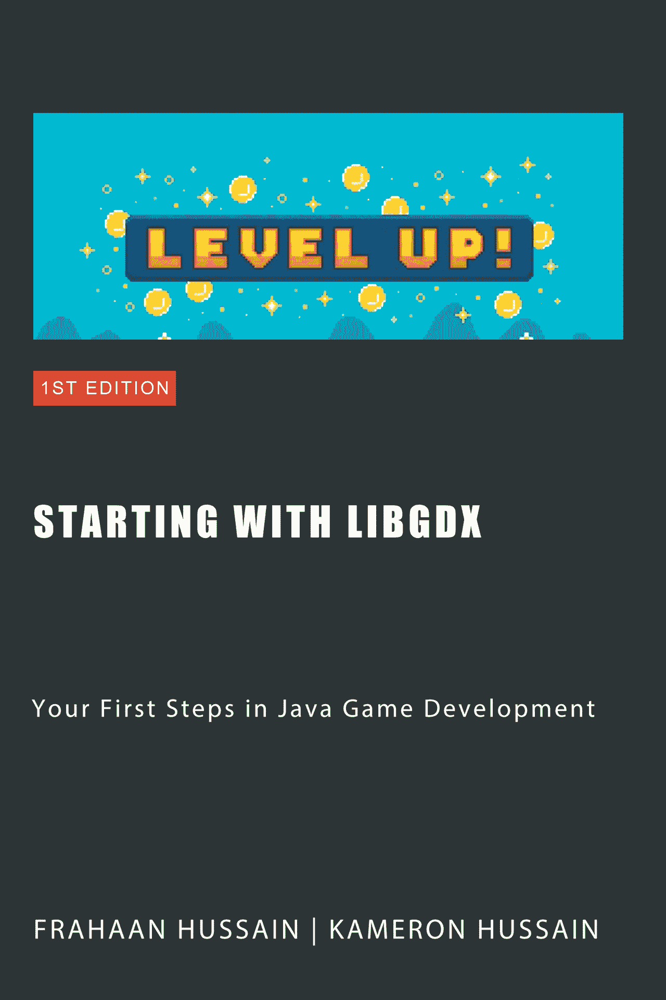

# 从 LibGDX：Java 游戏开发入门 (LibGDX 系列第 1 册)



## 什么是 LibGDX？

## LibGDX 的核心特性

## 为什么选择 LibGDX？

## 前提条件

## 创建 LibGDX 项目

## 将项目导入到你的 IDE

## 构建并运行你的项目

## 结论

## Java 语法与结构

## 变量与数据类型

## 控制流语句

## 面向对象编程 (OOP)

## 类与包

## 异常处理

## 结论

## 游戏循环

## 游戏对象

## 物理与碰撞检测

## 游戏状态管理

## 用户界面 (UI)

## 音效与音乐

## 结论

## 跨平台开发

## 2D 和 3D 图形

## 输入处理

## 音频支持

## 物理模拟

## 资源管理

## 场景图与 UI 工具

## 网络与多玩家支持

## 扩展性与社区

## 前提条件

## 使用 LibGDX 项目设置工具

## 项目结构

## 将项目导入到你的 IDE

## 构建并运行你的项目

## 结论

## 核心模块 (Core)

## 桌面模块 (Desktop)

## HTML 模块

## Android 模块

## iOS 模块（可选）

## 结论

## 简要概述游戏循环

## LibGDX 的游戏循环

## 帧率与定时控制

## 结论

## 渲染精灵图 (Sprite)

## 管理精灵图的原点与旋转

## 渲染多个精灵图

## 透明渲染

## 结论

## 输入处理

## 键盘输入

## 鼠标输入

## 触摸输入

## 控制器输入

## 游戏循环中的输入

## 结论

## 加载图片

## 显示图片

## 释放纹理 (Textures)

## 纹理图集 (Texture Atlas)

## 结论

## 关键帧动画

## 帧集 (Sprite Sheets)

## 播放动画

## 结论

## Sprite 类

## TextureRegion 类

## 给精灵图着色

## SpriteBatch 与渲染

## 释放资源

## 结论

## 什么是帧集？

## 加载帧集

## 从 TextureRegions 中访问帧

## 创建动画

## 渲染动画

## 结论

## LibGDX 中的相机类型

## 创建与设置相机

## 控制相机位置

## 放大与缩小

## 旋转相机

## 设置批处理投影矩阵 (Batch Projection Matrix)

## 结论

## 4.1 高级 2D 动画技术

### 骨骼动画

### 粒子系统与特效

### 着色器 (Shaders) 与自定义渲染

### 使用帧 (Frame Buffers) 实现高级特效

### 优化图形性能

### 理解粒子系统

### LibGDX 的粒子系统

### 定义粒子行为

### 高级粒子特效

### 优化粒子系统

### 什么是着色器？

### 编写着色器

### 着色器变量与统一体 (Uniforms)

### 着色器

### 优化着色器

### 什么是缓冲区？

### 创建缓冲区

### 渲染

### 后处理效果

### 管理缓冲区

### 性能优化

## 4.5 优化图形性能

### 性能分析与瓶颈识别

### 内存管理与垃圾回收

### 多线程与异步操作

### 高效游戏循环技巧

### 性能分析与测试

### 针对平台的优化

### 持续优化

## 5.1 加载与播放音效

### 理解音效

### 加载音效

### 播放音效

### 释放音效

### 游戏事件中的音效

### 优化音效

### 结论

## 5.2 使用背景音乐

### 理解背景音乐

### 加载背景音乐

### 播放背景音乐

### 暂停与恢复背景音乐

### 设置音量

### 释放背景音乐

### 背景音乐淡入淡出

### 动态音乐

### 结论

## 音合成

### 实时音频处理

### LibGDX 音频扩展

### 结论

## 混音

### 音频管理

### 音频平衡

### 结论

## 理解 3D 音

### LibGDX 3D 音

### 播放 3D 音效

### 多普勒效应

### 环境特效

### 结论

## 6.1 游戏开发中的物理入门

### 物理学的重要性

### 物理模拟的类型

### 游戏物理的基础概念

### 使用 Box2D 进行物理模拟

### 碰撞检测流程

### 实现 AABB 碰撞检测

### 优化碰撞检测

### Box2D 入门

### 在 Box2D 中创建物体

### 使用 Box2D 模拟

### 调试与测试

### 处理多个碰撞形状

### 传感器固定件 (Sensor Fixtures)

### 碰撞过滤

### 连续碰撞检测 (CCD)

### 实现自定义碰撞响应

### 总结

### 应用力和冲量

### 实现摩擦力

### 恢复系数（弹性）

### 阻尼

### 应用扭矩

### 总结

## 7.1 设计游戏菜单与界面

### 游戏菜单与界面的重要性

### 设计游戏 UI

### 在 LibGDX 中实现 UI

### 适配各种屏幕尺寸的响应式 UI

### 总结

## 7.2 使用 Scene2D 元素

### Scene2D 简介

### 创建简单的按钮

### 管理输入事件

### 使用表格组织 UI 元素

### 处理屏幕分辨率

### 总结

## 7.3 自定义 UI 组件与控件

### 自定义 UI 元素的需求

### 创建自定义 UI 元素

### 示例：创建自定义血条

### 总结

## 7.4 在 UI 中处理用户输入

### UI 中的用户输入类型

### 处理鼠标/触摸输入

### 处理键盘输入

### 处理控制器输入

### 处理手势输入

### 导航输入

### 总结

## 7.5 适配各种屏幕尺寸的响应式 UI

### 多样屏幕尺寸的挑战

### 使用视口 (Viewports)

### 使用视口实现 UI

### 示例：使用 FitViewport

### 总结

## 8.1 构建游戏代码结构

### 代码结构的重要性

### 基础结构

### 代码组织

### 总结

### 理解游戏状态

### 使用屏幕实现游戏状态

### 示例：实现暂停菜单

### 总结

### 游戏循环概念

### 在 LibGDX 中实现游戏循环

### 帧率与时间 (Delta Time)

### 固定帧率与可变帧率

### 总结

### 理解事件

### LibGDX 事件处理

### 注册学习者

### 处理自定义事件

### 分发事件

### 监听事件

### 总结

### 游戏平衡的重要性

### 游戏平衡的关键方面

### 游戏与反馈

### 平衡工具

### LibGDX 中的平衡

### 总结

## 9.1 瓦地图入门

### 瓦地图的作用

### 瓦地图组件

### 在 LibGDX 中创建瓦地图

### 总结

## 9.2 创建基于瓦卡的等级

### 设计瓦卡

### 使用 Tiled Map Editor

### 在 LibGDX 中加载与渲染瓦卡

### 动态关卡生成

### 总结

## 9.3 在 LibGDX 中使用 Tiled Map Editor

### 在 Tiled 中创建地图

### 将 Tiled 地图导入 LibGDX

### 与 Tiled 地图交互

### 总结

### 为什么使用动态关卡生成

### 基于瓦片的动态生成

### 在 LibGDX 中实现动态生成

### 总结

## 9.5 实现视差滚动

### 在 LibGDX 中实现视差滚动

### LibGDX 代码示例

### 总结

## 第 10 章：在 LibGDX 中处理 3D

### 10.1 3D 图形基础

#### 理解 3D 坐标系

#### 3D 机

#### 渲染 3D 模型

#### LibGDX 3D 代码示例

#### 总结

### 10.2 加载与显示 3D 模型

#### 支持的 3D 模型格式

#### 渲染 3D 模型

#### 优化 3D 模型

## 10.3 3D 动画与骨骼

### 理解 3D 动画

### LibGDX 中的骨骼

### 3D 模型动画化

### 逆向动力学 (IK)

### 总结

## 10.4 3D 中的光照与纹理

### 3D 中的光照

### 为 3D 模型赋予纹理

### LibGDX 代码示例

### 总结

## 设置相机

### 相机控制

### 相机限制

### 追踪目标

### 总结

## 第 11 章：网络与多人游戏

### 理解网络通信

### 网络协议

### 同步与延迟

### 安全考量

### 11.2 实现本地多人游戏

#### 多人游戏模式

#### 设置游戏环境

#### 调试与测试

#### 本地多人游戏库

### 11.3 创建在线多人游戏

#### 网络框架

#### 设置游戏服务器

#### 客户端-服务器交互

#### 延迟补偿

#### 客户端预测

#### 服务器同步

#### 插值

#### 预测算法 (Dead Reckoning)

#### 带宽优化

#### 玩家认证

#### 数据加密

#### 服务器端验证

#### 作弊检测与防止

#### 安全数据存储

#### 定期安全审计

#### 玩家举报与管理

#### 伦理考量

## 第 12 章：游戏中的人工智能

### 12.1 游戏设计中的 AI 概念

#### AI 在游戏中的角色

#### 有限状态机 (FSM)

#### 路径规划

#### 决策树与行为树

#### 机器学习与自适应 AI

#### 算法

#### 基于网的路径规划

#### LibGDX 集成

### 12.3 创建游戏代理

#### 决策制定

#### 目标导向 AI

#### 自适应与学习型代理

## 12.4 行为树与决策制定

### 理解行为树

### 在 LibGDX 中实现行为树

### 行为树的优势

### 测试与调试

### 12.5 AI 中的学习与适应

#### AI 中的机器学习

#### 行为

## 第 13 章：优化你的游戏

### 13.1 性能分析与识别瓶颈

#### 为什么性能分析很重要

#### 性能分析工具

#### 识别瓶颈

### 理解内存管理

### 最小化内存占用

### 垃圾回收策略

## 13.3 优化游戏资源

### 图像与纹理压缩

### 纹理集

### 音效优化

### 模型优化

### 运行时对象池

### 13.4 多线程与异步操作

#### 多线程的重要性

#### 在 LibGDX 中实现多线程

#### 资源加载与异步操作

#### 同步与线程安全

#### 处理并发数据

#### 注意主线程

### 13.5 高效游戏循环技巧

#### 固定步长与可变步长

#### 使用 LibGDX 的 Delta Time

#### 避免在游戏循环中创建对象

#### 使用高效的数据结构

#### 最小化渲染开销

#### 高效碰撞检测

#### 节流耗耗操作

#### 在目标硬件上测试

## 14.1 部署准备

### 测试与质量保证

### 设置开发环境

### 版本控制与备份

### 构建配置

### 资源优化

### 文档与法律要求

### 营销与推广

### 14.2 部署到桌面平台

#### 在桌面端测试

#### 打包与分发

#### 分发平台

#### 文档与支持

## 14.3 移动游戏部署：Android 与 iOS

### Android 部署

### iOS 部署

## 14.4 处理不同的屏幕分辨率与比例

### 宽高比与视口

### 多分辨率资源

### 处理屏幕方向

### 在不同设备上测试

### 缩放与定位

### 用户反馈与评分

### 分发平台

### 营销与推广

### 变现策略

### 伦理考量

# 第 15 章：游戏数据分析与变现

## 15.1 集成游戏分析

### 选择游戏分析平台

### 集成游戏分析

### 隐私与数据保护

## 15.2 通过数据理解玩家行为

### 收集相关数据

## 玩家反馈与调查

## 利用数据指导游戏设计

## 隐私与数据安全

### 1. 应用内购 (IAPs)

### 2. 广告

### 3. 付费制模式

### 4. 免费游戏 (F2P) 结合微交易

### 5. 订阅制

### 6. 下载内容 (DLC) 与扩展包

### 8. 赞助与品牌整合

### 9. 捐赠

### 10. 联盟营销

### 11. 众筹

### 选择正确的变现策略

### 选择内购系统

### 设置你的内购产品

### 在 LibGDX 中集成内购

### 错误与边缘情况处理

### 确保数据安全

### 1. 透明度与清晰度

### 2. 平衡游戏性

### 3. 知情同意

### 4. 数据隐私

### 5. 适龄内容与广告

### 6. 最小化侵入性

### 8. 客户支持

### 9. 鼓励伦理变现

### 10. 持续改进

### 11. 社区反馈

## 第 16 章：社区与玩家参与

### 理解社区的重要性

### 创建社区枢纽

### 结论

### 16.2 管理玩家反馈与评论

#### 创建反馈渠道

#### 处理负面反馈

#### 收集数据

#### 持续改进

### 16.3 创建内容更新与 DLC

#### 内容更新的重要性

#### 内容更新

#### 内容更新的类型

#### 结论

### 16.4 组织 Beta 测试与早期访问

#### Beta 测试的好处

#### Beta 测试

#### 早期访问计划

#### 管理预期

### 16.5 社交媒体的有效利用

#### 选择合适的平台

#### 创建吸引人的内容

#### 一致性与调度

#### 社区参与

#### 话题标签与趋势

#### 合作与影响者

#### 付费广告

#### 结论

## 第 17 章：跨平台开发挑战

## 17.1 跨平台兼容的重要性

### 收益机会最大化

### 社区建设

### 跨平台开发的挑战

### 跨平台开发工具

### 结论

### 17.2 管理平台特定特性

#### 开发平台特定策略

#### 平台特定特性示例

#### 测试与质量保证

#### 结论

### 17.3 跨平台输入处理的挑战

#### 输入方法的差异

#### 处理输入差异的策略

#### 结论

### 17.4 实现跨平台的一致性能

#### 性能差异

#### 一致性性能的策略

#### 跨平台引擎

### 17.5 多平台的测试与 QA

#### 测试的重要性

#### 跨平台测试

#### 结论

## 第 18 章：LibGDX 高级主题

### 18.1 探索 3D 地形与世界生成

#### 3D 的重要

#### 生成 3D 地形

#### LibGDX 中的 3D 地形

#### 结论

### 18.2 高级着色器编程

#### 理解着色器 (Shaders)

#### Shader 效果

#### Shader

#### 结论

### 18.3 与虚拟现实 (VR) 集成

#### VR 平台

#### LibGDX 中的 VR 集成

#### 资源

#### 结论

### 18.4 LibGDX 中的增强现实 (AR)

#### AR 平台与 SDK

#### LibGDX 中的 AR 集成

#### AR 挑战

#### 结论

## 18.5 利用扩展与第三方库

### 扩展与库的好处

### 寻找扩展与库

### 流行的 LibGDX 扩展与库

### 集成扩展与库

### 结论

# 第 19 章：关注游戏开发趋势

## 19.1 游戏开发的新趋势

### 1. 虚拟现实 (VR) 与增强现实 (AR)

### 2. 云游戏

### 4. 用户生成内容 (UGC)

### 5. 游戏中的区块链与 NFT

### 6. 现场服务与游戏即服务 (GaaS)

### 7. 无障碍性与包容性

### 8. AI 与过程化内容生成

### 9. 环保游戏

### 10. 独立与单人游戏开发

### 结论

## 19.2 持续学习与技能开发

### 持续学习的必要性

### 持续学习的策略

### 专业化与深度

## 紧跟潮流

## 19.3 参加游戏马拉松与竞赛

### 什么是游戏马拉松和竞赛？

### 参赛的好处

### 成功参赛的技巧

### 著名的游戏马拉松与竞赛

### 结论

### 阅读与研究的重要性

### 有效阅读与研究的策略

### 对于游戏开发者的推荐阅读

### 保持更新

### 结论

## 19.5 与其他游戏开发者社交

### 有效社交的策略

### 建立意义的联系

### 克服社交挑战

### 结论

## 20 构建你自己的游戏

### 20.1 规划与设计你的游戏

#### 游戏的规划设计步骤

#### 记录你的想法

#### 测试与反馈

#### 结论

### 20.2 实现核心玩法机制

#### 理解核心玩法机制

#### 处理复杂性

#### 结论

### 20.3 润色与精调你的游戏

#### 打磨的重要性

#### 游戏打磨的步骤

#### 用户反馈与迭代

#### 最后的打磨轮次

#### 结论

### 20.4 Beta 测试与收集反馈

#### Beta 测试的重要性

#### 规划你的 Beta 测试

#### 收集反馈

#### 结论

### 20.5 社交媒体的有效利用

#### 建立社区

#### 推广你的游戏

#### 利用标签

#### 衡量影响

#### 伦理考量

#### 结论


# 第一章：LibGDX 简介与 Java 开发

## 1.1 理解 LibGDX：概述

LibGDX 是一个强大且多功能的游戏开发框架，允许你使用`Java`语言为各种平台创建游戏。无论你是游戏开发新手，还是寻找稳健框架的资深开发者，LibGDX 均提供了广泛的功能和工具来简化你的开发流程。

### 什么是 LibGDX？

LibGDX 是一个开源游戏开发框架，为构建 2D 和 3D 游戏提供了一套完整的库和工具。它被设计为与平台无关，这意味着你可以编写一次游戏代码并将其部署到多个平台，包括 Windows、macOS、Linux、Android、iOS 甚至网页浏览器。LibGDX 的特色功能之一是对`Java`的支持，`Java`以其可移植性和易用性著称。通过 LibGDX，你可以利用`Java`的力量开发游戏，而无需担心底层的特定平台代码。

### LibGDX 的核心特性

以下是让 LibGDX 成为游戏开发者热门选择的一些核心特性：

1. **跨平台开发**：LibGDX 支持多个平台，允许你编写一次代码并在各种操作系统和设备上部署你的游戏。
2. **稳健的物理引擎**：该框架包含了`Box2D`，这是一个可以实现真实物理模拟、碰撞检测和响应的物理引擎。
3. **音频与输入**：LibGDX 提供了易用的`APIs`来处理音频播放和用户输入，包括触摸、键盘和鼠标事件。
4. **资源管理**：它提供了一个健壮的资源管理系统，用于加载和管理图像、声音和字体等游戏资源。
5. **场景图**：LibGDX 包含一个场景图`API`，简化了复杂场景和 UI 元素的创建与管理。
6. **社区与文档**：凭借活跃的社区和广泛的文档，LibGDX 为学习和排查故障提供了丰富的资源。

### 为什么选择 LibGDX？

- **Java 语言**：如果你已经熟悉`Java`，可以利用现有的技能使用 LibGDX 创建游戏。`Java`在行业中被广泛使用，拥有庞大的开发者社区。
- **跨平台支持**：LibGDX 将游戏部署到多个平台的能力节省了开发时间，并允许你接触更广泛的受众。
- **性能**：LibGDX 为高性能而设计，适用于小型独立游戏和更复杂的项目。
- **活跃开发**：该框架得到活跃的维护和更新，确保与最新平台和技术的兼容。
- **库与扩展**：LibGDX 提供了一系列扩展和库，增强了其功能，使其能够适应各种游戏类型。

在本章的接下来的部分中，我们将探索如何为 LibGDX 设置开发环境，介绍用于游戏开发的`Java`基础，并深入探讨基础的游戏开发概念。在本章结束时，你将拥有使用 LibGDX 创建游戏的坚实基础。

---

## 1.2 设置你的开发环境

设置开发环境是开启 LibGDX 游戏开发之旅的第一步。配置良好的环境可以确保你能高效地编写、测试和部署游戏。在本节中，我们将介绍设置 LibGDX 开发环境的关键步骤。

### 前提条件

在开始安装过程之前，请确保你的系统中已安装了以下前提条件：

1. **Java 开发工具包 (JDK)**：LibGDX 依赖于`Java`，因此你需要安装`JDK`。LibGDX 完美兼容`Oracle JDK`和`OpenJDK`。你可以从官方网站下载并安装最新版本的`OpenJDK`，或者使用操作系统的包管理器。
2. **集成开发环境 (IDE)**：虽然你可以使用简单的文本编辑器和命令行工具开发 LibGDX 游戏，但使用`IDE`会显著提高你的生产力。LibGDX 开发的热门选择包括`Eclipse`、`IntelliJ IDEA`和`Visual Studio Code`。你应该安装并配置好你喜欢的`IDE`。
3. **Android Studio（可选）**：如果你计划为 Android 开发游戏，你需要`Android Studio`来在 Android 设备上进行测试和部署。`Android Studio`包含了`Android SDK`，这是 Android 开发所必需的。

### 创建 LibGDX 项目

LibGDX 提供了一个名为 LibGDX Project Setup Tool（也称为项目生成器）的方便工具来创建新项目。该工具会生成项目结构、设置依赖并配置构建文件。

1. 访问 LibGDX 网站 (`https://libgdx.com/`) 并找到“Project Setup”部分。
2. 选择你打算的目标平台（例如：桌面端、Android、iOS）。
3. 点击“Generate”（生成）或“Generate Project”（生成项目）按钮下载包含项目的 ZIP 文件。
4. 将下载的 ZIP 文件解压到你优选的开发目录。

一旦你生成了 LibGDX 项目，就可以将其导入到你选择的 IDE 中。以下是步骤的一般大纲：

### Eclipse

1. 打开 Eclipse 并选择“File（文件）” > “Import（导入）”。
2. 找到解压 LibGDX 项目的目录并选择根文件夹。点击“Finish（完成）”导入项目。
3. Eclipse 应该自动识别`Gradle`构建配置并设置你的项目。

### IntelliJ IDEA

1. 导航到包含 LibGDX 项目的目录并选择根文件夹。点击“OK（确定）”打开项目。
2. IntelliJ IDEA 应该识别`Gradle`配置并开始同步项目。

### Visual Studio Code

1. 找到你的 LibGDX 项目文件夹并打开它。
2. Visual Studio Code 会检测`Gradle`构建文件并建议安装所需的扩展。按照提示设置项目。

### 构建并运行你的项目

### Gradle 命令

你可以使用`Gradle`命令从命令行构建并运行你的项目。常用命令包括：

- `./gradlew desktop:run`：运行游戏的桌面版本。
- `./gradlew android:installDebug:run`：在连接的设备或模拟器上运行游戏的 Android 版本。

### IDE 运行

大多数 IDE 都提供了运行配置，可以简化运行游戏的过程。在 IntelliJ IDEA 中，你可以通过右键点击你的`MainClass`为桌面游戏创建一个运行配置。

### 结论

设置 LibGDX 环境是你游戏之旅中的关键一步。一旦你拥有了可以工作的环境，就可以开始编写代码、创建资源并构建你的游戏。在本书的后续章节中，我们将探索游戏开发的 Java 基础，并向你介绍核心的游戏概念，这将帮助你使用 LibGDX 创建吸引人的游戏。

---

## 1.3 Java 基础

Java 是 LibGDX 游戏开发的首选语言，理解它的基础对于构建游戏至关重要。在本节中，我们将涵盖你在使用 LibGDX 进行游戏开发之前需要了解的 Java 编程基础。

### Java 语法与结构

Java 以简单和易读性著称。它使用 C 风格语法，这意味着代码使用分号结束语句，使用大括号定义代码块。这是一个向控制台打印“Hello, World!”的简单 Java 程序：

```java
public class HelloWorld {
    public static void main(String[] args) {
        System.out.println("Hello, World!");
    }
}
```

- `public class HelloWorld` 定义了一个名为`HelloWorld`的类。在 Java 中，类是对象的蓝图。
- `public static void main(String[] args)` 是`main`方法。它作为程序的入口。
- `System.out.println("Hello, World!")` 将消息打印到控制台。

### 变量与数据类型

Java 支持多种存储值的数据类型。常用类型包括：

- `int`：表示整数值（例如`int score = 42;`）。
- `double`：表示浮点数（例如`double pi = 3.14159;`）。
- `boolean`：表示真或假值（例如`boolean isRunning = true;`）。
- `String`：表示字符序列（例如`String playerName = "Alice";`）。

你可以使用语法`data_type variable_name = initial_value;`来声明变量。

### 控制流

Java 提供了控制流语句来控制程序的执行流。常见的控制流语句包括：

- `if-else`语句：用于条件执行。
- `for`循环：用于对值范围进行迭代。
- `while`循环：用于在条件为真时重复执行代码块。
- `switch`语句：用于根据不同的情况进行分支。

这是一个`if-else`语句的示例：

```java
int score = 85;

if (score >= 90) {
    System.out.println("A");
} else if (score >= 80) {
    System.out.println("B");
} else {
    System.out.println("C");
}
```

这段代码检查`score`的值并根据条件打印等级。

### 面向对象编程

Java 是一种面向对象编程 (OOP) 语言，这意味着它围绕对象和类。在 Java 中，你定义类来创建具有属性和方法的对象。这是一个简单的类定义：

```java
public class Player {
    // 字段（属性）
    String name;
    int score;

    // 构造函数
    public Player(String name) {
        this.name = name;
        this.score = 0;
    }

    public void increaseScore(int points) {
        this.score += points;
    }
}
```

### 异常处理

Java 使用异常处理来优雅地处理运行时错误。当发生错误时，它会抛出一个异常，该异常可以被捕获并处理以防止程序崩溃。这是一个异常处理的示例：

```java
try {
    // 可能会抛出异常的代码
    int result = divide(10, 0);
} catch (ArithmeticException e) {
    System.out.println("Division by zero is not allowed.");
}
```

---

## 1.4 基础游戏开发概念

在本节中，我们将介绍一些基础的游戏开发概念，这些概念构成了构建游戏的基础。理解这些概念对于使用 LibGDX 创建引人入胜的交互式游戏至关重要。

### 游戏循环

游戏循环是每个游戏的核心。它是一个持续运行的循环，负责更新游戏状态并渲染每一帧。游戏循环通常包含以下阶段：

1. **输入处理**：收集用户输入，例如键盘按键、鼠标点击或触摸事件。
2. **更新**：根据用户输入、AI 逻辑和其他因素更新游戏状态。此阶段包括移动游戏对象、检查碰撞以及管理游戏事件。
3. **渲染**：将游戏的当前状态绘制到屏幕上。此阶段涉及渲染图形、应用视觉效果以及显示用户界面元素。
4. **帧控制**：通过测量帧与帧之间的时间来保持一致的帧率。这确保了游戏在不同硬件上的表现一致。

以下是 Java 中游戏循环的简化示例：

```java
while (isGameRunning) {
    processInput();
    updateGameState();
    renderScene();
}
```

### 游戏对象

游戏对象是游戏世界中与玩家交互的实体。这些对象可以包括角色、敌人、物品、障碍物等。每个游戏对象通常具有位置、大小和行为等属性。在面向对象的游戏开发中，游戏对象通常被表示为类的实例。

### 物理与碰撞检测

物理模拟是许多游戏中的至关重要的方面，因为它增加了真实性和交互性。与`LibGDX`集成的物理引擎（如`Box2D`）有助于模拟重力、碰撞和力的物理相互作用。碰撞检测是识别游戏世界中两个对象何时相交的过程。它允许你响应物体碰撞或物体与地面交互等事件。

以下是`LibGDX`中碰撞检测的示例：

```java
Rectangle playerBounds = player.getBoundingRectangle();
Rectangle obstacleBounds = obstacle.getBoundingRectangle();

if (playerBounds.overlaps(obstacleBounds)) {
    // 处理玩家与障碍之间的碰撞
    player.takeDamage();
}
```

### 游戏状态管理

游戏状态管理涉及控制游戏可能处于的各种状态，例如主菜单、游戏过程中、暂停菜单和游戏结束界面。适当管理游戏状态可以确保游戏不同部分之间的平滑过渡。它也有助于资源管理，因为你可以根据每个状态的需求加载和卸载资源。

以下是游戏状态管理器的简化示例：

```java
public class GameStateManager {
    private GameState currentState;

    public void setState(GameState newState) {
        if (currentState != null) {
            currentState.dispose(); // 清理资源
        }
        currentState = newState;
    }

    public void update() {
        currentState.update();
    }

    public void render() {
        currentState.render();
    }
}
```

### 用户界面 (UI)

用户界面（UI）对于为玩家提供信息和交互选项至关重要。`LibGDX`提供了`Scene2D`，这是一个用于创建和管理 UI 元素的强大工具。你可以使用`Scene2D`创建按钮、标签、文本框和其他 UI 组件。

```java
// 使用 Scene2D 创建一个简单的按钮
TextButton startButton = new TextButton("Start Game", skin);

startButton.addListener(new ClickListener() {
    @Override
    public void clicked(InputEvent event, float x, float y) {
        // 处理按钮点击
        startNewGame();
    }
});
```

### 音效与音乐

音效和背景音乐增强了游戏体验。`LibGDX`提供了加载、播放和管理音频资源的功能。你可以为跳转、射击或收集物品等动作添加音效。此外，你还可以加入背景音乐来营造游戏的氛围和情绪。

```java
// 加载并播放音效
Sound jumpSound = Gdx.audio.newSound(Gdx.files.internal("jump.wav"));
jumpSound.play();
```

### 结论

这些基础游戏开发概念为构建引人注目且具有交互性的游戏提供了框架。随着本书的进展，你将学习如何在`LibGDX`的背景下应用这些原则，使你能够创建出吸引玩家并提供愉快体验的游戏。

---

## 1.5 LibGDX 能力与特性概览

`LibGDX`是一个功能丰富的游戏开发框架，使开发者能够轻松地在多个平台上创建游戏。在本节中，我们将提供`LibGDX`一些显著的能力和特性概述。

### 跨平台开发

`LibGDX`的卓越特性之一是能够促进跨平台游戏开发。你可以编写一次游戏并将其部署到各种平台，包括`Windows`、`macOS`、`Linux`、`Android`、`iOS`和网页浏览器。这种跨平台兼容性不仅节省了开发时间，还让你触达到更广泛的观众。

`LibGDX`通过为图形、输入和其他功能提供特定平台的实现，抽象掉特定平台的细节来实现跨平台支持。

### 2D 与 3D 图形

`LibGDX`对 2D 和 3D 图形都提供了强大的支持。你可以根据项目需求创建 2D 或 3D 视觉震撼的游戏。

对于 2D 图形，`LibGDX`提供了一个强大的 2D 渲染引擎，允许你绘制精灵、纹理和文本。它支持批渲染、精灵图和各种混合模式等功能。

在 3D 图形方面，`LibGDX`包含了加载和显示 3D 模型、动画、光照和纹理的工具。这使你能够构建沉浸式的 3D 世界和体验。你甚至可以实现自定义着色器来实现高级视觉效果。

### 输入处理

`LibGDX`通过为各种输入设备（包括键盘、鼠标、触摸屏和游戏控制器）提供统一接口，简化了输入处理。这使得创建可在不同平台和设备上运行的游戏变得简单。

该框架提供了事件驱动的输入处理，允许你响应按键按下、鼠标点击和触摸手势等用户操作。你还可以为滑动、轻点或使用手柄按钮等操作实现复杂的输入方案。

### 音频支持

声音和音乐在游戏开发中起着至关重要的作用，`LibGDX`提供了全面的音频支持。你可以加载和播放音效、背景音乐，甚至创建音频合成处理效果。

`LibGDX`的音频 API 允许音频混合、音量控制和管理多个音频源等功能。这确保了你的游戏音频体验是沉浸且动态的。

### 物理模拟

物理引擎对于创建游戏中真实的交互至关重要，`LibGDX`包含了流行的`Box2D`物理引擎。通过`Box2D`集成，你可以模拟碰撞、重力和力等物理行为。这对于涉及物体移动、碰撞或对环境做出反应的游戏非常有价值。

### 资源管理

高效管理游戏资源对于性能和组织至关重要。`LibGDX`的资源管理系统简化了图像、声音、字体等资源的加载和管理。它确保资源仅在需要时加载，并在不再使用时释放，防止内存泄漏并优化资源使用。

### 场景图与 UI 工具

LibGDX 包含一个强大的场景图 API，简化了复杂场景和用户界面（UI）的创建与管理。`Scene2D`是 LibGDX 的一个组件，为设计游戏菜单、平视显示（HUD）和自定义 UI 组件提供了工具。你可以轻松地创建和排列按钮、标签和表格等 UI 元素，使设计直观的用户界面变得简单。

### 网络与多人游戏支持

对于需要网络和多人功能的游戏，LibGDX 提供了内置支持。你可以为在同一设备上运行的游戏实现本地多人游戏功能，或者创建允许玩家通过互联网连接的在线多人游戏。该框架提供了处理网络延迟、同步和安全考虑因素的工具。

### 扩展与社区

LibGDX 可扩展的架构允许你利用扩展和第三方库来增强游戏的功能。LibGDX 社区非常活跃且乐于支持，提供了丰富的资源、教程和论坛来提供帮助。这种由社区驱动的方法确保了框架能够保持更新并得到良好的维护。


总之，LibGDX 是一个多功能且强大的游戏开发框架，它提供了广泛的功能和工具，以简化你的游戏开发流程。无论你是初学者还是经验丰富的开发者，LibGDX 的能力都使其成为创建在各种平台上无缝运行并提供引人入胜玩家体验游戏的价值选择。在本书中，我们将详细探索 LibGDX 的功能，使你能够在游戏开发项目中充分发挥其潜力。

## 2.1. 使用 LibGDX 创建新项目

在 LibGDX 中创建一个新项目是开发自己的游戏的第一步。LibGDX 提供了一个名为`LibGDX Project Setup Tool`（也称为`Project Generator`）的方便工具，它简化了项目的创建过程。在本节中，我们将介绍创建新 LibGDX 项目的步骤。

### 前提条件

1. Java 开发工具包（`JDK`）：LibGDX 依赖于 Java，因此你需要安装`JDK`。你可以从它们各自的官方网站下载并安装最新版本的`OpenJDK`或`Oracle JDK`。

2. 集成开发环境（`IDE`）：虽然你可以使用简单的文本编辑器和命令行工具开发 LibGDX 游戏，但使用`IDE`会显著提高你的工作效率。LibGDX 开发的流行选择包括`Eclipse`、`IntelliJ IDEA`和`Visual Studio Code`。你应该安装并配置好你偏好的`IDE`。

3. Android Studio（可选）：如果你计划为 Android 开发游戏，你需要`Android Studio`来在 Android 设备上进行测试和部署。Android Studio 包含了`Android SDK`，这是 Android 开发所必需的。

### 使用 LibGDX Project Setup Tool

1. 打开你的网络浏览器并访问 LibGDX 项目设置页面（`https://libgdx.com/`）。

2. 在“Project Setup”部分，你会发现许多用于自定义项目的设置：

   - Name（名称）：为你的项目输入一个名称。

   - Package（包名）：为你的项目定义 Java 包（例如`com.mygame`）。

   - Game Class（游戏类）：指定作为游戏入口点的主类（例如`MyGame`）。

3. 通过勾选相应的复选框选择你想要的目标平台。你可以从 Desktop（桌面端）、Android、iOS 和 HTML/WebGL 中选择。

4. 点击`Generate`（生成）或`Generate Project`按钮来启动项目生成过程。

5. 一旦生成过程完成，你将被提示下载一个包含你的 LibGDX 项目的 ZIP 文件。将该 ZIP 文件保存到电脑上你喜欢的位置。

### 项目结构

解压下载的 ZIP 文件后，你会发现项目结构组织如下：

- `core`：核心模块包含所有目标平台通用的共享游戏代码。这是你花费大部分开发时间的地方。

- `desktop`：如果你选择了 Desktop 目标平台，此文件夹包含桌面端特有的代码和资产。

- `html`：如果你选择了 HTML/WebGL 作为目标平台，此文件夹包含在浏览器中运行游戏所需的代码。

- `ios`：如果你选择了 iOS 作为目标平台，此文件夹包含 iOS 特有的代码和资源。

### 将项目导入到你的 IDE

#### Eclipse:

1. 打开`Eclipse`并选择`File` > `Import`。

2. 选择`Gradle` > `Existing Gradle Project`并点击`Next`。

3. 浏览到你解压 LibGDX 项目的目录并选择根文件夹。点击`Finish`导入项目。

#### IntelliJ IDEA:

1. 打开`IntelliJ IDEA`并选择`File` > `Open`。

2. 导航到包含 LibGDX 项目的目录并选择根文件夹。点击`OK`打开项目。

#### Visual Studio Code:

1. 打开`Visual Studio Code`并选择`File` > `Open Folder`。

2. 浏览到你的 LibGDX 项目文件夹并打开它。

### 构建并运行你的项目

将项目导入到`IDE`后，你现在可以构建并运行它以确保一切都已就绪。构建过程将下载必要的依赖项并为你的平台配置项目。

#### Gradle 命令:

你可以使用`Gradle`命令从命令行构建和运行你的项目。常用命令包括：

- `./gradlew desktop:run`：运行游戏的桌面版本。

- `./gradlew android:installDebug android:run`：在连接的设备或模拟器上运行游戏的 Android 版本。

#### IDE 运行配置:

大多数`IDEs`都提供了简化运行游戏过程的运行配置。在`IntelliJ IDEA`中，你可以通过右键点击主类并选择`Create ‘YourMainClass’`为你的桌面游戏创建一个运行配置。

### 结论

使用 LibGDX 创建新项目是让你的游戏想法变为现实的第一步。`LibGDX Project Setup Tool`简化了这一过程，让你能够专注于游戏开发而不是项目配置。在接下来的章节中，我们将详细探索 LibGDX 游戏开发的不同方面，包括图形、输入处理和游戏逻辑，帮助你创建令人兴奋且吸引人的游戏。

## 2.2. 探索项目结构

一旦使用设置工具创建了新的 LibGDX 项目，了解其结构是至关重要的。这种结构有助于有效地组织你的游戏代码和资产。在本节中，我们将探索典型 LibGDX 项目的各个组件。

### 核心模块

#### 项目结构

- `assets`：资源文件夹用于存储游戏资源，例如图像、声音、音乐、字体以及游戏所需的任何其他资源。这些资源在所有目标平台间共享。

- `build.gradle`：此 Gradle 构建脚本定义了项目的依赖项、设置和配置。你可以在这里添加额外的依赖项并自定义构建过程。

- `gradlew`和`gradlew.bat`：这些是 Gradle 包装器脚本，允许你在不需要单独安装 Gradle 的情况下构建并运行项目。你可以在命令行中使用这些脚本来执行 Gradle 任务。

### 桌面端模块（Desktop Module）

如果你在设置项目时选择了桌面（Desktop）平台，你将在项目结构中找到一个桌面模块。该模块包含了用于在桌面平台（例如 Windows、macOS、Linux）上运行游戏的特定平台代码。让我们探索它的结构：

- `src`：与核心模块类似，桌面模块中的`src`文件夹包含特定于桌面平台的 Java 源代码文件。这些代码处理诸如初始化游戏、创建游戏窗口和管理特定平台输入等任务。

- `assets`：文件夹包含特定于桌面平台的资源，例如桌面图标和构建游戏桌面版本的配置文件。

- `build.gradle`：桌面模块的`build.gradle`文件定义了特定于桌面平台的依赖项和配置。它还指定了启动桌面游戏时运行的主类。

### HTML 模块（HTML Module）

如果你选择 HTML/WebGL 作为目标平台，你的项目将包含一个 HTML 模块。该模块允许你在网页浏览器中导出并运行游戏。以下是 HTML 模块结构的拆解：

- `src`：HTML 模块中的`src`文件夹包含特定于 HTML/WebGL 平台的 Java 源代码。它处理在浏览器中运行游戏的设置以及处理与浏览器相关的任务。

- `assets`：与其他模块类似，此文件夹存储所有平台共享的资源，包括 HTML/WebGL 版本所需的资源。

- `build.gradle`：HTML 模块的`build.gradle`文件包含了与导出游戏到 HTML/WebGL 相关的依赖项和配置。它指定了游戏 Web 版本的主类。

### Android 模块（Android Module）

如果你选择 Android 作为目标平台，你的项目将包含一个 Android 模块。该模块负责在 Android 设备和模拟器上构建并运行游戏。让我们探索 Android 模块的结构：

- `src`：Android 模块中的`src`文件夹包含 Android 特有的 Java 源代码和资源。它处理启动 Android 应用、管理权限以及与 Android 平台集成等任务。

- `assets`：此文件夹存储 Android 版本专用的资源，例如 Android 应用图标、启动页界面和配置文件。

- `build.gradle`：Android 模块的`build.gradle`文件定义了构建 Android 应用的依赖和设置。它指定了游戏 Android 版本的主活动类（Activity class）。

### iOS 模块（可选）（iOS Module）

如果你选择 iOS 作为目标平台，你的项目将包含一个 iOS 模块。该模块负责在 iOS 设备上构建并运行游戏。

### 总结

项目结构旨在组织特定平台的代码和资源，同时保持核心逻辑。

## 2.3 理解游戏循环（Game Loop）

游戏循环是任何游戏的心脏。它控制游戏如何通过更新和渲染不断进展。

### 游戏循环概览

游戏循环是一个迭代几个阶段的持续过程：

1. **输入处理**：收集用户输入，例如键盘按键、鼠标点击或触摸。

2. **更新**：更新游戏状态（例如，移动游戏对象、检查碰撞）。

3. **渲染**：将游戏的当前状态绘制到屏幕上。

### LibGDX 的游戏循环

LibGDX 通过提供抽象了许多底层细节的框架简化了游戏循环的实现。以下是 LibGDX 游戏循环的工作原理：

1. **初始化**：当游戏启动时，LibGDX 会设置环境并初始化资源。

2. **ApplicationListener**：在 LibGDX 中，你的逻辑封装在`ApplicationListener`中。

这是一个简化的 LibGDX `ApplicationListener`示例：

```java
public class MyGame implements ApplicationListener {
    @Override
    public void create() {
    }

    @Override
    public void render() {
        // 输入处理（用户输入）
        processInput();

        updateGameState();

        // 渲染（绘制游戏的当前状态）
        renderGame();
    }

    @Override
    public void dispose() {
        // 清理和资源释放
    }

    // 其他生命周期方法（调整、暂停、恢复）可以根据需要重写
}
```

### 帧率与计时

LibGDX 的游戏循环会自动控制帧率，以确保在不同设备上获得一致的体验。你可以使用`Gdx.graphics.setContinuousRendering(false)`方法指定目标帧率，这允许你控制何时调用`render()`方法。默认情况下，LibGDX 会持续运行游戏循环，但你可以根据需要开启或关闭连续渲染。

为了保持帧率，LibGDX 会计算自上一帧以来经过的时间，并将其作为增量时间（delta）传递给你的`render()`方法。你可以使用这个增量时间进行基于时间的计算，使你的游戏逻辑不受帧率的影响。

```java
@Override
public void render() {
    float deltaTime = Gdx.graphics.getDeltaTime();
    // 使用 deltaTime 进行基于时间的计算（例如，移动游戏对象）
}
```

### 结论

理解核心游戏循环对于使用 LibGDX 开发游戏至关重要。它是构建游戏交互性和响应速度的基础。随着你对 LibGDX 游戏开发的深入，你将更深入地学习如何在游戏循环中实现游戏逻辑、处理输入以及创建引人入胜的游戏体验。

## 2.4. 基础渲染与图形

### SpriteBatch

LibGDX 使用`SpriteBatch`类进行高效的 2D 渲染。`SpriteBatch`允许你将多个 sprite（2D 图像）合并并在单个绘制调用（draw call）中渲染它们，这会显著提高性能。以下是设置`SpriteBatch`的方法：

```java
SpriteBatch spriteBatch = new SpriteBatch();
```

你应该在游戏的`create()`方法中创建`SpriteBatch`实例，并在`dispose()`方法中释放它，以便在游戏退出时释放资源。

### 渲染 Sprite

要渲染 sprite，你需要提供 sprite 的纹理（texture）和位置。下面的代码演示了如何渲染一个简单的 sprite：

```java
Texture texture = new Texture("sprite.png");  // 从图像文件加载纹理
Sprite sprite = new Sprite(texture);
sprite.setPosition(100, 100);  // 设置 sprite 的位置 (x, y)

// 在你的 render() 方法中：
spriteBatch.begin();  // 开始渲染批
sprite.draw(spriteBatch);  // 使用批绘制 sprite
spriteBatch.end();  // 结束渲染批
```

在这个示例中，我们从图像文件加载纹理，使用该纹理创建 sprite，并将其放置在屏幕上的 (100, 100) 位置。然后我们在`begin()`和`end()`块之间使用`SpriteBatch`绘制 sprite。

### 管理 Sprite 的原点与旋转

你可以自定义 sprite 的原点和旋转。原点是 sprite 绕旋转和缩放的点。默认情况下，原点位于 sprite 的中心，但你可以使用`setOrigin()`方法更改它。要旋转 sprite，可以使用`rotate()`方法。示例如下：

```java
sprite.setOrigin(sprite.getWidth() / 2, sprite.getHeight() / 2);  // 将原点设置为中心
sprite.rotate(45);  // 旋转 45 度
```

### 渲染多个 Sprite

在大多数游戏中，你会渲染多个 sprite，例如角色、敌人和物品。为了高效渲染多个 sprite，你可以在单个`SpriteBatch`实例中将它们合并。以下是渲染多个 sprite 的示例：

```java
SpriteBatch spriteBatch = new SpriteBatch();
Texture texture1 = new Texture("sprite1.png");
Texture texture2 = new Texture("sprite2.png");
Sprite sprite1 = new Sprite(texture1);
sprite1.setPosition(100, 100);
Sprite sprite2 = new Sprite(texture2);
sprite2.setPosition(200, 200);

spriteBatch.begin();
sprite1.draw(spriteBatch);
sprite2.draw(spriteBatch);
spriteBatch.end();
```

这段代码在同一个批中渲染了两个 sprite：`sprite1`和`sprite2`。

### 透明度渲染

```java
Sprite sprite = new Sprite(new Texture("transparent_sprite.png"));
sprite.setPosition(100, 100);
sprite.setColor(1, 1, 1, 0.5f);  // 设置带有 50% 透明度的颜色
spriteBatch.begin();
sprite.draw(spriteBatch);
spriteBatch.end();
```

在这个示例中，我们从图像文件加载了一个带有透明度的 sprite，并使用`setColor()`方法将其颜色设置为半透明白色。

### 结论

渲染和图形是游戏开发的关键方面，LibGDX 的`SpriteBatch`简化了高效渲染 2D sprite 的过程。你已经学习了如何设置`SpriteBatch`、渲染 sprite、管理 sprite 原点和旋转、渲染多个 sprite 以及处理透明度。这些都是你在创建 LibGDX 游戏视觉组件时将会广泛使用的基础技能。

## 2.5. 用户输入处理

用户输入是游戏开发的一个关键方面，因为它允许玩家与你的游戏交互。LibGDX 提供了健壮的输入处理能力，支持各种输入设备，包括键盘、鼠标、触摸屏和游戏控制器。在本节中，我们将探索如何在 LibGDX 中处理用户输入。

### 输入复用

LibGDX 的输入系统支持多个输入处理器（input processors），允许你同时处理来自不同来源的输入。例如，你可以同时处理键盘和触摸屏的输入。要实现这一点，你需要使用“输入复用器”（input multiplexer）的概念。以下是设置输入复用的方法：

```java
InputMultiplexer inputMultiplexer = new InputMultiplexer();
```

然后你可以向复用器添加输入处理器以处理各种输入源。例如：

```java
InputProcessor keyboardProcessor = new KeyboardInputProcessor();
InputProcessor touchProcessor = new TouchInputProcessor();
inputMultiplexer.addProcessor(keyboardProcessor);
inputMultiplexer.addProcessor(touchProcessor);
```

在这个示例中，`KeyboardInputProcessor`和`TouchInputProcessor`是你实现的自定义输入处理器类，分别用于处理键盘和触摸屏输入。

### 键盘输入

在 LibGDX 中处理键盘输入非常简单。你可以使用`Gdx.input.isKeyPressed(int key)`方法检查特定按键当前是否被按下。例如：

```java
if (Gdx.input.isKeyPressed(Keys.LEFT)) {
    // 左箭头键被按下
}
```


LibGDX 提供了如`Keys.LEFT`等常用键盘键常量。你也可以直接使用键码（例如代表 A 键的`Keys.A`）。

### 鼠标输入

要处理鼠标输入，你可以使用`Gdx.input.getX()`和`Gdx.input.getY()`等方法获取屏幕上鼠标光标的位置。你还可以使用`Gdx.input.isButtonPressed(int button)`等方法检查鼠标按钮点击：

```java
int mouseX = Gdx.input.getX();
int mouseY = Gdx.input.getY();
if (Gdx.input.isButtonPressed(Input.Buttons.LEFT)) {
}
```

### 触摸屏输入

对于触摸屏设备，LibGDX 提供了触摸输入处理。你可以使用`Gdx.input.isTouched()`屏幕是否被触摸，并使用`Gdx.input.getX(int pointer)`和`Gdx.input.getY(int pointer)`获取特定触摸指针的位置：

```java
int x = Gdx.input.getX(0);  // 第一个触摸点的横坐标
int y = Gdx.input.getY(0);  // 第一个触摸点的纵坐标
```

### 游戏控制器输入

LibGDX 支持游戏控制器输入，使其适用于在主机等平台上开发游戏。你可以检查已连接控制器的按钮按下和模拟摇杆输入：

```java
Controller controller = Controllers.getControllers().first();  // 获取第一个连接的控制器
if (controller != null) {
    if (controller.getButton(GameControllerButton.A)) {
        // A 按钮被按下
    }
}
```

```java
float yAxis = controller.getAxis(GameControllerAxis.LEFT_Y);  // 获取左模拟摇杆的 Y 轴值
```

### 游戏循环中的输入处理

通常，你会在游戏循环的`render()`方法中处理输入。这确保了输入在游戏运行时被持续地检查和处理。根据你正在创建的游戏类型，你将实现不同的逻辑来响应用户输入，例如控制角色、导航菜单或触发动作。

```java
public void render() {
    // 在此处处理输入
    if (Gdx.input.isKeyPressed(Keys.SPACE)) {
        // 当按下 SPACE（空格）键时执行操作
    }
    // 其他游戏逻辑
    // 渲染以及游戏循环的其他阶段
}
```

### 结论

处理用户输入是游戏开发中至关重要的方面，LibGDX 提供了一个多功能的输入系统，支持各种输入设备。你已经学习了如何设置输入复用、处理键盘、鼠标、触摸屏和游戏控制器的输入。在开发 LibGDX 游戏的过程中，你将根据游戏的特定需求定制输入处理，让玩家能够与你的作品无缝交互。

---

## 第 3 章：图形与动画基础

### 3.1 加载与显示图像

在游戏开发中，图像在创建游戏的视觉元素中起着至关的作用，包括角色、物体、背景等。LibGDX 提供了高效加载和显示图像的工具和实用程序。在本节中，我们将探索如何在 LibGDX 游戏中加载和显示图像。

#### 加载图像

在可以在游戏中显示图像之前，你需要先将它们加载到内存中。LibGDX 支持多种图像格式，包括 PNG、JPG、BMP 和 GIF。你可以使用`Texture`类来加载图像。以下是如何从图像文件加载纹理的方法：

```java
Texture texture = new Texture("image.png");  // 从 assets 文件夹加载名为 "image.png" 的图像
```

需要注意的是，你应该在游戏`ApplicationListener`的`create()`方法中或初始化阶段加载纹理，以确保高效的资源管理。

#### 显示图像

一旦加载了纹理，你就可以使用`Sprite`或直接使用`SpriteBatch`渲染它来显示它。在这里，我们将涵盖这两种方法。

##### 使用 Sprite 显示图像

`Sprite`是一种多功能的 2D 图像，可以进行定位、缩放、旋转和着色。使用`Sprite`显示图像时，首先使用加载的纹理创建一个`Sprite`实例，然后在游戏的渲染过程中绘制它。这里是一个示例：

```java
Texture texture = new Texture("image.png");  // 加载图像
Sprite sprite = new Sprite(texture);  // 从纹理创建 sprite
sprite.setPosition(100, 100);  // 设置 sprite 的位置 (x, y)

// 在你的 render() 方法中：
spriteBatch.begin();  // 开始批渲染
spriteBatch.end();  // 结束批渲染
```

在这个示例中，我们加载了一张图像，从纹理创建一个 sprite，将其位置设置为`(100, 100)`，然后使用`SpriteBatch`绘制 sprite。

##### 使用 SpriteBatch 显示图像

```java
Texture texture = new Texture("image.png");  // 加载图像

// 在你的 render() 方法中：
spriteBatch.begin();  // 开始批渲染
spriteBatch.draw(texture, 100, 100);  // 在位置 (100, 100) 绘制纹理
```

这段代码加载了图像，并在`render()`方法中，它使用`SpriteBatch`在屏幕上的`(100, 100)`处绘制图像。

#### 释放纹理

在游戏开发中，适当的资源管理对于避免内存泄漏本质。当你不再需要某个纹理时，应该释放它以释放关联内存。这通常在游戏`ApplicationListener`的`dispose()`方法中完成：

```java
@Override
public void dispose() {
    texture.dispose();  // 在不再需要时释放纹理
}
```

#### 纹理图集 (Texture Atlas)

对于具有多个图像的游戏，使用纹理图集是一个很好的做法。纹理图集是一个将多个较小图像（sprites）合并到一个文件的单图像。这减少了纹理切换的次数并提升了渲染性能。LibGDX 提供了`TextureAtlas`类来高效地处理纹理图集。

### 3.2 2D 动画简介

动画为游戏增添了力和互动性，使角色和物体能够真实地移动。在 LibGDX 的 2D 游戏开发中，动画通过显示一系列帧来实现。这些帧以快速速率显示会产生运动错觉。在本节中，我们将探索 LibGDX 中 2D 动画的基础知识。

帧动画是 2D 动画最常见的形式之一。在这种技术中，你创建一系列帧，即描述动画不同阶段的帧。这些帧按顺序播放以创建运动。要在 LibGDX 中实现帧动画，你通常会使用精灵图，即包含动画帧的单图像。

#### 精灵图 (Sprite Sheets)

精灵图对于管理和显示动画帧至关重要。与其单独加载每个帧，不如加载精灵图并指定单个帧的尺寸。LibGDX 提供了`TextureRegion`类，允许你从精灵图中选择特定的区域（帧）。以下是从精灵图创建`TextureRegion`的示例：

```java
Texture texture = new Texture("spritesheet.png");  // 加载精灵图
TextureRegion[][] textureRegions = TextureRegion.split(texture, frameWidth, frameHeight);
TextureRegion frame = textureRegions[row][column];  // 从精灵图中选择特定帧
```

这段代码中，我们加载了精灵图并使用`split()`方法将其分为`TextureRegion`网格，每个区域代表一个帧。你可以通过指定行和列来选择帧。

要从帧序列创建动画，你将使用 LibGDX 中的`Animation`类。该类允许你定义动画的帧、帧持续时间以及是否循环。以下是创建一个简单动画的示例：

```java
Array<TextureRegion> frames = new Array<>();
frames.add(frame1);  // 将帧添加到动画中
frames.add(frame2);
float frameDuration = 0.1f;  // 每帧的持续时间（秒）
Animation<TextureRegion> animation = new Animation<>(frameDuration, frames);
```

在这个示例中，我们创建了一个`TextureRegion`帧的数组并将它们添加到动画中。我们还指定了帧持续时间（每帧显示的时间）。生成的`Animation`对象可用于播放动画。

在你的游戏中播放动画时，通常会使用计时器来控制帧之间的切换时间。你可以使用 LibGDX 的`ElapsedTime`类来跟踪时间并决定显示哪一帧。这里有一个简化的示例：

```java
float stateTime = 0f;  // 初始化状态时间

public void render() {
    stateTime += Gdx.graphics.getDeltaTime();  // 更新状态时间
    TextureRegion currentFrame = animation.getKeyFrame(stateTime, true);  // 获取当前帧
    // 渲染当前帧
    spriteBatch.begin();
    spriteBatch.draw(currentFrame, x, y);
    spriteBatch.end();
}
```

在这段代码中，`stateTime`变量根据自上一帧以来流逝的时间而增加。然后，我们使用`Animation`类的`getKeyFrame()`方法根据`stateTime`获取当前帧。`getKeyFrame()`中的`true`参数表示动画应该循环。

#### 结论

2D 动画是让游戏角色和物体生起来的强大技术。通过 LibGDX，你可以使用精灵图（sprite sheets）和`Animation`类高效地实现关键帧动画。通过创建帧序列并控制计时，你可以创建出动态且吸引人的动画，从而增强游戏体验。

### 3.3 使用精灵（Sprites）和纹理（Textures）

在 2D 游戏开发中，精灵（sprites）是代表游戏世界中角色、物体或其他视觉实体的基础元素。这些精灵通常由纹理（textures）组成，纹理是用于渲染精灵视觉效果的 2D 图像。在 LibGDX 中，处理精灵和纹理对于创建游戏的游戏的视觉元素至关重要。在本节中，我们将探索如何有效地处理精灵和纹理。

#### Sprite 类

LibGDX 提供了`Sprite`类，这是一个处理 2D 图像及其属性的通用工具。精灵可以进行定位、缩放、旋转和着色，使其适合表示各种游戏实体。

以下是如何从纹理创建精灵并设置其位置：

```java
Texture texture = new Texture("character.png");  // 加载纹理
Sprite sprite = new Sprite(texture);  // 从纹理创建精灵
```

你也可以缩放精灵：

```java
sprite.setScale(2.0f);  // 将精灵的大小翻倍
```

并旋转它：

```java
sprite.rotate(45);  // 将精灵旋转 45 度
```

#### TextureRegion

`TextureRegion`是较大纹理的一部分或区域。它允许你选择并使用纹理的特定部分。这在处理精灵图或当你只需要显示图像的一某部分时特别有用。

以下是如何从纹理创建`TextureRegion`并指定其区域：

```java
Texture texture = new Texture("spritesheet.png");  // 加载纹理
TextureRegion region = new TextureRegion(texture, x, y, width, height);
```

在这段代码中，`x`和`y`代表区域在纹理中的起始位置，`width`和`height`定义了区域的尺寸。

#### 给精灵着色（Tinting）

你可以更改精灵的颜色来给它一种着色效果。这对于创建各种视觉效果或指示游戏状态非常有用。

```java
sprite.setColor(Color.RED);  // 将精灵染成红色
```

#### SpriteBatch 和渲染

要在 LibGDX 中高效地渲染精灵，你通常会使用`SpriteBatch`。`SpriteBatch`允许你在单批处理中一起绘制多个精灵，减少渲染开销。以下是如何使用`SpriteBatch`渲染精灵：

```java
SpriteBatch spriteBatch = new SpriteBatch();
spriteBatch.begin();  // 开始渲染批处理
spriteBatch.draw(spriteBatch);  // 使用批处理绘制精灵
spriteBatch.end();  // 结束渲染批处理
```

#### 释放资源

在游戏开发中，适当妥当的资源管理至关重要。当你不再需要某个精灵或纹理时，必须释放它们以释放内存资源。这通常在游戏`ApplicationListener`的`dispose()`方法中完成：

```java
@Override
public void dispose() {
    texture.dispose();  // 在不再需要时释放纹理
    spriteBatch.dispose();  // 释放精灵批处理
}
```

#### 结论

处理精灵和纹理是 LibGDX 2D 游戏开发的一个基础方面。精灵允许你表示游戏实体，而纹理为这些精灵提供了视觉数据。通过理解如何高效地创建、操作和渲染精灵及纹理，你可以使用 LibGDX 创建视觉吸引人的游戏。正确的资源管理（如释放资源）对于确保游戏高效运行也至关重要。

### 3.4 实现精灵图（Sprite Sheets）

精灵图（Sprite sheets）是 2D 游戏开发中常用技术，用于使用单个纹理高效地管理和显示多个动画帧或各种角色状态。在本节中，我们将深入探讨在 LibGDX 中实现精灵图的细节。

#### 什么是精灵图？

精灵图是一个包含多个较小图像的单一图像，每个图像代表动画的一帧或状态。这些帧通常以网格形式排列，便于访问。使用精灵图可以减少渲染期间的纹理切换，从而提高性能。

#### 加载精灵图

要将精灵图加载到你的 LibGDX 游戏中，过程与加载普通纹理类似。你提供精灵图图像的路径。

```java
Texture spriteSheet = new Texture("spritesheet.png");  // 加载精灵图
```

#### 创建 TextureRegion

加载了精灵图后，你需要创建`TextureRegion`对象来表示单个帧。为此，你可以使用`TextureRegion.split()`方法，它根据指定的帧宽高度将精灵图划分。

```java
int frameWidth = 64;  // 帧的宽度（像素）
int frameHeight = 64;  // 帧的高度（像素）
TextureRegion[][] textureRegions = TextureRegion.split(spriteSheet, frameWidth, frameHeight);
```

在这个示例中，我们创建了一个名为`textureRegions`的`TextureRegion`二维数组，每个元素代表一帧。`frameWidth`和`frameHeight`决定了帧的尺寸。

#### 从 TextureRegion 获取帧

现在你已经将精灵图划分为了`TextureRegion`对象，可以使用数组索引访问帧。例如，访问第 1 行第 2 列的帧：

```java
TextureRegion frame = textureRegions[1][2];
```

#### 创建动画

精灵图通常用于动画，要从精灵图内的帧创建动画，你可以使用 LibGDX 提供的`Animation`类。

```java
float frameDuration = 0.1f;  // 每帧的持续时间（秒）
Array<TextureRegion> animationFrames = new Array<>();
// 将帧添加到 animationFrames 数组（例如使用循环）
Animation<TextureRegion> animation = new Animation<>(frameDuration, animationFrames);
```

在这段代码片段中，你指定了每帧的持续时间，创建一个表示动画帧的`TextureRegion`数组，然后使用它们来创建`Animation`。

```java
TextureRegion currentFrame = animation.getKeyFrame(stateTime, true);  // 获取当前帧

// 渲染当前帧
spriteBatch.begin();
spriteBatch.draw(currentFrame, x, y);
spriteBatch.end();
```


### 结论

精灵图集（Sprite sheets）是 2D 游戏开发中高效管理和显示多个帧或状态的强大技术。`LibGDX` 提供了必要的工具，如 `TextureRegion` 和 `Animation` 类，以便有效地处理精灵图集。通过将精灵图集划分为区域、访问单个帧并创建动画，你可以在保持良好性能的同时，增强游戏的视觉效果。

---

## 3.5 基础相机控制

在游戏开发中，控制相机对于管理玩家在屏幕上看到的内容至关重要。相机控制决定了游戏世界的视图和视角。在 `LibGDX` 中，你可以实现基础相机控制来对相机进行平移、缩放和旋转。在本节，我们将探索这些基础的相机操作。

### LibGDX 中的相机类型

`LibGDX` 提供了不同类型的相机，其中最常用的是 `OrthographicCamera` 和 `PerspectiveCamera`。

- 正交相机（Orthographic Camera）：这种相机提供游戏世界的 2D 顶视视图。它适用于 2D 游戏，通常用于平台跳跃、益智和策略游戏。
- 透视相机（Perspective Camera）：这种相机类型提供 3D 透视视图，适用于 3D 游戏或带有 3D 元素的游戏。它可以处理深度和视场等效果。

在本节中，我们将关注使用 `OrthographicCamera` 的基础相机控制，因为它在 2D 游戏中被广泛使用。

要在你的 `LibGDX` 游戏中使用 `OrthographicCamera`，你首先需要创建一个实例并指定视口（viewport）大小。视口大小决定了屏幕上可见的游戏世界范围。你可以在 `ApplicationListener` 的 `create()` 方法中设置相机。

```java
OrthographicCamera camera;

float viewportWidth = 800;  // 视口宽度
float viewportHeight = 480;  // 视口高度

@Override
public void create() {
    camera = new OrthographicCamera(viewportWidth, viewportHeight);
    camera.position.set(viewportWidth / 2, viewportHeight / 2, 0);  // 将相机位置设置在视口中心
    camera.update();  // 更新相机
}
```

在这个示例中，我们创建了一个视口大小为 800x480 的 `OrthographicCamera`，并将其放置在视口的中心。

### 控制相机位置

要控制相机的位置，你可以设置它的 `position` 属性。这决定了相机视图的中心点。通过在 `render()` 方法中更新相机的位置，你可以创建平移效果。

```java
@Override
public void render() {
    // 处理用户输入或游戏逻辑以更新相机位置
    float newX = ...;  // 计算新的 X 位置
    float newY = ...;  // 计算新的 Y 位置
    camera.position.set(newX, newY, 0);  // 设置新位置
    camera.update();  // 更新相机
}
```

### 放大和缩小

```java
@Override
public void render() {
    // 处理用户输入或游戏逻辑以更新相机缩放
    float newZoom = ...;  // 计算新的缩放级别
    camera.zoom = newZoom;  // 设置新的缩放级别
    camera.update();  // 更新相机
}
```

### 旋转相机

旋转相机对于创建特殊效果或动态视图非常有用。要旋转 `OrthographicCamera`，你可以设置它的 `rotation` 属性。

```java
@Override
public void render() {
    // 处理用户输入或游戏逻辑以更新相机旋转
    float newRotation = ...;  // 计算新的旋转角度
    camera.rotation = newRotation;  // 设置新的旋转角度
    camera.update();  // 更新相机
}
```

### 设置 Batch 投影矩阵

为了确保物体相对于相机视图正确绘制，你需要将 `batch` 的投影矩阵设置为与相机的投影矩阵匹配。你可以在 `render()` 方法的开头执行此操作。

```java
@Override
public void render() {
    // 将 batch 的投影矩阵设为与相机的投影矩阵匹配
    spriteBatch.setProjectionMatrix(camera.combined);
    // 其他渲染代码
}
```

通过将 `batch` 的投影矩阵设置为 `camera.combined`，你确保了使用 `batch` 绘制的所有内容都根据相机的视图进行变换。

### 结论

基础相机控制对于创建引人入胜且动态的游戏体验至关重要。通过 `LibGDX` 中的 `OrthographicCamera`，你可以实现平移、缩放和旋转效果，以增强游戏的视觉效果和交互性。通过更新相机的属性和投影矩阵，你可以创建响应玩家操作和游戏事件的沉浸式 2D 游戏世界。

---

## 第 4 章：高级图形与特效

### 4.1 高级 2D 动画技术

虽然基础 2D 动画涉及显示一系列帧来创建动作，但高级 2D 动画技术可以将你的游戏视觉效果提升到一个新水平。在本节，我们将探索一些可以为你的游戏增加深度、真实感和创造性的 2D 动画方法。

### 骨骼动画（Skeletal Animation）

骨骼动画（称为基于骨骼的动画）是一种通过骨骼层次构建角色或对象的技术。骨骼与特定的图像区域关联，并通过操作这些骨骼来实现动画。这种方法允许更灵活、流畅的动画，适用于具有复杂动作的角色。

`LibGDX` 提供了 `Spine` 运行时，它是创建和实现骨骼动画的流行工具。通过 `Spine`，你可以设计角色、定义骨骼结构并使用友好界面创建动画。然后，可以将这些动画集成到你的 `LibGDX` 项目中。

以下是在 `LibGDX` 中使用 `Spine` 的简化示例：

1. 创建 `Spine` 项目并将其导出为 JSON 数据。

```java
SkeletonJson json = new SkeletonJson(new AtlasAttachmentLoader(atlas));
SkeletonData skeletonData = json.readSkeletonData(Gdx.files.internal("skeleton.json"));
Skeleton skeleton = new Skeleton(skeletonData);
```

2. 在 `render()` 方法中更新并渲染骨骼：

```java
float deltaTime = Gdx.graphics.getDeltaTime();
skeleton.update(deltaTime);  // 更新骨骼
skeleton.setPosition(x, y);  // 设置骨骼位置
skeleton.draw(batch);  // 渲染骨骼
```

### 粒子系统与特效（Particle Systems and Effects）

粒子系统是创建游戏中各种视觉效果的强大工具，如爆炸、火焰、烟雾、雨等。这些系统模拟单个粒子的行为（例如烟雾或碎片粒子），结合在一起可以产生惊叹的效果。

`LibGDX` 包含一个内置粒子系统框架，允许你高效地创建和管理粒子特效。你可以定义粒子的行为、外观以及它们如何与游戏世界交互。

1. 使用 `LibGDX` 粒子编辑器或通过编程定义创建一个粒子特效。

2. 在你的游戏中加载粒子特效：

```java
ParticleEffect effect = new ParticleEffect();
effect.load(Gdx.files.internal("particleEffect.p"), Gdx.files.internal(""));
```

3. 在你的 `render()` 方法中启动并更新粒子效果：

```java
effect.start();  // 启动粒子效果
effect.update(deltaTime);  // 根据流逝时间更新效果
```

4. 渲染粒子效果：

```java
effect.draw(batch);
```

通过调整参数和定义复杂的行为，你可以创建出惊人的视觉效果，增强游戏的氛围和参与度。

### 着色器与自定义渲染

着色器（Shaders）是用于自定义和增强游戏对象渲染的多功能工具。着色器是一种运行在图形处理器（GPU）上的小型程序，可以在渲染过程中操纵像素的外观。通过着色器，你可以创建水波、光照、阴影等各种视觉效果。

`LibGDX` 提供了一个着色器框架，允许你编写自定义着色器并将其集成到渲染流水线。你可以创建顶点着色器和片段着色器来控制对象的变换和渲染。

以下是在 `LibGDX` 中使用着色器的简化示例：

1. 在 `GLSL`（OpenGL 着色语言）中编写自定义着色器程序。

2. 在游戏中加载着色器程序：

```java
ShaderProgram shader = new ShaderProgram(Gdx.files.internal("vertexShader.glsl"), Gdx.files.internal("fragmentShader.glsl"));
if (!shader.isCompiled()) {
    Gdx.app.error("Shader", "Shader 编译失败: " + shader.getLog());
}
```

3. 在渲染对象之前设置着色器程序：

```java
batch.setShader(shader);  // 为 SpriteBatch 设置着色器程序
```

4. 应用着色器渲染对象：

```java
batch.begin();
// 渲染对象
batch.end();
```

### 使用帧缓冲区（Frame Buffers）实现高级效果

帧缓冲区也称为渲染目标，是离屏图像缓冲区，允许你独立于主屏幕单独渲染场景或对象。这种技术对于创建高级的后处理效果（如反射、折射和复杂的图像处理）至关重要。

在 `LibGDX` 中，你可以创建并使用帧缓冲区将场景或对象渲染到纹理，而不是直接渲染到屏幕。然后可以在渲染到屏幕之前，对该纹理应用着色器或其他处理。

1. 创建具有指定宽高度的帧缓冲区：

```java
FrameBuffer frameBuffer = new FrameBuffer(Pixmap.Format.RGBA8888, screenWidth, screenHeight, false);
```

2. 将帧缓冲区设置为当前渲染目标：

```java
frameBuffer.begin();
```

3. 将场景或对象渲染到帧缓冲区：

```java
// 渲染对象或场景
```

4. 结束帧缓冲区渲染：

```java
frameBuffer.end();
```

5. 通过使用着色器或自定义处理渲染帧缓冲区纹理来应用后处理效果：

```java
batch.setShader(postProcessingShader);  // 设置后处理的着色器
batch.begin();
batch.draw(frameBuffer.getColorBufferTexture(), 0, 0, screenWidth, screenHeight);
batch.end();
```

帧缓冲区对于创建需要多次渲染的复杂视觉效果（例如屏幕空间反射或模糊）特别有用。

### 优化图形性能

虽然高级图形和效果可以极大地提升游戏的视觉效果，但考虑性能优化至关重要。这些效果可能会消耗大量的计算资源，因此优化你的代码和资源对于保持流畅且响应迅速的游戏体验至关重要。

粒子系统是游戏开发中一种多功能且强大的工具，用于创建各种视觉效果。这些效果可以包括爆炸、火、烟雾、雨、雪等。在本节中，我们将探索如何在 `LibGDX` 中实现粒子系统和效果，以增强你游戏的视觉吸引力。

### 理解粒子系统

粒子系统是一种以受控方式模拟单个粒子行为的技术，用于创建各种视觉效果。系统中的每个粒子代表场景中一个微小的、通常是动画化的且瞬态的元素。通过定义这些粒子的行为、外观和相互作用，你可以创建复杂且动态的效果。

### LibGDX 的粒子系统

`LibGDX` 提供了一个内置的粒子系统，简化了粒子的创建和管理。要开始使用 `LibGDX` 粒子系统，你应该遵循以下步骤：

1. 创建粒子效果：你可以使用 `LibGDX` 粒子编辑器设计粒子。

2. 加载粒子效果：将效果加载到你的游戏中。

```java
effect.load(Gdx.files.internal("particleEffect.p"), Gdx.files.internal(""));
```

3. 启动并更新粒子效果：在你的 `render()` 方法中，启动并更新效果以确保其进行。

```java
effect.start();  // 启动粒子效果
effect.update(deltaTime);  // 根据流逝时间更新效果
```

4. 渲染粒子效果：最后，使用 `SpriteBatch` 渲染效果。

```java
effect.draw(batch);
```

### 定义粒子行为

粒子系统中粒子的行为通常通过各种参数定义，包括：

- `Emission Rate`（发射速率）：创建粒子的频率。
- `Lifespan`（寿命）：粒子消失前持续的时间。
- `Velocity`（速度）：粒子移动的速度和方向。
- `Color`（颜色）：粒子的初始颜色及其随时间的变化。
- `Rotation`（旋转）：粒子的初始旋转角度及其随时间的变化。

你可以通过调整这些参数来实现各种效果。例如，为了创建一个简单的火效果，你可能让粒子从小开始，增大，颜色从黄色变为红色，并在速度和方向有随机变化的情况下向上移动。

### 高级粒子效果

- `Explosions`（爆炸）：向所有方向发射高初始速度的粒子来模拟爆炸效果。
- `Smoke`（烟雾）：通过使用类似烟雾的纹理并调整粒子速度和寿命创建真实的烟雾效果。
- `Rain or Snow`（雨或雪）：通过控制粒子密度、速度和大小来模拟天气效果。
- `Magic Spells`（魔法技能）：使用发光粒子、轨迹特效和独特的粒子行为设计神秘的魔法效果。

### 优化粒子系统

虽然粒子系统视觉上很漂亮，但它们也可能消耗大量的计算资源。为了保持良好的性能（特别是在低端设备上），请考虑以下优化技术：

- `Limit the Number of Particles`（限制粒子数量）：注意创建的粒子数量，粒子过多会减慢游戏。
- `Texture Atlases`（纹理图集）：使用纹理图集高效存储粒子纹理。
- 池化（Pooling）：实现对象池以回收粒子，减少内存开销。
- 批处理（Batching）：使用精灵批处理来高效渲染粒子。
- 剔除（Culling）：避免渲染屏幕上不可见的粒子。

通过优化你的粒子系统，你可以在视觉质量和性能之间取得平衡点，确保你的游戏在各种设备上流畅运行。

着色器是现代游戏开发的基础组成部分，允许开发者创建自定义渲染效果，并操纵游戏世界中对象的外观。在本节中，我们将探索着色器以及如何在 `LibGDX` 中使用它们进行自定义渲染。

### 什么是着色器？

着色器是用名为 `GLSL`（OpenGL 着色器语言）的专用语言编写的小程序。它们直接运行在图形处理器（`GPU`）上，用于控制像素在屏幕上的渲染方式。着色器功能多变，可以创建各种视觉效果，包括光照、阴影、反射、折射等。

### 编写着色器

要在 `LibGDX` 中创建自定义着色器效果，你需要为顶点和片段着色器编写 `GLSL` 代码。以下是着色器创建过程的基本概述：

1. **编写顶点着色器**：顶点着色器负责变换 3D 空间中顶点的位置。它接收顶点位置和纹理坐标等输入属性，并输出变换后的位置。

```glsl
attribute vec4 a_position;  // 输入顶点位置
attribute vec2 a_texCoord0;  // 输入纹理坐标
varying vec2 v_texCoord;  // 输出纹理坐标

void main() {
    gl_Position = u_projTrans * a_position;  // 变换顶点位置
    v_texCoord = a_texCoord0;  // 将纹理坐标传递给片段着色器
}
```

2. **编写片段着色器**：片段着色器控制单个像素的颜色和外观。它接收来自顶点着色器的输入属性，并输出最终颜色。

```glsl
precision mediump float;  // 设置精度（可以是低、中、高）
varying vec2 v_texCoord;  // 输入纹理坐标

void main() {
    vec4 texColor = texture2D(u_texture, v_texCoord);  // 采样纹理
    gl_FragColor = texColor;  // 输出最终颜色
}
```

3. **加载着色器程序**：在游戏中加载着色器程序。

```java
ShaderProgram shader = new ShaderProgram(Gdx.files.internal("vertexShader.glsl"), Gdx.files.internal("fragmentShader.glsl"));
if (!shader.isCompiled()) {
    Gdx.app.error("Shader", "Shader compilation failed: " + shader.getLog());
}
```

4. **设置着色器**：在渲染应使用该着色器的对象之前，将着色器设置为 `SpriteBatch` 或其他渲染方法的当前着色器。

```java
batch.setShader(shader);  // 为 SpriteBatch 设置着色器
```

```java
batch.begin();
// 渲染对象
batch.end();
```

着色器可以接收名为 uniforms 的输入值，这些值是从你的 Java 代码设置的。这允许你将变换矩阵、纹理采样器和自定义参数等数据传递给着色器。

在 `LibGDX` 中设置 uniform 变量，你可以使用 `ShaderProgram` 类的 `setUniform()` 方法。例如，如果你想向着色器传递一个变换矩阵：

```java
Matrix4 transformationMatrix = ...;  // 你的变换矩阵
shader.setUniformMatrix("u_transformation", transformationMatrix);
```


## 常见着色器效果

着色器非常强大，可以创建各种视觉效果：

- **基础光照**：使用着色器实现简单的光照效果，如定向光或点光源。
- **卡通风格着色（Toon Shading）**：通过着色器对光照进行量化并创建色块区域，获得卡通般的外观。
- **水与反射**：使用着色器模拟水和反射，创建真实的水面。
- **泛光（Bloom）**：通过着色器增强屏幕明亮区域来创建泛光效果。

## 优化着色器

着色器可能会消耗大量性能，尤其是在移动设备上。为了优化着色器并保持良好的性能：

- **限制着色器复杂度**：在实现所需效果的同时，保持着色器尽可能简单。
- **批处理**：使用精灵批处理并尽量减少状态更改，以减少着色器切换的次数。
- **纹理集（Texture Atlases）**：使用纹理集减少纹理绑定并提高效率。
- **缓存**：缓存着色器程序并避免不必要的重建。

通过理解着色器的工作原理并审慎地使用它们，你可以为你的 LibGDX 游戏添加令人深刻的视觉效果和自定义渲染，提升它们的视觉吸引力和整体玩家体验。

帧缓冲区（Frame buffers），也称为渲染目标（render targets），是游戏开发中实现高级渲染效果的关键工具。在本节中，我们将探索帧缓冲区的概念以及如何利用它们在 LibGDX 中创建令人惊叹的视觉效果。

## 什么是帧缓冲区？

帧缓冲区是游戏开发中实现高级渲染效果的关键工具。在 LibGDX 中，帧缓冲区由`FrameBuffer`类表示。它们通常与着色器结合使用。

## 创建帧缓冲区

要在 LibGDX 中创建帧缓冲区，你需要指定缓冲区的格式（通常为`RGBA888`以支持全色彩）、宽度和高度。以下是创建帧缓冲区的示例：

```java
FrameBuffer frameBuffer = new FrameBuffer(Pixmap.Format.RGBA888, screenWidth, screenHeight, false);
```

在此示例中，我们创建了一个指定格式、宽度和高度的帧缓冲区。最后一个参数`false`表示帧缓冲区是否使用深度和模板缓冲区，这取决于你的需求。

## 渲染到帧缓冲区

```java
frameBuffer.begin();
```

启动帧缓冲区后，执行的任何渲染都将绘制到帧缓冲区而不是屏幕。这允许你独立地创建复杂的场景或效果。

帧缓冲区的主要用途之一是对游戏应用后处理效果。在将场景渲染到帧缓冲区后，你可以使用着色器处理帧缓冲区的纹理并创建各种效果。

以下是过程的简化概述：

1. 使用`frameBuffer.begin()`和`frameBuffer.end()`方法将游戏场景渲染到帧缓冲区。
2. 对帧缓冲区的纹理应用着色器。该着色器可以操纵纹理，创建模糊、扭曲、色彩分级等效果。

该序列允许你创建涉及多次渲染通道和着色器效果的高级视觉效果。

## 高级效果示例

帧缓冲区允许你在游戏中创建各种高级视觉效果。以下是一些示例：

- **反光 (Reflections)**：将游戏世界的镜像版本渲染到帧缓冲区，并将其作为反射表面上的反射贴图。
- **折射 (Refractions)**：通过从不同视角渲染场景并应用折射贴图，模拟光通过水或玻璃等不同材料时的扭变。
- **屏幕空间效果 (Screen-Space Effects)**：通过处理帧缓冲区纹理，应用景深、运动模糊和热畸变等屏幕空间效果。
- **复杂后期处理 (Complex Post-Processing)**：结合多个帧缓冲区和着色器，创建复杂的后期处理效果，大幅提升游戏的视觉效果。

在使用帧缓冲区时，高效管理它们至关重要，以避免内存泄漏和性能问题。以下是一些最佳实践：

- **释放帧缓冲区 (Dispose of Frame Buffers)**：完成帧缓冲区后，调用其`dispose()`方法以释放资源。
- **重用帧缓冲区 (Reuse Frame Buffers)**：只要可能，重用帧缓冲区，而不是为每一帧创建新的缓冲区。
- **检查错误 (Check for Errors)**：始终检查帧缓冲区操作的状态，并优雅地处理错误。

帧缓冲区可能会消耗大量性能，尤其是在移动设备上。要优化其用法：

- **限制帧缓冲区大小**：使用与需求相符的尺寸帧缓冲区以减少内存占用。
- **批量渲染 (Batch Rendering)**：在渲染到帧缓冲区时，使用精灵批处理（sprite batching）并尽量减少状态更改。
- **纹理管理 (Texture Management)**：注意纹理绑定并确保高效的纹理管理。

---

## 4.5. 优化图形性能

优化图形性能是游戏开发的关键方面，特别是在处理高级图形和效果时。在本节中，我们将探索优化 LibGDX 游戏的各种技术和策略，确保它在各种设备上流畅运行。

在深入优化之前，对游戏进行性能分析以识别性能瓶颈至关重要。性能分析工具可以帮助你确定代码或渲染流水线中消耗过多资源的区域。

LibGDX 提供了一个内置的性能分析器，用于分析 CPU 和 GPU 性能。你可以通过在`create()`方法中添加以下行来启用它：

```java
Gdx.app.setLogLevel(Application.LOG_DEBUG);
```

启用日志后，你可以在控制台或日志输出中访问分析器的信息。

### 内存管理与垃圾回收 (Memory Management and Garbage Collection)

高效的内存管理对于避免垃圾回收引起的性能抖动至关重要。以下是一些与内存相关的优化建议：

- **释放资源 (Dispose of Resources)**：当不再需要纹理、帧缓冲区和着色器等资源时，务必释放它们。LibGDX 为大多数资源提供了`dispose()`方法。
- **纹理图集 (Texture Atlases)**：使用纹理图集来减少纹理切换次数并将内存碎片降至最低。

### 优化游戏资产 (Optimizing Game Assets)

游戏资产的大小和格式会影响加载时间和内存占用。考虑以下资产优化技术：

- **多级滤波 (Mipmapping)**：为纹理生成 mipmaps 以提高渲染质量并减少锯齿滤波。
- **纹理尺寸 (Texture Size)**：避免使用过大的纹理。使用纹理图集将多个纹理合并到单个贴图中。
- **纹理过滤 (Texture Filtering)**：根据游戏的视觉风格和性能需求选择合适的纹理过滤模式（例如线性、最近邻）。

### 多线程与异步操作 (Multi-threading and Asynchronous Operations)

为了利用多核处理器并提高性能，考虑为可以并行的任务实现多线程。然而，使用多线程时要谨慎，因为它可能会引入复杂性。

异步操作（如在后台加载资产）可以提高性能。LibGDX 提供了`AssetManager`等工具来管理异步加载。

### 高效游戏循环技巧

高效管理游戏循环对于维持帧率至关重要：

- **固定与变量时间步 (Fixed vs. Variable Time Steps)**：考虑使用固定时间步以确保跨设备的行为的一致性。
- **批量渲染 (Batch Rendering)**：使用批处理来减少绘制调用（draw calls）并减少 CPU 开销。
- **包围盒与视锥裁剪 (Bounding Boxes and Frustum Culling)**：实现包围盒和视锥裁剪，以避免渲染屏幕上不可见的物体。

### 分析与测试 (Profiling and Testing)

实现优化后，在各种设备上对游戏进行分析和测试至关重要，以确保改进达到了预期效果。不同设备可能有不同的性能特性，因此彻底测试对于一致的玩家体验至关重要。

考虑特定平台的优化技术，因为桌面端、Android 和 iOS 的性能特性可能不同。必要时利用特定平台的功能，并在每个目标平台上测试游戏。

### 持续优化 (Continuous Optimization)

优化是整个开发周期中的持续过程。当你为游戏添加新功能和内容时，重新审视性能优化以确保游戏保持流畅和响应迅速。

---

## 第 5 章：LibGDX 中的声音与音乐

## 5.1. 加载与播放音效

### 理解音效 (Sound Effects)

音效是用于表示游戏中各种事件和动作的短音频片段。这些包括脚步声、爆炸声、枪声、点击声等。音效为玩家提供了即时的音频反馈，使游戏世界更加吸引人的响应。

### 加载音效 (Loading Sound Effects)

```java
// 从文件加载音效
Sound soundEffect = Gdx.audio.newSound(Gdx.files.internal("soundEffect.mp3"));
```

请确保将`"soundEffect.mp3"`替换为你的音效文件路径。

### 播放音效 (Playing Sound Effects)

一旦加载了音效，你就可以在游戏的任何时候播放它。`Sound`类提供了`play()`方法来播放音效。你可以指定音效的音量和音调，以及它是否应该循环。以下是一个播放音效的示例：

```java
long soundId = soundEffect.play();

// Adjust the volume (1.0f is full volume)
soundEffect.setVolume(soundId, 0.5f);

soundEffect.setPitch(soundId, 1.2f);

// Loop the sound effect
soundEffect.setLooping(soundId, true);
```

### 销毁音效

当音效不再需要时，将其销毁以释放系统资源是至关重要的。通常，这会在你的游戏屏幕或应用程序监听器的`dispose()`方法中完成。以下是销毁音效：

```java
soundEffect.dispose();
```

### 游戏事件中的音效

音效通常用于响应特定的游戏事件。例如，当玩家角色跳跃时，你可以播放跳跃音效。当敌人击败时，你可以触发爆炸音效。音效为你的游戏增加了深度，并通过音频提示向玩家传递信息。

### 优化音效

要优化游戏中的音效，请考虑以下提示：

- 节制使用音效：虽然音效对于增强沉浸感很有价值，但过多的同时声音会让玩家应于不堪并影响性能。
- 预加载频繁使用的音效：如果你有在游戏过程中频繁播放的音效，请预加载它们，以减少在响应事件播放时的延迟。
- 压缩音频文件：压缩音效文件以减小它们的大小和加载时间，但要注意音频质量。
- 平衡音频电平：确保音效在音量方面是平衡的，使其既可听又不会过强。
- 在不同设备上测试：在各种设备上测试你游戏的音频，以确保音效在每个平台上都能正常工作并保持良好平衡。

### 结论

音效是游戏音频的关键组成部分，可以显著提升玩家的体验。通过了解如何在 LibGDX 中加载、播放和优化音效，你可以创建一个更具吸引力且沉浸感的游戏世界，让玩家乐在其中。

---

## 5.2 使用背景音乐

背景音乐在营造游戏氛围和情感方面起着至关重要的作用。无论是史诗般的交响乐、悦耳的旋律还是环境音景，背景音乐都能极大地增强玩家与游戏之间的情感连接。在本节中，我们将探索如何在 LibGDX 中处理背景音乐，包括加载和控制它。

### 理解背景音乐

背景音乐通常被称为 BGM (Background Music)，是一个贯穿于游戏不同部分或关卡的连续音频轨道。它提供了持续的听觉背景，并可以动态变化以反映游戏的当前状况，例如在战斗期间切换到战斗音乐。

### 加载背景音乐

要在 LibGDX 中加载背景音乐，可以使用`Music`类。与通常较短并加载为`Sound`对象的音效不同，背景音乐设计为从文件流传输，允许你播放较长的音频轨道。以下是加载背景音乐的方法：

```java
// Load background music from a file
Music backgroundMusic = Gdx.audio.newMusic(Gdx.files.internal("backgroundMusic.mp3"));
```

将`"backgroundMusic.mp3"`替换为你的背景音乐文件路径。

使用`Music`类播放背景音乐非常简单。要开始播放，使用`play()`。

### 暂停和恢复背景音乐

在游戏中，你可能需要暂停或恢复背景音乐。要暂停，使用`pause()`。要恢复播放，使用`play()`。

在场景切换时，停止背景音乐非常有用。要停止，请使用`stop()`。

### 设置音量

你可以使用`setVolume(float volume)`控制背景音乐的音量，其中`volume`是一个`0.0`（静音）到`1.0`（全音量）之间的浮点数。例如，将音量设置为半量：

```java
backgroundMusic.setVolume(0.5f);
```

当背景音乐不再需要时正确销毁对于释放资源非常重要。在`dispose()`方法中销毁背景音乐。

### 背景音乐交叉淡出

交叉淡出是一种背景音乐轨道平滑过渡到另一个的技术。要实现交叉淡出，可以使用两个`Music`实例并随时间调整它们的音量。

动态音乐系统根据事件实时调整背景音乐。LibGDX 提供了一个有助于实现动态音乐的框架。

### 结论

背景音乐是增强游戏氛围和情感影响的强大工具。通过了解如何在 LibGDX 中加载、播放和控制背景音乐，你可以创建一个更具沉浸感和吸引力的游戏体验。

---

## 5.3 音频合成与处理

除了播放录制的音效和背景音乐，LibGDX 还提供了音频合成和实时音频处理的能力。本节将探索音频合成、音频处理以及即时创建音效。

音频合成涉及通过程序生成音频波形。LibGDX 提供了一种简单的方法，使用`AudioDevice`类创建和处理音频数据。你可以使用它生成各种声音，如简单的色调、噪声或复杂的波形。

以下是一个生成正弦波并使用`AudioDevice`播放它的示例：

```java
// 定义 audio settings
int sampleRate = 44100; // 采样率
int bufferSize = 1024; // 缓冲区大小

// 创建 AudioDevice
AudioDevice audioDevice = Gdx.audio.newAudioDevice(sampleRate, true);

// 创建存储音频数据的数组
short[] audioData = new short[bufferSize];

// 生成正弦波
float frequency = 440.0f; // 频率（赫兹）（A4 音符）
float amplitude = 0.5f; // 振幅（音量）
float seconds = 2.0f; // 秒数

for (int i = 0; i < bufferSize; i++) {
    double t = i / (double) sampleRate;
    short value = (short) (amplitude * Short.MAX_VALUE * Math.sin(2 * Math.PI * frequency * t));
    audioData[i] = value;
}

// 播放生成的音频
audioDevice.writeSamples(audioData, 0, bufferSize);
```

在这个示例中，我们创建了一个频率为 440 Hz（A4 音）、持续时间为 2 秒的正弦波，并使用`AudioDevice`播放它。你可以自定义频率、振幅和持续时间来创建不同的声音。

### 实时音频处理

LibGDX 还允许通过使用音频过滤器和效果进行实时音频处理。你可以应用各种音频效果，如混响、均衡器或移调，来实时修改声音。

这是一个录制音频并使用延迟效果播放的简单示例：

```java
// 定义音频设置
int sampleRate = 44100;  // 每秒采样数
int bufferSize = 1024; // 缓冲区大小

// 创建一个 AudioRecorder 用于录制
AudioRecorder recorder = Gdx.audio.newAudioRecorder(sampleRate, true);

// 创建一个 AudioPlayer 用于播放
AudioPlayer player = Gdx.audio.newAudioPlayer(sampleRate, true);

// 创建一个存储音频数据的数组
short[] audioData = new short[bufferSize];

// 录制几秒钟音频
recorder.read(audioData, 0, bufferSize);
recorder.dispose();

// 应用简单的延迟效果
int delaySamples = sampleRate / 2;  // 半秒延迟
for (int i = 0; i < bufferSize - delaySamples; i++) {
    if (i + delaySamples < bufferSize) {
        audioData[i + delaySamples] += audioData[i];
    }
}

// 播放修改后的音频
player.writeSamples(audioData, 0, bufferSize);
```


此示例录制了音频，通过将音频的延迟版本叠加到自身来应用延迟效果，然后使用 `AudioPlayer` 播放修改后的音频。你可以尝试各种音频效果和处理技术，为你的游戏创造独特的音频体验。

### LibGDX 音频扩展

对于更高级的音频处理，你可以探索与 LibGDX 无缝衔接的第三方库和扩展。这些扩展可以提供额外的音频合成、效果和处理能力，允许你在游戏中创建复杂的音频体验。

### 结论

音频合成和实时音频处理扩展了在游戏中创建动态和交互式音频体验的可能性。无论你是想生成过程化声音、应用实时效果还是尝试音频操作，LibGDX 均提供了实现所需音频效果的工具和灵活性。通过将音频合成和处理集成到你的游戏中，你可以增强音频质量，让玩家沉浸在更具交互性和更吸引人的音频环境中。

## 5.4. 声音混音与音频管理

声音混音和音频管理是游戏开发中的重要方面，允许你控制并组合多个音频源，以创建丰富且沉浸的声景。在本节中，我们将探索混音技术、高效管理音频资产以及在你的 LibGDX 游戏中实现平衡音频体验的方法。

### 声音混音

声音混音涉及结合多个音频源（例如背景音乐、音效和旁白），为玩家创造一种连贯且吸引人的听觉体验。

LibGDX 提供了一个名为 `AudioDevice` 的音频混合器，允许你混合多个音频流。以下是如何混合背景音乐和音效的示例：

```cpp
AudioDevice musicDevice = Gdx.audio.newAudioDevice(sampleRate, true);
AudioDevice soundEffectDevice = Gdx.audio.newAudioDevice(sampleRate, true);

// 加载背景音乐和音效
Music backgroundMusic = Gdx.audio.newMusic(Gdx.files.internal("backgroundMusic.mp3"));
Sound soundEffect = Gdx.audio.newSound(Gdx.files.internal("soundEffect.mp3"));

backgroundMusic.play();

// 播放音效
long soundId = soundEffect.play();

// 调整音效音量
soundEffect.setVolume(soundId, 0.5f);

// 混合背景音乐和音效
short[] mixedAudio = new short[bufferSize];
short[] backgroundMusicAudio = new short[bufferSize];
short[] soundEffectAudio = new short[bufferSize];

backgroundMusic.getSamples(backgroundMusicAudio, 0, bufferSize);
soundEffect.getSamples(soundEffectAudio, 0, bufferSize);

for (int i = 0; i < bufferSize; i++) {
  mixedAudio[i] = (short) (backgroundMusicAudio[i] + soundEffectAudio[i]);
}

// 播放混合后的音频
musicDevice.writeSamples(mixedAudio, 0, bufferSize);
```

在这个示例中，我们为背景音乐和音效创建了独立的 `AudioDevice` 实例。我们加载了背景音乐和音效并同时播放。要混合音频，我们从两个源获取音频采样，将它们相加，然后播放混合后的音频。

### 音频管理

高效的音频管理对于组织和处理游戏中的音频资产至关重要。以下是音频管理的最佳实践：

- `AssetManager`：使用 LibGDX 的 `AssetManager` 来加载和管理音频资产。它可以帮助异步高效地加载资源，减少加载时间和内存占用。
- 池化：为频繁使用的音效实现对象池。重用音效实例可以减少创建新对象的开销。
- 音量控制：允许玩家自定义背景音乐和音效的音量级别。在游戏设置中提供静音或调整音量的选项。
- 音频分组：将音频资产分类，如音乐、音效、旁白和环境音。这使得控制和管理不同类型的音频更加容易。
- 流：对于大型音频文件，考虑使用流而不是将整个文件加载到内存中。LibGDX 的 `Music` 类为背景音乐提供了流支持。

### 音频平衡

- 动态范围：注意音频元素的动态范围。确保大声和轻声音平衡，让玩家能够通过背景音乐和环境噪音听到重要的对话或提示。
- 测试：定期在各种设备以及不同的耳机或扬声器上测试游戏的音频，以确保在不同设置下听起来都是平衡的。
- 玩家反馈：收集关于音频平衡的玩家反馈并进行相应调整。玩家可以对游戏音频的效果提供宝贵的见解。
- 音频混合器：考虑使用音频混合器或音频中间件工具来微调音频电平和级效果。这些工具对音频参数提供了更多控制。
- 音频压缩：在不牺牲质量的情况下压缩音频资产，以减小文件大小和加载时间，同时保持音频保真度。

声音混音和音频管理是创建沉浸式和愉快游戏体验的重要方面。通过在 LibGDX 中掌握这些技术，你可以高效地控制、混合和管理音频资产，为玩家提供一个平衡且迷人的听觉旅程。

为你的游戏添加 3D 音效可以通过提供与游戏内物体位置和移动匹配的空间音频线索，显著增强沉浸感。在本节中，我们将探索如何在 LibGDX 中实现 3D 音效，以创造更真实、更吸引人的音频体验。

在现实世界中，我们根据方向、距离和环境来感知声音。游戏中的 3D 音效通过根据游戏世界中物体的位置和移动来调整音频来实现这一点。这创建了一个更具沉浸感且动态的音频环境。

## LibGDX 3D Sound

LibGDX 通过 `Sound` 类提供对 3D 音效的支持。要启用 3D 音效，你需要设置音频监听器并在 3D 空间中操作声源。

```java
// 创建一个 3D 音频监听器（通常放置在玩家位置）
Vector3 listenerPosition = new Vector3(0, 0, 0);  // 监听器位置
Vector3 listenerVelocity = new Vector3();  // 监听器速度（可选）
Vector3 listenerForward = new Vector3(0, 0, -1);  // 监听器的朝向
Vector3 listenerUp = new Vector3(0, 1, 0);  // 监听器的向上方向

Gdx.audio.newAudioDevice(sampleRate, true).setAudioListener(
    listenerPosition.x, listenerPosition.y, listenerPosition.z,
    listenerForward.x, listenerForward.y, listenerForward.z,
    listenerUp.x, listenerUp.y, listenerUp.z
);
```

在这段代码中，我们在指定位置创建一个带有可选速度、朝向和向上方向的 3D 音频监听器。监听器代表玩家的耳朵，决定了他们如何感知 3D 音效。

要播放 3D 音效，你需要指定它的位置并相应地操作其属性：

```java
// 创建一个 3D 音效
Sound soundEffect = Gdx.audio.newSound(Gdx.files.internal("soundEffect.mp3"));

// 声源位置
Vector3 soundPosition = new Vector3(10, 0, 5);

// 计算监听器与声源之间的距离
float distance = listenerPosition.dst(soundPosition);

// 带有 3D 属性播放音效
long soundId = soundEffect.play(1.0f);  // 最大音量

// 为声音设置 3D 属性
soundEffect.set3DAttributes(soundId, soundPosition.x, soundPosition.y, soundPosition.z, 1.0f, 1.0f);

// 根据距离设置音量
float maxDistance = 20.0f;  // 最大可听距离
float volume = Math.max(0.0f, 1.0f - distance / maxDistance);
soundEffect.setVolume(soundId, volume);
```

在这个示例中，我们创建了一个 3D 音效并设置了它在 3D 空间中的位置。我们计算了监听器与声源之间的距离，并根据这个距离调整音量，以模拟声音随距离的衰减。

### 多普勒效应

多普勒效应模拟了声源和监听器相对移动时音调（频率）的变化。当你为监听器和声源提供速度信息时，LibGDX 会自动处理多普勒效应。

为了获得真实的音频体验，你可以实现环境效果，如混响（reverb）和遮挡（occlusion）。混响模拟声音在不同环境表面的反射，而遮挡模拟游戏世界中物体对声音的阻。LibGDX 提供了实现这些效果的工具和扩展。

### 结论

在你的 LibGDX 游戏中实现 3D 音效可以提升其音频质量，并将玩家带入更加动态且具有空间感的环境。通过设置音频监听器、在 3D 空间中操作声源以及根据距离调整属性，你可以创造出与游戏视觉和交互元素相辅相成的引人听觉体验。无论是叶子的细碎声，还是近敌敌人雷鸣般的轰鸣，3D 音效都有助于带来更有吸引力且令人记忆的游戏体验。

## 6.1 游戏开发中的物理简介

在游戏开发领域，物理学在创建真实且吸引人的游戏体验方面起着至关重要的作用。无论你是在设计一个简单的 2D 平台游戏，还是复杂的 3D 动作冒险游戏，理解物理原理和碰撞检测都是必不可少的。

### 物理的重要性

考虑角色跳过障碍物、汽车在湿滑路面上打滑，或者球从墙上反弹——所有这些动作都依赖于物理计算。没有物理，游戏将显得静态且毫无灵魂。

### 物理模拟的类型

游戏开发中常用有两种主要类型的物理模拟：

2. **3D 物理**：在 3D 游戏中，物理模拟扩展到三维空间。LibGDX 也支持使用 Bullet Physics 等库来实现 3D 物理模拟，这些模拟涉及刚体约束、关节和复杂的碰撞检测。

### 物理基础概念

在深入技术细节之前，让我们涵盖游戏物理的一些基础概念：

1. **碰撞检测**：这是识别游戏中的两个或多个物体接触的过程。它对于物体碰撞、角色环境交互等至关重要。

3. **力**：力用于模拟游戏中的各种交互，例如重力、摩擦力和输入。理解力如何影响物体对于创建真实的运动至关重要。

4. **碰撞响应**：当物体碰撞时，需要碰撞响应来决定它们如何反应。这可能涉及反弹、滑动或触发游戏事件。

## 使用 Box2D 进行物理模拟

现在让我们探索如何使用 `Box2D` 物理引擎在 LibGDX 中实现基础物理。Box2D 简化了 2D 游戏中真实物理交互过程。以下是入门的概述：

2. **创建物理体**：在 `Box2D` 中，你将物理对象定义为体。体可以是动态的（受力影响）或静态的（静止的）。你还会定义体的形状。

3. **施力和冲量**：为了让物体移动或相互作用，向它们各自的体施加力和冲量。例如，你可以施力让角色跳跃或让平台移动。

4. **处理碰撞**：`Box2D` 开箱提供了碰撞检测和响应。你可以设置碰撞回调来定义物体在碰撞时如何反应。

5. **更新世界**：在你的游戏更新循环中，你需要步进（step）`Box2D` 世界以推进物理模拟。这确保了物体根据你定义的规则进行移动和交互。

# 11. 调试与测试

Box2D 还提供了调试工具来使物理模拟可视化。这对于微调和确保一切运行符合预期非常有帮助。

在接下来的章节中，我们将深入探讨这些步骤中的每一个，提供代码示例和实用技巧，帮助你在 LibGDX 游戏中有效地实现物理效果。

请关注，我们将更详细地探索游戏物理和碰撞检测的精彩世界！

碰撞检测是游戏开发的一个基础方面，确保游戏中的对象能够以真实的方式进行交互。在本节中，我们将关注在 LibGDX 中实现基础碰撞检测技术。我们将涵盖 2D 碰撞，这对于从平台游戏到益智的游戏至关重要。

### 碰撞检测过程

碰撞检测涉及检查游戏世界中的两个或多个对象是否相交或接近。当检测到碰撞时，你可以做出相应的响应，触发角色跳跃、捡物品或避开障碍等动作。

12. **对象表示**：游戏中需要碰撞检测的每个对象都应该被表示为一个形状或边界框（bounding box）。该形状定义了对象的碰撞区域。

13. **持续检查**：在你的游戏循环中，你通过比较对象的碰撞形状持续检查碰撞。你通常会遍历所有需要碰撞检测的对象。

14. **碰撞检测算法**：有多种算法可用于碰撞检测。一种常见方法是 `AABB`（轴对齐边界框）碰撞检测。该方法使用矩形边界框来检查重叠。另一种方法是针对圆形对象的圆-圆碰撞检测。

### 实现 AABB 碰撞检测

让我们深入实现 AABB 碰撞检测，这是一种适用于许多 2D 游戏的简单方法。在这个示例中，我们将使用 LibGDX 内置的 `Rectangle` 类来表示碰撞矩形。

```java
// 定义两个用于碰撞检测的矩形
Rectangle playerRect = new Rectangle(playerX, playerY, playerWidth, playerHeight);
Rectangle obstacleRect = new Rectangle(obstacleX, obstacleY, obstacleWidth, obstacleHeight);

// 检查碰撞
if (playerRect.overlaps(obstacleRect)) {
    // 检测到碰撞！在此处实现你的响应。
    player.handleCollisionWithObstacle();
}
```

在上面的代码中，我们为玩家和障碍创建了 `Rectangle` 对象，并指定了它们的位置和尺寸。然后我们使用 `overlaps` 方法检查两个矩形是否相交。如果相交，则检测到碰撞，你可以触发适当的响应，例如调整玩家的位置或减少其健康值。

### 优化碰撞检测

高效的碰撞检测对于维持良好的游戏性能至关重要，特别是当处理大量对象时。以下是优化碰撞检测的一些技巧：

17. **碰撞层**：将具有相似碰撞检测需求的对象分层。仅检查同一层内对象之间的碰撞，跳过不必要的检查。

18. **包围体树 (BVH)**：对于复杂场景，考虑使用 `BVH` 结构来加速碰撞检测。`BVH` 按层次组织对象，减少了比较次数。

19. **剔除 (Culling)**：实现早期剔除技术，消除距离玩家视野太远或超出当前游戏区域的对象。

通过高效地实现碰撞检测，你可以确保你的游戏运行顺畅并提供满意的玩家体验。这是任何游戏开发人员的必备技能，掌握它将增强你游戏的真实性和趣味性。

## 6.3 使用 Box2D 进行物理模拟

LibGDX 提供了一个名为 `Box2D` 的强大物理引擎，它简化了游戏中物理模拟的实现。`Box2D` 是一个被广泛使用的物理引擎，提供对 2D 和 3D 物理模拟的支持。在本节中，我们将关注在 LibGDX 中使用 Box2D 进行 2D 物理模拟。

要在 LibGDX 项目中开始使用 `Box2D`，你需要设置必要的依赖项。以下是入门步骤：

21. **添加 Box2D 依赖**：打开项目的 `build.gradle` 文件，并在 `dependencies` 块中添加 Box2D 依赖。它看起来应该是这样：

```gradle
implementation "com.badlogicgames.gdx:gdx-box2d:$gdxVersion"
```

确保将 `$gdxVersion` 替换为你正在使用的 LibGDX 版本。

22. **同步 Gradle 项目**：添加依赖后，同步你的 Gradle 项目以下载 Box2D 库。

23. **创建世界**：在你的游戏中，你需要创建一个 Box2D `World` 对象，它将管理物理模拟。你通常在游戏的初始化代码中创建 `World` 对象。

```java
// 导入必要的 Box2D 类
import com.badlogic.gdx.physics.box2d.World;

// 创建带有重力的 Box2D 世界
World world = new World(new Vector2(0, -9.81f), true);
```

### 在 Box2D 中创建物体

在 Box2D 中，游戏对象被表示为刚体（rigid bodies）。这些物体可以是动态的（受力影响）或静态的（静止的）。以下是在 Box2D 中创建物体的方法：

24. **定义物体定义**：要创建一个物体，你需要使用 `BodyDef` 来定义它的属性。例如：

```java
import com.badlogic.gdx.physics.box2d.BodyDef;
import com.badlogic.gdx.physics.box2d.Body;

// 创建物体定义
BodyDef bodyDef = new BodyDef();
bodyDef.type = BodyDef.BodyType.DynamicBody;  // 动态物体可以移动
bodyDef.position.set(x, y); // 初始位置
```

在这段代码中，我们为动态物体创建一个 `BodyDef` 并设置了它的初始位置。

25. **创建物体**：一旦定义了 `BodyDef`，你就可以使用 `World` 对象创建实际物体：

```java
// 在 Box2D 世界中创建物体
Body body = world.createBody(bodyDef);
```

现在，`body` 代表 Box2D 世界中的一个动态物体。

26. **附加形状**：为了定义物体的形状，你向它附加一个或多个形状。例如，创建一个矩形形状：

```java
// 创建一个矩形形状
PolygonShape shape = new PolygonShape();
shape.setAsBox(width / 2, height / 2);  // 半宽和半高

// 将形状附加到物体
body.createFixture(shape, density);
```

在代码中，我们使用 `PolygonShape` 创建了一个矩形形状并将其附加到物体。


27. **释放形状**：在不再需要时释放形状和物体以防止内存泄漏很重要：

```java
shape.dispose(); // 释放形状
```

### 使用 Box2D 进行物理模拟

一旦你创建了物体并定义了它们的形状，就可以使用 `Box2D` 模拟物理交互。这包括应用力、检测碰撞和处理碰撞。以下是简要概述：

23. **应用力和冲量**：你可以对物体施加力和/或冲量，使其移动或对外部影响做出反应。

24. **碰撞检测**：`Box2D` 内置了碰撞检测功能，允许你检测物体之间何时发生碰撞。

25. **碰撞响应**：实现碰撞响应以处理物体在碰撞时的反应方式。这可以包括反弹、滑动或触发游戏事件。

26. **推进世界**：在你的游戏更新循环中，你需要推进 `Box2D` 世界以推进物理模拟：

```java
world.step(deltaTime, velocityIterations, positionIterations);
```

其中`deltaTime`是时间步长，`velocityIterations`和`positionIterations`控制模拟的准确性。

### 调试与测试

`Box2D` 提供了调试工具来将物理模拟视觉化，这对于微调和确保所有行为都符合预期具有极高的价值。你可以绘制形状、关节和其他元素，以帮助你理解你的物理世界中正在发生什么。

总而言之，`Box2D` 是在 `LibGDX` 游戏中实现物理模拟的强大工具。通过遵循这些步骤并探索 `Box2D` 文档，你可以创建动态且真实的物理交互，从而增强你的游戏的玩性和沉浸感。

---

## 6.4. 高级碰撞处理

在游戏开发中，高级碰撞处理不仅仅是检测碰撞和简单的响应。它涉及到实现游戏世界中对象之间复杂的行为和交互。在本节中，我们将探索使用 `LibGDX` 和 `Box2D` 的高级碰撞处理技术。

### 处理多个碰撞形状

在某些场景下，游戏对象可能具有多个碰撞形状或碰撞盒（hitboxes）。例如，平台游戏中的角色可能对其身体有一个独立的碰撞盒，并对其武器有另一个碰撞盒。为了处理此类情况，你可以将多个形状附加到单个 `Box2D` 物体上。

以下是处理游戏对象多个碰撞形状的高级概述：

27. 为每个碰撞盒或碰撞区域创建独立的形状。

28. 使用`createFixture`方法将这些形状附加到同一个 `Box2D` 物体上。

29. 为每个形状实现碰撞回调函数，以便根据涉及的形状以不同的方式处理交互。

```java
// 为不同的碰撞盒创建形状
PolygonShape bodyShape = new PolygonShape();
CircleShape weaponShape = new CircleShape();

// 将形状附加到同一个物体上
FixtureDef fixtureDef = new FixtureDef();
fixtureDef.shape = bodyShape;
body.createFixture(fixtureDef);

fixtureDef.shape = weaponShape;
body.createFixture(fixtureDef);

// 为每个形状实现碰撞回调
body.getFixtureList().get(0).setUserData("body");
body.getFixtureList().get(1).setUserData("weapon");
```

在这个示例中，我们为身体和武器碰撞盒创建了两个不同的形状，将它们附加到同一个物体上，并设置了用户数据以便在碰撞回调期间识别它们。

### 传感器固定（Sensor Fixtures）

传感器固定是 `Box2D` 中不产生碰撞响应但可以检测碰撞的固定。它们对于实现游戏中的触发器或交互区域非常有用。

要创建一个传感器固定，在`FixtureDef`中将`isSensor`属性设置为`true`：

```java
FixtureDef sensorFixtureDef = new FixtureDef();
sensorFixtureDef.isSensor = true;
body.createFixture(sensorFixtureDef);
```

现在，此固定将触发碰撞回调，但不会产生碰撞响应。你可以使用传感器来检测角色何时进入特定区域、触发开关或收集物品，而不会引起物理交互。

### 过滤碰撞

在复杂的游戏世界中，你可能希望对哪些对象相互碰撞进行精细控制。`Box2D` 提供了碰撞过滤来实现这一点。你可以为固定分配碰撞类别（categories）和掩码（masks），指定它们可以与哪些类别碰撞以及应该忽略哪些类别。

以下是设置碰撞过滤的方法：

```java
// 定义碰撞类别和掩码
short categoryPlayer = 0x0001;
short categoryEnemy = 0x0002;
short maskPlayer = categoryEnemy;
short maskEnemy = categoryPlayer;

// 创建固定并设置类别和掩码
FixtureDef playerFixtureDef = new FixtureDef();
playerFixtureDef.filter.categoryBits = categoryPlayer;
playerFixtureDef.filter.maskBits = maskPlayer;

FixtureDef enemyFixtureDef = new FixtureDef();
enemyFixtureDef.filter.categoryBits = categoryEnemy;
enemyFixtureDef.filter.maskBits = maskEnemy;
```

在这个示例中，我们为玩家和敌人对象定义了碰撞类别和掩码。玩家固定将只会与敌人固定碰撞，反之亦然。

### 连续碰撞检测 (CCD)

在快速移动的游戏或处理小型、高速物体时，你可能会遇到称为“穿隧道效应”（tunneling）的问题。这发生在物体移动得太快，以至于它们穿过彼此而不被碰撞系统检测到。

`Box2D` 提供连续碰撞检测（CCD）来解决这个问题。当为物体启用 CCD 时，`Box2D` 会沿物体路径执行多次碰撞检查，以确保碰撞检测准确。

要为物体启用 CCD，在`BodyDef`中将`bullet`属性设置为`true`：

```java
BodyDef bodyDef = new BodyDef();
bodyDef.bullet = true;
```

请记住，启用 CCD 会产生性能影响，因此对需要的物体选择性地使用。

### 实现自定义碰撞响应

对于更复杂的游戏，你可能需要实现自定义碰撞响应。这涉及到超出简单弹性（restitution）或摩擦调整的碰撞方式。

要实现自定义碰撞响应，你可以使用 `Box2D` 的`ContactListener`接口。这里是该过程的基本概述：

30. 创建实现`ContactListener`接口的类。

31. 实现`beginContact`和`endContact`方法以定义物体开始或停止碰撞时。

32. 将你的监听器实例设置为世界的监听器。

```java
world.setContactListener(new CustomContactListener());
```

在自定义监听器内部，你可以访问参与碰撞的固定并根据游戏需求实现逻辑。

```java
public class CustomContactListener implements ContactListener {

    @Override
    public void beginContact(Contact contact) {
        // 当两个固定开始碰撞时处理
    }

    @Override
    public void endContact(Contact contact) {
        // 当两个固定停止碰撞时处理
    }

    // 根据需要实现其他 ContactListener 方法
}
```

自定义碰撞响应让你完全控制游戏中对象的交互方式，从而创建独特的游戏体验。

### 总结

高级碰撞处理技术对于在游戏中创建复杂且有趣的体验至关重要。无论是处理多个碰撞形状、使用传感器固定、微调碰撞过滤、启用 CCD 还是实现自定义碰撞响应，`LibGDX` 和 `Box2D` 都提供了强大的工具来让你的游戏世界变得动态且具有交互性。

---

## 6.5. 真实的物理效果

真实的物理效果是让你的游戏环境变得动态且沉浸式的关键。在本节中，我们将探索如何使用 `Box2D` 物理引擎在你的 `LibGDX` 游戏中实现各种物理效果。

### 应用力和冲量

游戏中真实物理效果的一个基本方面是对游戏对象应用力和冲量。力可以用于模拟重力、风力或任何其他外部影响，而冲量通常用于速度的瞬间变化，例如角色跳跃。

以下是向 `Box2D` 物体应用力的方法：

```java
// 定义力向量（例如模拟重力）
Vector2 force = new Vector2(0, -10);

// 将力应用于物体
body.applyForceToCenter(force, true);
```

在这个示例中，我们定义了一个模拟重力的向下力，并将其应用于刚体。`true`参数意味着力是即时施加的。你可以调整力向量以达到所需的效果。

要应用冲量（impulse），可以使用类似的方法：

```java
// 定义一个冲量向量（例如，跳跃）
Vector2 impulse = new Vector2(0, 5);

// 将冲量应用于刚体的中心
body.applyLinearImpulse(impulse, body.getWorldCenter(), true);
```

冲量对于如角色跳跃等动作非常有用，在这些情况下，你希望速度发生立即变化。

### 实现摩擦

摩擦是真实物理的另一个关键方面。它决定了物体在与其他表面接触时是如何滑动或停止的。`Box2D` 为固定件（fixtures）提供了静态摩擦和动态摩擦属性。

要实现摩擦，你可以在`FixtureDef`中设置`friction`属性：

```java
FixtureDef fixtureDef = new FixtureDef();
fixtureDef.friction = 0.5f;  // 根据需要调整摩擦值
```

较高的摩擦值会使物体在滑动时减得更快，而较低的值导致产生的摩擦力较小。

### 恢复系数（弹性）

恢复系数（Restitution），也称为弹性，定义了物体之间碰撞的弹性。较高的恢复系数值意味着物体在碰撞时会弹得更厉害，而较低的值会导致弹跳较少。

你可以在`FixtureDef`中设置`restitution`属性：

```java
FixtureDef fixtureDef = new FixtureDef();
fixtureDef.restitution = 0.3f;  // 根据需要调整恢复系数
```

尝试不同的恢复系数值，以在你的游戏中实现所需的弹跳效果。

### 阻尼

阻尼用于模拟空气阻力或其他影响物体运动的其他阻力。`Box2D` 为刚体提供了线性阻尼和角阻尼属性。

要应用线性阻尼，你可以在`BodyDef`中设置`linearDamping`属性：

```java
BodyDef bodyDef = new BodyDef();
bodyDef.linearDamping = 0.2f;  // 根据需要调整阻尼值
```

可以使用`angularDamping`属性以类似的方式设置角阻尼。

0 到 1 之间的阻尼值控制物体速度因阻力随时间减少的速度。

### 应用扭矩

扭矩（Torque）是一种旋转力，可以应用于物体使其旋转。它通常用于实现如游戏中的旋转平台、轮子或其他旋转对象的效果。

要对 `Box2D` 刚体应用扭矩，可以使用`applyTorque`方法：

```java
// 给刚体施加顺时针扭矩
body.applyTorque(2.0f, true);
```

在这个示例中，对刚体施加了顺时针扭矩，使其产生旋转。

### 总结

真实的物理效果在使你的游戏具有吸引力且沉浸感方面起着重要作用。无论是应用力和冲量、控制摩擦和恢复系数、阻尼运动还是应用扭矩，`LibGDX` 中的 `Box2D` 物理引擎都提供了所需的工具来创建动态且生动的环境。尝试不同的设置和值以在你的游戏中实现所需的物理效果，并对其进行微调，让你的游戏体验更加愉快。

---

## 第 7 章：用户界面设计与实现

## 7.1. 设计游戏菜单与界面

用户界面（UI）设计是游戏开发中的一个关键方面，直接影响玩家的体验。在本节中，我们将深入探讨在 `LibGDX` 中设计游戏菜单和界面的过程，从规划、原型到实现和优化友好的 UI。

### 游戏菜单和界面的重要性

游戏菜单和界面是通往你游戏的入口。它们是玩家交互的第一个元素，通常决定了整个游戏体验的基调。设计良好的菜单和界面可以增强玩家的沉浸感，提供清晰的信息并提高整体可用性。

### 游戏 UI 的类型：

1. **主菜单 (Main Menu)**：主菜单是玩家遇到的第一个屏幕。它通常包括开始新游戏、加载存档、访问设置和退出游戏的选项。一个引人入胜的主菜单可以将玩家引入你的游戏世界。
2. **游戏内 UI (In-Game UI)**：游戏内 UI 元素在游戏期间提供实时信息和控制。示例包括血条、分数显示、库存管理和屏幕上的提示。
3. **暂停菜单 (Pause Menu)**：当玩家暂停游戏时，暂停菜单应该提供恢复、保存、加载、调整设置或退出的选项。它对于无缝的游戏体验至关重要。
4. **HUD (显示器/Head-Up Display)**：HUD 元素在游戏过程中显示关键信息，如角色属性、小地图或任务目标。HUD 应该是不干扰且直观的。
5. **对话框和弹出窗口 (Dialogs and Pop-ups)**：对话框传达故事元素、角色交互和重要通知。它们在视觉上应该是吸引人的且易读的。

### 设计游戏 UI

有效的 UI 设计始于对游戏主题、目标观众和整体用户体验的仔细规划和考虑。设计游戏 UI 的关键步骤包括：

1. **概念化 (Conceptualization)**：从规划 UI 的目的和风格开始。你想向玩家传达什么？在纸上或数字化进行构思。
2. **线框图 (Wireframing)**：创建 UI 布局的草图。线框图有助于可视化按钮、图标、文本和其他元素。
3. **原型制作 (Prototyping)**：使用 UI 设计软件或 `LibGDX` 的`Scene2D`创建交互式原型。原型制作允许你测试交互并感受 UI 将如何工作。
4. **视觉设计 (Visual Design)**：选择符合游戏美学的颜色、字体和视觉元素。视觉设计的一致性至关重要。
5. **辅助功能 (Accessibility)**：确保 UI 对所有人都是易读的，包括残障人士。考虑字体大小、颜色对比度和按钮大小。
6. **用户测试 (User Testing)**：与测试者进行用户测试以收集有关 UI 可用性的反馈。识别痛点并进行改进。

### 在 LibGDX 中实现 UI

`LibGDX` 提供了`Scene2D`框架，这是一个创建游戏菜单和界面的强大工具。`Scene2D`提供了带有按钮、标签、表格等的层级 UI 结构。

这是一个使用`Scene2D`创建按钮的基本示例：

```java
// 导入必要的 Scene2D 类
import com.badlogic.gdx.scenes.scene2d.Stage;
import com.badlogic.gdx.scenes.scene2d.ui.TextButton;
import com.badlogic.gdx.scenes.scene2d.ui.Skin;

// 创建 UI Stage
Stage stage = new Stage();

// 加载 Skin（你可以自定义或使用预定义的皮肤）
Skin skin = new Skin(Gdx.files.internal("uiskin.json"));

// 创建 TextButton
TextButton startButton = new TextButton("开始游戏", skin);
startButton.setPosition(100, 100); // 设置按钮位置
startButton.addListener(new ClickListener() {
    @Override
    public void clicked(InputEvent event, float x, float y) {
        // 处理按钮点击（例如，开始游戏）
    }
});

// 将按钮添加到 stage
stage.addActor(startButton);
```


在这个代码中，我们导入了必要的 Scene2D 类，创建一个用于 UI 元素的`Stage`，加载用于样式的`Skin`，创建一个`TextButton`，设置其位置并将其添加到阶段。你可以处理按钮点击事件以触发启动游戏等操作。

## 适配各种屏幕尺寸的响应式 UI

在设计游戏菜单和界面时，考虑不同屏幕尺寸和分辨率的响应。LibGDX 的`Scene2D`提供了创建适应各种设备的响应式 UI 的工具。使用布局表格和相对定位来确保 UI 元素正确缩放。

## 总结

设计和实现游戏菜单与界面是游戏开发中至关重要的部分。深思熟虑的 UI 设计可以显著影响玩家的参与度和乐趣。从清晰的开始，对你的想法进行线框设计，创建交互原型，并使用 LibGDX 的`Scene2D`框架实现 UI。用户测试和迭代是完善 UI 以提供最佳玩家体验的关键。

---

## 7.2 使用 Scene2D 构建 UI 元素

LibGDX `Scene2D`框架用于在游戏中创建和管理用户界面（UI）元素。Scene2D 是一个强大且灵活的工具，简化了 UI 开发并确保了跨平台和不同尺寸的一致性。在本节中，我们将探索如何使用`Scene2D`在你的 LibGDX 游戏中设计并实现各种 UI 元素。

### Scene2D 简介

Scene2D 是一个 2D 场景图库，帮助你高效地创建和管理 UI 元素。它使用层次结构，将 UI 元素（actors）组织在阶段（stages）中。`Stages`负责为其对应的 actors 渲染并处理输入事件。Scene2D 提供的常用 UI 元素包括按钮、标签、表格、文本字段和图像。

要开始使用 Scene2D，你需要理解以下核心组件：

### 1. Stage（阶段）

`Stage`是一个持有 UI 元素（actors）的容器。游戏的每个屏幕或部分通常都有它自己的 stage。`Stages`处理其 actors 的渲染和输入处理。

### 2. Actor（节点）

`Actor`是一个 UI 元素，例如按钮或标签。`Actors`被添加到阶段中并可以有自己的属性和行为。

### 3. Table（表格）

`Table`是一种布局容器，帮助按行和列组织 actors。它有助于结构化的方式排列 UI 元素。

### 4. Skin（皮肤）

`Skin`是一种定义 UI 元素外观和样式的资源。LibGDX 提供了预定义的皮肤，你也可以创建自定义皮肤以匹配你游戏的视觉风格。

### 创建一个简单的按钮

让我们从使用 Scene2D 创建一个基础按钮开始。首先，你需要创建一个`Stage`来存放 UI 元素。然后，你可以创建一个`TextButton`并将其添加到阶段中。

```java
// 导入必要的 Scene2D 类
import com.badlogic.gdx.scenes.scene2d.Stage;
import com.badlogic.gdx.scenes.scene2d.ui.TextButton;
import com.badlogic.gdx.scenes.scene2d.ui.Skin;

// 为 UI 元素创建一个 Stage
Stage stage = new Stage();

// 加载一个皮肤用于样式设置（你可以创建自己的或使用预定义的皮肤）
Skin skin = new Skin(Gdx.files.internal("uiskin.json"));

// 创建一个 TextButton
TextButton startButton = new TextButton("Start Game", skin);
startButton.setPosition(100, 100);  // 设置按钮位置

// 将按钮添加到阶段
stage.addActor(startButton);
```

在这个示例中，我们导入了必要的 Scene2D 类，创建了一个持有 UI 元素的`Stage`，加载了一个用于样式设置的`skin`（你可以创建或使用自己的），创建了一个标签为“Start Game”的`TextButton`，设置它的位置并将其添加到阶段。

### 管理输入事件

Scene2D 简化了 UI 元素的输入事件处理。你可以为 actors 添加监听器以响应各种事件，例如按钮点击。

```java
// 为按钮添加点击监听器
startButton.addListener(new ClickListener() {
    @Override
    public void clicked(InputEvent event, float x, float y) {
        // 处理按钮点击（例如，开始游戏）
    }
});
```

在这段代码中，我们为`startButton`添加了一个点击监听器。当按钮被点击时，会调用`clicked`方法，从而允许你处理按钮点击事件。

### 使用表格组织 UI 元素

表格用于结构化地排列 UI 元素。它们允许你轻松创建带有行和列的复杂布局。这是一个使用`Table`组织 UI 元素的示例：

```java
import com.badlogic.gdx.scenes.scene2d.ui.Table;

// 创建一个 Table
Table table = new Table();
table.setFillParent(true);  // 让表格填充阶段

// 将 UI 元素添加到表格
table.add(startButton).pad(10).row();  // 添加带内边边的按钮
table.add(scoreLabel).pad(10);  // 添加标签

// 将表格添加到阶段
stage.addActor(table);
```

在这段代码中，我们创建了一个`Table`，将其设置为填充父容器（阶段），然后将 UI 元素（在此例中为按钮标签）添加到表格中。`pad`方法在元素周围添加内边距，`row`在表格中开启新的一行。

### 处理屏幕分辨率

使用 Scene2D 的优势之一是它内置了对不同屏幕分辨率和宽高比的支持。Scene2D 元素会自动缩放并适应各种设备，使你的 UI 具有响应式能力。

### 总结

Scene2D 是一个用于在 LibGDX 游戏中设计和实现用户界面的强大框架。通过它的层次结构、预定义的 UI 元素以及对响应式设计的支持，你可以创建用户友好且视觉吸引人的 UI，增强玩家体验。无论你是在创建菜单、HUD 还是交互对话框，Scene2D 都简化了这一过程并确保了跨设备的一致性。

---

## 7.3 自定义 UI 组件和控件

虽然 LibGDX 的 Scene2D 框架提供了多种内置 UI 组件和控件，但在你的游戏中，你可能需要符合你独特游戏机制或美学的自定义 UI 元素。在本节中，我们将探索如何在 LibGDX 中创建和实现自定义 UI 组件和控件，以根据你的特定需求定制游戏的用户界面。

### 自定义 UI 元素的需求

当你想要以下操作时，自定义 UI 元素可能是必要的：

1. **符合游戏主题**：创建与你的游戏视觉风格和主题匹配的 UI 元素，让玩家感到更有沉浸感。
2. **独特的游戏机制**：实现与你游戏独特机制交互或提供专门功能的 UI 元素。
3. **品牌身份**：自定义 UI 以强化游戏的品牌身份，或在竞争激烈的市场中脱颖而出。

### 创建自定义 UI 元素

在 LibGDX 中创建自定义 UI 元素可以遵循以下通用步骤：

1. **设计与原型**：从设计你的自定义 UI 元素的外观和功能开始。创建草图或原型来视觉化它的样子。
2. **实现图形**：如果你的自定义 UI 元素涉及图形或动画，使用 LibGDX 的渲染能力来创建视觉组件。你可以根据需要使用贴图、精灵或粒子系统。
3. **设计类**：创建一个表示自定义 UI 元素的 Java 类。该类应该扩展 LibGDX Scene2D 框架中的`Actor`。
4. **构造函数与初始化**：在类构造函数中，初始化 UI 元素的属性，如尺寸、位置和视觉组件。
5. **重写方法**：重写`draw`和`act`等方法以定义你的自定义 UI 元素如何显示和运行。例如，你可以在`act`方法中处理输入事件或动画。
6. **添加到阶段**：要在游戏屏幕中使用自定义 UI 元素，请将其实例化并添加到`Stage`。这允许 UI 元素成为 UI 层级的一部分。

### 示例：创建自定义健康条

让我们创建一个自定义健康条 UI 元素的简单示例，表示玩家的状况。该健康条将由一个彩色矩形组成，根据玩家的健康值进行填充或减少。

```java
import com.badlogic.gdx.scenes.scene2d.Actor;
import com.badlogic.gdx.graphics.Color;
import com.badlogic.gdx.graphics.g2d.Batch;

public class HealthBar extends Actor {
    private float healthPercentage;

    public HealthBar(float initialHealth) {
        // 设置初始健康百分比
        healthPercentage = initialHealth;
        // 设置健康条的大小和位置
        setBounds(50, 50, 200, 20);
    }
}
```

```java
public void setHealth(float newHealth) {
    // Ensure health stays within valid range (0 to 1)
    healthPercentage = Math.max(0, Math.min(1, newHealth));
}

@Override
public void draw(Batch batch, float parentAlpha) {
    // Draw the background of the health bar (e.g., gray)
    batch.setColor(Color.GRAY);
    batch.draw(someTextureRegion, getX(), getY(), getWidth(), getHeight());

    // Draw the filled portion of the health bar (e.g., green)
    batch.setColor(Color.GREEN);
    batch.draw(someTextureRegion, getX(), getY(), getWidth() * healthPercentage, getHeight());
}
```

在此代码中，我们创建了一个扩展自`Actor`的`HealthBar`类。它用初始健康值进行初始化，设置了大小和位置，并提供了一个更新健康值的方法。重写了`draw`方法以根据`healthPercentage`渲染血条的背景和填充部分。

要在你的游戏中使用这个自定义血条，你可以按照如下方式将其并并添加到`Stage`中：

```java
// Create a HealthBar instance
HealthBar healthBar = new HealthBar(1.0f);

// Add the health bar to the stage
stage.addActor(healthBar);
```

像血条这样的自定义 UI 元素可以根据游戏的特定需求和美学进行定制，从而提升整体用户体验。

### 总结

在 LibGDX 中创建自定义 UI 控件和组件允许你设计出符合游戏主题和机制的独特且具有视觉吸引力的用户界面。通过遵循设计、实现集成到游戏 UI 层次结构的结构化流程，你可以定制自定义 UI 元素来增强玩家的沉浸感和参与度。无论是血条、技能槽还是交互组件，自定义 UI 元素都能为你的游戏界面增加深度和独特性。

---

## 7.4. 在 UI 中处理用户输入

用户输入是游戏开发的一个关键方面，当涉及到用户界面（UI）时，它变得更加关重要。在本节中，我们将探索如何在 LibGDX UI 中有效地处理用户输入，确保玩家能够无缝地与游戏的 UI 元素交互。

### UI 中的用户输入类型

在游戏的 UI 中，有几种常见的用户输入需要考虑：

1. **鼠标/触摸输入**：这包括对按钮、滑块和其他交互式 UI 元素的点击或触摸。
2. **键盘输入**：某些 UI（尤其是桌面游戏）可能需要键盘输入来进行导航或数据输入。
3. **控制器输入**：对于主机游戏或支持控制器的游戏，处理控制器输入至关重要。
4. **手势输入**：在移动游戏中，滑动、缩放和旋转等手势可能用于 UI 交互。
5. **导航输入**：用户应该能够使用键盘箭头或控制器按钮在 UI 元素之间导航。

### 处理鼠标/触摸输入

LibGDX 通过其 Scene2D 框架简化了 UI 中鼠标和触摸输入的处理。每个 UI 元素（actor）都可以通过添加事件监听器接收输入事件，如点击或触摸。

以下是在 LibGDX 中为按钮添加点击监听器：

```java
TextButton startButton = new TextButton("Start Game", skin);
startButton.addListener(new ClickListener() {
    @Override
    public void clicked(InputEvent event, float x, float y) {
        // Handle button click (e.g., start the game)
    }
});
```

在这个示例中，我们创建了一个`TextButton`并为其添加了点击监听器。当按钮被点击时，会调用`clicked`方法，允许你处理按钮点击事件。

### 处理键盘输入

使用 LibGDX 的 Scene2D 在 UI 中处理键盘输入同样简单。你可以通过为 actor 添加按键监听器来捕捉键盘事件。

```java
TextField playerNameField = new TextField("", skin);
playerNameField.addListener(new InputListener() {
    @Override
    public boolean keyUp(InputEvent event, int keycode) {
        if (keycode == Input.Keys.ENTER) {
            // Handle Enter key press (e.g., submit player name)
            String playerName = playerNameField.getText();
        }
        return false;
    }
});
```

在这个示例中，我们创建了一个`TextField`并为其添加了输入监听器。当文本框获得焦点时按下 Enter 键，会调用`keyUp`方法，允许你处理 Enter 键按下事件，这通常用于提交数据。

### 处理控制器输入

LibGDX 同样提供了处理控制器输入的支持，这对于主机游戏或支持控制器的游戏至关重要。你可以使用`Controller`类来管理控制器输入。

这里是一个监听控制器按键的简要示例：

```java
Controller controller = Controllers.getControllers().first();
controller.addListener(new ControllerAdapter() {
    @Override
    public boolean buttonDown(Controller controller, int buttonCode) {
        // Handle button press (e.g., pause the game)
        return false;
    }
});
```

在代码代码中，我们获取了第一个连接的控制器并为其添加了监听器。

### 处理手势输入

对于移动游戏或支持触摸的游戏，滑动、缩放和旋转等手势可能用于 UI 交互。LibGDX 提供了`GestureDetector`来简化手势处理。

以下是一个使用`GestureDetector`检测滑动的示例：

```java
GestureDetector gestureDetector = new GestureDetector(new GestureDetector.GestureAdapter() {
    @Override
    public boolean fling(float velocityX, float velocityY, int button) {
        // Handle swipe (e.g., navigate through menus)
        return true;
    }
});

stage.addListener(gestureDetector);
```

在此代码中，我们创建了一个带有自定义`GestureAdapter`的`GestureDetector`来处理滑动。

### 导航输入

为了确保用户可以使用键盘箭头或控制器按钮在 UI 元素之间导航，你可以实现一个焦点遍历系统。LibGDX 的 Scene2D 提供了内置的焦点遍历支持，允许用户在 UI 元素之间移动。

要为 actor 启用焦点遍历，可以使用`setTouchable`和`setFocusTraversal`方法：

```java
TextButton button1 = new TextButton("Button 1", skin);
```


`TextButton button2 = new TextButton("Button 2", skin);`

`button1.setTouchable(Touchable.enabled);`

`button2.setTouchable(Touchable.enabled);`

`button1.setFocusTraversal(button2, null, button2, null);`

`button2.setFocusTraversal(null, button1, null, button1);`

在这个示例中，我们创建了两个按钮并将属性设置为`Touchable.enabled`以允许导航。然后我们定义了按钮之间的焦点遍历顺序。

### 总结

在 LibGDX UI 中处理用户输入对于创建用户友好且具有交互性的游戏体验至关重要。无论是鼠标/触摸输入、键盘输入、控制器输入、手势还是导航，LibGDX 都通过其 Scene2D 框架提供了简化输入输入的工具和方法。通过添加事件监听器并使用 LibGDX 的输入类，你可以确保游戏的 UI 元素能够无缝地响应用户交互，从而提升整体玩家体验。

各种不同尺寸、分辨率和宽高比的设备激增，给游戏开发者带来了挑战。为一种屏幕尺寸设计的 UI 可能无法很好地适配到另一种屏幕，这可能导致可用性问题或视觉上的不一致。以下是一些常见的挑战：

### 1. 缩放 (Scaling)

缩放 UI 元素以适应不同的屏幕尺寸，同时保持它们的比例和可读性。

### 2. 布局适配 (Layout Adaptation)

重新排列 UI 元素以适应不同的宽高比，避免产生重叠或错位。

### 3. 触摸目标大小 (Touch Target Size)

确保触摸目标（按钮、滑动条等）在手机和大屏幕上都足够大，以便舒适的交互。

### 4. 字体大小 (Font Size)

调整字体大小，使其在各种屏幕分辨率下保持清晰。

### 使用视口 (Viewports)

LibGDX 提供了视口（Viewports）作为解决响应式 UI 挑战的强大解决方案。视口定义了屏幕上可见的游戏世界特定区域。LibGDX 中提供了多种类型的视口，包括：

### 1. ScreenViewport

缩放游戏世界以适应整个屏幕，同时保持宽高比。这种视口适用于宽高比至关重要的游戏。

### 2. StretchViewport

拉伸或压缩游戏世界以完全填充屏幕，可能会导致宽高比失真。当不需要保持一致宽高比时，它非常有用。

### 3. FitViewport

缩放游戏世界以适应屏幕，同时保持宽高比。它会添加留白（黑条）来维持宽高比。

### 4. ExtendViewport

与 fit viewport 类似，但它确保游戏世界至少在一个方向上始终延伸到屏幕之外。

### 5. ScreenViewport

缩放游戏世界以适应整个屏幕，同时保持宽高比。这种视口适用于宽高比至关重要的游戏。

### 使用视口实现响应式 UI

在 LibGDX 中实现响应式 UI，请遵循以下通用步骤：

### 1. 选择合适的视口

根据你的游戏需求，考虑宽高比和缩放偏好，选择一个合适的视口。

### 2. 初始化视口

在游戏屏幕的`show`方法中初始化选定的视口，并在`resize`方法中设置它以处理不同的屏幕尺寸：

```java
@Override
public void show() {
    // 初始化视口
    viewport = new ScreenViewport();
}

@Override
public void resize(int width, int height) {
    // 当屏幕调整大小时，更新视口尺寸
    viewport.update(width, height, true);
}
```

### 3. 相对于视口定位 UI 元素

基于视口的世界坐标使用相对坐标和维度定位 UI 元素。避免使用固定的像素位置。

### 4. 适配布局

使用表格或布局容器（例如 LibGDX 的`Table`类）来动态排列 UI 元素。设置适当的约束来控制 UI 元素如何响应屏幕尺寸的变化。

### 5. 字体大小缩放

为了确保可读性，考虑根据屏幕尺寸缩放字体大小。你可以根据视口的尺寸动态计算字体大小。

### 6. 在不同设备上进行测试

在各种设备和屏幕尺寸上测试你的游戏，以确保响应式 UI 能正确适配并保持可用性。

### 示例：使用 FitViewport

这里是一个使用`FitViewport`实现响应式 UI 的简单示例：

```java
@Override
public void show() {
    // 使用所需的世界大小初始化 FitViewport
    viewport = new FitViewport(WORLD_WIDTH, WORLD_HEIGHT);
    stage = new Stage(viewport);

    // 创建 UI 元素并将它们添加到阶段
    TextButton startButton = new TextButton("Start", skin);
    stage.addActor(startButton);

    Label titleLabel = new Label("My Game Title", skin);
    stage.addActor(titleLabel);
}
```

在此代码中，我们使用指定的世界大小初始化了`FitViewport`并创建了 UI 元素。`FitViewport`会自动缩放 UI 以适应不同的屏幕尺寸，同时保持宽高比。

### 总结

在 LibGDX 中设计响应式 UI 对于在各种设备和屏幕尺寸上提供一致且愉的游戏体验至关重要。通过选择合适的视口、相对于视口定位 UI 元素、适配布局、缩放字体大小以及彻底测试，你可以确保你的游戏 UI 在不同平台上按预期方式显示和运行。响应式 UI 设计是现代游戏开发的一个基础方面，能够增强易用性和玩家满意度。

---

# 第 8 章：游戏逻辑与控制流

## 8.1. 游戏代码结构化

在游戏开发中，良好的代码结构对于在项目复杂性增加时保持其可管理性和可维护性至关重要。在本节中，我们将探索在 LibGDX 项目中组织游戏逻辑和控制流的策略和最佳实践。

### 代码结构的重要性

良好的代码库具有以下几个优势：

1. 可读性：组织良好的代码更容易阅读和理解，使你和你的团队成员能够更容易获取信息。
2. 可维护性：随着游戏的演进，结构化的代码更容易维护和扩展。它减少了在进行更改时引入 bug 的概率。
3. 协作：清晰的代码结构有助于团队成员之间的协作，允许多个开发者同时在游戏的不同部分工作。

### 基础代码结构

在结构化你的 LibGDX 游戏代码时，需要考虑以下关键组件和实践：

### 1. 游戏类 (Game Class)

从定义一个扩展`Game`或另一个适当基类的中央游戏类开始。该类将管理游戏屏幕及其之间的切换。

```java
public class MyGame extends Game {
    @Override
    public void create() {
        // 初始化资源并设置初始屏幕
        setScreen(new MainMenuScreen(this));
    }
}
```

### 2. 屏幕 (Screens)

将不同的游戏屏幕组织成独立的类。每个屏幕应该处理其独特的游戏逻辑或 UI 逻辑。

```java
public class MainMenuScreen implements Screen {
    private final MyGame game;

    public MainMenuScreen(MyGame game) {
        this.game = game;
    }

    // 实现屏幕特定的逻辑和渲染
}
```

### 3. 资源管理 (Asset Management)

实现强大的资源管理系统来加载和卸载游戏资源。LibGDX 提供了`AssetManager`类来实现此目的。

```java
AssetManager assetManager = new AssetManager();
assetManager.load("texture.png", Texture.class);
assetManager.finishLoading();
Texture texture = assetManager.get("texture.png", Texture.class);
```

### 4. 游戏循环 (Game Loop)

理解并正确实现游戏循环。LibGDX 在`ApplicationListener`接口中提供了`render`方法用于渲染和更新游戏元素。

```java
@Override
public void render(float delta) {
    // 在此处更新游戏逻辑
    // 在此处渲染游戏图形
}
```

### 5. 输入处理 (Input Handling)

组织输入处理代码以保持与游戏逻辑分离。使用事件监听器或输入处理器来管理输入事件。

```java
Gdx.input.setInputProcessor(new MyInputProcessor());
```

### 6. 实体组件系统 (ECS)

对于复杂的游戏，可以考虑使用 ECS 架构。ECS 将游戏实体、组件和系统分离，使得管理游戏对象和行为变得更加容易。

### 代码组织技巧

为了进一步增强你的 LibGDX 项目中的代码组织，请考虑以下技巧：

- 使用有意义的变量和方法名，使你的代码自解释其懂。
- 将复杂的逻辑拆分为较小的函数或方法，以提高可读性和可维护性。
- 使用注释和文档块对代码进行注释，以解释类、方法和重要代码段的用途。
- 尽可能保持主游戏类（在我们示例中的`MyGame`）的简洁和轻量化。将特定功能委托给屏幕类（screen classes）或其他专用管理器。

### 总结

有效地组织游戏代码对于创建一个可维护和可扩展的 LibGDX 项目至关重要。通过遵循最佳实践、分离关注点并逻辑地组织代码，你可以提高可读性、维护性以及团队成员之间的协作。良好的代码结构还为更容易的调试和未来的游戏增强铺了道路。

## 8.2. 实现游戏状态和屏幕

在许多游戏中，管理不同的游戏状态至关重要，例如主菜单、游戏进行、暂停菜单和游戏结束界面。LibGDX 提供了一种简单的方法来实现游戏状态和屏幕，以处理这些转换并管理每个状态的逻辑。

### 理解游戏状态

游戏状态代表游戏中的各种阶段或屏幕。常见的游戏状态包括：

- **主菜单 (Main Menu)**：玩家开始或导航到游戏不同部分的初始屏幕，例如开始新游戏或访问设置。
- **游戏进行 (Gameplay)**：发生核心游戏玩法的主要状态。该状态包含游戏世界、玩家控制、敌人和游戏逻辑。
- **暂停菜单 (Pause Menu)**：在游戏期间可以触发的状态，用于暂停游戏并提供恢复、退出或调整设置等选项。
- **游戏结束 (Game Over)**：游戏结束时出现的状态，显示最终分数，提供重玩选项并返回主菜单。

### 使用屏幕实现游戏状态

在 LibGDX 中，你可以使用屏幕（screens）的概念来有效地管理不同的游戏状态。每个屏幕对应一个特定的游戏状态，并封装了它的逻辑、渲染和输入处理。以下是使用屏幕实现游戏状态的方法：

#### 1. 创建屏幕类

为每个游戏状态创建一个创建一个实现`Screen`接口的独立屏幕类。该接口要求你实现`show`、`render`、`resize`、`pause`、`resume`和`hide`等方法。这些方法允许你控制当状态被显示、更新、调整大小或暂停时发生什么。

```java
public class MainMenuScreen implements Screen {
    @Override
    public void show() {
        // 初始化主菜单的资源和设置
    }

    @Override
    public void render(float delta) {
        // 更新并渲染主菜单的逻辑和视觉效果
    }

    // 根据需要实现其他接口方法
}
```

#### 2. 在游戏类中管理屏幕

在你的主游戏类中，你可以使用`Game`类提供的`setScreen`方法来管理和切换屏幕。

```java
public class MyGame extends Game {
    @Override
    public void create() {
        // 初始化游戏资源并设置初始屏幕
        setScreen(new MainMenuScreen(this));
    }
}
```

#### 3. 屏幕之间的切换

要在不同的游戏状态之间切换，只需调用`setScreen`并传入相应的屏幕类。例如，要进入游戏进行状态，你可以执行操作：

```java
setScreen(new GameplayScreen(this));
```

#### 4. 释放资源

在切换屏幕或退出游戏时，不要忘记释放资源和资产。你可以在每个屏幕的`dispose`方法中执行。

```java
@Override
public void dispose() {
    // 释放此屏幕使用的资产和资源
}
```

### 示例：实现暂停菜单屏幕

让我们考虑一个例子，你想实现一个在玩家暂停游戏时出现的暂停菜单屏幕。以下是基本步骤：

1. 创建一个实现`Screen`接口的`PauseMenuScreen`类。
2. 在`show`方法中，初始化暂停菜单资产并设置 UI。
3. 在`render`方法中，当游戏暂停时，在游戏屏幕之上绘制暂停菜单 UI。
4. 在`render`方法中处理输入事件，例如恢复游戏或返回主菜单。
5. 当玩家选择恢复游戏时，回到游戏进行屏幕。

### 总结

实现游戏状态和屏幕是组织 LibGDX 游戏控制流的基本部分。通过为不同状态创建单独屏幕类并管理它们之间的切换，你可以高效地控制每个状态的游戏流程、逻辑和渲染。这种方法有助于保持代码库的整洁有序，使开发和维护复杂游戏更容易。

## 8.3. 创建游戏循环

游戏循环是驱动游戏执行的核心结构。它管理游戏元素的更新和渲染，并确保游戏以一致的帧率运行，为玩家提供流畅且愉悦的体验。在本节中，我们将探索如何在 LibGDX 中创建和管理游戏循环。

### 游戏循环概念

游戏循环是一个由两个主要阶段组成的连续循环：

- **更新阶段 (Update Phase)**：在此阶段，更新游戏逻辑。它包括任务，如更新游戏对象的位置、处理用户输入、检查碰撞以及管理游戏状态转换。
- **渲染阶段 (Render Phase)**：在此阶段，将游戏图形渲染到屏幕上。它涉及绘制游戏对象、UI 元素和其他视觉效果，以创建玩家看到的帧。

游戏循环不断重复这两个阶段以保持一致的帧率，通常以每秒帧数 (FPS) 测量。典型的游戏循环可能目标是 30 或 60 FPS，以提供流畅的游戏体验。

### 在 LibGDX 中实现游戏循环

LibGDX 通过`ApplicationListener`接口简化了游戏循环的实现。你通常会在主游戏类中扩展此接口。以下是在 LibGDX 中构建一个基础游戏循环的示例：

```java
public class MyGame extends ApplicationAdapter {
    private SpriteBatch batch;

    @Override
    public void create() {
        // 初始化资源和设置
        batch = new SpriteBatch();
    }

    @Override
    public void render() {
        // 更新逻辑
        update();

        // 清除屏幕
        Gdx.gl.glClearColor(0, 0, 0, 1);
        Gdx.gl.glClear(GL20.COLOR_BUFFER_BIT);

        // 渲染游戏
        renderGame();
    }

    private void update() {
        //在此处更新逻辑（例如：更新游戏对象，处理输入）
    }

    private void renderGame() {
        batch.begin();
        // 渲染游戏元素（例如：精灵、UI）
        batch.end();
    }

    @Override
    public void dispose() {
        // 游戏退出时释放资源
        batch.dispose();
    }
}
```

在这个示例中，`create`方法在游戏启动时被调用，用于初始化资源和设置游戏。`render`方法是游戏循环的核心，你在`update`方法中更新游戏逻辑，并在`renderGame`方法中渲染图形。

`dispose`方法在游戏退出时调用，允许你释放任何分配的资源，如纹理、声音或其他资产。

### 帧率和时间

为了确保游戏在不同设备上的行为一致，在更新游戏逻辑时，考虑帧率和时间（上一帧之后经过的时间）是关重要的。你可以使用`Gdx.graphics.getDeltaTime()`方法获取秒为单位的时间，并使用它使你的游戏逻辑与帧率无关。

例如，如果你想无论帧率如何都以一致的速度移动游戏对象，可以将速度乘以时间时间：

```java
private void update() {
    float deltaTime = Gdx.graphics.getDeltaTime();
}
```


`float objectSpeed = 100; // 每秒单位`

`objectPosition.x += objectSpeed * deltaTime;`

```
}
```

## 固定帧率 vs. 可变帧率

LibGDX 允许你为游戏循环选择固定或可变帧率。固定帧率将游戏锁定在特定的每秒帧数（例如 60 FPS），以确保时间的一致性，但如果设备无法维持该帧率，可能会导致卡顿。可变帧率则允许游戏尽可能快地运行，适应设备的性能，但可能会导致时间间隔不一致。

你可以在配置 LibGDX 应用时设置所需的帧率。以下是一个将固定帧率设置为 60 FPS 的示例：

```java
public class DesktopLauncher {

    public static void main(String[] arg) {

        LwjglApplicationConfiguration config = new LwjglApplicationConfiguration();

        config.width = 800;

        config.height = 600;

        config.title = "My Game";

        config.foregroundFPS = 60;  // 固定帧率

        new LwjglApplication(new MyGame(), config);

    }

}
```

## 总结

创建游戏循环是游戏开发的基础，因为它管理着游戏逻辑和渲染的流。在 LibGDX 中，你可以使用 `ApplicationListener` 接口来实现游戏循环，确保你的游戏以固定的帧率流畅运行。通过考虑帧率和增量时间（`deltaTime`），可以让你的游戏逻辑不受帧率影响，从而在不同设备上提供一致的体验。选择固定帧率还是可变帧率取决于你的游戏需求和性能考量。

---

## 8.4 事件处理与管理

事件处理是游戏开发中的一个关键方面，允许你响应用户输入、触发动作并创建动态的游戏体验。在本节中，我们将探索 LibGDX 中的事件处理和管理技术，这些技术使你能够高效处理游戏中的各种事件和交互。

### 理解事件

事件是游戏中发生的事件或交互，会触发特定的动作或行为。游戏中的常见事件包括玩家输入（例如按下按钮）、游戏对象之间的碰撞、计时器达到特定值等。有效处理事件可以显著增强游戏性和互动性。

### LibGDX 事件处理

LibGDX 提供了一个通用的事件处理系统，简化了管理和响应事件的过程。LibGDX 事件处理系统的核心组件包括：

#### 1. 事件类

LibGDX 为各种类型的事件提供了广泛的类，例如用于处理输入相关事件的 `InputEvent`，用于管理碰撞的 `CollisionEvent`，以及你可以为特定游戏事件创建的自定义事件类。

#### 2. 事件监听器

你可以为特定的事件类型或对象注册事件监听器。监听器负责在事件发生时做出响应。LibGDX 提供了多种监听器接口，例如用于输入事件的 `InputProcessor` 和用于碰撞事件的 `CollisionListener`。

#### 3. 事件调度器

事件调度器负责将事件发送给相应的监听器。例如，LibGDX 的 `InputMultiplexer` 可以处理输入事件并将其分发给注册的输入处理器。

#### 4. 事件队列

事件通常在队列中处理，确保它们按照发生的顺序被处理。这防止了事件冲突并确保了动作的正确排序。

### 注册事件监听器

要在 LibGDX 中处理事件，你需要为想要捕获的事件注册监听器。以下是一个为触摸事件注册输入监听器的示例：

```java
InputProcessor myInputProcessor = new MyInputProcessor(); // 创建你的自定义输入处理器

InputMultiplexer multiplexer = new InputMultiplexer();

multiplexer.addProcessor(myInputProcessor);

Gdx.input.setInputProcessor(multiplexer);  // 将输入复用器设置为输入处理器
```

在此示例中，我们创建了一个自定义输入处理器（`MyInputProcessor`）并将其添加到 `InputMultiplexer` 中，这允许你处理来自多个源的输入事件。最后，我们将输入复用器设置为输入处理器。

### 处理自定义事件

你可以在 LibGDX 中创建自定义事件类来表示特定的游戏事件。以下是定义自定义事件类的示例：

```java
import com.badlogic.gdx.scenes.scene2d.Event;

public class CustomGameEvent extends Event {

    private int eventData;

    public CustomGameEvent(int data) {

        eventData = data;

    }

    public int getEventData() {

        return eventData;

    }

}
```

在此示例中，`CustomGameEvent` 继承自 `Event` 并包含了与事件相关的额外数据。然后你可以创建此自定义事件的实例并在需要时分发它们。

### 分发事件

要分发事件，可以使用与特定事件或对象关联的调度器。例如，要分发自定义游戏事件，可以执行以下操作：

```java
CustomGameEvent customEvent = new CustomGameEvent(42); // 创建带有数据的自定义事件

someActor.fire(customEvent);  // 将事件分发给特定的 actor
```

在代码中，我们创建了一个带有数据 `42` 的 `CustomGameEvent` 实例，并使用 `fire` 方法将事件分发给特定的 actor（`someActor`）。该 actor 注册的事件监听器可以对此事件做出响应。

### 监听事件

要响应事件，你需要实现事件监听器并注册它们以监听特定事件。例如，监听我们的自定义游戏事件，可以执行以下操作：

```java
someActor.addListener(new EventListener() {

    @Override

    public boolean handle(Event event) {

        if (event instanceof CustomGameEvent) {

            int eventData = ((CustomGameEvent) event).getEventData();

            // 在此处处理自定义事件

            return true;  // 事件已处理

        }

        return false;  // 事件未处理

    }

});
```


在此代码中，我们为`someActor`添加了一个事件监听器并重写了`handle`方法以响应事件。我们检查事件是否是`CustomGameEvent`的实例并进行相应处理。

### 总结

事件处理是游戏开发的关键组成部分，允许你创建互动和动态的游戏体验。LibGDX 的事件处理系统简化了从处理输入到自定义游戏事件的管理和响应过程。通过注册事件监听器、分发事件和实现事件处理逻辑，你可以为 LibGDX 游戏增加交互性和响应性。

## 8.5 游戏机制的平衡与调整

平衡与调整是游戏开发的关键方面，涉及调整各种游戏机制、参数和数值，以创造愉快且具有挑战性的玩家体验。在本节，我们将探讨游戏开发中平衡与调整的重要性，并提供如何在你的 LibGDX 游戏中有效实现这些点的见解。

### 游戏平衡的重要性

游戏平衡确保你的游戏既不简单也不困难，为玩家提供一种回报感和吸引力体验。它涉及微调游戏的各个方面，例如角色能力、敌人强度、关卡设计、资源可用性等。

平衡至关重要，原因如下：

- 玩家满意度：平衡良好的游戏能让玩家保持投入并满意。它提供了成就感，而不会让他们感到沮败或无聊。
- 游戏寿命：平衡良好的游戏能随时间推移维持玩家的兴趣，鼓励更长的游戏时间和重复游玩。
- 竞技性：在多人或竞技性游戏中，平衡对于确保公平竞争和防止单方面悬殊的比赛至关重要。

### 游戏平衡的关键方面

实现游戏平衡需要关注游戏的各个方面。以下是需要考虑的关键领域：

1. **难度等级**：提供不同的难度等级以适应更广泛的群体。根据选择的难度调整敌人生命值、伤害和 AI 行为等参数。

2. **进度曲线**：设计平滑的进度曲线，逐渐引入新的挑战和机制。避免突然的难度激增。

3. **资源管理**：平衡资源的可用性（例如治疗药、弹药），防止玩家变得过于强大或资源匮乏。

4. **角色能力**：确保角色能力和技能平衡。避免可能破坏游戏性的过强或过弱能力。

5. **敌人行为**：精调敌人行为、AI 和攻击模式，提供引人入胜且挑战性的战斗。平衡敌的数量和种类。

6. **经济**：平衡游戏内经济（如货币和物品价格），避免通货膨胀或稀缺问题。

7. **关卡设计**：创建平衡且吸引人的关卡，考虑节奏、敌人放置、障碍和奖励。

### 游戏测试与反馈

游戏测试是游戏平衡至关重要的部分。它涉及玩家测试你的游戏并对他们的体验提供反馈。游戏测试可以发现开发过程中可能不明显的问题。

以下是进行有效游戏测试的一些建议：

- 多元化测试者：招募一个多元化的测试者群体，包括经验丰富的玩家和游戏新手。他们可能会有不同的视角和技能水平。
- 反馈渠道：建立清晰的反馈收集渠道，例如问卷、论坛或游戏内报告工具。
- 迭代过程：利用玩家反馈对你的游戏进行迭代更改。根据收到的反馈不断测试并完善平衡。
- 数据收集：收集玩家行为数据，例如完成时间、成功率和玩家选择。这些数据可以帮助识别平衡问题。

### 平衡工具

各种工具和技术可以帮助你平衡你的 LibGDX 游戏：

- 电子表格软件：使用表格来组织和计算游戏数值，如伤害、生命值和成本。这使得实验不同的数值并查看效果变得容易。
- 游戏分析：实施游戏分析以跟踪玩家行为和表现。分析可以提供关于游戏哪些部分可能需要平衡调整的洞察。
- 统计分析：对游戏测试期间收集的数据应用统计分析，以识别趋势和异常值。
- 模拟与测试工具：某些游戏引擎和开发环境提供了模拟和测试工具，允许你模拟游戏场景并在受控环境中测试平衡。

### 在 LibGDX 中进行平衡

在 LibGDX 中，你可以通过调整游戏参数、修改敌人行为、调整关卡设计和管理资源来实现平衡。在游戏中快速做出更改并测试这些更改的能力可以帮助简化平衡过程。

记住，平衡是一项持续的努力。随着你收到玩家反馈并观察玩家如何与你的游戏互动，你将继续进行调整以达到预期的平衡水平。

### 总结

平衡和调优是游戏开发的本质方面，直接影响玩家的满意度、参与度以及游戏的整体质量。无论你是在创建一个休闲移动游戏，还是一个具有复杂机制的复杂控制台大作，投入精力和进行平衡将对你游戏的成功做出重大贡献。游戏测试、反馈和迭代调整是在 LibGDX 游戏中实现正确平衡的关键，确保玩家拥有愉快且沉浸的游戏体验。

## 第 9 章：瓦片地图 (Tilemaps) 与关卡设计

### 9.1 瓦片地图简介

瓦片地图是游戏开发中创建 2D 环境、关卡和世界的强大工具。它们提供了一种结构化的方法，使用瓦片网格来设计和组织游戏场景，每个瓦片代表环境的某个特定部分。在本节中，我们将深入探讨瓦片地图的概念及其在使用 LibGDX 进行游戏开发中的意义。

### 瓦片地图的作用

瓦片地图为游戏开发提供了若干优势：

1. 高效渲染：瓦片地图的渲染非常高效，因为它们减少了绘制的单个对象数量。不是单独渲染每个对象，而是将瓦片作为网格渲染，从而最小化了渲染开销。
2. 结构化关卡设计：瓦片地图实现了结构化的关卡设计，允许你通过在网格上排列瓦片创建丰富的环境。这种基于网格的方法简化了墙、平台、地形和其他元素的放置。
3. 优化的内存使用：使用瓦片地图可以节省内存，因为你只需要存储每个瓦片类型及其位置的信息。这对于移动和低内存平台特别有益。
4. 碰撞与交互：瓦片地图为碰撞检测和交互提供了基础。你可以轻松检查角色或物体是否与特定瓦片碰撞，或者在与瓦片交互时触发事件。
5. 视差滚动：瓦片地图可以用于视差滚动，通过以不同的速度移动不同的瓦片层，在 2D 游戏中创造深度感和沉浸感。

### 瓦片地图组件

瓦片地图由几个关键组件组成：

1. 瓦片 (Tiles)：构成游戏世界元素的单个图像或纹理。瓦片被组织在瓦片集 (Tileset) 中，每个瓦片在瓦片集中都有一个特定位置。
2. 瓦片集 (Tileset)：组合在单张图像中的瓦片集合。瓦片集使得管理和组织瓦片变得更容易。
3. 网格 (Grid)：你放置瓦片的网格或布局。它定义了瓦片在游戏世界中的位置。网格中的每个单元格可以包含一个瓦片。
4. 层 (Layers)：瓦片地图通常由多个层组成。每层代表游戏世界的不同侧面，例如背景、地形或物体。层按特定顺序绘制，从而实现深度效果。

### 在 LibGDX 中创建瓦片地图

LibGDX 通过 Tiled Map 编辑器提供创建和处理瓦片地图的支持，Tiled 是一个设计基于瓦片的关卡的流行工具。以下是创建和使用瓦片地图的基本步骤概述：

1. 设计你的瓦片地图：使用 Tiled Map 编辑器设计你的瓦片地图。创建瓦片集，在网格上绘制瓦片并组织层。
2. 导出为 TMX：将你的瓦片地图保存为 TMX（Tiled Map XML）格式。
3. 加载瓦片地图：在你的 LibGDX 游戏中，使用`TmxMapLoader`加载 TMX 文件。这会加载瓦片地图的数据，包括瓦片集、层和瓦片放置。
4. 渲染瓦片地图：使用`OrthogonalTiledMapRenderer`或其他渲染器在游戏中渲染瓦片地图。指定要渲染的层和相机的滚动。
5. 碰撞检测：通过检查角色或物体占据瓦片地图网格来实现碰撞检测。你可以使用瓦片属性来指示碰撞属性（例如实体、通行）。

### 总结

瓦片地图是设计 2D 游戏环境和关卡的强大工具。它们提供了渲染效率、结构化关卡设计和内存使用的优化。LibGDX 提供了处理瓦片地图的支持，使得创建具有丰富细节世界的 2D 游戏变得更容易。在接下来的章节中，我们将探索处理瓦片地图的各个方面，包括创建基于瓦片的关卡、使用 Tiled Map 编辑器以及实现动态关卡生成。

### 9.2 创建基于瓦片的关卡

创建基于瓦片（tile-based）的关卡是 2D 游戏开发中的常用方法，允许设计师使用瓦片网格高效构建游戏世界。在本节中，我们将探索在 LibGDX 中创建基于瓦片的关卡的过程，从设计关卡到游戏中渲染它们。

### 设计基于瓦片的关卡

在 LibGDX 中开始创建基于瓦片的关卡之前，你需要规划并设计游戏的关卡。这涉及定义以下方面：

1. **瓦片集 (Tileset)**：选择或创建一个包含构建关卡所需的单个瓦片的瓦片集。瓦片集是包含游戏所需所有瓦片的单个图像或文件。
2. **网格布局 (Grid Layout)**：确定网格的大小，它代表关卡的布局。常见的网格大小包括每个瓦片 16x16 像素或 32x32 像素，但可以根据游戏需求进行变化。
3. **关卡元素 (Level Elements)**：决定你想包含关卡中的元素类型，例如墙壁、平台、障碍、收集物品和装饰物。每个元素由瓦片集中的一个或多个瓦片表示。
4. **瓦片放置 (Tile Placement)**：使用如 Tiled Map Editor 等关卡设计工具在网格上放置瓦片以创建所需的关卡布局。分配特定的瓦片代表不同的元素并据此构建关卡。

### 使用 Tiled Map Editor

Tiled Map Editor 是一个设计基于瓦片的关卡的流行工具。它允许你视觉化地创建和编辑关卡，在网格上排列瓦片，并为瓦片和对象定义属性。以下是使用 Tiled Map Editor 的基本概述：

1. **创建新地图**：打开 Tiled Map Editor 并创建一个新地图。指定地图的维度（网格大小）和瓦片集。
2. **添加图层**：为关卡的不同方面创建图层，例如背景、地形、物体等。图层可以重新排序以控制它们的渲染顺序。
3. **瓦片放置**：从你的瓦片集中选择瓦片并将其绘制到网格上以创建你的关卡布局。你可以为不同的元素使用不同的图层以实现深度和分层效果。
4. **瓦片属性**：为瓦片定义属性，例如碰撞属性（如实心的、可通过的）、动画属性或自定义数据。这些属性可以用于你的游戏逻辑。
5. **对象图层 (Object Layers)**：使用对象图层放置非瓦片对象，例如生成点、检查点和交互对象。你也可以为这些对象定义属性。
6. **导出**：以 TMX（Tiled Map XML）格式保存你的关卡，这是 LibGDX 中广泛支持的瓦片地图格式。

### 在 LibGDX 中加载和渲染基于瓦片的关卡

一旦使用 Tiled Map Editor 或类似工具设计了基于瓦片的关卡，就可以将其集成到你的 LibGDX 游戏中。以下是加载和渲染基于瓦片的关卡的步骤：

1. **加载瓦片地图**：使用 LibGDX 中的`TmxMapLoader`加载基于瓦片的关卡的 TMX 文件。这会加载瓦片地图的数据，包括瓦片集、图层和瓦片放置。
2. **创建渲染器**：使用适当渲染器（如`OrthogonalTiledMapRenderer`）来渲染瓦片地图。指定要渲染哪些图层并设置摄像机位置以便滚动。
3. **碰撞检测**：通过检查角色或对象在瓦片地图网格上占据哪些瓦片来实现碰撞检测。你可以使用瓦片属性来指示碰撞属性（如实心的、可通过的）。
4. **瓦片属性**：利用 Tiled Map Editor 中定义的瓦片属性来确定不同瓦片的特定行为或交互。例如，具有“尖刺”属性的瓦片可能会在接触时对玩家角色造成伤害。
5. **对象图层数据**：访问对象图层数据以获取有关关卡中非瓦片对象的信息。这些数据可以用于生成敌人、收集物品或触发事件。

### 动态关卡生成

除了手动设计关卡，你还可以基于瓦片原理实现动态关卡生成。这涉及根据预定义的规则或算法程序化创建关卡，允许无限的变化和可玩性。

例如，你可以使用基于瓦片的生成技术生成随机地下城布局、程序化地形或谜题关卡。LibGDX 对瓦片地图的支持将动态关卡生成集成到游戏中变得更容易。

### 总结

创建基于瓦片的关卡是 2D 游戏开发中一种常用且高效的方法，允许你使用瓦片网格设计和构建游戏世界。Tiled Map Editor 是视觉化设计关卡的价值工具，而 LibGDX 提供了在游戏中加载、渲染和与基于瓦片的关卡交互的功能。无论是手动设计关卡还是实现动态关卡生成，基于瓦片的关卡设计为构建引人注目且沉浸式的游戏世界提供了灵活性和创意。

## 9.3 在 LibGDX 中使用 Tiled Map Editor

Tiled Map Editor 是一个创建基于瓦片的关卡和地图强大且用户友好的工具。它在游戏开发社区被广泛使用，LibGDX 为加载和渲染用 Tiled 创建的地图提供了很好的支持。在本节中，我们将探索如何结合 LibGDX 使用 Tiled Map Editor 来创建并将地图集成到你的游戏中。

### 在 Tiled 中创建地图

在你的 LibGDX 项目中使用 Tiled 地图之前，你需要使用 Tiled Map Editor 设计地图。以下是在 Tiled 中创建地图的步骤概述：

1. **创建新地图**：打开 Tiled 并选择“File（文件）” > “New（新建）”。将被提示指定地图的维度、瓦片大小和方向。
2. **瓦片集 (Tilesets)**：通过“Map” > “New Tileset（新建瓦片集）”创建或导入瓦片集。瓦片集是你用于创建地图的瓦片集合。
3. **图层 (Layers)**：使用“Layers”面板为地图添加图层，例如背景、地形、物体等。
4. **瓦片放置**：从你的瓦片集中选择瓦片并使用绘制工具在网格上放置瓦片。你可以根据需要绘制整个区域或单个瓦片。
5. **瓦片属性**：为瓦片定义属性，例如碰撞属性、动画设置或自定义数据。这些属性可以用于控制瓦片在游戏中的行为。
6. **对象图层**：对象图层允许你在地图上放置非瓦片对象，例如生成点、检查点或交互物品。根据需要定义对象属性。
7. **保存地图**：以 TMX（Tiled Map XML）格式保存你的地图。该格式兼容 LibGDX。

### 将 Tiled 地图导入到 LibGDX

一旦你在 Tiled 中创建了地图，就可以将其导入到 LibGDX 项目中。按照以下步骤在 LibGDX 中加载 Tiled 地图：

1. **添加 Tiled 依赖**：在你的 LibGDX 项目中，确保你有支持 Tiled 的必要依赖项。你可以在 Gradle 构建文件中添加以下内容：

```
implementation "com.badlogicgames.gdx:gdx-backend-tiled:1.10.0"
implementation "com.badlogicgames.gdx:gdx-tiled:1.10.0"
```

2. **加载 Tiled 地图**：使用`TmxMapLoader`加载你的 Tiled 地图：

```
TmxMapLoader mapLoader = new TmxMapLoader();
TiledMap map = mapLoader.load("yourmap.tmx");
```

将`"yourmap.tmx"`替换为你的 Tiled 地图文件路径。

3. **渲染地图**：为了渲染地图，你需要创建一个`OrthogonalTiledMapRenderer`并指定要渲染哪些图层：

```
OrthogonalTiledMapRenderer mapRenderer = new OrthogonalTiledMapRenderer(map);
```

你可以根据需要配置地图渲染器以处理相机缩放和裁剪。

4. **更新和渲染**：在你的游戏渲染循环中，更新摄像机并渲染地图：

```
mapRenderer.setView(camera);
mapRenderer.render();
```


LibGDX 提供了与 Tiled 地图中的对象和瓦格进行交互的方法。例如：

- **碰撞检测**：你可以使用 Tiled 中定义的瓦格属性来实现碰撞检测。检查一个瓦格是否被标记为实体（solid），以防止对象穿过。
- **对象层**：访问对象层以检索有关地图中非瓦格对象的信息。这些信息可以用于生成实体、触发事件或设置交互元素。
- **瓦格属性**：从地图中检索瓦格属性，以确定不同瓦格的特定行为。例如，你可以使用属性指示开关瓦格、敌人生成点或可收集物品。

### 总结

Tiled Map 编辑器是游戏开发中创建基于瓦格的地图和关卡的极具价值的工具。与 LibGDX 结合使用时，你可以无缝地将这些地图集成到游戏中，从而丰富且动态的游戏环境。无论是手动设计关卡，还是使用 Tiled 的瓦格属性和对象层等功能，与 LibGDX 的集成过程都是简单的，让你能够创建出引人且且视觉吸引力的 2D 游戏。

## 9.4. 动态关卡生成

动态关卡生成是游戏开发中的一种技术，用于在运行时程序化创建游戏关卡、环境或地图。开发者不再手动设计关卡，而是使用算法和规则动态生成生成，提供无限的变化和重玩性。在本节中，我们将探索在使用 `LibGDX` 的基于瓦格的游戏中的动态关卡生成。

### 为什么使用动态关卡生成？

动态关卡生成为游戏开发提供了许多优势：

1. **无限变化**：通过程序化生成，你可以创建无限数量的关卡或地图，确保玩家永远有新内容可以探索。
2. **随机性**：动态生成引入了随机元素，使得每次游戏都是独特且不可预测的。
3. **效率**：程序化生成的关卡更节省内存，因为你只需要存储生成参数，而不是整个关卡布局。
4. **挑战扩展**：关卡可以适应玩家的技能水平，确保游戏对初学者和经验丰富的玩家都保持具有吸引力。

### 基于瓦格的动态生成

在基于瓦格的游戏中，动态关卡生成涉及根据预定义的规则和算法创建瓦格网格。以下是基于瓦格的动态生成的一些常见方法：

### 元胞自动机

元胞自动机是游戏中生成地形的一种流行技术。它涉及定义控制网格中细胞出生、生存或死亡的规则。每个细胞对应于游戏中的一个瓦格，通过多次迭代，网格会演变成形成具有洞穴、山脉和森林等各种特征的地形。

### 柏林噪声 (Perlin Noise)

Perlin 噪声是一种多用途算法，用于生成自然的地形和景观。它可以用于确定瓦格的高度，在平原、山丘和山谷等不同地形类型之间创建平滑过渡。

### 随机放置

简单的随机化可以用于在地图上分散物体、敌人或障碍。这种方法为关卡布局提供了程度的不可预测性。

### 二分空间划分 (BSP)

BSP 是一种将空间递归划分为较小区域的技术。在游戏关卡生成中，BSP 可用于在地下城或迷宫环境中创建房间和走廊。

### 元胞自动机示例

让我们来看一个使用元胞自动机在基于瓦格的游戏中生成洞穴地形的简单示例。以下是该过程的高级概述：

1. **初始化**：从一个瓦格网格开始，其中每个瓦格代表一个细胞。
2. **随机初始化**：随机设置某些细胞为“存活”（代表实体地形），另一些设为“死亡”（代表开放空间）。
3. **迭代**：重复固定次数的迭代，在每次迭代中对每个细胞应用规则。
4. **规则**：定义规则，根据细胞当前的状态及其相邻细胞的状态来决定细胞是变为存活还是死亡。例如，如果一个活细胞的活邻少于某个数量，它就会死亡（代表侵蚀）。
5. **最终化**：迭代之后，你可以应用额外的后处理步骤，如平滑、移除较小的不连通区域，或添加玩家出生点和出口。

### 在 LibGDX 中实现动态生成

要在 `LibGD` 项目中实现动态关卡生成，你需要将生成算法集成到游戏代码中。以下是如何操作的高级概述：

1. **算法实现**：按照所选的方法（例如元胞自动机、Perlin 噪声）编写生成关卡的算法和规则。
2. **网格表示**：创建一个数据结构来表示组成关卡的瓦格网格。该网格可以是二维数组或任何合适的数据结构。
3. **初始化**：使用基本布局初始化网格，或使用随机值进行种子以启动生成过程。
4. **生成循环**：运行生成算法达到指定的迭代次数或直到满足某些标准。
5. **渲染**：在生成关卡的同时，你可以使用 `LibGDX` 的渲染能力对其进行渲染。这允许玩家实时看到关卡的创建过程。
6. **玩家交互**：确保生成的关卡是可玩的，并提供有意义的玩家体验。实现碰撞检测、物体放置以及你的游戏所需的任何其他游戏性元素。
7. **优化**：根据生成算法的复杂性，你可能需要优化生成过程以确保其高效运行，特别是在低端设备上。

### 总结

动态关卡生成是创建具有无限变化和不可预测性的基于瓦格游戏关卡的强大技术。通过实现生成算法并将其集成到你的 `LibGDX` 项目中，你可以为玩家提供独特迷人的游戏体验。无论是生成地形、地下城、迷宫还是任何其他类型的关卡，动态生成都为游戏设计提供了灵活性和创造力，增强了你游戏的重玩性。

## 9.5. 实现视差滚动

视差滚动是 2D 游戏中常用的视觉效果，通过以不同的速度移动不同的背景图像层来模拟深度并营造沉浸感。它为游戏世界增加了深度，使其看起来更加动态和具有吸引力。在本节中，我们将探索如何在 `LibGDX` 中实现视差滚动，增强你的基于瓦格游戏的视觉吸引力。

### 理解视差滚动

视差滚动涉及以不同的速度移动多个背景层，产生深度感。这种概念类似于从汽车窗向外看时，前景物体比背景物体移动得。

在视差滚动设置中，通常会有：

1. **前景层**：此层包含玩家可以交互的物体或元素，如角色、障碍和平台。它以相机跟随玩家移动相同的速度滚动。
2. **背景层**：这些层由静态或缓慢移动的图像组成，形成游戏的背景。它们以不同的速度滚动以产生视差效果。越靠近前景的层滚动越快，越远远的层滚动越慢。

### 在 LibGDX 中实现视差滚动

要在 `LibGDX` 游戏中实现视差滚动，请遵循以下步骤：

1. **创建视差背景**：为每一层准备背景图像或纹理。这些图像的宽度应足够水平地覆盖整个屏幕。
2. **定义图层速度**：为每个背景层决定滚动速度。越靠近前景的层速度越快，距离越远的图层速度越慢。你可以将这些速度表示为相机移动的分数。
3. **设置相机**：确保你有一个能够跟随玩家或游戏焦点的相机。该相机的位置将决定前景图层的滚动速度。
4. **更新背景位置**：在游戏的更新循环中，根据相机的位置和定义的图层速度，更新背景层的位置。更新图层位置的公式为 `layerPosition += cameraMovement * layerSpeed`。
5. **渲染背景**：在更新后的位置渲染背景层。你可以使用 LibGDX 提供的 `Batch` 类在特定坐标处绘制纹理或图像。
6. **调整图层循环**：为了创建无缝滚动效果，确保当背景层到达屏幕末端时，它会回绕到图层的开头。你可以通过相应调整图层的位置来实现这一点。
7. **图层深度**：考虑调整背景层的透明度或缩放以进一步模拟深度。距离较远的图层可以稍微淡化或缩小以增强视差效果。

### LibGDX 代码示例

这是一个使用 Java 在 LibGDX 中实现视差滚动的简化代码示例：

```java
public class ParallaxBackground {

    private Texture[] layers;

    private float[] layerSpeeds;

    private float[] layerPositions;

    public ParallaxBackground(Texture[] layers, float[] layerSpeeds) {

        this.layers = layers;

        this.layerSpeeds = layerSpeeds;

        this.layerPositions = new float[layers.length];

    }

    public void update(float cameraMovement) {

        for (int i = 0; i < layers.length; i++) {

            layerPositions[i] += cameraMovement * layerSpeeds[i];

            if (layerPositions[i] < -layers[i].getWidth()) {

                layerPositions[i] += layers[i].getWidth();

            }

        }

    }

    public void render(SpriteBatch batch, OrthographicCamera camera) {

        batch.setProjectionMatrix(camera.combined);

        batch.begin();

        for (int i = 0; i < layers.length; i++) {

            batch.draw(layers[i], layerPositions[i], 0);

            batch.draw(layers[i], layerPositions[i] + layers[i].getWidth(), 0);

        }

        batch.end();

    }

}
```

此代码定义了一个 `ParallaxBackground` 类，它接收背景纹理数组及其相应的速度。它处理背景图层的更新和渲染，以实现视差滚动效果。

### 总结

视差滚动是一种视觉上吸引人的技术，可以显著增强你的瓦片游戏的沉浸感和美感。通过创建多个背景层并以不同的速度移动它们，你可以模拟深度并创建一个更动态的游戏世界。在 LibGDX 中实现视差滚动涉及根据相机的移动更新背景层的位置并进行相应的渲染。当有效使用时，视差滚动可以让你的游戏环境感觉更加丰富和引人注目。

# 第 10 章：在 LibGDX 中处理 3D 内容

### 10.1 3D 图形基础

3D 图形为游戏引入了深度和真实感，提供了沉浸式的体验。LibGDX 提供了 3D 能力，使你能够创建具有三维环境、物体和角色的游戏。在本节中，我们将涵盖 LibGDX 中 3D 图形的基础概念，包括 3D 坐标系、模型和渲染。

### 理解 3D 坐标系

在 3D 图形中，坐标系用于在三维空间中定位和操作物体。LibGDX 使用右手坐标系，在其中：

- `X-axis` 指向右侧。
- `Y-axis` 指向上。
- `Z-axis` 指向屏幕外或面向观众。

该系统允许你相对于这些轴定义物体在 3D 空间中的位置和朝向。

### 模型与网格

在 3D 图形中，模型代表游戏世界中的 3D 物体或实体。模型通常由一个或多个网格组成。网格是顶点（3D 空间中的点）的集合。

创建 3D 环境，你可以使用 `Model` 类。模型可以从各种格式加载，包括 `obj` 和 `g3db`。每个模型都可能存储额外信息，例如纹理坐标。

### 3D 中的相机

在 3D 游戏中，相机决定了玩家的视角。LibGDX 提供了 `PerspectiveCamera` 来创建 3D 环境。该相机模拟真实世界的相机。

### 渲染 3D 模型

在 LibGDX 中渲染 3D 模型涉及以下几个步骤：

1. 创建 `ModelBatch`：你需要一个 `ModelBatch` 实例来高效地管理和渲染模型。
2. 加载或创建模型：从文件加载 3D 模型，或使用 `Model` 类编程创建它们。
3. 设置相机：配置你的相机以定义玩家看到的内容。
4. 渲染模型：使用 `ModelBatch` 渲染你的模型。
5. 着色器和材质：为了实现各种视觉效果，可以使用着色器和材质。着色器是控制每个像素渲染的小程序，而材质定义了模型的外观。
6. 光：实现照明以在 3D 场景中创建真实的阴影和阴影。LibGDX 支持各种照明，包括环境光、定向光、点光源和聚光灯。

### LibGDX 3D 代码示例

这是一个使用 Java 在 LibGDX 中设置基础 3D 场景的简化代码示例：

```java
// 初始化 LibGDX 应用程序并创建 PerspectiveCamera
PerspectiveCamera camera = new PerspectiveCamera(67, Gdx.graphics.getWidth(), Gdx.graphics.getHeight());
camera.position.set(10f, 10f, 10f); // 设置相机位置
camera.lookAt(0, 0, 0); // 将相机指向原点
camera.near = 1f; // 近裁剪面
camera.far = 300f; // 裁剪平面
camera.update();

// 创建用于渲染 3D 模型的 ModelBatch
ModelBatch modelBatch = new ModelBatch();

// 加载 3D 模型
Model model = new G3dModelLoader(new JsonReader()).loadModel(Gdx.files.internal("model.g3db"));

// 渲染模型
modelBatch.begin(camera);
modelBatch.render(model);
modelBatch.end();
```

此代码设置了一个 3D 透视相机，加载了一个 3D 模型并使用 `ModelBatch` 渲染了它。这是你开始在 LibGDX 中学习 3D 图形的基础示例。

### 总结

在 LibGDX 中处理 3D 图形为创建沉浸式且视觉吸引的游戏开启了令人兴奋的可能性。理解 3D 坐标系、模型、相机、渲染和照明对于构建 3D 世界至关重要。LibGDX 提供了处理 3D 图形所需的工具和类，使得对第三维感兴趣的游戏开发者来说既易于上手又多功能。

在使用 LibGDX 进行 3D 游戏开发时，加载和显示 3D 模型是一个基础环节。3D 模型定义了填充游戏世界的物体、角色和元素。LibGDX 提供了各种工具和类，用于高效地加载、管理和渲染 3D 模型。在本节中，我们将探索在 LibGDX 项目中加载和显示 3D 模型的过程。

### 支持的 3D 模型格式

LibGDX 支持多种 3D 模型格式，包括 Wavefront OBJ 和 LibGDX 特有的 G3DB 格式。这些格式在游戏开发行业被广泛使用，并与 Blender、Maya 和 3ds Max 等流行的 3D 建模软件兼容。

### Wavefront OBJ 格式

Wavefront OBJ 是一种常见且直接的 3D 模型格式。它由定义 3D 模型几何结构和材质的纯文本文件组成。LibGDX 包含了用于 OBJ 文件的解析器，使得加载和处理这种格式的模型变得简单。

### LibGDX G3DB 格式

G3DB 格式是一种专为 LibGDX 设计的二进制格式。它提供了高效的序列化能力，并针对 LibGDX 项目进行了优化。虽然它的支持度可能没有 OBJ 广泛，但在性能和与 LibGDX 功能的兼容性方面具有优势。

### 加载 3D 模型

要在 LibGDX 中加载 3D 模型，你通常遵循以下步骤：

1. **准备模型文件**：确保你拥有一个支持格式（例如 OBJ、G3DB）的 3D 模型文件。
2. **加载模型**：使用 LibGDX 提供的相应加载器将模型加载到游戏中。例如，你可以使用 `ObjLoader` 处理 OBJ 文件，使用 `G3dModelLoader` 处理 G3DB 文件。

```java
// 加载一个 OBJ 模型
Model model = new ObjLoader().loadModel(Gdx.files.internal("model.obj"));

// 加载 G3DB 模型
Model model = new G3dModelLoader(new JsonReader()).loadModel(Gdx.files.internal("model.g3db"));
```

将 `"model.obj"` 和 `"model.g3db"` 替换为你的模型文件路径。

3. **管理模型**：对已加载的模型进行管理是一个良好的习惯，特别是当游戏中有多个模型时。你可以将模型存储在列表或映射等数据结构中以便于访问。

### 渲染 3D 模型

一旦加载了 3D 模型，你就可以在游戏世界中渲染它。渲染 3D 模型涉及多个组件：

- **着色器 (Shader)**：着色器是控制 3D 模型渲染方式的程序。你可以创建自定义着色器或使用预定义的着色器来实现各种视觉效果。
- **材质 (Material)**：材质定义了 3D 模型表面如何与光线相互作用。它们包含了颜色、纹理贴和高光反射等属性。
- **光照 (Lights)**：光照在 3D 渲染中起着至关重要的作用。LibGDX 支持多种光源，包括环境光、定向光、点光源和聚光灯。适当的光照可以增强 3D 场景的真实感。
- **相机 (Camera)**：相机决定 3D 场景的视角。LibGDX 提供了 `PerspectiveCamera` 和 `OrthographicCamera` 类来控制摄像机的透视和投影。
- **渲染循环 (Rendering Loop)**：在游戏的渲染循环中，你将使用相机、光照和着色器来渲染 3D 模型。你需要指定模型的变换（位置、旋转、缩放）并将其传递给着色器进行渲染。

以下是在 LibGDX 中渲染已加载 3D 模型的简化示例：

```java
ModelInstance instance = new ModelInstance(model);
modelBatch.begin(camera);
modelBatch.render(instance, environment);
modelBatch.end();
```


在此代码中，`ModelInstance` 代表已加载模型的实例，`modelBatch` 是用于渲染的 `ModelBatch`，`camera` 是相机的视角，`environment` 包含了光照信息。

## 优化 3D 模型

优化 3D 模型对于高效渲染至关重要。你可以通过以下方式优化模型：

- 减少多边形数量：在保持视觉质量的同时，通过减少多边形数量来简化复杂模型。
- 细节层次 (LOD)：实现 LOD 技术，根据距离相机的远近在高、低细节模型之间切换。
- 剔除 (Culling)：实现视体裁剪，避免渲染相机视野之外的物体。
- 批处理 (Batching)：将相似的模型和材质分组，以减少绘制调用 (draw calls)。

## 总结

加载和显示 3D 模型是 LibGDX 3D 游戏开发的关键部分。理解支持的模型格式、加载模型以及使用适当的着色器、材质、光照和相机进行渲染是至关重要的。此外，为了性能优化 3D 模型对于确保你的 3D 游戏具有流畅的运行体验非常重要。

---

## 10.3. 3D 动画与骨骼

在 3D 游戏开发中，动画为角色、生物和物体赋予生命。LibGDX 通过骨骼（skeletons）支持 3D 动画。本节将探索基础。

### 理解 3D 动画

3D 动画涉及位置、旋转和缩放组件的变化。在骨骼动画中，骨骼定义了骨骼的层级结构。3D 动画的核心概念包括：

- 关键帧 (Keyframes)：关键帧代表模型在离散时间点的特定姿态或位置。
- 插值 (Interpolation)：为了在关键帧之间创建平滑运动，使用了线性、三次或样条等插值技术。
- 骨骼与骨节点 (Skeletons and Bones)：一个骨骼由树形结构连接的骨节点层级组成。根骨骼是所有其他骨骼的父节点。
- 绑定 (Rigging)：绑定是将顶点附加到骨骼的过程，允许它们随骨骼的变换而移动。
- 逆向动力学 (IK)：IK 是一种简化复杂肢体运动动画的技术。它允许动画师指定肢体的目标位置，由 IK 求解器计算所需的骨骼旋转。

### LibGDX 中的骨骼

LibGDX 提供了 `Model` 和 `ModelInstance` 类来处理 3D 模型。要制作 3D 模型动画，你需要加载包含骨骼信息的模型。骨骼通常在 3D 建模软件中定义并随模型一起导出。

```
Model model = new G3dModelLoader(new JsonReader()).loadModel(Gdx.files.internal("model.g3db"));
```

在此代码中，`"model.g3db"` 是包含骨骼和动画数据的 3D 模型文件路径。

### 为 3D 模型制作动画

在 LibGDX 中为 3D 模型制作动画涉及以下步骤：

1. **加载模型**：如上所示，加载包含骨骼和动画数据的 3D 模型。
2. **创建动画控制器**：使用 `AnimationController` 类管理并播放模型动画。

```
AnimationController animationController = new AnimationController(modelInstance);
```

3. **加载动画片段**：动画片段是关键帧的序列，定义了特定的动画（例如行走、跑步）。从模型中加载所需的动画片段。

```
AnimationClip walkAnimation = model.animations.get("walk");
```

4. **播放动画**：使用动画控制器播放模型动画。你可以指定动画片段、速度和循环行为。

```
animationController.setAnimation(walkAnimation, -1, new AnimationListener() {
    @Override
    public void onEnd(AnimationController.AnimationDesc animation) {
        // 动画完成
    }
});
```

### 更新动画

在你的游戏更新循环中，更新动画控制器以推进动画播放。

```
animationController.update(Gdx.graphics.getDeltaTime());
```

### 逆向动力学 (IK)

LibGDX 没有提供对逆向动力学 (`IK`) 的内置支持。然而，你可以自己实现 `IK` 求解器，或使用第三方库在 3D 动画中实现 `IK` 效果。

### 总结

3D 动画是现代游戏开发的重要组成部分，能够赋予角色和物体生命。LibGDX 支持骨骼动画，允许你为 3D 模型创建复杂的动画。通过理解关键帧、插值、骨骼、绑定（rigging）和动画控制器，你可以在 LibGDX 项目中实现引人胜目的动画。此外，如果你需要逆向动力学，你可能需要探索外部解决方案或自定义实现来实现特定的动画效果。

---

## 10.4 3D 中的光照与纹理

光照和纹理是 3D 图形中的重要方面，有助于提升 3D 游戏世界的真实感和视觉吸引力。在 LibGDX 中，你可以实现各种光照技术并将纹理应用到 3D 模型上，以创建出视觉效果。本节将探索如何在 3D 环境下处理光照和纹理。

### 3D 中的光照

光照在模拟光源与 3D 物体的相互作用中起着至关重要的作用。适当的光照可以增强 3D 场景深度、阴影和真实感的感知。LibGDX 支持不同类型的光照，包括：

- 环境光 (Ambient Lighting)：环境光是一种均匀的、低强度的光，照射场景中的所有物体。它模拟了间接照明，并防止物体在阴影区域呈现完全黑暗的状态。
- 方向光 (Directional Lighting)：方向光模拟阳光或月光。它们有方向但没有特定位置，这意味着它们从特定方向均匀地影响所有物体。
- 点光源 (Point Lighting)：点光源从空间中的特定点向所有方向发射光。它们创建局部照明并投射阴影。
- 聚光灯 (Spot Lighting)：聚光灯以锥形方向发射光。它们通常用于手电筒或聚焦光束等效果。

在 LibGDX 中处理光照，你需要定义光源，指定它们的属性（例如：颜色、强度），并将它们应用到场景中的 3D 模型上。

### 3D 模型的纹理化

纹理化是将 2D 图像（纹理）应用到 3D 模型表面的过程。纹理增强了物体的视觉细节和真实感。在 LibGDX 中，你可以使用材质（materials）将纹理应用到 3D 模型。材质定义了 3D 模型表面如何对光做出反应，包括它的颜色、反射和纹理图。

3D 图形中常用的纹理图类型包括：

- 漫贴图 (Diffuse Map)：该图定义了表面的基础颜色和外观。它是提供颜色信息的主要纹理图。
- 法线图 (Normal Map)：法线图模拟精细表面细节，为模型表面增加深度和凹凸不平的错觉。它们影响光与表面法线相互作用的方式。
- 高光图 (Specular Map)：高光图控制表面的光亮反射率。它们决定了模型的哪些部分看起来更有反射性，哪些部分较暗淡。
- 自光图 (Emissive Map)：自光图定义了模型自身发光的区域。它们可以用于模型发光或自发光的部分。

在 LibGDX 中为 3D 模型应用纹理，你通常需要在模型关联材质中包含纹理图。这些纹理图通常在图像编辑软件中创建并加载到你的项目中。

### LibGDX 代码示例

这是一个简短的代码示例，展示了如何在 LibGDX 中为 3D 模型添加光照和纹理：

```
// 创建 3D 模型实例
ModelInstance modelInstance = new ModelInstance(model);

// 在场景中定义并添加光源
DirectionalLight directionalLight = new DirectionalLight();
directionalLight.set(Color.WHITE, new Vector3(1, -1, -1)); // 颜色和方向
modelInstance.environment.add(directionalLight);

PointLight pointLight = new PointLight();
pointLight.set(Color.RED, new Vector3(5, 2, 5), 10f); // 颜色、位置和强度
modelInstance.environment.add(pointLight);

// 将纹理应用到模型的材质上
Material material = modelInstance.materials.get(0); // 假设有一个材质
Texture texture = new Texture(Gdx.files.internal("texture.png"));
material.set(TextureAttribute.createDiffuse(texture)); // 应用漫反射纹

// 在渲染循环中带光照和纹理渲染模型
modelBatch.begin(camera);
modelBatch.render(modelInstance, environment);
modelBatch.end();
```

在这个示例中，我们向场景添加了方向光和点光源，为模型的材质应用了漫反射纹理，然后带有光照和纹理渲染模型。

### 总结

光照和纹理是增强 3D 游戏图形视觉质量和真实感的关键技术。LibGDX 支持多种类型的光照，包括环境光、方向光、点光源和聚光灯。此外，你可以使用材质和纹理图将纹理应用到 3D 模型，创建详细且视觉吸引人的 3D 场景。理解如何有效使用光照和纹理对提升 3D 游戏的整体沉浸感和美学有巨大贡献。

---

## 10.5 实现 3D 相机系统

在 3D 游戏开发中，相机系统对于控制玩家游戏世界的视角至关重要。相机决定了玩家看到什么。实现 3D 相机系统涉及设置相机视角、处理用户输入并确保相机跟随玩家。本节将探索如何在 LibGDX 项目中实现相机系统。

### 设置相机

LibGDX 为 3D 场景提供了两种主要的相机类型：

- 透视相机 (Perspective Camera)：这种相机类型模拟透视投影，使远处物体看起来比近处的物体更小。它适用于人类的视觉。
- 正交相机 (Orthographic Camera)：正交相机使用平行投影，物体的大小与相机的距离无关。它通常用于 2D 游戏，或在 3D 游戏中需要一致的对象尺寸。

要设置透视相机，你通常需要定义它的视野 (`FOV`)、比例、近远裁剪平面以及位置。这是一个基础示例：

```
PerspectiveCamera camera = new PerspectiveCamera(67, Gdx.graphics.getWidth(), Gdx.graphics.getHeight());
camera.position.set(0f, 2f, 5f); // 设置相机位置
camera.lookAt(0f, 1f, 0f); // 设置相机目标
camera.near = 0.1f; // 近裁剪平面
camera.far = 100f; // 远裁剪平面
camera.update();
```

### 相机控制

实现相机控制允许玩家交互地改变视角。常见的相机控制机制包括：

- 旋转：允许玩家围绕目标点或轴旋转相机。
- 缩放：启用放大和缩小以改变视野。
- 平移：允许相机水平和垂直移动。
- 追踪目标：让相机跟随移动物体或角色。

为了实现相机控制，你可以使用来自鼠标、键盘或触摸屏的输入。LibGDX 提供了输入处理工具让相机控制变得流畅直观。例如，你可以使用 `InputMultiplexer` 同时处理游戏输入和相机控制输入。

```
InputMultiplexer multiplexer = new InputMultiplexer();
multiplexer.addProcessor(gameInputProcessor);
multiplexer.addProcessor(cameraInputProcessor);
```

```
Gdx.input.setInputProcessor(multiplexer);
```

### 相机约束

在某些情况下，你可能想对相机应用约束，以防止其超出某些边界或角度。例如，在第一人称射击游戏中，你可能需要限制相机的垂直旋转以模拟真实的头部动作。实现相机约束可以确保玩家的视野保持在预期的边界内。

### 跟踪目标

要让相机跟随目标，你需要根据目标的移动来更新相机的位置和朝向。这通常用于玩家控制角色或车辆的游戏。你可以通过随时间将相机位置向目标位置进行插值来实现这一点。

```
Vector3 targetPosition = player.getPosition();
Vector3 cameraPosition = camera.position;

// 将相机位置向目标进行插值
float lerp = 0.1f; // 调整插值速度
cameraPosition.lerp(targetPosition, lerp);
camera.position.set(cameraPosition);
camera.update();
```


### 总结

在 LibGDX 项目中实现 3D 相机系统对于创建引人注目且交互性的 3D 游戏至关重要。它允许玩家从不同的视角探索游戏世界，并增强游戏体验。设置相机的透视、处理控制相机的用户输入、应用相机约束以及实现相机对游戏对象的跟踪，都是创建高效 3D 相机系统的关键方面。理解这些原理可以极大提高玩家在你的 3D 游戏中的沉浸感和乐趣。

## 第 11 章：网络与多人游戏

## 11.1 游戏网络基础

在本节中，我们将深入探讨游戏开发中网络的基本概念。网络技术在创建多人游戏中起着至关重要的作用，允许玩家通过互联网相互进行实时互动。无论你是在构建竞争性射击游戏还是合作类冒险游戏，理解网络基础都是至关重要的。

### 理解网络通信

网络的核心涉及连接到网络的不同设备或玩家之间的数据交换。在多人游戏中，这种数据交换促进了玩家的操作、更新了游戏状态并同步了事件。网络通信主要有两种模型：

6. **客户端-服务器模型 (Client-Server Model)**：在这种模型中，一个设备作为服务器，其他设备作为客户端。服务器负责管理游戏状态并确保客户端之间的同步。客户端将输入发送到服务器，服务器向所有客户端广播更新。

7. **点对点模型 (Peer-to-Peer Model)**：在点对点设置中，所有设备被视为平等的节点。每个设备与其他设备直接通信。这种模型常见于规模较小的多人游戏，其中一个玩家的设备也可以充当主机（host）。

### 网络协议

为了方便通信，网络依赖于协议。在游戏开发背景下，通常会使用两种常用的协议：

- **TCP (传输控制协议)**：`TCP` 确保数据可靠且有序地传输。它适用于对数据完整性至关重要的任务，例如发送玩家操作或关键游戏更新。
- **UDP (用户数据报协议)**：`UDP` 提供了更快的通信但牺牲了可靠性。它用于速度比数据完整性更关键的任务，例如传输非关键的游戏状态更新。

在 `TCP` 和 `UDP` 之间的选择取决于你的游戏需求。许多多人游戏使用这两种协议的组合来平衡可靠性和速度。

### 同步与延迟

多人游戏网络面临挑战之一是处理网络延迟。延迟是指发送数据与接收响应之间的延迟。高延迟会导致卡顿和不同步等问题。

为了缓解延迟，会使用各种技术，如客户端预测、服务器调解和插值。这些技术有助于为玩家提供更流畅的体验，即使在网络条件不理想的情况下。

### 安全考量

安全性在在线多人游戏中至关重要。你必须保护你的游戏和玩家免受作弊、黑客攻击和未经访问等威胁。实施加密、身份验证和服务器端验证是基本的安全措施。

在接下来的章节中，我们将探索如何实现本地和在线多人游戏、处理网络延迟并确保你的多人游戏的安全性。游戏网络开启了令人兴奋的可能性，但也引入了需要仔细考虑和实现的独特挑战。

***

### 11.2 实现本地多人游戏

本地多人游戏允许同一网络或共享同一设备的玩家参与多人游戏体验。本节探索如何使用 LibGDX 在你的游戏中实现本地多人游戏。

### 多人模式

在深入技术实现之前，定义你的游戏将支持的多人模式至关重要。常见的本地多人模式包括：

8. **分屏 (Split-Screen)**：在分屏模式下，每个玩家都有自己的屏幕区域，允许他们在共享显示器上玩游戏。
9. **热坐 (Hotseat)**：热坐多人游戏涉及玩家在单个设备上轮流操作。通常用于回合制或棋盘游戏。
10. **局域网 (LAN) 游戏**：`LAN` 多人游戏允许位于同一局域网的玩家连接并一起玩。它适用于需要实时互动但不依赖互联网连接的游戏。

### 设置游戏环境

要实现本地多人游戏，你需要设置游戏环境以容纳多个玩家。这可能涉及创建多个玩家实例、管理它们的输入并在必要时渲染它们的视图。

以下是涉及步骤的高层级概述：

11. **玩家初始化**：创建玩家实例，分配唯一标识符，并设置它们的初始游戏状态。
12. **输入处理**：为每个玩家实现输入处理。根据你的游戏，这可能涉及处理多个键盘、游戏控制器或触摸屏输入。
13. **渲染**：如果你的游戏使用共享显示器（例如分屏），请确保渲染系统支持多个视图，每个玩家一个。每个视图应根据相应玩家的操作进行更新。

### 管理游戏状态

本地多人游戏通常需要玩家之间的游戏状态同步。这包括玩家位置、分数和其他相关数据。良好的状态管理可以确保所有玩家对游戏世界有一致的视图。

为了在多人游戏中管理游戏状态，你可以使用以下技术：

- **共享游戏状态**：维护一个所有玩家更新并同步的共享游戏状态。该状态应反映所有玩家的操作。
- **插值**：在渲染游戏对象时，考虑使用插值来平滑视觉体验，特别是当帧率不同时。

### 调试与测试

测试多人游戏可能具有挑战性，因为需要多个玩家和设备。但是，你可以通过模拟器、虚拟设备或设置 LAN 网络来简化测试过程。

确保玩家可以无缝地加入和离开游戏而不会导致崩溃或不同步问题。彻底调试并测试多人功能，为玩家提供流畅且愉快的体验。

### 本地多人库

LibGDX 提供了一些库和工具，可以简化本地多人功能的实现。例如，你可以使用 `InputMultiplexer` 类来管理来自多个源的输入，或探索提供局域网游戏通信的第三方库。

通过遵循这些指南并利用 LibGDX 的功能，你可以在游戏中实现本地多人功能，为共享同一物理空间的亲友们提升游戏体验。

### 11.3 创建在线多人游戏

在线多人游戏允许不同位置的玩家进行连接并实时互动。本节将探索如何使用 LibGDX 创建在线多人游戏，这涉及到通过互联网进行网络通信。

### 网络框架

构建在线多人游戏，你需要一个支持游戏客户端与中央服务器之间通信的网络框架或库。一些流行的选项包括：

- `Kryonet`：`Kryonet` 是一个专为游戏网络通信设计的 Java 库。它为处理客户端服务器通信提供了高层抽象，适用于实时多人游戏。
- `LWJGL-Net`：如果你在 LibGDX 中使用轻级 Java 游戏库 (`LWJGL`)，`LWJGL-Net` 是一个不错的选择。它提供了网络功能，并与基于 `LWJGL` 的游戏良好集成。
- `Socket.IO`：如果你正在构建包含 Web 客户端的跨平台多人游戏，可以将 `Socket.IO` 配合 LibGDX 使用。它是一个 JavaScript 库，允许基于 Web 的客户端与游戏服务器通信。

### 搭建游戏服务器

在在线多人游戏中，游戏服务器是管理玩家连接、游戏状态以及客户端之间通信的核心组件。你可以使用 Java 或你喜欢的语言来搭建游戏服务器。以下是游戏服务器功能的概述：

14. 玩家身份验证：玩家需要向服务器进行身份验证以加入游戏。你需要一个用户账户和登录流程系统。
15. 匹配机制：服务器应该提供一个匹配系统，允许玩家寻找与其他玩家的游戏。
16. 游戏状态同步：服务器负责维护权威的游戏状态。客户端将其操作发送到服务器，由服务器进行处理并更新游戏世界。然后服务器将更新发送给所有连接的客户端，以保持它们的游戏状态同步。
17. 安全性：实施安全措施以防止作弊、未经授权的访问和数据泄露。使用加密和服务器端验证来确保游戏的完整性。

### 客户端交互

在在线多人游戏中，客户端和服务器使用 `TCP` 或 `UDP` 等协议进行通信。以下是一个基于 LibGDX 的游戏中客户端与服务器交互可能工作的简化示例：

```java
// 客户端代码
Client client = new Client();
client.start();
Connection connection = client.connect(5000, "server_ip", server_port);

// 向服务器发送消息
MyMessage message = new MyMessage();
message.text = "Hello, server!";
connection.sendTCP(message);

// 服务器端代码
Server server = new Server();
server.start();
server.bind(server_port);
server.addListener(new Listener() {
    public void received(Connection connection, Object object) {
        if (object instanceof MyMessage) {
            MyMessage message = (MyMessage) object;
            System.out.println("Received from client: " + message.text);
        }
    }
});
```

### 延迟补偿

在线多人游戏必须考虑到网络延迟，以提供公平愉快的体验。延迟补偿技术（如客户端预测和服务器调和）有助于缓解延迟的影响。这些技术允许玩家即使在通信延迟的情况下也能顺畅地与游戏互动。

在 LibGDX 中实现在线多人游戏涉及客户端和服务器端代码的结合，以及对网络协议和安全措施的仔细考虑。通过正确的工具和实践，你可以创建连接全球玩家的迷人的在线多人体验。

## 11.4 处理网络延迟与同步

网络延迟（发送数据与接收响应之间的延迟）是在线多人游戏中的关键因素。高延迟会导致卡顿和不同步等问题，对玩家体验产生不利影响。在本节中，我们将探索在用 LibGDX 开发的在线多人游戏中处理网络延迟并确保同步的技术。

### 客户端预测

客户端预测是一种用于减少感知到的网络延迟影响的技术。在在线游戏中，玩家将他们的输入发送到服务器，由服务器进行处理并发回更新。然而，这种往返时间可能会引入明显的延迟。

通过客户端预测，客户端在收到服务器确认之前，在本地预测其操作的结果。这种预测使得游戏即使存在延迟时也感到响应。当服务器的响应到达时，它会修正客户端预测与实际游戏状态之间的任何差异。

```javascript
// 客户端预测的伪代码
onClientInput(input) {
    // 在本地模拟操作
    simulateLocalAction(input);
    // 将输入发送到服务器
    sendInputToServer(input);
}

onServerInput(input) {
    // 在服务器上处理输入
    processInput(input);
    // 将更新发送到所有客户端
    sendUpdatesToClients();
}
```

### 服务器调和

服务器调和是另一种用于解决网络延迟的技术。在这种方法中，服务器是游戏状态的权威真理来源。它处理玩家输入并发回更新，包括对客户端预测的修正。

当客户端收到来自服务器的更新时，它会将本地游戏状态与服务器状态进行调和。这种调和确保了所有玩家最终都会收敛到相同的游戏状态。

```javascript
// 服务器调和的伪代码
onClientUpdate(serverState) {
    // 应用来自服务器的更新
    reconcileLocalStateWithServer(serverState);
}
```

### 插值

插值是一种用于平滑响应网络更新运动的视觉技术。当来自服务器的更新由于网络延迟波动不规则地到达时，插值会计算中间位置以实现平滑过渡。

```javascript
// 插值的伪代码
onClientUpdate(serverState) {
    // 保存之前的和当前状态
    prevServerState = currentServerState;
    currentServerState = serverState;
    // 在之前的和当前状态之间进行插值
    interpolatedState = interpolate(prevServerState, currentServerState, interpolationFactor);
    // 使用插值状态渲染游戏对象
}
```

### 死推法

死推法是一种用于在线多人游戏的技术，根据游戏对象的当前状态和速度预测其未来位置。通过预测对象在下一帧的位置，游戏可以减少延迟的视觉影响。

例如，在赛车游戏中可以使用死推法预测其他车辆的位置，即使在网络延迟的情况下也能实现平滑的视觉更新。

```javascript
// 死推法的伪代码
predictObjectPosition(object) {
    // 根据当前状态和速度预测对象的未来位置
    predictedPosition = object.position + (object.velocity * timeDelta);
}
```

### 带宽优化

优化带宽利用对于处理网络延迟至关重要。减少客户端与服务器之间传输的数据量可以减少延迟。技术包括数据压缩、优先重要更新以及仅发送游戏状态的变化。

处理网络延迟和同步对于创建流畅且响应迅速的在线多人游戏体验至关重要。实施客户端预测、服务器调和、插值、死推算法（dead reckoning）和带宽优化，可以显著提升基于 LibGDX 的在线多人游戏的游戏体验和玩家满意度。

***

## 11.5 网络游戏中的安全性考虑

在开发网络游戏时，安全性是首要考虑的问题，尤其是对于在线多人游戏。确保游戏的完整性、保护玩家数据以及防止作弊是维护公平且愉快游戏环境的关键方面。在本节中，我们将探讨使用 LibGDX 开发网络游戏时的关键安全考虑和实践。

### 玩家身份验证

玩家身份验证是防止未经授权访问您的游戏服务器的第一道防线。在授予玩家游戏权限之前，对其进行正确的身份验证。使用用户名/密码组合或令牌（tokens）等强身份验证方法，并实施防止暴力破解的机制。

```javascript
// 玩家身份验证伪代码
onPlayerLogin(username, password) {
    // 验证玩家凭据
    if (authenticatePlayer(username, password)) {
        // 授予游戏访问权限
        allowAccessToGame(username);
    } else {
        // 拒绝访问并通知玩家身份验证失败
        denyAccess(username);
    }
}
```

### 数据加密

加密客户端与服务器之间传输的数据对于防止窃听和数据篡改至关重要。使用 `TLS`（传输层安全）等加密协议来保护敏感信息，包括登录凭据和游戏数据。

```javascript
// 数据加密伪代码
sendDataToServer(encryptedData) {
    // 使用 TLS 或安全的加密库发送加密数据
    sendEncryptedData(encryptedData);
}
```

### 服务器端验证

服务器端验证对于维护游戏完整性至关重要。永远不要在未经过服务器验证的情况下信任客户端数据。客户端可能会被恶意玩家破坏或操纵。在服务器上验证动作、输入和请求，以防止作弊或未经授权的修改。

```javascript
// 服务器端验证伪代码
onClientAction(action) {
    // 在服务器上验证动作的有效性
    if (validateAction(action)) {
        // 将动作应用到游戏状态
        applyActionToGameState(action);
    } else {
        // 因验证失败而拒绝动作
        rejectAction(action);
    }
}
```

### 作弊检测与预防

实施作弊检测机制以识别并处理作弊行为。常见的作弊手段包括自动瞄（aimbots）、透视（wall hacks）和加速（speed hacks）。使用服务器检查、反作弊软件和玩家行为分析来检测和防止作弊。

```javascript
// 作弊检测伪代码
onClientAction(action) {
    // 在服务器上检查作弊行为
    if (detectCheating(action)) {
        // 采取适当措施，例如封禁玩家
        handleCheater(action);
    } else {
        // 继续正常游戏
        applyActionToGameState(action);
    }
}
```


### 安全玩家数据存储

保护玩家数据，包括配置文件、统计数据和购买。在服务器上安全地存储敏感数据，并限制暴露给客户端的信息。实施稳健的玩家数据管理实践以防止数据泄露。

### 定期安全审计

定期进行安全审计和测试，以识别游戏安全基础设施中的漏洞和弱点。进行渗透测试、代码审查和安全评估，确保您的游戏能够防御不断演变的威胁。

### 玩家举报与管理

实施举报和管理系统，允许玩家举报可疑或滥用行为。对举报做出及时反应并采取适当的制裁，以维护积极安全的游戏环境。

### 伦理考量

考虑游戏中安全措施的伦理影响。平衡安全性与玩家隐私及公平竞争至关重要。数据收集和使用要保持透明，并避免过度侵入性或限制性的安全措施，这些可能会对玩家体验产生负面影响。

通过在基于 `LibGDX` 的网络游戏中解决这些安全性考虑，您可以为玩家创建一个更安全、更愉快的游戏环境，同时保护您的游戏完整性。安全性应该是多人游戏开发和运行过程中的持续关注点。

---

# 第 12 章 游戏中的人工智能

## 12.1 游戏设计中的 AI 概念

人工智能（AI）是现代游戏设计的根本组成部分，通过创建智能且响应的游戏世界来增强玩家体验。在本节中，我们将深入探讨使用 `LibGDX` 开发游戏时 AI 的核心概念。

### AI 在游戏中的作用

游戏中的 AI 有多个用途，包括：

- `非玩家角色 (NPC) 行为`：AI 控制动作，使其变得智能且有响应性。
- `寻路`：AI 算法为角色计算路径并避开障碍物。
- `游戏平衡`：AI 可用于提供挑战性和动态平衡的体验。

### 有限状态机 (FSMs)

有限状态机是一个基础概念。FSM 将实体或角色的行为建模为一组状态，每个状态代表一种行为。状态之间的转换由特定条件触发。

```javascript
// 简单的 FSM 伪代码
class NPC {
    currentState;

    update() {
        // 检查条件并转换到下一个状态
        State nextState = currentState.handleInput();
        if (nextState != null) {
            currentState.exit();
            nextState.enter();
            currentState = nextState;
        }
    }
}

interface State {
    State handleInput();
    void enter();
    void exit();
}
```

### 寻路算法

寻路对于创建动态且响应的游戏世界至关重要。像 `A*` 和 `Dijkstra 算法` 等算法可以计算地图上两点之间的最短路径并避开障碍物。`LibGDX` 提供了将寻路集成到游戏中的工具。

```javascript
// A* 寻路伪代码
Node startNode = getNodeAt(startPosition);
Node targetNode = getNodeAt(targetPosition);
List<Node> path = AStar.findPath(startNode, targetNode);
```

### 决策树与行为树

决策树和行为树用于为 AI 建模复杂的决策过程。它们由代表条件和动作的节点组成，并带有分支逻辑，根据当前游戏状态引导 AI 的行为。

```javascript
// 简单的行为树伪代码
class BehaviorTree {
    Node rootNode;

    update() {
        NodeStatus status = rootNode.execute();
    }
}

abstract class Node {
    abstract NodeStatus execute();
}

enum NodeStatus {
    SUCCESS,
    FAILURE,
    RUNNING
}
```

### 机器学习与自适应 AI

机器学习技术（如神经网络和强化学习）使 AI 能够从玩家行为中学习并进行适应。自适应 AI 可以提供更具挑战性和个性化的游戏体验。

### 游戏 AI 面临的挑战

开发游戏 AI 面临着诸多挑战，例如平衡难度、优化性能以及创建可信的 NPC 行为。这需要编程、设计和测试的结合以实现预期的效果。

### 伦理考量

在设计游戏 AI 时，请考虑其伦理影响，例如避免产生可能被视为冒犯或伤害的行为。此外，确保 AI 不会利用玩家的弱点，也不要导致不公平的游戏体验。

在随后的章节中，我们将探索 AI 在 `LibGDX` 游戏中的实际实现，涵盖路径规划、决策制定和自适应 AI 技术等主题。游戏 AI 是一个不断演变的动态领域，为创建沉浸式且引人入胜的游戏体验提供了令人兴奋的可能性。

---

## 12.2 实现路径规划算法

路径规划是游戏 AI 的重要组件，允许角色和实体智能地穿越游戏世界。在本节中，我们将探索在基于 `LibGDX` 的游戏中实现路径规划算法，并重点介绍广泛使用的 `A*` 算法。

### A* 算法

`A*`（读作“A-star”）是一种以高效性和有效性闻名的流行路径规划算法。它被广泛用于游戏，因为它可以在避开障碍的同时找到两点之间的最短路径。

`A*` 算法评估搜索空间中的节点，优先考虑距离目标更近且遍历成本更低的节点。它使用启发式函数来估计从当前节点到目标的成本，使其成为一种信息启发式搜索算法。

### 基于网格的路径规划

在基于网格的路径规划中，游戏世界被划分为网格，每个单元格代表一个可能的位置。`A*` 算法在此网格上运行，搜索从起始单元格到结束单元格的最优路径。

以下是实现基于网格的 `A*` 路径规划的简化大纲：

1. **网格表示**：创建游戏世界的网格表示，每个单元格可以是可通行的，也可以被阻塞。初始化一个数据结构来跟踪已访问的单元格并存储路径。
2. **启发式函数**：定义一个启发式函数来估计从单元格到目标的成本。基于网格 `A*` 常用的启发式是曼哈顿距离或欧几里得距离。
3. **开集和闭集**：维护两个单元格集合：`open set`（待评估的单元格）和 `closed set`（已评估的单元格）。
4. **算法初始化**：将起始单元格加入 `open set`，初始成本为 `0`。将起始单元格的 `parent` 设置为 `null`。
5. **算法循环**：只要 `open set` 不空，反复选择总成本最低（从起始点的 `cost` + 启发值）的单元格，将其从 `open set` 移动到 `closed set`。
6. **邻居扩展**：对于选定的单元格，考虑它的邻居。计算通过当前单元格到达每个邻居的成本。如果邻居不在 `closed set` 中且成本低于之前记录的，则更新其成本和 `parent`，并将其加入 `open set`。
7. **路径重建**：一旦到达目标单元格，通过从目标单元格回起始单元格的 `parent` 指针来重建路径。

```javascript
// 基于网格的 A* 路径规划伪代码
function AStarPathfinding(start, goal) {
    openSet = [start];
    closedSet = [];

    while (openSet is not empty) {
        current = cell with the lowest f cost in openSet;
        if (current == goal) {
            return reconstructPath(current);
        }

        remove current from openSet;
        add current to closedSet;

        for each neighbor of current {
            if (neighbor is not walkable or neighbor is in closedSet) {
                continue;
            }

            tentativeGScore = gScore[current] + distance(current, neighbor);
            if (neighbor is not in openSet) {
                add neighbor to openSet;
            } else if (tentativeGScore >= gScore[neighbor]) {
                continue;
            }

            // 这条路径到目前为止是最好的，所以记录它
            cameFrom[neighbor] = current;
            gScore[neighbor] = tentativeGScore;
            fScore[neighbor] = gScore[neighbor] + heuristic(neighbor, goal);
        }
    }

    // 未找到路径
    return null;
}
```

### LibGDX 集成

`LibGDX` 为路径规划提供了工具和实用程序。通过将 `A*` 引入你的游戏，你可以创建智能且响应迅速的字符。

---

## 12.3 创建智能体

创建智能体是游戏开发的一个关键方面。在本节中，我们将探索智能体如何做出决策、响应刺激以及与环境交互。

### 决策制定

决策制定是智能体的核心。智能体需要评估自身并做出选择。决策的方法有很多，包括基于规则的系统、状态机和行为树。

- **基于规则的系统**：这些系统使用一组规则和条件来确定动作。规则会被评估并执行。
- **状态机**：状态机将智能体的行为表示为有限的状态，每个状态都有转换。智能体根据事件在状态之间切换。
- **行为树**：行为树提供了一种建模复杂行为的方法，由定义动作的节点组成。

```javascript
// 行为树节点的伪代码
class BehaviorNode {
    condition() {
        // 检查是否满足条件
    }

    void execute() {
        // 执行动作
    }
}
```

### 目标导向型 AI

目标导向型 AI 专注于追求特定目标或目标的智能体。智能体有一组目标，并做出决策来实现这些目标。目标可以是短期的或长期的，并涉及与游戏世界的各种交互。

在 `LibGDX` 中，你可以通过将目标定义为带有关联动作和优先级的对象来实现目标型 AI。智能体评估当前状况并根据其优先级选择最合适的目标。

```javascript
// 目标型 AI 系统的伪代码
class Goal {
    float priority;

    boolean isAchievable() {
        // 检查目标是否可实现
    }

    void performAction() {
        // 执行实现目标的动作
    }
}

class Agent {
    List<Goal> goals;

    Goal selectGoal() {
        // 评估目标并选择最合适的
    }

    void update() {
        Goal goal = selectGoal();
        if (goal != null) {
            goal.performAction();
        }
    }
}
```

### 自适应与学习型智能体

高级游戏 AI 可以涉及自适应学习型智能体。这些智能体可以根据经验和玩家的操作调整其行为。机器学习技术（如神经网络和强化学习）使智能体能够随着时间的推移进行适应并改进其决策。

测试和调优游戏智能体是确保其行为符合预期的重要环节。游戏测试、调试和调整参数是完善游戏 AI 行为的关键步骤。收集玩家反馈以识别改进之处并据此进行调整。

智能游戏智能体能够增强玩家在游戏世界中的沉浸感和交互。通过在你的 `LibGDX` 游戏中实现决策机制、行为树、目标导向 AI 甚至自适应智能体，你可以创建更具挑战性和吸引力的游戏性体验。

## 12.4 行为树与决策

行为树是游戏开发中强大的工具，用于模拟游戏智能体的复杂行为和决策过程。在本节中，我们将深入探讨行为树的概念以及如何使用 `LibGDX` 实现它们。

### 理解行为树

行为树为定义智能体的行为提供了一种分层结构。它们由代表动作、条件和控制流的节点组成。行为树的关键节点包括：

- 根节点（Root Node）：树的起点，通常是一个选择节点（Selector）或序列节点（Sequence）。
- 选择节点（Selector Node）：按顺序执行子节点，直到其中一个成功。用于实现备选行为。
- 序列节点（Sequence Node）：按顺序执行子节点，直到其中一个失败。用于定义必须按顺序完成的步骤。
- 动作节点（Action Node）：代表智能体应该执行的特定动作或行为。
- 条件节点（Condition Node）：代表智能体应该检查的条件。如果满足条件，返回成功；否则返回失败。
- 装饰节点（Decorator Node）：修改子节点的行为，例如反转其结果或重复执行特定次数。

### 在 LibGDX 中实现行为树

要在 `LibGDX` 中实现行为树，你可以为每种类型的节点创建自定义类并据此设计树结构。以下是一个 AI 角色行为树的简化示例，它根据玩家的距离决定是攻击、逃跑还是什么都不做：

```java
// 行为树的伪代码
class BehaviorTree {
    Node root;

    Node buildTree() {
        // 定义行为树结构
        SequenceNode root = new SequenceNode();
        SelectorNode combatSelector = new SelectorNode();

        // 添加战斗行为的节点
        ActionNode attackAction = new AttackAction();
        ActionNode fleeAction = new FleeAction();
        ConditionNode playerNearby = new PlayerNearbyCondition();

        combatSelector.addChild(attackAction);
        combatSelector.addChild(fleeAction);

        root.addChild(combatSelector);
        root.addChild(playerNearby);

        return root;
    }

    void update() {
        // 执行行为树
        root.execute();
    }
}
```


在这个示例中，行为树从一个序列节点开始，随后是一个用于战斗决策的选择节点。根据玩家是否靠近（由条件节点确定），AI 角色可能会决定攻击或逃跑。

### 行为树的优势

行为树为游戏 AI 开发提供了多许多优势：

- 模块化：可以通过添加或更改节点轻松地扩展和修改行为树。这使得设计和测试各种行为变得方便。
- 可读性：行为树提供了 AI 行为的视觉化表示，使其更容易理解和调试。
- 可扩展性：通过在行为树内组合和嵌套节点，你可以创建复杂的行为。
- 可复用：一旦定义了行为树节点，就可以在不同的智能体或场景中复用它们。

### 测试与调试

行为树的测试和调试涉及监控节点的执行情况、检查它们的状态并确保 AI 的行为符合预期。断点和视觉调试辅助工具等对于诊断行为树逻辑中的问题具有不可比拟的价值。

行为树是实现游戏智能体智能决策的多功能工具。无论是创建复杂的敌人行为、定义 NPC 交互还是管理角色 AI，行为树都为基于`LibGDX`的游戏中的游戏 AI 开发提供了一种结构化且有组织的方法。

## 12.5 游戏 AI 中的学习与适应

学习和适应是游戏 AI 的关键方面，使智能体能够随时间推移改进性能和行为。在本节中，我们将探索如何在基于`LibGDX`的游戏中实现学习和适应，以创建更动态、响应更快的 AI。

### 游戏 AI 中的机器学习

机器学习技术可以应用于游戏 AI，允许智能体进行学习。常见方法包括：

- 强化学习：智能体通过根据行为接收奖励或惩罚来学习。它们的目标是随时间最大化累积奖励。强化学习非常适合教导智能体在复杂的动态环境中做出决策。
- 神经网络：神经网络可将输入数据映射到所需的动作。深度学习技术，如深度 Q 网络（`DQNs`）和深度强化学习已被应用于各种游戏场景。
- 遗传算法：遗传算法模拟自然选择的过程来演化 AI 策略。成功的策略会被选中并变异，以产生下一代。

### 在 LibGDX 中实现学习

将机器学习集成到`LibGDX`游戏中通常涉及使用外部库和框架。步骤包括：

1. 选择机器学习库：选择与`Java`或`Kotlin`兼容的机器学习库或框架。流行的选择包括`TensorFlow`、`Deeplearning4j`（`DL4J`）。
2. 数据收集：对于强化学习，你需要收集包含游戏状态信息和 AI 所采取的动作的数据。这些数据将作为机器学习模型的输入。
3. 模型训练：使用所选机器学习库根据收集的数据训练模型。模型学习如何预测在各种游戏情况下应该采取的最佳动作。
4. 集成：将训练好的模型集成到你的`LibGDX`游戏中。模型可以提供建议或直接控制 AI 的动作。
5. 反馈循环：使用游戏过程中收集到的新数据不断更新并重新训练模型。这允许 AI 随时间进行适应和改进。

### 自适应 AI 行为

自适应 AI 行为是指智能体根据游戏状态和玩家的行为动态调整其策略和动作。这可以带来更具挑战性和吸引力的游戏体验。例如，在策略游戏中，AI 对手可能会根据玩家的行动调整其战术。如果玩家持续使用某种策略，AI 可能会识别它并开发出应对策略。

### 挑战与考虑

在游戏 AI 中实现学习和适应机制具有挑战性，有以下几点需要考虑：

- 数据收集：收集足够且相关的训练数据可能非常耗时且耗费资源。
- 训练复杂度：训练机器学习模型在计算开上可能很高，并且寻找合适的超参数和训练程序可能需要多次实验。
- 实时性限制：在实时游戏中，AI 代理必须快速做出决策。机器学习模型需要具备高效性以满足这些限制条件。
- 过拟合：模型可能会对训练数据中观察到的特定场景或行为产生过拟合。正则化技术有助于缓解这一问题。
- 玩家体验：确保自适应 AI 能够增强玩家体验，而不是让游戏变得太困难或令人感到沮丧。

游戏 AI 中的学习和适应为创建动态且具有挑战性的游戏体验开辟了令人兴奋的可能性。虽然在基于`LibGDX`的游戏中实现这些技术可能需要额外的努力，但在提升游戏吸引力和玩家沉浸感方面的回报将是巨大的。

***

## 第 13 章：优化你的游戏

### 13.1 性能分析与识别瓶颈

对游戏进行性能分析（Profiling）和优化是开发过程中的关键步骤，可以确保游戏运行顺畅、高效利用硬件资源，并提供良好的玩家体验。性能分析涉及测量游戏性能的各个方面，并识别瓶颈或需要改进的。在本节中，我们将探索性能分析的重要性，以及如何在你的`LibGDX`游戏中识别性能瓶颈。

### 为什么性能分析至关重要

对游戏进行性能分析可以让你做到：

- 优化性能：通过识别性能瓶颈，你可以优化代码的关键部分，使其运行得更快、更高效。
- 确保一致性：性能分析有助于确保游戏保持一致的帧率，减少卡顿并提高玩家沉浸感。
- 减少资源消耗：优化可以减少 CPU 和内存的使用，使你的游戏在移动设备上更节电，并延长电池寿命。
- 针对硬件限制：性能分析可以帮助你理解游戏在各种硬件配置上的表现，并据此进行调整。

### 性能分析工具

`LibGDX`提供了一系列工具和库用于对游戏进行性能分析：

- `ApplicationProfiler`：`LibGDX`中的这个类允许你测量特定代码段所需的时间。你可以插入性能分析代码来跟踪关键函数或渲染操作的性能。
- Java 性能分析工具：外部 Java 性能分析工具如`VisualVM`、`YourKit`和`JProfiler`可用于深入分析`LibGDX`程序的性能。它们提供了关于内存使用、CPU 使用和方法调用堆栈的详细报告。
- 渲染性能分析工具：如果你的游戏涉及复杂的图形，Android Studio 中的`GPU Profiler`等渲染分析工具可以帮助你分析渲染性能并识别渲染瓶颈。

### 识别瓶颈

要识别游戏中的瓶颈，请遵循以下步骤：

1. 测量帧率：使用`LibGDX`内置的帧率测量功能或外部分析工具来确定游戏的当前帧率。稳定的帧率对于流畅的玩家体验至关重要。
2. 监控 CPU 和内存使用：性能分析工具可以帮助你跟踪游戏期间的 CPU 和内存使用。寻找可能指示性能问题的峰值或高使用率。
3. 分析方法调用堆栈：性能分析工具可以提供详细的方法调用堆栈，显示哪些函数消耗了最多的时间。寻找包含时间（inclusive times）高的函数，因为它们可能是潜在的瓶颈。
4. 检查渲染性能：如果你的游戏有复杂的图形，使用渲染分析工具分析渲染性能。寻找耗时过长的绘制调用（draw calls）或 shader 操作。
5. 在目标设备上进行分析：在各种目标设备（包括低端硬件）上测试你的游戏，以确保在广泛平台上都有良好表现。
6. 优化已识别的瓶颈：一旦识别了瓶颈，重点优化相关代码。常见的优化技术包括算法改进、减少不必要的计算和优化内存使用。

```
// 使用 ApplicationProfiler 进行分析的示例

void update() {

    ApplicationProfiler.start("Update");  // 开始分析

    // 在此处编写你的游戏更新代码

    ApplicationProfiler.end();  // 结束分析

}
```

记住，性能分析是一个迭代过程，可能需要多轮分析和优化才能达到预期的性能改进。在开发期间定期测试和分析你的游戏，以便及早发现并解决性能问题。

***

## 13.2 内存管理与垃圾回收

内存管理是优化`LibGDX`游戏性能和效率的关键方面。在本节中，我们将探索内存管理技术，以及如何减少垃圾回收对游戏性能的影响。

### 理解内存管理

`LibGDX`中的内存管理涉及高效地分配和释放内存资源，以避免内存泄漏和过度垃圾回收。以下是需要理解的核心概念：

- 堆内存（Heap Memory）：在像使用`LibGDX`开发的 Java 游戏中，对象通常分配在堆内存上。堆内存由 Java 虚拟机（`JVM`）自动管理。
- 垃圾回收（Garbage Collection）：`JVM`定期识别并移除内存中不再使用的对象。这个过程被称为垃圾回收。虽然垃圾回收对于内存管理至关重要，但可能会引入性能开销。
- 内存泄漏（Memory Leaks）：当对象没有被正确释放时，会导致垃圾回收无法回收内存。随着时间的推移，会导致内存占用增加和性能下降。

### 最小化内存使用

要最小化你的`LibGDX`游戏的内存使用，请考虑以下技术：

1. 对象池（Object Pooling）：使用对象池来重用对象而不是创建新对象。这减少了内存分配和垃圾回收的开销。对象池对于频繁创建和丢弃的对象（如子弹或粒子）特别有用。
2. 释放释放资源（Disposable Resources）：`LibGDX`为纹理、声音和字体等资源提供了`Disposable`接口。确保在这些资源不再需要时调用它们的`dispose()`方法以释放内存。

```
Texture texture = new Texture(Gdx.files.internal("image.png"));

// ...

texture.dispose();  // 完成后释放内存
```

3. 纹理集（Texture Atlases）：将多个纹理合并到一个纹理集中。纹理集减少了单个纹理对象的数量，可以带来更好的内存管理和渲染性能。
4. 使用基本类型：尽可能使用基本数据类型（`int`、`float`、`boolean`等）而不是对象。基本类型的内存开销更低。
5. 避免不必要的对象创建：注意不要在游戏循环中创建不必要的对象。对于频繁更新的变量，重用对象或使用基本类型。
6. 清除引用：在使用对象后显式地将引用设置为`null`。这可以帮助垃圾回收器识别不再使用的对象。

```
Object obj = new Object();

// ...

obj = null;  // 清除引用
```

### 垃圾回收策略

为了减少垃圾回收对游戏性能的影响，请考虑以下策略：

- 使用垃圾回收分析（Profiling）：分析工具可以帮助你监控垃圾回收事件的频率和持续时间。优化你的游戏以减少长时间垃圾回收停顿。
- 避免在渲染循环中创建对象：避免在游戏的渲染循环内创建新对象，因为这会导致频繁的垃圾回收。尽可能预分配并重用对象。
- 实现对象池：对于频繁创建和丢弃的对象（如弹射或敌人），请实现对象池。对象池允许你重用对象，而不会产生对象创建和销毁的开销。
- 使用低延迟垃圾回收器：某些 Java 虚拟机提供了为游戏等应用程序设计的低延迟垃圾回收器。调查你选择的 JVM 是否提供此类选项，并考虑使用它们。

高效的内存管理和垃圾回收处理对于维持`LibGDX`游戏流畅且响应良好的游戏体验至关重要。通过遵循这些最佳实践并对游戏的内存使用进行剖析，你可以优化性能并减少内存相关问题的风险。

### 13.3 优化游戏资产

优化游戏资产是使`LibGDX`游戏达到最佳性能的关键步骤。游戏资产包括图像、纹理、声音、模型以及游戏加载和使用的任何资源。在本节中，我们将探索优化游戏资产的各种策略，以确保高效的内存使用和渲染性能。

### 图像和纹理压缩

图像和纹理通常占游戏资产大部分。要优化它们：

1. 使用适当的图像格式：根据内容选择正确的图像格式。例如，照片使用 JPEG，透明的图像使用 PNG。`LibGDX`支持多种图像格式。
2. 纹理压缩：对于移动平台利用`ETC1`、`ETC2`或`PVRTC`等纹理压缩格式。这些格式在不显著降低质量的情况下减少了纹理内存占用。
3. 多级映射（Mipmapping）：为纹理生成多级映射。多级映射是用于不同细节级别的纹理缩小版本。它们可以改进纹理采样并减少锯齿伪影。

```
Texture texture =  new Texture(Gdx.files.internal("texture.png"));

texture.setFilter(Texture.TextureFilter.MipMapLinearLinear, Texture.TextureFilter.Linear);
```

### 纹理图集（Texture Atlases）

纹理图集是将多个纹理打包到单个图像中的集合。使用纹理图集可以显著减少绘制调用（draw calls）并提高渲染性能。`LibGDX`提供了创建和管理纹理图集的工具。

```
TextureAtlas atlas =  new TextureAtlas(Gdx.files.internal("atlas.atlas"));

TextureRegion region = atlas.findRegion("texture_region_name");
```

### 声音优化

声音和音乐对于沉浸感至关重要。优化音频资产：

1. 文件格式：选择适合平台的音频文件格式。例如，大多数平台使用 OGG 或 MP3，桌面开发使用 WAV。
2. 压缩：压缩音频文件以减少文件大小，同时保持可接受的质量。

```
Sound sound = Gdx.audio.newSound(Gdx.files.internal("sound.ogg"));
```

### 模型优化

如果你的游戏包含三分模型，考虑以下优化：

1. 细节水平（LOD）：实现 LOD 模型，当 3D 对象远离相机时，降低其复杂性。
2. 几何结构简化：通过减少不必要的顶点和多边形来简化 3D 模型几何结构。
3. 纹理图集：将 3D 模型使用的多个纹理合并到单个纹理图集中，以减少纹理绑定和渲染开销。

```
Model model = modelBuilder.createBox(1,  1,  1,

 new Material(TextureAttribute.createDiffuse(texture)));
```

### 资产加载与卸载

策略性地加载和卸载资产以最小化内存占用：

1. `AssetManager`：使用`LibGDX`的`AssetManager`高效地加载和管理资产。它处理异步加载和卸载，并帮助防止内存泄漏。

```
AssetManager assetManager =  new AssetManager();

assetManager.load("texture.png", Texture.class);

// 后续不再需要时卸载资产

assetManager.unload("texture.png");
```

2. 懒加载：仅在需要时加载资产。避免在游戏开始时加载所有资产，这会导致不必要的内存消耗。

### 运行时资产池

对于粒子或粒子等频繁使用的对象，考虑实现运行时对象池来重用对象而不是反复创建和销毁它们。这减少了内存分配和垃圾回收开销。

```
class BulletPool {

    private  final Array<Bullet> bullets =  new Array<>();

    public Bullet obtain()  {

        if  (bullets.size  >  0)  {

            return bullets.pop();

        }  else  {

            return  new Bullet();

        }

    }

    public  void  free(Bullet bullet)  {

        bullets.add(bullet);

    }

}
```

优化游戏资产是游戏开发贯持续过程。在各种设备上进行定期的分析和测试将帮助你识别性能瓶颈和需要进一步优化资产的区域。通过遵循这些策略，你可以确保你的`LibGDX`游戏运行流畅高效，同时为玩家提供引参与感的体验。

### 13.4 多线程与异步操作

多线程和异步编程通过允许任务并发运行，显著提高游戏的性能和响应能力。在本节中，我们将探索如何实现多线程和异步操作来高效地处理资源加载和复杂计算。

### 多线程的重要性

在游戏开发中，主游戏循环负责更新游戏状态和渲染帧。阻塞此循环进行资源加载或计算会导致卡顿和糟糕的玩家体验。多线程通过将任务卸载到单独线程来解决此问题，允许主线程专注于游戏玩法和渲染。

### 在 LibGDX 中实现多线程

`LibGDX`提供了几种实现多线程的机制：

1. Java Threads：你可以手动创建和管理 Java 线程来并发执行任务。然而，在多个线程中与`LibGDX`对象交互时要小心，避免同步问题。

```
Thread backgroundThread =  new Thread(() ->  {

 // 执行后台任务

});

backgroundThread.start();
```

2. 工作线程：`LibGDX`的`Worker`类专为多线程设计。它允许你定义可以在后台并发执行的任务。

```
Worker worker = WorkerThreads.newWorker();

worker.execute(() ->  {

 // 执行后台任务

});
```

3. 异步任务：`LibGDX`提供了`AsyncTask`类，它专门为异步操作设计。你可以使用它将任务卸载到后台线程，并在主线程接收结果。

```
AsyncTask<Integer> asyncTask =  new AsyncTask<Integer>()  {

    @Override

    public  Integer  call()  {

        // 执行后台计算

        return result;

    }

};

@Override

    public  void  onResult(Integer result)  {

        // 在主线程处理结果

    }

};

asyncTask.execute();
```

### 资源加载与异步操作

加载游戏资产（如纹理、声音和模型）可能耗长时间。异步资产加载可以防止主游戏循环被阻塞。`LibGDX`的`AssetManager`支持异步加载：


`AssetManager assetManager = new AssetManager();`

`assetManager.load("texture.png", Texture.class);`

```java
// 检查资产是否已加载
if (assetManager.update()) {
    // 资产已就绪可以使用
}
```

```java
Texture texture = assetManager.get("texture.png", Texture.class);
```

### 同步与线程安全

在使用多线程时，确保线程安全并避免竞态条件至关重要。LibGDX 对象本身并不是线程安全的，因此在必要时，你应该对共享数据的访问进行同步，或者使用线程安全的集合。

### 处理并发数据访问

LibGDX 提供了线程安全的集合，如`Array`和`Map`，你可以用它们来管理多个线程访问的数据。这些集合确保了数据访问和修改的安全性。

```java
ConcurrentHashMap<String, Integer> concurrentMap = new ConcurrentHashMap<>();
concurrentMap.put("key", 42);
```

### 注意主线程

虽然多线程可以提高性能，但某些任务（如更新游戏状态和渲染）仍然必须在主线程上执行。请确保你不会通过从多个线程访问 LibGDX 对象而引入同步问题或竞态条件。

多线程和异步操作可以增强你的 LibGDX 游戏的性能和响应速度。无论是在后台加载资源、执行复杂的计算还是管理后台任务，细致地实现多线程都能带来更流畅的游戏体验和对硬件资源的更好利用。

---

# 13.5 高效游戏循环的技巧

高效的游戏循环对于在你的 LibGDX 游戏中保持流畅且响应良好的游戏体验至关重要。在本节中，我们将探索优化游戏循环的若干技巧和最佳实践，以实现最佳性能。

### 固定步长与可变步长

设计游戏循环的关键决策之一是使用固定步长还是可变步长。在固定步长中，游戏逻辑以一致的速率更新；而在可变步长中，游戏逻辑根据自上一帧以来通过的时间更新。这两种方法各有优劣：

- **固定步长**：提供确定性，并确保在不同硬件上的行为保持一致。然而，如果帧率大幅下降，可能会导致卡顿。
- **可变步长**：适应不同的帧率，从而产生更流畅的游戏体验。然而，它可能会在不同硬件上引入游戏性上的不一致性。

这种选择取决于你的游戏需求。某些游戏使用混合方法，即关键游戏元素使用固定步长，而非关键部分使用可变步长。

### 使用 LibGDX 的增量时间 (Delta Time)

在可变步长的游戏循环中，LibGDX 提供了一种方便的方法来访问增量时间（自上一帧以来通过的时间）。你可以使用这个增量时间根据实时更新游戏对象和动画，确保无论帧率如何波动，移动都是流畅一致的。

```java
float deltaTime = Gdx.graphics.getDeltaTime();
```

### 避免在游戏循环中创建对象

在游戏循环内部创建对象会导致过度的内存分配和垃圾回收，影响性能。相反，应该在循环外分配对象并在需要时重用它们。对象池（Object pooling）是回收弹药、粒子或敌人等对象的有用技术。

```java
Array<Projectile> projectiles = new Array<>();
// ...
Projectile projectile = obtainProjectile();
projectiles.add(projectile);
```

### 性能分析与优化

定期对你的游戏循环进行性能分析以识别性能瓶颈。使用性能分析工具测量 CPU 和内存使用，识别热点并优化关键代码段。常见的优化技术包括减少不必要的计算和最小化方法调用的开销。

### 使用高效的数据结构

为存储游戏对象和实体选择合适的数据结构。LibGDX 提供了高效的集合，如`Array`、`ObjectMap`和`ObjectSet`。使用正确的数据结构可以提高迭代和检索速度，从而获得更好的性能。

```java
Array<Enemy> enemies = new Array<>();
ObjectMap<String, PowerUp> powerUps = new ObjectMap<>();
```

### 最小化渲染开销

渲染是游戏循环的重要部分，优化它可以提高性能：

- 实现视体裁剪（frustum culling），跳过相机视野之外的对象。
- 将可渲染对象合并以减少绘制调用（draw calls）并最小化状态切换。
- 使用纹理集（texture atlases）减少纹理绑定开销。

```java
SpriteBatch spriteBatch = new SpriteBatch();
```

### 高效碰撞检测

碰撞检测的计算成本很大。使用适当的碰撞检测算法，如四叉树（quad trees）、空间哈希（spatial hashing）或 LibGDX 内置的碰撞检测类来进行高效碰撞检查。

```java
// 使用 LibGDX 的 Intersector 类进行碰撞检测
if (Intersector.overlaps(rectangle1, rectangle2)) {
    // 处理碰撞
}
```

### 限制高耗操作

将资源密集型操作（如路径查找或复杂的 AI 计算）的执行频率限制在合理范围内。限制这些操作可以确保它们不会阻塞游戏循环。

```java
float timeSinceLastPathfinding = 0;
float pathfindingInterval = 1.0f; // 每秒执行一次路径查找

void update(float deltaTime) {
    timeSinceLastPathfinding += deltaTime;
    if (timeSinceLastPathfinding >= pathfindingInterval) {
        performPathfinding();
        timeSinceLastPathfinding = 0;
    }
}
```

### 在目标硬件上测试

在各种目标硬件配置上测试你的游戏，以确保它在不同设备和平台上运行良好。考虑低端硬件以识别潜在的性能瓶颈。

优化游戏循环是一个持续的过程，需要仔细的分析和测试。通过遵循这些技巧并持续监控和分析游戏的性能，你可以在 LibGDX 游戏中获得流畅且响应良好的游戏体验。

---

## 第 14 章：部署你的游戏

### 14.1 准备部署

为你的 LibGDX 游戏准备部署是使其能够在各种平台上供玩家使用的关键步骤。本节将引导你完成在游戏部署到不同平台（包括桌面、Android 和 iOS）之前的必要准备工作。

### 测试与质量保证

在部署游戏之前，彻底的测试和质量保证对于确保无 Bug 且良好的玩家体验至关重要。在不同的设备和屏幕分辨率上广泛测试你的游戏，以识别并修复任何问题。考虑以下测试方面：

1. **设备兼容性**：在系列设备上测试你的游戏，包括低端和高端硬件。确保它在各种屏幕尺寸和分辨率上表现良好且视觉上良好。
2. **游戏性测试**：玩你的游戏以识别任何游戏性问题，如 Bug、故障或不平衡。收集玩家反馈并进行必要的调整。
3. **用户界面 (UI) 测试**：验证游戏的 UI 元素、菜单和控制在不同设备上是否工作正常且用户友好。
4. **性能测试**：使用性能分析工具分析并优化性能。识别任何可能影响游戏性的瓶颈或内存问题。
5. **与不同操作系统的兼容性**：在各种操作系统（例如 Windows、macOS、Android、iOS）上测试你的游戏，确保其运行流畅且无错误。

### 设置开发环境

为了将你的 LibGDX 游戏部署到不同平台，你需要为每个目标平台设置开发环境和工具。以下是桌面、Android 和 iOS 部署的关键考量：

### 桌面部署

- **Windows**：如果你针对的是 Windows，你需要一个 Windows 开发环境，并可以使用 Gradle 等工具将游戏打包成 Windows 可执行文件。
- **macOS**：针对 macOS 部署，你需要一台 macOS 机器来为 macOS 用户构建并打包你的游戏。`Xcode` 是 macOS 开发必不可少的工具。
- **Linux**：如果你想在 Linux 上部署你的游戏，请确保你已经搭建好了 Linux 开发环境。你可以使用`Gradle`生成兼容 Linux 的程序包。

### Android 部署

- **Android Studio**：安装`Android Studio`，这是 Android 应用程序开发的官方 IDE。配置`Android SDK`并设置模拟器设备进行测试。
- **Keystore**：在部署之前，创建一个签名`keystore`（密钥库）来对你的 Android 应用进行签名。这对于在`Google Play Store`上发布应用至关重要。
- **权限**：在`AndroidManifest.xml`文件中检查并配置你的游戏所需的 Android 权限。

### iOS 部署

- **macOS and Xcode**：要在 iOS 上部署你的游戏，你需要一台安装了`Xcode`的 macOS 机器。`Xcode`是构建和打包 iOS 应用必不可少的工具。
- **Apple Developer Account**：获取`Apple Developer account`以为 iOS 应用分发创建描述文件（provisioning profiles）和证书。
- **LibGDX RoboVM**：对于 iOS 部署，你可以使用`LibGDX RoboVM`后端，它允许你从`LibGDX project`目标 iOS 平台。

### 版本控制与备份

在部署游戏之前，确保你已经有一套稳健的版本控制系统（例如`Git`），用于跟踪游戏源代码和资源的变化。创建项目备份，以防在部署期间数据丢失。

### 构建配置

检查你的游戏的构建配置，确保它已为每个目标平台正确设置。这包括指定`build.gradle`设置、依赖项以及任何平台特定的配置。

```gradle
// Sample Gradle configuration for desktop deployment
project(":desktop") {
    apply plugin: "java"
    dependencies {
        implementation project(":core")
        // Other dependencies
    }
    // Desktop-specific configurations
}
```

### 资源优化

针对部署优化你的游戏资源。这包括压缩图像和纹理、将音频转换为适当格式，以及减小资源文件的大小以缩短玩家的下载时间。

### 文档与法律要求

为你的游戏准备文档，包括用户指南、发布说明和法律公告。确保你符合游戏中所使用的任何第三方资源或库的版权和许可要求。

### 营销与推广

计划你游戏的营销和推广策略。这包括创建网站或落地页、建立社交媒体影响力，以及创建预告片和截图等推广材料。考虑接触目标受众并为游戏发布制定策略。

准备部署是游戏开发中的关键阶段，需要仔细的规划和细节的关注。通过遵循这些步骤并确保你的游戏经过充分的测试和优化，你将准备好将 LibGDX 游戏发布到桌面、Android 和 iOS 平台。

---

### 14.2 部署到桌面平台

将你的 LibGDX 游戏部署到 Windows、macOS 和 Linux 等桌面平台，可以让玩家在电脑上享受你的游戏。本节介绍了为桌面平台打包和分发游戏所需的步骤。

### 构建桌面版本

在部署到桌面平台之前，你需要构建游戏的桌面版本。`LibGDX`使用`Gradle`简化了这个过程。以下是步骤：

1. 打开终端或命令提示符。
2. 导航到你的`LibGDX project`根目录。
3. 运行以下`Gradle`命令生成游戏的桌面版本：

```bash
./gradlew desktop:dist
```

此命令将你的游戏打包成`JAR`（Java Archive）文件，该文件可以在桌面平台上执行。

### 在桌面上测试

在目标桌面平台上测试游戏至关重要，以确保其运行正常且性能良好。以下是一些测试考虑：

- **Windows**：在不同版本的 Windows（包括 Windows 7、8 和 10）上测试你的游戏。确保它运行流畅且无错误。
- **macOS**：验证游戏在`macOS`上无缝运行。在各种`macOS`版本上进行测试以确保兼容性。
- **Linux**：如果你的目标是 Linux，请在流行的 Linux 发行版（如`Ubuntu`、`Fedora`和`Debian`）上测试游戏。检查是否存在任何兼容性问题。

### 打包与分发

一旦成功构建并测试了桌面版本，就可以进行打包和分发。针对不同桌面平台的方法：

### Windows

为 Windows 打包游戏：

1. 找到构建过程中生成的`JAR`文件。它通常位于项目的`desktop/build/libs`目录。
2. 创建一个启动游戏的 Windows 可执行文件 (`.exe`)。你可以使用`Launch4j`或`Inno Setup`等第三方工具为游戏创建安装程序。
3. 将安装程序或游戏的可执行文件以及任何所需的资源分发给玩家。

### macOS

为 macOS 打包游戏：

1. 找到构建过程中生成的`JAR`文件。
2. 通过壳脚本封装`JAR`文件创建一个`macOS`应用程序包。该脚本应设置 Java 运行环境并启动你的游戏。你可以使用`Packr`等第三方工具来简化此过程。
3. 将应用包分发给`macOS`用户。你可以创建一个磁盘映像 (`DMG`) 或使用第三方分发平台。

### Linux

为 Linux 打包游戏：

1. 找到构建过程中生成的`JAR`文件。
2. 创建一个设置 Java 运行环境并启动游戏的壳脚本。确保脚本具有执行权限。
3. 将 shell 脚本和任何所需的资源分发给 Linux 用户。你也可以提供关于如何运行游戏的说明。

### 分发平台

考虑在流行的分发平台如`Steam`、`Itch.io`或`Microsoft Store`（针对 Windows）上分发你的游戏。这些平台为你的游戏提供了更广泛的观众和营销机会。确保你的游戏符合提交要求。

### 文档与支持

为玩家提供清晰的文档说明如何在桌面平台上安装和运行游戏。包括系统要求、操作控制和故障排除信息。为技术问题提供及时的客户支持对于维护良好的玩家体验至关重要。

将 LibGDX 游戏部署到桌面平台开启了接触更广泛玩家群的机会。通过遵循这些步骤并确保充分的测试、打包和文档，你可以成功地向 Windows、macOS 和 Linux 桌面用户分享你的游戏。

---

### 14.3 移动游戏部署：Android 和 iOS

将 LibGDX 游戏部署到移动平台（特别是 Android 和 iOS）让你能够接触海量的智能手机和平板电脑用户。本节概述了为这两个主要移动平台打包和分发游戏所需的步骤。

### Android 部署

将 LibGDX 游戏部署到 Android 设备涉及以下几个关键步骤：

### 1. 设置 Android 开发环境

- 在你的开发机器上安装`Android Studio`，这是 Android 开发的官方 IDE。
- 配置`Android SDK`并安装必要的`Android API levels`、`build tools`和平台组件。
- 创建或登录`Google Play Developer account`，在`Google Play Store`上发布游戏是必不可少的。

### 2. 配置你的 LibGDX 项目

- 打开你的`LibGDX project`并导航到位于项目根目录下的`Android module`。
- 配置`build.gradle`文件以指定你的游戏包名、版本代码和版本名称。这些细节对于在 Google Play Store 上分发应用至关重要。

### 3. 创建密钥库 (Keystore)

- 生成签名密钥库，用于在部署前对 Android 应用进行签名。该密钥库确保了应用的完整性和真实性。
- 妥善保存你的密钥库文件和密码，因为在应用签名过程中你会需要它们。

### 4. 构建 Android APK

- 在 Android 模块目录下运行以下 Gradle 命令来构建 Android APK（Android 包）文件：

```bash
./gradlew assembleRelease
```


此命令会生成一个用于分发的发布版 APK。

### 5. 签名并优化 APK

- 使用`jarsigner`工具用密钥库对发布版 APK 进行签名。此步骤确保你的应用已正确签名并准备好进行部署。
- 使用`zipalign`工具优化 APK，以提高安装和运行性能。

### 6. 测试与调试

- 在各种 Android 设备和屏幕尺寸上测试你的 Android APK，以确保兼容性和功能性。
- 使用 Android Studio 的调试工具来识别并修复任何问题或崩溃。

### 7. 发布到 Google Play Store

- 在 Google Play Console 上为你的游戏创建条目，提供游戏名称、描述、截图和推广材料等详情。
- 将已签名并优化的 APK 上传到 Google Play Console。
- 设置定价和分发设置，例如地理可用性和年龄限制。
- 将你的游戏发布到 Google Play Store，让全球 Android 用户都能访问。

### iOS 部署

将你的 LibGDX 游戏部署到 iOS 设备（如 iPhone 和 iPad）需要针对 Apple 生态系统的特定步骤：

### 1. 设置 iOS 开发环境

- 确保你有一台 macOS 机器，因为 iOS 开发需要 macOS。
- 安装 Xcode（Apple 官方用于 iOS 应用开发的 IDE）并进行配置。
- 创建或登录 Apple 开发者账号，这对于在 App Store 上分发 iOS 应用至关重要。

### 2. 配置你的 LibGDX 项目

- 打开你的 LibGDX 项目并导航到项目根目录下的 iOS 模块。
- 在`Info.plist`文件中设置包标识（bundle identifier）和其他项目设置，以与你的游戏详情匹配。

### 3. 创建 App IDs 和描述文件 (Provisioning Profiles)

- 在 Apple 开发者门户中为你的游戏创建一个 App ID。该 ID 唯一标识你的应用。
- 生成描述文件，将你的开发证书、App ID 和测试设备关联起来。

### 4. 构建 iOS 应用

- 在 iOS 模块目录下运行以下 Gradle 命令来构建 iOS 应用：

```bash
./gradlew ios:MOEIPADevelopmentRoboVM -Probovm.arch=x86_64
```

此命令会生成一个 Xcode 项目，用于进一步的开发和分发。

### 5. 在 Xcode 中开发和测试

- 打开生成的 Xcode 项目，对应用的设置、资源和代码进行必要的调整。
- 在物理 iOS 设备或模拟器上测试你的 iOS 应用，以识别并解决任何问题。

### 6. 提交到 App Store

- 在 App Store Connect 上创建应用条目，提供游戏名称、描述、截图和推广材料等信息。
- 将已签名并优化的 APK 上传到 Google Play Console。（注：此处原文可能有误，通常 iOS 应为 IPA）
- 设置定价和分发设置，例如地理可用性和年龄限制。
- 将你的游戏发布到 Google Play Store，让全球 Android 用户都能访问。

### 跨平台考虑

将你的 LibGDX 游戏部署到 iOS 设备（如 iPhone 和 iPad）需要针对 Apple 生态系统的特定步骤：... 通过遵循这些步骤，你可以确保游戏在各种设备上良好运行，并在模拟器/仿真器以及不同分辨率和宽高比的物理设备上进行测试。本节将探讨相关技术。

### 14.4 处理不同的屏幕分辨率

### 宽高比与视口 (Viewports)

移动开发的主要挑战之一是适应各种宽高比。LibGDX 提供了名为视口（viewport）的概念。

### ExtendViewport

`ExtendViewport` 是一种常用的视口类型，确保你的游戏世界映射到屏幕上。它会在边缘留出空间。当你希望游戏内容完全可见时，这非常有用。

```java
ExtendViewport viewport = new ExtendViewport(WIDTH, HEIGHT);
viewport.apply(true);
// 在 render 方法内部
viewport.update(Gdx.graphics.getWidth(), Gdx.graphics.getHeight(), true);
```

### FitViewport

`FitViewport` 将游戏世界缩放以适应屏幕，保持宽高比并用黑边（letterboxing）或柱边（pillarboxing）填充任何未使用的空间。这确保了游戏可见。

```java
FitViewport viewport = new FitViewport(WIDTH, HEIGHT);
viewport.apply(true);
// 在 render 方法内部
viewport.update(Gdx.graphics.getWidth(), Gdx.graphics.getHeight(), true);
```

### 屏幕尺寸无关性

在设计游戏时，避免使用像素单位硬编码位置、大小或字体。相反，请使用相对单位（如百分比或世界单位），以确保游戏在不同尺寸下保持一致。

### 多分辨率资源支持

为了支持各种分辨率，你可以提供不同分辨率的多组资源（例如低、中、高）。LibGDX 允许你根据屏幕密度或大小动态加载资源。使用`AssetManager`高效处理这种操作。

```java
AssetManager assetManager = new AssetManager();
String imagePath = "images/my_image.png";
// 根据屏幕密度加载合适的资源
if (Gdx.graphics.getDensity() > 1) {
    assetManager.load(imagePath, Texture.class);
} else {
    assetManager.load("low_res/" + imagePath, Texture.class);
}
// 稍后获取资源
Texture texture = assetManager.get(imagePath, Texture.class);
```

### 处理屏幕方向

支持竖屏和横屏对于移动游戏至关重要。你可以通过调整游戏逻辑和视口来处理屏幕方向的变化。

```java
// 处理屏幕方向变化
@Override
public void resize(int width, int height) {
    viewport.update(width, height, true);
    // 在此处调整你的游戏逻辑，例如重新定位 UI 元素。
}
```

在设计游戏用户界面时，请考虑元素如何在不同屏幕上缩放和定位。使用锚点（anchors）和布局管理器（layout managers）等技术来使 UI 元素适应各种分辨率。

```java
// Example of anchoring UI elements
TextButton playButton = new TextButton("Play", skin);
playButton.setPosition(0.5f * (viewport.getWorldWidth() - playButton.getWidth()), 0.5f * (viewport.getWorldHeight() - playButton.getHeight()));
```

### 用户反馈与评分

鼓励用户对他们在特定设备或屏幕配置上遇到的任何显示问题提供反馈。基于用户反馈进行持续改进对于提供精良的游戏体验至关重要。

处理不同的屏幕分辨率和比例是移动游戏开发的一个关键方面。通过实现视口（viewports）、管理资产并从可扩展性的角度设计用户界面，你可以确保你的 LibGDX 游戏在各种设备和屏幕配置上都有良好的显示和运行。

***

## 14.5 发布与分发你的游戏

发布和分发你的 LibGDX 游戏是将作品带给玩家的最后一步。本节涵盖了向公众发布游戏的各个方面，包括分发平台、营销和伦理考量。

### 分发平台

### Google Play Store (Android)

Google Play Store 是 Android 游戏的主要分发平台。要在 Play Store 上发布你的游戏：

1. 在 [Google Play Console](https://play.google.com/apps/publish/) 上创建开发者账户。
2. 准备你的游戏资产，包括截图、图标和宣传材料。
3. 将经过签名并优化的 APK 上传到 Play Console。
4. 填写游戏列表详细信息，如标题、描述、定价和可用性。
5. 如果适用，设置应用内购买和变现选项。
6. 发布你的游戏，让全球 Android 用户都能可以使用。

#### Apple App Store (iOS)

对于 iOS 游戏分发，Apple App Store 是首选平台。该过程涉及以下步骤：

1. 在 [Apple 开发者计划](https://developer.apple.com/) 上创建开发者账户。
2. 在 Apple 开发者门户网站中配置你的`App ID`、描述文件（provisioning profiles）和证书。
3. 准备你的游戏资产，并确保它们符合 Apple 对图标、截图和应用预览的指南。
4. 通过 [App Store Connect](https://appstoreconnect.apple.com/) 将你的游戏提交到 App Store。
5. 设置定价、可用性和应用详情。等待 Apple 的审核流程以批准你的应用。
6. 一旦通过审核，你的游戏将向 iOS 用户开放。

### 其他平台

考虑在 Steam、Itch.io 或针对桌面游戏的 Microsoft Store 等备选平台上分发你的游戏。每个平台都有其自己的提交和审核流程，因此请务必遵循它们的指南。

### 营销与推广

有效的营销和推广对于让你的游戏被注意到至关重要。考虑以下策略：

1. 游戏网站：为你的游戏创建一个专用网站或着陆页。包含有关游戏的信息、截图、视频和联系方式。
2. 社交媒体：在 Twitter、Facebook 和 Instagram 等社交媒体平台上建立影响力。分享更新、预告并与你的观众互动。
3. 新闻稿：撰写新闻稿并联系游戏评论网站、博客和影响者以制造热度并获取评论。
4. 游戏预告片：制作一个引人入胜的游戏预告片，展示玩法和关键功能。将其上传到 YouTube 并在社交媒体分享。
5. 社区互动：通过论坛、Discord 和其他渠道与玩家社区互动。倾听反馈并及时解决问题。
6. 电子邮件营销：建立感兴趣玩家的邮件列表，向他们发送更新、简报和独家优惠。
7. 应用商店优化 (ASO)：使用相关关键词和吸引人的描述优化你的应用商店列表，以提高可发现性。
8. 付费广告：考虑在 Facebook、Google Ads 或其他广告网络上投放定向广告，以触达潜在玩家。
9. 发布活动：组织发布活动或促销活动，为你的游戏发布营造期待氛围。

### 变现策略

为你的游戏选择正确的变现策略：

1. 免费免费 (F2P)：免费提供你的游戏，并通过应用内购买、广告或虚拟物品产生收入。
2. 付费制 (Premium)：收取一次性购买费用以访问完整版游戏。这种方法对于高质量的付费游戏很常见。
3. 广告：在游戏内包含广告以产生收入。考虑提供无广告版本作为付费选项。
4. 应用内购买 (IAP)：为玩家提供在游戏内购买虚拟商品、货币或内容的选项。
5. 订阅制：实施订阅模式，玩家定期付费（例如每月）以访问高级功能或内容。

### 伦理考量

确保你的游戏符合伦理原则：

1. 隐私：通过清晰地解释你的数据收集做法并允许用户退出来尊重用户隐私。
2. 包容性：通过考虑不同的语言、残障和文化敏感性，使你的游戏被广泛的观众可以使用。
3. 变现公平：避免针对弱势玩家的掠夺性变现行为，例如过度的箱箱或赌博机制。
4. 内容分级：遵循内容分级指南，确保内容符合年龄并对成人主题进行警告。
5. 社区准则：建立并执行社区准则，以培养积极尊重的玩家社区。
6. 客户支持：提供及时的客户支持。
7. 定期更新：承诺提供更新、错误修复和改进，以维护玩家的信任和满意度。

发布和分发你的 LibGDX 游戏是一个充满回报但也充满挑战的过程。通过仔细规划你的分发平台、实施有效的营销策略、选择正确的变现模式并遵守伦理原则，你可以增加成功的机会并为玩家提供良好的游戏体验。

***

## 第 15 章：游戏分析与变现

## 15.1 集成游戏分析

在 LibGDX 游戏中集成游戏分析是理解玩家行为、改进游戏设计和优化变现策略的关键步骤。游戏分析为玩家如何与游戏交互提供了宝贵的见解，这可以指导决策并使游戏更成功。在本节中，我们将探索在 LibGDX 项目中集成游戏分析的过程。

### 游戏分析的重要性

游戏分析允许你收集和分析与玩家操作、进度、留存等方面的数据。以下是集成游戏分析重要的几个关键原因：

1. 理解玩家行为：分析帮助你理解玩家如何与游戏互动，他们最使用哪些功能，以及在哪里可能会遇到困难。
2. 改进玩家体验：通过识别游戏中的痛点和瓶颈，你可以进行针对性的改进以增强玩家体验。
3. 内容优化：分析可以揭示哪些游戏关卡、物品或角色最受欢迎，从而让你能够创作更多玩家喜欢的内容。
4. 留存与参与：跟踪随时间的变化的留存情况，并识别导致玩家参与或流失的因素。
5. 变现见解：了解玩家如何与应用内购买、广告或其他变现方式互动。分析可以帮助你优化收入生成。
6. A/B 测试：使用分析工具进行 A/B 测试，以比较游戏的不同版本，并确定哪一个表现更好。

### 选择游戏分析平台

在集成游戏分析之前，你需要选择一个分析平台。一些流行的选项包括：

- Google Analytics for Firebase：提供强大的分析功能，并与 Android 和 iOS 平台良好集成。
- Game Analytics：专为游戏开发者设计，提供事件跟踪、玩家细分和留存分析。
- Mixpanel：以其用户友好界面和高级事件跟踪能力而闻名。
- Amplitude：提供用户行为跟踪、漏斗分析和分群分析。
- Unity Analytics：如果你正在使用 LibGDX Unity 插件，可以利用 Unity 内置的分析功能。

选择一个符合你项目目标和预算的分析平台。确保它支持你计划发布游戏的平台。

### 集成游戏分析

将游戏分析集成到你的 LibGDX 项目中涉及以下步骤：

1. 创建账户：在你选择的分析平台上注册账户，并为你的游戏创建一个新项目。
2. 获取 SDK：获取你所选分析平台的 SDK 或库。这可能涉及向项目中添加依赖。
3. 初始化分析：在你的 LibGDX 代码中，使用项目的 API 密钥或凭据初始化分析 SDK。这通常发生在游戏初始化期间。

```java
// Example using Google Analytics for Firebase
FirebaseAnalytics analytics = FirebaseAnalytics.getInstance(context);
```

4. 跟踪事件：使用分析 SDK 跟踪与游戏相关的事件。事件可以包括关卡完成、游戏内购买、教程完成等。

```java
// Example tracking a level completion event
Bundle params = new Bundle();
params.putString("level", "Level 1");
analytics.logEvent("level_completed", params);
```

5. 分析数据：访问分析平台的仪表板来分析收集的数据。你可以创建自定义报告、查看玩家细分，并获得玩家行为的洞察。

6. 迭代与改进：根据从分析数据中获得的洞察，做出明智决策以改进你的游戏。这可能涉及调整游戏机制、优化变现策略或增强用户参与度。

### 隐私与数据保护

在集成游戏分析时，请注意用户隐私和数据保护法规。明确告知玩家你收集的数据以及如何使用这些数据。实施用户同意机制，并遵守相关法律，例如欧洲的 GDPR 或美国的 COPPA。

总之，集成游戏分析对于游戏开发者来说是一个非常有价值的过程。它提供的洞察可以带来更好的玩家体验、更佳的变现策略以及游戏的整体成功。通过选择分析平台、将其集成到你的 LibGDX 项目中并利用获得的洞察，你可以增强游戏并增加其在竞争激烈的游戏市场中成功的机会。

***

## 15.2 通过数据理解玩家行为

通过数据分析理解玩家行为是游戏分析的一个基本方面。通过收集和分析数据，你可以了解玩家如何与你的游戏互动、他们的偏好以及他们可能遇到挑战的地方。在本节中，我们将深入探讨使用分析来理解玩家行为的过程，以及它如何指导游戏开发决策。

### 收集相关数据

理解玩家行为的第一步是收集相关的数据点。这涉及定义游戏内想要跟踪的事件或动作。常见的数据点包括：

- 关卡完成：跟踪玩家何时完成关卡或任务。
- 游戏内购买：监控玩家正在购买哪些物品或虚拟商品。
- 游戏时长：衡量玩家投入的时间长短。
- 用户留存：分析有多少玩家在首次会话后返回游戏。
- 广告互动：如果你的游戏中有广告，请跟踪广告展示、点击量和产生的收入。

要收集这些数据，请使用所选分析平台的 SDK 将事件跟踪集成到你的游戏中。事件代表玩家的行为或里程碑，并发送到分析平台进行分析。

```java
// Example tracking a level completion event using Firebase Analytics
Bundle params = new Bundle();
params.putString("level", "Level 1");
FirebaseAnalytics.getInstance(context).logEvent("level_completed", params);
```


### 分析玩家行为

一旦收集了数据，你就可以分析平台的仪表板或报告工具对其进行分析。以下是你可以获得的一些关键洞察：

- 玩家进度：跟踪玩家在游戏中进展了多远。他们是否在完成关卡？完成速度是多少？
- 转化率：分析进行游戏内购买或参与广告的玩家比例。
- 用户留存：分析有多少玩家在首次会话后返回游戏。
- 变现指标：检查你的变现策略的有效性。
- 广告互动：如果你的游戏中有广告，请跟踪广告展示、点击量和产生的收入。
- 玩家细分：根据行为对玩家进行细分，例如高消费者、休闲玩家或流失玩家。

### 玩家反馈与问卷

分析数据可以提供定量的洞察，但从玩家那里收集定性反馈也同样重要。考虑在游戏中实施玩家问卷。询问玩家他们的偏好、痛点和改进建议。

```java
// Example of in-game survey

if (shouldSurveyPrompt()) {
    showSurveyPrompt();
}
```

### 使用数据指导游戏设计

玩家行为数据应该指导你的设计决策。例如：

- 如果数据显示玩家经常在特定关卡流失，你可能考虑让该关卡更容易或提供额外的提示。
- 如果游戏内购买表现不好，你可以调整价格或提供限时折扣。
- 早期关卡的高用户留存表明引导流程成功，而后期关卡的流失可能意味着内容不足或难度增加。
- 来自广告性能的洞察可以帮助你优化广告位置和类型，以实现收益化。
- 玩家细分可以为不同玩家群体开发个性化内容或优惠提供参考。

### 隐私与数据安全

在收集玩家数据时，请优先考虑隐私和数据安全。向玩家清晰说明你的数据收集做法并在必要时获得同意。遵守相关的数据保护法律法规，以确保玩家信任和法律合规。

## 15.3 游戏变现策略

变现是游戏开发的一个关键方面，因为它允许你从 LibGDX 游戏中产生收入。在本节中，我们将探索你可以在游戏中实现的各种变现策略，从游戏内购买到广告等多种方式。

### 1. 游戏内购买 (IAPs)

应用内购买（IAPs）涉及在游戏内销售虚拟物品、货币或内容。常见的 IAP 类型包括：

- 消耗性物品：可以使用一次或会被消耗掉的物品，例如回血药水。
- 非消耗性物品：玩家可以购买的永久性物品，例如角色皮肤。
- 可解锁内容：通过购买解锁关卡、角色或功能。

在 LibGDX 中实现 IAP，你可以使用如 `gdx-pay` 扩展等库，它为应用内购买提供了跨平台支持。

### 2. 广告

在游戏中引入广告是一种流行的变现策略。你可以通过多种方式显示广告：

- 插屏广告：在游戏关卡之间或在自然间隙期间显示。
- 横幅广告：在游戏过程中在屏幕顶部或底部显示。
- 奖励广告：通过通过观看广告为玩家提供奖励，例如游戏内货币。

LibGDX 支持与 `AdMob` 等平台集成广告，允许你轻松地在游戏中显示广告。

### 3. 付费模式

在付费模式下，玩家需要支付前期费用来下载并访问你的游戏。这种模式适用于具有引人入胜内容的高质量游戏。

要在 LibGDX 中实现付费模式，你可以在 `Google Play` 和 `Apple App Store` 等应用商店发布你的游戏，并设置初始购买价格。

### 4. 免费（F2P）加微交易

F2P 模式允许玩家免费下载和玩你的游戏，但它提供游戏内购买来增强游戏体验。这些微交易可以包括装饰物品、强化道具或货币包。

要实现 F2P 模式，请集成游戏内购买所需的必要基础设施，并设计游戏以鼓励玩家购买，同时避免产生“花钱就能获胜”的情况。

### 5. 订阅

订阅涉及定期向玩家提供高级内容、功能或服务的访问。这种模式在提供持续内容或服务的游戏中很常见。

要实现订阅，你可以使用 `Google Play Billing` 或 `Apple’s In-App Purchase subscriptions` 等平台，它们会处理循环付款。

### 6. DLC 和扩展包

可下载内容（DLC）和扩展包允许你通过额外的内容、关卡或剧情来扩展你的游戏。玩家可以购买这些额外功能来增强他们的游戏体验。

在 LibGDX 中实现 DLC 和扩展包涉及创建并分发新内容，同时确保其与基础游戏兼容。

### 7. 交叉推广

交叉推广涉及在你自己的游戏中推广其他游戏或应用。当你游戏的玩家参与所推广的内容时，你将获得收入或收益。

要实现交叉推广，你可以集成提供交叉推广营销的广告网络，或者可以与其他游戏开发者合作进行共同推广。

### 8. 赞助与品牌整合

对于某些游戏，赞助和品牌整合是一种有利的变现策略。这涉及与品牌或赞助商合作，在你的游戏中展示他们的产品或标志。

实现赞助和品牌整合需要与潜在赞助商进行谈判与合作，同时确保整合无缝地融入你的游戏主题和环境中。

### 9. 捐赠

有些玩家自愿支持你的游戏。你可以为玩家提供捐赠选项，可用于资助持续开发或服务器成本。

要实现捐赠选项，你可以集成 `PayPal` 等支付网关，或在游戏中实现虚拟小赏罐。

### 10. 联盟营销

联盟营销涉及在你的游戏中推广其他公司的产品或服务。对于通过你的推荐产生的每笔销售或操作，你将获得佣金。

要实现联盟营销，请加入与你的游戏利基相关的联盟计划，并将跟踪链接或横幅集成到你的游戏中。

### 11. 众筹

在开发之前或期间，你可以使用 `Kickstarter` 或 `Indiegogo` 等众筹平台为你的游戏筹资金。赞助者根据其贡献水平获得奖励。

实现众筹涉及创建一个引人的营销活动、设定资金目标并向赞助者提供定期更新。

### 选择合适的变现策略

选择合适的变现策略取决于你的游戏类型、目标观众以及它为玩家提供的价值。考虑尝试不同的策略，并监控玩家反馈和行为，以在优化收入产生的同时确保良好的玩家体验。

## 15.4 实现游戏内购买

实现游戏内购买（IAPs）是一种变现策略，允许玩家在你的 LibGDX 游戏中购买虚拟物品、货币或内容。本节将指导你如何使用 LibGDX 将 IAP 集成到游戏中。

### 选择 IAP 系统

在开始实现 IAP 之前，你需要选择一个支付系统或平台。两种常见选项是：

1. `Google Play Billing`：如果你目标是 Android 设备，`Google Play Billing` 是首选。它为用户使用 Google Play 账户进行购买提供了无缝方式。
2. `Apple’s In-App Purchase (IAP)`：对于 iOS 设备，`Apple’s IAP` 系统是标准。它允许玩家通过他们的 Apple ID 进行购买。

### 设置你的 IAP 产品

一旦你选择了合适的 IAP 系统，你就需要创建并配置你的游戏内产品。这些产品代表玩家可以购买的虚拟物品或内容。示例包括：

- 消耗性物品：可以使用一次或会被消耗掉的物品，例如回血药水或游戏内货币。
- 非消耗性物品：玩家可以购买的永久物品，如角色皮肤或额外的游戏关卡。
- 订阅：如果你的游戏按订阅提供高级内容，你可以设置订阅产品。

要创建和管理这些产品，你通常会使用 `Google Play` 或 `Apple’s App Store Connect` 提供的开发者控制。定义产品名称、价格、描述和其他相关细节。

### 在 LibGDX 中集成 IAP

一旦设置好 IAP 产品，你就可以将其集成到 LibGDX 游戏中。以下是涉及的通用步骤：

1. **添加依赖**：修改项目的 `build.gradle` 文件，以包含目标平台（Android 或 iOS）所需的 IAP 依赖。
2. **初始化 IAP 系统**：在你的 LibGDX 游戏代码中，根据你的目标平台初始化 IAP 系统。对于 Android，将使用 `Google Play Billing`；对于 iOS，使用 `Apple’s IAP`。

```java
// Google Play Billing (Android) 的初始化示例

IAPManager.initializeGooglePlayBilling();
```

3. **查询可用产品**：从平台的商店获取可用的 IAP 产品列表。此列表应与你在开发者控制中配置的产品匹配。

```java
// 查询可用产品的示例 (Android)

IAPManager.queryAvailableProducts(productIds, new IAPListener() {
    @Override
    public void onProductsFetched(List<Product> products) {
        // 处理可用产品列表
    }
});
```

4. **实现购买流程**：实现玩家启动和完成购买的逻辑。通常涉及显示购买按钮或屏幕。

```java
// 购买流程示例 (Android)

IAPManager.purchaseProduct(productId, new IAPListener() {
    @Override
    public void onPurchaseSuccessful(Purchase purchase) {
        // 处理购买成功
    }

    @Override
    public void onPurchaseFailed(String productId, String errorMessage) {
        // 处理购买失败
    }
});
```

### 5. 消耗品处理

如果你的游戏包含消耗性物品，请实现逻辑在成功购买后跟踪并消耗这些物品。

```java
// Example handling consumable items (Android)

IAPManager.consumePurchasedProduct(purchaseToken, new IAPListener() {
    @Override
    public void onConsumptionComplete() {
        // Handle item consumption
    }
});
```


## 6. 凭据验证

你可以实现收据验证以确保购买的有效性并防止欺诈。

## 7. 恢复购买

为用户提供在新设备上或重新安装游戏后恢复其购买项目的方法。

## 8. 测试

在发布游戏之前，使用测试账户对 IAP 进行彻底测试，以确保一切均按预期工作。

### 处理错误和边缘情况

在实现 IAP 时，处理各种错误场景和边缘情况至关重要。这些包括网络问题、购买失败，以及确保玩家及时收到他们购买的物品。

### 确保数据安全

在处理内购买时，安全性是首位的。遵循最佳实践来保护购买数据、验证收据并防止对高级内容的未经授权访问。

通过在你的 LibGDX 游戏中成功实现内购，你可以为玩家提供无缝增强游戏体验的方式，同时为你的游戏创造收入。

---

## 15.5 游戏货币化的伦理考量

游戏货币化是游戏开发的一个关键方面，但它带来了开发者应该仔细处理的伦理考量。在本节中，我们将探讨这些伦理考量，并讨论如何在产生收益与玩家满意之间取得平衡。

### 1. 透明度与清晰

游戏货币化中最关键的伦理考量之一是透明度。玩家应该清楚你的货币化策略。这包括：

- **定价**：确保游戏物品或购买的价格透明公平。避免欺骗性的定价行为。
- **广告**：明确指示何时显示广告，并在可能的情况下提供退出广告的选项。
- **内购**：描述玩家可以购买的物品或内容及其真实成本。

### 2. 平衡游戏性

避免创建“付费获胜”的情况，即花钱的玩家比不花钱的玩家具有显著优势。确保货币化不会破坏游戏平衡。外观物品或便利功能是更优的货币化选择。

### 3. 知情同意

在玩家进行任何购买或接触广告之前，他们应该给出知情同意。这意味着他们理解自己正在同意什么以及他们的数据可能如何被使用。包含清晰的同意机制，特别是在处理敏感数据或财务交易时。

### 4. 数据隐私

尊重玩家隐私并遵守数据保护法律和法规，例如欧洲的`GDPR`。明确沟通你的数据收集实践，并在必要时获得用户同意。保护敏感的玩家数据并仅将其用于合法目的。

### 5. 适合年龄的内容和广告

确保你的游戏内容和广告适合你的目标群体。

### 6. 最小化侵入性

广告等货币化方法应以最少产生侵入性的方式整合。玩家不应感到被广告轰炸。

### 7. 尊重玩家时间

避免创建玩家被迫等待的情况。

### 8. 客户支持

提供响应良好的客户支持以解决玩家的顾虑并公平地解决争议。

### 9. 鼓励伦理货币化

作为开发者，分享你的经验并鼓励透明化。

### 10. 持续改进

定期评估玩家反馈并根据偏好进行调整。

### 11. 社区反馈

倾听玩家的顾虑并对改变保持开放态度。

在货币化和玩家满意之间取得正确的平衡对于长期成功至关重要。

## 第 16 章：社区与玩家参与

## 16.1 构建游戏社区

构建和培养一个忠实的游戏社区是开发的一个关键方面。

### 理解社区的重要性

一个活跃的社区可以：

- **反馈与改进**：作为反馈来源，帮助你识别 Bug 和改进领域。
- **营销与推广**：热情的社区成员可以成为你游戏的倡导者，传播信息并增加可见度。
- **长寿**：延长你游戏的寿命。
- **货币化机会**：参与度高的玩家更有可能为你的游戏投入。

在本节中，我们将探索创建繁荣社区的策略。

### 创建社区中心

要开始构建社区，请考虑以下步骤：

#### 1. 建立在线存在

- **网站**：为你的游戏创建一个网站或落地页，玩家可以在那里找到信息、更新以及你社交媒体平台的链接。
- **社交媒体**：在 Twitter、Facebook、Instagram 和 TikTok 等流行的社交媒体平台上建立简介，以与更广泛的受众建立联系。
- **论坛**：举办官方论坛或使用现有的游戏论坛来与玩家互动，并提供讨论空间。

#### 2. 定期更新

- **博客和开发日记**：通过网站上的博客文章或开发者日记分享开发见解、进度更新和幕后内容。
- **社交媒体动态**：通过定期的更新、预告和对即将推出的功能的预览，保持你的社交媒体简介的活跃度。

#### 3. 互动式直播和问答会议

- **直播**：在 Twitch 或 YouTube 等平台上举办游戏实况直播、问答会议或开发者直播，以与你的观众直接互动。
- **问答论坛**：在论坛或社交媒体上组织有计划的问答活动，回答玩家的疑问和顾虑。

#### 4. 社区挑战和竞赛

- **游戏内挑战**：创建游戏内挑战、活动或竞赛，以鼓励玩家参与和友好竞争。
- **艺术与设计大赛**：举办比赛，让玩家提交与游戏相关的同人艺术、设计概念或创意内容。

### 5. 玩家反馈

- **调查与投票**：通过调查问卷和投票收集玩家的意见和偏好，利用反馈为游戏更新做出明智决策。
- **错误报告**：建立一个易于使用的系统，让玩家报告错误和问题，确保问题得到及时解决。

### 6. 社区管理

- **管理员**：任命社区管理员，以维护论坛和社交媒体频道中积极、尊重的氛围。
- **准则**：清晰定义社区准则和规则，为行为和内容设定预期。

### 7. 认可与奖励

- **认可**：认可并表彰社区成员的贡献，无论是同人艺术、攻略还是建设性反馈。
- **专属奖励**：为忠诚的社区成员提供专属游戏物品、皮肤或其他奖励，以表感谢。

### 结论

建立游戏社区是一项持续的努力，需要投入并保持一致。通过培养一个欢迎且参与度高的社区，你可以为玩家创造一个积极的环境，让他们享受你的游戏、分享他们的体验，并成为长期的支持者。

---

## 16.2 管理玩家反馈与评价

管理玩家反馈和评价是社区互动的关键方面。当玩家分享他们的想法、建议和批评时，他们提供了有价值的见解，可以帮助改进你的游戏。在本节中，我们将讨论有效管理玩家反馈和评价的策略。

### 创建反馈渠道

为了鼓励玩家提供反馈并分享他们的体验，你需要为他们创建易访问且用户友好的渠道：

1. **游戏内反馈**：实施一个游戏内反馈系统，允许玩家直接从游戏内部提交评论、错误报告和建议。确保其易于使用并提供清晰的指令。
2. **社区论坛**：维护官方论坛，玩家可以在那里发起讨论、报告问题，并与其他社区成员互动。确保论坛按相关类别组织，以便于轻松导航。
3. **社交媒体**：利用社交媒体平台与玩家互动并收集反馈。定期监控`Twitter`、`Facebook`和`Reddit`等平台上的评论和信息，以及时解决问题。
4. **邮件支持**：在你的网站上提供电子邮件地址或联系表单，供倾向于私下沟通的玩家使用。及时、专业地回复邮件。

### 处理负面反馈

负面反馈是不可避免的，但它可以成为改进的价值资源：

- **保持冷静与专业**：以冷静和专业的方式回应负面反馈和批评。避免产生防御或争论。
- **承认问题**：当玩家报告问题或表达不满时，承认他们的顾虑。让他们知道你已发现问题并正在努力解决。
- **透明度**：对你的开发过程保持透明。如果某个问题需要时间来解决，请向社区告知，并提供进度更新。
- **鼓励建设性反馈**：通过提出开放式问题鼓励玩家提供建设性反馈。例如，询问：“你对这个功能的具体哪里不满意？你认为应该如何改进它？”

### 利用正面反馈

正面反馈可以成为社区互动和营销的有力工具：

- **表达谢意**：始终对提供正面反馈或分享愉快体验的玩家表示感谢。一句简单的“感谢你的美言！”就能产生巨大影响。
- **分享正面评价**：在你的网站或社交媒体上展示正面评价和证言。突出快乐的玩家可以吸引新用户。
- **社区焦点**：通过在游戏或社交媒体上展示他们的内容、成就或贡献，表彰卓越的社区成员。

### 收集数据

为了有效管理玩家反馈，考虑使用数据分析工具来跟踪和分析用户反馈模式：

- **反馈分析**：监控反馈提交的频率和内容。识别反复出现的问题或顾虑，以优先考虑改进。
- **评价分析**：分析`Steam`、`Google Play`或`App Store`等平台上的玩家评价。在正面和负面评价中寻找共同主题和情感。

### 持续改进

玩家反馈不仅是为了修复问题，还为了增强你游戏的整体体验。通过积极与社区互动并将反馈作为改进工具，你可以建立一个忠实的玩家群体，并创建一个更棒游戏。

记住，玩家反馈是一个持续的过程。定期评估你的反馈渠道，及时响应，并展示你致力于让游戏变得最好的承诺。

---

### 16.3 创建内容更新与 DLC

让玩家对你的游戏保持投入和兴奋需要持续的内容更新以及偶尔发布的下载内容（DLC）。在本节中，我们将探索创建和交付新游戏内容的策略，以维持玩家的兴趣并产生收入。

### 内容更新的重要性

定期的内容更新具有几个核心目的：

1. **玩家留存**：新内容为现有玩家提供了回到游戏的理由，保持玩家群的活跃和参与。
2. **吸引新玩家**：发布更新可以吸引那些最初忽略你游戏的潜在玩家的注意。
3. **产生热度**：每次更新都可以在游戏社区内产生热度和兴奋，导致社交媒体活动增加和口碑营销。
4. **产生收入**：内容更新可以包括付费 DLC、装饰性物品或额外的游戏功能，创造变现机会。

### 规划内容更新

有效的内容更新需要周密的规划和考虑。以下是一些关键步骤：

### 1. 定义你的目标

- 清晰地定义内容更新的目标。你的目标是引入新的游戏功能、改进平衡、修复错误，还是添加装饰性物品？

### 2. 听取玩家反馈

- 回顾玩家反馈和社区讨论，识别游戏可以改进的地方。根据玩家的需求和顾虑优先考虑更改。

### 3. 创建路线图

- 开发一个概述内容更新时间表的路线图。考虑开发时间和玩家预期等因素，决定发布计划。

### 4. 与社区沟通

- 让你的社区了解即将进行的更新。分享预告片、概念图和进度报告，以建立期待。

### 5. 测试

- 在发布更新之前，对其进行彻底测试，以确保没有 Bug 并且与现有游戏内容平衡良好。

### 内容更新的类型

内容更新有多种形式，取决于你的游戏类型和目标：

### 1. 玩法更新

- 引入新的关卡、挑战或游戏模式以增强玩家体验。

### 2. 错误修复与体验改进

- 处理玩家报告的错误，并改进游戏的用户界面、控制或性能。

### 3. 季节性活动

- 使用主题游戏内活动、装饰性物品和限时奖励庆祝节日或特殊场合。

### 4. 新角色或职业

- 添加新的可玩角色、职业或种族，每种都具有独特的技能和属性。

### 5. 剧情扩展

- 通过额外的故事章节、任务或背景设定扩展游戏的叙事。

### 可下载内容 (DLC)

DLC 是玩家可以购买以增强游戏体验的额外内容。在创建和销售`DLC`时需要考虑以下因素：

### 1. 价值主张

- 确保你的`DLC`为玩家提供实质性的价值，例如新的剧情、角色或游戏功能。

### 2. 定价策略

- 仔细为你的`DLC`定价，在产生收入和为玩家提供负担得起的选项之间取得平衡。

### 3. 兼容性

- 确保`DLC`与基础游戏及其他现有内容兼容。

### 4. 营销

- 通过游戏内公告、社交媒体和电子邮件通讯推广你的`DLC`以触达玩家群体。

### 5. 购买后支持

- 为购买了`DLC`并遇到问题的玩家提供客户支持，以维持良好的玩家体验。

### 结论

在竞争激烈的游戏行业，定期更新内容和发布`DLC`对于维持玩家参与度和产生收入至关重要。通过战略性地规划更新、听取玩家反馈并提供有意义的内容，你可以让你的游戏对现有和新玩家都保持新鲜和有趣。

---

## 16.4 组织 Beta 测试与抢先体验

组织 Beta 测试和抢先体验计划对于完善游戏、产生发布前热度以及培养忠实的玩家社区具有重要作用。在本节中，我们将探讨 Beta 测试和抢先体验的好处，并探索如何有效地管理这些阶段。

### Beta 测试的好处

Beta 测试是开发过程中的一个关键阶段，具有多个优势：

1. **错误识别**：Beta 测试者有助于识别并报告内部测试期间可能被忽视的错误和问题。
2. **游戏平衡**：来自 Beta 测试者的反馈可以导致对游戏平衡的调整，确保公平且愉快的体验。
3. **玩家洞察**：Beta 测试者提供了关于玩家偏好、游戏风格和期望的见解。
4. **压力测试**：Beta 测试可以帮助评估在线多人游戏的服务器稳定性和基础设施可扩展性。
5. **社区建设**：Beta 测试者通常会成为你游戏的早期倡导者，帮助建立忠实的玩家社区。

### 策划 Beta 测试

为了策划一次成功的 Beta 测试，请考虑以下步骤：

### 1. 定义目标

- 明确定义你的 Beta 测试目标。你想要对游戏的哪些特定方面进行测试或收集反馈？

### 2. 选择参与者

- 从代表你目标受众的热情玩家池中选择 Beta 测试者。同时考虑经验丰富的玩家和新手。

### 3. 制定测试计划

- 创建一个测试计划，概述 Beta 测试的持续时间，包括开始和结束日期。准备好在必要时延长测试。

### 4. 通信

- 向参与者明确沟通 Beta 测试的目的、目标和期望。解释如何报告问题和提供反馈。

### 5. 反馈收集

- 为 Beta 测试者建立专门通道来报告错误和提交反馈。利用在线表单、论坛或电子邮件为此目的。

### 6. 迭代与更新

- 根据 Beta 测试期间收到的反馈采取行动，进行必要的改进并发布更新。

### 抢先体验计划

抢先体验允许玩家在游戏正式发布之前购买并玩你的游戏，让他们提前预览游戏的开发过程。在组织抢先体验计划时需要考虑以下因素：

### 1. 游戏状态

- 确保游戏处于可玩且令人愉快的状态，即使它尚未完成功能。抢先体验的玩家应该拥有良好的体验。

### 2. 透明度

- 对游戏的开发阶段、潜在错误和计划更新保持透明。为抢先体验玩家设定合理的预期。

### 3. 反馈整合

- 鼓励抢先体验玩家提供反馈，并将这些反馈整合到你的开发过程中。展示出你重视他们的投入。

### 4. 营销

- 通过你的网站、社交媒体、游戏论坛和游戏媒体进行推广以最大化曝光率。

### 5. 定价

- 与最终发布相比，为抢先体验版本定价以激励购买。

### 6. 管理预期

虽然 Beta 测试和抢先体验非常有价值，但管理预期至关重要：

- **错误报告**：明确 Beta 测试可能包含错误并报告。
- **更新**：告知玩家游戏将根据反馈进行改进，并沟通持续的开发。
- **社区互动**：积极参与，分享见解、挑战和成功。

### 结论

组织 Beta 测试和抢先体验计划可以显著改善你的游戏开发过程。通过仔细规划这些阶段、积极让参与者参与并管理预期，你可以创建一个忠实的玩家群体。

---

### 16.5 社交媒体的有效利用

社交媒体平台是连接玩家社区、推广游戏和建立强大存在的有力工具。在本节中，我们将探索有效使用社交媒体吸引玩家的策略。

### 选择平台

为了充分利用社交媒体，关键是要选择与你的游戏目标受众相匹配的平台。考虑以下流行的社交媒体平台：

- **Facebook**：拥有广泛的用户群，涵盖年龄跨度大。
- **Twitter**：适用于快速更新、公告和与高科技受众互动。
- **Instagram**：非常适合分享视觉吸引力的内容，特别是移动游戏。
- **YouTube**：适用于视频内容，包括游戏预告片、教程和开发日志。
- **Reddit**：用于深度讨论和与游戏爱好者互动的平台。
- **Twitch**：适用于直播游戏、开发者问答会议和社区互动。

选择与你的游戏内容和目标受众偏好最匹配的平台。

### 创建参与性内容

为了在社交媒体上有效吸引你的观众，专注于创建具有参与感且易于分享的内容：

1. **视觉效果**：高质量的图像、视频和图形更容易捕捉用户的注意力并鼓励分享。
2. **叙事**：创作与你的游戏开发、角色或背景相关的引人入胜的叙事，从情感上吸引玩家。
3. **预告**：分享即将发布的内容或更新预告以建立期待。
4. **互动帖子**：通过与游戏相关的投票、比赛和挑战鼓励用户参与。
5. **幕后花絮**：展示开发过程的一角，分享见解、挑战和成功。

### 一致性与调度

在使用社交媒体时，一致性是关键。制定发布计划并坚持执行，以保持你的观众的参与度并让他们了解动态。社交媒体管理平台等工具可以帮助你提前安排发布，确保在忙碌时期也能保持内容的持续输出。

### 社区互动

通过回复帖子上的评论、问题和反馈与你的社区进行互动。认可积极反馈，专业地处理疑虑，并对玩家的支持表示感谢。与社区建立良好关系可以培养忠诚度和信任。

### 标签与趋势

使用相关的标签（hashtag）增加内容的可发现性。研究游戏社区中的趋势标签，并在适当的情况下将其纳入你的帖子中。然而，请节制使用标签，并确保它们与你的内容相关。

### 数据分析与指标

利用社交媒体分析工具来跟踪帖子的表现。监控互动率、触达率和粉丝增长等指标。分析哪类型的内容最能引起观众的共鸣，并据此调整你的策略。

### 合作与网红

考虑与你的游戏类型和目标受众相符的游戏网红及内容创作者进行合作。网红营销可以帮助你的游戏接触更广泛的受众并产生热度。

### 付费广告

在社交媒体平台上投资付费广告活动，以覆盖更广泛的受众。Facebook 和 Instagram 等平台提供了定向广告选项，允许你根据特定的人口统计数据和兴趣触达用户。

### 结论

有效利用社交媒体对于建立和维护繁荣的玩家社区、推广你的游戏以及驱动玩家参与非常重要。通过选择正确的平台、创建吸引人的内容、保持一致性并与观众积极互动，你可以利用社交媒体的力量来增强游戏在竞争激烈的游戏行业中的可见度和成功。

---

## 第 17 章：跨平台开发挑战

### 17.1 跨平台兼容性的重要性

对于旨在接触广泛观众的游戏开发者来说，跨平台兼容性是一个关键考虑。由于玩家使用各种设备和操作系统，确保你的游戏在不同平台上无缝运行至关重要。在本节中，我们将探索跨平台兼容性的重要性及其带来的挑战。

### 扩大你的受众

支持包括 Windows、macOS、Linux、Android、iOS 和主机平台在内的多个平台，可以显著扩大游戏的潜在受众。玩家倾向于在最熟悉的设备上享受他们喜欢的游戏，通过顾及这些偏好，你可以吸引更多元化的玩家群体。

### 最大化收益机会

跨平台兼容性还可以增强你的收益潜力。通过让你的游戏在广泛的平台上可用，你可以触及各种收入流，包括销售、游戏内购买、微交易和订阅模型。这种多样化有助于稳定游戏的收入。

### 社区建设

跨平台游戏可以培养一个更稳健、更互联的玩家社区。允许来自不同平台的玩家进行互动并共同游戏，可以创造出一个更有活力、参与度更高的玩家群体。这反过来可以增加口碑营销的效果和玩家留存率。

### 跨平台开发的挑战

虽然跨平台开发提供了许多益处，但也伴随着相应的挑战：

#### 1. 硬件与性能差异

- 不同平台具有不同的硬件能力，导致性能差异。确保你的游戏在所有平台上都能流畅运行可能是具有挑战性的。

#### 2. 输入方式差异

- 每个平台可能有不同的输入方法，例如键盘和鼠标、触摸屏或游戏手柄。在不损害游戏体验的情况下，使你的游戏控制适应这些输入方法是复杂的。

#### 3. 平台特定功能

- 平台通常具有独特的功能或`APIs`（应用程序接口），这些功能可以增强游戏体验。在保持与其他平台兼容性的同时实现这些功能需要周密的规划。

#### 4. 用户界面 (UI) 挑战

- 设计在不同屏幕尺寸、分辨率和宽高比上运行良好的用户界面可能是一项重大挑战。确保所有平台上的可读性和易用性至关重要。

#### 5. 调试与测试

- 在每个平台上对你的游戏进行彻底测试，以识别并修复平台特定问题，可能是耗时且耗资源的。

#### 6. 更新与补丁

- 在遵循每个平台的提交和审核流程的同时，在所有平台上同时发布更新和补丁在物流上是挑战性的。

### 跨平台开发工具

为了解决这些挑战，许多游戏开发者转向跨平台开发工具和框架，如`Unity`、`Unreal Engine`、`Godot`和`Xamarin`。这些工具提供了功能和库，有助于简化开发过程并促进跨平台兼容性。

### 结论

跨平台兼容性对于接触更广泛的观众、最大化收益机会以及建立强大的玩家社区至关重要。尽管它带来了挑战，但使用跨平台开发工具和周密的规划可以帮助你克服这些障碍，并确保你的游戏在各种平台上取得成功。在本章的后续章节中，我们将深入探讨管理平台特定功能、处理输入差异以及在跨平台实现一致性能的方法。

---

## 17.2 管理平台特定功能

管理平台特定功能是跨平台游戏开发的一个方面。每个平台都有其独特的能力、`APIs`和要求，充分利用这些功能可以增强游戏体验。在本节中，我们将探索在你的游戏中有效管理和实现平台特定功能的策略。

### 理解平台差异

在深入研究平台特定功能之前，了解你所针对平台之间的关键差异至关重要。这些差异可能包括：

- **硬件能力**：不同平台可能具有不同程度的处理能力、内存和图形能力。在优化游戏性能时请考虑这些因素。
- **输入方法**：平台使用不同的输入方法，例如触摸屏、游戏手柄或键盘和鼠标设置。为每种输入方法定制你的游戏控制是至关重要的。
- **屏幕分辨率**：每个平台可能有自己的屏幕尺寸、分辨率和宽高比。设计你的用户界面 (`UI`) 以能够无缝适应这些变化。
- **平台特定功能**：平台通常提供独特的功能和`APIs`，可以增强游戏性或提供额外功能。这些可能包括成就、云端存档、社交媒体集成等。

### 开发平台特定策略

为了有效管理平台特定功能，请考虑以下步骤：

#### 1. 定义核心体验

- 首先定义在所有平台上都应保持一致的核心游戏体验。识别每个玩家都应该拥有的基础功能。

#### 2. 识别平台特定增强功能

- 审查你针对的每个平台的独特功能和能力。识别利用这些功能来增强游戏性或用户体验的机会。

#### 3. 功能优先级排序

- 根据平台特定功能对游戏玩法和玩家体验的影响，优先考虑这些功能的优先级。考虑平台用户群规模和潜在收益等因素。

### 4. 实现平台特定功能

- 开发并将平台特定功能集成到你的游戏中。这可能涉及使用平台开发者工具提供的平台特定`APIs`和`SDKs`。

### 5. 保持一致性

- 在添加平台特定增强功能的同时，确保核心玩法和用户界面在所有平台上保持一致。无论玩家选择哪种平台，都应该获得一致的体验。

### 平台特定功能示例

以下是一些你可能考虑实现的平台特定功能示例：

- **成就与奖杯**：许多平台提供成就系统，奖励玩家完成你游戏中的特定任务或里程碑。
- **云端存档**：允许玩家将游戏进度保存到云端，以便他们能够在不同的设备或平台上继续游戏。
- **社交集成**：实现社交分享功能，允许玩家在社交媒体上分享他们的游戏内成就、高分或游戏片段。
- **VR 和 AR 支持**：对于支持虚拟现实（VR）或增强现实（AR）的平台，考虑创建利用这些技术的 VR/AR 体验或功能。
- **触摸屏控制**：针对触摸屏设备优化游戏的控制方式，确保灵敏且直观的触摸交互。

### 测试与质量保证

在实现平台特定功能后，严格的测试和质量保证（QA）至关重要。在每个目标平台上充分测试你的游戏，以确保功能按预期工作且不会引入兼容性问题或错误。

### 结论

有效管理平台特定功能可以增强游戏的吸引力，并为不同平台的玩家提供定制化体验。通过理解平台差异、定义核心体验、优先考虑功能并保持一致性，你可以创建一个引起多样化观众共鸣的游戏，同时充分利用每个平台的独特能力。在下一节中，我们将探索处理跨平台输入变化的挑战。

---

### 17.3 跨平台输入处理的挑战

处理不同平台之间的输入变化是跨平台游戏开发中的一项重大挑战。每个平台可能有不同的输入方法，例如触摸屏、游戏控制器或键盘和鼠标组合。在保持一致且愉快的游戏体验的同时，调整游戏的控制方案以适应这些输入方法，可能是复杂的。在本节中，我们将探索跨平台游戏中输入处理相关的挑战以及克服它们的策略。

### 输入方法差异

游戏中最常见的输入方法包括：

- **键盘和鼠标**：通常用于桌面平台，这种输入方法提供了精确的控制和广泛的按键绑定。
- **游戏控制器**：主机平台通常依赖游戏控制器，这些控制器有各种形状和配置。不同的主机可能有不同的控制器布局。
- **触摸屏**：移动设备（包括手机和平板电脑）主要使用触摸屏作为主要的输入方法。

### 主要挑战

### 1. 控制映射

- 不同的输入方法可能需要不同的控制映射。例如，将键盘映射到手柄按钮或将触摸手势映射到键盘快捷键具有挑战性。

### 2. 用户界面 (UI) 适配

- 游戏的用户界面（UI）可能需要适应不同的输入方法。例如，你可能需要为触摸屏提供按钮或响应控制器输入的 UI 元素。

### 3. 控制灵敏度

- 控制的灵敏度和响应在输入方法之间可能会不同。为每个平台适当校准这些设置至关重要。

### 4. 测试与质量保证

- 需要严格的测试和质量保证以确保输入处理在所有目标平台上无缝运行。测试应涵盖各种设备、屏幕尺寸和输入方法。

### 5. 玩家体验一致性

- 在不同平台之间保持一致且愉快的玩家体验是一个主要挑战。无论玩家使用何种输入方法，都应该感到舒适并尽在掌握。

### 处理输入变化的策略

为了解决跨平台游戏中输入处理的挑战，请考虑以下策略：

### 1. 定义输入配置

- 创建输入配置，将控制输入映射到特定的输入方法。这使得你的游戏能够识别正在使用的输入类型并相应进行调整。

### 2. 可自定义控制

- 为玩家提供自定义控制输入的选项。允许重新映射控制以适应个人偏好。

### 3. 情境输入

- 实现情境输入处理，让游戏根据玩家的当前状况解释输入。例如，同一个按键在不同的游戏玩法场景中可能有不同的功能。

### 4. 用户界面适配

- 设计灵活的用户界面（UI）以适配各种输入方法。对于触摸屏，包含易于触摸的控制；对于游戏控制器，确保 UI 元素响应按钮按下和模拟杆的移动。

### 5. 灵敏度设置

- 在游戏选项菜单中提供灵敏度设置，允许玩家根据喜好调整控制。这可以增强不同平台上的用户体验。

### 6. 全面测试

- 在每个目标平台进行彻底测试，以识别并解决与输入相关的问题。注意控制的响应性、按钮映射和 UI 交互。

### 结论

处理不同平台之间的输入变化是跨平台游戏开发的关键方面。通过定义输入配置、提供可自定义控制、实现情境输入处理、适配用户界面、提供灵敏度设置并进行全面测试，你可以为不同平台的玩家创建一个一致且愉快的玩法体验。在下一节中，我们将探索实现跨平台一致性性能的策略。

---

### 17.4 实现跨平台的一致性能

一致的性能是跨平台游戏开发的关键方面。玩家期望你的游戏无论使用何种平台都能运行流畅。由于不同平台之间硬件能力和软件环境的差异，实现这种一致性可能是挑战性的。在本节中，我们将探索确保你的跨平台游戏性能一致的策略。

### 性能差异

各种因素导致了平台之间的性能差异：

- **硬件规格**：不同平台具有不同的 CPU 功率、内存、GPU 能力和存储速度。这些差异会显著影响游戏的性能。
- **操作系统**：操作系统、驱动程序和系统资源的差异会影响你的游戏在不同平台上的运行情况。
- **屏幕分辨率**：平台可能有不同的屏幕尺寸、分辨率和宽高比，从而影响渲染需求。

### 一致性能的策略

### 1. 优化的代码和资源

- 优化游戏的代码和资产以提高效率。这包括减少资源占用、优化算法以及减少不必要的计算。考虑使用性能分析工具来识别性能瓶颈。

### 2. 特定平台优化

- 实现针对特定平台的优化，以利用每个平台的优势。例如，在移动设备上，优化低功耗以延长电池寿命。

### 3. 图形设置

- 在你的游戏中提供图形设置，允许玩家根据其硬件调整视觉质量。这有助于适应各种设备。

### 4. 负载均衡

- 实现负载均衡技术，将处理任务有效分布到`CPU`核心和`GPU`线程上。这有助于确保在多核心平台上的流畅体验。

### 5. 动态分辨率缩放

- 实现动态分辨率缩放，根据设备的性能能力调整游戏的渲染分辨率。这有助于保持稳定的帧率。

### 6. 资源流传输

- 考虑流式传输资源（如纹理和音频），减少内存占用。流式传输允许在玩家游戏过程中按需加载资源。

### 7. 跨平台测试

- 在所有目标平台上对你的游戏进行严格测试，以识别并解决性能问题。关注帧率下降、加载时间和内存占用情况。

### 8. 资源管理

- 实现有效的资源管理，在游戏过程中高效地加载和卸载资产。避免在内存中保留不必要的资产。

### 9. 性能指标

- 在游戏测试和实际使用期间收集性能指标，以了解游戏在各种设备上的运行情况。使用这些数据做出明智的优化。

### 10. 定期更新

- 即使在发布后也继续优化和更新你的游戏。随着新硬件和软件更新的出现，确保游戏保持兼容并运行良好。

### 跨平台游戏引擎

许多跨平台游戏引擎（如`Unity`、`Unreal Engine`和`Godot`）提供了内置工具和功能，用于优化跨平台的性能。这些引擎通过自动处理许多特定平台的优化，可以简化实现一致性能的过程。

### 结论

在跨平台上实现一致的性能对于为不同设备上的玩家提供满意的游戏体验至关重要。通过优化代码和资产、实施特定平台优化、提供图形设置、使用负载均衡技术以及进行彻底的测试，你可以确保游戏在广泛的平台上流畅运行并保持稳定的帧率。在下一章中，我们将探索多平台的测试和质量保证。

---

## 17.5 多平台测试与 QA

测试和质量保证（`QA`）是跨平台游戏开发的关键环节。确保你的游戏在各种设备和操作系统上正确运行并表现良好，对于提供满意的玩家体验至关重要。在本节中，我们将探索针对多个平台进行有效测试和 QA 的策略。

### 测试的重要性

全面的测试对于识别和解决在不同平台上可能出现的问题至关重要。测试和`QA`的目标包括：

- **Bug 识别**：检测并修复影响游戏、稳定性或用户体验的软件 Bug 和问题。
- **性能评估**：评估游戏在各种设备、屏幕尺寸和硬件配置上的性能。
- **兼容性测试**：验证游戏在不同的操作系统上运行，包括`Windows`、`macOS`、`Linux`、`Android`、`iOS`和主机平台。
- **用户界面 (UI) 测试**：确保用户界面元素适应各种屏幕分辨率和输入方法。
- **跨平台游戏**：测试多人和网络功能，确保不同平台上的玩家可以无缝交互。

### 测试策略

为了对多个平台进行有效测试，请考虑以下策略：

### 1. 创建测试计划

- 开发一个全面的测试计划，概述每个平台的测试目标、测试用例、测试环境和测试设备。

### 2. 设备覆盖

- 在代表目标平台的各种设备上进行测试。包括高端和低端设备，以评估整个范围内的性能。

### 3. 模拟器和仿真器

- 使用平台开发者提供的模拟器和仿真器，以便在无法物理接触每个设备的情况下对更广泛的设备进行测试。

### 4. Beta 测试

- 与一组玩家进行 Beta 测试以收集反馈。

### 5. 持续集成

- 实现持续集成和自动化测试，在开发早期识别回归问题。

### 6. 性能分析

- 利用性能分析工具识别瓶颈，并优化游戏在每个平台上的性能。

### 7. 兼容性测试

- 验证游戏在不同操作系统上正确运行，包括与特定硬件配置的兼容性。

### 8. 可用性测试

- 进行可用性测试以评估玩家体验，包括控制操作、`UI`和整体游戏性。

### 9. 网络测试

- 彻底测试网络功能和多人功能，以确保跨平台的稳定性和同步。

### 10. 本地化测试

- 如果你的游戏提供多种语言，请进行本地化测试，确保文本、音频和`UI`元素显示正确且符合文化。

### 回归测试

在更新游戏或添加新功能时，回归测试至关重要。它涉及重新测试整个游戏，以确保现有功能保持完好，同时解决可能出现的任何新问题。自动化测试脚本可以简化这一过程。

### 跨平台测试工具

有多种跨平台测试工具和服务，可以帮助简化该过程。这些工具提供了云端测试环境、自动化能力以及用于测试目的的广泛设备访问。

### 结论

测试和质量保证对于在多个平台上交付精良且可靠的游戏体验至关重要。通过创建全面的测试计划、覆盖各种设备、使用模拟器和仿真器、进行 Beta 测试、实施持续集成并解决性能、兼容性、可用性、网络和本地化方面的问题，你可以确保游戏符合不同平台玩家的预期。有效的测试和 QA 是跨平台游戏开发成功的整合。

---

## 第 18 章：LibGDX 高级主题

### 18.1 探索 3D 地形与世界生成

在游戏开发领域，3D 图形可以为你的游戏带来新的深度和沉浸感。在本节中，我们将深入探讨`LibGDX`的高级主题，专注于 3D 地形生成和世界构建。创建真实且具有视觉吸引力的 3D 环境是一项具有挑战性但有回报的工作，`LibGDX`提供了帮助你实现这一点的工具。

### 3D 地形的重要性

3D 地形在许多游戏类型中起着至关重要的作用，包括开放世界游戏、模拟游戏甚至是策略游戏。真实的地形可以增强游戏性、美感和玩家参与度。以下是 3D 地形重要的一些原因：

- **增强的真实性**：3D 地形为游戏世界提供了更真实的呈现，让玩家感到更具沉浸感。
- **探索与自由**：它允许玩家在具有深度和细节的 3D 环境中进行探索和导航，提供了一种自由感和发现感。
- **游戏性机会**：地形可以影响游戏机制，例如视线、遮挡和高度，为你的游戏增加策略深度。
- **美学**：制作精良的 3D 地形可以显著提升游戏的视觉吸引力，吸引玩家并增强整体体验。

### 生成 3D 地形

可以使用多种技术来完成 3D 地形的生成，而`LibGDX`提供了实现这些方法的灵活性。地形生成的常用方法包括：

#### 1. 柏林噪声 (Perlin Noise)

- `Perlin noise`是一种用于生成自然外观地形的流行算法。它可以创建具有山脉、山谷和平原等特征的平滑起伏的景观。

#### 2. 金刚形方形算法 (Diamond-Square Algorithm)

- `diamond-square algorithm`是另一种生成地形高度图的方法。它可以产生各种地形特征，并以其分形图案而闻名。

#### 3. 分形地形 (Fractal Terrains)

- `Fractal algorithms`（例如`Midpoint Displacement algorithm`）创建具有复杂细节和变化的地形，适用于真实且多样的环境。

#### 4. 过程化生成 (Procedural Generation)

- `Procedural generation`技术允许你通过算法创建地形和景观。你可以定义规则和参数，根据数学函数生成地形特征。

### 在 LibGDX 中实现 3D 地形

要在`LibGDX`中实现 3D 地形，你通常需要遵循以下步骤：

1. **高度图生成**：生成高度图，这是一张表示地形海拔的灰度图像。你可以使用上述算法或创建自定义算法。
2. **网格生成**：使用高度图数据创建 3D 网格。网格的顶点根据高度图值进行定位，形成地形的几何结构。
3. **纹理与材质**：在地形网格上应用纹理和材质以添加视觉细节，例如地面、植物和岩石的纹理。
4. **光照与着色**：实现光照和着色以在地形上创建真实的光照效果。`LibGDX`为此提供了着色器和材质。
5. **碰撞检测**：设置地形的碰撞检测和物理交互，确保游戏对象与 3D 环境正确交互。
6. **优化**：优化地形的渲染以确保良好的性能，特别是在具有大型地形的复杂场景中。
7. **关卡设计**：通过在地形上放置物体、植物和其他元素来设计你的游戏关卡，创建一个完整的游戏世界。

### LibGDX 地形资源

`LibGDX`提供了若干资源和库来帮助 3D 地形和世界生成。你可以探索`LibGDX`扩展和社区贡献的库，它们提供了创建 3D 景观和环境的工具和示例。

### 结论

创建 3D 地形和世界生成是游戏开发中一个复杂但回报丰厚的方面。`LibGDX`的灵活性和对 3D 图形的支持使其成为游戏中实现 3D 地形的强大选择。通过掌握地形生成、网格创建、材质和光照的技术，你可以打造出引人入胜且视觉震撼的 3D 世界，吸引玩家并增强整体游戏体验。在这个高级章节中，我们仅仅触及了使用`LibGDX`进行 3D 游戏开发可能性的冰山，在该领域还有许多令人兴奋的可能。

---

### 18.2 高级着色器编程

着色器编程是游戏开发中一种强大的工具，允许你创建惊人的视觉效果并增强游戏的整体外观。在本节中，我们将使用`LibGDX`深入探讨高级着色器编程。着色器是使用特殊的着色语言（如`GLSL`，即 OpenGL 着色语言）编写的程序，直接运行在图形处理器（`GPU`）上。它们允许你控制屏幕上每个像素的渲染方式，使其成为现代游戏开发不可或缺的一部分。

### 理解着色器

`LibGDX`中的着色器主要有两种类型：顶点着色器（vertex shaders）和片元着色器（fragment shaders）。

- **顶点着色器**：这些着色器处理 3D 模型的每个顶点，负责将顶点从 3D 空间转换到 2D 屏幕空间。你可以使用顶点着色器创建顶点偏移、动画和变换效果。
- **片元着色器**：片元着色器也称为像素着色器，作用于渲染图像的每个像素。它们决定每个像素的最终颜色和外观，允许你实现复杂的视觉效果，如光照、反射和后处理。

### 着色器语言

`LibGDX`主要使用`GLSL`（OpenGL 着色语言）编写着色器。`GLSL`是一种专门为编程`GPUs`设计的类 C 语言。虽然着色器编程看起来很复杂，但它对渲染过程提供了惊人的灵活性和控制。

### 着色器开发工作流

在`LibGDX`中创建和使用着色器通常涉及以下工作流：

1. **着色器编译**：编写你的着色器代码并使用`LibGDX`的着色器编译工具进行编译。此过程会产生可以在游戏中使用的着色器程序。
2. **统一变量与属性 (Uniforms and Attributes)**：着色器通常需要数据输入来产生效果。这些输入被称为`uniforms`和`attributes`。`uniforms`是传递给着色器的常量，而`attributes`是每个顶点的数据。
3. **绑定着色器**：将着色器程序绑定到你希望其生效的特定对象或渲染阶段。例如，你可能会将片元着色器绑定到后处理效果，以将其应用于整个屏幕。
4. **使用着色器渲染**：在渲染期间，通过绑定着色器并传递必要的 uniform 数据来应用着色器。着色器按指定处理每个顶点或像素。

### 高级着色器效果

以下是你可以在`LibGDX`中实现的一些高级着色器效果：

#### 1. 光照与阴影

- 使用着色器创建真实的光照效果。实现`延迟渲染`（deferred shading）、`阴影映射`（shadow mapping）和`环境光遮蔽`（ambient occlusion）等技术，以增强游戏世界的真实感。

#### 2. 后处理

- 使用片元着色器对最终渲染图像应用`泛光`（bloom）、`运动模糊`（motion blur）和`景深`（depth of field）等后处理效果。

#### 3. 水模拟

- 使用基于着色器的技术创建真实的水面，模拟`反射`（reflections）、`折射`（refractions）和`波纹`（ripples）。

#### 4. 粒子特效

- 使用着色器控制游戏中粒子的行为和外观，实现火焰、烟雾和魔法等效果。

#### 5. 自定义材质

- 为 3D 对象实现自定义材质和表面，实现独特且具有视觉冲击力的效果。

### 调试着色器

着色器编程可能具有挑战性，由于缺乏传统的调试工具，调试着色器更具挑战。`LibGDX`提供了一些调试工具，帮助你识别着色器中的问题，例如语法错误或运行时错误。

### 着色器库与资源

`LibGDX`社区和各种在线资源提供了着色器库和示例，你可以将其作为自己开发着色器的起点。这些资源可以节省你的时间并帮助你学习高级着色器技术。

### 结论

高级着色器编程对于追求视觉震撼和沉浸式游戏的开发者来说，是一项非常有价值的技能。得益于`LibGDX`对着色器的支持，你拥有实现多种视觉效果的工具，从真实的光影到后期处理以及自定义材质。虽然着色器编程具有挑战性，但结果可以极大增强游戏的视觉吸引力，使其在竞争激烈的游戏开发领域脱颖而出。在本章的后续章节中，我们将探索`LibGDX`中的其他高级主题，包括与虚拟现实（VR）和增强现实（AR）的集成。

## 18.3 与虚拟现实 (VR) 的集成

虚拟现实（VR）在游戏行业获得了巨大的关注，为玩家提供了带入虚拟世界的沉浸式体验。将 VR 集成到你的`LibGDX`游戏中可以提供独特且引人入胜的游戏体验。在本节中，我们将探索将 VR 集成到`LibGDX`游戏的过程以及涉及的关键考虑。

### VR 平台与硬件

在将 VR 集成到`LibGDX`游戏之前，选择目标 VR 平台和硬件至关重要。一些流行的 VR 平台包括：

- **Oculus Rift**：Oculus Rift 是一个著名的 VR 平台，拥有 PC 版和独立式头戴设备。
- **HTC Vive**：HTC Vive 在 PC 上提供高质量的 VR 体验。
- **PlayStation VR**：该 VR 系统与 PlayStation 主机兼容。
- **Oculus Quest**：Oculus Quest 是一种不需要连接 PC 的独立式 VR 头戴设备。

每个平台可能有自己的 SDK（软件开发工具包）和硬件要求。你需要根据游戏的目标受众和硬件兼容性选择最合适的平台。

### LibGDX 与 VR 集成

`LibGDX`提供了一些工具和库，用于将 VR 集成到游戏中。集成 VR 最常见的方法是通过使用名为`gdx-vr`的`LibGDX`扩展。该扩展简化了创建支持 VR 的游戏和应用程序的过程。

以下是将 VR 集成到你的`LibGDX`游戏的通用步骤：

1. **设置 VR 硬件**：确保已为所选平台安装并配置了必要的 VR 硬件和 SDK。
2. **添加 gdx-vr 依赖**：在你的`LibGDX`项目中将`gdx-vr`扩展作为依赖引入。你可以将其添加到项目的 Gradle 或 Maven 配置中。
3. **初始化 VR 系统**：通过在`LibGDX`应用中创建`VRContext`并为目标 VR 平台进行设置，初始化 VR 系统。
4. **实现 VR 交互**：在你的游戏中设计并实现 VR 交互。这可能包括处理 VR 控制器、跟踪头部移动以及整合手势。
5. **针对 VR 进行渲染**：调整游戏的渲染流水线以支持 VR。VR 渲染通常涉及为每个眼睛渲染单独视图，并相应地调整相机视角。
6. **测试与优化**：在目标平台上对你的 VR 游戏进行彻底测试。关注帧率、动症和整体 VR 舒适度。针对 VR 性能优化你的游戏。

### VR 挑战与考虑

将 VR 集成到游戏中面临着若干挑战和考虑因素：

- **动症**：VR 体验可能会导致某些玩家产生动症。设计你的游戏以尽量减少诱发动症的因素，例如快速的相机移动。
- **性能**：VR 需要高性能来保持流畅舒适的体验。针对 VR 优化你的游戏的渲染和物理效果。
- **用户界面 (UI)**：调整游戏的 UI 以适应 VR。VR UI 应该在 3D 空间内易于阅读和交互。
- **输入处理**：为 VR 控制器实现直观且沉浸式的输入处理。VR 玩家应该感到现实世界的动作与游戏响应之间有强联系。
- **VR 平台**：每个 VR 平台可能对内容提交和认证有特定的要求和指南。确保符合平台特定的规定。

### VR 资源与社区

VR 开发社区为 VR 开发者提供了丰富的资源、教程和论坛。探索 VR 开发论坛，阅读 VR 开发博客，并参与 VR 开发者社区，以保持更新并在需要时寻求帮助。

### 结论

将 VR 集成到你的`LibGDX`游戏中可以为玩家提供真正沉浸且引人入胜的体验。尽管它在动症、性能和用户界面设计方面存在挑战，但在玩家沉浸和满意度方面的回报是巨大的。通过仔细选择 VR 硬件、使用`LibGDX`的`gdx-vr`扩展并解决 VR 特有的考虑因素，你可以创建一个令人难忘的 VR 游戏体验，吸引玩家并让你的游戏在虚拟现实世界脱颖而出。在下一节中，我们将探索增强现实 (AR) 在`LibGDX`中的集成。

### 18.4 LibGDX 中的增强现实 (AR)

增强现实 (AR) 是一种将数字内容叠加在现实世界上的技术，为游戏开发提供了令人兴奋的可能性。将 AR 集成到你的`LibGDX`游戏中允许你创建融合物理和虚拟世界的交互体验。在本节中，我们将探索增强现实在`LibGDX`中的集成，以及你如何利用这项技术开发游戏。

### AR 平台与 SDK

要在`LibGDX`中处理 AR，你需要选择一个合适的 AR 平台和 SDK。

- **ARCore (Android)**：ARCore 是 Google 为 Android 设备提供的 AR 平台。它提供了运动跟踪、环境理解和 AR 交互工具。
- **ARKit (iOS)**：ARKit 是 Apple 为 iOS 设备提供的 AR 平台。它提供了世界跟踪、物体识别和 AR 体验的功能。
- **AR Foundation (Unity)**：如果你计划结合 Unity 与`LibGDX`进行 AR 开发，AR Foundation 是一个支持 ARCore 和 ARKit 的跨平台框架。

每个平台都有自己的 SDK 和开发工具。你需要选择与你的目标受众和设备兼容性匹配的平台。

### LibGDX 与 AR 集成

将 AR 集成到你的`LibGDX`游戏涉及以下步骤：

1. **选择 AR SDK**：选择目标平台的 AR SDK（Android 的 ARCore 或 iOS 的 ARKit）。
2. **添加依赖**：在你的`LibGDX`项目中包含必要的 AR SDK 依赖项。
3. **初始化 AR**：在你的`LibGDX`应用中设置并初始化 AR 系统。这通常涉及配置相机、运动跟踪和环境理解。
4. **创建 AR 交互**：在游戏中实现现实世界与虚拟物体之间的交互。这可能包括在现实世界中放置虚拟物体、识别物体或跟踪用户移动。
5. **渲染 AR**：调整游戏的渲染流水线以无缝整合 AR。你需要在 AR 环境正确的位置渲染虚拟物体。
6. **测试与优化**：在目标平台上彻底测试你的支持 AR 的游戏，解决与跟踪精度、性能和用户体验相关的问题。

### AR 挑战与考虑

将 AR 集成到你的`LibGDX`游戏带来了特定的挑战和考虑：

- **跟踪准确性**：AR 跟踪必须准确才能创造令人信服的 AR 体验。确保虚拟物体与现实世界正确对齐。
- **性能**：AR 需要强健的性能来保持流畅的跟踪和渲染。针对 AR 特定的性能需求优化你的游戏。
- **用户体验**：AR 应该增强用户体验，而不是损害它。设计直观的 AR 交互，并在 AR 游戏过程中考虑用户的舒适度。
- **设备兼容性**：不同的`AR SDKs`可能具有不同程度的设备兼容性。确保你选择的`SDK`支持你想要的目标设备。
- **安全性**：考虑安全问题，特别是在移动端 AR 游戏中，玩家在沉浸于 AR 体验时可能在现实世界中移动。

### AR 资源与社区

AR 开发社区提供了大量的资源、教程和论坛来支持 AR 开发者。探索 AR 开发社区、阅读 AR 开发博客并参与讨论，以学习和分享知识。

### 结论

增强现实（AR）是一项变革性技术，它通过融合虚拟和物理世界，让你的`LibGDX`游戏提升一个层次。虽然集成 AR 带来了跟踪精度、性能和用户体验方面的挑战，但创建引人入胜的交互体验的潜力是巨大的。通过选择正确的 AR 平台、使用合适的`SDK`并处理 AR 特有的考虑因素，你可以释放 AR 在你的`LibGDX`游戏中的全部潜力。在下一节中，我们将探索利用扩展和第三方库来增强你的游戏开发工作流。

---

# 18.5 扩展和第三方库

`LibGDX`为游戏开发提供了一个健壮的框架，但有时你可能需要额外的功能或工具来简化你的工作流。利用扩展和第三方库可以改变游戏规则，让你能够增强游戏开发过程，并访问核心`LibGDX`框架中未包含的功能。在这一节中，我们将探索在`LibGDX`中使用扩展和第三方库的优势，以及如何将它们集成到你的项目中。

### 扩展和库的优势

使用扩展和第三方库具有多个优势：

1. **节省时间**：扩展和库通过为常见任务提供预构建的解决方案，为你节省大量的开发时间。
2. **扩展功能**：你可以访问广泛的额外功能和特性，这些功能在核心`LibGDX`框架中可能不存在。
3. **社区贡献**：许多扩展和库由`LibGDX`社区开发和维护，提供了丰富的知识和支持。
4. **定制化**：扩展和库通常允许你自定义并扩展其功能，以适应你特定的游戏需求。

### 寻找扩展和库

你可以通过各种渠道发现`LibGDX`的扩展和第三方库：

- `LibGDX Wiki`：`LibGDX` wiki 包含了官方扩展和社区贡献库的列表，以及相关的文档和使用说明。
- `LibGDX Forum`：`LibGDX`社区论坛是寻找扩展、提问和寻求建议的宝贵资源。
- `GitHub`：许多`LibGDX`扩展和库托管在`GitHub`上，方便浏览和访问它们的源代码及文档。

### 流行的 LibGDX 扩展和库

以下你可以集成到`LibGDX`项目中的流行扩展和库：

1. `Ashley`：`Ashley`是一个实体框架，简化了游戏对象管理和系统更新。它帮助高效地组织和管理游戏实体、组件和系统。
2. `gdx-ai`：`gdx-ai`扩展提供了一人工智能工具和算法，包括路径规划、决策制定和转向行为。
3. `Box2DLights`：`Box2DLights`是一个强大的 2D 光照扩展，允许你为游戏添加动态光照效果。它与`LibGDX`无缝集成，并提供真实的光和阴影效果。
4. `VisUI`：`VisUI`是一个用户界面扩展，提供可自定义的 UI 组件、布局和样式。它简化了游戏菜单和界面的创建。
5. `kryo-net`：`KryoNet`是一个高级网络扩展，促进了网络多人游戏开发。它为客户端服务器通信提供了易于使用的`APIs`。

### 集成扩展和库

要将扩展或第三方库集成到你的`LibGDX`项目中，请遵循以下通用步骤：

1. **下载库**：从官方仓库或发布渠道获取库的`JAR`文件或源代码。
2. **添加到项目**：将库包含在项目的构建路径中。你可以将`JAR`文件添加到项目的`libs`目录中，并配置你的构建工具（`Gradle`或`Maven`）以包含它们。
3. **初始化**：在你的游戏代码中初始化并配置库。这可能涉及设置库的组件和系统。
4. **使用**：根据需要在你游戏中使用该库的功能和`APIs`。参考库的文档以获取使用其功能的指导。
5. **定制化**：如有必要，自定义库以适应你的游戏需求。许多库提供了配置选项和扩展点以供定制。

### 注意事项与兼容性

在使用扩展和第三方库时，请注意兼容性问题。确保你选择的库版本与你的`LibGDX`版本兼容，因为不匹配可能会导致意外错误。

### 结论

在你的`LibGDX`项目中利用扩展和第三方库可以加速开发、扩展功能并提高你游戏的整体质量。无论你是需要先进的 AI、网络能力、光照效果还是 UI 增强，`LibGDX`生态系统提供了丰富的扩展和库供你选择。通过探索这些资源、有效地集成它们并对其进行定制以满足你游戏的独特需求，你可以简化你的开发过程并创建引人入胜且功能丰富的游戏。这结束了我们对`LibGDX`高级主题的探索，但请记住，游戏开发的世界是巨大且不断演变的，因此持续的学习和探索是你成功的关键。

---

# 第 19 章 跟进游戏开发趋势

### 19.1 游戏开发中的新兴趋势

游戏开发的世界是动态且不断演变的。对于想要创建成功且创新游戏的游戏开发者来说，关注最新趋势至关重要。在这一节中，我们将探索一些正在塑造行业并影响游戏创建和体验的新兴趋势。

### 1. 虚拟现实 (VR) 和增强现实 (AR)

虚拟现实和增强现实在近年来取得了巨大的进展。VR 提供将玩家传输到完全新世界的沉浸式体验，而 AR 则将数字内容与现实世界融合。这两种技术为创建独特且迷人的游戏提供了兴奋的可能性。

VR 和 AR 游戏通常需要专门的开发技能和硬件，但它们可以带来难忘的交互体验。关注 VR 和 AR 技术的进步可以开启新的创作可能。

### 2. 云游戏

云游戏（也称为游戏流）正在改变玩家玩和交付游戏的方式。通过`Google Stadia`、`NVIDIA GeForce Now`和`Xbox Cloud Gaming`（曾名为`Project xCloud`）等云游戏平台，玩家可以直接在设备上流式游戏，而不需要强大的游戏硬件。

对于游戏开发者来说，这一趋势意味着要考虑针对云游戏平台优化游戏，并探索新的业务模式，例如基于订阅的服务。云游戏具有将游戏范围扩大到更广泛观众的潜力。

### 3. 跨平台游戏与进度同步

跨平台游戏和进度同步在游戏行业变得越来越重要。玩家期望在不同的设备上与朋友一起玩，无论是游戏主机、PC 还是手机。游戏开发者正努力创建一种无缝的体验，允许玩家跨平台继续他们的游戏进度。

实现跨平台功能需要对网络基础设施、用户账户系统和游戏平衡进行仔细考虑。成功采用跨平台游戏的游戏可以培养规模更大、更活跃的玩家社区。

### 4. 用户生成内容 (UGC)

用户生成内容已成为许多成功游戏的驱动力。`Roblox`和`Minecraft`等平台已经展示了允许玩家在游戏生态系统中创建并分享其内容的潜力。

游戏开发者可以通过为玩家提供创建和分享内容的工具和框架，从拥抱 UGC 中受益。这不仅延长了游戏的寿命，还培养了一个充满热情和创造力的玩家社区。

### 5. 游戏中的区块链与 NFT

区块链技术和非同质化代币 (NFTs) 正受到游戏行业的关注。NFT 允许游戏内资产的所有权和交易，这些资产可能具有现实世界的价值。区块链还可以为虚拟经济提供透明度和安全性。

探索区块链和 NFT 的游戏开发者应该考虑其对游戏设计、所有权模型和玩家参与的影响。这一趋势有望彻底改变游戏经济和玩家体验。

### 6. 现场服务与游戏即服务 (GaaS)

许多游戏正在采用“现场服务”或“游戏即服务”(GaaS) 模式。开发者不再将游戏作为一次性购买，而是随着时间的推移不断更新和扩展游戏。这种模式包括定期内容更新、活动和微交易。

采用 GaaS 方案需要对玩家参与、沟通和内容创作进行持续投入。然而，它可以带来更长寿且财务上更成功的游戏。

### 7. 无障碍性与包容性

游戏开发者日益意识到让游戏对更广泛的观众（包括残障玩家）普及的重要性。这涉及诸如自定义控制、文本转语音选项和色盲友好视觉效果等考虑。

拥抱无障碍性不仅确保了更多玩家可以享受你的游戏，还对你工作室的声誉和价值观产生了积极影响。

### 8. AI 与程序化内容生成

人工智能 (AI) 正被用于增强游戏开发的各个方面，从创建智能 NPC 到生成程序化内容。AI 驱动的系统可以提高游戏的真实性、适应性和重玩性。

游戏开发者可以探索 AI 解决方案以自动化内容创建、改进游戏体验，并创建更具动态且更吸引人的世界。

### 9. 环保游戏

游戏行业对其环境的影响变得日益关注。开发者正在采取措施减少碳足迹，例如优化游戏代码、减少服务器能耗以及支持环保倡议。

玩家也对环保游戏实践变得更加重视，优先考虑可持续性的工作室可能会获得竞争优势。

### 10. 独立与个人游戏开发

得益于易用的开发工具和发行平台，独立和个人游戏开发继续繁荣。许多创新且成功的游戏是由小团队或个人开发者创建的。

独立游戏领域鼓励创意、实验和独特的游戏概念。作为一个有志的开发者，探索独立游戏开发可以是一段充满收获的旅程。

### 结论

了解游戏开发中的新兴趋势对于在行业中保持竞争力至关重要。这些趋势不仅影响游戏本身，还影响它们的设计、分发和玩家体验的方式。通过拥抱新技术和新趋势，游戏开发者可以创造令人兴奋且创新的体验，吸引玩家并塑造游戏的未来。

---

### 19.2 持续学习与技能发展

游戏开发领域具有高度动态性，新的技术、工具和方法不断涌现。在这个行业中生存，对于游戏开发者在整个职业生涯中优先持续学习和技能发展至关重要。在本节中，我们将讨论持续学习的重要性，并为游戏开发中的技能提升提供策略。

### 持续学习的必要性

1. **技术演进**：游戏开发技术演进迅速。新的硬件、软件和平台定期出现，提供了创新机会。关注最新的技术趋势对于利用这些机会至关重要。
2. **不断变化的玩家期望**：随着玩家体验新创新的游戏，他们的期望也在演变。为了满足这些期望，开发者必须不断适应并提高自己的技能，以创造引人注目且令人记忆的游戏体验。
3. **竞争激烈的行业**：游戏开发行业竞争激烈。保持相关性和竞争力需要关注行业趋势、最佳实践和新兴市场。

### 持续学习的策略

1. **在线课程和教程**：许多在线平台提供游戏开发主题的课程和教程。`Udemy`、`Coursera`和`Pluralsight`等网站提供了从初级到高级的各种课程。
2. **游戏开发社区**：加入在线游戏开发社区和论坛可能非常有益。像`Reddit`的`r/gamedev`以及`Unity`或`Unreal Engine`论坛这样的社区允许开发者交流想法、提问并向他人学习。
3. **书籍与文档**：游戏开发、编程和设计的书籍可以提供深入知识。此外，阅读游戏引擎和工具的文档可以增强你的理解和熟练程度。
4. **游戏松**：参加游戏松 (如`Ludum Dare`和`Global Game Jam`) 是挑战自我和快速获得经验的极佳方法。这些活动鼓励快速开发和创造性的问题解决。
5. **会议和研讨会**：参加游戏开发会议和研讨会可以提供宝贵见解、人脉机会和实践学习体验。像`GDC`（游戏开发者大会）这样的活动提供了丰富的知识和灵感。
6. **个人项目**：从事个人游戏项目允许你应用并强化技能。无论是一个小型独立游戏还是业余项目，实战经验都是无价的。

### 专化与深度

虽然对游戏开发有广泛理解至关重要，但在特定领域专化是有优势的。专化允许你在特定领域培养专业知识，成为该领域寻求的人才。游戏开发中常见的专化领域包括：

- **游戏设计**：关注游戏机制、玩家参与和用户体验设计。
- **编程**：成为精通的程序员，精通`C++`、`C#`或游戏引擎使用的脚本语言。
- **图形与艺术**：专攻 2D 或 3D 艺术、动画和视觉效果。
- **音频**：精通音频设计、音响工程和游戏音乐作曲。
- **质量保证 (QA)**：精通测试、错误跟踪并确保游戏质量。

### 跟进趋势

为了紧跟游戏开发的最新趋势，请考虑以下策略：

- **关注行业新闻**：定期阅读游戏行业新闻网站、博客和出版物，以了解新涌现的趋势和发展动态。
- **社交媒体与论坛**：在`Twitter`和`LinkedIn`等社交媒体平台上关注游戏开发者、工作室和行业专家。在行业论坛和 Reddit 子社区中参与讨论。
- **游戏演示（Demos）与发布**：玩新游戏和演示版本，以理解最新的游戏机制、技术和设计趋势。
- **实验与创新**：不要害怕在自己的项目中尝试新想法和新技术。创新往往源于冒险和探索未知的领域。

### 结论

持续学习和技能提升对于在不断演变的游戏开发领域取得成功至关重要。通过保持行业趋势动态、积极寻求新知识和新经验，并在感兴趣的领域深耕，游戏开发者可以保持竞争力，并创造出创新且迷人的游戏，吸引玩家并拓展互动娱乐的边界。拥抱终身学习的心态是成功游戏开发者的标志。

---

### 19.3 参与 Game Jam 和竞赛

参与 Game Jam 和竞赛是提升游戏开发技能、激发创造力以及与游戏开发社区建立联系的一种兴奋且有价值的方式。在本节中，我们将探索参与 Game Jam 和竞赛的益处，并提供如何充分利用这些活动的建议。

### 什么是 Game Jam 和竞赛？

- **Game Jam**：Game Jam 是一种限时活动，参与者在设定的时间内从零开始或根据主题创建一个游戏，时间跨度从 48 小时到一周不等。Game Jam 强调快速开发、创造性问题解决和实验。它们对个人或团队开放，并通常鼓励创新和冒险。
- **竞赛**：游戏开发竞赛可能有不同的格式。有些竞赛侧重于从头到尾创建游戏（类似于 Game Jam），而另一些则可能要求提交原型或概念。竞赛通常带有奖项、认可以及向更广泛的观众展示作品的机会。

### 参与的好处

1. **技能发展**：Game Jam 和竞赛迫使参与者在压力和限制下工作，促进快速决策和技能提升。你将学会高效地管理时间，并做出艰难的设计和开发选择。
2. **创造力**：这些活动挑战你的创造力，并鼓励你探索新的想法和机制。限制（如主题或限制）可以产生创新的解决方案和独特的游戏概念。
3. **个人作品集构建**：Game Jam 和竞赛提供了将完成的项目添加到作品集中的机会，展示了你从概念到完成创建游戏的能力。这在寻找工作机会或自由职业工作时特别有价值。
4. **人脉建立**：参与这些活动允许你与其他游戏开发者、艺术家、设计师和爱好者建立联系。人脉关系可以带来合作、知识共享，并为未来的项目寻找导师或合作者。
5. **反馈**：大多数 Game Jam 和竞赛都包含来自同伴或评审的反馈。接受建设性意见有助于你提高技能并完善你的游戏设计感性。

### 成功参与的技巧

1. **明智计划**：在活动期间有效分配你的时间。从清晰的计划开始，优先考虑任务，并保持灵活的时间表以应对不可预见的挑战。
2. **拥抱限制**：接受活动的限制，无论这些限制涉及主题、范围还是特定要求。限制往往能激发创造力和独特的解决方案。
3. **范围管理**：在给定时间内将你的项目范围保持在可控范围内。一个精良的小游戏比一个未完成的雄心巨大的游戏要好。
4. **协作**：如果活动允许，考虑组建团队。与他人协作可以利用多种技能，并让开发更有趣。
5. **版本控制**：使用`Git`等版本控制系统来跟踪更改并与团队成员高效协作。
6. **文档工作**：为你的项目维护清晰的文档，包括代码注释、设计笔记以及给玩家或评审的说明。
7. **测试**：在开发期间定期测试你的游戏，及时识别并解决问题。
8. **准时提交**：确保你满足提交截止日期。通常不接受延迟提交。
9. **享受过程**：虽然竞争性很重要，但请记住 Game Jam 和竞赛也是为了乐趣、学习和作为开发者的成长。

### 著名的 Game Jam 和竞赛

全年举办着许多 Game Jam 和竞赛，以满足各种兴趣和技能水平。一些知名活动包括：

- **Ludum Dare**：一个非常流行的个人或团队制 Game Jam，侧重创造力和创新。
- **Global Game Jam**：全球最大的游戏 Jam 活动之一，团队在周末期间根据一个主题创建游戏。
- **IGF (独立游戏节)**：一项声誉卓著的竞赛，旨在彰显和颁奖创新的独立游戏。
- **GMTK Game Jam**：由 YouTube 主`Mark Brown`举办，该 Jam 挑战参与者在特定的设计限制下创建游戏。
- **IndieCade**：一个针对独立游戏的国际节日和展示会，包含竞赛和展览。

### 结论

参与 Game Jam 和竞赛是一次收获的经历，可以对你作为游戏开发者的成长做出重大贡献。这些活动培养了创造力、技能发展、人脉和作品集构建。接受挑战，享受过程，并利用这些机会展示你的才华和对游戏开发的热爱。无论你是新手还是资深开发者，Game Jam 和竞赛都提供了一个宝贵的平台来表达你的创造力并为充满活力的游戏开发世界做出贡献。

---

### 19.4 游戏开发者的阅读与研究

持续学习和研究是游戏开发者之旅不可或缺的一部分。在本节中，我们将探讨阅读和研究在游戏开发中的意义，并提供有效获取和应用知识的策略。

### 阅读与研究的重要性

1. **保持信息通畅**：游戏行业发展迅速，新技术、趋势和设计哲学不断涌现。通过阅读和研究保持信息通畅可以让开发者保持相关性并做出明智决策。
2. **从他人学习**：游戏开发有着丰富的成功和失败历史。通过研究现有游戏、总结（post-mortems）和开发者采访，你可以从他人的经验中学习，理解什么是有效的并避免常见的陷阱。
3. **创新与灵感**：阅读书籍、文章和研究论文可以激发创新并启发新的游戏想法。学习不同的类型、艺术风格和叙事技巧可以带来新鲜且独特的概念。
4. **问题解决**：研究可以帮助你找到技术或设计挑战的解决方案。面对问题时，知道去哪里寻找相关信息可以节省宝贵的时间并减少挫败感。
5. **人脉网络**：与游戏开发社区、论坛和社交媒体互动，可以建立宝贵的联系和见解。从他人那里学习并分享自己的经验可以培养归属感并共同成长。

### 高效阅读与研究策略

1. **多样化来源**：探索广泛的来源，包括书籍、文章、博客、研究论文和视频课程。不同的格式提供了多样化的视角和见解。
2. **关注特定主题**：确定你感兴趣或需要改进的领域，并相应地专注于研究。例如，如果你对游戏 AI 感兴趣，深入研究 AI 相关的文献和资源。
3. **笔记**：在阅读时，对关键点、见解和参考文献进行记录。整理你的笔记以便日后参考。
4. **学以致用**：将你获得的知识应用于你的项目中。实验和实践应用可以加深你的理解。
5. **批判性思维**：以批判性的态度对待信息。你读到的内容并不都是适用或准确的。评估来源的可信度，并在必要时验证信息。
6. **参与讨论**：在游戏开发论坛、Subreddit 和社交媒体平台上积极参与讨论。分享你的想法和问题可以带来宝贵的反馈和新的见解。
7. **向大师学习**：学习成功的游戏开发者及其作品。阅读复盘报告（post-mortems）、开发者日志和采访，以获得对他们流程和策略的见解。

### 游戏开发者推荐阅读

以下是一些可以使游戏开发者受益的文献类别：

- **游戏设计**：如 Jesse Schell 的《游戏设计艺术》（The Art of Game Design）和 Tracy Fullerton 的《游戏设计工作坊》（Game Design Workshop）等书籍提供了对游戏设计原则的全面见解。
- **编程**：诸如 Michael Sipser 的《计算理论导论》（Introduction to the Theory of Computation）和 Robert C. Martin 的《整洁代码》（Clean Code）等资源可以提升你的编程技能。
- **游戏开发**：诸如 Joe Hocking 的《Unity 实战》（Unity in Action）和 Jason Gregory 的《游戏引擎架构》（Game Engine Architecture）等书籍提供了关于游戏开发工具和技术的深度知识。
- **叙事与故事讲述**：探索如 John Truby 的《故事解剖》（The Anatomy of Story）和 Lee Sheldon 的《游戏角色开发与故事讲述》（Character Development and Storytelling for Games）以获取叙事指导。
- **艺术与视觉**：对于艺术家，Richard Williams 的《动画师生存手册》（The Animator's Survival Kit）和 James Gurney 的《色彩与光》（Color and Light）是无价的资源。
- **游戏 AI**：通过 Mat Buckland 的《示例游戏 AI 编程》（Programming Game AI by Example）以及 Michele Colledanchise 和 Petter Ogren 的《机器人与 AI 中的行为树》（Behavior Trees in Robotics and AI）等书籍学习游戏 AI。

### 保持领先

游戏开发领域不断进化，因此保持领先至关重要。考虑以下策略：

- **关注行业新闻**：订阅游戏行业新闻网站、博客和播客，定期接收行业趋势和动态。
- **在线课程**：参加涵盖游戏开发最新技术和工具的在线课程和教程。
- **会议与网络研讨会**：参加虚拟或线下的会议、研讨会和工作坊，从行业专家和思想领袖那里获得见解。
- **游戏松与竞赛**：参加游戏松（Game Jam）和竞赛将知识应用于实际项目并从经验中学习。
- **人脉网络**：加入游戏开发社区，参加聚会，与其他开发者建立联系以分享知识并保持信息更新。

### 结论

阅读和研究是游戏开发者成长和成功的基石。通过保持信息更新、从他人那里学习并将新知识应用于你的项目，你可以不断提高技能，并创造更具创新性和吸引力的游戏。拥抱终身学习的心态，探索多元资源，永不停止寻求灵感和知识，在动态的游戏开发世界中脱颖而出。

---

### 19.5 与其他游戏开发者建立人脉

人脉网络是游戏开发者职业中非常有价值的一个方面。在本节中，我们将探索游戏开发社区内人脉的重要性，并提供与同行建立和维护有意义的联系的策略。

### 人脉网络的重要性

游戏开发行业的人脉网络具有许多好处：

1. **知识共享**：与其他开发者互动允许你交流知识、见解和最佳实践。从他们的经验中学习可以加速你的成长。
2. **合作机会**：人脉可以带来合作项目，无论是参与游戏制作、贡献开源项目，还是为游戏松组队。
3. **导师指导**：与经验丰富的开发者建立关系可以提供导师指导的机会。导师可以引导你应对挑战并提供宝贵的职业建议。
4. **职业机会**：游戏开发行业中的许多职位空缺并没有公开广告。人脉可以帮助你通过内部介绍和推荐发现工作机会。
5. **灵感与动力**：与充满激情和创造力的人互动可以带来灵感，让你在游戏开发之旅中保持动力。

### 高效的人脉建立策略

1. **参加活动**：尽可能参加游戏开发会议、聚会和活动，包括在线和线下。诸如游戏开发者大会（GDC）、PAX 和本地游戏开发者聚会等活动是结识该领域其他人士的绝佳机会。
2. **在线社区**：加入在线游戏开发社区和论坛。像 Reddit 的`r/gamedev`、`Twitter`、`LinkedIn`以及专业的游戏开发论坛为建立联系和讨论提供了平台。
3. **游戏松（Game Jams）**：参加游戏松与其他开发者合作并建立联系。游戏松通常能培养情谊和团队精神。
4. **社交媒体**：在`Twitter`等社交媒体平台上关注并与游戏开发者、工作室和行业专家互动。分享你自己的作品并参与讨论。
5. **贡献开源**：为开源游戏开发项目贡献是与其他开发者联系并获得经验的极佳方式。
6. **志愿者**：提议担任游戏开发活动或会议的志愿者。志愿者可以提供接触行业人士的机会并为社区做出贡献。
7. **分享你的知识**：在会议上演讲、写文章或制作教程可以让自己成为社区中知识丰富且平易近人的开发者。
8. **保持活跃**：持续性是建立持久联系的关键。定期参与对话、参加活动并联系联系人。

### 建立有意义的联系

建立人脉不仅仅是收集名片或 LinkedIn 好友，更是建立有意义的关系。以下是一些建立深层联系的建议：

- **真诚**：以真诚的态度对待人脉。对他人的工作和经验产生真正的兴趣。真诚可以培养信任和关系。
- **积极倾听**：与他人互动时，积极听他们说的话。提问、表示兴趣并寻求理解他们的观点。
- **提供价值**：乐于帮助他人。无论是对他们的工作提供反馈、分享资源还是协助他们的项目，提供价值都能增强关系。
- **后续跟进**：在认识某人后，发送友好的信息或电子邮件。表达你对这次联系的感谢以及保持联系的意愿。
- **维护关系**：人脉拓展不是一劳永逸的。通过联系、合作项目以及庆祝彼此的成功，随着时间的推移来经营你的关系。

### 克服社交挑战

建立人脉可能会令人生畏，特别是对于内向的人来说。以下是一些克服常见社交挑战的策略：

- **设定目标**：为你的社交活动设定明确的目标，例如结识特定数量的人或获取特定的知识。
- **练习电梯演讲**：准备一个简洁且吸引人的电梯演讲，以便有效地介绍你自己和你的工作。
- **参加小规模活动**：如果大型会议让你感到不知所措，可以从规模较小的本地聚会或在线活动开始。
- **线上社交**：如果面对面社交具有挑战性，可以关注在线社区，按照自己的节奏进行互动。
- **加入小组活动**：参与小组活动或讨论，这些活动可以缓解一对一互动的压力。
- **利用你的热情**：让你对游戏开发的热情展露出来。当你对工作充满热情时，这种热情是感染力的，可以让社交变得更有趣。

### 结论

与其他游戏开发者建立联系是行业内成功职业中非常有价值的一部分。通过建立有意义的关系、分享知识与同行合作，你可以加速自己的成长，发现令人兴奋的机会，并在充满活力的游戏开发社区中找到支持和灵感。记住，人脉拓展是一项长期投资，你培养的关系将对未来几年的职业生涯产生积极影响。

---

# 20. 制作你自己的游戏

### 20.1 规划与设计你的游戏

创建自己的游戏是一项令人兴奋且有回报的尝试。在本节中，我们将引导你完成规划和设计的初始步骤，这对于在深入开发之前建立坚实的基础至关重要。

### 规划的重要性

规划是游戏开发中至关重要的阶段，它可以帮你明确愿景、设定目标并做出明智决策。以下是规划重要的原因：

1. **愿景与概念**：规划允许你定义游戏的概念和愿景。你正在创建一个什么样的游戏？你希望玩家获得什么样的体验？
2. **范围与限制**：确定项目的范围并理解限制条件（例如预算和时间限制），有助于管理预期并避免未来潜在的问题。
3. **资源分配**：规划有助于高效分配资源。你可以识别出所需的技能和资产，无论是美术、编程、音频还是写作，并据此制定计划。
4. **风险管理**：通过尽早评估潜在风险和挑战，你可以制定策略来减轻这些风险并避免昂贵的损失。

### 规划与设计游戏的步骤

1. **概念化**：从头脑风暴和构思你的游戏概念开始。核心玩法机制是什么？故事或主题是什么？什么让你的游戏与众不同？写下你的想法并创建一个概念文档。
2. **目标受众**：定义你的目标受众并考虑他们的偏好。了解你的观众有助于塑造游戏的设计和营销。
3. **市场研究**：研究与你的游戏类似的现有游戏，以识别市场空白、趋势和潜在的竞争对手。分析这些游戏中哪些是有效的，哪些是无效的。
4. **设定目标**：为你的游戏设定明确且可行的目标。定义成功对你来说意味着什么，无论是达到特定的下载量、产生收入，还是仅仅完成项目。
5. **游戏设计文档 (GDD)**：创建一个详细的游戏设计文档，概述游戏的机制、角色、关卡、美术风格等。`GDD`可作为开发的路线图。
6. **原型制作**：开发你游戏的基础原型，以测试核心玩法机制并收集反馈。原型制作有助于验证你的概念并尽早做出必要的调整。
7. **变现策略**：如果你计划通过游戏盈利，请决定你的定价模型（免费、付费、免费增值等），并探索广告、内购或高级内容等变现方法。
8. **团队组建**：如果你不是一个人工作，请组建你的开发团队。明确定义角色和职责以确保顺利协作。
9. **项目进度**：创建一个时间表或项目计划，概述里程碑、截止日期和开发阶段。这有助于你保持条理有序并按计划进行。
10. **预算**：估计你的预算，考虑到软件许可、硬件、营销和潜在的外包成本等费用。确保你的预算与项目范围一致。

### 记录你的想法

文档是规划和设计游戏的关键方面。以下是需要创建的一些基本文档：

- **概念文档**：该文档包含了你游戏的核心概念，包括玩法机制、故事和独特亮点。
- **游戏设计文档 (GDD)**：`GDD`是一份详尽的文档，详细说明了游戏的各个方面，从玩法机制到关卡设计、美术风格和音频。
- **技术规格书**：如果你与团队合作，技术规格书文档记录了你将使用的技术栈、工具和框架。
- **项目进度**：时间表或计划概述了你游戏开发的任务、里程碑和截止日期。
- **预算提案**：预算提案包含了你项目的预估支出和收入预测。

### 测试与反馈

在开始开发之前，考虑让一小组测试人员进行游戏测试。收集对游戏原型的反馈，以识别需要改进的地方。游戏测试有助于完善你的玩法、控制和用户体验。

### 结论

规划和设计你的游戏是成功开发之旅的基础。通过详尽地记录你的想法、设定明确的目标并为你的项目创建路线图，你增加了创建一个符合你愿景并引起玩家共鸣的游戏的可能性。记住，规划阶段可能会花费时间，但这是一项长远来看的投资，通过减少开发过程中的潜在挑战来获得回报。在接下来的章节中，我们将深入探讨游戏开发的各个方面，包括核心玩法机制、打磨、测试和发布你的游戏。

---

### 20.2 实现核心玩法机制

实现核心玩法机制是将你的游戏概念变为现实的关键步骤。在本节中，我们将探索将你的游戏设计转化为功能性游戏元素和系统的过程。

### 理解核心玩法机制

核心玩法机制是定义玩家如何与你的游戏交互的基本规则和互动。这些机制是你游戏的精髓，负责创造有趣且吸引人的体验。核心玩法机制的示例包括移动、战斗、谜题和资源管理。

为了有效地实现核心玩法机制，请遵循以下步骤：

1. **审查你的游戏设计文档 (GDD)**：参考你的`GDD`来理解计划的玩法机制、目标和玩家交互。确保清楚你想实现什么。
2. **机制优先**：识别对核心体验至关重要的关键玩法机制。优先实现这些机制以创建一个可玩的原型。
3. **创建设计文档**：对于每种核心玩法机制，创建一个小型设计文档，概述该机制的细节、规则和交互。该文档将作为实施期间的参考依据。
4. **编写机制代码**：开始编写玩法机制的代码，遵循整洁和可维护代码的实践。使用合适的编程模式和数据结构来表示游戏元素及其行为。
5. **原型制作与测试**：在实现每个机制时，创建原型或测试关卡以验证其功能。定期进行游戏测试以识别问题、微调玩法并收集反馈。
6. **迭代**：准备好根据玩家反馈和测试结果对你的机制进行迭代。机制在开发过程中不断演变以提升玩家体验是非常常见的。

### 常见玩法机制

根据你的游戏类型和概念，核心玩法机制会有很大差异。以下是一些常见的玩法机制及注意事项：

- **移动**：实现角色移动，包括行走、跑步、跳跃以及与游戏世界的交互。确保控制响应灵敏并具有良好的运动感。
- **战斗**：设计并编写战斗系统，包括攻击、武器、敌人 AI 和伤害计算。平衡战斗以提供具有挑战性且又愉快的体验。
- **谜题**：如果你的游戏包含谜题，为谜题机制创建系统，例如物体操作、逻辑谜题或环境谜题。
- **物理**：实现物理模拟，以实现物体与角色之间真实的交互。根据需要使用物理引擎或自定义物理代码。
- **资源管理**：如果适用，开发资源收集、管理和消耗的系统。平衡资源稀缺性与玩家进度。
- **进度**：定义玩家如何推进游戏进度，例如升级、解锁新能力或访问新区域。确保成就感和动力。
- **叙事**：如果故事讲述是核心组成部分，加入叙事机制，如分支对话、选择和角色交互。

### 处理复杂性

当你在实现核心玩法机制时，复杂性可能会迅速增加。以下是有效管理复杂性的策略：

- **模块化设计**：将玩法机制拆解为模块化组件。每个组件应该处理机制的一个特定方面，使其更容易维护和扩展。
- **代码组织**：使用适当的设计模式组织你的代码库，例如面向对象的编程或基于组件的架构。这促进了代码的可重用和维护性。
- **文档记录**：对你的代码和机制进行全面的记录。清晰的注释和文档有助于其他团队成员理解你的代码并促进未来的更新。
- **版本控制**：使用如`Git`等版本控制系统来跟踪更改并与团队成员高效协作。分支和合并有助于管理玩法的不同方面。
- **代码审查**：与同行进行代码审查，以识别潜在问题、提高代码质量并分享知识。

### 结论

实现核心玩法机制是游戏开发旅程中的一个关键里程碑。它将你的初始概念转化为玩家互动且引人入胜的体验。通过遵循结构化的方法、优先考虑关键机制并迭代测试和完善你的玩法，你为开发过程的其他部分奠定了坚实的基础。在随后的章节中，我们将深入探讨艺术与资源、音效与音乐、用户界面设计以及进一步完善你的游戏，使其做好发布准备。

---

# 20.3 打磨与微调你的游戏

打磨和微调是游戏开发中至关重要的阶段，它们将你的游戏从一个原型提升为精良且令玩家愉悦的体验。在本节中，我们将探索让你的游戏大放异彩的步骤。

### 打磨的重要性

打磨游戏是精炼、优化和增强玩法、视觉、音效和用户体验等各个方面的过程。它决定了优秀游戏与卓越游戏之间的区别。以下是打磨重要的原因：

1. **玩家满意度**：经过打磨的游戏感觉玩起来更有趣，从而带来更高的玩家满意度和参与度。
2. **正面好评**：玩家更有可能给出好评，并向他人推荐一个打磨良好的游戏。
3. **用户留存**：玩家更有可能留在一个提供流畅且沉浸式体验的游戏。
4. **市场竞争力**：打磨良好的游戏在竞争激烈的市场中脱颖而出，有更大的成功机会。

### 打磨游戏的步骤

1. **修复 Bug**：优先修复 Bug 以解决任何阻碍玩法或导致崩溃的问题。彻底测试你的游戏以识别并解决 Bug。
2. **性能优化**：优化你的游戏性能，以确保它在目标平台上流畅运行。这包括优化代码、资源和内存使用。
3. **用户界面 (UI) 完善**：增强用户界面以提高清晰度和易用性。确保菜单、按钮和 HUD 元素是直观且具有视觉吸引力的。
4. **艺术与视觉改进**：检查并改进美术、动画和视觉效果。考虑添加额外的细节或动画。
5. **音效与音乐**：微调音频元素，包括音效和音乐。确保音频能增强整体氛围和玩法。
6. **平衡**：平衡玩法元素，如难度、进度和资源管理。根据游戏测试和反馈调整参数。
7. **质量保证 (QA)**：进行广泛的质量保证测试以捕获任何剩余问题。这包括游戏测试、兼容性测试和针对特定平台的测试。
8. **用户测试**：让不熟悉游戏的外部测试员参与，提供无偏见的反馈。他们的新鲜视角可以揭示你可能忽略的问题。
9. **本地化**：如果你计划以多种语言发布游戏，确保所有文本和音频内容都经过适当的本地化并符合文化习惯。
10. **无障碍性**：实现无障碍功能，例如为色盲玩家提供选项或调整字体大小，使你的游戏更具包容性。

### 用户反馈与迭代

反馈在打磨阶段非常宝贵。从测试员和玩家那里收集反馈并利用它对游戏进行迭代。根据严重程度和对玩家体验的影响优先考虑反馈。某些反馈会导致微调，而另一些可能需要重大调整。

### 游戏测试与平衡

平衡玩法是一个持续的过程。监控玩家行为并据此调整游戏参数。注意玩家进度、难度峰值和节奏。使用分析工具收集玩家交互数据，并根据获得的见解调整你的游戏。

### 最后一次打磨

在发布游戏之前，进行最后的打磨，以确保一切都处于最佳状态。在各种设备和平台上进行测试以捕获最后的问题。从头到尾检查游戏，以确保体验一致且引人入胜。

### 结论

打磨和精调你的游戏是发布前最后但至关重要的一步。在这个阶段，你的游戏将从进行中的作品转变为精良、有趣的产品。注意细节，听取玩家反馈，并根据需要进行迭代，以创建一个吸引并带给观众乐趣的游戏。在接下来的章节中，我们将探索如部署准备、游戏资产优化以及将游戏发布并分发给全球玩家的最后步骤。

### 20.4 Beta 测试与收集反馈

Beta 测试是游戏开发过程中至关重要的阶段，允许你在向更广泛的观众发布游戏之前收集宝贵的反馈、识别问题并进行改进。在本节中，我们将探索 Beta 测试流程以及有效收集和利用玩家反馈的策略。

### Beta 测试的重要性

Beta 测试在游戏开发中具有多种用途：

1. **Bug 检测**：Beta 测试可以发现内部测试期间可能忽略的漏洞、故障和技术问题。
2. **玩法评估**：玩家反馈提供了对整体游戏体验的见解，包括难度、节奏和趣味性。
3. **平衡与调整**：Beta 测试有助于精调游戏平衡，确保难度级别和进度感令人满意。
4. **用户体验**：收集有关用户界面 (UI)、控制操作和可访问性的反馈，以增强整体用户体验。
5. **多人游戏测试**：对于在线或多人游戏，Beta 测试允许你评估服务器稳定性、匹配机制和网络性能。

### 规划你的 Beta 测试

在进行 Beta 测试之前，进行充分的计划和准备至关重要：

1. **定义测试目标**：明确勾勒你 Beta 测试的目标。你正在测试游戏的哪些特定方面？你希望收集哪些反馈？
2. **选择测试者**：决定是邀请一个封闭的测试者小组，还是选择任何人都可以参与的开放 Beta。考虑你目标受众的规模和人口统计特征。
3. **创建反馈系统**：建立一种可靠的方法让测试者提供反馈，无论是通过问卷调查、论坛还是游戏内报告工具。
4. **测试环境**：为测试者提供必要的信息，包括访问指引（访问说明）、系统要求和报告问题的指南。
5. **版本控制**：确保你拥有一套版本控制系统，以管理 Beta 测试期间的不同构建和更新。
6. **法律考虑**：准备服务条款或终端用户许可协议 (EULA)，概述参与 Beta 测试的条款和条件。

### 收集反馈

有效地收集和分析反馈是成功的 Beta 测试的基石。以下是具体方法：

1. **反馈渠道**：提供多个反馈渠道，例如游戏内反馈表、专用论坛、电子邮件或社交媒体。让测试者易于分享他们的想法。
2. **结构化问卷**：创建结构化问卷，针对游戏的不同方面（从游戏机制到技术性能）提问特定问题。
3. **Bug 追踪**：实施 Bug 追踪系统，系统地对报告的问题进行分类、排序和处理。使用`Jira`或`Trello`等工具可以管理 Bug 报告。
4. **定期更新**：让测试者了解所报告问题的状态，并在更新或修复可用时告知他们。
5. **用户分析**：使用分析工具收集玩家行为数据，例如游戏时长、进度和留存率。这些数据可以补充定性反馈。
6. **玩家观察**：鼓励测试者分享 Bug 报告之外的观察、建议和见解。这些定性见解可以发现隐藏的问题或改进机会。

### 响应反馈

一旦收到反馈，及时且深思熟虑地做出响应是至关重要的：

1. **优先处理修复**：优先处理关键问题和破坏游戏性的 Bug。分配资源修复高优先级项目，以确保更流畅的玩家体验。
2. **告知更改**：让测试者了解你根据他们的反馈所做的更改和改进。透明度可以建立信任。
3. **认可贡献**：认可并感谢 Beta 测试者的努力。考虑为有价值的反馈提供奖励或认可。
4. **迭代并再次测试**：在做出更改后，进行额外的 Beta 测试轮，以验证改进效果并收集新反馈。

### 结论

Beta 测试是游戏开发过程中一个不可或缺的步骤，允许你根据玩家反馈精炼游戏，并发现其他可能不会被注意的问题。通过仔细规划你的 Beta 测试、创建有效的反馈渠道并响应玩家输入，你可以提升游戏质量，并在准备好发布时增加成功的机会。在随后的章节中，我们将探索为游戏部署准备并向全球玩家发布的最后步骤。

### 20.5 社交媒体的有效利用

社交媒体已成为游戏开发行业营销和玩家参与不可或缺的一部分。在本节中，我们将探索有效利用社交媒体建立社区、推广你的游戏以及与玩家互动的策略。

### 构建游戏社区

1. **选择合适的平台**：识别与你的目标受众一致的社交媒体平台。`Twitter`、`Facebook`、`Instagram`和`TikTok`等平台具有不同的用户人口特征和内容格式。
2. **创建一致的品牌**：为你的游戏开发一致的视觉识别和品牌。在社交媒体帖子中使用可识别的 Logo、颜色和主题。
3. **内容规划**：提前规划你的社交媒体内容。创建一个内容日历，其中包含与游戏更新、幕后花絮、开发者见解和社区互动相关的帖子。
4. **与受众互动**：及时回复评论、消息和提及。与你的社区进行对话，征求他们的意见并听取他们的反馈。
5. **举办问答活动**：定期举办问答活动，回答社区的问题。这有助于建立玩家与开发者之间的联系。

### 推广你的游戏

1. **预告与预告片**：分享游戏开发的预告图像和视频预告片。在观众中营造期待和兴奋。
2. **发布里程碑**：庆祝开发里程碑，如 Alpha 和 Beta 发布或重大功能的实现。与社区分享进度。
3. **开发者日志**：创建开发者日志或博客，提供游戏开发过程的见解。分享挑战、成功和教训。
4. **用户生成内容**：鼓励玩家创建并分享与游戏相关的内容。这包括同人画、游戏视频和社区活动。
5. **竞赛和抽奖**：在社交媒体上组织竞赛、抽奖或挑战，以参与社区并奖励他们的投入。

### 利用标签

话题标签是增加社交媒体帖子可见性的强大工具。以下是有效使用它们的方法：

1. **研究相关标签**：研究你所在领域的热门相关标签。使用`Hashtagify`或社交媒体分析工具寻找趋势标签。
2. **创建自定义标签**：为你的游戏创建一个独特且易记的特定标签。鼓励社区在发布关于游戏的内容时使用它。
3. **使用趋势标签**：关注趋势标签的动态并加入相关的对话。在使用它们时要确保恰当且真诚。

### 衡量影响

为了衡量你的社交媒体运营影响，可以使用社交媒体平台提供的分析工具或第三方分析工具。跟踪互动率、触达率、点击率和粉丝增长等指标。分析哪些类型的内容和发布时间最有效，并据此调整你的策略。

### 付费广告

考虑在社交媒体平台上使用付费广告，以触达更广泛的受众。`Facebook`、`Instagram`和`Twitter`等平台提供的广告选项允许你针对特定的人口统计特征和兴趣进行投放。

### 伦理考虑

虽然社交媒体是游戏推广的强大工具，但负责任且符合伦理地使用它至关重要。对观众透明，避免欺骗行为并尊重用户隐私。

### 结论

有效利用社交媒体可以帮助你建立忠实的社区、推广你的游戏并与玩家互动。通过仔细规划社交媒体策略、创建有价值的内容并培养有意义的互动，你可以为游戏建立强大的在线影响力，并增加其发布后的成功概率。在接下来的章节中，我们将探索游戏开发的其他方面，包括跨平台挑战和保持行业趋势更新。
