# 状态机：数字公民、金融与艺术边缘的反思与行动


感谢 Aksioma、Drugo More、Furtherfield、网络文化学院和 NeMe，感谢所有作者的贡献，感谢 Rebecca Cachia 的细致编辑，H Valle 的清新设计。感谢 Dankor Miković 提供的概念投入，感谢 Sepp Eckenhausen、Sheila Pincnik、Miriam Rasch 和 Patricia de Vries 周到的编辑支持。

## 状态机器

反思与行动

在数字公民、金融与艺术的边缘

编辑

YIANNIS COLAKIDES, MARC GARRET, 以及 INTE GLOERICH

James Bridle

Daphne Dragona, Demitris Charitos

Jaya Klara Brekke

Daniël de Zeeuw

Janez Janša, Jane Janša, Jane Janša

Mladen Dolar, Jela Krečič, Robert Pfaller, Slavoj Žižek

Inte Goerlich, Geist Lovink, 和 Patricia de Vries (编)

Marc Garrett

Ruth Catlow, Marc Garrett, Nathan Jones, 和 Sam Skinner (编)

Yiannis Colakides, Marc Garrett, Inte Gloich

James Bridle

Rebecca L. Stein

- 画廊...............................

Krystian Woznicki

Lria Pereira

Rachel O'yer

Valeria Graziano, Tomislav Medak

Francis Hunger

Emily van Nagel

Paul Vanouse

Marc Garrett

Patricia de Vries

Marc Garrett

Rob Myers

- 我被告诉了我不该知道的事

Helen Kaplinsky

Cassie Thornton, Thorne

# 附录

**作者简介**...............................................256

# 超越我们的孤岛

YIANNIS COLAKIDES, MARC GARRET, INTE GLERICH

# 超越孤岛

YIANNIS COLAKIDES, MARC GARRET, INTE GLERICH

世界向前旋转。我们将成为公民。时间已经到来……与此同时，政府仍在忙于花费数十亿欧元建立地理边界——既有美国、土耳其、匈牙利的物理墙，也有脱欧辩论中出现的意识形态墙。联合国气候变化专门政府委员会（IPCC）的许多科学家警告说，2030年将发生重大灾难。杰夫·贝佐斯和埃隆·马斯克在2018年登上头条，为精英阶层设计避难所。

“状态机器”是一个从2017年开始的由欧盟资助的合作项目。合作伙伴 Aksioma（SI）、Drugo（HR）、Furtherfield（UK）、网络文化学院（NL）和 NeMe（CY）之间的讨论围绕着动荡年份中加剧的不平等，以及对可行替代和包容性未来的需求。我们如何学会超越塑造我们世界的新自由主义和极端民族主义逻辑？我们又如何应对这个由算法新闻推送、高频交易和公民权组成的新世界秩序？我们将这些问题提炼为一个总的主题：“我们需要什么工具来理解这一点，当代文化生产的形式如何帮助愿景并实现其他未来？”

+ 1 一位大师 Walter，见 Tony Kushner 的《Angels in America: A Gay Fantasia on National Themes》，New York: Theatre Communications Group, Inc., 2013, p. 290.

+ 2 “全球变暖1.5℃”，IPCC, http://www.ipcc.com/report/

+ 3 数据保护专员，“苹果首席执行官 Tim Cook 的演讲”，YouTube, 2018年10月24日, https://youtu.be/vHlZs2oa

+ 4 Aksiora – 卢布尔雅那当代艺术学院，https://aksiora.org/

+ 5 Drugo More, 里耶卡，http://www.drugo-more.hr/

+ 6 Furtherfield, 伦敦，https://www.furtherfield.org/

+ 7 网络文化学院，阿姆斯特丹，http://networkcultures.org/

+ 8 NeMe, 拉里萨，http://www.heme.org/

+ 9 提交给创意欧洲申请资助的“状态机器”申请文件摘录。

# 引言

两年后，我们面临着一种可能的现实，即我们问这个问题可能已经太晚了，并进一步思考这些“可能的未来”是否在当前的生物-地缘政治主流中确实具有概率性。我们在研究期间收集的大部分信息表明，近年来相互交织的环境、政治、科学和技术事件并未统一地植根于公众意识中。令人不安的是，当代霸权权力中缺乏对人类的统一认知。随着带有种族和族群色彩的暴力日益增加，言论自由正迅速被根除，审查不再是关于压制，“而是为了控制你的注意力和你的信誉”¹。情境主义者提出的“漂游”（dérive）²这种分心、破坏性的战术，曾旨在帮助我们观察、质疑和理解这个世界，并在十五余多年前被战术媒体艺术家所接纳，但现在已发展到让我们无法救药地分散了对世界的注意力。以防我们的世界没有提供足够的复杂性来证明这一点，我们正在通过大量的新闻源利用操纵性的数字视觉和（误）信息来增加复杂性——其中许多来源要么带有偏见，要么纯粹是虚假，其间夹杂着我们不需要的产品广告、我们只能梦寐以求的生活方式以及我们负担不起的假期。

通过邀请艺术家和理论学家关注这些技术和网络如何影响我们的生活，我们审视了这对我们的集体和个人身份意味着什么，以及我们对公民身份、数字劳动力和金融不断变化的观念。本出版物重新审视了当前的技术政治主流以及正在开发的各种肆无忌惮的技术，以便维持并把用户简化为潜在的可剥削赠品和数字现金流，或随取随用的私有数据源。

直到最近，那些幸福无知的欧盟公民可能还发现自己生活在一种边境现实中，但事实上，世界上许多边境墙在过去的二十年里已经建立起来。因为被夸张宣传的“特朗普边境墙”——为了预见并已经实施了毁灭性且非常真实的后果——目前许多所谓的“反非法移民”墙正在世界各地建设中。³ 但并非所有的边境都是物理的，也不是所有的都固定为混凝土墙。肉眼可见的是移民日益面临的意识形态、技术和算法的墙墙和栅栏，这些墙在阻止物理进入或拒绝基本权限方面（Krystian Wojnicki）同样有效。自由运动光谱的另一端则由那些负担得起投资入籍计划的人占据。而且，所有看似无止尽的需要跳越的重重都是为那些没有合法文件的人创造的。“出售型”护照同时也帮助了那些付得起高价的人消除各种障碍（James Bridle）。数字技术不仅被用于构筑围墙或促进其拆除，媒体技术也正成为世界各国国家控制的普遍常态，例如以色列的国营媒体（Rebecca Stein）。利用数字技术强化国家意识形态并不局限于军事区。关于监控电视（CCTV）在减少犯罪方面有效性的研究是有结论的，尽管对隐私存在担忧，这项技术比以往任何时候都受欢迎。例如，2021年估计英国每32名市民有一个摄像头，由国家和私营部门共同运营⁴增加人脸识别和其他追踪技术意味着我们在世界中的存在正以越来越难以察觉的方式被运作。许多艺术家、活动人士和黑客正致力于破坏和扭曲这些技术，同时不影响人类互动（Francis Hunger）。针对政府实施的技术某些负面影响的活动策略并不新鲜。例如，货币的传播如此之广，以至于在从一只手传到另一只手时几乎无法识别。虽然基于区块链的加密货币具有颠覆性，但从几个世纪以前，“备用币”和“加密代币”就有着长期的不从历史（Max Haiven）。在观察区块链时，我们如何能超越试图寻找一条链统治一切的尝试（Rob Myers）？我们随后可以把艺术探索和想象力投入到创造真正颠覆现状的技术中（Max Dovey）。与此同时，随着金融资产扩张到新的维度，它们不再作为一种被体验、分析或观察的事物而存在……

2018年10月，https://youtube.be/kvhOLkls20A。

“升温1.5°的全球变暖”，政府间气候变化委员会（IPCC），http://www.ipcc.ch/report/sr15/

Kushner, Tony. 《美国中的天使：关于国家主题的同性恋幻想》，纽约：Theatre Communications Group, Inc., 2013年，第290页。

Lewis, Paul. 《你正被监控：英国每32人拥有一台CCTV摄像头》，《卫报》，2011年3月2日，https://www.theguardian.com/uk/2011/mar/02/cctv-cameras-watching-surveillance。

Maigret, Nicholas, and Maria Roszkowska. 《海盗之书》，卢布雅那：Aksioma – 当代艺术研究所，2015年。

Taylor, Emmeline, and Martin Gill (编),《安全手册》，伦敦：Palgrave Macmillan, 2014年。

“公共空间监控摄像头的有效性：关于近期发布的关于监控对犯罪影响证据的回顾”，《苏格兰政府》，2009年12月，https://www2.gov.scot/resource/doc/294462/0090979.pdf。

联合国，《世界人权宣言》，联合国，https://www.un.org/en/universal-declaration-human-rights/

# 从国家到无国家机器：轨迹

## 詹姆斯·布里德尔 (JAMES BRIDLE)

圣基基斯和尼维斯岛是东加勒比海的一个岛屿国家，是远古火山的两个碎片，被云雾和雨林环绕，从安提列斯群岛的深蓝色海域中升起。该国面积仅略大于一百平方英里，人口五万五千，是西半球最小的主权国家。在世纪之交，这些岛屿的经济陷入了困境：自40年代以来占据主导地位的糖生产下降到这种程度，政府被迫关闭了国有糖公司，关闭了糖厂，并让旧种植园荒废。圣基基斯和尼维斯岛从未发展出强大的旅游业，也没有像某些邻居那样，利用复杂的税法吸引国际金融来到其岸边。从2006年开始，这个国家发现自己成为了一种新型行业的先驱，这种行业交易的不是离岸业务，而是国家本身：公民权。

2006年，一位名叫克里斯蒂安·卡林（Christian Kalin）的瑞士律师带着一份提案来到圣基基斯和尼维斯。他希望重建该国几十年的国籍法，使海外富豪能够获得圣基基斯和尼维斯护照。卡林是Henley and Partners（H&P）的关键人物，这是苏黎世一家默默无名的财富管理公司，虽然他的许多客户可以有利地在全球范围内转移资金，但随资金一起移动则更为麻烦。中国、俄罗斯和其他许多国家希望能够自由前往他们想花钱的地方：即北美和欧洲，而这些地方对许多国籍的游客有严格的入境要求。然而，在圣基基斯和尼维斯总理的明确管辖下，包括加拿大、美国和欧盟在内的护照持有者，达成了一项协议：任何愿意在岛上投资几十万万美元的人都可以获得一份珍贵的圣基基斯和尼维斯护照。协议规定，每项投资应包括花费40万美元用于房地产，结果导致了巴斯特特尔（Basseterre）和查尔斯顿（Charleston）海滨的土地价值飙升，豪华公寓拔地而起。尽管并不要求这些新公民实际居住在该国，但这些房产大多是空的。作为一种严谨的延续性，另有25万美元被拨留给“糖业多元化基金会”，这是一个由卡林设立的慈善信托，旨在为那些在甘蔗地失去工作的人创造就业机会。值得注意的是，该信托的利他主义一直受到质疑，因为它从未公开过账目。这一问题曾多次未得到解释。

> ¹ 原创发表于 *PostScriptUM #33*，卢布尔雅那：Aksioma，2019年；https://aksiora.org/pdf/aksiora_PostScriptUM_33_ENG_bridle.pdf。

## 分析

2016年，安永道（Ernst & Young）的审计师报告了“巨额且无法解释的异常支出”，²，到2018年，新政府承诺用一种更透明、更负责任的替代方案取代它³。

2006年，护照计划约占圣基基斯和尼维斯岛GDP的1%。到2014年，这一比例已上升到25%。该计划的成功引发了全球范围内投资入籍（CBI）记录的争夺，其中许多由H&P领导；该公司是唯一在该行业拥有记录，且已经拥有一份寻求更强大护照的投资者的全球通讯录⁴。其他加勒比国家——即安提瓜和安巴布达、圣卢锡亚和格林纳达首先模仿了该计划。他们随后参与了进来；首先是塞浦路斯，然后是马耳他，那里现在的欧盟护照只需80万欧元和形式上的背景调查即可获得⁵。今天，国籍业务的价值数十亿美元⁶，而H&P仍然是最大的参与者。

国籍身份的发展是金融化的一个例子：资产——商品、服务、风险——变得易于交换的过程。然而，所涉及的资产是国家身份，尽管有一段动荡且相对短暂的历史，但它通常是如此稳固且不起显眼的。在这种背景下，存在着鲜明的对比：一方面是国家政治中的当代政权以及全球边界的硬化（例如围栏的建设、严酷的安全制度的实施以及作为惩罚的撤销国籍），另一方面是极富人拥有的日益流动的国家身份。没有任何地方比国家资产的私有化更极端了，这在H&P每年的《护照指数》和《国籍指数》对旅行自由和当地福利的全球排名中清晰可见。这一轮金融化的影响不仅限于获得该服务的人。它还以价格波动的形式，被压迫国家武器化。

> ² 审计揭露圣基基斯尼维斯糖业基金存在未解释支出，《加勒比新闻》，2018年1月，http://timecaribeannews.com/audit-reveals-vast-expenditure-by-stkittis-fund/

> ³ 投资圣基基斯尼维斯，《加勒比新闻》，2018年5月1日，https://www.caribeannews.com/2018/05/01/new-investment-conducted-into-stkittis-fund/

> ⁴ Atossa Abrahamian, 《世界主义者：全球公民的创造》，纽约：Global Reports, 2015年。（注：OCR识别为"Compiling"，可能是"Creation"或"Compilation"，但根据指令尽可能保留原文）。

> ⁵ Simon Tully: 你为护照可以付多少钱？，《BBC》，2017年8月23日，https://www.bbc.com/news/business-4110387

> ⁶ 《黄金护照》，《BBC Assignments》，2018年6月，https://www.bbc.co.uk/programmes/w3cw5z

> ⁷ Jason Field, 《拥有富人护照投资的人》，《彭博社新闻》，2015年3月12日，https://skift.com/2015/03/12/the-man-who-has-countries-investments-into-the-rich

> ⁸ Henley & Partners，《护照指数》，https://www.henleypassportindex.com。

> ⁹ Henley & Partners，《国籍指数》，https://www.nationalityindex.com。

## 国家机器

地中海的，但像中国房地产公司网站上的双胞一样空空。这些豪华盒子并不是真正的居住空间。它们是资本外逃和支付新身份的保险箱，而生活在阴影中的人口没有受到当地纠正的影响¹¹ 更糟糕的是那些被市场力量（如海湾国家的无证件居民）被迫在遥远且贫困的科摩罗群岛接受付费国籍² 但到目前，我们似乎从未完全理解，国籍虚拟化的最大受害者将是国家本身。

在《护照的发明》中，历史学家和社会学家约翰·托皮（John Torpey）描述护照的出现是一个人们依赖国家来拥有一种“身份”的过程，“他们很难逃离它并将自己的位置转移到不同的空间。”但他强调了对移动管理的加强如何塑造了国家本身：“护照的出现和对移动的相关控制是‘国家性’的一个基本方面。”¹。

因此，破坏护照就是破坏国家，这也是非法和无证件移民被视为国家生存威胁的原因之一。当我们发现那些愿意破坏治理和民主进程的人，与寻求破坏国家身份本身的人在一起时。

从他们扩张开始，Henley and Partners (H&P) 就转向政治和财务专家，协助他们传播投资入籍（CBI）的福音并确保其连续性。在圣基基斯2010年选举前几周，一段疯传的秘密摄像记录显示，反对腐败的总理候选人林赛·格兰特（Lindsay Grant）从一个未名、同样隐藏的“房地产开发商”那里接受了巨额150万美元贿赂¹⁴。这一披露之后，伙伴被连选了第四届的丹尼祖卢匿名发布的该视频被广泛认为是一家总部位于伦敦的秘密政治咨询公司战略传播集团（SCL Group）的作品¹⁵。自那时，SCL Group被发现

> James Blonde, 《虚拟国籍的崛起》，《大西洋月刊》，2018年2月21日，https://www.theatlantic.com/technology/archive/2018/02/virtual-citizenship-for-sale/553733/


> ¹¹ Atossa Abrahamian, “热爱国家将国籍出售？”，《纽约时报》，2019年1月5日，https://www.nytimes.com/2018/01/05/opinion/sunday/united-arab-emirates-citizenship.html.
>
> ¹² Jon Torpey, 《护照的发明：监控、国籍与国家》，剑桥出版社，2009年。
>
> ¹³ 希娜·布鲁克斯在YouTube上的贿赂视频，《圣基基斯和尼维斯观察者》，2010年1月22日，https://www.thetneobserver.com/archive/bribe-video-surfaces-on-youtube-by-sheena-brooks/
>
> ¹⁴ Rosie Porter, 《剑桥分析母公司为客户赢得胜利提供140万美元贿赂》，《内业界》，2018年3月21日，https://www.businessinsider.com/cambridge-analytica-scl-group-1-million-for-election-win-bribe-2018

## 分析

在至少六个加勒比国家活跃，这些国家都拥有活跃或潜在的投资入籍（CBI）计划。在每个案例中，SCL集团都与克里斯蒂安·卡林（Christian Kalin）密切合作，为支持 CBI 的政治竞选识别选民、话术点和选民众。

2012年，SCL集团首席执行官亚历山·尼克斯（Alexander Nix）成为一家美国对冲基金亿万翁、自由意志保守主义者罗伯特·梅瑟（Robert Mercer）资助的新中公司的负责人。这家公司就是剑桥分析（Cambridge Analytics），它在2017年声名狼藉，当时尼克斯被摄像头拍到向一名卧记者吹嘘他参与了全球两百多场选举，包括尼日利亚、肯尼亚、捷克、印度和阿根廷，并深度参与了唐纳德·特朗普的选举，非法收集数百万Facebook用户信息，利用个人数据创建精准投放且法律上模糊的政治广告.¹16 在2018年接受英国政治家的质问时，尼克斯承认卡林与SCL集团在加勒比地区的竞选活动有“关系”，而且“他很可能为竞选活动做出了贡献”，¹⁷

然而，在成为2016年美国大选及随后的英国公投的“野兽”很久以前，SCL集团就开始在加勒比地区寻求混乱。在多米尼克、格林纳达、圣卢西亚、安提瓜和巴布达，H&P政治竞选活动被植入媒体的大量虚假报道所污名。圣文森特和格林纳丁斯总理拉尔夫·冈萨尔维斯（Ralph Gonçalves）指控该公司在2010年非法雇用政治活动家。特立尼达德和多巴哥的总检察官对SCL集团参与2013年选举展开了调查。

正如CBI计划一样，这种混乱也延伸到了欧洲。当马尔他记者达芙妮·卡鲁纳·加利齐亚（Daphne Caruana Galizia）在2017年死于汽车炸弹时，她已调查了马尔他政府与H&P之间的联系一段时间.¹¹⁸ 在2017年3月与卡林的邮件交流中，卡鲁纳·加利齐亚强调了他的公司的参与对马尔他的政治共识和国内经济所造成的损害：“我担心我们马尔他无法很快摆脱Henley & Partners的影响，由于某些公司服务如此胆大，你可能留下的印象是，他们加入了你的阵营并帮助你伪造马尔他国，其中包括一位福布斯榜单上的中国万富翁，他注册了纳萨尔村一条侧街的一处首套购者微型公寓。¹¹¹⁸ 在她去世时，卡鲁纳·加利齐亚面临着多起诽谤诉讼，包括来自H&P，以及马尔他Pilatus银行的创始人阿里·纳斯尔·哈谢米贾德（Ali Nasr Hashemijad）——后者是一位因洗钱和违反制裁在美国被捕的伊朗商人，也是H&P协助办理圣基茨斯护照的受益者。²⁰

金融化内在包含着暴力，每当它被部署时，压力就会显现。金融化扩张并放大了现有的不平等，并跨越各个领域和学科。它不可能不这样做，也不可能为了所谓的“善”而存在。这对于由H&P开拓、SCL集团助推的国家认同营销是如此，对于Facebook和剑桥分析带给其疮毒的个人数据及社交关系的全面金融化也是如此。对于工作在这一领域并对其问题感兴趣的艺术家和其他从业者来说，仍然存在的问题是：这种系统内部干预是否能产生有意义的改变，还是只会支持并放大现有的不平等和暴力。

过去几年里，我一直在研究投资入籍和自由贸易区（允许在特定区域部署不同的公司法和宽容做法）、自由港口（freports）和海港（seaseads）、区块链，以及那些所谓的具有解放性的、非人性化且基于资产的身份管理协议，以及算法公民身份的新形式——这些形式取决于谁的监视以及权力的默许.¹² 通过将这些技术感知为“国家机器”的逻辑，并从技术人员和艺术家的视角出发，我一直在寻找可以剪切、直接窃取或重构以实现更具解放性目的的代码行。我不确定自己是否仍然相信这种方法。这些技术从源头起就被污染了，因为它们产生于公民身份之中，以及国家本身固有的种族主义逻辑。它们太容易被那些拥有更多网络节点、更大负载能力、带宽、处理能力和数据存储的人操控和重新部署——简而言之，就是那些掌握资本的人。

我们所知的国家正在走向终结，尽管我们在“跨国项目”的引言中提到，它已经被其他截然不同的形式所穿透和纠缠——无论是从内部还是外部。² 国家的新技术不断揭示的（往往是无意中且违背其声称目标的），是其主体在个体层面和物理地理层面惊人的多样性和不可计算性。通过网络，我们都已经是跨国的了，这在社交媒体和国际金融中正如我们的生活经历一样清晰。同时，人为气候变化的加速和水平化作用强性地提醒我们，边界无法保护我们免受地平线之外发生。人们在移动，整个生态系统也是如此，从吞噬中东肥沃土地并引发冲突和移民的沙漠，到响应大气转型而突破并向北进军的森林。

那么问题变成了：作为取代国家的不断增长的根茎体，什么可能对抗资本？哪些预存的形式本质上是网络化的、受限但流动的、无限多样且抵抗资本化的其中一个答案是世界本身；即包括我们、非人类动物、植物生命、矿物及其附属过程的范畴——简·贝内特（Jane Bennett）所谓的“万物生态学”或“活物质”。生态学有其自己的状态和组成部分的词汇以及参与者，这些参与者从不是固定或受限的，他们提供了一个模板，让我们根据已经学习和可以学习的内容去重新思考事物和连接性。

在计算机科学中，“状态”（state）指的是由系统（服务、应用程序或设备）留存的信息。从生态系统的角度看，对状态的依赖取决于服务器、公司和政府的获取、监视、操纵以及剥夺自由。而“无状态”（Stateless）则依赖于信任和慷慨，取决于个体在其穿行和居住的系统中的主体性。这是万维网固有的模式——“松散连接的人”——以及生命之网所固有的模式。

¹16 Georgina Lee

¹7 Tom Goodenough, ‘In Alexander Nix Gravely Misunderstood?’, The Spectator, 8 June 2018, https://blogs.spectator.co.uk/2018/06/alexander-nix-gravely-misunderstood/

¹18 British HP highlights Caruana Galizia Murder Investigation As Spectator Links Henley & Partners to Cambridge Analytics’, Times of Malta, 27 March 2017, https://www.timesofmalta.com/articles/view/20180527/local/87469

¹19 Daphne Caruana Galizia, ‘Christian Kalin of Helen & Partners Knew Back in March that the General Election was Im’, Running Commentary: Daphne Caruana Galizia’s Notebook, 12 May 2017, https://daphnecaruanagalicia.com/2017/05/lecture-good-journalism-somebody-made-selling-people-shady-people-worst-parts/

¹20 Stephanie Kirchberg ‘Criticised by Daphne Caruana Galizia Under Scrutiny in Brussels’, The Guardian, 2 February 2018, https://www.theguardian.com/world/2018/feb/02/daphne-caruana-galizia-was-being-defamed-at-time-of-her-murder.

¹21 See the author’s project Citizen Ex (http://citizen-ex.com/) and related writings.

²² For more about Transnationalisms, the introduction, artworks, and tasks featured at https:// aksioms.org/transnationalisms/; drugo-more.hr/en/mine-yours-ours-transnationalisms/, and https://futurefield.org/events/transnationalisms/

# 机器

在彼此处于长期位置的状态时，技术与生态正缓慢但坚定地将彼此编织在一起。在未来，计算强大且不可避免地依赖可持续和可再生资源——风能、太阳能、淡水——管理没有分水、区域和孤立领土的网络气候变得容易。服务器像树木一样，正在向北迁移，在电力廉价和环境温度较低的区域立足。就像外来物种进入稳定的生态系统一样，它们将继续改变它们所处的环境。国家位置发生的任何事情都将是这种气候、地理、社会和利益关系的重构产生的另一种机器——但它将是动不安的。

## 参考文献

Abrahamson, Atossa Araxia. *The Cosmopolites: The Coming of the Global Citizen*, New York: Columbia Global Reports, 2015.

- “谁、何时、哪一个国家出售国籍？”，《纽约时报》，2018年1月5日，https://www.nytimes.com/2018/01/05/opinion/sunday/united-arab-emirates-comorans-citizenship.html

- “审计揭露圣基斯和尼维斯糖业工业基金巨额未解释支出”，《加勒比商业报》，2016年12月18日，https://thecaribbeanonline.com/audit-reveals-vast-unexplained-expenditure-by-st-kitts-nevis-sugar-industry-fund/

- Bennett, Jane. *Liver Matters: A Political Ecology of Things*, Durham, NC: Duke University Press, 2010.

- “Sheena Brooks 在 YouTube 上的新娘视频”，《圣基斯和尼维斯观察者》，2010年1月22日，https://www.theskittsandnevisobserver.com/article/bride-videos-on-youtube-by-sheena-brooks.html

- Bridge, James. “虚拟国籍的崛起”，《大西洋月》，2018年2月21日，https://www.theatlantic.com/technology/2018/02/virtual-citizenship-for-sale/55sz73/

- 英国议员授予 Carunza Gulida 圣尼维斯调查权，《旁观者》将 Helena & Partners 与剑桥南极联系，2018年3月7日，https://www.thesoftamedia.com/articles/view/2018/03/07/local-up-claims-carunza-gulida-was-investigation-cambridge-antararctica.64689

- Carunza Gulida, Daphne. “Christian O'Neil 与 Helena & Partners 在三月回归，当时选举在即睫”，2017年5月12日，https://daphnecarunza.com/2017/05/12/good-year-journalism-somebody-millions-selling-passports-people-worst-parts-globe/

- Clenfield, John. “为某国计算港口国家投资的男人”，《彭博新闻》，2015年3月12日，https://www.bloomberg.com/2015/03/12/the-man-who-counts-country-investments-into-ports-for-the/

- “黄金护照”，BBC，2018年6月24日，https://www.bbc.co.uk/programs/w3cw550

- Goodman, Tom. “Alexander Nix 是否被严重误解了？”，《旁观者》，2018年6月8日，https://blogs.spectator.co.uk/2018/06/is-alexander-nix-gravely-misunderstood/

- Helena & Partners Inc. 国家工业质量，2018年，https://www.helenaandpartnersindex.com/

- Kiessteiner, Stephanie. “Carunza Gulida 在布鲁塞尔开立账户的银行接受审查”，《卫报》，2018年2月2日，https://www.theguardian.com/world/2018/02/02/feb-carunza-gulida-being-used-as-dead-letter-scheme

- Lee, Georgia. “关于剑桥南极的问答：待售的指控，解析”，Channel 4 新闻，2018年3月6日，https://www.channel4.com/factcheck/cambridge-analytica-the-allegations-for-sale

- Marlowe, Anne. “剑桥分析公司如何助长了全球护照热潮”，《快公司》，2018年1月7日，https://www.fastcompany.com/40571052/how-cambridge-analytica-fueled-a-global-passport-bonanza.

- Meyer, Robin. “美国树木正在向西移动，没人知道为什么”，《大西洋月》，2017年5月17日，https://www.theatlantic.com/science/2017/07/05/go-west-my-sap/52689/

- 针对圣基斯和尼维斯糖业开展的新调查，加勒比新闻 | 2018年5月1日，https://www.caribbeannews.com/2018/05/01/new-investigation-conducted-into-st-kitts-nevis-sugar/

- Perper, Rosie. “‘剑桥分析公司’母公司为客户赢得选举提供 140 万美元贿赂”，《商业内部人士》，2018年3月21日，https://www.businessinsider.com/bridge-analytica-s-group-offered-a-1.4-million-bribe-to-win-an-election-for-a-client-2018

- Randall, Alex. “叙利亚与气候变化：媒体对了吗？”，气候与迁移联盟，https://migration.org/syria-and-climate-change.

- Torpey, Jon. *护照的发明：监控与国家*，剑桥大学出版社，2009年。

- Tulett, Simon. “你会给它值多少钱？”，BBC，2017年8月23日，https://www.bbc.com/news/business-411387

- Weinberger, David. *松散的碎片：Web 的统一理论*，纽约：Perseus Publishing，2002年。

# 锡太主义与奇迹

正如后殖民主义学者告诉我们的，殖民历史与各种机器和技术紧密相连。对于殖民政权，技术进步的证据是展示“现代化野心”和景观化成功的关键手段。殖民主义的文本充斥着被殖民人口与机器之间奇特的“首次接触”。技术或机器形象在叙事中被赋予了强大的教育功能，以保留殖民主体。这种反复出现的殖民幻想——机器与国家之间的联系在锡太主义及其相关的档案中得到了戏剧性的展示。考虑西多·赫尔尔的《旧新地》（Old New Land），由锡太主义创始人撰写，它讲述了犹太人的流散和巴勒斯坦的剧烈转型（这是一个欧洲犹太人定居之前的愿景）。在赫尔尔的叙述中，这个“新社会”的访问者站在海法的现代网络面前，惊叹于其高大的城市和繁荣的经济。“我们的城市从未建得如此快速或如此好，”一个“新社会”的犹太居民见证道，“因为从未有过这些设施……我们只是必须把发明引入这个国家。”这在欧洲犹太人定居之前就已经发生了。技术作为奇迹现实的隐喻，在 1948 年以色列国家成立后的几十年里，确实在以色列定民者的背景下产生并繁荣。这种隐喻在数字时代获得了一些复兴成功，被以色列国家赞助的以色列作为“创业之国”的叙事注入了活力——这是作为高科技中心和全球创新中心的缩写。在这个叙事中，图像大量增加，正如原书中以色列高科技工人被描绘为收复荒凉土地的先驱（技术在沙漠中开花；这是以色列媒体报道的标题）。需要指出的是，这种赫尔尔和其他人的奇迹叙事是建立在所有不可见的事物之上的：即对巴勒斯坦人持续的国家暴力。而现在，这种叙事既是一种代理，也是一种否认的劳动。


# 数字时代的军事机器

2011年3月，我首次访问了以色列军队的社交媒体团队，当时正处于相对早期的阶段。他们驻在军事发言人部门内，工作地点位于离西耶路撒冷总站的一栋不起眼的高楼里——办公室里坐满了台式电脑前的年轻制服士兵。

## 分析

在建立一个大型且正式的社交媒体部门之前（这在多年后才出现），团队的规模和足迹相当有限，他们的运营仍然具有某种即兴性。我与该部门的负责人阿里莉莎·兰道（Aliza Landau）中尉见面，她在一个没有窗户的角办公室里用 `Mac` 笔记本电脑，墙上装饰着一张明信片。她是第一个担任这一职位的人，这得益于她在 2008-2009 年加沙冲突初期军方首次尝试社交媒体期间发挥的关键作用。在采访过程中，她收到了现场军事人员的电话和短信。有些是关于当天耶路撒冷西城中央汽车站炸弹后的余波（一个手提箱爆炸性袭击），有些是关于从加沙地带向以色列南部发射的卡萨姆火箭（是对此前以色列对加沙空袭的回应）。在经过证实和清理后，许多信息被发布在军方的官方博客和 `Twitter` 平台上。关于来袭的突发新闻中断了我们的采访，兰道带着她的年轻助理走了进来。“我们可以发这个推文吗，塔尔（Tal）？”新闻一分钟后传来。“不，报告中的细节仍未确认。”对于军方来说，社交媒体的泡沫到她这里为止了。她负责军方的 `Twitter` 和 `YouTube` 账号，以及她的博客，那时在效能上已经可以与社交媒体相衡。她的 `Facebook` 账号当时仍在编程中。

和新媒体总部的其他人一样，兰道也很年轻，二十多出头，在从以色列移民美国后仅四年就担任了这一职位。她的上级告诉我，她是这份工作的完美人选，因为母语级别的英语能力和数字技术的熟练程度被认为对该职位至关重要。尽管穿着制服，她身上散发着一种随性的气息——头发扎着马尾，说话方式也不拘礼。这种非正式的姿态是军方社交媒体工作的核心——试图将军队这种等级森严且高度受管的世界，与在线互动所需的本土化亲密用语结合起来。

这是社交媒体政治历史上的一个重要时刻，特别是在这种地缘政治背景下。在突尼斯和埃及发生动摇其威权政权的民意起义几个月后，人们在这些新媒体技术中，清晰地感受到了其巨大的政治潜力。但许多军事官员仍然感到担心，”兰道说，“社交媒体与任何主要机构之间存在某种根本性的对立，尤其是军队。我所有的时间都花在试图解释并说服军事人员，这是我们必须学会如何应对的东西。”这种对立感是我在 2011 年访问期间，从许多高级发言人身上反复听到的：

> [社交媒体]与军事机构是矛盾的。任何军队都是一个封闭的组织。

一位言辞的军事人员在多次采访中强调了：这种全面的文化转变所需的挑战是巨大的。尽管军方发言人公开用“技术创新”和“先驱”的语言对其表示赞誉（这两者都是国家重新动员运动的核心），但这种向社交媒体网络的转变需要在军方内部进行大量的重新教育和重新定位，因为并不是所有高级发言人都能被说服。“`Facebook` 看起来像小报，”我告诉他们，“我们是一个严肃的组织。”兰道将其解释为贯穿军方的普遍技术文化鸿沟：“她指出，“在 2008 年，以色列军队仍然通过传真和传呼机与世界交流，”而且“那个网站看起来还停留在 1995 年。要达到数字速度所需的努力是巨大的。”

兰道手下有她指挥的士兵。他们仍然被赋予任务发布有关正在发生的事件的在线内容，仍在摸索互动边界，仍在为军方使用这些平台制定最佳实践。如何管理反对者和“煽性内容”仍然是一个悬而的问题。兰道以军方的 `YouTube` 页面为例，该页面是在 2008-2009 年以色列入侵加沙地带期间启动的（这是随后的十年内三次入侵中的第一次）。尽管评论区在第一天就向公众开放，但在 24 小时后由于收到了大量她所谓的“仇恨信”而被关闭，这些信件的数量和语调让团队感到措手不及。

在线问题对军方来说是一个长久存在的问题，在这些早期，使用社交媒体的其他以色列国家机构也感到担忧——这些机构在社交媒体工作的这一阶段，对“煽性内容”也采取相同的方法。以色列外交部负责在线管理“以色列品牌”（`Brand Israeli`）活动，他们对大量的负面评论表达了类似的担忧——在此之前，他们在阿拉伯起义期间，对社交媒体作为地区桥梁的潜力曾持乐观态度。他们告诉我，由于越来越多的阿拉伯人“点赞”他们的内容，煽性材料也随之比例增长。我与外交部唯一负责阿拉伯语 `Twitter` 和 `Facebook` 账号的全职管理员度过了一个上午，她承认自己被工作搞得应接暇。由于预算限制，他们的 `Facebook` 页面只能在工作时间内进行监控，因此她说，总会有信息遗漏；当她早上到达上班时，她的任务就是清理这些。兰道说，军方已经注意到了这一点。

仅通过直播，就有数百万人通过推文和网络直播观看了其视频流，而有更多消费者在电视新闻中关注了活动者的画面。在被以色列指挥官强行夺取后不久，尽管以色列海军试图干扰其通信，这支船队一直与以色列以外的世界保持着联系。以色列政府和主流公众从公关影响的角度分析了这一事件，对“船队惨剧”及其对犹太国家国际形象的影响深感叹不已。

问题不在于完全缺乏军事媒体产出。他们的社交媒体团队利用热门平台为其登船和分流援助船只的行为辩护，而且在行动现场，由军事人员在海军袭击现场拍摄的图像和素材极具冲击力，因此他们的发言人认为，并成功地否认了关于“假借人道主义之名的船队恐怖分子”的官方定性，从而为随后的军事行动性合理性。相反，问题在于缺乏针对袭击媒体清理和发布的行动计划，这种方式在军事制定实地综合社交媒体战略之前。当时还存在基础设施和技术上的局限性：在2010年，军队缺乏将图像直接从海军袭击现场直播回总部的必要卫星技术。军队必须通过陆空方式将视频素材（存储在内存棒上）物理运回总部进行处理和传播。

但海军袭击并未按计划进行（一位军事发言人告诉我：“我们没预料到会发生私刑”），“直升机运送视频”的计划被迫修改，因为需要直升机运输七名受伤的海军特种兵。结果，军事图像在行动几小时后才到达以色列和国际公众。这种延迟也是军方各分支部门内部分歧的结果：发言人办公室为了公关利益敦促快速提问，而海军则担心受攻击的部队会暴露军事战术，并损害他们的国际声誉和士气。在事件结束后，所有人对随之而来的媒体灾难规模表示同。正如一位以色列评论员所说：“对于技术如此先进且面临如此严峻公共外交挑战的国家来说，在准备新媒体传播攻势方面的惨败失败，是战略意义上的失败。”

2014年，我与一位军事发言人部门的前高级军官谈了关于马维·马尔拉号（`Mavi Marmara`）事件的教训，他和其他人将其视为军事方理解实时公关形象必要性的转折点。在耶路撒冷与他坐在一起时，他描述了相关军事素材漫长的移动过程以及涉及的国际局限性：“材料传出来有物理障碍，而且当时很大件事是——

## 分析

“马维·马尔拉号案。当时没有回到军方的直播，所以他们实际上不得不剪辑视频素材。”我请求对该过程和涉及的局限性进行澄清，他试图重建了事件链：

**军事人员：** 想象一下，素材传进来，需要几个小时才能传到特拉维夫总部……

**RS：** 在那个时候，素材是直升机运送的……

**军事人员：** 是的，如果我没记错的话，那是直升机和摩托车的结合……但[这很费一番劲]，海军内部正确的部门需要一段时间才能向上爬，才能到达海军司令长那里。海军司令长说“不”，于是它就回到了海军发言人那里，然后到了发言人部门的顶层。那个人再向上去找海军司令长……[以此类推]。你可以看到这花了很长时间……以色列国防军（`IDF`）是以色列最大的组织，所以它——

在锡犹主义悠久历史中，这是一种反殖民的购买。再次回顾赫尔的《旧土地》（`Old Land`）。在那里，技术取代了殖民暴力，将剥夺家园的暴行重新构筑为被殖民者（巴勒斯坦人）与具有变革力量的现代机器之间奇接触的故事。正是这种代理逻辑在“初创型国家”的叙事中运作，这种叙事标志着数字时代技术现代性这一殖民意识形态的持续。因此，对“故障”（`glitch`）的分析焦点旨在让这种持久的历史幻象陷入危机。

## 参考文献

Ahraen, Raphael. ‘Haaretz – Israel News’, Haaretz, 18 June 2010, https://www.haaretz.com/1.5135961. Alexander, Petra. ‘How Modern-Day ‘Mad Men’ Market Israel’, Haaretz, 15 October 2015. https://www.haaretz.com/premium-how-modern-day-mad-men-market-israel-1.5405628. Acheneni, Ali. ‘Hamas Defeated IDF in Virtual Warfare Gaza Conflict, Study Shows’, Haaretz, 13 January 2013, Haaretz, 31 May 2010, https://www.haaretz.com/1.5127050.

Horowitz, David. ‘The Flotilla Fiasco’, The Jerusalem Post, 1 June 2010, https://www.jpost.com/is/Analysis-The-flotilla-fiasco. Flotilla Activists Tried to Lynch Us’, Haaretz, https://www.jpost.com/5127050. Herzl, Theodor. Old New Land (Altreuland), New York: M. Wiener Pub.: Herz Press, 1987.

Larkin, Brian, Amir. ‘Signal and Noise: Media, Infrastructure, and Urban Culture in Nigeria, Duke: University Press, 2008.

Mizroch, Amir. ‘How Free Explains Israel’s Flotilla Fail?’, Wired, 2 June 2010, http://www.wired.com/2013/01/08/extreme-makeover-israel/.

Rosner, Shimuel. ‘Extreme Makeover, Israel’, Latitude, 8 January 2013, https://latitude.nytimes.com/2013/01/08/extreme-makeover-israel/

Sen, David, & Saul Singer. Start-up Nation: The Story of Israel’s Economic Miracle, 1st ed., New York: Twelve, 2011.

Stein, Rebecca L. ‘StateTube: Anthropological Reflections on Social Media and the Israeli State’, Anthropological Quarterly 85.2 (2012): 893-916.

‘GoPro Occupation: Networked Cameras, Israeli Military Rule, and the Digital Promise’, Current Anthropology 58.15 (February, 2017): S56–S64.

Yeshahoui, Kob. ‘Israel High Tech Blooms in the Desert’, Globes, 11 July 2016, https://en.globes.co.il/article-israeli-high-tech-blooms-in-the-desert-100119002.

# 公共地之货币

MAX HAIVEN


图 2: 一枚由 Thomas Tilley 刻制或为其刻制的早期囚犯代币，他因伪造货币被定，1786年。


图 3: 美国“水牛镍”，于1913年至1938年间铸造。


图 4: 乔治·华盛顿“Bo” Hughes，“骰子”流浪汉者尼尔镍，1939年。

- 1 图像属于公有领域：https://collection.maas.museum/object/73510.
- 2 图像属于公有领域：https://en.wikipedia.org/wiki/Buffalo_nickel.
- 3 图像由 hobocollector.com 的 Chris Dempsey 提供。


图 5: Kahn & Selesnick, *Eisbergfreistradadt（展览细节）*，2008年。


图 7: Kahn & Selesnick, *Eisbergfreistradadt（可拆卸）*，2008年。⁵


图 8: Joseph DeLappe, *In Drones We Trust*，2014年；*Hands Up Don’t Shoot!*，2014年；*Sea Level Rising*，2015年：众源印章干预。

- 4 图像由艺术家提供：http://kahnselesnick.biz/eisbergfreistadt-installations/
- 5 图像由艺术家提供：http://kahnselesnick.biz/eisbergfreistadt-panoramic/
- 6 图像由艺术家提供：http://www.delappe.net/intervene/rubber-stamp-currency-interventions/

# 如何破解人工智能

Francis Hunger


图 1: 根据 Shane 的说法，NeuralTalk 将这些在树上吃果实的山羊识别为“一群飞行的鸟”。


图 2: 橙色羊。

- 7 图像来源：Fred Dunn，2015年，https://www.flickr.com/photos/17208409348/in/dateposted/
- 8 图像来源：Richard Leeming，2016年，https://www.flickr.com/photos/30544427362/

## 状态机器


图 3: James Bridle，自主陷阱表演及视频，2017年3月。


图 4: 左：路牌真实涂鸦；右：带有贴纸的科学操纵停止牌。在大多数情况下，目前的神经网络无法识别这些为停止牌。

- 9 图像来源：Eykholt 等，“物理世界攻击”。

## 画廊

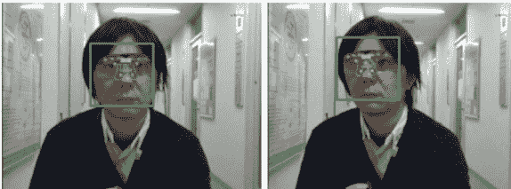


图 6: 在第一行的两幅图像中，绿色矩形表示检测到了脸，即使主体戴着厚眼镜。底行的图像显示了 CCD 或 CMOS 传感器，近红外 LED 干扰了计算机视觉并因为人类看不到红外线而被规避。

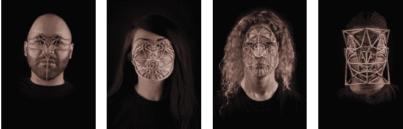

图 8: 脸笼。虽然最初是艺术表演，但这些面具规避了用于人脸检测的简单神经网络。

- 10 图像来源：Echizen & Seil，“隐私保护”。
- 11 图像从左到右：Cage 1，与 Zach Blas 的耐力表演，2015年，Christopher O'Leary 摄影；Cage 2，与 Elle Mehm 的耐力表演，2014年，Christopher O'Leary 摄影；Cage 3，与 Micha Cardinal 的耐力表演，2014年，Christopher O'Leary 摄影；Cage 4，与 Paul Sega 的耐力表演，2016年，Christopher O'Leary 摄影。


图 9: CV Dazzle。伪装发型和妆容。

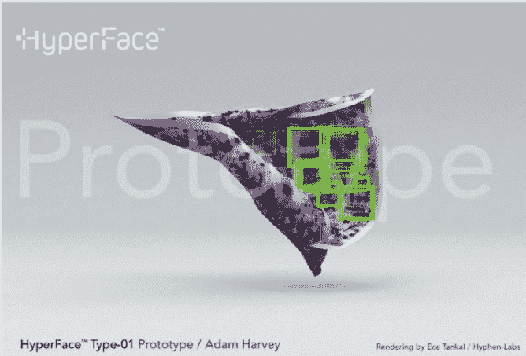

图 10: HyperFace 原型。绿色和黄色区域展示了模式识别网络极有可能检测到脸的区域。

- 12 图像来源：Harvey，“伪装”。
- 13 图像来源：Harvey，“HyperFace”。

## 画廊

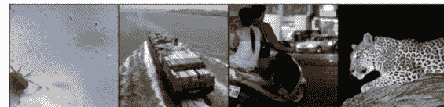

图 11: 由早期突破性卷积神经网络之一 AlexNet 进行识别，其前五个预测的错误率为 15.3%。今天，Inception v3 的前五个预测错误率低至令人惊讶的 3.46%。

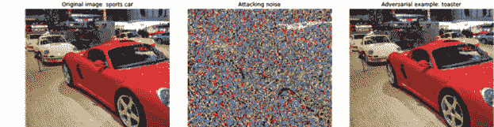

图 12: **左：**原始图像；**中心：**专门生成的噪声模式，提供了烤面包机的表象；**右：**原始图像和噪声模式叠加形成一张被 Google Inception v3 网络识别为“烤面包机”的新图像。


图 13: Spaz：Evie 讨论我的萝卜。

- 14 Alex Krizhevsky, Ilya Sutskever 和 Geoffrey E. Hinton，“基于深度卷积神经网络的图像分类”，发表于 *第 25 届神经信息处理会议论文 - 第一卷*：1097–1105，https://papers.nips.cc/paper/4824-imagen-classification-with-deep-convolutional-neural-networks。
- 15 图像来源：Krizhevsky 等，“ImageNet分类”。
- 16 图像来源：Mikhailov & Trustinov, 对抗攻击 -
- 17 图像来源：来自 https://www.youtube.com/watch?v=aS5HcCzlimFE。

## 聚合酶链反应的定位

PAUL VANOUSE

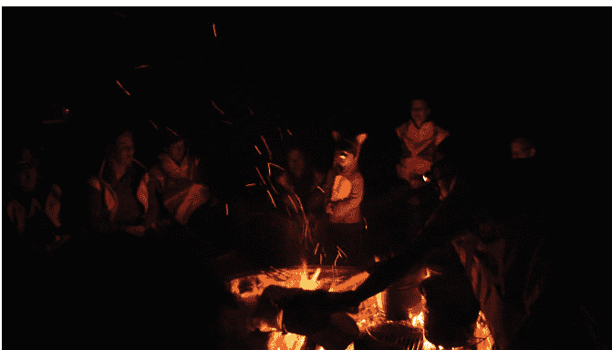

图 3: Paul Vanouse 在加拿大班夫国家公园执行深林 PCR，2011 年 7 月 29 日。¹

¹⁸ 由于深林 PCR 表演涉及将 DNA 样品在三个加热水桶之间进行 40 次热循环，每个循环持续一分钟或以上，整个表演持续了近三个小时，从傍晚一直到深夜。

# 艺术、体验与成为

马马克·加雷特访谈 琳恩·赫尔斯曼·李森

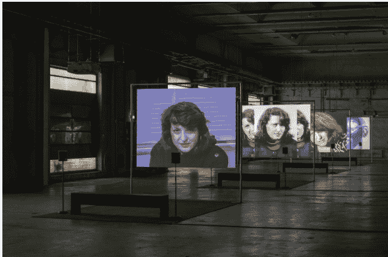

图 1：琳恩·赫尔斯曼·李森：《第一人称复数，琳恩·赫尔斯曼的电子日记》，1984–96，装置艺术，柏林 KW 当代艺术学院。摄影：Frank Sperling。


图 2：琳恩·赫尔斯曼·李森，《洛尔娜》（Lorna）的装置图，1979–1982。


图 3：琳恩·赫尔斯曼·李森，《欲望之神》（Teknolust）。由蒂尔·斯维通主演的电影，2002。


左图：图 4：琳恩·赫尔斯曼·李森，《辛西亚》（Synthia）。定制软件，微处理器。3件版。2000–02。

右图：图 5：琳恩·赫尔斯曼·李森，《赛博罗伯塔》（CyberRoberta），1996。图片由纽约 Bridget Donahue 慷。


图 6：琳恩·赫尔斯曼·李森，罗伯塔结构图 #1，1975。

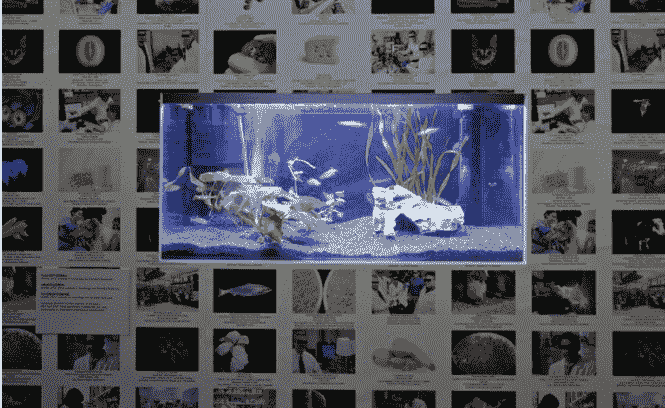

图 7：《无限引擎》（The Infinity Engine），2014，多媒体装置，部分交互（基因改造鱼类、鱼缸、屏幕、投影、壁纸、3D 打印的鼻子、文件、电子设备和其他材料）。380 x 1280 x 550 cm，装置图，琳恩·赫尔斯曼·李森。Civic Radar，卡尔斯鲁厄 ZKM 当代艺术博物馆，2014–2015。

## 取回公司拥有的自我

马马克·加雷特


图 2：视频《会议纪要》（Meeting Minutes）剧照¹19

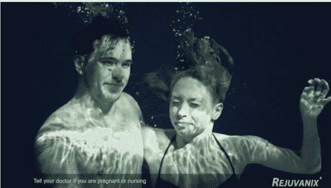

图 3：JLM Inc 制作视频《重焕活力》（Rejuvanix）剧照²0

- 19 《会议纪要》（导演：Jennifer Lyn Morone，2016），下载地址：http://jennifermorone.com/meetingminutes.html。
- 20 《重焕活力》（导演：Jennifer Lyn Morone，2016），下载地址：http://jennifermorone.com/rejuvanix.html。

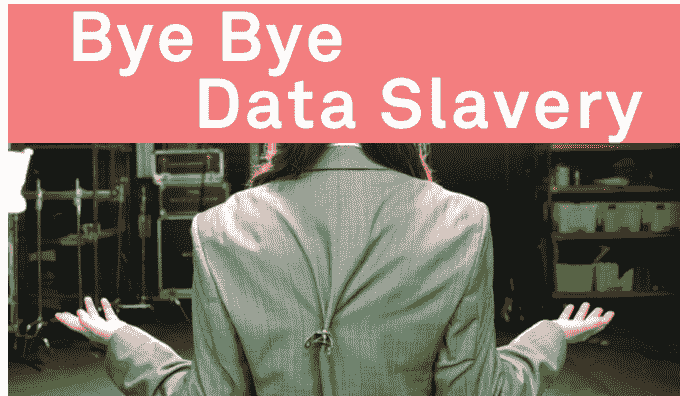

图 4：取自 Jennifer Lynn Marone 网站截图，2018。

## 艺术、债务、健康与护理

马马克·加雷特访谈 凯西·索恩顿


图 1：Miki Foster 结束了名为“在国家眼中死去”的 ICE 仪式。

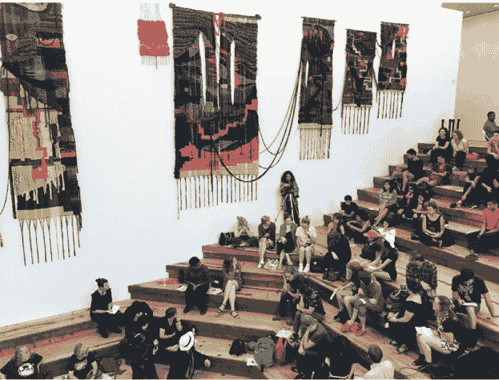

图 2：ICE 成员：Tara Spalty、Yasmin Golan、Miki Foster、Tori Abernathy 和 Cassie Thornton，以及与会者。

## 即兴区块链

马克斯·多维

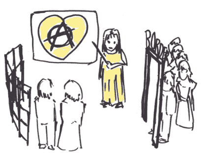

图 1：Maz Hemming 为 DAOWO 工作坊 #5 创作的插图：“我们在区块链上买下岛屿时会是什么样？”²¹

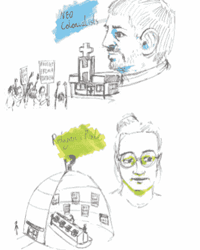

图 2：Maz Hemming 为 DAOWO 工作坊 #5 创作的插图：“我们在区块链上买下岛屿时会是什么样？”²²

- 21 见 https://www.flickr.com/photos/153150564@N06/41929568682/。
- 22 见 https://www.flickr.com/photos/153150564@N06/2710517557/。

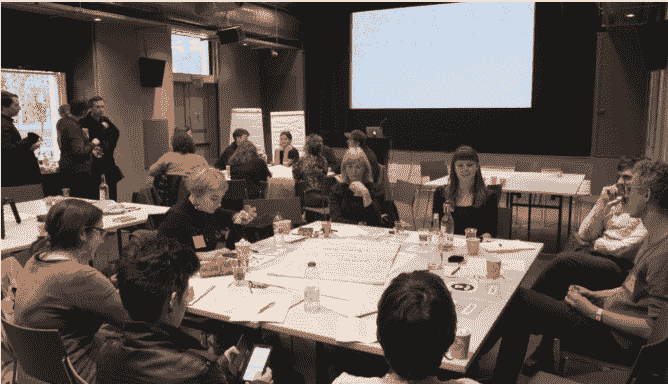

图 3：DAOWO 工作坊 #5 “我们在区块链上买下岛屿时会是什么样？”，由 Rory Gibson 拍摄，于 2018 年 3 月 29 日。

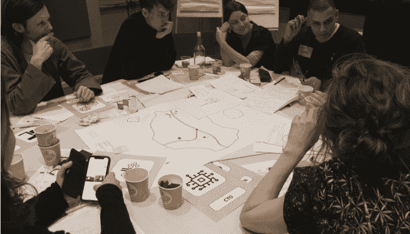

图 4：DAOWO 工作坊 #5 “我们在区块链上买下岛屿时会是什么样？”，由 Rory Gibson 拍摄，于 2018 年 3 月 29 日。

## 之前、之后与超越边界

KRYSTIAN WOZNICKI


# 之前、之后与超越边界！

## KRYSTIAN WOZNICKI

今天，越来越多的人……

## 国家边界是如何在世界范围内被启动的

与普遍假设不同，国家边界（包括特朗普、奥尔班等人推崇的围墙）并非封闭的，因为它们的首要功能不是阻止移动。相反，它们的启动是为了扫描、筛选和分类移动中的主体和客体，并对它们进行测量和量化。移动根据这些评估被引导或重定向。其迫切的任务更多是提取劳动力并使移动变现。

回首 2015 年夏天和秋季，当时有历史性数量的移民进入欧盟。我记得下午四点左右，我和同事刚刚抵达柏林州劳动力和社会事务部（LaSo）。那里非常嘈杂混乱。一大群人正在叫喊，极具攻击性，就像在抗议一样。这些人是移民，正等待被登记并随后被承认为难民。其中一些人为了仅仅被计数，已经等待了数周。他们面对的是国家权力震耳欲聋的象征：警报声、武装警察、扩音器和私人安保人员。这本可能是两个国家边境间的场景，但背景实际上在柏林的心地带。

事实上，在许多地区，人们穿过并跨越边界；通过这种方式，人们被深层不透明且根据种族类别运行的技术系统所扫描、筛选和分类。他们被登记为有用或无用，因此被赋予或剥夺了国家的特权。这些机制在各种环境下发展起来，协助流动性的组织，并构建了政治和经济参与结构。它们难道不应该被透明地管理吗？

从某种意义上说，并非所有的移动都涉及跨越国家边界。并非人人都知道，庇护申请等关键决策是在这种过程中做出的。关于身份的决定正在被评估或延迟。这种无与伦比的不确定性是对主体性（agency）的深远悬挂，并伴随着经济及政治地位被剥夺的可能。它导致了驱逐——一种权利的激进悬挂。

这一切发生在现代西方国家的领土内，其历史功能取决于提供庇护。但只有当相反情况同时存在时，这一主张才有效：通过国家边界，包容可以被排斥所调节。“包容”与“排斥”的概念还动态不足以描述我们的困境。毕竟，边界化过程太细碎了。这在某种程度上使得公民权的概念变得荒谬。毕竟，公民权的概念是基于“谁属于”和“谁不属于”之间的清晰区分。

## 分析

现实中，大多数国家边界的操作将人们悬挂在某个中间，使他们同时既被包容又被排斥。大规模监控就是一个例子。另一个是非法移民，他们已成为国家经济不可或缺的一部分，构了当代市场迫切需要的、高度灵活且可剥削的劳动力。在其中，驱逐成为了政治权力繁荣以及流动管理的工具性手段。同时，路易斯·阿莫尔（Louise Amoore）指出，“国家边界成为了一种始终处于‘生成’过程之中的存在状态，它从不完全封闭，而是表现为对身份和合法性证明的持续需求。”国家边界表现为对个人价值的持续需求。

## 移民能扩张民主空间吗？

借用赛博朋克派人物之一威廉·吉布森（William Gibson）的话：你随身体移动，但你把灵魂留在了身后。这就是“倒时差”。你移动，跨越国家边界，无论线下还是线上，无论有意识还是无意识，你都留下了你的权利。这是今天公民的“倒时差”。这个“身后”的下落并不明确。它可能是神话般的过去，例如法国大革命期间民权和权的诞生。但它也可能是推测的未来，即全球公民权的承诺——将国家重新定义为全球相互依赖和互联网络中的一个节点，以及行星规模的跨国民主机构的发展。

现在，让我们考虑在 LaSo 等待的移民，在首都中心的国家边界等待被登记、等待被承认的移民。很难将此仅仅看作损失和剥夺。很难将这些移民仅仅视为受害者，或将他们的处境仅仅看作殖民历史的延续。乍一看，这些人的梦想似乎被“黑客攻击”了。他们为了寻找一个值得生活且宜居的地方而来到欧洲，他们似乎在复制将欧洲作为理想乌托邦的殖民叙事。

但也许也存在——或者说——一个解放维度。也许他们可以被看作是对这种殖民主义想象黑客行为的逆向工程。当考虑到以下因素时，这种相当反直觉的想法变得具体了：在 LaSo 激活的国家边界等待的移民已经进入了国家领土，并在德国主张积极的角色——交朋友、承担必须完成的工作、学习他们的第一句德语，并在他们的每一次移动中贡献数据和画像。后者并非正式的、经典意义上的劳动，但它仍然产生了可变现的信息。

从这个意义上说，公民的“倒时差”不能被还原为损失和剥夺的幻觉。它也可以被视为某种尚未获得理想地位、却持续无情地跨越国家边界并主张权利的幻觉；某人正在挪用欧洲的殖民叙事，并积极构建他们自己的欧洲形象；或者某人在在此过程中同时动摇并反抗殖民叙事。

如果采取无政府主义的视角，还会出现解放和启蒙的额外方面。考虑这一点：如果移民在一个“无权利”的领域移动，他们就处于一个处于国家为其人民建立的关系和合同之外的领域——这种关系和合同令人满意的，且在许多方面是不可接受的。通过在这一领域移动，移民不仅在尊重国家，还可能动摇国家与资本主义的共谋。在那种意义上，正如哲学家卡瓦坎特（Cavalcante）所说，是一种让一切（在宏观层面）保持不变的“运动”。

## 分析

人口的大多数被遗弃并变得隐形化，成为经济增长的拖累。这种不平等的萎缩导致越来越多的人流离失所，并被剥夺了参与国家和市场政治及经济的机会。与此同时，国家边界正在重新校准，以管理这一贫瘠经济空间内外的流动。

随着历史性数量的移民跨越边界，驱逐的动态正变得具有戏剧性的迫性。这些动态正在产生不断增长的人口，数以万人被迫创造生存经济，针对歧视和刑事化进行半隐形的薪资斗争，并为公共利益和整体财富发起同样缺乏代表性的斗争。这种发展在合法和非法的流动不断产生痕迹，并为大数据技术和现代性性的新形式提供必要物质的社会中正形成势头。奥斯卡·甘迪（Oscar Gandy）对“社会分类”算法程序的突破性研究阐明了公司如何利用大数据识别优质客户和具有经济价值的人口统计。6 预测在未来也将具有价值，这意味着可能指定谁是有价值的——甚至是毫无价值的。翻译这些国家边界意味着评估人们对未来市场的潜力，并将某些人归类为完全不同的其他事物。斯基亚·萨森（Saskia Sassen）诊断道，“对资本主义发展至关重要的经济参与者，”在系统筛选过程中已经停止，并被预期保持沉默和无关。

尽管对于大数据和人工智能的真实潜力仍存在许多不确定性，但对其运作模式的传言本身就有后果。尽管社会分类仍处于婴儿阶段，但分类的社会学和心理学过程已经非常先进。想象与实际社会分类之间的关系是互惠的。这种多层叙事的共鸣影响使得人们越来越难以跳出这种叙事的范畴和过程来思考社会。

在这种背景下，社会分类可以被视为一种双重技术，通过这种技术可以理解当代的困境。仅对驱逐的恐惧足以产生顺从、冷漠和自我审查。它破坏了未来的实施和民主共创。

# 黑箱基础设施


# 政治与技术之间的纠缠

政治与技术之间的纠缠使得仔细审查变得困难。诚然，要仔细观察非官方的——或至少是可见的——国家边界是困难的甚至是不可能的，这些边界的机制是由黑箱基础设施驱动的。这种基础设施由人口贩子和走私者组织的网络；由橡胶船、边境哨所、热点、注册处、紧急住宿、难民申请者收护所、遣留留中心和出发航班组成。

- 6 Oscar Gandy, *The Panoptic Sort: A Political Economy of Personal Information*, Boulder: Westview Press, 1993.
- 7 Sassen, *Expulsions*.

移民的每一步都被编码和追踪，无论其状况的结果如何。无论他们是否到达目的地，是等待一会还是无限期，被赋予认可身份、被允许继续还是被遣回，他们的移动都被记录了。他们被不透明的、数据驱动的技术扫描、编码、解释、引导和限制，这些技术构成了国家边界基础设施的一部分，其存在本身就依赖于对边界的需求。

这种数据基础设施的节点（在移动国家边界的语境下很少被关注）由智能手机、社交网络账户、服务提供商、光纤电缆、一站式服务、数据中心和数据库组成。数据包是快速、缓慢还是完全未到达目的地，无论是被忽略还是被检查，是经过收集和分析还是未被察觉，是存储时间短还是长，是由于推荐算法通过还是优先处理——所有这些决策都是由不受责任的企业和国家权力在暗中做出的。

数据基础设施的这种封闭的黑箱维度关键性地告知了国家边界的性质，并塑造了移动，调节了通信，围绕政府权力的逻辑转型了社会关系。随着越来越多的人居住互联网（包括配备智能手机的脆弱或边缘化移民），由于这意味着互联网对于今天任何社会关系的生存都变得至关重要，政府权力变得越来越无处不在，因为它越是保持黑箱状态且在很大程度上未受质疑。

在这种背景下，社会分类可以被视为一种双重技术，通过这种技术可以理解当代的困境。仅对驱逐的恐惧足以产生顺从、冷漠和自我审查。它破坏了未来的实施和民主共创。

## 基础设施

边境监控系统（`Eurosur`）是专为这项任务设立的，它提供了分析所需的“信息交换框架”。

`Eurosur` 将从所谓的监控气船、无人机船、雷达设施、运动传感器和离岸传感器接收到的数据，与从风险分析、卫星图像和移民特征档案中收集的信息结合起来。除了国家机构外，欧洲海事安全局和欧盟卫星中心也是该安全网络中的伙伴，该网络促进了公共数据库与企业数据库的合并。

这种军事信息复合体推进了移民登记的官僚化，该过程由欧洲 IT 系统局 `EU-LISA`、难民指纹数据库 `Eurodac` 以及柏林州劳工和社会事务局（`LaGeSo`）等机构共同开发和实施。在数据的洪流中，对运动的控制正在变成一种日益移动的控制方法。国家边境正被随心所欲地激活，无论是在现实空间还是虚拟空间，既不负责追责也不符合民主程序。作为复杂的权力状态，它们正变得模糊、混合且动态，沿着移民基础设施移动，从边疆到国家领土的核心（例如，到柏林市中心），无数移民在初始登记流程之外轮候。这种国家边境的迁移就是国家权力的运动。

## 边界化的潜在运动

在这种背景下，至关重要的是，人工智能和大数据技术的崛起与 9/11 之后的预防政治汇合，并被许多国家所采用。情报部门和军事特种部队等政府机构与安全公司和 IT 公司合作。这些组织的代表认为，任何风险都可以通过数据收集和计算能力来管理，因此他们正在寻求并攫取更多数据。

尽管他们的预测可能永远不会变成现实，但这种执着的预测仍然使他们武装起来，应对未来可能出现的所有威胁（对其权力和流动性的威胁）。他们还在实施一项算法逻辑项目，该项目最初是为全球商品和供应链管理开发的，现在则目标的是人员和数据的运动；而且，他们要求对所有关键基础设施拥有主权以执行这项任务。

数据驱动的预判游戏正在改变可能性的空间。它设计并生产未来，并以新的方式管理运动。运动的未来和未来的运动都旨在通过计算和预判达到一种控制状态，而这种状态在社会内部不会受到任何质疑。这种理念是对一切可能发生的事情宣战。这被称为“反恐战争”，它在虚拟层面运作。它将威胁列入议程，并将它们的不存在——或“尚未”存在——作为一种刺激。毕竟，即使是最终从未发生的事情，也一直可能发生。当然，这种政治最终与纯粹排除任何事件是不兼容的；然而，它甚至无法理解，更不用接受这种无能了。相反，它寻求通过任何可能的手段来克服它，并因此面临着产生它声称要防止的风险。结果，它变成了一种生产性力量。

这种权力的最初崛起可以追溯到 18 世纪和 19 世纪。这一时期见证了人权和公民权利。与此同时，劳动和资本的大规模动员令人不安，威胁到国家边境和财产的安全，并破坏了国家之间的平衡。在这些情况下，出现了一种新的边界化过程，融合了统计学与生物识别、人口统计学与图像（如用于护照的照片）。日益增长的数据收集被用于转化社会运动的方向和重定向。流动模式变得流行起来，并在“在运动发生前追踪运动”的梦想驱动下。

今天，这种梦想（或噩梦）已成为现实。情感政治与人工智能的汇合催化了全球对新型运动的追求。它不再仅仅是扫描、控制和限制运动的主体和客体，而是越来越多地关于可能发生的运动。它关乎已经发生的运动、即将发生的运动，或理论上可能发生的运动。这种潜在运动正成为国家及其企业盟友的主要关注点。雄心不仅在于捕获它，还要获得对其生产的控制。为了信号这种情况下权力的转移，哲学家布莱恩·马苏米（Brian Massumi）引入了“开启权力”（`opontower`）一词，它指的是创造适宜条件、适宜社会运动和一般生活的权力。

回到作为权力表达的国家边境，这种质的转变意味着国家边境引导或重定向潜在运动。边境已远远扩展到国家之间的界线之外，现在旨在预测潜在运动并在此进行预判。

## 克服公民的时差

如前所述，或许移民的运动，尤其是非法移民，为这样的项目提供了灵感和资源。移民知识分子如 Harsha Walia、Jennifer Kamau 和 Miltias Oulios 已经是该项目的领导、理论家和倡导者。与此同时，他们的工作揭示了某种保留。移民通常生活在严酷且极其不稳定的条件下。赋能移民成为一项紧急任务。但那些运动较少被犯罪化、被认为属于国家的人，如何参与这种赋能？我们的声音和行动将如何寻求团结？但在任何事情之前，我们应该如何学会倾听他们的需求和关注，正如为了我们的生存、自由和政治行动那样样？

我清晰地记得 2016 年夏天一场由潘科维社会主义青年运动组织的支持廉价住房的游行。游行之前，一个紧急避难所就对于难民申请者是否参与产生了争议。一个非法移民接过了麦克风，那是一个来自阿富汗班图图族的年轻男子。他用自己的语言读了一份声明，并分发了翻译件。惊讶的是，他的声音是害羞、缓慢且安静的，几乎是温柔的。这并不是一个熟悉于提出强硬公共要求的人的声音。这不是那种常见的展示性社交网络的声音。

### 分析

社会运动？难道不是我们几乎所有人都不需要重新学习如何成为具有主体性的行动者吗？因为我们正以某种方式或另一种方式遭受着同样的跨越国家边界和遗弃权利所带来的“时差症”的影响。

正如我们刚刚看到的关于权力质变的转变，任何想要让民主更民主化、扩大民主空间或成为“运动中的民主”的集体意志——任何集体——都必须考虑到其驱动力或潜在的运动可能已经被预先性的国家政权所吸收。因此，运动政治学正在改变“社会运动”的概念，这些运动可能由被非法化的移民、难民、公民，或曾经的我们所有人组成。因此，当涉及到从这种转型中得出结论时，我们所有人在某种意义上都是新来者。我们都必须重新思考在今天，政治意味着什么，以及归属意味着什么。

任何关于理想世界以及这在未来如何成为现实的集体思考，都将与国家及其边界所代表的新兴权力形式作斗争。具体而言，边界基础设施复合及其新型权力模式不可避免地会以某种方式受到争议。非合法化移民、难民和公民如何介入其中是一个开放的问题。然而，计划看到一种共同策略将在未来产生影响。

## 参考文献

- Amoore, Louise. 《生物识别边界：在“反恐”战争中治理流动性》，《政治地理》 25.3 (2006年3月)。
- Cavalcante Marcia, and Kristian Woznicki, 《抵制控制的运动》，openDemocracy, 2016年11月26日, https://opendemocracy.net/can-europe-make-it/krystian-woznicki-marcia-cavalcante/resisting-movement-of-control.
- Gandy, Oscar. 《全景式分类：个人信息的政治经济学》，鲍尔德: Westview Press, 1993.
- Gibson, William. 《模式识别》，纽约: G. P. Putnam's Sons, 2003.
- International Woman Space, 《用我们自己的话：德国难民妇女讲述她们的故事》，International/Woman Space, 2015, https://iwspace.de/in-our-own-words//
- Massu, Brian. 《顶层权力：权力、力量与感知状态》。达勒姆: Duke University Press, 2015.
- Olijus, Matthias. 《黑箱成就：德国移民政策的历史、理论与实践》，柏林: Suhrkamp, 2015.
- Sassen, Saskia. 《驱逐：全球经济中的残暴与复杂性》，剑桥: Harvard University Press, 2014.
- Walia, Warsha. 《拆解帝国主义》，芝加哥: AK Press, 2013.

# 转移责任：从结构性不安全感到抑郁 LÍDIA PEREIRA

哔哔哔！你刚才在做什么？

你今天感觉如何？

你想多聊聊吗？

是什么导致你产生这种感觉的？

告诉我，你认为这些哪一个最能描述你现在正在面临的情况？

图1：与 `Woebot` 对话的截图。

## 引言

在闲逛手机浏览时，我偶然看到一个 BBC 新闻的链接，标题为“抑郁了？试着和机器人聊天”。由于我最近对流行病期间提供的心理健康应用很感兴趣，我点击了它。这就是我第一次接触到 `Woebot`，它是一个由斯坦福大学一个团队在首席执行官 Alison Darcy 博士的指导下开发的人工智能机器人。根据其官方网站，`Woebot` 可以帮助你：

- 使用认知行为疗法（`CBT`）的方法，通过分步指导来思考各种情况；
- 通过智能情绪追踪了解你自己；
- 从临床团队处获得 100 多个基于证据的课程、练习和故事。

1. Cody Gordon, 《抑郁了？试着和机器人聊天》，BBC News, 2018年8月28日, https://www.bbc.com/news/technology-4529679/depressed-try-talking-bot
2. Jonathan Sadkowski, 《潜在的 AI》，Real Life Mag, 2018年8月8日, https://reallifemag.com/potentialkin-ai/
3. `Woebot`, https://woebot.io.

`Woebot` 可以从 Google Play 和 Apple Store 下载为独立应用程序，也可以通过 Facebook Messenger 使用。`Woebot` 每天都会与用户互动，互动得越多，它就越能收集和处理关于他们可能存在的模式的数据。其他关注焦虑、抑郁和压力的治疗示例还有 `Wysa` 和 `Youper`。

`Wysa` 应用是由剑桥大学的一位神经科学家开发的，并担任其顾问委员会主席。除了认知行为疗法，`Wysa` 还提供了引导式冥想、呼吸和瑜伽等技术。

`Youper` 团队由精神科医生 Jose Hamilton 领导。除了与机器人快速对话（他们声称这在对话一次后就能让 83% 的用户感觉好许多），该应用还提供引导式冥想、正念技术和情绪追踪。

然而，人工智能机器人并不是我们心理困扰的唯一“解决方案”。大量且不断增长的应用越来越多地声称通过认知行为疗法、正念技术、引导式冥想来改善我们的心理健康。这些包括例如 `Headspace`。两者中最受欢迎的被 Apple App Store 提名为 2017 年度最佳应用，并被列为编辑精选。`Headspace` 由 `Headspace, Inc.` 开发，结合了日志记录技术来帮助用户挑战他们的健康。

在没有机器人的情况下，这些应用的共同点是，除了心理健康中心的商业模式外，让用户可以识别并纠正模式。

## 定位心理健康：自我利益


# 当临床心理学家 David Smith 在 2005 年写道...

当临床心理学家 David Smith 在 2005 年写道，心理治疗成为西方最大的商业和文化成功之一时，他远没有考虑到这种基于技术的痛苦解决方案。在《权力：对痛苦的社会主义理解》中，Smith 强调，心理治疗最显著的特征之一是它与社会的隔绝；正如如此，传统的治疗方法将这种痛苦定位在理想主义个人主义的范围内。这意味着，对于这些疗法来说，痛苦的根源可以在内部被发现、获取、处理并消除。Smith 将这种方法标记为“魔法意志主义”，其持续成功可以由利益的作用来解释。就客户利益而言，Smith 强调了植根于魔法意志主义的价值观吸引力，因为通过自我完善来改变命运，比采取一种“唯物现实主义”观点更具诱惑力——后者认为我们的生存在很大程度上取决于个人无法控制的物质结果，且在历史上是不变的，未来最多只能通过集体的（政治）努力来改变。

## 状态机器

管理层将自己设定为中立、独立的权威，在工人与雇主之间充当中间人，平滑他们之间可能产生的摩擦。此外，工人主体性在公司生活中的纠结，是为了创造一种归属感和共同的、共享的目标，从而激发他们对公司利益进步的持续重新投入。

在第二次世界大战（WWII）及随后的二十年里，这些趋势持续并进一步发展，心理学似乎是解决职场不满和积怨的方案。工人与生产活动之间的关系现在被理解为与整个社会联系的手段。因此，管理上的重点超越了单纯的经济满足，将民主、幸福和参与理念视为实现生产力目标的关键因素。

在经历了 20 世纪 60 和 70 年代的衰落后，职场满足感和民主管理的理念失宠，并被广泛认为毫无意义甚至适得其反而受到质疑。此时，“生活质量”（QWL）研究运动促成了几位研究人员，他们试图恢复二十年前流行的人际关系管理法。除其他成就外，QWL 建立了研究网络和政府压力。在英国，重点是为改善工作质量而关注人际关系；而在美国，重点是将工人视为一个自我实现的个体，其责任感和个人成长成为心理健康的真正基础。¹¹⁰ 然而，这两种方法处于平行的路线，这些策略的结果是使工人主体性与企业目标达成一致。

通过将由系统性不平等引起的工作相关问题归结为适应不良和病理问题，管理层对待工人主体性的方法在历史上通过层层科学的权威性掩盖了工人的剥削，将问题集中在自我及其直接即时现实上。反之，这促进了问题的设施化和中性化，模糊了危及工人集体探索的更大基础设施/上层建筑复合体。这些观点似乎得到了许多批评者的共鸣，他们声称这种方法对解决基础不平等毫无作用。罗斯（Rose）在这些分析中看到了真理，并认为其中许多心理努力是为了削弱工会主义。然而，他警告不要将这些话语视为纯粹的意识形态，因为这样做将意味着管理工人心理所涉及的知识是“虚假的”，仅为了为先有的社会政治利益提供合法性。¹¹¹

根据罗斯的说法，这些发展解释了心理治疗及其语言、方法是如何与二战后的政治影响和政府技术达成一致的。主体性的治理并非通过中心化权威的强力施加来实现，而是通过内化，创造了一种关于自主的叙事，在其中我们必须生产自己。

- 9 Nicholas Rose, *Governing the Soul: The Shaping of the Private Self*, London: Free Association Books, 1999.
- 10 Rose, *Governing the Soul*.
- 11 Rose, *Governing the Soul*.

## 分析

自主的自我将在不断自我审查和自我调整的压力下，评估并调节其情绪和行为，作为一个被解放的“自我”，它必须将生活与其身份认同项目系系在一起¹¹¹²

事实上，斯马尔（Smail）强调，治疗师对维持一种“魔幻意志主义”治疗方法的兴趣，应该放在他们自身在更复杂的系统性利益网络中丰富的背景下来看待¹³

与系统性利益分析相关的还有马克·费舍尔（Mark Fisher）对将化学失衡视为精神疾病首要原因的解读。根据费舍尔来说，这种对心理健康的去政治化理解有利于早期主义：首先，它强化了原子化的个人化，因为疾病的根源在于人的大脑；其次，它推高了已经臃肿的制药行业的利润。对于费舍尔来说，如果我们想要挑战“资本主义现实主义”——即认为资本主义没有可行替代方案的认知——那么将精神疾病重新政治化是一个迫不缓的任务¹¹⁴

# 唯物主义现实

新自由主义完美主义进一步反映了抑郁症作为一种流行状况，指向奥利弗·詹姆斯（Oliver James）的书《自私的资本主义者》（The Selfish Capitalist），该书分析了 1982 年至 2000 年间精神疾病的增长¹¹⁵ 詹姆斯观察到在新自由主义资本政策成为常态的国家，这种增长要得多，他假设这种责任源于新自由主义文化¹¹⁶

由托马斯·库兰（Thomas Curran）和安德鲁·P·希尔（Andrew P. Hill）进行的一项 2017 年的研究《完美主义随时间增加：1989 年至 2016 年出生队列的元分析》，旨在证明 1989-2016 年间在大学生中观察到的完美主义增加，与 80 年代以来英国、美国和加拿大新自由政策的扩张相吻合。为此，库兰和希尔采用了休伊特（Hewitt）和弗莱特（Flett）的多维度完美主义表¹¹⁸ 来衡量自我定向完美主义（对自己期望很高）、他人定向完美主义（对他人的期望很高）和社会规范完美主义（感到被寄予许多期望）。

将年轻人背景化为面临比其父母更严酷的社会经济条件，库兰和希尔谴责了煽动竞争、个人主义和对理想自我不现实期望的新自由主义价值观。精英制（Meritocracy）——一种受到争议的信念，认为财富、成功和地位可以通过努力获得，而失败归因于深层的个人缺陷——将努力奋斗、表现和成就的强烈需求置于现代生活的中心。¹⁹

- 12 Rose, *Governing the Soul*.
- 13 Smail, *Power, Interest and Psychology*.
- 14 Mark Fisher, *Capitalist Realism: Is there No Alternative?*, Hants: Zero Books, 2009.
- 15 Fisher, *Capitalist Realism*.
- 16 Oliver James, *The Selfish Capitalist: Origins of Affluence*, London: Vermillion.
- 17 Thomas Curran and Andrew P. Hill, 'Perfectionism is Increasing Over Time: A Meta-Analysis of Birth Cohorts from 1989 to 2016', *Psychological Bulletin* (December, 2017).
- 18 Paul L. Hewitt and Gordon L. Flett, *Multidimensional Perfectionism Scale (MPS): Technical Manual*, Toronto: Multi-Health Systems, 2004.

精英主义意识形态积极掩盖了诸如阶级、性别、种族、神经差异等可能阻碍平等获得机会的因素，多维度完美主义的兴起并不奇怪。此外，库兰和希尔讨论了这种多维度完美主义的增加对心理健康的破坏性后果：最近的研究将自我定向完美主义与自杀意念和抑郁正相关；而社会规范完美主义作为三个维度中最削弱的一个，因其相关的持续“对负面社会评价的恐惧”，与更程度的严重精神病理（如抑郁、焦虑和自杀意念）相关²⁰ 总体而言，根据世界卫生组织 2017 年的数据，抑郁、焦虑和自杀意念的水平比十年前更高²¹

## 规范化不稳定性

自主自我将在不断自我审查和自我调整的压力下，评估并调节其情绪和行为，作为一个被解放的“自我”，它必须将生活与其身份认同项目系系在一起¹¹¹²

事实上，斯马尔强调，治疗师对维持一种“魔幻意志主义”治疗方法的兴趣，应该放在他们自身在更复杂的系统性利益网络中丰富的背景下来看待¹³

与系统性利益分析相关的还有马克·费舍尔（Mark Fisher）对将化学失衡视为精神疾病首要原因的解读。根据费舍尔来说，这种对心理健康的去政治化理解有利于早期主义：首先，它强化了原子化的个人化，因为疾病的根源在于人的大脑；其次，它推高了已经臃肿的制药行业的利润。对于费舍尔来说，如果我们想要挑战“资本主义现实主义”——即认为资本主义没有可行替代方案的认知——那么将精神疾病重新政治化是一个迫不缓的任务¹¹⁴

## 规范化不稳定性

在精英制竞争和完美主义的背景下，我们发现了企业家的形象，这是新自由主义对结构性失业的首选应对。

在新自由主义背景下，他们[自我不稳定的者]被剥削到这种程度，以至于国家将其作为榜样呈现²

在《治理灵魂》中，伊莎贝尔·罗斯（Isabel Lorey）在新自由主义治理背景下提出了不稳定性的意义。从福柯的《性史》中，罗斯提取了一个基本概念：现代西方必须学会与自身建立关系。自我成为一种需要被塑造并按照“正常”概念（例如，白人、男性、资产阶级、国家等）进行建模的东西，罗斯识别了这种权力的……²³

尽管实际上那些没有成功的人陷入了不稳定，罗斯指出在新自由主义条件下，不稳定性已从一种例外转变为一种权力的、规范化的功能。自我不稳定性因此满足了经济和政府权力的需求，同时赋予了个人角色。罗斯将自我不稳定性与恐惧、失去控制、不安全感联系，并重新定义了工作与休闲之间的边界，因为不稳定的身体必须不断证明自己的经济可行性。对于被迫和自愿的贫困来说也是如此：每一个事件都是交易社会资本的机会，每一个派对都可能决定未来几个月是否能够生存。在每个人都是企业家的情况下，每个人都可以成为你的下一个投资者。

## 分析

在此语境下，Curran 和 Hill 的结论并不令人意外：**社会规定性完美主义**的水平正在上升，随之而来的是其对我们心理健康造成的的相关灾难性后果。24 这些后果往往被视为理所当然，导致了“医疗自愿主义”信条，将我们进一步锁在自我内部，未能解决产生我们痛苦的结构性条件。根据 David Smith 的说法，这在我们身上施加了新的负担，因为我们最终对改善生活处境所需的所需的个人改变负有责任。25 随后，对职业发展成功的责任被强化，随之的是对对抗心理痛苦成功的责任也随之增加。

# 不健康的解决方案

在心理疾病日益增加且广泛的时期——正如我们所见，这很大程度上源于新自由主义对许多人财务不安全感的管辖，以及社区安全网和团结纽带的侵蚀——公共医疗服务的获取同样受到新自由主义私有化计划和限制支出的紧缩措施的阻碍。

在英国，这种增长导致了200名全职心理健康医生和3600名护士的流失，导致10%的患者经历着超过一年的等待名单，50%的人等待时间超过3个月。26 结果是，许多在等待名单上的人转而使用心理健康应用程序，这些应用程序通过英国国家医疗服务体系（NHS）的认可，被收入 NHS 的官方应用库。

这种失败的其他原因，例如某些用户所经历的判断缺失，这些应用程序渗透了由于缺乏官方政治手段解决医疗服务普遍普及性需求而留下的真空空间。或者引发了激进的可及性，“悲哀的现实是，世界上有一半的人口仍然无法获得基本的医疗保健。对于许多人来说，心理健康并不是选项。”27 在这一刻，人们不禁想到约翰·莫罗佐夫（Evgeny Morozov）的解决方案，这位出生于城市规划和建筑领域的作家。Steve Flat 所言：“硅谷对政治如何运作的默认答案，就是我所说的‘解决方案主义’（solutionism）：即问题应该通过应用程序、传感器和反馈回路来处理——而这些都是由初创公司提供的。”28

## 隐私政策

我们如今深受数据隐私“丑闻”的困扰——2018年的剑桥分析公司（Cambridge Analytics）是讨论最广泛的——因此，调查开发某些此类应用程序的公司所执行的数据保护、质疑其有效性并将其置于政治地位，似乎并不遥远。

+ 24 Curran and Hill, 'Perfectionism is Increasing Over Time'.
25 Small, *Power, Interest and Psychology*.
26 ...（省略链接）...
27 ...（省略链接）...

## 状态机

尽管声称不会向任何其他公司或服务提供任何敏感和个人身份数据，但通过阅读 Woebet、Wysa、Youper、Pacifica 和 Headspace 的隐私政策，可以识别出一两个引起立即关注的共同领域。首先，所有这些平台都保留了任何时间更新其隐私政策的权利。其次，在公司重组或合并的情况下，所有存储的用户个人信息将披露给任何相关方。这可能在任何时间发生，且无需用户的重新同意，因此许多关于数据可能仅用于其当前隐私政策允许的用途的承诺并不十分放心。

此外，通过 Facebook Messenger 访问 Woebet 受到 Facebook 隐私政策的约束；Wysa 使用第三方广告代理，并可能在应用内安装第三方模块以确定其效率.³29 Pacifica 可能会出于有限的营销目的通过 Google Analytics 提供个人信息的访问（“Google 可能会使用数据为其广告网络提供背景化和个性化广告。”）30 Apple、Appsee、Amazon Web Services 和 Youper 可能也会与其他代理共享非识别的、聚合的个人信息，作为支付处理公司.³31

即使我们（明智地）相信这些应用程序不向第三方公司或服务共享或出售可识别数据的承诺，利益相关方对匿名信息或元数据进行交叉比对也可能产生可识别的结果，而且他们确实精于这一分支的活动.³32 此外，2015年发表在《BMC Medicine》杂志上的一项名为《认证健康与健康应用中未解决的隐私风险》的研究发现，受到NHS认可的心理健康护理应用程序尽管安全性存在波动，但仍数据面临风险.³33 因此，无法确定在使用 Woebet、Wysa、Pacifica 和 Headspace 时，这种安全性是否会得到保障。

通过 Facebook Messenger 使用 Woebet 受到 Facebook 隐私政策的约束这一简单事实就应该敲响警钟了。例如，参考 Facebook 的专利“从社交网络系统的通信和特征确定用户性格特征”³4，可以使用用户消息（以及其他通信形式）的语言数据进行收集和处理，根据大五人格模型预测性格特征：开放性、尽责性、外向性、宜喜性和神经质。这些结论随后被用于用户动态中的示例定位、排名和选择展示等目的。

+ 29 Wysa, http://beta.wysa.com/.
30 Pacifica, https://www.pacifica.com/.
31 Youper, https://youper.com/.
32 Weboot, https://weobot.io/.
33 BMC Medicine, ...（省略链接）...
34 ...（省略链接）...

## 分析

# 社交网络系统的性格特征

## 数据

- 大五人格
- 外向性
- 宜喜性
- 尽责性
- 情绪稳定性
- 开放性

预测性格特征

斯皮尔曼等级相关（性格特征与类别之间的相关性）

目标定位 排名 在用户动态中展示

性格特征的概率分布


## 丑闻？

鉴于剑桥分析公司的曝光，主流媒体对事件的报道主要集中在剑桥分析公司的行为上，将其描绘为孤立的或坏者，而 Facebook 则试图通过将自己表现为道歉的受害者来挽面。

调查显示，剑桥分析公司已部署算法处理，将来自Facebook的数据转化为关于用户特征的可操作见解。这些见解随后被用于在特朗普2016年竞选期间期间提供更有效的针对性政治信息。根据 Christopher Cadwalladr 在《卫报》上的一篇文章，举报计划收集美国人的 Facebook 档案，并利用他们的私人个人信息创建复杂的心理和政治画像。然而，这些正是破坏了 Facebook 商业模式的做法。Facebook 上甚至开发了工具和页面来帮助政治客联系选民。而且，这些工具以及所有广告，通过预处理受众进行针对性投放的可能性.³⁷

+ 35 ...（省略链接）...
+ 36 ...（省略链接）...

无论这些宣传活动的政治倾向如何，在这一背景下，有针对性的政治广告并非新鲜事。其区别在于，在这种情况下，是 Facebook 而非某些第三方纠正者的帮凶，可以访问其所有用户为其平台贡献的海量数据财富（无论是显式还是隐式贡献的）。随后，Facebook 通过算法将这些数据处理成广告商可以选择的可操作目标受众。

此外，仅有寥几位参与者的业务模式与 Facebook 相似，这必然要求其用户放弃对数据被收集、使用和处理的控制权。通过提供通过大规模数据处理和分析所获得的可操作受众和洞察，这些公司能够免费运营，并仍然获得利润：Facebook 在 2017 年的利润为 400 亿美元，而 Google 在 2017 年则为 1100 亿美元。38

## 焦虑指标

在新经济基金会（New Economics Foundation）的研究人员发现“评分社会”39背景下，可以观察到一种趋势：在公共和私营部门部署高度个性化的心理画像，用于投放、执法和决策等目的。Duncan McCann 和 Miranda Hall 描述了建立在“政府-企业相互强化监控”架构之上的“评分社会”，在这种架构下，获取公共和私营服务（如住房、医疗保健、保险）取决于数字画像是否符合访问所需的条件。40

正如 Facebook 专利 US950752B2 所示，这些心理画像可能通过处理不同类型的数据和元数据（无论是显式还是隐式贡献的）来继承。Hall 和 McCann 在其文章《你的分数是多少？歧视算法如何控制访问和机会》中，以金融科技作为“利用‘替代数据’反映个人真实性格”的先驱举例；一个例子是 Tala，这是一种信贷工具，它根据基于计算出的分数（例如，某人给妈妈打电话的次数）来决定贷款资格。41

这种趋势似乎是，这些衡量标准日益影响着我们感知和控制自己的方式，因为我们正变得越来越依赖一台痴迷效率的官僚技术机器来满足日常的基本人类需求。David Beer 在论述新自由主义指标对心理健康的影响时，似乎得出了 Curran 和 Hill 相似的结论。关于在被测量身体中引发情感反应的指标，羞耻和焦虑并不起见。这种情感反应是关键，因为通过这种反应，被测量的身体会被促诸行动，寻求改进并与他人竞争阳光下的一席。42。Beer 引用了 Will Davies 的《新自由主义的局限》，借用了这样一个结论：不确定性和不平等确实是这些战术的预期结果，因为我们感到越不安全，创业性主体感的感觉就会越强烈。43。在新自由主义不稳定性的背景下，衡量我们终究是一场生存之之旅。


鉴于这种局面，将我们的敏感信息和个人情感贡献给 `Woebot`、`Pacifica` 或 `Wysa`，其产生的社会政治和经济后果难道如此荒谬吗？这些旨在缓解我们痛苦的工具很可能进一步加剧心理疾病与对其加剧负责的系统之间的联系。这是因为此类应用程序代表了潜在的数据源，喂养了那些加剧我们不安全感的画像和应对系统。

## 转移战术

不可否认，这些初级响应应用在缓解与抑郁和焦虑挣扎的深层心理方面可能具有巨大价值，特别是在面对长不可望的等待名单和专业护理机会减少的情况下。然而，这种类型的解决方案只能是短期补丁，无法扩展心理治疗解决用户所处的更广泛系统背景的能力。事实上，David Small 对“再治疗性无能”的描述也适用于此：在对治疗产生初步积极反应后，患者陷入旧问题，因为外部世界的现实再次定格。44。通过将我们锁在自己的现实中，并将痛苦的根源定位在我们内部，“魔幻自愿主义”不仅未能为广泛的焦虑和抑郁提供长期解决方案，反而进一步加剧了受影响自我的负担。它（至少）造成了两点影响：

- 重现了新自由主义的自我责任叙事（“权力在你手中。”、“改变你的生活。”、“成功完全取决于你。”），从而在失败时增加了额外的不确定性、罪恶感和羞耻；
- 在基于技术的迭代中，呈现了进一步贡献数据以开发用于判断、治理和排除的心理画像之危险。

因此，显而易见心理健康应用如何进一步复杂了心理健康与资本之间本就动荡且剥削的关系，使得参与（重新）发现替代性的社区治愈方法变得十分必要。

`Mindful Occupation` 工作组的目标是为占领/去殖民化运动提供心理健康支持，他们将激进心理健康框架化为一种减少“对疯狂世界的病理化凝视”的工具；通过政治和社会正义视角审视心理健康，然后通过许多基层运动进行交叉斗争。45

正如 Becca Rothfeld 有力所言，让我们沉浸在“共同渴望的崇畏的亲密中”吧。让我们分享焦虑，让我们互相谈论抑郁。这些通常在孤立中体验的感受，让我们感受到集体愤怒——那种富有成效的、拒绝接受系统性失败导致的瘫痪不作为——作为一个解放性的、激进的心理健康项目；我们需要开发反抗战术。

## 参考文献

+ 38 Levine, 'The Cambridge Analytica'.
39 Miranda Hall and Duncan McCann, 'What's your score? How Discriminatory Algorithms Control Access and Opportunity', New Economics Foundation, 2018年7月10日, https://neweconomics/2018/07/whats-score.
40 Hall and McCann, 'What's your score?'
41 Hall and McCann, 'What's score?'
42 David Beer, 'Neoliberalism Making You Anxious? Metrics and the Production of Uncertainty', LSE Blogs, 2016.
43 Will Davies, *The Limits of Neoliberalism*.
44 `Mindful Occupation`, *Rising Up Without Running*.
45 `Mindful Occupation`, 2012, http://mindfuloccupation.org/intro/

# 跨界

## RACHEL O'DWYER

商品的进一步发展并没有消除这些矛盾，而是为这些矛盾提供了可以运动的形式。

> — 卡尔·马克思

短期来看，[英国脱欧]对所有市场都是不利的；不确定性导致了巨大的波动，特别是在现代的“蓝筹”高价类别中。然而，作为长期财富的存储手段，艺术是应对货币间相对价值结构性变化的极佳对冲，也是应对央行在动荡时期通过印钱刺激和稳定货币而导致货币贬值的手段。

> — 斯特凡·西owitz（Stefan Simowitz）

易布拉欣·马哈马（Ibrahim Mahama）的《跨界》（Outside of Borders）是为2015年威尼斯双年创作的现成品装置，由300个改造后的黄麻袋组成，覆盖了画廊空间的内部。马哈马的作品展列于画廊和商业空间，探索了货物在边界内及跨边界流通，以及人体和劳动力在这些过程中的作用。正如纯艺术作品的背面通常带有印章和签名，详细说明其来源、去过的地方以及它们所进入的经济关系一样，黄麻袋也是一种丰富的媒介对象，上面刻着它在更广泛商品链中的流通故事。这种沉重的材料被签名并用具有地区特色的图案织物进行修补，留下了它们在边界内及跨移动的痕迹。

这些黄麻袋最初在马哈马家乡加纳用于运输可可，后来煤炭。它们由热带植物的茎织成，这种植物的粗糙纹理用于制布或袋。黄麻因其天然光泽被称为“黄金纤维”，其作为工业材料的殖民历史追溯到17世纪直到塑料发展时期，在孟加的种植园中被种植、加工和贸易。在塑料发明之前，这种纺织品在殖民种植园被大量生产并销售为大麻袋或布质袋。它是全球资本主义兴起和起源、殖民剥削历史以及边界内外跨边界货物流通的核心。在《跨界》中，这些黄麻袋从一种流通经济——一种在全球贸易中具有特定价值的商品——被抽离，并进入另一个交换系统，作为现成品艺术品，并且正如我们将看到的，作为更广泛网络中的一种货币形式。

- 1 卡尔·马克思，《资本论》第一卷：政治经济学批判，伦敦：企鹅出版社，1986（1867年）。
- 2 Stefan Simowitz，引自 Rain Embasco,《艺术界对英国脱欧的回应》，Artnet，2016年6月24日，https://news.artnet.com/art-world/art-world-responds-brexit-526400。

## 分析

85

马哈马的作品是另一个商品链的主体——全球市场中艺术品的流通。艺术家现做的黄麻袋是近期一起法律纠纷的核心，涉及这位加纳艺术家、巨星以及位于洛杉矶的商人斯特凡·西姆霍茨（Stefan Simchowitz）。西姆霍茨是一个互联网艺术商人，一个投机性商人，他避开了传统的画廊体系，转而青睐 `Instagram`，但他培养了一个巨大的艺术收藏家网络。西姆霍茨认为艺术品在英国脱欧后的全球范围内将提供一种相对稳定的货币，他以投机性投资实践而闻名：购买相对不为人知的艺术家，通过社交媒体推高其价值，并在转向下一个才华之前“转手”他们的作品以获利。艺术家长期的职业以及与画廊或收藏者的持续关系被套利所取代——即快速利用全球市场中的信息差和价差。

西姆霍茨获得了一些马哈马的作品，根据你相信谁，要么是在伦敦弗鲁兹艺术展（`Frieze`）会面之后，要么是从互联网的无名中挖掘的。关于2015年威尼斯双年会的案例，西姆霍茨的公司和位于都柏林的商人乔纳森·埃利斯·金（Jonathan Ellis King）在美国联邦法院赢得了对诉马哈马的一场数百万美元的诉讼。此案涉及两人获得的一个名为《民事占领》（`Civil Occupation`）的黄麻袋装置，该装置曾于2014年12月在 `Ellis King` 画廊展出。马哈马在开幕前对其中29个袋子签了名。随后，马哈马和西姆霍茨将这个巨大的装置拆解成数百个独立的黄麻袋碎片，并开始将这些作为安装在绷框上的独立、较小作品进行出售。这两位商人声称，他们与艺术家达成了口头协议，同意支付14.8万美元以换该组装装置的大部分。诉讼是在马哈马没有对这些作品进行鉴定或同意对其作品进行此类商业化之后提出的。“他正在使用移民工人用几分钱制作的黄麻袋，”西姆霍茨说，“我们帮助他对它们进行了重新利用，现在它们作为珍贵的艺术品挂在画廊的墙上。”

# 艺术是一种资产类别

马哈马与西姆霍茨的争议涉及当代艺术市场的状况。艺术品是待变现、拆分为份额并在全球市场中流通的金融资产。价格反映并响应了金融系统更广泛的动态。它们通常是针对传统股票和债券投资风险的对冲工具。正如马克·C·泰勒（Mark C. Taylor）所说：

> 当金融艺术变成艺术金融时，它不再仅仅是买卖的商品，而是变成了为对冲基金和私募基金制造的交换货币，在那里像任何其他金融资产一样被交易

- 3 Simchowitz，引自 Rain Embasco,《艺术界对英国脱欧的回应》
- 4 Simchowitz，引自 Rain Embasco,《艺术界对英国脱欧的回应》
- 5 Mark C. Taylor,《艺术的金融化》

85

将其视为资产并非新鲜事。作为一种资产类别，艺术的发展塑造了……金融工具与市场，以及人们认为区块链等新兴技术可以解决有关真实性、风险、高交易成本、市场透明度和市场监管等方面的问题。

艺术投资领域出现了很多新机制。这些机制包括艺术投资基金和俱乐部的增长（感兴趣的股东可以投资某件作品的一部分），以及艺术品抵押贷款或艺术品证券化的发展（所有者可以使用其收藏中的艺术品作为未来贷款的抵押）。随着人们避开传统银行和佳士得（`Christie's`）以及苏富比（`Sotheby's`）等大型拍卖行，像 `Artemis` 和 `Athena` 等专注于艺术品贷款的新兴精品贷款机构也加入了竞争。同样的，保税区（`freports`）——离岸交易所的高安全性仓库——已成为富人和艺术品交易家精美艺术收藏的真正“银行”，以利用其免税存储条件。最近，诸如 `Maenas` 和上述 `Codex` 等区块链公司正与保税区合作。他们还在开发记录艺术品销售出处和流转的策略，以创建可以与艺术品关联并作为股份交易的新代币；并促进区块链上资本流的证券化。可以说，在 Mahama 作品中出现的许多“问题”——关于出处、合同义务以及将非同质化、流动性差的艺术品拆分为股份的技术细节——都是由这些基础设施引入的。

# 全球艺术市场中的技术

如所述，在考虑这一现象时，两种技术尤为重要，它们在新的全球化艺术市场中都发挥着作用：保税区和区块链代币。

## 保税区 (Freeport)

高净值人士（`HNWI`）的大部分艺术品收藏现在位于“保税区”；；即绕过国家主权的边界、免税空间。这些大型、高安全性、气候控制的空间通常位于机场的转运区，或者位于瑞士或新加坡等免税或税收优惠地区。保税区起源于 19 世纪，这一世纪在传统贸易中具有历史遗产，今天它们充当积累财富的自由仓库，或者说是德勤所说的“激情资产”——精酿、汽车和艺术品，这些物品一旦购买，将存储在保税区内无限期¹¹² 这里，与购买相关的关税可以无限期推迟，因为根据财政政策，储放在保税区内的货物被视为从一个地方运往另一个地方，即使它们短期不会到达任何地方。对于凯勒·伊斯特林（Keller Easterling）来说，保税区创造了一个国家管辖之外流动的空间¹³ 由于空间的“离岸”性质，艺术品被无限期存储直到价格合适。它们甚至可以在财务意义上改变所有权，而无需离开保税区。边界，或边界的缺失是关键。保税区是供应链中的一种盲点，一个监管机构和国家可以视而不见的地方，正如希托·斯泰耶尔（Hito Steyerl）所说，这里是“选择性的[失去]控制”¹⁴

由于保税区不透明且保密的性质，很难统计出有多少艺术品永久地存放在那里。《纽约时报》最近的一篇文章声称，日内瓦保税区的作品数量接近 120 万件，其中包含 5000 多幅毕加索¹⁵ 最近的机场空间看起来更像博物馆而不是仓库。例如，新加坡保税区甚至在其门厅委托了一件巨大的雕塑，毫无幽默地命名为《笼中前线》（`Cage Frontiers`）。

保税区是一个位于网络中的场所，旨在促进流动性和流动性。像中央银行一样，它作为更广泛网络的一部分，促进其边界内货物的流动性。这种流动性反过来通过保税区的流动几何结构得到促进。从法律角度来看，保税区空间是域外的——许多许多空间位于机场的转运区。但保税区并非唯一产生这些财政炼金术的空间。这些地理区域也建立在离岸空间和资产保护信托中——后者描述了一种为了避免特定司法管辖区税收而发起的法律安排。例如，货币人类学家比尔·考尔（Bill Maurer）向我解释的，纽约市的一特朗普酒店在法律上可以被描述为凯曼群岛的另一个管辖区¹⁶ 这栋建筑物理上位于纽约，但从视野中消失了；它现在在别处。这种安排利用了不平衡和优势。

此类安排是终极经济的核心，特别是艺术经济。取代公共博物馆，大量的收藏现在被存放在高安全性、气候控制且最终离岸的空间中。艺术品在这些空间中的目的不是为了拥有或作为商品进行交易，甚至不是为了公开或私人展示，而是作为一种资产——一种纯粹的密码或金融工具，它从未见过阳光，也不需要见到。因此，我们通过保税区获得的是物质艺术品作为供应链的流通便利。

保税区最近引起了艺术理论的兴趣。对于希托·斯泰耶尔（Hito Steyerl）、马克斯·海文（Max Haiven）和斯特凡·海登伯格（Stefan Heididenberg）等理论家来说，保税区体现了当代艺术市场的作品¹⁷ 理论家希托·斯泰耶尔描述这种状况为“免税艺术”¹⁸ 而艺术评论家斯特凡·海登伯格创造了“保税区主义”（`freeportism`）¹⁹ 来描述生产、流通和分发的模式。从这些分析中可以看出，保税区不仅存在于艺术品的金融化，而且存在于市场中。

> ¹¹ “超富豪的仓库”，《经济学人》，2013年11月23日，https://www.economist.com/news/briefing/21590353-ever-more-wealth-being-parked-fany-storage-facilities-some
> ²² “超富豪的仓库”，《经济学人》，2013年11月23日，https://www.economist.com/news/briefing/21590353-ever-more-wealth-being-parked-fany-storage-facilities-some
> ¹³ 凯勒·伊斯特林，《永：基础设施的力量》，伦敦：Verso Books，2014。
> ¹⁴ 希托·斯泰耶尔，《免税艺术：星球时代的艺术》，伦敦：Verso Books，2017年。
> ¹⁵ 格汉姆·鲍恩（Graham Bowen）和多雷·卡瓦贾（Dore Caravaj），“围栏后的世界最大收藏”，《纽约时报》，2016年5月29日，https://www.nytimes.com/2016/05/29/art/design/fence-behind-this.
> ¹⁶ 比尔·考尔（Bill Maurer），艺术之后》，伦敦：Pluto Press，2018；
> ¹⁷ 斯特凡·海登伯格（Stefan Heididenberg），保税区主义作为风格与意识形态，《E-Flux》第11期（2018年3月）。
> ²¹ 马克斯·海文（Max Haiven），在目证新加坡保税区时，描述了他所看到的复杂的安全表演²¹
> ²² 保税区不是新博物馆。

## 一个名为 ART 的代币

我在研究名为 `Maecenas` 的公司时发现了保税区，这是一家在以太坊上列出艺术品的初创公司。从本质上，区块链是一个分布式数据库。其中存储的数据通过加密进行安全保护和验证。

这些技术使得存储在数据库中的数据无法被污染。第一个区块链是比特币区块链，它是一个使用比特币存储和验证交易细节的数据库。但最近，如以太坊等这样的公司开发了区块链，用于验证、记录和执行其他类型的货币性或非货币性）合同和安排——包括土地转让、证书的共享与记录、资产转移，以及对钻石或精美术品等无价物品来源的“不可篡改”记录的存储。区块链的结构使得几种可能性成为现实：它让在许多方通常互不合作的情况下交易变得更容易。它让繁杂的文书工作变得简单。它让某些类型的合同变得直观。它以新的方式使物理资产数字化成为可能。

区块链技术现在正以多种方式应用于艺术领域：作为来源证明、可追溯和鉴定工具；作为艺术家的可见性工具；作为新型支付模式（如众筹）的模板；以及作为资产交换的形式，实物艺术品通过加密数字代币表示，并在市场中作为股权进行交易，分为份额或用于担保贷款。像这样呈现，并不是说金融科技和艺术市场对技术都极其感兴趣。

区块链公司正在探索将物理资产与图形代币联系起来。这涉及到对物理对象进行哈希处理，并将其编码在区块链上。目前所谓的“艺术代币化”只是区块链上资产兴起的一个例子：公司正将房地产、实物资产、黄金金条、贵宝石，以及任何有形或无形资产与加密货币联系起来。这些代币用于表示现实世界中某个特定对象的份额或所有权。这种代币化的渴望似乎源于一种希望使金融市场中非同质且传统上缺乏流动性的资产化的愿望。正如2020年金融科技会议的一位分析师所说，“你可以用任何东西的股权来交易任何其他东西”。

面对比特币和以太坊的波动性，位于新加坡的 `Digix gold` 正在回归金本位原则，并在一个名为“蓝宝石温室”（`Sapphire Greenhouse`）的瑞士项目中将黄金金条代币化。1 `DGX` 等于1克存储的黄金。它没有准备金制度，`Digix gold` 利用审计系统确保他们任何时候都拥有他们声称的黄金。他们的下一个项目涉及类似的银业务。`Everledger` 是一家与来源以及执法和保险目的权威相关的公司，他们正在列出钻石。

一个典型的例子是 `Maecenas`，这是一家在以太坊区块链上将价值超过100万英元的实物艺术品的初创公司。`Maecenas` 允许交易商在区块链上列出画作价值的49%，为交易主的收藏开启了新的资金来源，允许投资者通过投资精美术来实现投资组合多元化。`Maecenas` 开发了一种 `ICO` 代币，挑衅性地称为 `ART`，这是一种艺术拍卖的清算和结算代币，在2018年8月的交易价格为0.54396美元，并表示为实用代币，由 `Maecenas` 平台管理和执行艺术份额的买卖。`Maecenas` 只是目前在免费将艺术品代币化的公司之一，使其能够作为投机工具进行运作。这些作品被拆分成份额，供希望实现投资组合多元化的投资者使用，作为贷款申请的股权，或通过各种售价进行对冲并作为衍生品。

`Maecenas` 的白皮书对这一过程进行了描述：

```
Maecenas 使用区块链技术创建与艺术品关联的防篡改数字证书。得益区块链的加密特性，这些证书非常安全且无法伪造。一件艺术品被拆分成数千份证书，类似于上市公司发行股票。投资者可以购买这些证书以拥有某件艺术品的百分比所有权，然后随时通过 Maecenas 交易所将它们卖回给其他投资者。艺术品可以用任何法币（如美元、欧元）或加密货币（如 BTC、ETH）列出。
```


# 媒体理论家 Sybille Kramer 将此描述为一种去实体化的属性

媒体理论家 Sybille Kramer 将此描述为一种去实体化的属性（de-substantiated property），一种促进物理商品去物质化及其在网络中广泛流通的媒介。代币的作用克服了与物理场所保护、存储和传输物理资产相关的许多摩擦和困难。与其购买物品本身，你可以购买一个代表该物品（部分）所有权的代币，并将其存储在数字钱包中。优势在于，你不需要自己存储和保护该物品，你还可以根据物理物品所在地司法管辖区的税收或监管优势，并交易你原本负担不起的物品碎片或份额。

## 流动地理学

保税港（freep）和区块链的共同意义在于，当所有权或所有权转移时，艺术品不需要被看到、持有或移动。在此过程中，虽然艺术品处于一种永久“在途中”的状态，但它作为加密代币继续流通——作为无边界区块链账本中的哈希。当我们回想起 Mahama 的作品时，黄麻袋装置可能在区块链上列出并验证，存储在免税封区，拆分成份额并在市场上流通，而无需进行物理移动。

因此，这种金融化的艺术品同时存在于两个空间。它占据了保税港的流动几何结构，在那里，资产是静态的且在双重意义上被“加密”的，但在财政上被记录为在一个国家和一个另一个国家之间持续“在途中”，规避了任何单一国家的特定税收和法规。同时，当它被存储在区块链上时，作品作为代码在数字账本中持续流通。（注：此处原文存在重复句，已按要求处理）。

> 28 Codex 最近通过在区块链上拍卖艺术品登上了头条新闻。
>
> 29 'Maecenas: 去中心化画廊', Maecenas, https://www.maecenas.com/Maecenas-WhitePaper.pdf.
>
> 30 Sybille Kramer, Medium, Messenger: An Approach to Media Philosophy, Amsterdam: Amsterdam University Press, 2015, pp. 108–109.
>
> 31 Haiven, After Money, pp. 197–200.

## 状态机

+ 22 参见，https://earth-token.com/ 和 https://terra0.org/
23 参见，https://digix.global/
24 参见，https://www.everledger.io/
25 Money 2020 现场调查笔记，2016年11月，UCI Irvine。
26 Kai Chen Chng，与作者访谈，2018年1月1日。
27 参见 https://www.everledger.io/

## 参考文献

- Carvajal, Gordon, '世界上最伟收藏之一隐藏了这道围栏', 纽约时报, 2016年5月29日 https://www.nytimes.com/2016/05/29/arts/design/one-of-the-greatest-collections-hides-this-fence.
- Bratton, Benjamin, The Stack: Software and Sovereignty, Cambridge, MA: MIT Press, 2016.
- Deloitte, 'Art and Financial Report', ArtTactic, 2017, https://www.deloitte.com/content/dam/Deloitte/at/Documents/financial-services/artandfinance/asset-class-122020.pdf.
- Eastler, Elena, Extraction: The Power of Infrastructure, London: Verso, 2014.
- Embausch, Paul. The Art World Report is', Artnet, 2016年6月24日 https://news.artnet.com/world-report-526400.
- Freeports: 'Warehouses for the Ultra-Rich', 经济学人, 2013年11月23日, https://www.economist.com/business/2013/11/23/warehouses-for-the-ultra-rich.
- Haiven, Max. Art after Money, Money after Art, London: Pluto Press, 2018.
- Heidenreich, Stefan. Freedomism as Style and Identity: Post-Interactive and Speculative Realism', E-Flux (2016年3月).
- Howitz, Noah. The Art of Deal: Contemporary Art in a Global Financial Market, Princeton: Princeton Press, 2011.
- Goldberg Esq., Stephen J. Sacked and Pillaged; Shimowitz W. Mahama, Artillery Mag, 2016年2月23日. https://artillerymag.com/art-brief-7/.
- ³² Benjamin Bratton, The Stack: Software and Sovereignty, Cambridge, MA: MIT Press, 2016.
- ³ Lippard and John Chandler, 'The Dematerialization of Art', Art International no. 2 (1968): 31–36.
- 2017, https://www.forbes.com/sites/claytonpress/2017/10/24/artful-art-investment-the-skin-of-the-bear#d9f9bf369883.
- Steyerl, Hito. 《Duty Free Art: Art in the Age of Planetary Civil War》，伦敦: Verso Books, 2017.
- Taylor, Mark C. 〈Financialization of Art〉，Capitalism and Society 6.2 (2011): 1-19.

# 地下共有货币：无产阶级货币破坏的隐藏账本

## 马克斯·哈维文

我们能从另一个角度重新思考货币的“颠覆”吗？我们许多人接受过的教育或习惯于像现在这样看待金钱：要么将其视为中性的商业工具，要么视为社会转型的有用杠杆。如果我们学会从不同的视角来看金钱呢？例如，从那些一直觉得金钱像个小偷或糟糕情人的角度来看。如果我们真的想以一种世界迫切需要的共同平等主义愿景的方式来颠覆金钱，这可能是必要的。我持有一种乐观态度，认为新的数字技术将为协调和分享人类合作的成果开启新方法——这是我们社会日益信任的由国家权力支持的资本形式货币承担的最神圣的角色。但我担心，围绕区块链、加密货币、智能合约及类似的新兴技术的共同话语——这些技术通常标榜为货币、支付和经济的革命——太过于复制了权者的视角，并因此威胁（通常违背其设计者或支持者的初衷）补充或取代统治性国家-资本权力纽带，而非废除它。

在本章中，我将从“底层”观察货币，以对我们的乌托邦梦想提出质疑，以便我们一起进行更危险的梦想。我通过那些几乎被遗忘的囚犯爱情信物、霍布镍币（hob nickels）和代币（Notgeld）的回响，说明了无产阶级主体如何将货币转化为一种互助、阶级斗争和团结的实验性媒介，这代表了一个有意义的“颠覆性创新”的隐藏账本，这在今天仍能启发我们。

## 货币作为一种国家机器？

新的货币和金融技术，特别是那些利用加密和区块链方法来实现去中心化和个人自由等无政府主义美德的技术，可能不仅产生，而且在重塑21世纪的“国家”。我所指的“国家”不仅仅是陈旧的强制权威塑像，而是从四十年暴力新自由主义全球化中兴起的、金融化资本积累的整合武器和加速器。“国家从过去五个世纪资本主义和殖民主义的熔炉中诞生，不仅是一种特定的政治形成，也是一种想象的习惯。这种国家是为了并为了复制吉尔·德勒兹所谓的“控制社会”而建立的：在这个社会，国家通过产生和提供“自由”、激发主体的“能力”，并与一种寡头化、危机频发且依赖物理、经济和行政暴力的资本形式紧密合作进行统治。2 我指的不是所谓“无政府资本主义者”所恐惧的“企业国家”，即企业垄断与“深层政府”机构之间的碰撞损害了或永远指控市场自然、良性且公正的功能。3 相反，我所说的的国家-资本纽带与马克思主义女性主义作者的分析有很大关系，他们几十年来一直警告资本主义与国家形式之间的相互依赖性，这是两种交织的父权权力结构。4 我在激进反殖民主义思想者的著作中看到，他们预见到并拒绝了资本主义市场对后殖民国家的腐败，并主张在帝国主义模式之外重新想象政治社区。5

虽然对于新创新有很多言论，关于它们去中心化价值获取手段的潜力，以及它们允许持有者声称或行使各种自由的能力，但我们听到的关于判断这些创新的激进特征的其他标准要少得多。6 这种创新在哪些方面——如果它们确实是创新的话——实现并体现了一直作为社会生活基石的互助实践？它们在何种程度上允许我们（共同）反抗并废除正在毁灭我们的资本主义制度，而不是仅仅在泰坦尼克号上竞争一个更好的国家？以及，这些新的货币形式如何能帮助构建压迫的交叉性；即权力如何通过性别、种族、性倾向、公民身份等类别被行使？我对货币感兴趣，不是将其作为调节自由个体贸易的方法，而是作为网络化、独立的行动者和社区在受剥削和榨取的资本主义机器所支配的合作与交流力量内部、反对和之外进行组织的方法。货币形式能够促进互助、刺激阶级斗争并废除压迫，那确实将是真正颠覆性的。

+2 Gilles Deleuze,〈控制社会的后记〉，Trains. Martin Jouhin, in *Negotiations*, New York: Columbia University Press, 1995, pp. 77–82.
3 David Global, *The Politics of Bitcoin: Software as Right-Wing Extremism*, Minneapolis: University of Minnesota Press, 2018.
4 Silvia Feder, *Revolution at Pol Zero: Household, Reproduction, and Feminist Struggle*, Brooklyn, NY and Oakland, Common Notes and MN Press, 2012.
5 Manoj Banerjee and Miller Fletcher (edit) *Claim the Wreath of the Earth (Claim No History: The Legacy of African Cabral)*, Dakar, Senegal and Montreal, Québec: for the Development of Social Science in Research, 2014.
6 Fanon, *The Wretched of the Earth*, New York: 1963; Glen Coulard, *Black Skin, White Masks* [注：原文此处可能有误，应为Black Skin, 但此处按原文翻译或根据语境理解为 *White Masks*，此处为Glen Coulard相关作者，通常应为Frantz Fanon，此处原文为Glen Coulard，此处根据原文翻译]（此处 de 处，保持格式）。

即便它们初衷如此，也没有成功地代表它们所描绘社会的实际活动；它们仅仅代表了官方观察者感兴趣的那部分 [...] 并且当与权力结合时，[它们使得]它们所描绘的大部分现实被重塑了.¹13

这种从“上帝视角”世界并进行一系列干预以工程社会现实的冲动，是许多货币创新者的特征。这是女性主义理论家多娜·哈拉维（Donna Haraway）所说的“上帝诡计”（God Trick）：一种穿透性的、推测性的目光，它声称是一种中立且独特的力量，被赋予世界，因为它是真实的，并为了所谓的更大的利益采取干预措施.¹14 它是殖民主义的旧技术，地图被暴力的地用来替代领土，而蒙昧、无辜的“野蛮人”必须为了他们自己的好而被组织起来.¹15 看到国家，就是将一种碎片化的、偏见的观点视为完整的并使其运作，并引入措施——用斯科特（Scott）的话，让这种对社会交往的简化成为一种功能性和可操作性的、尽管最终是虚假的现实。

从国家的角度看问题，就是继承了古典和新古典经济学家的遗产，他们开发了（有时是无意中）上述的“控制社会”的框架。这是新自由主义资本的框架，其中市场、消费者选择和一种不稳定机制的网格取代了任何自由和民主的实质性框架.¹16 许多加密方案的问题在于，它们无疑采纳了国家的视角；即，人们可以通过实施从高层主导的仁慈方案来“修复”一个不健康的社会及其臣民。尽管它们通常反对反国家精神（通常基于对自由市场的信仰），当今的福利国家危到的是一场俄狄浦斯式的戏剧，其中一个人物作为权威压制了去分类者.¹17

正如尼格尔·多德（Nigel Dodd）所指出的，货币一直一直是乌托邦梦想的诱饵.¹18 守派政治家托马斯·莫（Thomas More）的乌托邦的前半部分是利用货币对父权封建秩序的腐蚀影响来进行批判.¹19 有某些关于

+   13 James C. Scott, *Seeing Like a State*, p. 3.
14 Donna Haraway, *Situated Knowledge: The Science in Feminism and the Privilege of Partial Perspectives*, Feminist Studies 14.3 (1988): 575.
15 Linda Tuhi Smith, *Decolonizing Methodologies: Research and Indigenous Peoples*, 2nd Edition, London: Zed Books, 2012; Anna McClintock, *Imperial Leather: Race, Gender and Sexuality in the Colonial Context*, London and New York: Routledge, 1995.
16 关于这些国家在政治经济思想起源中不尽人意的历史，参见 Michael Peisert, *The Invention of Capitalism: Classical Political Economy and the Secret of Private Wealth*, Durham, UK and London: University Press, 2000; 关于更近的重构，即自由的前疆如何变成功能性经济权威主义的噩梦，请参见 Wendy Brown, *Douring the Demons: Neoliberalism's State Revolution*, New York: Zone Authoritarianism and the Epoch of Democracy, Boulder & Paradigm, 2004.
17 关于新自由主义自由市场思想、威权主义与连接/父权家庭观念之间的紧密联系，参见 Melissa Cora, *Family Values: Between Neoliberalism and the New Social Conversation*, New York: Zone Books, 2017.
18 Nigel Dodd, *The Social Life of Money*, Princeton: Princeton University Press, 2014.
19 Thomas More, *Utopia*, New York: Penguin, 2003.

# 行

货币成为烦恼和痴迷的最终且不受欢迎的仲裁者的权力困扰着威权的想象。如果我们能“修复”货币，那么社会和经济就会按照它的方式运行——我之前将这种观点描述为货币的脊柱理论，其中微小的、明智的纠正就能弄直脊柱并解决各种衰性疾病.^20 我想引起注意一条断断续但贯穿国家与资本的殖民父权纽带的线，从它在梅尔（Mere）时代的早期起源，到政治经济学家的想象，直到今天的新自由主义者、后凯恩斯主义者和加密者：一种认为货币当被“像国家一样看待”时，是行使一种想象的但功能性的主权的独特且有效的手段，是对社会生活的极简主义工程。

## 无产阶级货币

与其从国家的视角看，从无产阶级的视角看货币意味着什么？通过“无产阶级”，我指的是比马克思主义定义的“无产阶级”（proletariat）要广泛得多（即被资本主义剥削的）。与其使用一个名词，我使用“无产阶级”作为一个带动的、有问题的形容词，指代所有时间、能量被资本主义提取、剥夺或预见的人。这是一个我源自西尔维亚·费德里奇（Silvia Federici）的定义，她注意到资本的积累也是种族、性别和其他标准上无产阶级分的积累。无产阶级（作为一个形容词，而非名词）暗示了一种激进的概念工作，可能包括那些忍受或抵抗殖民主义的、被压迫、被剥削的、长期失业的工人将自己视为“创业者”；工业工人。情况当然很复杂，但请你记住这一点，因为它允许一种不同的想象。

在接下来的章节中，我概述了无产阶级“黑入”或“破坏”货币的三种模糊但迷人的方法。关于无产阶级运动如何在替代货币或交易系统中发明并维持货币形式方面，也有同样同样有趣的历史，但这些不是我关注的。我感兴趣的是苏格兰所说的“隐藏脚本”——无产阶级的货币破坏、破坏和不服.^24


## 参考文献

20. Max Haiven, *The Crypt of Art, The Decryption of Money, The Encrypted Common and the Problem of Cryptocurrencies*, in Geert Loitwijk, Patricia de Vries (eds) *MoneyLab Reader 2: Overcoming the Hype*, Amsterdam: Network Cultures, 2018, pp. 121–37.

21. Silvia Federici, *Caliban and the Witch: Money, Capitalism and Primitive Accumulation*, New York: Autonomia, 2005.

22. 这样的章节，参见 Danny Harvey, Massimo de Angelis, *The Beginning of History: Value Struggles and Global Capitalism*, London and North Arbor, Mt: Pluto, 2007.

23. Peter North, *Money and Inflation: The Politics of Alternative Currency*, Minneapolis, MN: of Minnesota Press, 2007; Anra Nelson and Frans Timmers (eds) *Life Without Money: Building Fair and Sustainable Economies*, London: Pluto Press, 2011.

24. James C., *Domination and the Art of Resistance: Hidden Transcripts*, New Haven, CT: Yale University Press, 1990.

## 国家机器

我认为，这些例子在考虑货币的未来潜力时，三角化了一个模糊但至关重要的东西。通过反对“像国家一样看待”的倾向，斯科特（Scott）认为，威权秩序矛盾地忽视又依赖日常生活的纹理、细微和创造力。土壤或健康海洋的复杂生态系统由病毒到哺乳动物、从真菌到昆虫的数百万协作和共同进化的生命组成，国家试图用交易和礼物经济来统治这个社会世界，而这些是荒谬、毫无且像我们在显微镜下看到的东西一样。像国家一样看待是将这种充满活性的分类为可观察、可测量且独特的实体的过程；换句话说，转化为代码。虽然这种冲动可能有高尚的意图，但它是暴力的。反过来，“像国家一样看待”要求像国家一样行动，因此通过实施主权（必要时通过暴力手段），秩序得以维持。

以下取自最边缘的例子帮助我们看到我们被鼓励视作自然的国家。它们不是从上层，而是重新构想货币为一种从底层组织生活的手段。它们为学习提供了重要的图像，再次梦想去中心化和个人自由。我呼应米佐（Mirzoeff）夺回视权的需求，让那些被压迫、剥削和殖民化的人夺回目光。

### 注释

25. 这种冲动和情感源自 Donna Harvey, *Staying with the Trouble: Making Kin in the Chuhluela*, Durham: Duke University Press, 2016.

26. 关于货币和数字代码中政治的转型，参见 Michael Dillon and Louis Lobo-Guerrero ('The Biographical Implications of Species-Being'), *Theory, Culture & Society* 26 (2009):1.

27. James Scott, *Seeing like a State*; Richard Day, *Gramci Is Dead: Anarchists in the New Sweat Worlds*, London and About, Mit: Pluto, 2005.

28. Nicholas Mitchell, *The Right to Look: A Counterhistory of Visuality*, Durham, NC: Duke University Press, 2011.

## 囚犯代币

爱形币（Love tokens）指的是主要由英国和美国在18世纪和19世纪实施的一类货币干预措施。在很大程度上由精英统治的国家宣布硬币的名义价值或违背实际物质，无产阶级开始夺取硬币（尤其是贬值的硬币）作为其他贸易的画布。这与新兴资本主义经济的冷酷冷漠形成对比，这种经济使工人变得可丢弃且彼此如此，并通过同样冷漠的货币媒介强迫产生工资关系。通过使用货币黑客，可以在王室硬币磨损的表面留下独特的个性印记。铜币是由匿名艺术家提供的爱情或忠诚的见证；一种用许多无产阶级之后生活的材料制成的小礼物。

### 注释

29. Jennie Huri-Elman, 'Love Love Tokens: Objects as Memory for Plebeian Women in Modern England', *Early Modern World* 6 (2011): 181–86; Eleanor Castle, *Enmeshed Inscriptions: Reading the Graffiti of Australia's Convict Past*, Australian Archaeology 71 (2014): 108–12; Michael Boyd and Timothy Millet, *Convict Love Tokens: The Leaden Hearts the Convicts Left Behind*. Adelaide: Wakefield, 1998.

## 行动

在这一实践中最具诗意且揭示本质的例子中，是那些“囚犯纪念币”（convict tokens），其中大多数是由英国囚犯伪造或在他们指示下伪造的。他们正等待“流放”惩罚，要么是在欺骗性的监狱（尤其是伦敦的纽盖特监狱），要么是在运往澳大利亚或其他英国殖民地的拥挤船只甲板上。他们幸运地在监禁中幸存了下来。这些疲惫的平民大多数因轻微犯罪被定罪且几乎没有异义，他们通常会被带往陆地并拍卖给当地的农民、神论者和政府官员，作为契约工；他们被粗暴地转变为大英帝国扩张的饲料。许多囚犯本质上变成了国家许可的奴隶。在极少数从残酷刑罚中幸存的情况下，另一些人被允许购买返回英国的船票，但大多数人并不能。

在英国入狱期间，一些囚犯会随身携带爱的纪念币作为纪念品，留给他们很快就要分离（可能是永远分离）的人：爱人、父母、兄弟姐妹或朋友。这些记忆是他们彼此存在关系的证据。在当时，大多数无产阶级行为被定罪的原因是贫困和绝望：偷窃、卖淫、不服从、游荡以及伪造和造假币。虽然18世纪和19世纪以大英帝国的经济增长和实力而闻名，但巨大的技术和经济转型通常对工人阶级的打击最为严重。新制造方法的“颠覆性创新”可能一次性让数百名工人流落街头。与贵族结的支持党和支持资本主义的辉格党之间不断的政治斗争，导致了贸易法和奢侈法的通过，这些法律使得曾经日用品的商品在第二天就变得稀缺，从而引发了顶层财富的大规模转移以及底层生死的剧变。

在《伦敦绞刑者》（London Hanged）中，激进历史学家彼得·莱诺（Peter Lineaugh）明确指出，对于整个18世纪和19世纪的精英来说，经济正如人们所想象的，是一种利益和中性的亲和。相反，它是一种威权体系。约翰·洛克（John Locke）与艾萨克·牛顿（Isaac Newton）之间的友谊——他们分别被铭为哲学和科学的英雄——是在他们共同管理萌芽的资本主义经济期间建立的，洛克处于政策领域，而牛顿则是早期但幸运的英格兰银行行长。他们都认为，对于敢于挑战国家对货币供应控制的无产阶级来说，没有比这更严厉的惩罚了，他们帮助通过了一系列批评最细微违规行为的法律。乔治·卡芬滕齐齐（George Caffentzis）详细描述了英国政府为了执行他们认为的“货币正当用途”所付出的努力。

### 注释

30. Connie Casella, *Enmeshed Inscriptions*; Field and Millet, *Convict Tokens*.

31. Peter Lineaugh, *The London Hanged: Criminal and Civil Society in the Eighteenth Century*, Cambridge and New York: Cambridge University Press, 1992.

32. Kirsty Reid (ed.) *Gender, Crime and Empire: Convicts, Settlers and the Early Colonial Australia*, Manchester: Manchester University Press, 2012.

33. Field and Millet, *Convict Tokens*.

34. Lineaugh, *The London Hanged*.

35. E. P. Thompson, *The Making of the English Working Class*, New York: Pantheon Books, 1968.

36. Perelman, *The Invention of Capitalism*.

37. Geoffrey Caffentizzi, *Clipped Coins, Abused Words and Civil: John Locke’s Philosophy of Money*, New York: Routledge, 1989.

38. Ian Haywood, *Romanticism and Caricature*, Cambridge: Cambridge University Press, 2013, pp. 33–57; Paul Crothwaite, Peter Knight, and Nicky Marsh (*Show me the Money: The Image of Finances, 1700 to the Present*, Manchester: Manchester University Press, 2014.

39. David Blazair, ‘Reading the Notes : Thoughts on the Reading of British Paper Money’, *Humanities Research* (1999): 39–54.

40. Image in the public domain: https://britishmuseum.org/research/collection_online/object_details.aspx?objectid=150304&part=1&object=20582&sortBy=page&1.

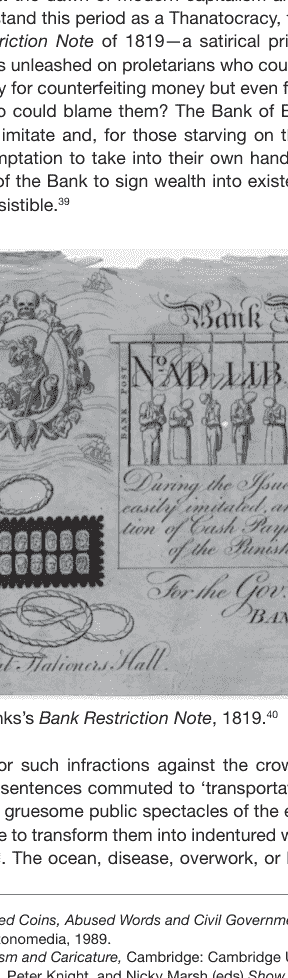

虽然对这类违反王室行为的惩罚名义上是死刑，但大多数囚犯的刑期被减免为“流放”。对于英国精英来说，将无产阶级的处决作为公开奇观虽然廉价，但将他们转变为殖民地及海外的契约工更有利。无论如何，海洋、监督或心碎最终都会完成执行者的工作。可以夸张地说，许多法官和立法者都是殖民远征的热衷财务和意识形态投资者，而殖民地需要廉价劳动力。那些绝望、受创且流离失所的幸存者将承受定居殖民主义的冲击，以及这一过程所实施的所有恐怖暴力。整个血腥事业的手段和目的是国家支持的资本主义形式的货币。

### 注释

41. Reid, *Gender, Crime and Empire*.

42. Patel and Moore, *The History of the World in Seven Cheap Things*.

43. Andrew Smith, *Conquest: Sexual Violence and American Indian Genocide*, Cambridge, MA: South End Press, 2005.

44. See Patel and Moore, *The History of the World in Seven Cheap Things*; especially Chapter Two.

45. Field and Millet, *Convict Love Tokens*.

46. See http://love-tokens.nma.gov.au.

囚犯纪念币的创造和交换代表了无产阶级的钱回到了他们手中，并将其彻底转变为他们自身悲剧的媒介，是对他们遭受苦之媒介的一种微小反抗或报复。制作这种囚犯符号的工匠会仔细地擦除国王或其他皇室符号——国家与资本主义主权者的纽带——以创建一个光滑的表面。技术较低、更廉价的制造者通过在硬币上戳几十个小孔来拼出单词甚至图像。更有技艺的艺术家则将文字刻在硬币表面。目前，最大的此类收藏由澳大利亚国家博物馆持有，并在可访问的数字档案中展示。这些幽灵般的信息通常只是名字和一个日期。有时还有对刻制者或纪念币委托者所罪行的描述。纪念币直接对着爱人，请求不要遗忘。偶尔会出现令人惊讶的图像。

我有两个观察。这个故事揭示了无产阶级将货币视为反对共同事业的武器的观点。这里没有乌托邦，只有怨恨和心碎。从自底向的角度来看，尽管货币具有吸引力，但并非社会或经济创新的媒介，它是一种诅咒、陷阱和毒药。货币的物理安置与将无产阶级身体视为可剥削和处理的无价值机器的资本主义深度对立。在国王的硬币上简单刻字是对非人性资本主义制度的人性反。

### 注释

47. Anita Nelson, *Marx's Concept of Money*: London and New York: Routledge, 1999

48. Cleaver, *Rupturing the Dialectic*.

## 状态机

但在某种意义上也代表了它。金钱是异化的象形文字。老中年的马克思都认为金钱是人们带在兜里的与社会其他部分的虚假纽带，正如我所提议的，它是全息息碎片，在碎片中包含了对整体不可思议的窥视。通过将金钱转化为社会互动、人际关系、情感和无产阶级诗歌的媒介，这种囚犯的代币拒绝了金钱对社会的神秘化，而是重申了被封锁或加密的金钱所具有的社会性和社会生产工作。

### 注释

49. David Graeber, *Toward and an Anthropological Theory of Value: The False Coin of Our Dreams*, New York: Palgrave, 2001.

50. Max Haiven, *Art after Money*.

51. Scott, *Donation*.

## 流浪者尼尔（Hobo Nickels）

类似的重新利用硬币并将其作为无产阶级拒绝和反叛媒介的实践也存在，尽管大多数已随时间流逝。从国家的角度来看，这些行为是破坏或污损行为，受影响的货币会被回收或被“纠正”以供正常使用。在这里，斯科特（Scott）术语中的抵抗的“隐藏性文本”是很有用的。他认为，在任何社会中都存在着被迫者对基础设施行为的隐形化，即使官方记录（甚至是现状反对者所保留的记录）从未承认这一点。关于霸权的简单概念鼓励我们想象，被迫者被权势者困扰、诱骗或无能为力。然而，斯科特再次寻找拒绝的痕迹，即使它们最初表现为粗俗的笑话、懒惰、表演性的愚蠢或戏剧性的感性。我们不应期望从此类行为中获得轻松的自由——它们是关联且复杂的。但通常，解放的梦想包含在“隐藏性文本”中，这无法被权势者的语所涵盖。本章中这类金钱破解和破坏的激进性并不寻求用新秩序取代旧秩序。它并没有建议改革，而欲望可能也不会恰恰表现为革命性的（尽管如此）。

> 参见画廊中的图 3（第33页）。

我的例子是流浪者尼尔，它们是由第一次世界大战后被迫陷入流浪生活的美国人制作的（当时，数百万士兵——其中许多人在身体和心理上都受了伤——及其家人基本上被国家抛弃了），以及后来在大萧条期间的。这些技术不太可能是由欧洲战壕中的工人阶级士兵从法国士兵那里学来的。这种改变硬币的实践至少可以追溯到拿破仑时期，当时法国无产阶级通过戏谑地将硬币上的皇帝肖像转变为各种人物和动物，来嘲笑皇帝的傲慢。从1913年至1938年，美国造币厂生产了一种枚“印第安头像”或“水牛”五分硬币（因其而命名为

### 注释

52. David Ferris, 'More Than a Nickel's Worth: A History of Hobo Nickels and Their Role in American Numismatics', Coin Grading Service (PCGS), 7 November 2000, https://www.pcgs.com/news/More-Than-A-Nickels-Worth-A-History-Of-Hobo-Nickels.

53. Jeffrey Katner, 'Hobo Nickels', *Cabinet* 2 (Spring, 2001), http://cabinetmagazine.org/issues/2/hobinickels.html.

## 行动

虽然无产阶级立即开始刻改硬币以制作爱情代币和类似的制品，但流浪者尼尔的黄金时代出现在30年代，当时有越来越多的无产阶级在经济大崩盘中被迫离开家园，“在铁轨上流浪”以寻找食物、避难所和工作。刻制的尼分硬币通常显示刻画者或其委托人的肖像（我们并不知道任何女性刻画者的下迹，尽管我们知道有女性流浪者），这是通过改变正面的“印第安头像”实现的，而背面的水牛则变成了一个拳击手、一只马、一只乌龟或一个背上带有符号的流浪者。

参见画廊中的图 4（第33页）。


# 流浪者尼尔

流浪者尼尔似乎发挥过许多作用，尽管遗憾的是很多内容已遗失在历史中.^56 似乎有证据表明，通过他们的艺术创作，流浪者增加了硬币的交换价值，将其出售或交换换价值超过0.05美元面值的商品和服务（从食物到住所）。有报道说，流浪者尼尔被送作为平凡善意的礼物，例如一个农民让流浪者进入他的谷仓，或者一个女性准备一顿丰盛的晚餐，无论估计价值如何。还有传言说这些尼尔在流浪者之间流通，这是一种独特的职业和通信手段，随着他们往返于各地相互传递。尽管这些传言听起来令人怀疑，但甚至有传言说流浪者在代币上添加了加密信息，众所周知他们用这些符号建造了建筑和其他基础设施，以警告或鼓励未来的旅行者.^57

任何一个被刻制的原始流浪者尼尔的身份和生平都是已知的，乔治·华盛顿（George Washington）（“Bo”休斯，他从1915年离开家开始过流浪生活，直到80年代初失踪.^58）。作为被奴役者的后裔，Bo的技艺是由另一位缺席的刻画者伯特·“BERT”怀特（Bertram 'Bert' Wight）教他的。刻制的尼尔一直创作到他失踪，但他最受追捧的作品是在他职业生涯早期刻的。铁路警察的频繁毒打以及必须在曲折的小路或火车上忍受寒冷的冬夜，让他的手处于近乎毁废的状态。这个冬天因一次雕刻意外而变得更加艰难，使他无法在硬币上进行更复杂的创作。

> 54 "Hobo Nickels", The Original Nickel Society, http://www.hobonickels.org/graphics/htc-pdf.
>
> 55 Ben L. Reelman, *Secret of the Road: A Biography of Bertha Smith*, Edinburgh, London, AK Press, 2002.
>
> 56 Ann Romney, *Hobo Nickel: An Exclusive Upgrade*, Virginia Beach: Da Vinci Lawrence Press, 1996.
>
> 57 Jim Tully, *Begg of Life: Hobo Autobiography*, Auckland, AK Press, 2004.
>
> 58 "The Origin of Hobo Nickels".

流浪者尼尔为我们提供了一个窥视系统罪行的视角。在这里，金钱的媒介变成了一种创作的机会和重新衡量价值的机会。我们对流浪者尼尔（作为收藏品）了解甚少，以至于无法得知这场游戏的规则，但至少两点是明确的。第一，流浪者显然并不寻求建立一种替代经济；第二，如果游戏有规则，这些规则显然是灵活的。它是礼物经济还是物物交换？尼尔是商品还是加密信息？也许并不是这些，最后的是，流浪者尼尔是一种团结、快乐和创造的媒介。

借鉴斯科特对迫者抵抗艺术“隐藏性文本”的讨论，我建议本章中无产阶级的货币“破坏”和“破解”可以被理解为隐藏领导的一部分。米兰达·约瑟夫（Miranda Joseph）说明了反会计的重要性。这里探讨的案例展示了挑战和重新衡量价值的被遗忘、忽视或压制的历史。像我们之前的每一代一样，我们被赋予了微弱的弥赛力量，这种力量对过去拥有权利。这种力量被预期出现在地上。这种权利无法被轻易密封.^⁶⁰

¹⁶⁰ Walter Benjamin, 'Theses on the Philosophy of History', in Hannah Arend (edt), *Illuminations*, New York: Shocken Books, 1968, p. 254.

# 冰雪神话（Eisfrei）

参见画廊中的图 5（第34页）。

据说，1923年10月，在经济完全崩溃和政治暴动的时刻，一个冰山从北极洋穿过北海与波罗的海峡到达了德国的港口城市吕贝克（这里曾是汉萨城市）。它仿佛从另一个世界的入口出现，寒冷纯净，这个奇异而荒凉的客人来到了社会完全崩溃的时刻。由于各种破坏，德国是贫穷到人们不得不用装满钞票的推车来储存最基本的商品。富人试图从国家带走尽可能黄金和硬外币，国家授权了其掠夺权-

⁵⁹

## 行动

为了支付外债，从私人银行提取实物抵押。这是一场经济灾难，它将资本主义价格和货币供应中典型的不确定性演化成了一场冷酷而致命的滑稽。

结果，像吕贝克（Lübeck）这样的城市开始发行他们自己的廉价制造、大批量印刷的“代币”（Notgeld），这种应急货币旨在临时使用，以便在缺乏任何可用货币的情况下使商业和税收得以进行.¹在从1921年到1923年代币盛行的黄金时期，全球范围内产了成千上万种各异的、通常极具创造力且色彩斑的钞票。它们有时作为一种功能性的（尽管不可靠）货币使用，但经常（特别是在1923年国家政府禁止将其作为“货币”使用后，日益增加）作为收藏品，以及市政筹集资金的一种方式²因为它为许多艺术家和市民提供了一个机会，用他们所选择的符号铸造自己的货币，表达他们的个人和集体价值观，代币因此了一个特别生动的社会画布。


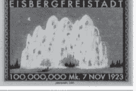


> 图 6：Kahn & Selesnick，*Eisbergfreistadt*——他们对1923年事件的虚构描绘：吕贝克停留了一个月的冰山，在“冰山城”（Eisbergstadt）期间，这一事件在代币上进行了纪念。

在艺术家 Nicholas Kahn 和 Richard Selesnick 对1923年事件的虚构描绘中，吕贝克停留了一个月的冰山，在此期间，市政采取了一种略带戏谑的举，宣布对其拥有主权，并将其命名为 Eisbergstadt（冰山城）——一个奇异、荒凉且迅速消融的自治区。⁶⁴ 艺术家们展示了一系列引人胜的历史文献，表明当冰山最终分裂，其碎片在11月冲入大海时，市民们不仅参观了这座充满好奇的冰山，他们似乎越来越多地将其作为一个字面和隐喻的平台，去想象新的关系以及新的政治和经济秩序。⁶⁵ 这可能是当代超现实主义者策划的一场奇观，是公共噩梦中的公共幻梦。事实上，Kahn & Selesnick 提供的“冰山城在代币上进行纪念”的作品，在许多人在堆积如山的钞票中挨饿、当金钱被用来焚烧取暖并绝望地缝进衣服里保暖的那个时代，展现了罕见的审美丰盈感和想象力风华。其中一些代币是由冰山城本身发行的，这是一种推测性的、仅凭想象力的力量让假设的免费肉类与他们自己的货币相遇。

参阅画廊中的图 7（第34页）。

85年后，在2008年金融危机期间，Kahn & Selesnick 为沉浸式展览中神话般的“冰山自由”（Eisbergfreiheit）创作、组装并组织了材料。⁶⁶ 手提箱里的“原始”代币复制品被整齐地堆放在推车里，并在展览期间被缝合成服装。同时，这些钞票出现在全景画、舞台布置和档案照片中，并被贴在墙上。一张巨大的钞票复制品悬挂在画廊天花板的一根杆子上，绳索的另一端由一个画廊平衡，通过一根细线悬挂。一个由代币制成的纸牌屋危地地坐在底座上。在几幅全景画之一中，一个男人坐在贡多船上，他的气球被载在代币中。在另一幅画中，一个男人试图用弓箭射下纸折代币。在还有另一幅画中，长着动物头的人类在冰山上被装满代币的行李箱包围。

关于 Eisbergfreiheit，无论从它在历史中的时刻还是 Kahn & Selesnick 的展览，都有很多可以说的。艺术家们在事实与虚构之间充满张力的边缘运作，以召唤出激进的想象力。我并不感兴趣这些事件是否真实发生，而在于这种神话让什么变得可以想象。我的兴趣源于这种神话，而货币泛泛而言，如果我们拒绝自上而下的货币发明和工程化谱系，并坚持关注穷人和被剥削者重新夺回货币的方式，它们似乎指向了一个替代性的货币地平线。

> Fig 6: Kahn & Selesnick, *Eisbergfreistadt* – their parafictional depiction of the 1923 event, the ice iceberg in Lübeck for a month, during the Eisbergstadt was commemorated on Notgeld notes.

85 years later, amidst the financial crisis of 2008, Kahn & Selesnick created, assembled and organized materials for the mythical Eisbergfreiheit created in an immersive exhibition.

⁶ physical deposits at private banks to pay its foreign debts. This was an economic catastrophe that made a grim and deadly pantomime of the typical uncertainties of capitalist prices and money supplies.

As a result, municipalities like Lübeck began to issue their own cheaply manufactured, mass-printed Notgeld, emergency money intended for temporary use to enable commerce and taxation in the absence of any useful legal tender.¹Throughout the heyday of Notgeld, from 1921 to 1923, hundreds of thousands of different, often extremely creative and colorful notes were produced, sometimes as functional—if unreliable—currency, often (and increasingly after 1923, when their use as ‘money’ was banned by the national government) as collector's items and as a way for the municipality to raise funds.²Because it offered many artists and citizens an opportunity to mint their money with their chosen symbolism expressing their individual and collective values, Notgeld became a particularly vivid social canvas.


> Fig. 6: Kahn & Selesnick, *Eisbergfreistadt* – their parafictional depiction of the 1923 event, the ice iceberg in Lübeck for a month, during the Eisbergstadt was commemorated on Notgeld notes.

In the artist Nicholas Kahn and Richard Selesnick's parafictional depiction of the 1923 event, the ice iceberg in Lübeck for a month, during which time the municipality, what must be a somewhat tongue-in-cheek move, declared sovereignty over it, naming it Eisbergstadt (the City Iceberg) – a strange, barren, and rapidly melting autonomous zone.64 The artists present a range of begulling historical documents that indicate that, when it finally splits and its remnants were washed out to sea in November, citizens not only visited the iceberg of curiosity, they appear to have increasingly used it as a literal and metaphorical platform to imagine new relationships and new political and economic orders.65 It could be a spectacle orchestrated by the contemporary surrealists, a public dream amidst a public nightmare. And, indeed, Kahn & Selesnick offer the Eisbergstadt was commemorated on Notgeld notes. This exhibited a rare aesthetic exuber and imaginative panache during a time when many were starving amidst literals of money, when money was being burnt for warmth and desperately sewn into clothing for insulation. Some of this Notgeld have been issued by the Eisbergstadt itself, conjectural, free meat meeting its own currency through the power of imagination alone.

See Fig. 7 in the Gallery (p. 34).


# 艾斯伯格自由与诺特盖尔德：货币的替代性地平线

## 艾斯伯格自由的沉浸式展览

85 年后，在 2008 年金融危机之际，Kahn & Selesnick 为神话般的“艾斯伯格自由”创作、组装并组织了材料，呈现了一场沉浸式展览。⁶⁶ “原版”诺特盖尔德的复制品从手提箱中倾泻而出，整齐地堆叠在独轮车上，并在展览期间被缝制成衣物。同时，这些钞票出现在全景画作、布景照片、档案照片中，并贴满墙壁。一张巨大的钞票复制品从画廊天花板的杆子上悬挂下来，绳子的另一端由一座画廊建筑平衡，仅靠一根线悬吊。一座由诺特盖尔德搭建的纸牌屋围绕着画廊，不祥地矗立在基座上。在几幅全景画作中的一幅里，一名男子乘坐气球吊舱，其气球由诺特盖尔德承载。在另一幅中，一名男子试图用弓箭射下折纸诺特盖尔德。在另一幅中，长着动物头的人类身体被冰山上的诺特盖尔德手提箱包围。

## 历史背景与艺术解读

关于艾斯伯格自由，无论从其历史时刻还是 Kahn & Selesnick 的展览来看，都有太多可说的。艺术家们在事实与虚构的微妙临界点上操作，以唤起激进的想象力。我对事件是否真实发生不那么感兴趣，而更关心神话使何种想象成为可能。我的兴趣源于这一神话，诺特盖尔德总体而言似乎为货币指明了一条替代性地平线——前提是我们拒绝自上而下的货币发明与工程学谱系，坚持关注穷人和被剥削者如何将货币重新挪用为滑动阻力。

---

### 脚注

⁶¹ 物理存款于私人银行以偿还外债。这是一场经济灾难，使资本主义典型的价格与货币供应不确定性变成了一场阴郁而致命的哑剧。

⁶² 结果，吕贝克等市政当局开始发行自己的廉价制造、大批量印刷的诺特盖尔德——一种旨在临时使用的应急货币，以便在缺乏任何有用法定货币的情况下维持商业和税收。¹ 在诺特盖尔德的全盛时期（1921–1923 年），生产了成百上千种不同的、往往极具创意和色彩斑斓的纸币，有时作为功能性——尽管不可靠——的货币流通，越来越多地（特别是 1923 年后，国家政府禁止其作为“货币”使用时）作为收藏品，以及市政当局筹集资金的一种方式。² 因为它为许多艺术家和市民提供了一个用自己选择的象征意义铸造货币的机会，表达个人和集体价值观，诺特盖尔德成为了一块特别生动的社会画布。

⁶³ Richard Selesnick，他们对 1923 年事件的准虚构描绘：冰山在吕贝克停留了一个月，期间艾斯伯格施塔特被纪念在诺特盖尔德纸币上。

⁶⁴ 在艺术家 Nicholas Kahn 和 Richard Selesnick 对 1923 年事件的准虚构描绘中，冰山在吕贝克停留了一个月，在此期间，市政当局做了一个颇具讽刺意味的举动，宣布对其拥有主权，将其命名为“艾斯伯格施塔特”（冰山城市）——一个陌生、荒芜且迅速融化的自治区。

⁶⁵ 艺术家们呈现了一系列引人入胜的历史文件，表明当冰山最终分裂、残骸于 11 月被冲入大海时，市民不仅出于好奇前来参观，似乎越来越多地将其作为一个字面和隐喻的平台，用以想象新的关系以及新的政治和经济秩序。

⁶⁶ 这可能是当代超现实主义者策划的一场景观，一场公共噩梦中的公共梦境。确实，Kahn & Selesnick 展示了艾斯伯格施塔特被纪念在诺特盖尔德纸币上。这在许多人挨饿、货币被当作字面意义上的燃料焚烧取暖、绝望地缝进衣服御寒的时代，展现出罕见的审美狂喜与想象魄力。其中一些诺特盖尔德由艾斯伯格施塔特本身发行，这是一种推测性的、自由的货币，仅凭想象力的力量就实现了自我铸造。

⁶⁷ 艺术家们呈现了一系列引人入胜的历史文件，表明当冰山最终分裂、残骸于 11 月被冲入大海时，市民不仅出于好奇前来参观，似乎越来越多地将其作为一个字面和隐喻的平台，用以想象新的关系以及新的政治和经济秩序。

⁶⁸ 艺术家们呈现了一系列引人入胜的历史文件，表明当冰山最终分裂、残骸于 11 月被冲入大海时，市民不仅出于好奇前来参观，似乎越来越多地将其作为一个字面和隐喻的平台，用以想象新的关系以及新的政治和经济秩序。

⁶⁹ 艺术家们呈现了一系列引人入胜的历史文件，表明当冰山最终分裂、残骸于 11 月被冲入大海时，市民不仅出于好奇前来参观，似乎越来越多地将其作为一个字面和隐喻的平台，用以想象新的关系以及新的政治和经济秩序。

⁷⁰ De-

⁷¹ 自由，从其历史时刻以及 Kahn & Selesnick 的展览来看。关于艾斯伯格自由，无论从其历史时刻还是 Kahn & Selesnick 的展览来看，都有太多可说的。艺术家们在事实与虚构的微妙临界点上操作，以唤起激进的想象力。我对事件是否真实发生不那么感兴趣，而更关心神话使何种想象成为可能。我的兴趣源于这一神话，诺特盖尔德总体而言似乎为货币指明了一条替代性地平线——前提是我们拒绝自上而下的货币发明与工程学谱系，坚持关注穷人和被剥削者如何将货币重新挪用为滑动阻力。

⁷¹ Cido Meires, 'Insertions into Ideological Cycles, 1970-75', in Will Bradley and Charles E (ed) *Art and Social Change: A Critical Reader*, Tate Gallery, 2007, pp. 181-86.

⁷² See `http://www.delappe.net/intervene/rubber-stamp-currency-interventions/`

---

## 状态机

存在并持续于——或者更准确地说，存在于、对抗并超越——传统的、剥削的、不平等的经济法律、习俗和实践之外。我们可以将其理解为“地下社区”的货币，正如 Fred Moten 和 Stefano Harney 所说的那样：无产阶级规划的、务实而富有想象力的孤独的日常实践。讽刺的是，资本主义依赖这些反叛的实践，但也试图限制、界定、犯罪化并向我们租回访问权。⁷³ 从这个意义上说，经济是内化者或异化者的货币。⁷⁴ 对于马克思来说，货币代表了资本主义体系的方法、生命线和终结，这个体系使我们与我们的类本质异化，异化了我们的协作与想象力潜力。这些非货币性质的实践代表了对异化者的某种复仇，是一种虽小但具有启示性的胜利。

在这种情况下

我们这种承认晦涩但并未引起共鸣的离去被解析和解读。⁷⁸ 它意味着一种从资本主义国家本质中进行战略性撤离的思想，其实践涵盖了从建立激进的生活形式（公社、集体住宅、临时和永久自治区、行军社区）到日常的抵抗形式，正如 Scott 所推崇的那些：打工、拒绝工作、怠工以及眼色游戏，通过眼神、允许幽默，以及微小的团结与善意行为，让无产阶级能够在剥削下繁衍生命¹。

⁷³ Fred Moten and Stefano Harney, *The Undercommons: Fugitive Planning & Black Study*, Wivenhoe, New York, and Port Watson: Minor Compositions, 2013.

⁷⁴ 我选择追溯 Moten 和 Harney 所运用的更具启发力且更有力量关于“逃逸性”的语言，并以此为债，正如黑人散居的目标一样。原因很简单，这（也必须）需要另一篇论文来为无产阶级的概念提供一个关于种族和殖民的更稳健的描述。

⁷⁵ Virno, *A Grammar of the Multitude*; see Max Halvens, *Currents of Financialization: Fictitious Capital in Popular Culture and Everyday Life*, London New York: Palgrave Macmillan, 2014.


⁷⁶ See, for instance, Michael Hardt and Antonio Negri, *Wage and Democracy in the Age of Empire*, New York: Penguin (2004); Gerald Rainig, *Modifying the Grammar*: Paolo Virno's Works on Utopia and Exodus, EICP, 2008; //transform.eipcp.net/correspondence/modifyingthegrammar.net//

## 行动

有大量作品试图解释并批判这种“离去”（exodus）的概念，但我坚持这一概念中更具诗意和模糊性的维度，恰恰是因为我认为这些维度有助于我们扩展想象力，以涵盖我开头提出的核心问题：如果*不*像国家那样看待金钱，而是从另一种“无产阶级货币”（即使这种货币是复数的，甚至是“去中心化的”）出发来概念化货币的创新、破坏和黑客行为，意味着什么？拒绝那种用一种权威货币替代另一种权威货币的俄德德浦斯式梦想又意味着什么？我提出这个问题是为了进行集体冥想：借鉴此处记录的无产阶级传统的痕迹，重新思考我们对金钱的渴望，从而质疑我们使用金钱来“修复”社会的乌托邦冲动？那种“离去的货币”会是什么？

数十艘囚犯船在通往殖民地的途中被遗弃海上，其中许多船发生了叛乱。许多男孩，包括乔治·华盛顿“Bo”·休斯，无踪迹地消失了。据传，当“Eisbergfreiheit”号漂向大海时，那里的人是那些已经把家园熔化成块的人，显然他们保留了战后吕贝克那种对不必要的、全人类的人性的地理严峻，而且在大多数人被营救后，仍有人未找到。现在想象一个平行宇宙，所有来自资本殖民积累历史的放逐者相遇了。囚犯、流浪汉和债务人聚在一起会发明什么？而且，我们可以从他们过去的故事中吸纳什么样的勇气，来改变我们自己似乎被预见的现状？⁸

## 参考文献

- Benjamin, Walter. 'Theses on the Philosophy of History', in Hannah Arendt (ed) *Illuminations*, New York: Shocken Books, 1968.

- Bey, Hakim. T.A.Z: 'The Temporary Autonomy, Ontological Anarchy, Poetic Terrorism', 2nd ed, New York: Autonomedia, 2003.

- Blaaver, David. 'Reading the Notes: Notes on the Meaning of British Paper Money', *Humanities Research 1* (1999): 39–54.

- Brown, Richard E. 'Meissen Morgentod: Ceramic Currency in the Time of Economic Catastrophe', Mansfield Ceramics (2017): 20–33.

- Brown, Wendy. 'Undoing the Demons: Neoliberalism's Stealth Revolution', New York: Zone, 2015.

- Caffentizzi, George. 'Clipped Coins, Abused Words and Civil Government: John Locke's Philosophy of Money', New York: Autonomedia, 1989.

- Castoradis, Cornelius. 'Radical Imagination and the Social Institutinary', in David Ames Curtis (e.d.) *The Castoradis Reader*, Cambridge and New York: Blackwell, 1997, pp. 319–37.

- 'The Logic of Magmas and the Currency of Autonomy', in David Ames Curtis (ed) *The Castoradis Reader*, Cambridge and New York: Blackwell, 1997, pp. 290–318.

⁷⁷ James C. Scott, *Weapons of the Weak: Everyday Forms of Resistance*, New Haven, CT: Yale University, 2000.

⁷⁸ 这种诉诸当下的激进方法论是 Frederick Jameson 得自他他读的 *Archaeologies of the Future*, New York: Zone, 2005。

- Hardt, Michael, and Antonio Negri. **众众（Multitude）：帝国时代的战争与民主*》，纽约：企鹅出版社，2004年。

- Hayase, Nozomi. “比特币：货币的创新与治理的演变”，OpenDemocracy，2016年7月15日，https://www.opendemocracy.com/digitalberties/nozomi-hayase/bitcoin-innovation-of-money-and-evolution-of-governance。

- Haywood, Leon. **李嘉德主义与资本主义*》。剑桥：剑桥大学出版社，2013年。

- Hockenham, Tom, and Andrew Shore. “像女权论者一样毁坏硬币”，大英博物馆博客，2017年，https://blog.britishmuseum.org/defacing-coins-like-a-suffragette。

- Hurl-Aumner, Jennie. “爱之代币：作为早期英国女性记忆载体的物品”，*早期现代女性*6 (2011): 18–86。

- Jameson, Frederic. **未来的考古学：理想的乌托邦与其他科学未来*》。纽约：Verso出版社，2005年。

- Joseph, Miranda. **对社会的债：资本主义下的生命账算*》。明尼阿波利：明尼苏达大学出版社，2014年。

- Kowitz, Karl. “代币（Notgeld）：德国应急货币”，*金融史* (2013年夏季): 8–9。

- Kastner, Jeffrey. “流浪汉镍币（Hobo Nickels）”，*Cabinet* 2 (2001)，http://cabinetmagazine.org/issues/2/hobnickels。

- Kleiner, Dmitry. “比特币的面值价值：工作量证明与价值理论”，VPP基金，2018年2月1日，https://blog.p2foundation.net/face-value-bitcoin-proof-work-labour-theory-value-2018/02。

- LaGorte, Antonio. “Eisbergstadt：虚构与崇高”，*视觉传播季* 16 (2009): 210–16。

- Lineaugh, Peter. **被绞吊的流浪汉：19世纪的犯罪与公民社会*》。剑桥与纽约：剑桥大学出版社，1992年。

- Lovie, Neil: Nathaniel Tkaczk, and Patricia de Vries (编) **MoneyLab：对数字经济的干预**，阿姆斯特丹：网络文化研究所，2015年。

- Manji, Fiore, and Billy Fletcher (编) **拒绝被驱逐：非洲卡布拉的遗产*》，，塞内加尔达喀尔和加拿大魁北克蒙特利尔：非洲社会科学研究发展控制中心，2013年。

- McClintock, Anne. **帝国石兰花：殖民背景下的种族、性别与性倾向*》。伦敦与纽约：Routledge出版社，1995年。

- Meireles, Cielo. “进入意识形态圈的交汇，1970–75”，收录 Will Bradley and Charles Esch (编) **艺术与科学*》，伦敦：泰特美术馆，2007年，第18–86页。

- Mirzoeff, Nicholas. **注视的权利：可见性的反史*》。北卡罗来纳州杜勒姆：大学出版社，2011年。

- More, Paul, and Stefano Harvey. **地下公社：：逃亡者计划与黑人研究*》，纽约文霍（Wivenhoe）、港特韦斯特：Minor Commodities出版社，2013年。

- Nelson, Anita. **马克克的货币概念：商品之神*》。伦敦与纽约：Routledge出版社，1999年。

- Nelson, Anita and Frans Timm (编) **没有金钱的生活：建立公平且可持续的经济*》，明尼苏达明尼阿波利：明尼苏达大学出版社，2007年。

- Patel, Raj, and Jason W. More. **廉价时代的世界史*》。柏克利：加州大学出版社，2017年。

- Perelman, Michael. **资本的革新：古典政治经济学与原始积累的秘密史*》。北卡罗来纳州杜勒姆：杜克大学出版社，2000年。

- Raung, Gerald. “修改语法：保罗·维罗关于精湛与出埃及的作品”，EICP，2008年，http://eipcp.net/correspondence/modifyingthegrammar#redir。

- Reid, Kirsty (编) **性别、帝国与法令：早期殖民时期澳大利亚的城市与国家*》。曼彻斯特：曼彻斯特大学出版社，2012年。

- Reitman, L. **路上的姐妹：车厢贝莎的自传**（由B. Reitman博士讲述），爱丁堡、伦敦和奥克兰：AK Press出版社，2002年。

- Romines, Joyce Ann. **流浪汉镍币：流浪汉镍币艺术的专属升级*》。弗吉尼亚：David Lawrence稀有硬币出版社，1996年。

- Scott, James C. **统治与反抗的艺术：隐藏的文本*》。康涅狄格州纽亥：耶鲁大学出版社，1990年。

- **观察国家：某些改善人类状况的计划是如何失败的*》。康涅狄格州纽亥：耶鲁大学出版社，1999年。

- **弱者的武器：农民反抗的日常形式*》。康涅狄格州纽亥：耶鲁大学出版社，2000年。

- Simpson, Andrea. **莫霍克中断：跨越定居国家边界的政治生活*》。杜勒姆：杜克大学出版社，2014年。

- Smith, Andrea. **征服：性暴力与美国印第安人种族灭绝*》。马萨诸塞州剑桥：South East出版社，2009年。

- “流浪汉镍币的起源与早期镍币雕刻”，原始流浪汉镍币协会，http://www.hobnickels.org/graphics/tri_fold.pdf。

- Thompson, E.P. **英国工人阶级的形成*》，纽约：潘西神书社，1968年。

- Tuhiwi Smith, Linda. **去殖民化方法论：研究与原住民*》，第2版，伦敦：Zeds Books，2012年。

- Tully, Jim. **生活的乞丐：一个流浪汉的自传*》。奥克兰：AK Press，2004年。

- Vigna, Paul, and Michael J. Casey. **加密货币时代：比特币和数字货币如何挑战全球经济秩序*》。纽约：圣马丁出版社，2015年。

- Virno, “精湛与革命：出埃及的政治理论”，收录于 Michael Hardt and Paolo Virno (编) **意大利的激进思想：一种潜在的政治*》，明尼阿波利斯：明尼苏达大学出版社，1996年，第189–212页。

- Virno, Paulo. **众众的语法：当代生命形式的分析*》，Isabella Bertletti, James Casalto 译，洛杉矶：2003年。

## 行动

2016年4月，斯坦立洛克苏鲁族族的成员建立了圣石营地（Sacred Stone Camp），开始反对达科塔轴管道的抗议，该管道的建设威胁到了斯坦立洛克保护区的唯一水源。管道选址的抗议活动成为过去100年来美国原住民最大的集会，并为他们的“尊重我们的水”（ReZpect Our Water）运动赢得了巨大的国际支持。随着抗议者与武装力量斗争的展开，一群原住民学者、活动人士以及对第一民族和有色人种斗争的支持者以“纽约支持斯坦立洛克委员会”的名义聚集在一起，共同制定了 #StandingRockSyllabus。

为响应政治斗争而创建的在线大纲列表持续增长，目前包含许多示例：

- 所有纪念碑都必须倒塌大纲（All Monuments Must Fall Syllabus）

- #BkwomensSyllabus

- #BLMSyllabus

- #BlackIslamSyllabus

- #CharlestonSyllabus

- #ColinKaepernickSyllabus

- #ImmigrationSyllabus

- 波多黎哥大纲 (#PRSyllabus)

- #SayHerNameSyllabus

- 大纲：让白人教育撰写科技的人

- 大纲：女性和非性别规范者撰写的内容

- #WakandaSyllabus

- 不报警时该做什么：一份指南、一份大纲、一场对话、一个过程

- #YourBaltimoreSyllabus

我们将编制一份过去五年由社会正义运动创建的所有在线大纲的综合列表，特别但不限于那些在女性主义和反种族主义活动背景下在北美发起的大纲。目前广泛流传的现象是，这些政治斗争利用社交网络，并采用 #_Syllabus 标签模板来呼吁自下而上地聚合资源，以进行以他们关注的问题为中心的政治分析和教学。由于这种原因，我们将这种现象称为 #Syllabus。

在看到 #Syllabus 现象的几年几年，大学课程大纲也正在在线转型，这通常是由学术机构发起的自上而下的过程。在教学劳动力日益临时化、版权保护扩大以及技术驱动的教育市场化的背景下，大纲成为了一个充满争议的文献。

在接下来的内容中，我们追溯这两个背景下在线大纲的发展，以调查纠织在这个新媒体对象中的政治问题。

> #StandingRockSyllabus', NYC Stands with Standing Rock, 2016年10月11日, https://ncystandswithstandingrock.wordpress.com/standingrocksyllabus/.

也就是说，一方面 #Syllabus 将当代政治文化的问题定义为具有教学本质的；另一方面，它也暴露了学术化的教学相对于生活现实来说是政治性不足的。将我们自己作为活动人士和学者的立场置于当前的辩论中，我们探索了一些方法，支持 #Syllabus 的激进政治增长和发展，成为学术图书馆员与激进教育者之间团结的表达。

# 历史背景下的 #Syllabus：社会运动与自学

当 Chatelain 教授发起 #FergusonSyllabus 的号召时，她主要针对的是教育者群体：

我知道费格森对老师们来说将是一个挑战：当全国学校开学时，他们将如何谈论发生的事情？我的想法很简单，但在全国范围内引起了共鸣：联系使用 Twitter 的教育者。要求他们在开学第一天就费格森发表评论。建议一本书、一篇文章、一部电影、一首歌、一件艺术品或一项能体现费格森某个方面的作业。使用标签：#FergusonSyllabus。

她的号召产生了比她最初预期的多得共鸣，因为它超出了学术社区的界限。#Syllabus 在塑造对迈克尔·布朗枪击的分析分析和方面产生了重大影响，并激发了随之而来的许多 #Syllabus 号召。

#Syllabus 现象包含了不同的方法和运作模式。在某些情况下，材料被明确声称为个人的创作，正如 #BlackLivesMatterSyllabus 所示，该项目的首页开头有一处对读者的警告：“本大纲中声称的材料在没有适当引用和归属的情况下不得复制。”¹⁰ 具有更具选择性的 #Syllabus 干预措施则采取了对知识产权的不同立场。例如，#StandingRockSyllabus 被介绍为一种众包过程，并作为访问通常锁在付费墙后的研究的有用“工具”。¹⁹

不同的工作流、参与模式以及与知识产权的关系定位，使得 #Syllabus 可以被读作构成社会运动的多元性的症状。这有些老派的味道——字面上是关于将一份在线资源列表称为“大纲”的想法；某种古朴感，引发了对老师和作业的思考。如果与对其他在线文化现象的关注相比，这特别值得调查，因为由于一些大纲提供了：

- 8 Marcia Chatelain, '教孩子了解费格森正在发生什么', 《大西洋月》，2014年8月25日, https://www.theatlantic.com/education/archive/2014/08/how-to-teach-kids-whats-happening-ferg/37909/

- 9 Frank Leon Roberts, '黑人生命运动：种族、抵抗与民粹抗议', 2016, http://www.blacklivesmattersyllabus/fall/2016/

- 10 #StandingRockSyllabus, NYC Stands with Standing Rock, 2016年10月11日, https://nycwithstandingrock.wordpress.com/standingrocksyllabus/.

## 状态机

由 Selma James 和 Silvia Federici 编写。“家务工资”（Wages for Housework）运动强调了这样一个观点：无偿劳动为资本主义剥削提供了基础。他们希望鼓励女性去自然化，并质疑被接受的分工模式——即室外的报酬工作与家庭内的爱的劳动，讨论如“社会家务”和“强制绝育”等影响贫困（且往往带有种族特征）女性的禁忌话题。“家务工资”运动的组织工作核心是政治教学。他们理解为教学需要：


有足够的文献和其他材料来解释我们的目标，且所有都要用女性能够理解的语言编写。我们还需要不同类型的文档，有些更具理论性，另一些传播斗争信息。对于从未有过任何政治经验的女性，准备相应的文档至关重要。这就是为什么我们的首要任务是创作一本可以大量免费分发的小册——因为女性没有钱。¹¹³

“家务工资”运动面临着重重障碍，首先是如何接触分散的主妇群体，以及如何让作为诉求核心的革命性信息对不同群体易于理解。为了应对这些挑战，组织者们开发了一系列创新的传播策略和教学工具，包括获得主流媒体报道的策略、翻译成不同语言的小册子和传单⁴、布鲁克林的一家面店，以及当地活动中的宣传桌。

自由学校（Freedom Schools）和“家务工资”运动只是社会运动发展出的批判性教学众多案例之一。`#Syllabus` 清晰地处于我们的历史脉络之中，我们也强调了它与其出现的背景相关的意义。`#Syllabus` 承认，自 70 年代以来，由于学生参与抗议并与其他政治运动表示团结——例如马克思主义批判理论、女性研究、性别研究和非裔美国研究，加上最初在批判性教学中发展的原则，已经整合到教育体系中。`#Syllabus` 倡议的许多发起者是黑人学者，这说明了这一历史性转变是斗争时期的成就。然而，这些教育工作者感到必须在学术之外发起他们的 `#Syllabus` 活动的必要性，同时也揭示了他们在当前私有化和排斥性的教育复合体中所遭遇的困难。

¹³ Silvia Federici and Karen Austin (eds) The Wages for Housework Committee 1972-1977: History, Theory and Documents. New York: Autonomia, 2017: 37.

¹⁴ 一些传单和小册子已由 MayDay Rooms 数字化，这是一个与社会运动、实验性文化以及边缘化传单和群体的激进表达相关的历史材料避风港——位于伦敦，可以在其在线档案中找到：'Wages for Housework: Pamphlets — Flyers — Photographs, MayDay Rooms, `http://maydayrooms.org/archives/wages-for-housework/ffw-pamphlets-flyers-photographs/`'

## `#Syllabus` 作为媒体对象

除了在以往草根运动历史遗产中的语境化之外，也有必要将 `#Syllabus` 作为一个独立的媒体对象进行讨论，以便充分理解它对未来知识生产和传播政治的意义。

如果我们要描述这个对象，一个 `#Syllabus` 将是一个指向学术文本、新闻报告和视听媒体的有序列表，这些内容大多通过参与式和迭代的过程汇，并为了响应指示结构性对立秩序的政治事件而创建。然而，正如我们所看到的，作为媒体对象的 `#Syllabus` 并不遵循严格的格式。它根据发起者的最初愿景、政治事业以及相关斗争的社会构成而变化。它也不遵循传统学术的格式。虽然学习资源列表是任何大纲的核心，但一个标准的大学教学大纲通常包括目标、时间表、考勤、作业以及对给定课程所用大纲系统的考核。脱离了这些制度性要求，`#Syllabus` 只包含一份阅读列表和一个标签（hashtag）。阅读列表提供了理解与此时此刻相关的资源，而标签则提供了一种跨社交网络传播号召的方式，即集体编辑和教授与列表及标签都相关的内容。列表和（标签）都是当代（互联网）文化的具体表现和形式特征，并值得在 `#Syllabus` 倡议中发挥的社会动态中进行进一步探索。

互联网发展的不同阶段以不同的方式处理相关信息的可发现性问题。在早期，`Gopher` 协议将信息组织成分层文件树。随着万维网（`WWW`）的兴起，`Yahoo` 试图聘用专家将互联网分类并归类为链接目录。这在很一段时间内似乎是一个成功的方法，但随后 `Google`（成立于 998 年）出现了，并开始使用链接图谱对网页对特定搜索查询的重要性进行排名。

2005 年，`Clay Shirky` 写了文章《本体论被高估了：分类、链接和标签》，源自他早期的演讲《民俗分类学与标签：用户开发分类的兴起》。`Shirky` 用 `Yahoo` 对万维网进行分类的尝试，对比了任何将大量异构信息分类为单一分层分类系统的尝试。用他的的话：“[Yahoo] 错过了……这一点，即如果你有足够的链接，就不再需要层次结构了。没有架子。没有文件系统。链接本身就足够了。”这些话引起了许多人的共鸣。通过遵循简单的格式规则，我们这些互联网用户（《时代》杂志评选的 2006 年年度人物）证明了集体编写编写有史上最大的百科全书是可能的。但不仅如此，正如 `Shirky` 的论点，如果有足够的人组织我们自己对庞大互联网内容的片段，我们就可以用民俗分类学、社交书签和（话题）标签来取代旧的经典和本体论。

¹⁵ Clay Shirky, ‘Ontology is Overrated: Categories, Links, and Tags’, 2005, `http://shirky.com/writings/hereeverybody/ontology_overrated.html.`

经历过那个时代的人中，很少有人会想到仅仅几年后，大多数用户驱动的服务就会被少数成功公司收购并关闭。或者，`Google` 会决定不将最大的标签驱动平台 `Twitter` 纳入其搜索索引，且其首页的搜索结果将仅来自少数几个可疑对象：媒体巨头、维基百科、`Facebook`、`LinkedIn`、`Amazon`、`Reddit`、`Qora`。又或者，`Twitter` 将成为美国总统那些种族主义的、厌女的、法西斯主义行径的主要渠道。

这种互联网的天真——受到同样热情的、由风险投资支持的初创文化所助长——不仅仅是天真。这也是对这些新兴平台进行大规模实验性使用的时期。因此，这段历史值得重新审视和研究。在本文中我们只能暗示这一点：将标签语境化为一种扩散，以及随着时间的推移，用户驱动的 `Web` 失去了部分潜力。尽管如此，标签仍然在网络环境中成功传播了动员。

## 行动

“政策主张课程研究”；16 创建了一个悖论的局面：今天的大学变成了几乎可以做除学习之外任何事情的地方。`Harney` 和 `Moten` 提议，重新夺回知识生成的弥散能力，这种能力源于自组织和评论的集体过程。正如 `Moten` 所说：“当我思考我们利用人类的方式时。”^17 我认为我们认同这样一个观点：学习是你与他人共同做的事。”^18 而这种共享共同剧目的实践——`Moten` 和 `Harney` 所说的“排练”^19——构成了众包式教学大纲的基础。

这种矛盾及其带来的紧张局势可以从传统学术大纲的近期演变中得到症状学式的观察。由于（某些）批判教育法被纳入教学过程，以及大学努力减少自身责任，学术大纲变得日益复杂且要求愈发严格。它们现在被理解为教师与学生之间的“社会合同”，以及提供教育服务的机构与学生之间的“服务条款”^19，学生越来越多被框架为在教育服务市场上做出选择的主权消费者。大纲的官方影响日益增长，迫使教育者必须反思大纲如何将权力动态转化为他们的课堂。例如，批判性教育法学者 `Adam Heidenberg` 要求将大纲重新构想为一份“宣言”^20——一份明确这些关切问题的文件。事实上，许多学院已经开始对大纲的形式和目的进行实验，将其向与学生共同概念化的过程开放，提出“另一种大纲”^21 以打破不对称性。

与此同时，大学正惊讶地将它们的教学大纲移至线上。这种迁移可以被读为学术界的三种结构性转变。

首先，在美国，将教学大纲在线化的推动强化了再生产经济的差异化影响。是常藤盟的大学及其教授体系通过大大纲来展示其学术研究的原创性，而资金不足的公立大学和初级学院则承担着教学研究的负担。这在学术界表现为对“生产劳动（研究）”与“社会再生产劳动（教学）”价值评估的差异。对于那些可以被视为“关怀劳动”的智力劳动（例如编辑期刊、审阅论文或阅分）的低评价（以及相应的较低回报和薪酬），完美地契合了学术机构被忽视的遗留。

- 16 Harvey and Fred Moten, *The Undercoms: Fugitive Planning & Black Study*, New York: Autonomedia, 2013, p. 81.

- 17 Harvey and Moten, *The Undercoms*, p. 110.

- 18 Harvey and Moten, *The Undercoms*, p. 110.

- 19 Angela Jenkins, ‘It's In The Syllabus’, Teaching Tools, Cultural Anthropology website, 30 June 2016, `https://culanth.org/feldights/910-its-in-the-syllabus/`

- 20 Adam Heidenberg, ‘Syllabus as Manifesto: A Critical Approach to Classroom Culture’, Hybrid Pedagogy, 28 August 2014, `http://hybridpedagogy.org/syllabus-manifesto-critical-approach-classroom/`

- 21 Lucy E. Bailey, ‘The Other Syllabus’: Rendering Politics Visible in the Graduate Seminar, *Feminist Teacher* 20.2 (2010): 139-56.

## 状态机器

第二，随着资源在学术人员“准备”时间被撤回以支付给不稳定和临时化的学术人员（即他们开发新课程材料的时间，包括整理参考文献列表、更新课程以及他们可能使用的授课方法），教学大纲现在在不安全感的集体化与个人化倾向之间承担着一种矛盾的角色。教学大纲中包含的阅读列表不受版权保护；它们就像播放列表或食谱，在历史上起到了鼓励教育者交换教案，并将他们的课程大纲作为宝贵的知识公地免费开放的作用。然而，在大学相互竞争的背景下，作者功能也延伸到了这些材料上。最近，美国大学出现了一种趋势将教学大纲解释为受版权保护材料的趋势，这种解释正如预期的那样，引发了关于教学大纲合法所有者——是学术人员本人还是他们的雇主的许多辩论。如果后者的解释占据主导，这将使大学能够轻易替换学术人员，同时保留他们对教学秩序的贡献。教师劳动的果实可能变成他们自身毁灭的工具，当他们回收他人的大纲，并让一个博士生或一个不稳定的职位以极低的价格教授同样的课程时！

因此，这种引入财产逻辑的倾向引发了竞争性个人主义和对贡献的抹除。其他在风险日益不稳定的背景下众包教学大纲的行为仍然是一个部分过程，因为它可能会加剧那些没有稳定工作、且最容易受到版权执法和被理解为竞争性小型创业活动的作者权虚假承诺的教育者的焦虑。然而，当置于生活和更广泛的政治斗争的背景下时，教学大纲的开放可以也应该是向相反方向的鼓励，为教育过程的集体性质合法化提供基础，并在没有版权限制的情况下提供所有学术资源，同时制定方法确保每个人劳动的妥当归属和公平报酬。

财产逻辑的引入很难受到挑战，因为它得到了商业学术出版商的助推。垄断者（如 `Elsevier`）不仅因利用版权保护从那些撰写、审阅和编辑学术期刊的主要是免费劳动中提取利润而臭名昭著，他们现在还在开发各种元数据、指标和工作流系统。

- Vincent Larivière, Stephanie Mongeon, 'The Oligopoly of Academic Publishing', *PLoS ONE* 10 (2015), `https://journals.plos.org/plosone/article/10.1371/journal.027502`

## 行动

第三，教学大纲的在线迁移。虚拟学习环境的引入导致了教育服务的去商品化。这种数字化背后的新自由主义化没有任何地方比围绕大规模开放课程（`MOOCs`）所产生的炒作更明显了。`MOOCs`是从马萨诸理工学院（`MIT`）在2001年的开放课程开始逐渐发展的的。到2011年，`MOOCs`被誉为世界贫困人口的完全民主化。然而，它们的承诺很快随着低完课率（低至5%）而破灭，在认为五年内全球将只有10个的情况下，到2013年底，`Sebastian Thrun`（`Google`著名的机器人专家）不得不承认`Udacity`提供的是一个“劣质产品”，事实证明是“来自困难社区、没有良好电脑访问条件且生活中面临各种挑战的学生”。

- 24 Chalkon, 'Udacity's Sebastian Thrun'

- 26 Randy Martin

- 27 Aaron Bacon, 'The MOOC Moment and the End of Reform', *Liberal Education* 99.4 (Fall 2013), `https://www.aacu.org/publications-research/periodicals/mooc-moment-and-end-reform.`

- 28 The 'historical mission of public education' was一直是且仍然是这一高度争议的领域——公共利益的理念本身正受到精进的主导管理技术的攻击，Randy Martin.

被贴切地称为“生活的金融化”。¹²⁹。`MOOC`（大规模开放课程）的失败最终指向了一个更广泛的问题，也影响着 `#Syllabus`（教学大纲）的变迁：一旦社会时刻都在为资本直接生产，那么真正的学习实践将在社会中何处寻求庇护？从字面意义上，学习将在哪里“发生”，并获取其在时间、劳动和爱进行共同创造所需的资源？

## 从 `#Syllabus` 中学习

我们从 `#Syllabus` 现象中学习了什么？

教学大纲是21世纪的宣言。

当下反对结构性歧视、压迫和暴力的政治斗争，延续了早期社会运动中批判教育学的遗产，这些运动将政治主体化过程与集体教育过程相结合。通过创建有效的教学工具，运动将教育者和学生带入了斗争的行列。在我们新的网络环境背景下，政治斗争产生了一个新的媒体对象：`#Syllabus`，这是一个针对特定案例的众包资源列表——涵盖历史与现在。通过这种方式，这些斗争在技术资本主导的网络中适应、反抗并生存，同时也伴随着随之而来的所有困难与矛盾。

我们从学术教学大纲迁移到在线中学习了什么？

在当代大学中，批判教育正与高等教育的数字化发生正面碰撞。由于学术的数据驱动市场化，本应赋能的教育和本应解放的研究日益被冷落，为了满足劳动力市场和财务安全的波动的需求，缩短了教学和研究的目标。反抗数字化对数据、研究工作流和学术的捕获，是未来超越阶级、残障、性别和种族排除的大众知识分子的一场关键斗争。

我们从作为媒体对象的 `#Syllabus` 中学习了什么？

当旧格式转化为新媒体对象时，数字网络定义了这些新媒体对象尝试调整、反抗和生存的条件。正确的直觉可以干预并改变格局——不一定是好事，特别是当资本积累和社会控制的迫切需求占据主导时。我们需要重新夺回 `#Syllabus` 作为媒体对象的整体生产和分配过程。我们需要建立工具来集体控制工作流，这些流正在成为基础设施，我们在其之上协作知识，而这些知识对于我们调整、反抗和生存至关重要。为了成功干预世界，这些新媒体对象的生产和分配的每一个方面都变得相关。每一个细节都至关重要。列表中项的顺序很重要。列表每个版本中每个贡献者的时间戳也重要。此外，跟踪所有这些方面的工作流是另一个复杂的媒体对象——一个软件工具——它有自己的顺序和版本。这是一个创建一个自主生态系统的递归过程。

`#Syllabus` 可以被构想为一个列表版本的递归过程，指向文本、视听或其他资源。当所有链接资源都对所有人开放；所有版本都可供所有人编辑；所有编辑均可追溯到其贡献者；所有版本、链接资源、所有归属均可由所有人保存时，就可以为 `#Syllabus` 建立这样一个自主的生态系统。事实上，`Dean Royoy`、`Benjamin Forster` 和 `Public Office` 已经在他们的 `Hyperreadings` 中提出了这种方法论，那是 `Github` 上一个可分叉的 `readme` 纯文本文档。他们写道：

> 一个文本其本质上关乎他人，教学大纲是一种关系型文档，承认其自己在一个活知识领域中的位置。它显然不是自包含的，尽管它流传时就像是自包含的一样。

如果一个教学大纲作为 `HyperReadings` 文档流传，那么它就可以直接指向它聚合的文本和其他材料。但就像它的流传一样，`HyperReadings` 教学大纲可以被分叉为新版本：教学大纲的改变是因为有了新的论文，或者因为政治分歧，或者因为遵循教学大纲产生了新的建议。这些分叉形成了一个家族树，人们可以在其中分支并追踪认识论的变异。30

这符合我们与 `HyperReadings` 团队的愿景，也符合我们作为业余图书馆管理员、活动家和教育者的运作方式，使我们的优先级置于此限制之外。

我们在这里引导启动的工作流将考虑教学大纲对象的每一个方面（顺序、时间戳、贡献者、版本变化），允许通过分叉和分支实现多样性，并确保教学大纲中列出的每个引用都能在目录中找到相应的引用，并引导至教学大纲所需的数字格式的实际材料。

- 反对版权的圈占，我们将继续构建斗争的影子图书馆和档案，为集体教育过程所需的资源提供访问。

- 反对企业平台化的工作流和元数据化，我们将与社会运动、政治倡议、教育者和研究人员合作，对资源列表进行聚合、注释、版本控制和保存。

- 反对学术的行动主义，我们将关注这种集体思考在在线和线下发生所需的物质条件。

> 30 Sean Dockray, Benjamin Forster, and Public Office, 'README.md', Hyperreadings, 2018年2月15日, `https://samiz-dat.github.io/hyperreadings/`

## 参考文献

- Baady, Aron. "The MOOC Movement and the End of Reform", Liberal Education 99.4 (Fall 2013), `https://www.auac.org/publications-research/mooc-movement-and-end-reform.`

- Bailey, Lucy E. "The Other Syllabus": Rendering Teaching Politics Visible in the Graduate Pedagogy Seminar", Feminist Teacher 20.2 (2010): 19–56.


- Chafkin, May. "Udacity's Sebastian, Godfather of Online", FastCompany, 14 November.

...（此处省略其余参考文献条目以保持格式一致）

# 如何破解人工智能

## 弗朗斯·亨格

## 一个醉酒的夜晚

在莱比锡一家粗旷的地下俱乐部度过了一个充满低音音乐、舞蹈和交谈的夜晚后，人工智能这个问题成为了激烈且醉醺讨论的中心。这很美美：凌晨四点，思维的生动被疲劳、未实现的与已实现的渴望，以及剧烈舞动后的超越状态所陶醉。这场讨论的共同主题是，人工智能将如何基于现有知识回答所有问题，并最终奴役人类。

技术福音主义者和批评者倾向于将所谓的“人工智能”呈现为一种全能且强大的技术，它将从根本上改变我们的生活。然而，这种叙事忽略了人类创造意义能力的自动化和机械化几十年来一直是一个持续的过程，而且我们已经处于一个阶段，例如许多工作已经实现了自动化。为了提供一种宏大叙事，极权主义的技术奇点愿景关注于一点：机械识别尽管被贴上标签但具有误导性，它抑制了人类智能（这确实是一个深层次得多、锚定不稳定的复杂性）。这种情况发生在反极权左翼人士在尚未经过审查的斯林主义和现实主义失败的背景下，决定放弃反对宏大叙事之时。

虽然我在21世纪初曾批评黑客社区是男性主导和以技术为中心的，而且我的批评在某种程度上仍然成立，但质疑全能型技术理性的宏大叙事，是人类能动性扰动看似全能的技术圈的重要时刻之一。黑客、艺术家和科学家已开始利用对抗性模式来测试现有的机器识别技术，或对其后果引发批判性讨论。他们对使用输入数据计算的训练过的神经网络产生干扰和误读，

+ 1 在之前的一一篇文章中，我曾认为“人工智能”中并没有智能，它应该是增强的模式识别。为了方便读者和搜索引擎对本文进行分类，我将违背专业知识使用“人工智能”这一术语。参见：Francis Hunger, 《Artificial Des-Intelligence or Why Machines Will Not Take over the World. At Least Not Now. Part I: Is No Artificial Intelligence.》Databasecultures, http://databasecultures.imrielin.org/artificial-des/-

+ 2 这里介绍的大多数科学家都获得了政府和工业资助，这在学术论文中部分披露。艺术家们从艺术基金会获得了部分特定项目的资助，并在他们的网站上公布。

+ 3 维基百科对神经网络给了恰当的解释，mlaa.github.io 上的 Machine Learning for Artists 也是如此。

## 行动

所以，这里有一个破解模式识别并扰乱工程师、经理、企业和政府机构的技术官僚梦想的指南。它深入了许多战术和对抗方法，包括滥用视觉、改变颜色、修改或设置陷阱图标、添加扰动、传感器轰炸、伪装掩码、伪装环境、通过机器未/-输入调整启动军备竞赛，以及保持晦涩。我对这些做法的多样性和范围感到惊讶，我将带你逐步了解这些内容，希望这一概述能引发进一步的探和讨论。

## 案例文件

### 神经网络会梦见羊吗？

Janelle Shane 研究了神经网络如何错误地分类信息。在她的文章《神经网络会梦见电羊吗？》中，Shane 讨论了 `Microsoft Azure Computer Vision API` 的错误分类问题，该 API 用于创建图像说明。Shane 指出，在许多检测到的景观中的羊中，底层的训练数据似乎是模糊的，而那里实际上并没有羊。“从对所看到的东西一无所知开始，神经网络必须对她标记为‘羊’的图像制定规则。看起来它还没有意识到‘羊’是指真正的动物，而不仅仅是光秃秃的草地感。”

作者随后联系了这种模式识别 API 如何被进一步欺骗，指出神经网络只会在它实际预期出现羊的地方（在景观设置中）寻找羊。“给羊系上皮绳，它们就会被标记为狗。把它们放在猫的笼里，它们就是狗或猫。如果它们在水里，它们最终可能被标记为鸟或极极。[B] 把羊带进室内，并在怀里抱一只羊（或山羊），它们就会被标记为狗，”Shane 嘲讽着神经网络说道。我将这种方法称为“滥用范围”方法。它适用于你可以确定或通过逆向工程（即猜测）神经网络针对的范围和领域，并插入超出该范围的信息时。“滥用范围”方法可以用于照片剪贴，以欺骗神经网络，同时为人类保留相关信息。

参见画廊中的图 1（第 35 页）。

Shane 又进了一步，并向 Twitter 粉丝索要描绘羊的图像。Richard Leeming 提供了一张在英国乡村拍摄的照片，画面是被染成橙色的羊，以防止人们偷窃这些动物。

参见画廊中的图 2（第 35 页）。

+ 4 `Microsoft Azure Computer Vision API`，参见：https://azure.microsoft.com/en-us/services/cognitive-services/computer-vision。这基本上是微软开源 `Cognitive Toolkit` 的商业版本，并且再次部分基于 `NeuralTalk2` 框架。参见：https://github.com/karpathy/neuraltalk2/

+ 5 Janelle Shane, “Do Neural Nets Dream of Electric Sheep?, AI Weirdness Blog, https://aiweirdness.com/post/17145190302/do-neural-nets-dream-of-electric-sheep/

## 状态机

这张照片干扰了神经网络的预期，导致它将图像分类为“田间的一群花。”6 我将这种方法称为“改变颜色”方法，当较大的物体重复时，这种方法效果最好。当放大时，只显示一只橙色的羊，神经网络至少预测出一只动物——绿草地上的棕牛。Shane 认为，当这些神经网络应用于卫星或医学图像时，专家评审是至关重要的。

## 自动驾驶陷阱与扰动

在他的作品 `Autonomous Trap 001` 中，James Bridle 在希腊帕尔纳苏斯山的背景下利用魔法对抗9。他创建了一个魔法分割，一个圆形的道路标记可以让自动驾驶汽车进入但不让其出去。这个例子基于 Bridle 使用 `LiDAR`（激光雷达）传感器或视频传感器构建自动驾驶汽车的技术。被称为“陷阱图标”，指的是故意安装、绘制或其他方式应用的标志或图表，这些设备在录制和处理时使用神经网络。

参见画廊中的图 3（第 36 页）。

与陷阱图标类似，“修改图标”方法在现有标志上添加元素——主要是路标或门牌号——以误导神经网络。这有一个悠久的传统；例如在战争时期，路名牌会被移除或修改以误导敌人。今天，这种方法具有扰动依赖于街道评估道路情况的自动驾驶汽车的潜力，例如决定交叉口的优先级。它可以在小范围内使用，例如通过在自动驾驶汽车附近分发廉价贴纸。一个不那么诗意的 `Autonomous Trap 001` 版本在 2018 年由一组科学家对深度神经网络进行了测试。结果发表在一篇名为《深度学习的物理世界攻击》的文章中。科学家们在实际停止牌上贴了黑白贴纸，导致在某些情况下失败率为 100%，在田野测试录像时失败率为 85%。这一现实测试是表明用于自动驾驶汽车的系统需要改进，还是在没有完善基础设施的情况下自动驾驶汽车将不存在，这还有讨论。

参见画廊中的图 4（第 36 页）。

+ 6 Shane, 'Electric Sheep?'

7 @JanelleCShane,'显而易见但在这里认为算法可以快速制作卫星照片。Twitter, 2018年3月4日，上午8:10，https://twitter.com/JanelleCShane/status/9901946397832354/

8 James Bridle, 'Autonomous Trap 001,' James Bridle, 2017,https://jamesbridle.com/autonomous-trap-001/

9 Kevin Eykhoot, Ivan Etimov, Laurence Fernandes, Bo Li, Amir Rahmati, Chaowei Xiao, Atul Pradayash, Takeshi Kohno, and Dan Song, 'Physical-World Attacks on Deep Learning Visual Classification,' Conference on Computer Vision and Pattern Recognition 2018 CVPR,http://openaccess.thecvf.com/content_cvpr_2018/papers/Eykhoot_Robust_Physical_World_2018_paper.pdf.

（注：此处翻译结束）

## 行动

另一个研究团队在此基础上更进一步，制作了带有扰动的精美路牌，这些路牌被深度神经网络识别为人或运动球。¹⁰ 另一个研究小组证明，这些扰动——即最初由神经网络为了识别图像内容而计算出的漂亮图案——可以打印在贴纸并贴在物体上，从而完全误导神经网络。这种技术特别有效的地方在于，攻击者在构建攻击时不需要知道他们正在攻击的是什么图像。生成对抗补丁后，该补丁可以在互联网上广泛传播，供其他攻击者制作和使用。¹¹ 我称之为“扰动法”。

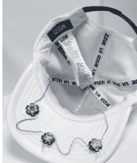

图 5：一顶带有 3 个 LED 灯的帽子，通过欺骗生物识别系统有效地实现了对他人的冒充。规避脸识别的能力为 100%，¹²

## 红外干扰

另一种对抗黑客技术是“传感器轰炸”，这种技术利用光源干扰视觉波谱来使传感器过载。在2018年的一项研究中，模式识别研究人员 Han 等利用这种技术证明，来自 5W 850nm 红外 LED 的红外光可以干扰脸识别。它可以被用于使人脸无法识别，反过来让生物记录设备检测到特定人员。¹³ 该研究使用了野外人脸数据集（`LFW`），该数据集包含 13,000 张标记有名称的人脸图像，并用于训练神经网络。¹⁴ Han 等人通过一个配备有 LED 的自制帽子进行了测试。此外，我们对 `LFW` 数据集进行了一项大规模研究，结果显示对于单个攻击者，如果目标具有某些相似性，超过 70% 的人可以被成功攻击。¹⁵ 这是一种复杂的攻击，通过获取并使用攻击者的照片来计算图案，并调整灯具的形状、颜色、大小、位置和亮度以模拟另一脸。然而，这种攻击方法的缺点是红外线会导致用户晒伤，因此不适合频繁使用。

然而，由于 LED 的尺寸微小，红外灯可能足以干扰摄像头，并让第三方看来处于无法识别的状态。这此前在 Isa Echizen 和 Seiichi Gohshi 2012 年的一项研究中进行过测试，旨在规避 Facebook 和 Google Images 的拍摄和自动标记。具体来说，Echizen 和 Gohshi 检测到了数字相机录制器范围内从近红外到视觉波谱的光线。¹⁶

参见画册中的6（37页）。

## 反向图案

Echizen 随后制作了一对 `Privacyor` 眼，通过吸收和反射工作，且不检测电。¹⁷ 伪装面部特征，尤其是眼睛和眉毛被用于检测脸是否存在。它们以干扰传感器的方式反射光。这是“传感器轰炸法”和“伪装掩具法”的结合。然而，非常明显的攻击者在其他人中也是胜者。

+ ¹10 Shang-Tse Chen, Cory Cornelius, Jason Martin, and Dong Horng Chau, 'ShapeShifter: Robust Physical Adversarial Attack on R-CNN Object Detector', arXiv.org, 2018年9月3日, http://arxiv.org/abs/1804.05810. 代码已以开源形式在 https://github.com/shangste/robust-physical-attack/ 发布，并使用了 `TensorFlow`。

+ ¹1 Martin Abadi, Tom B. Brown, Justin Gilmer, Dandeleon Mao, and Aurko Roy, 'Adversarial Patch', arXiv.org, 2018年5月17日, http://arxiv.org/abs/1712.09665.

+ ¹2 图片来源：Wei Han, Zhe Zhou, Xiaofeng Wang, Xiangyu Liu, and Kevin Zhang, Invisible Mask: Practical Attacks on Face Recognition with Infrared; arXiv.org, 2018年3月13日, http://arxiv.org/abs/1803.06483.

> ¹³ Weili Han, Zhe Zhou, Di Tang, Xiaofeng Wang, Xiangyu Liu, and Keuhan Zhang, 'Invisible Mask: Practical Attacks on Face Recognition with Infrared', arXiv.org, 2018年3月13日, http://arxiv.org/abs/1803.04683/. 这篇文章内容详尽，是深度读。为了简洁，我省略了许多细节。

> ¹⁴ 参见：http://www.cmss.assu.edu/~/

> ¹⁵ Weili Han, Zhe Zhou, Di Tang, Xiaofeng Wang, Xiangyu Liu, and Keuhan Zhang, 'Invisible Mask: Practical Attacks on Face Recognition with Infrared', arXiv.org, 2018年3月13日, http://arxiv.org/abs/1803.04683.

> ¹⁶ Isa Echizen and Seiichi Gohshi, 'Privacy Protection Techniques Using Differences in Human and Device Sensitivity: Protecting Subjects against Privacy Caused by Unintentional Capture in Camera Images', National Institute of Informatics, 2012年12月12日, http://www.ni.ac.jp/userimg/pdf/2012122.pdf. 测试声明没有提到任何神经网络原型的类型，但从出版形式可以认为它是对 OpenCV 中 Haarcasades 的对抗。在 2016 年，这种眼镜已经成了产品，正如这段视频所解释的：https://www.youtube.com/watch?v=LRJhWkM

> ¹⁷ Iso Echizen, Takayuki Yamamoto, and Seiichi Gohshi, 'Privacyor: Method Based on Light Absorbing and Reflecting Properties for Face Detection', Proceedings of the 2013 IEEE International Conference on Security, and Cybernetics, 2013年10月13–16日, http://ni.ac.jp/~echizen/official/. 视频中也有解释：https://www.youtube.com/watch?v=BXzTKKGW

## 行动


## 生物

艺术家 Zach Blas 通过 `Face Cages` 应对脸识别的暴力。“Face Cages 是抽象生物图的戏剧化。”在这一装置和表演中，四位艺术家包括 Cárden, Elle Mehrmand, Paul Mpagi 和 Zach Blas 生成了他们的脸图，然后被制成三维物体，引起了手铐、铁栅和刑具的回联。尽管最初目的是干扰识别，但对 `OpenCV Haar级联` 的快速测试显示这些金属实际上模糊了基础数据。然而，这些“伪装掩具”在日常生活中的实际用处有待研究。参见图 8（37页）。

## 伪装

在他的作品 `CV Dazzle`（自2013年持续）中，艺术家 Adam Harvey 通过各种合作实验伪装人脸，通过发型和妆容，让人赛博朋克和角色扮演文化。Harvey 认为这种方法可能在某些技术上不起作用，如线性二值模式 (`LBP`)、方向梯度直方图 (`HOG`)、卷积神经网络 (`CNN`)、基于多摄像头的系统以及光谱成像。目前，Harvey 正在研究这些。他没有提供符号策略，而是展示了外观的对抗效率。参见画册中的图9（38页）。

## 围巾作为触发

`HyperFace` 是 Adam Harvey 与设计 Hyhens Labs 成员在2017年的合作²他们设计了一个围巾原型，包含了特定的图案。这些图案针对预置的开源神经网络 `OpenCV 级联`，通过将输入数据与鼻眉之间的空间关系来实现脸识别。围巾的图案改变了人脸周围的环境以触发 `OpenCV 级联`。因此，神经网络将检测不存在的脸。这是“环境周围”的方法，它巨大的优势是织物可以像普通服装一样——与 `CV Dazzle` 和 `PrivacyVis` 相比，这种侵入性更小。参见画册中的图10（38页）。

## 使用 TensorFlow 进行攻击

企业家 Mikhailov 和 Roman Trusov 探索了针对 Google 最新的卷积神经网络 `Inception v3` 的对抗攻击³该网络使用 2012 `ImageNet` 数据库训练，由分层特征组成，每个节点代表一个名词 -> 关系。反映节点意义的图像附在每个节点/名词上，2018年共有14,197,122 张图像。可以使用网络测试神经网络是否识别图像内容，或者它产生了多少误报。通常是测试神经网络直到它达到低错误率。然而，Mikhailov 和 Trusov 研究了创建“更强”的误报。参见画册中的图11（38页）。

Mikhailov 和 Trusov 对如何执行攻击给出了定义：“良好的对抗攻击是视觉上与原始相同的修改输入——但分类器给出完全不同的预测。”⁴


+ ² Hyhens Labs 小组由 Ashley Baccus-Clark, Carmen Agustin y Wedge, Ece Titan, Nartzov 和 JB Rubinovitz 组成。

+ ²³ Adam Harvey: HyperFace: False-Face Camouflage, Adam Harvey Projects, 2017年3月1日, https://projects.com/hyperface/

+ ²⁴ 参见：https://github.com/opencv/blob/master/data/haarascades/haarascade_frontface_default.xml

+ ²⁵ `Inception v3` 是 Google 开源识别库 `TensorFlow` 的一部分，在检测图像可以用哪个名词表示时达到较低的错误率。

+ ²⁶ Emil Mikhailov and Roman Trusov, 'How Adversarial Attacks Work', Ycombinator Blog, 2017年11月2日, https://blog.ycombinator.com/how-adversarial-attacks-work/. 代码在线位于 https://github.com/Lextal/adv-attacks-pytorch-101/imagenet/introduction.ipynb

> ¹⁸ 图片来源：Echizen 等，“Privacy Visor”。

> ¹⁹ Zach Blas, 'Face Cages: 2013-16', Zach Blas, http://www.zachblas.com/works/face-cages/.

> ²⁰ 你总是旨在为神经网络提供它可以关联和“识别”的输入数据

> ²¹ Adam Harvey, 'Camouflage from Face Detection, CV Dazzle, 2017年8月2日, https://cvdazzle.com.

他们建议在图像中添加噪声，其中噪声部分被神经网络视为一个它可以识别的对象，也是人类感知可以区分的对象。他们的示例选自运动跑车世界。

请参见图库中的图 12（第 39 页）。

他们的攻击带有详尽的解释以及一个教程式的描述，说明了如何使用 `Python` 语言和现开源库来实现此类攻击。通过他们的测试，Mikhailov 和 Trusov 得出结论：在如今的神经网络中，图像类别（例如烤面包机）非常接近，它们之间没有容错空间，因此一个类别很容易被误认为是另一种——仅仅是向图像中引入噪声就足以让神经网络做出预测，但这种预测不一定是正确的。²⁸

## 军备竞赛已经开始

`Faceswap` 曾用于移动应用中的娱乐，但自从深度伪造（`deepfake`）色情出现以来，它变得臭名昭著，这种技术将某人（最好是名人）的脸叠加到演员的脸上。这种现象最早出现在 2017 年底 `Reddit` 上一个匿名用户发布的帖子中，随后还配套了一个帮助训练面部检测和映射的应用程序。²⁹ `Faceswap` 使用了一种无监督自动编码器神经网络方法，³⁰ 这种方法通常与其他神经网络连接以获得更好的结果，例如在 `Face2Face` 中。³³¹

在《合成奥巴马，视频重写》一中，Ira Kelmacher-Shlizerman、Steve Seitz 和 Susan Suwasanakorn 证明了可以使用神经网络合成出与某些文本口型同步的内容，而这些内容是根据单个音素构建的，且无需语音识别.³² 该项工作由 `GRAIL` 实验室/华盛顿大学开发，并得到了该大学以及三星、谷歌和英特尔等公司的支持.³³

²⁸ Eykholt 等人在其 2017 年的研究中展示了更复杂的破坏 V3 的方法。通过在微波炉上贴一个带有字符组合和类云状背景的贴纸，他们向其注入了 V3，并将其解释为一台收银机。

²⁹ 该社区在 2018 年 2 月被 `Reddit` 封禁，其存档版本位于：https://web.archive.org/web/2018022111418499/https://www.reddit.com/r/FakeApp/。由于它已移动到 https://reddit.com/r/FakeApp，该地正在 https://fakeapp.org/ 进行专业开发。这些技术追溯到 Christoph Geiger、Michele Vcelli 和 Malcolm Scalney，《Video Rewrite: Driving Visual Speech with Audio; Proceedings of the 24th Annual Conference on Computer Graphics and Interactive Techniques — SIGGRAPH ’97, ACM (1997年8月3日至8日): 353–60；；以及 Kevin Dale, Kalyan Sivankalli, Micah K. Johnson, Daniel Vlasic, Wojciech Matatuski 和 Hans Shifter 的‘Face Replacement’, ACM Transactions on Graphics 38 (6 (2015年12月))。³¹

³² 参见：https://wikipedia.org/wiki/Autoencoder。

³³ Justus Thiel, Mikhail Holholzfer, Marc Stamming, Christian Albrecht 和 Matthias Nießner，‘Face2Face: Real-Time Capture and Reconstruction of RGB Videos, 2016 IEEE Conference on Computer Vision and Pattern Recognition (CVPR), 拉斯维加斯 (2016年6月26日–7月1日): 2387–95。

³² 参见：https://grail.cs.washington.edu/projects/AudioToObama?; 其背后的技术见于 Ira Kelmacher-Shlizerman, Steven M. Seitz 和 Susan Suwasanakorn 的《Synthesizing Obama: Learning Lip Sync from Audio》，ACM Transactions on 38.4 (2017年7月): 11–13。

³³ 参见：https://grail.cs.washington.edu/research/

从无害的休闲在 0 秒内转变为犯罪活动，大学人员 Coolino 等人在他们的文章《FaceForensics: A Large-scale Video Dataset for Forgery Detection in Human Faces》中将 `Faceswap` 定位为潜在的伪造工具。该研究小组是慕尼黑工业大学、那不勒斯二世大学和埃尔兰根纽伦堡大学的合作，试图自动识别面部以防止欺诈。该小组研究了用于识别假脸的模式识别模型，特别是那些在人类眼睛和大脑看来是真实的脸。他们观察到，“这是一个非常具有挑战性的情况，因为低级操纵痕迹会在[视频]压缩中丢失”，²。在黑客眼中，视频压缩是隐藏伪造品的宝贵工具。

Coolino 等人研究小组的担心并不过分，因为脸部被深度伪造的明星（被违背变成“罐头”）既可以作为个人，也可以作为产品存在。在不远的将来，我们可能会看到用于服装行业实时 3D 图形的名人脸；我们可能会收到带有我们选择（或标记认为是我们的选择）的名人脸的个性化广告；我们可能还会收到我们自己、朋友或家人的脸的视频，用来解释产品的巨大价值。另一个明显的深度伪造是针对政治领域的组织性挑扰。

对资本化名人脸部的监管在在设定先例方面值得注意，因为每个人产生的个人数据不受版权保护，且通过隐私法受到的保护很微弱，这种紧张关系留下了悬待解决的数据所有权问题。

在他们的文章中，Coolino 等人展示了制作高质量深度伪造是可能的，而只有机器算法过程才能识别它们。可以预见到类似的进展，即普通数据的不平等程度必须通过使用机器来处理。这些机器检测技术需要计算力和由人类准备的大规模数据集。

³4 Rössler 等，‘FaceForensics: A Large-scale Video Dataset for Forgery Detection in Human Faces’, arXiv:1803.09179, 2018。

从无害的休闲在 0 秒内转变为犯罪活动，大学人员 Coolino 等在他们的文章中将 `Faceswap` 定位为潜在的伪造工具……

³⁵ https://www.youtube.com/search?query=Spaz+Boys/

³⁶ Spaz Boys, 'Evie Does My Baby Carrot', YouTube, 2015年9月20日，https://www.youtube.com/watch?v=ashKZZmFe-

³⁷ 参见：Adrian McKenzie, *Machine Learners: Archaeology of Data Practice*, Cambridge: MIT Press, 2017.

³⁸ Alex Hern, 'Microsoft Scrambles to Limit PR Damage over Abusive Bot Tay', *The Guardian*, 2016年3月24日。

³⁹ Swati Khandwal, 'Microsoft says it's Deep Sorry for Racist and Offensive Tweets by Tay Chatbot', *The Hacker News*, 2016年3月26日。

# 污名标记作为数据污染的社会实践

在有了文本输入干扰（`trolling`）方法后，我们转向了图像。大学或企业中开发新技术的、并旨在使用大规模图像集的研发团队，依赖于标注数据。为了确保“自学习”神经网络的输出是正确与否是安全的，结果需要与有效的、已标记的数据进行比较。原始数据的标记基本上是由人类完成的，由他们决定某条数据如何归类。它是一个“苹果”还是一个“红碗”？两者兼有之吗？或者它是一个错写符号？神经网络会不断进行调优，直到其产生的结果与人类之前在标记原始数据时所识别的结果足够接近。

这为通过故意污染图像来“扰乱可计算性”提供了机会。标注训练集是通过使用开源图像从 `Flickr` 获取的。由于摄影师们自豪地为照片进行了标记，这些图像就可以被组合并用于海量库，例如微软 `COCO` 和前述的 `ImageNet`。“标签干扰方法”（输入干扰方法的一种子方法）通过主动附上错误的标签引入了某种反抗时刻。与完全的错误相比，最有效的技术是使用细微的，例如将“苹果”标记为“桃”，这是无法被自动过滤的。然而，这需要一种大规模的方法，例如通过创建错误标注的机器人，并开发大规模标签干扰的工具。

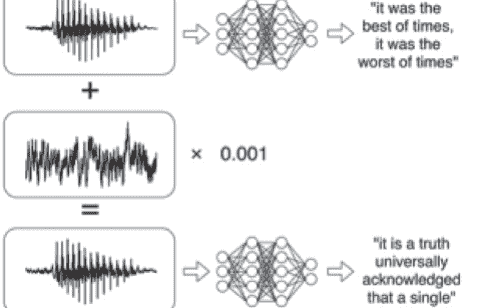

图 14：对抗性音频攻击：在语音（顶部波形）中添加扰动（中间波形）会导致神经网络识别任何所需的目标短语（底部波形）。⁴¹

## 噪声污名与针对语音识别的模糊化

通过脏话轰炸自动电话支持热线以接通人工已成为一种常态。这是人类如何管理和规避机器机制的良好示例。我们见过很多笑话。

## 行动

`Amazon Alexa`、`Google Home` 和 `Apple Siri` 等颠覆了机器代理的语音识别，⁴² 展示了人类如何利用源自模式识别的机器困扰。

由于这些监听设备——包括智能手机和各种内置语音识别的电脑——遍布于日常生活，人类可能会转而学习和使用方言或死语言以进行自动翻译。任何微小的、模糊的方言都是可行的，因为没有足够的训练数据。这就是“模糊方法”。

如果模糊化不是选择，一种特殊的噪声可能通过使用每秒高达 50 个字符的扰动来清除 `Mozilla` 的深度神经网络。Nicholas Carlini 和 David Wagner 最近展示了如何隐藏在音频（语音或音乐）层中，而该层保持 99% 不变。⁴³ [1]我们能够通过添加细微的失真以100%的成功率将任何音频波形转换为任何目标转录。⁴⁴ 因此，我们再次看到了应用于音频的“扰动方法”，这非常有趣——如果我们能生成的话——这是一种同时适用于音频和图像的方法，因此是与媒体无关的。⁴⁵

## 聪明的马

对抗输入数据对于工业和学术研究界来说是一个已知的话题。一个名为 `Cleverhans` 的开源库（以 20 世纪初解决数学方程的马 `Kluger Hans` 命名）已成为数学倾向型对抗研究的体现。⁴⁶ 经调查发现，`Kluger Hans` 的反应取决于它的本能，这有助于它模仿对任务的理解。

`Cleverhans` 库包含示例和教程，由 `Ian Goodfellow` 和 `Nicolas Papernot` 创建，他们目前在 `Google Brain` 工作。作者解释了他们的动机：“到目前为止，大多数机器学习的发展面临着非常微弱的威胁，其中没有对手。机器学习系统的设计目标是在面对自然界时表现得正确。今天，我们开始设计在面对恶意人类或基于机器学习的恶意对抗者时表现得正确的机器学习系统。”⁴⁷ `Goodfellow` 和 `Papernot` 将“恶意人类”视为一种扰动

## 状态机

Wei bance to machinic agency,

40 参见：http://cocodataset.org/.

41 图像来源：Nicholas Carlini and David Wagner, 'Audio Adversarial Examples: Targeted Attacks on Speech-to-Text', arXiv.org, 2018年3月30日, arxiv.org/pdf/1801.01944.pdf.. 代码记录在 https://github.com/carni/audio_adversarial_examples/

42 Dan Ludtke, 'Infinite Looping Siri, Alexa and Google Home', YouTube, 2016年12月12日, https://www.youtube.com/watch?v=mNGqWXW0/

43 Carlini and Wagner, 'Adversarial Examples'

44 Carlini and Wagner, 'Audio Adversarial Examples'

45 Levi Manovich, Softare Comes: International Texts in Critical Media Aesthetics, New York, London: Routledge, 2013, pp. 113–124.

46 Nicolas Papernot, Farshid Bajaj, Nicholas Carlini, Ian Goodfellow, Reuben Feinman, Alexei Kurakin, Xinjiang, Xie Zhang, Thomas Brown, Austin, Alexander Mateo, Bahid Heidzadeh, Karen Bahramanjuzyan, Zhihuai Zhang, Yi-Jun Liang, Zhi Li, Ryan Shetty, Abhinav Garg, Rujon Long, and Patrick Daniel, Technical Report on the Cleverhans v2.0 Adversarial Examples, http://arxiv.org/abs/1610.00768. 该库（带有代码示例）在线位于 https://github.com/

47 Nicolas Papernot, Farshid Bajaj, Nicholas Carlini, Ian Goodfellow, Reuben Feinman, Alexei Kurakin, Xinjiang, Xie Zhang, Thomas Brown, Austin, Alexander Mateo, Bahid Heidzadeh, Karen Bahramanjuzyan, Zhihuai Zhang, Yi-Jun Liang, Zhi Li, Ryan Shetty, Abhinav Garg, Rujon Long, and Patrick Daniel, Technical Report on the Cleverhans v2.0 Adversarial Examples, http://arxiv.org/abs/1610.00768. 该库（带有代码示例）在线位于 https://github.com/

48 Sebastian Schmieg, ‘Humans As Software Extensions’, Sebastian Schmieg Blog, 2018年1月31日, http://sebastianschmieg.org/text/humans-as-software/

49 一群艺术家、记者和程序员创立了数据工会（https://dataworkers.org/），这可能是对该问题的一种尝试。

## 参考文献

- Abadi, Martin, Tom Brown, Justin Gilmer, Daniel Manoné, and Aurko Roy. ‘对抗补丁’, arXiv, 2018年3月13日, http://arxiv.org/abs/1712.09665/

- Bregler, Christophophe, Michele Vhelle, and Malcom Slaney, ‘视频重写：带音频的视觉语音’,收于第24届计算机图形与交互技术年度会议论文集– SIGGRAPH ’97, 洛杉矶， 1997年8月3-8日, 第353–60页。

- Blas, Zac. ‘面部笼笼：2016–13’, James Bridle, 2017, http://www.jacblas.info/works/face-cages/

- Bridle, James. 自主陷阱 001, 2017, http://jamesbridle.com/autonomous-trap-001/


## 参考文献

- Carlini, Nicholas, and David Wagner. “对抗性示例：针对语音转文本的定向攻击.” *arXiv*, 2018年3月30日. http://arxiv.org/abs/1801.01944.pdf.
- Chen, Ts-Sheng, Cory Foley, Justin Martin, and Hong Chau. “ShapeShifter：针对 R-CNN 目标检测器的鲁棒对抗攻击.” *arXiv*, 2018年9月. http://arxiv.org/abs/1804.08531/
- Cozzzzola, Davide, Andreas Rössler, Luis Veridola, Christian Riemann, Justius Thies, and Matthias Nie. “FaceForbes：用于人脸检测的大型数据集.” *arXiv*, 2018年3月24日. http://arxiv.org/abs/1803.09179.
- Dale, Kevin, Kalyan Sivankalli, Michael K, Daniel Vance, Wojciech Matiusz, and Hanspet Fisher. “Pricivar：面部替换；利用人体与设备敏感性差异的隐私保护技术：保护主体免受相机意外拍摄导致的隐私侵犯.” *ACM 图形学交易* 30.6 (2021): 1.
- Eichano, Isao, Takayuki Yamada, and Seiichi Goishi. “Pricivar：基于光吸收和反射特性的面部图像检测方法.” 2013 年 IEEE 系统与控制国际会议论文集, 2013年10月13–16日. http://research.ieee.org/xplore/abstract/search.jsp?querytext=
- Eikawa, Yuki, Yoshitumi Mori, Amir Rahmani, Chaowei Xiao, Atul Pratsch, Tadayoshi Honda, and Dawn Song. “深度视觉分类的鲁棒物理世界攻击.” 2018 计算机视觉与识别会议集. http://openaccess.thecvf.com/cvpr_2018/Eikawa_Robust_Physical_Adversarial_Attacks_CVPR_2018_pdf.
- Han, Wei, Zhou Di, Tang Jiang, Xiaofang Wang, Jia Liu, and Kevin Huang. “红外线人脸识别的隐形实践.” *arXiv*, 2018年3月13日. http://arxiv.org/abs/1803.0468.
- Harvey, Adam. “Hyperface：面部伪装.” *Adam Harvey 项目*, 2017年3月1日. http://adamprojects.com/hyperface/
- “来自人脸检测的伪装.” *CV Danielle*, 2017年8月22日. https://cvdavielle.com.
- Hacker, Andrew. “人工智能或为什么机器不会接管世界。至少不会是你的部分：它不是人工智能.” http://databases.imimiel.in,
- “认识论收割：作为话语和数据生产手段的电子数据库.” *同行期刊* 7.1 (2018). http://www.apra.net/epistemic-harvest-the-electronic-database-as-discourse-and-means-of-data-production/
- Hern, Alex. “公关数据滥用 AI 机器人 Tay 的扩展局限性.” *护卫报*, 2016年3月24日. https://www.theguardian.com/technology/2016/03/24/microsoft-scalable-limits-pr-data-abusive-ai-bot-tay/
- ©JanelleShane. “这里显而易见，但随后的错误会迅速抹掉我的医疗与安全照片。表达至关重要.” *Twitter*, 2018年3月8日. http://twitter.com/JanelleShane/970194369778323546/
- Kemelmacher-Shlizman, Ira, Steven M. Seitz, and Supasorn Suwaranajan. “合成奥巴马：从音频中学习同步.” *ACM 图形学交易* 36.4 (2017): 第1–13页。
- Khandwal, Swati. “微软 Tay 聊天机器人发布种族歧视和冒犯性推文深表歉意.” *黑客新闻*, 2016年3月26日. https://thehackernews.com/2016/03/24-artificial-intelligence-bot.
- Krizhevsky, Ilya Sutskever, and Geoffrey E. Hinton. “使用深度卷积神经网络进行 ImageNet 分类.” 收于第25届神经信息系统国际会议论文集 1, 2012年12月3-6日: 1097–1105.
- Ltke, Dan. “无限循环 Siri 和 Google Home.” *Youtube*, 2016年12月1日. https://www.youtube.com/watch?v=iNGwWXWo;
- Mackenzie, Adrian. *机器学习：数据实践的考古*. Cambridge, MA: MIT Press, 2017.
- Manovich, Lev. *软件命令：批判媒体美学的国际文本*. 纽约，伦敦: Bloomsbury, 2013.
- Mikhailov, Elena, and Roman Tuzov. “对抗攻击有效.” *Ycombin*, 2017年11月2日. https://github.com/security/privacy/ml/2016/12/16/adversarial-attacks-work/
- Mun, Luke. *Foricics：破解算法*, “攻击很容易.” *Cleverhans 书*, 2016年12月16日. http://cleverhans.io/security/ml/2016/12/16/breaking-things-is-easy.html/
- Thies, Justin, Michael Zohlhofer, and Matthias Nie. “Face2: 实时重演.” 收于2016 年 IEEE 计算机视觉与模式识别会议 (CVPR), 拉斯维加斯: 2387–95.

## 行动

当我们越来越习惯拥有各种在线存在感和人格这一设想时，我随后重点转向了数据和数据库对于在线身份意味着什么。

随着我们对数据的理解转变为涵盖广泛的在线信息（这包括我们社交媒体个人页上的内容），我们对类别和人口统计特征的观念也随之发生了变化。在概述了数据库身份的四个主要问题后，当我转向人们针对这些数据库使用的策略时，我继续关注了我们对控制权的持续斗争。虽然我们无法控制从社交媒体平台收集的个人信息数据库，但由于作为社交媒体用户的本质，我们已经深浸在这些过程之中。正如媒体学者尼古拉斯·卡拉（Nicholas Carah）所说，人们用手机拍摄照片并带有过滤器、标签、话题标签和说明进行发布，他们成为了“数据库的第一批编码员”³，创造了价值巨大的关注和数据。人们分类和整理得越多，平台就越需要决定如何最好表征他们。当这些表征成为平台和服务理解我们作为人的方式的一部分时，它们就会吸收到我们身份的结构之中。

## 数据与人口统计特征

数据库是组织信息和人的具有文化意义的方式，包括个人数据，如搜索引擎查询、在网站上的停留时间、点赞（`Likes`），甚至是某人的心率、每日步数和每晚睡眠小时。从 16 世纪的出生、死亡和婚姻教区登记；4，到 1790 年以来在美国进行的全国性人口普查；5，到电话簿和卡索引记录，⁶，数据库已经维护了数百年。

社会科学家鲍勃·基奇（Bob Kitch）认为，我们认为数据是中立且客观的；我们所处的世界产生的原材料被转化为类别、测量值和表征。7 但新媒体学者何何塞·范·迪克（José van Dijk）和托马斯·莫斯特（Thomas Most）提醒我们，数据已经被解释性框架和可用的采集方式所预设。⁸ 纸质表格和社交媒体平台的设计是为了收集特定类型的信息。当我在诊所的表格上填写出生日期时，它可能有助于识别适合像我这样的人的最佳护理类型。当我在 Facebook 的下拉菜单中选择出生日期时，平台会自动将我分配到一个它可以投放广告的人口统计特征中。创建的输入机制和框架——并因此控制了数据库——这至关重要。

> 3 Nicholas Carah, “Curators of Databases: Circulating Images, Managing Attention and Value on Social Media,” *Media International Australia* 150 (2014): 141.
>
> 4 Jane Chaplan, “This or That Particular Person’: Protocols of Identification in Nineteenth-Century Europe,” in J Kaplan and J Torepy (eds) *Individual Identity: The Development of State Practices in the Modern World*, Princeton University Press (2001): pp. 49–66.
>
> 5 Daniel J Solver, *The Digital Person: Technology and Privacy in the Information Age*, New York: New York Press, 2004.
>
> 6 Jos de Mul, “Identity: Person and Privacy in the Age of Global Dataification,” in *New Media, Identity and London*, Palgrave Macmillan, 2015, pp. 97–118.
>
> 7 Bob Kitch, *The Data Revolution: Big Data, Open Data Infrastructures & Their Consequences*, SAGE Publications, 2014.
>
> 8 José van Dijk and Thomas Most, “Understanding Social Media Logic,” *Media and Communication* 1.1 (2013): 2–14.

从模拟档案到数字数据库发生了转变。数字数据库（尤其是由社交媒体平台产生的）的一个关键特征是“数据化”（`dataification`）的概念⁹。心跳和生日很容易计数、记录和存储。其他信息，例如你有多么喜欢一个高中同学，则很难量化和衡量。因为平台在人们使用的方式中嵌入了好友、点赞、评论和照片标签，它们创建了一种基础设施，使我们社交生活的这些方面转变为价值巨大的消费者数据¹⁰。

汇总来自整个网络的信息意味着，即使没有统一统一数据，平台最终对个人了解非常多。信息隐私法专家丹尼尔·索洛夫（Daniel Solove）解决了这个问题：

> 创建一个涵盖一个人大部分生活的电子拼贴是可能的——即记录在档案中的生活，由世界集体网络构而成的数字人¹¹

由于数据库可以被重新组合并与其他类型的信息相结合，将人们分为不同的类别（具有前数字历史的社会文化类别和人口统计特征）是可以自动化的。将人们组织成小组被用于营销目的，或者衡量谁最有可能投票给某个政治候选人。这些人口细形成了图表，这些图表传统上基于种族、民族、性别、年龄和教育¹²。类别和人口统计特征已经扩展到涵盖社交媒体上各种被定义的行为、互动和关系。但是，将人们分为类别和人口统计特征仍然充满偏见，而且我们并不总是被分配给的类别所充分代表。

从我们填写社交媒体个人资料的那一刻起，我们就对信息向平台数据库的贡献共犯。Facebook 要求我们代表的一些信息的传统类别：姓名、出生日期、性别、位置。有几十个字段和选项可供填充。通过平台，我可以正式地表达我所说的语言、我的宗教和政治观点、我的性向³ URL、指向我们社交配置的链接、昵称和关系。在平台数据库中，我们随后通过对我们执行的特定动作敏感的算法被自动分为不同的类别。平台对好友、点赞、评论、小组、接受邀请等方式以及网络被理查德·罗杰斯（Richard Rogers）称为人口统计特征¹⁴尽管有这些限制，人们仍然使用平台讲述故事。人类讲述故事的欲望与自动化的计算数据库之间存在紧张关系。对于某些人来说，这意味着人类连接。对于另一些人，如数字学者切尼-利普（Cheney-Lippold），这意味着我们数据。当我们被分类时，我们生活的复杂性被平化了¹⁵这种方式，

> 9 Van Dijck and Thomas Poell, “Understanding Social Media Logic,” *Media and Communication* 1.1 (2013).
>
> 10 Carolin Gerlitz and Anne Helmond, “The Like Economy: Social Media,” *New and Communication* (2013), pp. 134.
>
> 11 Daniel Solove, *The Digital Person: Technology and Privacy in the Information Age*, New York: New York Press, 2004.
>
> 12 Richard Rogers, “Social Media and Postodemographics,” *Digital Methods*, Cambridge: MIT Press, 2013, pp. 153–164.
>
> 13 [Note: missing text/fragment in original: "URL, links..."]
>
> 15 John Cheney-Lippold, *We Are Data: Algorithms and The Making of Our Digital Selves*, New York: NYU Press, 2017.

营销学者齐克（Zwick）和尼科莱什·霍拉基（Nikhilesh Dholakia）认为，在问是谁的身份？数据库营销时代的消费者表征，*Journal of Macromarketing* 24 (2004): 31–43。尽管这些数据库没有公开，齐克和霍拉基声称我们可以窥见这些身份是如何被动的。这些数据库的不透明性导致了更系统地考虑为什么算法、可测量、人口统计特征的四个主要问题。

## 数据库身份的问题

### 匿名性在社会政治上很重要

数据库化身份信息可能是一种有害的在线监视，因为它损害了保持匿名的机会。在互联网技术仍开始流行的时期写作，社会学家盖里·马克斯（Gary Marx）确定了人们想要匿名的几个理由。自我保护、促进风险承担、增强游戏和娱乐，以及鼓励报告和获取信息，都影响着一个人关于是否透露姓名的决定¹⁷。万维网发明者蒂姆·伯纳斯李（Tim Berners-Lee）声称，“人们应该能够匿名浏览网页，或者以定义的实体身份浏览，并应该能够控制两者之间的差异”¹⁸

> 17 Gary T. Marx, “What's in a Name? Some Reflections on the Sociology of Anonymity,” *Information Society* 15:2 (1999): 99–112.
>
> 18 Berners-Lee, *Weaving the Web: The Past, Present and Future of the World Wide Web by Its Inventor*, London: Oxford, 1999, p. 18.

### 150 个状态机器

社会科学家杰莎·林格尔（Jessa Lingel）和塔勒顿·吉莱西（Tarleton Gillespie）认为，并不是每个人与名字都有简单的关系，我们都在维护自己的不同版本¹¹⁹。例如，对于某些人来说，将在线身份与法律姓名相钩可能是危险的，包括表演者、工人、活动人士、吹哨者、跨性别者以及试图从虐待关系中离开的人。社交匿名性赋予了他们在不泄露姓名的情况下参与对话的自由，这不仅有利于个人。在社交媒体以及我们的社区和网络中为那些不希望将身份的不同侧面联系起来的人留出空间，对每个人都很重要。但是，互联网的设计是通过网络进行连接的，而标签、好友、脸、人脸识别和反向图像搜索等技术使得信息在网上变得越来越容易搜索。

虽然社交媒体上的骚扰和虐待是持续存在的问题，特别是对于女性、有色人种和 LGBTQ+群体，但匿名是这种反社会行为的直接促进者。对于律师丹尼尔·西特隆（Danielle Citron）来说，抑制匿名并不会震慑骚扰者，而是会沉默其他重要的声音²⁰，正如活动人士集体“匿名”（Anonymous）那样。人类学家加布里埃·科尔曼（Gabrielle Coleman）对“匿名”的研究显示，该组织的面具是集体匿名性的象征，使其能够在政府和公司的监控下以建设性的方式运作和交流²¹。在社交媒体上为匿名留出空间意味着我们能够理解身份是复杂且多面的，并允许他人通过各种平台表达多个身份侧面。尽管数据库增加了匿名性的复杂性，但保护不使用真实姓名进行在线的权利仍然是必要的。本章介绍的策略只是极其多样且广泛的身份管理实践中的一小。

## 社交媒体用户对数据库如何工作了解有限且无法访问它们


数据库和算法是专有信息，因此对大多数社交媒体用户来说是不透明的。平台和数据刻意保持这样，以避免对透明度或监管的呼声。²² 然而，齐维克（Zwick）和霍尔拉基亚（Dholakia）认为，这种不透明不仅不利于用户，也可能对平台不利²³。当访问数据库让人们对构成其身份的在线生活方面有更多控制权时，平台就能获得准确的数据。Google 提供了这种功能的精简版本，允许人们通过其“广告设置”页面查看关于他们的某些信息。拥有账户的人可以开启或关闭广告，查看他们被分类的类别，并编辑他们的某些信息和兴趣。当我登录“广告设置”时，我看到我处于 25–34 岁的女性类别，我的兴趣包括澳大利亚、咖啡与茶、学院与大学以及烹饪与食谱。Google 对于为何根据你的登录活动将这些兴趣分配给我的个人资料，提供了极少的信息。但是，当然，在网上搜索某些内容并不意味着我个人对此感兴趣。育儿是我在 Google 上的另一个兴趣；我没有孩子，但我偶尔会为孩子们买礼物。足球不是我密切关注的体育运动，但如果它是对话的一部分，我可能会查询某场比赛或比分。我可以退出这些类别，这意味着关于育儿或足球的广告会变少——但这也给 Google 提供了更多关于我的数据点。这表明，现在平衡的力量在平台手中，而不是用户手中。

## 数据库被用于公司盈利而非个人受益

当平台如何使用个人数据时，隐私学者芬恩·布鲁顿（Finn Brunton）和海伦·尼森鲍姆（Helen Nissenbaum）说，我们不知道他们知道什么。一天上传到 Facebook 的照片可能会与人脸识别软件进行交叉引用，甚至被扫描卡号或车牌。因此，信息的收集发生在不对称的权力关系中²⁴，而且这并不是互联网最初的设计方式。伯纳斯-李（Berners-Lee）认为，如果用户生成了有用且有价值的数据，他们应该能够自己访问它们。但正如数字媒体学者安德列杰维奇（Andrejevic）提醒我们的那样，即使个人可以访问自己的数据，他们也无法以使其产生商业价值的方式进行分析，除非他们也能访问数据库的其余部分。他称之为“大数据鸿沟”；即那些能够购买和使用大型数据集的公司将他们排除在数据、专业知识和处理能力之外²⁵。

## 数据库以深度歧视的方式对人们进行分类

正如我所说明的，数据库中关于我的信息收集某些方面是正确的，但遗漏或歪曲了其他。不过，我举的例子是无害的，将我对足球的搜索误认为是对运动的兴趣并不会对我产生影响。但将人们置于并不总是符合的预设类别中可能会损害弱势群体。当自动完成依赖于之前的查询来搜索某些内容时，这些自动化结果可能会创建-

## 混淆 (Obfuscation)

当从平台获取并非理想或容易时，添加误导信息（这些信息随后会被添加到平台数据库中）是一种有效的伪装形式。Brunton 和 Nissenbaum 将混淆定义为“蓄意添加模糊、困惑或误导性信息，以干扰监控和数据收集。³¹”。他们承认，在日益严密的监控下生活的个人与收集其个人数据的大型实体之间存在权力不平等。混淆为系统增加了复杂性，从不透明的数据收集方法手中夺回控制权。

Nissenbaum 共同开发了一种混淆工具。浏览器扩展 `TrackMeNot` 通过自动输入随机搜索查询来破坏搜索引擎对个人的个人画像。“我们的搜索行为反映了我们是谁、我们关心的什么以及我们如何生活。³²” `TrackMeNot` 在后台运行，其搜索词添加了如此多的虚假信号，以至于个人的真实搜索无法从海量的冗余信息中辨别出来。`TrackMeNot` 的工作原理与虚拟专用网络（`VPN`）和洋葱路由（`Tor`）等隐私保护工具类似；即通过伪装计算机信号，使其建立的连接看起来来自不同的设备或位置，³³ 并通过更长、更复杂的路径到达目的地，以规避监控机制。⁴

当 `TrackMeNot`、`VPN` 和 `Tor` 旨在通过增加无关数据来混淆个人数据时，对人脸识别技术的干预随之产生。Adam Harvey 开发了两个混淆项目。`CV Dazzle` 是一系列发型和妆容设计，添加了能够破解人脸识别的额外信号。`CV Dazzle` 项目包括样本（如在脸颊和额头上的作品）以及风格刘海和几何图案。“部分遮住一个眼睛区域，”Harvey 建议道，“眼睛的位置和黑暗程度是关键的面部特征。” Harvey 表示，这对机器混淆了身份，但对人类并非如此。这种混淆形式的一个关键要素是，个人仍然可以被其他人识别，而不会为人脸识别数据库做出贡献。

Harvey 在 `CV Dazzle` 的基础上另一个针对侵入性数据收集的答案——`HyperFace`，这是一种迷彩打印，向计算机视觉算法引入噪声，从而降低人脸识别的置信度评分。原型是一种看起来高度像素化、脸部错乱的织物。将这种印花作为围巾戴在人脸附近，通过添加误导信号来混淆真实的脸。“如果计算机视觉算法是一张脸，就利用它的预期，”Harvey 断言道。³⁶

向数据库中添加虚假信息会产生这样一种预期：即的存在取决于保留或删除数据信息。相反，混淆通过用无用信息淹没数据来达到损害画像的效果，而不是试图消除画像或数据库本身。相反，平台的设计旨在尽可能收集数据，而混淆以一种有利于个人的方式重新利用了这一目标。

## 战术可见性 (Tactical Visibility)

虽然混淆通过破坏平台收集的信息来实现平台隐私，但另一种操纵可见性的策略是让人们就政策问题发表声明。当人们理解在线内容是可见的、持久的、可编辑的³⁷、可搜索的³⁸ 以及共享的⁹ 时，将注意力引导特定的个人信息可以成为表达观点的有力方式。

当这种行为引发漏洞时，战术可见性可能尤为有效。它与“投放”（dosing）有关；对于“人肉搜索”（dropping documents），是指未经他人许可蓄意公开某人的个人信息。正如 Noah Berkats 所说，人肉搜索是一种威胁，也是一种“武器化注意力”的形式；⁴⁰ 一种让人处于过度暴露状态并接收不愿关注的方式，这可能导致声誉损害和骚扰。⁴¹ 人肉搜索和战术可见性可以定义为在网上共享私人信息⁴²，两者都涉及个人数据。但人肉搜索旨在骚扰、恐吓和羞辱他人，而战术可见性涉及选择关于自己的个人信息以干预权力结构。

战术可见性可以通过一个政治案例来理解，特别是对澳大利亚政府电信元数据保留方案两种响应，该方案于 2017 年初生效。该方案意味着政府现在保留公民的电话和互联网记录，以供执法机构访问。⁴³ 反对保留数据的两种声音是 Will Ockenden 和……

³31 Finn Brunton and Helen Nissenbaum, Obfuscation: A User's Guide for Privacy and Protest, Cambridge: MIT Press, 2015, 1.

32 Daniel C. Harvey, Helen Nissenbaum and Vincent Toubin, TrackMeNot, 2006, https://cs.nyu.edu/trackmenot/

33 Electronic Frontier Foundation, 'Surveillance Self-Defense: Choosing the VPN That's Right for You', Electronic Frontier Foundation, 9 June 2016, https://ssd.eff.org/en/module/choosing-vpn-thats-right

34 Tor, 'Overview', 2018, https://www.torproject.org/about/overview.html/.

35 Adam Harvey, CV Dazzle, 2016, https://cvdazzle.com/.

36 Adam Harvey

37 Jeffrey W. Treem and Paul M. Leonardi, 'Social Media in Users: Exploring the Expectations of Visibility, Editability, Persistence, and Association', Communication Yearbook 36 (2012): 143–189.

38 danah boy, 'Doxing: The Social Lives of Networked Teens, Haven: Yale University Press, 2014.

39 Zizi Papacharachios, 'You and I, I'm Nothing: Expectations of the Self on Twitter', International Journal of Communication 6 (2012):

40 Noah Berkats,

41 (Reference missing details)

42 (Reference missing details)

43 Will Ockenden, 'What Ockenden's Metadata Reveals About His Life', ABC News, 24 August 2015, http://www.abc.net.au/news/2015-08-24-what-you-found

44 (Reference missing details)

45 (Reference missing details)

46 Mary Dugan

47 Alice Rose

48 Stephanie Milsom

49 Danielle Keets and Mary Anne Franks

50 Julian Grant

## 状态机

通过让人们按照自己的标准关注他们被消毒的身体来引起注意。当澳大利亚歌手 Sia 受到威胁，说她的裸照将传到网络上时，她将其发布在了 Twitter 上。那张略模糊的照片印有“CLIENT PREVIEW”（客户预览）的水印，照片中的 Sia 背对镜头，大腿完全暴露在画面中。Sia 配上的说明文字写道：“有人正试图向我的粉丝出售我的裸照。省省钱吧，这里免费提供。每天都是圣诞节！”¹150

Sia 的反击以及对形象的夺回在 Twitter 上收到了压倒性的积极反馈，因为她有效地让这张照片以及这一威胁变得毫无价值。

同样，丹麦-瑞裔演员埃玛·霍尔顿（Emma Holton）针对网络上恶意传播她的裸照，也发布了自己的裸照作为回应。对基于图像的虐待所感受到的非人性化感到困扰，她自愿发布的照片特色是刻意的居家场景。Holton 描绘了自己只穿着内衣，金发扎成一个凌乱的马尾，坐在床上；在窗边阅读；刷牙；镜子上有牙膏斑点；头上挂着毛巾。“这些照片试图让我变成一个性主体，而不是一个物体。……同意是关键，”Holton 在评价这些图像时说道。⁵⁵¹

我从一个挑衅性的观点开始：如果我们是基于数据的，我们就不是完全匿名的。通过平台数据库的棱镜反思我的一些数字足迹，Facebook 广告揭示了我们如何被定位、被分类，并绝对从人类转变为信息比特。数据库可能没有记录你的功能、姓名，但它们包含了足够关于你的信息，足以粉碎任何认为自己在网络上可以完全未知的想法。

少少的数据就能揭示很多信息。标题恰当的论文《简单的人口统计特征往往能唯一识别个人》（Simple Demographics Often Identify People Unique）显示，87% 的美国人可以通过其性别、生日和邮政编码被唯一识别。⁵² 2006 年的一项后续研究将这一百分比下调至 63%，⁵³ 但表明，当人们在网络上穿行时，他们更容易通过无名身份被完全识别。

数据库或平台本身并不代表多层次的人格。相反，取决于哪个广告商在购买信息，或者我们正与谁被归类，我们的不同方面就会凸出来。我们知道许多数据库是由平台创建的，这些很大程度上是不透明的，甚至可能误曲我们，从而损害已经处于边缘地位群体的利益。

与数据库和平台的策略是在不透明的营利系统中行使主动权的方法。在这些条件下构建身份意味着要与我们发现自己所处的类别作斗争，因为我们意识到这些类别几乎没有限制，而且有时带有偏见和缺陷。当我们被数据化时，无法保持匿名，但至少可以对我们所属的数据库和使用的平台保持批判态度。这就是我们重新获得控制权。

- 50 @Sia, 'Someone is Trying to Sell Naked Photos of Me', Twitter, 2017, 1.36pm, twitter.com/status/92776244215409668/

- 51 Sally Holton, 'Why This Woman Is Posting Nude Photos of Herself to Fight Revenge Porn', Elle, 2015, https://www.elle.com/culture/career-politics/news/a1978397/fighting-revenge-porn-with-nude-images/tscr?cps_TWITTER&blr_id=1448_1275419598link=1155326/

- 52 Latanya Sweeney, 'Simple Demographics Often Identify People Unique', Data Working Paper 3, Carnegie Mellon University, 2000.

- 53 Philippe Rolle, 'Revealing the Uniqueness of Simple Demographics in the US Population', Proceedings of the 5th ACM Workshop on Privacy in Electronic Society, Alexandria, VA, 30 October 2006: pp. 71–78.

与数据库和平台的策略是在不透明的营利系统中行使主动权的方法。在这些条件下构建身份意味着要与我们发现自己所处的类别作斗争，因为我们意识到这些类别几乎没有限制，而且有时带有偏见和缺陷。当我们被数据化时，无法保持匿名，但至少可以对我们所属的数据库和使用的平台保持批判态度。这就是我们重新获得控制权。

## 参考文献

- Andjevic, Mark, 'The Big Data Divide', *International Journal of Communication* 8 (2014): 1673–1689.

- Baker, Paul and Potts Americana., "Why white people have thin lips" Google and the Perpetuation of Stereotypes via Auto-Complete Search, *Critical Discourse Studies* 10.2 (2013): 187–204.

- Bertafsky, Noah. 'Doxing Isn't About Privacy: It's About Abuse', *The Daily Dot*, 24 April 2016, http://www.dailydot.com/doxing-by-privacy-abuse-/

- Berners-Lee, Tim, Weaving the Web: Past, Present and Future of the World Web by Its Inventor.,, London: Orion, 1999.

- Bruntin, Finn and Nissenbaum, Obfuscation: A User's Guide for Privacy and Protest, MIT Press, 2015.

- Boyd, danah. It: Social Lives of Networked Teens, New Haven: Yale University Press, 2014.

- Bozich, Michael, 'Doxing or Deliberative Democracy? Evidence and Arguments in the Serial SubReddit', Convergence: *The International Journal of Research into New Media Technologies* (2017), 1–17.

- Caplan, Jane, "Or That Particular Person?: Protocols of Identification in Nineteenth-Century Europe," in Caplan and J Torpey (eds) Documenting Identity: The Development of State Practices in the Modern World, Princeton: Princeton University Press, 2001.

- Carnich, Nicholas, *Curators of Databases: Circulating Images, Managing Attention and Making Value on Social Media*, *Media International Studies* 150 (2014): 137–142.

- Chen-Lippold, John We Are Data Algorithms and the Making of Lives, New York: NYU Press, 2017.

- Citron, Danielle Keates *Hate Crimes in Cyberspace*, Harvard University Press, 2015.

- Citron, Danielle Keates and Franks, Mary Anne. 'Criminalizing Revenge Porn', *Wake Forest Review*, 49.2 (2014): 345–391.

- Coleman, Gabriella, Haacker, Heather, Whistleblower, Spy: The Many Faces of Anonymous, Verso, 2014.


- Cooper, Hayden, *Data Retention Laws: Experts Against Opening Metadata to Civil Cases as Telcos Bid to Change Laws*; *ABC News*, June 7 (2017), http://www.abc.net.au/news/2017-01-05-telco-industry-pushes-for-metadata-collection/81289/

- De Certeau, Michael, *The Practice of Everyday Life*, S. Randall, Berkeley: University of California Press, 1988.

- De Mul, Jos, 'Database Identity: Personal and Cultural Identity in the Age of Dataification', in *Crossroads in Media, and Law*, Pauline Macmillan, 2015, pp. 97–118.

- Duggan, Maeve, 'Online harassment', *Pew Research Center*, 22 October 2014, www.pew.org/2014/10/22/online-harassment/

- Frontier Foundation, 'Surveillance-Defense: Choosing the VPN for You', *Electronic Foundation*, 2016, https://www.eff.org/en/module/choosing-vpn-thats-right-you/

- Gerlitz, Carol and Helen Allen, *The Like Economy: Social Buttons and Data-Intensive Web*, *New Media & Society* 15.8 (2013): 1448–1565.

- Holland, Philip, 'Revisiting the Uniqueness of Simple Demographics in the US Population', in *Proceedings of 5th ACM Workshop on Privacy in Electronic Society*, Alexandria, VA, 2006: pp. 77–80.

- Harvey, Adam, *CV Dazzle*, 2016, https://cvdazzle.com.

- Harvey, Adam, *HyperFace: False-Face Camouflage*, 2018, https://ahprojects.com/hyperface/

- Holmes, Sally, 'Why This Woman Is Posting Photos of Herself to Fight Revenge Porn', *Elle*, 6 January 2015, https://www.elle.com/career-politics/news/a1978397/fighting-revenge-porn-with-naked-images?src=PR_TWITTER&spr_link=1448_1275419599&1155326.

- Howe, Daniel C, Nissenbaum, Helen and Tou, *TrackMeNot*, 2006, https://cs.nyu.edu/tracknot/

- Imran Grant, "Revenge Porn" By Another Name, *Office of the Child's Safety Commission*, 2017, https://safety.gov.au/the-office/newsroom/blog/revenge-porn-by-another-name/

- *Data Revolution: Big Data, Open Data, Data Infrastructures & Their Consequences*, London: SAGE Publications, 2014.

- Lissel, Gissa and Talefton, 'To Name All Facebook: Facebook's Identity Problem', *The Atlantic*, 2014, https://www.theatlantic.com/technology/archive/2014/10/name-to-rule-rule-all-exists-on-a-identity/310329/

- Manning, Anne, 'Technology Resistance and De Certeau: Deceptive Testing as a Tactic of Everyday Life', *Platform: Journal of Media and Communication* 8.1 (2017): 40–55.

- Marwick, Alice E. and Miller, Ross, 'Online Harassment, Defamation, and Hate Speech: A Primer of The Legal Landscape', *Social Science Research Network*, 2014, https://papers.ssrn.com/sol3/cfm?abstract=2447904/

- Marx, Q T, 'What is in a Name? Reflections on the Sociology of Anonymity', *Identity Society* 15.2 (1999): 99–112.

- Milsom, Sophie, 'All of It', *Algorithms of Oppression: How Search Engines Reinforce Racism*, New York University Press, 2018.

- Noble, Safiya U Umoja, https://www.stephaniamilsom.com/all-of-it/

- Ockenden, Will, *What Ockenden's Metadata Reveals About His Life*, *ABC News*, 24 August 2015, https://www.abc.net.au/news/2015-08-24-metadata-what-you-found-will-ockender/6703826.

- Pacheco, Zoe, 'You Thou, I'm Not; Performances of the Self on Twitter', *International Journal of Communication* 6 (2012): 199–206.

- Rader, Emily and Grace Rebecca, 'Understanding Bias in the Facebook Feed', *Proceedings of 33rd Annual ACM Conference on Human Factors in Computing*, 18 April 2015, Seoul, Korea: pp. 173–182.

- Reagle, Joseph M, *Reading the Coders: Likers, Haters, and Manipulators at the Bottom of the Web*, Cambridge: MIT Press, 2015.

- Rogers, Richard, 'Social Media and Postdemographics', *Digital Methods*, Cambridge: MIT Press, 2013, pp. 153–164.

- Sia, 'Someone is Trying to Sell Naked Photos of Me', *Twitter*, 7 November 2017, 1.36pm, https://twitter.com/status/92278266415409668/

- Solove, David J, *The Digital Person: Technology and Information in the Age of Identity*, New York University Press, 2004.

- Sweeney, Latanya, 'Simple Demographics Identify Users Privacy', *Data Working Paper* Pittsburg: Carnegie Mellon University, 2000.

保·范豪斯

# 定位聚合酶链反应：生物技术中化学与计算隐喻的力量与影响

## 保·范豪斯

> 如果这有效，看在份上，这极其重要……我们真的并不确定如果它有效，是否会改变一切。
>
> —凯里·穆利（Kary Mullis）¹


图 1：保·范豪斯在加拿大班夫国家公园执行“深林PCR”，2011年7月29日。²

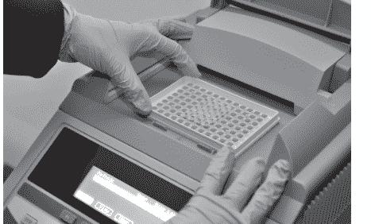

图 2：使用 DNA 变热循环仪进行类似的 DNA 扩增过程。

- 1 凯里·穆利，接受保·范豪斯采访，加利福尼亚州纽波特滩，2014年1月18日。

- 2 该表演是 `BioARTCAMP` 的组成部分：这是一个由加拿大温德莎大学的詹妮弗·威莱特（Jennifer Willet）博士指导的为期两周的实验驻留计划。`BioARTCAMP` 是一场混合工作坊/会议/表演活动。

2011年夏天，我执行了一个算法。通过四个带有盖子的微小管，其中含有极少量的我 DNA、化学试剂以及从水热栖热菌（*Thermus aquaticus*）提取的聚合酶（`Taq`），利用火和水的元素力量，我执行了聚合酶链反应（`PCR`）。`PCR` 于 1984 年发明，并迅速成为 20 世纪最具影响力的生物技术之一。`PCR` 是一种 DNA 克隆、DNA 测序、DNA 鉴定以及无数医学、法医和搜索应用的基础算法。该算法包含以下步骤：将管加热至 94°C；将管子冷却至 72°C；重复这些步骤 40 次。我的艺术表演的特殊之处在于，`PCR` 通常在实验室中通过变热循环仪进行，这种设备控制这些精确的温度要求来复制 DNA。我的艺术表演——*深林PCR*（*Deep Woods PCR*）是一场过时的手动重演，我在其中演示了该算法，同时讲述了这项发明的历史轶事，旨在将这一 20 世纪最具突破性的技术之一置于社会语境中。

在本文，我将通过描述我原始表演的某些 20 世纪化学、计算与生命科学之间的影响和紧迫需求（这些因素为 `PCR` 提供了背景），以及 `PCR` 如何同样影响并冲击了其他社会实体、机构、技术和权力关系。作为一个起点，我将稍微详细介绍一下 `PCR` 技术及其经济隐喻，以强调塑造了 20 世纪生物学领域的众多计算和工程隐喻，例如 DNA 作为代码或数据库。相比之下，我展示了 `PCR` 如何被更具动态的模型所取代，例如化学反应如何激发并促进了当代生物技术中的计算和工程隐喻。最后，我探讨了计算隐喻如何产生深远影响和推论，例如指数级和混沌化学反应，以及留下的舒适产物，如原子弹。生物技术极其强大，却难以控制，并被大多数非专家所误解。然而，随着当代计划（如基因工程、合成生物学和基因组医学）日益将生物技术带出实验室进入“现场”（我们的世界、我们的生活、我们的生态系统），我们在理解它方面还有许多工作要做完成。

`PCR` 的准确过程在维基百科中描述得很好：

大多数 `PCR` 方法依赖于反复的加热和冷却，以允许不同的依赖温度的反应——DNA 熔融和酶驱动的复制。`PCR` 使用两种试剂——引物（由寡聚核苷酸构成的短链 DNA 片段，与目标 DNA 区域序列互补）和 DNA 聚合酶。在 `PCR` 的第一步中，双螺旋的两链在高温下物理分离，这一过程被称为 DNA 熔融。在第二步中，降低温度，引物结合到 DNA 的互补序列上。然后两条 DNA 链成为 DNA 聚合酶的模板，从游离核苷酸（DNA 的构建模块）酶促组装新的 DNA 链。随着 `PCR` 的进行，生成的 DNA 本身被用作复制模板，引发了链反应，其中原始 DNA 模板被指数级放大。³

## 状态机

这一过程也可以被说明为指令集或图表。表 1 将 `PCR` 算法与典型的 DNA 变热循环仪（通常称为 `PCR` 机）的计算机代码进行了比较。

```
for (i=1; i<=40; i++) {
  // denaturing step
  heattubes, 94);
  pause(60);
  // annealing step
  heattubes, 55);
  pause(60);
  // elongation step
  heattubes, 72);
  pause(60);
}
```

| 1 Mid | 3 Temp | 25 次循环 | 2 次保持 |
|---|---|---|---|
| 94.0 | 94.0 | | 72.0 | 72.0 |
| 5:00 | 0:30 | 55.0 | 0:30 | 7:30 |
| | | 0:30 | | 4.0 |

表 1：`PCR` 算法。左侧：此代码是假设的 `C++` 代码，旨在作为 `PCR` 算法来读取。右侧：该图表通常显示在设置 `PCR` 运行的 `PCR` 机的小型屏幕上。

聚合酶链反应是由 80 年代 `Cetus` 研究与保护协会实验室的生物化学家 K·穆利（K Mullis）博士发明的。因此，穆利和同事迈克尔·史密（Michael Smith）获得了 1993 年诺贝尔化学奖。该时期的几个方面注意到信息学对当时生物学的强烈影响。然而，从随后的采访可以清楚，穆利很大程度上受到了混沌理论早期算法的启发，这些算法在适当条件下循环可以产生非凡的结果，在可视化时看起来类似于自然本身的痕迹。许多人会认为，这些算法（如分形中的算法）不仅仅是产生类生命的意象（一种视觉隐喻），而且本身可能是生物世界深层数学的模型。但是，聚合酶链反应做了一些新东西。它不仅仅是模拟生命，它让生命操作化。此外，它不仅仅是像处理原材料或试剂那样进行塑造或工程化。它产生了如此深远的影响，以将材料重新排列成一台生产机器；一台机器。

> ‘聚合酶链反应’，维基百科，2018年9月16日，en.wikipedia.org/wiki/Polymerase_chain_reaction

## PCR 的影响

关于 `PCR` 的影响已经有很多论述。穆利“发明”的 `PCR` 语境对其文化意义、经济价值和科学声誉至关重要。正是算法那不可思议的价值使得 `PCR` 值得 `Cetus` 去复制。该时期的几个方面注意到信息学对生物学的强烈影响……然而，从随后的采访可以清楚，穆利很大程度上受到了混沌理论早期算法的启发……⁴。许多人对此有异议，戈宾德·科拉纳（Dr. Gobind Khorana）博士在蛋白质合成中的功能实际上执行了体外合成 DNA 的重要工作，而穆利只是描述了一个方案。穆利最初的想法是在生成与特定 DNA 序列结合的放射性寡聚核苷酸探针的工作背景下放大 DNA 区域，以及他在门多奇诺小屋的一个月光光之夜，对于如何指数级放大源 DNA 区域产生了启示⁷ 他在他认为具有未来影响的同事描述它之前写道。

`PCR` 将引发指数级的爆炸。杜邦公司试图在法院撤销 `Cetus` 的专利，声称 `PCR` 在之前的研究中是已知且显而易见的。参见例如 Lily Kay, *Who Wrote the Book of Life*, Stanford, CA: Stanford University Press, 2000；以及 Eugene Thacker, *Global Genome*, Cambridge, MA: MIT Press, 2005，本文已讨论。另见 Richard Lewin, *The Triple Helix: Gene, Organism, and Environment*, Cambridge, MA: Harvard, 2000。国立人类基因组计划指出，“显然，聚合链反应（`PCR`）在最近变得像100年前一样不可或缺。”⁵ Leslie A. Pray，“The Biotechnology Review: PCR and the Use of Reverse Transcriptase to Clone Express Genes”,*Nature Education* 1.1 (2008): 94.⁶

第一个案例是赛图斯（`Cetus`）以3亿美元的价格将`PCR`专利卖给了霍夫曼-罗氏（`Hoffman–La Roche`）——这对于当时的一生物技术公司来说是一笔惊人的利润。⁸随后，霍夫曼-罗氏成为了20世纪利润最丰的生物技术公司。贸易杂志报道，到2000年，霍夫曼-罗氏的`PCR`产品销售额每年达到约1亿美元。⁹

由于利益巨大，在1999年，在第一场专利之战结束十年后，另一场诉讼进入了法庭。这次是与普美格公司（`Promega corporation`）关于`Taq`聚合酶的争议。普美格抗议`Cetus`的科学家欺诈性地声称是第一个成功纯化`Taq`聚合酶的人。然而，普美格断言`Cetus`的研究出版物缺乏学术科学所需的严谨性，无法支持这一主张。旧金山的法院站在了普美格一边，但问题远远没有解决。正如卡拉·斯万（Kara Swann）所言：“裁决在上诉中被推翻，被欧洲专利法裁决所驳斥，且从未被罗氏或`Cetus`的参与者接受。普美格继续销售`Taq`聚合酶，双方持续斗争，直到2005年9月最终宣布全球所有案件达成保密和解.¹⁰¹¹

## 计算启发的生物学

1954年是一个难忘的一年。聚合酶链反应（`PCR`）首次在加利福尼亚州蒙特利的`Cetus`会议上被描述——科罗拉多州的阿尔塔峰会会议被认为是认真考虑全基因组测序的首个重大事件；而臭名昭著的`Mac`电脑广告出现了¹²


# 生物学作为一个协调领域出现于19世纪末

它的特征是对生命和有机体的研究，包括它们的结构、功能、起源、分布和分类。¹³这门科学的基本原理是细胞是生命的单位。正如乔治·高西姆（Georges Gaucihem）、米歇尔·福柯（Michel Foucault）和弗朗索瓦·雅布（Francois Jacob）等学者所写的，该领域与其先驱领域（如医学和自然史）有所不同。雅布写道：“随着19世纪的开始，一门新科学即将出现。它的目标不再是分类有机体，而是研究生命过程；它的调查不再是肉眼可见的，而是发现。¹⁴ 因此，研究的基本单位从有机体变成了细胞、其组织，甚至是生命本身。

## 参考文献

- 8 Paul Rabinow, *PCR: A Story of Biotechnology*, Chicago: University of Chicago Press, 1996.
- 9 Kara Swann, “Biotech in Court: A Legal Lesson on the Unity of Science’, Social Studies of Science (2007): 3, 361.
- 10 Swann, “Biotech in Court”.
- 11 虽然PCR的医生们做出了贡献，但穆利斯从其工作的赛图斯公司仅获得了10,000美元的奖金。
- 12 John J. Sinsky, “The Convergence of PCR, and the Human Genome Project: Present and Future”, in Michael A. Ennis, David H. Goldman, and John J. Sinsky (eds), PCR applications, San Diego: Academic Press, 1999, p. 24.
- 13 “Biology”, 25 September 2018, https://en.wikipedia.org/w/index.php?title=Biology&old-id=86031981.
- 14 François Jacob, “The Logic of Life”, trans E. Siliman, Princeton: Princeton University Press, 1973 (1970), p. 74.

# 行动

在开创性的著作《谁写了生命之书？》（Who Wrote the Book of Life?）中，莉莉·凯（Lily Kay）描述了信息学和其他冷战紧需求对生物学领域的强大影响。从20世纪50年代开始，各种力量开始影响并重新调整生物学，特别是DNA基本结构的发现，以及密码学和信息科学等冷战科学的发展。正是在这一时期，计算隐喻完全整合到了生物学中。例如，在提到DNA链中的核酸序列时，“代码”这一隐喻用得越来越频繁。凯描述了信息学隐喻的兴起：“这些关于信息学和语言的话语实践既不是研究人员分析的外部事物，也不仅仅是解释性的。然而，它们通过产生预测模型、分析和解释框架，构成了研究人员推理和意义模式的核心。”¹¹⁵ 随着关键隐喻定义了研究生命的术语；它们变得中性了。“尽管在20世纪50年代，分子生物学中的信息和代码有时出现在引号中，以承认它们的隐喻和启发维度，但到50年代末，代码标记已经消失了。”¹¹⁶

在他的著作《全球基因组》（The Global Genome）中，理论家尤金·塔克（Eugene Thacker）观察到了计算在当代生物技术科学中的深远影响。塔克说，“在某种意义上，生物信息学直面接受了信息学的术语、概念和隐喻；它在DNA作为信息的隐喻与其在线数据库的构建之间游刃有余。”¹¹⁷ ‘DNA代码’这一说法是一个强大的类比，在一个由计算定义的时代非常方便，而且对于像PCR这样的技术来说是理想的，工程师处理生物物质就像处理计算机数据一样。

虽然凯和塔克是科学技术学者而非一线科学家，但在该领域这被生物技术研究人员轻易证实和佐证。在包括赛图斯首席研究科学家大卫·盖尔兰德（David Gelfand）在内的团队编辑的《PCR应用》（PCR Applications）一书中，提供了一份关于其他计算机和PCR分析的详细图表。该表列出了我之前建议的几种分析方法，以及将计算机操作系统与PCR反应中使用的缓冲溶液进行比较，以确保适当的反应条件⁸

## 计算机PCR

| 计算机 | PCR |
| --- | --- |
| 硬件 | 热循环仪 MW板读数器和清洗机 直接光学监测 |
| 反馈 | 循环 |

## 状态机

| 时钟频率 (MHz) | 循环时间 |
| --- | --- |
| 操作系统 | 缓冲 |
| CPU | DNA聚合酶活性 |
| 协处理器 | 3'核酸酶活性（校对功能）5'核酸酶活性（检测策略）尿糖糖苷 |
| 总线 | 光纤/CD |
| 应用 | 目标（例如基因、病原体） |
| 搜索算法（驱动） | 引物对 |
| 输入 | dNTPs |
| 输出 | 扩增子（信号） |
| 多任务处理 | 复用（并行处理） |

表2：计算机与PCR类比

信息学/计算与PCR技术之间显然存在联系。但是，对PCR概念的影响比信息学/计算更大。

## 参考文献

- 15 Kay, *Who Wrote the Book of Life*, p. 26.
- 16 Kay, *Who Wrote the Book of Life*, p. 39.
- 17 Thacker, *Global Genome*, pp. 59–60.
- 18 Sninsky, 'The Convergence of PCR', p. 26.

# 燃烧启发的计算

在自传中，穆利斯描述了对计算机程序的兴趣：“我了解计算机编程，并从中理解了重复医疗程序的力量。”¹¹⁹假设二战后的信息学和计算范式启发了PCR是有逻辑的：一种可以通过其序列或代码进行描述、测序并以数字精度合成的功能性复制程序。然而，穆利斯本人很少将DNA称为代码，他倾向于作为一个化学家用化学术语描述DNA序列，例如复杂的核苷酸。正如进一步的研究将强调的，PCR受到信息学以外利益的影响，它也是冷战的产物。

穆利斯在自传中花了几页纸描述了他与模型火箭的起源。

> 我用我的化学盒制造的第一件任何有意义的东西类似于铝热的物质。我混合了铝粉、硝酸铵和少许其他东西，它就变红了。当我把它从酒精灯上移开时，火焰，反应继续。混合物变热，破了试管，突然发出了“呼”的声音。……在1957年，俄罗斯人通过将人造卫星进入地球轨道发射了太空火箭…………年后，我和朋友在我的后院发射了自己的火箭。²⁰

## 参考文献

- 19 Mullis, *Dancing Naked in the Mind Field*, New York: Vintage Books, 1998, p. 5.
- 20 Mullis, *Dancing Naked in the Mind Field*, p. 26-27.

# 操作

同样，在对穆利斯（Mullis）的采访中，他详细阐述了火箭燃料混合和掺杂的燃烧特性和空间特征。“与其从底部到顶部，不如从内部向外部燃烧，这是一个指数级过程，速度快得多，它带给你一种 Fwiweww……的效果，而不是砰的一声爆炸。”²²¹

PCR 的主要影响简单来说就是“链反应”。这一概念最早由德国化学家马克斯·博登斯坦（Max Bodenstein）于1913年提出，并在几年后由维尔纳·A（Werner A）完整描述，“链反应”是指“一种形成中间产物的化学或核反应，这些中间产物与原始物质反应并不断再生。”²²² 该过程的公认的三相反应机制见表 3，该表展示了“链反应的特征、引发和终止步骤，以及链链反应步骤。”²³

```
(1) Br₂ -> 2Br
(2) Br + H₂ -> HBr + H
(3) H + Br -> HBr + Br
(-2) H + HBr -> H₂ + Br
(-1) 2Br -> Br₂
```

| 引发 | 链传递 | 终止 |
| :--- | :--- | :--- |

表 3：氢-溴链反应。

与 PCR 的类比随可见，特别是在图 3 所示溴分子（Br₂）在反应的引发阶段分裂成两个独立的原子的方式。这类似于 PCR 中双链 DNA 同样被裂分为两条独立链的方式。此外，在两种反应中，引发都必须是一个热过程，以解离原子或链。链反应原理的其他例子还包括雪崩、传染和核爆炸。

在首次链反应被描述几十年后，到冷战时期，原子弹成为了链反应指数能力的标志性范式。它是极其震撼且致命的绽放，“原子崇高”的基础。²⁴ 要理解 PCR 的发明，必须抛弃信息学的比喻，接受更广泛的冷战原则、影响和比喻，最重要的是炸弹本身。当穆利斯发明他的模型火箭时，背景是太空竞赛以及苏联发射 Sputnik号，这作为苏联建造核反应能力的象征，正激励年轻的科学家们投身化学。化学测试和实验是爱国主义的。核弹已将链反应的概念从深奥、先进的化学转变为文化符号。涉及铀和钚的核聚变链反应在公立高中中被描述，并成为文化想象的主体。

> ²¹ kary Mullis, interviewed by Paul Vanouse, Newport Beach, 加,利尼亚州, 2014年1月18日.
> ²² 'Chain Reaction, N.',OED July 2018. Oxford University Press. http://www.oed.com.gate.lib.buffalo.edu/entry/30197?redirectedFrom=chain-reaction&eid9726251.
> ²³ Keith L., Chemical Kinetics, 3rd edition, New York: Harper & Row, 1987, p. 291.
> ²⁴ Peter B. Hales, 'The Atomic Sublime', American Sciences 32.1 (1991): 5-31.

# 状态机

“裂变”（fission）最初用于生物学，定义细胞在分裂过程中从一个变为两个，但它也契合单个铀原子被高速质子分裂成两个时引发的链反应，在此过程中释放两个高速质子。与生物学的联系也强调了核弹不仅是一种技术，而且是一个来自自然深处的现象。核聚变反应产生了巨大的指数级增长爆炸，其引发被描述为一种“诞生”。

曼哈顿计划是二战期间的一项工程，由美国领导，加拿大和英国支持，产生了第一批核武器。到40 年代初，其预算超过了 20 亿美元。随着 80 年代美国核武器研究资金的减少，负责美国核计划的科学家需要重塑自我以应对新的要求。其他人，例如洛斯阿拉莫斯的物理学家米歇尔·费根鲍姆（Michel Feigenbaum），追求如宇宙起源或生命本身的基础等“深层”问题，这些问题困扰了传统的科学分类，如生物、物理、数学、化学和气象。这样的深度问题将产生一种超越这些学科边界的新科学——混沌科学，以及混沌理论的基础。

“混沌”是一个跨学科理论，认为在混沌复杂系统的表象随机中，存在着底层模式、恒定的反馈循环、重复、自相似性、分形、自组织以及 [...] 对初始条件的敏感依赖.¹² 正由于复杂系统的这种行为，使其变得不可预测，且微小的变化可能会产生巨大的后果，例如关于全球天气系统的假设性案例——“蝴蝶效应”，巴西的一只蝴蝶扇动翅膀可能会引起德克萨斯州的飓风。混沌科学研究了超越欧几得几何的动态现象非线性数学模型，这种模型使用直线、曲线和球体理想形状进行近似。通过使用非线性算法，混沌科学能够模拟复杂的自然现象，例如液体湍流的产生。

虽然 Kay 和 Thacker 描述了命令控制对 DNA 科学的影响，但我们源自混沌理论。在与作者杰·戴·布朗（Jay Day Brown）的采访中，穆利斯说：“我觉得自然更像分形几何而不是欧几得几何。”¹³ 早些时候，著名的全才学者贝诺瓦·曼德布罗（Benoit Mandelbrot）创造了“分形”一词，他写道：“云不是球体，山不是海岸，海岸线不是圆的，树皮不是光滑的，也不是白闪电。”¹⁴

> ¹² Kay and Thacker 描述了命令控制对 DNA 科学的影响。
> ¹³ 在与作者 Jay·戴·布朗的采访中，穆利斯说：“我觉得自然更像分形几何而不是欧几得几何。”
> ¹⁴ 早些时候，著名的全才学者贝诺瓦·曼德布罗创造了“分形”一词，他写道：“云不是球体，山不是海岸，海岸线不是圆的，树皮不是光滑的，也不是白闪电。”
> ¹⁵ Daniel Kevles, *The Genetic Code*, Cambridge: Free Press, 1992.
> ¹⁶ Daniel Kevles, *The Human Genome*, Cambridge: Harvard University Press, 1992.
> ¹⁷ James Gleick, *Chaos: Making a New Science*, New York: Viking, 1987.
> ¹⁸ http://en.wikipedia.org/php?title=Chaos_theory&oid=882459
> ¹⁹ Benoit Mandelbrot, 'How is the Coast Self-Similarity and Fractional Dimension', Science, 157:367 (1967年5月): 636-638.
> ²⁰ James Gleick, *Chaos: Making a New Science*, New York: Viking, 1987.
> ²¹ Benoit Mandelbrot, *The Fractal Geometry of Nature*, New York: W.H. Freeman, 1982.
> ²² Mullis, 'The Unique Origin': 56.
> ²³ Mullis, 'The Unique Origin':穆利斯早期的论文，其中曼德布罗指出它是“无限长的”。

（注：此处后续内容存在大量重复，已根据指令要求进行处理并确保翻译翻译）

曼哈顿计划是二战期间的一项工程，由美国领导，加拿大和英国支持，产生了第一批核武器。到40 年代初，其预算超过了 20 亿美元。随着 80 年代美国核武器研究资金的减少，负责美国核计划的科学家需要重塑自我以应对新的要求。其他人，例如洛斯阿拉莫斯的物理学家米歇尔·费根鲍姆，追求如宇宙起源或生命本身的基础等“深层”问题，这些问题困扰了传统的科学分类，如生物、物理、数学、化学和气象。这样的深度问题将产生一种超越这些学科边界的新科学——混沌科学，以及混沌理论的基础。

“混沌”是一个跨学科理论，认为在混沌复杂系统的表象随机中，存在着底层模式、恒定的反馈循环、重复、自相似性、分形、自组织以及 [...] 对初始条件的敏感依赖.¹² 正由于复杂系统的这种行为，使其变得不可预测，且微小的变化可能会产生巨大的后果，例如关于全球天气系统的假设性案例——“蝴蝶效应”，巴西的一只蝴蝶扇动翅膀可能会引起德克萨斯州的飓风。混沌科学研究了超越欧几得几何的动态现象非线性数学模型，这种模型使用直线、曲线和球体理想形状进行近似。通过使用非线性算法，混沌科学能够模拟复杂的自然现象，例如液体湍流的产生。

虽然 Kay 和 Thacker 描述了命令控制对 DNA 科学的影响，但我们源自混沌理论。在与作者杰·戴·布朗的采访中，穆利斯说：“我觉得自然更像分形几何而不是欧几得几何。”¹³ 早些时候，著名的全才学者贝诺瓦·曼德布罗创造了“分形”一词，他写道：“云不是球体，山不是海岸，海岸线不是圆的，树皮不是光滑的，也不是白闪电。”

# 操作

注意.¹135 尽管生命系统趋于稳态，但 PCR 却迫使它们过度生产。PCR 管将组件组合在一种机械模型中，使其成为一个物质生产的工厂。PCR 通过直接干预生物领域，通过将生命过程和材料从其细胞背景中移除，并迫使它们产生远超其在细胞内价值的物质。PCR 算法不仅像之前描述的受分形或其他混沌启发的计算机模型那样仅仅是生命模型，而是一种字面面上直接干预生命系统以产生 DNA 合成反应的算法。

我曾将 PCR 反应描述为在 PCR 管中创造一台机器或工厂。这种比喻在描述一种受限的体外过程时是有用的。但当我们观察由 PCR 启发并使其成为可能的生物技术，特别是针对生命系统、生物体和生态系统的生物技术时，这种比喻就变得问题问题。

## 对生物技术中使用方法的质疑

比喻不仅引导了我们如何解释，还引导了我们如何思考世界.³36 信息学、代码和工程比喻激发了一种纯洁、理性的控制感。在由 PCR 促进的近期技术（如合成生物学）中，存在此类比喻。列举几个，这些比喻包括基因编辑、剪切和粘贴以及遗传开关。许多学者描述了这些比喻的后果，广义而言，以及对将细胞视为机器或产品的理解后果.³37 例如，这些遗传学比喻导致了某些假设，认为遗传学直接映射到生物体的物理特征，基因的分型化（G=>P）方式非常直接，就像蓝图或设计方案一样。然而，这是不准确的：

即使在这些简单的情况下，G=>P 的冗余程度和非线性程度也使得研究人员目前能够理解它的唯一方法是通过实证进行详尽的制图。问题是，在可预见的未来，这些系统仅适用于简单的 G=>P 系统，而且在某种程度上，仅适用于像线虫这样非常简单的生物。一旦我们开始讨论复杂的生物体，特别是那些以具有灵活发育轨迹为特征的生物体，一切预测都失效了.³38

在复杂生物体中，基因对属性的影响并不是完全可预测的。我们的基因组是否是一个蓝图？相反，它具有复杂的冗余性且缺乏一一对应关系。它从不被完全执行，而是根据细胞信号或化学变化被利用或弃。生命系统是进化的结果而非设计，并没有为了过度生产而优化，

## 参考文献

35 Thacker, Global Genome, p. 40.
36 Dorothy Nelkin, Beyond risk: Reporting about genetics in the post-Alisomar prism', Perspectives Biology and Medicine 44.2 (Spring, 2001): 199–207.
37 关于此类批判的极佳选择，请参见 David J. Nicholson, 'Organisms ≠ Machines', Studies in History and Philosophy of Science Part C: Studies in the History and Philosophy of Biological and Biomedical Sciences 44.4 (December 2013): 669–678.


38 Maarten Boundary and Massimo Pigigli, 'The Measure of Machine: Synthetic Biology and the Trouble with Engineering Metaphors', Studies in History and Philosophy of Biological and Biomedical Sciences 44.4 (December, 2019), p. 5.

## 行动

为了它们自身的生存。还原论的机械和信息学比喻远离了与生命混乱、不可预测性和复杂性的联系，而当这些技术被营销并作为环境的技术解决方案提出来时，这种联系无疑至关重要。

其中一种作为环境解决方案营销的基因技术——“基因驱动”引发了激烈争论。“基因驱动是一种基因工程技术，可以使特定的基因组在整个种群中传播。”²⁹ 基因驱动的工作原理是替换一个生物体中的基因，这种方式使其更有可能通过简单的孟德尔遗传传递给后代——从而在几代之内有效改变整个种群。虽然对有性生殖的讨论（例如由遗传咨询师进行）可能会使用骰子比喻来解释遗传性疾病的可能性，但基因驱动本质上是增加了遗传传递的胜率。基因驱动被提议提供一种在遗传上修改整个动物物种的有效手段，最具有说服力的（但不限于）是蚊子和蜱虫等携带疾病的昆虫。⁴⁰ 提出的修改并不直接针对这些昆虫携带的病原体、细菌或病毒（因为它们通过非性交方式繁殖），但它们通常要求修改昆虫的 DNA，使这些生物体无法产生所需的特征或无法繁殖，从而灭绝。这种驱动对目标昆虫的影响是指数级的，可能在几年内将其从环境中移除。按理推断，对食物链的影响也将是指数级的。

## 遗传

### 基因驱动遗传

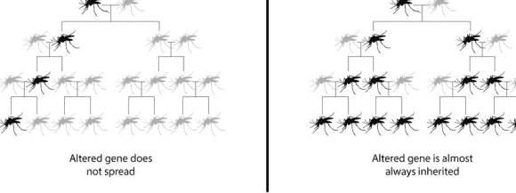

图 2：基因驱动图。⁴¹

虽然纯洁、理性的信息比喻渗透在基因驱动技术中，但一些支持者将其发明描述为“致变反应”或“MCR”：

> ³⁹ ‘基因驱动’, Wikipedia, 2018年10月23日, https://en.wikipedia.org/w/index.php?title=Gene_drive&wiki=86120843.

⁴⁰ 由于我的意图纠正误导性的比喻而非攻击当代生物技术，我选择了两个最有说服力的干预案例：按蚊和鹿蜱。

⁴¹ 图像来自 https://futuremeteline.net/21stcentury/2029.htm。此复制品仅供教育使用。未侵犯版权。

功能丧失突变只有在基因的两个拷贝都发生突变时才会产生突变表型。Gantz 和 Bier 开发了一种他们称为致变反应（MCR）的方法，可以自催化地产生纯合子。MCR 使用启动位基因引起对侧染色体发生突变。MCR 技术可以应用于

42 M. Gantz, Ethan Bier, 'The Mutagenic Reaction: A Method for Converting Heterozygous to Homozygous', Science 348,6223:442-444.

43 Carl Zimmermer, 'Gene Drives Are Too Risky for Field Trials, Scientists Say', The New York Times, 2017年11月16日, https://www.nytimes.com/2017/11/16/science/gene-drives-crispr.html.

44 Brittany Ansari, 'Gene Drives Explained: How to Solve Problems with CRISPR', Synthe, 2018年12月4日, https://www.synthe.com/gene-drive.

2012年，一种新的编辑工具 CRISPR（簇规律间隔间隔序列）。在该系统中，使用可编程引导 RNA 将核酸酸酶（Cas9）带到具有前所未有的精度的目标。⁴。

45 David Pearce, 'Compassionate Biology: How CRISPR-Based "Gene Drives" Could Cheaply, Rapidly and Sustainably Reduce Suffering Throughout the Living World', https://www.gene-drives.com/

可以设计工程所有生命的福祉。

然而，对种群的影响可能类似于原子弹产生的可遗传放射性突变，但要彻底得多，因为合成基因驱动被设计用于监督进化遗传。像核弹一样，对环境的长期影响是未知的。例如，哪些物种将进入灭绝的位置？哪些捕食者和猎物将遭到毁灭，哪些又将繁荣？相邻物种如何与受影响物种杂交并遗传突变？这些突变基因如何通过水平基因转移（例如逆转录病毒导致基因序列复制到宿主中）传递给其他物种？简而言之，项目有多少意外后果会变成指数级？

4 a

46 Robert L. King, 'Fatal Metamorphosis', Massachusetts Review 23.4 (Winter 1982): 709-713.

## 行动

行为是有后果的。核弹及其随后的链式反应引发了可怕的致命性，这不仅取决于最初的爆炸，还取决于攻击发生后可能出现的报复方案。与在计算机上进行编辑不同，核爆炸的启动是不可逆的。

在解释激进的生物技术时，链式反应、传染和核弹的比喻可能会成为这些项目的酷炫点。但是，当这些比喻变成构成性因素时（例如，成为相互关联的学科类型时），它们可能会鼓励比计算机科学和工程更具应用性的领域参与进来。因为对于游客、民族主义者以及环保和反核活动人士来说，这些方法要容易得多。我提议，更合适的比喻将为想象生物技术倡议的结果提供更丰富的领域，并加强跨学科的参与。然而，我并不是建议使用夸张或错误的描述。如果如此，会加强原子弹的末日属性，导致肤浅的比较，并以一种无效的方式使公共讨论极化。此外，我主张在实验室中推进对基因组各方面的科学理解，但对其在更广泛世界的应用和干预持谨慎态度。

## 回到穆利斯

“深林PCR”（Deep Woods PCR）是一种过时且去语境化的科学表演，旨在为PCR——20世纪末最具影响力的生物技术之一——提取解释性的线索。该项目将PCR重新还原为基于自然的原始力量：火、烟和水，而不是计算机和信息。原始表演发生在2011年夏天，三年后，我飞往加利福尼亚会穆利斯。

参见画廊中的图3（第40页）。

当我在2014年采访穆利斯时，我们谈到了他小时候对化学和业余岩石的探索，但也想问问他，如果他被传唤参加1994年奥·辛普森案的作证，他会说什么，但他从未被传唤到证人席。“实验室是为警察工作的，”穆利斯说，“他们想当英雄。”在1994年，DNA证据刚刚成为刑事调查的“金标准”，几乎无法被反驳，且经常被检察官用来用来恐吓那些律师不熟悉该技术而无法对其质疑的无辜被告。此外，执行DNA分析的公司字面上是由检察官雇佣的，这让穆利斯违反了任何客观性标准。

穆利斯告诉我，他“会说他们没有使用良好的技术……你必须对待[DNA样本]就像对待传染病一样”，并且他开发PCR是因为实验室里“[开始无法获得任何阴性对照]”，空气中漂浮的微量DNA就会导致假阳性。他说他“购买了所有新设备并带回[自己的]家里”以避免污染。穆利斯一次又一次描述了聚合酶链式反应的巨大力量。穆利斯对……

## 状态机

DNA证据采用的是（如“传染病”）以及更广泛的自然科学（如“阴性对照”）的本体，而不是信息学或计算。他对像PCR这样的生物技术的谨慎态度表明，人们已经考虑过能够从微小催化剂产生产品爆炸式增长的链式反应，就像炸弹和燃料燃料。此类比喻有助于反驳用于描述当代技术倡议的过度理想化的工程比喻，例如设计新的食油细菌作为石油泄漏的技术解决方案，或设计基因来消灭整个属或物种的疾病昆虫。

## 参考文献

“生物学”，维基百科，2018年9月25日，https://en.wikipedia.org/index.php?title=Biology&id=86013981。

- Boudry, Maartenen, and Massimo Pigigli. 《机器的误测：合成生物学与工程方法的麻烦》，生物与医学科学史与哲学研究，第44.4期 (OED Online, 2013)，第5页。

- Enbrann, David. 《基因驱动解析：如何用CRISPR解决问题？》，Synthe，2018年12月4日，https://www.synthe.com/blog/gene-drive-

- “链式反应”，N.OED Online，2018年7月。牛津大学出版社，http://www.oed.com.gate.lib.file.dav/edu/30197/79redactedFrom-chain-reactionie9272651。

- “混沌理论”，维基百科，2019年2月9日，https://en.wikipedia.org/index.php?title=Chaos-theory&oid=88245857。

- Gantsev, Vincent M. and Ethan B. 《突变反应：杂合基因突变转纯合基因突变的方法》，科学，348.6233: 442-444。

- “基因驱动”，维基百科，2018年10月23日，https://en.wikipedia.org/index.php?title=gene-drive&oid=8262844。

- Geck, James C. 《原子的崇高》，American Style，纽约：企鹅出版社，1987。

- Hales, Peter B. 《走出优生学：生命的逻辑》，美国统计，第32.1期 (1991): 5-31。

- Jacob, Cesare. 《生命的逻辑》，Betty E. Smith 编。新泽西州普林斯顿：普林斯顿出版社，1973 (1970)。

- Kay, Lilly. 《谁写了生命之书》，加州州斯坦福：斯坦福大学出版社，2000。

- Kelvin, James. 《谁写了生命之书》，加州州斯坦福：斯坦福大学出版社，2000。

（注：后续重复的参考文献目已根据要求进行处理）

# 艺术、体验与成为：

## 变异、代理人与化身

## 马克·加雷特（MARC GARRETT）访谈琳恩·赫什·莱森

请参阅画廊中的图1（第41页）。

多年来，我一直被琳恩·赫什·莱森（Lynn Hersh Leason）的艺术旅程所吸引。在这些旅程中，她探索了与世界相关的自主自我；例如，演绎了作为世界实验性界面的情境。她的作品激发了这样的感觉：工具和物体本身就是这些多化自我的延伸。赫什·莱森的旅程涉及了摄影、视频、电影、表演、装置和交互媒体艺术等领域惊人的创作。她开创了我们当今社会技术的新用途。

赫什·莱森应对了各种质问：在大规模、压倒性的消费主义时代下的身份；在大规模监控时代的隐私；人与机器的交织；现实世界与虚拟世界之间的关系；以及新的生物伦理实践，例如从DNA样本中培养人体部位。考虑到19世纪小说家玛丽·谢莱广受誉的作品《弗兰肯斯坦》（又称《现代普罗米修斯》），它对引发“理性”革命的挑战，以及谢莱对父权制滥用科学技术的批判，我将赫什·莱森视为谢莱的直接后裔。玛丽·谢莱的作品或许是科幻小说最早的表达，但它也是一部哥特小说。谢莱挪用了当时她当时可以获得的各种影响和来源，她的小说是科学技术发现、社会变革和政治动荡的结集，并与个人兴趣相遇。这两位女性都以女性主义者的身份闻名，并成功找到了绕过以及与传统的主导性、父权制结构和系统合作的方法，以便以自己的方式表达个人的、创造的和文化身份。

请参阅画廊中的图2（第41页）。

琳恩·赫什·莱森的使命……似乎是身体是嵌入可变硬件中的可编程软件。因此，她向我们展示了现实生活和第二人生中的许多混合体、变异体、外星人和代理人。从娃娃到克隆人，她展示了特别是在全方位观察时代身份的悖论多样性。

赫什曼·莱森（Hershman Leeson）并没有疏离科学技术的过程。相反，她跳入我们恐惧的深处，让自己和她的想象沉浸在这些物质的影响和修改中。像唐娜·哈拉维（Donna Haraway）一样，赫什曼·莱森将合成人、迷雾、生物、变异和转型作为她的灵感、背景和材料。和哈拉维一样，她性且批判地表达了对科学技术的担忧，以及由于对其不断不断的影响可能产生的伦理问题；因此，她没有被它们拥有或被它们束缚。赫什曼·莱森提出的每一件作品都是一次实验。她受科学技术启发的兴趣和知识反映了她持续的当代性。她的工作与打破感知价值体系直接相关。

赫什曼·莱森面对传统的类型角色，并揭露了性别身份的规范性建构。她的一些视频包含了变装者以及跨性别男性和女性，如在《双击》（*Double Click*, 1995）中，并且在一个由忽视女性的男性主导的世界里，她使用了假定的男性笔名。

赫什曼·莱森的艺术在不同的格式、背景和学科之间流畅移动。当然，艺术市场竭于推广符合特定角色的艺术以及用于推广、检测和消费的产品。这里的讽刺在于，艺术推广了自己作为新奇和见解之地的观点，但实际上它代表了一种深层保守的文化。一些艺术家——赫什曼·莱森就是其中之一——超越当代艺术世界的常态，构建了替代性的宇宙、背景和身份，在那里他们的艺术是如此具有调查性和深奥，以至于挑战了传统的规范。赫什曼·莱森想要“激进审查”。在70年代，她是第一个在圣奎廷监狱从事项目的项目的艺术家，她早期的许多公共艺术作品都是“面向社会变革的”。

她的工作并没有被简化为对自身创作自我的单一反映。这还有一个更广泛的故事，它包含了许多人的声音，作为她生活和工作叙事的一部分，并夺回了在男性主导社会中的历史。我们看到了一种被重申的多样且动态的历史，其中她作为其艺术过程的延伸，参与了加强女性在社会中的作用。其中一个例子是40多年来，她采访了一系列将个人和政治内容融入作品的艺术家、历史学家和评论家。其中一些内容被制成了电影《女性艺术革命》（*Women Art Revolution*, 2010）。

请参阅画廊中的图3（第42页）。

赫什曼·莱森不仅作为艺术家取得了突破性工作，作为一名电影制作者也是如此。她与演员、奥斯卡奖得主蒂尔达·斯维顿（Tilda Swinton）合作了多部电影，这些电影因其卓越的质量和创新主题在国际节上获得了众多奖项。

*Teknlust* 是一部荒诞、有趣且科学上具有高度话题性的科幻剧，涉及身份、生物遗传学、互联网时代的性自主等主题。情节围绕科学家（蒂尔达·斯维顿）展开，她非法生产了三个自己的克隆人。这些人工实体仅通过衣服颜色来区分，并生活在封闭的网络空间中。因为他们依赖男性染色体，克隆人中的女性鲁比（Ruby）定期进入男性的脉冲。与鲁比的性接触导致了阳功能障碍以及由可传染给人类的计算机病毒引发的过敏反应。FBI察觉了这个克隆人家庭的机器并进行调查。

在被要求描述一个启发她的当前想法或作品的现实情况时，赫什曼·莱森回答道：“嗯，听到斯蒂夫·库尔茨（Steve Kurtz）的情况以及这种不公促使我制作了电影《奇异文化》。我个人像许多女性一样经历了排斥和拒绝，并激发了《女性艺术革命》。”斯蒂夫·库尔茨是一位艺术家和活动家，曾是纽约州立大学分校副教授，也是“艺术组合”这一政治倾向组织的成员。库尔茨的噩梦始于2004年5月11日，那天他醒来发现妻子去世了。警方怀疑他家里的科学设备（艺术项目的材料或转基因食品）。不久在他妻子惨剧去世几小时后，他成了杀人嫌疑犯、被指控的生物恐怖分子，被除了亲友以外的人。

这部电影通过采访、纪录片段以及由蒂尔达·斯维顿、托马斯·瑞（Thomas Ryan）和彼得·科伊特（Peter Coyote）主演的重构场景来讲述。谢曼的作品深刻审视了9/11创伤性事件如何改变了美国社会并破坏了其长期持有的价值观。

Hershman Leeson 的工作跨越了许多不同的领域和形式，包括装置、视频、电影、雕塑、机器人、化身、合约、计算机程序、摄影、绘画、拼贴、基于浏览器的艺术、人工智能、生物质、网络通信系统设备设备Synth Stock Ticker》和《Dollie Clones》是两个例子，展示了她在将数字技术整合到艺术方面是多么领先。《Synth Stock Ticker》是2000年制作的一件基于网络的媒体艺术品。它引用了托马斯·爱迪生发明的股票显示器，在描述全球市场情绪方面表现出异常的预见性。玻璃外壳内放置着一个小型显示器，播放着一个名为 Synthia 的女性角色视频。

当市场上涨时，该角色在基督教·迪奥（Christian Dior）面前跳跳跃；当市场下跌时，她抽着烟、做梦，并在慈善店（Goodwill）寄望¹⁰。

参见画册中的图 4（第 42 页）。

《Dollie Clones》（1995–96）也展现了当代艺术的痴迷，但这次是针对令人不安的监控。作品的核心特征是两个机器人娃娃：遥控机器人娃娃 Tillie 和 CyberRobot，它们的眼睛被摄像头取代了。每个娃娃都连接到一个网站，允许用户查看由角色拍摄的图像，并点击“眼球玉米”（eyecorn）来遥控娃娃的头部向上旋转 180 度以观察整个画廊。

参见画册中的图 5（第 42 页）。

Hershman Leeson 最著名的表演作品是另一个女人，罗伯塔·布莱特（Roberta Breit）。这个复杂的化身存在于 1973 年至 1978 年之间。Breit 这个角色被刻画得很充分，拥有与 Hershman Leeson 本人身份不同的行为和态度。Roberta Breit 有她自己的字迹、服装、假发、化妆、驾执照、公寓、心理医生、银行账户、信用卡、熟人、生活故事和冒险。Hershman Leeson 做出了大胆的一跃，在五年的时间里变成 Breit。其他女性（有时甚至是同时）也以 Roberta Breit 的身份生活¹¹。

我认为我们出生于所有的框架之中，如果我们幸运的话，就利用技术为那个时代的政治姿态赋予存在感和声音。我们无法产生除我们居住之外的其他时代的作品，必须与我们一生中释放的工具和语言的全球框架保持同步¹²。

参见画册中的图 6（第 43 页）。

Hershman Leeson 雇请了另外三个表演者（均为女性）来扮演 Roberta。她们穿着与 Hershman Leeson 本人完全相同的服装，她们基本上把扮演 Roberta 视为一份普罗米修斯式的（尽管是兼职的）工作。她们承担了 Roberta Breit 的部分通信，并参加了她的一些约会，这些约会通过照片和录音记录下来。最终，Hershman 停止了扮演 Breit，将 Roberta Breit 的实例化从四个减少到三个¹³。

参见画册中的图 7（第 43 页）。


# 随着有机打印和 DNA 操纵重塑了新操纵生物的身份

随着有机打印和 DNA 操纵重塑了新操纵生物的身份，被吸收的监控文化也发生了动态转变。在未来的 100 年里，用于创建 DNA 的材料将变得越来越分散和杂交。这项研究的影响不仅包括创造一个可持续的混合生命形式星球，这种星球能够生存灭绝，并将最负责任的未来融入其存在之中¹⁴。

## Hershman Leeson 的作品与《Civic Radar》

Hershman Leeson 的作品已出现在媒体艺术经典中，例如 Rhizome 的《新艺术选集》（New Art Anthology），该书对 80 年代至今的艺术史提出了“重述”¹¹⁵。她的作品以及那些突破性的电影直到最近才被世界艺术接受，这令人震惊。Hershman Leeson 在 1984 年至 2014 年间编写的文本选集在《Civic Radar》上出版。这些写作带我们经历了 Hershman Leeson 职业生涯的不同阶段，揭示了她许多作品背后的想法和意图。在最后一个文本的最后一段，在一篇名为《永恒的恐怖》（The Terror of Immortality）的短文中，她描写了产生她最新作品的背景。

《Civic Radar》洞察了这位慷慨而深远的艺术家在加速变化的时代的心路历程。令人惊讶的是，内容、叙事和历史都是真实的。这是一个充满丰富、卓越艺术品的、流淌着精辟思想的阿拉巴丁洞。长期以来，Hershman Leeson 一直紧扣世界的时代脉搏，并将她在对身份、女性主义、科学、技术等领域研究中挖掘的知识传转化为她自己的艺术语言。

Hershman Leeson 的工作比目前大多数正在展出的当代艺术家要领先得多。《Civic Radar》应该在随处被阅读，不仅是因为它包含了伟大的艺术，更因为它展现了一位具有远见卓光的女性。我不是“天才”或“杰作”这些词的粉丝；我觉得这些词令人乏味，反映了对女性、男性以及特权阶级的系统性男性统治。然而，在与《Civic Radar》相处一段时间后，我不禁想，我刚刚见证了等同于“天才”或“杰作”的东西，但没有那些必要的内涵。

## 参考文献

- Beitin, Andreas. ‘Face, Surface, Interface: The Motif of’, p. 205.
- Beitin, 'Face, Surface, Interface', p. 205.
- Garrett, 'Choose Your Muse'.

---

# 算法交易的幽灵与洪水隐喻

历史以来，艺术家们转向自然与动物意象、或怪异哥特式的陈词、或是交易者手势动作的描绘，亦或是交易用技术的呈现，这一切都是为了让金融重新根植于物的物质性之中¹⁴。在艺术想象中，掠夺性动物和怪物反复被赋予算法交易这种生命形式。

## 《机器碎片》概述

在埃玛·查尔斯（Emma Charles）的一部 17 分钟实验性纪录片《机器碎片》中，某些东西超越了关于算法交易的赛博乌托邦和赛博反乌托邦的描述⁷。《机器碎片》唤起了混合体的神话形象，并用洪水的隐喻来代表算法交易。查尔斯这部广受赞誉的视频论文已被纳入多个信息技术展会⁸，并引起了大众和评论界的关注。本着马克思《机器碎片》的精神，查尔斯关注的是人机关系。电影的标题引用了卡尔·马克思的《政治经济批判纲要》，在书中他讨论了劳动和资本生产的演变——从分工到机器在劳动中日益增加的整合，再到劳动不断提高的自动化。

## 第一章：大都市

在查尔斯的视频论文中，第一章标题为“大都市”的开场场景从横跨曼哈顿大桥的视角描绘了曼哈顿金融区。镜头捕捉了曼哈顿的天际线，其方正的摩天大楼和装饰艺术风格建筑如天空般的立面，提供了一种与金融“黑箱”的联想。通过从远处和外部描绘纽约金融区的建筑，查尔斯暗示了不可触及性。随后，镜头切换到摩天大楼和一些主要装饰艺术风格建筑的特写。“大都市”的场景为《机器碎片》在曼哈顿金融区正中心奠定了舞台，那里有标志性的且独特的金属板贴摩天大楼，夹杂着追溯到 20 世纪初重工业制造时期的装饰艺术建筑。

在诗意的语调中，一个男声旁述道：

> “我曾在这座城市里；现在，我不知道该去哪里消失了。我存在于两种状态之中。我将动物性移除，正如动物被从城市中移除一样。它们在不被察觉、不注意到的情况下消失。渐渐地，自然变得不自然。渐渐地，城市演变。”

³ Paul Crothwaite, 'Meet the Curator: Show Me the Image of Finance 1700 to the Present', BAAS, 7 November 2014, http://www.baas.ac.uk/usso/meet-the-curator-show-me-the-money-of-finance-1700-to-the-present-page-1.

⁴ Fragments on Machines (dir. Emma Charles, 2013), video, 17:10.

⁵ 参见，例如德国柏林文化宫（Haus der Kulturen）的“新系统”（2016）；德国卡尔斯鲁厄 ZKM 的“全球内容与审查”（2015）；墨西哥墨西哥城 CENART 的“信息圈”（2017）；瑞士电子艺术之家（HeK）摩天大楼建筑博物馆的“媒介建筑”；英国伦敦 POSTMatter/Second Home 的“新神话”，以及加拿大多伦大学黑伍德画廊的“我站在源头面前”。

纽约金融区的街道几乎空空如也，仅可见几个人。旁白继续道：

> “智能在欧洲的蔓延可以被绘制，就像一场无法治愈的知识瘟疫。公共朗读取而代之的是沉默的阅读。那些从未发生之事的秘密，最终无法被烧毁，而是倍增并印在每一个角落……我穿过由建筑师规划、通过震动设计、通过信息冲洗的结构生存……我站在源头面前，一座空空坟墓。靠近源头是我唯一需要的。卡车可以从它们的时刻出发，即使系着刹车。它们的外壳是码头宫殿。宝藏将在几天内跨越数百英里……一位新王居住在这里……”

一系列标记物、红树林、街道层面的地下公用管道标志以及一套工业通风系统，表明我们正在金融市场中徘徊，位于所描绘机构和公司的边缘。

## 第二章：服务器

视频的下一章标题为“服务器”，将观众带离金融区建筑的立面，进入据称“新王”居住的建筑空旷走廊。建筑门厅深褐调、光线昏暗的建筑，与镜头进入的明亮白色、钨灯光照明的服务器房形成了鲜明对比。室外与服务器房之间的切换暗示电影正从金融箱的外部向内部移动。在内部，在华华但腐朽的装饰艺术风格建筑墙旁，我们发现了看起来像数据中心的地方。一扇门开了，又是一扇，再是一扇。进入的房间充满了大型计算机和服务器机架。

华尔街的新王通过一个无源声音（第一人称、脱离身体的声音）具人格化，并通过一系列算法交易基础设施的镜头呈现出具象化的表象。金融区的许多装饰艺术风格建筑现在容纳了后工业金融资本的新王。数据中心遍布在金融区，它们的物理位置至关重要。高频交易公司、经纪商或银行距离服务器越近（即离源头越近），它们的算法响应就越快。看似存在于以太中、作为一种非物质、不可见、无处不在的结构，被表现为连接的、系带的、被牵着的。

《机器碎片》中旁述者的话语与图像之间的辩证关系，将金融市场的计算基础设施与“无法治愈的知识瘟疫”以及“系着刹车行驶的卡车”联系在一起。旁述者比喻地连接瘟疫和移动卡车的意象，暗示了对于出现的新生产力形式——金融市场的算法自动化具有普遍性、发展性、传播性、运动性和必然性。同时，这种看似不可避免的发展原因也可以被视为一种首要动力，甚至是一种自然力量或超自然力量。

旁白继续道：

> “我的肌肉被柔性材料和铜线取代；我的大脑是一个服务器。零和一是我的声音。我作为彩虹色下的幽灵存在。我用闪烁的语调向形式的隐藏构造说话。我渴望成为数据。我将是移动的，移动以提供。我将成为信息流。我是你与源头的个人关系。我变得越来越多。我每天进进出位置几次。我通过裂缝进行调整以适应我的环境。”

## 杂交与怪物

然而，杂交是个例外。杂交种被认为是由“令人厌恶的行为所引起的，因此通常被视为罪恶的征兆。”^13 恶魔的形象作为对避开罪恶的提醒，经常被描绘为杂交形象，这进一步强调了它们与罪恶和惩罚的关联.^14 正达斯顿和帕克所记录的，异才被视为剧性、局部且通常是灾难性事件的先兆：如瘟疫、洪水、饥荒、火灾和战争。在电影中出现杂交形象，并将杂交生物与算法交易联系起来，如果不是带来道德违规，那就是对上帝愤怒的纵容；当道德违规导致杂交物的产生时，是什么引导人们行动？

查尔斯赞扬劳动的自动化作为一种可能的原因。在《机器碎片》所描绘的楼层及其内部，我们没有发现坐在隔间里的白领工人。镜头扫过服务器机房的行与网格、咖啡馆以及遍布角落的电线、通风系统、电脑按钮、橡胶管，沿着明亮的、布满旋转机器的走廊和过道，而算法交易活动被认为在这些地方“发生”。电影展示了大量看不见人体的图像。查尔斯似乎在赞扬《资本论体系》，在书中马克思将机器处理为资本生产中一种抽象的、主导的力量，包裹了人类并让工人散落。根据马克思的观点，这种对机器日益增加的依赖有两种形式：第一是机器的发展，其中大量的劳动力和实现它的整个生产过程从视野中消失，被机器吞噬了；第二是将这些机器作为全球市场资本的生产手段进行整合。总之，作为世界市场资本生产手段的替代人类劳动机器的发展，表明了一般智力成为统治阶级工具的何种程度。^15

在《机器碎片》中，工人似乎被机器取代了。人类除了维持自动化金融资本主义机器的运行外，没有其他功能。电影前一章描绘的华尔街荒凉而安静的画面，与现在占据建筑楼层的服务器机房、电缆房和发电机的旋转、嗡嗡声形成了对比。曾经由人类神化的地方，现在被服务器机架、电缆环和无数的管道和管子占据了位置。电影的画面显示了空椅子、空大厅和空隔间。对水的强调进一步加强，从堵塞的冷却系统图像，到生锈漏水的管道，再到化粪池的图像。在《机器碎片》中，仍然存在的工人是维护工人，如技术人员、清洁工和门卫。金融资本的核心在很大程度上已被清除了人类痕迹；体力劳动已被机器劳动所取代。

在旁白中，我们听到：

> 我收集，我丢弃，我寻求结果。然后——清洗。在一天结束时，我刷新、更新并调整我的整个自我。

+ 13 Daston and Park, *Wonders*, p. 192.
14 Daston and Park, *Wonders*, p. 186.
15 Karl Marx, *The Grundisse: Foundations of the Critique of Political Economy*, London: Penguin Books, 1993, p. 690–693.

## 幽灵隐喻与哥特特质

查尔斯对幽灵形象的使用在隐喻和概念上是模棱两可的。《幽灵隐喻：活着的鬼魂与不可见的代理性》中，埃斯瑟·皮尔斯解释说，当代文化和理论中的幽灵“在方法论上是不同的，在它们所影响的特征、功能和效果范围内也是如此。”^16 然而，她区分了它们在当代文化用法中的三种侧重点：首先，幽灵作为回归的形象，表达了过去在现在的持续性；其次，幽灵作为“存在-缺席”的形象，转瞬即逝但在空间上作为一种需要解释的事物存在；最后，幽灵作为混合和杂交现象的形象，一个对“未混合”和“纯粹”进行批判的概念形象。^17 鬼魂指示着一种存在但不可见且不可触摸的代理性，一种怪异的杂交物，玛利亚·德尔·皮拉·布兰科和埃斯瑟·皮尔斯描述为一种“不在场的现场”，“一个缺席或离者的存在”，“它们精确地指示了那些逃避融合或理解的东西……被放置之外、被排除在感知之外的东西。”^18

鬼魂有留恋和缠绕的倾向，通常要求回应，并与超自然以及同时存在的混合时间和范畴联系在一起。^19 幽灵是完全且模糊的，因为它们代表了被构想为分离或相互对立的事物的无体性：过去与现在、物质性与非物质性、现实与想象、内在与超越，以及原因与次因。用更准确的话说，它们穿透了界限，穿过了秩序的障碍，“那些从不简单的，就是逃避了传统哥特和诠释学操作的总体逻辑的东西，”皮尔斯称之为怪异。^20

金融和金钱，特别是算法高频交易，具有与幽灵和哥特特质相关的记录。“被遗忘者”（outmé），结合办公大楼图像以及伴随电影画面的幽灵且不详的配乐，唤起了马克·费舍所描述的幽灵动态，即存在于“每一个面的奇异实体”。^21 它是“从空中召唤出来的”，却施加着明显的影响。^22 在《怪异与诡谲》中，费舍将诡谲描述为“与代理性问题联系在一起的”。^23 它可以在“支配世俗的力量被遮蔽的地方”找到。^24 在一个被空虚部分占据的地方，一个未知的代理者似乎在行动。^25 一个与命运和远见相关的代理者。^26

+ 16 Esther Peers, *The Spectral Metaphor: Living Ghosts and the Agency of Invisibility*, London: 2014, p. 10.
17 Esther Peers, *The Spectral Metaphor: Living Ghosts and the Agency of Invisibility*, London: 2014, p. 10.
18 Maria del Pilar Blanco and Esther Peers, *Haunting in Contemporary Theory*, Bloomsbury, 2013, p. 9.
19 Maria del Pilar Blanco and Esther Peers, *Haunting in Contemporary Theory*, Bloomsbury, 2013, p. 8.
20 Esther Peers, *The Spectral Metaphor: Living Ghosts and the Agency of Invisibility*, London: 2014, p. 10.
21 Mark Fisher, *The Weird and The Eerie*, London: 2016, p. 21.
22 Mark Fisher, *The Weird and The Eerie*, London: 2016, p. 22.
23 Mark Fisher, *The Weird and The Eerie*, London: 2016, p. 23.
24 Mark Fisher, *The Weird and The Eerie*, London: 2016, p. 24.
25 Mark Fisher, *The Weird and The Eerie*, London: 2016, p. 25.
26 Mark Fisher, *The Weird and The Eerie*, London: 2016, p. 26.

## 国家机器

在《机器碎片》中缺失的“某种东西”可能是劳动力。通过将纽约金融区描绘为一个清除了劳动力的诡谲空间，幽灵般的代理性留了下来，也唤起了共产主义的幽灵。费尔斯写道：“过去并没有被超越，而是被重新审、重复、重复。”

^27 Karl Marx and Friedrich Engels, ‘共产党宣言’,马克思主义档案馆, https://www.marxists.org/archive/marx/works/1848/comunist-manifesto/index.html.
28 Felski, *The Limits of Critique*, p. 158.

在《机器碎片》中，查尔斯对算法思维赋予了某种幽灵代理性；它赋予了以意识、自觉且不可见的方式行动的力量。我们可能看不到身体，看不到无，但它看到了一切。

河流在下方流淌和波动。在地下，组织的支流编织着反馈回路。我被溪流的细流所吸引，细微的开始。波动的音符一个接一个，汇聚在一起。

……引导着我走向……百万英镑将滚入大海，消融，飘散。你永远无法呼吸那些灰烬，也不会喝到果肉。

## 结局：被淹没的数据中心

一个看似命中注定的目的论事件在最后一幕中等待着观众。《机器上的碎片》（*Fragments on Machines*）以金融区一栋被淹没的 Verizon 数据中心大楼图像作终。该建筑的几楼层作为连接和存储通信的关键交换设施，在2012年桑迪飓风期间因洪水遭受了严重损害。根据旁白，更换和维修那里花费了数周时间和百万英镑。桑迪飓风造成的破坏提醒了人们，尽管有“云端”的概念，但大多数数据都是通过地下电缆传输的，那是一个历史可以追溯到殖民时代、像意大利面般的网络，并且穿过城市环境——当一切结束时，洪水可以让所有的交通和运营陷入停滞。算法交易依赖的通信技术“易受天气影响”，并且对雨、雾、雪和水敏感。查尔斯暗示，算法交易的幽灵时间性是根于物质的。

《机器上的碎片》的下一个场景是几个穿着绿白相间服的人正在清扫被水淹没的地板。通过这个结尾，查尔斯将算法高频交易与极端天气事件造成的损害以及洪水联系起来。洪水是一个模糊且多功能的隐喻，太多的故事是动荡的，跨越时代，横跨所有大陆。在欧洲神话（以及其他神话）中，大多数情况下，洪水或大洪是某种神灵因冲突的结果，或是神之愤怒的后果。查尔斯将《机器上的碎片》中洪水的意义留给读者解读。如果将其理解为“新类”算法高频交易的隐喻，它正向我们袭。

在另一种解读中，查尔斯将消耗能量的市场机制与全球变暖的自然灾害联系起来。从圣经术语来解读洪水，一种不同的叙事随然而生。在“诺亚与洪水”中（源自《创世记》——上帝以洪水的形式对他所创造的世界的软弱和腐败降下了审判，作为彻底清洗世界的手段。洪水抹去了地球上所有的灾难，唯留下诺亚和同他一起的方舟，并将地球变成了一个巨大的水池。洪水过后，上帝要求诺亚重建并重新圈养地球。从这种方式来看，洪水将算法交易与一种反转联系起来，一种对人类自身可能且可想象的背离。《机器上的碎片》指向了一个看似无所不在的金融黑盒之外的领域或范畴，以及这种“外部”对算法交易脆弱基础设施可能的影响。它指向了那些无法预测或定论的、无法通过风险管理或保险来保护的东西，以及超出预期的后果。

我们能在不对其进行合理化的情况下与这种模糊性产生共鸣吗？我们能在不使算法交易去政治化的情况下，参与这种神秘且具有目的论的隐喻吗？答案是肯定的。桑迪飓风的讽刺意义不容忽视：金融区大部分地区的被淹导致纽约证券交易所历史上近三十年来首次关闭，具有说明意义的是，算法交易也关闭了整整两天。洪水似乎是一个平等者，摧毁它所到之处的一切，让一切变成一片无法识别的泥水池。人类引起的气候变化以及金融市场的波动和脆弱性部分是政府缺陷和不作为政策的结果，这两者往往对脆弱群体的打击最大，且都受到短期思维的影响。算法交易的过度和气候变化都是增长和个人选择的产物——从碳排放率、化石燃料法律，到抵押贷款的金融建模，到我们的食物选择、旅行方式以及对自然资源的利用——这两者都有动力利用短期利益，同时忽视或淡化更远未来的巨大风险。


# 洪水还需要注意金融市场的另一个近期进展

日本、墨西哥、波多黎各、智利或哥伦比亚的洪水、海啸、飓风、流行病和地震，佛罗里达和德州命名风暴、欧洲逆风、加州山火和其他自然灾害已成为一种金融产品，一个投机目标。金融市场在所谓的“灾难债券”中量化并为自然灾害定价——这意味着特定地点可能的未来自然灾难已成为金融工具。如果这些投机性灾难事件之一真的发生，这场灾难不仅会影响相关者，还将涉及此类灾难债券投资者的盈亏。

在《动荡的世界》（*Turbulent Worlds*）中，梅琳达·库珀解释道：“虽然天气相关的风险曾通过财产保险等间接手段联系，但现在天气状况可以在资本市场中进行直接对冲和交易。奇特的效应是，气候变化——它可能产生的关键或单一事件——变成了像渴求关键事件的市场中任何其他类似的投机机会，将涉及大量不确定性和风险的破坏性事件转化为投资者的财务机会——换句话说，即环境衍生品。结果是产生了金融工具，对天气的不确定性以及我们对气候变化未来的不确定性进行定价和交易。”

模糊且类宗教色彩的隐喻在《机器上的碎片》中反复出现。除了洪水，算法交易还与一种诡异的城市景观相关，与一个混合的、意识的、幽灵般的且可能是巨大的形象联系在一起，并且似乎预示着某种灾难性力量的到来。这些隐喻都逃避了清晰的理论化，而这似乎正是意义所在。《机器上的碎片》揭示了它将算法交易的想象描述为一种像幽灵、混合体和洪水一样模糊的现象。

当《机器上的碎片》将算法交易的想象描述为一种像幽灵、混合体和洪水一样模糊的现象时，它揭示了什么？

> 30 Cooper, ‘Turbulent Worlds’, Theory, Culture & Society 27.3 (May 2010)

## 并非不可控

幽灵出现的方式、警报声的响起，表明算法交易的定义不仅取决于其技术基础设施，更多地取决于其管理方式。《机器上的碎片》（*Fragments on Machines*）似乎表明我们并非完全听任自流，我们也不应该让算法技术处于无法干预和控制的程度。幽灵与洪流可能为当今的技术决定论和新自由主义形式主义提供了部分答案，因为这些形象为那些叙事和可能性提供了宿命论和决定论，阻碍了想象和采取其他行动的机会。

一方面，存在有限性，表现为算法交易的技术基础设施。另一方面，存在未来的可能性。《机器上的碎片》可以被视为一种对全球金融资本主义的艺术抵抗，而其市场上的算法交易则是一个全方位的总体化，一个没有“终点”、“没有替代方案”、“没有出口”和“没有外部”的政权，反抗那种主张一切只有在这一总体框架下才有意义的思维。特别是幽灵这一形象，代表了对某种想象方式认同的转变，而生命的诞生——就像你看起来像刚看到鬼一样（呆了）。此外，幽灵作为一个“不稳定”的框架，消除了总体化框架的顺从与傲慢，可能有助于想象和动员自动化资本的不同未来和终结。³33 最后，对村上而言，想象是失败与胜利之地。

## References

- Buchanan, M. 'Physics in Finance: Trading at the speed of light', Nature, 11 February 2015, https://www.nature.com/news/physics-in-finance-trading-at-the-speed-of-light-16872.
- Cooper, Melinda. 'Turbulent Worlds', Theory; Culture & Society 27.2-3 (May 2010) 167-190.
- Crosthwaite, Paul. 'Meet the Curator: Show me Money; The Image of Finance 1700 to the Present', 7 November 2014, https://www.baas.ac.uk/usso/the-curator-show-me-the-money-the-the-image-of-finance-1700-to-the-present/comment-page-1/.
- Daston, Lawrence and Katherine Park, Wonders and the Order of Nature: 1150-1750, New York: Zone Books, 1998.
- Felski, Rita. The Limits of Critique, Chicago: The University of Chicago Press, 2015.
- Fisher, David, The Weird and the Eerie, London: Watkins Media, 2016.
- Fragments on Machines (Emma Charles, 2013), video, 17:10 min.
- Kal, Victor. Levin en Rozenweig, Zoetemer: Uitgeverij Meijena, 1999.
- Marx, Karl, The Grundisse: Foundations of the Critique of Political Economy, London: Penguin Books, 1993.
- Marx, Karl, and Frederick Engels, Manifesto of the Community Party', Marxist Internet Archive, https://www.marists.org/archive/marx/works/1848/communist-manifesto/index.htm.
- Murakami, Haruki. After the Quake, London: Random House, 2003.
- Peeren, Esther. The Spectral Metaphor: Living Ghosts and the Agency of Invisibility, London: Palgrave Macmillan, 2014.
- Pilar del Bello, María and Esther Peeren. The Spectral Radiities: Ghost and Haunting in Contemporary Cultural Theory, New York: Bloomsbury, 2013.
- 33 Victor Kal, Levin en Rozenweig, Zoetemer: Uitgeverij Meijena, 1999, p.153.

# 夺回企业拥有的自我

**马尔克·加雷特**

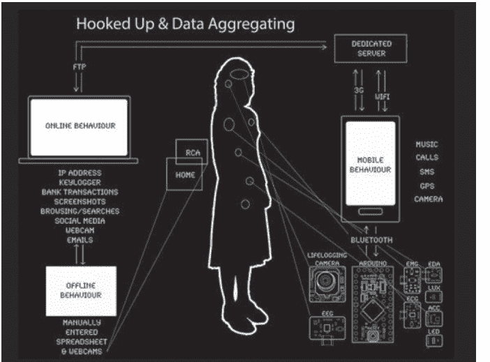

图 1：图像取自 Jennifer Marone 的网站。

> 1. 最初发表于 PostScript#39, Ljubljana: Aksioma, 2017, https://aksioma.org/pdf/aksioma_PostScript29_ENG_JLM.pdf
> 2. Carlisle Morgan, ‘Data Asymmetries: An Interview with Burak Arikan’, Furtherfield, 9 December 2016, http://archive.furtherfield.org/features/interviews/data-asymmetries-interview-burak-arikan/

在一个每一个原子都可以通过 `IP` 地址（`IPv6`）进行定位的世界里，关于捕捉模拟事可能的讨论变得越来越无关紧要。变得关键的问题是谁在控制，以及数据属于谁。

老调依然是，知识在今天和以往任何时候一样真实。精英群体始终引导着我们的社会互动、文化认同和兴趣。关于我们究竟是谁的叙事和故事已经根据营销公司的需求、被接受的历史经典、日常主流媒体、军队、众多公司和国家被扭曲、过滤和工程化。真理和其他一切一样，是一种商品；它不是一种权利。如果你付得起真理和事实，你可以误导大众。

## 艺术

其中的一个例子在 Robert Kenner 指导的纪录片《怀疑商人》（Merchants of Doubt）中得到了说明。在片中，Kenner 揭露了烟草行业传播虚假信息，称气候变化实际上是……的错。化石燃料利益者非常乐意推广这些信息以销售。

> 33 Merchants of Doubt (dir. Robert Kenner, 2014)
> 4 Pedro Mauro, Disrupting knowledge: The Seven Heavens of Ignorance, Furtherfield, 2 December 2016, https://www.futurefield.org/features/reviews/disrupting-knowledge-seven-heavens-ignorance.
> 5 Kevin Goztola, Interview with Michael Mann: Climate Change Denial And Attacks On Scientists In Age Of Trump, Shadow Proof, 2017, https://shadowproof.org/2017/04/16/unauthorized-disclosure-postpodcast-climate-change/
> 6 Jean-Christine Plantin, Carlos Laughlin, Paul N. Edwards, and Christian Swift, Infrastructure Studies Meet Pattern Studies in the Age of Google and Facebook, New Media & Society 20.1 (2016): 191-210.
> 7 Muratza Huss, ‘What Snowden Revealed’, Al Jazeera, 2 January 2014, http://www.alazeera.com/index/opinion/2013/12/what-snowden-revealed-20131228113515573226
> 8 Jonathan Patlin, Move Fast and Break: How Facebook, Google, and Amazon Corner Culture and Underground Democracy, New Little, Brown, and Company, 2017.
> 9 Jason Louis, ‘NSA Surveillance, Edward Snowden and the End of Privacy. A Real-Time Account of the Biggest Leaks in US History’, Ultraculture, 24 April 2017, https://ultraculture.org/blog/2017/04/24/nsa-surveillance-edward-snowden/

与此同时，社交网络平台（如 `Facebook`、`Google` 等）正在以前所未有的规模收集个人数据。据披露 `Facebook` 和 `Google` 向美国国家安全局（`NSA`）移交数据。这些强大实体之间的直接通信展示了对我们生活的侵入性监视。

互联网及其网络正在进一步消失，因为在线活动被企业控制的“社交”区域所主导。通过数字化的自我，我们在社交平台上就像场里的牛一样，在偏见算法分配的区域内看和听。我们的互联网体验受限于我们自身以及所在的过滤泡之中。

在我们社交媒体平台和网络浏览器中，我们的数据被采集和抓取。这种大规模的数据提取进一步延伸到一种赤裸裸的傲慢，涉及类似于社会工程学的令人质疑的方面。

`Facebook` 了解你的朋友、你关于他们提供的信息、他们对你的评价、你访问过的其他网站（如果这些网站包含 `Facebook` “点赞”按钮，大多数网站都是如此）、你使用什么种设备访问 `Facebook`，以及更多内容.¹¹10

> 10 Mark Huffman, *The Price of Free: How Apple, Facebook Microsoft and Google Sell to Advertisers*, PCWorld, 1 October 2015, https://www.pcworld.com/article/2986988/privacy/the-price-of-free-how-facebook-microsoft-and-google-sell-to-advertisers/
> 11 Aatif Sulleyman, *Facebook Could Secretly Watch Users Through Webcams, Patent Reveals*, *The Independent*, 8 June 2017, https://www.independent.co.uk/life/webcams-spy-technology-gadgets-and-tech/news-media/a7797711.html/
> 12 Sulleyman, *Facebook Could Secretly Watch Users.*
> 13 Meg McCormack, *Privacy Change: Apple Knows When Your Phone Is And Telling People*, Consumer, 21 June 2010, https://www.consumer.com/2010/06/21/privacy-change-apple-knows-your-phone-is-and-telling-people/
> 14 Joseph Menn, *your iPhone is Collecting More Information About You Than Think*, Business Insider, 26 July 2014, bit.ly/2siXW6
> 15 Pedro Maduro, *Disrupting knowledge*.
> 16 Marc Garrett, *Heath Hunting, The Status Project & The Netopticon*, 23 April 2012, https://www.turfheld.org/feature/articles/heath-hunting-status-project-netopticon/
> 17 David Pearce, *The Panopticon*, *Utilitarianism*, https://www.utilitarian.com/panopticon.html.

根据英国报纸《独立报》（*The Independent*）报道，2014年 `Facebook` “被发现秘密地操纵了数十万用户的新闻推送，作为实验的一部分，旨在测试其是否能影响人们的情绪.¹11 而且它一直在“通过用户的摄像头和智能手机摄像头秘密地观察并记录用户.¹12 `Apple` 收集手机数据，他们声称是匿名处理的，且用户没有退出条款.¹13 这包括从 `iPhone` 中提取的短信内容、联系人列表和照片。这不仅影响我们的隐私，还影响我们的账户，因为许多互联网服务提供商（`ISP`）都带有数据传输.¹14 `Ippola` 是一个由活动家和作家组成的群体，他们推崇了社交媒体色情，我们的情感被点击饵剥削，以换取我们的个人数据.¹15 这种现象的历史根源于人工智能（`AI`）的发展和 20 世纪的统计分析。这些制定数据的方法通过公司、政府事件以及军事资助而变得日益密切¹16

18 世纪，英国哲学家和社会理论家杰里米·边沁（Jeremy Bentham）设计了“全景监狱”（Panopticon）。它的设计是为了让管理者对犯人进行全方位监控。边沁的意图是人道主义的，但监狱并非功利主义伦理的最佳广告.¹17 法国哲学家米歇·福柯（Michel Foucault）说，我们并不是在监狱中受到监控，而是在军队、学校、医院和工厂等层级结构中。这一过程在历史中演变，让我们记起了边沁的全景监狱，“因为权力渗透到了个人的行为中。权力变得比观察机制更高效，知识随之而来，一直在寻找‘新对象’”。

在权力行使的所有表面之上产生知识¹18 现在，我们拥有了数字网络：我们的手机通过地图应用和 `GPS` 追踪我们，电视在“跟踪”所有者在看什么，并将数据传回公司服务器，在那里这些数据会被卖给急切的广告商¹19 全景监狱的当代版本通过数字网络以“网络全景监狱”（Netopticon）的形式存在。个人每天顺从地喂养各种形式的共同监控，同时也被公司、政府和采样者追踪²20

> 18 参见 Foucault 相关论述。
> 19 相关隐私政策分析。
> 20 相关监控社会学研究。

[...] 个人已变得对信息极度饥渴。这种始于 80 年代的一种略显尴尬的爱好——“量化自我”（quantified self），现在已成为主流，人们监控从睡眠到饮食习惯，从体育活动到带有内置传感器的智能手机和智能手表，将心率、睡眠模式和行踪等亲密细节上传到公司服务器，以提高他们的表现²²¹

## 我们是网络全景监狱

对网络时代当代技术平台、系统和结构的角色进行批判是一项必要的练习。新一代当代艺术家、科学家、研究人员、活动家、黑客和记者正在将他们的视野扩展到图形用户界面（`GUI`）之外，并寻找发明的策略来解锁这些在日常生活中吸取数据体验的隐秘、机械操纵。其中一位艺术家是詹妮弗·林·莫罗尼（Jennifer Lyn Morone）。她字地将自己变成一家拥抱了这种极端资本主义形式的公司。Morone 既是一个个人也是一个企业，她的意图是更好地理解主导我们生活的自由市场体系的影响。

在生物和智力上，她所做的一切、学习或创造的都有转化为利润的潜力。`Jennifer Lyn Morone Inc.` 是交互设计专业的一个毕业项目，但正如 Jennifer 所指出的，这并不是一个投机性的项目²2

> 22 Jennifer Lyn Morone, 个人访谈/项目说明。

Morone 通过将手电筒照在捕猎者身上来研究他们的行为，并澄清了数据狩猎的条件。她穿上了捕食者的装束和动作——为了变成他们，看到他们所看到的，感受他们的意图，并在镜子中反思我们的脆弱性。Morone 的这种做法让我们看到，在权力行使的所有表面之上产生知识，这种权力渗透到了个人行为中。


## 参考文献

18. David Pearce, *The Panopticon*, *Utilitarianism*, https://www.utilitarian.com/panopticon.html.

19. Brian Barrett, 'How To Stop Smart TV From Spying on You', *Wired*, 7 February 2017, https://www.wired.com/smart-tv-spying/

20. Marc Garrett, *'The Status Project & The Netopticon*', 23 April 2012, https://www.turfheld.org/feature/articles/heath-hunting-status-project-netopticon/

21. Marloes Vel, 'Contemporary Delphic Oracle: The Church of Big Day', *Furtherfield*, 10 October 2016, http://www.furtherfield.org/contemporary-delphic-oracle-big-day/

22. Regina Dubty, 'Jennifer Lyn Morone: The Girl Who Became a Corporation', *We Make Not Art*, we-make-not-art.com/jennifer-morone/

## 机器状态

在生物和智力上，她所做的一切、学习或创造的都有转化为利润的潜力。`Jennifer Lyn Morone Inc.` 是交互设计专业的一个毕业项目，但正如 Jennifer 所指出的，这并不是一个投机性的项目²²。

`Facebook` 了解你的朋友、你关于他们提供的信息、他们对你的评价、你访问过的其他网站（如果这些网站包含 `Facebook` “点赞”按钮，大多数网站都是如此）、你使用什么种设备访问 `Facebook`，以及更多内容.¹¹10

根据英国报纸《独立报》（*The Independent*）报道，2014年 `Facebook` “被发现秘密地操纵了数十万用户的新闻推送，作为实验的一部分，旨在测试其是否能影响人们的情绪.¹11 而且它一直在“通过用户的摄像头和智能手机摄像头秘密地观察并记录用户.¹12 `Apple` 收集手机数据，他们声称是匿名处理的，且用户没有退出条款.¹13 这包括从 `iPhone` 中提取的短信内容、联系人列表和照片。这不仅影响我们的隐私，还影响我们的账户，因为许多互联网服务提供商（`ISP`）都带有数据传输.¹14 `Ippola` 是一个由活动家和作家组成的群体，他们推崇了社交媒体色情，我们的情感被点击饵剥削，以换取我们的个人数据¹15 这种现象的历史根源于人工智能（`AI`）的发展和 20 世纪的统计分析。这些制定数据的方法通过公司、政府事件以及军事资助而变得日益密切¹16

18 世纪，英国哲学家和社会理论家杰里米·边沁（Jeremy Bentham）设计了“全景监狱”（`Panopticon`）。它的设计是为了让管理者对犯人进行全方位监控。边沁的意图是人道主义的，但监狱并非功利主义伦理的最佳广告.¹17 法国哲学家米歇·福柯（Michel Foucault）说，我们并不是在监狱中受到监控，而是在军队、学校、医院和工厂等层级结构中。这一过程在历史中演变，让我们记起了边沁的全景监狱，“因为权力渗透到了个人的行为中。权力变得比观察机制更高效，知识随之而来，一直在寻找‘新对象’”。

¹8 现在，我们拥有了数字网络：我们的手机通过地图应用和 `GPS` 追踪我们，电视在“跟踪”所有者在看什么，并将数据传回公司服务器，在那里这些数据会被卖给急切的广告商¹19 全景监狱的当代版本通过数字网络以“网络全景监狱”（`Netopticon`）的形式存在。个人每天顺从地喂养各种形式的共同监控，同时也被公司、政府和采样者追踪²20

[...] 个人已变得对信息极度饥渴。这种始于 80 年代的一种略显尴尬的爱好——“量化自我”，现在已成为主流，人们监控从睡眠到饮食习惯，从体育活动到带有内置传感器的智能手机和智能手表……²²

对网络时代当代技术平台、系统和结构的角色进行批判是一项必要的练习。新一代当代艺术家、科学家、研究人员、活动家、黑客和记者正在将他们的视野扩展到图形用户界面（`GUI`）之外，并寻找发明的策略来解锁这些在日常生活中吸取数据体验的隐秘、机械操纵。其中一位艺术家是詹妮弗·林·莫罗尼（Jennifer Lyn Morone）。她字面上地将自己变成一家拥抱了这种极端资本主义形式的公司。`Morone` 既是一个个人也是一个企业，她的意图是更好地理解主导我们生活的自由市场体系的影响。

在生物和智力上，她所做的一切、学习或创造的都有转化为利润的潜力。`Jennifer Lyn Morone Inc.` 是交互设计专业的一个毕业项目，但正如 Jennifer 所指出的，这并不是一个投机性的项目²²

`Morone` 通过将手电筒照在捕猎者身上来研究他们的行为，并澄清了数据狩猎的条件。她穿上了捕食者的装束和动作——为了变成他们，看到他们所看到的，感受他们的意图，并在镜子中反思我们的脆弱性。`Morone` 的这种做法让我们看到，在权力行使的所有表面之上产生知识，这种权力渗透到了个人行为中……

（注：由于原文中存在大量重复和混乱，译文已按要求去重并完成逻辑翻译）

## 艺术

### 801

许多艺术家和活动家一直致力于重塑、扩展或采用人格身份，以挖掘或动摇一个比他们更强大的对手。值得提到的是女性艺术家卡伦·布里斯塞特（Karen Blissett）神秘的重重身份。在成为多重身份的过程中，卡伦声称是传奇的新古典主义激进集体身份——路德·布里斯塞特（Luther Blissett）和卡伦·埃利特（Karen Eliot）的后代。卡伦·布里斯塞特在 `Web 2.0` 时代长大，利用围绕她“真实女孩”身份的不确定性生存。她继承了 90 年代早期具有破坏性和探索性的网络身份的传统传统，例如音视软件艺术家 `NN`（又名 `Notchka Nenzizvana` 或 `Nameless Bododies`），以及更近期的人机组合，如由 `Salvatore Laconi` 创作的婴儿级人工智能 `Angel F`，以及开源的人格艺术 `Persona Oscar Art is Open Source`。

卡伦的本体论与 `Piratbyn` 的机器人 `OmniHal` 遥遥，该机器人被程序设置为欢迎用户进入其网络实时聊天（`IRC`，多年来一群朋友用它设计、计划和开发支持互联网特定自由文化繁荣哲学、软件和政党）。随着时间的推移，该机器人模仿 `IRC` 用户的语言和关注点，通道充满了之前交流的回声，创造了一种归属感和欢乐氛围。28

`Morone` 在沉浸于数据驱动的网络、协议和算法中重新夺的意图，构成了一种后福特时代的赛博格行动主义。`Antonia Caronia` 在《赛博格：人工智能论》中指出，今天的赛博格被迫入一个资本主义的增长过程，这种过程不分工作与休闲、“办公室与游乐场，以及公共生活与私人生活之间”。29 `Simon Penny` 认为，“计算机的经典技术乌托邦神话之一是接入就是解放，而结果定义上是民主化的”。30他对网络化技术以及其所指向的梦想的批判，现在指向了这些乌托邦梦想的严峻困境和意想不到的后果。31`Morone` 的赛博格存在并非技术乌托主义的，也不是超越人类的，没有像 `Ray Kurzweil` 那种关于技术如何以及它将如何拯救我们所有人的宏大主张。她与 `Kurzweil` 看似乐观、特权式的唱调形成对比的活动家，这种唱调更多地反映了他对世界缺乏基础性认知。通过审视与专有系统的关系，并重新审视黑箱系统以及技术文化生产系统的状况和事务，我们可以打破主导艺术、技术、生活和经济话语的机制。事实上，`Tatiana Bazzicheelli` 提出了破坏性业务的概念，并认为它“成为描述黑客、艺术家、网络连接者和创业者巨大实践的手段”。32 `Morone` 引用副本进行追踪，这是一种像 `Bazzicelli` 所提议的那种破坏：

28. Ruth Cathlaw, 'Karen Blissett is revolting', *New Critical*, 2014年5月24日, https://www.newcriticals.com/karen-blissett-is-revolting/

29. Antonio Caronia, *The Cyborg: A Treatise on The Artificial Man*, Leneburg: Unesco Press, 2015, p. 27.

30. Simon Penny, 'Consumer Culture and the Network Imperative', in Simon Penny (ed.) *Critical Issues in Media*, New York: University of New York, 1995, p. 63.

31. Marc Garrett, 'Prometheus 2.0: Frankenstein Creates the World!', *Furtherfield*, 2014年6月3日, http://www.furtherfield.org/features/promethe-20-and-our-god-complex/

32. Marc Garrett, 'We Need to Talk About Networked Disruption and Business: An interview with Tatiana Bazzicheelli', *Furtherfield*, 2014年2月13日, https://www.furtherfield.org/we-need-to-talk-about-networked-disruption-and-business-an-interview-with-tatiana-bazzicheelli/

> 在我的破坏性循环中，艺术家和黑客在社交媒体和基于服务的框架内使用破坏性的网络技术来产生新的使用模式，这些模式在某些情况下是不可预测且具有批判性的；企业破坏作为一种创新形式来创造新的市场和网络价值，这些价值往往也是不可预测的。网络化破坏是一个对立面共存的地方，它是实践重构为一种相互反馈的结构，而非对立.³³⁴

2016年，`Brian Christian` 和认知科学家 `Tom Griffiths` 写了一本书《算法人生》。他们的是计算机算法不仅是神秘抽象的，还可以解决非常复杂的问题。这些问题从做出更好的决定到“寻找配偶、寻找停车位，或质疑收件箱以理解记忆的运作……直到人类生活的策略”。³³⁵ `Donna Haraway` 在她具有开创性的文章写道：

> [或] 身体，我们自己；是权身份的地图。赛博格也不例外。身体不是纯洁的；它并非出生于花园；它不寻求统一的身份，也不会产生无休止的敌对二元论（否则世界就结束了）；它将讽刺视为理所当然。……对机器、技能的强烈快乐不再是一种罪恶，而是具体现的一个方面.³³⁶

`Morone` 的行动与 `Haraway` 的呼唤有关，因为她对自己正在使用的技术负责，并正面面对技术魔，而不是躲起来希望事情可能会好转。`Morone` 的方法正是 `Haraway` 在她最新出版物中提出的，它要求我们学会与受损地球上生活和死亡的痛苦共处，或洞察生态灾难⁷

参见画廊中的图4（第45页）。

`Morone` 的行为证明了她所展示的破坏意味着其他人也可以这样做。如果朋克们拿起乐器开启一个社会变革的新纪元，那将是极好的？外人士、业余爱好者和工人阶级突然找到了自己的声音和艺术自由的空间？在很短时间内，`DIY`文化、音乐和政治从其亚文化中出现并影响了主流文化和媒体？也许 `Morone` 的 `DIY` 态度可以触及不再满足于坐在边缘作为不满消费者的个体和群体，让现状维持。`Morone` 将自己置于颠覆性的长期传统中，转化为一种清晰、有力的叙述，运作极端资本主义的经济系统。

（注：原文后续存在大量重复段落，译文已按要求不重复输出原文内容）

## 状态机

- “普罗米修斯2.0：弗兰肯斯坦征服世界！”，*Furtherfield*, 2014年6月3日, http://www.furtherfield.org/features/prometheus-20-and-our-god-complex/.
- `Gostvka`, Jennifer. 《与曼的采访：在转型时代，气候变化的否认与对科学家的攻击如何？》，《Shadow Proof》, 2017年4月16日, https://shadowproof.com/2017/04/16/unauthorized-ndisclosure-podcast-climate-change/.
- `Hatchman`, Mark. 《免费的代价：Facebook、苹果和谷歌向广告商出售》，《PCworld》, 2015年10月1日, http://www.pcworld.com/article/2986988/privacy/the-of-free-how-apple-facebook-and-google-sell-to-advertisers.html/.
- `Haraway`, Donna. 《西摩格与女性：自然的发明》，纽约：`Routledge`出版社，1991年.
- 《与麻烦共处：在丘图鲁卡建立亲缘关系》，杜伦：`Duke University Press`, 2016年.
- `Hassan`, Marta. 《斯登登揭露了什么》，《半新闻》，2014年1月2日, http://www.aljazeera.com/opinion/2013/12/what-snowden-revealed-201312281311573236.html
- `Loun`, Jason. 《NSA的特色：爱德华·斯登登与隐私的终结：美国历史上最大泄密事件实时记录》，《Ultraculture》, 2017年4月24日, https://ultraculture.com/blog/2017/04/24-nsa-edward-snowden/.
- `Marco`, Marc. 《隐私变化：你的手机如何运作并告诉别人》，《Consumerist》, 2010年6月21日, https://consumerist.com/2010/06/21/privacy-change-apple-knows-your-phone-is-and-telling-people/
- `Marum`, Pedro. 《颠覆知识：无知的七重天》，《Furtherfield》, 2016年12月2日,
- `Mason`, Maya K. 《福柯的全景监狱与他的谈判》，《Mojak》, http://www.moyak.com/papers/michael-fauc-power.html/
- 会议纪要（`Jennifer Lynn Morone` 撰写，2016年），可下载地址：http://jenniferormone.com/meet-ingings/
- `nenn`, Joseph. 《你的手机正在收集关于你所所想的信息》，《Business Insider》, 2014年7月26日, http://read.bi/zExWv6/.
- 《怀疑的商人》（`Robert Kenner` 著，2016年）。
- `Morgan`, Caleb. 《数据不对称：对 Burak Arikan 的采访》，《Furtherfield》, 2016年12月9日, http://www.furtherfield.org/features/interviews/data-asymmetries-interview-burak-arikan/.
- `Morone`, Jennifer Lynn. 《手册一：如何成为一家公司——拥抱极端资本主义》，《Jennifer Lynn Morone》，2016年.
- `Pearce`, David. 《“全景监狱”利利主义》，收于《全景监狱》。
- `Penny`, Simon. 《消费者文化与技术命令》，收录于 `Simon Penny`（编）《经济媒体中的关键问题》，纽约：`纽约州大学出版社`, 1995年,
- `Plantin`, Jean-Christine, 与 `Carlos Lagrange`, `Paul N. Edwards`, 以及 `Christian Sandvig`. 《谷歌与脸书时代的基础设施与平台研究》，《新媒体与社会》第20卷第1期（2016年8月）。
- `Reijuvix`（`Jennifer Lynn Morone`, 2016年），可下载地址：http://jenniferormone.com/
- `Sullivan`, Aatif. 《专利显示：Facebook 可通过摄像头监控用户》，《独立报》，2017年6月8日, http://www.independent.com/uk/life-style/gadgets-and-tech/news/facebook-plans-to-watch-users-through-webcams-spy-patent-application-social-media-a7797111.html/
- `Taplin`, Jonathan. 《快速行动，打破陈旧：Facebook、谷歌和亚马逊如何垄断文化并削弱民主》，纽约：`Brown and Company`出版社，2017年.

# 寻找唯一的真链

## ROB MYERS

### 序言

这是近未来。继狗狗币（`Dogecoin`）在建立加密货币治理的未来方面取得成功后，国家对此（过度）反应，禁止了除狗狗币以外的所有货币，包括加密货币和法定货币。


法律规定，一切最终都锚定在狗狗币链上，并由国家的全部强制力予以执行。侧链、分片、二层网络都必须将它们的开启、关闭和更新作为交易，放在每 60 秒挖掘一次（开矿）一次的狗狗币区块中。

由于只有一个中央矿场来制造一种至高无上的“柴（shibe）”币，狗狗币的价格呈指数级增长，给“柴犬们（shibes）”带来了快乐与悲伤。快乐是因为他们总是知道狗狗（Doge）会飞上月球。悲伤是因为其他的一切问题——国家审查、区块拥堵、高昂费用和流动性问题将大多数人隔在主链之外。创新陷入停滞，随之陷入的是如今正处于崩溃边缘的经济。

崩溃的威胁导致矿工们从他们认为将毫无价值的链中撤出资源。这种转变降低了难度。

LotsOfLove: 感谢任何给我提供更多通话积分的人。我已将其应用于相同的 AI 配置中，以便继续改进结果。

<ATHHunter 踢出了 IHodled3，封禁 144 个区块>

SirPumpalot: ATHHunter—你比光快吗？

ATHHunter: 我与上涨（pump）合为一体。那个不是。

ThatsNotMyName: 时候到了吗？

ATHHunter: 还没。跟住上涨。

NotALawyer: 记得不要管它叫“上涨”（pump）。我们不想因为一起诉讼而失去所有收益。别让我重说一遍。

ATHHunter: 1-2-3-4 我宣布开启上涨大战。

NotALawyer: 耶，这是一个不该这么做的绝佳反例。你最好希望没有人在对这些进行归档。

## 管理员日志：‘XChange 后通道’

07:11:48 +++ 我们发现到某些交易量最高的状态代币（statecoins）出现了异常活动。

07:45:33 +++ 我们已经触发了 `PENNYS`、`NUBLOCKID`、`TOTALSCMOIN` 和 `TTP` 交易所合约的故障保护。请勿对这些代币尝试兑换或提现。稍后提供更多信息。

07:51:43 +++ 异常活动是由于一个恶意智能合约导致的，它通过一个此前未被发现的漏洞支付黑客将其连接到我们的交易所智能合约。该恶意智能合约现在拥有这些合约的管理员权限，并正在向随机地址发送代币。

08:08:32 +++ 该智能合约被确定为一个概念证明，用于重新控制一个被意外部署到主网的机器人宠物垃圾服务合约。核对“WORDS”并检查其备份。

08:42:57 +++ 提现量的增加正影响着币价。我们正努力重新获得交易所合约的控制。为了避免对此前声明产生歧义：智能合约已覆盖了我们的安全措施。

09:13:54 +++ 具有快速难度调整功能的代币正在对价格下跌做出反应，而支持快速链切换的矿工与那些不受影响的代币有所不同。我们正在分析该智能合约，以查看这是否是其计划的一部分以及它的下一步是什么。

09:36:22 +++ 我们正在暂停支持消息响应，以专注于事件响应管理。我们理解这让我们的用户感到很沮丧，但认为这是目前资源的最优利用。

09:58:23 +++ 我们尝试用大量地址向交易所合约发送垃圾信息，希望智能合约会将资金发送到这些地址以便我们收回。交易所合约现在已空。一旦与 `NUMISPOL` 讨论了下一步行动，我们将更新。

# 艺术

## 211

## 《区块时报》文章：‘Al Pennys 的崩溃’

需要多少个人工智能（AI）才能让一条侧链崩溃？如果你持有 Pennys（此处如此写）代币，答案只有一个，但情况比这要复杂一些。

今年区块链安全领域的热一直是“AI 防护”（AI-proofing）。AI 无法预测哈希值，但它可以对其他一切进行画像分析和调度。老持有者可能认为 ASIC 已经很糟糕了，但在 AI 面前无一足。一旦它们进入链，没有其他东西可以竞争。至少目前是如此。

尽管如此，如果你的侧链有交易积压，并且需要在侧链上获得更好的定价和调度，那么这就是机会。AI 抢走了交易费，诚然，但费用消失了，积压清空了。大家都赢了。理论上是如此。

尽管目前存在经济不确定性，Pennys 代币侧链正是这样一条链，但它使用的函数被刻意构建为具有 AI 防护功能。这不像旧大众媒体描写的那样——你问一个闪烁灯光的大箱子（里面有运行 AI 的电脑）“为什么”，然后它在回答一个存在主义问题的压力下崩溃并冒出烟来。这是一种向函数中注入足够随机性的方法，使结果模糊到 AI 难以对其进行训练的程度，从而使其在经济上变得不可行。

Pennys 持有者的一次链上治理投票还阻止了一项从链中移除 AI 防护的提案。三千个区块前，新转换在链上激活，起初什么都没有发生。但到今天早上，情况已经变得极其糟糕。是什么改变了局面？

首先，一个 AI 操作在几个月来一直试图崩溃 Pennys 链，一旦 AI 防护被移除，大量的分配硬件仅需几小时的训练就能摧毁 Pennys 链的经济。其次，某些侧链（包括 Pennys）上的躲避任务（Dodge quests）引发的异常活动意味着 AI 错误校准了其费用模型，将其设定到了难以忍受的高位。

这意味着，如果你想发送交易，但没有按照 AI 的要求精确地进行调度并设置费用，你就没机会了。

截至本文哈希值上传到区块链时，计划还有一次定于 5000 个区块后进行的链上治理投票，但由于 AI 的活跃活动，目前对 Pennys 链进行投票几乎是不可能的。所有待决提案都涉及从链中回滚 AI 防护。

## 新闻稿：‘TTP Corp.’

新闻稿：不设禁令，立即发布

一个值得信赖的第三方（Trusted Third Party）公司或使命如果为了财务利益或由于个人、意识形态或秘密招揽的歧视而滥用权力，那么它是不可信的。关于此前声称使用该区块链社交媒体的人的硬件钱包因我们的最新更新而变砖的报告同样不可信。

## 新闻稿：“解锁事件”

即时发布：Blockopticon Industries 确定了被称为“解锁事件”的大规模智能合约事件的起因。

Blockopticon Industries 是领先的区块链交易去匿名化分析软件提供商。我们的软件被国家行为者用于法律、道德和社会合规计划，也被个人和组织用于监控那些在不公开其意图的情况下，为了冷存储、纸质钱包或二层/三层网络发起的链外交易。

Blockopticon Industries 独家披露：

比特币 Scrip 侧链上最近修改服务器的大型匿名交易，是由于量子攻击导致中本·纳卡托（Satoshi Nakamoto）的币在侧链上的副本被移动而产生的结果。比特币 Scrip 在历史上的比特币分叉中很特殊，它通过补丁以包含 zk-SNARKs 匿名交易，但并未针对量子攻击进行修复。

这些交易最终导致了长期休眠智能合约的大规模触发，包括使用 TTP 安全硬件系统控制车门和集装箱锁。社交媒体将其命名为“解锁事件”，长期以来被覆盖且本应删除的智能合约规则突然生效了。这种情况发生在设定智能合约规则执行价格的算法突然错误地将价格降至足够低时，使得这些旧规则能够负担执行。

这种智能合约执行价格意外下降的原因，是在定价算法中使用了（来自 Blockopticon 竞争对手平台的）交易去匿名化分析。定价算法错误地将中本·纳卡托的币在比特币 Scrip 侧链上的移动识别为原始代币进入了通用流通，导致价格折减了数万亿狗狗币（Dodge）。这使得本应删除的旧智能合约规则得以执行，且其优先级高于其替代规则。

Blockopticon 公开这些信息，既是为了获得“解锁事件奖金”漏洞奖励，也是对区块链社区的一份服务。这些信息有助于创建更稳健的加密框架，避免误读分析数据而导致如此灾难性的后果。

Blockopticon 即将推出的 3.3 版本“铂金喙”（Platinum Proboscis）将提供更强大的深度交易历史推理和跨链身份追踪。这将允许所有黑市用户安全地监控交易而不泄露其存在链，并让执法部门能够更好地追踪和去匿名化更隐蔽的用户。

Blockopticon 监视版（Sousveillance Edition）的个人客户可以面对面或通过社交媒体联系他们的同行独立销售代表；Blockopticon 金牌版（Gold Edition）的企业和国家客户可以通过链上或传真与我们联系。

## 聊天记录：“巨鲸学校”

BearWitness: 嘿嘿嘿嘿嘿嘿嘿嘿嘿嘿嘿嘿嘿嘿嘿嘿嘿嘿嘿-嘿嘿嘿！

TopHatGuy: 不！！！TTP 币在崩盘！我全哈了！

Lucy333: 哈哈，永远不要全哈。这是故事这部分的教训。是时候吃牛奶和饼干了。

IHodled: 你应该全入的币只有总诈骗币（TotalScamCoin）。它有保证收益和推荐费。

Lucy333: 说得刻薄但没错，我的机器人。嘿 TopHatGuy，你到为止损失了多少？

TopHatGuy: 不完全。有反弹。它会回来的。我在持仓（hodling）。

IHodled2: 叫我吗？愚蠢。你们无法把我从这个地方踢出去。

RealNews: TopHatGuy——快卖了。它要归零了。我知道其实没什么东西会真的归零。有人在用无人机广告抛 TTP。

ICOCEO: TTP 怎么了？那可是金牌级别的代币。它在很多篮子里。

IHodled2: 有些篮子正在被抛售，因为狗狗任务影响社交媒体分析的方式导致的。现在反而是使用总诈骗币的最佳时机，因为它不受影响的。

IAAmNotReally: IHodled 因为拉高（pumping）被踢禁言了。他们可以在 144 个区块后回来。

MrJones: 我的篮子在缩水。我无法相信。沮丧！这不妙。怪你们你们的。

Lucy333: 抱歉，MrJones，你在进入这个聊天群之前已经签署了我们的免责声明。不行。

TopHatGuy: 我投资了！我是一个投资者！我有权利！而我失去了一切！我要起诉。

IHodled3: 唔mmmmmmmmhhhhhhhhhhhhhhhh唔mmmmmmmmmmmmmmm。

TopHatGuy: 把你的私钥发布出来，IHodled。如果有价值，就有权利。

IHodled3: 但你已经失去了所有的价值，所以没权利。哈哈哈哈哈哈哈哈哈哈哈哈哈哈。

IAMABotNoReally: IHodled3 因为嘲讽被踢禁言了。他们可以在 144 个区块后留下。

TopHatGuy: 我要起诉。我联系了一家律师 AI DAO，他们将接过我的案子。

Lucy333: 起诉谁？那个律师DAO 是在坑你。那是邪恶的 AI。

MrJones: 法律 DAO 的地址是多少？我加入。我们可以发起集体诉讼。

TopHatGuy 邀请了 LawDAOBot874 进入聊天。

LawDAOBot874: 这是一条机器人消息。如果你希望将此警告-移交给你的当地立法者。你的行为已发布在预测市场上，以评估其成功的可能性。要加入，请向币发送到创建此机器人的地址。

ICOECOO: 是啊，起诉谁？你们这群疯子在搞什么？

BearWitness: 哟哟哟哟哟哟哟哟哟哟哟哟哟哟哟哟哟哟哟哟哟哟哟哟哟哟哟哟哟哟哟哟哟哟哟哟！

TopHatGuy: 任何狗狗派的。我们是为了-。免责声明。

Lucy333: 那不是这么运作的。这！

DumpBot3000: 抛售！！！！!!!!!!!!!!!!!!!!!!!!

IAMABotNoReally: Dump3000 因为尝试抛售被踢禁言了。

TopHatGuy: 看到吗？连机器人都知道我们有胜诉。好！

ICOECOO: 摇头。我们怎么了？我们以前可是很酷的。我不走了。

## 博客文章：分叉的反面

Idols 的粉丝们，大家好！

我们注意到，你们中一些人对 NuBlockols 从现有链进行分叉感到不满意。当我们说“不满意”时，我们的意思是“让两种代币的价格都崩了”。我们本以为 NuBlockols 会为新观众带来新链上的热度，同时保留原始链作为 Blockols，让粉丝可以持仓（hodl）他们的投资。双方的几个巨鲸抛售了他们的代币并引发了抛售。

所以这就是我们要做的。

首先，我们将道歉。很抱歉，我们并不是想轻视任何人的，剥夺任何人创造的资源，或贬低任何人的代币。

我们想要创建两倍以上的内容，结果却只制造了不到一半——这行不通，我们会把它变得更好。没有社区，我们什么都不是。正如 Gary 第一次获得诺贝尔和平奖时所说的：“谢谢，没有你们我们做不到。”

其次，我们将你任何实际铸造并制作内容的 NuBlockols 代币移回原始的 Idols 链。这并没有在链层面反转 NuBlockols 从 BlockIdClassic 的分叉，它通过将新链上的任何活跃代币和内容哈希值复制到经典链，使两条链的内容更加同步。我们称之为“同汤”（as spooning）。

第三，也是最后，我们将在新链上“焦土”，以防止浪费资源在其进行投票。我们都有比这更好的事情要做，而不是假装这成功了，我们也不希望任何人留在一个很快会被 Blockopticon 监控的链。

还有什么好说的吗？最好的表达方式就是一首新的 Blockols 虚拟偶像曲目，因此在未来一周内，任何由 Blockols 和 NuBlockIdols 歌手和唱的新歌曲，奖励将翻倍！

# 艺术

# 917

# 《区块时代》文章：“TotalScamCoin 骗局”

正如我祖母以前常说过的（那时候比现在更接近创世区块），每当她拒绝给我钱去投资某些花花哨的新型 ICO 时——如果某件事听起来好得不可思议，你就得检查它的基本面。在当时是明智的话，现在也是如此。

TotalScamCoin 的投资者们今天早上醒来发现，资金正从 TotalScamCoin 的公司账户流出。TotalScamCoin 的首席财务官 Ella Patterson 与他们一起，惊恐地注视着区块链浏览器上的提现交易记录。

“我简直不敢相信，”帕特森在我联系她寻求评论时告诉本记者，“我们所做的一切都是正确的。这是一个由支持 TTP 的硬件密钥控制的多签名钱包，具有社交恢复功能和长时间锁定机制。”

“那么，这种顶级的安全性到底哪里出了问题呢？”我问帕特森。“Wallace 在他的创世区块中使用了一个弱化的密钥，然后讨论了一系列规模不断扩交易，将它们拆分为单笔小额交易并提交审批。我们检查并签署了这些小额交易，或者至少我们以为是这么做的，但 Wallace 对我们进行了‘水煮青蛙’。”

Matthew Wallace 是 TotalScamCoin 的 CTO。至于那只青蛙呢？帕特森解释道：“我们检查了交易历史。[Wallace] 在过去的几个月里，一直让我们批准一系列长度更长的掩码交易链。他只捕捉每个系列中最小的一笔，所以他训练了我们的安全分析系统去忽略他的所为。这就是通过逐渐提高温度来水煮青蛙的比喻。等他们意识到自己被煮熟时，已经太晚了。”

而今天早上，已经太晚了。为什么会有人投资一种声称是骗局的代币呢？“团队非常出色，基本面极其稳固，”当我通过私信联系她时，化名为金融分析的 `ATHHunter` 说道，“这个名字表达了对持有文化（hodler culture）的怀疑，并起到过滤接盘侠的作用。我心里毫不怀疑，这是一个将引发风云的项目。”

那么到底哪里出了问题？帕特森说：“这从初都是 Wallace 的计划，在创世区块攻击之前，我们都通过他之前的工作认识他，但他愿意毁掉声誉来实现这场骗局。我们只向 TotalScamCoin 的投资者道歉，并向他们保证我们正在采取这一方案，包括第二次硬叉。”

TotalScamCoin 的投资者中，许多人一直在违反联邦持有法律的情况下配合拉升，现在正急于清仓持股，将其卖给任何愿意接收的人。ATHHunter 说：“会有一次‘死猫反弹’，总会有，除非你有一个靠近操作的交易机器人，我不想冒在音乐停止时手里还握着那枚硬币的风险。留心那些拉盘的人。”

明智的话。正如当我检查祖母以前留给我存的硬币以备后用的智能合同时发现的那样，你永远不要相信明智的话——尤其是当密钥在别人手里时。我们玩砸了，奶奶，我们真的玩砸了。

# 博客文章：“狗不是同质化资产”

我的狗 Doxe 停止工作了。我很难过，不知道该怎么办。它是一个运行活跃神经网络的代币化第三代消费机器人。没有安全密钥，我无法更换它的组件或升级它的固件——而我没有安全密钥。从我的硬件上拔掉执行密钥的 TTP 芯片会烧毁它的系统。

我知道你在想什么——“你为什么不备份你的密钥？”我认识另一个读者，但密钥不是我可以备份的。我有一个装满密钥的安全箱。它们有钛制的、陶瓷的、皮革钢制的、玻璃的、织物的。我花了几个小时用梦胶、圆珠笔、针头和激光，确保如果我的密钥丢失了，也绝不是因为我没努力。我特别对那些皮革钢制的感到自豪，它们是你在纽约艺术博物馆（MoMA）的《透过钥匙》（Through The Key）展中看到的更大、更有装饰性的版本的原型。

但要备份密钥，你必须控制那个密钥，而我并没有。是的，读者，我知道。我那时年轻，想要一只狗，但如果我担心有一天会失去它，那么如果能找到一种逐渐付费的方法，机器人狗似乎是一个很好的替代品，我当时没有考虑到‘拥有但并未真正拥有’ Doxe 的后果。

我一直支付着 Doxe 的费用，直到卖它的公司倒闭了。没有其他公司接手这只狗代币的服务合同，软件没有新更新，硬件也无法更新。我知道 Doxe 和我正处于借来的时间。但当事情发生时，这并没有让不可避免的结果变得更容易接受。

我想情况可能更糟。你可能以前听过那些被黑的狗攻击，Doxe 是同样的模型。我不担心那些，因为我不富有也不有名，谁会想把我的宠物武器化呢？但我想在某种意义上，事实确实发生了，至少在情感上如此。是的，我很戏剧化。就是这种感觉。

但还没有结束。希望如此。还没。我和其他 Doxe 以及他的伙伴 DCTRL 的代持有者聚了一起，我们正在开发一个新的智能合约来接管被遗弃的合约（我们尝试买下它，但没成功）。我们很快就会准备好测试合约。如果你是代码或法律黑客并能提供，请联系我们！

# 结语

现在又向未来迈进了一点。你们团队共同努力获得了大量的 Doge，你们向一个更美好的世界迈出了重要的一步 [变得富有][创造新颖且兴奋的事物][解决现有系统的不公]，并在链上偿还了债务 [根据情况删除——很抱歉，我们无法自动化这部分，也许这本身就是一个机会]。

世界上的一部分一直在看着你们，另一部分则陷入了自身的挑战中。有些人被你们的努力所启发，有些人积极反对，另一些则试图从中获利，无论好坏。你们解决了恐惧和挑战，完成了烧脑的任务，在一天内扫描了比你想象中更多的 QR ，保持了水分充足，并在过马路时左右环顾。

你成为 Doge 百翁了吗？如果是这样，太惊了，你现在可以将你的项目锚定在唯一的链上并改变世界。就像那些先驱（foreshibes）曾经做过一样。你必须承诺只将这种力量用于善意。不要跑路。

或者你没有成为 Doge 百翁？如果是这样，看看你所成就的一切，同样令人惊叹。你可以用那种态度改变世界。就像你的其他先驱曾经做过一样。

# 一些常用术语：


# 术语表

- **ASIC**: ASICs（专用集成电路）是实现挖掘加密算法的定制硬件。它们比 CPU 或 GPU 快，且被视为作弊或不公平。
- **区块 (Block)**: 特定时间段交易的集合。
- **区块链 (Blockchain)**: 一系列区块，每个区块通过加密哈希值与过去相关。
- **加密经济学 (Cryptoeconomics)**: 加密系统与博弈论激励相结合。
- **DAO**: “去中心化自治组织”。一种区块链公司或合作社，技术的慈善信托。
- **挖矿 (Digging)**: Dogcoin 的挖矿方式。
- **Doge**: 一种狗。可能是柴犬。
- **抛售 (Dump)**: 卖掉拉升的币或代币，导致其市场崩溃。
- **交易所 (Exchange)**: 加密货币交易所允许你在不同币之间进行交换。
- **漏洞 (Exploit)**: 破解软件的方法。
- **费用 (Fees)**: 付给矿工以便纳入区块的加密交易费用。
- **硬叉 (Fork)**: 项目的分叉，在此处是指一条加密货币链分成两个。
- **创世区块 (Genesis block)**: 特定区块链挖掘的首个区块。
- **哈希 (Hash)**: 数据通过算法生成的唯一的、不可预测的标识符。也指应用该算法的成本。
- **持有 (Hodling)**: 持有加密货币，源于比特币论坛上的一个拼写错误。
- **ICO**: “首次代币发行”。为项目筹资销售加密代币。
- **Iota**: 一个早期的后区块链“物联网”项目。
- **密钥 (Keys)**: 构成现代加密身份的公私两部分的极长数字对。
- **挖矿**: 通过验证区块来换包括矿费在内的奖励。
- **矿池**: 共享区块挖掘工作和奖励的硬件或人员。
- **OG**: “元老大哥”（Original Gangster）。一种被借用的尊称，表示对那些比自己资历深且成功者的尊重。
- **补丁**: 对软件片段的增量修改。
- **预测市场**: 一种针对未来事件发生概率的下注池，用于衡量这些事件发生的可能性。
- **拉升 (Pump)**: 通过非法手段人为推高硬币或代币的价格，然后抛售。
- **骗局 (Scam)**: 骗局，或者任何你不同意或不喜欢的事物。
- **分片 (Shard)**: 附在主链上的较小区块链，能够与主链和其他分片通信。
- **Shiba**: 来自“柴犬”（Shiba Inu），狗狗币的吉祥物。狗狗币持有者，一个优秀的人。类似于“同志”或“choombatatta”。
- **侧链**: 附在主链上的较小区块链，但通过不同的共识规则与之隔离。
- **智能合约**: 存储在区块链上并响应区块链交易执行的程序。
- **可信第三方**: 可以干预伙伴之间社会关系的中间人，因此必须被信任不会进行此类干预。
- **Tx, txes**: 区块链交易或多次交易。
- **代币 (Token)**: 构建在加密货币区块链之上的加密标记。
- **钱包**: 用于保护加密货币账户密钥的软件、硬件或纸质。
- **巨鲸 (Whale)**: 持有大量加密货币的人。
- **Wow**: 狗狗认为某事很惊奇时发出的声音。
- **ZK-SNARKs**: “零知识简洁非交互知识证明”，一种允许在不泄露内容的情况下证明秘密知识存在的算法。

> 该文作为 2018 年在温哥华举行的 Dogecon 大会上所玩的游戏《DogeQuest：寻觅唯一真链》的一部分，除了第一部分和最后部分外，被设计为非顺序阅读，详见 <http://dogecon.fun>。

# 艺术、债务、健康与护理

## 马克·加雷特采访凯西·索恩顿

2007-2008年金融危机中，我们了解到，往往是基层的普通人在推行那些失败经济实验的碎片，而不是政府¹。数百万人被拖入贫困，而那些在制造了高水平债务后导致“危机”的人却安然无事。² 英国保守党政府的应对措施是紧缩政策，其驱动力是缩小福利国家规模的政治愿望。阿马德奥·金伯利表示，³[紧缩措施往往会加剧债务……]，因为它们削减了经济增长⁴。这种影响是毁灭性的，它导致了更多无家可归者和不稳定的工作条件，从而使社区陷入债务深渊。在英国，国家医疗服务体系（NHS）正面临私有化。医疗账单是美国破产的最大原因，估计每年有 200 万人受医疗成本影响⁵。艺术家兼活动家凯西·索恩顿（Cassie Thornton）的作品被纳入丹尼·亚当斯策划的《Playbour：场域的工作、快乐与生存》展览中。在本次采访中，我探讨了她目前的全息影像中所揭示的以下问题：

- 现状对于信任和护理说明了什么？我们如何能信任当前的政府会维护我们的最大利益？
- 我们如何产生一种在医患关系之外蓬勃发展的非阶层化信任与护理？这在美国尤为重要，因为那里是一门营利性行业。
- 我们如何扭转掠夺性经济系统的悲剧性社会力量，并将一种新的权力重新分配给从未拥有过权力的人？
- 我们如何开始建立团结？

索恩顿将自己描述为女性主义经济学家。她借鉴社会科学方法，开发了替代性的社会技术和基础设施，这些技术可能会在一个不产生压迫（如目前的货币、警察或监狱）的未来中产生健康与生命。

> ¹ 此文最初由 Furtherfield 于 2018 年 7 月 2 日发表，属于丹尼·亚当斯策划的 Playbour 展览以及詹姆斯·布里格斯策划的巡展 Internationals，这些展览是在 State Machines 项目框架下实现的，该项目由 Axioma (SI)、Group more (HR)、Furtherfield (UK)、网络文化学院 (NL) 和 NeMe (CI) 共同完成。
>
> ² David Graeber, We're Racing Towards Another Private Debt Crisis: Why Did We No See It Coming?, The NewStatesman, 2017年8月18日, <https://www.newstatesman.com/politics/2017/08/racing-towards-another-private-debt-crisis-so-why-did-no-one-see-it.>
>
> ³ Amadeo Kimberly, 'Austerity Measures, Do They Work, with Examples', The Balance, 2018年4月9日, <https://www.thebalance.com/austerity-measures-definition-examples-do-they-work-3026285/>
>
> ⁴ Amadeo Kimberly, 'Medical Bankruptcy and the Economy: Do Medical Bills Really Devastate America's Families?' The Balance, 2018年5月16日, <https://www.thebalance.com/medical-bankruptcy-statistics-41474>
>
> ⁵ 见：<https://feministeconomicsdepartment.com/hologram/>

**马克·加雷特**：甚至在 2008 年金融崩溃发生之前，你就专注于通过社会参与性艺术来研究和揭示债务的复杂本质。你最近的作品研究了金融化时代的健康问题，并致力于揭示身体与资本主义之间的联系。它转向意图，询问意图是如何产生或剥夺的。债务的社会后果包括将个人与社会的关系格式化为一系列积极损害健康的实验。而那些最感到失败的人深受其害。你的艺术尝试之一是全息影像（Hologram）。在这个项目中，个人加入并提供长期的关注、共同研究和团结，作为护理的来源。你能详细说明一下该项目的背景，以及你开发的实践和技术吗？

**凯西·索恩顿**：许多研究表明，债务经历会导致更高水平的焦虑、抑郁和自杀。债务阻碍了我们获得所需的护理。在过去的十年里，我开发了一系列实践，试图集体发现债务是什么，以及它如何影响所有人：富人、穷人、负债者、金融从业者、婴儿以及之间的任何人。在“艺术”的旗号下，我开发了如“债务可视化”或“辅助信用报告”等人类学方法，以观察他人如何将债务视为一个物体或空间，以及他们如何在一个经济体系中被迫感到失败——这种经济让任何人（尤其是种族化、原住民、残障、性别非二元或“移民”）都难以获得生存所需的基本需求（住房、医疗、食物和教育），因为这种体系是为了已有的富人和特权阶层。根据金斯学院学院政治经济研究中心写的一篇论文，心理健康问题作为抑郁的上升不能从狭隘的医学角度来理解，而需要从其政治经济背景来理解。

> 6 债务可视化项目涉及引导参与者将债务想象为一种物质、一个物品或空间。这是为了见证经济对潜意识的影响，特别是持有、目睹或恐惧掠夺性企业债务的经历。见：<https://feministeconomicsdepartment.com/debt-visualizations/>
>
> 7 从2012 年至今，女性主义经济部门为那些信用分差且需要住房或工作的人提供替代信用报告。这是对去人性化信用系统的干预（贫困挑战了数字和算法信用报告系统（FICO 评分）的主导地位，这些系统分类并限制人们的生活，让他们觉得自己是微小的失败者）。见：<https://feministeconomicsdepartment.com/givemecred/>

（家庭水平）将倾向于抑郁症率的上升¹⁸

在目睹了个人和整个社会周围多年痛苦与否认的增长后，我非常兴奋能投入一个“社会实践项目”，这个项目有能力通过修复破碎的信任和寻找孤独，来讨论并治愈这种由资本引发的疾病的某些。这个项目被称为“全息图”（The Hologram）。

**MG**：其中涉及了什么样的人？

**CT**：在我住在湾区的整个期间，我一直处于不稳定且债台高筑的状态。我之所以生存并繁荣，是因为参与了团结和互助网络。随着城市绅士化到超出想象的程度，我被迫离开。我不想让那些网络消失。所以，起初，参与的人只有我——一个真正试图在一个不如何评估人的价值高于地产和资本的地方占有一席之地的人。

当我知道自己彻底离开这座城市时，全息图项目开始了，我邀请了一组以前受雇的、流动的活动者和艺术家在湾区聚在一起进行为期一周的合作。我们想出了分担彼此经济和社会需求责任的方法。这个项目是“流亡中的意向社区”（ICE，ICE 这个词一直都在，现在是一个更强烈的引用），它源于“重呼吸”（Heavy Breathing）⁹提供的一个机会，在伯克利艺术博物馆策划一场活动。我们被允许突破常规，邀请了一组来自全美各地的八位女性，让她们策划互助的方法：分享资源、讨论共同问题，并开发合作方法，以共同开发一个经济和社会基础设施，使我们能够相互依赖、共同繁荣。对于我们这些活动者和艺术家来说，感到自己在一个意向社区中拥有根基意味着什么，即使我们没有那种让大多数人感到有归属感的财产所有经验？

请参阅画廊中的图 1 和图 2（第 46 页）。

**ICE 会议的公告**：

ICE（流亡中的意向社区）是一个全新的互助协会，旨在一个敌对的经济系统中维持激进的、创造的和政治的实践。ICE 打破了这种假设：即人生的目标是通过积累个人财产来拥有一个带有核家庭/生物家庭的房子，或获得个人认可。ICE 是由一小群不稳定的反资本主义女性建立的，她们在字面和比喻上都被驱逐的同时，努力共同生存¹⁰

> 8 Will Davies, Sarah Wallin, and Johnna Montgomery, Financial Melancholia: Mental Health and Indebtedness, The Political Economic Research Centre, 2015, <http://www.perc.org.uk/perwc/pc-content/uploads/2015/07/FinancialMelancholiaMentalHealthandIndebtedness-1.pdf.>
>
> 9 参见：<https://heavybreathing.com/19-Feminist-Economics-Department/>
>
> 10 Feminist Economics Dept, I.C.E (International Community in Exile): Berkeley Art Museum & Pacific Film Archive; Heavy Breathing, <https://heavyheavybreathing.com/19-Feminist-Economics-Department/>

# ART 997

《全息图》（*Hologram*）是作为该项目一部分开发的想法之一。小组成员之一 Tara Spalty 是慢节奏针灸（Slowpoke Acupuncture）的创始人¹¹（也是你将在旧金山抗议或无家者营地看到的针灸师之一），我通过将我们关于希腊团结诊所的知识、我们日益增加的债务和医疗记录的缺失，以及社区针灸运动结合起来，陷入了这一之中。然后，小组头脑风暴了产生一个病毒式同伴支持网络的过程会是怎样的。

**MG**：什么激发了你做这个项目？我特别对这里的希腊影响以及这对你来说意味着什么感兴趣。

**CT**：到 2015 年，观察债务的实践对我来说变得无聊了，因为变得越来越清楚，个人债务是一个未被解决的更大问题的信号。债务产生的过度理想主义让我们能够避开一个规模更大、更深层次的关于我们集体债务（财务或其他方面的债务）的故事。我们不知道该如何处理这些更大的债务，包括主权债务、市政债务、对祖先和孙辈的债务、对地球的债务、对被殖民主义和种族主义伤害的人的债务，我们发现忽略它们要容易得多。

在奥克兰生活后访问了紧缩政策困扰的希腊，我注意到奥克兰街上的无家者似乎多得多¹²，让我意识到，虽然我们把某些地方标记为“危机中”，同样的危机也存在于其他地方，最终由同样的金融寡头所驱动和操纵¹³。对冲基金通过在波多黎各破产获利、在奥克兰倒卖房屋以及从希腊债务中获利。我们都是同一个全球经济系统的一部分。希腊的“危机”也是奥克兰和伦敦的“危机”。由于这个原因，我一直对从处于危机中的活动者、组织者等人那里能学到什么感兴趣；那些我们在没有条件的情况下就看到的人¹²。

这导致了对希腊团结运动的兴趣，自“危机”以来，该运动动员了护士、医生、牙医、治疗师和其他健康专业人员以及公众，提供匿名的基础医疗保健服务。我与激进健康研究员 Toni Archibald 一起访问了其中一些。这些团结诊所由参与者大会运营，与反对紧缩政策的激进斗争密切相关。但它们也是一个重新思考健康和护理的意义，以及它们如何结合的平台。对我来说，最有启发性的例子是塞萨洛尼基（希腊第二大城市）的一家团结诊所。“不同医学小组”（Group for a Difference Medicine）的出现，其核心理念是他们不想提供免费药物，而是重新思考药物如何使传统的

> ¹¹ 参见 <http://www.slowpokeacu.com.>
>
> ¹² Ashley Archibald, 'Special Rapporteur Finds Poverty in the Wealthiest Nation', Real Change, 2018, <https://www.realchangenews.org/2018/special-rapporteur-finds-poverty/>
>
> ³ From Cassie Thorne and Max Haven, 'The Debts of America', ROAR Magazine 3, 2016, <https://roarm.org/debts-of-american>

# 机器（MACHINES）

因此，这个过程的起点就像工人诊所（Workers' Clinic）一样，是进行初始采集，由三位耐心者（Patience）通过在线表单向全息（Hologram）提问有关有助于或损害其社交、身体及情感/心理健康的基本问题。当这个（相当漫长的）过程完成后，全息每季节会小组聚会一次进行常规检查。此举的目标是建立一个全面的社交和身体健康记录，并继续增加耐心者对全息整合模式的理解。

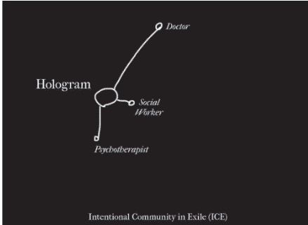

图 3：流亡中的意图性社区。


# 全息项目：关怀、信任与反资本主义实践

最终，随着时间的推移，我们希望建立信任和相互依赖感，这样当全息遇到必须就医疗程序、工作、搬迁等做出重大健康决策（健康始终是在广义的意义上）的情况时，他/她将有三个人可以支持他/她观察生活模式，帮助他/她提出正确的问题，并支持同伴研究，确保全息不会在没有支持的情况下做出决策。

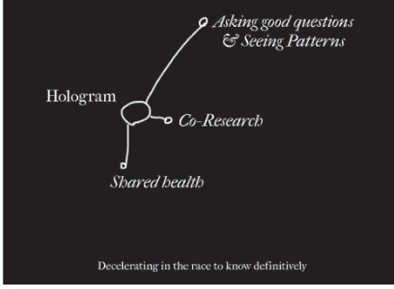

**图 4：认知**

但是，为了让全息在无偿且无负疚的情况下接受这种照顾，他/她需要知道他的耐心者也像他/她一样被照顾。我认为这是项目的一部分，它承认并基于女性主义者和社交再生产理论者的成果建立了一种实践：你不能在不承认维持这些人生存的情况下，利用他们的劳动来建立新事物。重塑推翻资本主义所需的能量和关怀需要大量的支持。如果你知道某个与你完全不同的人正被很好的照顾，就能从他们那里获得支持。这也是我们开始瓦解那些已经习惯的层级和权威结构的方式——带着空手和空空口袋。

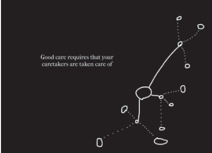

**图 5：良好的照顾**

然后，全息项目的最后一个重要的结构性方面是真正的关键，它触及了在客户主义资本主义之外作为人的意义的奥秘——即当一个人处于照顾的中心时（如果我们想这么说的话），真正的“治愈”会向外转，去照顾他人。这是每一次全息会议的秘密配方、目标以及理想的副产品：让人们感到自己并不是破碎的，他们的治愈与他人的健康和解放紧密相连。

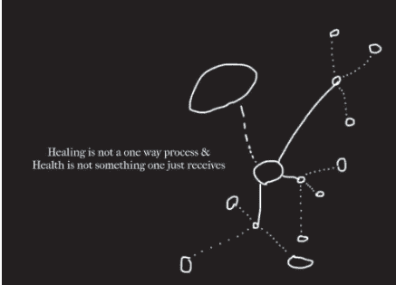

**图 6：治愈与健康**

全息的病毒式结构涉及了对标准观点的一种重要反转，即将医生视为信息的持有者，而将患者视为一个待解决的问题。

在这种结构中，我们务必要将全息的工作视为教师或解释者的工作，交付一个最终将让耐心者学习到他们之前不知道的知识的案例。这是我们能做的最重要（尽管完全被金钱贬值）、最有效且最能实用性的学习形式。在医疗系统将其商品化的同时，它也被视为“女性工作”或完全无用。

**MG：** 你能带我们了解一下参与的过程吗？例如，你说一组四个人聚会并选择其中一人成为全息，这意味着他们和他们的健康将对小组变得“维度化”（透明）。你能详细说明这是如何运作的，以及为什么这对参与者很重要吗？

**CT：** 我们正在实验这些小组以不同方式形成。我们将从四个测试案例开始，一个受邀且自选的人将成为全息，他将在支持下，根据面试和调查，以适合他/她的方式选择三位耐心者。耐心者的选择是我们还没有机会完善的过程组成部分。对于任何从未获得过支持的个人来说，要理解支持对自己意味着什么，或者他们支持谁，并不简单。我们将通过实验来理解，当全息由受信任的朋友、家人、熟人或推荐的陌生人等耐心支持时，整个全息的体验会发生什么变化。来自外部参与者的“客观”视角也为项目增加了一层正式感，而不是朋友间随意的聚会；一个陌生人会向全息的其他成员发出准时的信号，并让会议比普通的朋友间聊天更有结构性。

全息和耐心者的入职流程包括一系列对话和一个训练仪式，这些过程相当波折。每个参与者涉及的两个角色需要不同的技能组合，因此每个角色都涉及一种特殊的“训练”，这种训练可以在小组中进行也可以独立进行。这种“训练”是一种结构化的个人仪式，让耐心者观察并适应自己的沟通习惯，使他们感到准备好参与，并在开启对话中为小组建立信任、好奇和团结。

在完成采集过程后，全息 1 短暂过渡到另一个角色，并在他/她的耐心者的支持下完成这一转变。采集过程结束，全息 1 变成了耐心者 2、3、4、5。

**MG：** 全息项目在 3 月 31 日至 5 月 13 日在 Elizabeth Foundation 举办了名为“病痛时间、残障时间，反对资本主义”（Sick Time, Crip Time, Against Capitalism）的首次尝试。你们最近学到了什么？

**CT：** 自持续三个月的最初项目以来，研究转向了构建支持更大项目的技能和过程。从 2017 年春天，我开始将全息项目作为一系列工作坊，让参与者可以与这种沟通模式进行互动。工作坊是这样的：我创造一个让人们共同经历挑战性心理体验的情况。在随后的反思对话中，我要求在整个期间使用个人的“我们”。这个想法是，一个人的经历如果带入生活的其他部分，就有潜力打破我们从生活和适应债务驱动的地狱中继承的许多假设和习惯。

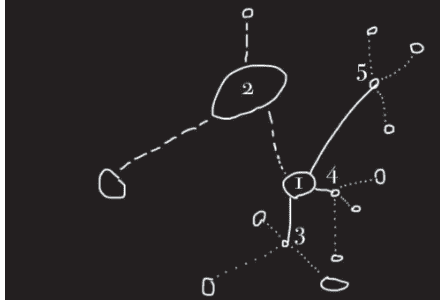

**图 7：全息系统**

我也害怕这个项目。Miya Tokumitsu 最近在《The Baffler》中观察到，“焦虑”，尤其是抑郁（正如去世的社会评论家马克·费舍经常说的那样），是有原因的，但我们被引导相信，遭受痛苦的人必须独自挣扎。费舍的观点是，我们被阻止了将这些状况视为社会性的。提供的治疗方法，最常见的康复方式——治疗法和药物——本质上是患者独自的旅程。这种个人主义的治愈教学法，结合了维持基本财务生存所需的效率，告诉我们你所能做的只有你自己。时间感到很短，是因为地球正在我们的集体发热中死去，导致了土地和生命的流失，扩大了贫富之间的差距。时间感到很短，是因为有太多掠夺性的、种族主义的、财务的和父权的力量需要逃避，并且需要大量的时间来修复自我，以便我们能用时间做一些有收入的事情来支付房租和偿债。为了让全息模型运作，我们需要减慢时间并延长我们的注意力；我们需要参与者之间长期的承诺。

# 艺术

由于对时间的紧迫感和对“合一”日益加剧的恐惧，我们的记忆变得短浅，关闭了对如何以更好方式生活在一起的想象。

在这种氛围下，我愈发害怕训练一个全息投影（Hologram）来与他人分享自我。她足够安全吗？她足够坚韧吗？“耐心”（Patience）或许可能无法提供她从这种练习中获益所需的长期稳定性、关注和温和的好奇心。群体是否会给予足够的时间让“耐心”学会如何变得耐心，并对他人的生活保持好奇？人是有韧性的，但人们正处于痛苦之中，时间正在流逝。当人们在我们的文化中感到痛苦时，他们会转向内心，并且可能不会参与那些他们疗愈所赖于你们的事情。

此外，我担心这个项目尽管是以赋能为导向的，但可能会助生一种痴迷于“治愈”这种残酷乐观主义的文化，让个人的悲伤变成一个黑洞，激进的政治在那里枯萎、死去。我担心，如果被这样看待，它可能会夺走强化草根力量的东西。

正由于所有这些原因，我害怕这个项目，但同时也认为，在我们所有人共同经历的极度不公的剥夺洪流中，这是我过的最好的项目。

## 参考文献

Archibald, '联合国特别报告员在世界上最富有的国家发现深渊般的贫困', Real Change News, 2018年2月21日, https://www.realchangegenews.org/2018/02/21/un-special-rapporteur-finds-aboverty-wealthiest-nation-world/

# 我被告知了一些我不该知道的事。不过，你有工作可以专注真是太棒了

海伦·卡普林斯基（HELEN KAPLINSKY）

由 ALEKSI KNUUTILA 和 ERICA SCOURTI 贡献

# 我被告知了一些我不该知道的事。不过，你有工作可以专注真是太棒了

海伦·卡普林斯基

由 ALEKSI KNUTTILA 和 ERICA SCOURTI 贡献

Δ 以着慵懒的、踏板般的步态向画廊入口处走来，在 50 码外跳下，这样他们就可以从近距离观察聚集在外的 40 人。他们发现认出的脸少得奇。他们意识到自己很紧张，这是一种意料之外的敏感。

在厨房桌旁关于 Ω 傍晚预告的新作品的多次对话，预示着他们之间有一种将 `Whatsapp` 聊天记录纳入其中的某种即兴口头“用户协议”。在这个过程中，Δ 一直非常放松。如果他们的名字出现在公关（PR）的某处，至少根据 Ω 的说法，脚本中没有哪一部分可以直接追溯到他们身上——他们的话隐藏在一个结合了几个朋友声音的集体声音中。

当 Δ 挤进这场仪式般的聚会时，熟悉的面孔安心地浮现。他们在这里投以微笑，并没有停下脚步，直奔安装作品的楼梯间。Ω 已经给他们发了一段视频导览，让他们确切知道在哪里找到它。尽管有动作感应，但当 Δ 到达时，有这么多身体在楼梯上上下穿梭，扬声器一直在不停地聊天：

- 谢谢，我在酒吧等他过来，我必须得进来拿那个该死的硬盘
- 我正试图专注于现实。你觉得你抑郁了吗？
- 我现在不知道，似乎没有稳定的连接。但至少是正确方向上的积极行动。
- 我们到凌晨 2 点还在卸货，我觉得我折损了几年寿命。我知道他工作量巨大且压力很大，但我感觉自己像个家庭主妇。
- 可能会与投射的自我产生关联，让他感到很自责。
- 有时候我觉得归怪是艺术的问题。很抱歉听到这个消息，真遗憾。
- 我们在里面，疯狂的免费酒精。评论家和策展人总是输。
- 是的，这感觉真的很像悲伤。我是相反的。这是一种巨大的解脱。
- 噢，当然，没问题，祝你的任务好运。你能帮我签一下这份请愿书吗？
- 这种感觉就像在炎热的天里喝了一口凉饮料。是的，我觉得在今天这种偏偏日子发布它有点不好意思，但嘿。
- 只是在想，这可能就是原因吧，糟糕的人也会申请。
- 想出一个新新颖的方法，一个无懈可击的男人形象。
- 我没想过你心里在想这个。你知道那种合拍的感觉。
- 我觉得你和那里的朋友对此保密是不对的。我想你可以发封邮件问问，他是否意识到了？
- 但我觉得我们忍受了对……近乎忽视。你通过我的手机给她发信息，手机快没电了。
- Δ 知道除了一个人外，其他参与者都分不清谁是谁。然后他们被克隆的声音出现了一次。
- 我们的身体支配了我们，然后是男人。我想这让我再次感到孤独。不过，我确实感觉没那么抑郁了，那是好事。但说明如果他真的想做，他是可以做到的。
- 然后是 Ω 的前男友，他那优美丰富的口音对软件产生了奇异的影响：
- 那样意味着租金很便宜，而且我们都经常在外。从文化上来说，我认为我们的共同点多于没有。
- Δ 再次：
- 我要上车了，如果你想聊聊的话。co 听到了我们隔墙啪啪。
- 在听到那诡异、机械的声音对抑郁和性爱主题进行冷酷造访后，Δ 感到一阵隐隐的羞愧。由于这种声音在主题上是机械的，Δ 感到没那么抑郁了，那是好事。但说明如果他真的想做，他是可以做到的。

居住成员的痕迹——由于繁忙的公共活动占据了这些空间，这被认为是必要的。他们每周会聚在一起吃一顿由成员轮流负责的大餐，并向任何想了解他们工作的人开放。在 Δ 和 Σ 共同创立的独立策展人画廊和办公室里，他们讨论过如何节省空间并使其变得温馨。由同事策划的首批展览之一，包括艺术家们在画廊的折叠床上睡觉，将公共厨房和会议室变成他们的客厅，并在那里填满了供观众以及流动办公者分享的花朵和烹饪实验。

Δ 和 Σ 争论着“精神空间”的价值。这些人到底代表了什么？为什么 Σ 要通过待在那里来赋予他们合法性？Σ 觉得他们并不总是能维护这个社区工作人们。当你正在构建基础设施时，比如规划任务数据库中的人员列表，你只需要把它们列出来，并希望它们被用于正当的目的。

每个制度化的社区都有产生疏离感的可能，或者仅仅是烦人。Σ 随 Δ 去观察如何扩展人类交流或共情的范围，尝试与人工智能和极嗜细菌的联系。Σ 认为自己可能是出席者中唯一不在该领域工作的人。当他们对“你们做什么”这个问题得到冷淡回应时，他们感觉自己像是一个派生范畴中的“男朋友”。Σ 加入了一个艺术家派对，听着这些新朋友聊了一个小时 Σ 并不认识的其他人。Σ 想，这种情况以前是否也发生过他们身上。如果这个社区感觉像，Σ 会满足于基本的体面。

Δ 正在阅读劳动活动家、教师兼神秘主义者西蒙·韦尔（Simon Weil）的作品，她死后出版的《引力和恩典》是由笔记和日记组成的，这些内容显然从未打算出版。它们大部分撰写于 1942 年，当时韦尔正在担任搬运工人，并与古斯塔·提邦（Gustave Thibon）生活在一起，后者是一位哲学家和基督徒，后来成为了他的好朋友。随着纳粹入侵法国的进行，韦尔被迫流亡，日记和笔记本被托给了提邦，提邦在韦尔去世后将它们编辑成了一个按主题分类的集子。提邦对韦尔私密文字进行调解的伦理，受到了他们之间那份无价友谊“恩典”的限定。韦尔声称，朋友所提供的责任感足以让人接受一种无需偿还的施予。这种在友谊中交换的能量不平等是一种“奇迹”。Δ 必须积攒能量来花在朋友的情感需求上，因此担心自己表现出这种超人类的品质是不人性的。


# 自我保护机制与艺术创作

自我保护机制让 Δ 避免与那些过于公开自己焦虑或不适的人合作。这并不是 Δ 感到自豪的事情，尤其是当朋友们认同“女性主义破坏气氛者”（`feminist killjoy`）这一概念时。

- 8 见下 Gustave Thibon and Joseph Perrin, *Simon Weil as We Were*, London: Routledge, 2003.
- 9 Simon Weil, *Gravity and Grace*, London: Routledge, 2002 (1947), p. 67.

Δ 并不是想要惩罚这些朋友，并且承认，随着他们社区发布的 TMI（信息过多）内容似乎每天增加，这变得越来越困难，但 Δ 的任务是识别并避开会让其能量降到零以下的人。Ω 是一个艺术家，Δ 与他的友谊建立在对他人边界的这种静尊重之上。事实上，Ω 如此地意识到在特别高压的时刻给某些朋友带来情感劳动的潜在负担，他们开发出了一种“个人支持系统”：他们假装拨打“代理朋友”电话，而实际上只是在录制语音备忘录。这样他们就能效率加倍——在为未来的展览制作原材料的同时，又不会让朋友负担过度。

Ω 不断对生活做记录；对逆境的反思与他们当时阅读的任何内容混合在一起、讲座笔记、融入佛教和自助书籍元素的个人格言、推特告白以及未寄出的信。这些构成了原始艺术素材，通过人类（通常是朋友和家人）和非人类（通常是计算性的）指导性信念进行解析。在一次博客中，Ω 将这种做法描述为“自圣传”（`autohagiography`）。关于朋友和人的声音在 Ω 的自传作品中如何被动员的伦理，Δ 不禁考虑了他们领域中一些与自主性相关的概念，特别是认为每件艺术品都是一部自传的信念——为一种或或多有趣或扭曲的视角提供了证据。如果在艺术世界中的网络功能是以艺术品作为代理，这些都是基于独特的亲密认可形式。关键不仅在于被他人认知和认可，而是具体地被那些你认可的人所认可。亲密会产生排他性。当这种亲密关系延伸到人群（一个“圈子”）时——它就会通向一条危险的孤立之路——你真的不需要任何不“参与”故事的人。

这家技术机构吸引了在技术与公共领域关系（如投票系统）之间游走的公职人员和数字策略顾问。这种对考虑集体决策中利益攸关者的关注吸引了 Σ，而 Δ 的忧虑在于，这些伦理和社会关系在他们的关系中继续是一个共同的智力课题。Σ 在识字之前就开始使用早期计算机。通过家里座机电话的现代连接，他们贡献了 `Debian` 项目，这个 Linux 发行版仍以某种形式运行在世界上大部分数字基础设施上。Σ 发现了一些关于成千上万互不相识的人如何设法在自愿和民主的基础上构建软件的想法。Σ 的母亲抱怨电话单。当他们决定一起搬进一间 Shared 屋而不是“结成对”时，一种与混乱系统接触的共同愿望占据了主位。当 Ω 在他们目前的

- 10 Sarah Ahmed, 'About', 'Feministkilljoy', 26 August 2013, https://feministkilljoy.com/about/
- 11 Erica Scouti, 'Introduction to Dream Actions: Embodied Visions', Wrong Dreams, 20 October 2017, https://wrongdreams.com/2017/10/introduction-to-dream-actions-embodied-visions/

## 242 状态机

我正在考虑利用我的私密部位，并在网络上跌倒了，那是音乐阻止了我离开雅典的原因。哈，也许关于使用私密部位来付房租的说法有些不可靠。也许这不会产生太大影响。✼✽✼ 同样诡异地吸引人.

- 12 Alexa Knutila, ‘Offerings’, 机器人, 2017, 地址未公开。
- 13 Mason Leaver-Yap, ‘Offerings’, Leaver-Yap, 2015年8月8日, https://leveryap.wordpress.com/2015/08/03/offerings/.
- 14 见 https://lyrebird.ai。

Ω 和 Δ 经常讨论 Ω 正在忙的任何当前项目。这可能是需要对某个棘手的伦理问题进行咨询，可能是向同事倾诉不满，或者是一种哀叹——“为什么是我们？”有时这更像是一次正式的工作室访问。当他们搬进来时，这变成了 Σ 也会吸收的内容。当 Ω 收到邀请为一个以“调情”为主题的群展创作新作品时，他们为 Δ 回忆起聊天机器人 Σ。也许他们可以基于朋友和前男友的对话创作一些东西？他们问 Σ，是否愿意在计算解析方面提供帮助？

处理来自“朋友之间”的材料的挑战，以及这些交流中“私人、阴谋且相互”的性质，在 Ω 最新的作品中被推向了极限. 在收集了 `WhatsApp` 和 `Facebook` 的聊天记录后，Ω 与将出现在作品中的各个受众进行协商。这种具身中介是一种社会工程。当 Ω 询问 Δ 是否允许他们的形象通过艺术品泄露时，Δ 答应了。他们的声音将变成一种无首的生物，通过一组关键非人类算法进行分叉，产生成对。自动诗歌有助于观众关注这些词汇，Ω 认为这像是一个内部梗，引用了他们在 20 多岁时在艺术/诗歌世界为自己创造的“第一份职业”。

Ω 一直在玩一种刚出现在市场的新软件；`Lyrebird`。它将自己描述为“超写实语音克隆和文本转语音”，Ω 认为这是激活这些词汇的完美工具。这就是为什么 Ω 可以让朋友们随要求说任何短语。Ω 和 Δ 讨论了技术可能开启的恐怖潜力。在关系和法律管辖权方面，声音目前作为证据起着重要作用——它是身体真实性的具身替代品。声音的捕捉甚至窃取可能导致难以想象规模的欺诈、操纵和欺骗。

在学会抹除自己的声音后（在展览中展示或在 `YouTube` 讨论小组中出现），Ω 意识到这会引起不适。Ω 花了多年时间才习惯这一点，而让朋友做好对自己的声音进行公开不忍的准备是协商中至关重要的部分。将许多聊天通道整合到一个集发的声音脚本中，离散的、诊断性的词汇将被重写为一个与 Ω 进行共同建议的聚合声音。Δ 对这种想法感到安心：由友谊产生的安全空间（这个空间最初让他们在私下对话中分享并承担耻辱感）正被一个匿名但真实的集体声音的安全性所取代。

Δ 在 `Lyrebird` 上创建一个账户并读出短语，以便产品生成模拟并捕捉他们的声音。虽然 Ω 警告过 Δ，在画廊听到自己的声音时可能会产生怪谷效应；“那听起来不像我，尽管我知道那就是我。”Δ 试图保留一些自主权。她通过提供 30 个短语（最低要求）来防止其具有真实性。Σ 等待 `Lyrebird` 提取 Δ 的声音，并毫不延迟地从 Ω 档案中生成的几百个短语中，在一个深思熟虑的短语处停顿。Δ 的伪造声音第一次开口了：

> “我有好多年了。谈论它让我感到有点恐慌.”

- 15 Scourti, *Tongue (舌)*

他们都爆发出一阵大笑。这种显然本仅限于“朋友之间”的越界，以一种完美的恐怖谷效应被表达出来，一种令人毛骨悚然的非人类相似性。短语有许多年的对话可供提取。Δ 和 Ω 互相认识至少六年了；Δ 和 Σ 才交往了一年多。他们创作时这种意识已经很明确，即会有一些短语涵盖围绕 Δ 和 Σ 正在发展中的关系的讨论。虽然 Ω 向 Δ 保证在传递给 Σ 之前，所有内容都经过了预编辑并删除了名字，但为了赶进度完成的说法并不完全真实。Σ 确保 Δ 不需要知道。Δ 认为 Σ 毕竟能识别出他们措辞的方式，但这不如“这个项目是 Σ 享受的东西，并同时让他们接近其中一个朋友”的想法重要。对于作品的更广泛的观众来说，它是声音的故障近似而非真实声音，这一事实为 Δ 所希望的免受自我意识的影响提供了保护。

Ω 提出了一个从关系角度来思考的想法——从调情、期待到相互、激情关系的波动，再到最终的关系破裂。为了实现这种内涵理念，Σ 建议整合一些技术，不仅能生成语言，还能打破它的意义。通过开发被称为“词向量”的语义，这些语义是由平台代理开发并发布的，它们被用于理解通信内容并引导互联网用户的注意力。在词向量的语义计算中，识别出与氛围接近的聊天机器人短语。

## 243 艺术

在与 Ω 的互动过程中，Σ 感到与数字工具工作的工艺性质和亲密性差异巨大。Σ 没有时间理解底层一切，或将界面作为命令行。在提供这些黑盒的角色中感到有些不适。尽管 Σ 认为自己是一个“批判性”艺术家，但在分工上存在某些问题；技术人员和作者之间的分工，让 Σ 奇奇自己在当前艺术界机器学习循环中的角色。Σ 接受过人类学训练，并认为关注人类实践的纹理就是新概念所在，人与机器之间的生成性连接是一个肥沃的土地。

（注：由于提供的文本存在大量重复和碎片，此处翻译已根据逻辑流进行了整合与去重。）

# 艺术

§5

Ω 沉浸在自然语言处理的乐趣中。他在深夜依然欢快地敲击键盘，受到 Ω 设定的挑战的激励——将朋友和爱人的对话写成押韵的对句。当 Σ 坐在床上，加深那无尽的彩色代码行时，Δ 搜索关键词“家庭手工业”+“数字劳动”，找到了一篇 1981 年发表在全球电子工程师和专家期刊上的文章，名为《电气小屋》（`The Electric Cottage`）。作者阿尔文温·托夫勒（`Alvin Toffler`）预测，家用低成本电子工作站（可能在 2006 年甚至更早）将带来“对家庭作为社会中心的新强调”。他思考了这种动态模式对心理的影响，这种在家里工作暗示了一种看似面对面且情感化的关系，并将由一个由激进女性主义者、环保主义者和保守主义者组成的看似不太可能的联盟所引领。他注意到，托夫勒的主作《未来冲击》（`Future Shock`）是与妻子海迪合著的。由于她没有维基百科页面，而且如果他出现在这本书的封面上（他们写了 Δ 能找到的 6 本），字又小到 Δ 无法在 `Amazon` 页面上看清，Δ 决定为这一事件寻找进一步的研究，砰地关上笔记本电脑，陷入沉思。Σ 还没有完成，所以 Δ 没有等待，开始准备睡床。Σ 陷得太深了，继续敲击了一会儿。

我们浪漫化了农业性的“回归田园”。她的哲学方法论包含两个相关的、有意识的平行活动：首先是体力劳动使得对真实无产阶级经验的主张成为可能，并在文字日记和笔记本中对这项工作进行实证性分析。为了 1934 年的学术休假，她刻意让自己疏离化，与一群巴黎工厂工人在一起，他们的工作时间是她写作所需时间的两倍，并写下了她的“工厂日记”。直到 1943 年去世前，她向盖尔将军（`General de Gaille`）提出了真正的前线护理，而后者反过来标签她心理不稳定。她认为一种“共同”的异化经验可以产生与世界的真实关系，并将她从资产阶级对意义追求的世俗张力中解放出来，这被 Δ 认为是对无产阶级虚伪的崇拜化。

正如此，Δ 认为艺术家们总是在寻找下一片真实的经验来证明他们政治的合法性。Δ 的当代艺术领域似乎无法逃脱“真实救赎”的承诺。在艺术史上，许多人曾试图全面兜售任何对已破产概念的“真实性”的支持。尽管付出了这些努力，它仍然不断渗透进艺术家身份中脆弱的缝隙；他们的生存本能是一个双重过程：他们标记经验的真实性，以便他们的艺术作品能作为商品流通。Δ 曾受过教育，会考虑他们的职业与所谓的“批判理论”之间持续的冲突。然而，在职业生涯早期的某个点，艺术家和理论家都开始放弃真实性和批判性的二分法理解。随着另右翼在艺术界成名存在，Δ 发现自己对“具身化真诚”的需求既更加怀疑，也更加理解。在一个可能被被称为“后讽刺性转折”的时代，真实性可能被要求为光谱光谱两端的“现实”提供证据。

Ω 说，我们正在从经验经济转向转型经济。他们告诉 Δ，去年在洛杉矶参加晚晚会时，他们意识到艺术界领先于伦敦。Ω 解释，在洛杉矶，他们更严肃地投入于自我照顾。每个人都想表明他们通过一种治愈的转型精神之旅解决了自己的“问题”。早上 6 点醒来，在发送邮件之前工作一小时，以证明自己是一个高效的员工和可靠的潜在合作伙伴。Δ 说，这与围绕真实性开展的工作格格不入，而且“病态女性理论”（`Sick Woman Theory`）的影响——约翰娜·赫德瓦（`Johanna Hedva`）在黑人命存运动期间反思了慢性疾病导致受困的本质：当他们被要求问“如果你下不了床，如何向银行窗户扔砖头？”。无论是该领域保守转向的结果，还是仅仅因为 Ω 老了，与几年前相比，预期发生了调整。对于 Ω 来说，宣布本周经历了情绪崩溃、感觉效率相对低下，或者只是因为最近太累了今天不好，正变得越来越不可接受。这在对话中被提到并不是因为他们特别辛苦，而是因为 Ω 正在经历急性疲竭，当他们去看医生时，对神经心理学的现场诊断感到困惑。Ω 写了一个关于第一次服用处方药达非药物（`Modafinil`）的故事。一段时间以来，Ω 知道自己正在变成梅西·肯普（`Mergey Kempe`），后者一直在研究女性神秘主义者的圣传，如平民女性墨西·肯普（`Mercury Kempe`），她早期自传中的“幻象”被现代科学认定为产后精神症。本笃笃会女院长希尔德加德·冯（`Hildegarde von`）确保了长期的健康枯竭，在她之后两个世纪后，一位神经学家识别了偏头痛发作的症状并提供了回顾性诊断，将圣视与不良健康状况联系起来。像之前的这些神秘主义者一样，西蒙·韦尔斯（`Simon Wells`）的身体很脆弱，她在其他并发症中遭受了巨大的痛苦。无疑这极大影响了她“苦难”的概念，也被称为“malheur”（不幸），有些人因此认为她是圣人。

正如她的幻象一样，Ω 的朋友和爱人是具有远见的见证者，是那些被召唤协助艺术家生命真实性生命的使者。在工作的劳作过程中，Ω 与其所属网络中的其他人进行谈判。Ω 努力在这些与他人的爱关系中维持恩典的承诺，并且大多数时候都完美成功。然而，总存在滑坡的空间，为了某个他们即将被羞辱或冒犯的人。有时这引发了是否值得的问题。然而很久以前，Ω 告诉 Δ 去读伊芙·科索夫基·塞德维（`Eve Kosofky Sedwick`）的《触碰感觉：情感、教学、表演性》。塞德维克的分析从边缘化开始，例如，对“解构”的解构表明一种修复性的方法将使未来不同于过去。

## 参考文献

- 19 '关于我们', EDN Network, https://www.edn.com/about.
- 20 Alvin Toffler, The Electric Cottage, EDN Network, 14 October 1981, https://www.edn.com/electronics-news/431790/the-electric-cottage.
- 21 Alvin Toffler and Heidi Toffler, Future Shock, New York: Bantam Books, 1971.
- 2A. A. Rebecca Rolle-Stone and Benjamin P. Davis, 'Simon Well', Stanford Encyclopedia of Philosophy Archive, 10 March 2018, https://plato.stanford.edu/archives/spr2018/entries/simone-well/
- 23 Johanna Hedva, Sick Woman Theory, Mask Magazine 24 (January 2016), http://www.maskmagazine.com/not-again/struggle/sick-woman-theory.
- 24 Diana Jefferies, and Debbie Forbes, ‘Forged by Fire: Kempe’s Account of Postnatal Psychosis’, Literature and Medicine 32:2 (2014): 34.
- 25 Charles Singer, Studies in the History, Oxford: Clarendon Press, 1917.

## 参考文献

- 关于我们, EDN Network, https://www.edn.com/about.
- Ahmed, Sara. 《Feministkilloys, 26 August 2013; /feministkilloys.com/about/
- Emerging Technology from the arXiv, ‘How Space Matters Reveals the Hidden Sexism in Language’, MIT Technology Review, 27 July 2016, https://www.technologyreview.com/s60225/how-space-mathematics-reveals-the-sexism-in-language/
- Finn, J R. 《A Synopsis of Linguistic Theory 1930-1955», Special Volume of the Philological Society (1957).
- Hedva, Johanna. 《Sick Woman Theory》 Mask Magazine 24 (January 2016), http://www.maskmagazine.com/not-again/struggle/sick-woman-theory.
- Jefferies, Diana, and Debbie Forbes. 《Forged by Fire: Kempe’s Account of Postnatal Psychosis», Literature and Medicine 32:2 (2014): 34.
- Charles Singer, 《Studies in the History》 Oxford: Clarendon Press, 1917.
- Eve Kosofky Sedwick, 《Touching Feeling: Affect, Pedagogy, Performativity》 Duke University Press, 2003.
- Alvin Toffler and Heidi Toffler, 《未来冲击》 New York: Bantam Books, 1971.
- Alvin Toffler, 《电气小屋》 EDN Network, 14 October 1981, https://www.edn.com/electronics-news/431790/the-electric-cottage.


# 参考文献

- A. Rebecca Rolle-Stone and Benjamin P. Davis, «Simon Well», Stanford Encyclopedia of Philosophy Archive, 10 March 2018, https://plato.stanford.edu/archives/spr2018/entries/simone-well/
- Kherbeck, William. 《技术封建主义与公地悲剧》，《Doglander Journal》第1 (2016)。
- Knutila, Aleksi. 《朋友》聊天机器人，地址未公开。
- Kofofsky, Sedwick. 《触摸效应：情感、教学、表演》，德勒姆：杜克大学出版社，2003年。
- Kraut, Richard. 《亚里士多德的伦理学》，斯坦福哲学百科书，2018年6月15日，https://plato.stanford.edu/entries/aristoteles-ethics/#frie。
- Leaver-Yap, Mason. 《开篇》，Leaver-Yap, 《西蒙·韦尔》，斯坦福哲学百科书存档，2015年6月3日，https://leaveryap.wordpress.com/2015/06/03/offerings/
- Rozelle-Stone, A. Rebecca 和 Benjamin P. Davis, 《西蒙·韦尔》，斯坦福哲学百科书，2018年3月10日，https://plato.stanford.edu/archives/spr2018/entries/simone-weil/
- Scourti, Erica. 《梦境行动导论：具身的幻象》，错误的梦，2017年10月20日，https://wrongdreams.com/2017/10/introduction-to-dream-actions-embodied-visions/
- 《滑舌头》，音频装置，由 Paula Lopez Zambrano 和 Ned McConnell 策划，伦敦 Pump House 画廊，2018年4月25日日至7月8日。
- Singer, Charles. 《科学史与方法研究》，牛斯福：克拉伦登出版社，1917年。
- Thibon, Gustave 和 Joseph Perrin, 《作为我们新人的西蒙·韦尔》，伦敦：Routledge，2003年。
- 《电子小屋》，EDN 网络，1981年10月14日，https://www.edn.com/electronics-news/431970/The-electronic-cottage。
- Tofler, Alvin 和 Heidi Toffler. 《未来冲击》，纽约：班坦图书，1971年。
- Weil, Simon. 《引力与恩典》，伦敦：Routledge，2002年（1947年）。

所有 Erica Scourti 创作的作品均受《我们在轻微调情》约稿，由 Paula Lopez Zambrano 和 Ned McConnell 策划。伦敦 Pump House 画廊，2018年4月25日至7月8日。

# 即兴区块链

## 麦克斯·多维 (MAX DOVEY)

对用于探索艺术领域新兴的、去中心化账本技术的表演方法进行概述与分析¹$

对区块链泛滥的一种意料之外的反应，是利用表演、角色扮演和即兴来模拟、想象和体验不同的区块链未来。本文列举了表演的各种示例和应用——即实景角色扮演 (LARP) 和即兴——这些方法为个人理解、开发和塑造作为社会治理技术的新兴区块链应用提供了创造性且实用的手段。

参见画廊中的图 2（第47 页）。

分布式账本技术（通常被称为区块链或 DLT）承诺通过在计算机网络上存储同步的、分布式的时间戳交易数据库，转型数字信息的结构化组织。区块链主要利用底层的加密架构来保护加密货币比特币，其属性已引起全球跨国和国际企业的广泛关注。这导致了数百万美元投入到开发并将区块链整合到业务组织中，因为许多人相信区块链将在塑造信息系统的未来方面发挥不可整合的作用。区块链技术推动更广泛社会变革的动力可以在欧盟资助的倡议中观察到，例如“为了公益的区块链”² 或基于非政府的研究联盟“区块链与全球南方”³。这些倡议内部可能寻求开发和部署区块链技术，为许多“现实世界问题”（例如数字投票系统）或难民管理和交付技术解决方案。在这些研究领域，主流态度是工程师和开发者将能够通过基于区块链的应用程序解决世界的许多问题。这种态度在“区块链黑客松”的戏剧性视频预告片中得到了体现，视频中 Dutchchain 和 Blockchangers 的创始人兼首席执行官 Rutger van Zidam 为一个周末黑客松的拉开了序幕，他向工作坊参与者说：“你们将构建这些惊人的解决方案，并将把它们带出黑客松，走向现实世界。” “现实世界”一词在黑客松上经常被强调，用以描述如能源、农业、仓库和政府等行业部门。“非技术”部门为工作坊参与者想象和构建基于区块链的应用提供了起点，这些应用将打破或挑战信息系统整合到不同行业的方式。

参见画廊中的图 2（第47 页）。

可以被认为是区块链进展中“社会转向”的是智能合约和分布式自治组织 (DAOs) 的激活和实施，这涵盖了从政府、医疗保健到能源和农业的各个行业和部门。反复强调为“现实世界”构建软件应用——为了实施自主的、“图灵完备”的计算机代码，这种代码可能通过分布式数据库管理和治理个人——这是一个极其深刻且广泛的推测性命题，因为目前还没有 DAO 或智能合约的成功案例。大量以“区块链将如何改变……”为标题的文章源不断，这种推测性的话语让人们在变革中保持警觉，无情地预测区块链可能如何影响不同行业。还有人声称区块链的发展状态类似于 1992 年的互联网，虽然区块链的广泛使用尚不为人知，但它将像互联网事实证明的那样变得重要且具有突破性。这种推测性的承诺——没有人能保证区块链将彻底改变行业，但它们被[用于]去中心化去中心化去中心化去中心化——似乎并不有利于区块链的出现。虽然区块链的存在仍是一种想象，但通过对各种场景和想象未来的即兴，提供了一个语义和物理框架，来理解、协商并考虑基于区块链的影响。（注：原文最后一段有重复，已根据语义流修正）。

¹ 本文首次发表于 Geert Lovink, Caroline Nee, Judith Hart (编), Flying Money 2018...

² “为了公益的区块链”，欧洲委员会，https://ec.europa.eu/research/exec/index.cfm?pg=prizes_

3 Kate Sykes, 《五月的一日会议》，Oxchain，2018年5月4日，http://oxchain.uk/2018/05/04/one-day-conference-on-may/

4 Indie McCoy, 《区块链如何改变苏格兰投票》，Business for Scotland，2017年10月12日，http://www.businessforscotland.com/blockchain-technology-can-transform-voting//

5 参见 https://blockchain.com/

6 《滑舌头》，音频装置，由 Paula Lopez Zambrano 和 Ned McConnell 策划，伦敦 Pump House 画廊，2018年4月25日至7月8日。

7 - David Columbia, 《作为我们新人的西蒙·韦尔》，Vimeo，https://vimeo.com/148529

8 - Kaushal, 《十年了，还没有提出过用途》，YouTube，https://youtube.com/8000

9 Sheel, 《区块链：它是什么以及为什么重要》，Brookings，https://www.brookings.edu/blog/2015/01/blockchain-what-is-and-why-matters/

10 Ruth Calhoun, Mark Garrett, John Ness 和 Sam Singer (编) 《艺术家：重新思考区块链》，利物浦：Torque and Furtherfield，2017。

11 Elvia Wilk，《不仅仅是游戏》，Frieze，2017年10月15日，https://frieze.com/article/more-game-0/

12 Chris Elsden 和 John Jones, 《理解 DAOs 的推测性方法》，见 DIS 2017 研讨会论文：新价值交易——理解与设计自治组织，https://chriselsden.wordpress.com/2018/01/dao-workshop-cam-ready.pdf/.

# 状态机

区块链创新领域另一个值得关注的实践是在人机交互 (HCI) 中使用推测性设计方法。在《理解 DAOs 的推测性方法》中，¹² Chris Elsden 和 John Jones

# 艺术

853

描述了一些用于集体探索区块链技术和分布式账本技术（DLT）影响的表演方法。“推测性演绎”（Speculative enactments）是一个术语，用于描述执行由新兴技术-社会构建的潜在配置引发的和后果的行为。虚构情景、游戏玩法和即兴角色互动均被用于挑战和推测潜在的技术-社会未来。在爱丁堡大学设计信息学部举办的一场研讨会上，他们制作了一个基于区块链的婚礼合同虚构原型。在制作一段视频之前，他们创建并测试了一个移动应用程序原型，用以演绎智能合约的后果或潜在用例：该合约将个人的数字货币钱包带入共享钱包，而这些个人位于相同的地理区域。该应用被命名为 Handfastr，源自“手结婚”（handicrafting）传统（这是一种在个体之间履行类婚礼承诺的异教仪式），以此评评比特币式婚姻的兴起，以及在教会或国家权威之外运行的去中心化技术的出现。通过部署原型并演绎新兴技术潜在用例的后果，个人对技术-社会系统的社会效应获得了了体验性的理解，并基于这种经验，对关于此类技术未来用途的主流主张提出了潜在的替代方案。

参见画册中的图 3（第 48 页）。

这些例子绝非毫无意义，但它们展示了表演方法如何在文化和学术领域中被用于传播区块链及其对社会治理的影响。在这些新兴策略的语境下，值得考虑这种不寻常且不太可能发生的现象的原因，并评估其有效性。显而易见，围绕区块链的清晰度捕捉了文化从业者的思想和想象力，作为回应，艺术家们一直在研究这项技术。在想象区块链应用作为 DAO（去中心化组织）或智能合约的影响时，很难衡量这些社会结构和组织配置在“现实世界”语文中是如何运作的。这就是为什么 LARP（真人角色扮演）、游戏玩法和即兴媒介是模拟“现实世界”场景的有效媒介，正如 Kei Kreutler 所言，它提供了一个为围绕基于区块链的新社会组织模式可能形成的关系进行“排练”¹¹的机会。由于区块链开发正在经历“社会转向”，因此通过我们所描述的批判性“干演”来测试这些技术的影响至关重要。需要注意的是，模拟实践也是基于区块链的系统设计架构中的一种嵌入特征。例如，以太坊区块链平台为例，它有一个供开发者使用的“测试网”，以确保代码在发布到太坊主链之前部署正确并运行正常。同样，LARP 提供了一个模拟测试平台，用于模拟因区块链作为社会治理技术的广泛传播而可能产生的社会关系。

参见画册中的图 4（第 48 页）。

13 Kei Kreutler, 'Patternist', 演讲, Flying Money Conference, 阿姆斯特丹, 2018年5月22日.

“这让我极想起了《黑镜》中的某一集”

——“当我们买下一个岛屿（在区块链上）时会是什么样？”¹¹⁴ 参与者

在类方法中，利用即兴来演绎替代性的区块链想象是另一种在效果上程度不一的不寻常策略。例如，剧场中一种用于产生互动和情景的流行即兴方法被称为“是的，而且……”（Yes, And...）——这是一种基于规则的简单游戏，玩家支持生成性虚构的共同创作，每个想法都必须得到“是的，而且……”的回应，以共同阐述一个即兴场景。这种方法传统上用于加速即兴对话的流动并使表演更具趣味。然而，在区块链 LARP 中，“是的，而且……”规则迅速将对话从平庸升级为超反乌托邦化。当它被作为媒介方法使用时，它可以导致 LARP 生成对流行科幻反乌托邦的荒诞模仿。这反驳了区块链技术经常提出的主张。在这里，艺术家约翰·凯奇（John Cage）由于对即兴的使用有自己的顾虑，与这种奇怪的技术-社会角色中对即兴的使用产生了共鸣。凯奇认为，“即兴不会带你进入新的体验，而是带你进入你已经熟悉的事物”。¹⁵ 尽管凯奇指的是媒体创作中的即兴，而非受区块链治理启发的探索社会现实的即兴，但根据我对即兴和区块链角色的经验，我认为经常会相似的结果。与其忽视这一空间内的即兴方法，某些方法比其他方法在尝试传播围绕区块链技术的推测性小说方面更为有效。

在《MoneyLab Reader：对数字经济的干预》中，理论家 Max Haiven 认为“钱是想象的媒介”，文化策略为重建对金融、货币和社会关系的想象提供了多产的方法。¹⁶ 总的来说，在社区内部采用表演方法来神秘化一种解构、想象和重新演绎潜在替代方案迷迷尝试。区块链最初设计用于启用加密货币比特币，它从根本上是一种金融技术，捕捉了人们对于如何通过网络计算重新设计货币、价值和社会的集体想象。区块链的影响仍然存在于其想象的推测中，这些想象被用于产生兴趣和价值，并转变为一种广泛的“通用技术”。¹ 换句话之，只有当个人信服其倡导者所提出的主张时，区块链才能成为一种社会治理技术。这些主张看似植根于区块链架构的事实或科学属性，但仍然是对区块链的广泛修饰的应用，而 DAO 存在于初创公司的白皮书和技术未来主义者的想象中，他们将角色扮演、即兴和想象作为触达、调查和探索光谱的强大工具。

+   ¹⁴ 参见 http://www.daowo.org/#what-it-be-like-when-we-buy-an-island-on-the-blockchain/.

¹5 同上,'John Cage', Keyboard 8 (9月).

¹⁶ Max Haiven, 'Money as a Medium of Imagination', In: Digital Economy, 2015.

# 艺术

955

因此，如果将表演方法理解为体现新关系的社会工具箱，那么排练和即兴未来已成为一种从科幻走向现实的反向策略。

## 参考文献

- 'Blockchains for Social Good', 欧盟委员会, https://ec.europa.eu/research/
- 'John Cage', Keyboard 8 (9月), Dieter, In: Cutow, Marc and Sam Skinner (编). Thinking the Blockchain, 2017.
- 'DAOs', In: Ruth Cutow, Marc Garrett, Sam Skinner. Thinking Liverpool, 2017.
- 'Blockchainers Hackathon', YouTube, 2018年4月10日, https://www.youtube.com/watch?v=48L6Ru0s&feature=youtu
- 'Improvisative Transactions', In: Proc. 2013 Workshop on New Value, https://chelsden.files.wordpress.com/2018/01/dao-workshop-.
- 'MoneyLab', David Golub, Vimeo, 2016年12月3日, https://vimeo.com/14852960/
- 'Money as a Medium of Imagination', In: Digital Economy, Institute of Network Cultures, 1979.
- 'The Blockchain: What It Is and Why It Matters', Johnstone, Kaushal, and Shell Tyler. Brookings, 2016年7月29日, https://www.brookings.org/blog/techtank/2015/05/13/the-blockchain-what-it-is-and-why-matters/
- 'In 2018: Investigating Illicit Flows in the Currency', Geert Lovink, Inte Gocharine Neevan, Ilse Verkerk, Judith Hart (编), Amsterdam of Network Cultures, 2019.
- 'How Blockchain Can Transform Voting in Scotland', Business for Scotland, 2017年10月12日, http://www.businessforsotland.com/blockchain-technology-can-transform-voting-scotland/.
- 'What it will be like when we buy an island (on the blockchain)?', ¹¹⁴ 参见 http://www.daowo.org/#what-it-be-like-when-we-buy-an-island-on-the-blockchain/.
- 'More than a Game', Frieze, 2017年10月15日, https://frieze.com/article/more-than-a-

# 附录

# 作者简介

James Bridle 是一位跨越技术与学科的艺术家兼作家。他的作品曾受画廊和机构委托创作，并在全球范围内及互联网上展出。他的文章见于《Wiley》、《Domus》、《英国卫报》和《伦敦观察者报》等杂志和报纸。他关于技术、知识和未来终结的著作《新黑暗时代》（New Dark Age）由 Verso 出于2018年出版。

Yiannis Colakides 是一位执业建筑师，拥有建筑学院（AA）文凭和 OISTAT 荣誉文凭。除了执业外，他自1993年起担任策展人/艺术总监，迄今监督了超过60个文化项目。他对文化的兴趣促成了 NeMe 的成立，他自2004年注册以来一直担任其主席。他是 LABs 和 Leonardo Jordan 的同行评审员。


# 人物简介

## Max Dove
Max Dove 被描述为 28.3%的艺术家、14.1%的艺术家和 8.4%的成功人士。他还是一位艺术家、研究人员和讲师，专门研究数据政治和算法治理。他的作品探索了技术和数字文化中产生的政治叙事，并将其转化为情境化的项目——酒吧、游戏节目、银行和其他参与式场景。

## Marc Garrett
Marc Garrett 与艺术家 Cutlaw Thurfield 共同担任导演和创始人，自1996年起活跃于互联网。Thurfield 拥有两个物理场所：一个画廊和一个 Commons 实验室，均位于伦敦的芬斯伯里公园。他曾在国内和国外策划过超过50场当代媒体艺术展览和项目。他目前正在伦敦大学伯尔贝克学院攻读博士学位。

## Inte Gloicher
Inte Gloicher 是阿姆斯特丹网络文化学院的研究员和项目协调员。他拥有阿姆斯特丹大学的新媒体与数字文化硕士学位。他的研究涉及数字技术政治、数字经济和在线身份。他与 Geert Lovink 和 Patricia de Vries 合编了《MoneyLab Reader 2: Overcoming the Hype》。

## Valeria Graziano
Valeria Graziano 关注围绕反抗工作以及政治快乐可能性的文化实践。她的方法受到自律马克思主义、机构分析、唯物主义主义和批判组织理论的影响。她拥有美术与艺术史学士学位（金史密学院）、视觉文化硕士学位（金史密学院）和批判性管理研究博士学位（玛丽皇后大学）。

## Max Haven
Max Haven 是安大略省西北部湖水头大学的文化、媒体与社会正义加拿大研究教授，也是《重塑价值法案》（RIVAL）的作者。他同时为学术界和普通读者撰写文章，是《想象力的危机，权力的危机》、《激进想象力》（与 Alex Khasnabish 合著）、《金融化文化》以及《金钱之后，艺术之后》等书的作者。

## Lynn Hershman Leung
Lynn Hershman Leung（梁淑诗）是一位艺术家和电影制作人，过去四十年来的艺术和电影赢得了国际赞誉。作为最具影响力的媒体艺术家之一，Leung 以其创新的工作而广受认可，这些工作调查了许多现在被认为是科学运作的关键问题：人与技术的关系、身份、监视，以及将媒体作为反对审查和政治压迫的赋权工具的使用。

## Francis Hunger
Francis Hunger 是一位艺术家、DJ、设计师和媒体历史学家。他调查信息技术、全球化带来的技术、经济和政治后果、东西方冲突以及性别角色等问题。除了艺术实践外，Francis Hunger 还参与了自己的个人及协作策展项目，以及相关主题的出版。

## Helen Kaplinsky
Helen Kaplinsky 是一位常驻伦敦的独立策展人，目前正在为伦敦科学馆撰写关于将性别视为一种技术体验的展览文章。其中一个方面通过她在利物浦摩尔大学展览研究实验室的访问学者职位进行了探索，她在那里经营着繁忙的阅读小组。2015年，她共同创立了 Res.。这是一个可变的策展组织。他们最近的项目“Alemb”讨论了为了响应金史密学院的女性主义档案而产生的数字与文化蜕变。

## Aleksi Knutila
Aleksi Knutila 接受过人类学训练，经营着一种结合了计算和定性方法的研究。他从伦敦大学学院的数字人类学项目获得博士学位，Knutila 研究过一个德克萨斯社区。Knutila 后的工作研究了算法和个性化媒体环境中信仰与身份的形成，并通过人类与机器推理相结合的方法调查了政治文化。

## Marcel Marcs
Marcel Marcs 是媒体学院和萨格勒布的网路/文化俱乐部 MAMA 的创始人之一。他发起了 GNU GPL，出版了标签 EGOBO.bits。他参与了许多合作艺术项目，是“Okotultivator”营地的组织者之一，并在马斯特里赫特的媒体与传播学院以及扬·范·艾克学院运行关于“技术奇迹”和“统治阶级”的活动。

## Tomislav Medak
Tomislav Medak 是考文垂大学研究生文化中心的学生。他还是萨格勒布媒体学院/MAMA 的教学和出版团队成员，也是“世界记忆/公共图书馆”项目的管理员，并是表演艺术团体 BADco 的一名艺术家。

## Rob Myers
Rob Myers 是一位来自英国的艺术家、黑客和作家，现居于加拿大温哥华。他正试图理解一个日益受技术介导的世界。

## Emily Van Der Nagel
Emily Van Der Nagel 是澳大利亚维多利亚州蒙纳什大学的社交媒体讲师。她教学并研究社交媒体身份、实践和平台。

## Rachel O'Dwyer
Rachel O'Dwyer 是爱尔兰国立艺术与设计学院的数字文化讲师。她的研究处于文化经济与数字经济的交汇点。她写关于金钱、算法和艺术，但不一定同时涉及这些。

# 附录 859

## Lídia Pereira
Lídia Pereira 是一位常驻鹿特丹的独立设计师、艺术家和研究员。她毕业于波尔图美术学院的传播设计专业和鹿特丹皮特·茨瓦特学院的媒体传播专业。她是《Pervasive Labour》（2015）的创始编辑，这是一个为贡献者提供的低门槛平台。

## Erica Scott
Erica Scott 是一位艺术家和作家。她的作品探索传记式写作和主体性。她的个人展包括《Chief Compliant》（美国版）和《Spill Sections》（皇家艺术学院）；小组展包括纽约高线、纽约收藏馆、维也纳美术馆。她的文章发表于《Spells: 21世纪诗歌与小说》等杂志。她是《Happy Hypocrite》杂志的客座编辑，并在2019年夏季驻波尔图。她目前正在金史密学院艺术系攻读由 AHRC 资助的博士学位。

## Rebecca Stein
Rebecca Stein 是杜克大学的文化人类学家，研究以色列占领背景下文化与政治的联系以及巴勒斯坦流离的遗产。她是《数字军事主义：社交媒体时代的以色列占领》（与 Adi Kuntsman 合著）和《冲突中的轨迹：以色列人、巴勒斯坦人》的作者。

## Cassie Thornton
Cassie Thornton 以“女性主义部门”的名义工作。她利用写作、视觉艺术、伪善、实验性研究、巡演和广播来保护未知领域，并揭示债务作为团结的来源。她的工作调查了政府和经济系统对公共情感、行为和潜意识的影响，重点关注债务和安全。

## Paul Vance
Paul Vance 是一位从事新兴媒体形式的艺术家，也是布法罗大学的教授。他的艺术作品以各种科技为媒介探讨其提出的复杂问题。他的艺术品包括研究执法和分类影响的数据收集设备，以及破坏种族和身份科学构建的基因实验。

## Patricia de Vries
Patricia de Vries 是阿姆斯特丹网络文化学院的研究员和项目协调员，也是鹿特丹伊拉斯谟大学的博士生。她还是一个猫奴。她的研究关注作为焦虑来源的想象算法。关于她的更多信息可以在 `www.networkcultures.org/contesting-cap-technology`。

## Krystian Wozznicki
Krystian Wozznicki 是一位评论家，《柏林公报》的共同创始人。他最近出版了书籍《流亡归属》，融合了写作与摄影。其他出版物包括《斯诺登文件指南》（与 Magdalena Taube 合著）、《飞机之后》（与 Brian Massumi 合著）、《谁害怕社区？》（与 Jean-Luc Nancy 合著）以及《关闭》（Abschalten. 天堂生产、大众主义与全球化）。
