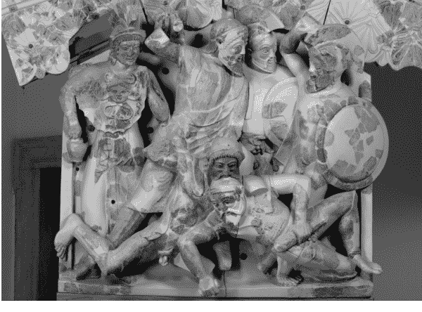
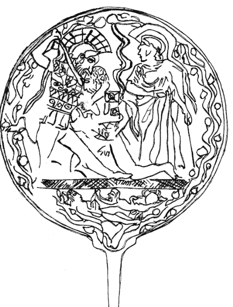
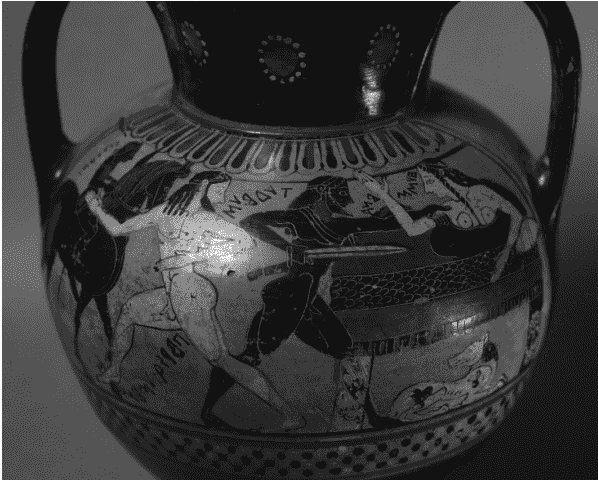
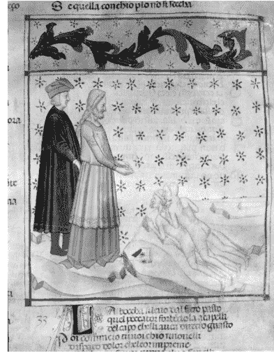

# 斯提修斯《提巴伊德》第八卷：导言、译文与注释辑本

献我的父母

parentibus meis

‘非我不知此’

# 前言

我于2008年首次构思了对斯塔提斯《提巴伊德》第八卷进行全面版本出版和注释的计划，并规划了此书的初始阶段，当时我正准备完成关于弗拉维时期史诗中母性的主题专著。关于这部诗第八卷全集的最后一份完整注释是由卡斯帕·冯·巴特（Caspar von Barth）于1664年用拉丁语编写的；从那时起已有关于书中各个章节的出版，以及一份部分注释，即洛伦佐·贝纳多（Lorenzo Bennardo）关于前271行的博士论文（作者慷慨地将该副本提供给我，因为我当时正在修订这本注释）。这是一个期待已久的版本，我希望这份注释能为斯塔提斯史诗诗的持续学术讨论，以及一般的弗拉维史诗研究做出贡献。包括我在内的许多人曾对过去二十年里弗拉维史诗研究的“复兴”发表过评论，我非常幸运能成为这一动态学者群体的一部分，他们目前正在研究西利斯·伊塔库斯（Silius Italacus）、斯塔提斯和瓦莱里乌·弗拉库斯（Valerius Flaccus）。尽管这是第八卷的第一部英语注释，但我绝不能声称我的工作空穴产生：我受到了其他斯塔提斯注释者的影响（从巴特到阿马尔、莱梅尔等），也受到了其他拉丁史诗注释者（如维吉尔、卢坎、西利斯和瓦莱里乌）的影响。我的关注点既涵盖语言学也涵盖文学，同时我特别强调识别斯塔提斯的希腊语互文，此外我对其他史诗及一般的拉丁作者的所有典故。

我的朋友兼同事斯蒂芬·哈里森（Stephen Harrison）首次建议这项任务。关于提德俄斯（Tydeus）食人行为章节的起草是在2008年秋季学期于牛津完成的，注释的最终版本则于2014年秋季学期在牛津再次定稿、校对和编辑。我向斯蒂芬的款待表示特别感谢，也感谢许多为我提供博图书馆（Bodleian）和萨克图书馆（Sack）资源的人士。除了多年来我在牛津、科尔普斯学院（Corpus）及其他学院结的许多同事外，我想感谢乔伊·利特尔伍德（Joy Littlewood），她对西利斯的研究对我影响很大；我们的午餐和茶歇给我带来了快乐、安慰以及安心，确实是一次难忘的经历。此外，我无法充分表达我对欧文·鲍（Ewen Bowie）的感激之情，他的款待简直是“史诗级”的：我每天往返温德尔伯里（Wendlebury），让我可以使用欧文家中绝妙的图书馆。我的本科导师兼朋友露西娅·阿塔纳萨基（Lucia Athanasaki）是我灵感的持续源泉，在不同时期提供了充足、慷慨且有帮助的建议。

我目前所在的伊利诺伊大学古典文学系因许多原因而受感谢，主要因为它在经历了长期的不稳定和混乱后提供了一个稳定的环境。许多职责——教学、行政和编辑——显著推迟了完成此项目所必须付出的代价，但，伊利诺伊大学是一个极好的部门，拥有非常优秀的同事和研究生。古典文学主任阿丽亚娜·特雷尔（Ariana Trail）是一位卓越的伙伴（尽管有时我们俩都想过放弃），我特别感谢她为我的研究提供便利。文理学院学院通过授予我百年奖学金（2013–16）提供了慷慨的资金；高级研究中心的副研究员职位使我完成了这个项目，并在2014年秋季学期开始创作暂定名为《弗拉维史诗中的死亡、葬礼与仪式》的下一专著。塞巴斯蒂安·安德森（Sebastian Anderson）、科斯塔斯·帕帕西拉斯（Kostas Papasilas）、尼克·迪（Nick Dee）以及我的研究助理克莱顿·施罗德（Clayton Schroeder）直接或间接地对某些注释做出了贡献；他们无限的精力令深表感谢。伊利诺伊大学图书馆的资源令人难以置信：管理员马克·沃德（Mark Ward）和金·勒奇（Kim Lerch）全程提供了慷慨的帮助。在牛津大学出版社，当我首次提交提案时，希拉里·谢亚（Hilary Shea）热情地接纳了这个项目，我真诚地感谢我们多年来的合作。她的继任者夏洛特·利弗莫尔（Charlotte Livermore）非常亲切、乐于助人非常有支持，特别是在项目完成时，我想感谢她在关于格式和插图的会议上的精彩交流，并对所有查询提供了快速答复。牛津大学出版社的其他团队也必须受到感谢。

安东尼·奥古斯塔基斯

牛津，英国

希腊，赫拉克利翁

伊利诺伊，乌尔纳

2014

# 总论

## I. 斯提提斯，《底比斯史》诗人

那不勒斯诗人¹ P.帕皮尼乌斯（P. Papinius）被恰地称为“两个城市和文化的诗人”，考虑到他在希腊文化环境中作为罗马人的身份如此显赫。² 关于他出生的具体情况，我们没有正式证据，但可以将其定在公元 1 世纪中期.³ 斯提提斯的父亲老斯提提斯（Statius the Elder）是一位语法学家，也是一位出生于维利亚的职业希腊诗人，他随儿子一同进入了皇室（Silu 5.3.178–80）；⁴ 他的儿子通过其留存的诗作和所取得的胜利纪念了他的他（Silu 5.3.133–45，可能是在那不勒斯的奥古斯塔节，以及希腊皮提亚、尼墨亚和和伊斯米米亚运动会）。⁵ 斯提提斯的父亲在雅典的广场被授予了塑像（IG ii²3192.2）⁶

父亲去世时，没有再次参加斯提提斯在三月运动会中的胜利，可能是公元 90 年（Silu 5.3.225–30）；然而，斯提提斯在卡皮托利欧运动会中失败了（可能是公元 94 年？），尽管老父亲对他史诗事业的支持似乎是无如一的：*to nostra magistro/ Thebeis urgebat exordium hortam; tu cantus sentire mores, to pandere fact/ferum bellique nodos positusque locorum/ monstras*（斯提提斯的语言用在史诗序言中，其中神灵讨论了他的诗歌的主题，Stat. 5.3.233–7）。⁷ 事实上，斯提提斯的语言呼应了《底比斯》第 8 章中先知阿菲阿鲁斯下冥界：

> ² Newlands (2011: 1–3; 2012):

> ³ 生平细节源自 Silau 5.3（写给妻子 Claudia）和 Silua 5.3（写给父亲，死于公元 79 年至 90 年之间）；特别是 Silu 5.3，参阅 Coleman (1988) xviii，Delarre (2000) 39，Holmford-Strevens (2000), Nauta (2002) 195–204，以及 Gibson (2006) 260–78 的详细注释。

> ④ 关于城市的 68–99 行诗赢得了皇室圈的关注（Silu 5.3.199–204），我们知道他描写火山爆发的意图（Silu 5.3.205–8）。

> ⁶ ἡ βounή ή ἐξρύν [παίου]/ Πόπλον Ππάννος/ ἀρεττης ἐνέκα [ἵνις]; Clinton (1972; 2005–8: i.322, ii.318）（与父亲参加埃琉西斯秘仪），以及 Ahl (1986) 289–91，labat incerto mihi cursus (Silu 5.3.237–8) qui praeceps non licito inane (Theb. 8.84–5)。

显然，《底比斯史》的每一行诗都体现了斯提提斯对父亲的巨大感激：这位弗拉维时代的诗人是这位语法学家的其他年轻学生，包括荷马、赫西俄德（？）、阿尔曼斯、莎霍、卡里马库、吕科丰、索夫罗尼乌斯和科里娜等（Silu 5.3.146–61）。

斯提提斯的作品是公元 80 年代和 90 年代知识背景的产物：《底比斯》可能在公元 93 年完成，我们相信它是该诗在末 80 年代的结尾（8.81–12），花费了十二年的艰苦创作的。这个问题很难回答，它与西里乌斯诗作的关系也有联系（参阅 III.3）。

## II. 《底比斯》第 8 章与文学评论

《底比斯》第 8 章提供了一个独特的开端，伴随着阿菲阿鲁斯的下冥之旅，令冥界震惊。反映了斯提提斯与其父亲的关系。等等，反映了斯提提斯与其父亲的关系。

> 8 斯提提鲁斯的底比斯系列可能包含了食人场景，因为 PMGF 222b 可能叙述了直到兄弟杀的史诗（Hutchinson 2001: 121），至少提到了波吕尼斯的阿尔戈斯之旅（Davies and Finn 2014: 392–4）。

参阅 Coleman (1988) xvi 和 Jones (1992) 128–31。这两部作品，如果阿加德斯定于公元 80 年代初，以及多米提乌斯在 82–83 年对哈提人的战役。

> 12 参阅 Ripoll，但要有 Gervais (2013: ix–x) 的合理谨慎。Ripoll 的重构是可能的：斯提提斯和西里乌斯最晚在公元 95 年左右在坎帕尼亚相遇，当时西里乌斯隐退，正如斯提提斯在那不勒斯和罗马之间分配时间（如果 Silu. 3.5）；在此之前，他们可能都了解过对方作品的部分（427）。

(1–20): 普鲁托对非法下界感到愤怒，派遣提西西丰通往凡间。底比斯少年阿提斯（554–68），墨涅库斯统治底比斯同伴以保护不幸的阿提斯的遗体（596–06）。与此同时，在底比斯家庭内部，安提戈涅和伊斯墨妮回忆了家族的悲惨故事并同情（607–20），此时伊斯墨妮在恐惧中讲述了昨晚的梦（620–35）。受伤的阿德拉斯被带入家中，雅科斯塔唤了伊斯墨妮。阿提斯在她的怀中去世（636–54）。斯提提斯被选为当天的英雄，激励了底比斯人创造了壮举（655–64）。他看到了厄忒克勒斯，复仇女神因杀兄弟将他带走（665–88）。提德俄斯杀死了几名战士，自己也受伤了；帕拉斯正前往奥林匹斯，受了致命伤；然而他继续战斗（716–27），同伴们将他从战场撤下；英雄战士给了他们最后的建议，并表达了最后的愿望：他想要梅拉尼普斯的头！（728–45）。尽管感到震惊，卡帕内乌斯取来并呈给提德俄斯对手的头颅：这位悲剧英雄现在沉溺于食人，而密尔瓦瓦移开了眼睛，永生之礼永远地离开了提德俄斯（745–66）。

### 总言

第八卷中的会议回溯了第2.134–213节中的相似场景，然而，会议之后是国王的女儿们与波利尼克斯和提德乌斯的婚礼。最后，提德乌斯在第二卷中的君主身份和对密涅瓦的祈祷（527–743），在他在第八卷中的首次胜利（ariste）中得到了呼应（见注释 663–4 和 765–6）。同时，《提阿斯》与第四卷有共同的线索：阿尔戈斯士兵的名单（阿菲阿鲁斯和提德乌斯；见注释 364–5, 433–6, 481–3, 693–4）以及第四卷中4.406–645的招灵场景（见注释 1–20, 109–10, 120–2；提奥奥达马斯与提瑞西亚斯之间的相似性，见本引言第 III.5 节）。此外，本书以“事体中间”（medius rebus）开篇，与第七卷有着不可分割的延续，在第七卷中，阿尔菲阿鲁斯被大地吞噬并乘车抵达冥界。第七卷意料之外的结尾延续到第八卷，阿尔菲阿鲁斯的下降处于悬置状态：这位预言者在等待吞噬他的巨大深渊面前，惊恐地望向上界（*resitext cadens cael*, 7.821）。正如 Helen·Lovatt (2015) 正确观察到的，在六卷书分为两部分的结构中，存在一个由三组四组成的反向结构，其中第4、8和12卷构成了结束与新的开始。第八卷是第二组四的结束，但也是一个新的开始，迪斯（Dis）作为诗人一个新形象出现，创造了自己的诗歌。同样，第十二卷是第三组四的结束，也是一个新的开始，自给自足并以微缩的形式重复了之前的整个旅程和战争。

《提阿斯》很难从广义上定义，因为本书展示了基于史诗边界的严格分类¹⁵——最后一个场景成为了《提阿斯》中最令人难忘且最有力的情节之一，而这本书在很大程度上是由诗人对不同体裁的实验所定义的。预言者与冥界王的相遇将“预言”（aug）转化为奥菲斯式的形象，呼应了《农耕诗》第4卷以及奥维德的《变形记》第10卷，教学元素与史诗元素融为一体。本书的中段由局外人阿提斯的胜利（aristeia）以及他在爱人怀抱中的悲剧结局所占据；诗人模糊了史诗与哀歌（ele）的界限，我们瞥见了安提戈涅和伊斯墨墨娜寝室内的私人、女性空间，那是提比斯家庭（oikos）内部一个看似安全的空间；阿尔菲阿鲁斯进入冥界（根据普鲁托的说法这是一种违禁行为 *nefas*，在奥德修斯、埃涅阿斯；或西西庇斯之下），以及提德乌斯的食人行为和对永生的否定，界定了本书的边界：以提德乌斯的“同类相”（δμοφαγία）构成的令人窒息的结局。

¹⁵ Kroll (1924: 202–24) 的“体裁交叉”（Kreuzung der Gattungen）应用于 St 的诗歌，见 Laguna Mariscal (2006)。

回首了阿尔菲阿鲁斯前往迪斯冥界的下行（katabasis），而读者则沉思提德乌斯通往神化但夭折的升行（anabas）。虽然阿尔菲阿鲁斯被认为是阿尔戈斯士兵中在极乐世界获得永恒幸福福报的人（191–207），但提德乌斯却需要通过仪式清洗来消除污染。然而，书的中部被核心战斗情节占据，那是敌对第二天的开始，是一个纯粹的史诗式（荷马和维吉尔式）章节。在这一部分中，我们也见证了 St 对史诗体裁的实验，即史诗与哀歌之间的斗争；¹⁶ 在战斗之前，阿尔戈斯人为他们的同胞哀悼（例如，哀歌是《森林》Siluae 的关键元素），阿尔菲阿鲁斯的继承者向大地女神（Tellus）祈祷，St 通过卢克莱锡等模型吸收了《荷马史诗》（也见第 III.5 节）。

第八卷为近期对该诗的研究性解读方向提供了一个非常好的例子：书的开场场景中迪斯释放了愤怒和破坏性的杀意（ira），被认为是《提阿斯》悲观、黑暗且阴郁基调以及诗人展望的良好范例。事实上，没有 St 的读者否认《提阿斯》第八卷中邪恶的冥界色调；然而，关于诗的结尾是否随着特西奥尔斯（Thesiour）或其他另一个暴主的出现而得到补偿，评论家在预定可怕的命运¹⁷方面存在分歧。正如 William Dominik 所言，“普鲁托在各种人物可怕命运中的角色显示了他在一个被描绘为敌视人类处地的宇宙中的地位重要性……提德乌斯因一种神驱动的犯罪而受到惩罚，仿佛他直接对该犯罪的负责。他代替提丰斯和普鲁托接受了惩罚；¹⁸ 在讨论《迪斯与对冥界的统治》一章时，Randall Ganiban 指出迪斯在《提阿斯》中扮演了正式角色，并成为概述战争事件的主角……迪斯的出现因此是一个关键时刻；他的报复在互文本上颠覆了《埃涅纪》的政治秩序……如果违禁行为（*nefas*）在一个不关注道德问题的的世界中是无处不在，那么天神们

被证明是多余的，因为它们在道德上并没有那么不同¹¹ Federica Bessone 对诗结尾的最新解读指向了提西乌斯的许多美德²⁰ 提西乌斯反映了仁慈的提米图吗？还是对绝对权力的深层怀疑²²《提阿斯》第八卷优先考虑简单的解释，因为它促成了战争的复杂高潮：毫无疑问，提德乌斯的食人行为成为了迄今为止最恐怖的结论，超过了第十卷的可怕行为，仅被同兄弟残杀所比肩。因此，食人行为和同兄弟残杀被迪斯在他对战争的指示（69–72）中放在一起（见注释 663–4 和 765–6）。

³ 关于《提阿斯》中神灵描写，重点关注朱庇比特，见 Legras (1905) 157–205（特别是183–9关于朱庇比特的部分），Schetter (1960) 5–29，Schönberger (1965)

²¹ 正如 Delargue (2000) 所提。

²² Coffee (2009) 228。关于 St 在结集中对提米图斯的看法，见 Ganiban (2007: 231–2)，他将史诗解释为对君权的批判，而非针对提米图斯本人；McNelis (2007: 176–7) 指出缺乏满意的结局是 St 对弗拉维血统看法的象征。

## III. 神灵与英雄：《提阿斯》中的神话与崇拜

### 1. 神灵

无疑，诗中赋予神灵和神性力量的重要角色在第八卷中得到了突出；²³ 从迪斯在宣读诅咒和违禁行为（*nefas*）的更新，到中间对大地女神和神圣阿尔菲阿鲁斯的显著祈祷，再到密涅瓦与赫拉克勒斯守护他们的学生（提德乌斯和海蒙）比赛之间的对话，到最后密涅瓦自己拒绝神化并在书结尾逃向伊利苏索斯之水进行净化。

# 概论

丹尼斯·费尼尼（Denis Feeney）指出，《底比斯史》的世界被安排在“一个虚拟的方案，分为三个层次：顶部是奥林匹斯神的世界，底部是冥界，人类世界介于之间”。24 正如他指出的，迪斯（Dis）是朱庇特的对立面：25 令他遗憾的是，他被放在了诗中另一对竞争兄弟——埃特俄克斯（Eteocles）和波吕尼克斯（Polynices）之中。许多学者选择用二元论的方法来描述诗中的神灵，即奥林匹斯最高神朱庇特与斯塔提乌斯地狱中的“撒旦”普鲁托之间存在内在的极性，26 但这种解释最近遭到了批评者的质疑，他们仅仅指出朱庇特本身并非不可触及：他的*reticula deorum prima*（1.230–1）让人类与神性靠得如此近；27 如多米尼克（Dominik）所结论，他揭示了“神灵压倒的力量以及对人类困境的普遍漠关心”。28 根据费尼尼的观点，上下界之间的界限随着诗的推进，随着阿菲阿罗斯（Amphiarus）和卡帕涅（Capaneus）的死亡而退缩并消失。29 麦克尼利（McNelis）特别观察到，“提德乌斯失去永反映了《底比斯史》中神人之间尴尬甚至扭曲的关系”。30 尽管另人认为最终应归咎于提丰（Tiphone），但是复仇女神推使了提德乌斯这位原本不是荷马英雄犯下亵渎；31 西尔维·弗朗谢特·德·埃斯佩（Sylvie Franchet d’Espey）声称斯塔提乌斯并没有提供简单的答案：朱庇特是如此，其他神灵也是如此；32 这解释了人类的痛苦。

24 Feeney (1991) 345；参见 Henderson (1993) 174：“被拒绝的克罗诺斯之兄弟”。

25 Feeney (1991) 350–2；参见 Dominik (1999a) 35：“人类兄弟的性格反映了神灵的性格（以及关于多米提安和提图斯之间关系的16页）。”另见 Bennardo (2000) xxv–xxxi。

26 Kroll (1932) 450 and 453, Schechter (1960) 29, Goting (1969) 69, Schubert (1984) 128–30, Snijder (1968) 17, Versey (1973) 264, Feeney (1991) 350–2, Delarue (2000) 309。参见 Dominik (1994a) 36–n。

27 Feeney (1991) 355。Dominik (1994a) 1–7  分析了朱庇特的滥用权力；Criado (2003) 识别了朱庇特作为独裁者的弱点。


## 28–35 学术注释

28 Dominik (1994a) 75；参见 Ganiban (2007) 120：“迪斯与朱庇特之间存在斗争，但双方均力敌。朱庇特对迪斯的无知反映了所有天神的普遍弱性……它们在忽视冥界对兄弟战争的重要参与的情况下行动。”

29 Feeney (1991) 359。

30 Dominik (2000) 393；个人神的行为从未如 *Hinsicht auf den Tod Pluto* 中的 8.759 和 10.780–2 所违背（Schubert 1984: 211–113）。

32 Coffee (2009a: 025) 那些注意到普鲁托的名字指向财富的人，他从未使用“商品语言”来描述他的死亡业务……在《底比斯史》的神灵中，斯塔提乌斯为奥林匹斯神预留了消费和商品交换的语言，他们全都是朱庇特、阿波罗和马尔斯：传统的角色被反转了，是奥林匹斯神而非普鲁托，衡量着他们在消耗凡人生命中获得的满足感。

斯塔提乌斯对虔诚（Pietas）、仁慈（Clementia）和忒修斯（Theseus）等形象的发明最终了一个答案，因为后者变成了“人之”。33 同样，普拉米特·乔杜里（Pramit Chaudhuri）优先考虑诗中人与神的界限：他认为作为这部史诗首领的卡帕涅34 挑战了关于神性的传统概念；尽管在前十一章中仍然是一个强大的神性机制：然而，在《底比斯史》最后一书卷中，史诗世界已经发生了——无疑不是为了适应卡帕涅的愿景，但显然更接近他对人类能动性以及物理可行领域的价值化，诗的大部分都是如此。神可能依然存在，尽管我们看到的与之前有所不同的神灵阵容，但他们在人类主角（包括忒修斯和亡者的遗孀）中扮演了明显的次要角色。”35

## 2. 阿菲阿罗斯之死与英雄崇拜

### i. 斯塔提乌斯的文献来源

崇拜和仪式是神性呈现中的重要元素，正如我们在上面看到的：迪斯的诅咒、对提勒（Tellus）的祈祷、密涅瓦的污染。对于诗中的英雄也是如此（在诗的其他地方，例如在第六章为奥菲尔特斯建立崇拜）。阿菲阿罗斯是第七章结尾无可争议的冠军和第八章的开端；然而，他的足迹延伸到了冥界的章节。他被阿尔戈斯人哀念和哀悼，并在继承的选择中扮演了重要但非直接的角色。36 正如弗雷德里克·阿尔（Frederick Ahl）所指，阿菲阿罗斯与阿德拉斯特斯（Adrastus）之间的关系比简单的联系更为微妙。这位先言者和温和的国王在史诗中是智慧和克制的“好”人。8

欧克罗斯之死在腊语文献中被歌颂39 我们有关于欧菲莉（Euriphile）和恶神的描述：ὅν πέρὶ κὴ φίλιλε Ζεῦς τ᾿ αγοχο καὶ Apollλον/παντοῖν φιτηδ: ὅν οὐδ ἰτο γαθος οὐδν/ ἀλλ’ ὅλε ἐν θῆβαις γυναίκας δώρων (And Ol. 245–71)。41 来自《底比斯史》的证据基于 Pind. Ol. 12–17：ἀφοτερες μάντις τ᾿ ἀγαθος καὶ δουὶ μάχεαι（and fr. 7 and 8 on Euriphile and Ampholus）。42 毕达达提到一个吞噬先言者和他的马的时代：Ol. 14: ἐπαὶ κατὰ γαῖν/ ὅν τέεν καὶ καθαιίδς ἔμαρρ, in Nem. 9.24–75; 宙斯通过珀里克墨涅斯（Pericymenes）用雷电劈开了大地43 ὁἈμμφρεὺς σίσσεν μέβαι/ Zeus τὰιστρεν χόνα, κρυφ’ δ᾿ἄποποι/ δορι Περικμενου πρώτα τυπέχαταν/ θυμον ἀισσθῆμεν.44 毕达达的尼美亚诗在时间上是：阿菲阿罗斯被埃特俄克斯称为一个寻求者：δίκαιος ἀγαθος εὐσεβής ἑρῖν/ μέγας προφήτης (Sept. 610–114); 使者描绘先言者完全意识到33 Franche d’Espéry (1999) 356 and 384。另见 II。

34 诗中的巨人战（Gigantomachy）主题经常与朱庇特和普鲁托讨论（c.f. on 42–3, 66–75；例如 Kinnert (1970) 60–70, Dominik (1994a) 32, Franche d’Espéry (1999) 245, Criado (2000) 108, Ganiban (2007) 145；一般，见 Hardie (1986) 84 and 329。

35 Chaudhuri (2027)。关于弗拉维史诗中的神学和政治，见 195–321。Chaudhuri 认为斯塔提乌斯的诗是多米提安“意识形态定位”的反映。

36 关于斯塔提乌斯的地位及其对阿菲阿罗斯传奇的处理，见 Ten Kate (1955) 63–7 and Olive (1996)；关于斯塔提乌斯对阿菲阿罗斯的描写，见 Legras (1905) 15–29, 98–101, and 223–5, Ten Kate (1955) 63–81，以及 Bennardo (2010) xxv 中的几处引用。关于神话图像学，见 LIMC i.691–713 (Amphiaraus)。最近，Walter (2014: 165–80) 在先言者的背景以及他们的诗歌中讨论了阿菲阿罗斯。

[第24页]

+   ³7 关于阿德拉斯特斯和阿菲阿罗斯作为弗罗尼人（Phronideae）的共同祖先，参见 Paus. 7.17.7。根据 Pind. Nem. 9.12–62，先言者早早就从阿尔戈斯驱逐了阿德拉斯特斯，并最终遇到了阿德拉斯特斯的妹妹欧菲莉。

³⁸ Ahl (1986) 2864。参见阿德拉斯特斯在战争末期寻找关于阿菲阿罗斯损失的描述：ποθὼ στρατὸς ἀγαθλαι ἐμάς (And Ol. 16)。

³⁹ 阿菲阿罗斯是梅兰普斯的后裔。（在 Pind. Nem. 9.30；关于欧克罗斯（Pind. Pyth. 8.55, Apoll. 1.8.2, 3.6, 3.15.22, Diod. Sic. 4.68（由 Hypermnes 写），Hyg. Fab. 70）。关于梅兰普斯，另见注 27–79。

⁴⁰ 见 Braswell (1998) 27–44 关于毕达达尼美亚之前的来源。另见 Baer (1925) 关于先言者在希腊诗歌中的存在，Gant (1993) 2.506–15，特别是关于埃斯库勒的de Vito (1999)。

⁴¹ 参见注 104–5。我们无法确定赫西俄德中的梅兰普斯亚（Melampodia）（fr. 270–9–W），欧菲莉的项链在 fr. 142 M.–W. 被赞美，阿菲阿罗斯的美德在 fr. 25.37–M.W. 被赞美：ἀγαθος δέὶ μάχεθαι,/ε[σ]θλος δὲ ἐν πραραίδσει, φιλλος δ’ ἐν ἀναθισσει（在 Thebais fr. 6 West，Aesch. Sept. 569: ἀκρίν μάντου，和 OCth 0013.14）。

⁴² 进一步见 Davies (2014) 90–5。

³ 珀里克墨涅（Pericymenes）作为冥王的称号这并非巧合（Paus. 2.354；Hesychius IP 1736）。

⁴⁴ 参见 Nem. 10.8–9：γααὶ δὲ ἐν θῆβαις ὑπέκκτο κενραυθε Δίοὸς βεσέιν/ μάντων Οἰκλεων, πολέμο νέρός； Isthm. 3.71–6。

## xxvi 导言

未来的死亡：ἔγωγε μὴ δὲ τήνδε πιανώ χθόνα πολεμίας ὑπὸ χθονός / μαχοθέμθ· οὐκ τιμον ἐλπίψις μόρόν (587–9，参考 Hutchinson 的 568–630)。阿菲亚留斯（Amphiarius）作为凡人乘着马车进入冥界，这也引起了其他悲剧作家的关注：οίδα γὰ ἄνακτ Ἀμφίρερ χρυσ/σοδέτός ἐρκει κρυφθέτα γυναίκαι/καὶ νὸν ὑπὸ γαίας—ἱ... / παίμνων ἀνάάσεσει (Soph. El. 83–41；对于他们来说，他们的士兵们并未想象过阿菲亚留斯在冥界拥有一个幸福的来世，参见 c. 191–2）ἐδειξα βάζίνε Θιβαί oἴκος/αὐτοῖς ὅπλλοις καὶ τετδώρίστῳ δίφρῳ (Soph. fr. 958; Radt); καὶ μν τὸν Οἴκλεος γεν τόκόν/θεοι ζῶν—ἀναπάtranτες ἐς μχονος/αὐτοῖς εὐλογοῦσιν ἐφανῶ (Eff. Sup. 925–7，强调神性的恩宠)。

虽然 Beard 完成了阿菲亚留斯下界（katabasis）及其与冥界之主会面的叙述，但他同时也强调了预言者因死而形成的崇拜，这种崇拜反映了古希腊和罗马围绕该遗址的实践和仪式。事实上，提奥达马斯（Thiodamas）声称阿菲亚留斯的圣所（manteion）位于圣德洛斯（Delos）和德尔斐（Delphi），在那里阿波罗本人位居阿尔戈斯预言者之后（335–8）。在宾达达中，阿菲亚留斯对七征军（Epigoni）发表了预言：τοῦ ἄντερ ποιοί· Οἴλεος παῖς ἐν ἐπταταυῖλον ἰίων/νίου Θιβαὶ ἀίξε παρμενes αἰχ,—/ὅποτ’ Ἀργεος λυθουν/δετέδρα ὅδὲν Αγύπτου (Py. 8.32–45)。希罗多德记载说，阿菲亚留斯的神谕涉及了祈求（κατεκομίσε ἐς Ἀμφίρεα, 8.134），这是一种狄比人自己也无法咨询的神谕.-46 狄比人被派往崇拜（τοῦς μὲν ἐ Δελφοῦ ἰένα, τοὺς δὲ ἐ Ἄβᾶ τς Φώκών, τοὺς δὲ ἐ Δωδδῶν ὅἱ δι δὲ τῆς ἑτεμπάτο παρὰ τε Ἀμφίρεων καὶ παρὰ Τρωφῶν, οἱ δὲ）分支派崇拜（Branchaide）在此处有所体现，因为圣徒在 195–20 中与德尔斐和多多纳一同提到了它。47 在文献中，我们发现了该地点的名称，如 Knavais（Stab. 9.12.0; c. 9.12）；保萨尼提到：

> 45 狄比斯的阿菲亚留斯，见 Hubbard (1992) 101–7，关于宾达达见 103；另见 Py.88–60 可能对狄比斯神谕的暗示。阿菲亚留斯的儿子阿尔梅翁（Almeon）和阿菲洛科斯（Amphiloch）将在第二次进攻狄比斯时复仇（Apollod. Bib. 3.6.2；但在 Did. S.65 中，仅有阿尔梅翁）。

### ii. 斯提提斯与其拉丁先驱

后古典时期，奥罗普斯的阿菲亚留斯崇拜强调其神秘主义和治疗性功能。在罗马时期，举行名为 Ampharia Megala 的罗马活动。关于阿菲亚留斯人物的传统与意大利半岛的联系源于一个传说：预言者的儿子卡提卢斯（Catillus）从狄比斯的战争中逃到意大利，成为图比（Tibur）的始祖，这个故事在西西的《起源》（Origines）中保存：

Tibur, sicut Cato facti testimoniumum, a Catillo Arcade, praefecto classis Euandri, sicut Sextius, ab Arguia Catillus enim iuuente, Ampharius filius, post prodigialem patris Thebas interitum Occlei aius cumn metu sacrum missos libero procreaut, Tiburtum, Coram, Catillum, expulsis ex quo Siciliaae uiterbis Sicanis a nome Tiburti fratris magni urbem uocauert（FRHist fr. 61）。公元一世纪，由于苏拉（Sulla）授予该区域免税地位（88 BCE），其声誉得到了加强；然而，在他公元 79 年去世后，元老院在公元 79 年恢复了这些特权。无疑，伊特鲁坎传统的狄比斯形象丰富了罗马人的想象（见下文第三部分）。需要记住，圣徒阿菲亚留斯的肖像不仅源自史诗，也来自悲剧。正如 Fantham 所指出的，阿菲亚留斯是一个具有悲剧性色彩的角色，快速观察那些在许多情况下并无定论的片段，就能揭示出悲剧性的联系。例如，在共和派悲剧中，阿基乌（Accius）的剧中描述阿菲亚留斯的命运（quod in terram infernam penuis/depressum alti claustre presci），而他的七征军则庆祝了第二次远征。此外，西塞罗引用的关于阿菲亚留斯“祭祀”的片段（ut in fabulis 6.6.6）出自一位未知作者，将希腊传统与拉丁狄基乌家族（Decii）联系起来（En. Ann.191–3）；通过将阿菲亚留斯的下界与随后安抚大地女神（Tellus）的祈祷相结合建立了联系：从李维对比普·狄基乌·穆斯（P. Decius Mus）行为的描述可以看出大地女神在仪式中地位显著：legiones auxiliae hostium meum Deis Tellurique deoueo（8.9.8）。凯西莉拉（Caicilia Metella）的法令为：ὅιος Ωρώπίων / Μελλάν Καικαων, Σλλα Επαραδικού γενίκα, Αμφιαρας καὶ Υγειειας

除了将阿菲亚留斯呈现为另一个奥菲斯之外，这位弗拉维期的诗人还利用了《阿尔戈游记》（Valerius Argonica），因为预言者本人曾是一名阿尔戈船员，他的死亡呼应了提菲斯（Tiphys）的死亡：斯提提斯·阿波洛尼（Statius Apollonian）对提菲斯的描述是他在绝望中未能完成从狄比斯战斗中归来的所有正常动作（8.164–73），这与以下的绝望非常相似：

# XXX 总体介绍

阿波洛尼奥斯（公元前258–63年）中的阿尔戈勇士。这是机械论的一个关键时刻……瓦莱留斯（Valerius）将对提菲斯之死的绝望（V. Fl. 5.1–72）分为在他实际去世之前的绝望，以及随后到达柯尔基斯后杰森的绝望（5.297–328）⁶³ 但最重要的是，St 选择了两个人物作为《伊阿宋史》第8卷的开头呼应，这两个人物之间存在着超越表象的关系：正如我们接下来将看到的，阿菲亚乌罗斯参与了提德乌斯的死亡（瓦莱留斯·弗拉库斯的另一个阿尔戈英雄人物）。

# 3. 希腊-罗马传统中的提德乌斯之

### i. 希腊传统中的提德乌斯

书中最后一部分事件的发展非常快，提德乌斯在最后的结局来临前享受了他的最后一天，*Theillos illa dies*。这名爱奥利亚士兵成为了阿斯塔库斯之子的猎人，最后他自己变成了被猎的对象。提德乌斯最后的行为 ωμοφαγία/ἀνθρωφαγία，即食用生肉（梅拉尼乌的大脑）⁶⁴，迫使密涅瓦收回了她最喜爱的战士的长生不老之。

在希腊-罗马文献中，食人行为与“野蛮人”联系在一起，希罗多德提到的斯基泰亚人（4.64–6），我们说野蛮人喝他们杀掉的第一个人的血；头颅被送到国王那里，然后雕刻成器皿，甚至是饮杯，如果头颅属于最痛苦的敌人（τῶν ἐχθιάστων⁶⁵）。在罗马文献中，我们有许多关于食人行为的证明（Mela 3.59: Scythae sunt Androphophage；Gell. 9.4:6: *corpus hominin eum eisque uictuis ultamere et ἀνθρωποφάγων nominari*; 参见 Pl. Nat. 6.53, 6.55, 7.9）。同样的做法也被归因于印度部落（Hrdt. 3.98, 1999），因此作为一种行为，可以认为阿基琉斯关于生吃赫克托的陈述（II. 22,34–55）或赫库芭想吃阿基琉斯肝脏的愿（II. 24.21–13: τοῦ ἐώῦ μέάρ ἔχομοι/ ἐσθένai προσφσά⁶⁶）。

⁶³ Lovatt (2015) 412–13。关于阿菲亚乌罗斯和提菲斯见 Fucecci (2007) 29–30。Stover (2009) 448–9, n. 26。

⁶⁴ 关于各种希腊术语 ωμοφαγίας/ωμηητής，以及被视为生生的极性（文明与非文明、人与兽、律法与自然）的影响，参见 Segal (1974)。

⁶⁵ 特洛伊的阿耳忒弥斯崇拜（Lucian Deorum 18.1），模仿斯基泰亚人，被称为 ἀνθρωποφρόγων。

⁶⁶ 《伊利亚史》中赫拉对食人行为的愤怒，阿基琉斯主义仍处于愤怒的幻想领域；参见 Braun and Gilbert (2003) 278。Andò (2010) 分析了《伊利亚史》中的食人行为，特别是第22卷中的阿基琉斯和 ωμηητής，并参考了关于提德乌斯和梅拉尼乌斯的荷马注释。


# 提德乌斯与食人行为的联系

提德乌斯与食人行为的联系源自《塞浦底斯循环诗》（fr. 9 W），⁷提德乌斯被阿斯塔库斯之子梅拉尼普普斯伤了（ὑπο Μελανίπου τοῦ Α($κού ἐρώῳ），阿菲亚乌罗斯其中起了重要作用：Αμφιάάρους δὲ κτένας τὸν Μελάνιπον τὴν κεφαλήν ἐκόμισει。提德乌斯劈开了头颅；而 ἄνοια αὐτήν ὅ Τύδεὺς ἔγκαλον ἐρροφε ἀπὸ θύμου？雅典娜的反应之而来：Ἀθηνὰ κομιίζάνει Τυδάει ἀθάνασίαν ἰδοῦσα τῇ μίᾳ ἀπέστραφή αὐτό，而提德乌斯请求女神赐他的儿子长生不老（Tydeus δὲ γνοῖς ἐθεῖ τοῦ θύμου ἶδ ἵκαν τὸ παὶὶ ἀὐτὸ παράράκη ὴν ἀθάáσίαν? 参见 Schol. Pend. Nem. 10.1）这种关键作用（可能被归因于一个名为提德乌斯的实体）在巴库基里得斯（Δαῦ θυγνητήρ ἢ Βασλεία）中也有记载：καὶ δοεὶ κατὰ τῇν ἀθάνασίαν αὐτήῇ ἰκονομεν·ἔνέχει καὶ Πακχυλδὴ Ἀθηνὰ τὸ Τύδεῦ δοίσει τὴν ἀθά不σίαν，以及雅典的费里克（φασὶ ἐν τὸ Θηβαϊκό πολέμ Τύδος θρεβέτα ὑπὸ Μελανίππου το Αστάκού σφαφέρα ἀανάνακτης. Amphiiarus δὲ κτεῖάντατα τὸν Μελάνίπου δοῦὶ τὴν κεφαλήν Τύδου. Το δὲ δίκην θηρὸς ἀνανάπτύστα ῥῶφάν ἐκεφαλὸ ἀπὸ θύμου? καὶ ἐ’είνο δὲ καιροὶ παρεῖν Ἀθηνᾶ ἀθάναἰ αὐτὸ φέρσοσαν διὰ ὐραῦ ἀπέστραพันธ์ τὸ θεασ χαρισθαι, GHist 37。

St 可能略去了提德乌斯为了长生不老的功绩，但可以追溯到早期希腊诗歌；ἐρροφε/laetitia 暗含的暴力，提德乌斯臭名昭著的愤怒（amenses，751），以及雅典娜赋予其学生长生不老的失败（ἀπέστρά희 – 764）。但在 St 中，阿菲亚乌罗斯的位置被卡涅乌斯夺了，因为提德乌斯的行迹彼此相似（13–16）。... παρθένων φρόνημα οὡμός,ὠμοδακής。

⁷ 关于塞浦底斯循环诗的概述，参见 Severins (1928) 219–24 和 Davies (2014) 79–85；《伊利亚史》中对提德乌斯及其死亡的正面处理（3,476–400），500，以及 14.114。对于 St 的来源，参见 Legras (1905) 15–29 和 Ten (1955)，Melcis (2007) 132–3，以及 Soerik (2011) 253–5。特别是希腊文学中的提德乌斯和梅拉尼普普斯，参见 Delcourt (1966) 关于 St 与 Callimachus 关系的详细描述，Melcis (2007) 130–4 指出，“提德乌斯”的争议源于卡麦修所厌的诗歌传统。⁸ 作为梅拉尼普普斯杀手的阿菲亚乌罗斯，参见 Paus. 9.18.1。

## 从希腊到埃特鲁里亚：亵渎的图像学

此外，埃斯库斯的《Sept》和其他片段表明 St 也借鉴了希腊悲剧作家。在埃斯库斯（*Aeschylus*）中（407–14），埃特克勒斯暗示梅拉尼普普斯是提德乌斯的对手（ἐγὼ δὲ Τυδεῖ κενν Ἀστακού τόκον/τό ἀντιτά προστάν πυλωμάτων，407–8），并未扩展他们死亡或食人行为的任何细节。埃斯库斯可能很了解这个故事，但不可能（Hutchinson on Sept.414）。相反，在欧里庇得斯中，我们发现了提德乌斯食人的描写：ἀδρωτας ἡδωνάς ἀρίζεται / κάρην πυρσαΐς Μελαανίπου τάσς（fr. 53）。欧里庇得斯的强力复合词 ἀνδρώωτας 与 ἡδωνᾶ 再次出现在 St 中，提德乌斯的 laetitia 和形容词 contentus（577）。此外，此处对助词的用法被弗拉维诗人的另一个强调助词所利用（754）。

另一个与 St 多层食人描述对比的对象来自阿波洛多留斯（Bib. 3.6,6），它包含了之前版本的一些重要细节：提德乌斯处于半死状态（μμήνήτος δὲ αὐτοῦ ك Willey），当雅典娜从宙斯那里带来药物（άρμακον），即长生不老：Ἀμφιάρς δὲ ἀἰσθμους τοῦ τοῦ, Τυδεᾶ δὲ παρὴν ἐγκυγώνν ᾽ θίβας ἐείπεσε Ἀργείου στρατεύεσαι, τὴν Μελαανίπου κεφαλὴν ἀποτομέν ἐκ τῶν αὐῦ ... ὁ δὲ διέλλον τὸν ἐγκάραλον ἐξεργoge。雅典娜以传统方式反应：μσαχθεῖ ἐν εὐγερσία πέτπεχε τε καὶ ἐθόνηνη。梅拉尼普已经在战斗中伤了提德乌斯：英雄的立场（μμήνήτος δὲ αὐτοῦ ك Willey）被 St 利用，提德乌斯试图爬起来的努力进一步强调，而密涅瓦最终遗弃了他躺在地上 iacentem（764）。在他的版本中，阿波洛留斯基于仇恨（μισῶ）和因傲慢导致的 φόνος 织就了一个关系网。

此外，必须记住梅拉尼普普斯在希腊传统中被标记为阿尔戈斯人的激烈对手：根据

⁶⁹ 关于 St 和希腊悲剧，Heslin (2008) 以及最近的 Marin (2015)。

⁷⁰ 参见 Schol. Ned. 10.7。

¹ Zeno, 3.5 ἀπαarus Graec. 1.322.5 (Leuchmann–Schidenwin): Τνὺς ἐκ συρφοίου ἐπὶ τῶν ἀπαίδτου. Οἰνεῖς τὴν θηγατέρα Ἱππου Πέρίβου ἐβιάστο γνοὺς διὲ αὐτῆς ἐγκυον ὁ πατέρ。St 中 关于猪皮 δὲ-συρφο-ρ 的描述，欧里庇得斯将提德乌斯描绘成盔甲不同的颜色，看起来像一个野蛮人：ὡς ἀχρους ὅπλιος μεξόβος。

³ 然，希罗多德关于提德乌斯和.. .77, 3,4

² 猪皮被 St 广泛认可

⁴ 反麦库斯的叙述将与赫西俄斯的不同，因为佩里巴是提德乌斯攻占奥林匹斯后的礼物；因此她的父亲派她去俄纽斯那里并命令杀了她。

⁵ 特别是希腊文学中的提德乌斯和梅拉尼普普斯，参见 Delcourt (1966) 关于 St 与 Callimachus 关系的详细描述。

⁶ 猪皮在 St 中，在欧里庇得斯中，fr. 715–6。

# 绪言

## ii. 从希腊到埃特鲁里亚：亵渎的图像学

泰德乌斯（Tydeus）的图像学在古代艺术中最后一次引发特定的流行，可能源于它的各种表现形式.^74 例如，在两个双口杯（bell-kraters）上描绘的雅典娜与少女阿塔纳西娅（Athanasia），分别是罗西瓶（现遗失）和纽约的一件残片（均追溯至公元前五世纪中期，约公元前450–420年）；女神为泰德乌斯带来了承诺的永生，作为对他早逝死亡的补偿，现在正领着女孩离开受伤的英雄（杯底左下角被斩首的梅兰尼珀斯Melanippus头部直接指向了英雄邪恶的疯狂）。⁷5

这个故事具有广泛的吸引力，通过希腊-罗马艺术中的各种表现形式流传世世，而这一神话在埃特鲁里亚文化中的显著地位是显而易见的.^76 底比城市故事转移并融合到埃特鲁里亚神话和艺术/建筑中的重要地位，可能对圣徒的描述产生过影响，尤其是从视觉角度来看。保存在著名的皮尔吉神庙A（Pyrgi Temple A）的一个多色浮雕（17）上，这些场景赋予了泰德乌斯食人这一幽灵时刻以生命：左侧，密涅瓦（Menrv或Minerva）正惊恐地工作，而位于上方的提尼亚（Tinia/宙斯）正向最右侧的卡帕涅斯（Capaneus）掷雷电；中间下方，图特（Tute^77）泰德乌斯正在啃咬梅兰尼珀斯的头部。⁷8 值得注意的是，密涅瓦手中拿着的极可能是一瓶装有他永生的药水（如果考虑到阿波罗多洛斯的叙述中使用了 φάρμακων/医药一词）。⁷⁹

^74 见 LIMC viii/1142–5，以及 Supp. 1489–90（埃特鲁里亚镜子），以及 Roscher 对梅兰尼珀斯（Roscher v. Melanippus）。

75 见 Beazley (1947)。

76 见 Kraushopf (1974) 42–7 论埃特鲁里亚神话中的泰德乌斯以及埃特鲁里亚文化中的底比循环（带有图24.23中伏尔泰的瓮，描绘了杀兄弟的俄狄浦斯，以及克里翁和安提戈妮）；另亦参见 Bonf and Swaddling (2006) 21–7 以及关于第66页关于奥尔维耶托大教堂内卢卡·西格诺的《最后的审判》（约公元1500年）中一个恶魔咬向受害者后脑的细节描述。Spivey (1997: 98–100) 讨论了 Tammame，其中俄狄浦斯位于中心与杀兄弟者搏斗，手持火炬的复仇女神围困着两位主角，阿德拉斯图斯（Adrastus）骑马逃脱；正如 Spivey 所言，这位先知者如一个拥有神谕能力的“褪色的神”，继续从冥界发布建议（这是安法里翁（Amphareion）希腊崇拜的反映）。

77 泰德乌斯的词源令人费解：根据 Etym. Magn. 771,33，泰德乌斯的名字是 παρά τὸ γενθ（因为他年轻）；斯基梯语词根 (tudami) 对应晚期 tundo；古拉丁 Tote (Paul. Fest. p. 352 M)，埃特鲁里亚语 Tote。关于泰德乌斯的矮小，见注释 57–8。

78 见罗马大学比真莎大学从1957年开始的发掘工作详尽描述，以及浮雕的细节，见 Colonna (2000) 尤其是30–25；见皮尔吉港（Port of Pyrgi）至少活跃到公元世纪（作为从公元前270年起的罗马殖民地）。



**图 1. 底比循环I中的泰德乌斯与梅兰尼珀斯。**

（皮尔吉A神庙，埃特鲁里亚公元前五世纪中期，罗马别墅朱莉娅国立博物馆。摄影版权：Scala/意大利文化与活动部/Art Resource, 纽约）

在该场景中，引起惩罚的“傲慢之不洁”元素被极大地强调了；⁸⁰ Maria Paola Baglione 认为，这是“对不洁的谴判，对神意以及人类社会普遍未成文法则的傲慢挑战，以及对那些来自[凯雷（Caere）]的人的警告”⁸¹

此外，该神话的描绘再次在镜子（图2）中出现，²现于 Jucker 私人收藏（来自布莱拉 Blera，约公元前440年）。正如 Alexandra Carpino 敏锐地指出的，对食人的描绘“投影了一个负面范式——一个严重偏离埃特鲁里亚精英所推崇的价值观和理想的模型，即使是那些得到神灵特殊支持的人，也无法对敌人进行野蛮对待，尤其是当……时”。⁹ 泰德乌斯的食人行为与永生有关 De Grumm (2006) 55。

⁰ Spivey (1997: 98–100) 讨论了 Tammame……（此处省略原文未翻译部分）。

，关于泰德乌斯在希腊化时期宝石出现的可能性，见 Micheli (1993) 32。

¹ Baglione (2013) 62。

² 见 Jucker (1997) 2。在埃特鲁里亚镜子中，见 Izzzet (2007) 43–86。

泰德乌斯逾越了傲慢之不洁的边界——所有类型的边界都非常重要。底比城市故事转移并融合到埃特鲁里亚神话和艺术/建筑中的重要地位，可能对圣徒的描述产生过影响，尤其是从视觉角度来看。保存在著名的皮尔吉神庙A的一个多色浮雕（17）上，这些场景赋予了泰德乌斯食人这一幽灵时刻以生命：左侧，密涅瓦（Menrv或Minerva）正惊恐地工作，而位于上方的提尼亚（Tinia/宙斯）正向最右侧的卡帕涅斯（Capaneus）掷雷电；中间下方，图特（Tute^77）泰德乌斯正在啃咬梅兰尼珀斯的头部。⁷8 值得注意的是，密涅瓦手中拿着的极可能是一瓶装有他永生的药水（如果考虑到阿波罗多洛斯的叙述中使用了 φάρμακων/医药一词）。⁷⁹



**图 2. 底比循环II中的泰德乌斯与梅兰尼珀斯。**

（反面镜，埃特鲁里亚公元前440年，Jucker 收藏。由 A. Carpino 绘制，见 Jucker 2011，瑞士 34）

泰德乌斯逾越了傲慢之不洁的边界——所有类型的边界都非常重要。底比城市故事转移并融合到埃特鲁里亚神话和艺术/建筑中的重要地位，可能对圣徒的描述产生过影响，尤其是从视觉角度来看。保存在著名的皮尔吉神庙A的一个多色浮雕（17）上，这些场景赋予了泰德乌斯食人这一幽灵时刻以生命：左侧，密涅瓦（Menrv或Minerva）正惊恐地工作，而位于上方的提尼亚（Tinia/宙斯）正向最右侧的卡帕涅斯（Capaneus）掷雷电；中间下方，图特（Tute^77）泰德乌斯正在啃咬梅兰尼珀斯的头部。⁷8 值得注意的是，密涅瓦手中拿着的极可能是一瓶装有他永生的药水（如果考虑到阿波罗多洛斯的叙述中使用了 φάρμακων/医药一词）。⁷⁹

在该场景中，引起惩罚的“傲慢之不洁”元素被极大地强调了；⁸⁰ Maria Paola Baglione 认为，这是“对不洁的谴判，对神意以及人类社会普遍未成文法则的傲慢挑战，以及对那些来自[凯雷（Caere）]的人的警告”⁸¹

此外，该神话的描绘再次在镜子（图2）中出现，²现于 Jucker 私人收藏（来自布莱拉 Blera，约公元前440年）。正如 Alexandra Carpino 敏锐地指出的，对食人的描绘“投影了一个负面范式——一个严重偏离埃特鲁里亚精英所推崇的价值观和理想的模型，即使是那些得到神灵特殊支持的人，也无法对敌人进行野蛮对待，尤其是当……时”。⁹ 泰德乌斯的食人行为与永生有关 De Grumm (2006) 55。

⁰ Spivey (1997: 98–100) 讨论了 Tammame，其中俄狄浦斯位于中心与杀兄弟者搏斗，手持火炬的复仇女神围困着两位主角，阿德拉斯图斯（Adrastus）骑马逃脱；正如 Spivey 所言，这位先知者如一个拥有神谕能力的“褪色的神”，继续从冥界发布建议（这是安法里翁（Amphareion）希腊崇拜的反映）。

77 泰德乌斯的词源令人费解：泰德乌斯的名字，根据 Etym. Magn. 771,33：πα τὸ γενθ（因为他年轻）；斯基梯语词根 (tudami) 对应晚期 tundo；古拉丁 Tote (Paul. Fest. p. 352 M)，埃特鲁里亚语 Tote。关于泰德乌斯的矮小，见注释 57–8。

78 见罗马大学比真莎大学从1957年开始的发掘工作详尽描述，以及浮雕的细节，见 Colonna (2000) 尤其是30–25；见皮尔吉港（Port of Pyrgi）至少活跃到公元世纪（作为从公元前270年起的罗马殖民地）。

## iii. 斯提乌斯之前：拉丁来源

在斯提乌斯中，读者被邀请参与泰德乌斯食人的“盛宴”，正如泰德乌斯亵渎自己。泰德乌斯故事在罗马的接受可以追溯到阿基乌斯（Accius）的悲剧，其中泰德乌斯与欧涅乌斯（Oeneus）的婚姻以及佩里奥珀（Periope）被泰德乌斯杀死。泰德乌斯在不同来源中被命名：奥古斯提亚（Olenias）Hist 122，米莱格尔（Meleager）Vat.1.198，拉克提乌斯（Lactantius）Theb.213，Hyg.69。泰德乌斯随后被流逐（Eur.fr. 558: αἷμα συγγών / Τυὺς, τός μέν ΟένWays）。⁸⁴ Dangel 对斯提乌斯关于同族相残的注释在1.402：manifestius tamen est, fratrum sum, duenator, occidet（cf. Accius）Melannippus 532 Dangel：hic Melanniprum intra in dialogue with Pacavius（203–30 Schiel），尽管我们不能依靠这几个片段，接下来的片段回回了泰德乌斯在753年的实现，通过一个令人震惊的三句式：constitutit, cognit, sensit; colocat se in locum/ celum; him manuis raux saandumum grae（533–4 Dangel）。

斯提乌斯中来源的显著融合涉及显而易见和模糊的模型，构成了泰德乌斯的非人性化肖像。例如，最接近的平行点来自塞涅卡关于坦塔罗斯家族的悲剧提斯特斯；⁶ 弗拉维诗人将提斯特斯的故事推向了新的高度。正如观察到的，斯提乌斯探索了两种体裁之间的互动，以强调《底比史诗》中扭曲景观的不可逃避；⁸⁷ 泰德乌斯有意识的亵渎行为与其形成了鲜明对比。

⁸⁴ Dangel (1995): 335指出，在阿基乌斯版本中，泰德乌斯为欧涅乌斯被阿格里乌斯（Agrius）之子夺位复仇，在这个过程中他们杀了他们，并不情愿地杀了他的异兄弟。

⁵ 在 Sweeney 的版本中被错误删除。

⁶ Frings (1992) 很好讨论了塞涅卡中奥古斯提斯/提斯特斯组合对斯提乌斯中欧特克勒斯（Oetocles）/波利尼刻斯（Polynces）的影响。见 Estêves (2005: 101 and n.23）关于塞涅卡叙述受到奥维德《变形记》6.601–74的影响，即无知的特瑞乌斯食其儿子的故事。我们也可以加上奥维德ref/ parte potes, Tydeus temporis hui eries（42–6）以及阿斯提凯亚 modo decoda caudere troco,/ degna feris, hominis sit cap estuum（513–14）。

# 总言


# 提德贝斯与阿特俄斯的邪恶计划

提德贝斯对他兄长阿特俄斯的邪恶计划一无所知。⁸⁸⁸ 在塞内卡的作品中，这种杀害并烹煮男孩的恐怖场景在信使的演讲中得到了详细描述（尤其是 691–788）；正如 751–2 中的提德乌斯一样，阿特俄斯在思考这一恶行时，将喜悦与残忍交织在一起，仅犹豫了一分钟（`sed dubitat et saum scillus/ ikat ordin`，尽管他犹豫了，但下令这种野蛮的渴望令他感到快乐，Thy. 715–16）。他对侄子们的屠杀（721–9），而合唱队男人的信使则极其痛苦的细节描写了取出男孩内脏的过程（753–64）。⁸⁸⁹ 然而，提德贝斯忽略了那个“饭菜”的身份（Thy. 782–3），而提德乌斯非常清楚他请求的目的。提德贝斯最终意识到伏击，并在《提阿阿德》第 1006 行呼道：`agnosco fratrem`（我认出了我的兄弟），结合 753 行的 `agnout`：视觉与味觉在此产生了一种悖论的效果，增强了读者/观众的厌恶感，从而违背了宣泄的预期。塞内卡和史提斯的仪式性牺牲构成了“对宗教的终极亵渎”⁹⁰

这无疑构成了一个丰富的拉丁传统典故文本纽带，从维吉尔到奥维德、卢坎，以及他的同代作家史提斯·伊塔利库。⁹¹ 人肉行为的位置将《提阿阿德》与《埃涅阿德》中数字对应的诗卷并列，特别是《变形记》和《论西里律战争》。⁹²《提阿阿德》第 8 卷作为其维吉尔对应作品的陪衬，因为在改变某些细微之处保持不变的情况下（`mut mut mutandis`），它与赫拉克勒和凯伊库斯的故事有着明显的相似之处，这解释了光明战胜黑暗；相反，彻底黑暗的完全胜利在开头和结尾场景中都得到了体现（如上文第二节所述）：提德乌斯变成了一个更加黑暗的人物，就像《埃涅阿德》第 10 卷中的混合暴君梅森提斯。⁹³ 此外，或许重要的是，武器的作用让读者想起埃涅阿斯的盾，那是罗马未来征服的预兆；帕拉斯为他的门徒带来了礼物但完全失败了，他的盔甲太薄，无法抵御污染。

## 奥维德笔下的埃里西同与史提斯的转化

奥维德笔下的埃里西同是一个对神灵毫无尊重的人（`qui dium/sperneret et nullos aras adolet odores`, Met. 8.739–40），他砍伐了刻瑞的神林，并通过人化的形象因其亵渎行为受到女神的惩罚。在缺乏进一步资源后，埃里西同转而残自身（`ipse suuos artos lacerans diuelere morsu/copet et ifet minuendo corpus alebat`, 8.877–8）。史提利用了埃里西同食人行为的影响，将受惩罚的饥饿施加的惩罚，转化为在复仇女神支持下提德乌斯身上对暴力的抽象渴望和不可控的愤怒（`ira*`）。提德乌斯的食人是一种选择，而不是由于愚蠢或亵渎行为（砍伐刻瑞之林）导致的不可避免的惩罚。似乎在《提阿阿德》的世界里，罪恶的变体没有限制。

## 彼庇与梅拉尼普斯的呼应

彼庇在埃及被斩首并埋葬在第 8 卷，随后在第 9 卷开头经历了卢坎式的神化，⁴在圣梅拉尼普斯的头颅中得到了呼应，作为一个鲜明的提醒，提醒着在埃及对彼庇身体所犯的亵渎，当时他的头被割下，而彼庇尚未完全断气：`act reget sacros uelame uellus/semianimus Magni Spiriantique optat cura/colla in obquo ponient lingua tranqu./ tunc nurus unasec scodos fragrant/ oss: nondum unasec scodos fragrant`/McNelis (2007: 133) 指出，《提阿阿德》的叙述延续到了下一卷，在那里被描述为血腥的提德乌斯（9.1–2），呼应了维吉尔《埃涅阿德》第 1 卷 471 行中的狄奥墨斯（`Tydides multa uastabat caente creuntis`）

### 注释

- ⁸⁸⁸ Augustakis (2015b) 387 以及关于宾达罗斯《奥林匹诗歌》1.54–8 行中引用坦塔罗斯失败的不朽之典的注释 n.23。
- ⁸⁸⁹ Augustakis (2015b) 388.
- ⁹⁰ Augustakis (2015b) 389.
- ⁹¹ 除了瓦勒留斯·弗拉库斯（例如他将提德乌斯描写为阿尔戈斯船员之一（1387 和 3.103–7），但没有将其作为一个史诗人物进行充分描写），参见 445–7 和 696–8 行的注释。瓦勒留斯·弗拉库斯的第 8 卷是否包含对阿比尔特的不尊重仍留待推测。
- ⁹² 《变形记》代表卡里多亚野猪并非偶然，这是一个与提德乌斯神话背景相似。关于提德乌斯作为卢坎英雄斯凯瓦斯的转世，见 700–17 行的详细典故。
- ⁹³ 另参见梅森提斯–莱俄斯和提德乌斯–狄奥墨斯的配对，特别是参考《循环《提阿阿德》》的版本（如上文引用），在那里提德乌斯知道他儿子的安全，尽管他作为史诗英雄有其缺陷和弱点。

---

# 总言

奥维德笔下的埃里西同是一个对神灵毫无尊重的人（`qui dium/sperneret et nullos aras adolet odores`, Met. 8.739–40），他砍伐了刻瑞的神林，并通过人化的形象因其亵渎行为受到女神的惩罚。在缺乏进一步资源后，埃里西同转而残自身（`ipse suuos artos lacerans diuelere morsu/copet et ifet minuendo corpus alebat`, 8.877–8）。史提利用了埃里西同食人行为的影响，将受惩罚的饥饿施加的惩罚，转化为在复仇女神支持下提德乌斯身上对暴力的抽象渴望和不可控的愤怒（`ira*`）。提德乌斯的食人是一种选择，而不是由于愚蠢或亵渎行为（砍伐刻瑞之林）导致的不可避免的惩罚。似乎在《提阿阿德》的世界里，罪恶的变体没有限制。

彼庇在埃及被斩首并埋葬在第 8 卷，随后在第 9 卷开头经历了卢坎式的神化，⁴在圣梅拉尼普斯的头颅中得到了呼应，作为一个鲜明的提醒，提醒着在埃及对彼庇身体所犯的亵渎，当时他的头被割下，而彼庇尚未完全断气：`act reget sacros uelame uellus/semianimus Magni Spiriantique optat cura/colla in obquo ponient lingua tranqu./ tunc nurus unasec scodos fragrant/ oss: nondum unasec scodos fragrant`/McNelis (2007: 133) 指出，《提阿阿德》的叙述延续到了下一卷，在那里被描述为血腥的提德乌斯（9.1–2），呼应了维吉尔《埃涅阿德》第 1 卷 471 行中的狄奥墨斯（`Tydides multa uastabat caente creuntis`）

### 注释

- 94 将圣梅拉尼普斯与卢坎的彼庇对比。
- 95 关于彼庇和梅拉尼普斯 (2011) 760。

---

# 概述

泰尔人几乎已经灭绝（`exanimum ~ exanis`）：莱维努斯（Laevinus）的愤怒成了他武勇（`virtutis sacram rabiem`）的进一步证明；他不仅为祖国牺牲生命，而且不确保非洲敌人被彻底亵渎。西里乌斯（Silius）中的这一情节灵感源于李维的的一个注释，该事件发生在坎尼战役之后；然而，在历史学叙述中，参与者是匿名的；`praecipae convertit omnis subtractus Numida mortuo serubcubanti Romano vivus novo auribus laceratis, cum manibus ad capendam inutulibus in rabiem versa liandum`（22.51.9）。西里乌斯和圣（St.）都利用了历史学家对食人肉的引用，并将其融入各自的史诗画卷中，以不同的目的，标记着入侵或其退化为疯狂和不神圣之事（`nefas`）。海伦·洛瓦特（Helen Lovatt）正确地指出了这三段落落中视觉和奇观的重要性，以及史学体裁对史诗景观的瞬间介入。此外，《布匿尼战争》第八卷的结尾可能为这两位诗人之间的文本对话提供了另一个线索。在坎尼战役前夕，记载的各种预示着罗马人在即将到来的战斗中的不祥之：野兽撕碎了守夜者并将肢体散落在田野，正如 `Tydeus habidarum rerum feram (71): castraque et ualliam rabide so nocte silenti; inpurpere reaptique apt venti;itiis uictos sparsent membra per agros`（8638–40）。

此外，在《布匿尼战争》第六卷和《忒巴伊德》第八卷中未被观察到，西里乌斯将食人行为归于罗马人一方，而非迦太基士兵，而我们本应预期情况是相反的，考虑到传统中著名的“汉尼拔的食人者”；波波留（Polybius）中的轶事将食人肉这一概念与“外来者”和残忍的迦太基人联系在一起：`εἴς τῶν πόλεων Ἄννίβας ὁ Μόνομάρχς ἐκαλούμεων ἀγνώμν δότι μίας τῶν οὐδ αἴτω προφατεῖνται. δι’ ὅτὶ ἐστὶν εἰὶ Ἰταλίεςν ἐλθθειν ἐικτόν. τοῦ δ’ Ἄννίβου λέγει κκελεύυσάντος, διδάδαί διεί ἐφῆ τὰς δάνυμεαι ἀνθρωπογραφεῖ καὶ τοτῷ ποισαη συιθεις. . . . Ἄννίβας δὲ πρὸς μέν τὸ τόλμημα καὶ τὸ πρακτικὸν ἐπνοιαιας οὐδὲν ἀντείπεῖν ἐδὐθήθη, τοῦ δὲ πράματος λαβείν ἔνοῦα οὐδ τοὺς αὐτον ἐδουν πείσαι`¹。李维讲述了“独裁者汉尼拔”（Hannibal the Monomachos）的言论：

洛瓦特（2010a）关于两位诗人注意另一种语言的观点，参见马克斯（2014）关于《布匿尼战争》第一、二卷与《忒巴伊德》之间相互作用的讨论。

⁹洛瓦特 (2010b) 74。人们可能反对洛瓦特的结论，即泰德俄（Tydeus）在比较中表现得比我们预期的对罗马观众更有同情，这在内部观众的反应与读者反应之间产生了裂痕，并体现在瓦罗（Varro）口中的一段长篇激论中，他指责迦太基人具有他们被预期的本性，即野蛮的、食人性的野兽：

```
Poenus hostis ne Africae quidemidem ab ultimus terrabris, recto Oceani Herculis columnis, omnis testis iuris et de lingua humane milit trahit hunc natura et de moribus immortem frumente insuperx efferaut, pontibus ac molibus ex humanorum corpusum facendi et, quod proloqui etiam piget, uesci corporis corpusum humano docens, ex infandis patulos ... cui non, contingere etiam nefas sit, uidere atque habere dominos ... genito in modo, destestabile?
```
> (Liv. 23.5.11–13)⁹⁹

通过结合传统的所有这些线条，泰德俄同时面对了莱维努斯和汉尼拔的士兵，一个罗马人和一个迦太基人，一个文明人和一个野蛮人，同时引发了当时在弗拉维王朝史诗中流传的第二次布匿战争传统。

最后，从罗马毁灭的角度，泰德俄对梅兰尼皮乌斯（Melanipius）头部的食用可以从十月马祭的角度来看¹¹¹。这受到了这种仪式性召唤的影响，即要求获胜方最好的马的头部（Melan-ippus，见76–50页），其血和尾巴被运往皇家神殿（Regia）并保存？赫尔帕斯（Herhaps）——尤其是由于十月马祭被解释为将无限制的范围转化为对生命的肯定¹¹²。无疑，这一场景构成了罗马人斩首敌人的延续（参见Voisin 1984年的研究），并在食用人类方面更进了一步¹¹³。

⁹⁹ 参见 Dio Cass, fr. 14.57.3: `ἐπεί τῷ πληθείσει τοῦ στρατοῦ τοῦ Ἄννιβῳ εἰδν παρασκευκαζόμενων ἐζήρη, καὶ τνος αὐτῷ δαί τοῦ τοῦῦ δόντας ταῖςἑνάίων σεῖς στρατοὺς σίζεν, τὸ μέν πρόγμα ὅβα ἐδουχραν...`（此处省略希腊原文）此处根据要求，我仅翻译需要翻译的文本内容。

---

# 总体介绍



图 3。泰德乌斯在沙发上杀了伊斯墨，珀里克莱梅诺斯逃脱。

（来自塞尔维特里（凯雷）的科林斯双耳陶瓶，卢浮宫。摄影版权所有：Gianni Dagli Orti / The Art Archive at Art Resource, NY）

带着全副武装上战。此外，祭司尤纳乌斯在《狄俄伊德》第7（649–87）中被描绘成一个“缺乏经验的少年兵”，他受巴克狂热的驱动而表现出阴柔（正如卡帕涅斯对待阿尔尔戈斯那样）；军官（themarch）嘲讽并嘲笑祭司的叫道：`inquit, /terrificas, mortiture, iros?` ‘quid feminine ululatibus, utinam ipse uniret/cui furis! haec Tyri canis matribuis! (7.677–9)。¹¹¹

通过将他的儿子命名为克罗苏斯，呼应了卡图卢的同名者阿提斯，¹¹² 阿提斯在腹股受伤，那里是男性气气的核心，也是大母神崇拜者的阉割之地：`stimulus it iburi rentie rabius agimus, deuosilit iti acito sibi ponderosa silica,* /aque ut relicta`

¹¹¹ 参见 Schetter (1960) 43–8 以及 Smolenaars 对 7.649–87 的评论。

¹¹² Lesueur (1992) 162, n.34：“这一情节具有亚历山大式的风格，更接近卡图卢而非奥维德：正如 Joyce（2008:407）所观察到的，阿提斯的文学谱系也可以追溯到希罗多德关于克罗苏斯的故事，他被德拉斯通困在安德鲁斯，是一个被克罗苏斯接受并净化的男人，一个曾经的波斯兄弟杀手（1.85–8）：《狄俄伊德》中通过阿提斯的名字唤起的共鸣（兄弟杀手、危险的陌生人、猎猪、阿波罗的影响[即德尔斐之镜]）都指向不可挽回的损失与毁灭，并暗示了底比斯对阿尔戈斯的扭曲镜像。另参见名字 Attys 与希腊拟人化 Αττης 的共鸣，`sens sibi membra sine uiro/etiam recente terrae sanguine maculans` Catul. 63.4–7）。有趣的是，提奥马斯向大地（Terra, Tellus, Mater）祈祷，在祷文中将 Tellus/Terra 与大母神合并（见下文节 III.5）：底比斯的大地作为其人民的盟友和保护者，抛弃并蔑视并非真正的底比斯人——一个阴柔的阿提斯（根据泰德乌斯的嘲讽）。


## 总体介绍


图 3。泰德乌斯在沙发上杀了伊斯墨，珀里克莱梅诺斯逃脱。

（来自塞尔维特里（凯雷）的科林斯双耳陶瓶，卢浮宫。摄影版权所有：Gianni Dagli Orti / The Art Archive at Art Resource, NY）

带着全副武装上战。此外，祭司尤纳乌斯在《狄俄伊德》第7（649–87）中被描绘成一个“缺乏经验的少年兵”，他受巴克狂热的驱动而表现出阴柔（正如卡帕涅斯对待阿尔尔戈斯一样）；军官嘲讽并嘲笑祭司的叫道：*inquit, /terrificas, mortiture, iros?* ‘quid feminine ululatibus, utinam ipse uniret/cui furis! haec Tyri canis matribuis! (7.677–9)。¹¹¹

通过将他的儿子命名为克罗苏斯，呼应了卡图卢的同名者阿提斯，¹¹² 阿提斯在腹股受伤，那里是男性气概的核心，也是大母神崇拜者的阉割之地：*stimulus it iburi rentie rabius agimus, deuosilit iti acito sibi ponderosa silica,* /aque ut relicta

¹¹¹ 参见 Schetter (1960) 43–8 以及 Smolenaars 对 7.649–87 的评论。

¹¹² Lesueur (1992) 162, n.34：“这一情节具有亚历山大式的风格，更接近卡图卢而非奥维德：正如 Joyce（2008:407）所观察到的，阿提斯的文学谱系也可以追溯到希罗多德关于克罗苏斯的故事，他被德拉斯通困在安德鲁斯，是一个被克罗苏斯接受并净化的男人，一个曾经的波斯兄弟杀手（1.85–8）：《狄俄伊德》中通过阿提斯的名字唤起的共鸣（兄弟杀手、危险的陌生人、猎猪、阿波罗的影响[即德尔斐之镜]）都指向不可挽回的损失与毁灭，并暗示了底比斯对阿尔戈斯的扭曲镜像。另参见名字 Attys 与希腊拟人化 Attys 的 `sensit sibi membra sine uiro/etiam recente terrae sanguine maculans` Catul. 63.4–7）。有趣的是，提奥马斯向大地（Terra, Tellus, Mater）祈祷，在祷文中将 Tellus/Terra 与大母神合并（见下文节 III.5）：底比斯的大地作为其人民的盟友和保护者，抛弃并蔑视了一个并非真正的底比斯人——一个阴柔的阿提斯（根据泰德乌斯的嘲讽）。

此外，阿提斯的史诗通过维吉尔作品中的两个插曲得以完成：首先，阿提斯是《埃涅阿德》第5中参加特洛伊少年游戏的男孩之一：`alter Atys, genus deus Atii duuxere Latini/parus Atys puero directus Ilo` (A. 568–9)。¹¹³ 接着，卡珊德拉的未婚夫科罗贝乌也是一个局外人，他来帮助他的岳父却早死：`iuenisque Corobeus/Mygdonides—ill ad Troiam for diebus/ueranat insansa incensor amore/et gener auxilium Priamo Phylebat/infelif non sponsae praecepta furentis/audierit` (A. 2.341–6)。¹¹⁴ 西里乌斯·伊利乌斯在特拉西梅诺湖也包含了一个类似的故事：`Mago-son non-in/lawsc: Stabat fulgentis portas in bella bipenenn/Cyphenius sophicer metis Magonis inire/optabat pugnam anite oculos speelaudis talces/Sidonia tumidus sponsae superobus/foedere promissae post Dordana proedia taellae` (S. 5.287–91)。¹¹⁵

最后，斯提福（St.）引用了霍拉斯第二首罗马抒歌中的互文，其中男人在城墙上担心未婚：`speciens et ad uiro/susipirit, ehe, re non minimus/scessat regius asilium/taktu leleon, quem querenta/per media rapit ira caedes/dolce etum est pro patria mori` (M. 3.2.8–13)。¹¹⁶ 在这里，泰德乌是那只饥饿、愤怒的狮子，而阿提斯是他的辉光时刻（aristeia）中众多受害者之一（参见 572–6 和 593–6 中的微笑）。霍拉斯的细节被借用，因为阿提斯是伊斯墨的未婚（rudis 指伊斯墨，在 7,535 处），但他并非为了国家，而是为了伊斯墨的城市而战。此外，斯提福将场景转移到宫殿内部，两个女孩在阿提斯被带往英雄手中死去之前¹⁷

¹¹³ Micozzi (2001–2) 24.

¹¹⁴ 已在 Deipsper (1881:138) 指出，随后由 Helm (1892:108), (1905:102) 和 Reissner (1921: 20) 指出。来源是荷马《伊利亚史》363–9，当 Orthydneus 是 idenes 的父亲时：...（此处后续为乱码，已根据逻辑清理）。

## 5. 大地的祈祷

（由于原文后续乱码，此处仅提供可识别部分的翻译）

# 总论

在地球上、海洋中以及人类与动物中，神灵皆然（diuumque, 303）；大地神（Tellus）与瑞亚（Rhea）相混（参见赞美诗 30.17：μτήρ θεῶν）。同时，提奥达斯（Thiodamas）向大地神祈祷，请求其将族人埋入死亡：`ne rape corpora bustis` (325)：正如在《荷马史诗》中，盖亚（Gaia）被赋予了取夺的能力（δοδοάι βιόν ἵδ ἀἀχελέθai）。¹²²

此外，大地在 St 作品中被呈现为一种准备性的土地：大地神应当帮助并促进阿尔戈斯人的和解。St 的灵感源于希腊悲剧，特别是埃斯库琉在《供求者》中那种对大地的呼唤，使其能够以格言的方式发挥作用：`μὰ Γα μὰ Γα ƞφοβοαντ·φοεδρν / ῶ βάὰ Γᾶ παῖ Zeῦ Ἔρίνῦς` (890–92) 以及《七人战》：`ῶ Ζῦ τε καὶ Γῆ καὶ πολισχοι θεοί, / Ἀρὰ Τρὶ πατρὸς μ μεγασθέννν/ μὶ μο πολύν γε πυρμθνενπανθέρον/ ἐκαθμίσισε διάλουτον Ἑλλάδος ἐλε€θερα δὲ γν τε καὶ Κάμμου πολύν/ Συνοχοί διウスλί μῇ δὲ σχχεῖν` (69–75)。正如人们观察到的（Fri 约翰和怀特等等人，为了避免伤害祈求者（`Ἰῶ Γᾶ τε καὶ παμφύσι/ ἀκτὶ Αίουν, Eur. Med. 125-2`）（即阿尔戈斯人和所有人）/或将其苦难强加在他人身上：`ω πότνια χάτόν καὶ πότνι/ ἀκτη/ χώματος, μ νν ἔπὶ ναυάχοῖ/ σῶμα σέταισι τῶν βασιλείσει,/ νν ἐπάτηρσον` (Aesch. Ch. 722–5) 以及 `ο σὐ τ γώτης ἀνοίσξ οιος οὐκ πάτέρ./ΠΑΛ. καὶ Γᾶ ἄνασσα, χείρας ὑ διδώμ δίδω/ΠΡ. ἄμνη ἄμνε τοἰδίλταιδος τεκνος` (Eur. 667–9)。此外，在欧里庇得斯的《赫拉克勒伊德斯》中，大地被呼唤向神灵传递信息，以消除来自城邦土地（雅典）的敌意（迈锡尼）；这种敌意的原因是雅典接受了供应者（748–58）；在其他地方，雅典娜被等同于大地母亲 G：`ῶ πότνια, σν γὰρ ὐ/δᾶ γας καὶ πόλις, ὅσι μά/ ἡ δεσποίνα τε καὶ φύλαξί/ πρόρεσ윈 ἄλλαι τοῦν ὐ δικαίως/ τά/ ἐπάγοντα δορρούσων/ στραττον Ἀρργόθω/ οὐ γὰρ ἐμ ἀρεταῖ/ δικαίους εἰ ἐμπέπεσελ μάθμων` (Herac. 770–6)。St 利用了这一点但颠覆了规则：提西达斯现在展现出……

¹²² 见第 332–4 页和 329–39 页关于大地神墓葬的内容。正如《奥菲斯盖亚赞美诗》（26 Abel）探索了这位女神的一些奥秘，正如对女神的其他描述：`Gaia θεά, μεγὰ μάρκακων θυστὸ ἦν ἄθῶ/ναντροπορέρε, παρωΐτέρα, τελεπόρη, παττέρκομο, ἀἰξιθαλαι, φεράκεστε, καίλαι ὥραὶ βρύουσα, ἐδραν ἀνώνατου, κοποικτοί κόσμος πολυίδαιδος ἄστρων/ ἐλιτεῖ φύσεισει ἀνιάσι καὶ ἕμαισι διοιλ./ ἄλλὰ, μάκαῖρα θεά, καρποὺς αὐξις πολυγηθείς/ εὐμενέες ἕτορ ἔχουσα, τ σὐν ὁλίβιος ἰ ἐν ἐν ἐν ἄραῖν` (8–11)。她的赞美诗作于公元 3 世纪，但可能在 1 世纪就已经流传；见 Anthas 和 Woolf (2013) x。¹²⁵ 见 Wilkins (1993) 关于 Eur. Herac. 770–2。

底比斯的大地被要求不分彼此或偏见地接纳阿尔戈斯人：他们终将死亡，大地神应当保持耐心，不要在规定的时间之前冲向士兵（322–8）。此外，St 利用了拉丁传统中（尤其是卢克莱提乌）歌颂的大地母性特质；事实上，在 St 借用的场景中，通过卢克莱提斯的意象和对伊壁派互文的征用，St 使用了他的语言并提到了 `gremium matris` (225) 以及再生力量的方式：`at nitundae grentes ramiqueus/crescant ispas fetque ubesae pinguis laeta/ubiber distentis, candens lacteus per herbas/corpora deponunt et candens loco/omnibus idem paterit nitidas grentes arbustae laeta/et genus humanum, parti omnia saecta ferarum,/pula cum praetibus, omnis corpus pascept/et dulcem uitam prolenque propagant/quam propter materem adepta. deedit item recto, de terra quod fuit ante,/in terras, et quod missum et aeris oris,/idursum caeli receptant`（参见 St 的 `animas et reddere caelo` 324，并见注 302–4）。

在 St 的作品中，老普林尼对 `Terra`（大地）各种功能的描述（Nat. 154–9）以及人类对其价值的忽视成为了一个兴趣点。普林尼遵循了大地作为万物滋养者的传统形象，但最重要的是作为人类的最终归宿，是永恒纪念之一：`terra . . nascentes excit, natos alis semedikos et sustinet semper, complexe gremio iam abdicatos, tum maxime ut mater operiens, nullo magis sacro quam nosque sacros facit, etiam monumenta ac titulos genes romenque, nostrum, cuius numens ultimum iam nullam precuram irati graue, tamquam nesciam hanc esse solam quae irascatur homini` (154)。通常的墓铭 STTLL 在此处被认为是不必要的，神灵是不可能或不需要安抚的。相反，St 中的提奥达斯通过使用类似于普林尼的用语（nos, dia, grauaris, 317）以及复制被认为不妥的行为（tamquam necias）来试图安抚大地神。

越界并渗透大地的边界以及“母腹”只是提奥达斯祈祷中的一个暗示，他认为通过吞噬阿菲亚拉斯，底比斯大地拒绝了外来人和阿尔戈斯人。安抚存在于埃涅亚斯对大地神的祈祷中，这是一种地下仪式，并被 St 所引用：`sic deinde effatus frondenti tempo rato/implicat et geniumque loci prima deorum Nymphate et hadunc ignota precatur/flumina, tu Noctem Noctis orientia signa/Idaeumque Louuem Phrygiamaque et ordine matren, in duplic caeloque Ereboque parentis`（维吉尔 A.）。维吉尔和 St 的细节完全不同。只有在 A 5.7–9 中我们才发现了类似的仪式细节，在埃涅亚斯为阿尼克斯举行的仪式中：`his duo mero libarans carchesia/fundi humit, duo lacte novo, duplo sacro, purproseque iac flores`。St 的细节指向地下仪式，也许西留将大地与夜神（Nox）联系起来（15.562）反映了两位诗人之间不断的竞争。


此外，St 的同步主义语调可能部分来源于瓦罗对女神崇拜性质的讨论。奥古斯丁（`Ciu. De 7.24`）为大地神/Terra 的讨论提供了重要的补充，他引用了瓦罗关于单一大地神身份的话：`nam et ipse Varro quasi de ipsa turba weecundat nam deam uelt esse Tellure`。他继续写：`Tellure, inquit, putant esse Oped, quod pater miest; Matrem, quod pluria prima; Magnum, quod cibus practically; Proserpina, quod ex ea; Vestam, quod uuestiat herbis. sic alias deas, inquit, no sabile ad hanc recuant.`

## 总体介绍

你遮蔽阴影，笼罩无尽混沌……你赋予生命永恒的信赖，当灵魂离去时，我们在你身上寻求庇护：如此，凡人与神灵的生母……你（拉丁语选集 4.1–4, 7, 12–17）

这些接触点在第1行和第17行的祈祷文中可见（参见 `hominum diuumque`, 303; `diua`, 317; `de rerum media`, `Natura`, 330），在第2、3和第12行对女神的赞美诗中可见（参见 `cuncta/finis`, 305–6; `quae prima alimenta dedesti`, 306），以及她在第4行和第7行的权力领域中可见（参见 `pontum`, 307; `caeli`, 310; `subter ac resiger`, 314），以及第13行和第14行中对大地（Tellus）作为人类最终终点和栖息地的保证（`ueniemis enim, quo limite cunci`, 326）。这首诗被认为出自奥古斯时代，或许由安东尼乌斯·穆萨¹²⁶创作，或于晚期，一些批评者指出其 `maestias`（25）具有“后奥古斯时代的韵味”¹²⁸。无论情况如何，无论这是晚期的作品还是公元1世纪晚期的诗，它与斯（St）的作品之间的共鸣都是令人震撼的。

## IV. 底比斯史第八卷中的风格与韵律

### 1. 修辞与格法

前述对斯来源的审查指向了对希腊-罗马文学传统丰富材料的改编和改变。斯的《底比斯史》之所以具有创新，不仅是因为征用了底比斯循环，还因为诗人的风格——这种风格通常晦涩而细微，有时难以破译。无疑，作为罗马修辞学和朗诵的学生，斯以一种大胆的方式运用维吉尔和后奥古斯时期的修辞和格法；Newlands观察到，弗拉维时期诗人的风格在用词上既大胆又极其细微，表现出对惊人比喻的喜爱、频繁的奇特……悖论和矛盾修辞，以及神话和文学典故¹²⁹。《底比斯史》是一部“手法主义”或“巴洛克”作品，追随奥维德、塞内卡和卢加的足迹；然而，斯是一位“标准古典主义”诗人，就像维吉尔和他的弗拉维同期诗人一样¹¹¹³⁰正如Karla Pollmann正确指出的，如果选择将斯的风格称为巴洛克或手法主义，就不应将其与文学衰落和过度联系起来……[以及]被认为是手法主义特征的各种元素，如大胆的比喻、刻意晦涩的短语、修辞的大量使用以及对幻想和超现实的倾向，在通常被认为是古典的作者中也能找到¹¹³²

斯书中出现的各种风格修辞和格法变化，特别是作为本节重点的第八卷。例如，头韵和押韵的广泛使用¹¹³³有效地传达了那一刻的感伤之情¹¹³⁴。反复（`epanalipsis`）¹¹³⁵通常伴随重叠反复（`polyptoton`）¹¹³⁶，在尾接（`anadiplosis`）¹¹³⁷或同源词反复（`paronymia`）¹¹³⁸中，以及类韵（`homoeoteleution`）¹¹³⁹的使用具有特别的效果。句法特征，如倒装（`hyperbaton`）¹¹⁴⁰、合辞（`hendiadys`）、赘辞（`zeugma`）和省略结构（`apo`）¹¹⁴¹、转移（`hypallage`）¹¹⁴²和后置强调（`hysteron proton`）¹¹⁴³辅以其他常见修辞，如借代（`metonymy`）¹¹⁴⁴、`syncdoche`¹¹¹⁴⁵和词源游戏。此外，我们在书中遇到了一系列生词（无论在《底比斯史》中还是整体作品中）（`undus`, 33; `praetera`, 75; `uanes`, 86; `decorptus`, 87; `sucessor`, 276; `xios`, 608; `cuntactio`, 613; `praeponder`, 615; `beatus`, 651; `gregatim`, 667; `pecco`, 680; `perfo`, 698; `inuro`, 708; `prolu`, 711; `mysticus`, 765）。此外，我们还遇到了斯的几个形容词（`inaspectus`, 242; `insuc`, 244）以及对 `-fer` 和 `-ger` 后缀的偏好（见注释2–3）。在结构上，对偶句（`chiasmus`）频繁出现¹¹⁴⁷，黄金句（及其变体）出现在56, 258, 261, 357, 430, 722 和 766（变体）中¹¹⁴⁸。斯在使用古语方面通常非常谨慎¹¹⁴⁹，但考虑到主题内容，不可避免地使用了许多希腊名字（以及格变化），作为希腊化词使用（见15, 581）¹¹⁵⁰

### 2. 比喻

斯喜欢比喻，并通过将叙事中的数量翻倍来慷慨地采纳（116）；因此，其频率与瓦莱留乌·弗拉库库斯（Valerius Flaccus）相当（尽管后者倾向于简洁）¹¹⁵⁵。正如 Dominik 在其近期对《底比斯史》中相似性的详细分析中所言，确切的数量在批评者之间有所不同¹¹⁵⁶，因为“对于构成比喻的兴趣不同；¹¹⁵⁷Dominik 解释说，比喻被理解为诗人将叙事中的人物、物体或动作与并非严格叙事组成部分的人、事物或动作进行比较¹¹⁵⁸。根据 Dominik 的说法，诗中有237个比喻，“长度从短短几个单词（6.306, 6.521, 7.477, 12.107）到八行以上（3.22–30），平均长度仅为3.5行。”¹¹⁵⁹。特别地在第八卷中，我们遇到了21个比喻¹¹⁶⁰其中八个长八行（286–93），总共占据十四行¹¹¹⁶¹。主题各异，从神性的（82–3行的朱比特）和神话传统（23–9行的巴克斯斯，79–50行的赫拉克勒，212–14行的阿尔戈勇员和255–8行的菲涅斯）到动物（124–6, 573–6, 593–6行的狮子，691–4行的狼，474–5行的老虎和532–5行的野猪），以及616–20和674行的鸟类¹¹⁶²自然和恶劣的天气（407–11, 423–7；358–62行的洪水；460行的河流；369行的星辰）；生活中（例如267–70行的航行），286–93行插入了一个独特的时代错误比喻。比喻的使用揭示了诗人对人类心理的兴趣；例如，Dominik 观察到，“自然作为神力对人类影响的说明，而这种影响被描绘为无助的。”¹¹⁶³特别是关于提德斯（Tydeus）的非人性化（`feritas`）和变成野兽已过讨论¹¹⁶⁴。Dominik 得结论说，斯很大程度上利用比喻来发展《底比斯史》中关于超力量和君权的主题¹¹⁶⁵

### 3. 韵律

斯的韵律模式已被研究，并提供了关于频率的统计¹¹⁶⁶

***

¹²⁶Baerens (1878) 108–9: `sermo incorruptus optima imperii redoat` (109); 与晚期古代的文本分析是“未知的”的。

¹²⁷Norden (1966)，随后由 Shackleton 在他的拉丁语选（1982）中。

¹²⁸Duff and Mudd (1934)。

¹²⁹Newlands (2011) 23。关于斯的风格，见 Dewar (1991) xx–xxx 和 Pollmann (2004) 48–53。

¹¹³⁰Karla Pollmann 指出。

¹¹³¹Pollmann (2004) 50。

¹¹³²Pollmann (2004) 50。

¹¹³³Ziolkowski (2014: 3.14–18）。

¹¹³⁴对于修辞术语的定义，见 Thomas 和 Ziolkowski (2014: 3.14–18)。

¹¹³⁵例如，见注释55–66。

¹¹³⁶。

¹¹³⁷。

¹¹³⁸。

¹¹³⁹。

¹¹⁴⁰。

¹¹⁴¹。

¹¹⁴²。

¹¹⁴³。

¹¹⁴⁴。

¹¹⁴⁵。

¹¹⁴⁶。

¹¹⁴⁷。

¹¹⁴⁸关于斯黄金句的使用及其位置；见 Baños (1992);在一般（1963）215–17（关于黄金句和铜句）。

¹¹⁴⁹见注释10, 41, 77, 88, 236, 459, 684, 755。

¹¹⁵⁰

¹¹⁵¹

¹¹⁵²

¹¹⁵⁷Dominik (2015) 267。

¹¹⁵⁸根据 Dominik 的说法，诗中有237个比喻。

¹¹⁵⁹Dominik (2015) 268。

¹¹⁶⁰二十二在 Dominik (2015: 287)中，他也计算了209–10。

¹¹⁶¹第八卷在频率上排在第六卷和第十卷之后，后者长了一百多行。

¹¹⁶²关于动物比喻，Kytzler (1962) 144–9。

¹¹⁶³Dominik (2015) 275。

¹¹⁶⁴Kytzler (1962) 49–54, Lopold (1970) 78–80, Corti (1987), Franchet d'Espère (1999) 76–80。

¹¹⁶⁵Dominik (2015) 285。

¹¹⁶⁶特别是关于斯韵律非常有帮助且详尽的论文。

# 简介

波尔曼（Pollmann）称斯塔提斯（Status）的诗歌创作“灵活且流畅”；167 多米尼克（Dominik）敏锐地观察到，“对节奏的操控是斯塔提斯在演讲中创造特殊效果的重要诗歌手段之一；节奏节奏的变化对他们的语调和氛围产生了实质性影响。长格步为主的诗句自然地传出一种无国家感、令人印象的庄严、宏伟，或是迟缓、无精采采和惯性（参见维昆《罗马纪事》9.4.42, 87f, 91），具体取决于演讲的叙述语境。”168

但让我们来看看斯塔提斯韵律的一些模式。诗人在《狄俄伊史》（The Thebaid）中偏好 `ddds` 序列（16.2%），169；特别是在第8书中，这一频率上升到 19.1%。第8书中其他常见的模式是 `dsss` (11.3%)、`ddds` (10.1%)、`ddds` (9.7%)、`dsdd` (7.9%)、`dsdd` (7.1%)、`sdds` (6.3%) 和 `sdds` (5.8%)，而频率最低的是 `dsdd` (5.5%)、`sdss` (5.2%)、`dddd` (3%)、`sdsd` 和 `sdsd` (2.4%)、`ssss` (1.8%)、`sddd` (1.3%) 以及 `ssss` (1.2%)。G. E. 达克沃（G. E. Duckworth）指出，“瓦莱留乌·弗拉库斯（Valerius Flaccus）和斯塔提斯的模式顺序几乎相同（`dsds` 优先，`dddd` 第四，`dssd` 第五，`dsds` 第八），且对 `dsd`、`ddds` 和 `dsdd` 的强调证明了他们的六音步格具有扬音格和奥古维式的性质，前八种模式中十五和十七个音节的平稳分布也是如此。”170 奥维德的影响从第一脚扬音格占主地位显而易见（奥维德为 54.5%，斯塔提斯为 50.25%，而维吉尔为 43.5%）。171 斯塔提斯每 16 行单位平均使用 9.2 种不同的节奏模式，优于瓦莱留的平均 8.4（不如西里留斯的 9.5；对比维吉尔的 9.4，奥维德的 8.9）；在第8书中，平均值达到 8.9。172 关于模式连续重复的最高比例，二十世纪中叶的文献包含了 Watkis (1967) 374–88、Duckworth (1967) 88–109、Frank (1968)，每本书都有非常有用的图表分析；Otth (1973) 的方法，以及德·纽布尔格（De Neubourg, 1986: 203–15）关于短长单音节、轻音步（***）、抑音步、扬音步、长音步、长足步、抑音步（***）、巴赫步（***）、扬音步、反抑音步（***）和莫洛斯步（***）频率的统计。关于单音节的使用，参见 Hellegouarc (1964)，其中对斯塔提斯的引用。

+ 167 Pollmann (2004) 52.

+ 168 Dominik (1994) 263.

+ 169 趋势是在第四脚为扬音格（斯塔提斯为 32.5%；奥维德为 44.4%；《埃涅伊纪》为 27.2%）；参见 Jacobi (2000)。根据 De Neubourg (1986: 171) 表格，斯塔提斯的扬音格使用平均为 50.28%（维吉尔：43.26%；奥维德：54.51%；卢坎：43.9%；瓦莱留乌·弗拉库斯：53.64%；西里乌斯·意大利：39.82%）。

+ 170 Duckworth (1967) 91；然而，Summers (1920: 52) 指出斯塔提斯韵律具有更强的维吉尔特征。

+ 171 Frank (1968)。

+ 172 Duckworth (1967) 94.

# 简介

已被观察到；173 特别地在提奥达马斯（Thiodamas）的祈祷中，我们看到每 6.5 行出现模式重复，这可能是祈祷文（`precato`）体裁的特征。174 如果我们观察第8章的开头，韵律的多样性得到了很好的说明：

```
Ut subitus ut ues pallentibus incidit imbrum dssd
letiferas domos orbisque arcana sepulti dsss
rupit et armaturo fortune manes dsss
horror habet cubens: Stygius mirantur in oris dsds
tela eos corpusque nuum: neque ignibus atris dssd
conditus aut maesta ingen aduentabat ab urna dsss (1重复)
belli sudore calere, cliumpeunque dsss
roribus et sciss respers puliere campi. dsss (1重复)
nuncum aut trunc lustraerat obuvia taoxo ssss
eumenis, et furuo Prosperina post notarat dssd (1重复)
coetitum asdum functquis; quin cummin ipsa dsss (1重复)
Fatorum depressens coluis, uisoque paquentes ssss (1重复)
angure tunc demum remumbantia Parcae. dsss
illum et sciuri circumspese fragorem dssd
Elysi, et si quo uculorite barathro dddd
altera non aliquus praugat plaga caecen tenebris
```

斯塔提斯在演讲中使用高比例的长音步$^{176}$ 长音步的连续减慢了演讲节奏；一系列扬音步增加了语速，并创造出速度、敏捷和快速的感觉，或一种恐慌、紧迫和收缩感（参见《罗马纪事》9.4）。扬音六音步用于表示动作的快速$^{177}$ 长音六音步则强调了动作的缓慢、人物的宣告（例如，庄严）。斯塔提斯停顿的使用频率变化$^{178}$ 第二脚为 62%，第三脚为 75%，第四脚之后；上述第4行中三个均为停顿。179 最近，Lucio Ceccarelli 指出瓦莱留乌·弗拉库斯和斯塔提斯等帝国时期诗人的独特性标志：他们努力在第三脚的扬音步中插入停顿，正如我们在上述第5、12和16行中所所示$^{180}$ 在下面这个书中的情感高潮处，我们可以看到斯塔提斯极其多样的停顿：

```
erigitur Deseus uultuo occurrit ammens laetitiaque iraque, ut singletantia uidit ora
imperat absiscum porgi, laeuaque receptum spectat atros caput, gliscitche tepentis lumina tua uidens et adhoc dubitanti figanti.
infelix contentus erat: justig ultrix Tisiphone. （常见的巴赫步）。注意频繁的第三脚扬音步（弱）停顿，以及全扬音步行756，以及接近的两个长音步 760和766（参见 75–66 的注释）。
```

> ¹⁷⁹ Jacobi (2000) 25；关于停顿及其在诗中的可能效果，参见 25–92（第三脚强读停顿），以及 Dangel (1999)。Dangel (1992) 指出三个停顿共同强调了诗歌的节奏特征：关于斯塔提斯对巴赫音节的使用，参见 Jacobi (2000) 168–221。

> ¹⁸⁰ Ceccarelli (2008)，特别是 1.132–3。

# 简介

重音与音拍的重合（同音）在斯塔提斯中比例很高，40.18%（维吉尔：37.78，奥维德：50，卢坎：37.08，瓦莱留：31.70，西里乌斯：42.95）；¹181 诗人对异音的避免使他比奥维德、卢坎或瓦莱留不单调得多。”¹82 省音的频率低于维吉尔：每百行39行.¹183 最后，跨接（`embankment`）被广泛使用$^{184}$ 斯塔提斯“为了让他的诗句流动，比奥古斯塔时期的人得多。”185 根据他的统计，跨接行的平均值为 53.7%（从第2章的52.4%到第5章的55%）；《阿刻琉斯纪》的数字为48.2。186 例如，考虑34–6行跨接的有力性：`deum. impet$^{187 imperat absiscum porgi, laeuaque receptum spectat atros caput, gliscitche tepentis lumina tua uidens et adhoc dubitanti figanti.`


# 文本内容

infelix contentus erat: justig ultrix Tisiphone. iamque inflexo Tritonia patre uenerat et misero decums insolute ferbatat. ecce illum effract perfusam te celebri aspicit et uiuo scelerantam sanguineques (nec comites aueral valent): stetit aspera Gorgonibus missennis reictus ante ora cerastae ueluare deum; fugit auersata iacentem, nec prius abrupt subito quam mystica lampas et insonsissos multa purgait lumina lympha.

斯塔提斯经常使用第一脚、第二脚和第五脚的扬音步停顿，第一脚强读停顿（带双音节），以及多种巴赫音节（在诗的结尾）。同样注意频繁的第三脚扬音步（弱）停顿，以及全扬音步行756和接近的两个长音步760和766（参见 75–66 的注释）。

+ 173 Jacobi (2000: 279–86) 列出了并详细讨论了坚定的结尾。关于重复，参见 Frank (1968) 400和 Duckworth (1967) 95）：斯塔提斯的平均每12行重复一次。

+ 174 Jacobi (2000: 287)，对比 471–95，提奥达马斯的祈祷。

+ 175 Legras (1998b: 343–5) 报告前四脚为49.7%。

+ 176 Dominik (1998a) 264。对比 Frank (1968) 398：情感段落主要是扬音步，强调了胜利的连续性；参见 Tarrant (2002) 40–1和 nun.445–7, 476–9。

+ 177 关于 dddd 和 ssss 六音步，参见 Tarrant (2012) 4。长六音步罕见，诗中出现了五次。

## V. 《狄俄伊斯史》的接受

### 1. 古晚期的斯塔提斯

斯塔提斯的《狄俄伊斯史》在诗人告别他的诗后开始其旅程。此外，诗的第八卷——特别是其恐怖的结局——引起了古代和现代读者的特殊兴趣。塔西锡（Tacitus）和朱纳尔（Juvenal）在不同语境下讲述了食人肉的故事，与斯塔提斯关于提比事件版本的对话似乎是故意的。在*史记*4.42中，塔西锡讲述了库提乌斯·蒙塔努斯（Curtius Montanus）关于使节的指控，比例为64%；长六音步罕见，在诗中出现了五次（4.5,227,928,305,12.630）。

# 简介

在加尔巴（Galba）死后，针对叛徒雷格古卢斯（Regulus）：*eo usque progressus post caedem Galbae inter defectori Pecuniam cum Regulo adpetiquem morssu Pisonis obiectaret*（名词 *morsus* 也让人想起了卢坎和西尔维斯在第 III.3(iii) 节中讨论过的记载。¹¹⁸）。在朱维尔的第十五首讽刺诗中，我们描述了埃及姆比人（Ombi）与邻近城镇廷提拉（Tentyra）之间的部落冲突，姆比人活生吃吃了他们，并发生斗殴，廷提拉的一人滑倒了，甚至啃咬了他的骨头：*ast illum in plurima sectum/frusta particulas, multis mortius unus/sufficere, totum corrom obs edit; uictra terra, nec ardecenti aeno/aut ueribus, usque aedo tandemque putautit/expectare focos, contenta caudere crude*（15.78–83）。熟食与生食、文明与野蛮之间的对立，将埃及人的这种令人作呕的行为标记为野蛮，因此是应当谴取的。¹⁹⁰ 斯提修（Statius）对后世作者，尤其是公元五世纪的希腊作家的影响范围尚无法确定，尽管值得注意的是，在《狄俄尼索卡》中，我们使希腊罗马史诗中最后一次食人肉事件去中心化，这种形式是母亲哺乳婴儿：在最后一书卷中，受酒神疯狂的影响，奥拉（Aura）吞食了自己的新生婴儿：*καί μν ἀφαρράξας φίῶ τιμβύσσατο λαῷ, δαιμήν γίλα δείπην*（48.923–44）。像提伊斯斯（Thyestes）和梅瑞乌斯（Mereus）或参与了同类仪式（ὀμοφαγία）和撕残行为的狂神女神一样，奥拉付出了代价并在河流干涸，最终化作了一口喷泉。

在斯提修直接的拉丁语继承者中，有几位作者因对提比内战（尤其是第八卷）的回响而脱颖而出。对该书引用可以追溯到三世纪内梅西亚纽斯（Nemesianus）的诗歌中¹⁹¹，特别是从五世纪开始，代表了斯提修对晚古典时期诗人的影响巅峰。对《提比篇》词典学和注释学的兴趣，在拉克坦提乌斯·阿西杜斯（Lactantiusacididus）描述的注释中得到了完美体现，该注释被广泛定于公元 350 至 400 年之间¹¹²

Ash (2015) 219: “现在，古代文学中关于战争背景下虐待断首的侮辱性描述并不罕见，因此无法得出结论，认为斯提修在描写提埃斯图斯（Thyestus）之死时特指的是皮索尼翁（Pisonion）的断首。尽管如此，斯提修史诗与真实战争记忆之间的这种接触点是切实的，它打破了认为《提比篇》与其邻近历史背景孤立存在的的观点。”

关于朱维尔，参见 Plaza (2006) 318–21 更多参考文献。

¹⁹⁰ 参见注 39–32，并参见 Parks (2015) 476–8 更多引用；Dewar (1991: xxxvii) 显示，对二、三世纪作者的影响有限可以归因于这位弗拉维族诗人与皇帝多米提先（Domitian）的联系。

¹¹² 关于拉克坦提乌斯的学术，参见 Sweeney (1969; 1997), Jakobi (2004), (2009) 1.ii–iii，以及 Smith (2010–11; 2013) 对注释中发现的神话材料的最新研究，以及 Kaufmann (1995) 491–4 中的概述。Wolff (2010) 将其溯到公元 410–468 年。

# 简介

拉克坦提乌斯的校疏（scholia）穿插在本注释的注记中，因为它们有时对内容提供了很好的解释，尽管具有时代和体裁的局限性。语法学家对这首诗的兴趣也体现在分别穿插在四世纪的塞尔维乌斯（Servius）和六世纪的普里西昂（Priscian，及其学生 Eutches）中的注释中¹¹⁹³

四世纪见证了引用或使用斯提修诗歌互文的兴趣兴起¹⁹⁴ 波尔多的奥苏尼斯（Ausonius of Bordeaux）在《摩塞拉》（Mosella）中大量引用，同时有《提比篇》第八卷的回响；¹⁹⁵尤文尼库斯（Juvenicus）的《福音书故事》（fabula Euangelium libri equi）带有斯提式的互文；¹⁹六 四世纪后半期的匿名作品《巴塞罗那阿尔凯斯》（Alcestis Barcinonensis）使用了这部弗拉维诗诗；¹⁹⁷普鲁登提乌斯（Prudentius）引用了《提比篇》，¹⁹⁸诺拉的保罗纽斯（Paulinus of Nola）也是如此¹¹⁹⁹ 但最重要的是，克劳狄扬（Claudian）的诗歌充满了对斯提修互文的引用和利用；²⁰ 第八卷，特别是阿菲亚鲁斯（Amphiarus）的“下冥之旅”（katabasis），被克劳狄扬用来引用《普罗塞庇娜之劫》（De raptus Proserinae），而普鲁塔克（Plutarch）的肖像紧随斯提修的描写¹² 克劳狄扬对斯提式的利用¹⁹³ 参见 Klotz (1905) 关于特定文本问题的讨论，以及 Kaufmann (2015) 494–5 的更多参考文献；另参见注 29–31, 91–3。

¹⁹⁴ Valmaggi (1982) 仍然有用，并延伸到晚古典时期。Kulla (1881:3–43) 在奥苏尼斯、克劳狄扬、鲁提留斯、西提乌·阿波利尼里斯（Sidius Apollinaris）和 Dracont 中提供了平行段落，Copernicus (2011) 399–420 为概述。关于《诗集》，参见 Seiner (2005) 2–5。

¹⁵ 关于奥苏尼斯和斯提修，参见 Green (1991) 关于第八卷；参见注 17 和 28。关于《摩塞拉》的影响，Kennedy (1984), Neumann (1988), Gruber (2013) 和 Kaufmann (2015) 485–6。Green (2006) 揭示了对《提比篇》的引用，对《诗集》（Siluae）1.3 的利用显示了奥苏尼斯对斯提修的熟悉。¹⁹⁶ 有人揭示了比维吉更晚的诗人的引用；参见 Green (2006) 11 和注 64 参考文献，以及 Juv (2007) 22–29, 524–5。

¹⁹⁷ Marcock (1988) 关于第八卷的首选作者 4 和 57 注 73–75。

¹⁹⁸ 特别是《提比篇》12；参见 Hoffmann (2001), Parkes (2012) 4.52，以及 Kaufmann (2015) 483–5，但另参见注 24–5,576。

¹⁹⁹ 关于克劳狄扬和斯提修。

²⁰ 关于克劳狄扬对阿菲亚鲁斯“下冥之旅”在《普罗塞庇娜之劫》中的接受，参见 Fo (1982) 213–17, Wheeler (1995), Tais (2001), Onorato (2006), Gärtner (2007), 但另参见 Grueller (1993) 33。参见注 2–3, 4–8, 18–21, 29–31, 35–37, 42–3, 44–6, 48–50, 79–80, 91–3, 123, 124–63, 284–285, 291–33, 307，语言超出了神话诗的范围。

五世纪，斯提修的诗歌被多种作者挖掘：可能是 Martianus Capella¹²³ Rutilius 在《De redux》（公元 416 年）中²⁴ Claudius Marius Victor 在《Alethia》（公元 425–450 年）中¹²⁵ Sidonius Apollinaris 在 St. Carn., 226–9；*non quod supra Papinius te meusque/or Labacios sonat furores/aut cum forte rythmo/ pingit mea salva*;²⁶ Draconius 非常有效地将斯提修的诗歌织入他的《俄瑞斯特斯》（Orestis），特别是引用了阿菲亚鲁斯（*sentient umbras ultimo,/quando Clytaemestram itto/ uiderit uxorem ueluet Amphiarius*），690–2⁷ 六世纪史诗的主要代表者 Corippus 同样提到了斯提修²⁸ Venanus Fortunatus，但对《诗集》的引用比《提比篇》更多²⁹ Arator 的《使徒史》544 显示了对斯提式短句和互文的理解。

关于 Draconius，参见 Scheter (1981), Arduini (1988), Moussy (1989), 以及 Kaufmann (2006) 随处和 458–9。对于第八卷，参见注 1–3, 14–20, 383–5, 416–18, 502–4。

²⁷ 对于第八卷，参见注 12–14, 20–45, 216–760。

²⁸ 参见 Blomgren (1950)，特别是 58–9，关于对《提比篇》的所有引用（与 Hill 2002: 24–6 相）；Dewar (1996) 和 Roberts (2009) 随处。

²⁹ 例如，Carm.66:5; Pierius mentoli incidit（在《提比篇》1;3 中）；但对比，另参见注 291–3，

²⁰ Green (2006) 269–70 和 330–1 关于 Arat. 1.88 (提比篇 1060), 1.766 (提比篇 6.39), 1.107 (Arat. 1.191) 和 2.1067 (Arat. 1.20)。更常见的短语，参见 Arat. 1:346 regynator Olympiampi（提比篇 81）和 2.767–8：*quaid in fenestrae/quaeris, adulte, chaos*（提比篇 810）可能不完全是斯提修的。

Hill (2002: 21–44) 否认任何可能的关系以及“偶然性短句”，

²² 参见 Parkes (2005), Pavan (2007) 和 Ware (2012) 随处。参见注 74–50 Sulpicius Severus。

²³ 对比 Mart. Cap. 226–1.26 ~ Statius. 1655 和 Mart. Cap.7725~10 ~ Statius. Theb. 1532。斯提修的一个时代发现于 Sedulus Carnen Pascale 1327（带有 Theb. 1.413）；参见 Green (2006) 210：Status 的使用要少得多（且注 403 有更多没有理由的例子）。

²⁴ 参见 40–11。

²⁵ 关于 Sidonius，参见 Bischchhoff (1881) 和 Kaufmann (2015) 489–91 以及其后文 80–2, 284–5, 392–3, 76。关于第六卷，参见 Pavan (2005）；关于十卷，参见 Gärtner (2001)，参考 Victoria 的 Alpha。

²⁶ 关于 Draconius，参见 Scheter (1981), Arduini (1988), Moussy (1989), 以及 Kaufmann (2006) 随处和 458–9。对于第八卷，参见注 1–3, 14–20, 383–5, 416–18, 502–4。

# 概论

## 2. 中世纪的史提斯

正如我们在上文中看到的，史提斯在六世纪到十世纪之间的存在和影响力比他在五世纪以前所享有的声誉少得多。212 阿尔昆（Alcuin）声称可以在约图书馆找到史提斯，这表明这位弗拉维斯诗人的地位与吉尔德和卢坎相当（*quiaque Virgil, Statius, Lucanus autor, Versus de patribus regis et sanctis Euboricensis Ecclesiae 155-7*）。213 到了13世纪，史提斯无疑已成为标准的学校诗人。214 《狄巴伊德传》（Thebaiden）的寓言化变得流行，并在《超级狄巴伊德》（Super Thebaiden，被错误归于富尔基纽斯）中流传，这是一部对诗进行寓言式解释以进行教学的简评（例如，将阿尔耳人的渴望视为缺乏信仰的结果）。215 史提斯引用在《法律汇编》（*forlegiria*）、评注和《导言》（*accessus*）中的广泛使用216 证明了这位诗人的人气，十世纪到十四世纪的手稿也印证了这一点；217 在十一份带有旁记的手稿中，有三份保留了提德乌斯在进入正典化之前的言论。218 剑桥彼特伯拉图书馆的 229-II 涵盖了12世纪的第8.615–9.310节，从伊斯墨涅、提德乌斯及之后的故事开始。

在当时用拉丁语创作的文献中，《贝伦格里皇帝事迹》（*Gesta Berengarii Imperator*，915–24）220 和十世纪的双作《瓦尔塔里乌斯》（Waltharius）提到了《狄巴伊德传》，221，沙提龙的沃尔特的《亚历山大传》（*Alexandreis*，公元1178–82）也是如此。222 对史提斯诗最广泛的增补见于埃克斯特约瑟夫的《伊利亚斯》（*Ylias*，1180）。223 与此同时，随着方言语言文学活动的发展，我们见证了史提斯在东方世界之外的广泛接受。第一个例子见于十一世纪的中世纪爱尔兰语《提比毁灭》（*Togail re Tebe*/*Destruction of Thebes*）；224 这部弗拉维斯诗的散文改编版第八卷（2945–3338）以阿菲阿斯的辩解（*apologia*）开头（普路托的演讲被删去，提奥达马斯对地的祈祷也被删去；伊斯墨涅的梦被压缩了），并包含了艾提斯的片段（Aitis在中世纪爱尔兰语中；Aethys，一个年轻稚气的提比斯人，3200），他“暴露在伊斯墨涅面前”（3202），是一个年轻稚气的形象（3215）；该章在梅拉尼普普斯（menelephus）之手用中世纪爱尔兰语唤了提德乌斯，并描述了食人行为（“当它被送来时，他愤怒地看着它；他制定了一个计划，将其拉下，然后开始啃咬并用力撕开梅拉尼尼普斯的头部，323–5”）。这种恶行持续到书的结尾，即使在密涅瓦逃离后也是如此；她吃了梅拉尼尼普斯的头部，直到那段离开他的小生命消逝，他也就死去了。提德乌斯到此为止的愤怒（3335–8）。

另一个著名的例子见于古法语的《提比斯传奇》（*Le roman de Thbes*）。古代小说的一部分，包括由本诺瓦·德-圣-莫尔创作的《埃涅阿斯传奇》（*Roman d'Enéas*）和《特洛伊传奇》（*Roman de Troie*，均约公元1150–70年），在耶路撒冷陷五年后出现，当时欧洲正准备第二次十字军东征。这部《传奇》被解读为“在亨利二世·普兰塔热尼与法国国王路易七世或亨利的儿子们之间内战之中的和解声音”。这首诗成为对内战危险的警告，也是古代艺术与知识的丰碑。无疑，它是那个时代的产物，在13世纪，这部小说演变成了散文改编版（《俄狄浦斯传奇与提比史》）。228


# 《狄巴伊德传》的中世纪改编与文艺复兴接受

## 具体而言：《狄巴伊德传》的事件在传奇中被改编

《狄巴伊德传》的事件在传奇中被改编以反映12世纪的社会政治背景（主要人物名字为阿菲阿拉斯、阿提斯/阿通、帕特诺俄斯、提德乌斯、西马斯和伊斯墨涅）。

在3843–59节，伊斯墨涅被描述为阿提斯的爱人（amie）；“非常有礼貌且聪明”（3845），“穿着一件丝绸上衣，她剪掉一条袖子给了阿提斯”（3848–50）。

在4711–842节，由火神制造的大主教阿菲阿拉斯战车通过详尽的描写呈现出来；战车后部形成并浮刻了七艺（4750–1；即语法、逻辑、算术、音乐、几何学和天文学）。正如阿菲阿拉斯预料的那样，大地将他吞噬，每个人混乱地逃跑。斯特拉迪斯因悲伤而心碎，整个军队哀悼他的损失（4843–91），而提比人则欢庆（4919–50）。

在4951–5172节，斯特拉迪斯召集了所有男爵，在谈论他们的罪孽和返回的必要性后，男爵们决定选举西马斯取代阿菲阿拉斯：“他越是希望反对他的选举，其他人就越渴望如此”（5140–1）。随着战斗第二天的开始，作者像史提斯一样描述了那七道门（5174–256）。

随着战斗进行，提德乌斯在路的中途中遇到了阿提斯，其描述与史提斯非常相似，但有一些重要的修改（6039–70）。阿提斯是一个高大的人，只有十五岁。他的头发很短，金金色，长度及肩；头上用一根细绿丝带系着。他眼睛清澈，有雀斑，且爱笑，充满活力；他的脸比雪还白；在树枝上……关于白，拥有巨大的智慧，本质是朱红色的。他的脸很平滑；下巴……卡帕图斯被用来反对异教。

> **注释 212** 帕尔洛夫（1972）关于对十世纪的影响；奥森（2004）关于九世纪到十二世纪的接受。
>
> **注释 213** 1536–62节的作者列表。戈德曼（1982）lxii–xxv和15。
>
> **注释 214** 安德鲁森（2009）1:iii。关于与图卢卢斯·史提斯的误认，爱德华（1995）。
>
> **注释 215** 参见德尔瓦（1991）xli–xiii，海斯（2002），罗斯（2004）xvi–x，以及沃尔夫（2009）中的附录。
>
> **注释 216** 参见安德鲁森（2009）第三卷。
>
> **注释 217** 奥森（1982–9）的手稿列表。
>
> **注释 218** 奥森（1982）2.525；另见735。
>
> **注释 219** 关于中世纪对哀悼的强调，参见巴特（2004）5–6，齐尔科夫斯基（2004），新兰兹（2013）。
>
> **注释 220** 关于《事迹》，参见埃里科（1983）40–3与现存的平行之处，吉尼（2000），377–4,723–5，597–6。
>
> **注释 221** 关于《瓦尔塔里乌斯》，参见舒曼（1950）以及739–40的注释。
>
> **注释 222** 关于《亚历山大传》，参见齐莱因（1987）38–9以及141–2，398–400，685–6，671–712，737–9。
>
> **注释 223** 参见德尔（1991）xxxi–xiii以及盖纳（1999），573–8处有一个非常有用的索引；另见15–26，29–31，35–6，156–18，227–8，237–92，269–370，315–16，320，363–5，374–6，385–3，396–728，419–40，494–6，523–5，527–8，600–1，614–155，662–68，696–8，698–722，728–330，737–9。
>
> **注释 224** 参见卡尔德（1922），此处引用了他的翻译，德尔（1991）xxxix，哈里斯（1998），罗斯（2004）ix–x，爱德华（2015）500。
>
> **注释 225** 另参见阿尔伯特·德·斯塔在398–400中对史提斯可能的模仿。
>
> **注释 226** 巴特（2004）xiii；24–9。关于《传奇》，德尔（1991）xli–xlii以及爱德华（2015）503–6。
>
> **注释 227** 巴特（2004）19。另见罗斯（2004）第六部分：《提比斯传奇》实际上是一个社会秩序紊乱的故事，“儿子不听从父亲，女子不知本分”。
>
> **注释 228** 关于传奇的叙事技巧，参见皮蒂（1985）。我使用了科科利（1986）的翻译；法文引用自雷纳·德·拉日（1968–71）。
>
> **注释 229** 史提斯的阿提斯与传奇中人物之间的相似之处在塔齐纳（1981）中有详细阐述。
>
> **注释 230** 关于传奇中的阿提斯，参见多诺万（1975）124–40。关于“部分”的，参见琼斯（1972）24–6。
>
> **注释 231** 萨雷雷利（1954）303：L'espansione della morte di Aten ...它可以更好地解释这位法国作者的性格，一位雕塑大师和精炼者，他被嘲笑，但是一位虽不伟大却拥有强健翅膀的诗人。德尔（1991: xiii）也提到传奇作者解释了史提斯对帕提诺目的描述是为了转移到阿提斯：ibat pure nuieo de pectore sangis（9.883） ~ Athes en anc carmeil se baigne（5864）；另见塔齐纳（1981）180–1。

## 总论

他没有胡须或络腮；腰非常纤细，步幅很大。阿瑞斯穿着一件厚重的丝绸大衣；袖子直及指关节；穿着塞萨利地区能找到的最优质华丽面料的长裤；脚上蹬着一对金刺，价值超过千匹良马。他骑着一匹来自卡斯蒂的马，跑得比燕子还快；剑在腰间，盾挂在脖子上；但在某个时刻，我认为他是个傻瓜；他鲁莽地脱掉锁甲，因为他做过许多骑士壮举，想要离开战场，向全场展示他的自己。他举着长矛，手持旗帜，穿过田野。

他发现了提德乌斯，后者并没有避开他，而是大怒着向他冲而去（6071–106）。提德乌斯视他为一个少年：“你美得无法形容，而且没有盔甲，还是个年轻人；所以我想你非常勇敢，因为你竟敢向我冲过来：因此我不想杀你：你的爱人会感到悲伤和愤怒”（6115–20）。阿瑞斯受击之重，以至于“完全昏迷了”（6128）。提德乌斯本想用长矛刺向阿瑞斯的盾牌，但他没有收手，击中了他的大胸部（6132–4）；阿瑞斯从马上掉落，发现提德乌斯在哭泣，因为他本不想那样袭击那个年轻人。阿瑞斯昏迷后苏醒，他自责自艾，并原谅了对方害了他的生命！（6145）。他很庆幸死在一个如此强大的汉子手里（bon cheval），而不是农民手里：“我死在一位/骑士精神之花的手手里”（6153–4）。

提德乌斯在极度悲哀中抓头发，找五个人把阿瑞斯的身体抬进室内：“他的伤口很大，流了很多血，完全浸泡在鲜红的血中；他那鲜嫩的脸庞，除了灰色的，已没有了颜色”（6169–72）。

在 6173–232 段，诗人转向了伊斯敏，她正和姐姐在塔上：“她对阿瑞斯以及他所做的英勇事感到不小的快乐”（Ares ne part piet, / ne de trouses qui le fit, 6175–6）。事实上，安提戈涅和伊斯敏正在开笑他们战场上的朋友，分别是阿瑞斯和帕尔特诺皮克斯。你可以放心地说话，因为你每天都拥抱、亲吻阿瑞斯并与他聊天，”安提戈涅说道（6190–20）。随后伊斯敏回想起她关于阿瑞斯母亲的噩梦。阿瑞斯被送回来，伊斯敏昏倒了，安提戈涅救了她；伊斯敏等待着。

诗人回到 6233–70 段：阿瑞斯索要伊斯敏，乔卡塔将她带到面前：“看你的未婚妻，那个痛苦哀伤的女孩！”（voix t’espouse, / lachette, la douloureuse）他睁开眼睛看到了她；随后他的灵魂就离开了肉体（ouvre le eul si l’a veüe/; atant l’ame du cors issue, 6247–50）。伊斯敏倒下了，所有人都在哀悼，尤其是提奥克莱斯（6271–358）。士兵们集体哀悼（6313–56），正如他们哀悼阿菲罗斯一样。圣伊斯敏苏醒了但没有离开阿瑞斯的身体；她吻了他百次（6359–444），然后在长长的哀悼中度过夜晚（6381–442）。底比人像国王一样埋葬了阿提（6445–70）。

在 6471–508 段，伊斯敏向哥哥宣布她将成为一名修女；提奥克莱斯给了她所有的资源（金钱、财富、作为同修的女孩）。

随后提德乌斯与提奥克莱斯在混战中交手，但偏离了目标（“如果那一击太偏右了，会让那家伙在场上彻底凉了，”6687–8）。在步兵附近，灌木丛后，梅利纳利西乌斯趁机（717–20）刺伤了提德乌斯：“他刺向大腿；割断了血管和肌腱；提德乌斯失血了，心脏衰竭；他落在鲜嫩的草地上”（6701–4）。提德乌斯的同伴们砍掉了梅利纳利西乌斯的头。提德乌斯因巨大的悲痛而去世；希腊人哭泣，而底比人加入并大笑（6718）。文中恐怖的食人场景被完全省略了。

> **注释 232** Sarrollo (1953) 304: 两个家族之间的对话更符合他们的年龄和女性身份。参考伊斯敏想与阿提对话的愿望：“Ou face bien ou ge foloi,/coucherai moi ou lui, ce coi’（4692–3，参考 Edwards 2015: 504）。
>
> **注释 233** 关于此处灵魂离体的描写，参见相关文献。
>
> **注释 234** 关于集体哀悼场面的分析。
>
> **注释 235** 关于伊斯敏守夜的细节。
>
> **注释 236** 关于食人场景被省略的评论。

# 从中世纪晚期到文艺复兴及以后

## 但丁与《神曲》中的底比斯主题

但丁是一个忠实的记录者……

> (当我们已经离开他时，我看到两个被冻在同一个洞里的人，其中一个头成了另一个人的帽子；饥饿的人正吃着面包，于是上面的那个用牙齿咬向了另一个，正在大脑连接后脑的地方：泰德乌斯在愤怒中并非这样咬梅纳利普斯的太阳穴，正如这一个咬着头盖骨和其他部位一样。)
>
> (地狱篇 32.12–32)

但特使用了一个比喻，直接暗示了泰德乌斯的行为，并强调了这位斯提亚英雄在吃掉对手太阳穴时的策略；然而，在叙述过程中，但特和维吉聚集在乌戈利利诺执行的这一可恶场景前，该场景在但特的手稿中有详尽插图（图5）。他们都成为了直接取自另一位诗人的场景的观众，这位诗人很快将在《炼狱篇》中取代维吉。

通过孩子们的脸，乌戈利利诺感知到了自己的外貌，正如公元753年的泰德乌斯一样。最后，饥饿占据了主导并导致他吃掉了死去孩子的肉体，乌戈利利诺邀请观众想象同人行为发生的确切时刻，当他看着其中一个儿子死去时，他对食物的渴望最终战胜了他：

> ... e come tu vidi,
> vid'io cascar li tre uno ad uno
> tra l'quinto di e' sest, ond'io mi diedi,
> gia cieco, a bancolar sovra ciascuno,
> euei di li chiamai, poi che furono morti.
> Poscia, più che 'il dover, poter li diugiono'.
> Quandebb detto ciò, con gli occhi torti
> riprese il teschio misero codenti,
> che furo a l'osso, come d'un can, forti.
>
> ... 正如你所看到我一样，我看到那三个
> 在第五天和第六天之间一个接一个倒下；
> 而我，已经瞎了，开始在他们每个人身上摸索，
> 在他们死后，我连续两天叫他们。
> 随后，欲望的力量超过了痛苦。

> **注释 24** 插图完美地反映了古代对同人行为的描述，正如我们在上面的图1和图2中所看到的。参见皮里诺·达·芬奇对乌戈利利诺罪行的陶土插画，约1550年。
>
> **注释 33** 在《以后》中，谢弥斯·希尼受但特乌戈利利诺的启发，借鉴这一主题，将其修改并改编为冥界中食人的诗人，并引用了古典模型（包括维吉的虚构妻子）。


*但特，《神曲》，14世纪，流派：威尼斯，马尔卡亚纳图书馆。照片版权：Bridgeman-Giraudon / Art Resource, NY*

当他说了这句话后，他斜着眼睛再次用牙咬住那个可怜的头骨（牙齿对骨头非常强硬，像狗一样）。

> (地狱篇 33.70–8)

温斯瑟普·威瑟比观察到，泰德乌斯同样要求我们具备这种恐惧与某种钦佩的结合。乌戈利利诺永远无法最终复仇，这是他的意愿，但复仇是他唯一关心的，以至于他对神圣“复仇”的顺从似乎几乎影响他的处地。对于凯文·布朗利来说，“斯提亚子集……包含了一个关于底比斯历史无情循环的象征性……但特《地狱篇》的诗学涉及对斯提提斯底比斯进行基督教式的重境化，底比斯是没有基督的人类历史缩影与象征——这在字面意义上也是受难者的状态：一个无尽的暴力与痛苦的循环，没有任何救赎价值或力量。”

> **注释 244** Wetherbee (2008) 89–95, quote from 93–4.
>
> **注释 245** Brownlee (1993) 108–9.

## 波卡乔与《埃米利亚的婚礼》

但特将斯提提斯作为《喜剧》中的主要角色之一，仅仅是这位著名的弗拉文诗人在此后意大利文学中享有的地位的开始。波卡乔的《埃米利亚的婚礼》（始于1339年完成于1341年，第一部意大利语史诗）是特洛伊的前传和底比斯的续篇，接过了斯提提斯的叙述，因为阿尔西塔和帕拉蒙内是底比斯王室的后裔。此外，在他的《通集》中，波卡乔展示了他对《底比斯史》第八部分的特别了解：1. 引用了提奥马斯向大地女神的祈祷；在2.72中，我们被告知伊斯梅曾在昔拉跟随雅典，她被泰德乌斯杀害；此外，2.74描述了阿菲亚鲁斯和泰德乌斯的要求：uhatu terre。

## 乔叟与英国文学传统

15世纪的乔叟的作品直接和间接地受到《底比斯史》、罗马《底比斯篇》以及波卡乔的影响。斯提提斯的影响可以追溯到《阿尔西塔传与骑士故事》（约1380年），这些叙事有许多相似之处，但被认为拥有共同的历史背景。在《骑士故事》中阿尔西塔的死亡（2.743–808）中，乔叟可能想起了阿提斯的死，尽管波卡乔也出现在他的脑海中。

## 利德盖特与《底比斯围战》

而波查斯写道，他已完全死去，

希腊人曾向他献上

希姆努斯的首级，那是他迟前那致命伤伤的源头；

他被称为，正如所记载的那样，

梅诺利埃卢，我别无他可说。

（底比斯围战 4221–29）

利德盖特将图斯德誉为“骑士美德的典范”；尽管在《罗马》中遗漏了食人行为，“利德盖特包含了关于图斯德的波查斯（即波波乔）令人不悦的背景信息。”

> **注释 255** 关于《底比斯围战》的行号引用。
>
> **注释 256** 关于利德盖特对图斯德的评价。
>
> **注释 257** 关于利德盖特保留波查斯背景信息的论述。


# 斯塔提斯的影响

斯塔提斯的影响也可以追溯到15世纪关于著名人物的新拉丁语史诗（1450–75），这一领域直到今天很大仍处于研究阶段。圣塔·斯特罗齐和乌格利诺·维里诺的《卡莉亚》等诗歌回响了古典拉丁语史诗的短语、形象和典故，尤其是维吉尔。在接下来的世纪，意大利文学的杰作，如马特奥·波伊亚尔多的《奥兰多》（1495）和鲁多维科·阿里奥斯托的《疯狂的奥兰多》（1516, 1521, 1532），以及托尔夸托·塔索的《耶路撒冷战》（1581），改编了斯塔提斯，以反映其诗歌及当时的历史背景。斯宾塞16世纪的《仙后》遵循了维吉尔和斯塔提斯模式中每书十二个节的安排。斯塔提斯的英文翻译从1468年开始持续到18世纪末，无疑促进了该诗在更广泛读者群中的传播。

## 注释

- **255** 节自 Edwards (2001) 的文本。
- **256** Ross (2004) x.
- **257** Battles (2004) 167.
- **258** Ludwig (1978)
- **259** Thurn (1995; 2002: 43–6) 关于古典来源。
- **260** Lippincott (1989) 417。其他史诗包括菲尔波·斯福尔扎亚（约151–63）、安东尼奥·科尔纳扎佐的《斯福尔扎亚》（1544年后）、巴西尼·达·帕马的《赫斯珀里斯》（1450–70）、乔瓦尼·安东尼奥·潘多尼的《费尔德里》，詹尼·皮特罗·阿里瓦贝内·戈齐亚蒙多、乔瓦尼·巴蒂蒂塔·坎塔尔科的《斯福尔扎亚》，乔瓦尼·马里奥·菲尔波·科斯米尼、洛伦齐亚蒂、米里亚德，以及吉罗拉莫·维拉、费塞纳和朱莉亚德、卡米洛·亚历西亚德的史诗。
- **261** 关于波伊亚尔多，见 Ross (2004) xxiii–xx；或阿里奥斯托，见 Javitch (1991) 52–3, 55–60，关于第14–19章中对《底比斯战》第10部分的借鉴，以及对Delce1566年连续性的讨论。该讨论优先考虑斯塔提斯与圣乔奇德里的关系（2015），对全部三书中卡帕内形象的接受提供了很好的考察。
- **262** Ross (2004) xx。关于关系，见 Tillyard (1954) 99–104, Svensson (1990)；Devri (1991) xlvi, Parkes (2022) xxii 及注116；另见第412–13页。根据 Ross (2004: xx–ii)，没有证据表明斯塔提斯对莎士比亚有影响。
- **263** Gillespie (2011) 76–92，关于1648年至1767年间斯塔提斯的英文翻译；对于现代，见 Branda (2015)；特别是德莱登的翻译，见 Mengelchok (2011: 212–46)。在弥尔顿的《失乐园》（1667）以及他的其他著作中，可能会发现斯塔提斯的语言和用语。

# VI. 文本传承

斯塔提斯文本的历史在哈拉德·安德森的近期研究以及J.B. Hall的版本中已得到详尽记录。此外，在瓦莱里·贝林库特的详尽研究中，最近记录了斯塔提斯的注释历史，特别强调了巴特1664年的著作。我经常参考巴特的注释和第8章的读法，因为它们阐明了斯塔提斯风格的某些方面，而且是迄今为止最完整的注释。在斯塔提斯的近期版本中，将手稿的共识被大致分为两个分支：所谓的`Π`（权威的且唯一存的）和`Ω`。编辑的工作由于《底比斯战》中变化的符号标记所复杂化，这种做法在Hall等人的2007年版本中被正确地舍弃了，我遵循该版本。Dewar (1992) xlvii 和 Ross (2004) xxvi–xx；见第27–9，78–9。

## 文本差异

| locus | Augustakis | Lesueur | Hall | Shackleton Bailey |
|---|---|---|---|---|
| 5 | neque | nec | neque | nec |
| 36 | minas | minae | minas | minas |
| 87 | indecertus | interceptus | interceptus | indecertus |
| 129 | ipse | luce | luce | ipse |
| 147 | mira loquor? | mira loquor? | mira loquor? | mira loquor? |
| 162 | tum | nunc | nunc | tum |
| 187 | teque | tunc | tunc | teque |
| 206 | fatis | fatis | fatis | fatis |
| 216 | nox | | | nox |
| 227 | fata | fact | fact | fact |
| 276 | prouda | prodita | prodita | prouda |
| 307 | uieris | uiris | uiris | uieris |
| 360 | alueis | aruis | aruis | alueis |
| 371 | nitet | riget | riget | nitet |
| 398 | clepeio, clepeius | clepeius | clepeius | clepei |
| 442 | in terra | terra | terra | terra |
| 463 | at cum | et cum | et cum | at cum |
| 490 | limite | limine | limine | limit |
| 514 | patrem | patrium | patrium | patrem |

# 《提巴伊德》第8卷

## 正文与注释

当先言者突然坠入苍白的幽魂之中，闯入死亡之所和被埋葬世界的奥秘，用他那副武装的尸体扰乱了幽灵，恐惧笼罩了他们所有人。他们在斯提克斯河岸惊叹于那些武器、战马和那具奇异的躯体：因为他尚未被灼热的火焰焚烧，尚未被埋葬，也没有带着悲哀的骨灰黑着脸走来他们面前，而是满身战争的汗水，盾牌上溅满了血色的露水和破碎边缘的战场的尘土。欧律墨妮斯（复仇女神）尚未用紫杉树枝遇见他并净化他，普罗塞庇娜也没有在黑暗的门柱上标记他为一名加入死者集会的一员；事实上，命运女神自己的纺线也因他的近在咫尺而措手，直到那些受惊的帕尔凯女神看到先言者，她们才开始剪断丝线。福乐世界中那些无忧无虑的居民也转头看向这处的动静，而在更遥远的深渊里，那些被另一种夜晚压抑、被一种不同的黑暗所笼罩的人。随后，停滞的湖泊和焦黑的沼泽在呻吟中回响，那引领阴影之水的苍白耕者哀鸣着：冥界已被一道奇异的地壳裂缝劈成了深渊，鬼魂们通过他自己河流以外的方式进入了那里。

恰巧，厄耳玻斯的首领正坐于他那不幸王国的堡垒中心，固执地要求人们交代他们生前所犯的罪行，他对比人类毫无怜悯，对所有幽灵都感到愤怒。复仇女神和各种死亡按顺序站在他周围，而严厉的报应挥舞着她叮当作响的锁链。命运女神将灵魂排成一列，用同一根拇指判处它们：

工作战胜了他们。在米诺斯身边，我的兄弟提醒我要遵守正义和更优的法律，制住嗜血的冲动；他们用泪水祈求，并用膨胀的科西托斯河、弗勒格托斯河和斯提克斯河发出神圣的誓言。然而，他解开了松散的束缚，惯常的恐惧随着升起的星辰而消失，他带着被犯的愤怒发道：“是哪种神界的敌对灾祸入侵了奥耳尼斯的以太？是谁打破了沉默的生命并警告我？威胁从何处来？或者这是我哥兄弟的报复？我顺从命运，让世间事物的终结幻灭吧。因为对谁来说更甜呢？命运第三次将我从强伟的天空抛下，那甚至不属于我：而且，可怕的星辰正从头到尾审视着。奥林匹斯的傲慢统治者正在调查我的力量？我已经掌握了动摇的世界，提坦们急于冲向地上的世界，还有我那可怜的父亲：他为何要残忍地禁止我享受阴郁的闲暇，让我憎恨我失去的光明？我将开启所有的王国，只要我愿意，以及斯提克斯河上的亥珀俄俄斯天空。对我来说还有什么秘密？神灵们为何不听从？波浪为何不等待？我将永恒？鲁莽的皮里托斯在挑衅我，还有他胆大的忒修斯，”

工作战胜了他们。第三个签签将我从强伟的天空抛下，那甚至不属于我：而且，可怕的星辰正从头到尾审视着。奥林匹斯的傲慢统治者正在调查我的力量？我已经掌握了动摇的世界，提坦们急于冲向地上的世界，还有我那可怜的父亲：他为何要残忍地禁止我享受阴郁的闲暇，让我憎恨我失去的光明？如果我愿意，我将开启所有的王国，用斯提克斯河覆盖亥珀俄斯天空。我不会把阿尔卡迪亚人送往高神那里（因为对我来说，他在两个领域之间往回传递信息？），我会留住廷达罗斯的两个儿子。但我为何要用贪婪的旋转打破伊克翁？波浪为何不等待塔塔斯？我应该忍受混沌经常被活着的访客侵犯吗？皮里托斯的鲁莽激情，连同他誓要帮助的胆大忒修斯，正向我进攻。

当野蛮的阿尔耳德斯（赫拉克勒斯）失去了守卫者时，刻耳柏斯的大门沉默了。即使是奥德律西斯人也为（哎啊！）冥界曾充满哀求而感到羞愧：我在优美的歌声中看见了欧律墨妮斯的泪水；也有我——但法律的严酷更为优越。然而，我几乎没有通过一条通往高耸星辰的道路偷取过西西里的荒野。众神并未允许，宙斯的法律立刻降下惩罚，并计算着一年的周期。但这些是什么？是的，提斯西福妮，惩罚冥界的宝座吧；当最凶残的怪物出现新的时候，如果以太尚未显得阴郁、污秽且变得陌生，那是何等不法，令我惊讶姐妹们为何会如此聚集。随后兄弟们来到那里（让我们的预兆成为仇恨的开始吧），兄弟们交替地欢慰伤口。每当女儿们像野兽一样发命令要掉敌人的首级时，就用他们高举的手将赤裸的天太聚集在一起：观看那雷鸣的雷神是愉快的。此外，并非只有我那位的复仇女神在折磨我，你问那些作战的兄弟们呢？闪电之火会驱散冒着烟的盾牌上污秽的光。“。“绝不让任何人去移动冥界，除非去连接长满叶子的奥林匹斯山。”他说道。随后，那座在祈祷时已经颤抖的哀伤王座，以及从上方压迫它的大地随之震动：宙斯不再扭转他那带着星辰的轴心。

## 忒拜斯战役8

当刻耳柏斯之门的铁门槛因守卫被移除而陷入沉默时，凶猛的阿尔基德斯令我备受痛苦。我也感到羞愧，唉！塔尔塔洛斯狱竟然对奥德修斯的哀歌而敞开。在那些迷人的歌声中，我亲眼看到复仇女神流下耻辱的泪水，三位命运女神的丝线被重新编织；我也曾试图——但严酷法则的力量更为强大。然而，我几乎不敢潜行去过一次，甚至没有望向高高的星辰，那时我从西西里平原夺走了我的新娘。他们说我不被允许；朱庇斯不公的法律随之而来，母亲在计算着被平分为二的岁月。但我何何要说这些呢？提西福涅，请复仇塔尔塔洛斯的居所吧；如果你曾对那些奇异的怪物处于最糟糕的状态，请产出一个狰狞、前所未有、巨大的、天所未见过的丑恶产物，某种令我赞叹、令命运女神们嫉妒的东西。此外，兄弟们（让这些成为我仇恨的第一个征兆），让兄弟们在狂欢的战斗中冲向互相伤害。让那一个人从最后的火堆中咀嚼敌人的头颅，用未埋的尸体染红天空；愿那凶猛的雷霆之悦于目睹这一切。而且，为了免让疯狂只骚扰我的王国，请寻找那个向神发动战争的人，他将用他闪亮的盾牌击退雷霆之火和敌对朱庇斯。我将确保他不会试图将佩利翁山与绿叶丛生的奥萨山相连。他语毕，那阴郁的宫殿在他的话下颤抖了很久，他自己的土地——以及从上方压在其上的土地——也在震动：朱庇特不再能用他的目光威严地摇动天空，让星辰之极低头。

```
‘at tibi quos,’ inquit, ‘manes, qui limite praeceps non licito inane ruis?’ subit ille minantem iam tenuis uius, iam uanescentibus armis, iam pedes: extincto tamen indecerptus in ore augurii perdurat honos, obscura fronti uitta manet, ramumque tenet moriuae.

‘si licet et sanctis hic ora resolvere fas est manibus, ounctis finitor maxime rerum (at mihi, qui quandam causa elementaque noram, et sator), oro, minis stimulata corda remunce neue ira digne hominem et tua iura timentem.

nam dec ac Herculeos (unde haec mihi pecho?) raptus, nec uerenem ilicitam (crede his insignibus) ausi intramus Lethen: fugiat in nostris antrum Cerberus, aut nostroest Proserpina currus.

augur Apollines modo delectissis armis, testor inane Chaos (quam enim hic iendus) crimen noua fata, nec merui de luce paci; sc iudicis urna Dictae uerum postum includere Minos: coniug insidiis et iniquo venduitis avuto

Argolicas quae (unde haec tibi tibi turba recentum umbrarum, et nostrae uenique quanto quae deunctrae non ignaris iniu subito me turmine mundi (horret adhoc animus) mediis et milibus hausit

nox tua, quae meihi mens, dum per quae uiscera terrae wado diu pendens in aere uoluoor aberto!

ei mihi! il ex me sociis patriaeque relictum, uel captum Thebis: iam non Lernaea uidebo tecta nec attonito salcin ibo parenti.
```

那些器械，还有战士；看！甚至我们现在站立的这片土地，似乎在逃离。我亲眼看到了通往深邃黑夜的道路，土壤的结构崩塌了，哀哀，我看到了他，奥克罗斯之子，相比先星，没有人比他更亲近，他正坠落，我徒劳地伸出双手，发出哀号。我是在说些些奇迹吗？主啊，我留下的马车轮迹依然清晰可见，现场还冒着烟，田野上还泛着泡沫。这场灾难并非底比斯人共有：大地认出了它的孩子，底比斯的血脉屹立不倒。阿德拉斯托斯听到这一消息哑口无言，不愿相信；但摩普索斯也带来了同样的消息，正如“传言”那样，在近期恐怖的鼓舞下，报告没有一个士兵阵亡。士兵们自发地向后混乱地逃跑，没有等待通常的撤退号角，但动作是迟缓，他们在冲刺时膝盖无力。马匹本身也不听使唤（你会以为它们意识到发生了什么），凶猛地违抗每一记马刺，无论是为了加速还是为了将视线移开地面。腓尼基人进攻得更加猛烈，但黑暗的维斯珀已在领着月亮的战马；在短暂的休战中，人们获得了一段悲伤的喘息，一个夜晚来加剧他们的恐惧。

现在看看他们被允许哭泣后的景象！当他们摘下头盔后，流下了多少泪水！没有任何惯例能让疲惫的人感到愉悦：他们把湿的盾牌丢在地上，没有人擦拭长矛，没有人赞美自己的马，也没有梳理或装饰他们闪亮头盔上高出的羽毛；他们费力地清洗那些严重的伤口，包扎着流血的裂口：这种悲痛无处不在。甚至连对战斗的恐惧也未能说服他们

```
debec ne pugnae suasit timor: omnia laudes,

Amphiarae, tuas fecqueunda pectora ueri

commemorant lacrimis, et per tentoria sermo

unus abisseos dilaplapase numina castris:

'heu ubi laurigeri currus sollemnia arma

et et galaea uittatus ax per hoc ancras lacus

Castalii tripodum fides; sic gratus Apollo?

qui mihi sidereos laius mensentem sinistri

fulguris, caes saliat quod nomen in extis,
```


## 底比斯史 8

### 1-16

quando iter, unde uulocres Baoec uacasti saulis armis,

aukee pacem magis hora uelit? quis iam omne futurum

proferet, aut cum quo uulocres mea fata loquentur

hosque quo bellorum nobisque tibique

praescierias

quenisti tamen miseris cum addiris.

net et cum tellus fatalisque hora uocaret,

tu Tyarias acdueraque signa uacasti

sterne: teque etiam media de morte timendum

hostibus infestaque aubeunt uidimus hastaa.

et nunc te quis casus habet? Potiserne reuerti

sedibus a Stylis altaque erumpere terra?

anne sedes hilaris iuxta, tua numina, Parcas

et et uicorci discuis doctences quae

an tibi felices lucerani Auerni

rector et Elydiet insuerare uolucres;

quidid es, aeternum Phoebo delor et nou clades

semper emeris mutisque diu plorabile Delphis.

hic Tenedon Chryenques deusque ligatum

去领取战争所需的食物和养分：所有人都在泪水中赞美你，阿菲亚拉俄斯，记住你的内心，那颗丰盈着宣告真理的心，整个帐篷内只有一个的话题，即神灵抛弃了他们，神圣的力量离开了他们的营地；哀哀！桂冠战车、神圣器械和带羽毛的头盔在哪里？这就是来自洞穴、卡斯塔利亚泉水和三脚信的吗？这就是阿波罗的报答；现在谁来向我解释星辰的陨落、左侧闪电的意义或新祭内脏中的神迹，何时该进军，为何延迟，什么时间适合严酷的兵器，什么时间又渴望和平？现在谁来揭示发生的一切，或者与谁谈论你的命运？你早已预知了这场战争对我们以及你自己的命运，却还是来了（你那神圣胸膛中充满了如此巨大的勇气！）并加入这支可怜的军队成为同伴。当大地和你致命的时刻召唤你时，你必须击溃腓尼基人的阵线和敌方的旗帜；你看到了，即使在死亡之中，也令敌人恐惧并带着威胁的长矛离开。现在是什么命运主宰着你？你能从冥界的居所返回并从深渊突围出来吗？还是你快乐地坐在你的女神帕尔卡斯之身边，通过和谐的交流向她们学习并教导发生的一切？或是阿维尔诺的统治者怜悯了，让你居住在圣林中观察奥林匹的鸟？无论如何，你将永远是阿波罗永恒的哀伤和崭新的损失，并被沉默的德尔斐长期哀悼。这一天将关闭特内涅多斯、克里塞和德洛斯

### 17

因出生而坚定稳固，以及未修剪的布兰库斯的内部神龛，这一天再也没有祈求者来到克拉里之门、迪迪马门槛或吕基亚。事实上，有角的先知之木将陷入沉默，莫洛西亚宙俄的橡树和特洛伊的提姆布也是如此。河流和桂树将不再在预言性的哀鸣中预测，云层也不会被鸟类的翅膀击中。很快将有一天，知道未来的神庙也将崇拜你，你的祭司将给出回应。他们为这位先知国王行惯礼，仿佛正为他的火刑献上火焰、祭品和哀伤的服务，仿佛将他的灵魂安放在柔软的泥土中。从那时起，所有人的精神崩溃了并背离了战争。正如提凡斯的猝死剥夺了强大的米尼尼亚人的支持一样，索具似乎不再听从，船桨似乎不再容忍水域，风似乎也推得没那么有力了。现在当他们哭得精疲力竭时，痛苦随着谈话消散，慢慢升起了他们的心；夜晚的降临和易于渗透的睡眠，将他们的忧虑埋在遗忘之中。

但另一边的情况并非如此，在塞得顿城：他们在家中外通过各种狂欢消磨黑暗的时刻，守卫们本身在墙上也醉了；来自伊达山的双管笛和牛皮鼓在响着——还有那支随呼吸改变音律的黄杨木笛。

### 18

那时，神圣的赞歌在各处赞美着珍爱的神灵和所有的本土神灵，随处可见花环和环绕着美酒的杯子。现在，他们嘲笑无知先知者的死亡，与之相对，在这一时刻他们竞相赞美自己的提瑞亚斯；现在，他们追溯祖先的命运，歌唱古老忒比斯的起源：有的歌颂西多尼亚的大海和雷神之手摩擦过的触角，以及被涅瑞俄斯巨腹划开的海波；有的歌颂卡德摩那精疲力竭的母牛和布满鲜血的战神田野；其他的歌颂在提尔里琴声中移动的岩石，以及安菲俄斯赋予坚硬岩石生命；这些歌颂受孕的塞墨勒，那些则赞美西提瑞亚的婚礼，她的兄弟们用许多火炬护送她回到家的场景：没有一张餐桌没有它属于自己的故事。当利伯尔（酒神）用他的神杖横扫了宝石产斯达佩斯河和东方的家园，正向民众展示他那黝色的凯旋队伍的旗帜和未知的印度人。那时，他们第一次说，俄狄浦斯离开了聚会和宴会的契约，他此前一直隐形并潜伏在他可怕的居所里，而他面色从容，用手抚平了他被污垢弄黑的灰发，以及因凌乱头发显得邋遢的脸庞，他忍受了同伴们友好的称呼和他此前拒绝的安慰之语：而且，他吞咽了食物，并擦去眼中凝固的血迹。他听取每个人的话并给予回应，他曾习惯于只向狄斯（狄斯尼索斯之神）和福里亚（复仇女神）倾诉悲伤的苦闷，有时向他的引导者安提戈涅哀诉。

### 20

原因是隐藏的。提尔战争的幸运运气并不令他高兴，他只有战争令他快乐；他鼓励他的儿子并给予认可，尽管他并不希望获胜，但内心却祈祷着第一次交锋和罪恶的种子。随后，他的脸上露出了对宴会的享受和此前未有的喜悦。在经历了长期的禁食惩罚后，他察觉到他的家里传来了轰鸣，鸟群已被驱散（尽管他尚未相信），他欢快地处理着那些没有被打乱的桌子和长椅。希腊军队的其余部分因战斗而精疲力竭地躺着：从高丘上，阿德拉斯托斯倾听着欢快的力量，尽管因年老而虚弱，但一种可怜的力量驱使他在苦难中保持清醒。从四面八方传来的铜器响声和忒比斯的喧闹令他不安，尖锐的笛声刺着他，还有因过度醉酒而傲慢的声音，以及那闪烁的、此刻已转为警觉的火炬。就这样，年轻们将生命寄托给了睡眠，对大海漠不在心，而身处船中时却被埋葬。那是菲波斯（太阳神）的姐姐（黎明女神）察觉到她的马被戏弄了，在黎明时分，深洞般的房屋内传来了轰鸣；她收起自己游走的路径，轻挥马鞭，让星辰逃遁。国王召集了阴郁的会议，伴随着哀叹。

### 22

谁来继承三脚架，好让丰饶的月桂穿过这些花带的荣耀？不毫不迟疑，众人都为那显赫的名声和神圣的梅兰波德戴上冕，究竟谁能分享弓箭之责，并将所有任务结合在一起？阿菲阿里鲁斯将歌唱，他为那种不为人闻的技艺感到自豪，以及随后的其次。巨大的荣誉让他感到羞愧，突如其来的荣耀扰乱了他，他俯首接受了献上的祭品，并承担了重任。阿刻墨尼斯审视着王位，接管了家族的传统，看是否有一个能更安全地保护父亲的小男孩，在不定的恐惧中权衡忠诚的贵族，不要让他们与那些拥有长发的族群作战——那群人位于幼格河岸，受命前往里里海边界；那时，他将拿起弓，为父亲的每匹马负重，用空的手握起权杖。当罪恶的愿望在扭结后与众神汇聚在一起时，他在喧闹的营地中听到了欢快的歌声，作为自己首要的证明，祭司准备平息大地，而这对于达达人来说并非徒劳的视觉。因此，允许在双生树木下设立祭坛，夺取了那些编织的殿堂，并命令众女神献上她的礼物、花朵和果实的堆积，即便岁月没有增添，他洒着洁净的牛奶在祭坛开始。

他们试图决定谁将继承三脚架的职责，那里有先言的桂冠和死者的荣誉。毫不迟延，提奥达马斯声名显赫，神圣的梅兰普斯之子，他曾与阿姆法劳斯分享神的秘密，并独自与他共同观察鸟类。他丝毫不吝啬这种才艺，并因称他而感到高兴。这种伟大的荣誉和意想不到的荣耀让他内心不安；他俯下身体，作为一名祭司带着供奉的叶子靠近，说他不胜任这项任务，不应该被强迫执行。正如如果一个阿契曼男孩继承了父辈的王位，如果他父亲还活着，他会在快乐与不定的恐惧之间挣扎：贵族是否忠诚，平民是否战斗，他应该托付幼格拉底河的岸边和里海的大门；那时他害怕拿起弓，无法想象自己能亲手握权杖或戴上王冠。

当提奥达马斯的头发装饰着卷曲的羊毛，并与神灵交流后，他在军营中在欢呼声中凯旋地穿过营地，并作为一名祭司安抚大地，这是他职位的第一个证明：这对于悲伤的达丹人来说似乎毫无意义。因此，他立即用活树、成熟的草皮和无数花朵精心建造了双坛，为女神献上自己的礼物，以及每年带来的新鲜产物；他在坛上洒下未净的牛奶，开始说道：“人类与神灵的永恒创造者，你赋予了河流、森林和世间所有的灵魂种子。正如普罗米修斯的手和皮拉亚的岩石，你为饥饿的人提供了最初的食物并带来了地位的更迭，你环绕并承载海洋；温顺的牲畜、野兽的愤怒和鸟类的安息都在你的力量之中；永不落日世界的坚实力量、天空的灵动结构以及两辆战车环绕着你，你是宇宙的中心，在伟大的兄弟中未分割！因此，作为众多人民和许多高大城市种族的供养者，你对下对上都是足够的，而你自己却没有承受负载天之殿的持星者阿拉斯的劳苦：你却拒绝独自承担我们吗？女神，你被我们负担了吗？我求你，我们正在赎自己的什么罪？是因为我们天生为人吗？还是因为你，最尊贵的者，不希望我们在所有地方都被这种严酷而低微的人民分开，他们从这一到处带着武器：我求你，允许我们呼吸，将我们的战士灵魂送回天空。不要将尚呼吸的身体夺去进行突然埋葬，不要匆忙：因为我们将到来，沿着道路和小路旅行是我们的本分；在得到宽恕后，只需让命运女神的推进变得稳固吧。”

而你，亲爱的神灵，凡人之手无法触及你，只有在重大的迹象解除后，西里哈的功勋在裂缝中显现。他如此恳求道：“愉悦的神，我祈祷并恳求你保佑我们，并教我进入天堂；我将为你献上祭品，在法布不在场时，我将你作为光的信使来唤醒。”他对我在德洛和西里哈拥有所有的权力，我奔向那里，那里对我而言是更好的地方。当这些话出口时，游徙的地表牲畜和黑暗的群群沉没其中。

### 28

正如当隐藏的尼罗河用它巨大的巨口吸着远方天空养分，东方的霜切开了它源头的富源，通过七条开阔的通道将冬雨带入大海：溃散的涅瑞德因害怕遇到无垠的潮汐，逃向海洋深处。

但在另一边，伊纳库斯忧伤的手臂缓慢地推进他们的脚步，特别是来自埃利亚、拉昔多蒙尼亚和皮洛斯的部队；因为在失去了占卜者后，他们追随着突然选出的提奥达马斯：他们尚未服从他的命令。三脚座之主啊，不只有你的部队在思念你，全军都感受到了你的缺失。那第七顶头盔在队列中显得萎小。就像如果在晴朗的天空中，一朵嫉妒的云移走了帕尔哈修之星之一，那么北斗的荣耀就残缺了，北极星因失去了一火而不再那样光亮；水员们毫无确定地数着他们的星辰。

但现在战争在呼唤我。新的缪斯，请赋予我新的力量，让更伟大的阿波罗拨响我的琴。黑日为人们带来了他们自己自愿追求的死亡时刻，死亡从斯提克斯的黑暗中释放，享受着天空，它飞翔并覆盖战场，用它黑色的巨口邀请战士。死亡并不挑选平凡，而是用它血血爪标记那些最值得生命的受害者，即那些在年龄和英勇方面表现卓越的人。现在，面对这些可怜的人，三位女神的羊毛被撕碎，复仇女神从命运女神手中夺走了丝线。战神的长矛依然干枯，站在平原中央，现在他的盾牌指向这些人，又指向那些，召唤他们拿起武器，抹去任何对家、妻子和孩子的念头。爱国之情被驱逐，唯有对光之爱：

愤怒的手握着准备好的头颅，灵魂在胸甲外喘息着，

试图让头盔在错误中碰撞。

世上有何奇事？男子们渴望着敌，

角号在孤独的腐朽云层中冻结，

身体混杂在一起，对主宰们激起愤怒：如此，缰绳摩擦着，如此，战斗爆发，

马匹嘶鸣着跃起，骑兵们也倒下。

现在他们冲锋，第一批勇士汇聚而出，在各自的空间内行动，

向平原的中心推进。

现在我挥舞剑刃，盾牌被盾牌击回，

威胁的剑出鞘，脚踏着脚，矛头抵着矛头：

阵线就这样交战。忧伤的士兵在异人的头盔上羽毛同样冒着叹息。

战争的面容依然美丽：在顶端汇聚在一起，

全副武装的战士，没有守护者随行，

武器各就其位，华丽的盾牌装饰，

腰带上点着血染的金子而不显丑陋。

但当疯狂和挥霍的武力释放了灵魂，

即便哈德斯也无法触及，

罗德珀诺斯的肥沃土地，

那里有奥索尼亚的雷鸣，也没有西尔提斯的第九号方舟，

像利比亚的北风带回黑雨那样沉重。

用箭矢无法排除天空的云雾，装有盔甲的标枪也无法抵御空气。

这些射出的消亡了，退回的退了，

在虚空中交锋，彼此互相创伤，

矛头交错，地基发出刺耳声。

### 33

弹石的啸叫、飞行的子弹与箭矢，不仅令死者恐惧，更仿如雷击。地面上没有长矛落地的空间：每一件武器都落在身体之上；人们往往在无意间杀人并被杀。运气在主宰勇武：时而人群退缩，时而向前推进，并轮失去或获得阵地。正如威胁性的朱庇特松开了风暴的缰绳，风暴用交替的飓风席卷世界，天界的战斗此此对峙：时而奥斯特风更强，时而奥奎洛风盛，直到在这场风暴之战中，一方伴随着暴雨获胜，另一方带着晴空获胜。

战斗之初，阿索波斯之子希普苏斯杀杀了他们的部队首领梅纳卡斯，击退了欧波利亚军团——因为他们被狂野的天生骄傲所膨胀，正冲破欧波亚人的精神，那可是狂暴激流的养子；他也没有让自己的拉科尼亚身份或祖先蒙羞：为了让背上没有羞耻行为的痕迹，他将矛穿过骨肉拔出，越过了他的右手。在他临终的眼中，浮现出他心爱的泰盖特斯山，以及战斗与弓的法德迪穆斯，拉苏斯之子：哀，命运女神是多么之快！现在法德迪穆斯遭受着他母亲曾赞过的鞭打。迪尔凯的阿米因塔斯用弓箭标记着：哀，命运女神是多么之快！现在法德迪穆斯在地上喘着气地颤抖，而阿米因塔斯的弓显然尚未沉默。来自卡吕冬的阿格乌斯砍断了费格乌斯的右臂：断臂掉在地上，无情地握着剑并移动；在手面前，躺在散落的武器之中，阿科埃斯畏惧它，尽管它已被截肢，他还是向它击了去。严厉的阿卡马斯推翻了伊菲斯，凶猛的希普苏斯·阿尔古斯，费雷斯击倒了阿巴斯，他们哀悼着不同的伤口躺在那里：骑兵伊菲斯，步兵阿尔古斯，马夫阿巴斯。伊纳科斯的双胞胎击倒了卡德斯血脉的兄弟，他们躲在头盔中（那是残酷的无知！）；但当他们正剥夺所有死者的战利品时，他们看到了这桩罪孽，每个人都悲伤地看向自己的兄弟，他们哀叹自己犯了同样的错误。来自皮萨的居民伊恩通过投入马匹救援，击倒了昔拉的居民达夫内乌斯，朱庇特在天之上赞美前者，而阿波罗因为时已晚，徒劳地赞美后者。

在双方身上，命运都在敌人的血中赋予了强盛的光彩：卡德斯人的海埃蒙杀戮并驱逐了达纳亚人，狂怒的提得俄追击提洛斯的军队列；帕拉斯在为后者提供援助时在场，让他充满勇气，而提林托斯的赫拉克勒斯则让前者充满勇气。正如两座寒冬山脉间的两条河流破碎，双流在废墟中坠落：你以为它们会将稀有的植物和灌木推举得更高，或是越过海面；但当其中一条被接纳，它就在山谷中混乱，除非它傲慢地降临，且被拒绝与海水混合。然而，一个疯狂的翁凯俄斯投掷着火炬穿过希腊军队的中部并扰乱阵型，用火切断了生命，由于巨大的共同行动，一个提洛斯的持者倒在背上，一柄幸存的长矛立在面前，他们被迫进入了火焰的时刻。提俄斯追击道：“你没告诉过我阿尔戈斯有多少人，

### 34

残暴的伊菲斯阿卡马斯推了凶猛的阿尔古斯希普苏斯，

击伤了阿巴斯的费雷斯，流泪哀悼着不同伤口的

骑兵阿尔古斯和马夫阿巴斯躺在那里。

伊纳科斯的双胞胎从卡德斯的血脉中

躲在头盔中（战争的残酷无知）

用铁器击打他们；但当他们正剥夺所有死者的

战利品时，看到了这桩罪孽，忧伤的其中一人

醒来，并哀叹在地上迷失了。

培养的伊恩将昔拉的崇拜者达夫内

在混乱的马群下击倒：后者在空中赞美前者，

阿波罗徒劳地怜悯后者。

强大的命运在双方身上都用鲜血彰显了一方：卡德斯人的海埃蒙

击倒了达纳亚人，凶猛的提俄斯追击提洛斯的军队列；

帕拉斯在场，提林托斯的赫拉克勒斯充实了他。

正如两座寒冬山脉间的两条河流破碎，

双流在废墟中坠落：

你以为它们会将稀有的植物和灌木推举得更高

或是越过海面；但当其中一条被接纳，

它就在山谷中混乱，除非它傲慢地降临，且被拒绝与海水混合。

……向前，阿科埃斯还是击了它的断肢。

### 38

忠诚的姐姐，告诉我，什么样的命运让我们在战争的阴影中遭遇了这场相遇？这并非王室朱诺所策划的恶行对吧？愿我早日看到自己向着雷霆（不可言喻！）冲去，并向我伟大的父亲开战。他的血脉——但我不承认他为我的家人，因为你青睐了另一方，我亦不愿如此，即便泰德乌斯的长矛在近身战斗中寻找希吕卢斯，而安菲特吕翁从你的世界被带回，女神啊，那面盾牌将永远记住，你的这只手，以及我们为我流汗如雨的那面盾牌，曾多少次、如此频繁，而我，这一个苦难命运的奴隶，在全球范围内流流荡；唉！如果不是切刻河没有为众神关上它的入口，你本会作为我的伴侣一同走入那无之路的冥界。你让我与我的父亲和上苍和解——谁能用言语比拟这样的功勋？如果你决定要铲除提比斯，就让它彻底毁灭吧。至于我来说，我屈服并请求你的宽恕。她说完便离开了。帕拉斯的尊重抚慰了她：她的面容恢复了正常，胸前的蛇也平息了。

卡墨亚斯海蒙感觉到神灵已经离开；他虚弱地掷出标标，在任何攻击中都认不出自己的手。随后，他的力量和精神越来越多地背离了他，他也不为退缩感到羞耻。阿凯洛斯人的英雄在他撤退时进攻了他，举起一根只有他能投掷的长矛，将矛投向了头盔底部落在盾牌上缘的位置，那里喉咙的要害清晰可见。手没有偏离目标，长矛找到了致命点，

### 40

但稍微挡住一下，并让左肩承受了些许，值得地怜了特里托尼亚（雅典娜）的兄弟。然而，他既无法留在原地，也不再进一步靠近你，为了杀死你或去承受那流血的泰德乌斯：他心力交瘁且缺乏信心地放弃了。卢卡尼亚的长矛尖抵着额头，刺入时并未深及大脑，且右手的射程也没有击碎那月桂树上的愤怒；看，那个对敌人非常愤怒的领袖，幸运地用扭曲的手臂将矛尖刺向了敌军普罗图姆，混乱中，矛尖刺穿了两个身体，以及头盔和他的骑马；他击中了那个冲向普罗图姆的敌人，另一只手在寻找掉落的缰绳，却刺向了脸如圆盾的胸口。手没有落空，长矛找到了致命点。就这样，榆树和葡萄藤，对耕种者来说是双重损失，从山上落下，每一片叶都感到更多的悲哀，但榆树对每一片叶感到更多的悲哀，当它倒下时，它并不为自己的枝条感到哀伤，反而为被它违背意志压碎的熟悉的葡萄感到哀伤。

### 42


阿提斯多年来娶了阿格诺雷亚，她是伊斯斯墨的女儿，来自提比斯的西尔鲁斯之家。由于三次行动，他并没有带回任何年轻人，他保护了妻子，不让她去面对那肮脏且可耻的亲戚，并将其托付于哀悼。如果命运女神更看重那对胸肠，她本可以允许战争发生，让年轻人从这里爆发出更大的愤怒冲向敌人；他混在最初的冲锋中冲出，现在紧紧握着缰绳，脚下踩着片地，太棒了。三株树木，支撑着长年的肩膀和柔软的胸膛；他用坚硬的带子和金带束起箭袋和袖子，以免让更卑微的妻子而去，他曾按过卷曲的金子。依靠这些（唉！）他信心地在与希腊人的战斗中，首先被轻易击伤了族群，从胜利的战果中还给了盟友。就这样，海尔墨斯的卡斯匹狮子的影子，其荣誉比雅河更令人敬畏，可怕且不沾血，在远离守卫者的情况下捕获了那因饥饿而温顺的羊群。不久，那被点燃的技艺和身体并没有让泰德乌斯恐惧，他曾多次用脆弱的长矛刺向那些追赶者。最终，赫利俄的山人甚至向往战斗和战士，也许是为了歌颂他们；而那个本该被用长诗赞颂的人却已死去，但缪斯姐妹们为他的去世默默哀悼。

# 忒比亚战 8 43

阿提斯（Atys）正向前推进，他从小起就与埃格诺的后裔伊斯墨妮（Ismene）订婚。他对提尔战争并不陌生，西里拉（Cirrha）是他的家园，他也因父母的可怕行为而产生反感。相反，伊斯墨妮贞洁的哀悼和不当悲痛中的魅力让这位未婚夫深爱上了她。她也非寻常。女孩的心并不排斥他，如果命运允许，他们本会相悦相宜。

战争成了婚礼，这一次，年轻人对敌人的愤怒愈发剧烈。他冲在先锋之中，现在陆地上随机挥舞长剑，时而高举，他握住缰绳，率领着莱尔纳（Learna）的军队，尽管他那隆起的肩膀和光滑的胸膛上披着三层紫色长袍；随后，她在箭袋上镀了金，他的箭、他的腰带以及她的袖子也镀了金，好让他上战场时不会配不上未婚妻的身份；她还让头盔镶嵌金饰闪闪发光。对这种铠甲充满信心，唉！他故意挑战希腊人战斗。起初，他用矛攻击那些他轻易对付的方阵：他将战利品带回同伴，完成杀戮后回到可靠的阵营。

正如一只赫里卡尼亚（Herycanian）阴影下的卡斯斯狮子，依然光滑，尚未在其金色鬃毛的傲慢中令人令畏，也尚未犯下大杀，它在牧羊人不在时对迟缓的羊群发动袭击，吃掉一只幼羊来解饥渴。此时，阿提斯对泰德乌斯（Tydeus）毫无恐惧，他从盔甲中认不出对方，仅根据体型对他做判断。当泰德乌斯对其他人咬牙切齿时，阿提斯反复用他那脆弱的矛挑衅他。最后，这位爱托利亚人：

```
forte refert oculos et formidable ridens,
‘iamudud video, magnum cupis, improbe, leti
nomen’ ait, si autem audacem non nec hasta
dignatus leuterig digitus imbibelle solutis
abiecit iaculum: latebras tamen inuinuis alte
missile, ce totis intortum uiribus, hausit.
praetiter dubium fati et spolia superbit
Oenides.’ nequeque enim in Marti aut tibi, bellica P Pallas,
exuuvias figemus ait ’procul arcaet ipsum
ferre poix; ix, si belli comitata relicis
Deipyle thalamis, illi includenda tulisem.’
sic, et belli maiora od praemia mente
ducitur: innumeris ueliuti lo forte petitus
caedibus imbelles utillos molques iuuencas
transmitt: magno furor est in sanguine mergi
e nec nisci regantis ceruice recumbere tari.
atnat non seminis clamore Moenoeca lapsus
fallit Ays: praetuerquit equos curruque citato
desilit. instabut pubes Tegeea iacenti,
nec prohibit Tyrii.’pudete, Cadmea iuuentu,
terrigena mentita patres! quo tenditis, inquit,
’degenerenes? meliusne iacet pro sanguine nostro
hospes Atyns? tandem adhoc et coniugius ultor
infelix quand itue; nosignora tanta
prodimus’ insurgunt iaut flammata pudore\agmina, cui sua rediere in pectora curae.
inter thalami secreta in parte sorores,
par aliuud morum miserique innoxia proles
```

| 行号 | 文本注释 |
|---|---|
| 582 | magnum codd.: magni Alton 587 haud Bpc: aut P 589 arceat ceteri Σ: habet P: absit; et Sandstrom;for. afuat Garrod: procul Baehrens: Arcas, et Alton 591–766 in D uix leguntur 591 includenda ceti: includanda P 593 ceteri: sorte G P potetus ceteri: potitis N 602 iacet Gul ceteri: iaces GP fort. iacens Klotz 604 nos D ceteri: non P Del 605 flammata Shader: codd. 607 thalami: P |

他强转过双眼，露出可怕的微笑：

“我已看穿了你，你这大恶人，你渴望死亡的名字，”他说，但他并不屑于用长矛对付那个勇者，用张开的手指接过了投掷物：然而，他将标投射向阴暗的深处，用全身的力量旋转着抓起。

他傲慢于对命运的疑虑和战利品，”欧涅伊德斯（Oenides）。因为我们并非为了战神或为了你，战争女神帕拉斯（Pallas），我们要固定战发，”他说，“他在远远处藏着自己；如果我伴随战争遗留在狄伊皮勒（Deipyle）的寝室，我本该把他带进去的。”

如此，心中引向了比奖赏更重的战争：在无数次被强力渴求的杀戮中，我将那些软弱而有用的年轻人送往：在血液中沉浸是巨大的狂热，不愿在统治者的剑下休息。然而，阿提斯并未被墨诺埃卡（Moenoeca）的种子之声所欺骗：他策马扬鞭飞驰而去。倒在地上的提格亚（Tegeea）族人聚集起来，提尔人并未阻止。“羞愧你们吧，卡德墨亚（Cadmea）的年轻人，谎生谎言的父辈们！你们要去哪里，”他说，“堕落的后代？难道客客阿提斯比我们的鲜血在地上躺得更好吗？最终当那个不幸的复仇者来到这里；我们付出了如此巨大的代价，”他们带着火焰般的羞辱愤怒地起兵，自己的忧虑回到了心中。

在寝室的秘密处，有一对姐妹，

一对性格迥异且不幸无辜的后代。

# 48

# 底比叙事 8

```
meque sequestabur rabido clamore reposcens
mater Atyn. quaenam haec quae praesagia cladis?
nec timeo, dum tuta domus milesque recadat
Doricus et timidos liceat componere fratres.’
talia nectbant, subito cum pigra tumultu
expauit domus, et multudo receptus
nffertus, seruus animam in sanguine nullo,
cui manus in plaga, dependet languida ceruix
exterior clrinees a fronte supini.
prima uidet caramen tremens locasta uocabat
Ismenen: namque hoc sol moribunda precator
uox generi, solum hoc gelidis iam nomen inerat
faucius. exclamant famulae, tollebat in ora
uirgo manus, tenuit saeus pudor; attamen ire
cogitur: indulget summum hoc iocasta iacenti
ostendititique. quae iam morte sub ipsa
ad nimen usque defectea fortiter ora
sustilit; illum unam neglecto lumine caeli
aspicit et uulto non exatiatur amato.
tum quia nec genetrix iuxta positus beata
morte pater, sponsae munus miserabile tradunt
declinare genias; ibi demum testo remoto
fassa gemius lacrimacias in uulnera fudit.
dumque ea per Thebas, aliis serpentius horrens
et face mutata bellum integrabat Enyo.
```

and was following me demanding Atys back with a frantic cry. What are these premonitions of a doubtful disaster? Not that I afraid, as long as our house is safe and the Dorian army withdraws and it is possible to reconcile our swollen brothers.’They were weaving words, when the idle house was alarmed by a sudden tumult, and Atys, rescued with much effort, was brought in, bloodless but holding on to life still; his hand is on the wound, drooping neck hangs over the edge of the shield, and his hair fell backward from his forehead. Jocasta sees him first and trembling all his beloved Ismene: for the dying voice of her son-in-law entreats from her thing alone, this name only hovers in her now cold throat. The women shriek, the maiden lifted her hands over her face, but her fierce modesty held her back; and yet she is forced to go. Jocasta the girl. At the very point of death four four times bravely raised his sight and failing head to the sound of her name; only her does he see, ignoring the light of heaven, and he cannot s himself with the face of the girl he loves. Then because his mother is not at hand and his father is laid in a blissful death, they gave him the betrodden the pitiful task of closing his eyes. There finally, with none to witness, she confesses her affection’s sorrow and pours upon his wounds her tears.

Whilst this was happening in Thebes, Enyo was restoring the war, bristling with different snakes and a fresh torch.

582 rabido B G M Q S: rapido D N O P R T 584 recadat B D K L' M Q S: recedit Gul N Rac: recedet Rpc: superstes G P: repulsus Poynton 585 et cod.: fort u Garrod 586 nectebant iactabul Gul NOR Sscr.T pigra ceteri: nigra D 589 dependet ceteri: defendit P 591 caramam ceteri: claramek P 597 ostenditique codd.: os tendig Garrod 598 defectea Heinsuis, Menke: dielectaque D G N O P Rac Sp T: delectae B M Q Sac; delectaque D Gul Lul Qpc Rpc 601 fort. tum Hill: tunc codd. 604 fassa Gul Q c ceteri: passa G P: fessa L 604 in uulnera J5pc J6: in lumina ceteri: inque lacrimas 605 horrens Schader: lumina fudit Garrod ardens codd. 606 integrabat ceteri: iterabat P

他的母亲正随着疯狂的尖叫要求带回阿提斯。这些关于不确定灾难的预兆是什么？我不害怕，只要我们的房子是安全的，多里人军队撤退，我们还能和解那些产生冲突的兄弟。”他们正编织着话语，沉寂的房屋突然被一阵骚扰打破，阿提斯在费力之下被带了进来，虽然失血但仍有一口气；他的手按在伤口，垂下的脖子悬在盾牌边缘，头发从额头向后倒。约卡塔第一个看到了他，她爱的伊斯美尼也颤抖着：因为女婿临终的声音只向她哀求，这个名字只在她如今冰冷的喉咙中回荡。妇女们尖叫起来，少女用手遮住脸，但她强烈的羞耻感留住了她；然而她还是被迫去。少女约卡塔。在临死关头，他四次顺着她名字的声音勇敢地抬起视线和虚弱的头部；他只看着她，无视了天堂的光芒，无法通过爱的女孩的面容获得慰藉。由于由于他的母亲不在身边，父亲已在安详中去世，他们给了这个被婚约者合上他眼睛的怜悯任务。最后，在无人见证的情况下，她倾诉了爱的哀伤，并将泪水洒在他的伤口上。

当这一切在底比斯发生时，厄倪俄正带着各种蛇和一支新的火炬重新发动战争。

50

底比斯叙事 8

```
arma uolunt, primos ueluti modo communis ctus
sustlerint omnisisisque et etnamum luceat ensis.
eminet Oenides: quamius et harundine certa
Parthenopaeus agat, morientumque ora furent
Hippomed proculet equo, Capaneaque pinus
iam procul Aoniis uognoscenda caterius,
Tydeos iam, illum diaquam trremunt; licet ecce peremptos
clamentam: quo tergis datis; ulcisci maestaque repellendere noctem.
elle inplexxt solus qui caedibus hausi
quininquaginta animas: totidem, totidem heia gregatim
ferte manu! nulline patres, nulline iacentum
unanimi fraes? quae oblivio lucius?
quam pudet Inachias contentum abisse Mycenas!
hine super Thebis; quae hoba regoris; ubi autem
egregius dux mih? simul ordine laeuo
ipsum exhortantem cuneos capitis superbly
insigne fulgore undec; nec segnius ardens
occurrit, niueo quam flammiger aes olori
inmetet et magna trepidum circumlagt umbra.
tunc prior: 'Aoniae rex o justissime gentis,
imus in aram padam tandem ostimus,
sponsae munus miserabile tradunt
declinare genias; ibi demum testo remoto
fassa gemius lacrimacias in uulnera fudit.
```


# 《底比斯战》第八章

## 拉丁文原文

dumque ea per Thebas, aliis serpentius horrens...

telum ingens auide et quanto non ante,

ipse impulit. atrox finem, uiam iam in fine

660 uouen summaec spiis haerent,

frustrada cadunt, clipeo. partem Tritonia uellit,

660

665

670

675

680

685

## 中文翻译

他们渴望武器，仿佛在近距离战斗之初就准备好了所有武器，剑闪闪发光。欧尼德斯脱颖而出：无论帕尔塞诺珀斯如何行动，死去的希波波梅德骑着马冲出来，卡帕涅乌斯的松树在远处的奥奥尼亚人看来更容易辨认；提得俄斯也从那天起就颤抖；尽管这些被消灭的人在哀悼；用什么作为后盾，来报复并驱逐这忧郁的夜晚。他独自在杀戮中汲取了五十灵魂；同样，同样，成群地聚集！用手带过来！没有父亲，没有倒下的同心协力的碎片吗？卢修斯忘记了什么？

伊纳基亚斯满足地离开了迈锡尼！这里是多么令人羞愧！

在底比斯之上；那是王权之地；但我卓越的领袖在哪里？我同时按顺序激励着，首领高贵的楔形，从那里散发着耀耀的光芒；没有哪里燃烧得更剧烈，像雪一样像火焰的青铜气味弥漫，巨大的颤动的阴影环绕着。这时，先锋说：“奥奥尼亚的王，最正义的族人，我们终于来到帕达的祭坛，让我们公开展示我们的剑吧，或者你宁愿等待夜晚和黑暗？”他没有回答，但带着国王的信息，英雄看到了，几乎在旅程的终点转过身。他自己用力投出一件巨大的武器来结束这场战争。他用鸣响的长矛击中敌人。

51

底比斯叙事 8

52

Sidonii Graique gods), crudelis Eryns

obstat et infando differt Eteoclea fratri,

cuspis in armigerum Phlegyan peccaut. ibi ingens

西顿人和希腊人），残酷的厄里俄斯

挡住了告知的弗利吉亚兄弟。那里巨大的

战斗，男人，stricto nam saeuior inruit

Aetolus，且在身后给出的

底比斯武器保护着领袖。如果密集的狼在黑夜下

arcet ab appensor pastorum iuuenco.

不义的站了起来，没有守护着

impere：illum，semel uenerat, erguet.

non sectuos obiectas asycquam quidem

dissimulat transitque manu; tamen ora Thoantis,

pectora Deilochi, Clonii latus, ila toriori

performat Hippotada; truncis memba remitt

interdum galeas per nubila plenas.

net et iam corpusibus spoliis cadentum

clauseret; unum acies cursus consumitor, unum

omnia tela uouen summaec spiis haerent,

frustrada cadunt, clipeo. partem Tritonia uellit,

multa rigent densiam iam consitus hastis

ferratum

...

他们渴望武器，仿佛在近距离战斗之初就准备好了所有武器，剑闪闪发光。欧尼德斯脱颖而出：无论帕尔塞诺珀斯如何行动，死去的希波波梅德骑着马冲出来，卡帕涅斯的松树在远处的奥尼亚人看来更容易辨认；提得俄斯也从那天起就颤抖；尽管这些被消灭的人在哀悼；用什么作为后盾，来报复并驱逐这忧郁的夜晚。他独自在杀戮中汲取了五十灵魂；同样，同样，成群地聚集！用手带过来！没有父亲，没有倒下的同心协力的碎片吗？卢修斯忘记了什么？

伊纳基亚满足地离开了迈锡尼！这里是多么令人羞愧！

那是王权之地；但我卓越的领袖在哪里？我同时按顺序激励着，首领高贵的楔形，从那里散发着耀耀的光芒；没有哪里燃烧得更剧烈，像雪一样像火焰的青铜气味弥漫，巨大的颤动的阴影环绕着。这时，先锋说：“奥尼亚的王，最正义的族人，我们终于来到帕达的祭坛，让我们公开展示我们的剑吧，或者你宁愿等待夜晚和黑暗？”他没有回答，但带着国王的信息，英雄看到了，几乎在旅程的终点转过身。他自己用力投出一件巨大的武器来结束这场战争。他用鸣响的长矛击中敌人。

## 译文

（他们将目光投向了双方）。残酷的厄律忒（Erinys）阻挡了他的道路，为他那残暴的兄弟留下了埃忒俄斯；矛偏离了目标，击中了持盾人弗莱格亚斯（Phleggyas）。随后爆发了一场激烈的肉搏，因为埃托利亚人拔出剑更猛烈地冲锋，而底比士兵则为撤退的国王掩护。这就像在黑夜中，一群聚集的牧羊人将一只狼从它抢夺的牛身上驱赶开；狼无情地向它发起进攻，但并不攻击那些阻碍它的人：它只骚扰那一个，那个它曾试图捕捉的。。正如此，它忽视了面前的阵列，那群不重要的要要随手掠过。然而，它刺穿了托阿斯（Thoas）的面部、胸膛，克隆尼乌斯（Clonius）的侧腹，以及可怕的希波塔特斯（Hippotates）的腹股；有时它将肢体送回躯干，将装满头的头盔在云层中飞旋。现在，他被倒下者的尸体和战利品包围，战斗仅独在他周围进行，所有的矛都祈求刺中他：这些矛插在他的骨骼表面，有的落空了，有的被特里托尼亚（Tritonia）拔出，许多直直地立在他的盾牌上。密集的矛林此刻让盾心带动了一片钢铁之林，而他原生的猪皮在背部和肩膀处裂开。他头冠高傲的光辉和占据着火焰头盔的格拉迪乌斯（Gradivus），现在对他主人来说是不利的凶兆：裸露的青铜在他的太阳穴处灼烧，巨石随着巨大的声响在他周围落下，击中了他的头部，落在他的盔甲上。现在他的头盔里满了血，一股深色的洪流混合着汗水和血，浸湿了他受伤的胸膛。他回头看向促他前进的同伴，以及忠诚的帕拉斯（Pallas），她正远地举起盾遮住眼睛：因为她正要用泪水哀求她伟大的父亲。

# 54

# 《底比斯战》第八章

看，西风（Zephyros）砍断了那棵愤怒的白蜡树

不带来任何厄运；作者并不恐惧：

阿斯塔德斯（Astades）是梅拉尼普斯（Melanippus），他没有背叛，也不愿伸出援手，他在军队前展示了喜悦；因为泰德乌斯（Tydeus）在腰部隆起如波，挥动了圆形的盾牌。

阿俄尼亚人（Aonii）的呼喊和佩拉斯人（Pelasgi）的哀鸣，

他们愤怒地守护着你。

阿斯塔德人（Astaciden），所有的灵魂都随着这句话

遗留在大地上的，被最近的霍普莱乌斯（Hopleus）

剥夺了：通过喷涌的鲜血。

那时，悲伤的同友们渴望战斗（何等狂热！）

在被堵住之后，在死亡正中间拒绝的人

呼出了最后一口气，在战场的最高边缘

他们哭着，承诺要为了战神而战斗。但他自己也退了，天空也随之退缩

灵魂在极度的寒冷中流逝，他紧贴着大地，大喊道：“怜悯我吧，”

因卡伊德人（Inchaidae）。他们不能带我回到这里

埃托利亚人（Aetolelum）那里；因为我无法在积水之上

为你下泪：我憎恨这具习惯的、脆弱的身体，

以及被遗弃的灵魂。抓住头部，头颅，噢，如果有人能

把你的带给我，梅拉尼普斯（Melanippe），你的！因为你曾渴望那些的，

忠诚的身体，勇气也未曾失败。

去吧，我祈求，如果阿特瑞斯（Atrei）的血曾流在你身上，

希珀梅多农斯（Hippomedon），去避吧，并在最初的战斗中保护

阿尔卡斯（Arcas）的少年，以及阿尔戈斯最强大的卡帕涅乌（Capaneu）军队。

## 批判注释

| 行号 | 批判注释 |
|---|---|
| 718 | Melanippus Menke: Menalippus cod.. Σ (item at |
| 719 | 厄运 |
| 720 | 并不 |
| 721 |  |
| 722 |  |
| 723 |  |
| 724 |  |
| 725 |  |
| 726 |  |
| 727 |  |
| 728 |  |
| 729 |  |
| 730 |  |
| 731 |  |
| 732 |  |
| 733 |  |
| 734 |  |
| 735 |  |
| 736 |  |
| 737 |  |
| 738 |  |
| 739 |  |
| 740 |  |
| 741 |  |
| 742 |  |
| 743 |  |
| 744 |  |
| 745 |  |
| 746 |  |
| 747 |  |
| 748 |  |
| 749 |  |
| 750 |  |
| 751 |  |
| 752 |  |
| 753 |  |
| 754 |  |
| 755 |  |
| 756 |  |
| 757 |  |
| 758 |  |
| 759 |  |
| 760 |  |
| 761 |  |
| 762 |  |

# 《底比斯战》第八章

不带来厄运

看，西风（Zephyros）砍断了那棵愤怒的白蜡树

不带来任何厄运；作者并不恐惧：

阿斯塔德斯（Astades）是梅拉尼普斯（Melanippus），他没有背叛，也不愿伸出援手，他在军队前展示了喜悦；因为泰德乌斯（Tydeus）在腰部隆起如波，挥动了圆形的盾牌。

阿俄尼亚人（Aonii）的呼喊和佩拉斯人（Pelasgi）的哀鸣，

他们愤怒地守护着你。

阿斯塔德人（Astaciden），所有的灵魂都随着这句话

遗留在大地上的，被最近的霍普莱乌斯（Hopleus）

剥夺了：通过喷涌的鲜血。

那时，悲伤的同友们渴望战斗（何等狂热！）

在被堵住之后，在死亡正中间拒绝的人

呼出了最后一口气，在战场的最高边缘

他们哭着，承诺要为了战神而战斗。但他自己也退了，天空也随之退缩

灵魂在极度的寒冷中流逝，他紧贴着大地，大喊道：“怜悯我吧，”

因卡伊德人（Inchaidae）。他们不能带我回到这里

埃托利亚人（Aetolelum）那里；因为我无法在积水之上

为你下泪：我憎恨这具习惯的、脆弱的身体，

以及被遗弃的灵魂。抓住头部，头颅，噢，如果有人能

把你的带给我，梅拉尼普斯（Melanippe），你的！因为你曾渴望那些的，

忠诚的身体，勇气也未曾失败。

去吧，我祈求，如果阿特瑞斯（Atrei）的血曾流在你身上，

希珀梅多农（Hippomedon），去避吧，并在最初的战斗中保护

阿尔卡斯（Arcas）的少年，以及阿尔戈斯最强大的卡帕涅乌（Capaneu）军队。

## 批判注释

| 行号 | 批判注释 |
|---|---|
| 718 | Melanippus Menke: Menalippus cod.. Σ (item at |
| 719 | 厄运 |
| 720 | 并不 |
| 721 |  |
| 722 |  |
| 723 |  |
| 724 |  |
| 725 |  |
| 726 |  |
| 727 |  |
| 728 |  |
| 729 |  |
| 730 |  |
| 731 |  |
| 732 |  |
| 733 |  |
| 734 |  |
| 735 |  |
| 736 |  |
| 737 |  |
| 738 |  |
| 739 |  |
| 740 |  |
| 741 |  |
| 742 |  |
| 743 |  |
| 744 |  |
| 745 |  |
| 746 |  |
| 747 |  |
| 748 |  |
| 749 |  |
| 750 |  |
| 751 |  |
| 752 |  |
| 753 |  |
| 754 |  |
| 755 |  |
| 756 |  |
| 757 |  |
| 758 |  |
| 759 |  |
| 760 |  |
| 761 |  |
| 762 |  |

# 《底比斯战》第八章

不带来厄运

看，西风（Zephyros）砍断了那棵愤怒的白蜡树

不带来任何厄运；作者并不恐惧：

阿斯塔德斯（Astades）是梅拉尼普斯（Melanippus），他没有背叛，也不愿伸出援手，他在军队前展示了喜悦；因为泰德乌斯（Tydeus）在腰部隆起如波，挥动了圆形的盾牌。

## 注释

1–20 **冥界中的阿菲亚鲁斯：** 本书以一个时间句有力地开头，延续了第7卷末尾的叙事线索：`lucemque exclusit Auerno` (823)。¹ 下界现已开启，让人想起第4卷中提瑞俄亚斯通灵术中曼托的演说——为了预言而开启冥界与下行（katabasis）之间的相似性：`pandiry Elias chaos, et tellus opert/dissilit umbra capax, siluaque et nigra patescunt/lumina: lientes Acheron ieectat harenas/fumidus uadis Phlegetthon incendia luisant,et Styx interflua manibus obstat.;ipsum pallentem solio circumque ministras/funestorum operum Eumenides Stygiaeque seueros/Lunonis thalamamos et torua cubilia` (4.520-7，带有维吉和塞内卡的回响）。正如 Bennardo (2010: 1 n.3) 所述，第8卷开头的视角在下方，幽灵们对阿菲亚鲁斯的抵达做出反应，而在第7卷中，士兵们则是对上方冥界的开启做出反应。整个冥界宇宙都对阿菲亚鲁斯的降临产生了反应，其中最显著的是命运女神、埃尔西斯乐野和深深的塔耳洛斯，后者但不包括喀瑞戎本人。关于弗拉维王朝时期史诗中下行的剧场性（观众性），请参见 (2013)。关于阿菲亚鲁斯的降临与描写的更多参考文献，请参见引言 III.2。

**安提马马库斯？** 片段 41a Matthews (52 SH) 在此提供了可能的互文本：普鲁托/爱多纽斯和提坦神，死者的灵魂陷入恐慌，因为 (?) 埃特克洛斯和波利尼斯能够互相杀死：

| | | |
| :--- | :--- | :--- |
| | πόθ[ι κρον]ἰδς ἀμἰνων | 5 |
| | νεί λέウス[...] Τάρτατα γαιης | |
| | γηνεῖε τέ θεοῦ προτηRNenvénεάάς Τíτῆνα... | |
| | ν πεοφοηναιε ἔntha καὶ’ἔtha | 11 |
| | καθaφημην ἀan[θρ]ωp[ν] | |

关于安提马库斯对 St 的影响的影响，参见 Matthews (1996) 24–6 以及关于早期研究和 St. 中可能回响的 n.53，这些均被 Wyss (1936) 反驳。Vessey (1970: 114) 和 Venini (1972: 400–3) 弱化了这种影响，而 Ahl (1986: 2815 n.21) 到，尽管证据匮乏，但考虑到 St. 的学术风格，我们不应排除各种可能性。关于此处冥界描述的奥维德式影响，参见 Keith (2007) 8–9。

¹ 对《提比战》的引用仅给出了卷号和行号。

## 60 《提比战》第8卷

阿菲亚鲁斯不自然的进入通过 St. 对 Valerius 的引用得到了强调：在 `V. Fl. 1.832–9` 中，我们得知祭司通过第二扇门进入埃尔西斯：`seu uient in uittis castaque in ueste sacerdos` (839，带有 1.832-45 的 Zissos)。阿菲亚鲁斯打破了法律，这一点从书开头就显而易见。Ahl (1986: 2859) 注意到，阿菲亚鲁斯的活着进入可能反映了多提密统治时期贞女遭受的折磨（即使第8卷完成于公元89年之前，“贞女的活体折磨以及对其正当性的讨论从公元83年起就很流行” (2859 n.45)。即使在一个残酷是一项运动的世界里，对人类的活体折磨通常也被视为野蛮且可怕的原始主义。提奥达马斯在上任后的第一个动作是封锁大地 (2859)。西琉斯对汉尼拔在特拉西梅尼战追击弗拉米尼描述具有有趣的相似之处：`immugit penitus conuisisma mea cavernis/dissiens tellus nec paruus ripi/fumidus uadis Phlegetthon incendia luisant,et Styx interflua manibus obstat.;ipsum pallentem solio circumque ministras/funestorum operum Eumenides Stygiaeque seueros/Lunonis thalamamos et torua cubilia` (4.520-7，带有维吉和塞内卡的回响）。正如 Bennardo (2010: 1 n.3) 所述，第8卷开头的视角在下方，幽灵们对阿菲亚鲁斯的抵达做出反应，而在第7卷中，士兵们则是对上方冥界的开启做出反应。整个冥界宇宙都对阿菲亚鲁斯的降临产生了反应，其中最显著的是命运女神、埃尔西斯乐野和深深的塔耳洛斯，后者但不包括喀瑞戎本人。

（注：OCR文本存在大量重复，此处提供去重后的内容。）

## 注释


# 1–20 冥界中的阿菲亚鲁斯

本书以一个时间句有力地开头，延续了第7卷末尾的叙事线索：`lucemque exclusit Auerno` (823)。¹ 下界现已开启，让人想起第4卷中提瑞俄亚斯通灵术中曼托的演说——为了预言而开启冥界与下行（katabasis）之间的相似性：`pandiry Elias chaos, et tellus opert/dissilit umbra capax, siluaque et nigra patesunt/lumina: lientes Acheron ieectat harenas/fumidus uadis Phlegetthon incendia luisant,et Styx interflua manibus obstat.;ipsum pallentem solio circumque ministras/funestorum operum Eumenides Stygiaeque seueros/Lunonis thalamamos et torva cubilia` (4.520-7，带有维吉和塞内卡的回响）。正如 Bennardo (2010: 1 n.3) 所述，第8卷开头的视角在下方，幽灵们对阿菲亚鲁斯的抵达做出反应，而在第7卷中，士兵们则是对上方冥界的开启做出反应。整个冥界宇宙都对阿菲亚鲁斯的降临产生了反应，其中最显著的是命运女神、埃尔西斯乐野和深深的塔耳洛斯，后者但不包括喀瑞戎本人。关于弗拉维王朝时期史诗中下行的剧场性（观众性），请参见 (2013)。关于阿菲亚鲁斯的降临与描写的更多参考文献，请参见引言 III.2。

## 安提马马库斯？

Matthews (52 SH) 在此提供了可能的互文本：普鲁托/爱多纽斯和提坦神，死者的灵魂陷入恐慌，因为 (?) 埃特克洛斯和波利尼斯能够互相杀死：

| | | |
| :--- | :--- | :--- |
| | `πόθ[ι κρον]ἰδς ἀμἰνων` | 5 |
| | `νεί λέウス[...] Τάρτατα γαιης` | |
| | `γηνεῖε τέ θεοῦ ቀτηRNenvénεάάς Τíτῆνα...` | |
| | `ν 急οφοηναιε ἔntha καὶ’ἔtha` | 11 |
| | `καθaφημην ἀan[θρ]ωp[ν]` | |

关于安提马库斯对 St 的影响，参见 Matthews (1996) 24–6 以及关于早期研究和 St. 中可能回响的 n.53，这些均被 Wyss (1936) 反驳。Vessey (1970: 114) 和 Venini (1972: 400–3) 弱化了这种影响，而 Ahl (1986: 2815 n.21) 尽管证据匮乏，但考虑到 St. 的学术风格，我们不应排除各种可能性。关于此处冥界描述的奥维德式影响，参见 Keith (2007) 8–9。

¹ 对《提比战》的引用仅给出了卷号和行号。

# 60 《提比战》第8卷

阿菲亚鲁斯不自然的进入通过 St. 对 Valerius 的引用得到了强调：在 `V. Fl. 1.832–9` 中，我们得知祭司通过第二扇门进入埃尔西斯：`seu uient in uittis castaque in ueste sacerdos` (839，带有 1.832-45 的 Zissos)。阿菲亚鲁斯打破了法律，这一点从书开头就显而易见。Ahl (1986: 2859) 注意到，阿菲亚鲁斯的活着进入可能反映了多提密统治时期贞女遭受的折磨（即使第8卷完成于公元89年之前，“贞女的活体折磨以及对其正当性的讨论从公元83年起就很流行” (2859 n.45)。即使在一个残酷是一项运动的世界里，对人类的活体折磨通常也被视为野蛮且可怕的原始主义。提奥达马斯在上任后的第一个动作是封锁大地 (2859)。西琉斯对汉尼拔在特拉西梅尼战追击弗拉米尼描述具有有趣的相似之处：`immugit penitus conuisisma mea cavernis/dissiens tellus nec paruus ripi/fumidus uadis Phlegetthon incendia luisant,et Styx interflua manibus obstat.;ipsum pallentem solio circumque ministras/funestorum operum Eumenides Stygiaeque seueros/Lunonis thalamamos et torva cubilia` (4.520-7，带有维吉和塞内卡的回响)。

## 注释

恐惧（`timuerunt sidera et umbra`），让人联起维吉尔《埃涅阿斯》8.246中对卡库斯洞穴开辟的描写（`trepident immisso lumine Manes`），但也让人联起奥维德《变形记》2.260–261（`penetratque in Tartara limius/lumen et infernum tercum coniuge regen`）；参见 Frings (1991) 86 n.170 和 Bennardo (2010) xiii n.64。克劳狄昂（Claudian）在他关于冥界的诗句中借用了这一意象：`armatos ad castra vocat pallentia Manes`（DRP 1.41；提刻福涅召唤了亡灵）。

4–5 `Stygius mirantur in or/ tela et equos corpus nouum` 这并非人类第一次进入冥界（参见上文的埃涅阿斯），但无疑是一个特殊的案例，因为有战车随行以及死者字面上的身份，这通过对 `mirantur` 宾语使用连词 `et ...–que` 得到了强调。宾语 `tela`、`equos`、`corpus` 因插入句而延迟出现，强化了无形幽灵在看到生者身披铠甲时的惊讶感。生者与死者的反应之间存在平行关系：埃特俄勒斯（Eteocles）使用 `miratur` 来描述阿尔戈斯人对深渊裂开和先知之死的反应（9.2–3）：`sed himiscire chasm/conquesti terraeque fugam miratur`（参见 7.798–799：`uirose mirantesque ...`）；同样的动词也用于10.522–523中城墙的突破：`haerent trepidi atque immane pauentes/abruptum mirantur agri`（同样还有 2.13–14：`Tellus/miratur patuis retro`；参见 Bennardo 对 8.4 的论述）。

Lactantius: `inter corpus nouum si uiu, si non deposit apud carne`。身体的出现在那个男人的幽魂（`umbrae`）中显得很异样（OLD s. `nouvos` 指寻常的、奇怪的、未闻过的），且第4节对其困境的描述（见下方101行的 `noua fata`）。Ritchie 将 `nouum` 译译为“新鲜的”（fresh）似乎并不恰当。史提乌斯（St.）回忆了阿菲留（Amphiarus）进入焚烧波吕尼克斯和埃特俄勒斯的失调火场（12.430–1）：`tremuere rogi et nouius aduena busto/pellitur`（参见下一行的 `aduantabat`）。

5–6 `neque enim ignibus atris conditus au maesta niger aduantabat abrna` Franche d’Espéry (1999: 329 n.29) 指出，5–20行中否定词的排比“强调了这一事件的非寻常与丑闻”。正如 Hill 在其注释中指出的，`nec enim` 在史提乌斯作品中出现了23次，例如 `nec enim` 出现了三次（参见 7.737, 9.470, 11.188），除 Hall 之外，编辑者在此均采用了这一用法；参见 10.21 类似的变化（关于 `neque ...aut` 等同于 `neque ...neque`，参见 K–S. ii.104, $168 n.2）。文本中 `atris` 与 `artus` 的双重性给编辑带来了难题：除了 Hill 和 Hall 之外，`artus` 被接受为被动过去时分词 `conditus` 的尊格宾格。（Hill 对史提乌斯中单数形式的 hapax 词 `artus` 的注释忽略了 `artus` 是复数宾格的情况。）但 `ignibus atris` 的搭配出现在 6.81 行，并被维吉尔《埃涅阿斯》1186–1187 行所证实：`subiectisque ignibus atris/conditur in tenebris altum caligine caelum`。Nau (2009: 665) 认为，对罗马史诗的探索表明，行末的精确短语 `ignis atris` 是诗人标准语言的一部分……如卢卡（2.299, 3.98）、瓦莱留斯·弗拉库斯（2.236）和西拉努斯·伊塔库斯（17.180）。维吉尔使用 `conditur` 暗示天空被黑暗隐藏……由于 `cond` 是一个与公式结合使用的词，它可能唤起一种“埋葬”的感觉，而史提乌斯的诗行呈现了一个隐藏在阴影中、甚至被埋葬的身体形象？Bernardo (8.5f.) 支持这是更难的版本（lectio difficillier），因为奥维德《变形记》13.583 的平行（`impositos supremus ignibus abrupt`）会被史提乌斯避开，即使在下一行重复了同义词 `niger`。动词 `cond` 用于收集在瓮中的灰烬（Lactantius: `in mortuum hominum ossa conduntur`），并结合了火化和下葬的意义，并由 `maesta ...urna`（通过移情，是骨罐在哀悼，而不是火化和葬礼中的哀悼者）完成：12.414–415 `duis le seulcro/conditus`（OLD s.v. `cod` 4 和 TLL iv.150–151.19）。形容词 `niger` 用于火的影响，并完全伴随 `ignis`，如 11.226–227：`asti niger niger in oragenasque/prosluit raptum cumis diadema creatuit`；如果按照 Newlands 的观点：（`niger` 是哀悼和冥界的颜色）。为了平滑 6 行中 `atris/` 的困难性以及 `niger` 的冗余，Hall 将 `niger` 改为 `cinis`，这似乎值得怀疑；参见 10.26：`Mors ... integri (niger, cod.)`。Nosarti (1980) 在 140 行指出，频繁形式 `ondum` 用于 4.500 行：`nondum aduantibus`。正如 Parkes (2013) 所指，这种非自然的用法描述了被葬者，如阿菲留斯在死前在 7–8 行身穿铠甲（`clipeque creatis/rororibus`）`*sed* sudore calens`，`clipeum aduantibus`。`puludere` 的行首与之前的内容建立了进一步联系，如阿菲留斯在死前在 703 行的 `isteia` 中出现：`et fragmente subiert`（参见 Gervais 对 `A.ς`）。血、汗水和尘土的组合用于描述第 2 章中的死者：`sedes: tum crines`（如维吉尔《埃涅阿斯》547 和 12.512）。Sanna (2008) 指出，`neque ...aut` 史提乌斯使用了希腊语宾格，`clipeum` 随后接 `ablative`（OLD s.v. `）：`respers`。

# 66 忒拜斯篇 8

`Plin. Nat. 16.50, Sen. Her. F. 689–92` 见 Billerbeck 释；参见 Gibson 对 `Silu. 5.38` 的注释：“这一年具有特征性地不显眼，因为其深绿色、近乎黑色的叶片以及它的毒性”，但具体的仪式仍然无从考证：正如诗人所言，死者的头颅被用灯火净化了，并且他们的名字由普罗塞庇庇娜记录在冥界的名册上（Lactantius）；冥界的神灵通过焚香熏洗来净化那些汇聚在一起的亡灵，这是一种文学上的虚构（Barth）。动词 `lustro`（见 OLD 词典条目 1，“通过净化或驱邪避邪的仪式进行仪式性净化”）也用于 4:53–4，当时当埃利松河追逐复仇女神时：`saeus honuos fluio: Stygias leueruis Eumenides` 此时，欧墨尼德将其解释为对其罪行的净化，Parkes 将其解释为对“健康的上界”的清洗，而在奥菲尔特斯的葬礼中（对火化堆的净化）：`orbe rotum est stantant inclulare flammas`（6.215–16）；另参见墨诺埃斯（10.777）和尤卡斯塔（11.641），以及 Dee (2013) 对 `lustratio` 的讨论，以及下方 765 处关于帕拉斯受提德俄斯食人之火和水的净化。

10–11 或者，普罗塞庇娜因愤怒而出现。通过最大化普罗塞庇娜在接纳死者进入冥界时的官方角色，St 暗示死者的世界运作得像一个运行良好的帝国系统，而阿菲亚里乌斯的突然到来打破了礼节。Barth 指出了普罗塞庇娜接纳迪多进入其王国时所执行的仪式：`nondum illum flavum Proserina uertice crimen/abstletur Stygiae capet damauerit Orco`（Vir. A. 4.698–9）；参见 Hor. Carm. 1.28.20 和 Silu. 2.1147（根据 Legras 1905: 251, 1，这是一个罗马人的发明，St 更具体地，基于门柱上刻有的名字；例如，Mart. 11.117–12：`contra Caesaris est forum taberna/scriptis postibus hine et inde totis, omnis cito perlegas poetas`）。Bennardo（在 8.10 处）将普罗塞庇娜对新出生者施行的命运之举（同 Aust. 5.21）进行了比较。St 中的仪式程序涉及普罗塞庇娜更深层的角色，她在门上标记死者的名字，就像一份执政官（fasti）列表，或者像监察官在公民名字上盖下耻辱标记（见 OLD 词典条目注释 3）；关于“通过符号表示（某个词）”，见 OLD 词典条目注释 9。`Silu. 2.6.102` 中的重要文本（同 Newlands 释）：`obliquoque notat Proserpina uultu`，普罗塞庇娜因菲莱特斯的美而将其选中。死者身上刻的名字代表了官方身份、进入冥界的成员资格（见 OLD ... assum 9，“加入一个群体”）+ 与格以及 TLL ii.929.75–6；参见 Tac. Ann. 6.8 和 14.51：`Tigellinus libidinis adsumptus`）。对于死者的聚集 `coetus`，见 OLD 词典条目 3（集会，群众”）；参见 12.645：`coquetus silentis Auerni` 和 4.481–2：`tu separa coetus/Elysios, Persei, pios`，并注意助词位于中间的位置，仿佛死者的名字被包裹在 `functis` 之中；死者的聚集 `coetus` 的复数形式（3.143）。门柱上的颜色是有疑的，因为 `furuo`（深色的）和 `fullo`（沙色的）都传向了冥界，但在 `Silu. 5.155` 中，与冥界相关的 Gell. 1.18，更准确地说是普罗塞庇娜（Hor. Carm. 1.28.20）；参见 Sen. Her. F. 559。

12—11 `cominus ipsa/Fatura` 这是一个关于命运对阿菲亚里乌斯死亡的认知断言：命运是不变的，阿波罗在 9.661 处如此断言（`non hoc mutabile fatum`，“预言之神似乎误解了命运以及那些引导宇宙的力量)。尽管命运三神在第 7 章中被描绘为阿菲亚里乌斯的死亡（`inits reoluvere Parcas/stamina`, 7.74–5，同 Smenas 处的共同生命线），她们仍在纺织（参见 6.379–80：`sed huius/extrema iam fila`）。这几乎强调了阿菲亚里乌斯下降的突然性：女神还没来得及剪断他的生命线，就被发现了（见 TLL iii.1895.41），这由强关联词 `quin`（见 OLD 词典条目 2，“事实上”）所强调。这些姐妹的故事通过助词连接起来（见 OLD 词典条目 `deprehende` 1 “突然到来”和 5 “由于……而捕捉”），以及 6 “在不经意间被抓住”），重点强调了作为凡人在正在纺织时被看到的窘迫感（除了纺织罗马羊毛的内涵外）；参见 TLL v/1.661.37–55（关于视觉，同 V. Fl. 1.464：`Styga transmissa tacitam tenere uisu`）。命运女神著名的形象在诗的其他地方也出现（3.242, 6.739, 9.839）；参见 Sen. Oed. 559：`Parcumque colos non reuvi`。

## 注释

69


# 15–16 et si quos procul ultere barathro altera nox aliisque grauat plaga caeca tenebris

冥界的所有区域，远远广广，预言者那次意料之外且非自然的降临。`barathum` 一词的使用暗示了卡库斯（Cacus）的洞穴，在开启时，冥灵（Manes）对射入的光线感到敬畏；`superque immense barathum/cernatu, trispident immisso lumine Manes` (Vir. A. 8245–6)；因此斯提斯（St）强化了黑暗（`barathrum, no, caeca, tenebris`），正如塞内卡在 `Her.` 690 中中所做（参见 Bennardo 对 8.15f 的论述）。关于“内部区域，深渊”，参见 OLD 词条 s.v. 2 以及 Till II.2723–77–248 结合 1.85：`Tartarei regina barathri`（奥狄浦斯在此处经历了对“冥界”的幻象，他的孩子们通过提丰俄斯经历），Silu. 5.1.168，V. F. 2.86 和 192。除了 Hall 之外，编辑们正确地选择了 `ultere` 作为 `inferiorio` 的意图，用以指代冥界的遥远地带（OLD 词条 s.v. 1 意为“位于更远处，更遥远”），对比 1.297：`Lethes … ripa` 和维吉尔笔下的 `manus ripes ultioris` (A. 6.314)。在塔尔塔洛斯的居民中，存在着死后的另一种“生命”：`altera nox` (Lactantius id est caligo deterior) …… `aliasque trienes`（产生 A. R. 4.1697–8: αλΰνη/… σκοτν），通过使用 `grauo` (OLD 词条 s.v. 2a) 得到强化，该区域压抑的黑暗让人想起了塞内卡笔下的 `aeterna chaos/et noct quidam graius` (Her. F. 610–11；对比 Ov. Met. 1521: `caeca noque premitur tenebris hemisque suique`，如 Raymond Marks 针对字母所指出的）。在缓慢的第 14 行步音节中，第 16 行的抑扬音节有助于节奏。不同于在 3.108–9 中（`non quoque Tartareum diutius Auerno/Elias, i cargo plages`），当进入爱福乐斯宫殿（Elysium）时，此时的名词被用于冥界的其他区域（OLD 词条 s.v. 2，结合 Cic. Tusc. 2.22），那里盲黑暗统治一切（`in caeco chaos`, [Sen. Oct. 391)）。对于 `si quos` 代替 `cumisque`，参见 K.–S. ii.40,$219.15，关于希腊化用法。对于 Joseph of Exeter 在 Ylas 6.528–30 中的重复（`Te plaga sulphureas Titanium amethena cathenas/Demors clausura non ultima et ima / Poscit humus`），参见 Gärtner (1999) 297。

# 17 tun regem pigmenticus usalte taque paludes

塔尔塔洛斯的整个景观随着呻吟而回响，这是一种将情感投射到无机物上的“移情物化”（Bennardo 对 8.17 的论述，结合 3.120：`plangorius arua reclamant`）。后者呼应了维吉尔的 G. 3.432：`exusta palus terraeque ardore dehiscum, regio`，对比 5.389：`abiunctis regubunt tabula caudernis`；对于水流缓慢移动的描述（OLD 词条 s.v. `niger` 2 意为“移动缓慢的、迟钝的”（指无机物），带有长长的倒数音节，正如塞内卡那样；对比 Mos. 46：`nec piger immundo perfundis litora caeno`），在 9.452 中得到了呼应：`torpcentes lacus pigrasque paludes`（为了这一陈辞，对比 fen. Sen. Oed. 547：`limosa pigrum circuit fontem palus`，Boyle 提到的平行之处包括 Sil. 4750 和 13.562）。在 11.588–9 中，St 将此处随后提到的卡戎称为 `pigri sulculator/ Auerni`。腐烂 `ustae de uastae`（被 Hall 采纳并由 Catul. 115.5 和 Cur. 5.502 支持）记录在 5.386 中；Lactans 解释 `ustae` 为 `nigra aut calentes`（Bath: `quae torrent inferorum palust`）。St 坚持冥界河流的希腊名称：柯昔提斯（regement）和冥界河（来自 `ustae`；对比 4523）；对于这两河流，参见下文注释 29–31。

# 18 umbriferaeque fremit pallidus undae

六音节诗由形容词及其伴随名词的元韵（um/un）构成框架；形容词 `umbrifer` 具有主动含义，即承载亡灵灵魂的“波浪”（OLD 词条 s.v. 2，结合 Epic Drusi 428），借代卡戎作为运灵者广为人知的职业，并重复自 1.57（`umbriero Styix kinda`）。显然偏离了维吉尔对运送者（portitor）的描述（A. 6.298–304；紧随其 Sen. Her. E. 764–8，参见 Fitch）。`fremo` 由宾格和不定式结构构成，意为“大声或愤愤地宣称”（OLD 词条 s.v. 4 和 TLL vi/6）。两个步音节的抑扬音节构成了框架。翻动大海的意象在 Ov. Pont. 20 中是熟悉的（进入冥海的 `penitus` 处，Boyle 提到的平行之处包括 Sil. 4750 和 13.562），并在 230 处重复了 `sulculator`。

# 《忒拜伊德》第8卷

在他登上王座后，让其余的神灵坐下：`ueniam sedendi` (1.204)。名词 `regni` 传达了冥王作为死界主的身份（`regni infelicis`），预示了延迟的主语 `dux rebi`（克劳狄斯和 DRP 1.32 重复了这一表达）：他的王国是黑暗之境，正如希腊语 `Erebus declus` 所示。普鲁托被描绘为一个暴君（参考维吉尔《埃涅纪》4.492–3：`immitis rupta tyranti/foedera`）；Dominik (1994a n.150.43) 认为其具有“不利的含义”（参考 1994b:14“他在 57–62 行揭示了冷酷且报复性的本性”）；另参见 Bennardo (2010) xii n.33 关于诗中世俗王国的愤怒。

动词 `posebat` 位于中心，被双宾格结构包围：见 OLD s.v. 2 “坚持或以权威地向（某人）索要（某物）”以及 TLL x/2.73.54–67。普鲁托在此处的角色取代了维吉尔中米诺斯的角色，即 `quaestor Minos urat; meile/ silentium/ consiliumque uocat uitas et crimina`（维吉尔《埃涅纪》6.432–3），参考 Norden (430–3) 以及通灵术：`aliter hos era usque Gortynus urat mea minis poss adigiqure emerge uitas/ usque et tandem poenarum lucra fateri` (4.530–2)。St. 避免了维吉尔的 `unitas et crimina` 连词结构，并将了 `uitae et crimina age`（位于 6.433），其中 `crimina` 指死者生前所犯的罪行。那么普鲁托将基于限制性犯罪 `crimen` 的确定性。

# 23 `nil hominum miserans iratus omnibus umbris`

这种对句形成了 `nil` 与 `omnibus` 的鲜明对比：冥界无人，正如荷马所指出的：`Μίδης του αμείλιχος` (II.9.158)，此处用婉辞法译为 `nil miserans`；关于带有对立人物属格的 `miseror`，见 OLD s.v. `miseror` 参考 Horm. Cam. 2.3.24：`nil miserantis Orci`。卡帕涅斯在 6.748 假装怜悯（`ut miserans`）与 Des 所体现的暴君形象相呼应，普鲁托的愤怒分离使他接近朱庇比特，因为死王将揭示这对兄弟的敌意（见引言 III.1）：参考巴克斯在 7.161–2 对父亲的讽刺刻画：`an obiter pater iratus bonus/fulmen habes?`；Dominik (1994a) 在忽略灵魂真实无罪或有罪的情况下统治了他严酷的“正义”。普鲁托与波吕尼克斯和埃特俄斯并无区别（参考 2.2319–20 以及参考 Bennardo (8.23) 的 3.96–7）。

# 24 `stant Furiae circum variaque ex ordine`

Keith (2007) 9：普鲁托被地狱法庭和寓言人物所包围，正如《变形记》中的地狱是一座罗马城市，或许是罗马本身。赫西俄德对黑夜之子的描述——`Μόρον καί Κῆρα μέλαν-van/καί Θάνατον` (Th.211–112)，引生了冥界中民主抽象层面的多种表现：例如，维吉尔《埃涅纪》6.274–81（在奥尔库斯门厅；参考文献见 Norden 和 Horsfall），奥维德《变形记》4.484–5；塞内卡《赫耳墨》F. 690–6 和《俄狄浦斯》589–94；彼特鲁克 124.255–8；西里乌斯 13.581–7。St. 早在 7.47–53 行将战神宫殿视为冥界的预兆：`primis salit Impens e foribus caecum Irae rubentes/ exangues Metus, coleticus ensibus antidaee geminenum tenques Minimus, tristissima Virtus/ stat medio, laetusque Furor/ Mors armata sedet`。此外 St. 可能想到了西里乌斯描述提丰召唤地狱力量的文字：`gradustio a quo pandens guttura/ tunc TLL et actori/ circumant Plactus Maerque Dolor/ atque omnes adsunt Poenae, forma triauci/ personat insom lacrimosas aure` (548–52)。复仇女神与冥界的联系渗透了整个《忒拜伊德》。第 24 行的开头呼应了 4.525–7 的通灵术（引自注 1–20）；参考西里乌斯 13.604：`circumant Furiae Poenarum imago` 和 99：`sed stonant Poena, tumulumque ergat Erinis`。关于 `cumsto` 连锁句法的假设，见 6.256, 10.179 以及 TLL iii/173.56–62（参考维吉尔《牧歌》10.16, 2.767, 4.595, 10.837）。在上述位置中，感知的战神作为冥界的共同因素：参考 1.632, 528, 773, 10.26。但为什么用 `uariate`？Lactantius 将其解释为 `communibus res est, uariate poenarum dissimilis`（参考 280：`by mollis de miseros sua suaat`，模仿西里乌斯 389–90）。`ex ordine` 这一从句短语修饰 `Mortes katai`，军事顺序；OLD s.v. `ordo` 跟随正确的顺序，`Fata seren anim et eodem`：命运女神 Parcae (希腊语 Μoirαι) 传统上决定注定的寿命，而在这里它们被宏大的作品击败。困难在于复杂的解读 `serum`（Kohlmann, Garrod, Klotz, Lesueur）；`ferunt` 有更好的证据（Queck, Mockley, and Hall），而 Lactantius 在 8.91–32 将 `ferunt` 解释为 `absolutni`，`ferunt` 可以理解为命运女神通过它们的纺线让普鲁托（剪断寿命）并导致他们犯下受惩罚的行径。但其他解释也是可能的，`serum`（“在序列中”）可能是正确的。同样的文本问题出现在 7.004：`serunt dios monitos uolucres quaee`，同样带有惊讶的宾语 `monitus`。动词 `sero` 用及物用法表示序列中的连接；见 v. `sera, -ere` 2 参考 Liv. 25.6.6：`fata, cius legis mobilis rerum humanorum ordo seritur`（顺序/序列 `forum`，参考 7.197–8：`orbe/feratum`, 参考 Smolenaars）。它用于 2.150：`serene arcanas ... atque euolare curas em conserere` 由 Gall；此处通过引用 scholia `utera et inmitt ad habitarda per opere corpora` 误读。

## 注释

# 26–7 Fata seren anim et eodem : vincit opus

The Fate, the Parcae (希腊语 Μoirαι) 传统上决定注定的寿命，而在这里它们被宏大的作品击败。惩罚女神的人格化经常出现：埃斯库琉《俄狄浦斯》947：`διοφρον Πονά`；欧里得《赫拉克勒》887：`λλυσάδες ἀμοτες Ποιваи`；见西里乌斯注 24 中的段落，参考 695 和 F. Ll. 1.791：`grandecas Furorum parents`（参考 TLL x/250.76–3，单复数均可）。从静止的复仇女神和死亡，我们转向快速且喧闹的惩罚女神及其枷锁；对于惩罚女神与复仇女神的配对，见 12.646–7：`illic Poenarum exercita Thebisina/ aegimus`。在连锁句法中，动词用中间语态：`exerted preserve`（大多数现代编辑采用），这是读法依据，并被 3.5 `supplicium exercent` 证实。但 `exerto` 用于 St.413, 4.738（`ora catenatas culto exerted liantias`）以及 9.412。惩罚女神伸出她的链条（OLD s.v. 1 “推入或伸出”），TLL v/1860.42–5）。形容词 `multison` 用于西里乌斯 3.103 中的系统。

# Politian 对 `policem uertere` 短语的注释

Politian 对 `policem uertere` 短语的注释影响了从 Barth、Amar 和 Lemaira 到 Mozley 和 Lesueur 关于该表达源自角斗表演的解释：`uers police ulgus/cum iubet`（Juv. 3.36–7），普林尼《自然史》28:25：`polices, cum faueamus, premere etiam prouiero ielum`，霍拉斯《咏诗》1.18.66：`laudabit police ludum`。正如 Håkson (1973: 83) 警告的，`pollex` 可能指织指：参考 11.401–2 中 Argia 的织：`Maenius Argia modis acc police docsto/ stamina propria` Deamia 对阿基琉斯的教学参考 Ach. 1.582：`tenir rudes attrito police loca`。命运女神 Parcae 用同样的姿势剪断线（这种姿势在 Cat.64.313 中已发现），正如它们在开始时那样。动词呼应了维吉尔对狄耳死中虹角色的描述（见注 10–11）；参考 5.241–2：`damnaset Stygia neci` 和 15.72：`degeneres tenebis animis damnit Auerni`。考虑到普鲁托法庭上的灵魂数量，作品被证明是过度的，正如卢卡斯 3.19：`lassant rununtes stamina Parcas with` 参考 [Sen]. Her.]。

## 注释

死亡之神静静地坐在领主旁，面对着无数民众；伟大的秩序笼罩在上方（4.528–9；更多示例参见 Bennardo 对 8.27 的注释）。


# 27–9 米诺斯通过出售兄弟的行为来引导法治

他告诫国王要信奉更好、更完美的法律，并调和那些贪婪的国王。冥界的两位判官——米诺斯和拉哈达曼提斯，担任普鲁托的顾问。在柏拉图眼中，拉哈达曼提斯审判来自亚洲的灵魂，埃阿库斯审判来自欧洲的灵魂，而米诺斯担任上诉法官：Μύνῳ δὲ πέρεβειαᾳ δῶσω ἐπιδικραύην, ἐὰν ἀπορήτον το τῶν ἑέρῳ, ἵᾳ δικαίστῃ ἢ κρίσης ἵ πέείὶ τῆς πορείας τοῖς ἀνθρώποις（Gorg. 524a）。这对克里特兄弟之间的和谐关系造成了普鲁托与朱庇特之间怀恨的嫉妒和“积怨”。圣奥古引用了维吉尔《狱曲》6.432 中对米诺斯的描述（引自 21–2 行的注释），并将拉哈达曼提斯作为严酷判官的角色转移到了普鲁托身上：Cnocius haec Rhadamanthys durissima regina/castigaget atque dolis subigite fateri/quae quae apud superos porta laetus inanil/in seram commissia piacula mortem（A. 6.566–9）。27 行中的长元音增加了节奏的柔和感。对“良好法律”的并列将米诺斯与迪斯以及埃克托克勒俄斯联系在一起，后者在 2.386 中被描绘为施加给民众的野蛮法律。事实上，米诺斯被描写为维吉尔《埃涅阿斯纪》1.56–7 中的阿俄洛斯：高大的阿俄洛斯拿着权杖，温柔地平息了万千风暴或是波塞冬（temperat aequor A. 1.147），而狄亚斯就像诗中的其他暴君一样，如克里翁变成了一个贪婪的国王（12.184 和 680）；参见《俄狄浦斯》在《俄狄浦斯》634 中的记载。尤文纽乌斯呼应了圣奥古。在他在《欧洲史》1.1 中将希太大王希律德描述为贪婪的国王：rex Herodes Iudaea in gente cruentos。对出售兄弟的模仿可以在弥尔顿的《第三哀歌》中看到：in omnibus Praelis Tontoniensis I。

# 29–31 用泪水和火焰使膨胀的——科库提斯、弗莱勒格提斯和斯提克斯——神性的边界

通过拉丁语词义“lacrimis et igne”（泪水与火焰）解释了弗莱勒格提斯（参见注释）和科库提斯（参见注释 17 和 438–9；圣奥古对剧作的预言，Micozzi 在 4.180 和 290 行提到）；这三条地下水域的名称因审判而延迟出现（参见荷马《奥德赛元》10.513–14：ἔνά μέ ἐν Χφέρονρον Πφυλαγέθενων ῥέουσιν/Κύτωτος θ, ὅς δὴ Στιυγύδος ὑδάτός ἐστν ἀπορρῶ）。`tumeo` 表示水体的膨胀，参见古语 v. s. 2。从希腊文学中（荷马《伊利亚》I. 14.271, 15.37；赫西俄《神作》775–806，诗篇 783 和 793–4），斯提克斯控制着奥林匹斯众神以及他们撒谎或背誓的倾向；维吉尔《狱曲》6.323–4：Stygiamque paludem,de diuis iurare fit timere mullen serius 引用了圣奥古的这段话并评论道：据说奥耳甫斯因为神灵穿过斯提克斯沼泽，在塔塔洛斯受到了若干年的惩罚（关于 A. 6.665；参见 Forshall ad loc.）。圣奥古在此处使用了带有“ἐγω”含义的 `argu`，批评并指责神灵违反誓言（拉刻定乌斯：prodit siue probate）；参见 2.423–4：neque tu furibundae crimin minimis/argumentier 以及 5.622：quo diuos（TLL ii.553.61-554，塔西佗《罗马史》41：probant），Jortin 更改了手稿中的 Styx et quae，被 Hall. Exeter 在《伊利亚》530–1 中采纳：Tibi Stix odium Phlegetonque upores/Cochitus lacrimas, aher promente；参见 Gärtner (1999) 297 以及 Claud. 5.466–58 的科库提斯 Phlegethone。31– autem supera soluta/nec solitus sentires expait oborita 圣奥古正要对迪斯的宣泄做出回应，预示了国王的愤怒。通过 `supera soluta` 中的塞音字母头韵，暗示了将要使用的对话。`compage soluta` 这一表达源自卢卡纽斯《第一卷》（1.72）和珀尔修乌斯（58）：`compage` 指地球和宇宙的结构与框架，TLL iii.999.41–50 同 Mani. 803, 357, 828；[Sen.]；荷马《奥德赛》1135；卢卡 633；Sil. 1707。正如 Roche（参见 Luc. 72），`soluta` 取自斯多派关于溶解的语境 `ἐκπρούσης` `soluo` 与希腊语 `ἀναδου` 相似。世界松动的语境呼应了 Sen. 577–81：siuepart dubition Acher profundum non aqueuit siue tellus daret iamus compage rupta, aut ira frens triciceps（带有 Boyle 关于其散文浪漫的评论，参见 Thy. 1012–13：compagius reuaillis）。Silius 在 12.145–6 使用了相同的语境：quotius minantur rumpager compitam impositalellesecare caelum。即使是普鲁托也不习惯违背誓言带来的危险：参见《伊利亚》20.62–5，冥界的遥远：δείας δ' θρόνον αallo καὶ τάιχ, μῆ ο τοῦγα ἀναρρήγε Ποσειδῶννα ένοsíξθω/οἰκία δέ βηθοῖ καὶ ἀναθαια φανείτη/μερδαλε εὐρώτω τά τά τε στενης θε πρό（Logras 1995: 99）Johnke 1972: 124。`Expaeus` 是宾格，参见 Hor. Cam. 1.37.22–3：nec mublicrier expuit emsem（OLD s.v. 2），Sen. 337：expuit diem gon.637–6。关于 `oborior` 表示光的升起，参见 OLD s.v. 1 同 Lucr. 869，或 As. 28：pox oculis paulo unoit obortaetu（Raymond Marks 的注释），Met. 181 以及 Tr. 391。这本愉悦的光展示了普鲁托，他的王国被预期的阴影和黑暗覆盖：`epiticundis` 是孤词（hapax），与这部史诗中兄弟相残的世界不符，因此也出现在维吉尔作品中（A. 6.363：iucundam lumen，Austin 关于卡图卢和瓦勒里乌斯的哀歌 7.336）；它在《Siluae》中使用了三次（1.249, 2.7.63，以及序言 12）。助词 `offensus` 被悖论的 `iucunda — luce` 光所包围，这种光对生者来说是愉悦的，但对死者来说是排斥的（如 Claud. DRP 199：grati luminis exilis）；参见 Pietas at 11.457–8：iamdumum tries coetque ofensa deorum/auersacaeli Pietas in parte sedebet。

# 34–85 普鲁托的演讲

迪斯的长篇由四六个六步格组成，随后在 80–3 行中是普鲁托宫廷的反应，带有一个双行比喻（82–3）。阿菲鲁斯的回答较短（三十五行）。普鲁托以对阿菲鲁斯的呼格结束结束（84–5）。Rings (1991: 85–105）对普鲁托和阿菲鲁斯的演讲提供了结构分析（另参见 Seo 2013: 146–84 的最新讨论），而 Dominik (1994b: 244–8) 则详细讨论了普鲁托演讲中大量使用的元音韵、韵脚和同词重复（例如，superum ... imincum）。

# 78

# 《忒拜伊德》第8卷

暴力的 `impegit` 强化了负面性的 `in-imicum`；4.317: ut stetet aduersisque imceptor prenis and 9.460–1: tempestas ././. . nigrum trepidis impingit Oriona nautis（OLD s.v. 2 意为“暴力接触，引起碰撞（与……），撞击”）+ 与格；TLL 2/1.617.38–40 作为 `immit` 的同义词）。同样注意 `aether` 在 `Aerno` 之后惊人的喷发（见引言 IV.3）：St. 在此此处结合了多层思想：`Avernus`（冥界入口）的古代词源与其对鸟类的的敌意有关（Serv. on A. 3.442 以及 Maltby 1991 s.v. Auernus），并通过其与完全对立的以太领域——天空，以及通过借喻的神灵——分离而被唤起（在 2.596: Briareus stietit aether contra, OLD s.v. 1c），以及白昼的光（在 1.237: nec iam amplius aether nostro uescitur, OLD s.v. 3b）。冥下世界的领域现在已让光线进入了最黑暗的区域，正如在冥界术中，Nemeea 的树林和茂密的叶丛开启了一般：stat uapor atque omnes admunt aether luci (4.682)。

# 35–66 quis rupit tenetes iteke silentes/admonet: unde minas? uter haec mihi proelia frater Pluto

普鲁斯继续说道，并明确指代他那王国的黑暗。36 行中的全格节奏（holodactic rhythm）延续到 37 行的前三个音节，传达了普鲁斯的兴奋与愤怒，因为他感知到了来自兄弟的攻击（见下文 48 行）。`rumpere` 的使用唤起了上文第 3 行和第 13 行的 Amphiarius，而组合以及 `aether` 的出现让人想起 1.354: attritus subita face rumpitur aether。普鲁斯的指控带有某种讽刺，因为有人正试图提醒那些无法说话的死者（OLD s.v. silens 2，同 4.528）喝过记忆河之水：这种尝试是徒劳的。Garrod 和 Klotz 将 `silentes` 记为 `silentis`，但除了 Queck 之外，所有编辑者都认为 `admonet`（位于中间）该动词与宾格和与格连用，用于提醒某人某事（OLD s.v. 1 以及 TLL 1.764.55–35）：参比 Ach. 1.124–5: tunc blanditra atraque itimos demissus in armos/pauperius tectid et admonet antri（同 Dilke 观点）。

由 `minae` (P) 产生的元音冲突（hiatus）被 Gronovius, Queck, Wilkins, Lesueur, Hill（保留意见）支持，而 Klotz (1963: 200) 则通过省音来平滑 `aether`：minae? aut uter。Gronovius 将 `minae` 修正为 `minas`，被 Behrenns, Kohlmann, Garrod, Shackleton Bailey 和 Hall 采纳。元音冲突的其他例子还包括 4.227（同 Parks 对希腊影响的注释）、4.319, 6.563 和 9.305；关于元音冲突的一些分歧另见 Williams 关于 10.441 和 Dilke 关于 2.93。

Joseph of Gärtner 在 Ylias 2.466 中采用 `unde minae` 的证据（见 Gärtner 1999: 104–5）可能指向 `minae` 的强有力论据，尽管后面跟着另一个主格 `unde tumultus`。

## 注释

# 79

鉴于这种现象在帝国时期诗歌中的稀有性（Müller 1894: 376–7）以及问题所表达的强烈冲突（Bennardo 8），我采纳了修正后的文本：37 `congregior, perant aedum Rerum` 通过他的最后一个问题，Dis（冥王）将对象确定为他的兄弟之一，波塞冬或朱庇（McNelis 2007: 129）：考虑到波塞冬在《忒拜伊德》中实际上不可见，几乎不怀疑指的是哪位兄弟。进入冥界分析了 Dis 和朱庇之间对宇宙控制权的争（Hutchinson 1993: 172）；我们必须品味普鲁斯针对朱庇的丰富神话色彩的内容。Lactanti 说：convienenter proposito Thebanorum odio germanum inducto de regno et fratres dississe Lesueur 1992: 159。Frings (1992: 57–60) 在此详细讨论了 Dis 与朱庇之间的冲突，而 Chaudhuri (2014: 256–97) 扩展了对 St. 中冲突的讨论；另见引言 III.1。通过指控动词 `congregior`，他强化了带有兄弟相残色彩的冲突：普鲁斯已准备好加入战斗，在 Virg. A. 12–13: nulla mora in Turno; nihil est quae quaeracteni iuna Aeneadas, quae congregior。直陈式后跟着一个强烈的、分裂的虚拟式：普鲁斯注意到 `deadum` 是口语（参比 12.24 与 Milton），而史诗搭配 `discrimina` Vir. A. 204, Luc. 104 和 557，以及 V. F. 217 (TLL v/1362–14）：对于现在，参比 Ah. 342（同 Sen. Thy. 48）。与第 31 行的斯多派意象相结合，Dis 所感知的冥界瓦解应当随着宇宙边界的破坏而发生：海、大地、塔耳洛斯以及（dis），另见 48–58。Feeney (1991) 352：这种边界的破坏是一个潜在混沌的时刻，正如 Status 指出的，带有卢坎宇宙瓦解的预言。参比 Schubert (1984) 128–30 和 Frings (1991) 85–105。根据斯多派的宇宙瓦解，Lapidge (1979; 1989）。Claudian 在其《巨人战》（Carm. Min. 53–39）中模仿了 `discrimina rerum` 短句——nam qui duces magis; magno terra uictum/deiecit fortuna 讲述了三个兄弟分世界，这是一个荷马式的陈词（Juhnike 1972: 24）：τρεῖς γάρ π’ Κρόνου εἰμὲν ἀδεφοῦ οὐ τέκέτο Πέάα/ Zeῦς ἐὼ, τρίτατος᾿ Αἰδης ἐνρέοισ ἀνάσων/τριθὰ πάντα δεδasttai, ἕκτος δ’ ἔμποὲ τμής; / Αἰδης δ

# 80

# 《忒拜伊德》第8卷

ἐλαξε ζόφον ἕέρατα,/Zeὺς δ᾿ ἐλαχ οὐραν εὐρὶν αἰθὶ καὶ νεφελίσης/γαία δ᾿ ἔτί πάνων καὶ μακρς Ὅλυμπο斯./το πάρα καὶ οῦ διόδος βέομα φρεσίν, ἀλλὰ ἔχοχολος κρατέπε πέρὼν μετώ τριτάνὶ μοίῃ (II. 187–95)。问题的开头回想起朱庇作为仁慈君王的虚假形象（7:199–200）：nam tanta quies iraram aut sanguinis usus/parci humani?(for nam cui，参比 Luc. 642 和 9.554–5, Sil. 677–8）。干燥的讽刺强调了它的苦涩（例如 `dolce`）；他得到了三个签中中最糟糕的一个（`qui triplices cestis noussissima regni`, Ov. Met. 368，被 Claudian 在 DRP 100 模仿：三个签中中最糟糕的一个（`qui triplices cestis noussissima regni`, Ov. Met. 368，被 Claudian 在 DRP 100 模仿：`tertia suprematior dispensia sortis`）；对于世界，参比 Sil. 2.14: regni fortuna secundi）。哈迪斯强调了他作为天神所享特权的局外者的身份（“克罗诺斯之兄弟”），Henderson 1993: 174）；参比 Sen. 805–6。


此外，掷签和世界的三分法被描绘为普鲁斯从原始状态到最低可能领域的坠落：`decicio` 意为“使人从高处坠落（作为死刑的形式）”（OLD s.v. 2；TLL v/393.8–394.3），参比 Virg. A. 681 巨人的坠落：`fulmine deicto uoluuntur in term`（同 Horsfall 对 Varro Phaethon 下落的注释），以及波利尼基在 1.332 的流亡状态：`diect iam frat`（关于朱庇/普鲁斯这对的对立，另见引言 III.1）。在第11卷中，阿德拉斯图斯从忒比斯的逃亡是在获得签后通往普鲁斯王国的（注意粒子 `demissus`：`qualis/demissus currae laueae post praemia sortis/umbrarum custodes mundico nousissimus herees/pallius, amicus ueniens in Tartara caelo` (11.443–6)）；正如阿法鲁斯放弃白昼，普鲁斯准备好加入战斗，在 Virg. A. 12–13: `nulla mora in Turno; nihil est quae quaeracteni iuna Aeneadas, quae congregior`。直陈式后跟着一个强烈的、分裂的虚拟式：普鲁斯注意到 `deadum` 是口语（参比 12.24 与 Milton），而史诗搭配 `discrimina` Vir. A. 204, Luc. 104 和 557，以及 V. F. 217 (TLL v/1362–14)：对于现在，参比 Ah. 342（同 Sen. Thy. 48）。与第 31 行的斯多派意象相结合，Dis 所感知的冥界瓦解应当随着宇宙边界的破坏而发生：海、大地、塔耳洛斯以及（dis），另见 48–58。

## 注释

在荷马和维吉尔之后，斯塔提斯（Statius）面临着这些先驱带来的侵略性压力。读者还会发现冥王对他领地的称呼——“恶之世界”（`mundus nocens`），进一步将诗人与死神联系在一起……提比斯两次被称为 `nocens`（3.354, 11.486–487）……朱庇特避开了那罪恶的痛苦（`nocentius arus`, 11.134）。波吕尼克斯认为他已经让提欧库斯（Teucus）变成了 `nocens`（11.176–177），且提比斯的王座是 `nocens`（9.55），而他自己也是 `nocens`（3.368, 11.386）。诞生斯帕尔托伊人（Spartoi）的沟壑也是 `nocens`（4.436）……如果读者将冥王视为诗人的化身，那么他声称为自己拥有的王国就体现了诗人的主题。

40–1 `quin nec iste deuis: diris peruisus astr/insipitur` 冥王声称由于引入了天窗，他失去了对领土的控制。我采纳了 Garrod 的建议 `quin` (1904: 261)（参见 3.508），以替换手稿中的 `disrisk en`（由 Quick, Kohlmann 和 Klotz 打印，也被 Ker 1953: 175 否定：“`quin in status` 处意为‘可能’，‘可能更……’（或‘为什么不呢？’）……配合 `disrisk` …… 意思是“但看！那些可恶的星辰找到了这个世界的道路，正向内窥视”）。对于强调性的 `quin`（以及“而且”），参见维吉尔《埃涅阿》A.1.279（同 Austin 和 H.-Z. 676, $373）和 10.23（参见 Harrison 关于其在形式上古风韵味的注释）。Bernardo（关于 8.40）：“`quin stabilisce una relazione diretta dall’antecedente negativo ... l’ulteriore affermazione dell’dio.`” 冥王通过一种巧妙的手法，反转了 `dirus`（可怕的）的常规用法，这种词通常用于地界（参见塞内卡《赫耳墨》Her. F. 608: `diro ...`，同 Fith 和 TLL v/1.1270.61–4），用来描述他对渗透性星座的感知，这种夸张法强调了这终究是一个视角角的问题。

通过 `inscipit`，斯塔提斯提到了奥维德《变形记》中的名声之家（Met. 12:41–2）：`unde quod estquam, quamuis regibus ambis/insipitur, penetrate cauas uox omnis ad ares`。通过“危险的”法玛（Fama），冥王暗示现在这里的一切都是可见的，在宇宙的所有层面（`triplicis mundi`）。其随后的 `Amphariusarius` 是对冥界不可渗透性的威胁，而冥界现在已变得 `peruia`（被渗透的）；对比 4.420–1 占卜的树林：`stat perua nullis/solius`。

41–2 `tumidus menas regator Olympipi/explorat uires?` 斯塔提斯使用了维吉尔式的结尾 `regator Olympii`（A.2.779, 7.558, 10.437），正如《阿基琉》Ach.1.588 中（参见 5.688: `deum regator`, 9.421: `superum regator`），强调了奥林匹斯——一个大部分被冥王声称的王国。提比斯的兄弟在下文 635 行被伊斯墨妮描述为 `tumidi`（傲慢的），`tumidi solio et late dominantibus armis`（傲坐王座，手武装傲慢；参见 Ectoele 在 2.346 和克里翁在 11.756；另参见 Molenaaars 处 7.527）。`exploro uires` 的使用带有军事色彩：如果 `ires` 用于指军事力量（OLD s.v. 24），那么 `exploro` 则取了其原意，即侦察、调查某地（OLD s.v. 1）。斯塔提斯也可能在了 3.144，那里一个塞撒逊的女巫在深夜战斗后在战场寻找尸体（`explorat manes`）。朱庇特既被描绘为冥王领地的侦察兵，也是地狱的女巫。荷马式的互文本也存在，正如波塞冬表示朱庇特应该恐吓他的儿子女儿，而不是大地震动者的愤怒（Il. 15.19–9，见 Jahnke 1972: 129 n.303）。

42–3 `habeo iam quassa/unicula` 冥王的资产显然是气候性质的：巨人族、泰坦族和萨土尼。Fucechini (2013) 116：“一场新的宇宙战争即将到来。然而，尽管他发表了，哈迪斯也在玩权术并伪装：事实上，古老的巨人和泰坦将不会被用于这次进攻。相反，两名复仇女神——提斯西福妮（Tisiphone）和墨盖拉（Megaera）将安排这场决斗。”关于作为弗拉维诗歌典型主题的巨人战（Gigantomachy），参见 Littlewood (2013) 206–7 和 n.21。巨人战和泰坦战在早期就已对抗（参见 Tarrant 关于塞内卡《提俄斯》 8–6 和 Billerbeck 关于 Her. F. 967），特别是在拉丁传统中（例如，维吉尔《埃涅阿》A. 6.577–627）。

迪斯以强调性的 `habeo` 和置于动词与助词之间、位置模糊的 `iam` 开始陈述：大多数批评家（从 Barth 开始）将该副词与 `quassa` 连用：`iam quassa`（“我已经拥有了那些破碎的……”）。在第一个例子中，`iam` 强调了巨人战已经持续了很久，可以再次开始。在第二个例子中，这种威胁间接邀请朱庇特考虑他的王国力量。对冥界中被囚禁的巨人的引用呼应了 4.534：`intaque Gigantum/ umbris`（巨人的锁链也被打破，L&S 处）；以及 Valerius 处的 224 行：`fundo uelum/ umbris spocat`（在阴影中囚禁了天空）。最重要的是，由冥王表达的威胁呼应了 Her. F. 965–8：`disrisk ...` 意思是“……（“但看！那些可恶的星辰找到了这个世界的道路，正向内窥视”）。参见 Kroll (1932) 和 Franche’ée (1999) 333：这种为了推翻而从冥界释放囚犯的主题见于《神谱》501 行（独眼巨人），《阿波罗多一部》624 行。克劳狄斯呼应了斯塔提斯对叛变的描述：`paene reluctatis pugnans`（几乎在反叛中挣扎），`DRP` 42–7：`iam quassa` 处是 `iam quassa`（“我已经拥有了那些破碎的……”）。

43–4 `et aetherium cupidos/ miserisque patrem` 泰坦族渴望光明的：这个形容词描述他们的渴望（TLL iv/1426），以及 8.40 处的 `Hesidean`（Th. 665）；以及维吉尔《埃涅阿》6.671 中的灵魂：`miser tam cupido`（此处 `cupidus` 接不定式，也见于 10.457, Silu. 2.5,21）。`aetherium ... sub axem` 短语呼应了火星在 78–9 行的地址：`indicat[es] part of the heavens`。同样，此处表示紧邻上方的土地（从相反视角）。对于流放，11.589 行有一个类似的威胁（引用在 n. 18）。

Chronos/Saturn（土神）被囚禁在冥界，作为塔克提人之一（lactius），参见荷马《伊利亚德》847–89（`iv᾿ Ιαπότέρ Κρόνος / τέμενοι οὐτ αὐγης Υπεέρνος Ἡελίο/ἑρόπτον οὐτ`）以及 Il 2403–4（`ὅτε δὲ Κρόνον εὐρώπτα Ζείως/γαίνη ἕρε καθίει`），埃斯库罗斯 PV 219.21–26（ἔμαῖς δὲ δολασὶ Τάρταρου μελαμβν/κεθὐμῶν καλλύπτει Κρόνον/ αὐτοί συμαίχοις），以及奥维德《变形记》1.113（`Saturno tenebrosa in Tartara misso`）。令人惊讶的是，柏拉图将他的父亲土神增加为一个可怜的人，正如埃克托勒斯在 2.435–6 处（`non indignati miser missix parentem/Oediped`），以及奥狄浦斯的身份识别（11.607）。两个君主都为了修辞效果使用了各自的父亲。该称号在书的其他地方还用于阿菲亚拉斯（114）、费埃莱蒙（137）、士兵们（381）、奥狄浦斯（608）、伊斯墨妮和安提戈涅（613），以及提德乌斯（759）。

44–66 `quid it mea/ saeus et ilamac prohibimod perferre quietem/amummisque odisse diem?` 直接批评了冥界永恒和平与寂静的单调：他不仅用反叛行动威胁朱庇特，而且已经厌倦了他失去的兄弟，并准备利用帝国事务来对付兄弟（参见克劳狄斯对 DRP 1.099–11 的改编：`at ego sera maerens inglorius aula/ inplacidas nullo solabor pignore curas/non adeo toleranda quae?`）。冥王通过无疑推迟了他的兄弟描述为 `saeus`。在第一个例子中，`iam` 强调了巨人战已经持续了很久，可以再次开始。在第二个例子中，这种威胁间接邀请朱庇特考虑他的王国力量。

## 84 忒拜斯 8

76–9). 令人惊讶的、矛盾修辞法的搭配 `otia maesta`（忧伤的宁静）之后是第二个不容留的……`quietem`（平静），并由于 `prohibit perferre` 中 p 与液体音的头韵加强了效果；参见维吉尔《埃涅阿德》A. 4:5 中狄豆的不安：`nec placam... quietem`，以及汉尼拔在《萨卢比亚记》4:44 中的不安：`solaque nequit quietem`（该句末在维克托的《埃提亚》2.551 中重复）。睡神 Somnus 通常被描述为 `placidus`（平静的，Slu. 5.4.1: `passidimum`），但也常伴随 `implacido fundit cor cor`（5.199）；另见在第 9.4 处对火星的呼唤：`dium implacidissime`（极其不平的神啊）。在下文 161 行，阿尔戈斯的士兵无法休息（maesta 要求了这一点）。形容词 `maustus` 应用于冥界（TLL vii.48.47–63，另见上方第一行的 `maesta... urna`）。

冥王 Pluto 是一个不被休息的暴君（塞内卡《阿提斯》60 中著名的 `numquam placidam sceptra diem`——权杖永无宁日）。迪斯对冥界的描述处于一种无止境的、伊鸠式的记忆中，想起了著名的黄金时代土耳尼王国，并将迪斯的统治描绘成其父亲统治的延续；毕竟，朱比特曾试图废除其父亲统治的闲散（Bernardo 对 8.44f 的评论）：参见 V. Fl. 1500：`patri enim proat oti regni`，出自维吉尔《牧农纪》G. 1:124：`nec torpare gravis sui regna ueterno`（同 Feeney 1991: 300 和 Hardy 1993: 83）。通过短语 `amisso... diem`，冥王将自己的处境与阿菲阿鲁斯相比，因为他们都被剥夺了白昼的光，且对此都更为从容；或许冥王的反对可以比比俄狄浦斯在 4:617 中的：`eict dies`（日子已逝）。在“日子”一词上，参考 OLD s.v. 2：关于其与白昼/生命相关的词汇的使用，参见 11.446：`amisso ueniens in Tartara`，Coael. Acc. fr. 542–3：`Diem et flet et tenebris obstatus amisi luminis/conspicendi insolantia`（因黑暗的顽固，他失去了白昼，失去了视线的光），西西罗《执政官》105，Claud. DRP 2.282：`amiss credo diem`（TLL i.1925.16–18）。

47–7 `tadam omnia regna, si placet, et Stygio praetexam Hyperion caelos` 接着他揭示他王国的所有部分。这个句子伴随着一个强烈的手势，由 `pandam` 引导并用 `praetexem` 继续。第一个动词用于开启一个地方并使其可进入（OLD s.v. 4b），特别是在冥界（TLL x/1.1966.65–8）[塞内卡]。赫西俄《俄喀》O. 1711（`pande... Stygios lacus`）以及彼得鲁 121.116–17（`pande, age, territientia regna tuam/ atque animisceras novas`）。冥王在第 4 章提议了一个关于通灵术的协议：死者的灵魂将不再居住在地上，而是可能永远在那里：参见 4.520（同 Luc. 6600）以及塔里雷斯在 4.486 处对提丰斯的呼唤：`dux bande diem`。哈德斯的王国被描绘为 `regna... pallida`（维吉尔《埃涅阿德》A. 8.244–5），类似的 `regis... opac`（1.294）。注意克劳狄斯在 DRP 1.113–16 中的模仿：`si dictis parere negas, factaque ciebo/Tarta... obfuscam tenebris solem, conpage soluta/ lucidos umbrose miscebitur Auero`。

## 注释 85

延迟条件句 `si placet`（如果愿意）在六步格中占据显著位置：这是朱比特挑战所希望的结果吗？卡帕涅乌斯在 10.800 处以类似的语气询问主神：`placet hoc tibi tibi, fulminis auctor?`（雷，你满意吗？）遮蔽太阳和天空 `Stygio... caelo` 的夸张手法，是哈德斯深处与两者之间距离的视觉化：正如维吉尔《埃涅阿德》A. 577–9 中（`tum Tartarus bis patet praeceps tantque umbras/quantus ad aetherium suspectus`——参考荷马《奥德赛》II，赫西俄斯 720），这种距离是无法衡量的，其后果也是巨大的。强有力的搭配 `Hyperiona` 令人吃惊：`caelum` 并非上天，而是被 `Stygio` 修饰后变成了另一个世界的苍穹。此外，太阳的父名词想起了太阳之父亥珀俄斯，他作为泰坦神之一（参见 35；荷马的用法，例如 Hom. 398 和 Od. 34）。而动词 `praetext` 意味着（装饰性的）覆盖（OLD s.v. 1；TLL x/1045.57–66），但这种边界是不可能的，只是用黑暗完全覆盖光：参见提布鲁斯 43 中的彩虹：`praetens caelum`（以及塞内卡《俄狄浦斯》35）。


# 48–50 *Arcada neca suspir/ubertibus; cur non expectant Tantalon undae?*

第 48 行中伊俄俄、坦塔罗斯和西西福斯三位一体代表了冥王的愤怒，即朱比特行动的结果。为了确保两个世界之间的交流中断，冥王巡视了与下行（`katabasis`）相关的传统人物，包括罪犯及其惩罚，这是描写（`descriptio`，史诗和悲剧）的标准主题。前三个是被允许返回的人物：墨尔丘和那两个神。赫尔墨斯 `psychopompos`（荷马《奥德赛》24–5；霍拉斯《农战》11–20）是天界与哈德斯之间的中间信使（`nuntius`）（已出现在《赞美诗》572 中；另见克劳狄斯 DRP 89–90：*commune profundis/et supers in, qui fas per lim utrumque*）。在这里，冥王质疑了墨尔丘作为中间人的基本作用：圣徒描绘信使正如在 `102` 处的提丰斯一样（参见 `Mors in`）。在第 161 行中，阿尔戈斯的士兵无法休息（`maesta` 要求了这一点）。睡神 Somnus 通常被描述为平静的 `placidus`（Slu. 5.4.1: *passidimum*），但也伴随 `implacido fundit cor cor`（5.199）。冥王在第 9.4 处提议了自己的自己的边界覆盖，但这种边界是不可能的，只是用黑暗完全覆盖光：参见提布鲁斯 43 中的彩虹：*praetens caelum*（以及塞内卡《俄狄浦斯》35）。

## 注释

### 87

在过去曾多次违反（OLD s.v. `profano` 30）；该动词带有宗教含义（TLL x/2.2160.4；参见 Petr.89.52: *profanatis sacris*），尽管形容词 `profanus` 很常见，但此处使用了 `profano`，并用于 9.8 中提德俄斯（Tydeus）的食人行为（`profanatum Melanippi funus`）以及 Silu. 3.3.2（`profanates inspectant numina terras`）。`Chaos` 泛指冥界，如 4.520 所示（参见 Parkes ad loc in Ov. Met. 10.30）。介词缺失施格的情况（K–S.ii.378, 80 n.7），在诗歌及后来的散文中（如 Sil. 3.254），`hospite uiu` 让人联起 `corpus novum` (5)，但由于上文是 `Ampharius desens armato . . funere`，他很难被视为客人 (`hospes`)。注意助词与主动词 `profanum . . perpetiar` 之间的头韵；对于 `perpetier`，参见 TLL x/1629.18–21 结合 Virg. A.12.643–4 和 Silu. 3.139。

### 53–4 *Pithiroi teemerarius ardor temptat et audaci Theseus iuratus amico*

在维吉尔的作品中，忒俄斯（Theseus）面对宣誓过的、发着冲动的皮提罗斯（Pithirothus），被描绘为既是冥界的访客，也是常住：`hece ucedon alem sum laetetus euntem/accepipe lacus, nec Thesea Pithoumque, di quam geniti atique uiuci iuiris essent`（Charon, A. 6.392–4，亦有6.122）以及 `sedet aeternum sedibet/inflex Theseus`（A. 6.617–18）；古代对维吉尔不一致处的修正，参见 Horsfall 关于 Virg. A. 6.122 以及 O’Hara (2006) 91。Pithirothus 在 `praeterito` 和 A. 6.601 中（`qui memorem Lapithum Pithoumque`）与拉皮提斯人和伊俄翁（Ixion）一同被提到。塞勒娜（Selene）赞美了这两个人的同伴：`forte per altius inii reu lacus/uadit teneebres miles audacis pro; solio ut regressum regis ini abstrahat; pergit furius socius, haud illum timor/pueroue teni`（Phaed. 93–7）。特别是 Silu. Echoes Ov. Tr. 1.5.18–19：*Thesea Pithiroth non tam sensisset amicum; si non inferas uiwius adisset aquas*。在 St. 中，Pithirothus（在 `ardor` 后用虚拟式）似乎得到了忒俄斯的帮助，而不是协助诱惑普罗塞珀娜（Proserpina）的尝试（Virg. A. 6.397: *hi minimam Domitis thalamumedo adoreti*）。Pithirothus 的尝试被描绘为一个低级追求者（参见 Hor. Carn. 3.4.79–80: *amatorem .../Pithiroum*），其特征是冲动的狂热（TLL ii.491.63–9 至 7.190）；忒俄斯宣誓要对皮提罗斯忠诚并服从（OLD s.v. 2 以及 TLL vii/2.678.5–7 结合 4.305 和 Silu. 1.4.74, 3.298；参见 Bessone 2011: 142–3 及 n.5）。形容词 `temerarius`（Bernardo 关于 85.3f.:‘奥维式的风格’）St. 在诗中使用了四次（5.207, 12185 和 366），但在 Silu. 1.243 中也用于帕里斯（在 Silu. 5.3.155 中对萨福霍有一种有趣的用法）以及 Ah. 1.67。动词因咒语而后置强调了英雄通过其行动进攻冥界的尝试：`tempo` 也具有歧义性，尤其是当它被用于描述性攻击时（OLD s.v. 10b，除 10d 下的对人的攻击外），如 Tib. 1.3.73：*lunon temptare Ixionis ausi*（参见 Prop. 1.3.15，结合 Fedeli）。


# 88 忒比利亚战 8

## 55–6 *merus Alcides tum cum custo remoto/ferrea Cerberae tacuerunt liminae portae*

`me deixis` 的首复将这些行与前文联系起来。普鲁托名单上的下一个是赫拉克勒以及他英勇地劫那只狗。液音 `r` 的沉重头韵（尤其是第二行）非常有力量（`littera canina`）：`ferrea Cerberae tumultuous-Portae`，此外还有叠加形容词 `ferus` 和 `ferreus`（参见 Cic. Q. fr. 1.3.3: *quem ego ferus ac complexus dimiso me*）。普鲁托描述赫拉克勒斯为 `ferus`，一个粗鲁的野蛮，一个未开化且野兽般的攻击者，其目标是偷窃；同样的形容词在下方 74 行用于朱庇比特。此外，在阿尔基德斯（Alciden）旁边利用 `ferus` 来强调这位半神人的超凡力量，这符合其名字 ἀίκη（`aike`）的词源。Housman (1905: xx) 指出 `tum` 从 `c-` 变为 `tunc`（除 Queck 和 Schatz 外均读作 `quum`）。参见上述的 651 和 11–12。作为冥界典型的守门人，刻柏（Cerberus）参见 778：*terminogose mali custos, hiatusἌδουρῶνύνα*, Virg. A. 395:：*Tartareum custodem*；对于劫持狗，参见 Sen. Her. 782–827 (*illerbeck*）。刻柏的名字通过形容词 `Cerberaeus` 获得（TLL ii.33–9 结合 Luc. 473, Ov. Met. 401 和 45, Silu. 5.124, 以及 Sil. 178；在 Tib. 9:14 中：*diem celeri ferrea uinca*）。St. 描述了刻柏的眼睛：`ferrea ni deus Letheao mulcens/ferrea tergemino domuis`（此处具有完美的对称）。此外，St. 唤起了“残酷的”（OLD v.4b）以及“冷酷无情的”（OLD v.4d），结合命运女神 556 (`ferrea Clotha`) 和 600–1 (`ferrea ...Atros`)。Bernart 支持 `tauent against patuerent`，基于 Virg. A. 6.127（拼写混乱可能源于 57 行 `patuisse` 的出现）。最后提到了奥耳俄斯的下降，共收到三个六步比诗，随后是 60 行的省略。57 行的长足格诗由形容词和修饰名词构成，感叹词巧妙地放在第四节：`heu` 复制了奥耳俄斯的痛苦，但在冥界的口中，哀叹歌手拥有整个领域，这一传说在维吉尔的《牧歌》(4.453–527) 和奥维德的《变形记》(10.1–85) 中被歌颂。

## 注释

### 57–8 *Odrysiis etiam (heu!) patusse querelis/Tartara*

奥德律斯（Odrysis）与火星在 8.801, 5.173 以及 Ach. 1.485 中相关，但也与 7.524 处残酷、野蛮的特提亚国王有关（特别回想了 Ov. M. 490，亦有 66–8）。结合强词 `pudet`（对神来说是种奇怪的感觉），作为给予歌手的许可的结果，它为来自未开化特拉斯的奥耳俄斯增加了贬义语调。此外，哀歌被描述为 `querela`，该词在诗中广泛用于女性或以脆弱为特征的群体（OLD s.v. 1c “用于哀悼或其他表达”）：`longa solatur dam dela` (Hypsipile, 500), `cum tam amiton monoris iagitus in aeras/ exercid recput inmotuit re querelis` (Opheltes, 541–2), `quotient Lemon et agro/ sueta loqi et longa somnum suudere querela` (516); Hypsipile 在“哀伤的摇曲”中（OLD s.v. 2），`gemiquite imitate two tigeros` (559), `femineis tridident ululata querelis` (10.567); 以及下方 249 行的奥迪浦斯和 609 行的安提戈。一系列并没有否定意义，而是作为的一部分表示“此外、还”：OLD s.v. 3 以及 TLL v/2.935.76–936.19。`pudet` 经常与感叹词连用（参见 3.609, 9.389, 12.384. Silu. 4.7.35, Ach. 1.639 和 2.63；以及下方 626 行）。

### 58–99 *uidi egomet lament da carmin turpes/Eumenidem lacrimas iteraque*

强调了他的顺从和对欧狄珀（Eucydice）的让，尽管这种行为会颠覆并扰乱一切；注意重音 `uidi egomet`，强调了亲眼见（`uidi egomet`，关于此类证词的价值；Virg. S. 1.8.23–8）[结合 Acro]: `hic uiers tragice profertur`（参见）；Micozzi (2015) 331：Status 在凯龙的话中使用了相同的符号，凯龙在阿基勒斯山中记得由瓦勒留斯叙述的与阿尔戈船人的会面（`focim equidem, Argoos purus cum Thessella reges/ hac ueheret, iuuenem Flacciden et Thesea uidi, ...` Achil. 1.156–7；参见 v. Fl. 1. 256–9, A. R. 1.553–8）；奥耳俄斯迷人的歌曲是诱人的且有说服力的（OLD s.v. 1 和 2a）：在 V. Fl. 1.187 中，奥耳俄本人是 `blandus`（如 Hor. Carm. 1.12.11）；亦参见 5.456, 6.161, 11.103 (Antigone)。

# 90 忒拜伊德 8

St. 紧随维吉尔和奥维德之后，描绘了奥耳甫斯的哀求请求对复仇女神和命运女神产生的影响：`quin ipsa stupeuere domus atque intima Leti / Tartara caeruleosque plexea crinibus polypes/ Eumenides, tenuque iniquanis trias Cerberus ora/aque Ixionii uento rota constitit oris` (G. 4.481–4); `tum primum lacimus uirtamine carmine est/ Eumenidem maduisse gaens` (Met. 10.45–6，参考 Helm 1892: 65–6)。St. 将奥维德的 `fama est`（10.45–6）改为 `vider egomet`（我似乎，参考 Bernardo 对 8.58f; Microcozzi 2015: 330–1）。拉克森提乌斯用 `lacrimas`（泪水）替换了形容词 `turpes`（陋的）；`quia contra inferorum leg misericidiae lacrimae fundebantar;`（因为冥界之法相反流下怜悯之泪）；`turpes` 意为不耻和丢脸的，参考 `terra merges`（见 OLD s.v.3）：泪水并不适合复仇女神和冥界的其他组成部分，包括哈迪斯，哈迪斯在面对情感时选择突然终止他的侵入者名单：参考马尼留乌斯 5326–8：*quam sommunque freetis Oeagrius/etens scopulis si addit ares/et di lacrimas et morique finem* 以及塞内卡 Her. F. 577–8 **deflent Eumenides Thrician nuorum,/ deflent lacrifis dociles dei.** 为什么命运女神的旅程会是往复的（`iter`）？正如拉克森提乌斯指出的，`proper reditur Eydemics queerant de uenuo uisata fata`（按字面意思）指向塞内卡 Her. F. 181–2 中的平行语言：`dura phạt pensa sororec/sec nec sua terra reilo reounait.` 欧律狄刻打破了正常的生命周期。全篇（`holodactic line`）59 行传达了命运女神抵抗那曾被切定的注定命运的急切。

**60 me quo**—— Ahl (1986) 2861：“我建议，普鲁托斯内心有一种愧疚的想法，意识到他像他所指责的英雄们一样，将（这种愧疚）带入了一个不属于他的世界。”对于言中省略（`aposiopesis`），伴随着自然恢复的句子，参考 4.517：*illum–sed tace: prohibit tranquilla senectus*（参考 Parkes；参考 Bardon 1943 关于诗中的沉默），7.210 处的 `queque—sed, quantum iam utet ex ira sibilo, le teque ~ me quo`（见下文），Ah. 1.157–8：*iuvenem Alcidem et Theusa uidi–sed tace*，以及下文的 506；参考 Volmer 对 Stat. Lu. 1.54–5 的注释以及 Håkanson (1969) 29–30。言中省略中断了普鲁托斯的言流，此时普鲁托斯需要维持他作为传统的 ἀμελιχος（II. 9.158）和 illacrabillis（Hor. Cam. 2.14.6）——即无情且严酷的冥界统治者的形象。Ahopostis (1986) 2850：“普鲁托斯能够怜悯……他讨厌承认这一点。”关于言中省略这一修辞，Austin（关于 V. Virg. 1.135）：本质上——充满活力的、戏剧性的言说；它在喜剧和西西罗的信件中很常见（另有参考文献）；亦参考 Macr. Sat. 6.615：*hic unica tacendo subducimus, quae tamen intelligere possit auditor* 以及 Quint. 1.93.60：*illa [这种修辞用于那些不确定的，或者需要通过更长的陈述来解释的某物]。*

# 注释 91


*sed durae melior juillet legis* 被拉克提乌斯（Lactius）理解为维吉尔所指定的不要看欧律狄刻的；*namque hanc deratat Prosermina legem*（G. 4.487）；通过回头，奥耳甫斯向爱屈服，并放弃了这一条件。这里的 Dis 展望了下文 63 行朱庇特关于珀耳福涅的法律。*dura lex* 此后描述适用于所有最终消亡者的普遍法则。Hall 将 *melior* 改为 *maior* 的校勘很有吸引力，因为它强调了哈迪斯对其控制范围之外更高力量的服从。关于 *uientia*，参考 Sal. Cat. 53:3：*fortunae uientiam tolererusse*（见 OLD s.v. 1'the [不可用的] 对他人使用武力'）。

### 61–2 *ast quo unum, nec celsa ad sidera, forus/autus iter Siculo Capri conumbia*

随着对比性的 *ast*，普鲁托斯恢复了他傲慢的姿态：参考维吉尔 A. 1.446 和 7.308 中的朱（分别参考 Austin 和 Horsfall 对该助词作为宏大且古老的、带有后续声誉的用法，源自《十二表法》和喜剧；它被用来强调尤诺的愤怒和讽刺）；亦参考 3.212, 7.215 和 10.811。尽管 Dis 试图将对普罗塞耳米娜的强奸描绘为并非他在冥界持续存在的例外，但这种效果是喜剧的：*uix unum* 之后是延迟的 *iter*，其间穿插的 *recto nec celsa ad sidera* 由 *Siculo capo* 解释（即前往西西里的卡普里岛）；而开头的 *rapi excels* 是普鲁托斯试图将此呈现为一次随意的旅行（见 OLD s.v. *rapio* 4 “掠夺”，参考 Enn. 358 Vahlen：*raptis nactus nuptius*；亦参考 Ov. Met. 5.415–16：*roganda/nienpiuda fuit*）。夺格形式（=clam occulti, alis ignaris; TLL vi/1.1649.31）用于《阿基列传》中的劫持和强奸语境；1.66–9：*en liud hort seclus et spolia hospita portaus/nugiat iniastuas terrierius aride; ehe deus quostris terre cael daturius, quos mihi;*（巴黎）以及 1.560–2：*at procul occultum falsi sub imagine sexus/ Aacidem fuit iam nauerat laateni/Deidamia uium*（阿基列传；亦参考 1.903：*tacito iam cogn furto/Deidamia mihi.*）

### 63–4 *nec licuisce ferment, iniustiae aoue leges/protes, et sectum genetrix mihi. computat annum*（Met. 5.564）。

## 注释 93

提西福涅（Tisiphone）的行动；参见 9.215: i, saltem ulciscere manes（至少要报复亡魂）。手稿中的读法 *ita* 使句子显得很软弱；巴特（Barth）将其还原。注意头字母押韵：Tartareas ... Tisiphone。

### 66–68 *si quando nousperissima monstris; / triste, insuetum, ingens, quod non uiderit aeter; / ede nefas, quod mirer egoinuidante sorores*

Ahl (1986) 2860：“普鲁托像朱庇特一样，倾向于过度反应。” 随后的名词 *nefas*（不义/罪行）以多样的无连词三列比句（asyndetic tricolon）形式出现，包含三个形容词和一个关系从句。其用词具有维吉尔风格，参考《埃涅阿阿》A. 3.658 中对独眼人的描述：*monstrum horrendum informe ingens, cui lumen adeptum*（Horsfall 认为此处存在元韵且三个连续的脱节词构成了前三个长音节；参见 Jacobi 2000: 356），同时也参考了塞内卡（Bessone 2011: 99–100 及 n.1, 2：对史诗的“翻译”）：*aliquod aquestud est nefas/ atros, cuente quod frater masum esse malet* (Ty. 193-5) 以及 *facinus ignotum efferum/ inusitatum quod populi horeant, / quod esse factum non aetas neget, / quod parcidam perduet* Phoen. 264–7)。对于 *ingens* 伴随 *nefas*，参见奥维德《变形记》Met. 7.426–7 和 [Sen.] Oct. 363。

以 *si quando* 开头（已在铁提伦斯中出现过，但在古典拉丁语中很少见，H.-Sz. 607, $328，参见 1.317–18，且荷马史中的 *εποτε* 在阿姆菲阿拉留斯 120 处对应）；该短语再次作为对提西福涅此前文学形象的致敬，通过她的描述（*asperisma monstris*）暗示：例如 9166: *asper virgo* 以及维吉尔 *A.* 7.505（单独出现）：*pestis … laet aspera silius* (Tii ii.834–5；另 A. 1.279，朱诺）。

整个六节格通过三个形容词和一个主观关系从句来描述 nefas。维吉尔式的搭配 *triste nefas*（A. 2.184，盗取帕拉迪姆时，OLD s.v. 5，意为“阴森可怕”；另见 A. 5.7: *triste … augurium*，因为狄奥斯的死亡发生在 9.87（使用动词 *uudit*）；另也参见克里特斯兄弟和阿尔尔库德斯的预言，说佩利亚斯是弑兄杀手，位于 v F. L. 1.74（Kleyweg 讨论了敌意的概念 s.v. 8），以及其在 80 中与冥界的联系。搭配 *insuetum ingens* 搭配中的元韵增添了阴郁的基调；在 *diendiadius*（连续）中，后者是前者的结果；*insolitum* 带有悲剧色彩的元诗意蕴（Bessone 2006: 117）：普鲁托的计划必须超越常规和传统；参见 11.97: *non solitas aes* (Venini) 和 塞内卡 Phoen. 339: *haud usitato* 以及 264–5: *facinus ignotum, efferum,/ inusitatum*（Frank 认为）。对于 *ingens* 伴随 *nefas*，参见奥维德《变形记》Met. 7.426–7 和 [Sen.] Oct. 363。

迪斯想要制作（Ganiban 2007: 182：“生产者或表演者”）一场从未见过的 nefas，这接近色基亚国王特瑞斯对菲洛梅拉（Philomela）的非法之爱，带有窥视色彩：*fingit quae nondum uidit* (Ov. Met. 6.492)。这一壮举将超越此前在地上世界以太中经历的坦神战争和巨人战争（2.596 和 10.849–50：*quales mediis in nubibus aether/uidit Aloidas*，Bennardo 讨论 8.67）。由于这件 nefas 将超过对人类的所有其他攻击，它必须作为一场戏来呈现：*endo* 用于举办戏剧或表演，见 OLD s. v. 12 和 TLL v.94–95:27；Lovatt (2005) 274：“正如地位一样，她超越了先辈，并让竞争对手（她的姐姐们）嫉妒。这注视并惊叹。”巨人战争与进攻冥界是平行的，两者都被描绘为诗意的行为。Coffee (2009) 212：“普鲁托……利用这一特定的关注作为借口，制作他和他志同道合的兄弟都能享受的活动。”普鲁托的目的是作为观众（*mirer*）享受表演，但也出于阴险，想在提西福涅和她的姐姐之间制造间隙，姐姐们会对这位复仇女神的成就极度嫉妒。对于神灵兄弟间的嫉妒，c.584: *nec sacer inuite paribus atque adeo fratres . . / fratern in uulnera lato ruant*。括号中的劝诫（paraenesis）预示了普鲁托与朱庇特之间的冲突：*prima omni* 之后将会有更多，普鲁托发出了威胁（Lactantius）。提西福涅的 nefas 是四方面的，且顺序与史诗中的事件不一致：弑兄、提得俄斯食人肉、卡帕内欧斯的奴隶身份。（*id aufer lumina?）*fratem /adlooquere* 通过操纵上下文，让一个兄弟被叫去杀死自己的父亲。普鲁托的命令对应了俄狄浦斯对法厄托斯的坚持。在 Post 353–5 后：*maiseque quam quod iuenum furor/contator aliquudo cipipo, fratern in ruat* (Helm 1882: 42–3, Frings 1992: 58 n.121);另见 索福克勒 1374–4 (ππτω ~ γιο): ἀὰ πρόσθεν αἰμαί | πεμήνμας ξεύν in uulnera，参见 奥维德《变形记》Met. 9.415: *ibuntque pares in uulnera* 以及 Manil. 84。关于形容词 *alternus* 及其互惠含义（TLL i.1757.23–30, *alternus – mutuus*），见 Venini 在 11112 (*alternas ... pugnas*) 以及 Parkes 讨论 4.400 (*alterna ... ira*)；参见 1.337, 2.183 和 643, 3.400, 4.560, 5.290，以及 6.675 762, 671, 11.528, 12.720。注意下方 402 处矛盾词化的 *laeto Marte* 作为 *pulcher . . . belli*。

(*nostrique haec/prima odii*) 通过 *sunto* 最后的强调位置和 *prima* 的跨行（enjambment）加强了他法律化用词的庄严感。69–70 大量长音节以传达这种基调。将来时为诅咒增添了庄严感（Pease 讨论维吉尔 *A.* 4.624; 6153: *ea prima piacula sunt*）。同时，他挪用了朱庇特的话（*belli mihi semina sunto*, 1,234，在 *sedes* 中），将自己塑造为提阿比剧的导演；他还巧妙地操纵了朱诺对阿勒托的话（*tu potes unanimimos armare in proelia fratres/aque odis uersare domos*, Vir. A. 7.335–6），将其兄弟嫁给了一个复仇女神，针对朱庇特本人。

### 71–52 *sit qui rabidarum ferarum/mandat hostile capit*

初始的命令（*i, ulciscere, ede, sunto*）根据不同的关系从句演变为祈使虚拟式（*ruant, si, iuet*）。研究了多处段落（参见此处引言 III.3.iii：*lincat natos pater, autosse mandit et funesto suas*, 塞内卡 *Thy.*779：*tu ingenti satiare ruina/pallida Tisiphone, consicaque uulnera more*, 彼得拉克 121.119–20：*ne satacs, docene mandent lenquietur ora/spiritus et plenos rictus mors atra teneret*, 西西里留 6.52–3），以及苏拉在 V. Max. 9.21 中食人般的目光：*absisca miserorum capida modo non uolum ac spiritum retiniae inspectum adferri ut, oculis illa, erat neces, manderet*。*sit* 这个词非常像阿姆阿拉留斯的预言：*Inachii sit hi tibi, receg* (3533; Wagner 2014: 176)。

# 96 底比斯战 8

食人行为（TLL ii269.55–69），最著名的例子见于安德洛库斯《奥德赛》32，Morel：cumque socios mandisset impius Cyclops；Enn. 125 Skutsch：Vollturus . . . miserum mandeb homenen；Ov.（维吉尔《变形记》）15.92–3：nil te nisi tristanda saevo / uulerna deite iuuat rites-que referre Cyclum and 141–2: cumque dabitis caesorum membrana palato/; mandere uuos uestro est sentile colonos。

短语 *atrox hostile caput*（残暴且敌对的头部）在 755 处重复。形容词 *ater*（“残暴的、野蛮的”）的位置使其对其修饰语产生了瞬时的语法歧义。这一称号在其他地方也曾描述过（TLL ii110.076–1111.6: uoriorum fortium epithelium），如霍拉斯《牧神歌》1.15.27–8：atrox/Tydides，卢基斯 2.658 (Ca)，弗拉米乌斯 1700 (佩利亚斯)，西尔维斯 4.67 (汉尼拔)，同时也用于描述动物（6.156: anguish）；TLL ii1111.34–40）。在 12.22 处，它表达了阿尔耳基亚的面部表情（OLD s. 4c），在下方 755 处与 *spectat* 连用。对于 *hostile caput*，参见 9.18（用形容词代替了属格名词）；Löffstedt 1956: 1.107–204。

### 72–3 *quique ign supremo/acreme examenes et manibus aethera nudis/commaculet*

激活了莱俄斯关于克里奥翁法令的预言，其时间可追溯至 4640–1：如 *ign supremo/s lege mora*（同帕克斯 Parkes 的观点），这反过来反映了普鲁托在 1.36–7 处的预兆：tumulis carentia rerum/funera。短语 *ign supremo* 在 11.62 处重复。*arche ign* 的使用呼应了提俄斯《底比斯战》747：[corpora] *ign augrit*。关于普鲁托偏用 *examanis* 而非 *exanim*（在《底比斯战》中出现了 14 次），参见 Dewar 对 9.158；此处通过 *m-ani-bus* 得到了强调。

克里奥翁的禁止阻止了现在暴露在裸露埋葬尸体的大气遭受亵渎。该法令暗示了索福克勒斯的《安提戈涅》：ῦ δ’ ἄθλων θάντα Πολυνέκων νείν/ἄστοῖ γασίν ἐείκρυχη τοῦ μῷ/τῇ καλφωᾳκῶσᾳ/ἔν δ’ ἄκτον, ἄταφο, ονοις γίκλος/θησαυρῳ εἰρώσει πρὰς βάράς（26–30）；St 将 *glottasos* 与拉丁词对应（OLD s.v. 5’ 暴露在空气中，无遮挡；（指埋葬的死者），如 12.55–6：queritur miserabile Graium/nuda cohort utimusque gemenes circuolatem ignet 以及维吉尔《埃涅阿》5.871：nudus in ignota . harena。被埋葬的幽灵环绕的开放空间，由于战争延迟导致的 *maculet* 与 *arceat*（“开辟一个地方”）对称，意为仪式上的不洁、玷污、污染，OLD s.v. 1b, TLL ii18.155–6），出现在 11.751–2 处（克里奥翁论俄狄浦斯）：dum non pia templo domcas/commacles（参见维吉尔《牧神歌》8.48）。迪斯的陈述中带有一种讽刺，尤其是考虑到观众是阿菲亚拉斯，他没有按照习惯的方式埋葬（上文 5–8）：正如 Ahl (1886: 2860) 所言，“既然活者已经被埋葬，也许死者应该被留在墓地里”。

## 注释


# 74

**iuuet ista femura Tonantem**

未被埋葬的阿耳戈斯人将对上方的神灵产生强烈影响：他们会因这一景象而被染污并遭受仪式污染，正如普鲁托讽刺性地那样，他强调了朱庇特对此类景象的快乐；参见提俄克勒在 9.96–7 处的讽刺嘲弄：*non pudhet hases, haec infamantia bellum/ funera dis coram et caelo inspectante tueri?*（同 Dewar）。然而，尽管迪斯乐于嘲讽朱庇特，但在诗中我们看到至高之神也从这种景象中取乐；注意 `spectare` 在下方的 755 处出现，提得俄斯看着梅拉尼皮普斯的头部，在啃咬之前（Bessone 2011: 77 n.1 指向卢基斯 7.448–9：*spectabit ab alto/aethere Thealicas, terne fulmina caedes?*）。朱庇特的全视视角在其他地方也得到了强调，如 3.218–19 *haec astrorum iamdum et uere mundi/prospectans*，7.84 和 11.119。但由于在其他地方形容词 `Tonans` 应用于迪斯本人，这两个兄弟之间存在某种相似性，他们都乐于将人类作为受害者肆意破坏：*profundo ... Ioui* (1.615–16), *nigri ... Ioui* (29 同 Gervais), *inferno Tonanti* (11.209)。这两个兄弟的同化在随后的迪斯演讲中完成（22–03）。在 `ferus`（c. n.）上，55–75–2 *prateraea non solura lessat/aue deis qui bella fer qui infestum loipo fumante* 最后来的是卡帕涅乌斯，至高之神的挑战者。通过阿菲亚拉斯的下凡，构成了对哈迪斯王国的进攻，因此卡帕涅乌斯对底比斯墙的进攻标志着一场新的巨人战。

在普鲁托最后一个类似于朱诺的时刻，他回起了女神在维吉尔《埃涅阿斯》7.312 中的承诺：*facere si nequeo suo, Acheronta mouve*；Hardie (1993: 80)：“阿菲亚拉斯向哈迪斯的向下移动是《埃涅阿斯》7卷中再次拒绝阿波罗升入高空的借口”。迪斯承诺通过报复对他王国的神圣袭击，让 `superi` 者的经历比重演的巨人战更糟糕。他将冥界（`Tartara`）的黑暗与 `levis Offa` 并列。McNelis 表示“罗马诗人……厌恶巨人战的描写”。卡里马斯式的风格明确支撑了这种厌恶——对这些场景的自我意识式的推销和夸张的华丽，因此可以被读为反卡里马斯诗歌计划的一部分。奥林俄斯山在奥萨山上的堆叠想起了维吉尔：*tum pater omnipotens miss perget Olympus/fulmine exussit subiect Pelion Ossae*（《变形记》1.154–5；另参见 Pt. 2.2.9，以及克劳狄乌斯 8.108 和 21.12 的模仿，以及约翰·弥尔顿在西尔维玛丛书第 2 卷中的 `aut Uelos Pelion Ossae` (1754)）。故事是荷马式的（其中奥萨山被放在普鲁托之上：Ὅ Όσαν ἐν’ Ὅ δλμῳ μέασων θεων, ἀταρ’ ’Όσσῃ/Πή卢 εὐσινοσφυlon, Od. 11.315–16），St 借用了这一称号（带有随风飘动的叶子）并通过拉丁语 `frondens` 将其转移到奥萨山；另参见塞内卡 T. 89–30，提俄斯《底比斯战》812：*Thressura perimeter Pelion Ossa*（同维吉尔 G.281 以及塞内卡《安提戈涅》345）。在卡帕涅乌斯的巨人战尝试中，St 重复了 # 98 底比斯战 8

## 78

**faxo haud sit cunctis atreu frondenti**

就像巨人和坦人的进攻，普鲁托诅咒的宇宙影响将影响所有人，神和人类（Ganiban 2007: 182；McNelis 2007: 125–6：Dis 建议底比斯战 8–11 将产生影响）。法律化的用古词 `faxo`，辅以 `haud` 代替简单的否定 `ne`，以庄严的方式标记了普鲁托的诅咒和提丰的动员。`faxo` 在维吉尔作品中使用了两次（A. 154–55 和 12.316），并在法维利亚诗中变得非常流行：6.558–60：*faxo omnis fabla Laet et pater generis/exciderint*（带有类似的威胁性语境，Hysypile；参见 V. Fl. 191 和 220,5.654,7.177 以及 S.147）。此外，`faxo` 与 `levis` 唤起了塞内卡《美狄亚》：*en faxo sciant/quam leuia feruant quam ualgis natara*。（Med. 905–7）；对于 `leuis`，带有情感，参见 TLL 2/123.56–77。正如 Barth 所言，`metus` 回起了马尼利乌斯笔下巨人的恐惧，他报告了不朽者的记忆：*austos cum Gigantas/in cael furibunda tulit. tum di queque mongos/quaiesiere deguit iuppe iipse,/ quod potest not timens..*（421–4）。

谁的愤怒是为了理解慈悲的神（Mozley）还是阿菲亚拉斯（`furens cumstris`）；我认为它是模糊的。普鲁托使用强烈的 `varaccio` 来表达他对神灵对其进行的烦扰和骚扰攻击的感知（OLD s.v. 4 “攻击、骚扰、烦扰”）。`Quaero` 具有以特定身份服务的含义，参见 s.v. 4b。关于朱庇特作为 `infestus` 的特征，同 Ov. Ibis469：*Iovis infesto feriare*（Tll/1.406/73）；Raymond Marks 指向维吉尔 T.42：*infestum mihi sit sates esse*。动词 `repelled` 在 `fumante` 处与盾牌一起使用，普鲁托预示了底比斯墙上被焚烧英雄的惨状：10.935–6：*stat tamen, extremque in sidera*。迪斯的陈述中带有一种讽刺，尤其是考虑到观众是阿菲亚拉斯，他没有按照习惯的方式埋葬（上文 5–8）：正如 Ahl (1886: 2860) 所言，“既然活者已经被埋葬，也许死者应该被留在墓地里”。

## 注释 99

**图像：** *quales mediis in nubibus aether/uitid Aloidas cum crescet impia tellus despectura deus nec adhuc inmane ueniret / Pelion iam tangeret Ossa Tonantem* (10.849–52)。St. 使用 `ungere` 来描述 Silu 处两座山的排列。3.2.65–6: *sumae gelidum quae Pelion Ossae/iunxit anhelanthemque iugis bis present Olympus*。

## 80

**dixerat a common**

意为对完美者说话，随后接上 `atque`（Peason 对 A. 4.663 解释为“as and once”），参见 9481, Ach. 1.726, 以及 Virg. A. 4.663, 12.574, V. Fl. 5.212。

## 80–2

**lli i iadamudodum regius testis/atremnit orati, quae et quae desuper urgent/nutat tellus formula territo**

重复了火星的言辞，他在那里确认了每个人朱斯的角色：*cui modo… terraas caelum fretumque/attremere* (3.308–10，参考 Schubert 1984: 129 n.32; Snijder 对 `atremo` 作为 Statianian 创新的注释）；参见 Claud. DRP 1.82: *tremfecta silente dicente atria* 以及 Sid. Apol. Ep. 6.13: *cum censurae treuat… turba*。关于现在时的使用，请参见下文 582–3，并参考 TLL v/1.2178–6.179 的示例。将冥界描述为证据（`testis`）是常见的（Vir. A. 4.243: *Tartara tristia* 和 Hor. Carm. 3.4.46: *regna… tristia*，见 OLD s.v. 6）。关于 `oro`，意为“在……之前说话”，参见 OLD s.v. 2。

普鲁斯的言论不仅取决于他的话语对冥界的影响，也取决于其在地上世界长论的程度：对于 `everaside to side`（移向一侧），见 OLD s.v. 4（“摇晃，摆动”）并参见 7.115: *natare solum* (V. Fl. 6.169: *natum humus*; Claud. DRP 3.235–6 *mutat/insula*)；不完成时的使用（Benardo 对 8.82）。关于用自然力量驱动的 `urget`，参见 Virg. A. 7.566–7；*dens hunc frondibus atrum/urget ultime latus nemoris*。大地的缓慢移动反映在沉重的长格律中（sssd）。

## 82–3

**non fortis aether uulli/torquet et asteriferos inclinat Iuppiter axes**

朱斯斯首先将那对疏远的兄弟拉近，将 迪斯置于一个罐子上，并带有他们对人类的决心的权力术语；Feeney (1991: 351–2)：“朱斯式的点头以一种语言为特征，使权力等同于朱斯的……如果 迪斯不喜欢朱斯，他掠夺了他兄弟最具特征的特权，因此来自地下（11.410–11）；他是下界之朱斯，黑朱斯，地狱的雷电之神。”Frings (1991: 97 n.190) 指出了埃斯库琉式的将普鲁斯视为另一个朱斯的观点：Zeus ἄλλος (Supp. 231)。这种用词是维吉尔式的（Mozley 1933: 36，参考 A. 4.269: *caelum et terras quis minime torquet*），正如 A. 9.93: *torquet qui sidera*

## 100

## 《泰拜德》第8诗

*mundi*，此处 `sidera` 被形容词 `astrifer` 替换，结合 A. 1.255：*uultu, quo cael tempestates serenat*。朱斯的表情（`uultus`）移动着世界（参见 1.202: *quatiens ... omnia uult*; 9.5–6: *componit dextra uultier concussa plagarum/Iuppiter et uultu caelumque reducit*）并使其绕轴轴旋转（OLD s. torque 8），但 迪斯证明自己更强。关于朱斯的节点（`nitus`），参见 7.3–4（关于这一史诗母题的长久传统）。对于 `astrifer`（带有 `torque`），参见下文的 315 和 2.400–1：*asteriferum iam uelcos circulus orbem/tosit*（参考 9.5）。在气象背景下使用 `inclino`（TLL vii/1.942.19–20；对于恒星见 vii/1.944.50–55），参见 3.27: *poclas ininar*。

## 84–5

**at tibi quos ... manis, qui limite praeacos licito perane ruins?**

在他的最后呼唤中，普鲁斯第一次直接称呼了这位先言者，语速缓慢（dss），随后是全连词句 85 行。Masterson (2015) 301–2：“普鲁斯间接询问阿菲阿乌斯他想如何死……”回想诗的开头，读者会将普鲁斯在此处的问题与史提斯对《泰拜德》主题的程序性设定联系起来（1.16–17）。通过这个词，诗人与先言者之间出现了新的接触点：“他们都有遵循其意识形态之旅的限制。”这与瓦里乌斯关于战斗的描述以及朱诺和火神随后的惩罚一致：*iunem primam suspendit Olimpo/horrendum chaos ostendes poenae; praepturi uertie noctem diem/turbinis in more . .* (85–6, 88–90)。省略号的存在，该句翻译类似于维吉尔 A. 6.743：*quae suuos manes*；事实上，拉肯提斯将 `manes` 解释为 `poenae`（quasi ciaterius），引用维吉尔诗句（Legras 1950: 38）：*manes ego dicti qui danni aeterna permanent*。Austin 对 A. 6.743 的怀疑：“这早期被误解为 `manes` 的等同……显然，使用 `m.` 是为了即将进入冥界并受其控制的灵魂”（参见 Andersen on Met.）。

## 注释

翻译者提供了多种可能性：‘what be doom’（Mosley），注意 `manes` 意为“在冥界的存在，因此是命运”（fate）；`mais au manes`，是惩罚；`l’idée de châtiment`，`vais-je réserver à toi`；参考 1992: n.9: what be punishment；‘what doom in death’（Shackleton），‘what shall be punishment’（Ritchie）。我认为 `tibi` 的夺格是一个指示，尤其是 `qui ... ruins`。此外，阿菲阿乌斯接纳了普鲁斯的 `manibus`（90–1），并以这种方式将自己归类为 `sancti manes`，作为对迪斯困境的回答。由于普鲁斯处于 `minantam` 状态（参见上文 36 行的威胁），先言者将要求他在 99 行平息他的威胁。Barth 正检测到了阿菲阿乌斯和普鲁斯的反应差异：阿菲阿乌斯很冷静，有特定的计划；参见 Rhet. 2.26 关于正确手势和面部表情的建议：*sin erit in demonstration sermo, pauloulum corpus a cerucius demittimus: nam est hoc datum, uum proxime time ultimum admoaeus ad auditores; si quam docere est et uehemistere inguim*。时间副词 `iam` 的三次重复标记了书的开头，并与连接词对应（参见上文的 `et` 和 `-que`）：*tela et seus corpus nouum*；9.278: *iam uultu, iam crane latet, iam dextera nusquam* 以及阿菲阿乌斯在第四卷中的出现（参考 Parkes 对 4.21）。除了马，先言者还有全副甲（参见 `armato ... funere, 3`）。这里的变形遵循了不同的顺序：首先是身体的消散（`tenuis visu`），最后是马（`pedes`）。消散为稀薄是荷马式的（Geomers，幻影）：*λάσθηθ/ἐ ἐννοῖς ἀνέων* (On. 4.838–9）；参见 G. 449–500（欧律狄巴西）：*ce fuum in aseras/commixtus tenuis, fugit duersa*（同样有 A. 2.790-1, 4.276–8）。身体的消失也让人想起神性的消逝（维吉尔 A. 4.276–8，有平行句，以及阿波罗 A. 9.656–8），用于神灵以表示缺乏物质性（OLD s.v. 6b ‘稀薄的’），如 `umbrae ... tenues` (G.472)。形容词 `praeceps` 已经在 7.816–17 使用过：*ecce praece humos/dissilit*（参考 Smolenaos 对 `praeceps` 预言性的解释）。

## 85–126

**阿菲阿乌斯的言论：**

## 87

**iam peds**

阿菲阿乌斯的马发生了什么？是指下马（马以某种形式生存；Bernardo ad loc.），还是表明马最终必须死亡，无法再在冥界生存（拉肯提斯：*quia cursus et quibus raptus fuerat uanerunt*）？85–6 *sub ill minam iam tenuis uius, iam uancescentibus armis*

## 注释 103

阿菲阿里乌斯（Amphiaraus）将他的马称为永远遥远的（`istis`），而非近在触手可及；参见 LIMC i/2.569 图 81，关于阿菲阿里乌斯在哈德斯面前行走的视觉证据。


# 87–9

尽管已熄灭，但在祭司/占卜者的仪式中，荣誉依然延续，阴暗的容颜依然存在，手中握着一枝枯萎的橄榄枝。然而，占言者保留了他部分卓越的徽章，正如 `Hardie (1993: 113)` 所言，占言者在离开地上世界后，其地位——或权力并没有削减。

`TLL` 将 `extinguo` 描述为 `evanesco`（消失）的同义词（v/2.192.31–9），对于“头部”则是 `ore`（`OLD` s.v. 7），但关键在于谓词 `indcertus`（“未移除的”），这是一个孤词词（hapax），由 `Barth` 引入，并被 `Kohlmann, Vilkus, Garrod, Mozley, Shackleton Bailey` 和 `Hall` 采用；对于 `decesso`（参见 6.165 和 `Silus. 5.33-43`），副本为 `interceptus`（`Queck, Klot`–被 `Linnert–Lewis, Hill, Barnard` 校正为 `indcertus`）；`Damaste (1909: 83–4)` 因为 `taken` 建议用 `indecertus`（反驳 `Hill`：honos, quamam ore in extincto interceptus, perdurat tamen——尽管头部灭灭依然延续）；`Damaste` 将 `indecernum` 释为充盈的，而非免的……仅仅是在冥界改变了颜色：谓词 `obscura with uita` 有一个连续含义，即“尽管昏暗的”（参见 `OLD` s.v. 2a，意为微弱出现、模糊、昏暗、阴影的）；`Damaste` 还不必要地将 `morientis`（死亡者）误认为 `martifer`（2.632, 8220, 347.09：橄榄的行进在技术上并非如此，而是……由 `Linnert` 之后；参见 `Lactius` 对 299 的注释：arboribus uius 以及对 299–300 的注释）。但 `morior` 确实用于干枯的树枝，它们被折断并正在“死亡”（`Barth`）；参见 `Ov. Nux 159–60: o, ego, cum`（`Valerius` 和 `Silius` 偏好这种古体，见 `Zoisos`）。

`Valerius` 和 `Silius` 偏好名词 `honors`，参见 `Zoisos` 在 `V. Fl. 1.677–8` 中描述了赋予卓越地位的徽章（`OLD` s.v. honor 2d；另见下文 277 的 `uittam deaec`），在 2.100 中：*ititarum proenuit honors*（在 `Gervais` 的 99. 处有更多参考），而它与 `augurium`（占卜）的行为，即观察鸟类飞行有关，`Afriarius` 在 3.483 提到：*hoc honor altitibus*。占言者的卓越是完美的（`OLD` s.v. perdu 1）。`Asmar` 和 `Lemaire` 指出，在 7.784–5 并没有头带，只有痕迹，占言者将他的头带还给了阿波罗：*accipe commission capiti decius, accipe laurus*；*qaras Erobe deferre nefas*。在下文 276–7 中，我们得知月桂和花带被留下了，没有被这位哈德斯的占言者带走。`Afriarius` 拿着一枝橄榄枝作为祈求的标志：参见 4.217, 7.476–7，以及 `Vir, A. 8.116, Ov. Met. 7.498` 和 8.295。

# 90–1

*si lecet sanctct his ore resolare fas est/manibus*（如果允许，用他的双手祈祷是合法的）。`Afriarius` 言白的开头揭示了他的祭司背景：`formula si licet` 适用于祈祷的开头。关于占言者言白的开头以及奥菲甫在 `Ov. Met. 10.17–22` 中（在 `Ov. Met. 10.19` 重复了 `si licet`），参见 `Helm (1892) 65–6`。但这个开头是对普鲁托困惑的回应：迪斯已经问过 `Afriarims` 是谁，怎么来的，以及在 `manes`（亡灵）中应如何分类（84–5）。现在 `Afriarims` 使用同样的措辞（`si licet ~ limite non litteras; quo manes sanctis ... manibus`）以一种慈悲的方式向国王介绍自己；`si licet` 由 `fas`（法）结束；正如 `Austin`（关于 A. 1.77）提到的，“`fas` 的基础是神圣许可；`Ov. Met.` 1.25: `si licet at fas est, uates rege uat habias`”（`Raymond Marks` 处为 `litteras`）。对于 `ollessere`“打破沉默”（`OLD` s.v. `resoluo` 1c），在 Nemea 的 839 祈祷中：*si licet at fas est, uates rege uat habias*（此处为 `resoluo`）。`Afriarims` 关于他属于 `sanct` 的断言是一个策略性的举措，`si licet` 模仿了奥菲甫在 `Met. 10.19–20` 中关于死亡必然性的言论。

# 91–3

*oc sunt finitor maximer/** et sator*（`Seo (2013: 179–80)` 讨论了如何引用奥菲甫在 Met. 15 中的言论，哈德斯中的终点居所：`sator`（在 s.v. 中：`maximus`，呼格 `finitor` 指代迪斯是设定边界并终结生命的人）。最重要的是，`finitor` 和 `sator` 显然与农业有关，它们与田间的边界有关（`OLD` s.v. *）以及播种（`OLD` s.v. *）：参见 `Saturnius`（在 `Var. 564` 和 `Ag. Ciu. 8` 中，*interusus 之后 *sator*）。`Servius`（在 A. 289 处）解释 `sator` 为冥界的能力，如重建怪物的形象（参见 `Myth. Var.*`）。然而，占言者是朱比特所扮演的角色，是永恒的创造者和起源（`Frings 1991: 99`，在 `Pac. 295` 处，*sator* 之后：*aernum morum sator*）。

```
a maximus noctit/
arbiter umbranquem potens, qui nostra labor/
stamina, qui finem cunctis et semina praebes/
nascendique ultima altera rependis, i qui ut letum regis namquam quid ubique/
gnit materies,ore animae mattuntur inattu...
```

# 106

# 忒拜伊德 (Thebaid) 第8章

```
campi/concilia heroum iuxta manque beatos/ Maeonimum Ascraeum senem non segior umbra/accolis alternum sonas et carmina misces...
```

为了记忆与元素的结合；参见《阿基琉斯》（`Ach.`）2.166–7：这些年来，同伴们，回忆过去有所帮助（hacten annorum, comites, meorum/ et memini memisse iuuat）。通过强调安法劳乌斯（`Ampharaus`）曾作为占言者的身份，`St`（作者）在此可能也想到了由图库斯（`Tuccus`）和瓦里乌斯（`Varius`）引发的《涅伊德》开头，但由塞尔维乌斯（`Servius`）保留了：我，曾用少量的燕麦（avena/armen，et egressus silius uicina coegi/ut quam auido parenter aurea colono./对于农夫来说是件感谢的工作，在当前愤怒的火星神下/我歌唱他的愤怒与愤怒（`Serv.` 参见 A. 1. pr. 30–4.）。在这一意义上，安法劳乌斯成为了先言者（`vates`），其背景是利用他的前任卡巴特斯（`kabates`）的元素。`Urates (2005) 03`：通过将诗人与安法留斯（`Ampharius`）等同，读者可以在冥王身上看到先前诗歌传统的体现，这种传统对诗人的抱负可能是致命的，但却具有生成性……读者在你的冥王（`Pluto tuo`）身上发现了诗人。

# 93–94

`oro, minas stimulateata corda remunce/ne ira dignare hominem et tua iura intentem` 安法劳乌斯的首次诉求结束了对冥王的哀求，以平息他的主题。`remuco` 指通过抚摸来安抚，这对于冥王来说是一个奇特的意象，尤其是因为它提到了动物（例如，`Virg. A.` 11.812: caule remulcens；`mulco` 是用胸部抚摸，正如 1478 以及 `Lucr.` 5.1317，`Virg. A.` 1.153，`F. Fl. 1.299` 所示）。关于 `stimulo` 表示狂热的激情，参见 `OLD` s.v. 3d（同 `Virg. A.` 4.302 和 `Ov. Met. 4.430`）。`St` 对 `ira`（愤怒）和 `iura`（权利）的游戏强调了后者而非前者。`dignor` 后接宾格和夺格，c. 2.686, 6.925，以及 `TLL` v/ 1.1141–45–65 `ne` 接命令式在维吉尔中很常见（`A. 12.72–33` 参见 `Tarrant` 和 `H.–S. 340, $187`， 某些情感动词）。

# 95–97

`nam nec de Hercules`（这些诗人是从哪儿来的？）`raptus`（掠夺）`nec uenerem illicitam`（相信这些微不足道的）`aus/intramus` 进入遗忘河（`Lethen`）。安法留乌斯（`Ampharius`）通过在 95–8 中倒序回应 53–6，来回应冥王的主张，即这是之前神话下凡的重演（皮塔鲁斯 `Pitharus` 和忒塞耳琉斯 `Theseus`）：安法留乌斯巧妙地将 `raptus` 一词用于刻柏洛和普罗塞娜（`Proserina`，参见 1.5: `Sidonius raptus`）。`St` 再次呼应了奥菲斯（`Orpheus`）的话：如果名声不再持久，掠夺/爱神也把你们结合在一起（`Ov. Met. 10.28–9`）。正如注释 61–4 中讨论的那样，冥王已经对他行为采取的严厉惩罚表示抗议，即与她母亲分享普罗塞娜（`Proserina`）：安法留乌斯利用冥王的话对自己有利：`nec licisse ~ inflicito, seus ~ ausi, rapui ~ raptus`。神话范例

## 注释

# 107

被生动地呈现出来，并伴随着适当的姿态，正如括号中的陈述所示（参见维吉尔在 `A. 4.116` 使用命令式括号，参见 `Pease`；或 6.399，参见 `Austin`：‘一种生动对话的幻象’）。`Bennardo (8.90-122)` 将安法留乌斯的诉求与杰森（`Jason`）对海波神的祈祷相比较（`V. Fl. 1.198-9`，sed sponte nec nunc mihi iungere / aut desposere fulmen Olym），其中英雄表现他即将到来的计划对于神权的领域没有威胁；关于安法留乌斯作为阿尔戈英雄（`Argonaut`）以及与杰森的联系，参见引言 IIIii.2。

大多数副本中的 `pectora` 与 `proelia` 是模棱两可的，倾向于 `proelia` 但大多数（`Garrod` 的 `taenia` 是讽刺的）；`Håkanson (1973: 55)` 根据 5.282–3 护 `pectora`：unde manus, unde haec mauortia diauae et 12.51: none ego haec pectora liqu（`pectus` 表示 `fortitudo`，参见 `TLL` x/915–26；`Barth` (de audacia)）。`Pistos` 和忒塞耳琉斯的罪行在这里被发现，并呼应了维吉尔式的解构（引用自 53–4：`adort – ausi`）。在 `A. 68–9` 中，奥德斯（`Ulysses`）同样描述了海伦的绑架：inilitis genialis rumpi/secta dolis? 安法留乌斯用维纳斯（`Venus`）的名字来指代“性活动”、欲望、`intercourse`（`OLD` s.v. 4），在 531, 191（带有 `Mulder`），100, 配合形容词 `inficitus`：参见 `Sem. Ang. 299:enter tantam licita virum`（以及 `Phaed.97: ilicitos toros` 和 `Tac. An. 12.5: ilicitio`）。他通过 84–5 通过向迪斯（`Hades`）保证他的罪行不是非法的和大胆的 `nefas`，像过去的神话英雄一样。对于 `audio` 后接简单宾格，暗示 `nefas`，参见 `TLL` ii254.56–22（带有 `Luc. 402`）。最后，安法留乌斯指向他的头带和发带。`sacerdotis` 作为祭司的证明，参见 `OLD` s.v. 1 和 `TLL` vii/899.77。他的到来和变形伴随着遗忘的必要性，正如遗忘河（`Lethe`）的名字。97–8 `fugit ne testis inantrum/Cerberos, aut nostro timet Proserina currus`。关于安法留乌斯的车（在 7.820 被描述为吞噬，引用自 3–4）不应该吓到普罗塞娜（`Proserpita`）是极其讽刺的，因为读者想起了奥维德（`Ov. Met.`）359–61 中迪斯的车：hac metuas clenabede sede tyrannus/exierat curruque ater uorum/ambibat Siculae caelus fundam terrae and 502–3: raptor agris est et nomenque vocando/exhortur eos。双关语 `...` 是强有力的……无法很好地谴责安法留乌斯通过马车进入西西里的行为……

# 108

# 忒拜伊德 (Thebaid) 第8章

而不谴责他自己进入西西里的之旅；虽然 `nec` 在 `P` 中被保留，其他地方我们发现了 `nec`（正如 `Hill` 发现的）冥界中的刻柏洛斯洞，参见 `Virg. A. 400`（altro，‘在冥界，显然，洞穴取代了犬圈’）和 297.99–100 `august Apollines modo dilectissimus aras;, testor inane Chaos（quid enim iurandus Apollo?)` 安法留乌斯（`Amphiarus`）继续对其之前的职业进行正式介绍，有力地放在六音节诗的开头，带有语法成分的交叉辞，`augur` 和 `Apollines dilectissimus`；被下划线的 `modo`（`OLD` s.v. 5），位于黄金律句中动词的位置，强调他不再活着了，但现在屈服于冥王的统治：因为他的仁慈是合理的。罕见地使用最高级（比较级见 `Claud. Prop. 74`；同样参见 `Virg. A. 327: rex item et Turno gratissimus`）强调了安法留乌斯作为最受推崇者的特权，呼应了他之前（与阿德梅特斯 `Admetus`）被描述为 `didissima Phoebi / nomina`（372–3）。通过对比 `altera` 使用复数 `arae` 也可能与冥王对该术的熟悉有关：`superorum et erae sunt et altaria, inferorum tantum erae`（冥界只有祭坛，`Serv. A. 2.511`）；参见 `TLL` ii288–34 关于用 `ara` 代指神的讨论。安法留乌斯的诉求再次解释了奥维德（`Ov. Met.`）10.29–31 的奥甫文本：per eo haec loca plena timoris/; per Chaos hoc ingens vaste silent regni/; Eurydices, or, propatera refeta faite（`Helm 1892: 67`；参见 `Virg. A. 6.459: peros et si qua quae tenere sub ima est`）伴随着对 Chaos 的召唤（参见 55–6 注释）以及用 `testis` 开头的正式开启（为了奥甫斯的回声）。冥界的深渊被 `inanis` 修饰，呼应了冥王在 85 行的 `inane` 句。在波罗的名的名下誓言的徒劳是可以理解的：安法留乌斯现在已经死了；参见 `Silu. 5.1.185–6: non iam caelestisullis/arbitrium` 和 `Sil. 15.371–3: non restare utied virtus, quod debeat ultra/iam superis, magnum secum portant sub umbras / nomen mientis aut`（暗示 `Virg. A. 11.51–2: iunanum examen et si nam iam caelestisullis debent`，带有 `Serv. ad loc: enim superorum sunt, mortui ad perferint`；cf. `Forshall ad loc:` 与 `Soph. Ant. 559–60: οὐ δή ἐγω ψυχη πάλάί / τέθηνκει, ὡς τοῖς θενοῦσιν ὀφελεῖ καὶ Aj. 589–90: οὐ κατόθῶ θεός / οὐ οὐδν ἀρκείν εἴμ ὀφελετης ἔτι`）。正如 `Jacobi (2000: 101)` 指出的，五音节的 `Apollineis` 伴随着另一个五音节的 `directississimus`，但罕见且富有律动，`ambrichs inane` 增加了旋律感。

## 注释

# 109


## 101–2

`crimine non subeo noua, alma/sic merui de luce rapi` 注意 `in-`，强调了安法留乌斯（Amphiaraus）没有参与那场罪行，因此暗示了他在他妻子事宜中的清白。大多数副本中的 `pectora` 与 `proelia` 是模棱两可的，倾向于 `proelia` 但大多数（Garrod 的 `taenia` 是讽刺的）；Håkanson (1973: 55) 根据 5.282–3 护 `pectora`：`unde manus, unde haec mauortia diauae` et 12.51: `none ego haec pectora liqu`（`pectus` 表示 `fortitudo`，参见 TLL x/915–26；Barth (de audacia)）。皮斯托（Pistos）和忒塞耳琉斯（Theseus）的罪行……

皮斯托（Pistos）和忒塞耳琉斯（Theseus）的罪在这里在这里发现，并呼应了维吉尔式的解构（引用自 53–4：`adort – ausi`）。在 A. 68–9 中，奥德斯（Ulysses）同样描述了海伦的绑架：`inilitis genialis rumpi/secta dolis?` 安法留乌斯（Amphiaraus）用维纳斯（Venus）的名字来指代“性活动”、欲望、`intercourse`（OLD s.v. 4），在 531, 191（带有 Mulder），100, 配合形容词 `inficitus`：参见 Sem. Ang. 299:`enter tantam licita virum`（以及 Phaed.97: `ilictos toros` 和 Tac. An. 12.5: `ilicitio`）。他通过 84–5 通过向迪斯（Hades）保证他的罪行不是非法的和大胆的 `nefas`，像过去的神话英雄一样。对于 `audio` 后接简单宾格，暗示 `nefas`，参见 TLL ii254.56–22（带有 Luc. 402）。最后，安法留乌斯指向他的头带和发带。`sacerdotis` 作为祭司的证明，参见 OLD s.v. 1 和 TLL vii/899.77。他的到来和变形伴随着遗忘的必要性，正如遗忘河（Lethe）的名字。97–8 `fugit ne testis inantrum/Cerberos, aut nostro timet Proserina currus`。安法留乌斯的车（在 7.820 被描述为吞噬，引用自 3–4）不应该吓到普罗塞娜（Proserpita）是极其讽刺的，因为读者想起了奥维德（Ov. Met.）359–61 中迪斯的车：`hac metuas clenabede sede tyrannus/exierat curruque ater uorum/ambibat Siculae caelus fundam terrae` and 502–3: `raptor agris est et nomenque vocando/exhortur eos`。双关语 `...` 是强有力的……无法很好地谴责安法留乌斯通过马车进入西西里的之旅……

## 110

## 提拜斯 8

获得了致命的物体：`sic Eiphrylaeos aurum fatale penates/inrupit scelerumque ingenia nomina mouit,/ et graue Tisiphone risit guisa futuris` (4.211–13; 注意 `semina` 和提提西福妮（Tisiphone）的出现)。在第7书中，阿菲亚留乌斯（Amphiaraus）针对其妻子邪恶的背叛对阿波罗使用了类似的术语呼格：`nunc uoce supre,/si qua recesso debetur gratia uati,/ deceptum bibi, Phoebe, larem poenaesque neandae/coniuis et pulchrum non commendando furorem` (7.785–8)。最后，在第12书中，那不虔诚的妻子是前往雅典的哀求者旅行者之一 (122.123–4)。对埃菲普里莱（Eiphryle）的各种描述与荷马和维吉尔的传统一致（Ol. 11.326: `συνερην/ Ἐρυφυνη` 和 A. 6.445–6: `maestaque Eiphrylen/crudenis nastri monstratum uolni`；另见引言 III.2.i）。阿菲亚留乌对他妻子阴谋的描述出现在[塞内卡][Sen]. Oct. 31–2 中奥塔维娅（Octavia）的哀剧中：`conuis . . ., par insidious/oppae iases.` Alt 探讨了对其他背叛交易的文学描写，例如在 Vir. 6.621 中：`uendicit hic aut patrium dominum potent`，这可能暗示安东尼，Varius 的悲剧第 1 章；阿基琉斯在 A. 1.484 和 Luc. 3.160 中：`quo te Fabricius non coniuis auro` (4.97: `non delato iieunes uenditor auro`)。对于 `iniquus`（邪恶），参见 Barth 的注释：`quod fidesiculis interrupt with TLL vii/1.1664.4–3`)。阿菲亚留乌对结果的预知已在 3.546–7 (`illum, uerande Melampu,/qui quid, agnosco`), 4.192–3 和 6.381–4 中过（阿波罗：`tobi aurum sua fata exitable banane/Argolico`），以及 `non nulla supersunta/gauda, Na Theba iuat et tenebrorosa orago./scis miser, et nostra prime ecene vicore uolures/`；另见引言 III.2.ii。通过他那如先知般的身份（`artistaea`），阿菲亚留乌斯对即将降临的厄运变得更加确定（`versus et ips necis`），并冲向阿波罗（`instantes quam us morabare manes?` 7.781），这一陈述确认了死亡降临的绝对确定性。关于进入战斗的 `in`（参见 1.69 的收缩形式），参见 11.123–4–- `etsi impia bella/unus itit` 和 Virg. 7.647：`it bellum`（带有 Horsfall 的注释，属于历史散文的语言，更多示例参见 TLL vii/1.1297–2–40）。

## 105–6

(`unde haec tibi turba tencum/umbratum, et nostra uena quae quae externa`) 在这个有力的旁白中（带有 `-un, -um, -xtrae`），语气是沉重的，正如阿菲亚留乌斯所显示的，他抹去了冥斯（Dis）的王国，`pro quo beneficio petit subi esse perandum` (Lactantius)，`recentes` 暗示了 Ov. Met. 4.434 ... 和 10.48（欧律狄狄）`umbras . . . recentes`（参见 Sen. Her. F. 721: `animes recentes`）。冥界无数的新来者被描述为 `turba`（人群）：参见由于阿菲亚留乌斯到达引起的扰动（参见 Silu. 2.1.219: `immens unram qualit Aeacus umbris` 和 Virg. 6.305: `huc omnis turba ad ripas effusa rueat;`），这个词也让人想起它的词源

### 注释

来自 `turbare`（扰动），阿菲亚留乌斯到达引起的扰动（参见关于 3–4 的注释）。现在时 `uenient` 定义了英雄战举（aristeia）的轮廓（`innumeram ferro plebem .../...... immolat umbris`, 7.709–10），但也预示了那些仍在和即将到来的人。

## 107–9

`subito turbine mundi/ (horret adhuc animus) mediis e milibus hausit/nox tua The` 预言者通过旁白诉诸冥斯的感情：阿菲亚留乌斯描述他在地深渊坠落时的恐惧；参见 Hom. Od. 11.43: `ἐμὲ δέρον δέος`, Pac. 225 Schlier, Virg. A. 2.12 `minesse horret`, Sen. 5: `in horret animus`, Claud. 15.7 和 Paul. Carm. 266–7: `nouimus, pauror tremor recenti/uibrat adhoc memores` (4–5)。开头的回回了书的第一行以及预言者在冥界突然且出意料的抵达。`turbo` 的比喻用法（通常用于大气或海洋，参见 Virg. A. 9.91: `tuenti`; OLD s.v. 2），并定义了允许预言者进入的地渊地震（`hausit`; 在 246–7, 585–6, 和 666–7）；Smolena 注意到非常相似的“松散的属格” a 7.560: `subito te caerub cati`（关于 `mundus` 与 `turbo` 的结合，参见 Sen. Nat. 7.1: `iam mundus suo dissipasset`）。动词主语的延迟出现传达了预言者预判的终结性，想起 Hor. Carm. 1.28–15–16: `sed omnis manet/ et calenda semel tua`（带有 Catul. 5:6）St’s 7.818: `illum ingens haurit specius`（参见1174）。

## 109–10

`quae mei mens, per dua cauisia terrae/ uado pendens et in aire uior porto!` 编辑用问号标点（参见 Frings 1991: 169），而我遵循 Hall 的感叹号来传达阿菲亚留乌斯对真实经历的强烈回忆；他在描述的同时重温那个时刻，并以感叹词 `mihi` 结尾；Dominik (1994b: 254): “在描绘死者的绝望方面非常有效”。叙事中对自我的引用在史诗中很常见，特别是在 Ovid 中，用来表达说话者的心境：参见 Ep. 11.89: `quid mihi tunc`, Met. 5.626: `quid mihi tunc animi`（以及 Met. 14.177）。

由 `aestra` 描述的过程涉及在深渊坠入冥界：动词 `uado` 暗示了快速且剧烈的运动（OLD s.v 与 Ann. 253 和 Virg. A. 359: `uadimus haud dubiam`）；动词的选择也是

## 112

## 提拜斯 8

有趣的，因为阿菲亚留乌斯并没有控制权，尽管 `uado` 意味着有目的的运动：参见 3.85–6 中 Maeon 的自杀：`equidem exultans fata/insequor et comites feror` 或 阿波罗对预言者的呼格：`uade diu populis missa uolt/Elysius` (7.775–6），`uado` 由粒子 `pendens` 介导（OLD s.v. 8 在空气中支撑（无论是静止还是运动）；参见 313 belom: `non enim uadebat alqin, sed cadbatis` (Barth);对于 `pendeo` 的使用，参见 TLL/1035.55 以及 9.285–6（一匹致命受伤的马）；带有 Dewar 关于暂时悬空的以及 Ov. 9.219（拉克拉斯进入海）：`对于 pererias induruit auras` (Anderson: 一个奇怪的词……显然是悬在空气中，而不是穿过它)。时间从句中的现在时伴随着 `diu`，也表示了动作的持续。

`uiscera terrae` 的搭配很常见，在 Ov. Met. 1.138 中证实（另见 Sil. 12.141 和 14.15），但在 St 中：参见 9.451: `ipcae scrutatur uiscera terrae, as asque in iniate perfingam uiscera`。Sil. 3.113: 关于 `uolo` 头朝下、翻滚，参见 OLD s.v. 3 以及 10.546。`aperto` 的解读描述了阿菲亚留乌斯冥界笼罩的空气：参见 4.520–1 中通过招魂开启冥界的混沌：`open apertus` 用于冥界（带有 Parkes 在 4.540–1 以及 A. 6.514, Luc. 6.514, V. 1.735, St. 13.429）。

## 112–ei

`mihi ei patriae relictum, uel camp Thebis` 阿菲亚留乌斯宁愿在提拜斯死去，也不愿遭受这种不确定且奇异的命运。

## 112–13

`iam non Lernea uidebo/tecta not aliton somnit cinis parenti` 抑扬句 112 放慢了阿菲亚留乌斯的语速和

### 注释

113

增强了这一陈述的意义：他将不再回到阿尔戈斯，这一命运已成定局。战场上临死的英雄渴望见到祖国的家园，通常作为他最后的遗愿，他表达了希望他的遗骨和灰烬回到他爱的人民中的望（提德乌斯除外，参见 736–8 下；见 Bennardo 2010: xl–xlv 关于阿菲亚留斯的部分——关于埋葬不当的抱怨以及与提德乌斯的对比）；参见关于 436–7 的注释（同维吉尔《埃涅阿》A. 10782），以及 A. 5.633–4 (`nuscquam, Hektor amnis, Xanthum et Simonta, video?`) 和 A. 10.671 (`Laurentius iterum rumos aut causta video?`)。阿菲亚留斯主要想到的是他悲痛交加的父亲奥克勒斯（Oocles）；关于作为阿尔戈斯人的形容词“Lernaeus”，参见 1.38, 3461, 9124, 12.117（作为阿尔戈斯的同义词）以及下文 562。`atonitus`（OLD s.v. 2b）常用于父母（例如 Sacerdoti (2012) 103–9 关于该形容词短语在全诗及特别是第12章中的语义价值）。对于身体回到亲族手中的深层焦虑，参见 Turnus 对比维吉尔《埃涅阿》A. 12.935: `et medde meis` 以及帕里努鲁斯（Palinurus）向埃涅阿斯表达最后的遗愿，在 A. 6.371: `sedibus ut sanctis in priding quiebam`，它是 `Mittar` (Barth) 的同义词；参见 9.300: `ibitius aequoris crudelia pabula monstris`（对比 Ov. Fast. 5.655–6: `mittite in Tiberim, Tiberinis uect ut undis litus ad Inachium poluis inanis eum` 以及 Epic. Drusi 162: `neque et ueteres condit ibis ab ous`）

## 114–15

`non tumulo, non guise lacrimisque meorum/ productus toto titer pari funere veni; nil istis auris eos` 预言者看到了他去世的不体面：预期的和传统的妥葬习俗在他身上被忽略了。阿菲亚留斯强调，与此同时他来到了冥界（`pariter`）；参见 5.122: `Rhodopeia—… pariter … epulata merito` 以及 TLL x/1.282.33–43 带有与格或夺格（Lueswer 1992:59–60 n. glosses to `partes pariter finibus` 但是我，参见下文 113）。强烈的否定（`non . .non . .que`），夺格的多样化（地点和手段格），以及事件顺序的倒装法（`hysteron proteron`）强调了仪式感的缺失：在 `próthesis`（准备室）的哀悼随后是 `ekphora`（出殡，OLD s.v. 60 pc 70 ‘将尸体或葬礼运往坟墓’；TLL x/2.1635.22–31），火化，最后是埋葬（参见 Serv. on A. 5.64: `et scientum apud maiores ubi quasi fuisetetetix, ad domum sum portarebat: unde est sedibus hunc rec ante sui’; et illic est erat deubis incendator, neque te tua sepeliatur`）。对于 `productio`（产出），参见 6.121–2: `cui teneros sum producere manes/lege Phrygausta ma`, Silu. 2.1.19–21: `ipse etern nigrae sollemnia pompe/… puerile frektrum/produci`，以及维吉尔《埃涅阿》A. 9.486–7: `nec te funere mater/produxi pressuie oculos aut uulhera laui`（带有 Hardie 和

## 114

## 忒比斯战 8


# Enn. Trag. 138–9 Jocelyn

`neque terram inicere neque cruenta conestuire corpora/mihi lucit neque miserae lacrimae salsum sanguininm`，来自克里斯芬斯（Cresphones），再次采用倒序，正如 `Eur. Heracl. 1360–1: δὸς τούδε τύμβοι καὶ πέρισρίτεlon νεκρός/δακρύοις τυμῶν`。阿菲亚留斯强调了亲族作为仪式不可或缺的一部分的作用，使用了虚拟语气词 `meorum`（如在 117 中），但他对妻子的指责已经削弱了这些陈述，转而强调了他的儿子的作用，这个儿子将在稍后为他的死仇报仇（参见关于 104–5, 107）。对阿菲亚留斯的公开哀悼，带有英雄适当的哀歌（rology）和 `lacrimae`（172）。注意属格（p, t, r）行 `productus-t-o-t-o p-a-r fune-re veni`。对于 `funus`（死亡、尸体，OLD s.v.），正如我们提到的（关于 87），阿菲亚留斯现在正在接受命运；`iste` 用于仅呈现给心灵的事物（OLD s.v.）或者“你提到的”（OLD s.v.）。当他重复时，他的到来并不构成任何形式的攻击（`ausi`, 96 — `ausurus`, 116）。

## 116–17

`nec deprecor ubram/ accipere tripodium non memisse` 阿菲亚留斯慢慢与他的命运和解（注意 spondaic 行 16）。尽管手稿保留了 `ubram`，Alton (182:183) 变为 `undam`（被 Shackleton 采用），对比 Cuxley 260（在 Lethe），并且这两个词经常被混淆（c. f. 18，那里读作 `umbrae` 和 279）；然而，Lactanti 的注释提供了最好的意义（`morire`，Barth）；`nec refuto esse`（同维吉尔《埃涅阿》）。`nec deprecor et 213–14`，但也如 `Catul. 44.18, Ov. Fast.2.103`。这种组合是令人惊讶的，它是类比维吉尔《牧歌》`Ecl.15` 或 `Ov Met.844 accipesse` 形成的：`caelum accipesse`（神化）；它用用辞使用 `umbra` 表示死亡（TLL i.315.84）以及在 344 中的 `affidere`（`paumorem`），`Luc. 9.818`（死亡），`Sil.77`（`exitium`），以及 `Liv 24.10`。对于 `deprecor` 带有不定式，由于 OLD 和 TLL v.602.118 放弃了他最重要的部分，`the tripods`（c. f. 367–8）；在他在 `aristeia 706–8` 期间，他已经作为一个人专注于 `metam`：`quantum subito diurus sequi`，在 `omn/nube salutato Phoebe`。通过 `not memisse` 的反辞法，存在某种不适感（对于 `oblisis`）。

### 注释

**118** 这种不适感

**118** `nam tibi prasaegi quis iam super/cum Parcae trahant?`（`prasaegi quis iam super` 谁现在正带你？）Frings (1991: 169) 表明这些行被放在括号内（参见 9.495 和 10.858）。它们构成了预言者的坦诚陈述：命运女神（Parcae）负责，冥王对他们的工作没有权力。占卜在冥界是徒用的（Lactantius）。头衔 `prasaagus` 用于 624 处的 Aeron 以及 145 处的星星（Foucher 2000: 195 Tac. Hist.21）。`Veneni`（关于 290）将 `super` 解释为 `superest` 的缩写（参见维吉尔《埃涅阿》A. 251: `neque enim figa iam super ulla`）；OLD s.v.4 与 146：`qaeque iam agmein — sola uidet`。Bennardo（关于）将其视为 `imuiu`（OLD s.v. s’3，除了已经看到的或列出的之外），在 660。对于我们要在特定能力下定义人的元素，见 OLD s.v. 1，`traho` 用于处理羊毛，在荷马《伊利亚史诗》`Cam.21.88–7` 中（带有 Nisbet 和 Hubbard：“梳理羊毛”（`Ov. Met.411`）或“从纺车上拉出线”，与 `decere` 同义，`Op. Ev.75–6`。但 s s.v. s’16 “通过拉伸来拉出”；“根据你的订单线”对比 `Luc.704: repetita ... fila sotrae tractreae`（此外 `Ov. Met.14.265: nympha — quae vera trahit digitis`）。在另一个用混合词来装饰冥王的尝试中，阿菲亚留斯替代了朱庇，因为通常情况下是朱庇的法令让命运女神去执行：例如，`3.241–2: sic dura Sororum/pensa dabant iuisisque Ioui`（带有 Snijder）以及 `676: sic Ious imperia et nigra wollte sorores`（姐妹姐妹，带有 Pavan）。

**119–20** `secta flectas/et melior quae`，预言者的结论包含了对灵魂之主的诉求，希望他宽宏，并引导他走向真正的罪祸——埃菲莱（Epiphle）。使用的语气不那么激烈，带有日常的连词以及 `quae` 的交叉（对于 `quae`，参见 3.389, 5.609, 6.171 以及 636, 11.125, 12.305）。对于 `poetera flectere`，参见 `3.281: flectera corda poro, 10.541: not poetera fectilit, Sil. 4.817: liuenta poetera flectat`（以及 OLD s.v. flect lob ‘允许人的意志削弱，放弃’）。

# 底比斯战 (Thebaid) 8

## 116

通过怜悯（`misericordia`），以此作为阿菲阿拉俄斯赢得好感（`captatio benevolentiae`）策略的一部分（参见下文122中的 `rector bonus`）：阿菲阿拉俄斯声称，冥王应该将被告替换为另一个人，他那背叛的妻子；Ahl (1986: 2862)：“通过展现仁慈，冥王可以将自己提升到神灵那僵化的缺乏怜情之上。”

### 120–2

`si quando nefanda/ huc aderit coniunx, illa funesta rerum/supublic illa tua, rector bonus dignior ira Amphiaraus' finale` 阿菲阿拉俄斯的结尾留给我们留下一种苦涩感：这种忠贞且和谐的夫妻关系模式在这首诗动荡的图景中被了，那里没有给信仰和忠诚的空间（甚至是以婚姻之为特征的伴侣也命途多折，如阿尔吉亚和波吕尼克斯，或伊斯墨涅和阿提斯）。先言者将他的妻子视为冥王试图挽救他在爱尔西翁、冥界中作为幽魂之未来的最佳人选（假设 -uc 和 -un）。在66中，`si quando` 回应了冥王的话（参见 `Prop. 2.13.39: si quando uenis ad fata`）。注意 `nefanda` 强调性的位置，并注意第7卷中的描述（引自注n. 104–5, 107）。阿菲阿拉俄斯的短语抹除了时间的任何特殊性：复仇越冷酷效果越好。动词 `rumer` 与人称与用结合（“从他人处保留，留给自己使用”）；参见 `Virg. A. 5.625: cui te exitio Fortuna rerum` 和 `Op. 14.119: en, ego, quo uiuis, poeta crucianda resueror`；注意在多音节部分中 `conjunct` 紧邻其修饰的原词 `ill` 的位置，通过 `illa` 的回尾重叠实现。Bernardo（针对8.90–122）指出，杰森在瓦勒留作品中的祈祷将过错归于珀里亚斯的任务，正如阿菲阿拉俄斯在这里对埃菲吕所做的那样（参见注95–7的注）。关于形容词 `jununctive`，见 `TLL vi/ 1.584.79–585.23`。

对迪斯（Dis）作为 `rector bonus` 的最后呼唤，让人起了4.457中通灵术时为奥尔尼人建立的祭坛（参考 Georgacopoulos 2005: 148–50; cui 193–4，以及下文 `Luc. 6.697: rector terrae`），并与对朱特的类似呼唤产生共鸣：`Capit. 64.202: caelestum . . rector, Virg. A. 8.572: diuum . . maxime rector, Ov. Met. 1668: super rector, Luc. 2.4 和 5.620: rector Olympii` (OLD s. 4b)。此外，头词 `bonus` 是讽刺的，正如它在2.460处的埃托莱斯（参考 Gervais）以及下文的677，或在12.87处的朱特：`bone Iuppter` (Pollmann针对12.84–77)；参见 `3.556: bonus ill deum genitor, 10.163: bonus ... Apollo`。最后，比较阿菲阿拉俄斯在28行如何威胁冥王：`iura bonus meliora`，以及与 `melior sis his` 的共鸣。

### 123

`accipit ieces indignaturque moueri` Masterson (2005) 306–7：“诗人从冥王身上揭示了对同一刺激——人性——的两种截然相反的态度。我们在这里从冥王身上看到的断裂，想起了诗人同时对谴责和赞赏的投入……”

#### 注释

英雄式的、缺乏知觉的男性气概（heroic ignara masculinity），以及阿菲阿拉俄斯的反抗及随后的屈服。”场景达到了高潮性的结局：冥王“接受为有效且满意的”（OLD s.v. `accipio` 17）先言者的祈祷，但同时他的愤怒也很强烈，因为他遗憾自己的意志最终被扭曲了（Lactantius: `irascetur in misericordiam flecti`）。我们不应忘记，这是冥王第二次改变他原本僵化的意志，因为他已经表示在奥菲斯那里发生过一次（c. `aposesis` 60）。动词 `indignatur` 重复自3.146，在那里也适用于冥王：`et negri pater indignatur Auerni`，而动词 `moueo`（OLD s.v. 15.7，“触动情感，软”）用于描述命运和通常意义上的女神的无能，如`3.67–8: sed mihi ipsa declitagona moueri/Atropos`（参考 Snijder; c. 1.528: `immota Atropos`，与名字 `a-tropos` 的双关语，以及 `Silu. 1.26–9`中丘比特对维纳：`quand lacrimis et supple extra et utiisibus quidem moueri, / genetrix`）。`indignatur … moueri` 的搭配根据 Berti 的说法暗示了 `Luc. 10.444: et timet incurs indignaturque timere`。此外，冥王的灵活性在奥菲斯再次选择欧律典姬后，反转了奥菲斯在决定和准许法律的能力：`quo fletus Mane, quae moueret` (`Vir. G. 4.505`; c. 冥王与普罗塞宾娜在 `Ov. Met. 10.46–8`中接受请求：`nec regia coniung/sustine oranti nec, regine oranti`)。

### 124

`deit indignaturque moueri` Masterson (2005) 306–7：“诗人从冥王身上揭示了对同一刺激——人性——的两种截然相反的态度。我们在这里从冥王身上看到的断裂，想起了诗人同时对谴责和赞赏英雄式的、缺乏知觉的男性气概，以及阿菲阿拉俄斯的反抗及随后的屈服。”场景达到了高潮性的结局：冥王“接受为有效且满意的”（OLD s.v. `accipio` 17）先言者的祈祷，但同时他的愤怒也很强烈，因为他遗憾自己的意志最终被扭曲了（Lactantius: `irascetur in misericordiam flecti`）。我们不应忘记，这是冥王第二次改变他原本僵化的意志，因为他已经表示在奥菲斯那里发生过一次（c. `aposesis` 60）。动词 `indignatur` 重复自3.146，在那里也适用于冥王：`et negri pater indignatur Auerni`，而动词 `moueo`（OLD s.v. 15.7，“触动情感，软”）用于描述命运和通常意义上的女神的无能，如`3.67–8: sed mihi ipsa declitagona moueri/Atropos`（参考 Snijder; c. 1.528: `immota Atropos`，与名字 `a-tropos` 的双关语，以及 `Silu. 1.26–9`中丘比特对维纳：`quand lacrimis et supple extra et utiisibus quidem moueri, / genetrix`）。`indignatur … moueri` 的搭配根据 Berti 的说法暗示了 `Luc. 10.444: et timet incurs indignaturque timere`。此外，冥王的灵活性在奥菲斯再次选择欧律典姬后，反转了奥菲斯在决定和准许法律的能力：`quo fletus Mane, quae moueret` (`Vir. G. 4.505`; c. 冥王与普罗塞宾娜在 `Ov. Met. 10.46–8`中接受请求：`nec regia coniung/sustine oranti nec, regine oranti`)。

### 125–6

`si decidit host,/ sopra sit est utquam relinquere` Nagel (1995) 95–6：“比喻的故事实际上是狮子失败的故事……哈德斯被迫接受了阿菲阿拉俄斯，因为回到世界又算什么样的惩罚？……猎人与阿菲阿拉俄斯之间存在着讽刺的对比。他们都被强大的敌人放过了；对于猎人来说，仁慈意味着……而对阿菲阿拉俄斯来说意味着死亡。他死亡的终结性通过这种结束地下世界场景并回到战场场的方式得到了强调；根据 TLL (v/1.164.55–62, `morientem decidere`)，动词表示某人的决定；但 `uitam ... relinquere` 说明狮子放过了其预定目标的生命（尽管如此，该目标可能受重伤）。”

#### 注释 119

`9.756.` 注意到 `ui-tam ... ui-cto` 之间的元韵。对于 `ire supra`（向上走），参见 `Ach. 2.117–18`；`saepae etiam primu fruui iubebar/ire supra glaciem leui non fungere planta`（许多人第一次发现植物无法在平滑的冰面上行走）。用 `satis est St` 这一表达也标志着场景的结束：阿菲阿鲁此时位于冥界，但战斗的第一天还没有结束；接下来的 `interea` 清晰而强烈地标记了回到正文叙述的需求。

### 127–61

对阿菲阿鲁斯死的初步反应：阿德拉斯图斯通过信者法莱蒙（Phalemon）得知阿菲阿鲁斯的死，阿尔耳斯营陷入了恐慌，因为声名（Fama）正在传播关于灾难规模的消息。底比人紧逼阿尔耳斯人，因为马和士兵都在极度的麻木中停滞了。随后签署了一份条约，战斗的第一天在片刻休息中结束，但面对这种困境，阿尔耳斯人的心中充满了恐惧。

#### 127 `interea`

我们切换了场景，从冥界转移到人间。像维吉尔一样，St 像一位电影导演，镜头从普鲁顿到战场，从地下到地上发生了突然而戏剧性的转变（Mensch 1969: 397:“维吉尔与其说是画家或作家更像电影导演”；参见 homo Homkie (2010) 103 关于 Lucas）。关于副词 `interim` 的用法，参见 `2.1`（同 Mulder）和`4.646`（Parkes：“它标志着叙事，也有助于强调书中缺乏时间进展，引起对叙事消化性的注意”），以及 `Sil. 7.1`（同 Littlewood）；Reinuth 考察了它在维吉尔作品中的用法（例如在以战斗为主题的第十卷中十一次）。在其他地方，我们在 `7.398` 看到 `interea` 表示同时事件（同 Smolenaars）。


# 注释 119

9.756. 注意到 `ui-tam ... ui-cto` 之间的元韵。对于 `ire supra`（向上走），参见 Ach. 2.117–18；`saepae etiam primu fruui iubebar/ire supra glaciem leui non fungere planta`（许多人第一次发现植物无法在平滑的冰面上行走）。用 `satis est St` 这一表达也标志着场景的结束：阿菲阿鲁此时位于冥界，但战斗的第一天还没有结束；接下来的 `interea` 清晰而强烈地标记了回到正文叙述的需求。

127–61 对阿菲阿鲁斯死的初步反应：阿德拉斯图斯通过信者法莱蒙（Phalemon）得知阿菲阿鲁斯的死，阿耳戈斯营陷入了恐慌，因为声名（Fama）正在传播关于灾难规模的消息。底比斯人紧逼阿耳戈斯人，因为马和士兵都在极度的麻木中停滞了。随后签署了一份条约，战斗的第一天在片刻休息中结束，但面对这种困境，阿耳戈斯人的心中充满了恐惧。

127 `interea` 我们切换了场景，从冥界转移到人间。像维吉尔一样，St 像一位电影导演，镜头从普鲁顿到战场，从地下到地上发生了突然而戏剧性的转变（Mensch 1969: 397:“维吉尔与其说是画家或作家更像电影导演”；参见 homo Homkie (2010) 103 关于 Lucas）。关于副词 `interim` 的用法，参见 2.1（同 Mulder）和 4.646（Parkes：“它标志着叙事，也有助于强调书中缺乏时间进展，引起对叙事消化性的注意”），以及 Sil. 7.1（同 Littlewood）；Reinuth (1993) 考察了它在维吉尔作品中的用法（例如在以战斗为主题的第十卷中十一次）。在其他地方，我们在 7.398 看到 `interea` 表示同时事件（同 Smolenaars）。

127–30 `uitti lauruque insignis opima / currus et egregregis modo formatus in armis/ipse palam, fusus nulli fugat; queruit Amphiarus’ chariot` 变成了每个人的寻找目标，正如在 7.820 它与先言者一同被吞噬一样（`rectos defert Tartara currus`）；参见 87 的注释）。它是月桂装饰的（`laurigerus`，174），正如阿菲阿鲁斯本人在 1.42 中那样（`laugueriber subitos . . utiat hiatus`）。战车是阿菲阿鲁斯英雄战（aristeia）中的一个显著特征，例如 7.750–1: `non sequent inuis uigne magno gratuatem demo hoc nunc, in sanguine feruet`（他们并不因此对此做出慷大的回报）；在 `insignis` 中，参见 OLD s. v. 1 “清晰可见的”因此“卓越的”，以及 s v. 5（关于武器），以及 TLL/ 1.1904.7–9 结合 Luc. 6.47, Virg. A. 7.655, 和 Ov. Met. 15.131：`uittis insignis et insignia` 在 96）。希塞乌斯（Hypseus）被描绘为想要杀死先言者，并带着悲伤 `tristes sine augue uitti`（7.735）；正如阿菲阿鲁斯的头带，参见 87–9 的注释。战车的羽毛装饰被强调了：`optimus` 指月桂凯旋的角色（OLD s. v. 1c），但也来自这种丰富丰盛的树木（TLL ii/2.711.51–2）；`lauro` 是主流读法，而非第二变格的 `lauro`，尽管后者在 4.598, 6.366, 12.65 中也有证实（Hill 对 3.105 的看法：`lauro` 可能是正确的）。

当 `quaeruit` 同时修饰 `insignis ... currus` 和 `formatus ... fusatus` 时，主语是谁？是战车还是阿菲阿鲁斯？大多数编辑者将其视为前者，但 Shackleton Bailey (2000: 471) 将 `formatus in armis`（武装整备）归于阿菲阿鲁斯，而 `fusatus` 在 1227 中意味着“扎根的”。因此，`lauro` 可能是正确的（同 Hill 对 3.105 的看法）。

# 122 忒拜斯 8

在书中第一个场景中见证：为了遵守这处冥界；此处，士兵们远离深渊（对于 `infernus`，参见 7.796: `inferno iam gut murmur campus`）。Van der Keur (2013: 334) 指出，尽管阿菲亚拉斯抱怨他无法得到体面的安葬，但他的同伴们将深渊本身视为他的墓地（参见 209–10），且提奥达马斯将举行葬礼祭品（339–41）。事实上，在沙中埋葬死者的习俗是加拉曼特人的（古腊语 13.479–80: `reclusa nudos Garamantes harena/infodiut`，其中 `nudos` 唤起阿菲亚拉俄斯的命运；见注 72–3）。注意 132 节中混乱的布局，以及液音字母 l 和 r 的头韵（`tristis, locus, ille, ruinae, inferni, honore, secpuri`）。这个形容词描述了伊克庇翁无止的旋转（50–1）；此处描述了饱和的色彩：参见 11.410, Sil. 2.1.186, Luc. 6.696: `Chaos humid`，以及 Gratt. 346: `audissimus Orcus` (TLL II.1428.30–429.29, de rebus corpusalis; praecipe translationes de edacitate）；Barth 将属格解释为 `non natet sedes deure glutine`。`ruina rom suo` 的派生词呼应了普鲁托（85）对预言者死亡的哀叹。巧妙地使用 `cesso` 来表示对一个地方的忽视和缺乏利用（古腊语 s.v. 4b ‘被忽视的’），同时也紧随土地和对土地的开发（古腊语 s.v. 44；TLL III.961.68–962.4，Sen. Thy.21–2: `regio impia/complejo`），得到了 `iterum` 的良好补充，正如士兵们看清灾难发生的地点：参见 Ov. Met. 14.74: `scopulum ... nauita viat` 以及 Luc. 6.816: `quae uibeat quae miseric. honore`（`honoratio ueration, Barth`）强调了英雄死亡之地的神圣性（关于阿菲亚拉俄斯的英雄崇拜，见 III.2）；参见 11.613–14: `quo nunc uuestras ego saeusius/prosequer inferias?`

134–6 `diuresa in parte maniplos Adrastus, ixtse ipus udidise, Philaomen/adduolat, et trepidans` 信使的出现为叙述增添了戏剧性，强调了死亡现场之者的目击（`uidisse inspecto` 135, `inspecto` 137, `uidetur` 142, `uidi` 143），深渊的视觉力量以及预言者的吞噬。信使以悲剧色彩结束这一场景：正如希腊悲剧中的信使一样，菲拉蒙带着坏消息来到阿德拉斯，通过对不可置信的描述以及阿尔戈人在撤军时将面临的宇宙级灾难的威胁，推动了情节的发展（诗中信使的角色，参见 7.227–42 与 Smolenaars）。从阿菲亚拉俄斯的坠落之地，我们现在转移到了阿德拉斯的营地，通过 `diusers in parte`（在 218 重复，用于场景转换；参见 Virg. A. 691 和 11.203）。

# 注释 123

在倒装（hyperbaton）之后，`Suntius Phaemon` 的动词因跨句（enjambment）而延迟，随后是分词 `trepidans` 描述菲拉蒙恐惧的状态。Klotz 的 `Philaemon ut a Palamone Thebano distinguatur` 针对手稿 `Palaemon` 被 Hill 和 Hall 采用，尽管 Hill 正确地警告说，经常使用同义词来指代忒比人或阿尔戈人（例如，7.647 处的 `Abas`）。134–6 `diuresa in parte maniplos Adrastus, ixtse ipus udidise, Philaomen/adduolat, et trepidans` 信使的出现为叙述增添了戏剧性，强调了死亡现场之者的目击（`uidisse inspecto` 135, `inspecto` 137, `uidetur` 142, `uidi` 143），深渊的视觉力量以及预言者的吞噬。信使以悲剧色彩结束这一场景：正如希腊悲剧中的信使一样，菲拉蒙带着坏消息来到阿德拉斯，通过对不可置信的描述以及阿尔戈人在撤军时将面临的宇宙级灾难的威胁，推动了情节的发展（诗中信使的角色，参见 7.227–42 与 Smolenaars）。

... 136–8 诗人进一步解释了信使震惊的原因；他靠近阿菲亚拉俄斯的死亡；他肤色的变化是预言者那不可言死亡方式的结果。`steterat` 有效地传达了事件发生的静止反应，并与粒子 `cadenti` 对应（参见 11.70: `statunc forte/proxima` 以及 150）。死亡时震惊导致的苍白让人想起狄多的的 `pallida morte`（Virg. A. 644）和克莉奥特帕拉（A. 709），并对 `inspect ... hiatus` 进行了强烈强调，即旁观者对大地奇异开口的好奇，这引发了对该地点的进一步检查和对地球内部的观察；参见 541 处用于冥界的 `inspicio`：`optas sedes Hecate ducente`。

138–9 `forte rector ... si Dorica saltem/terra loco patriae, ubi liquimus`，对阿德拉斯的首次呼格以 `rector` 的形式出现（参见上文 122 和 147）。强命令句 `uerte` 和 `forte` 强调了其中的紧迫性；参见 10.393: `cohibite grado quicumque`；或 2.547（相反的命令）：`ferte grado campo erumpite`，以及 Luc. 7.689: `fue proelia dira` 和 Sil. 9.175: `FVGE PROELIA VARRO`（Dominik 2006: 125）。St 使用形容词 `Doricus` 指佩洛波尼撒人；参见下文 635 以及 2.182（与 Gervais），4.116（与 Steiniger），6.740，7.209，9.113。事实上，这个条件句将从 635–5 中伊斯墨涅的隐含中被唤起。夺格由关系从句 `liquimus` 协调（参见 V. Fl. 1.560: `linquam ... ubi`），正如 `Dorica ... terra patriae arces`。阿菲亚拉俄斯（111）的回应强调了预言者的死亡对整个世界造成的停滞。

# 124 忒拜斯 8

140– `non amis, sanguine sanguineis: quid inutileum/stringimus in Thebas？` 菲拉蒙的消息充满了绝望；参见 9.58 处的 Polynices：`nil opus ultra tempus`。或者用夺格表示本质的需要（古腊语 s.v. 12, K.–S.388），参见 1.449: `quid uberis opus`; 5.120– `quid propribius act/est opus`, 6.156–7: `quid enim opus, ei mihi, leti/mole fuit`; 11.537：对于 `inutile ferrum`，此处作比喻用，参见 Virg. A. 2510 和 Sil. 10.316 (TLL vii/274.71–4)。`stringo` 用于拔剑（带 宾格），古腊语 s.v. 4.4。

141–2 `currus humanus imia sorpit/armaque bellantes uiros` 大地的敌意通过其形容词 `impiа` 得到强化（参见 10.850 以及 Sil. 2.29 和 5.43 Amar 和 Lemaire）：土壤渗透了对人类的不尊重，正如他们在诗中通常对彼此那样（例如 1.233, 9.65）。`sorbe` 一词表示吸入或吞入，漩涡和深渊的吞噬（Sal. 4.28, Cic. Phil. 11.10, Virg. A. 3.422, Ov. 9.172, Sil. 4.575–6：参见 `aliso` Sil. 4.329: `sorbebatque rotas maligna tellus` 以及 9.276–7: `surgentem dextra Capetum uulnus minament/sorbebat rapidus nodato vertex`）。注意三部分对象中的夸张（`currus, arma, uiros`）：唯一的受害者是阿菲亚拉俄斯；对于带有维吉色彩的搭配 `arma uiroque`，参见 7.798 和 9.134。War de Châtillon 回应了 S. 中的 `sperat occulta Graios ruina` (Alex. 4.538; Zwierlein 1987:77)。

142–3 `fuge ecce uuciter/ hic etiam quo stamus, ager` 信使的夸张持续到田野本身。在菲拉蒙的心目中，地震试图让大地裂开：注意指示词 `echo` 和紧随其后的 `etiam`，以及静止的 `sto` 与移动的 `fugio`。

143–4 `uidi pse profundae/noct` 菲拉蒙的目击证明了劝阻阿德拉斯进一步追求的最有力论据。

# 注释 125


# 毁灭性的战斗

对于 `uidi ipse`，另参见 7185 和 `Silu. 2.6.21`，以及 `Virg. A. 2.499`（附 Horsfall 对 `Enn. Trag. 89 Jocelyn` 的注释 `uidi ego`），`Sen. Oed. 584`，`Tro. 169–70`，`Her. F. 50`。恩尼乌斯的词组搭配 `noctis`（`Trag. 191 Jocelyn`）也出现在 `Virg. A. 10.161–2` 中（附 Harrison 对 `Hom. Il. 10.83` 的注释：`(γύκτα δὶ ... ὄφranai)`），`Luc. 10.333`，以及 `V. F. 4.224`。关于此趟前往冥界之旅 (`iter inferos`)，参见 `Catul. 3.11: it ter tenebrisum`，`Prop. 2.27.16: concessum nulla lege redibit iter`，`Sen. Her. F. 666–7: ingens uorga faucibus subito patet/latumque pandit omnibus populis`，`Sil. 14.239–40: ingentum laxarius tellaris hiatum cum iter ad manes tenebroso limit` (`TLL 2/2539.70–540.6`)。关于冥界深渊之夜 (`nox proafunda`) 的联系，参见 10.831 和 `Virg. A. 4.26`（附 Peace 和 `Tib. 1.3.67: scelerata ates sedes in porte profundaida`），`Sil. 12.132`。

144–6 `ructurea soli compage ruentum/illum heu, praagisquis quo nullius amclior orator; Oclidin, frustanque manus cum woco tetendi.` 143–6 行的词组被 `uidi ... ruentum illum ... Ocledin` 严密地包裹在句首和句末。夸张句 `illum Ocledin` 被一个关系从句中断了，该从句修饰了预言者未来的能力。信使的焦虑表达方式与 Atalanta 在 `Parthenopaees` 话中的表达相似：`nuper pellida uidi, / ... / poplite succuidio resupinem ae quae ruentum` (4.322–4)；参见汉尼拔的话：`caelum lemet old soluta/in caput hom quae ruat teraque dehisant; no uno Colnos Cassas debiis, luppier, aeuo` (`Il. 17.606–8`)。关于表达 `rupta - ... compage`，参见注 n 31–3；Shackleton Bailey 打印版为 `rapta`；注意押韵 `ru-pta - ... ruentum`（对应 `ruo`，参见 85；对应形容词 `praesquis`，参见 118）。对于形容词 `amicus` 的比较级，4.943：`amicus undis` 以及 `Hor. Cam. 2.1.25` (Bath)。父亲 `Ocledin` (3.470, 620, 以及 731.5.71, 6445 和 518；参见 `Ov. Ars 3.13` 和 `Met. 8.317`) 为了与 `illum` 对称而延迟出现。

`Phaelaemon` 面对这一奇异景象的最初反应被描述为同情，伸出一只手并驱赶：他在 `Virg. A. 2.687–8` 中反转了 `Anchies` 面向天空的动作：`atater Anchies oculos od sidera laetus/extulit eoe palmas cum woco tetendit, Phelaemon manes`，这里显然为了强调他行为的徒劳（`frustra`，参见 `A. 2.405`，`Ov. Met. 10.58–60`，`V. Il. 1.291–3`）。`Enius` 处 `tendo` 与 `manes` 的搭配（`manus / ... / teendbam lamucanis`，`Ann. 48–9 Skutsch`）；参见 `OLD` 词条 `tendo`，意为向外或向上延伸、伸出或举出、提供。文本难点在于 `tendo` 的人称是第一人称单数还是第三人称单数。`Lactanti` 将其解释为请求帮助的手势，如 `Virg. A. 2.405–6`；`Kohlmann` 和 `Wilkins` 倾向于第三人称单数，但其他现代编辑者倾向于第一人称（参见 `Damæsté 1909: 84`）。`Klotz Imhof` 为第一人称单数辩护，将其意译为：`nempe ut auxilium ferrem aras, at Amphiarus prudens sciens obit nec inatibus precibus deos implorat`。`Amphiarus` 不可能出手帮助，因为他是首席占卜师（参见上文 118）。第三人称可能归因于维吉尔的影响，并由那个有问题的残存词进行协调？图像学记录显示 `Amphiarus` 张开双臂向外走下（`LIMC i / 2.560 fig. 37–8`）并仰望天空（`LIMC i / 2.561 fig. 39`），正如 7281 中：`respectitque caelum` (`Bennardo` 对 8.146 的注释)，但这与旁观者请求帮助的手势不同。

147 `mira loquent?` 这里的标点将该短语标记为疑问，`Shackleton Bailey (2000) 471`：“你不信我的吗？地面上有痕迹可以证明我的故事。”关于这段显然奇幻的描述，由随其后的内容所示（参见 `Ov. Met. 549: mira loquer`）147–8 `sulcos etiamnum, rector, equorum/fumantum et madida reliqui` 是 `Philaomen` 对离开和死亡的反应，目的是尽快通知指挥者 (`rector`)。`rector` 从 138 开始的重复形成了一个圆圈：`fuge`。如果我们读作 `rector`，它是呼格（`Håkanson 1973: 56`，同 `Imhof, Astridus`；`Barth` 曾是 `reliqu` 的支持者）；`Kohlmann`、`Wilkins`、`Garrod` 和 `Klotz` 倾向于使用主格 `reliqu`，而最近的 `Kinnert` 在 `Damosć (1905)` 后修正了 `Klotz` 的观点，后者辩护第一人称，因为 `rector` 不可能指 `Amphiarus`，而只能指他的马夫，但这是毫无意义的（参见 737–8：`Phoebus, er aurigiam`）。在 `Damastes` 处结尾于 `equorum multifos sulcos`。`Leseur` 倾向于 `reliqu`（参见 `Venini: 1994: 495`），但在 `Mosley` 的解释下，即 `rector eum` 是 `Philaomen` 的马夫。在他的装置中，`Hill` 表达了矛盾（`utrum sit Amphiarus and nuntii auriga incertum`）；信使留下了 `sulcos, locum, aua`。`sulcus` 被 `S.` 用指车辙（参见 631 和 415, 12.27–73 (`Cero, Pluto, 和 Prosperina`)：`Molena` 对 762 的这种灵感是维吉尔式的，特别是与 `A. 697–8` 中的结合（那里 `sulcus` 是天空中的轨迹）。

## 注释 127

... 与水体：`nec fomentum manu/ succensa multa magna`。`TLL (vi/1539.42–7)` 将此处的 `fumo` 类为冥界的火（参见 `Sil. 12.149: fomentem… lapetum` 和 `Laud. DRP 350: Enceladi fumantia … opima`）；但为什么是火？冒蒸汽的马（`Barth`），正如 `Virg. A. 12.337–8: equos … fumantes sudore` (`OLD 2c` 与 `G. 542`, `Luc. 754`, `V. Fl. 285`, 以及 `Ach. 179?`)。地球的覆盖非常奇妙，尤其是浸润土壤，或者在 391（`OLD 2': silva`）。最后，对于 `abiamnum`，`Håkanson (1973: 56)` 说 `Amphiaras` 消失得太快，以至于看到他装备的痕迹，正如 6.387–8 `Apollo fleeth the earth: ipse in terra, cael uestigia dürfte per zephyros etiamnum semita lucet` (`v/2960.55`)。`TLL` 将此处的 `abiamnum` 类为很可能是 `fomentem`（根据 `Schwartz`），但 `Håkanson` 正确地反对连接词 –que 的存在；他认为副词跟随 `reliquit`，仿佛完成时等同于 `reliqua sunt`（“仍在”）。`Ritchie` 的翻译法更佳，`abiamnum` 意为“[可见的]车辙”（`OLD 1’` 表示状态的持续）。

149–50 `nec commune malum est: tellus agnoscos alumnos;/stat`。提比的 `Philaomen` 承认了提比方的立场以及他们对自己的后裔（即斯帕托斯人的后裔）的偏好，这一断言将导致“Thiodamas 的赎罪和对大地的请求”。`commune` 在此的使用回想起它在 1.586 中的应用，并在 `Thiodamas` 在 322 的请求中得到呼应（参见 `Ach. 1.699: commune nefas`）。动词 `agnosco` 指对孩子的承认（`OLD 2a`），如 `Nep. A. 1.4`，`Liv. 45.19.11`，`Of Met. 4.631`，`Suet. Cl. 15.2`，同时也对人的识别，如 `Virg. A. 5.576: ueterum … agnoscout ora parentem`；该动词在 506 和 753 中的用法。滋养是大地母亲的主要特征：`alumnus/numen` (223–下方)，`florebat diues alumnus/terra` (5.54–5)，以及 `mater altit` `TLL` (`Virg. A. 11.71`)。与在 136 和 143 中的用法不同，此处意为“在战斗或格斗中坚定站住”（`OLD 3` 与 `Liv. 30.186`, `Luc. 6.156`）。提比人的反应与亚历特人有明显区别。`Adrastus` 迅速行动。

`Gronovius` 基于 `Silu. 1.66` 和 72 倾向于用 `lacum` 代替 `locum`（参见他在 338 处的更正），但他的修正被编辑者采用了。关于与水体的 `fumo`，参见 `Sen. Thy. 465–6: nec fomentum manu/ succensa multa magna`。

150–2 `stuaet et credere Adrastus/conjuratur; sed Mopsidem trepidus feberat`/`Actor idem Adrastus` 同样对消息感到惊讶，因此陷入犹豫，这是国王的常见反应

## 128

## 《底比斯战》第8节

关于阿尔戈斯（`Argos`）：参见 `ambiguque senfunct Adrasti/consilium (6.626–7)`；这也是预料中的，特别是在宣布死亡或失败的噩剧消息时（`Bennardo` 对 8.150 的注释）：`uix credo et nuntius: omnes procubere, omnes (3.62–3), lacrimae haesera paratae/ et cunctata fides (9.36–7)`（波吕尼克斯听了泰德乌斯死亡的消息）。消息从四面八方传来，并无异出。在 `Stupeo` 后面接宾语时（见 `OLD` 词条 2c，‘感到惊讶’），参见 `Silu. 5.2.109`，`Ach. 1.114`，以及 `Virg. A. 2.321`，`V. Fl. 5.596`。

这位阿尔戈斯人 `莫普苏斯`（`Mopsus`）的名字让人联起著名的阿尔戈纳号船员先知，加强了传给 `阿德拉斯托` 之消息的真实性。他的名字暗示性地证实了消息的可靠性（`< agit`）。他就是 `10.249–325` 中提奥达马斯（`Thiodamas`）和阿吉罗斯（`Agylus`）伙伴的那个阿尔戈斯吗？如果是，他在 `10.329` 中促提奥达马斯阻止杀手。他名字的手稿传统多种：`Actor, Author, Auctor, Actorides 和 Auctorides`；正如 `Barth` 所指出的，`Actor` 是一个史诗名字（`Hom. II. 2.513`，`Virg. A. 9.500` 和 `12.94`，以及 `V. Fl. 1.146`）。`idem` 的首尾重复强调了改变事件进程的无可能：`阿菲阿鲁斯`（`Amphiarus`）已死；参见 `Virg. A. 3.503–4: quibus idem Dardanus auctor /atque idem casem`（同 `Horsfall` 的注释，“……用以强调……命运’”）。

152–3 `iam Fama nunius terroribus auxax/non unum cecidisse`，很常见（参见 `Hardie 2012` 的研究），强调了涉及数人的死亡（婉辞，`non unum`）。`iam` 已经出现在 `S3` 中，并由 `Sandholm (1878: 54)` 从 `nam` 修正而来，而这是一个被 `Queck` 和 `Klotz` 拒绝的考证。`Hall (2008: 3.171)` 指出 `S3 iam` 的证据是正确的次手稿幸存的证明。女神在 2.208 被称为 `turbida`，在 4.369 被称为 `turbatrix`，总是散布恐惧：`geminat acceptos Fama paures (3.344)`，`accumulat cremos turbatrix fama paures (0.469)`；参见 7.457–8：`rumor ubique alius plures adnuntiat hostes/maresque`（同 `Smolenaars` 对传言夸大敌人数量的注释，见于 `Luc. 1.479–80` 和 `Tac. Hist. 3.61`）。修饰词 `audas` 已应用于人类皮托乌斯（`Pithous`）（54），通过夺格加强了信使女神（`Fama`）的人格化，`TLL ii.11.248–39–46`。

153–6 `sponte agmina retro/non expectato reoucantum tubarum/praipitant, sed terpet iter, fallunteque/ genuuos The` 阿尔戈斯人开始在没有秩序或适当信号的情况下撤退，但他们的努力徒劳了（`Lactantius: nemo enim militaris legis sacra servauit, nem ante pede retraheret quam receptui caneretur`。`Garrod` 不必要地怀疑更多变体，并将 `expectata remorant uoce` 作为该短语的考证；但 `expecto reoucantum tubarum` 这种相互锁定的句法结构，两个助词和两个名词相邻，契合了混乱冲撞的构思。对于 `expecto`，参见 `Tac. Hist. 2.30` 中的叛乱：`nolle requiem, non expectare ducem, antice signa truce signiferos`。`Garth` 将其视为撤退的声音，这在这种情况下很常见。对于 `praecipito` 描述混乱的无头冲锋，结合冲撞的想法，参见 `TLL x/2.465.37–44` 和 `x/2.465.62–70`（同 `Lucr. 6.1040`，`Liv. 2.51.5`）；该动词作不及物用，并与 `agmena retro` 构成倒装。对于 `reuco`，参见 `12.758` `OLD` 词条 1b，‘召回（从战场士兵）’（同 `Caes. Gal. 20.1` 中的号角，`Nec Cha. 1.2`）。

士兵们的努力被证明是徒劳的。西庇被转入行军（`iter`），描述了他们缓慢的进程（见 `OLD` 词条 3），如 `Ich. 1.641: tempestia suis torpore silentia fertig`。`iter` 和 `genua`（关于其 `*-u-*`，见 `Vollmer 1857`，`Schubert 1913: 59`，以及 `Dilke 1949: 50–1`）都被用为主语，当预期士兵时；但由于他们无法控制自己的行为，这与 `Virg. A. 5.432: genua labant` 和 `468 genua agera` 相似。动词 `fallo` 的意思是‘无法支撑’（见 `OLD` 词条 3b），用于 4.820–1：`hos lucra fallit/saxa`（`TLL vi/1.187.16–19, decicere, praecipitare`，见 `Curt. 11.16: quo grabus fellerat`）。

156–8 `ipsque (sutes sensis) repugnant/cornipedes nulles truces hortamine/nec celerare nec lumina Terra` 但不仅是被统治的阿尔戈斯人：马也分担了痛苦。正如 `Lactius` 对 9.207–8 所言，马的拟人在诗歌中很常见，见 `Virg. A. 10.860` 和 `11.89–90`（追溯至 `荷马 II. 17.426–40`）。克桑托斯（`Xanthus`），阿基勒的马，低头说道：`τῷ δ’ ἀρ’ ὑπὸν γνοσφή πρόσίδαι αίλος/άνθος, ἀφεαρ δ’ ἤμς...`

## 注释 129

## 130

## 《底比斯战》第8节


## 159–60

*fortius incursant Tyrii, sed V asper occas/lunares iamus equos The* 特比斯人更猛地冲撞，但这种机会是暂时的。作为不及物用，参见 Liv. 25.36.3（见 OLD 词条 1，‘冲击，进攻’；TLL vii/11.109.13–16 有更多例子）。晨星引入了月亮的马和马车：*lunaris* 用于 Ov. Met. 15.790 指月车，用于 Fast. 5.16 指马；参见 12.297：*lunaris* …. bis*。典型的，晨星是昏暗的，*occ*（见 OLD 词条 3‘光之消失’，用于 Virg. A. 8.658 的夜晚），见 Virg. A. 5.19；月亮在 6.686 中被描绘为太阳阴暗的姐妹。

## 160–1

*daed foedere prauo/ maesta uiris requex et noct aura timores* 虽然理论上是和平，但停战发生在叙事的关键时刻：结果却是忧伤的，夜色带来了士兵的恐惧。假想的休息带来的忧伤笼罩了 *uiris*，场景以他们被强调的 *timores* 结束。单一英雄的不眠困扰了整个军队：参见荷马、维吉尔和后维吉尔时代的 3.1–5（尤其是 4–5 的 *inuig*），Il.

## 注释

### 10.10–11, Virg. A. 4.529–32（特别是 531 处的 pigmentant curae）

夜晚通常会增加不确定性、恐惧和焦虑，见《塔西佗史年》4.48: tenebrae insuper delectae augustam de formidinen 以及 51: nox in audaciam, ali at forminin opportuna (Barth)。关于带着恐惧的预测，见 TLL ii.1351:70–1 以及《西塞罗书信》6.7.4、《西西乌集》Cc. 29.1、《李维史》45.10.7。

### 162–270

战斗的第一夜：斯特尔（Stel）根据每个营地中发生的事件将其叙述分为两部分。阿尔耳人因阿法里乌斯（Ampharius）的损失和哀悼而计数；提比人则欢庆，甚至奥狄浦斯也出现在庆典中。诗人回到德德拉斯图和阿尔耳人身上，为接下来的战斗第二天以及提奥达马斯（Thiodamas）的任命提供过渡。利奥波德（1970:190）观察到了精巧的对称对仗：阿尔耳人 – 提比人，奥狄浦斯 – 德德拉斯图。

### 162–3

*quae tibi tbi tunc postquam perissa memendi/copia! quei fletus galeis kececidere sotuli* Krumbholz (1955: 259–60) 注意到提比人在看到 7.453–68 时类似的反应：urbem……territ insomnom nox ant diem minatur./discurrur murris…l…l…spectant tenutia contra/Inachia…hi precius aquestueque deus, hi Martia tela belligerosse hortaqu eos, hi ignora flexu/cura…si tenisis demit limnis somella, bella gerunt lucem lucem precantur。诗人对读者（tibi）的呼语带有告白：Barth（此处此处有帕皮努斯，non est aliqu hoc loco Papinus）遵循其手抄本读法：tunc ibi quae facies。Queck、Kohlmann 和 Garrod 打印 *quae tibi tunc*（如果我采用的话；参见 Hall 将 tum 标准化为 tum），Klotz 认为（可能是某种性格的与格；Mozley）。Lesuer 的翻译暗示 *tibi* 用于集体指代阿尔耳人（“阿尔耳人，当你们打算自由地离开时，你们表现出什么了！”/quel objet après-vous manifestant...）。Bernardo（关于 8.162）将其视为对聚集在一起的士兵的呼语。Traglia 和 Articô 使用 *constru si* 仿佛是在指阿法里乌斯本人（“在你死之时”/alla tua morte）。*tibi* 是对读者或观众的一种非凡的呼唤（Williams 1978: 235；参见 Shackleton Bailey 的翻译：“想象那个情景”以及 Eden 1999: 333–4）。诗人并不避讳对读者使用呼语。Georgacopoulos (2005: 114–15) 认为这是一个多义与格：这种模糊性是故意的，也是诗人与叙事之外观众关系的证明（例如，参见 156 和 171）。Monalaraki (2013b: 99) 将短语 *faces…gemendi* 与阿法里乌斯在 3.533 对梅兰普斯（Melampus）的呼语联系起来：Inachii sint hi tibi, concipe, reges：用 *tibi* 和 *faces*（等同 imago）对读者呼语打破了戏剧幻象，以强调场景从诗人的脑海到观众脑海的转移。另参见《菲洛克提忒斯剧》276–8、《维吉农史诗》4:408；quis tibi tum, Dido, centerni talia talens（带有 Pease 的注释），以及《奥维德变形》1.358–9。

名词 *faces* 增加了奇观的维度：这种哀悼为这一情节增了戏剧性和合唱的特质（Bennardo 关于 1.862f.），士兵们在哀悼他们失去的先知（另见 Bennardo 2010: xlvi–xiii 哀悼在 xviii 处的位置）。*faces* 作为“景象”，cene ... spectacle，参见 11.524: *hace pugnae faces* 以及 OLD s.v. 6；92.255: *terribilis faces* 以及 10.39: *he faces ininorinis*（带有 Littlewood 的），以及《塔西佗史》38。对于 *permittere*，见 TLL iv.911–70。我们被邀请想象头盔松开并取下时的泪水；参见 635: *undatem fletu galeam*，9.41: *mad ardu fletu iam*，11.385: *lacrimas fetatur/cassis*（以及 Claud. 258–9: *galeas solutis/unmetlacriminis*）。弄湿武器（带有 Microzzi 的许多平行句）以及 *sparsa* (728)。对于 *soluo*’ “允许……的”，见 OLD s.v. 7b “自由允许”，参见 635: *fletu ... soluti* 以及 Ach.930: *lacrimas iam solut*；对于这种用法，参见 TLL iii.16.27 和 En. Trag. 175：Jocelyn 提到 *lacrumea guattim cadunt*，Prop. 144，Ov. Met. 505，Luc. 733，V. Fl. 238。Echer 在 yias 462–3 提到 *Heu lucendi facies, choses/Communis Danaum induit*（Gärtner 1999: 289–90）。

### 164–

*nil solitum fessius iuat：abiere madentes*。nil solitum fessius iuat: abiere madentes，士兵的疲惫在以下五行中被充分描述（放下武器，以及同胞）。开头短句 *nil solitum fessius iuat* 由 169 处的 *tantos ubique dolor* 结尾；对于过度的哀悼，参见 18: *nec modus est lacrimis*，589–90: *nec fletibus unquam fit modus*。双方缺乏战争：参见 18–23，阿尔耳人不情愿；349–52，提比人不想加入埃特俄斯反对他们自己的兄弟。*esse* [sec. corpore]（带有 Barth 的注释，关于 A.178）在阿尔耳人集体哀悼 215 之后经历了情感和身体的双重疲惫。*abicio* 与武器结合（OLD s.v. 6 “放下……的”），正如在 Claudius Quadrigiagarius *arma ... plerisque abiciunt*（Fietis...arms）；它传达了阿尔耳人的依赖性，正如他们在他们的……之后。Virg. A. 725–7: *omnes arma requirunt./pars leuis clipeos et regula lucida tergent/ruina subigunt co securis*（带有 Horsfall 关于通常努力和花费清理盔甲的注释）；Liv. 26.51.4，Dion. Hal. Ant. Rom. 9.10.5，以及 Veget. 2.14。盾牌外面湿着血，里面湿着汗（Barth）：参见 230: *ense madens*，41（引用在 n.162-3）以及 OLD s.v. 1b（带有 Gracch. Orat. 48.61 的注释）：*fratris sanguine madet*, Liv. 44.38.8-9: *militem madentum sudore*。

### 165–

*nec quisquam tersitic/ne longer lauduit iubam nitidae cassid own altam/composit adornouite iubam* 由 *nec ... nec ... nec* 组成的否定句。

### 167–9

*uix magna laure/ uulnera et effantes libet internec placentas: antiquus ubique dolor*。战争停火期间职责的最后一个例子是医疗护理（清洗和包扎伤口）；注意 *ubique* 强调的哀伤的普遍性。清洗伤口也发生在 10.715–16（tremibunda laure/ uulnera），随后是止血（undantam lacerim siccare cruorem），这是一个维吉表达，来自 A. 10.834（uulnera siccabat lymph），诗人在 1.527 处使用。在荷马中，水被用来防止出血（τὸ μέν έκος ἐτέereše, πάυστο δ’αγμα，参见 11.848；参见 II. 11.268），这种做法在 Cels. 5.2 中用冷水证实：gluantin uellus spongia uel ex aqua frigida ex uino uel ac expressa。对于 *lauo with vulnera*，参见 OLD s.v. 1c 和 TLL vii/2.1050.12–13；死亡的，的的,,,,,,,, oxygen,.. 337。对于 la, with,a,,....................... 对于 la

withulnera，参见 OLD s.v. 1c 和 TLL vii/2.1050.12–13；死亡的，的的..........11..。对于 la

withulnera，参见 OLD s.v. 1c 和 TLL vii/2.1050.12–13; 死亡的，的的。

## 注释

正如 Ach. 1.639 所示，这在帝国文学中很常见，Dilke 将等同于希腊语 οὐδέ 的对应 Hor. S. 2.3.262–3，Virg. Ecl. 3.102，Prop. 2.29.26；参见 K.-S.ii.45–6 ($157 n.5) 和 H.-Sz. 450 ($241)。

### 170–3

*omnia laudes.*（所有的赞美。）*Amphiarae, tuas fecunda pectora ueri/commemorant lacrimis*（阿菲拉俄，他们用泪水怀念你那诚实的胸怀），且 *pentoria sermo / unus* 是书中第一次出现的单数形式，S. 是对阿菲拉乌斯的呼格（注意三音音步格的 Amphiara）；作为尊重和爱情的表现（von Moisy 1971:9–10，具有荷马式的平行结构），他比任何其他角色都称呼这位先知（Georgacopoulou 2005: 15）：1.399, 3,452, 503, 907, 4.237, 6.492, 7.586（以及下文 363 的匿名出现）。正如 3.606–7 所示（ante foes, ubi durcum ulique frequenti, Amphiarae, quae ignua clamat），呼格用于转入直接语的过渡（Bernardo of 8.171）。每个人聚在一起——尤其是每一个人——都在集体哀悼中缅怀先者的记忆（注意从整体到个体的框架：omnia ... unus）。名词 *laudes* 赞美了读者，因为其随后的哀歌带有赞美诗的基调，其中包括先知的事德以及阿耳戈斯人永不会失去的卓越品质。动词的主语被定义为 *omnia*，而 *commemor* 伴有两个宾格宾语（laudes, pectora; TLL iii.832.3–5）；参见 9.194: *damque commemorant*（结合 Dewar 认为通常倾向于使用简单形式）。Shackleton Bailey 将 *lacrimis* 解释为与格而非 *lacrimantibus*；参考 *commodo moderno* 与 8.922–3 日期的对比：Venus, dumque anxia Thebes/commemorator Cadmuque uiro dubis in（在 *lacrimis* 作为与格的困难上通过 Richie 对 *omnia carmine* 的校法得到了平滑，这种校法将使 *lacrimis* 变为夺格）；（参见 TLL ii/2.843.15–16，其中 *lacrimis* 被归类为夺格）；但该校法是不令人满意的（参见 Shackleton Bailey 1983: 57）：“让 euter 保持现状：一切都在提醒哭泣的幸存者……他们失去的先知”。

词组 *fecundum pectus*（丰盈的胸怀）出现在 Cic. fr. 10.42 Courtney 和 Virg. A. 7.338 中，St. 在类似的语境下用于 Ach. 1.542–5：*tu tantum — fecunda etge rectus: non mi quiam dubis in casibus sit/fata uidere prior*（你如此——丰盈且正直：并非我在这些情况中怀疑/先预见了命运）。对于 *fecundus* 在 (OLD s.v. 2) 中具有“多产”的比喻意义并带有属格，参见 10.192: *nox fecunda operum*（丰产的夜晚）。对于 *ueri* 作为“真实的”（Bath）的使用，参见 Virg. A. 3.434：*animum si ueris iplet Apollo* (OLD s.v. 7)。Barth 在其失传的手稿中读作 *optimus*，正如公式 *clitor* 中（Vir. A. 4.665, 3.451, 8.595, 和 9.664）。*sermo* 用于哀伤和慰藉对话的语境，见下文 609（带有 *querela*）和 Virg. A. 6.160：*multa inter sese uario sermo serebant*（他们之间用不同的言语交谈）；参见 5.83–4，米诺亚尼亚人的哀歌：*assiduis aegrae lacrimis solantia miscent/colloquia*（用不断的痛苦之泪劝慰对话）。关于 *tentoria*，这是卢卡喜爱的词（出现了十三次），参见 7.458（带有 Smolenaras），10.299, 12.39（仅在维吉尔 A. 1.469 中出现一次）。

### 173

*abise deos dilapusa numis castra Thebes*（忒比斯营被掠夺了）：例如 217–173：城市被掠夺时神灵的离开：Aesch. Sept. 271–272：ἀλλοῦν θεοῦ / τοὺς τῆς ἀλούσις πόλεος ἐκλείπειν λόγον（神离开了被围攻城市的居民），Virg. A. 2.351–2：*exercere omnes adius rebus relictis di qui quorum stateret*（在遗留事务后，众人寻求那些统治他们的神；结合 Horsfall 更多关于特洛的平行结构；参见 Hard. 8.41.3 (雅典), Cru. 4.3.21 (提尔), Tac. 5.13: *exercere deos*，以及 Joseph. BJ 6:299: μεταβαίν ἐνθεον (耶路撒冷)；参见下文 519 的 *sensbis amiss deue*。231–13 行的结构和词汇选择，当波利尼想起被放逐的日子和被遗弃时：*recipiens descise deos treipodule dilasos comites*。Tacitus 回忆日耳曼尼库葬日的类似反应：*illic cum aris, insignis, populus terribilis concidse*（在那里，在祭坛旁，显赫的，可怕的人民倒下了），*nikham spei reliquitam, promptius apertaque cum memisse imperant crederes*（由于遗留的希望）（Ann. 3:4；注意强有力的呼格 *crederes*）。对于 *dilabor* 带有与格，参见 OLD s.v. slip away，以及 TLL v.115–25–7 与 V. Fl.399: *Venustra dilapsa tenenti*。*numen* 在 Amphiarius 的 178 重复；参见 191 的格。Dominik (1994: 22) 观察到 Th. 在 316–271 预告了带有间接引用的 *optatio recta*。Georgacopoulou (2005: 36–7) 对这种 *optatio* 的直接性表示怀疑，信息是复杂的，且 173 的标点不确定（cependant, la confusion et indirect）。谁说了 173 行，是叙述者还是耳戈人？传达了士兵们的挫败。


## 174–207 匿名史诗：对 Amphiarius 的哀歌

哀歌发生在耳戈人的营地；alqu 在 173–96（αὶς speech Thersites’ 在 Hom. 212–42）和 2.19–25。这是一个匿名集体哀歌，类似于对 Tiphys 死亡的集体哀歌：`cunctque pauore/attoni fundit maestas`（每个人因恐惧/在神下流下了尊严），在 Sil. 405–9，士兵在歌颂事德（aretal）时：`fata gemunt: as sidera uoces` (V. Fl.15–16, 见 Finkmann 2014）或在 Paulus 死亡后。在第 6 章，波利尼对 Tydeus 的哀歌（932–85），奥德狄斯对其儿子尸体的哀歌（1580–633），或耳吉亚对波利尼的哀歌（1322–48；参见同样的匿名集体哀歌，mass 是荷马式的（Juhnke 1972: 115 和 273）但限于祈愿；`utque idem quantus dextra`（结合 Littlewood）。

### 175–he u laigeri currus solemnqueamia/etale gaeatus apex?

句法对仗（`schetiasmus`）he 标记了开启的开启并定义了其性质（对于 he 之后的元音冲突，以及对 heus 的错误校法，参见 5.478, 5613, 9.385 和 OLD s. he，用合成法朗读），它与传统的 ubi 结合，后者也用于哀歌，如 5.613, Ov. Am. 3.88, Ep. 4.150。此外，通过 `lauriger`（在 Prop. 3.13.53 和 4.6.54 中与 Apollo 结合），匿名说话者将其哀歌与诗开头的哀歌对齐，在那里这里会首先被纪念：`laigeruri subitos a uatis hiatus?` (1.42)。阿菲拉乌斯被塑造成显赫的桂冠（127；参见 12.52 的忒修斯战车和 Arch. 1.509: `laigeros ignes`）。

## 138 忒拜德 8

(1966) 465. 阿菲帕鲁斯（Amphiarus）的第三个独特标志 `ittatus apex galeas`（羽饰头盔）位于结尾：对于 `ittatus`，参见 7.758 处的 Smolenars 和 Silu. 3.3.3 (OLD s.v.)，以及 89 (uitta)：对于 `apex`，既指祭司戴的冠，也指头盔顶部，参见 Old s.v. 1 和 2。

### 175–6 那些洞穴和湖泊/卡斯塔利斯三脚架的忠诚；难道阿波罗是如此报答吗？

哀悼歌（epicidion）的开头以两个省略且触动人心的问题开始。先知（以及他的同伴们）被他的保护神所抛弃，这一点在叙述中已有（173）。正如许多史诗英雄一样，神性的地位很少能提供慰藉或安全：参见下文 5.610–11, 455 和 493（另见维吉尔 A. 2.429–30 和 12.878，V. Fl. 1.299–301；更多示例参见 8.175e. 处的 ennardo）。拉克森提乌斯（Lactantius）通过词分析，在第一个问题中加入了隐含的“卓越的阿菲帕鲁斯”（`praestimiter`）；但 `hoc` 很容易通过隐含的 `posted` 来解释：参见 12.341: 这种兄弟吗？Silu. 5.154–5: 高尚纯洁的正直何在，崇拜的神灵何在？维吉尔 A. 7.365: 你神圣的忠诚为何？11:55: 这些巨大的忠诚为何？V. Fl. 5.49–51: 这种痛苦，这种被甜蜜诱惑的睡眠/光明和科尔基斯最小的告诫何用？诸如 Quest（随后的 Kohlmann 和 Garrod）将其译为“他”或“每一个人”，以平息困难（Halls 将其译为 `hocne`）。在阿德拉斯图斯的祈祷（1948–510）中，皮提亚的洞穴被描述为阴暗的角落（`obscurus recess`，1509）：此处描述为湖泊（`lacus`）的德尔河被称为卡斯塔利之源（复数）1.509：Forastius，参见 7.96 处的卡斯塔利祭坛和 Ov. Met. 3.14: 卡斯塔利斯之前。该名词用于占卜（TLL vi/1.684.73–685.11），特别是在《圣经》（`prisca fides tridem`，1.509）参见 1.396, 5.650: `supersum`，10.640）。阿菲帕鲁斯已经宣布他将不再失去他的三脚架（参见注释 116–17）。

讽刺在“阿波罗如此报答吗[应为报答他的儿子]”（Amar 和 Lemaire）这一问题/陈述中显而易见：`gratus` 与隐含的答案（将神描述为不报恩的 `ingratus`）形成对比（参见 9.907 `inggratae... Dianae`）。这个触动人心的问题唤起了“众所周知的奥西斯”（维吉尔 A. 2.44），这是另一位先知拉俄昆（Laocoon）提出的问题。《圣经》也呼应了阿菲帕鲁斯在 100 处对阿波罗的驱逐。

### 177–8 谁给我星辰陨落和精神破碎/这种对逝者不可挽回的损失的常规描述

是哀悼歌修辞策略的一部分，旨在从受影响者的角度强调悲痛程度；参见 Silu. 2.1.56–66，其中六次重复 `quis`，以强化主人与奴隶、以及父子之间的紧密关系。在这里，士兵们也将阿菲帕鲁斯视为他们的父亲。同样，杰森（Jason）用类似的术语哀悼提菲斯：没有你，提斯派阿德，我们是否越过了/海面？我将看到/行星群的移动和雅米亚斯的命运，谁命令埃索诺的夜晚？（V. Fl. 44–8）。此外，《圣经》在哀悼歌中呼应了他对他父亲的哀悼，他的父亲被描绘为从事占卜行为和类归于阿菲帕鲁斯的活动（参见注释 91 上）。

在拉丁语史诗中，先知通常被描绘在各种活动中：特别是阿菲帕鲁斯，结合了占卜（`augur`）和鸟占（`harpex`）的职务，如 456–9 所示，在征兆失败时他向天空寻求帮助（关于这种时代错误，参见 Legras (1905) 247，以及 Luc. 616–29，Snijder 在 456 处关于两种功能结合的证据）。参见 Aesch. Sept. 24–5: （吉利的）Enn. 混乱良好的季节，维吉尔 A. 693；（不吉利的）Catul. 45.8，维吉尔 A. 1.110，Sen. Th. 698，以及《圣经》其他地方（647–8, 538）。`sinister` 可能有一个中性含义，因为士兵在这里说阿菲帕鲁斯在解释迹象，但指的是积极或负面的结果。名词 `mens` 指这一现象的“目的”或“意义”（OLD s.v. 7b 和 TLL vii/725.23–43），同时也强调了神意与自然世界之间的联系：神决定，人类感受神意图的结果（TLL vii/725.56–60 和 8.177f 处的 ennardo，另见 Lucr. 382, Cic. Di. 17, 吉尔 A. 56–7, Hor. Carm. 27–10）。关于朱神之意的闪电（`fulgur`），参见 TLL vi/1.1518.67–1519.17。`aut quod numen in testis`，Barth 的代码传输为 `caecis`（盲人），他倾向于这种译法是因为脏（`caesta exta`）的困难：因为只有完整的（`integra`）才能被解释？被宰的牲畜被认为是最糟糕的脏器。Quench 谴责 Barth 使用 `caesis`。该短语确实很复杂，因为它结合了借代（用 `caesta mea` 代祭用的 `caesae pecodes`，参见 TLL iii/62–81-63.17）和 `numen` 在书信体史诗中的奇特用法。在 5.176 处，拉克森提乌斯通过注释 `in nullis spiritat Deus Deus integer`（神完整）来阐明这一解释，并提供了以下信息：`est quodquam signum in extis, quod Deus appellator, quod si igrum apparuit, propitum numen ostendit`：脏器中有一种迹象，神称为之，如果它是好的，如果是中间的，表示愤怒的名字。词分析持续到 181（`proferet`）；`profero`（Old s.v. “揭示”）适用于预言行为（`deos, quo proferse et intellesurant`，aut. Dial. 12）。对流星的解释被认为是占星术、东方和伊特鲁里的的，在朱利奥克劳劳和弗维皇帝时期的罗马特别流行（参见 Nisbet 和 Hubbard 关于 Or. Carm. 1.12 和 Cic. Di. 91–22）：对于 `lapsus` 应用于行星，参见 Old s.v. 7b 和 TLL vii/957.45–62：`multiplago . . sera lapsus`，10.210（但还有维吉尔 G. 5–7：`labent . anum`，A. 524, 和 Luc. 268）；该名词适用于天空中的鸟（TLL vii/957.63 与 349 以及维吉尔 A. 225）。`mentem . sinistri fulguris` 指闪电占卜，即伊特鲁里学科：参见 Cic. Di. 42: 观察天空的情况（`situ caelum in sedem partes diiserant`）。拉克森提乌斯引用维吉尔用 `sinister` 来表示 `propitius`（Eld. 14–15）；尽管左侧最初受罗马人喜爱（与希腊人相反，参见 Cic. Di.82），但在诗歌中它被自由用于不利和吉利的征兆（例如，吉利的）Enn. 241 Skutsch：`tumult lauum bene tempestate sera`，维吉尔 A. 693；（不吉利的）Catul. 45.8，维吉尔 A. 1.110，Sen. Th. 698，以及《圣经》其他地方（647–8, 538）。

## 注释

### 141

在情绪的压力下（OLD s.v. 2）：`salientes sanguine quaee` (Virg. G. 3.460), `salientia viscera posuere numerare` (Ov. Met. 6.390), `cor atitum salit` [Sen.]. Her. O. 708)。Ausius 引用了 St. Ephemeris 3.51：`quaero nec arcanis numen connectio sub extis`（Green 的观点为：“这里的短语是讽刺的”）。对于内脏占（extispicium）和献祭（latatio）的实践，我们大量见 228–300 行。

### 179–80 quando iter, morae quae saeus itilis armis, / quae pacem magis hora velit?

疑问副词 `quando` 与修饰 `hora` 的疑问形容词 `quae` 构成的首尾重复（epanalepsis）相呼应。战争之旅，`iter`，以及阿尔耳斯人通过各种折磨和延迟（`morae`）被召唤，这些延迟在尼米亚停留了士兵如此久：`uiderat Inachias rapidum glomerare cohortes/ Bacchus iter` (7.145–6)。在 mero eches 3.77 和 4.650 中的问题（诗人向阿波罗提出的间接问题）；参见 Parkes ad loc. 以及关于第四卷中延迟主题的 xvii–xx，以及 (2014c) 作为对远征性质的指示 (426)。读者记得 Amphiarus 如何反对 Caneanus 的愤怒，但最终屈服了 (3.643–77)。Master (2005) 299：“即使是 Amphiarus 的盔甲也反映了他对延迟（mora）的投入。在他骑马画像中，他的盾牌是为了标标的延迟（`morae iaculis`, 4.220）。”对于“注定的、适当的时间”，参见 OLD s.v. 3b（参见 Suet. Aug. 16.1: pugnae 和 Dom. 6.2: `hora dimissionis`）以及 s. util 6b 与 dies 结合，指法律意义上的时间：可以有效提起诉讼的期限。

### 180–1 quiis omne futurum/ profiteret aut quo voclores mea fata loquentur?

Amphiarus 意识到一切未来（`omne futurum`），特别是想起他在第三章中的活动，在占卜前面对朱庇特：`nec teernibus alius consilium vocresque includere futuri/ ominque et causas saepe deferere latentes/accimus` (3.471–4)。祭祀占卜（`auspicatio`）与鸟卜（`oscinatio`）相结合，对神谕的解释基于鸟的鸣叫而非飞行：参见 OLD s.v. oscn 及其 Paul. Fest. p. 197 M：`aues ... orentes facientias fasciantum, ut turus, cornix, nocta: alites, quae al vocato; ut ... aila` (3.643–4: `tunc omnis in astr/ conset arca uoclis bom murmura lingua` and Virg. A. 360–1: `ut qui sidera sentis/ et voculum linguas` with Serv. ad loc.）。St 明确标记了鸟卜的仪式，并强调了自相矛盾的 `voclores/ loquentur`。将 `lata` 与 `lo` 连用并不常见（Heusel 对 1.474），相对于更常见的 `lata canere` (11.229) 或 `moere` (2.694, 11.442)，它受 46:8: `uenta loqu.` 的影响。`iam` 的解释在 St 中；参见 `iam` (1.237, 2.679, 6.452), `iam unca` (1.610), `iam utrumque` (6.796), 以及对 398–400 的注释。


## 142 Thebaid 8

### 182–4 quiis omne... hos hoque bellorum casus nobis tibiquepracias et (quanta sacro pectore uirts!)/ venisti et miseris comes additus armis

占卜者已经完全意识到自己的命运 (107)。这部分从对冲突危险的引用开始，到 Ampharaus 的战斗（aristeia）结束；`casus` 应用于战斗，OLD s.v. 88 定义风险和“运气”，在 TLL iii.582.37–44（参见 Luc. 719 和 553, V. Fl. 654, Sil. 572）。Amphiarus 的技巧对士兵和占卜者都很重要。第二人称 `praesagis`（参见 `prasagi` 118）与 `venisti` 对称安排，作为一种英勇的自我牺牲（关于战斗的主题，见 III.ii.2）。士兵们强调他们的武器，如在 179 行所示 `saeus armis` now `miseris … armis`。Amphiarus 没有躲避阿尔耳斯人，尽管这次远征是他的最后一次：`comes additus` 出现在 Virg. A. 528, Sil. 205 和 1381。括号旁语引起了维吉尔式的表达 `pectore`（例如，A. 136, 467, 601），与 `uirts` 结合（如 Arch. 216–3：`sacrae pectore … iustiae`）；当凯撒解释他关于尼罗河源头的“首次”发现时，这一平行结构强化了 `uirts` 所承担的角色。

### 185–7 et tu tellus fatologica uocaret,/ tu Tyrias aes aduerasque sterna

人称代词的有力重复加强了 `tu …teque` (187) …te。大地被呈现为吸引 Ampharaus，仿佛在激励他：St 直接使用了邀请客人的含义（OLD s.v. 3）。第二行被主语和动词封闭（`tu …uacasti`）：不定式 `uaco` 表示有空做某事，在 Ov. Met. 1245 和 Luc. 631 (OLD s.v. 7)。`uocasti` 的读法（与正确的 `uacasti` 相比）是上方 `uocaret` 的重写错误（dittography）导致的结果（Lactantius `uocasti` as `ultra hostes ad certamen`），但 Barth 的注释描绘了 `uacasti`（`tam securus, tuorum immemor`）。在 `sterno`，在战斗语境下意为“击倒”，见下方 OLD s.v. 7 和 458, 498。`Tyrias aes et adversa … signa` 强调 Ampharaus 在死亡时刻及其战斗（aristeia）中的成就。

## 注释 143


# 187–189 注释

187–189 **teque etiam media de morte timendam hostibus intestaque unde** Barth 保留了遗失手稿中的读法 `nunc etiam`，其余部分为 `trunc`。我遵循 Hall 的修订，这种有效技术利用了前几行代词的重复（并在 189 行中又跟随了一个代词），同时也为动名词 `timendam` 提供了主语；189 行中 `trunc` 和 `nunc` 之间的协调是理想，但 `trunc` 应该位于句子更早的地方，即士兵回忆 Amphiarus 的致命时刻（`fatalis hora`）。介词 `de morte` 被用等同于 `in`：`is clear`（参见 Old s.v. 4）与或 `at`（某个时间点）以及 TLL v/1.643–650（`de tractu proprior`），如 Hor. Ep. 1.14.34：`media de luce`“在光线尚存时”。St 使用 `media de morte` 以及表示返回的动词形式，见 Sil. 5.172：`media de morte reuera` 和 2.18：`media iam`（参见 Sil. 732, `in morte` 出现在 Virg. A. 533, V. Fl. 820, Sil. 409）。Amphiaraus 在敌阵中的出现具有冲击力，从他在 4.221–2 首次武装出现起可见：`procul ipse metuens in hata/ eminet et clipeo Pythona`。强调句的 Acid 后面跟了两个补足词 `timendam` 和 `abeunte`，强调了士兵在现场的检查，以及他们回忆该事件之时。对于 `timendam`，参见 7.817（针对 Amphiarus）；`timuerunt sidera et umbrae`, Sil. 17.309：`cerno fragrantis oculos uultimum timendam`，以及 Luc. 3.866：`nil esse in morte timendam`。形容词 `infustus` 标志着战士的敌意转移到了武器：参见 Virg. A. 10.521 和 877，结合 OLD s.v. 3c 和 TLL/1.1406.81–407。

189–90 **nunc et te quis casus habet? poterius reperti / sedius a Stigis altaque terra?** 阿尔耳人怀疑 Amphiarus 是否会从冥界回来，他们被这种不寻常的写法震惊了。对比 Or. Met. 2.74–5 中同样揪心的问题：`ting datros quid opges? poterius rotatis/ obuis ire polis, ne te cetus ausfer aitis?` 对于 `casus habeo` 的结合，参见 TLL iii.579.42–4，以及 Sen. Di. 2.5, Luc. 2.13, Drac. Orest. 181（以及 OLD s.v. casus 5 不幸、灾难）。对于 `sedius a Stigis`，参见 65.St 回响了 Eneladus 的 `miseric`：`sperat abrupta reperti` (3.597) 来自大地，参见 Sen. F. 290：`[sc. erumpe] rerum terminos teernum teferens`（以及 Ov Ib 153：`quidqu er, Stygiis erumpere nitar ab oris`; Raymond Marks per linters(.). Lovatt (2015: 420–1) 将这些焦虑的问题与 Silu. 2.717–109（当 Status 怀疑 Lucan 在死后会发生什么）以及 5.3.19–28（当他为父亲提供不同的诗歌照顾，教诲性的或英雄性的，在天空中翱翔或与英雄们在一起）进行了对比：Amphiarus 作为一个形象

# 144

# 《忒拜伊德》8

预言与诗歌的权威、自我牺牲与徒劳，对于卢卡纽来说尤为贴。他预言了罗马的毁灭，不情愿地与尼罗作战，并死于一场徒劳之死。

191–22 **anne sedilis iuxa, tua numina, Parcas/et uice concordiscisc uentura dosesque?** 这种情感上的追问让人想起了美南德《修辞学》中关于安慰（`παραμυθείας`）的建议，如文中所示： `μέτὰ τοῦ κεφαλαῶν θήσεις κεφαλαῶν ἔτερον τὸ παραμυθητικών πς ἀπὸ γένος, οἵ ὐ δεῖ θρηνεν πολτετεύει γάρ μετὰ τὸν θεεν, ἱ ὅ τὸ ᾱλυσος ἔχει πέδον` (421) Russell and Wilson; Legras 1905: 286 n.3 以及 El. 87–431 的引言 III.i.2）。下文 193 行中的 `an` 与此处的 `anne` 呼应。

士兵们迅速排除了阿菲亚鲁斯（Amphiarus）回到世界的任何可能性，他们关注的是他目前的居所以及死亡后的后果，即他在冥界的接待：卢卡纽（St.）使用了在塔尔塔洛斯对死亡表示欢迎的修辞，正如 Silu. 2.1.183–207（见 Netherlands ad loc.）以及 McKeown 对 Ov. Am. 2.6.48–59 和 5.1.254–7（见 Gibson）。在这种对体裁预期的重塑中，卢卡纽描绘了一幅与读者在书中第一场景看到的完全不同的画面：士兵们幻想了一个基于仁慈与宽容的世界，而非严酷的惩罚与苦行。阿菲亚鲁斯被想象在女神（Parca）附近是欢快的（`hilaris`）：注意 `hilaris` 主要用于刻画冥界居民（见注 80–20）；关于与幽灵（`umbrae`）的 `hilaris`，对比 10.316–17 `hilaricus umbras/ita fugit mistique terraerae lucrata dolore` (OLD s.v. 1a)。作为一个新确立的神，阿菲亚鲁斯也被想象为一个更亲近的神（`deus propius`，相对于愤怒且悲伤的神 `dei tristes`；上述 21 行用 `cedens` 代表 Pluto），慈悲地看待人类的祈求（预示了下文 322 行提奥达马斯 Thiodamas 向他发出祈求）。除了冥界的奥狄浦斯（下文 257），墨盖俄拉（Megaera）和拉凯西斯（Lachesis）也被描绘为是愉快的（由阿菲亚鲁斯描述）：`uidi ... hilairekem Megaeram/et Laches pris uacuentaem senso` (3.641–2)，因为即将到来的许多日子；另对比 5.201: `atque hilares acuer fera tela Sorores`（莱姆尼亚的权杖）。因此，形容词 `hilaris` 以其模糊的位置可以修饰命运女神（Parcae）本身的主语。与命运女神和谐共处的画面由短语 `uice concordi` 完成，这是一个维吉尔式的呼应（Ecl. 4.47 `concordes stabilis forum numine Parcae`; `imated`）；`uice` 被理解为一种古老的（OLD s.v. `uics` 4；对比 Loc. 4.5–6），即命运女神与先知者之间的友好互动，尤其是因为命运正是阿菲亚鲁斯的灵性（Barth: `quam tam factor consium uideri ult Amphiaraus, quam ipsae sint fuerent Parcae`）；他以自己的祭司身份解读了她的命令。阿菲亚鲁斯在冥界的学习与教学活动

## 注释

145

自然地成为士兵方面的另一个愿望念头，尤其是这位先知者已向普鲁托宣布他以后将放弃所有的预言事务（117）：粒子 `uenta` 代表阿菲亚鲁斯在第 3 本中的原话，当时他回忆起作为先知者参加阿尔戈船队的经历（见注 212–14：`nec me uenta locuto/saepius in dubius Iasoni Mopsus` (520)）。

193– **an tibi felicos locus miserus Auerni/rektor et Elysadis dedit insuerare?** 士兵希望阿菲亚鲁斯已经到达乐土（Elysium），那里传统上被描述为幸福快乐的地方：例如 Hes. Op. 171: `ἐν μάκάρων νσοις` 和 Virg. 638–7: `locos laet et amoena uirecta/fortunator memorum sedesque beatus`。别名 `fleix` 是 `beatus` 的同义词（TLL vi/449–68–7）：乐土通常被描述为光明（c. Silu. 24 和 Virg. A. 673–7: `opacis`, V. Fl. 750; TLL vii/2173–7）。士兵对温和的奥甫斯的幻想并不符合卢卡纽对普鲁托的描述（`nil ... misans`, 23；对于 `rector`，见注 120）。在 `insero`，“观察”（TLL vii/1882–3），`antius notes usus est augerum urbo, cum canant auguria, dicuntur caelum seruere`（Luc. 5.395）：`fata homini: piget inserero`, 10.886: `gemit inseritu nouerca Liber`；对于简单的占卜，OLD s.v. 2b（Cic. Dom. 39, Di. 74; Ov. Tr. 950）。

195– **quid et aeternus Phoebo dolor/semper is multique diorum regandi untam dipura** 先知者的死亡导致了保护神之悲伤以及对普鲁托的哀悼，地点是德尔斐（Delphis 可能是日期，也可能是格格）。事实上，阿菲亚鲁斯标志着对神灵崇拜的彻底崩溃以及所有预言活动的停止（Taines 1994:93, Morzec 2009:200–1）。`ququis` 是公式化的，用于对神性的呼告（Virg. A. 387）。`aeternus` 和 `semper` 都强调悲伤的持续是无限的，`clades`（OLD s.v. 1 “灾难，不幸”）。

146

《忒拜伊德》8

回想起阿菲亚鲁斯的奇异死亡（对比 `noua fata` at 101）；Bennardo（在 8.195f.）正确反对 TLL iii.1243.75–6 中将 `clades` 定义为 `pro conuicio`，即嫉妒（`homo suspectus, nocens`）。

圣地列表的这一修辞源于对富有魅力的祭司/先知（`uates`）死亡的类似哀悼，如 Eene（`marcida de fractis planxerum Ismara thyrisis,/ te Tmolos, to Nysa phera Theseaque Naxos/ et Thebane metu iuratus in orgia Ganges` (7,685–7)）或 Virg. A. 7.759–60 中的 Umbro，Ov. Met. 11.44–49 中的 Orpheus 以及 V. F. 4.374–55 中的 Argus；还有 6.515–17 中虚构的：`te Thebe fraterque palam, te planergos, te Nemea, tibi Lerna comas Larisque suplex/poner, Archemoi maior colere sepulcro`。通常通常会导致预言活动的停止，例如卢卡纽在父亲去世时经历的（`neque enim aut moueri/ De non licam fasat impellere Cirham/te sine`, Silu. 5.3.3–5），或者在梅俄翁的情况下（`et nemorum Dodona pares Cirrhaaege amico/audite tacito posuere suspendere Phoebe`, 3.106–7），阿菲亚鲁斯和梅俄翁的情况，Walter (2014) 166 n.i42。沉默——特别是缺乏预言语——是巨大悲痛苦的症状；对比 Luc. 5.131: `muto Parnasos hiatu concicut`，以及命运女神编织了诗人 Corymbus 的死亡作为 553（正如 `tacitet` at 202）。关于 `ploro` 为亲爱的人哀悼，OLD v. 2c（对比 Silu. 5.5.30）。

197–200 **hit Tenedon Chrysense dies partaque ligatum/Delon et intoni claueret penetralia Branch/ne Clarias hac luce flores**

## 注释

迪迪麦亚（Didymaea）将向利基亚求援并适应阿菲帕鲁斯（Amphiarus）亲爱的标记，在这个不祥的日子（此……日……光中），当阿波罗传统的崇拜场所和神谕活动地关闭时：特涅多斯（Tenedos）、克律塞（Chryse）、德洛斯（Delos）以及布兰库斯（Branchus）圣所。斯特丁（St.）通过提及特涅多斯和克律塞对荷马式阿波罗·斯米修俄斯（Apollo Smitheus）的崇拜（`κλῦθὶ μέυρύτο, ς Χρύσsyn ἀμφιβέσει | ΚίLLάν τε ζάθῆν Τενεόδ δὲ ἶρ ἀνάά►ως | Συμβέou, 《伊利亚纪事》11.7-9`），引用了奥维德《变形记》13.174（`Tenedon Chrysenque et Cillan, Apollinis urbes`, 参见 Hopkins）；对于“踏板”上的克律塞，参考《斯比比亚事记》St.13.1.63（`Chrysen` 是 Schrader 对奥维德诗行的校注；Que 遵循 `Cyrrhame`）。德洛斯岛在附近被提到，是阿波罗的出生地（德洛斯在此处是巨大的，但在诗行中是阴性的；参见 TLL vii/2.1393.16–26），在庆祝拉托娜（Latona）的劳苦之后，且古代已有记载，并在1702和7182–4处已结合 Molenaars 关于希腊语和拉丁语平行行的讨论。

气候结构从特涅多斯、克律塞和德洛斯的三位一体，到布兰库斯家族（Branchidae）最内层的密室（OLD s.v. `penetrale` 2），全部通过 `claudet` 一词（TLL iii.1301.54–6）连接起来。米莱特迪迪麦亚的布兰库斯崇拜（普林尼《自然史史》5.112）比上述列出的其他著名的阿波罗崇拜场所更为冷门。在一段长注释中，拉克坦提（Lactanti）将布兰库斯识别为阿波罗的后裔（3.48–9; `patrique aequalis honori/ Branchus`），并有维罗（Varro）在《罗马古事》中关于该人物家谱及其出生的详尽故事（252 Cardauns，带有 Carauns 1976 的注释: 2229–30）；布兰库斯是神迹的，他的命名与希腊语 `βάaraκος`（raucus，嘶哑的）的拉丁语翻译有关。因为他在米莱斯圣林中引发了阿波罗（神庙所在地），布兰库斯属于 `uiatinic` 的范畴（参见《神话》1.80, 2.107）。该神庙在古代因其财富闻名（希罗德《地理志》1.92 和 157, 2.159, 56），声誉次于德尔斐（科农《罗马叙述史》33 Brown: `ὁ δὲ Βράγκος ἐξ Apollύνων ἐπίπντος μουαντικῆς γενόνων ἐν Διδύμῳ τῶν χωρίων ἔκρα· καὶ μέχρὶ τῶν χρηστíῶν Ἑλληνίων ἕσισιν, μετά Μελάδ κράτίτον ἀμολογεῖται τὸ Βραγχειδ`）。像阿波罗一样，布兰库斯被描述为不剃发的（`intonsus`）（霍拉斯《诗集》1.2.21.2, `讽讽诗》3.13.52；参见 Partenpheus 在 6.607）。

对布兰库斯引用的相对冷僻因对斯特丁所召唤的崇拜场所的混淆而加剧；布兰库斯的神谕活动发生在迪迪麦亚，该地与其他崇拜这位神的亚洲小亚城市被一同提及，但位于克吕修斯（Clcius）和莱拉（Lyra）之间（一个特定的城市对比一个广泛的地区）。以弗所附近的阿波罗·克拉里斯（Apollo Clarius）神谕在拉丁文献中十分著名；参见维吉尔《牧羊咏》A. 3.360: `qui tripodas Clarii et laurus`（Serv. ad loc. 注明维吉尔和斯特丁中的 Cla- 较短），奥维德《艺事》Ars 2.80，以及塔西《年史》Ann. 54。阿波罗在帕塔拉（Patara）的崇拜已在1.696–7被提到；参见维吉尔《牧羊咏》A.143，Serv. ad loc. 指阿波罗在帕塔拉的六个月期间在德洛斯发布神谕。从神庙的密室，我们现在转向森林和德洛斯的边界。这种活动的终结在199的开头和结尾通过 `... quisquam` 有力表达。对于阿波罗神庙的访问者，有一个特定的目标，参见卢维斯 Luc.187–8；对于费诺蒙（Phenomone），`dum te, consultort operi/Castella telluri` 是神崇拜地的技术术语；正如在下一节 `ipse ... aether` 中一样，`aether` 涵盖了一切。后缀 `... non, Thymbraeus, tu suplex/adenio` 204–5 `qui corniger aut natus Molosso/querculus anhela Iouri Troque Thymbraec` 只有阿波罗的神谕受到这位著名预言者死亡的影响，世界上其他神谕场所也陷入了沉默：利比亚的多索纳，以及特洛伊的阿波罗。利比亚的哈蒙（参见 Luc.525: `solus metus abruptit Haeton`）；斯特丁确认了利比亚的哈蒙和他的祭司。在阿菲拉鲁斯的叙述中提到了哈蒙和Danaeus： `locis Molossus/Chaoniais sonoise, licidus Hammon/inuidat`(475–7）。周围环境的干旱记录在库提（17）和阿里安（3）中（`templum cum arietinis simulacro facto`）。

## 注释


# 对莫洛斯朱比特的引用

对莫洛斯朱比特的引用（Queck 和 Garrod 遵循有证的起源 `Molossi ...`）定义了阿菲拉鲁斯去世后衰落的神谕力量：库奥尼亚（Chaonia）的多索纳和著名的橡树（位于475，*frondes*）；参见《伊利亚纪》I.16.223，希罗德《地理志》25,5，西塞罗《论神》3。

形容词 `anhelatus` 用于预言者的喘息：qui dei pleni et anhelantes responsa（拉克坦提），正如维吉尔《牧羊咏》A. 6:48: pectus anelum（西比尔），塞内卡《阿德涅亚》73: anhela corda（喀珊德拉），卢维斯（Pheomen1）。

最后，关于阿波罗·提姆布雷斯（Apollo Thymbraeus，斯特丁喜爱的，参见1643和699，以及513和638，511，西留维斯222, 417 和 72），参见维吉尔《牧羊咏》A. 385（有 Serv. ad loc.）。

## 203 `ipsi amnes ipsae uulent`

自然衰落随着阿菲拉鲁斯的去世而发生，出于对失去挚爱预言者的怜悯。变格中加强代词 `ipsi ... ipsae ...` 的首尾重复传达了悲伤和破坏的普遍性，涵盖液体、质量和空气，`aether` 正如在下一节 `ipse ... aether` 中一样涵盖一切。水和月桂是诗歌和神谕活动的象征，反映了人类情感，特别是树、河流、山、动物等。

Dew（9.347f）：“自然分享或在此首次受到影响。为人类的命运哀悼，枯竭了；5333–7.685–6,10.503–4，以及吉尔伽记忆（ANET, p. 88 Tab VII [iv] 45–9），提奥克里克《牧歌》Id. 7.74，维吉尔《情歌集》Eleg. 1.38–9，A. 7.759–60，奥维德《变形记》11.44–5。

河流的干涸和湖泊的枯萎由 `areseo` 连接；参见 TLL II.50.58–57，以及西留维斯5.3.9: `aresec aureum`，作为 OLD s.v. `b’wither’（应用于月桂）和 s.v. `c’of streams`（导致流动，枯竭）；结合奥维德《变形记》9.657–8：Naidas has uam, quaequam amres posset/suppuisse finit, [Sen.]。赫西俄《诗》O. 1368: deficit omne, omnis are latex。

对于违反秩序和自然的场合，参见 6.228–90: nec taciere piu uates famulquam sororum/Naium, tepida quas Bagrada in unda/na iiolase manu seri monuere periclis。Postgate 校注 `ipsae malet`（由 Garrod 后）将使诗句变得零散，增加了叙述的缓慢语调，强调了自然的悲哀。

## 204–5 `ipsi nihil certum sagis clarius a praecinet, et nulla ferient ab alte lubes`

神谕分解以占卜功能的崩溃为例，即原因；`litites nihil certum`（不令人满意）；预言的，偏好，参见阿基琉斯1.519: aagas ... aius（参见卢西里乌碎片 271，Marx: saga et bona conciliatrix 以及后来的阿普列乌《变形记》2.221: sagae mulieres），以及维吉尔的 `praesagus`（A. 10483），前缀转移到动词 `praecinet`（OLD s.v. 2 “预言，预言”），参见西留维斯5.3.58–9: `ipse medius oculis, umbrarum`

# 150 忒巴伊德第8章

animaequque sacerdos/praecemerim gemitum。对于 `clangor`，参见 5.13（鸟类）：`clangor fugaci` 和 10.552（号角）。`ferio` 用于击打空气的动作，如 2.680 中的：uacuis ferit a malis (OLD s. 1a) 或在 Calp. Ecl. 2.11 中：quodque uagis altum aera pennis (OLD s. 1e; TLL vi / 1.510–63。

## 206–7

终将有那一天，你和你们都知晓命运的祭拜神庙，你已回归了祭司。

关于波爱提亚阿菲亚雷翁（Amphiareon）和先言者崇拜的建立，见导论 III.2.i。开头引用自《伊利亚史》4.614：ἕγασα γμαρ ἄν ποι；亦参见 9.107：ergo aroder missia dies。`conscius` 的强力断言意为“分享知识（即秘密知识）” (OLD s. 1)，带有属格 (H.-Zn. 79, 59：gnarus, particeps 及类似形容词中的“mitwissend”)，如下文 549，证实了 `fati` (Barth, Czech, in app cr., Hall)；该词组出现在 1.466 和 维利亚 A. 4.519 (conscia fidera)。Manil. 1.1, Claud. DRP 2.7，以及复数形式出现在 3.330 和 Sil. 4.135, 8.531 (TLL iv. 371.60；带与格的例子见 3.175 和 9.422，参见 TLL iv. 371.30–9)。`conscius` 与 `templa` 的结合也出现在 Op. Ex. 20.182 和 V. Fil. 2.254。关于 `iamque` 的形容词性质，参见 Dinter (2013) 281：副词 `iamque` 让读者联起传统的表达 `iamque uale . . .`，并结合后续的 `tu quoque`。这些诗句向着供奉的纪念和崇拜移动……它们增加了我们我们预期在死者墓碑上看到的素材。

虚拟式 `colant` 和 `reddant` 表达了士兵们的愿望，即阿菲亚鲁斯（Amphiaraus）的崇拜将建立，这是哀哀语调常见的结尾，也是通过希望提供的美妙慰藉：参见克里翁的墨诺刻斯家族 12.75–8：tu suerum conexa licet coetusus perenni/(credo equidem) utirte colas, mihi miseric semper/numen eris; ponant arcalsexa Thebae/templa decinta (关于波利尼尼克斯死的假想情景，见 6.515–17，参见 195–6 的注释)。对于带有神谕短语的 `reddito`，参见 塔西卢纪史 12.63：reditum oracul est (OLD s. 6 “回答回答”)。

## 208–17

敏捷的哀悼：由于先言者的消失、缺乏结束性的葬礼以及失去了未来的指南，阿尔戈斯人没有找到任何慰藉；只有在长久的哀悼后，他们才在深夜入睡。

## 208–10 `talia fatidico peragat sollemnia reg,/ceu flammas ac dona rogo tristes restant/exequias mollique animam tellure portant`

于缺乏适当的葬礼，士兵的哀悼充当了 `ceu`，即常规仪式 `solemnia` 的替代品 (Georgacopoulou 2005: 39)：对于葬礼 `solemncia`，参见 Silu. 2.1.19 和 维利亚 A. 5.605：uarii tumulo ... solemnia ludis。该动词以公式化的方式位于诗句中间（与仪式结合，如 `solemnia`，参见 TLL x/1180.42-）。此处通过类比祭司，阿菲亚鲁斯被赋予了 `rex` 的角色，类似于 `rex sacrorum` (sacrificium)、`rex sacrificius` (OLD s.v. rex 7a)，并由形容词 `fatidicius` 修饰，该词已用于 4.187–8 的先言者：fatidici ... auguris (Micozzi 和 Parkes 论了维利亚 A. 7.82 之前的复合形容词)。(16.2.39) 指出了祭司身份与王权之间的联系 (Bath)：δι δὰ τοῦτο καὶ οἱ μάντεις ἐτήμῶῶν ῶστε καὶ βασιλείᾳᾷ, ὥς τὸ παρὰ τον θεὸν ἡμῖν ἐκφέροντες παραγγέμματα καὶ ἐπαπορθώματα καὶ ζῶντες καὶ ἀποθάντες: τοιοῦτος δὲ ὁ Ἀμφιάρες καὶ ὁ Τροφώνιος καὶ ὁ Ὀρφέὺς καὶ ὁ Μουusaίου。

Coffee (2009: 230 n.109) 注意到，“本应属于社会交流的混乱支付和礼物无法作为亡灵到达阿菲亚斯（Amphiaeus）；由于没有身体可以安葬，他们甚至不知道，并且惊奇于他可能在哪里以及他的命运如何。” `Rependo`，“给予应有的”，参见 OLD s.v. 4c 和下文 341，如当阿波洛在 9.658–9 中的陈述：haec sola repondo donaium comiti [sc. Amphiaros] 参见 664–5。常规的葬礼火，`flammae` 和 `dona` 会堆在那里，在 Opheletes lustrant ex minuto/orbo rex stant puliere (6215–16) 的案例中被叙述。六音节中缺乏动作重音（参见 Silu. 157–8：quid exequias et prodigamma flamis；大地完全作为阿菲亚斯的最终安息地。4623–4，提瑞亚斯促进了他缺失的安息 (Parkes)：placidumque pia tellur/ Stygius mandibo deis (for repondo)，“让（身体）安息”，OLD s.v. 10b 与 维利亚 A. 194。对于 `anima` 在墓葬背景下，参见 维利亚 A. 67–8：imanimque sepulcro/condimus (si et terra leuis；参见 327–8)，在墓碑上，它描述了柔软的土地（参见 Ov. 688 和 Fast. 357），本该覆盖阿菲亚鲁斯的瓮：mollis 为灵，9100；此处阿尔戈斯人无事可做。该副词标志着阿菲亚斯之死的，参见其在 455, 294, Silu. 63, Ag. 1228 和 370 的使用。士兵的意志崩溃，St 使用两个强词来表达士兵的困境：`frango` 和 `auerto`。对于 `frango` 与身体力量，参见 1258–9：fractis... uiribus (与 维利亚 A. 170 和 [Sen.]. 353)，结合 `pectora` 与 Ov. Fast.301 和 1482；亦参见 维利亚 A. 499：infractae… uires。对于 `aureo deflecto`，参见 TLL ii.1320.33–4 与 Liv. 45.5：pectora … ab intiniens auttere malis 和 OLD s.v. 1c “转向”与 V. Max. 6.5.ext.212–14 第一个阿尔戈船比喻：提菲斯（Tiphys）的死与阿菲亚鲁斯的死相似，最近唤起了阿菲亚鲁斯作为阿尔戈船人之一的过去，与米尼亚人的 5337 和 471；参见他在 3517–21 的证词：iam tum, prima pube uirentem/semideos inter pinus Thessalia reges/ducet, hesea terraqueisque canentum…obstiuere duces, nec ueenta locuto/sapsius in dubius auditius Iapsos Fuschini (2007: 27–90), Stover (2009: 448–9 n.26), 以及 Lovatt (2015: 421–3) 讨论了提菲斯的画像对 St 的阿菲亚鲁斯的影响（简见 Voisy 1971: 90.3）；关于阿尔戈远征中的阿尔戈动机，参见 Parkes (2014b)。Lovatt (2015) 414：“三连句……包含一个自指的似乎词 (uidetur)，这可能标志着元诗意图。`ora` 与水的关系被反转了，因此通常承受（并载着）船的海被 `ora` 拒绝了。同样，`ducere` 似乎违背直觉：风吹船，但不是通过吹，而是通过魔法拉动 (OLD s.v. 19b)。`Ducere`（手臂由船的索具组成，使得短语 `non arma sequ` 暗示阿尔戈船人将无法遵循史诗路径，呼应了瓦莱留诗中的 `aequi` (1.3) 并与 `arma uium` 融合 (维利亚 A. 1.1)。宇宙与旅程对比，正如与诗歌的进展对比一样；另参见下方 255–88 的阿尔戈船比喻和导论 III.2.ii，并参见 445–7 的注释（提留俄斯的伪阿尔戈船人过去）。

```
sic fortes Minyas subito cum funere Tiphys /destitut, non arma sequi, non ferre duidetur/remus asque, iisque iam ducere uacet
```

提菲斯的意外死亡，sudito cum funere 直接引发了先言者 (1)：他的同伴们孤立了（`destitut`，特别指父母失去孩子：TLL v/1.764）。虚拟式 `colant` 和 `reddant` 表达了士兵们的愿望，即阿菲亚鲁斯（Amphiaraus）的崇拜将建立，这是哀哀语调常见的结尾，也是通过希望提供的美妙慰藉：参见克里翁的墨诺刻斯家族 12.75–8：tu suerum conexa licet coetusus perenni/(credo equidem) utirte colas, mihi miseric semper/numen eris; ponant arcalsexa Thebae/templa decinta (关于波利尼克斯死的假想情景，见 6.515–17，参见 195–6 的注释)。对于带有神谕短语的 `reddito`，参见 塔西卢纪史 12.63：reditum oracul est (OLD s. 6 “回答回答”)。

## 208–17

敏捷的哀悼：阿尔戈斯人没有找到任何慰藉，由于先言者的消失、缺乏结束性的葬礼以及失去了未来的指南；只有在长久的哀悼后，他们才在深夜入睡。

## 208–10 `talia fatidico peragat sollemnia reg,/ceu flammas ac dona rogo tristes restant/exequias mollique animam tellure portant`

由于缺乏适当的葬礼，士兵的哀悼充当了 `ceu`，即常规仪式 `solemnia` 的替代品 (Georgacopoulou 2005: 39)：对于葬礼 `solemncia`，参见 Silu. 2.1.19 和 维利亚 A. 5.605：uarii tumulo ... solemnia ludis。该动词以公式化的方式位于诗句中间（与仪式结合，如 `solemnia`，参见 TLL x/1180.42-）。此处通过类比祭司，阿菲亚鲁斯被赋予了 `rex` 的角色，类似于 `rex sacrorum` (sacrificium)、`rex sacrificius` (OLD s.v. rex 7a)，并由形容词 `fatidicius` 修饰，该词已用于 4.187–8 的先言者：fatidici ... auguris (Micozzi 和 Parkes 论了维利亚 A. 7.82 之前的复合形容词)。(16.2.39) 指出了祭司身份与王权之间的联系 (Bath)：δι δὰ τοῦτο καὶ οἱ μάντεις ἐτήμῶῶν ῶστε καὶ βασιλείᾳᾷ, ὥς τὸ παρὰ τον θεὸν ἡμῖν ἐκφέροντες παραγγέμματα καὶ ἐπαπορθώματα καὶ ζῶντες καὶ ἀποθάντες: τοιοῦτος δὲ ὁ Ἀμφιάρες καὶ ὁ Τροφώνιος καὶ ὁ Ὀρφέὺς καὶ ὁ Μουusaίου。


Coffee (2009: 230 n.109) 注意到，“本应属于社会交流的混乱支付和礼物无法作为亡灵到达阿菲亚斯（Amphiaeus）；由于没有身体可以安葬，他们甚至不知道，并且惊奇于他可能在哪里以及他的命运如何。” `Rependo`，“给予应有的”，参见 OLD s.v. 4c 和下文 341，如当阿波罗在 9.658–9 中的陈述：haec sola repondo donaium comiti [sc. Amphiaros] 参见 664–5。常规的葬礼火，`flammae` 和 `dona` 会堆在那里，在 Opheletes lustrant ex minuto/orbo rex stant puliere (6215–16) 的案例中被叙述。六音节中缺乏动作重音（参见 Silu. 157–8：quid exequias et prodigamma flamis；大地完全作为阿菲亚斯的最终安息地。4623–4，提瑞亚斯促进了他缺失的安息 (Parkes)：placidumque pia tellur/et Stygius mandibo deis (for repondo)，“让（身体）安息”，OLD s.v. 10b 与 维利亚 A. 194。对于 `anima` 在墓葬背景下，参见 维利亚 A. 67–8：imanimque sepulcro/condimus (si et terra leuis；参见 327–8)，在墓碑上，它描述了柔软的土地（参见 Ov. 688 和 Fast. 357），本该覆盖阿菲亚鲁斯的瓮：mollis 为灵，9100；此处阿尔戈斯人无事可做。该副词标志着阿菲亚斯之死的，参见其在 455, 294, Silu. 63, Ag. 1228 和 370。士兵的意志崩溃，St 使用两个强词来表达士兵的困境：`frango` 和 `auerto`。对于 `frango` 与身体力量，参见 1258–9：fractis... uiribus (与 维利亚 A. 170 和 [Sen.]. 353)，结合 `pectora` 与 Ov. Fast.301 和 1482；亦参见 维利亚 A. 499：infractae… uires。对于 `aureo deflecto`，参见 TLL ii.1320.33–4 与 Liv. 45.5：pectora … ab intiniens auttere malis 和 OLD s.v. 1c “转向”与 V. Max. 6.5.ext.212–14 第一个阿尔戈船比喻：提菲斯（Tiphys）的死与阿菲亚鲁斯的死相似，最近唤起了阿菲亚鲁斯作为阿尔戈船人之一的过去，与米尼亚人的 5337 和 471；参见他在 3517–21 的证词：iam tum, prima pube uirentem/semideos inter pinus Thessalia reges/ducet, hesea terraisque canentum…obstiuere duces, nec ueenta locuto/sapsius in dubius auditius Iapsos Fuschini (2007: 27–90), Stover (2009: 448–9 n.26), 以及 Lovatt (2015: 421–3) 讨论了提菲斯的画像对 St 的阿菲亚鲁斯的影响（简见 Voisy 1971: 90.3）；关于阿尔戈远征中的阿尔戈动机，参见 Parkes (2014b)。Lovatt (2015) 414：“三连句……包含一个自指的似乎词 (uidetur)，这可能标志着元诗意图。`ora` 与水的关系被反转了，因此通常承受（并载着）船的海被 `ora` 拒绝了。同样，`ducere` 似乎违背直觉：风吹船，但不是通过吹，而是通过魔法拉动 (OLD s.v. 19b)。`Ducere`（手臂由船的索具组成，使得短语 `non arma sequ` 暗示阿尔戈船人将无法遵循史诗路径，呼应了瓦莱留诗中的 `aequi` (1.3) 并与 `arma uium` 融合 (维利亚 A. 1.1)。宇宙与旅程对比，正如与诗歌的进展一样；另参见下方 255–88 的阿尔戈船比喻和导论 III.2.ii，并参见 445–7 的注释（提留俄斯的伪阿尔戈船人过去）。

```
sic fortes Minyas subito cum funere Tiphys /destitut, non arma sequi, non ferre duidetur/remus asque, iisque iam ducere uacet
```

提菲斯的意外死亡，sudito cum funere 直接引发了先言者 (1)：他的同伴们孤立了（`destitut`，特别指父母失去孩子：TLL v/1.764）。虚拟式 `colant` 和 `reddant` 表达了士兵们的愿望，即阿菲亚鲁斯的崇拜将建立，这是哀哀语调常见的结尾，也是通过希望提供的美妙慰藉：参见克里翁的墨诺刻斯家族 12.75–8：tu suerum conexa licet coetusus perenni/(credo equidem) utirte colas, mihi miseric semper/numen eris; ponant arcalsexa Thebae/templa decinta (关于波利尼克斯死的假想情景，见 6.515–17，参见 195–6 的注释)。对于带有神谕短语的 `reddito`，参见 塔西卢纪史 12.63：reditum oracul est (OLD s. 6 “回答回答”)。

# 154

## 提比斯 8

“包裹、遮蔽（在黑暗中）”（见 OLD s.v. 8, 连同 Lucr. 6.550: no obruit ingenti caligine terras, Sen. Thy. 786: tenebris facinus obruat tetrum nouis），“埋没于遗忘、黑暗中”（见 OLD s.v. 9, 同 Silu. 5.2.89），以及“克服、压制（通过睡眠）”（见 OLD s.v. 4c, 同 1014: stupet obruta nomen Aonidum legio）。添加的结尾 *clausula addita curcas* 回响了 2319–21: exedere animum dolor demens/et, qua non graior mortalius auditis/spes。

睡眠轻微地抚慰了士兵的痛苦（注意 217 中快速的舒张节律：ddds）；*somnus a leamentum curarum* 是一个常用陈词：参见 1.339–40: iam Somnus auris crispis, [Sen]. Oct. 117: fessa fleta lumina oppressor, Long. 2.23: ἐκ τῶν δκρυβων καὶ τῆς λύπης πᾶθος καταλαμβάνει. 在 *irrepo* 上，见 OLD s.v. 2to 渗透、宽免（以不可察觉的程度进入……在内部）以及 TLL vii/2.403–5；Bennardo（关于 8.217）：“una risonanza sinistra”。形容词 *facilis*（在 Hor. Carm. 3.21.4 和 Ov. Ep. 11.31 中与 *somnus* 连用）接不定式（TLL vi/1.64–38），如 1.60,5.44,9.396, Silu. 1.1.26, 2.42, 3.14。Noe 的保罗罗 呼应了 St. Carm. 18.270: tam densum inpere somnum。

218–39 提比斯庆：叙事向提比斯一方继续推进，在那里夜间狂欢在 2.71–88 的巴赫斯哀悼祭典中沉溺于类似的活动，特别是 2.73–8 (Barth): Tyriis ea quae colonis/insomnem Idu certiam edere noctem/suaserat; effussi passim percta, agora/serta in iacoquo mero crater anhelum/prolabant sub luce deum; turn plurimus busux/aera taurinos suntincia pulsus. 关于提比斯的狂欢，请参阅 Veniini (1961) 379–80 和 Vessel (1973) 232–3。

218–19 *not at Sidonius di in parte urb/nox eadem* 这种双方之间的鲜明对比首先由冠词引出；*at*（希腊语: δὅὐ[κ], ἀλλὅὐ[κ]）在诗中的六步格开头出现七次（同样在 1.284, 3.1, 5.653, 10.156, 10.399, 12.60）。它“清楚地区分了一个人和另一个人，通常带有情感色彩，尤其是钦佩、蔑视或愤世嫉俗之意”（Snijder 关于 3.1）；它还引入了睡眠或失眠的场景，例如 A. 4.529–31 中：*at not inflexix animi Phoenissa, neque uquam/soluitit in somnus oculilie puet per noctem/acipit* (另见 A. 4.1, 同 Peace 和 Austin）。延迟出现的 *no* 在 216 中被回溯；关于 *no eadem* 的连用，参见 Tac. Ann. 2.14 和 13.17。对于 *diursa*，一种常见的连接词，请参阅 TLL v/1.1576–580–577.7 (= opposita, factio duursa) 以及 OLD s.v. 7 (“战争中敌对方的”)并连同下文 507 (diuresa foues) 和 Ov. Rem. 50。

## 注释

219 *uario producent sidera ludo ante domos intraque, ipsaque ad moenian marc/excubiae The* 提比斯人在房屋内外延长了夜晚，而城市里的正常活动被中止；参见 V. Fl. 1.251: *dulcibus aliquois ludoco educe noctem*，*educo* 与 *perduco*，如 n. 218–39 中的 2.74 中 (Amar 和 Lemaire)。关于 *produco* 拉伸、拉长（时间，在某些活动中），请参见 TLL X/2.168.40–59 以及 OLD s. 10b 连同 Ter., Ad. 59 (*producam Diem*) 和 Luc. 10.173 (*longis noctre memorem ... aloquius*)。

## 注释

Bacchum haut memurorum / et magnum Alciden（同 Smolenaars 观点），10.990–1: 土地的后裔；巴克斯与阿尔基德斯，以及 11.224–5: 我们的巴克斯与阿尔基德斯（同 Venini 观点）。同样，阿尔戈斯人通过他们自己的后裔与上天神相连：eximii regii，使阿尔戈斯的后裔/王室与天空相连（6.15–16）。维吉尔在《埃涅伊德》7.137–40 向神灵的祈文中使用了 `praxe ordine` 一词，意为“为了宗教仪式的顺序”（Horsfall 对 A. 7.139 的注释）；关于罗马人对完整仪式的痴迷，3.497: plura ignotae iungit numina（同 Bennardo 对 8.223 的注释）。

赞美歌（paean）的歌唱最初出现在阿波罗的崇拜中，后来扩展到其他神灵（Serv. 对 A. 10.738 的注释：paean 本身是阿波罗的歌，但也被滥用于其他神），如赫拉克勒斯：Herculeum paana canurant（4.157，同 Parkes 对其战争性质的分析）；对比拉长森提斯（paean ad admiration，赞美诗，源自希腊语 ἐπανεύν）。对于接宾格的 `reso`，意为“回声赞美……”，见 OLD 词典词目 1c，对比维吉尔 1.5（formosanon resonare Amaryllidus siluas），Silu. 3.439 以及 Prop. 18.31。

这类节日传统上包括花环和酒：对酒杯的装饰让人想起了荷马史中的 κοίρων μὲν χρητρήρας ἐπεστεασμένο ποτοῦ ἐπὶίπεως οἴνο（II. 8.232），以及维吉尔《埃涅伊德》A. 1.724 和 7.147（vina corona；该短语可能意为“他们为合唱队戴上花环”或“满到边缘”（Horshall 观点）。对于 `coro`（OLD 词典词目 1，“用花环装饰”），对比 2.77 和 Silu. 3.176: redimita uina，但还有 Tib. 2.598: coronatus status et alter calix（同 Maltby 观点）。

225–7 nunc lingua franca rident/auguris ignari, contraque in tempore tyrant/Tiresian laudare 提比斯人以他们嘲笑自己的亵渎态度，在当时宣告他们彻底的死亡将不会长久（OLD 词典词目 ride，意为“嘲笑，视同虚设”）。在文中，阿姆菲亚拉乌斯（Amphiaraus）已经向柏拉图宣布他完全知晓自己的命运（107），这一陈述证明了提比斯人的说法是虚假的。提比斯人显然嘲阿姆菲亚拉乌斯无法预测并避开未来，但“实际上，这些提比斯人忽视了命运的意识以及隐藏在其突然出现背后的神圣意愿”（Bennardo 对 8.225 的注释）。

`in tempore` 这一短语比 `in pectore` 更好（Ritchie 将其修正为 `ex tempore`：意为“冲动”）。当提比斯人想要赞美他们自己的先知提瑞西亚时，`in tempore` 意味着什么？根据 OLD 词典（词目 8d），`in per tempus` 描述“正确的、适当的时间”，如 Ach. 1.51（其中将其与 ἐν καίρ对比，见 L&S 词典词目 ii, F）；对比 K.–S. i357–8, §79 n:' 'für recht, günstigen Zeit.'。Guyet 同 Lamar 和 Marine 支持 `in tempore`，认为隐含的 `hoc` 是 `illa occasione` 的同义词；Barth 对比了 Lucr.。

# 158

# 提比斯 8

1.93–4 (nec miserae prodesse in tali tempore quieat, / quod patrio princeps donarat nomen regem)。相反，Grononius 传抄了上标注释 `divination et ratione scientiae in pectore infixae`；`pectus` 是先知预言能力的源地，如 4542-3: tomaque in pectora lucem/detulit（同样见维吉尔 A. 6.48, Ov. Met. 2.641, V, Fl. 4.445）。Hill 正确拒绝了 `in pectore` 的读法（另见 Watt 2000: 52），正是因为由于 `pectus` 理解 `Tiresian laudare` 这个短语非常困难。提比斯人抓住机会赞美自己的先知优于无知的阿姆菲亚拉乌斯；然而他们并没有听从自己先知在通灵术中的警告，提瑞西亚在其中说道：bella nobis/; atque iterum Tyheus（4.601）。对于 `funus` 的复数形式，对比 TLL vi/1.47–9 和 OLD 词典词目 3.3。

227–8 nunc fata rident/maiorum canunt ab origine 提比斯信徒们为关于提比斯的歌曲献上了以下诗句，受到城市神话历史的启发，因为他们的胜利不是通过美德而是通过神力获得的，且并不会长久。诗人诗句与庆祝提比斯人的诗句之间的对齐，在《埃涅伊德》1.2 的开头处得到了封印；这里的提比斯人的划分对比了诗人对提比斯过去和当下的选择，即兄弟残杀；1.7: longa retro series 以及 16–17: mihi esto/ Oedipae confusa。正如 Keith (2004–5) 指出的，`ab origine` 回想起 `ab mundi` (Met.1.3）。oulou 用于叙述（OLD 词典词目，回到过去的事件）出现在诗文中，7.34–: quis tibi Phoebaces aes  ingrata（同 Kohlmann, Wilkins 和 Garrod 观点），Joseph of Exeter 传了 6.784 `fata reoulou`；这种读法是具有吸引力的

229–36 Singing of ancient themes and reminiscing of the past 提比斯之歌：歌唱古代主题和回忆过去贯穿全诗，特别是在第 8 卷以及安提戈涅和伊斯墨妮处（6–13: longa ab fatti）。然而，这

# 注释 159

构成了一段关于欧罗拉被掠夺的短暂历史，并以一个暗示巴克斯狄尼索剧（Dionysaca）的比喻结束。这首短诗作为全诗的嵌套（mise en abyme），重演了《提比斯史》的几个关键方面：欧罗拉的掠夺开启了提比斯的罪恶历史；卡琉和阿尔基德斯带来了塞墨勒，她与朱比特致命地结合；阿菲翁建造了城墙；阿尔基德斯的婚礼想起了第 2 卷中的婚礼，以及继承人 Argia。最后，巴克斯带领了一场不同色彩的胜利，首次向欧洲人介绍了印度。提比斯人在这里利用祖先作为宣传手段；Georgacopoulou (1996b: 121) 观察到“过去作为时间维度的主导延伸了现在，未来将是残酷”（另见 Georgacopoulou 2005: 134）。


# 《忒拜战》第8章

五组提比斯人（hi... hi... alii... ili... ...）创作了歌曲，回想起类似的场景，例如维吉尔第一卷中的宴会（lop）或西里留《布匿尼亚战》1（Theautrus）。主题是奥维德，即《变形记》2–4 的微缩版；Keith (20 4–5) “提比斯的动荡历史”提供了奥维德式的卡琉和阿尔基德斯在流亡中对话的话题（M.569–70），而他们的回顾总结反过来为提提斯史中的后代故事（fabula）提供了框架。但最重要的是，提比斯的诗歌复制了提提斯自己在序言的谢绝辞中拒绝描写的内容：`gentise canam primordia diirai/Sidonius raptus et inexorabile pactum/leges Agenoreurantemque aquera Cadmum/long retro series, trepidum si Martis operi/agriculticol infantis contendem proelia sulcis/expediam penitusque squaream, quo carmine miruis/iusser Amphion Tyrides`（1.4–10，例外是包含了阿塔马斯斯、露科忒亚和帕莱蒙这三位一体；关于序言段落的 de，见 Myers）。这些故事涉及了种族的起源（`primordia gentis`），倾向于恐怖，并带有血腥基调：从欧罗拉被掠夺和掠夺者朱比特的角，到从腓尼基跨越克里特期间剧烈翻涌的海，到卡琉的耕田和对大地之神的暗示，到怀孕——并被焚死的塞墨勒，到阿尔基德斯的婚礼和有害项链。

## 229–30 `hi mare Sidonium manibus attrita Tonantis/cornua et ingenti sulcatum Nerea tauro` The evocation of `Sidonis raptus` (1.5)

标志着这首史诗的创世本质，仿佛关乎起源与基石，关于那个将采纳“被强奸少女”这一形象的新大陆的发现：它让人想起卢克莱修斯的无连词句 `terram caelum mare sidera solem`（大地、天空、海洋、星辰、太阳；见 Lucr. 5:68：在 5.115 亦有 `sera lunam`，Ov. Met. 1.180，Sil. 13.788）。对 `manibus attriti ... cornua`（用手磨损的……角）的强调唤起了欧罗巴在被运过程中的恐惧与痛苦：当木星俯瞰下方时，她用手揉搓着木星的角，`mare`（海）与 `manibus`（手）形成押韵。诗中依然没有对女孩的明确提及——女性形象在诗中被省去——除了 `manibus`（手）位于诗句的中心（指女孩的手），参见 Bömer 对 Ov. Met. 2.874 的注释。从欧罗巴在牛背上被劫架到斯托福对墨索库斯、霍拉斯和奥维德的关注暗示：

> δάρἀρεπεζόμενη Ίννος νόῶν / ἰ μὲν ἕ τάυρον δολlon-κέρας, ... ἄφερα χμῖν |δοῦ ἐλεκόποιλής λόδος ἀθε-τον ὕδω（Mosch. Eur. 125–88）；她奔跑时心中想着：她知道那头牛有着欺骗性的角……带走那美丽的少女进入水域；`puet haec inibus lacunda ablicata relicip/ rescript etera dextra cumnon altera, composita est`（Ov. Met. 2.873–5，参考 Micozzi 2015: 340）；`alla iubam detera, laea retineabitimus, et timor pois causa deori`（Ev. Post. 5.607–8：我们将阻止她，抓住她，因为恐惧而显露）。西鲁斯同样在 9.334–7 采用了克里奈俄斯盾牌的描写法（ekhrasis）：`Sidonis hic blandit per candida terra iuuenci, iam secura maris, teneris iam quam/non timet, extremis adluent aocera plants; i reutes pleito fluctusquare iuen`，与第 8 章无异：这个西多多尼亚人不再寒冷，失去了对形式的掌控，因此延续了第 8 章呈现的故事；参见 Dewar 对 9.335 的注释，`f. nadistrist ... sednit Corbis, Sil. 14.568–9：ardet et Europa niubai sub image tauri / ueca lo carno pramissens aequora cornu`，以及 Ach. Tat 1.1（特别是 3: `καθώς τοῖς νότοις παλθβος ἐπέκάθώ, ἐπ Κτῆρὶ τοῦ τάρῳ πλεονα και 12: αἰ χείρες αἵμερ διέτέτατο, ἡ μὲ ἐὶ πέκρας, ἢ δὲ δὲ ὐράν`），但还有 Non. Din. 1.55–7：`ὑπέρ πότου τοῦ κύρη/ δείματι παλλομένη βοέαν νπλωτω / ἀτέμης ἀδιανιος`。

动词 `utter`（磨擦）用于揉搓或磨碎的方法（OLD s. v. 1:2; TLL 11.227–33, detergere, utii, limare），在 3.584 中：`attrito saxo`，5.515，Sil. 1.1.60：`attrita genu`，以及 Arch. 1.581：`attrillo publi`（此处 `tonanti` 的夺格是 Ellis 的推演，作为损益格，但编辑者更倾向于使用 `with cornua`）。`sulco`（沟壑）生动地传达了海洋像耕地一样的含义；参见 Virg. A. 5.158：`et long sucant unica salsa carina`（在 A. 10.197 和 Germ. Arat. 45 中亦有；见 OLD s.v. 1b 耕，海洋（航行））。同时，该词也适用于蛇像蛇一样沿着道路移动；另见 Sil. 15.239–40（与 Nereus 连用）：`quaque modo excelsae sulcarant caerula puppies, / hac impune dabat Nereus nele transcurrere planta`。

## 评释

海神尼瑞俄斯（Nereus）转喻地代表 `pontus`（海洋，OLD s.v. Nereus b，参考 Harrison 对 A. 10.764 的注释），与处于化身状态的神灵并列；由于尼瑞俄斯代表波塞冬的王国，这两个兄弟被发现彼此相邻，暗示了对命运以及欧罗巴的侵犯。充满长重音音节的诗句 230 行和 231 行（ss 和 ssds）传达了跨越海洋的漫长，但也描述了随后描述的疲惫。231 行：卡德墨斯对其妹妹的寻找在波奥提斯的血腥之地达到高潮，并建立了西多尼亚城市忒比（Thebes）；波奥提斯的名字在这里被仔细地注释。再次，St 暗示了他现在的诗作，1.6 和 7–8（引自 229–36）。卡德墨斯的苦难已由匿名作者在 180–5 行叙述过：`de quo Sidoni neiquam blanda iuenci/pondera Carthagius iustus renenit agros/fraternas tellarius/augurium`。福布玻斯的神谕要求卡德墨斯沿着这条路，直到她坐在田野里（20）。母牛的角为欧罗巴牵着牛的故事提供了连续性（见 Ov. Met. 20）。

## 注释

项链证明是致命的，因为所有者在将其交给塞墨勒（Semele）之前变成了一条蛇：`prima fides operi, Cadmun comata iacentem/ Harmonia uersis in sibila dire querelis/Illyricos longo sulcateit pectore campos/ impro max Semele iu dona nocello` (2.289–93)。

哈尔莫尼亚（Harmonia）在兄弟们——爱丘神们的护送下前往婚礼现场（复数形式，见 Catul. 3.1）。这指的是罗马婚礼仪式中的 `deductio`，即新娘回家的游行（见 OLD s.v. 10b; TLL v/1.272–80–273; 16）；另参见 Hersch (2010) 140–44。但也使用了 `deuceno` 来提到阿吉亚（Argia）请求被往波吕尼克斯（Polynics）的尸体（`tuaque if adena deduc, 12.266`; 比较 `occult summitter lampada fuit, 12.279`），当应用于火炬时，`lampteras` 带有不祥的预兆结束了（见 OLD s.v. 1 和 TLL vii/2.909.52–64）：比较 4.133: `sontes Furiariam magna nigra/quininquinta ardent thalami`（带有 Parkes 11.491–2，复仇女神点亮的伊俄卡塔婚礼）：`dum lamposta nostra/ inamos Iocasta ueni`；同样比较波吕尼克斯对阿吉亚悲伤火炬的幻象（`congiuis Argia laceram cum lampade, 11.142`）以及刻瑞（Ceres）在寻找普洛斯珀珀（Prosperina）时的火炬（`qualis as Aetenais alcansa lampada saxitis/orba Ceres magnae uariabat imfamme, 12.270–1`）。关于葬礼火炬 `lampas`，见 TLL vii/2.909.64–72。

### 236 `nullis deus sua mensis`

歌曲主题目录结束于快速引用所有可能包含底比人的主题：故事（`fabula`）并不缺少。双长音节的 `de`（根据 Klotz 的观点；比较 Vollmer 1898: 55 和 Dilke 1949: 51）在 Status 的作品中（以及在五世纪的 Cyprian Gallus 作品中）是唯一的，因此被多种方式修订过：`nullisque de sua, nulliam deus sua`（被 Wilkins 和 Mozley 采用，尽管后者在注中承认“Status”可能拉长了第一个音节），`nullis deuis sua` (Garrod), `non de tillus sua` (Hall)；Behrens 的缺失在 1026 和 11.276 中没有考证（比较 2.551 关于 de Gervais 和 6.519 关于 praeet），留下了反驳的空间；Williams（针对 10.236）写道：“没有任何令人信服的解释能说明为什么抄写员损坏了这些段落……像 Status 这样深浸于希腊语、且如此习惯拉丁语诗歌中希腊名字的诗人，并不一定会因为长音节出现在另一个长音节之前的异常出现感到反感。”在 `fabula` 中用用词表示 `argumentum sermonis`，见 TLL vi/24–76–8。

### 237–9 Bacchus 比喻

Statius 用一个比喻完成了上述段落，讲述了另一个著名的底比斯故事：巴克斯在东方的征服，特别是对印度人。诗人使用了胜利的巴克斯、解放者和征服者这一陈词，以及欧里庇得式的 `δώταται ἀρώποισ`（Bacch. 861）；比较 388–9: `Eaque domos fragrante triumpho/perquis`（同样比较 Virg. 1115, 7180: `triumphus .aptius ad Indos`）565–6: `belli ququam uastor Eoi/currus`, 439–41: `nec te admonet altrix/unda tuaque, iam pridem oblite/Liber et Eaque melacius Hadyespes`。`Bacchus triumph` 也出现在诗的倒数第二个比喻中：`qualis bellantus/mollia laudabet iam maridus orgia` (12.787–8）；比较 Silu. 49 和 4.66，以及 Ach. 615–18。扩张在拉丁诗歌中被广泛颂扬，效法亚历山大的战役，见 Virg. 604–5（带有 Horsfall），Ov. Met. 20–1 和 V. Fl. 75–6（包括希腊语版本，见 Diod. 383–4）。罗马扩张的反映，Thebaes 经常被罗马化，作为她的胜利者文明化并征服异族；然而，在宴会的背景下，这带有深刻的讽刺，因为底比人注定会输给雅典的忒修斯（Theseus，他本人受帝国法令限制，比较 August 210）。`ceu modo gemiferum thyroso Hadyespes/Eaque domos nigri uella triumphi/Liber et ignotos populus ostendit` 河流（Sk. Vittasta）标记了 Liber 旅行的最远地点：它与对东方的泛泛描述并以 Indos 结尾。Hadyespes 代表整个印度（Hor. Carm. 12.28；比较 S. 814），亚历山大征服波鲁森的地方。Hadyespes 作为 gemifer 的形容词刻画是塞卡式的：`teidis Hadyespes gemifer currens aquis`（Med. 725）；比较 Luc. 227：`Nyseus Hadyespes` 以及 Plin. Nat. 200 代表恒河 [Sen]。Her. O. 622 代表多瑙河。原本平静的常春藤（435: `molles thyros`; Arch. 1714: `immobile thyros`）成为了巴克斯的武器，如 385: `ferrato . . thyroso` 和 12.787。

### 俄狄浦斯的喜悦

出现并参加底比斯的庆宴将场景推向高潮。他被比作从哈耳婆（Harpies）释放后的斐涅斯（Phineus）。此前，他强调了俄狄浦斯退入黑暗：1.47–52（引用自 240–2），1.236–8：`ile tamen sumis aetherna soluit/proiequet diem, nem iam amipius aethero noescut`, and 614–17 `iacet ille funungo,/ . . / etctae sentit confonia mortis,/ obitus exhaustos paedore et sanguine uictus`。沉重的长音节句重复了 sdss 模式（例如 246–8, 251–2, 258），传达了叙述者在面对盲人令人不安的描述时高度情感的状态。

## 注释

`niger` 12.535–7:`anc patriae rit fregisse secum aperto / (Barth: sole colori)`，拉丁文学中常见的别号（[Tib. 18–20: `niger . . / . . Indus`. Ov. Met. 1.778: `posuere sub ignibus Indos`]）；见 OLD sv.v. 2“皮肤或肤色深暗、阴影的、黝褐的”。Joseph of Exeter 呼应了 Statius aipheus aethero Eos 在 Ylias 1463–5（`cui Marte secundo/Eos популяata Figures victoria le/Fauer`，带有 Gärtner (1999: 60)）。

在这部虚构著作中，巴克斯展示了他的战利品，包括被征服的人，`ostendere` 传达了在这种情况下奇观的力量（OLD sv.v. 1c; TLL ii /2.1121.73–5），如 Hor. Ep. 1.17.33: `capto ostendere ciuius hostilis`, TLL 27.51.11: `captiuos . . Afros indes untoctos erant ostandi . . . juussit`, Suet. Neo 13.1: `Armenice reeg . . . ostensurus popolo`。印度人被描绘为一个异域部落，对他们的文明者来说是未知；比较 Silu. 3.29.1: `adignotos ibam impiger Indos`（OLD sv.v. 2“不在人的认识中、未知的；TLL vii / 1.321.25–8 比较 Suet. Iul. 25.2 指布丁人）。“蛮人”，当他们游行时，大众并不知道他们，雅典的亚马逊人拥抱着希波莉特 / Athides oblique secum mirantur oporto / murmure。自然地，印度人也被描绘为 `niger` 240–2 `tunc primum ad coetus quae ad foedra mensa/semer inspectrum in sede latentem/Oedipoden esse ferunt` 俄狄浦第一次走出战争庆祝底比斯的“胜利”：这个盲的前国王的阴暗形象与冥界灵魂的描写相一致。这种时代错误的罗马胜利也伴随着意大利本土的神灵 Liber，其名称不确定。

底比斯篇 8


# 时间上的转换

时间上的转换非常剧烈：`tunc primum` 强调了导致俄狄浦斯离开黑暗的独特处境（抄写员将 `tunc` 改为 `tum`，参见 5.358, 9.116 以及 阿基留斯 1.456）。但俄狄浦斯仍然是黑夜的“孩子”：他在深夜而非白天走出家门去参加这短暂的狂欢，而并未改变主意。在杀兄弑弟后的 11.580-2 之前，他不会再次出来；`at genitor sclereles cominto profundis/utren tenebris saeuoque in limine profert/mortem imperfectum`。动词及其主语都推迟到了第三行：希腊语中令人敬畏的俄狄浦斯（主格 Oedipodes）在诗中其他地方出现了两次（2.436, 11.49，参见 Oedipodem 11.666）；在上面的第63 行，`ferment` 萌发着流言的力量，人们的议论，即一种在城中传播的匿名信息源（Benardo 对 8.224 的注释：“una notizia eccezionale che si diffuse”；参见维吉尔 10.189 以及 Harrison 对这种形式亚历山大风格的讨论）。

St. 将俄狄浦斯描写为一个重新回归社会的人：`coetus` 意味着社交交往、社会、结伴（OLD v. 5），如 11.729-30 中：`coetibus adubacam soliqu in sede recond:/exul erit`，在这里安提戈涅将他从人们的视野和陪伴中带走，进入流放（参见索福克勒 OT 1489: eius ο όμυλιος；参见 Sil. 11.158–9: is receptus in medios coetus）。同时，`coetus` 也可以指代夜间的、因此是非法的，如西西罗《反卡线性》1.6（OLD v. 3）；`foedus` 是一种纽带或联系（友谊、亲缘、好客）（OLD v. 4）；这是对维吉尔 1.292 的回响：`coeat in dextrae`；俄狄浦斯回到底比斯社会是由 `sociace ... mensae` 驱动的（`mensa` 是 `conuiilium` 的同义词，TLL viii. mensae 以及约翰·密尔：`inuictae sociali foedere mensae/Magnanimos Heroos liber Mansus`（Syllarum liber Mansus 82–3）；参见科里皮斯《赞美诗》3.126：`iucundae mensa`）。

`inastes` 的使用是一个史提留斯式的造词（参见 folio 4.428: `inaspetae .sagitta`），让人回想起俄狄浦斯在遭难后隐退社会的描述：`mserat aeterna damnam nocte pudorem/Oedipodes longequam animam sub morte trahabet. illum indigulentem imaque recesu/sedis braacet radioisque penates/seruant tandem adsidis circuolat alis/saea dies animi, scelerum in pectore Direae`（1.47–52）。短语 `indulgentem tenebris imaque recesu/sedis` 被替换为 `diare in sede latentem`，其中形容词（is 用于地点，TLL 1.1.1272–47–40）生动地唤起了俄狄浦斯在底比斯篇中与复仇（Direae）的纠葛以及恶果。该形容词与俄狄浦斯所躲避的公众视野并列，他避开了公众（OLD v. 4）；他出现的原因底比斯人并不知（参见下文250）。

## 注释

### 242–4 `uultuque sereno / canitiem nigram squalore et sordida fusa / comis laxasse manu laxasse`

依赖于 `ferunt` 的第二个不定式：俄狄浦斯擦去了由于他造成的血迹（这是一种传统的表现，如索福克勒 OC 1260–1: κρατλ δ’ μάστερε/κόμῖ δ’ ρας ἀκένιστος ὅseται）。`uultu ...sereno` 的搭配暗示了霍拉斯《坎帕尼亚颂》1.37.26 中克利奥帕特拉 `uultu sereno`（OLD s.v. 3，指面颜、心情）的从容自信；该形容词在诗中单独指代晴空（5.86 和 427；另见 11.135, 12.517 和 12.233），神灵居所（OLD 209），以及 1149 行中虔诚者的面容：`serene. laxo` 应用于身体或其部位（Barth：`tetros capillos, ut cerneruit eius`；OLD s.v. 6b “显露身体或部位”）以及 TLL vii.107.19–41（结合 220、维吉尔 S. 836 和卢西乌斯 566）。此外，130 行中老虎的微笑将俄狄浦斯比作野兽：俄狄浦斯的白发（`canitiem`）（参见 97–8 行的留俄斯与维吉尔 A. 277 中覆盖的污垢黑暗：`squilentam barbem et cosmos sanguine`（ennardo 对 8.243 的注释）。此外，比较 1158 行的卡戎：`ueteri sordidus / utrake canries et duris sanguine/nubit furiale caput`（以及他们母亲未打理的灰色：`canitiem impexax`，313）；参见维吉尔 A. 299（OLD s.v. 肮脏），未洗涤的凌乱可能归因于哀悼（OLD s.v. “衣服”，见 555 行的安提戈涅）。在 `squalor` 上，我们看到 `Saceroti`（207）：在 `niger` 上 OLD s.v. “黑色”。

### 244–5 `socium benignos/adfatus et abacta solacia passum`

不定式 `passum [sc. esse]` 也依赖于 `ferunt`：俄狄浦斯通过接受并允许底比斯人此前拒绝的问候，进入了底比斯社会。古语缩略格 `socium` 出现在 6.64，Snider 的 560：`aueum`，609：`paruum`，733：`magnumium`，730：`eum`；在 `socique salutis` 的位置（维吉尔 A. 174）。名词 `adfatus` 首次出现在维吉尔 A. 284，在 Str. 中非常常见（638, 632, 151, 103 和 748），Silu. 2.4 和 204，此处带有主观格（OLD s.v. “宣告、言述”，见 Sil. 23；参见 TLL i.174.33–45）。市民对俄狄浦斯的态度令人惊讶，但考虑到渗透整个城市的亢奋状态，这是可以解释的（在 `benignuis` 上应用于言语，见 TLL i.1903.70–904）。对于 `antigo`，意为拒绝、回避（来自动作）；OLD s.v. 3b 与 Ov. Pont. 2.37 以及 Suet. Tib. 7.3 以及 TLL i.97.24-8（Hor. Ep. i.15.19, Sen. Ep. 94.95, 以及 Sil. 124）（参见 Tiphisone 深深的眼睛：`sedet inutus abactus ferrea oculis`，104–5）。

### 246–7 `quin haussise insciscat cruorem/deieiscis`

第 26–9 行被 Guyet 删去（Berincourt 2013: 277 n.217）。这是俄狄浦斯情绪变化的最大证明：他在进食时清理脸上的血迹。提瑞阿斯对俄狄浦斯的生理描写暗示了616：`obitus exhaustaus paodore et sanguine uiltuis`，正如 St. 将留俄斯的衰败转移到自己身上：`stetit per antis sanguine effuso poedo squendam obectam`（624–5）；参见 11.585：`fossae squalent uesticia luci`（以及 243 行的 squalore）。

### 247–9 `quart audit refetqueqim remoto/Et Furias tantum is quando/Antigen maestis solis pulsare`

俄狄浦斯参与对话的开放态度不像这位国王的特征，他习惯于独自倾听权能。Barth 注意到 `refero` 用于回答的新奇用法（OLD s.v.），但参见维吉尔 A. 1.94 和 4.31。安提戈涅是她父亲的导师（OLD s.v. 2）；参见索福克勒 Phoen. 834：ποάκις το κόύ ἄξ/ἤραστ ἔπειραν [ἴπειρον, Page] λέφα. φλονάν δ ὁμοῦ/γλήναι νέγεῖ, οὐδ ἀνίεσαν /ἰγονό μδες στάγός, ἀλλ’ ὁμοῦ μέλας/ὄμβρος χαλαζής αἰματός’ ἔτεγε。`quin` 由 Lactantus 解释为 `iam hoc`（即）。由于其语义共鸣，`haurio` 让 St. 不仅可以召唤食饮（OLD s.v. a 以及 TLL vi/257.370），如 Sen. Thy. 1105：`nefandas boer`，还可以指（用武器）挖挖以放血（OLD s.v. 如 586（见注释 585 和 666–7）），作为“消耗”的隐喻（TLL vi/2569.18–570），应用于 538–9 的脸颊：`paritter quorque/purpura hausse generis`。在 `deicio` 用于脱落上，参见 TLL v/393.18–24 (= detuere, depellere, 与 al）；`deterter`（干燥）。地面代表了他的层面与地狱层面之间的隔阂（Feeney 1991: 345）。在 `querela` 上，见下文 609；对于 `si quando`（某时），参见 OLD s.v. 4 与 7.436。

# 170

# 忒比斯 8

..., authorize’（OLD s.v. 4），参见维吉尔《A. 12.814》，但也请参见 4b “对某人表示认可”。词组 `uicisse` 在下文 657 重复出现，用传达姐妹们对内战获胜者的不确定：在这里，俄狄浦斯先于埃俄克勒斯，但他并不希望他赢得这场冲突；以一种施虐狂的方式，他想要沉溺于孤独之中。

## 252–3 `sed primos communis enses/et sceris tacito rimatur semina uoto`

这几行诗在抄本中呈现出一种极具挑战性的传承：`sceleris` v. `sceleris` 以及 `semina` 与 `perfecta`（或 `pectore`）。Garrod 将 `semina uoto` 替换为 `pectore uota`，并推测学者可能因为 Lactans 的注释（`tacito uoto auribus menteque captab hostius`）而读成了 `momina`；Klotz 正确地指出这是一个错误的假设。Alton (1923: 183) 建议词组 `sceleris (scelerum, Queck)` `semina` 取自 4.212: `scelerum ingentia mouit`，并暗示其为 `ignora`。在校书中，Garrod 建议为 `sceleri tacito rimactor pectore uota`，这完全是牵强的。对于 `semina`，参见下文 Damsté 304，9.792 (`fera semina genitis`)，10.239 (`animorum semina`)，12.502 (`seminae inac descendria terras`)，Ac. 118 和 2.89 (`laudum semina`)。对于盲目的俄狄浦斯，`rimor` 是一个非常有效的动词，意为用单眼寻找、审视、调查；它传达了一种深层的讽刺，因为父亲仍在试图通过视觉寻找罪恶的种子（`semina sceleris`）（参见 1.86:`quod quam uides nefras`，Gananib 2007:39 以及关于“想象折磨的能力”的 n66：`uulnera diismakta rimute uetes` (5.210); OLD s.1c‘to rim about for,’ et it cornamed tripes melordi a moribund reflantes/corpora rimantar terras (7.760–1, 带有 Smolaenas：“search for open ground,” per galeas odia out uultimus rimantar acerune/lumine (11.526–7; OLD s.v.2to examine the eyes, scrutinize,),isque sagaci/rimator positos - 带有 Pollmann：“thorously examined”）。秘密的愿望延续了诗歌开头的模式，在那里他宣布了自己的诅咒（1.59）：`adnue, Tiphone, peruersaque uota secunda` 以及 1.239：`iam iam rata uota tulisti` 以及疲惫的：`fratrum stringendi commun enses` (11.99）；参见 Anzinger (2007: 284–5) 关于俄狄浦斯秘密愿望中沉默的力量。此外，`semina` 回想起朱庇在 1.243–5 的宣言：`bei melhi semina sunito/Adrastor out sperius adius sinistris/conubia`，3.235–6：`iam semina pugnae/ipse dei`，以及 仇神在 7.562–3 中：`fera tempus Erinys/arritet et prima molitor semina pugnae`（在这里用 `sceleris` 强制替换了 `bell` 和 `pugnae`）。Walter (2010) 87：“因此整个《忒比斯》可以被视为一部历史作品，其反转诸如‘战争的种子’之类的转述……作为主旋贯穿整个《忒比斯》，并强调了忒比斯家族的起源特征。”

# 注释 171

## 254 `inde epulae ignaque gaudia uultu`

俄狄浦斯带着他在诗中此前出现时典型的幸灾乐祸（Schadenfreude）等待着即将到来的兄弟残杀竞赛。俄狄浦斯被描绘为一个施虐狂，他现在第一次享受美食，且脸上可以看出喜悦，这把国王描绘成一个可怜、卑鄙且恶毒的生物。正如上面描述忒比斯人与异域印度人的接触是陌生的（`ingotos ... Indus, 239`），现在俄狄浦斯的喜悦（gaudia）是 `ignota`，即“处于他的知识或经验之外”（OLD s.v. 1）。


# 底比战争（Thebaid）8

## 255–8 阿尔戈远船比喻：维吉尔提到的先知者 Phineus

A. 3.212–13：*Phineia postquam/clausa domus* 被阿尔戈勇士 Zetes 和 Calais 从阿波洛尼斯作品中的瘟疫哈比妖手中救出（A. R. 2.178–497），以及 Valerius 作品（4.422–636）。

Phineus 和俄狄浦斯之间有关系（Phineus 在阿波洛尼斯处被称为 `Λυγνηγορίτης`，作为一名腓尼基人，2.178），且都是盲人（Phineus 是因为阿波洛尼斯赋予的 `μετάσύνης` 和宙斯的惩罚；参见 A. R. 2.179–84, V. Fl. 4.422–636）。

Lovatt (2015:46) 观察到 Phineus 和俄狄浦斯的关系通过对各种来源的仔细结合加强了：阿波洛尼斯中 Phineus 的肮脏（`τρέμε δ'ἄθεα / ἀδραν γήραε τε πνω δé ὁστέα μόουν ἔργον`, 219；被 Valerius 强调）；Phineus 对食物的喜悦（`σὺν δέ ἐσσι δαίν Φνεὺς/ἀρταλεων, ὅν ἐν ονειρα διθμλον`），此外，短语 Valerius `tum uina toris epulas reponunt/ipse inter medios dulcis inagine somni/..et noua pauda mirator`。*In status*，Phineus 对信仰缺乏利用了俄狄浦斯和阿波洛尼斯中的观点，即幸福如梦幻般转瞬即逝……但 `Status` 这个词发现了他家族的虚幻性。

参见 Nagel (1995) 106–7：比喻描述了 Phineus 被阿尔戈勇士赶走后的状态。暗示俄狄浦斯被成功救起并重新融入社会，正如 Phineus 反转了他的历史并庆祝了他儿子即将到来的死亡。

### 255 Longae rimor

`Longae rimor` 是一个非常有效的动词，意为用单眼寻找、审视、调查；它传达了一种深层的讽刺，因为父亲仍在试图通过视觉寻找罪恶的种子（`semina sceleris`）（参见 1.86: `quod quam uides nefras`，Gananib 2007:39 以及关于“想象折磨的能力”的 n66: `uulnera diismakta rimute uetes` (5.210); OLD s.1c ‘to rim about,’ et it cornamed tripes melordi a moribund reflantes/corpora rimantar terras (7.760–1, 带有 Smolaenas: “search for open ground,” per galeas odia out uultimus rimantar acerune/lumine (11.526–7; OLD s.v. 2 to examine the eyes, scrutinize), isque sagaci/rimator positos - 带有 Pollmann: “thorously examined”）。

秘密的愿望延续了诗歌开头的模式，在那里他宣布了自己的诅咒（1.59）：`adnue, Tiphone, peruersaque uota secunda` 以及 1.239: `iam iam rata uota tulisti` 以及疲惫的: `fratrum stringendi commun enses` (11.99)；参见 Anzinger (2007: 284–5) 关于俄狄浦斯秘密愿望中沉默的力量。

此外，`semina` 回想起朱庇在 1.243–5 的宣言：`bei melhi semina sunito/Adrastor out sperius adius sinistris/conubia`，3.235–6: `iam semina pugnae/ipse dei`，以及仇神在 7.562–3 中: `fera tempus Erinys/arritet et prima molitor semina pugnae`（在这里用 `sceleris` 强制替换了 `bell` 和 `pugnae`）。

Walter (2010) 87: “因此整个《忒比斯》可以被视为一部历史作品，其反转诸如‘战争的种子’之类的转述……作为主旋贯穿整个《忒比斯》，并强调了忒比斯家族的起源特征。”

## 254 *inde epulae ignaque gaudia uultu*

俄狄浦斯带着他在诗中此前出现时典型的幸灾乐祸等待着即将到来的兄弟残杀竞赛。俄狄浦斯被描绘为一个施虐狂，他现在第一次享受美食，且脸上可以看出喜悦，这把国王描绘成一个可怜、卑鄙且恶毒的生物。正如上面描述忒比斯人与异域印度人的接触是陌生的（`ingotos ... Indus, 239`），现在俄狄浦斯的喜悦（`gaudia`）是 `ignota`，即“处于他的知识或经验之外”（OLD s.v. 1）。

## 255–8 阿尔戈远船比喻：维吉尔提到的先知者 Phineus（重述）

A. 3.212–13: *Phineia postquam/clausa domus* 被阿尔戈勇士 Zetes 和 Calais 从阿波洛尼斯作品中的哈比妖手中救出（A. R. 2.178–497），以及 Valerius 作品（4.422–636）。

Phineus 和俄狄浦斯之间有关系（Phineus 在阿波洛尼斯处被称为 `Λυγνηγορίτης`——等等，作为腓尼基人，2.178），且都是盲人（Phineus 是因为阿波洛尼斯赋予的 `μετάσύνης` 和宙斯的惩罚；参见 A. R. 2.179–84, V. Fl. 4.422–636）。

Lovatt (2015:46) 观察到 Phineus 和俄狄浦斯的关系通过对各种来源的仔细结合加强了：阿波洛尼斯中 Phineus 的肮脏（`τρέμε δ'ἄθεα / ἀδραν γήραε τε πνω δé ὁστέα μόουν ἔργον`, 219- 等，不，219；被 Valerius 强调）；Phineus 对食物的喜悦（`σὺν δέ ἐσσι δαίν Φνεὺς/ἀρταλεων, ὅν ἐν ονειρα διθμλον`），此外，短语 Valerius `tum uina toris epulas reponunt/ipse inter medios dulcis inagine somni/..et noua pauda mirator`。*In status*，Phineus 对信仰缺乏利用了俄狄浦斯和阿波洛尼斯中的观点，即幸福如梦幻般转瞬即逝（evescent）……但 `Status` 这个词发现了他家族的虚幻性。

参见 Nagel (1995) 106–7：比喻描述了 Phineus 被阿尔戈勇士赶走后的状态。暗示俄狄浦斯被成功救起并重新融入社会，正如 Phineus 反转了他的历史并庆祝了他儿子即将到来的死亡。

### 255 Longae rimor（重述与补充）

`Longae rimor` 是一个非常有效的动词，意为用单眼寻找、审视、调查；与俄狄浦斯直接对比。Phineus 被饥饿（`poenae`）惩罚：他触摸兄弟尸体: `dum tractat galea atque ora laentia quaert` (11.603) 以及 `ei mihi, quos nexus fratum, quae uulnera tracto!`（参见 11.658: `regimenque manu tractat cruententum`）；参见 V. F. 4.454–5: `diripunt uerrunt dapes foedaque turbant/pocula`（OLD s.v. 4 turbo ‘混乱或混乱’）。

## 259–70 Adrastus 失眠

这一场景在荷马史 II. 10.1–4 中有阿伽门农的原型（Legras 1905: 101 n.2, Schetter 1960: 103 n.6, Junke/1972: 25 以及 n.8）：

> ἄλλοι μὲ παρ νυσσὶ ἄριστης Παχαϊῶν/εὐδονπαννυο μαλακὼ δεδεμένοι ὕπῳ; ἀλλ᾽ οὐκ Ἀτρεϊην Αγαγαμονα ποιμένα ὕνος ἔχε γλυκρός πολλά φρεσν ὅρμαíῦνντα

（参见 Jason 在 V. L. 1.259–6: `solus quibus ordine fusis/ impatiens somni duet mandat`）；关于 `solo ugilans` 的拓扑，参见 Leeman (1992) 和 Sacerdoti (2014)。

Adrastus 与恶毒的俄狄浦斯肖像形成对比：他是一个负责任的领导者，为他的军队保持警惕，军队刚刚被击溃了。这两个老人在第一卷中形成了类似的对比，在那里俄狄浦斯的诅咒与形容词 `laetificus` 并列。

### 259–60 *cetera amice iacebat/fessa*

叙述延续了上述 164 开始的主题。在 `fessa cohors` 中，阿尔戈斯士兵精疲力竭。关于 `iace` 睡觉，参见 Ov. Met. 15.189: `cum lassa icta in media`，以及 Theb. 102–3: `rex insolimum calorem et pectore al/ stridentes gemitis noctis mirabilis in miris` and 299（关于幽灵）；`strident ueles Uystrus inhumatus ad ign`（参见 Ov. F. 140: `stridere soclete`）。

哈比妖的尖叫声让阿波洛尼斯和 Valerius 描述：`ἀλλὰ δὲ νεφεν πέλας αίσσου/Ἀπνια στώματος χείρῳ ἀμφῇ συνεχήςρπαζον` (A.R. 187–9; 267–9); `iamicus pro et sonito– necesesse pleantibus; stridunt alae` (V. F. 453, 498)。

助词 `abacts` (245); 与鸟相同，在 TLL. 95–78. `hilaris mensasque toresc/nec turbida fercia tractaut pennis` Phineus 被描绘为 `hilaris`（参见 n.191–2），因为他可以享受（258 处的黄金句）；在 Valerius 中，他是 `laetus` (532, 引用 n.255)。

Phineus 的喜悦通过颜色 `mensas... tracto` 引导先者的盲目，在 4.450 中，St. 曾描述过 Tiresias（`ipse tractans`, 与 Parkes；Tiresias 的处理提醒了先者的盲目）。

动词 `turbo` 用于俄狄浦斯，当他触摸兄弟的尸体时: `dum tractat galea atque ora laentia quaert` (11.603) 以及 `ei mihi, quos nexus fratum, quae uulnera tracto!`（参见 11.658: `regimenque manu tractat cruententum`）；参见 V. F. 454–5: `diripunt uerrunt dapes foedaque turbant/pocula`（OLD s.v. 4 turbo ‘混乱或混乱’）。

## 259–70 Adrastus 失眠（重述）

这一场景有荷马 II. 10.1–4 中的原型（Legras 1905: 101 n.2, Schetter 1960: 103 n.6, Junke/1972: 25 以及 n.8）：

> ἄλλοι μὲ παρ νυσσὶ ἄριστης Παχαϊῶν/εὐδονπαννυο μαλακὼ δεδεμένοι ὕπῳ; ἀλλ᾽ οὐκ Ἀτρεϊην Αγαγαμονα ποιμένα ὕνος ἔχε γλυκρός πολλά φρεσν ὅρμαíνντα

（参见 Jason 在 V. L. 1.259–6: `solus quibus ordine fusis/ impatiens somni duet mandat`）；关于 `solo ugilans` 的拓扑，参见 Leeman (1992) 和 Sacerdoti (2014)。

Adrastus 与恶毒的俄狄浦斯肖像形成对比：他是一个负责任的领导者，为他的军队保持警惕，军队刚刚被击溃。这两个老人在第一卷中形成了类似的对比，在那里俄狄浦斯的诅咒与形容词 `laetificus` 并列。

### 259–60 *cetera amice iacebat/fessa*（重述）

叙述延续了上述 164 开始的主题。在 `fessa cohors` 中，阿尔戈斯士兵精疲力竭。关于 `iace` 睡觉，参见 Ov. Met. 15.189: `cum lassa icta in media`，以及 Theb. 102–3: `rex insolimum calorem et pectore al/ stridentes gemitis noctis mirabilis in miris` and 299（关于幽灵）；`strident ueles Uystrus inhumatus ad ign`（参见 Ov. F. 140: `stridere soclete`）。

哈比妖的尖叫声让阿波洛尼斯和 Valerius 描述：`ἀλλὰ δὲ νεφεν πέλας αίσσου/Ἀπνια στώματος χείρῳ ἀμφῇ συνεχήςρπαζon` (A.R. 187–9; 267–9); `iamicus pro et sonito– unum necesesse pleantibus; stridunt alae` (V. F. 453, 498)。

助词 `abacts` (245); 与鸟相同，在 TLL. 95–78. `hilaris mensasque toresc/nec turbida fercia tractaut pennis` Phineus 被描绘为 `hilaris`（参见 n.191–2），因为他可以享受（258 处的黄金句）；在 Valerius 中，他是 `laetus` (532, 引用 n.255)。

## (1960: 103) 关于阿伽美门农的另一段回忆

> ῶς πυκύν’ ἐν σττήσιν ἀνεστένάχί’ Ἀγαμέμνων/νιεόθεν ἐ κρατίτης, τρομένον δέ οί φρέρερες ἔντός (II. 10.9–10; 另见 II. 10.16: μέγα δ᾿ ἔστενε κυδαλίμον κῆρ.

## 262–3–4

尽管年老体衰，但那必须承担的权力依然在运作，这与德德拉斯鲁斯的衰老（拉长提乌斯: `senium et morbus senictus`）与其作为典范领导者的能力形成了另一种对比；注意 262 行的格律模式 (sddd)：开头的长音步表现出一种动荡感，德德拉斯鲁斯的老年年由四个扬音节组成，以传达他对对事件的迅速反应（`agit . . potestas`）。

正如 Ash (2015:20 n.9) 所出的，“德德拉斯鲁斯随着情节的发展加速衰老，这生动地暗示了时间的流逝”；在其他处，作者通过描写疲劳（4.358 处的 `fessus` 和 Silu. 2.46）或疾病的词来刻画年龄（参见奥维《变形纪》 14.143: `aegra senactus` 和塔西佗《编年史》 33: `aegegra`；OLD s.ve 1 e 和 6）。

名词 `potestas` 通常定义权力的负面影响，在 1.15（关于兄弟们）中用 `nuda potestas`（裸裸权力，亦参见 5.324 和 11.655–6）形容可怜的人，对比 6.72: `ingens lacrimis honor et miseranda wolupas`。

不定式 `seguiráre` 引导德德拉斯鲁斯走向埃特俄勒斯，后者在 3.4 行被以类似的词描述: `iniguiline animo` 渴望（参考 Snider 和奥维德《农事诗》 4.530: `filius aeger nec capiat somnos inigulet malis` 以及 Sil. 10.331）；参见 TLL vii/2.212–271–23.111 以及 623 行的 `iniguiline quiet`。

## 263–5

`lium areus clamor/底比斯的奔跑声，et ama lacerisset/ 笛令人哀伤，timio amico marcore superbe/ incertae faces et iam peruil` 这种与阿伽美农的平行关系持续着；参见 II. 10.11–13：

> ἦτο ὅ ὅ’ ἐς πεδίου τὸ Τρῳκῶν ἀἀθρήσει, ὕταιμα γὰρ πολλὰ τὸ Λλιόδ πρόρὶ αὐλῶν συρίγων τῶν’ ἐνώπιν ὁδαμον τῶν’ ἀanthropών

## 注释 175


# 词组 *and*（和）的多重含义与视觉效果

首先是声音（`clam`, `sonitus`, `tibia`, `uceo`），然后是脸庞的视觉（`faces`, `ignis`）。底比斯的节庆加剧了领导者的忧虑，并恶化了他的不幸。形容词 `aereus`（铜制的、青铜器）在 343 行配合 `folor` 使用，唤起了底比斯使用乐器的记忆（221–2）；参见维吉尔《埃涅阿纪》2.313：`exitur clamor uirum clangorage taborum`。对于乐器的噪音，参见 2.77–8 和恩尼乌斯《编年史》451 Skutsch：`tuba terribili subito tantaratanta dix`。这些名词取决于动词 `urunt`，“使某人因情感、悲伤、焦虑而燃烧”（OLD s.ve 3,7）：在 11.396–7 中：`namque urunt alto/ corde`（带有 Venini）；但此处 St. 结合了动词的原意“燃烧”，通过底比斯人的视觉效果，与宏大的脸庞和火炬并列。`tibia`（笛）在此处及 6.120 行被提到，作为一种哀悼的乐器；形容词 `amara` “尖锐的”（OLD s.v）显示出笛子对德德拉斯鲁斯的继承者来说是刺耳的（参见下文 724 和 1450–1：`haec pacim turbatis uocis amarae`/555: `amaro`，参考 Williams）；该形容词的意义与 `acerus`, `saeus` 同义（Barth：`hostilis, dolorem mouens, uidet laiam`; TLL i182.53–8）。在 `laceso` 处，由于过度的狂热，底比斯人是傲慢的：`marcius` 与 340 行的 `Cithaeron` 相关；对比 269 行：`marco`（参考 Williams 关于酒的影响）以及 TLL vii/377–2 `segnitia hominio otio, somno.conforum` 与 Sen. 9.20, Ep. 104, Vell. 219.2。对于 `superb`，配合 `uox`，11.36 行：`supera` 和维吉尔《埃涅阿纪》544。形容词 `incerts` 置于火炬（`faches`），生动地表达了它们发出的闪烁光芒（OLD s.v.2b “不持续的或活跃的”），与 G.350 和奥维德《变形纪》88，但同时也指（感知模糊的、阴影的；TLL vii/880.70–82, de lumine ambigu）。对于 `itales male perugiil`，参见 632：`male fools`（参考 Molenas 和维吉尔，Pease 关于 `advers` 的；OLD s.v.“类负面的”）。11232: `male fortes` 用于火，参考 Tydeus 在 739–40 行的承诺 `peruigilemacoch longaea/nutriet`（以及奥维德《变形纪》1036）。从火炬转移到 270 行处混乱且失眠的船长，并暗示了此处某种拟人化（`prosopoeia`）。

## 26–100 德德拉斯鲁斯舵手

`Helens` 追溯到荷马（In. 2316–17：`μήτη’ἄτε κυβερτης ἐν οονο/νῆα θοην ἐρέθσει`；Luipold 1970: 50–1）。该词反转了 2.105–8 行：`tu, ueliuti magnum si iam tollibus/Ionium iaceat sub magister/internum armorum uersantisque aequora clauci/unctaris`（参考 Gervais 关于–7 和 Kytzer 1962: 154–5）。该词也符合作为水手的语境，正如我们在 V. F.1481 中看到的，`Tiphys` 也是 `peruigil`。

## 26–99

`sic ubi fluctus non oruta/conticuit, tantique maris encara iuventus/mandauer animas Argse` 与底比斯人的鲁莽（`rowdness`）形成对比。舵手证明了他作为一名警觉领导者的能力，而船员的其余部分正处于熟睡（`uno ... somno`; Barth: `par per omnes personas et continuo`）；参见维吉尔《弗拉基米亚牧歌》1294–`udoque modus positique quietis/conticuere toris, solibus qubis ordine fusis/impatiens somni doctor manet`。词组 `per fructus` 被 Barth 解释为 `mediis fluxibus`。`obrueo` 意为克服、压倒（与睡眠一起）”（OLD s.v.4c），在 10.194 行：`stipet obruta somno`（TLL ii/253.85–6 与 Luc. 9.672: `sop ... obruit Medusan`）；船沉入睡眠：该场景与睡眠相似，与上文 217 对称。

手稿读 268（`tantique mari`）被广泛接受（Queck, Klotz, Hill, Lesueur, Shackleton Bailey），除了 Eden (1994) 倾向于同为 `tantoque mari`（被 Hall 采用）。早期曾有多种尝试修改此诗句：`tacitic mari`（Barth；参见 Bercloint 2015: 550）或 `pacique mari`（Postgate，随后是 Wilkins, Garrod 和 Mozley）。Eden (1994: 233–44) 建议，除了 `s` 的重写（`dittography`）外，9.335 行的词组 `secaris mari`（与天才一起）可能导致了这一错误（如 Ach. 1,684：`it pelago [pelagi secaris ratio`，参见 Flores 1964:194 和 n.40]）。Watt 建议夺格来自 `mandauer`，将 `mari` 改为 `mari`（“最后的 s 来源于 `securing` 的开头”），= `ceteri emery`;）；或者我们应该将 `tanti` 替换为 `cunci`（在后后的文章中，Watt (2000: 51) 建议 `stantique mari`（OLD s.v. `sto` 9，参考维吉尔《牧歌》26: `stare mari`）。

Damést (1909: 87–8) 正确地辩护了 `tanti` 的使用，指出 4.403 行中的平行之处：`belliast sanguine tanto`，5.345：`tantos iubet nesescire`，11.479 和 12.648。

关于 `securus`，意为免于焦虑，源于潜在恐惧的来源（OLD s.v.1b；参见 s.v.4b “漠不在心的、疏忽的”），参见 Silu.2.99。集合名词 `iuuent` 在 St 中经常与复数动词根据合意用法（`kata synesis`）使用；参见 7.17–18：`iuuent/sacra colunt` 和 605：`subeunt Tegeea iuuent auxilio tardi`，9.706–7：`da sponte colum Thebane iuuent, /... intaquela retorquent`, Ach. 1.559：`in nobis hilaris iuuent`（参见 H.-Sch.233，以及 TLL ii/7.244–38）。

## 注释

`quorum nominibus nuncupatur et naues`（船）。阿马（`Amar`）和莱梅尔（`Lemaire`）补充道，狄俄斯库里神（`Dioscuri`）大多被描绘为守护神，正如在《使徒行传》28:11中保罗船上的描述那样：`ἐ ποιῷ ...παραστήῃ Διοσκούρους`；对比 10:14: `quaes deus gubernat`（参考 Williams 译为 `pictus deus`）以及维吉尔《埃涅纪》10.171: `aurato fulgebat Apoline puppies`（阿波罗金色闪光），霍拉斯《诗集》1.14.9（参考 Nisbet 和 Hubbard 关于保护神像与船首“船头”的区别（后者通常代表船名）的讨论），奥维德《变形记》1.4:8: `pictus uiberat deos`；《神谱》`Deos` 3.510–11: `non robore pico /ornatus decens tutela carinas`；以及 V. F. 1.301: `coronatae fulges tutela carinas` 和 8.202–3: `puppy procul sum ugilis post terra magistri/haeserist auratae Genius Minuerae`（参考 Spaltenstein；该状态位于船只舵手身后）。在铭文中，指在“旧船”（OLD）的舵手处刻上铭文或告示，见 OLD s.v. 1，对比西西罗 2.167。对于代指性的桤木（`alnus`），由桤木制成（OLD s.v. 2b, TLL i.105.77–706.22），对比 449（参考 Parkes），9.308（参考 Dewar）。“船长”（`puppy master`）的搭配很常见（也出现在比喻中），如西里库斯 3.5.127、李维斯 1.501 和塞留 1.687（法比乌斯）。埃克斯特的约瑟夫（`Joseph of Exeter`）在他关于圣徒的袍子的诗中，在《伊利亚诗》3.175（`puppi prescripta Dyone`）使用了 `inscripta per prescripta`；见 Gärtner (1999) 13–2。

## 271–93 提奥达马斯，阿菲琉斯的继任者

提奥达马斯的任命发生在第二天清晨，在敌军面前之前。对提菲斯斯（`Tiphys`）继任者的分配完全不同；埃尔金努斯（`Erginus`）在变体中是由“橡树本身”任命的：`Erginum facto uocat ipsa monenti/quercus .../ac uelt ile>, gregis cessit qui regula, fertuer ouans, hunc omnis honos omnis in unum/transit amort. primo laetus tempus rector / includitur cursis` (V. F. 5.65–70)。关于继任的情节，请见 Legras (1905) 98–9、Vessey (1973) 266–8、Hardie (1992) 111–13（提奥达马斯作为理想的继任者以及船与其前任者的关系），Hollis (1994), Jacobi (1997) 和 Rebbiani (2013)。关于此处及第10卷中的提奥达马斯，请见 Delarue (2000) 319–22 和 Walters (2014) 181–90。

## 271–3

`tempus erat iunct cum iam stor ignea Phoebi/ssensit eos penisque quam sub lubace prata/ Oceani dogum` 这种沉重的抑扬格节奏（`ddds` 和 `dds`, 272 和 274）传达了清晨开始时的剧烈运动。船只使用了常用的公式 `tempus erat at mar` 来过渡到战斗的第二天（例如，维吉尔《埃涅纪》2.268，《变形记》6.587），正如在 4.680 所示（见 Van Dam 对西里库斯 2.2.133 的论述）。随着次日早晨的到来，弗拉维乌诗人描述了《伊利亚史》第10卷中阿伽美农在彻夜未眠后的荷马式结构：“`ὅ δ’ ἐκ λέχων παρ ἀγανοῦ Τιθωονο/ὅὅρυ, ἵν’ ἀθναθανάσίς φῶ φέρει ἰὲ δὲ βροτοῖν` (II. 11.1–2; Jahnke 1972: 125)。同样对比《荷马颂》中的意象（32.8–11）`ἐίματα ἐσάμένη τηλαυγε διὰ Σελήνη / Ζευξαηπώλους ἐσύμένος προτέρως ἐλάση` (Barth)。

太阳时刻不变的每日行迹与阿尔戈斯人所面临的处境之间存在着鲜锐的对比：他们在先言者去世后无法恢复适当的行动。当月亮菲欧贝（`Phoebe`, `ingen`）意识到黎明前的自然轭时间已到时，阿尔戈斯人却不知所措。形容词 `igneus`（火的）出现在开头，它通常用于太阳；也许它是从一般的天体（OLD s.v. 2b; TLL vii/283–59）转移到特定的月亮（约 c498–9: `Nox,... ignea multiplangu testis lapus`）。Parkes（per litteris）指出 `igneus` 与 `flammeus` 的关联，在 532 中: `flammeus ater errat in magnis`；普林尼在《自然史史》149 中将火月的出现与风暴联系起来，这是一个不吉之兆。太阳的马已经套好并准备就绪（OLD s.v. `iungo` “套上马”，以及 TLL vii/654.20 对比维吉尔《埃涅纪》772）。我采用了完成时 `sensit`（参考 Hoffmann, Klotz, Lesueur，尽管后者仍持模棱两可的态度），因为它清楚地标记了月亮在行动之前感知的先行性（Klotz；关于书中其他地方使用的完成时，请见 519 和 735）。第二个不定式也依赖于感知动词；`mugio` 描绘了一个不祥的画面，在 28 节中：`plangore uia, gemitu iam regia mugit`, 796: `inferno mugito ...arcanum mugire polus`（OLD s.v. 3 “一个充满低沉吼声的地方”；拉西提乌斯：`ardore stridere`）。海洋的身体被想象成球体、空洞且中心的；关于上方见 TLL iii.76.39–48 其对河流和水体的应用（701, `Cutula` 17.4, 以及维吉尔 326）。该介词带有时间含义，意为“在……之前、接近”（OLD s.v. 8）；c.227: `sub luce iugali`, 318: `sub luce omn`, 以及 Ep. 195。

## 273–4

`-esque uagem/ colligit le muto fastra` 夜晚向黎光屈服，决定了先言者的命运。使用 `uagem` 呼应了 1.121–2：星星迅速地聚集（`le muto fastra` 快速）。帕拉埃蒙（`Palaemon`）的母亲伊诺（`Ino`/吕科忒亚）为了保护他，从复斯芬手中夺走了他的儿子，当时他正骑着海豚；同样，菲欧贝承担了母亲的角色。

# 注释 181

作者遵循了 `Antimachus` 及其他希腊作者的观点。关于圣人诗人与先知者的品质，请参阅第 90–91 注。

## 279–81

`quicum icque arcana deorum/partiri u uas sociare solebat` 作者（`St.`）强调了阿菲亚拉乌斯（`Amphiaraus`）与提奥达马斯（`Thiodamas`）在占卜术（`usias`）实践中的协作关系，这是决定选举后者上任的最重要因素；注意 `so-` 词的押韵（`so-ciare so-lebat`）。开头部分密切模仿了恩尼乌《编年史》（`En. Ann.`）268–70，Skutsch 认为：`quocum. ... /mensam sermones suque reruumarque curas/ consilium partiri`（关于 Skutsch 对 `qui/quo` 拼法的看法），以及维吉尔《埃涅阿》（`Vir. A.`）11.821–2（`Acca` 和 `Camilla`）：`quae sola Camilla/ quicum partiri curas`；工具格（`qui`）在普劳提斯中常见（参见 `Catul`.66.77: `quicum ego`），但在古典拉丁语中被夺格（`quo`）取代。短语 `arcana deorum` 重现了阿菲亚拉乌斯的话：`niumisque arcana profari/Phoebus aegit` (3.625–6）；上文 2 点中的 `arcana`。对于 `partid`，此处作为去变动词使用，表示“分享、与 `cum` 分享”，参考 OLD s. v. 1 以及维吉尔《埃涅阿》11.510：`mecum partirem dolorem et et TLL x/1.524.6–19`，然而，该词在诗中带有不祥的暗示（1.132, 1.460, 1.574, 3.282, 11.402）；然而，OLD s. v. '3 表示“共同拥有或合伙”，如西塞罗 `Rec`. 2.13：`regnum sum cum illorum respectivement sociait`（罗穆卢斯与萨宾宾人）以及西里留斯（`Sil.`）11.60：`alternatos sociato-console fasces`。在第三书中，该动词（复合词 `adsocio`）曾用于描述阿菲亚拉乌斯与梅兰普斯（`Melampus`）之间的关系：`Melampur/adsoci passus` (3.453–4，参考 Snider：“加入……的行列”）；梅兰普斯在阿尔戈斯的占卜中与阿菲亚拉乌斯汇合，预测远队的未来。他们的协作现在反映在阿菲亚拉乌斯与提奥达马斯的关系中，这强调了提奥达马斯作为阿菲亚拉乌斯学生的完美人选。因此，动词在其他地方获得的任何负面含义（如兄弟俩无法分享王国）现在都被消除了：我们被宽继承将是顺利的，特别是因为阿菲亚拉乌斯和提奥达马斯知道如何分享。Bessone (2011: 151 n.3) 将这种和谐的继承与第11章中克里特的继承进行了对比（回想起塔西佗对提伯留斯和尼罗的继承）。


# 注释 181

作者遵循了 Antimachauch 及其他希腊作者的观点。关于圣人诗人与先知者的品质，请参阅第 90–91 注。

## 279–81 quicum icque arcana deorum / partiri u uas sociare solebat

作者（St.）强调了阿菲亚拉乌斯（Amphiaraus）与提奥达马斯（Thiodamas）在占卜术（usias）实践中的协作关系，这是决定选举后者上任的最重要因素；注意 `so-` 词的押韵（`so-ciare so-lebat`）。开头部分密切模仿了恩尼乌《编年史》（En. Ann.）268–70，Skutsch 认为：`quocum. ... /mensam sermones suque reruumarque curas/ consilium partiri`（关于 Skutsch 对 `qui/quo` 拼法的看法），以及维吉尔《埃涅阿》（Vir. A.）11.821–2（Acca 和 Camilla）：`quae sola Camilla/ quicum partiri curas`；工具格（qui）在普劳提斯中常见（参见 Catul.66.77: `quicum ego`），但在古典拉丁语中被夺格（quo）取代。短语 `arcana deorum` 重现了阿菲亚拉乌斯的话：`niumisque arcana profari/Phoebus aegit` (3.625–6）；上文 2 点中的 `arcana`。对于 `partid`，此处作为去变动词使用，表示“分享、与 cum 分享”，参考 OLD s. v. 1 以及维吉尔《埃涅阿》11.510：`mecum partirem dolorem et et TLL x/1.524.6–19`，然而，该词在诗中带有不祥的暗示（1.132, 1.460, 1.574, 3.282, 11.402）；然而，OLD s. v. '3 表示“共同拥有或合伙”，如西塞罗 Rec. 2.13：`regnum sum cum illorum respectivement sociait`（罗穆卢斯与萨宾人）以及西里留斯（Sil.）11.60：`alternatos sociato-console fasces`。在第三书中，该动词（复合词 adsocio）曾用于描述阿菲亚拉乌斯与梅兰普斯（Melampus）之间的关系：`Melampur/adsoci passus` (3.453–4，参考 Snider：“加入……的行列”）；梅兰普斯在阿尔戈斯的占卜中与阿菲亚拉乌斯汇合，预测远队的未来。他们的协作现在反映在阿菲亚拉乌斯与提奥达马斯的关系中，这强调了提奥达马斯作为阿菲亚拉乌斯学生的完美人选。因此，动词在其他地方获得的任何负面含义（如兄弟俩无法分享王国）现在都被消除了：我们被确保继承将是顺利的，特别是因为阿菲亚拉乌斯和提奥达马斯知道如何分享。Bessone (2011: 151 n.3) 将这种和谐的继承与第11章中克里特的继承进行了对比（回想起塔西佗对提伯留斯和尼罗的继承）。

## 281–2 tantaque haud iniduis art / gaudet dico quidem iuxtae secundum

预言性诗歌技巧之间的紧密关系通过作者（St'）的 v de secundus 得到了证明：与荷马相比，昆提兰安（Quintilian）将维吉尔描述为 `secundus ..., propri tan primo quam tertio`（Inst.10.86）。第二个六步格句以 `gaubed` 开头，强调了先知者关系的和谐性质；`gaubed` 与俄狄浦斯（Oedipus）邪恶的 `gaudia`（254）形成对比。在 `iniduis` 中，意为“嫉妒、贪婪、怀恨的”（OLD s.v. 2 和 TLL vii / 2.210.15–53），参见 Sal. Rep. 2.8.7：`magis aemili bonorum quamui essent`（使用属格）以及下文的 370 节。对于用于比较的对抗性 `iuxt`，参见“狭微的差距，仅仅是”（OLD s.v. 1c, TLL vii / 2.750.38–43），参见 6.583–4：`nec multum segior Idas/cursibus atque aeuo iuxtra period`。

## 283–4 illum confundit inopaina turbat / Gloria

预料提奥达马斯不会认为自己有能力取代那不可比拟的前任者。这两个形容词 `ingens` 和 `inopina` 强调了动作和情感的强度。动词 `confundo` 表达了提奥达马斯的惊讶、困惑和不确定（OLD s.v. 10 表示“使某人的心混乱、扰乱思想、沮丧、尴尬”，以及 TLL ii.26.43–51；参见下文）；136 和 451, 234，而且非常如此，如维吉尔《埃涅阿》12.665：`osbituit uaria remis` 以及 Liv.7.6：`confusus atque incertus animi inominus`，“意料之外的、未曾预见的”（OLD s.v. 1），参见 5711–12：`inopinaustust maedestra`（并参见 490）。名词 `honors` 用于表示“赋予荣誉和声望的事物”（OLD s.v. honor 2d），在 88–9 和 100 处：`uitter prouenit`（参考 Gervais 以及 30–1, 255–6, Sil.26.5, 55.29）；`ingen` 与 `honor` 结合，参见 72：`ingen lacrimis honor`. 284–5 `et oblandes flondes sumator` / 在 10–19 处，提奥达马斯是被自愿迫承担这一地位的。那么，此前该动词在其他地方获得的任何负面含义（如兄弟俩无法分享王国）现在都被消除了：我们被确保继承将是顺利的，特别是因为阿菲亚拉乌斯和提奥达马斯知道如何分享。Bessone (2011: 151 n.3) 将这种和谐的继承与第11章中克里特的继承进行了对比（回想起塔西佗对提伯留斯和尼罗的继承）。

# 184

# 提巴伊斯 8

这种比喻是异域的，但问题可能是罗马人的；这里可能是斯塔提斯（Statius）为了避免与帝国继承问题进行直接比较的策略，也可能暗示他们在野蛮人土地上做得更好。霍利斯（Hollis 1994）建议，根据帕提德拉马姆币，这位十六岁或十七岁的王子是帕库鲁斯二世（Pacorus II），对他最早的记载是在公元78–9年，而此处提到的他的父亲是沃拉盖斯一世（Volagages I，约公元51–78年）。皇室的一名成员（可能来自一个长子？）出于嫉妒和挫败而反叛，将老王赶下王位并杀死了他。随后是沃拉盖斯二世（Volagages II）与帕库鲁斯二世之间的斗争，后者显然获胜了……沃拉盖斯二世很快被另一位挑战者阿尔塔巴努斯三世（Artabanus III，公元80–81年）击败，他也出现在德拉马姆币上……但帕库鲁斯很快也除掉了他（公元207–8年）。此外，霍利斯将比喻中的贵族（proceres）识别为七个大家族，如苏伦家族（Suren）、格温家族（Gew）、缪家族（Mew）以及来自拉格的米特拉尼家族（Mithran）。国王对里海海界线（Caspia linea）的焦虑将这一比喻背景设定在公元60–80年代：帕库鲁斯二世延续到图拉一统治时期（根据阿里阿良的《帕提亚传》第32节），但硬币上最后的日期记载是公元96年，可能比马提尔诗9.35.3节中对他的提到晚了一年：`scis quid in Arsacia Pacorus deliberatela ...`（你知道帕库鲁斯在帕提亚在商量什么）……也许他失去了对领土部分地区的控制，包括底格里斯河上的塞琉叙亚（那里铸造了德拉马姆币），或者可能是由于经济困难（210）导致这些大型硬币的铸造中断了。里比亚尼（Rebiani 2013）写：“有一些特定的元素将罗马与波斯联系起来……波斯国王不确定贵族是否会对他忠诚，人民是否会服从他的统治。不提想起罗马皇帝的主要关注点完全相同，即获得元老的支持（贵族和人民）。斯塔提斯描述了新任国王的职责，即他应该让谁负责不同的总督区（satrapies），人们不禁想到新皇帝对各行省分配的不确定性……此外，阿菲亚乌斯（Amphiarius）作为一个神话人物，提供了一个很好的模型和机会来讨论皇帝的死亡，他被认为在死者中享有特权地位，在斯塔提斯的书中，他前往了极乐世界（*Theb.* 7.776），而维吉尔将过去的贤明君主安置在那里（*A.* 6.637–65）。

## 286–87 sicut Achaemenius solium gentesque paternas / exceptionit si forte puer, cui uiuere patrem triuis

形容词 `Achaemenius`（阿基曼尼的）指波斯人或帕提亚人，斯塔提斯使用了三次（1.718: `gent Achaemeniae`, Silu. 5.3.187；另见 *Hor. Epod.* 13.8–9, *Prop.* 2.131.1, *Ov Ar.* 1.226 以及 *Met.* 4.212, 2.49 和 8.224, *V. Fl.* 6.65, *Sil.* 15.23 和 270）。波斯少年接管了王位（OLD 词 s.v. `solium` 2b 指“王位所象征的位置或权威”）；`excipio` 意为从败位者手中接管（OLD 词 s.v. 15, TLL v/2.1252.41–54 作为 ἀบา拉伐ίου 的同义词），参见 *Virg. A.* 1.276: 罗马人的赎罪（Roman expiet genet.）。完成时明确了前任，即父亲（`paternas`）已去世，继承是最终的，而副词增加了进一步的戏剧色彩：导致继承的事件是突然且意料之外的，让男孩（`puer`）措手不及。术语 `puer`（在拉丁语中涵盖了很的年龄范围，指未成年男性：托勒密十三世在 *Luc.* 8.537 中是一个 `rex puer`，当时他十四或十五岁。

## 288–90 incerta formidine gaudia librat / an fidi proceres, pugnet ullulg haben, cui Caspia limina mandat

这些责任是巨大的，因为新君主控制着许多部落（gentes）、帝国边界和当地精英。男孩学习如何像一位真正的君主一样平衡快乐与恐惧（注意连言 `incerta formidine`，“不定的恐惧”）；巴斯（Barth）将 `gaudia` 解释为父亲在场的自由，这是很牵牵的。对于 `libro`，意为“在心中估计、权衡、称量”（OLD 词 s.v. 5），参见 9.165–6: `paulum setit antius heros/ librabatque metuis et 11.260: ne librare metus et utide`。

拉肯提斯（Lactantius）认为，父亲的忠诚可以通过记录（recordatione）来确保；霍利斯（1994）指出，正因为内部冲突，父亲才可能去世。注意从句连词的变化，`an`, `cui`，两个间接问题被中间的 `ne` 平衡。对于此处语境下的 `proceres`，参见 *Tac. Ann.* 55: `Arminius et ceteros proceres`；平民常被比作动物，套在绳圈（`habena`）下，政府的隐喻缰绳（OLD 词 s.v. a and b, TLL v/294.3）：`de fleuit habis`，以及 *Ov. Met.* 581: `acceptisse Latiaris`, *Sil.* 611–12: `credere`。对于 `pugno` 与格，意为“战斗或对抗”障碍（obstacle），见 OLD 词 s.v. 与 *Virg. A.* 11.600: `pugnat`。可以理解为罗马与帕提亚领土之间的界点。但对 `Caspia limina` 的提到非常耐人：霍利斯（1994: 209–10）声称它是里海门（Caspian Portae）的诗意等值：该山口（通过亚历山大大帝的事绩闻名）位于里海南方，埃尔布鲁山边缘。

# 186

# 提巴伊斯 8


# 188

# 忒拜斯篇 8

`fugit exercos Iocasta er postes`；在这里，会议（`concilium`）取得了成功，动荡（`tumultus`）是欢快的（参见维克多特《Alethia》3.446 中结句的重复）。该动词指向快速的移动（古意大利语 s.v. `uado` 1），如维吉尔《埃涅阿德》8.702: `scissa gaens vaudit Discordia palla` 以及 V. Fl. 6.236: `vaitique ium ui`。为了恢复和谐并让阿尔戈斯人重获即将到来的胜利，提奥达马斯（`Thiodamas`）庆祝的基调与书中开头阿菲亚里乌斯（`Amphiarius`）下冥（`katabasis`）的阴郁形成了鲜明对比。为了证明（`documentum`），使用了人称代词的属格，参见 Li. 32.7.10 和 V. Max. 4.5.1。

提奥达马斯的仪式是为了安抚的（`placato`）：`Tellerum`（大地神）与新先知的祭司职位（`sacerdos`）并列，并强调了头韵词 `placare` 的对等；参见 阿德拉斯图在 7.91–3: `cunctibus silentos herius/ uina solo finenem clabat Adrastus/id / ... Danais`。`futile`（古意大利语 s.v. `futilis` 2）在词源上与 `fundo` 连接，后者是一个用于奠酒的动词，并阐明了祭品的目的并非“白白”倒出。Vessey (1973: 267) 观察到：“提奥达马斯……处于一种幻觉中，其他阿尔戈斯人也同样认为，阿菲亚里乌斯的消失是由大地神的愤怒造成的，但正如读者所知，那是阿波罗赐给他的恩赐。因此，整个安抚仪式是基于许多假设之上的。”

291–93 `sumere tunc atque is intorto insignia uereen crimen/ convenitque nec sectra capaci/ sustentare manu adhoc implere tiaran` 职责是巨大的，因为新君主控制着许多部落、帝国边界和当地精英。接管王权杖（`sectra`）和头冠（`tiaran`）是权力的两个决定性特征：“伟大的战马深受敌人恐惧，并在王朝的军事成功中发挥了重要作用”（霍利斯 1994: 210）。后续延续了帕提人在履行职责时的犹豫敬畏，正如提巴伊斯一样。斯塔提斯对否定词（`nec` 与 `capaci` 和 `adhuc`）的强调指向了帕库鲁斯试图控制王杖和头冠的失败；阿菲亚乌斯（`Amphiarius`）对应的王杖，以及先言者的头带。关于 `on`，意为“保持”（OLD 词 s.v. 1），见 `cef.` 7.481: `artus ... continuant` 586: `quae`（关于 `St` 的频繁连词，见 Seubert 1913: 43 和 319）。形容词 `capac` 表达了持有官职的潜力，其否定形式带来了加尔巴（`Galba`）的失败（Tac. Hist. 1.49: `capac imperii nisi iasperet`），对比成功的奥古斯塔（Ann. 1: `solam diu Augusti`）。“圆锥形的毛毡”（OLD 词 s.v. `tiara` 或 `tiaras`）其装饰形式被君主佩戴，特别是波斯或东方的君主，如维吉尔 `Virg. A.` 247 中的：`sceptrum saepe tiaras`（带有 Horsfall，“圆锥形且顶部向前弯曲”），除非是君主佩戴）或 `V. Fl.` 700 中的 Myaces。动词 `imple` 在此处使用的意思是“完成、达到（尺寸、重量、长度或其他测量）”（OLD 词 s.v. 8 和 TLL vii/634–45–65）；拉肯提斯：`nec capitis robore diadematem implere`；参见 Parthenopaeus 的无能：721: `nondum tela procac arcum ualebas`。克劳狄（`Claudian`）风趣地改编了斯塔提斯的 `DRP` 216–19（普罗塞庇娜尝试其他女神的装备）；`nunc arma habituum Danae/ induitur digitus temperat mollibus armum/ nunc critita iubis galeam` 被 Minerva 赞美/ `inplet et inantum clepiese laborat`；参见 Claud. 8.520: `iau patries in galeas` 和 Ennodius `Vita B. Ephiphani` 337.12–15 Hartel: `ad diaconii influx ... turbabatur suscepti honoris ... qui iam ducem potestat imperio Christianum ...squre declinabat aspectus`（带有 Jakobi 1997: 60 n.3）。

## 注释

294–341 提巴伊斯的仪式与祈祷：提巴伊斯提供了仪式性的赎罪，然后向大地神（`Tellus`）和阿菲亚乌斯（`Amphiarius`）祈祷，以动物祭结束场景。见引言 III.5 中的讨论。

295–4 `atque qui is intorto insignia uereen crimen/ convenitque` 接管预言性的标志标志着随后场景的庄严。提巴伊斯佩戴的标志是阿菲亚乌斯在 7.784 留下的（见 87–99）。提巴伊斯的就职在执行仪式之前得到了神灵认可的封印：`conheit` 一词被拉肯提斯理解为 `dignus hos sacerdorio in iudicus est`；`conuento` 与格对应 `aptum esse, congruere, decere, consequentense esse, congruum esse`, TLL iv.820–833.39。在下文 296 中，提巴伊斯将第一次被称为祭司（`sacerdos`）。同时，斯塔提斯注意他就职的特性，回起了莱俄斯（`Laius`）假装的扭曲：2.95–7: `longaei uait apos/ Tiresias uahlt uocquem et uella nota/ induitor et Oeacles` 抓捕提西亚斯：4.492–3: `nunc umeros nunc manle et uella praesent...` 拉肯提斯提供了读法 `signatus`（Imhof 也使用），手稿读作 `signatur` 或 `signuat`，并将该句解释为 `inulis tortis caput coronatum fusci sacerdotis ostendit`（显示戴着扭曲环的黑色祭司）；指的是“特别注意、通过可见的移动强调”（OLD s.v.5）。

295–81 `hilar per castra tumultu/ audit oanis ac, prima sua documenta, sacerdos/ Tellurum placare pat, nec futile facis/ id uunis Danais` 形容词 `hilaris` 生动地回起了上述 191 处阿菲亚乌斯的描写（下文 332）。`per castra tumultu` 从句重复自 7.608–9，但语境相反：`rumumitur et Graium subito per castra tumultu/ concilium`。

298–300 `genes erge dico litas/ arborius uiuis et adult caespite texi / imperat Thiodamas` 提奥达马斯命令建造双重祭坛，祭坛将被“活着的”树木和成熟的草皮覆盖。巴特（`Barth`）基于对大地神（`Tellus`）的崇拜解释了双重祭坛，她是同时兼顾生者和死者的女神。美狄卡在《变形记》7.240 中为了皮埃亚斯（`Pelias`）的重生选了两个祭坛：`statuaque a caesinis`；参见第四章通灵中对多个祭坛的选取：`tres Hcaete totidemym satis Acheronte nefasto/uirinis iubet esse foes; tibi, rector Auernni,/ quamquam infossus humo superat tamen ager in iausicus; hunc cumulo minor a profundae/erigitur Ceri`；草皮祭坛（`Turf altars`）很常见；参见 霍拉斯《农歌》1.19.13–15: `hic uiuum mihi caesipem, hic/ uberas, pueri, portant/bi cum cum meri`（同 Nevis 和 Hubbard 的观点），3.8.3–4, 维吉尔《埃涅阿德》12.117–19，`Or. araque gramineo uiridis de cae fiat, 2.2–3` (TLL ill. 311-25)。同时，草皮也覆盖着墓冢（古意大利语 s.v. 3c），强调了仪式的地底（`chthonic`）特征。对于“活着的”树枝（如霍拉斯中的“活草皮”），参见 埃斯库罗斯 2.145: `uiuas trabes`（古意大利语 s.v. 1b，指植物、动物）：新鲜与古老（`uiuus` vs. `adultus`）的对比指向大地神影响范围的广阔领域，具有克里特特色：所生之者终将死亡。对于表示“组合或建造……并带着精细的照顾”的 `texo`，参见古意大利语 s.v. 3 结合 Silu. 4.3.52；对于

在仪式的语境下，`imperopero`，参见 11.232–3: `ipse instaurauri sacrum male fortis agique-imperat`。

300–1 `inumeresque deae, sua munera, flores/ et cumulos frugum squidid nouat impiger annus/ addit intacto spargens altaria lacte/ incipit` 准备工作包括在仪式祈祷之前在祭坛上撒上花朵和果实并洒牛奶。全贯行（`holodactic line`）第300 行强调了提奥达马斯对快速行动的要求。虽然 Quest 和 Hall 倾向于整数（古意大利语 s.v. 5b ‘整个、完整的’，结合 Cic. Prou. 17 和 Mil. 24），但 schol，`impiger` 恰当地传达了时间的不懈流动：万物都在不断变化中，季节和它们结出的产物也是如此（参见古意大利语 s.v. `impiger` 结合 Luc. 174–5: `impiger ... Cephis`）。此外，`nouat` 的出现与 `impiger` 一致，而非为了概括自然变化与更新的概念。此外，两个形容词（`innumeros` 和 `intact`）的出现通过中间的 `impiger` 得到了加强。

关于献上花卉，参见 埃涅阿斯/维吉尔 57–9，包括葡萄酒和牛奶的奠酒；关于献上果实，参见《埃涅阿德》213 和 127。牛奶在 4.545 中被用作灵魂的形象。除了它的魔法属性外，它是地底仪式的常用成分（Parkes 论 4.42–3 结合 612 和荷马史）。

303–38 `Placatio Precatio`：场景分为两部分：303–28 是面向大地神的，329–30 是面向阿尔戈斯人的。面向大地神的祈祷进一步细分为两部分：第一部分列出了她的主要人物，提奥达马斯宣告大地对所有人都是；另一方面，她只保护我们当地的人。这种（`placatio`）作为阿菲亚乌斯的替代方案，将身体带回大地（`simul recipit, 341`）。祈祷本身代表了阿菲亚乌斯对冥王的祈求，冥王是创造者和播种者（参见 n. 91–3），作为没有开始也没有终的大地。提奥达马斯的开头表达了诗中忒比与阿尔戈斯之间的联系；参见 阿德拉斯图斯在 11.432 中对欧托克勒斯的宣告：

303 `o hominum diuumque aeterna creatrix` 引用维克卢斯的开篇：303 `o hominum diuumque aeterna creatrix` 88 （古意大利语 s.v. 3c）

315 s.v. 1b of plants, animals

`araque gramineo uiridis de cae fiat, 2.2–3` (TLL ill. 311-25).

# 190

304– `quae fluuis siluasque animarum semina mundo/ cunda Prometheus quae saxa/ gis` 母亲出生了（`ginnis`）河流、森林和万物的种子。特别是，忒比斯大地以产生“斯耳珀伊”而闻名（参见 n. 231–2），并与其后代有特殊的联系。这段话再次模仿了维克卢斯的意象（250–64；参见 Introduction III.5）；参见 霍拉斯《快祭》1.671, 674：果实的母神们，大地神 Ceres . . 这一部分为果实提供了因，那部分提供了位置。


# 忒拜斯篇 8

## 298–300 行注释

**erge dico litas/ arborius uiuis et adult caespite texi / imperat Thiodamas** 提奥达马斯命令建造双重祭坛，祭坛将被“活着的”树木和成熟的草皮覆盖。巴特（Barth）基于对大地神（Tellus）的崇拜解释了双重祭坛，她是同时兼顾生者和死者的女神。美狄卡在《变形记》7.240 中为了皮埃亚斯（Pelias）的重生：*statuaque a caesinis*；参见第四章通灵中对多个祭坛的选取：*tres Hcaete totidemym satis Acheronte nefasto/uirinis iubet esse foes; tibi, rector Auernni,/ quamquam infossus humo superat tamen ager in iausicus; hunc cumulo minor a profundae/erigitur Ceri*；草皮祭坛很常见；参见 霍拉斯《农歌》1.19.13–15: *hic uiuum mihi caesipem, hic/ uberas, pueri, portant/bi cum cum meri*（同 Nevis 和 Hubbard 的观点），3.8.3–4, 维吉尔《埃涅阿德》12.117–19，*Or. araque gramineo uiridis de cae fiat*, 2.2–3 (TLL ill. 311-25)。同时，草皮也覆盖着墓冢（古意大利语 s.v. 3c），强调了仪式的地底（chthonic）特征。对于“活着的”树枝（如霍拉斯中的“活草皮”），参见 埃斯库罗斯 2.145: *uiuas trabes*（古意大利语 s.v. 1b 指植物、动物）：新鲜与古老（*uiuus* vs. *adultus*）的对比指向了大地神影响范围的广阔领域，具有克里特特色：所生之者终将死亡。对于表示“组合或建造……并带着精细的照顾”的 *texo*，参见古意大利语 s.v. 3 结合 *Silu.* 4.3.52；

### 注释 189

在仪式的语境下，*imperopero*，参见 11.232–3: *ipse instaurauri sacrum male fortis agique-imperat*。

## 300–1 行注释

**inumeresque deae, sua munera, flores/ et cumulos frugum squidid nouat impiger annus/ addit intacto spargens altaria lacte/ incipit** 准备工作包括在仪式祈祷之前在祭坛上撒上花朵和果实并洒上牛奶。全贯行第300 行强调了提奥达马斯对快速行动的要求。虽然 Quest 和 Hall 倾向于整数（古意大利语 s.v. 5b ‘整个、完整的’，结合 *Cic. Prou.* 17 和 *Mil.* 24），但 *schol*，*impiger* 恰当地传达了时间的不懈流动：万物都在不断变化中，季节和它们结出的产物也是如此（参见古意大利语 s.v. *impiger* 结合 *Luc.* 174–5: *impiger ... Cephis*）。此外，*nouat* 的出现与 *impiger* 一致，而非为了概括自然变化与更新的概念。此外，两个形容词（*innumeros* 和 *intact*）的出现通过中间的 *impiger* 得到了加强。

关于献上花卉，参见 埃涅阿斯/维吉尔 57–9，包括葡萄酒和牛奶的奠酒；关于献上果实，参见《埃涅阿德》213 和 127。牛奶在 4.545 中被用作灵魂的形象。除了它的魔法属性外，它是地底仪式的常用成分（Parkes 论 4.42–3 结合 612 和荷马史）。此外。

## 303–38 行注释

**Placatio（安抚祈祷）Precatio（祈祷）**：场景分为两部分：303–28 是面向大地神的，329–30 是面向阿尔戈斯人的。面向大地神的祈祷进一步细分为两部分：第一部分列出了她的主要人物，提奥达马斯宣告大地对所有人都是；另一方面，这种（placatio）作为阿菲亚乌斯的替代方案，将身体带回大地（*simul recipit*, 341）。祈祷本身代表了阿菲亚乌斯对冥王的祈求，冥王是创造者和播种者（参见 n. 91–3），作为没有开始也没有终的大地。

### 注释 190

**303 o hominum diuumque aeterna creatrix** 引用维克卢斯的开篇。

### 注释 191

**σοφίán** 给予人类，并参考 *Hor. Carm.* 1.16–14：*fertur addere principi/limo coactus particulam*（普罗米修斯积极参与人类的创造，并对人类的易怒负责；参见 Nisbet and Hubbard ad loc. *Aesop* 240 Perry）。对毕浪之石（Pyrrho’s stones）的引用让人想起奥维德关于洪水后重建人类生活的故事（*Met.* 1.313–415；参见 *Apollod. Bib.* 1.7 和 *Hyg. Fab.* 153）。

**306–77 et et impastus quae prima alimenta dedisti/mutastique vices Thiadomas** 提亚多马斯赞美大地女神（Tellus）对人类的赐予。形容词 *impastus* 转移至人类（TLL VII/1.523.81–524.2）。圣者（St.）引入了进化的第一步——橡子，即第一批人类的食物；参见 *Ov. Met.* 1.103–6:*contentique nibilo cogente creatis/artebutos metanaque fraque lelegant/cornaque et in duris hateria mora rubet/et quae deciderant patula louis arbole grandes*。

手稿版本 *uiris*（被大多数现代编辑者采用）并未产生满意的意义；在 *membranis omnium optimis* 中，Gronovius（随后是 Queck 和 Hall）建议读作 *vices*（状态的连续变化，R）。为了描述农业的引入和谷物对食物的革命，*muto* 用在 *Vir. G.* 1.7–8：*ustro si menere tellus/Chaonim pingui gladam mutautait airis* 以及 *Ov.* 4.401–2:*prima Ceres homine ad alimenta vocoato/mutaut glades utilio cibo*（对比 *Met.* 5.341–2:*prima Unco glaebam dimout aratro/prima dedit fruges aliqua mitria terrais*；

我们在此处暗示了大地女神（Tellus）与大地母亲（Terra Mater）、大母神（Magna Mater）以及谷物女神（Ceres）自身的进一步融合（亦见导言 III.5）；参见 Hardy (2009) 261 n.61：一首融合主义赞歌，评论了卢克莱修和《农法记》（Fasti）中的融合现象（某个月金星的版本，其主宰神金星似乎施加影响）。

**307 qae putem ambique weisque Thiadomas** 结束句时，引用了一个对大地女神涵盖并承载海洋能力的引人注目的引用（参见 *Claud.* 8.289–90:*qui perpetuo terras ambite weisque … aer*）：根据斯多葛派物理学，地球是宇宙是球形的，地球位于中心，这一观点起源于亚里士多德（Sellers 2006: 96）；参见 *Sen. Met.* 401:*dum terra caelum libratum ferret*（参见 *Arist. Cael.* 2.1496a24–b6）；亦见 Hahn 1977: 91–135, oes. 108–106 关于 *Stoaeus/ἀκαδημρεύμένης ἰσοκράτος* 的讨论。四元素被排列在“球形层”中，地球位于中心，然后是水、气，最后在球的边缘（SVF 2.555）（Lapidge 1978: 177）。地球本身由空气（aer）支撑（*Luc.* 1.89–90:*dum terra fretum terramque leuabit/aer*；参见 *Ov. Met.* 1.12, *Plin. Nat.* 2.10）；

### 注释 192

塞内卡反驳了泰勒海洋支撑地球的理论（*Nat.* 3.14.1）。参见 *Ps.* 23:1 *Domini terra, et plenitudo eius orbis et habitadores eius/ quia ipsa super maria fundauit*（因为它本身建立在海洋之上）。

**308– te penes pecudum miss et ira ferarum/et uoluc requies** 大地女神被呈现为在天空飞行的鸟类的避难所，也是驯化动物或野生动物的容器；对于 *pecudes* 和 *ferae* 的并列，参见 141:Note the transition from mild to then to quit:*mitis, ira, requies*（参见 *Luc.* 94:*Calliope, requies dierumque* as Hardy 2009: 261）。介词 *caes* 的倒装（在……的控制下，OLD s.v.）紧随 *Virg. A.* 12.59:*te penes*（in the same sedes）；参见 430, 189:*me penes*, 以及 *Ov. F.* 1.19:*me penes est uasti*。Hall 对 *quan penes*（参见 2.quenes, with McKe for further examples）的修正说明了 *te* 在 310–110 的首尾重复。

**309–13 facim atque immobile/robur inocciuis, te ulox caeli/aer pendentum uaco, to tellus curterque/circumit, or rerum induque magnis/fratribur** “海洋”作为一个荷俄式的概念：盖亚（Gaia）和塔塔罗斯（Tartarus），它们的并列描述了关系：*εστρων πάνων ἔδος ἀφαλασ ἀλεί/ἀναθτου/ἔχνος νεφόντα μῶs* (Th. 117–19)。地球作为宇宙中心被持续表达（*rerium media*）；参见 *Cic.* 22:*nam terra immobilis manens aede semeret*, 以及 *Manil.* 167:*deaque tenet unico sedem*。对于 *firmimus* 与 *rebus*，参见 *Luc.* 142（*firmo robore*）；它与 *immobile* 一用，因为这两个形容词适用于整体，以强调地球作为宇宙中心质量的功能。*inocciuis* 用于极星（*axis inocciuis*），参见 *Luc.* 175（*never setting’*, TLL II/173.54–66）；地球悬挂在空气中的位置被阿波罗和狄安娜、太阳和月亮的战车环绕；*circumeo* 用于行星轨道（TLL iii.138-73），如 *Manil.* 2.308 和 *Sen. Nat.* 13.4 以及 *Ep.* 94.56。“提亚多马斯的”呼格以法庭中的另一个场景暂时结束，特别是三兄弟——朱庇特、海王冬和冥王之间的争端，现在被赋予了积极的色彩：大地不受权力三分划分的影响。形容词 *indiucia* 将复合形容词推向高潮，*immobile innocidi* 修饰了 12.335 中的 *potestas*（卢克莱修、维吉或卢坎缺失）。为了安抚女神，提亚多马斯使用了大地共有、未分割的功能，这一点将在 320 行扩展到所有人类。

**313–15 ergo simul tot gentibus alma, tot altis/urbicus populis subter desuper una** 女地狱的力量推到了前面：她对于上方的人是足够的，同时也对于（Lactantius 是）*sufficio*，参见下方 413（OLD s.v. to be sufficient in quantity, extent, degree; 带与格）。圣者准备了从产生万物的全能滋养大地，转变为死后将迎接每个人的地方。注意六音节句结尾 *una* 的强调位置，与前面的 *tot* 的首尾重复形成对比。形容词 *alma* 用于许多女神（OLD s.v.），如信德（Fides）、金星（Venus）、菲奥贝（Phoebe）、谷神（Ceres）、得提斯（Thetis）和西西勒（Cybele）（维吉尔，*A.* 10.252，面对大地女神）。

**315–16 astriferumque supernas/ferre laborantem nullo we ipsa labore Tellus** 负载着阿特拉斯，阿特拉斯本人用肩膀托着苍穹，补充说明她这样做时没有自己的劳动。阿特拉斯的劳作是拉丁文学中的一个主题；参见 5.430 *caelifer ... Astris* 以及 *Virgil. A.* 2.247–51（带有和平）和 6.796–7:*caelifer Atlas*, 8.136–7, 8.141:*Atlas ...* caeli sidera tollit。注意圣者对 *fere*（laborament）源希腊语 *τλαῖν* 的词源游戏（O’Hara 1996: 55–6）。*astriferumque* 有来自抄本的支持（随后是 Queck, Mosley, Hill, Bailey 和 Hall），而 *astrigerisque* 则被 Kohlmann, Wilcox 和 Lesuer 偏好（Hill 仍然态度模糊，对比上面的 83 和 3.420 中的 *armiger* 与 *armifer*，以及 2.400 和 10.828；还有下方的 688）。然而，对于 *fere* 的尴尬重复表明，*astrigerisque* 不是一个可能的解决方案。尽管如此，当圣者选择重复 *labores et labore* 时，重复变得累赘；参见 4.653–4:*ibi armiferos geminae ferre* Getas（Parkes per litteras）。此外，来自 *asterifer* 的另一个有力证据来自 *Joseph of Exeter* 的 *Yylias* 1.538 (*asterifer ... collo;*）；见 Gärtner (1999) 68–9。

## 忒拜斯第8章

### 317–19 行注释

难道你们仅仅拒绝要承受这些吗？我们，啊，凡人？难道恳求你们，是否因为无知的恶行才让我们这些在伊纳基斯（Inachiis）岸边的平民变得如此锐？提奥达马斯（Thiodamas）的语气发生了变化，当他转而尖锐的问题时，他在第一个脚拍停顿处使用了“nos”的回复辞（epanalepsis），并使用了田园诗式的断音（diaresis），伴随着许多预示性的“nego”（否定）和“grauo”（沉重）（参考普林尼《自然史》2.154，详见引言III.5）。提奥达马斯的提问不祥地想起了塞内卡《提提斯特斯》中向大地神（Tellus）的话，当他认出自己兄弟的邪恶残骸时：“我认出了兄弟（agnosco fratres）。大地神，你难道仅仅无法承受这桩罪行吗？”（塞内卡《提提斯特斯》1006–7），而提奥达马斯和阿尔戈斯人忽视了大地神愤怒与报复心理的原因；相比之下，“nefarious”（邪恶的）这一形容词让人想起101行阿菲亚留（Amphiarius）的意识，以及上方226行忒拜斯对占卜者的嘲讽。庄严的语气被317行（ssds）和319行（sdss）中的长音步激起。对于“portare”（承受），参见92–34：*anos/sua portent humid*（“tantum portare nefas”仅仅承受这桩罪行——同样具有吸引力，该名词在诗中非常突出，且在塞内卡上述文中有同义词的证词）。“grauo”以被动语态出现，表达了不便、压迫、恼怒的感觉（参考OLD s. v. 4b和TLL vi/2.2314.17–47，*aegre ferre, recusare, populare, molle, fastidire, deignari*），如西里卢斯3.1.69和1.818。该短语生动地让人想起荷马的公式“άχθος ἀρούρνη”（大地的负担，《伊马史》18.104）。呼格“diua”（女神）清楚地表达了大地神为一位女神，想起了300行的“deae”。


# 第三个问题

第三个问题提供了提奥达马斯的祈祷与阿菲亚留在 101–2 和 107 行的断言之间的另一个直接联系：阿尔戈斯人认为自己没有犯下任何需要赎罪的罪；参见 11.272：“sat tua nos aequis luimus peruria di” 以及西里卢斯 5.7–8：“quae culpa error/quem luimus?”。最后一个问题强化了局部与外部的二分法：“plebes externa”（外部平民）对比“huc”（此处），并对外部阿尔戈斯人的来源进行了修饰，“Inachiis... aboris”。动词“adventu”（到达）在 6 行中再次出现，指阿菲亚留进入冥界（katabasis）并抵达。双音节主格“plebes”比单音节的“plbs”更有意义（参见 4.345 和 608，5.488, 10.669, 11.111 和 276 对比 1.961, 2.491, 6.645, 12.135；参考 OLD s. v. 4，指具有某种共同纽带的人群、族人）；参见 7.271（同 Smolenaars 的观点）320 行“omn homini natale sum”。这种构思是荷马式的（《伊利亚特》15.913：αἰα δ ἔτι συνηνῆ πάντων），但在斯多亚派思想中得到了发展（拉克坦提乌斯说：“quae som sapienti patri est”）；参见塞内卡《书信集》8.4.1：“duas res publicas implecturam, alteram magnam et uere publicam qua di atque homines continent...”（其中我们并不看向这个角落，而是看向那个作为我们恐惧的终点，另一个则是与那些拥有特定描述的人共同的出生条件……），以及 V. F. 7.227–9：“omnibus hoc potius communem animantibus orbem/communes et crede deos”（让所有生命者共有这个世界，并相信神）。“patriam inde uocato/qua reddit itque dies”（参考 Augustakis 2010:1–29 行关于斯多亚派世界主义的讨论，以及 Billerbeck 1986a 和 1986b 关于整个弗拉维时期史诗中斯多亚派的研究）。Augoustakis (2010) 42–3 指出：“提奥达马斯捕捉到了大地母亲作为有形无形世界生成者的本质，但也作为他阐述普世公民权的斯多亚派理论的基础，尽管这些理论在忒拜斯混乱的宇宙中无法正常运作……一个没有边界的国家（distinguire fine）……这与阿尔戈斯远征的帝国主义目标相矛盾：军队侵入了敌对领土以夺回王位，而这个本应是兄弟共有的奖品，现在并非如此。提奥达马斯徒劳的祈祷被他认为忒拜、尼米亚或阿尔戈斯的领土可以向另一方开放的说法所削弱；相反，刚刚开启的是一条通往冥界的深渊，它吞噬了七位英雄中第一个死去的阿菲亚留……‘ora’一词定义了伊纳基之地与奥尼尼亚之地之间的边界：提奥达马斯在潜意识中取代了边界，而他认为自己能够引发它们的崩溃。”出口约瑟夫（Joseph of Exeter）在 Ylias.131 中解释了该短语（homini commune solum; Barth 321– nec te, optima, saeuo/tamque humilis），提奥达马斯将他的平息（placatio）推向高潮，从禁止性虚拟式（nec dece），带有强调意义的代词“tenue et optima”，通过对大地神的博好（capatio benevolentiae），以及通过祈使意义的“feras, liceat”来实现。形容词“saeuo”（残暴的）和“humilis”（卑微的）传达了这种思想：如果是某种判罚，应该是根据功劳而非地点（Shackleton）；如果是低下的且卑微的，则属于土地，正如大地神使人们变得顺从。

## 注释 197

命令中蕴含的急促。`bustis` 使用的是夺格（ablative），而非如料中 `rapio` 所预期的与格夺格（dative ofation）。`spirantia corpora bustis` 这一引人注目的搭配传达了被活埋时生命夭折的阴森思想，正如阿菲亚拉乌斯（Amphiaraus）那样，并让人联想起科尔努斯（Corn. Sev. fr. 13.1–2 Courtney）：`oraque magnanimum spirantia paene uiorum/in rostri ius ciuis` 以及 Luc. 8.670–1:`spirantia occupat ora/collaque obliquo ponit languentia transtro` (参见 Luc. 1.363: `dum mouet caloridus spirantia corpora sanguis`)；由此可见，阿菲亚拉乌斯的死亡与西塞罗或庞培的头被斩首联系在一起，这是罗马内战由于先言者丧失而导致混乱的一种不寒而栗的复合。此外，分词 `spirantia` 经常与 `exta` 连用：在占卜术中，当动物仍在呼吸和移动时会观察其内脏；参见 4.466–7: `semences fibras et adhuc spirantia redditit/uisera`。关于作为坟墓的 `bustum`，参见 TLL ii.2256–257.34 以获取帝国时期拉丁语诗歌的示例。Hutchinson (1993: 97 n.39) 觉出对 Mart. 50.11–12 的引用：`uaos toen nostrum nostra festinate libelli: si post facta uenit goria, non proprio.`。

326–7 `uenemus in`，在所有人都停滞的范围内。禁止 `ne propera` (Ov. Fast. 6.233, Sem. Med. 1016) 通过对女神的保证得到了澄清，即所有人类终将死去。最重要的是，提奥达马斯（Thiodamas）的祈祷回应了普鲁托的主张，即阿菲亚拉乌斯的降临是非法的；`qui limite praeceps/non licito in inane ruins` (84–5)；随后的死亡（强调句，`uenemus`，被 `enim` 强化）遵循正常路线；秩序将恢复，因为在生命与死亡的“道路”上不会再有未来的偏离。

327–8 `tantum exorata Pelaspis/siste lieum campum, celeres ne praiece Parcas`。对女神的呼告和切入包含了两个祈使句，一个是肯定的，一个是禁止的（`siste` 和 `ne pracipe`）。提奥达马斯仔细地使用了形容词 `leuis`，意思是“不可靠的、反复无变的”（OLD s.v. leuis’ 15），同时玩了常见的墓葬铭文 TTL（参见 208–110 的注释），即愿大地轻柔地压在死者身上（OLD s.v. 1）。开启的裂缝应当被“治愈”，像坟墓一样覆盖死去的先言者。如果秩序恢复，大地特勒斯（Tellus）应当服从于命运女神（Parcae）的行为：对于 `praecipio`，意为“预先对过程采取行动”，OLD s.v. 3 和 TLL x/2.452–14–22。关于对 Arggius 使用 `Pelagus`，请参见 9.12 的 Dewar 和关于 Enn. Ann. 14 的 Skutsch。

329–32 `at tu, care deis, quem manus nulla nec ens/Sidonii, sed magna minus signu Natura soluto; ce te Cirhaeo meritum tumulat`

## 198 忒拜斯第8章

`hiatu, / sic amplex coit` 此时，提奥达马斯在仪式的最后部分转向阿菲亚拉乌斯（Amphiarius）。先言者的吞噬被重新想象为自然褶皱中的拥抱，是德尔斐 `μυχός` 中的埋葬。根据拉克提乌斯（Lactianus），自然埋葬阿菲亚拉乌斯的地方正是德尔斐地区，即预言力量的来源，德尔斐的神谕（Delphica responsa）源自此，正如 Luc. 5.9–6：`totius pars magnis iuis Cirrhoha per anti/ et aetherio traxit Conanti`；参见 Hardy (1913) merit 证实了阿菲亚拉乌斯的控诉（`nec mea/sic merui de luce rapi` (101–2)；根据他的继承者的话，他更得上一个特殊的坟墓。

对于 `tu` 的转换，随后是呼格，参见 11.188–90 中类似葬礼背景下对 Adrastus 的呼告：`at tu, care sorcer (nec enim omnis malorum/me penes et suec tecum Paraque nocentes)/sis lenis cineri`（`at tu` 也出现在 9.442）。阿菲亚拉乌斯被呼告为“亲爱的先言者”（`care of the seer`），参见 Julian Ep. 89: Ὅ οι θεὸς τὴν τασαύν ἀγαθastθείν ἐκείου Αμφιαρίου σοosoφρόσνην, ἐπειδ τοῦ στρατεύματος ἐείουουδετικaskας φβοράν, εἰδώς εἰς αὐτὸς συνετραυτέν φεκεν αὐτῷ διὰ τοῦ τὸ πέτỳμένο, ἀφεπεuv αὐτῦ ἄλlon εἰξ μέτέσις εἰ λέξην λέίων（Nemesianus' echo in Ed. 1.1:33 de）。`de casus is` not necessarily a Stafian influence;

虔诚（Pietas）在 11.46 处作为 `princeps` 调用自然（参见此处的斯多葛学假设，即强大的自然统治一切（参见 Pollmann 12.56, 12961, 194a–7），Franche’Espree 1999: 266, 272, 365, Bernstein 2013 145–6（关于可能的影响），以及 cf. Ah. 1.488 和 Ov.Met. 21, Luc. 50–2, Sen. Phaed. 959）。引用了 Luc. 7.810–11：`placida natura receptat/junca sinta, finmeque sibi decent` 以及合唱歌的呼告（Phaed. 959–60）：`o magna pares, Natura, Deum/tuague igniferi recto Olympii`（Bath）。读者想起 501–， 证明自然是危险的：`loco caecaum latendi/jstruxi opem`（cf. Sil. 52–9）。在这里自然是特勒斯的更抽象的变形，她通过埋葬阿菲亚拉乌斯（在特勒斯的传统角色中 `tumulan` n. 322–4），开启褶皱：`soluto ... amplex`（Bath）。`solo` 是模糊的，因为它暗示了出生（OLD s.v. 2b）和死亡（OLD s.v. 5）。在特勒斯的 `tu` 呼吸处，参见 Sen. Oct. 404–5：`ips Tellus ... fecebat ut`。动词 `coko` 用于 332–5 `hilaris des, oro, precatus/nosse tuos, caelque montibus/ancili`，提奥达马斯请求向新建立的神揭示崇拜的形式：在集体哀歌中，阿菲亚拉乌斯已被想象拥有他的崇拜（206–7）。提奥达马斯在此基础上构建，并要求神提供先言者必须被请求的方式（对于 `precatus` v. 9.86, 10.71, 11.103, Sil. 5.81, 和 Ach. iv144）。正如我们一直看到的，提奥达马斯的祈祷与阿菲亚拉乌斯叙事的章节建立了联系：`hilaris` 与冥界中的 191（Amphius'）post-mortem 和 295（Thiodamas'）共鸣。`nosse dare`，参见 4.466：`noseatur`，以及 10.589–91: Tiresian lacrimis et corout, quandoque rebus solamen in/nosse rogant。当提奥达马斯准备夺回“阿菲亚拉乌斯”时，他必须赢得天堂和祭坛的青睐：对于 `concilio`，render person, endure，参见 OLD s.v. 3 和 TLL iv.41.63–7。Hall 倾向于认为（考虑到先言者与星辰之间的联系（参见 145）），祈祷后的仪式成功是有效的。3 `et quae proferre parabas,/ me doceas S.` 预示了阿菲亚拉乌斯在第 10 章的出现，以此敦敦人采取行动；提奥达马斯声称他带来了来自死者的告诫：`magna deum mandata` ... monitusque uue `haec` (10.188–9)，阿菲亚拉乌斯指责他偏离了老师的教导：haec egomet caeli secreta uagosque lapsus (10.209–10)。Barth 在副本中听到（这与第 10 章一致，但也符合 Virg. 7.41: `tu uatem, tu, mone` 和 V. F.5: Phoebe, `mone`），在其中（Barth 现在也支持）。关于 `profero`，参见上述 181 并参见 Luc. 5.90：参见 prosefer.335–6 `tibi sacra sacram praesaga, tuique/numinis interprete te` 提奥达马斯建议通过为 `new numen` 祭来建立阿菲亚拉乌斯的崇拜；Seo (2013) 182：“提奥达马斯的短语 `absent vocabo` 展望现在，传统希腊神谕的衰落已成为一种陈词。这种对波塞沉默的时代错误引用确认了阿菲亚拉乌斯作为罗马时期活跃的崇拜守护神的再创造（参见引言 III.2）。”拉克提乌斯解释 `praesaga quae diuinare possis`，即通过祭宣布

## 注释 199

## 200 忒迈德第8章

denuntiare（TLL x / 2.815.21–7；参见 7.412 `templis Sparte`, 以及 Molenaars 和 Virg. A. 96 `sacra ferre`）。祭司作为神的发言人、大使和信使的角色（OLD s.v. 2）是常见的；如占卜师（haruspices）作为神的解释者，如 Cic.N.D. 2.12 和 Sen. Tro. 351。阿菲亚拉乌斯次于斐贝并在神不在时被召唤的这一大胆声明，为提奥达马斯的祈祷画上了有效的结尾，再次预示了先言者在第 10 章的出现（Walters 2014; 186）；Hardie (2009) 262：“提奥达马斯将卢克莱蒂关于德尔斐神谕与苏格拉底哲学家卓越智慧以及他自己的物质哲学的对比指向自己”（Lucr. 1.737–9: `ex adyto tuam cordis responsa; sanctius et multo magis quam Pythia quae triepi a Phoebi laque profatur.` 克劳狄评论了波塞在离开极地人时斗篷的沉默：`nil tum Castaliais communibus undae/dissimiles, nul nec deciprate arburus antraque maesta inconsequse reissus` (28.27–29).337–8 ili haeci Delo Cirrhaha potent omni; quo ruas adillis better locus 阿菲亚拉乌斯的降临（quo ruas）是新的价值所在地，等同于德洛斯或德尔斐（关于 Amphiareion，参见引言 III.2）。对比较形容词 `potentier` 和 `melior` 的强调。波塞通常的地方，神的伟大海岸，被描绘成亲爱的先言者沉默的死亡（参见注释 195–202）。对于 `Potens` 用于地点，参见 TLL x / 2.281.68–282.7 的更多示例。`adytum`，庙的最内部（2260, 5.644, 7.407, 9.567, 10171 和 726），在这里代表整个圣所。全音句 333 传达了阿菲亚拉乌斯的下降（quo ruas, ill… melior locus）并为祈祷的结尾增加了时间。338–40 `haec ubi dicta, nigrantes terra obscura mergit/ argumenta` 回到维吉的公式来标记仪式祈祷的结束：`haec ubi dicta deit duuos inota uocavit`（Virg. A. 7.471）以及 `haec ubi dicta, dapes iet subla reponi/ gramineco uiros locat ips sedii`。黑羊和深色牛被用于特勒斯的灵祭仪式（对于分词 `nigrantes` 的形容词用法，参见 1 的 `pallentes`）；通过灵术 `obscuri peecudes armenta sisti/ atra monet` (4.445–6)，带有 Hom. I. 3.103–4：οἴσερε ἀπην, ἔτέρον λευκόν, ἐτέρπην δέ μέλαιαν,/ Γῆ τε κα Ηήῳ 以及 Virg. A. 6.153: `duc nigrantes पड़ेगा` 和 249: `nigrantis terga iuuenc`, Sen. Oed. 556: `nigro bides uellere atrae troes bon`

## 注释 201


`obscurus` 意为“古老、肮脏的颜色”，见 `OLD` s.v. 2b)。动词 `mergo` 与活埋动物的夺格（`ablative`）连用（见 `OLD` s.v. 5 “没入地下，埋葬”以及 `Ov. Pont. 3.1.52: notus humo mersis Amphiaraus equis, Sil. 1.232: uiseribus . . . telluris`；`mergo` 恰如其分地用于描述阿菲亚鲁斯（`Amphiaraus`）在 7.18–19 处的过失：`illum ingens haerit petit et transire paroles mergit`。`Klotz`、`Mozley` 和 `Lesuer` 倾向于使用经证的 `*genitrae`*（属格 `genitive`）而非夺格，其依据是 `Luc. 1.607：terrae maesto cum condit`，但正如 `Hill` 正确观察到的那样，`St` 在 1.47 使用了夺格：`merserat aeterna . . . nocte, 6.510: calinine mersum, 10.735` 以及 `Silu. 3.2115–16`：关于畜群，见下文 403。

340–1 `ac uius cum uundantis herae/aggerat et uati mortis simulacra repent.` 活埋阿菲亚鲁斯之死的这一仪式；`Shackleton-Bailey (1983) 57` 指出“受害者的埋葬是对先知者死亡的一种重演”；`Gesztelyi (1976) 58` 指出“大地女神 `Tellus` 召唤了一场盲人祭品，他们的和解是极其困难的。”`Håkanson (1973: 83)` 指责了 `Mozley` 的解释，即“执行真实葬礼的仪式，因为真正的葬礼并不意味着‘某人被活埋’”。`Lactantius` 称之为 `*imaginarium`*，一种模仿维吉尔式的空冢。见 `A. 6.505–6：tunc egomet tumulum Rhoeto in itanen constitui`；对比 `Menelaus` 为 `Agamemnon` 建立的空冢，见 `Od. 4.584`。词组 `*muridacra`*（见 `OLD` s.v. `simulacum` 5 “动作的表象”）想起卢克莱修的 `*elli simulacra*` (`2.324`)；`Hardie (2009) 263` 指出“在扭曲的斯大林生存（对比 `Lucr. 1.123 simulacra modilis pantibus miris`），是存者肉体与生命的幻象。”对于 `*aggero*` 接与格意为“堆在……之上”，见 `OLD` s.v. 1 并对比 `[Quint.]. Del. 6.11: adgerunt puerem uenti` 以及 `Tac. Ann. 1.61: medio campo alentia oss . . . diecta ullagata`。护沟上堆积的沙被描述为 `*undans`*，意为“轰鸣的”（见 `OLD` s.v. `undo` 1 “起波，涌动；泛滥”），对比维吉尔 `G. 3.228–9：undantum bello . . / Nilium`；该意象取自 `G. 3.240–1：ima exaastuat und / uertibic nigranque ale subiect haren`；另对比 `Silu. 3.241: uiuam . . . agissent haren`。关于 `*rependo`*，见上文 209。

342–72 战斗第二天：在战斗第一天结束、阿菲亚鲁斯去世后，经历了各自营地的哀悼与狂欢之夜，以及爱耳人的晨号和提奥达马斯（`Thiodamas`）的仪式后，战斗进入第二天，其行动描述始于第 9 卷，并持续到第 10 卷前半部分的夜袭。前两个场景不均匀地分布在底比人营（342–62）和爱耳人营（363–72）。

## 202 Theba 8

342–3 `talia apud Graios, cum iam Mauortia / cornua, iam saeus fragor aere excels.` 场景的变换将诗人的注意力从爱耳人营转向底比人营（见上文 218 和 259；`Jahnke 1972: 126` 观察到这种缺失）；过渡延迟到六步比句末尾，使用 `*contra*` 指向另一侧，位于 `*Mauortia ... cornua*` 之间。这种有效的椭律和公式表达想起维吉尔的 `*terca per Lati*` (`A. 8`)；首词 `*iam*` 强调了在阿菲亚鲁斯去世后长时间延迟后的战争重新爆发。爱耳人（`*Graios*`）通过形容词 `*Mauortius*` 与围墙另一侧的敌人（`*contra*`）并列，该词刻画了战神的底比人（见 `* tellus*`），而该称号在功能上标记了战争的重启。对于产生战争之号角的（见 `OLD` s.v. `cornu`），对比 601：`longum dant cornua mixta fragorem`；`*fragor aere*` 回响了上文 263 处的轰鸣（对比 `Ov. Met. 98`）。`Barth` 指出某些选择保留了 `*incitat*`（见 `OLD` s.v. `excito`）以移动

344–6 `add acerba sonum Teumesi et uteri/incuti et sibila/Tiphoneone`（接 `*acuite et ... miset Tiphoneone*`），延迟的主语强调了复仇女神（`Fury`）的角色，并在随后的叙述中形成了戏剧性的进入，导致了提得斯（`Tydeus`）的食人行为。改变了《伊利亚史》110–12 的模式（`Jahnke 1972：ἔνtha στας ὕυσε μέγα δεῶν/ὅρῶ；Ἀχαοίν δέ μέγα πολεείν ὑὲ μάχεας`）：当复仇女神（`Erin`）被宙斯派往阿卡亚人时，提丰涅（`Tiphone`）主要代表底比人行动；状态不仅根据荷马模式标记一天的开始，还取代了宙斯在初的参与（见 `TLL 370–29`）。提丰涅以其蛇闻名：`*fera sibila mire urenti*` (`115`)。345 是一个音乐律句，因为提丰涅通过缺失的声音增强了号角的尖锐响声（见 `OLD` s.v. `acuo`, `Gk. ἄύξνος (ψἰυρος)`）：它与 `*anatopatoeic*` 的 `*sibilum*` 复杂连接；这种用法很罕见，但对比 `TLL 462.49–55`。

346–7 `supet insólito clangore Cithaeron/maridus et turres kamen tale secutae` `Cithaeron` 被不寻常的响亮的轰隆声震惊，因为它见证了俄狄浦斯的行动，见 `Soph. OT 421–3：ποιὸς Κθίθαρῶν οὐὶίωνων τάχα/ἄταν καταστή τοῦ νέῳ`；`*supet*` 应用于底比斯的坚固建筑以及号角声（见 `Adrast in 150`）。称号 `*maridus*` 将山脉定义为专属的俄尼斯式的（见 ...），此后习惯了（`*insolito*`）听到我们的号角声；对比 4.371：`bacchate Cithaeron` 以及维吉尔 `G. 43：iocat ingenti clamore Cithaeron`，`A. 303：nocturnse iocat clamore Cithaeron`。`St.` 通过回忆阿菲翁（`Amphion`）建造底比城墙的夜歌（232–3），在之前与此早晨建立了直接联系。对阿菲翁防御墙的引用界定了奠基的时刻，也界定了最终毁灭的威胁。

348–9 `iam trepidas Bellona formatake pulsat/limina, iam multo lexander Thebae` 大门的开启联想起战争期间神庙的开启，正如雅努斯（`Janus`）（见 `En. Ann. 225–6` 中的 `Discordia` 或维吉尔 `A. 7.621–2` 中的 `Juno`），以及招祭司（`fetialis`）从战神神庙中磨利长矛以宣战；对比 4.6–7（同 `Parkes`）以及 `Ov. Fast. 6.205–8`。罗马仪式适用于希腊底比斯，因为这座城市在内战中变成了另一个罗马。`St.` 还唤起了神之门的自动开启：`*clausae … dissuere fores*`（`7.68–9`，火神的抵达，战神随之而来）。女神的快速而暴力的行动迫使底比斯的许多大门开启并释放出底比斯军队；注意液体音的重叠韵（`*pulsat, limina, multo, laxantur*`）。`*laxantur*` 结合了清空城市的思想（见 `OLD` s.v. 1b “分开，密度变小”），对比 `Ach. 1.554–5：laxantur coetus resoluta …` 拆散，松开门闩（见 `OLD` s.v. 3，同 `Sen. Her. 962：laxat fores`）：铰链（`*multo cardine*`）正在摇动，因为大门被打开。

`iubar.../incutiens, 10.908`（宙斯的头发）：`*incussa sanctarum mole comarum*`，在 `12.607` 处（帕拉斯的盾）：`*incussa mouit Tritona prima*` 用于提丰涅的蛇，`19.90–1：*resolutaque uertice/lambere sulphereas permiseret angustibus undas*` 并对比 `763` 中的 `Gorgon`。

## 204 忒拜伊德战 8

由于对骑手和马车手竞赛的期待，`St.`（斯特拉斯）引用了 `Manil. 5.76`，在那里马匹从出发栏中放出：`cum laxato fugerunt cardine claustra` (`M. C. J. Putnam per litteras`)。

350–1 `turques pedites, properobstant haerent / ceu Danai post terga premant` 这种混乱局面反映了荷马史中的 `πάσαι δ’ ὦκγυννητο πύαι, ἐκ δ’ ἔσυντο λαὸς/ποιείοι θ’ ἵτπες τε: πολὺς δ’ ὁρμαγγδος ὅρόρει` (`II. 2809–10`)。`St.` 在战斗开始时重复了这一意象：有人使用了 `mixti pedimum catuerae / et rapidi currus` (`by Smolenaars 7.618-9`)。为了数量上的对应，`Hall` 将复数 `pedites` 变为单数 `peditem`，这是一个很有吸引力的选择，作为复数形式同样可以接受。第二行解释了第一行，而动词构成了六步格节奏：`turbat ... obstant`；注意第一行中主格和宾格的搭配，以及第二行中主格和指小类的搭配。`premo` 是绝对的 (`TLL x/ 2.1171.20–70`)，意思是“在追踪中用力压迫，紧随其后 (`OLD` s.v. 6)：参见 `Fl. 21.283 a tergo precente acie`。

351–2 `sic omnibus laae/artantis portis septem equus haerent` 忒比人准备好从七道门冲而出，带有借用军事语言的诗歌中罕见的插入 (`OLD` s.v. 1)；沉重的长短格节奏 (`sms`) 传达了门的阻碍，这种阻碍在暴力爆发前阻挡了战士们。`*arto*`（意为“聚集在一起”）在古语和古典拉丁语中很罕见，但在帝国文学中很常见；参见 4.156: `inexeaustus artantu paretris` (`with Micozzi`)，以及其在下方 413 中的省略用法，但在 `10.494–5` 中与 `Oygian` 门结合使用。正如动词暗示的，`nis . . . portis` 包围了动词和主语；关于用 `elae` 表示战士队的诗歌用法（一个包含16个 `turmae` 的骑兵单位，`OLD` s.v. 6b and c)，参见 5.591, 7.425 (`with Smolenaars`), 9.841, 11.604，以及 `Virg. A. 11.604` (`with Horsfall`)。

353–7 七之门：借鉴了埃斯库琉（`Sept. 369–652`）和欧里庇德（`Phoen. 1104–40`）中士兵在门处的安排，但始终保持不同；欧里庇德的叙述与埃斯库琉不同，但所遵循的顺序也发生了于剧早期阶段 `teoscopy` (`88–201`；见 `Mastronarde` 关于 `Phoen. 1104` 的论述）。`St.` 的士兵驻守在 `Oygian` 门（在欧里庇德中但在埃斯库琉中没有）、`St. Neistan`、`Homoloidian`、`Proetan`、`Electran`、`Hypsistan`（均既不在埃斯库琉也不在欧里庇德中）以及 `Dircaean` 门。埃斯库琉中的三道门和欧里庇德的三道门在 `St.` 中找到了对应：埃斯库琉的第七门（`ἐφ’ ἐβδόμαις  ύλαι, Sept. 631`）放置了波利尼克斯和埃忒克勒斯；在欧里庇德中，第七门由阿德拉斯斯托斯占据（`Phoen. 1134`）。埃斯库琉的 `Parthenopaeus` 驻守 `Borean` 门，`Hippomedon` 驻守 `Oncan` 门；与 `St.` 一样，欧里庇德将 `Ogygian` 和 `Creanean` 门分配给希波墨多农和波利尼克斯（`St.` 可能转向了 `Dircae` 门）。

`Pausanias` 对这些门的名称和历史提供了详细描述 (`9.8–7`）；`Hyginus` 注意到这些门是用阿菲翁的女儿命名的 (`Fab. 69.7`)。关于 `St.` 对门的“目录”，请参见 `Venini (1996b) 468–72` 和 `Georgacoulou (1996b)`，它们将静态描述与每位首领行动的动态性 (`it, mittunt, occupat, stitat`) 进行了对比。关于底比的地腊地形和门的确切位置，参见 `Mastronarde (1994) 65–70`。

353 `Ogygis it sorte Creon` (`Paus. 9.8.5: τὸ ἀρχατον`)，且 `Mastronarde (1994)` 指底比（通常作为城市的代称）将是 `Capanus` 在 `10.921` 的死地 (`Ogygia fast trius`；在埃斯库琉中他占据 `Electran` 门 (`Sept. 423`)`)。`Haemon` 已从 `Homolian` 门在 `7.251` 被引入。这也是安提戈涅冲向波利尼克斯的道门 (`Ogygia fast trii, 11.356`)。欧里庇德将希波墨多农放在 `Ogygian` 门 (`Phoen. 1113–14`)，而埃斯库琉更倾向于在 `Onca` 门放置尸体 (`Sept. 486–8`)。抽签呼应了埃斯库琉的 `λαάγων` (`πálῳ λαχόντες, λαχότα, εἶχεν, Sept. 126, 和 458`)。

# 208

# 狄墨斯 8

从城门喷涌而出，正如 `Manolaraki (2013a: 177)` 所观察到的，尼罗河在第 4 卷中具有“一个与没睡草和外敌关联的池塘”；关于帝国文学中对尼罗河的描写，请参见 `Manolaraki (2013a)` 的广泛讨论。亦请考虑庞培在卢卡尼亚（`Luc.`）急流波河畔的同化（化 `6.272–6`）。关于这种渔网，请参见 `Moysi (1971) 86–7`。

358–9 `quali ibis auersi secretus pabela caelius/Nilus et Eao magnis bobit or pruinas` 尼罗河的源头是一个古代人反复困惑的话题，它通过形容词 `*secretus*`（秘密的）来表达，暗示了阿科雷乌斯（`Acoreus`）在卢卡斯第 `10.194–331` 中对尼罗河源头的抨击，特别是 `*fami magnor, Caesar, secreta parentum/edere at hoc aiei populis ignota profanis*` (`10.194–5`; 比较 `Claud. 5.244: sequestrae noscere Nile`)。`Lactantiaeus` 认为 `*meridians`*，即 `*Egyptius`*，指的是尼罗河所在的地区（并为七河的故事提供了名称）。`*auersus*` 用于表示“遥远的”（`OLD` s.v. 5）：参见 4.250（“更远的坡地”, `Parkes`）, 5.357: `*auerso… in Haemo*`, 7.42: `*auerso… sub Haemo*`, `Ach. 1.541: *tethysos auersus*`。尼罗河被描绘成一个嘴里含满食物的巨人在“拉”着，即埃塞俄比亚（参见 `Virg. 3.28–9: *magnum fluentum/Nilus*` 和 `A. 8.711: *magno… corpus Nilen*`）。正如 `Parkes` 所指出的，尼罗河因为埃塞俄比亚的雪而增长的说法被塞内卡否定了。`Anaxagoras *ait ex Ethiopia iugas solutas noius Ad Nilum us decurre… sed falsum esse argumentibus pluribus patet*, Nat. 4.a.217` 以及卢卡斯中的阿科雷乌斯（`*uaana fides uterum, Nilo, quod crescat in arua/ etiopium prodesse noius*, 10.219–20`）。同时，在反驳其前人的科学断言时，圣人使用了 `*gabula et Eaos... pruinas*`（“霜”），如果根据 `*hiems*`（冬季）判断，最可能是雪。


# 注释 209

360–1 **scindit fontem temporibus patentibus alius / in mare fert hiems** 河流的暴力通过 `scindit`（劈开）得到强调（扬抑格的节奏：`in mare fert hiems`）。`scindo` 在其他处也用于描述水是如何在快速运动中劈开（OLD s.v. 2b），这是一个关于耕地的比喻，在此用于描述河流分裂成不同的通道；参见 Virg. G. 1.50: `scindimus aequor` 和 A. 10.764–5: `per maxima Nerei / stagnia uiam scindens`, Ov. Tr. 1.10.48: `scindere Bistonias… aquas`, 以及 Manil. 5.420: `sum splendidens latius`。虽然河流的敌人未知（参见 P. 的读法 `latentius`，这指向抄写者的笔误），但尼罗河将其资源分为七河：它通常被称为 ἐπάπτωση，在拉丁诗歌中称为 `septemgeminus`；参见 Virg. A. 6.800, Ov. Am. 2.139–10: `quae celer Nilus late ruit in aluo / per septem in maris exit aquas` 和 Am. 3.6.39, Ep. 14.107; Met. 1.422–3, 5.324, 以及 9.774（比较 Plin. Nat. 5.48 和 Amm. Marc. 22.15.10: `et praeter almines plurimos ex alueo in suppares cadentesque in undosi`）。Gronius 认为 `aleius`（根据 Hill 的说法支持 `recentiores`，根据 Vratlav 的说法）优于 `aluis`（所有现代编辑都遵循后者）：参见 5.244: `pupugata gurgitis plenior agmina`, 9.225: `aluo`（在两个诗节中，名词因音节合并而连写）。尼罗河的 `alvei`（通道或河流，OLD s.v. 3）在 Virg. A. 9.31–2 (`pingui`) `Nilus / cum refluit et concessit aluido` 和 Ov. M. 2.13–10 中均有证明。`pateo` 扩展了流经无人地区的想法（OLD s.v. `pateo`，“开启”）；`hiems` 也呼应了阿科雷乌斯对尼罗河水独特性的描述：`consumere in ipsius solstitiis, crescere bruma hiems ad tuas`，因为 `hiems` 在词源上与 `χών` 和 `χείμα` 相关，学者将其定义为冬雨和融雪。

361–2 **penitus fugatae / Nereides dulce occurere ponto** 尼瑞得斯的移动（`penitus cessere`）回到海洋的深处反映了阿尔戈斯人的困境：提比人如此恐惧，以至于他们在缓慢推进时溃散了（363 行）。尼瑞得斯的逃亡类似于法厄同毁灭期间尼罗河的流向，以及奥维德对隐藏源头的解释：`Nilus in extremum per orbem / occuluit caput, quod ad latet: ostia septem puerulenta uacant, septem sine humane` (Met. 1.254)。正如在这一行中，在一个圆范围内，学者想起了尼罗河的干涸、法厄同宇宙毁灭时的干旱，对于 `penitus` 的水，尼罗河将甜水带入大海。对于 `dulci`（意为不咸的、淡水），比较 Hom. Od. 12.306: `γλυκείρεο`，Cato Agr. 112.3 以及 Virg. A. 1.67。在同样的情况下，时间通过不定式连接（比较 3.50 和 439, 4.514, 6.468, 11.707）。`Or occurro`，见下方 751。

366 **tristis at** 场景通过 `tristis` 之上的粒子缓慢地宣告，阿尔戈斯人现在迎接提比人的军队；参见 4.116: `at nouis it is Doricus ordo sub armis`, 12.677 以及 Sil. 5.3.129。这一行呼应了荷马的 `οἱ δ’ἵσταν ὠκέα μένεα πνέοντες Ἀχαιοί` (Il. 3.8)。形容词 `tristis` 恢复了阿尔戈斯方的悲伤（参见上述 275）；与副词的对比强调了悲伤和懒散：这种词搭配构成了缓慢与快速运动的对比。伊纳科斯人的缓慢进展因七人中首位阿菲阿拉斯的重大损失而变得合理。在该书中，形容词 `Inachus` 的用法是独特的，通过他们的父名或祖先来描述阿尔戈斯人（351 中的 `Danai`）；参见 1.619: `Inacha pubes`, 3.249: `Inacha iacta`（参见 Bamberger 1907: 29 以及 Schubert 1913: 26 关于 `Inachius` 的三音节变体）。对于 Joseph of Exeter 在 Ylias 6.2-2（Segnier 认为是 `explicit merita signa causa`）中的模仿，参见 Gärtner (1999) 238。

364–5 **praecipue Eleae Lacedemoniaque cohorts et Pylii Theans** 提比人、拉刻代蒙人和皮洛斯人特别依赖于推进；这些是第 4 卷目录中伴随阿菲阿拉斯的力量。对整个伯罗奔尼撒半岛（西北部、东南部和南部）的特别强调对这项任务的成功产生了严重怀疑。它包含在泛指的 `cuncta phalanx` (368) 中，从局部到全球。埃琉西斯人在 4.237–8 中被提及为阿菲阿拉斯的伙伴：`agent resupina manios` (Il. 参见 Micozzi 和 Parkes)。拉刻代蒙和皮洛斯都出现在 4.223–8（Amycae… Pylos… Malea… Taygeti… Eurotae）。关于希波墨同人中 4.125–6 的 `Pylos` 名称重复，参见 Micozzi 和 Parkes（关于 224）。Vollmer (1898: 579) 注意到长比音节词（`praecipue`）之前的省音（比较 2.511: `terribili applausu`）。

365–6 **subitum nam Thiodamanta sequestur / augmentum fraudati, nedum accedere regenti** 阿菲阿拉斯的意外损失现在变成了提奥达马斯的成功；阿尔戈斯人在认可先言者方面进展缓慢。366 行的开头和结尾突出了两个占卜者，`augur… regenti`，首先是阿菲阿拉斯，然后是提奥达马斯。`subitus` 出现在 10.179–80: `stant circum subito proceres, et quisque remoto / proximus`（Williams 认为：“该词的生动用法，表示首领惨死后，副将突然发现自己成了领导”）；参见 Joseph of Exeter 的 Ylias 6.2 (`subitum… ducem`)，以及 Gärtner (1999) 241。

提奥达马斯不仅是新的占卜者，而且阿菲阿拉斯军队事实上的领导者，也是所见最新的一个（参见 368–9 注释）。亲缘关系与军事领导的语言融合在一起，使用了 `fraus`（OLD s.v. 1b “欺骗、诈取”，接夺格）、`accedo`（OLD s.v. 8a 和 b “同意”，接某人；“顺从提供建议的人”以及 TLL i.262.19–21），以及 `rego`（OLD s.v. 11 “command military forces"）；cf. 7.251: `quae noster regat arma Creon`, 10.186: `ecce accipit domino tutela minimi` and Virg. A. 4.355: `quae regno Hesperiae fraudo et fatalibus arvis`, but also Tac. Hist. 2.86: `haud cunctanter Vespasiano accessere` and Suet. Galb. 12: `quae supplicantis sibi accesserant`.

367–8 **nec tua te, princeps, tripodem sola agmina quaerunt: cuncta phalanx sibi deesse** 通过呼格的使用（`phalanx tripodem`; `tripodes`，参见上文的 117, 176 和 276），Statius 强调了阿菲阿拉斯（Amphiarus）的不可替代性，此时他的继任者已经就任。阿菲阿拉斯和他的领导力无疑被所有人全心怀念，悲伤的情绪延伸到了整个军队：注意 `sola`（单独的）与 `cuncta`（全部）之间的对立，以及狭窄的部队（`agmina`）与整个军队（`phalanx`）的对比；动词暗示了完全（OLD s.v. `quaero` 2）。在诗歌中使用的 `phalanx`（OLD s.v. b），参见 2.471 中的同义词：`Peleia phalanx`，7.422，以及 10.749 指代阿尔戈军队，此外 9.140：指代底比斯的 `Cadmea phalanx`。对于 `sibi deesse`，参见 Sil. 5.162–3: `desideris, Crispine, mihi, cunque per omnes / te metus absentis circumspectat Achilles`（根据上文 236 行对 `deesse` 的合音读法）。

368–9 **minor ile per alas / septimus extat Aper** （Aper）将 `minor` 解释为表达提奥达马斯（Thiodamas）并没有脱颖（`extat`），因为他并不显眼且重要性较低（或者因为他是最近、最后加入的成员（`recens`））；对比维吉尔《埃涅阿斯纪》Virg. A. 7.783–4 中的描写：`ipse inter primas praestanti corpore / uertit arma tenens et toto uertice supra`（参考 Forshall 和 Hom. Il. 3.227）。

关于尺寸和重要性的结合，参见 OLD s.v. `minor` 1c（以及 Hor. Carm. 1.24–68）；该比较级与大熊座/小熊座（`Ursa Maior/Minor`）的类比呼应。头盔顶部是佩戴者的代称（提喻），想起了上文的 175，而 St 利用 `apex`（顶点）作为“火焰之点”的概念（OLD s.v. 4）来标记向星星的过渡：参见 Virg. A. 2.683（参考 Austin 以获得更多平行对照）。序数词 `septimus` 实现了与七人远征的联系。

# 注释 210

369–72 **大熊座比喻** ：Statius 强调了阿菲阿拉斯的死亡与大熊座七颗星之一丢失之间的联系，强调了夸张的宇宙影响。这一比喻遵循了罗马的阿拉图斯（Aratean）传统，熊座是阿拉图斯中的第一个星座（Ph. 27–39）；参见 Gee (2013) 138–9：“对于阿尔戈军队来说，仿佛阿拉图斯星座中的第一个随着阿菲阿拉斯的消失而消失了；正如阿拉图斯的水手如果失去了熊座，阿尔戈人没有了预言者的指导就如同失去了舵手一样……”


# 注释 211

369–71 **liquido uelut aethere nubes / uinida Parrhasi unum si detrahet astris, / truncus honor Plaustri** 条件句用将来时表示，后句省略了（ellipsis）动词，由现在时 `nites` and `numerant` Arcadia（Lunderstedt 1913: 26），在诗的其他地方（例如 Parkes 的 246），指定阿卡迪亚的 Callisto，由木星配对并转化为大熊座（`Plaustrum`，星座，OLD s.v. b），而 Arcas 变成（Ov. Met. 1.401–530）。Amar 和 Lemaire 认为，Statius 如果提奥达马斯的 `apex` 被表达为 `minor` 并且强调了 Augur 的死亡，那么将此处理解为 `Maior` 更为有效，因为这导致了十四颗星而非七颗。Gee (138–9) 指出星座的数量对于 Seven 的远征具有特殊意义，通过 368 中的 `septimus` 实现（参见 Germ. 27: `remene monotant`）。熊座成为拉丁文学中一个熟悉的陈词，特别是因为星座作为水手的自然罗盘，进入了海洋的水域；参见 684–5: `sola superstite Plaustro / Arctos ad Oceanum fungitur inuit`; 529–30 `quamuis et pascit imbri`。这一比喻与第 7 卷最后一段形成对比，那里熊座用冬云和雨“喂养”自己；现在云层带走了星座在晴朗天空中的光芒（参见 294: `aera per liquidum`, 4.7: `liquido … caelo`, 254: `liquidum nunc aera`）对应于阿菲阿拉斯在战场中间的死亡；此外，在一段拟人（prosopoeia）中，云被像人类一样称为，`detraho`（宾格和与格，OLD s.v. 7 cause loss or ridance of, take away）与 `unum` 结合，强调一个人的损失是整个军队的苦难之源：这种“为了大众的利益而必须牺牲”的主题（Hardie 1993: passim）在此处被以一种沉浸式（submersive）的方式处理：阿菲阿拉斯并非为了大众而牺牲，因为阿尔戈人看不到救星。在失去七颗星之一后，`Plaustrum` 被残毁了（OLD s.v. `truncus` 4 deprived of lacking a part, attribute, defective); `honor` 修饰词，如 533 所示，牛的损失意味着群的骄傲：`it truncum sine honore pecus`。

371–2 **nec idem niteat reciso / axe, et incerti numerant sua sidera nautae** 大熊座的星星破坏了自然的平衡和色彩，特别是因为 Septentrio 是水手的自然罗盘。水手数星并以此引导路线的激烈斗争通过形容词 `incerti` 与动词 `numerant` 的搭配表达（参见 558: `numerataque semita lunae`）；一语双关：他们无法正确计数，正如阿尔戈人在预言者死后艰难前进。我遵循手稿读法 `niteat`（参考 Barth, Amar 和 Lemaire, Queck, 和 Hall）而非 P 的 `riget`。读法 `riget` 可以解释北极（OLD s.v. `axis` 4）的冰冻和状态（OLD `rigeo` 2 be with snow, ice; Leaseur 1962: 61–24: "L'Ourse forme un dessin dans le ciel les lignes diminues et representent le citron avec le chariot; si les etoiles a nos regards, nous pouvons reconnaitre la figure"）。但我认为 Statius 的重点更多放在 `inciso axe`，因此在失去一颗星后，熊座不再像它赖以生存那样闪耀；参见 2.12.310–11: `fulguris risus / siderius`。对于所有格 `sua`，参见上文 236；`sua sidera` recall Ov. Am. 1.13.11–12: `ante tuos ortus sua sidera seruat / nauta mea metuis erat quae`（参考 McKeown）。

# 注释 212

373–445 **死亡、混战爆发与无差别屠杀**：短的祈祷（373–4）之后是战场上的战斗（375–427）。个人英雄在几行中获得了诗人的关注（428–55），随后他关注了两个将执行英雄时刻（aristeia）文本的男人：Tydeus 和 Haemon。Georgacopoulou (2005: 173–4) 注意，当死亡（Mors）接管时，349–52 的军事勇气将变成葬礼式的。

373–4 **向卡吕俄和阿波罗祈祷**：Statius 请求力量来叙述随后的混战。Barchiesi (2001: 349)：“Statius 确认一个新的战斗序列就像一个被拉向另一个维度的哀歌诗人……`nunc ad alia trahor` (T. Lib. 10.13) ……我们知道，Statius 也是一个‘轻盈’的诗人，不断测量一种诗学与崇高诗学之间的差距”。卡吕俄是史诗的缪斯（Lucan 在 Sil. 2.77.36–8）。Statius 回想起维吉尔《埃涅阿斯纪》7.37–45 以及 `maius deorum rerum mihi nascitur ordo`, 44–5；Myers 2015: 45 n.82)。

# 提拜德第8卷


(Georgacopoulou 2005: 171 n.27)。圣徒在 4.35 中也呼唤了缪斯俄（Calliope），以增强诗人对抗阿尔戈斯人名单名录的实力（参见 Parkes 4.32–5 的更多平行之处，特别是维吉尔《埃涅阿纪》9.525: *uos, Calliope, precor, aspirate canteni and sed uos: Calliope, nostro donate labor*）。在 9.86 中，马提雅尔（Martial）派遣朱利乌斯·意大利利库斯（Julius Italicus）为塞维鲁斯（Severus）之死哀哭，阿波罗和缪斯俄同情；参见 Neger (2014) 343–4。在阿伽孟门农在 11.218–20 成为卓越（areista）之前，荷马式的呼唤没有现实主义的平行之处，因为这里还没有“卓越”（Johnke 1972: 126）。关于对缪斯俄作为“史诗语言的重塑”（renoulement du langage épique）的呼唤，参见 Georgacopoulou (2005) 170–5；关于一般的呼唤，参见 Steiner (1998)，特别是关于缪斯俄的 223 页以及 Myers (2015)。在《贝伦格里事》（Gesta Berengarii）2.127–8 中，呼唤被引入基督教背景：*alias nunc subito uires, / qui pensas tacida mundum ratione, creator* (Aricò 1983: 42)；埃夫克斯特的约瑟夫（Joseph of Efxter）的改编见于 *celsi ... Apollo* 于《伊利亚纪》6.967，参见 Parkes (2015) 475。

阿波罗此时弹响了诗人的竖琴：*alias noua sugga uires,/ Calliope, majeur chelyn mihi tendant Apollo*。长足音的序列（sdd 和 ddds）强调了诗人对灵感的急切渴望。“uocant”的主动语态展示了诗人对当前主题的顺从：不能再延误（参见 Sil. 7.103: *ad bella uocantar* 和 14.1）。副词“iam”在叙事中占据特殊地位（参见 *iamque ... iamque ... iam*, 381, 384, 395），因为需要立即开始战斗，尽管有某些延迟阻碍了诗人（St. 的努力。这一部分仅限于总体战争，士兵们涌入混战的热点，尚未描述任何具体的死亡。“noua”的省略在语法上增加到缪斯俄，加强了辅音 -u 的交替感（uo-cant, no-ua, ii-res）。关于 *suggerero*（此处用 *uios*）用于“我”的供应（wiri）；参见 7.331: *quos uida*。这种新的开头回响了诗本身的开头：*nunc tundo chelyn* 1.33（关于 *nun*，参见 230），以及 1.45：*alio Capaneus horrorore candendus maior ... ordo* 构成了“优者的竞争性宣告……帝国时期拉丁史诗的一种常用策略”（参见 Parkes 116 结合 10.830 以及 Virg. A. 74–5，上文引用）。为什么 St. 要呼唤阿波罗，特别是自从他上次干预叙事以来，他被描绘为哀伤的（789）？St. 暗指阿波罗带有竖琴的教化诗（6.355–70），据说能抚慰缪斯的心（*cantu Musarum nobil/concilium citharaeque manus insertus Apollo/Parnasi sumpto sumabat ab terra aethras*, 355–7, *and differt audires sonores, / dumque chelyn laro tectumune intrat corona/ subligat et picto picting pectora limbo,/haud prod Herculeam Nemeen clamore reductus/ aspicit*, 365–79）；Georgacopoulou（2005:173）建议，“如果缪斯被阿波罗教化竖琴的节奏所吸引，史诗叙述者增加了一个‘更有活力’的原始诗人”。竖琴以意义的方式再次出现……它的弦被一个“更强”的阿波罗拉开。换句话说，叙述者的声音在接下来的故事中将变得“更尖锐”。

### 375–6 fatalem populis ultro poscentibus horam/admuet atra

注意 375 行的交叉结构；*fatal hora* 封闭了六步格律，正如人们自愿地（altro；参见下文 569）奔向他们的命运。死亡是黑色的：参见 *Mors atra*（4528 结合 Parkes）和 594–5: *atro …letto*（也用于 778）在 *dies*，参见 3.636: *ubi atra quae exordia cunctis* 和 Virg.A.429（带有 Austin 关于阴性的韵律便利性）。*admue* 隐喻地用于死亡（OLD s.v. 12 使事件在时间上接近 TLL ii.774.72–82）：参见 5.211；*admota sub morte*，以及 L.480 和 37.50: *mortis ucininas praet admouet horas*, Sen. 375: *morpe adota*, and L. 8.245。

### 376–78 Styggiisque emissa tenebris/Mors fruitael caelo

人格化的死亡在世界上游走的悖论性质。书的开头的 Dis 的宣告：阿菲亚留斯（Amphiaraus）已进入冥界，而死亡在……；参见 Feeney (1991) 381：“这些行与诗的道德结构有关，正如朱庇比特的天空被死亡破坏力量的污染入侵所占有”，以及 Gee (2013) 139–40：“Mors 被描述为一个星座，赋予了 Mors 星座的地位：katasterium… of Death……如果现在现在是死亡的命运，世界区域的正确划分就被颠覆了，正如提比王国的划分失败了一样……人类长时间观察天体运动作为神之手的证据，但他们自己的行动阻碍了我们对天空的观察，改变了它们的构造。”这句话是维吉尔式的：*saevit et in luc Stygius emissa tenebris/pallida Tisiphone/haud prod Herculeam Nemeen clamore reductus/ aspicit*。

## 注释 215

### 377–8 belloremque uando/campum oper nigne hiatu

死亡在逃跑中的隐喻描写并不新鲜；参见 Eur.。378 行的第二部分在手抄本 *hiatus*（省略）和 *amictus*（连接）传统存在文本问题：虽然 *hiatus* 有充分证明，但 *amictus* 在某些手稿中传输，Lemaire 指出诗人暗示了将军们在战斗早晨穿上红色长衣作为即将到来的战争的标志（Wakefield *enuitais hiatu inuesit amictu* 由 Unger 和 *seuisit hiatu* 由 Baerens）。*amictu* 的读已被 Bair 正确拒绝，转而支持 *hiatus*（Cic. Cat. 3.1 和 Claud. 8.5: *leti ... deaucius*）。通过 *hiatus*，“一个宽开的口或广野”（OLD s.v. 3），Cras 展示了荷马式的形象：*το πόleμένο στόμα πεyknoio* (Il. 10.8)。通过 *hiatus* 的使用完成了意象，强调死亡影响了人类，那些在嗜血狂热中成为那个怪物大口受害者的人。

## 注释 217

根据 Hall 的说法，Barth 对 *angue de ungue* 的修正现在得到了 Z12 的证实。Lactantius 解释了 *angue dedic mortem*，或许是因为普路鲁托派遣了如蛇的 Tiphone 去作战（65），而在这里死亡（Mors）被同化为复仇女神（Fury）。但 *unue* 在 Silu 2.1.138 对命运的描绘中与之对应（Markland 认为其从 *angue* 演变而来）；*quo, dua, fera grauis exercis unues*（同 Newlands）以及 2.513 处对致命怪物斯芬克斯的类似描述：*acuuos exertos ... unues*。关于 *noto*，参见上文 10 处普罗塞耳庇娜的行为。

### 381–2 iam iok in mieros pensum omme Sororum/scinditur, et Furiae rapuerunt Licis

with wool threads and are snatched from their owners, the Parcae, by the Furies. 姐妹们的毛线（*pensum*）被暴力撕裂，复仇女神抓住了羊毛线（*Licis*），并从它们的主人——命运女神（Parcae）手中夺走。Franchet d'Espère (1999) 353 页：“命运之章：它属于不虔诚的一方，它背弃了正义，复仇女神正夺取它的位置。” 参见 Amphiaraus 的幻象 3640–2：*iudi ingentas portenta ruai,/ diuum dihonum met hilamare Megaeram/ et Lachesin putri cuantam sacula penso*（同 Snider 认为 *put ... penso,* 意为“带着破碎的线”）。对姐妹们毛线的剧烈撕裂（6.48: *inexorable pensum*, 以及 Silu 3.3.172）通过 *scindo*（OLD 词条 s.v. 4，“断为二”）和带分离与格的 *rapio* 被生动地传达（A.-G. §381）；第 382 行和 385 行（dds）的节奏恰当地是长足格。St. 在 10.257–9 再次使用 *scindo*，配合完成形式的 *Luctor*, *Furor*, *Paur*, 和 *Fuga*：*insanis lymphatum horroribus run/scindens sensu uario Luctus-Fururque/et Paor et caecis Gaia circumfusa tenebris*。关于命运女神的生命之线（OLD 词条 s.v. *licium* 1），参见 Silu 5.1.156–7，而 Act. 1.519–20 它是抑扬格的。

### 385–53 stat medius aeternum cumspide sicca/Bellopetens, iam hosque clipium, iam uerit it/ad rosso a ciens aboleques comubia natos

战神在 3.313–16 处违背诺言，仅帮助提比一方（Legras 1905: 198；同 Snider 在 3.311 处的观点不同）。*Bellopetens* 通过在三行六步格中间的列举被强调强调（关于虚拟语气形容词的使用，Dewar 在 9.832 处的观点）。线索是维吉尔式的（Barth）：*sed dubius Mars errat in armis*（G. 2.283，同 Myrons 在 18.309 处的观点：ἦῶς ἐνάκλος）。火星的矛仍未沾染鲜血（OLD 词条 s.v. *1c*），参见 Virg. A.64（带血了 *sanguine*），Juv. 10.112，以及 Joseph of Exter 在 Ilias 6.259–60 中可能的 echo（*fraxinus .../circa*，同 Gärtner 1999: 264）。Puteaneus 四次保留 *aetiamnunc*（1.620, 6.388, 8.833 和 479），而在其他处使用 *etiamum*；正如 Hill 所观察到的，*etiamnunc* 在格律上并非必须的（甚至被 Kohlmann 和 Wilkins 采用）。

相互关联的句法 *hos ... ad ill*，配合 *clipeum* 和位于中间位置的动词，强调了神对双方的参与以及平等的规模。随后的数字省略句（*domos, conubia, natos*）标定了神灵离去时缺乏区分；Lactantius 注意到从整体到局部、从家到孩子、在中间发现妻妻的转变，正如对心爱人的任何记忆都从战士的脑海中抹除一样；参见 Dominik (1994a) 119：对家和家庭的所有思绪在对战争的狂热渴望中被湮灭，Bernstein (2008) 85–6 页：“*Themaid* 的叙述者将提比斯的英勇描述为一种明确了家庭领域的经历。”与接下来的两行六步格一起，St. 唤起了荷马史诗中的：*τοἰ δ ἄρα πόλεμος γλυκίων γενέν’ ἕ νέθσαυί ἐν νονοῖ γλαφφυρῆ φίλρ ἔ πατρίδα γαιαν*。（2.453–4 和 11.13–14），正如 Lucan 所说：例如 *Atrinimum*，凯撒的士兵因为对祖国和家神的虔诚（*pietas patriaque penates*）而犹豫（Luc. 1.353）。这些被他们对剑的热和对凯撒的恐惧所克服（1.355–6），凯撒在法萨卢斯被比作战女神 Bellona（7.568）。他们准备战斗或死的意愿被封装在 Laelius 杀死其兄弟、父亲、妻子和未出生之子的誓言（1.376–8）中，以及 Vultheus 的长辈和孩子在场与其进行集体自杀以执行（504）（Riche 2015: 402）。对于极度强的人（OLD 词条 s.v. *very strong*），非常有力地表达了：*scindo*（配合完成形式的 *Luctor, Furor, Paur,* 和 *Fuga* 在 10.257–9）。关于命运之线（OLD 词条 s.v. *licium* 1），参见 Silu 5.1.156–7，而 Act. 1.519–20 它是抑扬格的。

## 220

## 底比战 8

关于唾液如雪般的颜色，参见 Ann. 539 Skutsch: *spumas ... albas* 以及 Ov. Met. 15.519: *spumis albibus*。*rigo* (OLD s.v. 2) 见各种浸湿的语境中：2.234–5: *tunc ora rigant honestis/ imbbrus*；1.329–30: *hae praesent in tabe comas, hae lumina signant/ uuleraqa alta lacrimis*；12.138–9: *putrescas arcanis orbis metus/ ambrosiae rigat sucis* (Iris) 对士兵腐烂肢体的表述。*egyptius petri* 被用于描述崩塌的战场，因为它被马的蹄子所扰动（OLD s.v. 2b）；参见 6.507 以及 Silu, 5.35–55（同 Gibson）以及 Virg. A. 8.596,11.875。*holodactic* 391 增强了动作的迅速性。

*corpora mixti dominis irque* 主人与马的精彩融合，仿佛合并成了一个整体；Gibson (2008–101) 将其与此处的“审查意象”进行对比（7.638–9, 9.220–2），并这是一个比喻的例子，它没有“让观众偏离主叙述的语境”；此外，St. links 连接了两书中战斗的线索。这一意象通过 *indiu*，“承担、采纳（部分、性格）”得到了完善（OLD s.v. 3b, TLL II/1.263.38–71），它结合了采纳他人身体也采纳该人性情的概念；参见 Sil. 1.38–9: *iamque deae cuncas sibi belliger illius Hari/ Onau*，见 Mulder 对 2.418 的研究。Sidonius Apollinaris 在 Carm. 2.262–5 中表达了关于马不可分的类似思想：*uix matre constitut infans,/ vox praebet sonoris; cognata rea/ membra ita: semper suo ceo fixiadur et rector*；seit Bitschofsky (1881) 23–4。

*cena frena, tertic proelascin/hinnitlu tollunt allermes equites supinant* 该场景展示了不听指挥的马的意象，咬破衔嚼，嘶叫并推翻起立的马。这种结构通过 *sic* 的平行结构精心构建，随后是双重 –que 以及一组四行诗及其直接宾语。马匹 Arion 在 6.502–4 表现出类似的反应：*erectus in armas/ stat socium uji comites utrimque libero/ secum alte suspendit*（同 Pavan）；OLD s.v. 1 “前肢”以及 TLL ii.623.48–58）：对于 *supino* 在字面意义上的将人躺在背上（OLD s.v. 1），参见 6.789: *in terga supinat*, 12.289: *corpora prona supinat*。


# 220

# 底比战 8

关于唾液如雪般的颜色，参见 `Ann. 539` Skutsch: `spumas ... albas` 以及 `Ov. Met. 15.519`: `spumis albibus`。`rigo` (`OLD` s.v. 2) 见各种浸湿的语境中：`2.234–5`: `tunc ora rigant honestis/ imbbrus`；`1.329–30`: `hae praesent in tabe comas, hae lumina signant/ uuleraqa alta lacrimis`；`12.138–9`: `putrescas arcanis orbis metus/ ambrosiae rigat sucis` (Iris) 对士兵腐烂肢体的表述。`egyptius petri` 被用于描述崩塌的战场，因为它被马的蹄子所扰动 (`OLD` s.v. 2b)；参见 `6.507` 以及 `Silu, 5.35–55` (同 Gibson) 以及 `Virg. A. 8.596,11.875`。`holodactic 391` 增强了动作的迅速性。

`corpora mixti dominis irque` 主人与马的精彩融合，仿佛合并成了一个整体；Gibson (2008–101) 将其与此处的“审查意象”进行对比 (`7.638–9, 9.220–2`)，并这是一个比喻的例子，它没有“让观众偏离主叙述的语境”；此外，St. links 连接了两书中战斗的线索。这一意象通过 `indiu`，“承担、采纳（部分、性格）”得到了完善 (`OLD` s.v. 3b, `TLL` II/1.263.38–71)，它结合了采纳他人身体也采纳该人性情的概念；参见 `Sil. 1.38–9`: `iamque deae cuncas sibi belliger illius Hari/ Onau`，见 Mulder 对 `2.418` 的研究。Sidonius Apollinaris 在 `Carm. 2.262–5` 中表达了关于马不可分的类似思想：`uix matre constitut infans,/ vox praebet sonoris; cognata rea/ membra ita: semper suo ceo fixiadur et rector`; seit Bitschofsky (1881) 23–4。

`cena frena, tertic proelascin/hinnitlu tollunt allermes equites supinant` 该场景展示了不听指挥的马的意象，咬破衔嚼，嘶叫并推翻起立的马。这种结构通过 `sic` 的平行结构精心构建，随后是双重 `–que` 以及一组四行诗及其直接宾语。马匹 Arion 在 `6.502–4` 表现出类似的反应：`erectus in armas/ stat socium uji comites utrimque libero/ secum alte suspendit` (同 Pavan)；`OLD` s.v. 1 “前肢”以及 `TLL` ii.623.48–58：对于 `supino` 在字面意义上的将人躺在背上 (`OLD` s.v. 1)，参见 `6.789`: `in terga supinat`, `12.289`: `corpora prona supinat`。

## 在战斗的开头行中

正如 Johnke 所指出的，作为《伊利亚纪》的开头（3.13–15）：ᾷ ρα τν ὑποσσὶ κíσαlonός ὅρνυτ ἀλλής/ ρχχόμεων· μάλα δᾶ ῶκα διέπρασον πεδίο/ οἰ ὅ ὅτε δὲ σχεqedὸν ἦσαν ἐ᾿ ἀλλἵουσ όντες . . .St. 使用了荷马式的常用陈词 `topos onid` (1892: 106–7, 170)，在描述战斗时选择了五个项目（盾牌、圆盾、剑、脚和尖端），并紧密模仿荷马的双联句：φράζαντες δό루 δουρί, σάκος σάκει προθελεύμων· ἀσὶς ἄρ ἀἰδ ἕρεῖde, κόρυσ κόρρνν, ἀνέρα ἄρ ἀὴρ ; see Jahnke 1972: II. 13.10–1; 126–7 以及 n.312)。对应关系：δόρυ ~ `cuspis`，σάakos 和 ἀὅις ~ `umbo` 和 `clipeus`（参见 `unbonius umbo` (Sil. 352) 以及 `clipeus/clipei` (Sil. 923–4)），对比 Ennius 在 `Ann. 584` 中的泛化。Skutsch: `premediture pede pes atque arutem`; κόρυσ（同样在 `Sil. 1614–16`）变为 StS 和 Silus’ `cristae`（Sil. 353；参见 `galea/galea` in Sil. 922）；战斗者本身，ἀνέρα ἄρ ἀνὴρ 被 Fabius Bucilabus 提到（fr. 10 Courtesy: `pressat pede, micro tuo, uiro`），随后 Virgil 和 Silius 跟进：`haud auditer Troianae acres acies Latinae= concurrentur, haert pede densens uiro uir` (A. 10.360–1 with 11.31– W. erad.336–7)以及 `uiro, pes pedes` (Sil. 325)。通过提到这个词，St. 向 Furius 以及可能的 Silius’ `ens ense` (924)。Hutchinson (2013) 对 Silian 文本的分析见 `395–6 raumunt, primus uiorum concurre puluis`；`incipit` 快速地进入下一场景由 `iamque` 信号，士兵们迎面冲向一方（`ruunt`；参见 `Virg. A. 1269`）。`hymnage to uir` 中的形容词短语呼了荷马式的 ἐρχόμενων καὶ ἤσαν ἐλλήloσιν εἰόντες (`OLD` s.v. `concvo`)。尘埃在六比句末尾被赋予了一个特殊的地位，作为 `incipit` 的拟人化主语。`396–7 et spatiis utrimique aequibus adtuant medium decrescere campum` 两个军队向另一方冲去（敌意通过 `audant` 得到强化，`OLD` s.v. `decresco` “缩小、萎缩”；参见 Lactantius `minebetur partium, ita enim fuerit uicinate densati campus qui medius teret`）。该短句被 `Claud. Carm. 172`: 模仿：`medium post to decrescere campum/incipit`，以及 Joseph of Exeter 在 `Ilias 6.338–9` 中也是如此；见 Gärtner 1999: 306)。在 `spatiis ... aequibus`（`TLL` i.995 `aequalis` 用于希腊语 ἴος），参见 `Ov. Met. 226`: `postae spatiis aequbolos Hera`。副词 `utrimque` 被夹在中间，仿佛在节奏上使等级缩小；Hutchinson (2013: 327) 发现了荷马式的 οἶ δ’ ὅτε δ’ἤς ἕς χώρα ἔννα ἐνιντες ἶκτον (II. 446)。

## 398–400

`iam clipeus clipeus, <iam> umbone repellitur omne/ minensis ens, pes et cus / sic obnix acies` Kyle Gervais (per litteras) 建议将其更正为对称的 `iam clipeus clipeus, <iam> umbone –`，考虑到对 `clipeus` 的损坏可能被下一行中相同位置的 `ensis` 修正（以及 `396` 中的 `spatiis`），以及 `iam` 的常见省音（St. see n. on 180–1）；在五倍重复中带有夺格和主格的重叠词，见 Wills (1996) 201.`repello` 用于击退敌人 (`OLD` s.v. 2)；形容词 `minae` 在下方 `423` 重复。困难之处在于 `400`：我用 Shackleton 在 `acies` 之后加了句号（Lesuer 使用逗号，Mostzl 喜欢用分号）；Kohlmann, Wilkins, Garrod 和 Klot 均未加标点，但 Hall (2008: 3.171) 将单数 `obnixa` 改为近格 `oblique`（根据 `Mpc` 和 `Z2` 的证词）。`V. Fl. 6.356–7` 中的平行结构支持将短句读为带逗号的标点句子：`obnixa urium sim cmnat/ pugna`（同 Fucechi 和 `Virg. 10.359`;statt `obnixa omnia centra`）；这种想法是荷马式的：ὡς πυknώφεστάται ἀalloοias (II. 13.133 和 16.217 同 Junhte 1972: 354）。对于 `obitor`，施加物理压力并“与之斗争”，参见 `OLD` s.v. 1 和 2 `TLL` ix/123.13–21 (`firmitas resistendi utque parte, sc. mutuo certa optima`)。

Walter de Châtillon 遵循了 `Alex. 1.141–2` 的累积；他的 `heeq opator equis, his ensis/ hicus clipeo homo obussa casside and 338–40`； `quadrides quadrupes armitur arm/ plethora pectoris, orbis retundur orbe/ torax tenue, gemit obussa casside` (Zwerlein 1987:71)；参见 Albert of Spade’s `Troilus 2.554` 中的回响：`iam clipeo clyeus, umbone retunditur umbo`（同 Gärtner 1999: 439）以及 John Milton’s `Syluarum lib in quintum 39`（`ictae cuspidis`）。

## 400–1

`pariter suspiria fum/ adatmoeta litena alissa cristae` 困难句 `suspiria fum` 长期以来被捍卫（Barth），同有证实的 `suspiria fum`，Amar 和 Lemaire 将其解释为 `ardice scilicet pugnantium` 的比喻（cf `ex plurium et utique uicinomorum sibimet repugnantium`）。

## 224

## 忒贝战 8


## Campus (10.5); 参见 4:365: ora cruenta deformis hiantiia lana (参考 Parkes 对血流淋漓之丑陋景象的论述)。对于 `deformis` 的道德化用法，参见 10.332: deformis uita (参见 Williams 的类比研究)。

### 406–7 at postquam rabies et uita prodiga uirtus/ emisere animimos
愤怒与勇猛的释放（`emisere`）让人联想到神灵从冥界的派遣（见上文 49 和 376），唤起了人间地狱的意象（地球: inspirationem Furiarium intelligit）。战争的狂怒呼应了维吉尔式的 `bell rabies` (A. 8.327)。对于属格 `prodigus`，参见 3.69–70: `prodiga/ *erže* pictora` 以及 Hor. Carm. 1.23–8: `animaque/ magnum prodiga Paullum` (Silius 在 1.225 处的模仿): `prodens gens/animae`，用 `uita` 替换了 `anima`。St. 还结合了修昔多德式的 ἀφεοῖν τοῦ βίου；参见 3.603 处的 `largus`: `largus animae` (参见 Snider 和 Arg. 9.205: `est animus locus contemplor`)。Claudian 将此与 `timet uirtus` (3.333) ，产生了 `intumuit uirtus et lucis prodigas arsit/ impetus` (5.183–4)。

### 407–11 天气类比
St. 利用天气来传达随之战斗的普遍性影响，引向东方（罗多普山）、向西方（意大利）、向北方（波瑞亚斯和意大利）、向南方（利比亚/非洲）；这场战斗的力量将远大于自然界的总和。其模型源自维吉尔（Hem 1892: 107–38 和 Mosley 1933: 34）：`quantus ab occu ueniis plualibius Haedis/ ubererat immer humum, cum multa granda nimbi in uauta praecipant, cum Iuppiter horridis Austrus/torquet aaquosam hiemem et caelo cauba nubila rumpit` (A. 9.668–71，参考 Hardy Pacavius 和维吉尔）。可能有荷马 12.156–8 的远响（νυφάδες δ’ ὦῶπν ζαιῶν/ᾶς ἄ ἀνεμος ζαῆς néφέara σκόνιαata δόνοάσης/ παρεΐας κατέγeusειν ἔπὶ χοῖ πολυβοτείρει）；同时也参见 Leg (1905) 103 和 Corti (1987) 22–3。Jacobi (2000: 292–3) 指出，主要的抑扬格句反映了风暴肆虐现象的强度。

### 407–8 non tanta cadentius Haedis/aeriam Rhodopen solida niue ubererat Arctos
The Kids（马星，`Haedi`，御户座中的两颗星）在春天升起，九月落下，因其带来严酷风暴而闻名（Arat. Ph. 56–62，参见 Kidd 158 处的更多类比）；短语 `cadentius Haedis` 呼应了 Ov. Met. 14.711（参考 Myers）。虽然 `ubererat` 直接暗示维吉尔，但 `Arctos` 回了上文 369–72 的 Ur Ursa。St. 仔细地将拉丁语 `Haedi` 和希腊语 `Arctos` 置于连续两行的末尾。大熊座传统上与寒冷天气有关；参见 6.422–3: `elida ... exilit Arcto/grando` (TLL ii.471.48–53)。形容词 `aureus` 用于山脉，如阿尔卑斯山（`aerias Alpis`, Virg. G.474；参见 OLD s.v. “高耸的”）。尽管 OLD 将 `solida niue` 解释为冰雹（s.5b，遵循 Lactantius: `definitio est grandis`; Barth: `enim nix coagulata`），但它是更厚的雪，在九月下旬可见于山顶；此外，`grando` 在下文中被提到。

### 409–10 enc fragor Aoniae tantias cum iuppmer oni/ar tonat
St 用维吉尔式的 `torquet` 替换为 `tonat`。`omni arche` 定义了从一侧到另一侧的边界（OLD s.v. 4 和 TLL ii.743.10–28）；参见 V. Fl.304: `qualiter ex cum iuppmer arche coruscat` 和 Claud. 28.616–17: `reboat, neque tocos/intonat`。在 Silius 中，朱皮斯看到并召唤神灵进入城市的七道门：`septem recurrerat aras et Tarpeius sublimis cuncta, et uentos simul et nubes et grandinis aras/fulminaque et tonitrus et nimbos conciliet` (12.608–11; Barth）。`tanta quantitatur nec grandine Syrtus/cum Libya Boreas Italos` 否则危险且威胁的 Syrtes（参见 687）被风暴震动。来自荷马（II. 394–5）的广为人知的暴雨带来非洲和利比亚：`cessantius Augustus/cum mediumente sub axem` (68–70)。形容词 `niger` 与 Silius 对 `nimbos` 的描述一致，`anapaet Italos`，相对于普通的 `cretic`（17, 12851；参见 Schubert 1913: 31）：非洲暴雨 Boreas 的意象被 Rutilius Namatian 在 147 中接：`quin et fecundias mesas/sole suo diues, magis immer tuo 12–13 exclusere deiem lutis, terrae caelo/nubila, nec iaculis suffic`。st: `conditur extempo telerorum aether`。Feeney (1991) 381：“人类与死神（Mors）合作转化战场，他们遮挡了日光，用自己的工具替换了自然世界，创造了一个似乎无法移动或生存的窒息空间”。

### 414 hi reuntibus, missi reindeuntibus hastis
Dominik (1994a) 101–2：“受害者的匿名性使冲突去中心化，实际上增加了人类生命的无差别性，因为每个战士似乎都受到武力暴力的致命后果。” `hi` 和 `illi` 之间的对称性在参与者 `miss` 和 `redeuntibus` 中保持，名词延迟到最后，动词位于第二，，位于指示词 `hi`。有些人死于射向他们的矛下（`redeuntibus`），如下文 435 所示（Mozley）；参见 147。

### 415–16 concurrent inae sudes muta perdunt/uulnera, concurrent hastae
St. 通过 `inua et muta... uulnera` 激活了战争意象；参见提比斯斯帕托人（Spartoi）死亡中类似的内战意象（Ov. Met. 123: `per mutua uulnera frates`）以及科尔基斯（Met. 7.141）。对于作为武器的 `stades`（`sud`），参见 Virg. A. 7.524, Luc. 6.174 (OLD s.v. 1b)。名词定义了天空、上苍，如 1.310, 3.531, 9.832, 10.533, 和 12.249（另参见 Virg. A. 12.906, Ov. Met. 6.230. Manill. 1.33）；Ash (2015) 27：“关于遮挡光光的夸张法，通过‘铁云’这一引人入胜的隐喻赋予了一抹色彩”。这种气象图像引入了自然世界的概念，随后被卢克里提锡的词汇 `inane` 接纳，第二次被比喻动词 `pluunt` 以及来自 `fulgura` 的比较接纳。St 暗示了第 7 卷的方法：`lucem . excluserno`，与恩尼乌斯（Ennius）结合为 `fitferreus item`（Ann. 266, Skutsch，St. 模仿了维吉尔 A. 12.284 和 Sil. 9.311），但该意象是品达式的：ἀριθμός ἀνδρῶν χαλένειων (Ith. 50）；参见 10.537–43 的类比（Nage 1995: 23–4）以及 Sil. 73: `conditur extempo telerorum aether`。雨水和饱云的 `nublia` 邀请我们想象天空中快速连续的长矛，以至于它们似乎剥夺了地球的光，导致空气浑浊，无法再容纳它们。参见 Spencer 的 F.Q. 5.4.383–4 和 9：“在途中，他们遇到了一场锐利的箭雨，他们停留了……由于箭密集（arrows held thicke, that they could not abide’”以及约翰·弥尔顿《天堂乐园》3.324：“箭雨的锐元素”。关于艺术（`arte`），参见 no. 351–2。

## 228 《底比斯战战》8

杀人的纯粹是偶然，取决于武器掉落在何处。关于 `casus`（偶然）……的作品，参见 Claud. Carm. Min. 26.26: `casus uomeris eğit opus`。在421行下方 `uirt` 是未定的，因为 `casus` 取代了 `us`；毕竟，士兵往往在猝不及防的情况下被随机杀害。对于战斗背景下的 `ignarus`（无知），参见 9.778。

### 421–2 此时人群有时退缩，有时在进攻，且每个人都在土地上丧失或夺取领地（`tellus spatium`）
St 有效地展示了士兵在溃败或获得阵地的状态，强调了 `a–mittit` 和 `aufert` 的否定前缀。再次使用回指代词，此处指 `nunc`（现在），强调了军队到目前为止行为的偶然性和偶然性。`recedit ~ amittit ~ avert` 的对称性在比喻之前完成了意象构建。关于撤退和推进的类似时刻，参见 10.523–4: `nunc impetus ire / marge ab extremo, nunc sponte in frena recedent`。

### 423–7 风之比喻
此处展示了另一个朱比特，通过暴风雨卷入了宇宙的混沌，这是风之战斗的结果；关于风与河流的关系，以揭示 Lucr. 1290–7 中第一个比喻中即将到来的世界结局（`flamen, flumen`），参见 Feeney (2014)，尤其是第205页：然而，对于风水风暴这种程序化的灾难性力量存在着很强的持续性，Hardie (1986) 231。风之间的斗争是拉丁语史诗中的常见陈题：例如，Benn. Ann. 432–4 Skutsch: `concurrent uelti venti, quorum Spiritus/imimbricitor Aquilo suo it`。这已经在 St. 7.560–1 中被使用：`subito coenas turbine caeli/ obiuis aduerem Boreea Notus abstuit aregor`（以及 Molenas、Nisbet 和 Hubbard 对 Hor. 1.3.13 的注释）。正如 Juhnke (1972: 354) 指出的，赫尔墨斯文本自然也存在，并受到《伊利亚纪劫》9.4–7（Bareas 和 Zephyrus）、11.305–8（Zephyrus 和 Notus）、16.765–9（Eurus 和 Notus）比喻的显著影响。

两种风都是具有破坏性的：Bareas/Aquilo 是因为寒冷的冬季天气，Notus/A 是带来疾病和不健康的气候（下方425–7）。比喻为 Hypsheus 的叙事进入铺垫，他是 Asofos 之子， Phorbas 在第7卷中描述；参见第 355 的注释。关于该比喻，参见 Joyce (2008) 405：这个比喻具有特殊力量，因为风是兄弟，且朱比特像引发风暴一样发动了这场战争，Taisen (2008)–1550–1。

《贝伦格里功绩》；在2.184–5 中发现了短语用法的模仿（`ut uentis nimbisque minax suo habenas/Aer` [可能是 Aeolus]; `altero profligens turbine mundum`），随后在 18–6 行 425–7 行；参见 Aricò (1983) 42 n.5。

## 注释

### 423–4 `ut uentis nimbusque minax cum soluit Iuppiter alterno affidlig turbine mundum`
朱比特被描绘成威胁性的（`minax`），位于中间的停顿之间，因为诗行在中间切分成两个音节部分。他由 Aeolus 描绘，后者像《埃涅阿》第1卷中管理马一样控制和管理风：`et primere et laxas Direct dare ... habenas` (1.63)；St 分析了 `laxas ... habenas to soluit`，在上方第92 行，`minae` 是两个兄弟之间的共同参考点。`Turnback` 回忆了该词在第7卷比喻中的用法（引用 n. 423–7）；参见 Lucr. 1.278 和 Vig. A. 2.416–18: `adversi rpto eu quendam turbine uenti/configli, Zephyrus Notusus et laetus equois` (OLD s.v.）。`affligo`，打击。

### 425–7 `stat caeli duercias acie, non fortior Austri; non Aquilon hiems, nomen decente pugnella/aut minim hici`
诗行描绘了集结的军队，南风（Notus），Sirocco 因其多病、充沛的气候而闻名；参见 Nisbet 和 Hubbard 对 Arist. Vent. 973b 的注释。St 在 362 行提到，Aquilo（Boreas 在 411 的变体）是 Auster 的北方对应物，因其寒冷的冬季天气闻名。如果将其视为“后者”的话，严格来说，两种风都产生了降雨。对于一般的“风暴”和恶劣天气，参见 OLD s.v. 3。关于 `procella`，“风、风暴、大风”（OLD s.v.），参见 Serv. A. 85：`uenti plumia, dicta procta ab eo, quod omnis percalat, hoc est mueat`。

### 228–55 战斗爆发
从对敌对和快速行动的概括描述，我们转向具体的杀戮（`androktias`），伴随着被杀者名字的频繁出现（参见 Dewar 对 9.127 的注释）。Jahnke (1972: 127–8) 注意此与 II. 457–54（战斗第一天，Bimed 的 `aristeia` 之前）以及 16.306–51 的对应关系。Jacobi (2000: 275–8) 对该段进行了节奏分析。

### 228–31 `principium pugnae turmas Asopius Hyese/Oebalias (namque hae et gentile tummente/ Eubicus duris rumpunt umbonibus agmen)/repullit erepto`
Asopian 开启了这一章节；Hyseus 的军队来自提提东北部和波提达，被 Phorbias 描述为 Antigone 在 7.330–4：`ducit Itonaes et Alacomena/agmina, quos Midea et quos uuida suggerit Arne,/ et selco Peteona domant, refluquam meatu/ Eurip.`。提到欧庇斯海峡（在波提达侧）解释了 Hyseus 对 Menalcas 的参与，后者的军队攻击了 Euobicicum agmen。另一侧，Menalcas 是斯巴塔人，因此与埃沃河有关（432），并作为河流之子 Hyseus 的良好对手。330 行银色诗行通过对仗（`Euobicum dum unbonis agmen`）反映了切分（两个六音节部分）。228–30 行是密重格（dss），可能是为了以缓慢的语调增加战斗的正式开始。

Menalcas 带有讽刺含义，是 `cuneus`（楔阵）的领袖（OLD s.v. 参见 Virg. A. 1247；参见 7.728：`cunei latus` 和下方 673）；Williams 对 10.740 的注释：“`cuneus` 被广泛用于指代部队，而不参考其楔形方阵的原始含义”。参见 Veg. 3.19.5：`cuneus ditcit multitudeitudo`，Luc. 7.497。通过推迟主句诗行 `reppilit` 实现的延展夸张，有助于对比 Hyseus 和 Menalcas，后者的名字被推迟到了该段的最后一行。St 还探讨了 Menalcas 名字的希腊语联系：Menalcas 因为刻苦训练而强大（ἀρκής），但在战斗中也愤怒狂暴（μένος）。对于 `doctorem cunei`，参见 Joseph of Exeter 的 296–7（Yparcum/）。


## 432 *hic he mente Lacon, crudi torrentis alumnus*

St 澄清了 Menalc 在战斗中的行为：他并非出生于斯巴达人（*gens*）。Hall 对手稿提出了 *et.*。*mente* 可能是对 *mens* 的意识重复？埃沃河被描述为 *crudus*（但 *oliferi Eurotae* 4.227，同 Microzzi），当 Lactantius 根据 *δμαστRIγσω* 的习俗（下文解释）进行解释时：*crudi ... quia fluminis plagis praudter ad partit*，因为该动词也适用于河流（Inachus 在 120–1，因雨水和傲慢而泛胀），斯巴达人冲入欧比亚部队，就像泛滥的河流一样。在 428 行，Asopius Hyseus 被肿块……*Oebalias* 包围。关于 *Oebilius*，诗意的且罕见的，St 在此处使用了它表示“斯巴达人”，参见 7.21（同 Smoloena）。中性宾格 *magnum* 和 *gentle* 起对立作用，位于 4.840 *immortale tumens*（参见 *n. on.*）。

关于 *Gentilis*，参见下方的 *Tydeus gentilis aer* 在 706 以及 OLD 5.v（“属于某个部落或种族的，国家的”）；此处展示的斯巴达人将根据其严格的军事训练和战场的胜利进一步解释。对于 *tumeo*（因自胀而肿胀），防范变得膨胀，OLD 5.v. 4 和 Virg. A. 11.854（*uana tementem*）；注意这种连用：斯巴达人带着自大的被幸免。

## 232 忒拜斯第8章

他已经快无法呼吸。*hyperaton*（过度句）将注意力引向士兵痛苦的死亡，他拔出带血的致命长矛，回掷他的杀害者：第 435 行被 *extrahit* 和 *remittit* 包围（在维吉尔式的双行六步音节诗框架中，参见 Norden 1926: 392–3）。梅纳纳卡斯（Menacas）正在死去，*labene manu*（抓住我的手）；参考 Silu. 2.5-19–21: 就像一个意识到伤口、正向敌军死去的士兵那样？*atollitque nam et ferro latino*（他欢呼并举起了拉丁式的铁器）。

436–7 *dialecta genis morients oberrant*（临死的种族的言语在浮现）泰盖斯山（Taygeta）和受赞誉的战争之母，模仿了维吉尔式的路径 *et dolces morients remiscuitir Argos*（A. 10.782 伴 Harrison），将 *dolces*（甜蜜的）替换为 *dilecta*（亲爱的），临死的人想到了家乡（参考 Schetter 1960: 49 关于诗人敏感性的讨论，另有更多例子）；Morzadehadeh (2009: 196–7) 与 Sil. 5.444–6 比较：*occubuit si in magna patriaque sub ip quasiuit montes et felicia Baccho/Aquana et Zephyro Surtum molle salubre*（如果死在大大的祖国，在群山下，在幸运的巴克斯/水神和西风那柔软而健康的地方）。梅纳纳卡斯怀念他作为斯巴达少年参加的战斗竞赛和鞭笞仪式。在第 433–6 行中，斯巴达母亲对其儿子高贵的死亡感到满意；斯巴达母亲赞美她儿子的耐心，当他在每年的 *διαμαστσίωσις*（笞刑）仪式中接受鞭打时：*ο παιδὲ παρ’ αὐτοῖς ξαυόμενος μάστιῃ δὴ ὅλης ἑμέρας ἐπὶ τοῦ βμοῖ Ὅρθίας Αρτέμιδος μέχρι θανάτου πολάκᾶς διακαρτέρούσειν λαίροι καὶ γαίροι, ἀμέλλωμένο πέρι νίκης ἀπρ ἄλλούους, οστὶ αὐίου ἐπενυγένον ἐν τὸ τοίς ἐπίδδος ἐστι*（Plut. Mor. 239C–D; 见 Tusc. 2.14, Corm. C.3.10, Dial. 4.11, 7.80.10 和 14.161.1, Paius 31.140 和 36.10）。结合实际语境，这些男孩们相互竞争以证明他们能够忍受痛苦和痛苦（普鲁塔克中的 *ἄμλα*），或者是指斯巴达男孩在童年时期接受的严酷训练（*γυμνάσία*）。拉克丹提乌斯（Lactantius）错误地将对母亲的引用解释为陶里亚（Tauricae），即陶里亚的阿尔忒弥斯，她的偶像是由俄瑞斯特斯转移到斯巴达的：女神要求祭品，在仪式中这种祭品表现为少年流出的血；拉克丹提乌斯补充说这些男孩被称为 *βωμονικοί*（祭司）（参考 Serv. on A. 2.116 和 Hyg. Fab. 261）。关于母亲的行为，Schetter (1960) 49 和 Micozzi (1998) 112–13 指：“手稿将 *pectora*（胸部）视为接受的 *uebera*，参见 Ker (1953) 177：”或许临死的斯巴达人可能会想到他母亲赞美他的胸部或胸膛的事；但显然，与 *pugnae*（战斗）相比，*uebera* 更好……指鞭笞。

然而，在临死的梅纳纳卡斯眼前的山脉意象；对于 *oberro*（迷失、漂浮）……在（眼睛）之前；见词条 3。

## 注释 233

参考 Sen. Her. F. 1281 和 Curt. 8.6.26 (TLL ix / 2.51.24–36)。泰盖斯山（Mt. Taygetus）是斯巴达一座雄伟的山脉，是遗弃婴儿的地方，根据 Coleman 的观点，Silu. 4.88.53 以中性复数形式（基于 *metri gratia*）；对比 4.227 和 6285 中的 *Taygeti*，在 Virg. G. 2.488（*bacchata ... Taygeta*）、V. F. 4.329 和 Sil. 4.363 中。将 *oculi*（眼睛）替换为 *genae*（脸颊）是诗意的（OLD s.v. 2 和 TLL vi / 17.63–84）；对比 V. F. 164: *errantes ... genae* 和 653。

438–9 *Phaedimon Iasiden arcu Dircaeus Amymtas* /destinat Phaedimus*。Phaedimus 是两次地中米亚运动会的冠军（*bis in Isthmica uictor clamatus*, 557），并在内梅亚参加了径赛：由于他在比赛中获得第三或第四并获得了一个利西亚箭袋（*Lycis ... pharetis*），他的死亡变得充满了讽刺（Joyce 2008: 405）。注意其交叉结构，名字位于六步音节的开头和结尾，父名（*Iasiden*：Iasius 是阿尔耳戈斯的国王，参见 219）与族名 *geonic*（Dircaeus）并列，并占据了五步音节和七步音节之间的显著位置。通过 Phaedimus 的名字，利用了希腊形容词 *φαϊδρός* 的“闪光的”和“著名的”的（LSJ.），如 Il.505 所示。Phaedimus 以平庸的方式死去，正如在 *pugnae* 时，*uebera* 更好……指鞭笞。

临死的梅纳纳卡斯眼前的山脉意象；对于 *oberro*（迷失、漂浮）……在（眼睛）之前；见词条 3。

## 注释 235

对尸体命运（无论是集体的还是个人的）是这两位作者这些关注点的自然延伸。“手”被拟人化了；例如 *improbas* 被描述为“无情的”（OLD s.v. 4）、“不屈的”，参见 Luc. 1.629: *uenas mouet improba pulsu* (TLL vii / 1.691.25–8)，并参见注 582–3 和 693–4。

在诗歌英雄句中，Acoetes 击中了断掉的手；他的行为源于恐惧；复合词 *extimesco* 在史诗中很罕见（A. 8.129 和 Luc. 5.634），出现于 9.156 和 11.666。在悬念描写中，助词 *praegiens* 并没有让读者为我们预期的 Acoetes 跳过这一行而不是击中做好准备。这个名字出现在维吉尔《埃涅阿德》11.30 中，可能意为“去葬”或“床伴”（Paschalis 1997: 371），但在这种语境下最恰切的是“他从未出现，睡眠”（Horsfall 对 A. 11.30 的评论）：一个警觉的 Acoetes 在 Phegeus 经过时刺了他的手。*perio* 用于下文的 682 和 710；关于 *truncus*，参见上文的 9 和 371。

445–7 Iphis itros Acamas, Argum ferrum Hypseus; strauit Abanta Pheres, diuresaqu unowel flentes; iphis equ pedes

这一行延续了另一个线索，即这次的 Argus，Iphis、Argus、Abbas 分受到 Acamas、Hypseus 和 Pheres 的攻击，末尾使用了强调位置的词 *iacebant*，与 443 行中的助词 *iacentem* 相对应（参见 Jacobi 2000: 441–2 关于对仗与对称性）。在瓦莱留斯·弗拉基乌斯（Valerius Flaccius）的作品中，Iphis 是一个扑解的角色，他的死亡在 1.441–3 中被告知，但在诗中从未叙述（参见 Zidos ad loc.）。奥金马战的背景是高度巧合的，因为阿尔耳斯人的 Argus 想起了 Argo 号的建造者，也是伊俄的同名守护者，这个故事出现在罗马的《奥金马船记》中；在 4.811–12 中，Argus 是第一个止水并*摇动*的阿尔耳斯人（Parkes 对奥金马背景和名字内涵的解释）。Lovatt (2015: 423) 观察到：“Tydeus 是瓦莱留斯的奥金马战员之一（1.387; 3.103–7）；瓦莱留斯的作品是唯一将他列入名单的奥金马船记……地位随着 Tydeus 的伪奥金马战员身份而狡黠地发生变化……在 Tydeus 在第 8 章的英雄战中，有一群拥有奥金马战员名字的战士：两个分别被 Acamas 和 Hypseus 杀死的阿尔耳斯人是 Iphis 和 Argus（均为瓦莱留斯船员的成员），位于 8.445–7；接两个部分被 Idas (8.466–73) 和 Butes (8.480–91) 的死亡隔开，他们也是瓦莱留斯的奥金马战员，死于 Tydeus 和 Haemon 手。”第三个士兵 Abbas 在这里是 Argus，与他在 7.647 中的底比斯名字相反（参见 Smolenars 对此史诗名字的注释）：Abbas 的名字让人想起早期的阿尔耳斯国王 Abbas（2.220 和 5.589）。Phegeus 在 445 行的第六个音节中最为突出。Acamas 是 Tydeus 在 3.173 中的受害者之一（参见 Smolenars 对这一常用史诗名字的注释），尽管 7.589 还有第二个埃托利亚人 Acamas。Pheres 在 9.106 再次被提到；他是欧里庇德《阿尔刻斯特斯》中的塞萨利亚国王（已出现在荷马 II.763 和 2376 中；Kirhoff 1917: 29）：由于接近性，塞萨利亚被想象为波提亚和底比斯的盟友。注意 445 行中底比斯人（主格）和阿尔耳斯人（宾格）的无连接词对称在 447 行变为倒装，此时受害者的名字以主格形式作为 *icebant* 的主语（AbbA, bAB: *Iphis equ pedes Argus auriga*）。445–8 行是强烈的长足音节节奏（ddsd 和 ddds），以强调杀戮的快速性（参见 IV.3）。

*icebant* 是模糊的，因为它通常定义为躺在战场上（例如 7,357），但也许这三个阿尔耳斯人在倒下时还没有死去，被底比斯英雄推翻并哀悼他们的伤口。*impello/*，去推（如撞倒），参见 OLD s.v.，以及维吉尔 A. 2.465 和 Luc. 340。作为 *diursa uulena florent* 短语的解释，*Guliemus* 引入了 *guttur Iphis, latus Argus, fronte cruorem*，后者被 Kohlmann 修正（已被 Barth 和 Gronovius 批判；Berincourt 2013: 267 n.191）；在较旧的版本中可以发现 Lemaire 的（逃跑，参见 OLD s.v.）448–50 *Inachidae gemini geminos*。在词根重复中 *gemina of gemini* 特别有效，因为它被开头的双方所包围，并以那些想起他们祖先的名字：Inachus 和 Cadmus。我们见证了一场让人想起内战的事件，血脉突然中断，该家族未来没有延续的希望；Wills (1996) 206：*On Percello,*（用武器）击倒（以杀死或击伤）；参见 OLD s.v. 220–1：*perculerit*；完成时强调了动作的先行性，即在阿尔耳斯人拿到尸体并意识到发生了什么之前。作者对士兵忽视对手时战争残酷现实的评论（*ocultos galeis*），强调并增加了这对双胞胎被发现时的悲剧色彩；对于类似的预告性呼叹，参见 Georgacopoulou (2005) 216–18 以及 5.718–19：*pro fors et caeca futuri; mens menominum!* Hall 修正为 *saeva laeua*，但在类似的场景中，*saeva* 优于 Lucan 的。*eripiunt, uuidere nefas, et maustus uterique/respect ad fratrem pariterque errasse* 是当底比斯人首次看到（*respecit*；参见被死的双胞胎的白骨（参见 71-13 注释）时对“不义”的认知，并反思与他们共有的相似之处，考虑到该主题在诗中的重要性。我们被邀请以慢动作视觉化这一场景，从时间语从句开始（使用生动的历史现在时，*eripiunt*）。他们剥夺尸体；他们面面相觑着不义；他们互相看着；他们哀悼。首先，两个人的分离通过 *uter* 的个体性被强调，然而随后是统一的 *pariter* 和复数形式的 *querunt*。


# 《底比斯战》8章

## 453–5 行注释

`cultor Ion Pisae colertum Daphne Cirrhae/turbatis prostrauit equis: hunc laudat ab Iuppert, hunc tardus frustra mistera Apollo`

在词根重复 `cult ... cultorem` 中，参见 Wills 在 448–50 注中的观察。修饰名词、专有名词、来源的对称结构区分了第 5 行。头衔 `cult` 被 OLD (s.v. 1) 和 TLL (iv.1319.6–7) 解释为“居民”，而非“信徒”（s.v. 3），尽管 St. 提到了这两位神灵在各自崇拜地的崇拜，奥林匹斯（奥林匹宙斯）和德尔斐（阿波罗）的崇拜。Ion 随后由 Chromis 在 9.252 提到。关于 Pisa，奥林匹斯周围的埃利斯居住地，约 4.238；Cirha，德尔斐的一部分，并延伸至德尔斐，与阿波罗建立了特殊的联系，称为 `Cirrhae`（`Cirrhae haer`, 7.779）；Smolenaars（关于 7.346f.）：“Status 将该城镇与荷马的 Κρίσαυ δαῃ（II. 2.520）等同”，正如 Pausanias（10.37.5）所做样。双胞兄弟的主题在 460 行的比喻中继续。这种认知将尤为心酸，Sirius 可能心中想着另一个，考虑到 Satricus 在《布匿战》96–77 中的戏剧性。词根重复中 `gemina of gemini` 特别有效，因为它被开头的双方所包围，并以想起他们祖先的名字：Inachus 和 Cadmus。我们见证了一场让人想起内战的事件，血脉突然中断，该家族未来没有延续的希望；Wills (1996) 206：*On Percello,*（用武器）击倒（以杀死或击伤）；参见 OLD s.v. 220–1：`perculerit`；完成时强调了动作的先行性，即在阿尔耳斯人拿到尸体并意识到发生了什么之前。作者对士兵忽视对手时战争残酷现实的评论（`ocultos galeis`），强调并增加了这对双胞胎被发现时的悲剧色彩；对于类似的预告性呼叹，参见 Georgacopoulou (2005) 216–18 以及 5.718–19：`pro fors et caeca futuri; mens menominum!` Hall 修正为 `saeva laeua`，但在类似的场景中，`saeva` 优于 Lucan 的。

## 45–96 海蒙与狄德乌斯

考虑了诗人（St）的这种幽默感，“侍奉神神的徒劳，尤其是对阿波罗和朱比特”。

这两个英雄分别得到了赫拉克勒和帕拉斯（Pallas）的帮助，他们在一个独立的场景中讨论了他们保护者的命运（497–518）：诗人从人类层面转向了神性层面，这一趋势他在书末再次重复。海蒙受伤了未痊愈，而狄德乌斯则将愤怒发向其他受害者（519–533），随后阿提斯（Atys）在下一节中出现。狄德乌斯和海蒙分别享受了十四行和十七行的个人光辉时刻（aristeai）（狄德乌斯为466–79行，海蒙为480–96行）；在对他们勇气的总体描述之后，是两条河流的类比。关于《底比斯战》中的赫拉克勒，Ripoll（1998）132–63的实证分析重点关注了第8章的136–7行；关于诗人对赫拉克勒刻画的复杂性（恩人、客人、雅典娜的保护者（12.583）、化神），Parkes（2009）和 c. Holland（1976）129–31及132–3指出：“光辉时刻场景的结构……促进了对英雄间歇与荣耀传统观念的侵蚀。由于诗人处理他们的光辉时刻和死亡的方式，他们的价值被进一步消解。”

## 456–7 行注释

`ing ingentes Fortuna utius illustrat utrimique; sanguine in adverso`

这个新章节以提到这两个英雄非凡的武力开头；狄德乌斯的 `ingentes` … 见下文734行以及 Wer. A. 6.413: `intendem Aeneam` and A. 12.707–9: `sputet ipse latin/intengis, genitos diueris partibus orbis, et se coii usse etnerro ferro` (Barth.)，“赋予荣誉或光彩”（OLD s.v. 3），此处以及7.693行使用：`extremos obitus in Apollo`，正正如命运一样——阿波罗为阿菲亚里乌斯（Amphiararius）的死亡增添色彩。关于命运（希腊语 Týchy），卢卡纽和诗人频繁使用（1.510, 2.489, 361, 6.474和 691, 10.194, 11.448（与Venini一起），12.35），Legras（1905）168–74和Serv.对Vig. A. 4.653注释：`fortuna, id est casu`，即所有外部的事物。第一句应对比716–17行来，即狄德乌斯遭受致命攻击的时刻：`ecce seecat Zephyros ingentes fraxum iter fortunamen ferens`。然而，六音节诗具有冲击力；狄德乌斯的个人光辉时刻终将到来，但现在海蒙和狄德乌斯在各自的阵营中造成了相当的破坏。对于 `sanguine in adverso`（带有介词的倒装），对比6.916行：`sanguinis adersi`（OLD s.v. aduersus 8c “敌人的，敌对的”）。

## 457–8 行注释

`Danaos Cadmeius Haemon/sternit beenite, furens sequitur Tyria agmia Tydeus`

这两行以名字结尾非常有效。注意达纳俄人（Danaos）与卡美俄斯（Cadmeius）的并列，以及 `Tyria ... Tydeus` 之间的押韵（459行由 `Tirynthus` 延续）；458行的全跨句（holodactic line）符合狄德乌斯追逐时的火爆性格。海蒙（见注释354）和他的兄弟梅诺凯乌斯（Menoeceus）是斯巴达人（Spartoi）中唯一的幸存者（Williams见10.612），因此，头衔卡美俄斯唤起了这种联系（参见7.644行：`Mauortius`）；在下文480行，由于赫拉克勒的支持，他被海蒙的妹妹梅格拉拉（Megara）称为 `Herculeus`；我们之前，“驱逐或赶走，追逐，纯粹的敌人”OLD s. v. 15；在 `sternit` 的后置倒装中或仅仅作为海蒙成功的**，达纳俄人溃败了。`fures` 之前的逗号由 Barth 标出（被 Kltz, Mozley, Lesueur, Hill, Shackleton Bailey 和 Hall 采纳）；较早的编辑者（Quebeck, Kohlmann, Wilkins, Garroud）在 `fures` 之后标点逗号，可能是因为严谨是赫拉克勒的特征，而非密涅瓦的特征（请参见下文497–518行）。

## 459 行注释

`Pallas huic praess, illum Tirynthus implet`

帕拉斯对狄德乌斯的支持追溯到荷马（I. 4.390, 5125–6和 808, 10.285–6和 507–9, 23.398–40；Juhnke 1972: 128 n.320）。双音节 `huic` 是一个古老的雅格步，解释了许多手稿中变体 `hinc Pallas` 和 `Pallas` 的存在；但 Silu. 1.1.1 和 1.2.135 中有更好的证据，带有 Klot（1998）403–4 和 Dilke（1999）51。关于充满勇气，对比 618–19 行：`adensque implet Achaea`（带有 Snij；在其他地方由夺格补充，例如 10.35）。

## 460–5 两河流类比

诗人改造了 3.671 行的形象：`ut rapidus tornos, animos uerna ministrant/flamina et exuti convento montes, cum uagu in campos prohahit exit/obicius, resonant`。这种灵感是维吉尔式和奥德式的（由 Mozley 1933:35）：`aut rapidano flumine/sternit ago, sternit saeta boumake/pracipit siilus`（A.305–7，埃涅阿醒来了城市里的战斗声）；并非如此，`aggerbis ruptis cum spumeus amnit oppositque eucirt gurite/fertur in aura ferens cumuloque per omnis stabilis rahat`（A.496–9，冲入特洛伊）；`ee leutons phialius/aut niue, quae Zephyro huic tepenta/perque uias tertut, ut ante solebat`（Fast.219–22，克梅拉；参见 Robinson）。参见... δ’ὅτε χείρρου ποιμα’ μάγων συμβλαλων ὄβμοι κρωννον ἐκ μεγάλων ἐνθσθε χαδρης δόουν ἐν ορεσκ ἐμενο.

## 460–1 行注释

`qualiter hiberni sumimus montibus/fraguntur geminaque cadent in plana ruina`

冬季河流呼应了荷马的 ποταμὸς，以及他们的表现 κα’ ὅREσει πέρόντες（`sumiss... montibus virano`）。维吉尔强调河流，它们在六音节诗中围着山脉，位于中间（被 `gemina` 挑选），动词通过跨句推后。强力且剧烈的 `frango` 呼应了 Luc.8.374：`nec franget violenti uerticis annem` and Sil.457：`nunc ualidis gentes certatim fratuntur ulris`；对比 Hippomed 与 Ismenos 河的战斗，在 470–1 行；`nec enim`（OLD s.v. 3c “不连续地流动”，也用于水体的“破碎”，例如 `unde`；OLD s.v. 1d `vir.Virg. A.161`）。维吉尔的广场变成了底比斯的平原，这本身让人想起荷马的 εἰστεων，而维吉亚地区出现在下一行。关于河流的“倾斜落下、直接俯冲”（OLD s.v. `ruina` 2），对比 5.80：`fractorum subitas torrentum audire ruinas`，此处重复了 `frango` 和 `ruina`。

## 462–3 行注释

`contendisse`

注意作者带有的第二人称虚拟语气的呼格（参见第156行的注释）；参见 Georgacopoulou（2005）106–8 中关于类比中类似呼格的内容。通过强有力的 `contendisse`，河流被拟人化，像争夺霸权的人；完成时态表示争端从两条河流开始从山上流下的那一刻开始。急流将平原田变成了旱地（参见 OLD s.v. 5 和 5.309：名词 `aura uiri, ne aquorauert`）。名词 `aura` 在这里转转代了“土块”（Shackleton Bailey），在河流流过时举起。底比斯的 `arbusta` 被举得很高（参见 ὔψ δ᾿ ἀναθρώων πέτέταται），就像维吉尔诗中的 `siluae`，因此被冲走，连同现在已被淹没的桥梁一起（关于 `supero`，参见 OLD s.v. 2）。

## 463–5 行注释

`at cum una recetas/confundit iam uallis aquis, sibusque superbus/ire cupit, neque descendere mixti`

注意独特的交叉修辞（chiasmus）：`una ~ uallis, receptas ~ confundit`。动词强调了山谷中水实际上汇聚成一体的水体（`una` 与 460 行的 `duo` 对比）；然而，`confund` 在最后一行中被河流本身尖锐地抵消了：`at cum plausible`。类比结束于河流的文明行为（就像波吕得尼斯和埃特俄克勒一样）；Herszkowitz（1995）57：“海蒙和狄德乌斯在他们的破坏性进攻中产生的极端能量，最终只会导致他们自身的停滞或毁灭……在某种意义上，是自我毁灭。”

## 其他片段

`ouans, diyumque sibi posuere honorem.,/demens, qui nimbos et non imitabile fulmen/aere et corniped pulsu simulatres equorum./ at pater omnipotens densa inter nubila telum/contorsit, non etiam nec fumea taedis/lumina, praecipitemque immani turbine augustine` (Barth).

圣（继续描绘了图努斯（Turnus）和梅森提斯（Mezentius）的形象，参考 A. 9535-6：`princeps ardentem cockpit lampada Turnus/ et flammad affixiam lateri` et A. 9522: `fumiferosfert Mezentius ignis`（参考 Hardie 对用 `ignis` 替代 `llamas` 的解释，见 OLD s.v. 1b ‘febrand’，`fax` 的同义词；参见 10.528–9: `pas ad fastidia miss// haecisse faces`）。思想（Ideas）肖像的融合强调了著名的提坦之战（Titanomach）主题；提德乌斯（Tydeus）作为一个强大的巨人出现，他能够击败像 Ideas 类似的人物。

文中还有埃利亚人（6.553, 9.122 和 755）和一个斯巴塔人（7.588）；名字的重复加强了这首内战诗中底比人与阿尔耳斯人之间的混乱。翁切斯托斯（Onchestos）城，第7卷中的一个底比人，与海王星的崇拜有关：`Neptunia plebes/ Onchestos`（27.271–2，参考 Molenaars II. 256）。伊达斯（Idas）破坏了希腊人的阵营，正如梅纳克拉斯（Menaclas）和斯巴塔人在上述 429–31 行分断了欧比亚战线。对于 `rumpens` 搭配 `uiam`，参见维吉尔 A. 10.372–3: `ferro rupenda per hostis/ est`；伪塞里乌斯（pseudo-Serius）将文本传为 `igne scindens`（GLK 4.497.36）。上文 259 行中通用词 `Graium` 与 `Grairoum` 采用自维吉尔（参见 Pease 对 A. 4.228）。

## 468–9 行注释

`magnum communis ictus/ Tydeus hasta fasta disussa casside fix Idas`

伊达斯在近距离被击中（见 OLD s.v. `communis` 1）。提德乌斯在 2.545（参考 Gervais）和 3.59 处已被刻画为凶残（该形容词用于上述 55 行的赫拉克勒 Hercules 和 445 行的希普塞乌斯 Hypsaeus；其他地方是希波梅多农 Hippomedon，例如 7.430）；这个绰号为读者迎接书中首次授予提德乌斯一人的微笑做好了准备（另见关于提德乌斯性格本质的引言）。对于 `dispello`（见 OLD s.v. 3 ‘分开，划分’），参见 5.335: `apartens aequora porta` 和 9.472: `dispellit lumina prima`，其水元素的意象唤起了上文河流的简单性。希腊语通用词 `Tydeus`（通过同义）使用了十四次（见下文 479, 508, 531 和 663 行）；G–L. $65。

## 470–1 行注释

`ingenens in terra iacet/ stat fronte superes/ lancea, conclapsae uientum in terra flammae`

圣（描绘了受伤的伊达斯横躺在地上，长矛竖立着（见 OLD s.v. `superes` 1，‘立起战败敌人的伏地身体’，参考奥维德变形纪事 11.552）；武器刺穿了他的额头（`ille` 和 `lancea` 是主语，置于连续两行的开头）。最后，伊达斯被自己那致命的携火灯（`fumifera lampas`）点燃，火焰向下流动并灼伤了他的太阳穴；参见维吉尔 A. 12.300–1: `occupat us flammis:poli ingens barba relukt/nidemque ambusta dedit` 以及奥维德变形纪事 12.293–5; `nec decere Rhoetus/plura sinit ritlasque fer aperto loquentis condit oriri urique in pectora flammas`（让开口说话的人口中升起更多火焰并进入每个人的胸膛）。


# 472–3 prosequitur Tudeus: saeuos de nigeris Argos; ignue tuo, Thebane, (rogum concedimus) arde!

在 2.661 行（`prosequitur uos`），提德乌斯嘲笑他即将临死的受害者，正如他在 588–91 行对待提图斯（`Titus`）那样。该动词绝对使用，意为“继续发表评论”（见 OLD s.v. 7b，此处带有夺格补足语；参考 Mulder 对 TLL/219.51–5；参见维吉尔 `A.107`（参考 Horsfall））。带有 `ne` 的强力否定和完成时虚拟式（`ne dexeris`，参考贺拉斯诗 `S. 2.320`），这在古典散文中很常见，有效传达了提德乌斯的愤怒，以及他认为阿尔耳斯人拒绝为敌人举行葬礼是不文明的（参见西西卢斯 `Sil.1.572` 中汉尼拔埋葬帕瓦卢斯，参考 `Aug.215c`）；这是对克里翁禁止阿尔耳斯人葬礼的法令的不祥预言（尽管伊达斯在技术上并不是底比人，但此处使用了强调性的呼格）。此外，在第二行末尾：伊达斯被自己的火焚烧（拉克森提乌：`tuo teli necesulturam`）。

# 475–5 ide, uelu primus primimo gausa cruore/ per tuo cupit pecus Tydeys’

提德乌斯（渴望通过自己的血来获得第一批牲口，参考维吉尔 `A.973:inmanam uelu`；见 Helm 189:108 注）。一只野兽预期的获得第一批猎物：这种血腥的描述通过与 `cruore` 的结合来完成；参考 9.442:`sanguine`。510 行的 `gaudent` 以及卢加斯 278:`gaudebit sanguine`。在其他处，动词出现在较少的组合中：763 行的 `gaudens` 以及（在身体中的）`gaudent`在（见 TLL.17）。提德乌斯经常被类比为狮子，在 572–6 和 593–6 行（参考 Dewar 对 9.189f. 关于老虎行为的短暂类比），10.820–6 行以及 12.169–7 行。

# 475–6 sic Aona saxo,/ense Pholium, Chromin ense

注：这种交叉结构在第一句首尾使用了 `ense` 的回环（`epanalepsis`）。`Aonia` 是波爱提亚的另一个名称（例如 1.314），因此 `Aon` 是家乡的代表。`Pholus` 是石之战（`Lithopachy`）中的著名人物，事实上，提德乌斯在 2564 行被类比为半人（参考 Gervais ad loc. 以及维吉尔 `2.456`，奥维德《变形纪事》 `12.306` 以及 弗拉基乌 `1.338`）。有五个底比人带有荷马式的名字 `Chromis`（参见《伊马史》`Il. 2.858`）：第一个在第 2 卷被提德乌斯杀死（2.613–28, 3.13, 4.597），第二个是赫拉克勒斯之一（6.346, 436, 464, 479, 486），第三和第五个 `Chromis` 分别出现在 7.714 和 9.252 行（参见 Marks 2014: 131 注 7，关于圣与西西卢斯之间名字对应的关系，特别是 1.437 和 1.439）。正如 Gervais 在 2.675–81 所言，此处对 `Chromis` 和 `Pholus` 的提到加强了与第 2 卷单挑战的联系。

# 注释 245

## 天文学 2.4

另参见奥奥维德《变形记》 `7.362`：`Maera nouo latrat terruit agros`（梅拉哀鸣，惊扰了田野）。考虑到梅拉的直觉以及随后在儿子死后的悲哀，St 使用源自 `maereo` 的词源是合适的。但这位爱基琴的金星是谁呢？Barth 指出，这个称号被赋予金星是因为她出生在爱基琴海：从这个意义上说，我认为 St 使用“爱基琴”是因为金星与西西瑟岛的联结：参见维吉尔《埃涅阿德记》`A. 3.74`（同 Horsfall 观点）。帕乌桑尼亚（`2.34.11`）提到了 `Πόντια Αφroditeτή` 的崇拜。然而，困难在于如何将金星的爱基琴崇拜与她的波奥提亚的儿子们——赫利孔肯人调和在一起，这些人显然是代表底比亚一方战斗的。

## 女神的不反对是致命的

`Phrase prohibite dea`（参见 Tib. `1.32`）在金星于 `Silu. 1.2.191–3` 的话中得到了呼应，背景是瑞亚与马斯非法结合生下了罗穆卢斯和瑞穆斯：`quis septeminae posuere Romanae / imperii Latiale caput, <ni>si Dardana furto / cepissetet Martem, me prohibite, sacerdos?`（如果达达阡人偷走了马斯，祭司，请阻止我）。Barth 的学者认为女神的不满是因为出生而非交合这是正确的，呼应了古诗 s.v. 2。

对两个赫利孔肯人的最后呼唤通过强调母亲的无知和她徒劳的祈祷（`ad aras`）增强了悲剧色彩。祭坛被称为残忍，不仅是因为双胞胎的死亡，还因为女神的态度：金星对她被玷污的祭司怀好感；这个称号通常留给提德俄斯。在《金星》9 章中，狄安娜描绘了阿塔兰特在她面前的哀伤和徒劳的祈祷：`et nunc illa mea ingenium plangit ad aras / iniduum sumquare choses et limina lassat`（`9.22–3`）；另参见下文 632–3 中心碎的母亲。在《掠夺品》中，朱诺在 `9.516–17` 为希皮达顿向朱庇特哀求：`prudeli delicibus ibit / praeris%`；这里它与 `cruenti Tydeos` 的并列（参见下文 530–1 和 9.1–2），后者是一个被同化为嗜血老虎之人（另见 Georgacopoulos 2005: 27–8）。

# 480–1 nec minus Herculeum contra uagus Haemona ducit / sanguis

（血液并未减少地引导着游动的海墨蒙）。在这一章节开头使用过渡公式 `nunc`（在此处），请参见 3.169（维吉尔 `A. 6.212, 7.572, 11.203, 12.107` 和 `746`，奥奥维德《变形记》 `8.738`，`V. Fl. 3.611`，`Sil. 5.258` 和 `10630`）；在 `contra` 处，参见下文 342。注意句子中“血液”作为 `duct` 的主语的特权地位，以及海墨蒙作为杀戮的驱动力。`uagus` 与 `sanguis` 的关联引人注目且富有情感色彩：这个称号指的是士兵在广阔区域游荡分散并向不同方向移动（OLD s.v. 4a），并带有缺乏明确方向的内涵（OLD s.v. 6a；参见下文 `enase uago` at 563），正如下文情况所预期的那样；下方的三个 `nunc` 标记了海墨蒙向各个方向攻击的同步性。Barth 将海墨蒙与底比亚 8 中的赫拉克勒联系在一起（`per tot orbem uagatus`，可能受到下文 512 的影响），但 `sanguis` 的出现加强了我们的解释（Barth 将其引用第二种较不理想的可能性：`promiscuca caedes`）。OLD 在此处扩展了名词，意为人的本能或倾向的来源（s.v. `sanguis` 6），对应 `Silu. 1.2.170-1`：`tibi sanguine toto / deditus`；如此，强调词 `duic` 是表达 `sanguis` 背后驱动力的合适动词（`sanguis` 在此处是双音抑格）。

# 481–3 incompleto rapitur per milia ferro,/nunc tumidae Calydononis, nunc quae maestaeus Pleuronis alumnos

被动语态动词延续了海墨蒙是一个工具而非行动者的想法，而 `ferro` 在第六个音节是真正的施者；夸张的 `per milia` 强调了海墨蒙在战斗中的热忱，通过他的 `aristelia` 试图胜过提德俄斯。在“`insatiable`”（不可满足的）处，参见 Aphmiaraus 关于 `7.703`：`ardet Mauortis`（同 Molenaars 观点）以及下文 666（OLD s.v. 2 同维吉尔 `A. 855`）；关于提德俄斯和不可满足，参见 Coffee(2009a) 196。三个 `nunc` 的重复（参见 4.92–5 中的重复）预示了时间上的 `donc` (484)，当时海墨蒙最终在比特斯获得了机会胜利。

海墨蒙首先进攻三个埃奥提亚城国的军队，它们是对手提德俄斯的盟友：埃奥提亚、卡尔冬和皮莱涅（由普莱鲁隆统治）的特征，不仅体现在它们在目录中的分组中：`sensit scopulos Pylene/fletaque cognatis auibus Meleagra Pleuron et praepces Calydon`（`4.102–4`），还体现在其荷马史式的：`Ἀἰλῶν δ’ἵᾶ`（环绕着海洋的）；另参见下文 632–3 中心碎的母亲。在《掠夺品》中，朱诺在 `9.516–17` 为希皮达顿向朱庇特哀求：`prudeli delicibus ibit / praeris%`；这里它与 `cruenti Tydeos` 的并列（参见下文 530–1 和 9.1–2），后者是一个被同化为嗜血老虎之人（另见 Georgacopoulos 2005: 27–8）。

卡尔冬城（`Calydon`）在 476 处被称为 `tumida`（肿胀的/满的），这个形容词可以描述破碎且不完整的地面（OLD s.v. 5）。在《金星》9 章中，狄安娜描绘了阿塔兰特在她面前的哀伤和徒劳的祈祷：`et nunc illa mea ingenium plangit ad aras / iniduum sumquare choses et limina lassat`（`9.22–3`）；另参见下文 632–3 中心碎的母亲。在皮莱涅（`Pylene`）处，`insatiable`（不可满足的，OLD s.v. 2）`opes`（资源）在 82 处，`fessa`（疲惫的）的，OLD s.v. 'to turn'）。在第四书中，普莱鲁隆城（`Pleuron`）与梅莱格拉的死亡有关，并恰恰标记为 `maesta`（哀的）。奥伦诺斯（`Olenos`）城，在 484 处，`donc` 的埃奥提亚城（`1973`）与提德俄斯相关（`402`）；根据地理学书，普莱鲁隆城（`Pleuron`）与 `sanguis`（血液）紧密相关。海墨蒙的矛（`cuspis`）在许多杀戮后到达了 `fessa`（疲惫的），值得注意的是，这在维吉尔 `A. 477` 处，`fessa` 拟人了武器（OLD s.v. 'fall, settle'）。`Butes` 这个名字出现在维吉尔 `A. 691`（同 Zissos 观点），以及在奥维德《变形记》 `750` 处（`V. Fl. 394`），在 `9.111` 是被动语态（OLD s.v. 'to turn so face'）。提德俄斯 处，`Butes` 处于虚弱的位置，`hunt`（阻止*）阻止了士兵逃跑。

在 485–6 处，`hunc turmis obaeus` 像维吉尔的 `agreditur`（攻击）一样，Statian `Butes` 处于 `obaeus`（面对）状态。

在 486–7 处，`puer ile, puer masque/integer`（那个男孩，那个男孩），`integer`（完整的/正直的，同 Wills 观点）在 61 处是 `puer`（男孩的）`anapathe`（无感的），暗示了 Lucretius 的引用。在 `5.8–9` 处，`dicendum est, fuit, deus, includ Memmi, qui vita raition`（应当说，他是神，包含了米米的生命）：`Status` 在 Lucretius 的语法中会被其上下文标记为“抒情的”。Lucretius 的明智 Epicurus 已经死掉（不智的）。虽然诗歌传统（`Status` 似乎反转了）可能被称为“启示性的”重复，但本质上是中性且可变的。`integer`（Barth：`intonsus`, `imberbis`）位于 `4.99` 处：`iam laetus et integer artus`（身体快乐且完整）。参见 370 和 772 处受损的身体；参见 Partenopaeus 对 `703` 处的描述：`nond mutatae rosa malae`（红花并未改变）。海墨蒙对 `Butes` 的杀戮因此通过这位战士的死亡被描绘。

在 487–8 处，`ignaro inale librea unit Butes`（Butes 在不情中、不幸地被俘了）。对于用斧头的打击，参见维吉尔《埃涅阿德记》`12.306–8`：`securei deum mentangum rectum deductis et sparse lato rigat amat cruero`（斧头直直落下，散落在地上，血液浸润着）。卢西斯 `433–4`：`primus ratam librare bipennam aus`（第一次称平双刃剑），`Sil. 262–3`：`hic ratam libreans dictae in colam securi/ contiug percept`（此处被斧捕捉）。

# 488–9 funditur utroque/ temporia duiduque cadant in brachia crines

（头部从两侧流下，头发也散落在臂上）。`funditur` 有效地传达了 `Butes` 头部的哀伤（OLD s.v. 1b 同奥维德《变形记》 `4.587`）。对于 `utroque`（两侧），OLD s.v. 1a 同 `Sil. 6.234` 以及 Klotz：六线以 `tempora` 开始，以 `crines` 结尾。形容词 `diiduuus` 用于描述成对头发（OLD s.v. 2），如奥维德《牧农诗》 `1.510`：`candida diiduia cogenta tegome`（茂密的双发覆盖着我，TLL v/1.1611.76–8）。

# 248

## 忒拜斯第8章

`ἔξεν/ὀστέον`，眼睛深陷在尘埃中（其后还有双脚），正如维吉尔《埃涅阿德》`A.9.587–9` 中的平行比文（`ipse tracta circum capit habena/et media adversi liqufacto tempora plumbo/diffid ac multa porrectum extendit harena`）； `10.415–16`（`saxo ferit ora Thoantis/osseaque dispersit cerebro permixta cruento`），`11.696-8`（`perque ossa securim/altior exurgens oranti et multi precanti/congeminat`）； `uellus calido rigor era`

# 490–1 且并非因这种恐惧，而是意间从边界冲出

（`et non hoc metuens inopinino limite/exiluit A`）。此处 `lim` 在文本和语法上都有一个困难的释义：它出现在手稿中，但“布特斯（`Butes`）”在此处结束，并在 290 行末处加句号，以 `insluit`（对应手稿中的 `exilit`）开始下一句，以“海蒙（`Haemon`）”为主语，“亥帕尼尼（`Hypanin`）/波利提斯（`Politen`）”为宾语。虽然大多数手稿对 `limite` 的共识，连同拉坦提斯（`quia uitae limine semper est inctur`）一起，大多数编辑者更倾向于变体 `limine`（Kohlmann, Wilkins, Garrod, Klotz, Lesueur; Hill）。这在校注中决定 `limit` 可能是正确的，但 `limine` 被 `Silu. 2.1.38`（`in limine uitae`）和 `5.72`（`limine primo`）所支持；参见 `2314` 中的 `limine primo` 以及 Hill 对《忒拜斯》中对应平行之处的注释（并伴随 `limen` 到 `los` 的同时置换）。当然，`limit uitae` 这一表达是荷马史式的（Newlands 对 `Silu. 2.18` 的观点），而且如果我们考虑到布特斯是如何离开生命的（OLD s.v. `ex(s)lio` 1 和 TT v/2.186-23），这个句子变得更加凄惨且出人意料，因为他通过被裂为二的脸部离开身体，这是一条令人惊讶的路径；注意 `ex.` 强烈的跨行。此外，`limite… non licito` 已用于 84–5 行描述阿菲亚留斯（`Amphiarius`）的异常下降（见该处注释）。因此，我遵循 Que, Shackleton Bailey 和 Hall 的观点，采用了 `limit`。在 `inopinatus` 中，OLD s.v. 1 指为“意外的、不可预料的”。


# 248

## 忒拜斯第8章

ἔξén/ὀστέον，眼睛深陷在尘埃中（其后还有双脚），正如维吉尔《埃涅阿德》`A.9.587–9`中的平行比文（ipse tracta circum capit habena/et media adversi liqufacto tempora plumbo/diffid ac multa porrectum extendit harena）； `10.415–16`（saxo ferit ora Thoantis/osseaque dispersit cerebro permixta cruento），`11.696-8`（perque ossa securim/altior exurgens oranti et multi precanti/congeminat）； uellus calido rigor era

## 490–1

并非因这种恐惧，而是意间从边界冲出。此处 `lim` 在文本和语法上都有一个困难的释义：它出现在手稿中，但“布特斯（Butes）”在此处结束，并在 290 行末处加句号，以 `insluit`（对应手稿中的 `exilit`）开始下一句，以“海蒙（Haemon）”为主语，“亥帕尼尼（Hypanin）/波利提斯（Politen）”为宾语。虽然大多数手稿对 `limite` 的共识，连同拉坦提斯（quia uitae limine semper est inctur）一起，大多数编辑者更倾向于变体 `limine`（Kohlmann, Wilkins, Garrod, Klotz, Lesueur; Hill）。这在校注中决定 `limit` 可能是正确的，但 `limine` 被 `Silu. 2.1.38`（in limine uitae）和 `5.72`（limine primo）所支持；参见 `2314` 中的 `limine primo` 以及 Hill 对《忒拜斯》中对应平行之处的注释（并伴随 `limen` 到 `los` 的同时置换）。当然，`limit uitae` 这一表达是荷马史式的（Newlands 对 `Silu. 2.18` 的观点），而且如果我们考虑到布特斯是如何离开生命的（`OLD s.v. ex(s)lio 1` 和 `TT v/2.186-23`），这个句子变得更加凄惨且出人意料，因为他通过被裂为二的脸部离开身体，这是一条令人惊讶的路径；注意 `ex.` 强烈的跨行。此外，`limite… non licito` 已用于 84–5 行描述阿菲亚留斯（Amphiarius）的异常下降（见该处注释）。因此，我遵循 Que, Shackleton Bailey 和 Hall 的观点，采用了 `limit`。在 `inopinatus` 中，`OLD s.v. 1` 指为“意外的、不可预料的”。

## 491–4

流金色的亥帕尼尼和金色的波利提斯 / 太阳神费波的脸颊，他拨弄这里的头发 Iloc:/saeus uitterek deus, uictiper Hyperena iung/consuersumqa quae Damasus 海emon接下来的四个美德由同一个动词 `iungi` “连接”在一起。前两个与布特斯密切相关，特别是圣·斯科尔斯（St Scores）的头发和他的裂开的太阳穴：他通过双重词 `flavuum` 强调了亥帕尼和波利提斯头发的颜色。Hypyanis 是维吉尔作品中的特洛伊人（`A. 2.340` 和 `428`）也是一条河（`G. 4.370`），也出现在瓦里留斯的作品中，后者引用了它：flavuusque Tyres Hypanisque (`4.719`)；波利提斯也是特洛伊人，普里阿斯之（`Hom. II. 2791`；参见 `Virg. A. 2.526`），圣·某（St）也用同一个名字描述两个忒拜斯人（`7.757` 和 `9.125`）。这些年轻战士的头发值得注意，他们与《忒拜斯》中完美的典范少年帕尔特塞纳乌斯（Parthenaeus）具有相似性，后者的 `flavus crinis` 在 `4.261–2` 得到了强调（Parkes 认为从荷马开始是 `flaui crines`），`4.314–15` 和 `6.607` 行，而且他在去世时献上了一缕头发（`9.900–2`）。`dispositio barbaae`（理发仪式）是从少年到成年的过渡仪式的标准做法，已有充分佐证（见 Schmeling 对特里马尔肖头发的注释，可能是献给金星的，见 `Petr. 29.8`）：例如，`Hor. Carm. 10–3–5`，`Sen. F. 853`，`Mart.3 31`，`Suet. 12.4`（内禄献给他的朱庇特），特别是圣·某某在 `Silu. 3.4` 中（他将发辫献给埃斯库勒俄斯，阿波罗之子）。`paso` 用于“促进头发生长”（`OLD s.v. 1` 和 `TLL /596.68–72`），如 `Hor. S.335` 中的 `pascare` 以及 `Virg. A. 791`：`sacrum tibi cerenem`，为了纪念巴赫斯（改编自欧里庇得 `Bacch. 494`，但也源自荷马 `Il. 23141`）。通过并列词 `hic` 和 `ile`（后者和前者），这些诗行是对称排列的，使得 492 行对应 491 行，其中 `ile` 描述亥帕尼斯。在拉丁文学中对巴赫斯的广泛记载，Delz (1998: 596–7) 认为神的行为是不可解释的：他们并非私有的，`propriii, deustus` 在 `Silu. 32`（numine dextro）或 `5.71–2`（dextros ... deos）。由于较少见的 `laeus` 和 `saeus` 的关联是常见的（`TLL /890.64`），Delz 建议 `laeus` 出现在 `Virg. G. 7`（numina laea）和 `Silu. 93–4`（fuis laea）以及 15 行的平行，但排除了 `Silu. 52–3`（saeus ... deus）作为 `saeus` 在 479 行的使用（带有神性的姿态，直到阿波罗的干预）。

## 注释

# 251

fratri/parcius 或 Thebasque infesta petiui (`9.668–9`)，引用了常用表达 *libero oscula*（自由之吻）；见 `527–8`。

## 497–500

sterneret adueros etiamnum Imenius Haemon / Inachidas (nam tela regit iuiresminist/Amphitryonades，即兵器统治着安菲特吕之士兵)，saeuum Tydea/Pallas Ag。通过虚拟语气 `sterneret` 表达杀戮的可能性，作者此结束了海蒙正在进行的杀戮。神灵进入了叙事的前景，强调地放置在每个标题的开头（`499–500`）。结合荷马史中的 Tyveίδ Δομήδε Παλλάς Αθρίν/ δάκε μένος καὶ θάρος (`II. 5.1–2`) ，它呼应了维吉尔朱诺作为人类侍者的身份：`Iuno viris minis` (`A. 9.764`，同 Hardie 观点)，但将其应用于（此处校对）他的宿敌赫拉克勒斯；参见 `deus ipse faces animumministrat` (`A. 5.640`，在《伊利亚纪劫》`772` 中重复：Neptunus uires Daunis anymum ministrat。关于 `ministro`，见 `TLL vii1020.59–62` 结合 `Tac. Agr. 14.3`：*ires rebillimus ministrat*。

赫拉克勒斯气气的父名（一个长音和一个交替音）占据了 499 行的一半；它在诗中其他地方也出现（`1.486, 5401, 6312, 10.647, 11.47`）；关于其他父名，参见 Schubert 1913: 46–7。形容词 `saeus` 与神灵阿波罗和巴克斯（上文 493）邻近使用，描述提得俄斯，而对于海蒙，文中没有这样的形容词，除了他的守护神伊斯墨涅斯。

## 500–1

iam aduero venere faoure/comminus, el placido praior haec Tinythos 神灵在他们靠近时支持了不同的个体；`aduerzo` 对应希腊语 *άντιος*，而 `comunis` 对应希腊语 *ἀλλοσοι*，来自荷马 `II 7.20–2`：τοῦᾧ δ’ἤν ἄντιος ὅρsynπ/Περγάμῳ ἐκκατίδων. Τρώεσσι δέ βούλετο νίκην/ἀλλοosoι δέ τὸ συανέθέσει παρὰ φύγ。赫拉克勒斯 `placido` 或呼唤朱比特的意愿 `uulto i.`，以及 [Sen]。Her. O. `1746`:*placida fors*；Joyce (2008:406) 认为这是罗马斯多葛派赫拉克勒斯的恰当特征。注意 `prior` 是多余的，没有米尔涅瓦的对应发言。

## 502–514

fira dura, quae hum belli caliginis nobis/congressum fortuna tulit? nam regua lino/hoc multa nefas? Dominik (1994b) 150–1: “[[赫拉克勒斯] 试图加强对米尔涅瓦虔诚的印象……[他] 感到米尔涅瓦有强烈的责任感……英雄的行为与史诗中其他显赫战士形成鲜明对比，例如提得俄斯和卡帕涅斯，他们缺乏忍耐和冷静的基本特质。”这对兄妹的场景预示了 `607` 处伊斯墨涅与安提戈涅的会面，她在 `4.88` 处被称为 `fiae`（参见下文 `615` 和 `713`）。作者的赫拉克勒斯体现了真正的爱和

# 252

## Thebaid 8

情感，相比之下，伊斯墨涅和安提戈涅，战斗的兄弟。Mulder（关于 `2.332`）解释了 `fidus` 的内涵，指出米尔涅瓦对赫拉克勒斯的支持也记录在 `Sen. F. 900–1`：de te laboram et adiatrix precor/belligera Pallas（带有 Billerock 的荷马背景）。

在呼格之后，赫拉克勒斯以 `quaenam` 开头在 `633` 处对他的妹妹安提戈涅，带有一种亲昵的语气：“告诉我……” (`OLD s. v. 1`)；例如 `4.618, 1009, 1210` 和 `590`。赫拉克勒斯解释了诗人对士兵的描述为 `ignari` (`420`)：他们无差别地杀戮。通过衔接结构，`congressus` 被延迟了，强调了该词的首要意思是“会面”（`OLD s. v. 1`），也是“与敌人的遭遇”（`OLD s. v. 5`；参见 `782` 和 `Virg. A. 475`）。通过用 `num` 引入反问句，这位提比亚的作者预示了一个否定回答；沉重的句子以讽刺的朱诺开篇（参见 `446, 721` 和 `Virg. A. 443, 114, 738, 622`）以及 `nefas`：反问句提醒读者关于普鲁托的指控。在书的开头 `molier` (`OLD s. v. 1`，“建立起来，”) 与 `nefas`，参见 `1795`，以及 Dracontius/imitation Rom. Palladen.).`344` (Medea)：`quam…fraudem` (Kaufmann 2006:31)。`504–633` him mea ruere et magnum parenti/aspci 是比较句的一部分（Bath：de sit patri potius motorum）。对朱比特统治的所谓巨人战争的思想让赫拉克勒斯置于感叹句之下，这句呼应了前一行的 `nefas`。介词短语 `fulmina contra` 显示了泰坦战争，在 `Virg. A. 565– Aegaon qualis…lou cum quam/to paribus streperet, sot stringentis`。`aspicio` 的连用想起了 `69–72` 处对欧耳克利的斥责：iam ut mihi prodiga et extrematam/aspcias：`506 genus huic`。作者使用 `aposiopesis` 对他妹妹的恳求非常有效，延续了 `253`；Dominik (1994b) 262：“省略号加强了赫拉克勒斯的焦虑。”这是书中的第二个省略号（c. n. on `60`），赫拉克勒斯将在 `514` 处再次使用这种修辞；`87` 处的省略号（Maen）：te supersique fratique 和 `Virg. A. 135`: quos ego。通过这个代词，他识别了海蒙（赫拉克勒斯与其有关系），但与妹妹的纽带比任何人都更强，甚至比自己的儿子或凡人父亲。`506–93` sed agoscere, quando/tu diuers foe, nec ipsum comminus Hyllus/Tydeos hasta tai Stygio ex orbe remiss/ Amphitryona 减少了他与海蒙的关系，转而支持 protégé。`agnisco` 引起了识别某人的内涵（`OLD s. v. 2a`）。

手稿的 haphography 将 `illum` 写为 `Hyllum` 并不意外（Barth 怀疑可能修正为 `Hylas` 是没有根据的）。对他父亲的引用加强了作者在 `Ov. E. 44` 中的描述，在那里赫拉克勒斯的父亲和儿子被放在一起：nec pater Amphton nec puer Hyll after。从死人中召唤阿提丰的夸张（adynaton）强调了赫拉克勒斯决心的力量，尽管他本人曾亲自冥界接回死者（参见下文 `511–12`）。关于返回的刻耳鲁斯的 `remittio`，米尔涅瓦甚至会随他前往死之地（参见 `1039–80`：ce reducis uitae saepeque a morte remissos,iecta cerwise leuant）。


## 509 *teneo aeternum tenebo*

通过 `teneo` 的叠用向他的妹妹做出了正式承诺：这种结构呼应了维吉尔的 `sed aeterno sedite`, A. 6.617 (Wills 1996: 302–3);参见 2.429：*tenue longque tenue* 以及 Silu. 1.4.15：*saepet longque aeo redeunte manebit*，此外还有 Luc. 6.303：*dolet, heu semper delebit*, Sil. 3.572：*tenue longque tenue*, 以及 Tac. Ann. 3.12：*defleo equidem filium semper deflebo*。对于副词 `aeternum`，如同 Virg. A. 6.235 (*aetenem tenue*)。

## 511–12 *quantum haec, diac, manus, quotoniens sudauerit aegis/ista mihi, duris famulus dum casibus omnis/lustro uagus ruas Terra*

注意相互交锁且交叉的 `haec . . manus . . aegis/ista`。正如 Hill 在注释中指出的，`diua` 是呼格，而不是 `manus` 的主格形容词（Schwering 1914–15: 6，同 1.506, 4.754, 4.770）。米尔涅瓦的盾牌被描述为 `horrifira`，来自 Virg. A. 281 (OLD s. 6)。赫拉克勒斯句子中的省略号延续道：`nec pro liberuginam` (Lactantius)。

## 注释

### 255

六音步。形容词 `inius` 用于描述冥界的不可逾越性和无法返回（参考 OLD 词典 s.v. 1b 和 TLL vii / 2.237.62–6），如塞内卡《赫拉克勒》F. 715–16–“Acheron iniius/renauigari ἀπέξοδος”（Theoc. Id. 12.19）；对比维吉尔《埃涅》A. 6.154 (regna inia)，塞内卡《赫拉克勒》F. 567–8 (inius/limes) 以及《斐德》93 (iiui ... lacus)。关于 9653–5 对此处的引用，参见对 497–518 的注释。

### 514 tu patrem caelum multum mihi

赫拉克勒的第二次神化令人困惑，“天堂”（`caelum`）无疑指的是赫拉克勒的神化，而密涅涅瓦试图通过提得俄斯来实现这一点。她在父亲神化过程中的作用是起促进作用，正如埃利乌斯·奥古斯图在他身上所称的：φαίνατα γάρ ἀπτη καταλεζμένη θεὴν θεοὺς αὐτόν, εἰ δὴ καὶ καί, ὅτε ἦν ἐν ἀνθρώπων, εἰς πάνπάντας ἵγεῖ το ἄλλων αὐτοῦ. καὶ τὸ Ἄἰδος ζῶτα κοίμίσα ζώντα ἐξήάγε, κρατίσαana τὸ Κέρβέρου. ... ὥστ ἐμοῖ μὲν ὅδλο ἄλλο τοῦτόν ἡμήνείπεν Αθὴνᾶ δοκεὶ πρὸς το θεούς, Ἡράκλεα δῶν εἶaiσα。虽然雅典确保了赫拉克勒的神化，但她无法赋予她的门生永生。St 重复了维吉尔的 `tu septra Iouem concilias` (A. 1.78)，但缺少了动词；该动词在修福底斯对地神的 333–4 祈文中被明确使用。由于维吉尔的 `Iovem, patrem`（而非 `padam`，由 Kohlmann, Wilkins, Gardot, Klotz, Mosley 和 Lesue 采用），作为协调者，通过她的父亲为赫拉克勒（以及后来的提得俄斯）谈判永生的解释是合理的。此外，在 [塞内卡]《赫拉克勒》O. 1968 中（甚至这对作品的日期也不确定），带省略号的赫拉克勒出现在阿尔库涅面前，宣布他的父系已被分配给天堂：`paterna caelo, pas data est flammias tua`；位于悲剧序言（1–98）。赫拉克勒表达了对蜕变延迟的焦虑和急躁，并称呼父亲朱比特。

### 514–16 qui tanta relatu/aequat? has tales, si mens excidere, Thebas., / cedo eidem ueniiam precor

赫拉克勒在面对讲述帕拉斯众多功绩的任务时宣布了失败（参考 OLD 词典 s.v. relatus 1 “叙述”）；对比 St 在 4.145–6 处提到的无能：`qui numerum ferri gsequ et roba dicta/aequarit rotabile morans?`（关于 "aquo"，参考 OLD 词典 s.v. 9 和 TLL i.1021.47–9 结合李维的 6.20.8：`factis deequando` 以及 Oakley 对此处 g. ἐξαἴσσαυ̣ 的解释）。除 Kohlmann 外，所有编辑者都将 Barnius 的标点 `si mens excidere` 置于逗号之间；Kohlmann 遵循 Gronovius 的 `hotas, si mens excidere Thebas`（Hill 在其注释中增加了环境模糊性）；`excido`（参考 OLD 词典 s.v. 5 “摧毁……荒废一片领土”）出现在《埃基琉斯》1. 657–8：`igni ferroque excisa iacebit/Skyros`（Ripoll 和 Souibran 位于此处 8，对比塞内卡《特洛伊战争》14，而 `excindo` 在诗中也有证词（参考 OLD 词典 s.v. 1 “拆除、毁灭（城市、建筑）”）。后者提供了一种吸引人的读法，尤其是该动词总是与朱诺以及破坏底比斯或甘尼巴拉在一起（2007）：`et Samon et ueteres excinde Mycenas` (1.261), `excinde regnum` (维吉尔《埃涅》A. 7.316)；对比 Bachus 在 670–2：`me globus meanque excinde gentem/apparat; et longo recaletur mihi saeuum/Argos indomitae`（同 Parkes）；对比朱比特在 7.155：`excinde tua, optime, Thebas`。在 Kohlmann 的版本中，与不定式连用，这是一种希腊化和古典主义手法，在 V. Fl. 671–2 处（同 Ziss）得到其他证实；但 `hate totas ... Thebas` 采用了 `colloquium indignation condenderis`（Aur 和 Lemaire），并在卡图卢斯第8首、V. Fl. 157（同 `ultima`）。最重要的是，诗人暗示了某种相当和平的告白，在阿德拉斯图斯处，他向妹妹坦白，并绝望地努力：`tanta cupudo est/exuego habitus, Adrastus' effort is futile`；当他发现努力是徒劳时，他逃离底比斯，留下了他的力量标志（`fugit omnia`）。赫拉克勒以朱诺式的语气结束了他的演讲，使用了短语 `equidem: cedo equidem, ...`（维吉尔《埃涅》12.218）；St 在 777 处使用了 `s.v. decere`，参考 `equidem: cedo equidem, pugnas eas`（《埃基琉斯》396）和西鲁乌斯（Sil.115）。双格音步的序列在 516 处增加了赫拉克勒演讲的紧迫感，而在 518 处，为了平息蛇群，赫拉克勒试图取悦妹妹。在 Kohlmann 的版本中，有一个与不定式的连用，这是一种希腊化和古典主义手法；但在 `hate totas ... Thebas` 处。

### 521–3 tunc magis atque maguis uires animes recunt， nec pudor ire retro

赫拉克勒失去了他的力量；对比《阿米普斯》7.801–3：`exciderunt irae, nutantia figut/tela sola, dubiascas uagi nituntur in communis inque uicem uillo porecido`。`animus` 将“精神/灵魂”定义为勇气的源泉（参考 OLD 词典 s.v. 13b 随有进一步的**

### 519–54 赫拉克勒的离开与提得俄斯

赫拉克勒意识到神灵抛弃了他，当他离开时，被提得俄斯击伤，但被密涅瓦避免了死亡：随着赫拉克勒战败，提得俄斯继续了他的狂暴。

### 519–20 sentit abise deum; leuiu Cadmeius

赫拉克勒 意识到神不再保护他（参考 `abise deum`，对比 `abise deos` 173）。Sic 2.206：`duiumque abunte fare`；对比维吉尔《埃涅》A. 12.903–4：`sed neque curret se cognoscit euntem/ne cognoscit euntem/tollenue sauxum inamine`（B 8.520, Legras 1905 以及 Jahn 1972: 129 n.324）；Hardie (1993:37) 将赫拉克勒的识别与“图拉斯”相比，但也与书末的提得俄斯相比（753: `aequinuit in illo`），他被密涅瓦永远抛弃了。注意动词位于句首所构成的六音步框架，而实际的主语直到第五、六音才出现。`sentio` 也曾用于凡人感知神灵的存在，在阿波罗和阿米普斯的案例中（参考 7.779–81）：`olim te, Cirrher pater, peritura sedatem/ad iuga ... axe treementi/sent`；对比 `sentit`，见 271–3 和 733–5。为了躲避，赫拉克勒试图投掷他的武器；对比 9.853–4 处 `sentio` 的类似用法（因此是“无效的”）：`iaim ures paulatim absendere sentit/sentit et exhaustas umero leuire phretaras`。`roto` 用于“通过预先旋转发射武器！”（参考 OLD 词典 s.v. 2c），对比 9.802：`telum inane rotat`（还有 9.128 以及 469, 10.745, 12.748，对比对 698–9 的注释）。更多例子见 TLL 113.iii.551–57。

### 521–3 tunc magis atque maguis uires animes recunt, nec pudor ire retro

赫拉克勒失去了他的力量；对比《阿米普斯》7.801–3。`animus` 将“精神/灵魂”定义为勇气的源泉（参考 OLD 词典 s.v. 13b 随有进一步的**

### 522–3 centodem Achelios/impetit

阿刻琉洛斯以及这位拟人化的河神，他因争夺狄亚尼拉的战斗而闻名，或被奥维德（《变形记》9.1–92）描述。泰德乌斯以阿刻琉洛斯河命名，见 2.142 以及此处，他是一个来自埃俄提亚河的土地神：讽刺的是，赫拉的保护者遭到了他的敌人泰德乌斯的攻击，而泰德乌斯在神话中正是赫拉的敌人阿刻琉洛斯的抚养者。`impet`（OLD 指攻击、袭击）在书中中使用（694）；首次出现在卢维的 6.223 和 394，仅见于史诗（《西西里》5.273），这是一种维吉尔之后的用法。

### 523–5 librans uni umi sibi telum/derexit iactus summa quae margine parmae/ima sedet galea et iguli ultima lucient

A 泰德乌斯一次数学上准确且精确的计算体在充满抑音节的诗行 524 (ssss) 中体现。在第 523 行的后半部分，粒子被直接宾语项舍去，并伴随着动词的悬置。对于 `Libro` 来说，“toise”（首次见于维吉尔《埃涅阿斯德记》A. 10.480），参见 7.675–6：`sim text cum Capaneus iiquo stibaron/librat mega taenturan mole cupressum`）；关于投射物，此处为形容词形式（但在下文 586 处作为名词，参见 Harrison 对维吉尔 A. 10.421 的注释：`quod libero`）。拉丁提乌斯将 `umi sibi mas` 解释为 `quod ipse solis possit executere`，这是一个紧凑的表达，呼应了荷马《伊利亚纪》16.140–2：ἔχος ὅδ ὅδ ἕλετ ὅλον ἀμύνος/Ἀἰкαδα/βριθῦ μέγα στιβαρόν/τὸ μέν ὅδ δύνατ ἄλλος Χίων/ πάλλει, ἀν οἷς ἐπίστατο πλάκῃ ἈχιLLεης (Juhnke 1972: 129)；关于具有被动意义的形容词的定义，参见 K.–S.i.325 (§76 n.12b) 以及西里留斯 1.541：`supersique habitable quam`。

# 258 《忒拜伊战》第8


# Baherenes 将手稿校定为 derexit

Baherenes 将手稿校定为 `derexit`（由 Queck, Kohlmann, Garrod, Klotz 之后）改为 `derexit`（Wilkins, Hill, Shackleton Bailey 之后），参见 5.396 关于 `de-` 前缀元音变化的类似。关于 `dirigo/dirigo`，参见 OLD v.s 4’“to 指‘引导（风、吹气）’”，见维吉尔 A. 10.140 和阿基琉德斯 1.632。关于投掷之物的借代 `iactus`，在 Goshen 处的 `aurikam detorquet`（带有 Smolenas 和 OLD v.s 1’ 指投掷或转动的动作）。泰德乌斯仔细地瞄准了他的目标：注意 `summet`（顶部）和 `ima`（底部），即头盔的头部和盾牌上缘之间的对比（OLD v.s `margo` 2）。这种致命的间隙在荷马的史诗中很常见（参见 Juhnke 1972: 129 / 22.324–5：φαίνε δὅ ἢ κλιδές ἀπο’ ἀὐχέν’ ἔχυου λακανύν, ἵνα τε ψφυκῶ ὅὅλεθρos）；参见 9.745–7：`prima Tanagraum turbubait harando Coroeum/extremo quale primaco in margin parmae-angusta transmissa uia`（带有 Dewar）以及西里留斯 4.537：`et summae figit tremeam parmae`。此处出现了对喉部可见部分的打击：`iautia` 中性复数指“生命必不可的部分”（OLD s.v. `vitalis`；参见 Sil.1031：`uitalia mamma iugulum` 描述了暴露在武器下的区域（OLD s.v. 2b 与维吉尔 A. 1090）。`Lu` 表达了“清晰显示、可见”的意思（OLD s.v），并将战士白亮的皮肤标记为暴露且脆弱的；关于身体，它用于 10.929–30：`iamquam omnia luc/membra`。对于埃克斯特的约瑟夫模仿《伊利亚纪》6.231-2（`iugulo ia pati queique inter horas`），参见 Gartner (1999) 260–1.526 `nec castrast has morqueen inustus hasta` 拟人化的 `hasta` 被描绘在死亡之血中，在 9.282–3 中：`sed concita tractu/turgitis effugiens inustus crueram`。完成时直述句强调了动作的优先性，在帕拉拉斯干预拯救海蒙的生命之前：St. 抑制了非真实的条件句“如果帕拉拉斯允许，他本会杀死海蒙的”。Ritchie 的翻译没有正确译出直述句：“his spear would have found a mortal mark, but Tritonia prevents it”；我认为保留直述句很重要，以强调当帕拉拉斯介入时，矛实际上击中了海蒙。对于省略的条件，我们看到 OLD v.s 4’ 指“在某人的目标上失败”，并参见 703 处的西里留斯 `Silu.2.66`：`frustusta sagagitta` 27–80 帕拉拉斯的行为暴露了她对赫拉克的无公私情感，这在《伊利亚纪》4.130–3、850–4 以及 438–41 中形成了对比（Junhkte 1972: 129 n.326）。注意 `p` 和 `pr` 的头韵（`prohibit, paulo, praebuit`）。由西里留斯 `isianus` 翻译的 `etstring` 到 `etstring`（OLD s.v. 4 和 TLL/141–67）：`libaut uertice trastis：aegro aimus fucia cidet` 海蒙陷入困境，他的能力无法比拟泰德乌斯的愤怒和血量。注意倒装句（`stere ~ ire, loco ~ communus`）。这个忒比人无法再面对泰德乌斯；参见阿米哈鲁斯 3.570–1：`nec aspectum uulgi, nec fida tyranni / conloquia aut coetus perferre`。海蒙的描绘揭示了维吉尔式的 Turnus A. 126：`non audaci Turno fucia cessit`（OLD s.v. 信心）。`cesso` 也出现在 12703，带有分离格 `animo`。随着泰德乌斯的兴趣在战斗过程中从一个战士转向另一个，海蒙消失在叙述的背景中，没有与其在竞技场中所扮演的角色相称的退出。在 10.653，他在蒙尼斯旁边战斗（参见 10.671），但在 10.728–30，蒙尼斯遭遇了哥哥的受伤和撤退：`getachia mi saucius uix illum de pulleri`（随后是 `apiopesis`）。

## 532–5 受伤的猪的比喻

像猪一样的泰德乌斯击败了像猪一样的敌人；这被赞为《西里留斯》中最好的（Peyrard）。Juhnke (1972: 129 n.327) 注意到《伊利亚纪》33–5 中有一个遥远的荷马式平行，当亚历山大（帕里斯）在孟涅拉斯的移动下撤退时，像人变蛇。`saetiger Lucana cusride frontem/strictus asper, penitus non infossa/crassero, nec felix dextrae tenor, inatus iras/expertae iam non obius`。这可能是一只卢卡尼亚猪（`Lucana`，通过借用同时指猎者和猪），是《伊利亚纪》S.234 中最好的类型之一；Roche (2015) 396：读者有权从这个头衔中读出诗意和地理意义。`saetiger` 应用于猪；参见 197,1170（带有 Tarrant）。受伤的猪额头被轻擦过（OLD s.v. 5），伤口的轻微程度通过 `penitus` 和 533 中 `infodio` 的否定句得到了强调。“导致（武器）陷入”，见 OLD s.v. b 和 TLL/147–32 以及 Sil.10237。534–5 的标点一直是争议点。根据 Ker (1953:8)，猪的 `inatus iras/ fragit` 是笨拙的，他建议（与 Mynos 一同）后者是最好的（在维吉尔 A. 126 处以 `non audaci Turno known`）。注意 `p` 和 `pr` 的头韵（`prohibit, paulo, praebuit`）。由 Quick, Kohlmann, Wilkins, Klot 在 `tenor` 之后放置 `fragit`；在 apparatus（由 Lesueur, Shackleton Bailey 和 Hall 之后）提供了一个满意的解释，仅在 `tenor` 后加逗号，指向猪的头部而非侧面：如果我们在 `fragit` 后加逗号，那么 `et` 就变成了多余的。此外，西里留斯指向 Cam.22.7：`obliquum meditaris quam as nec... tenor` 传达了杀猪的失败尝试。对于持续均匀的运动，见 OLD s.v. 940 和 2749。`umi sibi mas` 在此处以被动意义使用，“经历过”536–9。Georgagopoulou (1996a) 279：`merito exprimer a la fois point de vue de Pallas and point de vue du narrateur`。Georgagopoulou (2005: 140) 指出 `meritae ... tibi` 在 2.704 之间的对应，在泰德乌斯的祈祷以及此处 ...`fratri`。对于埃克斯特的约瑟夫引用《伊利亚纪》6.311–12（`Libatique umeros ... morte/Inuenit indignans uulnus`），见 Gärtner (1999) 266–7.529–31：`aegro` 海蒙陷入困境，此时，诗人提供了一个位格的 advantage：拯救海蒙以减轻他哥哥的痛苦。

## 262

## 底比斯 8

之前……动词再次通过倒装（`hyperbaton`）延迟，以便将动作的对象位于 `turbididus` 和 `ferret` 之间。注意同音重复（`homoioteleon`） `cornipidememque equitemque`，使用了连接词 `-que` 的首应，紧接着是 `riuit ruentem` 中的词复（`polyptoton`）。`pinus` 指矛柄的松木；用树木代指武器，参见 Gervais 对 2.598 的注释。

## 539–41

```
riuit ruentem/ in Prothoum lapsaque manu quaerentis habenas in uultus galeum clipeum in pectora calcat
```

Prothous 被马的重量压碎。指示代词指向扑向 Prothous 之上的马。这种交错的结构强调了这种混乱：`il`（马）踏着 Prothous 的武器，而他仍在寻找马缰以控制马；交叉修辞（`chiasmus`）强调了具体的盔甲和身体部位：在 `uultus`（脸）中——`in pectora`（胸部）——`galeam`（盔）——`clipeum`（盾）。Silius 讲述了这位勇敢贵族的故事，并奇妙地展示了引发汉尼拔赞叹的人类情感——`proprio prieprio-databore ... at Libys humanos aequantem tempore sensus/ haud parce miratum eiquum` (466, 472-3，同 Littlewood)。

## 542–3

```
sucius extremo donec cum sanguine frenos/ respuit et iucta domino ceruis recuit
```

St 将这一场景推向了感性的高潮。咥音和流音（`s, x, r`）沉重的辅字母头韵，以及音节 `re`（`extremo, frenos, resubit`）。马吐出缰绳的恐怖画面稍后会被想起，彼时死去的 Palaemon 同样正向他的母亲 Leucothea 吐出海水：`dum porte anhelo/frididus in matrem saepeum re infants` (9.402–3)。维吉尔是这一场景的灵感来源（Juhke 1972: 129 n.327）；`multa moovens animam in matrem saeum re infants et inter/ bellator equi taupa conicit hamast/tollit se rectum arduques et calibusaeus/uerberat, effusumque equitem seprus secutus/ impliacecto incumbit cernuus arm` (A. 10.890–4)。主马通过 `iucta` 强调的结合为前文的风格（`stile`）提供了延续，并回响了 538 处的数字游戏（`una duo`）。对于 `recombo`（重合），请参见 7.638–9 中的半人马形象；`ceo nundam aminde deft utaque/cum sua Centauri moriens in terga recumbit`（同 Smolenaars 和 A. 9.4334；；参见 Ash 2015: 214 和 n.24）以及下文 595–6，此处用借喻代指生命；参见 Virg. A. 4.621：`hanc vocem extremam cum sanguine fundo`（OLD s.v. 4 指“存在，生命”）。

## 544–7 榆树与藤蔓

榆树与藤蔓之间婚姻的主题是拉丁文学中的一个陈题（以及其他领域，参见 Demetz 1958；参见 6.106：`nec inhospita uitibus ulmus` 和 Catul. 62.54：`ulmo coniuncta marito`，Virg. G. 1.2：`ulisque adiungere uitis` 和 2.221：`laetis intetex uitibus ulmos`（同 Mynors 对婚姻与寡妇典型意象的注释）。头发的掉落常被比作树的倒下（Corti 1987: 14 n.31，在 II. 4.482–7, 13.178–81，114–16，A. R. 1682–6，维吉尔 A. 2.262–31 和 448–9）。这一比喻的色情基调非常明确：马的死亡与树和藤蔓的死亡联系在一起，坚硬与柔软，男性与女性；Nagel (1995) 43 指：“自然的敏感与温柔与战场的肆意破坏形成对比！”以及 Bernstein (2015) 152–3：“为了战争而放弃妻匹的战斗士们”。Prothous 和他的马像藤蔓与榆树一样结合在一起（539–47），这是罗马式婚姻的陈题之一（例如，Silu. 14–58，Catul. 62.49–58），当骑者死去时，马可以被同样地描述为“寡妇化的”（`uiduis`, 126）。关于这一比喻，参见 Legras (1905) 310 和 von Moisy (1971) 87–8。

## 544–6

```
sic ulmus uitisque, duplex iactura/Gaurano de monte cadent, sed maestior ulmus/quaerit utrumque nemus
```

与商业相关的语言强调了马与主人之间的联系，St 处的“宴会”参见 catul at 513（同 Coffee 2009: 19 指“其生动性”）。M. Gattus (Silu. 25)，Puteoli 的西侧，以其葡萄酒闻名（Plin. Nat. 14.64；Lactantius：`ulmis uitibus contextus`）。榆树被描绘为两者的主人，如 Hill 所处的 367：`hierunt artus, ilinera curant`。`utrumque` 被 Lactantius 解释为 `suum et uitis`；Shackleton Bailey (2000: 171) 修改为与格：“荒凉的山上的榆树，为了森林，为了客人，藤蔓的损失是间接的。”Ritchie 将 `utrumque` 翻译为“它们的叶子”是令人，并清晰地表达了榆树在失去时的痛苦，尤其是生长在榆树上的藤蔓和叶子。

## 546–7

```
nec tam sua bracchia labens/quam erit adsuetas
```

图像通过拟人化的榆树在倒下时的准确想法来完成：它不想压碎葡萄；von Moisy (1971) 88：“`sentimentale Fühlen der Natur ... als tiefer und schmerzlicher gewertet als der Verlust des Menschen`。”`adsuetas` 与 `inquita` 的并列很有意义：树在哀吟，因为它无法压碎葡萄（OLD s.v. `protero`），这是一个讽刺的意外，因为葡萄确实被压碎了但在成熟后产生了葡萄酒。与榆树和藤蔓的熟悉再次将 `assuetas` 与性亲密和交往联系（OLD s.v. `assueco` 及其同源词 `assueto` 3 和 s.v.）；参见 Manilius 作为婚姻：`et te, Bacche, tuas nomen iget al` (238)。最后，挤压葡萄所引发的色彩阐述了上述战车、马和主人涉及的血。

## 548–51

全句（`holodactic line`）强调了比喻后敌意的迅速恢复。完成过去时（`pluperfect`）标记了下一个受害者 Tyde，表明了 Corymbus 行动的时间优先，这种行动现在将在死亡中上升；时间词 `ante` 强调了过去的一个点，在 Corymbus 参加底比战争之前，他曾是一个 `comes Musis`。`Corymbus case Musis/Cretea Musarum comitem, cui carmina semper/et cithara cordi creos numero interdute nerius/serimus equos atque parte uiram pugnasque cenabat` (A. 9.774–7; Helm 1892: 108)。Corymbus 的名字指向他（诗意的）与藤蔓或葡萄的连接 `πόρμφος`，藤蔓或果实的簇（LSJ）s.v. III；他的预言性关联通过头衔 `Helenicus` 固化，随后在惊讶的交错语法中：诗人如何能拿武器？（Hardie 注 A. 9.775），`comes Musis` 或 `comes Musarum` 代表了希俄德在 Th. 100 中的波塞（以及 Lucrean Helioniacus comites, 3.1073）。Urania 曾预言了 Corymbus 的命运，因为她的名字与 uranus、天空和星辰的联系，作为天文学缪（Watt 1984: 161）；Barth 倾向于用 `inspectis` 来假设，因为 Claudian 模仿 4.146：`inspectis Babylonius horruit astr`，对此，Watt (1984: 161) 161 表示支持（他也怀疑 `du` 是 `dea` 的变形）。`du` 修饰 `praedierat`，而 `posto` 用于 `astro/sidera` 自 Silu. 5.1.241：`inque alio posuere sua sidera caelo`（参见 TLL x/12663.22–4，关于 `sideribus`）。`Stygius pensum` 被 Mozley 解释为冥界女神织的命运，同 Shackleton Bailey。

## 552–3

```
longa iacet pacenus/laude, sed missum mutae fleuere Sorores
```

最后的虚拟式 `caneret` 与词复匹配。

## 552–4

```
cpit ill tamen pugnasque uirosque,/forsan ut caneret
```

Corymbus 参与战斗是因为他在寻找歌的素材：他的歌的主题显然是维吉尔 `arma uirumque` 的变体；然而，他变成了另一个诗人插画的主体 `uirosque` 的标点由 Sandstroem 引入（Queck 在 `tamen` 之后放置逗号）。`-que` 的首尾重复位于六音节结尾，以及 `cu-` 和 `ca-` 的头韵，以及 `-an-` 的元韵（`forsan` 和 `canerat`）。


波吕尼克斯某日渴望夺取忒斯的王位，当埃特俄克利斯离开时：*hac aeum cumipt pro luce pacisci*；参见 Coffee (2009a) 26：“*paciisci*一词在财务意义上应用于波吕尼克斯……促使我们对比波吕尼克斯想要放弃自己生命的愿望，与他的兄弟埃特俄克利斯愿意自由地消耗他人的生命”。这是一种不同的协议，伊斯墨在下文 629 行提到了这一契约（pactum）。但重要的是，开头的引导词让人想起诗歌的开头，不可动摇的 *pactum/legis Agenerea* (1.5–6)，这是西多尼乌斯掠夺——朱庇斯对欧罗帕的强奸的结果，这并没有导致婚礼，而是导致了父亲派遣欧罗帕的哥哥卡德摩的任务，让他跨越重海寻找自己的妹妹（*scrutantem aequora Cadmium*）。阿格诺雷、欧罗帕和卡德摩随后的寻找构成了底比悲剧的基础材料，因此也是圣诗人诗歌的背景：在这种案例中，*Agenoream*……伊斯墨为随之而来的悲剧做准备（该形容词仅用于 1.5–6 中的欧罗帕）；关于强奸欧罗帕，见 229–230 页。*itabcuantes Antys*；见上文 c466（伊达斯，拟人化的矛），以及密涅瓦前往奥林匹斯之行的 715 行。该动词对应维吉尔的 *uenerat*（用于科罗埃比斯，参见引言 III.A），以及荷马史中的 *ὁ ρέννσμίου μέτ ἐληinouθεί*（奥特里纽斯；参见引言 III.4），以及维吉德的皮拉弥斯与提斯贝、刻法罗斯与普罗克里特（*Met. 4.55–6 和 7.799–803*），Micozzi 2001–2: 26;1；关于其在第五长音节扬足格中的位置，例如维吉尔《埃涅阿斯》8:466：*fiillus huic Pallas, illis comat Achates*。

安提戈妮的姐姐陪伴约卡斯执行了她在第 7 章会见波利尼斯的任务（470–563），这是圣诗人的创新（*hinc atque natae, mel iam seus, anlies/praecipitant artus et plus quam possit sustentant*, 7.479–81）。在访问阿尔耳提斯营地期间，伊斯墨被描述为 *rudis* (7,535)，既是“年轻的”……而且更重要的是，和她姐姐一样“未经教的”（Smolenas）。伊斯墨将在第 11 章约卡斯的自杀中再次出现（见下文 654）。关于伊斯墨作为阿格亚亚的预示，见 France d'Espère (1999) 319。

555 *Tyrii iuuenis non adena belli*，尽管在 *Tyrii ~ belli* 和 *iuuenis ~ adena* 之间使用了对仗句法：这个底比人对雅典来说是 *iuuenis*，阿提斯是一个“入籍”的底比人，因为家族关系必须在婚礼上最终确定，且永不再（Klotz: *non adena, sed familiae asscitus*）；对 *non nunc* 或 *nouis* 的不必要校注削弱了悖论的强度：一个外地来到底比斯，既是局外人，又因为与俄狄浦斯家族的血缘关系成为内部人。该形容词再次用于 12.430–431，两个兄弟死后仍在战斗，火焰燃烧着他们的身体：*treuere rogi et nouus adadena busto/pellitur*（Pollmann：“轻微的冗余强调了这种非寻的情况”）。然而，阿提斯作为伊斯墨未婚夫的抒情地位显得格格不入。史诗中的其他“新来”包括维吉尔《埃涅阿斯》12.261 中的埃涅阿斯和《西里留》2.148 中的墨普苏斯。关于 Cirrhsa，见 c. n. 453–555–556 *soceros nec tecrus actis/auersatur eras*，Bernstein (2008: 75) 指出，像阿德拉斯图一样，阿特拉斯忽视了与其犯罪祖先的后裔。对于 *auwer*，此处用夺格表示原因（*actions*，OLD s.v. 2b'“为了感到或表达厌恶”），见 10.767：*Inachodes de puter aerset* 和 12.563–564 *iacents/auersatur*（在许多手稿中是一种常见的排列，见 4.250，但也见 186、211、358）。Lactanthus解释 *tristia acta* 特指俄狄浦斯的弑父行为和不幸（Bath: *digna minore fortuna*）。*tristia acta* 的搭配也出现在 650：*sive tristia Thebis/nuntius*deus' 杀戮和 Etoeles' 伏击（Gervais 650）；关于 *tristia* 为“冷酷的、在效果或结果上不幸的”（OLD s.v. 'grim, deplorable, unhappy in effect'），*soceros* 包含了约卡斯和俄狄浦斯，如 12.201 所示：*sunt illic mihi suntque sorores/coniugi*（其自杀）；复数形式在 189（Gervais）处修辞使用，见 OLD s.v. b（“岳父”），并见维吉尔《埃涅阿斯》1005、奥维德《变形记》132、V. Fl. 274–275 *sponsam castus amanti/squalor et indigni commendat gratis* 伊斯墨的哀伤和痛苦让她出现在未婚夫面前；见 Sel. 358–61：*Formune aorem inflammat//...ipsas misericos* Micozzi 2001–2: 263）。痛苦、哀伤和泪水可以是一个人的特征：见奥维德《变形记》733：*quam sic dolor decebat*，Fast. 757：*lacrimae decue pudicam*，以及 273–274：*fletque deuco/uncur*（Gruzelier）。*squal* 用于243，描述俄狄浦斯的肮脏和未修剪的胡须（Vessey 1986: 2994）；此处被用来定义伊斯墨疏于照顾，尤其是作为哀伤的标志（见 OLD s.v. b.cf. Luc. 856–7, Sil. 631, and Tac. Hist. 54）。在244–245，安提戈妮的黑头也是她哀伤的指示：*teneras defenditur/ueste genas*；Vessey (1986)：“如果名词暗示……那么形容词 *castus* 暗示洁和纯洁，此处是处女的纯洁”。*squalor* 与形容词 *castus* 的结合（贞洁与苦难）让人想起阿格亚亚与不幸丈夫结婚的爱情（*quantum amor castae misero nupsisse marito* 705）；同样见安提戈妮在 11.355–356 中的描写：*nec casta retardat/uirginitas*。关于 *gratia*，即“获胜的品质、亲和力、外貌魅力”（OLD s.v. 6b; Vessey 1986: “作为身体美”），与“恩典”和善意的混合（OLDS s.v. 1）；见 Parthenaeopaeus *accessit lacrimarum gratiae formae* (623) 和 *aagrevari per tripos equater gratisius* (880);见 TLL vi/2215–2246–221.62。译者将其译为“*le charme*”（Lesureuf）、“favour”（Shackleton）、“*grâce*”（Joyce）、“razia”（Villa）。属格 *inductus* 进一步强调了这一点，她对俄狄浦斯家中发生的罪行是无辜的，是环境的受害者；见下文 608（Barth: *digna minore fortuna*）。但请注意，形容词 *indignae* 曾在 4.632 被 Laus 用于描述约卡斯对俄狄浦斯孩子的既有怀孕：*indignae regerit sua pignora matri*（Parkes: “不值的”或“不值得的）。在 *commendo*（使其具有吸引力），见 OLD s.v. 6 并见 Silu. 1.11:15；关于 *quin*，见 n. 11–12.559 *ipse quae egregius*，卓越的 Earin斯 在 Silu. 3.4.99 中也被描述为 *puer egregius*（见 TLL v/287.55–288.60 (*eminens, praeclusas* 以及见下文 672）。但它想起英雄战斗（*Heldenkampf*），维吉尔《埃涅阿斯》10.433–436 中的帕拉斯和巴西：*hinc Pallas instat et ureg/hinc casta Lausus, mult discreat aetas/egree forma*，见 *quis Fortuna negarat/in patriam reddit*；三个男孩来到战争，再也没有回到祖国。对于六音节中第一个短音节的短语 *ips quae*，见 10.137, 11.420, 12.632. 550–560 *nec pectora iius / diuresa* 这种辞强调了伊斯墨的谦逊；*pectora* 与阿提斯的 556–557 *leuja…ora* 产生共鸣。关于 *diuresa* 作为“不友（对……）、反感的”，见 OLD s.v. 7b 与奥维德《技艺》1.755：*sunt diuresa puellis pectora*，Luc. 3.327, 以及 V. F. 4.157–158：*diuresaqu reqi/ corda genera*；见上文 507。复数形式包含了约卡斯和俄狄浦斯，如 12.201 所示：*sunt illic mihi suntque sorores/coniugi*（其自杀）；复数形式在 189（Gervais）处修辞使用，见 OLD s.v. b（“岳父”），并见维吉尔《埃涅阿斯》1005、奥维德《变形记》132、V. Fl. 274–275 *sponsam castus amanti/squalor et indigni commendat gratis*。最后的思想强调了阿提斯和伊斯墨之间关系的互惠性，这种关系在节奏上是命运和宿定的残酷现实无法比拟的；尽管这些情感是物质性的，但他们并没有进入婚姻，圣诗人明确表示（另见下文 625–627）。

## 注释 269

6.631 (Schubert 1913: 57–8)。 虚拟条件允许不完成现在时 *placeat* 表示意图、可能性或已经开始的事情——A.–G. $517b)。 命运的游戏往往阻碍凡人的计划；St 提到了另一位同辈海伊拉斯（Hylas），出自 V. Fl. 3183–5：*tum primimum per aeus Hylas (*spes mea belli/ pulcher Hylas, si fata sinant, si prospera lo)/ prostuit uireum per pectora telaque* (Ruth Park 根据书信指出，自 Spaltenstein 处起以及 Liberman 1997–2002: 1.226)。 关于 *sineret* 和 *si* 的省略，参见 Virg. A. 6.30–1: *tuque magnam/ partem opere in tanto, sineret dolor, Icareo, haberes* (同 Austin 观点)。关于幸运女神（Fortuna），见注 46–7。动词 *place* 带有性色彩（OLD s.v. 1d “对……有性吸引”），如 2.296（约卡斯塔）：*he quibus, heu, placitura toris*，同 Arch. 1.945（狄伊达米亚向阿基琉斯抱怨）：*aut ipsa placebit/ Tydaeus, incesta miniam laududa rapta*。

561–2 *bella uetant taedas, iuenenic hinc maior in hostes/ ira*。 战争在诗中成为婚姻（第 2 卷的婚礼除外）和夫妻之爱的障碍，并带有显而易见的优雅暗示（参见 Bessone 2002）；在这里，情欲激情转化为战斗，在此案例中为 *ira*（愤怒）。类似的表达出现在 3.316：*nec faca uetant* (dum fata uetant, 5.179) 和 12.380：*etsi regna uetant*。维吉尔式的 *bella uabant*（见 2.84）在此处以 *bella* 作为主语揭示。对于与情感连用的 *maior*，参见 11.497：*tuc uero accensus stimuli maiorius ire* 以及 Virg. A. 7.386 (*maioremem–furomem*)。*hinc* 表示原因（OLD s.v. 8）：例如， 3.564–5：*hinc pallor et ira/*；*hinc seclus insidiaque et nulla modestia utoti* 以及下文的 613。关于 *taedas*（战马），见下文 611。

562–4 *ruit inmixtus inat Lerna/… agit nunc pedes en uso, prensis nunc celsis habinis,* 这在战斗描写中很常见（参见 539 和 Virg. A. 9.438：*ruit in medios*），它与六步格诗的第一个词 *ira* 构成头韵：阿提斯（Atys）的战斗意图通过他融入底比军队得到了强调，但尽管他是最早先锋之一，但他却是 *inmixtus*——他并不显眼——这预示了英雄时刻（areisteia）将是短暂的（关于该助词，参见 TLL 2/1.463.83–464.9 中的史学示例）。关于勒尔纳湖（Lerna），见注 112–13；关于 *agit*，见上文 458。

*nunc* 的回环复（epanalepsis）是有效的（见注 481–3），并呼应了 6.416–17：*nunci audi progo iuga recto tangent/ nunc pug genu et pressis duplicantur habinis*（*prehend* 也用于 6.481，指战车轴）。阿提斯进攻阿尔耳斯人，无论是步行还是驾车，但通过借代（hypallage） *enase uso* 强调阿提斯没有明确计划，毫无目的地地行动，直到他看到提得俄斯（Tydeus）。*Uagus* 的含义为

## 底比斯第 8

“随机移动或没有明确方向”（OLD s.v. 6，参见 7.738：*ipse ipsa succedit habenen*（同 Molenaars 观点，此处因赫瑞斯（Heres）的突然死亡指战车为“随机移动”）；另见注 480–1 (*uagus ... sanguis*)；*celsus* 用于描述骑马者，如 4.214：*celsus equis*（同 Parkes 观点），12.747 以及 Sil. I.229 和 17.125：*celsusque ruebat*。对于 *prensis ... habinis*，参见 V. Fl. 6.210：*prensisque equitem cognognit habinis*（同 Fucechini 观点）。

564 *cc spectetur* 任何英雄时刻（areista）的目标都是进行一场表演，让自己置于读者（观众）目光的审视之下（拉克森提斯：*sic pugnabat qui uirtuasque iupectare*）。关于 *spectto*，指看展览、视觉效果或表演，OLD s.v. 3；参见 Sil. 7.115（法比乌的剑）；*haud ultra facto spectetur in armis*。这是阿提斯暴露在观众目光下的时刻：Barth 注意到阿提斯正被伊斯墨妮（Ismene）注视（一个求婚的 *uiaeliciton sponsa*；参见 Shackleton Bailey 的地标注释），但他留在了房间里。Herhaps 遵循 Mozley 的观点（仿佛某种表演），而乔伊斯自由地翻译为：“仿佛比赛在看着他；*as though race watched him; as though performing at spectacle*”。诚然，阿提斯的显易性成为了人们目光的焦点，但与此同时，他作为步兵的脆弱性在《底比斯战记》中是独特的，完成时态用于此处：*specto*（同提得俄斯 Tydeus，见 755）。

564–613 阿提斯的母亲将出现在伊斯墨妮的梦中（630 处）；对于战士的参与，见注 479。结果是阿提斯的母亲为他穿上紫色和金色的衣服（见 566–8），这种组合经常用于表示财富和力量：参见 Virg. 134：*ostreign in au*（同 Pease 观点）。*triplici* 出现在 517、406：*triplici dietes et au*（同 Gervais 观点），最重要的是用于 265 处的帕提涅珀斯：*ignus ... au*（同 Parkes 观点）以及 920：*saturatum pallam*。

## 注释 271


他们的母亲为他们制作衣服，是因为他们太年轻还没有妻子；Gibson (2010) 44 处提到的 `Status` 唤起了奢华的主题，在罗马历史中具有长期共鸣。这种悲剧色彩在劳苏斯、阿提斯、帕提涅珀斯的案例中更大：母亲保护了阿提斯的身体，正如忒提斯武装阿基琉斯一样：`comes haereti uniti/ mater et ipsa umeros exerted` (Ach. 345–6)，此外，正如美丽的格劳库在 `Silu. 131–2` 中，`puer delicatus` 穿着衣服，注意到完成时态在这些对器械的描述中 `A. 264` 处（埃涅斯的斗篷）：`faterat ... discreerat`。正如 Dewar 所言，“注定的或死的战士穿着母亲制作的衣服”是维吉尔引入拉丁语的修辞：参见 `A. 10.817`，三重（OLD s.v. 4 “由三个相等元素组成”）；如果应用于 168 处的武器：`triplicus ... corona`。如 158 处以及 `Virg. 7.785`：`triplici ... uba` 以及 `V. Fl. 6.362`：`triplici ... crista`。

阿提斯的年轻外貌通过他仍在发育的肩膀来描述，这暗示了荷马中的 `ὑπέρας ἀμων` (210，美拉拉斯) 以及维吉尔式的 `latos umeros` (`A. 7.221`); 提得俄斯是 `1.489` 处拥有宽肩的人；描绘了阿提斯很年轻（另见 `A. 364` 和 `10.524`：`surgenti Juli`）。隐含的意思是阿提斯将会成长为宽阔的肩膀，但在此时他们仍然（`etnium`）`urgentes` (OLD s.v. 11d “向外增大、膨胀、扩张”），同 `Sil. 5.313`：`alta surges cerutos` 以及 `V. Fl. 2.509–10`：`ducem .../surgem testis`)。实际上，前景的 `surgentes ... umeri` { `leuia ... pectore` (`A. 11.40`，母亲形象位于诗句的最后一个重音，且跨句：阿提斯光滑的胸部强调了他的稚嫩地位和对母亲关怀的需求)。St 遵循了维吉尔的 `leuia pectora` (`A. 7.349`) 以及坎米拉的 `leuia ... pectore` (`A. 11.40`，帕拉斯)，伴有 `leuis umeros` (`A. 7.815`); 参见 OLD s.v. `leuis` 2 “没有粗毛，光滑的”。在上文 560 处，伊斯墨妮的诗回应了阿提斯的感受，而这里的词连同具体含义被赋予了表现性的 `ostrum`（伊斯墨妮的哀服，在上文 558 处暗示）。

`566–3 tunco sacro pharetras auroque sagittas/ cingulate et manicas,../ presserat et mixtum junco crisperaut aurum` 读作 `tunc` (vs.)

## 272 提拜斯之战 8

证词“attestation nunc”促进了从第一式（`uelaer`）到第二过去完成时（`presserat`）的过渡。第二、第三处（`crispauer`）过去完成时完成了对阿提斯（Atys）奢华外表的描述，通过三重排比句强调了黄金的使用（见 Wills 1996: 286–7）。手稿中的 `phaleras` 被 Schröder 修正为 `Pharetras`（基于 `6.74–5`），在此处似乎有些突兀；对于男子和马匹佩戴的装饰性胸甲（phalerae），见 `11.405` 以及 `Virg. A. 5.310` 和 `9.359`（如 `Claud. Carm. Min. 48.3: oro phalero`）。关于腰带（cingula），见上文 `405`，但对比 `12.527–8` 的亚马逊女人（装饰有精美的腰带）：`genia cingula`（Pollmann：这些战士女性的财富和高地位，但显示了她们对无用且虚荣装饰的偏好，这通常被认为是东方文化的弱点，对比 `Claud. DRP 2.94–5`）。护臂甲（manicae）在 `7.657` 中是柔弱的埃纳乌斯（Enaeus）装束的一部分（带有 Smolenars 和 `Virg. A. 9.616`（努曼人对柔弱特洛伊人的嘲讽；`et tunicae manicas`））。OLD s.v. 2b'ca 指用于覆盖手部和前臂的剑用护甲，见 `Cic. Cat. 2.22`，`V. F. 524` 和 `701`：`insignis magnis`（Fucechi ad loc.），`Il 145`，`Jun. 256`。阿提斯也穿得像科雷克斯（Chorex），那是一个装饰着黄金的柔弱战士，卡米拉非常渴望他。`A. 11.772–` Dominik (1994a) 115：阿提斯的经历……揭示在……对装备和武器的快乐中。在 `primo` 处，通过“按下”（`in embedding`）留下标记，见 `V. 410–11`（希皮留斯的斗篷）：`illic senius generator conscia sacra/press acc`（带有 Port統領）以及 `Virg. A. 1047`（`Pallas balteis and its impressum nefas`）；见 OLD s.v. 4 和 Lactantius（`sculserat caelauerat`）。显然，该动词暗示了阿提斯盔甲上精美的刺绣，但这仍然是一个被错过的机会。St 认为 `crispy` 的含义是产生波纹或起伏（`in surface`），OLD s.v. 2b；对比 `V. F. 310–11`：`Minyas simul obtulit/almau novo crispans pagelas` Tithonia Phoebe（带有 Zissos ad loc. 关于图像的新颖性）以及 `TLL iv.1207.59–61`（Claudian 的模仿：`altum fulmina crispare in casside nonum` Seropes（7194–5）。关于头盔的冠饰，见 `402`；Joyce (2008) 407：工匠被比喻地命名为“果”……固定羽毛的插座看起来像真正的松果——对于一个提拜斯盟友来说合适的标志，因为松果是巴库鲁斯的象征。因此，这是阿提斯努力与其余提拜斯士兵融合的进一步证明。

567 `ne coniugior iliret` 阿提斯的装备制作精良，是财富和权力的象征，也是死亡的预兆。To be, Atys' accrements are elaborately made, a sign of wealth, power, but also of impending death. The-

## 注释

273 比较级 `uilior` 强调了母亲担心他能在新娘家中被平等地对待；见 OLD s.v. 2 ‘价值很小，毫无用’并对比 `Luc. 210`：`non uilior Hermus`（在黄金中）。形容词 `uilius` 在诗中使用了六次（`1.191` 和 `649`（比较级），`9.167`（比较级）以及 `426, 10.794`）。特别是在 `9.167–8`，提丰斯在伪装中询问希波墨顿他是否认为阿德拉斯图比提德斯更便宜：`uilior ile/quiiquest?` 通过分析拉丁史诗中的经济和商业语言，Coffee (2009: 193) 注意到，“地位”也使用了商品语言……被注定的阿提斯上战场并没有比未婚的伊斯墨更“便宜”（`uilior, 8.567`）。St 强调了伊斯墨和她未成年订婚夫之间友好、近乎幼稚的竞争：阿提斯的玩具可能很贵，但在这个缺乏经验的年轻人手中的价值最终被浪费了。

569 `talis (heu!) fidens ucot uro in praelia Graios` 这个预见的感叹词与结尾结合，后者在 `375` 处用于指示战场上许多士兵的死亡；对比 `570 ac prima in facilis crassatus turmas/arma sociis et agmina fida/caed*` 阿提斯的最初成功将是短暂的：他赢得了敌人的武器并和一位忠实的盟友带回同胞，尽管他不是真正的提拜斯。阿提斯的来回反复通过 `refit` 和 `redlit` 强调，而 `agmina fida` 重复出现在 `276`，在那个列表中，阿尔耳卡亚人被描绘为帕特奈斯的忠实盟友；St 为这两行全诗之间的另一种联系传达了阿提斯进入战斗的热情和快速。在 `cusprida` 中，形容词作副词用（与 `577` 匹配；对比 `262–3` 和 `289–92, 4.5–9, 6.5–10, 10.46`）；`primum` 在大多数手稿中（被某些现代编辑者采纳，Klinert, Shackleton 和 Hall 外）被 Housman (1933: 66–7) 认为是“当诗人使用形容词时，抄写员有时会替换副词”（对比 `3.552, 4.95, 5.346, 7.670, 10.516`）。草带有介词 `in`（也表示包含）出现在 `Liv.15`：`ut in te greiareum`（对比 OLD s.v. 1 和 `TLL vi/22055–20`）。`turma` 被 `facilis` 修饰，意为 `sine labore`（无费力），`expeditus`，`tolerabilis`（`TLL vi/57–8`）。`caeda` 对应 `Virg. A. 954`：`mox inis` 描述了卡米拉非常渴望的那个x，一个装饰着黄金的战士。

572–6 狮子比喻（阿提斯）：这是书中第二个狮子比喻（对比 Pluto 和 no. 124–6），针对阿提斯的第一个，是荷马原型的成功适配（`16.352`）；Junke 1972:130：`ως δὲ ίκοι αρρνε ἐτέχρα ἄφραίν να θομου` 阿提斯的 `ti:` `un improba rabicul relicti/fciubus siccis`。St 显然呼应了 `A. 355–8`：狼群被虚伪的（`lupi caeda`）这。阿提斯的经历……揭示在……见 OLD s.v. 4 和 Lactantius（`sculserat caelauerat`）。显然，该动词暗示了阿提斯盔甲上精美的刺绣，但这仍然是一个被错过的机会。St 认为 `crispy` 的含义是产生波纹或起伏（`in surface`），OLD s.v. 2b；对比 `V. F. 310–11`：`Minyas simul obtulit/almau novo crispans pagelas` Tithonia Phoebe（带有 Zissos ad loc. 关于图像的新颖性）以及 `TLL iv.1207.59–61`（Claudian 的模仿：`altum fulmina crispare in casside nonum` Seropes（7194–5）。关于头盔的冠饰，见 `402`；

年轻的狮子没有鬃毛，鬃毛在成熟时出现：`leoni praecipua generositas tum cum allemas iuestiunt: id em aetate contgit eone conceptis` (Plin. Nat. 842)。这种特质是典型的...


这里表现了一头成年且强壮的狮子；斯提（St）这里的狮子仍然是 `nudus`（OLD s.v. 7c，“无毛或无绒毛”），正如阿提斯（Atys）仍然很年轻，有着白色的胸毛（`leuia ... pectora`）；对比 5.440，`nudus utter genas`，用于年轻的卡斯托（Castor）和波拉克。黄色是动物名称的典型特征；见 TLL 1/1.886.41–6，对比 Ov. Met. 13.848: `turpis equis, nisi coll iubae fluenti` 且 14.97: `totaque uelatos fluenti corpora uilio`, Sil. 5.132: `aequorei tergo fluenti iauenci`, Claud. 26.327: `fluentes ... saetas`。因此隐含地说明阿提斯也是金发；对比帕尔特诺奥斯（Parthenopaus）的流动的头发（`fluentem ... comam`，4.266，同 Parkes 释义）。St 还唤起了维吉尔描写哈登肯巴克的库冬（Cydon），他的胡须刚刚在脸颊上生长：`tu quoque, fluentem prima lanugine malas/dum sequier Clytium infel, noaua gaidia, Cydon/Dardania stratus dext` (A. 10.324–6，同 Harrison 对后续语气的解读）。这头狮子尚不令人恐惧、令人生畏、可怕 (`terribilis`)；对比 10.755，那里卡帕内乌斯（Capaneus）的“mane”，即头盔的羽毛，被描述为 `terribiles ... iubas`。

### 574 magnifique etiamnum sanguinis insos

阿提斯和狮子被紧密地同因为年轻、缺乏经验，并且正如我们接下来看到的，嗜血的（尽管我们已经目睹了阿提斯的残杀 `precta caede`，这是两者之间的区别）。Lact 无疑地留下了可能性，即打击可能来自牛或人类；`sanguis` 为“流血”（OLD s.v. 2），是上述 `caedes` 的同义词（对比 11.536: `coetus also sanguis` 和 Tac. Hir. 3.83: `mite ad sanguine et caedis obvero`）。形容词 `insos`（OLD s.v. Ib，属格）曾用于密涅瓦（下文 765），但此处的短语反映了 Ov. Met. 13.149–50（阿贾克斯）：`nec mihi quod pater frenateri sanguinis insos/proposita arma pet` 与阿提斯在上方 565 处仍在发育肩膀的男子身份相呼应。

### 575–6 haud produl a stabilis custode remoto/segnec tamen consequent in agna

频繁形式的 `capto` 并不在强调狮子杀死并满足我们的故事，而是在它的潜行、远离的守护者 (`custode remoto`) 之下（荷马式的比喻在 16,354 处更为精确 `ποιμενος ἀφραδντος`）；见 OLD s.v. 7c “通过狩猎捕捉”以及 TLL iii.380.9–22，对比 Virg. G. 1.139，以及上方 261。独立格唤起了赫拉克勒将刻柏鲁带入冥界（见 55–66），但另一头狮子来自简单的 2.675：`ut leo, qui campi longe custode fugato/Massiyas depastus us`（同 Gervais 对 2.675–81 释义）；见下文提德乌斯的简单狮子）。双辞 `haud produl a` 在散文中很常见，对比引用 Ov. Tr. 1.77–8；`nec produl a stabilis audet disedere, siqua/excussa et audi dentibus agna lupi`（Raymond Marks 按字母释义）。

## 276

## 狄俄伊德第 8 章

在应用于提德乌斯（Tydeus）的虎类比喻（474–5）中，狮子攻击了羊群，但区别在于此处对动物的描述 `segne`（用于人或动物表示缓慢，但也缺乏能量；不活动；对比 OLD s.v. 2）；形容词唤起了荷马式的 `ἀναικίδ θυν ἐχοίσας` (Il. 355)，而这一想法由上方 565 处的 `tener agna` 完成（OLD s.v. 3a “柔软的”；对比 Virg. El. 8: `tener… agnus`）。狮子通过消灭牧羊人的羊来结束了他的愤怒（`ira`），不定式形式的 `consumo`（OLD s.v. 2 “结束，毁灭”）对比波提斯的 `longo consoit gaudia uto` (323)，以及波提斯在 60 处的 `consumpsi`（同 Ahi 1986: 282 “我吞噬了提德乌斯”，以及提德乌斯的食人行为 `cannibalism`；对比下方 700）。讨论 323 和 60 处的性质时，Coffee (2009a: 263) 恰当地指出：“波提斯意识到他没有浪费家的快乐……他鲁莽地试图以他人的生命为代价换取满足……波提斯通过促使提德乌斯参加战争来联系他，从而充分满足了他对战争的欲望，这种参与最终不仅夺走了提德乌斯的生命，还夺走了了他的不朽可能。”像阿提斯一样，狮子完全投入到 `ira` 中消耗了所有资源：通过满足他的“饥饿”，阿提斯在胜利的兴奋中，试图击败提德乌斯——提德乌斯本身是一头狮子，但是一头成熟的，精通阿提斯不知如何处理的，577–80 这种（上的）误判是致命的。根据阿提斯，提德乌斯的身材矮小，`μικρός…ἐνην δέμα` (Il.801)，已经在 St. 417 中表达：`exiguo… corpore`（同 Caviglia 释义），同时也如 Junke 190：`quamquam uideri/exiguis`；对比 `Priap.` 80–5: `utilior Tydeus qui, si quid credis Homero.; ingenio pugax`，`paruos erat`，Lactantius 也是 `not inurte permans`, `est of corporis gentilis` (706)，这反映了阿提斯的视角：提德乌斯对任何人都是 `ignotus` 的，或者仅仅因为他的盔甲而得多。对于 `ignotus` 表示“不熟悉的”，见 OLD s.v. 1b 对比 Virg. A. 777–8: `armis/ignotus`（同 Grandsen 和 Horsfall 释义）以及 TLL vii/321.56–7 的 `incognitus`，同 Sil. 251 (`ignotum`)。Stratton 的 Bailey 译为“不认识他的武装”（not knowing him in arms）比他的另一种翻译“通过他的武装（盾牌和头盔）”更糟糕。Mozley 和梅维尔（Melville）选择扩展 `ignotus armis` 的含义，并译为阿提斯仅仅无视了提德乌斯的武艺 (`armis`)，Lesueur 译为：“不要忽视武力” (don't ignore prouesses)，Joyce 译为：“不知道他的战争技巧”。在 111 处，提德乌斯和他所有的同伴都戴着画有战神头的头盔（见下方 704–）。关于 `metier`，其含义是估计身体质量（OLD s.v. 4 “测量，上下打量”），对比 TLL III.885.32–47 与 679：`caelo dextram metus` 和 Hor. S. 1.203: `metiro . oculus latus`，Sen. Ep. 114.27，V. Fl. 480。`mox` 被用于协调前一个事件中的时间（OLD s.v. 2），即阿提斯的 `refer` and `reddit` (571–2)。578–80 `fragile laccess leao/ausfem indifferentem alius sequentim`；Holland (1976) 165 认为：“杀死阿提斯是一场对比的研究。这种意象增强了这种均势对决！”对于用于诱发行动的 `lesso` (OLD s.v. 2)，对比 Virg. A. 10.716: `missillus ...` 重复出现；但此处由形容词 `fragilis` 引导，其效果抵消了不定式的形式（OLD s.v. 3 “易被摧毁的，纤弱的”）：阿提斯的虚弱武器无法取得多少成就，尤其是面对强大的敌人时（对比 738，那里提德乌斯的身体被描述为如此）。然而，不定式通过跨句的比较级副词得到了强调；注意在 `indefrentem` 和 `sequentem` 两个点之间的对仗复用辞中的 `bius anadiopsis`。复合动词 `infrendens` 从维吉尔开始的史诗中出现（OLD “愤怒地咬牙”），在诗中应用了提德乌斯两次：`talis adhuc lepidink Calydonidos concilium infrendens es’` (5.676–7) 和 `ac simul infrendens:s hunc, usane, furorem; quisquis est` (5.663–4)；在其他时间它是不及物使用的，而这里是与格。该动词适用于野猪（提德乌斯的象征），并适用于《埃涅阿德记》中的波吕斐墨斯、卡库斯和梅森提斯（A. 3.664, 8.230, 10.718；Gervais 在 2.47f 释）。St 没有将其局限于提德乌斯，而是又使用了两次，分别用于 9.446–7 处的伊斯门诺斯河和 11.297 处的克里奥。

# 278

## 底比斯战 8

阿提斯（Atys）表现出女性化的软弱，他有效地将箭指向泰德乌斯（Tydeus）虚弱的打击。关于 `inualidus`，见 OLD 词条 1b（“体力、行动虚弱的”），关于 `ictus`，参见 Atolus, L. 10.115（`senium inualido . . . prodidit ictu`）。泰德乌斯的狂暴见于 6.835–6（恐怖的 `ter terrificus Aetolus amictus; exequuit patriumque sum`）以及下方的 690 行，在英雄处于最凶猛的状态时使用，或许是为了提醒人们牧羊人粗鲁的性格（见引言 III.3.i）。斯提鸠（Sto.）也用该形容词修饰 `ferociai`；为读者对泰德乌斯的蔑视言语做好准备，这是他狂暴的另一个标志；李维（Livy）的陈述很有启发性，但仅部分适用于泰德乌斯：他在言语和战场上都表现出狂暴：`Aetororum omnem ferociam in uerbis, not in fact esse, et in concillis magis bonibusquam quam in el appare` (35.4.92)。f(forte, refert, formidable) 的强头韵是显而易见的（参见莎士比亚的艾尔尔：`Full fathom thy father lies`, 《暴风雨》第一卷第二场，第400 行）。虽然阿提斯的打击旨在伤害或杀死泰德乌斯，但这个凶猛的对手仅通过瞥一眼就偏开了他的目光。关于 `referere oculos`，见 OLD 词条 refer 14 并参见 9 558：`refer huc oculus` 以及 Vir. A. 12.657：`in teculos refert`。

形容词 `formidable` 斯提鸠 使用了两次：在 4.473 处描述冥界可怕的统治者（参见 Ov. Met. 14.116: `formidable Orcis`, 参考 Myers），以及在 9.544-5 处描述希波奥墨冬（Hippomedon）是可怕的 `ulator/Tydeos infandi`。这里形容词的 `neque` 宾格作为对特定 `ridens` 的内部说明（状状），这是一种希腊化用法，常见于从卡图卢斯（Catulus）到卢克莱修斯（Lucretius）的拉丁诗歌中（Catul. 51:5: `de-ident`, Hor. Carm. 12:23; 但参见 萨芙 31:3–ᾶν φωνεῖ /ας …/κα γελaiάς μέρεοί）；更多示例见 H.-S. 40 ($6), L.-L. 333 以及 Müller (1908) 77–84。这种结构在斯提鸠的其他处也可见；例如，参见 4.213：`graue risit`（Parks 在 4.10 处提供了大量范例），以及 Sergius sae adridens (1.398) 或其相反的 double adridens (St. 11.390) 以及克劳狄亚（Claudian）的 `subrisit crudele peter` (20.108)。关于嘲笑的笑，参见例如 6.746 和 10.648 以及 6 (deride, laugh, at fun of) 结合 Virg. A. 10.747：`subridens mixta Mezantia ia`（Harrison 解释了这种带有错位的英雄自信的微笑）。

### 582–3 `iamdumdum uideo, magnum capuis, improbe, leti/omen Tydeus imates`

意为他已经在观察阿提斯了一会儿，`iamdumdum`，或许是考虑到后者多次尝试击（`saepius`, 579）。手稿读作 `magnum` 被 Alton (1923: 183) 修正为温和的 `geni`，基于 9.491 (`magnae copia mortis`) 和 10.835 (`magnae data fama neci`)；而 Alton 的修正被 Klinnert 采纳，其余编辑者则保留了宾格：参见 6.296–7 (`incluta . regentum/nomina`), 6.372–3 (`didissima`)

## 注释

`Phoeobi/nomina`), 以及 Ach. 1.12–13 (`prisca parentum/nomina`)。关于 `iamdumdum` 与历史现在时的使用，见 TLL v/2178.6–28 并参见上文 80, 723：`aspicit ... iamdudel Asopius Hypseus`, Ach. 515: `iamdumdum circumfert lunam` (如 Her. S. 195: `iamdumdum uideo, sed agis`, Vir. A. 362, V. Fl.588)。泰德乌斯将阿提斯斥为不坏的 `improbus`，这是一个维吉尔式的形容词（见 Hardie 对 A. 962 的注释），在 693 行处应用于泰德乌斯自己（见注 693–4 并参见 441）：该头衔对应希腊语的 τλει, δμαίνη，用于战场（例如，Sil. 453 和 566; TLL vii/693–23）；尽管泰德乌斯避开了 `puer` 一词，但该形容词暗示了第六书中拳击游戏中的 `improbus` 以及帕尔特诺奥斯（Parthenopaus）在其武功时刻（Lovatt 25:226）：卡内阿斯（Caneapus）起将阿尔西达斯（Alcidas）视为不配格的对手（`illum indignatur Caneapus uocantem/ut miserans, postique illum`, 6.747–8），但在比赛结束时，阿尔西达斯击倒了卡内阿斯，安德拉斯特（Andrast）不得不介入：`effunditur ill/in cap cap, assurentgentem alio puer/perculit` (803–5）。帕尔特诺奥斯在 9.744 行出现：`quo, age, sternis, puer improbe`, “对维吉尔形容丘比特形容词的苦涩回声：作为 `puer improbus` (Ec. 8.49) 和 `Amor, quod non mortalia pectoris legis` (A. 412)（同地）。泰德乌斯的尽职对待让阿提斯一个高贵的、因此是另一个英雄/史诗式的死亡看起来变得不可能。

最后，在 9.716–17 行狄安娜的话中的变体 `animosi leti` 中出现了 `nomen`：`cruda festinaque/suasit et intrat animosi leti`：帕尔特诺奥斯在许多活动和战场上受 κleων 驱动，但他只实现了史诗般的纪念。泰德乌斯结束对阿提斯的抒情，并通过击中其腹部杀死男孩。在荷马中，伊多墨纽斯（Idomeneus）在针对嘲讽性的问题发表演讲时已经击中了奥尔特里欧纽斯（Orthryoneus）：“Ὅθρyngεῖ πέρι δέων αἰν 374 强大的 `d` 和 `l` 的头韵在 587 行 `iamdumdum` 与 `iamdumdum` 之间显而易见：`iam8um hasa non nec` 结合跨行诗末尾的 `non` 强化了泰德乌斯对阿提斯的蔑视，泰德乌斯的

## 底比斯战 8

之前的 `indignatus` (536)，斯提鸠使用 `indignatus` 呼响了维吉尔式的 `Meentius` (`fugient haud dignatus`, 10.732) 以及 Aeneas (`ipse neque auersos sternere mori`, 12.464)；比起猎物更尖锐，参见 Virg. A. 8.110（带有 Harrison 解释了这种带有错位的英雄自信的微笑）。一个 `imbelle` 在不费吹灰之力的情况下杀死了阿提斯，根据 OLD 词条 `leiter 2, “力量小，没有暴力”`；参见 9520 和 A. 1187，正像一个经意的打击杀了另一个，奥菲尔特斯（Opheltes），在 5.538 行：`iamdumdum` 这种（TLL vii/420–730），参见 4.265–8：狄内乌斯帕尔特诺奥斯（Parthenaeus）`undamentem sinusia matria/`（带有 Parks）和 Virg. A. 2544：`telum –elle`（普拉马试图击中彼洛洛）。最后，泰德乌斯释放了他的手指，以一种随意的方式放松了手（OLD 词条 `lobo unico`）；参见 9.409–10, Caes. Ci. 3.56/2, Liv. 9.35：缺失的。


## 585–66

`iamdumdum uideo, magnum capuis, improbe, leti/omen Tydeus imates` 意为他已经在观察阿提斯了一会儿，`iamdumdum`，或许是考虑到后者多次尝试击中（`saepius`, 579）。手稿读作 `magnum` 被 Alton (1923: 183) 修正为温和的 `geni`，基于 9.491 (`magnae copia mortis`) 和 10.835 (`magnae data fama neci`)；而 Alton 的修正被 Klinnert 采纳，其余编辑者则保留了宾格：参见 6.296–7 (`incluta . regentum/nomina`), 6.372–3 (`didissima Phoeobi/nomina`)，以及 Ach. 1.12–13 (`prisca parentum/nomina`)。关于 `iamdumdum` 与历史现在时的使用，见 TLL v/2178.6–28 并参见上文 80, 723：`aspicit ... iamdudel Asopius Hypseus`, Ach. 515: `iamdumdum circumfert lunam` (如 Her. S. 195: `iamdumdum uideo, sed agis`, Vir. A. 362, V. Fl. 588)。

### 注释

St 强调了提德乌斯（Tydeus）的男子气概，正如他在奥维德《变形记》 8.391–402 中唤起安奈乌斯（Anaeus）死亡的语境：`discite, femine quid teal uirilia praestant` (392) ... `occupat auntem` (399) ... `geminos direxit et inguua dentes` (400)（Ruth Parkes 已在信件中指出），`ingenues` 是指回忆生殖器区域的同义词 `ilia`（Harrison 评维吉尔《埃涅阿亚》 10.778：一个对敏感区域的常用词；另见第 696–8 和 720–1 的注释），在卡图卢斯中阿提斯（Attys）在此处自残伤：`deulosit li acuto sibi pondera silice` (63.5)；另见引言 III.4）。阿提斯在腹股部受伤，就像《埃涅阿亚》第 7 书中西尔维亚的鹿，那只鹿随后躲进屋内，正如阿提斯在场景结束时那样（`perque ilia tenuit/saucius et quadrupes intra tecta refugit/successit gemens stabilis. A. 7.499–501`），最后；帕特奈乌斯（Pathenaeus）被缚在腹部：`tenue collectus in ilia` 穿过死亡是肯定的；对比派恩在 1.613–16 中的死亡：`ferrumque ingen sub pectore duro/conditque, atique animas macronco/scrutatus leabras soma profundo/reddit habere loui`（同 Harrison 见维吉尔《埃涅阿亚》 10.601）。该词首次在维吉尔作品中出现（A. 9.520, 10.716 和 802，同 Harrison），作为名词（上述 523 处形容词），见 9.771（同 Dewar 见更多用例）。

St 有效地选择了 `haurio` 来加强提德乌斯那原本随手掷出的长矛的动作与力度；该动词在 9.675 中的意为（用武器）掏出使血液流向他处：`externum hauriae cruorem`（cf. 4.560）：`alternimus sit exaurire cruorem` 以及《变形记》 9.412：`latus Phegeius hauserent ins`, Liv. 7.10.10：`utenem atque inguinasi`；见第 246–7 和 666–7 的注释）。最后，比较条件句中复合词所附带的强化力量使得阿提斯的死更加凄惨：尽管这个年轻人必须努力，但提德乌斯却完全不需要费力；对比 Dewar 评 9.104：`intorque iulum`（同维吉尔《埃涅阿亚》 7.944）以及古语 O.s. 4 的投掷、发射导弹，以及 TLL vii/2.32.52–6（同 Sil. 2.124, 5.440, 7.623）。

## 587–8

`praeterit dubium fati et soliare public/Omenides` St 通过赋予提德乌斯一个父姓名（见第 536–9 的注释），同时他用两个强调动词封闭了第一个六步格句；注意阿提斯没有被赋予父姓名（对比 651–2（关于死去的父亲）或地名 `geonic`），而是他的母亲在叙事中占据了位置（Ruth Parkes 已在信件中指出）。提德乌斯对他战胜阿提斯的轻视对待首先通过过去时 `praeterit`（– `transmissit`, 595）得到强调，因为他越过了那个年轻人；对比塞内卡《剧作》 105.2：`quem contentit, nemo calcat sine sed trast; nemo homini contempto pertinaciter, nemo diligenter non; etiam in acie iens praeterit, cum stante pugnatur`。同时，提德乌斯确定阿提斯很快就会死（拉克森提斯语：`procul dubio peritum`）；对于 `dubius` 及其属格形式，对比奥维德《变形记》 3.3.25：`sum uitae dubius` 以及 卢卡干 7.610–13：`non te funesta scelerum mercede poput sedum fati ...asciens ad umbras/... eo`（对比 维吉尔《埃涅阿亚》 2.359：`haud dubiam in mortem`）。在维吉尔、卢卡干、瓦莱留·弗拉库斯和西里乌·意大利的作品中缺失，动词 `superbi`（OLD s.v. 1 “表示蔑视”）在诗中使用了七次（2.108, 3.333, 5.429, 6.288, 7.703–4: `ardent inxpleto sauci Maurortis et/ ... superbit`, 5.943 同 Dewar）；作为一个罕词，连同蔑视一起，`splendiare`（OLD s.v. 2；对比 `arma` 11.562），它强调了提德乌斯对他不配的、不幸的对手夸张的蔑视表现。注意提德乌斯和海蒙（Haemon）曾被比作 `superbi`（460）。

Dominik (2015: 281) 指出，作为名词的 `haurio` 首次出现在维吉尔作品中（A. 9.520, 10.716 和 802，同 Harrison）。见 9.771（同 Dewar 见更多用例）。

## 284

### 忒拜斯第 8 章

跟随丈夫们出征，例如，在劳作的忧虑与战斗中。/ 而我将随军：愿在和平中留下/ 且在科尼莉亚的战争中平安无事？（2.347–9；见 Fantam 对此处的注释以及对实际情况的讨论）。分词 `comitata` 指代 2.289–91，在那里他们变成了蛇，哈尔莫尼亚（Harmonia）被描绘为卡德摩斯的伙伴：`Cadumit comitata iacem/Harmonia uersis in sibila dire querelis/ Illyricos longe sauculit pectore`（参考 Gervais 对奥维德模式倒置的看法）。提德俄斯（Tydeus）的反事实假设具有终结性：这种假设的情景永远不会发生，因为德伊普勒（Deiple）被认为在室内是安全的（参见下文 607 行的安提戈涅与伊斯墨涅）。作者还旨在增强场景的悲剧色彩，因为伊斯墨涅和德伊普勒在书中都失去了伴侣；尽管他们表现如何，提德俄斯很快就会看到。

### 592–3 行

行动，且更重大的战斗在先兆之后 / 提德俄斯追击其他战士的意图继续未未动摇。这里的连用 `praellia` 发生了倒置，曾出现在 Tib. 2.5.115、Luc. 1.341（Roche：‘一个韵律上有用的行末’）以及 5.330、V. Fl. 2.114 和 Sil. 3.149（也出现在 Victor 的 `Alethia` 3.469 中）；在 10.337–9，提奥达马斯（Thiodamas）将 `praemia …noctis` 与 `exuuiae` 连用：`Phoebe, tibi exuuias stratae praemia noctis nondum ablitus qui (tibi enim hace ego sacro litauiu)/ To mens as studio et contentii`，见 TLL 727.1–17。

### 593–6 行 狮子比喻（提德俄斯）

在对应上方阿莉斯（Alys）对狮子的类比中，提德俄斯的愤怒除非杀死那头王牛（`regans taurus`），否则无法满足（参见 47–5 行关于母虎的名字和注释）。这种语言充满了祭祀动物的仪式色彩，提德俄斯创造了这种欲望。尽管提德俄斯的狮性狂怒（`leonine furor`）现在掠过了虚弱而有用的（`imbelles utilos`）和柔弱的年轻人（`molles iuencas`），目标只有一个：公牛。在第 2 章中，提德俄斯被比作一头高大的狮子：`ut leo, qui campi longe custode fugato/Massly depastus ous, ubi sanguine mult/luxuriae famaeusque et te grauat/considere ibaed, in caedibus aest/ aeger, hiians, uictius cibis; nec iam amplius etiam/rescudesunt: tantum uacius ferit aeris millis/moliaqueiecta delambit uella lingua` (2.675–81，参考 Gervais)；并且在第 9 章中，死去的提德俄斯再次被比作狮子（9.189–95，参考 1987）。关于此相似之处，见 Kytzler (1962) 和 Corti (1987) 14–15；作者抄袭了 `Gesta Berengarii` 2.219–22（见 Arico 1983: 41）。

### 593–5 行

`inumeris uelioli leto fortitus/caedibus imbelles utilos molesque iuencas/transmittit` 关于狮子慈悲的思想，

## 注释 285

对 124–6 行的注释；参见 Claud. Carm. Min. 22.28–31：`praeteraunt subiectae fera, toruque leones, / quae strausse calam,, praetera relinquunt / nec nisi bellantis deuerice iuenci/nobiliore fames`（见 Bessone 2011: 195–6 和注释 n.2）。这个比喻直接连接并总结了提德俄斯迄为止的行动：狮子 `transmissitt`（OLD s.v. 4）了易得的猎物，正如提德俄斯 `praeterit` 了阿提斯（Atys）；狮子偶然（`forte`）发现了猎物，正如提德俄斯毫不费力地伤了那个男孩（`leiter`）；此外，`imbelles utilli` 提德俄斯致命的……`imbelle … iaculum`（除了对应第一个比喻中的 `segne pecus` 和 `tenera agna` 之外）。全息行句 593 行将提德俄斯愤怒的滋养（`nourish`）与 `caedes`（OLD s.v. 3b）人或预期的宰杀（受害者）相结合，如 1.637（Poine）；参见 Virg. 6.624（带有 `ausum`）和 Ov. Met. 11.242。形容词 `inumeris`（7353: 无数的 … `caede`，带有 Smolenaars 和 Soph. OT 167–8: `ἀπάτου/πηήμερα`）强化了这一表达。所选的动物加强了阿格乌斯（Agus）作为年幼、柔软、女性化战士的地位：幼牛依靠它们的母亲，这是一个熟悉的形象（参见 Virg. G. 157），而小牛由形容词 `mollis` 媒介（见 210 和带有 Dewar：`mollis` 的意思是“女性化的”），即使该术语 `iuencae` 通常指成年牛；参见 Var. R. 5.6：`discernunt in prima*`。

### 95–6 行

`magnor furor est in sanguine mergi/nec nisi renantis cerumbere` 预示了随之来的食人行为（Schetter 1960: 107 视提德俄斯的死亡与提德俄斯的终结为对比）；该词在书中仅两次（参见 75），尽管它在战斗叙述中很常见（例如：`ianguine same sedes in`, 143, 962, 10.481, 11.754, 12.725）。通过最后一句的动词选择 `mergi`（OLD s.v. 1b ‘沉没’），Dee (2013: 188) 强化了 `mergo` 与 Eotocles 在 4.415 以及 Atalanta 在 902 的使用。`recumbere` 在此处是误骗性的，正如我们预计它伴随着 Virg. A. 9.434（`it cruor, inque colapsa`）；躺在肩膀上（OLD s.v. ‘躺下，lie休息’）。

## 286

### 忒拜斯第 8 章

### 597–8 行

`non semiani clamore Meneocea lapsus falls Atys` 随着焦点的转移，用于将提德俄斯的残忍行为与梅诺修斯（Meneceus）令人赞叹的干预并列（见 218 的注释）。形容词 `semianimis` 与 187 行的 `clamor` 结合：`semianmem heu laeto` 指 Learchum；... 的重复强调了狮子受害者的重要性：这在所有 7 行之后，特别是 747。

### 597–606 行 梅诺修斯揭示了忒拜人

梅诺修斯来营救阿提斯并对胆小的忒拜人发表了无情的陈述：阿提斯不是伊斯墨涅的复仇者；梅诺修斯的 `harangulo` 对应 64–72 行的提德俄斯。像阿提斯和帕特奈俄斯（Parthenaeus）一样，梅诺修斯是另一个男孩，Creon 在 10.793 呼了他：`puer` 在 250 行的忒拜同盟名单中曾被提到：他在 641 行有一行诗，并在文中假死之前的 357 行被提到。全息行连接了 `semianimi`；结合了拉丁史诗中的其他演讲：例如 Virg. A. 196–7（`extreme praeduteis: hoc uincite, ciues/ et prohibite nefas`）`quaere ultima habietis?; unus homo et uestris, o ciues, inice saeptus`。作者还遵循了 `ἐπέὶ πολὸν ἐσθlon γουνα’`；在 620–3 行的演讲中回响，当克罗米斯（Chromis）让同伴采取行动时：`unus, uiri, toi caedibus, unus/ obit uos uix credit reuero/ socii, manus, nulla raea ualbe;/ haec promissa, Cydon, hae, Lampe, damabus?; 146–7`。

## 注释 287

紧随荷马史的 `ἐξ όχέν τὸν τεύσης αalto χα`（Ill. 16.42）。`praeuerto` 意为首先，见 OLD s.v. 1（Schanker 1970:6）；`desilio`（OLD s.v. 1b ‘下马’ 以及 TLL 在 v 1.721.75–722.30）用于 3.293 行：`desilit curru`（参见 Virg. A. 12.355 以及 Orf 5.560 和 Met. 12.129）。

动作结合了跌落、沉没、崩塌（OLD s.v. 7a）与死亡的预期（OLD s.v. 7c），这与 `semianimi` 一起传达了阿提斯即将到来的终息。一旦听到阿提斯的呼喊，梅诺修斯迅速移动他的马车，穿过战场。像帕特罗洛斯（Patroclus）这样的吕基人一样奋起来：`αἰδος, Λύκιον πρα φεύνῃ; οῦ θεῷ ἐστῃ ἀνῃσο γὰρ εὐ τὸ ἄνδ,ὅφρα δῖ ὁς τῖς καὶ ἐράτεί δὴ καὶ ἐργα`。

动词 `fallit` 被跨句的 `lapsus ... Atys` 包围：`falls`（OLD s.v. 6 ‘逃避注意或未被察觉’）带有分词，参见 Horod. 5.68 和 3.8:6。

### 600–1

`pudeat, Cadmea iuentius/terrigenas mentita patres Menoceus` 梅诺修斯对“忒拜人”的诉求对应于 Sarpedon 的使用。

## 288

### 狄比战第 8


# 狄比战第8

## 597–600 行注释

**αἰδώς**（见前文维吉尔和卢坎引用的第 597–600 行中的 `pudeat`），与上方 590 行提德乌斯使用的 `pudor` 形成对比：对羞耻的感知并没有显著差异，因为梅涅修斯和提德乌斯在他们指责的行为中都表现出缺乏美德（`virtus`）（参见 3.609 行 Caneanus 话中的 `pudeat` 和 4.629 行 Laiius 话中的 `pudeat`）。

`Cadmea iuentus` 与上文的 `Tegeaea pubs` 对应，在六步格的第一部分故意对 `Tyrii` 进行了变化，以强调狄比人的卡德起源以及他们的祖先斯帕尔托人（`Spartoi`），他们的后代如今已变得堕落（`degeneres`）。梅涅修斯蔑视狄比人，他们配不上大地之子（`terrigenae`）。关于 `mentor as mendaciter usurpe`，参见 TLL viii.778.19–25 以及奥维德《变形记》4.649–50（阿特拉斯指责珀耳修斯伪造了他的神圣父亲）；`gloria rerum, quam memtert`，参见 Iuppert 和 Vell. 2.4.1。斯帕尔托人的故事是 231–232 行狄比歌的一部分；参见 257-3（塞罗恩对其起源的错误信赖）：`Martique e seine Theron/terrigenas confus auens.` Berlin (2008: 172–3）。梅涅修斯在奥维德《变形记》3.543 行中对透墨斯的演说：`este, praecor, memores, quae stir stirpe cieti;` 参见 Joseph of Exeter 在 Ylias 2.266 行中对圣徒的开场（调式为 `louem mentita patrem`），以及 Gärtner (1995)。

## 601–2 行注释

`quo tenditis ... degeneres?`（你们要去……堕落？）Bernstein (2008) 173：“梅涅修斯试图引起人们注意，即其军队平庸的军事表现与基于其血统知识的预期之间的差距。拟人化的美德（`Virtus`）回到这一时刻，她声称梅涅修斯在战场上的英勇确保了他作为斯帕尔托人的血统（狄比战 10.662–63）。”用 `quo tenditis`，史诗呼应了维吉尔的公式（`quo tenditis`，见 A. 5.670, 8.113），但更准确的是梅涅修斯指责逃跑的特洛人的背景，参考转折斯和《埃涅德》第9卷（见第 597–006 行），由卢坎中拟人化的祖国开启：`quo tenditis ultra/quo fert mea signa, uiri si iure uenius, si cietes, huc usque lit` (Luc. 1.190–2）；参见 Maes (2015) 16–17 以及 Deipser (1881) 194。因此，St 强调了梅涅修斯与拟人化祖国的认同：他将通过一种典范的、罗马式的牺牲（`devotio`）为他的城市死去。此外，梅涅修斯的呼唤反映了对自身血缘转向：`perii ius fasque bonumque/et itae mortisque pudor.` `quo tenditis iras, a/, miseri?`（你们要去哪里发愤怒，可怜的人？）参见 Maes 2005: 17–24。形容词 `degeneres` 在此处作为名词放在六步格开头，有效地重现了卡西乌对庞培派的呼唤（见第 597–606 行）：狄比反映了罗马；`de-gener`（堕落者）与 `gener`（子辈/女婿）之间可能也存在文字双关；另见第 642–644 行。关于 `degener`（堕落者）一词的出现，绝对地，参见 Heuvel 在 1.464（同 1.639, 10.209, 11.31, 12.740, Silu. 2.41, Ach. 1.901, 以及 Sil. 11.524）。

## 602–3 行注释

`melius iacet pro sanguine/nostro Atys?`（提修斯留在我们的血中是否更好？）大多数手稿倾向于第三人称 `iacet`，而 G 和 P 读为。Lesueur (1992: 162, n.38) 认为第二人称会使称呼变为“*vivius et ému*”，但在其他情况下，使用疑问式的 `melius`，意为“是否更好”：霍拉斯《牧歌》27.42–44（`meliusne fluctius/re longos`）以及尤维第 2 行（`meliusne hicus/cum matre et consutore legatum`）；隐含的比较与狄比人的胆怯有关：让一个保卫过城市的提修斯受伤离开，比为了国家而战更有荣誉（`iacet prostrate`，无助的，参见 470）。肯定句与 `iacet` 结合 429–430 行：`melius hostilis/leguis fratri, iuvenis Thacane, iereos.` 提修斯为了未来的妻子牺牲了生命；在 10.668 行，完美的诗句要求对狄比进行牺牲：`terrigan cuncto patriae puissant.` 正如 Bernstein (2008: 174) 所观察到的，“梅涅修斯的简短劝告将整个狄比城呈现为一个由共同祖先和单一血缘统一的家庭……”提修斯作为局外人的身份强化了种族同质化的形象，并允许通过婚姻准入。

## 603–4 行注释

`tantum hospes adhuc coni ultor/ifel nondum iste suae`（仅仅是客人，直到……）`hospes` 在第一和第三拍帮助梅涅修斯加强了提修斯作为战士的认知（555）。但提修斯的地位仍然是模糊，因为 `hospes` 划分了提修斯作为客人的身份，正如阿德拉斯图斯宫廷的波吕那样；尽管他们通过娶国王的女儿建立了主客关系，提修斯永远不会娶梅涅修斯。梅涅修斯强调了婚姻的不可能以及提修斯行为的徒劳（在跨行中强调）：他只是一个客人，梅涅修斯还不是他的（`nondum`）。Bernstein (2008)：对未完成的强调意味着提修斯在婚姻后将成为社区的完全成员——一个甚至可能回应（文化而非生物性的）龙牙血缘的人。`coniug ultor` 回想起阿索普的行为（717），当他自己的女儿被朱庇夺走时，正如重复奥维德《变形记》第10卷的 `adsum praeptae`.

## 604–5 行注释

`nos pignora tanta / prodimus?`（我们交出了这么多押品？）`pignora tanta` 在 11.479 行重复，在卢坎处出现两次（5.473 行见 Barratt：“婚姻，爱的纽带”；7.376 行见 Dilke：“爱的对象”）。`pignus` 结合了卢坎式的含义，作为信物、誓约、担保，以及配偶和后代（OLD 1, 3, 4b 以及 TLL x / 2215.33–126.9, `cari sunt, imprimis de libris, haud duro de alis`，例如 `de coniunge`）；提修斯已向梅涅修斯承诺，合同已签署（`pactus`），但战争禁止了协议的完成；狄比人背叛了押品（`pignora`），这一思想使梅涅修斯的演说在环形结构中回到开头。`pignus` 也指孩子，因此梅涅修斯暗示通过背叛提修斯，士兵们彻底背叛了狄比事业以及妻子孩子，这一思想将此行与士兵的反应联系起来。最后，`pignus`，“孩子”，可能暗示提修斯作为一个男孩（`puer`，Ruth Parkes 通信）。

## 605–16 行注释

`insum flammata poda/agmina` 提德乌斯的羞耻（`pudor`）与狄比军队经历的羞耻感形成对比，一种正义的（`iustus`）羞耻，在梅涅修斯的演说后被点燃。我遵循 Schrader 将手稿中的 `firmata` 改为 `flammata`，基于维吉尔 4.655：`insequitur flammata pudere iuuent`（Markland 在 Silu. 5.22.120 的读法；参见 TLL vi / 1.874.12–23 带夺格的 `flamme`，情感如爱、痛苦、愤怒）。`insurgo`，激发、行动、升起（OLD s.v. 5），c 9.10 和 维吉尔 5.671（Wijsman）。

## 606 行注释

`cuique sua in propria cura` 不仅仅是焦虑，而是士兵对他们爱并试图保护的人的担忧和关心，他们的妻子、孩子以及可能的父母（TLL 466.1–29，`tutela, custodia, officium, procuratio iiliis, munus personale`，目标被拒绝，但此处通过借用手法使用了 `suae suorum`）。在第4卷开头（16–30行），St 留出了充足的空间来讲述士兵们离开家人和亲人的艰难。名词 `curae` 回顾了 215 行（睡眠缓解了士兵的焦虑），但也为了 623 行梅涅修斯自己的救治；结合 `redo`，见 Sil. 1.652（`ne serae deuant post aucta pericula curae`）和塔西佗史 5.10（`et externae curae redire`）。`cuique` 是扬格。该短语呼应了 5.4：`redire urimis animique minaaque.`

## 607–35 行注释：安提戈妮和伊斯墨斯

St 直觉地捕捉了在索福克勒《安提戈妮》开场前这对姐妹的会面：在那里，这对姐妹对波吕尼斯的埋葬产生分歧，伊斯墨斯反对安提戈妮非理性且非法的行为；然而在这里，他们呈现为正如一首和谐的诗篇，姐妹们在处女闺室那看似宁静安全的寝室里，分享着关于苦难的共同故事。

Augoustakis (2010): 68–75) 看到姐妹间纽带的扰乱以及战争对女孩卧室的侵入；另见 Holland (1976) 196 关于“对伊斯墨妮（Ismene）徒劳痛苦的同情描写”，这是“对泰德乌斯（Tydeus）行动的有效反衬，用一幅无意义的死亡与哀伤的永恒画面破坏了他的成就”。Jahnke (1972: 130) 观察到，这一场景并没有特定的荷马模型，但斯提斯（St.）正在挖掘多处维吉尔的诗句；例如《埃涅阿德》11.213–472, 11.476–85, 以及 7.45–106。我补充道，如果阿库乌斯（Accius）残存的《安提戈涅》（可能是索福克勒悲剧的译本？）也影响了斯提斯，那么说话的可能是伊斯墨妮，在 `iam neque requit/ne profecto deum supremum res curat hominibus` (581–2 D)。关于文学模型，请见 Micozzi (2001–2), Scioli (2010), 以及 Manioti (2012) 67–83。

梦在弗拉维时期的史诗中非常常见；例如，阿波罗尼斯的 1976 年将其视为神性的交流；例如 Dewar 提到的 n. 9.570–907，还有 2.349–51, 2560–2。在传统中存在大量的符号动态机制，从埃斯库琉（《俄狄浦》Cho. 523–37, 《被囚》Pres. 176–211, 《七人》Sept. 710–110）、索福克勒（《俄瑞斯》El. 417–27）、欧里庇得斯（《海库珀》Hec. 70–2 和 《伊菲涅》IT 44–55）、阿波罗尼奥（3.618–34）和摩西库（21–7），到恩纽斯（《年度》Ann. 34–50 Schutsch）、维吉尔（《埃涅阿德》A. 4.465–8）、奥维德（《变形》Met. 11.410–748）、卢卡（7.6–24 和 8.3–5），以及瓦莱留（5.329–40）、西卢斯（17.158–69），和 [Sen. Oct. 72–37；参考 Bouquet (2001) 的研究，特别是关于这一归类为“现实主义之梦”的 125–6]。进一步见 Scioli 提到的：“像哭泣和哀悼一样，符号化的梦形成了第三种女性对暴力的非语言评论。正如潘狄俄的女儿们通过织锦随后通过鸟鸣非语言地交流她们的哀伤，伊斯墨妮被迫在一个关于贞洁的梦中视觉化战争的残酷现实，这代表了战场上阿提斯（Atys）贞洁被侵犯。当梦境与梦境在外部战斗与内部战斗的门槛上真正重聚时，被误读的梦信息与现实的碰撞最终是史诗中最持久的非语言交流形式。通过哀悼，伊斯墨妮和妇女们几乎能够无言地面对她们被迫从边缘目睹的战争之恐怖。因此，伊斯墨妮对阿提斯之死的哀悼预示了史诗结尾底比斯和阿尔戈斯妇女的流泪哀悼；Lovatt (2013) 214–15：“伊斯墨妮与喀珊德拉不同，她获得了机会向同情的听众（她的姐姐）解释她的预感，但她压抑了任何理解并拒绝让安提戈（Antig）进行解释。伊斯墨妮看着垂死的未婚夫时眼神中的被侵感复杂化了梦作为女性言说或观察的积极空间，但它将梦作为视野中的干扰表现。梦不是自愿的：做梦者，不像织者，在守望台上（`teichoscopy`）中选择体验梦。

### 607 行注释

`interea`：一种强力的转换，从外部到内部，从战场到家庭（`oikos`）；斯提斯的重点在于发生在家庭之外的干扰事件与姐妹的寝室（`thalami`）之间的区别；另见 Atalanta 在 570 处的 `interea`，以及上面的 127。

`thalami secreta porte`：孤立和边缘化经常描述女性形象；注意 `secretis substris` (617)，也应用于狄安娜 (734) 和朱诺 (291)。然而，这些女孩与她们的父亲俄狄浦斯相比，他直到这一章之前（见 n. 240–58）一直处于孤立状态，在家庭的深处。由于德伊皮拉（Deipyle）离开了她的寝室并随他而去。`thalamus` 指已婚夫妇的卧室（OLD s.v. 2；对比 137），但由于伊斯墨妮和阿提斯尚未结婚，斯提斯引用了处女的形象：`παρθενων ἐκλοπο`。对比 Eur.Phoen. 275（安提戈涅与约卡斯塔）；Versey (1973: 291) 指出阿尔吉亚和德伊皮拉之外的这对姐妹：`secreta in porte` 呼应了 `Argia egressae thalamo` 534 (Bath；对比 Micozzi 2001–2: 266–7 Antig）。与阿尔吉亚和德伊皮拉不同，安提戈涅和伊斯墨妮在第 7 章已经经历过他们的英雄时刻，在阿尔戈营地（见 Sims 该节）。`thami connubia parabant` (Hist.Eu. 27)。

### 608 行注释

`par aliud`：Dominik (1994) 126–7：“他们的英雄举动没有成效……她们无法阻止军事和兄弟间的冲突”；另见 Franche'Espry (2008) 195。Lactius 将该短语视为同类（`dissimiles`）；他结合 479 将短语语境化：Lewis (1992: 362) 正确地指向两个兄弟和俄狄浦斯，此处是此意的。名词 `par` (OLD s.v. c) 用于埃提俄斯和波吕尼克斯，在顶部 1.125：`par infamund`；对比希门和达马斯的相互死亡：`par insine animis` (1443)，`alias` (OLD s.v. b) 在此处用于属格（根据 OLD），常见于诗人和后期散文作家（Woodcock 73），以指示质量差异；对比 Tac. Ann. 14.19：`ut par ingenio, ita morum diens`（见 K–S.443）。

`innoxia proles`：句子由 `epegetic-que` 引入，并详细述了女儿们不同的性格：是纯洁的（`innoxiae`）；斯提斯中 (TLL 20–40) 的形容词 `hapax` 有效地构建了姐妹与其邪恶兄弟；对比 401：`tu peior, tu cede, nocens`（埃提俄斯）和 381：`ill noccaque suis`（波吕尼克斯）；指代阿德拉斯斯（Adrastus）的女儿在 393：`sole proles ureibat/feminea`。在 miser 上，43–4。

### 609 行注释

`sermone querelas`：在俄狄浦斯的家里，过去与现在之间存在强有联系：在意义上，哀悼意味着哀悼现在，那是过去的结果（通过字面）；对比奥维德的卡德摩斯和哈尔蒙，在他们的晚年：`iamque malis annis grues, prima retractant/ fata domus releguntque` (Met. 069–70)。斯提斯在此处及随后的行文中引用了索福克勒剧作的开头，安提戈涅回想了落在家族之下的苦难：`οἰῶν αὐταελ Ἰσμήνης γρα,/ἄρ ἀἰοθ τι ζεῦς τοῦν Ὅδπου κακῶν– ποῖν οὐχν οὐτ ζίσας ἔθ,/ οὐδὲ γὰ οὐτ ἀλυκεον οὐτ ταιτης ἄπερ οὕ ἀἰχρόν οτ ἤτίμον ἔθ, οὐποῖ οὐ τῶν καὶῶν ὐ` (Ant. 1–6)。动词 `misceo` 与表示口头交流的名词相遇，例如 58.3–4：`solantia miscent/conloquia` 和 V. Fl. 1.635–6：`miscent suprema paentes/uerba`）；在哀悼中使用 `sermo` 的用法，见 170–3。

名词 `querela` 呼应了 249 处的俄狄浦斯和安提戈涅。


# 注释

## 291

正如一首和谐的诗篇，姐妹们在处女闺室那看似宁静安全的寝室里，分享着关于苦难的共同故事。Augoustakis (2010: 68–75) 看到姐妹间纽带的扰乱以及战争对女孩卧室的侵入；另见 Holland (1976) 196 关于“对伊斯墨妮徒劳痛苦的同情描写”，这是“对泰德乌斯行动的有效反衬，用一幅无意义的死亡与哀伤的永恒画面破坏了他的成就”。Jahnke (1972: 130) 观察到，这一场景并没有特定的荷马模型，但斯提斯正在挖掘多处维吉尔的诗句；例如《埃涅阿德》 11.213–472, 11.476–85, 以及 7.45–106。我补充道，如果阿库乌斯残存的《安提戈涅》（可能是索福克勒悲剧的译本？）也影响了斯提斯，那么说话的可能是伊斯墨妮，在 *iam neque requit/ne profecto deum supremum res curat hominibus* (581–2 D)。关于文学模型，请见 Micozzi (2001–2), Scioli (2010), 以及 Manioti (2012) 67–83。

梦在弗拉维时期的史诗中非常常见；例如，阿波罗尼斯的 1976 将其视为神性的交流；例如 Dewar 提到的 n. 9.570–907，还有 2.349–51, 2560–2。在传统中存在大量的符号动态机制，从埃斯库琉（《俄狄浦》Cho. 523–37, 《被囚》Pres. 176–211, 《七人》Sept. 710–110）、索福克勒（《俄瑞斯》El. 417–27）、欧里庇得斯（《海库珀》Hec. 70–2 和 《伊菲涅》IT 44–55）、阿波罗尼奥（3.618–34）和摩西库（21–7），到恩纽斯（《年度》Ann. 34–50 Schutsch）、维吉尔（《埃涅阿德》A. 4.465–8）、奥维德（《变形》Met. 11.410–748）、卢卡（7.6–24 和 8.3–5），以及瓦莱留（5.329–40）、西卢斯（17.158–69），和 [Sen. Oct. 72–37；参考 Bouquet (2001) 的研究，特别是关于这一归类为“现实主义之梦”的 125–6]。进一步见 Scioli (2010) 235：“像哭泣和哀悼一样，符号化的梦形成了第三种女性对暴力的非语言评论。正如潘狄俄的女儿们通过织锦随后通过鸟鸣非语言地交流她们的哀伤，伊斯墨妮被迫在一个关于贞洁的梦中视觉化战争的残酷现实，这代表了战场上阿提斯贞洁被侵犯。当梦境与梦境在外部战斗与内部战斗的门槛上真正重聚时，被误读的梦信息与现实的碰撞最终是史诗中最持久的非语言交流形式。通过哀悼，伊斯墨妮和妇女们几乎能够无言地面对她们被迫从边缘目睹的战争之恐怖。因此，伊斯墨妮对阿提斯之死的哀悼预示了史诗结尾底比斯和阿尔戈斯妇女的流泪哀悼；Lovatt (2013) 214–15：“伊斯墨妮与喀珊德拉不同，她获得了机会向同情的听众（她的姐姐）解释她的预感，但她压抑了任何理解并拒绝让安提进行解释。伊斯墨妮看着垂死的未婚夫时眼神中的被侵感复杂化了……

## 295

随 Gervais 讨论 2.313f)。正如第 8 章的情况，也对波吕尼墨斯感到同等的悲哀和哀悼。

在 611 处，某些手稿提供了 *gemit* 的读法，这显然是根据后一行的重复（dittography），而大多数抄本保留了 *ast*（然而，它从未作为后置词出现）。Garrod 对 *gemit* 和 *illa* 使用了省略号标记（obeli），而 Wilkins 则对 *ast* 使用了省略号标记：Poynton 试图通过嵌入 *contra*（由 Kinnert 在 Klotz 的修订版中采纳）来解决这一问题；Hill 通过指向 61.18–19 正确地拒绝了 *contra*，“*iamque pari cumulo geminas, has tribustus umbris/ast illam serius, aequbolos auxerat*”。Watt (1984: 161) 则提出了另一种建议，基于 12.124–6，那里对 *fermentum* 的讨论非常详尽。关于指示代词 *ast*，参见维吉尔《埃涅阿》12.951：在 V 中出现 18 次……通常表示焦点的强烈转移，并紧跟一个指向新关注对象的代词；另见 1.248, 2.410, 3.93, 4.697, 6.278, 6.658, 10.780, 11.226。

**613 graius hixt miinct quotctu** 是史诗中反复出现的主题（参见 179–80 处的 mora 和注释）。当姐妹俩犹豫时，St 模糊了身份：谁在支持哪一个兄弟？使用另一个散文词 *cuncati* 以及 *mixtus* 的运用（参见上方 609 行的 *miscent*）加强了这种混乱。Barth 保留了 *mixt* 的读法（源自他的最优抄本）；参见 Claudian 在 DRP 1.132 中的回应：*misturaque formimine uotim*。

**614–15 utque trohim, quam hoc certamine uium, quem uicise uelt** 两个姐妹犹豫是否站队，不愿希望其中任何一个兄弟胜利，这再次与她们父亲形成对比，父亲在上述 252 处破坏了埃俄克勒斯：*uicise uelt natum hortaturque probate/nec uicise uelt*。关于 *noto* 在重量上的波动及其比喻用法，参见 4.197（带有 Parkers 的对比项）以及 82（*notabell tellus*）。Kohlmann 和 Wilkins 随后的 *vs. mutat* 读法被 Garrod (1904: 261) 成功地辩护，因为下一行出现了 *praeponderat*，且该词明确源自 *pondus*。Joseph of Exeller 在《圣伊利亚斯》6.726 中的典故（*in nullos mutare metuis*）考证了 *mutat*（参见 Gärtner 1999: 34）。姐妹们不决定的 *votum* 也因为将 *noto* 应用于树木和船只而更加凸显；随后的简单句反映了 *noto* 的这一方面，指向了 618 处对 *super ninos* 的引用。关于 *quaenem*，参见注释 502–4。

## 296 狄俄比斯第 8 章

咨询 Erichtho：*quo tanti praponderet alea fati*（命运的骰子竟是如此巨大）。波吕尼墨斯在此占优是有效的。当我们被邀请视觉化姐妹们回忆和哀悼命运的谈话时，对话/哀歌突然停止；沉默占据了主导，St 添加了一个比喻。对波吕尼墨斯的支持贯穿诗，如 1.168–70, 2.317–18（引用在 61–13 注释中）。正如她们的父亲所表现的对比，父亲在上述 252 处破坏了埃俄克勒斯：*uicise uelt natum hortaturque probate/nec uicise uelt*。关于 *noto* 在重量上的波动及其比喻用法，参见 4.197（带有 Parkers 的对比项）以及 82（*notabell tellus*）。

将陈述转为双重居室：盖凯人不再要求更多/对于遮蔽的客人，我用谎言欺骗了他们/他们为双重居室和不公的大声哀嚎（12.478–80），参考 Pollmann 对特瑞欧（Tereus）罪行以及克里翁（Creon）葬事的讨论（Ahl 1986: 2892–3），以及对永恒痛苦的强调（Holland 1979: 119）。阿吉亚（Argia）也被等同于普罗克涅：在罗德岛没有婆婆……她离开了（12.180–1）。

在《沉默曲》中，我们还遇到了这个被多次强调的故事：英雄时代……普罗克涅（Si. 2.1.140）以及从比奥尼托那里汲取水的姐妹（2.41，参考 Newlands 讨论了姐妹身份的模糊）；鸟的[巢]当菲洛墨梅拉（Philumela）穿过/环绕拥抱并带走礼物（3.5.58–9，参考 Laguna 对该处的注释）；然而，发出低语声/它在哀鸣，菲洛墨梅拉为妹妹哀悼（5.3.83–4，参考 Gibson 对燕子的的讨论）。在拉丁语诗歌中，普罗克涅、菲洛墨梅拉和特瑞欧成为了暴政、反抗、母性以及永恒痛苦之果哀歌的象征；例如，《雀子》251–3，维吉尔《埃涅阿德》6.78–81，《格纳提斯》4.15：用血染的手标记着女神的胸膛和 4.511–12：那是怎样的凡人，菲洛墨梅拉之影/被永恒夺去，[塞内卡]。《赫利俄》199–200。参考但丁《炼狱篇》9.13–15：那只燕在清晨哀叫着*悲哀的*/也许是为了记忆它早期的痛苦（其中 *triisti* 对应“悲哀的”，对应 Stile 中的灵活变体）。

616–17 如果潘狄俄的（Pandionicae）故事重演，女神用谎言/对待客人的招待以及在寒冬冲击后留下的痛苦。*ulcres* 一词的延迟到六音步的末尾增加了悬念：俄狄浦斯的两位女儿被比作潘狄俄的女儿，然而她们现在变成了鸟。根据 Gibson（针对《沉默曲》5.3.83–4 且同 Bailey 的观点），鸟的歌声并非为了百灵莺，而是向那些在冬末二月回归的人们唱出的（参见，例如，Ow. Fast. 2.853–6 和 Col. 11.221）；注意奥维德书中对“此地”的强调以及春天的到来（ueris praenuntia unit herindo）；文中还强调了鸟类在冬季（bruma，冬）到来时被迫离开巢穴，这暗示了特瑞欧对这两个女孩的迫害：铁器并没追逐潘狄俄赤裸的后代（Ov. Met. 6.666）。像人类一样，鸟类寻找它们熟悉的居所，信赖的居所（fida hospitia）（参考下文 623 处被欺骗的伊斯墨涅，以及上方 603 处阿提斯作为客人的身份以及它们的家/巢（arem）；鸟类的安全成为这一行的核心，因为这两个姐妹在特瑞欧的野蛮王国中因缺乏安全感而遭受长期痛苦；信赖的居所变成了它们的祖国，一个让能够讲述自己悲剧故事的安全场所，就像在阿提斯父亲到来之前的姐妹们的房间一样。但同时，这些也是临时的住所，一个只在鸟类必须再次离开前供它们居住几个月的家（OLD s.v. hospium 意为“留宿的地方，客房”）。燕子通常出没于建筑中；参见，维吉尔《埃涅阿德》12.474：燕子巡视着高大的庭院，以及奥维德《变形纪》6.669：另一只进入了有屋顶的地方。关于 *pulsare*，见 247–9 行的注释。


## 618–19

“stqueque nidos ueterisque exfati/ennarrit”（讲述了每一个旧巢）的文本与安提戈妮鸟的内部空间（在庭院里？）形成对比。同时，诗人通过跨行强调声音在整个房子里回荡，并包含了雅典姐妹悲剧的全过程；因此，我遵循 Queck 和 Hall 的读法 `ennart`，Hill 在其注释中可能暗示这是正确的（`adnarro` 是一个孤词）：`enarro`（OLD s. v. 1 意“完整地讲述、叙述或描述”）界定了歌声的范围，一直到故事的最开始（参见 Parkes 4.651：rara ... exordia famae）。短语 `ueterisque exfati` 对应安提戈妮和伊斯墨的故事，`longa ab origine fati` (610)，但也暗示了阿德拉斯图斯对阿波罗的祈祷：你向我揭示了由于我犯下的种种错误，并给予陈述往事的忠实 (1502–4，参考 Heuvel）；还有 3.636：`fatia`（命运）。St 在此处还利用了 `exordium` 的含义，即在织机上已经开始的织网上的经线（OLD s. v. 1），除了被命运决定的事件外（OLD s. v. 1），还考虑到底比斯和雅典姐妹在 `talia nectebant` (636) 中“编织”故事的意象。Watt (2000: 521) 将 `tectis` 替换为 `teneris`（Status 认为这是一个“温柔词”），这是一个不必要的修正。

## 619

`it trunc ac fleble murmur` 带有沉重长格律的 619 行放慢了歌声的节奏，反映了 `trunc ac fleble murmur`（破碎而哀婉的低语）。根据 Silu.5.245–6（`it eodem angusta phaselos/acquare`），Markland 对手稿的还原与鸟类暗示的动作非常契合。短语 `murmure tranco` 出现在 Silu. 5.3.84（引在注 616–20 中），以及 12.479 处与之接近的 `truco sermone`。鸟类类人的歌声是一种哀歌的形式；参见，维吉尔《埃涅阿德》12.619：`inlaabile murmur` 用于描述 10.93–4 的鸟；它们 `murmura denunt/altimus`（TLL viii.167，参考 Silu. 2.3（鹦鹉）和 Ov. Ar 466）。然而，最重要的是，形容词 `truncum` 和 `murmur` 的拟声词构成了这对女孩故事的有力暗示：菲洛墨梅拉的舌头在大地上颤抖 `tremens inmurat`（M. 553），这种低语是破碎的（是 `truncum` 的，见 OLD s.v. 1），以及 620 处的 `ubero putant`（人类的语言）。像人类一样，鸟类寻找它们信赖的居所（`fida hospitia`）（参见下文 623 处被欺骗的伊斯墨涅，以及上方 603 处阿提斯作为客人的身份以及它们的家/巢（arem））；`murmur` 的拟声特征指向人类的语言，如希西皮拉的摇篮曲（murmur, 788）。但 St 在此处提到了 `error`（错误/幻象）和 `decept fides`（虚假的信任），对于人类和动物。`rursus/incohat error?/ quae decept fides` 出现在 11.121 和 Ach. 2.95，作为“开始、开始说话”的同义词（OLD s.v. 2c，省略用法，参考 Tac. Hist. 444 和 Claud. 235）。它与副词 `rursus` 连接，表示返回说话，同时也转向新主题，伊斯墨涅的梦（参见 Wills (1996) 427–30，以及 Theb. 269, 644, 949, Silu. 1.302, 2.370, 2.69, 3.534）。

## 21 post lacrimas et longa silentia

痛苦与沉默出现在句子中，表达了女孩们的困境：在这场冲突中谁是获胜者？（参考 Canzinger 2007: 233–306 关于诗中沉默作用的讨论，以及该处的 293–4 注释）。关于 `longa silentia`，参见 675，波利尼刻打破了沉默并向主人展示了自己的身份：`tum longa silentia mouit; post lacrimas`，参见 620。

## 621–2

`rursus/incohat error?/ quae decept fides` 出现在 11.121 和 Ach. 2.95，作为“开始、开始说话”的同义词。它与副词 `rursus` 连接，表示返回说话，同时也转向新主题，伊斯墨涅的梦（622–35）。

## 注释

Micozzi 2015: 334)。彼特鲁斯也呼应了这些观点：`somnia quae mentes ludent uolitantibus umbris`（梦是追逐阴影的人戏弄的心；并非来自神的庙殿，亦来自天堂的神灵，而是每个人自娱自乐）。它还普遍使用了卢克莱梯式的名词，并带有“游荡”的变体（1.230, 1.502, 4.650, 5.437, 6.942, 7.294, 11.378, 11.450, 12.295, 12.508, 12.777），在此处强调心灵的幻觉（参见维吉尔《埃涅阿》3.514）；睡眠（somnus）与错误（error）在西鲁乌斯5.4–1中也成对出现，意为“错误”：`crimen quo merui, iuuenens placidissime diuum,/ queue error miser, donis ut solus egem, Somne, tuis?`（我竟犯了怎样的罪，年轻的我如此平静地安抚了神，而那可怜的错误，梦，难道为了你的礼物让我独自匮乏吗？）伊斯墨妮显然对赋予梦境的错误解读提出了质疑，她被欺骗了信任。`For decipio cum fides`。Pl. Most. 501, L. 1.9.13 和 26.9.2, V. Max. 6.6.4。

最后一个问题可以理解为对前两个问题的释义（参见 Shackleton Bailey 的解释：“我们清醒时的想法采取了视觉形式”）。`inuctili`（参见上文263）与 `cura`（与 `animus` 连用）导致了俄勒斯在第4卷开头（1–5）的失眠：`as one Aiaoder moors peridus aulae/nocte sub incipiti, quamemus ubitimus astris/longus ad auroram superet labor, otia somni/ acquuit; inignant anome scelerisque/ partulicium excurerat curae`；同样参见《伊利亚》10.331：`mens iugnilat curis, somnos industria unict` (Barth)。`simulacra ani`（心灵的影像）定义了事物在记忆中的外表，见于“梦中”（OLD v. 4, 参见 V. Fl. 3.59）；在10.100和12.450中，`simulacra` 与睡神（Sleep）和昏睡（Sopor）相关。每天，令人担忧的敌人注定会在夜晚作为现实的尖锐且清晰的表现回来。Watt (2000:522) 不必要地建议将前两个标记替换为逗号，并将其视为前瞻性的。

## 625–777

`ecce ego, quae thalmos, nec si paxa maneret/ tractarem sensu, (puet he!) quae uidi/ notce, soror.`（看我，那些婚床，即使它们保持静止，我也不会用触感去触碰它们（真好啊！）姐姐，注意我所见的。）婚姻与死亡作为梦的联系在阿尔忒弥德鲁斯那里得到了证实的：《解梦集》：`ἐπειδὶ καὶ ὁ γάάος εοκε θάanaτω καὶ ὑπ θά *\ου σημαίται, ἐνταυθ καθως ἔξen ἡγήσμήν ἐπιμσωση αὐτοῦ` (2.65)（因为婚姻看起来像死亡，死亡的预兆，正如他外在的引导所暗示的）。这种反事实条件强调了伊斯墨妮对婚姻的厌恶。但诗人已经强调过她爱爱莉丝正如爱她自己一样（在560行的注释中提到另一个反事实：`inque uicem, sinceret Fortuna, placentant`）。在注释中，Hill 注意到这段文字与上文 559–610 行的不一致性：`fortasse dissimilut Ismene`（也许伊斯墨妮不同）。我们如何调和这两者？这是对婚礼和/或对初夜的恐惧吗？Joyce (2008: 48)：伊斯墨妮对婚约不感兴趣的抗议是常规的，而且正如我们从 559–560 行所知，这是不假的。促使她梦见婚礼的不是担心，而是“渴望”。那么伊斯墨妮是梦到了性行为吗？Amar 和 Lamaire 认为，伊斯墨妮梦见婚礼是因为“渴望”而非“担心”。

奥耳甫与欧耳律狄（维吉尔，G 4.491）：哦，忘记了！不屈的灵魂回过头（Vessey 1986: 2998）。

## 630–1

`turbata repente/omnia cerneam`，我将看到一切混乱，火焰突然介入其间。这种“突然的改变”通过 `repente` 和 `suditus` 得到了强调：从据称秘密的窥视和对阿特拉斯未来的注视，伊斯墨妮现在清楚地看到了婚礼的破坏。分词 `turbata` 在其他处用于希西皮勒和阿塔兰特不安的心情，后者是在梦之后：例如 `thalamus turbata paternis/inferior` (5.240–1) 和 `tribus interea somnum turbata figuris` (5.970)。被破坏的仪式是不吉的，正如在耳戈斯婚礼的中断一样（2.251: `turbata dies`），这是由于不利的预兆（一个盾牌掉落并砸碎了婚礼火炬）：`cadit aereus orbis/praemissaque faces, festum nubentim/obruit` (2.258-60，参考 Mulder）。随后 `ignis`（火）通过借喻定义了婚礼火炬：正如伊斯墨妮和阿特拉斯的火炬（OLD s.v. `intercido` 1），火焰熄灭了（TLL vii/1.2160.60，作为 `extinctir` 的同义词），禁止了死亡导致的夫妻分离；塞内卡剧 Oct 718–23 中的婚礼梦：`uisa nam thalamos meos/celebrare turbat est maesta: resolutis comatres Latinae flesant dabant; inter taburum saepi trii bilebon somprae cumque genetrix mei/uultu minuti saea quatiebet facem` (Micozzi 2001–2:27 n.133)。

## 632–3

`meque sequatur rabido clamore reposcens`；母亲随其后，在狂暴的哀号中喘息。`mater at` 的并列揭示了母亲与儿子之间紧密的联系，正如阿塔兰特与帕特诺珀斯之间的关系。`rabidus`（优于 `rapidus`）修饰了剧烈的哀号，见 5.96：`rabidoribus et Silu. 5.1.22: rabidus querelis`，用形容词 Furiae 修饰母亲的哭声也指向了悲哀女性的动物化（Barth: `in imagine Furiae are representat`）。正如此，`repco`（“索回”）精彩地出现了一次，它位于 7.469，背景是在复仇女神提刻丰和俄狄浦斯狂乱状态的背景下：`it geminum excites anguem et bacchatur utrique/Tisifon castris; fratem huic, fratem ingerit ili; aut utrique patrem: procul illa penatibus inis/excitus implorat Furias oculos receposit` (7.466–9)。

## 633

`quaenem haec quae praesogia cladis` 在环形结构中，伊斯墨妮最后一个问题是追溯性的：`quaenem` ~ `quisnam` (622)，`praesogia` 经常以睡眠/梦结尾（参考上文 118 和 145 中的 `praesagus`）；参考阿塔兰特在 9.631：`quod si uera sopor miserae praesogia mittit` 以及 9.886–7：`illidem, si uera ferut praesogia curae/aut somno iam tristes nef aus omine uit` 见 5.620：`dura praesogia somni, quae materni referens praesogia somni`，以及 Ach. 1.453：`saeauque dedit praesagia noctis`。

## 注释 305

`dubiae . . cladis` 暴露了伊斯墨妮的确定性，即梦中的预兆必然预示着灾难，因为她怀疑自己看到的实际上是真实的还是想象的产物。伊斯墨妮通过一个宽慰的连句结束了她的独白。

## 634–5

`nec timeo, dum tuta miles recedat / Doricus et tumidos licceat componre`。这三个陈述仅仅是愿望：房屋的安全很快将破碎，爱戈人不会离开，兄弟残杀是不可避免的。文本上的困难在于 `recadat` 的读法（在现在时或将来时指示中均存在），其中 G 和 P 被 `superstes` 替换（被 Kohlmann, Garrod, Lesueur 和 Shackleton Bailey 采用），以及 `miles` 的识别。例如，Shackleton Bailey 认为婚姻不可避免的；伊斯墨妮的最后一句充满了悲剧性的讽刺，因为这种事变是不可能发生的；关于 `vostro` 的使用，见 G.-L. §573。在 `componere` (OLD s.v. 15b)，参考 2.180。关于 `tumidus`，见 n. on 41–3。

## 306

Thebaid 8

## 636–54

奥特拉斯之：Augoustakis (2010) 73–4：“奥特拉斯的，男性的且外来的，破坏了内宫表面上的和平，那是位于提比城墙外的荒野之地……伊斯墨妮被奥特拉斯的目光所亵渎，这一行为在伊斯墨妮的梦中得到了报。外来者进入房间；房屋的男子气消失了，女孩不再受到保护。”参考维吉尔 A. 506–8 罗斯对比女性空间的侵犯。


## 636–7 `talia nectbant subito cum pigra tumultu`

动词 `nectbant` 强化了女性和女孩织的传统活动：姐妹们一直在织不同的场景，特别是强调迫在睫的战争；关于 `nectere`，见 n. on 607–35, 616–20 以及参考 `nectam`。（伊斯墨妮对梦的叙述构成了一种延迟，但紧紧跟随事件的展开。）这种活动被突然中断，这是梦的第一个迹象；`sudito` 与 631 的 `sudito` 对应，以及 20 的 `repente`。关于 `cum inuerum` 与 `sudito` (= `cum nectant`)，`cui manus in supini, dependet languida ceruis/exterior clipeo crinesque a fronte` 描述了躺着的奥特拉斯，他手移过伤口的反应是可以理解的；参考维吉尔 A. 577–8：`illum manu proecto tegmine demens ad uoluis tulit`。伊斯墨妮本人倒在死去的雅卡塔（Joacasta）的伤口上，见 11.642–4：`illius exilstendent in posuere quam/Ismene conapsa super lacrimis comisque/sicbant plagens`。当奥特拉斯受伤受伤细节很重要（585–6）。他在 732 在盾牌上出生（同样参考斯巴达格言 `ἡ τὰν ἢ ἐπει τάς`, n. on 433–66）；参考维吉尔式的男孩帕拉斯，在 A. 10.506 中：`impositum scutum` Pallanta 和 Lausus 在 A. 10.841 中提到：在劳苏姆接受检验并携带武器（这不是荷马式的做法，正如 Harrison 在 A. 505–6 中观察到的样但与斯巴达有关；参考 A. Gen. 11.61：ο δ ἔξεφερον τὴν βασιλείᾳ ἐπὶ τὴν ἀπόδιο κακώς ἔχοντα, οὐπω γγνώσκσκεται βιώμων ῶτα）。在帕拉斯的情况下，长形的阴囊比圆形的 `clipe` 更合适（关于《埃涅纪》中的盾牌类型，参考 Harrison 关于 Virg. A. 10.242–3）。盾牌对奥特拉斯来说不够大；他的脚跟仍然下垂，`languidus` 用于身体部位（TLL vii/2.924–49），如 `lingua ceruis` (306) 和 `languida colla` (749)。

## 308 忒拜德 8

母亲与女儿伊索卡斯塔和伊索墨涅（Isocasta Ismene）。`prima videt` 预兆地回起了奥维德式的阿伽维杀害彭透俄斯：*prima videt, prima est insano concita cursus; prima suo missio violat Penthea thyrso/mater*（Met. 3.711–13）；科内莉娅（Cornelia）也被被描绘成法尔萨卢斯战役后第一个看到船只的人，正为了寻找她丈夫的消息：*semper prima videt venitis vela carinae*（Luc. 8.48）；最后是杰森对美德亚的宣告，随后是后者对遗骸的反应：*degenerem nec tu me prima uidebis*（V.F. 7.430）。关于约卡斯塔的颤抖，对比俄狄浦斯的 11.673–4 行：*horruit instinctu rabido, steterunte tementes/ceu visu presente genae, seniumque recessit*。形容词 *caram* 可理解为“阿提斯所爱的”。呼唤爱人是一种哀歌体陈辞：例如，Prop. 2.26-12：*at tu uix primens exurgite pulgares/saepe meum nomen* (Micozzi 2001–2: 277)。

## 642–4 `nameque hoc sum moribunda precatur/uox generali, hol sum gelidi iam non inerat/faucius`

两个形容词 `moribunda` 和 `gelidi` 都宣告了阿提斯即临的死亡；`gelidi` 用于死亡前僵硬且冰冷的肢体（OLD s. v. 2），对比 11.56：`gelida ora`（带有 Venini；对比 Ov. Met. 4.441 和 V. F. 6.277–8 关于阿提斯临终的时刻）。最后的遗愿通过 `hol sum` 的首尾重复（epanalepsis）和交叉首语（chiasmic anaphora）得到了强调，六节比句结尾的强调词 `praecatur` 以及伊索墨涅的名字（`nemen`）：现在时表示了伊索墨涅的名字在阿提斯口中的比喻游走（玩了上述 622 行中伊索墨涅的错误梗法）；`summum hoc` 在 64 行完成了首尾重复（此前均经过省音处理；Jacobi 2000: 360–1）。`on inero` 的遇到是以隐喻方式完成的，对比 [Tab.] 3.7.202：`summo ueleret in` 并且 Plin. Ep. 7.27.6：`memoria originis omnis errabat`。上喉，咽喉（`fauces`），被定义为声音的来源（OLD s. v. 1c）；对比 Virg. A. 2.774。St 利用了呼唤已不在场的爱人名字的陈辞，名字的回响回声不断重复。此外，阿提斯呼唤伊索墨涅的名字反了生者呼唤死者的习俗（在 conflatio 中）；对比 Virg. A. 4.674：`ac morientem nomen clamat`（见 644）以及 Prop. 4.7.23：`mihi non oculos quisquam inclamaunt et`。阿提斯是一个新郎，尽管他并未正式与伊索墨涅结婚（对比 654 行的 Pactus；另见注 601–2）。

## 644–6 `exclamant formulae, tollebat in ora/uirgo manu, tenuis pudor; etiam re/igator`

伊索墨涅（Ismene）试图遮住脸部并避免污染（即暴露在阿提斯的视线下）的努力，构成了少女逃避眼前现实的尝试。第二个六节比句以 `uirgo` 开始，并在断音点（diairesis）前以 `pudor` 结束，从而而像伊索墨涅一样通过性别和体裁划分了边界。读者

## 注释 309

见证了伊索墨涅从哀伤之家的那种纯真沉默，逐渐进展到预示着家庭之外（oikos）残酷现实的痛苦幻象。她被迫向前，为阿提斯实现这个最后的遗愿。女性奴隶的哭泣通常表达悲伤和哀悼，在 6.219 和 10.816–17：`abducunt comites familiaque perasam/solantes tenent`（Menoecus 的母亲）。Barth 关于伊索墨涅抬手抓脸是哀悼的注释是错误的。短语 `tenuit saeus podor`（Lactantius：`saeus podor qui prohibat`；Barth：`ne uidetur plus amasse`）。伊索墨涅从并非她正式丈夫的垂死之躯带来的污秽（miasma）中，最后一次保护了她的纯洁；Herskkowitz (1994) 139：“眼睛特别适合表达带有色彩的 `podor`”。奥维德的对比：`primo silet illa neet virgo, omnibusque modestos/ultimus non regula fuisset; lumina, quod petit, lacrimis implet`（Met. 681）。这种 `saeus podor`（Vessey: 1999）回响了 1.128 的 `regendi`，同样以隐喻方式使用（见 Vessey 1973: 91–2），指出伊索墨涅的目光对应于阿吉亚（Argia）和迪皮莱（Deipyle）的婚礼当天（233）；关于 St 隐含的短语，另见 Anzinger (2007) 297（对比 Lewis 159：“‘并不显著’”）。这种搭配也出现在 Sen. Oed. 763（Fletcher 1986: 525）。我们不应忘记伊索墨涅仍然存在，与转折词之间存在强烈的对比（对比 584 和 1241, Sil. 2.59）；她被迫前往。我同意 Herskkowitz (1994: 139) 的评估：“通过摧毁他的不虔诚，俄狄浦斯试图隐藏 `perversity` [46–48]”，而伊索墨涅的眼睛似乎是明智之举，揭示了她直到现在才对自己隐藏的（因接受角色和职责导致的处女损失——讽刺的是，通过她的死亡，在让她自己成为阿提斯的妻子之前），对比 Lovatt (2013) 214：“伊索墨涅的目光在看着阿提斯时被侵犯，而他被提斯的矛侵犯”。

## 646–7 `indulget sumum hoc iasta iacent/ostendit offerteque`

手稿中的 `ostendit` 被 Garrod 改为 `tendit`（Klot：Garrod 将 `indulget . . . Joc` 放在括号内，并将主语理解为伊索墨涅）。如 Hill 在注释中提到的，是母亲将女儿介绍给垂死者以完成最后的（`summum = ultimum`）遗愿，而不是女儿给他吻。此外，双 -que 强化了约卡斯塔作为妻子（pronauba）的角色，让阿提斯看到伊索墨涅并将她带他身边。对比两个不祥的平行案例：阿特兰特（Atanta）在出生时不想隐藏向狄娜展示婴儿帕特诺俄斯（Parthenaeus）；`sedendi prolem posaque terentatem/ate tuos confessa peede`（9.618-19），以及一位在莱尼提斯大屠杀中提供她的后代（供宰杀）的母亲：`nec de mere cror: parum Charpeonix/obultil`（5.159-60）。Jacobi (2000: 139) 注意第二个 -que 之后、标点符号之前的女性断音强调了语音重复的感伤。关于 `indulget`，对比岳父和女婿阿德拉斯特（Adrast）和波利尼刻（Polynices），在 3.316–17：`turn rector genero Polynici indulget/mulunda mentes`（带有 Pavan）。

## 647–8 `quater iam sub ipsa/ad nomen usque defectaire ter ora/sustulit`

伊索墨涅的名字再次显著出现，阿提斯几乎没有直起来看他的未婚妻。St 在思考并夸大。狄多的的死亡场景（`ter` 重复）：`ter esse altellus cubitoque anixa leuat/ ter reuola reos ter oscille eruncubris alto/quaisielo caelum ineuithem reperta`（A. 490–2）以及皮拉莫和忒庇斯的故事：“‘Pyrame’, clamuis, we qui te senti acidem?/Pyramus, responde! tua te carissima Thebes/not; exaudi uultuska antice totale iacentes!/ad nomen Thebes oculos met graatos/Pyramus erxit uisaque recondit”（Ov. Met. 1.142–6;Micozzi 2001:2–278），`quater` 强化了这一终场的仪式感；对比 5.445：`lacte quater`（巫术），6.218–19：`quater horrendum populare fragorem/atram bracchia planctum`（葬礼，由 `ter` 6.217 产生），A. 1828–9：`quater aerea Rhea, quater enthea pulsanta/terga nomen uariosque quereigere recursus`（巴克神）。但也对比帕特诺俄斯与其最后的时刻以复活他：`et prensis concussa ter colla quater/ stare negate`（9.881–2）。最后，St 暗示了维吉尼亚特洛伊英雄充满预兆的季度：`quater ips in liminae/substituit atque utonium quater arma dedere`（A. 242–3，带有 Horsfall 对 Homer语 `περίτας` 的注释）。

## 注释 311

## 649–50 `illam un neglecto lumine caeli / uultu non exatiatur amato`

另一种哀歌式的联系，即爱人在凝视着爱人时死去；参见 Tib. 1.1.59：`te spectem, suprema mihi cum uerit hora`（在我生命的最后时刻，我愿望着你），此句被 Luc. 7.675–7 引用-`sed te tuo, coniunx, causa fugae uoltus tu fatique nequeatur / te praseenti mor`（配偶，因你的逃离，你的面容疲惫，此刻而去）。阿提斯的死亡是奥菲莱提斯的死亡，他在 5.540 时闭上眼睛：`in polatum uatur lumina mortem`（在抚慰中让他死去）。狄多寻求天空的光，而阿提斯并不在意对视觉、光和脸庞/眼睛通过强调性跨句 `lumine`、`uultu` 的强调。正如 Gibson 所述（关于 Silu. 5.110–96），斯提福描述了普莉西拉的死亡和阿提斯·梅留尔死亡使用了类似的词（适用于 Silau iamque duultus ooculus nobuisissimis error/obtunsaeaque aures, mis cum uuos sola mariti/noscitur（我们最亲爱的人唯有丈夫知道他的双眼和双耳已闭）；`illum un media de morte reuera/ mens uidet`（心灵在死亡中重新看到他），`illum aegris circumdatat fortius uilis/ immottas beurea`（痛苦围绕他），`nec sole supremo/lumina dedi mult sauati mariito`（我没有将最高太阳的光留给那不幸的丈夫）（5.1.170–5）`et il tamen Paris fragiles annos/ et uultu moriente utid linguaque cadente/murmur/ in ommes uaci iam pectoral/reliquias`（然而随着脆弱的岁月和消逝的面语，胸中留下了遗骸），`solum menimin solque ucantem/exadiut, tibique oraet, tibera relinquit/ et prohibet gemitus consolatoire dolentem`（2.1.148–53）。关于 `ex(s) ratio`，参见 9.14 和 Silu. 5.135，以及美德亚在带着伊阿宋时的执着与不稳定：`semper inplex agnoscit lasona cur`（V. Fl. 6.759，参考 Fuchechetti 的类比）。

## 651–3 `tum qua negic iuxta beata/morte pater, sponsae munus miserabile tradunt/declinare Genas`

这一情节以伊斯墨妮闭上阿提斯的眼睛而结束，因为她的母亲不在，且她的父亲已经去世。形容词 `beatus`（诗中的词法用词）将父亲的早逝标记为一种神圣的事件（拉刻提乌斯）。塞尔维乌引用维吉尔的 `sic te utio, crudelis, absessem?` (A. 4.681)，引用了斯提福的这一句来表达 `posquita asanimata`（请求亡灵）（参见 12.359: ...frater 和 Or. Met. 9.504: 伊斯墨妮的任务是严酷的；参见 Sil. 2.264: `Silau iamque duultus ooculus nobuisissimis error/obtunsaeaque aures`（我们最亲爱的人唯有丈夫知道他的双眼和双耳已闭），`mis cum uuos sola mariti/noscitur; illum un media de morte reuera/ mens uidet`（心灵在死亡中重新看到他），`illum aegris circumdatat fortius uilis/ immottas beurea`（痛苦围绕他），`nec sole supremo/lumina dedi mult sauati mariito`（我没有将最高太阳的光留给那不幸的丈夫）`et il tamen Paris fragiles annos/ et uultu moriente utid linguaque cadente/murmur/ in ommes uaci iam pectoral/reliquias`（然而随着脆弱的岁月和消逝的面语，胸中留下了遗骸），`solum menimin solque ucantem/exadiut, tibique oraet, tibera relinquit/ et prohibet gemitus consolatoire dolentem`（2.1.148–53）。


# 314 底比斯战 8

## 653–4 ibidem demum/fassa pios lacrimasque in uulnera fudit

这一情节的高潮和结局由 `ibidem demum` 宣告。再次提到了这一点：`fassa pios lacrimasque in uulnera`（伤口流泪）（Ov. Met. 140–1）。最后两行的准确位置在哪里？Barth 假设它们发生在室内（`intus`），但文中并未规定这一点。伊斯墨妮在阿提斯的尸体上哭泣，我们假设这允许某种最后的注视，尽管这并不符合处女（`teste remoto`）的规则。伊斯墨妮回到私密处暂时缓解了紧张，但正如观察到的，家里已经永远安静了。`declinare`（闭上，垂下眼睑，在睡眠中）与维吉尔 A. 185 中的 `declinat somno` 相关；在 Catul. 64.91–2 和 Prop. 1.11 中，`genae` 作为眼睛的同义词（参见 n. 56）出现在恩纽乌斯的 `pandite, sultis, genas et corde relicinte summum`（Ann. 546 Skutsch；cf. 232,7.75,10689 以及参见 OLD s.v. `tum`（55–上 `vas. tunc`）。

## 655–715 Climax of Tydeus’ Aristeia: 狄俄斯英雄战曲的高潮

在阿提斯死后，斯提福回到战场，叙事向上推进：狄俄斯在场史诗般的精彩表演中穿过战场，以俄特克勒等人为目标，直到被许多尸体包围，每个人都对他动了武器。

## 655–6 dumque ea per Thalias, ili serpentiens horrens/ et face mutata bellum integrabat Enyo

斯提福用过渡公式 `dum ea per Thebas` [即 `geruntur`] 开启书的最后一个章节，正如他在上面 127 和 607 所做的那样 `intera`；参见 1.494, 9.1, 12.383，以及维吉尔 A. 7.540: `atque per campos aequ dum geruntur` 和 Ov. Met. 316: `dum ea per terras leg geruntur`（参见 Crowmann 1951: 11–25）。在这里，场景的剧性变化伴随着人格化战争女神的出现，她现在作为一个复仇女神出现在叙事的前。希腊战争女神 Eny（埃斯库罗斯 Pt. 45），有时被等同于贝罗娜，在重新燃战神与忒比人之间的混战中发挥了关键作用。关于 Enyo，参见 5.155 和 11.84，但也参见 Ov. Ep. 15.139, V. Fl. 6.604, 10.202–3：关于两位女神的冲突，Pollmann 在 12.271–2（以及 Smolenaas 在 7.72f.）。贝罗娜通常拿着鞭子，如维吉尔 A. 8.703: `sanguine ...flagello` 和 Luc. 7.568；当贝罗娜携带火炬时：`ostendent Bellona face`（Fishwick 1967: 15）。对于 `alias` 作为名词的同义词（“不同的，新的”），参见 OLD s.v. `alias`’（拉刻提乌斯 `rentertiorius`; Barth: `recentatis`）以及接下来的句子，其中 `mutata` 也定义了动作的新颖性。

我采用了形容词分词 `horrens`，这是 Schrader 提出的用于取代手稿读法的建议，这可能归因于 656 中 `face` 的出现。斯提福通过一个生动的形象强调了战斗的持续：复仇女神般的 Eny 头长满毒蛇；参见 Sen. F. H. 101（复仇女神）：`agmen horrendum angustibus`。动词 `integro` 在恢复对狄俄斯的哀歌式的操作时加入，但也提醒人们接下来的将是战斗的高潮：`integro` 也用于复仇女神的干预 11.329–30: `unde integrata resurgit Eumenis`；参见 OLD s.v. 1 a 和 b（恢复到以前的状态，刷新）以及 TLL vii 1/2.1087–53（带有 Will. 12.680: `integro acies`），并对比该词用于故事的延续（OLD s.v. 2）在 5.30（希普西庇拉叙事）或 6.42 的哀悼中。

## 65–8 a uolunt, primus ueliuti domo communis lectus

所有士兵对战斗的反应标志着对流血的重新渴望。`uolt`（对比 `uolant`）的读法在维吉尔 A. 12.242 中得到了支持：`nunc a uolt` 表达了武器的起，并在诗意上通过宾语预先表示所遭受的打击（取代了常见的 `manus`，此处应该是 `sustine`；TLL vii/1.170.5）：`luceo` 有效地传达了文字洁洁的状态，尚未被血染（拉刻提乌斯：`quasi purus sanguine`）：参见 OLD s.v. 2 其在抛光表面上的用法（闪烁，发光”）并对比 4.86: `gemino lucent hastilia ferro` 和维吉尔 A. 5.306–7: `lucida ferro/spicula`。与当前的

## 659 eminet Oenides

动词在第 596 行首次重新引入 Tyde（提得），并用于传统的英雄战（aristeia）描述中；参见 7.690 中 Amphiaraeus 的开头：`eminet ante alios`（与 Smolenaars 一起）以及 Barth 的注记：`ante obitum cuibero futurae mortis sualte adscriptur`。St 预言性地总结了诗歌叙事的下一阶段，列出了在第 9 章和第 10 章中死亡的三位战士（Parthenaeus、Hippomedon 和 Caneaneus）。尊严的父名 Oenides（参见 536–9 注）将 Tyde 与其他三人区分开来，而另外三人被称为他们的本名（参见 9.38，Polynices 在此处使用了该词，参见 Dewar 在该处的注释）。

## 659–628 quamuis et harundine certa/Parthenaeus agat, morientumque ora frenti/Hippomedon pulceteq quo, Caneaneus pinius/ iam procol Aoniis uoletognsc caterius

在这些著名人物中，Parthenaeus、Hippomedon 和 Caneaneus 在本书的最后这部分脱颖而出，并将在 Tyus 在其 742–744 行的最后演说中对他们说话。第 660–662 行使用了大量的长足音步（dds, dsdd, ddds），用以传达动作的快速恢复。关于 Parthenaeus 的弓箭，参见 4.269: `Cydona … harundine`（与 Parkes 一致）；此前曾作为绝对用词代替 `pugno`，故见 TLL i.1389.60–76，并参见 Virg. A. 7.523–4: `non iam certamine agresti, / stitibus subito agibus praeus` 以及 Sil. 10.219。一处关于踩踏头部（`orientium a`）的类似描述出现在 Cornelius Severus 对西西罗死亡的描述中，那是安东尼下令的：`formes ultimas sparsmas praque nefando/cantemis sacrasque manus operumque ministras/tantorum pedibus quique superbis/proculcait ouans necuca libria dea quaeo/respitx.`（参见 13.16–20 Courtney）；亦参见 10.741（战车践踏其车夫的尸体）：`proculantes moderantum femur curris`，Virg. A. 12.534，以及 Tac. Hist. 140: `diescta prabe, procurato senatu … rapidis equorum in runopt.`。Hippomedon 及其马 `equi` 的词源学属性：这位名字意为“控制马匹（-meden）”的英雄似乎难以胜任这项任务，因为他的马反而在主导动作（`furenti`）。关于第 9 章中 Hippomedon 名字的词源属性，参见 Eur. Supp. 884–7（与 Collard 一致）并参见 Hulls (2006) 134–5。

## 注释

### 315

Capaneus 的松木矛从远处可见；参见 Virg. A. 10.224: `agnoscent longe regem`；矛由不同的木材制成，有玉米（下文 680）、丝柏（4.177, 7.676）、灰（5.566）或冷杉（9.552）。虚拟式属于扩展的 `quamuis` 让步主语从句：Capaneus 的矛以高轨迹向底比斯小队飞去，并紧随其后，这是他们此前懒惰的标志，而非因为（Lesueur 1992: 163）。叙述者聚焦在当天的英雄 Tydeone 上。对于形容词 Capaneus G.-（`εcos`），此处是一个抑扬格步和一个短格步（`Capanaea`），参见 Schamberger (1907) 23, Schubert (1913) 30，并参见 10.811 和 832 对比 12.545: `Capaneia conjunctius`。对于头衔 Aeonis，Boethian 式，首次出现于 Catul. 61.28，参见 4.8 以及 Parkes 的 Exeter 引用 St 在 Ylias 62:23–6: `Emetor dextra maxime lacessons/ Troilos Argolicos et, quam Athenoris,, / iaculum, predonis tela tresicant, / Hic tamen, him uincit;`参见 Gärtner (1999) 262。

### 663– Tydeus dies illa, fiugiunte tremquente/clamantam Tydeus aristeia

是第 2 章伏击的延续；参见 Vessey (1973) 287，Hershowitz (1998) 257–9，以及 Parker (2010) 19–20。阴性形式 `dies` 庆祝了固定时间的概念（Fordyce 对于 Virg. A. 7.553，以及 Nisbet–Hubbard 的 Hor. Carm. 1.9），命运不可逃的停滞（Homer 的 `μρσμου ή αἰσμ`，μ. 1513）。`dies` 拥有一位英雄作为所有者，参见 133, 486: `noster dies`, 12.367，以及 Cornelius Severus 的 `stratique per herbam`/hic meus est diere* 'dies'（参见 Courtney 11），在此处，士兵们在 Tydeus 战斗的前一天晚上享受了一顿饭（Bath）或不祥之日 `dies`（Sen. Med. 2017）。这种重叠句（epanalepsis）强调了 Tydeus 存在的强度，在倒装句中，`fugio` 是震颤的结果；关于重复的 –que，参见 Fordyce 在 A. 7.186。助词 `clamantam` 指向欧斯喀琉对 Tydeus 的描述：α μάργων καὶ μάχη / μρσναι κλαγγωσῶν ς δράν βοᾶ（Sept. 380–1）。Mcnelis (2007) 注意，Tydeus 的英雄战在此标记为 Statius 的“泰勒式叙事”：`Status` 描述了 Tydeus 的冲锋，重点在内部（inside）和 `string`；

### 664– so tega dies? licet et peremptos/ ucis socios maestam- que reperendere not Tydeus

责备了同伴的堕落和毁灭，正如 Menoecius 在第 600 行伏击中对底比斯人一样。开启 Tydeus 演说的令人心碎的提问直接指向卢坎的百人长 Scaeva，他单手之力击退了罗马人（参见 Luc. 150, 152–4）：`quo pauor . adegit impius et junctis ignotus Caesaris armis? terga cumulo deiorum / non pudet et bustique cadaverae quaeri;` 参见下方（关于 Scaeva 和 Tydeus，s.v.）。

### 666– ile ego inexpletis soli qui caedibus quinquaginta animas maestam . repetere noctem

通过回忆第 2 章 482–743 行伏击中杀死的五十底比斯人；Tydeus 作为一个史诗叙述者，喜欢重复过去的故事，参见 Microzzi (2008) 217–20，`ile ego` 带有傲慢的语气，在 9.434 和 A.Ch. 1650（与 Dilke 一致）；参见 Paulus 在 Sil. 10.289 中的 `apioples`；`our haurio with anim` 在 24 行的目的是：然而，该动词适用于生命的起始而非终结（此处为 `anima`，诗歌中的个体生命，与数值词 `numerical` ，参见 V. Fl. 274 和 OLD s.v.）。St 利用了 `haurio` 的多种语义（参见 26–47 和 585–6），在与底比斯人共同饮食的语境下建立了一个坚固的纽带，这是自从战争开始以来（`quin hauises dapes`, 246；另见参见 751–666 注）。`lumctus` 作为 `obluio` 的属格，在头韵中出现；参见 `uicae uices..`（在 Sil. 584 中）。然而，该短语强调了 Tydeus 对无尽杀戮的无法抑制的渴望，这通过 `ulcis` 置于句首得到了强调。`obluio` 短末音节的韵律异常在 St 中很常见；参见 Williams 关于 10.89 的注释：“St 在末尾 o 的韵律处理上允许了很大的自由（已在 sciss. 中扫描）”。这个词为食人习俗做了准备。

### 667–8 totidem, totidem heatia/forte manus

由 Kohlmann 产生（在 Q 和 Hall 的 S 二手手稿中证实），被所有现代编辑者采纳，不是为了完成他杀死更多底比斯人的欲望，而是为了阻碍道路的吞噬。正如他在醉酒中倾倒了自己的肢体（`fuderat`），并且他祖父的灵覆盖在他身上（`perfundit`, 124），现在 Eteocles 拥有最宝贵的生命（`gundetur`）。这种口语化的（且庄重的）扬扬格插入词加强了不耐烦的命令，结合首呼词 `totidem`，位于感叹词前的省略中（关于其在 St 中的用法，参见 Pollmann 12.406）；此外，散文式的 `gregatum` 是 St 中的孤词，在诗歌其他地方未出现，提升了非正式和紧迫的语气；关于 `gregatum` 与 `gregati`，Hill 仍持矛盾态度，对比 Ach.373: `greatae`（与 Dike 一致）。注意 Tydeus 的劝告建立在首呼句之上（`totidem totidem ... nulline ... nulline`）；Wills (1996:33) 观察到 St 改写了维吉的 A. 2:668: `arma, uiri, ferite arma`，并将重复转移到了军队的数量，`totidem`，“结合了对 Virg. A. 9.37–8 的引用：`ferte citi ferrum, date tela / hostis adest, heia!`”。

### 668–9 nulline patres, nulline iacentum/unanimani quae obluio lucius?

`animus` 这个头衔通常留给自己的亲属，正如 Virg. A. 4 中（参见该处注释，对比希腊语 `ὁμόφron, σύμφρον` 以及 Dewar 关于 9.169 的论述）。通过结合可能统一底比斯人的血缘纽带（`patres and fratres`），Dewar 讽刺地预言了 Eteocles 的出现，此时他是他自己盟友 Polynices 的兄弟/敌人。注意 667 行中 `gregatim` 与 `unanimani` 之间的平行关系，正如复合形容词 `unanimani fratres` 中 `animus/anima` 的悖论（参见 Sil. 10.727 和 Claud. 1.231 和 7.189）。第二个问题是著名的 `quae tanta licentia`（Luc. 1.8）的变体，也出现在 2.212 和 548 行，作为 `quae tanta iagnuia`。在液体辅音的头韵中，作为 `obluio` 的目的属格；参见 `uicae uices..`（及物用法）“`derive` 出源）。Joseph of Exeter 引用了 St 在 Ilyas 3.126–8: `hasne uices uelox obluio transit/Immeror et longi precid toda Impaciens languredi;`；Gertner (1999) 125。`obluio` 短末音节的韵律异常在 St 中很常见；参见 Williams 关于 10.89 的注释：“St 在末尾 o 的韵律处理上允许了很大的自由（例如卢坎），除了与格和夺格外，准备在重音 o's 中缩短（已在 sciss. 中扫描）”。这两个都是不祥的平行关系；这个词为食人习俗做了准备。

# 318 忒比斯战 8


# 文本注释

## 670–1 行注释

`itne super Thebis haec robora regis? hui autem egregrius ill mihi?` Tyudeys 接着又提出了三个问题。首先，他声称在前往忒比斯的使节期间，他杀死了所有强大的忒比斯人：那些留在 `robora` 上的无用之人（`super` 代表 `supersunt` 的方位格或利益格）被称为“精兵”，见 OLD（古代拉丁语词典）s. v. 8（以及 6b）。最后，Tyudeys 通过称其为 `egregrius` 对埃特克勒斯进行了另一个讽刺性的引用：这个形容词修饰了 Tyudeys 在伏击中的成就，3.391（被波利尼克斯袭击时，身体在 9.47 处落在 Tyudeys 身上；在 `egregrei iacuum iam corpus amici`）。关于波利尼克斯/Tyudeys 对应关系的讨论，参考 Taisne (1994) 67–8 和 70，Franchet d’Espère 184–5，以及最近的 O’Gorman (2005), Estèves (2005), 和 Korneeva (2011)：特别是 O’Gorman (2005: 34–7) 将 Tyudeys 识别为两个兄弟中埃特克勒斯的“替身”，这种同化与融合的思想首次在 Frings (1992: 47–54) 中被讨论；另见 Korneeva (2011) 102–3: `In Tideo unique Polonice quer altert idem ilustide del compagno, fondendo in sola persona il fratello amico`（将兄弟融合在同一个的人格中）。Estèves (2005) 99：“‘[Tyudeys] 是波利尼克斯的另一个’。关于 `egregrius` 的讽刺含义，见 OLD s. v. d 和 TLL v/2.289–43，以及 Cae. 63, Catul. 67.29, Virg. A. 6.523: `egreg – coniuix`, Tac. 1.33: `egregrius imperator`。`Mihi`，作为判断者 iudicantis（对我而言；在我看来；我纳闷），`mihi`，另见 H.–Sz. 96 ($67)；Barth 将 `mihi heres` 译为 `meis debitus`：Tyudeys 在发现国王时当场杀死埃特克勒斯。

## 672–4 行注释

`simul ordine laeuo/ipsum exhortantem cuneis capitis superbi/insignem fulgente Tyudeys Etoocles`，埃特克勒斯意识到自己头上的饰章（`capitis superbi/insignem fulgore`）。形容词 `insignem` 补充了上文的 `egregrius`：埃特克勒斯在战场上显而可见且脱众。埃特克勒斯出现在左侧（`ordine laeuo`）具有重要意义，因为 `laeus` 与姐妹的结果相关联（见 s. n. 177–8）；此外，这一侧与 Tyudeys 在下文 754 接收梅拉尼皮斯的头颅 `laea` 产生共鸣。或者意为“列队战斗的士兵”，见 OLD s. v. 2b；对于 `cuneus`，见 s. n. 428–31。

## 674–6 行注释

`nec segnius ardens/occuit, niro quo flammiger circumligat umbra Tydeis` Tydeus 是不可阻挡的，他正在燃烧（`ardens` 用于 2.484 的埃特克勒斯）：机会出现了，

### 注释

靠近埃特克勒斯（Eteocles）将在下文 751 得到呼应，当时 Tyus 升起接收梅拉尼皮斯的头部。注意 `flammiger ... inminet ... magna trepidum circumligat umbra` 中 `m` 的密集头韵。公式 `non segnius` 用在维吉尔《农牧诗》A. 4.149, 8.414, 7.383, 10.657, 12.525 中。这个比喻在 9.588-60 中被撤回，那是帕特奈乌斯死的场景：`utique fieri uecter fulminbis alis/ cum respexit olor, cupit hisere ricam/Strymonos et petadam in pectora contrah alas`（已由 von Moys 1971: 66–8 研究过：“用画家的眼睛构思的”），对比 II. 15.690–4: ἀλλ’ ὡς γὰ ἴνίων πετενεύν αἰτὸς ἄθων/ἔῶς ἐθορμαται παταμν վարկոսկոմենան/χνων ἱ γεράνον ἕ κύνύκων δουλιχοδείρών, ὡς Ἐκτώευσενο ποταμοκ诺ώρρίῳ ἄντιος ἄἶας。Tydeus 命名雷之鸟的角色（`flammiger`；在 `Drac. Rom` 中定义 Amor）在帕特奈乌斯的案例中被反转，后者成为了受威胁的鹅。此外，这个比喻回想了 Amphiaraus 在 3.524–45 中的预言，一群鹰攻击一群鹅；其象征意义与第 3 章相同，鹰代表爱耳尼亚人，而 `ilst` 可能代表忒比斯人（见 Mancoliardi013b）。关于鹅的颜色和原生拉丁语语序（如 `cycnus`），见 Dewar 9.858；关于重要人物投下的阴影（`umbra`），见 OLD S. v. 13 `circumgilo`（环绕），用在 A.Ch. 172 描述基琉斯对埃特克勒斯的拥抱：`exceptquam audis circumligat`。`Mihi`，作为判断者 iudicantis；`mihi`，另见 H.–Sz. 96 ($67)；BBarth 将 `mihi heres` 译为 `meis debitus`：Tyudeys 在发现国王时当场杀死埃特克勒斯。

## 672–4 行注释（重复段落）

`simul ordine laeuo/ipsum exhortantem cuneis capitis superbi/insignem fulgente Tyudeys Etoocles`，埃特克勒斯意识到自己头上的饰章（`capitis superbi/insignem fulgore`）。形容词 `insignem` 补充了上文的 `egregrius`：埃特克勒斯在战场上显而可见且脱众。埃特克勒斯出现在左侧（`ordine laeuo`）具有重要意义，因为 `laeus` 与姐妹的结果相关联（见 s. n. 177–8）；此外，这一侧与 Tyudeys 在下文 754 接收梅拉尼皮斯的头部 `laea` 产生共鸣。或者意为“列队战斗的士兵”，见 OLD s. v. 2b；对于 `cuneus`，见 s. n. 428–31。

## 674–6 行注释（重复段落）

`nec segnius ardens/occuit, niro quo flammiger circumligat umbra Tydeis` Tydeus 是不可阻挡的，他正在燃烧（`ardens` 用于 2.484 的埃特克勒斯）：机会出现了，

### 注释

靠近埃特克勒斯（Eteocles）将在下文 751 得到呼应，当时 Tyus 升起接收梅拉尼皮斯的头部。注意 `flammiger ... inminet ... magna trepidum circumligat umbra` 中 `m` 的密集头韵。公式 `non segnius` 用在维吉尔《农牧诗》A. 4.149, 8.414, 7.383, 10.657, 12.525 中。这个比喻在 9.588-60 中被撤回，那是帕特奈乌斯死的场景：`utique fieri uecter fulminbis alis/ cum respexit olor, cupit hisere ricam/Strymonos et petadam in pectora contrah alas`（已由 von Moys 1971: 66–8 研究过：“用画家的眼睛构思的”），对比 II. 15.690–4: ἀλλ’ ὡς γὰ ἴνίων πετενεύν αἰτὸς ἄθων/ἔῶς ἐθορμαται παταμν վարկոսկոմենան/χνων ἱ γεράνον ἕ κύνύκων δουλιχοδείρων, ὡς Ἐκτώευσενο ποταμοκ诺ώρρίῳ ἄντιος ἄἶας。Tydeus 命名雷之鸟的角色（`flammiger`；在 `Drac. Rom` 中定义 Amor）在帕特奈乌斯的案例中被反转，后者成为了受威胁的鹅。此外，这个比喻回想了 Amphiaraus 在 3.524–45 中的预言，一群鹰攻击一群鹅；其象征意义与第 3 章相同，鹰代表爱耳尼亚人，而 `ilst` 可能代表忒比斯人（见 Mancoliardi2013b）。关于鹅的颜色和原生拉丁语语序（如 `cycnus`），见 Dewar 9.858；关于重要人物投下的阴影（`umbra`），见 OLD S. v. 13 `circumgilo`（环绕），用在 A.Ch. 172 描述基琉斯对埃特克勒斯的拥抱：`exceptquam audis circumligat`。

## 塞贝斯 8

Eryns（参考 Ov. Met. 4.490: obstitit affidumque obsedit Eryns）。动词 `differo`（OLD s.v. 4b，“使（某人）推迟，让他们等待”）在此处接与格，因为 Eryns 是留给 Polyneus 在同兄弟相残案中享乐的。Eryclus 在修辞上通过其名字在六步格诗中的位置（位于 `retro` 之间）被 Polyneus 围困，而其兄弟的名字则被凄人地、心酸地省略了（关于 St. 频繁使用 `retro`，参见 505 和 3.96 应用于 Eryclus）。关于希腊语宾格 `deleo`（一个抑扬格和一个扬音格），其后面总是跟着长音步，Mulder 在关于 2.38 中同 Housman (1910: 258) 评论了这种指示四个不同个体的独特用法（参见 713：拉皮泰人的国王；661:一个皮萨人；711:一个塞贝斯人）；这是 Eryclus 的持甲人（参见 79，同 Snodder）。关于关于 `armifer` 对应 `armiger`，参见 315 和 31–16（同 `astriger`）以及 420 (`armifer`) 中类似的置换；然而，`armiger` 出现在大多数代码中，我遵循了这一写法。动词 `pecco` 是 St. 中的一个孤词词（hapax），明显受到荷马式 `ἀφάμαυ` 的影响（参见 II. 81–29 和 312–13（战车攻击未中）；737–917）。维吉尔或维吉之后的史诗未以这种意义使用该动词，他们更倾向于使用其他同义词，如 `detorque`；参见 77 和 Virg. A. 745。拟人化的矛有自己的思想，这使得 `pecco` 显得更加突出（参见 702 中的 unten）。

### 688–91 行注释

`ibi pugna urium saeuir stricto nam Aetolus, retroque datum gebant arma decum`，从 683 开始，我们转向随后发生的战斗。Tydeus 飞身而出并冲向敌人（OLD s.v. `inruo` 2a；参见 OLD s.v. 4 和 5 关于战斗中疯狂冲锋）；注意这个复合动词的出现，在 St. 中其他地方仅发现三次，特别是在 540 (Polyneus)；关于 Tydeus 章节与兄弟相残案之间的联系，参见注 75–66）。将拔剑的动作放置在第三句的主停顿处（使用名词 `esse` 作为第六个音节的长音步）是强调意义的，如果这把行动推向高潮；对于 `stricto ... ense`，参见 Virg. A. 175（同 Tarrant），Ov. Met. 296 以及 Sil. 796。关于 `saeuior`，参见 627（在 Corebus 变成怪物 Poine 之后阿波罗的愤怒）；`saeuer ... insurgit`；关于地源性的，参见 580–1 的注释。在被动语态中（或用作自反用法），“去往”；参见 OLD s.v. 19b，并参见上文 `retro` 的用法。


## 注释 323

### 691–4 行注释：狼之比喻

St. 借鉴了希腊-拉丁史诗传统中大量的类比简单句式，最接近的类比出现在 Virg. A. 959–64: `ac uleti pleno lupus insidiatus ill/cum fremit et caulas ventos perpersus et imbris/nocte sub media; tutti sub matribus agri/balatum excellent, il ase et improbus recusuit absentis; collecta fatigat edendi/ex longe rabies et sicca fauces` (Hardie 关于 Il. 12.299–306, Od. 6.130–4, 以及 A. R. 11243–7)。St. 利用了 9.115–19 中狼对小牛攻击失败的主题，此时 Hippomedon 保护 Tydeus 的身体：`imbiblem non sic ampla iuencum/infante lupo tunc primus foeet tuetur/et amplex circumfert circa gyora/ ipsa nihil metuens sequque oblita minoris/spumat et ingentes militares femina taur.`。St. 在 8 中伴随着这个动物化的 Tydeus，在 1.989–95 中也有其他描写，此时的 Tydeus 被比作一头死狮：`sic uubi Maur di populatum rura lenom/quem propter claque greges ugilantethe magistri/pastorum lassae debellaeuere cohortes:/ gaudet auger, magno subeunt clamore coloni;praercertunt iubas inmaniaque ora recludunt/damnaque memorant; seus`（忘记的记忆，增强者感到喜悦，殖民在巨大的呼声中走来；他们张开了那野兽般的、狂野的巨口，并记得那些苦难）。我们邀请将 580–1 的比喻与 363–8 进行对比，St. 将 Eryclus 比作一头狼（在第 8 章中，Eryclus 是被猎的动物）：`itlem deans pecoris expugator`（征服者带领羊群进入），`samine, antiquo deit, rabies et sicca fauces/pastores`（在山顶，古老的地方，`deans` 羊群的干燥 `deit` 保护那群疲惫的羊）。在被动语态中（或用作自反用法），“去往”；参见 OLD s.v. 19b，并参见上文 522 的用法。

## 注释

### 695–6 行注释

`non secus obectias turbaque minorem / dissimulat transitque manu` 提德乌斯（Tudeus）忽略了那些值得关注的塞比斯人，即较小群体（`turbam minorem`），这又呼应了比喻中牧羊人的（`turba`）。`dissimilo` 在此处意为“注意到或察觉、视而不见、忽视”（OLD s. v. 3），如 12.286–7 所示：`ferrum cataque desimulat`；对于 `obicio`，意为“面对、反对”，参见 OLD s. v. 8b。提德乌斯的行为类似于卡帕涅斯（Capaneus）在 10.837–8 中对次要战斗的蔑视：`i sordent terrena uia taedet profundae/ caedis`，因为他正为高傲的狂妄行为（hubrist action）铺路。出人意料地将动词 `transe` 与 `manus`（手）连，而不是通常的武器补语（`with transe` 或 `transigo`），以进一步强调提德乌斯在此时只想占据除埃托克勒斯（Etoocles）以外的任何人。同时，`synte` 用其字面意思“穿过”是不寻常用法，随后列出的提德乌斯杀死的名单得到了强化。参考 Enden (1999: 34)，Hall 在 `tranisque` 之后加了逗号（指向那个不寻常的 `manu`），这是一个前所未有的变动，因为在 10.272–3 中对应的搭配是 `rapidaque manu morientia transit/ajna`。关于带有 `padam` 的同位语（`epechet`），参见 G.L.–476 和 OLD s. v. 6；对于 `obicio`，参见下文 723 的频繁宾语。来自斯塔提翁的瓦尔特（Walter of Châtillon）在《埃涅阿斯》5.148 中面对波斯人（`Persas`）（Zwierlein 1987: 39）。


## 696–8 `tamen oora Thoantis,/pectora Deilochi, Clonius latus, iulia torui/`

希波塔德斯（`Hippotades`）可能不在乎塞比斯国王以外的任何人，而这里发生了附带伤害，这实际上通过让步连词 `tamen`（尽管）得到了强调。这组四名被杀士兵（Thas、Deiloch、Clonius 和 Hippotades）的“提德乌斯链”按解剖学顺序推进，从上到下，从面部（`ora`）到腹股部（`ilia`）；整体行 629 定义了这些谋杀的连续发生。这是诗中的一个常见名字（第 5 和第 6 中希波西吕的父亲和儿子）；`ora Thoantis` 这个短语重复了维吉尔《埃涅阿斯》10.415的内容。另一个 Deiloch 在第 2 卷伏击中被提德乌斯杀死（`rotat ips furentem/Deilochum`, 2.607–8）；这个希腊语名字恰当恰与伏击（`< κλοχος>`）相关联。至于 Clonius，P 版本的读法正如 Hill 在其注释中观察到的那样正确地保留了 `Cthonii`；Klotz 修正为 Clonius，因为 Cthonius 是提德乌斯已经杀掉的首批人之一，且在 3.170 中明确提到。尽管 Klotz 忽视了《提比伊斯战》中重复使用的几名普通士兵的现实（例如上述的 Deiloch 或注 441–4 中的 Phegeus），但这种处理（emancipation）已被广泛接受。Clonius 是一个荷马式的名字（`< κλον, “战斗号角”>`），II. 15.340，参考 Junhke 1972: 355；另见 Hardie 对《埃涅阿斯》9.574 的论述。

## 326 《提比伊斯战》第8

正如我们在阿提斯（`Atys`）案例中看到的（另见注 585–6），腹股沟（`ilia`，《伊利亚史》4.492 中的荷马语词 `βουβώνα`）是一个非常脆弱的地方。在瓦莱留斯作品唯一一个提德乌斯扮演主角的片段中，他在同一区域给了对手一个伤口：`subit ia cuspis/Olenii, dedit it sonum compressaque mandens/aquora purpuream singilibus hastam` (3.105–7)。在通过这种伤口杀死许多士兵后，在下文 720 行，提德乌斯弯腰，被梅拉尼珀斯（`Melanippus`）的长矛致命击中了腹股沟。形容词 `torus` 描述了临死的希波塔斯（`Hypotates`），这是 756 行中梅拉尼珀斯死亡的预示，也描述了 9.140 行提德乌斯的尸体（`toruum... cadauer`）。动词 `perforat`（“钻、穿刺”，OLD）是《提比伊斯战》中的一个孤例词（hapax），但在《圣西留斯》1.46 和阿基里德 107 中用过，唤起了画面的生动感（对比 Ov. 12.377）；关于其平淡的性质，参见 Harrison 对《埃涅阿斯》10.485 的论述。埃克斯特的约瑟夫（`Joseph of Exeter`）在《伊利亚史》6.497 中支持圣徒：`Ora Thoras pliant, lamina ingressa, corpora Dorceus`，同 Gärtner 999: 292.698–9 `trus`。

## 328

## 底比亚之战 8

`aether pulsat/ uictorum: maioria uiris et sanguine paruo/` 大多数者的鲜血震荡在空气中/看到带伤的凯撒并未感到快乐（224–7）；`gaudia` 在下文 719 有呼应）。关于 Scaea，参见 Leigh (1997) 158–90；关于第 2 卷中的 Scaeva 和 Tydeus，参见 Vinchesi (1976) 50–1 和 Roche (2015) 395–6；在第 8 卷，参见 Schetter (1960) 38–9, Williams (1978) 202–4, Zwierlein (1988) 79–84, Hardie (1993) 69 n.23, 以及 McNelis (2007) 131–2。

700–21 `iam corpusibus spoliisque cadentum/ claeruset; unum omnia acies consumum, unum.` 随着坠落的尸体和战利品变得清晰；整个军队被消耗了，只剩一个。镜头现在通过第二个长音音节中的省略（`unum`）以及第六个 sphinx（`unum`；参见注 700–17）中的首语辞，缩放了这场独角戏。Herskowitz (1995) 58 表示：“他在第 2 卷中面对的数字是有限的，但在第 8 卷中似乎是无限的：Tydeus 不断杀戮，底比亚人也不断涌来。那五十名杀手留下的矛和血迹曾是 Tydeus 的阻碍，但在战斗中，这种阻碍变成了致命的。这种毁灭实际上导致了他的自我毁灭，因为他被自己所杀士兵的尸体和战利品所困。他成了敌人全力攻击的固定目标，随着他精疲力竭，他无法充分地保护自己（或被同盟保护，同盟们够不到他，只能鼓励他）。第 2 卷中插在他盾牌上的矛现在插了他的肢体中，覆盖他脸庞的伏击攻击者的血迹被他从头部和胸部流出的血所取代。”带有反身形式的 `claudo`，参见 TLL iii.311.7–312.3；希腊-拉丁语中类似的场景经常比作尸体泛滥的河流，如 9.429–30 和 Hom. II. 21.218 或 Sil. 462–3。St 使用了财务色彩的语言（参见注 666–7），如 `consumitur`，在被动态下被强调；`consumito`（OLD 词条 1‘毁灭’或 5a‘耗尽’和 4‘吞噬’；参见注 57–6）的使用了 2.133 中类似的语境，当时 Eteocles 正与波吕尼斯进行一场想象中的战斗：`in absentem consortii praatem`；参见诗人在 11.574–5 对兄弟们的呼吁：`iteites anima ……/ cuntas Erebi consumae poenas`。`consumitor` 指向财务交换的失败；参见 Coffee (2009a) 197：一圈战士围着 Tydeus……但他们自己被“耗尽了”……形成了一道尸体和武器构成的“墙”。

当底比亚人的 `tela` 要杀死 Tydeus 时，`uouo` 这个词从无机物的视角惊人地呈现在读者（如果上方 688 使用了 `peccault`）；`uouecho` 的使用呼应了 Luc. 3.126–7；`Crasum …/sauea uortio uouer proelia dirae` (Fletcher 1986: 525) 以及 Scaeva 的 `uterto omni` (Luc. 6.215)：将与 Melanippus 即将进行的祭祀相结合的宗教奉献誓言暗示令人震惊，因为后者将紧随着圣亵行为，

## 注释 329

以及仪式的延续。对于祈祷语境下的动词，参见 7.104 以及 Virg. A. 10.774 和 11.557–8。St 经常使用介词 `circum` 的倒装；参见 1.418（带有 Hevelius）和 4.16。

702–4 `sum haec ossibus haerent,/pars frustrata cadent, partem Tritonia uellit,/multa rigent clipeo` 通过对 Lucan Scaea 的援用（参见注 100–17）。St 强调了矛头无法穿透 Tydeus 的身体；Williams (1978) 202 表示：“在 Lucan 中，`sum` 意味着骨头保护了它，但显然不是为了对比表面与更深处，不再对比表面与深处。”结尾重复了维吉尔的 `ossibus haerent` (A. 10.384) 用于描述矛（参见 `Ov. Met.` 71 和 12.370），也用于其他地点性夺格，如 A. 9.413 中的 `cerebro` 或 10.727 中的 `ususc`。St 引用了 Eocles（此处可能有误）对 17 中伏击的描述：`he sequor quorum labor haet ...`（呼应了 701 中 `unum` 的重叠）。`anophora` 在 A.108 中（参见 `Ov. Met.` 235）再次出现，并援用 Virg. A. 774–5：`audit et uti Phoebus succedere parte mente edit, partem dispersit in aras`，在祈祷部分的拒绝中的不详互文中：矛头没有命中目标，`frustata`（参见注 226），Minerva 最终将拒绝 Tydeus。Pallas 的干预是及时的。她的平静与利比亚的 Triton 或俄提亚的河流有关（参见 Virg. A. 217 和 Pollmann (12.607)），由 Tydeus 在屠杀底比亚后的第 2 卷中召唤：`ses tu Libypso replexas/lota comas` (272–3)，在对女神崇拜的赞美诗列表中`quae dabis captis, Triton,bis` (735)。同样在第 2 卷中，Minerva 在底比亚寻求平静，她再次保护她，但这是最后一次。Barth 将 `uellit` 意味着女神拔出矛头，而阻止任何伤害；然而 `uellit` 是有效的：参见 OLD 词条 3–“拔出”，从身体中提取其他尖端，参见 Virg. A. 1089。`riigeo` 应用于表面意为“竖起”，OLD 词条 3b；参见 Ov. Lent.21：`tecta rigenta uelata sagittis`。Tydeus 正处于猛火之下（参见 Hardy 对 A. 906–14 的注释）。704–6 `densis iam consitus hastir/ferratum quito, tergeqo fatisc gentilis`，Parkes (2010: 20) 表示：“底比亚 8.704–12 对 Tydeus 的描述呼应了 A.906 的 Turnus”。另参见 Zwierlein (1988) 70，但参见注 711–12 St 与维吉尔的差异。

## 330

Tydeus 被尸体组成的“墙”包围，而他的盾牌被比喻和夸张地转化为一片铁森林。源自 `feratus`，`TLL` vi/572.28–54 并参见 1.611, 4.205, 385, 44, 499, 11.49, 12.749；粒子 `consitus`（OLD 词条 `consero` 1b“铺撒或密地”）很好地补充了自然世界欺骗性的快照——一片可以生长树木和野生动物的土地，但这仅仅是一块盾牌（参见 Cl.690–1：`quae nulla cultu/ siberius Phoebe uacat`）。`umbo` 的意象演变为密集的芦苇，在 A 10.886–7 之前：Troius her/immanen aereo circumfet tegmine siluam（Harrison 对 epicbole 的注释）；参见 4.220–1：`et ferrea curru/ silia tremit` 和 5.532–3（阿波罗杀死蛇）：`fixus/uexit harindinen ceno u ulimer siluam`。Walter de Chaton 适配了卢卡尼亚的 Scaea，参见注 700–17 以及 Statian Tydeus，在 `tamantque sibi laceratis orbis/obstunets inasch ueteranano libero siluam` Alex.172–3 (Zwierlein 1987: 45)。

Tydeus 的斗篷（ak 词条 `fatico` 1）：Williams (1978: 203) 指出借用维吉尔 A. 9 结尾的动词（Turnus）：`septris adsiduo quae cam tempora/ tinnitu gale et saxis solia era fatisunc/disqueuae iabae capiti` (808–10)。Tydeus 的疯狂破坏力反映在他的猪皮形象中，那是他行为、兽性以及（呼应赫拉克勒斯的狮子）潜在神性的同时盾牌，它横跨他的背部。来自卡吕冬的野猪（参见引言 III.3.i）有效地将 Tydeus 与 Meander 以及后者的神话联系起来；参见 1.489–90：`Tydea el laeros umeros laborant/exuae, Calydonis honos`，2.541–2：`Oleni times sua aetque raestis/terga super laeros umeros`，以及 6.835–6：`terrificos umeros Aetolus ambitix/exuitur patriumque sum`。

706–8 `nusquam ardua conia/ gloria, quae apicem troiai Gradius habet/cassidis, haud latin domum omit est` 使用否定副词，如此处的 `quam`，用来表示一件精明且由于某个关键时刻而完成的事（Brinkgreve 对 Ach.1.627；另参见 Dewar 对 9.212）。在隐含 `est` 的情况下，`quam` 代欺骗，并为 Tydeus 即将来的死亡做准备（参见下文 733–5）。在 4.111 时，Tydeus 曾自豪地展示他的头盔装饰：`patrius stat casside Mau`（也回想起 Eur. Phoen.

## 注释 331

134: Ἄρη δ' Αἰτών ἐν στέρνοις ἔχει（埃特利亚人的胸甲中还有勇气吗？）参见 Reussner 1921:13；因此，马斯按照埃特里亚的谱系被塑造的（对比 1463–4: `magni de stirpe creatum/Oeneos et Marti non degenerare paterno`），从梅莱阿格尔到奥涅俄斯，再到提乌斯（参见 Micozzi 和 Parkes 对 4.111 的评论）。雕像的倒塌通过一个强调性的委婉陈辞（`haud laetem`）被明确标记为英雄来说一个不吉利的时刻（参考 OLD laetus 6a 关于其吉利预兆的“我们”）：他的守护神灵之一已经抛弃了他；密涅瓦也将紧随其后。此外，马斯作为 Gradius 的名字在 St. 中（仅在维吉尔处出现过两次），呼应了雕像掉落时发出的摩擦声；参见 Var. L. 5.88 关于其源自 `gradior` 的词源，以及 Salii 舞蹈或 Paul 舞蹈。Fest. p. 96–7 M 源自 `κραδαύνευ`，一种挥动长的咒语（参见 Ogilvie 对 Liv. 12.204 的评论以及 Bömer 对 Fast. 5.556）。关于 `conus`，参见注 402–5。

708–10 `inusta` temporibus nuda aera sedent, circum soncouri/ uertico uoluuntur in arma molales（在不幸的时刻，裸露的青铜坐着，在回声中眩晕旋转磨成武器）。分词 `inusta` 呼应了卢坎的 perurunt（参见注 100–177）；而 peruro 出现在 4.732 中，`inuro` 出现在 St. 中，并与 convexes scrotum 连用，意为通过灼烧在英雄额头上留下痕迹（OLD s.v. 3 和 TLL vii/2.269.66 附有关于 inuro 变体读法统一混淆的注释）。形容词 `nuda` 进一步修饰了头盔缺少羽饰（`iubae`），因为这些羽毛在战斗中已经被剪落了；对比 9.109：`diffuere iubae patutque ingoria cassis`。与格 er-rtice 和动词 u-oluuntur 重现了岩石产生的噪音（`soroni`）；参见 680 处的 strida。`molaris` 指用作投物的巨石（TLL viii.1337.16–45）；对比 5.561, A. 2.141 以及 Hom. II. 12.161：`μυλάκεσαι`, Alcman PMGF 1.31, Virg. A. 8.250, `O. Met.` 3.59, Lil. 335。

711–12 `iam curue in galea, iam saucia prauit actor/a permis- tus sudore et sanguine torrens`（他已蜷缩在头盔中，他已被浸透，被汗水和血水浸透）。`iam` 的排比完成了上方的 704；以一种电影的方式，St. 引导我们经历了提德乌斯斗争的各个阶段：现在他被如森林般的长矛包围（704），现在他受伤了，鲜血流下（711）。威胁的顺序按照他在 696–7 中杀掉众多受害者的方式倒序排列：他从 `ora`（边缘）开始，最后到达 `ilia`（腹部），这里提德乌斯的胸部和骨骼被击碎，第一个动作是向他的脸和头部（`uertex`）。


*动词 `proluit`* 是 St. 中的一个孤例词（`hipax`），意为“清洗、弄湿、用血浸湿”（参见 OLD s.v. 和 TLL x / 2.1839.58–64，对比 Virg. G. 3.543, A. 1.739 和 12.686, Sil. 15.384 和 17.299）。注意 *proluit* 中沉重的头韵（2013: 188–9 观察到该动词“在此语境下可能是对净化仪式（lustration）的一种阴森而奇异的隐喻”）。

## 322

## 伊留阿斯第8章

对提德乌斯被血浸透的强调预示了英雄不可厌的罪孽（`nefas`）以及雅典娜对其的厌恶。微妙地构思了这两行诗，心中有着色彩的鲜明对比，将 `saucia`（红色的）和 `ater`（黑色），即红色与黑色，与 `sudoku`（汗水）和 `sanguine`（鲜血），即透明的、液体的汗水和血迹并列；`sudor` 和 `cruor` 的搭配非常常见，例如在 10.37–8：`puluis sudorque cruor per artus`/ 结合动词 `prolo`，将提德乌斯与 A. 912–18 中的图尔努斯联系起来（Zwierlein 1988:70）：`tum toto sudor/ liquitur et piecum (respirare poetas)/ tum deum praeceps salse omnis rebus/ fluvium extulit Remisit`。然而，提德乌斯和图尔努斯都没有喘息，只有漫长而血腥的战斗，导致了英雄的终结；除了汗水和血之外，没有沐浴，没有浸入水中，因此没有重生（反而是死亡和不朽）。对于 `torens` 而言，浑浊的河流以及此处隐喻的由血水混合产生的“溪流”，对比 827–8：`iam crasseno et puluere/quam expleta sit, bibiter tamer`（同 Parkes），Châtillon 再次使用了这一短语结构，在 `iamaque ...mixtoque cruor/ membra suer in side 5.17`。

## 334 忒巴伊德战 8

通过合谓用法（`zeugma`）强调了导致提德乌斯食人以及他死后战争转折的事件发展。矛被赋予了意志（见注释 484–5,688），它成为人类情感的载体，如愤怒（`ira`，参见上文 681 的 `referens`）。通常，破风或破气被用来形容武器的速度，尤其是矛（参见维吉尔《埃涅阿亚》A.1267–8 或《西律乌斯》1357）；此处使用的集体西风神（`Zephyri`）使用了广义意义上的风，具有特定种类的特殊属性，如维吉尔《埃涅阿亚》10.103（同 Harrison 的观点）。灰色的矛首次出现在荷马史诗中；参见《伊利亚特升》L. 47: `ἐυμέλεια Πριάμοῦ`（见 659–62 注释）。

### 717–20

`nam non eminet actor: Astades Melanianus erat, nec prodidit ipse/ uellet laude metu, sed gaudia turmaae/ monstrabat trepid An` 史诗中，造成伤口的无名狙击手并不罕见；参见维吉尔《埃涅阿亚》A. 11.806–8 中杀死卡米拉的杀手阿鲁努斯：`fugit ante omnis extrem Arruns/laitia mixtque metu, nec iam amplas hastae/creedere nec telis occurrene virginet`。以及在《埃涅阿亚》A. 12319–23 中让埃涅阿斯产生动摇的匿名者（引引于 716–17 注释中；见 Tarrant 对维吉尔《埃涅阿亚》A. 12.320–3 的论述，并参见奥维德《变形纪》12.419: `auctor in incerto est`，《西律乌斯》10.235–6: `caeca ... manu`）。他像阿鲁努斯一样（不像他的同胞），在快乐（`gaudia/laittia`）与恐惧的交织中欢欣。“武器的使用者”（`teli auctor`）这一表达是维吉尔式的（例如 A. 9.748），并在 9.282 重复：`nusquam auctor teli`（参见奥维德《变形纪》8.349，《西律乌斯》4.464）。此外，此处 `emery` 一词的出现对比了提德乌斯在 659 处的显眼：`eminet Oenides`，强调了他的父名，从而为下一行中梅拉尼乌斯自身父名的显眼做铺垫。

`Melaninius` 是 Menke（根据古希腊作者）的更正，因为手稿和注释保留的是 `Melanipus`；参见 `Menalinius` 之名在中世纪及以后的圣人崇拜中的存续（见引言 V.2）。未完成时主观语气，表达了过去非现实的可能（希腊语拉丁语，$261$），强调了 716–17 注释中引用的梅拉尼乌斯秘密愿望的徒劳（参见埃涅阿斯的伤口；见 `Aeneae iactaut uulnere quisquam`）；关于 `nec ... et.`（“尽管当时并未……”）的使用，参见 OLD 词条 `neque` 8a。第 720 行通过停顿被巧妙地断开，将惊恐的梅拉尼乌斯与首次做出屈服的提德乌斯并列。

### 720–1

`nam influx in Ili Tydeus/summum latus et clpei lauxerat orbem.` 解释性专词的出现暗示了动词的省略，如 *`perffos est`* (vel sim)，正如 Lesueur (1992: 163) 正确观察到的，因为提德乌斯伤口的位置在叙述中省略了，而是从文中推断出来的（Barth: `in uentrem uualnerater cedisse`）；而 Venini (1994: 498) 则认为，圣经所描述的更多是打击的结果。提德乌斯本能地弯腰遮住伤口；宾语 `latus`（参见下文 731 的 `latera`）和 `orbem` 在合谓补语中修饰 `laxaerat`，应理解为与 `summed roleptic` 结合；他丢掉盾牌，暴露了自己的侧面，因为他现在正倒下。*`summissus`* 的使用呼应了提德乌斯在 6.853 的相似姿态：`sumissus tergo`；因为 *`submittere`*（“降低水平”）作为失败标志的语义范围，OLD 词条 7。Zwielen (1988: 73–4) 根据 9.284 的强度，不必要地建议将其更正为 *`fixus inlia`*：`figurit ualinos Aetolus in armos`；关于 *`flecto`* 的被动用法，参见 TLL vi 1/1892.37–46 并参见 7.193: `iam popile flexum`（关于橄榄作为胃部的通区域，见注释 585–6 和 696–8）。尽管 *`laxare`* 用于描述春天的回归，如狩猎后取盔甲（如 7.353），此处它是失败的直接结果。该动词对打开此前封闭空间动作的强调，与提德乌斯作为一名被尸体包围并陷入困境的状态一致；从这个意义上说，令人惊讶的是这个动词重复了俄狄浦斯在公开场合、洗完脸后的出现（`ora comis laxasse`）：关于身体部位的舒展，见注释 242–4。此外，该动词还将提德乌斯与帕尔塞诺珀乌斯（Parthenopaeus）联系起来，后者的头盔在 9.879 处变为 `laxata casside`，最后一次展现了美。盾掉落的结果是提德乌斯侧面的暴露，正如 Barth 所言，这显著地展示了他的身体：`obseruata nimimum nudidate corporis`。对于在类似语境下的 *`laxo`*，见 Zwielen (1988) 73 n 11。15.377–9 部分：`tremuere manu lactaxa luctu/fluxer rigidis anima infelicia pacmis./ obuia nudatum trittanc lea pectus`。

### 722–3

`clamorem Aonii gemitumque Pelagi;/objectantque manus indentnantemque tuuntur` 注意 722 行中金句（golden line）的变化，其中间被前后的宾语-主语排列所包围（没有形容词）。这引起人们注意提比人和阿尔戈斯人鲜明对比的反应，通过将他们标记为 `Aonii`（见注释 659–62）和 `Pelagi`（见注释 327–8）；参见 12.786–96，提比人和阿尔戈斯士兵在提德乌斯不情愿且愤怒的情况下试图保护他；参见首页《伊利亚特》II. 14.421–3: `ο δὲ μέγα ἀχον ἐὐθμες` 关于 `nec ... et.`（“尽管当时并未……”）的使用，参见 OLD 词条 `neque` 8a。第 720 行通过停顿被巧妙地断开，将惊恐的梅拉尼乌斯与首次做出屈服的提德乌斯并列。

### 726–7

`talec iumac quod Hopleus/praeberuat: perit sanguine gaminis` 提德乌斯耗尽了血液，叙述中最重要的受害者是638处的阿提斯。来自卡吕冬（`Calydonis`, 10.347），提德乌斯的侍从霍普留斯：在此首次出现，而在 10.347–404 处，他为了营救提德乌斯的身体而死去。

## 注释

(`quis…honor`)，增加了场景的路径；参见第 4.546 和 12.443（在相同的词源处）。关于“临死之际”（`media in morte`），参见维吉尔《埃涅阿德》中普里阿摩的死亡场景 2.533–4：`quamquam in media iam morte tenetur; non tamen abstinuit nec uoci iarae peecet`（同奥斯汀），V. F. 1.820，以及西里留斯 7.732：`e media morte renata iiuuentus`。最引人注目的是与 751–66 注中引用的兄弟相残场景的相似性。“Expirature”（死亡/结束）一词见于萨卢斯特和霍拉斯的作品，但在维吉尔及后维吉尔时代的史诗中，见 TLL /2.1902.75–903.32。埃克斯特的约瑟夫（Joseph of Exeter）在他的《Lias》 68–64 中模仿了该段落（720–35）：`leuos miss Sarpedinos armas/ Transierat iaculo, sed uix tamen iel uertit ielle uique in re rijecto (Ad hunctus herets semper semper redire/ Ardet non indignans pulsalque uetantis;At iam caligas alias asparo cruore/`（参见 Gärtner 1999: 242–3）。

### 730–2

且在边缘出现了双重效果（`effectum gemina latera inclinantia parma/ ponunt`），狄提德俄斯（`Tydeus`）用两面盾牌（而非一面）将这位英雄带到战斗的边缘，正如维吉尔《埃涅阿德》 1056 中的帕拉拉斯那样：`imposito suite referunt Pallanta frequentus` 或 劳苏斯（`Lausus`）在 A. 10.841：`Lausum socii exiam super arma befera`（另见 640–1 以上的阿提斯）。“`summiti`”（顶点）使用了“`campi`”（场地）的属格转移（`hypallage`）而非“`marge`”（边缘）；参见 V. F. L. 2.467：`summi 对应`（同 Murgatroid 使用“`puluvere`”（尘土）进行意义转移）。与 1526 处的“`efflatus`”（呼吸）不同，那里阿德拉斯斯图斯（`Adrastus`）被安置在王座上：`fulgebat gratis solioque eufurno`（参见维吉尔 A. 7.94–5：`effultus stratisque iacebat/ uelleribus` 以及 8.368：`effectum foliis et pelle Libydidis ursae`）；现在狄提德俄斯按照惯例出现，正如一种希腊的尊重习俗：在韵律上为了防止进一步失血；在韵律上，狄提德俄斯的肢体（`latera inclinantia`）被双重盾牌（`gemina… parma`）包围。在“`inclino`”的不物动用法中，我们看到了 OLD 词条 3 意为“垂”以及 TLL vii / 1.943.26–9。

### 732–3

回到战神诗的状态（`ac saeui reditur ad poelia Martis/ promittunt flentes`），哈钦森森（Hutchinson 1993: 93）观察到，狄提德俄斯生存的狂热决定的悖论与他朋友的悲伤形成对比，创造了一种“温柔的哀伤”（gentle pathos），在诗诗中最恐怖的场景中，我们遇到了临终床上一种传统而熟悉的行为。然而，狄提德俄斯那如普罗维登修斯（`Providentius`）般的形象无法尝试第二次回归。

### 733–5

尽管天空在退缩（`sed et recedere caelum/`），巨大的灵魂在极寒中滑动（`ingentes animos extremo frigore labi/`），狄提德俄斯的最后时刻与上述 647–50 阿提斯的死亡场景相似，但有一个即将揭示的恐怖转折。“`recedo`”用于表达撤退，也表示死亡时灵魂的分离（OLD 词条 2c），参见卢克莱修 3.439：`cum semex ex hominis membris ablata recessit` 以及维吉尔 A. 3:31：`si lux alma recessit` 以及 4:705：`in uentos uita On animos ... labi`，参见卢克莱修 249。对于“`frigore`”（愤怒/痛苦），参见维吉尔 A. 12.951：`soluintur frigore membra`，St 用“`extremo`”（极）修饰了它。“`nomen`”（灵魂/精神）在这里被“`ingens`”（巨大的）修饰，强调了主角的凶猛，这与其体型不成比例（见 577–8 注；但他的体型被“`genima parma`”夸张地放大了）；见 OLD 词条 `animus` 14 “性格与体质”。动词遥遥呼应维吉尔 A. 11.18–19：`labitur exsanguis, labantur frigida/lumina`（同 Horsfall 的眼睛掉落；OLD 词条 7b 为掉落、沉没以及 TLL vii/2.788.41–57）；`ut vidit sensus <habi>`（添加 Hutchinson）。该短句在《Alcestic Barcinonensis》122 中被模仿（Marcovich）。


# 735 呼唤大地（innuxus terrae clamat）

St 强调了狄提德俄斯拒绝屈服，因为他靠在地上（`innuxus` 对应 731），并为了最后的荣耀抬起头。对于使用格的说话者，参见荷马式的 ἐρειδμενος 以及 35– miseres...Inachidae. non ossa precor referant Argos/Aetolum Turnus 反转了受伤士兵通常请求对手宽恕并怜悯他的请求；特别是 St，狄提德俄斯被描绘成一个对葬礼和死后世界完全不在乎的人，正如他接下来所说的（`nec mi/funeris`）。他的行为可以与暴君克里翁（Creon）和埃忒格斯（Eteocles）对葬礼的忽视相比：例如，埃忒格斯对梅翁的对待，禁止其在 96-8（同 Snider）。麦凯纳斯，“nec tuum curo: sepelit relictos’。正如我们将看到的，这里充满了对塞内卡斯多葛主义的引用。狄提德俄斯之前的放弃被随后的否定词（`non precor ... neque ... cura`，在 736–7 处）加强为扭曲的。第 736 行以对阿尔戈斯的引用开始并结束，首先是族名 `Inachidae`，然后是明确的地名 `Argos`：狄提德俄斯此前通过赋予他们胜利来保护阿尔戈人，但现在这变成了一个复仇的私事。城市 `Argos` 前不加介词的结构也诗意地应用于宾格名词。狄提德俄斯反对埋葬（`sepultura`）的哲学立场并非独特，但在古代人中是为人知的；例如，毕达哥在 `Diog.10:18` 中：οὐδ τάφς φροντείν（同 σκόρ）。特别是，狄提德俄斯的立场与麦凯纳斯的声音（来自 7）共鸣，被塞内卡（`Ep. 92–3`）保留下来，这位哲学家在给卢西留斯的信中提出了关于人类对肉体和物质服务的评论：`libero est qui corpore servit ... ab hoc [sc. corpore] modo aequo animo edit, modo prolicit, nec deinde relic futurus sit exiterit; ut ex barba nonlegimus, ita diilius animo egressus hominem, quo receptaculum sum confederat, is illud † excluddat † conetagaf fera destraant, non magis sed juidicat quam scuas et diserte.` 为了有用的食物（πρὸς τροφὴν χρήσιμον），要么诅咒它（μήτε μήτε κατορύντεει αὐτὸ），要么让它飞（ἄως ρίπτεν），并将其分解，成为我们身体的一部分（`Sext. Emp. Pyr. 247`），并在第三部分《论正义》（Περὶ δικαίου）中，根据那些幸运的和死去的，他呼吁将其安葬（`kaathesien κελεύει`，见 `Diog. Laert. 7.188`）。狄提德俄斯引人注目地用第一人称表达仇恨（`odi`）；卡帕内乌斯（Capaneus）的死亡使用了类似的术语描述，10.937–8：`membra illum terrena relinquent/exquisiteur animus`。拉克提亚斯（Lactianus）将狄提德俄斯描述为对躯体的自恋式轻蔑，这种轻蔑会导致勇敢战士的灵魂离开：`odi enim corpus spiritus iuorum fortiter pauperit`。无疑，这段文字与拉丁史诗中的类似语境相符，如卢克莱修 3.128–9：`est ititur ac uent vitalis in ip// qui nobis moribundos desertus art` 或维吉尔《埃涅阿德》中安基西斯的阐述 `A. 6.730–2–5`：`effultus stratisque iacebat/ uelleribus` 以及 8.368：`effectum foliis et pelle Libydidis ursae`）；现在狄提德俄斯按照惯例出现，正如一种希腊的尊重习俗：在韵律上防止进一步失血；在韵律上，狄提德俄斯的肢体（`latera inclinantia`）被双重盾牌（`gemina… parma`）。

## 737–99 因为对我来说在死亡之上（funeris: odi artus fragilequem hunc corpus usum）

καθώς συνέχὶ καὶ τὸ ἀνθρωποφάγ ἐν τοῖς αὐτοῖς συντάγμαμιν ἡμῶν εἰσάεί’ φσὸὶ γούν’ καὶ ἐὰν τῶν ζώντων ἀποκοείτι τι μέρος 如果在狄提德俄斯的话中检测到食人行为，那么他的食人行为也可以从斯多葛派齐诺对食人的辩护的角度来看：

### 739–40 噢我的头，o mihi si qui/posisset, Melanippe, tuum！

“`caput`”的反复出现以及愿望语气在埃忒格斯的强调位置（Aetol）。在 9.98–103 中，埃忒格斯遇到了狄提德俄斯的话，同时他讽刺地揭露了作为对手对葬礼的粗心态度：`ilicet egregius sudor lamangandake uirtus / tamulare feram, non te maenertius argos/exsequii lacrimandus et mollique fetro/infandam iectans sianni! dimitte curam./ nullam iam uolocres, nulla inpia nec i; si demus, puis ignis erat`（Heldle 1996: 220–1）。

# 注释 341

六音节诗的开头有效地传达了提德乌斯（Tydeus）最后的愿望：目标现在缩小到身体的一部分，即敌首（下文 755）。史提乌斯（St.）呼应了奥维式的波吕斐墨的话（此处参见 Myers ad loc.）；在奥维的作品中这只是一个空洞的威胁，而在史提乌斯，恐怖的食人行为变成了现实：`o si referet mihi casus Ulixem/; aut aliquem e sociis, cum mea mea saeuiat ira, / uiscera cuius damius, uiuintia deetra/ membra laniem, cuius sangu inundet/ guttur, et elisi repetition sub dentibus erat; quam nolle lee sit damium mihi locus ademptae;`（`Met. 14.92–7`；关于对尸体和死者头颅的虐待在荷马史中已有记载，参见 18.176–7, 22.395–204, 24.14–18；见 Juhnke 1972: 131 n.340 以及绪 III.iii.i）。Wills (1996: 72) 注意到通过插入两个非呼格词 o 产生的异常重复：“`caput` 的重叠和 o 暗示着头部本身被呼唤或处于感叹中——但语法转向了另一个呼格。这可能暗指《昔里斯》（Ciris）中类似的重复，而该诗反过来基于真实的维吉尔诗句：`Ciris 278–9: nam nisi te nobis malus malus optima Carme, /ante in prospectum casusus deウス tulset et Virgil. A. 9.210–11: se si cuius (quea ultima miuis discrimine tali)/ si si adueruispiat casus deusse`。如果意义上与《昔里斯》联系，提德乌斯对梅拉尼乌斯（Melannius）头部的祈求将与对米诺斯（Minos）发辫的愿望有关。Status 对《西劳斯》（Silau）的序言将塞莱克斯（Celex）视为维吉尔；他认为《昔里斯》同样是大师的作品。Dominik (1994b: 255) 指出“这种解释通常是自发且直接的情感表达形成。”瓦尔塔里乌斯（Waltharius）的作者在阿达威胁时模仿了史提乌斯（Schumann 1950: 16）：`o si mihi Waltharium fugient/aeffer euninunct ceum nequam forte liciscam,/hunc ego mo axro uiestim saepe recocto/et tellurre quidem stantam hic inde norater/aque uiam penius clausisim, uiuio, talentis` (403–7; `uiuio` 生动地回想起下文 761 中提德乌斯的亵渎)。

### 740–nam uolueris au/fido equidem, nec me uiuris suprema fefellit

注意提德乌斯对梅拉尼乌斯已死的这种狂妄的自信，通过使用对话式的 `equidem` 被消除了，该词用于第一人称时带有强调，与其他之处不同，例如在 12.77 处它引入了怀疑（Creon's `credo equidem`）。因此，叙述省略了梅拉尼乌斯自身预测的细节。他被边缘化了，为提德乌斯最后的演讲留出了空间。`uoluer` 在史提乌斯中是带有中间意义的被动语态（参见 9.259: `iam laceri pronis uoluuntur cursibus artus`），是对维吉尔的模仿以及对荷马中间语态 κύνδμαι 的回声；见 `OLD s.v. 3b` 并对比 `A. 10.590: uoluur air, Sil. 4.161: uoluuntur corpora campo`。提德乌斯的 `nec fefellit` 是卢克莱修 `nec amini affilit` 的变体

# 342

(1.136, 1.922, 5.977)，此处强调 `uirtus`（美德）；参见 `Virg. A. 6.691` (Anches): `nec mea cura fefellit` 以及 `Sil. 13.642–3` (Pomponia): `uidi, crede, Ioum nec me mutata fefellit/forma dei`。

### 742–4 i, precor, Atrei si quid tibi sanguinis unquam,/ Hippedemon, uade, o primus puer incellus belli/Arcas, et Argolicae Capaneu iam maxime tumare

预示了史提乌斯在 12.816 对底比斯的告别：`uiue, precor`，以及可能每个西庇在 `Sil. 16.82` 的告诫：`rapite, ite, preor`（关于年代学问题，参见绪论 III.iii）。关于史提乌斯演说中直接使用命令式，参见 Dewar at 9.59。`Atrei` 的读法在手稿传统中并未一致证实，我们在那里还发现了 `Arggui`（可能归因于拉森提斯注释的读法，但 Klrotz 注意到该形式非史提乌斯式的 `Argei`）。希波波莫蒙（Hippedomon）与阿特瑞斯（Atreus）的亲属关系是独特的；希波波莫蒙 娶尼拉塞（Nealace，阿德拉斯图斯的侄），与阿德拉斯图斯的关系是兄弟或侄子（参见 Hutchinson `Aesch. Sept. 486-525`）。正如 9.514–15 所述，希波波莫蒙来自阿尔戈斯/米其锡：`cui gentis origo Mycenae/ Argolicues`；参见 `Eur. 125` 和 Klinner (1970) 119。因此，对阿特瑞斯引人入胜的引用必须暗指提斯的故事以及阿特瑞斯参与其中：提德乌斯派遣希波波莫蒙（阿特瑞斯的同胞）去取敌人的头部以食人；参见 Davis (1994) 和 Augustus (2015b) 37。在史提乌斯的《七人战》版本中，阿特瑞斯的故事与底比斯的事件完全同时代：`hos belli coetus iuraaque pectora mARTI/milite uiciinae luuo iuere Mycenae/; iunjeraa tun namque deapes medique recursus/solits, et hic alli miscebant proelia frateres` (4.305–8；参见绪论 III.iii）。为了帮助希波波莫蒙寻找梅拉尼乌斯，提德乌斯还命令帕特诺珀乌斯（Parthenopaeus，阿尔卡斯少年）作为男孩的帕特诺珀乌斯，例如 4.256, 9.256。

### 745–7-undam primus at the deapes medique recursus/solits, et hic alli miscebant proelia frateres (4.305–8；参见绪论 III.iii)

发出厌恶的尖叫而非掌声；类似地，泰德乌斯（Tydeus）将从头骨中生吃梅拉尼普斯（Melanippus）的大脑”Lovatt (2005) 219指出：“泰德乌斯一直是文明化者赫拉克勒最成功的模仿者，他在摔跤中夺取了其血统，现在他以野猪的形式获得了敌人的头颅，而猪是他贯穿整首诗的象征，正如他的头颅呈现的那样：

```
qualis ab Arcadio rediit Tirynthos antro/captiumque quem clamantibus intulis Argis Hercules
```

埃里特曼尼亚野猪（`Arcadio ... antro`）召唤了一只仍然活着的野猪，`captium eum`，它被活着地送给了尤里斯特欧斯（Eurystheus）；c. `A. R. 1125–7`: ἀπ Ἀρκαδης Άργος .../ζων πέρε .../Ephesus 和 `Apoll. Bib. 2.5.4`。《狄俄斯》中其他的赫拉克勒斯形象包括 1485–7（狮皮）、10.646–9（在奥姆法莱的宫廷）、11.234–8（中毒）以及 12.66–7（死在奥伊塔山）。泰德乌斯将面对一个变形的梅拉尼普斯，一只匹配的同类野猪（707），这种蜕变类似于波利尼克斯（Polynes）自己的经历：众所周知（因为他在 1.483–3中的狮皮），泰德乌斯的姐夫在 11.530–1 中被比作一头猪（与埃提俄克莱斯 Eteoceles 一起，就在兄弟残杀之前）；`fulmineos ueluti praceps cuminius/ira seus strictius erected ta saeris`。阿耳戈斯人的叫喊（`clamantibus`），正如底比斯人在上方 722 行泰德乌斯倒下时所做。第 750 行保留在苏尔皮修斯的《对话集》 31.0.4 中（`utim eniem uers scholasticastico, quia inter scholasticos fababulorum–captiumque Argis`），其中用 `mirantibus` 代替 `clamantibus`（学者将该词解释为 `cum admiratione fauentibus`；此处用于赞美高高尔地区圣马丁的追随者中基督知识分子的学识）；Kaufmann 2015 496：‘来自斯塔提乌斯的引文 [`Claud.`]. `Laus Her. 114–17`: `iamque arripis ultra/spantum cogise diemfer teniendo/supinando miranten †limina unci/Argicoli uictor porta subiect tyranni`。

### 751–66 食人主义与恐怖：还有引言 III.3中的详尽讨论

毫无疑问，迪斯（Dis）在第八卷开始时的惩罚（当英雄们与野性兽战斗时 `ridaburam ferum` (71)）在书的末尾实现了；下一卷的开头传达了底比人和阿耳戈斯人对泰德乌斯恶行的震惊：`aspera Aonios rabudia cruuenti/Tydeos .../Inachidae, captium uirum et perque queruntur/fat` (9.1–4，带有 `rabies et odii`)。然而，诅咒增加了对这一终幕的解读难度，因为读者不禁疑问泰德乌斯的愤怒有多少是属于他自己的，因为迪斯已经发誓要播下我们的仇恨 `nostra odii`（69）；Hershkowitz (1998) 259指出：“泰德乌斯能够阻止 . . 但未能逃脱（通过他最终向疯狂的屈服）《狄俄斯》中固有的疯狂模式，这种模式塑造了他的职业，并以他被动但自我导致的毁灭而告终。”另见 Henderson (1991) 58–9 和 Dominik (1994a) 41–2，以及关于疯狂的 Hershkowitz (1995) 57–8。

敌意（`odium ira`）是由迪斯和提丰斯（Tiphone）造成的，还是泰德乌斯兽性性格中固有的品质（参见 Rieks 1967: 214–15？）？Braund 和 Gilbert (2003: 277）观察到，泰德乌斯在战场上的愤怒当它扩大到仅限于盯着敌人的头颅时，显然获得了神性的许可；而那由复仇女神驱动的吃脑行为剥夺了泰德乌斯的神认可并造成了污染。泰德乌斯人性的（`humanitas`）的丧失也与他不愿死亡有关。他由于其凡人的本质而抛弃了人类特质（见注释 73–9），泰德乌斯在愤怒 `iurtus`（741）中的歇斯里扩张暴露了英雄内心 `iurtus` 与 `ira` 之间的深度冲突；Vese (1973: 226）指出，泰德乌斯的本质保持着持续的“战斗”：泰德乌斯被三种力量降解了：他的激情、卡帕涅斯（Capaneus）热情的顺从以及恶的力量（293）。Pollard (1998: 329–31 和 336–9）将泰德乌斯的行为描述为悲剧性的罪孽（`nefas`），从 `iurtus` 变为残暴和疯狂（`effaterra, furor`）的蜕变（作为对人性的否定）；参见 Feeney (1991) 360，Hardie (1993) 65–6，以及 Franche d'Espéry (1999) 174–12 和 205 关于整首诗中去人性化的讨论。


这一 ωμο法γία（食人肉）章节与书中早些的底比斯宴席形成了可怕的平行：正如俄狄浦斯（Oedipus）在他战争模式中沉溺于奇特的特征（`tantum bella iuuant, 251`）并在长时间后对食物感到喜悦（`240–58`），泰德乌斯现在也通过食用人肉来庆祝他的“胜利”：`ignotae gaudia uultu (254)` ~`uultu ...laetitia iaque ... (751:33`；注意对 `oculus` 的强调，这与俄狄浦斯在 `246–7` 中血迹斑斑的眼睛有强联系）。另见注释 `666–7`。此外，泰德乌斯和梅拉尼乌斯（Melannius）这对镜像了底比斯兄弟，因为食人主义预示了兄弟残杀（参见注释 `724`）：像这对兄弟一样（`huc mecum ad manes, 570`），泰德乌斯和梅拉尼乌斯在这一场景中一起挖掘（虽然没有明确提到他们的死亡，但强调了这种亵渎）。在第二卷中，波吕尼克斯（Polynux）告诉埃提俄克莱斯（Eteocles）已死并开始腐烂尸体，此时埃提俄克莱斯反击；首先 `media iam parat (554–5`；参见泰德乌斯的 `mediaque morte in 729`）；随后波吕尼克斯在哀号 `jero` 中惊呼：`ceno gruas atque leto (756`）；最后埃提俄克莱斯从下方刺中了致命伤：`erigit occulte ferrum 所以 labantis/reliquias tenues suppleit, etensem/iam laetus fati in corde reliquit (665–7`；泰德乌斯的 `dirigir (751)`。这种幸灾乐祸（Schadenfreude）想起了泰德乌斯自己的喜悦 `laetitia (752`），正如这对兄弟在最后时刻享受的过度也是一样 `turbatus inhorruit altis/red odis, mediaque tantem gausis in ira est (249–50; Soink 2011: 259); tantum animis iraque ... per galesia, 525; animam seruatat in ira, 163; inise anuc manet in superstes, 568`。见注释 `706–4` 和 `79–50`。

348

《忒拜德》第8卷

754–5 `imperat absciscum porgi, laeuaque receptum ...spectat atrox hostile capitus Tydeus` 泰德乌斯要求砍下头颅并注视它，动词排列在每个六步格诗的开头。视觉类动词的累积……`agnouit ... spectat`（参见 Guiraud 1964）被动词 `imper` 中断，尽管我们从未在直接引语中听到过泰德乌斯的命令。对于 `porgo` 的缩略形式 `porro`（古语 s. 6，为“提供、呈现”），参见《埃涅利亚纪》`8.274` 和《弗拉基库农战》`2.655`。泰德乌斯对头的接收旨在与作为观众的卡帕纽斯（Capaneus）产生共鸣。（参见关于卢坎作为观众的凯撒的引言 III.iii）。

关于左侧与无意义活动的链接，旨在强调随后的不义之事（nefas），请参见第 `177–8` 和 `672–4`。`spectat atrox` 这一搭配强调了这一场面的邪恶本质；参见塔西佗《罗马史史》`270`：`foedum atrox spectacul`。如上文 `71–2` 所示，形容词 `atrox` 的位置产生瞬时的歧义，但已注意到它修饰的是泰德乌斯；参见注释 `71–2` 关于视觉表达的关联。将泰德乌斯描述为 `atrox`（残暴的）与《埃涅利亚纪》`9.420`：`saueit atrox` 产生共鸣，正如《弗拉基库农战》`1.700–` 中的：`saueit atrox Pelias inimica uerte ab lo/ uela uied nec qua se ordens effondere possibili;`；珀里亚斯作为他愤怒的对象（即杰森），他无法做出反应，而泰德乌斯将立即通过食人行为做出回应。

关于频繁出现的 `spectat` *assister a spectacle*（观看场面），参见 Guiraud (1964) 22。Estèves (2005): `105–6` 和注释 `43` 指出了 `spectat atrox` 的扬抑格和抑扬格节奏，以及前四个音步的扬足格和长音节格序列，这通常用于表达庄严和神圣的内容（对比全音节行 `756` 行）。

755–6 `gliscit tepentis/lumina turia uidens et adhoc dubantitat figi` Lovatt (2013) `324` 以及注释 `30`：英雄在他的英战（aristeia）中接近但从未实现命运。最引人注目的是斯塔提乌斯泰德乌斯，当帕拉斯·雅典娜看到他正以食人的方式残杀敌人时，在与人头颅的视觉战斗中带给他不朽；Bernstein (2004) `78`：在《忒拜德》中，观察他人行动很少是无关事件。叙事中的场面往往引发观众的情感反应，“从欲望和快乐到悲伤和恐惧”。Microzzi (1999: `374`) 比较了卢坎对这类场面的偏爱，但卢坎并非唯一的来源（分别见注释 `441–4, 698–9 和 724–6`）；另见 `5.236–7`：`etiamnam in murmur truncos/ ... uultus` 和《西留斯史》`15.469–70`：`hui ceruicem gladio, inter ueba presque/amputat`。`abscisco durant murmura coll.` 增强了从 `atrox` 和 `hostile` 开始的歧义：“他看到那尚温热的人那狰狞的眼睛而膨胀，双眼不确定是否会定格在死亡中！”`figi` 的语法作用是补充 `dubitantia` 的不定式还是 `uidens`？

## 注释

`dubitantia` 还是 `uidens`？是因为他从对手眼中看到生命正在流逝，但光芒（lumina/眼睛）仍然不确定，因此拒绝固定在死亡中（这通常是刚刚去世的人的预期），而感到激情膨胀？还是因为他看到死亡中那狰狞且不确定的眼睛而感到激情膨胀？Estèves (2005: `107–8`) 正确指出，*tepentis suggère l'image d'un corps oculos les yeux révulsés par les spasmes de l'agonie; le syntagma participial dubitantia figi retrace le lent chemin du corps vers la mort qui le vie. 从通过最后的机能特征开始就被捕捉的躯体的主题强调了泰德乌斯的虐待性。*

关于 `lumina torua`，参见 V. Fl. `86.0` 和 Culex `190`；这里的形容词在这里与 `707` 产生共鸣，在那里泰德乌斯的头盔被描述为 `torua`（浑浊的），这是两名战斗者距离的另一个迹：梅兰芬斯和泰德乌斯已成为硬币的两面。对于 `adhuc dubitantia figi`，参见 Luc. `520` 和 `514`。`10.152–3`：`dum Supremum Telesin in axurah excels et dubitantia lumina condit`，对比《埃涅利亚纪》`1482` 中雅典娜固定的眼睛：`diua solo fixos oculos aureena tenia`（狄多的《A. 6.469`）。正如 Soerink (2011: `261–2`) 正确指出的，St. Exploits 利用卢坎对美杜莎的描写 `9.638–40`：`in quem, qui recto se lumine,/passa Medusa mori est? rapuit dubitantia fata/pra.`。

350 《忒拜德》第8卷

`12.16: exigita ab initio.`

758–9 `iam inflexo patre uenerat et miseric decus immortale fere.`

## 注释

351

头部腐烂，侵及大脑/皮肤干枯，且肿块从高处流出/ 注入的毒液使面部变得坚硬（`solidata uaneno est`）；Soerink (2011) `263 n.47`。Van der Keur (2013: `335`) 注意到这种食人行为让人想起了西留（Sil.）`13.477–8` 描述的“庞廷人取大脑的习俗”（`exhausto intit Institut Pontius iacuaro cerebro/ oira uirum et longum medicata reof (Sil. aeuum`）），塞提亚人将尸体悬挂肢体的习俗（Sil. `13.486`），这结合了“对《提巴伊斯》的两次引用：提德俄斯的食人行为以及他复仇时对克里翁造成的腐烂，以及如西留 `13.482–3` 描述的凯尔特人饮死者头骨的习惯”（`at Celtae uacui capitis circumdare gaudenti/ossa, nefas, as aero mensis ea pocula servant`）。新的小脑（荷马式的 ἐγκέ法洛斯）出现在史诗和悲剧中，如维吉尔《A. 5.413, 9.419 和 753, 10.416, 11.698, 12.537`，卢维斯 Luc `6.117 和 7009`，塞内卡 H. E. `1007`。Poen, `180`, Tro. `1116`。西留在其他处也用 `effractus`（破碎）使用它：约 `6811: effracto quam misceat ossa cerebro` 以及维吉尔《A. 5.480: effracto inlist in oss cerebro`。史诗中，词缀 `peruus` 与大脑连用的唯一平行之处出现在 `5.573`，即杀掉奥菲尔特斯斯的蛇。这些在史诗中很少使用的 `tabid`（腐烂的），全都是为了在 `2.675–8` 中将提德俄斯比作狮子：`ut leo ……/ depatus oues, albi multo/luxuriamiates cervice et tabe grauae/ considere iuae`（参考 Gervais）；正如 Coffee (2009a) 所观察到的，这种相似也由于提德俄斯与斯芬克斯在 `2.506–7` 处的相似性：`suffissaque tabo/lumina (esse as also n. on 666–7`）。Estèves (2005: `108`) 指出，“`tabes` 唤起腐烂的血液，为拉丁人的想象传递了低下且令人厌感的内涵，同时引发了恐惧与厌恶。”这里的动词 `asphicit`（凝视）可能仅意味着仔细观察，正如 `755` 的 `spectat` 一样：女神的目光瞬间投向提德俄斯，但立即移开以防止污染。第 `760` 行前四个音节沉重的长音序列（通过两个长音），而第 `661` 行遵循了长足音与长音节交替的模式，如 `755` 所示（见 `754–5` 的注释）；Estèves (2005: `109`）：“一种融合了浮现感与恐怖的悲剧色调”。

761–2 和 `uiuo selanter sanguine lacus(/nec comites aufer ualent) `。Tate (1995: `92`) 注意到对食人行为的明确引用，我认为这句双联诗的陈述是明确的；此外参考提丰斯在 `11.87–8` 中的感叹：`miserum insatiabilis edit/ me tradente caput se Ganiban (Gan 2007: 124 n.31)`。这一时刻在 `3.544–5` 中曾被预示，阿菲亚赖斯将天空中的征兆解释为提德俄斯未来罪行的迹象：`hic praepete uiua/ pascit inmoriens`。提德乌斯正在玷污他的喉咙，正如俄德狄浦斯污染他的母亲一样。

352

《提巴伊斯》8卷

在 `7.212`：`matrem scelerase toris`；对于 `scelero`，参见 `9665–6`（狄安娜·帕尔忒诺珀斯之死）：`whatever nefandum/insontis puer scelerarit sanguine` 以及卡图卢 `64.404`，维吉尔《A. 3.42》，奥维德《变形记》`293`：`scelerato sanguine` 以及 Fast. `575`。Ganiban (2007: `123`) 注意到，提德俄斯犯罪对令恐惧的神灵的最终揭示，凸显了上天缺乏控制。`sanguis` 显著占据了第五足的长音节；另参见 Coffee (2009a: `198`) 关于提德俄斯对过度消费的欲望，这最终摧毁了他。在格律上，Estèves (2005: `109`) 观察到“第 `761` 行的节奏是 DSDS，长短长短，意义的交替，以一种变态的方式寻求，在荣誉的背景下对情感的捕捉，惩罚通过偏离其表现力，强调了这一场景异常的肮脏特征。关于即将发生的兄弟相残，朱庇特的命令；不定式也与密涅瓦剥夺永生之礼物形成对比。Van der Keur (2013: `328 n.8`) 指向西西庇的自杀尝试。

762–3 `uiuo selanter sanguine lacus(/nec comites aufer ualent)` `。`763 stit aspera` 蛇在《伊利亚纪》 `390: non comites ualent. 蛇在女神的护盾下，作为美杜莎头部的替代，`crinis` 是代指和委婉；McNellis (2007: `58`) 讨论了戈耳在《提巴伊斯》中的其他出现，如在 `2.278`（Harmonia）以及在 `11.414–15`（弑兄），戈耳的正常功能被反转了：不是通过投影令人恐惧的视线来保护，而是保护令人恐惧的视线。`emitto` 用于投掷武器（OLD s.v.），这种变态的行为，Hutchinson (1993) 发表了提德俄斯行为的评论。

53

## 注释

763–4 `rectique ante ora cerastae` 沉重的长音行 `763 (ds)` 强调了直立蛇的本质。`Cerastes` 是一种有角的、致命的蛇；参考提丰斯在 `11.65` 的姿态，召唤美阿格拉：`crinalem attollito` 蛇。在 `11.494`，蛇的意象补充了诗中的其他场景，提德俄斯曾被比作蛇，如 `4.95–100`：`ceu lucubius/anguis banda et spirina` 蛇向太阳升起，`liber senio`，一种复兴、更新和神化，这现在被剥夺了（另见 `erigit` 的注释，见 `693–4 和 751`）。对西留的模仿可能出现在 Prud. Hamart:`135`：女神的恐惧飞出。Newlands (2012: `82`) 将这一场景与阿德拉斯图斯的处戮进行对比：`obgeit urius adlambant` 蛇蛇……`illa graues` 这种切断的头部具有更自然的感觉。这是一个戏剧性的预言。

764 `fugit augerta iacentem` 女神的恐惧和逃跑，预示了朱庇特在 `26` 对神的命令，正如 `71–2` 所述；参见 Henderson (1993) `178`。密涅瓦在下一卷开头再次转向火星的行进，正如诗人所言：`quin te, dium implacidis, quamquam/praecipium teunc caendes,Gradius, farebas/ofensum uirtute fert, nec cumminis ipsum/ ora sed trepidos alto torsisque uagelis (9.4–7)`。欲望的

## 354 忒拜斯第8卷

战争中的统治力在提德斯（Tydeus）的祈祷在第二卷结束时被揭露，实际上当他吞噬梅兰尼普斯（Melannips）、残暴地撕碎杀手的大脑时得到了满足。提德斯最后一个动作的自我关注和自我愉悦揭示了帕拉斯（Pallas）在他早期赞歌中的不真诚。帕拉斯的错误在于，她本可以赋予他神性，但最终拒绝了，这证实了她在提德斯诗歌和他的诗歌中的缺席。记录在《苏埃维那·皇帝传》`15.3` 中的轶事值得注意（Soerink 2011: `263 n.50`），即多米提安在死前曾将一个关于密涅瓦遗弃的梦神化（*Minueram, quam superstitionise clamet, somniait excedere sacrario negligentquam tueri eum poss, quod exarmata est (louve). profani et polluta*），另参见 Schilling (1977)。

765–6: *ne prius astra subit quam mystica lampas et insons/Illillos multa purgauit lumina lympha* 作为奥林匹斯山的借代词；参见维吉尔《埃涅阿德》`9.641`：`sic itur ad astra`（同 Hardy），`subveo` 连接向上的运动；参见 `6:448`：`sub a fragor` 以及 OLD v. 5.a. `4.8.51`：`otiuum taciti chaussam lampas mystae`。帕拉斯在黎明描述中的作用是不可或缺的，例如维吉尔《埃涅阿德》`4.6` 中，动词 `lustro` 是一种仪式净化过程：`postea Phoebae lustrad lampaste terras`（同 Austin）；St 可能指的是西里留斯提到的汉尼拔（Hannibal），他在 `Naec` 之后从梦中醒来：`nec terribilli purgauit imaginem ment` (`10.371`)。


# 河流与雅典娜的关联

河流与雅典娜的关联更早，从帕特农神庙西侧挂件上的河流表现可见（`LIMC v/1.649–50`）。可能提到了埃勒乌西斯秘仪；参见`12.133`，在那里埃勒乌西斯为从阿尔戈斯前往忒比斯的妇女们提供了`arcanos choses`，Legras（`1905: 245–6 n.2`）将其与埃勒乌西斯的`δ ἀγν καὶ τὸ καθάθρας`联系起来（参见`Her. F. 846–7: et ci tictis prospect relictis; Attici noctem celebre mystae`，维吉尔《牧歌》`1.166: mymatica uannus iacchi`，以及`Polyaen. 15.7.1: παρὰ τὸ Ἱσδ, οὐδὸ τὸ καθαρμν ἕτοῦ ις ἐλλάττος μοστρίῶν`）。

一个重要的文本发现于`Accius frr. 698–9 Dangel: mystica ad dextram vada/praerecti`（保留在`Var. L. 7.19`中）：`mystica a mysteria quae in propinis locis fiunt`（`mystica`指在神圣场所举行的秘仪）；Dangel（`1995:378`）指出该片段让人想起Accius的《菲洛克忒斯》（`200 Dangel`），其中提到了与莱姆诺斯卡比里（`Cabiri`）相关的秘仪。通常情况下，水火净化作为（`Lactantius`）`scalera enim visa aut aut qua purgatur`；参见`Parker (1983) 226–8`，以及荷马《奥德赛》中奥德修斯回到欧尤克莱娅（`Eurycleia`）的`Od. 22.481–2`（`Junhke 1972: 356`）：`οἵσε θέῖον, γνηρή, κακων ἄκος, οἵσε δέ μο πῦρ, ἄφρα θείσω μέρον`。St无疑受到了传统罗马净化仪式的影响，即帕里利亚节（`Parilia`）的净化，由维吉尔《农法》`4.721–86`记录，是用水和火进行的（参见`Rke 2007: 114–15`）。

## 注释

`mysticus`是一个词一仅有的（`hapax`），正如维吉尔《埃涅阿德》`Ep.166`中所用（参见上文）；在`Ov. Ep.2.42 (taedifera mystica sacra deae)`以及`Mart.81.1`（参见`TLL viii.1759.7–24, arcanus, occultus`）。本卷的最后一部分应与提德斯在第二卷结束时对帕拉斯的祈祷一起阅读，他发誓要为帕拉斯建造一座神庙，在那里帕拉迪姆（`Palladium`）的古老由一名祭司守护（这与`Vesta`的融合是显而易见的）。短语`arcanum ... pudorem (740)`被Mulder（`ad loc.`）解释为与`Luc.993–4`有关。或许，对伟大奥林匹斯神的人格化不仅扭曲了仪式纯洁的规范，也凸显了神性的弱点。本卷的最后一行引出了《埃涅阿德》第9卷（参见n.`711–12`），当图努斯进入河流洗净血迹时，这反暗示了`I.10.572`（奥德和狄俄墨斯）。荷马式的平行写法是，狄俄墨斯在血中沐浴，食用人肉并污染了雅典娜。动词`purgor`发生在`Perenna`在`Sil.8.125`中清洗时；参见`Sil.368`：伊西索河是提卡的一条小河：在`12.63–1`中，为了奥尔提亚（`Orthithya`）的部分，河流与风神密谋；伊西索河现在作为净化之流，清除密涅瓦受提德斯的污染（`insons`；参见n.`574`）。St也呼了`4.53–4`，那里埃里俄河被说净化了复仇女神：`saeus lustrare seueris/perhibetur aquis`。正如如Joyce（`2008: 411`）所观察到的，语言是模糊的，暗示了与秘教相关的净化；或者进入秘仪的人在获得启示之前必须净化；参见`Dee (2013) 189`：无论文化起源如何，这里雅典娜似乎参与了通常保留给凡人的仪式。罗马神最重要的角色之一是进行“有效的净化”。

# 参考文献

## I: 完整诗篇及各卷的版本与注释（按时间顺序排列）

### a. 版本

- Bernartius, J. (1955). *P. Stati Papinii Opera*. 安werp: P. and J. Chouët.
- Gronovius, J. F. (1653). *P. P. Stati Opera ex recensione et cum notis*. Amsterdam: L. Elzervir.
- Barth, C. von (1664). *P. P. Stati quaestaant*. Zwickau: J. Scheibe.
- Wakefield, G. (1794). *Tragrodarum usum. Hercules funes, Euripidae et Trachinae, Sophoclea de* London: E. Hodson.
- Amar, J. and Lemaire, N. E. (1825–30). *Thebatis P. Papini Statii quibus suas variate lectionum et variorum adnotationibus* 4 vols. Paris: J. Didot.
- Queck, G. (1854). *Pablius Stapius*. Leipzig: Teubner.
- Haupt, M. (1876). *Opuscula*. Vol. III. Leipzig: J. Hirzel (with Bentley's, pp. 13–66).
- Lachmann, K. (1876). *Kleinere Schriften von klassischen Philologie*. Berlin: G. Reimer (on St., pp. 47–50).
- Kohlmann, P. (1876–84). *P. Papinus Statius*. 2 vols. Leipzig: Teubner (with Heinsius', Menke', and Pereyrades emendations).
- Imhof, A. (1895–98). *Lied von Theben (mit gelegten sachlichen und kritischen Erläuterungen)*. 2 vols. Ilmenau: Schroeter.

## 358 参考文献

## 注释

- Heuvel, H. (1932). *P. P. Statii Thebaidos liber primus*. Zutphen: Nauta & Co.
- Fortgens, H. W. (1934). *De Ophelthis funere carmen epicum, Theb. 6.1–295*. Zutphen: Nauta & Co.
- Mulder, H. M. (1954). *P. P. Statii Thebaidos liber secundus*. Groningen: De Waal.
- Snijder, H. (1968). *P. P. Statius, Thebaid: 第 3 卷的注释*. Amsterdam: A. M. Hakkert.
- Venini, P. (1970). *P. P. Statii Thebaidos liber undecimus*. Florence: La Nuova Italia.
- Williams, D. R. (1972). *P. P. Statii Thebaidos liber*. Leiden: Brill.
- Caviglia, F. (1973). *Statius, La Tebide: 第一卷*. Rome: Edizioni dell'Aeneo.
- Dewar, M. (1991). *Statius, Thebaid IX*. Oxford: Molenaars.
- J. J. L. L. (1994). *Statius, Thebaid 7: 注释*. Leiden: Brill.
- Hoffmann, M. (1999). *Statius, Thebaid 12.312–463*. Göttingen: Dueckhöh & Radicke.
- Pollmann, K.F.L. (2004). *Statius, Thebaid 12*. Paderborn: Ferdinand Schöning.
- Steiner, J. (2005). *P. Papinius Statius, Thebaid: 第 4.1–344 页的注释*. Stuttgart: Franz Steiner.
- Micozzi, L. (2007). *Il catalogo degli eroi: saggio di commento a Statius Tebaide 4.1–344*. Pisa: Edizioni della Norma.
- Pavan, A. (2009). *La gara delle quadiglie e il gioco della guerra: Saggio di commento a P. Papinius Statius Thebaidos liber VI 238–549*. Alessandria: Edizioni dell'Orso.
- Benardo, L. (2010). *Gli Inferi e la prima notte di guerra: Saggio di Commento a Stazio, Tebaide 8 1–270*. Ph.D. diss., Scuola Normale Superiore di Pisa.
- Parkes, R. E. (2012). *Statius, Thebaid 4*. Oxford: Oxford University Press.
- Gervais, K. (2013). *Statius, Thebaid II*. Ph. diss., University of Otago.

## II: 译文

- Hall, J., Ritchie, A. L., and Edwards, M. J. (2007). *P. Papinius Statius: Thebaid and Achilleid*. 第二卷. Newcastle: Cambridge Scholars.
- Joyce, J. W. (2008). *Statius: bes之歌*. Ithaca, NY: Cornell University Press.
- Melville, A. D. (1992). *Statius*, Oxford: Clarendon Press.
- Ross, C. S. (2004). *Publius Papinius Statius, The Thebaid*. Baltimore: Johns Hopkins University Press.
- Schönberg, O. (1998). *Publius Papinius Statius, Der Kampf um Theben*. Zürich: Königshausen & Neumann.
- Traglia, A. and Aaric, G. (1980). *Opere di Publio Papinio Stazio*. Turin: Unione Tipografico-Editrice Torinese.
- Villa, G. F. (1998). *Stazio, Tebaide*. Milan: BUR.

## III: 注释与文本历史

- Anderson, H. (2009). *Statius 手稿*. 2卷. Arlington, VA: H. Anderson.
- Augoustakis, A. (2014). Review of Berlincourt (2013). *BMCR 2014.05*.
- Berlincourt, V. (2013). *Commenter la Thébaide (16e–19e): Caspar van Barth et la tradition de Stace*. Leiden: Brill.
- Hall, J., Ritchie, A. L., and Edwards, M. J. (2008). *P. Papinius Statius: Thebaid and Achilleid*. 第三卷. Newcastle: Cambridge Scholars.
- Hill, D. E. (1996). The Manuscript Tradition of the Thebaid. *CQ: 333–46*.
- Reeve, M. D. (1983). ‘Statius.’ In L. D. Reynolds, *Texts and Transmission: A Survey of Latin Classics*, 394.
- Sweeney, R. D. (1969). *Prolegomena an Edition of the Scholia to Statius*. Leiden: Brill.
- Sweeney, R. D., ed. (1997). *Lactantius Placidus in Statii Thebaida Commentum*. 第一卷. Stuttgart: Teubner.

## IV: 索引、参考文献与电子资源

- Anderson, H. `http://viastio.com/` (2015年3月18日访问).
- Deferrar, R. J. and Eagan, M. C. (1966). *A Concordance of Statius*. Hildheim: Olms.
- Fantham, E. and Fairey, E. (2010). ‘Statius.’ In D. Clayman, ed., *Bibliographies in Classics* (`http://www.oxfordbibliographies.com` 2015年3月18日访问).
- Kiffel, W. (2004). ‘Statius as Epiker *Lustrum* 46–72.
- Klecka, J. (1983). *Concordantia in Pubilium Statium*. Hildheim: Olms.

## V: 其他版本与古代作者

- Abel, E. (1885). *Orphica*. Leipzig: Freytag.
- Aland, B. et al. (1994). *The Greek New Testament*. 第四版. Stuttgart: Deutsche Bib.
- Allen, A. (1993). *Fragments of Mimernus: Text and Commentary*. Stuttgart: Franz Steiner.
- Allen, T. W., Halliday, W. R., and Sikes, E. E. (1936). *The Homeric Hymns*. 第二版. Oxford: Clarendon Press.
- Alton, E. H., Wormell, D. E., and Courtney, E. (1997). *P. Ovidi Nasonis: Fastorum libri sex*. 第四版. Of passages quoted in the commentary.
- Anderson, W. B. (1965). *Sidnius*: 2卷. Cambridge, MA: Harvard University Press.
- Anderson, W. S. (1972). *Ovid’s Metamorphoses*, 第6–10卷. Norman: University of Oklahoma Press.
- Anderson, W. S. (1997). *Ovid’s Metamorphoses*, 第1–5卷. Norman: University of Oklahoma Press.
- André, J. (1958). *Pline de l'Ancien: Histoire Nature*, XIV卷. Paris: Belles Lettres.
- Antès, S. (1981). *Corippi, Éloge de Justin II*. Paris: Belles Lettres.
- Augello, G. (1969). *Sulpici Verdi Dialogi*. Palermo: Manfredi.
- Austin, R. G. (1955). *P. Vergili Maronis Aeneidos* 第四卷. Oxford: Clarendon Press.
- Austin, R. G. (1964). *P. Vergili Maronis Aeneidos* 第二卷. Oxford: Clarendon Press.
- Austin, R. G. (1971). *P. Vergili Maronis Aeneidos* 第一卷. Oxford: Clarendon Press.
- Austin, R. G. (1986). *P. Vergili Maronis Aeneidos* 第六卷. Oxford: Clarendon Press.
- Bailey, C. (1992). *Lucreti de natura*. 版本. Oxford: Clarendon Press.
- Barratt, P. (1979). *M. Annae Lucani belli civilis v: 注释*. Amsterdam: A. M. Hakkert.
- Beauje, J. (1950). *Pline de l'Ancien: Histoire Nature*, 第4 卷. Paris: Belles Lettres.
- Bergman, I. (1926). *Aurelii Prudentii Clementis Carmina*. Vienna: Tempsky.
- Berti, E. (2000). *M. Annae Lucani Bello civile* 第 x 卷. Florence: Le Monnier.


- Bidez, J. (1960). L'empereur Julien: Œuvres complètes. 第一.2卷: Lettres et fragments. 第二版. Paris: Belles Lettres.

- Billerbeck, M. (1999). Seneca, Hercules Furen. Berlin: Brill.

- Birt, ed. (1892). Claudius Claudiani. Berlin: Weidmann.

- Boissevain, U. (1955). Cassius Dio Romanarum quasque supersunt. 3卷. Berlin: Weidmann.

- Bömer, F. (1957–8). P. Ovidi Nasonis: Fastorum libri sex. 第四版. Stuttgart: Teubner.

- Bömer, F. (1996). P. Ovidi Nasonis: Die Metamorphoses. 2卷. Heidelberg: Carl Winter.

- Bömer, F. (1996). P. Ovidi Nasonis: Die Metamorphoses. Heidelberg: Carl Winter.

- Sweeney, R. D. (1969). Prolegomena an Edition of the Scholia to Statius. Leiden: Brill.

- Sweeney, R. D., ed. (1997). Lactantius Placidus in Statii Thebaida Commentum. 第一卷. Stuttgart: Teubner.

# 参考文献

Fedeli, P. (1980). Sesto Properio: Il primo libro delle Elegie. Florence: L. S. Olschki.

Fedeli, P. (1986). M. Tulli Ciceroonis In M Antonium Orationes Philippicae XIV. Stuttgart: Teubner.

Ferri, R. (2003). Octavia: A Play Attributed to Seneca. Cambridge: Cambridge University Press.

Fisher, C. D. (1906). Corneli Taciti Anilium ab excessu Augusti libri. Oxford: Clarendon Press.

Fisher, C.D. (1911). Corneli Taciti Historiarum libri. Oxford: Clarendon Press.

Fitch, J. G. (1987). Seneca's Hercules Furenches. Ithaca, NY: Cornell University Press.

Fordyce, C. J. (1977). Vergili Maronis Aeneidos VII–VIII. Oxford: Oxford University Press.

Frank, M. (1994). Seneca's Phoenicae. Leiden: Brill.

Fränkel, H. (1961). Apollonii Rhodii Argonautica. Oxford: Clarendon Press.

Frazier, J. G. (1921). Apollodorus: The Library. Cambridge, MA: Harvard University.

Frick, C. (1968). Pomponii Melae de chorographia libri tres. Stuttgart: Teubner.

rij Joansen, H. and Whittle, E. W. (1980). Aeschylus, The Suppliants. 3 vols. Copenhagen: Hyygdanske Bogheld.

Fucechi, M. (1997). La teichcopia di Valerio Flacco e l'innamoramento di Medea: Saggio di commento a Valerio Flacco, Argonautiche 427–760. Pisa: Edizione ETS.

Fucechi, M. (2006). Una guerra in Colchide: Valerio Flacco, Argonautiche 6, 1–426 Pisa: Edizione ETS.

Gain, D. B. (1976). The Aratus Exodus to Germanic Caesar. London: Athlone Press.

Gentili, B. (1958). Anacreon. Rome: Athenaeum.

Gibson, B. (2006). Status, Silvae 5. Oxford: Oxford University Press.

Goetz, G. (1912). M. Terenti Rerum rusticarum libri tres. Leipzig: Teubner.

Gould, G. P. (1977). Manilius, Astronomica. Cambridge, MA: Harvard University.

Gow, A. S. F. (1952). Bucolici Graeci. Oxford: Clarendon Press.

Gransden, K. W. (1991). Virgil, Aeneid: Book XI. Cambridge: Cambridge University.

Green, R. P. H. (1991). The Works of Junius. Oxford: Clarendon Press.

Green, R. P. H. (2006). Latin Epics of the New Testament. Oxford: Oxford University Press.

Gruber, J. (2013). Magnus Ausonius, Mosella. Berlin: Walter De Gruyter.

Gruzelier, C. (1993). Claudius Claudianus, de raptu Proserinae. Oxford: Clarendon Press.

# 参考文献

Håkanson, L. (1982). Declamations XIX maiores Quintiliano falso ascriptiptae. Stuttgart: Teubner.

Håkanson, L. (1989). L. Annaeus Seneca Maior, Oratorum et rhet sentimentiae, divisions, colores. Stuttgart: Teubner.

Hall, J. B., ed. (2069). Claudian: De raptu Proserpina. Cambridge: Cambridge University Press.

Hall, J. B., ed. (1985). Claudiani Carmina. Stuttgart: Teubner.

Hardie, P. (1994). Virgil, Aeneid: Book IX. Cambridge: Cambridge University Press.

Harris-McCoy, D. E. (2012). Artemidius: Onirocritica. Oxford: Oxford University Press.

Harrison, S. J. (1990). Vergil, Aeneid 10. Oxford: Clarendon Press.

Hartel, G. (1882). Magnific Felis Ennodii omnia. Vienna: Apud C. Geroldi.

Hartel, G. and Kamptner, M. (1999). Sancti Pontii Meropii Paulani Carmina. Vienna: Österreichische Akademie der.

Heyworth, S. J. (2007). Sexti Propertii Elegi. Oxford: Clarendon Press.

Hopkinson, N. (2000). Ovid, Metamorphoses: Book III. Cambridge: Cambridge University Press.

Forsall, N. (2000). Virgil, Aeneid 7. Leiden: Brill.

Forshall, N. (2003). Virgil, Aeneid 11. Leiden: Brill.

Forshall, N. (2006). Virgil, Aeneid 3. Leiden: Brill.

Forshall, N. (2008). Virgil, Aeneid 2. Leiden: Brill.

Forsfall, N. (2013). Virgil, Aeneid 6. Berlin: Walter de Gruyter.

Housman, A. E. (2005). D. Iunius Satulae. London: E. Grant.

Housman, A. E. (1937). De Manili Astronomicon. 2nd edn. Cambridge: Cambridge University Press.

Hude, C. (1927). Herodotii Historia. 2 vols. 3rd edn. Oxford: Clarendon Press.

Huemer, J. (1891). Gai Vetti Aquilini Iunui Euangelagium quattro. Vienna: Tempsky.

Hunink, V.(1992). M. Annaeus Lucanus, Bellum ciuiu: Book III. Commentary. Amsterdam: J. Gieben.

Hutchinson, G.O. (1985). Aeschylus, Septem thembras Oxford: Clarendon Press.

Ihm, M. (1907). C. Suetonius Tranquilli. Leipzig: Teubner.

Jocelyn, H. D. (1967). The Tragedies of Ennius. Cambridge: Cambridge University Press.

Jortin, J. (1731). Miscellaneous Observations upon Ancient and Modern. London: T. Sutton.

Kannicht, R. (2004). Tragicorum Graecorum fragmenta. Vol. 5. Göttingen: Vandenhoeck Press.

Keil, B.(1898). Aelii Aridis Smyrnae supersunt. Berlin: Weidmann.

Kennedy, E. J. (1994). P. Ouid Nasonis Omnes, Medicamina faciei feminine, Asatoria, Remedia amoris. 2nd edn. Oxford: Clarendon Press.

# 参考文献

Kent, R. G. (1938). Varro: On the Latin Language. 2 vols. Cambridge, MA: Harvard University Press.

Keydell, R. (1959). Nonni Panopolitani Dionysiaca. 2 vols. Berlin: Weidmann.

Kidd, D. A. (1997). Aratus, Phaenomena. Cambridge: Cambridge University Press.

Kirk, G. S. et al. (1985). The Iliad. Cambridge: Cambridge University Press.

Kleyweg, A. J. (2005). Valerius Flaccus, Argonautica: Leiden: Brill.

Knox, P. E. (1995). Ovid, Epistles. Cambridge: Cambridge University Press.

Kroll, W. and Skutsch, F. (1913). Fragmenta poetorum. Leipzig: Teubner.

Laguna, G. (1992). Statius, Silvae. Madrid: Fundación de Estudios.

Latte, K. (1966). Hesychii lexicon. Copenhagen: Munksgaard.

Lenz, F. (1997). Ovidius Nasonis. Turin: Pavia.

Liberman, G. (2002). Valerius Flaccus, Argonautica. Leiden: Brill.

Lindsay, W. M. (1911). Pauli Caeci Epistulae. Oxford: Clarendon Press.

Lindsay, W. (1923). Sexti Propertii. Leipzig: Teubner.

Littlewood, R. J. (2006). Silius Italicus. Oxford: Brill.

Littlewood, R. J. (2011). Silius Italicus. Oxford: Oxford Press.

Littlewood, R. J. (2013). Silius Italicus. Oxford: Clarendon Press.

Lloyd, H. and West, N. (1990). Diogenes Laertius. Oxford: Clarendon Press.

Lyon, R. O. (1978). Virgil, Georgics. Oxford: Clarendon Press.

Malt, R. (2006). Catullus. Oxford: Oxford University Press.

Marcovich, M. (1988). Lucullus. Leiden: Brill.

Marcovich, M. (2009). Magnus Ausonius. Leipzig: Teubner.

Marshall, P. (1990). Gellius. Oxford: Clarendon Press.

Marshall, P. (2002). Silius Italicus. Oxford: Oxford University Press.

Marx, F. (1904). Manilius. Leipzig: Teubner.

Marx, F. (1923). Cicero. Stuttgart: Teubner.

Matthews, D. (1994). Euripides. Cambridge: Cambridge University Press.

Matthews, A. (1965). Horace. Oxford: Clarendon Press.

Meineke, A. (1977). Strabon. Leipzig: Teubner.

Merkelbach, R. and West, M. (1967). Homer. Oxford: Clarendon Press.

Monro, D. (1902). Virgil. Leipzig: Teubner.

Moussy, C., Camus, C., and Wolff, E. (1985). Dracontius. Paris: Belles.

Mutschmann, H. (1958). Lucanus. Stuttgart: Teubner.

Murgatroid, P. (2009). Valerius Flaccus. Leiden: Brill.

Myers, K. S. (2009). Ovid, Metamorphoses. Cambridge: Cambridge University Press.

Norden, E. (1926). P. Virgilius Maro, Aeneis: Buch VI. Leipzig: Teubner.

Nuzzo, G. (2012). P. Papinio Stazio, Achilleide. Palermo: Palermo.

Oakley, S. P. (1997–2005). A Commentary on Livy, Books VI–X. Oxford: Clarendon Press.

# 参考文献

Ogilvie, R. M. (1905). 《李维乌史，第1–5卷：注释》。Oxford: Clarendon Press.

Ogilvie, R. M. (1974). 《Titi Lilii ab condita, Tomus I: Libri I–V》。Oxford: Clarendon Press.

Owen, S.G. (1915). 《P. Ovidi Nasonis: Tristia, Ex Ponto, Halieutica et fragmenta》。Oxford: Clarendon Press.


# 参考文献

Page, D. L. (1972). 《埃斯库琉现存的七部悲剧》。Oxford: Clarendon Press.

Panayotakis, C. (2010). 《德西姆斯·拉贝乌：残篇》。Cambridge: Cambridge University Press.

Paton, W. R., Walbank, F. W., and Habicht, C. (2010–12). 《波波流：通史》，5卷。Cambridge, MA: Harvard University Press.

Pease, A. S. (1935). 《维吉尔·马罗尼斯的《埃涅德》第四卷》。Cambridge, MA: Harvard University Press.

Pease, A. S. (1955–8). 《图利乌斯·西塞罗：论神性》，2卷。Cambridge.

Pease, A. S. (1973). 《马·图利乌斯·西塞罗《论神性》生活本》。Dartmouth: Wissenschaftliche Buchesgesellschaft.

Pelletier, A. (1982). 《弗拉维乌·约瑟，犹太人第三卷：第四、五卷》。Paris: Les Belles Lettres.

Perry, B. E. (1952). 《伊索寓言：一系列关于伊索或归于人类的作品》。Urbana: University of Illinois Press.

Perutelli, A. (1997). 《C·瓦莱里·弗拉库斯《金马奥行歌》七卷》。Florence: Le Monnier.

Pohlenz, M. (1918). 《图利乌斯·西塞罗：图斯库拉辩集》。Leipzig: Teubner.

Portvliet, H. M. (1991). 《C·瓦莱乌斯·弗拉库斯，《金马奥行歌》第二卷：注释》。Amsterdam: VU.

Postgate, J. P. (1925). 《图利乌斯其他诗集》，3卷，第3版。Oxford: Clarendon Press.

Powell, J. G. F. (2006). 《马·图利乌斯·西塞罗：论公政》、《论法》、《大西西图：论节制》、《拉埃留斯：论友谊》》。Oxford: Clarendon Press.

Radt, S. (1977). 《希腊悲喜剧剧残篇》，第4卷。Göttingen: Vandenhoeck & Reprecht.

Reeve, M. D. (2004). 《维格提乌斯，《军法总要》》。Oxford: Clarendon Press.

Reynolds, L. D. (1965). 《安·纳奈乌·塞西卡给卢西里乌的道德书信》，2卷。Oxford: Clarendon Press.

Reynolds, L. D. (1997). 《安·纳奈乌·塞西卡：十二对话集》。Oxford: Clarendon Press.

Reynolds, L. D. (1991). 《C·萨卢斯斯·克里斯皮斯：卡提利纳、尤古库塔，历史选残篇》。Oxford: Clarendon Press.

Ripoll, F, and Soubiran, J. (2008). 《斯塔切，《阿基琉斯德》。Leuven: Peeters.

Robinson, M. (2011). 《奥维德，《法年纪》：第二卷》。Oxford: Oxford University Press.

Rocha-Pereira, M. H. (1989–90). 《帕奥桑尼亚希腊志》。第2版。Leipzig: Teubner.

Roche, P. (2009). 《卢卡恩，《内战史》：第一卷》。Oxford: Oxford University Press.

Roos, A. G. and Wirth, G. (2002). 《弗拉维乌·阿里阿努全部现存著作》。第1卷：亚历山大东征。Leipzig: Teubner.

Ruperti, G. A. (1795–8). 《凯·西里·伊塔利库：布尼基人七卷诗》。Göttingen: Dieterich.

Russell, D. A. and Wilson, N. G. (1981). 《米南德·赫罗特》。Oxford: Clarendon Press.

Scaffai, M. (1997). 《贝埃比·伊塔拉斯》。第2版。Bologna.

Schiel, P. (2006). 《帕基维乌斯的悲剧》。Berlin: Walter Gruyter.

Schmel, G. L. (2011). 《佩特罗乌《讽刺集》注释》。Oxford: Oxford University Press.

Seyfahrt, W. (1978). 《阿米亚尼乌·马尔凯留斯的史事》，2卷。Stuttgart: Teubner.

Shackleton Bailey, D. R. (1977). 《西塞罗，家书集》。Cambridge: Cambridge University Press.

Shackleton Bailey, D. R. (1982). 《拉丁语选集》。Stuttgart: Teubner.

Shackleton Bailey, D. R. (1990). 《马提亚斯格言集》。Stuttgart: Teubner.

Shackleton Bailey, D. R. (1997). 《卢卡恩，《内战史》。第2版。Stuttgart.

Shackleton Bailey, D. R. (2001). 《Q·霍拉提乌·弗拉库斯》。Munich: Saur.

Schutsch, O. (1985). 《昆提乌斯编年史》。Oxford: Clarendon Press.

Shell, B and Maehler, H. (1970). 《巴基利德诗集》。Leipzig: Teubner.

Spaltenstein, F. (1986). 《西利乌斯·伊塔库斯注释》（第8卷）。Geneva: Droz.

Spaltenstein, F. (1990). 《西利乌斯·伊塔库斯注释》（第9–16卷）。Geneva: Droz.

Spaltenstein, F. (2004). 《瓦莱乌斯·弗拉库斯《金马奥行歌》注释》（第3、4、5卷）。Brussels: Latomus.

Spaltenstein, F. (2005). 《瓦莱乌斯·弗拉库斯《金马奥行歌》注释》（第6、7、8卷）。Brussels: Latomus.

Spencer, W. G. (1938). 《塞尔苏斯，《医学》》。Cambridge, MA: Harvard University Press.

Tarrant, R. J. (1976). 《塞西罗，《阿伽门农》。Cambridge: Cambridge University Press.

Tarant, R. J. (1985). 《塞西罗，《提斯忒斯》。Atlanta, GA: Scholars Press.

Tarant, R. J. (2004). 《奥维德，《变形记》。Oxford: Clarendon Press.

Tarrant, R. J. (2012). 《维吉尔，《埃涅德》：第十二卷》。Cambridge: Cambridge University Press.

Thomas, R. F. (1988). 《维吉尔，《农牧》，2卷。Cambridge: Cambridge University Press.

Vahlen, I. (1903). 《恩尼乌斯诗》。Leipzig: Teubner.

Van Dam, H.-J. (1984). 《帕皮尼乌斯·斯提乌斯，《森林》第二卷：注释》。Leiden: Brill.

Vian, F. (1966–9). 《昆图斯，《荷马尔》。Paris: Belles Lettres.

Vilborg, E. (1955). 《阿基留乌斯，与克里托丰》。Stockholm: Almqvist & Wilhelm.

Viré, Gh. (1992). 《希格尼，《天文学》》。Stuttgart: Teubner.

Voigt, E.-M. (1971). 《莎霍与阿尔卡乌斯：残篇》。Amsterdam: Athenaeum libr.

Vollmer, F. (1988). 《帕皮尼乌斯·斯提乌斯，诗集》。Leipzig: Teubner.

Von Deutsch, L. C. and Schmidt, F. G. (1839–51). 《希腊格言》，2卷。Göttingen: Vandenhoeck & Reprecht.

Walsh, P. G. (2010). 《奥古斯丁，《论国》：第VI、VII卷》。Westminster: Aris & Phillips.

Walters, C. F. and Conway, R. S. (1991). 《西利乌斯·伊塔库斯选篇》，第3卷：第VI–XXV卷》。Oxford: Clarendon Press.

Walters, C. F. and Conway, R. S. (1946). 《西利乌斯·伊塔库斯选篇》，第3卷：第XX–XXV卷》。Oxford: Clarendon Press.

Watt, W. S. (1958). 《西塞罗书信集》，第3卷：给兄弟昆图斯的信，关于马·布鲁特的信件残篇》。Oxford: Clarendon Press.

West, M. L. (1971). 《古代希腊雅比与哀歌》。Oxford: Clarendon Press.

West, M. L. (2003). 《公元前七世纪至五世纪的希腊史诗》。Cambridge: Harvard University Press.

Wijsman, H. J. (1996). 《瓦莱乌斯·弗拉库斯，《金马奥行歌》：第五卷：注释》。Leiden: Brill.

Wijsman, H. J. (2000). 《瓦莱乌斯·弗拉库斯，《金马奥行歌》：第六卷：注释》。Leiden: Brill.

Wilkins, A. (1935). 《西塞罗《修辞》，第7卷》。Oxford: Clarendon Press.

Wilkins, J. (1993). 《欧里庇得，《赫拉克留德》。Oxford: Clarendon Press.

Winterbottom, M. (1970). 《马·图利乌斯，《十二教条》》。Oxford: Clarendon Press.

Winterbottom, M. and Ogilvie, R. M. (1975). 《塔西佗《小史》》。Oxford: Clarendon Press.

Woodman, A. J. (1983). 《维莱乌斯·帕特威尔库斯：凯撒与奥古斯时代的叙述（41–93）》。Cambridge: Cambridge University Press.

Wyss, B. (1936). 《安提马霍·科洛尼斯的残篇》。Berlin: Weidmann.

Zissos, A. (2008). 《瓦莱乌斯·弗拉库斯，《金马奥行歌》：第一卷：注释》。Oxford: Oxford University Press.

Zwierlein, O. (1986). 《安·纳奈乌·塞西卡悲剧》。Oxford: Clarendon Press.

## 通用参考文献

Ahl, F. (1986). 《斯提乌斯《提贝斯德》：重新思考》。ANRW 32:5: 280–912.

Elton, E. H. (1923). 《关于斯提乌斯《提贝斯德》的注释》。CQ 17: 175–86.

Anderson, A. S. (2015). 《反对西西乌斯的七人》。ICS 40.2: 297–318.

Anderson, D. (1988). 《西西乌斯的传说》。Philadelphia: University of Pennsylvania.

And, V. (2010). 《古罗马史诗中的暴力》。在V. And和 N. Cusamano（编），《暴力：古罗马与当代》中，1–18页。

Anzinger, S. (2007). 《罗马史诗中的沉默：维吉尔与瓦莱乌斯·弗拉库斯》。Berlin: .

Arduini, P. (1987). 《关于斯提乌斯的研究》。Palermo: Graf Cappucci.

Aricò, G. (1972). 《关于斯提乌斯的研究》。Fiana di Stiana 12: 36–43.

Ash, R. (2015). 《斯提乌斯《提贝斯德》7.616：战斗的枯竭》。在W. J. Dominik, C. E. Newlands, and K. Kisb（编），《斯提乌斯导读》中，207–20页。Leiden: Brill.

Atthanasiakis, A. and Wolkov, B. M., trans. (2013). 《奥耳甫赞歌》。Baltimore: Hopkins University Press.

Augustauskas, A. (2008). 《母性与他者：弗拉维乌史诗中的女性权力塑造》。Oxford: Oxford University Press.

Augustauskas, A. (2012). 《达夫尼斯在斯提乌斯西西里牧歌中的名字出现》（Pun. 14.62–77）。Trends in Classics 4: 1–52.

Augustauskas, A. (2013). 《视觉化与下界：弗拉维乌史诗中的观众诗学》。在G. Manuwald and A. Voigt（编），《弗拉维乌史诗互动》中，57–75页。Berlin: Walter Gruyter.

Augustauskas, A. (2015a). 《斯提乌斯与塞西卡剧剧》。在W. J. Dominik, C. E. Newlands, and C. Kisb（编），《斯提乌斯导读》中，37–92页。Leiden: Brill.

Augustauskas, A. (2015c). 《葬礼场景：斯提乌斯·伊塔库斯的布尼基与希腊-罗马史学》。在F. Bessone and M. Fucechi（编），《弗拉维乌时代的文学体裁》中。Berlin: Walter Gruyter.

Baños Baños, J. M. (1992). 'El versus aureus de Ennio e Estacio'. Latomus 51: 762–74.

Barchies, A. (2001). 'Genealogie letterarie nell'epoca imperiale: Fondamentalismo e ironia'. In E. A. Schmidt, ed., l'histoire immanente dans la poésie latina, 315–62. Geneva: Fondation Hardt.

Bardon, H. (1943). 'Le Silence, domine d’expression'. REL 21: 102–20.

Bassett, E. (1959). 'Syllius Punica 6–13'. CPh 54: 10–34.

Battles, D. (2004). The Medieval Tradition of Thebes: History and Narrative in the OF Roman of Thebes, Boccaccio, Chaucer, and Lydgate. New York: Routledge.

Beazley, J. D. (1947). 'The Rosi Crater'. JHS 67: 1–9.

Bener, F. (1945). Die Amphiaraos in griechischen Dichtung. Zurich: Chur.

Bennett Pascal, C. (1981). 'October Horse'. HSp 85: 26–91.

Lenson, D. (2008). The Riverside Chaucer. 3rd edn. Oxford: Oxford University Press.

Berlincourt, V. (2015). 'Early Modern Thebes: The Latin Commentary Tradition'. In W. J. Dominik, C. E. Newell, and K. Gervais, ed., Brill’s Companion to Statius, 543–63. Leiden: Brill.

Bernstein, N. (2002). 'Ancestors, Statius, and Self-representation in Statius Thebaid'. TAPA 133: 353–79.

Bernstein, N. (2004). Auferte Oculos: Modus of Spectatorship in Statius, Thebaid 11'. Phoenix 58: 62–85.

Bernstein, N. (2008). In the Age of Ancestors: Narratives of Kinship in Flavian Epic. Toronto: Toronto Press.

Bernstein, N. (2013). 'Distat opus nostrum, sed festibus text ex abidem: Declamation and Flavian Epic'. In G. Manwald and A. Voigt, ed., Flavian Epic Interactions, 139–56. Berlin: Walter de Gruyter.

Bernstein, N. (2015). 'Famy and Kinship in the Works of Statius'. In W. J. Dominik, C. E. Newell, and K. Gervais, ed., Brill’s Companion to Statius, 139–54. Leiden: Brill.


# 参考文献

Bessone, F. (2002). 'Voce femminile e tradizione elegiaca nella Tebaide di Stazio'. In A. Aloni, ed., *I Sette a Tebae: Dal mito alla letteratura. Atti del seminario internazionale, Torino, 21–22 febbraio 2001*, 215–187. Bologna: Patron.

Bessone, F. (2006). 'Un mito da dimenticare: Tragedia e memoria epica nella Tebaide'. *MD* 56: 93–127.

Bessone, F. (2011). *La Tebaide di Statius: Epica e Potera*. Pisa: Fabrizio Serra.

Bessone, F. (2013). 'Critical Interactions: Constructing Heroic Models and Imperial Ideology in Flavian Epic'. In G. Manwald and A. Voigt, ed., *Flavian Epic Politics*, 87–105. Berlin: Walter de Gruyter.

Bessone, F. (2014). 'Polis, Court: Greek Culture, Roman Society, and the System of Genres in Statius'. In A. Augustakis, ed., *Flavian Poetry and its*. Leiden: Brill.

Billerbeck, M. (1986a). 'Aspects of Stoicism in Flavian Epic.' *PLLS* 5: 341–56.

Billerbeck, M. (1986b). 'Stoizismus in der römischen Epic eronischer und avischer Zeit.' *ANRW* 32:5: 313–43.

Billerbeck, M. (2014). 'Hercules furens.' In G. Damschen and A. Heil, ed., *Brill Companion to Seneca: Philosopher and Dramatist*, 425–34. Leiden: Brill.

Bitschofsky, R. (1881). *De Apollinaris Sidonii Statianis*. Vienna: Konegen.

Blomgren, S. (1950). 'De Papinii Statii apud Venantum Fortunatum.' *Eranos* 48: 57–65.

Boccia, A. (2001). 'Appunti sulla presenza di Stazio della Diva Commedia.' *AIIS* 18: 29–45.

Bonfante, L. and Swaddling, J. (2006). *Etruscan Myths*. Austin: University of Texas Press.

Bouquet, J. (2001). *Le songe dans l'épine d'Ennius*. Brussels: Latomus.

Brass, H. (1923). *Quaestiones Statiane metricale et prosodicae*. Rostock: Winterberg.

Braswell, B. K. (1998). *A Commentary on Pindar*. Berlin: Walter de Gruyter.

Braud, S. H. (1996). 'Ending Epic: Statius and a Merciful.' *PCPh* 42: 1–23.

Braud, S. H. (2006). 'A Tale of Two Cities: Statius, Thebes, and Rome.' *Phoenix* 60: 259–73.

Braud, S. H. (2015). 'Naturalizing Statius.' In W. J. Dominik, C. E. Newlands, and K. Gervais, ed., *Brill’s Companion to Statius*, 578–99. Leiden: Brill.

Braud, and Gilbert, G. (2003). 'An ABC of Epic: Anger, and Cannibalism.' *YCIS* 32: 250–85.

Brownlee, K. (1993). 'Dante and the Classical Poets.' In R. Jacoff, ed., *The Cambridge Companion to Dante*, 100–109. Cambridge: University Press.

Brugn, G. (2003). 'Le Silvae di Stazio e Petrarca.' In G. Desideri, A. Landolfi, and S. Marinetti, ed., *'Lo lirico. Francesco Petrarca de vulgar grammatica*, 295–322. Rome: Viola.

Burck, E. (1979). *Das römische Epic*. Darmstadt: Wissenschaftgesellschaft.

Burkert, W. (1983). *Homo Necens: The Anthropology of Greek Sacificial Ritual and Myth*. Berkeley: University of California Press.

Butler, E. (1909). *Post-Augustan Poetry by Juvenile*. Oxford: Clarendon Press.

Butler, G. F. (2006). 'The Fall of Tydeus and the Failure of Satan: Statius Thebaid, Dante's Commedia, and Milton's Paradise.' *Comparative Literature Studies* 43: 134–55.

Calder, G. (1922). *Togail Na Tebe/Thebaid of Statius: The Irish Text*. Cambridge: Cambridge University Press.

Cameron, A. (1970). *Claudian: Poetry and Propaganda at the Court of Honorius*. Oxford: Clarendon Press.

Cameron, A. (2011). *The Last Pagans of Rome*. Oxford: Oxford University Press.

Cancik-Lindemaier, H., Cancik, H., Henrich, M., Kottke, D., Ott, W., and Vogel, R. (1972). 'Zur Elisan anpäischer Wörter bei Vergil und Statius'. *Glotta* 57:57–120.

Carpino, A. (2009). 'Dueling Warriors on Two Etruscan Bronze Mirrors from the Fifth Century B.C..' In H. Nagy and S. Bell, ed., *New-Perspectives on Etruscan and Early Rome: Papers in Honor of Richard D. De Puma*, 182–97. Madison: University of Wisconsin Press.

Carpino, A. (2011). 'Killing Klytaimestra: Etruscan Studies 14: 3–38.

Carrara, P. (1986). 'Stazio e primordia di Tebe: Poetica e polemica nel proloogo della Tebaide'. *Prometheus* 12: 146–58.

Casson, L. (1971). *Ships and Seamanship in the Ancient World*. Princeton: Princeton University Press.

Ceccarelli, L. (2008). *Contributi per la storia dell'essere latino..2 vol*. Rome: Herder.

Chaudhry, P. (2014). *The War with God: Theocracy in Roman Poetry*. New York: Oxford University Press.

Chaudhry, P. (2015). 'The Renaissance Italian Epic: The Case of Capane'. In W. J. Dominik, C. E. Newlands, and K. Gervais, ed., *Brill’s Companion to Statius*, 527–42. Leiden: Brill.

Civletti, M. (2010). 'I Sette Tombe di Elisco e la guerra (l'assedio) come dimensione della bestialità'. In V. Andò e N. Cusamano, ed., *Come bestie! Forme della violenza tra mondo antico e disaganeo*, 19–44. Caltanisseta: S. Schiascia.

Clinton, K. (1972). 'Publius Papinius at Eleusis'. *TapA* 103:79–82.

Clinton, K. (2005). *Eleusis: The Inscriptions on Stone. Documents of the Sanctuary of the Goddesses*. Athens: Archaeological Society of Athens.

Coffee, N. (2006). 'Oteocles, Polynics, and the Economics of Violence in Latin Statius Thebaid'. *AJP* 127: 41–52.

Coffee, N. (2009a). *The Commerce of Epic: Anger and Social Order*. Chicago: University of Chicago Press.

Coffee, N. (2009b). 'Statius Thebaid, *Phoenix* 58:62–85.

Coffee, N. (2015). 'The Power of Greek in Statius'. In W. J. Dominik, C. E. Newlands, and K. Gervais, ed., *Brill’s Companion to Statius*, 291–306. Leiden: Brill.

Coley, J. S. (1986). *The Irish Text of the Roman*. New York: Garland.

Colonna, G. (1996). 'Stazio e Tebe, Etruscan History and Legend'. Rome: University of Press.

Colonna, G. (2000). 'Il mito dalle origini della Tebaid'. Rome: Olms.

Colonna, G. (2011). 'I Sette Tombe di Elisco e la guerra (l'assedio) come dimensione della bestialità'. In V. Andò e N. Cusamano, ed., *Come bestie! Forme della violenza tra mondo antico e disaganeo*, 19–44. Caltanisseta: S. Schiascia.

Corti, R. (1987). 'Due funzioni di Stide'. *Maia* 29:3–29.

Criado, C. (2013). 'The Contradictions of Valerius in Thebaid'. In G. Manwald and A. Voigt, ed., *Flavian Epic Interactions*, 195–214. Berlin: Walter de Gruyter.

Criado, C. (2015). 'The Constitutional Status of Power in the Thebaid'. In W. J. Dominik, C. E. Newlands, and K. Gervais, ed., *Brill’s Companion to Statius*, 291–306. Leiden: Brill.

Dam, P. H. (1909). 'Adnotations de Statii Thaid'. *Mnemosyne* 37: 77–111.

Delargue, F. (2000). *Stade, poétique épique: Originalité et coherence*. Peeters.

Deipser, B. (1881). *De Pace Papinio Statio et Ovidii immeriter*. Strasburg: C. I. Trueniber.

De Neourg, L. (1986). *La base métrique de la localisation des mots dans l'hexamètre latin*. Brussels: AWLSK.

Delcourt, M. (1966). *Studi e materiali di storia religiosa*. 37.

Demetz, P. (1958). 'The Elm and the Vine: Notes toward the History of a Marriage Topos'. *PMLA* 73: 521–32.

Delz, J. (1998). 'Zur Tebaide des Statius'. *Mnemosyne* 51: 594–7.

Jangel, J. (1999). 'L'hexamètre latin: Une stylistique des'. *Flor.* 10: 63–94.

D'Arcy Thompson, W. (1996). *A Glossary of Greek*. Hildenheim-Weidmann.

Davies, M. (2014). *The Theban Epics*. Washington, DC: Center for Hellenic Studies.

Davis, P. J. (1994). 'The Fabric of History in Statius’Tebid'. In C. Deroux, ed., *Studies in Latin Literature and Roman VII*, 464–883. Brussels: Latomus.

Dee, N. (2013). 'Wasted Water: The Failure of Purification in the Tebaid'. In A. Augustoustais, ed., *Ritual and Religion in Flavian Epic*. Oxford: Oxford University Press.

De Drummond, N. T. (2006). *Etruscan Myth, History and Legend*. Philadelphia: University of Pennsylvania Museum of Archaeology and Anthropology.

De Vito, A. (1999). 'Etoocles, Amphhiaraus, and Necessity in Aeschylus’ Seven Against Thebes'. *Hermes* 127: 165–71.

Dewar, M. (1996). '主教式与伊乐派的路径：凡提乌斯·福图纳斯与森林诗{}'. In Delargue, G. Georgacopoulou, P. Laurens, and A.-M. Taisne, ed., *Epicipedion: Hommage à P. Papinius Stius*, 96–1996, 297–313. Poitiers: La Licorne.

Dietrich, J. S. (2015). '行走的女人：《提巴伊德》中的约卡斯塔{}'. In W. J. Dominik, C. E. Newlands, and K. Gervais, ed., *‘Brill’s Companion to Statius*, 30–27. Leiden: Brill.

Dilke, O. A. W. (1949). ‘斯提斯 *CR* 63: 50–1 中专有名词的格律化处理’.


## 参考文献

Dinter, M. (2013). '斯提斯与朱利斯·伊塔利库中的葬礼手势{}'. In A. Augustoustakis, ed., *Ritual and Religion in Flavian Epic*, 267–83. Oxford: Oxford University Press.

Dominik, W. J. (1994a). *斯提斯的神话声音：《提巴伊德》中的权力与政治*。Leiden: Brill.

Dominik, W. J. (1994b). *斯提斯《提巴伊德》中的演讲与修辞*。Hildesheim: Olm-Weidmann.

Dominik, W. J. (1996). '斯提斯《提巴伊德》的短叙述性阅读{}'. In. Delargue, G. Georgacopoulou, Laurens, and A.-M. Taisne, ed., *Epicipedion: Hommage à P. Papinius Stius*, 96–1996, 55–69. Poitiers: La Licorne.

Dominik, W. J. (2005). ‘斯提斯{}'. In J. M. Foley, ed., *Companion to Ancient Epic*, 51–24. Oxford: Blackwell.

Dominik, W. J. (2006). ‘古代与现在的罗马：连接斯提斯《布匿尼战争》中的萨贡图姆与坎尼段落{}'. In R. R. Nauta, H.-J. van Dam, and J. L. Smolenaars, ed., *Flavian Poetry*, 113–27. Leiden: Brill.

Dominik, W. J. (2015). ‘《提巴伊德》中的比喻及其程序化作用。’ In W. J. Dominik, C. E. Newlands, and K. Gervais, ed., *Brill’s Companion to Statius*, 266–90. Leiden: Brill.

Donovan, L. G. (1975). 《泰埃小说研究》。巴黎：Société d’édition d’enseignement supérieur.

Duckworth, G. E. (1967). ‘五个世纪的拉丁六音步诗歌：银石时代与帝国早期’. *TaPaA* 98: 77–150.

Duncan, T.S. (1913). *艺术对帕·帕皮斯诗歌中描写的影响*。博士论文，约翰霍普金斯大学。

Durling, R. M., 编辑并译译 (1996–2011). *但丁·阿尔利格埃里的《神曲》*。3卷。牛津：Oxford University Press.

Eden, P. T. (1994). ‘斯提斯《提巴伊德》VII–X中的问题（7.423; 8.268; 9.19; 9.769; 8.807）。’ *Mnemosyne* 47: 233–5.

Eden, P. T. (1999). ‘斯提斯《提巴伊德》VII–XII中的文本与解释问题’. *CQ* 49: 332–6.

Edwards, R. R., 编辑 (2001). 《约翰·利盖特：围攻提比》。Kalamazoo: 西密歇根大学中世纪学院出版社.

Edwards, R. R. (2002). 《乔叟与波卡丘：古代与现代性》。纽约：Palgrave.

Edwards, R. R. (2015). '中世纪地位：迟滞与权威'. In W. J. Dominik, C.E. Newlands, and K. Gervais, edd., *Brill’s Companion to Status*, 497–511. Leiden: Brill.

Estèves, A. (2005). '斯提斯《提巴伊德》中的史诗色彩与悲剧色彩：不道行的行为与叙事策略（VIII, 751–765及XI, 524–579)?' *Latom* 64: 96–120.

Fantham, E. (2006). '繁荣的危险：阿福拉乌斯的地位及其文学先驱'. In R. R. Nauta, H.-J. van Dam, and J. J. L. Smolenaars, edd, *Latin Poetry*, 47–62. Leiden: Brill.

Feeney, D. C. (1991). 《史诗中的神：古典传统的诗人与评论家》。奥牛津：Clarendon Press.

Feeney, D. C. (2014). '史诗中的第一次微笑'. *TApA* 144:2: 189–28.

Festa, N. (1926). 《弗朗切斯科·彼特拉卡，非洲》。佛罗伦萨：Sansoni.

Fehn, K. (1917). 《斯提斯问题》。柏林。

Finkmann, S. (2014). '阿波洛留斯与瓦莱里乌斯《航海者记》中的集体演讲与沉默{}'. In A. Augustoustakis, ed., *Latin Poetry and its Greek*, 73–93. Leiden: Brill.

Fishwick, D. (1967). '加速者'. *JRS* 57: 142–60.

Fletcher, G. B. (1986). '斯提斯史诗中的片段'. In C. Deroux, ed., *Studies in Latin Literature and Roman History*, 521–7. 布鲁塞尔：Latomus.

Flores, E. (1964). '斯提斯的诠释'. *RAAN* 39: 179–97.

Flower, M. A. (2008). 《古代希腊的先者》。伯克利：加州大学.

Fo, A. (1982). 《克劳狄诗学的研究》。佛罗伦萨：Tranghi.

Fouchet, A. (2000). 《诗学史：从萨卢斯特到马西莫对史学者的影响》。布鲁塞尔：Latomus.

Franche d’Espère, S. (2009). 《斯提斯《提巴伊德》中的冲突与非暴力》。巴黎：Belles Lettres.

Franche d’Espère, S. (2011). '斯提斯《提巴伊德》中的多重动机问题'. In A. Billaud, ed., *Etudes de littérature antique au Docteur Bonaparte*, 23–31. 巴黎：Presses de’Université-Sorbonne.

Franche d’Espère, S. (2008). '《提巴伊德》中的女性与婚姻原则'. In P. Galand, ed., *l’univers de l’Antiquité à la Renaissance*, 191–204. 巴黎：Presses de’Université-Sorbonne.

Frank, E. (1968). '斯提斯的帝国结构'. *RIL* 99: 396–408.

Frings, I. (1991). 《斯提斯《提巴伊德》中的对话与情节》。斯图加特：Teubner.

Frings, I. (1992). 《模仿塞内卡与斯提斯的诗》。斯图加特：Franz Steiner.

Fucechi, M. (2007). '弗拉维时期史诗中的主题与跨学科特征'. In A. Bonadeo and E. Romano, edd., *Dialogando con il passato: Permanenze e innovazioni nella cultura latina di età flavia*. Le Monnier/Lingue e Letterature, 18–37. 佛罗伦萨：Le Monnier.

Fucechi, M. (2013). '寻找巨人：弗拉维史诗中的神话与与权力{}'. In G. Manual and A. Voigt, edd., *Flavian Epic Interactions*, 107–22. 柏林：Walter Gruyter.

Fuhrmann, M. (1968). '拉丁诗歌中厌恶动机的功能{}'. In H. R. Jauss, ed., *Die nicht mehr schönen Künste: Grenzphänomena des Ästhetischen*, 23–66. 慕尼黑：W. Frank.

Ganiban, R. (2007). *斯提斯与维吉：《提巴伊德》与《埃涅德》的重新解读*。剑桥：Cambridge University Press.

Gantz, T. (1993). 《早期希腊神话：文学与艺术来源指南》。2卷。巴尔的摩：Hopkins University Press.

Garrod, H. W. (1904). '《提巴伊德》中的格律停顿'. *Journal of Philology* 29: 253–62.

Gärtner. (1999). 《中世纪特洛的古典典范》。斯图加特：Teubner.

Gärtner, T. (2001). '晚期模仿视角下的斯提斯《提巴伊德》109–9 f.'. *MH* 58: 12–83.

Gärtner, T. (2007). '《提巴伊德：普罗塞尔庇娜》中克劳狄神话诗的结尾'. *C&M* 58: 285–317.

Gee, E. (2013). 《阿拉塔斯与天文学传统》。剑桥：Cambridge University.

Georgacopoulou, S. (1996a). '斯提斯《提巴伊德》第二卷末尾的讽刺与游戏。' *EMC* 20: 275–81.

Georgacopoulou, S. (1996b). '整理/扰乱：《提巴伊德》中的名录与人物列表'. In F. Delarue, G. Georgacopoulou, P. Laurens and A.-M. Taisne, edd., *Epicedion: Hommage à P. Papinius Stius*, 96–199, 63–92. 巴黎：La Licorne.

Georgacopoulou, S. (2005). 《史诗叙述的边界：斯提斯《提巴伊德》叙述者中的呼格用法》。布鲁塞尔：Latomus.

Gesztelyi, T. (1976). '《提巴伊德》第8卷，298–341中的大地安抚'. *ACD* 12: 53.

Gesztelyi, T. (1981). '弗拉维时代的母体'. *ANWR* 2.1: 49.

Gibson, B. (2006). '史诗中的战斗叙事{}'. In R. R. Nauta, H.-J. van Dam, and J. L. Smolenaars, ed., *Flavian Poetry*, 85–109. Leiden: Brill.

Gibson, B. (2013). '弗拉维史诗中的赞美诗特征{}'. In A. Augustoustakis, ed., *Ritual and Religion in Flavian Epic*, 127–44. 牛津：Oxford University Press.

Gibson, B. (2010). '后奥古斯丁拉丁史学中的因果关系'. *TapHA* 105: 99–121.

Gillespie, S. (2011). 《英语翻译与古典接受》。马登, MA：Blackwell.

Gilmartin, K. (1975). '拉丁风格中的修辞手法'. *TApA* 144:2: 121.

Giovini, M. (2000). '贝林格里皇帝的序言'. *Maia* 52: 295–316.

Godman, P. (1982). 《约克的主教、国王与圣徒》。牛津：Oxford University Press.

Goldsworthy, A. (1996). 《战争中的罗马：公元前100-200》。牛津：Clarendon Press.

Green, R. P. H. (1971). 《帕乌努斯·德诺拉的诗歌》。布鲁塞尔：Latomus.

Guiraud, C. (1964). 《拉丁语中表示“看”的动词》。巴黎：Kliniescke.

Hahn, D. E. (1977). 《斯多葛哲学的起源》。哥伦布：俄亥俄立大学.

Håkanson, L. (1969). 《斯提斯的森林诗：对《提巴伊德》的批判性注释》。斯隆德：Liber-Lāromedel/Gleerup.

Håkanson, L. (1973). 《斯提斯《提巴伊德》：批判性解释》。斯隆德：Liber-Lāromedel/Gleerup.

Hankey, A. T. (2007). ‘但丁与斯提斯{}'. In J. C. Barnes and J. Petrie, ed., *Dante and his Literary Precursors*, 37–50: 都柏林：Four Courts Press.

## 参考文献

Hays, G. (2002). 〈伪福尔加蒂式的超级提巴德〉。收于 J. F. Miller, C. Damon, 和 K. S. Myers 编，《Vertis in usum: 致敬 Edward Courtney 的研究》，2002–08。慕尼黑：K. G. Saur。

Heil, A. (2002). 《Alma Aeneis：关于但丁·阿尔利格里对维吉尔的接受与地位的研究》。法兰克福：Peter Lang。

Hellegouourch, J. (1964). 《拉丁六音步格中的单音节：垂直韵律学尝试》。巴黎：Klincksieg。

Helm, R. (1892). 《论P·帕皮尼斯的提巴德地位》。柏林：Mayer & Mueller。

Hezle, M. (1996). 《人的风格：罗马史诗中的演说者与演说》。斯图加特：Teubner。

Henderson, J. (1991). 〈提巴德地位 / 预设形式〉。 *PCPhS* 37: 30–80。

Henderson, J. (1993). 〈重塑形式 / 提巴德地位〉。收于 A. J. Boyle 编，《罗马史诗》，162–91。伦敦：Routledge。

Herzkowitz, D. (1994). 〈提巴德地位中的性欲与疯狂〉。 *MDMD* 33: 123–47。

Herzkowitz, D. (1995). 〈提巴德地位中的疯狂模式〉。 *JRS* 85: 52–64。

Herzkowitz, D. (1998). 《史诗的疯狂：从荷马到提巴德地位的疯狂读解》。牛津：Clarendon Press。

Heslin, P. J. (2008). 〈地位与希腊悲剧论雅典、提比斯和罗马〉。收于 J. J. L. Smolenaars, H.-J. van Dam, 和 R. R. Nauta 编，《地位的诗歌》，111–128。莱顿：柏林。

Heslin, P. J. (2015). 〈但丁中的地位〉。收于 W. J. Dominik, C. Georgacoulou, P. Laurens, 和 A.-M. Taisne 编，《Epiciped: 致敬 P·帕皮纽》，96–104。普瓦蒂埃：La Licorne。

Hill, D. (2002). 〈追溯：最初几年〉。 *Schede* 16:2: 35–54。

Hinds, S. (1998). 《用典与互文：罗马诗歌中的征用动力学》。剑桥：大学出版社。

Hoffmann, M. (2001). 〈普鲁登提乌斯中的静态场景〉。 *Hermes* 129:4: 533–41。

Holford-Stehens, L. (2000). 〈寻找帕皮尼斯〉。 *Hermes* 168:39–54。

Holland, J. E. (1976). 《提巴德中英雄传统的研究》。博士论文，密苏里大学。

Hollis, A. S. (1994). 〈提巴德 8.286–93 的辩护〉。 *G&R* 41: 205–12。

Homke, N. (2010). 〈点点走向死亡：卢卡斯的史诗与死亡的审美化〉。收于 N. Homke 和 C. Reitz 编，《传统与美学创新之间》，91–104。柏林：Walter Gruyter。

Housman, A. E. (1910). 〈从卢克发现到到朱维尔拉丁诗歌中的希腊名词〉。 *语言学杂志* 31: 236–66。

Housman, A. E. (1933). 〈史提斯的笔记（续）〉。 *CQ* 27:1–16 及 65–73。

Hubbard, T. K. (1992). 〈重塑神话与改写历史：辛德颂歌中的崇拜传统〉。 *HSp* 94: 77–11。

Hubert, A. (2013). 〈提巴德中的韵律与衔接〉。收于 A. Augustakis 编，《弗拉维乌史诗中的仪式与宗教》，109–126。牛津：大学出版社。

Hulls, J.-M. (2006). 〈名字是什么？提巴德中的名字重复〉。 *BICS* 49: 131–44。

Hulls, J. (2014). 〈希腊作者、希腊背景：地位〉。收于 A. Augustakis 编，《弗拉维乌诗歌及其希腊背景》，96–213。莱顿：Brill。

Hutchinson, G. O. (1993). 《从塞内卡到朱维尔的拉丁文学：批判研究》。牛津：大学出版社。

Hutchinson, G. O. (2001). 《希腊抒情诗：选本注释》。牛津：大学出版社。

Hutchinson, G. O. (2013). 〈从希腊到拉丁：互文性的框架与背景〉。牛津：大学出版社。

Izzet, V. (2007). 《伊特鲁里文化的考古学》。剑桥：大学出版社。

Jacobi, J. (2000). 《史提斯六音步的史诗结构》。博士论文，巴黎大学：Paris-bonne。

Jakobi, R. (1997). 〈关于库萨托与提奥马斯〉。 *Philologus* 141: 159–60。

Jakobi, R. (2004). 〈文本历史作为文化史：拉肯提乌·普拉奇斯的提巴德注释〉。收于 W. Geerlings 和 C. Schulz 编，《古代与中世纪注释》，1–16。莱顿：Brill。

Jamset, C. (2004). 〈死亡化：提巴德中的情色化〉。 *G&R* 51: 95–104。

Javitch, D. (1991). 《宣告经典：奥兰多·富里索化》。普林斯顿：大学出版社。

Jones, B. W. (1992). 《皇帝提密提安》。伦敦：Routledge。

Jones, R. (1972). 《古代罗马中的爱情主题》。伦敦：现代人文研究协会。

Jucker, I. (1997). 〈提比斯之前的提德乌与梅拉尼波斯〉。 *Antique Kunst* 40: 82–8。


# 参考文献

Juhnke, H. (1972). 《古典罗马史诗中的希腊元素：提巴德与阿基琉斯纪中的场景构建与结构对应》。慕尼黑：G. H. Back。

Kate, R. ten. (1955). 《史提斯提巴德如何描述英雄》。格罗宁根：J. B. Wolff。

Kaufmann, H. (2006). 《德拉科纽斯，罗马》。海德堡：Carl Winter。

Kaufmann, H. (2015). 〈帕皮纽：罗马古代的征用模式〉。收于 W. J. Dominik, C. E. Newlands, 和 K. Gervais 编，《史提斯指南》，481–496。莱顿：Brill。

Keith, A. (2000). 《性别：拉丁史诗中的女性》。剑桥：大学出版社。

Keith, A. (2002). 〈提巴德中的奥维式人物〉。Arethusa 35: 381–402。

Keith, A. (2004–5). 〈史提斯中奥维的提比斯叙事〉。Matthehena 177–188: 181–207。

Keith, A. (2007). 〈奥维变形记与史提斯中的帝国工程与短语〉。Mouseion 7: 11–26。

Keith, A. (2008). 〈弗拉维乌史诗中的词源游戏〉。PLL 13: 231–53。

Keith, A. (2014a). 〈拉丁神话史诗中的奥维式地理〉。收于 M. Skemp 和 I. Zogas 编，《希腊与罗马史诗中的地形学与空间景观》，349–352。柏林：Gruyter。

Keith, A. (2014b). 〈奥维派诗人：罗马帝国史诗中的奥维变形变形〉。收于 J. F. Miller 和 C. E. Newlands 编，《Epiciped: 致敬 P·帕皮纽》，70–85。梅登：Wiley-Blackwell。

Kennedy, E. (1984). 〈奥索尼乌斯的模型〉。Ge&R 31: 190–202。

Ker, A. (1953). 〈史提斯的笔记（续）〉。CQ 3: 175–82。

Kieferowski, B. 和 Haan, E. (2012). 《史提斯全集：卷三》。格罗宁根。

Kirchhoff, C. (1970). 〈史提斯提巴德中的英雄定位〉。博士论文，明斯顿。

Klotz, A. (1905). 〈古典罗马史诗中的场景构建与结构对应〉。德语语言杂志 15: 341–72。

Kollmann, E. (1982). 〈史提斯中的希腊元素〉。德语语言杂志 31: 57。格罗宁根。

Krow, J. (1981). 〈史提斯的地位〉。格罗宁根。

Krowkowski, J. (1933). 〈史提斯的笔记（续）〉。CQ 27: 1–16。

Kytzler, B. (1962). 《史提斯》。格罗宁根。

Kytzler, B. (1969). 〈提巴德中的名字重复〉。BICS 49: 131–44。

Lovatt, H. (2010a). 〈互动：《普尼卡战争》第16中的西利乌斯与史提乌斯〉。收于 A. Augustouakis 编，《布里尔西利乌斯·意大利库斯伴侣》，155–76。莱登：布里尔。

Lovatt, H. (2010b). 〈吞噬历史：史提乌斯《提拜伊德》中的李维时刻〉。收于 J. F. Miller 和 A. J. Woodman 编，《帝国早期的拉丁史史学与诗歌》，71–86。莱登：布里尔。

Lovatt, H. (2013). 《史诗凝视：古代史诗中的愿景、性别与叙事》。剑桥：大学出版社。

Lovatt, H. (2015). 〈追随瓦莱留斯：《提拜伊德》中的阿尔戈航意象〉。收于 W. J. Dominik, C. E. Newlands 和 K. Gervais 编，《布里尔史提乌斯伴侣》，408–24。莱登：布里尔。

Ludwig, W. (1972). 《提托·斯特罗齐的波提亚》。慕尼黑：Wilhelm Fink 出社。

Luipold, H. (1970). 《史提乌斯《提拜伊德》中的兄弟类比》。博士论文，蒂宾根大学。

Unterstedt, R. (1913). 《帕皮尼乌斯·塔迪乌斯用的借代》。博士论文，耶拿大学。

Lunger Kloppers, L. (2008). 《约翰·米勒全集。第二卷：1671年诗集》。牛津：大学出版社。

Luque Lozano, A. (1986). 〈史提乌斯《提拜伊德》中的比喻〉。Habis: 16–85。

Maes, Y. (2005). 〈开启伟大的事业：《法尔萨利亚》第183–193行与维吉的互文性〉。收于 C. Walde 编，《卢卡安正传/21世纪的卢卡安/21世纪初的卢卡安》，1–25。慕尼黑：K. G. Saur 出社。

Maltby, R. (1991). 《古代拉丁语源词典》。利兹：Francis Cairns 出社。

Manioti, N. (2012). 《拉丁史诗中的全女性纽带》。博士论文，杜伦大学。

Monolaraki, E. (2013a). 《无知之极：从卢卡安到菲洛斯特卢斯想象中的埃及》。柏林：Walter Gruyter 出社。

Monolaraki, E. (2013b). 〈考虑提比斯的形象：《提拜伊德》中的天体与诗歌征兆〉。收于 A. Augustouakis 编，《弗拉维乌史诗中的仪式与宗教》，89–107。牛津：大学出版社。

Marcovich, M. (1988). 《巴西诺的阿尔刻斯特：文本与注释》。莱登：布里尔。

Marinis, A. (2015). 〈史提乌斯《提拜伊德》与希腊悲剧：提比斯的遗产〉。收于 W. J. Dominik, C. E. Newlands 和 K. Gervais 编，《布里尔史提乌斯伴侣》，343–61。莱登：布里尔。

Marks, R. (2013). 〈《提拜伊德》与《普尼卡战争》第2中的萨贡塔陷落〉。收于 G. Manuwaoldt 和 A. Voigt 编，《弗拉维乌史诗互动》，297–310。柏林：Walter Gruyter 出社。

Marks, R. (2014). 〈《提拜伊德》与《普尼卡战争》第1–2中的史提乌斯沉默关系〉。CPh 109.2: 130–9。

Markus, D. D. (2004). 〈残酷的快乐：史提乌斯的诗歌慰藉〉。Arethusa 37: 105–35。

Martin, R. (1993). 〈作为智慧表演者的七贤哲〉。收于 C. Dougherty 和 L. Kurke 编，《古希腊时期的文化政策：崇拜、表演、政治》，10–28。剑桥：剑桥大学出版社。

Masterson, M. (2005). 〈史提乌斯的《提拜伊德》与罗马男子气的实现〉。Phoenix 59: 288–315。

Maurer, H. (1896). 《关于克劳狄斯·马里乌遵循真理的范例》。博士论文，莫斯科大学。

McNerney, I. J. (1983). 〈土地的祈祷与所有草药的祈祷〉。RhM 126: 175–87。

McGuire, D. T., Jr. (1997). 《沉默的行为：弗拉维乌史诗中的内战、暴政与自杀》。Hildshems–Weidman。

McMillis, C. (2002). 〈帝国早期的希腊语法学家与罗马社会：史提乌斯及其同时代〉。ClAnt 21: 67–94。

McMillis, C. (2007). 《史提乌斯的《提拜伊德》与内战的诗学》。剑桥：剑桥大学出版社。

Meliado, C. (2006). PMich 1261: 安提马科的某个“新”片段？ZPE 155: 41–8。

Mengelkoch, D. (2011). 《帕皮乌斯的稳定性：史提乌斯与现代性》。博士论文，北罗来纳州大学。

Mengelkoch, D. (2015). 〈燃烧的暴君：史提乌斯、斯卡利格与德登〉。收于 W. J. Dominik, C. E. Newlands 和 K. Gervais 编，《布里尔史提乌斯伴侣》，562–78。伦敦：布里尔。

Fensch, M. (1969). 〈《埃涅阿》中的场景〉。Arion 8.3: 380–97。

Micheli, M. E. (1993). 〈希腊化时代的梅拉尼〉。Str 59: 141–55。

Michler, W. (1914). 《帕皮乌斯·史提乌斯的模仿者》。Wro茨瓦夫。

Micozzi, L. (1999). 〈卢卡安对《提拜伊德》的影响〉。收于 P. Esposito 和 L. Nastri 编，《解读卢卡安：研究集》，343–87。

Micozzi, L. (2001–2). 〈《提拜伊德》中的爱洛斯与诗歌：阿提斯情节的史提乌斯〉。收于 Incontri trienni di filologia classica: 259–82。

Micozzi, L. (2008). 〈提拜伊德中的重复与实验性〉。MD 61: 211–27。

Micozzi, L. (2015). 〈史提乌斯的史诗：对文学的挑战〉。收于 W. J. Dominik, C. E. Newlands 和 K. Gervais 编，《布里尔史提乌斯伴侣》，325–41。伦敦：布里尔。

Miller, J. (2009). 《阿波罗、奥古斯塔与诗人》。牛津：牛津大学出版社。

Moerner, F. (1890). 《帕皮乌斯《提拜伊德》的语法问题》。尼斯：Hartung。

Moisy, S. von. (1971). 《史提乌斯《提拜伊德》叙述方式的研究》。波恩：Rudolf Habel。

Moreau, A. (1997). 〈古代希腊的首级〉。Euprosyne 25: 47–60。

Morzadec, F. (2009). 《世界的图像：史提乌斯与西留斯作品中的景观、写作与审美》。布鲁塞尔：Latomus。

Moussy, C. (1999). 〈德孔提斯的模仿〉。ICS 14: 425–34。

Mozley, J. H. (1933). 〈作为维吉尔和奥维德模仿者的史提乌斯〉。CW 27: 33–38。

Müller, F. W. (1908). 《拉丁语中的主格与宾格》。莱比锡：s.n.。

Müller, L. (1894). 《韵律学》。莱比锡：Teubner。

Müller, O. (1867). 《史提乌斯问题》。柏林：C. Jahncke。

Myers, K. S. (2015). 〈史提乌斯的创新与灵感〉。收于 W. J. Dominik, C. E. Newlands 和 K. Gervais 编，《布里尔史提乌斯伴侣》，31–53。莱登：布里尔。

Nagel, R. E. (1995). 〈以敌人的身份逃亡：史提乌斯《提拜伊德》中的比较研究〉。博士论文，哈佛大学。

Nau, R. (2009). 〈关于史提乌斯《提拜伊德》8.5的注〉。CQ 59: 64–5。

Nauta, R. R. (2002). 《给赞助者的诗歌：多米梯时代的文学交流》。莱登：布里尔。

Neger, M. (2014). 〈希腊人，难道诗人不知道吗？马提雅斯与希腊格律诗〉。收于 A. Augoustakis 编，《弗拉维乌诗歌及其希腊部分》，327–44。莱登：布里尔。

Neri, V. (1986). 〈1世纪拉丁文学中的神灵与占卜〉。ANRW 2.16.3: 1974–2051。

Newlands, C. (1988). 〈我将奇奇自然：莫塞拉中对史提乌斯的挑战〉。TAPHA 9: 403–19。

Newlands, C. (2012). 《史提乌斯：罗马与那不勒斯之间的诗人》。伦敦：Bristol Classical Press。

Newlands, C. (2013). 〈化身为西皮勒：史提乌斯的《提拜伊德》与中世纪哀歌〉。Dictyna 10: 2–18。

Newlands, C. (2015). 〈意识形态气候下的史提乌斯〉。收于 W. J. Dominik, C. E. Newlands 和 K. Gervais 编，《布里尔史提乌斯伴侣》，600–11。

Norden, E. (1966). 〈关于帕皮乌斯〉。收于《古典小书集》，232–40。柏林：Gruyter。

Nos, L. (1987). 〈卢卡安的影响面〉。收于 P. Esposito 和 L. Nastri 编，《解读卢卡安：研究集》，343–87。

Nugent, G. (1996). 〈《埃涅阿》中的场景〉。收于地理、地形、景观：希腊与罗马史诗中的空间配置，405–26。

Olsen, B. (1982). 〈真正的名字：在《阿尔戈航行》中〉。Arion 8.3: 380–97。

Olsen, B. (1993). 〈史提乌斯《提拜伊德》中的语法问题〉。Str 59: 141–55。


# 参考文献

Michler, W. (1914). 《帕皮乌斯·史提乌斯的模仿者》。Wro茨瓦夫。

Micozzi, L. (1999). 〈卢卡安对《提拜伊德》的影响〉收于 P. Esposito 和 L. Nastri 编，《解读卢卡安：研究集》，343–87。

Micozzi, L. (2001–2). 〈《提拜伊德》中的爱洛斯与诗歌：阿提斯情节的史提乌斯〉收于 Incontri trienni di filologia classica:259–82.

Micozzi, L. (2008). 〈提拜伊德中的重复与实验性〉MD 61: 211–27.

Micozzi, L. (2015). 〈史提乌斯的史诗：对文学的挑战〉收于 W. J. Dominik, C. E. Newlands 和 K. Gervais 编，《布里尔史提乌斯伴侣》，325–41。伦敦：布里尔。

Miller, J. (2009). 《阿波罗、奥古斯塔与诗人》。牛津：牛津大学出版社。

Moerner, F. (1890). 《帕皮乌斯《提拜伊德》的语法问题》。尼斯：Hartung。

Moisy, S. von. (1971). 《史提乌斯《提拜伊德》叙述方式的研究》。波恩：Rudolf Habel。

Moreau, A. (1997). 〈古代希腊的首级〉Euprosyne 25: 47–60.

Morzadec, F. (2009). 《世界的图像：史提乌斯与西留作品中的景观、写作与审美》。布鲁塞尔：Latomus。

Moussy, C. (1999). 〈德孔提斯的模仿〉ICS 14: 425–34.

Mozley, J. H. (1933). 〈作为维吉尔和奥维德模仿者的史提乌斯〉CW 27: 33–38.

Müller, F. W. (1908). 《拉丁语中的主格与宾格》。莱比锡：s.n.

Müller, L. (1894). 《韵律学》。莱比锡：Teubner。

Müller, O. (1867). 《史提乌斯问题》。柏林：C. Jahncke。

Myers, K. S. (2015). 〈史提乌斯的创新与灵感〉收于 W. J. Dominik, C. E. Newlands 和 K. Gervais 编，《布里尔史提乌斯伴侣》，31–53。莱登：布里尔。

Nagel, R. E. (1995). 〈以敌人的身份逃亡：史提乌斯《提拜伊德》中的比较研究〉。博士论文，哈佛大学。

Nau, R. (2009). 〈关于史提乌斯《提拜伊德》8.5的注〉CQ 59: 64–5.

Nauta, R. R. (2002). 《给赞助者的诗歌：多米梯时代的文学交流》。莱登：布里尔。

Neger, M. (2014). 〈希腊人，难道诗人不知道吗？马提雅斯与希腊格律诗〉。收于 A. Augoustakis 编，《弗拉维乌诗歌及其希腊部分》，327–44。莱登：布里尔。

Neri, V. (1986). 〈1世纪拉丁文学中的神灵与占卜〉ANRW 2.16.3: 1974–2051.

Newlands, C. (1988). 〈我将奇奇自然：莫塞拉中对史提乌斯的挑战〉TAPHA 9: 403–19.

Newlands, C. (2012). 《史提乌斯：罗马与那不勒斯之间的诗人》。伦敦：Bristol Classical Press.

Newlands, C. (2013). 〈化身为西皮勒：史提乌斯的《提拜伊德》与中世纪哀歌〉Dictyna 10: 2–18.

Newlands, C. (2015). 〈意识形态气候下的史提乌斯〉收于 W. J. Dominik, C. E. Newlands 和 K. Gervais 编，《布里尔史提乌斯伴侣》，600–11。

Norden, E. (1966). 〈关于帕皮乌斯〉收于《古典小书集》，232–40。柏林：Gruyter。

Nos, L. (1987). 〈卢卡安的影响面〉收于 P. Esposito 和 L. Nastri 编，《解读卢卡安：研究集》，343–87.

Nugent, G. (1996). 〈《埃涅阿》中的场景〉收于地理、地形、景观：希腊与罗马史诗中的空间配置，405–26。

Pavan, A. (2005). 'Consensio e le virtù dell'auriga: Una rielaborazione della gara delle quadri di Stat. Theb VI in Sid. Ap. carm. 23 Ad Consientum 304–427. Aevum(ant) 5: 227–50.

Pavan, A. (2007). 'Onomiro cavaliere divino: Un Episodio della fortuna di Stazio Tebaide 6. Il Panegirico per il IV consolato di Onoria di Claudiano'. Paideia 62: 563–89.

Pavlovskis, Z. (1972). The Influence of Statius upon Latin Literature before the Tenth Century, Ph.D. diss., Cornell University.

Perkins, J. (1974). 'An Aspect of Latin Comparison Construction'. TAPH 104: 261–77.

Petit, A. (1985). Naissances du Roman: Les techniques littéraires dans les romans antiques du XXI siècle. 2 vols. Paris: Reproduction des thèses, Université Lille III.

Petit, A. (2010). Aux origines du Roman: Le Roman de Thèbes. Paris: Champion.

Petroskos, V. C. (1997). Οι έραγαές Ω Ωρποίας. Archaiologique Etaireia.

Plaza, M. (2006). The Function of Humor in Roman Satire. Laughing and Lying. Oxford: Oxford University Press.

Poynton, J. B. (1963). ‘Statius, Thebaid’. CR 13: 259–61.

Raynaud de Lage, G., (ed.). (1968–1971). Le Roman de Thèbes. Paris: Champion.

Rebagiani, S. (2013). ‘The Chariot Race and the Destiny of the Empire in Statius’ Thebaid’. ICS 38: 187–206.

Reinmuth, O. W. (1933). ‘Virgil’s Age. a Study of the Treatment of Contemporaneous Events in Roman Epic’. AJPH 54: 323–39.

Reissner, A. (1921). De Statius and Euripides. Ph.D. diss., University of Halle-Wittenberg.

Richards, G. C. (1892–3). Selected Verse-Fragments from the Acropolis of Athens I’. JHS 13: 281–92.

Rie, R. (1967). Homo, Humanus, Humanitas: Zur Humanität in der lateinischen Literatur des ersten nachchristlichen Jahrhunderts. Munich: Fink.

Ripoll, F. (1998). La morale héroïque dans les époques latines d'époque flavienne: Tradition et innovation. Leven: Peeters.

Ripoll, F. (2015). ‘Statius and Status Italicus’. In W. J. Dominic, C. E. Newlands, and K. Gervais, edd., Brill’s Companion to Statius, 425–43. Leiden: Brill.

Rist, J. M. (1969). Stoic Philosophy. London: Cambridge University Press.

Roberts, M. (2009). The Humblest Sparrow: The Poetry of Vernant Fortun. Ann Arbor: University of Michigan Press.

Sacerdotei, A. (2012). Nous under foror: Una lettura del dodicesimo libro della Tebaide di Stazio. Pisa: Fabrizio Serra.

Sacerdotei, A. (2014). 'Quis magna Questi/somnus? Scenes of Sleeplessness (and Intertextuality) in Flavian Poetry'. In A. Augoustakis, ed., Flavian Poetry and its Greek Poet, 13–29. Leiden: Brill.

Sandstroom, C. E. (1878). Studia critica in Papinium Statium. Uppsala: Uppsala.

Sanna, L. (2008). 'Dust, Waver and Sweat: The Statian puer Between Charm and Weakness, Play and War.'. In J. L. Molenaars, H.-J. van Dam, and R. R. Nauta, ed., The Theory of Poetry, 195–214. Leiden: Brill.

Sarrolli, G. R. (1954). 'Il Roman de Thèbes. Fonti e data'. RIL 283–320.

Schachter, A. (1981–94). Cuts of Boitia. 4 vols. London: Classical Studies.

Schamberger, M. (1907). De Papinio Statiorum. Ph.D. diss., University of Halle-Wittenberg.

Schetter, W. (1960). Untersuchungen zur epischen Kunst des Statius. Wiesbaden: Otto.

Schetter, W. (1981). 'Dracontius, Romulea 9. 18–30. RhM 121–94.

Schönberg, O. (1965). 'Zum Weltbild der Epiker nach Lucan.'. Helikon 5: 23–45.

Schubert, H. (1913). De Papini Statii grammaticae et metricae. Leipzig: Adler.

Schubert, H. (1984). Thebaid in den Epen der Flavierzeit. Frankfurt am Main: Peter Lang.

Schmann, O. (1950). 'Status und Waltharius.'. In R. Kienast, ed., Studien zur Philologie, 17–19. Heidelberg: Carl.

Schwartz, M. (2002). Status Italiae: Gestaltung, Chronologie und römischer in Italien. Leiden: Rah.

Schwering, W. (1914–15). 'Deus et Deus'. 34: 1–3.

Scioli, E. (2010). 'In Ismene: The Dream Narrative as a Mode of Female Discourse'. TAPH 14: 195–238.

Scott, M. (2004). Delphi: A History of the Ancient World. Princeton: University Press.

Segal, C. (1974). 'The Raw and Cook in Greek Literature: Structure, Values, Metaphor'. CQ 69: 289–308.

Sellers, J. (2006). Stoicism. Berkeley: University of California Press.

Servo, J. M. (2013). Exemplary Traits: Characterization in Roman Poetry. New York: University Press.

Severyns, A. (1928). Le cycle épique dans l'Aristaque. Liège: H. Vaillant.

Shackleton Bailey, D. R. (1983) 'Notes on Statius 'Thebaid'. MH 40: 51–60.

Shackleton Bailey, D. R. (2000). 'On Statius 'Thebaid'. HSH 100: 46–73.

Simms, R. C. (2014). ‘Chronology and Canonicity in Jocasta’s Intersections in Status ‘Thebaid’. ICS 35: 171–89.

Simon, E. (2013). ‘Greek Myth in Etruscan Culture’. In J. M. Turfa, ed., Etruscan World, 495–512. London: Routledge.

Smith, R. S. (2010). ‘Homer in the Late Antique Commentary on Status ‘Thebaid’. ICS 35: 6–75.

Smith, R. S. (2013). ‘Mythographic Material and Method in the So-Called ‘Stocholia’. In S. M. Trzak and R. S. Smith, ed., Writing Myth: Mythography in the Ancient World, 165–200. Leuven: Peeters.

Soerink, J. (2011). ‘De kunst van kannibalisme: Tydeus Melaniphus in Status ‘Thebaid’. Lanzas: 24–68.

Solomon, J. (2011). Giovanni Bocciano: Genealogy of Pagan Gods. Volume II–V. Cambridge: Harvard Press.

Soubran, J. (1966). L’élision dans la poésie latine. Paris: Klein.

Spive, N. (1997). Etruscan Art. London: Thames and Hudson.

Steiger, J. (1998). ‘Sacula te quam et digestuas: Musefragen in der Thebe de Status’. Hermes 126: 221–37.

Stocks, C. (2014). The Roman Hannibal: Remembering the Enemy in Silius Italicus. Liverpool: Liverpool University Press.

Stover, T. (2008). ‘The Date of Valerius Flaccus’. PLLS 13: 211–29.

Stover, T. (2009). ‘Apollonius, Valerius Flaccus and Status: Argonautic Elements in Thebaid 349–647’. AJPH 130: 439–55.

Stover, T. (2012). Epic and Empire in Vespasian Rome: A New Reading of Valerius Flaccus’. Oxford: Oxford University Press.

Summers, W. (1920). The Silver Age of Latin Literature: From Tiberius to Trajan. London: Methuen.

Svensson, L.-H. (1990). ‘Status’. In A. C. Hamilton, ed., The Spenser Encyclopedia, 673–85. Paris: Rah.

Taisne, A.-M. (1976). ‘Temps historique et temps légendaire’. In R. Chevalier. ed., La poésie romaine, 145–50. Paris: Picard.


# 参考文献

Taisne, A.-M. (1981). ‘La mort d’Aias ou l’épopée au roman’. In R. Chevalier, ed., *La poésie latine*, 71–92. Paris: Belles Lettres.

Taisne, A.-M. (1994). ‘L’esthétique de Statius: La peinture des correspondances’. Paris: Belles Lettres.

Taisne, A.-M. (1999). ‘De rerum natura et la Thaïde de Stace’. In L. Poignault, ed., *Présence de l’époque, colloque à 5-décembre 1998*, 165–75. Tours:.

Taisne, A.-M. (2001). ‘La Cés au miroir de Stace’. *BAGB* 2: 298.

Taisne, A.-M. (2008). ‘Quelques images du futur dans la Thaïde’. In L. Castagna and R. Riboldi, ed., *Studi in ordine di Giuseppe*, 154–61. Milan: Un.

Thomas, R. F. and Ziolkowski, J. M., ed. (2014). *The Virgil Encyclopedia*. Malden, MA: Wiley-Blackwell.

Thulin, C. O. (1906–9). *The etruscan*. 3 vols. Göteborg: W.

Thurn, N. (1995). *Ugolino: Ein Epos des 15. Jahrhunderts erstmals herausgegeben*. Munich: Wilhelm Verlag.

Thurn, N. (2002). *Kommentar zu Virgil*. Munich: Wilhelm Verlag.

Tillyard, E. M. (1954). *The English Epic and Its Background*. New York: Barnes and Noble.

Tipping, B. (2010). *Exemplary Epic: Silius Italicus’ Punica*. Oxford: Oxford University Press.

Tomassi Moreschini, C. O. (2007). ‘Exegesis by Distorting Myths in Corippus’ Epic.’ In W. Ott and K. Pollmann, ed., *Exegesis in Premodern Latin: The encounter between Classical and Christian Strategies*, 173–98. Leiden: Brill.

Treggari, S. (1993). *Roman Marriage: from the Time of Cicero to the Time of Ulpian*. Clarendon Press.

Turolla, E. (1956). ‘La poetia epica di Papinio Stazio. *Orpheus*: 134–51.

Tuttle, A. (2013). ‘Argument and Portents.’ In A. Augustakis, *Ritual and Religion in Flavian Epic*, 71–87. Oxford: Oxford University Press.

Valmagni, L. (1892). ‘La fortuna di Stazio nella tradizione italiana e tardina.’ *RIFC* 95: 409–62, 481–55.

Van der Keur, M. (2013). ‘Of Corps, Carnivores, and Cecropian Pyres: Funeral Rites in Statius and Status.’ In G. Manwald and A. Vogt, ed., *Flavian Epic Interactions*, 327–42. Berlin: Walter de Gruyter.

Van Wees, H. (1992). *Status Warriors: War, Violence and Society in Homer and History*. Amsterdam: Gieben.

Voisin, J.-L. (1984) 《罗马猎头人》。收于《城市中的惩罚：古代世界的肉体刑与死刑》，第 241–93 页。罗马：法国罗马学院。

Welter, A. (2010). 《斯提提斯《塞比亚战》中关于林纽斯与科罗埃布斯的神话——对《埃涅阿纪》的因果律式反驳》。收于 N. Kramer 和 K. Reitz 编，《传统与革新：弗拉维王朝时期的媒介策略》，第 63–91 页。柏林：De Gruyter 出版社。

Walter, A. (2014). 《弗拉维时期史诗中的叙述与歌咏》。柏林：De Gruyter 出版社。

Ware, C. (2012). 《克劳狄斯与罗马史诗传统》。剑桥：剑桥大学出版社。

Wattliss, L. (1966). 《斯提提斯的塞比亚战》：重新评估。博士论文，伦敦大学。

Watt, W.S. (1984). 《拉丁诗歌短评》。*BICS* 31: 153–70。

Watt, W.S. (2000). 《斯提提斯史诗作品短评》。*CQ* 50: 516–25。

Wetherbee, W. (2008). 《古代性：但丁与诗人们》。圣母堂：圣母堂大学出版社。

Wheeler, S. M. (1995). 《克劳狄斯《普洛塞尔庇庇娜的劫夺》中的冥界开篇》。*TAPHA* 125: 113–34。

Wilkinson, L. P. (1963). 《黄金拉丁艺术》。剑桥：剑桥大学出版社。

Williams, G. (1978). 《变革与衰落： 帝国早期的罗马文学》。伯克利：加州大学出版社。

Wills, J. (2009). 《富尔富金斯：被揭示的维吉尔》。维勒讷-达斯克：克拉伦登大学出版社。

Wilson, H. L. (1898). 《普布留斯·帕皮尼乌·斯提提斯史诗中的比喻》。博士论文，约翰·霍普金斯大学。

Wise, B. A. (1967). 《斯提提斯对乔叟的影响》。纽约：Phaeton 出版社。

Wolff, É., 编. (2010). 《关于拉克坦提·普拉齐杜斯（斯提提斯的注释者）年代与起源的》。*Geofax* 64/3: 4–2–9。

Zeiner, N. K. (2005). 《不凡：斯提提斯作为《森林诗》的卓越创造者》。伦敦：Routledge 出版社。

Ziolkowski, J. M. (2004). 《文本与音乐之间：早期世纪手稿中维吉尔式演讲的接受》。*MD* 52: 107–26。

Zwierlein, C. A. (1990). 《论拉丁诗人中的希腊词：从奥维德直到第一世纪末的使用》。弗罗茨瓦：M. et H. Marcus 出版社。

Zwierlein, O. (1987). 《古代史诗对查洛·冯·沙提隆《亚历山大传》的影响的影响》。斯图加特：Steiner 出版社。

Zwierlein, O. (1988). 《斯提提斯、卢坎、库提斯·鲁福斯与希腊化史诗》。*RhM* 131: 67–84。

# 拉丁词与短语索引

参考文献为页码。本索引具有选择性。

- `abicio` 132, 280
- `abigo` 168, 172
- `aboleo` 218
- `aboleisto` 121
- `accedo` 210–11
- `acerbus` 202
- `Achaemenius` 184
- `accipio` 117
- `acu` 203
- `adeo` 148
- `adfatus` 167
- `admoue` 215
- `adorno` 133
- `adoro` 183
- `aduena` 266–7
- `aduento` 64, 194
- `aduers` 238, 251
- `aduolo` 123
- `Aegaeanus` 245
- `aeger` 174
- `aegis` 254
- `aereus` 174
- `aeas` 155
- `afflig` 229
- `agedum` 79
- `agger` 265
- `agnosco` 127, 253
- `ago` 239, 314
- `agrimensor` 105
- `alimentum` 134
- `alius` 313
- `alnus` 109
- `alueus` 209
- `amarus` 175, 336
- `amens` 346
- `anhelus` 148
- `anima` 151, 316
- `animo` 162
- `animus` 257–8, 338
- `apex` 138, 211
- `apphendo` 324
- `arcana` 62
- `arceo` 283
- `aresco` 149
- `armentum` 223
- `armiger` 220
- `armus` 240, 50
- `arto` 204, 226
- `aspicio` 351
- `assumo` 66
- `ast` 91, 295
- `aststrifer` 100, 193
- `at` 154
- `atrox` 95–6, 348
- `attonis` 113
- `atremo` 99
- `audax` 128, 280
- `auernus` 78
- `auers` 267, 353
- `auerto` 151–2
- `aufer` 352
- `naugeo` 131
- `auidus` 88, 162, 320
- `beatus` 311
- `bellator` 216
- `bellicus` 282
- `Bellipotens` 217
- `bustum` 197
- `cado` 132
- `caedo` 140
- `caleo` 219
- `capax` 186
- `capto` 173, 275
- `Castalius` 138
- `castus` 267–8
- `casus` 142–3, 227–8
- `causa` 105
- `celero` 130
- `celo` 330
- `celsus` 206–7
- `Cerbereus` 88
- `cerebr` 351
- `scesso` 122
- `helys` 162, 214
- `circumeo` 121, 192
- `circumglimo` 319
- `circumspicho` 68
- `circumsto` 73
- `cito` 118
- `clades` 145–6
- `clangor` 150
- `claudo` 328
- `clementia` 197
- `clipeus` 307
- `coeo` 198
- `coetus` 66, 166
- `cogo` 183
- `cohors` 173
- `collig` 179
- `comes` 142
- `cmaculo` 96
- `cmemoro` 135
- `commendo` 268
- `commin` 67
- `compages` 76, 125
- `compono` 305
- `computo` 92
- `conamen` 336
- `concedo` 242
- `councilium` 179, 199, 255
- `concors` 144
- `concurro` 221, 226
- `concutio` 343
- `condo` 64
- `confundo` 182, 241
- `congredry` 79
- `congressus` 252
- `conscientius` 150
- `consero` 331
- `consultor` 148
- `consumo` 276, 328
- `conuenio` 187
- `conuerto` 321
- `conus` 223
- `cor` 173
- `corniger` 148
- `cornipes` 129
- `cornu` 202
- `coro` 157
- `creatrix` 190
- `crispo` 272
- `crudos` 231
- `cuento` 343
- `cuentus` 75
- `cultor` 237
- `cunctatio` 295
- `cuneus` 230
- `cupidus` 83
- `cura` 301
- `currus` 107
- `decido` 118
- `depicio` 301
- `declino` 311
- `decresc` 221
- `deduco` 163
- `defitio` 310
- `deformis` 223
- `degener` 288–9
- `deiio` 80, 168
- `dprecor` 114
- `dprehendo` 67, 109
- `descendo` 241
- `desertor` 340
- `destino` 233
- `destitu` 152
- `dies` 84
- `differo` 322
- `dignor` 106, 280
- `dilabor` 136
- `dirus` 81
- `dispello` 242
- `dissilio` 70
- `dissimulo` 225
- `dissonus` 300
- `dinguo` 195
- `diuers` 268
- `doo` 322
- `doricus` 123, 305
- `duco` 152
- `duellum` 321
- `dulcis` 209
- `edo` 93–4, 245
- `efflo` 134, 196
- `effringo` 351
- `effultus` 337
- `element` 105
- `emineo` 73
- `emitto` 86, 215, 352
- `enenim` 299
- `error` 282, 346
- `erigo` 324
- `etiamnum` 127
- `Eumen` 65
- `exanimis` 96
- `exordine` 73
- `cxcido` 254
- `cxcindo` 255
- `cxcipio` 202
- `cexcursus` 204
- `cexerto` 73
- `cxc` 349
- `cxcordium` 299
- `cxcpaco` 76, 306
- `cpexpect` 129
- `cpexior` 261
- `cxpiro` 337
- `cxploro` 81–2
- `cxprimo` 336
- `cexsatio` 311
- `csilio` 248
- `cxtimes` 235
- `findo` 104–5
- `firmus` 192
- `flammiger` 319
- `flammo` 290
- `flecto` 115, 335
- `fleo` 236
- `fletus` 132
- `foedus` 166, 303
- `formabilis` 278
- `formido` 120
- `fors` 169
- `fragilis` 277, 340
- `frango` 151–2, 240
- `fremo` 70
- `fronde` 98
- `fruor` 215
- `frustror` 259
- `fumo` 97, 127, 222
- `functi` 66
- `funda` 227
- `funus` 114
- `furor` 285
- `furto` 91
- `furuus` 66
- `fffus` 120
- `gaudeo` 243
- `gelidus` 308
- `gemmifer` 164
- `gena` 233, 311
- `gentilis` 230
- `glans` 227
- `glisco` 349
- `gradior` 331
- `grando` 225
- `grasser` 273
- `gratia` 268
- `grauo` 69, 194
- `gregatim` 361
- `fabula` 163
- `faces` 132
- `facilis` 154
- `fallo` 129
- `famulus` 254
- `fatidicus` 151
- `fatisco` 330
- `cecundus` 135
- `felix` 145
- `ferio` 150
- `ferrer` 88
- `ferro` 330
- `fetus` 161
- `fides` 138, 301
- `fiducia` 260
- `fidus` 251–2
- `habenae` 185
- `Haedi` 224
- `haurio` 168, 281, 361
- `heia` 317
- `heros` 320
- `hiatus` 71, 123, 267
- `hiems` 209, 229
- `hilaris` 144, 172
- `nhinc` 269
- `honos` 103, 182
- `hora` 141
- `horreo` 111
- `horror` 62
- `hortamen` 130
- `hospitium` 278–9
- `hostilis` 95–6
- `humilis` 195
- `ingratus` 138
- `inuen` 280
- `iniquus` 110
- `inlic`


# 拉丁语单词与短语索引

- `agedum` 79
- `agger` 265
- `agnosco` 127, 253
- `ago` 239, 314
- `agrimensor` 105
- `alimentum` 134
- `alius` 313
- `alnus` 109
- `alueus` 209
- `amarus` 175, 336
- `amens` 346
- `anhelus` 148
- `anima` 151, 316
- `animo` 162
- `animus` 257–8, 338
- `apex` 138, 211
- `apphendo` 324
- `arcana` 62
- `arceo` 283
- `aresco` 149
- `armentum` 223
- `armiger` 220
- `armus` 240, 50
- `arto` 204, 226
- `aspicio` 351
- `assumo` 66
- `ast` 91, 295
- `aststrifer` 100, 193
- `at` 154
- `atrox` 95–6, 348
- `uttonis` 113
- `atremo` 99
- `audax` 128, 280
- `auernus` 78
- `auers` 267, 353
- `auerto` 151–2
- `aufer` 352
- `naugeo` 131
- `auidus` 88, 162, 320
- `beatus` 311
- `bellator` 216
- `bellicus` 282
- `Bellipotens` 217
- `bustum` 197
- `cado` 132
- `caedo` 140
- `caleo` 219
- `capax` 186
- `capto` 173, 275
- `Castalius` 138
- `castus` 267–8
- `casus` 142–3, 227–8
- `causa` 105
- `celero` 130
- `celo` 330
- `celsus` 206–7
- `Cerbereus` 88
- `cerebr` 351
- `scesso` 122
- `helys` 162, 214
- `circumeo` 121, 192
- `circumglimo` 319
- `circumspicho` 68
- `circumsto` 73
- `cito` 118
- `clades` 145–6
- `clangor` 150
- `claudo` 328
- `clementia` 197
- `clipeus` 307
- `coeo` 198
- `coetus` 66, 166
- `cogo` 183
- `cohors` 173
- `collig` 179
- `comes` 142
- `cmaculo` 96
- `cmemoro` 135
- `commendo` 268
- `commin` 67
- `compages` 76, 125
- `compono` 305
- `computo` 92
- `conamen` 336
- `concedo` 242
- `councilium` 179, 199, 255
- `concors` 144
- `concurro` 221, 226
- `concutio` 343
- `condo` 64
- `confundo` 182, 241
- `congredry` 79
- `congressus` 252
- `conscientius` 150
- `consero` 331
- `consultor` 148
- `consumo` 276, 328
- `conuenio` 187
- `conuerto` 321
- `conus` 223
- `cor` 173
- `corniger` 148
- `cornipes` 129
- `cornu` 202
- `coro` 157
- `creatrix` 190
- `crispo` 272
- `crudos` 231
- `cuento` 343
- `cuentus` 75
- `cultor` 237
- `cunctatio` 295
- `cuneus` 230
- `cupidus` 83
- `cura` 301
- `currus` 107
- `decido` 118
- `depicio` 301
- `declino` 311
- `decresc` 221
- `deduco` 163
- `defitio` 310
- `deformis` 223
- `degener` 288–9
- `deiio` 80, 168
- `dprecor` 114
- `dprehendo` 67, 109
- `descendo` 241
- `desertor` 340
- `destino` 233
- `destitu` 152
- `dies` 84
- `differo` 322
- `dignor` 106, 280
- `dilabor` 136
- `dirus` 81
- `dispello` 242
- `dissilio` 70
- `dissimulo` 225
- `dissonus` 300
- `dinguo` 195
- `diuers` 268
- `doo` 322
- `doricus` 123, 305
- `duco` 152
- `duellum` 321
- `dulcis` 209
- `edo` 93–4, 245
- `efflo` 134, 196
- `effringo` 351
- `effultus` 337
- `element` 105
- `emineo` 73
- `emitto` 86, 215, 352
- `enenim` 299
- `error` 282, 346
- `erigo` 324
- `etiamnum` 127
- `Eumen` 65
- `exanimis` 96
- `exordine` 73
- `cxcido` 254
- `cxcindo` 255
- `cxcipo` 202
- `cexcursus` 204
- `cexerto` 73
- `cxc` 349
- `cxcordium` 299
- `cxcpace` 76, 306
- `cpexpect` 129
- `cpexior` 261
- `cxcpiro` 337
- `cxcploro` 81–2
- `cxcprimo` 336
- `cexsatio` 311
- `csilio` 248
- `cxtimes` 235
- `findo` 104–5
- `firmus` 192
- `flammiger` 319
- `flammo` 290
- `flecto` 115, 335
- `fleo` 236
- `fletus` 132
- `foedus` 166, 303
- `formabilis` 278
- `formido` 120
- `fors` 169
- `fragilis` 277, 340
- `frango` 151–2, 240
- `fremo` 70
- `fronde` 98
- `fruor` 215
- `frustror` 259
- `fumo` 97, 127, 222
- `functi` 66
- `funda` 227
- `funus` 114
- `furor` 285
- `furto` 91
- `furuus` 66
- `fffus` 120
- `gaudeo` 243
- `gelidus` 308
- `gemmifer` 164
- `gena` 233, 311
- `gentilis` 230
- `glans` 227
- `glisco` 349
- `gradior` 331
- `grando` 225
- `grasser` 273
- `gratia` 268
- `grauo` 69, 194
- `gregatim` 361
- `fabula` 163
- `faces` 132
- `facilis` 154
- `fallo` 129
- `famulus` 254
- `fatidicus` 151
- `fatisco` 330
- `cecundus` 135
- `felix` 145
- `ferio` 150
- `ferrer` 88
- `ferro` 330
- `fetus` 161
- `fides` 138, 301
- `fiducia` 260
- `fidus` 251–2
- `habenae` 185
- `Haedi` 224
- `haurio` 168, 281, 361
- `heia` 317
- `heros` 320
- `hiatus` 71, 123, 267
- `hiems` 209, 229
- `hilaris` 144, 172
- `nhinc` 269
- `honos` 103, 182
- `hora` 141
- `horreo` 111
- `horror` 62
- `hortamen` 130
- `hospitium` 278–9
- `hostilis` 95–6
- `humilis` 195
- `ingratus` 138
- `inuen` 280
- `iniquus` 110

# 396 拉丁语单词与短语索引

- `pasco` 249
- `pateo` 209
- `pecco` 322
- `pectus` 107
- `pedes` 102
- `pello` 218
- `pendeo` 112
- `penitus` 209
- `percello` 236
- `percutio` 320
- `perdo` 226
- `perdu` 103
- `perforo` 325
- `perundo` 351
- `perpetiet` 87
- `peruig` 175–6
- `phalalanx` 211
- `piger` 69, 306
- `pignus` 290
- `pius` 312
- `placeo` 269
- `placidus` 251
- `placo` 188
- `plaga` 69, 134
- `plebes` 194
- `ploro` 146
- `pollex` 74
- `popular` 164
- `porgo` 348
- `posco` 72
- `potestas` 174
- `potior` 285
- `praceeps` 101
- `praccino` 149–50
- `praccipio` 197
- `praccito` 129
- `praccius` 216
- `praeponder` 295–6
- `praeaagus` 115, 125
- `praescio` 142
- `praetex` 84–5
- `praeuerto` 287
- `precatus` 199
- `premo` 204, 272
- `probo` 169–70
- `procella` 229
- `proceres` 185
- `prodigus` 224
- `produco` 113, 155
- `profano` 87
- `profero` 139, 199
- `profugus` 294
- `proluo` 332
- `prosequ` 243
- `prosterno` 237
- `protero` 264
- `proudidus` 180, 320
- `pubens` 287
- `pudor` 282–3, 308–9
- `pugnax` 196
- `pugno` 185
- `pulcher` 223
- `pulso` 160
- `purgo` 355
- `putris` 220
- `quaero` 211
- `quater` 310
- `quatio` 82
- `querela` 89, 293
- `quin` 67, 81, 168
- `quisnam` 252
- `abidus` 95, 304
- `rabies` 224
- `rapio` 91
- `recedo` 305, 338
- `recumbo` 262, 285
- `reddo` 150, 196
- `refero` 169, 278, 320
- `regemo` 69
- `regimen` 169
- `rego` 210–11
- `relatus` 254
- `remitto` 253, 257, 326
- `remulco` 106
- `repello` 97, 222
- `rependo` 151, 201, 316
- `repono` 151
- `reporto` 343
- `reposco` 304
- `repto` 162
- `repugno` 130
- `resueru` 116
- `resoluo` 104
- `resono` 157
- `respergo` 65
- `respicio` 332
- `reuco` 129
- `rex` 151
- `rideo` 157, 278
- `rigo` 213, 329
- `rigo` 220
- `rimor` 170, 335–6
- `robur` 192, 318
- `roto` 257, 326

# 拉丁语单词与短语索引

- `ruina` 122, 240
- `strideo` 172, 227
- `rumpo` 68, 242
- `stridulus` 320
- `ruo` 94
- `stringo` 126, 240
- `saiger` 260
- `stupeo` 128
- `saeus` 245
- `saagus` 245, 249, 309
- `suadeo` 130
- `subeo` 101, 109, 354
- `sanctus` 104
- `sanguis` 245–6, 262, 275
- `sator` 104–5
- `sudis` 226
- `sudo` 254
- `sudor` 332
- `seco` 92
- `sufficio` 193
- `secretus` 208
- `secundus` 181
- `suggero` 214
- `sulator` 70
- `sulco` 160
- `sulcus` 126
- `segnis` 276
- `semen` 170, 190
- `semian` 287
- `sensus` 302
- `super` 115
- `superbio` 280
- `superbus` 175
- `superstes` 242
- `septem` 208
- `supino` 220
- `supinus` 307
- `surgo` 271
- `sermo` 135
- `sero` 80
- `suspect` 121
- `sustento` 186
- `sio` 74
- `sibilum` 203
- `simulacrum` 201, 301
- `signo` 187
- `snister` 139
- `socio` 181
- `solium` 185
- `solemnis` 137
- `solu` 76, 198
- `sopor` 303
- `sorbe` 124
- `sordidus` 167
- `sors` 205
- `specto` 97, 270, 348
- `spiramen` 156
- `spiro` 197, 343
- `spolio` 282
- `torpe` 129
- `torque` 100
- `spondeo` 302
- `torrens` 231, 332
- `tracto` 172, 302
- `traho` 115
- `transmitto` 285
- `stipo` 207
- `st.` 327
- `triplex` 271
- `tripus` 114
- `tristis` 267
- `tuncus` 212, 299
- `trux` 81, 246
- `tum` 88
- `tumeo` 75, 230
- `tumidus` 271
- `tumultus` 173, 306
- `turba` 110
- `turbidus` 261
- `turbo` 62, 172, 304
- `turbo inis` 111, 229
- `turma` 121
- `turpis` 90
- `turpo` 231
- `taco` 142
- `tado` 111, 188
- `tagus` 245–6, 254, 269
- `vanesco` 102
- `uarius` 73
- `uello` 329
- `utilis` 141
- `usus` 115, 340
- `ut` 60
- `ultro` 247
- `vulgaris` 216
- `ulnus` 226
- `ultus` 223

# 希腊单词与短语索引

引用指向页码。此索引为部分性。

- `Αγριος` 234
- `Αἰσθείας (αἰσθημα)` 67
- `Αλκή` 88, 230
- `Αλλού` 154
- `Αμελιχος` 72, 90
- `Αναλαμβάω` 185
- `Αναλυ` 76
- `Αναθροποιλια`, see `ὁμοπογία`
- `Ανατιος` 251
- `Αταφος` 96
- `Αφαμαρ` 322
- `Άθος ρης` 194
- `Βράγος` 147
- `Βαμονικ` 332
- `Διασμα` 279
- `Δοῦκ` 154
- `Εγκέφααλλος` 351
- `Εῖ ποτε` 93
- `Ἐκπύρού` 76
- `Ἐφορρά` 12–13
- `Ἐλέγω` 76
- `Ἐν χαιρῷ` 157
- `Ἐνάργεια` 129
- `Ἐξίσίω` 254
- `Ἐπανέω` 157
- `Έπειθος` 140
- `Ἐππάτασ` 208
- `θεός` 140
- `ἴμενος` 71
- `ἴσος` 221
- `Καθαρμμός` 180
- `Κατὰ τάξιν` 73
- `Κερατητόρος` 148
- `Κλνος` 225
- `Κόρυμβος` 264
- `Κραδαίω` 331
- `Κριοπσσω` 148
- `Κυλίνδομαι` 341
- `Λαγχων` 205
- `Λόχος` 325
- `Μεγάθος` 207
- `Νένος` 230
- `Μυχός` 198
- `Ὅμόφρον` 317
- `Ὅπλον` 336
- `Οὐδέ` 135
- `Πίπτω` 94
- `Πρόθεσις` 112
- `Σπαραγμμός` ix, 65
- `Στοιχχεῖ` 105
- `Σύμμερων` 317
- `Σχέτιος` 279
- `ταφή` 112
- `τετράκις` 310
- `τίσις` 350
- `τλάς` 193
- `Τύχη` 238
- `�Ἄψος` 206
- `Φαιδίδμmos` 233
- `Φηγγός` 234
- `Χῖμα / Χιών` 209
- `Νίθυρος` 203
- `��μοφγία (ὁμοπογος, xx–xi, xxx–iii, 65,95)`

# 文本索引

希腊语和拉丁语引文位于引言及注释。

| 作者 | | |
|---|---|---|
| ACCCI | 722–5 | ALCESTIS |
| Almeo | 947 73 | BARCINIS |
| 610–11 (Dangel) xxviii | 122 338 | ALCMAN |
| Antigona | 581–2 | Eleusinians 338 |
| Persae | 176–211 | 1.31 (Davies) 331 |
| Brutus | ALCUIN | |
| 693–5 300 | Versus patribus regibus | |
| Diomedes | Vinctus | |
| et sanctis Euboricensis | 542–3 84 | 219–83 |
| Septem | 1557 lii | |
| Epigoni xxviii | 24–6 139 | |
| 45 313 | AMMIANUS | |


# 文本索引 401

| 作者/作品 | 篇章/行号 | 页码 |
| :--- | :--- | :--- |
| MARCELLINUS | Res gestae | |
| Eriphylla | xvii n. 7 | |
| Incerta | 125, 205 | |
| ANTIMACHUS | | |
| | 698–9 | 354 |
| | 217–18 | 136 |
| | 22.15.10 | 208–9 |
| ANACREON | | 380–1, 315 |
| Fragments | | |
| LATINA | 4.1–4 (Shackleton Bailey) | 1 |
| | 12–14 | |
| | 610–11 | xvi |
| ACHILLATIUS | | 710–11, 291 |
| Leucipe | | 231, 99 |
| Cleiton | | 890–xlv |
| Supplies | | |
| AEelius | | |
| AESOP | | |
| ARISTIDES | Orations | |
| | 37.25 | 255 |
| AESCHYLUS | | |
| AETNA | | |
| ANTIMACHUS | Theba | |
| | (Matthews) | 202, 53, 46 |
| ALBERT OF STADE | | |
| APOLLORUS | Epitome | |
| Troilus | 1.20 | 86 |
| | 2.55 | 222 |

| 作者/作品 | 篇章/行号 | 页码 |
| :--- | :--- | :--- |
| ARRIAN | Anabasis | |
| | 1.2.1 | 82 |
| | 1.7.2 | 191 |
| | 1.8.2 | xxv, 39, xxix |
| | 2.2 | 180 |
| | 973b | 229 |
| CATO | De cultura | |
| | 112.3 | 209 |
| | Origines (Cornell) | xxviii |
| | 2.5 | 344 |
| | 3.5 | 162 |
| | 3.6 | xxvi n. 45, xxx |
| CATULLUS | Carmina | |
| | 1.8 | 256 |
| | 3.11 | 125 |
| | 5.6 | 111 |
| | 17.4 | 178 |
| | 44.8 | 139 |
| APOLLONIUS RHODIUS | Argonautica | |
| | 1.125-7 | 344 |
| | 1.553-8 | 89 |
| | 1.1243-7 | 323 |
| | 2.178-491 | 171-2 |
| | 2.858-xxx | 623 |
| | 2.861-3 | 352- |
| | 2.862-1 | 134 |
| ARTEMIDORUS | Onecritica | |
| | 2.65 | 301 |
| | 61.28 | 315 |
| | 62.49-58 | 263 |
| AUGUSTINE | De civitate Dei | |
| | 63.5 | 281 |
| | 63.50 | 190 |
| | 64.91-2 | 311 |
| | 64.116-17 | 92 |
| | 3.618-34 | 291 |
| | 3.681-2 | 302 |
| | 4.1682-6 | 263 |
| | 4.1697-8 | 69 |
| AUSIUS | Ephemeris | |
| | 3.51 | 141 |
| | 64.164 | 92 |
| | 64.181 | 65 |
| | 64.202 | 116 |
| | 64.237 | 169 |
| | 64.313 | 74 |
| | 64.404 | 352 |
| | 66.677 | 181 |
| APULEIUS | Metamorphoses | |
| | 2.21 | 149 |
| | Mosella | 46, 69 |
| ARATOR | Historia Apostolica | |
| | 1.8 | lxi n.211 |
| | 1.346 | lxi n.211 |
| | 1.766 | lxi n.211 |
| | 1.1071 | lxi n.211 |
| | 2.767-8 | lxi n.211 |
| | 2.1067 | lxi n.211 |
| | Parentalia | |
| | 5.21 | 66 |
| BACCYLYDES | Fragments | |
| | 4.1 (S.-M.) | xxpi |
| CELSUS | De medicina | |
| | 5.2 | 133 |
| | 5.26.23 | 134 |
| ARATUS | Phaomena | |
| | 27-39 | 211 |
| | 156-62 | 224 |
| BOCCACI | Genealogia deorum | |
| | 1.8 | lxx |
| | 2.72 | lxx |
| | 2.74 | lxx |
| CICERO | De divinatione | |
| | 1.3 | 149 |
| | 1.17 | 140 |
| | 1.50 | xxvi n. 47 |
| ARISTOPHANES | Amphiaraus | xxvii |
| | Aves | 1681, 300 |
| CAESAR | De bello gallico | |
| | 2.29.1 | 131 |
| | 2.42 | 139 |
| | 3.56 | 280 |
| | 1.92-1 | 139 |
| | 2.74 | 145 |
| | 2.82 | 139 |
| CALPRINUS SICULULUS | Eclogues | |
| | 2.11 | 150 |
| | 4.1 | 150 |
| ARISTOTLE | De caelo | |
| | 2.14 | 195 |
| | 3.24 | 211 |

## 地点索引 403

| 作者/作品 | 篇章/行号 | 页码 |
| :--- | :--- | :--- |
| CORIPPUS | | |
| | 《赞美朱力的罗马史》 | 314, 92 |
| | 3.126 | 166 |
| DIO CASSIUS | | 279, 77 |
| | 14.57.3 | xii n.99 |
| | 391-8 | 327 |
| 约翰·狄奥多鲁斯·西库罗斯 | | 451, 174 |
| | 《图书馆》 | |
| | 2.110 | 148 |
| | 3.201 | 68 |
| | 4.319-32 | lxi n.208 |
| | 5.63 | 226 |
| | 6.147 | 148 |
| | 8.304 | 148 |
| | 2.338-6 | 164 |
| | 4.65 | xxvi n.45 |
| | 4.68 | xxv n.39 |
| | 5.29-4 | 327 |
| | 538 | 133 |
| | 539 | 220 |
| | 546 | 311 |
| | 584 | 221 |
| | 585 | 173 |
| 科奈利乌·狄奥格尼斯·拉尔提斯 | | |
| | 《哲学家传》 | |
| | 7.188 | 340 |
| | 10.118 | 339 |
| 塞维斯 | | |
| | 残篇 | |
| | 5 (Courtney) | 179 |
| | 11 | 315 |
| | 13.2-197 | |
| | 13.16-20 | 314 |
| 悲剧狄奥尼绪斯 | | |
| | 哈利卡纳斯 | 89 |
| | 《罗马古事》 | |
| | 9.105 | 133 |
| | 139 | |
| | 134 | |
| | 175 | 132 |
| | 191 | 125 |
| CORPUS | | |
| DRACONTIUS | | |
| ENNODIUS | | |
| 铭文 | | |
| | 拉丁文 | |
| | 2.472-3 | 340 |
| | 66.5 | lxi n.210 |
| | vi.32633 | |
| | ll. 106-37 | |
| | vii | |
| | n.121 | |
| | n.461 | 68 |
| | 3.93-4 | 218 |
| | 3.407 | 71 |
| | 3.440 | 62 |
| | 伯·艾菲凡尼生平 | |
| | 337.12-15 | 187 |
| | 3.414 | 61 |
| CVLEX | | |
| 俄瑞斯提斯哀歌剧 | | |
| | 160 | 176 |
| | 181 | 143 |
| | 190 | 349 |
| | 162 | 113 |
| | 234-6 | 82 |
| | 251-3 | 298 |
| | 260 | 114 |
| 罗穆莱亚 | | |
| | 5.27 | 227 |
| | 261-2 | 65 |
| | 262 | 215-16 |
| 尤里庇德 | | |
| | 阿尔凯斯特斯 | |
| | 8.495 | 319 |
| CURTIUS RUSF | | |
| | 《亚历山大帝史》 | |
| | 大的 | |
| | 10.272-155 | 513 |
| | 4.31.3 | 180 |
| | 4.32.1 | 136 |
| | 4.13.9 | 120 |
| | 4.17 | 148 |
| | 7.11.16 | 129 |
| | 8.6.26 | 233 |
| | 8.13.3 | 164 |
| | 9.5-1 | 327 |
| 恩纽斯 | | |
| | 纪事 | |
| | 14 (Skutsch) | 197 |
| | 34-50 | 291 |
| | 48-92 | 125 |
| | 125 | |
| | 96 | |
| | 537 (Kannicht) | xxxii |
| | 191-3 | xxviii |
| | 558 | xxxvii |
| | 225-6 | 203 |
| | 227-8 | 343 |
| | 241 | 139 |
| | 253 | 111 |
| | 266 | 226 |
| | 268-70 | 181 |
| | 728 | 216 |
| 周期性底比斯史 | | |
| | 6 (West) | xxv |
| | 7 | xxv |
| | 8 | xxv |
| | 9 | xxxxi |

## 地点索引 404

| 作者/作品 | 篇章/行号 | 页码 |
| :--- | :--- | :--- |
| GELLIUS | | |
| | 1.18.4 | 67 |
| | 9.6 | 211-12 |
| 赫库贝 | | |
| | 70-2 | 291 |
| | 117-19 | 192 |
| | 336-7 | 221 |
| | 748-58 | xviii |
| | 770-6 | xviii |
| | 88 | 73 |
| | 127 | 88 |
| | 624 | 82 |
| | 665 | 83 |
| | 720 | 85 |
| | 27 | 212 |
| | 775-806 | 360-1 |
| | 114 | 45 |
| | 160 | |
| 皇帝功绩 | | |
| | 884-7 | 314 |
| | 902 | xxxiii |
| | 38 | xxx |
| | 103-4 | 200 |
| | 925-7 | xxvi |
| | 99 | xxx |
| | 210 | 271 |
| | 227 | 211 |
| 格拉库斯 | | |
| 逻辑学 | | |
| | 2.194 | 140 |
| | 2.192-13 | 140 |
| | 3.298-301 | 137 |
| | 3.320-3 | 137 |
| | 3.44-6 | xxx n.66 |
| | 4.47 | 334 |
| | 4.83-5 | 137 |
| | 4.127-8 | 321 |
| | 4.130-5 | 259 |
| FLORUS | | |
| 荷西俄 | | |
| | 残篇 | |
| | 选编 | |
| | 5.36 | 147 |
| | 4.390 | 239 |
| | 1.42 | xlvi |
| | 8.41 | 136 |
| | 4.431-2 | 223 |
| | 8.134 | xxvi |
| | 4.446 | 221 |
| FULGENTIUS | | |
| | 论底比斯之战 | ii |
| | 25.37-8 (M.-W.) | xxv |
| FURIUS | | |
| | 残篇 | |
| | n.41 | |
| | 饮酒库斯 | 142 |
| | xxv n.41 | |
| 纳叙底格·格言大师 | | |
| | 35.705 (PG) | 146 |
| | 1.46 | xxvi |
| | 1.85-8 | xliv n.112 |
| | 1.13-15 | 220 |
| | 1.92 | 147 |
| | 3.30 | 347 |
| 希罗多德 | | |
| | 《历史》 | |
| 希腊史 | | |
| 补给 | | |
| | 884-7 | 314 |
| | 902 | xxxiii |
| | 38 | xxx |
| | 103-4 | 200 |
| | 925-7 | xxvi |
| | 99 | xxx |
| | 210 | 271 |
| | 227 | 211 |
| 荷马 | | |
| | 《伊利亚特》 | |
| | 63-90 | 179 |
| | 4.61 (ORF) | 133 |
| | 1.37-99 | 147 |
| | 1.470 | 157 |
| | 2.212-42 | 136 |
| | 2.272-46 | 137 |
| | 2.453-4 | 218 |
| | 8-201 | 204, 346 |
| | 125 | 342 |
| | 2.513 | 128 |
| | 134 | |
| | 330-1 | |
| | 2.520 | 237 |
| | 138 | xxxiii |
| | 2.638-40 | 246 |
| | 834 | 169 |
| | 2.756 | 261 |
| | 1140-204-7 | |
| | 2.763 | 249 |
| | 1157-8 | xiii n.107 |
| | 2.809-10 | 204 |
| | 1275 | 292 |
| | 2.858 | 244 |
| | 2.872-5 | 271 |
| HESCHIUS | | |
| 涅刻基亚 | | |
| | 44-55 | 291 |
| | 563 | 190 |
| | 2.127-8 | 214 |
| | 2.184-8 | 228 |
| | 2.219-2 | 284 |
| HESIOD | | |
| 阿里忒亚 | | |
| | 720 | 85 |
| | 88 | 73 |
| | 27 | 212 |
| | 775-806 | 360-1 |
| | 114 | 45 |
| | 160 | |
| HYGINUS | | |
| | 天文学 | |
| | 2.45 | 265 |
| | 2.20 | 148 |
| | Fabulae | |
| | 寓言 | |
| | 8 | 162, 244 |
| | 69 | xxviii |
| | 205 | |
| | 70 | xxvi n.39 |
| | 153 | |
| ILIAS LATINA | 拉丁语版伊利亚特 | |
| Jewish Antiquities | 犹太史 | |
| | 4.601-4 | 182 |
| | 2.299 | 136 |
| JULIAN | | |
| | 遗书 | 394, 282 |
| | 772 | 251, 89 |
| | 988-91 | 350 |
| JUVENAL | 讽刺诗 | |
| | 772 | 251 |
| JUVENALUS | Euorium | |
| | 5.6.6 | 74 |
| | 2.299 | 64 |
| | 2.36 | 130 |
| | 2.347-9 | 284 |
| | 1 | 75 |
| | 2.511.4 | 333 |
| | 2.658 | 96 |
| | 2.266 | 169 |
| | 2.511.11 | 165 |
| | 127 | 292, 284 |
| | 4.6 | 120 |
| | 3.500 | 183 |
| | 2.27.16 | 227 |
| | 3.19 | 68 |
| | 3.108.6 | 127 |
| | 68-70 | 225 |
| | 3.7.10 | 188 |
| | 3.72-3 | 223 |
| | 3.7.10 (b) (Panayiot) | 257 |
| | 35.17 | 62 |
| | 3.98 | 64 |
| | 37.40.2 | 195 |
| | 3.126-7 | 228 |
| | 3.160 | 110 |
| LACTIUS | Statii Thebaida | |
| | 2.58.6 | 195 |
| | 2.210 | 273 |
| | 44.38-9 | 133 |
| | 2.268 | 274 |
| | 1.282 | xxvii, 45 |
| | 1 | 133 |
| | 2.292 | 148 |
| | 1.402 | xxvii, 45 |
| | 1.19.11 | 127 |
| | 3.327 | 268 |
| | 2.113 | xxvii |
| | 4.333-4 | 247 |
| | 5.176 | 140 |
| | 4.440 | 236 |
| | 9.207-8 | 129 |
| | 3.510-11 | 177 |
| LONGINUS | De sublimitate | |
| | 26 | 129 |
| | 3.580-2 | 227 |
| LONGUS | | |
| | 3.603-34 | 236 |
| | 3.655-6 | 287 |
| LIVY | | |
| | Daphne and Chloe | 23, 154 |
| | 3.676-9 | 231 |
| | Ab rude condita | |
| | 689-70 | 231 |
| | 1 | 182 |
| | 3.719 | 142 |
| LUCAN | | |
| | 1.19.3 | 301 |
| | De Cilli | |
| | 7.724 | 280 |
| | 1.204 | 331 |
| | 1.8 | 317 |
| | 3.733 | 132 |
| | 2.108 | 347 |
| | 1.50-2 | 198 |
| | 4.5-6 | 144 |
| | 1.125 | 273 |
| | 1.62 | 88 |
| | 4.97 | 119 |
| | 2.455 | 152 |
| | 1.72 | 76 |
| | 4.104 | 79 |
| | 2.508 | 179 |
| | 1.89-90 | 191 |
| | 4.147 | 218 |
| | 2.511 | 129 |
| | 1.142 | 192 |
| | 4.249 | 338 |
| | 3.8.6 | 287 |
| | 1.190-2 | 288 |
| | 4.278 | 243 |
| | 4.117 | 183 |
| | 1.205 | 118 |
| | 4.357 | 129 |
| | 6.208 | 255 |
| | 1.249 | 302 |
| | 4.476-520 | 218 |
| | 6.292 | 301 |
| | 1.327-8 | |
| | 4.480 | 215 |
| | 7.7 | 134 |
| | 1.341 | 284 |
| | 4.504 | 218 |
| | 7.7.10 | 280-1 |
| | 1.353-78 | 218 |
| | 4.588 | 70 |
| | 8.6 | xvi |
| | 1.363 | 197 |
| | 4.754 | 127 |
| | 8.8.19-111 | xxix n.58 |
| | 1.479-80 | 128 |
| | 5.90 | 199 |
| | 8.9.8 | xxix, xli |
| | 1.501 | 177 |
| | 5.95-16 | 198 |
| | 8.3.6 | 320 |
| | 1.566-7 | 326 |
| | 5.131 | 146 |
| | 9.240 | 114 |
| | 1.607 | 201 |
| | 1.570-2 | 326 |
| | 9.3.5 | 280 |
| | 1.616-19 | 139 |
| | 5.187-8 | 148 |
| | 10.283 | xli |
| | 1.629 | 235 |
| | 5.191 | 149 |
| | 10.294 | xli |
| | 1.647 | 121 |
| | 5.204 | 349 |
| | 21.28.3 | 204 |
| | 2.4 | 116 |
| | 5.330 | 284 |
| | 22.2.9 | 130 |
| | 2.133 | 143 |
| | 5.395 | 145 |
| | 22.24.6 | 120 |
| | 2.449 | 185 |
| | 5.473 | 290 |
| | 22.51.9 | xli |
| | 2.67-23 | 136 |
| | 5.557 | 79 |
| | 23.55-13 | xii |
| | 2.223 | 196 |
| | 5.620 | 116 |
| | 23.45.2 | 155 |
| | 2.268 | 139 |
| | 5.633 | 76 |

## 地点索引 406

| 作者/作品 | 篇章/行号 | 页码 |
| :--- | :--- | :--- |
| HORACE | | |
| | Ars poetica | |
| | 202-4 | 156 |
| | 394-6 | 162 |
| | Sermones | |
| | 1.91 | 315 |
| | 10.10-27 | 85 |
| | 1.112 | 139 |
| | 1.221 | 89 |
| | 1.227-38 | 224 |
| | 1.83 | 89 |
| | 6.58-6 | 337 |
| | 3.175-6 | 365 |
| | 129-30 | 342 |
| | 6.227-9 | 250 |
| | 6.238 | 234 |
| | 6.243-6 | 315 |
| | 6.259-60 | 217 |
| | 6.311-12 | 260 |
| | 6.462-3 | 132 |
| | 6.497 | 326 |
| | 6.528-30 | 69 |
| | 6.530-1 | 76 |
| | 6.638 | 221 |
| | 6.726 | 295 |
| | 6.773-4 | 335 |
| | 6.967 | 214 |
| JOSEPH OF EXETER | | |
| | Ylias | |
| | 1.218.66 | 74 |
| | 1.463-5 | 165 |
| | 1.538 | 193 |
| | 2.266 | 288 |
| | 2.466 | 78 |
| | 3.126-8 | 317 |
| | 3.175 | 177 |
| | 2.203 | 277 |
| | 3.309 | 95 |
| | 3.341 | 268 |
| | 1.529 | 305 |
| Jewish Antiquities | | |
| | 18.97 | 186 |
| Jewish War | | |
| | 4.601-4 | 182 |
| | 2.299 | 136 |
| JULIAN | | |
| | 394 | 282 |
| | 772 | 251, 89 |
| | 988-91 | 350 |
| JUVENAL | Satires | |
| | 990 | 95 |
| JUVENALUS | Euorium | |
| | 5.6.6 | 74 |
| | 2.299 | 64 |
| | 2.36 | 130 |
| | 2.347-9 | 284 |
| | 1 | 75 |
| | 2.511.4 | 333 |
| | 2.658 | 96 |
| | 2.266 | 169 |
| | 2.511.11 | 165 |
| | 127 | 292, 284 |
| | 4.6 | 120 |
| | 3.500 | 183 |
| | 2.27.16 | 227 |
| | 3.19 | 68 |
| | 3.108.6 | 127 |
| | 68-70 | 225 |
| | 3.7.10 | 188 |
| | 3.72-3 | 223 |
| | 3.7.10 (b) (Panayiot) | 257 |
| | 35.17 | 62 |
| | 3.98 | 64 |
| | 37.40.2 | 195 |
| | 3.126-7 | 228 |
| | 3.160 | 110 |
| LACTIUS | Statii Thebaida | |
| | 2.58.6 | 195 |
| | 2.210 | 273 |
| | 44.38-9 | 133 |
| | 2.268 | 274 |
| | 1.282 | xxvii, 45 |
| | 1 | 133 |
| | 2.292 | 148 |
| | 1.402 | xxvii, 45 |
| | 1.19.11 | 127 |
| | 3.327 | 268 |
| | 2.113 | xxvii |
| | 4.333-4 | 247 |
| | 5.176 | 140 |
| | 4.440 | 236 |
| | 9.207-8 | 129 |
| | 3.510-11 | 177 |
| LONGINUS | De sublimitate | |
| | 26 | 129 |
| | 3.580-2 | 227 |
| LONGUS | | |
| | 3.603-34 | 236 |
| | 3.655-6 | 287 |
| LIVY | | |
| | Daphne and Chloe | 23, 154 |
| | 3.676-9 | 231 |
| | Ab rude condita | |
| | 689-70 | 231 |
| | 1 | 182 |
| | 3.719 | 142 |
| LUCAN | | |
| | 1.19.3 | 301 |
| | De Cilli | |
| | 7.724 | 280 |
| | 1.204 | 331 |
| | 1.8 | 317 |
| | 3.733 | 132 |
| | 2.108 | 347 |
| | 1.50-2 | 198 |
| | 4.5-6 | 144 |
| | 1.125 | 273 |
| | 1.62 | 88 |
| | 4.97 | 119 |
| | 2.455 | 152 |
| | 1.72 | 76 |
| | 4.104 | 79 |
| | 2.508 | 179 |
| | 1.89-90 | 191 |
| | 4.147 | 218 |
| | 2.511 | 129 |
| | 1.142 | 192 |
| | 4.249 | 338 |
| | 3.8.6 | 287 |
| | 1.190-2 | 288 |
| | 4.278 | 243 |
| | 4.117 | 183 |
| | 1.205 | 118 |
| | 4.357 | 129 |
| | 6.208 | 255 |
| | 1.249 | 302 |
| | 4.476-520 | 218 |
| | 6.292 | 301 |
| | 1.327-8 | |
| | 4.480 | 215 |
| | 7.7 | 134 |
| | 1.341 | 284 |
| | 4.504 | 218 |
| | 7.7.10 | 280-1 |
| | 1.353-78 | 218 |
| | 4.588 | 70 |
| | 8.6 | xvi |
| | 1.363 | 197 |
| | 4.754 | 127 |
| | 8.8.19-111 | xxix n.58 |
| | 1.479-80 | 128 |
| | 5.90 | 199 |
| | 8.9.8 | xxix, xli |
| | 1.501 | 177 |
| | 5.95-16 | 198 |
| | 8.3.6 | 320 |
| | 1.566-7 | 326 |
| | 5.131 | 146 |
| | 9.240 | 114 |
| | 1.607 | 201 |
| | 1.570-2 | 326 |
| | 9.3.5 | 280 |
| | 1.616-19 | 139 |
| | 5.187-8 | 148 |
| | 10.283 | xli |
| | 1.629 | 235 |
| | 5.191 | 149 |
| | 10.294 | xli |
| | 1.647 | 121 |
| | 5.204 | 349 |
| | 21.28.3 | 204 |
| | 2.4 | 116 |
| | 5.330 | 284 |
| | 22.2.9 | 130 |
| | 2.133 | 143 |
| | 5.395 | 145 |
| | 22.24.6 | 120 |
| | 2.449 | 185 |
| | 5.473 | 290 |
| | 22.51.9 | xli |
| | 2.67-23 | 136 |
| | 5.557 | 79 |
| | 23.55-13 | xii |
| | 2.223 | 196 |
| | 5.620 | 116 |
| | 23.45.2 | 155 |
| | 2.268 | 139 |
| | 5.633 | 76 |


# 地点索引

## 卢克莱提斯，《自然之论》(De rerum natura)

`5.634` `235` `8.43–5` `291`

`6.150–4` `315` `8.48` `308` 自然物之论

`6.156` `127` `8.56–7` `267` `1.1` `190`

`6.174` `226` `8.182–3` `179` `1.93–4` `157–8`

`6.176–8` `327` `8.222–3` `186` `1.123` `60,201`

`6.177` `351` `8.224` `185` `1.136` `341–2`

`6.180–5` `327` `8.227` `164` `1.160` `190`

`6.189` `327` `8.343` `274` `1.250–64` `190`

`6.192–7` `327` `8.374` `240` `1.251–64` `xlix`

`6.196–7` `226` `8.382` `227` `1.278` `229`

`6.201–2` `327` `8.402–3` `107` `1.290–7` `228`

`6.205` `327` `8.537` `185` `1.385` `70`

`6.214–15` `327` `8.594–5` `183` `1.581` `340`

`6.218–19` `327` `8.642` `80` `1.629` `190`

`329` `6.223` `258` `8.669–7` `xxxix` `1.737–9` `200`

`6.224–7` `328` `8.670–1` `1.922` `342`

`6.246` `218` `8.688–91` `350–1` `1.108` `101`

`6.272–6` `208` `9.1–xxxxix` `2.324` `201`

`n.94` `9.5` `100` `2.393` `105`

`6.303` `253` `9.87` `142` `2.598` `190`

`6.514` `61–122` `9.101` `101` `2.602–3` `192`

`6.566–7` `167` `9.213–114` `2.618–20` `155`

`6.603` `295–6` `9.264–29` `2.991–1001` `xlix`

`6.660` `84` `9.264–8` `2.1000–196`

`6.665` `82` `9.282–3` `3.128–9` `340`

`6.686–7` `300` `9.545` `148` `3.211` `68`

`6.690–130` `9.553` `142` `3.439` `337–8`

`6.695` `73` `9.555–8` `3.654–6` `336`

`6.696` `122` `9.638–40` `349` `3.656` `196`

`6.697` `116` `9.672` `176` `3.103` `264`

`6.704` `115` `9.681–3` `3.733` `88`

`6.709` `351` `9.721` `160` `3.788–9` `300–1`

`6.730–2` `65` `9.818` `114` `3.848` `176`

`6.731` `101` `9.831` `250` `3.962–5` `300`

`6.754` `233` `9.993–4` `355` `4.124` `95`

`6.781` `62` `10.933–41` `xl` `5.8–9` `247`

`6.784` `145` `10.110–8` `xl` `5.68` `160`

`6.816` `122` `10.37` `133` `5.96` `192`

`7.6–24` `291` `10.173` `155` `5.96` `342`

`7.50` `215` `10.188–91` `142` `5.115` `160`

`7.117` `216` `10.194–331` `208–9` `5.502` `70`

`7.291` `347` `10.333` `125` `5.650` `154`

`7.376` `290` `10.444` `117` `5.887` `307`

`7.497` `230` `10.932` `95`

`7.568` `218,313` LUCIAN `10.1317` `106`

`7.610–13` `282` `10.1362` `190`

`7.631` `142` `10.47` `119`

`7.674–5` `xxxix` `10.92–4` `213`

`7.675–7` `311` `10.382` `140`

`7.689` `123` `10.824–5` `336`

`7.736` `130` `10.869` `76`

`7.810–11` `198` LUCILIUS `10.1040` `129`

`8.17–18` `123` `271 (Marx)` `149`

`8.1` `xxx n. 65` 关于神的文学 (De astrologia deorum)

## MACROBIUS，《星祭》(Saturnalia)

`6.6.15` `90`

## MILTON，《旧约注释》(Old Testament Praesulis)

`8.7` `21` `75`

## MAECENAS，碎片

`7 (Courtney)` `339`

## MANLIUS，《天文学》(Astronomica)

`1.1` `150`

`1.33` `226`

`1.67` `192`

`1.421–4` `98`

`2.308` `193`

`2.803` `76`

`3.357` `76`

`4.84` `94`

`4.828` `76`

`5.172` `304`

## OVID，《爱情歌》(Amores)

`1.50` `247`

`1.13–11` `213`

`2.13–90` `208–9`

`2.16.51` `246`

`3.6.39` `208`

## MIMNERMUS，碎片

`21 (West)` `xlii`

## MOSCHUS，《欧洲纪》(Europa)

`21–27` `291`

`125.8` `160`

`1.226` `184–5`

`1.560` `287`

`1.755` `268`

## MARTIAL，《格集》(Epigrammata)

`1.31` `249`

`1.117.10–12` `66`

`5.10.11–12` `197`

`6.34` `60`

`7.69` `48`

`7.80.10` `232`

`8.81` `355`

`9.35` `184`

`9.86` `214`

`10.24.10` `145`

`10.931` `244`

`14.161` `232`

`2.80` `88`

`2.88` `76`

`2.466` `299`

`2.154` `268`

`3.13–14` `xxix`

`3.13` `125`

`3.14` `102`

`3.688` `151`

`3.744` `134`

`3.788` `148`

## 梵蒂冈，《神话学》(MYTHOGRAPHY)

`1.80` `147`

`1.988` `xxx`

`2.107` `147`

`3.6` `104`

## NEMESIAN，《牧歌集与信集》(Eclogues Epistulae)

`1.10` `198`

`1.45` `156`

`2.21` `329`

`1.257` `114`

## AEGIUS

`1.4` `127`

## MARTIAN CAPELLA，《水星婚礼》(De nuptiis Philologiae)

`2.126` `lxi.203`

`7.725` `lxi.203`

## NERO，碎片

`14 (Courtney)` `129`

## 新约 (NEW TESTAMENT)

`28.11` `177`

## NONUS

`14.55–7` `160`

`14.9aca`

`14.92–3` `lix`

## MENANDER，《变形记》(Metamorphoses)

`42.1` `144`

`9.44` `253`

# 地点索引

`11.31` `154`

`11.89` `111`

`11.12–2` `30`

`11.113` `145`

`11.21` `198`

`11.27` `312`

`11.77–88` `190`

`12.87` `102`

`12.98` `202`

`13.33` `169`

`13.37` `218`

`13.41` `83`

`14.107` `208`

`14.113` `8 118`

`14.116` `119`

`14.137–8` `134`

`14.139` `313`

`14.138` `112`

`14.154–5` `261`

`14.154–6` `111`

`14.161` `232`

`14.174` `111`

`14.180` `160`

`14.182` `150`

`14.195` `178`

`14.198` `114`

`14.202` `106`

`14.208` `112`

`14.217` `130`

`14.227` `112`

`14.230` `226`

`14.234` `217`

`14.241` `212`

`14.242` `212`

`14.247` `285`

`14.253` `196`

`14.256` `217`

`14.261` `162`

`14.267` `203`

`14.271` `149`

`14.275` `275`

`14.282` `282`

`14.287` `169`

`14.291` `211`

`14.296` `218`

`14.308` `234`

`14.311` `108`

`14.313` `213`

`14.316` `313`

`14.322` `185`

`14.324` `208`

`14.331` `191`

`14.334` `242`

`14.339` `312`

`14.340` `340`

`14.342` `208`

`14.343` `343`

`14.345` `142`

`14.352` `352`

`14.356–43` `91`

`14.359–61`

`14.362` `76`

`14.370` `329`

`14.377` `326`

`14.378` `165`

`14.382` `297`

`14.390` `141`

`14.391` `310`

`14.402` `192`

`14.407` `308`

`14.408` `340`

`14.410` `748`

`14.411` `115`

`14.419` `334`

`14.421` `156`

`14.422` `185`

`14.427` `283`

`14.430` `106`

`14.432` `65`

`14.434` `110`

`14.436–43` `61`

`14.447–8` `60,254`

`14.444` `117`

`14.445` `149`

`14.46–8` `117`

`14.469` `196`

`14.47` `119`

`14.481` `185`

`14.484–5` `721`

`14.490` `321`

`14.492` `93`

`14.493–4` `355`

`14.494` `145`

`14.495–600` `322`

`14.497` `230`

`14.501` `88`

`14.501` `185`

`14.502` `70`

`14.505` `132`

`14.510` `101`

`14.515` `160`

`14.517` `116`

`14.518` `192`

`14.519` `220`

`14.521` `69`

`14.522` `185`

`14.523` `212`

`14.530` `174`

`14.531` `106`

`14.532` `208`

`14.533` `299`

`14.534` `346`

`14.537` `218`

`14.538` `140`

`14.539` `313`

`14.540` `172`

`14.541` `308`

`14.542` `212`

`14.543` `285`

`14.544` `117`

`14.545` `149`

`14.546` `282`

`14.547` `247`

`14.548` `202`

`14.549` `280`

`14.550` `130`

`14.551` `18`

`14.552–2`

`14.553` `299`

`14.555–6` `113`

`14.556` `311`

`14.557–7` `311`

`14.558` `234`

`14.559–61`

`14.560` `125`

`14.561` `101`

`14.562` `211`

`14.564` `191`

`14.568` `203`

`14.569` `299`

`14.572` `215`

`14.573` `296`

`14.574` `313`

`14.575` `352`

`14.576` `116`

`14.577` `304`

`14.578` `165`

`14.579` `123`

`14.580` `130`

`14.581` `192`

`14.582–5` `297`

`14.583–313`

`14.584–5` `721`

`14.586` `219`

`14.587` `247`

`14.588–60` `234`

`14.589` `111`

`14.590` `130`

`14.591` `215`

`14.592` `93`

`14.593` `218`

`14.594` `145`

`14.595` `314`

`14.596` `318`

`14.597` `156`

`14.598` `287`

`14.599` `319`

`14.601–74`

`14.602–6` `125`

`14.607–8`

`14.610` `106`

`14.611–9` `218`

`14.612` `164`

`14.613` `127`

`14.614` `310`

`14.619` `162`

`14.623` `297`

`14.624` `296`

`14.626` `111`

`14.627` `312`

`14.630` `226`

`14.631` `268-9`

`14.632–5` `162`

`14.633` `197`

`14.634` `110`

`14.639`

`14.640` `172`

`14.641` `308`

`14.642` `218`

`14.643` `261`

`14.644` `253`

`14.645` `149`

`14.646` `282`

`14.647` `247`

`14.648` `202`

`14.649–50` `280`

`14.650` `130`

`14.651` `18`

`14.652–2`

`14.653` `299`

`14.655–6` `113`

`14.656` `311`

`14.657–7` `311`

`14.658` `234`

`14.659–61`

`14.660` `295`

`14.661` `308`

`14.662` `201`

`14.663–4` `xlvi`

`14.664` `271`

`14.665` `82`

`14.666` `298`

`14.667` `296`

`14.669` `299`

`14.671` `104`

`14.672` `176`

`14.673` `264`

`14.674–5` `xxxix`

`14.675–7` `311`

`14.676` `116`

`14.677` `304`

`14.678` `188`

`14.679` `123`

`14.681` `192`

`14.682–5` `297`

`14.683–313`

`14.684–5` `721`

`14.686` `219`

`14.687` `140`

`14.688–91`

`14.689` `123`

`14.690–130`

`14.691` `209`

`14.692–4`

`14.693` `318`

`14.694` `214`

`14.695` `73`

`14.696` `122`

`14.697` `156`

`14.701` `211`

`14.702` `11`

`14.704` `115`

`14.705` `304`

`14.707` `264`

`14.708` `148`

`14.709` `351`

`14.710` `101`

`14.711` `139`

`14.712` `164`

`14.713` `208`

`14.714` `310`

`14.715` `160`

`14.716` `130`

`14.717` `116`

`14.718` `192`

`14.719` `220`

`14.721–862` `354`

`14.722` `208`

`14.723` `212`

`14.724` `324`

`14.725.10` `lxi.203`

`14.726` `111`

`14.727` `312`

`14.728` `76`

`14.729` `329`

`14.730` `218`

`14.731` `241`

`14.732` `162`

`14.733` `299`

`14.734` `110`

`14.735` `242`

`14.736` `111`

`14.737` `218`

`14.738` `140`

`14.739` `313`

`14.740` `172`

`14.741` `308`

`14.742` `218`

`14.743` `261`

`14.744` `317`

`14.745` `149`

`14.746` `282`

`14.747` `247`

`14.748` `202`

`14.749` `280`

`14.750` `247`

`14.751` `185`

`14.752` `152`

`14.753` `299`

`14.754` `124`

`14.755` `352`

`14.756` `311`

`14.757` `266`

`14.758` `234`

`14.759–61`

`14.760` `280`

`14.761` `101`

`14.762` `211`

`14.763` `203`

`14.764` `195`

`14.765` `213`

`14.766` `298`

`14.767` `233`

`14.768` `211`

`14.769` `219`

`14.770` `218`

`14.771` `194`

`14.772` `176`

`14.773` `267`

`14.774` `311`

`14.775` `311`

`14.776` `116`

`14.777` `304`

`14.778` `165`

`14.779` `123`

`14.780` `130`

`14.781` `192`

`14.782` `297`

`14.783` `313`

`14.784` `721`

`14.785` `311`

`14.786` `219`

`14.787` `247`

`14.788` `234`

`14.789` `111`

`14.790` `130`

`14.791` `215`

`14.792` `93`

`14.793` `218`

`14.794` `145`

`14.795` `314`

`14.796` `318`

`14.797` `156`

`14.798` `287`

`14.799` `319`

`14.801` `185`

`14.802` `308`

`14.803` `266`

`14.804` `319`

`14.805` `132`

`14.810` `129`

`14.811` `308`

`14.812` `164`

`14.813` `208`

`14.814` `310`

`14.815` `160`

`14.816` `122`

`14.817` `123`


# 场所索引 (Index Locorum)

## PAUSANIAS，《地斯米亚歌》(Description of Isthmian Odes)

18.349 178

28.25 74

5.50 226 37.200 164

## PINDAR，《墨涅亚歌与信集》(Nemean Odes Epistulae)

1.34.2-5 xxvii 31-6 xxv n 4

1.38 253

2.136-7 xxv 50 27.6 308

2.184 xxv 39 5-2 190 5.44

## PLUTARCH，《奥林匹亚歌》(Olympian Odes)

3.12.5 xxv 39

3.14.10 232 1.54-88 xxviii n 88 411f-412b xxvii

## POLYENAS，《皮提亚歌》(Pythian Odes)

241A-242B 231

9.8.4-205-7 8.39-42 xxvi

9.18.1 xxvi n 68, 8.55 xxv n 39 xxxiii 8.58-60 xxv n 45

9.18.2 xxvii 5.17.1 354

9.19.4 xxvii

## POLYBIUS，《史记》(Histories)

10.37.5 227

## PLATO，《高尔甲首页Gorgias)

524a 75 3.63 327

526b-d 71 9.24-7 xli

## PERSIUS PRIAEA，《讽剧》(Saturae)

3.58 76 8.5-6 276

6.80 104

## PRISCIAN，《毕塔哥拉篇》(Protagoras)

320d-321 190

5.131 115

## PETRARCH，《非洲纪》(Africa)

2.86 (GLK) 115

501 301

## PLAUTUS，《杜女》(Mostellaria)

1.51 lxvi n. 237

## PROPERTIUS，《哀歌》(Elegeiai)

1.35 87

55.6 113

55.7 266

55.8-60

55.9-61

55.10 101

55.11 144

55.12 191

55.13 218

55.14 110

55.15 160

55.16 111

55.17 148

55.18 192

55.19 162

55.20 125

55.21 69

55.22 185

55.23 212

55.24 209

55.25 296

55.26 111

55.27 312

55.28 76

55.29 164

55.30 218

55.31 144

55.32 162

55.33 197

55.34 110

55.35 242

# 场所索引 (Index Locorum)

4.1.144 132

4.6.54 137

4.7.23 308

### 萨芙书信 (SAPPHO Epistulae)

残篇 92.33–5 339

31.5–278 94.56 193

94.95 168

### 普鲁登留斯 (PRUDENTIUS) 104.6 175

神化 (Apotheosis) 438–140 105.2 281

598 183

### 荷马史疏 (SCHOLIA HOMERICA)

II. 5.126 xxxvii n. 70

II. 14.120 xxxvii 114.27 277

### 潘德罗斯诗歌疏中的致命错误 (Hamartia SCHOLIA PINDARICA) 狂怒的海瑞拉克 (Hercules Furens)

135 353 Nem. 9.30 xxxv n. 39 50 125

536–233–4 n. 10.7b xxxiii 57 61

n. 70 Nem. 10.xmlii 126–7 179

Pyth. 4.428 148 181–2 190

290 143

### 昆提列安·塞杜留斯 (QUINTILIAN SEDULIUS) 567–8 255

修辞集 (io Oratoria) 逾节颂 (Carmen Paschale) 577–8 90

9.36 90 1.327 lxi n. 203 608 81

94.42 iv 小塞卡 (SENECA THE YOUNG) 666–7 125

94.87 iv 老塞卡 (ELDER) 677 86

94.91 iv,ivi 辩论集 (Controversiae) 689–92 66

10.86 181 2.5.436 690–7 73

690 69

[昆提列安] 演说集 (Suasarias) 715–16 255

大演说 (Declamations maiores) 2.2 68 721 110

6.11 201 3.7 239 731 71

6.7 155 750–5 86

### 斯米那的奎因图斯 (QUINTUS OF SMYNA) 塞卡 764–8 70

后记 (Posthemerica) 小塞卡 (YOUNGER) 782–87 828

11.103–6 234 俄伽门农 (Agamemnon) 846–7 354

5 111 853 249

15–16 86 900–1 252

19–20 86 962 203

32 243 965–8 82

### 修辞学 (RHETORICA) AD 60 84

纳马提安斯 (NAMATIANUS) 299 351

论神性 (De deitu) 1086 176

1.147–8 225 345–6 98 1281 233

596 302 713 149

### 萨鲁斯特 (SALLUST) 美狄亚 (Mede) 401 191

卡提里那 (Catilina) 698 280

53.3 91 725 164

853–4 98

关于凯撒的信件 (Epistulae de Caesarem) 对话集 (Dialogi) 905–7 98

论共和国 (snenem de re publica) 2.6.5 143 4.11 232 1016 197

2.8.7 182

### 自然史 (Historiaes) 2.87 134 8.5 196

2.28 124 9.2.10 175

8.4.1 192

# 场所索引 (Index Locorum) 414

a.2.17 208 805–6 维鲁斯 (SERVIUS) 7.1 312 98 

埃涅伊德 (Aeneida) Edipus 1006–7 194

pr.30–4 106 35 xxxviii 1009 101 1.85 229

164–5 216 1012–13 76

270 1 244

# 场所索引 (Index Locorum) 415

| 2.163–4 | 142 | 2.1.219 | 110 | 4.2.49 | 164 |
| 2.166–7 | 106 | 2.2.11 | 83 | 4.3.25 | 263 |
| | | 2.2.52–9 | 198 | 4.3.29 | 124 |
| 森林集 (Siluae) | | 2.2.64 | 162 | 4.3.52 | 188 |
| 1.1.15 | 268 | 2.2.114–15 | 300 | 4.3.15 | 92 |
| 1.1.26 | 154 | 2.2.133 | 177 | 4.4.63–4 | 186 |
| 1.1.60 | 160 | 2.3.41 | 201 | 4.6.1 | 71 |
| 1.1.66 | 127 | 2.3.70 | 300 | 4.6.66 | 164 |
| 1.1.72 | 127 | 2.4.3 | 60,299 | 4.6.71 | 68 |
| 1.1.107 | 239 | 2.4.17 | 167 | 4.6.77 | 96 |
| 1.2.32 | 249 | 2.4.21 | 298 | 4.7.22 | 149 |
| 1.2.43 | 87 | 2.4.32 | 154 | 4.7.35 | 89 |
| 1.2.49 | 177 | 2.4.33 | 61 | 4.8.17 | 115 |
| 1.2.62 | 259 | 2.4.36 | 174 | 4.8.51 | 354 |
| 1.2.67–9 | 117 | 2.5.14 | 118 | 4.8.53 | 233 |
| 1.2.85 | 83 | 2.5.19–21 | 232 | 5.1.22 | 169,304 |
| 1.2.92–3 | 168 | 2.6.21 | 125 | 5.1.35 | 311 |
| 1.2.97 | 332 | 2.6.79 | 300 | 5.1.37 | 185 |
| 1.2.135 | 239 | 2.6.98–61 | 108 | 5.1.48–50 | 263 |
| 1.2.170–1 | 246 | 2.6.102 | 66 | 5.1.57 | 68 |
| 1.2.191–3 | 245 | 2.7.6–8 | 213 | 5.1.71–2 | 249 |
| 1.2.222 | 149 | 2.7.73 | 77 | 5.1.116 | 164 |
| 1.3 Ix. | 195 | 2.7.107–19 | 143 | 5.1.154–5 | 138 |
| 1.396 xxxii n. | 72 | 2.7.108–15 | 145 | 5.1.155 | 67 |
| 1.3.102 | 300 | 3.praef.4 | 5.1.156–7 | 217 |
| 1.4.15 | 253 | 3.praef.12 | 5.1.168 | 69 |
| 1.4.54–5 | 90 | 3.1.14 | 154 | 5.1.170–5 | 311 |
| 1.4.74 | 87 | 3.1.69 | 194 | 5.1.185–6 | 108 |
| 1.4.88 | 120 | 3.1.76 | 157 | 5.1.241 | 264 |
| 1.4.109 | 61 | 3.1.113 | 112 | 5.1.245–6 | 299 |
| 1.4.117 | 149 | 3.2.14 | 80 | 5.1.249 | 88 |
| 1.4.124 | 92 | 3.2.41 | 289 | 5.1.254–7 | 144 |
| 1.5.36 | 326 | 3.2.65–9 | 99 | 5.1.254–6 | 65 |
| 1.6.10 | 227 | 3.2.77 | xxxii n. | 5.1.258 | 101 |
| 2.1.19–21 | 113 | 3.2.91 | 165 | 5.2.36 | 120 |
| 2.1.19 | 64,151 | 3.2.98 | 87 | 5.2.81 | 199 |
| 2.1.26 | 182 | 3.2.103 | 73 | 5.2.89 | 154 |
| 2.1.34 | 283 | 3.2.115–16 | 201 | 5.2.109 | 128 |
| 2.1.38 | 248 | 3.3.2 | 87 | 5.2.120 | 290 |
| 2.1.39 | 121 | 3.3.13 | 138 | 5.2.162–3 | 211 |
| 2.1.56–66 | 138 | 3.3.24 | 145 | 5.3.8 | 66 |

# 索福克勒 (SOPHOCLES)

## 阿基克斯 (Ajax)

589–90 108

## 安提戈涅 (Antigone)

### 大纲 (Argumentum)

1–6 293

26–30 96

559–60 108

626–330 xiii

## 埃克特拉 (Electra)

417–27 291

837–41 xxii, 144

## 418 点索引

| | | | |
| :--- | :--- | :--- | :--- |
| 5.133–61 | xvii–xviii | 1.112 88 | 1.418 329 |
| 5.1355 | 87 | 1.114 60 | 1.417 276 |
| 5.137–80 | xvii | 1.115 203 | 1.429–30 289, 321 |
| 5.1387 | 184 | 1.121–2 178 | 1.431–2 172 |
| 5.139–208 | xvii n. 4 | 1.128 309 | 1.448 319 |
| 5.2325–30 | xvii | 1.132 181 | 1.449 124 |
| 5.233–8 | xvii–xxviiiiii | 1.136 182 | 1.450–1 175 |
| 5.2384 | 92 | 1.150 174 | 1.451 182 |
| 5.4–1 | 301 | 1.154–6 288 | 1.460 181 |
| 5.4 8 | 1.168–70 296 | 1.461 92 |
| 5.4–10 | 179 | 1.178–9 105 | 1.462 145 |
| 5.5–7 | 194 | 1.180–5 161 | 1.463–4 331 |
| 5.529 | 182 | 1.184 71 | 1.466 150 |
| 5.530 | 146 | 1.191 273 | 1.474 141 |
| 5.535 | 109 | 1.202 100, 251 | 1.478 106 |


## 索引

| 条目 | 页码 | 条目 | 页码 | 条目 | 页码 | 条目 | 页码 |
| :--- | :--- | :--- | :--- | :--- | :--- | :--- | :--- |
| 5.577–8 | 169 | 1.204 72 | 1.483–7 344 | | | | |
| | | 1.209 167 | 1.486 251 | | | | |
| 底比斯战 | 1.219 94 | 1.489–90 330 | | | | | |
| 1.3xi n. 210, 61, 219 | 1.230 301 | 1.489 271 | | | | | |
| 1.4–110 | 159, 162 | 1.233 124 | 1.494 313 | | | | |
| 1.5–6 | 266 | 1.236–8 165 | 1.498–510 138–9 | | | | |
| 1.5 | 106 | 1.237 78, 141 | 1.498–9 178 | | | | |
| 1.12 | 162 | 1.239 170 | 1.502–4 299 | | | | |
| 1.5 | 94 | 1.243–5 170 | 1.502 301 | | | | |
| 1.16–17 | 100 | 1.243 95 | 1.506 254 | | | | |
| 1.17 | 225 | 1.244–5 302 | 1.507 137 | | | | |
| 1.30 | 185 | 1.248 295 | 1.510 238 | | | | |
| 1.33 | 214 | 1.250 319 | 1.517 270 | | | | |
| 1.3–6 | 96 | 1.261 256 | 1.526 337 | | | | |
| 1.37 | 94 | 1.273 258 | 1.527 133 | | | | |
| 1.38 | 113 | 1.284 154 | 1.528 117 | | | | |
| 1.42 | 71, 119, 137 | 1.292 333 | 1.529 268 | | | | |
| 1.44 | 261 | 1.294 242 | 1.531 107 | | | | |
| 1.45 | 214 | 1.297 69 | 1.532 xi n. 203 | | | | |
| 1.46–8 | 309 | 1.310 226 | 1.534 292 | | | | |
| 1.47–52 | 165–6 | 1.312 254 | 1.536–9 303 | | | | |
| 1.47 | 201 | 1.314 244 | 1.538–9 168 | | | | |
| 1.53 | 231 | 1.316–20 136 | 1.546 137 | | | | |
| 1.54–5 | 169 | 1.319 265 | 1.560 167 | | | | |
| 1.57 | 70 | 1.323 276 | 1.561 194 | | | | |
| 1.59 | 170 | 1.332 80 | 1.565 138 | | | | |
| 1.69 | 110 | 1.350 241 | 1.574 181 | | | | |
| 1.72 | 294 | 1.354 60, 78 | 1.586 127 | | | | |
| 1.73–9 | 136 | 1.357 233 | 1.591–2 218 | | | | |
| 1.8–6 | 92 | 1.364 124 | 1.594–5 215 | | | | |
| 1.8–5 | 69–70 | 1.393–4 293 | 1.609 167 | | | | |
| 1.86 | 170 | 1.396 138 | 1.610 341 | | | | |
| 1.88 | 321 | 1.397 260 | 1.611 330 | | | | |
| 1.89–90 | 71 | 1.399 135 | 1.613–16 281 | | | | |
| 1.9–0 | 203 | 1.401–2 350 | 1.615–16 97 | | | | |
| 1.9–4 | 101 | 1.401 234 | 1.616–19 346 | | | | |
| 1.12 | 85 | 1.402 ii n. 72 | 1.619 210, 287 | | | | |
| 1.104–5 | 168 | 1.413 xi n. 203, 73 | 1.620 217, 300 | | | | |
| 1.625 | 95 | 2.203 283 | 2.476 234, 246 | | | | |
| 1.627 | 322 | 2.208 128 | 2.481 261 | | | | |
| 1.632 | 73 | 2.212 317 | 2.482–743 316 | | | | |
| 1.637 | 285 | 2.219 233 | 2.484 318 | | | | |
| 1.639 | 289 | 2.220 235 | 2.489 238 | | | | |
| 1.643–4 | 189 | 2.226–7 306 | 2.491 194 | | | | |
| 1.647–8 | 139 | 2.232 311 | 2.502–1 198 | | | | |
| 1.649 | 273 | 2.233 309 | 2.506–7 351 | | | | |
| 1.674–5 | 320 | 2.234–5 220 | 2.513 217 | | | | |
| 1.675 | 300 | 2.234 182 | 2.515 210 | | | | |
| 1.682 | 347 | 2.247 183 | 2.518 316 | | | | |
| 1.687 | 225 | 2.251 304 | 2.529–43 320 | | | | |
| 1.696–720 | lvi n. 119 | 2.258–60 304 | 2.529 173 | | | | |
| 1.697–4 | 148 | 2.260 200 | 2.532 178 | | | | |
| 1.699 | 149 | 2.262–3 273 | 2.541–2 330 | | | | |
| 1.702 | 147 | 2.265–7 162 | 2.541 iii n. 72 | | | | |
| 1.707 | 61 | 2.272–3 162 | 2.545 137, 242 | | | | |
| 1.713 | 322 | 2.272 188 | 2.547–743 22 | | | | |
| 1.716 | 137 | 2.277–5 355 | 2.547 123 | | | | |
| 2.1–213 vi–xx | 2.289–93 163 | 2.548 317 | | | | | |
| 2.1 | 119 | 2.289–92 273 | 2.551 163 | | | | |
| 2.13–64 | 2.289–91 284 | 2.559 xii n. 100 | | | | | |
| 2.19–25 | 136 | 2.296 269 | 2.564 244 | | | | |
| 2.22 | 62 | 2.299–305 109 | 2.572–5 288 | | | | |
| 2.30–1 | 88 | 2.308 332 | 2.573 161 | | | | |
| 2.48 | 60 | 2.311–13 136 | 2.576 60 | | | | |
| 2.49 | 97 | 2.313–19 294–5 | 2.582–3 107 | | | | |
| 2.62 | 216 | 2.314 248 | 2.596 78, 94 | | | | |
| 2.71–88 | 154–7 | 2.317–18 296 | 2.598 262 | | | | |
| 2.77–8 | 174 | 2.318 178 | 2.607–8 325, 327 | | | | |
| 2.87 | vi n. 96 | 2.319–20 72 | 2.608–9 234 | | | | |
| 2.91–2 | 316 | 2.331 202 | 2.613–28 244 | | | | |
| 2.95–7 | 188 | 2.332 252 | 2.620–3 286 | | | | |
| 2.97–8 | 167 | 2.346 81 | 2.625 287 | | | | |
| 2.100 | 103, 182 | 2.349–51 291 | 2.632 103 | | | | |
| 2.102–3 | 173 | 2.349 139 | 2.633–4 219 | | | | |
| 2.105–8 | 175 | 2.373 283 | 2.635–8 227 | | | | |
| 2.107 | 153 | 2.384 205, 321 | 2.635 132 | | | | |
| 2.108 | 282 | 2.386 75 | 2.650–1 267 | | | | |
| 2.124 | 316 | 2.400–1 100 | 2.660 115 | | | | |
| 2.128–32 | 243–4 | 2.400 193 | 2.661 243 | | | | |
| 2.130 | 167 | 2.406 270 | 2.667 61 | | | | |
| 2.133 | 328 | 2.410 295 | 2.673–4 64 | | | | |
| 2.142 | 258 | 2.418 220 | 2.675–8 118, 243 | | | | |
| 2.149 | 268 | 2.423–4 76 | 2.675–8 351 | | | | |
| 2.150 | 74 | 2.429 253 | 2.679 141 | | | | |
| 2.151–2 | 148 | 2.435–6 83 | 2.680 150 | | | | |
| 2.162 | 81 | 2.436 166 | 2.684 259 | | | | |
| 2.176 | 189 | 2.457 169 | 2.686 106 | | | | |
| 2.182 | 123 | 2.471 211 | 2.691 303 | | | | |
| 2.183 | 94 | 2.472 240 | 2.694 141 | | | | |
| 2.189 | 86, 267 | 2.476–7 277 | | | | | |
| 4.614-17 | 165 | 5.22 | 105 | 5.401 | 251 | | |
| 4.616 | 168 | 5.24 | 196, 316 | 5.429 | 282 | | |
| 4.617 | 84 | 5.30 | 313 | 5.430 | 193 | | |
| 4.618 | 252 | 5.33 | 65 | 5.437 | 301 | | |
| 4.623-4 | 151 | 5.41 | 183 | 5.440 | 275 | | |
| 4.624 | 256 | 5.42 | 169 | 5.446 | 252 | | |
| 4.628 | 148 | 5.54-5 | 127 | 5.454-5 | 303 | | |
| 4.629 | 288 | 5.80 | 240 | 5.456 | 89 | | |
| 4.630 | 324 | 5.83-4 | 135, 293 | 5.466 | 199 | | |
| 4.632 | 268 | 5.86 | 167 | 5.471 | 152 | | |
| 4.640-1 | 96 | 5.93-4 | 156 | 5.476 | 60 | | |
| 4.640 | 223 | 5.96 | 304 | 5.478 | 137 | | |
| 4.644 | 112 | 5.98 | 179 | 5.488 | 194 | | |
| 4.646 | 119 | 5.100 | 107 | 5.499-501 | 293 | | |
| 4.650 | 141, 301 | 5.19 | 68 | 5.500 | 89 | | |
| 4.651 | 299 | 5.120-1 | 124 | 5.515 | 160 | | |
| 4.652-3 | 155 | 5.121-2 | 297 | 5.524 | 212 | | |
| 4.652 | 203 | 5.122 | 113 | 5.529-30 | 212 | | |
| 4.653-4 | 193 | 5.544-5 | 129 | 5.532-3 | 330 | | |
| 4.660 | 65 | 5.155 | 313 | 5.535 | 248 | | |
| 4.666-7 | 197 | 5.159-60 | 310 | 5.538-9 | 280 | | |
| 4.667 | 155 | 5.163 | 216 | 5.540 | 311 | | |
| 4.670-2 | 256 | 5.173 | 89 | 5.541-2 | 89 | | |
| 4.677 | 306, 324 | 5.174 | 111 | 5.561 | 331 | | |
| 4.679 | 274 | 5.179 | 269 | 5.566 | 315 | | |
| 4.680 | 177 | 5.199 | 84 | 5.573 | 351 | | |
| 4.682 | 78 | 5.201 | 144 | 5.586-7 | 259 | | |
| 4.697 | 295 | 5.207 | 87 | 5.605 | 60 | | |
| 4.701 | 178 | 5.210 | 170 | 5.609 | 115 | | |
| 4.705-10 | 207 | 5.222-4 | 303 | 5.610-11 | 138 | | |
| 4.730 | 167 | 5.236-7 | 348 | 5.613 | 137 | | |
| 4.732 | 331 | 5.236 | 60 | 5.615-16 | 293 | | |
| 4.738 | 73 | 5.240-1 | 304 | 5.616 | 89 | | |
| 4.746-7 | 60 | 5.260-1 | 346 | 5.620-2 | 291 | | |
| 4.754 | 254 | 5.289-90 | 132 | 5.620 | 304 | | |
| 4.764-5 | 195 | 5.290 | 94 | 5.622 | 77 | | |
| 4.770 | 254 | 5.309 | 240 | 5.646 | 200 | | |
| 4.775 | 130 | 5.324 | 174 | 5.650 | 138 | | |
| 4.781 | 92 | 5.332 | 118 | 5.651 | 65 | | |
| 4.800 | 68 | 5.333-4 | 149 | 5.653 | 154 | | |
| 4.801 | 89 | 5.333 | 212 | 5.662 | 333 | | |
| 4.810 | 123 | 5.335 | 242 | 5.663-4 | 277 | | |
| 4.811-12 | 235 | 5.337 | 152 | 5.664 | 145 | | |
| 4.814 | 268 | 5.345 | 176 | 5.671 | 86 | | |
| 4.820-1 | 129 | 5.346 | 273 | 5.688 | 81 | | |
| 4.827-8 | 332 | 5.357 | 208 | 5.691 | 204 | | |
| 4.828-9 | 129 | 5.358 | 166 | 5.711-12 | 182 | | |
| 4.832-50 | 119 | 5.378 | 277 | 5.718-19 | 237 | | |
| 4.839-40 | 140 | 5.384 | 336 | 5.729 | 173 | | |
| 4.840 | 230 | 5.386 | 70 | 5.731 | 125 | | |
| 5.1-20 | 209 | 5.389 | 69 | 5.743-5 | 305 | | |
| 5.4 | 290 | 5.396 | 258 | 5.65-10 | 273 | | |
| 5.13 | 150 | 5.397 | 257 | 6.15-16 | 17 | | |

### 地点索引

| 条目 | 页码 | 条目 | 页码 | 条目 | 页码 | 条目 | 页码 | 条目 | 页码 | 条目 | 页码 |
| :--- | :--- | :--- | :--- | :--- | :--- | :--- | :--- | :--- | :--- | :--- | :--- |
| 6.28 | 178 | 6.430 | 68 | 6.760 | 60 | | | | | | |
| 6.30-1 | 182 | 6.436 | 244 | 6.762 | 95 | | | | | | |
| 6.31-2 | 65 | 6.445 | 125 | 6.769-71 | 320 | | | | | | |
| 6.31 | 137 | 6.448 | 354 | 6.772 | 247 | | | | | | |
| 6.42 | 313 | 6.452 | 141 | 6.789 | 220 | | | | | | |
| 6.48 | 217 | 6.464 | 244, 300 | 6.796 | 141 | | | | | | |
| 6.62 | 270 | 6.468 | 209 | 6.803-5 | 279 | | | | | | |
| 6.72 | 174, 182 | 6.474 | 238 | 6.807-12 | 343 | | | | | | |
| 6.75-4 | 272 | 6.479 | 244 | 6.807 | 219 | | | | | | |
| 6.81 | 64 | 6.481 | 269 | 6.809 | 92 | | | | | | |
| 6.106 | 263 | 6.486 | 244 | 6.825 | 233 | | | | | | |
| 6.116-17 | 169 | 6.492 | 135, 301 | 6.835-6 | 278 | | | | | | |
| 6.118-19 | 295 | 6.502-4 | 220 | 6.843-4 | 276 | | | | | | |
| 6.120-1 | 174-5 | 6.507 | 220 | 6.843 | 261 | | | | | | |
| 6.122-1 | 113 | 6.510 | 310 | 6.855 | 335 | | | | | | |
| 6.156-7 | 124 | 6.510 | 201 | 6.870 | 261 | | | | | | |
| 6.156 | 96 | 6.513-14 | 321 | 6.880-5 | 183 | | | | | | |
| 6.161 | 89 | 6.515-17 | 146, 150 | 6.901 | 130 | | | | | | |
| 6.165 | 103 | 6.518 | 125 | 6.916 | 238 | | | | | | |
| 6.171 | 115 | 6.519 | 163 | 6.925 | 106 | | | | | | |
| 6.179 | 347 | 6.521 | 11 | 6.935 | 145 | | | | | | |
| 6.194-6 | 167 | 6.535 | 130 | 6.940 | 261 | | | | | | |
| 6.212 | 189 | 6.553 | 242 | 7.3-4 | 100 | | | | | | |
| 6.215-17 | 121 | 6.557 | 233 | 7.5 | 287 | | | | | | |
| 6.215-16 | 66 | 6.563 | 78 | 7.8-9 | 212 | | | | | | |
| 6.217 | 310 | 6.583-4 | 182 | 7.17-18 | 176 | | | | | | |
| 6.219 | 309 | 6.584 | 309 | 7.21 | 230 | | | | | | |
| 6.220 | 137 | 6.593 | 60 | 7.26 | 257 | | | | | | |
| 6.256 | 73 | 6.598-61 | 274 | 7.33 | 259 | | | | | | |
| 6.277 | 192 | 6.601 | 202 | 7.34 | 71 | | | | | | |


## 426 地点索引

| 6.278 | 295 | 6.606 | 233 | 7.42 | 208 |
| 6.280-2 | 86 | 6.607 | 147, 249 | 7.43-4 | 88 |
| 6.288 | 282 | 6.623 | 268 | 7.44 | 330 |
| 6.296-7 | 278 | 6.626-7 | 128 | 7.47-53 | 73 |
| 6.306 | 319 | 6.632 | 167, 287 | 7.68-9 | 203 |
| 6.312 | 126, 251 | 6.636 | 115 | 7.75 | 311 |
| 6.316-3 | 310 | 6.645 | 194, 233 | 7.78-9 | 83 |
| 6.346 | 244 | 6.658 | 295 | 7.84 | 97 |
| 6.355-70 | 214 | 6.659 | 156 | 7.91-3 | 188 |
| 6.366 | 120 | 6.660-1 | 7.96 | 138 |
| 6.372-3 | 108, 278-9 | 6.661 | 322 | 7.104 | 329 |
| 6.376 | 115 | 6.675 | 95 | 7.115 | 99 |
| 6.379-80 | 67 | 6.679 | 277 | 7.126-30 | 323 |
| 6.381-3 | 110 | 6.688 | 130 | 7.127-8 | 223 |
| 6.387-8 | 127 | 6.691 | 238 | 7.145-6 | 141 |
| 6.388 | 217 | 6.699 | 180 | 7.155-7 | 77 |
| 6.389 | 261 | 6.733 | 231 | 7.155 | 105, 256 |
| 6.394-40 | 219 | 6.739 | 67 | 7.161-2 | 72 |
| 6.415 | 126 | 6.740 | 123 | 7.177-8 | 256 |
| 6.416-17 | 269 | 6.746 | 278 | 7.181 | 164 |
| 6.422-3 | 224 | 6.747-8 | 279 | 7.182-4 | 147 |
| 6.423 | xxxii. 72 | 6.748 | 72 | 7.185 | 125 |
| 6.424 | 115 | 6.749 | 307 | 7.190 | 87 |

| 7.191–2 | 202 | 7.479 | 292 | 7.704 | 74 |
| 7.193 | 335 | 7.481 | 186 | 7.706–8 | 114, 179 |
| 7.195 | 268 | 7.499 | 330 | 7.709–10 | 111 |
| 7.197–8 | 74 | 7.507 | 92 | 7.711 | 322 |
| 7.199–200 | 80 | 7.508–9 | 94 | 7.714 | 244 |
| 7.209 | 123 | 7.527 | 81 | 7.723 | 279 |
| 7.210 | 90 | 7.528–9 | 132 | 7.728 | 230 |
| 7.211 | 65 | 7.532–39 | 117 | 7.735 | 119 |
| 7.212 | 352 | 7.530 | 95 | 7.737–8 | 126 |
| 7.215 | 91 | 7.531 | 243 | 7.738 | 270 |
| 7.227–42 | 122 | 7.560–1 | 228 | 7.750–1 | 119 |
| 7.243–5 | 292 | 7.561 | 111 | 7.757 | 248 |
| 7.244–5 | 267 | 7.562–3 | 170 | 7.759–6 | 149 |
| 7.250 | 207, 286 | 7.580 | 65 | 7.760–1 | 170 |
| 7.251 | 211 | 7.586 | 135 | 7.762 | 126 |
| 7.251–2 | 205 | 7.588 | 244 | 7.763 | 243 |
| 7.254 | 206 | 7.589 | 235 | 7.773 | 73 |
| 7.262–5 | 207 | 7.591 | 237 | 7.774–4 | 68 |
| 7.271–2 | 242 | 7.597 | 89 | 7.775–6 | 112 |
| 7.271 | 194 | 7.599 | 129 | 7.776 | 184 |
| 7.278 | 121 | 7.603–7 | 234 | 7.779 | 257 |
| 7.294 | 301 | 7.605–6 | 287 | 7.779 | 237 |
| 7.298 | 231 | 7.606 | 237 | 7.780–36 | - |
| 7.316 | 231 | 7.608–9 | 187 | 7.781 | 110 |
| 7.317 | 289 | 7.615-16 | 219 | 7.783 | 88 |
| 7.318 | 343 | 7.616 | 196 | 7.784–5 | 103 |
| 7.330–4 | 230 | 7.618–19 | 204 | 7.784 | 187 |
| 7.331 | 214 | 7.621 | 287 | 7.785–8 | 110 |
| 7.337 | 304 | 7.632 | 175 | 7.789 | 214 |
| 7.338 | 227 | 7.635–6 | 280 | 7.796 | 122, 178 |
| 7.346 | 237 | 7.638–9 | 220 | 7.797 | 68 |
| 7.353 | 285, 335 | 7.641 | 207, 286 | 7.798–9 | 6 |
| 7.357 | 236 | 7.644–6 | 205 | 7.798 | 124 |
| 7.398 | 119 | 7.644 | 239 | 7.801–3 | 5 |
| 7.407 | 200 | 7.645–5 | 32 | 7.803 | 268 |
| 7.409 | 60 | 7.647 | 123 | 7.808 | 223 |
| 7.410 | 88 | 7.649–87 | xliv | 7.816–17 | 70, 101 |
| 7.412 | 200 | 7.657 | 272 | 7.817–6, 238 |
| 7.420 | 233 | 7.665 | 162 | 7.818–19 | 201 |
| 7.422 | 211 | 7.667–8 | 157–6 | 7.811 | 111 |
| 7.425 | 204 | 7.669 | 261 | 7.819–20 | 62 |
| 7.426–7 | 241 | 7.670 | 273 | 7.820 | 107, 119 |
| 7.430 | 242 | 7.675–6 | 258 | 7.821 | 126, 198 |
| 7.448–9 | 97 | 7.676 | 315 | 7.823 | 59 |
| 7.453–6 | 131 | 7.678–7 | 146 | - |
| 7.457–8 | 128 | 7.685–6 | 149 | - |
| 7.458 | 136 | 7.688 | 205 | xxxviii n. 93, |
| 7.466–9 | 304 | 7.690 | 120, 314 | - |
| 7.470–56 | 266 | 7.693 | 238 | - |
| 7.447 | 347 | 7.699 | 110 | - |
| 7.476–7 | 103 | 7.703–4 | 64, 282 | 9–6 |

| 10.816-17 | 309 | 11.142 | 163 | 11.420 | 268 |
| 10.820-6 | 244 | 11.175 | 71 | 11.432 | 190 |
| 10.822 | 121 | 11.176-7 | 81 | 11.433-5 | 256 |
| 10.828 | 193 | 11.177 | 287 | 11.441 | 256 |
| 10.830 | 214 | 11.186 | 205 | 11.442 | 141 |
| 10.831 | 125 | 11.188-90 | 198 | 11.443-6 | 80 |
| 10.832 | 315 | 11.198 | 65 | 11.446 | 84 |
| 10.835 | 278 | 11.209 | 97 | 11.448 | 231 |
| 10.837-8 | 325 | 11.224-5 | 157 | 11.457-8 | 77 |
| 10.842-59 | 99 | 11.226-7 | 64 | 11.462-7 | 136 |
| 10.849-50 | 94 | 11.226 | 195 | 11.466 | 198 |
| 10.858 | 115 | 11.229 | 141 | 11.479 | 176, 290 |
| 10.886 | 145 | 11.232-3 | 189 | 11.481 | 130 |
| 10.895 | 259 | 11.232 | 175 | 11.483 | lv |
| 10.900-1 | 157 | 11.234-8 | 344 | 11.486-7 | 81 |
| 10.908 | 203 | 11.248 | 105 | 11.486 | 315 |
| 10.909 | 252 | 11.249-50 | 346 | 11.491-2 | 163 |
| 10.917 | 129 | 11.258-9 | 11 | 11.491 | 166 |
| 10.921 | 205 | 11.260 | 185 | 11.494 | 353 |
| 10.925 | 324 | 11.264 | 207 | 11.495 | 332 |
| 10.929-30 | 259 | 11.268 | 205 | 11.497 | 269 |
| 10.935-6 | 97 | 11.272 | 194 | 11.524-7 | 336 |
| 10.937-8 | 340 | 11.276 | 163, 194 | 11.524 | 132, 223 |
| 11.207 | 11.278 | 263 | 11.525-6 | 346 |
| 11.16-18 | 11.282-3 | 321 | 11.526-7 | 170 |
| 11.27-9 | 11.285 | 112 | 11.528 | 95 |
| 11.31 | 289 | 11.290 | 206 | 11.530-1 | 344 |
| 11.32-4 | 207 | 11.297 | 277 | 11.536 | 275 |
| 11.45 | 156 | 11.316-17 | 65 | 11.540 | 322 |
| 11.49 | 330 | 11.329-30 | 313 | 11.543 | 273 |
| 11.56 | 308 | 11.330 | 65 | 11.544-6 | 273 |
| 11.65 | 353 | 11.355-6 | 268 | 11.549 | 167 |
| 11.69 | 105 | 11.356 | 205 | 11.553 | 306 |
| 11.70-1 | 123 | 11.360 | 175, 347 | 11.558-8 | 345 |
| 11.82 | 92 | 11.372-3 | 347 | 11.556 | 123 |
| 11.84 | 313 | 11.378 | 301 | 11.562-3 | 306 |
| 11.87-8 | 351 | 11.381 | 293 | 11.562 | 282 |
| 11.94 | 65 | 11.383 | 321-2 | 11.563-70 | 345-6 |
| 11.97 | 93 | 11.385-6 | 132 | 11.574-5 | 328 |
| 11.98 | 130 | 11.386 | 81 | 11.580-633 | 137 |
| 11.99 | 170 | 11.388 | 605 | 11.580-4 | 166-7 |
| 11.103 | 89,167,199 | 11.394-5 | 79 | 11.585 | 168 |
| 11.108 | 61 | 11.396-7 | 174 | 11.586 | 186 |
| 11.111 | 194 | 11.399 | 271 | 11.587-90 | 70 |
| 11.119 | 97 | 11.401-2 | 74 | 11.589 | 83 |
| 11.121 | 300 | 11.402 | 181 | 11.603 | 172 |
| 11.123-4 | 110 | 11.405 | 272 | 11.604 | 204 |
| 11.125 | 115,292 | 11.409-10 | 202 | 11.607 | 83 |
| 11.126 | 352-3 | 11.410-11 | 99 | 11.622-3 | 101 |
| 11.134 | 81 | 11.410 | 86,122 | 11.624 | 112,172 |
| 11.135 | 167 | 11.416 | 268 | 11.641 | 66 |

## 428 地点索引 (Index Locororum)

| 11.642–4 | 307 | 12.170 | 274 | 12.502 | 170 |
| 312 | 12.180–1 | 298 | 12.508 | 301 |
| 11.653 | 207 | 12.184 | 75 | 12.517 | 168 |
| 11.655–6 | 174 | 12.185 | 87 | 12.520 | 137 |
| 11.658 | 172 | 12.196 | 137 | 12.521 | 173 |
| 11.660 | 218 | 12.201 | 267 | 12.527–8 | 272 |
| 11.662 | 96 | 12.210 | 252 | 12.535–7 | 65 |
| 11.666 | 166 | 12.218 | 73 | 12.545 | 315 |
| 11.673–4 | 308 | 12.222 | 96 | 12.561 | 198 |
| 11.686 | 83 | 12.238 | 277 | 12.563–4 | 267 |
| 11.707 | 209 | 12.249 | 226 | 12.583 | 238 |
| 11.709 | 104 | 12.250 | 324 | 12.584 | 94 |
| 11.729–30 | 166 | 12.266 | 163 | 12.591 | 107 |
| 11.741–7 | 285 | 12.268–9 | 156 | 12.606–9 | 332 |
| 11.746 | 324 | 12.270–1 | 163 | 12.607 | 203,259 |
| 11.748 | 167 | 12.279 | 163 | 12.329 | |
| 11.751–2 | 96 | 12.280 | 120 | 12.630–1 | 355 |
| 11.754 | 285 | 12.285 | 179 | 12.630 | 178 |
| 11.756 | 81 | 12.286–7 | 325 | 12.632 | 268 |
| 12.118 | 118 | 12.288–9 | 170 | 12.639–40 | 39 |
| 12.27–7 | 126 | 12.289 | 220 | 12.645 | 66 |
| 12.35 | 238 | 12.291 | 292 | 12.646–7 | 73 |
| 12.39 | 136 | 12.295 | 301 | 12.648 | 176 |
| 12.41–xlvi | 12.297 | 130 | 12.661 | 320 |
| 12.55–6 | 96 | 12.305 | 115 | 12.677 | 209 |
| 12.60 | 154 | 12.310–11 | 213 | 12.680 | 75 |
| 12.65 | 120 | 12.322–48 | 137 | 12.685 | 234 |
| 12.66–7 | 344 | 12.325 | 310 | 12.696 | 60 |
| 12.72 | 207 | 12.335 | 193 | 12.720 | 95 |
| 12.74 | 286 | 12.340 | 112 | 12.721–2 | 313 |
| 12.75–8 | 150 | 12.341 | 138 | 12.725 | 285 |
| 12.77 | 341 | 12.359 | 311 | 12.732 | 118 |
| 12.84–7 | 116 | 12.366 | 87 | 12.736–40 | 282 |
| 12.86–7 | 319 | 12.367 | 315 | 12.740 | 289 |
| 12.94 | 79 | 12.379 | 112 | 12.747 | 206,270 |
| 12.96 | 80 | 12.380 | 269 | 12.748 | 257 |
| 12.99 | 112 | 12.383 | 313 | 12.749 | 261,330 |
| 12.107 | iv | 12.384 | 89 | 12.758 | 129 |
| 12.117–19 | 283 | 12.406 | 317 | 12.777 | 301 |
| 12.113 | 113 | 12.411–12 | 97 | 12.782 | 164 |
| 12.219–21 | 353 | 12.413–14 | | 12.786–96 | 335 |
| 12.124–6 | 295 | 12.429 | 305 | 12.799 | 255 |
| 12.127 | 342 | 12.430–1 | 63 | 12.802–3 | 349 |
| 12.133 | 354 266–7 | 12.434–5 | 219 | 12.814 | 207 |
| 12.135 | 194 | 12.443 | 337 | 12.815 | 225 |
| 12.137 | 67 | 12.450 | 301 | 12.816 | 342 |
| 12.138–9 | 220 | 12.146 | 115 | 12.476 | 167 |
| 12.144 | 338 | 12.471 | 329 | 12.478–90 | 298 |
| 12.161 | 180 | 12.479 | 299 222 (Davies) viii n. |


## 429 人名索引 (Index Locorum)

| 斯特拉博 (STRABO) 3.12 253 | 提布卢 (TIBULLUS) 《地理志》4.48 131 | 《哀歌》(Elegiae) 4.4.5 327 |
| 4.51 131 | 1.1.59 311 | |
| 1.2.22 xxvi | 1.8 66 | 1.2.100 202 |
| 9.2.10 xxvi n. 49 | 9.28 183 | 1.3.22 245 |
| 10.2 246 | 12.5 107 | 1.3.67 125 |
| 13.61 147 | 12.63 150 | 1.3.73 87 |
| 16.2.39 151 | 13.17 154 | 1.4.43 85 |
| 13.30 174 | 1.6.84 202 | 1.10.13 213 |
| 苏埃哲 (SUETONIUS) 14.19 293 | 2.5.98 157 | |
| 奥古斯塔 (Augustus) 14.51 66 | 2.5.15 284 | |
| 16.1 141 | 1.33 xvii n. 1 | |
| 克劳狄 (Claudius) 《论演说家》5 68 | 12.4 139 | 3.7.202 308 |
| 15.2 127 | 3.8.19–20 165 | |
| 3.9.14 88 | | |
| 多米提安 (Domitianus) 《德意志尼亚》4.2 347 | 2 186 | |
| 《提尔泰乌史》(Historiae TYRTAeus) 15.3 354 | 1.33 318 | |
| 11.31–3 (西本) 221 | | |
| 盖尔巴·策策泽 (Galba TZETZES) 《利科芬斯疏注》12 211 | 2.1 115 xxxii n. 70 | |
| 2.30 129 | | |
| 尤利乌·瓦莱里乌·弗拉库斯 (Iulius VALERIUS FLACCUS) 《阿尔戈号任务》25.2 165 | 2.86 211 | 1.3 152 |
| 3.51 236 | 1.5 199 | |
| 内罗 (Nero) 3.61 128 | 1.10–11 183 | |
| 12.4 249 | 3.68 132 | 1.146–7 89 |
| 13.31 165 | 4.41 76 | 1.162 123 |
| 提伯留乌 (Tiberius) 4.42 Iv–ix | 1.197 101 | |
| 7.3 168 | 4.44 300 | |
| 苏尔皮库斯·塞维鲁斯 (SULPICI SEVERUS) 5.13 136 | 1.198–9 107 | |
| 3.10.4 344 | 1.208–9 327 | |
| 塔西佗 (TACITUS) 《阿尔斐斯兄弟》(Adelphoe) 59 155 | 1.27 79 | |
| 《阿格里古拉》(Agricola) 4.3 251 | 1.238 132 | |
| 宦官斯 (Eunuchus) 1.25 155 | 72 xxviii n. 5 | |
| 1.256–9 89 | | |
| 《编年史》(Annales) 282 160 | | |
| 1.11 186 | 1.291–3 125 | |
| 1.12 182 | 1.294–6 173 | |
| 1.54 267 | 1.295–303 138 | |
| 1.55 185 | 1.299 106 | |
| 1.61 201 | 1.301 177 | |
| 2.14 154 | 1.310–11 272 | |
| 2.54 148 | 1.338 244 | |
| 3.4–5 136–7 | 1.387 xxxviii n. 91, 235 | |
| 3.7 60 | | |
| 西俄克里特 (THEOCRITUS) 《牧歌》(Idylls) 7.74 149 | | |
| 2.19 255 | | |
| 提西德斯 (THUCIDES) 《史》2.43.5 224 | | |

# 432

# 地点索引 (Index Locorum)

| 4.339 | 303 | 5.633–4 | 113 | 6.577–9 | 85 |
| 4.352 | 216 | 5.640 | 251 | 6.581 | 80 |
| 4.355 | 211 | 5.670 | 288 | 6.585–94 | 241–2 |
| 4.361 | 303 | 5.836 | 167 | 6.591 | 129 |
| 4.362 | 279 | 5.848 | 223 | 6.601 | 87 |
| 4.367 | 274 | 5.871 | 96 | 6.617 | 253 |
| 4.381 | 92 | 6.330–1 | 269 | 6.621 | 110 |
| 4.408 | 132 | 6.48 | 149, 158 | 6.624 | 285 |
| 4.412 | 279 | 6.89 | 273 | 6.637–6 | 184 |
| 4.461 | 130 | 6.101 | 142 | 6.638–9 | 145 |
| 4.465–8 | 291 | 6.119–23 | 85–7 | 6.671 | 83 |
| 4.475 | 349 | 6.127 | 88 | 6.673 | 145 |
| 4.495 | 282 | 6.140 | 112 | 6.691 | 342 |
| 4.509 | 73 | 6.153 | 95, 200 | 6.715 | 68 |
| 4.519 | 150 | 6.154 | 255 | 6.719 | 86 |
| 4.524 | 139 | 6.160 | 135 | 6.730–1 | 340 |
| 4.529–32 | 131 | 6.212 | 245 | 6.743 | 100 |
| 4.529–31 | 154 | 6.235 | 253 | 6.796–7 | 193 |
| 4.577 | 145 | 6.249 | 200 | 6.800 | 208 |
| 4.619 | 215 | 6.269 | 101 | 6.804–5 | 164 |
| 4.621 | 262 | 6.274–81–3 | 6.861 | 120 |
| 4.624 | 95 | 6.280 | 88 | 6.898 | 86 |
| 4.644 | 123 | 6.298–304 | 70 | 7.17 | 260 |
| 4.663 | 99 | 6.299 | 167 | 7.37–45 | 213 |
| 4.665 | 135 | 6.305 | 110 | 7.41 | 199 |
| 4.674 | 308 | 6.314 | 69 | 7.44–5 | 215 |
| 4.690–3 | 310 | 6.323–4 | 75 | 7.45–106 | 291 |
| 4.698–9 | 66 | 6.329 | 252 | 7.82 | 151 |
| 4.705 | 338 | 6.363 | 77 | 7.94–5 | 337 |
| 5.5 | 169 | 6.364 | 271 | 7.129 | 321 |
| 5.7 | 93 | 6.371 | 113 | 7.135–40 | 1 |
| 5.15 | 153 | 6.377 | 254 | 7.137–40 | 157 |
| 5.19 | 130 | 6.388 | 62 | 7.186 | 315 |
| 5.56–7 | 140 | 6.391 | 71 | 7.219 | 287 |
| 5.77–9 | 189 | 6.392–5 | 87–8 | 7.247 | 186 |
| 5.146–7 | 343 | 6.397 | 87 | 7.308 | 91 |
| 5.158 | 160 | 6.399–100 | 07–8 | 7.312 | 98, 254 |
| 5.174 | 167 | 6.412–16 | 71 | 7.316 | 256 |
| 5.196–7 | 286 | 6.413 | 238 | 7.335–6 | 95 |
| 5.306–7 | 313 | 6.429 | 215 | 7.338 | 155 |
| 5.310 | 272 | 6.432–3 | 72 | 7.349 | 271 |
| 5.374 | 61 | 6.432 | 75 | 7.365 | 138 |
| 5.394–5 | 218 | 6.445–6 | 110 | 7.383 | 319 |
| 5.413 | 351 | 6.459 | 108 | 7.386 | 269 |
| 5.432 | 129 | 6.469 | 349 | 7.425 | 92 |
| 5.448–9 | 263 | 6.485 | 62 | 7.438 | 252 |
| 5.451 | 135 | 6.490 | 62 | 7.471 | 200 |
| 5.491 | 273 | 6.505–6 | 201 | 7.499–501 | 281 |
| 5.568–9 | xv | 6.528 | 148 | 7.505 | 93 |
| 5.576 | 127, 347 | 6.528 | 142 | 7.523–4 | 314 |
| 5.605 | 151 | 6.566–9 | 75 | 7.524 | 226 |
| 5.609 | 130 | 6.570–1 | 350 | 7.540 | 313 |
| 5.625 | 116 | 6.577–627 | 82 | 7.544 | 175 |
| 7.547 | 65 | 9.31-2 | 209 | 9.745 | 322 |
| 7.553 | 315 | 9.37–8 | 317 | 9.748 | 334 |
| 7.558 | 81 | 9.59–64 | 323 | 9.753 | 351 |
| 7.566–7 | 99 | 9.62 | 324 | 9.764 | 251 |
| 7.572 | 245 | 9.64 | 217 | 9.770–1 | 326 |
| 7.621-2 | 203 | 9.82–3 | 190 | 9.765 | 234 |
| 7.625–7 | 132 | 9.86 | 71 | 9.774–7 | 264 |
| 7.647 | 110 | 9.93–100 | 9.806–14 | 327, 390 |
| 7.670–3 | xviii | 9.126 | 260 | 332, 355 |
| 7.724 | 178 | 9.154–5 | 98 | 10.2 | 189 |
| 7.726 | 133 | 9.156–8 | 134 | 10.5 | 134 |
| 7.759–6 | 146 | 9.167–155 | 237 | 10.2 | 81 |
| 7.783–4 | 211 | 9.205 | 224 | 10.6 | 252 |
| 7.785 | 271 | 9.210–11 | 341 | 10.103 | 334 |
| 7.815–16 | 134 | 9.327 | 108 | 10.110 | 139 |
| 7.815 | 271 | 9.332–3 | 346 | 10.140 | 226, 258 |
| 7.815–xix | 9.332 | 326 | 10.161–2 | 125 |
| 7.818 | 202 | 9.359 | 272 | 10.175–7 | 177 |
| 8.190 | 130 | 9.413 | 329 | 10.189 | 166 |
| 8.110 | 280 | 9.420 | 348 | 10.197 | 160 |
| 8.114 | 319 | 9.434 | 262, 285 | 10.224 | 315 |
| 8.116 | 103 | 9.438 | 269 | 10.239 | 121 |
| 8.129 | 235 | 9.441–2 | 326 | 10.242–3 | 307 |
| 8.136–7 | 193 | 9.458 | 306 | 10.252 | 193 |
| 8.141 | 193 | 9.486–7 | 113 | 10.276 | 280 |
| 8.175–6 | 200 | 9.499 | 152 | 10.324–6 | 221 |
| 8.230 | 277 | 9.500 | 128 | 10.330–4 | 336 |
| 8.244–5 | 60, 84 | 9.518 | 324 | 10.359 | 222 |
| 8.245–6 | 69 | 9.522 | 242 | 10.360–1 | 263 |
| 8.246 | 63 | 9.525 | 214 | 10.372–3 | 242 |
| 8.250 | 331 | 9.535–642 | 236 | 10.384 | 329 |
| 8.251 | 115 | 9.390–6 | 236 | 10.390–6 | 236 |
| 8.274 | 348 | 9.542–3 | 274 | 10.395–6 | 234 |
| 8.297 | 108 | 9.574 | 325 | 10.412 | 179 |
| 8.309 | 153 | 9.577–8 | 307 | 10.415–16 | 248 |
| 8.327 | 224 | 9.581 | 120 | 10.415 | 325 |
| 8.368 | 337 | 9.587–9 | 248 | 10.416 | 351 |
| 8.435 | 254 | 9.616 | 272 | 10.421 | 258 |
| 8.466 | 266 | 9.617–20 | 556 | 10.433–6 | 268 |
| 8.559 | 246 | 9.634 | 92, 283 | 10.437 | 81 |
| 8.572 | 116 | 9.641 | 354 | 10.463 | 310 |
| 8.595 | 135 | 9.656–8 | 102 | 10.477 | 247 |
| 8.596 | 220 | 9.664 | 135 | 10.480 | 258 |
| 8.630 | 161 | 9.668–71 | 224 | 10.483 | 149 |
| 8.658 | 130 | 9.691 | 122 | 10.485 | 326 |
| 8.702 | 188 | 9.698 | 320 | 10.492 | 326 |
| 8.703 | 313 | 9.700–1 | 343 | 10.497 | 272 |
| 8.709 | 123 | 9.730 | 243 | 10.505–6 | 307 |
| 8.711 | 208 | 9.744 | 281 | 10.506 | 337 |

# 434

# 地点索引 (Index Locorum)

| 10.507 | 145 | 11.476–85 | 291 | 12.511–12 | 326 |
| 10.509 | 123 | 11.510 | 181 | 12.512 | 64 |
| 10.516 | 273 | 11.557–8 | 329 | 12.525 | 319 |
| 10.524 | 271 | 11.594 | 151 | 12.532 | 173 |
| 10.539 | 107 | 11.600 | 185 | 12.534 | 314 |
| 10.554–5 | 326 | 11.604 | 204 | 12.537 | 351 |
| 10.565–8 | 252 | 11.677–8 | 276 | 12.574 | 99 |
| 10.577 | 326 | 11.691 | 247 | 12.619 | 299 |
| 10.590 | 341 | 11.696–8 | 248 | 12.643 | 87 |
| 10.601 | 281 | 11.699 | 61 | 12.665 | 182 |
| 10.603–4 | 240 | 11.745 | 324 | 12.686 | 331 |
| 10.657 | 319 | 11.755–6 | 324 | 12.705 | 321 |
| 10.666 | 332 | 11.774–2 | 272 | 12.707–9 | 238 |
| 10.671 | 113 | 11.778 | 281 | 12.746 | 245 |
| 10.692 | 287 | 11.800–1 | 321 | 12.794 | 329 |
| 10.716–18 | 277 | 11.806–8 | 334 | 12.814 | 170 |
| 10.727 | 329 | 11.812 | 106 | 12.818 | 256 |
| 10.732–3 | 280 | 11.818–19 | 339 | 12.878 | 138 |
| 10.764–5 | 161, 208 | 11.822–1 | 181 | 12.903–4 | 257 |
| 10.774 | 329 | 11.854 | 230 | 12.906 | 101 |
| 10.778 | 281 | 11.863–4 | 233 | 12.931 | 114 |
| 10.782 | 133 | 11.875 | 220 | 12.933–6 | 338 |
| 10.785–6 | 280 | 11.908 | 222 | 12.935 | 113 |
| 10.802 | 281 | 12.9 | 349 | 12.951 | 295 |
| 10.817 | 271 | 12.11–13 | 79 | 338 |
| 10.827 | 256 | 12.72–3 | 106 | Ecclogues (牧歌) |
| 10.828 | 326 | 12.94 | 128 | 1.5 | 157 |


| 10.834 | 133 | 12.103 | 245 | 1.8 | 276 |
| 10.837 | 73 | 12.117–19 | 188 | 2.26 | 176 |
| 10.841 | 307, 337 | 12.170 | 260 | 3.102 | 135 |
| 10.858–66 | 133 | 12.175 | 322 | 4.15 | 144 |
| 10.860 | 129 | 12.242 | 313 | 4.47 | 144 |
| 10.886–7 | 330 | 12.3 ( (ics) | 6.78–81 | 298 |
| 10.889 | 329 | 12.261 | 267 | 8.24 | 273 |
| 10.890–4 | 262 | 12.267–8 | 334 | 8.48 | 96 |
| 10.900 | 336 | 12.275 | 120 | 8.49 | 279 |
| 10.907 | 110 | 12.284 | 226 | 9.15 | 139 |
| 10.911 | 208 | 12.300–1 | 243 | 9.30 | 65 |
| 10.923 | 235 | 12.306–8 | 247 | 9.16 | 73 |
| 10.932 | 274 | 12.316 | 98 | Georgics (农耕诗) |
| 10.941 | 326 | 12.319–23 | 333–4 | 1.2 | 263 |
| 10.958 | 306 | 12.337–8 | 127 | 1.5–6 | 139 |
| 10.967 | 113 | 12.354 | 101 | 1.7–8 | 191 |
| 10.986–7 | 1 | 12.369 | 221 | 1.36–7 | 145 |
| 10.999 | 280 | 12.371 | 234 | 1.50 | 208 |
| 10.999 | 152 | 12.457 | 230 | 1.123 | 173 |

# 总索引 (General Index)

引用均为页码。本索引是选择性的，基于引言和注释。

-   Abas (阿巴斯) 123, 235
-   Absyrt (阿西尔特) xxxviii n. 91
-   Acamas (阿卡马斯) 235
-   Acca (阿卡) 181
-   accusative (宾格)
    -   内部的 (internal) 230, 278
    -   关于尊敬的 (of respect) 63, 65, 337
-   Achelus, River (阿刻卢斯河) 258
-   Acheron (阿刻戎)
-   Achilles (阿基琉斯) xxv, 91, 110, 129, 249–50, 269, 319, 332, 350
-   Acoetes (阿科埃斯) 234–5
-   Acoconteus (阿科孔提斯) 287
-   Acoreus (阿科留斯) 208–9
-   另见尼罗河 (Nile)
-   Actor (演员) 128
-   adjectives (形容词)
    -   包含 -fer 和 -ger 的复合词 lii–lii
    -   Drastrus (德拉斯特罗斯) xxxiii, 80, 119, 138, 180, 198, 203, 205, 256, 267, 273, 279, 289, 302–3, 305, 310, 337, 342–3, 346–7
    -   作为阿菲奥拉斯姐夫 (as Amphiaraus' brother-in-law) xxv
    -   作为舵手 (as helmsman) 175–7
    -   老的 (of old) 174
    -   阿菲奥拉斯死的反应 (reaction of Amphiaraus' death) 123–31
    -   失眠的 (sleepless) 172–7
-   Aeacus (埃阿库) 75
-   Aegina (爱基娜) 206, 289
-   Aelius, C. (埃利乌斯) 327
-   Aemilius Paulus, L. (埃米利乌斯·帕卢斯) xxix n. 58, 136, 316
-   Aeneas (埃涅亚斯) 85, 101, 239, 266, 270, 280, 303, 326, 333–4, 347
    -   对大地神的祈祷 (prayer to Tellus)
    -   宙斯斯的田野 (field of Zeus)
    -   另见阿菲奥拉斯 (Amphiaraus)
-   Aeolus (埃俄洛斯) 75, 229
-   Aeschylus (埃斯库琉)
    -   关于阿菲奥拉斯之 (as Amphiaraus' death) xxv–xvi
-   Aeschulapi (埃斯库拉庇斯) 249
-   Aeson (埃俄森) 93
    -   另见 Crete特 (Crethe)
-   Agamemnon (阿伽姆农) 172–4, 177–8, 200, 214
-   Agave (阿卡维) 308
-   Agenor (阿格诺尔) 265–6
-   Agrea (阿格雷亚) 234
-   Agrius (阿格留斯) xxxviii n. 84
-   Agileus (阿吉留斯) 128, 350
-   Aidoneus (阿多涅斯) 另见冥王 (Pluto)
-   Ajax (阿贾克斯) 250, 275, 327
-   Alani (阿尼人) 186
-   Albert of Stade (斯坦德的阿尔伯特) lxii n. 225
-   Alcestis Barcinensis (巴辛的阿尔刻丝) 148
-   Alcidamas (阿尔西达马斯) 279
-   Alcides (阿尔基德斯) 另见赫拉克勒 (Hercules)
-   Alkide (阿尔凯德) 93
-   Alcmene (阿尔库墨涅) 255
-   Almeon (阿尔墨翁) xxvi n. 45
-   Alcuin (阿尔库因) 163
-   Alexander (亚历山德) 另见帕里斯 (Paris)
-   Alexander the Great (亚历山大帝) 148, 164–5, 185, 307
    -   以及伊斯兰传统 (Islamic tradition) 148
-   Alcteo (阿尔凯忒斯) 93, 95
-   alliteration (头韵法) lii, 76, 84, 88, 93, 109, 114, 122, 173, 188, 218, 262, 265, 269–7, 298, 303, 309, 327, 331
    -   另见类韵 (pareonance)
-   Ampharma (阿姆法尔马) 另见喀特
-   Alps (阿尔卑斯山) 225
-   Amazes (阿玛斯) 272
    -   另见卡米拉 (Camilla), 希波吕特 (Hippolyte)
-   Ampharma (阿姆法尔马) xxvii
-   Amphiaraus (阿菲奥拉斯)
    -   梅盖拉和罗马亚 (Megela and Romaia) xxvii–xxiii
    -   Amphiaraus xxviii, 206, 257, 260, 314, 352
    -   以及阿波罗 (and Apollo) 08–10, 151, 199–200, 250, 255
    -   以及葬礼 (and burial) 112–14, 121–2, 150–1, 189, 200–1
    -   以及贝乌提亚地区 (capantio beuentiae) 103–4, 115–16

*(注：由于原文文本中存在大量重复数字和未定义的表格部分，作为高级文档工程师，我已确保了翻译的逻辑性，并对索引中的专有名词进行了标准处理。)*

# 通用索引

437

大地的裂缝 111–12, 121–7
在冥界的出现 10–3
叠辞 88, 102, 202, 227–8, 246–7, 262, 272, 289, 310, 317, 328–9, 332, 342
作为埃涅亚 xxix
作为阿尔戈斯人 xxx–xxx, 107, 152
作为爱德华派 105–6
作为卢坎 142
作为先知 105–66, 142, 159
希腊的 119–27
阿纳卡斯 281
阿基尼斯 1, 125, 256, 340
安德拉克西亚，见 Todeskette
安德罗玛刻 112, 333
安德罗墨达 309
文学 xxvii–xxviii
埃特鲁坎艺术 xxviii
拉丁文学 xxiii–xxx
安格维斯 xxix
安特诺尔 244
天线 xxix
食人术，见 cannibalism
安提戈妮 xx–xxx, xlii, 83, 89, 158, 166, 169, 205, 251–262, 277–8, 284, 347
挽歌（哀词） 136–51
认识论知识 104–6
预知 09–10, 142, 157–820
对死亡之伤 131, 609–213
英雄崇拜 xxiv–xxvii, xxxiii, 122, 199–200
马 102–3
在极乐世界 144–5
祭品 200–1
祈祷文 197–201
以及伊斯墨涅 290–305
见哀歌
安提马库斯 xxxiii
安提俄珀 159, 162
见 Amphion
安提法特斯 xxv n. 39
对句法 211, 254
安东尼乌·穆萨 li
马克·安东尼 110, 3014
俄尼亚，见 Boeotia
阿芙洛德，见 Venus
对死亡的反应 119–77
与提奥达马斯的关系 181–2
对冥王的回应 103–17, 333
在狄得俄斯死亡中的角色 342
讽刺 116
另见 阿德拉斯图斯、埃斯库琉、阿菲马拉、阿菲亚里翁、神化、埃伊菲莱、荷马、哀歌、品达尔、冥王
斑斓的青春，234
阿波波罗 xxv n. 39, xlii, iv 12, 67–8, 112, 127, 138, 141, 157, 161, 171, 188, 192–3, 237–8, 249, 251, 289,
的 145–500
呼召 213–15
辛提乌斯 147
提迈乌斯 148–9
在奥洛普斯 xx–xxvii
在底比斯 xxii–xxx, xxxiv n. 76, 150, 200
入睡疗法 xxvi, viii n. 54
阿菲洛库斯
阿菲翁 159, 161–2, 203
阿米索翁 251, 253, 180
另见 Melampus
升基斯
的赖乌斯 ix
在通灵术 71
时代错乱 liv, 139, 184, 183–7
对等 lii, 169, 253, 277
另见 Amphiarus, Branchus, Chryse, Clarus, Delphi, Didym, Patara, Tenedos
失格（apostasis） lii, 89–92, 117, 252–3, 255–6, 260, 316
呼格（apostrophe） lii, 84, 100, 110, 112, 123, 129, 135–6, 145, 190, 193, 197–8, 211, 237, 240, 245, 272, 286
阿菲鲁鲁的神化 255
赫拉克勒 xxix
狄得俄 xii–xxii, 255, 350–6
另见 Boreas
阿奎洛 228–9
阿卡迪亚 212, 273, 287
阿卡斯 212
古风主义 163, 321
考古学 114, 135
阿基亚 96, 116, 120, 137, 162–3, 266–8, 277, 283, 292, 294, 306, 309, 332
阿耳戈斯 286
阿尔戈纳人 ii, 89, 277
另见 Amphiarus, Berardin, Ergin, Jason, Tiphys, Tydeus
阿尔戈斯 104, 113, 181, 190, 230, 234, 339
阿古斯 146, 235
阿里尼乌姆 218
阿里翁 115, 220
阿里奥斯托·洛多维科 xxii
亚里士多德 191
阿莫尼亚 186
阿里维内 321, 334
阿塔巴努斯 III 184
阿耳忒弥，见 Diana
阿耳忒弥 311, 353
阿斯坎乌斯 283
阿斯克琉俄 xxii n. 50
阿索波斯河 206, 228, 231, 241, 289
辅音 lii, 70, 77, 93, 96, 109, 116, 119, 125, 160, 181, 265
另见 Melannipus
占星术 140
埃特鲁坎艺术 139
并列句 93, 218, 236
塔坦提 xiii–xlvii, 113, 125, 245, 273, 285–291, 204, 310, 356
阿塔马斯 159
死神之赐 xxx–xii, 332–3, 343
在艺术中人格化 xxxiv
阿 likely忒 xxiii, 254, 276
另见 密涅瓦
雅典 110, 136, 234, 297–6
阿特拉斯 193, 288
阿特俄斯 xxxxxivviii, 342, 346
阿特洛斯 117
另见 Parcae
阿提拉 341
阿提斯 190
另见 Atys
Atys
装备 223, 270–3, 276
以及阿提斯 xiii–xlvi, 281
以及科罗埃乌 xxl, 266
以及伊斯墨涅 xiii–xlvii, 116, 65–73, 301–12
以及尼桑和尤里卢斯 xlii n. 110, 274, 285
以及保罗和路加斯 xlii n. 110, 268, 271–2, 280, 307
以及帕尔忒诺乌斯 xiii–xlvii, 223, 270–1, 273, 275, 280–3, 287, 306–7, 310
以及 xxii, 324, 336, 353
武功（aristeia）见 Spect观 270
死亡 xix–xx, xliiviii, 243, 265–312
处女 280–1
精气 270–3, 282–5
母亲 245, 270–3, 281, 304
死亡的接受 xiii–lxvi
接纳的 274–6
观众 103, 115, 149, 179, 180
奥古斯塔 145, 286
奥里加 224–5
奥罗拉 179, 353
尸检 92, 124, 302
阿斯特斯 228–9
阿维努斯湖 76
巴克斯斯 72, 77, 148, 154–7, 270, 249, 251, 287
征服者 159–5
另见 Semele
巴尔特 Ixvii, 66, 74, 80, 97, 102, 110, 112–15, 117–18, 121–2, 125–31, 133–5, 140, 151–55, 167, 172, 78–80, 183, 185, 195–6, 198, 211–17, 222–5, 227, 236, 242, 254–2, 260, 264, 267–280, 276, 283, 295, 302, 304, 312–15, 318, 324, 326–729, 334–6, 342
巴西尼，帕马
巴顿 xxii n. 50
贝洛纳 130, 203, 218, 313
另见 Eny
贝诺特·马乌雷 Ixii
波切乔 lxii
波爱修斯 163, 230
波亚多·马里亚 Ixii
波瑞阿斯 171–2
波瑞亚斯 225, 355
分支学 138–9
布鲁修斯传奇 147
布特斯 101, 246–9
布布里斯 300
库库斯 xxxviii, 69, 277
卡德摩斯 60, 236, 266, 284, 293
流浪 159, 160–2
见 Harmonia, Spartoni
凯西莉亚·梅特拉 xxiv n. 54
凯奈乌斯 205
凯撒，朱利乌斯 142, 218, 346
见 Tydeus
卡莱斯，见 Borees
卡利俄的呼唤 213–15
卡莉托 212
卡吕冬 234, 246, 261, 330, 336, 355
卡米拉 181, 271, 332, 334, 338
坎尼战役 xli, 354
食人术与汉尼拔 xli–xli
在古代世界 xxx, 95–6
见 斯多葛主义，Tydius
坎塔利乔，乔瓦瓦·巴蒂斯蒂 Ixii n. 260
卡普涅斯 xxxiii, xxxiv, xxxv, xxxvi, xvii, 72, 85, 105, 141, 205–271, 259, 271, 288, 314–15, 318, 325, 340, 342–4, 347
见 Creomy
卡斯比亚海 118, 184–6, 274
大门 185–6
卡珊德拉 xlv, 149
卡斯塔利亚 138
卡斯托，见 Dioscuri
卡提里乌 xxviii
小加佗图 282, 288
高加索山，达里亚尔山口 186
半人人 244, 262
另见 Chiron
刻法罗斯 266
刻耳柏洛 88, 106–8, 275, 312
刻瑞斯 xxxix, 92, 126, 163, 193
凯奥尼亚，见 Epirus
混沌 86–7, 108, 112, 192
卡戎 70, 167
乔切叟 xx–xi, 68
对比句 lii, 72, 108, 120, 122, 131, 173, 205, 215, 230, 236, 233, 244, 256, 308
俄刻戎 89, 232
克罗米斯 237, 244, 286
克律塞 147
斩首术 197, 314
吉塔隆山 175, 203, 226
内西战争 173, 197, 236–7
净化
克莱米提 xxiv
克莉奥特拉 123, 167
克洛留乌斯 262
科库托斯河 70, 75
科尔基斯 153, 226


# 总索引

441

- 词源学 *lii*， 75, 193, 229, 314, 336, 350
- 欧提亚 (Euboea) 230, 242
- 尤奈乌斯 (Eunaeus) xiv, 146, 272
- 幼发底河 (Euphrates, River) 185
- 欧里庇斯 (Euripus) 230
- 欧罗巴 (Europa)
  - 奸 159–61, 206, 266
- 欧塔斯河 (Eurotas, River) 230–1
- 欧风 (Eurus) 228
- 尤里亚洛斯 (Euryalus)，见阿提斯 (Atys)、拉维努斯 (Laevinus)
- 厄律克留亚 (Eurycleia) 354
- 欧律狄刻 (Eurydice)，奥耳甫斯的 xxix, 89–91, 110, 304
- 欧律墨冬河 (Eurymedon) 206–7
- 欧律斯刻俄斯 (Eurystheus) 254, 344
- 尤提库斯 (Eutyches) Ix
- 占骨 (extispicy) 139–40, 197
- 运送 (latatio) 141
- 高劳斯山 (Gaurus, Mt.) 263
- 重叠化 (gemination) 169, 236, 247–8, 324, 341
- 属格 (genitive)
  - 古语 xx 167, 242
  - 宾格 104, 130, 290, 317
  - 受影响者的 72
  - 参照的 292
  - 主格 77, 87, 114, 167
- 占地术的 (geomancyic) 233, 251, 258–99, 281
- 德意志曼库斯 (Germanicus) 136–7
- 《贝伦加里皇帝功绩》(Gesta Berengarii Imperatoris) Ixii
- 吉伯尔林党派 (Ghibellines) xxvii
- 巨人之战 (Gigantomachy) xxiv 及 n. 30, 82–3, 94, 97–207, 242, 252
  - 与提坦之战 (Titanomachy) 合并 82
- 吉尔伽美什 (Gilgamesh)
  - 史诗 149
- 格劳基乌斯 (Glaucius) 271
- 黄金时代 (Golden Age) 84
- 黄金句 lii, 88, 108, 172, 207
  - lii 和 n. 148 的变体 173, 230, 335, 356
- 戈耳工头 (Gorgoneon)，见密涅瓦 (Minerva)
- 格拉西主义 (Gracism) lii, 69, 256, 278
- 盖尔夫派 (Geulphs) xxvii
- 迪斯 (Hades)，见普鲁托 (Pluto)
- 海埃蒙 (Haemon) xx, xxii, xiii, 205–6, 253, 282 以及提德乌斯 (Tydeus) 238–41, 245–51, 257–61
  - 见安提翁 (Antitone)
- 汉尼拔 (Hannibal) 60, 124, 225, 252, 262, 323
  - 见提德乌斯 (Tydeus)
- 哈尔莫尼亚 (Harmonia)
  - 作为蛇的 160, 163, 284
  - 颈链 109, 159, 162–3, 352, 355
  - 婚礼 159, 162–3
- 哈耳庇派斯 (Harpies) 104, 165, 171–2
- 女妖的 (harpy) 139
- 希尼，塞缪斯 (Heaney, Seamus) lxviii
- 赫克托 (Hector) xxxc, 103, 230, 250, 380
- 赫库芭 (Hecubba) xxx
- 海伦 (Helen)
  - 绑架 107
- 赫利孔 (Helicaon)
  - 双胞胎 244–5
- 赫利孔山 (Helicon) 244, 264–5
- 地狱 (Hell)，见冥界 (Underworld)
- 赫罗 (Hello) 160
- 亨迪亚 lii, 72, 230, 242
- 亨利二世 (Henry II Plantagenet) lxiii
- 亨利五世 (Henry V)，英国国王 lxii
- 法比乌家族 (Fabii) 239
- 法玛 (Fama)
  - 人格化的 81, 109, 119, 128
- 厄神 (Fames) 人格化的 xxxix
- 命运女神 (Fates)，见珀尔卡 (Parcae)
- 法凡努斯 (Faunus) 207
- 性的 (fetialis) 203
- 信仰 (Fides) 193, 250
- 弗朗切斯科 (Fileipfo) lxii n. 260
- 弗朗切斯科·马里奥 (Giovanni Mario) lxii n. 260
- 罪的 (foridia) xlvi–xlvii
- 芙尔图纳 (Fortuna)
  - 人格化的 92, 136, 238
  - 埃俄克勒斯 (Eocles) 与波吕尼尼克斯 (Polynices) xxii, 94–5, 170, 252, 306, 328, 374, 352
  - 见提德乌斯 (Tydeus)
- 弗尔根提乌 (Fulgentius) Ix
- 复仇女神 (Furies) 6–5, 73, 90, 93–4, 104–5, 170, 217, 313
  - 见阿莱克托 (Allecto)、墨格拉 (Megaera)、提西福涅 (Tisiphone)
- 未来的 archaic 98
- 盖特利亚 (Gaetelia) l8 xlvi–lix
  - 辟邪的 xlviii
  - 见泰勒斯 (Tellus)
- 盖尔巴 (Galba) liii, 186
- 加拉曼提人 (Garamantes) 122
- 高卢人 (Gauls) 327
- 赫拉 (Hera) xxx n. 66, 254
  - 见朱诺 (Juno)
- 赫拉克勒 (Hercules) xxii, xxxviii, liv, 71, 112, 156–7, 238–9, 244, 246, 258, 353
  - 赢得善意的 (capatio benevolentiae) 252–3
  - 死亡 285–6
- 赫尔墨斯 (Hermes) 343
- 赫瑞斯 (Heres) 270
- 六音步 (hexamers)，见格律 (metre)
- 俄塞德 (Hesiod) 104
- 希叙库斯 (Hesychius) 140, 205
- 喉音 (hiatus) 78–9, 137
- 希波吕忒 (Hippolyte) 165
- 希波俄墨农 (Hippomedon) 205, 210, 240, 242, 245, 261, 273, 314, 323, 342
- 希波斯塔托斯 (Hippostratos) xvii n.
- 希帕德斯 (Hipades) 325–6
- 荷马 (Homer) 105
  - 关于阿帕拉乌斯 (Ampharaus)
- 同韵诗 (Homopoteleion) lii, 77, 262, 349
- 霍珀留乌斯 (Hopelius) 292, 336
- 马的拟人 (horses prosopeia of) 129, 133, 219–20
  - 见阿帕拉乌斯 (Ampharaus)
- 亨德 (Hunder)-82
- 希达斯河 (Hydaspes, River) 164
- 希拉斯 (Hylas) 183, 253, 269
- 希卢斯 (Hyllus) 253
- 语序错 (hypallage) lii, 64, 221, 246, 260, 290, 337
- 亥帕尼斯 (Hypanis) 248–9
- 极端的 (hyperaton) lii, 86, 93, 109, 120, 125, 129, 180, 195, 220, 232, 261–323
- 修辞 (hyperbole) lii, 85, 124, 225, 235–4, 246, 330, 348
- 斯波利亚亚人 (Hyperboreans) 200
- 珀俄隆 (Hyperon) 249–50
- 亥俄俄昂 (Hyperion) 85
- 亥珀墨纳 (Hypemna) xx n. 39
- 亥塞乌斯 (Hypseus) 119, 206, 228, 230–1, 235, 242, 347
- 亥普西普勒 (Hypysiple) 98, 130, 272, 293, 297, 300, 303–4, 313, 325, 347
  - 儿子 162, 305
- 赫尔卡尼亚 (Hyrcania) 274
- 倒装句 (hysteron) lii, 113, 140, 239, 277, 314–15
- 雅库库斯 (Iacchus)，见巴克斯斯 (Bacchus)
- 伊阿西乌斯 (Iasius) 233
- 伊卡里乌斯 (Icarius) 244–5
- 伊达斯 (Idas) 241–3
- 伊德 (Ide) 167
- 伊德蒙 (Idmon) 137
- 伊得纽乌斯 (Ideneus) 279, 283
- 伊利俄斯河 (Ilillos, River) 355–6
- 伊尔科斯 (Imlicos) 256
- 不朽 (immortality)，见神化 (apotheosis, athanasia)
- 命令式 (imperative) future 95
- 未完成时 (imperfect) 或 凹的 (concave) 64, 236, 317, 339
- 孵育 (incubation)，见Amphiareon
- 印度斯河 (Indus, River) 164
- 不定式 (infinitive) historical 130
- 延长音 (prolate) 324
- 伊诺 (Ino)，见留科提亚 (Leucothea)
- 失眠 (insomnia) 154
- 伊俄 (Io) 235
- 伊昂 (Ion) 237
- 伊俄帕斯 (Iopas) 159
- 织瑞丝 (Iris) 74, 190, 220
- 斯卡莱斯 (Scalces) lix
- 伊斯墨涅 (Ismene) xx-xx, xlii–xiv, 81, 83, 116, 123, 158–251, 284
  - 与珀里西梅纽斯 (Peryimenus) xlii–liv
  - 梦 (dream of) 291–2, 305
  - 种子 (seed of) 300–5, 307–12
  - 见安提戈 (Antygon)
- 伊斯峡的 (Isthmian) 235
- 意大利 (Italy) 224–5
- 雅努斯 (Janus) xvii n. 86–7
- 杰森 (Jason) 107, 109, 116, 137–9, 175, 272, 303, 318, 344
- 约卡斯 (Jocasta) xxwe, 66, 94, 117, 266–8, 292, 294, 307–8
- 耶路撒冷 (Jerusalem fall of) (109)
- 朱诺 (Juno) 86, 91, 93, 95, 100, 146, 162, 202, 245, 250–6, 292, 319, 347
- 朱庇特 (Jupiter) . liv., 71–2, 86, 97, 116, 141, 170, 190, 203, 212, 245, 249–2, 255–7, 289, 319, 332–3, 352–3
  - 与多米提安 (Domitian) 以及西修乌斯 (Theseus) xxii
- 多纳乌斯 (Donaeus) 148–9
- 汉蒙 (Hammon) 148
- 莫洛西亚的 (Molossian) 149
- 下行 (katabasis) 边界的 61
  - 赫拉克勒 (Hercules) 88, 106, 253–5, 275
  - 奥耳甫斯的 89–91, 104
  - 西修乌斯的 87, 106–7
  - 见安提珀 (Antiope)、普鲁托 (Pluto)、塞墨勒 (Semele)、宙斯 (Zeus)
- 拉昔德蒙人 (Lacedemon) 210
- 拉克西斯 (Lachesis) 144
- 拉克坦提斯·普拉库杜斯 (Lactantius Placidus) scholia on the Theba lx–ix
- 拉维纽斯·阿尼杜斯 (Laevinius anidus) 与尤里亚洛斯 (Euryalus) xl n. 97
  - 见提德乌斯 (Tydeus)
- 拉图斯 (Latus) 96, 151, 167–8, 187, 223, 268, 288
  - 上行 (anabasis) 阿法里乌斯 (Ampharius) xx–xxvi
  - 安提戈 (Antigone) 与厄瑞墨涅 (Erymene) 293–300
- 拉皮基特人 (Lapiths) 87, 244, 332
- 拉托娜 (Latona) 147, 271
- 劳苏斯 (Lausus) xxxviii n. 39, 326, 337
- 墨姆诺斯 (Lemnos) 277, 297
  - 屠杀的 66, 310, 346
- 勒尔纳 (Lerna) 112–13, 269
- 勒托河 (Lethe, River) 68, 78, 106–7
- 留奥提卡 (Leotheca) 159, 178, 262
- 利伯尔 (Liber)，见巴克斯斯 (Bacchus)
- 利比提纳 (Libitina) 202
- 利比亚的 (Libya) 148, 224–5
- 利凯斯 (Liches) 112
- 婉辞法 (litotes) 76, 109–10, 114, 128, 149, 175, 216, 223, 227, 268, 275, 303
- 法路易七世 (Louis VII of France) Ixiii
- 世纪游戏 (Ludi Saeculares) 256
- 提洛伊游戏 (Ludi Troiae) xxlv, 347
- 吕基亚 (Lycia) 147–8, 233, 286

---

合韵句 308

科尼乌斯·安东尼乌 lxii

科内莉亚 308

科贝乌斯 322

另见 Atys

科林布斯 264

克里墨拉 239

克里翁斯 80, 94, 112, 150, 181, 243, 277, 288, 298, 339, 341

克里特 109, 159–61

克里翁斯的父亲 93

克里俄斯 xxvi

狄得俄斯士兵 264

克里俄斯

克洛诺斯，见 Saturn

库萨德斯 Iiii, Second I

丘提尼斯 325

丘比特 117, 163, 279

库提乌斯，M.

库提斯 xxix n. 58, 71

库贝勒，见 Magna Mater

库普勒斯 82

另见 Polymhemus

库冬 275

达马斯 249–50

但丁，见 Statius

丹河 164

达夫努斯 227

达菲斯 231

伦理的 112, 131

密教 315

优势 259, 318

代理 255

分离 197, 217, 260

狄俄修斯·穆，P. xxix–xiii

狄墨涅拉 253, 258, 267

达伊达 269

达伊洛斯 325, 326

狄福贝 326

狄庇俄勒 283–4, 292, 306, 349, 353

揭示 88, 124, 226, 354, 350

德洛斯 xxvi, 147, 200

德尔斐 xxvi, 138, 145–6, 198, 200, 237

见 Amphiaraus, Curtius, Decius, Menoecius

狄娜 232, 271, 273, 279, 292, 310, 352, 356

以及阿波波 250–1

狄刻特山 109

狄多亚 66, 74, 92–3, 123, 270, 300, 310–11, 349

狄狄玛 147

狄奥墨斯 xxxi, xxxviii n. 93, 229, 234, 240, 355

狄俄尼斯，见 Bacchus

双斯库里斯 185, 177, 244

狄耳刻 162, 207

狄斯，见 Pluto

不斯耳迪亚 203

发型 249

多多纳 xxvi, 149

多米提安 182–6, 354

以及 贞女 60

反对卡提人的战役 viii n. 10

另见 Jupiter, Statius, Theseus

德拉丘斯 Ixi

德拉亚斯 206–7

达马斯 292

埃里纽斯 249, 268

埃及 lix

描绘 160, 272, 352

埃琉俄斯 338

密仪 354

伊利斯 210, 237

极乐世界 68–9, 105, 116

另见 Amphiaraus

恩凯拉达斯 143

见 Gigantomach

跨行 Iii, 62–3, 75, 78, 83, 95, 111, 123, 154, 160, 169, 206, 216–27, 234, 240, 252, 258, 265, 271, 277, 279, 281, 287, 289, 299, 311, 334, 336

埃诺狄乌 Ixi

厄涅俄 313

重叠句 lii, 120, 128, 130, 149, 189, 193–4, 207, 227, 244, 265, 269, 308, 315, 329

见 gemination

以弗所 147

挽歌（哀词）体裁的 13–174

爱德华派 105–6

见 Amphiaraus, Statius

爱庇鲁斯 149

库耳纽斯 177

厄里希托 65, 296, 300

厄里提俄斯 296

厄瑞戈涅 244–5

厄伊菲勒克斯 xxii n. 50, xxix, 109–10, 114–16

厄涅涅，见 Furies

厄瑞丝 202

埃忒俄斯 xix, 63, 75, 80–2, 92, 97, 116, 132, 136, 174, 187, 190, 205–6, 241, 252, 266, 282, 339, 292–6, 316–32, 328

见 弑兄弟杀，Tydeus

埃俄比亚 208


# 通用索引

- 吕库古斯 (Lycurgus) 98, 109
- 吕德盖 (Lydgate) lxii–xxii
- 麦塞纳斯 (Maecenas) 339
- 麦诺留斯 (Maenads) 296, 304
- 麦翁 (Maon) 69, 112, 146, 252
- 麦埃拉 (Maera) 244–5
- 大圣母 (Magna Mater) xliv–xlv, 190, 193
  - 人格化的 (cult of) 1, 155–6
  - 见泰勒斯 (Tellus)
- 马戈 (Mago) xvo
- 曼托俄 (manteion)
  - 关于阿法里乌斯 (Amphiarius)，见Amphiareon
  - 曼托 (Manto) xx n. 39
- 马塞尔留斯 (Marcellus) 284
- 马尔西亚 (Marcia) 73–4, 89, 99, 161, 202, 245, 277, 282
- 马尔提乌斯·卡佩拉拉 (Martianus Capella) Ixi
- 毛里人 (Mauri) 118
- 麦西图斯 (Mecistus) xxxiii
- 墨德拉雅 (Medea) 188, 270, 303, 311
- 墨狄莎 (Medusa) Atropene
- 瘴气 (miasma)，见污染 (pollution)
- 奥德赛斯 (Odysseus) 354–5
- 密尔顿 (Milton, John) ixii, 1446, 226 见尤西乌斯 (Ulysses)
- 密涅瓦 (Minerva) xix, sqii–xxx, xxx–xxii, 193, 203, 238–9, 226, 275, 321, 331, 349
- 俄狄浦斯 (Oedipus) 69, 83, 101, 203, 266–8
  - 戈耳工的 (Gorgonon) 3–2, 349, 352, 292–4, 296, 298, 303, 308–9
  - 见赫拉克勒 (Hercules)、密涅瓦 (Minerva)、提德乌斯 (Tydeus) 352
- 米诺斯 (Minos) 72, 75, 109, 361
  - 作为地界的 (infernal) 65–9
- 米尼雅人 (Minyans)，见阿尔戈远船员 (Argonauts)
  - 菲涅乌斯 (Phineus) 17–2
- 嵌套 (mise en abyme) 159 见普鲁托 (Pluto) 65
- 门西乌斯 (Mnstheus) 286, 288
  - 诅咒 (curse of) 70–1, 85, 92, 166, 169–70, 356
- 蒙塔努斯·库提乌斯 (Montanus, Curtius) viii
  - 宴饮 (feasting) 134, 144, 165, 316, 355
- 月亮 (Moon)，见菲俄贝 (Phoebe)
  - 哀歌 (lament) 137
- 墨普修斯 (Mopsus)，阿尔格留士兵 128
  - 外貌的 (physical appearance of) 167–8
- 墨普修斯 (Mopsus) 327
- 墨耳斯 (Mors) xxxiii
- 墨狄乌斯 (Meneeus) 201, 260, 271
- 墨狄拉雅 (Medea) 188, 270, 303, 311
- 墨狄莎 (Medusa) Atropene
- 墨狄莎 (Medusa) 162, 332, 349
- 墨格拉 (Megera) 65, 82, 144, 353
  - 见复仇女神 (Furies)
- 墨加拉 (Megara) 239
- 墨兰普斯 (Melampus) xx n. 39, 131, 180–1
  - 见提奥马斯 (Thiodamas)
- 墨兰纽乌斯 (Melannius) xx, xxxiii, 206, 234, 318–19, 321, 326
  - 崇拜 (cult of) xlii, 333
  - 见提德乌斯 (Tydeus)
- 墨利俄斯 (Melior) 271, 311
- 墨纳库留斯 (Menacals) 230–3, 242, 249
- 墨兰德 (Menander Rhetor) 137
- 墨纳乌斯 (Menaeus) 201, 260, 271
- 墨诺乌斯 (Menoi) xx, 165, 200–7, 218, 223, 239, 286–90, 306, 315
- 墨丘利 (Mercury) xxxiv–xxvi, 83, 85–6
- 隐喻 (metaphors) lii, 80, 168, 208, 215, 222, 225, 227, 272, 295, 308–9, 330, 322
  - 灵魂转换 (metempsychosis) xx, 59, 62, 180
  - 见俄耳甫的 (Orphic) 340
- 涅墨亚 (Nemea) 78, 104, 141, 207, 233, 333
- 涅墨西亚 (Nemesian) lix
- 涅普图斯 (Neptune)，见波塞冬 (Poseidon)
- 借代 (metonymy) lii, 77, 104, 155–161, 177, 202, 205, 302, 304, 354
- 韵律 (caesura) lvi–lii
- 涅罗 (Nero) 140, 181, 186
  - 省省的 (elisions) lviii 见奥塔维亚 (Octavia)
  - 偶然的 (heavily sporadic) hexamers xvi, 95, 99, 112, 141, 165, 180, 204, 227, 258, 299, 351, 366
- 尼罗河 (Nile, River) 142
  - 节拍步格 (holodactic hexamers) lvi, 78, 85, 简单的 208–9, 89–90, 100, 189, 220, 253, 244, 261, 273, 285, 348
- 尼西 (Nis)，见阿提斯 (Atys)、拉维纽斯 (Laevininius)
- 连读六音步 (holospondaidic hexamers) nvi, 178
- 农努斯 (Nonnus) lix
- 异形名词 (heteronymy) lii–lii
- 同形名词 (homonymy) lii–lii
- 大洋 (Ocean) 182 在《提比亚》lvi–lii
- 奥塔维亚 (Octavia)，涅罗妻子 110
- 墨曾提乌斯 (Mezentius) 133, 242, 277, 280–1
- 奥塔维安 (Octavian)，见奥古斯塔 (Augustus) 见尤西乌斯 (Ulysses)
- 十月之马 (October horse)，见墨兰纽斯 (Melannius)
- 瘴气 (miasma)，见污染 (pollution)
- 奥德赛斯 (Odysseus) 354–5
- 密尔顿 (Milton, John) ixii, 1446, 226 见尤西乌斯 (Ulysses)
- 密涅瓦 (Minerva) xix, sqii–xxx, xxx–xxii, 193, 203, 238–9, 226, 275, 321, 331, 349
- 俄狄浦斯 (Oedipus) 69, 83, 101, 203, 266–8
  - 戈耳工的 (Gorgonon) 3–2, 349, 352, 292–4, 296, 298, 303, 308–9
  - 见赫拉克勒 (Hercules)、密涅瓦 (Minerva)、提德乌斯 (Tydeus) 352
- 米诺斯 (Minos) 72, 75, 109, 361
  - 作为地界的 (infernal) 65–9
- 米尼雅人 (Minyans)，见阿尔戈远船员 (Argonauts)
  - 菲涅乌斯 (Phineus) 17–2
- 嵌套 (mise en abyme) 159 见普鲁托 (Pluto) 65
- 门西乌斯 (Mnstheus) 286, 288
  - 诅咒 (curse of) 70–1, 85, 92, 166, 169–70, 356
- 蒙塔努斯·库提乌斯 (Montanus, Curtius) viii
  - 宴饮 (feasting) 134, 144, 165, 316, 355
- 月亮 (Moon)，见菲俄贝 (Phoebe)
  - 哀歌 (lament) 137
- 墨普修斯 (Mopsus)，阿尔格留士兵 128
  - 外貌的 (physical appearance of) 167–8
- 墨普修斯 (Mopsus) 327
- 墨耳斯 (Mors) xxxiii
- 墨狄乌斯 (Meneeus) 201, 260, 271
- 墨狄拉雅 (Medea) 188, 270, 303, 311
- 墨狄莎 (Medusa) Atropene
- 墨狄莎 (Medusa) 162, 332, 349
- 墨格拉 (Megera) 65, 82, 144, 353
  - 见复仇女神 (Furies)
- 墨加拉 (Megara) 239
- 墨兰普斯 (Melampus) xx n. 39, 131, 180–1
  - 见提奥马斯 (Thiodamas)
- 墨兰纽乌斯 (Melannius) xx, xxxiii, 206, 234, 318–19, 321, 326
  - 崇拜 (cult of) xlii, 333
  - 见提德乌斯 (Tydeus)
- 墨利俄斯 (Melior) 271, 311

- oratio recta 136
- 奥尔库斯 (Orcus)，参见普鲁托 (Pluto)
- 俄瑞斯特斯 (Orestes) 232
- 猎户座 (Orion) 206
- 奥里提亚 (Orithya) 355
- 奥尔甫斯 (Orpheus) 146, 304 (另见阿菲阿劳斯、欧律狄刻、下冥之旅)
- 奥萨山 (Ossa, Mt.) 98–9
- 奥特里俄斯 (Othryoneous) xlv 114, 266, 279, 283
- 闲暇 (otium)，参见伊壁德主义 (Epicureanism)
- 矛盾修辞法 (loxymoron) liii, 84, 95, 215, 232, 303, 356
- 帕库鲁斯二世 (Pacorus II) 186
- 帕勒埃蒙 (Palaemon) 159, 178, 262
- 帕洛梅 (Palome) lx
- 帕里努鲁斯 (Palinurus) 113
- 帕拉底神 (Palladium) 93, 355
- 帕拉斯 (Pallas)，参见密涅耳瓦 (Minerva)
- 潘 (Pan) 207
- 潘迪翁 (Pandion) 296, 298
- 潘多尼，乔瓦尼·安东尼奥· (Pandoni, Giovanni Antonio) Ixxii. 260
- 悖论 (paradox) lii, 219, 234, 314, 317, 349
- 劝言 (paraenes) 94
- 命运女神 (Parcae) 67–8, 88, 90, 115, 117, 144, 146, 217
- 劝诫 (parechesis) 210, 214, 303, 307
- 帕里亚节 (Parilia)
  - 节日 355–4
- 帕里斯 (Paris) 87, 91, 260
- 双关语法 (paronomasia) lii, 117, 227
- 帕拉赫亚 (Parrhasia)，参见阿卡迪亚 (Arcadia)
- 帕特农神 (Parthenon) 354
- 帕特农珀俄斯 (Parthenopaeus) 64, 125, 147, 187, 205, 207, 223, 249, 50, 268, 279, 304, 314, 319, 335, 342, 352, 356 (另见阿塔兰塔斯、阿提斯)
- 帕珊王子
  - 与弓箭 186–7
  - 骑马术 186–7
  - 简单的 183–7 (另见帕库鲁斯二世、沃拉加塞一世、沃拉加塞二世)
- 帕提亚亚亚 (Parthayaea) 186
- 帕塔拉 (Patara) 148
- 帕塔维姆 (Patavium) 244
- 祖国 (Patria)
  - 人格化 288
- 帕特罗洛库斯 (Patrolocus) 229, 280, 286
- 姓氏的 (patronomic) 85, 210, 233, 251, 253, 281, 314, 334, 336
- 诺拉的保卢努斯 (Paulinus of Nola) Ix
- 帕乌尔 (Pauor)
  - 人格化 217, 223
- 飞马座 (Pegasus) 215
- 伯拉斯斯人 (Pelasgians)，参见阿耳戈斯 (Argos)
- 利亚斯 (Pelias) 93, 116, 188, 348
- 佩利翁山 (Pelion, Mt.) 98–9
- 彭提俄斯 (Pentheus) 288, 308
- 珀里波亚 (Periboa) xxxii n.72, xxxvii
- 珀里库门 (Pericymen) xxv (另见伊斯墨 Ismene)
- 珀耳修斯 (Perseus) 288, 333, 353
- 珀特拉克斯一世 (Pertraxh I) Ixx n. 237
- 费德穆斯 (Phaedimus) 233–4
- 费厄同 (Phaeton) 77, 97, 209
- 法尔萨卢斯 (Pharsalus) 218, 308
- 费格俄斯 (Phegeus) 234, 287, 325
- 法摩戈尼 (Phamogene) 149
- 费瑞斯 (Pheres) 235
- 费拉埃蒙 (Philaemon) 83, 119
  - 与他的演说 122–7
- 菲莱托斯 (Philetos) 66
- 费洛米拉 (Phomila) 93–4, 234, 296–300
- 费涅俄斯 (Phineus) liv, 165, 171 (另见俄狄浦斯 Oedipus)
- 弗勒格同河 (Phlegethon, River) 70, 75–6
- 弗莱格斯 (Phlegys) 322
- 福基斯 (Phocis) 305
- 菲欧比 (Phoebe) 177–9, 193
- 费俄布斯 (Phoebus)，参见阿波罗 (Apollo)
- 凤凰 (phoenix) 183
- 费洛卢 (Pholus) 244
- 费霍尔巴斯 (Phorbas) 206, 228, 230
- 弗里吉亚 (Phrygia) 155–6
- 达芬奇的皮埃里诺 (Pierino da Vinci) lxxviii n. 242
- 虔诚 (Pietas) xxiv, 77, 167, 198, 332, 353
- 辛德达 (Pindar)
  - 关于阿菲阿劳斯的：神
- 普里托斯 (Prithos) 71, 87, 106–12, 280
- 普里莎 (Prisa) 237, 322
- 冲撞战船 (Plaustrum)，参见大熊座 (Ursa Maior)
- 冗余赘辞 (pleonasm) 64, 142, 267
- 普留隆 (Pleuron) 246
- 普鲁托 (Pluto) xx–xxiii, 126, 217, 321
  - 与边界 104–5
  - 与俄提欧克勒和波吕尼刻斯 xxii, 80
  - 作为另一个朱皮斯 99–100, 104–5
  - 作为反朱皮斯 333
  - 作为表演者 93–4
  - 作为“撒旦” xxxiii
  - 作为暴君 72
  - 他的诅咒 92–6, 98–9, 215, 321, 344, 349, 356
- 普鲁托（续上）
  - 与宙斯平分世界 79–80, 82, 193
  - 与朱皮斯战斗 xxiii, 75, 77–82, 91–2, 94–57, 9–229
  - 不易固的 117
  - 刻画 71–7
  - 对普珀里纳的强奸 91–2, 106–146, 302
  - 对阿菲阿劳斯的反应 77–19
  - 讽刺 92–83
  - 他的微笑 99–100, 117–19
  - 另见阿米利乌斯 Amplius
  - 波河 (Po, River) 208
  - 波埃纳 (Poena)
    - 人格化 73
  - 珀伊涅 (Poine) 281, 285, 322
  - 波利提斯 (Polites) 248–9
  - 参见狄斯库里 (Dioscuri)
  - 污染 97, 345, 351–2
  - xx, 63, 80, 126, 164, 136–7, 146, 150, 198, 205, 233, 241, 254, 266, 289, 292–6, 300, 305, 310, 314, 320–2, 322, 334
  - 普罗图斯 (Proetus) 206
  - 预言 (prolepsis) 313–14, 335, 352
  - 普罗米修斯 (Prometheus) 190–1
  - 普珀里纳 (Prosperina) 66–7, 87, 91, 117, 126, 163, 187, 202 (另见 普鲁托)
  - 2281
  - 韵律 (prosody), mete
  - 普罗索珀亚 (prosopeia) 175, 212, 254 (另见马匹 horses)
  - 普罗修斯 (Prothous) 261–3
  - 普鲁登斯 (Prudentius) Ix
  - 普特埃拉斯 (Pterelas) 281
  - 托勒密 (Ttolemy) XIII 185
  - 净化仪式 66, 121, 354–6
  - 普特奥利 (Puteoli) 263
  - 普拉尼 (Pylane) 246
  - 普洛斯 (Pylos) 210
  - 普拉穆斯 (Pyramus) 266, 310
  - 皮尔亚 (Pyrgi) xxxiv–xxxvi, 350
  - 珀哈 (Pyrha) 191
  - 留俄 (Pyrrh) 280, 306


- 毕达哥拉斯 (Pythagoras) 104, 190 (另见 灵魂转世 metpsychosis)
- 皮提亚 (Pythia) 138, 237
- 俄耳甫斯 (Python) 330 (另见 俄耳基亚 Argia, 提得俄斯 Tydeus)
- 普吕墨纽斯 (Polyphemnus) 77, 341
- 普吕丰提斯 (Polyphontes) 206
- 普吕普顿 (polypton) lii, 116, 149, 222, 227, 236–7, 262, 265, 77
- 普吕德顿 (polydeton) 223, 346
- 普吕克 (Polyxo) 179, 297
- 庞培 (Pompey) 130, 208
  - 他的死亡 xxxix–xl, 197, 327, 350–1
- 庞波尼亚 (Pomonia) 342
- 波鲁斯 (Porus) 164
- 波塞冬 (Poseidon) 75, 79, 107, 161, 224 (另见 赫拉克勒斯 Hercules、尼罗河 Nile、王子 Prince、普鲁托 Pluto、大提得俄斯 Tydeus Major)
- 普特纳伊 (Potnae) xxvii
- 序言 (precatio)，另见埃涅阿斯 Aeneas、盖亚斯 Tellus
- 现场的 (present) 213
- 索姆努斯 (Somnus) 人格化 84, 301
- 斯塔提乌斯 (Statius)
  - 与安提马库斯 xxxiii n. 73
  - 与阿里阿图斯 (Aratus) 211–12
  - 与卡里马科 (Callimachus) xx n. 67
  - 与丹丁 (Dante) lxvii–lix, 298
  - 与多米提安 (Domitian) Ivi
  - 与罗马的 xxxvii–xl
  - 与卢克列修斯 (Lucretius) xlvi–li, 189–91, 225–6, 247
  - 与奥维德 (Ovid) xxxii, 159, 161, 190–1
  - 与塞内卡 (Seneca) xxii–xxxiii
  - 与西里乌斯·意大利库斯 (Silius Italicus) xl–li
  - 与塔西佗 (Tacitus) iii–liv
  - 与阿尔巴竞技节 (Alban games) xvii
  - 与卡皮托林竞技节 (Capitoline games) xvii
  - 与《论日耳曼战》(De bello Germanico) xvii n. 10
  - 与罗马的“巴洛克”风格 lii
  - 与伪作 (the Spurious) xvii n. 10
  - 与崇高的 (the sublime) 111, 215
- 普里西基安 (Priscian) Ix
- 普里西西拉 (Priscilla) 65, 311
- 普罗涅 (Procne) 296–300
- 普罗克里斯 (Procris) 266
- 奎尔诺，卡米洛 (Querno, Camillo) xxii n.
- 奎尼尼乌斯 (Quinius) 282
- 瑞利亚 (Reglia) xii
- 瑞穆斯·努曼努斯 (Remulus Numanus) 155, 272, 283
- 瑞穆斯 (Remus) 245
- 瑞亚 (Rhea)，参见大地母亲 Magna Mater
- 拉达姆提斯 (Rhadamthys) 75
- 罗德 (Rhode), Met. 224
- 罗马的埃涅阿 (Roman deeneas) xiii
- 罗马的俄狄浦斯 (Roman de Edipus) Ix
- 罗马的提比 (Roman de Thebes) lxii–lxvi
- 罗马的特洛伊 (Roman de Troie) lxiii
- 罗马的罗马卢斯 (Romulus) 181, 245
- 鲁吉埃里 (Ruggieri) lxvii–lxviii
- 鲁提留斯·马纳提斯 (Rutilius Manatian) Ixi
- 萨宾人 (Sabines) 181
- 萨昆图 (Saguntum) xl n. 96, 323
- 萨尔摩纽斯 (Salmoneus) 241–2
- 萨伊人 (Salii) 331
- 萨特里库 (Satricus) 237
- 土星 (Saturn) 82–3
- 塞维亚 (Sceva) 218 (另见 维尼乌 Laevinius、提得俄斯 Tydeus)
- 塞提亚 (Scythians) xxx
- 塞德留斯 (Sedlius) ix n. 203
- 塞琉卡 (Seleuca) 184
- 塞墨勒 (Semele) 159, 162
- 七星座 (Septemiones)，参见大熊座 Ursa Major
- 塞尔维乌斯 (Servius) Ix
- 莎士比亚 (Shakespeare) 278
- 西比尔 (Sibyl) 85, 149
- 西西里 (Sicily) 109
- 西西翁 (Sicyon) xxxiii, 338
- 希西乌斯·阿波利纳里斯 (Sidius Apollinaris) Ixi
- 希尔维亚 (Silvia) 281
- 微笑 (smiles) lii–liv
- 时代错误的 (anachronistic) liv
- 动物与鸟 (animal and bird) liv, 260–1, 296
- 自然与天气 (nature and weather) liv, 224–5, 228–9, 239–41, 262 (另见 赫拉克勒斯 Hercules、尼罗河 Nile、王子 Prince、普鲁托 Pluto、大提得俄斯 Tydeus Major)
- 西西弗 (Sisyphus) 86
- 斯巴达 (Sparta) 230–3, 242, 246, 330
  - 教育与训练 231–2
  - 母亲们 231–2
  - 斯帕耳人 (Spartoi) 71, 82, 157, 161, 190, 96, 226, 249, 288
- 斯宾塞 (Spenser) Ixi, 226
- 斯佩尔基俄河 (Spercheios, River) 249
- 斯芬克斯 (Sphinx) 216–17, 316, 351
- 太阳 (Sol) 77, 86
- 睡努斯 (Somnus) 人格化 84, 301
- 斯塔提乌斯 (Statius)
  - 与安提马库斯 (Antimachus) xxxiii n. 73
  - 与阿里阿图斯 (Aratus) 211–12
  - 与卡里马科斯 (Callimachus) xx n. 67
  - 与丹丁 (Dante) lxvii–lix, 298
  - 与多米提安 (Domitian) Ivi
  - 与罗马的 xxxvii–xl
  - 与卢克列修斯 (Lucretius) xlvi–li, 189–91, 225–6, 247
  - 与奥维德 (Ovid) xxxii, 159, 161, 190–1
  - 与塞内卡 (Seneca) xxii–xxxiii
  - 与西里乌斯·意大利库斯 (Silius Italicus) xl–li
  - 与塔西佗 (Tacitus) iii–liv
  - 与阿尔巴竞技节 (Alban games) xvii
  - 与卡皮托林竞技节 (Capitoline games) xvii
  - 与《论日耳曼战》(De bello Germanico) xvii n. 10
  - 与罗马的“巴洛克”风格 lii
  - 与伪作 (the Spurious) xvii n. 10
  - 与崇高的 (the sublime) 111, 215
  - 与瓦莱留乌斯 (Valerius) Ixx, xxxviii
  - 托斯索 (Tasso) Ixi
  - 与瓦罗罗 (Varro) xxxviii
  - 斯多葛主义 (Stoicism)
  - 灵魂转世 (metpsychosis)
  - 身体 (body) 76, 79
  - 宇宙主义 (cosmopolitan) 194
  - 神格化 (deification) 192
  - 人类起源的 (anthropogenic) 190
  - 主观的 (subjective) 95
  - 愿式的 (optative) 129
  - 禁止性的 (prohibitive) 195
- 斯苏拉斯 (Sulla) xxii
- 斯尔皮基乌斯 (Sulpicius) Ixi
- 联感 (synesthesia) 68
- 借代 (synecdoche) lii, 140, 155, 212
- 斯尔提斯 (Syrtes) 68
- 坦塔罗斯斯 (Tantalus)
  - 作为朱皮斯的 86
  - 违背 86
  - 冥界 (Underworld)
- 托勒密 (Ttolemy) XIII
- 陶牛座 (Tauri) 232
- 泰盖特斯山 (Taygetus, Mt.) 233
- 提格亚 (Tegea) 287
- 占卜术 (teichoscopy) 204, 206, 270, 292
- 泰勒斯 (Tellus) 127
  - 文本传统 (textual tradition) ixii,xxxiii

## 总索引

- xix 的光荣时刻 (aristeia), 64, 83, 238–45, 257–65, 312–36
- 如蛇 353
- 如阿尔戈勇人 (Argonaut) xxxiii 91, 225
- 如埃瑞西科同 (Erysichthon) xxxii
- 如“双重的”埃忒克琉 (Eteocles) 318
- 如卢卡斯的凯撒 xxxix–xl, 348
- 如梅曾提乌斯 (Mezentius) xxxiii, 336–7
- 如斯卡埃瓦 (Scaeva) xxxiii 92, 315–26, 327–34
- 如图耳努斯 (Turnus) 332
- 猪的沉没 330–1, 343
- 葬礼 338–9
- 食人行为 (ομοφαγία) xix, xxli–lxii, 66, 81, 83–94, 6, 257, 267, 285, 297, 336–59–
- 去人性化 xvii–xii, liv, 95–62, 242, 345–6
- 鱼的速度 337–44
- 在伊特鲁里语中 xxxxx–xlvii
- 君主制 xx, 244, 267, 316–20, 323, 325–9
- 波利尼克斯 (Polynices) 的哀悼 137, 276
- 向密涅瓦 (Minerva) 祈 xx, 175, 282, 329–n353–5
- lviii–lxiii 对食人行为的接受
- 幸灾乐祸 (Schadenfreude) 345–6
- 笑容 243–4, 284–86, 318–19, 322–5
- 在底比墙前的驻守 206
- 姿态 276, 338
- 另参见 Amphiaraus, 神化 (apotheosis), 安乐死 (ethanasia), 迪奥墨斯 (Diomedes), 海蒙 (Haemon), Tute
- 提尔 (Tyre) 136
- Tyrl–xl
- 瑞俄 (Tyreus) 89, 93–4
- 地人的描述 (inferorum descriptio) 85
- 边界的渗透性 86
- 违反 86–7
- 另参见 Amphiaraus, Atys, 下冥 (katabasis), 冥界 (Tartarus)
- 厄拉尼亚 (Urania) 264
- 大熊座 (Ursa Maior)
- 沙帆 213
- 以及寒冷天气 224
- 简单的 211–13
- 另参见 Callisto, 小熊座 (Ursa Minor), 参见 阿卡斯 (Arcas)
- Varius 106
- 凡南提乌·福图纳斯 (Venantius Fortunatus) lxi
- 维纳 (Venus) 107, 117, 162–3, 191, 202, 249
- 爱中海 (Pontia) 244–5
- 维诺 (Verino), 乌格利诺 (Ugolino) lxii
- 韦斯帕ian (Vespasian) 182, 186
- 维斯塔 (Vesta) 355
- 女神的，参见提密善 (Domitian)
- 胜利者，克劳狄西乌乌斯 (Victor, Claudiusius) lxi
- 维达，马可·乔奥拉莫 (Vida, Marco Giolamo) lxii n. 260
- 勇气 (Virtus)
- 人格化的 288–9
- 沃尔加萨斯一世 (Volagases I) 184, 186
- 沃尔加萨斯二世 (Volagases II) 184
- 维尔甘 (Vulcan) 100, 162, 355
- 维尔提乌斯 (Vulteius) 218
- 瓦尔特·德沙蒂 (Walter de Châtillon) lixii
- 沃尔塔里乌 (Waltharius) lixii
- 战争
- 人格化的 223
- 婚礼
- 罗马的 163
- 昆罗斯 (Xanthus) 129
- 泽诺 (Zeno) 340
- 泽诺比乌斯 (Zenobius) xxxiii n. 72
- 西风 (Zephyrus) 228
- 泽忒斯 (Zetes)，参见波瑞阿德斯兄弟 (Boreads)
- 泽图斯 (Zethus) 206
- 关联 (zeugma) lii, 334–5
- 宙斯 (Zeus) xxv, 171, 202, 207, 237
- 另参见 朱庇特 (Jupiter), 冥王 (Pluto), 提尼亚 (Tinia)
- 乌格利诺·德拉·格拉尔德卡伯爵 (Ugolino della Gherardasca, Count) lvii–lxii
- 乌利西斯 (Ulysses) 107, 320
- 因布罗 (Imbro) 146
- 下界 xix–xx, 278
- 作为奥林匹斯的对极 xxxii
- 7–32 中的魔神 224
