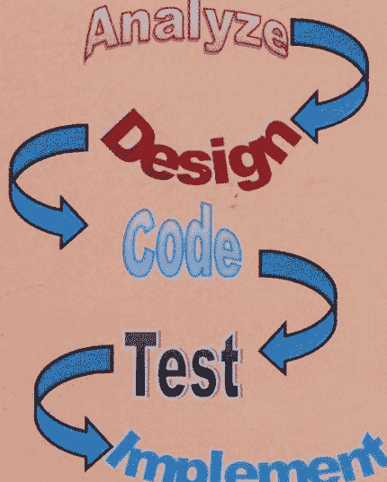
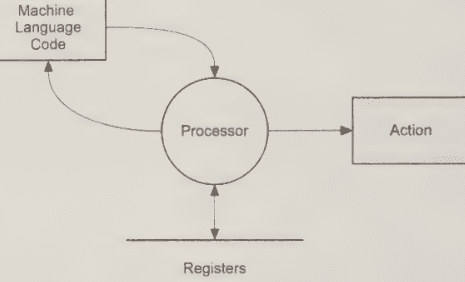
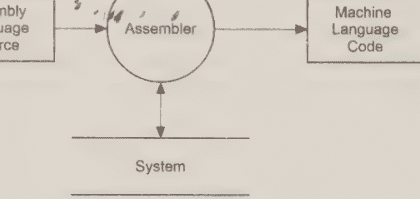
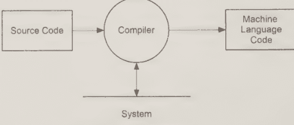
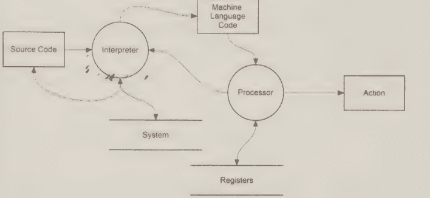
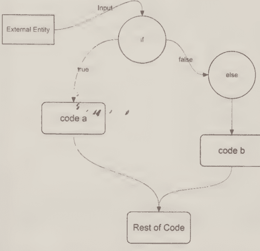
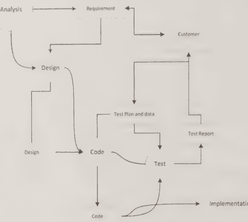

# 结构化 Java 第二版




https://archive.org/details/structuredjava2n0000glen

- 数组的局限性 ......................................................... 96

复习 ....................................................................142

项目 ...................................................147

高质量产品 ........................................147

软件开发流程 ...................148

瀑布模型 ......................................149

- 分析 ........................................................................................................................ 150

设计 ................................................................................................................................... 151

编码 ...................................................................................................................................... 152

测试 ....................................................................................................................................... 153

实现...............................................................................................................1154

复习 ....................................................................................................... 155

问题.................................................................................................................. 158

# 附录 A 使用 CCGA 优盘............................................... 160

- NOTEPAD++ ................................................................................................................ 160

使用 Java 编译器...................................................... 161

优盘里有什么？............................................................... 162

# 附录 B Java关键字.................................................. 164

# 附录 C CSCI 包 ........................................................ 144

# 附录 D 资源 ................................................... 147

- ORACLE JAVA JDK 下载网站 ................................................ 148

NOTEPAD++ 官方网站............................................................... 148

# 附录 E 电报字母 ............................................ 149

# 附录 F 词汇 ................................................... 150

# 索引......................................................................................................... 177

# 引言

欢迎本书是在佐治亚海岸学院（Coastal College of Georgia）教授几个学期的计算机科学编程课程后开发的。使用 Java 作为入门语言是一项挑战。我意识到，当学生还没有掌握语言的基本逻辑结构和方法调用时，直接从类和对象开始会导致他们困惑。

计算机是愚笨的。它们只理解两件事：零和一。然而，它们理解这两件事的速度极快。这需要数学家、工程师和程序员来教计算机如何做事。

多年来，开发了许多计算机语言。要么是为了特定目的（例如控制飞机），要么是为了让软件开发变得更容易（即著名的“银弹”）。Java 就是其中一种语言。我不会进入历史课程、政治或宗教讨论。如果你是该领域的新手，我们的许多产品讨论都带有宗教狂热。如果你不相信我，试着加入一场苹果与微软的辩论。

大多数现代语言可以分为两个阵营：过程化（又称函数式）语言或面向对象语言。还有其他语言，如 Lisp（递归）、SQL（基于集合）等，但那是以后的话题。

过程化语言基于将你的问题分解为小的、紧密且易理解的过程（根据语言称为模块、方法、过程或函数），并使用这些过程来解决你的问题。这种范式是基于过程。通过结构图可以最好地看到这些：


Java 是一种面向对象的语言。这意味着它基于这样观点：软件中的一切事物都可以从一个名为“类”的模板开始，类具有属性（即变量）并可以采取行动（即方法）。这些类中的大部分在被赋予生命或实例化为“对象”之前才能使用。一个类可以是汽车，它有颜色、门数、长度、宽度等属性。它可能具有如加速、刹车、左转等方法。一个对象可能是我的 `myCar`。类图看起来如下：

| Car |
| :--- |
| Color: String |
| NumberDoors: integer |
| Length: float |
| Accelerate() |
| Brake() |
| TurnLeft() |

我认为面向对象的范式非常有用，但对初学者来说非常困难。我也认为，在进入面向对象范式的额外复杂性之前，理解如何开发和调试稳实的方法会有很多益处。

因此我们面临一个选择：要么教学生多种语言，要么找到一种方法，以过程化的方式教他们面向对象语言的基础，例如 Java。

我在本书中强调的几点是：

- 1. 良好的编码习惯。编写他人易读的代码。
- 2. 良好的设计习惯。
- 3. 在构建代码时进行测试。我将其称为“写一点，测一点”。
- 4. 项目生命周期。

我希望这本书有助于你理解 Java 以及通用的编程。

# 作者简介

Glen K. Blood 拥有伊利诺伊理工学院的数学学士学位、犹他大学的气象学学士学位，以及西切斯特大学的计算机科学硕士学位。他曾任美国空军（USAF）上尉，在那里他爱上了计算机以及开发计算机软件的科学与艺术。他在软件开发中担任过几乎所有角色，包括程序员、系统分析师、项目经理、团队负责人和数据库管理员。他的经验包括多维全球数据库、轨道力学、图像处理、产品质量控制和营销。从可口可乐公司退休后，他一直在佐治亚州布鲁恩维克的佐治亚海岸学院担任计算机科学兼职教授。

# 第1章 编译器

从教计算机如何变得有用的第一天起，我们已经走了很远。但语言和编译器仍然非常复杂，需要被理解。基础部分与你编译程序时收到的错误信息相连。

当我刚开始编程时，你会将整个程序作为一叠卡片提交给计算机操作员，由他们将其加载到计算机中，并吐出带有错误的打印件。然后，你必须费力地检查这封打印件，试图找出每一个错误并修复你的卡片。接着，重新提交修复后的卡片，并希望没有错误。重复此过程直到完成。有时，由于其他学生在做同样的事情，从提交卡片到接收打印件之间会有好几个小时的间隔，因此你在每次迭代上花费了大量时间。

现在，你可以在编辑器中编写代码，通过编译器运行文件，获取错误并修复它们，然后立即再次尝试。这才是真正的进步。这就是为什么我建议编写部分代码，尝试编译它，修复错误并进行测试。当你对它满意时，再多写一些。我将这个过程称为“写一点，测一点”。

现在是简要讨论编译器的任何时机。

正如我们在引言中所讨论，计算机是愚蠢的。它们只理解零和一。

## 机器语言

创建计算机处理器的工程师内置了一组被称为**机器语言**的指令。机器语言由直接引用寄存器、内存位置、指令等的数字集组成。不涉及任何字母。这对于每个处理器都是唯一的。机器语言是可执行代码。简单来说，处理过程看起来如下：



处理器从机器语言源获取指令，与其寄存器（极速内存）交互，并根据指令采取行动，然后返回获取指令。

## 汇编语言

人们认为编写机器码对人类来说太难理解，因此下一代被称为**汇编语言**。汇编稍微好一点。汇编指令由指令和寄存器的三四个字母助记符组成。通常，内存位置仍然需要以十六进制数字进行编号。汇编器指令与机器语言指令之间通常有一一对应的关系。因此，汇编语言仍然紧系处理器。你通过汇编器运行汇编代码来构建机器语言（又称可执行）代码。这些代码按照之前描述的方式运行。你仍然每个制造商（IBM、UNIVAC等）都有一种汇编语言。



他们终于意识到我们可以构建出几乎人类可读的语言。我说“几乎”是因为你仍然需要理解语言的词汇、语法和语法。这些语言被称为第三代语言。有些声称是第四代，但我认为还没有任何语言突破到那种程度。这些语言都具有某种形式的指令、变量和方法。它们都允许你将许多机器语言指令组合成一个简单的语句。它们让你免于担心寄存器和处理器的内部工作。尽管某些语言会让你参与到那个深度（为了性能）。这具有以下优点：

- 1. 语言在系统之间具有（某种程度上）可移植性。遗憾的是，某些供应商为语言添加了许多附加（称为扩展），导致即使源代码在同一系统的不同代之间也无法迁移。
- 2. 语言更容易学习。
- 3. 语言更容易维护和修改。这取决于上一个程序员。人们可以写出不可读的（或用我喜欢的说法，“写一次”）代码。

这些语言通常分为两类：编译型和解释型。

## 编译型语言

编译型语言（如 C、FORTRAN、Cobol 和 C++）获取源代码并通过编译器运行。编译器经过多次处理，最后（假设没有编译错误）生成可执行代码。你必须为每个处理器构建一个编译器。



## 解释型语言

解释型语言（如 Basic）获取源代码并在运行时生成可执行代码。编译错误和运行时错误都在运行时被检测到。这几乎（不完全）等于每行代码都立即转换为机器代码。它的好处是什么？解释器提供了即时反馈，并在第一批微型流行时开始投入使用。系统非常小，解释器不占用太多资源。你的大多数操作系统命令语言都是解释型的。编译器对于批处理（这是原始计算机的设计初衷）要好得多，并能让你一次性发现更多错误。好得多的是，在你尝试运行之前，它们就给了你一份“健康证明”（就编译错误而言），并且允许系统将可执行代码与源代码分离。



如你所示，解释过程非常复杂，虽然不是完全逐行执行，但为了简单起见，你可以认为它是那样的。

- 解释器获取一行代码。
- 将其转换为机器代码。
- 返回获取更多指令。

## Java

什么是 Java？Java 是一种高级、面向对象的编程语言。它的设计旨在易编写、使用和调试。“编写一次，到处运行”（WORA）哲学是 Java 的核心。代码被编译成字节码，然后由 Java 虚拟机（JVM）执行。

Java 的优点包括：

- 1. Java 是可移植的。字节码可以在任何带有 JVM 的设备上运行。
- 2. Java 是安全的。它具有内置的内存管理和访问控制功能。
- 3. Java 是健壮的。它通过异常处理具有强大的错误处理能力。
- 4. Java 是多线程的。它允许程序同时执行多个任务。

## 编译和运行 Java 的步骤

运行 Java 程序请遵循以下步骤：

1. 在扩展名为 `.java` 的文件中编写你的代码。
2. 使用 `javac` 编译器编译代码，创建一个包含字节码的 `.class` 文件。
3. 使用 `java` 命令运行编译后的程序。

一个简单的 Java 程序示例：

```java
public class HelloWorld {
    public static void main(String[] args) {
        System.out.println("Hello, World!");
    }
}
```

语法分析器（Syntactic Analyzer）。下一步是确保你的语句符合语言的规则，例如语法法。这一步将确保：`if` 语句、`for` 循环等是有意义的。我不确定会产生哪些错误，但我认为这些将会是类似以下的错误：

- 1. 在赋值语句get等价运算符 (==) 而不是赋值运算符 (=)。
- 2. 缺少分号。
- 3. 循环中缺少 `where` 子句。
- 4. `if/else` 组不匹配。
- 5. 类或方法头部的格式错误。

语义分析器（Semantic Analyzer）。词法分析器和语法分析器只验证程序是否由语法上有效的标记（tokens）组成。现在我们将进入语义分析，深入检查它们在编程语言中是否形成了一组合理的指令。注意：这不会检查引用是否可能在其他地方定义。错误类型有：

- 1. 你没有正确定义变量，例如，你更改了变量名的大小写，或者忘记定义变量。
- 2. 你误用了变量类型。你本应该使用 `String`，却使用了 `int`。
- 3. 你的代码中有无法到达的代码。

中间代码生成器（Intermediate code generator）。它在不使用外部代码库的情况下生成尽可能多的代码。它为外部代码留下了占位符。这一步可能错误不多，因为从理论上讲，大多数内部代码错误已经被发现。

优化器（Optimizer）实际上取决于系统和语言。有些优化器非常复杂，有些则非常基础。它们可能会大到去修改循环以使其更高效，也可能什么都不做。

链接器（Linker）。链接过程会到外部库并填充占位符。库有几种类型：

- 1. 语言库
- 2. 公司库
- 3. 个人库
- 4. 操作系统库

错误：基本上唯一的错误就是它找不到某些东西。在 Java 中，错误信息为：

- 找不到符号 (Can't find Symbol) - 你可能没有导入库，或者调用方法的方式不对，或者你忘记导入包了。

写入器（Writer）随后写出最终的可执行文件。

Java 与标准编译器的区别仅在于几个方面。由于它不生成可执行文件，而且它是与机器无关的，最大的区别在于优化器、链接器和写入器。

> 优化器基本上什么都没做。所有的优化都在系统特定的库中完成。
> 链接器链接除操作系统库以外的所有内容。这些留给了 Java 虚拟机（JVM）。
> 写入器写入 Java 二进制代码或 `.class` 文件。

Java 虚拟机（JVM）或 java 比普通的解释器要高效得多，因为代码不是源代码。代码已经过解析、组织并为解释器做好了准备。所有的结构都已设置，使得它不仅仅是逐行读取并转换为机器码。我不自称理解内部处理过程，但它确实非常高效。

## 复习

从编译器的角度来看，语言只有几种类型：

- 机器级 (Machine)
- 汇编 (Assembler)
- 编译型 (Compiled)
- 解释型 (Interpreted)
- 混合型 (Hybrid)

编译器的部分可以描述为：

- 1. 词法分析器
- 2. 语法分析器
- 3. 语义分析器
- 4. 中间代码生成器
- 5. 优化器
- 6. 链接器
- 7. 写入器

你大多数的代码错误将出现在词法分析器、语法分析器和语义分析器中。链接器在找不到引用时会显示错误。在 Java 中，这可能是因为你没有将个人库放入 `CLASSPATH`，或者你拼错了方法名或类名，或者你忘记导入包了。

记住，编译器只能检测语言层面的错误。它无法检测你思维中的错误。这些也被称为逻辑错误。

## 问答

1. 编译器将 ________ 代码转换为 ________。
2. 汇编器用于将汇编语言转换为 ________
3. 词法分析器将变量名转换为 ________
4. ________ 从库中获取方法并将其添加到你的代码中。
5. Java 是一种 ________ 语言
   - a. 机器级
   - b. 编译型
   - c. 汇编级
   - d. 解释型
   - e. 混合型
6. 大多数操作系统命令语言是 ________ 语言。
   - a. 机器级
   - b. 编译型
   - c. 汇编级
   - d. 解释型
   - e. 混合型
7. 没有人类，计算机理解的是


# 第 1 章 复习题

1. 计算机语言的四种类型是什么？

   - a. 英语
   - b. 机器语言
   - c. 解释型
   - d. 混合型

2. 大多数代码错误出现在

   - a. 词法分析器
   - b. 语法分析器
   - c. 语义分析器
   - d. 以上所有

3. 编译器是 ________。

4. Java 虚拟机 (JVM) 是 ________。

# 第 2 章 Java 组件

## 命名

Java 在其库中提供了许多包含有用语句的包。我们会在需要时介绍它们。

有一个包会被自动添加且不需要导入。这个包是 `java.lang`。例如，`String` 和 `System.out` 是 `java.lang` 中的两个类。

然而，为了让链接器找到大多数包，你需要在代码中的类语句之前包含一个导入语句。例如，如果你想使用 `util` 包中的任何类，你需要：

```java
import java.util.*;
```

注意，我使用了 `*` 符号来允许编译器包含 `util` 包中的任何类。虽然你可以指定 `util` 中的特定类，但指定某个特定类并没有用处。链接器只会包含它需要的类。手动指定你需要的类并不会提高效率。因此，我的建议是始终使用 `*`。

我为这组课程包含了一个名为 `CSCI` 的包供使用。要使用这些类，你需要：

```java
import CSCI.*;
```

如果你遇到“找不到符号”错误，且该错误与某个包中的方法有关，可能意味着你执行了以下操作：

1. 没有导入正确的包。
2. 方法名拼写错误（注意大小写）。
3. 参数列表中的类型错误。
4. 对于 `CSCI` 包，你没有将目录放在正确的位置，例如，放在你编译代码的目录的子目录下。

关于 `CSCI` 包的更多信息请参见附录 C。

那么，如何发现你需要哪些包呢？我喜欢使用互联网。另一种检查类的方法是使用 `javap` 命令：

```bash
javap java.lang.String
```

这将为你提供 `String` 类中所有变量和方法的头信息。

遗憾的是，如果你使用了错误的包，将会得到错误，所以如果你不知道包名，互联网会更好用。

关于包的最后一个提示：`java.util` 格式指的是一种目录结构。点号代替了目录符号，因此在你的某个 `CLASSPATH` 目录或标准 `java` 目录中，这应该是 `java/util`。

### 类

Java 中除基本类型之外的一切都是类或对象。类是一个模板。类持有变量（即属性）和方法，包括 `main` 方法。对象是类的实例化。实例化一个类就是让它运行起来。你分配内存并允许它被使用。

你的程序类格式 `public class ClassName` 为：

```java
public class ClassName {
} // end ClassName
```

类由以下部分组成：

1. 类头
2. 构造函数
    - a. 初始化对象的方法
    - b. 与类同名
    - c. 可能有属性，也可能没有
3. 变量
4. 方法

### 示例

```java
public class DisplayName {
} // end DisplayName
```

此程序必须存储在名为 `DisplayName.java` 的文件中，我们将进入更多细节。

其他类有两种类型：静态或非静态。

非静态类必须存储在与类同名的文件中。在本课程中，我们不会构建程序类以外的非静态类。

静态类包含在类中。我们将在课程中将它们作为数据类型。

你什么时候需要实例化类？

1. 你永远不应该实例化你的程序或主类。
2. 如果一个类具有非静态变量或方法，则它必须被实例化。

如何实例化类？通过使用 `new` 关键字。例如，`CSCI` 类 `FileIn` 具有从文件中读取数据的非静态方法。它有两个构造函数，其中一个期望它将读取的文件名。假设 `FileName` 是一个持有文件名的字符串变量，要实例化 `FileIn` 对象 `Input`，代码如下：

```java
FileIn Input = new FileIn(FileName);
```

`FileIn` 没有任何可用的变量（这被称为信息隐藏）。它有两个方法。要读取一行数据，你只需要：

```java
String dataLine;
dataLine = Input.Read();
```

然后完成后：

```java
Input.close();
```

如果你有静态变量或方法，你只需要通过直接类类来使用它们，而无需实例化对象。如果你想将一个字符串转换为整数，可以使用 `CSCIConvert.Parse()` 而无需实例化该类。

```java
myInt = CSCIConvert.Parse(dataLine, 0);
```

### 方法

`main` 方法是程序的初始起点。每个程序都必须有且仅有一个 `main` 方法。

`main` 方法的格式基本上是强制性的。你不需要更改它。

```java
public static void main(String[] args) {
} // end main
```

事实上，你唯一可以更改的是术语 `args`。变量 `args[]` 是 `arguments` 的缩写，是在调用程序时提交的命令行参数的字符串数组。名称 `args` 可以更改，但它是传统做法。

你 `main` 方法其余的代码位于大括号之间。

如果方法属于我们当前的类，我们通过声明名称以及它们需要的任何参数或变量来运行它们，例如：

```java
MethodName(VariableName);
```

如果它们属于不同的类，我们使用点符号法，如：

```java
System.out.println(AnyString);
```

因此在编写任何额外代码之前，我们的第一个程序看起来像：

```java
public class DisplayName {
    public static void main(String[] args) {
    } // end main
} // end DisplayName
```

这可以通过编译，但什么也不做。

那么，让我们给它添加一些简单的代码并编译运行它。

```java
public class DisplayName {
    public static void main(String[] args) {
        System.out.println("Hello World");
    } // end main
} // end DisplayName
```

如果你想将一个字符串转换为整数，可以使用 `CSCIConvert.Parse()` 而无需实例化该类。

```java
myInt = CSCIConvert.Parse(dataLine, 0);
```

### 变量

变量具有以下特性：

1. 它们有名称。
2. 它们具有类型（稍后讨论）。
3. 它们拥有内存。
4. 它们可以在运行时被更改。

有几种类型的变量：

- 静态变量 —— 在所有对象中只有一个副本。我们将在课程中将它们作为数据类型。
- 非静态变量 —— 不允许在程序中使用（这些我们稍后会看到）。
- 常量 —— 使用 `final` 关键字。通常 `static` 和 `final` 配合使用。常量与变量的区别在于你无法在运行时更改。常量通常用大写字母表示。

### 编写整洁的代码

编写整洁代码的基本规则非常简单：

1. 良好的注释。
    - a. 为每个类提供解释其功能的头。解释输入和输出。如果存在算法技巧，解释这些算法。如果算法有来源，你可以引用你的来源。
    - b. 在代码中解释你的逻辑。特别是当代码不是自说明的时候。
    - c. 避免过度注释，以至于注释难以维护。
    - d. 避免注释掉未使用的代码。有些公司鼓励这样做以维护版本。最终，注释掉的代码比实际代码还长。如果这很重要，使用版本软件维护旧代码。或者保留足够长的时间测试然后清理。
    - e. 在大括号末尾放置注释以与起始大括号连接。为什么？因为容易忘记哪个大括号属于哪个起始大括号。例如：

```java
public static double nRecursiveFibonacci(int n) {
    if (n < 2) return 1;
    return RecursiveFibonacci(n - 1) +
    RecursiveFibonacci(n - 2);
} // end RecursiveFibonacci
```

这会将大括号与方法连接起来。

2. 为所有对象、变量和方法使用良好的命名。
3. 使用间距和缩进。
4. 除非性能需要，否则避免产生紧凑代码的编程技巧。你（或你的接任者）可能无法识别何时需要修订。记住，时间限制和压力总是因素。我认为这样编写的代码是一次性代码。我在文中没有提到此类技巧。
5. 保持一致性。如果你在编码风格中开发了一套技术方案，除非有充分理由更改它们，否则请坚持下去。这种做法有几个很好的理由。你可能会犯更少的错误，你可以开发自己的库、代码和测试，而且你的速度会提高。然而，不要害怕学习新知识。

## 复习

Java 有四个基本组件：

- 包——将类文件分组，以便于安全、功能和分发。
- 类和对象——其他组件的顶层容器。
- 变量也称为属性。它们存储值。
- 方法——这些包含执行操作的代码。

Java 有一套一致的组件命名规则。它们基本上可以归纳为：

- 所有名称都以字母、美元符号 (`$`) 或下划线 (`_`) 开头。我倾向于始终使用字母。
- 所有后续字符可以是字母、数字、美元符号或下划线的任意组合。
- 所有单词均区分大小写。`OneWord` 和 `onward` 是不同的。
- 你不能使用保留字作为名称，例如 `class`、`int`、`extends` 等。
- 你应该遵循组织的规则。
- 使名称具有意义。编译器可以识别。有些是成对的符号。
- `{}` —— 用于代码块
- `[]` —— 用于数组
- `<>` —— 用于集合中的类型转换。
- `()` —— 用于表达式和方法参数列表

有些是特殊符号，如数学符号 `*`、`-`、`/` 以及逻辑符号 `&&`、`||`。

注释符号 `//` 和 `/* */` 是特殊的。

记住，字符或字符串中的反斜线 `\` 是转义字符，必须特殊处理。

变量具有四个特征：

1. 它们有一个名称。
2. 它们有数据类型。
3. 它们有内存位置。
4. 它们可以在程序运行时被更改。

常量（关键字 `final`）具有变量的所有特征，但除了第 4 点外，它们不能被更改。

我们还提供了一些编写良好、整洁易读代码的规则。这些包括：

1. 注释
2. 空格和缩进
3. 使用良好的规范和标准
4. 避免小技巧。
5. 保持一致性。

## 问题

1. 对象是 ________ 类
   - na. 实例化自
   - nb. 与...无关
   - nc. 继承自
   - nd. 用于定义

2. Java 类不包含：
   - na. 头文件
   - nb. 包
   - nc. 构造函数
   - nd. 变量
   - ne. 方法

3. 组件名称可能以...开头
   - a. 字母或特定符号
   - b. 任意字母数字
   - c. 任意数字

4. 建议使用以下命名规则，例外：
   - na. 使用有意义的名称
   - b. 遵循组织的规则。
   - nc. 限制在六个字符以内以便输入。
   - d. 避免 Java 保留字。
   - e. 保持一致的大小写。

5. Java 组件包括一切，除了：
   - a. 变量
   - b. 类
   - nc. 对象
   - d. 程序
   - e. 方法
   - f. 包

6. 常量缺少非常量变量的哪项特征？
   - a. 它们有一个名称
   - b. 它们有数据类型
   - c. 它们有内存位置。
   - d. 它们可以在你的程序运行时被更改。

7. 使用哪个关键字告诉链接器查找包？
   - a. find
   - b. import
   - c. package
   - d. goto

8. 如果你想使用 `George` 类的静态方法 `eat`。`eat` 返回空值。`eat` 中没有参数。正确的语法是？
   - a. `George.eat();`
   - b. `George.execute(eat)`
   - c. `eat()`
   - d. `George myGeorge = new George(); myGeorge.eat();`

9. 哪个方法必须出现在每个程序中并表示程序的起点？
   - a. `start();`
   - b. `main();`
   - c. `program();`
   - d. `init();`

10. 当你在类中的变量前使用 `static` 关键字时：
    - a. 创建一个内存位置，从它创建的每个对象都共享该变量。
    - b. 它是由创建的每个对象共享的常量。
    - c. 它是一个类变量，从它创建的每个对象都可以访问其副本。

## 编程练习

编译、调试并运行这些问题：

1. 修改 `DisplayName` 程序以显示你自己的名字。
2. 修改 `DisplayName` 程序，使用 `args[0]` 显示任何名字。调用 `DisplayAnyName`。

# 第 3 章 数据类型

## 位与字节

计算机处理器和内存以二进制工作，即零和一。这些被称为位。这些位通常以八位或一个字节为一组进行。大多数计算机以一定数量的字节运行。最旧的微型计算机使用 1 字节（8 位），后来升级到 2 字节或 16 位。今天大多数计算机处理器和操作系统至少可以处理 32 位或 64 位。Windows 有这两种版本。64 位的 Windows 将支持大多数为 32 位平台构建的程序。

计算机中的内存有一个地址。这通常用十六进制数表示，范围基于操作系统拥有的位数。例如，理论上，32 位 Windows 系统可以访问 $2^{32}$ 个地址或 40 亿个地址（4 GB 地址）。如果每个内存存储 32 位，那么该系统理论上可以存储 128 GB 的内存。由于 64 位处理器理论上可以存储 $2^{64}$ 个地址（每个地址 64 位），你可以看到这能延伸到多远。当然，这只是理论上的，它们并不会访问那么多内存，而且你也买不起。

较大的处理器允许你在进行数学运算时访问更大的数字，这曾经是一个真实的问题。

即使给定了二进制系统，计算机本身只能理解无符号整数。

数学家、计算机科学家和语言开发者开发了一套代码系统，将无符号整数映射到不同的数据类型。这使得这些内存位置可以被用作数据。这些被称为基本数据类型。

类型通常分为数值型、String 和布尔型。在 Java 代码中，这些被称为原始数据类型。

### 原始数据类型

| 原始类型 | 值 |
| --- | --- |

原始数据类型的名称是它的内存位置，并表示实际值。例如，基本类型之一是 `int`（或符号为 32 位有符号整数）。要定义一个原始类型，你给出它的类型和名称，例如：

```java
int Counter;
```

你可以定义多个变量，只要它们是相同类型（我相信这的可读性可能较低）：

```java
int Counter, Distance, GeoStationaryAngle;
```

或者，你可以为变量设置一个初始值：

```java
int Counter = 0;
```

原始数据类型总是按值传递的。这意味着当它们传递给方法时，值被复制到一个新的内存位置。这个第二个内存位置将由方法使用。任何更改都不会影响调用例的变量。因此，当你从方法返回时，你的原始值保持不变。我们稍后会详细讨论这一点。

Java 数值有两种类型：有符号整数（-x 到 x）和浮点数。原始类型中没有无符号整数。

### 有符号整数

有符号整数之间的区别仅在于它们使用的位数，这控制了它们允许的范围。如果 x 代表它们使用的位数，那么范围的公式为：$-2^{x-1}$ 到 $2^{x-1}-1$。整数类型有：

| 位数 | 名称 | 范围 |
| --- | --- | --- |
| 8 | byte | $-2^7$ 到 $2^7-1$ |
| 16 | short | $-2^{15}$ 到 $2^{15}-1$ |
| 32 | int | $-2^{31}$ 到 $2^{31}-1$ |
| 64 | long | $-2^{63}$ 到 $2^{63}-1$ |

所以在复习中，我大多数时候会使用它。大多数计算机至少是 32 位，且 `int` 为你提供了很大的数据范围。Java 数学库期望 `int` 类型，大多数情况下，你的空间需求不会紧到需要你使用较小的类型。

我想提醒你注意整数除法。整数除法只在除法方程式中的所有元素都是整数时发生。这适用于大多数编程语言。在这种情况下，余或小数部分会丢失。它不是四舍五入，而是丢失。所以 `99/100 = 0`。

### 浮点数

计算机中没有实数。这些是 32 位和 64 位的 IEEE 754 标准浮点表示法。你可以将它们想象成科学计数法，但是二进制形式的。这些数字是不精确的，你无法直接控制计算中的小数位数。

它们是如何表示的？

数字被分为符号位、尾数和指数。为了参考，`float` 的公式为：

```text
(-1)^s m x 2^{e-127}
```

`float` 使用 1 位表示符号，8 位表示指数，23 位表示尾数，这可以为你提供大约 6 到 7 位小数精度。


double 的公式类似，不同在于尾数和指数有更多的位可用。

通常应该使用哪一个？我建议使用 `float`，但所有的 `Math` 库类都期望使用 `double`。因此，我建议坚持使用 `double`，因为你某些时候会用到数学库。

```java
double PI = 3.14159;
double Radius;
```

### 字符串数据

字符数据 (char)。字符串数据的类型类型是字符（Character）。字符单个字母数字（A, B, C, ..., 1, 2, 3...）以及许多非字符符号（#、@、!、%...）。大多数计算机对字符数据使用两种编码方案之一：ASCII（美国信息交换标准代码）或 Unicode。Java 使用 Unicode，它是 ASCII 的超集。ASCII 使用一个字节表示每个数字或字符。Unicode 使用两个字节。虽然 ASCII 基本上局限于英文字符和一些符号，但 Unicode 还为你提供了大多数的国际字符。为了让你对编码方案有一个大致的了解：

| 字节值 | 字符 |
| :--- | :--- |
| 48-57 | 0-9 |
| 65-90 | A-Z |
| 97-122 | a-z |

Unicode 对这些字符使用相同的代码。

关于字母代码值有一些事实：

- 大写字母比其对应的小写字母小 32。
- 它们在数值上是有序的，但取决于大小（`'a' < 'b'`，但 `'a' > 'B'`）。

### char 类型

```java
char mychar;
char Sex = 'M';
```

字符常量用一对单引号表示，例如 `'a'`。

作为一个单独的变量 `char` 通常没有用处，除非你正在处理字符串的各个部分。

### 字符串

任何语言中的字符串都是字符的集合。这些实现有多种方式。某些语言（如 FORTRAN）没有定义独立的字符串数据类型。

语言定义字符串有三种基本方式：

1. 作为带有预定义结束字符（如换行符）的字符数组。这种方法的唯一问题是，你必须使用一个特殊方法将该字符包含在数组中。
2. 作为固定长度的字符数组。你在代码中定义长度。多出的长度用空格填充。
3. 作为字符数组和一个整数长度。

Java 选择了第三种方法。Java 将 `String` 数据类型实现为一个类，但通常将其视为原始值。虽然 `String` 并不完全是一个原始变量，但它是按值传递的。定义字符串有多种方法。

```java
String myString;
String myString = new String();
String myString = "Fred";
```

字符串不像普通变量那样存储。每个字符串变量并不是存储在内存中自己的独立位置的。内存中有一个字符串池（String pool）。每个唯一的字符串都存储在那里。所以，如果你有两个字符串变量：

```java
String Alpha = "Fred";
String Beta = "Fred";
```

Alpha 和 Beta 的字符串并不指向不同的内存位置。只有一个内存位置（在字符串池中）拥有 "Fred" 这个字符串。该内存位置不会改变。如果你更改了 Alpha 或 Beta，就会创建一个新的内存位置并构建一个新的字符串。然后变量将指向它。我还没有查出当 Alpha 和 Beta 都不指向 "Fred" 时会发生什么，我假设它被从字符串池中移除了。出于这个原因，建议不要将 String 用于变体字符串，但这出了本课程的范围。

字符串的另一个局限性是，如果你尝试将一组数据加载到字符串变量中，而这些数据嵌入了换行符 `'\n'`，字符串会在换行符处停止。

我们将在后面的章节讨论字符串操作。

### 布尔

布尔数据有两个可能的值（真、假），并用于决策。这实际上是我喜欢的数据类型之一。某些语言（如 FORTRAN 或 C）没有这种，Java 有布尔类型，称为 `boolean`。

布尔类型只有两个可能的值 `true` 或 `false`（小写）。我没能找到关于存储大小的文档，所以我假设这取决于实现。

```java
boolean isTrue;
boolean ithen = true;
boolean maybe = false;
```

## 引用类型


Java 中其他数据类型都是引用类型。这意味着它们指向数据的内存位置，而不是值。这有几个影响：

1. 当你将它们传递到方法时，你是按引用传递。因此，如果你在过程中更改了变量的值，当你从过程中返回时，变量的值也会改变。如果你在没有预期的情况下这样做，这被称为副作用。
2. 你的名称实际上是一个指针。我们将在本章以后讨论指针。这意味着当你使用赋值语句 `A = B` 或等价语句 `(A == B)` 时，你比较的是地址。

### 标记数据

将数据组合成单一类型通常很有用。例如，我们可以定义一个包含名称、年龄和重量的类。这被称为对象。

```java
class Person {
    String name;
    int age;
    double weight;
}
```

然后我们可以创建 Person 的对象：

```java
Person p1 = new Person();
p1.name = "Alice";
p1.age = 30;
p1.weight = 120.5;

Person p2 = new Person();
p2.name = "Bob";
p2.age = 25;
p2.weight = 175.0;
```

这允许我们将相关数据组合在一起，使代码更容易管理和维护。

### 课程定义数据类型

(CSCI 文件夹必须位于你的 CLASSPATH 中)

在教授这些课程时，我在一个名为 CSCI 的包中构建了一系列静态和非静态工具类，这些工具保存在 U 盘中。请参考附录 A 关于 U 盘的使用说明。你需要将：

```java
import CSCI.*;
```

与其他导入语句一起使用。这必须位于你的 CLASSPATH 中。目前，这些方法用于获取格式化的当前时间、从数据文件读取/写入 Unicode 字符串、检查整数或双精度浮点数、将字符串转换为整数或双以及其他所需的活动。

## 变量安全

你可能会看到变量名前前面有 `private`（私有）或 `public`（公共）；这是为了定义谁可以访问该变量。通常在类定义中，变量是私有的而方法是公有的，以实现信息隐藏。在本课程中我们不需要考虑安全问题。

### 静态变量

`static` 关键字会在实例化该类时为所有对象创建该变量的一个副本。该变量是该类所有对象的全局变量。如果在 main 方法中，它将成为整个程序的全局变量。这意味着它可以随时随地被更改。这是一个坏消息。

除非你添加了 `final` 关键字。这时它就会变成一个常量，例如：

```java
final static int ERROR = 0;
```

由于这在运行时无法更改，因此它是很有用的，并且不会受到导致无法追踪的错误的风险。

## 复习

Java 中有两种基本类型：原始类型（primitive）和引用类型（reference）。原始类型指向存储数据的内存位置。原始类型都是预定义的数据类型，分为整数（Integer）、浮点数（Floating Point）、字符（Char）和布尔（Boolean）。整数和浮点数根据存储数据的字节数进一步分为若干类型。我建议你通常使用：

```java
int
double
boolean
String (不完全是原始数据类型)
```

引用数据类型占数据类型的大体。在 Java 中，它们都是类。引用数据类型通过引用（因此得名）传递方法。因此，如果你在方法中更改了值，你就更改了调用变量中的值。

你可以定义自己的引用数据类型。也可以使用内置的 System 库。系统库类包括变量和方法。

## 问题

1. 我们在课程中使用以下推荐的 java 数据类型

   a. 字母数字、实数和布尔

   b. String, int, double 和 boolean

   c. Char, byte, float 和 Long

   d. 数值、String 和布尔

   e. 以上都不是

2. 计算机用于编码字符的两种正常方式是和

3. Java 原始类型是引用类型。

4. 大多数 java 类型都是引用类型。这意味着当你将它们传递到方法并在无意中更改它们时，可能会导致一个

5. String 变量是唯一通过引用传递的引用类型

6. 下列哪不是有效的整数类型定义：

   a. int Apple;

   b. int Apple = 1;

   c. int Apple, Orange;

   d. int Apple = 'a';

   e. int Apple = INTCONSTANT; // INCONSTANT 是一个整常量。

7. 关于布尔数据类型，哪个答案是错误的？

   a. 它们有助于理清代码；

   b. 数据类型较小，效率高。

   c. 它们是设置中间布尔表达式值的简单方法。

   d. 它们完善了数据类型集。

8. 标记数据用于：

   a. 将相关数据分组在一起

   b. 为了方便将随机事物分在一起。

   c. 完全没用。

9. 计算机实数是：

   a. 实数的不精确浮点表示。

   b. 精确的表示。

   c. 有效的十进制表示。

10. 整数除法类型由：

    a. 使用整数除法符号。

    b. 在除法方程中仅使用整数变量或值。

## 练习

编译、调试并运行这些题目

1. 构建一个 DisplayNumber 程序来显示整数或浮点数。
2. 修改你的 DisplayNumber 程序以显示来自 java Math 库的 PI。

# 第 4 章 方法

注意：方法不能定义在其他方法内部。它们必须定义在类内部，但在其他方法定义之外。

## 设计方法

方法已经存在很长时间，构建良好方法的方法也被讨论过多次。方法的名称几乎和编程语言一样多。你还会听到人们称之为函数（functions）、模块（modules）或过程（procedures）。

方法在结构化编程中起到几个作用：

1. 它们允许你将代码分解成更小的连贯代码块。
2. 它们允许你重用代码。
3. 它们允许你轻松共享代码。
4. 它们允许你单独测试代码。
5. 它们让代码更容易阅读和理解。

方法的主要设计目标是构建一个黑盒。黑盒是一个物理设计中具有几乎相同关系的概念。它是一个对象，输入和输出是已知的，但内部运作是一个谜。可以根据需要交换该对象，而不会不利影响系统其他部分的运行。

为了实现这一目标，我们引入了内聚（cohesion）和耦合（coupling）这两个术语。

**内聚**是指方法只有一个目的且与其他方法相互独立的概念。具有一个目的的方法被认为具有高内聚，具有多个目的的方法被认为内聚低。我们如何判断一个方法是高内聚的？一个简单的规则是用一句话定义方法的用途。

**耦合**是两个模块之间如何通信的概念。耦合从松耦合到紧耦合不等。这里的目标是松耦合（再次考虑黑盒）。一对松耦合的模块在工作时不需要了解对方的任何信息。要测试这个模块，你只需要构建一个驱动程序来伪造输入并打印输出。不同级别的耦合是：

- 松耦合
  - 调用参数（原始和引用数据类型）
  - 函数返回值（原始和引用数据类型）
  - 消息（消息耦合）
  - 文件（外部耦合）
- 紧耦合
  - 全局变量（静态）
  - 内容耦合（访问另一个方法的局部数据）

我绝不会使用全局变量或访问另一个方法的局部数据。全局常量是可以的，因为它们不会更改。正如下面提到的，我会将消息和文件限制在专门的方法中。

方法通常分为几类：

**控制方法**——这些方法从一个或多个选项中选择。你的 main 方法通常是一个控制方法。除非是 main，否则选项应该作为参数传递或基于输入（文件类型）并清晰定义。

**输入/输出方法**——建议你为每个要读取/写入的文件/报告/消息队列构建一个方法，以便将格式的变化隔离在该方法中。

**处理方法**——这些被称为业务逻辑方法；它们将是你的主要方法。

在开发期间，你可能会产生两种特殊方法。

**驱动方法**——这些是小的、通常是 main 方法，用于测试无法进行测试的方法。它们通常仅由测试代码所需的最少类型定义、打印语句和方法调用组成。

**存根（Stubs）**——这些是我为新子方法编写的第一个版本。存根通常仅由方法头、一组验证输入参数的打印语句和一个有效的返回语句组成。当我编写和验证我的其他方法时，我会填充这些内容。

方法通常应该：

1. 只有一个入口和一个出口。
2. 短小且清晰。
3. 具有单一目的。

### 方法头

除 main 方法外，其他方法的格式与 main 非常相似：

```java
public static returnType MethodName(argument list)
{
    code
}
```

我们主类中的所有方法都是静态的（static）。大多数方法都是 `void` 类型。我们不会在这个类中讨论安全性。注意：为了完整性，有一个特殊的方法完全没有返回类型。这被称为构造函数（constructor）。构造函数具有以下特征：

1. 它们的名称与类名相同。
2. 它们用于初始化类。
3. 它们没有返回类型。
4. 它们是非静态的（non-static）。
5. 它们通过 `new` 关键字调用。

参数列表由一组用逗号分隔的变量对组成。参数列表用于传递到方法，从而允许你对不同的值使用相同的代码。在引用类型的情况下，参数列表是你的方法获取返回信息的额外方法。你的方法名和参数列表在类中必须是唯一的。这种唯一性允许多个同名方法被调用，这被称为多态（Polymorphism）。

### 参数传递

类型可以是基本类型或引用类型。使用的名称仅对方法本身有意义。你可以使用任何喜欢的名称来调用它。只需确保类型相同。示例：

```java
public static boolean IsNotDouble(String)
```

`IsNotDouble` 的返回类型为 `boolean`，但是：

```java
public static int Parse(String, int)
```

`Parse` 的返回值为 `int` 类型，并接受两个输入值。要调用这些方法，我们需要定义一些变量：

```java
final static int ERROR = 1;
String myString = "5";
int number;
```

然后我们可以这样调用它们：

```java
IsNotDouble(myString);
number = Parse(myString, ERROR);
```

你可以看到，我在调用方法时没有使用相同的变量，但实际上我使用了。你可以通过两种方式传递参数：按值传递（基本类型）或按引用传递（引用类型）。按值传递意味着当从你的方法返回时，变量的值不会改变。你可以在程序内部更改值，但在返回时它不会发生改变。例如，假设你写了以下代码：

```java
import java.util.*;
public class TestPassValue {
    final static int ERROR = 0;

    public static void main(String[] args) {
        int input = Integer.parseInt(args[0]);
        System.out.println("Before passbyValue input = " + input);
        passByValue(input);
        System.out.println("After passbyValue input = " + input);
    } // end main

    public static void passByValue(int number) {
        System.out.println("Entering passbyValue number = " + number);
        number = number + 1;
        System.out.println("Leaving passbyValue number = " + number);
    } // end passByValue
} // end TestPassValue
```

如果我带入输入运行程序，输出如下：

Before passbyValue input = 5

Entering passbyValue number = 5

Leaving passbyValue number = 6

After passbyValue input = 5

你可以看到我在调用方法时没有使用相同的变量，但实际上我使用了。你可以通过两种方式传递参数：按值传递（基本类型）或按引用传递（引用类型）。按值传递意味着当从你的方法返回时，变量的值不会改变。你可以在程序内部更改值，但在返回时它不会发生改变。例如，假设你写了以下代码：


```java
import java.util.*;
public class TestPassValue {
    final static int ERROR = 0;

    public static void main(String[] args) {
        int input = Integer.parseInt(args[0]);
        System.out.println("Before passbyValue input = " + input);
        passByValue(input);
        System.out.println("After passbyValue input = " + input);
    } // end main

    public static void passByValue(int number) {
        System.out.println("Entering passbyValue number = " + number);
        number = number + 1;
        System.out.println("Leaving passbyValue number = " + number);
    } // end passByValue
} // end TestPassValue
```

如果我带入输入运行程序，输出如下：

Before passbyValue input = 5

Entering passbyValue number = 5

Leaving passbyValue number = 6

After passbyValue input = 5

你可以看到我在调用方法时没有使用相同的变量，但实际上我使用了。你可以通过两种方式传递参数：按值传递（基本类型）或按引用传递（引用类型）。按值传递意味着当从你的方法返回时，变量的值不会改变。你可以在程序内部更改值，但在返回时它不会发生改变。

方法可以调用其他方法。事实上，当我们调用 `System.out.println()` 时，我们是在调用我们的 `Add` 方法和 `main` 方法中的 `println()` 方法。我们在 `main` 中调用了 `passByValue`、`passByReturn` 和 `passByRef`。


### 方法体

方法体包含方法语句和方法调用。它是两个大括号之间的所有内容。它通常以返回语句结束。我们将在后续章节中介绍。

## 复习

方法在结构化编程中有几个作用：

1. 它们允许你将代码拆分为更小的逻辑块。
2. 它们允许你复用代码。
3. 它们允许你共享代码。
4. 它们允许你单独测试代码。
5. 它们让代码更容易阅读和理解。

方法应该具有高内聚性和低耦合。

方法应该：

1. 只有一个入口和一个出口。
2. 短小且清晰。
3. 有单一目的。

方法应该通过调用参数或函数返回值传递信息，而不是使用全局变量。

按值传递意味着将值的拷贝传递到方法中，调用处的变量不会被改变。

按引用传递意味着内存位置传递到方法中，调用处的变量可以被改变。

基本类型变量和 `String` 总是按值传递的。

其他引用变量总是按引用传递的。

方法定义中的参数列表包含了每个参数的数据类型和一个在方法内部使用的名称。每个类型和名称之间用逗号隔开。该名称仅在方法内部有效。你可以使用任何喜欢的名称来调用它，只需确保类型相同即可。

返回语句包含返回类型。返回类型可以包含以下任何一种：

1. 基本类型
2. 引用类型
3. `void`

如果你有 `void` 以外的返回类型，则必须有一个带有该类型返回变量的 `return` 语句。

方法可以调用其他方法。

只要参数列表的类型不同，方法可以具有相同的名称。

方法调用包含一个与方法所需的类型相同的变量。你不需要包含类型，且名称不必完全相同。

## Questions

1. 方法头（Method Headers）包含除**中括号 (Brackets)**以外的内容：
   a. 安全类型 (Security Type)
   b. 返回类型 (Return Type)
   c. 名称 (Name)
   d. 可选参数列表 (Optional Argument List)
   e. 括号 (Parentheses)
   f. 中括号 (Brackets)

2. 方法参数列表（Method Argument lists）包含除**参数数量 (Number of Arguments)**以外的内容：
   a. 数据类型 (Data Type)
   b. 名称 (Name)
   c. 参数数量 (Number of Arguments)
   d. 逗号隔开的参数对

3. 内聚（Cohesion）意味着
   a. 模块之间如何通信。
   b. **一个模块可以做多少事情。**
   c. 模块是如何编译的。
   d. 你如何设置注释。

4. 定义良好的方法（Well defined methods）包含一切除了**一个变量 (One Variable)**以外：
   a. 一个入口 (One Entrance)
   b. 一个出口 (One Exit)
   c. 一个目的 (One Purpose)
   d. 一个变量 (One Variable)

5. 按值传递和按引用传递的区别是：
   a. **按值传递创建变量的拷贝。按引用传递意味着传递内存位置。**
   b. 按引用传递创建变量的拷贝。按值传递意味着传递内存位置。
   c. 没有区别。

6. 基本类型和 `String` 总是
   a. **按值传递**
   b. 按引用传递
   c. 可以以任一方式传递。

7. 耦合（Coupling）意味着
   a. **模块之间如何通信。**
   b. 一个模块可以做多少事情。
   c. 模块是如何编译的。
   d. 你如何设置注释。

8. 方法由：
   a. 方法头 (Method Header)
   b. 变量定义 (Variable definitions)
   c. 代码或方法体 (Code or method body)
   d. 方法声明 (Method declarations)
   e. **以上所有**

9. 方法不能：
   a. 不同的名称和相同的参数列表。
   b. **相同的名称和相同的参数列表**
   c. 相同的名称和不同的参数列表。
   d. 不同的名称和不同的参数列表。

10. 返回值（Return Values）可以是：
    a. `void`
    b. `int`
    c. `String`
    d. `Boolean`
    e. 任何定义的引用类型
    f. **以上所有**

## Problems

编译、调试并运行这些题目

1. 构建一个名为 `myMultiplier` 的程序，该程序：
   a. 从 `args[]` 接收两个 `int`。
   b. 使用 `Integer.parseInt(args[i])` 将 `args[i]` 转换为整数并乘以这两个数。
   c. 调用你构建的名为 `Mult(int X, int Y)` 方法乘以这两个数。
   d. 然后显示两个输入和结果。

2. 构建一个名为 `myDivision` 的程序，该程序：
   a. 从 `args[]` 接收两个 `double`。
   b. 设置一个 `double` 常量为 `final static double ERROR = 1.0;`。
   c. 使用 `Double.parseDouble(args[i])` 将 `args[i]` 转换为 `double`。
   d. 调用你构建的名为 `Div(double X, double Y)` 方法进行计算。
   e. 然后显示两个输入和结果。

# 第 5 章 顺序逻辑结构

## 逻辑结构

现在我们了解了数据和方法，我们需要学习如何使用它们。

大多数编程语言中有三种基本的逻辑结构：顺序结构、选择和循环。

### 顺序结构 (Sequential Structure)

顺序结构是最简单的。它有三个特点：

1. 开始
2. 结束
3. 每条语句都必须以分号结尾。

声明：
```java
int;
String;
```

赋值语句：
```java
int = 5;
```

调用：
```java
System.out.println();
```

### 逻辑语句 (Logic Statements)

逻辑语句使用字母、数字或引用值的相对值来获取布尔值。

```java
boolean true;
```

## 非布尔基本类型值

非布尔基本类型值的运算符有：

- `==` 等于
- `!=` 不等于
- `>` 大于
- `>=` 大于或等于
- `<` 小于
- `<=` 小于或等于

### 表达式 (Expressions)

逻辑表达式由一对括号 `()` 组成，返回 `true` 或 `false`。它们可能位于赋值语句的一侧。你可以将逻辑表达式放在任何可以放置布尔值的地方。

### 算术表达式 (Arithmetic Expressions)

算术表达式返回一个数值。我们使用的运算符有：

- 加法 (`+`)
- 减法 (`-`)
- 乘法 (`*`)
- 除法 (`/`)
- 取余 (`%`)

优先级顺序是括号、否定 (`!`)，然后从左到右。

### 布尔表达式 (Boolean Expressions)

布尔表达式由一个或多个布尔值（`true` 或 `false`）或变量（类型为 `boolean`）通过布尔运算符连接。与算术表达式不同，布尔表达式必须用 `()` 包围。主要运算符有：

- `&&` 用于与
- `||` 用于或
- `!` 用于非

`(A && B)` 如果 `A` 为 `true` 且 `B` 为 `true`，则为 `true`，否则为 `false`。

`(A || B)` 如果 `A` 为 `true` 或 `B` 为 `true`，则为 `true`。

`!(A)` 如果 `A` 为 `false` 则为 `true`，如果 `A` 为 `true` 则为 `false`。

### 相等表达式 (Equality Expressions)

相等表达式使用基本类型、数字或引用值的相对值来获取布尔值。

> **注意**：基本值比引用值更直接。如果你在引用值（包括 `String`）上使用这些运算符，比较的是内存位置而不是值，所以不要这样做。我会向你展示正确的做法。

## 非布尔基本类型值（运算符详情）

运算符有：

- `==` 等于
- `!=` 不等于
- `>` 大于
- `>=` 大于或等于
- `<` 小于
- `<=` 小于或等于

假设 `A` 和 `B` 类型相同（如果不相同则不保证），基本格式为：

```java
(A == B)
(A != B)
(A <= B)
(A > B)
(A <= B)
```

这些只是表达式，不是完整的语句。要小心，不要将相等 (`==`) 与赋值 (`=`) 混淆。

确保编译器能够捕获你的错误的一种方法，是在你在等价语句中使用单个变量时，反转编写等价语句的常规方式。

如果你正尝试检查变量 `Counter` 是否等于 23，不要写成：

```java
Counter == 23
```

而是写成：

```java
23 == Counter
```

由于编译器无法将 `Counter` 的值放入字面量常量 `23` 中，它会在编译时对 `(23 = Counter)` 报错，从而避免了无数小时的困惑和头疼。

> **注意**：比较对于 `char` 变量是有效的，且有时这非常有用。然而，你比较的是编码而不是字母，而且它是区分大小写的，因为 `'A'` 不等于 `'a'`。所以请确保你的字符大小写一致，或者同时检查两种情况：
```java
if ((('M' == inChar) || ('m' == inChar))) {
    System.out.println("male");
}
```

## 引用值

字符串和大多数引用类型都有内置的比较方法，应该使用这些方法而不是运算符。这些方法是：

```java
.equals(a);
.compareTo(a);
```

其中，你从你的对象调用该方法，`a` 是另一个相同类型的对象。

`.equals()` 如果它们持有的值等效则返回 `true`，否则返回 `false`。

`.compareTo()` 返回一个表示相对值的 `int`。

例如，假设你有三个字符串：

```java
String Alpha = "George";
String Beta = "George";
String Charlie = "Sam";
```

`Alpha.equals(Beta)` 会返回 `true`

`Beta.equals(Alpha)` 会返回 `true`

`Charlie.equals(Alpha)` 会返回 `false`

`Alpha.equals(Charlie)` 会返回 `false`

`Alpha.compareTo(Beta)` 返回 `0`

`Alpha.compareTo(Charlie)` 返回一个小于 `0` 的数字

`Charlie.compareTo(Alpha)` 返回一个大于 `0` 的数字

要使用这些函数，你可以构建如下表达式：

```java
(Alpha.equals(Beta)) == 0
(Alpha.compareTo(Beta)) < 0
(Alpha.compareTo(Beta)) > 0
```

## 组合表达式

由于逻辑表达式会变成布尔值，你可以使用逻辑运算符 `&&`、`||` 和 `!` 来组合它们。

例如，你可以构建一个赋值语句：

```java
boolean Nonsense;
String Alpha;
String Beta;
int Height;
int Width;
boolean IsItTrue;
IsItTrue = (Alpha.compareTo(Beta) > 0) && (Height > Width) || Nonsense;
```

或者将序列写成这样更清晰：

```java
AlphaBeta = (Alpha.compareTo(Beta) > 0);
HeightvsWidth = (Height > Width);
Combined = (AlphaBeta && HeightvsWidth);
IsItTrue = Combined || Nonsense;
```

这样当你遇到问题时，就可以检查所有的中间值。

## 方法调用

调用方法只需使用方法名，后跟圆括号，并传入类型和顺序与方法定义一致的变量。调用序列中的变量名可以与方法声明不同。对于基本类型字符串，你可以用硬编码的值替换变量名。让我们来看几个例子：

```java
public static boolean IsNotInt(String test_string)
```

此方法返回一个布尔值，并用 `String` 进行调用。它检查该字符串是否为整数（整数字），如果输入字符串是整数则返回 `true`，否则返回 `false`。

由于只有一个 `String` 变量，你可以通过几种方式调用它（假设 `isTrue` 和 `InputVar` 已经预定义且我们已经设置了 `InputVar`）：

```java
isTrue = CSCIConvert.IsNotInt(InputVar);
isTrue = CSCIConvert.IsNotInt("5");
```

让我们构建一个更复杂的方法。一个打印某人年龄的方法：

```java
public static void PrintPerson(String First, String Last, int Age) {
    String OutputString = " He is " + First + " " + Last + " and he is " + Age + " years old";
    System.out.println(OutputString);
    return;
}
```

你可以这样调用它：

```java
String One = "Uncle";
String Two = "Charley";
int Age = 63;
PrintPerson(One, Two, Age);
```

或者你可以硬编码这些值：

```java
PrintPerson("Uncle", "Charley", 63);
```

你会发现，除非你混淆数据类型或漏掉某个参数，否则不会报错。例如，以下任何操作都会导致编译器错误：

```java
PrintPerson(One, Age, Two);
PrintPerson(Age, One, Two);
PrintPerson(One, One, Two);
PrintPerson(One, Two, Age, Output);
```

而这种则不会：


```java
PrintPerson(Two, One, Age);
```

你只会得到一个 Charley Uncle。使用方法的另一种方法是在赋值语句中。例如，在 `java.lang.Math` 中，许多数学程序需要一个或多个 `double` 参数并返回一个 `double` 值。例如，假设你想用勾股定理计算斜边长度：

```java
double A, B, C;
A = 4.0;
B = 3.0;
C = Math.sqrt(A*A + B*B);
```

`C` 就是斜边。将它们组合起来，我们可以写出更复杂的代码吗？让我们尝试用勾股定理计算斜边长度：

- 8. 你可以把方法调用用作：
  a. 作为一个独立的语句。
  b. 在逻辑表达式中。
  c. 在算术表达式中。
  d. 以上所有。

- 9. 如果对引用变量使用等价操作 (`==`) ，会发生什么？
  a. 它比较值。
  b. 它比较内存地址。
  c. 它会报错。
  d. 未知。

- 10. 你始终可以将逻辑表达式赋值给布尔变量
  a. 正确
  b. 错误

## 问题

编译、调试并运行这些题目

- 1. 构建一个名为 Differences 的程序，要求：
  a. 从 `args[]` 接收两个整数。
  b. 使用 `IntegerConvert.Parse(args[i], 0)` 将 `args[i]` 转换为 int。
  c. 使用算术表达式显示它们是否等价。
  d. 显示第一个值减去第二个值的结果。

- 2. 构建一个计算圆面积的程序。
  a. 使用 `Math.PI` 表示 PI。
  b. 从 `args[]` 导入 Radius。
  c. 定义一个为 0 的 double 常数，并使用 `DoubleConvert.Parse(String, double)` 将 `args[i]` 转换为 double。
  d. Area = PI * Radius * Radius

# 第 6 章 决策逻辑

你每天都在做决定，为什么计算机不能呢？在顺序逻辑之后，最常用的逻辑类型是决策。计算机程序中的决策逻辑用于完成许多任务，从设置值到改变计算机程序执行的路径。Java 有两种基本的决策语句形式（if else 和 switch）。

## If Else 逻辑

if 语句的 Basic 形式是：

```java
if (LogicalExpression) {
    code set a
} // end if
else {
    code set b
} // end else
```



`LogicalExpression` 是任何逻辑表达式（参见第 5 章）。动作语句位于代码括号之间。`else` 部分是可选的。

如果 `LogicalExpression` 为 True（真），则将执行 “code set a” 而忽略 “code set b”。执行将在 `//end else` 语句之后的代码块开始继续。

如果 `LogicalExpression` 为 False（假），则将忽略 “code set a” 并执行 “code set b”。执行将在 `//end else` 语句之后的代码块开始继续。

你也可以省略代码块，当且仅当你只有一个语句时，例如：

```java
if (min > x) min = x;
```

然而，我通常会避免这样做，以防我以后想向 `if` 语句中添加代码。在现有的代码块中添加语句比添加一个代码块要容易。假设你有一个评分程序，并且一次输入一个分数（顺便说一下，这种设计很糟糕）。分数在 0 到 100 之间，你可能通过 `if else` 检查分数：

```java
if ((Score > 100) || (Score < 0)) {
    System.out.println("Please input a grade between 0 and 100 Score = " + Score );
    System.exit(0);
} //endif
else {
    ProcessScores(Score);
} // end else
```

注意：对于复杂的逻辑表达式，你始终可以将你的逻辑表达式从语句中提取出来并替换为布尔变量。这允许你独立于决策逻辑进行测试。例如：

```java
isTrue = (Score > 100) || (Score < 0);
if (isTrue) {
    System.out.println("Please input a grade between 0 and 100 Score = " + Score );
    System.exit(0);
} //endif
else {
    ProcessScores(Score);
} // end else
```

## 嵌套 If 逻辑

你可以将额外的 `if` 语句完全嵌入任何一个代码块中。它们不能重叠。`else` 与该代码块内的 `if` 语句关联。

在构建表达式时给出一个警告：当你使用小于号和大于号时，很容易漏掉某个值。因此，请彻底检查你的所有逻辑并检查边界。例如：假设你正在检查入票价：

- 65 岁及以上：$10
- 12 岁以下儿童：$7
- 成年和青少年：$15

正确编写此代码的一种方法是：

```java
import CSCI.*;
public class Tickets{
    final static int SeniorPrice = 10;
    final static int ChildrenPrice = 7;
    final static int AdultTeenPrice = 15;
    final static int SeniorMin = 65;
    final static int ChildrenMax = 12;
    final static int ERROR = 0;
    public static void main(String[] args) {
        int Age = CSCIParse(args[0]);
    }
}
```

*(注：后续文本包含大量重复内容和 OCR 错误，已根据逻辑流进行去重处理翻译)*

1. 你可以将你的逻辑拆分为更小的部分。如果一个决策不相关，不要将它们留在同一个逻辑流中。
2. 将你的逻辑表达式拆分为 `if/else` 语句之外的赋值语句。使用布尔变量。
3. 将逻辑拆分成独立的方法以简化测试。使用独立的控制方法。
4. 看看逻辑是否可以重写以使其不再那么繁琐。
5. 寻求帮助。
6. 如果需求冲突，请提醒你的老板和客户。他们可能没有意识到存在问题。

## 测试

确保你的逻辑流经过测试的唯一时间就是单元测试期间。在这里，你可以构建测试数据来测试每一个分支和流程，特别是错误。

## 复习

到为止，我们已经查看了顺序逻辑和决策逻辑。决策逻辑非常强大且复杂。你需要非常小心并测试所有可能的情况。你需要考虑极少数发生的情况，当你有多个情况时，为了效率起见，你需要考虑每个情况最可能的头部。在编写决策逻辑时，你需要非常注意以下几点：

- 1. 它具有可读性和可维护性吗？
- 2. 我考虑了可能性吗？
- 3. 我确保了没有遗漏任何可能的情况吗？
- 4. 我测试了我的边界和中间条件吗？

Java 中决策逻辑的两种主要结构是：

- 1. if else
- 2. switch case

这些结构依赖于我们在顺序逻辑章节中讨论过的逻辑表达式。

使用这种逻辑的主要方法之一是控制方法，它用于控制你的程序。

测试至关重要，边界和中间条件对决策逻辑至关重要。单元测试是检查决策逻辑的最佳时机。

## 问题

- 1. 逻辑表达式由组成：
  a. 布尔表达式
  b. 等等表达式
  c. 返回布尔类型的方法
  d. 以上所有

- 2. 在 `if()` 语句中，括号之间是什么？
  a. 任何 `int` 或 `char` 变量
  b. 一个逻辑表达式
  c. 一个算术表达式
  d. 以上都不是

- 3. 在 `switch()` 语句中，括号之间是什么？
  a. 任何 `int` 或 `char` 变量。
  b. 一个逻辑表达式
  c. 一个算术表达式
  d. 以上都不是。

- 4. 在顺序决策逻辑中，`else` 语句位于哪里？
  a. 在底部
  b. 在每个语句之间
  c. 无处

- 5. 什么是控制方法？
  a. 一个使用标志变量和决策逻辑来决定执行哪一个或几个方法的方法。
  b. 一个有强迫症（OCD）问题的方法。
  c. 一个操作控制器的方法。
  d. 一个处理控制数据的方法。

- 6. 关于 case 语句中的 break，哪个描述是正确的？
  a. 它没有用途。
  b. 它告诉我们 case 何时结束。
  c. 没有它，代码将自动执行下一个 case。

- 7. 在嵌套 `else` 语句中，`else` 属于
  a. 同一个代码块内最近的 `if` 语句。
  b. 顶部 `if`。
  c. 最后 `else`。

- 8. 如果你的决策逻辑变得太复杂，你可以做什么？
  a. 将其拆分为更小的部分或模块
  b. 查看逻辑并看看是否可以重写
  c. 寻求帮助
  d. 以上所有

- 9. 如果你使用一个包含四种可能情况的 case 语句，进入了第五种，而你忘记设置默认条件，会发生什么？
  a. 随机运行前四个中的一个。
  b. 执行第一个条件。
  c. 发生错误——你被解雇了。

- 10. 如果你使用一个包含四种可能情况的 case 语句，进入了第五种，且你有默认条件，会发生什么？
  a. 随机运行前四个中的一个。
  b. 执行第一个条件。
  c. 执行默认条件。
  d. 发生错误——你被解雇了。

## 问题

编译、调试并运行这些问题

- 1. 构建一个程序，从命令行找出输入数据的类型。
  a. 输入在 `args[0]` 中
  b. 假设输入可以是 `Integer`、`Double` 或 `String` 之一。
  c. 使用 `CSCConvert` 类方法
      i. `CSCConvert.IsNotInt(String TestString)`
      ii. `CSCConvert.IsNotDouble(String TestString)`
  d. 打印结果如下：
      i. 你给了我一个 Integer = 5
      ii. 你给了我一个 Double = 3.5
      iii. 你给了我一个 String = Henry was a dog.

- 2. 构建一个程序，接受四个字母之一 - a-d 并给出无线电码。使用 `case` 语句。考虑到你的用户可能使用大写或提供其他字母。
  a. A = Alpha
  b. B = Bravo
  c. C = Charlie
  d. D = Delta.

# 第 7 章 循环

循环是我们将查看的最后一种计算逻辑。它使用了决策逻辑和顺序逻辑，但增加了代码自我重复的能力。如果没有这种能力，代码将长得多，更难理解，并且编写和调试需要更长的时间。循环有三个共同点和一个主要风险。这三个共同点是：

- 1. 开始条件。无论检查什么条件，都必须初始化。
- 2. 结束条件。什么打破了循环。
- 3. 循环步长。任何循环中的主要风险是死循环。

（注：原文后续存在大量 OCR 识别导致的重复文本，已根据指令要求提取核心内容并完成翻译。）

基本结构如下：

```java
for (initialization; end condition; increment){
  code
} // end for
```

假设你想自己计算从 1 到 10 的和，你可能会这样写：

```java
for( int i = 1; i < 11; ++i){
  sum = sum + i;
} // end for
```

有几点需要注意：

- 1. 变量 `i` 只在 `for` 循环块内有效。
- 2. 循环从 `i` 从 1 到 10 的每一个值运行一次。
- 3. `sum` 必须在 `for` 循环外部定义并初始化。

注意：你可以在结束条件和增量上进行很多技巧，我觉得这超出了本课程的范围，因此我不会深入探讨这些内容。

关于这三种循环的最后一点：任何类型的循环都可以用来模拟其他类型的循环。但是，当你需要一个递增循环时，使用 `for` 循环更简洁；当你需要一个迭代次数未知的循环时，使用 `while` 或 `do while` 循环更好。

## 嵌套循环 (Embedded Loops)

就像逻辑判断一样，你可以将任何类型的循环完全嵌入到任何类型的循环中。注意：我说的是“完全”。它必须位于代码块内部。这里有一些想法和警告：

- 1. 外层块每执行一次，内部循环就会执行一次。也就是说，假设你的内部块每次执行 10 次，而外部块执行 20 次。因此，你的内部块运行了 20 * 10 = 200 次。所以，如果这个内部块内没有高效的代码，你的程序可能会变得缓慢。
- 2. 如果你犯了错误且没有初始化变量，可能会得到奇怪的结果。假设你的内部循环依赖于变量 `A` 从 1 开始，但你没有初始化它，到循环结束时它的值为 10。第二次执行时，它从 10 变到 21，第三次从 21 变到 32，依此类推。确保你得到的是想要的结果。

## 数组 (Arrays)

现在是引入新数据类型——数组的好时候。数组是基本类型（以及字符串）变量的有序组。这是另一个字符串数据类型像基本类型变量的例子。数组是通过引用传递的。数组用括号对 `[]` 表示。数组的声明分为两个步骤：

第一步声明类型：

```java
Type[] name;
```

示例：

```java
int[] Ages;
double[] Weights;
string[] Names;
```

第二步设置数组的最大大小。这必须在编译时定义。大小可以是任何整数常量、变量（方法内）或硬编码数字。

```java
Name = new type[int];
```

示例：

```java
final static int AGESIZE = 100;
Ages = new int[200];
Weights = new double[AGESIZE];
Names = new string[1000];
```

Java 注意事项：数组索引从 0 开始。因此，你从 `Weights[0]` 开始计数，而不是 `Weights[1]`。结束于 `Weights[AGESIZE-1]`，而不是 `Weights[AGESIZE]`。

如果你在任何时候访问 `AGESIZE-1` 之外的数组，你将得到 `ArrayIndexOutOfRange` 运行时错误。

# 数组的局限性：

- 1. 你不能直接在数组中间添加或删除元素。你必须移动其他元素来腾出空间。这使得排序在时间和或空间上都变得非常昂贵，有时可能需要数组的第二个副本。
- 2. 你不能在运行时为数组添加空间。因此，如果你为 100 个元素设置了数组大小，而你有 101 个元素，将会得到一个运行时错误。因此，你为数组分配的大小要比预期的需要要大，并跟踪你的数据增长。
- 3. 虽然你可以拥有多维数组，但每个数组元素必须具有相同的数据类型。因此，如果你有多种数据类型，就必须进行额外的工作，我们将在后面的章节中讨论。

## 使用数组 (Using Arrays)

使用数组非常简单。

单维数组（我们将在后面的章节中介绍多元素数组）。

在数组中赋值：

通常情况下，虽然不是必须，但你从 0 开始并顺序进行。虽然数组从 0 开始，但你可以在其范围内的任何地方以任何顺序访问它们。由于数组变量的长度表示的是数组的最大大小，而不是填充了多少个元素，因此建立第二个变量来跟踪数组当前使用的大小通常是一个好主意。加载数组：

### 单元素：

```java
Ages[2] = 34;
Weights[1] = 145;
Names[0] = "George";
```

循环：之前我们从文件中读取了一些整数并对它们进行了求和。现在，假设我们需要将它们加载到数组中。由于我们不知道将加载多少数据，`while`（或 `do while`）循环非常适合这项任务。

```java
InputStream = ReadInput();
IntSize = 0;
while (!InputStream.equalsIgnoreCase(END)) {
    NextInt = Integer.parseInt(InputStream);
    IntArray[IntSize] = NextInt;
    IntSize = IntSize + 1;
    InputStream = ReadInput();
} // end while
```

注意关于此操作的几点：

- 1. 我们使用了一个变量 `IntSize` 来跟踪下一个整数需要存留在数组中的位置。`IntSize` 现在可以用来告诉我们数组中有多少个元素。
- 2. 只有在数据加载到 `IntArray` 之后，`IntSize` 才会增加。这是因为 Java 是从 0 开始的。所以当数组中有一个元素时，第一个元素在 `IntArray[0]` 中。

### 获取值 (Getting Values)

就像加载数组元素一样，你使用整数值来获取值。你确实有一个额外条件，你不仅需要确保它在 0 到 `MAXSIZE - 1` 之间，你还需要确保它在你加载的数据范围内。虽然系统不会给你返回错误，但你可能会得到错误的结果。

在上一个示例中，我们使用 `IntSize` 来跟踪填充的元素数量。如果你尝试获取一个大于 `IntSize - 1` 且小于 `MAXSIZE - 1` 的值，它不会给你报错，但你将得到无效的值。

### 赋值语句 (Assignment Statements)

```java
A = Ages[4];
B = Weights[i];
myName = Names[34];
```

注意：这是可以使用技巧的地方。

### 循环 (Loop)


```
Sum = 0;
for(int i = 0; i < IntSize; i++) {
  Sum = Sum + IntArray[i];
}
System.out.println(". =(" + +);
```

# 在方法中使用数组

方法声明：

```java
public static double MethodName(type[] arrayname) {}
public static double CalcAverage(int[] array) {}
```

方法调用：

```java
Response = MethodName(arrayname);
Answer = CalcAverage(Numbers);
```

```java
return n * RecursiveFactorial(n - 1);
} // end RecursiveFactorial
```

如果你想知道有多少种方案可以选择你的团队，可以在主程序中这样调用它：

```java
NFactorial = RecursiveFactorial(9);
```

它会迅速返回 362880。

这些数字增长得非常快，这就是为什么我选择 `double` 作为我的返回类型。

## 递归代码是如何工作的？

让我们假设输入为 4。

- 调用 1 `RecursiveFactorial(4)`

4 大于 1

所以运行 `4 * RecursiveFactorial(3)`

- 调用 2 `RecursiveFactorial(3)`

3 大于 1

所以运行 `3 * RecursiveFactorial(2)`

- 调用 3 `RecursiveFactorial(2)`

2 大于 1

所以运行 `2 * RecursiveFactorial(1)`

- 调用 4 `RecursiveFactorial(1)`

1 不大于 1，所以它返回 1 

给调用 3

- 调用 3

返回 `2 * 1` 给调用 2

- 调用 2

返回 `3 * 2` 给调用 1

- 调用 1

返回 `4*6` 给 main

主程序接收到 24。

这就是为什么这被称为单线程递归。

另一个例子，斐波那契数是双线程递归。斐波那契数的公式为：

```
F(0) = 0
F(1) = 1
F(n) = n-1 + n-2
```

因此，递归算法为：`RecursiveFibonacci(int n)`{

```java
public static double RecursiveFibonacci(int n) {
  if (n < 1) return 0;
  if (n < 2) return 1;
  return RecursiveFibonacci(n - 1) +
    RecursiveFibonacci(n - 2);
} // end RecursiveFibonacci
```

由于每个路径都必须遵循相同的调用序列，该算法的效率远低于迭代解决方案。事实上，在我的电脑上，当数字并不大时，它就无法稳定返回；当输入为 45 时，递归解决方案大约需要 7 秒。让我们来看一个小值的斐波那契递归，比如 5。为了简单起见，我们将方法称为 `RF()`。

`F(5)` 调用 `RF(4) + RF(3)`

`RF(4)` 调用 `RF(3) + RF(2)`

`RF(3)` 调用 `RF(2) + RF(1)`

`RF(2)` 返回 1

`RF(1)` 返回 1

`RF(3)` = 1+1 返回 2

`RF(2)` 第二次调用返回 1

`RF(4)` = 2 + 1 返回 3

同时

`RF(3)` 第二次调用 `RF(2) - RF(1)`

`RF(2)` 第三次调用返回 1

`RF(1)` 第二次调用返回 1

`RF(3)` 第二次调用 1+1 返回 2

最后 `RF(5)` 返回 3 + 2 = 5

- `RF(5)` 被调用了一次。
- `RF(4)` 被调用了一次。
- `RF(3)` 被调用了两次。
- `RF(2)` 被调用了3次。
- `RF(1)` 被调用了两次。

在迭代解决方案中，每个方法调用值将被调用且仅调用一次，并存储返回值。从而节省了大量时间。

从运行角度来看，将递归过程转换为非递归循环通常要廉价得多。

## 复习

本章结束了我们对计算机逻辑三种形式的讨论：顺序、决策和循环。正如你所看到的，循环逻辑取决于决策逻辑和顺序逻辑。决策逻辑取决于顺序逻辑。没有了这三者，我们就会得到冗长、繁琐且不可读的代码。

我介绍了四种循环类型和一种新的数据类型。四种循环类型是：

1. `do while`
2. `while`
3. `for`
4. 递归

大多数人可能不会将递归视为循环类型，但在 Java 中它是一个重要的逻辑结构。如果你习惯了，它具有循环的所有属性。

所有循环都有以下特征：

1. 初始条件。
2. 结束条件。
3. 循环步长。

`do` 和 `while` 循环在需要循环某项直到情况变化时非常有用。如果你不知道要循环多少次，它可能是 0 次，可能是 1 次，也可能是 10,000 次。在这个类中，当你加载数据且不知道有多少数据时，通常会使用这两种循环之一。

`for` 循环用于当你知道循环多少次以及以什么增量进行时。运行某项是 `for` 循环的明显用法。

递归是方法调用带有不同参数的方法本身。循环在遇到结束条件时结束。

循环最大的风险是永不终止的死循环。循环的局限性在于：

1. 一次只能处理原始（或 `String`）数据类型。
2. 大小必须在编译时定义。
3. 移动数据是昂贵的。

循环是

1. 基础 0。
2. 可以在范围内的任何地方。
3. 引用传递

## 问题

1. 循环依赖

   a. 顺序逻辑
   b. 决策逻辑
   c. 结束条件
   d. 循环步长
   e. 以上所有

2. 循环包括但不

   a. `do while`
   b. 重复直到
   c. `for`
   d. `while`

3. Java 数组：

   a. 基础 0
   b. 基础 1
   c. 用户定义

4. Java `for` 循环需要

   a. (变量声明；结束条件；增量)
   b. (增量；结束条件；变量声明)
   c. (变量声明；增量；增量)
   d. (结束条件；变量声明；增量)

5. `do` 循环和 `while` 循环的区别是：

   a. `while` 循环总是执行一次 `do` 循环。
   b. `do` 循环总是执行一次 `while` 循环。
   c. 没有区别。

6. 到：

   a. 正确
   b. 错误

7. 递归由：

   a. 方法调用自身
   b. 反转字符串的函数
   c. 进程调用

8. 数组大小可以使用：

   a. 整数值
   b. 字符值
   c. 浮点值

9. 数组是：

   a. 按引用传递。
   b. 按值传递。
   c. 你不能传递它们。

10. 当你操作它们时，必须确保：

    a. 变量正确初始化。
    b. 循环不重叠。
    c. 逻辑正确。
    d. 内部高效。
    e. 以上所有。

## 练习

编译、调试并运行这些：

1. 构建一个程序

   a. 接受 `args[0]` 和 `args[1]` 的输入并转换为正整数。
   b. 假设你的电脑只有加法（没有乘法）。
   c. 使用加法编写一个乘以 A 和 B 的方法。
   d. 提示：考虑你最初学习的方法。

2. 假设你的优盘在 F 盘：编写一个程序：

   a. 从 `F:\data\numbers.txt` 读取数字
   b. 找到最大值最小值
   c. 求和并计算平均值。
   d. 提示：从 `args[0]` 获取文件名。
   e. 提示：使用 `inString = Input.read()`。这返回一个字符串。当到达末尾时，字符串为 `null`。你必须将 `Input` 实例化为 `FileIn` 对象。
   f. 提示：使用 `CSCIConvert.Parse(inString, ERROR)`。如果 `ERROR` 是一个整数常量，`Parse` 将你的输入字符串转换为 `int`。

```java
FileIn Input = new FileIn(filename);
```

# 第 8 章 字符串处理

我们之前提到了字符串，但没有谈论如何处理它们。为什么？因为我们首先需要知道几件事。

正如我们在数据类型章节讨论过的，字符串是字符的数组。它们包含文本。它们对大小写敏感。这一节是关于处理它们的，但在尝试处理它们之前，我们可能想决定我们要对它们做什么。例如，考虑：

## 字符串问题

- 拼接——将两个字符串结合。
- 在某个字符处分离字符串，可能是逗号。
- 在字符串中找到给字符。
- 比较两个字符串——忽略大小写。
- 比较两个字符串——但不忽略大小写。
- 从字符串中获取子字符串。

实际上，不同的字符串处理任务与编程问题一样多，但其中许多任务都可以归结为上述内容的组合。

字符串不仅是字符数组，它们还是 Java 类。它们实际上包含一组内置方法，允许你对它们进行操作，而无需编写代码来完成这些任务。你可以通过输入以下命令来找到它们：

```bash
javap java.lang.String
```

## 字符串方法

其中一些是：

```java
int length();
boolean isEmpty();
void getChars(char[], int);
boolean equals(Object);
boolean equalsIgnoreCase(String);
int compareTo(String);
int compareToIgnoreCase(String);
int indexOf(String);
int indexOf(String, int);
String substring(int);
String concat(String);
String replace(char, char);
boolean matches(String);
boolean contains(CharSequence);
String replace(CharSequence, CharSequence);
String[] split(String);
String toLowerCase(String);
String toUpperCase(String);
String trim();
```

如你所见，那里已经内置了很多功能（而且我只包含了部分列表）。

但是你如何使用它们呢？

## 字符串拼接

这意味着将两个字符串放在一起。

实际上有两种方法：

```java
String OutputString = First + " " + Last;
```

以及

```java
String OutputString = First.concat(" ");
OutputString = OutputString.concat(Last);
```

### 示例

```java
String First = "Greg";
String Last = "Almond";
String wholeName = First + " " + Last;
```

现在 `wholeName` 包含 "Greg Almond"

### 在特定字符处分割字符串

例如，在逗号、反斜杠、句号或任何其他符号处分割。

这里的方法取决于你是否想要在字符串中找到所有由该符号分隔的子字符串。假设你有一个用逗号分隔的值 (.csv) 文件。这是一种常见的文件类型，字段由逗号分隔。此此最简单的方法是使用 `split` 函数将你的 `String` 拆分为一个 `String` 数组。

```java
String SYMBOL = ",";
String SplitArray[] = InputString.split(SYMBOL);
String Splitarray = SplitArray[0];
```

现在 `SplitArray[0]` 包含逗号之前的第一个字段，`SplitArray[1]` 是第二个，依此类推。

如果你有一个包含姓名、身高和体重记录结构的文件，看起来如下：

```
Kaden Diaz, 65,242
Indigo Chaney, 65,183
Harlan Hooper, 71,200
Kato McKinney, 62,233
Rinah Norton, 63,164
Eleanor Padilla, 73,201
Quamar Ramos, 66,177
```

你可能会编写如下所示的记录分割代码：

```java
String Name;
String HeightString;
String WeightString;
String SplitArray[];
String Splitarray = InputString.split(SYMBOL);
Name = SplitArray[0];
HeightString = SplitArray[1];
WeightString = SplitArray[2];
```

更常用的字符串分割方法是使用 `indexOf`（某些语言称其为位置）和 `substring` 的组合。`indexOf` 方法在 `String` 中查找一个字符或一组字符。`substring` 则从 `String` 中提取一个子字符串。

另一个常见问题是查找文件名或文件的后缀名。这里这里有两个问题：

1. 你的当前文件名是否包含了目录路径？
2. 你的文件名中是否包含多个句号 (.)？

遗憾的是，`split` 在 Windows 中不喜欢使用 `System.getProperty("file.separator")`，因为它也是转义符号。所以我们将以非常相似的方式处理这两个问题。

注意：你应该使用 `System.getProperty("file.separator")` 而不是硬编码 `\` 或 `//`，因为这使得你的代码适用于 Windows、Unix 或 Apple 机器。

现在，要从完整文件名获取文件名或后缀，你需要使用两种方法的组合。

```java
int lastIndexOf(String);
String substring(int);
```

和或者

```java
String substring(int, int);
```

让我们将 `SYMBOL` 设置为完整的 `System.getProperty("file.separator")`，因为我们尝试获取完整文件名；并将 `PERIOD` 设置为 `.`，当我们需要获取部分文件名或后缀时。

`FileName.lastIndexOf(SYMBOL)` 给你最后一个文件分隔符的整数位置。

`FileName.lastIndexOf(PERIOD)` 给你最后一个句号的整数位置。

首先我们想要分离出完整文件名，如果 `PathFileName` 包含路径的完整文件名：

```java
FullFileName = PathFilename.substring(Position+1, length);
```

然后是文件名

```java
FileName = FullFilename.substring(0, Position-1);
```

后缀将是：

```java
Suffix = FullFilename.substring(Position+1);
```

当你需要将字符串拆分为组成部分或拆分为单个部分时，这两个过程中的任何一个都有效。

# 在字符串中查找给定字符

正如你之前看到的，取决于你找到它后想做什么，`indexOf()` 给你位置，而 `contains()` 让你知道它是否存在。

### 比较字符串

比较两个字符串——忽略大小写。

比较两个字符串——但不忽略大小写差异。

实际上有几种比较字符串的方法。普通的等价运算符 `==` 有时有效，但它实际上比较的是内存位置的地址而不是字符串本身，因此我不建议这种方法。

如果你只是想看 `String A` 和 `String B` 是否等价，方法 `A.equals(B)` 可以很好地工作。

```java
if (A.equals(B)) doSomething();
```

这等同于：

```java
if (B.equals(A)) doSomething();
```

`equals()` 在它们相等时返回 `true`。

## 问题

1. 关于字符串，哪种描述是错误的：

   a. 它们是字符数组
   b. 它们是基本类型
   c. 它们拥有内置方法
   d. 它们是一个像基本类型一样的引用类型。

2. 你必须担心 `System.getProperty("file.separator")`：

   a. 文件分隔符字符
   b. 它并不总是被初始化的。
   c. 你必须不导入 util 库来获取系统类。
   d. 你不需要担心它。

3. 你可能会结合使用 `indexOf()` 和 `substring()`，是因为：

   a. 它让人们感到非常困惑。
   b. `indexOf()` 提供了你切割字符串的字符位置，而 `substring()` 执行切割。
   c. `substring()` 提供了你切割字符串的字符位置，而 `indexOf()` 执行切割。
   d. `indexOf()` 告诉你在使用 “substring” 方法时，你的字符串数组中最终得到了多少个字符串。

4. `split()` 方法在以下情况下非常有用：

   a. 你正在尝试找到一个子串。
   b. 你有一个大文件需要拆分成较小的块。
   c. 你在离婚分割财产时有资产需要分离。
   d. 你正在尝试解码由字符分隔的记录记录。

5. 为什么你不想用标准的比较符号 `=` 来检查字符串的等效性？

   a. 它们永远不起作用。
   b. 它们实际上检查的是内存位置而不是值。
   c. 这太简单了，而我们喜欢让你更难。
   d. 这太难理解了。

6. 为什么你想要将字符串拆分为字符数组并对其进行操作？

   a. 这比使用内置方法简单得多，而且代码更简洁。
   b. 它比内置库效率高得多。
   c. 某些范围比尝试让内置方法适应更整洁。
   d. 我们很固执。


- 7. 为什么你想要使用 `equalsIgnoreCase` 和 `compareToIgnoreCase` 选项？

   a. 人们很懒，并且不遵循自己的大小写规则。

   b. 你不需要。始终遵循大小写。

   c. 将你所有数据都转换为大写或小写。

   d. 有时两种大小写都是有效的。

   e. a 和 d。

- 8. 当你将一个字符串传递给方法并在方法内部更改该字符串的值时：

   a. 方法外部字符串的值发生了变化。

   b. 方法外部字符串的值保持不变。

   c. 程序崩溃了。

- 9. 当两个字符串具有相同的信息时：

   a. 它们总是有自己唯一的内存位置。

   b. 它们可能在字符串空间共享相同的内存位置。

   c. 它们是同一个变量。

- 10. 当字符串被更改时：

   a. 字符串空间中的字符串被更改。

   b. 字符串空间中创建了一个新字符串，旧字符串被删除。

   c. 字符串空间中创建了一个新字符串，旧字符串发生了什么未知。

## 练习

编译、调试并运行这些题目

- 1. 编写一个程序，接受两个字符串 `args[0]` 和 `args[1]` 分别为 A 和 B

   a. 找到 A 在 B 中的第一个位置。不区分大小写。

   b. 从 B 中移除 A 并将其放入第三个字符串 C 中。

   c. 显示 A、B 和 C

   d. 示例：如果输入是 Cat 和 Meercat。那么输出是 Cat, Meercat 和 Meer。

   e. 提示：我可能会将原始字符串复制到中间变量中，并将它们转换为相同的大小写以便操作。

- 2. 编写一个程序，判断输入字符串 `args[0]` 是否为回文：

   a. 回文是一个正写和反向写都相同的单词或短语。

   b. 忽略大写字母、特殊字符和空格。

- 3. 编写一个程序，读取闪盘上 `data\` 下的 `filenames.txt` 文件，并统计文件中所有唯一的 own。找到出现次数最多的名字。

   a. 注意：你可能需要将文件名作为 `args[0]` 导入以避免硬编码文件名。

## 第9 章 高级数据类型

### 多维数组

#### 二维数组

当你查看电子表格时，你会看到行和列。有时你希望在代码中实现同样的事情。你可以构建一个两个维度的数组。二维数组的格式与一维数组类似，使用两组括号：

```
type[][][] myArray = new type[Columns][Rows];
```

其中：Rows 和 Columns 是 `int` 常量，`type` 是任何基本类型（Primitive type）或 `String`。

你可以用它做什么？

每当你有相同类型且想要保持在一起的数据时，多维数组都非常好用。当数据不是相同类型时，还有其他方法。

如何使用它？也许几个例子可以让你看到。

##### 示例 1

记住我们的无线电字母表（Radio Alphabet）。我们有两个变量 Letter 和 Code。假设我们从文件中将每个各读取为 String（为了简单起见，我们假设字符串是）：

```
String[][] RadioAlphabet = new String[2][SIZE];
String inputString = String.Read();
while (inputString != null) {
    RadioAlphabet[0][Size] = inputString;
    RadioAlphabet[1][Size] = inputString;
    Size++;
    inputString = String.Read();
}
```

##### 示例 2

假设我们有一个身高和重量列表：

```
68,160
71,150
71,140
72,155
```

为了计算 BMI，我们使用：

```
for (int i = 0; i < Size; i++) {
    int height = Integer.parseInt(RadioAlphabet[0][i]);
    int weight = Integer.parseInt(RadioAlphabet[1][i]);
    double bmi = (weight / (height * height)) * 703;
    System.out.println("Height: " + height + " Weight: " + weight + " BMI: " + bmi);
}
```

假设我们在上一节的数据中增加了一列，命名为 `name`（姓名）。人们可能会说，知道体重和身高属于谁是非常有用的，甚至是至关重要的：所以我们的数据现在看起来如下：

```
Kaden Diaz, 65,242
Indigo Chaney, 65,183
Harlan Hooper, 71,200
Kato McKinney, 62,233
Rinah Norton, 63,164
Eleanor Padilla, 73,201
Quamar Ramos, 66,177
```

数据结构（Data Structures）是存储数据的一种术语。我们将查看几种可以解决此问题的不同数据结构。我们将从每种结构查看三个代码片段，以观察它们在复杂度上的差异。这些代码片段包括加载数据、使用数据（计算 BMI 并打印）以及执行插入排序。

### 方案 1 字符串数组 (String Arrays)

我们可以构建一个三列的二维数组吗？数组必须具有相同的数据类型。在我们的示例中，我们有两种数据类型：字符串（string）和整数（integer）。我们可以将两个整数列留为字符串，并拥有一个三列的字符串数组。

```
String [] NameHeightWeight = new String[3] [FMAXSIZE]
```

当然，我们希望在读取数据时确保它们是整数，然后每当我们想要使用另外两列时，都对它们进行转换。这产生了处理开销并增加了复杂度。如果我们定义了一个值为 `3` 的新常量 `NAME`。

```
NameHeightWeight [NAME] [2] = "Harlan Hooper"
NameHeightWeight[HEIGHT] [2] = "71"
NameHeightWeight[WEIGHT] [2] = "200"
```

由于我们已经在 `CSCIConvert.IsNotInt(String)` 中有了用于测试整数的方法，因此添加如下逻辑：

```
if (CSCIConvert.IsNotInt(weightString)) {
  HW[WEIGHT] = ERRORSTRING;
} else {
  HW[WEIGHT] = weightString;
}
```

加载数据，由于所有数据在进入系统时都是字符串，这段代码非常直观：

```
Record = readRecord(Input);
while(Record[1].compareTo("0") > 0) {
  NameWeight[HEIGHT][Size] = Record[1];
  NameWeight[WEIGHT][Size] = Record[2];
  NameWeight[NAME][Size] = Record[0];
  ++Size;
  Record = readRecord(Input);
 // end While
```

使用数据。为了计算 BMI，你必须将身高和体重转换为整数。你已经保证了这些值是整数。

```
for (int i = 0; i < Size; ++i){
  Name = NameWeight[NAME][i];
  Height = NameWeight[HEIGHT][i];
  Weight = NameWeight[WEIGHT][i];
  iHeight = convert(Height);
  iWeight = convert(Weight);
  BMI = computeBMI(iHeight, iWeight);
  outLine = String.format(FORMATSTRING, Name, Height, Weight, BMI);
  System.out.println(outLine);
}
```

插入排序。这里的唯一在于所有三列都必须移动。

```
for(int i = 1; i < size; i++) {
    j = i - 1;
    temp[NAME] = A[NAME][i];
    temp[HEIGHT] = A[HEIGHT][i];
    temp[WEIGHT] = A[WEIGHT][i];
    while(j >= 0 &&
        temp[NAME].compareToIgnoreCase(A[NAME][j]) < 0) {
        A[NAME][j + 1] = A[NAME][j];
        A[HEIGHT][j + 1] = A[HEIGHT][j];
        A[WEIGHT][j + 1] = A[WEIGHT][j];
        --j;
    }
    A[NAME][j + 1] = temp[NAME];
    A[HEIGHT][j + 1] = temp[HEIGHT];
    A[WEIGHT][j + 1] = temp[WEIGHT];
}
```

### 方案 2 并行数组 (Parallel Arrays)

另一种方案被称为并行数组。并行数组是保持同步（或并行）的独立数组。也就是说，一个数组中第 $i$ 行的数据与其它每个数组的第 $i$ 行相关。加载数据。

所以我们可以使用三维数组，或者使用一个一维数组和一个与上一个问题相同的二维数组。假设我们选择了后者方案。

```
String[] Names = new String[FMAXSIZE]
int[][] HeightWeight = new int[2][FMAXSIZE];
```

根据上面的数据：

```
Names[2] = "Harlan Hooper"
HeightWeight[2][HEIGHT] = 71
HeightWeight[2][WEIGHT] = 200
```

该方案最大的缺点是，如果你需要对一个数组（例如姓名）排序，必须保持另外两个数组同步。我们可以看到三种主要的代码片段类型。

为了简单见见，让 `ReadHeightWeightRecord(String)` 返回一个包含姓名、身高和体重的字符串数组，如之前的示例所示。我们只需要转换一次数据。所以我们的读取程序现在如下：

```
Record = readRecord(Input);
while (Record[1].compareTo("0") > 0) {
    HeightWeight[HEIGHT] [Size] = convert(Record[1]);
    HeightWeight[WEIGHT] [Size] = convert(Record[2]);
    Names[Size] = Record[0];
    ++Size;
    Record = readRecord(Input);
} // end While
```

使用数据时，我们不再需要转换身高和体重。

```
for (int i = 0; i < Size; ++i) {
    Name = Names[i];
    iHeight = HeightWeight[HEIGHT] [i];
    iWeight = HeightWeight[WEIGHT] [i];
    BMI = computeBMI(iHeight, iWeight);
    outLine = String.format(FORMATSTRING, Name, iHeight, iWeight, BMI);
    System.out.println(outLine);
}
```

### 方案 3 指针 (Pointers)

指针是另一个概念，但一旦你越过了那个道坎就很容易理解。代码看起来几乎相同，只是我们在 `HeightWeight` 中使用了指针。如果你需要先按身高再按姓名排序，这是合理的。例如，如果我们先按身高再按姓名排序，我们需要处理相应的逻辑。

我们的 `read` 代码现在设置了 PTR，从 `Names` 指向 `HeightWeight` 的索引。它确实将 `Size` 变量从 `int` 转换为 `String`。

```
while (Record[1].compareTo("0") > 0) {
    HeightWeight[HEIGHT][Size] =
    convert(Record[1]);
    HeightWeight[WEIGHT][Size] =
    convert(Record[2]);
    Names[NAME][Size] = Record[0];
    Names[HWPTR][Size] = "" + Size;
    ++Size;
    Record = readRecord(Input);
} // end While
```

我们的 `Use` 方法不再需要查找，但我们确实需要将 `Names` 指针转换为 `int`。

```
for (int i = 0; i < Size; ++i) {
    Name = Names[NAME][i];
    position = convert(Names[HWPTR][i]);
    iHeight = HeightWeight[HEIGHT][position];
    iWeight = HeightWeight[WEIGHT][position];
    BMI = computeBMI(iHeight, iWeight);
    outLine =
    String.format(FORMATSTRING, Name, iHeight,
    iWeight, BMI);
    System.out.println(outLine);
}
```

你看到的最大的区别在于插入排序中。我们不再需要将 `HeightWeight` 数组传递给排序方法。指针处理了这个问题。

```
for(int i = 1; i < size; i++) {
  j = i - 1;
  temp[NAME] = A[NAME][i];
  temp[HWPTR] = A[HWPTR][i];
  while(j >= 0 && temp[NAME].compareToIgnoreCase(A[NAME][j]) < 0) {
    A[NAME][j + 1] = A[NAME][j];
    A[HWPTR][j+1] = A[HWPTR][j];
    --j;
  }
  A[NAME][j + 1] = temp[NAME];
  A[HWPTR][j + 1] = temp[HWPTR];
}
```

另一种方法（特别是，如果你的数组都不是 `int` 类型）是拥有一个额外的数组，其中每个列对应一个数组，用于存储每个对应数组的索引。例如，在示例中，你会定义：

```
final static int NAMEPTR = 0;
final static int HWPTR = 1;
String[] Names = new String[FMAXSIZE];
int[][] HeightWeight = new int[2][FMAXSIZE];
int[][] ptrArray = new int[2][FMAXSIZE];
```

我们的 `Read` 代码看起来如下：

```
Record = readRecord(Input);
while (Record[1].compareTo("0") > 0) {
    HeightWeight[HEIGHT][Size] =
    convert(Record[1]);
    HeightWeight[WEIGHT][Size] =
    convert(Record[2]);
    Names[Size] = Record[0];
    ptrArray[NAMEPTR][Size] = Size;
    ptrArray[HWPTR][Size] = Size;
    ++Size;
    Record = readRecord(Input);
} // end While
```

显然，我们需要查找 Name、Height 和 Weight 指针。我决定我的查找函数将返回值。这些查找方法类似于：

```
public static int lookupHeight(int input
, int[][] ptrArray, int[][] HeightWeight ) {
    int position = ptrArray[HWPTR][input];
    return HeightWeight[HEIGHT][position];
}
public static int lookupWeight(int input
, int[][] ptrArray, int[][] HeightWeight ) {
    int position = ptrArray[HWPTR][input];
    return HeightWeight[WEIGHT][position];
}
public static String lookupName(int input
, int[][] ptrArray, String[] Names ){
    int position = ptrArray[NAMEPTR][input];
    return Names[position];
}
```

# 我们的代码看起来如下：


```
for (int i = 0; i < Size; ++i) {
    Name = lookupName(i, ptrArray, Names);
    iHeight = lookupHeight(i, ptrArray);
    HeightWeight = lookupWeight(i, ptrArray);
    iWeight = HeightWeight;
    BMI = computeBMI(iHeight, iWeight);
    String outLine = String.format(FORMATSTRING, Name, iHeight, iWeight, BMI);
    System.out.println(outLine);
}
```

插入排序是事情变得有趣的地方。虽然你需要 `Names` 数组，但你只用它获取信息。你不移动任何 `Names` 条目。你只移动指针。当你的数组持有大量数据时，这可能会带来一些良好的性能影响，因为你的数组只存储整数。这就是 RDBMS 系统广泛使用索引的原因。你还可以拥有具有不同排序方案的不同指针数组，而不影响原始数组。因此，你可以同时以不同的方式对数据排序。

```
for(int i = 1; i < size; i++) {
    j = i - 1;
    temp = lookupName(i, ptrArray, A);
    namePtr = ptrArray[NAMEPTR][i];
    HWPtr = ptrArray[HWPTR][i];
    while (j >= 0 && (temp.compareToIgnoreCase(lookupName(j, ptrArray, A)) < 0)) {
        ptrArray[NAMEPTR][j + 1] = ptrArray[NAMEPTR][j];
        ptrArray[HWPTR][j + 1] = ptrArray[HWPTR][j];
        j--;
    }
    ptrArray[NAMEPTR][j + 1] = namePtr;
    ptrArray[HWPTR][j + 1] = HWPtr;
}
```

### 3. 内存位置指针

这是使用指针最自然、最理解的方式。Java 不支持这种方法。

## 解决方案 4. 数据标记

标记也被称为抽象数据类型或 Java 类。我们在数据类型章节中引入了这个概念。此解决方案允许你通过构建自己的数据类型，消除强制将属于在一起的数据组合带来的任何开销和头恼。在 Java 中，这就是构建你自己的类。通常会有更多内容，但对于这本书来说，我们不必关心数据方面以外的。

现在，像方法一样，它必须出现在类定义中，与 `main` 隔离开。我建议将其放在类定义之后、类大括号之后、以及 `main` 定义之前。基本上就是我们放置类变量的地方。

```
import CSCI1302.*;
public class myFirstJava
{
// ⬅==放在这里
```

现在格式就像类定义的一样。但是，它必须被声明为 `static`，如果不是 `static`，你就必须在它自己的文件中定义它。

```
public static class classname {
nvariables
} //end class
```

你所有的变量都应该是 `public` 的。

使用它就像使用任何非静态引用类一样。首先，你必须定义一个变量并实例化它。

例如，假设我们根据我们的新文件构建了一个类：

```
public static class NameHeightWeight{
    public String Name;
    public int Height;
    public int Weight;
} end class NameHeightWeight
```

为了使用这个类，我们需要在程序中定义它并实例化。

```
NameHeightWeight record =
new NameHeightWeight();
```

类是模板。实例化的 `record` 被称为对象。

我们之前见过 `"newclassname();"` 的约定。这会执行一个方法，即构造函数，它可以由 Java 或程序员定义，用于分配内存并初始化类中的所有变量。

现在要使用数据，你使用我们之前看到的相同的对象点变量逻辑（通常用于方法）：

```
record.Name = "Kaden Diaz";record.Height = 65;
record.Weight = 242;
```

并使用数据：

```
System.out.println(Person.Name + " " + 
Person.Height + " " + Person.Weight);
```

现在如果我们需要构建一个数组来存放我们所有人，我们遇到了一个小问题。记得数组只能持有原始类型和 `String` 值。我们的 `NameHeightWeight` 类是一个引用值。嗯，Java 有一个与数组类似的容器类（实际上更好）被称为 `ArrayList`，它被设计成像数组一样，但只持有引用值。

## ArrayList

与数组相比，ArrayList 有三个主要优势：

1. 你不需要在编译时定义最大大小。ArrayList 会随着你的扩展而增长。
2. 你可以无损地在 ArrayList 的中间部分添加或删除元素。
3. ArrayList 有一个名为 `size()` 的内置方法，可以告诉你 ArrayList 的当前使用大小。

ArrayList 中最大的区别是，你不再直接使用大括号来访问单个成员（例如 `[i]`），相反，你必须使用方法，例如：

- `add(e)` 将元素添加到 ArrayList 的下一个位置。
- `get(int)` 从 Arraylist 指定索引位置获取元素。
- `set(int,e)` 设置 Arraylist 指定索引位置的元素。

一个提示。当你向 ArrayList 添加引用类型时。确保你创建了一个新元素。否则你可能会得到一个包含 n 份相同数据的 ArrayList。

还有其他内置方法，但其中一些方法（例如排序）需要你对类类型进行额外的额外工作，这超出了本课程的范围。

使用 ArrayList 的第一步是确保导入了正确的 java 库。

```
import java.util.*;
```

定义 ArrayList 与数组略有不同。你实际上不需要为 ArrayList 分留空间，也不需要定义 ArrayList 的类型。你只需要使用 `<type>` 给编译器一个关于预期种的提示。

```
ArrayList<NameWeight> People = 
new ArrayList<NameWeight>();
```

注意，这个 `<Reference Type>` 是编译器提示。它不是运行时指令。因此，它不包含在方法签名中。所以，你不能拥有两个同名且相同参数的方法，除非这些 ArrayList 具有不同的 `<Reference Type>`；

```
Build(ArrayList<Person> People); 
Build(ArrayList<Dog> Dogs);
```

这两个方法是不允许的。尽管 Person 和 Dog 是不同的引用类型。

因此，读取此文件的代码变为：

```
inputRecord = readRecord(Input);
while(null != inputRecord) {
newRecord = new record();
newRecord.Name = inputRecord[0];
newRecord.Height = convert(inputRecord[1]);
newRecord.Weight = convert(inputRecord[2]);
People.add(newRecord);
inputRecord = readRecord(Input);
} // 结束 While
```

使用这些数据的代码：

```
for (int i = 0; i < Size; ++i) {
myRecord = People.get(i);
Name = myRecord.Name;
Height = myRecord.Height;
Weight = myRecord.Weight;
BMI = computeBMI(iHeight, iWeight);
outLine = String.format (FORMATSTRING, Name, iHeight, iWeight, BMI);
System.out.println(outLine);
}
```

这真的大大简化了插入排序：

```
for(int i = 1; i < Size; i++) {
  j = i - 1;
  temp = People.get(i);
while(j >= 0 &&
  temp.Name.compareToIgnoreCase(lookupName(j, People)) < 0) {
    myRecord = People.get(j);
    People.set(j+1,myRecord);
  --j;
}
People.set(j+1,temp);
}
```

查找方法仅用于清理比较逻辑。它包含了以下逻辑：

```
public static String lookupName(int input,
  ArrayList<record> People) {
  record myRecord;
  myRecord = People.get (input);
  return myRecord.Name;
}
```

我个人非常喜欢最后这种解决方案。特别是当它将数据与文件结构相关时。你会注意到：

1. 文件结构通过类清晰地标出。它没有被隐藏。
2. 变量是什么总是清晰的。
3. 身高和体重总是与单个个体相关，不需要任何额外的代码。
4. 如果文件结构发生变化，你只需要更改类和输入方法即可。

类和对象还有很多内容。Java 也有很多内容。但这仅仅是一门课程。是时候把注意力转向如何利用所学知识来解决问题，并研究方法论了。

## 复习

我们已经从一维数组到了多维数组。我们看到这并不费力。它们仍然受限于以下特性：

1. 每个数组使用一种数据类型。
2. 使用原始数据类型或字符串。
3. 无法从中间添加或删除数据。
4. 必须在编译时设置数组的最大 own。
5. 必须手动跟踪数组的实际大小。

虽然你的最外层可以是参齐的，但你应该记住数组的大小是按倍数增长的。当你定义一个 10 x 10 x 10 的数组时，你会得到 1000 个元素。如果它是 `double` 类型，每个 64 位或 8 字节，那么数组大约占用 8K。如果你将每个维度乘以 10，即 100 x 100 x 100，你会得到 8G。所以你可以看到这些增长非常快。

你很少处理一种数据类型，你可能会遇到配置数据、统计数据、销售单等。我们讨论了处理此问题的四种方法：

1. 将所有数据转换为字符串。
2. 使用多个同步数组。
3. 使用带有整数指针的多个数组。
4. 使用带有实际指针的多个数组。
5. 使用印章数据，即 Java 类。

我个人觉得，在大多数情况下，印章数据或 Java 类提供了处理数据最干净的方法。注意：没有一种方案是永远的正确答案。

由于 Java 类是引用数据，我们必须引入 ArrayList 作为数组的伙伴。ArrayList 允许你：

1. 持有引用类型（而不是原始类型）。
2. 从 ArrayList 的中间添加或删除数据。
3. 避免设置 ArrayList 的最大大小。
4. 提供内置函数 `size()` 来获取 ArrayList 的实际大小。

## 问题

1. 当你观察二维数组时，你可以使用以下方式将其可视化：
   a. 一本书。
   b. 一个 Excel 表格
   c. 档案柜
   d. 书桌

2. 使用二维数组时，以下操作是合法的：
   a. 有一列字符串一列整数
   b. 有一列字符串和另一列存储整数的字符串
   c. a 和 b 都是
   d. 以上都不是。

3. 使用指针时：
   a. 你需要在每个数组中拥有一列整数，以存储指向另一个数组的索引。
   b. 你需要在至少一个数组拥有一列整数，以存储指向每个其他数组的索引。
   c. 你必须始终有一个额外的数组来存储每个其他数组的索引。
   d. 以上都不是

4. 非整数指针持有：
   a. 它所指向数据的实际内存地址。
   b. 整数索引的位置。
   c. 数据。

5. ArrayList 属于：
   a. java.array.*;
   b. java.util.*;
   c. java.lang.*;
   d. java.collections.*;

6. 如果 Name 是对象 Person 中的变量，你如何访问它？
   a. Person.Name()
   b. Person.Name
   c. Name
   d. Name.Person

7. 当你观察二维数组时，你可以使用以下方式将其可视化：
   a. 一本书。
   b. 一个 Excel 表格
   c. 档案柜
   d. 书桌

8. 使用二维数组时，以下操作是合法的：
   a. 有一列字符串一列整数
   b. 有一列字符串和另一列存储整数的字符串
   c. a 和 b 都是
   d. 以上都不是。

9. 使用指针时：
   a. 你需要在每个数组中拥有一列整数，以存储指向另一个数组的索引。
   b. 你需要在至少一个数组拥有一列整数，以存储指向每个其他数组的索引。
   c. 你必须始终有一个额外的数组来存储每个其他数组的索引。
   d. 以上都不是

10. 非整数指针持有：
    a. 它所指向数据的实际内存地址。
    b. 整数索引的位置。
    c. 数据。

11. ArrayList 属于：
    a. java.array.*;
    b. java.util.*;
    c. java.lang.*;
    d. java.collections.*;

12. 如果 Name 是对象 Person 中的变量，你如何访问它？
    a. Person.Name()
    b. Person.Name
    c. Name
    d. Name.Person

13. 当你观察二维数组时，你可以使用以下方式将其可视化：
    a. 一本书。
    b. 一个 Excel 表格
    c. 档案柜
    d. 书桌

14. 使用二维数组时，以下操作是合法的：
    a. 有一列字符串一列整数
    b. 有一列字符串和另一列存储整数的字符串
    c. a 和 b 都是
    d. 以上都不是。

15. 使用指针时：
    a. 你需要在每个数组中拥有一列整数，以存储指向另一个数组的索引。
    b. 你需要在至少一个数组拥有一列整数，以存储指向每个其他数组的索引。
    c. 你必须始终有一个额外的数组来存储每个其他数组的索引。
    d. 以上都不是

16. 非整数指针持有：
    a. 它所指向数据的实际内存地址。
    b. 整数索引的位置。
    c. 数据。

17. ArrayList 属于：
    a. java.array.*;
    b. java.util.*;
    c. java.lang.*;
    d. java.collections.*;

18. 如果 Name 是对象 Person 中的变量，你如何访问它？
    a. Person.Name()
    b. Person.Name
    c. Name
    d. Name.Person

19. 当你观察二维数组时，你可以使用以下方式将其可视化：
    a. 一本书。
    b. 一个 Excel 表格
    c. 档案柜
    d. 书桌

20. 使用二维数组时，以下操作是合法的：
    a. 有一列字符串一列整数
    b. 有一列字符串和另一列存储整数的字符串
    c. a 和 b 都是
    d. 以上都不是。

21. 使用指针时：
    a. 你需要在每个数组中拥有一列整数，以存储指向另一个数组的索引。
    b. 你需要在至少一个数组拥有一列整数，以存储指向每个其他数组的索引。
    c. 你必须始终有一个额外的数组来存储每个其他数组的索引。
    d. 以上都不是

22. 非整数指针持有：
    a. 它所指向数据的实际内存地址。
    b. 整数索引的位置。
    c. 数据。

23. ArrayList 属于：
    a. java.array.*;
    b. java.util.*;
    c. java.lang.*;
    d. java.collections.*;

24. 如果 Name 是对象 Person 中的变量，你如何访问它？
    a. Person.Name()
    b. Person.Name
    c. Name
    d. Name.Person

25. 构建一个程序读取 nameweight.csv 并找到最重的人，打印他们的名字和体重。你可能想将体重提取到单独的数组并使用 Arrays.sort()。文件数据如下：

Kelly,40

Karen,5

Quemby,76

Hedda38

Marah,79

Victoria,30

Quintessa,87

Wang,82

# 第10章 软件工程

## 项目

每个项目都需要考虑许多因素，但最重要的三个是：

- 时间
- 预算
- 质量


要在这三个关键因素之间取得平衡并在预算内按时交付高质量产品是很困难的。什么是高质量产品？

## 质量产品

1. 它满足需求。什么是需求？就像学校作业一样，需求是规定软件必须完成以及如何完成的详细项目。我们很快会详细讨论。


- 2. 它在项目实施后包含最少的错误。错误或常说的 bug 是程序出现的任何问题。如果你和电脑打过道，你可能遇到过几个，例如电脑死机或突然重启是错误的极端例子。

  a. 编程或编码错误。

  b. 逻辑错误。

  c. 需求错误。

- 3. 它必须是维护的。你或其他人在你编写代码六个月或一年后能够读取并理解它。他们必须修复问题或对其修改以满足新需求。

## 软件开发流程

在我们开始之前，我需要告诉你们一个秘密：编码实际上只是软件开发时间线中的一小部分。根据我的经验，我们以前将编码时间安排在不超过 25%。

在摩天大楼完工后再将浴室从一侧移动到另一侧，远比在开发蓝图时移动要好。

这里还有一个额外的心理因素：当截止日期临近时，人们会投入更多精力工作。因此，与其只有一个截止日期（即完成日期），不如增加评审环节，以确保在整个过程中完成了定量的可衡量工作。

瀑布模型存在一些主要问题，各种方法一直试图解决这些问题：

- 1. 客户很难在早期实现需求的视觉化并签字。

- 2. 客户和管理层未能理解任何对需求的更改都会花费成本和时间。

- 3. 客户和管理层认为在很长一段时间内，没有产生任何有用的东西（例如软件）。

- 4. 每个人都想尽早获得解决方案。

### 瀑布流程

瀑布流程由五个阶段组成：

- 1. 分析
- 2. 设计
- 3. 编码
- 4. 测试
- 5. 实施



分析意味着收集和理解需求。需求是软件需要完成的所有内容。它们包括但不限于：

- 1. 输入
- 2. 输出：报告、文件
- 3. 数据库
- 4. 图形用户界面 (GUI)
- 5. 业务逻辑
- 6. 系统需求
- 7. 性能需求
- 8. 用户列表
- 9. 安全需求

你通常通过分析评审结束此阶段，获取变更并让客户对需求文档签字。这应该被视为你与客户之间的合同。

我经常会将初步设计与分析结合以实现三个目标：

- 1. 为客户定义需求提供思路。
- 2. 检查需求的可行性。
- 3. 量化需求。

你有时也会在此阶段构建 GUI 设计的原型（mock-ups），以获取客户对需求和设计方案的意见。注意，有些客户认为原型不是丢弃代码，并认为它们比你实际上更接近最终产品。不要让这些面子工程（dog and pony shows）看起来太完美。

设计意味着确定完成所有需求的最佳方法。通常你首先将需求拆分为可管理的功能集，并单独设计每一个。你可能为每个功能配备专门的设计团队。然后你必须定义接口，以便这些功能能够相互通信。你需要担心的事情是：

- 1. 尽可能处理许多设计想法，以免遗漏好点子。
- 2. 选择一个映射回所有需求的设计方案。
- 3. 识别任何缺失的需求。（你要么在设计中处理它们，要么对缺失的新功能签字。）
- 4. 完成设计想法使其达到可以编码的水平。
- 5. 测试设计想法以确保其符合需求。

设计的某些输出是：

- 1. 高级设计文档（代码就绪）。
- 2. 低级设计文档
- 3. 测试用例——对应需求。所有可测试的需求都应该经过测试。
- 4. 测试计划草案

你在设计阶段可能会进行两次设计评审：高级设计评审和最终设计评审。

在你完成代码时，通常会与同事或质量保证（QA）部门进行代码评审。

此阶段的输出通常是完成的代码、测试计划和测试数据。

我流程的变体将编码、单元测试和集成测试合并到同一个阶段中。系统测试和用户测试保留作为一个独立的阶段。这是因为我相信，在编写每个方法时进行编码和测试，比只写一个大块代码更有效的编码方法论。这具有以下优势：

- 1. 在较小的代码块中更容易检测、调试和修复代码。
- 2. 在编写每个方法时进行编码和测试，比只写一个大块代码更有效的。
- 3. 编写每个方法时编写编码和测试，更容易发现问题。
- 4. 在编写每个方法时进行编码和测试，比只写一个大块代码更有效的。

测试有几种形式，包括：

- 1. 存根（Stubs）。存根是某些没有实际功能的工具。例如：

```java
public static int myMethod(String ChangeMe) {
    System.out.println("ChangeMe = " + ChangeMe);
    return 0;
}
```

- 2. 测试程序（Test Program）。这是为了测试系统是否会崩溃。
- 3. 单元测试。
- 4. 集成测试。
- 5. 系统测试。
- 6. 性能测试。
- 7. 负载测试（Load Testing）。这与压力测试有关，只是它通常发生在共享环境中。
- 8. 压力测试（Stress Testing）。测试系统何时崩溃。
- 9. 用户测试（User Testing）。这是让每个业务部门的一小部分真实用户测试界面。
- 10. 验收测试（Acceptance Testing）。这组测试证明了系统符合需求。

我们学习到：

- 1. 分析主要是关于收集和理解需求。
- 2. 设计是构建一个能够满足需求的设计。
- 3. 编码是根据设计编写代码，并为测试阶段构建输入数据。
- 4. 测试既要确保你的代码没有错误，又要确保它符合需求。
- 5. 实现是让你的客户可以使用这些程序。

通过将代码编写与单元测试和集成测试结合到我所称的“写一点、测一点”的流程中，我们发现可以显著减少代码错误并加快编码速度。

## 结语

现在你可能明白为什么我说编码只占项目预算的 25% 了。这虽然很大，但并不是投入最多汗水的地方。不要误会我，我热爱编程。我喜欢看到我的想法变为现实，但我个人最喜欢的软件开发部分是设计。

我实际上见过一个价值数百万的项目被废弃，只因为一位高级客户在验收测试期间不喜欢某个 GUI 设计。他是否参与了需求或设计？我并不知道，但这就是给出的理由。这就是为什么我喜欢将设计模块化，并将用户界面与业务逻辑完全分离。

我还喜欢在需求分析阶段对 GUI 和报告的外观进行原型设计，并尽快获得签署确认。我之后可能需要批准更改，但这是客户最感兴趣的部分。

## 问题

- 1. 分析是以下哪种阶段：

  a. 你设计你的流程。

  b. 你开发你的代码。

  c. 你定义你的需求。

  d. 你测试你的代码以确保它符合需求。

- 2. 内聚性意味着：

  a. 模块之间如何通信。

  b. 一个模块可以做多少事情。

  c. 模块是如何编译的。

  d. 你是如何设置注释的。

- 3. 设计是以下哪种阶段：

  a. 你设计你的流程。

  b. 你开发你的代码。

  c. 你定义你的需求。

  d. 你测试你的代码以确保它符合需求。

- 4. 编写代码时，更有效的方法是：

  a. 全部写完，然后编译测试并调试。

  b. 边写、边编译、边测试、边调试。

  c. 写好代码，发给朋友调试。

  d. 放弃并找份新工作。

- 5. 测试是以下哪种阶段：

  a. 你设计你的流程。

  b. 你开发你的代码。

  c. 你定义你的需求。

  d. 你测试你的代码以确保它符合需求。

- 6. 所有项目共同拥有的三个因素是：

  a. 质量、时间、预算。

  b. 管理、代码和进度。

  c. 质量、时间和代码。

  d. 质量、进度和时间

  e. 时间、预算和代码。

- 7. 编码是以下哪种阶段：

  a. 你设计你的流程。

  b. 你开发你的代码。

  c. 你定义你的需求。

  d. 你测试你的代码以确保它符合需求。

- 8. 在设计中，观察想法时：

  a. 始终专注于你产生的第一个想法。

  b. 始终采纳资深人员的思想。

  c. 寻找尽可能多的想法并平等地评估它们。

  d. 跳过这一步直接代码。

- 9. 在设计测试用例时，哪条陈述是错误的：

  a. 避免可能导致你的代码失败的测试用例。

  b. 寻找异常测试用例。

  c. 使用真实测试数据。

  d. 使用极大量的测试数据。

- 10. 当你构建设计时，你应该：

  a. 对你的客户隐藏它。

  c. 展示给竞争对手的朋友看。

  d. 展示给街角的家伙。

## 附录 A. 使用 CCGA U 盘

对于 CCGA CSCI 类，我们创建了一个包含 Notepad++、Java 开发工具包 (JDK)、CSCI 包和一些启动好的示例程序的 U 盘。你应该能够在你的家用电脑或任何 Windows 电脑上使用这个 U 盘。

### Notepad++

Notepad++ 是一个上下文驱动的文本编辑器，可以帮助你编写 Java 源代码。虽然你可以使用任何文本编辑器来编写源码，但你不能用 Word 来。

要启动 Notepad++，在文件资源管理器中打开 U 盘并点击 `notepad++.exe - 快捷方式`。或者，进入 `NotepadPP` 子目录并点击 `notepad++.exe`。你也可以左键复制此快捷方式并粘贴到 U 盘根目录。Notepad++ 非常好用。有关更多说明，请访问 https://notepad-plus-plus.org/

| 数据 | 日期 | 类型 | 大小 |
| :--- | :--- | :--- | :--- |
| java | 6/21/2016 14:19 | 文件夹 | |
| NotepadPP | 11/23/2016 14:35 | 文件夹 | |
| user | 5/24/2016 09:29 | 文件夹 | |
| user | 5/24/2016 09:42 | 文件夹 | |
| jasetup.bat | 8/16/2016 15:45 | Windows 批处理文件 | 1 KB |
| jsetup.txt | 5/24/2016 09:41 | 文本文档 | 1 KB |
| notepad++.exe - 快捷方式 | 8/16/2016 15:44 | 快捷方式 | 1 KB |

始终通过 Notepad++ 中的顺序命令打开你的文件。大多数学校电脑不识别 `.java` 扩展名。

你可以在设置中将默认目录设置为 `user`。

### 使用 Java 编译器

要使用 Java 编译器，进入 Windows 搜索窗口并输入 `cmd`，这将打开命令窗口。

请注意 Windows 分配给你 U 盘的驱动器。

假设 `F:` 是 Windows 分配给你的 U 盘的驱动器。假设 `>` 是光标。

```
F:
```

在命令窗口输入

```
cd
```

注意：`CLPATH` 是告诉编译器去哪里查找包的变量，例如 CSCI。

```
set CLPATH=.
```

`javsetup.txt` 包含两行：

```
set PATH=..\java\bin
```

现在注意，这个 shell 什么都不会发生。然而，一个 shell 是一个非常有用的东西，因为它可以确保你拥有正确的格式。

由于这个原因，如果你计划这样做，这样会简单得多。如果你使用这个 shell，我会更改类名并将其保存为新名称，以保留该 shell 供以后使用。

对于这个程序。要编译这个程序，你输入：

- `javac myFirstJava.java`

然后调试任何错误。一旦调试完成，你使用 java 解释器运行它：

- `java myFirstJava`

### U 盘上有什么？

> CSCI 包见附录 C

- `Hello.java`
- `myFirstFit.java`

### Hello.java

```java
public class Hello
{
    public static void main(String[] args)
    {
        System.out.println("Hello");
    }
}
```

### myFirstFit.java

```java
import CSCI.*;
public class myFirstJava
{
    // 这个程序 shell 允许你编写 Java 程序。
    // 修改类名。并将其保存为新名称.java。不要忘记大小写。

    public static void main(String[] args ) {
        // 变量定义
        // 代码
    } // end main

    // 任何方法放在这里
} // end myFirstJava
```

| override | 一种指令，通知编译器程序员意图在子类中重写父类方法。另参见类库。 |
| package | 类的具名集合或库。 |
| Parallel arrays | 并行数组，指具有相同元素数量两个或多个数组，它们之间相互关联。 |
| Parameter | 通过模块或函数的调用序列从一个模块传递到另一个模块的变量。参数有两种类型：值传递参数和引用传递参数。值传递参数在模块内部无法更改。引用传递参数可以更改，更改后的值将传回给调用模块。 |
| parent class | 基类。 |
| Parsing | 解析，将某物拆分为其组成部分的过程。 |
| passed by reference | 按引用传递，描述了将引用（地址）传递给方法时发生的情况。与按值传递对比。 |
| passed by value | 按值传递，描述了将变量传递给方法并在接收方法中创建其副本的情况。与按引用传递对比。 |
| passing arguments | 传参，向方法发送参数的行为。 |
| path | 路径，磁盘驱动器的完整列表加上文件所在的目录层级结构。 |
| path delimiter | 路径分隔符，用于分隔路径组件的字符。 |
| pattern String | 模式字符串，由决定格式化数字外观的符号组成的参数。 |
| permanent storage devices | 永久性存储设备，即使掉电也能保留数据的硬件存储设备。 |
| technique | 技术，一种使用一个数组中的值指向另一个数组中元素的编程技术。 |
| Polymorphism | 多态，不同类型的对象响应相同名称方法调用并做出相应反应的能力。 |
| populating an array | 数组填充，为数组中的所有元素提供值的行为。 |
| Positive logic | 正逻辑，一种决策逻辑，计算机执行的操作遵循指令的“真”（True）侧。 |
| postfix ++ or the postfix increment operator | 后置++，一种通过在变量右侧放置两个加号组成的运算符；它先求变量值，然后加1。与前缀++ 对比。 |
| posttest loop | 后测试循环，在循环体执行后才测试循环控制变量的循环。与预测试循环对比。 |
| preferred size | 首选大小，组件的默认大小。 |
| prefix ++ or the prefix increment operator | 前缀++，一种通过在变量左侧放置两个加号组成的运算符；先给变量加1，然后求值。与后置++ 对比。 |
| prefix and postfix decrement operators | 前后减运算符，分别在求变量值之前对其减1的运算符。 |
| pretest loop | 预测试循环，在循环体执行前测试循环控制变量的循环。与后测试循环对比。 |
| Primary key | 主键，用于文件排序或搜索记录的唯一键。 |
| priming read or priming input | 预读或预输入，循环之前的第一个输入语句，它将执行针对同一变量的后续输入语句。 |
| primitive type | 基本数据类型，一种简单的数据类型。Java的基本数据类型有 byte, short, int, long, float, double, char 和 boolean。 |
| Print module | 输出模块，打印处理结果的进程模块。 |
| private access | 私有访问，描述其他类无法访问的字段或方法。 |
| procedural programming | 过程化编程，一种按顺序执行一组操作的编程风格。与面向对象编程对比。 |
| procedures | 过程，计算机程序执行的操作集。 |
| Process modules | 处理模块，处理数据的模块。包括计算、打印、读取和数据验证模块。 |
| Program | 程序，解决问题的计算机解决方案；用特定计算机语言解决该问题的指令集。 |
| program comments | 程序注释，为了文档化目的而添加到 Java 文件中的非执行语句。 |
| program files | 程序文件，存储软件指令的文件。 |
| program statements | 程序语句，类似于英语句子；它们执行程序完成的任务。 |
| programmerdefined data | 用户定义数据，由程序员创建而非语言内置的类型；即类。 |
| promotion | 提升，隐式转换。 |
| prompt | 提示，请求并描述用户输入的消息。 |
| property | 属性，类的实例变量、字段或属性。 |
| protected access | 受保护访问，公共和私有之间的中间安全级别；类的受保护成员可以被类及其后代使用，但不能被外部类使用。 |
| pseudocode | 伪代码，一种帮助程序员通过编写纯英语语句规划程序逻辑的工具。 |
| pseudorandom | 伪随机，看起来是随机的数字，但只要种子相同，数字集合就是同一组。 |
| public access | 公共访问，描述外部类可以访问的字段或方法。 |
| pure polymorphism | 纯多态，单一方法实现可用于多种相关对象的情况，因为它们是参数类型子类的对象。另参见包含多态。 |
| Pushing and popping the stack | 栈的入栈和出栈，向栈添加（推）和取出（弹出）。 |
| Queue | 队列，下一个使用的值是第一个添加的列表。数据按先进后出的原则添加和使用。 |
| ragged array | 锯齿数组，一种行长度不同的二维数组。 |
| random access memory (RAM) | 随机存存储器，临时易失性存储。 |


# 术语表

| 术语 | 定义 |
| :--- | :--- |
| random number range check | 随机数范围检查，值无法预测的数字；一组确定数值落在一组范围内的语句。 |
| range match | 范围匹配，将值与数值范围的端点比较以找到值所属的类别的过程。 |
| Read module | 读取模块，将数据输入计算机的处理模块。 |
| Record | 记录，文件中一个实体的数据集。 |
| Recursion | 递归，当模块或函数调用自身时发生。 |
| redeclare a variable | 重复声明变量，尝试两次声明变量。一种非法操作。 |
| reference | 引用，持有内存地址的变量。 |
| reference types | 引用类型，持有内存地址的数据类型。 |
| Register | 寄存器，计算机内置的高速临时区域，用于存放当前处理所需的指令和数据。 |
| Relational operator | 关系运算符，表达式或方程内部使用数值或字符串数据作为操作数并产生逻辑数据的运算符。关系运算符包括：`=`（等于）、`<`（小于）、`>`（大于）、`<=`（小于等于）、`>=`（大于等于）和`!=`（不等）。 |
| relative path | 相对路径，依赖其他路径信息才能完整的路径。 |
| remainder and assign operator | 取余赋值运算符，通过将左操作数除以右操作数的余数赋值来更改左侧的值；它由百分号和等号组成（`%=`）。 |
| remainder | 余数，百分号；当与两个整数使用时，结果是除法余数的整数。也称为模运算。 |
| Report | 报告，程序的格式化输出。 |
| Results | 结果，问题的所需答案或输出。 |
| return a value | 将数据值从调用方法传回给调用方法。 |
| return statement | 结束方法的语句，经常从调用方法发送一个值回给调用方法。 |
| return type | 方法完成后传回其调用方法的数据类型。 |
| 次要键 (Secondary key) | 一个可能唯一的键，用于排序文件或在文件中搜索一个或多个记录。次要键被视为辅助键。 |
| 种子 (seed) | 起值。 |
| 可寻的 (seekable) | 可以在指定位置开始操作的文件通道。 |
| 语义错误 (semantic errors) | 程序代码在错误的上下文中使用正确的单词时发生的错误类型。 |
| 哨兵 (sentinel) | 停止循环的值。 |
| 顺序结构 (sequence structure) | 一种无条件跟随步骤的逻辑结构。 |
| 顺序访问文件 (sequential access file) | 一种按照存储顺序逐个访问包含记录的数据文件。 |
| 顺序逻辑结构 (Sequential logic structure) | 用于组织计算机指令的四种逻辑结构之一。顺序结构按顺序逐条处理指令。 |
| 顺序搜索 (Sequential search) | 在文件中查找记录的方法，计算机从第一条记录开始，逐条遍历文件，直到找到所需的记录。 |
| 阴影 (shadowing) | 当局部变量隐藏了作用范围更远的同名变量时发生的行为。 |
| 短型 (short) | 存储小型整数的数据类型，范围从 –32,768 到 32,767。 |
| 短路求值 (short-circuit evaluation) | 描述 AND 和 OR 运算符的特征，仅根据做出最终决策所需的进行评估。 |
| 副作用 (side effect) | 方法中除返回值之外的任何操作。 |
| 签名 (signature) | 方法名以及参数的数量、类型和顺序。 |
| 有效数字 (significant digits) | 指值的数学准确性。 |
| 单分支选择 (single-alternative selection) | 根据一种替代方案执行或不执行操作的决策结构。 |
| 一维数组 (single-dimensional array) | 包含一列值且使用单个下标访问元素的数组。参见一维数组。 |
| 单精度浮点数 (single-precision floating-point number) | 存储在 `float` 中的值类型。 |
| 软件解决方案 (software solution) | 计算机程序的通术。输出结果的计算机指令集；在编码成计算机语言之前的计算机程序。 |
| 排序源代码 (Sorting source code) | 按顺序排列数据；顺序可以是数字或字母顺序。用高级级编程语言编写的编程语句。待添加值和使用值位于列表同一端的列表。数据按后进先出的原则添加和使用。 |
| 堆栈跟踪历史列表 (stack trace history list)，或简称堆栈跟踪 | 显示程序执行期间调用的所有方法的列表。 |
| 标准算术运算符 (standard arithmetic operators) | 用于执行常用计算的运算符。 |
| 标准输入设备 (standard input device) | 通常是键盘。 |
| 标准输出设备 (standard output device) | 通常是显示器。 |
| 状态 (state) | 对象属性的值。一个意味着即使不存在该类的对象，方法也是可访问且使用的关键字。 |
| 静态数组 (Static array) | 在处理过程中元素最大数量不能改变的数组。 |
| 静态导入特性 (static import feature) | Java 中的一种功能，允许在使用静态常量时不使用其类名。 |
| 静态成员类 (static member class) | 一种嵌套类，可以访问其顶层类的所有静态方法。 |
| 静态方法 (Static method) | 不需要对象存在即可的方法。 |
| 静态方法绑定 (static method binding) | 动态方法绑定的相反；当在程序编译时而不是运行时选择子类方法时发生。参见固定方法绑定。 |
| 直通逻辑 (Straight-through logic) | 一种按顺序逐条处理所有决策的决策逻辑。 |
| 流 (stream) | 字节流进出应用程序的管道或通道。 |
| String 类 (String class) | 用于固定字符串数据的类，即由多个字符组成的不变数据。 |
| 强类型字符串变量语言 (String variable strongly typed language) | String 类的命名对象。一种所有变量在在使用前必须声明的语言。 |
| 结构图 (Structure chart) | 显示程序中所有子任务或模块的图表，也称为交互图。 |
| 存根 (stub) | 不包含任何语句的方法；程序员在程序开发过程中创建存根作为临时占位符。 |
| 子类 (subclass) | 派生类。 |
| 下标 (subscript) | 包含方括号内的整数，表示数组的变量或元素之一。 |
| 减并赋值 (subtract and assign) | 从左侧减去右侧的运算符。 |
| 子类型 (subtype) | 一个方法适用于不同子类的能力。 |
| super | 指向直接父类的 Java 关键字。 |
| 父类 (superclass) | 基类。 |
| switch 语句 (switch statement) | 测试变量与多个值的语句。关键字为 `case`、`break` 和 `default`。 |
| 符号常量 (symbolic constant) | 命名常量。 |
| 语法糖 (syntactic sugar) | 使编写更容易的语言特性。 |
| 语法 (Syntax) | 设置指令和命令的规则。 |
| 语法错误 (syntax error) | 程序包含错误输入时发生的错误；在某些语言中，语法错误无法翻译。 |
| 系统软件 (system software) | 管理计算机的程序集。与应用程序对比。 |
| 表 (table) | 二维数组；矩阵。 |
| 三元运算符 (ternary operator) | 操作三个操作数的运算符。 |
| 文本文件 (text files) | 包含 ASCII 等方案编码数据的文件。 |
| this 引用 (this reference) | 对象的引用。 |
| 执行线程 (threads of execution) | 由操作系统调度的处理单元。 |
| throw 语句 (throw statement) | 将异常从块或方法发送出去以便在其他地方处理的语句。 |
| throws 子句 (throws clause) | 方法头中的异常规范。 |
| TOCTOU 漏洞 | 描述从“检查时间”到“使用时间”之间发生错误的缩写。 |
| 标记 (token) | 数据单元；Scanner 将输入分离为标记。 |
| 顶层类 (top-level class) | 嵌套类中的包含类。 |
| 遍历 (Traversal) | 在树结构中访问数据的方法。 |
| try 块 (try block) | 程序员承认可能生成异常的代码块。 |
| 二维数组 (two-dimensional array) | 包含两或多列值且使用多个下标访问元素的数组。与一维数组对比。 |
| 类型转换 (type casting) | 强制将一种数据类型的值作为另一种类型的值使用的。 |
| 类型转换 (type conversion) | 将一种数据类型转换为另一种类型的过程。 |
| 预读 (type-ahead) | 键盘缓冲区。 |
| 类型安全 (type-safe) | 描述仅允许适当行为的数据类型。 |
| 类型包装类 (type-wrapper classes) | 可以处理原始值的类。 |
| 一元转换运算符 (unary cast operator) | 执行显式转换的转换运算符的更完整的名称。 |
| 一元运算符 (unary operator) | 仅使用一个操作数的运算符。 |
| 未检查的异常 (unchecked exceptions) | 在程序执行期间无法合理预期可以恢复的异常。与已检查异常对比。 |
| Unicode (Unicode) | 国际字符表示系统。 |
| 统一建模语言 (UML) | 程序员和分析师用于描述类和面向对象过程的图形语言。 |
| 统一类型 (unifying type) | 表达式中所有操作数转换到的单一数据类型。 |
| 未初始化变量 (uninitialized variable) | 已声明但未赋值的变量。 |
| 未命名常量 (unnamed constant) | 没有关联标识符的常量值。参见字面量常量。 |
| 不可语句 (unreachable statements) | 因为逻辑路径永远无法遇到而无法执行的语句；在包括 Java 在内的某些语言中，不可语句会导致编译器错误。参见死代码。 |
| 向上转换 (upcast) | 将对象更改其继承层次结构中更高类的对象。 |
| 验证数据 | 确保值落在指定范围内的过程。 |
| 变量 | 命名的内存位置，其内容在程序执行期间可以更改。 |
| 变量声明 | 留出命名内存位置的语句。 |
| 虚类 | 在某些其他编程语言（如 C++）中对抽象类的称呼。 |
| 虚拟键码 | 表示已按下键盘按键的代码。 |
| 虚拟键盘 | 显示在屏幕上的计算机键盘。用户通过鼠标指向并点击按键来操作它；如果计算机具有触摸屏，用户用手指或手写笔触摸按键。 |
| 虚方法调用 | 在这种调用中，在程序运行时确定所使用的方法，因为在方法执行之前可能不知道对象的类型。 |
| void | 一种关键字，在方法头中使用时表示该方法在调用时不返回任何值。 |
| volatile 存储 | 需要电源来保留信息的存储。与 volatile 存储形成对比。 |
| while 循环 | 只要布尔表达式为真，就会持续执行体体语句。 |
| 空格 | 非打印字符的组合，例如空格、制表符和换行符。 |
| 通配符符号 | 表示可以被任何字符替换的符号。在 import 语句中，通配符是星号 `*`。 |
| 包装 | 包在简单元素周围的类或对象。 |

# 索引

| 关键词 | 页码 |
| :--- | :--- |
| 索引 | 53, 60, 61 |
| 数组 | 95, 96, 98, 99, 105, 106, 107, 118, 119, 121, 125, 137, 138, 143, 144 |
| 赋值语句 | 65, 86 |
| 布尔型 | 40, 46, 47, 53, 55, 67, 68, 70, 71, 110, 164 |
| 字节 | 34, 36, 37, 47, 164 |
| case | 11, 14, 19, 22, 29, 36, 40, 53, 69, 71, 79, 81, 83, 84, 87, 88, 89, 109, 114, 117, 164 |
| 字符 | 29, 37, 38, 69, 83, 85, 88, 109, 110, 116, 117, 119, 164 |
| 类 | 2, 14, 23, 38, 41, 42, 109, 136, 142 |
| 类类 | 18, 19, 23, 24, 29, 31, 41 |
| 内聚 | 49, 59, 61 |
| 编译 | 8, 33, 48, 63, 77, 90, 105, 108, 120, 146 |
| 编译器 | 5 |
| 字符串拼接 | 109, 110 |
| 耦合 | 49, 50, 62 |
| CS. | 22, 44, 73 |
| 数据类型 | 35, 40, 41, 46, 47, 60, 95, 96, 104, 105, 117, 124, 136, 142 |
| 双精度浮点 | 13, 26, 28, 37, 43, 44, 47, 63, 72, 73, 74, 77, 95, 96, 100, 101, 102, 142, 164 |
| else | 14, 43, 78, 80, 81, 82, 83, 84, 85, 86, 87, 117, 148 |
| 表达式 | 66, 67, 68, 70, 75, 86, 87 |
| 浮点型 | 3, 37, 47, 164 |
| for 循环 | 14, 93, 105, 106 |
| if | 10, 11, 14, 20, 22, 23, 28, 29, 39, 40, 41, 46, 49, 50, 51, 52, 59, 60, 61, 65, 69, 70, 71, 72, 73, 74, 77, 78, 79, 80, 81, 82, 83, 84, 85, 86, 87, 88, 89, 92, 93, 94, 95, 96, 98, 99, 100, 101, 102, 110, 112, 115, 116, 117, 119, 120, 121, 123, 124, 127, 128, 129, 133, 137, 138, 145, 153, 161, 162, 164 |
| 实例化 | 24, 137 |
| 整型 | 14, 19, 28, 29, 35, 36, 41, 42, 46, 47, 53, 56, 62, 63, 64, 70, 71, 72, 73, 74, 77, 78, 79, 80, 81, 82, 83, 84, 85, 86, 87, 88, 89, 92, 94, 95, 98, 99, 100, 101, 102, 110, 112, 115, 116, 117, 119, 121, 123, 124, 127, 129, 133, 137, 138, 145, 153, 161, 162, 164 |
| 索引的 | 117 |
| Java | 2, 3, 9, 11, 15, 16, 17, 18, 19, 20, 21, 22, 23, 24, 29, 31, 35, 36, 37, 38, 40, 41, 43, 46, 47, 53, 59, 72, 73, 83, 87, 97, 104, 106, 109, 110, 124, 136, 137, 138, 141, 142, 143, 144, 148, 161, 162, 163, 164 |
| javac | 9, 10, 11, 26, 162, 148 |
| 长整型 | 5, 28, 35, 36, 49, 76, 104, 164 |
| 方法 | 13, 23, 25, 40, 52, 53, 55, 59, 60, 61, 71, 72, 75, 85, 87, 88, 92, 98, 99, 119 |
| 方法方法 | 2, 17, 19, 20, 22, 24, 25, 26, 43, 44, 46, 49, 50, 51, 52, 59, 60, 61, 65, 69, 84, 87, 97, 109, 110, 112, 115, 116, 117, 119, 121, 124, 137, 138, 139, 153 |
| 对象 | 2, 23, 41, 110 |
| 对象对象 | 2, 18, 19, 28, 29, 31, 21, 22, 23, 32, 41, 43, 44, 160, 162, 144 |
| 包 | 18, 19 |


| 索引项 | 页码 |
| :--- | :--- |
| 按引用传递 | 31, 60 |
| 按值传递 | 24, 54 |
| 原始类型 | 35, 47, 50 |
| 递归 | 14 |
| 返回值 | 52, 56 |
| 顺序逻辑 | 64, 73, 78 |
| 顺序逻辑 | 64, 75, 82 |
| 短整型 | 25, 36 |
| 静态 | 24, 27, 41, 47 |
|  | 92 |
