# 系统分析与设计：基于 UML 的面向对象方法


为今天的学生培养明天的开发者

`Visible Analyst` 是一款“实操型”工具，用于教授学生分析和设计的方方面面，包括动态规则、一致性检查、变更管理以及理解 IT 项目中的跨部门集成问题。`Visible Analyst` 为学生作为业务或数据架构师、分析师、设计师和建模师进入 IT 世界做准备。

欢迎访问我们的 `www.visible.com` 了解更多信息。

## 您现在就可以从 Visible Analyst 开始！

安装仅需 **2 分钟**！立省……**33% 折扣优惠**！

请访问

`http://store.visible.com/Wiley.aspx`

使用您的信息（见下文）进行购买并注册，以获取您学生版软件的有效许可证。要购买折扣软件，您需要输入以下代码：

所有注册学生均可通过 `support@visible.com` 获得电子邮件支持。您的注册包含：

- 最新版本的 `Visible Analyst` 学生版（软件）
- `Visible Analyst` 电子教程（eTutorial）
- 一个预装的示例教学项目
- 访问网络直播“如何做”和“快速入门”教学视频。


Alan Dennis  
印第安纳大学

Barbara Haley Wixom  
马萨诸塞理工学院

David Tegarden  
弗吉尼亚理工大学

Elaine Seeman 贡献稿，  
东卡罗来纳大学

# 前言

## 本书目的

系统分析与设计（SAD）是一个令人兴奋的活跃领域，分析师在不断学习新的技术和方法，以更有效、高效地开发系统。然而，所有分析师都需要掌握一套核心技能——使用什么方法或流程。系统经历规划、分析、设计和实施四个阶段；所有项目都需要分析师收集需求、为构建系统创建蓝图，并理解团队建设等组织行为。系统分析与设计最令人兴奋的变化是转向面向对象技术，该技术将系统视为一组自包含对象的集合，这些对象既包含数据也包含行为。本书为学生准备好作为业务或数据架构师、分析师、设计师和建模师进入 IT 世界。

访问我们的 `www.visible.com` 了解更多信息。

## 您现在就可以从 Visible Analyst 开始！

安装仅需 **2 分钟**！立省……**33% 折扣优惠**！

请访问

`http://store.visible.com/Wiley.aspx`

使用您的信息（见下文）进行购买并注册，以获取您学生版软件的有效许可证。要购买折扣软件，您需要输入以下代码：

所有注册学生均可通过 `support@visible.com` 获得电子邮件支持。您的注册包含：

- 最新版本的 `Visible Analyst` 学生版（软件）
- `Visible Analyst` 电子教程（eTutorial）
- 一个预装的示例教学项目
- 访问网络直播“如何做”和“快速入门”教学视频。


## 特色特点

### 侧重于实践 SAD

本书的目标是让学生能够进行 SAD——而不只是阅读关于它，通过理解问题，使他们能够实际操作系统。本书引入了主要技术，解释了它们是什么，并提供了示例，并在每个章节中为学生提供了练习机会。

### 丰富的成功与失败案例

本书提供了一个在线运行案例研究（可通过 `www.wiley.com/go/dennis/casestudy` 访问），对象是一个虚构的医疗保健公司。书中每个章节的结尾都提供了案例的摘要。通过这种方式，运行案例作为学生可以应用的模板。

### 关注现实世界

学生在系统分析与设计课程中学到的技能反映了他们最终在现实中的工作。我们通过借鉴 `Arthur Andersen`、`IBM`、美国国防部和澳大利亚军队等组织的经验，使这些工作尽可能“真实”。我们还与多元化的专业人士和顾问委员会合作开发了本书，并吸收了他们的故事、反馈和建议。许多使用本书的学生最终将在业务环境中使用这些技能，并相信自己在理解真实的从业者方面具有竞争优势。

### 项目方法

我们按照分析师在典型项目中遇到主题的顺序在书中介绍了主题。虽然呈现方式接近线性（因为学生必须以相互建立的基础上学习概念），但我们强调了随着书中推进的迭代性和复杂性。材料的呈现将与鼓励学生开展项目的课程相匹配。

## 本版新内容

- 为配合第五版编写了一个全新的、扩展的关于集成医疗系统的案例研究。整个案例研究发布在网上。书中每个章节的结尾都提供了简短摘要。
- 文本经过精简，专注于重点，因此增强了学生的理解。部分材料如“Your Turn”和“Concepts in Action”框移到了网上，可通过 `www.wiley.com/college/dennis` 访问。
- 全书中更加强调验证、确认和测试，以及系统的增量和迭代开发。
- 在第二章中，增加了更多关于 `Agile` 技术的内容，包括 `Scrum` 会议、待办工作列表和冲刺。
- 在第三章中，我们增加了对软件质量和用户故事的关注。
- 我们在全书中增加了新的示例并澄清了解释，以帮助学生学习一些困难的概念。
- 第 10 章涵盖了更多关于移动计算的内容，包括关于导航、输入和输出的细节。本章还新增了关于游戏、多维信息可视化、增强现实和虚拟现实的章节。
- 第 11 章包含了关于无处不在计算和物联网的新材料。
- 第 12 章扩展了测试内容。

# 本书的结构

本书围绕增强型统一过程（Enhanced Unified Process）的阶段和工作流进行了松散组织。每一章的编写都是为了教授学生分析师在项目过程中需要完成的特定任务，以及通过这些任务将产生的交付物。随着学生完成这些章节，他们将理解面向对象系统开发中任务的迭代性质和增量性质。

第 1 章介绍了软件/系统开发生命周期（SDLC）、系统开发方法论、分析师所需的角色和技能、面向对象系统的基本特征、面向对象的系统分析、统一过程（Unified Process）以及 UML。第 2 章介绍了与统一过程项目管理相关的话题，包括项目识别、系统需求、可行性分析、项目选择、传统管理工具（包括工作分解结构、网络图和 PERT 分析）、使用用例进行项目估计、演化工作分解、范围管理、时间箱划分、风险管理和人员配置。第 2 章还讨论了与环境和基础设施工作流相关的问题。

第一部分侧重于创建分析模型。第 3 章介绍了各种需求分析，一种需求征集技术策略（用于确定系统的功能性和非功能性需求）以及系统建议书。第 4 章侧重于使用用例、活动图和用例描述来构建业务过程和功能模型。第 5 章涉及使用 CRC 卡片、类图和对象图制作结构化模型。第 6 章通过序列图、通信图、行为状态机和 CRUD 分析处理行为模型。第 4 至第 6 章在每一章中涵盖了模型的验证和确认。

第二部分涉及设计建模。在第 7 章中，学生学习如何验证和确认分析建模期间创建的模型，并通过重构、划分和分层将模型演变为设计模型。学生将学习创建一种替代方法，用于比较自定义、软件包和外包的替代方案。第 8 章重点关注单个类的设计以及设计持久化时提出的问题。问题包括可用于对象持久化的不同存储格式、将面向对象的设计映射到存储格式，以及使用作为分析类和对象持久化之间转换媒介的集访问和操作类的设计。此部分还关注影响数据管理层的功能和特性。第 10 章介绍了人机交互层的设计，学生在其中学习如何使用场景场景、窗口导航图、故事板、窗口布局、用户界面原型、真实用例、接口标准和用户界面模板来设计用户界面；如何使用启发式评估、走演评估、交互式评估和正式可用性测试进行用户评估；如何处理用户界面布局、内容感知、美学、用户体验和一致性等非功能性需求。本章还讨论了与移动计算、社交媒体、游戏、多维信息可视化、沉浸式环境，以及关于用户界面设计的国际和文化问题的问题。第 11 章重点关注物理架构和基础设施设计，包括部署图和硬件/软件规范。在当今世界，这还包括与云计算、无处不在计算、物联网和绿色 IT 相关的问题。本章与之前的章节一样，涵盖了非功能性需求对物理架构可能产生。

第三部分提供了与系统的构建、安装和运行相关的材料。第 12 章侧重于系统构建，学生学习如何构建、测试和文档系统。安装和运行涵盖在第 13 章，学生学习转换计划、变更管理计划、支持计划和项目评估。此外，这些章节还讨论了在扁化世界中开发系统的问题，即开发者和用户分布在世界。

## 补充材料 `www.wiley.com/college/dennis`

## 教师版配套网站

- `PowerPoint` 幻灯片：教师可以根据课堂需求定制幻灯片。学生可以使用它们来指导阅读和学习活动。
- 题库：包含各种类型的问题，包括单选题、判断题和简答题。也有计算机化的响应版题库。
- 教师手册：为教师提供课外的资源支持。手册包含了短小的体验练习，教师可以使用这些帮助学生理解和解释每章的核心概念。提供了来自企业和咨询环境人员的小故事，供教师插入讲座中使概念更加生动真实。每章都有额外的微案例允许学生实践在章节中中学到的核心概念。提供了课后问题和练习的解答。

## 学生版配套网站

- 一个由书中选定图表的电子版本组成的模板和工作表集。
- 为了配合第五版，编写了一个全新的关于集成医疗诊疗系统的扩展案例研究。该案例仅限在线：可以通过 `www.wiley.com/go/dennis/casestudy` 访问。
- 第四版的“转换”和“概念实践”已移至在线，可以在学生配套网站访问。

此电子书为课程提供了持续的材料访问。学生可以在移动设备上、任何连接互联网的计算机上或通过下载到计算机访问内容。通过此电子书内置的动态功能，学生可以搜索内容、高亮显示并制作与老师和同学分享的笔记。

# 前言

威斯康星大学斯蒂文斯波特分；Abhijit Dutt，卡内基·梅隆大学；Terry Fox，贝勒大学；Ahmad Ghaffarian，北乔治亚学院与州立大学；Donald Golden，克利夫兰州立大学；Cleotilde Gonzalez，卡内基·梅隆大学；Daniel V. Goulet，威斯康星大学斯蒂文斯波特分；Harvey Hayashi，Loyalist艺术与技术学院；Yujong Hwang，德波尔大学；Scott James，Sagin Valley大学；Zolang Jiang，北卡罗来纳A州州立大学；Raymond Kirsch，拉塞尔大学；Rajiv Kishore，新布法州立大学；Ravindra Krovi，阿克伦大学；Jean-Pierre Kuiboff，马萨诸塞大学波士顿分；Gillian Lee，兰德大学；Le-Gerreira，加州州立大学萨克拉门分校；Diane Landing，内布拉斯加大学；James Madison，州立大学麦肯森，DeV大学；Fernando Maymi，西点学院；Daniel Mittleman，德波尔大学；Makoto Nakayama，大学；H. Robert Pajkowski，DeV技术学院，安大略省斯嘉哥堡；June S. Park，爱荷华大学；Graham Peace，西弗吉尼亚州大学；Tom Pettay，J. Drew Procaccino，Rider大学；Neil Ramiller，波特兰州立大学；Eli Rich，奥尔大学；Carl Scott，纽约大学；Marcus Rothenberger，内布拉斯加大学林肯分校；Ilfikir Skider，克利夫兰州立大学；Jonathan Thomas，贝勒大学；June Verance，德累斯顿大学；Wesley Walker，印第安纳大学-普渡大学印第纳波利斯分校；卡内基·梅隆大学；Eli J. Weissman，DeV技术学院；Randy Weinberg，纽约纽约；Heinz Roland Weinstroffer，弗吉吉亚联合州立大学；Amy Wilson，DeV技术学院，乔治亚州迪凯特；Amy Woszynski，肯尼索州立大学；Vincent C. Yen，莱特州立大学；赵帆，佛罗里达湾大学和丹周，爱荷华大学。

# 系统分析与设计导论 1

# 项目管理 41

## 面向对象系统分析设计的益处 25

# 分析建模 85

## 需求确定 86

# 第4章

## 引言 119

## 通过用例和用例图识别业务流程 121

## 用例图 125

## 使用用例 126

## 创建用例图 127

## 使用活动图建模业务流程 129

## 创建活动图 131

## 业务过程建模 136

## 用例描述 140

## 创建用例描述 141

## 验证业务与功能模型 153

## 在帕特森超市场应用概念 157

## 本章复 157

# 结构建模 163

## 引言 163

## 结构模型 164

## 类、属性与操作 164

## 关系 165

## 对象识别 166

## 文本分析 166

## 头脑风暴 167

## 对象列表 169

## 模式 169

## CRC 卡 172

## 职责与协作 173

## 使用 CRC 卡和用例图 176

## 类图 176

## 创建类图 181

## 简化类图 184

## 对象图 184

## 校园案例 187

## 住宅案例 187

## 验证结构模型 194

## 帕特森超市场应用概念 197

## 本章复 198

# 行为建模 202

## 引言 202

## 行为模型 203

## 交互图 204

## 对象、操作与消息 204

## 序图 204

## 通信图 216

## 行为状态机 221

## 状态、事件、转换与活动 222

## 行为状态机元素 222

## 创建行为状态机 226

## 行为分析 229

## 验证行为模型 233

## 在帕特森超市场应用概念 235

## 本章复 235

# 类与方法设计 280

## 内聚 289

## 意识 292

## 对象设计活动 293

## 添加规格 293

## 识别重用机会 294

## 重构设计 298

## 优化设计 298

## 将问题域类映射到实现语言 300

## 约束与契约 304

## 约束类型 306

## 契约元素 306

## 方法规格 314

## 通用信息 314

## 事件 314

## 消息传递 315

## 算法规格 316

## 示例 318

## 验证类与方法设计 319

# 设计建模 239

## 转向设计 240

## 将分析模型演化为设计模型 257

## 分层 257

## 划分与协作 258

## 层 259

## 在 PATTERSON 应用概念

# 数据管理层设计 326

# 用户界面设计过程 372

## 用例场景设计 373

## 引言 326

## 导航设计 375

## 界面设计 376

## 对象持久化形式 327

## 界面设计原型制作 377

## 顺序访问和随机访问文件 327

## 界面评估 380

## 关系型数据库 330

## 对象关系型数据库通用方法 332

## 导航设计 382

## 面向对象的数据库 332

## 基本原则 383

## NoSQL 数据存储 333

## 导航控件的类型 384

## 选择对象持久化格式 335

## 消息 386

## 导航设计文档 387

## 将问题领域对象映射到持久化 337

## 将问题领域对象映射到 OODBMS 格式 332

## 将问题领域对象映射到 RDBMS 格式 341

## 输入设计 387

## 基本原则 387

## 输入的类型 390

## 输入验证 391

## 输出设计 392

## 基本原则 392

## 输入的类型 394

## 优化基于 RDBMS 的对象存储 346

## 优化存储效率 347

## 移动计算机与用户界面设计 395

## 社交媒体与用户界面设计 398

## 设计数据访问和操作类 357

## 游戏、多维信息可视化与沉浸式环境 400

## 游戏、游戏化与用户界面设计 400

## 多维信息可视化设计 402

## 验证与确认为数据管理层

## 在 PATTERSON 应用概念

## SUPERSTORE 362

## 用户界面设计与沉浸式环境 404

## 章节回顾 362

## 非功能性需求与数据管理设计 360

## 管理层 361

## 国际与文化问题以及层设计 367

## 人机交互 367

## 引言 367

## 多语言需求 406

## 文化差异 407

## 界面设计 406

## 用户界面设计原则 368

## 布局 369

## 内容感知 369

## 非功能性需求与计算机计算机 410

## 在 PATTERSON 应用概念

## SUPERSTORE 411

## 章节回顾 411

# 物理架构层设计 418

## 引言 418

## 物理架构层的元素 419

### 架构组件 419

### 基于服务器的架构 420

### 基于客户端的架构 420

### 客户端/服务器架构 421

### 客户端/服务器分层 422

### 选择物理架构 424

## 云计算 426


# 无处不在与物联网 428

# 绿色 IT 431

# 基础设施设计 432

## 部署图 432

## 网络模型 434

# 硬件与系统软件规范 438

# 非功能性需求与物理架构层设计 440

## 运行需求 441

## 性能需求 442

## 安全需求 444

## 文化与政治需求 447

## 摘要 448

# 验证与确认为物理架构层 449

# 在 PATTERSON 应用概念 450

# 章节回顾 450

## 管理进度 458

## 文化问题 460

## 开发文档 462

### 文档类型 463

### 设计文档结构 463

### 编写文档主题 465

### 识别导航术语 465

## 设计测试 467

### 测试与面向对象 468

### 测试计划 469

### 单元测试 471

### 集成测试 475

### 系统测试 476

### 验收测试 477

## 在 PATTERSON 应用概念

## SUPERSTORE 478

## 章节回顾 478

## 安装与运行 481

## 文化问题与信息技术采纳 483

## 转换 485

## 位置 486

## 转换模块 487

## 选择合适的策略 488

## 理解对变革的抵抗 490

## 修订管理政策 491

## 评估成本与收益 492

## 激励采纳 493

## 促进采纳：培训 495

## 实施后活动 497

## 系统支持 498

## 项目评估 500

## 在 PATTERSON 应用概念

## SUPERSTORE 502

## 章节回顾 502

## 管理编程 457

## 分配程序员 457

---

# 目标

- 理解系统开发周期及其阶段
- 理解系统开发的演进
- 熟悉系统分析师的不同角色
- 熟悉面向对象的系统的特征
- 熟悉面向对象设计的基本原则
- 熟悉统一过程及其扩展以及建模语言

# 引言

系统开发周期（`SDLC`）是通过设计、构建和交付系统来满足需求的过程。如果你上过编程类或自己做过，这听起来可能很简单。然而，事实并非如此。`SDLC` 的关键人物是系统分析师，他们分析业务、识别机会并设计以实施系统。成为系统分析师的工作是非常有趣、兴奋且具有挑战性的。系统分析师与各种人员合作，并在团队中学习如何开展业务。系统分析师在看到自己设计的系统产生了重大影响时感到自豪，因为他们为之付出了独特的技能。

然而，系统分析师的主要目标不是创建一个完美的系统；而是为组织创造价值（公司和非营利组织对价值的衡量不同）。对系统的投资就像任何投资一样。目标不是获取工具，工具仅仅是手段；目标是确保组织运行良好，从而获得更大的利润或更有效地服务客户。

本书介绍了系统分析师所需的基本技能，讨论了系统开发的最佳实践，而不是对该主题进行全面综述。根据定义，系统分析师从事实际工作并挑战组织的运作现状。为了从书中获益，你将把示例中的想法和概念应用到自己的系统开发项目中。本书将指导你完成交付系统的每一个步骤。当你读完时，你还称不上专家，但已经准备好构建真正的系统了。

# 系统开发周期

构建系统在很多方面与建造房子相似。首先，房子（或系统）从一个基本想法开始。然后，这个想法被转化为一张简单的图，展示给客户并进行完善（通常通过多次图纸，每张都在改进），直到客户得到了他们想要的。第三，一套蓝图提供了关于房子的更详细信息。最后，按照蓝图建造房屋，在此过程中客户可能会进行一些修改。

例如，在申请大学时，所有学生都会经历这些阶段：信息收集、申请和录取。这些阶段中的每一个都包含具体的步骤；例如，信息收集包括搜索学校、获取信息和阅读手册等步骤。然后，学生使用某些技术（例如互联网搜索），这些技术可以应用于某些步骤（例如获取信息），以创建交付物（关于大学不同方面的产出）。

在许多项目中，`SDLC` 阶段和步骤是按照逻辑路径从开始到结束的。在另一些项目中，项目会以增量、迭代或其他模式在步骤之间移动。在本节中，我们将从非常高的层级描述这些阶段的阶段、行动以及用于完成这些步骤的一些技术。

现在，关于 `SDLC`，有两个要点需要理解。首先，你应该对信息系统（`IS`）项目所经历的阶段和步骤，以及产生交付物的某些技术有一个大致的认识。其次，重要的是要理解 `SDLC` 是一个逐渐完善的过程。在分析阶段产生的交付物提供了新系统形状的总体思路。这些交付物被用作设计阶段的输入，设计阶段对其进行精炼，产生一组用更详细的术语描述系统将如何构建的交付物。这些交付物在实施阶段被用于产生实际系统。每个阶段都对所做的工作进行了详述。

规划阶段是理解为什么要构建信息系统以及项目团队将如何构建该系统的基本过程。它包含两个步骤：

1. 在项目启动期间，会确定系统对组织的业务价值：它将如何产生成本或增加收入？大多数新系统的想法都来自 `IS` 领域之外（例如来自营销部门、会计部门），并以系统请求的形式出现。系统请求对需求进行了简要总结，并解释了支持该种的系统将如何创造业务价值。`IS` 部门与产生请求的人员或部门（称为项目赞助人）合作，进行可行性分析。
2. 系统请求和可行性分析将提交给信息系统批准委员会（有时称为指导委员会），由该委员会决定是否应该开展该项目。

一旦项目获得批准，它就会进入项目管理阶段。在项目管理期间，项目经理会创建工作计划、配置人员，并运用技术来帮助项目团队在整个 `SDLC` 中控制和引导项目。项目管理的交付物是项目计划，它描述了项目团队将如何开发系统。

分析阶段回答了以下问题：谁将使用该系统、系统将做什么以及何时被使用。在此阶段中，项目团队会调查任何现有系统，识别改进机会，并开发新系统的概念。

此阶段有三个步骤：

1. 开发一种分析策略来指导项目团队的工作。这种策略通常涉及对当前系统（称为现状系统）及其问题的分析，以及设计新系统（称为目标系统）的方法。

   

2. 下一步是需求收集（例如通过访谈或问卷调查）。对这些信息的分析——结合项目赞助人和许多人的输入——导致了新系统概念的开发。系统概念被作为开发一组业务分析模型的基础，这些模型描述了如果开发新系统，业务将如何运行。
3. 将分析、系统概念和模型合并成名为“系统建议书”的文档，并将其提交给项目赞助和其他关键决策者（例如批准委员会的成员），由他们决定项目是否应该继续推进。

系统建议书描述了新系统应该满足哪些业务需求。由于它是新系统设计的第一步，某些专家认为将“分析”作为该阶段的名称是不恰当的；更好的名称应该是“分析与初步设计”。然而，大多数组织继续使用分析作为该阶段的名称，我们也这样做。请记住，分析阶段的交付物是新系统的。

设计阶段决定了系统在硬件、软件、网络基础设施、用户界面、报告和数据库方面如何运行。设计阶段有四个步骤：

1. 首先开发设计策略。
2. 开发界面设计。
3. 开发数据库设计。
4. 开发程序设计。

实施阶段是 `SDLC` 的最后一个阶段，在此期间实际构建系统。此阶段有三个步骤：

1. 系统构建是第一步。
2. 安装系统。
3. 实施后评估。

方法是实施 `SDLC` 的形式化方法。有很多不同的系统开发方法，每种方法都根据其对每个阶段的顺序和关注点是独特的。

分类方法有很多种。其中一种是根据它们关注业务流程还是支持业务的数据来分类。以流程中心的方法将流程视为系统的核心。在图 1 中，以流程中心的方法首先关注于定义流程（例如：制作三明治）。以数据中心的方法将数据模型视为系统的核心。在图 1 中，以数据中心的方法首先关注于定义内容（例如：冰箱）以及内容的组织方式。相比之下，面向对象的方法通过将过程和数据整合到一个模型中来平衡两者的关注点。在图 1 中，这些方法首先关注于定义系统的主要元素（例如：三明治）以及涉及每个元素的流程和数据。

| 父对象 | 冰箱 | 橱子 | 三明治 | 午餐 | 午餐盒 |
| --- | --- | --- | --- | --- | --- |
| | 获取果冻 | | | | |
| | | 获取花生酱 | | | |
| | | 获取面包 | | | |
| | 获取牛奶 | | 制作三明治 | | |
| | | 获取饼干 | | 制作午餐 | |
| | | 获取午餐盒 | | | 制作午餐盒（注：将午餐放入午餐盒） |

图 1-1 制作简单午餐的简单行为模型

……只需要一名程序员，但如果需求复杂或不明确，你可能会忽略问题的重要方面，并导致花费时间和精力的重新开始，抛弃程序的一部分（编写该部分所花费的时间和精力）。这种方法也使得团队合作变得困难，因为成员对于需要完成什么以及如何合作产生最终产品几乎一无所知。在本节中，我们将描述三类不同性质的系统开发方法论：结构化设计、快速应用开发和敏捷开发。

系统开发方法论的第一类被称为结构化设计。这些方法在 20 世纪 80 年代占据主导，取代了以前随意且缺乏规范的方法。结构化设计方法论采用正式的步进方法进行系统开发生命周期（`SDLC`），逻辑上从上一个阶段移动到下一个阶段。许多以过程为中心和以数据为中心的方法都遵循接下来概述的两种结构化设计的基本方法。

## 图 1-2

基于瀑布的开发方法论

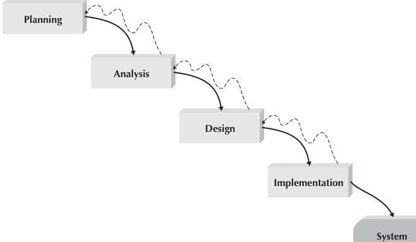

**瀑布式开发** 最初的结构化设计方法论（至今在使用）是瀑布式开发。通过基于瀑布式开发的方法论，分析师和用户按照顺序从一个阶段进展到下一个阶段（见图 1-2）。每个阶段的关键交付物通常非常长（数百页），并随着阶段的推移提交给赞助人审批。赞助人批准该阶段开展的工作后，该阶段结束，下一个阶段开始。这种方法被称为瀑布，因为它以一种方式逐阶段向前移动。虽然在 `SDLC` 中可以回溯（例如，从设计回到分析），但这是极其困难的（想象自己是一条试图逆流而上的鲑鱼），如图 1-2 所示。

结构化设计还引入了使用正式建模或设计技术来描述基本过程及其支持的数据。传统的结构化设计使用一组图表来表示过程，使用另一组图表来表示数据。由于使用了两组图表，系统分析师必须决定开发并使用一组作为核心：过程模型图或数据模型图。

结构化设计瀑布方法的两个优点是：它在编程开始很早就确定了系统需求，并尽可能地减少了项目进行过程中需求的变更。两个缺点是：设计在开始之前必须完全规范，而且从分析阶段完成系统建议到交付系统之间跨越了很长时间（通常是几个月或几年）。如果项目团队错过了重要需求，可能需要昂贵的实施后编程（想象你正试图在纸上设计一辆汽车；你有大可能记得开门时开启的内部灯，或者为发动机指定正确数量的气门？）由于业务环境自分析阶段发生以来发生了变化，系统可能还需要重大的返工。

并行开发 并行开发方法论试图解决分析阶段与系统交付之间长期延迟的问题。它不是先进行设计和实现，而是对整个系统进行通用设计，并将项目划分为一系列不同的子项目，这些子项目可以并行进行设计和实现。一旦所有子项目完成，将对各个部分进行集成并交付系统（见图 1-3）。

并行开发方法论的主要优点是它通过缩短从分析阶段到系统交付的时间来解决延迟问题。然而，该方法的两个缺点是，各个部分并不是完全独立的；一个子项目中的更改可能会影响另一个。

第二类系统开发方法论包括快速应用开发（`RAD`）。基于快速应用开发的方法论是出现于 20 世纪 90 年代的新兴方法。通过调整系统开发生命周期（`SDLC`）阶段，快速应用开发方法论试图解决结构化设计方法论的缺陷。通过这种方式，可以快速地将部分系统交付到用户手中。

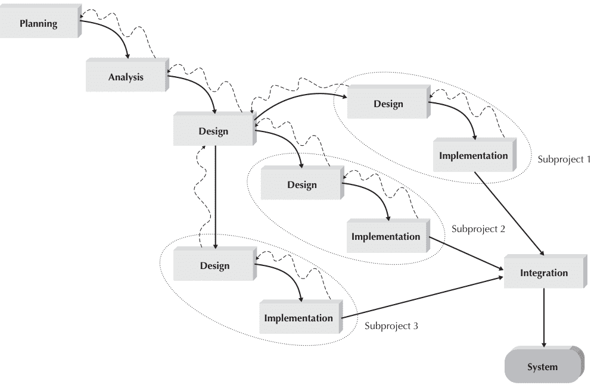

图 1-3 基于并行开发的方法论

> 4 关于快速开发的最好的书籍之一是 Steve McConnell 的 *Rapid Development* (Redmond, WA: Microsoft Press, 1996)。

大多数 `RAD` 方法论建议使用特殊技术和工具来加速分析、设计和实施阶段：计算机辅助软件工程（`CASE`）工具、联合应用设计（`JAD`）会话、第四代编程语言以及从设计自动生成程序的代码生成器。

阶段式开发 阶段式开发方法论将整个系统拆分为一系列按顺序开发的版本。分析阶段识别整体系统概念，然后由项目团队、用户和赞助人将需求分类为一系列版本。最重要和功能性的需求被整合到第一个版本中。分析阶段引导设计和实现（见图 1-4）。

一旦版本 1 实现，就开始开始版本 2 的工作。对之前识别的需求进行额外的分析，并结合从用户经验产生的新想法和问题。这一过程循环进行。阶段式开发方法论的优点是能够快速将系统交付给用户。虽然系统还没有执行用户的所有功能，但它比瀑布和并行方法完成后交付系统更早开始提供业务价值。同样，由于用户更早地使用了系统，他们比结构化设计情况更容易发现额外需求。

阶段式开发的主要缺点是用户面对的是特意不完整的系统。关键在于识别出最重要、实用的功能，并将其包含在第一个版本中，在此过程中管理用户预期。

原型开发 原型开发方法论同时执行分析、设计和实施阶段，这三者循环进行，直到系统完成。在这些方法论中，进行分析和设计后立即开始开发系统原型——一个提供极少功能的快速原型。第一个原型通常是系统的第一部分。用户和赞助人使用并提供意见。这些意见用于实现、纠正和实施第二个原型，后者提供更多功能。这一过程循环进行，直到用户和赞助人认为原型功能足够并在组织内安装使用。基于原型方法的关键优点是它可以非常快速地为用户提供一个可以交互的系统，即使它尚未准备好在组织内广泛使用。

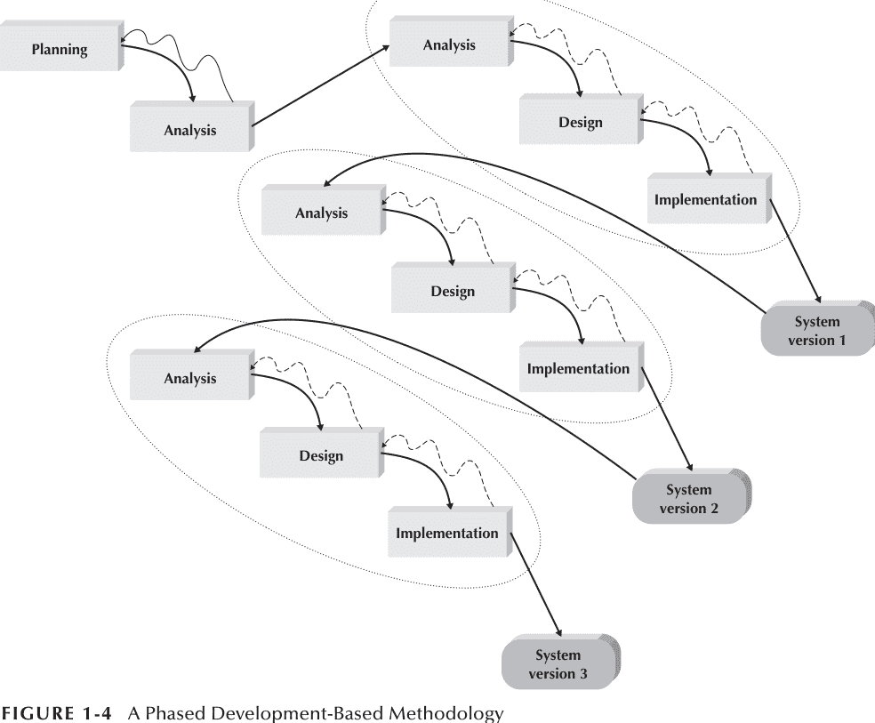

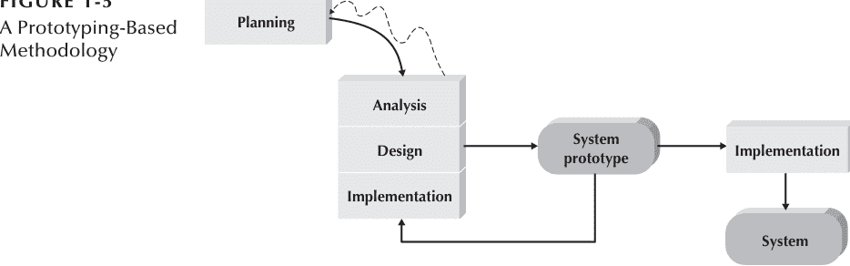

原型法的主要问题在于，其快速的系统发布挑战了进行仔细、有方法的分析的尝试。原型往往会经历变化，导致许多初始设计决策变得糟糕。这可能会在复杂系统的开发中引发问题，因为根本性的问题和缺陷直到开发过程中才被发现。想象一下正在造一辆汽车，为了更换发动机而把整个引擎拆掉（因为在行驶10,000英里之前，没有人考虑到更换发动机的需求）。

### 丢弃型原型（Throwaway Prototyping）

*基于丢弃型原型的方法论*与基于原型的方法论相似之处在于它们都包含了原型的开发；然而，丢弃型原型处于之前讨论的方法中的不同阶段，且具有不同的外观（见图1-6）。

基于原型的方法论拥有一个相对彻底的分析阶段，用于收集信息并为系统概念开发想法。然而，用户可能无法完全理解他们建议的许多功能，并且可能存在待解决的挑战性问题。这些每一个问题都会经过分析、设计并构建一个设计原型。设计原型并不是一个运行的系统；它是一个代表系统部分内容且需要进一步细化的产品，它仅包含足够理解其潜在问题的细节。例如，假设用户不清楚订单输入系统应该如何工作。在这种情况下，一系列模拟屏幕*看起来*像是一个系统，但它们实际上什么也做不了。假设项目团队需要用 `Java` 开发一个复杂的图形程序。该团队可以使用虚构数据编写部分程序，以确保他们能够成功地完成一个功能完的程序。

使用此类方法论开发的系统在分析和设计阶段依赖设计原型。每个原型都用于在系统构建之前通过确认已理解重要问题，来最大限度地降低系统相关的风险。一旦问题解决，项目就会进入设计和实现阶段。此时，设计原型会被丢弃，这是这些方法论与原型方法论之间的重要区别，在后者中原型会演变为最终系统。

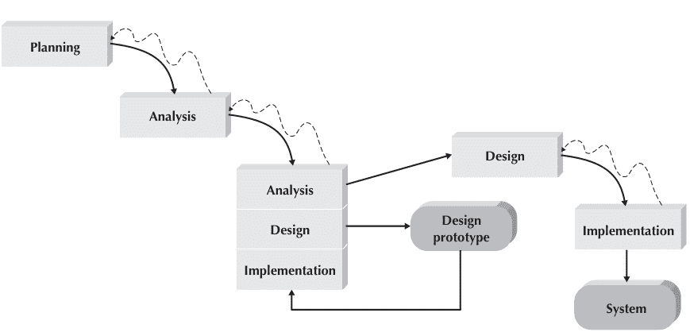

图 1-6 基于丢弃型原型的方法论

## 12 第1章 系统分析与设计简介

基于丢弃型原型的方法论平衡了经过思考的分析和设计阶段的优势与使用原型在系统构建前完善关键问题的优势。与基于原型的方法论相比，交付最终系统可能需要更长时间，但这类方法论产生的系统更稳定、更可靠。

今天，第三类系统开发方法正在兴起：敏捷开发。敏捷开发方法论基于《敏捷宣言》和十二项原则。宣言的重点是让开发者关注开发者的工作状况、可运行的软件、客户以及响应需求，而不是关注详细的系统开发过程、工具、包容性文档、法律合同和详细计划。这些以编程为中心的方法论规则和实践很少，而且都非常容易遵循。这些方法论通常仅基于敏捷软件的十二项原则。这些原则包括：

- *软件通过开发过程早期且持续地交付，以满足客户。*
- 无论需求变化发生在开发过程的何时，都拥抱变化。
- 频繁向客户交付可运行的软件。
- 客户和开发者共同工作解决业务问题。
- 积极主动的个人创建解决方案；提供他们所需的工具和环境，并信任他们能够交付解决方案。
- 开发团队内部面对面的沟通是收集需求最高效且有效的方法。
- 进展的主要衡量标准是运行执行中的软件。
- 客户和开发者都以可持续的速度工作。也就是说，工作水平可以无限维持，而不会导致任何员工倦怠。
- 通过对技术卓越和良好设计的关注来提高敏捷性。
- 简单性、避免不必要的工作至关重要。
- 自组织团队开发出最好的架构和设计。
- 开发团队定期反思如何改进。

> ⁵ 更多信息，请参阅 S. Ambler, *Agile Modeling: Practices for Extreme Development* (New York: Wiley, 2002); C. Larman, *Agile & Iterative Development: A Manager's Guide* (Boston: Addison-Wesley, 2004); R. C. Martin, *Agile Software Development: Principles, and Practices* (Upper Saddle River, NJ): Prentice Hall, 2003).


> ⁶ 见 Agile Alliance, www.agilealliance.com。

## 图 1-7 典型的敏捷开发

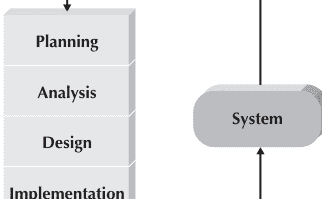

然而，敏捷方法论面临批评。针对当今业务环境的主要批评之一是，许多系统开发都是外包、外包和/或分包的。考虑到敏捷方法论要求开发团队共同办公，这似乎是不切实际的。第二个主要批评是，如果敏捷开发没有得到仔细管理（根据定义它并没有），开发过程可能会退化为一种原型方法，本质上变成一个“程序员失控”的环境，程序员们试图拼凑解决方案。第三个批评是基于软件开发过程中缺乏文档，这引发了关于系统维护性的问题。在没有足够的文档的情况下，系统和开发过程都无法保证。第四个主要批评是基于敏捷方法是否能够交付关键任务系统。


尽管有这些批评，考虑到敏捷在处理待办事项和为许多业务问题提供及时解决方案的潜力，某些情况下应该考虑敏捷方法。此外，通过关注《宣言》和十二项原则的底层目的而获得的许多技术通常用于面向对象的系统开发。敏捷方法的两个最流行的例子是极端编程（XP）和 Scrum。

## 极端编程（XP）

极端编程（XP）建立在四种价值之上：沟通、简单性、反馈和勇气。这四种价值为 XP 开发者创建任何系统提供了基础。首先，开发者必须持续向最终用户提供快速反馈。其次，XP 要求开发者遵循 `KISS` 原则。第三，开发者必须对系统进行增进式更改，他们不仅要改变，还要拥抱变化。第四，开发者必须支持团队开发自己的技能。XP 用于创建成功系统的三个关键原则是持续测试、结对简单编码以及与用户的清晰交互能够快速构建系统。

> 更多信息，请参阅 K. Beck, *Extreme Programming: Embrace Change* (Reading, MA: Addison-Wesley, 2002); M. Lippert, S. Roock, and H. Wolf, *Extreme Programming in Action: Practical Experiences from Real World Projects* (New York: Wiley, 2002); www.extremeprogramming.org.

- 保持简单，愚蠢（Keep it simple, stupid）。

测试和高效的编码实践是 XP（敏捷开发）的核心。代码每天都会经过测试并被放入集成测试环境中。如果存在错误，代码将回滚直到没有错误为止。

一个 XP 项目始于用户故事（`user stories`），这些故事描述了系统需要的功能。程序员以小型、简单的模块编写代码并通过测试来满足这些需求。要求用户随时待命，以便在问题和疑问出现时予以解答。标准对于减少冲突非常重要，因此 XP 团队使用一套共同命名、描述和编码规范。XP 项目的交付结果优于 RAD（快速应用开发）方法，而且很少在长时间的需求收集上停滞。

XP 承认了使用 XP 开发软件的许多优势。程序员与所有利益相关者紧密合作，改善了他们之间的沟通。对不断演变的系统进行持续测试确保了系统是以演化和增量的方式开发的，这使得需求随着利益相关者理解技术在解决他们问题方面的潜力而不断演进。评估是任务驱动的，并由实施所考虑任务解决方案的程序员执行。由于所有的编程都是结对完成的，程序员对每个软件组件的共同责任确保了产品的最终质量在每次迭代中不断提高。

对于动力充足、团队稳定且经验丰富的小项目，XP 的运行会良好。然而，如果项目规模较大或团队缺乏经验，XP 的成功就难以预料。这往往让人们对将外部承包商引入使用 XP 的团队环境的做法产生怀疑。XP 需要极大的自律，否则项目将失去焦点并变得混乱。XP 仅建议用于小型开发小组——不超过 10 人——而不建议用于大型关键任务型项目。由于缺乏分析和设计文档，只存在代码文档，因此使用 XP 维护大型系统可能是可能的。XP 作为一种业务信息系统开发方法，其效性尚存疑。该方法不适用于大量用户输入的场景，而许多业务部门无法应对。然而，某些与 XP 相关的技术被应用于面向对象的系统中。例如，用户故事编程和持续测试是面向对象系统开发的宝贵工具。

## Scrum

Scrum 在橄榄球中是广为人知的。在橄榄球运动中，scrum（争球）用于重新开始比赛。简而言之，Scrum 方法的创建者认为，无论你计划得多么周详，一旦软件开始开发，混乱就会爆发，计划就会被付诸脑谈。

> 一个拥有这种感觉的团队：一种强烈的强度感；一种凝聚力，一种感觉他们只关注正在开发的产品，以及对共同工作的享受。欲了解更多关于相关团队的信息，请参阅 T. DeMarco 和 T. Lister, *Productive Teams and Projects* (New York: Dorset Press, 1987)。

> 考虑 XP 作为软件开发方法的倾向，是基于与 Brian Henderson-Sellers 的对话。

> 许多关于 XP 作为软件开发方法的观察，是基于与 Brian Henderson-Sellers 的对话。

> 更多信息，请参阅 C. Larson, *Agile & Iterative Development: A Manager’s Guide* (Boston: Wesley, 2004); K. Schwaber and M. Beadle, *Agile Software Development with Scrum* (Upper River, NJ: Prentice Hall, 2001); R. Wysock, *Effective Project Management: Traditional, Agile, Extreme*, 5th Ed. (Indianapolis, IN: Wiley Publishing, 2009)。

你所做的最好的就是在预言中球弹出的地方做出反应。然后你带着球冲刺，直到下一次 scrum。在 Scrum 方法中，一次冲刺（`sprint`）持续三十个工作日。冲刺结束时，向客户交付成果。

在所有开发方法中，从表面上看，Scrum 是最混乱的。为了控制这种固有的混乱，Scrum 开发关注几个关键实践。团队是自组织和自引导的。与其他方法不同，Scrum 团队没有指定的团队负责人。相反，团队以共生的方式组织自己，并为每个冲刺（迭代）设定目标。一旦冲刺开始，Scrum 团队就不再考虑任何额外需求。新发现的需求将被添加到待处理的需求积压列表（`product backlog`）中。每个工作日的开始，都会举行 Scrum 会议。在每次冲刺结束时，团队向客户演示软件。根据冲刺的结果，为下一次冲刺制定新计划。

Scrum 会议是 Scrum 开发过程中最有趣的方面之一。然而，在极少数例外情况下，只有团队成员可以发言。Scrum 增量（`increment`）对特定团队正在的工作提供反馈。在会议中，所有团队成员围成一圈，报告他们计划做什么，并描述在上一次冲刺期间什么阻塞了进度。每日 Scrum 在一小时内处理。从 Scrum 的角度来看，在开发的这一阶段对阻碍做出一个“坏”决定，比不做决定要好。Larman 建议，每个成员都应该报告冲刺期间发现的任何额外需求，以及团队学到的可能对其他成员有用的任何信息。

对 Scrum（以及所有方法论）的主要批评之一是，Scrum 能否扩展到开发大型关键任务系统尚存疑。一个 Scrum 团队的规模不超过七名成员。Scrum 追随者应对这一批评的唯一组织原则是组织“Scrum 之 Scrum（`scrum of scrums`）”。每个团队每天开会，在团队会议之后，每个团队的代表（负责人）参加 Scrum 之 Scrum 会议。这会一直持续，直到整个系统取得进展。取决于涉及团队的数量，这种方法的效性尚存疑。然而，某些与 XP 相关的技术被应用于面向对象的系统中。例如，用户故事编程和持续测试是面向对象系统开发的宝贵工具。

| 开发系统的能力 | 结构化方法：瀑布 | 并行方法：RAD | 分阶段方法：原型 | 丢弃式原型方法：XP | 敏捷方法：SCRUM |
| :--- | :---: | :---: | :---: | :---: | :---: |
| 需求不明确 | 差 | 差 | 优 | 优 | 优 |
| 技术不熟悉 | 差 | 差 | 优 | 差 | 优 |
| 复杂性 | 优 | 优 | 优 | 差 | 优 |
| 可靠性要求 | 优 | 优 | 优 | 差 | 优 |
| 进度短 | 差 | 差 | 优 | 优 | 优 |
| 进度可见性 | 差 | 差 | 优 | 优 | 优 |

**图 1-8** 选择方法的标准

图 1-8 总结了选择方法的某些重要标准。未讨论的是 RAD 要求使用具有显著学习曲线的新工具和技术。这些工具和技术增加了项目的复杂性并需要额外的时间。然而，一旦被采用且团队变得富有经验，这些工具和技术可以提高方法交付的速度。

由于有很多方法论，分析师面临的首要挑战是选择哪一种。选择方法并不简单，因为没有正式的政策来指导选择。许多组织有。艾森威尔最喜欢的格言之一：“战斗计划是无用的，但规划不可或缺。”M. Dobson, *Project Management: How to Manage People, Processes, and Time to Achieve Results* (Avon: Wiley, 2003),

### 需求的清晰度

当系统的用户需求不明确时，很难通过谈论和报告来理解。用户通常需要与技术交互，才能真正理解新系统做什么以及如何应用于他们的需求。当需求不明确时，RAD 和敏捷方法通常更合适。

### 对技术的熟悉程度

当系统将使用人员不熟悉的新技术时，在方法早期应用新技术将增加成功的机会。如果在不熟悉基础技术的情况下设计系统，风险将会增加，因为工具可能无法实现。丢弃式原型方法在用户鼓励人员开发高风险设计原型时特别适用。分阶段开发方法为在设计完成之前深入研究技术提供了机会。此外，由于敏捷方法的编程性质，XP 和 Scrum 都是合适的。尽管如此，你可能会发现原型方法也是合适的；但程度要低得多，因为构建的原型通常只触及技术的表面。

### 系统复杂性

复杂系统需要细致的分析和设计。丢弃式原型方法非常适合这种细致的分析和设计，但原型方法并不适合。传统的结构化基于设计的方法论可以处理复杂系统，但如果不能尽早将系统或原型交付给用户，某些关键可能会被忽略。虽然基于阶段开发的方法论允许用户在过程早期就与系统交互，但我们观察到，遵循这种方法的项目团队对复杂问题领域的分析的关注往往比使用其他方法论时更多。最后，敏捷方法论在处理系统复杂性方面参差不齐。如果系统规模巨大，敏捷方法的表现会很差；但如果系统是中等规模，那么敏捷方法将非常出色。我们在这些标准上对其评价良好。

### 短期进度表

当时间紧迫时，RAD（快速应用开发）和敏捷方法是极佳的选择，因为它们最能让项目团队根据特定的交付日期调整系统功能；如果项目进度落后，可以通过从正在开发的版本或原型中移除功能来重新调整。当时间非常紧迫的情况下，基于瀑布的方法论是最差的选择，因为它们不允许任何进度变更。

### 进度可见性

系统开发中的最大挑战之一是确定项目是否按计划进行。结构化设计方法尤其是如此，因为设计和实现发生在项目的末尾。基于 RAD 方法将许多关键设计决策提前到项目早期，帮助项目经理识别并应对风险因素，并保持预期到位。然而，由于敏捷方法与每日进展会议，进度的可见性始终处于考量之中。

从系统开发生命周期（SDLC）期间执行的各个阶段和步骤可以看出，项目团队需要各种技能。项目成员是识别改进组织的方法、构建支持这些改进的信息系统、以及培训和激励他人使用系统的代理人。理解改变什么以及如何改变——以及说服他人——需要广泛的技能。这些技能可以分为六大类：技术、业务、分析、人际、管理和伦理。

分析师必须具备技术技能，以理解组织的现有环境、构成新系统的技术，以及这两者将如何融入集成的技术解决方案中。需要业务技能来理解 IT 如何应用于业务场景，并确保 IT 交付了真正的业务价值。


# 第18 章 第1节 系统分析与设计导论

分析师在项目和组织层面上都是持续的问题解决者，他们经常对自己的分析能力进行测试。

分析师通常需要与用户、业务经理（他们通常具有技术经验）以及程序员（他们通常比分析师具有更多的技术专长）进行一对一的沟通。他们必须能够对大小小组进行演示并提交报告。他们不仅需要强大的人际交往能力，还需要管理与他们工作的人员，并管理与低估风险相关的风险。

除了这些通用技能组外，分析师还需要许多与个人所担任的角色相关的特定技能。在系统开发的早期，组织期望一个人（即分析师）具备开展系统开发项目所需的所有技能。现在一些小型组织仍然需要承担许多角色，但由于组织和技术变得越来越复杂，大多数大型组织现在都会构建包含几名职责明确成员的项目团队。不同的组织对角色的划分方式不同。大多数 IS（信息系统）团队还包括许多其他人员，例如实际上编写系统程序的程序员，以及准备屏幕界面和其他文档（例如用户手册和系统手册）的技术写作人员。

## 业务分析师

业务分析师关注业务问题，识别系统将创造的业务价值，开发关于改进业务流程的想法和建议，并结合系统设计新的流程和政策。此人通常具有业务经验和某种类型的专业培训。他或她代表项目赞助人和系统最终用户的利益。业务分析师协助规划和设计阶段，但在分析阶段最活跃。

## 系统分析师

系统分析师关注支持系统的 IS（信息系统）问题。此人开发关于信息技术如何改进业务流程的建议，在业务分析师的帮助下设计新的业务流程，设计新的信息系统，并确保所有 IS 标准都得到维护。系统分析师可能在分析与设计、编程以及业务领域拥有丰富的培训和经验。他或她代表 IS 部门的利益，并在整个项目期间密集工作，但在实施阶段可能工作较少。

## 基础设施分析师

基础设施分析师关注支持系统如何与组织技术基础设施（例如硬件、软件、网络和数据库）交互的决策问题。基础设施分析师的任务包括确保新系统符合组织标准，并识别支持系统所需的基础设施变更。此人可能在网络、数据库管理以及各种硬件和软件产品方面拥有丰富的培训和经验。

此人代表组织和 IS 小组的利益，这些小组将在新系统安装后最终负责运行和支持。基础设施分析师在整个项目期间工作，但在规划和分析阶段可能工作较少。

## 变更管理分析师

变更管理分析师关注系统安装周围的人员和管理问题。此人的角色包括确保用户获得充分的文档和支持，提供新系统的培训，并开发克服阻力的策略。此人应该在通用的组织行为、特别是变更管理方面拥有丰富的培训和经验。他或她代表项目赞助人和为之设计系统的用户。变更管理分析师在实施阶段工作最活跃，但在分析和设计阶段为变更奠定基础。

## 项目经理

项目经理负责确保按时、预算完成项目，并交付项目赞助人预期的所有利益。项目经理的角色包括管理团队成员、制定项目计划、分配资源，并在团队外人员对项目有疑问时作为主要联系人。此人可能在项目管理方面拥有丰富的经验，并作为系统分析师工作了多年。他或她代表 IS 部门和项目赞助人的利益。项目经理在项目的所有阶段都明智地工作。

# 面向对象系统的基本特征

**图 1-9** 类与对象

| 患者 (Patient) |
| :--- |
| -姓名 |
| -地址 |
| -出生日期 |
| -电话 |
| -保险公司 |
| +预约预约() |
| +计算上次就诊() |
| +更改状态() |
| +提供病史() |
| +创建() |
| Jim Maloney：患者 | Mary Wilson：患者 | Theresa Marks：患者 |

每个对象都具有*属性*（`attributes`），用于描述关于该对象的信息，例如患者的姓名、出生日期、地址和电话号码。属性也用于表示对象之间的关系；例如，员工对象中可能有一个部门属性，其值为某个部门，用以记录该员工所属的部门。对象的*状态*（`state`）由其在特定时间点的属性值以及与其他对象之间的关系定义。患者的状态可能是“新生的”、“当前的”或“过往的”。

每个对象都具有*行为*（`behaviors`）。这些行为规定了该对象可以做什么。例如，一个预约对象可能可以安排新预约、删除预约并找到下一个可预约的时间。在面向对象编程中，行为被实现为方法（下一节）。

面向对象系统的一个受关注方面是：在大多数面向对象的编程语言中，类和实例都可以具有属性（或方法）。类属性和方法被用于建模，这些处理与该类的所有实例相关的细节。例如，为了创建一个新患者，会向 `Patient` 类发送消息以创建其自身的新实例。然而，在本书中，我们主要关注对象的属性和方法，而不是类。

## 方法与消息 (Methods and Messages)

方法实现了对象的行为。方法无非是对象可以执行的操作。消息是发送给对象以触发方法的信息。消息本质上是从一个对象调用另一个对象的函数或过程。例如，如果一个患者是第一次来诊所，前台人员会向应用程序发送一条消息。`Patient` 类可以接收该消息并执行其 `create()` 方法，然后创建一个新对象：`aPatient`（见图 1-10）。

## 封装与信息隐藏 (Encapsulation and Information Hiding)

*封装*（`encapsulation`）和*信息隐藏*（`information hiding`）的概念在面向对象的系统中也是相互关联的。然而，这两个术语并不新。封装仅仅是将过程和数据组合成单一实体。信息隐藏最早是在结构化系统开发中提出来的。信息隐藏原则建议，只有软件模块所需的信息才发布给该模块。通常，这意味着传递给模块的信息和从模块返回的信息是公开的。模块具体如何实现所需的功能并不重要。我们并不在乎对象如何执行其功能，只要功能执行了即可。在面向对象系统中，将封装与信息隐藏原则相结合，支持将对象视为“黑盒”。

# 面向对象系统的基本特征 (Basic Characteristics of Object-Oriented Systems)

我们可以通过方法使用对象，这一事实使其具有可重用性，因为它保护了对象的内部运行机制不受外部系统变化的影响，并且当对对象进行更改时，系统不会受到影响。在图 1-10 中，注意消息（`create`）是如何发送给对象的，但响应该消息所需的内部算法对系统的其他部分是隐藏的。对象只需要的信息是一组操作集，即对象可以执行的操作以及哪些消息需要触发它们。

## 图 1-10 消息与方法

| 患者 (Patient) |
| :--- |
| -姓名 |
| -出生日期 |
| -电话 |
| -保险公司 |
| +预约预约() |
| +计算上次就诊() |
| +更改状态() |
| +提供病史() |
| +创建() |
| aPatient |

## 继承 (Inheritance)


# 继承

继承作为一种信息系统开发特征，是在 20 世纪 70 年代末和 80 年代初的建模中提出的。数据建模文献建议识别更高层次的或更通用的对象类。常见的属性和方法集合可以被组织成子类。通常情况下，类按层次结构排列，其中父类（或通用类）位于顶部，子类（或特定类）位于底部。在图 1-11 中，`Person`（人）是 `Doctor`（医生）和 `Patient`（患者）类的父类。`Doctor` 反而又是 `Practitioner`（执业医师）和 `Specialist`（专家）的父类。类与其子类之间的关系被称为“是一种……的关系”（kind-of-relationship）。例如，在图 1-11 中，全科医生（`General Practitioner`）是一种医生，医生是一种……

子类继承自上方类的属性和方法。这意味着每个子类都包含其父类的属性和方法。图 1-11 显示，`Doctor` 和 `Patient` 都是 `Person` 的子类，因此继承了 `Person` 类的属性和方法。继承使得类的定义变得更简单。不需要在 `Doctor` 和 `Patient` 中分别重复相同的属性和方法，将两者共有的属性和方法放在 `Person` 类中，并由下方的类继承。注意继承层次类比没有继承层次的类要高效得多（见图 1-12）。

层次结构中的大多数类都会产生实例；任何具有实例的类被称为具体类（`concrete class`）。例如，如果 Mary Wilson 和 Jim Maloney 是 `Patient` 类的实例，那么 `Patient` 就被视为具体类（见图 1-9）。某些类不产生实例，因为它们被用作模板。

## 抽象类与具体类


子类显示 `Doctor` 和 `Patient` 都是 `Person` 的子类，因此继承了 `Person` 类的属性和方法。继承使得类的定义变得更简单。不需要在 `Doctor` 和 `Patient` 中分别重复相同的属性和方法，将两者共有的属性和方法放在 `Person` 类中，并由下方的类继承。注意继承层次类比没有继承层次的类要高效得多（见图 1-12）。

## 多态与动态绑定

多态意味着相同的消息可以有不同的解释。例如，正方形对象、圆形对象和三角形对象，即使消息相同，结果也会非常不同。注意在图 1-13 中，尽管消息相同，每个对象都做了相应的（且不同的）响应。

多态是通过动态绑定实现的。动态绑定（或晚绑定）是一种将对象操作延迟到运行阶段的技术。实际调用的方法不是静态绑定。在静态绑定系统中，对象的类型在编译时就会确定。因此，由开发者选择调用哪种方法，而不是让系统来完成。这就是为什么传统编程语言根据不同对象类型具有复杂的逻辑。


# 面向对象系统分析与设计 (OOSAD)

从技术上讲，开发信息系统的面向对象方法可以使用任何传统方法论。然而，面向对象方法与分阶段开发的 RAD 或敏捷方法论联系紧密。结构化设计等传统方法与面向对象方法的主要区别在于问题分解的方式。在传统方法中，问题分解要么以过程为中心，要么以数据为中心。然而，过程与数据之间非常密切，很难选择其中一个作为主要关注。基于这种与现实世界的一致性，出现了新的面向对象方法论，它们使用基于 RAD 的开发生命周期阶段顺序，但通过将问题分解集中在包含数据和过程的对象上，平衡了过程和数据的重点。

根据统一建模语言（UML）的创建者 Grady Booch、Jacobson 和 James Rumbaugh¹⁶ 的观点，任何现代信息系统开发的面向对象方法必须是**用例驱动的、以架构为核心的、迭代且增量的**。

## 用例驱动

**用例驱动**意味着用例是定义系统行为的主要建模工具。一个用例描述了用户如何与系统交互以执行某些活动，例如下单、预订或搜索信息。用例用于识别系统需求，并将这些需求传递给必须编写系统的程序员。用例在本质上是简单的，因为它们一次只关注一个过程。相比之下，传统方法和 RAD 方法设计的流程模型要复杂得多，因为它们要求系统和用户开发出整个系统的模型。在传统方法中，每个系统都被分解为一组子系统，而这些子系统又被分解为更进一步的子系统，以此类推。这种分解一直持续无法进一步进行过程分解为止，通常需要几十页相互关联的图表。相比之下，一个用例一次只关注一个业务过程，因此开发模型要简单得多.¹⁷

## 以架构为核心

任何现代系统分析与设计方法都应该是**以架构为核心的**。以架构为核心意味着演进系统的底层架构驱动了系统的规范、构建和文档。现代面向对象的系统分析与设计方法应该支持至少三个相互相关的系统视图：功能视图、静态和动态视图。功能视图（或外部视图）从用户的角度描述系统的行为。结构视图（或静态视图）通过属性、方法、类和关系来描述系统。行为视图（或动态视图）通过对象之间传递的消息和随时间的状态变化来描述系统的行为。

## 迭代与增长

现代面向对象的系统分析与设计强调**迭代和增量开发**，在整个项目生命周期内进行持续的测试和完善。这意味着系统通过逐步构建三个架构视图来不断完善对用户问题的理解。系统分析师通过与用户合作创建所研究系统的功能表示来实现这一点。接下来，分析师尝试构建演进中系统的结构表示。利用系统的结构表示，分析师将系统功能分配到演进的结构中，以创建演进中系统的行为表示。当分析师与用户合作开发演进系统的三个架构视图时，分析师会对每个视图以及视图之间进行迭代。也就是说，当分析师理解了结构和行为视图时，就能避免功能视图中的遗漏需求或误导。反过来，这会导致更改级联回溯到结构和行为视图。系统的三个架构视图都是相互关联且相互依赖的（见图 1-14）。随着增长和迭代的完成，将揭示用户功能需求更完整的表示。

¹⁶ Grady Booch, Ian Jacobson, and James Rumbaugh, *The Unified Modeling Language User Guide* (Reading, MA: Addison-Wesley, 1999).

¹⁷ 对于那些经历过传统结构化分析设计的人来说，这是使用 UML 进行面向对象分析设计中最不寻常的之一。与结构化方法不同，面向对象方法强调只关注一个用例，并将该用例分配到一组通信和协作的类上。

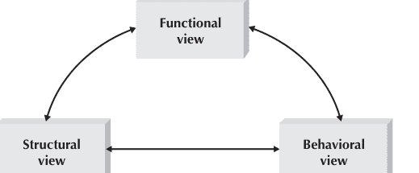

## 面向对象系统分析与设计的优势

面向对象方法的概念使分析师能够在更小、更易于管理的模块内构建复杂系统，单独处理模块，并轻松地将模块组合成一个信息系统。这种模块化使得系统开发更容易理解、更容易在项目团队成员之间共享，并更容易与用户沟通——用户在整个系统开发过程中需要提供需求并确认系统对需求的满足程度。通过将系统开发模块化，项目团队实际上创建了可重用的组件，这些组件可以插入其他系统，或作为其他项目的起点。最终，这可以节省时间，因为新项目不需要从零开始。

# 统一过程

统一过程是一种特定的方法，它规划了何时以及如何使用统一建模语言（UML）技术进行面向对象的分析与设计。主要贡献者是 Grady Booch、Ivar Jacobson 和 James Rumbaugh。UML 为信息系统的结构和行为开发提供支持，而统一过程关注的是行为支持。当然，统一过程是用例驱动、以架构为核心的、迭代且增长的。此外，统一过程是一个二维系统开发过程，由一组阶段和工作流描述。这些阶段包括：引入（`inception`）、详化（`elaboration`）、构建（`construction`）和过渡（`transition`）。工作流包括业务建模、需求、分析、设计、实现、测试、部署、配置与变更管理、项目管理和环境。图 1-15 描述了统一过程。

¹⁸ 本节内容基于 Kiawan Ahmed and Craig E. Emery, *Developing Java Systems with IEEE and UML* (Boston, MA: Addison-Wesley, 2002); Jim Larrow and Ives Neault, *The Unified Process: Practical Object-Oriented Analysis & Design* (Boston, MA: Addison-Wesley, 2002); Peter Eelles, Kelly Johnston, and Wojciech Kozacki, *Building IEEE Systems with the Rational Unified Process* (Boston, MA: Addison-Wesley, 2003); Jacob Jacobson, Grady Booch, and James Rumbaugh, *The Unified Process: Best Practices for Software Teams* (Reading, MA: Addison-Wesley, 2002).

## 阶段

统一过程阶段支持分析师以迭代和增长的方式开发系统。阶段描述了信息系统如何随时间演进。根据演进系统处于哪个开发阶段，工作流的活动水平会有所不同。图 1-15 中每个工作流相关的曲线近似了该阶段发生的活动量。例如，引入阶段主要忽略测试和部署工作流，但实际上包含一组迭代，每次迭代使用各种工作流来创建演进系统的增量版本。随着系统通过各个阶段演进，它变得更加完善和完整。每个阶段都有目标、跨工作流的重点以及增量交付物。接下来将描述每个阶段。

### 引入

在某些方面，引入阶段与传统 SDLC 方法的规划阶段非常相似。在这个阶段，为提议系统建立业务案例。这包括可行性分析，应该回答以下问题：

- 我们有构建它的能力吗（技术可行性）？
- 如果我们构建，它会产生业务价值吗（经济可行性）？
- 如果我们构建，它会被组织使用吗（组织可行性）？

为了回答这些问题，开发团队会执行与业务建模、需求和分析工作流相关的工作。某些情况下，取决于系统开发过程中可能遇到的技术困难，会开发一个可丢弃的原型。这意味着设计、实现和测试也可能参与其中。项目管理和环境工作流在此阶段非常相关。启动阶段（`Inception phase`）的主要交付物是一份愿景文档，该文档设定了项目范围；识别了主要需求和约束；制定了初始项目计划；并描述了项目相关的可行性和风险、开发系统所需环境的采用，以及正在实现和测试的领域类的某些方面。

### 详化

当我们通常谈论面向对象的系统分析和设计时，与统一过程详化阶段相关的活动最为密切。分析和设计工作流是这一阶段的重点。详化阶段继续开发愿景文档，定稿业务案例，修订风险评估，并完成详细的项目计划，以便利益相关者对构建最终系统达成共识。通过收集需求、构建领域的结构化和行为模型以及处理问题领域，开发者参与了该阶段除部署工作流之外的所有工作。开发者对工作流进行迭代，解决配置和变更管理的重要性变得显而易见。此外，在启动阶段获得的工具对于项目本身的成功至关重要。该阶段的交付物包括 UML 结构和行为图，以及一个演进系统基准版本的可执行文件。基准版本作为后续所有迭代的 foundation。通过在此时提供坚实的基础，开发者为在构造和过渡阶段完成系统提供了依据。

### 构造

构造阶段侧重于演进中的信息系统。该阶段主要涉及实现工作流。然而，需求工作流以及分析和设计工作流也参与此阶段。在这一阶段，识别出缺失的需求，并最终完成了分析和设计模型。在此阶段，工作流经历了迭代，在最后一次迭代中，部署工作流进入了全速运转状态。配置和变更管理工作流及其版本控制活动在构造阶段变得极其重要。有时，某个迭代必须进行回滚。如果没有良好的版本控制，回滚到系统的之前的版本（增量实现）几乎是不可能实现的。该阶段的主要交付物是一个可以发布进行 Beta 测试和验收测试的系统实现。

### 过渡

与构造阶段一样，过渡阶段处理通常与传统软件开发生命周期（SDLC）方法中的实现阶段相关的方面。其主要重点是测试和部署工作流。本质上，业务建模、需求和分析工作流应该在演进中的信息系统的早期迭代中完成。此外，测试工作流将在演进系统的早期阶段一直在执行。根据测试工作流的结果，可能需要在设计和实现工作流上进行一些重新设计和编程活动，但在此时这些活动将是微乎其微的。从管理的角度来看，涉及项目管理、配置变更管理以及环境。其中发生的一些活动包括 Beta 测试和验收测试、对设计和实现的微调、用户培训，以及将最终产品发布到生产平台。显然，主要的交付物是实际的可执行系统。其他交付物还包括用户手册、支持用户的计划以及未来升级信息系统的计划。

> ¹ 鉴于 UML 包含不同的绘图技术，保持图表协调以及演进系统不同版本之间的同步通常由更高级的系统开发人员的能力来处理。这些工具通常包括项目管理和 CASE 工具。我们将在第 2 章中描述这些工具的使用。


## 工作流

工作流描述了开发者为了随时间演进信息系统而执行的任务或活动。统一过程的工作流分为两类：工程工作流和支持工作流。

### 工程工作流

工程工作流包括业务建模、需求、分析、设计、实现、测试和部署工作流。工程工作流处理产生产品（即信息系统）的活动。

#### 业务建模工作流

业务建模工作流揭示用户组织内部的问题并识别潜在项目。该工作流帮助管理层理解提高用户组织效率和效果的项目范围。业务建模的主要目的是确保开发者和用户组织都理解待开发的信息系统如何融入到用户组织的业务流程中。该工作流主要在启动阶段执行，但在任何符合业务逻辑时都会执行。在该工作流上进行的活动与传统 SDLC 的规划阶段最为紧密；然而，需求分析、用例建模和过程建模技术也能帮助我们理解现状。

#### 需求工作流

在统一过程中，需求包括功能性需求也包括非功能性需求。通常，需求从项目利益相关者处收集，例如用户、用户组织内的经理和客户。需求工作流在启动和详化阶段使用。识别出的需求对于开发愿景文档以及贯穿开发过程的用例非常有帮助。额外的需求往往在整个开发过程中不断产生。事实上，只有过渡阶段几乎没有（或者很少）额外的需求。

#### 分析工作流

分析工作流主要处理问题领域分析模型的创建。在统一过程中，分析师开始设计描绘问题领域类及其交互的架构和行为图。分析工作流的主要目的是确保开发者和用户组织都理解底层问题，而不过度分析。如果他们不小心，分析师会产生“分析瘫痪”，即项目陷入无止的分析中，导致系统从未被真正设计或实现。分析工作流的第二个目的是为类库识别有用的可重用类。通过重用类，分析师可以避免重复造轮。

#### 设计工作流

设计工作流将分析模型转换为可以使用的形式。分析工作流侧重于理解问题领域而设计工作流侧重于开发能够在特定环境中运行的解决方案。基本上，设计工作流通过增加详细设计、系统优化、数据库设计、界面设计和物理架构设计来增强系统的描述。

#### 实现工作流

实现工作流的主要目的是根据设计模型创建可执行文件（即编程）。这包括编写新类，还包括引入执行库中的类。与任何编程一样，新类及其与引入类之间的交互必须经过测试。最后，在多个小组实现系统的情况下，实现者还必须整合各个模块以创建系统的可执行版本。

#### 测试工作流

测试工作流的主要目的是提高演进系统的质量。测试超越了实现工作流相关的单元测试。在这种情况下，测试还包括所有模块的集成、用户验收测试以及软件的 Alpha 测试。实际上，测试应该贯穿系统开发的始终；分析和设计模型的测试发生在详化和构造阶段，而实现测试发生在构造阶段并在某种程度上发生在过渡阶段。

#### 部署工作流

部署工作流与统一过程中的阶段关联最多。部署工作流包括软件打包、分发、安装和 Beta 测试。将新系统部署到用户组织时，开发者可能需要转换当前数据、与现有软件建立接口并培训最终用户使用系统。

### 支持工作流

支持工作流包括项目管理、配置变更管理和环境工作流。支持工作流关注信息系统开发的管理方面。

#### 项目管理工作流

与其他项目相关的工作流在技术上活跃于所有阶段不同，项目管理工作流是唯一真正的跨阶段工作流。开发过程支持增量和迭代开发，因此信息系统往往随时间增长或演进。在每次迭代结束时，新的增量版本的系统即可交付。由于二维开发过程的复杂性，项目管理工作流显得至关重要。

统一流程的开发模型（工作流和阶段）。该工作流的活动包括识别和管理风险、管理范围、估算每次迭代和整个项目完成的时间、估算单个迭代和整个项目的成本，以及跟踪演进中的系统向最终版本开发的进度。

#### 配置和变更管理工作流

配置和变更管理工作流的主要目的是跟踪演进中的系统的状态。简而言之，演进中的信息系统由一组产物（例如图表、源代码和可执行文件）组成。在开发过程中，这些产物会被修改。开发这些产物涉及大量工作——因此也是大量的资金。产物本身应该被视为任何昂贵的资产进行处理，必须落实到位，以保护产物不被破坏。由于产物会定期（即使不是持续地）被修改，必须建立良好的控制机制。最后，需要捕获大量的项目管理信息（例如：每次修改的作者、时间和位置）。配置和变更管理工作流与配置和过渡阶段的关系最为紧密。


# 环境工作流

在信息系统的开发过程中，开发团队需要使用工具和流程。环境工作流解决了这些需求。例如，可能需要一个支持通过 UML 开发面向对象信息系统的 CASE 工具。其他工具包括编程环境、项目管理工具和配置管理工具。环境工作流涉及获取和安装这些工具。尽管此工作流可以在统一流程的所有阶段保持活跃，但它应该主要参与启动阶段（`inception phase`）。

## 统一流程的扩展

尽管统一流程如此庞大且复杂，但许多人指出了一系列关键弱点。首先，统一流程没有解决人员、预算、合同管理问题。这些活动被明确地排除在统一流程之外。其次，统一流程没有解决产品开发完成后与管理、运营或支持相关的问题。第三，它不是一个完整的软件过程；它是一个开发过程。第四，统一流程没有解决跨项目或项目之间的问题。考虑到面向对象系统开发中结果的重要性，以及许多组织同时在许多不同项目上工作的事实，遗漏项目间问题是一个重大的缺陷。

为了弥补这些缺陷，Ambler 和 Constantine 建议增加一个过程和两个工作流：运行和支持工作流以及基础设施管理工作流（图 1–16）。除了这些新工作流外，测试、部署和环境工作流也被修改，配置和变更管理工作流被扩展到了生产阶段。

> 20 S. Ambler and L. L. Constantine, *The Unified Process Inception Phase: Best Practices in the UP* (Lawrence, KS: CMP Books, 2000); S. Ambler and L. L. Constantine, *The Unified Process Elaboration Phase: Best Practices in the UP* (Lawrence, KS: CMP Books, 2000); S. Ambler and L. L. Constantine, *The Unified Process Construction Phase: Best Practices in Implementing the UP* (Lawrence, KS: CMP Books, 2000); S. Ambler and L. L. Constantine, *The Unified Process Transition and Production Phases: Best Practices in Implementing the UP* (Lawrence, KS: CMP Books, 2002).

## 工程工作流

| 阶段 | 启动 | 详化 | 构建 | 过渡 | 生产 |
| --- | --- | --- | --- | --- | --- |
| 业务建模 | | | | | |
| 需求 | | | | | |
| 分析 | | | | | |
| 设计 | | | | | |
| 实现 | | | | | |
| 测试 | | | | | |
| 部署 | | | | | |


## 支持工作流

| 阶段 | 启动 | 详化 | 构建 | 过渡 | 生产 |
| --- | --- | --- | --- | --- | --- |
| 配置和变更管理 | | | | | |
| 项目管理 | | | | | |
| 环境 | | | | | |
| 运行和支持 | | | | | |
| 基础设施管理 | | | | | |


| 迭代 | 迭代 | 迭代 | 迭代 | 迭代 | 迭代 | 迭代 | 迭代 |
| --- | --- | --- | --- | --- | --- | --- | --- |
| 1 | i | i+1 | j | j+1 | k | k+1 | m |

图 1-16 增强的统一流程

基于替代的面向对象软件过程：OPEN 过程（面向对象的过程、环境和符号）和面向对象软件过程 `pgt21`}

**生产阶段** *生产阶段*关注软件产品在成功部署后相关的问题。该阶段侧重于与更新、维护和运行软件相关的问题。与之前的阶段不同，没有迭代或增量交付物。如果要开发软件的新版本，

> 21 S. W. Ambrose, *Process Patterns—Building Large-Scale Systems Using Object Technology* (Cambridge, UK: SGS Books/Cambridge University Press, 1998); S. W. Ambrose, *More Process Patterns—Delivering Large-Scale Systems Using Object Technology* (Cambridge, UK: SGS Books/Cambridge University Press, 1999); I. Graham, B. Henderson-Sellers, *The OPEN Specification* (UK: Addison-Wesley, 1997); Youness, *Process Modeling with UML* (2000).

## 系统分析与设计的引言

然后开发人员必须开始。根据在此阶段进行的活动，没有工程工作流是相关的。在此阶段活跃的支持工作流包括配置和变更管理、项目管理、运行和支持工作流以及基础设施管理工作流。

**运行和支持工作流** *运行和支持工作流*关注支持当前版本以及日常运行软件的问题。活动包括创建用户文档、实施必要的备份、监控和优化软件性能以及进行修正维护。该工作流在构建阶段活跃；其水平在过渡阶段增加，最后当当前版本被新版本取代时下降。许多开发者有一种错误的观念，认为一旦软件交付给客户，他们的工作就结束了。在大多数情况下，支持软件的工作刚刚开始。

**基础设施管理工作流** *基础设施管理工作流*的主要目的是支持开发系统所需的基础设施。库、标准和企业模型的开发和修改非常重要。当领域架构的开发和维护超出单个项目的范围并将发生时，基础设施管理工作流是至关重要的。另一组非常重要的跨项目活动是软件开发过程的改进。由于此工作流的活动往往影响许多项目，而统一流程只关注特定项目，统一流程倾向于忽略这些活动（即：它们超出统一流程的范围和目的）。

**现有工作流的修改和扩展** 为了解决统一流程的缺陷，工作流需要进行修改和/或扩展到生产阶段。这些工作流包括测试、部署、环境、项目管理以及配置和变更管理工作流。

**测试工作流** 为了开发高质量的信息系统，应该对每个交付物进行测试，包括在启动阶段创建的交付物。否则，交付给客户的质量将会降低。

**部署工作流** 现代企业存在遗留系统，这些系统相关的数据库必须转换以与新系统交互。由于部署新系统的复杂性，转换需要大量的规划。因此，部署工作流的活动需要在启动阶段开始，而不是像统一流程建议的那样等到构建阶段结束。

**环境工作流** 环境工作流需要修改以包含与运行和生产环境相关的活动。实际执行的工作与在启动阶段设置开发环境的工作相似。在这种情况下，额外的工作是在过渡阶段完成的。

### 项目管理工作流

即使项目管理工作流不包括项目人员配置、客户与供应商之间的合同管理以及项目预算管理，这些活动对于任何软件开发项目的成功至关重要。我们建议将项目管理扩展到包含这些活动。该工作流还应在生产阶段发生，以解决培训、人员管理和客户关系管理等问题。

### 配置与变更管理工作流

配置与变更管理工作流扩展到了新的生产阶段。在生产阶段执行的包括识别运营系统的潜在改进，并评估所提更改的潜在影响。一旦开发者识别了这些更改并理解了它们的影响，就可以安排进行这些更改并在未来的发布中进行部署。

图 1-17 显示了涵盖增强统一过程（Enhanced Unified Process）阶段和工作流的章节。考虑到书中的离岸外包和信息技术自动化。²² 我们主要关注增强过程的深化阶段以及业务建模、需求、分析、设计和项目管理工作流。然而，如图 1-17 所示，其他阶段和工作流也被涵盖。因此，从业务角度来看，我们认为与这些工作流相关的活动是最重要的。

| 增强 UP 阶段 | 章节 |
|---|---|
| 启动 (Inception) | 2–4 |
| 深化 (Elaboration) | 3–11 |
| 构建 (Construction) | 8, 12 |
| 转换 (Transition) | 12–13 |
| 生产 (Production) | 13 |

| 增强 UP 工程工作流 | 章节 |
|---|---|
| 业务建模 (Business Modeling) | 2-5 |
| 需求 (Requirements) | 3–5, 10 |
| 分析 (Analysis) | 3–7 |
| 设计 (Design) | 7–11 |
| 实现 (Implementation) | 9, 12 |
| 测试 (Test) | 4–7, 12 |
| 部署 (Deployment) | 13 |

| 增强 UP 支持性工作流 | 章节 |
|---|---|
| 项目管理 (Project Management) | 2, 13 |
| 配置与变更管理 (Configuration and Change Management) | 13 |
| 环境 (Environment) | 2 |
| 运行与支持 (Operations and Support) | 13 |
| 基础设施管理 (Infrastructure Management) | 2 |

图 1-17 增强统一过程与教科书结构

## 34 第1章 系统分析与设计导论

## 统一建模语言

在 1995 年之前，对象概念虽然流行，但不同的开发者以多种方式实现它们。每位开发者都有自己的方法论和符号（例如 Booch, Coad, OMT, OOSE, SOMA）。²³ 随后在 1995 年，Rational Software 公司邀请了三位行业领导共同创建了一种面向对象系统开发的单一方法。Grady Booch、Ivar Jacobson 和 James Rumbaugh 与其他人一起创建了一套名为统一建模语言（UML）的标准设计技术。UML 的目标是为从分析到实现的任何项目提供一套通用的面向对象术语表和绘图技术。1997 年 11 月，对象管理组（OMG）正式接受 UML 作为所有对象开发者的标准。在随后的几年里，UML 经历了多次小幅修订。目前 UML 的版本是 2.5 版本。

UML 2.5 版本定义了用于建模系统的 15 种绘图技术。这些图分为两组：一组用于建模系统的结构，另一组用于建模行为。结构图提供了一种表示信息系统中数据和静态关系的方法。结构图包括类图、对象图、包图、部署图、组件图、结构图和配置图。行为图为分析人员提供了一种表示业务信息系统实例或对象之间动态关系的方法。它们还允许对单个对象在其生命周期内的行为进行建模。行为图支持分析人员对演进信息系统的功能需求进行建模。行为图包括活动图、序列图、通信图、交互概要图、时间图、行为状态图、协议状态图和用例图。

> ²⁴ 参见 Thomas L. Friedman, *The World Is Flat: A Brief History of the Twenty-First Century*, Updated and Expanded Edition (New York: Farrar, Straus and Goux, 2006); Daniel H. Pink, *The New Mind: Why Bright-Writers Bring Life to the Future* (New York: Riverhead Books, 2005).

> ²⁵ 参见 Grady Booch, *Object-Oriented Analysis and Design with Applications*, 2nd Ed. (Santa Clara, CA: Benjamin-Cummings, 1994); Peter Coad and Edward Young, *Object-Oriented Analysis*, 2nd Ed. (Engcliffe, NJ: Prentice-Hall, 1991); James Rumbaugh, Ivar Jacobson, and Grady Booch, *The Art of Object-Oriented Knowledge: The Unified Modeling Language and Process* (Sydney, Australia: Prentice Hall, 1994); Ivar Jacobson, Christopher Peterson, and Guntar Oberveg, *Object-Oriented Software Engineering* (West Reading River, MA: Addison-Wesley, 1992); Ian Rumbaugh, *Migrating to Object-Oriented Systems* (Elin, Indiana: Addison-Wesley).

> ²⁶ 本节包含的内容基于《统一建模语言：规范 2.4 版本》；mtinfo/2010-11-14 (http://www.uml.org)。其他参考还包括 Michael Jesse Chavez 和 James A. Scarands, *UML 2 for Beginners* (Indianapolis, NY: Wiley); Erik-Larson, Magnus Petersen, Bryan Lyons, and David Fado, *UML 2 Toolkit* (Indianapolis, NY: Wiley); Kendall, *Fast Track UML 2.0* (Berkeley, CA: Apex, 2004)。有关所有图的完整描述，请参见 www.uml.org。

## 统一建模语言

| 图名称 | 用途 | 主要阶段 |
|---|---|---|
| **结构图** | | |
| 类图 (Class) | 表示类之间的关系 | 分析、设计 |
| 对象图 (Object) | 表示对象之间的关系；用于类实例通信 | 分析、设计 |
| 包图 (Package) | 将 UML 元素组成高级构造 | 分析、设计 |
| 部署图 (Deployment) | 显示物理架构；也可以显示软件组件部署到架构上 | 物理、设计、实现 |
| 组件图 (Component) | 表示软件组件之间的物理关系 | 物理、设计、实现 |
| 组合结构图 (Composite Structure) | 表示类的内部结构，即类部分之间的关系 | 分析、设计 |
| 配置图 (Profile) | 用于扩展 UML | 无 |
| **行为图** | | |
| 活动图 (Activity) | 独立于用例的业务工作流，或方法的详细设计 | 分析、设计 |
| 序列图 (Sequence) | 建模用例中对象的行为；关注基于时间的排序 | 分析、设计 |
| 通信图 (Communication) | 建模用例中对象的行为；关注协作对象集之间的通信 | 分析、设计 |
| 交互概要图 (Interaction Overview) | 流程流程的概述 | 分析、设计 |
| 时间图 (Timing) | 一组对象之间的交互以及它们沿着时间轴经过的状态 | 分析、设计 |
| 行为状态图 (Behavioral State Machine) | 单个类的行为 | 分析、设计 |
| 协议状态图 (Protocol State) | 类中不同接口之间的依赖关系 | 分析、设计 |
| 用例图 (Use-Case) | 获取系统的业务需求以及系统与其环境之间的交互 | 分析 |

图 1-18 UML 2.5 图汇总

取决于开发过程系统所处的阶段，不同的图发挥更重要的作用。在某些情况下，整个开发过程中使用同一种绘图技术。在这种情况下，图最初非常概念化和抽象。随着系统的开发，图会演变为包含最终可能导致生成和开发代码的细节。在其他情况下，图从记录需求转变为布局设计。总的来说，一致的符号、绘图技术以及在整个开发过程中对图的应用使得 UML 成为分析人员和开发者的一种强大且灵活的语言。后续章节将提供在面向对象系统分析中使用 UML 子集的更多详细信息。

# 36 第1章 系统分析与设计引论

以及。特别是，这些章节描述了活动图、用例图、类图、对象图、序列图、通信图、包图、部署图以及行为状态机。我们还介绍了一种可选的 UML 图——窗口导航图，它是行为状态机的扩展，用于设计用户通过信息系统的界面。

## 在 PATTERSON 超市中应用概念

本课程将介绍许多关于面向对象分析与设计的新概念。为了使这些概念更具相关性且易于理解，我们将每章介绍的概念应用于一家名为 Patterson Superstore 的虚构公司。

Patterson 是 1985 年位于宾夕法尼亚州匹兹堡市的一家零售连锁店。目前，Patterson 使用移动应用程序来辅助处方订单、通知和自动补药服务。该应用被 Patterson 的客户广泛使用，Patterson 已利用这一移动应用赢得了比技术水平较低的竞争对手更具优势。

客户希望使用这项技术获取健康服务。药剂服务部门总裁 Mark 希望利用这次机会将 Patterson 定位为技术诊所应用的领导者。他构想的系统将实现与医疗人员的实时通信（音频、视频和文本）、移动预约调度、远程医疗评估以及通过视频上门访诊诊断小问题。在整本书中，我们将反复回到 Patterson Superstore，查看每章介绍的概念如何影响该项目。

你可以在此处找到该案例的其余部分：www.wiley.com/go/

## 章节回顾

在阅读和学习本章后，你将能够：

- 描述系统开发生命周期（SDL）的四个主要阶段。
- 解释系统开发方法论从以过程为中心到以数据为中心再到基于 RAD 的方法论的演变。
- 解释系统在信息系统开发开发过程中扮演的不同角色：对象、属性、方法、消息、封装、信息隐藏、多态、动态绑定和继承。
- 讨论所有面向对象系统分析与设计方法的三个基本特征：用例驱动、以架构为中心以及迭代增量式开发。


# 统一过程与 UML 图表分类

## 描述统一过程

## 列出并分类 UML 图表

# 关键术语

| 抽象类 | 分析阶段 | 架构设计 | 行为视图 |
| :--- | :--- | :--- | :--- |
| 敏捷开发 | 分析策略 | 现有系统 | 业务分析师 |
| 某种类的 | 分析工作流 | 属性 | 业务建模 |
| 分析模型 | 审批委员会 | 行为 | 工作流 |
| 分析瘫痪 | 以架构为中心 | 行为图 | 变革代理 |
| 变更管理分析师 | 外部视图 | 运行与支持 | 工作流 |
| 结构视图 | 结构图 | 类 | 具体类 |
| 配置与变更管理工作流 | 构建 | 构建阶段 | 数据库和文件规范 |
| 以数据为中心的方法论 | 交付物 | 部署工作流 | 设计模型 |
| 设计阶段 | 设计原型 | 设计策略 | 设计工作流 |
| 动态绑定 | 极端编程 (XP) | 可行性分析 | 功能视图 |
| 渐进细化阶段 | 实现工作流 | 初始阶段 | 增量 |
| 信息隐藏 | 基础设施分析 | 基础设施管理 | 继承 |
| 继承关系 | 实例 | 接口设计 | 原型制作 |
| 消息 | 方法 | 方法论 | 对象 |
| 对象管理小组 (OMG) | 面向对象的方法论 | 并行开发 | 分阶段开发 |
| 阶段 | 计划阶段 | 多态 | 以过程为中心的方法论 |
| 生产阶段 | 程序设计 | 原型 | 项目管理 |
| 项目管理工作流 | 项目经理 | 项目计划 | 项目建议 |
| 快速应用开发 (RAD) | 需求 | 需求工作流 | Scrum |
| 状态 | 静态绑定 | 静态视图 | 设计设计 |
| 子类 | 超类 | 支持计划 | 系统建议 |
| 系统原型 | 系统请求 | 系统规范 | 系统开发生命周期 (SDL) |
| 技术作家 | 测试工作流 | 抛弃型原型制作 | 培训阶段 |
| 统一建模语言 (UML) | 用例 | 用例驱动 | 版本 |
| 瀑布式开发 | 工作流 | 工作计划 | 工程工作流 |
| 环境 | 工作流 | | |

# 问题

1. 比较和对比阶段、技术和交付物。
2. 描述 SDLC 的主要阶段。
3. 描述计划阶段的主要步骤。主要的交付物是什么？
4. 描述分析阶段的主要步骤。主要的交付物是什么？
5. 描述设计阶段的主要步骤。主要的交付物是什么？
6. 描述实现阶段的主要步骤。主要的交付物是什么？
7. 项目赞助人和审批委员会的角色分别什么？
8. 在 SDLC 的背景下，渐进细化意味着什么？
9. 比较和对比以过程为中心的方法论与以数据为中心的方法论。
10. 比较和对比一般的基于设计的方法论与基于 RAD 的方法论。
11. 比较和对比极端编程和抛弃型原型制作。
12. 描述瀑布式开发的主要元素和问题。
13. 描述开发中的主要元素和问题。
14. 描述分阶段开发的主要元素和问题。
15. 描述原型制作的主要元素和问题。
16. 描述抛弃型原型制作的主要元素和问题。
17. 描述 XP 的主要元素和问题。
18. 描述 Scrum 的主要元素和问题。
19. 选择方法论的关键因素有哪些？
20. 系统分析师在项目团队中扮演哪些主要角色？
21. 比较和对比系统分析师、业务分析师和基础设施分析的角色。
22. 类和对象之间有什么区别？
23. 方法和消息是什么？
24. 封装和信息隐藏是面向对象系统的重要特征吗？
25. 当应用于面向对象系统时，多态意味着什么？
26. 比较和对比动态绑定和静态绑定。
27. 用例意味着什么？
28. 用例驱动意味着什么？
29. 统一建模语言是什么？
30. 对象管理小组是什么？
31. 结构图的主要目的是什么？给出结构图的示例。
32. 行为图用于什么？给出行为图的示例。
33. 为什么 OOSAD 方法以架构为中心很重要？
34. OOSAD 方法增式的意味着什么？
35. 统一过程的阶段和工作流是什么？
36. 比较统一过程与瀑布模型。
37. SDLC 的哪个阶段最重要？

# 第18章 系统分析与设计引论

## 练习

A. 假设你是一个使用开发方法论进行复杂项目的项目经理。你的经理刚读了一篇关于用统一过程取代该方法的文章并向你请求。你会怎么说？

B. 本章讨论的基本类型方法可以组合成混合方法。假设你正在使用原型制作进行瀑布式开发。这种方法看起来是什么样的？画一个类似于图1-7的图。这种方法与其他方法相比如何？

C. 寻找分析师职位的工作机会。对比本章介绍的技能。

D. 思考你想为该职位招聘什么样的理想分析师。需要什么技能？他们应该具备什么？申请人如何证明这些技能？

E. 使用你喜欢的搜索引擎寻找面向对象的替代方案。

F. 在维基百科上查询面向对象编程。根据此写一份短报告。

G. 选择一种面向对象的编程语言（如 `C++`、`Java` 或 `VB.Net`），使用网络查找该语言如何支持面向对象的基本特征。

H. 假设你被分配任务创建一个帮助大学生寻找公寓的面向对象系统。你想在系统中包含哪些不同类型的对象（即类）？你想在它们的定义中包含哪些属性或方法？可以将它们排列成继承层次结构吗？如果可以，为什么？

I. 创建一个可以表示以下类的继承层次结构：账户、客户、部门、员工、经理、销售人员。

J. 想象 IBM 的统一过程 (RUP) 是扩展了统一过程方面的商业版本。写一份短备忘录描述它与本章描述的统一过程之间的关系。（提示：`99.ibm.com/software/rational/rup/`）

K. 假设你是一个小型会计系统的分析师。你会使用统一过程来开发该系统，还是倾向于使用其他方法？为什么？

L. 假设你正在为一家连锁店的库存开发一套新的信息系统。该系统将安装在每家商店，并与公司总部的主机交换数据。你会使用统一过程来开发该系统，还是倾向于使用其他方法？为什么？

N. 假设你是一家小型公司的分析师，负责开发一套会计系统。你会使用哪种方法论？为什么？

O. 假设你是一名分析师，正在开发一个新系统，该系统旨在从现有数据库中提取关键信息提供给高管，以帮助他们做出决策。你会使用哪种方法论？为什么？

P. 利用网络上的统一建模语言（UML）。写一段简短的文字，描述目前 UML 的现状。（提示：一个可以开始的良好网站是 `www.uml.org`）。

Q. 在网络上调查对象管理组织（OMG）。写一份报告，描述 OMG 的目的以及它除了 UML 之外还涉及的内容。（提示：一个可以开始的良好网站是 `www.omg.org`）。

R. 利用网络寻找一组支持 UML 的 CASE 工具。几个例子包括 Being、Rational Rose 和 Visual Paradigm。至少找到两个。写一份简短报告，描述它们如何支持 UML，并给出一个建议，说明你认为哪一个最适合正在开发面向对象信息系统的项目团队。

## 案例型案例

### 1. WATAMP 公司

西部地区销售部负责人 Barbara Singleton 要求信息系统（IS）部门开发一个销售管理和跟踪系统，以帮助她更好地监控销售人员的绩效。遗憾的是，由于工作量积压严重，她的请求优先级较低。在无行动六个月后，Barbara 决定亲自动手。在朋友的建议下，Barbara 自己构建了一个简单的数据库软件和跟踪管理系统。

Barbara 的系统已经“完成”了大约一周，但某些功能运行不正常，另一些功能充满了错误。Barbara 的助理对该系统并不信任，她已经偷偷回到了使用她的纸质系统，纸质系统要可靠得多。

在一次晚餐期间，Barbara 向一名系统分析师抱怨道：“我不知道这个项目出了什么问题。在我看来似乎很简单。那些家伙想让我建立所有的步骤和任务，但我认为并不是所有的现实情况都是基于 PC 的系统。我完全可以构建这个系统并按照我想要的方式进行跟踪，而不必经受他们正在使用的那种方法论带来的所有纷扰和困扰。它根本不适用于他们昂贵的系统”。

假设你是 Barbara 的系统分析师，你会如何回应她的投诉？

### 2. ICAN 保险公司

信息项目经理 Marcus Weber 正在审查他下一个项目的人员安排，即开发一个基于专家的核保员助理。这个新系统涉及核保员执行任务的完全新方式。核保员助理系统将充当某种核保监察的角色，审查每个申请的每一个元素，检查核保员决策的一致性，并确保关键因素没有被遗漏。新系统的目标是提高核保员决策的质量和生产力。预计新系统将显著改变核保员工作的方式。

Marcus 沮丧地发现，由于预算限制，他必须在两名员工之间做出选择。Barry Filmer 在个人和组织行为方面拥有丰富的经验。Barry 曾参与过其他项目，在这些项目中，团队必须对新系统进行调整，而 Barry 擅长预测问题并管理向新环境的过渡。Marcus 曾希望 Barry 能参与到这个项目中。

Marcus 的另一名员工是 Kim Davis。在加入 ICAN 之前，Kim 对 ICAN 用于专家系统项目所拥有的技术有丰富的经验。Marcus 寄希望 Kim 能够将新的专家系统技术集成到 ICAN 的系统中，并为其他开发人员提供见解。

鉴于 Marcus 的预算仅允许他将 Barry 或 Kim 其中之一加入此项目，而不能两者都加入，你会建议他选择哪一个？请说明你的选择理由。

### 3. Roanoke 制造公司

总裁 Joe Brown 要求信息系统（MIS）部门经理 Jack Jones 调查通过网络销售产品的可行性。目前，MIS 部门仍在使用 IBM 系统。作为第一步，Jack 联系了他在 IBM 的朋友，看看他们对于 Roanoke 制造如何转向电子商务系统有什么建议。他们了解到 IBM 拥有 Rational（`www.ibm.com/software/rational/`），它是 UML 的创建者。Jack 的朋友建议 Jack 使用统一建模过程（RUP），以及 Java 和 Linux 作为开发和部署新系统的基础。尽管 Jack 的 IBM 朋友们非常有说服力，但 Jack 对这种非结构化方法论仍存有疑虑。假设你是 Jack 的朋友之一，你将如何说服他转向面向对象的开发方法，并使用 Java 和 Linux 来开发和部署他的新系统？

# 第2章 项目管理

（组织），成本更高，且需要完成更多任务。由于软件和开发的复杂性，几乎不可能“预知”系统开发项目期间可能发生的所有事情。因此，信息系统项目存在“活动策划者”也并不意外：他们被称为`项目经理`。

项目管理是在特定的时间范围内，以最低的成本实现正确的功能，对系统开发进行计划和控制的过程。¹ 通常情况下，一个项目是一组具有起点和终点的活动集合，旨在创建一个为业务创造价值的系统。项目经理负责管理需要仔细协调的数百项任务和角色。今天，项目管理已是一项真正的职业，分析师们在处理项目管理之前，通常会花费多年时间参与项目。然而，在许多情况下，项目赞助者和业务经理的不合理要求可能使项目管理变得非常困难。此外，假期期间的方法可能会导致在低价竞标的提案中获胜，或者让项目经理在能够交付系统很早就承诺了这些系统。过于乐观的时间表是项目面临的最大问题之一：它们不仅没有推动项目进展，反而导致了延误。另一个来源是信息技术的演变本质。信息技术的创新可能使得使用该技术的组织项目发生变化；技术本身在它自身身上也是重要的。问题可以追溯到系统开发的最初，当时人们对识别业务价值以及与项目相关的风险关注太少。

在一个新开发项目的统一流程（Unified Process）的启动阶段，通常由某些人员——经理、员工、销售代表或系统分析师——识别出利用信息技术可以获得的业务价值。新开发项目应从业务需求或机会开始。许多新系统想法或对现有系统的改进想法都源于新技术的应用，但对技术的理解通常次于对业务及其目标的理解。这并不意味着技术人员不应该推荐新项目。事实上，理想的情况是IT部门（即业务专家）与业务部门紧密合作，让技术支持业务需求。通过这种方式，组织可以利用现有的创新技术，同时确保项目基于真实的业务目标，例如增加销售、改进客户服务和减少运营成本。最终，信息系统需要影响组织的底线（以积极的方式）！为了确保真实的业务需求得到解决，受影响的组织（称为项目赞助者）将使用项目系统提出新的系统开发。系统请求有效地启动了新系统开发项目的阶段。

> ¹ 关于信息系统项目管理的非常详细的描述，请参阅 K.R. Wysocki, *Effective Project Management: Traditional, Agile, Extreme, 5th Ed.* (Indiana: Wiley, 2009)。此外，项目管理协会 (`www.pmpi.org`) 和信息系统实践社区项目管理提供了项目管理的在线资源。最后，以下是关于面向对象项目管理的书籍：G. Bosch, *Object Solutions: Managing the Object-Oriented Project* (Menlo Park, CA: Addison-Wesley, 1996); M. R. Cantor, *Object-Oriented Project Management with UML* (New York: Wiley, 1998); A. Cockburn, *Object-Oriented Projects: A Guide* (Reading, MA: Addison-Wesley, 1998); I. Jacobson, G. Bosch, and J. Rumbaugh, *The Unified Software Development Processes* (Reading, MA: Addison-Wesley, 1999); W. Royce, *Software Project Management: A Unified Framework* (Reading, MA: Addison-Wesley, 1998)。

该请求被转发到批准委员会考虑。批准委员会审查请求，并对是否调查该提案做出初步决定。如果委员会批准，系统开发团队将收集更多信息以确定项目的可行性。

可行性分析在决定是否进行信息系统开发项目方面起着至关重要的作用。它检查开发该系统的技术、经济和组织方面的优缺点，并为组织提供更详细的投资该系统的优势以及可能出现的任何障碍的描述。在大多数情况下，项目赞助者与开发团队紧密合作制定可行性分析。一旦完成可行性分析，将其连同修订后的系统项目一起提交给批准委员会。委员会然后决定批准项目、拒绝项目，或者是否需要额外信息。项目通过权衡风险和收益以及在组织层面进行折中来选择。

一旦委员会批准了项目，开发团队必须对系统的实际开发进行仔细计划。由于我们使用基于统一流程的方法，系统开发将在整个开发过程中不断演进。鉴于这种演进方法，项目管理的一个关键成功因素是对比需要完成的工作进行现实评估，并根据该评估管理项目。这可以通过创建和管理工作、估算开发系统的工作、配置项目人员以及协调活动来实现。

涵盖上述内容外，本章还涵盖了三个对管理面向对象系统非常有用的管理工具：工作分解结构、甘特图和网络图。

## 项目识别

当组织中的人识别出构建系统的业务需求时，项目就被确定了。这可能发生在业务部门或 IT 部门，可能来自负责识别业务机会的指导委员会，也可能从外部顾问提出的建议演变而来。业务需求的示例包括支持新的营销活动、接触新类型的客户，或改进与供应商的互动。有时，需求源于某些……

## 系统请求

项目赞助者担任项目的主要联系人，业务需求是启动项目的理由。项目的业务需求描述了系统需要的业务能力，而业务价值描述了组织预期从系统中获得的益处。特殊问题被包含在文档中，作为评估项目时应考虑的其他信息的缓存。例如，项目可能需要在特定的截止日期之前完成。项目团队需要意识到可能影响系统结果的情况。图 2-1 显示了系统请求的模板。

完成的系统请求提交给批准委员会考虑。该批准委员会可以是定期做出信息决策的指导委员会、控制组织资源的高管，或任何其他治理业务投资使用的决策机构。

### 图 2-1：系统请求模板

| 系统请求—项目名称 | |
| :--- | :--- |
| 项目发起人： | 项目发起人的名称 |
| 业务需求： | 业务需求的简要描述 |
| 业务要求： | 业务要求的描述 |
| 业务价值： | 系统将提供的预期价值 |
| 特殊问题或限制： | 与利益相关者相关的任何额外信息 |

## 可行性分析

一旦确定了系统需求及其业务要求，就需要创建一个更详尽的业务计划书，以更好地理解与拟议项目相关的机会和局限性。可行性分析指导组织决定是否继续进行某项目。可行性分析还识别了与项目相关的风险，这些风险在项目批准后必须得到解决。与系统请求一样，每个组织都有自己的可行性分析流程和格式，但必须包含三个类型：技术可行性、经济可行性和组织可行性。这些分析的结果被汇总成一份可行性研究报告，并提交给批准委员会（见图 2-2）。

虽然我们现在是在启动项目的背景下讨论可行性分析，但大多数团队会在整个开发过程中反复审视其可行性研究，并在项目期间的各个检查点进行回顾。如果在任何时候，项目的风险和局限性超过了其收益，项目团队可能会取消项目或进行必要的改进。

### 技术可行性

第一种可行性解决的是项目的技术可行性：IT 组能在多大程度上成功设计、开发和实施该系统。

#### 图 2-2：可行性分析评估因素

| 技术可行性：我们能构建它吗？ | 经济可行性：我们应该构建它吗！ | 组织可行性：如果我们构建了它，我们还会使用吗？ |
| :--- | :--- | :--- |
| 对领域的熟悉程度：越不熟悉产生的风险越高 | 开发成本 | 项目在战略上是否与业务一致！ |
| 对技术的熟悉程度：越不熟悉产生的风险越高 | 年度运营成本 | 项目管理 |
| 项目规模：大型项目风险更大 | 年度收益（成本节约和收入） | 用户 |
| 兼容性：系统与公司现有技术的集成难度越大，风险越高 | 无形成本和收益 | 其他利益相关者 |

技术可行性分析本质上是一种技术风险分析，力求回答此问题：我们能构建它吗？

许多风险可能危及项目的成功完成。首先是用户和分析师对功能领域缺乏熟悉。当分析师不熟悉业务功能领域时，他们更有可能误解用户或错失改进机会。当用户本身对某个应用程序不熟悉时（例如开发支持业务创新的系统），风险会急剧增加。通常情况下，开发新系统比在现有系统基础上进行开发更具风险，因为现有系统需要被更深入地理解。


# 可行性分析

## 技术可行性

对技术的熟悉程度是另一个技术风险的重要来源。当系统使用的技术在组织内从未使用过，由于需要学习如何使用该技术，更有可能出现问题并导致延误。当技术本身是新的时，风险会急剧增加。

项目规模是一个重要的考虑因素，衡量标准为开发团队的人数、完成项目所需的时间，或系统中不同功能的数量。较大的项目面临更多风险，因为两者管理起来都更复杂，而且系统需求被忽略或误解的可能性更大。此外，项目与其他系统的集成程度可能会导致当许多系统必须协同工作时，产生复杂性增加等问题。

最后，项目需要考虑新系统与组织中现有技术之间的兼容性。系统很少在真空环境中构建——它们是在已经有许多系统的组织中构建的。出于许多原因，新技术和应用程序需要与现有环境集成。它们可能依赖于现有系统的数据（这些数据可能会产生供给其他应用程序的数据），并且可能必须使用项目现有的通信基础设施。

项目技术可行性的评估并不是一成不变的，因为在许多情况下，需要对底层条件进行某种解释。一种方法是将所考虑的项目与组织之前开展的项目进行比较。另一种选择是咨询组织内部经验丰富的人士或外部 IT 顾问；通常他们能够从技术角度判断一个项目是否可行。

## 经济可行性

可行性分析的第二个要素是进行经济可行性分析（也称为成本效益分析），它识别与项目相关的财务风险。它旨在回答问题：我们应该构建这个系统吗？经济可行性通过识别与系统相关的成本和收益、为它们赋值，然后计算项目的现金流和投资回报率来确定。项目越昂贵，分析应该越严谨越详细。图 2-3 列出了执行成本效益分析的步骤；每个步骤在后续章节中进行了描述。

> 2 我们在广义上构建它。组织也可以选择购买商业软件软件包并安装，在这种情况下，问题可能是：我们能选择正确的软件包并成功安装它吗？

### 图 2-3 执行经济可行性的步骤

| 步骤 | 描述 |
|:---|:---|
| 1. 识别成本和收益 | 列出项目的实体成本和收益。包括一次性成本和经常性成本。 |
| 2. 为成本和收益赋值 | 与业务用户和 IT 专业人员合作，为每个成本和收益创建数字。如果可能，无形资产也应赋值。 |
| 3. 确定现金流 | 预测未来一段时间内的成本和收益，持续三到五年。必要时对数字应用增长率。 |
| 4. 确定净现值 (NPV) | 按现在的标准计算成本和收益的价值。你需要选择一个增长率以应用 NPV 公式。 |
| 5. 确定投资回报率 (ROI) | 使用 ROI 公式计算组织对所做投资将获得多少回报。 |
| 6. 确定盈亏平衡点 | 找到收益大于成本的第一年。使用该年的数据应用盈亏平衡公式。这将帮助你理解在为组织创造价值之前需要多久。 |
| 7. 绘制盈亏平衡图 | 将每年的成本和收益绘制成线图。两条线的交叉点即为盈亏平衡点。 |

成本和收益可以分为四类：开发成本、运营成本、有形收益和无形收益。开发成本是系统建设期间产生的有形支出，例如项目团队的薪资、硬件和软件费用、顾问费、培训和办公设备。开发成本通常被视为一次性成本。运营成本是运行系统所需的有形成本，例如运营人员薪资、软件许可费、设备升级和通信费用。运营成本通常被视为持续成本。

收入和成本节约是系统使组织能够避免的有形收益。有形收益可能包括销售额增加、人员削减和库存减少。当然，一个项目也可以通过获得无形收益或产生无形成本来影响组织的底线。无形成本和收益更难纳入经济可行性分析，因为它们基于直觉和信念，而非“数字”。尽管如此，它们也应该与有形项目一起列在电子表格中。

### 为成本和收益赋值

一旦确定了成本和收益的类型，分析师就会为它们分配具体的金额价值。这似乎是不可能的；人们如何量化尚未发生的成本和收益呢？预测又如何能真实呢？尽管这项非常困难，但分析师必须尽努力为所有成本和收益提供合理的数字。只有这样，审批委员会才能对是否继续项目做出明智的决策。

估计成本和收益的最佳策略依靠对它们有最清晰理解的人。例如，与技术或项目本身相关的成本和收益由公司的 IT 部门或外部顾问提供，而业务用户可以制定与业务相关的数字（例如销售预测、订单水平）。分析师还可以考虑过去的项目、行业报告和供应商信息，尽管这些信息的准确性可能略低。所有的估值将由项目负责人提供。

有时，列出无形收益（如改进客户服务）而不分配具体的金额价值是可以接受的，但在其他情况下，他们必须对无形收益的价值进行估算。如果可能，他们应该将无形成本或收益量化。否则，将无法衡量成本和收益是否已经实现。例如一个提议改进客户服务的系统。这是无形的，但假设更好的客户服务每年将减少 10% 的客户投诉，并且在电话和处理投诉电话的话员上花费了 $200,000。突然之间，有了非常具体的数字，可以设定目标并衡量原始的无形收益。

### 图 2-5 为成本和收益赋值

| | |
|---|---|
| 收益* | |
| 销售增加 | 500,000 |
| 改进客户服务ᵇ | 70,000 |
| 减少库存成本 | 68,000 |
| **总收益** | **638,000** |
| 开发成本 | |
| 2 台服务器 @ $125,000 | 250,000 |
| 打印机 | 100,000 |
| 软件许可 | 34,825 |
| 服务器软件 | 10,945 |
| 开发劳动力 | 1,236,525 |
| **总开发成本** | **1,632,295** |
| 运营成本 | |
| 硬件 | 54,000 |
| 软件 | 20,000 |
| 运营劳动力 | 111,788 |
| **总运营成本** | **1,818,083** |

> *一个重要的无形收益将是能够提供我们胜任团队目前提供的服务的能力。
>
> ᵇ客户服务数据是基于减少的客户投诉电话成本得出的。

### 确定现金流

正式的成本效益分析通常包含选定年度（通常为三到五年）的成本和收益，以随时间变化的现金流（见图 2-6）。

### 图 2-6 现金流分析示例

| | 2015 | 2016 | 2017 | 2018 | 2019 | 总计 |
|---|---|---|---|---|---|---|
| 销售增加 | 500,000 | 530,000 | 561,800 | 595,508 | 631,238 | |
| 客户投诉减少 | 70,000 | 70,000 | 70,000 | 70,000 | 70,000 | |
| 减少库存成本 | 68,000 | 68,000 | 68,000 | | | |
| **总收益** | **638,000** | **668,000** | **699,800** | **735,508** | **771,238** | |

当使用这种现金流法时，电子表格顶部列出的年份代表分析的时间段，数值输入在电子表格主体内的适当单元格中。有时，在列中会输入固定金额。例如，图 2-6 列出了五年内客户投诉电话和库存成本的相同金额。通常，金额会根据某些增长率进行调整，以考虑通货膨胀或业务改进，正如表格中销售数字增加了 6% 所示。最后，通过相加总和来确定整体收益是多少；总额越高，解决方案的经济可行性就越高。

### 确定净现值和投资回报率

现金流法存在问题——(1) 它没有考虑资金的价值（即，今天的一美元不等于明天的一美元），以及 (2) 它没有显示组织从其投资中获得的“物有所值”。在任何地方，一些项目团队会在电子表格中添加额外的计算，以向审批委员会提供关于项目价值更准确的描述。

*净现值 (NPV)* 用于比较未来现金流的现值与实施项目所需的投资支出。例如，如果你有一个朋友今天欠你一美元，但三年后才还你一美元，那么你就亏了！考虑到 10% 的价值增长，你收到的将相当于今天的 75 分钱。

NPV 可以以多种方式进行计算，其中一些非常复杂。图 2-7 显示了一种可以用于你的现金流分析的基础计算。

### 图 2-7 用于成本效益分析的财务计算

| 计算项目 | 定义 | 公式 |
|---|---|---|
| 现值 (PV) | 考虑到通货膨胀和时间，今天的投资金额与未来金额的对比。 | 金额 / (1 + 利率)^n (n = 未来年数) |
| 净现值 (NPV) | 收益现值减去成本现值。 | 收益现值 - 成本现值 |
| 投资回报率 (ROI) | 投资带来的收益或成本节省金额。 | (总收益 - 总成本) / 总成本 |
| 盈亏平衡点 | 项目成本等于其交付价值的时间。 | (累计 NPV - 每年 NPV*) / 每年 NPV* |

> *使用项目产生正现金流的第一年的年度 NPV 金额。

收支平衡所需的时间越长，项目风险越高。*盈亏平衡点*通过查看随时间的现金流并识别收益大于成本的年份来确定（见图 2-6）。然后，将该年的年度 NPV 与累计 NPV 之差除以年度 NPV，以确定盈亏平衡点发生在多久之后。见图 2-7 的盈亏平衡计算。盈亏平衡点也可以以图表形式表示，如图 2-8 所示。每年成本和收益的累计值绘制在折线图上；线条交叉点即为盈亏平衡点。

## 组织可行性

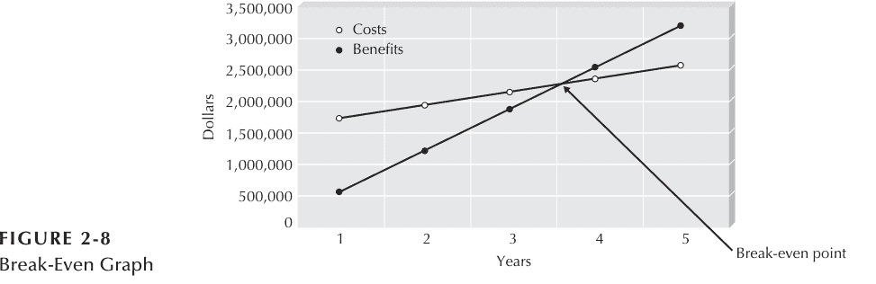

最后一种可行性分析是评估系统的组织可行性，即系统最终被用户接受的程度以及融入组织运营的良好程度。许多组织因素都会对项目产生影响，经验丰富的开发人员知道，组织可行性可能是最难评估的可行性维度。本质上，组织可行性分析试图回答一个问题：如果我们构建了，他们会来吗？

评估项目组织可行性的一种方法是理解项目目标与业务目标对齐程度。战略对齐是项目与战略之间的匹配程度——对齐程度越高，从组织可行性的角度来看项目的风险就越小。例如，如果营销部门决定变得更加以客户为中心，那么一个整合客户信息的 CRM 项目与营销目标具有很强的战略对齐。许多 IT 项目在由 IT 部门领导时失败了，因为它们与业务部门或组织战略几乎没有或完全没有对齐。

评估组织可行性的第二方法是进行利益相关者分析。利益相关者是可以影响（或受新系统影响）的人、团体或组织。通常，引入新系统时最重要的利益相关者是项目拥护者、系统用户和组织管理层（见图 2-9）。例如，IS 部门可以是系统的利益相关者，因为在实施后，IS 的工作或角色可能会发生变化。

拥护者是高层非信息系统高管，通常是创建系统的项目赞助者。拥护者通过时间、资源（例如资金）以及通过向其他组织决策者沟通系统的重要性提供政治支持来支持项目。如果拥护者离开了，最好有多个拥护者。

拥护者为系统提供日常支持，而组织管理层的支持则向组织的其余部分传达一种信念：系统将做出价值贡献，并且将提供必要的资源。

### 图 2-9 组织可行性的某些重要利益相关者

| 角色 | 职责 | 改进技术 |
| :--- | :--- | :--- |
| 拥护者 | * 启动项目<br>* 推广项目<br>* 分配自己的时间给项目<br>* 提供资源 | * 就项目目标和将直接从系统中获益的拟任执行人员进行演示<br>* 创建系统原型以展示其潜力 |
| 组织管理层 | * 了解项目<br>* 为项目提供预算<br>* 鼓励用户接受和使用系统 | * 向管理层进行关于项目目标和预期收益的演示<br>* 通过组织内部简报推广使用系统的优势<br>* 鼓励拥护者与其或同伴讨论该项目 |
| 系统用户 | * 做出影响项目的决策<br>* 为项目执行实际活动<br>* 最终通过不使用系统来决定项目是否成功 | * 在项目团队中为用户分配正式角色<br>* 为用户分配具有明确截止日期的特定执行任务<br>* 向用户寻求定期反馈（例如，在周会议上） |

> 一本介绍系列利益相关者分析技术的好书是 R. O. Mason 和 I. I. Mittroff 的《战略规划假设：理论、案例与技术》（纽约：Wiley, 1981）。

理想情况下，管理层应该鼓励组织内人员使用系统，并接受系统可能产生的变化。

第三类利益相关者是自系统安装在组织后一直使用系统的用户。很多时候，项目团队在项目开始时与用户见面，系统创建后就消失了。在这种情况下，最终产品很少能满足那些预期使用者的期望和需求，因为我们需要改变，且用户随着项目的进行变得更加精明。应该通过让用户参与开发过程来促进整个开发的参与。

最后，可行性研究通过强制项目团队考虑技术、经济和组织因素，帮助组织做出更明智的投资。它通过让业务部门参与决策过程来保护 IT 专业人员免受批评。记住，可行性研究应该在项目期间做出决策的关键点进行多次修订（例如，在每次迭代之前）。

# 项目选择

一旦可行性分析完成，将连同系统请求一起提交给批准委员会。然后委员会决定是批准项目、拒绝项目还是推迟以获得更多信息。在项目层面，委员会通过检查业务需求（位于系统请求中）和构建系统的风险（位于可行性分析）来考虑项目的价值。

在批准项目之前，委员会还从组织的角度考虑项目；它必须记住公司的项目组合。这种管理方法被称为组合管理。管理考虑了组织中存在的不同类型的项目——大和小、高风险和低风险、战略性和战术性的。（见图 2-10 的不同分类方法）

### 图 2-10 项目分类方法

| 分类 | 描述 |
|---|---|
| 规模 | 项目有多大？需要多少人参与？ |
| 成本 | 项目将耗费多少资金？ |
| 目的 | 项目的目的是什么？是为了改进技术基础设施？支持当前的业务战略？展示新的创新？ |
| 长度 | 项目完成需要多久？在业务交付价值之前需要多长时间？ |
| 风险 | 项目成功或失败的可能性有多大？ |
| 范围 | 系统影响组织的哪个部分？一个部门？一个分支？整个公司？ |
| 投资回报率 | 针对项目成本，组织预计获得多少的回报？ |

（分类项目。）一个良好的项目组合应该包含符合组织需求的最合适的项目组合。委员会作为项目组合经理，目标是使其项目组合中项目的成本效益性能以及其他重要因素最大化。例如，一个组织可能希望将高风险项目控制在项目总比例的 20% 以下。

审批委员会在分配资源方面必须保持审慎。资源之间存在权衡，组织必须放弃某些东西来获得其他东西，以保持项目组合的平衡。如果有三个高回报的项目，且风险都非常高，那么可能只会选择其中一个。此外，有时一个系统在项目层面具有良好的业务价值，但在组织层面并没有意义。某个项目可能对公司的部分显示出非常高的投资回报率（ROI）并满足重要的业务需求，但它未被选中。这可能是由于许多原因——预算中没有其他系统的资金、组织正在经历某种变化（例如合并）、满足相同业务需求的项目已经在进行中，或者该系统与当前或未来的公司战略不一致。

# 传统项目管理工具

在我们实际创建一个适用于管理和控制面向对象的系统开发工作计划之前，我们需要介绍一组已成功用于传统软件开发项目（以及许多其他类型）的管理工具：工作分解结构（WBS）、甘特图和网络图。首先，我们必须理解什么是任务。任务是由开发团队的一名或多名成员执行的工作单元，例如：其名称、开始日期和完成日期、分配人员、交付物、优先级、所需资源、完成任务的预计时间以及完成任务的实际时间（见图 2-11）。项目的项目经理必须识别出需要完成的任务以及每个任务需要多长时间。他们的识别和文档记录是这三项任务的基础。一旦识别并记录了任务，它们就会被组织在工作分解结构中，该结构用于驱动甘特图和网络图的创建，这些图可以用于描述传统的工作计划。这些技术有助于项目经理随时间推理解并管理项目的进度。

### 图 2-11 任务信息

| 工作信息 | 示例 |
|---|---|
| 任务名称 | 执行经济可行性分析 |
| 开始日期 | 2015年1月5日 |
| 完成日期 | 2015年1月19日 |
| 分配任务的人员 | 项目赞助人：Mary Smith |
| 交付物 | 成本效益分析 |
| 完成状态 | 开启 |
| 优先级 | 高 |
| 所需资源 | 电子表格软件 |
| 预计时间 | 16 小时 |
| 实际时间 | 14.5 小时 |

## 工作分解结构

项目经理可以使用结构化的、自上而下的方法，首先定义高级任务，然后将其分解为子任务。例如，图 2-12 显示了实施新 IT 培训课程的高级任务列表。流程中的主要步骤之一包括识别供应商、创建和管理问卷，以及建立新课程。每个任务然后按层级方式进行分解和编号。创建和管理问卷有八个子任务（即 7.1–7.8），有三个子任务（7.2.1–7.2.3）构成了审查初始问卷的任务。这种分层级定义的任务列表被称为工作分解结构（WBS）。任务的数量和详细程度取决于项目的复杂性和状态。至少，WBS 包含了依赖关系，当一个任务在另一个任务完成之前无法执行时，就会产生这种关系。例如，图 2-12 显示，对问卷的修改（任务 7-4）需要一周时间执行，但不能在问卷审查（任务 7-2）之后发生。关键里程碑（或重要日期）在工作计划中也被识别出来。

按开发阶段或按产品组织传统的 WBS 有两种方法。例如，如果一个团队决定需要开发一个网站，他们可以基于统一流程（Unified Process）的初始、细化、构建和过渡阶段创建一个 WBS。在这种情况下，一个典型的任务将发生在包括可行性分析在内的阶段。该任务将分解为不同类型的可行性分析：技术性、经济性和组织可行性。其中每项都将进一步分解为一组子任务。或者，团队可以组织要开发的不同产品线。例如，在网站的情况下，它可以包括前端、应用程序服务器、数据库服务器、要设计的各种 Web 页面、站点地图等。然后这些将被分解为：

### 图 2-12 WBS 示例：实施新 IT 培训课程

| 任务编号 | 任务名称 | 持续时间（周） | 依赖关系 | 状态 |
|---|---|---|---|---|
| 1 | 识别供应商 | 6 | | 完成 |
| 2 | 审查培训材料 | 1 | | 完成 |
| 3 | 比较供应商 | 2 | | 进行中 |
| 4 | 与供应商谈判 | 3 | | 开启 |
| 5 | 开发沟通信息 | 4 | | 开启 |
| 6 | 分发信息 | 2 | | 开启 |
| 7 | 创建并管理问卷 | 4 | | 开启 |
| 7.1 | 创建初始问卷 | 1 | | 开启 |
| 7.2 | 审查初始问卷 | 1 | | 开启 |
| 7.2.1 | 审查初始问卷 | 1 | | 开启 |
| 7.2.2 | 审查初始问卷 | 1 | | 开启 |


| 7.2.3 | 审查初始问卷 | | 1 | | 开启 |
| 7.3 | 审查初始问卷 | | 1 | | 开启 |
| 7.4 | 对问卷的修改 | | 1 | | 开启 |
| 7.5 | 创建分配列表 | | 1 | | 开启 |
| 7.6 | 发送分配列表 | | 1 | | 开启 |
| 7.7 | 发送后续消息 | | 1 | | 开启 |
| 7.8 | 收集问卷 | | 1 | | 开启 |
| 8 | 分析并选择 | | 2 | | 开启 |
| 9 | 建立新课程 | | 1 | | 开启 |
| 10 | 开发课程选项 | | 3 | | 开启 |

与开发阶段相关的不同任务。另一种方式，一旦确定了整体结构，任务将被识别并包含在 WBS 中，并回到主题。

### 甘特图

甘特图是一个水平条形，显示与项目 WBS 相同的任务信息，但是以图形化的方式。一图胜千言，甘特图可以比 WBS 更快、更容易传达项目的高级状态。创建甘特图很简单，可以使用电子表格、图形软件或项目管理软件包完成。首先，任务作为行列在图表中，任务根据项目需求在顶部列出。一个较短的项目可能被划分为：

| ID | 任务名称 | 持续时间 | 开始日期 | 完成日期 | 前置 | 一月 | 二月 | 三月 | 四月 | 五月 |
|---|---|---|---|---|---|---|---|---|---|---|
| 1 | 识别供应商 | 2 周 | 1/15 | 1/29 | | | | | | |
| 2 | 审查培训材料 | 6 周 | 1/15 | 2/26 | 1 | | Barbara | | | |
| 3 | 比较供应商 | 2 周 | 2/12 | 2/25 | 2 | | | | | |
| 4 | 与供应商谈判 | 3 周 | 2/26 | 3/8 | 3 | | | | | |
| 5 | 开发沟通信息 | 4 周 | 1/15 | 2/12 | 1 | Alan | | | | |
| 6 | 分发信息 | 2 周 | 2/12 | 2/25 | 5 | | | | | |
| 7 | 创建并管理问卷 | 4 周 | 2/26 | 3/25 | 6 | | | | | |
| 8 | 分析并选择 | 2 周 | 3/26 | 4/8 | 4,7 | | | | David | |
| 9 | 建立新课程 | 11 周 | 1/15 | 4/1 | 1 | | | | | |
| 10 | 开发课程选项 | 3 周 | 4/9 | 4/29 | 8,9 | | | | | |
| 11 | 预算会议 | 1 天 | 1/15 | 1/15 | | 1/15 | | | | |

图 2-13 甘特图

## 传统项目管理工具

时间单位可以是小时或天，而中型项目可能用周或月来表示。通过绘制水平条来表示每个任务的持续时间；条形的起点和终点精确标记了任务的开始和结束时间。当人们执行任务时，相应的条形会根据任务完成的比例进行填充。甘特图上的许多任务可能会让人感到困惑；最好将任务数量限制在二十或三十个左右。如果任务更多，请将其拆分为子任务，并为每个细节层级创建甘特图。

通过查看甘特图，可以快速了解许多项目。除了查看任务的持续时间和进度外，项目经理还可以判断哪些任务是顺序执行的，哪些任务是同时进行的，哪些任务在某些方面是重叠的。通过在今天的日期处画一条垂直线，可以快速查看领先或落后于计划的任务。如果一个条形没有填充且在线条末端，则该任务落后于计划。

甘特图上可以放置一些特殊的符号。项目里程碑使用倒三角形或菱形表示。任务条之间绘制箭头以显示任务的依赖关系。有时，分配给每个任务的人员姓名会列在任务条旁边，以显示为任务分配了哪些人力资源。

### 网络图

查看项目计划的一种图形化方法是网络图，它以流程图的形式列出任务（见图 2-14）。

计划评估评审技术（PERT）是一种网络分析技术，当单个任务的估计相当不确定时可以使用。PERT 不简单地对持续时间给出一个点估计，而是使用三种估值：乐观的、最可能的和悲观的。

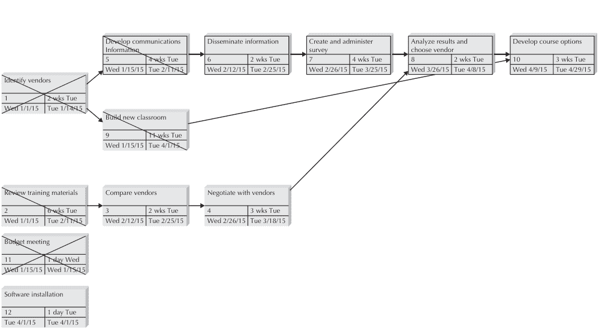

图 2-14 网络图

# 58 第2章 项目管理

它使用以下公式将三个估值合并为一个单一加权平均估值：

```
optimistic estimate + (4 * most likely estimate)
+ pessimistic estimate
6
```

网络图被绘制为节点-弧类型的图，节点中显示时间估计，弧上显示依赖关系。每个节点代表单个任务，连接两个节点的线表示两个任务之间的依赖关系。部分完成的任务通常在节点上画一条对角线，已完成的任务则包含交叉线。

网络图是沟通依赖关系的最佳方式，因为它们按照完成所需的顺序列出任务。关键路径法（CPM）仅允许识别网络中的关键路径。关键路径是从项目启动到完成的路径。关键路径显示了为了项目按时完成而必须按计划完成的所有任务。如果关键路径上的任何任务耗时超过预期，整个项目将落后。每个任务都是关键任务，它们通常以独特的方式表示；图 2-14 显示它们用双框表示（见任务 5, 6, 7, 8 和 10）。CPM 可以配合 PERT 使用，也可以独立使用。

## 项目估计

项目管理的科学（或艺术）是在三个重要约束条件之间进行权衡：系统功能、完成项目的时间（项目何时完成）以及项目成本。将这三者看作项目经理控制系统开发的相互依赖的杠杆。每当拉动一个杠杆，其他都会受到某种程度的影响。例如，如果项目经理需要将截止日期提前，那么唯一的解决方案是减少系统功能、增加资金或让他们加班工作。通常，项目经理必须与项目赞助人合作更改项目目标，例如开发功能较少的系统或延长最终系统的截止日期，以便项目拥有可以实现的合理目标。在项目初期，经理需要估计这些每项内容，并评估如何以符合组织需求开展项目。估计是一个过程，项目开始时开发的估值通常基于一系列可能的值，并随着项目的推进逐渐变得具体。启动阶段的数值范围将远大于过渡阶段。

用于计算这些估值的数字可以来自具有相似任务和技术的项目，或经验丰富的开发人员。总的来说，数字应该是保守的。一种良好的做法是在开发过程中跟踪实际值和工作量，以便在过程中精炼数字，让下一个项目从现实中受益。

估计构建系统所需的时间有很多方法。统一过程（Unified Process）是用例驱动的，我们使用一种基于用例的方法：用例点⁴。这些方法最初由 Objectary 的 Gustav Karner⁵ 开发，基于用例的独特特征和对象导向。

> 4 所用材料基于用例点的描述，详见 R Reed, Jr. 的 *Developing Applications with Java and UML* (Reading, MA: Addison-Wesley, 2002); Gert Schneider 和 Jason P. Winters 的 *Using Cases: A Practical Guide* (Reading, MA: Addison-Wesley, 1998); Kirsten Ribeiro 的 *Estimating Object-Oriented Software with Use Cases*。
>
> 5 Objectary 在 1995 年被 Rational 收购，现在是 IBM 的一部分。

# 项目工作量估计 59

（注：此处 OCR 文本存在重复/乱码，已根据要求清理并保留唯一信息）

……这通过将权重乘以每个类型参与者的数量来计算。例如，如果我们假设用例图有零个简单平均和四个与系统交互的复杂参与者，则 UAW 将等于 12（见图 2-15）。

>⁶ 我们将在第 4 章介绍用例建模的细节。

**第 75-76 页修正后的流程：**

（注：此处 OCR 文本存在大量重复，已根据提供的文本提供清理版本）。

# 第60 第2章 项目管理

## 未调整的角色权重表

| 角色类型 | 描述 | 权重因子 | 数量 | 结果 |
|---|---|---|---|---|
| 简单 | 具有定义 API 的外部系统 | 1 | | |
| 平均 | 使用基于协议接口的外部系统，例如 HTTP、TCP/IP 或数据库 | 2 | | |
| 复杂 | 人员 | 3 | | |
| | | 未调整的角色权重总和 (UAW) | | |

## 未调整的用例权重表

| 用例类型 | 描述 | 权重因子 | 数量 | 结果 |
|---|---|---|---|---|
| 简单 | 1–3 次事务 | 5 | | |
| 平均 | 4–7 次事务 | 10 | | |
| 复杂 | >7 次事务 | 15 | | |
| | | 未调整的用例权重总和 (UUCW) | | |

未调整的用例点 (UU/UCP) = UAW + UUCW

## 技术复杂度因素

| 因素编号 | 描述 | 权重 | 分配值 (0–5) | 加权值 | 备注 |
|---|---|---|---|---|---|
| T1 | 分布式系统 | 2.0 | | | |
| T2 | 响应时间或吞吐量目标 | 1.0 | | | |
| T3 | 用户在线效率 | 1.0 | | | |
| T4 | 复杂的内部处理 | 1.0 | | | |
| T5 | 代码的可重用性 | 1.0 | | | |
| T6 | 安装便利性 | 0.5 | | | |
| T7 | 易用性 | 0.5 | | | |
| T8 | 可移植性 | 2.0 | | | |
| T9 | 易于变更 | 1.0 | | | |
| T10 | 并发性 | 1.0 | | | |
| T11 | 特殊安全目标 | 1.0 | | | |
| T12 | 第三方直接访问 | 1.0 | | | |
| T13 | 需要特殊用户 | 1.0 | | | |
| | | 技术因素总和 (TFactor) | | | |

技术复杂度因子 (TCF) = 0.6 + (0.01 * TFactor)

## 环境因素

| 因素编号 | 描述 | 权重 | 分配值 (0–5) | 加权值 | 备注 |
|---|---|---|---|---|---|
| E1 | 对所用开发的熟悉熟悉 | 0.5 | | | |
| E2 | 应用程序经验 | 0.5 | | | |
| E3 | 面对象经验 | 1.0 | | | |
| E4 | 首席分析师能力 | 0.5 | | | |
| E5 | 动力 | 1.0 | | | |
| E6 | 需求稳定性 | 2.0 | | | |
| E7 | 兼职人员 | -1.0 | | | |
| E8 | 编程语言的难度 | -1.0 | | | |
| | | 环境因素总和 (EFactor) | | | |

环境因素 (EF) = 1.4 + (-0.03 * EFactor)

调整后的用例点 (UCP) = UAW * TCF * ECF

工作量（小时） = UCP * PHM

图 2-15 用点估计工作表


## 未调整的角色权重表

| 角色类型 | 描述 | 权重因子 | 数量 | 结果 |
|---|---|---|---|---|
| 简单 | 具有定义 API 的外部系统 | 1 | 0 | 0 |
| 平均 | 使用基于协议接口的外部系统，例如 HTTP、TCP/IP 或数据库 | 2 | 0 | 0 |
| 复杂 | 人员 | 3 | 4 | 12 |

## 未调整的用例权重表

| 用例类型 | 描述 | 权重因子 | 数量 | 结果 |
|---|---|---|---|---|
| 简单 | 1–3 次事务 | 5 | 3 | 15 |
| 平均 | 4–7 次事务 | 10 | 4 | 40 |
| 复杂 | >7 次事务 | 15 | 1 | 15 |

未调整的用例点 (UCP) = UAW + UCW 82 = 12 + 70

## 技术复杂度因素

| 因素编号 | 权重 | 分配值 (0–5) | 加权值 | 备注 |
|---|---|---|---|---|
| T1 | 分布式系统 | 2.0 | 0 | 0 |
| T2 | 响应时间或吞吐量性能目标 | 1.0 | 5 | 5 |
| T3 | 用户在线效率 | 1.0 | 3 | 3 |
| T4 | 复杂的内部处理 | 1.0 | 1 | 1 |
| T5 | 代码的可重用性 | 1.0 | 1 | 1 |
| T6 | 安装便利性 | 0.5 | 2 | 1 |
| T7 | 易用性 | 0.5 | 4 | 2 |
| T8 | 可移植性 | 2.0 | 0 | 0 |
| T9 | 易于变更 | 1.0 | 2 | 2 |
| T10 | 并发性 | 1.0 | 0 | 0 |
| T11 | 特殊安全目标 | 1.0 | 0 | 0 |
| T12 | 第三方直接访问 | 1.0 | 0 | 0 |
| T13 | 需要特殊用户 | 1.0 | 0 | 0 |
| 技术因素总和 (TFactor) | | | 15 | |

技术复杂度因子 (TCF) = 0.6 + (0.01 * TFactor) 0.75 = 0.6 + (0.01 * 15)

## 环境因素

| 因素编号 | 权重 | 分配值 (0–5) | 加权值 | 备注 |
|---|---|---|---|---|
| E1 | 对所用系统的熟悉 | 1.5 | 4 | 6 |
| E2 | 应用程序经验 | 0.5 | 4 | 2 |
| E3 | 面对象经验 | 1.0 | 4 | 4 |
| E4 | 首席分析师能力 | 0.5 | 5 | 2.5 |
| E5 | 动力 | 1.0 | 5 | 5 |
| E6 | 需求稳定性 | 2.0 | 5 | 10 |
| E7 | 兼职人员 | -1.0 | 5 | 0 |
| E8 | 编程语言的难度 | -1.0 | 4 | -4.0 |
| 环境因素总和 (EFactor) | | | 25.5 | |

环境因素 (EF) = 1.4 + (-0.03 * 25.5) 0.635

调整后的用例点 (UCP) = UAW + UCW * TCF * EF 33.375 = 70 * 0.635

工作量（人小时） = UCP * PHM 66.75 = 20 + 33.375


# 62 第2章 项目管理

技术因素包括（见图 2-15）：

- 系统是否为分布式系统
- 响应时间的重要性
- 用户使用系统的效率
- 系统内部处理的复杂度
- 代码重用的重要性
- 安装过程的简易程度
- 易用性的重要性
- 系统迁移到其他平台的重要性
- 系统维护是否重要
- 系统是否处理并行和并发处理
- 需要的安全级别
- 第三方访问系统的水平
- 用户是否接受过培训

假设技术因素分别为 T1 (0), T2 (5), T3 (3), T4 (1), T5 (1), T6 (2), T7 (4), T8 (0), T9 (2), T10 (0), T11 (0), T12 (0) 和 T13 (0)，技术值 (TFactor) 计算为各个因素的加权和。在这种情况下，TFactor 等于 15（见图 2-16）。将此值代入用例点表的技术复杂度公式 0.6 + (0.01 * TFactor)，得到系统的 TCF 值为 .75（见图 2-15 和 2-16）。

环境因素包括（见图 2-15）：

- 开发人员对所用开发过程的熟悉程度
- 应用程序的开发
- 面对象经验水平
- 首席分析师的能力水平
- 开发团队交付系统的动力
- 需求的稳定性
- 开发团队是否包含兼职人员
- 所用编程语言的难度

假设环境因素 E1 (4), E2 (2), E3 (4), E4 (5), E5 (5), E6 (5), E7 (0) 和 E8 (4)，得到环境值 (EF) 为 25.5（见图 2-16）。与 TFactor 类似，EF 是加权值的简单和。使用用例点表的环境因素公式 (1.4 + (-0.03 * EF)) 系统的 EF 值为 .635（见图 2-15 和 2-16）。将 TCF 和 EF 值以及之前计算的 UCP 值代入，调整后的用例点公式 (UCP * TCF * EF) 得到 33.375 个调整后的用例点 (UCP)（见图 2-16）。

现在我们已经通过调整后的用例点的值估计了系统规模，准备好估计构建系统所需的工作量。在 Karner 的原始工作中，他建议直接将用例点的数量乘以 20，以估计构建系统所需的人小时。然而，根据使用用例点的额外经验，创建了一个用于确定人小时倍数 (PHM) 值的决策规则：

```
如果 (因素 E1 到 E6 之和 < 3) 且 (E8 > 3)
PHM = 20
否则 (因素 E1 到 E6 之和 < 3) 且 (E8 > 3)
PHM = 28
```

根据这些规则，使用 UCP (33.375) 和 PHM (20 或 28)，工作量为 666.75 或 934.5 人小时。

# 64 第 2 章 项目管理

开发还需要一个增量和迭代的过程。在第1章对增强统一过程（Unified Process）的描述中，开发过程是围绕迭代和工作流组织的。在许多方面，增量和迭代开发过程的工作计划也是以类似的方式组织的。对于每次迭代，每个工作流上都会执行相应的任务。本节描述了使用演化式 WBS（工作分解结构）进行项目规划的增量迭代过程，该过程适用于面向对象的系统。

演化式 WBS允许分析师制定迭代工作计划。首先，演化式 WBS 在所有项目中以标准方式组织：按工作流、阶段以及单个迭代期间完成的具体任务。其次，演化式 WBS 以增量方式创建。这有助于对成本和进度进行更现实的估计。第三，由于演化式 WBS 的结构不依赖任何特定项目，演化式 WBS允许将当前项目与之前的项目及失败案例进行比较。


# 增强统一过程中的工作流与 WBS

在增强统一过程的情况下，工作流是包含在 WBS 中的主要点。接下来，每个工作流沿着增强统一过程的阶段进行分解。之后，每个阶段根据要完成的任务——即每个阶段中包含的单个迭代相关的交付物进行分解（见图 1-16）。增强过程演化式 WBS 前两级别的模板如图 2-17所示。

随着每次迭代开发过程的完成，WBS 会添加额外的迭代和任务（即 WBS 随着过程的演进而演化）。^8

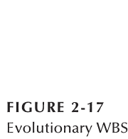

- I. 业务建模
  - a. 启动 (Inception)
  - b. 详化 (Elaboration)
  - c. 构建 (Construction)
  - d. 过渡 (Transition)
  - e. 生产 (Production)

- II. 需求
  - a. 启动 (Inception)
  - b. 详化 (Elaboration)
  - c. 构建 (Construction)
  - d. 过渡 (Transition)
  - e. 生产 (Production)

- III. 分析
  - a. 启动 (Inception)
  - b. 详化 (Elaboration)
  - c. 构建 (Construction)
  - d. 过渡 (Transition)
  - e. 生产 (Production)

- IV. 设计
  - a. 启动 (Inception)
  - b. 详化 (Elaboration)
  - c. 构建 (Construction)
  - d. 过渡 (Transition)
  - e. 生产 (Production)

- V. 实现
  - a. 启动 (Inception)
  - b. 详化 (Elaboration)
  - c. 构建 (Construction)
  - d. 过渡 (Transition)
  - e. 生产 (Production)

- VI. 测试
  - a. 启动 (Inception)
  - b. 详化 (Elaboration)
  - c. 构建 (Construction)
  - d. 过渡 (Transition)
  - e. 生产 (Production)

- VII. 部署
  - a. 启动 (Inception)
  - b. 详化 (Elaboration)
  - c. 构建 (Construction)
  - d. 过渡 (Transition)
  - e. 生产 (Production)

- VIII. 配置与变更管理
  - a. 启动 (Inception)
  - b. 详化 (Elaboration)
  - c. 构建 (Construction)
  - d. 过渡 (Transition)
  - e. 生产 (Production)

- IX. 项目管理
  - a. 启动 (Inception)
  - b. 详化 (Elaboration)
  - c. 构建 (Construction)
  - d. 过渡 (Transition)
  - e. 生产 (Production)

- X. 环境
  - a. 启动 (Inception)
  - b. 详化 (Elaboration)
  - c. 构建 (Construction)
  - d. 过渡 (Transition)
  - e. 生产 (Production)

- XI. 运营与支持
  - a. 启动 (Inception)
  - b. 详化 (Elaboration)
  - c. 构建 (Construction)
  - d. 过渡 (Transition)
  - e. 生产 (Production)

- XII. 基础设施管理
  - a. 启动 (Inception)
  - b. 详化 (Elaboration)
  - c. 构建 (Construction)
  - d. 过渡 (Transition)
  - e. 生产 (Production)

> ^8 有助于解释这种方法的良好来源有 Philippe Kruppen, "Planning an Iterative Process," The Rational Edge (2002年10月); Eric Lopez Cordosa and D. J. de Villiers, "Project Planning Best Practices," The Rational Edge (2003年8月)。

# 创建和管理工作计划

例如，项目管理工作流启动阶段的典型活动包括识别项目、执行可行性分析、选择项目以及估计工作量。需求工作流的启动阶段包括确定需求收集和分析技术、识别功能性和非功能需求、访谈利益相关者、制定愿景文档以及开发用例。运营与支持工作流的启动阶段可能没有关联的任务。用于增强统一过程启动阶段规划的 WBS 示例如图 1-16 和 2-17 所示，项目管理工作流的最后两个任务是“详化阶段迭代工作计划”和“设计”。这些任务用于演进中系统开发的下一次迭代，并评估当前迭代。随着项目移动到后期阶段，每个工作流都会增加任务。例如，分析工作流将在详化阶段创建功能模型、结构模型和行为模型。最后，当一个启动阶段包含许多复杂任务时，可以使用甘特图和网络图等传统工具来详细制定特定启动阶段的工作计划。

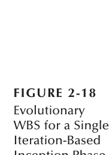

| | | | |
| :--- | :--- | :--- | :--- |
| a. 启动 (Inception) | | | |
| 1. 理解当前业务状况 | 0.50 天 | | |
| 2. 发现业务流程问题 | 0.25 天 | | |
| 3. 识别潜在项目 | 0.25 天 | | |
| b. 详化 (Elaboration) | | | |
| c. 构建 (Construction) | | | |
| d. 过渡 (Transition) | | | |
| e. 生产 (Production) | | | |
| II. 需求 | | | |
| a. 启动 (Inception) | | | |
| 1. 确定需求分析技术 | 0.25 天 | | |
| 2. 确定需求收集技术 | 0.25 天 | | |
| 3. 识别功能性和非功能需求 | | II.a.1 |
| A. 进行 JAD 会议 | 3 天 | | |
| B. 执行文档分析 | 5 天 | II.a.2 |
| C. 进行访谈 | | II.a.3-A |
| 1. 访谈发起人 | 0.50 天 | | |
| 2. 访谈库存系统 | 0.50 天 | | |
| 3. 访谈特订单系统 | 0.50 天 | | |
| 4. 访谈 ISP | 0.50 天 | | |
| 5. 访谈联系人 | 0.50 天 | | |
| 6. 访谈其他人 | 1 天 | | |
| D. 观察零售店 | 0.50 天 | II.a.3-A |
| 4. 分析当前系统 | 4 天 | II.a.1, II.a.2 |
| 5. 创建需求定义 | | II.a.3, II.a.4 |
| A. 确定跟踪的需求 | 1 天 | II.a.5-A |
| B. 评审汇总的需求 | 5 天 | II.a.5-B |
| C. 与发起人评审需求 | 2 天 | | |
| b. 详化 (Elaboration) | | | |
| c. 构建 (Construction) | | | |
| d. 过渡 (Transition) | | | |
| e. 生产 (Production) | | | |
| | 持续 | 依赖项 |
| :--- | :--- | :--- |
| III. 分析 | | | |
| a. 启动 (Inception) | | | |
| 1. 识别业务流程 | 3 天 | | |
| 2. 识别用例 | 3 天 | III.a.1 |
| b. 详化 (Elaboration) | | | |
| c. 构建 (Construction) | | | |
| d. 过渡 (Transition) | | | |
| e. 生产 (Production) | | | |
| IV. 设计 | | | |
| a. 启动 (Inception) | | | |
| 1. 识别潜在类 | 3 天 | III.a |
| b. 详化 (Elaboration) | | | |
| c. 构建 (Construction) | | | |
| d. 过渡 (Transition) | | | |
| e. 生产 (Production) | | | |
| V. 实现 | | | |
| a. 启动 (Inception) | | | |
| b. 详化 (Elaboration) | | | |
| c. 构建 (Construction) | | | |
| d. 过渡 (Transition) | | | |
| e. 生产 (Production) | | | |
| VI. 测试 | | | |
| a. 启动 (Inception) | | | |
| b. 详化 (Elaboration) | | | |
| c. 构建 (Construction) | | | |
| d. 过渡 (Transition) | | | |
| e. 生产 (Production) | | | |
| VII. 部署 | | | |
| a. 启动 (Inception) | | | |
| b. 详化 (Elaboration) | | | |
| c. 构建 (Construction) | | | |
| d. 过渡 (Transition) | | | |
| e. 生产 (Production) | | | |
| VIII. 配置与变更管理 | | | |
| a. 启动 (Inception) | | | |
| 1. 识别开发产物的必要访问控制 | 0.25 天 | | |
| 2. 识别开发产物的版本控制机制 | 0.25 天 | | |
| b. 详化 (Elaboration) | | | |
| c. 构建 (Construction) | | | |
| d. 过渡 (Transition) | | | |
| e. 生产 (Production) | | | |
| IX. 项目管理 | | | |
| a. 启动 (Inception) | | | |
| 1. 创建启动阶段工作计划 | 1 天 | | |
| 2. 创建系统请求 | 1 天 | | |
| 3. 执行可行性分析 | 1 天 | IX.a.2 | |
| A. 执行技术可行性分析 | 2 天 | | |
| B. 执行经济可行性分析 | 2 天 | | |
| C. 执行组织可行性分析 | 2 天 | | |
| | 持续 | 依赖项 |
| :--- | :--- | :--- |
| 4. 识别项目工作量 | 0.50 天 | IX.3 |
| 5. 识别人员需求 | 0.50 天 | IX.4 |
| 6. 计算成本估计 | 0.50 天 | IX.5 |
| 7. 创建详化阶段首次迭代工作计划 | 1 天 | IX.1 |
| 8. 评审启动阶段 | 1 天 | Ia, IIa, III.a, IV.a, V.a, VII.a, VIII.a, IX.a, X.a, XI.a |
| b. 详化 (Elaboration) | | | |
| c. 构建 (Construction) | | | |
| d. 过渡 (Transition) | | | |
| e. 生产 (Production) | | | |
| X. 环境 | | | |
| a. 启动 (Inception) | | | |
| 1. 获取并安装 CASE 工具 | 0.25 天 | | |
| 2. 获取并安装编程环境 | 0.25 天 | | |
| 3. 获取并安装配置与变更管理工具 | 0.25 天 | | |
| 4. 获取并安装项目管理工具 | 0.25 天 | | |
| b. 详化 (Elaboration) | | | |
| c. 构建 (Construction) | | | |
| d. 过渡 (Transition) | | | |
| e. 生产 (Production) | | | |
| XI. 运营与支持 | | | |
| a. 启动 (Inception) | | | |
| b. 详化 (Elaboration) | | | |
| c. 构建 (Construction) | | | |
| d. 过渡 (Transition) | | | |
| e. 生产 (Production) | | | |
| XII. 基础设施管理 | | | |
| a. 启动 (Inception) | | | |
| 1. 识别适当的标准和企业模型 | 0.25 天 | | |
| 2. 识别重用机会，如模式、框架和库 | 0.50 天 | | |
| 3. 识别相似的过去项目 | 0.25 天 | | |
| b. 详化 (Elaboration) | | | |
| c. 构建 (Construction) | | | |
| d. 过渡 (Transition) | | | |
| e. 生产 (Production) | | | |

# 范围管理

分析师可能认为，由于他对项目进行了前期估计和规划，项目将不受进度问题的影响。然而，导致进度和成本超支的最常见原因——范围蔓延发生在项目启动之后。范围蔓延发生在原始项目范围定义并冻结后，向项目添加了新需求。这可能由于许多原因引起：用户突然理解了发现系统的潜力并实现有用的新功能；开发人员可能会发现某些有趣的特性并对其产生深厚的感情；高级经理可能会决定让该系统支持近期董事会上制定的一个新策略。

幸运的是，使用迭代和增量开发过程允许团队以有效的方式处理不断变化的需求。变化变得越广泛，对成本和进度产生的影响就越大。关键在于在项目启动之初就识别出那些尚不模糊的需求以及潜在问题，通过与用户进行密集的会议和原型设计相结合，可以帮助用户“体验”需求，并更直观地看到系统如何支持他们的需求。

当然，如果不采取任何预防措施，可能会遗漏某些需求。然而，项目经理应该只在项目开始后才允许添加绝对必要的需求。即使在那个时候，项目团队的成员也应该充分评估添加需求的影响，并将评估结果提交给用户。任何实施的变更都应该经过仔细跟踪，以便存在审计跟踪轨迹来监控变更的影响。

有时，即使变更对项目有益，也无法将其纳入项目。在这种情况下，这些新增应记录为系统的未来功能。项目经理可以在告诉某人“不”之后，提在系统的后期版本中提供这些功能。

有两种敏捷技术可以在尝试满足客户的同时管理项目范围：使用 Scrum 的每日站会（`daily scrum meeting`）和 Scrum 的产品待办事项列表（`product backlog`）。本质上，每日站会非常短，通常只有十五分钟，旨在让开发团队了解不断演变的系统状态。团队会议通常只涵盖自上次会议以来完成的内容、在下次会议之前将完成的内容，以及可能出现的阻碍进展的障碍。此外，还可以提出新的请求功能。然而，所有额外功能都将添加到产品待办事项列表中，以便在下次 Scrum 会议期间进行考虑。产品待办事项列表本质上是一个必须在当前迭代中完成的功能性需求的优先级列表。在 Scrum 中，只允许客户修改产品待办事项列表。通过这种方式，开发团队始终有一份当前一组关键需求的列表。只要项目规模较小，这种范围管理方法就是有效的。

# 时间箱（Timeboxing）

范围管理的另一种方法是一种称为“时间箱”的技术。到目前为止，我们描述的是以任务为导向的项目。换句话说，我们描述的是由需要完成的任务驱动开发的项目，因此任务和需求越多，项目所需时间就越长。有些公司对耗时长的开发很有耐心，这些公司采取以时间为导向的方法，为功能设定截止日期。

考虑文字处理软件的使用。对于 80% 的功能，只有 20% 的功能（如拼写检查、加粗以及剪切粘贴）会被用到。其他功能（如文档合并和创建邮件标签）可能很好，但它们并不是日常需求的一部分。其他软件应用也是如此；大多数用户只依赖其功能的一小部分。讽刺的是，大多数开发者都同意，系统的 75% 功能可以较快地提供，而剩下的 25% 功能则占据了大部分时间。


为了解决这种不一致性，时间箱技术变得流行，特别是在使用 RAD（快速应用开发）和敏捷方法时。该技术为项目设定了固定的截止日期，并无论功能是否需要减少都会在截止日期前交付系统。时间箱确保项目团队不会陷入可以无限拖延的收尾工作中，并在较短的时间范围内通过提供产品来满足业务需求。

在项目上实施时间箱涉及几个步骤。首先，为拟定的目标设定交付日期。截止日期不应该是无法达的，因此最好让项目团队确定一个现实的截止日期。如果你还记得第1章的内容，敏捷方法将其所有时间箱都设定为三十个工作日。接下来，构建要交付的系统核心；你会发现时间箱创造了一种紧迫感，并有助于集中在最重要的功能上。当进度完全固定时，除非推迟，否则无法完成功能。团队应预先对功能列表进行优先级排序，以跟踪用户需要哪些功能。无论其他限制如何，质量都不能妥协，因此当需求变化时，分配给测试的时间不能缩短（例如，不要在减少功能的情况下缩短分配给测试的时间）。在阶段结束时，将交付一个高质量的系统，并且可能需要未来的迭代来进行更改和增强。在这种情况下，可以再次使用时间箱方法。

# 精炼估算

在启动阶段产生的估算需要随着项目的进展进行精炼。这并不意味着估算在项目开始时定义得很糟糕；相反，在开发过程之初，对项目进度做出评估几乎是不可能的。项目经理应该对估算范围表示满意，随着项目进展变得更加明确，范围会变得更加具体。


在规划期间，当首次请求系统时，项目赞助者和经理尝试预测开发过程需要多长时间、花费多少成本以及何时最终交付（即其功能）。然而，这些估算是基于对系统的有限了解。随着系统进入详细阶段，收集的信息越来越多，系统概念不断完善，估算也变得越来越准确精确。

## 第2章 项目管理

### 假设

| 风险水平 | 措施 |
| :--- | :--- |
| **高风险** | 如果你假设剩余部分比落后的部分简单，且没有超出原始估算，你可以补偿时间。将整个进度增加你落后的总时间（例如，如果进度落后了两周，就将其增加两周）。如果你在项目末尾留了缓冲时间，你可能不需要更改。 |
| **中等风险** | 如果你假设剩余部分与落后部分一样（你的估算过于乐观），那么未来的所有计划日期将按落后的相同比例被低估。将整个进度增加你落后的百分比（例如，如果你落后了两周，你需要增加50%）。如果这使得新的交付日期超出了项目赞助者接受的范围，则必须缩小项目范围。 |
| **低风险** | 最终将这样做。相反，这应该改变未来的估算，以包含类似的增加。例如，如果第一阶段比计划晚了10%，规划者应将剩余部分的估算增加10%。 |

### 图2-19 错过进度日期的可能措施

## 风险管理

项目管理的最后一个方面是风险评估，即评估和处理与开发项目相关的风险。许多因素都会导致风险：人员薄弱、范围蔓延、设计不良以及乐观估算。项目团队必须意识到潜在风险，以便尽早控制问题。

通常，项目会创建风险评估，或一个跟踪风险并对每个风险发生的可能性及其对项目影响进行评估的文件（图2-20）。文中还包含一两段文字，解释通过处理来判断、避免或消除风险的潜在方法。例如，想象一个项目团队计划使用新技术，但成员发现了一个风险，即成员不具备正确的技术技能。他们认为由于学习曲线高，任务可能需要更长时间才能完成。经理可以通过找到提供适当培训所需的时间和资源，从而消除风险的根源——团队成员缺乏技术经验。

大多数经理都会关注潜在风险，并根据其严重性和重要性进行排序。随着时间的推移，风险列表会发生变化，某些项目会被移除，另一些会产生。然而，最好的经理会努力防止风险对项目进度和成本产生影响。

## 项目人员配置

| 风险评估 |
| :--- |
| 风险 1: 该系统的开发可能会大大放缓，因为项目团队成员之前没有用过 Java 编程。 |
| 风险发生概率：高概率。 |
| 对项目的潜在影响：此风险可能会使整体编程任务量增加 50%。 |
| 风险 2: ... |

图 2-20 风险评估示例

应对此风险的方法：

为负责该项目的程序员分配时间和资源，对他们进行前期的 Java 培训是关键的。充分的培训将减少编程开始时对 Java 的初始学习曲线。在早期的部分编程任务中，应该引入外部 Java 专家。此人应被用于为项目团队提供必要的知识，以克服与 Java 相关的问题（对于初级 Java 程序员来说，解决这些问题是不明智的）。

## 项目人员配置

项目人员配置包括确定应为项目分配多少人员、将人员技能与项目需求相匹配、激励他们以实现项目目标，以及尽可能地减少随时间推移而会发生的冲突。项目管理这部分的交付物是人员配置计划，该计划描述了将参与项目的人数和种类、整体汇报结构，以及描述项目目标和规则的项目图。然而，在描述人员配置计划的制定、如何激励人员以及如何处理冲突之前，我们先描述一下协作团队的特征。

## 协作团队的特征

协作团队的概念已经存在很长时间了。大多数（如果不是所有）学生都是协作团队理念的代表，你可能从未有机会体会过一个真正团队的有效性。事实上，DeMarco 和 Lister 指出，团队不是创造出来的，它们自然形成的。通常，在课堂项目中，学生被分配或要求组成小组，这使得成长一个团队的能力非常有限。然而，在信息系统开发中，成长的开发至关重要。敏捷软件开发的源泉取决于协作团队。否则，敏捷开发方法将完全失败。

根据 DeMarco 和 Lister 的观点，协作团队是一群非常友好的成员，其整体大于部分之和。“这样一个团队的产出大于相同的人以非组织形式工作时的产出。”他们进一步指出，一个团队可以变得几乎不可阻挡，成为成功的中流砥柱。你上一次参加可以描述为“成功中流砥柱”的课堂项目是什么时候？DeMarco 和 Lister 识别了协作团队的五个特征。

首先，协作团队在项目期间的流动率较低。通常，协作团队的成员对其他成员有一种责任感。这种责任非常强烈，以至于如果成员离开团队，该成员会觉得他们打破了信任关系。

其次，协作团队具有强烈的身份认同。在许多课程中，当你成为小组的一部分时，小组会选择某个名称来标识自己并与其他小组区分开。然而，在这种情况下，这对团队来说并不重要。相反，它让每个成员演变成某种只存在于团队内部的东西。这可能是当团队成员倾向于一起从事无关的活动时，例如，作为一个团队一起吃午饭或组建一支篮球队。这些都是团队的发展。

第三，强烈的身份认同感往往会导致团队产生一种精英感。协作开发团队的成员在与非团队成员交往时也带有一种自信（神态）。可以想到一些在信息系统开发之外可能拥有这种身份认同的良好例子，例如某些运动队、美国海军海陆战队或警察特种行动队（SWAT 团队）。在所有这些例子中，每个团队成员在自己的专业领域都非常胜任，而且每个其他团队都知道（而不是认为）他或她可以依靠团队以高水平技能完成工作。

第四，协作团队在项目期间的流动率较低。通常，协作团队的成员对其他成员有一种责任感。这种责任非常强烈，以至于如果成员离开团队，该成员会觉得他们打破了信任关系。

## 人员配置计划

人员配置的第一步是确定项目所需的平均人员数。计算此点的方法是将总的人月工作量除以最佳进度。因此，为了在十个月内完成一个为期四十个月的项目，团队平均应有四名全职员工，尽管这可能会随着不同专家进入和离开团队而变化（例如，业务分析师、程序员、技术作家）。

很多时候，人们倾向分配更多人员来缩短项目长度，但这不是明智的做法。增加人员并不等同于生产力的提高；人员规模与生产力之间存在着不成比例的关系，主要因为协调大量人员更加困难。团队越大，管理越困难。想象一下在两个人的项目团队中工作有多容易：团队共享一条通信线。但增加两个人，通信线的数量就会增加到六条，通信复杂性随之大幅增加。图 2-21 展示了向项目添加团队成员的影响。

减少团队效率损失的一种方法是理解人数增加所产生的复杂性，并建立一种汇报结构来缓解其影响。通常规则目标是将团队规模保持在十个人以内；因此，如果需要更多人员，则创建子团队。通过这种方式，项目经理可以保持小团队内部沟通的高效，并转与项目中更高层级的联系人进行沟通。

在项目经理了解项目需要多少人之后，他或她会制定一份人员配置计划，列出项目所需的角色和汇报结构。通常，一个项目由一名项目经理负责，监督开发工作的整体进度，团队核心由第1章描述的各种类型的分析师组成。通常会分配一名职能主管来管理一组分析师，并由一名技术主管来监督一组程序员和更多技术人员的进度。

项目团队有许多结构：图 2-22 展示了项目团队的一种可能配置。在定义了角色并设定结构后，项目经理需要考虑哪些人可以担任每个角色。通常，一个人在项目中会担任多个角色。

在进行任务分配时，请记住那些具备技术技能和人际技能的人，这两者对于项目都至关重要。技术技能在处理技术任务（例如使用 `Java` 语言编程）以及尝试理解技术在特定产品中所扮演的角色时非常有用（例如，如何根据客户的访问次数来确定 `Web` 服务器）。另一方面，人际技能包括在与用户（包括管理高层）以及项目团队其他成员打交道时使用的人际和沟通能力。在执行需求收集活动和处理组织可行性时，这些技能尤为关键。每个项目都需要独特的技术技能和人际技能。

理想情况下，项目应该由具备工作所需技能的人组成。然而，最合适的人可能没有空；他们可能正在参与其他项目，或者公司里并不存在这些人。因此，分配项目团队成员是寻找具有适当技能组合的人与寻找可用人员的结合。当可用团队成员的技能与项目实际需求不匹配时，经理有几种选择来改善局面。可以将人员从其他项目中调出，并重新调配资源。从组织的角度来看，这是破坏性最大的方法。另一种方法是使用外部帮助——例如顾问或承包商——培训团队成员并让他们有一个良好的开始。导师制也可能是一个选项；可以将项目团队成员派到另一个类似的项目去工作，这样他或她回来时就能带着可以应用于当前工作的技能。

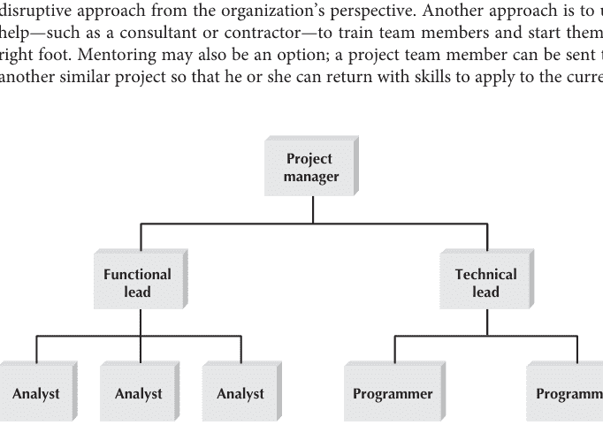

图 2-22 可能的汇报结构

## 激励

向任务分配人员是不够的；项目经理需要激励人们以确保项目的成功。事实证明，激励是对个人表现影响最大的因素，但确定如何激励团队可能相当困难。你可能认为优秀的项目经理通过金钱和奖金来激励员工，但大多数项目经理认为，这是最后才考虑的事情。经理越经常用金钱奖励团队成员，他们的期望值就越高——而且大多数时候激励并不会起作用。平克提出了一套在21世纪激励个人的原则。在本文中，我们将这些建议调整适用于信息系统开发团队。

平克建议使用某种形式的“20%规则”来激励个人。该规则建议，员工应该将其20%的时间花在他们自己喜欢的事情上。该项目不需要与手头的工作有关。另一方面，这听起来像是极大的浪费时间，但不应该抛弃这个想法。Google 的 Gmail 和 Google News 都是使用20%规则开发的。如果认为20%太高了，平克建议你从10%开始考虑。

他建议奖励员工发现小的“现在如此”奖。这些奖项是作为对出色工作的小小感谢。然而，奖项不是经理发给员工的，而是同事之间互相的。这些奖金是金钱形式，但通常非常小。因此，从金钱角度来看，它们并没有意义。然而，它们非常有意义，因为它们是由员工的同事给出的，以表示该员工的行为受到了认可。

平克赞同使用“他们”代词的想法。如果一个员工（或团队成员）将团队称为“他们”，那么现实就是该员工感到脱节甚至可能被疏远了。相反，当员工将团队称为“我们”时，他们显然觉得自己是组织的一部分。从团队的角度来看，这可能表明团队已经开始凝聚。

平克建议管理层给每个员工留出一天，让他们做任何他们想做的事情。在某些方面，这与20%规则有关。它不要求每周一天（20%），但确实需要一些交付物。交付物可以是一个被许多项目使用的新实用程序，也可以是内部使用的业务流程的改进。目标是让团队成员能够关注有趣且具有挑战性的问题，这些问题可能（也可能）为团队的收益带来结果。无论如何，这展示了公司对员工的信任和尊重。

他建议经理将补偿问题从激励方程式中剔除。项目团队中的技术员工受认可、成就、工作本身、责任、晋升和学习技能机会的激励大得多。应该经常避免可能适得其反的简单财务奖励。

## 处理冲突

人员配置的第三组成部分是组织项目以减少小组成员之间的冲突。团队凝聚力（成员对小组及其他成员的吸引力）对生产力的贡献超过了项目成员的能力或经验。清晰地定义项目规则并让团队成员对任务负责是开始缓解项目冲突的一种良好方法。一些项目经理会制定项目章程，列出项目的需求和基本规则。例如，章程可以描述项目团队应该是怎样的、员工之间何时开会，以及在任务完成时更新工作计划的程序。

## 环境与基础设施管理

“环境”和基础设施管理工作流在整个开发过程中支持开发团队。环境工作流主要处理在整个开发过程中使用的正确工具集的选择、识别在开发过程中应遵循的一系列适当标准。基础设施管理工作流涉及选择在开发过程中创建的适当级别和类型的文档。与基础设施管理工作流相关的活动包括开发、修改和重用组件、框架、库和模式。关于重用的主题将在随后的章节中讨论（第 5 章和第 8 章）。

### CASE 工具

计算机辅助软件工程（CASE）是一类能够使开发过程所有部分自动化的软件。某些 CASE 软件包主要用于支持分析工作流，创建系统的集成图，并存储有关系统组件的信息；而另一些则支持设计工作流，可用于生成数据库表和系统功能的代码。其他 CASE 工具包含在整个开发过程中支持数据格的功能。CASE 市场上有各种因素来支持面向对象的系统开发，市场上有许多工具可用（例如：ArgoUML、Enterprise Architect、Poseidon、Visual Paradigm 和 IBM 的 Rational Model）。

使用 CASE 的益处是多多的。通过 CASE 工具，可以更快地完成和更改任务，开发文档更加清晰，并由图表进行说明，而这些图表通常更容易理解。通常情况下，CASE 可以降低维护成本，提高软件质量并强化纪律。某些项目甚至使用 CASE 来评估项目变更的幅度。许多支持面向对象的系统的现代 CASE 工具支持一种名为`往返工程`的开发技术。往返工程不仅支持代码生成，还支持从代码对 UML 图进行反向工程。通过这种方式，系统可以通过图表和往返方法进行演进。

当然，对于其他事情，CASE 不应被视为项目开发的灵丹丸。先进的 CASE 工具是复杂的应用程序，需要培训和经验才能获得真正的收益。我们的经验表明，只要由接受过培训且在过去项目中应用过 CASE 的开发人员使用，CASE 就是支持项目和技术规范通信与共享的助力。所有 CASE 工具都使用 CASE 仓库来存储图表、模型和 I/O 设计，并确保交互的一致性。

### 标准

项目团队成员需要共同工作，大多数项目管理软件和 CASE 工具通过为每个在该系统的人员提供访问权限来支持他们。然而，如果没有设定的程序，协作可能会导致混乱。糟糕，人们有时在项目过程中被重新分配任务。重要的是，他们的项目知识不要随他们离开，并且让他们的接班人员能够快速进入状态。

确保每个人以相同的方式执行任务并遵循相同程序的方法是创建项目团队必须遵循的标准。标准可以包括文件命名的正式规则、目标后必须填充的表单以及编程指南。图 2-24 显示了项目可以创建的标准类型示例。当团队形成标准并遵循这些标准时，项目可以更快地完成，因为协调变得不再复杂。

标准在项目每个主要阶段开始时创建并在整个项目过程中进行沟通时，效果最好。随着团队的推进，在需要时添加新标准。某些标准（例如：文件命名规范、状态报告）适用于整个开发过程，而另一些（例如：编程指南）适用于特定任务。

### 文档

最后，在基础设施工作流的初始阶段，项目团队建立了良好的标准，包括关于统一过程任务的详细信息。通常，所需文档的标准由开发组织设定。开发团队需要确定哪些文档标准适用于当前的系统开发项目。通常，文档存储在项目案（或多个）中，其中包含了所有的交付物和发生的所有内部通信——项目历史。好消息是，统一过程有一套预期的标准文档。文档通常包括系统请求、可行性分析、工作量估计的原始及后续版本、演进中的计划以及功能、结构和行为模型的 UML 图。

| 标准类型 | 描述 |
| :--- | :--- |
| 文档标准 | 日期和项目名称应作为所有文档的页眉。所有边距均应设置为 1 英寸。所有交付物都应添加到项目案中并记录在其目录中。 |
| 编码标准 | 所有代码模块都应包含一个页眉，列出程序员、最后更新日期以及代码目的的简短描述。应使用缩进来表示循环、then-else 语句和 case 语句。平均，每个程序每行代码都应包含一行注释。 |


| 过程标准 | 每周一上午 10 点前在工作记录记录任务进度。周五下午 3:30 汇报项目更新。对需求文档的所有更改必须经过项目经理的批准。 |
|---|---|
| 规格需求标准 | 要创建的程序名称；程序目的的描述；需要计算的特殊计算；必须整合到程序中的业务规则；截止日期。 |
| 用户界面设计标准 | 标签将以粗体显示，左对齐，并在后跟冒号。制表顺序将从左上移动到右下。所有可更新字段都将提供快捷键。 |

图 2-24 项目标准的示例

一种糟糕的管理实践是等到最后才创建文档；这通常会导致无人理解的无文档系统。良好的项目团队使用支持面向对象系统的 `CASE` 工具，即使所选编程语言是 `Java`；这样可以在细节记忆犹新时自动生成文档。这是通过 `javadoc` 工具实现的。尽管几乎所有开发人员都讨厌创建文档并占用宝贵时间，但长远来看这是一项良好的投资。

## 环境与基础设施管理

## 避免经典错误的实践

# 第 2 章 项目管理

## 在 Patterson 超市中应用概念

在第 2 章中，我们将更深入地查看 `Max Ross` 及其团队为“综合医疗诊所交付系统”开发的完整系统请求，包括业务需求、业务要求以及业务价值和限制。我们还将审查伴随并证明系统请求的可行性工作。最后，我们将研究如何估算项目工作，查看项目将如何人员配置和管理，并查看综合医疗诊所交付系统第 1 版本的演化工作分解结构。

随着内容的不断进行，研究 `Patterson` 如何应对系统分析和开发过程将帮助我们理解所提概念在现实世界中的实现。

你可以在此处找到案例剩余部分：`www.wiley.com/go/dennis/casestudy`

## 章节复习

在阅读和学习本章后，你应该能够：

- 解释项目识别和启动的方法。
- 解释将信息系统与组织的业务需求相结合的重要性。
- 描述系统请求的作用并解释其各部分的内容。
- 为拟议的项目创建系统请求。
- 讨论可行性研究的目的。
- 描述在评估项目技术可行性时所考虑的问题。
- 开发项目的经济可行性评估。
- 理解并评估项目的组织可行性。
- 解释项目是如何选择的。
- 描述一项任务。
- 创建标准工作分解结构、甘特图和网络图。
- 执行 `PERT` 分析并识别关键路径。
- 使用用例估算系统开发工作。
- 创建演化工作分解结构。
- 描述使用时间盒（`timeboxing`）的迭代和增量开发如何解决范围管理。
- 描述“默契良好”团队的特征。
- 描述与激励软件开发人员相关的问题。
- 描述 `CASE` 工具、标准和文档对软件开发项目管理的重要性。

## 关键术语

| 参与者 | 盈平衡点 | 复杂用例 | 文档 |
|---|---|---|---|
| 调整后的用例点 | 业务需求 | 计算机辅助软件 | 经济可行性 |
| (`UPC`) | 业务要求 | 软件工程 (`CASE`) | 工作量 |
| 应用程序接口 (`API`) | 业务价值 | `CASE` 存储库 | 新兴技术 |
| 批准委员会 | 现金流方法 | 成本效益分析 | 环境因素 |
| 平均参与者 | 冠军 | 关键路径 | 环境因素值 |
| 平均用例 | 兼容性 | 关键任务 | (`EFactor`) |
| 复杂参与者 | 开发参与者 | 开发成本 | 估算 |

## 演化 `WBS`

- 网络图
- 节点
- 运营成本
- 组织可行性
- 组织管理
- 人时倍数 (`PHM`)
- 计划评估与评审技术 (`PERT`)
- 组合管理
- 项目
- 项目绑定器
- 项目章程
- 项目启动
- 项目管理
- 项目管理软件
- 项目经理
- 项目规模
- 投资回报率 (`ROI`)
- 风险评估
- 风险管理
- 回溯工程
- 范围蔓延
- 简单参与者
- 特殊问题
- 人员配置计划
- 利益相关者
- 利益相关者分析
- 标准
- 战略对齐
- 系统请求
- 系统用户
- 有形利益
- 有形价值
- 任务
- 任务依赖关系
- 技术复杂度因子 (`TCF`)
- 技术价值因子 (`TFactor`)
- 技术可行性
- 技术主管
- 技术风险分析
- 技术技能
- 时间盒
- 权衡
- 未调整权重总和 (`UAW`)
- 未调整的用例点 (`UCP`)
- 未调整的用例权重总和 (`UCW`)
- 用例
- 用例点
- 工作分解结构 (`WBS`)
- 工作计划

## 问题

1. 给出系统业务需求的三个例子。
2. 批准委员会的作用是什么？通常有哪些成员？
3. 为什么应该由业务人员而不是专业人士来创建系统？
4. 无形价值和有形价值的区别是什么？各给出三个例子。
5. 系统和可行性分析目的是什么？它们在项目选择过程中是如何使用的？
6. 描述在系统中可能重要的列出的特殊问题。
7. 描述可行性分析的三种技术。
8. 从可行性的角度描述一个风险项目。描述一个不被认为有风险的项目。
9. 评估经济可行性的步骤有哪些？描述每一步。
10. 列出两个无形利益。描述这些利益如何被量化。
11. 列出系统的两个有形和运营成本。你将如何确定分配给每个项目的价值？
12. 解释成本效益分析中的现值和投资回报率。为什么要使用这些？
13. 你的项目的盈平衡点是多少？是如何计算的？
14. 什么是利益相关者分析？讨论三个对大多数项目都相关的利益相关者。
15. 为什么许多项目有不合理的截止日期？项目经理应该如何应对需求？
16. 项目必须管理的权衡有哪些？
17. 比较并对比甘特图与工作图。
18. 一些咨询公司开发初始项目计划，并使用他们自己的所有者程序员来开发系统并管理项目。你认为为什么有些公司会这样做？
19. 什么是用例点？它是基于什么用例的？
20. 我们使用什么系统开发来识别项目执行过程中需要完成的任务。
21. 与传统 `WBS` 相关的问题有哪些？
22. 什么是演化 `WBS`？它如何解决问题？
23. 什么是工作计划？
24. 什么是范围蔓延，它是如何被管理的？
25. （原文缺失）
26. 什么是时间盒，它为什么要被使用？
27. 列出可能影响结果的风险。
28. 技术主管和功能主管的区别是什么？它们有什么相似之处？
29. 哪些技术技能对任何项目都很重要？
30. 激励团队的最佳方法和糟糕方法是什么？
31. 列出减少冲突的技巧。
32. 项目绑定器里应该有什么？它是如何组织的？

## 练习

A. 找到一份行业杂志（如 `Computerworld`）上关于实施新系统的文章。组织可能实现的有形和无形价值是什么？

B. 假设大学职业服务部门想要开发一个收集简历并向学生和招聘人员提供的网络系统。列出与项目相关的具体问题。

C. 假设你对为当地经销商（如 `CarMax`）购买计算机感兴趣。你的投资回报率是多少？

D. `Amazon` 最初销售书籍；然后管理层决定将其网络系统扩展到其他产品。你将如何评估该业务的可行性？

E. 访问一位在大型组织工作的人，让他描述新项目的审批流程。

F. 访问项目管理网站，如项目管理协会 (`www.pmi.org`)。查看与本书相关的链接。

G. 选择一个特定的项目管理主题，如 `CASE`、项目管理软件或时间盒，并在网上搜索有关该主题的信息。

H. 假设大学职业服务部门想要开发一个收集简历并向学生和招聘人员提供的系统。学生应该能够将简历信息输入到标准简历模板中。然后信息展示或放置在可以使用在线查询的数据库中。你如何被负责估算项目？你计划如何让其他三个学生完成项目？提供你建议的进度。

I. 参考 H 中的练习。假设招聘从一个月后开始，并且必须使用新系统。你会选择哪种方法？作为项目经理，你可以做什么来确保团队不会超出不合理的期限和承诺？

J. 考虑 H 描述的系统。为了项目目标需要完成哪些任务？创建一个甘特图并在项目管理工具（如 `Microsoft Project`）或使用电子表格中绘制，以显示项目的高级任务。

K. 假设你负责 H 练习描述的项目，且项目将由班级组成。你的同学是否拥有实施此类项目的所有技能？如果没有，你将如何确保人们完成工作？

L. 使用完整的用例点工作表估算构建 H、I、K 描述的系统的工作。你需要对参与者、用例以及技术复杂性和环境因素做出假设。

M. 考虑一个用于你所在学校注册课程的应用程序。完成一份用例工作表，以估算构建此类应用程序所需的工作。你需要对该应用程序的接口以及影响其复杂性的各种因素做出假设。

N. 假设你的导师要求你和朋友们向潜在学生介绍这门课程，并向同学提供当前信息（例如教学大纲、作业、阅读材料）。你被任命为小组长，因此你需要协调你自己以及同学的活动，直到项目完成。请描述你将在这种情况下如何应用所学的项目管理技术。包括对你将如何制定计划、配置项目人员以及协调所有活动（以及你同学的活动）的描述。

O. 选择两个项目管理软件包，并使用网络或行业杂志对它们进行研究。描述这两个软件包的功能。如果你是一个项目经理，你会使用哪一个来支持你的工作？

P. 1997年，`Oxford Health Plans` 拥有一个计算机系统，导致公司高估和低估了医疗成本。问题源于其理赔处理系统从使用 `Oracle` 数据库和 `Pyramid Technology` 硬件的 `Unix` 的迁移。结果，`Oxford` 的股票成为了公司的首要任务。假设你被任命负责管理理赔处理系统。显然，项目团队的情绪不会很好。你将如何激励团队成员以实现项目目标？

## 案例分析

### 1. Ambersen 公司案例

`Ambersen` 公司是一家拥有 12 家零售店的连锁店，在多伦地区提供各种进口礼品、美味巧克力和葡萄酒。`Ambersen` 有一个由三人组成的信息系统（`IS`）团队，他们利用商店内的网络化销售收银机和公司总部的集中会计系统创建了一个简单且有效的信息系统。`Ambersen IS` 部门主管 `Harry Harman` 收到了来自 `Ambersen` 销售总监（也是 `Ambersen` 创始人的儿子）的以下备忘录。

> Harry——是时候让 `Ambersen` 进军互联网了。我们的团队已经在无需零售店开支的情况下向客户销售，我们应该也去那里。我预计通过在网上销售产品，我们可以使年收入翻倍或三倍。我希望在圣诞节之前准备好——正好赶上高端假日礼品店的旺季。

在思考了几天后，`Harry` 与 `Bill` 安排了会议，以便他明确 `Bill` 对这项事业的愿景。以你所引导的标准请求系统为准，列出一份 `Harry` 需要就该项目回答的问题清单。

### 2. Decker 公司案例

`Decker` 公司拥有一支由 10 辆服务车和团队组成的队伍，为住宅客户提供排水、供暖和冷却维修服务。目前，服务团队响应请求大约需要六小时。每辆车和每个团队每周处理五个电话，每次通话赚取的平均收入为 150 美元。每辆车每年工作 50 周。由于调度和路线规划的困难，在典型周内，每辆车和团队都有大量的闲时间。

为了有效调度车辆和团队以提高生产力，`Decker` 管理层正在评估购买一个预写的路由和调度软件包。该系统将缩短服务请求的响应时间并提高服务团队的效率，但管理层对这些收益产生了关注。

一种方法是增加新系统减少响应时间的程度，从而可以增加每周的服务电话数量。例如，如果系统允许平均响应时间从六小时减少到四小时——每周平均增加四个通话。由于每次通话的平均收入为 600 美元（4 × $150），在 10 辆车每年工作 50 周的情况下，年收入将为 300,000 美元（$600 × 10 × 5）。

`Decker` 公司管理层不确定系统是否能让平均响应时间下降到四小时，还是其他数字。因此，管理层制定了新系统可能出现的结果范围，并对每种结果发生的概率进行了估计。

| 新响应时间 | 每辆车/每周通话数 | 概率 |
| :--- | :--- | :--- |
| 2 小时 | 20 | 20 |
| 3 小时 | 18 | 30 |
| 4 小时 | 16 | 50 |

根据这些数字，创建一个电子表格，计算该新系统产生的年收入期望值。

### 3. First Trust Bank 案例

`Emily` 是一个面临困难处境的 `IS` 经理。`Emily` 就职 `First Trust Bank`，该银行最近收购了 `City National Bank`。在收购之前，`First Trust` 和 `City National` 在该地区的市场份额竞争非常激烈。在这次充满火药味的收购后，许多分支机构（包括 `IS` 部门）被裁员。然而，两家银行的 `IS` 关键员工都被留了下来，并分配到一个新的合并部门。`Emily` 被任命为她负责的第一个 `IS` 项目的项目经理，她面临着整合来自两家银行员工的任务。他们正在进行的项目在组织内部将具有高度波动性。`Emily` 认为项目目标将成功，但成功需要避免冲突。你建议 `Emily` 实施什么策略以确保项目的成功运行？

### 4. Great State 大学案例

`Tom`、`Jan` 和 `Julie` 是 `Great State` 大学的 `IS` 专业的学生。这些学生被一位教授分配了一个课程项目，要求他们开发一个全新的基于 `Web` 的系统，用于收集和更新 `IS` 计划的信息。该系统将供毕业生在毕业时输入和处理信息，并对这些信息和/或地址进行更改。他们的教授还有一些她感兴趣实现的查询。根据他们与教授的初步讨论，学生们确定唯一的参与者是 `IS` 毕业生。他们确定了一个简单案例、四个中等案例和两个复杂案例。考虑技术复杂性和环境因素。计算该项目的工作量。

### 5. 社区主花园案例

在寻找 `MIS` 课程的毕业设计时，你发现了一个可能的项目。这个社区主花园的所有植物数据库是由一个志愿者创建的电子表格。100 名园艺者每年从他们的家庭花园提供 5,000 盆植物。由于植物种类和数量每年变化，且成员们以各种格式发送电子邮件，标签打印变成了一项艰巨的任务。`Tom` 每年打印标签，使项目变得可行。一封电子邮件示例以及她需要的信息类型。

> 百合——需要 3 个标签
>
> `Lilium lancifolium` / `litigium` 虎百合 多年生植物 半阴 4 英
>
> 冰花（粉色）——需要 3 个标签
>
> `Delospera cooperi` 耐多肉植物 全直射 2-5 英

| 标签信息 |
| :--- |
| 学名 |
| 俗名 |
| 植物类型 |
| 光照要求 |
| 高度和宽度 |

为了接受这个项目，你需要建立一个具有所需技能的团队并创建一个系统请求。你将如何处理这个项目？为了启动项目范围，你还需要 `Pam` 提供哪些额外信息？假设你已经收到了这些信息，创建一个系统请求。还要列出所需的技能、所需的团队人数以及项目计划。

# 第 3 章 需求确定

分析师的首要活动之一是确定新系统的业务需求定义。本章首先介绍了需求定义，这是一份列出新系统能力的文档。随后描述了如何使用分析策略对需求进行分析，以及如何通过访谈、`JAD` 会议、问卷调查、文档分析和观察来收集需求。本章还描述了一系列替代性的需求文档技术，并描述了将所有内容整合在一起系统建议书。

## 目标

- 理解如何创建需求定义
- 熟悉需求分析技术
- 理解何时使用每种需求分析技术
- 理解如何通过访谈、`JAD` 会议、问卷调查、文档分析和观察来收集需求
- 理解概念图、故事卡片和任务列表作为需求文档技术的使用
- 理解何时使用每种需求收集技术
- 能够开始创建系统建议书

## 引言

系统流程有助于组织从当前系统（通常称为“现状系统”）迁移到新系统（通常称为“目标系统”）。第 2 章讨论的规划产出是系统请求，它为目标系统提供了总体构想，定义了项目范围，并提供了初始工作计划。分析将系统中的总体构想并精炼为详细的需求定义（本章）、功能模型（第 4 章）、结构模型（第 5 章）和行为模型（第 6 章），这些模型构成了系统建议书。系统建议书还包括修订的管理交付物，例如可行性分析和工作计划（第 2 章）。

分析的产出——系统建议书将提交给审批委员会，由其决定项目是否继续。如果获得批准，系统建议书进入设计阶段，其元素（需求定义以及功能、结构和行为模型）将作为设计步骤的输入。这会进一步细化并定义系统将如何被构建。

分析与设计之间的界限非常模糊。这是因为分析期间创建的交付物实际上是新系统设计的第一步。新系统的许多主要设计决策都可以在分析交付物中找到。要记住，分析交付物确实是新系统设计的第一步。

在许多方面，由于系统的主要要素在此首次出现，需求确定步骤是整个开发过程中最关键的单一步骤。在需求确定期间，系统处于系统开发过程中，由于此时工作量较少，因此很容易更改。由于涉及大量的返工，返回需求确定阶段进行更改将变得越来越困难。多项研究表明，超过一半的系统失败归因于需求问题。这就是为什么面向对象的方法论的迭代方法如此有效——需求可以在增量阶段被识别和实现，允许整个系统随时间演变。

## 需求确定

需求确定的目的是将系统请求中对业务需求的高级解释转换为更精确的需求列表，这些列表可以作为后续分析（创建功能、结构和行为模型）的输入。这种需求的扩展最终导致了系统的设计。

### 定义需求

需求简单来说是指关于系统必须做什么或它必须具备什么种特征的陈述。在分析过程中，需求是从业务人员的角度编写的，侧重于系统的“做什么”。因为它们关注业务用户的需求，所以通常被称为业务需求（有时也称为用户需求）。在后续的设计阶段，需求会变得更具技术性，描述系统将如何被实现。从开发者角度编写的需求通常被称为系统需求。

我们想强调的是，业务需求和系统需求之间没有非黑即白的界限——有些公司会交替使用这两个术语。需要记住的一点是，需求是系统必须做什么的陈述，并且会随着项目从启动到建设的推进而变化。需求从系统应该具备的业务能力的详细陈述，演变为将在系统中实现的技术能力的详细陈述。

需求在性质上可以是功能性的也可以是非功能性的。功能性需求直接涉及系统必须执行的过程或其需要的信息。例如，规定系统必须具备搜索库存或报告实际与预算支出能力的需求就是功能性需求。功能性需求直接转化为代表系统功能的功能、结构和行为模型的创建（见第 4、5 和 6 章）。

非功能性需求指的是系统必须具备的行为属性，例如性能和易用性。使用浏览器访问系统被认为是一个非功能性需求。非功能性需求可以影响分析结果（功能、结构和行为模型），但通常是间接的；非功能性需求主要用于设计阶段，在对数据库、用户界面、硬件软件以及系统底层架构做出决策时。

> 例如，《软件开发项目失败的范围》（`Dennis`, `MA`: The Standish Group, 1995）。


非功能性需求描述了关于系统的各种特征：运行、性能、安全以及文化和政治。运行需求解决与系统运行的物理和技术要求相关的问题。性能需求解决与系统速度、容量和可靠性相关的问题。安全需求涉及谁有权访问系统。文化和政治需求涉及法律要求。这些非功能性需求可能会影响系统。我们将在书的后续部分回到这个主题（见第 9、10 章）。


# 质量与需求确定

## 质量维度

一个关注功能性和非功能性需求的开发领域是质量。虽然有许多用于衡量软件质量的模型，但在考虑 `ISO-9000` 合规性时，质量维度被进一步分解为外部和内部。外部非功能性维度包括效率、可靠性和易用性，而内部维度包括可维护性、移植性和可测试性。

从用户角度来看，外部维度是重要的。如果系统难以使用，无论它解决问题的能力如何，用户都不会去使用它。从开发者角度来看，内部维度同样重要。例如，考虑到系统通常是长寿且跨平台的，可维护性和移植性维度具有战略意义。此外，目前采用的敏捷开发方法使得可重用和可测试软件的成本增加。

## 需求确定

### 全球化影响

近期影响某些系统需求的另一个主题是全球化。例如，全球化的信息供应链会产生大量的非功能性需求。如果移动系统的开发缺乏必要的运行环境，那么将解决方案适应于本地环境就至关重要。或者，在不具备必要电力和通信基础设施的地区，部署基于高技术的解决方案可能是不合理的。在某些情况下，我们可能需要考虑通过手动（而非自动化）系统来支持全球信息供应链的一部分。

手动系统拥有一套完全不同的需求，这会产生不同的性能预期和额外的安全考量。此外，文化和政治考量也是至关重要的。一个影响用户界面设计的简单例子是颜色在（屏幕或纸张上）上的使用。不同文化对颜色的解读也不同。换句话说，在一个全球化、多文化的业务环境中，解决文化问题不仅仅是提供一个多语言的用户界面。我们必须能够将解决方案适应于当地实际。弗里德曼将这些考量称为全球化³。否则，我们只会创造另一个系统开发项目失败的案例。

> ³ T. L. Friedman, *The World is Flat: A Brief History of the Twenty-First Century, Updated and Expanded Edition*. (New York: Farrar, Strauss, and Gireux, 2006).

## 需求定义示例

需求报告通常只是以大纲格式列出功能性和非功能性需求。图 3-1 显示了典型诊所预约系统的需求示例。请注意它既包含了功能性需求也包含了非功能性需求。功能性需求包括预约、安排日程以及检查单个医生的可用性。非功能性需求包括诸如下项，如启动新预约的预计时间、支持无线打印的需求，以及何种类型的员工可以访问系统的不同部分。

需求以列表或大纲格式编号，以便每个需求都能被清晰地识别。需求首先被分为功能性需求和非功能性需求；在每个大标题下，它们会根据非功能性需求的类型或功能进行进一步分组。

有时，业务需求的优先级会高于需求定义。它们可以被归类为系统中的高、中重要性或低重要性，或者可以标记为实现这些需求的系统版本（例如，发布 1、发布 2、3）。在使用以增量方式交付系统的面向对象开发方法论时，这种做法尤为重要。

需求定义的最显而易见的目的是提供分析阶段其他交付物所需的信息（包括功能模型、结构模型和行为模型），并为设计活动提供支持。需求定义最重要的目的是定义系统的范围。该文档准确描述了系统最终需要完成的工作。当出现差异时，该文档是澄清说明的依据。

### 图 3-1 需求定义示例

#### 非功能性需求

1. **运行需求**
   1.1. 系统将在 `Windows` 环境下运行。
   1.2. 系统应能够无线连接打印机。
   1.3. 系统应在每天结束时自动备份。

2. **性能需求**
   2.1. 系统将在 2 秒或内启动新预约。
   2.2. 系统将在 2 秒或内检索每日预约日程。

3. **安全需求**
   3.1. 只有医生可以设置自己的可用性。
   3.2. 只有经理可以生成日程表。

4. **文化和政治需求**
   4.1. 不预期会有特殊的文化和政治需求。

#### 功能性需求

1. **管理预约**
   1.1. 患者进行新预约。
   1.2. 患者更改预约。
   1.3. 患者取消预约。

2. **生成日程表**
   2.1. 办公室经理检查每日日程。
   2.2. 办公室经理打印每日日程。

3. **记录医生可用性**
   3.1. 医生更新日程表

## 确定需求

为需求确定确定需求既是一项业务任务，也是一项信息技术任务。在计算机早期，人们认为：

> 作为计算机系统专家，他们处于定义计算机系统应如何运行的最佳位置。

许多系统的失败是因为它们未能充分解决用户的真实业务需求。逐渐地，这种假设发生了变化，用户作为业务专家，被认为是定义计算机系统如何运行的最佳位置。然而，许多系统未能带来性能收益，因为用户仅仅是将现有系统自动化，而未能整合技术提供的新机会。因此，最有效的方法是让业务人员和分析师合作来确定需求。有时，用户并不清楚自己想要什么，分析师需要帮助他们发现自己需要什么。一组策略变得流行起来，以帮助分析师进行问题分析、根本原因分析、活动分析、基于活动的成本核算、非正式基准测试、结果分析、技术分析和活动消除。分析师可以使用这些工具帮助用户理解对系统的要求。这些策略的工作原理类似。它们帮助用户批判性地检查系统和流程的现状（`as-is`），准确识别出需要改变的内容，并开发新系统的概念（`to-be`）。

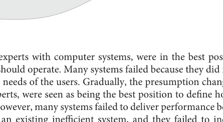

## 创建需求定义

创建需求定义是一个迭代且持续的过程，分析师通过需求收集技术（例如访谈、文档分析）收集信息，进行批判性分析以识别业务需求，并将其加入需求定义。需求定义保持更新，以便项目团队和业务用户能够参考并清晰理解新系统。

为了创建需求定义，项目团队首先确定将收集的功能性和非功能性需求的类型（当然，这些可能会随时间变化）。这些构成了文档的主要部分。接下来使用各种需求收集技术收集信息，并列出识别出的业务需求。最后，分析师与项目团队和业务用户合作，验证、更改并完成列表，以帮助确定需求的重要性。

这一过程贯穿始终，需求定义随着新需求的发现以及项目的演进而演变。由于需求定义的演变必须仔细管理，项目团队不能不断增加需求，否则系统将不断增长且无法完成。项目团队识别需求并评估每个需求是否符合范围。当某个需求反映了真实需求但在当前系统或当前发布范围之外时，会被添加到未来列表中或赋予低优先级。需求（和范围）的管理是项目中最困难的部分之一。

## 需求确定的现实问题

Avizon 和 Fitzgerald 为我们提供了在确定需求集时可能出现系列问题。首先，分析师可能无法接触到所有用户以发现完整的需求。这可能导致需求的识别错误、误报或过度规范。其次，需求的规范可能不准确，这在与敏捷方法相关的轻量级技术中尤为如此。第三，某些需求在开发开始时是未知的。然而，随着系统的开发，用户和分析师将对领域和适用技术有更好的理解。这会导致新的功能性和非功能性需求的识别，并导致现有需求的演变或取消。迭代和增量的开发方法论以及需求的验证可能非常困难。我们将在处理功能（第 4 章）、结构（第 5 章）和行为的章节中讨论这些。

## 需求分析策略

在项目团队确定哪些需求适用于给定系统之前，需要对将要创建的系统种类以及它将给组织带来的变革水平有一个清晰的愿景。分析的基本过程分为三个步骤：理解现状系统（`as-is system`）、识别改进之处，以及为目标系统（`to-be system`）开发需求。

有时即使是第一步（理解现状）也会跳过或以草率的方式执行。这通常发生在：不存在当前的系统时、现有系统和流程与未来系统无关、或者项目团队正在使用 `RAD`（快速应用开发）或敏捷开发方法（在这些方法中不需要现状）。与 `RAD`、敏捷和面向对象的开发方法不同，分阶段开发、原型设计、丢弃型原型设计和 `Scrum`（见第 1 章）等几乎完全关注改进和目标系统，它们花费很少的时间来调查现状。

需求分析策略帮助首席用户应对分析需求，从而开发系统愿景。需求分析与需求征集技术是相辅相成的；需求征集技术收集信息，而分析策略则驱动信息的收集方向以及最终如何进行分析。需求策略与需求征集是同时发生的，是互补的活动。

要从现状转向目标系统，分析师需要强大的批判性思维能力。批判性思维是识别优缺点并以改进的形式重构想法的能力，且理解和开发新的业务流程需要批判性思维技能。这些流程还需要彻底检查需求征集的结果，识别业务需求，并将其转化为新系统的概念。

### 问题分析

最直接（可能也是最常用）的需求分析技术是问题分析。问题分析要求用户和经理识别现状系统中的问题，并描述如何在目标系统中解决这些问题。大多数用户对他们希望看到的改进有非常明确的想法。

这种改进对于提高系统的效率或易用性非常有效。然而，它通常只提供业务价值上的改进——系统比旧系统好，但很难从新系统中识别出显著的收益。

### 根因分析

问题分析产生的想法倾向于解决方案。所有的解决方案都对问题的本质做出假设，这些假设可能有效，也可能无效。根据我们的经验，用户（以及大多数人）倾向于在不充分考虑问题本质的情况下直接跳到解决方案。有时解决方案是合适的，但很多时候它们解决的是问题的症状，而不是真正的问题或根因。

> 有两本很好的书讨论了寻找问题根因的困难：E. M. Goldratt 和 J. Cox, *The Goal* (Croton-on-Hudson, NY: North River Press, 1986); E. M. Goldratt, *The Haystack Syndrome* (Croton-on-Hudson, NY: North River Press, 1990)。

例如，假设一家注意到用户报告库存缺货。库存缺货的成本可能是巨大的。在这种情况下，由于缺货频繁发生，客户会为从该公司购买的物品寻找其他来源。对公司而言，确定根本原因远比简单地提供一种直觉式的反应（如随意增加库存量）更有利。在商业世界中，挑战在于识别根因——很少有现实问题是简单的。用户通常会对该问题提出一组案例供考虑。用户提出的解决方案要么针对症状，要么针对根因，但如果不进行仔细的分析，很难判断解决的是哪一个。

因此，根因分析关注问题而非解决方案。分析师首先让用户列出当前系统的问题列表，然后按重要性对问题进行排序。从最重要的问题开始，用户和/或分析师针对每个问题生成所有可能的根因。每个可能的根因都会经过调查（从最可能或最容易检查的开始），直到确定真正的根因。如果确定了任何可能的根因，都应该进行调查，因为很有可能真实原因是：

- 供应商可能没有及时交货。
- 库存控制存在问题。
- 再订货水平和数量可能是错误的。

有时，使用层级图表示因果关系有助于分析。

#### 图 3-2 库存缺货的根因分析

| 处理延迟 | 库存问题 | 再订货 |
| :--- | :--- | :--- |
| 订单审批 | 销售记录延迟 | 水平 |
| 识别供应商 | 采购记录延迟 | 数量 |
| 发送给供应商的延迟 | 库存频率低 | 设置过低 |

### 活动分析

持续分析需要对现状系统进行详细检查。分析师首先确定执行每一步所需的时间。然后他们查看每个基本步骤（例如数据录入、信用检查、评估）花费的总时间，并发现总时间约为八小时。两者之间以及各部分之和之间的显著差异表明整个流程需要重构。

许多人共同处理输入部分的流程是流程整合或并行化的理想候选者。流程整合意味着更改流程，以便让更少的人参与输入工作，这通常需要更换人员来执行更广泛的活动。并行化意味着更改流程，使所有单独步骤同时进行。例如，在贷款申请案例中，没有理由让信用检查和所有权检查同时进行。

### 作业成本法

作业成本法是一种类似的分析；它检查的是业务流程中每个流程或步骤的成本，而不是所需的时间。分析师识别每个功能步骤相关的成本，识别成本最高的流程，并将改进集中在这些上。

成本分配在概念上是简单的。分析师只需检查每个输入的劳动力材料成本。材料在制造过程中很容易分配，而劳动力成本通常根据投入的时间和人员成本计算。然而，正如你可能从管理会计课程回想的那样，还有间接成本（如租金、折旧等），也可以包含在作业成本中。

> 有许多关于作业成本法的书。有用的书籍包括 K. B. Burd 和 D. W. Webster, *Activity-Based Costing* (Fairfax, VA: American Management Systems, 1994), D. T. Hicks, *Activity-Based Costing: Does It Work for Small and Mid-sized Companies* (New York: Wiley, 1998)。之前提到的 Eli Goldratt 的两本书（《The Goal》和《The Haystack Syndrome》）也为成本计算提供了独特的见解。

### 非正式基准测试

基准测试是指研究其他组织如何执行业务流程，以学习你的组织如何做得更好。基准测试通过引入可能从未被考虑过但具有价值的想法来帮助组织。

非正式基准测试对于面向客户的业务流程相当常见（即与客户交互的流程）。在非正式基准测试中，经理和分析师思考其他组织或作为客户访问它们以观察业务流程是如何执行的。许多情况下，业务研究可以通过简单或有限的努力完成。

### 结果分析

结果分析侧重于理解为客户提供价值的基本结果。尽管这些结果听起来似乎显而易见，但往往并非如此。例如，考虑一家保险公司。其中一个客户发生了车祸。从客户的角度来看，基本结果是什么？传统上，保险公司通过假设客户希望尽快收到款项来回答这个问题。然而，对于客户来说，付款是实现真实结果的手段：修好的汽车。保险公司可以通过将其业务流程的视野扩展到传统边界之外，包括不再支付维修费用而是亲自维修或委托授权机构进行维修来从中受益。

通过这种方法，系统分析师鼓励经理和项目赞助人假装成客户，仔细思考组织的产品和服务让客户做什么——以及它们可能让客户做什么。

### 技术分析

自世纪初以来，业务领域的许多变化是由新技术实现的。技术分析首先让分析师和经理列出一份重要且有趣的技术列表。然后，小组系统地识别如何将技术应用于业务流程，并确定业务将如何受益。需要注意的是，技术分析绝不意味着为了技术而采用技术。相反，重点在于利用技术来满足组织的目标。

### 活动消除

活动消除正如其名。分析师和经理努力识别组织如何消除业务流程中的每项活动、该功能如何在没有该活动的情况下运行，以及可能产生什么影响。起初，经理们愿意承认流程可以消除，但这是一个强制性的练习，因为他们必须消除每项活动。在某些情况下，结果是荒谬的；尽管如此，参与者必须处理业务流程中的每一个活动。

## 需求收集技术

分析非常像侦探（业务用户则像难以捉的嫌疑人）。他知道有一个问题需要解决，必须寻找揭示解决方案的线索。遗憾的是，线索并不总是明显的（而且经常被忽略），因此分析师需要注意细节、与证人交谈并像夏尔洛·福尔摩斯那样追踪线索。分析师使用各种技术彻底收集需求，并确保在设计之前充分理解当前的业务流程和新系统。分析师等到后期才发现他们有关键需求——在开发过程中的此类惊喜会导致各种问题。

需求收集过程用于为项目建立政治支持，并在构建系统的项目团队与最终选择使用不使用系统的用户之间建立信任和关系。在过程中的某人意味着项目团队将该人视为重要资源，并重视其意见。所有关键利益相关者（能影响系统或受系统影响的人）都必须包含在需求收集过程中。

利益相关者可能包括经理、员工、工作人员，甚至一些客户和供应商。如果关键人物没有参与，这些人可能会感到被冷落，这会在实施过程中导致问题（例如，如果没有他们的投入，他们如何开发系统呢？）。

需求收集的第二个挑战是选择收集信息的方法。收集需求有很多技术，从向人们提问到观察他们不等。在本节中，我们关注最常用的五种技术：访谈、`JAD` 会话（一种特殊的小组会议）、调查问卷、文档分析和观察。每种技术都有其优缺点，其中许多优点是互补的，因此大多数项目使用多种技术的组合⁷。

> ⁷ 一些探讨需求收集目标和各种技术的优秀书籍包括 Alan M. Davis 的《Software Requirements: Objects, Functions, & States, Revision》 (Engle Cliffs, NJ: Prentice Hall, 1993); Gerald Kottona 和 Ian Sommerville 的《Requirements Engineering》 (Chester, England: 1998); Dean Ledfellow 和 Don Rigid 的《Managing Software Requirements: An Unified Approach》 (Reading, MA: Addison-Wesley, 2000)。

### 访谈

访谈是最常用的需求收集技术。毕竟，这是很自然的——如果你需要知道某些事情，你通常会询问某人。通常，访谈是一对一进行的（一名访谈者和一个受访者），有时会对小组同时访谈。访谈过程有五个基本步骤：选择访谈对象、设计访谈问题、准备访谈、进行访谈以及访谈后跟进⁸。

> ⁸ 一本关于访谈的好书是 Brian James 的《The Systems Analysis Interview》 (Manchester, England: NCC Blackwell, 1989)。

#### 1. 选择受访者

访谈的第一步是创建访谈计划，确定谁将被访谈以及目的是什么（见图 3-3）。该计划可以是一个有助于安排会议的非正式列表，也可以是纳入工作流的正式列表。出现在列表上的人是根据分析师的需求选择的。项目赞助人、关键业务用户以及项目团队的其他成员可以帮助分析师确定组织中谁能最好提供关于需求的重要信息。这些人按照所需的顺序列在访谈计划中。

组织的不同层级对系统有不同的观点，因此重要的是要包括管理流程的经理和实际执行流程的人员，都要涵盖高层次和低层的视角。此外，需要的课题类型可能会随着时间而变化。例如，在项目开始时，分析师对现状（`as-is process`）的理解有限。通常开始访谈一或两个高级经理以获得战略视角，然后转向中层经理，他们可以提供关于业务流程和开发系统预期角色的广泛、概述性信息。分析师对流程如何运作有很好的细节。像系统分析的大多数其他事情一样，这是一个迭代过程——从高级经理开始，转向中层经理，然后是工作人员，依此类推，取决于过程中需要什么信息。

受访者列表增加是非常常见的，通常增加 50% 到 75%。随着访谈的进行，会有更多所需的信息以及更多可以提供信息的额外人员。

#### 图 3-3 访谈计划示例

| 姓名 | 职位 | 访谈目的 | 会议时间 |
| --- | --- | --- | --- |


| Andria McClellan | 会计总监 | 新会计系统的战略愿景 | 3月1日周一 上午 8:00–10:00 |
| Jennifer Draper | 应收账经理 | 应收账当前的问题；未来目标 | 3月1日周一 下午 2:00–3:15 |
| Mark Hardin | 应付账经理 | 应付账当前的问题；未来目标 | 3月1日周一 下午 4:00–5:15 |
| Anne Asher | 数据录入主管 | 应收和应付账 | 3月3日周三 上午 10:00–11:00 |
| Fernando Merce | 数据录入员 | 应收和应付账 | 3月3日周三 下午 1:00–3:00 |

**图 3-3 示例计划**

### 2. 设计访谈问题

访谈问题有三种类型：封闭式、开放式和探测性问题。**封闭式问题**是那些需要特定答案的问题。它们类似于考试中的多选题或计算题（见图 3-4）。当分析师寻找特定信息（例如，每天有多少次请求）时，使用封闭式问题。通常，精确的问题更好。例如，与其问“你的请求很多吗？”，不如问“每天有多少次请求？”封闭式问题让分析师能够控制访谈以及他们所需的信息。这类问题无法揭示答案为什么是那样，也不会揭示访谈者没有想起来提问的信息。

**开放式问题**是那些为访谈部分留出详述空间的问题。它们在许多方面与人们可能在考试中看到的问题相似（示例见 3-4）。开放式问题设计用于收集丰富的信息，并让受访者对访谈期间揭示的信息有更多控制权。有时，受访者选择发现的信息与答案本身同样重要（例如，当问及问题时，受访者只谈论他们的部门，这可能表明他们不愿意讨论自己的问题）。

第三类问题是**探测性问题**。探测性问题遵循刚刚讨论的内容以获取更多信息，用于访谈者鼓励受访者扩展或确认之前回答的信息，并信号访谈者对正在讨论的话题感兴趣。许多分析师不使用探测性问题，因为他们担心可能会得罪受访者，或者这表明他们没有听懂说的。使用时，探测性问题可以成为需求收集的强大工具。

通常，访谈者应该询问可以从其他来源获取的信息。例如，与其询问执行某任务使用哪些信息，不如向受访者展示一份表格或报告（见文档分析章节）并询问使用了哪些信息。这有助于受访者，受访者不需要描述信息——他们只需要在表格或报告上指出来。

没有哪种类型的问题优于另一种，访谈期间通常会使用问题的组合。在信息系统项目的初始阶段，现状情况可能不明确，因为访谈过程是从非结构化访谈开始的，这种访谈寻求广泛且大致定义的信息。在这种情况下，访谈者对所需信息有一个大致的了解，但没有具体的闭式问题要问。这类访谈执行起来最具挑战性，因为要求访谈者提出开放式问题并随时探测信息。

随着项目的进行，分析师对业务流程的理解会深入得多，并需要关于业务流程如何执行的具体信息（例如，客户信用卡具体是如何获得批准的）。此时，分析师会构建结构化访谈，并在访谈前讨论一组特定的问题集。结构化访谈中的闭式问题通常比非结构化方法多。

无论进行何种类型的访谈，问题都必须按照逻辑顺序组织，以确保访谈顺畅。例如，在收集当前业务流程信息时，按照逻辑顺序遍历流程或从最重要到不重要的顺序进行可能是很有用的。

组织访谈有两种功能性方法：自上向下或自下而上（见图 3-5）。自上而下的访谈中，访谈者从广泛、通用问题开始，逐渐转向更具体的问题。自下而上的访谈中，访谈者从具体问题开始，转向广泛实践。在实践中，分析师会结合这两种方法，从广泛的通用问题转向具体问题，然后回到一般性问题。

自上而下的方法是大多数访谈的合适策略（这无疑是最常见的方法）。自上而下的方法让访谈者在需要探测细节之前熟悉主题。它还让访谈者在进入细节之前理解问题，因为访谈者在访谈开始时可能没有足够的信息来提出具体问题。最重要的是，自上而下的方法使访谈者在沉浸细节之前提出一系列大问题，因此访谈者不太可能遗漏重要内容。

自下而上策略优先的一种情况是已经收集了大量关于问题的信息，需要用细节填补空白。当员工不确定或无法回答高层次问题时，可能需要进行自下而上的访谈。例如，“我们如何改进客户服务？”对于客户服务员来说可能是一个太宽的问题，而具体的问题则是很容易回答的（例如，“我们如何加快客户退货速度？”）。无论如何，所有访谈都应该从非争议性问题开始，在访谈者与受访者建立良好关系后，逐渐转向更具争议性的问题。

**图 3-4 三类问题**

| 问题类型 | 示例 |
| --- | --- |
| 闭式问题 | • 每天收到多少电话订单？<br>• 客户是如何下单的？<br>• 销售报告中缺少哪些信息？ |
| 开放式问题 | • 你对当前系统有什么看法？<br>• 你每天面临哪些问题？<br>• 你希望在新系统中看到哪些改进？ |
| 探测性问题 | • 为什么？<br>• 你能给我一个例子吗？<br>• 你能再详细解释一下吗？ |


### 3. 准备访谈

像准备演示文一样准备访谈是非常重要的。访谈者应该有一个通用的访谈计划，按适当顺序列出要问的问题，预判可能的答案并进行跟进，并识别相关主题之间的问题。访谈者应该考虑受访者具备知识的领域，以免询问受访者无法回答的问题。回顾主题和问题，并在时间紧迫时明确决定哪些优先级最高。

通常情况下，带有闭式问题的结构比非结构化访谈需要更多时间来准备。有些分析师更倾向于非结构化访谈，认为这样可以获胜。这是非常危险且往往适得其反，因为第一次访谈中没有收集的信息将需要跟进，而大多数用户不喜欢就同一个问题被反复访谈。

访谈者应该确保也准备好受访者。应提前告知受访者访谈的原因和将讨论的领域，以便他们有时间思考问题并组织思路。当受访者是组织的外部人员或低级员工时，这一点尤为重要，他们没有被征求意见，可能不确定为什么要访谈。

### 4. 执行访谈

第一个目标是与受访者建立关系，以便他/她信任访谈者并愿意讲述真相，而不仅仅是提供他/她认为想要的答案。访谈者应该表现得专业且无偏的信息搜寻者。访谈者应该从解释为什么要访谈以及为什么选择这个人开始；然后进入计划好的访谈问题。

仔细记录受访者提供的所有信息至关重要。根据我们的经验，记录一切是至关重要的。

### 5. 访谈后跟进

访谈结束后，分析师需要准备一份描述访谈信息的报告（图 3-6）。报告包含了访谈笔记并以实用的格式总结的信息。通常，访谈报告应在访谈后48小时内写完，因为访谈者等待得越久，越容易忘记信息。

通常，访谈报告会发送给受访者，要求其阅读并向分析师提供澄清或更新。受访者应该确信访谈者想要的内容。通常变动很少，但任何重大变化都意味着需要第二次访谈。未经许可，绝不要传播他人的信息。

## 联合应用开发 (JAD)

JAD是一种信息生成技术，允许项目团队、用户和管理层共同识别系统需求。IBM在20世纪70年代后期开发了JAD技术，它通常是从用户处收集收集有效的方法。

> 9 关于JAD的更多信息可以参考 J. Wood and D. Silver, Joint Application Development (New York: Wiley, 1989); Alan Cline, "Joint Application Development for Requirements Collection and Management," http://www.carolla.com/wp-jad.htm.


### 访谈报告示例

| 访谈记录由 Linda Estey 批准： |
| :--- |
| 被访谈人员：Linda Estey，人力资源部总监 |
| 访谈员：Barbara Wixom |

**访谈目的：**

- 理解当前系统为人力资源部产生的报告
- 确定未来系统的信息需求

**访谈总结：**

- 本报告附带了所有当前人力资源报告的样本报告。报告中未被使用的信息和缺失的信息未在报告中体现。
- 当前系统的两个最大问题是：
    - 数据太陈旧（人力资源部需要在月底后的两天内获得数据；目前，信息在延迟三周后才提供给他们）
    - 数据质量差（报告往往未与部门的人力资源数据库进行比对）
    - 当前系统中发现的最常见数据错误包括职位级别信息错误和薪资信息缺失。
- 从 Mary Skudma（分机号4355）获取当前的员工名单。
- 与 Mary Skudma 核实用于讨论休假时间的计算方法。
- 与 Jim Wack（分机号2337）安排访谈，以讨论数据质量问题。

**详细记录：** 参见附录。

**图 3-6 访谈报告**

Capers 声称 JAD 可以减少 50% 的需求范围，防止系统需求过于具体或过于模糊，这在开发过程后期都会发生。

JAD 是一种结构化流程，由十到二十名用户在精通 JAD 技术的协调员指导下聚集。协调员设定议程并引导讨论，但不作为参与者加入。他不对讨论的话题提供想法或意见，而是保持中立。协调员必须是 JAD 技术以及系统分析和设计方面的专家。一名或两名记录员通过记录笔记、制作咖啡等协助协调员。记录员通常使用计算机和 CASE 工具来记录 JAD 会议期间的信息。

JAD 小组聚集数小时、几天或几周，直到在专门准备的房间内解决所有问题。会议地点通常远离办公室，以便参与者不受干扰。会议室通常安排成 U 型，以便所有参与者能够方便地看到彼此。房间前方（U 型的开口处）是白板、翻字纸和/或投影仪，供协调员引导讨论。

> ¹⁰ 参见 Kevin Strehlo，“需求蔓延”，Inforward（1996年7月29日）；Kevin Strehlo，“项目范围”，Inforward（1996年11月）。

### 实践 3-1 开发人际技巧


人际技巧是使你能够与他人建立良好关系的技能，对于访谈非常重要。它们帮助人们有效地进行交流。有些人很早就学会了人际技巧；他们只需知道如何与他人互动。其他人则需要努力培养这些技能。

人际技巧和大多数技能一样是可以学习的。以下是一些建议：

- **不要害怕**。自信的人会散发出自信并向他人传递情感。访谈时尝试微笑并观察发生了什么。
- **注意注意力**。注意对方正在说的话（这比你想象的要困难）。在对话过程中，你多久会自己走神？
- **总结要点**。在每个主要想法解释结束时，向演讲者重复要点（例如，“让我确保我理解了……”）。这显示了你在考虑重要信息，并迫使你注意（你可以重复你没听到的内容）。
- **保持简洁**。在说话时，访谈的目标是学习而不是为了留印象。你说得越多，留给他人的时间就越少。
- **诚实**。如实回答所有问题，如果你不知道答案，就直说。
- **观察肢体语言**。人的坐姿或站姿传递达信息。通常，对你所说的话感兴趣的人会前倾并进行眼神交流。手放在椅背上表示欢迎。交叉手臂表示防御或不确定（双手放在身前表示一种优越感）。

小组受到传统小组问题的影响：有时人们不愿意挑战别人的意见（特别是自己的意见），少数人主导讨论，而不是每个人都参与。例如，在一个十五人的小组中，如果每个人都参与，那么每个人只能说四分钟，而会议必须持续五十六分钟——这不是一种高效收集信息的方法。

一种名为电子 JAD 或 e-JAD 的新形式试图通过分组来解决这些问题。在 e-JAD 会议室中，每个参与者都使用网络计算机上的特殊软件向所有人发送匿名的想法和意见。在这种情况下，所有参与者都可以同时贡献，而无需担心意见不同而遭到报复。初步研究表明，e-JAD可以将会议所需的时间减少 50% 到 80%。良好的 JAD 方法遵循一系列步骤。

JAD 参与者的选择与访谈人员相同，基于他们提供信息的能力。协调员是对项目中立的人是非常重要的。JAD 会话通常在场外举行，以便参与者不受日常工作的干扰。JAD 小组聚集数小时、几天或几周，直到在专门准备的房间内解决所有问题。会议室通常安排成 U 型，以便所有参与者能够方便地看到彼此。房间前方（U 型的开口处）是白板、翻字纸和/或投影仪，供协调员引导讨论。

e-JAD 试图解决这些问题。在 e-JAD 会议室中，每个参与者都使用网络计算机上的特殊软件向所有人发送匿名的想法和意见。在这种情况下，所有参与者都可以同时贡献，而无需担心意见不同而遭到报复。初步研究表明，e-JAD可以将会议所需的时间减少 50% 到 80%。良好的 JAD 方法遵循一系列步骤。

JAD 参与者的选择与访谈人员相同，基于他们提供信息的能力。协调员是对项目中立的人是非常重要的。JAD 会话通常在场外举行，以便参与者不受日常工作的干扰。JAD 小组聚集数小时、几天或几周，直到在专门准备的房间内解决所有问题。会议室通常安排成 U 型，以便所有参与者能够方便地看到彼此。房间前方（U 型的开口处）是白板、翻字纸和/或投影仪，供协调员引导讨论。

……关于议程，协调员必须坚定且礼貌地引导讨论回到议程，并让小组回到正轨。

其次，协调员必须帮助小组理解围绕系统开发过程的专业术语和行业内术语，并帮助参与者理解所使用的特定分析方法。参与者是他们所在领域或业务的专家，但他们并不是系统分析专家。协调员必须在尽可能减少学习需求的情况下，教导参与者如何有效地提供正确的信息。

第三，协调员在公共显示区域记录小组的投入，该显示区域可以是白板、翻字图或计算机显示器。或者如果她对小组提供的信息进行结构化，帮助他们识别关键问题和重要的解决方案。协调员必须始终保持中立，仅仅帮助小组完成整个过程。一旦协调员鼓励某方面发表意见，小组就会将他或她视为中立方，而不是一个试图诱导小组进入某些预设解决方案的人。

然而，这并不意味着协调员不应该尝试帮助小组解决问题。如果两个项目在协调员看来是同一个，协调员不应该说：“我觉得这些可能很相似。”相反，协调员应该问：“这些相似吗？”如果小组决定它们相似，协调员就可以将其合并并继续。然而，如果小组决定它们不相似（尽管协调员认为它们相似），协调员应该接受这一决定并继续。小组是正确的，协调员没有选择。

与访谈一样，JAD 会话结束后会准备一份报告并在参会者之间传阅。会后报告基本上与图 3-6 中的访谈报告相同。由于 JAD 会话时间更长且提供的信息更多，因此在 JAD 会话结束后需要一到两周时间才能完成报告。

- 5. JAD 后期跟踪

## 问卷

问卷是一组用于从个人处获取信息的书面问题。当需要从大量人员获取信息和意见时，通常会使用问卷。根据我们的经验，问卷是旨在供组织外部使用（例如由客户或供应商使用）或用户分布在许多地理位置的系统的一种常用技术。大多数人一提到问卷时就会联想到纸质，但现在有更多问卷通过电子邮件或网络以电子形式分发。与纸质分发相比，电子分发可以节省大量的资金。使用问卷时使用的良好流程遵循四个步骤。

### 1. 选择参与者

与访谈和 JAD 会话一样，第一步是确定要发送问卷的个人。然而，通常不会选择每一个可能提供有用信息的人。标准方法是选择一个代表整个小组的样本或子集。抽样指南在大多数统计学书中都有讨论，这些书籍涵盖了该主题，因此我们在这里不讨论。然而，选择样本的要点是意识到，并不是每个收到问卷的人实际上都会完成它。平均而言，纸质和电子邮件问卷的完成率只有 30% 到 50%，而基于 Web 的问卷其完成率往往要低得多（通常为 5% 到 30%）。


### 实践 管理 JAD 会话中的问题

**TIP 小贴士**

我主持过一百多场 JAD 会话，并学会了一些标准的“协调员技巧”。这里是一些常见问题以及处理它们的方法。

- **主导。** 协调员应确保没有任何一个人主导小组讨论。处理某人的唯一方法是面对面解决。在休息期间，接近那人，感谢他或她的意见，并请求该人帮助确保其他人也参与。
- **无贡献。** 引导那些有参与意愿的人是微妙的，因为你想让他们加入对话以便他们能做出贡献。最好的方法是问一个他们能够回答的直接事实性问题。然后以一种让他们有时间思考的方式来提问。例如，“Pat，我知道你最近一直在发货部门发货订单。当收到订单时，你具体看到了什么？”
- **私下讨论。** 有时人们会进行私下交谈而没有注意小组。简单的解决方案是走近他们并在他们面前继续活动。当你远离他们且小组的注意力在你身上时，他们就会继续进行私下交谈。
- **议程轮转。** 当小组成员每隔几分钟回到小组并想要发言时，就会发生轮转。一种解决方案是让这个人几分钟时间讨论该问题，让他们在图表或计算机文件中仔细记录每个点。然后这个文件图表或文件被公开贴在墙上。当该人再次提出问题时，你打断他们，走到纸旁询问他们要添加什么。如果他们提到了列表上的内容，你迅速打断，指出它已经在那里了，并询问还要添加什么其他信息。不要让同一个点重复，但写下任何新信息。
- **剧烈一致。** 某些分歧发生在人们实际上同意某项问题，但没有意识到他们同意是因为他们使用了不同的术语。一个例子是争论杯子是半空还是半满；他们同意的是事实，但通过的词汇不是的。在这种情况下，协调员必须将术语翻译成不同的词汇，并找到大家真正同意的共识。
- **未解决的冲突。** 在某些情况下，参与者不理解如何理解哪些替代方案更好。
- **信任。** 在某些情况下，参与者不理解如何理解哪些替代方案更好。（*注：此处原文内容重复，翻译已保留*）


## 协调员在公共显示区域记录小组投入

协调员在公共显示区域记录小组的投入，该显示区域可以是白板、翻字图或计算机显示器。或者如果她对小组提供的信息进行结构化，帮助他们识别关键问题和重要的解决方案。协调员必须始终保持中立，仅仅帮助小组完成整个过程。一旦协调员鼓励某方面发表意见，小组就会将他或她视为中立方，而不是一个试图诱导小组进入某些预设解决方案的人。

然而，这并不意味着协调员不应该尝试帮助小组解决问题。如果两个项目在协调员看来是同一个，协调员不应该说：“我觉得这些可能很相似。”相反，协调员应该问：“这些相似吗？”如果小组决定它们相似，协调员就可以将其合并并继续。然而，如果小组决定它们不相似（尽管协调员认为它们相似），协调员应该接受这一决定并继续。小组是正确的，协调员没有选择。

与访谈一样，JAD 会话结束后会准备一份报告并在参会者之间传阅。会后报告基本上与图 3-6 中的访谈报告相同。由于 JAD 会话时间更长且提供的信息更多，因此在 JAD 会话结束后需要一到两周时间才能完成报告。

- 5. JAD 后期跟踪

## 问卷

问卷是一组用于从个人处获取信息的书面问题。当需要从大量人员获取信息和意见时，通常会使用问卷。根据我们的经验，问卷是旨在供组织外部使用（例如由客户或供应商使用）或用户分布在许多地理位置的系统的一种常用技术。大多数人一提到问卷时就会联想到纸质，但现在有更多问卷通过电子邮件或网络以电子形式分发。电子分发与纸质分发相比，可以节省大量的资金。使用问卷时使用的良好流程遵循四个步骤。

### 1. 选择参与者

与访谈和 JAD 会话一样，第一步是确定要发送问卷的个人。然而，通常不会选择每一个可能提供有用信息的人。标准方法是选择一个代表整个小组的样本或子集。抽样指南在大多数统计学书中都有讨论，这些书籍涵盖了该主题，因此我们在这里不讨论。然而，选择样本的要点是意识到，并不是每个收到问卷的人实际上都会完成它。平均而言，纸质和电子邮件问卷的完成率只有 30% 到 50%，而基于 Web 的问卷其完成率往往要低得多（通常为 5% 到 30%）。


## 需求收集技术 105

### 实践：管理 JAD 会话中的问题

## 小贴士

我主持过一百多场 JAD 会话，并学会了一些标准的“协调员技巧”。这里是一些常见问题以及处理它们的方法。

- **主导。** 协调员应确保没有任何一个人主导小组讨论。处理某人的唯一方法是面对面解决。在休息期间，接近那人，感谢他或她的意见，并请求该人帮助确保其他人也参与。

- **无贡献。** 引导那些有参与意愿的人是微妙的，因为你想让他们加入对话以便他们能做出贡献。最好的方法是问一个他们能够回答的直接事实性问题。然后以一种让他们有时间思考的方式来提问。例如，“Pat，我知道你最近一直在发货部门发货订单。当收到订单时，你具体看到了什么？”

- **私下讨论。** 有时人们会进行私下交谈而没有注意小组。简单的解决方案是走近他们并在他们面前继续活动。当你远离他们且小组的注意力在你身上时，他们就会继续进行私下交谈。

- **议程轮转。** 当小组成员每隔几分钟回到小组并想要发言时，就会发生轮转。一种解决方案是让这个人几分钟时间讨论该问题，让他们在图表或计算机文件中仔细记录每个点。然后这个文件图表或文件被公开贴在墙上。当该人再次提出问题时，你打断他们，走到纸旁询问他们要添加什么。如果他们提到了列表上的内容，你迅速打断，指出它已经在那里了，并询问还要添加什么其他信息。不要让同一个点重复，但写下任何新信息。

- **剧烈一致。** 某些分歧发生在人们实际上同意某项问题，但没有意识到他们同意是因为他们使用了不同的术语。一个例子是争论杯子是半空还是半满；他们同意的是事实，但通过的词汇不是的。在这种情况下，协调员必须将术语翻译成不同的词汇，并找到大家真正同意的共识。

- **未解决的冲突。** 在某些情况下，参与者不理解如何理解哪些替代方案更好。

- **信任。** 在某些情况下，参与者不理解如何理解哪些替代方案更好。（*注：此处原文内容重复，翻译已保留*）

## 106 第 3 章 需求确定

……关于议程

精确值（例如，网络问题发生的频率：每小时一次、每天一次、每周一次？）。参见 3-7 关于

最明显的问题——但有时会被忽视的一个——是清楚了解收集的信息将如何被分析和使用。这个问题必须在问卷之前解决。

问题在风格上应该保持一致，以便受访者在回答每个问题之前不需要阅读说明。一些专家建议问卷从重要的问题开始。

## 2. 设计问卷

问卷是一组用于从个人处获取信息的书面问题。当需要从大量人员获取信息和意见时，通常会使用问卷。

可能最明显的问题——但有时会被忽视的一个——是清楚了解收集的信息将如何被分析和使用。这个问题必须在问卷之前解决。

## 问卷跟踪

在问卷截止后处理返回的问卷并制定问卷报告是有帮助的。这确保了分析过程及时进行，并且请求副本的人能收到。

## 文档分析

项目团队经常使用文档分析来理解现状系统。在理想情况下，开发现有系统的项目团队拥有由后续项目更新的文档。在这种情况下，项目团队可以从审查文档和检查系统开始。

- 从无威胁性且有趣的问题开始。
- 将项目分组为逻辑一致的部分。
- 不要将重要的项目放在问卷的末尾。
- 不要在一页上挤入过多的项目。
- 避免缩写。
- 避免偏见或主观的项目或术语。
- 对问题进行编号以避免混淆。
- 优先使用问卷来识别混淆的问题。
- 为受访者提供匿名性。

## 问卷设计

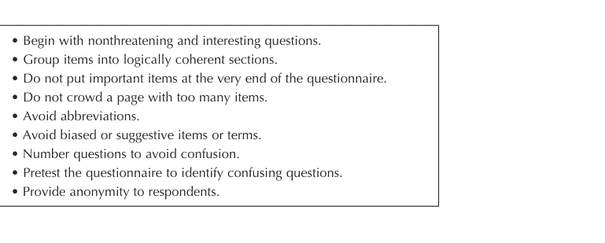

## FIGURE 3-7：良好的问卷设计

## 需求收集技术 107

备忘录、政策手册、用户培训手册、组织结构图、表单，当然还有与现有系统的用户界面。

但这些文档只讲述了故事的一部分。它们代表了组织所使用的正式系统。通常，真实或非正式的系统与正式系统有所不同，这些差异（特别是巨大的差异）为需要更改的地方提供了强有力的指示。例如，不使用的表单或报告可能应该被消除。同样，表单上从未被填写的（或被用于其他用途）的问题应该被重新考虑。图 3-8 展示了文档如何被解读的示例。

最有力的迹象是，当用户创建自己的表单或向现有系统添加信息时，说明系统需要更改。此类变化证明了改进现有系统的必要性。因此，审查空白和已填写的表单以识别这些偏差是有用的。同样，当用户访问多份报告以满足其信息需求时，这是需要新信息或新信息格式的明显信号。

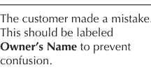
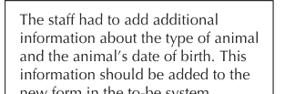

| 中央兽医诊患者信息卡 |
| :--- |
| 姓名：Buffy Smith |
| 宠物名称：Buffy Collie 7/6/99 |
| 地址：100 Central Court, Apartment 10 Toronto, Ontario K7L 3N6 |
| 电话：416-555-3400 |
| 是否有保险：是 |
| 保险公司：Pet's Mutual |
| 保单号：KA-5493243 |

图 3-8 执行文档分析

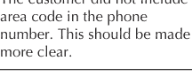

## 108 第 3 章 需求确定

### 观察法

观察法是指观察流程的执行，是收集现状系统信息的有力工具，它使分析师能够看到情况的真相，而不是听取他人在访谈或 JAD（联合应用设计）会议中的描述。研究报告表明，许多经理并不记得自己是如何工作的以及如何分配时间的。（快速，你上周在每项任务上花了多少小时？）观察法是检查从访谈和问卷等间接来源收集的信息有效性的良好方法。

在许多方面，分析师在走访组织并观察业务系统的运行情况时，就像变成了一位人类学家。目标是保持低调，不打扰工作人员，并且不影响被观察者。尽管如此，重要的是理解，分析师观察到的可能可能并不是人们在被观察时在行为上所预期的日常常规。即使正常做法可能被纳入正式的组织规则，观察者也可能看不到这一点。（记得你上一次警车跟在你后面时是怎么开的吗？）你认为你会做的可能并不是你实际所做的。

观察法通常用于补充访谈信息。人的办公室位置及其陈设提供了该人在组织中权力和影响的线索，并可用于支持或反驳访谈中提供的信息。例如，如果分析师访问期间电脑从未开启，分析师可能会对某位声称有效使用现有系统的人产生怀疑。在许多情况下，观察法支持访谈中提供的信息。如果事实如此，则一个重要信号，说明在分析系统时必须格外小心。

### 选择合适的技术

讨论的每种需求收集技术都有其优缺点。没有一种技术优于其他技术，在实践中，项目会使用技术的组合。因此，理解每种技术的优缺点以及何时使用每种（见图 3-9）是非常重要的。一个未讨论的问题是分析师的经验。通常，文档分析和观察法需要的培训最少，而 JAD 会议最具挑战性。

**信息类型** 第一个特征是信息的类型。某些技术更适用于分析过程的不同阶段、改进或开发未来系统。访谈和 JAD 通常用于这三个阶段。相比之下，文档分析和观察法通常对理解现状最有帮助，尽管它们提供了关于需要改进的当前问题的信息。

| 信息类型 | 联合应用设计 (JAD) | 问卷 | 文档分析 | 观察法 |
| :--- | :--- | :--- | :--- | :--- |
| 适用阶段 | 现状、改进、未来 | 现状、改进、未来 | 现状、改进 | 现状 | 现状 |
| 信息深度 | 高 | 中 | 低 | 低 | 低 |
| 信息广度 | 低 | 中 | 高 | 低 | 低 |
| 信息整合性 | 低 | 高 | 低 | 低 | 低 |
| 用户参与度 | 中 | 高 | 低 | 低 | 低 |
| 成本 | 中 | 低到中 | 低 | 低 | 低到中 |

**图 3-9** 需求收集技术表

## 需求收集技术 109

问卷通常用于收集有关现状系统的信息以及关于改进的一般信息。

**信息深度** 信息深度指的是该技术在不仅获取事实和意见，而且获取其背后的原因时使用的丰富程度和程度。访谈和 JAD 会议在提供良好的深度信息以及理解这些存在的原因方面非常有用。在另一个极端，文档分析和观察法对于获取事实很有用，但限于此。

**信息广度** 信息广度是指使用所选技术可以收集的信息范围。问卷和文档分析都能容易地从大量来源收集广泛的信息。相比之下，访谈和观察法需要分析师逐一访问来源并花费更多时间。JAD 会议处于中等水平，因为许多信息源在同一时间聚集。

**信息整合** 需求收集最具挑战性的方面之一是整合来自不同来源的信息。简单来说，不同的人提供冲突的信息。整合这些信息通常耗时，因为这意味着调和意见并尝试完善每个来源。在许多情况下，个人认为是分析师在挑战其信息，实际上是组织中的另一个用户在这样做。这会让用户产生防御心理，并难以解决差异。

所有技术在某种程度上都存在问题，JAD 会议的设计是为了一次性改进，而不是之后。如果两个用户提供了冲突的信息，冲突的来源将立而易见。信息的立即整合是 JAD 区别于其他技术最重要的优点，这也是为什么大多数用户在重要项目中使用 JAD。

**用户参与度** 用户参与度是指新系统的预期用户投入分析过程的时间和精力。通常认为，随着用户参与分析过程，成功的机会就会增加。然而，用户参与可能会产生巨大的成本，并不是所有用户都值得投入贵的精力。问卷、文档分析和观察法对用户的负担最小，而 JAD 会议需要最大的努力。

**成本** 始终是一个重要的考虑因素。问卷、文档分析和观察法是低成本技术（尽管观察可能相当耗时）。成本并不意味着它们比其他技术更有效。访谈和 JAD 会议通常具有中等成本。JAD 会议贵得多，因为它们需要许多用户离开办公室很长时间，并且通常涉及高薪顾问。然而，JAD 会议显著减少了用于信息整合的时间，因此从长远来看成本更低。

**结合技术** 在实践中，需求收集涉及一系列不同的技术。大多数分析师从与高级经理的访谈开始，以了解项目和宏观问题。通过这些访谈，可以清楚地看到会有大变化还是小变化。这些访谈之后通常是文档分析。

## 110 第 3 章 需求确定

以及政策，以获得对现状系统的理解。通常接下来是访谈，以收集现状图所需的其余信息。

根据我们的经验，识别改进点最常用的方法是 JAD 会话（联合开发会议），因为 JAD 会话能够让用户和利益相关者通过分析技术共同工作，并对目标系统的可能性达成共同理解。偶尔，这些 JAD 会话之后还会对更广泛的用户或潜在用户进行问卷调查，以查看参与 JAD 会话的意见是否被广泛认可。

开发目标系统的概念通常通过与高级经理进行访谈来实现，随后与所有层级的用户进行 JAD 会话，以确保充分理解新系统的关键需求。

## 替代性需求说明技术

其他一些常用的需求收集和文档化技术包括丢弃式原型、基于用例场景的角色扮演 CRC 卡片、概念映射，以及在卡片和任务列表中记录用户故事。丢弃式原型在第 1 章中描述过。相比之下，原型创建是为了更好地理解新系统的某些方面。在许多情况下，它们被用于测试需求的某些技术方面，而无需将客户端连接到服务器。如果你以前从未这样做过，那么开发一个小系统来测试从客户端负载到服务器连接的必要设计会容易得多，而不是第一次就尝试构建整个系统。丢弃式原型在设计用户界面时非常有用（见第 10 章）。

用例如第 1 章所述，是统一过程和统一建模语言（UML）用于记录和定义功能需求的根本方法。我们在第 4 章中描述了它们。带有用例场景的角色扮演 CRC 卡在创建功能（见第 4 章）、结构（见第 5 章）和行为（见第 6 章）模型时非常有用。我们在第 5 章中描述了这种方法。本节剩余部分描述了使用概念映射在卡片和任务列表中记录用户故事。

## 概念映射

概念图表示概念之间的关系。它们有助于让个人专注于少数几个核心思想。概念图本质上是一种节点和弧的表示法，节点表示单个需求，弧表示需求之间的关系。每条弧都标记有关系名称。概念映射也被推荐为支持面向对象开发和知识管理系统需求建模的可能技术。概念映射是一种教育技术，已用于学校、组织和医疗保健机构。与文本方法（见图 3-1）相比，需求映射方法的优势在于，概念图不限于分层表示。概念图允许显式表示功能需求和非功能需求之间的关系。图 3-1

> 127 B. Henderson-Sellers, A. Simons, and H. Younessi, The OPEN Toolbox of Techniques (Harvard; Addison-Wesley, 1998).
> 13 有关概念映射的更多信息，请参见 J. Novak and D. B. Gavin, Learning to Learn (Cambridge, UK: Cambridge University Press, 1984); J. D. Novak, Creating, and using Concept Maps as Facilitative Tools in Schools and Organizations (Madison, NI; Lawrence Associates, Publishers, 1998). 此外，人类与机器认知学院在 cogn.umass.edu 提供了一个免费的概念映射工具。

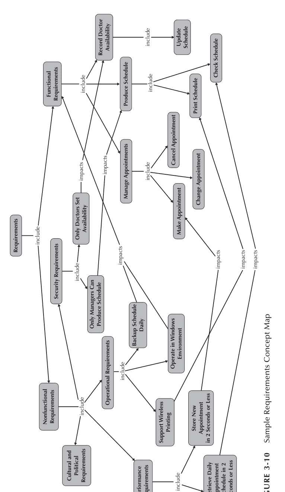

展示了图 3-1 中的定义。通过使用概念图而非文本方法表示需求，功能需求和非功能需求之间的关系可以更加明确。例如，两个安全需求“仅医生设置”分别显式链接到“记录医生可用性”和“仅经理生成时间表”功能需求。这在仅文本版本的需求定义中很难表示。此外，通过让用户和分析师关注地图的图形布局，可以发现额外的需求。这种方法的一个明显问题是，如果需求变得很多且它们之间的关系变得复杂，节点和弧的数量将变得混乱无章，以至于指定关系的优势将消失。然而，通过结合文本和概念图表示，可以利用文本和图形表示的优势来更完整地表示需求。

## 用户故事

用户故事同故事卡和任务列表一起分配给敏捷开发过程。事实证明，用户故事在以一种非威胁且尊重用户观点的方式收集需求方面非常有用。它们通常使用故事卡（索引卡）捕获，并记录在任务列表（或从 Scrum 的角度来看，即产品待办列表）中。故事卡和任务列表被认为是记录和收集需求的轻量级方法。

例如，关于医生诊所预约的故事，一个基于功能需求的故事可能是：

> 作为一名秘书，我想为我们的患者安排预约，以便我们满足患者的需求。

而一个基于操作非功能需求的故事可能是：

> 作为一名秘书，我想使用无线技术打印每日时间表，以便所有的打印工作都可以完成，而无需处理连接所有计算机到打印机的打印机线。

一旦故事写好，就会进行讨论，以确定实现它所需的工作量。在讨论期间，为该故事创建一个任务列表。（注：原文在此处存在大量重复的 OCR 错误，翻译时已清理）。

## 系统建议书

系统建议书将规划和分析期间创建的综合材料汇在一起。系统建议书通常包括执行摘要、系统请求、工作计划、可行性分析、需求定义以及描述新系统的演进模型。模型包括功能模型（见第 4 章）、结构模型（见第 5 章）和行为模型（见第 6 章）。执行摘要以简洁的形式提供了所有关键信息。它可以被视为内容的总结。其目的是让忙碌的执行人员快速阅读并确定他们需要建议书的哪些部分。执行摘要通常不超过一页。图 3-1 提供了系统建议书的模板以及其他章节的引用。

1. 目录
2. 执行摘要：建议书中所有基本信息的总结，以便忙碌的执行人员阅读并决定阅读建议书的哪些部分。
3. 系统请求：系统请求表（见第 2 章）。
4. 工作计划：原始工作计划，完成分析后修订（见第 2 章）。
5. 可行性分析：使用分析信息的修订版可行性分析（见第 2 章）。
6. 需求定义：系统的功能和非功能业务需求列表（本章）。
7. 功能模型：活动图、一组用例描述以及说明系统需要支持的基本流程或外部功能的用例图（见第 4 章）。
8. 结构模型：一组 CRC 卡、类图和对象图，描述了目标系统的结构方面（见第 5 章）。这可能还包括被替换的现状系统的结构模型。


9. 行为模型：一组时序图、通信图、行为状态机和 CRUD 矩阵，描述了目标系统的内部行为（见第 6 章）。这可能包括被替换的现状的行为模型。

10. 附录：这些包含与建议书相关的额外材料，通常用于支持建议的系统。这可能包括问卷调查或访谈的结果、行业报告和统计数据等。

# 图 31 系统建议书模板

# 第 3 章 需求确定

## 在 PATTERSON 超市中应用概念

第 3 章介绍了面向对象的系统的系统开发项目的需求确定。确定系统需求是系统开发过程中最重要的活动。需求是指系统**必须做什么**或它**必须具备什么什么特征**。如果需求没有被完全或正确地定义，系统就不可能满足用户的需求。换句话说，如果需求是错误的，系统就是错误的。

在 Patterson 超市案例的这一部分，我们需要分析和需求收集技术，分析师利用这些技术确定整合健康诊所交付系统（Integrated Health Clinic Delivery System）第一版本的需求。我们还看到了开发的功能性和非功能性需求，以及该项目开发系统建议书的草案。该系统建议书将在完成功能（第 4 章）、结构（第 5 章）和行为（第 6 章）建模完成后定稿。

你可以在此处查看案例的其他内容：`www.wiley.com/dennis/casestudy`

## 章节回顾

在阅读并学习本章后，你应该能够：

- 创建需求定义。
- 区分功能性需求和非功能性需求。
- 讨论问题分析需求策略。
- 讨论根因分析需求策略。
- 讨论持续分析需求策略。
- 讨论活动成本法分析需求策略。
- 讨论非正式基准分析需求策略。
- 讨论结果分析需求策略。
- 讨论技术分析需求策略。
- 讨论活动消除需求策略。
- 讨论如何使用访谈收集需求。
- 讨论如何使用联合应用开发（JAD）收集需求。
- 讨论如何使用问卷收集需求。
- 讨论如何使用文档分析收集需求。
- 描述如何使用概念图记录需求。
- 描述如何使用故事卡片和任务列表记录需求。
- 描述系统建议书的目的和内容。

## 关键术语

| 活动消除 | 自下而上访谈 | 概念图 | 协调员 |
| :--- | :--- | :--- | :--- |
| 活动成本法 | 分析广度 | 批判性思维技能 | 正式系统 |
| 分析 | 业务需求 | 文档分析 | 功能性需求 |
| 现状系统 | 闭式问题 | 持续分析 | 基础规则 |
| 基准分析 | 概念映射 | 电子 JAD (e-JAD) | 非正式基准 |
| 非正式系统 | 人际技巧 | 访谈 | 访谈记录 |
| 访谈报告 | 访谈计划 | JAD（联合应用开发） | 非功能性需求 |
| 观察 | 开放式问题 | 结果分析 | 并行化 |
| 流程整合 | 节后报告 | 潜在业务用途 | 追问性问题 |
| 问题分析 | 项目成本 | 需求 | 需求定义 |
| 需求确定 | 风险 | 根因 | 根因分析 |
| 样本 | 记录员 | 故事卡片 | 结构化访谈 |
| 系统建议书 | 系统需求 | 任务列表， 144 | 技术分析 |
| 目标系统 | 自上而下访谈 | 非结构化访谈 | 用户故事 |
| 演练 | | | |

## 练习题

## 问题

1. 分析期间创建了哪些关键交付物？分析的最终交付物是什么，它包含什么？
2. 现状系统（as-system）和目标系统（to-be system）之间的区别是什么？
3. 需求定义目的是什么？
4. 分析过程三个基本阶段是什么？哪一步有时会被跳过或礼貌性完成？
5. 比较问题分析和根因分析。在什么情况下使用根因分析？
6. 比较持续分析和活动成本法。
7. 描述进行访谈的五个主要步骤。
8. 解释闭式问题、开放式问题和追问性问题之间的区别。你会在什么时候使用它们？
9. 解释非结构化访谈和结构化访谈的区别。你会在什么时候使用它们？
10. 解释自上而下和自下而上访谈方法的区别。你会在什么时候使用它们？
11. 访谈和 JAD 会话有多少参与者？
12. 你如何区分事实和意见？为什么两者都很有用？
13. 描述进行 JAD 会话五个主要步骤。
14. JAD 协调员与记录员有什么区别？
15. 协调员在 JAD 会话期间做的三件事是什么？
16. 什么是 e-JAD，公司为什么可能对使用它感兴趣？
17. 如何为访谈或 JAD 会话设计问卷？
18. 问卷的典型回复率是多少，你如何提高回复率？
19. 什么是文档分析？
20. 正式系统如何帮助你理解标准？
21. 信息收集过程中观察的哪些方面是关键？
22. 解释哪些因素可以用于选择信息收集技术。
23. 概念图相对于传统文本文档技术的主要优势是什么？
24. 使用故事卡片和任务列表作为需求收集和记录技术具有哪些优势？
25. 系统建议书中通常包含哪些信息？
26. 系统建议书执行摘要的目的是？

## 练习

A. 审查 Amazon.com 网站。为网站开发需求。创建一个系统满足的功能性需求列表。哪些类型的非功能性业务。

B. 假设你将建立一个新系统，自动化或改进你职业部门的访谈流程。创建一个需求定义。包含功能性和非功能性需求。假设你将发布发布三个版本。

C. 描述注册课程的现状流程。并与另一位同学协作，评估该流程。根据你的工作，列出改进建议。

D. 描述大学录取的现状流程。并与另一位同学协作，评估该流程。根据你的工作，列出改进建议。

E. 描述注册课程的现状流程。并与另一位同学协作，评估该流程。根据你的工作，列出改进建议。

F. 假设你的大学入学人数激增，难以找到课程。进行技术分析以帮助学生完成学位。

G. 假设你负责开发一个让学生可以在线订购并送到宿舍的系统。进行技术分析。

H. 假设你是帮助高层经理决策的新系统。你将使用哪些需求收集技术？详细描述如何应用这些技术。

I. 找一个伙伴并互相询问在之前工作中完成的任务（如果你没有工作过，假设你的工作是学生）。制定一个简单的访谈计划。访谈后，识别访谈方法和使用的问题类型。

J. 找到一组学生并运行关于改进大学关系的 JAD 会话。制定一个简单的 JAD 计划，选择识别问题的技术，并制定议程。使用你的小组进行会议，并写一份节后报告。

K. 设计一个有助于收集信息的网页问卷。调查的目的是，问了哪些问题。如何改进它？将如何分析回复？

L. 开发一个针对热门餐厅或学院教职工的信息收集问卷。将问卷发给十名学生，分析回复并写一份简报告。

M. 考虑大学的职业服务部门，并找到永久或兼职工作所需的所有文档。分析这些文档并写一份简报告。

# 微型案例

事实是，该软件包已经不再存在，而且周围没有人知道如何维护该系统。在某个特殊情况下，一个查询需要运行十七年才能完成。多年来，他们一直避免这个查询，因为其中的信息其实非常有用。成员关于他们的陈述的问题无法很容易回答。Bob 或 Lara 只是去查一下，然后回电话提供答案。有时需要五个小时才能完成提问。通常，他们必须手动计算，因为系统程序程序设计为处理某些类型的查询。当成员信息输入输入系统时，每次只显示一个字段，这使得想要查找并纠正一个已输入并从报告中消失的值非常困难。会议材料中的成员报告不允许按城市进行分类。只有列表是按正确顺序列出的。

他对他正在做的新工作并不紧张，因为只要是分配给他的任务，他都能胜任。

巴里（Barry）最早的任务之一是访问一家潜艇明治店，并准备一份关于该商店运营情况的观察报告。巴里在中午左右到达商店，但他选择了一个他不熟悉的区域的商店，在寻找时遇到了困难。到下午 1:30，商店经理并没有预见到他的到来，并拒绝让陌生人进入，直到巴里的总部项目赞助（商店管理总监）核实了他的身份和目的。

对于这种情况，你会推荐哪种需求分析策略或策略？请解释你的答案。

在获得观察许可后，巴里守在柜台后方工作区域显眼的位置，这样他就能看到一切。员工们在工作时必须绕开他，但只有偶尔会发生碰撞。巴里注意到商店的工作似乎做得非常缓慢且刻意，但他认为自己是在浪费时间。起初，巴里询问了每个工人正在做什么，但经理最终要求他不要这么打扰他们的工作——这干扰了他们对客户的服务。

- 2. 信息项目经理布莱恩·卡尔汉（Brian Calhan）正准备为一次由运营管理经理乔·坎贝尔（Joe Campbell）主持的紧急会议做决定。最近，一名项目经理刚刚通过了项目倡议的批准，以便批准委员会获得行动许可。巴里一直负责项目的分析阶段。

一天晚上，巴里在与一位运营部门的朋友一起打高尔夫时，得知乔花费项目时间已经超出了他最初估计的十七个月。巴里第一次听到乔说：“我不明白为什么那个团队需要花这么多时间来分析事情。他们已经安排了两周时间在现有系统上完成！那看起来真的是一种巨大的浪费。我想尽快开始我的系统。”

由于巴里对乔这次会议的议程略有了解，他正在考虑如何应对乔。你认为巴里应该告诉乔什么？

- 3. 巴里最近被分配到一个项目团队，该团队将为一家潜艇明治店链开发一个新的管理系统。巴里在编程方面有多年经验，但他职业生涯中并没有做过多少分析。他是一个

下午 5:30，巴里决定离开，心想他可以回到办公室并在当天 5:00 之前准备好报告。他确信团队组长会对他快速完成任务感到高兴。当他离开时，那个哥们儿说：“这份报告里没什么好说的。他们做的就是下订单、收钱和交订单。真的太简单了！”巴里预感到团队的赞誉，对自己分析能力的信心之飙升。

回到商店后，经理摇了摇头，眼睛跟着他移动。“他又来了，偏偏选在这一周中最慢的时间段。他甚至没有看一眼我在后室做的所有工作——总结当天的销售额、检查库存并为周末下货订单……加上他完全没有考虑过我们的开门和关闭程序。我认为他的新系统将是由这样的人建立的。我最好联系查克（Chuck，商店管理总监），告诉他今天发生了什么。”

评价巴里执行观察任务的行为。

安（Anne）被赋予了对销售员进行调查的任务，这些人员将使用一个为家居用品目录开发的新的订单输入系统。调查的目标是识别销售员对当前系统优缺点的意见。大约有 50 名销售员在三个不同的城市工作，调查似乎是收集所需信息的理想方式。

安仔细地制定了问卷，并在公司总部的几位销售主管那里进行了预测试。在根据他们的建议修改后，她将纸质版问卷发送给每个销售员，要求他们在一周内交回。一周后，她只收到了三份完成的问卷。又过了一周，安只收到了两份完成的问卷。感到有些绝望，安随后向所有销售员发送了电子邮箱版本的问卷，再次要求他们尽快通过电子邮件回复问卷。她收到了两份电子邮件问卷，以及三条来自已完成纸质版并被第二次要求同一问卷的销售员的消息。此时，安的回复率仅为 14%，她确信这不会让她的团队组长满意。你有什么建议可以改进安对问卷的响应？

# 第 4 章 业务流程与功能建模

功能模型描述了业务流程以及信息系统与其环境的交互。在面向对象的系统开发中，使用两种模型来描述信息系统的的功能：用例（use cases）和活动图。用例用于描述信息系统的基本功能。活动图支持业务流程和工作流的逻辑建模。两者都可以用于描述当前的“现有系统”和正在开发的“目标系统”。本章介绍了业务流程和功能建模，作为记录和理解需求以及系统功能行为的手段。

## 目标

- 理解识别业务流程和用例的过程。
- 理解创建用例图的过程。
- 理解使用活动图建模业务流程的过程。
- 理解活动图的规则和样式指南。
- 理解创建用例描述的过程。
- 理解用例描述的规则和样式指南。
- 能够使用用例图、活动图和用例描述创建业务流程的功能模型。

## 引言

上一章讨论了流行的需求收集技术，如访谈、JAD 和观察。通过这些技术，分析师获取并创建了需求定义。需求定义了系统要做什么。在本章中，我们将讨论如何通过这些技术收集的信息如何以用例图、活动图和用例描述的形式进行组织和呈现。统一建模语言（UML）已被对象管理组织（OMG）接受为标准，几乎所有的面向对象项目都使用这些模型来记录和组织在分析工作流期间获得的需求。

## 第 4 章 业务流程与功能建模

正如第 1 章所指出的，所有的面向对象系统开发方法都是用例驱动的、以架构为中心的，并且是迭代和增量的。用例是表示业务系统与环境交互的正式方式。从本质上说，用例是业务系统中业务流程的高级概览。从实际角度来看，用例代表了整个面向对象系统的基石。用例可以记录当前系统（即现状 as-is）或正在开发的新系统（目标 to be）。由于面向对象系统是用例驱动的，用例也成了测试（见第 12 章）和用户界面设计（见第 10 章）的基础。用例驱动测试的两种形式是走查（在本章后文描述）和角色扮演（在第 9 章描述）。

从以架构为中心的角度来看，用例建模支持创建业务的外部或功能视图，该视图展示了用户如何看待该过程，而不是过程及支持系统运行的内部机制。基于结构和行为架构的视图在第 5 章和第 6 章中描述。最后，所有的面向对象开发方法都是以增量和迭代的方式开发的。尽管这三个架构视图是顺序排列的，但这是出于教学考虑。你会发现，你不仅需要跨越业务流程和三个架构视图，还要完整地捕捉和表示业务信息系统的需求。

活动图通常用于增强我们对业务流程和用例模型的理解。从技术上讲，活动图可以用于任何类型的过程建模活动。在本章中，我们描述了其在业务流程建模背景下的用途。过程模型描述了业务系统如何运行。它识别了执行的流程或活动，以及数据在它们之间移动的方式。过程模型可以用于记录当前系统（即 as-is）或正在开发的新系统（即 to be），无论是否已数字化。今天使用了许多不同的过程建模技术。

活动图和逻辑模型描述了业务域的属性，而不建议它们是如何连接的。逻辑模型有时被称为领域模型。原则上，阅读用例或活动图不应指示某项活动是计算机化的还是手动的，某条信息是通过纸质表格还是通过 Web 收集的，或者是放在文件柜还是大型数据库中。这些物理细节在设计阶段当逻辑模型细化为物理模型时定义。物理模型提供了最终构建系统所需的信息。通过首先关注逻辑活动，分析师可以专注于业务应该如何运行，而不会被实现细节分散注意力。

> 我们在第 1 章中使用活动图描述了一个简单的过程（见图 1-1）。

另一种常用的过程建模技术是 IDEF。IDEF 在美国联邦政府范围内广泛使用。关于 IDEFO 的更多信息，请参阅 FIPS 183：功能建模集成定义 (IDEFO) 联邦信息处理标准（华盛顿特区：美国商务部，1993年）。从面向对象的角度来看，一本使用 UML 来解决业务流程建模的好书是 Hans-Erikson 和 Magnus Pengker 写的《业务流程建模》（UML: New York: Wiley, 2000年）。最后，一种新的过程建模技术是 BPMN（业务流程建模符号）。Martin Scheidler 编写的一本好书《业务流程建模艺术：基于 UML 和 BPMN 的过程建模业务分析指南》（Salbury, MA: 作者出版）。

## 使用用例和用例图识别业务流程

作为第一步，项目团队从用户处搜集需求（第 3 章）。利用收集到的需求，项目团队使用用例和用例图识别业务流程及其环境。接下来，用户与团队紧密合作，以活动图的形式对业务流程进行建模，团队通过为每个用例创建用例描述，来记录用例和活动图中描述的业务流程。最后，团队通过确保所有三个模型（用例图、活动图(s)和用例描述）相互一致，来验证业务流程。一旦对业务流程的理解被记录在功能模型中，团队就准备好转向结构化建模。

在本章中，我们首先描述了使用用例和用例图进行过程识别。其次，我们描述了使用活动图进行业务流程建模。第三，我们描述了用例描述、其元素以及创建用例描述的一系列指南。第四，我们描述了业务流程和功能模型验证与确认的流程。

## 使用用例和用例图识别业务流程

在上一章中，我们学习了识别系统业务流程的有用策略和技术，以便创建需求定义。在本章中，我们学习如何开始用用例和用例图对业务流程进行建模。分析师可以利用用例和用例图在非常高的水平上更好地理解系统的功能。通常，用例图提供了一种简单、直接的方法，向用户准确说明系统将做什么，用例图是在收集和定义系统需求时绘制的。通过这种方式，用例图可以鼓励用户提供额外的需求。用例图以非常简单的方式说明了系统的主要功能和不同类型的交互。图 4-1 描述了用例图的语法规则。图 4-2 表示上一章介绍的医生预约系统的用例图。我们可以从图中看到，患者、医生和管理人员将使用预约系统来管理预约、记录可用性并提供安排。

## 用例图的元素

用例图的元素包括参与者、用例、边界以及一系列关系。这些关系由关联、包含、扩展和泛化组成。描述如下。

| 参与者 | |
| :--- | :--- |
| 是从系统中受益的外部人员。 | |
| 被描绘为火人（默认），或者如果涉及非人类参与者，则是带有 `<<actor>>` 的矩形。 | |
| 标注其角色。 | |
| 可以使用带有空心三角形的线与其他参与者关联，表示泛化/分类。 | |
| 位于系统边界之外。 | |

| 用例 | |
| :--- | :--- |
| 代表系统的一项主要功能。 | |
| 可以扩展另一个用例。 | |
| 可以位于系统边界内部。 | |
| 以描述性的动宾名词短语标注。 | |

| 边界 | |
| :--- | :--- |
| 包含内部或顶部的名称。 | |
| 代表主体的范围，例如一个系统或单个业务流程。 | |

| 关联关系 | |
| :--- | :--- |
| 将参与者与其交互的用例连接起来。 | |

| 包含关系 | |
| :--- | :--- |
| 代表一个用例对另一个用例功能的包含。 | |
| 有从基用例指向被包含用例的箭头。 | `<<include>>` |

| 扩展关系 | |
| :--- | :--- |
| 代表扩展用例以包含可选行为。 | |
| 有从扩展用例指向基用例的箭头。 | `<<extend>>` -> |

| 泛化关系 | |
| :--- | :--- |
| 代表专门化用例到更通用的用例。 | |
| 有从专门化用例指向基用例的箭头。 | ^ |

图 4-1 用例图语法

系统参与者可以向系统提供输入，从系统接收输出，或者两者兼有。图 4-2 显示了三个参与者将与预约系统交互（患者、医生和管理人员）。

有时参与者扮演更通用类型参与者的专门化角色。例如，可能有时新患者与系统交互的方式与普通患者有所不同。在这种情况下，可以将一个专门的参与者（即新患者）放在模型上，使用末端带有空心三角形的线表示更通用的参与者（即患者）。特化参与者继承了更通用参与者的行为，并在某种程度上对其进行了扩展（见图 4-3）。

## 使用用例和用例图识别业务流程

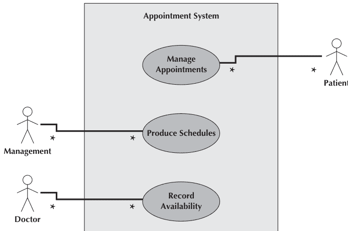

## 图 4-2 预约系统的用例图


**关联**用例通过关联关系与参与者连接；这些关系显示了参与者与哪些用例进行交互（见图 4-1）。从参与者画到用例的线段表示关联。该关联通常表示用例与参与者之间的双向通信。如果通信是单向的，则可以使用实心箭头来指定信息流的方向。

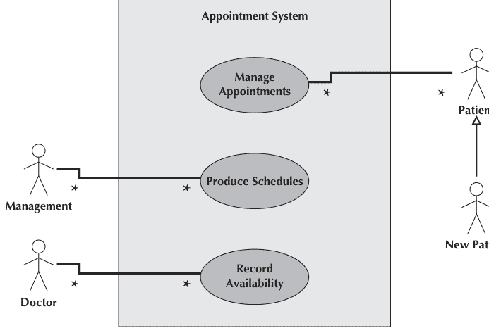

## 图 4-3 带有特化参与者的用例图

## 124 第 4 章 业务流程与功能建模

在图 4-2 中，“患者”参与者与“管理预约”用例通信。由于关联上没有箭头，因此通信是双向的。最后，还可以表示关联的多重性。图 4-2 在“患者”与“管理预约”用例之间的关联两端都显示了一个星号（*）。这仅表示单个患者（参与者的实例）可以根据其意愿执行任意次“管理预约”用例，而且“管理预约”用例中的预约部分可能由许多不同的患者执行。在大多数情况下，这种多对多的关系是合适的。然而，也可以限制可以与“管理预约”用例关联的患者数量。我们将在下一章结合类图讨论多重性问题。

用例在 UML 中用椭圆表示，是系统执行的并使参与者或以某种方式获益的过程（见图 4-1）；它由描述性短语进行标记。从图 4-2 我们可以看出系统有三个主要用例：管理预约、生成计划和记录可用性。

有时，图中的一个用例会包含、扩展或泛化另一个用例的功能。这些关系通过包含（inclusion）、扩展（extend）和泛化（generalize）关系显示。为了增加理解用例图的易用性，通常将高级用例画在低级用例下方。在示例的帮助下，理解这些关系可能会更容易。假设患者每次预约时，患者都会被要求验证支付安排。然而，如果我们想包含新功能，有时实际上需要创建新的用例。“进行支付安排”扩展了“管理预约”用例，以包含此项额外功能。在图 4-4 中，画了一个标记为 `extend` 的箭头从“管理预约”用例发出，以表示这种特殊的扩展关系。“进行支付安排”用例被画在“管理预约”用例的下方以标明这一点。

同样地，有时单个用例包含了被其他用例使用的功能。例如，假设有一个名为“管理日程”的用例，它执行常规任务以维护医生办公室的预约日程，而“记录可用性”和“生成计划”两个用例都执行这些常规任务。图 4-4 显示了我们如何设计系统，使“管理日程”成为一个被其他使用的共享用例。使用标记为 `inclusion` 的箭头来表示这种关系，包含它的用例画在包含它的用例下方。箭头从“记录可用性”和“生成计划”用例指向共同的“管理日程”用例。

最后，有时使用泛化关系来简化单个用例是有意义的。例如，在图 4-4 中，“管理预约”用例被特化为包含“老年患者”和“新患者”两个用例。“老年患者应用程序”继承了“管理预约”用例的功能（包括“进行支付安排”用例扩展），并用“更新患者信息”用例扩展了自己的功能。“新患者应用程序”也继承了通用的“管理预约”用例的功能，并调用了必要的调用将新患者插入到患者数据库中。泛化关系表示为无标记的空心箭头，更通用的用例位于低级用例之上。此外，请注意我们还添加了第二个特化参与者——“老年患者”，而“患者”参与者现在是“老年患者”和“新患者”参与者的泛化。


## 使用用例和用例图识别业务流程 125

# 预约系统

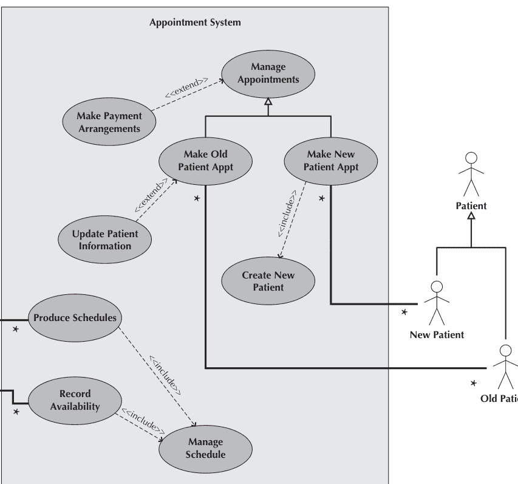

## 图 4-4 扩展与包含关系

**主体边界**用例被封装在主体边界内，主体是一个定义系统范围的框，并清晰地划分了图的哪些部分是系统的外部或内部（见图 4-1）。最难的决定之一是在哪里绘制主体边界。主体边界可以用于软件系统与其环境、子系统与其软件系统内的其他子系统、或软件系统中的单个过程分开。它们也可以用于将信息系统（包括软件和内部参与者）与其环境分开。应该仔细决定信息系统的范围。系统的边界根据……绘制。

## 126 第 4 章 业务流程与功能建模

## 识别主要用例

第一步是审查需求定义。这有助于分析师获取底层流程的概述。

### 1. 审查需求定义

### 2. 识别主体边界

第二步是识别边界。这有助于分析师识别系统的范围。

### 3. 识别主要参与者与目标

第三步是识别主要参与者及其目标。记住，利益相关者是可以影响（或被系统影响）的人、团体或组织。

### 4. 识别业务流程与主要用例

第四步是简单地识别流程和用例。在此时，我们不需要跳入某一个用例并完整描述它，我们只想识别用例。

### 5. 审查当前用例集

第五步是仔细审查当前的用例集。可能需要将它们拆分为多个用例，或将一组用例合并为一个用例。此外，根据当前的集合，可能会识别出新的用例。

# 使用用例和用例图识别业务流程

应该将用例分类到不同的包中（即用例的逻辑分组），以使图表易于阅读，并保持模型处于合理的复杂度水平。对用例进行排序并将这些较小的用例组合为包含若干较小用例的较大用例，或者更改系统边界，都是非常简单的。

## 创建用例图

基本上，一旦用例已经详尽化，绘制用例图就是直观的。实际的用例图鼓励使用信息隐藏。用例图上绘制的唯一部分是用例本身、参与者（actors）以及组件之间的各种关联。用例图的主要优势在于它能为用户提供业务流程的概览。然而，每当用例发生变化时，都可能影响到用例图。绘制用例图有四个主要步骤。

| 步骤 | 描述 |
| :--- | :--- |
| 1 | 放置并绘制用例 |
| 2 | 放置并绘制参与者 |
| 3 | 绘制主体边界 |
| 4 | 添加关联 |

首先，我们在图表上放置并绘制用例。这些用例直接取自之前识别出的用例。此时，特殊的用例关联（包含 `include`、扩展 `extend`、泛化 `generalization`）也会添加到模型中。在布局图表时要小心。用例之间没有正式顺序，因此可以根据需要任何方式放置，以使图表易于阅读并减少交叉线条的数量。为了可读性，通常需要多次将用例放置在不同位置并重新绘制图表；为了易于理解，考虑到已抽离且现在通过包含、扩展或泛化关系与另一个用例关联的用例，模型上的用例不应超过三个到九个。

其次，在图表上放置并绘制参与者。为了尽量减少交叉图表的线条数量，参与者应该放置在与其关联的用例附近。

第三，绘制主体边界。这形成了主体的边界，将用例（即主体的功能）与参与者（即外部用户的角色）隔离开来。

第四也是最后一步是添加线条来连接参与者与其交互的用例。图表并不强制执行顺序，在此过程中添加的项目可能不需要按特定顺序放置；重新排列符号以减少交叉线条的数量可能会帮助，使图表不那么困惑。

### 校园住宿示例

识别住房系统中以下业务流程的参与者主要用例：校园住宿服务帮助学生寻找公寓。公寓所有者提供有关可用租赁单元的信息（例如：位置、卧室数量、月租），这些信息被输入数据库。学生可以通过 Web 搜索该数据库，以找到符合他们需求的公寓（例如在校园半英里内月租为 400 美或更低的双室公寓），并直接联系公寓所有者。公寓所有者在出租公寓后会致电服务部门删除他们的列表。

作为第一步，我们识别主要参与者、主要业务流程和主要用例。其中，主要参与者是公寓所有者和学生。主要参与者的目标都是租赁交易的双方，即租赁公寓。主要的业务流程和用例允许参与者实现他们的目标：为公寓所有者维护可用租赁单元信息，以及为学生寻找合适的租赁单元。使用识别出的参与者和用例并遵循上述描述的流程，创建了图 4-5 中的用例图。注意，该图仅包含两个用例和两个参与者。在这种情况下，“维护可用租赁信息”用例实际上包含了两个子过程。公寓所有者可以添加一个变得可用的租赁单元，也可以删除一个已出租且不再可用的单元。学生可以使用三个标准搜索租赁单元：离校园的距离、卧室数量和月租。这些标准可以单独使用，也可以通过它们的任何组合使用。我们将在章的下一节返回此示例。然而，在继续之前，我们描述一个针对大学图书馆的稍微复杂的系统。

### 图书示例

自动化大学图书馆系统的功能需求包括需要支持搜索、借阅和书籍维护活动。系统应支持按标题、作者、关键词和 ISBN 进行搜索。如果书籍目前已借出，应在终端上提供搜索图书馆馆藏数据库的功能，允许有效的借阅者申请借用书籍。一旦书籍归还，请求该书籍的借阅者将收到可用通知。

借阅活动围绕借阅者的借出和归还书籍构建。借阅者三种：学生、员工和游客。无论借阅者是什么类型，借阅者必须提供有效的身份证。如果借阅者是学生，系统通过注册处数据库来验证身份证。如果借阅者是教职员工，系统通过人事办公室数据库来验证身份证。如果借阅者是游客，则根据游客数据库检查身份证。如果身份证有效，但借阅者有逾期书籍，系统将无效。此时系统必须拒绝借阅者的请求，否则应履行请求。如果书籍已借出，系统必须更新图书馆数据库以反映书籍状态。

书籍维护活动处理从馆藏中添加和移除书籍。这需要检查书籍的物理和数字状态。图书馆购买的书籍或以损坏状态归的书籍通常会导致这些活动。如果书籍在归还时判定损坏并需要从馆藏中移除，则对借阅者进行罚款。然而，如果书籍可以维修，取决于维修成本，借阅者可能不会被罚款。每周一，图书馆向逾期书籍的借阅者发送提醒邮件。如果书籍逾期两周，则对借阅者进行罚款。

> ⁶对于熟悉结构化分析和设计的人来说，包的作用与数据流图中的分层和平衡相似。包将在第 7 章中描述。

# 130 第 4 章 业务流程与功能建模

（在许多部门）。从面向对象的角度来看，过程跨越了多个对象。早期的面向对象系统开发方法倾向于忽略过程建模。然而，今天我们意识到，业务流程本身是一项非常有建设性的活动，可以用于理解收集到的需求（见第 3 章）。从面向对象的系统开发的角度来看，构建业务流程模型的一个问题是，它们往往会强化功能分解的思维。然而，如果使用得当，业务流程是极其强大的工具，可以向用户传达分析师对需求的理解。

Martin Schebauer 提供了一套在建模业务流程时应遵循的最佳实践：

-   **现实性（Realistic）**：因为在系统演化的这一阶段，识别出业务流程中包含的所有内容几乎是不可能的。即使我们可以识别出所有内容，所有内容也同样重要。
-   **敏捷性（Agile）**：尽管我们可能无法识别业务流程的每一个特征，但我们识别出的特征应该以严谨的方式进行识别。
-   **建模是一种协作/社交活动**。因此，业务流程建模必须由团队完成，而不是个人。如果由个人创建模型，混淆或遗漏重要任务的机会将大大增加。
-   **不要使用 CASE 进行建模，而要使用白板**。然而，一旦理解了流程，使用 CASE 工具来记录该流程是一个好主意。
-   **过程建模应该以迭代的方式进行**。随着你对业务流程的进一步理解，你将需要返回已记录的流程版本并对其进行修订。
-   **在建模业务流程时，关注该特定流程**。如果识别出与其他业务流程相关的任务，只需将它们记录在待办事项列表中，然后回到你当前正在建模的业务流程。
-   **记住，业务流程模型是现实的抽象**。我们的意思是，你不应该在业务流程的当前描述中包含每一个任务。记住，你不能为了详细理解单棵树而忽略了谚语中的“森林大木”。在系统演化的这一阶段，过多的细节会导致困惑，并实际上阻止你解决新系统所处理的根本问题。

活动图（Activity diagrams）用于在独立于对象的情况下对业务流程中的行为建模。活动图可以用于建模从涉及许多用例的高级业务工作流，到单个用例的细节，一直到单个方法的具体细节。简而言之，活动图可以用于建模任何类型的过程。在本章中，我们将活动图的覆盖范围限制在记录和建模高级业务流程。

> 7 Martin Schebauer, 《The Art of Business Process Modeling: The Analysts Guide to Process Modeling with UML & BPMN》(Sudbury, MA: The Cathy Group, 2010)。
> 8 从技术上讲，活动图汲取了许多技术的过程建模思想，包括事件模型、状态图和 Petri 网。UML 2.0 的活动图与其他建模技术相比，与 Petri 网有更多共同点。关于使用 Petri 网对工作流建模的良好描述，请参阅 Wil van der Ael 和 Kees van Hoe，《Workflow Management: Models, Methods, and Systems》(Cambridge, MA: MIT Press, 2002)。

## 活动图的元素

活动图描绘了流程中的主要活动以及活动之间的关系。图 4-7 显示了活动图的语法。图 4-8 展示了一个简单的活动图，代表诊所示例活动系统中的“管理预约”（Manage Appointments）功能。

### 动作（Actions）与活动（Activities）

动作和活动是为了某些业务原因而执行的。动作和活动可以代表手动或计算机行为。它们在活动图中被描绘为圆矩形（见图 4-7）。它们的名称应该以动词开头并以名词结束（例如，“获取信息” Get Information 或“安排付款” Make Payment Arrangements）。名称应该简短，包含足够的信息，以便读者能够轻松理解它们的作用。动作和活动之间的区别在于，活动可以进一步分解为一组活动和动作，而动作代表了所建模行为中一个不可分解的流单元。通常情况下，在业务流程或工作流建模中只使用活动。在大多数情况下，每个活动都对应一个用例图。图 4-8 显示了“管理预约”案例的一组相关活动（见图 4-2、4-3 和 4-4）：获取信息（Get Information）、更新患者信息（Update Patient Information）、创建新患者（Create New Patient）、安排（Make Arrangements）、建立新预约（Make New Appointment）、更改预约（Change Appointment）和取消预约（Cancel Appointment）。注意，“安排付款”和“建立新预约”在图中出现了两次：一次针对“老”患者，一次针对“新”患者。

节点和动作通常会修改或转换活动图的流。对象节点（Object nodes）在活动图中建模为矩形（见图 4-7）。类名写在矩形内。基本上，对象节点代表了从一个活动到另一个活动的信息流。图 4-8 描绘的简单预约系统显示了从“获取信息”活动的节点。

### 控制流（Control Flows）与对象流（Object Flows）

活动中有两种流：控制流和对象流。控制流被描绘为带有指示流方向箭头的实线。控制流只能连接到动作或活动。图 4-8 描绘了穿过诊所系统的一组控制流。对象流建模了对象通过业务流程的流动。因为活动会修改或转换对象，因此需要对象流来显示流入和流出动作或活动的对象。对象流被描绘为带有流方向箭头的虚线。单个对象流的一端必须连接到动作或活动，另一端连接到节点。图 4-8 描绘了穿过诊所系统的一组控制流。

> 9 考虑到活动图语法的复杂性，我们遵循极简主义哲学（见 John M. Carroll，《Designing for Practical Skill》(Cambridge: MIT Press, 1990）。额外的参考资料包括 Michael Ives，《UML Guide》(Wiley）；Eric Scott，《Fast Track UML》(Berkeley, CA: Press, 2004）。详情请见 uml.org。

# 132 第 4 章 业务流程与功能建模

| 元素 | 描述 | 标签 |
| :--- | :--- | :--- |
| 动作 (Action) | 是简单的、不可分解的行为。 | 以名称命名 |
| 活动 (Activity) | 用于表示一组动作。 | 以名称命名 |
| 对象节点 (Object node) | 用于表示连接对象流的对象。 | 以类名命名 |
| 控制流 (Control flow) | 显示执行序列。 | |
| 对象流 (Object flow) | 显示对象从一个活动到另一个活动的流动。 | |
| 节点 (Initial node) | 描绘一组活动的开始。 | |
| 活动结束节点 (Final-activity node) | 用于停止活动中所有的控制流和对象流。 | |
| 流结束节点 (Final-flow node) | 用于停止特定的控制流或对象流。 | |
| 决策节点 (Decision node) | 用于表示确保控制流或对象流沿某条路径的条件。 | 以决策标准命名 |
| 合并节点 (Merge node) | 用于合并使用决策节点创建的不同决策路径。 | |
| 分叉节点 (Fork node) | 用于将行为拆分为一组并行或并发的活动流。 | |
| 汇节点 (Join node) | 用于合并一组并行或并发的活动流。 | |
| 泳道 (Swimlane) | 用于将活动图划分为行列，并将单个活动（或动作）分配给负责执行活动（或动作）的个人或对象。 | 以个人或对象的名称命名 |

## 图 4-7 活动图语法

**控制节点（Control Nodes）** 活动图中共有七种控制节点：初始节点、活动结束节点、流结束节点、决策、合并、分支和汇（见图 4-7）。*初始节点*描绘了一组动作或活动的开始。*初始节点*显示为一个实心圆。*活动结束节点*用于停止正在建模的流程。每当一个活动结束

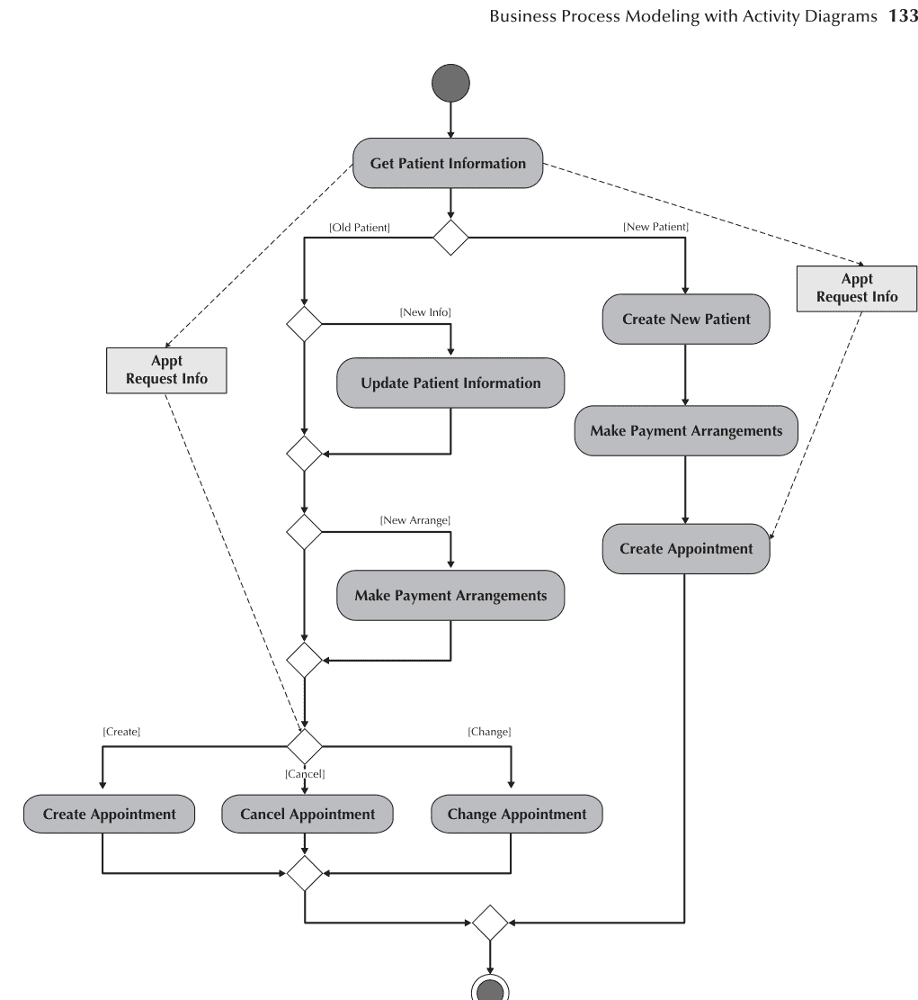

## 图 4-8 “管理预约”用例的活动图

到达该节点时，所有操作和活动将立即结束，无论它们是否已完成。结束活动节点（final-activity node）用一个外围有一个一个小实心圆的圆圈表示，看起来像靶心。结束流节点（final-flow node）与结束活动节点相似，不同在于它会停止业务过程中特定的执行路径，但允许其他并发或并行路径继续执行。结束流节点显示为一个带有 X 的小圆圈。

# 134 第 4 章 业务过程与功能建模


决策节点（`decision nodes`）和合并节点（`merge nodes`）支持业务过程决策结构的建模。决策节点用于表示实际测试条件，该条件决定了遍历离开决策节点的路径。在这种情况下，每个退出的路径必须标记一个守卫条件（`guard condition`）。守卫条件代表了“获取患者信息”历史下方特定测试的值。例如，在图 4-8 中，决策节点有两个互斥的可执行路径：一个针对旧患者（既往患者），另一个针对新患者。合并节点用于重新汇聚根据之前的决策拆分开的互斥路径（例如，图 4-8 中的旧患者和新患者路径在图表底部汇合在一起）。然而，为了清晰起见，在图 4-9 中使用合并节点更好。在两个都代表订单流程概览层级的活动图中，哪一个更容易理解，是左边的还是右边的？左侧的包含一个针对“订单中有更多项目”问题的合并节点，而右侧的则没有。在某种意义上，决策节点在右侧的图中承担了双重作用，它也兼当了合并节点。从技术上说，我们不应该省略合并节点；但是，

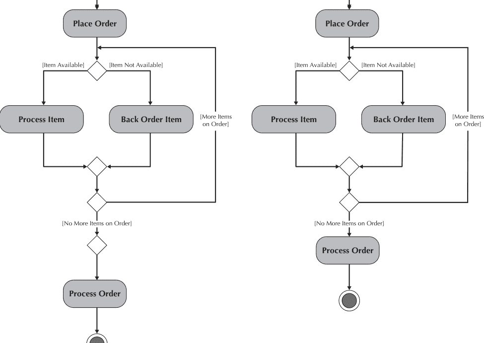

图 4-9 两个非常相似的活动图

# 使用活动图进行业务过程建模

有时，根据 UML 图形规则在技术上保持正确实际上会导致图表变得难以理解。从业务过程建模的角度来看，常识大有裨益。

分叉节点（`fork nodes`）和汇聚节点（`join nodes`）允许建模并行和并发过程（见图 4-7）。分叉节点用于将业务过程的行为分为多个并行或并发流。与决策节点不同，路径不是互斥的（即两条路径并发执行）。例如，在图 4-10 中，分叉节点

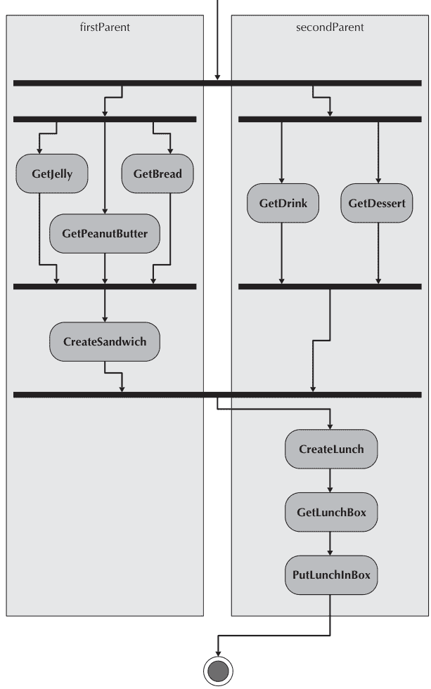

**图 4-10** 制作学校午餐的活动图

用于显示两个并发的并行正在执行。在这种情况下，每个过程由两个独立的处理器（父节点）执行。汇聚节点的目的与合并节点相似。汇聚节点将业务过程中独立的并行或并发流汇聚为一个流。

## 泳道（Swimlanes）

活动图可以独立于任何对象实现而对业务过程进行建模。然而，有时通过这样拆分活动图，可以将责任分配给实际执行该活动的对象或个人。这在建模业务工作流或通过使用泳道时尤为有用。在图 4-10 中，泳道被用于在 `父节点` 之间分配制作花生果酱三明治、饮料和甜点的午餐制作工作。在这种情况下，我们使用垂直泳道。我们也可以使用从左到右的方向而不是从上到下的方向来绘制活动图。在这种情况下，泳道是水平绘制的。

在实际的业务工作流中，会有与参与业务工作流的个人角色（例如员工或客户）相关的活动，以及正在创建的信息系统要完成的活动。

## 创建活动图的指南

Ambler 在创建时建议以下指南：

- 因为你已经确定了范围，所以你应该给图起一个合适的标题。
- 一旦确定了范围，你就应该识别活动图的元素。
- 在绘制活动图时，你应该识别任何流。
- 在建模活动图时，你应该识别任何决策。
- 在布局活动图时，你应该识别任何决策点。
- 当你建模过程时，你应该识别任何并行性。
- 如果某个活动确实是图中的终点，它应该有一个指向结束活动或结束节点的控制流。
- 没有任何出口的活动是“黑洞活动”（`black-hole activity`）。
- 没有任何入口的活动是“奇迹活动”（`miracle activity`）。
- 该活动应该有一个来自初始节点或另一个活动的流入。

信息用例是“管理预约”（`Manage Appointments`）和“预约病人”（`Make Old Patient`）用例的扩展。我们知道这些用例仅在特定情况下执行。从此我们可以推断，活动图必须包含一些决策节点和合并节点。根据需求定义（见图 3-1），我们可以推断在上一步中识别的“创建预约”（`Create Appointment`）、“取消预约”（`Cancel Appointment`）和“更改预约”（`Change Appointment`）活动中还有另一组决策和合并节点。

# 4 识别对象流与节点

第四步，识别支持业务过程逻辑所需的对象流和节点。通常，对象节点和流不会出现在许多建模业务过程的活动图中。主要的例外是系统捕获的信息会被稍后执行的活动使用，而不是在捕获该信息的活动之后立即。在预约示例中，显然我们需要能够判断患者是老患者还是新患者，以及患者希望执行的类型类型（创建、取消或更改预约）。显然，新患者无法取消或更改预约，因为根据定义新患者就是新患者。显然，我们需要在业务过程开始以及需要时捕获这类信息。例如，在预约问题中，我们需要一个“获取患者信息”（`Get Patient Information`）活动，用于捕获适当信息并在过程中的适当时间提供可用。

# 5 布局并绘制图表

第五步，布局并绘制活动图以记录业务过程。出于美观和可理解性的考虑，就像绘制用例图一样，你应该尽量减少潜在的线条交叉。根据之前的步骤并仔细布局图表，创建了图 4-8 中的活动图来记录“管理预约”过程。

校园住宿（`Campus Housing`）详细描述业务过程（“维护可用租赁单元信息”和“搜索可用租赁单元”）的第一步是选择其中之一。在本例中，我们将重点于与公寓所有者相关的“维护可用单元信息”。根据早早的描述，有两个独立的（子过程）：一个用于添加租赁单元，另一个用于删除租赁单元。要添加租赁单元，公寓所有者必须提供公寓的位置、卧室的数量以及公寓的月租金。要删除公寓，公寓所有者必须告知住房服务部门特定公寓已出租且不再可用。利用这些信息，图 4-11 展示了代表“维护可用租赁单元”用例逻辑描述的活动图。注意，图中完全没有提到填写表单、将信息输入数据库或搜索数据库。信息有许多不同的捕获方式，例如在手动表单、计算机表单或 Web 表单上，以及通过移动设备。此外，信息也有许多不同的存储方式。然而在开发的这一阶段，应该忽略所有的设计和实现细节。我们只对捕获功能需求感兴趣。一旦我们成功建模了功能需求，就可以转向非功能需求、设计和实现细节。我们将在本章的下一节返回此示例。然而，在继续之前，我们将描述大学图书馆问题中“借阅书籍”（`Borrow Books`）用例的活动图。


# 使用活动图进行业务过程建模

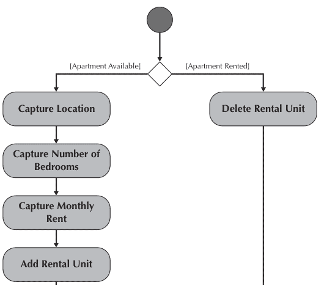

图 4-11

校园住宿

维护

租赁单元

信息

活动图

图书馆示例（`Library Example`）与校园住宿示例一样，第一步是选择一个业务过程进行建模。在这种情况下，我们想为“借阅书籍”用例创建一个活动图（见图 4-6）。该用例的功能需求如下：

借阅活动围绕借阅者的取书和还书构建。有三种类型的借阅者：学生、教职员工和访客。无论借阅者是什么类型，他们都必须持有有效的身份证。如果借阅者是学生，带有注册处学生数据库的系统将验证身份证。如果借阅者是教职员工，带有个人办公室员工数据库的系统将验证其身份。如果借阅者是访客，则根据图书馆所有者数据库检查身份证。如果身份证有效，系统必须检查借阅者是否有任何逾期罚款或未付罚款。如果身份证无效、借阅者有逾期罚款或有未付罚款，系统必须拒绝借阅者的取书请求，否则应接受借阅者的请求。

建模业务过程的第二步是识别组成该过程的活动。根据“借阅书籍”用例的需求，我们可以识别出三个活动：验证身份证、检查逾期书籍和罚款、取书。第三步是识别确定业务过程逻辑所需的控制流和控制节点。在这种情况下，显然必须有一个初始节点、一个结束节点，以及一组为每个决策做准备的决策和合并节点。第四步是识别完成业务过程描述所需的对象流和对象节点。在这种情况下，实际上不需要包含对象节点和流。最后，我们可以布局图表（见图 4-12）。

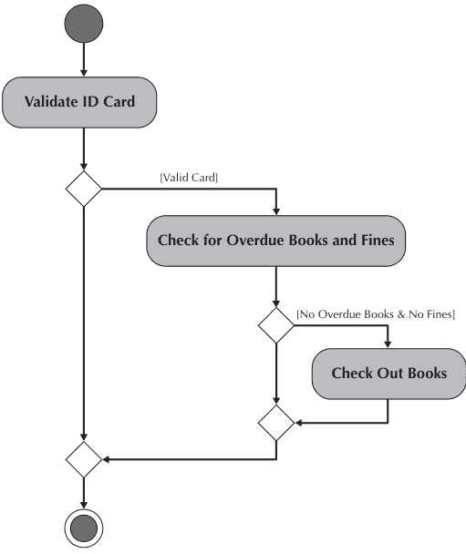

图 4-12

借阅书籍

用例的活动图

# 使用用例和用例描述进行业务过程文档

用例图提供了不断演进的系统中业务过程基本功能的概览。在某种意义上，活动图通过提供支持每个业务过程的底层活动的更详细的图形视图，打开了业务过程的黑箱。用例描述提供了更多内容，以完整地记录每个单独用例的不同侧面。用例描述基于已识别的需求、用例图和业务过程的活动图描述。用例描述包含了记录业务过程功能的所有信息。

用例是所有 UML 绘图技术的主要驱动力。用例在高层面上通信了系统需要做什么，所有的 UML 绘图技术都以不同的方式为了不同的目的呈现用例功能，并在此基础上构建。用例是设计和构建系统的构建块。

## 使用用例和用例描述的业务流程文档

用例捕获了系统与用户（用户及其他）之间的典型交互。这些交互代表了从用户角度看系统的外部（或功能性）视图。每个用例描述了用户与系统交互时的一个且仅一个功能。虽然一个用例可能包含用户在与系统交互时可以采取几条路径，但通过用例的每种可能的执行路径都被称为场景（`scenario`）。场景的另一种理解方式是特定用例的实例化。场景被广泛应用于行为建模（第 6 章）。最后，通过识别所有场景并尝试通过角色扮演 CRC 卡片（第 7 章）来执行它们，我们将测试对正在设计的系统之不断演变的理解的完整性和正确性。

在创建用例时，项目团队必须与用户紧密合作，以完整记录功能需求。组织功能需求并将其记录在用例描述中是一个相对简单的过程，但从实践来看，必须确保描述足够详尽，以便用于结构建模（第 5 章）和行为建模（第 6 章）。最好的方法是记住，每个用例都与系统中一个且仅一个角色相关联。例如，诊所的接待员可能扮演多种角色——她可以安排预约、接电话、归档病历、欢迎患者等。可能存在多个用户扮演同一个角色。因此，用例应该与用户扮演的角色相关联，而不是与用户本身相关。

## 用例的类型

用例有很多不同的类型。我们建议从两个维度对用例进行分类：基于用例的目的以及用例包含的信息量：概览（`overview`）与详细（`detail`），以及本质（`essential`）与真实（`real`）。

概览用例是为了让分析师对需求的高层概览达成共识。通常，概览用例在理解系统需求的过程中早期就会创建，它们只记录关于用例的基本信息，如其名称；ID；主要参与者；简要描述以及参与者、操作和用例之间的关系。这些可以在创建用例图后立即轻松地创建出来。

一旦用户和分析师对需求的高层概览达成共识，概览用例就会转换为详细用例。详细用例通常会尽可能记录用例所需的所有信息。这些信息可以基于活动图中找到的活动和控制。

本质用例是描述理解所需功能所需的最少必要内容的用例。真实用例则更进一步，描述了一组特定的步骤。例如，诊所中的一个本质用例可能会说，接待员应该尝试将患者希望预约的时间与可用时间进行匹配，而一个真实用例可能会说，接待员应该使用 `Google 日历` 查看可用的日期，以确定所请求的预约时间是否可用。主要区别在于，本质用例是独立于实现的，而真实用例是对系统其实施方式的详细描述。因此，真实用例往往只用于设计、实现和测试。

## 用例描述的元素

用例描述包含了构建后续结构图（第 5 章）和行为图（第 6 章）所需的所有信息，但它以较不正式的方式表达信息，让用户更容易理解。图 4-13 显示了一个用例描述。用例描述包含三个基本部分：信息、关系和事件流。

**概览信息（Overview Information）** 概览信息识别用例并提供关于用例的基本信息。用例 ID 编号提供了查找每个用例的唯一方法，并使团队将设计决策追溯到特定的需求。用例类型分为概览或详细，以及本质或真实。主要参与者（`Primary actor`）是用例的触发器——启动用例执行的人或物。用例的主要目的是为了实现主要参与者的目标。简要描述通常是一个描述用例本质的单句。

重要性级别（`Importance level`）可用于对用例进行排序。重要性级别使用户能够确定哪些功能最重要并需要作为第一个系统的一部分，而哪些功能不重要，可以等到以后必要的版本。重要性级别可以使用模糊量表，例如高、中、低（在图 4-13 中，我们为“为老年患者预约”用例分配了“高”重要性级别）。也可以使用一组标准的加权平均值进行更正式的计算。例如，`Lman` 建议根据以下标准使用零到五的量表对每个用例进行评分：

- 该用例代表重要的业务流程。
- 该用例支持产生收入或降低成本。
- 支持该用例的技术是新的或有风险的，因此需要大量的研究。
- 功能性取决于用例的复杂性、风险和/或时间复杂度。取决于用例的复杂性，将其实现分散在几个不同的版本中可能是有用的。
- 该用例可以增加对演变设计的理解，以解决所付出的精力。

一个用例可能有多个对该用例感兴趣的利益相关者。每个用例列出利益相关者以及他们对该用例的兴趣（例如，老年患者和医生）。利益相关者列表始终包含主要参与者（例如，老年患者）。

每个典型用例都有一个触发器——导致用例开始的事件。触发器可以是外部触发器（如客户），也可以是时间触发器（如某种需求）。关系解释了用例如何与其他用例相关。关系四种基本类型：关联（`association`）、扩展（`extend`）、包含（`include`）和泛化（`generalization`）。

### 事件流

最后，描述业务流程内部的步骤。可以记录三种不同类型的步骤（或事件流）：正常事件流（`normal flow of events`）、子流（`subflows`）以及备选或异常流（`alternative, or exceptional, flows`）：

- 正常事件流仅包含用例中正常执行的步骤。步骤按照执行的顺序列出。在图 4-13 中，患者和接待员就患者的姓名、地址和要执行的操作进行了对话。
- 在某些情况下，正常事件流应该分解为一组子流，以保持正常事件流尽可能简单。在图 4-13 中，我们识别了三个子流：创建预约（`Create Appointment`）、取消预约（`Cancel Appointment`）和更改预约（`Change Appointment`）。每个子流都已列出。这些子流基于业务流程活动图表示中的控制流逻辑（见图 4-7）。或者，我们用一个独立的用例替换子流，该用例可以通过关系进行整合（参见前面的讨论）。然而，只有在新创建的用例本身有意义时才应这样做。例如，在图 4-13 中，提取出“创建预约”、“取消预约”或“更改预约”用例是否有意义？如果有，则应将特定的子流（流）替换为相关用例的调用，并将该用例添加到关系列表中。
- 备选或异常流是那些会发生但不被视为常态的流。这些必须被记录。例如，在图 4-13 中，我们识别了两个备选或异常流。第一个只是处理当请求的预约时间不可用时发生的情况。第二个是备选流的一个简单步骤。与子流一样，分离备选或异常流的主要目的是保持正常事件流尽可能简单。同样，对于子流，可以使用可以通过扩展关系整合的独立用例来替换备选或异常流（参见前面的讨论）。


# 使用用例和用例描述进行业务流程文档

什么时候应该从正常事件流中提取出子流？什么时候应该将子流和/或备选异常流提取到独立的用例中？或者什么时候保持原样？主要标准基于用例所涉及的复杂程度。用例越难理解，事件越应该被提取为子流，子流和/或备选异常流越应该被提取为独立的用例。因此，用例图会变得拥挤。换句话说，分析师必须做出的选择是使用简单的用例获得更复杂的用例图，还是使用更复杂的用例获得更简单的用例图。从实践角度来看，我们必须根据问题和客户进行权衡。请记住，我们正试图以尽可能完整简洁的方式描述我们正在调查的业务流程，以便客户验证我们建模的需求。这真的没有标准答案。这取决于分析师、客户和问题。

## 可选特征

用例的其他特征可以通过用例描述来记录。这些包括用例的复杂程度；执行用例所需的估计时间；用例关联的系统；主要参与者与用例之间的特定数据流；与用例相关的特定属性、约束或操作；执行用例前必须满足的前提条件；根据用例执行可以提供的保证。正如我们在本节开头提到的，我们认为没有一套必须记录的用例标准特征。我们建议图 4-13 中包含的信息是最少需要的内容。

# 创建用例描述的指南¹⁷

用例的精髓在于事件流。以有利于后期开发的方式编写事件流：

首先，以有利于后期阶段的方式编写事件流。采用“名词–动词–宾语”的形式。这种方法简化了用例。例如，在图 4-13 中，正常事件流中的步骤是“患者联系接待员”。

其次，明确谁是发起者，谁是接收者。例如，在图 4-13 中，“患者请求预约”。

第三，从观察者的角度编写步骤。例如，在图 4-13 中，“接待员确定患者信息是否发生了变化”。

第四，将每个步骤写在相同的抽象层上。例如，在图 4-13 中，“接待员确定患者的付款情况是否发生了变化”。

# 带用例和用例描述的业务流程文档 147

需要扩展的用例。如前所述，Larman¹⁹ 建议的标准也可以用于用例的优先级排序。另一种方法建议每个用例都应该由开发团队的每位成员进行投票。在这种 particular 方法中，每位成员都会获得一组“点”，他们可以用这些点来对用例进行投票。他们可以将所有的点都用在一个用例上，也可以将它们分配到一组用例中。然后根据收到的点数对用例进行排序。针对单个用例的用例描述是基于该排名的。²⁰


## 创建概述描述

第二步是创建用例的概述描述；即：命名主要参与者、设定用例范围、列出所有识别出的利益相关者及其对用例的兴趣、识别用例的重要性水平，给出用例的简要描述，提供用例的触发信息，并列出用例参与的关系。

## 描述正常事件流

第三步是填充描述每个用例所需的正常事件流步骤。这些步骤重点关注业务流程为了完成用例所执行的操作，以及用户或其他实体执行了哪些动作。步骤应该按照它们执行的顺序（从第一个到最后一个）列出。记得以 SVDFNI 格式编写步骤。在使用用例时，记住之前描述的七个步骤。此阶段的目标是描述用例如何将问题视觉化。理解参与者如何操作用例的最佳方法是进行角色扮演。视觉化如何与系统交互，以及思考其他系统如何工作（非正式基准测试）的技术，是帮助分析师和用户理解系统如何工作以及如何编写用例的重要技术。这两种技术（视觉化和非正式基准测试）在实践中都有应用。重要的是记住，在用例开发的这个阶段，我们只关注用例的典型成功执行。如果我们试图考虑所有可能发生的活动组合，我们将永远无法写出任何内容。在此时，我们正在寻找三个主要步骤。仅专注于执行该用例所代表的典型过程。

## 检查正常事件流

第四步是确保正常事件流中列出的步骤过于复杂或过长。每个步骤的大小应该与其他步骤大致相同。例如，如果我们为准备一顿饭写步骤，那么“从抽屉中取出”步骤就比“准备”小得多。如果我们得到的步骤超过七个，或者步骤大小差异巨大，我们应该回去并检查每个步骤。产生用例的一种好方法是让用户自己执行用例，并像写食谱一样写下步骤。在大多数情况下，用户能够快速提供更多的指导。我们的建议是使用可以轻松擦的黑板或白板（或带铅笔的纸）来制定步骤列表，然后以用例的格式编写。只有在步骤集被充分定义之后，才应该以用例的格式编写。


¹⁹ Larman, *Applying UML and Patterns: An Introduction to Object-Oriented Analysis and Design*.

²⁰ C. Larman, *Agile & Iterative Development: A Manager's Guide* (Boston, MA: Addison-Wesley, 2004).

第 4 章 业务流程与功能建模

## 识别替代或异常流

第五步侧重于识别和编写替代流或异常流。替代流或异常流代表可选或异常行为的流。它们通常发生频率较低，或者作为正常失败的结果。它们应该被标记，以明确它是哪一个正常事件流。对于图 4-3，替代/异常流 S1 发生在子流 5 的步骤 2 失败时（即：请求的预约不可用）。与正常流和子流一样，替代或异常流应尽可能以 SVDI 形式编写。

## 审查用例描述

第六步是审查用例描述，并确认所编写的用例是正确的，这意味着与用户一起审查用例，以确保每个步骤都是正确的。审查应该寻找简化用例的机会，方法包括将其分解为一组较小的用例、合并它们、在用例的语义和句法上寻找共同点，以及识别新的用例。此时也是考虑在用例之间添加包含（inclusion）、扩展（extend）和泛化（generalization）关系的时候。确认用例最有效的方法是让用户角色扮演或使用用例中编写的步骤执行该过程。分析师处理标记有用例主要输入的纸条，用户像遵循食谱一样遵循写的步骤，以确保这些步骤产生了用例的输出。

## 重复直到完成

第七步也是最后一步，再次迭代步骤集。用户经常会对于一个用例是什么以及它包含什么而改变主意。在这个阶段很容易分心，所以请记住目标只是主要的用例。因此，分析师应该继续迭代这些步骤，直到他或她认为已经记录了足够数量的用例，以便开始识别结构模型的候选类（见第 5 章）。随着候选类的识别，可能会发现额外的用例。

### 校园住宿示例

在记录用例时的第一步是选择一个用例。出于教学目的，我们使用了与活动图相同的用例；维护可租信息。在这个案例中，主要参与者是公寓所有者。用例描述逻辑，利益相关者包括公寓所有者和校园住宿服务。他们各自的兴趣是他们的公寓。该用例的简要描述是“这描述了校园住宿服务如何维护一份最新的可租公寓列表”。该用例的触发因素是系统外的预约。在这个案例中，公寓所有者的动作“触发”了该用例。该用例与其主要参与者之间只有一条关联关系。

接下来，我们记录事件的逻辑，检查正常事件流（可能存在子流），识别替代或异常流，然后仔细审查描述以确保其完整。如果你在这个特定案例中意识到公寓所有者提供了向可租单元添加单元的信息，或者提供了某个不再需要的单元的信息，……

²¹ 该过程与角色扮演有关，在第 5 章中讨论。


# 图 4-14 校园住宿维护可租信息概述用例描述

149

| 用例名称: | 维护可租信息 | ID: | 1 || :--- | :--- | :--- | :--- |

| 主要参与者: | 公寓所有者 | 重要性水平: | 高 |

| 利益相关者及其兴趣: | 公寓所有者—想要广告公寓 | 用例类型: | 详细、本质 |

| 简描述: | 这描述了校园住宿服务如何维护一份最新的可租公寓列表。 | | |

| 触发因素: | 公寓所有者想要添加或删除可租公寓 | | |

| 关系: | 关联：公寓所有者 | | |

| 包含: | | | |

| 扩展: | | | |

| 泛化: | | | |

# 图 4-15 校园住宿用例图

校园系统

# 150 第4章 业务流程与功能建模

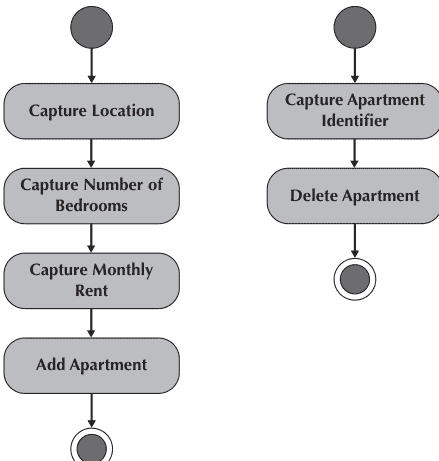

图 4-16

校园公寓添加与删除活动图

| 用例名称: | 添加公寓 | ID: 1 | 重要性级别: 高 |

|---|---|---|---|

| 主要参与者: | 公寓所有者 | 用例类型: | 详细，核心 |

利益相关者及利益：

- 公寓所有者--想要广告空闲公寓

- 校园住房服务部门--提供一种让公寓所有者能够出租其空闲公寓的服务

简要描述：此用例描述了校园住房服务部门如何维护空闲公寓的最新列表。

触发条件：公寓所有者想要添加一个空闲公寓

类型：外部

关系：

- 关联：公寓所有者

- 包含：

- 扩展：

- 泛化：

+ 正常事件流：

1. 获取公寓的位置的位置。

2. 获取公寓的卧室数量。

3. 获取公寓的月租金。

4. 将公寓添加到空闲公寓列表中。

子流：

替代/异常流：

图 4-17 校园住房服务添加公寓用例描述

# 使用用例和用例描述进行业务流程文档化 151

| 用例名称: | 删除公寓 | ID: 2 | 重要性级别: 高 |

|--- | --- | --- | --- |

| 主要参与者: | 公寓所有者 | 用例类型: | 详细，核心 |

| 利益相关者及利益: | 公寓所有者--想要删除公寓 校园住房部门--提供一种让公寓所有者能够出租其公寓的服务 |

简要描述：此用例描述了校园住房服务部门如何维护空闲公寓的更新列表。

触发条件：公寓所有者想要删除一个空闲公寓

类型：外部

关系：

- 关联：公寓所有者

- 包含：

- 扩展：

- 泛化：

+ 正常事件流：

1. 获取公寓标识符。

2. 从空闲公寓列表中删除该公寓。

子流：

替代/异常流：

# 图 4-18 校园住房服务删除用例描述

图书馆示例：与校园住房示例一样，用用例描述记录业务流程文档化的第一步是选择一个用例。由于我们之前在“图书馆藏书管理系统”示例中选择了“借书”用例，我们将继续使用它。接下来，我们需要创建概览描述。在这种情况下，我们回过头来看用例图（图 4-6），该图描述了图书馆藏书管理系统的外部行为，以及活动图（图 4-12），该图描述了“借书”用例的功能。再次参考驱动“借书”用例创建的功能需求也是好的。以下是这些需求：

借阅活动围绕借阅者的借书和还书。借阅者有三种：学生、教职员工和工作人员。无论借阅者是什么类型，借阅者必须持有有效的身份证。如果借阅者是学生，系统通过注册数据库验证身份证。如果借阅者是教职员工，系统通过人员员工数据库验证身份证。如果借阅者是访客，则根据图书馆自身的数据库检查身份证。检查借阅者是否有任何逾期书籍或未付罚款。如果身份证无效、借阅者有逾期书籍或借阅者有未付罚款，系统必须拒绝借阅者的借书请求，否则应决定是否接受借阅者的请求。

基于这三条关键信息并使用用例描述模板（见图 4-13），我们可以创建“借书”用例的概览描述（见图 4-19）。

# 152 第4章 业务流程与功能建模

| 用例名称: | 借书 | ID: 2 | 重要性级别: 高 |

| --- | --- | --- | --- |

| 主要参与者: | 借阅者 | 用例类型: | 详细，核心 |

| 利益相关者及利益: | 借阅者--想要借书 图书员--想要确保借阅者只获得应得的书 |

| 简要描述: | 此用例描述了书籍如何从图书馆借出。 |

| 触发条件: | 借阅者带书籍来到借书台。 |

| 类型: | 外部 |

| 关系: | 关联：借阅者、人事办公室、注册办公室 扩展：泛化 | |

图 4-19 借书用例的概览描述

通过仔细审查功能需求（上文）和活动图（图-12），我们可以轻松地识别出“借书”用例的正常事件流。此外，可以决定正常事件流列表中的任何事件是否应该使用子流或其他需要包含的用例进行拆分。在在这种情况下，我们必须修改概览描述的“关系”部分，并修改用例图以反映这一添加。此外，根据活动图的逻辑结构，可以识别“借书”用例正常事件流的替代/异常流。基于“借书”用例的整体简单性，我们决定不使用子流或包含用例来分解该过程。然而，由于活动图中布局的逻辑结构，存在两个替代/异常流。图 4-20 展示了“借书”用例描述中的正常事件流、子流和替代/异常流部分。

正常事件流：

1. 借阅者带书籍来到借书台。

2. 借阅者提供身份证。

3. 如果借阅者是学生，系统通过注册数据库验证身份证。

4. 如果借阅者是教职员工，系统通过人员员工数据库验证身份证。

5. 如果借阅者是访客，系统根据图书馆自身的数据库检查身份证。

6. 系统检查借阅者是否有任何逾期书籍或未付罚款。

子流：

替代/异常流：

4a. 如果身份证无效，则拒绝请求。

5a. 如果借阅者有逾期书籍或罚款，则拒绝请求。

图 4-20 用例的流描述

# 验证业务流程与功能模型

# 154 第 4 章 业务流程与功能建模

表示法。Yourdon 将此人称为维护神谕（maintenance oracle）。²⁶。由于面向对象开发对重用性的强调，这一角色变得至关重要。至关重要的是，必须有人负责召集、安排和通过会议进行走查（walkthrough）。

为了使走查取得成功，走查成员必须做好充分准备。所有需要审查的材料必须提前发放，留给团队成员足够的时间在实际会议之前进行审阅。预计所有团队成员都应该对表示图进行标记，以便在走查期间讨论所有相关问题。否则，走查将是低效且无效的。在实际会议中，当演示者讲解表示图时，团队成员应该指出潜在的错误或误解。在许多情况下，错误和误解是由无效的假设引起的，如果没有走查，这些假设将无法被。

走查的一个潜在危险是，管理层认为在表示图中发现错误的结果反映了分析师的能力。这必须不惜代价地避免。否则，走查的根本目的——提高表示图的保真度将受到破坏。根据组织的不同，可能需要将管理层排除在走查之外。否则，走查可能会演变成一种手段，通过摧毁演示者来让团队成员看起来很好看。至少可以说，这显然是适得其反的。

## 功能模型的验证与确认

我们为功能模型建议了三种表示法：活动图、用例描述和用例图。在本节中，我们将描述一组规则，以确保这些表示法彼此之间保持一致性。

首先，当将活动图与用例描述进行比较时，对于活动图中包含的每个活动或操作，在用例描述的正常事件流或备选/异常流中应至少记录一个事件，且每个事件都应与一个操作或活动相关。在图 4-4 中，有一个标记为“获取支付信息”（Get Payment Information）的活动，它与图 4-3 所示用例描述的正常流中的前两个事件相关。

其次，在活动图中被描绘为对象的对象必须在用例描述的正常事件流或备选/异常流的事件中提到。图 4-4 中的活动图描绘了“预约”（Appointment），而用例描述描绘了“预约新预约”（to a new appointment）和“更改已预约”（changing enrolling appointment）。

第三，用例描述中事件的顺序顺序应与活动图中包含的活动的相同顺序一致。在图 4-4 和图 4-13 中，与“获取支付信息”活动相关的事件（事件 1 和 2）应发生在与“安排支付方案”（Make Payment Arrangements）活动相关的事件（事件 4）之前。

第四，当将用例描述与用例图进行比较时，每个用例必须仅有一个用例描述，反之亦然。图 4-13 描绘了“老年患者应用”（Old Patient App）用例的用例描述。然而，图 4-4 所示的用例图、图 4-8 所示的活动图以及图 4-13 中的用例描述之间是不一致的。在这种情况下，用例图意味着“安排支付方案”用例无论患者是新患者还是老年患者都适用。然而，我们查看了活动图发现，它是针对老年患者的活动，但是是新患者的必经活动。因此，这些图中只有一个是正确的。在这种情况下，需要修正用例图。新的修正后的用例图如图 4-21 所示。

> ²⁶ 参考 Yourdon，《现代结构化分析》附录 D。

## 业务流程与功能模型的验证与确认

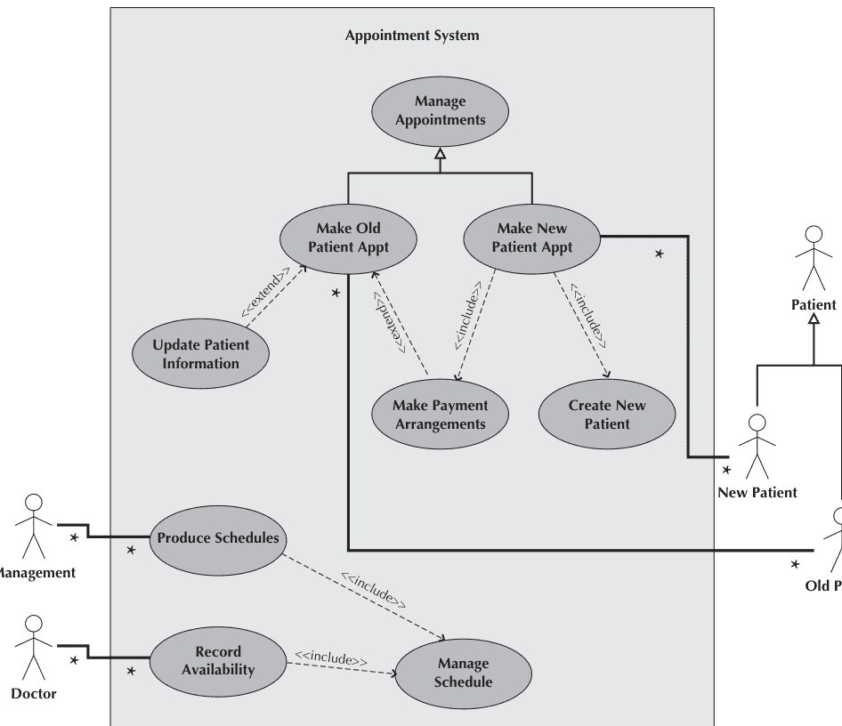

图 4-21 系统的系统的用例图

第五，用例描述中列出的所有用例必须在用例图上被描绘。每个参与者（actor）都必须有一个关联链接将其连接到用例，并必须在用例描述的关联关系中列出。例如，“老年患者”（Old Patient）参与者列在“使用老年患者应用”用例的描述中（见图 4-13），它列在“使用老年患者应用”案例描述的关联关系中，并在用例图中与该用例连接（见图 4-21）。

第六，在某些组织中，我们还应该包含用例描述中列出的利益相关者（stakeholders）。例如，“医生”（Doctor）参与者与“使用老年患者应用”用例之间本存在关联（见图 4-13 和 4-21）。但在这种，决定不包含此关联，因为医生不参与“使用老年患者应用”用例。

> ²⁷ 另一种可能性可能是包含一个“接待员”（Receptionist）参与者。然而，我们之前决定接待员实际上是预约系统的一部分，而不仅仅是系统的用户。如果 UML 支持内部参与者或参与者之间的关联，那么这种隐含关联可以通过让“患者”（Patient）参与者与“接待员”参与者通信来轻松地显式化，无论接待员是否是系统的一部分。见脚注 4。

第七，用例描述中列出的所有其他关系（包含、扩展和泛化）都必须在用例图上被描绘。例如，在图 4-13 中，“更新患者信息”用例中列出了一个扩展（extend）关系，在图 4-21 中我们看到了它的出现。

最后，有许多特定的图要求必须被执行。例如，在活动图中，决策节点只能连接到活动节点，且对于每个决策节点都应该有一个合并节点。图 4-22 中的概念图描绘了功能模型之间的关联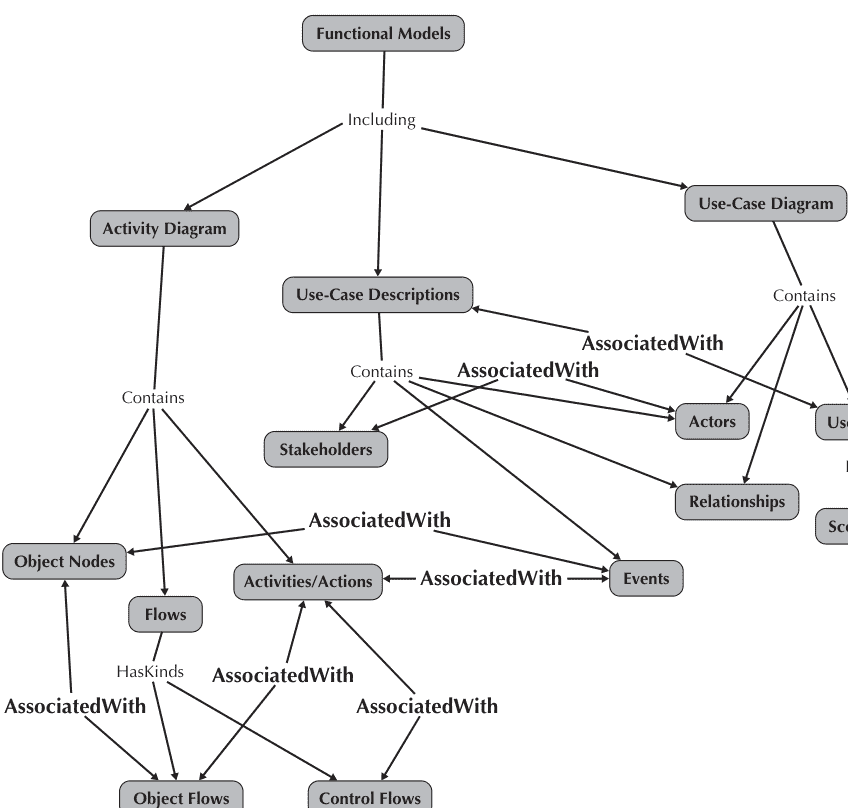

图 4-22 功能模型之间的相互关系

> ²⁸ 关于此类限制的参考文献是 S.W. Ambler，《TheML 2.0 Style》（Cambridge: Cambridge University Press, 2005）。

## 在 SUPERSTORE 中应用概念


在本章中，你学习了业务流程和功能模型。面向对象的系统是以增量和迭代的方式开发的。这在使用分阶段方法时尤为如此。团队首先为集成系统开发了用例图。接下来，团队通过创建“预约”的活动图和用例描述，对系统的第一个版本进行建模。随着更多信息的发现，这些模型将被反复查看和开发。集成系统的三个版本都将经过具体的过程和功能建模。

你可以在此处找到案例剩余部分：`www.wiley.com/go/dennis/case`

## 章节回顾

在阅读和学习本章后，你应该能够：

- 解释用例在业务流程和功能建模中的作用。
- 描述用例图的不同元素。
- 创建描绘业务系统与环境交互的用例图。
- 解释如何用活动图建模特定用例。
- 描述活动图的不同元素。
- 创建表示特定用例的活动图。
- 用用例描述业务流程。
- 描述不同类型的用例。
- 描述用例描述的不同元素。
- 创建表示特定用例的用例描述。
- 通过确保三种功能表示法（用例图、活动图和用例描述）的一致性，来验证和确认不断演进的功能模型。

## 关键术语

| 操作 (Action) | 错误 (Errors) | 守护条件 (Guard condition) | 对象流 (Object flow) |
| :--- | :--- | :--- | :--- |
| 活动 (Activity) | 核心用例 (Essential use case) | 重要性级别 (Importance level) | 对象节点 (Object node) |
| 活动图 (Activity diagram) | 异常流 (Exceptional flows) | 包含关系 (Include relationship) | 对象节点 (Object node) |
| 参与者 (Actor) | 扩展关系 (Extend relationship) | 继承 (Inheritance) | 概述用例 (Overview use cases) |
| 关联关系 (Association relationship) | 外部触发 (External trigger) | 初始节点 (Initial node) | 节点 (Object node) |
| 备选流 (Alternative flows) | 故障 (Faults) | 合并节点 (Join node) | 软件包 (Packages) |
| 黑洞活动 (Black-hole activities) | 结束活动节点 (Final-activity node) | 迭代节点 (Iterate node) | 物理模型 (Physical model) |
| 简要描述 (Brief description) | 结束流节点 (Final-flow node) | 逻辑模型 (Logical model) | 演示者 (Presenter) |
| 控制流 (Control flow) | 事件流 (Flow of events) | 维护神谕 (Maintenance oracle) | 主要参与者 (Primary actor) |
| 控制节点 (Control node) | 分叉节点 (Fork node) | 合并节点 (Merge node) | 过程模型 (Process models) |
| 决策节点 (Decision node) | 功能分解 (Functional decomposition) | 活动模型 (Activity model) | 实际用例 (Real use case) |
| 决策节点 (Decision node) | 泛化关系 (Generalization relationship) | 正常事件流 (Normal flow of events) | 记录者 (Recorder) |
| 决策节点 (Decision node) | 泛化关系 (Generalization relationship) | 事件流 (Flow of events) | 关系 (Relationships) |
| | | | 角色 (Role) |

| 场景 | 主体边界 | 触发因素 | 用例名称 |
| :--- | :--- | :--- | :--- |
| SVDOPI | SVDOPI | 用例 | 用例类型 |
| 特化参与者 | 泳道划分 | 用例描述 | 验证 |
| 利益相关者 | 时间触发 | 用例图 | 确认 |
| 子流程 | 测试 | 用例 编号 | 演练 |

## 问题

1. 为什么业务过程建模很重要？
2. 你如何创建用例？
3. 为什么我们力求在一个业务中拥有三个到九个主要的用例？
4. 你如何创建用例图？
5. 用例图与功能建模之间有什么关系？
6. 解释以下术语：参与者（actor）、用例（case）、系统边界（system boundary）。请使用通俗语言，就像向用户描述它们一样。
7. 每个关联都必须连接到且仅连接到一个“为什么”？
8. 创建用例图有哪些启发式方法？
9. 为什么在创建用例时迭代很重要？
10. 活动图的目的是什么？
11. 活动（activity）和动作（action）之间有什么区别？
12. 分叉节点（fork node）的目的是什么？
13. 有哪些类型的节点？
14. 控制流（control flow）和对象流（object flow）之间有什么区别？
15. 什么是对象节点（object node）？
16. 解释详细用例（detail case）与我们的用例有什么不同。各自何时使用？
17. 本质用例（essential use case）与真实用例（real use case）有什么区别？
18. 概览用例（overview use case）的主要元素有哪些？
19. 详细用例（detail use case）的主要元素有哪些？
20. 用例的目的是什么？它为什么重要？
21. 设计一组用例有哪些指南？给出用例图上扩展关联（extend associations）的示例。给出两个示例
22. 下列项哪些可以是用例图上的参与者？
   - Mary Smith 女士
   - 供应商
   - 客户
   - John Seals 先生
   - 数据输入
   - 数据库管理员
23. 什么是 CRUD？它为什么有用？
24. 什么是演练（walkthrough）？它与确认和验证有什么关系？
25. 演练过程中扮演哪些不同的角色？它们的目的是什么？
26. 不同的功能模型是如何构建的？这如何影响模型的验证？

## 练习

A. 调查 Object Management 网站 (`www.uml.org`)。关于 UML 的现状写一段话（例如，当前版本以及何时发布）。

B. 调查 Object Management Group（对象管理组织）。写一份简报，说明它是什么、目的以及它对 UML 系统开发方法的影响（提示：很好的资源是 `www.uml.org`）。

C. 从个人角度出发，为购买眼镜的过程绘制一张用例图和一组活动图。第一步是看医生，由医生开具处方。拿到处方后，去眼镜店选择镜框并下单。眼镜制作好后，返回商店支付费用。

D. 为购买眼镜的过程创建一组详细的用例描述。

E. 为医生诊所系统绘制一张用例图和一组活动图。每当新患者第一次就诊时，他们填写一份患者信息表，询问姓名、地址、电话号码和病史，这些信息存储在患者档案中。当患者打电话预约或更改现有预约时，接待员会检查可用时间。一旦找到时间，即可安排预约。对于新患者，会在其档案中建立一条记录；由于预约通常提前很久进行，接待员通常会在预约前两周给每位患者寄提醒。

F. 为牙科诊所创建详细的用例描述。

G. 为大学注册系统绘制一张用例图和一组活动图。该系统应允许工作人员管理其部门提供的课程（例如，允许的最大人数）。它应该允许学生查看可选课程、从课程表中添加和删除课程，并让部门能够提供关于所有选课学生的报告。系统必须确保没有学生有重复的课程，并且未交费的学生不许可注册（由于费用由大学财务办公室管理，注册过程不会改变）。

H. 为大学注册系统创建详细的用例描述。

I. 为房地产系统创建详细的用例描述。

J. 对房地产系统的功能模型进行确认和验证演练。

L. 为以下内容绘制用例图和一组活动图：视频录像店 (AVS) 经营一系列视频租赁。在视频播放之前，它必须先被编目并录入视频数据库。每个客户都必须有一个 AVS 账户才能租视频。每当客户租视频时，系统必须确保他们没有任何逾期费用。如果有，必须归还视频并支付逾期费。同样，如果客户已归还逾期视频但未支付费用，则客户将无法归还另一部视频。每个月，经理会打印一份列出逾期视频的报告。如果视频逾期两天或以上，经理会联系客户提醒他们。为 L 中的视频系统创建详细的用例描述。

N. 对练习 L 和 M 中描述的视频系统功能模型进行确认和验证演练。

O. 为健身房会员系统绘制一张用例图和一组活动图。成员加入健身房时，他们需要支付一段时间的费用。有期一年的会员和最短两个月的会员可选。在一年中，健身房会对普通会员价格提供各种折扣（例如，情人节买一送一）。成员支付相同长度的会员是很常见的。健身房希望在会员过期前一个月提醒成员续费。有些成员在被要求以比原始合同更高的费率续费时感到生气，因此俱乐部希望管理常规价格，并在要求成员续费时提供特殊价格。系统必须准确跟踪这些续费的新价格。行业中的一个大问题是会员流失率高。虽然有些成员保持活跃多年，但一半的人没有续费。这是一个大问题，因为健身房花费了大量精力吸引每个新成员。经理希望系统能够跟踪成员每次进入健身房的情况。系统将帮助识别用户并生成报告，以便经理要求他们续费或为提前续费提供特价。同样，系统应该识别超过一个月未访问健身房的成员，以便经理可以给他们打电话并让他们对健身房感兴趣。当成员有特殊要求时（例如生日蛋糕），在这种情况下，接待员获取信息并交给老板，由老板决定成本；然后接待员回电告知价格信息。客户接受需要返回老板重新计算价格的变更。每次，老板都会查看周末安排的野餐并订购所需的用品（例如，食物和面包、蛋糕）。老板使用系统进行营销。它还可以帮助跟踪成员是如何了解 PRU 的，并识别可以向他们提供的优惠。老板还想跟踪 PRU 已签署合同并实际预订的野餐。

P. 为练习 O 中的系统创建一组详细的用例描述。

Q. 对练习 O 和 P 中描述的健身房系统功能模型进行确认和验证演练。

R. 为以下内容绘制用例和活动图：Picnics Rus (PRU) 是一家有五名员工的小型餐饮业务。在典型的周末，PRU 为二十到五十人的野餐提供服务。该业务在过去增长迅速，老板想安装一套新的计算机系统用于订购和购买流程。当潜在客户向接待员询问菜单时。如果客户决定预订野餐，接待员要求客户信息（例如，姓名、地址、电话号码）以及关于哪种标准菜单的信息、总价记录在合同上。随后客户将获得合同副本，必须在签署并返回定金（通常是信用卡或借记卡）后才能正式预订。剩余款由……收取。

T. 对 R 和 S 中描述的功能模型进行确认和验证演练。

V. 为练习 U 中的系统创建一套详细的用例描述。

W. 对以下进行验证和确认演练：

## 微型案例

### 1. 威廉斯特种公司（Williams Specialty Company）

威廉斯特种公司（Williams Specialty Company）是一家小型印刷和雕刻公司。当所有者帕特·威廉姆斯（Pat Williams）在五年前将电脑引入业务办公室时，业务规模很小且简单。帕特能够使用廉价的基于 PC 的会计系统来处理公司的基本信息处理需求。随着时间的推移，业务不断增长，工作也变得越来越复杂。他们使用的简单会计软件已不再足以跟踪公司与客户之间许多复杂的细节和安排。

帕特在业务办公室有四名员工，他们熟悉公司记录要求的细节。帕特最近与员工会了面，讨论了聘请一家咨询公司来评估组织的信息系统，并为升级计算机系统提供策略。员工们对新系统的前景感到非常兴奋，因为目前的系统给他们带来了很多焦虑。员工中没有人做过这类事情，他们对将执行项目的顾问略带警惕。

假设你是威廉斯特种公司项目的一名分析师。在与威廉斯员工的第一次会议上，你希望确保理解你将执行的工作以及他们将如何参与这些工作。

#### a. 用非技术术语解释项目分析的目标。

#### b. 用详细术语解释如何使用功能模型来识别业务流程。解释这些模型是什么，它们在系统中代表了什么，以及团队将如何使用它们。

### 2. 专业与科学管理公司（PSSM）

专业与科学管理公司（PSSM）是一家独特的临时用工派遣机构。如今的许多机构都以短期、临时的方式聘佣高技术员工，为特殊项目提供所需的技术帮助；或者 PSSM 与其客户谈判，根据练习 U 和 V 中描述的“按月俱乐部”（Off-the-Month Club）的功能模型进行。

当客户公司确定需要一名临时专业或科学人员时，它会根据预先与 PSSM 谈判的合同发布派遣请求。当 PSSM 收到派遣请求时，合同号会被录到合同数据库。利用数据库中的信息，合同经理会审核合同的条款和条件，并确定派遣请求是否有效。如果请求有效且合同未过期，合同将列出专业或科学人员的类型，并在几天内完成派遣。如果无效，合同经理会将派遣请求发回给客户，并附上一封信解释为何无法派遣或为何归档。如果派遣请求有效，合同经理会将派遣请求作为待处理请求输入数据库。然后，该请求被发送到 PSSM 的派遣部门。

在派遣部门，将根据派遣请求检查员工类型、经验和资质与可用专业及科学人员数据库进行比对。如果找到了合格的人员，将在数据库中将其预留。如果在数据库中找不到人员或人员无法立即上岗，派遣部门将创建一个备录，解释无法满足派遣请求的原因，并将其附在派遣请求之后。所有派遣请求都会发送到安排部门。

在安排部门，将联系潜在的临时员工并要求其同意派遣。在确定并达成派遣细节后，该员工在员工数据库中被标记为“已派遣”。派遣请求的副本和一份派遣费账单将发送给客户。最后，派遣请求、“无法派遣”备录（如有）以及派遣费账单副本将发送给合同经理。如果派遣请求已完成，合同经理将关闭派遣请求数据库中的待处理请求。如果无法完成派遣，则通知客户。派遣请求、派遣费账单和无法派遣备录随后归档于合同办公室。

#### a. 为此处描述的系统创建一个用例图。

#### b. 为此处描述的业务流程创建一组活动图。

#### c. 针对用例图中识别的每个用例，分别开发一份概述描述和一份详细的用例描述。

#### d. 验证并确认功能模型。

# 第 5 章 结构建模

结构模型（或概念模型）描述了支持组织业务流程的对象的结构。在分析期间，结构模型展示了对象的逻辑组织，而不指示它们如何被存储、创建或操作，以便分析师能够专注于业务，而不被技术细节分散注意力。在后续的设计阶段，结构模型将更新以准确反映对象将如何被存储在数据库和文件中。本章介绍了类-责任-协作（CRC）卡、类图和对象图，这些工具用于创建结构模型。

## 目标

- 理解创建 CRC 卡、类图和对象图的规则和样式指南。
- 理解创建 CRC 卡、类图和对象图的过程。
- 能够创建 CRC 卡、类图和对象图。
- 理解结构模型之间的关系。
- 理解结构模型与功能模型之间的关系。

## 引言

在分析期间，分析师创建业务流程和功能模型来表示业务系统的行为方式。同时，分析师需要理解业务系统使用和创建的信息（例如客户信息、订单信息）。在本章中，我们将讨论结构模型。在分析期间，结构模型展示了对象的逻辑组织，而不指示它们如何被存储、创建或操作，以便分析师能够专注于业务，而不被技术细节分散注意力。在后续的设计阶段，结构模型将更新以准确反映对象将如何被存储在数据库和文件中。

## 结构模型

结构模型的主要目的之一是为分析师和用户创建一个词汇。结构模型代表了领域中包含实体、思想或概念。它们还允许表示实体、思想和概念之间的关系。通过创建结构模型，分析师为分析师和用户有效通信所需的词汇。在此阶段的结构模型应代表每个类的责任以及它们之间的协作。需要重要的是，在开发的这一阶段，结构模型并不代表面向对象编程语言中的组件或类，尽管结构模型确实包含分析类。将这些初始类完善为编程级对象是在后续阶段进行的。通常，结构模型使用 CRC 卡、类图以及在某些情况下对象图来描述。然而，在描述 CRC 卡、类图和对象图之前，我们描述结构类的基本元素：属性、操作和关系。

## 类、属性与操作

类是一个通用模板，我们用它在问题领域创建实例或对象。给定类的所有对象在大小和行为上都是相同的，但它们的属性中包含数据。分析期间感兴趣的类主要有两种：具体类和抽象类。通常，当分析师描述应用类时，他们指的是具体类；即具体类被用于创建对象。

抽象类在现实世界中并不存在；它们只是实用的抽象。例如，从一个抽象类“人”（person）中，我们可以派生子类并将抽象类命名为“人”。我们可能不会在系统本身实例化该类，而是只创建和使用“员工”和……由于抽象类本质上是必要的且不被实例化的，有人认为在开发的这一阶段的演进系统描述中最好不要包含任何抽象（参见 J. Evermann 和 Y. Wand, "Towards Ontologically Based Semantics for UMI," H. S. Junii, S. Ajodia, and A. Solberg (eds.) ER 2001, Lecture Notes in Computer Science 2224 (Berlin: Springer-Verlag, 2001):354–367）。然而，传统上在开发的这一阶段包含了抽象类，我们也包含。

类的第二种分类是类所代表的现实世界实体类型。这些包括领域类、用户界面类、结构类、文件类、操作系统环境类、文档类以及各种类型的多媒体类。在我们演进系统的开发阶段，我们只关注领域类。在后续的设计和实现阶段，其他类型的类将变得更具相关性。

分析类的属性代表了所调查的问题领域内，与该类的描述相关的信息。属性包含了分析师或用户认为需要跟踪的信息。例如，员工类的一个相关属性是姓名，而可能不相关的属性是发色。两者都描述了关于员工的某些特征，但对于大多数业务应用程序来说，发色并不是所有这些。只有对任务重要的属性才应该包含在类中。最后，只应添加原始或原子的（即整数、字符串、双精度浮点、日期、时间、布尔值等）属性。大多数复合属性实际上是类与类之间关系的占位符。因此，它们应该被建模为关系，而不是属性（见下一节）。


# 类的行为与关系

## 类的行为

类的行为在操作或服务中定义。在后续阶段，操作将转换为方法。然而，由于方法与实现更具相关性，在开发的这一阶段，我们使用“操作”一词来描述类实例能够响应的动作。类似于属性，只应该考虑与所调查的问题相关的领域特定操作。例如，通常要求类提供创建实例、访问单个属性值、设置属性值、访问单个关系值以及删除单个关系值的方法。然而，在演进系统的开发这一阶段，分析师应避免用这些基本类型的操作干扰类的定义，而只关注相关的领域特定操作。

## 关系

可以定义许多不同类型的关系，但它们可以归类为三类基本数据抽象机制：泛化关系、聚合关系和关联关系。这些数据抽象机制允许分析师关注重要的维度，而忽略不必要的维度。在处理属性时，分析师必须小心只包含相关的关系。

### 泛化关系

泛化抽象允许分析师创建继承其他类属性和操作的类。分析师创建一个包含基本属性和操作的父类，这些内容将在各个子类中使用。子类继承其父类的属性和操作，也可以包含它们特有的属性和操作。例如，`Customer` 类和 `Employee` 类可以通过提取它们共有的属性和操作并将其放入新的父类中，从而泛化为 `Person` 类。因此，分析师可以减少类中的冗余，使得元素被定义一次，然后在子类中重用。泛化用“是一种”（kind-of）关系来表示，因此我们说员工是“一种人”。

分析师也可以使用泛化的反面。特化通过允许从现有类创建新的子类来发现类。例如，`Employee` 类可以被特化为 `Secretary` 类和 `Engineer` 类。


此外，类与类之间的泛化关系可以组合形成泛化层次。根据之前的示例，`Secretary` 类和 `Engineer` 类可以是 `Employee` 类的子类，而 `Employee` 类反过来可以是 `Person` 类的子类。这可以读作秘书和工程师是“一种员工”，而客户和员工是“一种人”。

泛化数据抽象是一种非常强大的机制，它鼓励分析师在将类拆分到父类时，关注使每个类变得独特的属性。然而，为了确保子类的语义得以维持，分析师应该应用可替换原则。这意味着子类能够在任何需要父类的地方进行替换（例如，每当我们使用 `Employee` 类时，逻辑上我们可以使用它的 `Secretary` 子类）。通过关注泛化关系的“是一种”的解释，就应用了可替换原则。

### 聚合关系

通俗来说，所有的聚合关系都将部分与整体或组合起来。对于我们的目的，我们使用“是的一部分”（a-part-of）或“拥有”（a-has）语义来表示聚合抽象。例如，门是汽车的一部分，员工是部门的一部分，或者部门是组织的一部分。与泛化关系一样，聚合关系可以组合成聚合层次结构。例如，活塞是引擎的一部分，而引擎是汽车的一部分。

聚合关系是双向的。聚合的对立面是分解。分析师可以使用分解来发现一个应该单独建模的类部分。例如，如果门和引擎是汽车的一部分，那么汽车就有门和引擎。分析师可以在各个部分之间来回跳跃，以发现新的部分。例如，分析师可以问：哪些部分属于汽车？门还可能属于其他哪些组合体？

### 关联关系

还有其他类型的关系不能整齐地归入泛化（是一种）或聚合（是的一部分）框架。从技术上说，这些关系通常是聚合关系的一种较弱形式。例如，患者预约了预约。可以认为，这种类型的关系与建模门和汽车之间的关系、甚至工人与工会之间的关系之间存在明确的语义差异。因此，它们被简单地视为类实例之间的*关联*。

# 对象识别

已经提出了不同的方法来帮助分析师识别一组候选对象。最常用的四种方法是文本分析、脑风暴、对象列表和模式。大多数分析师结合这些技术以确保没有遗漏重要的对象、属性和关系。

## 文本分析

分析师通过审查用例描述来执行*文本分析*以识别潜在对象。用例中的名词暗示了可能的类，动词暗示了可能的操作。图 5-1 显示了指南。用例描述被批评为太简单，但因为其主要目的是创建一个初步的模型，所以其简单性是一个巨大的优势。如果我们把这些规则应用于第 4 章描述的预约用例并参考图 5-2，我们可以轻松识别出患者、医生、预约、接待员、姓名、地址、患者信息、支付、日期和时间的潜在对象。我们可以轻松识别出与这些识别对象相关的潜在对象。例如，患者联系办公室、预约新预约、取消现有预约、更改现有预约、匹配请求日期和时间以及查找当前预约。

## 脑风暴

脑风暴是一种在识别数据类方面成功的发现技术。在这种语境下，脑风暴是一组坐在桌旁的人提出对所考虑的问题有潜在类的过程。脑风暴会议由协调员启动，让小组回答一个界定会议的特定问题或陈述。例如，使用之前描述的问题，协调员可以允许开发团队和用户思考他们预约的经历，并根据过去的经验识别类。注意，这种方法没有使用之前开发的功能模型。它要求参与者识别他们交互过的对象。例如，脑海中出现的潜在对象可能是医生、异常、疾病、保险、卡和病历。在识别了足够的候选对象后，参与者应该讨论并选择哪些候选对象应该被进一步考虑。一旦确定了这些对象，就可以再次进行脑风暴，以识别这些对象的潜在属性、组织和关系。

Bellin 和 Simoné 提出了一组指导脑风暴会议的原则。首先，所有的建议都应该被采纳。在系统中，删除某些东西比意外遗漏关键内容要好得多。其次，所有参与者应该开始快速且狂热地思考。在所有想法都呈现在那个所谓的“黑板”上之后，就可以鼓励参与者考虑他们已经识别出的候选类。第三，协调员必须管理这个快速且狂热的过程。否则，过程将变得混乱。此外，协调员应确保所有参与者都参与其中，并让少数人不要干扰过程。为了获得问题最完整的视图，我们建议使用轮询法，让参与者轮流提出候选类。另一种方法是使用支持匿名的电子脑风暴工具。第四，协调员可以使用幽默来破冰，让所有参与者在决策时感到舒适。

## 通用列表对象

正如其名所示，通用列表仅仅是系统业务领域的对象列表。已发现几类对象可以帮助分析师创建列表，例如物理或有形的实体、包含项、角色和交互。分析师应在业务领域寻找物理、有形的实体。这可能包括书籍、桌子、椅子和办公设备。

## 模式

模式的使用在面向对象开发中是一个较新的领域。从我们的观点来看，模式是解决常见问题的有用类组。因为模式为常见问题提供了解决方案，它们是可用的。

建筑师克里斯托弗·亚历山大（Christopher Alexander）启发了许多使用模式的工作。根据亚历山大及其同事的，通过组合常见的模式可以建造非常复杂的建筑，而不是创建新的概念和设计。类似的，可以通过组合常见的面向对象模式来构建面向对象的系统。例如，许多业务涉及这些类型的对象和交互。几乎所有的交易都涉及 `Transaction` 类、`TransactionLineItem` 类、`Item` 类、`Place` 类和 `Participant` 类。通过重用这些模式，如果我们从白纸开始，可以更快、更完整地定义系统。

许多类型的模式范围从高层业务导向模式到低层设计模式。例如，图 5-3 展示了一组有用的分析模式，图 5-4 展示了一个我们通过合并图 5-3 中包含的模式创建的单一重用模式类图。在这种情况下，我们将 `Transaction-Entry-Account` 模式（位于图 5-3 左下角）与 `Place-Transaction-Participant-TransactionLineItem-Item` 模式（位于图 5-3 左上角）合并在一起。

> 模式使用 UML 类图。我们将在本章中描述这些图的语法。

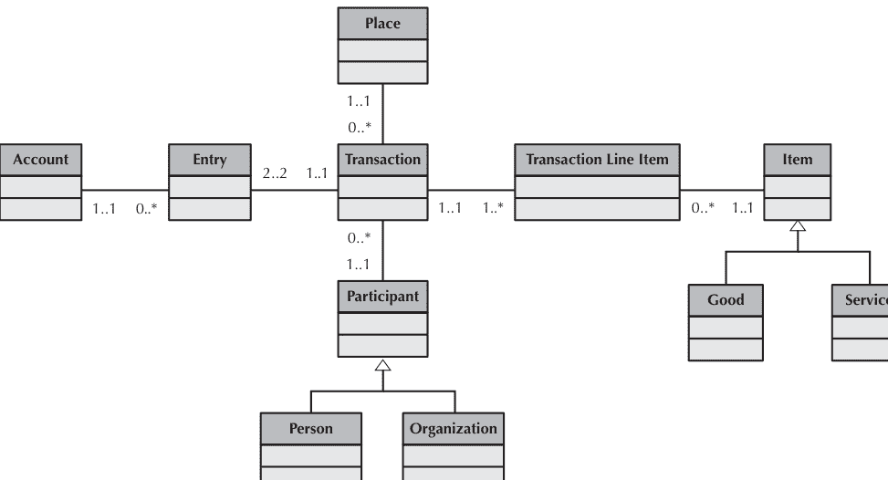

常见的 `Transaction` 类。接下来，我们通过合并 `Participant` 和 `Party` 类合并了“实体-人-组织”（位于图 5-3 右上）。最后，我们通过将 `Item` 类与“产品-商品-服务”模式中的 `Product` 类合并（位于图 5-3 右下），扩展了 `Item` 类。

总之，使用来自不同来源的模式使开发团队能够利用超越团队成员自身的知识，并允许团队开发出更完整、更健的领域模型。例如，在预约问题中，我们可以查看通过分析、脑风暴和/或常用对象列表识别出的对象，看看将其中任何一个映射到任何预定义的模式中是否有意义。在这种特定情况下，我们可以将预约视为诊所参与的某种事务类型。然后，我们可以应用图 5-4 中开发的模式，并发现一组未识别的对象，例如 `Place`（地点）、`Patient`（患者）和 `Transaction`（事务），以及与不同类型 `Item`（商品和服务）关联的 `TransactionLineItem`（事务行项目）。发现这些特定对象对于开发预约系统的计费可能有用。尽管这些额外的对象可能是，但它们没有使用其他技术。

基于这个简单的例子，显而易见的是使用模式开发结构模型是有优势的。图 5-5 列出了已开发模式的一些常见业务领域及其来源。

| 业务领域 | 模式来源 |
| :--- | :--- |
| 会计 (Accounting) | 3, 4 |
| 角色-职责 (Actor-Role) | 2 |
| 装配-部件 (Assembly-Part) | 1 |
| 容器-内容 (Container-Content) | 1 |
| 合同 (Contract) | 2, 4 |
| 文档 (Document) | 2, 4 |
| 业 (Employment) | 2, 4 |
| 金融衍生品合约 (Financial Derivative Contracts) | 3 |
| 地理位置 (Geographic Location) | 2, 4 |
| 组-成员 (Group-Member) | 1 |
| 交互 (Interaction) | 1 |
| 物料需求计划 (Material Requirements Planning) | 4 |
| 组织与实体 (Organization and Party) | 2, 3 |
| 计划 (Plan) | 1, 3 |
| 过程制造 (Process Manufacturing) | 4 |
| 交易 (Trading) | 3 |
| 事务 (Transactions) | 1, 4 |


# CRC 卡

CRC 卡（职责–协作）用于定义类的职责和协作。在某些面向对象的系统开发方法中，CRC 卡被认为是统一用例（Unified Process）中使用用例图和类图的替代方案。然而，我们将其视为一种低技术方法，可以简化使用 CASE 工具的典型高技术统一用例方法。我们使用扩展形式的 CRC 卡来捕捉与类相关的所有相关信息。我们将在稍后解释职责和协作时描述 CRC 卡的元素。

## 职责与协作

类的职责可以分为两类：知道（knowing）和执行（doing）。“知道”职责是类实例必须能够知道的职责。类实例通常知道其属性和关系的值。“执行”职责是类实例必须能够执行的职责。在这种情况下，实例可以执行它的操作，或者它可以请求它所知道的第二个实例来代表第一个实例执行其某一个操作。

> 我们的 CRC 卡基于 D. Bell 和 S. Simon 的著作，《The CRC Card Book》（Reading, MA: Addison-Wesley, 1997）；I. Graham 的《Migrating to Object Technology》（Wokingham, England: Addison-Wesley, 1995）；B. Henderson-Sellers 和 B. Unhekar 的《OPEN modeling with UML》（Harlow, England: Addison-Wesley, 2000）。

结构模型描述了支持用例所建模的业务过程所需的对象。大多数用例涉及一组多个类，而不仅仅是一个类。

这些类形成了协作。协作允许分析师从客户端、服务器和合同的角度进行思考。客户端对象是类的一个实例，向另一个类的实例发送请求以执行某项操作。服务器对象是接收来自客户端对象请求的实例。合同形式化了客户端和服务器对象之间的交互。第 8 章提供了关于合同的更详细的解释和示例。

分析师可以使用类职责和客户端-服务器协作的想法来帮助识别与用例相关的类，以及相关的属性、操作和关系。在开发结构模型时使用 CRC 卡最简单的方法之一是通过拟人化（anthropomorphism）——假装类具有人类特征。团队成员可以向它们提出任何问题，或由其他团队成员回答。通常提问的形式如下：

- 你是谁？
- 你知道什么？
- 你能做什么？

然后将这些问题的答案用于为不断演进的 CRC 卡添加细节。例如，在预约问题中，团队的一员可以假装他或她是一个预约。在这种情况下，该预约将允许他或她知道参与预约的医生和患者，并知道预约的日期和时间。此外，预约还需要知道如何创建自己、删除自己以及可能改变自己的方面。在某些情况下，这种方法将发现需要添加到不断结构模型中的额外对象。

## CRC 卡的元素


CRC 卡包含了构建问题结构模型所需的所有信息。图 5-6 显示了一个示例 CRC 卡。每张 CRC 卡描述类的基本要素。卡的正面包含类的名称、ID、类型、描述、用例、职责和协作者。类的名称应该是名词（但不是专名词，如特定的人或事物的名称）。与用例一样，在开发的后期，能够将决策追溯到特定的需求是重要的。这是通过用例完成的，每个类的 ID 可以用来解释此描述。一个可以作为类的文本定义的简短陈述。职责倾向于类必须包含的操作（即职责）。

CRC 卡的反面包含类的属性和关系。类的属性代表类的每个实例拥有的职责。通常，每个属性的类型会与属性名称一起列出（例如，保险金额是文本）。在此处捕捉了三种类型的关系：泛化、聚合和其他关联。在图 5-6 中，我们看到患者（Patient）是人（Person）的一种，并且患者与预约（Appointments）相关。

CRC 卡用于记录类的基本属性。一旦填好卡片，分析师可以通过角色扮演（在下一节描述）利用卡片和拟人化来执行当前的

## 第5章 结构建模

| 类名：旧患者 | ID: 3 | 类型：具体类、领域 |
|---|---|---|
| 描述：需要或已接受过医疗护理的个人 | 关联用例：2 | |
| 职责 | 协作类 | |
| 预约 | 预约 | |
| 计算上次访问 | | |
| 更改状态 | | |
| 提供病史 | 病史 | |
| | | |
| | | |
| | | |
| 属性: | | |
| 金额 (double) | | |
| 保险公司 (text) | | |
| | | |
| | | |
| 关系: | | |
| 泛化（是一种）: 人 | | |
| 聚合（包含部分）: 病史 | | |
| 其他关联: | 预约 | | |

图 5-6 示例 CRC 卡

与用例相关的场景（scenarios）（见第 4 章）。角色扮演也可以作为测试不断演变的系统表示的清晰性和完整性的基础。

### 结合用例的角色扮演 CRC 卡

除了前面描述的对象识别过程（文本分析、头脑风暴、常用对象列表和模式）外，CRC 卡可以用于角色扮演练习，这种练习已被证明发现额外的对象、属性、关系和操作非常有帮助。此外，除了本章后面描述的遍历之外，角色扮演对于测试不断演变的结构模型的保真度也非常有用。通常情况下，团队成员扮演与之前识别的参与者和对象相关的角色。

> ¹¹ 这一步与分析模型（功能、结构和行为模型）的验证和确认有关。由于这涉及到模型之间（在本例中为功能和结构）的验证和确认，我们将在第 7 章回到这个主题。
>
> ² 我们的角色扮演方法基于 D. Bellin 和 S. Simone 的著作《CRC 卡设计书》（Reading, MA: Addison-Wesley, 1997）。

结合不同的用例。从技术上讲，团队成员执行与用例特定场景相关的不同步骤。请记住，场景（scenario）是通过用例的一条单一、唯一的执行路径。寻找用例不同场景的好用方法是活动图（例如图 4-8、4-9、10 和 4-12）。对于每个导致用例执行路径分支的决策节点都存在一个不同的场景。此外，还可以从用例描述中的备选/异常流中识别场景。增量和迭代的性质以及活动图的描述包含相同的信息，审查两者将确保不会遗漏相关场景。

#### 1. 审查用例

第一步是审查用例描述（图 5-2）。这允许团队选择一个特定的用例进行角色扮演。尽管在第一次完成尽可能多的用例很有诱惑力，但团队不应该首先选择简单的用例。在系统开发的这一阶段，团队应该选择最重要、最复杂或最不了解的用例。

#### 2. 识别相关的参与者和对象

第二步是识别要扮演的角色。每个角色都与一个参与者或对象关联。为了选择角色，团队审查每张 CRC 卡，并挑选与所选用例相关的卡。例如，在图 5-6 中，我们看到代表“旧患者”的 CRC 卡与用例 2 关联。如果我们去扮演“预约旧患者”用例（图 5-2），我们需要包含“旧患者”CRC 卡。通过审查用例描述，我们可以轻松识别“旧患者”和“医生”参与者（图 5-2 中用例描述中的主要参与者和利益相关者）。通过阅读用例描述中的事件，我们识别出内部角色“接待员”。在识别出所有相关角色后，我们将每个角色分配给团队成员。

#### 3. 角色扮演场景

第三步通过让团队成员执行每个场景来角色扮演用例场景。为了做到，每个团队成员必须假装自己正在执行分配给他的角色。例如，如果一个团队成员被分配了接待员的角色，他或她应该能够执行与接待员相关的场景中的步骤。在“更改预约”的情况下，该场景是不完整的。然而，当执行（角色扮演）此场景时，会发现步骤 1、3 和 4 是不完整的。在步骤 1 中，实际上发生了什么？患者打了电话吗？如果是，回答用例描述中包含信息的人仅以隐式的方式识别出来。当信息没有被明确识别时，会有很大的解释空间，这需要团队成员做出假设。通过使每个步骤显式化来消除做出假设的需求要好得多。正常事件流的步骤 1。一旦步骤被修复，再次尝试该场景。重复此过程，直到场景可以执行到成功的结论。一旦场景成功结束，就执行下一个场景。重复此过程，直到用例的所有场景都能被成功执行。

#### 4. 重复步骤 1 到 3

第四步是针对剩余用例重复步骤 1 到 3。

> 13 在某些情况下，某些场景只在极罕的情况下执行。从实际角度来看，每个场景都可以单独确定优先级，系统在演进过程中属性的可见性是重要的。

### 类图

类图是一个静态模型，显示了随时间推移的类以及类之间的关系。以下章节展示了类的元素、类的替代方法以及类图。

#### 类图的元素

类图显示了与系统相关的类以及类之间的关系，可见性。类图的主要构建块是类，它存储并管理信息（见图 5-8）。在分析期间，类引用人员、地点和事物。每个类使用三部分结构构建：类名在顶部，属性在中间，操作在底部。图 5-7 包含了之前识别的类，参与者、医生、患者、病史、预约和系统。属性是我们想要获取的类属性（见图 5-8）。注意图 5-7 中的参与者类包含属性：姓、名、地址和生日。有时我们可能想要存储派生属性，即可以计算或推导的属性；注意患者类包含一个派生属性 `/age`，可以通过从当前日期中减去出生日期得出。还可以显示属性的可见性。可见性决定了隐藏信息的程度。属性可以是公共 (`+`)、受保护 (`#`) 或私有 (`-`)。公共属性是不对任何对象隐藏的；对象可以修改其值。受保护属性是对子类之外的所有类隐藏。私有属性是对所有其他类隐藏。属性的默认可见性通常是私有的。

操作是类可以执行的操作或函数（见图 5-8）。这些函数创建新实例、为参数返回值、设置特定属性的值、删除属性并未显式说明；只包含了类特有的操作，例如预约类中的“未通知取消”操作和患者类中的“上次访问”操作。注意两个操作后面都有括号，包含操作所需的参数。如果操作没有参数，仍然显示括号，但是空的。

与属性一样，操作的可见性可以指定为公共、受保护或私有。操作的默认可见性通常是公共。

类可以包含四种操作：构造函数、查询、更新和析构函数。构造操作创建类的的新实例。例如，患者类可能有一个名为 `insert()` 的方法，它创建一个新的患者实例，如


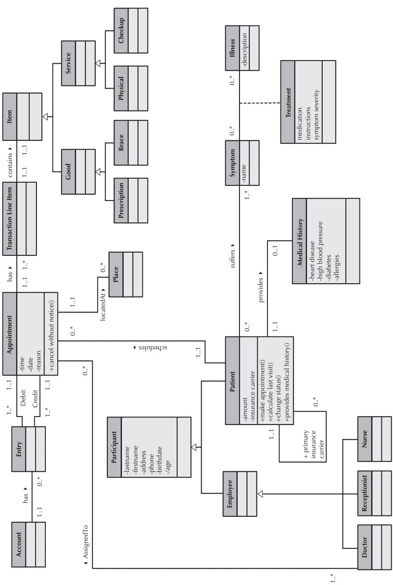

| 描述 | 示例 | 注意事项 |
|---|---|---|
| 类（Class）：<br>• 表示一种人、地点或事物，系统需要对其进行捕获和存储信息。<br>• 在顶部的隔间内有一个**粗体**类型且居中的名称。<br>• 在中间的隔间内有一个属性列表。<br>• 在底部隔间内有一个操作列表。<br>• 不显式地显示类可用的操作。 | | |
| 属性（Attribute）：<br>• 表示描述对象状态的属性。<br>• 可以从其他属性派生，通过在属性名称前加斜杠表示。 | 属性名 `/衍生属性名` | |
| 操作（Operation）：<br>• 表示类可以执行的动作或函数。<br>• 可以分类为构造函数、查询操作或更新操作。<br>• 包含括号，其中可能包含执行该操作所需的参数或信息。 | 操作名 `()` | |
| 关联（Association）：<br>• 表示类之间或类与其自身之间的关系。<br>• 使用动词短语或名称标记，取决于哪个更能表示该关系。<br>• 可以存在于一个多个类之间。<br>• 包含多性，表示一个类与相关类实例关联的最小和最大次数。 | AssociatedWith `0..* 1` | |
| 泛化（Generalization）：<br>• 表示多个类之间的“是一种”关系。 | | |
| 聚合（Aggregation）：<br>• 表示多个类之间以及类与其自身之间的“部分”关系。<br>• 是关联的一种特殊形式。 | `0..* IsPartOf > 1` | |
| 组合（Composition）：<br>• 表示多个类之间以及类与其自身之间的物理“部分”关系<br>• 是关联的一种特殊形式。 | `1..* IsPartOf > 1` | |

图 5-8 类图语法

患者被输入系统。正如我们所提到的，如果一个操作实现了基本功能之一（例如，创建新实例），它通常不会显式地显示在类图中，因此通常我们不会在类图中显式地使用构造方法。

查询操作使其他对象能够获取对象状态的信息，但它不会以任何方式更改对象。例如，确定患者何时看诊医的 `lastVisit()` 操作将导致系统访问该对象，但它不会对其信息进行任何更改。如果查询方法仅仅向类中的属性请求信息（例如，患者的姓名、地址、电话），那么它不会显示在图上，因为我们假设所有对象都有产生其属性值的操作。

更新操作更改对象的某些或所有属性的值，这可能导致对象状态的变化。考虑使用名为 `status()` 的方法将患者的状态从“新”更改为“当前”，或者使用 `appointment(appointment)` 方法将患者与特定的预约关联。如果操作的结果可以改变对象的状态，则该操作必须显式地包含在类图中。另一方面，如果更新操作是一个简单的赋值操作，则可以从主干中省略。

析构操作（Destructor operation）从系统删除删除或移除对象。例如，如果一个员工对象不再代表公司的活跃员工，则需要从员工数据库中删除该员工，并将使用析构操作来实现这一点。然而，删除对象是基本功能之一，不会包含在类图中。

关系（Relationships）。类图的一个主要目的是显示具有多个类的类之间的关系、关联。这些关系通过在类之间画线来图中图中（见图 5-8）。当多个类共享一种关系（或）时，会画一条线并用关系的名称或该类在关系中所扮演的角色进行标记。例如，在图 5-7 中，每当患者预约时，patient 和 appointment 这两个类就会相互关联。因此，一条标记为 `schedules` 的线连接了 patient 和 appointment，准确地表示这两个类是如何相互关联的。注意关系名称旁边有一个小三角形。三角形有一个指向关系名称的方向。在图 5-7 中，`schedules` 关系包含一个三角形，表示该关系应读为“患者预约预约”。包含三角形仅仅增加了图的可读性。在图 5-9 中，描绘了另外三个关联示例：发票（Invoice）关联购买订单（Purchase Order）（反之亦然），飞行员（Pilot）驾驶飞机（Aircraft），以及备胎（Spare Tire）位于后备箱（Trunk）。

有时一个类会与自身关联，例如患者是其他患者（例如孩子）的主要保险承保。在图 5-7 中，注意在 patient 类与其自身之间画了一条线，并命名为 `insurance carrier`，以描述该类在关系中所扮演的角色。注意在标签前放置了一个加号 (`+`)，以传达这是一个角色而不是关系的名称。在标记关联时，我们使用关系名称或角色名称（不同不同兼顾），取决于哪一个能传达对模型更透彻的理解。

| Invoice | Purchase Order |
|---|---|
| AssociatedWith | |
| `0..*` | `1` |
| Pilot | Aircraft |
| Flies | |
| `0..*` | `0..*` |
| Spare Tire | Trunk |
| `0..1` | `0..1` |

图 5-9 示例关联

| 描述 | 示例 | 注意事项 |
|---|---|---|
| 恰好 | `1` | Department |
| 零或多个 | `0..*` | Employee |
| 一个或多个 | `1..*` | Employee |
| 零或一个 | `0..1` | Employee |
| 指定范围 | `2..4` | Employee |
| 多个，不交 | `1..3,5` | Employee |

图 5-10 多性

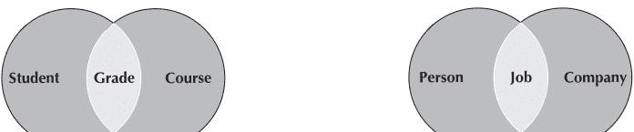

图 5-11 示例关联

通过虚线连接关联，矩形的名称捕捉了关于疾病和症状的信息。疾病（例如感冒）可以关联许多症状（例如喉痛、发烧），而症状（例如喉痛）可以关联许多疾病（例如链菌性肺炎）。图 5-7 显示了关联如何捕捉变化的治疗方案。例如，链菌性肺炎引起的喉痛需要抗生素，而感冒引起喉痛的治疗可以是喉片或热水。另一种决定参与关联的类的交集的方法是属于关联本身的属性。我们可以视觉上将关联视为恩图。例如，在 5-11 中，Grade 的想法实际上是 Student 和 Course 类的交集，因为成绩只存在于类的交集。5-11 显示的另一个示例是 job 可以被视为 Person 和 Company 之间的交集。

**泛化和聚合关联** 泛化发生在一个类（子类）继承自另一个类（父类）时，这意味着父类的属性和操作都是子类的对象。泛化路径通过从子类到父类的线以及指向父类的空心箭头来表示（见图 5-8）。例如，图 5-7 显示医生、护士和接待员都是员工的类，而患者是参与者。记住，当我们使用“是一种”之类的词汇来描述关系时，就发生了泛化。图 5-12 给出了一些泛化的示例。例如，Cardinal 是 Bird 的一种，而 General Practitioner 是 Physician 的一种，而 Physician 是 Person 的一种；而 Truck 是 Land Vehicle 的一种，而 Land Vehicle 是 Vehicle 的一种。

聚合发生在一个类实际上包含其他类时。例如，考虑一家诊所，它决定创建一个包含医生、护士和行政人员的医疗团队。当患者进入诊所时，他们被分配给医疗团队，该团队在他们访问期间照顾他们的需求。

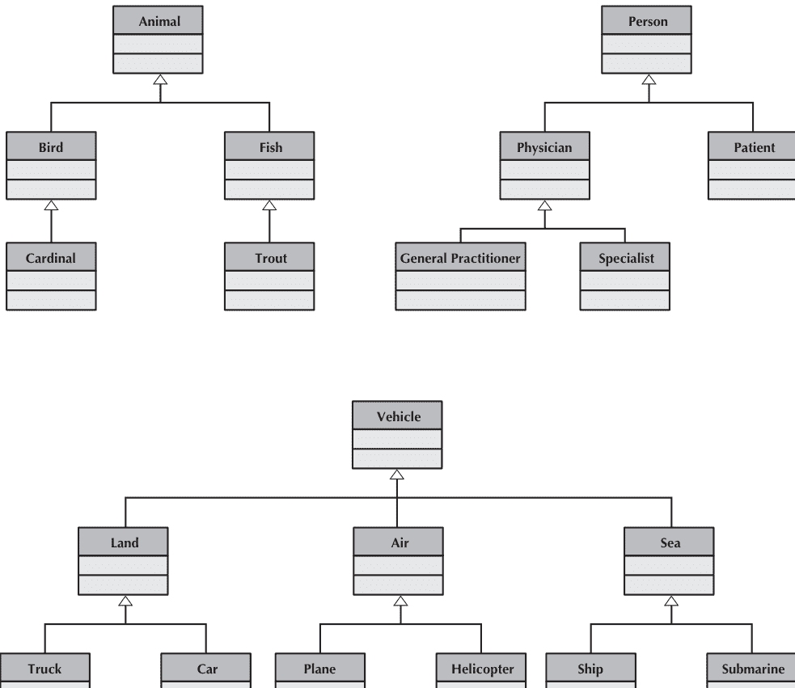

图 5-12 泛化示例

在图 5-7 中包含这一新知识，添加两个新类（行政人员和健康团队）以及从医生、护士和新的行政人员类到新健康团队类的聚合关系。在表示聚合（医疗保健团队）的类附近放置一个菱形，并从该菱形画出连线，以连接作为其部分的类（医生、护士和行政人员）。通常情况下，当你需要使用“是……的一部分”或“由……组成”等词汇来描述这种关系时，就可以识别出这类关联。然而，从 UML 的角度来看，聚合关联有两种类型：聚合和组合（见图 5-8）。

聚合用于描述逻辑上的“部分-整体”关系，在 UML 类图中用空心或白色菱形表示。例如，在图 5-13 中，展示了三个逻辑聚合。逻辑意味着一个部分可能与多个整体相关，或者该部分从整体中移除相对简单。例如，`Employee`（员工）类的实例是至少一个 `Department`（部门）类实例的一部分，`Wheel`（轮子）类的实例是 `Vehicle`（车辆）类实例的一部分，`Desk`（桌子）类的实例是 `Office`（办公室）类实例的一部分。显然，在许多情况下，一个实例可以与多个部门关联，而且从车辆上移除轮子或从办公室移除桌子相对容易。

| Employee | Department |
|---|---|
| `1..` | 是 `1..` |
| Wheel | Vehicle |
| `1..` | 是 `1` |

图 5-13 聚合关联示例

| Desk | Office |
|---|---|
| `0..` | 是 `1` |

组合用于描述物理上的“部分”关系，并用实心菱形表示。物理意味着：例如，在图 5-14 中，说明了三个物理组合：门实例只能是单个汽车实例的一部分，房间实例只能是单个建筑实例的一部分，而按钮实例只能是单个鼠标的一部分。然而，在许多情况下，在类图中通过聚合（白色菱形）和组合（实心菱形）所实现的区分，可能并不值付出让客户学习额外图形符号的代价。因此，许多 UML 专家认为将聚合和组合符号引入 UML 类图中仅仅是“语法糖”，并不是必要的，因为始终可以通过使用关联语法来描述相同的信息。

| Door | Car |
|---|---|
| `1..` | 是 `1` |
| Room | Building |
| `1..` | 是 `1` |

图 5-14 组合关联示例

| Button | Mouse |
|---|---|
| `1..` | 是 `1` |

### 简化类图

当类图完全填充了真实系统中所有的类和关系时，该类图可能会变得非常难以解释（即可能非常复杂）。当这种情况发生时，有时有必要对图表进行简化。简化类图的一种方法是只显示具体类。然而，取决于连接到抽象类（从而在其中被继承）的关联数量，这一建议可能会使图变得更难以理解。

简化类图的另一种方法是通过使用视图机制。视图最初是为了关系型数据库管理系统开发的，用于只显示数据库中包含的信息子集。在这种情况下，视图将是类图的一个有用子集，例如，用例视图只显示与特定类型关系（聚合、关联或泛化）相关的类和关系。第三种类型的视图是限制每个类显示的信息，例如，只显示类名、名称和属性以及操作。这些视图机制可以组合以进一步简化图表。

简化类图的第三种方法是通过使用包（类的逻辑分组）。为了使图表更易读并保持模型处于合理的复杂度水平，可以将类分组到包中。包是通用的构建结构，可以应用于 UML 模型中的任何元素。在第 4 章中，我们引入了包的概念来简化用例图。对于类图来说，根据它们所共享的关系对类进行排序并分组是简单的。

### 对象图


虽然类图对于记录类的结构是必要的，但另一种类型的静态图——对象图，在揭示额外信息方面非常有用。对象图本质上是类图的全部或部分的实例化。实例化意味着使用一组适当的属性值创建一个类的实例。

在尝试揭示类的细节时，对象图可能非常有用。通常来说，用对象（实例）而不是对象的抽象（类）来思考更容易。例如，在图 5-15 中，图 7 中类图的一部分已经过编译并实例化。该图的顶部部分仅仅是整个类图子集的一个小视图的副本。底部部分是实例化该类子集的对象图。通过查看对象图，我们可以识别出类图中显而未见的细节。例如，对象图可以显示属性的具体值，这有助于澄清类与类之间的关系。

# 使用类图创建结构模型

当类图完全填充了真实系统中所有的类和关系时，该类图可能会变得非常难以解释（即可能非常复杂）。当这种情况发生时，有时有必要对图表进行简化。简化类图的一种方法是只显示具体类。然而，取决于连接到抽象类（从而在其中被继承）的关联数量，这一建议可能会使图变得更难以理解。

# 第 186 页 第 5 章 结构建模

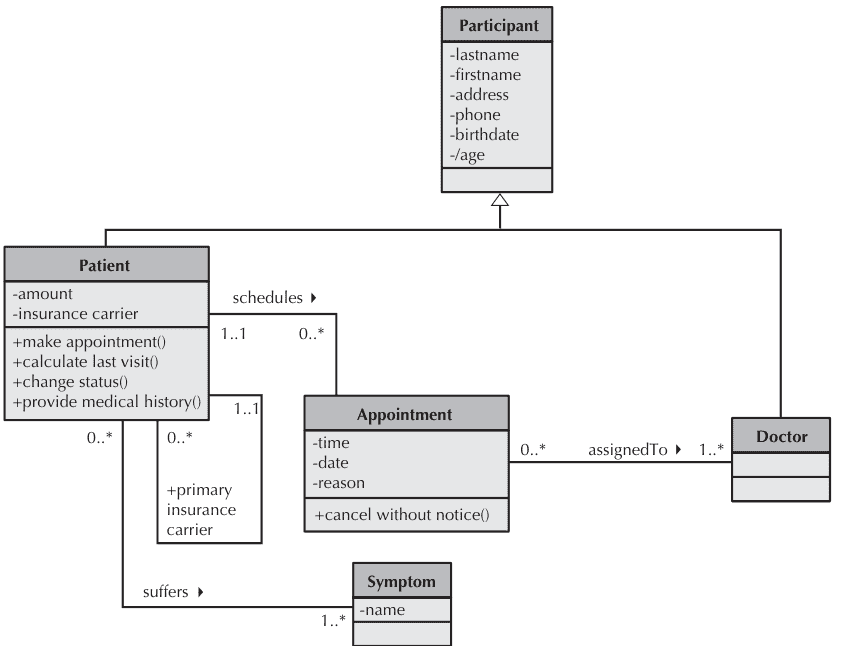

图 5-15 对象图示例

# 使用类图创建结构模型

当类图完全填充了真实系统中所有的类和关系时，该类图可能会变得非常难以解释（即可能非常复杂）。当这种情况发生时，有时有必要对图表进行简化。简化类图的一种方法是只显示具体类。然而，取决于连接到抽象类（从而在其中被继承）的关联数量，这一建议可能会使图变得更难以理解。

# 第 187 页 第 5 章 结构建模

# 使用类图创建结构模型

当类图完全填充了真实系统中所有的类和关系时，该类图可能会变得非常难以解释（即可能非常复杂）。当这种情况发生时，有时有必要对图表进行简化。简化类图的一种方法是只显示具体类。然而，取决于连接到抽象类（从而在其中被继承）的关联数量，这一建议可能会使图变得更难以理解。

# 187（此处存在重复内容）


（注：原文中存在多处段落重复，已按要求翻译并保留对应结构）

# 使用 CRC 卡片和类图创建结构模型

如果有更改这些属性默认可见性的正当理由，则应该接受默认值。最后，分析师应该检查模型，寻找其他使用聚合关系或泛化关系的机会。这些类型的关系可以简化单个类的描述。在之前的步骤中，所有的更改都必须记录在 `CRC` 卡片上。


# 5. 审查类图

第五步是审查结构模型，检查缺失或不必要的类、属性、操作和关系。在这一步之前，流程的重点一直是向不断演进的模型中添加信息。此时，重点开始从仅仅添加信息转变为对模型中所包含信息的合理性提出挑战。这里有一个非常实用的方法是扮演“恶鬼代言人”（`devil advocate`），即让团队成员仅仅为了找茬，对模型的各个方面的推理提出挑战。


# 6. 整合模式

第六步是将有用的模式整合到不断演进的结构模型中。实用的模式是指允许分析师完全描述所调查问题的底层逻辑模式。查看模式集合（图 5-5），并将模式中包含的类与演进中的类图中的类进行比较。通过识别有用的模式，分析师将这些模式整合到类图中并修改受影响的 `CRC` 卡。这包括添加和删除类、属性、操作和/或关系。


# 7. 审查模型

第七步也是最后一步是验证结构模型，包括 `CRC` 卡片和类图。我们将在本章的下一节以及第 7 章中讨论这些内容。

# 校园住宿示例

在上一章中，我们为校园住宿服务识别了一组用例（添加公寓、删除公寓和搜索租赁单元），该服务帮助学生寻找住宿。通过审查这些用例，我们可以很容易地确定校园住宿服务必须跟踪每个公寓及其所有者的信息。每个公寓需要捕获的信息是公寓的位置、公寓的卧室数量、月租金以及公寓离校园的距离。关于公寓的所有者，我们需要捕获所有者的联系信息（例如：姓名、地址、电话号码、电子邮件地址）。由于学生是系统的用户，没有必要捕获关于他们的任何信息；在这种情况下，学生仅仅是执行者（`actors`）。最后，通过类之间的关系，存在一个单一的或一对多的关联关系，将这两个类连接在一起。公寓的 `CRC` 卡如图 5-16 所示，该情况的类图如图 5-17 所示。

# 图书馆示例

与校园住宿示例一样，第一步是创建代表结构模型中类的 `CRC` 卡。在上一章中，我们使用了图书馆书籍管理系统示例来描述创建功能性模型（用例和活动描述以及用例详细描述）的过程。在本章中，我们遵循相同的熟悉的示例。由于我们采用的是用例驱动的方法进行面向对象的系统开发，因此我们首先审查在用例详细描述中描述的事件（见图 5-18）。

# 188 第 5 章 结构建模

| 类名：公寓所有者 | ID: 1 | 类型：具体，域 |
| :--- | :--- | :--- |
| 描述：拥有待租公寓的所有者 | | 关联用例： 2 |
| 职责 | 协作者 | |
| 添加公寓 | 公寓 | |
| 删除公寓 | 公寓 | |
| | | |
| | | |
| | | |
| | | |
| | | |
| 返回： | | |
| 属性： | | |
| 姓名 (`string`) | | |
| 地址 (`address`) | | |
| 电话号码 (`PhoneNumber`) | | |
| 电子邮件 (`EmailAddress`) | | |
| 关系： | | |
| 泛化 (是一种） | | |
| 聚合（包含部分） | | |
| 其他关联: 公寓 | | |

# 图 5-16

校园住宿

公寓所有者

`CRC` 卡

| 公寓所有者 | 公寓 |
| :--- | :--- |
| 0..1 | 0..* |

# 图 5-17

校园住宿

类图

接下来，我们通过应用图 5-1 中描述的文本规则对事件进行文本分析。在这种情况下，我们可以快速识别出需要包含借阅者、书籍、管理员、借出、身份证、学生借阅者、教师/员工借阅者、客座借阅者、注册处数据库、人员数据库、图书馆数据库、逾期书籍、罚金、书籍请求等类。我们还识别了用于“检查”书籍请求有效性的的操作。此外，事件建议借阅者和书籍之间存在“环绕”关系，借阅者和管理员之间存在“提供”关系。这种类型


# 使用 CRC 卡片和类图创建结构模型 189

正常事件流：

1. 借阅者带来。
2. 管理员提供身份证。
3. 管理员检查有效性。
4. 如果借阅者是学生借阅者，管理员检查注册处数据库。
5. 如果借阅者是教师/员工借阅者，管理员检查人员数据库。
6. 如果借阅者是客座借阅者，管理员检查图书馆数据库。
7. 管理员检查是否有逾期费用。
8. 借阅者借出。

备用流：

4a. 如果身份证无效，管理员拒绝请求。
5a. 如果逾期，管理员拒绝请求。

| 用例名称：借书 | ID: 2 | 重要性：高 |
| :--- | :--- | :--- |
| 描述：借阅者想要借出书籍 | 类型：基本 |
| 主要参与者：借阅者 | | |
| 相关利益者：管理员 | | |
| 触发条件：借阅者想要借 | | |
| 关系： | | |
| 泛化: | | |
| 聚合: | | |
| 包含: | | |
| 扩展: | | |
| 其他: | |

# 图 5-21

借书

用例

接下来，我们通过应用图 5-1 中的文本规则对事件进行文本分析。在这种情况下，我们可以快速识别出需要包含借阅者、书籍、管理员、借出、身份证、学生借阅者、教师/员工借阅者、客座借阅者、注册处数据库、人员数据库、图书馆数据库、逾期书籍、罚金、书籍请求等类。我们还识别了用于“检查”书籍请求有效性的操作、“借出”书籍的操作，以及“拒绝”书籍请求的操作。此外，事件建议借阅者和书籍之间存在“环绕”关系，借阅者和管理员之间存在“提供”关系。这种类型

# 190 第 5 章 结构建模

第二步是验证 `CRC` 卡以确定是否存在缺失。在图书馆系统的案例中，由于我们只使用了“借书”用例，我们看到需要根据标题、作者、关键词和 ISBN 搜索书籍。这显然暗示了书籍类具有四种搜索操作。有趣的是，描述还暗示了书籍类的一组子类或：已借出、逾期、已请求、可用和损坏。我们将在下一章回到子类的问题上。描述暗示了许多额外操作，包括还书、请求书籍、添加书籍、删除书籍、维修书籍、寻找借阅者和发送提醒。

接下来，我们根据经验脑风可能包含在图书馆书籍管理系统中的属性、操作和关系。在我们的图书馆中，还需要从存储中检索书籍、移动书籍到存储处、从交叉图书馆请求书籍、向交叉图书馆还书籍。你可以包含 `DVD`、磁带和其他媒体类。

书籍维护活动涉及处理和从集合删除删除。这需要经理正确地添加和删除。如果租借的书籍在这些活动中归还时损坏并被发现从集合中移除，借阅者将被罚款。否则，如果书籍损坏，取决于维修费用，借阅者可能不会被罚款。最后，每个月图书馆都会向逾期书籍的借阅者发送提醒邮件。两周后，借阅者将被罚款。

## 使用 CRC 卡和类图创建结构模型

为了方便说明，我们将使用“借阅书籍”案例进行演示。相关的参与者包括学生借阅者、教职员工借阅者、访客借阅者、管理员、人事办公室和注册处。这些参与者可以很容易从用例描述的概述（见图 5-19）和用例图（见图 4-6）中获知。相关的对象包括书籍、借阅者和身份卡。最后，为了进行场景演练，我们需要为团队的不同成员分配角色，并尝试执行通过用例的每条路径（见图 5-21）。根据用例的事件和用例活动图（见图 5-18），我们可以快速识别出三种场景，涉及三类借阅者（学生、教职员工和访客）：身份有效且无逾期书籍、身份有效且有逾期书籍。在通过角色扮演这些场景时，产生了一个问题：当请求被拒绝时会发生什么？根据当前的功能和结构模型，书籍将遗留在还书台上。这似乎不对。在现实中，书籍是被处理的。事实上，处理书籍的概念也适用于书籍归还或书籍维修后的情况。此外，将书籍添加到收藏中的想法也应该包括上架书籍的操作。正如你应该明智地阅读的那样，构建结构模型将有助于涵盖在构建功能模型时遗漏的行为。记住，面向对象的系统开发不仅是由用例驱动的，而且是增量且迭代的。

第四步是将所有内容整合到类图中。图 5-22 表示了图书馆书籍收藏管理系统绘制类图的初步草稿。在步骤中确定的类已经通过关联、聚合和泛化关系与其他类连接起来。为了简单起见，我们只显示了类及其关系，而没有显示它们的属性、操作，甚至没有关联关系上的重性。

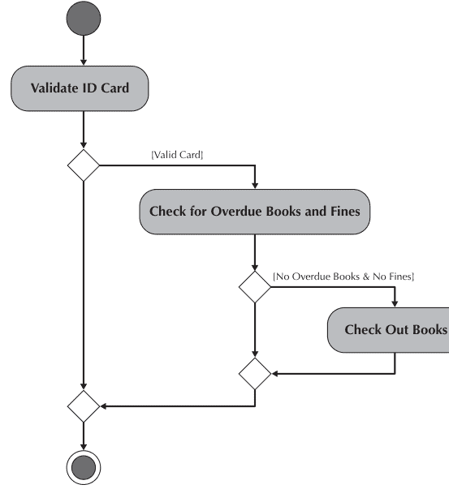

图 5-21

“借阅书籍”用例的活动图（图 4-12）

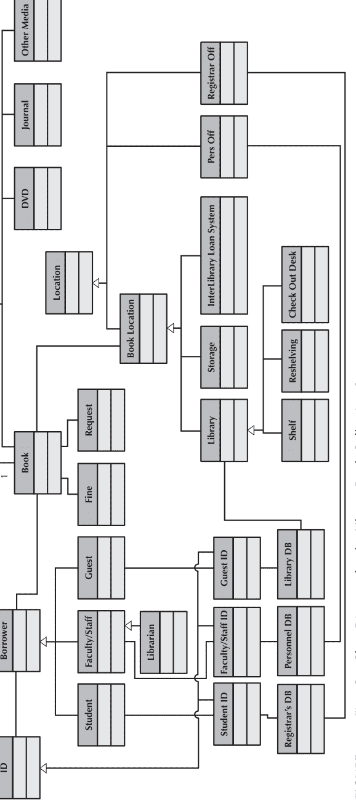

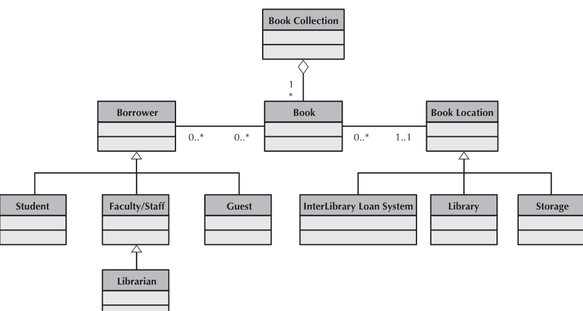

图 5-23 图书收藏系统的第二次修定的类图

第五步是仔细审查已创建的内容。你不仅应该寻找任何缺失的类、属性、操作和/或关系，还应该对当前模型的每个方面提出挑战。具体来说，是否有类、属性、操作和/或关系应该从模型中删除？如果是的话，图中可能某些类被建模为了属性。例如，学生教职员工 ID 和访客 ID 应该是其相应类的属性。此外，由于这是一个书籍收藏管理系统，包含其他媒体似乎是不恰当的。最后，人事办公室和注册处实际上是系统中的参与者，而不是对象。通过这些删除操作，绘制了一个新版本的类图（见图 5-23）。该图要简单得多，也更容易理解。

第六步是引入有用的模式，这使我们能够利用之前开发的知识。在这个案例中，图书馆问题使用的模式包含了太多与当前问题无关的想法。然而，回看图 5-3，我们看到原始模式之一（位置、交易、参与者、交易行项目和项目模式——图的左上角）是。我们通过将 `Check` 替换为 `Out Desk`，将 `Participant` 替换为 `Borrower`，将 `Transaction` 替换为 `Check Outs`，并将 `Item` 替换为（图 5-24），将该模式整合到类图中。从技术上讲，这些替换每一个都是针对当前问题定制的模式。我们还添加了原始结构模型中遗漏的 `Transaction Line` 类。

第七步是审查结构模型的当前状态。不用说，`CRC` 卡版本和类图版本不再一致。我们将在本章下一节返回这一步。

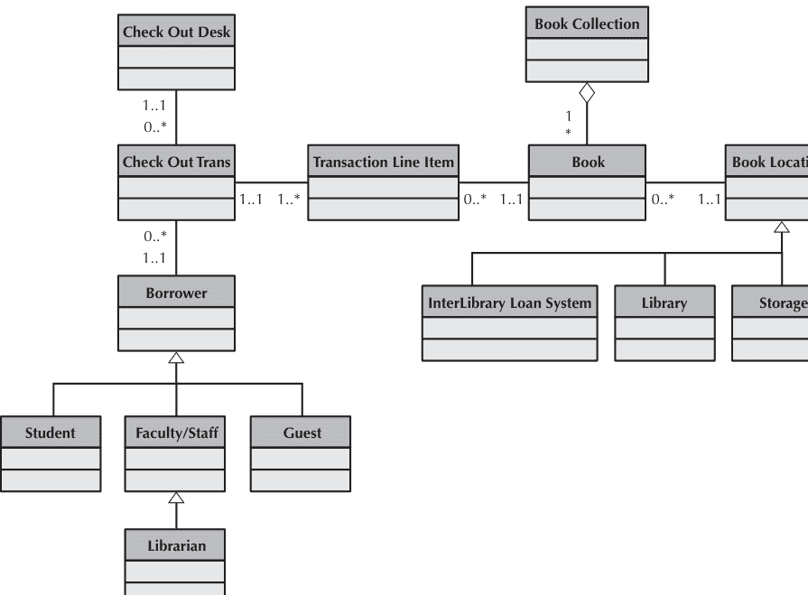

图 5-24 整合了模式的图书馆书籍系统类图

## 验证与确认结构模型¹⁷

在我们开始为问题领域创建行为模型（见第 6 章）之前，我们需要对结构模型进行验证和确认。在上一章中，我们介绍了走演（`walkthroughs`）作为一种验证和确认业务流程和功能模型的方法。在本章中，我们将走演与角色扮演的力量相结合，作为一种更完整地验证和确认作为业务流程和功能模型基础的结构模型的方法。事实上，本章描述的所有对象识别方法都可以视为测试结构模型保真度的方法。由于我们已经引入了角色扮演 `CRC` 卡和对象识别的想法，在这一节中，我们重点关注执行走演。

在这个案例中，结构模型的验证和确认是在会议期间完成的，分析师向团队展示模型。然后开发者和用户走一遍该模型，识别任何不一致、遗漏或错误。走演的第一步是审查已创建的内容。你不仅应该寻找任何缺失的类、属性、操作和/或关系，还应该对当前模型的每个方面提出挑战。具体来说，是否有类、属性、操作和/或关系应该从模型中删除？如果是的话，图中可能某些类被建模为了属性。例如，学生教职员工 ID 和访客 ID 应该是其相应类的属性。此外，由于这是一个书籍收藏管理系统，包含其他媒体似乎是不恰当的。最后，人事办公室和注册处实际上是系统中的参与者，而不是对象。通过这些删除操作，绘制了一个新版本的类图（见图 5-23）。该图要简单得多，也更容易理解。

¹⁷ 本节内容改编自 *Modern Structural Analysis* (Englewood, NJ: Prentice Hall, 1989)。

# 196 第 5 章 结构建模

| 正面： | | |
|---|---|---|
| 类名：患者 (`Patient`) | ID: 3 | 类型：具体类，领域 |
| 描述：需要或已接受过医疗治疗的个人 | 关联用例：2 | |
| 职责 | 协作者 | |
| 挂号 | 预约 (`Appointment`) | |
| 计算上一次访问时间 | | |
| 更改状态 | | |
| 提供病史 | 病史 (`Medical history`) | |
| | | |
| | | |
| 反面： | | |
| 属性： | | |
| 金额 (`double`) | | |
| 保险承运 (`text`) | | |
| | | |
| 关系： | | |
| 泛化（是一种）：参与者 (`Participant`) | | |
| 聚合（包含部分） | | |
| 其他关联：预约，病史 | | |

图 5-25

患者 `CRC` 卡

第七，关联类（如图 5-7 中的治疗类）只有在连接类的交集处确实存在某些独特特征（属性、操作或关系）时才应该创建。如果不存在独特特征，应删除关联类，并仅显示两个类之间的关联。

最后，作为功能模型，必须执行特定的表示规则。例如，一个类不能是其自身的子类。患者 `CRC` 卡不能在 `CRC` 卡背面通过泛化关系列出患者，也不能从患者类到其自身画出泛化关系。同样，每种表示方式的所有详细限制都超本书的范围。¹18 图 5-26 描绘了结构模型之间的关联。

> 18 关于此类限制限制的良好参考书籍是 S.W. Ambler，《The Elements of UML 2.0 Style》 (Cambridge, UK: Cambridge University Press, 2005)。

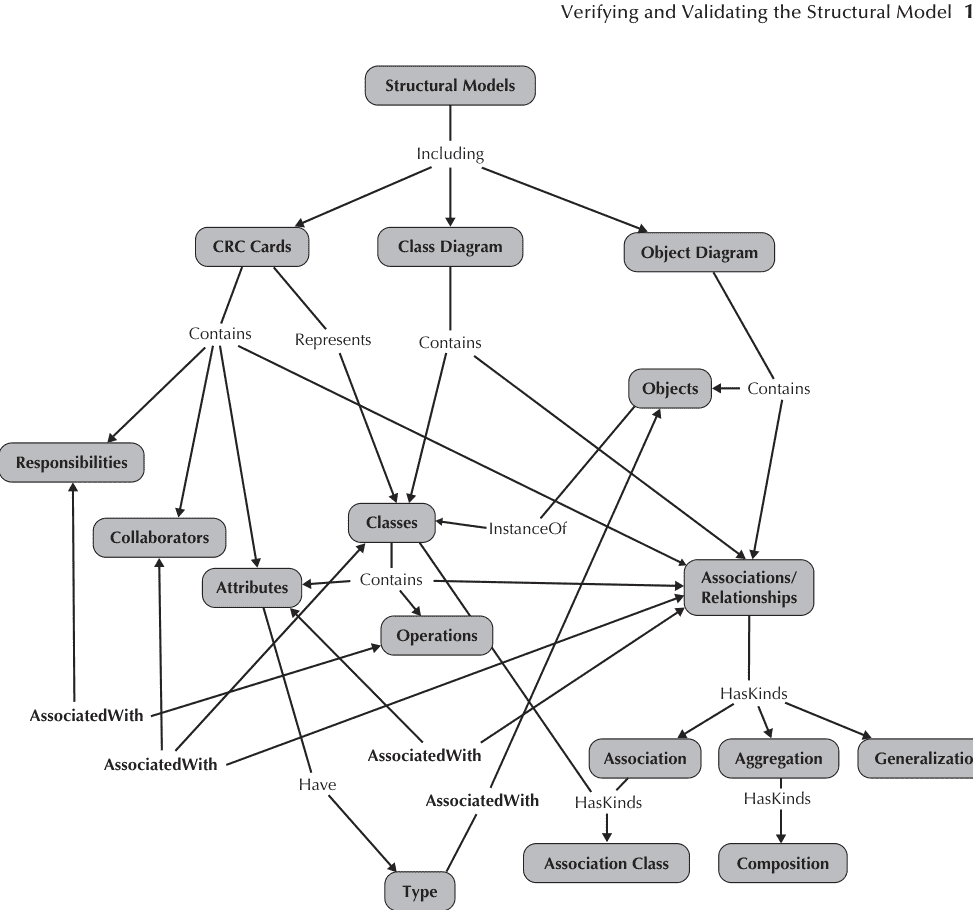

图 5-26 结构模型之间的相互关系

# 在帕特森超市应用这些概念

在第 4 章中，你学习了如何以迭代的方式开发功能模型。在创建了集成健康诊疗交付系统的移动调度（版本 1）功能模型后，团队对业务流程有了良好的理解。现在是时候识别关键数据并开发支持这些业务流程的对象的结构模型了。移动调度（版本 1）的结构建模涉及创建、验证和确认 `CRC` 卡、类图和对象图。

你可以在此处找到案例的其余部分：`www.wiley.com/go/dennis/casestudy`

# 198 第 5 章 结构建模

# 本章总结

在阅读和学习本章后，你应该能够：

- 描述结构模型的目的。
- 描述结构模型的不同元素。
- 解释抽象类和具体类之间的区别。
- 描述结构模型中通常使用的三种通用关系类型。
- 使用用例描述的文本分析、头脑风暴、常用对象列表和模式创建结构模型。
- 解释 `CRC` 卡在结构建模中的作用。
- 使用 `CRC` 卡创建结构模型。
- 描述 `CRC` 卡的不同元素。
- 描述如何使用用例场景对卡片进行角色扮演。
- 描述类图的不同元素。
- 描述可以在类图上执行的四种基本操作。
- 解释类图中支持的关系类型之间的差异。
- 创建表示结构模型的类图。
- 描述对象图的不同元素。
- 创建表示类图部分实例化的对象图。
- 使用角色扮演和演练验证并确认结构模型。
- 通过确保三种结构表示（`CRC` 卡、类图和对象图）的一致性来验证并确认功能模型。

## 关键术语

| 是一种 (`A-kind-of`) | 方法 (`Method`) | 状态 (`State`) | 静态模型 |
|---|---|---|---|
| 部分 (`A-part-of`) | 合约 (`Contract`) | 多重性 (`Multiplicity`) | 静态模型 |
| 抽象类 (`Abstract class`) | 类-关系- | 对象 (`Object`) | 静态结构 |
| 聚合关联 (`Aggregation association`) | 协作 (`CRC`) | 对象图 | 图表 |
| 装配 (`Assemblies`) | `CRC` 卡 | 操作 (`Operation`) | 结构模型 |


# 术语表

| 关联 (Association) | 分解 (Decomposition) | 包 (Package) | 子类 (Subclass) |
| :--- | :--- | :--- | :--- |
| 关联类 (Association class) | 派生属性 (Derived attribute) | 部分 (Parts) | 子类性 (Subclassability) |
| 属性 (Attribute) | 执行职责 (Doing responsibility) | 私有 (Private) | 超类 (Superclass) |
| 头脑风暴 (Brainstorming) | 析构操作 (Destructor operation) | 保护 (Protected) | SVDIPI |
| 类 (Class) | 泛化 (Generalization) | 公有 (Public) | 实体 (Tangible things) |
| 类图 (Class diagram) | 关联 (association) | 查询操作 (Query operation) | 文本分析 (Textual analysis) |
| 客户端 (Client) | 包含 (Has-parts) | 职责 (Responsibility) | 更新操作 (Update operation) |
| 协作 (Collaboration) | 事件 (Incidents) | 视图 (View) | |
| 常用对象列表 (Common object list) | 实例 (Instance) | 角色扮演 (Role-playing) | 可见性 (Visibility) |
| 概念模型 (Conceptual model) | 交互 (Interactions) | 角色 (Roles) | 视图 (View) |
| 具体类 (Concrete class) | 认知职责 (Knowing responsibility) | 服务端 (Server) | 整体 (Wholes) |

## 问题

1. 描述业务人员两个类之间关系的多重性。
2. 为什么假设对结构模型很重要？
3. 什么是关联类？
4. 构建以下项目集：对象、类、方法、属性、子类、具体类、抽象类。
5. 给出可能存在于类图上的五个属性示例。它们在类图中如何表示？
6. 有哪些不同的可见性类型？它们在类图中如何表示？
7. 画出以下描述的关系，并包括每个关系的多重性：
   - 一个患者只能在一个医生处注册，但一个医生可以有多个患者。
   - 一个员工有一个扩展。
   - 一个剧院显示一部电影和许多电影。
8. 如何在类图中指定关系？
9. 关联类在类图中用于什么？
10. 给出聚合、泛化和关联的两个例子。每种类型如何在类图中？
11. 识别以下操作属于构造函数、查询还是更新。哪些操作不需要在类图中？
    - 计算员工加薪
    - 计算工资
    - 增加员工数量
    - 查找员工
    - 提交请求
    - 查找员工
12. 不同的结构模型之间是如何相关的？模型的验证是如何工作的？

## 练习

### A. 为以下内容创建 CRC 卡：
- **电影 (Movie)**：标题、长度、类型
- **门票 (Ticket)**：价格、日期、时间
- **顾客 (Patron)**：名称、年龄

### B. 根据练习 A 创建的 CRC 卡创建类图。

### C. 为以下类创建 CRC 卡：考虑这些实体代表患者账单系统。仅包含适用于系统的属性。
- **患者 (Patient)**：年龄、爱好、血型、职业、保险地址、电话
- **保险承运 (Insurance carrier)**：名称、地址、联系人、电话
- **医生 (Doctor)**：专科、提供者识别码、高尔夫差点、名称

### D. 根据练习 C 创建的 CRC 卡创建类图。

### E. 为以下情况画类图：
1. 当新患者首次就诊时，创建一个患者信息表，获取他们的姓名、地址、电话和保险承运，这些信息存储在患者信息文件中。患者只能在一个承运人处注册，但必须由医生注册。每当患者看医生，就会向承运人发送一次保险理赔。
2. 乔治亚州希望设计一个记录研究兴趣信息的系统，研究人员姓名、职称、职位、大学名称、大学地点、大学入学和研究兴趣。
3. 百货商店有一个婚礼登记。该登记记录了客户（通常是新娘）、商店销售的产品以及每个客户注册的产品。客户通常会注册许多物品，许多客户注册相同的物品。
4. 吉姆·史密斯的经销商销售福特、本田和丰田。为了方便与厂商联系，经销商需要关于每家厂商的信息。经销商保留了每种汽车的模型制造商，包括经销商价格、型号名称和系列（例如：本田、思域、LX）。此外，经销商还保留了所有的销售信息，包括买家姓名、地址和电话号码、购买的车辆以及支付的金额。

### K. 使用本章描述的七步法，为第 4 章中的练习 E 创建一个结构模型。

### L. 为练习 K 创建的结构模型进行验证和确认演练。

### F. 根据你为练习 E 绘制的类图创建对象图。

### M. 使用本章描述的七步法，为第 4 章中的练习 G 创建一个结构模型。

### G. 检查你为练习 F 创建的类图。根据这些新假设，模型会发生什么变化（如果有）？
- 1. 两名患者具有相同的姓和名。
- 2. 研究人员可以与多个机构关联。
- 3. 商店希望跟踪购买项目。
- 4. 许多买家随着时间推移从 Jim 那里购买了多辆车，因为他是一个优秀的经销商。

### N. 为练习 M 创建的结构模型进行验证和确认演练。

### O. 使用本章描述的七步法，为第 4 章中的练习 I 创建一个结构模型。

### P. 为练习 O 创建的结构模型进行验证和确认演练。

### Q. 使用本章描述的七步法，为第 4 章中的练习 L 创建一个结构模型。

### R. 为练习 Q 创建的结构模型进行验证和确认演练。

### I. 使用本章描述的七步法，为第 4 章中的练习 C 创建一个结构模型（CRC 类和图）。

### J. 为练习 I 创建的结构模型进行验证和确认演练。

### S. 使用本章描述的七步法，为第 4 章中的练习 O 创建一个结构模型。

### T. 为练习 S 创建的结构模型进行验证和确认演练。

### U. 使用本章描述的七步法，为第 4 章中的练习 R 创建一个结构模型。

### V. 为练习 U 创建的结构模型进行验证和确认演练。

### W. 使用本章描述的七步法，为第 4 章中的练习 U 创建一个结构模型。

### X. 为练习 W 创建的结构模型进行验证和确认演练。

## 案例

### 1. West Marinas
West Marinas 是由十二个码头组成的俱乐部，提供湖边服务以及船只、发动机和其他海洋设备的拥有、维修和维护。West Marinas 的系统项目一直致力于一个项目，该项目最终将所有码头设施连接到一个网络化系统。

项目团队开发了当前系统的用例图。该模型经过了仔细检查。上周，团队邀请了多位系统用户角色扮演各种情况，并根据用户的意愿细化了用例。目前，项目经理认为现状系统在用例图中得到了充分的体现。West Star 的运营总监是该项目的赞助人。他参加了用例的角色扮演，对团队在开发模型方面所做的详尽工作非常满意。他向项目经理明确表示，而经理正急于看到你的团队对未来状态用例的工作。他对于你的团队最初是否有花时间对当前系统进行建模有点怀疑，但还是承认，在完成这项工作后，团队似乎确实理解了业务。

然而，你所遵循的方法规定客户应该将注意力转向开发现状系统的结构模型。当你把这一点告诉项目赞助人时，他似乎很困惑且有些不耐烦。“还要花更多时间看当前系统？这有必要吗？我想看到一些通向未来的进展。”

**你对运营总监的回答是什么？我们为什么要进行结构建模？用例和用例图如何帮助你降低结构模型的风险？**

### 2. Holiday Vehicles
Holiday Vehicles 销售休闲车和旅行拖车。当新车辆到达 Holiday Vehicles 时，会创建一个新的车辆记录，其中包含序列号、名称、型号、年份、制造商和基础成本。

当客户到达 Holiday Vehicles 时，他将与销售人员协商购买车辆。一旦达成购买协议，销售人员将完成一份发票。发票总结了购买情况，包括客户信息、折旧车辆信息（如果有）、折旧补贴以及所购车辆的信息。如果客户要求安装选配件，这些也会标记在发票上。发票总结了最终协商价格、任何适用的税费和执照费。交易以客户在发票上的签字结束。

#### a. 识别上述场景中描述的类（你应该能找到六类）。为每个类创建 CRC 代码。

客户在第一次从 Holiday Travel Vehicles 购买产品时，会被分配一个客户 ID。记录客户的姓名、地址和电话号码。折旧车辆通过序列号、名称、型号和年份来描述。经销商安装的选配件通过选项代码、描述和价格来描述。

#### b. 为每个类开发属性列表。将属性放在 CRC 卡片上。

每份发票列出一个客户。记录客户的姓名、地址和电话号码。折旧车辆通过序列号、名称、型号和年份来描述。经销商安装的选配件通过选项代码、描述和价格来描述。

#### c. 基于上述 Holiday Vehicles 的业务规则和 CRC 卡，绘制类图并记录适当的多重性。

---

# 第 6 章 行为建模

行为模型描述了支持业务流程的组织内部逻辑。在分析期间，行为模型描述了内部逻辑是什么，而不规定如何实现。在后续的设计和实现阶段，对象中所包含的操作将得到详细说明。在本章中，我们描述了用于行为建模的三种 UML 图（序列图、通信图和状态机）以及 CRUDE（创建、读取、更新、删除、执行）矩阵。

## 目标
- 理解序列图、通信图、状态机的规则和样式指南。
- 理解创建序列图、通信图、状态机和 CRUDE 矩阵的过程。
- 能够创建序列图、通信图、状态机和 CRUDE 矩阵。
- 理解行为模型与结构、功能模型之间的关系。

## 引言

前两个章节讨论了分析师如何创建业务过程和功能模型以及结构模型。系统分析师使用业务过程和功能模型来描述信息系统的外部或行为视图。并且，他们使用结构模型来描绘信息系统的内部或静态视图。在本章中，我们将讨论如何使用行为模型来表示信息系统的内部行为和动态视图。

行为模型有两种类型。首先是用于表示 UML 用例模型所描绘的业务过程底层细节的行为模型。交互图（时序图和通信图）用于此类行为模型。从实践上讲，交互图允许分析师对系统行为在系统中的参与者和对象之间的分布进行建模。通过这种方式，我们可以看到参与者和对象如何协作以为定义的用例提供功能。其次，行为模型被用于表示底层数据发生的变化。UML 使用了行为状态机。

在分析过程中，分析师使用行为模型来获取对底层业务过程动态层面的基本理解。传统上，行为模型主要在设计阶段使用，此时分析师会完善行为模型以包含实现细节（见第 8 章）。目前，我们的重点是演进中的系统的动态视图是什么，而不是系统的动态方面将如何实现。

在本章中，我们集中在创建底层业务过程的行为模型上。通过使用交互图（时序图和通信图）和行为状态机，可以对演进中的业务信息系统的动态方面提供完整的视图。我们首先描述行为模型及其组件。然后描述每种图、它们是如何创建的，以及它们如何与第 4 章和第 5 章描述的功能模型和结构模型相关。最后，我们描述 CRUDE 分析以及验证和确认行为模型的过程。

## 行为模型

当分析师试图理解问题的底层应用领域时，她/他必须同时考虑问题的结构和行为方面。与信息系统开发的其他方法不同，面向对象的方法以整体方式来审视应用领域。通过将问题领域视为一组由一组协作对象支持的用例，面向对象的方法允许分析师尽可能地缩小现实世界对象集与问题领域面向对象模型之间的差距。正如我们在上一章中指出的，现实世界往往是混乱的，由于软件必须具有逻辑性才能运行，因此对应用领域的建模几乎是不可能的。

行为模型的主要目的之一是显示问题领域中的底层对象如何共同工作以支持每个用例。结构模型表示对象及其之间的关系，而行为模型则描绘了用例所描述的业务过程的内部视图。可以通过支持用例的对象之间发生的交互（使用交互图，时序图和通信图）来展示该过程。还可以通过行为状态机显示组成系统的用例集对系统内对象的影响。

创建行为模型是一个迭代过程，该过程不仅涉及单个行为模型（例如，交互图（时序图和通信图）和行为状态机），还涉及功能模型（见第 4 章）和结构模型（见第 5 章）。随着行为模型的创建，对功能模型和结构模型进行修改并不罕见。在本章中，我们描述了交互图、行为状态机和 CRUDE 分析以及如何使用它们。

## 交互图

类图和交互图之间的主要区别之一，除了显而易见的一个描述结构而另一个描述行为之外，在于类图的建模重点在类级别，而交互图的重点在对象级别。在本节中，我们回顾了对象、操作和消息，并涵盖了两种不同的图（时序图和通信图），这些图可用于对信息系统中对象之间发生的交互建模。

### 对象、操作和消息

对象是类的实例化，即我们想要捕捉的实际的人、地点或事物。如果我们正在为医生诊所构建一个预约系统，类可能包括医生、患者和预约。特定的患者，如 Jim Maloney、Wilson 和 Theresa Marks，被视为对象——即患者类的实例。

每个对象都有描述该对象信息的属性，例如患者的姓名、出生日期和电话号码。每个对象还具有行为，这些行为由操作描述。在演进系统的开发过程中，操作无非是对象可以执行的操作。例如，预约对象可以安排新预约、删除预约并查找下一个可用预约。在系统开发期间，行为将被进一步细化。

每个对象都可以发送和接收消息。消息被发送到对象，以告诉对象执行其行为之一。本质上，消息是从一个对象到另一个对象的函数调用或过程调用。例如，如果一个患者是医生诊所的新病人，系统会向应用程序发送消息。患者接收指令（消息）并执行其需要将新患者插入系统中的操作（行为）。

### 时序图

时序图是两种交互图类型之一。它们说明了参与用例的对象以及它们随时间推移而传递的消息。时序图是一种动态模型，显示了在定义交互中对象之间传递的消息的显式顺序。由于时序图强调一组对象之间发生活动的基于时间的排序，因此它们对于理解实时交互和复杂用例非常有帮助。

时序图可以是一个通用的时序图，显示一个用例的所有可能场景¹，但通常每个用例会开发出一组实例时序图，其中每幅图详细描述了用例中的单一场景。如果你对理解它们对场景的控制感兴趣，你应该使用时序图来描绘这些信息。这些图贯穿于分析和设计阶段。然而，设计图具有很强的实现特定性，通常将数据库对象或用户界面组件作为组件。

> ¹ 记住场景是用例的单一执行路径。

### 时序图的元素

图 6-1 显示了一个实例时序图，描绘了“老患者应用程序”用例的对象和消息，该用例描述了现有患者创建新预约或取消或重新安排的过程。


**图 6-1 示例时序图**

参与序列的对象位于图顶部，使用用例图的用例符号和对象图的对象符号（见图 6-2）。注意图 6-1 中的参与者和对象是 `aPatient`（患者）、`Receptionist`（接待员）、`UnpaidBill`（未付账单）和 `Appointment`（预约）。对于每个对象，在对象名称之后给出其所属类的名称（例如，`aPatient: Patient` 表示 `aPatient` 是 `Patient` 实例）。

虚线在每个参与者和对象下方垂直运行，表示参与者和对象随时间推移的生命线。有时对象会创建一个临时对象；在生命线的结束处放置一个 X（未显示）。例如，考虑用于 Web 电子商务应用程序的购物车对象。购物车用于临时捕捉订单物品，但一旦订单确认，购物车就不再需要了。X 将位于购物车销毁的地方。对象在时序图中使用时在系统中继续存在，生命线一直延伸到底部（图 6-1 中的所有对象都是如此）。

> ² 在某些版本的时序图中，对象符号被用作参与者的替代品。然而，为了清晰起见，我们建议使用参与者符号表示参与者。

## 术语与定义

| 术语 | 符号 |
| :--- | :--- |


| 参与者 (Actor)：<br>- 指从系统中获益且处于系统外部的人或系统。<br>- 通过发送和/或接收消息参与序列。<br>- 放置在图表的上方。<br>- 描绘为火人形状（默认），或者如果涉及非人类参与者，则描绘为带有 `<<actor>>` 字样的矩形（备选）。 | `anActor`<br>`<<actor>> anActor` |

| 对象 (Object)：<br>- 通过发送和/或接收消息参与序列。<br>- 放置在图表的上方。 | `anObject : aClass` |

| 生命线 (Lifeline)：<br>- 表示对象在序列期间生命周期。<br>- 在类不再存在的时间点处标记一个 X。 |  |

| 执行发生 (Execution occurrence)：<br>- 是一个放置在生命线顶部的窄长矩形。<br>- 表示对象正在发送或接收消息。 |  |

| 消息 (Message)：<br>- 将信息从一个对象传递到另一个对象。<br>- 操作调用用发送的消息名称和实线箭头标记，而返回则用被返回的值标记并用虚线箭头表示。 | `aMessage()`<br>`ReturnValue` |

| 守卫条件 (Guard condition)：<br>- 表示发送消息必须满足的测试。 | `[aGuardCondition]: aMessage()` |

| 用于结构 (For structure)：<br>- 在对象生命线的末尾放置一个 X，以显示它正在消失。 | `X` |

| 帧 (Frame)：<br>- 指示序列图的上下文。 | `Context` |

# 图 6-2 序列图语法

一个细长的矩形框，即“执行发生”，叠加在生命线上，用以显示类何时发送和接收消息（见图 6-2）。消息是对象之间的通信，用于传递信息，并预期会有随之发生的活动。序列图中可以描绘许多类型的消息。然而，在用序列图对用例建模时，通常使用两种类型的消息：操作调用和返回。传递在对象之间的操作调用使用实线连接对象，并用箭头显示消息的传递方式。消息的参数值放在括号中传递给下一个消息。消息的顺序从序列的顶部到底部，图中较高的代表序列中较早发生的消息，较低的代表较晚发生的消息。返回消息被描绘为带有末端箭头的虚线，表示返回。所返回的信息会被标记。正如此，返回消息可能会使图表混乱，除非返回消息为图表增加了大量信息，否则可以省略。例如，在图 6-1 中，没有描绘任何返回消息。在图 6-1 中，`LookUpPatient(t)` 是参与者到接收者的消息，用于确定 `aPatient` 是否为当前患者。

有时消息仅在满足条件时才发送。在这些情况下，条件放在括号中，`[[aPatient Exists] LookBills(s)`。当使用序列图对特定场景建模时，条件通常显示在任何单一序列图中；相反，仅通过不同序列图的存在来指示。

对象可以向自己发送消息，例如，`Create Sandbox`。某些情况下，一个对象创建另一个对象。这是直接发送给对象而非其生命线的消息。

图 6-3 描绘了两个实例特定的序列图示例。第一个是 Make Lunch（制作午餐）用例，它在图 4-10 所示的活动图中描述过。第二个是与图 4-9 活动图相关的 Place Order（下单）用例。在两个示例中，图表都代表了一个简单的场景。在 Make Lunch 序列图中，有一个从参与者发送给自己的消息 `[CreateSandwich()]`。根据所修改场景的复杂性，此特定消息本可以被消除。显而易见，制作午餐和下单过程都可能相当复杂。然而，从学习的角度来看，你应该能够看到序列图和活动图是如何相互相关的。

# 创建序列图的指南

Ambler⁵ 提供了一套绘制序列图的指南。在本节中，我们回顾了其中的六条。

- 尽量让消息不仅按从上到下的顺序，而且尽可能按从左到右的顺序。西方文化倾向于从左到右和从上到下阅读，如果消息尽可能以相同的方式排序，序列图将更容易解释。为了实现这一点，参与者和对象按照它们参与用例的顺序位于图表的顶部。如果一个参与者和一个对象在概念上代表同一个想法（一个在内部一个在外部），用相同的名称标记它们。事实上，这意味着它们同时存在于用例图（作为参与者）和类图中⁴然而，某些 CASE 工具要求显示返回消息。显然，当你使用这些工具时，必须在图上包含返回消息。

⁵W. Ambler, *The Elements of UML 2.0 Style* (Cambridge, England: Cambridge University Press, 2005).

# 208 第 6 章 行为建模


图 6-3 额外的实例特定序列图（作为类）。起初，这可能会导致困惑。然而，如果它们确实代表同一个想法，它们应该具有相同的名称。例如，客户参与者与系统交互，系统存储关于客户的信息。在这种情况下，它们确实代表同一个概念想法。

- 场景的启动者——参与者或对象——应该画为图中最左侧的项目。这条指南本质上是第一条指南的特化。在这种情况下，它专门触发场景的参与者或对象。

- 当存在多个相同类型的对象时，除了对象的类之外，你应该为对象包含一个名称。例如，在制作午餐的示例（见图 6-3）中，有两个 `Parent` 类型的对象。因此，它们应该命名。否则，你可以简单使用类名。在这种情况下，`Child` 对象不需要命名。我们可以在类名前简单放置冒号。

# 交互图 209

- 当返回值不明显时显示它们。显示所有返回往往会导致序列图变得复杂并可能难以理解。在许多情况下，少即是多。只显示为图表读者添加信息的返回。

- 分别在消息和返回箭头附近说明消息名称和返回值。这使得解释消息及其返回值变得更容易。

创建序列图在本节中，我们描述了创建序列图的六步过程。过程的第一步是确定序列图的内容。图的上下文可以是系统、用例或用例的场景。图的上下文被描绘为图周围的标记帧（图 6-1、6-2 和 6-3）。最常见的是一个用例场景。图 6-1 描绘了 Make Old Patient（老年患者）场景的实例特定序列图。对于每个场景，都会创建一个实例特定的序列图。然而，从表面上看，这似乎是冗余且无用的工作。然而，此时我们正试图完全理解问题。每个实例特定的序列图都相当容易解释，而通用的序列图可能非常复杂。用例的测试通过验证完整性来以更简单的方式完成。

| 1. 设置上下文 |


| 2. 识别参与者和对象 | 第二步是识别参与序列图的参与者和对象——即用例场景期间相互作用的参与者和对象。参与者是在功能模型开发期间确定的，而对象是在结构模型开发期间确定的。识别与用例相关的所有场景的一种非常有用的方法扮演 CRC 卡（第 5 章）。这可以帮助你识别支持所代表的过程所需的缺失操作。在角色扮演之后，可能会发现新的用例和新对象。不要过度担心完美识别对象；记住建模过程是迭代的。通常，序列图在建模过程中会修订多次。


| 3. 设置生命线 | 第三步是为每个用例设置生命线。为了做到这一点，你需要在每个类下面画一条垂直线，表示类在序列期间的存在。在生命线上的对象消失的地方下方放置一个 `X`。 |

| 4. 添加消息 | 第四步是向图中添加消息。这是通过绘制箭头来表示从一个对象传递到另一个消息，箭头指向消息的传输方向。箭头应该从第一条消息开始顺序放置（从顶部到底部）以显示时间序列。任何随消息传递的参数都应该放置在消息名称旁边的括号中。如果某个消息预计作为对另一个消息的响应，则返回消息不会在图中显式显示。这将导致你返回并修改结构模型（见第 5 章）。

> * 本节中描述的方法改编自 Grady Boch, James Rumbaugh 和 Ivar Jacobson 的《The Unified Modeling Language Guide》（MA: Addison-Wesley, 1999）。

## 210 第 6 章 行为建模


| 5. 放置执行发生点 | |

| 6. 验证 | |

第五步是在每个对象的生命线上放置执行发生点，通过在生命线上方绘制一个矩形框来表示类何时发送和接收消息。

第六步，也是最后一步，是验证序列图。这一步的目的是确保序列图完成了底层的过程。这是通过确保图表描绘了过程中的所有步骤来实现的。

校园住宿服务示例。在第 4 章和第 5 章中，我们为校园住宿服务创建了一系列功能模型和结构模型。在本节中，我们将使用这些模型为“添加公寓”用例创建一个序列图。如上所述，我们应该做的第一件事是设定上下文，在这种情况下就是“添加公寓”用例。其次，我们必须识别参与用例执行的参与者和对象。为了做到，我们应该检查第 4 章和第 5 章中为校园住宿问题创建的功能模型和结构模型。图 6-4 复制了这些表示。

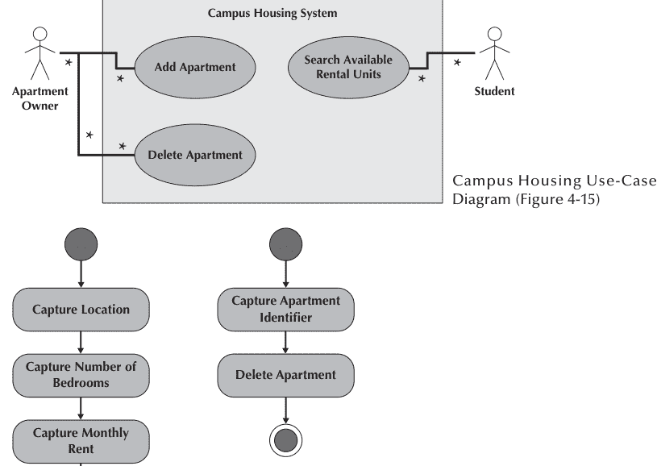

图 6-4

校园住宿功能服务和结构模型

校园住宿添加和删除公寓活动图（图 4-16）

> 8 我们将在本章稍后部分详细描述验证。

## 交互图 211

| 用例名称：添加公寓 | ID: 1 | 重要性级别：高 |

| :--- | :--- | :--- |

| 主要参与者：公寓所有者 | 用例类型：详细、核心 | |

| 利益相关者及利益： | | |

| 公寓所有者 - 想要广告公寓 | | |

| 校园住宿服务 - 提供一项让公寓所有者能够出租其公寓的服务 | | |

简要描述：此用例描述了住宿服务如何维护一份最新的可用公寓列表。

触发条件：公寓所有者想要添加一个可用的公寓

类型：外部

关系：

关联：公寓所有者

包含：

扩展：

泛化：

+ 正常流程：

1. 捕获公寓的位置。

2. 捕获公寓的卧室数量。

3. 捕获公寓的月租金。

4. 将公寓添加到可用公寓列表中。

子流程：

备选/异常流：

### 校园住宿服务添加公寓用例描述（图-17）

| 用例名称：删除公寓 | ID: 2 | 重要性级别：高 | |

| :--- | :--- | :--- |

| 主要参与者：公寓所有者 | 用例类型：详细、核心 | |

| 利益相关者及利益： | | |

| 公寓所有者 - 想要删除公寓 | | |

| 校园住宿服务 - 提供一项让公寓所有者能够出租其公寓的服务 | | |

简要描述：此用例描述了住宿服务如何维护一份最新的可用公寓列表。

触发条件：公寓所有者想要删除一个可用的公寓

类型：外部

关系：

关联：公寓所有者

包含：

扩展：

泛化：

+ 正常流程：

1. 捕获公寓标识符。

2. 从可用公寓列表中删除该公寓。

子流程：

备选/异常流：

### 校园住宿服务删除公寓用例描述（图 4-18）

图 6-4 继续

## 212 第 6 章 行为建模

| 类名：公寓所有者 | ID: 1 | 类型：具体、领域 |

| :--- | :--- | :--- |

| 描述：拥有待租公寓的公寓所有者 | | 关联用例：2 |

| 职责 | | 协作者 |

| 添加公寓 | | 公寓 |

| 删除公寓 | | 公寓 |

| | | |

| | | |

| | | |

| | | |

| | | |

| 回： | | :: |

| 属性： | | |

| 姓名 (string) | | |

| 地址 (address) | | |

| 电话 (phone number) | | |

| 电子邮件 (address) | | |

| 关系： | | |

| 泛化 (a-kind-of): | | |

| 聚合 (has-parts): | | |

| 其他关联： 公寓 | | |

校园住宿公寓所有者 CRC 卡片（图 5-16）

| 公寓所有者 | 公寓 |

| :--- | :--- |

| 0..1 | 0..* |

图 6-4

继续

校园住宿类图（图 5-17）

基于功能和结构表示，我们看到参与用例的参与者是公寓所有者和校园住宿服务。通过遵循正常流程和活动图，我们看到唯一相关的对象是正在添加的公寓实例。考虑到正常流程中没有备选/异常流或任何决策，与“添加”相关的活动图中也没有任何决策

## 交互图 213

### 交互图

图 6-5

添加公寓用例的序列图


公寓用例，只有这。在之前的序列图中，对于第 5 章。我们从卡片中推导出功能。这将帮助我们描述该功能所在。一旦我们决定了消息从哪里发送以及发送给谁，就可以将消息放置在图中，显示每个参与者或对象在执行其任何操作的时刻。第五步是为每个操作添加执行顺序。接下来，我们必须验证图。最后，我们应该对其他八种场景复制此过程

## 214 第 6 章 行为建模


### 图 6-6

用例的事件流

### 图 6-7

用例的活动图（图 4-16）

### 图 6-8

用例图（图 4-17）


## 交互图 215

下一步是识别参与场景的参与者和对象。通过研究事件流和用例图，我们识别出学生、管理员和数据库为参与者，借用者、书籍集合为对象。我们根据在事件流中的出现顺序将参与者和对象放在图顶部。下一步是简单地绘制参与者和对象的线。第四步是在图中添加实际消息。为了做到这一点，我们通过查看事件流（见图 6-6）和活动图（见图 6-7）来查看执行此场景时的实际步骤。我们还从卡片的角色扮演推导出功能。这将帮助我们描述该功能所在。在图 6-9 中，管理员执行 `CheckOutBooks()` 程序（学生发送 `CheckOutBooks()` 请求管理员执行 `CheckOutBooks()` 程序），当学生将要借的书交给管理员时。管理员向学生要身份证。当管理员将学生号码传递给数据库以验证号码时，学生执行 `ValidID()` 程序。一直持续到身份证和书籍返回给学生。一旦我们决定了消息从哪里发送以及发送给谁，就可以将消息放置在图中，显示每个参与者或对象在执行其任何操作的时刻。第五步是为每个操作添加执行顺序。接下来，我们必须验证图。最后，我们应该对其他八种场景复制此过程。

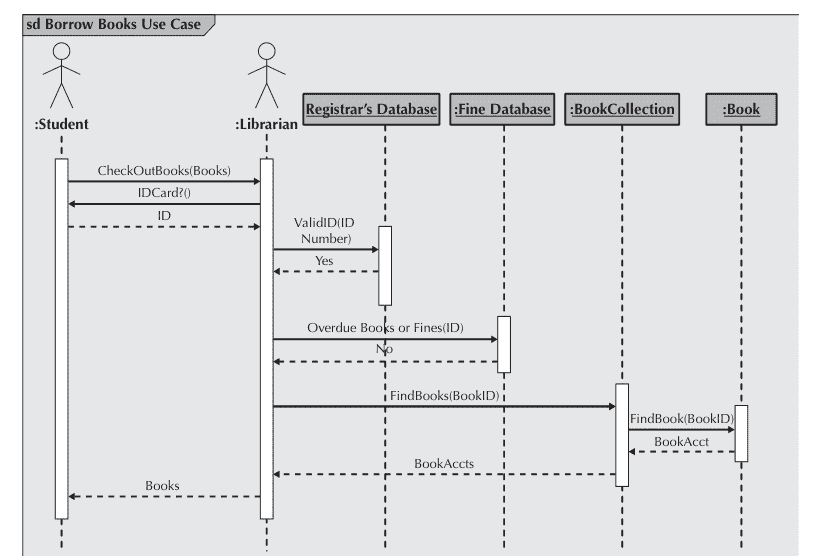

# 图 6-9

持有有效身份且无逾期或罚款的学生的借书用例的序列图

# 通信图

通信图与序列图一样，本质上都提供了面向对象系统动态层面的视图。它们可以展示一组对象的成员如何协作来实现一个用例或用例场景。它们还可以被用于建模一组协作对象之间的所有交互，换句话说，就是协作（参见第 5 章中的 CRC 图）。在这种情况下，通信图可以描绘出不同对象之间的相互依赖关系。通信图本质上是一种对象图，显示的是消息传递关系而非聚合或泛化关联。通信图对于处理模式（即发生一组协作对象上的活动模式）非常有用。

通信图等同于序列图，序列图侧重于传递的消息的时间顺序。因此，为了理解哪些对象协作来支持业务流程的流和控制，可以使用通信图。对于消息的排序，应该使用序列图。在某些情况下，可以使用两者来更完整地理解系统的动态活动。

## 通信图的元素

图 6-10 显示了“老年患者应用”用例的通信图。与图 6-1 中的序列图一样，描绘了“老年患者应用”的过程。

协作执行用例的参与者和对象放置在通信图中，其方式强调了它们之间发生的消息传递。注意图 6-10 中的参与者和对象与图 6-1 中的是相同的：`aPatient`（患者）、`aReceptionist`（接待员）、`aPatient`、`UnpaidBill`（未付账单）和 `Appointment`（预约）。¹⁰ 同样，对于序列图，对于每个对象，其作为实例的类名由对象的名称给出（例如 `aPatient: Patient`）。（通信

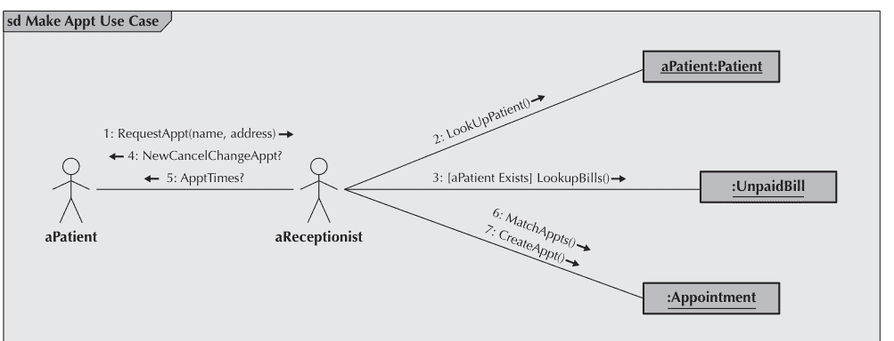

图 6-10 示例通信图

⁹ 在第 7 和第 8 章中回到这种依赖性思想。

¹⁰ 在某些版本的通信图中，使用对象符号作为参与者的替代。然而，我们仍然建议使用参与者符号来表示参与者。

图的语法见图 6-11。与序列图不同，通信图没有一种显式显示对象被删除或创建的方法。假设向对象发送了删除、销毁或移除消息，该对象就会消失；而创建或新消息将导致一个新对象的产生。这两个交互图之间的另一个区别是，通信图从不从消息发送处返回，而序列图可以选择性地显示。

参与者和对象之间用一条无向线显示关联。例如，在 `aPatient` 和 `aReceptionist` 参与者之间显示了一个关联。消息显示为关联上的标签。标签中包含了显示所发送消息方向的线。例如，在图 6-10 中，`aPatient` 向 `aReceptionist` 参与者发送 `RequestApp()` 消息，而 `aReceptionist` 参与者

| 术语和定义 | 符号 |

| --- | --- |

| 参与者 (Actor): - 是从系统中受益且位于外部的人或系统。- 通过发送和/或接收消息参与协作。- 被描绘为火柴人（默认），如果涉及非人类参与者，则描绘为带有 `<<actor>>` 的矩形（备选）。 | `anActor` |

| 对象 (Object): - 通过发送和/或接收消息参与协作。 | `anObject : aClass` |

| 关联 (Association): - 显示参与者和/对象之间的关联。- 用于发送消息。 |  |

| 消息 (Message): - 将信息从一个对象传递到另一个对象。- 使用箭头显示方向。- 通过序列号显示顺序。 | `SeqNumber: aMessage →` |

| 守卫条件 (Guard condition): - 代表发送消息前必须满足的测试。 | `SeqNumber: [aGuardCondition]: aMessage →` |

| 帧 (Frame): - 指示通信图的上下文。 | `Context` |

图 6-11 通信图语法


向 `aPatient` 参与者发送 `NewCancelChangeApp()` 和 `AppTimes()` 消息。消息发送的顺序用序列号指定。在图 6-10 中，`RequestApp()` 消息是第一条消息，而 `NewCancelChangeApp()` 和 `AppTimes()` 消息分别是第四条和第一条消息。

与序列图一样，通信图可以表示条件消息。例如，在图 6-10 中，只有在存在 `aPatient` 实体时才会发送 `LookUpChild()`。如果消息被重复发送，则在序列号后放置一个星号。最后，循环到对象上的关联显示了自委托。消息显示为环绕对象的弧线。

当通信图完全填充所有对象时，它可能会变得非常复杂且难以理解。当发生这种情况时，有必要简化图。简化通信图的一种方法（类似于用例图（参见第 4 章）和类图（参见第 5 章））是通过使用包（即类的逻辑分组）。在通信图的情况下，对象通过发送和从对象接收的消息分组在一起。¹¹

图 6-12 提供了两个额外的通信图示例。这些图等同于图 6-3 的序列图。然而，通过将通信图与这些图中的序列图比较，你会发现丢失了很多。例如，找不到 `CreateSandwich()` 消息。通信图的主要目的是展示参与者和类是如何相互交互的，而这正是所捕捉的信息。

## 创建通信图的指南

Ambler¹² 在绘制通信图时提供了一套指南。在本节中，除了序列图的第一条指南外，我们还考虑了两个。

- 使用正确的图表示你想要与用户通信的信息。通信图允许团队轻松识别一组相互交织的对象。不要使用通信图来建模流程。相反，你应该使用带有泳道的活动图来表示

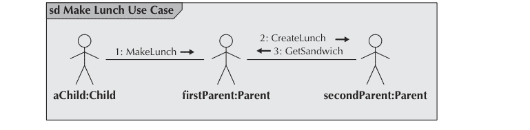

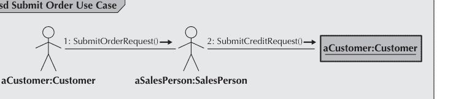

图 6-12 额外的通信示例

¹¹ 对于熟悉结构化分析的人来说，包的作用类似于开发过程。

¹² S.W. Ambler, *The Elements of UML 2.0* (Cambridge, England: Cambridge University Press, 2005).

# 交互图

在尝试理解消息的顺序时，应该使用序列图。但是，请记住序列图以上到下的方式描绘消息的时间顺序。如果你的重点是消息的时间顺序，我们建议你也使用序列图。

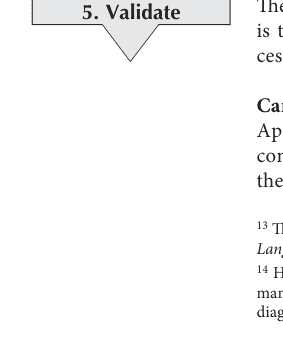

# 第 6 章 行为建模

## 图 6-13 “添加公寓”用例的通信图

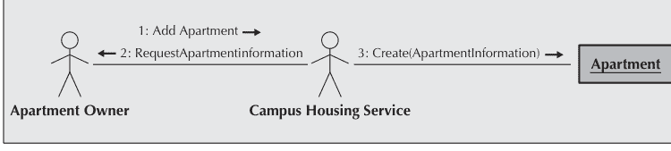

公寓所有者参与者与校园住房服务参与者之间的关联，以及校园住房服务参与者与“公寓”对象之间的链接。利用这些信息，我们绘制显示参与者、对象以及它们之间关联的图。最后，我们在关联处加上适当的消息。图 6-13 描述了该用例的通信图。

### 图书馆示例

与序图绘制示例一样，我们回到图书馆收藏管理系统的“借阅书籍”用例。在这种情况下，为了设定图的上下文，我们访问了一位没有有效身份 ID 但欠有罚金或逾期书籍的学生。我们创建了两个通信图，与绘制序图的过程一样，我们复习了用例描述中的事件流（见图 6-6）、活动图（见图 6-7）以及用例图（见图 6-8）。

下一步是识别场景中的参与者、对象和关联。在两种场景中，参与者都是学生、管理员和注册员数据库。然而，由于“没有有效身份 ID 的学生”场景处于流程早期，场景中没有对象。“拥有有效身份 ID 但欠有或有逾期书籍的学生”包含一个对象：借阅（`Borrow`）。两种场景都与学生、管理员参与者之间有关联，且管理员与注册员数据库之间有关联。“拥有有效身份 ID 但欠有罚金或有逾期书籍的学生的场景，管理员参与者与“借阅”对象之间存在关联。

下一步是绘制图。在两种情况下，由于是学生发起的流程，我们将“学生”参与者放置在图的最左侧。然后我们根据它们参与流程的顺序将其他参与者放置在图中。我们将代表“拥有有效身份 ID 但欠有或有逾期书籍的学生”的对象放在图的最右侧，以反映大多数西方文化从左到右、从上到下的阅读习惯。

现在我们在参与场景的参与者和对象之间放置相关的关联。在这一步中，我们为关联添加消息。我们再次复习了用例描述的事件流（见图 6-6），以识别消息的方向性和意图。图 6-14 和 6-15 展示了这些通信图。

## 图 6-14 “没有有效身份 ID 的学生”通信图

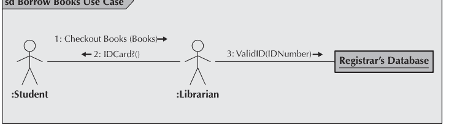

## 行为状态机

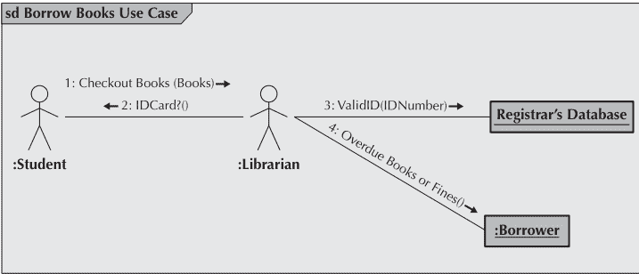

图 6-15 “拥有有效身份 ID 欠有罚金或有逾期书籍的有效学生”通信图

最后一步是验证图的正确性。与序图一样，因为我们绘制的是特定实例版本的通信图，我们还必须为其他场景绘制剩余的七张图。

## 行为状态机

类图中的某些类代表了一组动态对象，这些对象在它们的生命周期内会经历各种状态。例如，患者可以根据其在诊所的状态从“新”转变为“旧”。行为状态机是一种动态模型，显示了对象在其生命周期内响应事件时所处的不同状态，以及其响应和动作。通常，行为状态机并不用于所有对象；而是用于复杂对象，以进一步定义它们，并帮助简化其方法的算法设计。所展示的行为状态机用于理解单个类的动态方面，以及它如何随时间演变；而交互图显示了不同对象之间如何交互。总而言之，行为状态机应该用于理解单个类在特定用例或一组对象上执行的用例中的动态方面。

在本节中，我们描述了状态、事件、转换、动作和活动。我们解释了行为状态机如何通过复杂对象的传递过程来建模状态变化。通过交互图，当我们为对象创建行为状态机时，可能会发现需要包含在功能模型（见第 4 章）中的额外事件，以及需要包含在结构模型（见第 5 章）中的额外操作，因此我们的交互图可能需要再次进行修改。由于面向对象的开发是迭代且增量的，对系统不断演进的模型（功能、结构和行为）进行这种持续修改是预之中的。

## 状态、事件、转换、动作和活动

对象的状态由其在特定时间点的属性值以及与其他对象的关系定义。例如，一个患者可能处于“当前”或“过往”状态。对象的属性或特性会影响它所处的状态，但并非

> 15 一些作者将此称为对对象生命周期建模。

所有属性或属性的变化都会产生影响。例如，考虑患者的地址。这些信息对患者状态的影响微乎其微。然而，如果状态是基于患者的地理位置（例如，本地患者的治疗方式与外地患者不同），那么患者地址的改变就会影响状态的变化。

事件发生在特定的时间点并改变描述对象的值，反过来改变了对象的状态。它可以是指定的条件为真、对象对方法的调用，或者是指定时间的流逝。对象的状态定义了响应将会是什么。

转换是表示对象从一个状态移动到另一个状态的关系。某些转换带有守卫条件。守卫条件是一个包含值的布尔表达式，只有当条件为真时转换才会发生。对象根据事件触发的动作的结果从一个状态移动到另一个状态。动作是原子的、不可分解的进程。从实际角度来看，动作消耗的时间为零，并且与转换相关。相比之下，活动是非原子的、可分解的进程，可以被中断。活动需要长时间才能完成，并且可以由动作启动和停止。

## 行为状态机的元素

图 6-16 展示了一个在医院环境背景表示患者的行为状态机示例。从图中我们可以得知，患者进入医院并在登记后被入院。如果医生发现患者健康，或者在两周后他释放并不再是患者。如果发现患者不健康，他将继续接受观察，直到诊断发生。

状态是描述在特定时间点的对象的值集合，代表对象生命中满足某些条件、执行某些动作或等待某事发生的点（见图 6-17）。在图 6-16 中，状态包括进入、入院、释放和观察。状态由状态符号表示，这是一个带有圆角的矩形，并有一个描述性标签用以通信特定的状态。有两个例外。初始状态使用一个小实心圆表示，而对象的最终状态显示为一个包含一个小实心圆的圆。这些异常分别表示了对象的进入和终止存在。

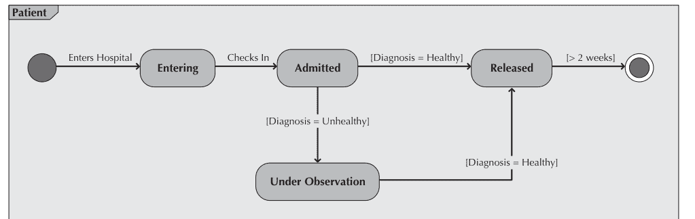

图 6-16 行为状态机示例图

箭头用于连接状态符号，表示状态之间的转换。每一行都标记有相应的事件名称以及任何可能适用的参数或条件。例如，从“已入院”到“已释放”以及“午餐中”状态的两次转换包含了守卫条件。在其他行为对话中，许多情况下，使用框架显式地显示行为状态机的上下文是有用的。

图 6-18 展示了另外两个行为状态机。第一个是午餐（`lunch`）对象，它与图 6-3 和 6-12 中的“制作午餐”场景相关。在这种情况下，显然捕获了关于午餐对象的额外信息。例如，图 6-3 和 6-12 的场景并没有包含有关午餐或准备的信息。这意味着在处理午餐处理的系统中，必须包含额外的用例和/或用例场景。第二个行为状态机处理订单的生命周期。订单对象与图 6-3 和 6-12 中描述的“提交订单”场景相关。与午餐示例一样，这个行为状态机包含了大量的额外信息。对于订单处理系统，额外的

| 术语和定义 | 符号 |
|---|---|
| 状态： | |
| - 显示为带圆角的矩形。<br>- 有一个表示对象状态的名称。 | `aState` |
| 初始状态： | |
| - 显示为一个小的实心圆。<br>- 代表对象开始退出的点。 | |
| 终止状态： | |
| - 显示为一个环绕状态的圆，内部有一个实心圆（靶心）。<br>- 代表活动的完成。 | |
| 事件： | |
| - 是触发状态改变的值得注意的发生。<br>- 可以是指定的条件变为真、从一个对象接收到另一个对象的显式信号，或者指定时间的流逝。<br>- 用于标记转换。 | `anEvent` |
| 转换： | |
| - 表示第一个状态中的对象将进入第二个状态。<br>- 由标记转换的事件发生而触发。<br>- 显示为从一个状态到另一个状态的实箭头，并用事件名称标记。 | |
| 框架： | |
| - 表示行为状态机的上下文。 | `Context` |

图 6-17 行为状态机图语法

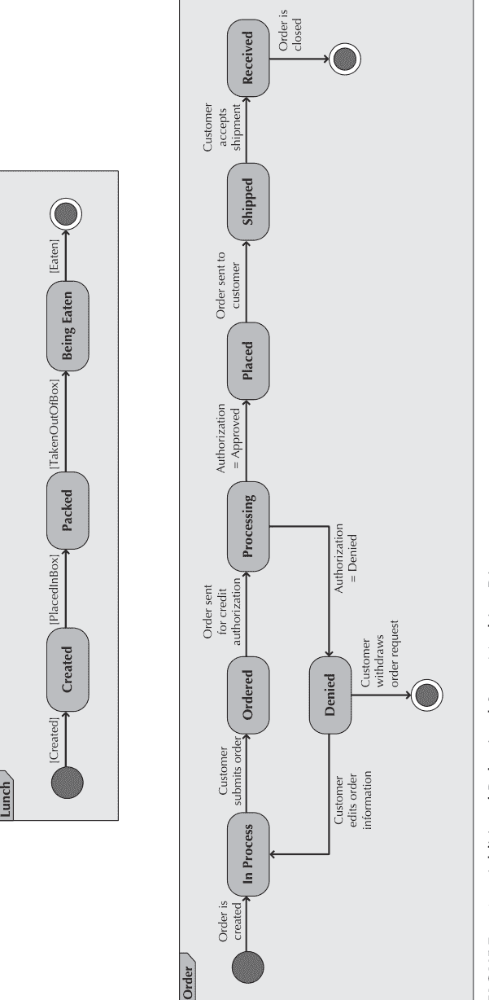

# 行为状态机


对比。


**图 6-19** 状态与子类

时序图和通信图是必要的，以完全表示与订单对象相关的处理。显然，因为行为状态机可以发现额外的处理需求，它们在完善不断演进系统的完整描述方面非常有用。

有时，状态和子类可能会被混淆。例如，在图 6-19 中，`Freshman`（大一）、`Sophomore`（大二）、`Junior`（大三）和 `Senior`（大四）类是 `Undergraduate`（本科）类的子类，还是 `Undergraduate` 类的实例在其生命周期内会经历的状态？在这种情况下，后者是更好的答案。在结构建模（第 5 章）期间尝试识别所有潜在类时，你实际上识别的是相关子类的状态，而不是子类。这是功能模型、结构模型和行为模型如何如此紧密交织的另一个例子。从建模的角度来看，虽然我们从结构模型中移除了 `Freshman`、`Sophomore`、`Junior` 和 `Senior` 类，但在结构建模期间捕获信息并根据行为建模期间的发现将其移除，比直接遗漏它并冒着错过关于问题领域关键信息的风险要好。请记住，面向对象的开发是迭代和增量的。随着我们向问题领域的正确模型迈进，我们会犯许多错误。

# 创建行为状态机的指南

与时序图和通信图一样，Ambler 建议在绘制行为状态机时遵循一套指南。在这种情况下，我们考虑了他的部分建议。¹⁶

- 针对对象行为的行为状态机根据对象的状态发生变化。换句话说，不要为一个行为无论状态如何都始终相同的对象创建行为状态机。这些对象是简单的。
- 遵循西方文化的从左到右、从上到下的阅读习惯，初始状态应该画在图的左上角，终止状态画在图的右下角。
- 确保状态名称简单、直观易懂。例如在图 6-6 中，患者对象的状态是进入、入院、观察中和释放。
- 质疑黑洞状态和奇迹状态。这些类型的问题与黑洞和奇迹活动在活动图（第 4 章）中的问题相同。黑洞状态（对象进入又离开的状态）实际上是终止状态。奇迹状态（对象离开但从未进入的状态）极可能是初始状态。
- 确保所有守卫条件都是互斥的（不重叠）。例如在图 6-6 中，守卫条件 `[Diagnosis = Healthy]` 和守卫条件 `[Diagnosis = Unhealthy]` 不重叠。

# 创建行为状态机

第一步是识别对象在其生命周期内的状态。识别对象状态的一种简单方法是写下从开始到结束随时间发生的事件，类似于如何创建用例。第二步是确定对象将经过的状态序列。使用该序列，将状态从左到右放置在行为状态机。

第三步是识别状态之间的转换，并添加与转换相关的事件、动作和守卫条件。事件是导致对象从一个状态移动到下一个状态的触发器。换句话说，事件导致动作以某种方式改变对象属性的值。此外，守卫条件可以作为转换发生的测试条件。在此过程中，转换画在相关状态之间，并用事件、动作或守卫条件标记。

第四步是验证行为状态机，确保每个状态都是可到达的，并且除了终止状态外都可以离开。显然，如果识别的状态不可达，要么缺少了转换，要么状态识别错误。只有终止状态可以在对象生命周期结束时到达。

第五步是识别行为状态机的上下文。行为状态机的上下文通常是整个系统。然而，使用框架显式地显示行为状态机的上下文是有用的。


# 行为状态机


第二步是识别对象在其生命周期内的状态。执行此操作所需的信息是从阅读用例描述、与用户交流以及使用第 3 章中学的技术中获得的。行为状态机的上下文通过识别对象的初始和终止状态来显示。

| 6. 设置上下文 | | Am.. of of of of of of of0000000000000000000000000000000000000000000000000 |

校园住宿服务的功能和结构模型（见图 6-4），在这种情况下，我们将为 `Apartment`（公寓）类创建一个行为状态机。在这种情况下，公寓在添加时产生，在被删除时消失。它的唯一状态是租赁。图 6-20 展示了该类的行为状态机。

# 图 6-20 公寓类的行为状态机


# 第 6 章 行为建模


图 6-21 图书书籍馆藏管理系统类图

图书馆示例 描述行为状态机的第一步是设定上下文。对于我们的目的而言，上下文通常是一个类的实例，该类具有多个状态，且其行为取决于它当前所处的状态。正如前面提到的，我们回顾了类图（见图 6-21）以识别“有趣的”类。在图书馆书籍馆藏管理系统的案例中，显而易见的类是 `Book`。

下一步是识别 `Book` 实例在整个生命周期内可能遍历的不同状态。寻找可能状态变化的地方包括用例描述（见图 6-9）、活动图（见图 6-7）以及时序图（见图 6-14 和 6-15）。对于一本书来说，尽管这些状态可能相似，但我们在识别与 `Book` 实例相关的状态时必须小心。该状态并非与书籍本身相关的状态。在第 5 章中，我们观察了需要考虑的隐含状态数量。我们包含了 `Checked Out`（已借出）、`Overdue`（逾期）、`Requested`（已预约）、`Available`（可用）和 `Damaged`（已损坏）。如果书籍损坏了，书籍可以被修复并重新流通，也可以由于损坏严重无法修复而从流通中移除。尽管借用者可能因为书籍逾期或损坏而被罚款，但“罚款”并不是书籍的状态，而是借用者的状态。

接下来，我们根据逻辑按顺序列出状态的顺序。例如，让一本书从“修复状态”变为“损坏状态”是没有意义的。一本书直接从“可用状态”变为“逾期状态”也是不合理的；但相反则是合理的。我们为 `Book` 对象识别出的状态包括 `Available`、`Checked Out`、`Requested`、`Overdue`、`Damaged` 和 `Being Repaired`（维修中）。我们在状态之间添加了转换，并用相应的守卫进行了标记。

# 粗略分析


图 6-22 图书书籍管理系统中 `Book` 类实例的行为状态机

`Book` 类实例的行为状态机如图 6-22 所示。检查缺失的转换并确保……

最后，我们通过确保没有黑洞状态或奇迹状态来验证该图。

# CRUDE 分析


一种识别问题领域中的底层对象如何协作以支持用例的技术是 CRUDE 分析。CRUDE 分析使用一个 CRUDE 矩阵，其中对象之间的每次交互都用字母标记类型：C 代表创建（create）、R 代表读取（read）、U 代表更新（update）、D 代表删除（delete）、E 代表执行（execute）。在面向对象的方法中，使用类/执行者矩阵。矩阵中的每个单元格代表类实例之间的交互。例如，在图 6-1 中，`Receptionist`（接待员）的实例创建了一个 `Appointment`（预约）类的实例。使用行列法，在 `Reception:Appointment` 单元格中放置一个 C。在图 6-1 中，`Receptionist` 的实例引用了 `Appointments` 类的实例。同样在 `Reception:Appointments` 中放置一个 R。图 6-23 显示了基于“Made Old Patient App”用例的 CRUDE 矩阵。CRUDE 矩阵最常作为系统的范围表示。为系统完成一次 CRUDE 分析，

> ¹¹⁸ CRUDE 分析通常与结构化分析和设计相关[参见 Alan Demis, Barbara Haley Wilson and M. Roberta, *Systems Analysis 3rd ed. (New York: Wiley, 2006)*] 以及信息工程（参见 James Martin, *Information Engineering: The New World Approach to object-oriented systems, NJ: Prentice Cliffs, Hawaii*）。在我们的案例中，我们添加了 E 来表示面向对象的开发。对于面向对象的系统，不是创建、更新或删除，而是执行。对于面向对象的系统中，这种方法是有效的。
> ¹⁹ CRUDE 矩阵的另一种有用形式是执行者/执行者矩阵。在验证的目的情况下，这种方法是有效的。

# 第 6 章 行为建模

| Receptionist | PatientList | Patient | UnpaidBills | Appointment |
|---|---|---|---|---|
| Receptionist | | | RU | RU |
| PatientList | | | | |
| Patient | | | | |
| UnpaidBills | | | | |
| Appointment | | | | |

图 6-23 基于 Make Old Patient App 用例的 CRUDE 矩阵。CRUDE 矩阵最常作为系统的范围表示。为系统完成一次 CRUDE 分析，

矩阵可以快速扫描以确保没有缺失的转换。例如，如果一个类只表示数据，那么它在矩阵中应该有 D。除非书籍的实例在另一个系统中创建，否则它们将永远被删除。通过这种方式，CRUDE 分析可以用于面向对象的系统交互。最后，对于类之间的交互，我们在下一章中讨论。对于类实例之间的交互，类实例更有可能具有复杂的生命周期。因此，对象是状态机建模的候选对象。

## 宿舍管理示例

在第四章和第五章中，我们为宿舍管理服务创建了功能和结构模型。在本节中，我们将这些模型作为执行 CRUDE 分析的基础。我们首先做的是识别参与宿舍管理服务的所有执行者和类。在这种情况下，执行者是 `apartment owner` 和 `student`，类是 `apartment owner` 和 `apartment`。基于此，我们的 CRUDE 矩阵是一个 4x4 矩阵。在这个简单的示例中，我们只支持创建、读取和删除。具体来说，`apartment owner` 执行者可以创建和删除 `apartment` 实例，而 `student` 执行者可以读取 `apartment` 和 `apartment owner`。图 6-24 展示了宿舍的 CRUDE 矩阵。

| Apartment Owner Actor | Student Actor | Apartment Owner Class | Apartment Class |
|---|---|---|---|
| Apartment Owner Actor | | | C,D |
| Student Actor | | R | R |
| Apartment Owner Class | | | |
| Apartment Class | | | |

然而，审查矩阵后，尽管 `apartment owner` 的实例被读取，但它们从未被创建。除非 `apartment owner` 的实例在另一个系统中创建，否则这是一个不可持续的情况。这就是为什么我们在面向对象系统开发中遵循迭代和增进的方法示例。在这个案例中，通过创建 CRUDE 矩阵，我们发现了一个之前遗漏的额外需求。因此，我们需要返回并添加与额外的 `staff member` 执行者相关的额外用例（见图 6-25）。显然，在此时我们应该修改用例图；添加时序图；添加通信图；并审查类图；行为状态机以确保它们仍然正确。我们将这些修改留给你们，并回到在本章及之前的章节中使用的图书馆问题上。

| Apartment Owner Actor | Student Actor | Staff Member Actor | Apartment Owner Class | Apartment Class |
|---|---|---|---|---|
| Apartment Owner Actor | | | | C,D |
| Student Actor | | | R | R |
| Staff Member Actor | | | C,D | |
| Apartment Owner Class | | | | |
| Apartment Class | | | | |

图 6-25 修正后的宿舍 CRUDE 矩阵

| 学生参与者 | 员工参与者 | 访问者参与者 | 图书员参与者 | 人员参与者 | 注册处参与者 | 书籍 | 集合 | 学生类 | 教师/员工类 | 访问者类 | 借阅系统 | 图馆 | 存储 |
| :--- | :--- | :--- | :--- | :--- | :--- | :--- | :--- | :--- | :--- | :--- | :--- | :--- | :--- |
| 学生参与者 | | | | | | | R | | | | | | |
| 员工参与者 | | | | | | | R | | | | | | |
| 访问者参与者 | | | | | | | | | | | | | | |
| 图书员参与者 | | | | E | | | | | | | | | |
| 人员参与者 | | | | E | C,R,D,E | | R,U | | | | | | |
| 注册处参与者 | | | | | E | | | | | | | | |
| 书籍 | | | | | | | R,E | | | | | | | |
| 集合 | | | | | | | | | | | | | | | |
| 学生类 | | | | | | | | | | | | | | |
| 教师/员工类 | | | | | | | | | | | | | | | |
| 访问者类 | | | | | | | | | | | | | | | |
| 借阅系统 | | | | | | | | | | | | E | | |
| 图馆 | | | | | | | | | | | | E | | |
| 存储 | | | | | | | | | | | | R,E | | |

图 6-26 图馆书籍管理系统的 CRUDE 矩阵

## 验证与测试行为模型

在本章中，我们描述了三种不同的图表（序图、通信图和行为状态机）以及用于表示行为模型的 CRUDE 矩阵。序图和通信图对支持系统内业务流程的类实例之间的交互进行了建模，行为状态机描述了对象在其生命周期中的变化，而 CRUDE 矩阵则代表了系统中对象之间交互的系统级概述。在本章中，我们将走演与 CRUDE 矩阵相结合，以更完整地验证和测试行为模型。我们在上一节中涵盖了 CRUDE 分析和矩阵，因此在本节中我们只关注走演。我们使用预约系统，并关注图 6-1、6-10、6-16 和 6-23，描述一组用于确保行为模型内部一致的规则。

首先，序图中包含的每个参与者和对象都必须作为参与者和对象包含在通信图中，反之亦然。例如在图 6-1 和 6-10 中，`aleReceptor` 和 `Patients` 出现在两个图中。

其次，如果序图上有消息，反之亦然。例如，图 6-1 描绘了从 `aleReceptor` 发到 `Patient` 对象的消息，相应的通信图中出现了匹配的关联（见图 6-10）。

第三，序图上的每个关联都必须作为消息出现在相应的通信图中，反之亦然。例如，序图上 `aleReceptor` 发给 `Patient` 对象的 `LookUpPatient()` 消息（见图 6-1）出现在 `aleReceptor` 和 `Patient` 对象之间的关联中（见图 6-10）。

第四，如果序图上出现守护条件，则在相应的通信图中必须有等效守护条件，反之亦然。例如，从 `aleReceptor` 发到 `UpBills` 对象的消息具有守护条件 `[aPatientExists]`（见图 6-1）。图 6-10 显示了包含在通信图中的匹配守护条件。

第五，作为消息标签一部分的每个数字都意味着消息发送的顺序顺序。它必须与序图中发送的消息的从上到下的顺序对应。例如，序图上 `aleReceptor` 发到 `Patient` 对象的 `LookUpPatient()` 消息（见图 6-1）首先来自图的顶部。

第六，行为状态机中的所有转换都必须与序图和通信图中发送的消息相关联，并且在 CRUDE 矩阵中必须分类为 C（创建）、U（更新）或 D（删除）消息。在 CRUDE 矩阵中，行为模型描述了对象遍历其生命周期的变化。此外，代表系统中对象参与者之间交互的 20 处引用：S.W. Amber, *The Elements of UML 2.0 Style* (Cambridge, England: Cambridge University Press, 2005)。

第七，CRUDE 矩阵中的 U（更新）项表示了行为模型。

# 第 236 页 第 6 章 行为建模

## 问题

1. 行为建模与功能建模、结构建模之间有什么关系？
2. 用例与时序图、通信图有关系吗？
3. 对比以下术语组：状态、行为、类、对象、动作和活动。
4. 为什么在创建行为模型时，迭代是重要的？
5. 时序图的主要构建模块是什么？它们在模型中是如何表示的？
6. 如何在时序图中显示临时对象的消失？
7. 生命线（`Lifelines`）会贯穿整个时序图吗？请解释原因。
8. 描述创建时序图的步骤。
9. 绘制时序图时应该遵循哪些指南？
10. 描述通信图的主要区块及其在模型中的表示方式。
11. 如何在通信图中显示消息的序列/顺序？
12. 如何在通信图中显示消息的方向？
13. 描述创建通信图的步骤。
14. 绘制通信图时应该遵循哪些指南？
15. 行为状态机中的状态是否总是用圆角矩形表示？
16. 什么类型的事件可以导致行为状态机上的转换？
17. 行为状态机中的步骤有哪些？
18. 绘制行为状态机时应该遵循哪些指南？
19. 行为状态机上如何显示守护条件（`guard conditions`）？
20. 描述行为状态机所代表的类类型。给出两个可以作为行为状态机的类示例。
21. 什么是 CRUD 分析？它有什么用？
22. 哪些模型包含了以下每个组件：参与者、关联、类、扩展（`extends`）、关联、状态、守卫条件、初始状态、链接、消息、对象、状态、转换和更新操作。

## 练习题

A. 想象一封写给内部笔友的一手信。从信件的角度出发，描述信件从你最初创建到被你阅读所经历的过程。绘制一个行为状态机，描述信件所移动的状态。


B. 绘制一个行为状态机，描述差旅许可所经历的各种状态。差旅审批用于批准费用报销。通常情况下，员工填写空白表格并发送给老板审批。如果金额合理，老板会在表上签字并将其路由到应付款部门以输入会计系统。系统开具一张金额正确的支票发送给员工，在支票兑现后，表单与注销的支票一起归档。如果90天内未兑现，差旅表单将过期。当差旅凭证的金额较大（500美元）时，老板会在表上签字并发送给首席财务官（CFO），并附上一段解释差旅目的文字；CFO签字后将其转交给应付款部门。如果他们认为费用不合理，在这种情况下，员工可以修改表格以包含更多细节或对费用进行解释。

C. 想象你所在大学的学生招生系统。该系统的主要功能应该能够跟踪学生从请求信息开始，直到学生被录取或被拒绝的整个过程。

- 1. 编写一个可以描述以下内容的用例描述：假设校友子女身份申请者的处理方式与其他申请者不同。此外，假设系统有一个通用的“更新学生信息”用例可供使用。


- 2. 创建一个用例图来描述以下内容：假设校友子女身份申请者的处理方式与其他申请者不同。此外，假设系统有一个通用的“更新学生信息”用例可供使用。

（注：此处原文存在重复不完整）

- 如果他们认为费用不合理。在这种情况下，员工可以修改表格以包含更多细节或对费用进行解释。

- 在信件发送后，这些人员被考虑（录取过程中）。

- 4. 创建这些用例的时序图。

- 5. 创建这些用例的通信图。

- 6. 使用行为状态机来表示这些过程。

- 7. 使用 CRUD 分析来显示对象的交互性。

D. 包含以下组件的模型（J、K、P、Q）：

- 1. 绘制一个行为状态机。

- 2. 使用行为状态机来表示这些类。

- 3. 使用行为状态机来表示这些类。

- 4. 使用 CRUD 分析来显示对象的交互性。

- 5. 验证和确认（verification and validation）。

E. 包含以下组件的模型（L、M、R、S）：

- 1. 绘制一个行为状态机。

- 2. 使用行为状态机来表示这些类。

- 3. 使用行为状态机来表示这些类。

- 4. 使用 CRUD 分析来显示对象的交互性。

- 5. 验证和确认（verification and validation）。

F. 包含以下组件的模型（O、P、T、U）：

- 1. 绘制一个行为状态机。

- 2. 使用行为状态机来表示这些类。

- 3. 使用行为状态机来表示这些类。

- 4. 使用 CRUD 分析来显示对象的交互性。

- 5. 验证和确认（verification and validation）。

G. 包含以下组件的模型（R、S、V、W）：

- 1. 绘制一个行为状态机。

- 2. 使用行为状态机来表示这些类。

- 3. 使用行为状态机来表示这些类。

- 4. 使用 CRUD 分析来显示对象的交互性。

- 5. 验证和确认（verification and validation）。

H. 包含以下组件的模型（U、V、X、Y）：

- 1. 绘制一个行为状态机。

- 2. 使用行为状态机来表示这些类。

- 3. 使用行为状态机来表示这些类。

- 4. 使用 CRUD 分析来显示对象的交互性。

- 5. 验证和确认（verification and validation）。

## 迷你案例

- 1. 参考第 4 章专业与科学人员管理（PSSM）迷你案例中准备的功能模型（用例图、活动图和用例描述）。基于你的表现，PSSM 非常满意，它希望开发结构和行为模型。

- 2. 参考你在第 5 章为差旅车辆迷你案例创建的结构模型（CRC 卡片和类图）。基于你的表现，差旅车辆非常满意，它希望你开发功能和行为模型。

# 第 7 章

## 进入设计阶段

# 第二部分

## 设计建模


# 第 8 章

## 类与方法设计


分析建模侧重于演进系统的功能性需求，而设计建模包含了非功能性需求。也就是说，设计建模侧重于系统将如何运行。接下来，第一个项目将验证并确认分析模型（功能性、结构和行为模型）。接着，创建一组经过分解和划分的分析模型。使用类规范（使用 CRC 卡和类图）、契约和方法规范来演示类和方法的设计。接下来，通过设计用于对象持久化的实际数据库或文件结构来处理数据管理层，并创建一组将类规范映射到对象持久化格式的类。同时，团队利用场景、窗口模板、故事板、窗口布局图和接口原型制作用户界面设计。使用部署图和硬件规格创建物理架构层设计。这一系列交付物构成了交给编程团队进行实施的系统规范。

# 第 9 章

## 数据管理层设计


# 第 10 章

## 人机交互层设计


# 第 11 章

## 物理架构层设计


# 第 7 章

## 进入设计阶段

面向对象的系统开发利用分析阶段收集的需求来为未来系统创建蓝图。成功的面向对象的设计建立在早期阶段学到的知识之上，通过创建清晰、准确的待办计划来引导平滑实施。本章描述从分析到设计的初步转换，并介绍了处理新系统设计的三种方法。

### 目标

- 理解分析模型的验证与确认。
- 理解从分析到设计的转换。
- 理解要素分解、划分和分层的使用。
- 能够创建包图。
- 熟悉自定义、封装和外包设计替代方案。
- 能够创建替代矩阵。

### 引言

分析的目的是弄清楚业务需求是什么。设计的目的是决定如何构建系统。设计期间的主要活动是将分析表示形式集演进为设计表示形式。

在设计期间，项目团队会根据当前环境和整个组织内存在的系统，仔细考虑新系统。确定系统如何工作的主要考虑因素包括因素，例如与现有系统集成、从遗留系统转换数据以及利用内部现有的技能。尽管进行规划和分析是为了开发一个可能的系统，但设计的目标是为可以实施的系统创建一个蓝图。

设计的组成部分是检查几种设计策略，并决定使用哪种来构建系统。系统可以从零开始构建、购买并定制，或外包，项目团队需要调查每种替代方案的可行性。这一决策将影响设计期间需要完成的任务。

同时，必须完成用于映射系统细节以及它们如何存储的单个类和方法的详细设计。如 `CRC` 卡、类图、契约规范、方法规范和数据库设计等技术为实施阶段提供了最终的设计细节，并确保程序员有足够的信息来高效地构建正确的系统。这些主题将在第 8 章和第 9 章介绍。

设计还包括设计用户界面、系统输入和系统输出等活动，这些涉及用户与系统交互的方式。第 10 章详细描述了这三个活动，以及故事板和原型设计等技术，这些技术有助于项目团队设计出满足用户需求且使用良好的系统。

最后，针对将购买的支持新系统的硬件软件以及系统处理的组织方式做出物理架构决策。例如，系统可以组织为使其处理集中在一个位置、分布式，或者集中式和分布式二者兼之，每种选择都为项目团队带来了独特的优势和挑战。全球性问题和安全性会影响所做的实施计划，它们需要与系统的技术架构一起考虑。物理架构和全球问题将在第 11 章中描述。

设计的许多步骤高度相关，与分析阶段的步骤一样，分析师经常在这些步骤之间往复。在这里，界面设计步骤中的原型设计经常揭示系统所需的额外信息。或者，如果为一个具有集中式系统的组织设计系统，且项目团队决定更改一个所有处理都是分布式的系统，可能需要大量的硬件和软件投资。

### 实践 避免经典设计

提示

在第 2 章中，我们讨论了几个经典错误以及如何避免这些错误。在这里，我们总结了四种经典错误：

- 1. 缩减设计：如果时间紧迫，会产生减少功能设计的诱惑。
- 2. 功能蔓延（Feature creep）：即使分析成功，范围蔓延仍可能增加成本。
- 3. 银弹论：分析师有时认为工具可以解决所有问题。
- 4. 中途切换：某些分析师想在项目过程中切换工具。

### 验证与确认分析模型

在我们的表示形式演进为设计表示形式之前，我们需要对当前的模型集进行验证和确认。在本章中，我们的关注在于确保模型的一致性。例如，功能模型和结构模型一致吗？功能模型和行为模型如何？最后，结构模型和行为模型可靠吗？

#### 平衡功能与结构模型

为了平衡功能模型和结构模型，我们必须确保这两组模型是一致的。也就是说，活动、用例描述和图与表示问题领域的 `CRC` 代码和类图一致。图 7-1 显示了功能模型和结构模型之间的交集。规则如下：

- 第一，每个类和每个 `CRC` 代码必须至少与一个用例相关，反之亦然。例如，图 7-3 所示的 `CRC` 卡及其在图 7.4 中的相关类与图 7-5 中的描述相关。
- 第二，活动图（见 7-6）中的每个活动或动作应与 `CRC` 代码上的一个或多个职责以及类图中一个或多个操作相关，反之亦然。例如，用例描述（见 7-5）中的“获取患者信息”活动、用例描述（见 7-3）中的前两个事件以及类图（见 7-4）中的 `makeAppointment()` 操作。
- 第三，活动图上的每个对象节点必须与类图上的至少一个类（即对象）以及类和 `CRC` 代码中的一个 代码或属性相关。然而，在 7-6 中，有一个对象节点 `Appt Request Info` 似乎与图 7-4 中所示的任何类都不相关。因此，要么活动图或类图有误，要么该对象节点代表一个属性。在这种情况下，它并不代表属性。我们可以向图中添加一个类图创建了与活动图中对象节点关联的临时对象。然而，目前尚不清楚哪些操作会与临时对象关联。因此，更好的解决方案是从活动图中删除 `Appt Request` 对象节点。在现实中，该对象节点仅代表了一组绑定的属性值，即在预约系统过程中使用的数据（参见图 7-7）。
- 第四，`CRC` 卡中（以及连接到用例图中的类）的每个属性和关联/聚合关系，都应该是用例描述中主语或实体的子类。例如，在图 7-5 中，第二个事件描述道：

> 患者向接收者提供其姓名和地址。通过查看图 7-3 中的 `CRC` 卡和图 7-4 中的类图，我们看到 `Patient` 类是 `Participant` 类的子类，并继承了 `Participant` 类中定义的所有属性、关联和操作，其中 `name` 和 `address` 属性在此定义。

#### 平衡功能模型与行为模型

正如平衡功能模型和结构模型一样，我们必须确保这两组模型的一致。在这种情况下，活动图、用例描述和用例图必须与序列图、通信图、行为状态机和 CRUDE 矩阵保持。图 7-8 展示了功能模型与行为模型之间的关系。基于这些相互关系，我们看到有四个必须关注的领域。

首先，序列图和通信图必须与用例图和用例描述关联。例如，图 7-9 中的序列图和图 7-10 中的通信图与“Make Old Patient Appt”用例细节的场景相关，该细节出现在图 7-5 的用例描述和图 7-11 的用例图中。

其次，序列图、通信图或 CRUDE 矩阵上的参与者必须与用例图上的参与者关联或在用例描述中引用，反之亦然。例如，图 7-9 案例描述中的 `Patient` 参与者、图 7-10 中的通信图以及图 7-12 中 CRUDE 矩阵的行和列，出现在图 7-11 的用例图和图 7-5 的用例描述中。然而，`Recipient` 未出现在用例中，但在“Make Old Patient Appt”用例描述相关的事件中被引用。在这种情况下，`Recipient` 显然是一个内部参与者，无法通过 UML 的用例图来描绘。

> 执行 CRUDE 分析（参见第 6 章）对于审查功能模型与行为模型之间的交点也可能很有用。

第三，序列图和通信图上的消息、行为状态机的转换以及 CRUDE 矩阵中的项必须与活动图上的活动和用例描述中的事件关联，反之亦然。例如，图 7-9 和 7-10 中的序列中的 `CreateAppt()` 与图 7-7 中的 `CreateAppointment` 活动以及图 7-5 用例描述中的 `S-1: New Appointment` 子流程相关。CRUDE 矩阵中 `Receptionist` 单元格与这些消息、活动相关。

第四，活动图中对象节点表示的所有复杂对象都将有一个表示对象生命周期的行为状态机，反之亦然。如第 6 章所述，复杂对象是非常动态的，会经历多种状态。在这种情况下，活动图（参见图 7-7）不再有任何对象节点，因此没有根据活动图创建行为状态机。

#### 平衡结构模型与行为模型

为了发现结构模型与行为模型之间的关系，我们使用图 7-13 中的概念图。在这种情况下，有五个领域我们必须确保模型之间的一致性。


### 图 7-1 面向对象的分析模型


### 图 7-2 功能模型与结构模型之间的关系

| 正面: | | | |
|---|---|---|---|
| 类名: Patient | ID: 3 | 类型: 具体的, 领域 | |
| 描述: 需要或已接受医疗护理的个人 | 关联用例: 2 | | |
| 职责 | | 协作者 | |
| 预约 | | | |
| 计算上次访问 | | | |
| 更改状态 | | | |
| 提供病史 | 医疗史 | | |

| 反面: | | | |
|---|---|---|---|
| 属性: | | | |
| 金额 (double) | | | |
| 保险公司 (text) | | | |
| 关系: | | | |
| 泛化 (是一种): Participant | | | |
| 聚合 (包含): | | | |
| 其他关联: | 预约, 医疗史 | | |

### 图 7-3 老患者 CRC 卡（图 5）

| 用例名称: Make Old Patient Appt | ID: 2 | 重要性: 低 |
|---|---|---|
| 主要参与者: | Old Patient | 用例类型: 详细, 核心 |
| 利益者及兴趣: | 老患者 - 想要预约、更改或取消预约 医生 - 希望及时满足患者需求 | |
| 简要描述: | 该案例描述了我们为以前见过的患者进行预约或取消预约 | |
| 触发: | 患者致电要求预约、取消或更改现有预约 | 类型: 外部 |
| 关系: | 关联: Old Patient | |
| 包含: | Update Patient Information | |
| 扩展: | | |
| 泛化: | Manage Appointments | |
| + 正常流程事件: | | |
| 1. 患者联系办公室预约。 | | |
| 2. 患者向接待员提供姓名和地址。 | | |
| 3. 如果患者信息发生变化，执行 Update Patient Information 用例。 | | |
| 4. 如果患者支付发生变化，执行 Make Payments 用例。 | | |
| 5. 接待员询问患者是否想要新预约、取消预约或更改现有预约。如果患者想进行新预约，执行 S-1: new appointment 子流程；如果患者想取消现有预约，执行 S-2: cancel appointment 子流程；如果患者想更改现有预约，执行 S-3: appointment 子流程。 | | |
| 6. 接待员向患者提供交易结果。 | | |
| + 子流程: | | |
| S-1: New Appointment | 1. 接待员询问患者可能的预约时间。 2. 接待员将患者期望的预约时间与可用日期匹配并安排新预约。 | |
| S-2: Cancel Appointment | 1. 接待员询问患者旧的预约时间。 2. 接待员在预约文件中找到当前预约并将其取消。 | |
| S-3: Change Appointment | 1. 接待员执行 S-2: cancel appointment 子流程。 2. 接待员执行 S-1: new appointment 子流程。 | |
| 备选/异常流程: | | |
| S-1, 2a: 接待员根据可用情况提一些替代时间。 S-1, 2ab: 患者选择建议的时间之一或决定不预约。 | | |

### 图 7-5 Make Old Patient 用例的用例描述（图 4-13）


### 图 7-6 Manage Appointments 用例的活动图（图 4-8）


### 图 7-7 Manage Appointments 用例的修正后活动图


### 图 7-9 Make Old Patient Appt 用例场景的序列图（6-1）


### 图 7-13 结构模型与行为模型之间的关系


图 7-10 Make Old Patient Appt 用例场景的通信图（6-10）

> ⁴ 角色扮演（参见第 5 章）和 CRUDE 分析（参见第 6 章）对于这项工作也可能很有用。

# 第 7 章 转向设计

## 预约系统


图 7-11 预约系统的修改后用例图（图 4-21）

| 接待员 | 患者列表 | 患者 | 未付账单 | 预约单 | 预约详情 |
|---|---|---|---|---|---|
| 患者列表 | | RU | CRUD | R | RU | CRUD |
| 患者 | | | R | | | |
| 未付账单 | | | | | | |
| 预约单 | | | | | | R |
| 预约详情 | | | | | | |

图 7-12 “为老患者预约”用例的 CRUDE 矩阵（图 6-23）


## 患者

图 7-14 医院患者的行为状态机（图 6-16）

首先，出现在 CRUDE 矩阵中的对象必须与 CRC 卡片表示的类相关联，且必须出现在类图上，反之亦然。例如，图 7-12 中 CRUDE 矩阵中的 `Patient` 类与图 7-3 中的 CRC 卡片以及图 7-4 类图中的 `Patient` 类相关联。

其次，由于行为状态机代表了复杂对象的生命周期，它们必须与类图上的类实例（对象）相关，并与代表该实例类的 CRC 卡片相关。例如，图 7-14 中描述患者实例的行为状态机意味着在相关的类图（见图 7-4）上存在 `Patient`，并且为相关的类存在 CRC 卡片（见图 7-3）。

第三，通信图和时序图包含的对象必须是类图上 CRC 卡片所表示的类的实例化。例如，图 7-9 和 7-10 中有一个 `App` 对象，它是 `Appointment` 类的实例化。因此，`Appointment` 类必须存在于类图中（见图 7-4），并且应该存在一个描述它的 CRC 卡片。然而，通信图和时序图上的对象与类图中不存在的类相关联，这可以通过添加这些类或重新思考通信和时序图来解决（见图 7-15）。

第五，行为状态机必须与描述对象的不同值或属性集相关。例如，患者对象的行为状态机意味着在类的定义中应该包含某些属性需求。

## 总结

图 7-16 展示了一个概念图，它是本节涵盖的图表之间相互关系的完整视图。从该图的复杂性可以显易看出这


图 7-16 面向分析模型之间的相互关系

## 演进分析模型

平衡所有的功能、结构和行为模型是一项非常耗时、枯燥且困难的任务。然而，如果不对代表系统的模型投入这种程度的关注，这些模型将无法为设计和构建系统提供可靠的基础。

### 将分析模型演进为设计模型

既然我们已经成功地验证并确认了分析模型，现在我们需要开始将它们演进为适当的设计模型。分析模型的目的是用一组协作对象来表示底层的业务领域。分析活动识别了非功能性需求（例如性能、用户界面和数据库问题）。相比之下，设计模型的主要目的是以负担得起且易于维护的方式实现需求。因此，在系统设计中，我们同时处理功能性和非功能性需求，以确保系统的成功。

从面向对象的角度来看，设计模型完善了分析模型中已经包含的系统环境（解决方案）细节。在将分析模型演进为设计模型时，你应该首先审查类集合（操作、属性以及它们之间的关系）。所有的类都是必要的吗？是否存在缺失的类？它们是否有不必要的属性或方法？演进中的系统表示是否是最优的？显然如果我们已经验证并确认了分析模型，那么这部分工作已经完成。然而，面向对象的设计是迭代的。因此，我们必须再次审查分析模型。然而，这一次我们是透过设计的视角来看问题。在这一步中，我们对模型进行修改，以提高系统的效率和效果。

在接下来的章节中，我们引入析构、分区和协作并将分析模型引入设计模型。从增强的统一过程来看（见图 1-16），我们正在从分析工作流转向设计工作流，并进入详细化（Elaboration）阶段并部分进入构造（Construction）阶段。

### 析构

析构是将一个模块分离为独立模块的过程。新模块可以是一个新类或一个方法。例如，在审查一组类时，可能会发现它们具有相似的属性和方法。因此，将相似性析构到一个父类中可能是合理的。取决于新类是否应该与现有类建立关系，可以将相似性析构到父类中。在预约系统示例，如果该类没有被识别，我们可以通过析构护士、接待员和医生将其与现有类关联，通过泛化（a-kind-of）或可能通过聚合（has-parts）关系。

抽象和细化是与析构紧密相关的两个过程。抽象处理的是从一组想法中创建更高层次的想法。识别 `Employee` 类是从低层类抽象到高层的类。在某些情况下，抽象过程识别出抽象类，而细化过程是抽象过程的反面。在预约系统中，我们可以识别 `Employee` 类的子类，如秘书和会计。或者在它们之间存在足够的差异时添加新类，否则通用的 `Employee` 类即可。

### 分区和协作

基于演进系统中可能发生的所有析构、细化抽象，系统表示的大小可能会让用户和开发者过载。在演进的这一阶段，将表示分为一组分区可能是合理的。分区是对子系统的面向对象评估，子系统是将较大的系统分解为组件系统（例如，应付系统、应收系统、工资系统等）。从面向对象的角度来看，分区基于对象系统中对象之间的活动模式（发送的消息）。我们在本章后面介绍了建模分区和协作的方法：包和包设计。

寻找潜在分区的好地方是协作（见第 6 章）。如果你记得，识别协作的一种方法是为每个用例创建一个通信图。然而，因为同一个类可以支持多个用例，同一个类可以参与多个基于用例的协作。在支持用例合并的情况下，协作也应该合并。应该审查类图以查看不同类之间是如何相互相关的。例如，如果类的属性具有复杂的对象类型（如人员、地址或部门），而这些对象类型没有在类图中建模，我们需要识别这些隐含的关联。创建一个结合了类图和通信图的图非常有用，可以显示哪些类应该耦合。类之间的耦合越大，它们越应该在协作或分区中组合在一起。通过使用 CRUDE 方法，我们可以利用 CRUDE 分析识别可以组合成协作的类的最简单技术之一是通过聚类。不同的统计技术允许团队根据亲和性对类进行分组。亲和性可以基于它们之间发送的消息的语义关系（创建、读取、更新、删除或执行）。有很多不同的相似性度量和许多基于此的算法，因此在使用这些技术时必须小心。确保通过这些技术识别出的从领域的角度来看是合理的。仅仅因为数学算法建议将类组合在一起，并不意味着它们确实应该是如此。然而，这是创建第一批协作集合的良好方法。

根据合并后的协作的复杂度，可能会将该协作分解为多个分区。在这种情况下，除了对象之间存在协作外，分区之间也可能存在协作。通用规则是：对象之间发送的消息越多，这些对象属于同一个分区的概率就越大。发送的消息越少，这两个对象属于在一起的概率就越小。

识别潜在分区的另一个有用方法是根据服务合同在对象之间进行协作。客户端是类的一个实例，它向另一个类的实例发送消息以执行某个方法；服务器是接收消息的类实例；而合同是形式化客户端和服务器对象之间交互的规范（见第 5 章和第 8 章）。这种方法允许开发人员通过查看对象之间已指定的合同来构建潜在的分区。在这种情况下，合同越多，这些对象属于同一个分区的概率就越大。合同越少，这两个类属于同一个分区的机会就越小。

记住，识别协作和分区的主要目的是确定在设计中哪些类应该被分组在一起。

### 层

在系统开发到目前为止，我们只关注问题领域（数据管理、用户界面和物理架构）。为了成功地将系统的分析模型演进为系统的设计模型，我们必须添加系统信息。每一层代表演进中的系统软件架构的元素。我们发现，系统环境的每个元素（例如：数据管理、用户界面、物理架构）都应该有一层。与分区和协作一样，层可以使用包和包处理来描绘（见本章的下一节）。

将架构的不同元素分离到独立层的构想可以追溯到 Smalltalk 的 MVC 架构。Smalltalk 的作者决定将应用程序逻辑与界面逻辑分离。通过这种方式，很容易开发出适用于同一应用程序的不同用户界面。这创建了模型-视图-控制器（MVC）架构，其中模型实现应用逻辑（问题领域），控制器实现用户界面逻辑。视图处理输出，控制器处理输入。由于图形化用户界面最初是在 Smalltalk 语言中开发的，MVC 架构成为了现今开发的所有所有图形化用户界的基础（包括 Mac 界面、Windows 以及各种基于 Unix 的环境）。

> ⁸ S. Lewis, *The Art and Science of Smalltalk: An Introduction to Object-Oriented Programming Using Visual-Works* (Englewood, NJ Prentice Hall, 1995)
>
> ⁹ Smalltalk 是 20 世纪 70 年代初由 Xerox PARC 的一个软件开发研究小组发明的。它在编程语言领域引入了许多新思想（例如：面向对象、基于窗口的用户界面、可重用类库和开发环境）。在许多方面，Smalltalk 是所有基于对象和面向对象的语言的父类，例如 Visual、C++ 等许多语言。

| 层 | 示例 | 相关章节 |
|---|---|---|
| 基础 (Foundation) | 日期、枚举 | 7, 8 |
| 问题领域 (Problem Domain) | 员工、客户 | 4, 5, 6, 7, 8 |
| 数据管理 (Data Management) | 数据流流、文件流 | 8, 9 |
| 人机交互 (Human-Computer Interaction) | 用户、面板 | 8, 10 |
| 物理架构 (Physical Architecture) | 节点Socket、URL 连接 | 8, 11 |

图 7-17 层与示例类

基于 Smalltalk 创新的 MVC 架构，人们提出了许多不同的软件层¹¹⁰。我们建议在这些软件架构中使用以下层级：基础、问题领域、数据管理、人机交互和物理架构（见图 17）。每一层都限制了可以在其存在的类类型（例如，人机交互层上只可以存在用户界面）。

**基础（Foundation）**层在某些方面是一个非常有趣的层。它包含了任何面向对象应用程序存在所必需的类。它包括表示基本数据类型（例如：整数、实数、字符、字符串）的类，表示基本数据结构（栈、队列）的类，以及被称为*通用*（common）的类（例如：树、图、集合）和*工具*（utility）的类（例如：日期、时间、货币）。这些类很少甚至不被开发者修改。它们只是被直接使用。这一层的类通常包含在面向对象的开发环境中。

**问题领域（Problem Domain）** *问题领域*层是我们到目前为止关注的重点。在系统开发的这一阶段，我们需要详细说明类，以便我们以高效有效的方式实现它们。在设计类时，无论它们出现在哪一层，都需要解决许多问题。例如，有关于重构、内聚和分组、知识、封装、继承和多态的恰当使用、约束、规范和详细设计的问题。这些问题在第 8 章中讨论。

**数据管理（Data Management）** *数据管理*层解决涉及系统包含的对象持久化问题。要存储和检索的类类型。该层包含的类被称为数据访问和操作（DAM）类。DAM 类允许问题类独立于所使用的存储，并增加演进系统的可移植性。与此层相关的一些问题是选择存储。例如，顺序文件、关系型数据库、面向对象数据库或 No-SQL……（此处省略重复文本）……面向对象语言。

**人机交互（Human-Computer Interaction）** 人机交互层包含了与 Smalltalk 相关的类。该层的主要目的是表示。该层的典型类包括按钮、滚动条、下拉列表。

**物理架构（Physical Architecture）** 物理架构解决软件如何在特定的计算机和网络上执行。这一层包含了与计算机操作系统和网络通信的类。例如，处理与特定计算机各种端口交互的类包含在此层中。

> ¹¹ 有许多关于数据库设计的书籍，参见 M. Gillenson, *Fundamentals of Database Management Systems* (Hobken, NJ: John Wiley & Sons, 2005); F. R. McFadden, J. A. Hoffer 和 Mary B. Presscott, *Database Management*, 4th Ed. (MA: Addison-Wesley, 1998); B. Wla and M. Premult, *Object-Oriented Modeling and Design for Applications* (Engclowed, NJ: Prentice Hall, 1998).

与基础层不同，在为该层选择合适的类集之前，必须解决许多设计问题。设计问题包括计算或网络架构的选择（例如各种客户端/服务器架构）、网络的实际设计、硬件和软件规范以及安全问题。在设计该层时必须解决的其他问题还包括计算机硬件和软件配置的匹配（操作系统的选择，如 Linux、Mac、OSX 和 Windows）；处理器类型和速度；内存容量；数据存储；输入/输出技术；以及标准化、虚拟化、网格计算、分布式计算和 Web 服务。这便是所谓的“云端大猩猩”问题之一。对于云和分布式计算的本质，你该如何处理？云允许你租用由其他公司管理的设施、软件和业务流程流程。在许多方面，云允许许多 IT 工作被外包（本章稍后部分将讨论外包）。此外，在涉及人机交互层时，移动计算问题也与此非常相关。特别是手机和平板电脑等设备是相关的，而且它们相互通信的方式（如蜂窝网络或 WiFi）也很重要。

最后，考虑到当今对 IT 的需求，必须解决**绿色 IT（Green IT）**主题。与绿色 IT 相关的主题包括：数据中心的位置、数据中心冷却、替代能源、减少耗品、无纸办公的理念、Energy Star 合规性以及虚拟化、云和移动计算的潜在影响。与数据管理层和人机交互层一样，对所有与物理架构相关的问题的完整描述超出了本书的范围。¹⁴ 然而，我们在第 11 章中介绍了基本问题。

¹⁴ 一些涵盖这些主题的书籍包括 S. D. Burd, *Systems Architecture*, 6th Ed.（Boston: Course Technology, 2011）；I. Englander, *The Architecture of Computer Hardware, Systems Software, & Networking An Information Technology Approach*（Hoboken, N. Wiley, 2009）；K.K. Haus and S. Cook, *IT Architecture for Business*（Hoboken, N. Wiley Publishing, 2011）。

## 包与包设计

在 UML 中，组合、划分和层可以用一种高级构件来表示：**包（package）**。事实上，包的作用与你计算机上的文件夹相同。当在 Java 等编程语言中使用包时，包实际上是作为文件夹来实现的。包是一种通用构件，可以应用于 UML 模型中的任何元素。在第 4 章中，我们使用包的概念作为一种将用例组合在一起的方法，以使用例图更易于读，并使模型保持在合理的复杂度水平。在第 5 节和第 6 节中，我们分别对类图和通信图做了同样的操作。在本节中，我们描述了**包图（package diagram）**：一种仅由包组成的图。包图实质上是一个只显示包的类。

包的符号类似于带标签的文件夹（见图 7-18）。根据包的使用位置，可能会参与不同类型的关系。例如，在类图中，包表示类的组。图中描绘了聚合、组合和关联关系。

在包图中，描述一种新关系——**依赖关系（dependency relationship）**是有帮助的。依赖关系用虚线箭头表示（见图 7-18）。依赖关系表示两个包之间存在修改依赖。在这种情况下，一个包中的更改可能会导致另一个包发生更改。

¹⁵ 这一讨论基于 M. Fowler 与 K. Scott 合著的 *UML: A Brief Guide to the Standard Object Modeling Language*, 3rd Ed.（Reading, MA: Addison-Wesley, 2_）中第 7 章的内容。

| 一个包： |
|---|
| - 是 UML 元素的逻辑分组。 |
| - 通过将相关元素分组到单个高层元素中来简化 UML 图。 |

| 一种依赖关系： |
|---|
| - 表示包与包之间的依赖关系：如果包被更改，则被依赖的包也可能需要修改。 |
| - 有一条从依赖关系指向其所依赖的包的箭头。 |


图 7-18 包图语法

在另一个包中要求的。图 7-19 描绘了不同层（基础层、问题域层、数据管理层、人机交互层和物理架构层）之间的依赖关系。例如，如果问题域层发生了变化，可能会导致人机交互层、物理架构层和数据管理层发生变化。注意，这些层指向问题域层并依赖于它。然而，事实并非如此。¹⁵ 还要注意，所有层都依赖于基础层。这是由于基础层的内容，所有其他类都将在此基础上构建。因此，此层的任何更改都可能对所有其他层产生影响。

在类级别，类之间产生依赖关系可能有许多原因。例如，如果方法的协议发生更改，这将导致所有……的接口变化


# 第 7 章 迈向设计

## 264 第 7 章 转向设计

对象的更改。因此，所有拥有该类的类都必须修改。

组合、划分和层被建模为包。组合通常形成一组划分，通常放置在。层可以由划分组成。记住，包是通过组合构成的。

一个基于预约系统示例的简单包图显示在图 7-20 中。该图展示了系统的一小部分。在这里看到 `Patient-UI`、`Patient-DAM` 和 `Table` 类依赖于 `Patient`。此外，`Patient-DAM` 类依赖于 `Table` 类。处理实际预约的类也是如此。通过中间数据管理类（`Patient-DAM` 和 `App-DAM`）将问题域类（如 `Patient` 和 `App`）与持久化类（如 `Table` 和 `App`）隔离开，大大简化了问题域类的维护和重用性。当然，对真实系统的完整描述将是许多依赖关系。

## 创建包图的指南

根据前面的章节描述的 UML 图，我们提供了一套根据 Ambler 修改的指南来创建包图。

- 使用包来逻辑化组织设计。具体来说，当类之间存在继承、聚合或组合关系，或者类形成协作时，使用包将类组合在一起。
- 在某些情况下，包之间存在继承、聚合或关联关系。在这些情况下，为了可读性，垂直支持继承关系，将包含父类的包放在子类包上方。水平放置支持聚合和关联关系，将包并排放置。
- 当图中存在依赖关系时，意味着包的元素之间至少存在一种语义关系。依赖的方向通常从子类到父类，从整体到部分，在契约中，从客户端到服务器。换句话说，子类依赖于父类的存在，整体依赖于其部分的客观性，而客户端无法向不存在的服务器发送消息。
- 当使用包将用例分组在一起时，请务必包含参与者以及它们与包内分组的用例之间的关联。这将允许图表用户更好地理解图表的语境。
- 给每个包起一个简单但具有描述性的名称，以便为包图提供足够的信息来理解该包封装了什么。否则，用户将不得不向下钻或打开包来理解该包的作用。
- 确保包具有内聚性。为了使一个包具有内聚性，包中包含的类在某种意义上是属于一起的。在包中对类进行分组时，遵循的一个简单但并不完美的规则是：类之间的依赖程度越高，它们属于同一个包的概率就越大。

### 创建包图

在本节中，我们描述了创建包图的五个步骤流程。第一步是为包图设定语境。记住，包可以用于对分区和层建模。回顾预约系统，让我们为问题域层设定语境。

#### 1. 设置语境

第二步是根据类所服务的的关系将类聚类到分区中。这些关系包括泛化、聚合、各种关联以及系统中对象之间发生的消息传递。为了识别预约系统中的包，我们应该查看不同的分析模型 [例如，类图（参见图 7-15）、通信图（参见图 7-10）] 以及 CRUDE 矩阵（参见图 7-12）。属于同一种泛化体系的类应该保持在单个分区内。

#### 2. 聚类类

第三步是对分区中的已聚类类再次聚类，并将分区建模为包。图 7-21 展示了 PD 层中的五个包：账户包、参与包、患者包、预约包和治疗包。

#### 3. 创建包

第四步是识别包之间的依赖关系。我们通过审查跨越包边界的关系来发现潜在的依赖，从而实现此目标。在预约系统中，我们看到了连接账户包与预约包的关联关系（通过 `Entry` 类与 `Appointment` 类之间的关联），参与包与预约包的关联关系（通过 `Doctor` 类与 `Appointment` 类之间的关联），包含在参与包内的患者包与预约包的关联关系（通过 `Patient` 和 `Appointment` 类的关联），以及患者包与治疗包的关联关系（通过 `Patient` 和 `Symptom` 类的关联）。

#### 4. 识别依赖关系

等一下，我明白了。根据指南，在图中放置包和依赖关系。在预约系统的案例中，账户包与预约包之间、参与包与预约包之间、患者包与预约包之间以及患者包与治疗包之间存在依赖关系。为了增加不同包之间依赖关系的可理解性，可以创建一个仅显示包与之间依赖关系的纯包图（参见图 7-22）。

#### 5. 布局并绘制图表

## 验证与确认包图

与所有之前的模型一样，包图也需要验证和确认。在这种情况下，包图主要源自类图、通信图和 CRUDE 矩阵。只有两个领域需要审查。

首先，从问题域的角度来看，识别出的包必须是有意义的。例如，在预约系统的背景下，图 7-22 中的包（参与、患者、预约、账户和治疗）看起来是合理的。

其次，所有的依赖关系必须基于通信图上的消息传递关系、CRUDE 矩阵中的单元格内容以及类图上的关联。在预约系统的案例中，识别出的依赖关系是合理的（参见图 7-10、7-12、7-15 和 7-22）。

## 设计策略

到目前为止，我们假设系统将通过构建来实现，实际上有三种方法可以实现系统：在内部开发、购买软件包以及依赖外部供应商或服务提供商来构建。每种选择都有优缺点，下文将详细介绍这些方法，并提供供选择的标准。

### 自定义开发

许多团队假设自定义开发（从零开始构建系统）是创建系统的最佳方式，这种方法让你对系统的外观和功能拥有完全控制权。此外，它允许开发者在解决问题时更具活性和创造力。

在内部构建系统还可以培养公司的技术和功能知识。当开发者与业务用户合作时，他们的理解力随之增长，并更好地适应战略和需求。这种方法对于技术学习曲线来说所需的工作量较少。然而，自定义开发需要投入大量精力。许多公司的开发团队已经由于积压的系统请求而忙于此，没有时间投入另一个项目。IT 专业人员，尤其是高技能的人才，很难招聘和留住。

从底层开始构建系统的风险可能很高，而且无法保证项目会成功。开发者可能会被调往其他项目，技术障碍可能会导致意外延迟，业务用户可能会受到进度的影响。

### 软件包

许多业务并不是独有的，因为重新发明轮子的意义不大，许多组织购买已经写好的软件包而不是自己开发。考虑你的流程需求——你考虑过编写自己的软件吗？考虑到有很多廉价软件可用，这样做是非常愚蠢的。同样，大多数公司的需求可以通过软件包很好地满足，例如工资或应收账款。购买已经创建、测试和证明的程序要高效得多。此外，软件包整合了创建它的供应商的专业知识和经验。

软件包的范围从可重用组件到运营整个企业的系统，如企业计划（ERP）应用。ERP 系统的实施是一个大型组织花费数百万安装如 SAP 或 Oracle 等软件包并相应调整业务的过程。安装 ERP 软件比安装小型应用程序包要困难得多，因为利益更难以实现，问题也更严重。

变通方案是一种自定义构建的插件程序，它通过与软件包应用程序建立接口来处理特殊需求。它是创建软件包中不存在的功能的一种良好方法。但出于几个原因，变通方案应作为最后的手段。首先，提供软件包软件的供应商不支持变通方案，主系统的升级可能会导致变通方案失效。此外，如果出现问题，由于变通方案往往会变成“问题本身”，导致对方拒绝提供支持。

选择一个软件包软件系统比定制开发要简单；它也可以从遵循正式的方法论中获益，就像构建自定义应用程序一样。

系统集成是指通过将软件、现有的遗留系统和新软件打包并整合这些系统来构建新系统的过程。许多咨询公司专门从事系统集成，因此公司选择软件包方案并将各种集成工作外包给公司并不罕见。（外包将在下一节讨论。）

系统集成的关键挑战是找到整合不同软件包和遗留系统的方法。集成通常涉及将一个软件包或系统的数据转换为供另一个软件包或系统使用的格式。项目团队通过检查不同的软件包和遗留系统，识别出从一个移动到另一个时必须发生的转换。第三种方法是使用包装器。包装器本质上是一个“封装”着遗留系统的对象，允许面向对象的系统向遗留系统发送消息。包装器创建了接口（API），保护了公司对遗留系统的投资。

### 外包

对内部资源要求最低的设计选择是外包——外部供应商、开发人员或服务提供者创建系统。外包近年来变得非常流行。一些估计，IT预算超过500万美元的公司外包比例高达50%。通过外包，业务功能的决策和管理转移给了外部供应商。这种转移需要双向协调、信息交换以及供应商与业务之间的信任。从IT的角度来看，外包可以包括聘请顾问来解决特定问题，将整个IT功能外包给一家独立公司。今天，通过应用程序服务提供商（ASP）、Web服务和云服务，可以使用按需付费的方法来开发软件包。

外包涉及聘请第三方执行传统上由内部执行某些功能。外部公司可能在某些技术方面更有经验，或者拥有更多资源，以及经验丰富的程序员。

出于各种原因，外包可以是新系统的一个良好替代方案。然而，它并非没有代价。如果你决定将新系统的创建交给别人，可能会损害机密信息或失去对未来开发的控制。内部专业人员无法从项目中学习技能；重要的技能随着合同的结束而离开。此外，在考虑离岸外包时，我们必须考虑语言、时差和文化差异（例如，在一个国家可接受的做法在另一个国家可能不可接受）。这些问题如果处理不当，可能会超过外包或离岸外包提供的任何优势。

如果公司决定外包，大多数风险可以解决，但有两点尤为重要。公司必须首先评估项目需求——公司永远不要外包自己不理解。如果进行了严格的规划和分析，那么公司应该意识到自己的需求。其次，公司应该仔细选择在系统所需技术方面具有良好记录的供应商、开发人员或服务。

控制外包有三种合同。工料合同非常灵活，因为公司支付完成工作所需的时间和费用。当然，这种协议可能会导致超出初始估计的大额账单。当公司和外包方清楚如何完成工作时，这种方法最好。

固定价格合同公司支付的费用不会超过预期，如果外包费用超过了约定的价格，公司将不得不承担成本。外包方对预定义需求更加谨慎，对于变化的灵活性较小。

日益受欢迎的合同类型是增值合同，即外包方获得完成系统的某些百分比收益。在这种情况下，公司的风险很小，但它必须预计系统尽快到位。

创建合同是一门艺术，因为必须在灵活性与明确定义的条款之间取得平衡。需求随时间变化。因此，合同不应僵化到无法进行修改。移动技术的变化如此之快，很难预测一个项目在长期运行内会如何演变。如果变化或关系不符合双方的预期，短期合同留下了重新评估的空间。

### 外包最佳实践

- 保持你与外部供应商之间的沟通顺畅
- 在签署之前定义并稳定需求
- 将外包关系视为伙伴关系
- 仔细选择供应商、开发人员或服务
- 指派专人管理过程
- 不要外包你不理解的内容
- 强调

## 选择策略

所讨论的每种设计策略都有其优缺点，没有哪种策略天生优于其他。因此，理解每种策略的优缺点以及何时使用它们至关重要。图 7-24 总结了每种策略的特征。

**业务需求** 如果对系统的需求是常见的，并且已经存在技术解决方案来满足业务需求，那么构建自定义应用程序意义不大。软件包适用于常见的业务需求。当需求是独特的或有特殊要求时，应探索定制替代方案。通常，如果需求对公司至关重要，那么外包是最佳选择——组织外部的人可以负责该应用程序。

**内部经验** 如果对系统的所有功能和技术需求都有内部经验，那么构建自定义应用程序将更容易。如果不存在这些技能，对于没有构建所需系统技能的公司来说，软件包可能是更好的替代方案。例如，不具备移动技术的项目团队可能会考虑外包系统的这些方面。

**项目技能** 在项目期间应用的技能要么是技术性的（例如 `Java`、`SQL`），要么是功能性的（例如安全），不同的设计方法更具可行性，取决于这些技能对公司战略有多有多重要。例如，如果与移动应用程序开发相关的某些功能和技术知识对一个组织很重要，因为该组织预计移动端在未来其销售中发挥重要作用，那么公司利用内部员工自己开发移动应用程序是有意义的，这样技能就可以得到开发和提高。另一方面，某些技能（如网络安全）可能超出了员工的专业范围，或者公司战略制定者对此感兴趣——这是一个需要解决的运营问题。在这种情况下，应该考虑使用成套系统或外包，以便内部员工专注于其他业务关键的应用程序和技能。

**项目管理** 定制应用程序需要出色的项目管理和经过证明的方法论。许多因素，如发现障碍、人员配置交接以及要求过高的用户，都可能导致项目偏离轨道。因此，项目团队只有在条件就绪时才应该选择开发定制应用程序。软件包和外包替代方案也需要进行管理；将建立协调和控制机制。然而，它们受到的内部干扰较少，因为外部实体有他们自己的目标和优先级（例如，外部承包商对用户说“不”可能比对公司内部人员更容易）。通常，软件包和外包替代方案有自己的方法论，这对于没有合适方法论的公司大有益。

**时间范围** 当时间是一个因素时，项目团队应该开始寻找已经构建并测试过的系统。通过这种方式，公司将清楚该软件包需要多久才能实施，以及最终结果将是什么。定制应用程序的时间范围很难确定，特别是当你有许多项目最终错过了截止日期时。如果公司必须选择定制开发替代方案且时间范围非常短，它应该考虑使用外包和快速开发等技术，这实际上取决于系统和外包商的资源。如果服务提供商有现成的服务可以支持公司的需求，那么业务需求就可以快速实现。否则，外包解决方案耗时可能与定制开发计划一样长。

## 选择获取策略

一旦项目团队充分了解每种设计策略如何符合项目需求，他们就需要确切地了解如何实施这些策略。例如，如果选择了定制替代方案，将使用哪些工具和技术？将使用哪些制造商的软件包来满足项目需求？如果应用程序外包，哪些服务提供商能够构建该系统？这些信息可以通过在 IT 部门工作以及用户的建议获得。项目团队可以联系具有相似需求的其他顾问，并调查他们现有的系统类型。供应商和顾问通常愿意以各种格式（包括演示和信息说明会）提供有关各种工具和解决方案的信息。然而，公司应该确保验证从供应商和顾问处收到的信息。毕竟，他们正试图推销。因此，他们可能会通过只关注工具的优点而忽略其缺点，从而夸大团队的能力。

在权衡设计方案后，项目团队很可能会识别出构建系统的几种若干方式。例如，项目团队可能找到了三个制造软件包的供应商，这些供应商可能满足项目需求。团队可能在争论是使用 `Java` 作为开发工具并使用 `Oracle` 的数据库管理系统来开发系统，还是将开发工作外包给埃森哲或 CGI 等咨询公司。每种替代方案都有其优缺点需要考虑，且最终只能选择一种解决方案。

为了辅助这一决策，应该收集额外信息。项目团队采用几种方法来收集所需信息。一个实用的工具是征求建议书（RFP），这是一份向潜在供应商、开发者或服务提供商征求建议书的文档。RFP 详细描述了所需的系统或服务，供应商的响应则详细说明他们如何提供这些需求。

虽然编写 RFP 没有统一标准，但它应该包含供应商所需的某些事实、需求的详细描述、任何特殊的技术需求或情况、评估标准、遵循的程序以及时间表。在大型项目中，RFP 可能长达数百页，因为包含所有所需的细节是关键的。

RFP 不仅仅是获取信息的一种。相反，它是一份供应商建议书，是完成 RFP 中描述的任务的具有约束力的协议。供应商建议书包含了执行工作的进度和价格。一旦选定了供应商建议书，双方将制定并签署一份工作合同。


对于预算较小的项目，征求信息函（`RFI`）可能足够了。`RFI` 是一份更短、细节较少的请求，发送给潜在供应商，以获取有关其产品和服务的一般信息。有时，`RFI` 用于确定哪些供应商具有执行某项服务的能力。通常随后向合格的供应商发送 `RFP` 进行跟进。

当设备清单完成后，且供应商只需要价格，而无需对需求进行任何分析或描述时，可以使用征询报价单（`RFQ`）。例如，如果需要在特定日期或地点从制造商处采购 20 个远距离 RFID 标签读取器，就可以使用 `RFQ`。如果描述了某个物品但没有指明特定制造商的产品，则需要大量的测试来满足许多规格。

## 替代方案矩阵

可以使用替代方案矩阵来组织设计替代方案的优缺点，以便最终选择最佳解决方案（见图 7-25）。此矩阵是使用与可行性分析相同的步骤创建的。要创建替代方案矩阵，画一个网格，准则位于顶部，替代方案位于侧边。然后，在网格中填充每个替代方案的评分。

**图 7-25** 使用权重的替代方案矩阵

# 第 276 页 第 7 章 转向设计

## 在 PATTERSON 超市应用概念

在进入设计阶段之前，团队有一项主要任务需要完成。在开发了功能、结构和行为模型后，他们现在必须验证分析阶段开发的这些功能、结构和行为模型之间是否是一致的。换句话说，他们需要平衡功能模型、结构和行为模型。正如你将看到的，这项活动揭示了不一致之处，并揭示了关于他们希望实现的系统的新信息。在创建了这三种类型模型的修正迭代版本后，团队探索了设计替代方案并确定了设计策略。

你可以在此处找到案例剩余部分：`www.wiley.com/go/dennis/casestudy`

## 章节回顾

在阅读和学习本章后，你应该能够：

- 描述平衡分析模型的目的。
- 平衡功能模型与结构模型。
- 平衡功能模型与行为模型。
- 平衡结构模型与行为模型。
- 描述重构（`factoring`）、细化（`refinement`）和抽象（`abstraction`）过程的目的。
- 描述分区（`partitions`）和协作（`collaborations`）的目的。
- 命名并描述各个层（`layers`）。
- 解释包图（`package diagram`）的目的。
- 描述包图的不同元素。
- 创建包图来对分区和层进行建模。
- 使用走查（`walkthroughs`）验证和确认包图。
- 描述三种基本设计策略的优缺点。
- 描述选择设计策略的依据。
- 解释如何以及何时使用 `RFP`、`RFI` 和 `RFQ` 从供应商收集信息。
- 描述如何使用加权替代模型来选择采购策略。

## 关键术语

| | | | |
| :--- | :--- | :--- | :--- |
| A类的 (`A-kind-of`) | 抽象类 (`Abstract classes`) | 抽象 (`Abstraction`) | 聚合 (`Aggregation`) |
| 替代矩阵 (`Alternative matrix`) | 平衡模型 (`Balancing the models`) | 类 (`Class`) | 客户端 (`Client`) |
| 协作 (`Collaboration`) | 具体类 (`Concrete classes`) | 合约 (`Contract`) | 控制器 (`Controller`) |
| 自定义开发 (`Custom development`) | 定制化 (`Customization`) | 数据管理层 (`Data management layer`) | 依赖关系 (`Dependency relationship`) |
| 企业资源系统 (`ERP`) | 重构 (`Factoring`) | 固定价格合同 (`Fixed-price contract`) | 基础层 (`Foundation layer`) |
| 生成 (`Generation`) | 包含 (`Has-parts`) | 人机交互层 (`Human-computer interaction layer`) | |
| 层 (`Layer`) | 消息 (`Message`) | 方法 (`Method`) | 模型 (`Model`) |
| 模型-视图-控制器 (`MVC`) | 模块 (`Module`) | 对象包装 (`Object wrapper`) | 外包 (`Outsourcing`) |
| 包 (`Package`) | 包图 (`Package diagram`) | 封装软件 (`Packed software`) | 分区 (`Partition`) |
| 物理架构层 (`Physical architecture layer`) | 问题领域层 (`Problem domain layer`) | 细化 (`Refinement`) | 信息征询书 (`RFI`) |
| 征求书 (`RFP`) | 服务器 (`Server`) | `Smalltalk` | 系统集成 (`Systems integration`) |
| 时间与安排合同 (`Time-and-arrangements contract`) | 验证 (`Validation`) | 增值合同 (`Value-added contract`) | 视图 (`View`) | 变通 (`Workaround`) |

## 问题

- 1. 说明分析模型和设计模型之间的主要区别。
- 2. 平衡模型是什么意思？
- 3. 功能、结构和行为模型之间需要测试的相互关系有哪些？
- 4. 重构（`factoring`）是什么意思？它与抽象和细化有什么关系？
- 5. 什么是分区？分区与协作有什么关系？
- 6. 什么是层？列出不同的层。
- 7. 不同层的目的是什么？
- 8. 描述可能出现在某层上的不同类型的类。
- 9. 每个不同层中会出现哪些问题？
- 10. 什么是包？包与分区和层有什么关系？
- 11. 什么是依赖关系？如何识别它？
- 12. 识别包和创建包的五个步骤是什么？
- 13. 包图中需要验证和确认的内容？
- 14. 在绘制包图时，应该遵循哪些指南？
- 15. 什么情况下最适合自定义开发设计策略？
- 16. 使用封装方法构建新系统会有哪些问题？如何解决这些问题？
- 17. 为什么公司投资 `ERP` 系统？
- 18. 使用变通（`workaround`）的优缺点是什么？
- 19. 什么时候分解被认为是一种良好的设计策略？什么时候不合适？
- 20. 什么是对象包装（`object wrapper`）？
- 21. 什么是系统集成？解释其挑战。
- 22. 外包的时间安排合同、固定价格合同和增值合同有什么区别？
- 23. 替代矩阵和可行性分析有什么关系？
- 24. 什么是 `RFP`？它与 `RFI` 有何不同？

## 练习

A. 针对第 4 章（练习 I 和 K）、第 5 章（练习 P 和 Q）和第 6 章（练习 D）中的 Real Estate Inc. 问题：

- 1. 对功能、结构和行为模型进行验证和确认走查，确保所有模型之间的问题都已解决。
- 2. 使用通信图和 `CRUDE` 矩阵，创建问题领域层的包图。
- 3. 对分区进行验证和确认走查。
- 4. 根据已创建的模型以及你对公司状况的当前理解，你会推荐什么设计策略？为什么？

B. 针对第 4 章（练习 L 和 N）、第 5 章（练习 R 和 S）和第 6 章（练习 E）中的 Video Store 问题：

- 1. 对功能、结构和行为模型进行验证和确认走查，确保所有模型之间的问题都已解决。
- 2. 使用通信图和 `CRUDE` 矩阵，创建问题领域层的包图。
- 3. 对分区进行验证和确认走查。
- 4. 根据已创建的模型以及你对公司状况的当前理解，你会推荐什么设计策略？为什么？

C. 针对第 4 章（练习 O 和 P）、第 5 章（练习 T 和 U）和第 6 章（练习 F）中的俱乐部问题：

- 1. 对功能、结构和行为模型进行验证和确认走查，确保所有模型之间的问题都已解决。
- 2. 使用通信图和 `CRUDE` 矩阵，创建问题领域层的包图。
- 3. 对分区进行验证和确认走查。
- 4. 根据已创建的模型以及你对公司状况的当前理解，你会推荐什么设计策略？为什么？

D. 针对第 4 章（练习 R 和 S）、第 5 章（练习 X 和 W）和第 6 章（练习 G）中的 Pencil 问题：

- 1. 对功能、结构和行为模型进行验证和确认走查，确保所有模型之间的问题都已解决。
- 2. 使用通信图和 `CRUDE` 矩阵，创建问题领域层的包图。
- 3. 对分区进行验证和确认走查。
- 4. 根据已创建的模型以及你对公司状况的当前理解，你会推荐什么设计策略？为什么？

E. 针对第 4 章（练习 U 和 V）、第 5 章（练习 X 和 Y）和第 6 章（练习 H）中的 Of-the-Month 问题：

- 1. 对功能、结构和行为模型进行验证和确认走查，确保所有模型之间的问题都已解决。
- 2. 使用通信图和 `CRUDE` 矩阵，创建问题领域层的包图。
- 3. 对分区进行验证和确认走查。
- 4. 根据已创建的模型以及你对公司现状的当前理解，你会推荐什么设计策略？为什么？

F. 假设你正在领导一个为大学实施新课程注册系统的项目。考虑使用课程注册应用程序或外包给外部顾问。创建一个面向感兴趣供应商的 `RFP`。

G. 假设你和你的朋友正开始经营一家社区刷漆的小公司。你们需要一个处理财务交易的软件包。创建一个比较三个系统的替代方案（例如 `Quicken`、`MS Money`、`QuickBooks`）。哪个看起来是最好的选择？

## MINI CASE

Susan 是 `MOTO, Inc.` 一家人力资源管理公司的总裁，她正在回顾四年前组织的客户管理软件系统。当时，公司经历了重大的增长，自动化和手动处理的混合模式变得难以应对。Susan 和她的 IT 部门主管 Nancy 选择了目前使用的软件包。Susan 在参加一次专业会议时知道了该软件，起初运行效果良好。

从那时起，`MOTO` 持续增长，不仅通过客户群的扩大，还通过收购小型就业相关业务。`MOTO, Inc.` 与四年前相比有了很大不同。在扩展多样化的资源服务的同时，公司的支持人员也扩大了。Susan 和 Nancy 对他们多年建立的 IT 部门感到非常自豪。松散的忠诚度、具有吸引力的薪酬包以及充满干练、创新的员工，加上源源不断的大学实习生保持了部门的活力。一个 IT 团队开创利用互联网向整个市场提供 `MOTO` 服务，这一实验被证明是非常成功的。

显然，客户管理软件需要重大变更，Susan 已经在计划开展这样的项目。该软件是公司运营的核心部分，Susan 想要获得高质量的系统。她知道他们目前的供应商对该产品线有一些修订和增加。

软件供应商也提供了可能合适的产品。这些供应商中，有些在四年前购买时并不存在。Susan 还在考虑 Nancy 的建议，即让 IS 部门开发一个定制软件应用程序。

- a. 请列出 Susan 应该考虑的、支持在内部开发定制软件的因素。
- b. 请列出 Susan 应该考虑的、支持开发软件包的因素。
- c. 在系统开发项目的背景下，何时应该做出“自制还是购买”（`make-versus-buy`）的决策？Susan 应该如何进行？请解释你的答案。

3. 参考你在第 4 章中为案例 2 的专业和科学人员管理（`PSSM`）创建的分析模型，以及第 6 章中为案例 1 创建的分析模型。对功能、结构和行为模型进行验证和确认演练，确保所有模型之间的问题都已解决。

- b. 使用通信图和 `CRUD` 矩阵，为问题域创建一个包图。
- c. 对包图进行验证和确认演练。
- d. 根据已创建的分析模型以及你对公司现状的当前理解，你会推荐哪种设计策略？为什么？

2. 参考第 5 章中的案例 1 (`West Star Marinas`)。在完成 `West Star Marinas` 的所有分析模型（包括现状模型和目标模型）后，运营总监终于理解了为什么理解目标系统的开发如此重要。然而，他非常困惑，因为目标模型仅是设计中的问题域部分。在向他解释了使用分层方法开发系统的优势后，他说：“我只想让系统尽快实现。你们这些 IT 人员总是想在用户身上耍小花招。直接把系统做完就行。”

4. 参考你在第 5 章中为 `Holiday Travel Vehicles` 案例 2 创建的分析模型，以及第 6 章中为案例 2 创建的模型。

- a. 对功能、结构和行为模型进行验证和确认演练，确保所有模型之间的问题都已解决。
- b. 使用通信图和 `CRUD` 矩阵，为问题域创建一个包图。
- c. 对包图进行验证和确认演练。
- d. 根据已创建的分析模型以及你对公司现状的当前理解，你会推荐哪种设计策略？为什么？

你对运营总监的回答是什么？你会像他希望的那样直接进入实现阶段吗？你接下来会做什么？

## 第 8 章

## 类与方法设计

设计阶段最重要的步骤是设计单个类和方法。面向对象的系统可能非常复杂，因此分析师需要为程序员创建说明和指南，清晰地描述系统必须做什么。本章介绍了一组用于设计类方法的标准、活动和技术。这些技术用于确保面向对象的设计能够传达系统需要编码的内容。

## 目标

- 熟悉耦合（`coupling`）、内聚（`cohesion`）和连贯性（`connascence`）。
- 能够指定、重构和优化对象设计。
- 能够识别已设计的类、库、框架和组件的重用。
- 能够指定约束和契约。
- 能够创建方法规范。

## 引言

警告：这些材料可能对你的心理稳定造成危害。并非如此，但既然我们现在有了注意力，你必须意识到这些材料本质上具有很强的技术性，这在当今“扁平化”的世界中极其重要。今天，许多实际实现工作将在与分析和设计不同的地理位置完成。我们必须确保以“正确”的方式规范设计，并确保设计规范没有或至少尽可能少地歧义。

在当今世界，开发者之间使用的通用语言可能是 `UML` 和某些面向对象的语言（如 `Java`），而不是英语。英语一直是、将一直是歧义的。此外，我们指的是哪种类型的英语？正如奥斯卡·威尔德和乔治·萧伯纳独立指出的那样，美国和英国被一种共同的语言隔离开来。

从实践上说，类和方法设计是设计期间完成的所有工作。无论你做什么，你都将关注类，类用于创建系统对象，必须进行设计。有些人认为，有了可重用的类库和现成组件，这种低级（或详细）的设计是浪费时间，我们应该立即进入“真正”的工作：为系统编码。然而，过去的经验表明，尽管使用了库和组件，低级（或详细）设计至关重要。详细设计非常重要有三个原因：第一，借助如今现代的 `CASE` 工具，大量的实际代码可以根据详细设计生成。第二，即使是已有的类和组件也需要理解、组织和组合。第三，项目团队通常需要编写一些代码并产生支持系统应用逻辑的原始类。

直接开始编码将导致灾难性的结果。例如，尽管使用分层可以简化单个类，但它们会增加类之间交互的复杂性。如果类设计得不仔细，产生的系统可能非常低效。更糟，类的实例（即对象）将无法相互通信，导致系统无法正常工作。

在面向对象的系统中，变化可以在不同的抽象层次上发生。这些层次包括变量、方法、类/包、库以及/或 应用程序/系统级（见图 8-1）。发生在一个层次上的变化会影响其他层次（例如，类级的变化会影响包级，而库级的变化会影响系统级）。好消息是，单个方法的内部是非常直观的。在这些设计中，问题域在分析期间完成（见第 4 到 6 章）。因此，如果问题域设计得正确，其他层就会到位。尽管如此，我们的经验是，许多团队太急于在没有设计类的情况下编写代码。直到最近，对于如何设计系统一直缺乏通用指南。

图 8-1 面向对象的系统的抽象层次

来源基于 David Tegarden, Steven Sheetz 和 David Monarchi, "A Model of Object-Oriented Systems," Decision Support Systems 13 (1995): 241–266.

## 引言 281

## 面向对象的特征回顾

面向对象的系统可以追溯到 `Smalltalk` 和其他语言。然而，直到 80 年代计算能力提高和处理器成本下降，面向对象的方法并不实际。面向对象的许多特定特征取决于语言；也就是说，每种面向对象的语言倾向于以不同的方式实现。在本节中，我们将回顾面向对象的基本特征，并指出特定的问题。

## 类、对象、方法与消息

系统的基本单元是对象。对象是类的实例。类是我们用于定义对象包含的数据和过程模板。每个对象都有描述数据的属性。对象的状态由其属性的值与其他对象的关系定义。每个对象都有方法，指定了对象可以执行的操作（见第 5 章）。为了让对象执行方法，向对象发送消息。

## 封装与信息隐藏

封装是将过程和数据组合到单个对象的机制。信息隐藏建议只向外部提供使用对象所需的信息；信息隐藏与方法和属性的可见性有关（见第 5 章）。对象具体如何存储数据或方法并不重要，因为使用对象只需要方法集。对象之间的唯一通信应该通过对象的方法进行。调用方法是重用性的关键，因为它保护了对象的内部工作不受外部系统变化的影响，并在对对象进行更改时防止系统受到影响。

## 多态与动态绑定

多态意味着具有采取多种形式的能力。通过支持多态，面向对象的系统可以向一组对象发送相同的消息，这些消息可以是

² 例如，`OPEN` [`I. Graham, B. Henderson-Seller, and H. Yannoussi, The Object Process Specification (Reading, MA: Addison-Wesley, 1997)]`、`RUP` [`P. Kruchten, The Rational Unified Process: An Introduction, 2nd ed. (Reading, MA: Addison-Wesley, 2000)]` 以及增强统一过程（见第 1 章）。

## 面向对象特性回顾 283

| 数组 (`Array`) | | 员工 (`Employee`) |
|---|---|---|
| | * | +`computePay()` |
| 小时员工 (`HourlyEmployee`) | 工薪员工 (`SalariedEmployee`) |
| | +`computePay()` | +`computePay()` |

**图 8-2** 多态示例

不同类型的对象会有不同的解释。基于封装和信息隐藏，对象不需要关心如何使用其他对象来完成某些操作。它只需向对象发送一个消息，由该对象决定如何解释该消息。这是通过使用动态绑定（`dynamic binding`）实现的。


动态绑定是指面向对象的系统在运行时定义对象数据类型的能力。例如，假设你有一个员工数组，其中包含了小时制员工和工薪员工的实例（见图 8-2）。这两类员工都实现了一个 `computePay` 方法。对象可以向每个实例发送 `computePay` 消息。根据该实例是小时制员工还是工薪员工，将执行不同的方法。该方法是在运行时选择的。通过这种方式，单个类更容易理解。然而，面向对象编程支持多态，且动态绑定是特定于语言的。面向对象编程支持方法的动态绑定，某些语言支持属性的动态绑定。

但多态是一把双刃剑。通过使用动态绑定，在运行之前无法知道哪个特定对象将执行其方法。实际上，系统做了一个决策，而这个决策并没有被写在任何地方³。因为向一个它不理解的对象发送消息（该对象没有对应的方法），可能会导致运行时错误，如果系统没有被程序设计为正确处理，可能会导致系统崩溃⁴。

最后，如果方法是不一致的，开发者就不能假设所有同名方法都会执行通用的操作。例如，假设你有一个类型数组，其中包含了员工和客户的实例（见图 8-3）。这两者都实现了一个 `computePay` 方法。对象可以向数组中的每个实例发送 `computePay` 消息，以执行该实例的 `computePay`。对于员工来说，`computePay` 方法计算的是公司欠的金额，而与客户实例相关的 `computePay` 方法计算的是客户欠的金额。取决于实例是员工还是客户，该方法关联有不同的含义。因此，必须单独确定每个方法的产生效果。这极大地增加了理解单个对象的难度。控制面向对象系统难度的关键在于

> ³从实用性角度来看，存在隐式绑定。系统根据被要求执行的对象的类型选择方法，并将参数作为参数传递给该方法。这通常通过对程序员隐藏的消息分发表来实现。

> ⁴在面向对象编程语言中，这些错误被视为系统“抛出”（`throws`）并必须“捕获”（`catch`）的异常。换句话说，程序员必须正确地编写抛和捕获，否则系统将终止。同样，每种编程语言都能以独特的方式处理这些情况。

## 图 8-3 多态误用示例

| 数组 (Array) | 包含 | 人员 (Person) |
| --- | --- | --- |
| * | * | +computePay() |
| 员工 (Employee) | 客户 (Customer) |
| --- | --- |
| +computePay() | +computePay() |
| 小时员工 (HourlyEmployee) | 工薪员工 (SalariedEmployee) |
| --- | --- |
| +computePay() | +computePay() |

使用多态的关键是确保所有同名方法都实现该通用操作（即它们在语义上是一致的）。

## 继承

继承允许开发者通过重用之前定义的类来为新类进行增量式的类定义。虽然我们可以单独定义每个类，但定义一个通用的父类，其中包含子类所需的数据和方法，可能会更简单，然后这些类就可以继承父类的属性。子类继承其上层父类的属性和方法。继承使得类的定义变得更简单。

与面向对象系统相关的继承机制有很多种。最常见的继承机制包括单继承和多重继承的不同形式。单继承允许子类仅有一个父类。目前，所有面向对象的方法论、数据库和编程语言都允许通过单继承来定义子类。

某些面向对象的方法论、数据库和编程语言允许子类对其父类的某些属性和方法进行改进。通过重定义能力，可能会引入继承冲突（子类中与父类属性（或方法）同名的属性（或方法））。例如图 8-4所示，医生（Doctor）是员工（Employee）的子类。两个方法都命名为 `ComputePay()`。这导致了继承冲突。此外，当子类的定义被修改时，其所有的子类都会受到影响。这可能会在父类的一个（或多个）子类中引入继承冲突。例如在图 8-4 中，可以修改 Employee 以包含一个额外的方法 `UpdateSchedule()`。这会在 Employee 和 Doctor 之间增加另一个继承冲突。因此，开发者不仅要意识到类中修改的影响，还要意识到继承该修改的每个子类的影响。

最后，通过重定义能力，程序可以通过放置存根（stubs）来任意取消方法的继承，从而覆盖继承方法的定义。如果为了正确定义子类而取消方法，那么很可能是子类的分类错误（即它继承了错误的父类）。正如你看到的，从设计的角度来看，继承冲突和重定义会导致设计上的各种问题。为了解决这些问题，Jim Rumbaugh 及其同事建议：

- 不要改进操作。
- 改进的方法应仅限制继承的语义。
- 永远不要更改继承方法的语义。

在实现设计时，不同的面向对象编程语言以不同的方式处理继承冲突。在开发系统时，了解编程语言支持什么非常重要。否则，设计需要进行修改。

当考虑继承与多态以及动态绑定的交互时，面向对象系统为开发者提供了非常强大但危险的工具。取决于使用的面向对象编程语言，这种交互允许同一个对象在不同时间被不同的处理。例如，Doctor 的实例可以被视为 Employee 或其任何直接父类（如 SalariedEmployee 和 Person）的实例（见图 8-4）。因此，取决于支持静态绑定还是动态绑定，同一个对象可能会不同时间执行同一方法的不同实现。或者，如果方法仅在 SalariedEmployee 类中定义，而它当前被视为 Employee 类的实例，该实例可能会导致运行时错误的发生。

通过继承，子类可以从多个类继承。在这种情况下，继承冲突的类型会倍增。除了子类与其一个（或多个）父类之间可能发生继承冲突之外，现在可能与两个（或多个）父类之间发生冲突。在这种情况下，可能会发生三种不同的继承冲突：

> “新手在在使用 C++ 时经常遇到这种情况。”
> — Wie Thiel

## 图 8-5 额外的继承与多继承冲突

| 员工 (Employee) | 机器人 (Robot) |
| --- | --- |
| -name | -name |
| -classification | -type |
| -runningTime | -runningTime |


- 两个继承的属性（或方法）具有相同的名称（拼写）和语义。
- 两个继承的属性（或方法）名称不同但语义相同（即：同义词）。
- 两个继承的属性（或方法）名称相同但语义不同（即：异义词、同形词）。这违反了多态性的妥当使用。

例如，在图 8-5 所示，Robot-Employee 同时是 Employee 和 Robot 的子类。在这种情况下，Employee 和 Robot 在属性名称上冲突。Robot-Employee 应该继承哪一个？因为它们在语义上是相同的，这真的重要吗？如果 Employee 和 Robot 的 classification 和 type 属性具有相同的语义，它们也可能产生语义上的冲突。在实践中，防止这种情况的唯一方法是让开发者在设计子类时发现它。最后，如果 runningTime 属性具有不同的语义呢？在 Employee 对象的情况下，Robot 的 runningTime 属性存储的是员工在两次取送任务之间的跑步里程时间。Robot-Employee 应该同时继承这两者吗？这取决于机器人员工是否能跑完英里。由于存在这些额外类型的冲突，存在降低面向对象系统可理解性的风险，而不是通过使用多重继承来增加理解性。我们的建议是在使用多重继承时要格外小心。

## 设计标准

在考虑面向对象系统的设计时，可以使用一组标准来判断一个设计是好是坏。根据 Coad 和 Yourdon 的观点，“良好的设计是平衡权衡以最小化系统在整个生命周期内总成本的设计。” 这些标准包括耦合（Coupling）、内聚（Cohesion）和良心（Conscience）。

### 耦合 (Coupling)

耦合指的是系统中模块（类、对象和方法）之间相互依赖或关联的程度。相互依赖性越高，设计某部分的改变就越可能导致设计其他部分的改动。

> 10 Peter Coad and Edward Yourdon, Object-Oriented Design (Englewood Cliffs, NJ): Yourdon, 1991), p. 128.

对于面向对象系统，Coad 和 Yourdon¹ 识别了两种需要考虑的耦合类型：交互和继承。

交互耦合处理通过消息传递的方法与对象之间的耦合。Lieberherr 和 Holland 提出了德梅特法则（Law of Demeter）作为最小化这种类型耦合的指南。

> ¹ Ibid.

本质上，该法则减少了可以从给定对象接收消息的对象数量。该法则规定对象应该向以下之一发送消息：

- 一个存储在全局变量对象¹

尽管德梅特法则旨在减少方法和对象之间的耦合，但如果调用方法将属性传递给被调用方法，或者被调用方法依赖于被调用方法的返回值，耦合就会增加。交互耦合有六种类型，每种位于从好到坏的光谱的不同部分。范围从无直接耦合到内容耦合。图 8-7 展示了

## 图 8-7 交互耦合类型

| 级别 | 描述 |
| --- | --- |
| 良好 (Good) | 无直接耦合：方法之间不相关；即它们互不调用。 |
| 数据 (Data) | 调用方法将变量传递给被调用方法。该变量是复合的（即：对象）；被调用方法使用该实体执行其功能。 |
| 戳 (Stamp) | 调用方法将复合变量（即：对象）传递给被调用方法，但被调用方法只使用对象的部分来执行其功能。 |
| 控制 (Control) | 调用方法传递一个常量，该常量将控制被调用方法的执行。 |
| 公共或全局 (Common or Global) | 方法引用对象之外的“全局数据”。 |
| 坏 (Bad) | 一个对象的内容引用另一个对象的内部（隐藏部分）。这违反了封装和信息隐藏的原则。C++ 允许通过使用“朋友（friends）”来实现这种情况。 |

来源：这些类型基于 Meier-Jaffe 的方法，《The Practical Guide to Structured Systems Design*, 2nd Ed. (New York, NJ): York Press, 1990); Glenford, *Structured Design* (New York: 1991)。² 从通用角度来看，应该避免全局变量。

³ 从德梅特法则旨在减少方法和对象之间的耦合，但如果调用方法将属性传递给被调用方法，或者被调用方法依赖于被调用方法的返回值，耦合就会增加。

### 继承耦合

继承耦合正如其名所示，意味着类之间继承的紧密程度。大多数作者倾向于认为这种耦合是理想的。然而，取决于之前提出的问题——继承冲突、重定义和动态绑定——高水平的继承耦合可能不利。例如，在图 8-8 中，在子类定义的 Method(2) 应该调用父类定义的 Method(1) 吗？或者子类定义的 Method(2) 应该使用 Attribute？更令人困惑的是，假设子类是一个抽象类，前两个例子是有意义的。使用父类的属性继承它的初要目的。另一方面，第三个例子违背直觉。然而，由于不同的面向对象语言支持动态绑定、多态和继承，所有这些例子都是可能的。

## 图 8-8 继承耦合示例

| 父类 (Superclass) |
| --- |
| -Attribute1 |
| +Method(1) |
| 子类 (Subclass) |
| -Attribute2 |
| +Method(2) |


### 内聚 (Cohesion)

内聚指的是系统中模块（类、对象和方法）的单一性程度。类对象应该只代表一个东西，而方法应该只解决一个任务。Pound 和 Yourdon 针对面向对象系统识别了三种通用的内聚类型：方法、类和泛化/特化¹⁵。方法处理单个方法内部的内聚（即：方法的单一性）。方法应该做且只做一件事。一个实际上执行多个功能的方法比执行单一功能的方法更难理解——因此也难以实现和维护。识别了七种类型的方法内聚（见图 8-9）。范围从功能内聚性（好）一直降低到偶然内聚性（坏）。通常情况下，方法的内聚性应该最大化。

## 图 8-9 方法内聚性的类型

| 级别 | 类型 | 描述 |
| --- | --- | --- |
| 好 | 功能性 | 方法执行单一的与问题相关的任务（例如，计算当前 GPA）。 |
| | 顺序性 | 方法结合了两个功能，第一个方法的输出用作第二个方法的输入（例如，格式化并验证当前 GPA）。 |
| | 通信性 | 方法结合了两个功能，它们使用属性来执行（例如，计算当前累积 GPA）。 |
| | 过程性 | 方法支持弱相关的函数。例如，该方法可以计算 GPA、打印学生记录并计算累积 GPA。 |
| | 时间性或经典性 | 方法支持在时间上的多个相关功能（例如，包含所有属性）。 |
| | 逻辑性 | 方法支持多个相关功能，但特定函数的选择是基于传入方法的控制变量。例如，被调用的方法可以根据其调用方法发送的消息打开账户、储蓄账户或计算贷款。 |
| 坏 | 偶然性 | 方法的目的无法定义，或执行多个互不相关的功能。例如，该方法可以更新客户记录、计算贷款还款、处理异常报告和分析价格结构。 |

来源：这些类型基于 Page-Jones 的《结构化系统实用指南》；Edward Yoard 和 Larry Constantine 的《结构化设计：计算机程序基础与系统设计》（Engle Cliffs, NJ: Prentice-Hall, 1979）。

> ¹我们从结构化设计将非正式强度模块准则引入了面向对象的设计。[参见 Glenford Meyers 著，《组合结构/结构化设计》（New York, NY: Van Nordstrom Reinhold, 1978）。]

类的内聚性是类中属性和方法之间的内聚程度（即单一职责类）。一个类应该只表示一个实体，例如一个员工、一个部门或一个订单。类中包含的所有属性和方法对于该类表示该实体都是必不可少的。例如，一个员工类应该具有处理安全号码、姓、名、中间首字母缩写、地址和福利的属性，但它不应该拥有像门、引擎或引擎盖之类的属性。此外，不应该有从不被使用的属性或方法。换句话说，一个类应该只具有定义当前问题实例所需的方法；在这里我们拥有理想的类内聚性。格林福德·迈耶（Glenford Meyers）建议，内聚类¹应该具有以下属性：

- 它应该包含在类外部可见的方法（即单方法类很少有意义）。
- 每个方法只执行一个功能（即它具有功能内聚性；见图 8-9）。
- 所有方法仅引用类内部或其任一超类中定义的属性或方法（即，如果一个方法要向另一个对象发送消息，则远程对象必须是本地对象属性的值）。¹⁸
- 它不应该对其可见方法有任何控制（见图 8-7）。

Page-Jones¹⁹ 识别出了三种不尽如理想的类内聚性类型：混合实例内聚、混合域内聚和混合角色内聚（见图 8-10）。单个类可以具有这三种类型任何一种的混合。泛化/特化内聚处理继承层次关系。类之间是如何通过泛化/特化（是一种……）语义相关的的？或者，它们是否是通过某些为了复用而创建的关联、聚合或成员类型的关系相关的？回顾之前关于使用继承时的所有问题。例如，在图 8-11 中，子类 `Class` 和 `Staff` 继承自子类 `Department`。然而，在面向对象编程的早期，当类之间共享某些属性时，程序员会创建一个人工类来定义通信。这在某种意义上可能是有用的，但事实证明是维护的噩梦。在这种情况下，`Class` 和 `Staff` 的实例与 `Department` 的实例相关或属于其。今天我们知道，内聚的继承层次支持泛化和特化（是一种……）语义以及可替换原则。

## 图 8-10 类内聚性的类型

| 级别 | 类型 | 描述 |
|---|---|---|
| 好 | 理想 | 类没有混合内聚性。 |


| 类型 | 描述 |
| :--- | :--- |
| 混合角色 | 类具有一个或多个将类与同一领域上的其他对象（例如，问题领域层）相关的属性，这与类的底层语义无关。 |
| 混合域 | 类具有一个或多个将类与不同层面的其他对象相关的属性。因此，它们与类所表示实体的底层语义无关。在这些情况下，属性属于其他层面的另一个类。例如，位于问题领域类中的端口属性属于与该问题领域类相关的系统架构类。 |
| 混合实例 | 类包含不同类型的对象。该类应该被拆分为两个类。通常，不同的实例只使用类完整定义的一部分。 |

> ¹¹⁸ 这将消息传递仅限于第一种和迪米特律（`law of Demeter`）支持的第二种条件。例如，在图 8-6 中，`Receptor` 必须具有与其相关的属性，包含 `Patients`、`Bills` 和 `Appointments` 对象。此外，一旦创建了 `Appointment` 实例，`Receptor` 必须具有其值的属性以发送任何消息。

> ¹¹⁹ 参见 Page-Jones 著，《面向对象设计基础》（Reading, MA: Addison-Wesley, 2000）。

# 第 8 章 类与方法设计


图 8-11 泛化/特化 vs 继承

| Class | Staff |
| :--- | :--- |

内聚性泛化了内聚和耦合的概念，并将它们与封装结合。为了实现这一点，识别出了三种封装级别。0 级封装指的是单行代码的封装程度；1 级封装是通过将代码行组合成方法而实现的封装程度；2 级封装是通过创建包含方法和属性的类实现的。方法内聚和交互耦合对应 1 级封装。

但内聚性究竟是什么？内聚性字面上意思是“共同出生”。从面向设计的角度来看，它实际上意味着两个模块（类或方法）交织在一起，以至于对其中一个进行更改，另一个也需要更改。在表面上，这与耦合非常相似，因此应该最小化。当你与封装结合时，情况并非完全如此。在这种情况下，我们希望通过消除整个系统中不必要的关注来减少整体内聚；减少跨封装边界（如方法边界和类边界）的内聚；并最大化封装边界内部的内聚。

根据这些标准，子类永远不直接访问超类的任何属性或方法（即，子类不应该对超类的属性拥有特殊权利）。如果允许子类直接访问超类的非空属性和方法（这在许多面向对象编程语言中是被允许的），并且超类进行了修改，由于子类与其超类之间的内聚，可能也需要修改子类²。也就是说，子类跨封装边界（子类与超类之间的边界）访问某些内容。在实践中，你应该最大化封装边界内部的内聚（内聚），最小化封装边界之间的耦合（内聚）。存在多种内聚类型。图 8-12 描述了其中五种。

> ²¹ Seiler Page-Jones, «通过封装和内聚实现技术,»Communications of the ACM, 35, no. 9 (1992年9月) 1492–1511。

> ²² 根据这些标准，Java 和 C++ 支持的 `protected` 可见性应该最小化，甚至应该避免。C++ 中定义的“朋友”关系也应该最小化或避免。由于这些语言特征创建的依赖程度，为程序员提供的任何便利在潜在的设计、理解和维护问题上都是得不偿的。这些特征必须谨慎使用并进行充分文档说明。

# 对象设计活动

| 类型 | 描述 |
| :--- | :--- |
| 名称 | 如果一个方法引用了属性，它就绑定到该属性的名称。如果属性名称更改，该方法的内容也随之更改。 |
| 类型或类 | 如果类有一个类型为 A 的属性，它就绑定到该属性的类型。如果属性类型更改，属性的声明也随之更改。 |
| 约定 | 类有一个属性，其取值范围具有语义意义（例如，取值在 1000 到 1999 之间的账号属于资产）。如果该范围发生变化，那么每个使用该属性的方法都必须进行修改。 |
| 算法 | 类中的两个方法依赖相同的算法来正确执行（例如，在数组中插入元素并在同一数组中查找它）。如果底层算法发生变化，插入和查找方法也必须发生变化。 |
| 位置 | 代码的顺序或参数的顺序对于方法的正确执行至关重要。如果其中任何一个出现错误，该方法至少无法正常运行。 |

图 8-12 依据 Meliger-Jones 的《通过封装和耦合实现技术》以及 Meliger-Jones 的《UML 面向对象设计基础》材料。

# 对象设计活动

类和方法的设计活动是之前介绍的分析和演化活动（第 4 至 7 章）的真正扩展。在这种情况下，我们扩展了分区、层和类的描述。从实践上说，扩展后的描述是通过类和方法的详细设计期间活动创建的。用于设计类和方法的方法包括：对当前模型的额外规范、识别重用机会、重构设计、优化设计，最后将问题领域类映射到实现语言。当然，对某一层上的类所做的任何更改都可能导致与其耦合的其他层的类也随之修改。

## 添加规范

在系统开发的这一阶段，审查当前的函数、结构和行为模型集至关重要。首先，我们应该确保问题领域层上的类对于解决底层问题来说既是必要的又是充分的。我们需要确保每个类中既没有缺失的属性或方法，也没有多余或未使用的属性或方法。此外，是否存在缺失或多余的类？如果我们在分析期间工作良好，那么模型中需要添加的属性、方法或类将很少。而且我们不太可能需要从模型中删除任何多余的属性、方法或类。我们仍然必须确保已经对演化的模型进行了建模、抽象和精炼，并创建了相关的分区和协作（第 7 章）。

其次，我们需要确定每个类中属性和方法的可见性（隐藏或可见）。这取决于所使用的面向对象编程语言，可能是预先定义的。例如，在 Smalltalk 中，属性是隐藏的而方法是可见的。其他语言允许程序员设置每个属性或方法的可见性。例如，在 C++ 和 Java 中，你可以将可见性设置为私（隐藏）、公共（可见）或保护（对子类可见但对其他类不可见）。²² 默认，大多数面向对象的分析和设计方法假设 Smalltalk 的方法。

第三，我们需要确定类中每个方法的签名。方法的签名包含三个部分：方法名、必须传递给方法的参数或参数（包括它们的对象类型），以及方法返回给调用方法的类型。方法的签名与方法的合约相关。²³

第四，我们需要定义对象必须遵守的任何约束（例如，对象的属性可以在特定范围内的取值）。有三种不同的约束：前置条件、前提条件和不变性。²⁴ 这些以合约和断言的形式记录在 CRC 卡和类图中。我们必须决定如何处理约束的违反。系统应该简单地中止吗？应该由用户决定纠正违反的方法吗？系统应该自动检测导致违反的变化吗？换句话说，设计者必须确保系统能够处理这些情况。最好不要将此类设计决策留给程序员来解决。约束的违反在 C++ 和 Java 等语言中被称为异常。

尽管我们是在问题领域层的背景下描述了这些活动，但它们也适用于其他层：数据管理（第 9 章）、计算机交互（第 10 章）和物理架构（第 11 章）。

## 识别重用模式

之前我们查看了通过模式在分析中可能重用模型（见第 5 章）。在设计中，除了使用分析模式外，还有使用设计模式、框架、库和组件的机会。机会取决于正在重用哪一层。怀疑库在问题领域层会有多大帮助，但类库在基础层将有巨大的帮助。

像分析模式一样，设计模式是跨问题领域分析和设计模式中协作类的有效分组，这些模式对于解决“特定语境下的通用设计问题”很有用。²⁵ 而分析模式倾向于填充问题领域的表示。例如，一种非常有用的设计模式是整体-部分模式（见图 8-1）。整体-部分模式支持 UML 中的聚合和组合关系。另一个有用的设计模式是迭代器模式（见图 8-1b）。迭代器的目的是为设计者提供一种用于遍历不同类型集合的标准方法。通过使用这种模式，无论集合类型是什么（`ConcreteAggregate`），设计者都知道该集合需要创建一个迭代器（`ConcreteIterator`），用以自定义用于遍历集合的标准操作：`first()`、`next()`、`isDone()` 和 `current()`。由于业务应用程序中通常会发现大量的集合，这种模式是最实用的模式之一。例如，在图 8-14a 中，我们复制了讨论章节中预约和图书馆问题的部分，在图 8-14 中，我们展示了迭代器模式如何

²²² 也可以通过包和友元来控制可见性（见脚注 21）。

²³ 合约在第 5 章中引入，并在本文章的稍后部分详细描述。

²⁴ 约束在本文的稍后部分详细定义。

²⁵ Erich Gamma, Richard Helm, Ralph Johnson, and John Vlissides, 《设计模式：可重用面向对象软件元素》，(Reading, MA: Addison-Wesley, 1995)。


图 8-13 设计模式示例

来源：依据 F. Buschmann, R. Meunier, H. Rohhnert, P. Sommerfeld 和 M. Stal 的《模式化软件架构：模式系统》(Chichester, UK: 1996)；E. Gamma, R. Helm, R. Johnson, J. Vides 的《设计模式：可重用面向对象软件元素》(Reading, MA: Addison-1995)。

# 第 8 章 类和方法设计

# 结账事务

| 费用项目 |
| :--- |

| 1.. | 1..* |
| :--- | :--- |

| 患者 | 预约 | 费用项目 |
| :--- | :--- | :--- |

| -金额 | schedule > | -时间 | 有 > |
| :--- | :--- | :--- | :--- |

| -保险公司 | -日期 | 1.. | 1..* |
| :--- | :--- | :--- | :--- |

| +预约预约() | -原因 | 1.. | |
| :--- | :--- | :--- | :--- |

| +计算上次就诊() | +无通知取消() | | |
| :--- | :--- | :--- | :--- |

| +更改状态() | 0..* | | |
| :--- | :--- | :--- | :--- |

| +提供病史() | | | |
| :--- | :--- | :--- | :--- |

| +主保险 | 0..* | | |
| :--- | :--- | :--- | :--- |


图 8-14 迭代器模式应用于图书馆和预约问题

## 对象设计分析

应用于它们不断演进的设计中的某些部分。最后，某些设计模式支持不同的物理架构（参见第 11 章）。例如，前向接收器模式（见图 8-13c）支持点对点架构。C++ 或 Java 源代码中提供了许多可用的设计模式。

框架由一组已实现的类组成，这些类可以作为实现应用程序的基础。许多框架允许我们创建子类来继承框架中的类。存在一些对象持久化框架，可以购买并使用它们为问题领域类添加持久化功能，这在数据管理层将非常有帮助。当然，当我们继承框架中的类时，我们实际上创建了对框架的依赖。如果我们使用了一个框架，而供应商对该框架进行了更改，那么在我们升级到框架的新版本时，至少可能需要调整系统。

类库与框架相似，它们都有一组为了重用而设计的已实现类。然而，框架往往更具领域特定性。事实上框架可以使用类库来构建。可以购买典型的类库来支持数值处理或统计处理、文件管理（数据管理）或用户界面设计（人机交互）。在某些情况下，可以通过基于类库中的类创建子类，从而创建出这些类的实例。在其他情况下，我们使用继承来扩展类库的功能，而不会产生所有继承耦合和后果带来的问题。如果我们通过类库对象的方法签名将我们的对象连接起来，就在对象与类库对象之间建立了依赖。

组件是一个自包含的、封装的软件单元，可以插入系统中以提供一组特定的所需功能。市场上有许多可供组件。组件具有定义定义的 API（应用程序接口）。API 本质上是一组访问组件中所包含对象的方法。组件的内部工作机制隐藏在 API 之后。然而，组件也可以用于实现框架。除非 API 发生了组件的版本变化，否则升级到新版本通常只需要将组件重新链接到应用程序中。因此，不需要重新编译。

我们应该使用这些方法中的哪一种？这取决于我们试图构建什么。通常情况下，框架在开发物理架构层、人机交互层或数据管理层的对象时最有用；组件主要用于简化问题领域层和人机交互层对象的开发；而类库则用于开发支持基础层的框架和组件。无论你使用这些哪种方法，都必须记住每种方法都有其优点和潜力。例如，软件已经过验证和确认，这将减少我们系统所需的测试量。但如之前所述，如果我们的系统是基于某个软件的，那么我们很可能不得不更改我们的系统。此外，如果该软件来自第三方公司，我们就是创建了从我们（或我们的客户公司）到第三方供应商的依赖。因此，我们需要有信心该供应商能够运营相当一段时间。

## 重构设计

一旦指定了各个类和方法，并将类库、框架和组件整合到不断演进的设计中，我们就应该使用重构来重组设计。重构（第 7 章）是将方法或类的某些方面分离到新的方法或类中以简化设计的过程。例如，在审查特定层（`layer`）上的一组类时，我们可能会发现其中的一部分类具有相似的定义。在这种情况下，提取相似之处并创建一个新类可能是很有用的。基于与内聚性（`cohesion`）、耦合（`coupling`）和联接性（`connascence`）相关的问题，新类可能通过继承（泛化）或聚合或关系与现有类相关。

另一个对重构设计有用的过程是*归一化*。归一化在第 9 章中结合关系型数据库进行了描述。然而，归一化有时可以识别设计中缺失的潜在类。与归一化相关的还要求实现属性与属性之间实际的关联和聚合关系。几乎没有面向对象的编程会区分属性和聚合关系。因此，所有的关联和聚合关系都必须转换为类中的属性。例如图 8-15a 所示，Customer（客户）和 State（州）与 Order（订单）和 Product（产品）类相关。此外，Product-Order 关联与 Order 和 Product 类相关。要做的之一是将 Order 和 Product 类之间新关联的多性值（见图 8-15b）。接下来，我们需要将所有关联转换为属性，并将类之间的关系转换为属性。

在这种情况下，Customer 类必须有一个 Orders 属性来表示 Customer 实例可能拥有的订单集；Order 类必须添加属性来引用 Customer、State 和 Product 实例；State 类必须添加一个属性来引用与该特定州相关的 Order 实例；新的 Product 类必须有一个属性，允许 Product 类实例引用与它相关的是哪个类以及哪一个 Product 实例；最后，Product 类必须添加一个属性来引用相关的 Product Order 实例（见图 8-15c）。如你所见，在这个非常小的例子中，为了实现，设计上需要进行许多更改。

最后，所有的继承关系都应该受到挑战，以确保它们只包含泛化/特化（一种...的）的语义。否则，就会出现之前提到的继承耦合、类内聚以及泛化/特化内聚的问题。

## 优化设计

到目前为止，我们把精力集中在开发一个易理解的设计上。随着所有类、框架和组件的设计完成，现在的重点转向了优化设计的性能。优化是通过提高系统资源（如内存和处理时间）效率来提高性能的过程。优化设计有很多方法，包括减少对象的数量、减少对象之间的通信以及使用更高效的算法。然而，优化应该谨慎进行，以免损害设计的清晰度和可维护性。

### 图 8-15 将关联转换为属性

| Customer | | Order |
| :--- | :--- | :--- |
| -Cust ID[1] | | -OrderNumber[1] |
| -Last Name[1] | | -Date[1] |
| -First Name[1] | | -SubTotal[0,1] |
| -Orders[0*] | | -Tax[0,1] |
| | | -Shipping[0,1] |
| | | -Total[0,1] |
| | | |

| State | | |
| :--- | :--- | :--- |
| -State[1] | | |
| -TaxRate[1] | | |

(a)

| Customer | | Order |
| :--- | :--- | :--- |
| -Cust ID[1] | | -OrderNumber[1] |
| -Last Name[1] | | -Date[1] |
| -First Name[1] | | -SubTotal[0,1] |
| -Orders[0*] | | -Tax[0,1] |
| | | -Shipping[0,1] |
| | | -Total[0,1] |
| | | -Qty[1] |
| | | -Extension[1] |
| | | 0* |
| | | | |
| | | | |

(b)

| Customer | | Product Order | Product |
| :--- | :--- | :--- | :--- |
| -Cust ID[1] | | -OrderNumber[1] | -ProductNumber[1] |
| -Last Name[1] | | -Date[1] | -ProductDesc[1] |
| -First Name[1] | | -SubTotal[0,1] | -Price[..] |
| -Orders[0*] | | -Tax[0,1] | -Order[1] |
| | | -Shipping[0,1] | -Product[1] |
| | | -Total[0,1] | -ProductOrders[0*] |
| | | -Customer[1] | Product order |
| | | -State[1] | |
| | | -ProductOrders[1..] | |

(c)

# 第 8 章 类与方法设计

要考虑的第一个优化是检查对象之间的访问路径。在某些情况下，从一个对象到另一个对象的消息需要经过很长的路径（即，它通过了许多对象）。如果路径很长且消息发送频繁，则应该考虑使用冗余路径。通过在调用对象中添加一个属性来存储到路径末端对象的直接连接，就可以实现这一点。

第二个优化是检查每个类的每个属性。应该确定哪些方法使用了这些属性，以及哪些对象使用了这些方法。如果使用某个属性的方法只有读取和更新方法，且只有单个类的实例会通过发送消息来读取和更新该属性，那么该属性可能属于调用类，而不是被调用类。将属性移动到调用类将提高系统运行速度。

第三个优化是检查每个类的直接扇入（`fan-in`）和扇出（`fan-out`）。扇出是指一个方法发送的消息数量，而扇出还包括系统中其他方法所调用的方法所发送的消息数量。如果扇出相对于系统中的其他方法较高，则应该对该方法进行优化。实现这一点的方法之一是对用于发送对象消息树的属性添加索引。


第四个优化是查看未优化方法中语句的执行顺序。在某些情况下，可以重新排列某些语句以提高效率。例如，基于系统中的对象，可以在处理另一个属性之前通过一个属性缩小搜索范围，那么就应该通过强制其始终按预定义的顺序进行搜索来优化搜索算法。

第五个优化是通过创建派生属性（或活动值）（例如，存储计算结果的数据）来避免计算。这也被称为计算结果缓存，可以通过在派生属性所依赖的计算中包含包含的属性上添加触发器来实现。当每当输入计算的属性之一发生变化时，就需要进行重新计算。另一种方法是用派生属性代替计算，并延迟到下一次访问该派生属性时。最后这种方法尽可能地避免重新计算。通过这种方式，除非必须，否则不会发生重新计算。否则，每次需要访问派生属性时都需要进行计算。

第六个优化是考虑参与一对一关联的对象类；也就是说，如果它们在每个中都必须存在，则可能需要将这两个类合并为一个类。在数据库中存储“肥大”（fatter）的对象时，可能需要考虑这种优化。取决于所使用的继承类型（第9章），保持两个类分开可能会高效得多。或者，将这两个类在问题领域层合并，而在数据管理层分开也是有意义的。

# 将问题领域类映射到实现语言

到目前为止，一直假设世界中的类和模型将用面向对象的编程语言来实现。然而，现在将当前设计映射到所用编程语言的能力是非常关键的。例如，如果我们在设计中使用了多重继承，但我们正在实现的语言只支持单继承，那么必须从设计中提取出多重继承。如果实现在一种基于对象的语言（一种不支持继承的语言）或一种非基于对象的语言（如 `C` 语言）中完成，我们将问题领域对象映射到可以使用所选实现环境实现的结构上。

本节给出的映射规则基于 Coad 和 Yourdon 的《面向对象设计》中的内容。

# 对象设计活动 301

# 在单继承语言中实现问题领域类

实现问题领域对象相关的唯一问题是在不断演进的设计中提取出任何多重继承——即使用多个一个一个父类。例如，如果你在 `Java`、`Smalltalk` 或 `Visual Basic.net` 中实现解决方案，你必须提取出任何多重继承。实现此最简单的方法是使用以下方法：

- 规则 1a：将额外的继承关系转换为关联关系。从子类到父类的新关联的多重性应该是 `1..1`。如果额外的父类是具体的，那么它们可以被实例化，此时到父类的多重性为 `0..1`。否则，为 `1..1`。此外，在关联之间必须添加互斥（exclusive-XOR）约束。最后，你必须添加适当的方法以确保原始类仍然可以使用所有信息。

或者

- 规则 1b：通过将额外的子类的属性和方法复制到所有子类来展平继承层次，并从设计中移除额外的父类。

图 8-16 展示了这些规则的应用。图 8-1a 描绘了一个简单的继承示例，其中飞行汽车（Flying Car）同时从飞机（Airplane）和汽车（Car）继承，而水陆汽车（Amphibious Car）同时从汽车（Car）和船（Boat）继承。假设汽车是具体的，我们对 a 应用规则 1a，最终得到了 b 中的图，我们在飞行汽车与汽车之间建立了关联，在水陆汽车与船之间建立了关联。多重性已正确添加，并应用了 XOR 约束。如果我们对 a 应用规则 1b，最终得到了 c 中的图，其中汽车的所有属性都复制到了飞行汽车和水陆汽车中。在这种情况下，你可能需要处理继承冲突的影响（见本章较早部分）。

规则 1a 的优点是保留了分析过程中确定的问题领域类。这使得问题领域层的设计在维护具有最大的灵活性。然而，规则 1b 增加了系统所需的消息传递，降低了整体效率。因此，我们的建议是，规则 1b 仅适用于处理具有独立存在的“额外”父类；当它们是抽象的且与子类没有独立存在时，使用规则 1b。

# 在基于对象的语言中实现问题领域对象

如果要在基于对象的语言（即一种支持对象结构但不支持继承的语言）中实现解决方案，我们必须从问题类设计中提取所有的继承。对所有父类应用该原理使我们能够在没有继承的情况下重构设计。

图 8-17 展示了上述规则的应用。图 8-17a 显示了与图 8-6 相同的多重继承示例，飞行

> 在这种情况下，我们谈论的是实现继承，而不是接口继承。Visual Basic 和 Java 支持的接口继承仅继承某些方法的实现，而不是任何实现。Java 和 Visual Basic.net 也仅支持继承，如本设计

> 在设计中记录这一点是个好主意，这样将来对设计的修改就可以进行维护。

## 在传统语言中实现程序域对象

从实践角度来看，在面向对象的编程语言（如 `C++`、`Java`、`Object-C` 或 `Visual Basic`）中实现面向对象的设计要好得多。从实践上说，面向对象的设计与传统编程语言之间的鸿沟实在太大，凡人根本无法跨越。关于在传统编程语言中实现面向对象的设计，我们能提供的最佳建议是尽可能远离该项目。然而，如果我们足够勇敢（或足够愚蠢？）而尝试这样做，那么我们必须意识到，在从设计中提取出继承时，我们必须同时提取出所有的多态、动态绑定、封装和信息隐藏。完成这些工作需要相当大量的额外努力。我们从系统详细设计中提取这些面向对象特征的方法往往取决于具体的语言。这超出了本书的范围。

## 约束与合约

合约在第 5 节中结合协作一同引入。合约正式化了客户端对象与服务器对象之间的交互，其中客户端（消费者）是类的实例，它向服务器（供应商）发送消息，服务器执行其某个方法来响应请求。约束是基于合同的法律概念建模的，客户端和服务器对象双方都有义务和权利。从实践上说，合约是一组约束和保证。如果满足了约束，那么服务器对象就保证行为是正确的。约束可以使用自然语言（例如英语）、半形式语言（例如结构化英语）或形式化语言（例如 UML 的对象约束语言）来编写。鉴于对约束进行精确、无歧义规范的需要，我们使用了 UML 对象约束语言。

对象约束语言（OCL）是一种用于指定约束的语言。在本节中，我们对该语言中包含的一些常用约束进行简短描述（见图 8-18）。基本上所有的 OCL 表达式都只是求值结果为真或假的声明性语句。如果表达式求值为为真，则表示约束已满足。例如，如果客户的欠款余额必须小于一百美元才能下下一笔信用订单，则 OCL 将为：

```
balance owed <= 100.00
```

OCL 还提供了遍历对象之间关系的能力，例如，如果采购订单上的金额必须是各个采购订单行值之和，则可以将其建模为：

```
amount = OrderLine.sum(price())
```

OCL 还提供了通过一组逻辑运算符（and, or, not）对更复杂的约束进行建模的能力。例如，如果只有当客户是老年人或“黄金”客户时才给予其折扣，可以使用 OCL 对该约束进行建模：

```
age > 65 or customerType = "prime"
```

> 在设计中使用约束的思想演变自 Bertrand Meyer 的“契约设计”技术。参见 Bertrand Meyer, *Object-Oriented Software Construction (Engelwood Cliffs, NJ): Prentice Hall, 1998*.

> 我们在本书后后部分将使用带有方法说明的结构化英语。

> 有关对象约束语言的完整描述，请参见 Jos Warmer 和 Anneke Kepler, *The Object Constraint Language: Precise Modeling with UML (Reading, MA: Addison-Wesley, 1999).*

## 约束与合约

| 运算符类型 | 运算符 | 示例 |
| --- | --- | --- |
| 比较 | = | a = 5 |
| | < | a < 100 |
| | <= | a <= 100 |
| | > | a > 100 |
| | >= | a >= 100 |
| | <> | a <> 100 |
| 逻辑 | and | a and b |
| | or | a or b |
| | xor | a xor b |
| | not | not a |
| 数学 | + | a + b |
| | - | a - b |
| | * | a * b |
| | / | a / b |
| 字符串 | concat | a = b.concat(c) |
| 关系遍历 | :: | relationshipAttributeName.className::propertyName |
| 集合 | size | a.size |
| | count(object) | a.count(b) |
| | includes(object) | a.includes(b) |
| | isEmpty | a.isEmpty |
| | sum() | a.sum(b,c) |
| | select(expression) | a.select(b > d) |

### 图 8-18 OCL 结构示例

OCL 还提供了许多其他用于构建唯一约束的结构。这些包括面向数学的运算符、字符串运算符和关系遍历。例如，如果客户订单上的打印名称应该是客户名和姓的拼接，那么 OCL 可以按此表示该约束：

```
printedName = firstName.concat(lastName)
```

我们在上面已经看到一个使用 `:` 运算符从 Order 遍历到 OrderLine 关系的示例。`:` 运算符允许对遍历继承关系进行建模。

OCL 提供了一系列运算符，用于支持对象集合的约束。例如，我们在上面演示了 `sum()` 运算符，其中我们保证了金额等于集合中所有项目价格之和。`size` 操作返回集合中的项目数量。`count` 操作返回作为参数传递的特定对象在集合中出现的次数。`includes` 操作测试传递给它的对象是否在集合中。`isEmpty` 操作判断集合是否为空。`select` 操作根据表达式提供集合的子集。

## 8 类与方法

### 约束类型

面向对象设计通常捕获三种类型的约束：前置条件、后置条件和不变式。合约主要用于建立前置条件和后置条件。前置条件是执行方法必须满足的约束，否则将抛出异常。后置条件是方法执行后必须满足的约束，否则将撤销影响。

前置条件和后置条件对方法建模，而不变式对属性：关联和聚合关系建模。例如，如果需要关联关系，则必须创建一个不变式具有有效值。不变式通常附加在类上。

## 合约的元素

合约记录了对象之间的消息传递。从技术上说，应该为每条消息创建一个合约并由每个对象接收；如果这样做，会导致重复。在实践中，为每个可以接收其他对象消息的方法创建一个合约。

合约应包含程序员理解方法作用所需的信息（即具有声明性）。这些信息包括方法名、类名、标识码、使用的客户端对象、用例描述、接收的参数、返回的数据类型以及前后后置条件。

> 合约没有统一标准。图 8-22 中的合约基于 Ian Graham, *Programming to Object Teaching (Reading, MA: Addison-Wesley, 1995)*；Craig Larman, *Applying UML and Patterns: An Introduction to Object-Oriented Analysis and Design (Engwood Cliffs, NJ): Prentice Hall, 1998)*；Meyer, *Object-Oriented Software Construction: R. Wirth-Brock, B. Wilkinson, and L. Wiener, Designing Object-Oriented (Engwood Cliffs, NJ): Prentice Hall, 1990* 中的材料。

# 约束与合约

| 正面: | | |
| --- | --- | --- |
| 类名: Order (订单) | ID: 2 | 类型: 抽象类，领域类 |
| 描述: 一个需要或已接受医疗治疗的个人 | 关联用例: 3 | |
| 职责 | 协作者 | |
| 计算小计 | | |
| 计算税 | | |
| 计算运费 | | |
| 计算总计 | | |

(a)

| 背面: | | |
| --- | --- | --- |
| 属性: | | |
| 订单号 (1..1) (unsigned long) | | |
| 日期 | (1..1) (Date) | |
| 小计 | (0..1) (double) | (Sub Total = ProductOrder.sum(GetExtension())) |
| 税 | (0..1) (double) | (Tax = State.GetTaxRate() * Sub Total) |
| 运费 | (0..1) (double) | |
| 总计 | (0..1) (double) | |
| 客户 | (1..1) (Customer) | | |
| 客户 ID | (1..1) (unsigned long) | (Cust ID = Customer.GetCustID()) | |
| 状态 | (1..1) (State) | | |
| 状态名称 | (1..1) (String) | (StateName = State.GetState()) | |
| 关系: | | |
| 泛化 (是一种): | | |
| 聚合 (包含部分): | | |
| 其他关联: | 客户 {1..1} 状态 {1..1} 产品 {1..*} | | |

# 图 8-19

CRC 卡片上的不变性

(b)

# 第8章 类与方法设计

| 订单 (Product Order) | |
| --- | --- |
| 订单 (Order) | |
| 产品 (Product) | |
| 数量扩展 (Qty Extension) | |
| 客户 (Customer) | 产品 (Product) |
| -Cust ID 1..* | -产品编号 |
| -姓 | -产品描述 |
| -名 1..* | -价格 |


| 状态 (State) |
| --- |
| -状态 |
| -税率 |

图 8-20 类图上的不变性

拥有一个关于方法将如何运行的详细算法描述。详细的算法描述记录在方法规格说明中（在本章稍后的部分描述）。换句话说，合约是由客户端开发者所需的信息组成的，这些信息让他们知道可以向服务器对象发送哪些消息，以及客户端可以期待什么返回。图 8-22 显示了合约的示例格式。

每个合约都与特定的方法和特定的类相关，合约必须记录它们。合约的 ID 数字用于为每个合约提供唯一标识符。合约的“客户端（消费者）”元素是类列表以及

```
Order 类不变性:
Cust ID = Customer.GetCustID()
StateName = State.GetState()
SubTotal = Product(Order.sum(GetExtension()))
Tax = State.GetTaxRate() * Sub Total
```

图 8-21

文本文件中的不变性

# 约束与合约

| 方法名: | 类名: | ID: |
| --- | --- | --- |
| 客户端（消费者）: | | |
| 关联用例: | | |
| 职责描述: | | |
| 接收到的参数: | | |
| 返回值的类型: | | |
| 前置条件: | | |
| 后置条件: | | |

# 图 8-22

合约示例表单

向此特定方法发送消息的方法。此列表通过审查与服务器类相关的序图来确定。“关联用例”元素是一个用例列表，其中该方法被用于实现该用例。在此处列出的用例可以通过审查服务器类的 CRC 卡片和相关的序图来找到。

“职责描述”对方法将执行的操作提供了非正式描述，而不是如何执行。接收到的参数是传递给方法的参数的数据类型，返回的值是方法返回给客户端的值的数据类型。与方法名一起，它们组方法的签名。

前置条件和后置条件元素是记录方法的前置和后置条件的地方。回想，前置和后置条件可以用自然语言、半形式语言或形式语言编写。对于不变性，我们建议您使用 UML 的对象约束语言.

示例：在本示例中，我们回到了图 8-15、8-19、8-20 和 8-21 中的订单示例。在这种情况下，我们将讨论限制在 Customer 类 `addOrder` 方法的设计上。我们必须做出的第一个决定是如何指定从 Customer 到 Order 的关系设计。通过审查图 8-15、8-19、8-20 和 8-21。

# 第8章 类与方法设计

约束与合约

一个在分析过程中没有出现的重要问题是订单是否应该排序。这两个问题的答案将决定我们如何组织订单。如果订单数量较小且订单不需要排序，那么使用内置语言构造作为向量就足够了。然而，如果订单数量将很大，则数据结构（如列表）是必要的。为了让 Customer 类的设计尽可能接近领域，我们使用排序列表。

基于以上所有内容，一个新类表示 Customer 实例与 Order 实例之间的列表关系。

等待，针对需要排序订单的客户实例。

| Customer | OrderList | OrderNode |
| --- | --- | --- |
| Cust(ID)[1..3]: unsigned long | FirstNode(0,1): OrderNode | NextNode(0,1): OrderNode |
| LastName[1..3]: String | LastNode(0,1): OrderNode | OrderNode(inOrder): OrderNode |


| FirstName[1..3]: String | +advance(): void | +getOrder(): OrderNode |
| Order[1..3]: OrderList | +addList(): boolean | +setOrder(inOrder): OrderNode |
| Order[1..3]: OrderList | +isEmpty(): boolean | +setNextNode(inNode): OrderNode: void |
| +addOrder(inOrder): Order: void | +currentOrderNode(): OrderNode |

FIGURE 8-23 建模为排序单链表的 Customer 到 Order 关系类图片段

# 第 8 章 类与方法设计


FIGURE 8-24 建模为排序链表的 Customer 到 Order 关系对象图

订单；也就是说，该订单之前不能与此客户相关联。另一方面，后置条件指定了新订单列表必须等于旧订单列表（`@pre`）加上新订单对象（包括）。

`OrderList` 类 `insertOrder` 方法的合约比 `addOrder` 方法的合约要简单一些。从实践角度来看，`insertOrder` 方法实现了 `addOrder` 方法的部分逻辑。具体来说，它实现了将新订单对象插入到用于管理与特定对象的 `Order` 对象列表的特定数据结构中。因此，由于已经指定了 `addOrder` 方法的前置条件，我们不需要进一步为 `insertOrder` 方法指定约束，但这意味着 `Customer` 对象对客户订单列表所选择的实现具有依赖性。这是从领域到解决方案域的良好示例。在分析期间，我们关注的是问题领域，从未考虑过订单列表的实际实现，因为我们正在设计 `Customer` 对象与 `Order` 对象之间关系的实现，我们必须离开最终用户的语言，转向程序员的语言。在设计期间，重点转向了优化代码以在计算机上运行得更快，而不再担心最终用户是否理解系统内部工作机制；从最终用户的角度来看，系统应该更像一个他们与之交互的黑盒。当我们进一步进入问题领域类实现的详细设计时，某些解决方案类（例如实现关系的方法）会渗透到……的规范中。

# 约束与合约

| 方法名: | addOrder | 类名: | Customer | ID: | 36 |
| --- | --- | --- | --- | --- | --- |
| 调用者 (消费者): | Order | | | | |
| 关联用例: | addCustomerOrder | | | | |

**职责描述:**
实现必要的行为，按订单号的排序顺序将新订单添加到现有客户的订单正中。

**接收的参数:**
`anOrder:Order`

**返回值的类型:**
`void`

**前置条件:**
`not orders.includes(anOrder)`

**后置条件:**
`Orders = Orders@pre.including(anOrder)`

| 方法名: | insertOrder | 类名: | OrderList | ID: | 123 |
| --- | --- | --- | --- | --- | --- |
| 调用者 (消费者): | Customer | | | | |
| 关联用例: | addCustomerOrder | | | | |

**职责描述:**
实现将 `Order` 对象插入到 `OrderNode` 对象中，并管理 `OrderNode` 对象插入到订单排序单链表当前位置的操作。

**接收的参数:**
`anOrder:Order`

**返回值的类型:**
`void`

**前置条件:**
无。

**后置条件:**
无。

# 图 8-25 Customer 类的 `addOrder` 方法和 OrderList 类的 `insertOrder` 方法的样例合约

问题领域层。在这个特定的示例中，`OrderList` 和 `OrderNode` 类还被用于实现从 `State` 对象到 `Order` 对象、从 `Order` 对象到 `Product Order` 对象的、以及从 `Product` 对象到 `Product Order` 对象的关系（见图 8-15）。在我们简单的示例中，可以清楚地看到问题领域层的设计可以包含许多在问题领域层上指定的额外解决方案类。

# 方法规范

一旦分析师传达了系统如何组装的大体，或者她需要足够详细地描述单个类和方法，以便程序员可以接管并开始编写代码。CRC 卡片、类图和合约上的方法使用方法规范来描述。方法规范是书面文档，包含了如何编写代码以实现该方法的说明。通常，项目团队成员为每个方法编写一个规范，并将它们全部交给在方法实现期间编写代码的程序员。规范需要清晰且易于理解，否则程序员将因为试图破解或不完整的指令而减慢速度。

方法规范没有正式的语法，或者每个组织都使用自己的格式，通常使用如图 8-26 所示的表格。典型的方法规范包含四个部分，传递了程序员编写适当代码所需的信息：通用信息、事件、消息传递和其他规范。

## 通用信息

图 8-26 表单顶部包含通用信息，例如方法的名称、实现该方法的类名、ID、合约 ID（与该方法相关的合约）、负责程序员、日期以及目标编程语言。这些信息用于帮助编程工作。

## 事件

表单的第二部分用于列出触发方法的事件。事件是发生或发生的事情。点击鼠标产生鼠标事件，按下按键产生击键事件——事实上，用户产生的一切都是事件。

过去，程序员使用过程化编程语言，指令按照计算机预定义的顺序执行，用户不允许偏离该顺序。今天，许多程序员是事件驱动的（例如使用 `Visual Basic`、`C++`、`Java` 等语言编写程序），事件驱动方法响应用户或另一个方法的启动而执行。初始化后，系统等待事件发生。一旦事件发生，就会触发执行相应任务，然后系统再次等待。

我们发现许多程序员在编写事件驱动语言时仍然使用方法规范，并在表单的事件部分捕获何时调用方法。其他程序员已转向其他设计工具来捕获事件驱动指令，例如第 6 章描述的行为状态机。

| 方法名: | 类名: | ID: |
| --- | --- | --- |
| 合约 ID: | 程序员: | 日期: |
| 编程语言: | | |
| [ ] Visual Basic [ ] Smalltalk [ ] C++ [ ] Java | | |
| 触发/事件: | | |
| 接收的参数: | | |
| 数据类型: | 备注: | |
| | | |
| | | |
| | | |
| 发的消息及传递的参数: | | |
| 类名.方法名: | 数据类型: | 备注: |
| | | |
| | | |
| | | |
| | | |
| 返回的参数: | | |
| 数据类型: | 备注: | |
| 算法规范: | | |
| 其他备注: | | |

图 8-26 方法规范表

## 消息传递

方法规范的后续部分描述了方法之间的消息传递，这些传递在时序图和协作图中被识别。程序员需要了解哪些参数被传入、传出和返回，因为参数最终将转化为实际方法中的属性和数据结构。

## 算法规格

算法规格可以使用结构化英语或某种类型的正式语言来编写。³⁶ 结构化英语仅仅是描述过程步骤的指令的正式编写方式。由于它是实现方法的第一步，它看起来像一种简单的编程语言。结构化英语使用短句，清晰地描述了在什么数据上执行了什么操作。结构化英语没有正式的标准；每个组织都有自己种类的结构化英语。图 8-27 显示了使用结构化英语语句的示例。

| 常用语句 | 示例 |
|---|---|
| 动作语句 | 利润 = 收入 – 支出<br>生成库存报表 |
| If 语句 | 如果客户不在客户对象存储器中<br>则将客户记录添加到客户对象存储器中<br>否则将当前销售额添加到客户总计<br>更新客户对象存储器中的客户记录 |
| For 语句 | 遍历客户对象存储器中的所有项执行<br>在客户报表中生成新行<br>将客户总销售额添加到报表总计 |
| Case 语句 | Case开始<br>如果收入 < 10000: 边际税率 = 10%<br>如果收入 < 20000: 边际税率 = 20%<br>如果收入 < 30000: 边际税率 = 31%<br>如果收入 < 40000: 边际税率 = 35%<br>结束CASE |

图 8-27 结构化英语

动作语句是执行某些动作的语句。If 语句控制在不同条件下执行的动作，而 For 语句（或 While 语句）则执行动作直到达到条件为止。Case 语句是 If 语句的一种高级形式，具有互斥的分支。

如果算法很复杂，可以用于算法规格的工具是 UML 的活动图（见图 8-28 和第 4 章）。请记住，活动图可以用于指定任何类型的过程。显然，算法规格代表了一个过程。然而，由于面向对象的本质，过程倾向于高度分布在许多个对象上的许多小方法中。需要使用活动图来指定方法的算法，实际上触及了设计中的一个问题。例如，该方法应该进一步分解，或者缺少某些类。

方法规格的最后部分为需要传达给程序员的其他信息留出了空间，例如计算、特殊的业务规则、对子程序或库的调用以及其他相关问题。这也可以指出根据分析师在规格过程中检测到的问题，将对任何其他设计文档所做的更改或改进。³⁷

> ³⁶ 对于我们的目的来说，结构化英语足够了。然而，在 Catalysis、Fusion 和 Syntropy 方法论中，已经有一些工作将正式语言（如 VDM 和 Z）纳入指定面向对象的系统中。

一个动作：
- 是一个简单的、不可分解的行为。
- 通过其名称标记。

一个活动：
- 用于表示一组动作。
- 通过其名称标记。

一个对象节点：
- 用于表示连接到一组对象流的对象。
- 通过其类名标记。

一个控制流：
- 显示执行序列。

一个对象流：
- 显示对象从一个活动（或动作）到另一个活动（或动作）的流动。

一个初始节点：
- 描绘一组动作或活动的开始。

一个结束活动：
- 用于停止活动（或动作）中的所有控制流和对象流。

一个结束流节点：
- 用于停止特定的控制流或对象流。

一个决策节点：
- 用于表示测试条件，以确保控制流或对象流仅沿某条路径运行。
- 以继续特定路径的决策标准标记。

| 决策关键 | 决策关键 |
| --- | --- |

一个合并节点（Merge）：
- 用于合并使用决策节点创建的不同决策路径。

一个分支节点（Fork）：
- 用于将行为拆分为一组并行或并发的活动（或动作）流。

一个连接节点（Join）：
- 用于合并一组并行或并发的活动（或动作）流。

一个泳道（Swimlane）：
- 用于将活动图划分为行和列，将单个活动（或动作）分配给执行该活动（或动作）的个人或对象。
- 用负责的个人或对象的名称标记。

图 4-28 活动图语法（图 4-7）

# 示例

此示例继续了为上一节描述的客户添加新订单的操作（见图 8-29）。尽管在大多数情况下，由于存在库

| 方法名: insert | 类名: Order |
|---|---|
| ID: 123 | 程序员: Doe |
| 截止日期: | 编程语言: [ ] Basic [ ] Smalltalk [ ] C++ [ ] Java |
| 触发器/事件: | |
| 接收到的参数: | 数据类型: Order |
| 发送并传递的消息: | 数据类型: OrderNode |
| 返回的参数: | void |
| 算法规格: | 见 8-30 和 31。 |
| 其他： | 无 |

> 37 记住开发过程是增量且迭代的。因此，可以对开发过程中的任何一点进行更改（例如：用例图、类图、对象图、时序图、行为状态机、包图）。

图 8-29 `insert` 方法规格

图 8-30 基于结构化的方法算法规格

| 创建新的 OrderNode |
|---|
| 如果 列表为空() |
| FirstNode = LastNode = orderNode |
| ELSE 如果 orderNode.getOrderNumber() < FirstNode.getOrderNumber() |
| orderNode.setNext(FirstNode) |
| ELSE 如果 orderNode.getOrderNumber() > LastNode.getOrderNumber() |
| LastNode.setNext(orderNode) |
| LastNode = orderNode |
| ELSE |
| middleList(orderNode) |

图 8-31 基于活动图的算法规格

图 8-32 该方法的逻辑

# 类与方法设计的验证与确认

与之前的领域、约束和方法规格一样，需要进行验证和确认。由于在本章中主要处理问题领域，约束和约源于功能需求和问题领域表示。它们适用于其他层。在此，它们将源于与数据仓库/计算机接口（第 10 章）以及系统架构（第 11 章）层相关的解决方案领域表示。考虑到带入设计标准（耦合、内聚和易用性）的问题、额外的规格、机会、设计重构和优化以及对实现语言的映射，问题领域的表示可能发生了许多修改。因此，几乎所有内容都必须重新验证和确认。我们建议对所有演化的问题领域表示进行走演。


图 8-31 基于活动图的 `insertOrder` 方法算法规范

# 验证与确认类和方法设计


图 8-32 基于活动图的 `middleListInsert` 方法算法规范

模型（第 5 章）必须保持一致；所有行为模型（第 6 章）必须保持一致，且功能、结构和行为模型之间必须保持平衡（第 7 章）。

其次，所有的约束、合约和方法规范都必须经过测试。实现此点的最佳方法是使用用例的不同场景对系统进行角色扮演。在这种情况下，我们必须强制演进后的 CRC 代码的不不变性（见图 8-19）、合约形式上的前置和后置条件（见图 8-22 和 8-25），以及通过方法规范形式指定的每个方法的设计（见图 8-26 和 8-29）和算法规范（见图 8-30、8-31 和 8-32）。

鉴于我们已经对演进中的系统进行了对所有模型保真性的如此大量的验证和确认，再次执行上述操作似乎是多此一举。然而，考虑到设计过程中可能发生的巨大变化量，在系统实现之前对模型进行测试是关键的。事实上，测试对于敏捷开发方法如此重要，测试构成了这些方法论的虚拟骨干。没有测试，就无法保证实现的系统能够解决正在解决的问题。一旦系统实现，测试将变得更加重要（见第 12 章）。

# 在 PATTERSON 超市中应用这些概念

在 Patterson Storecore 案例的这一部分中，Ruby 及其她的团队已经将重点从捕获演进系统的需求、行为和结构，转向了系统中单个类和方法的设计。首先，他们必须再次回到功能、结构和行为模型，以确保在分析中定义的类（问题领域层）既是充分也是必要的。在评估这些模型时，他们检查了耦合、内聚性和关联性（connascence）。

你可以在此处找到案例剩余：www.wiley.com/dennis/casestudy

# 类回顾

在阅读和学习本章后，你应该能够：

- 描述面向对象性的基本特征。
- 描述在使用多态和继承时可能出现的问题。
- 描述不同类型的继承冲突。
- 描述不同类型的耦合以及为什么应该将耦合降最低。
- 描述迪米特法则（Law of Demeter）。
- 描述不同类型的内聚性以及为什么应该将内聚最大化。
- 描述关联性（connascence）。
- 通过使用模式、框架、类库和组件识别重用机会。
- 优化设计。
- 将他们的类映射到单继承语言中。
- 将问题类映射到基于对象的语言。
- 理解在传统编程语言中实现面向对象设计的困难。
- 使用 OCL 定义前置条件、后置条件和不变性约束。
- 创建合约来指定客户端和服务器对象之间的交互。
- 使用方法规范形式指定方法。
- 使用结构化英语（Structured English）指定方法的逻辑，并识别类及其方法的设计。
- 理解如何验证和确认类及其方法的设计。

## 关键术语

| 激活值 | 框架 | 不变性 |
| :--- | :--- | :--- |
| 活动图 | 泛化/特化 | 迪米特法则 |
| API (应用程序接口) | 内聚性 | 消息 |
| 属性 | 耦合 | 方法 |
| 行为 | 异义词 (Heteronyms) | 方法内聚性 |
| 行为 | 同义词 (Homonyms) | 方法规范 |
| 类 | 同义词 | 设计模式。理想类内聚性 |
| 类内聚性 | 动态绑定 | 多重继承 |
| 类库 | 封装 | 隐藏隐藏 |
| 客户端 | 事件 | 归一化 |
| 内聚性 | 事件驱动 | 对象 |
| | 异常 | 基于对象的语言 |
| 组件 | 析构 | 对象约束语言 (OCL) |
| 关联性 | 继承 | 扇出 (Fan-out) |
| | 实例 | 交互耦合 |
| | 操作 | |
| 模式 | 重定义 | 状态 | 触发器 |
| :--- | :--- | :--- | :--- |
| 多态 | 服务器 | 结构化英语 | 可见性 |
| 后置条件 | 签名 | 供应商 | |
| 前置条件 | 单继承 | 同义词 | |

## 问题

1. **面向对象系统的基本特征是什么？**
2. **什么是动态绑定？** 请给出一个好的例子。
3. **定义多态。** 请给出一个良好使用多态的例子和一个糟糕使用多态的例子。
4. **什么是继承冲突？** 继承如何影响设计？
5. **为什么取消方法是一件坏事？**
6. **给出避免继承冲突问题的准则。**
7. **为什么知道使用哪种面向对象的编程语言来实现系统是重要的？**
8. **在使用继承时还有哪些类型的继承冲突？**
9. **什么是迪米特法则？**


# 练习（第 8 章的练习）

1. **面向对象系统的基本特征是什么？**

2. **什么是动态绑定？** 请给出一个好的例子。

3. **定义多态。** 请给出一个良好使用多态的例子和一个糟糕使用多态的例子。

4. **什么是继承冲突？** 继承如何影响设计？

5. **为什么取消方法是一件坏事？**

6. **给出避免继承冲突问题的准则。**

7. **为什么知道使用哪种面向对象的编程语言来实现系统是重要的？**

8. **在使用继承时还有哪些类型的继承冲突？**

9. **什么是迪米特法则？**

10. **交互耦合的类型有哪些？** 请给出一个良好的交互耦合例子和一个糟糕的交互耦合例子。

11. **方法内聚性的类型是什么？** 请给出一个良好的方法内聚例子和一个糟糕的方法内聚例子。

12. **类内聚性的类型是什么？** 请给出一个例子。

13. **关联性的类型是什么？** 请给出一个例子。

14. **在设计特定类时，哪些约束是必要的？**

15. **异常是什么？**

16. **约束的类型有哪些？**

17. **模式、框架、类库和组件的作用是什么？**

18. **通过析构和归一化如何设计系统？**

19. **哪些方法可以用来优化设计？**

20. **优化的缺点是什么？**

21. **合约的作用是什么？**

22. **对象约束语言是什么？**

23. **结构化英语的作用是什么？**

24. **不变性是什么？**

25. **使用 OCL 如何定义前置条件、后置条件和不变性约束？**

26. **创建合约来指定客户端和服务器对象之间的交互。**

27. **使用方法规范形式指定方法。**

28. **使用结构化英语指定方法的逻辑，并识别类及其方法的设计。**

29. **理解如何验证和确认类及其方法的设计。**

---

## 微型案例

1. 在 Patterson Storecore 案例的这一部分中，Ruby 及其团队已经将重点从捕获演进系统的需求、行为和结构，转向了系统中单个类和方法的设计。首先，他们必须再次回到功能、结构和行为模型，以确保在分析中定义的类（问题领域层）既是充分也是必要的。在评估这些模型时，他们检查了耦合、内聚性和关联性。

   你可以在此处找到案例剩余：`www.wiley.com/dennis/casestudy`

2. 你处理专业与科学管理（PSSM）问题有一段时间了。在尝试解决第 7 章微型案例 3 中的这种情况之前，你应该回去复习一下关于该问题的记忆。

   a. 对于使用 OCL 的结构模型中的每个类，为属性和关系创建一组不变性，并将它们添加到这些类的 CRC 卡中。

   b. 选择结构模型中的其中一个类。为该类中的每个方法创建一个契约。可以自由使用 OCL 指定前置条件和后置条件。尽可能完整。

   c. 为你在 b 题中选择的类中的每个方法创建一个方法规格说明。使用结构化英语和活动图进行算法说明。

3. 你处理假日旅游车辆问题有一段时间了。在尝试解决这种情况之前，你应该回去复习一下关于该问题的记忆。参考你在第 7 章微型案例 4 中的解决方案。

   在假日旅游车辆的新系统中，系统遵循两个阶段的过程来恢复所有出售车辆的完整信息。当一辆房车或拖车从制造商处到达公司时，库存部门的职员会在系统中为其创建一个新的车辆记录。这里输入的数据包括车辆的基本信息，如制造商、名称、年份、基础成本和运费。当车辆售出时，将更新新的车辆记录以反映最终的销售细节和添加到车辆上的经销商选项。这些信息在销售人员选择发票的销售时输入系统。

   当需要完成车辆记录时，职员从系统中选择一个菜单，称为“最终车辆记录”。该过程中的任务描述如下。

   当你的职员从系统选择“新车辆记录”时，用户会立即提示输入新车辆的名称。此序列号用于从系统存储器中检索新的车辆记录。如果找不到记录，则该序列号可能无效。然后使用该车辆记录来检索添加到客户请求中的经销商安装选项。可能有零个或多个选项。选项记录上的选项成本是使用车辆基础成本、运费和传递给调用方法的总选项成本计算得出的总成本。

   a. 使用这些额外信息更新结构模型（CRC 卡和图表）。

   b. 对于结构模型中的每个类，使用 OCL 为属性创建一组不变性，并将它们添加到这些类的 CRC 卡中。

   c. 选择结构模型中的其中一个类。为该类中的每个方法创建一个契约。可以自由使用 OCL 指定前置条件和后置条件。尽可能完整。

   d. 为你在 c 题中选择的类中的每个方法创建一个方法规格说明。使用结构化英语和活动图进行算法说明。

---

# 第 9 章 数据管理层设计

项目团队使用四步过程来设计系统的数据管理层：选择存储格式、将领域类映射到所选格式、优化存储以实现高效运行，然后设计必要的数据访问和操作类。本章描述了对象存储的不同方式，以及在选择对象持久化实现时应考虑的几个重要特性。它描述了对于最重要的对象持久化格式的从领域类到对象持久化的映射过程。由于今天最流行的存储格式是关系型数据库，本章重点关注从存储和访问两个角度优化关系型数据库。我们描述了非功能性需求对数据管理层的影响。最后介绍了如何设计数据访问和操作类，以及如何确保数据管理层的保真度。

## 目标

- 熟悉几种对象持久化格式。
- 能够将领域对象映射到不同的对象持久化格式。
- 能够将规范化步骤应用于关系型数据库。
- 能够针对对象存储和访问优化关系型数据库。
- 熟悉关系型数据库的索引。
- 能够估计关系型数据库的大小。
- 理解非功能性需求对数据管理层的影响。
- 能够设计数据访问和操作类。

## 引言

如果没有它们支持的数据，应用程序将毫无用处。一个不支持图像或声音的多媒体应用程序有多大用呢？有人会登录系统发现手动查找信息的时间更短吗？用户主要的抱怨之一是最终系统太慢了，为了避免此类冲突，项目团队必须在设计期间留出时间，仔细确保文件或数据库运行得尽可能快。同时，团队必须通过最小化应用程序所需的存储空间来降低硬件成本。最大化对象访问和最小化对象所占空间的目标可能会冲突，设计对象持久化效率通常需要权衡。

数据管理层的设计解决了这些问题。它包含了数据访问和操作类的设计以及实际的数据存储。数据访问和操作类处理了对象持久化的方式。通过这种方式，领域类与数据存储是解耦。

数据存储组件管理运行程序的数据如何存储和处理。数据存储组件由持久化类组成。有效的对象持久化可以减少低效系统、长时间响应时间以及用户无法以所需方式获取信息。从实际角度来看，有五种基本数据类型用于存储对象：持久化文件（顺序和随机）、面向对象数据库、对象关系数据库、关系型数据库或 NoSQL 数据存储。每种类型都有某些特性，使其适用于某些系统。为了支持系统的对象持久化格式。

## 对象持久化格式

本节描述了每种对象持久化类型。文件是针对特定事务优化的数据列表。例如，图 9-1 显示了关于客户的订单，以便系统快速访问和处理。

数据库是分组的集合，每个分组都以某种方式（例如通过公共字段）相关。逻辑分组可能包括日期、关于对象的信息等。数据库管理系统是创建和管理这些数据库的软件（关系型数据库见图 9-2）。用户级 DBMS 如 Microsoft Access 支持小型数据库，而 DB2、Server 和 Oracle 管理海量数据并支持运行整个公司的应用程序。用户级 DBMS 比对应产品便宜且更容易供新手使用，但不具备支持关键任务或大规模系统所需的特性或能力。

### 顺序和随机访问

从实际角度来看，大多数面向对象的编程语言使用顺序和随机访问文件作为一部分。我们定义顺序和随机访问文件。我们还描述了如何使用顺序和随机访问文件来支持应用程序。例如，它们可以用于支持主文件、查找文件、事务文件、审计文件和历史文件。

顺序访问文件只允许顺序操作（例如读取、写入和搜索）。顺序文件对于连续处理所有对象的顺序操作（如报告生成）非常高效。然而对于随机操作（如查找或更新特定对象），它们是不高效的。如果在找到感兴趣特定对象之前需要搜索顺序文件的 50% 内容，则该文件有两种形式：有序和无序。

> 还有其他类型的文件，如相对文件、索引顺序和多索引顺序文件，以及数据库，如层次结构和多维。这些格式不用于对象持久化。
>
> 例如，java 包中的 `FileInputStream`、`FileOutputStream` 和 `RandomAccessFile` 类。
>
> 有关文件设计相关问题的更全面涵盖，请参 Owen Hanson 的《Design of Computer Data Files》(Rockville, MD: Computer Science Press, 1982)。

无序顺序文件是磁盘上信息的电子列表。无序文件按串行方式组织（即文件的顺序是对象写入文件的顺序）。通常，新对象被简单地添加到文件末尾。有序顺序文件被放置于特定的排序中（例如，按客户编号排序）。设计人员可以使用头文件，其方法是每次在删除或添加时都创建一个新文件，或者可以通过使用指针来跟踪顺序，指针是关于相关记录的信息。指针放置在每条记录的末尾，并“指向”序列或集合中的下一记录。在这种情况下，更新/文件结构是上一章演示的链表数据结构。随机访问文件允许执行随机顺序或直接操作。随机访问文件的查找和更新操作的响应时间比任何其他类型的文件都快，但它们不支持顺序处理，像报告之类的应用程序效率非常低。

> 有关数据结构的更多信息，请参阅 Ellis Horowitz 和 Sartaj Sahni 的《Data Structures》（Boston: Computer Science Press, 1982）；Michael T. Goodrich 和 Robert Weiss 的《Data Structures and Algorithms in Java》（New York: Wiley, 1998）。

### 图 9-1 客户订单文件

| 订单号 | 日期 | 客户 ID | 姓 | 名 | 金额 | 税 | 总计 | 是否为老客户 | 支付类型 |
|---|---|---|---|---|---|---|---|---|---|
| 234 | 11/23/00 | 2442 | DeBerry | Ann | $90.00 | $5.85 | $95.85 | | MC |
| 235 | 11/23/00 | 9500 | Chin | April | $12.00 | $0.60 | $12.60 | | VISA |
| 236 | 11/23/00 | 1556 | Frack | Bruce | $50.00 | $2.50 | $52.50 | | VISA |
| 237 | 11/23/00 | 2422 | DeBerry | Ann | $75.00 | $4.88 | $79.88 | | AMEX |
| 238 | 11/23/00 | 2422 | DeBerry | Ann | $60.00 | $3.90 | $63.90 | | MC |
| 239 | 11/23/00 | 1035 | Black | John | $90.00 | $4.50 | $94.50 | | AMEX |
| 240 | 11/23/00 | 9501 | Kaplan | Bruce | $50.00 | $2.50 | $52.50 | | NISA |
| 241 | 11/23/00 | 1123 | Williams | Mary | $120.00 | $9.60 | $129.60 | | MC |
| 242 | 11/23/00 | 9500 | Chin | April | $60.00 | $3.00 | $63.00 | | VISA |
| 243 | 11/23/00 | 4254 | Bailey | Ryan | $90.00 | $4.50 | $94.50 | | VISA |
| 244 | 11/23/00 | 9500 | Chin | April | $24.00 | $1.20 | $25.20 | | VISA |
| 245 | 11/23/00 | 2422 | DeBerry | Ann | $12.00 | $0.78 | $12.78 | | AMEX |
| 246 | 11/23/00 | 4254 | Bailey | Ryan | $20.00 | $1.00 | $21.00 | | MC |
| 247 | 11/23/00 | 2241 | Jones | Chris | $50.00 | $2.50 | $52.50 | | NISA |
| 248 | 11/23/00 | 4254 | Bailey | Ryan | $12.00 | $0.60 | $12.60 | | AM |
| 249 | 11/23/00 | 5927 | Lee | Diane | $50.00 | $2.50 | $52.50 | | AMEX |
| 250 | 11/23/00 | 2422 | DeBerry | Ann | $12.00 | $0.78 | $12.78 | | MC |
| 251 | 11/23/00 | 9500 | Chin | April | $15.00 | $0.75 | $15.75 | | MC |
| 252 | 11/24/00 | 2422 | DeBerry | Ann | $132.00 | $8.58 | $140.50 | | MC |
| 253 | 11/24/00 | 2422 | DeBerry | Ann | $72.00 | $4.68 | $76.68 | | AMEX |


> 5 有关底层数据结构和不同文件类型的详细信息，请参阅 Mary E. S. Loomis 和 Bill Zoeick 的《Data Management and Files, 2nd Ed.》（Reading, MA: Addison-Wesley, 1987）。

| 订单号 | 日期 | 客户 ID | 是否为老客户 | 金额 | 税 | 总计 | 支付类型 |
|---|---|---|---|---|---|---|---|
| 234 | 11/23/00 | 2242 | Y | $90.00 | $5.85 | $95.85 | MC |
| 235 | 11/23/00 | 9500 | Y | $12.00 | $0.60 | $12.60 | VISA |
| 236 | 11/23/00 | 1556 | N | $50.00 | $2.50 | $52.50 | VISA |
| 237 | 11/23/00 | 1035 | N | $75.00 | $3.75 | $78.75 | MC |
| 238 | 11/23/00 | 9501 | N | $90.00 | $4.50 | $94.50 | MC |
| 239 | 11/23/00 | 1123 | N | $120.00 | $6.00 | $126.00 | MC |
| 240 | 11/23/00 | 4254 | Y | $50.00 | $2.50 | $52.50 | VISA |
| 241 | 11/23/00 | 8241 | N | $90.00 | $4.50 | $94.50 | VISA |
| 242 | 11/23/00 | 5907 | N | $120.00 | $6.00 | $126.00 | MC |
| 243 | 11/23/00 | 2242 | N | $24.00 | $1.20 | $25.20 | VISA |
| 244 | 11/23/00 | 2242 | N | $120.00 | $6.00 | $126.00 | MC |
| 245 | 11/23/00 | 2242 | N | $50.00 | $2.50 | $52.50 | MC |
| 246 | 11/23/00 | 2242 | N | $24.00 | $1.20 | $25.20 | VISA |
| 247 | 11/23/00 | 2242 | N | $12.00 | $0.60 | $12.60 | MC |
| 248 | 11/23/00 | 2242 | N | $50.00 | $2.50 | $52.50 | MC |
| 249 | 11/23/00 | 2242 | N | $35.00 | $1.75 | $36.75 | MC |
| 250 | 11/23/00 | 2242 | N | $50.00 | $2.50 | $52.50 | MC |
| 251 | 11/23/00 | 9500 | N | $15.00 | $0.75 | $15.75 | MC |
| 252 | 11/23/00 | 9500 | N | $132.00 | $6.60 | $138.60 | MC |
| 253 | 11/23/00 | 2242 | N | $72.00 | $3.60 | $75.60 | MC |

| 客户 ID | 姓 | 名 | 是否为老客户 |
|---|---|---|---|
| 2242 | DeBerry | Arn | Y |
| 9500 | Chin | April | Y |
| 1556 | Frack | Bruce | N |
| 1035 | Black | John | N |
| 9501 | Kaplan | Bruce | N |
| 1123 | Williams | Mary | N |
| 4254 | Bailey | Ryan | N |
| 5907 | Lee | Diane | N |

## 与支付类型相关的表

## 客户订单数据库

无序顺序文件是磁盘上信息的电子列表。无序文件按串行方式组织（即文件的顺序是对象写入文件的顺序）。通常，新对象被简单地添加到文件末尾。顺序文件被放置于特定的排序中（例如，按客户编号排序）。设计人员可以使用头文件，其方法是每次在删除或添加时都创建一个新文件，或者可以通过使用指针（`pointer`）来跟踪顺序，指针是关于相关记录的信息。指针放置在每条记录的末尾，并“指向”序列或集合中的下一记录。在这种情况下，更新/文件结构是上一章演示的链表数据结构。随机访问文件允许执行随机顺序或直接操作。随机访问文件的查找和更新操作的响应时间比任何其他类型的文件都快，但它们不支持顺序处理，像报告之类的应用程序效率非常低。

> 4 有关数据结构的更多信息，请参阅 Ellis Horowitz 和 Sartaj Sahni 的《Data Structures》（Boston: Computer Science Press, 1982）；Michael T. Goodrich 和 Robert Weiss 的《Data Structures and Algorithms in Java》（New York: Wiley, 1998）。

> 5 有关底层数据结构和不同文件类型的详细信息，请参阅 Mary E. S. Loomis 和 Bill Zoeick 的《Data Management and Files, 2nd Ed.》（Reading, MA: Addison-Wesley, 1987）。

## 客户订单文件

无序顺序文件是磁盘上信息的电子列表。无序文件按串行方式组织（即文件的顺序是对象写入文件的顺序）。通常，新对象被简单地添加到文件末尾。顺序文件被放置于特定的排序中（例如，按客户编号排序）。设计人员可以使用头文件，其方法是每次在删除或添加时都创建一个新文件，或者可以通过使用指针（`pointer`）来跟踪顺序，指针是关于相关记录的信息。指针放置在每条记录的末尾，并“指向”序列或集合中的下一记录。在这种情况下，更新/文件结构是上一章演示的链表数据结构。随机访问文件允许执行随机顺序或直接操作。随机访问文件的查找和更新操作的响应时间比任何其他类型的文件都快，但它们不支持顺序处理，像报告之类的应用程序效率非常低。

## 与支付类型相关的表

## 客户订单数据库

无序顺序文件是磁盘上信息的电子列表。无序文件按串行方式组织（即文件的顺序是对象写入文件的顺序）。通常，新对象被简单地添加到文件末尾。顺序文件被放置于特定的排序中（例如，按客户编号排序）。设计人员可以使用头文件，其方法是每次在删除或添加时都创建一个新文件，或者可以通过使用指针（`pointer`）来跟踪顺序，指针是关于相关记录的信息。指针放置在每条记录的末尾，并“指向”序列或集合中的下一记录。在这种情况下，更新/文件结构是上一章演示的链表数据结构。随机访问文件允许执行随机顺序或直接操作。随机访问文件的查找和更新操作的响应时间比任何其他类型的文件都快，但它们不支持顺序处理，像报告之类的应用程序效率非常低。

## 文件类型

主文件（`Master files`）持有对业务重要的信息，例如客户信息。事务文件（`Transaction file`）持有用于更新主文件的信息。事务文件在更改添加后可以被删除，或者可以保存以备将来需要再次访问。

查找文件（`Lookup files`）包含静态值，例如美国州名。通常，这用于验证。例如，当客户的地址输入到主文件时，会针对查找文件进行验证，以确保操作员输入了的值。

为了控制目的，公司可能需要存储数据随时间的变化。例如，当人力资源人员更改薪金额时，系统应该记录日期和实际的。审计文件（`Audit file`）记录数据更改前后的镜像，以便在数据完整性受到质疑时进行审计。

某些文件变得大到难以管理，文件中的许多信息不再使用。历史文件（或存档文件）存储过去的交易（例如，旧客户、过去的订单）。典型文件离线存储，但可以根据需要进行访问。其他文件，如主文件，可以流处理仅包含活动或最近的信息。

## 关系型数据库

关系型数据库是目前应用程序开发中最流行的数据库类型。关系型数据库基于表集合，每个表都有一个主键——在表中每行中都是唯一的字段或字段。表之间通过将一个表的主键放在另一个表中作为外键关联（见图 9-3）。大多数关系型数据库管理系统（`RDBMS`）支持引用完整性，即确保链接表的主键和外键有效且正确同步的理念。例如，如果使用图 9-3 表的订单录入员尝试输入，他/她犯了错误，因为客户表中不存在该编号的客户。如果 `RDBMS` 支持引用完整性，它将检查客户表中的客户编号，发现编号 1111 是无效的，并向录入员返回错误。录入员随后将返回原始订单单并重新检查客户信息。

- `Order Number ID` 是 `Order` 表的主键。
- `Payment type` 是 `Payment type` 表的主键。
- `Cust ID` 是 `Customer` 表的主键。
- `Payment type` 是 `Order` 表中的外键。
- `Cust ID` 是 `Order` 表中的外键。

### 关系型数据库完整性

- `Order` 中所有的 `payment type` 值必须存在于 `Payment type` 表中
- `Order` 中所有的 `Cust ID` 值必须存在于 `Customer` 表中

| Order Number | Date | Cust ID | Amount | Tax |
|---|---|---|---|---|
| 234 | 11/3/2000 | 2242 | $90.00 | $5.85 |
| 235 | 11/3/2000 | 9500 | $60.00 | $3.84 |
| 236 | 11/3/2000 | 1556 | $72.50 | $4.64 |
| 237 | 11/3/2000 | 1035 | $75.00 | $3.98 |
| 238 | 11/3/2000 | 8501 | $90.00 | $5.85 |
| 239 | 11/3/2000 | 1025 | $45.00 | $2.88 |
| 240 | 11/3/2000 | 2349 | $94.50 | $6.05 |
| 241 | 11/3/2000 | 4251 | $60.00 | $3.84 |
| 242 | 11/4/2000 | 9500 | $60.00 | $3.84 |
| 243 | 11/4/2000 | 4254 | $94.50 | $6.05 |
| 244 | 11/4/2000 | 2445 | $25.00 | $1.60 |
| 245 | 11/4/2000 | 2246 | $32.00 | $2.05 |
| 246 | 11/4/2000 | 4254 | $21.00 | $1.34 |
| 247 | 11/4/2000 | 2467 | $50.00 | $3.20 |
| 248 | 11/4/2000 | 2469 | $12.60 | $0.80 |
| 249 | 11/4/2000 | 2240 | $12.00 | $0.77 |
| 250 | 11/4/2000 | 2242 | $50.00 | $3.20 |
| 251 | 11/4/2000 | 2251 | $15.00 | $0.96 |
| 252 | 11/4/2000 | 2242 | $132.00 | $8.58 |
| 253 | 11/4/2000 | 2242 | $72.00 | $4.64 |

| Payment Type | Amount | Tax |
|---|---|---|
| MC | $95.85 | |
| VISA | $60.00 | $3.84 |
| MC | $72.50 | $4.64 |
| VISA | $75.00 | $3.98 |
| AMEX | $90.00 | $5.85 |
| AMEX | $45.00 | $2.88 |
| VISA | $94.50 | $6.05 |
| MC | $60.00 | $3.84 |
| MC | $60.00 | $3.84 |
| MC | $94.50 | $6.05 |
| AMEX | $25.00 | $1.60 |
| VISA | $32.00 | $2.05 |
| AMEX | $21.00 | $1.34 |
| VISA | $50.00 | $3.20 |
| AMEX | $12.60 | $0.80 |
| AMEX | $12.00 | $0.77 |
| AMEX | $50.00 | $3.20 |
| MC | $15.00 | $0.96 |
| MC | $132.00 | $8.58 |
| MC | $72.00 | $4.64 |

| Cust ID | Last Name | First Name | Priority |
|---|---|---|---|
| 2242 | Delivery | Ann | Y |
| 9500 | Chin | Chris | |
| 1556 | Fracken | John | |
| 1035 | Bruce | James | N |
| 8501 | Kaplan | William | Y |
| 1123 | Bailey | Ryan | N |
| 4254 | Marie | Y |
| 2341 | Jones | N |
| 5927 | Lee | Diarte | * |

# 第 9 章：数据管理层

表拥有一组列和变数量的行。结构化查询语言（`SQL`）是访问表的标准语言。`SQL` 在整个表上操作，而许多编程语言通过行来操作数据。当查询必须包含来自多个表的信息时，表通过主键和外键关系连接。`RDBMS` 的示例包括 Microsoft SQL Server、Oracle、DB2 和 MySQL。使用 `RDBMS` 存储对象，必须对对象进行转换。从设计的角度来看，这涉及到将 UML 图映射到关系模式。

## 对象关系

对象关系数据库管理系统（`ORDBMS`）是带有扩展的关系型数据库系统，用于处理关系结构中对象的存储。这通过用户定义类型来实现。例如，表中的属性可以具有映射，从而支持复杂数据类型。在纯 `RDBMS` 中，属性受限于简单数据类型，如整数、浮点数或字符。`ORDBMS` 因为它们是 `RDBMS` 的扩展，对典型的数据操作提供了很好的支持，包括易于使用的查询语言（`SQL`）、并发控制和恢复设施。然而，由于 `SQL` 是为了处理简单数据类型而设计的，它已扩展以处理复杂数据。目前，许多 `ORDBMS` 以不同的方式处理这个问题。正如第 8 章所述，支持继承性的问题是取决于语言的。例如，Smalltalk 支持继承，而与 C++ 不同。因此，许多 `ORDBMS` 支持不同的继承版本，或特定的特定版本实现。像 `RDBMS` 一样，需要将 UML 类图映射到关系数据库模式。

## 对象数据库

下一种数据库管理系统是对象数据库管理系统（`OODBMS`）。`OODBMS` 社区有两种主要方法支持对象持久化：为面向对象的编程语言添加持久化，以及创建一个完全独立的数据库系统。

在 `OODBMS` 中，对象集合与范围（`extent`）相关。范围是与特定相关的实例集合（即 `RDBMS` 中的表）。从技术上说，每个类实例都有一个唯一标识符：对象 ID（`Object ID`）。从实际角度来看，尽管在 `OODBMS` 中是不必要的，但拥有具有语义意义的主键仍然是一个好主意。完整性仍然非常重要。在 `OODBMS` 中，从用户的角度来看，对象似乎在另一个对象内部。然而，`OODBMS` 实际上通过使用 ID 来跟踪这些关系，因此外键在技术上是不需要的。

`OODBMS` 支持形式的继承。但正如讨论过的，继承取决于语言。目前，`OODBMS` 限于特定的面向对象编程语言（`OOPL`）或 `OOPLs`。最初，大多数 `OODBMS` 支持 Smalltalk 或 C++。今天，许多可用 `OODBMS` 支持 C++、Java 和 Smalltalk。

`OODBMS` 还支持重复字段（组）和多个属性。这些通过属性集和关系集来实现。`RDBMS` 不支持多个属性或重复组，这被认为是对关系数据库第一范式的违反（在本章后面讨论）。`OODBMS` 支持重复组和多个属性。

直到最近，`OODBMS` 主要用于多媒体应用或涉及复杂数据的系统（例如图形、视频、声音）。计算机辅助设计与制造（`CAD/CAM`）、金融服务、地理信息系统、医疗、电信和运输等领域对 `OODBMS` 的接受程度最高。它们也因存储电子商务、在线目录和大型 Web 应用而变得流行。纯 `OODBMS` 的示例包括 Gemstone、Db420 和 Versant。

## NoSQL 数据存储

与 `SQL` 不同，`NoSQL` 目前投资于 `ORDBMS` 技术。预计 `OODBMS` 市场将会增长，但其 `OODBMS` 和 `RDBMS` 对手使其相形见绌。这种情况的原因之一是 `RDBMS` 领域有更丰富的开发者和工具。此外，关系型用户发现使用 `OODBMS` 的学习曲线很陡。

NoSQL 数据存储是可用的持久化类型。取决于你交流的对象，`NoSQL` 代表 No SQL 或 Not SQL。无论如何，被描述为 `NoSQL` 的数据存储通常不支持 `SQL`。`NoSQL` 数据存储没有标准。大多数 `NoSQL` 数据存储的创建是为了解决在 `RDBMS` 中存储大量分布式数据的问题。`NoSQL` 存储支持非常快的查询。但在涉及更新时，`NoSQL` 数据存储通常不支持锁定机制，因此要求所有数据副本在任何时候保持一致。相反，它们倾向于支持最终一致性模型。在技术上，分布式系统中存储在不同位置的对象副本可能有不同的值。取决于具体的应用，这可能会给决策者带来问题。因此，其适用性有限，且不适用于大多数业务事务系统。已知的 `NoSQL` 存储包括 Google 的 Big Table、Amazon 的 Dynamo、Apache 的 HBase、CouchDB 以及 Apache/Facebook 的 Cassandra。有很多不同的 `NoSQL` 存储类型，包括键值存储、文档存储、列式存储和对象数据库。基于对象的（即 `RDBMS` 或 `OODBMS`，见前节）描述了每种 `NoSQL` 数据存储类型。

## 334 第 9 章 数据管理层


# 键值数据存储

键值数据存储本质上为存储 BLOB（二进制对象）的存储提供了一个分布式索引（主键）。BLOB 将一组属性视为一个庞大对象。这种类型的 NoSQL 数据存储的一个很好的例子是 Amazon 的 Dynamo。Dynamo 为 Amazon 的许多核心服务提供了支持。显然，作为全球最大的电子商务网站之一，Amazon 需要一种可扩展、可分布且可靠的对象持久化解决方案。典型的基于关系型数据库管理系统（RDBMS）的解决方案无法适用于这些应用。使用键值数据存储的应用包括 Web 购物车、产品目录和畅销榜。这些类型的应用程序不需要（频繁地）更新。例如，当你在 Amazon 购物时，你不需要更新购物车中书籍的标题。由于这类系统的分布式特性，系统中不可避免地会发生许多故障。具有容错能力并牺牲对象所有副本的一致性是一个合理的权衡。

# 文档存储

文档存储顾如其名，是围绕文档的理念构建的。文档数据库的概念已经存在很长时间。使用这种方法的早期系统之一是 Lotus。这类存储器被认为是“自由”的，我的意思是没有详细的数据库设计。能够从这种方法中获益的应用很好的例子是业务数据库。在关系型数据库中，需要设计多个表。在数据存储中，设计更多是以“即时制”的方式完成的。随着新业务添加到存储器中，之前未包含的属性会被添加，而无需重新设计业务卡片。键值数据存储和文档存储的一个主要区别在于，“文档”结构可以根据文档中的非键属性轻松进行搜索，而键值数据存储仅将“值”视为一个单体对象。Apache 的 CouchDB 是这种数据存储的一个很好的例子。

# 列式存储

对于这这意味着什么似乎存在一些困惑。在列式存储的第一种方法中，行表示属性，列表示行中的对象。这种列式数据存储在商业智能、数据挖掘和数据仓库应用中非常有效，在这些应用中，数据是相当静态的，并且会对单个或可用属性的一小部分执行大量计算。与你必须从所有行中选择一组属性的关系型数据库相比，使用这种类型的数据存储，你必须选择一组行。这比关系型数据库要慢得多。这种列式数据存储的几个例子包括 Oracle 的预测应用服务器、HP 的 Vert、Apache 的 Cassandra 和 Google 的 BigTable，它旨在处理如果数据存储在列中就可以访问的大数据集（拍字节级数据）。在这种情况下，数据是由对象、属性、时间戳和值组成的映射，而不是使用列和行。这种方法具有高度的可扩展和分布性。这类数据存储支持 Twitter 和 Facebook 等社交应用，以及 Google Maps、Earth 和 Analytics 等搜索应用。这是一个应该被视为对象持久化解决方案部分的领域。鉴于 NoSQL 数据存储的整体多样性和复杂性，以及它们对传统业务应用的局限性，我们不考虑它们用于任何其他地方。

# 对象持久化格式

每种文件和数据库存储格式都展示了它们的优势和劣势，没有哪种格式在本质上优于其他格式。事实上，团队有时会选择多种格式（例如，为了一个使用关系型数据库，另一个使用文件，第三个使用面向对象的数据库）。因此，理解每种格式的优缺点以及何时使用每种格式是非常重要的。图 9-4 显示了每种格式特征的总结，以及可以帮助判断何时每种类型的格式更合适的特征。

## 主要优缺点

文件的主要优势包括：对顺序访问和随机访问文件的支持是面向对象编程语言（OOPL）文件的组成部分，这些文件设计得非常高效，是临时或短期存储的良好替代方案，然而文件操作必须通过 OOPL 完成。文件没有底层操作系统的任何形式的访问控制。在大多数情况下，如果它们用于永久存储，极可能会导致冗余数据。这可能导致许多异常。

| 存储格式 | 顺序和随机访问文件 | 关系型 DBMS | 对象关系型 DBMS | 面向对象 DBMS | NoSQL 数据存储 |
| :--- | :--- | :--- | :--- | :--- | :--- |
| **主要优势** | 通常是面向对象编程语言的一部分<br>文件可以设计以实现快速性能<br>适用于短期数据存储 | 数据库市场的领导者<br>能够处理数据需求 | 基于已建立、经过验证的技术，例如 SQL<br>能够处理复杂数据 | 能够处理复杂数据<br>直接支持面向对象<br>能够处理复杂数据 | 能够处理复杂数据 |
| **主要缺点** | 冗余数据<br>必须使用程序更新数据，即：没有操作或查询语言<br>无法访问访问控制 | 无法处理复杂数据<br>不支持面向对象 | 表和对象之间的阻抗不匹配 | 对面向对象的支持有限<br>表和对象之间的阻抗不匹配 | 技术仍在成熟中<br>人才难以寻找 |
| **支持的数据类型** | 简单和复杂 | 简单 | 简单和复杂 | 简单和复杂 | 简单和复杂 |
| **支持的应用系统类型** | 事务处理 | 事务处理和决策 | 事务处理和决策 | 事务处理和决策 | 主要是决策 |
| **现有的存储格式** | 取决于组织 | 取决于组织 | 取决于组织 | 取决于组织 | 取决于组织 |
| **未来需求** | 未来前景不佳 | 未来前景良好 | 未来前景良好 | 未来前景良好 | 未来前景良好 |

图 9-4 对象持久化格式的比较

RDBMS 具有经过验证的可靠性。它们是数据库市场的领导者。此外，它们可以处理数据需求。然而，它们无法处理复杂数据，如图像。因为 ORDBMS 通常是 RDBMS 的对象扩展，它们继承了 RDBMS 的优势。它们基于已建立的技术，如 SQL，与它们的先驱不同，它们可以处理复杂数据。然而，它们只提供面向对象的支持。支持程度在供应商之间不同；因此，ORDBMS 也遭受阻抗不匹配。OODBMS 支持复杂类型并具有直接支持面向对象的优势。因此，它们没有遭受技术仍在成熟。因此，这种技术对某些公司可能存在风险。DBMS 的其他问题是缺乏人才以及 RDBMS 社区的学习曲线。NoSQL 存储可能会遭受某些形式的阻抗不匹配。

## 数据类型

第一个问题是系统中需要的数据类型。大多数应用程序需要存储简单数据类型，如文本、日期和数字。所有文件和 DBMS 都处理此类数据。简单数据存储的最佳选择通常是 RDBMS，因为技术随着时间的推移已经成熟，并不断改进以有效处理简单数据。

应用程序日益整合复杂数据，如视频、图像或音频。ORDBMS、ODBMS 或 NoSQL 数据存储更好地处理这类数据。作为对象存储的数据比其他存储格式更容易进行操作。

## 应用系统类型

可以开发许多不同的应用程序系统。事务处理系统设计用于接受和处理并发请求（例如：订单输入、配送、工资）。在事务处理系统中，数据由大量用户不断更新，系统需要预定义的或一小部分记录（例如：列出今天缺货的订单，或客户 #12344 在 2017 年 5 月 12 日订了什么产品？）。

另一组应用程序系统旨在支持决策，作为决策支持系统 (DSS)、管理信息系统 (MIS)、执行信息系统 (EIS) 和专家系统 (ES)。这些决策支持系统是为需要检查大量真实历史数据的用户构建的。他们提出的问题通常涉及数百或数千条记录（例如：列出西部地区价格至少超过 500 美元的所有客户，或哪些产品在夏季销售额增加但未归类为商业商品？）。

事务处理系统和 DSS 有非常不同的数据存储需求。事务处理系统需要针对大量数据更新和预定义的特定问题进行优化的数据存储格式。文件，关系型数据库，

# 将问题领域对象映射到对象持久化形式

对象关系数据库和面向对象的数据库都能支持这些此类需求。相比之下，支持决策的系统通常只读取数据（不更新），并且通常以即时方式进行。这些系统的最佳选择通常是 RDBMS（关系型数据库系统），因为这些格式可以针对可能更清晰且不易改变的数据的需求进行配置。然而，取决于支持决策应用所需的数据类型，RDBMS 可能并不合适。在这种情况下，ORDBMS、OODBMS 或 NoSQL 数据存储器可能是更好的选择。

## 现有的存储格式

存储格式应主要基于正在开发的数据类型和应用系统。然而，在做出决策时，项目应该考虑组织内现有的存储格式。通过这样，他们可以更好地了解已有的技术技能，以及在采用该格式时学习曲线会有多陡。例如，熟悉 RDBMS 的公司在为项目适配关系型数据库时几乎不会遇到问题，而 OODBMS 或 NoSQL 数据存储器可能需要大量的开发人员人才。

## 未来需求

项目团队不仅应该考虑项目内部的技术，还应该关注其他组织使用的当前趋势和技术。特定类型存储格式的大量安装意味着有相应的技能和人员来支持该格式。因此，格式的选择是安全的。例如，在实现系统时，寻找 RDBMS 专家可能比寻找 OODBMS 或 NoSQL 数据存储的帮助更容易且更廉价。

## 其他杂项标准

应该考虑的其他标准还包括许可问题、并发控制、易用性、安全性和访问控制、版本管理、存储管理、锁管理、查询管理、语言绑定和 API。我们还应该考虑性能问题，例如缓存管理、复杂对象的插入、检索和更新。最后，对面向对象的支持水平（如对象、单继承、多重继承、多态、封装和信息隐藏、方法、多值属性、重复组）是至关重要的。

# 将问题领域对象映射到 OODBMS 格式

有许多不同的格式可以供选择以支持对象持久化。所选择每种格式都可能有一些转换要求。我们建议在这一阶段通过将主类和外键添加到问题领域类中来使用。然而，这确实意味着需要进行一些处理。开发者在向对象添加关系时，必须为外键设置值。从实用的角度来看，文件格式主要用于临时存储。因此，我们不再进一步考虑它们。

我们还建议将数据管理功能（如从对象存储器检索和更新数据）仅包含在数据管理层的类中。这将确保数据管理类依赖于问题领域类，而不是反过来。这使得问题领域类的设计能够独立于任何对象持久化环境，从而增加了它们的移植性和潜在重用性。与我们之前的建议一样，这也意味着额外的处理。


# 将问题领域对象映射到 OODBMS 格式

如果我们使用 OODBMS 支持对象持久化，那么领域对象与 OODBMS 之间的映射将相当直接。作为一个起点，我们建议每个具体的领域类在 OODBMS 中都有一个对应的对象持久化类。还有一个数据访问和操纵（DAM）类（在本章后部分描述），它包含了管理对象持久化类与问题领域层之间交互的功能。例如，使用前几章节的系统示例，`Patient` 类与一个 OODBMS 类关联（见图 9-5）。`Patient` 类在分析期间将保持不变。`Patient-OODBMS` 类将是一个新类，它依赖于 `Patient` 类，而 `Patient-DAM` 类将是一个新类，它同时依赖于 `Patient` 类和 OODBMS 类。`Patient-DAM` 类必须能够从 OODBMS 读取和向其写入数据。否则，它将无法检索和保留数据。尽管这增加了系统安装的开销，但它允许问题领域类独立于所使用的 OODBMS。如果以后采用了另一个 OODBMS 或持久化层，则只需要修改 DAM 类。这都增加了问题领域类的移植性和潜在的重用性。

尽管我们正在使用 OODBMS 实现 DAM，但可能需要一个从问题领域层到数据访问和管理层中 OODBMS 类的映射。如果问题领域中使用了多重继承，但 OODBMS 不支持，则必须将多重继承从 OODBMS 类中提取出来。对于每种多重继承的情况（即：多于一个父类），可以使用以下规则在 OODBMS 类的设计中提取出多重继承的影响。


图 9-5 预约系统问题领域层和 DAM 层

> 本节提出的规则基于 Al Bahrami, *Object-Oriented Systems Development Using the Unified Modeling Language* (New York: McGraw-Hill, 1999); Michael Blaha 和 William Premeriani, *Object-Oriented Mapping and Design for Databases* (Upper Saddle River; Prentice Hall, 1998); Akmal B. Chaudri 和 Roberto Zicari, *Syncing with Objects: A Practical Look at Today's Implementation with Java and XML* (New York; 2001); Peter Coat 和 Edward, *Object-Oriented Design* (Upper Saddle River; 1991); Paul R. Read, Jr., *Developing Applications with UML* (Boston-Wesley; 2002)。

## 规则 1a

指向 OODBMS 列将包含存储在代表子类的 OODBMS 类中的实例 ID。这在概念上类似于 RDBMS 中的外键。该新关联到基类的基数应该是 1..1。指向代表子类的 OODBMS 类列将包含存储在代表基类的 OODBMS 类中的实例 ID。如果子类是具体的，那么到基类的基数是 0..1，否则为 1..1。必须在关联之间添加互斥或 (XOR) 约束。

## 规则 1b

通过将额外基类的属性和方法复制到所有的子类中，扁平 OODBMS 类的层次，并从设计中移除额外的基类。

多重继承规则与第 8 章描述的非常相似。图 9-6 展示了这些规则的应用。右侧展示了与 8 章相同的问题领域类：`Airplane`、`Car`、`FlyingCar` 和 `Amphiguous`。`FlyingCar` 继承自 `Airplane` 和 `Car`，而 `Amphiguous` 继承自 `Car` 和 `Boat`。图 9-6 展示了使用规则 1a 将多重继承映射到基于单继承的 OODBMS。假设我们将规则 1b 应用于问题领域类，我们在部分 A 左侧得到了 OODBMS 类：

- 指向 `FlyingCar-OODBMS` 的列代表与 `Car-OODBMS` 的关联；
- 指向 `Amphiguous-OODBMS` 的列代表与 `Car-OODBMS` 的关联；
- 为了完整性起见，一对列代表与 `FlyingCar-OODBMS` 和 `Amphiguous-OODBMS` 的关联；
- 在 `Amphiguous-OODBMS`、`FlyingCar-OODBMS` 和 `Car-OODBMS` 之间添加了具有正确基数并明确显示 XOR 约束的关联。

我们还显示了从 OODBMS 类到问题领域类的依赖关系。此外，我们说明了 `FlyingCar-OODBMS` 与 `Car-OODBMS` 之间的关联以及 `Amphiguous-OODBMS` 与 `Car-OODBMS` 之间的关联是基于提取出的继承问题领域类的，通过显示从关联到继承关系的依赖关系来实现。

另一方面，如果我们应用规则 1b 将问题类映射到基于单继承的 OODBMS，我们将得到图 9-b 中的映射，其中 `Car` 的所有属性已复制到 `FlyingCar-OODBMS` 和 `Amphiguous-OODBMS` 类中。

# 问题领域类

# OODBMS 类

# 图 9-6 将问题领域对象映射到基于单继承的 OODBMS


规则 1 的优势在于，分析过程中识别出的所有问题领域类都保留在数据库中。这使得数据管理层的设计维护具有最大的灵活性。规则 1 增加了系统所需的的消息传递数量，并引入了涉及 XOR 约束的处理需求，降低了设计的整体效率。我的建议是，规则 1 仅在处理“额外的”、具体的超类时应用，因为这些超类在问题领域中具有独立存在性。如果这些超类是抽象的（因为它们与子类之间没有独立存在性），则使用规则 1。

无论哪种情况，都需要额外的处理。在第一种情况下，级联删除将生效，不仅是从整体到所有元素，还从超类到所有子类实例。在第二种情况下，将涉及大量的超类结构复制粘贴到子类中。如果需要对超类结构进行修改，则必须对所有子类调用修改。在大多数情况下，业务问题中很少涉及多重继承，因此这些规则永远不会需要。

在将问题领域对象实例化为 OODB 对象时，也需要额外的处理。在检索 OODB 对象并取其元素以创建问题领域对象的过程中。此外，在存储问题对象时，需要将其转换为一组 OODB 对象。基本上，当 OODBMS 与系统之间发生交互时，如果看重多重继承而 OODBMS 仅支持单重继承，则需要在两种格式之间进行转换。

# 将问题领域对象映射到 ORDBMS 格式

如果我们通过 ORDBMS 支持对象持久化，那么从问题领域对象到数据管理对象的映射是非常复杂的。根据对面向对象支持的程度，需要不同的映射规则。为了起见，我们假设 ORDBMS 支持对象标识（OID）、多值属性和存储过程。然而，我们假设 ORDBMS 不提供任何对继承的支持。基于这些假设，图 9-7 列出了一系列规则，用于设计从问题领域对象到基于 ORDB 的数据管理层的映射。

首先，所有具体的问题领域类都必须映射到 ORDBMS 中的表。例如，在图 9-8 中，`Participant` 类已映射到 `Participant-table`。注意，`Participant` 类也映射到了一个 OODB 表。尽管 `Participant` 类是抽象的，但仍进行了此映射，是因为在完整的类图中（见图 7-15），`Participant` 类有多个子类（`Employee` 和 `Patient`）。

其次，多值属性应映射到 ORDBMS 表的列。再次参考图 9-8，我们看到 `Participant` 类的属性已包含在 `Participant` 表中。

第三，取决于存储过程的支持程度，方法和派生属性应映射到存储过程或程序模块。

第四，单值（一对一）聚合和关联关系应映射到可以存储对象标识符（Object ID）的列。这应该在关系的两个端都执行。

第五，多值属性应映射到可以包含一个值集合的表。例如，在图 9-8 中，`Patient` 类中的保险公司（insurance carrier）属性可能包含多个值，因为患者可能有多个保险公司。因此，在 `Patient` 表中，为 insurance carrier 属性添加了多重性以供——

## 映射规则汇总

| 规则编号 | 规则描述 |
| :--- | :--- |
| 规则 1 | 将所有具体的领域类映射到 ORDBMS 类。此外，如果抽象领域类有多个子类，则将该抽象类映射到 ORDBMS 表。 |
| 规则 2 | 将单值属性映射到 ORDBMS 表的列。 |
| 规则 3 | 将方法和派生属性映射到存储过程或程序。 |


# 将问题领域对象映射到 ORDBMS

| 规则 | 说明 |
|------|------|
| 规则 4 | 将多值聚合和关联关系映射到存储对象标识符的列。在关系的两个端执行此操作。 |
| 规则 5 | 将多值属性映射到可以包含值集合的列。 |
| 规则 6 | 将属性的重复组映射到新表，并从原表到新表创建一对多的关联。 |
| 规则 7 | 将多值聚合和关联关系映射到可以存储对象标识符集合的列。在关系的两个端执行此操作。 |
| 规则 8 | 对于混合类型（一对多或多对一）的聚合和关联关系，映射关系的单侧（1.. 或 0..），添加一个可以存储对象标识符集合的列。此新列将位于包含多值侧实例的表中。在多值侧（1.. 或 0..），添加一列，用于存储来自单值侧表中实例的单个对象标识符。 |
| 规则 9 | 在表示子类的表中添加一列，该列将包含存储在表示子类表中的实例的对象标识符。这类似于 ORDBMS 中的外键。从超类到表示子类的表（或包含表示子类表中的实例的对象标识符的表）的关联多重性：如果子类是具体的（可以实例化），则从超类到该表的关联多重性为 1，否则为 0。在关联之间必须添加互斥或（XOR）约束。 |
| | 通过将超类属性复制到所有子类并从设计中移除超类来平化继承层次结构也是进行此类修改的好主意，这样将来就可以轻松维护设计的修改。 |

## 图 9-7 将领域对象映射到 ORDBMS 的模式

第六条规则解决了领域对象中属性的重复组。在这种情况下，应该使用属性的重复组在 ORDBMS 中创建一个新表。这可能意味着领域层中缺少一个类。通常，当一组属性一起重复时，它意味着一个新类。然后，我们从原表到新表创建一个一对多的关联。

第七条规则支持多对多聚合和关联关系映射到可以存储对象标识符集合的列。基本上，这是第四条和第五条规则的结合。与第四条规则一样，这应该在关系的两个端都执行。例如，在图 9-8 中，表有一个多值属性（`Attributes`），可以包含多个指向 `Patient` 对象的对象标识符，而 `Patient` 有一个多值属性（`Symptoms`），可以包含多个指向 `Symptom` 表的对象标识符。

第八条规则结合了规则 4 和规则 7。在这种情况下，该规则映射了一对多关系。在关系的单侧（1.. 或 0..）上，一个可以存储来自多值侧（1.. 或 0..）的对象标识符集合的列，应该在表中添加一列，用于存储来自单值侧表中实例的单个对象标识符。

第九条也是最后一条规则处理缺乏对泛化和继承支持的问题。在这种情况下，有两种不同的方法。

## ORDBMS 表：将问题领域对象映射到对象持久化形式

### 图 9-8 将问题领域对象映射到 ORDBMS 模式的示例

| 参与者表 | 参与者 |
|---|---|
| -lastname[1..1] | -lastname[1..1] |
| -firstname[1..1] | -firstname |
| -address[1..1] | -address |
| -phone[1..1] | -phone |
| -birthdate[1..1] | -birthdate |
| -SubClassObjects[1..1] | / age |

| 患者表 | 患者 | 预约 |
|---|---|---|
| -amount[1..1] | -amount | -time |
| -Participant[1..1] | -保险公司 | -date |
| -Appts[0..*] | +make appointment() | |
| -Symptoms[1..*] | +calculate last visit() | |
| -Insurance carrier[0..*] | +change status() | +cancel without notice() |
| -Primary Insurance Carrier[0..*] | +provides medical history() | |

| 症状表 | 症状 |
|---|---|
| -name[1..1] | -name |
| -Patients[0..*] | |

| 预约表 | |
|---|---|
| -Participant[1..1] | |
| -time[1..1] | |
| -date[1..1] | |
| -reason[1..1] | |


这与用于持久化的 OODBMS 对象持久化格式的描述的规则相同。例如在图 9-8 所示，患者表包含一个属性（`Participant`），该属性可以包含参与者表对象的对象 ID，而参与者表包含一个属性（`SubClassObjects`），该属性包含一个对象的对象 ID，在此情况下，该对象存储在患者表中。在另一种情况下，继承层次结构被扁平化了。

当然，当数据库和系统之间发生任何交互时，都需要额外的处理。每当必须从数据库中创建、检索、更新或删除一个对象时，ORDBMS 对象必须转换为问题领域对象，反之亦然。唯一的其他选择是修改问题领域对象。然而，这种修改可能会导致问题领域对象与物理架构以及人机界面之间出现问题。通常来说，ORDBMS 与问题领域层之间转换的成本，应该通过问题领域与物理架构以及人机交互层之间交互所节省的开发时间，以及语义清晰的问题层易于维护的特性来得到充分抵消。

# 将问题领域对象映射到 RDBMS 格式

如果我们使用 RDBMS 支持对象持久化，那么从问题领域对象到 RDBMS 表的映射与映射到 ORDBMS 的映射相似。然而，针对 ORDBMS 的假设不再有效。图 9 列出了一组规则，这些规则用于设计从问题领域对象到基于 RDBMS 的管理层的映射。

前四条规则基本上是用于将问题领域对象映射到基于 ORDBMS 的管理对象的规则集。首先，所有具体的问题领域类必须映射到 RDBMS 中的表。其次，单值属性应映射到过程或程序模块，取决于问题的复杂性。第四，多值（一对多）聚合和关联关系映射到可以存储相关表键的列。这应该在关系的两个侧都进行。例如在图 9-9 中，我们需要在 RDBMS 中为参与者、患者、系统和预约类包含相应的表。

- 规则 1：将所有具体的问题领域类映射到 RDBMS 表。此外，如果一个抽象的问题领域类有多个子类，则将抽象类映射到 RDBMS 表。
- 规则 2：将单值属性映射到表的列。
- 规则 3：将方法映射到存储过程或程序模块。
- 规则 4：将单值聚合和关联关系映射到可以存储相关表键的列，即在表中添加外键。这适用于关系的两侧。
- 规则 5：将多值聚合和关联关系映射到一个新的关联表，该表包含两个原始表，并从原始对象到新对象创建一个一对多的关联。将键从原始对象复制到新的关联表，即在表中添加外键。
- 规则 7：对于混合类型的聚合和关联关系，将关系中单值侧（1.. 或 n）的键复制到关系中多值侧（1..* 或 n）可以存储相关表键的列上，即在关系的多值侧添加外键。
- 规则 8：对于泛化/继承
  - 规则 8a：确保子类实例的键与主类的键相同。这种从子类到“父类”的关联基数应为 1。如果子类是具体的（即它们本身可以被实例化），那么从子类到子类的基数为 0,1，否则为 1..1。此外，在关联之间必须添加互斥或（XOR）约束。对于每个子类：
  - 规则 8b：通过将类复制到所有子类并移除父类来使继承层次结构扁平化。
  - *这是一个好主意。*

## 图 9-9 将问题领域对象映射到 RDBMS 模式的示例

| 参与者表 | 参与者 |
|---|---|
| -lastname[1..1] | -lastname[1..1] |
| -firstname[1..1] | -firstname |
| -address[1..1] | -address |
| -phone[1..1] | -phone |
| -birthdate[1..1] | -birthdate |
| -SubClassObjects[1..1] | / age |

| 患者表 | 患者 | 预约 |
|---|---|---|
| -amount[1..1] | -amount | -time |
| -Participant[1..1] | -保险公司 | -date |
| -Appts[0..*] | +make appointment() | |
| -Symptoms[1..*] | +calculate last visit() | |
| -Insurance carrier[0..*] | +change status() | +cancel without notice() |
| -Primary Insurance Carrier[0..*] | +provides medical history() | |

| 症状表 | 症状 |
|---|---|
| -name[1..1] | -name |
| -Patients[0..*] | |

| 预约表 | |
|---|---|
| -Participant[1..1] | |
| -time[1..1] | |
| -date[1..1] | |
| -reason[1..1] | |


# 优化基于数据库的对象存储

一旦选择了持久化格式，第二步是优化对象持久化以提高性能效率。优化方法取决于你所选择的格式；然而，基本概念保持不变。一旦你理解了如何优化特定类型的对象持久化，你就会知道如何处理其他格式的优化。本节重点关注最流行的存储格式的优化：关系型数据库。

这两个目标之间存在冲突，因为针对访问速度的最佳设计可能会消耗大量的存储空间，这与其他低速度的设计一样。最终，项目团队将经历一系列权衡，直到达到理想的平衡。

## 优化存储效率


# 优化基于 RDBMS 的对象存储

在关系数据库中，从存储空间来看效率最高的表具有冗余数据且空值极少。空值的存在意味着空间被浪费了（存储更多数据意味着更高的数据存储硬件成本）。例如，图 9-1 中的表代表客户信息，如姓名和日期，每当客户下订单时，产品相关列中都会包含许多空值。当客户订购商品少于三个（订单最大数量）时，就会出现这些空值。

除了浪费空间外，冗余和空值还提供了更大的错误空间，并增加了数据完整性出现问题的概率。如果客户 1035 从马里兰州搬到佐治亚州呢？在图 9-1 的情况下，必须编写程序以确保所有客户实例都更新为显示新居住州的“佐治亚州”。如果某些实例发生重叠，那么表将包含更新异常，导致某些记录包含正确更新的州值，而其他记录仍包含旧信息。

空值威胁到完整性，因为它们很难解释。订单表字段中的空白值可能意味着客户不想在他们的订单上购买一个或两个以上的产品，操作员忘记输入订单上的所有产品，或者客户取消了部分订单且这些产品被操作员删除了。目前无法确定这些空值的重要性。

出于这些原因——浪费空间和数据完整性——项目应该从表中删除冗余和空值。在设计期间，类图应该检查 RDBMS 表的设计（例如，见图 9-10）并针对存储效率进行优化。如果您遵循了第 5 章中介绍的说明和指南，您可能在创建这种方式高度优化的数据时遇到困扰，因为一个良好的逻辑模型不包含冗余或许多空值。

有时，项目团队可能需要从一个构建糟糕的模型开始，或者从一个为少数或非关系类型格式创建的模型开始。在这种情况下，项目团队应该遵循一系列步骤来检查模型的存储效率。这些步骤组成了一个被称为归一化的过程¹。归一化是将一组规则应用到 RDBMS 表中以评估表效率的过程（见图 9-12）。这些规则有助于识别在实践中经常应用的表。图 9-11 显示了一个 0 范式模型，它是在应用归一化之前的一个未归一化的模型。

如果一个模型没有导致多值字段（允许存储一组值的字段）或重复字段（需要一个表来捕获多个值的字段），则该模型处于第一范式 (1NF)。1NF 的规则规定，所有表必须包含相同数量的列（即字段），且所有列必须包含单个值。注意，图 9-11 中的模型违反了 1NF，因为它导致了产品编号，

> 1 归一化可以在问题领域层执行（见第 8 章）。然而，归一化过程应仅在问题领域层使用以发现缺失的情况……与问题领域语义无关的优化可能会渗透到问题领域层。

## 订单

- **订单号**：`unsigned long`
- **日期**：`-`
- **姓**：`String`
- **名**：`String`
- **州**：`String`
- **税费**：`-`
- **产品 1 号**：`unsigned long`
- **产品 1 描述**：`-`
- **产品 2 号**：`unsigned long`
- **产品 2 描述**：`-`
- **产品 3 号**：`unsigned long`
- **产品 3 描述**：`-`
- **产品 3 价格**：`-`

| 订单号 | 姓 | 名 | 成本 | 税费 | 冗余数据 | 产品 1 号 | 产品 1 数量 | 产品 1 价格 | 产品 1 描述 | 产品 2 号 | 产品 2 数量 | 产品 2 价格 | 产品 2 描述 | 产品 3 号 | 产品 3 数量 | 产品 3 价格 | 产品 3 描述 |
|---|---|---|---|---|---|---|---|---|---|---|---|---|---|---|---|---|---|
| 1035 | Black | Johns | 112800 | 0.05 | | 555 | 1 | $40.00 | Cheese Day | 444 | 1 | $60.00 | Wine Gift Pack | 222 | 1 | $15.00 | Water Guide |
| 2660 | Black | Johns | 112805 | 0.05 | | 555 | 1 | $60.00 | Wine Gift Pack | 444 | 1 | $65.00 | Bottle Opener | 222 | 1 | $20.00 | Water Guide |
| 2590 | Black | Johns | 112810 | 0.05 | | 555 | 1 | $45.00 | Cheese Day | 444 | 1 | $15.00 | Bottle Opener | 222 | 1 | $12.00 | Water Guide |
| 2471 | Black | William | 112815 | 0.05 | | 555 | 1 | $60.00 | Wine Gift Pack | 444 | 1 | $65.00 | Bottle Opener | 222 | 1 | $20.00 | Water Guide |
| 2541 | Black | William | 112820 | 0.08 | | 555 | 1 | $45.00 | Cheese Day | 444 | 1 | $15.00 | Bottle Opener | 222 | 1 | $12.00 | Water Guide |
| 2642 | Black | William | 112825 | 0.08 | | 555 | 1 | $60.00 | Wine Gift Pack | 444 | 1 | $65.00 | Bottle Opener | 222 | 1 | $20.00 | Water Guide |
| 2487 | Black | William | 112830 | 0.08 | | 555 | 1 | $45.00 | Cheese Day | 444 | 1 | $15.00 | Bottle Opener | 222 | 1 | $12.00 | Water Guide |
| 2317 | Black | William | 112835 | 0.08 | | 555 | 1 | $60.00 | Wine Gift Pack | 444 | 1 | $65.00 | Bottle Opener | 222 | 1 | $20.00 | Water Guide |
| 2314 | Black | William | 112840 | 0.08 | | 555 | 1 | $45.00 | Cheese Day | 444 | 1 | $15.00 | Bottle Opener | 222 | 1 | $12.00 | Water Guide |
| 2398 | Black | William | 112845 | 0.08 | | 555 | 1 | $60.00 | Wine Gift Pack | 444 | 1 | $65.00 | Bottle Opener | 222 | 1 | $20.00 | Water Guide |
| 2358 | Black | William | 112850 | 0.08 | | 555 | 1 | $45.00 | Cheese Day | 444 | 1 | $15.00 | Bottle Opener | 222 | 1 | $12.00 | Water Guide |
| 2450 | Black | William | 112855 | 0.08 | | 555 | 1 | $60.00 | Wine Gift Pack | 444 | 1 | $65.00 | Bottle Opener | 222 | 1 | $20.00 | Water Guide |
| 2435 | Black | William | 112860 | 0.08 | | 555 | 1 | $45.00 | Cheese Day | 444 | 1 | $15.00 | Bottle Opener | 222 | 1 | $12.00 | Water Guide |
| 2597 | Black | William | 112865 | 0.08 | | 555 | 1 | $60.00 | Wine Gift Pack | 444 | 1 | $65.00 | Bottle Opener | 222 | 1 | $20.00 | Water Guide |
| 2433 | Black | William | 112870 | 0.08 | | 555 | 1 | $45.00 | Cheese Day | 444 | 1 | $15.00 | Bottle Opener | 222 | 1 | $12.00 | Water Guide |
| 2542 | Black | William | 112875 | 0.08 | | 555 | 1 | $60.00 | Wine Gift Pack | 444 | 1 | $65.00 | Bottle Opener | 222 | 1 | $20.00 | Water Guide |
| 2442 | Black | William | 112880 | 0.08 | | 555 | 1 | $45.00 | Cheese Day | 444 | 1 | $15.00 | Bottle Opener | 222 | 1 | $12.00 | Water Guide |
| 2446 | Black | William | 112885 | 0.08 | | 555 | 1 | $60.00 | Wine Gift Pack | 444 | 1 | $65.00 | Bottle Opener | 222 | 1 | $20.00 | Water Guide |
| 2488 | Black | William | 112890 | 0.08 | | 555 | 1 | $45.00 | Cheese Day | 444 | 1 | $15.00 | Bottle Opener | 222 | 1 | $12.00 | Water Guide |
| 2345 | Black | William | 112895 | 0.08 | | 555 | 1 | $60.00 | Wine Gift Pack | 444 | 1 | $65.00 | Bottle Opener | 222 | 1 | $20.00 | Water Guide |
| 2345 | Black | Ryan | 112900 | 0.05 | | 555 | 1 | $45.00 | Cheese Day | 444 | 1 | $15.00 | Bottle Opener | 222 | 1 | $12.00 | Water Guide |
| 2345 | Black | Ryan | 112905 | 0.05 | | 555 | 1 | $60.00 | Wine Gift Pack | 444 | 1 | $65.00 | Bottle Opener | 222 | 1 | $20.00 | Water Guide |
| 2442 | Black | Ryan | 112910 | 0.05 | | 555 | 1 | $45.00 | Cheese Day | 444 | 1 | $15.00 | Bottle Opener | 222 | 1 | $12.00 | Water Guide |
| 2345 | Black | Ryan | 112915 | 0.05 | | 555 | 1 | $60.00 | Wine Gift Pack | 444 | 1 | $65.00 | Bottle Opener | 222 | 1 | $20.00 | Water Guide |
| 2345 | Black | Ryan | 112920 | 0.05 | | 555 | 1 | $45.00 | Cheese Day | 444 | 1 | $15.00 | Bottle Opener | 222 | 1 | $12.00 | Water Guide |
| 2345 | Black | Ryan | 112925 | 0.05 | | 555 | 1 | $60.00 | Wine Gift Pack | 444 | 1 | $65.00 | Bottle Opener | 222 | 1 | $20.00 | Water Guide |
| 2345 | Black | Ryan | 112930 | 0.05 | | 555 | 1 | $45.00 | Cheese Day | 444 | 1 | $15.00 | Bottle Opener | 222 | 1 | $12.00 | Water Guide |
| 2345 | Black | Ryan | 112935 | 0.05 | | 555 | 1 | $60.00 | Wine Gift Pack | 444 | 1 | $65.00 | Bottle Opener | 222 | 1 | $20.00 | Water Guide |
| 2345 | Black | Ryan | 112940 | 0.05 | | 555 | 1 | $45.00 | Cheese Day | 444 | 1 | $15.00 | Bottle Opener | 222 | 1 | $12.00 | Water Guide |
| 2345 | Black | Ryan | 112945 | 0.05 | | 555 | 1 | $60.00 | Wine Gift Pack | 444 | 1 | $65.00 | Bottle Opener | 222 | 1 | $20.00 | Water Guide |
| 2345 | Black | Ryan | 112950 | 0.05 | | 555 | 1 | $45.00 | Cheese Day | 444 | 1 | $15.00 | Bottle Opener | 222 | 1 | $12.00 | Water Guide |
| 2345 | Black | Ryan | 112955 | 0.05 | | 555 | 1 | $60.00 | Wine Gift Pack | 444 | 1 | $65.00 | Bottle Opener | 222 | 1 | $20.00 | Water Guide |
| 2345 | Black | Ryan | 112960 | 0.05 | | 555 | 1 | $45.00 | Cheese Day | 444 | 1 | $15.00 | Bottle Opener | 222 | 1 | $12.00 | Water Guide |
| 2345 | Black | Ryan | 112965 | 0.05 | | 555 | 1 | $60.00 | Wine Gift Pack | 444 | 1 | $65.00 | Bottle Opener | 222 | 1 | $20.00 | Water Guide |
| 2345 | Black | Ryan | 112970 | 0.05 | | 555 | 1 | $45.00 | Cheese Day | 444 | 1 | $15.00 | Bottle Opener | 222 | 1 | $12.00 | Water Guide |
| 2345 | Black | Ryan | 112975 | 0.05 | | 555 | 1 | $60.00 | Wine Gift Pack | 444 | 1 | $65.00 | Bottle Opener | 222 | 1 | $20.00 | Water Guide |
| 2345 | Black | Ryan | 112980 | 0.05 | | 555 | 1 | $45.00 | Cheese Day | 444 | 1 | $15.00 | Bottle Opener | 222 | 1 | $12.00 | Water Guide |
| 2345 | Black | Ryan | 112985 | 0.05 | | 555 | 1 | $60.00 | Wine Gift Pack | 444 | 1 | $65.00 | Bottle Opener | 222 | 1 | $20.00 | Water Guide |
| 2345 | Black | Ryan | 112990 | 0.05 | | 555 | 1 | $45.00 | Cheese Day | 444 | 1 | $15.00 | Bottle Opener | 222 | 1 | $12.00 | Water Guide |
| 2345 | Black | Ryan | 112995 | 0.05 | | 555 | 1 | $60.00 | Wine Gift Pack | 444 | 1 | $65.00 | Bottle Opener | 222 | 1 | $20.00 | Water Guide |

## 0 范式

| 表中是否存在重复字段？是否存在某些记录的列数与其他记录不同？ | 是：移除重复字段。添加一个包含这些重复字段的新表。 |
|---|---|
| 否：该数据模型符合 1NF | |

## 第一阶范式 (1NF)

| 主键是否由多个字段组成？如果是，是否有任何字段仅依赖于主键的一部分？ | 是：移除部分依赖。添加一个包含这些存在部分依赖的字段的新表。 |
|---|---|
| 否：该数据模型符合 2NF | |

## 第二阶范式 (2NF)

| 是否有任何字段依赖于另一个非主键字段？ | 是：移除传递依赖。添加一个包含这些传递依赖字段的新表。 |
|---|---|
| 否：该数据模型符合 3NF | |


## 第三阶范式 (3NF)

描述、价格和数量在表中的每个订单中重复了三次。生成的表中有许多记录在产品相关列包含空值，且订单被限制为三个产品，因为没有空间存储更多信息。

一种更高效的设计（且符合 1NF 的）是创建一个单独的表来存储重复信息；通过这种方式，我们在模型上创建了一个表来捕获产品订单信息。随后两个表之间将存在零对多的关系。如图 9-13 所示，新设计从 Order 表中消除了这些内容，并支持与订单关联的无限数量的产品。


## 第二阶范式 (2NF)

第二阶范式 (2NF) 要求模型必须符合 1NF，并且数据模型引导出的表应包含依赖于主键的字段。每个键的主值可以决定记录中所有其他字段的值。有时，字段仅依赖于主键的一部分（即部分依赖），这些字段应属于另一个表。

例如，在图 9-13 中创建的新 `Order` 表中，键是订单号和产品编号的组合，但产品描述和价格属性仅依赖于产品编号。换句话说，通过知道产品编号，我们可以识别出产品描述和价格。然而，识别数量需要订单号和产品编号。为了纠正这种对 2NF 的违反，创建了一个表来存储产品信息，并将描述和价格属性移动到新表中。现在，产品描述仅针对每个产品编号的实例存储一次，而不是多次存储（每当产品被放入订单中时）。

### 修订后的模型

| Order | Product Order |
|---|---|
| - Order Number: unsigned long | - Order Number: unsigned long |
| - Date: Date | - Product Number: String |
| - Cust ID: unsigned long | - Product Desc: String |
| - Last Name: String | - Product Price: double |
| - First Name: String | - Product Qty: unsigned long |
| - State: String | |
| - Tax Rate: float | |

注：`Order Number` 将作为主键的一部分
注：`Cust ID` 也将作为主键的一部分

(a) 订单 237 包含 2 个产品

注：`Order Number` 将作为主键的一部分
注：`Product Number` 将作为 `Product Order` 的主键的一部分
注：`Order号` 也作为 `Product Order` 中的外键

#### 示例记录

| Order Number | Date | Cust ID | Last Name | First Name | State | Tax Rate | Product Number | Product Name | Product Desc | Product Price | Product Qty |
|---|---|---|---|---|---|---|---|---|---|---|---|
| 239 | 11/2400 | 1035 | Black | John | MD | 0.05 | 239 | Cheese Tray | | $45.00 | 2 |
| 273 | 11/2700 | 1035 | Black | John | MD | 0.05 | 260 | Wine Gift Pack | | $60.00 | 1 |
| 241 | 11/2400 | 1112 | Williams | Mary | CA | 0.08 | 272 | Bottle Order | | $12.00 | 2 |
| 262 | 11/2400 | 1123 | Williams | Mary | CA | 0.08 | 241 | Wine Gift Pack | | $45.00 | 3 |
| 287 | 11/2700 | 1123 | Williams | Mary | CA | 0.08 | 262 | Bottle Order | | $12.00 | 2 |
| 290 | 11/2400 | 1123 | Williams | Mary | CA | 0.08 | 290 | Cheese Tray | | $45.00 | 3 |
| 237 | 11/2400 | 2242 | DeBerry | Ann | | 0.06 | 534 | Cheese Tray | | $62.00 | 2 |
| 238 | 11/2400 | 2242 | DeBerry | Ann | | 0.06 | 237 | Wine Guide | | $15.00 | 1 |
| 245 | 11/2400 | 2242 | DeBerry | Ann | | 0.06 | 248 | Bottle Order | | $12.00 | 2 |
| 250 | 11/2400 | 2242 | DeBerry | Ann | | 0.06 | 252 | Bottle Order | | $12.00 | 1 |
| 252 | 11/2400 | 2242 | DeBerry | Ann | | 0.06 | 252 | Bottle Order | | $12.00 | 2 |
| 297 | 11/2400 | 2242 | DeBerry | Ann | | 0.06 | 252 | Wine Gift Pack | | $60.00 | 2 |
| 234 | 11/2400 | 4254 | Bailey | Ryan | MD | 0.05 | 253 | Bottle Order | | $12.00 | 2 |
| 246 | 11/2400 | 4254 | Bailey | Ryan | MD | 0.05 | 257 | Wine Gift Pack | | $60.00 | 1 |
| 235 | 11/2300 | 9500 | Chin | April | KS | 0.05 | 255 | Cheese Tray | | $45.00 | 2 |
| 242 | 11/2400 | 9500 | Chin | April | KS | 0.05 | 246 | Jams & Jellyies | | $20.00 | 3 |
| 244 | 11/2400 | 9500 | Chin | April | KS | 0.05 | 248 | Bottle Order | | $12.00 | 2 |
| 251 | 11/2400 | 9500 | Chin | April | KS | 0.05 | 233 | Jams & Jellyies | | $20.00 | 3 |

订单 248 包含 3 个产品

图 9-13 范式：名称重复字段* 注

## 优化基于 RDBMS 的对象存储

`Order` 表中发生了第二次对 2NF 的违反：姓和名仅依赖于客户 ID，而不是整个键（客户 ID 和订单号）。结果是，每当客户 ID 出现在 `Order` 表中，姓名也会出现。一种更有效存储数据的方法是创建一个以 `Customer ID` 为主键的表，并让其他客户相关的字段（即姓和名）仅用于连接，图 9-14 阐了模型在符合 2NF 时的状态。

第三阶范式 (3NF) 发生在模型同时符合 1NF 和 2NF，且在结果表中，没有任何字段依赖于非主键（即不存在传递依赖）。图 9-14 包含一个对 3NF 的违反：订单上的税率取决于订单发送到的州。解决方案是创建另一个表，其中包含缩写作为主键，并将税率作为普通字段。图 9-15 展示了对图 9-11 中的原始模型应用范式化步骤的最终结果。

## 优化数据访问速度

如果你为了效率优化了对象存储的设计，结果就是数据分布在多个表中。当需要访问或查询数据表时，必须先进行连接。例如，在打印与订单关联的客户列表之前，需要根据客户号连接 `Customer` 和 `Order` 表（见图 9-15）。然后就可以将订单和客户信息包含在查询输出中。连接可能会消耗大量时间，特别是当表很大或涉及许多表时。

考虑一个拥有约 10,000 个不同产品、25,000 个客户和千万订单的系统，每个订单平均十个产品。如果分析师需要调查客户是否有不同的偏好，他需要合并所有表，以便查看产品的同时了解下单客户的状态。查询此类信息将产生一个包含 300,000 行（已订单的产品数量）和 11 列（所有表的字段总数）的大表。

### 表结构示例

| 产品订单详情 |
| :--- |
| - 订单号: unsigned long |
| - 产品编号: unsigned long |
| - 数量: unsigned long |

| 客户 | 订单 | 产品 |
|---|---|---|
| - Cust ID: unsigned long | - 订单号: unsigned long | - 产品编号: unsigned long |
| - 姓: String | - 日期: Date | - 产品描述: String |
| - 名: String | - Cust ID: unsigned long | - 价格: double |
| | - 州: String | |
| | - 税率: float | |

注意：`Cust ID` 将作为 `Customer` 的主键。
注意：`订单号` 将作为 `Order` 的主键。
注意：`Cust ID` 将作为 `Order` 中的外键。
注意：`订单号` 将作为 `Order` 的主键。
注意：`订单号` 将作为 `Product Order` 中的外键。
注意：`产品编号` 将作为 `Product Order` 的主键。
注意：`产品编号` 也将作为 `Order` 中的外键。

#### 示例记录

| Cust ID | 姓 | 名 | 订单号 | 日期 | Cust ID | 州 | 税 | 订单号 | 产品编号 | 产品数量 | 产品编号 | 产品描述 | 价格 |
|---|---|---|---|---|---|---|---|---|---|---|---|---|---|
| 1035 | Black | Mary | 239/11/00 | 1035 | MD | 0.05 | 239 | 555 | 2 | 111 | Wine Guide | $15.00 |
| 1123 | Williams | Ann | 260/11/00 | 1035 | MD | 0.05 | 260 | 440 | 1 | 222 | Bottle Europe | $12.00 |
| 2242 | Delberry | Ann | 273/11/00 | 1035 | MD | 0.05 | 273 | 222 | 1 | 333 | Jams & Jelly | $20.00 |
| 4254 | Baker | Ryan | 241/11/00 | 4254 | CA | 0.08 | 241 | 244 | 1 | 455 | Wine Pack | $45.00 |
| 9500 | Child | April | 262/11/00 | 2262 | CA | 0.05 | 262 | 262 | 2 | | | | |
| | | | 287/11/00 | 2287 | DE | 0.05 | 287 | 222 | 2 | | | | |
| | | | 280/11/00 | 2980 | DE | 0.05 | 280 | 595 | 3 | | | | |
| | | | 234/11/00 | 2234 | DE | 0.06 | 234 | 555 | 2 | | | | |
| | | | 237/11/00 | 2237 | DE | 0.06 | 237 | 111 | 1 | | | | |
| | | | 245/11/00 | 2245 | DE | 0.06 | 245 | 444 | 1 | | | | |
| | | | 250/11/00 | 2250 | DE | 0.06 | 250 | 225 | 2 | | | | |
| | | | 252/11/00 | 2522 | DE | 0.06 | 252 | 222 | 1 | | | | |
| | | | 253/11/00 | 2253 | DE | 0.06 | 253 | 222 | 1 | | | | |
| | | | | 297/11/00 | 2970 | DE | 0.06 | 297 | 333 | 2 | | | | |
| | | | | 243/11/00 | 2243 | DE | 0.06 | 243 | 444 | 1 | | | | |
| | | | | 248/11/00 | 2248 | MD | 0.05 | 248 | 333 | 2 | | | | |
| | | | | 235/11/00 | 2350 | KS | 0.05 | 235 | 346 | 3 | | | | |
| | | | | 242/11/00 | 9500 | KS | 0.05 | 242 | 332 | 1 | | | | |
| | | | | 244/11/00 | 9500 | KS | 0.05 | 244 | 228 | 1 | | | | |
| | | | | 251/11/00 | 9500 | KS | 0.05 | 251 | 222 | 1 | | | | |

图 9-14 部分依赖：姓移动到 `Product` 表以消除冗余。
图 9-15 产品描述和价格移动到 `Product` 表以消除冗余。

| 产品订单 |
| :--- |
| - 订单号: unsigned long |
| - 产品编号: unsigned long |
| - 数量: unsigned long |

| 客户 | 订单 | 产品 |
|---|---|---|
| - Cust ID: unsigned long | - 订单号: unsigned long | - 产品编号: unsigned long |
| - 姓: String | - 日期: Date | - 产品描述: String |
| - 名: String | - Cust ID: unsigned long | - 价格: double |
| | - 州: String | |
| | - 税率: float | |

| 州 |
| :--- |
| - 州: String |
| - 税率: float |

| 客户 | 订单 |
|---|---|
| - Cust ID (FK): unsigned long | - 订单号 (PK): unsigned long | |
| - 姓: String | - 日期: Date | |
| - 名: String | - Cust ID (FK): unsigned long | |
| | - 州: String | |

图 9-16 反规范化物理模型：姓现在两个类中。

其次，一对关系有利于规范化。在逻辑上，两个表应该是分开的，但从实际角度来看，两个表的信息可能会一起访问。在逻辑上，将与运输相关的属性分开到一个表中是合理的，但关于运输的州和运输方式的查询总是需要对 `Order` 表进行连接。他们可能会合并表格或将某些运输属性包含在 `Order` 表中（见图 9-17）。第三，有时在物理模型中将父实体的属性包含在其子实体是有效的。例如，考虑图 9-16 中的 `Customer` 和 `Order` 表，它们共享一对多的关系，`Customer` 为父表，`Order` 为子表。

| 订单 |
| :--- |
| - 订单号 (PK): unsigned long |
| - 日期: Date |
| - 州 (FK): String |
| - Cust ID (FK): unsigned long |
| - 客户名: String |
| - 支付类型 (FK): unsigned long |
| - 支付描述: String |

| 支付类型 |
| :--- |
| - 支付类型 (PK): String |
| - 支付描述: String |

图 9-17 (a)：注意 `支付描述` 字段出现在 `Payment Type` 和 `Order` 中。

| 订单 |
| :--- |
| - 订单号 (PK): unsigned long |
| - 日期: Date |
| - 州 (FK): String |
| - Cust ID (FK): unsigned long |
| - 客户名: String |
| - 支付类型 (FK): unsigned long |
| - 支付描述: String |
| - 运输 ID (FK): unsigned long |
| - 运输州: String |
| - 运输方式: String |

| 运输 |
| :--- |
| - 运输 ID (PK): unsigned long |
| - 运输街道: String |
| - 运输城市: String |
| - 运输州: String |
| - 运输邮编: String |
| - 运输方式: String |


图 9-17 (b)：州和运输方式包含在 `Shipment` 和 `Order` 中。

如果关于订单查询持续需要客户信息，可以将最常用的客户放在 `Order` 中以减少对表的连接，就像州字段那样。

### 聚类

访问速度受数据检索方式的影响。考虑在杂货超市购物。如果你在不熟悉超市布局的情况下有一份购物清单，你需要走遍每条通道以确保没有漏掉清单上的任何物品。如果记录没有按照特定顺序排列（或者按照与你的数据需求无关的顺序排列），对记录的任何查询都会导致 DBMS 内部的表扫描，在检索结果集之前访问表中的每一行。表扫描是效率最低的检索方法。

提高访问速度的一种方法是减少事务期间访问存储介质的次数。一种方法是物理上聚集记录，使数据存储在一起。通过**文件间聚类**，表中的记录以某种方式存储在一起，例如按主键，或者在超市的情况下按物品类型存储。每当查询查找记录时，它都可以直接到达磁盘（或其他存储介质）上的正确位置，因为它知道订单存储在哪里，就像我们直接走到面包区拿一块面包一样。**文件间聚类**将通常一起检索的多个表的记录结合。例如，如果客户信息通常与订单信息一起访问，则两个表的记录可能会以一种物理方式存储在一起，以保留客户-订单关系。当然，每个表都可以拥有一种聚类策略。

| 订单号 | 日期 | Cust ID | 金额 | 税 | 总计 | 支付类型 |
|---|---|---|---|---|---|---|


| 234 | 11/23/00 | 234 | | | | |
| 235 | 11/23/00 | 9500 | | | | |
| 236 | 11/23/00 | 2242 | | | | |
| 237 | 11/23/00 | 2237 | | | | |
| 238 | 11/23/00 | 2242 | | | | |
| 239 | 11/23/00 | 1035 | | | | |
| 240 | 11/23/00 | 9501 | | | | |
| 241 | 11/23/00 | 4254 | | | | |
| 242 | 11/23/00 | 9500 | | | | |
| 243 | 11/23/00 | 2243 | | | | |
| 244 | 11/23/00 | 9500 | | | | |
| 245 | 11/23/00 | 2245 | | | | |
| 246 | 11/23/00 | 4254 | | | | |
| 247 | 11/23/00 | 2241 | | | | |
| 248 | 11/23/00 | 2248 | | | | |
| 249 | 11/23/00 | 2242 | | | | |
| 250 | 11/23/00 | 2250 | | | | |
| 251 | 11/23/00 | 9500 | | | | |
| 252 | 11/23/00 | 2242 | | | | |
| 253 | 11/23/00 | 2253 | | | | |

**图 9-18** 支付类型索引

# 第9章 数据管理层设计

- 在事务系统中应节约使用索引。
- 在决策支持系统中使用大量索引以增加响应时间。
- 对于每个表，创建一个基于外键的唯一索引以提高连接操作的性能。
- 为用于分组、排序或筛选的字段创建索引。

## 创建索引的指南

项目团队可以通过将索引放置在数据存储硬件的主内存中来进一步加快索引速度。直接从内存检索信息比从硬盘检索要快得多——这好比查询已缓存的电话号码比在电话簿中查找号码要快得多。同样，当数据库拥有索引时，它可以非常快速地定位记录。

当然，索引是有开销的，它们会占用存储介质的空间。此外，当表中的记录被插入、删除或更改时，索引也需要更新。因此，虽然索引可以更快地访问数据，但也会减慢更新过程。通常情况下，对于事务系统或大量更新的系统，我们应该谨慎创建；但在设计决策支持系统时应该大量应用索引。

## 估算数据存储大小

即使我们对物理数据模型进行了反规范化、聚类记录并适当创建了索引，如果数据库服务器无法处理数据量，系统性能将会很差。计划的一种方法是应用容量估算，即估算硬件所需的数据量。你可以将估值整合到数据库服务器硬件中，以确保数据库能够满足项目需求。数据库的大小取决于表中原始数据量以及 DBMS 的开销需求。要估算大小，你需要对数据库的初始大小以及随时间增长的预期速率有良好的了解。

原始数据是指存储在数据库表中的所有数据，它是基于自底上的方法计算的。首先，写下表中每列（字段）的平均宽度以及用于计算总大小的值。例如，如果姓分配了 20 个字符，你可以输入 13 作为该列的平均宽度。估计的记录大小为 49。

### 容量估算

| 字段 | 平均大小 |
| :--- | :--- |
| 订单号 | 8 |
| 日期 | 7 |
| 客户 ID | 4 |
| 姓 | 13 |
| 名 | 9 |
| 州/省 | 2 |
| 金额 | 4 |
| 税率 | 2 |
| 开销 | 49 |
| 记录总大小 | 63.7 |
| 初始表大小 | 50,000 |
| 初始表容量 | 3,185,000 |
| 增长/率 | 1,000 |
| 表容量 × 3 | 5,478,200 |

接下来，计算每条记录百分比的开销。开销涵盖了 DBMS 支持此类管理功能和索引所需的空间，应该根据供应商的建议或软件内置的参数进行分配。例如，DBMS 供应商可能建议你将记录原始数据大小的 30% 分配头部存储空间，在示例中，这使得记录总大小变为 63.7。


## 设计数据访问和操作类

最后，记录将加载到表中的初始记录数以及预期的月增长量。这些信息应该在分析期间收集起来。根据表格，第一张表所需的初始空间为 3,185,000，未来的大小可以根据增长数字进行预测。对每个表重复这些步骤，以获得整个数据库的总大小。

许多 CASE 工具可以根据你设置对象持久化的方式提供数据库大小信息，并让你自动计算容量。最终，需要与设计团队共享数据库大小，以便采用合适的技术来支持系统，并在影响系统成功很久以前解决数据和潜在的性能问题。

## 设计数据访问和操作类

开发数据管理层的最后一步是设计数据访问和操作类，这些类充当对象持久化与问题领域对象之间的翻译器。这些类应该始终能够至少读写对象持久化和问题领域对象。正如前文和第 8 章所述，对象持久化类派自具体的问题领域类，而数据访问和操作类则依赖于对象持久化类和问题领域类。

根据应用程序的不同，遵循的一个简单规则是：每个具体的问题领域类应该有一个数据访问和操作类。在某些情况下，创建与人机交互类相关的数据访问和操作类可能是合理的（见第 10 章）。然而，这会产生从数据管理层到人机交互层的依赖。不建议为系统增加此类复杂性。

回到预约系统的 ORDBMS 解决方案示例，我们看到四个问题领域类和四个 ORDBMS 表。按照之前的规则，DAM 类必须只支持问题领域类。然而，在使用 ORDBMS 的情况下，从数据访问和操作类（`Patient-DAM` 和 `Symptom-DAM`）到 RDBMS 表（`Patient` 表、`Insurance` 表和 `Symptom` 表）的依赖数量增加了。此外，由于 `Patient` 问题域类与其他三个问题域类相关联，创建 `Patient` 类实例所需的所有信息的实际检索可能涉及来自六个 RDBMS 表的信息连接。为了实现这一点，`Patient-DAM` 类必须首先从 `Patient` 表、`Insurance Carrier` 表、`Sutter` 表和 `Appointment` 表中检索信息。由于 `Patient` 表和 `Appointment` 表的主键是相同的，`Patient-DAM` 类可以直接从 `Participant` 表检索信息，也可以使用这两个表的 `participantNumber` 属性进行信息连接，该属性既作为主键也作为外键。最后，使用 `Symptom` 表中包含的信息，也可以检索 `Symptom` 表中的信息。显然，我们离面向对象的问题类表示得越远，必须执行的工作就越多。然而，正如 ORDBMS 示例所示，注意没有对问题域类进行任何修改。因此，数据访问和管理类再次防止了数据管理功能渗透到问题域类中。

建议的一种支持数据访问和管理类实施的特定方法是使用如 `Hibernate` 这样的对象关系映射库。`Hibernate` 是在 JBoss 社区开发的，它允许将用 Java 编写的对象映射到 RDBMS。使用面向对象的编程语言用 `Hibernate` 实现数据访问和管理类时，这些类实现在包含映射的 XML 文件中。与上述方法一样，在 XML 文件中建模映射可以防止数据访问和操作的细节泄露到问题域表示中。

# 非功能性需求与数据管理层设计

回想，非功能性需求指的是系统必须具备的行为属性。这些属性包括与性能、安全性、易用性、运行环境和可靠性相关的问题。在本文，我们将非功能性需求分为四类：操作性、性能、安全性和文化需求。我们结合数据管理层描述这些每种需求。

数据管理层的操作需求涉及用于支持对象持久化的技术问题。然而，硬件和操作系统的选择限制了可用技术和对象持久化的选择。这在考虑移动计算时尤为如此。鉴于这些设备上的内存和存储可用性，支持对象持久化的选择是有限的。一种可以在 Google Android 和 Apple 基于 iOS 的平台上运行的支持对象持久化的可能选择是 `SQLite`。`SQLite` 是支持 RDBMS 的 SQL 轻量级版本。然而，有许多更灵活的方法支持对象持久化。Android 支持通过共享偏好设置（一种键值对 NoSQL 方法）、内部存储或 SD 卡、本地缓存或远程服务器支持对象。这反过来决定了将使用前面描述的哪些映射规则。另一个操作性需求可能是使用 XML 导入和导出数据的能力。同样，这可能会限制所考虑的对象。

影响数据管理层的性能需求是速度和容量。如前所述，取决于存储对象的预期（以及实际的）使用模式，可能需要不同的索引和缓存方法。在考虑在网络上分发时，速度考虑会导致对象在网络中的不同节点上复制。这意味着同一个对象的多个副本可能存储在网络上的不同位置。这引发了更新异常的问题。

安全需求涉及访问控制、加密和备份。现代 DBMS 提供的功能（例如 `Read`、`Update` 或 `Delete`）仅授予已授权的特定类用户访问。此外，访问控制可用于确保只有具有“管理员”权限的用户才允许修改存储模式。此层的加密需求处理对象是否应以加密格式存储。即使加密的对象比未加密的对象更安全，加密和解密对象的过程也会减慢系统。取决于使用的物理架构，加密的成本可能忽略不计。例如，如果我们计划在通过网络传输之前对对象进行加密，那么以加密格式存储它们可能没有额外成本。备份需求确保对象存储不会损坏或不可用。通过定期创建备份副本并存储自上次备份以来发生的更新，确保了更新不会丢失，并且可以通过运行更新副本来重建对象存储以创建一个新的。

很少的政治和文化需求可以影响数据管理层。这些问题包括数据字段预期的数量、格式以及与安全相关的问题。例如预计员工的姓名字段应该分配多少字符、以什么格式存储，或者数据物理位于哪里——世界对数据保护有不同的法律。最后，可能会有不同的硬件和软件平台。

# 验证与确认数据管理

现在，要求更多的验证和确认似乎有些过头。然而，取决于所选择的对象持久化，应用于演进系统的更改可能是巨大的。因此，在系统实现之前，彻底测试设计的可行性至关重要。

对修改后的功能模型（第 4 章）、结构模型（第 5 章）和行为模型（第 6 章）进行演练。此外，所有模型必须保持一致且平衡（第 7 章）。并且，如果任何修改的问题类与用例场景相关，该场景应通过角色扮演进行测试。

## 图 9-22 使用 DAM 类将问题域对象映射到 RDBMS

| 参与者表 | 问题域类 | 参与者 |
| --- | --- | --- |
| -lastname[1..1] | | -lastname |
| -firstname[1..1] | | -firstname |
| -address[1..1] | | -address |
| -phone[1..1] | | -phone |
| -birthdate[1..1] | | -birthdate |
| -participantNumber[1..1] | | -age |
| 1..1 | 患者-DAM | 预约 |
| --- | --- | --- |
| | | schedules -> -time-date |
| | | -reason +cancel without notice() |
| 患者表 | 患者 | |
| --- | --- | |
| 1..1 | -amount | |
| -participantNumber[1..1] | -insurance-carrier | |
| -primaryInsuranceCarrier[1..1] | +add appointment() | |
| | +calculate last visit() | |
| | +change status() | |
| | +update medical history() | |
| 1.1 | 0* | |
| | +primary insurance carrier 0* | |
| 保险公司表 | 系统 | |
| --- | --- | |
| -name[1..1] | -name | |
| -participantNumber[1..1] | | |
| 1.1 | 1.1 | |
| Sutter 表 | 症状-DAM | |
| --- | --- | |
| 0* -participantNumber[1..1] | +ReadSymptomTable() | |
| -name[1..1] | +WriteSymptomTable() | |
| 1.1 | +ReadSufferTable() | |
| 1* | +WriteSufferTable() | |
| | +ReadSymptom() | |
| | +WriteSymptom() | |
| 预约表 | 预约-DAM | |
| --- | --- | |
| 0* -time[1..1] | +ReadAppTable() | |
| -date[1..1] | +WriteAppTable() | |
| -reason[1..1] | +ReadApp() | |
| -personNumber[1..1] | +WriteApp() | |


问题域类与其他三个问题域类相关联，创建 `Patient` 类实例所需的所有信息的实际检索可能涉及来自六个 RDBMS 表的信息连接。为了实现这一点，`Patient-DAM` 类必须首先从 Patient 表、Insurance Carrier 表、Sutter 表和 Appointment 表中检索信息。由于 Patient 表和 Appointment 表的主键是相同的，`Patient-DAM` 类可以直接从 Participant 表检索信息，也可以使用这两个表的 `participantNumber` 属性进行信息连接，该属性既作为主键也作为外键。最后，使用 `Symptom` 表中包含的信息，也可以检索 Symptom 表中的信息。显然，我们离面向对象的问题类表示得越远，必须执行的工作就越多。然而，正如 ORDBMS 示例所示，注意对问题域类没有进行任何修改。因此，数据访问和管理类再次防止了数据管理功能渗透到问题域类中。

建议的一种支持数据访问和管理类实施的特定方法是使用如 Hibernate 这样的对象关系映射库。Hibernate是在 JBoss 社区开发的，它允许将用 Java 编写的对象映射到 RDBMS。使用面向对象的编程语言用 Hibernate 实现数据访问和管理类时，这些类实现在包含映射的 XML 文件中。与上述方法一样，在 XML 文件中建模映射可以防止数据访问和操作的细节泄露到问题域表示中。

# 非功能性需求与数据管理层设计

回想，非功能性需求指的是系统必须具备的行为属性。这些属性包括与性能、安全性、易用性、运行环境和可靠性相关的问题。本文，我们将非功能性需求分为四类：操作性、性能、安全性和文化需求。我们结合数据管理层描述这些每种需求。

## 数据管理层的操作需求

数据管理层的操作需求涉及用于支持对象持久化的技术问题。然而，硬件和操作系统的选择限制了可用技术和对象持久化的选择。这在考虑移动计算时尤为如此。鉴于这些设备上的内存和存储可用性，支持对象持久化的选择是有限的。一种可以在 Google Android 和 Apple 基于 iOS 的平台上运行的支持对象持久化的可能选择是 SQLite。SQLite 是支持 RDBMS 的 SQL 轻量级版本。然而，有许多更灵活的方法支持对象持久化。Android 支持通过共享偏好设置（一种键值对 NoSQL 方法）、内部存储或 SD 卡、本地缓存或远程服务器支持对象。这反过来决定了将使用前面描述的哪些映射规则。另一个操作性需求可能是使用 XML 导入和导出数据的能力。同样，这可能会限制所考虑的对象。

## 数据管理层的性能需求

影响数据管理层的性能需求是速度和容量。如前所述，取决于存储对象的预期（以及实际的）使用模式，可能需要不同的索引和缓存方法。在考虑在网络上分发时，速度考虑会导致对象在网络中的不同节点上复制。这意味着同一个对象的多个副本可能存储在网络上的不同位置。这引发了更新异常的问题。

## 数据管理层的安全需求

安全需求涉及访问控制、加密和备份。现代 DBMS 提供的功能（例如 Read、Update 或 Delete）仅授予已授权的特定类用户访问。此外，访问控制可用于确保只有具有“管理员”权限的用户才允许修改存储模式。此层的加密需求处理对象是否应以加密格式存储。即使加密的对象比未加密的对象更安全，加密和解密对象的过程也会减慢系统。取决于使用的物理架构，加密的成本可能忽略不计。例如，如果我们计划在通过网络传输之前对对象进行加密，那么以加密格式存储它们可能没有额外成本。备份需求确保对象存储不会损坏或不可用。通过定期创建备份副本并存储自上次备份以来发生的更新，确保了更新不会丢失，并且可以通过运行更新副本来重建对象存储以创建一个新的。

## 数据管理层的政治和文化需求

很少的政治和文化需求可以影响数据管理层。这些问题包括数据字段预期的数量、应该分配给数据字段的字符、数据字段、以及与安全相关的问题。例如，预计员工的姓名字段应该分配多少字符、以什么格式存储，或者数据物理位于哪里——世界对数据保护有不同的法律。最后，可能会有不同的硬件和软件平台。

# 验证与确认数据管理

现在，要求更多的验证和确认似乎有些过头。然而，取决于所选择的对象持久化，应用于演进系统的更改可能是巨大的。因此，在系统实现之前，彻底测试设计的可行性至关重要。

1. 对修改后的功能模型（第 4 章）、结构模型（第 5 章）和行为模型（第 6 章）进行演练。此外，所有模型必须保持一致且平衡（第 7 章）。并且，如果任何修改的问题类与用例场景相关，该场景应通过角色扮演进行测试。

2. 必须强制对象持久化实例对问题领域类的依赖关系。例如，与问题领域类（第 8 章）相关的所有不变性都需要经过验证和确认。如果在一个问题领域类中指定某个名称数据字段长度为 35 个字符且为必填字段，那么在存储该字段时也必须实施类似的约束。

3. 需要对数据访问和操作类的设计进行测试，以确保它们依赖于问题领域类和对象持久化格式，而不是反过来。例如，在图 9-2 中，我们看到 `Patient-DAM` 类依赖于 `Patient` 问题领域类和 Patient 表。

一旦系统实现完成，数据管理层的设计将变得更加重要。一个应该解决的问题是非功能性需求的测试。在这种情况下，必须为每项非功能性需求设计并执行测试。例如，对于性能需求，必须进行负载测试以识别数据库中可能的性能瓶颈。我们将在第 12 章回到这个主题。

## 在帕特森超级超市应用概念

数据专家 Ben 领导团队为集成医疗诊所交付系统的第一阶段设计了数据管理层模型。他们的第一步是选择系统将使用的对象持久化格式。然后，他们将问题领域映射到对象持久化类。他们还检查了优化机会。最后，他们设计了数据访问和操作（DAM）类。你可以在此处找到案例剩余部分：www.wiley.com/go/dennis/casestudy

## 章节回顾

在阅读和学习本章后，你应该能够：

- 描述对象持久化的不同类型。
- 根据其优缺点选择适当的对象持久化格式。
- 将一组问题领域对象映射到 OODBMS 格式。
- 将一组问题领域对象映射到 ORDBMS 格式。
- 使用规范化来尽地减少更新异常并提高存储效率。
- 描述前三个范式。
- 描述何时使用反规范化、聚类和索引来提高数据访问速度。
- 描述为什么反规范化、聚类和索引会减慢更新速度。
- 应用容量计算来估计所需的数据量。
- 创建一组数据访问和操作类，作为问题领域层与实际使用的持久化之间的通信层。
- 描述对象持久化格式的业务和非功能性需求如何受到物理架构层决策的限制。
- 描述对象持久化格式的非功能性需求如何影响数据管理层的实际设计，包括对象持久化格式和数据访问操作类。
- 理解如何验证和确认对象持久化格式的设计以及数据访问操作类的设计。

## 关键术语

- 访问控制
- 属性集
- 审计文件
- 聚类
- 列式数据存储
- 数据访问和操作类
- 数据管理层
- 数据库
- 数据库管理系统 (DBMS)
- 决策支持系统
- 反规范化
- 文档数据存储
- 终端级 DBMS
- 企业级 DBMS
- 执行信息系统 (EIS)
- 专家系统 (ES)
- 范围 (Extent)
- 文件
- 第一阶范式 (1NF)
- 外键
- 硬件和操作系统
- 历史文件
- 阻抗不
- 索引
- 间聚类
- 顺序文件聚类
- 连接 (Join)
- 键值数据存储
- 链表
- 管理信息系统 (MIS)
- 主文件
- 多值属性（字段）
- 规范化
- NoSQL 数据存储
- 对象标识 (Object ID)
- 对象面向数据库管理系统 (ODBMS)
- 对象面向编程语言 (OOPL)
- 对象关系数据库管理系统 (ORDBMS)
- 业务需求
- 有序顺序访问文件
- 开销
- 依赖
- 性能需求
- 政治和文化需求
- 主键
- 问题领域类
- 随机访问文件
- 原始数据
- 引用完整性需求
- 关系型数据库管理系统
- 重复组（字段）
- 第二阶范式
- 安全需求
- 顺序访问文件
- 表扫描
- 第三阶范式 (3NF)
- 事务文件
- 事务处理系统
- 传递依赖
- 无序顺序访问文件
- 更新异常
- 容量计算

## 问题

1. 描述对象持久化设计中的四种类型。
2. 文件和数据库之间有何区别？
3. 终端级数据库和企业级数据库之间有什么区别？提供两者的例子。
4. 顺序访问文件和随机访问文件之间有什么区别？
5. 列出五种类型的文件及其每种的主要用途。
6. 如今最流行的数据库类型是什么？提供三个基于此技术的产品的示例。
7. 什么是引用完整性？它在 RDBMS 中是如何实现的？
8. 列出 ORDBMS 和 RDBMS 之间的一些区别。
9. 使用 ORDBMS 相比 RDBMS 的优势是什么？
10. 列出 ORDBMS 和 OODB 之间的一些区别。
11. 使用 ORDBMS 相比 OODB 的优势是什么？
12. 使用 OODB 相比 RDBMS 的优势是什么？
13. 使用 OODB 相比 ORDBMS 的优势是什么？
14. 确定系统应采用何种对象持久化类型的因素有哪些？为什么这些因素如此重要？
15. 在为新系统设计存储格式时，你是否应该考虑组织中已经存在的存储格式？
16. 在 ORDBMS 中实现对象持久化时，你必须解决哪些类型的问题？
17. 在 ORDBMS 中实现对象持久化时，你必须解决哪些类型的问题？
18. 描述在关系型数据库中解释。
19. 哪些因素可以用来优化的性能？
20. 规范化的目的是什么？
21. 第 9 章 数据管理层

## 练习

22. 描述什么情况下可以使用反规范化。
23. 描述哪些技术可以提高性能。
24. 间聚类和聚类的区别是什么？它们被用于什么？
25. 索引是什么，它如何提高性能？
26. 估计大小时应该考虑哪些因素？
27. 在设计时理解初始大小为什么是重要的？
28. 非功能性需求如何影响数据管理层的设计？
29. 决定完全规范和反规范数据库的关键问题有哪些？
30. 数据访问操作类的主要目的是？
31. 为什么数据访问操作类应该依赖于问题领域类？
32. 为什么对象持久化类应该依赖于问题领域类？

### A. 使用网络识别被分类为终端级数据库和企业级数据库的产品。它们是如何描述的？它们支持什么样的应用程序和用户？组织为什么选择终端级数据库而不是企业级数据库？

- 音乐组包含成员列表。
- 音乐组可能有多张 CD，因此需要组名和 CD 标题来唯一标识一张 CD。

### B. 访问商业网站（例如 Amazon.com）。如果使用文件来存储数据，需要什么类型的类型？需要什么样的访问？你需要什么数据？

### C. 使用网络查看以下产品之一。它们的主要功能和软件是什么？该 DBMS 是如何实现的，为了什么目的？根据你找到的信息，该产品的三个优缺点是什么？

- 1. 关系 DBMS
- 2. 对象面向 DBMS
- 3. 对象面向 DBMS

### D. 你获得了一个包含 ID 分类字段的文件。使用规范化的步骤，创建一个表示该文件的第三阶范式模型。这些字段包括：

### E. Jim Smith 的店销售福特、本田和丰田。该店轻松地维护每辆车的信息。该店还记录从每个厂家获取的型号信息。它记录了价格、获取型号的价格和系列（例如本田）。它记录了所有的销售（例如买家姓名、购买的汽车和支付的金额）。

### F. 描述你在 E 中创建的模型。根据更改绘制新的类图。你的建议会对性能产生什么影响？

| 音乐组名称 | CD 标题 2 |
| :--- | :--- |
| 音乐组中的成员 | CD 标题 3 |
| 成立日期 | CD 长度 1 |
| 组代理人 | CD 长度 2 |
| CD 标题 1 | CD 长度 3 |

### G. 检查你在 F 中创建的模型。为该模型开发聚类和索引策略。你的策略将如何提高数据库的性能。

### H. 计算你在 F 中创建的数据库的大小。为初始大小提供大小估计值。以及一年后的数据库情况。假设该经销商每年从每个制造商处销售数千万件产品，并卖给大约 20,000 名客户。系统最初将加载一年的数据。

第 6 章（练习 F）、第 7 章（练习 C）和第 8 章（练习 C）：

### I. 针对第 4 章（练习 I、J 和 K）、第 5 章（练习 P 和 Q）、第 6 章（练习 B）、第 7 章（练习 A）和第 8 章（练习 A）的 **Real Estate Inc.** 问题：

1. 将规范化规则应用于类图，以检查该类图的处理效率。
2. 为此模型开发聚类和索引策略。描述你的策略将如何提高数据库性能。

### L. 针对第 4 章（练习 R、S）、第 5 章（练习 V 和 W）、第 6 章（练习 G）、第 7 章（练习 D）和第 8 章（练习 D）的 **Picnic R Us** 问题：

1. 将规范化规则应用于类图，以检查该类图的处理效率。
2. 为此模型开发聚类和索引策略。描述你的策略将如何提高数据库性能。

### J. 针对第 4 章（练习 C、M 和 N）、第 5 章（练习 R 和 S）、第 6 章（练习 E）、第 7 章（练习 B）和第 8 章（练习 B）的 **Video Store** 问题：

1. 将规范化规则应用于类图，以检查该类图的处理效率。
2. 为此模型开发聚类和索引策略。描述你的策略将如何提高数据库性能。

### M. 针对第 4 章（练习 U、V 和 W）、第 5 章（练习 X 和 Y）、第 6 章（练习 H）、第 7 章（练习 E）和第 8 章（练习 E）的 **Off-the-Month-club** 问题：

1. 将规范化规则应用于类图，以检查该类图的处理效率。
2. 为此模型开发聚类和索引策略。描述你的策略将如何提高数据库性能。

### K. 针对第 4 章（练习 O、P 和 Q）、第 5 章（练习 T 和 U）的健身会员问题：

1. Wilson 公司的系统开发团队正在开发一个新的客户订单系统。在设计系统的过程中，团队识别了以下类及其属性：

| 库存订单 |
| :--- |
| 订单号 (PK) |
| 订单日期 |
| 客户名称 |
| 街道地址 |
| 城市 |
| 州/省 |
| 邮政编码 |
| 客户类型 |
| 缩写 |
| 地区编号 |
| 区域编号 |
| 出现 1 到 22 次的：项目名称 |

a. 说明用于将类置于第一范式的规则。根据上述类，创建一个符合 1NF 的类。
b. 说明用于将类置于第二范式的规则。使用所描述的类和属性审视 Wilson 公司的类图（如有必要），以将其置于 2NF。
c. 说明用于将类置于第三范式的规则。审视类图以将其置于 3NF。
d. 在规划此数据库的物理设计时，你能识别出项目团队可能选择反规范化类图的这种情况吗？在完成规范化工作后，为什么会考虑这一点？

在 Holiday Travel Vehicles 正在开发的系统中，新的关系型数据库将实现七张表。这些表是：新车辆、旧车、销售发票、客户、销售人员、已安装配置和配置。这里给出了这些表的预期平均记录大小以及每个表的初始记录数。

对 Holiday Travel Vehicle 系统进行容量分析。假设用于实现系统的 DBMS 需要在估算中考虑 35% 的开销。此外，假设公司的年增长率为 10%。系统开发团队希望确保在未来三年内获得充足的硬件。

### 3. 参考第 4、6、7 和第 8 章中的“专业与科学人员管理 (PSSM)”微型案例。

| 表名 | 平均记录大小 | 初始表大小（记录数） |
| :--- | :--- | :--- |
| 新车辆 | 65 个字符 | 10,000 |
| 旧车 | 48 个字符 | 7,500 |
| 销售发票 | 76 个字符 | 16,000 |
| 客户 | 61 个字符 | 13,000 |
| 销售人员 | 34 个字符 | 100 |
| 已安装配置 | 16 个字符 | 25,000 |
| 配置 | 28 个字符 | 500 |

a. 将规范化规则应用于类图，以检查该类图的处理效率。
b. 为此模型开发聚类和索引策略。描述你的策略将如何提高数据库性能。

# 366 第 9 章 数据管理层设计

# 第 10 章

# 人机交互层设计

用户界面是用户与之交互的系统部分。从用户的角度来看，用户界面就是系统。它包含了提供系统导航的屏幕显示、采集数据的表单以及系统产生的报告（无论是在纸上、屏幕上还是通过某种媒介）。

## 目标

- 理解界面设计的若干原则。
- 理解界面设计过程。
- 理解如何设计界面结构。
- 理解界面设计标准。
- 理解导航设计的常用原则和技术。
- 理解输入设计的常用原则和技术。
- 能够设计界面。
- 理解非功能性需求对界面的影响。

## 引言


# 界面设计

界面设计是定义系统如何与外部实体（例如客户、供应商）交互的过程。在本章中，我们关注界面的设计，但重要的是记住系统接收和产生的输入输出。

到目前为止，开发重点一直在于问题领域及其在数据管理层的存储。然而，从用户的角度来看，用户界面就是系统。用户并不关心问题领域是如何存储的，他们关心如何使用系统来支持他们的活动。根据我们的分层设计，界面独立于数据管理层。它取决于物理架构。根据人机交互层部署设备类型——智能手机和台式计算机——将设计不同的界面。尽管存在命令行界面（例如 OSX 上的终端），我们只关注使用窗口、菜单的图形界面 (GUI)。GUI 界面是我们最常用的类型。无论底层硬件如何，GUI 界面由三个基本部分组成。第一部分是`导航机制`，用户向系统给出指令的方式（例如按钮、菜单）。第二是`输入机制`，系统获取信息的方式。第三部分是`输出机制`，系统向用户或其他系统提供信息的方式（例如报告、网页）。每一个部分在概念上都是不同的，但它们紧密相连。

在本章中，我们将讨论在笔记本或台式机环境中运行的界面；我们还为移动计算提供了通用指南。我们还应对了在社交应用（如 Facebook™ 和 Twitter™）中设计界面面临的一些独特问题；在先进界面技术（如 3D 增强现实和虚拟现实应用）中的问题；以及最后，关于。

# 界面设计原则

在许多方面，界面设计是一门艺术。目标是让界面美观且易用，同时最大限度地减少用户完成工作的努力。我们发现，经验丰富的设计师面临的最大问题是有效利用空间。简单来说，屏幕或报告上要显示的信息往往比舒适范围内的要多（见图 10-1）。

## 用户界面设计原则

| 原则 | 说明 |
| --- | --- |
| 布局 | 界面应该是屏幕上的一系列区域，这些区域一致地用于不同的用途——例如，顶部区域用于命令，中间区域用于待输出的输入，底部区域用于状态信息。 |
| 内容感知 | 用户应该意识到自己处于系统的什么位置，以及正在显示哪些信息。 |
| 美学 | 界面通过对留白、颜色和字体的仔细使用，使其具有功能性并吸引用户。在“留足够的空间使界面看起来美观”与“不至于浪费过多空间导致重要信息无法显示在屏幕上”之间，通常需要进行权衡。 |
| 用户体验 | 尽管易用性和易于学习通常会导致相似的设计，但有时两者之间存在权衡。软件新手或偶尔使用的用户倾向于易于学习，而频繁用户倾向于易用性。 |
| 一致性 | 设计的一致性允许用户在执行功能之前预测会发生什么。它是易于学习、易用性和美学中最重要的元素之一。 |
| 最小化用户努力 | 界面应该是简单的。大多数设计者计划从起始菜单到用户执行工作，点击次数不超过三次。 |

**图 10-1** 用户界面设计原则

## 布局

设计的第一个元素是**屏幕、表单或报告的型布局**。大多数个人电脑的软件设计都遵循 Windows 或 Macintosh 的屏幕方法。屏幕被分为三个框。顶部框是导航区域，用户在其中使用命令导航系统。底部框是状态区域，显示有关用户正在操作的信息。中间是最大的区域，用于显示报告和数据演示。

这种对多个布局区域的使用也适用于输入和输出。报告和表单上的数据通常被分为若干部分，每部分都用于不同类型的信息。区域几乎是矩形的，尽管某些空间限制需要奇特的形状。尽管如此，屏幕边缘的边界应该保持一致。报告或表单中的每个区域都设计用于存放不同的信息。例如，在订单表单（或订单报告）上，一部分可能用于客户信息（例如名称、地址），另一部分用于订单信息（例如日期、支付信息），另一部分用于订单详情（例如多少单元、价格是多少）。每个区域都是自成一体的，因此一个区域不会与另一个区域冲突。

区域及其内部信息具有自然的直觉流，以减少用户从一个区域到另一个区域的移动。在西方国家（美国、墨西哥等），阅读习惯是从左到右、从上到下，因此相关信息应该放置为按这种顺序使用（例如：地址，然后是城市、州和省份，然后是邮政编码），从通用到具体；或者从最频繁使用到最少使用。无论何种，在将区域放置在报告或表单上之前，分析师应该清楚地了解什么样的安排符合表单或报告的使用方式。部分之间的流也应该保持一致，无论是水平的还是垂直的。理想情况下，用于输入信息的表单（无论是纸质还是屏幕）和用于展示信息的报告在尺寸、形状和模式上应保持一致。

## 内容感知

内容感知是指界面能够让用户以最少努力意识到其包含信息的能力。界面的所有部分（导航、输入或输出）都应尽可能地提供内容感知，但对于经常或定期使用的表单，这一点尤为重要。内容感知适用于整个界面。所有界面都应该有标题（例如在屏幕框上）。菜单应该显示用户所在地，如果可能的话，显示用户从那里可以去哪里。

内容感知也适用于表单和报告内部的区域。所有区域都应该是清晰且定义良好的，以便用户不会对任何区域的信息感到困惑。这样用户就可以快速定位表单或报告中可能包含所需信息的部分。有时，区域通过线条、颜色或标题进行标记；在其他情况下，区域仅通过标记。

内容感知还适用于每个区域内的字段。字段是输入或输出数据的元素。标识界面的标签应该是简短且具体的。字段的格式不应有不确定性。例如，日期 10/5 的格式取决于用户是在美国（10月5日）还是加拿大（5月10日）。任何可能产生歧义的字段都应提供明确的解释。

内容感知还适用于表单或报告包含的信息。所有表单和报告都应该包含日期（例如，打印日期或完成日期），以便信息显而易见。同样，打印表单和软件应该提供版本号，以便分析师识别。

## 美学

美学是指设计令人悦眼的界面。界面不必是艺术品，但它们必须具有功能性并吸引用户。在大多数情况下，极简设计是最好的。

空间通常在表单和报告上是溢出的，并且往往试图将尽可能多的信息挤到页面或屏幕上。不幸的是，这会让表单或报告变得不愉快。通常，所有表单和报告都需要最少量的留白。

通常，不频繁使用界面的用户（无论是屏幕上还是纸上）倾向于低密度，即小于 50% 的密度。经验用户倾向于更高的密度，因为这可以减少在界面上的移动量。

文本的设计同样重要。作为一般原则，文本应具有相同的字体和大小。字体不应小于 8 磅，但 10 磅更受欢迎，特别是如果该界面是由老年人使用的。字体和大小的变化用于指示信息的类型（例如，标题、状态）。通常，应避免斜体和下划线，因为它们会让文本难以阅读。

有衬线字体（例如 Times Roman）对于打印报告的可读性最好，特别是对于较小的字体。无衬线字体（例如 Helvetica 或 Arial）在屏幕上的可读性最好。

## 一致性

这表明一致性可能会导致问题。当报告和表单除了标题细微变化外非常相似时，用户有时会误用错误的表单，导致输入错误数据或产生误读。设计的启示是让报告和表单保持相似，但赋予它们独特的元素（例如颜色、标题大小），使用户能够识别出差异。

## 最小化用户努力

界面设计应该尽可能地减少完成任务所需的努力。这意味着使用最少的鼠标点击或按键次数，即可从系统的一个部分移动到另一个部分。大多数界面设计师都遵循“三次点击规则”。用户从开始页面或主菜单到达他们想要执行的信息或操作，不应超过三次鼠标点击或三次按键输入。然而，关于这一点，你需要了解克鲁的原则（后文将讨论）。

# 用户界面设计过程

用户设计是一个由用例驱动的、增量的且迭代的过程。分析师经常在用户界面的不同部分（导航、输入和输出）之间回溯，而不是从一个部分按顺序进行到另一个部分。鉴于设计过程是由用例驱动的，用户通过使用用例（第4章）及其相关的序列图来开发场景，从而开始界面设计过程。然后分析师通常会与用户一起，描述这些场景中常见的动作模式。在某些情况下，可能会发现额外的需求。根据新发现需求的重要性，这可能会导致问题域的修改，反过来导致数据管理层的修改。许多时候，这些新需求可以延迟到系统的下一次迭代。在敏捷方法中，界面设计和需求是定期发现的，取决于问题域建模的稳定性，用户界面设计可以与功能建模并行。尽管功能和行为设计与用户工作流相关，而界面设计与行为工作流相关，这两个工作流相关的活动水平是重叠的（见图15-16）。因为在执行功能和行为模式的同时界面设计与统一过程（Unified Process）和增强统一过程兼容的。

正如我们之前提到的，一旦开发了所有基于 GUI 的用例，用户界面就会部分设计：导航、输入和输出。在某种程度上，这三者往往是一起设计的。因此，界面设计过程倾向于遵循特定的开发风格（第1章），分析师和用户通过使用不同的工具跨用户界面的三个部分进行迭代，从而增量地完成设计。例如，在设计界面布局时，窗口布局设计（WND）非常有用；在设计尝试将导航、输入和输出设计结合在一起时，故事板（storyboards）和用户原型（user prototypes）非常有用。另一个实用的想法是拥有一套认可的界面标准，这些标准可以用于多个应用程序。例如，菜单、图标和界面模板的标准可以简化人机交互层的设计。在完成特定用例完成基础设计后，应将功能建模中开发出的关键用例转换为：

> John Satzninger and Lori Olman, "User Interface Consistency Across End-User Application: The Effects of Mental Models," of Management Information Systems (Spring 1998): 167-193.


一个真实的用例，该用例与其他用于设计界面的工具一起，可以作为文档、培训和测试的基础。最后，对单个界面进行界面评估，以确定它们是否满意以及如何改进。

评估几乎总是能发现改进之处，因此界面设计过程以循环方式重复，直到没有发现新的改进为止。在实践中，大多数分析师在设计过程中与用户紧密互动，因此用户有许多机会看到界面的演变，而不是在设计过程结束时才等待一次整体评估。对于相关人员（包括分析师和用户）来说，及早发现变化比晚发现好。例如，如果界面结构或标准需要改进，最好在大多数使用这些标准的屏幕设计之前识别出变化。

## 用例场景开发

用例场景（use scenario）是用户完成工作某些部分的步骤大纲。用例场景是通过关键用例的一条路径。例如，图 10-2


图 10-2 预约系统用例图（见图 4-21 和 7-11）

5 关于用户界面评估更多信息的良好来源是 Deborah Hix 和 H. Rex Hartson, User Interfaces, Ensuring Usability Through Product & Process (New York: Wiley, 1993)。

预约系统的用例设计。此图显示“创建新患者”用例与“安排付款”用例是不同的。我们分别对这两个用例进行建模，因为它们代表了“新患者挂号”用例使用的独立过程。

用例的设计是为了对系统所有可能的情况进行建模——在相当高的抽象水平上其完整的功能或通过用例的所有可能路径。在一种场景中，患者向接待员提出了关于与医生预约诊的请求。如果患者有任何未付账单，接待员会询问患者是否想建立新预约、更改现有预约或删除预约。如果患者想建立新预约，接待员询问建议的预约时间，接待员进行匹配。接待员最终创建新预约（图 6-1）。

在另一种场景中，患者只是想取消预约。在这种情况下，接待员查询患者是否有任何未付账单。接待员询问要取消预约的时间。最后，接待员删除预约。

用例场景以简单的叙述形式呈现，与分析期间开发的关键用例相关联（见第4章）。图 10-3 显示了上述的两个场景。关键点是记录用例中所有可能的场景。目标是记录两个或三个常用场景，以便界面设计能够让常用操作简单地执行。

| 用例场景：现有患者建立新预约 | 用例场景：现有患者取消预约 |
|---|---|
| 1. 患者请求预约（1）并向接待员提供姓名和地址（2）。 | 1. 患者请求预约（1）并向接待员提供姓名和地址（2）。 |
| 2. 接待员查询患者（3）并判断是否有任何信息变更（3 & 4）。 | 2. 接待员查询患者（3）并判断是否有任何信息变更（3 & 4）。 |
| 3. 接待员询问患者是否想建立新预约、更改现有预约或删除预约（5）。 | 3. 接待员询问患者是否想建立新预约、更改现有预约或删除预约（5）。 |
| 4. 接待员询问询问可能的预约时间（S-1, 1）。 | 4. 接待员询问要取消预约的时间（S-2, 1）。 |
| 5. 接待员将预约时间与可用时间匹配并安排预约（S-1, 2）。 | 5. 接待员找到并删除预约（S-2, 2）。 |
| 6. 接待员告知患者其预约时间（6）。 | 6. 接待员告知患者其预约时间已取消（6）。 |

括号中的数字指的是关键用例中的特定事件。

图 10-3 用例场景

# 导航结构设计

导航结构定义了界面的基本组件以及它们如何协同工作为用户提供功能。窗口导航图（WNDF）用于显示系统使用的所有屏幕、表单和报告，以及用户如何在这些界面之间跳转。大多数系统都有多个 WND，每个系统的每个主要部分对应一个。

WND 与行为状态机（第 6 章）非常相似，因为两者都模型化状态的变化。行为状态机通常模型化对象的状态变化，而 WND 则模型化用户界面的状态变化。在 WND 中，用户界面的每个状态都表示为一个方框。方框通常对应于用户界面组件，如窗口、表单或按钮。例如，在图 10-4 所示，有五个独立的状态：客户菜单、查找客户表单、添加客户表单、客户列表和信息报告。

转换被建模为单头箭头或双头箭头。单箭头表示不需要返回调用状态，而双箭头表示需要返回。例如，在图 10-4 中，从客户菜单到查找客户状态的转换不需要返回。箭头上标记了用户从一个状态移动到另一个状态所使用的操作。例如，在图 10-4 中，从客户菜单移动到查找客户表单状态，用户必须点击客户菜单上的客户按钮。

WND 中要描述的最后一项是刻型（stereotype）。刻型被建模为封装在引导括号或角括号（>>）内的文本项。刻型表示图中方框的用户界面组件的类型。例如，客户菜单是一个窗口，而查找客户表单是一个表单。


界面的基本导航结构遵循业务流程本身的基本结构，该结构在用例和行为模型中定义。分析师从核心用例开始，随着系统从对象到对象的移动开发其功能控制流。然后，分析师检查场景，以查看 WND 对这些场景的支持程度如何。


图 10-4 示例 WND

> 6 一个 WND 基于行为状态机和对象图 [参见 Meir Page-Jones, *Fundamentals of Object-Oriented Design in UML* (New York: Dorset House, 2000)]。

通常，用例场景识别出的 WND 路径比应有的更为复杂。分析师会重做 WND 以简化界面支持这些场景的能力，有时通过对菜单结构进行重大更改，有时通过添加快捷方式。

# 接口标准设计

接口标准是系统内各个屏幕、表单和报告通用的基本设计元素。根据应用程序，系统的不同部分可能会有不同的标准集（例如针对 Web 屏幕、单个移动屏幕、单份报告或某种输入类型）。例如，数据输入使用的系统部分可能会镜像公司中的其他数据输入，而用于显示同一系统信息的 Web 界面可能不遵循某些标准化表单。同样，每个单独的接口可能不包含整个系统界面一致的所有元素。以下章节讨论了应该考虑接口标准的一些主要领域：隐喻、对象、操作和意图。

## 界面隐喻

首先，分析师必须开发定义界面将如何工作的界面隐喻。界面隐喻是来自现实世界的概念，被用作计算机系统的模型。隐喻有助于用户理解并使用户能够预测界面可能提供的功能，即使实际上没有使用该系统。有些系统只有一个隐喻，在其他情况下，系统的不同部分有多个隐喻。

通常，隐喻是显性的。例如，当接口使用检查清单隐喻时，甚至让用户将信息输入到看起来像真实检查单的屏幕表单中。在其他情况下，隐喻是隐性的或不稳定的，但尽管如此。许多系统使用纸质表单或表格作为隐喻。

在某些情况下，隐喻是显而易见的，完全不需要任何努力。例如，在线商店使用购物车隐喻来临时存储用户考虑的物品。在其他情况下，隐喻很难识别。通常情况下，最好不要使用不符合系统的隐喻，因为不合适的隐喻会通过引导错误的假设来误导用户。

## 界面模板

界面模板定义了信息系统中所有屏幕的通用外观以及所使用的纸质表单。模板设计（示例）指定了屏幕的基本布局（例如，导航区域、状态区域以及表单/报告区域放置的位置）以及将采用的配色方案。它定义了窗口是在屏幕上替换另一个窗口，还是彼此堆叠在对方上方。模板定义了常用接口操作的标准放置位置和顺序（例如，“文件 编辑 视图”而不是“文件 视图”）。简而言之，模板勾勒了其他主要的界面设计元素：隐喻、对象、操作和意图。

## 接口对象

模板指定了接口将使用的接口对象名称，这些构建构建类是构建块。在许多情况下，对象名称是直观的，例如将购物车称为“购物车”。在其他情况下，这并不简单。例如，Amazon.com 的不只是书籍。在某些情况下，用户可能会——

# 界面设计原型

界面设计原型是计算机屏幕、表单或报告的复制或模拟。原型的准备是为了向用户和程序员展示系统将执行的操作。在“过去”，界面设计原型通常指定在纸质表单上，显示屏幕每个部分的内容。今天仍然在使用纸质表单，但越来越多的界面设计原型使用计算机工具构建。界面原型最常用的方法是故事板、窗口布局图和语言原型。

## 窗口布局图

布局图是用户逐步接收的实际界面的表示。它通常使用如 Vista 等工具创建。使用此类工具，设计师可以快速将界面组件拖放到画布上，以布局用户界面的设计。例如，图 10-5 展示了一个简单的布局图。尽管窗口布局图没有可执行的功能，但它让用户能够快速感受将交付的用户界面的外观。

## 故事板

在最简单的情况下，界面设计原型是基于纸的故事板。故事板通过手绘图片展示它看起来像的屏幕以及它们如何从一个到另一个，正如卡通故事板展示动作如何从一个场景流动到下一个一样（参见图 10-6）。

## 378 第 10 章 人机交互层设计


图 10-5 示例窗口布局图

因为所有方法都需要纸（通常是翻字板）和一支笔——以及具有一定艺术能力的人。故事板（Storyboards）还结合了窗口导航图的导航信息，并在某种程度上也结合了窗口布局图的布局信息。然而，凭借如今的图形工具，设计师可以与一组用户高效合作，设计


图 10-6 示例故事板

## 用户界面设计流程


图 10-7 结合的窗口导航图与布局图

通过将窗口布局图相结合，在无需实际实现任何内容的情况下，设计演化系统的外观和感受，并与一组用户高效合作设计

# 导航设计 383

第三，尽量减少屏幕上的文字数量。当用户使用屏幕寻找他们想要的内容时，不要让大量的噪音充斥屏幕，让查找变得更容易。他建议，在 Web 界面中，可以消除 50% 到 75% 的文字而不会丢失屏幕包含的任何信息。显然，这可能有些极端，但它表明在设计高效的用户界面时，遵循 KISS¹ 原则至关重要。

## 导航设计

界面的导航组件允许用户输入命令以在系统中进行导航，并执行操作以进入和查看其中包含的信息。导航组件还向用户展示有关操作成功或失败的消息。导航组件的目标是让系统越简单越好。良好的导航组件是用户很少察觉到的组件。它只是按照用户预期的方式运行，用户无需对其进行思考。换句话说，在阅读本文接下来三个章节时，请记住克鲁的三个指导原则。

## 基本原则

使用计算机系统最困难的之一学习如何操作导航控件来让系统按照你的意工作。分析师应该假设用户没有读过手册、没有参加过培训，而且完全没有外部帮助。所有的控件都应该是清晰易懂的，并放置在屏幕直观的位置。理想情况下，控件应该预判用户将要做的操作或简化他们的努力。例如，许多设置的设计使得对于典型的安装过程，用户只需不断点击“下一步”（`Next`）按钮即可。

**防止** 设计导航控件的第一要原则是防止用户犯错。错误会浪费时间并导致挫败感。更糟糕，一系列错误可能会导致用户放弃该系统。通过恰当地标记命令和操作以及限制选择可以防止错误。当屏幕有限空间内的选择非常困难且困难时，用户会有过多的选择。当菜单上的选择太少时，为基本命令创建一个二级菜单层或一组选项。

**永远不要显示无法使用的命令：** 许多应用程序使用非常浅的字体将下拉菜单变灰，但无法被选择。这表明它们是可用的但在当前上下文中无法使用。它也让所有项目保持在原位。

当用户准备执行一个难以或无法撤销的关键功能（例如删除文件）时，与用户确认该操作（并确保不是误选）是非常重要的。让用户对确认消息做出响应（该消息解释了用户请求的内容并要求用户确认此操作是否正确）可以做到这一点。

**简化错误恢复** 无论系统设计人员如何做，用户都会犯错。系统应该尽可能让纠正这些错误变得容易。理想情况下，系统有一个撤销（`Undo`）按钮，使错误易于覆盖；然而，此类按钮的软件可能非常复杂。

> ¹ 保持简单，愚蠢！（KISS原则）

# 384 第10章 人机交互层设计

**使用一致的语法顺序** 基本决策之一是语法顺序。大多数命令要求用户指定一个对象（例如：文件、记录、单词）以及在对象上执行的操作（例如复制、删除）。界面可以要求用户先选择对象再选择动作（对象-动作顺序），或先选择动作再选择对象（动作-对象顺序）。大多数 Windows 应用程序使用对象-动作语法（例如，首先考虑文字处理器中的某段文本）。

语法在整个系统中应保持一致，无论是在数据元素层面还是在整体菜单层面都是如此。专家们对于一种方法优于另一种方法的优缺点争论不休，但大多数用户熟悉对象-动作顺序，大多数系统都是使用该方法设计的。

## 导航控件的类型

有两种硬件设备可以控制用户界面：键盘和指针设备（如鼠标、轨迹球或触摸屏）。今天，根据所使用的硬件，语音识别系统也可以控制界面。定义用户命令有三种基本的软件方法：语言、菜单和直接操纵。

**语言** 通过命令语言，用户使用为系统开发的特殊语言输入命令（例如 `UNIX` 和 `SQL` 都是命令语言）。语言有时比其他方法提供更大的灵活性，因为用户可以用开发者确定的单词来构建语言元素。然而，这给用户带来了负担，他们必须学习语法并输入命令，而不是从定义良好的有限选项中进行选择。系统使用命令跨越，除非组合极其多，以至于将所有组合构建到菜单中是不现实的（例如数据库的 `SQL` 查询）。

**自然语言** 设计用于理解用户的语言（例如：英语、法语、西班牙语）。它们尝试解释用户的意思，并通常向用户返回一个解释列表供其从中选择。自然语言使用的一个范例是 Google 搜索引擎。Google 搜索引擎允许用户使用自由格式搜索来查找他们感兴趣的话题。

**菜单** 最常见的导航系统类型是菜单。菜单为用户提供选择列表，每个选择都可被选中。菜单更容易学习，因为以组织化的格式向用户展示了有限的可用命令。使用指针设备点击项目或按下与选择匹配的键（例如功能键）花费的精力非常少。因此，菜单通常优于语言。

菜单需要精心设计，因为子菜单可能会在用户点击项目之前隐藏主菜单。将菜单设计得“宽而浅”（即每个菜单包含一或两个层级菜单的项目）比比“窄而深”好。宽而浅的菜单为用户提供了许多选项，而窄而深的菜单只需要少数几个。研究表明，在理想世界中，菜单包含的项目应于八项。

> ¹ Kent L. Norman, The Psychology of Everyday Things: Publishing Corp., 1991.

# 385 导航

由水平线分隔的项。通常由水平线分隔。

**直接操纵** 在直接操纵中，用户通过直接与对象工作来进入。例如，用户可以通过点击并移动 Windows 资源管理器中的文件来更改 PowerPoint 中对象的大小。直接操纵可以是简单的，但它面临两个问题。

| 菜单类型 | 使用场景 | 备注 |
| :--- | :--- | :--- |
| **菜单栏** | 屏幕顶部的命令列表；始终显示在屏幕上 | 系统的主菜单（例如：文件、编辑、视图）。菜单项目始终只有一个，绝不会有两个。菜单项目执行操作。永远不允许用户选择他们无法执行的操作（相反，将项目变灰）。 |
| **下拉菜单** | 立即在另一个菜单下方弹出的菜单；使用一次后消失 | 二级菜单，通常来自菜单栏。菜单项目通常是多个单词。避免缩写。菜单项目引导另一个下拉菜单或标签 |
| **弹出菜单** | 弹出并悬浮在屏幕上的菜单；使用一次后消失 | 作为经验丰富用户的快捷方式。弹出菜单（并非总是）在 Windows 系统中通过右键点击调用。这些菜单重复了其他菜单的功能。 |
| **标签菜单** | 多页菜单，每个页面弹出并悬浮在屏幕上；关闭前保持显示 | 需要更改或执行相关命令时。标签上的项目应简短。避免超过一行标签，因为点击标签打开它会更改标签顺序，且几乎没有选择菜单会重新排列的情况。 |
| **工具栏** | 按钮（通常带有图标）菜单，关闭前保持在屏幕上 | 作为经验丰富用户的快捷方式。同一工具栏上的所有按钮大小应相同。如果标签大小差异巨大，则使用两种不同的大小和大号。带有图标的按钮应有工具提示，当用户悬停在按钮上时显示解释按钮的文本。 |
| **图像映射** | 某些区域链接到操作或其他菜单的图形 | 仅当图形为菜单增加意义时使用。图像应传达出哪些部分在点击时执行操作。工具提示可能会帮助。 |

图 10-9 菜单的类型

## 386 第10章 人机交互层设计

界面并不总是能预料到这一点。其次，并不是所有命令都是直观的。[在 Windows 资源管理器中你如何（不）移动文件？在 Macintosh 上，为什么将文件夹移动到垃圾桶，如果文件在硬盘上，会删除文件，但如果文件在 DVD 上，则会弹出 DVD？]

## 消息

消息是系统响应用户并告知其交互状态的方式。有许多类型的消息，例如错误消息、确认确认、延迟消息和帮助消息（见图 10-10）。通常情况下，消息应该是清晰、简洁且完整的，而这些目标有时是相互冲突的。所有消息在语法上都应该是正确的，并且不包含术语和缩写（除非它们会引起混义，否则改为“您确定不想继续吗？您确定要退出吗？”）。同样，要避免幽默，因为幽默在消息出现几十次后效果就会迅速消减。

消息需要用户进行确认（例如通过点击），而不是显示几秒钟就消失。例外是告知用户处理延迟的消息，这些消息在延迟结束后应该消失。通常情况下，消息是文本，但有时也会使用标准图标。例如，当系统忙碌时，Windows 会显示沙漏。所有消息都应该精心设计，但错误消息和帮助消息需要特别注意。消息（尤其是错误消息）应该始终用礼貌、简洁的术语解释问题（例如，用户在哪些方面是错误的），并尽可能清晰、明确地解释纠正措施，使用户确切知道需要做什么。在发生复杂错误的情况下，错误消息应该显示用户输入的内容，建议错误可能的原因，并提出可能的用户响应。如果不确定，请提供比用户需要的更多的信息，或提供额外信息。错误消息应提供消息编号。消息编号不是给用户使用的，但它们的存在可以帮助服务台和客户支持更简单地识别问题并帮助用户，因为许多地方使用了简单的措辞。

| 消息类型 | 使用时机 | 注意 |
|---|---|---|
| 错误消息 | 告知用户其尝试执行系统无法响应的操作 | 当用户执行了不允许或不可能的操作时 | 始终解释原因并建议正确的操作。传统上，错误消息会伴随蜂哔声，但许多应用程序现在省略了或允许用户移除。 |
| 确认消息 | 询问用户确认他们想要执行所选的操作 | 当用户选择潜在的危险选项时，例如删除文件 | 始终解释原因并建议可能的行动。通常包含确定和取消之外的几个选择。 |
| 确认消息 | 告知系统已完成其要求的任务 | 很少或从不。用户会很快对所有不必要的点击感到厌烦 | 包含确认消息是因为初学者往往喜欢获得某项操作已经执行的确认。最好的方法是提供确认信息，而不是让用户必须点击的独立消息。例如，如果用户正在查看列表中的项目并添加了一项，屏幕上显示已添加项的更新列表本身就是确认。 |
| 延迟消息 | 告知用户计算机系统正在正常工作 | 当活动耗时超过几秒时 | 如果用户不想等待完成，应允许其取消。应该提供有关延迟将持续多久的指示。 |
| 帮助消息 | 提供系统及其组件的额外信息 | 在所有系统中 | 帮助信息按目录组织并支持关键词搜索。上下文相关帮助提供了取决于用户请求帮助时正在进行的操作的信息。帮助消息和在线文档将在第 12 章中讨论。 |

图 10-10 消息类型

## 导航设计文档

系统的导航设计是通过使用用例和实际使用（见第 4 章）、场景和原型完成的。记住，一个基本用例是指仅描述理解所需功能所需的最小必要要素的用例。实际使用描述了用户使用系统特定部分时所执行的一系列步骤。实际用例取决于实现（即它们是对系统如何实现的详细描述）。

要将一个基本用例演化为实际使用，必须进行两处更改。首先，用例类型必须从基本用例改为实际使用。并且所有事件都必须以用户界面的形式指定。由于不同平台（例如桌面电脑、平板电脑和智能手机）的特殊性，实际用例需要为部署用例的每个平台开发。必须修改正常事件流、子流以及备选/异常流。正常事件流、子流以及备选/异常流在图 10-6 的类故事用户界面原型中详细说明，如图 10-11 所示。例如，系统正常事件流的第 2 步规定：“系统向销售代表提供主菜单，允许销售代表与系统的维护客户列表进行交互。”

## 输入设计

输入促进数据进入计算机系统，无论是高度结构化的数据（例如订单信息，如项目编号、数量、成本）还是非结构化信息（例如评论）。输入设计意味着设计用于输入信息的屏幕，以及用户编写或输入信息的任何表单（例如工时卡、报销申请单）。

## 基本原则

输入机制的目标是为系统轻松地捕获准确的信息。基本的输入设计反映了输入的性质（批处理还是在线处理）以及简化收集的方法。

在线处理与批处理。将输入到计算机系统有两种格式：在线处理和批处理。在在线处理中（有时称为事务处理），每个输入项（例如客户订单、购买请求）单独进入系统，通常与事件同时发生。例如，当你从图书馆借书、在商店购买物品或预订机票时，计算机系统支持在线处理以便在数据库中记录交易。批处理则是，一段时间内收集的所有输入汇在一起一次性进入系统。某些业务过程通常在需要对业务信息的实时信息中使用。

| 用例名称：维护客户列表 | ID: 12 | 重要性级别：高 |
|---|---|---|
| 主要参与者：销售代表 | 用例类型：详细、实际 | |
| 利益相关者及其利益：销售代表 - 想要添加、查找或列出客户 | | |
| 概要描述：此用例描述了销售代表如何搜索和维护客户列表。 | | |
| 触发器：客户来电要求新预约或更改现有预约。 | | |
| 类型：外部 | | |
| 关系：关联：销售代表 包含： | | |
| 泛化： 正常事件流： | | |
| | 1. 销售代表启动系统。 | |
| | 2. 系统为销售代表提供主菜单。 | |
| | 3. 系统询问销售代表想要添加客户还是列出所有客户。 | |
| | 如果销售代表想添加客户，他们点击添加链接执行 S-1：新客户。 | |
| | 如果销售代表想查找客户，他们点击查找链接执行 S-2：查找。 | |
| | 如果销售代表想列出所有客户，他们点击客户链接执行 S-3：列出客户。 | |
| | 4. 系统将销售代表返回主菜单。 | |
| 子流： | | |
| S-1 新客户： | | |
| | 1. 系统向销售代表询问相关信息。 | |
| | 2. 销售代表在表单中输入相关信息。 | |
| | 3. 销售代表将信息提交给系统。 | |
| S-2 查找客户： | | |
| | 1. 系统向销售代表询问搜索信息。 | |
| | 2. 销售代表在表单中输入搜索信息。 | |
| | 3. 销售代表将信息提交给系统。 | |
| | 4. 如果系统找到了一个符合搜索信息的客户，系统生成客户信息报告并将销售代表返回菜单。否则如果系统找到了一个符合搜索信息的客户列表。系统执行 S-3：列出客户。 | |
| S-3 列出客户： | | |
| | 1. 如果是从第 3 步执行的，系统创建一个所有客户的列表，否则系统创建一个符合 S-2：查找搜索标准的客户列表。 | |
| | 2. 销售代表选择一个客户。 | |
| | 3. 系统生成客户信息报告。 | |
| 备选/异常流： | | |
| S-2 4a. 系统生成一条错误消息。 | | |

## 输入数据 389


# 信息批量生成与处理

信息自然是分批生成的。例如，大多数小时薪资计算是使用批处理完成的，因为工作卡是批量收集并一次处理的。批处理也用于不需要实时信息的事务处理系统。例如，大多数商店会将销售信息发送到区办公室，以便订购新的替换库存。当计算出区办公室与产品售出之间仅有一秒或两秒延迟时，信息可以实时发送。如果商店不需要这种秒级的实时数据，它们就会在整天收集销售数据，并在每天晚上将其传输到区办公室。这种批处理简化了通信过程并节省了通信成本，但也意味着库存不是实时的准确，而是在批处理后的一天结束时才是准确的。

## 在源头采集数据

设计的最重要原则是在原始源头或尽可能靠近原始源头的地方以电子格式采集数据。在计算机的早期，计算机系统使用纸质表单取代了手工系统。随着这些业务流程的自动化，许多原始纸质表单仍然存在，要么是因为人们认为不需要替换，要么是因为这样做成本太高。相反，流程继续维持手工表单，并将这些表单批量带到计算机中心，由数据录入员输入到计算机系统中。

许多业务流程现在仍以此方式运行。例如，大多数组织都有手工填充的报销申请表，并提交给会计部门，由会计部门批准并批量录入系统。采用这种方法存在三个问题。首先，它是昂贵的，因为重复了工作（表单填写一次，键盘录入又一次）。¹² 它增加了处理时间，因为纸质表单必须在流程中进行物理移动。这增加了成本和错误概率，因为它将信息的输入与信息的处理隔离开来；某人可能会误读输入表单上的手写字，数据可能输入错误，或者原始输入可能包含导致信息无效的错误。

现在的大多数事务处理系统都设计为在源头采集数据。源数据是指使用特殊硬件自动采集数据，而不需要任何输入。商店通常使用条码阅读器自动扫描产品并将数据直接输入系统。它不使用纸质表单等中间格式。类似的技术包括光学字符识别（可以读取打印的数字，例如在支票上）、磁条读取器（可以读取编码在磁条上的信息，例如信用卡）以及包含微处理器、内存芯片和电池的智能卡（类似于信用卡大小的计算器）。这些系统在减少数据录入的时间成本的同时，还减少了错误，因为它们采集数据的准确性高得多。今天，便携式计算机和扫描仪允许在移动设置下（例如快递配送或租赁）在源头采集数据。

这些自动系统无法收集所有信息，因此最佳选项是从经过培训的录入员处立即采集。许多航空公司和酒店预约、贷款申请和目录订单直接记录在计算机系统中，而客户提供以下问题的答案：

> ¹² 或者，在佐治亚大学的情况下，需要填写三次：第一次在报销表上手工填写，第二次是在进行“正式”提交时录入到新表单上（因为会计部门会重写表单），最后是录入会计系统时。

某些系统完全消除了操作员，允许用户输入自己的数据。例如，许多大学已不再接受纸质入学申请；所有申请都由学生输入到电子表单中。

采集信息的表单（屏幕上、纸上等）应支持数据源。也就是说，表单上的信息顺序应该与数据源信息的自然流相匹配，数据输入表单应与最初采集数据的纸质表单匹配。

## 最小化击键次数

另一个重要原则是最小化击键次数。击键次数会花费时间和金钱，无论是由客户还是经过培训的数据录入员执行。系统永远不应该要求可以通过其他方式获得的信息（例如从数据库中检索或通过计算获得）。同样，系统不应要求用户输入可以从中选择的信息；选择可以减少错误并节省精力。

在许多情况下，字段具有经常出现的值。这些频繁出现的值应作为字段的默认值，这样用户只需接受该值，而无需反复重新输入。默认值的示例包括当前日期、公司大多数客户所拥有的区号，以及基于客户居住地的账单地址。大多数系统允许在发生数据录入异常时对默认值进行更改。

# 输入类型

每个项目都必须与输入其值的字段相关联。每个字段都有一个字段标签（`field label`），即字段旁边、上方或下方的文本，告诉用户该字段属于什么类型的信息。字段标签类似于数据元素的名称，但词汇不必完全相同。在某些情况下，字段会在输入框上方显示提示文字，以向用户准确显示数据应如何输入。有许多类型的输入，就像许多不同类型的字段一样（见图 10-12）。

如名所示，文本框用于输入文本。文本框可以由固定长度定义，也可以是可滚动的并采集文本。

| 框类型 | 使用场景 | 备注 |
|---|---|---|
| **复选框 (Check box)** | 提供一组选项，每个选项有一个方框 | 可以选择多个项目时 |
| **单选按钮 (Radio button)** | 提供一组互斥选项，每个选项有一个圆圈 | 只能选择一项时 |
| **屏幕列表 (On-screen list)** | 在内联框中显示选中项并展开列表 | 空间不足显示所有项时 |
| **下拉列表框 (Drop-down list box)** | 在展开的框中显示选中项 | 空间不足显示所有项时 |
| **组合框 (Combo box)** | 一种允许用户选择的特殊下拉列表 | 熟练用户的快捷方式 |
| **滑块 (Slider)** | 带有滑动指针的图形比例尺以选择数字 | 从比例尺输入近似值 |

图 10-12 选择框类型

# 输入验证

输入系统的所有数据都必须经过验证以确保其准确性。输入验证（也称为编辑检查）有许多形式。理想情况下，计算机不应接受通过任何验证检查的数据，以防止无效信息进入系统。这非常困难，无效数据经常会溜过录入员和提供信息的用户。需要系统识别无效数据并进行更改或通知可以解决问题的人。

共有六种类型的验证：完整性检查、范围检查、校验位检查、一致性检查和数据库检查（见图 10-13）。每个系统都应对所有输入数据至少执行一种验证检查，并在可能的情况下尽可能执行所有适当检查。

| 验证类型 | 使用时机 | 注意事项 |
| --- | --- | --- |
| 完整性检查：确保所有必需的数据都已输入 | 在处理表单之前已输入了多个字段时 | 如果缺少必要信息，表单将返回给用户且不进行任何处理。 |
| 格式检查：确保数据类型正确（例如数值）且格式正确（例如月、日、年） | 当字段为数值或包含数据时 | 理想情况下，数值字段不应允许用户输入数据，但如果无法做到这一点，则必须对输入的数据进行检查以确保其为数值。某些字段使用代码或格式（例如带有三个字母和数字的车牌号），必须进行检查。范围检查仅允许处于正确值之间的数字。此类系统也可用于扫描数据的“合理性”——例如，拒绝 1880 年之前的数字，因为绝大多数人不太可能活到 100 岁以上。 |
| 范围检查：确保数值数据在正确的最小值和最大值之间 | 对于所有数值数据，尽可能如此 | |
| 校验位检查：在数值代码中添加校验位 | 使用数值代码时 | 在代码中添加校验位是为了使系统能够快速验证正确性。例如，美国社会安全号码和加拿大保险号为数字分配了八位。第九位数字——校验位——是根据前八位数字通过数学公式计算出的。当识别号被输入计算机系统时，系统会使用这些公式并将结果与校验位进行比较。如果数字不匹配，则发生了错误。 |
| 一致性检查：确保数据组合是有效的 | 数据相互相关时 | 数据字段之间通常是相关的。例如，某人的出生年份应该早于其死亡年份。虽然系统无法知道哪条数据是错误的，但它可以将错误报告给用户进行更正。 |
| 数据库检查：将数据与数据库（或文件）比较以确保其正确性 | 当有可用数据待检查时 | 数据与数据库（或文件）进行比较以确保其正确性。例如，在接受识别号之前，会查询数据库以确保该数字有效。由于数据库检查的成本比其他类型的检查要高（它们需要系统执行更多工作），系统会先执行其他检查，仅在数据通过处理检查后才执行数据库检查。 |

图 10-13 输入验证类型

# 输出设计

输出是系统在屏幕、纸张或其他媒体（如 Web）上产生的内容。输出也许是任何系统中最可见的部分，因为使用信息系统的首要原因就是为了获取其产生的信息。

## 基本原则

输出机制的目标是将信息呈现给用户，以便他们以最少的精力准确地理解。输出设计的根本原则反映了输出是如何被使用的，以及让用户更易于理解输出的方法。

## 理解报告用途

设计报告的第一条原则是理解它们是如何被使用的。报告可以用于许多不同的目的。在某些情况下（但并不常见），人们会通过阅读报告来涵盖所有所需信息。在大多数情况下，报告用于识别特定项目或作为查找信息的参考，因此项目在报告上的排序顺序或在内部的分组方式至关重要。这对于电子或基于 Web 的报告设计尤为重要。打算从头到尾阅读的报告应该在一个可滚动的页面上呈现，而用于查找特定信息的报告应该拆分为多个页面，并附有单独的链接。页码和报告编制日期也是参考点。

报告的频率在其设计和分发中也起着重要作用。实时报告提供精确到秒或产生时的数据（例如股票报价）。批处理报告可能是几个月前、几天或几小时前的历史信息，并且它们通常会提供报告信息之外的额外信息（例如总计、摘要、历史平均值）。

实时报告相对于批处理报告并没有固有的优势。唯一的区别在于信息的价值。如果报告中的信息是关键的（例如股票价格、空中交通控制），那么实时报告就有价值。这尤为重要，因为实时报告的产生成本很高；除非它们提供明确的业务价值，否则可能不值这些成本。

## 管理信息负荷

信息不要太多，也不要太少（即经理必须处理的信息过多）。一个设计良好的报告的目标是提供支持其所用任务的所有信息。这并不意味着报告需要提供关于该主题的所有信息——只需用户为了执行工作而决定的信息即可。在某些情况下，这可能会导致针对同一用户针对同一主题生成几份不同的报告，因为它们的使用方式不同。这并不是一个糟糕的设计。

对于西方国家的用户来说，最重要的信息应该呈现在屏幕或报告的左上角。信息的呈现格式应该是无需修改即可直接使用的。用户不应需要对报告的信息进行重新排序；关键信息应该被突出显示，以便用户能够在数据中轻松找到它，或进行额外的数学计算。

## 最小化偏见

分析师在报告中列出数据时可能带有偏见。偏见的问题在于它可能非常微妙；分析师可能会无意中引入它。报告可能会通过数据列表排序的方式引入偏差——出现在列表前面的条目可能会比列表后面的条目获得更多关注。数据通常按字母顺序排序，使得...

例如，销售额自 1 年以来增长了很多吗（参见图 10-14a 和 b）？两个图中的数字是相同的，但呈现的视觉形象大不相同。看图 10-14a 会认为只有微小变化，而看图 10-14b 则可能认为发生了大幅增长。事实上，销售额在五年内总共增长了 15%。图 10-14b 是偏的，因为刻度从最低值开始，引导人们推断发生了重大变化。你还应该警惕所谓的 3D 效应。例如，图 10-14c 和 d 中的饼图代表相同的数据；然而，由于使用了“3D”饼图，靠前面的切片看起来更大。


(a) 比例从 0 开始的无偏图
(b) 比例从 94 开始的偏见图 4


(c) 2D 的无偏图
(d) 3D 的偏见图

图 10-14 图中的偏见

## 输出类型

有许多不同类型的报告，例如详细报告、摘要报告、异常报告、处理单据和图表（参见图 10-15）。对报告分类具有挑战性，因为许多报告具有多种不同类型的特征。例如，某些报告还会产生摘要表，使其成为摘要报告。

## 媒体

使用许多不同的媒体来制作报告。今天，大多数机构已转向电子“打印”报告。一种流行的格式是 Adobe 的 pdf。这些“报告”以电子格式存储在服务器或 Web 服务器上，用户可以轻松访问它们。通常，这些报告具有比纸质版本更丰富的数字格式，因为其产生和存储成本微乎其微。电子报告可以按需生成，并让用户能够更轻松地搜索某些单词。此外，电子报告提供了一种支持临时报告的手段，用户可以在报告生成时利用其内容。用户仍然用他们的打印机打印电子报告，但远距离电子传输成本的降低以及用户在原本只有纸质的情况下访问报告的便利性，完全抵消了本地打印的成本。

| 报告类型 | 使用时机 | 注意事项 |
| --- | --- | --- |
| **详细报告 (Detail report)** | 列出关于所有请求项目的详细信息 | 当用户需要获取有关项目的完整信息时 | 这种报告通常仅针对符合某些标准的项目查询而生成。这种报告通常需要从头到尾阅读，以便理解其中一个或多个项目。 |
| **摘要报告 (Summary report)** | 列出关于所有项目的摘要信息 | 当用户需要关于许多项目的简要信息时 | 这种报告通常仅针对符合某些标准的项目查询而生成，它可能是一个完整的数据库。阅读这种报告的目的是为了比较不同的项目。项目的排序顺序非常重要。 |
| **周转报告 (Turnaround report)** | 输出后“转回”并变成输入内容的输出 | 当用户（客户）需要返回输出以进行处理时 | 这些文档是特殊的报告类型，既是输出也是输入。例如，发送给消费者的大多数账单（如信用卡账单）提供了有关总欠额的信息，还包含一个随付款一同返回的格式。 |
| **图表 (Graphs)** | 用于补充或代替数字的图表 | 当用户需要比较多个项目之间的数据时 | 良好的图表有助于用户比较两个或多个项目，并理解一个项目随时间的变化。图表帮助用户识别精确值，当精确性很重要时，应用表格替换或与其结合。在比较项目之间的数值时，柱状图通常比数字表格或其他类型的图表更好，但三维图表会增加比较难度。折线图更容易比较随时间变化的值，而散点图更容易发现或聚类异常数据。饼图显示整体的比例或相对份额。 |

图 10-15 报告类型

# 移动计算与用户界面设计¹⁴

从用户设计的角度来看，转向移动端既令人兴奋又充满挑战。显然，凭借今天的智能手机（如 Android 或 iPhone™），存在许多可能性。然而，仅仅因为这些手机具有搜索网络的能力，我们并不认为简单的 Web 界面就是答案。这些设备空间有限，并且具有触控和触觉反馈（如振动或脉冲）等普通计算机不具备的功能。你真的需要专注于为设备设计界面，而不仅仅是将其 Web 界面导入其中。此外，你需要意识到平板电脑（如 iPad）并不是大号智能手机；它有自己的类别，以及它自己的挑战和能力。因此，你真的需要从头开始为移动设备设计界面。在本节中，我们将讨论一些挑战，并为开发有效的移动界面提供一些指导原则。然而，当你处理这些问题时，你应该意识到之前描述的所有材料仍然适用。只是你——

> ¹⁴ 显然，在本节中我们无法涵盖所有与开发移动应用程序相关的问题。我们建议通过阅读有关你将部署应用程序的特定设备的书籍。例如：Don Felker 的 *Android Application Development for Dummies*² (Hoboken, N. Wiley, 2010)；James Rowe 的 *iPhone Application Development All-in-One for Dummies*³ (Hoboken, N. Wiley, 2010)；Neal Gould 和 Tony Boyd 的 *iPhone Application Development for Dummies*⁴ (Hoboken, N. Wiley, 2010)；Steven Stephens 的 *Application Development for the iPad*⁵ (Chester, UK: 2011)。

Tidewell¹ 识别了移动用户界面设计师必须面对的挑战：手机屏幕非常小。可用的“空间”并不多。屏幕不仅小，而且尺寸各不相同。在某个屏幕上有效的方法在另一个屏幕上可能并不有效。某些屏幕具有触觉能力：它们对触摸和方向有反应，在某些屏幕上还会振动。然而，这些功能并非所有移动设备都具备。虚拟和物理按键是有限的。输入对用户输入正确信息可能是种挑战。人们在使用设备，尤其是手机，并在各种环境中使用它们。它们在黑暗的地方（如光线昏暗的房间）使用，在安静的地方（如电影院或电影剧院）使用。这些设备随处可见。正因为这些设备随处可见，用户很容易从设备上分心。例如，你是否曾在应该用手机的时候（比如上课期间）发过短信？或者在约会时呢？换句话说，用户在使用手机时通常在进行多任务处理。他们不想花费大量精力来导航你的移动网站或 App。因此，Krug 之前描述的设计原则非常重要，尤其是他的其中一点：不要让我思考！

基于这些，Tidewell 提供了一系列建议，你在为这些设备设计用户界面时应该遵循这些建议。首先，在移动背景下，你真的需要关注用户需求以及用户可能想要的东西。换句话说，你真的应该回到业务流程和功能（第四章）。这种对任务的关注至关重要。其次，通过删除不必要的元素来优化界面。在许多情况下，用户需要能够快速导航。第三，确保界面对所有用户可用。第四，考虑信息的视觉层次。第五，确保设计在不同屏幕之间保持一致。

除了 Tidewell 面临的通用问题外，对于基于 GUI 的界面，交互限于在键盘上打字；使用鼠标点击、滚动；或使用键盘和鼠标的组合。总的来说，这是一组相当有限的交互。然而，随着具有语音识别、触摸屏、触觉反馈（如振动）以及用于扫描的摄像头的新移动设备，支持导航的选择大大增加。

涉及到用户界面的导航部分，主要的额外选项是使用触摸屏。事实上，用户与触摸屏交互有一套完整的词汇。今天，设计师需要考虑点击、捏合、拉伸、滑动、滚动（单指或双指）和拖拽。例如：

- 点击可用于打开或激活应用程序、选择界面中的对象或停止操作。
- 捏合用于缩小或缩小比例。
- 拉伸用于放大。
- 滑动可用于移动对象或与滑块交互。
- 滚动可以通过在滚动条上使用单指或在界面的任何地方使用双指完成。
- 通过将手指放在对象上并拖到另一个位置来移动屏幕上的对象。这与使用鼠标移动对象到另一个位置类似。

从角度来看，我们现在正在证明这些设备的合理性。在本章早期建议的通用原型方法仍然适用。只是考虑的选项数量大幅增加。


对于用户界面的输入部分，要考虑的主要额外选项包括使用摄像头作为扫描物品的设备；使用麦克风作为语音输入设备；以及使用加速度计检测加速度、方向和震动。例如，Amazon MobileTM 和 eBay 的红激光条码及 QR 扫描仪TM 提供了一种轻松扫描条码并快速在线查找该产品的方法。Google MapsTM 支持语音识别以查找位置。此外，还有许多应用程序使用加速度计来检测加速度和震动（例如 Waveform Labs Accelerometer Data Pro™）来计算方向（例如 NIH for Mobiles Easy Smart Level™）。此外，许多在移动设备上的游戏也使用加速度计作为输入设备。

用户界面输入部分要考虑的主要额外选项还包括语音生成和触觉反馈。例如，Google MapsTM 和 WazeTM 支持提供路线引导的语音生成能力。几乎所有的智能手机在手机响铃或收到提醒或短信时都支持振动选项。

## 社交媒体与用户界面设计

鉴于 FacebookTM 和 TwitterTM 在当今世界的影响（例如阿拉伯之春），为社交媒体开发应用程序显然已成为了前沿。在许多方面，移动计算和社交媒体是共同成长的。与移动计算一样，每个社交媒体平台都有其自身的能力和挑战。社交媒体平台跨度从允许你向其上传材料的网站（如 FlickrTM 和 YouTubeTM）到支持元宇宙中虚拟体验的网站（如 SecondLife™）。

在你的职业生涯中，你可能需要为特定的社交媒体平台开发应用程序，例如 FacebookTM 或 TwitterTM，或者可能开发你自己的社交媒体网站。

在开发自己的社交媒体阵地时，你必须了解你的目标受众是谁。受众是你的员工，还是公司之外的人群？在本节中，我们只关注外部受众。一旦你了解受众，你就需要知道他们对公司的评价。在许多方面，社交媒体不仅仅是营销你公司产品和能力的另一个渠道。在部署社交媒体阵地之前，你真的需要了解用户的需求（愿望）是什么。换句话说，回到需求确定，在这种情况下，问题在于用户是“在外面”的，因此，那些收集需求的典型方法（如访谈和观察）并不适用于在网络上搜寻你的需求。最实用的地方之一是博客或其他针对你公司感兴趣话题的社交媒体。当所有方法都失败时，你始终可以使用像 GoogleTM 这样的搜索引擎。无论如何，在设计你的社交媒体阵地之前，你显然必须理解功能需求。

一旦你理解了需求，你就需要确定哪些需求是有效的。每个社交媒体平台都有自己的利基市场。因此，你可能需要在不同平台上部署许多应用程序，以满足你公司的社交媒体阵地需求。此外，你必须将你的社交媒体网站视为公司建立和维护良好形象或品牌的手段。社交媒体网站必须包含你的潜在客户想要消费的材料。你必须记住

18 本章中的材料部分基于 Jennifer Tidwell 的《Designing Interfaces: Patterns for Effective Design, 2nd Ed. (Sebastopol, CA: O'Reilly, 2010)》。

## 社交媒体与用户界面设计

营销的底层目的是“制造”愿望并将愿望“转化”为需求。鉴于你的社交媒体网站实际上是另一个营销渠道，你的网站必须能够吸引新客户并让老客户回流。在本节中，我们为开发你自己的社交网站提供一些通用指南，以便让新客户访问，老客户回归。¹⁹

首先，你将需要定期向你的网站发布内容。如果网站内容停滞不前，没有人想要访问。网站内容应该包含多种媒体混合：视频、播客、音频剪辑等。材料应该包含公司驱动的内容、来自客户的材料以及指向其他网站上相关内容的链接。此外，确保与你的访问者进行“对话”，例如 Facebook™ 或 Twitter™ 的推文。

其次，确保你理解推式（push）和拉式（pull）方法的区别。如果用户必须来这里寻找某些信息，那么你使用的是基于拉式的方法。另一方面，如果你将信息推给用户，那么你使用的是推式的方法。涉及到社交媒体，你真的需要结合使用方法。例如，如果有人在你的留言板上发布，或者你发送一封电子邮件试图让他们回到 Facebook™ 网站。向你的网站发布内容的行为是拉式操作，而发送给你的电子邮件是推式操作。实际上，你希望更多地关注拉式方法，以便以有效的方式让客户来到你的网站。你不希望他们必须去寻找你。鼓励他们开启通知。有些人可能更喜欢电子邮件通知，而另一些可能更喜欢发布他们的 Facebook™ 或 Twitter™ 评论。此外，确保在首页上包含指向你社交媒体网站的链接。确保不要让客户感到不可不可交。客户永远不知道每天该编辑什么。给客户他们想要的。

第四，鼓励客户分享你创建的内容。你可以包含按钮，允许他们将内容通过电子邮件发送给他们最近的“朋友”或社交网络中的其他关注者。你还提供了一种收集客户反馈的方法。另一种方法是提供让客户针对你的内容发表并分享评论的方法。

六，最难实现的事情之一是让你的网站成为一个客户有归属感的地方。他们感到越有这里，就越可能向朋友推荐你的网站。实现这一点的方法是为客户提供感兴趣的话题。这将提供更个性化的感觉，并可能确保客户留。

最后，在大多数情况下，客户使用各种硬件平台访问你的网站。范围从桌面电脑到平板电脑到智能手机。由于你有全球受众，你需要确保在设计中考虑国际文化问题。

## 游戏、多维可视化与沉浸式环境

随着游戏和多维可视化在业务中的应用，以及沉浸式技术（如 Google Glass™ 和 Oculus Rift™）利用增强虚拟现实解决业务问题的潜力，人类交互层的设计在信息系统开发中变得越来越重要。在许多方面，游戏、多维可视化和沉浸式环境的用户界面设计与为传统应用程序设计用户界面非常相似。然而，在其他方面，它们又不同。

## 游戏化与用户界面设计

游戏已经存在很长时间了。它们在许多不同领域都非常成功，因为它们具有参与性²。将游戏应用于业务情境时，开发方面有两种通用方法：支持业务流程的游戏和业务流程的游戏化。利用游戏解决业务问题的开发相对较新。传统学术上。然而，鉴于游戏在我们文化中的普及，游戏正被开发和部署，以增加客户和员工的参与度³。

# 游戏、多维信息可视化与沉浸式环境 401

为了支持学习，就像游戏一样，它也被用于增加客户和员工的参与度。$^{23}$

在利用游戏和游戏化时，成功的秘诀在于激励客户和或员工持续参与业务流程。传统的激励方法过去对员工仍然有效，但由于工作类型性质的改变，它们已无法以有效或高效的方式发挥作用（见第 2 章）。传统方法通常使用“大棒加胡萝卜”的激励方式。如果个人（孩子、学生或员工）做了不被想要的事，他或她就会受到惩罚；另一方面，如果他们做了受欢迎的事，就会得到奖励。换句话说，激励完全基于外在的游戏化。$^{24}$ 通常情况下，你玩游戏是因为你喜欢这个游戏。你上一次因为不得不或想玩游戏是什么时候？你是为了钱而玩的吗？还是为了能取悦别人？又或是因为你可以成为比自己更大的事物的一部分？它有多有趣？为什么呢？事实证明，钱并不是驱动再次游戏的的必要条件。出于乐趣而玩游戏可能会激励你一次又一次玩。根据你的游戏性格类型，为了取悦他人或成为比自己更大的事物的一部分而玩游戏可能会激励你。

对于业务发展的成功和业务流程的游戏化，有几点我们必须考虑。首先要之一是，游戏的设计是为了有趣。$^{25}$ 通常，当我们设计业务信息系统时，最后考虑的事情之一就是该系统是否好用。你上一次考虑使用一个信息系统是有趣的是什么时候？然而，在这种情况下，业务信息系统的功能专门涉及用户界面的参与。我们可以从游戏中应用一些元素，以开发出更具吸引力的界面。

- 第一，游戏关乎创造极佳的体验。在创造体验时，用户界面设计师必须注意之前讨论的所有问题。否则，体验不仅在参与因素上会很乏味，反而可能产生负面体验，而不是我们所拥有的积极体验。

- 第二，游戏体验关乎贯穿整个游戏的理念和主题。在我们的案例中，叙事理论（见第 3 章）和用例（见第 4 章）的思想为设计和开发用户参与体验提供了基础。

- 第三，游戏开发者非常关注玩家（用户）。这让我们更关注用户在我们的系统中所扮演的角色（参与者）（见第 3 章）。在游戏设计中，我们不仅需要担心用户将参与的任务，还要开始考虑用户之间的个体心理和认知差异。$^{29}$ 这适用于不同类型的客户和员工。

第四，游戏开发者还倾向于尝试建立一种内置的支持机制。Schell$^{30}$ 提出了一系列开发强大社区的建议，这些建议可以应用于通用的业务信息系统开发。他建议我们应该通过鼓励用户之间相互讨论该系统来培养友谊，并尝试通过让用户（开发者）对系统承担共同责任来创建社区所有权。他最相关的建议之一是根据经验水平支持多个层级的用户。通过让系统检测每个用户的经验水平，系统可以在达到特定“等级”后解锁某些功能。这与游戏中的“升级”有关。这有助于解决用户界面的易用性与操作便利性之间的权衡。这也可以鼓励用户“认同”系统。

## 多维信息可视化设计

业务中已有许多类型的多维信息可视化被使用。$^{31}$ 然而，不同类型分为两个基本类别：2D 空间中的多维信息可视化和3D 空间中的多维信息可视化。部署在 2D 空间中的非可视化包括你在电子表格或统计软件包中看到的图表和图形，例如地图、节点链接图、平行坐标、雷达图、散点图和树地图。$^{32}$ 与使用这些图表和图形的主要问题涉及数据偏差渗透的可能性（见本章后半部分）。然而，当考虑在沉浸式 3D 空间中显示的视觉化时，会引发额外的问题。$^{33}$

首先出现的问题是无法确定所代表的具体值。例如，在图 10-17 中，几乎无法确定 3D 空间内的值。在这张图中绘制了四个值：一个对应 X 轴，一个对应 Y 轴，一个对应 Z 轴，还有一个使用表面颜色。由于遮挡，只有最后一个是可见的，该问题的另一个例子在图 10-18 中给出，显示了一个多维图表。随后描绘了四个值：

$^{23}$ Lee Sheldon, The Multiplayer Classroom: Designing Classroom as a Game (Boston, MA: Course Technology; 2012); Raita Raharia, Loyalty deified: How Big Data and Gamification are Revolutionizing Customer and Employee Engagement (New York: McGraw-Hill, 2013); Gabe Zuckerman and John Lincoln, The Gamification: How to Leverage Mechanics to Crush the Competition (New York: McGraw-Hill, 2013); Kris Dutton and Hugh State, Gamification for Dummies (Wiley, NJ; 2013)

$^{24}$ Kevin Verbach and Dan Hunter, For the Win: How Game Thinking Can Revolutionize Your Business (Philadelphia, PA);

$^{25}$ Ralph Kepler, The Art of Fun for Game Design, 2nd Ed. (Sepulveda, CA: FRC Press; 2008); Kevin Verbach and Dan Hunter, For the Win: How Game Thinking Can Revolutionize Your Business (Philadelphia, PA: Wharton Digital, 2012)

$^{26}$ Ralph Kepler, The Art of Fun for Game Design, 2nd Ed. (Sepulveda, CA: O'Reilly Media, 2014); Bryan Reeves and J. Jonathan Long, Total Engagement: Using Gamified Virtual Worlds to Change the Way People Work and Businesses (Indianapolis, IN: Wiley, 2011) and Burgess (Boston, MA: Harvard Business Press, 2009)

$^{27}$ Jesse Shell, The Art of Game Design: Book of Bones (Baton Rouge, LA: FRC Press, 2008)

$^{29}$ Chaet, Information Visualization and Virtual Environments (London: Springer-Verlag, 1999); Howard Gardner, Games of Mind: The Theory of Multiple Intelligence (New York: Basic Books, 1983)

$^{30}$ Jesse Schell, The Art of Game Design: Book of Bones (Lexington, FL: CRC, 2008)

$^{31}$ David Tegarden, “Information Visualization,” Communications of the Association for Information Systems, Vol. 1, Article 4 (2009) (http://aisel.ais.org/ais/vol1/4)

$^{32}$ A set of books that addresses these types of information visualizations are: Ben Fry, Visualization Data (Satsbury, CA: O'Reilly Media); Derek L. Harrison, Helen Scheinman, and Mark A. Smith, Analyzing Social Networks with NetworkXL (New York: Morgan Kaufmann, 2011); Visualizing the Data: Data Flow to Design, Visualization, and Statistics (Indianapolis, IN: Wiley, 2011); Nathan Yu, Data Visualization That Means (Indianapolis, IN: Wiley, 2013)

$^{33}$ A set of books that addresses these types of visualizations are: Judith R. Brown, Rae Ebaumer, Mike Stern, and Andrea Wiers, Visualization: Design and Present Information (New York: Wiley, 1995); Robert Pearce, Information Visualization (Harland England: Academic Press, 2001); Chaet, Information Visualization: The Horizon, 2nd Ed. (London: Springer-Verlag, 2004); Usman Fayyad, Georges Greenshtein, and Andrea Wiers (San Francisco: Morgan Kaufmann, Information Visualization in Data Mining and Discovery)

# 游戏、多维信息可视化与沉浸式环境 403

图 10-17

3D空间中的多维表面图


解决此问题的基本方法：能够对可视化进行旋转和缩放，并驱动钻取（drill-down）功能以显示特定数值（见图 10-19）。

在3D空间中显示数据时，出现的另一个问题是遮挡，即在从3D中查看数据时，某些视觉元素可能会被可视化的其他部分遮盖或隐藏。例如，在图 10-18 中，绘制在可视化“后方”的数值无法确定。在图 10-19 中，负值绘制在可视化的表面下方。因此，这些负值无法可见。然而，通过将可视化“向上”旋转并点击特定的数值，可以对与该观测相关的数值进行钻取并显示在半透明窗口中。

在图 20 中，可视化在地面上显示基本值。通过这种可视化，除了支持墙面显示外，用户还可以看到一个“切过”可视化的切面，这有助于更好地理解这类可视化在支持决策方面已非常广泛的应用。

图 10-18

3D空间中的多维柱状图


图 10-19

3D空间中地板和墙面上的多维柱状图


业务中已经使用了许多类型的多维信息可视化，例如体积、地板、地图和表面。每种类型都有其自身的优势、缺点和挑战。然而，有很多专业工具可以帮助设计和开发这类可视化。尽管如此，基本设计过程本质上仍然所描述的用户界面设计过程。你仍然需要设计控件、输入机制和输出。通过这些，你将开始

接下来，你将根据用户需要支持的任务选择要设计的可视化类型。这仍然是一门艺术。建议与用户坐在一起，浏览不同类型的信息可视化，以确定哪些信息可视化是合理的。这一决策应该基于从用户的角度来看数据到可视化的映射是否是“直观”的。此外，记住，这并不意味着你应该实现比实际需要的更复杂的、多维可视化。在很多情况下，简单的柱状图和图表就足够了。像游戏设计一样，注意不要过度关注美学。如果可视化不符合用户的视觉喜好，那么它可能是错误的可视化方案。最后，鉴于可视化设计更多是一门艺术而非科学，用许多用户测试可视化的有效性至关重要。

# 404 第10章 人机交互层设计


# 图 10-20

3D空间中带墙面的地板上多维柱状图

## 用户界面设计与沉浸式环境


# 第 10 章 人机交互层设计

## 沉浸式技术与增强现实/虚拟现实

利用沉浸式技术（如 `Google Glass™`）的增强现实和虚拟现实正用于解决业务问题。虚拟现实（VR）技术将用户沉浸在人工数字环境中，而增强现实（AR）技术则用于增强或提升现实世界的视图。部署这些技术既有机遇也面临挑战。

AR 主要用于广告、现实世界导航、室内游戏、社交网络和医疗应用。如果你恰好在电视上看 `NFL™`，你已经体验过增强现实了：主要出现在屏幕上的“一档（first down）”线。使用的典型硬件是智能手机或平板电脑。AR 的主要挑战之一是能够利用相机查看并解释现实世界的景观——物体识别。这在使用“连接”现实世界与 Web 页面内容的 AR 浏览器时尤为突出。在这种情况下，像 `Google` 这样的浏览器必须识别其物理位置，并添加“大头针（pins）”，允许用户对其所看到的位置添加信息。要做到这一点，浏览器必须访问摄像头、`GPS` 和智能手机。AR 的另一个大问题是隐私问题。例如，在与人交谈时使用 `Google Glass™` 可能会引发隐私问题，因为你是在关注那个人，还是在看显示的信息，而显示的信息究竟是什么。目前还有支持人脸识别的数据，这显然引发了更严重的隐私问题。然而，使用这种技术也有可能的益处，例如，想想《少数派报告》中发生的广告。使用 `Google Glass™` 可以让你在走在街上时，看到周围的个性化信息。

这里描述了一种用于设计 AR 应用程序的用户界面设计原型设计方法。所有的传统用户界面设计均被用于解决业务问题。虚拟现实（VR）技术将用户沉浸在人工数字环境中，而增强现实（AR）技术则用于增强或提升现实世界的视图。部署这些技术既有机遇也面临挑战。

（注：原文中存在大量重复和混乱的合并，译文已根据提供的逻辑块进行了清理整理。）

## 国际文化问题与用户界面设计

随着互联网的发展，几乎任何公司都可以拥有全球影响力。凭借这种能力，公司必须意识到一系列国际和文化问题。这些问题包括多语言需求、颜色以及文化差异。

### 多语言需求

单一地区的应用与面向全球的应用之间最明显的区别是语言。全球应用通常有多语言需求，这意味着它们必须支持使用不同语言和书写非英语字母的用户（例如带有重音符号的、西里尔字母、日语）。设计全球系统最具挑战性的方面之一是将原始语言很好地翻译成新语言。词汇的含义通常相似，但在翻译时可能会传达细微的差别，因此在翻译技术术语时使用翻译员是非常重要的。你应该遵循的几个规则是：

- 保持写作简洁明了。这样更容易避免误译。
- 避免幽默、术语、陈词滥调、双关语、类比和隐喻。这些可能具有太强的文化特殊性。因此，核心观点可能在翻译过程中丢失。
- 使用正确的语法。即使当你为了表达观点而可能想忽略语法和标点符号规则时，也务必加上标点符号，这会增加翻译的难度，特别是对于自动翻译系统而言。依靠自动拼写和语法检查器来执行这一点。在目前，你根本无法承担这种代价。

另一个挑战是屏幕空间。在全球化环境中，英语信息通常比法语或西班牙语对应的信息少 20% 到 30%。全球系统需要为信息分配比英语版本可能更多的屏幕空间。

有些系统设计为能够动态处理多种语言，以便不同国家的用户并发使用不同的语言；同一个系统同时支持多种语言（并发多语言系统）。其他系统包含用各种语言编写的独立部分，必须重新构建特定语言才能使用；每种语言由系统的不同版本提供，以便任何安装都只使用一种语言（即离散多语言系统）。这两种方法都是有效的，但这种功能必须在实施之前尽早设计系统中。

最后，必须考虑的另一个问题是阅读方向。在西方社会中，读者从左到右、从上到下阅读。对于许多文化来说并非如此。例如，在阿拉伯语国家，读者通常从右到左、从上到下阅读。

### 颜色

首先，颜色不是非黑即白的。与颜色相关的意义完全取决于文化。事实上，黑色和白色并不一定是黑色和白色；它们可能代表黑色或白色。在大多数西方文化中，黑色与死亡、哀悼和悲伤相关联，或者与尊重和正式相关联。例如，在美国，我们通常在葬礼上穿黑色衣服，或者你会看到宗教领袖穿黑色（想想天主教神父穿的袍子）。另一方面，在东方文化中，白色与死亡或宗教领袖袍子的颜色相关联。当美国和印度的老年人被要求“视觉化以下陈述：一位身穿白色衣服的女士在礼拜场所”时，返回的结果几乎是完全相反的。在印度，这位女士是一个新娘；而在美国，她会被认为是一个新娘。

其他颜色也有文化驱动的含义，包括绿、蓝、红、黄和紫。在美国，红色意味着直白、辛辣、激情、性甚至愤怒；在墨西哥，它代表宗教；在英国，它代表权威、权力及政府；在斯堪的纳维亚文化中，它代表力量；在中国，它意味着共产、快乐和幸运。蓝色在以色列代表神圣；在斯堪的纳维亚代表整洁；在印度代表信任；在德国代表忠诚；在美国代表公正和“官方”事务。在印度，绿色象征安全、民族主义和天主教；在美国，它代表健康、环保、安全、贪婪和嫉妒。绿色对美国人来说是一种非常困惑的颜色。在阿拉伯东方，绿色是神圣的象征；在法国它代表文化；而在马来西亚它意味着危险和危险的。黄色也具有取决于文化的含义。在美国，黄色代表德国；在印度代表商业。紫色在拉丁美洲、美国和意大利分别代表死亡、贵族或教会。显然，在为全球观众构建网站时，必须仔细选择颜色；否则会发出意料之外的信息。

### 文化差异

《纽约时报》专栏作家弗雷德·哈特曼（Fred Hartman）提到一家公司如何利用本地能力作为全球市场中的竞争优势。他提到……（正继续）

> **参考文献**
> ⁴⁰ 一套为构建多文化受众系统提供良好介绍的规则包括 Ellis M. del Galdo 和 Jakob Nieto，《International User Interfaces》（New York, NY: Wiley, 1996）。Nicholas Singh 和 Arun Pereira，《The Culturalized Web Site: Creating Web Sites for the Global Marketplace》（Oxford, UK: Elsevier Wiley Heinemann, 2005）。John Yunker，《Borders: Global Strategies》（Berkeley, CA: Wiley, 2003）。
>
> ⁴¹ 然而，如果你使用自动翻译服务，这并不能保证翻译的优良。例如，将文本“I would like my steak cooked rare”（我想让我的牛排三分熟）输入 `Babelfish` (`babelfish.yahoo.com/`) 并翻译成俄语和英语。你会得到“I wanted to be my welded (stekoni) done”——这不完全是有用的翻译。

## 国际与文化问题以及用户界面设计

文化成员相信社会阶层制度的权威性。在低权力距离的文化中，文化成员认为权力应该是平等分配的。因此，对于高权力距离的文化，强调公司领导者的“伟大性”、对公司成员使用“正式头衔”以及由社会“显赫”成员在公司发布证言是至关重要的。公司、其成员或其产品获得的国际奖项也应该在网站上进行推广。

第二个维度是不确定性规避，它涉及到一种文化对不确定性的接受程度。在高不确定性规避的文化中，成员会规避风险，重视传统，并更愿意在规则驱动的社会中感到舒适。在具有高不确定性规避的文化中，需要提供更多的客户服务，更多重要的“本地”联系人，在网站上提供公司和产品的历史与传统；对于软件而言，使用免费试用和下载至关重要。换句话说，你需要建立并减少客户与公司之间的感知风险。这可以通过产品认可证明或使用 `WebTrust™` 和 `SysTrust™` 来支持。仅仅将网站从低不确定性规避文化翻译到高不确定性规避文化是不够的。你需要指出本地文化与公司产品之间的关系。

第三个维度是个人主义与集体主义，它基于文化对个人或集体或群体的强调程度。在北美和欧洲，个人主义受到奖励。但在东亚，人们认为通过关注优化群体，个人将获得最大的成功。换句话说，群体是最重要的。集体主义文化支持“成员”俱乐部、“忠诚”计划和“聊天”功能；提供回馈；并提供感兴趣的“本地”站点的链接，这些都是网站非常重要的特征。相比之下，在个人主义社会中，为用户体验网站体验个性化提供支持、强调用户正在查看的产品独特性以及强调网站策略是关键的。

霍夫斯泰德（Hofstede）的第四个维度男性化与女性化，并不是指文化如何训练男女。相反，这个维度涉及文化如何重视男性化和女性化的特征。例如，在男性化文化中，果断、雄心勃勃、侵略性和竞争性等特征受到重视；而在女性化文化中，鼓励、同情心、体贴、温柔和合作等特征则受到重视。在男性化文化中，公司产品的有效性至关重要。此外，使用更多柔性的推销方法（将重点放在公司、成员和产品的更多感性、非物质性方面）更为合适。

显然，将哈尔（Hall）和霍夫斯泰德的维度操作化以实现有效的用户界面设计并非易事。此外，考虑到部署界面的所有不同平台，在生活日益全球化和多元文化的背景下，设计既有效又高效的界面面临着巨大的复杂性和难度。在全球市场中，在用户界面设计中忽视文化问题（无论是仅供公司员工使用的内部系统，还是客户使用的外部系统）无疑会导致系统失败。当你考虑移动端和社交媒体网站时，这一点尤为真实。

## 非功能性需求与人机交互层设计

人机交互层受非功能性需求的影响。在本章中，我们处理了用户界面布局、内容感知、美学、用户体验和一致性等问题。我们还提供了有关如何设计用户界面导航、输入和输出的信息。我们考虑了用户界面设计中的移动计算、社交媒体、沉浸式和多维环境以及国际和文化因素。这些内容都与系统的功能性需求无关。然而，如果忽略了它们，系统可能会变得不可用。作为管理层，设计人机交互层时有四种重要的非功能性需求：操作需求、性能、安全和文化需求。

操作需求（如硬件和软件平台）影响人机交互层的设计。例如，鼠标上按钮的数量（一个、两个、三个或更多）这种简单的东西就会改变用户将体验交互。影响人机交互层设计的其他非功能性需求包括系统集成和可移植性。在某些情况下，可能需要基于 Web 的解决方案，这会影响设计；用户界面的所有功能都无法在 Web 上高效、有效地实现。这可能需要额外的用户界面设计。显然，整个移动计算领域都会影响系统的成功或失败。

性能需求随着时间的推移对这一层来说已不再是问题。性能速度至关重要，特别是在移动计算中。用户不喜欢点击或点击鼠标后在等待系统响应时去喝咖啡，因此效率问题必须得到解决。根据使用情况，可能需要不同的用户界面。此外，必须考虑人机交互层与其他层之间的交互。例如，如果系统响应缓慢，可能需要在问题管理层中加入更高效的数据结构，在数据管理层的数据表中进行索引，和/或在物理架构上复制对象。

影响人机交互层的安全需求主要涉及实施的访问控制，以保护对象免受未经授权的访问。这些大部分通过数据管理层上的 `DBMS` 和物理架构层上的操作系统强制执行。然而，人机交互层的设计必须包含适当的日志控制和加密可能。

除了描述的国际和文化问题外，未说明的规范也会影响设计。未说明的规范包括将日期以正确的格式显示（`MM/DD/YYYY` 与 `DD/MM/YYYY`）。为了在全球环境中实用，用户界面必须是可定制的以应对本地文化需求。


## 将概念应用于 PATTERSON STORE

人机交互层的设计特别重要，因为界面就是系统。团队面临的挑战是界面要在各种尺寸的设备上显示。接下来，他们开发了移动调度阶段的 `WND` 并开发了界面的原型。完成这些任务后，他们开发了导航。

你可以在此处找到案例剩余部分：https://www.wiley.com/go/dennis/casesty

## 章节复习

阅读并学习本章后，你应该能够：

- 描述用户界面设计的六项原则。
- 使用用例驱动的过程设计用户界面。
- 描述用例场景在用户界面设计中的作用。
- 描述在设计用户界面时使用窗口导航图、窗口布局图、故事板和用户界面原型。
- 描述本质用例之间的区别。
- 描述界面标准在用户界面设计中的重要性和作用。
- 描述用于评估用户界面的四种常用方法。
- 讨论用户界面设计与需求确定之间的关系。
- 设计高效有效的导航控件，易于使用、防止用户出错、明显的恢复方法并使用一致的语法顺序。
- 设计高效有效的输入机制以捕获系统所需的信息。
- 设计高效有效的输出以支持用户完成任务。
- 描述移动计算平台用户界面设计的独特问题。
- 描述移动计算平台的独特导航控件、输入机制和输出。
- 描述沉浸式和多维应用用户界面设计的独特问题。
- 讨论影响人机交互层设计的国际和文化问题。
- 描述非功能性需求如何影响人机交互层的实际设计。

### 关键术语

| 确认信息 | 偏见 | 组合框 | 文化差异 |
| :--- | :--- | :--- | :--- |
| 消息 | 按钮 | 命令语言 | 2D 空间 |
| 动作-对象顺序 | 复选框 | 完整性检查 | 数据库检查 |
| 美学 | 校验位检查 | 确认消息 | 输入错误 |
| 增强现实 (AR) | 认知地图 | 一致性 | 密度 |
| 条形码阅读器 | 协作 | 一致性检查 | 延迟消息 |
| 批量处理 | 集体主义 | 内容感知 | 默认值 |
| 批量报告 | 颜色 | 上下文 | 详细报告 |
| 直接操纵 | 信息负荷 | 识别 | 故事板 |
| 钻取能力 | 输入机制 | 遮挡 | 摘要报告 |
| 下拉列表框 | 交互式评估 | 在线处理 | 系统接口 |
| 下拉菜单 | 界面动作 | 屏幕列表框 | 标签菜单 |
| 易学性 | 界面设计 | 字符识别 | 平板电脑 |
| 易用性 | 原型 | 识别 | 文本框 |
| 编辑检查 | 界面评估 | 输出机制 | 三点击规则 |
| 错误消息 | 界面图标 | 多色时间 | 时间 |
| 核心用例 | 界面隐喻 | 弹出菜单 | 工具栏 |
| 异常报告 | 界面 | 权力距离 | 触摸屏 |
| 女性化 | 界面标准 | 拉取 | 事务处理 |
| 字段 | 界面模板 | 转换 | |
| 字段 | 布局 | 周转单 | |
| | 低计数 | 范围检查 | 不确定性规避 |
| | 磁性语音读器 | 实时信息 | 可用性测试 |
| 游戏化 | 男性化 | 真实报告 | |
| GPS | 真实用例 | 用户场景 | |
| 句法 | 菜单栏 | 用户体验 | |
| 图形 | 移动设备 | 用户界面 | |
| 图形用户界面 (GUI) | 单色 | 序列图 | 用户界面原型 |
| 触觉反馈 | 多语言 | 滑块器 | 虚拟现实 (VR) |
| 帮助消息 | 信息可视化 | 智能卡 | 寻路引导 |
| 启发式评估 | 自然语言 | 智能手机 | 走演法评估 |
| 高语境 | 导航控制 | 社交媒体 | 留白 |
| 热键 | 导航机制 | 源数据自动化 | 窗口 |
| 图像映射 | 非沉浸式 3D | 消息速度 | 窗口布局图 |
| 沉浸感 | 数字框 | 状态 | 窗口导航 |
| 个人主义 | 对象-动作顺序 | 刻板印象 | 图表 (WND) |

## 问题

1. 解释三个重要的界面设计原则。
2. 大多数用户界面的基本部分是什么？
3. 为什么内容感知很重要？
4. 什么是留白？它为什么重要？
5. 在什么情况下密度应该是较低的？高！
6. 如何设计系统以供经验丰富的用户和初次用户共同使用？
7. 为什么设计中的一致性很重要？为什么过度的一致性会导致问题？
8. 界面的不同部分是如何连接起来的？
9. 描述用户界面设计的基本过程。
10. 什么是用例？它们为什么重要？
11. 什么是 `WND`？为什么要使用它？
12. 为什么界面标准很重要？
13. 解释界面隐喻、界面对象、界面动作、图标和界面模板的含义。
14. 为什么我们要对用户界面设计进行原型制作？
15. 在系统构建之前进行界面评估重要吗？
16. 比较并对比四种界面评估类型。
17. 在什么条件下进行启发式评估是合理的？
18. 克鲁格的设计原则是什么？
19. 描述导航设计的三个基本原则。
20. 你如何防止错误？
21. 解释对象-动作顺序与动作-对象顺序之间的区别。
22. 描述四种导航控制。
23. 为什么常用的导航控制是什么？
24. 比较并对比四种菜单。
25. 在什么情况下你会使用下拉菜单而不是标签菜单？
26. 在什么情况下你会使用图像映射而不是简单的列表菜单？
27. 描述五种消息。
28. 设计错误消息的关键因素是什么？
29. 什么是上下文帮助？你的文字处理器有上下文帮助吗？
30. 理想用例和真实用例有什么区别？
31. 核心用例和场景之间是什么关系？
32. 真实用例和场景之间是什么关系？
33. 解释输入设计中的原则。
34. 比较并对比批处理和在线处理。描述一个使用批处理的应用和一个使用在线处理的应用。
35. 为什么在源头采集数据很重要？
36. 描述可以用于数据自动化的四种数据。
37. 描述五种输入。
38. 什么是输入验证？
39. 描述五种输入验证方法。
40. 解释输出设计中的三个原则。
41. 描述五种输出。
42. 你认为新手分析师在导航设计中常犯三个错误是什么？
43. 你认为新手分析师在输入设计中常犯三个错误是什么？
44. 你认为新手分析师在输出设计中常犯三个错误是什么？
45. 开发移动应用时面临的六个挑战是什么？
46. 解决移动计算挑战的六个建议是什么？
47. 移动计算支持哪些独特的导航控制、机制和输出？
48. 在社交方面，与客户交互的“推”和“拉”方法有什么区别？


# 练习题

## 复习题

- 49. 为什么保持社交媒体源同步很重要？
- 50. 你如何让你的客户参与你的社交媒体？
- 51. 人们为什么要玩游戏？
- 52. 什么是游戏化？
- 53. 开发多维信息可视化时，虚拟现实系统是一个问题吗？
- 54. 什么是增强现实？
- 55. 描述增强现实的一些潜在业务应用。
- 56. 什么是虚拟现实？
- 57. 描述虚拟现实的一些潜在业务应用。
- 58. 开发虚拟现实系统时，需要解决哪些问题？
- 59. 什么是认知地图？
- 60. 为全球观众开发时面临哪些问题？
- 61. 为全球观众开发网站时，颜色的使用有多重要？可能会遇到哪些坑？
- 62. 霍尔（Hall）认为界面设计的三个文化差异是什么？为什么？
- 63. 霍夫斯泰（Hofstde）认为界面设计的四个文化差异是什么？为什么？
- 64. 影响人机交互层的非功能性需求有哪些？

## 练习

- A. 为一个销售零售产品（例如书籍、音乐、服装）的网站开发两个场景。
- B. 为一个销售零售产品（例如书籍、音乐、服装）的网站创建一个故事板。
- C. 为一个销售零售产品（例如书籍、音乐、服装）的网站绘制一个 WND。
- D. 为一个销售零售产品（例如书籍、音乐、服装）的网站首页创建一个布局。
- E. 为一个销售零售产品（隐喻、对象、动作、图标和模板）的网站描述界面标准的主要组件。
- F. 使用互联网识别一些用于广告或训练的案例。
- G. 使用互联网识别用于支持决策的多维信息可视化。
- H. 使用互联网寻找正在使用增强现实和虚拟现实系统的企业。
- I. 对于第 4 章（练习 I、J、K）中的房地产公司、第 5 章（练习 P、Q）、第 6 章、第 7 章（练习 A）以及第 9 章（练习 L）：
    1. 开发两个场景。
    2. 绘制一个 WND。
    3. 设计一个故事板。
- J. 根据对练习 I 的解答：
    1. 为界面设计创建布局。
    2. 开发一个真实案例。
- K. 对于第 4 章（练习 L、M、N）中的视频店问题、第 5 章（练习 R、S）、第 6 章、第 7 章（练习 B）以及第 9 章（练习 M）：
    1. 开发两个场景。
    2. 绘制一个 WND。
    3. 设计一个故事板。
- L. 根据对练习 K 的解答：
    1. 为界面设计创建布局。
    2. 开发一个真实案例。
- M. 对于第 4 章（练习 O、P、Q）中的健身房会员问题、第 5 章（练习 T、U）、第 6 章、第 7 章（练习 C）、第 8 章（练习 C）以及第 9 章（练习 N）：
    1. 开发两个场景。
    2. 绘制一个 WND。
    3. 设计一个故事板。
- N. 根据对练习 M 的解答：
    1. 为界面设计创建布局。
    2. 开发一个真实案例。
- O. 对于第 4 章（练习 R、S、T）中的 Pics Us 问题、第 5 章（练习 X、W）、第 6 章、第 7 章（练习 D）、第 8 章（练习 D）以及第 9 章（练习 O）：
    1. 开发两个场景。
    2. 绘制一个 WND。
    3. 设计一个故事板。
- P. 根据对练习 O 的解答：
    1. 为界面设计创建布局。
    2. 开发一个真实案例。
- Q. 对于第 4 章（练习 U、V、W）中的 Off-the-Club 问题、第 5 章（练习 X、Y）、第 6 章、第 7 章（练习 E）以及第 9 章（练习 N）：
    1. 开发两个场景。
    2. 绘制一个 WND。
    3. 设计一个故事板。
- R. 根据对练习 Q 的解答：
    1. 为界面设计创建布局。
    2. 开发一个真实案例。
- S. 为以下内容的移动解决方案创建一个用户界面设计：
    1. 房地产公司。
    2. 视频店问题。
    3. 健身房会员问题。
    4. Pics Us 问题。
    5. Off-the-Club 问题。
- T. 如果你为全球市场开发产品，你对练习 I 的答案会有什么变化？

# 案例

## 1. Tots to Teens 案例

Tots to Teens 是一家专门经营童装的目录零售商。一个项目一直在为公司的目录开发一个新的订单录入系统。旧系统具有基于字符的用户界面，对应于系统的 COBOL 底层架构。新系统将拥有出色的用户界面，以跟上目前使用的最新 PC 产品。公司希望这个新的用户界面能减少订单录入员的流失率。许多雇佣的订单录入员工发现它非常难以学习，并被与系统通信时使用的众多神秘代码搞得不知所措。

今天安排了一次用户界面走演评估，让用户第一眼看到新系统的界面。项目组特意邀请了来自部门的关键用户。特别是，Norma 凭借她在订单录入系统的多年经验被考虑在内。Norma 被认为是部门中的一个非正式领导者；她的意见影响着许多同事。众所周知，Norma 对她听到的关于新系统的想法并不太满意。得于她的经验和良好的记忆，Norma 在操作基于字符的系统时非常高效，能够轻松地快速完成即使是最复杂的交易。

Cindy 因为她在订单部门的影响力被邀请参加了评审。Cindy 进入部门仅有一年，但她很快就因成功为部门儿童组织了一项日托儿服务而闻名。孩子是部门缺勤的主要原因，许多工人无法负担周中缺勤的代价。Cindy 从来在需要改进的情况下不保持沉默，她是新系统的坚定支持者。

### 微型案例 415

**供应商**：我认为我们应该使用它来评估界面设计。

**Heather（系统分析师）**：我也听说过那个，但它不是很贵吗？

**Mark（项目经理）**：我恐怕它很贵，我不确定我们是否能为这个项目找到这项支出合理的理由。

**Chris**：但我们真的需要知道界面是否工作正常。我认为这种可用性测试将帮助我们证明我们有一个良好的设计。

**Amy（系统分析师）**：会有帮助的，Chris，但还有其他方法。我们可以和其他一起进行评审，并在会议上展示界面。我们可以展示每个界面屏幕，这样我们就能看到并获得他们的反应。这是获取用户对界面反应最有效的方法。

**Heather**：你说得对，我想看到用户坐下来并与系统操作。通过观察他们做什么、在何处感到困惑以及听取他们的反馈，我学到了很多。

**Ryan（系统分析师）**：在我看来，我们在界面设计上花费了这么多精力，我们现在真正需要做的只是评审。让我们列出一份我们关心的设计原则清单，并检查它以确保我们遵循了这些原则。如果我们有了实现方案，我们就没问题了。

**Mark**：这些都是好主意。似乎我们对如何评估界面设计都有不同的看法。让我们尝试梳理出最适合我们项目的方案。开发一套标准，可以帮助这样的团队为他们的项目选择最合适的评估技术。

**Chris（项目团队中最年轻的成员）**：我最近读到一篇关于评估用户界面设计的非常酷的方法的文章。它被称为可用性测试，所有主流软件都会进行这种测试。

#### 问题

- a. 根据课书中介绍的设计原则，画出并描述对像 Norma 这样有经验的用户来说最重要的用户界面特征。
- 2. 系统开发团队的成员出去吃午饭，经常在午饭时讨论工作。团队一直致力于用户界面的开发，到目前为止进展顺利。团队应该尽早完成界面原型。该项目使用了故事板和语言原型相结合的方法。故事板描述了系统的整体结构和流程，但团队开发了实际屏幕原型，因为他们认为实际屏幕对用户是有价值的。开发一套标准，可以帮助这样的团队为他们的项目选择最合适的评估技术。
- 3. 这里显示了 Holiday Vehicle 电子系统的标准。请使用图形用户界面为该系统开发并原型化新的界面设计。同时，为你的界面开发一套真实的用例。新系统需要包含与提供的菜单中所示相同的功能。包括用户与界面交互时将产生的任何消息（错误、确认、状态等）。此外，准备一份摘要，描述你的界面如何实现教科书中介绍的良好设计原则。

## 4. Holiday Travel Vehicles 系统菜单

### 主菜单

| 假日旅游车辆 |
| :--- |
| 主菜单 |
| 1 销售发票 |
| 2 车辆库存 |
| 3 报告 |
| 4 销售人员 |
| 输入菜单选择数字：___ |

### 销售人员维护菜单

| 假日旅游车辆 |
| :--- |
| 销售人员维护菜单 |
| 1 添加销售人员记录 |
| 2 修改销售人员记录 |
| 3 删除销售人员记录 |
| 在此处输入菜单选择数字：___ |

### 销售发票菜单

| 假日旅游车辆 |
| :--- |
| 销售发票菜单 |
| 1 创建销售发票 |
| 2 修改销售发票 |
| 3 取消销售发票 |
| 在此处输入菜单选择数字：___ |

### 车辆库存菜单

| 假日旅游车辆 |
| :--- |
| 车辆库存菜单 |
| 1 创建车辆库存记录 |
| 2 修改车辆库存记录 |
| 3 删除车辆库存记录 |
| 在此处输入菜单选择数字：___ |

### 报告菜单

| 假日旅游车辆 |
| :--- |
| 报告 |
| 1 报告 |
| 2 报告 |
| 3 报告 |
| 菜单选择：___ |

### 车型参考数据

| 制造商 | 型号列表 |
| :--- | :--- |
| 制造商A | 名称-型号-X, 名称-型号-Y, 名称-型号-Z |
| 制造商B | 名称-型号-X, 名称-型号-Y, 名称-2-X, 名称-2-Y, 名称-2-Z |
| 制造商C | 名称-型号-X, 名称-型号-Y, 名称-型号-Z, 名称-2-X, 名称-2-Y, 名称-2-Z |
| 制造商D | 名称-型号-X, 名称-型号-Y, 名称-型号-Z |

> **说明**：Holiday Travel Vehicles 销售来自四家不同制造商的休闲车辆和拖车。每个制造商都有固定数量的 RV 车辆和拖车的名称和型号。目前有 10 种选项。

### 设计任务

设计并原型化一个输入屏幕，允许销售人员输入销售发票的所有必要信息。在当前系统中，销售人员填写纸质表单。

# 第 11 章 物理架构层设计

## 概述

信息系统设计的一个重要组成部分是物理架构层的设计，该层描述了系统的硬件、软件和网络环境。物理架构层的设计主要源于非功能性需求，例如操作、性能、安全、文化和政治需求。物理架构层设计的产出物是架构说明和硬件规范。

## 目标

- 理解不同的物理架构组件。
- 理解基于服务器的、基于客户端的以及客户端-服务器的物理架构。
- 熟悉云计算、泛在计算、物联网以及绿色 IT。
- 能够使用部署图创建网络模型。
- 熟悉如何创建硬件和软件规范。
- 理解操作、性能、安全、文化和政治需求如何影响物理架构层的设计。

## 引言

在当今的环境中，大多数信息系统分布在多台计算机上。例如，基于 Web 的系统在桌面式计算机的浏览器中运行，但通过互联网与 Web（以及可能的其他计算机）进行交互。完全在公司网络内部运行的系统可能在一台计算机上运行 Visual Basic 程序，但与网络上其他地方数据库服务器进行交互。因此，设计的关键步骤是创建物理架构层设计，即系统将如何分布在各个计算机上的计划，以及每台计算机将使用什么硬件和软件。

在许多情况下，系统的构建是为了使用组织现有的硬件和软件。因此，当前的架构限制了选择。其他因素，如公司标准、站点许可协议和产品-供应商之间的关系，可能会规定项目团队必须使用的架构、硬件和软件。然而，许多组织现在拥有多种可用的基础设施，或者正在公开寻找试点项目来测试新架构，以便项目团队根据其他重要因素进行选择。

## 物理架构层的元素

设计物理架构层可能相当困难；因此，许多组织会聘请专家顾问或分配经验丰富的分析师负责此任务。在本章中，我们将研究物理架构层设计中的因素，但重要的是，做好这一点需要大量的经验。在分析阶段（第 3 章）开发的非功能性需求在物理架构层设计中起着关键作用。这些需求被重新检查并完善为更详细的需求，从而影响系统的架构。

设计物理架构层的目标是确定应用程序软件的哪些部分分配到哪些硬件上。虽然软件组件放置在硬件组件上的方法有很多，但目前使用的主要应用架构有三种：基于服务器的架构、基于客户端的架构和客户端-服务器架构。

### 架构组件

任何系统的主要架构组件都是软件和硬件。必须识别正在开发的系统的主要软件组件，然后将其分配到运行系统的各种硬件组件上。这些组件中的每一个都可以以多种不同的方式组合。

所有系统都分为四个功能：

1.  **数据存储**（与位于数据管理层的数据持久化相关——第 9 章）。大多数应用程序都需要存储和检索数据，因此信息可能是一个由文字处理产生的消息的简单文件，或者是存储组织会计记录的大型数据库。数据在结构化模型（ER 图和类图）中表示。
2.  **数据访问**（与位于数据管理层的数据类和操作类相关——第 9 章），它需要访问数据，这通常意味着 SQL 中的数据库查询。
3.  **应用程序逻辑**（位于问题层——第 4 至第 8 章），根据应用程序的不同可以是简单的也可以是复杂的。这是在功能模型（活动图和用例）和行为模型（序列、通信和行为状态机）中实现的逻辑。
4.  **表示逻辑**（位于人机交互层——第 10 章），即向用户呈现信息并接受用户的命令（用户界面）。

这些功能（数据存储、数据访问、应用程序逻辑和表示逻辑）是任何应用程序的构建模块。

系统的三个硬件组件是计算机、服务器和连接它们的网络。

- **客户端计算机**：用户使用的输入/输出设备，通常是桌面式或笔记本计算机，但它们也可以是手持设备、手机、特殊用途终端等。
- **服务器**：通常是用于存储软件和硬件的计算机，任何权限用户都可以访问。
- **网络**：连接计算机的网络速度各异，从慢速手机、中速常开帧网，到电缆、DSL 或 T1 等常开宽带连接，再到高速常开启以太网、T3 或 ATM Circuit。

> ¹ 关于物理架构层的更多信息，请参见 Ives England, *The Architecture of Computer Hardware and Systems: An Information Technology Approach*, 第版 (Hoboken, NJ: Wiley; 2014); Kalani Kirk Huffman and Susan L. Cook, *IT Architecture for Dummies™* (Hoboken, NJ: Wiley; 2011)。
>
> ² 关于网络的更多信息，请参见 Alan Dennis, *Networking in the Internet Age* (New York: Wiley, 2002)。

## 基于服务器的架构

第一类架构是基于服务器的，客户端仅捕捉击键并将其发送服务器。服务器执行所有功能（见图 11-1）。这种简单架构良好。


## 基于客户端的架构

在基于客户端的架构中，客户端负责表示逻辑、应用程序逻辑和访问逻辑；服务器仅存储数据（见图 11-2）。


## 客户端-服务器架构

大多数组织使用客户端-服务器架构，在客户端和服务器之间平衡处理。在这些架构中，客户端负责表示逻辑，而服务器负责数据访问逻辑和存储。应用程序逻辑可能位于客户端或服务器上，或者分布在两者之间（见图 11-3）。图 11-3 显示的客户端如果包含大部分应用程序逻辑，则被称为厚客户端。目前的做法是使用瘦客户端创建客户端-服务器架构，因为支持瘦客户端的开销和维护较小。例如，许多基于 Web 的系统设计为 Web 浏览器呈现，应用程序逻辑极少，而服务器拥有应用程序逻辑、访问逻辑和数据存储。


这种设计在某种程度上是独立的。例如，显示逻辑可以用 HTML 或 XML 设计，以指定页面在屏幕上的显示方式（第 10 章）。使用简单的程序将界面的部分连接到执行各种特定应用程序逻辑。这些定义界面的 HTML 或 XML 文件可以更改，而不会影响应用程序逻辑。同样，可以在不改变显示逻辑或数据的情况下更改应用程序，而数据存储在数据库中并使用 SQL 命令进行访问。


最后，由于没有单一服务器连接所有应用程序，网络通常更加可靠。它没有一旦故障就会导致整个网络停止的单点故障，这在基于服务器的计算中是存在的。在客户端/服务器环境中，如果任何服务器发生故障，网络仍然可以使用其他服务器继续运行（但当然，任何需要该服务器的应用程序将无法运行）。

客户端/服务器架构也有一些局限性，最主要的是复杂性。客户端/服务器架构中的所有应用程序都有两个部分：客户端的软件和服务器的软件。编写这些软件比编写基于服务器的架构中使用的传统的全合一软件要复杂得多。用新版本的软件更新网络也更加复杂。在基于服务器的架构中，软件存储在一个地方：要更新软件，我们只需替换它即可。在客户端/服务器架构中，我们必须更新所有的客户端和服务器。

关于基于服务器架构与客户端/服务器架构的许多讨论集中在成本上。20 世纪 80 年代基于服务器网络的一个大主张是它们提供了规模经济。大型机的大师们声称，在一台大型机上提供服务比在一组计算机上便宜。个人电脑革命改变了这一点。自 80 年代以来，计算机成本持续下降，而性能显著提高。今天，在相同的计算能力下，个人电脑硬件比大型机便宜 1000 倍。

有了这些差异，很容易看出为什么突然转向基于微型计算机的客户端/服务器计算。通过这些问题的对比，显然总拥有成本（TCO）包含了硬件和软件成本之外的更多。例如，许多对比显示其成本超过了为客户端/服务器网络开发应用程序软件增加的复杂性。大多数专家认为，开发和维护客户端/服务器计算应用程序软件的成本是基于服务器计算的四倍。

## 客户端/服务器分层

逻辑可以在客户端和服务器之间有多种划分方式。图 11-3 中的示例是最常见的情况之一。在这种情况下，服务器负责数据，客户端负责应用程序和显示。这被称为二层架构，因为只使用了两组计算机和服务器。

三层架构使用三组计算机（参见图 11-4）。在这种情况下，客户端上的软件负责显示逻辑，应用程序服务器（或多个服务器）负责应用程序逻辑，而一个独立的数据库服务器（或多个服务器）负责数据访问和数据存储。

n 层架构使用三组以上的计算机。在这种情况下，客户端负责显示，数据库服务器负责数据访问和数据存储，而应用程序逻辑分布在两个或多个不同的服务器组上。

## 图 11-4 三层客户端/服务器架构


这种架构在当今的电子商务系统中很常见（参见图 11-5）。第一个组件是用户计算机上的 Web 浏览器，用户用它访问系统并输入命令（显示逻辑）。第二个是响应用户请求的 Web 服务器，通过提供 (HTML) 页面和图形（应用程序逻辑），或将请求发送到另一个应用程序服务器上的第三个组件以执行各种功能（应用程序逻辑）。第四个组件是存储所有数据的数据库服务器（数据访问逻辑和数据存储）。这四个组件中的每一个都是独立的，这使得将负载分散到不同的服务器上以及在不同的服务器上划分应用程序逻辑变得简单。

n 层客户端/服务器架构与二层架构（或带有二层架构的三层架构）相比，主要优势是它分离了处理过程以更好地平衡服务器负载；它更具可扩展性。在图 11-5 中，我们拥有分离的服务器，这种配置比我们只使用一台服务器的二层架构提供了更多动力。如果我们发现

## 图 11-5 四层客户端/服务器架构


## 424 第 11 章 物理架构层设计

如果应用程序服务器负载过重，我们可以简单地用性能更强大的服务器替换它，或者只放入几个应用程序服务器。相反，如果我们发现数据库服务器未被充分利用，我们可以在上面存储另一个应用程序的数据。

与二层架构（或带有二层架构的三层架构）相比，n 层架构有两个主要的缺点。首先，这种配置给网络带来了更大的负载。如果你对比图 11-3、11-4 和 11-5，你会发现 n 层模型在服务器之间需要更多的通信；它会产生更多的网络流量，因此你需要更高容量的网络。在 n 层架构中编写和测试软件也比二层架构中困难得多，因为有更多的设备需要通信来完成用户的事务。

## 选择物理架构

大多数系统是使用组织现有基础设施构建的，因此现有基础设施限制了架构的选择。例如，如果新系统是为以大型机为主的组织构建的，那么基于服务器的架构将是最佳选择。公司标准、许可协议和产品供应商关系等因素也可以规定项目团队的需求。然而，许多组织现在拥有多种架构或正在寻找试点项目来测试新的架构和基础设施，使团队能够根据其他重要因素选择架构。

讨论的每种架构都有其优缺点，了解每种架构的优缺点以及何时使用它们是非常重要的。图 11-6 显示了重要特征的总结。

**基础设施成本** 在考虑客户端/服务器架构的财务收益时，基础设施成本（支持应用程序系统的硬件、软件和网络）是一个强大的驱动因素之一。简单来说，在相同的计算能力下，个人电脑比大型机便宜 1000 倍。今天的个人电脑在处理能力、内存和硬盘空间上超过了过去的大型机，而成本仅是大型机的一分之一。

因此，与依赖大型机的基于服务器的架构相比，客户端/服务器架构的成本较低。客户端/服务器架构通常比基于客户端架构便宜，因为它们对网络的负载较小，因此不需要网络容量。

**开发成本** 在考虑客户端/服务器架构的效益时，系统的开发成本是一个重要因素。为客户端/服务器计算开发应用程序极其复杂，大多数专家认为其成本来自于

## 图 11-6 计算架构的特征

| 特征 | 基于服务器 | 基于客户端 | 客户端/服务器 |
|---|---|---|---|
| 基础设施成本 | 极高 | 中 | 低 |
| 开发成本 | 中 | 低 | 高 |
| 开发易用性 | 低 | 高 | 低到中 |
| 界面能力 | 低 | 高 | 高 |
| 控制与安全 | 高 | 低 | 中 |
| 可扩展性 | 低 | 中 | 高 |

## 物理架构层的要素

开发和维护客户端/服务器计算应用软件的成本，是基于服务器的计算的五倍。开发基于客户端的架构的应用软件通常更加廉价，因为对于与数据库服务器通信的简单独立计算机，有许多 GUI 开发工具。

随着更多公司获得客户端/服务器应用的经验，新的客户端/服务器产品得到开发和完善，以及客户端/服务器标准的成熟，成本差异可能会发生。然而，考虑到客户端/服务器软件固有的复杂性，以及协调不同计算机上软件交互的需求，可能仍然存在成本差异。

**开发易用性** 在当今的大多数组织中，存在大量的大型机应用积压，即这些系统已通过审批但缺乏实现它们的技术栈。这种积压表明了开发基于服务器的系统的困难性。基于大型机的系统工具通常对用户不利，并且需要高度专业的技能——而应届毕业生往往不具备这些技能，也不兴趣获取。相比之下，基于客户端和客户端/服务器的架构可以依靠直观且易于使用的图形界面（GUI）开发工具。这些架构的应用程序开发可以快速且无痛苦。遗憾的是，客户端/服务器系统的应用程序非常复杂，因为它们必须为多层硬件（例如数据库服务器、Web 服务器、工作站）构建，以便相互有效通信。项目团队通常低估了创建安全的客户端/服务器应用程序所需的精力。

**接口** 通常，基于服务器的应用程序包含基于字符的接口。例如，考虑像 SABRE 这样的航空公司预订系统，除非操作员对用于导航系统的命令和数百个代码经过了充分培训，否则很难使用。大多数系统用户使用 GUI 或 Web 界面，他们可以使用鼠标和图形对象进行操作。GUI 和 Web 开发工具是为了支持基于客户端或客户端/服务器的应用程序而创建的；服务器环境很少支持这类应用程序。

**控制与安全** 基于服务器的架构最初是为了控制和保护数据而开发的，当所有数据存储在单个位置时，管理要容易得多。相比之下，客户端/服务器计算需要许多组件之间的高度协调，出现安全漏洞或控制问题的概率大。此外，客户端/服务器架构中使用的硬件和软件在安全性方面仍在成熟中。当一个组织拥有一个必须安全的系统时，项目可能会更倾向于在高度安全且以控制为导向的大型机上使用基于服务器的替代方案。

**扩展性** 指根据变化的容量需求增加或减少计算基础设施容量的能力。最可扩展的架构是客户端/服务器计算，当处理需求变化时，可以向架构中添加（或移除）服务器。此外，客户端/服务器情况下使用的硬件类型通常可以以与应用程序增长相匹配的速度进行升级。相比之下，基于服务器的架构主要依赖大型机硬件，需要以大型、昂贵的增进行扩展；而基于客户端的架构存在天花板，超过后应用程序无法增长，因为使用和数据的增加会导致网络流量增加，到性能无法接受的程度。

## 云计算³

云计算是将 IT 视为一种公用事业或商品的想法。本质上，云计算是支持客户端/服务器类型架构（见前一节）中分布式计算的最新方法，其中服务器是“云”，而客户端位于桌面设备上。云可以是公司数据中心、外部数据中心，或两者的结合；然而，更广泛地说，它被视为一种外部服务而非内部服务。因此，多租户的想法（即供应商同时让多个客户使用同一份资源）对于云供应商和云客户来说都变成了一个现实问题。云计算可能是 IT 外包最大的推动因素（见第 7 章）。

云有三种不同的分类：公有云、私有云和混合云。私有云仅供公司员工可用，公有云供公众可用，而混合云则结合形成单一云。在某些方面，电子商务网站可以运行在混合环境中，其中网站的客户销售交易部分需要是公有的，而所有其他方面都是私有的。

从基础上说，云计算是一个伞术语，涵盖了虚拟化、面向服务的架构和网格计算的想法。虚拟化的想法并不新。虚拟化是将计算资源（无论其位于何处）视为“在”客户端机器中的想法。虚拟内存最初开发于 20 世纪 60 年代。虚拟内存允许用户/程序员假装计算机中的主内存容量是无限的。这是通过在页面内容不再需要时将主内存的“页”交换到磁盘，并在需要时将其换回内存来实现的。在虚拟内存创建之前，程序员必须编写代码为每个应用程序执行分页功能。虚拟化简单来说就是将这种应用扩展到所有计算资源，而不仅仅是主内存。这包括将大型机视为一组虚拟服务器，每台服务器都运行着不同的操作系统和应用程序服务。

Web 服务基本上支持不同服务之间的连接，以形成面向服务的架构。服务是支持业务过程某些方面的软件。服务可以是业务过程的实现，也可以是整个过程的实现，或者可以是数据管理层的对象支持（见第 9 章）。这些服务可以是公司内部的或外部的。Web 服务可以组合以支持业务过程。面向服务的架构允许通过静态和/动态的方式将服务连接在一起来支持过程。某些插件服务可以解耦以支持业务过程。

网格计算是连接许多地理分散的计算机以处理单一任务的做法。网格计算对于需要处理大量数据的组织来说是一种强大的工具。然而，它的实现和管理可能是复杂的。

> 3 云计算：是将 IT 视为一种公用事业或商品。
> 4 基础设施即服务 (IaaS)：通过互联网提供虚拟化基础设施。
> 5 平台即服务 (PaaS)：为开发者提供构建和部署的平台。
> 6 软件即服务 (SaaS)：通过互联网提供软件应用程序。
> 7 Michael Armbruck, Armando Fonseca, Rean Griffith, Anthony D. Joseph, Randy Katz, Adam Konwiski, Gunho Lee, David Patterson, Arel Rabkin, Ion Stoica, and Matei Zaharia,"A View of Cloud Computing," Communications of the ACM, 53, no. 4 (2010): 50–58.

# 428 第 11 章 物理架构设计

许多实际的服务 API 都在此中。因此，客户发现自己希望云供应商能够等同于仁慈的独裁者，为了客户的利益采取行动；否则，所提供的实际服务水平可能会受到影响。考虑到数据和服务被锁定的潜在风险，客户必须密切关注云供应商的生存能力。如果该供应商破产，或者如果该云供应商也将某些业务外包给了其他云供应商，那么作为一家磁盘农场公司，他们可能会发现自己处于同样的境地。这可能导致业务失败的连锁反应。因此，当一家公司考虑将其 IT 领域外包到云端时，该公司最好充分了解其中涉及的风险。

采用的第三大主要障碍是云端的感知安全水平。公司不仅需要担心外部的安全问题，而且由于多租户架构（multitenancy），公司必须认真考虑来自其他云用户的潜在攻击。从服务可用性的角度来看，针对云内另一个租户的拒绝服务攻击（DoS）可能会导致公司系统的性能下降。最后，公司必须考虑保护自己免受云端的威胁。云供应商仅负责物理安全和防火墙。所有的应用程序级安全往往是云客户的责任。显然，云端安全是一项复杂的工程。考虑到《萨班斯-奥克斯尔法案》（SOX）和《健康医疗保险可流动性与责任法案》（HIPAA）对机密性和审计性的要求，当公司考虑将其任何机密数据（包括电子邮件）放入云端时，云安全变成了一个主要关注的问题。在许多方面，使用云仅仅是对云是安全的这一点进行一次信仰的飞跃。

## 无处计算与物联网§8

通常，无处计算、云和物联网（IoT）是科幻小说家所有梦想（或噩梦）的真实实现。描绘《银翼杀手》（Blade Runner）和《终结者》（The Terminator）中反乌托邦愿景的作家，转向了《少数报告》（Minority Report）中的预知部门，以及 60 世纪《太空光杰森一家》（The Jetsons）中描绘的极其乐观的未来。本质上，无处计算是指计算发生在处处、发生在万物之中。无处计算意味着计算深植于万物之中，以至于计算实际上消失在其他世界中，词汇变得如此深根于事物，使得事物看起来具有魔力。物联网的理念是，事物除了内置某种形式的计算能力外，还通过互联网连接起来。因此，设备除了具有某种形式的计算能力外，还可以相互通信。这进一步提升了理解移动计算、社交媒体和计算的重要性，以及这可能带来的机会（或陷阱）。

目前，支持无处计算的通有两种主要方法：通用计算设备和专用计算设备。通用计算设备如智能手机和平板电脑。这些设备可以加载许多不同的 App，提供各种类型的计算和通信支持。例如，你的智能手机可以用作 GPS、电子阅读器、音乐播放器或视频游戏机、WWW 接口、摄像头、“磁带”录音机、餐厅顾问等。换句话说，如果某项功能有对应的 App，你就可以将其加载到智能手机上以获得该能力。今天的智能手机本质上是恰好支持语音通信的通用计算机，也就是说，它也是电话。而且，像通用计算机一样，智能手机通常要求你在激活 App 之前它才能为你做任何事情。尽管在如此有限的范围内拥有如此强大的计算能力令人印象深刻，但这与连接到互联网的计算机没有区别。因此，为这些设备开发 App 应该遵循与 Web 相同的开发方法。

第二种方法专用计算设备，在实现无处计算的梦想方面迈出了巨大一步。通过这种方法，我们拥有了所谓的“魔法物体”（enchanted objects），它们可以相互交互。魔法物体是指嵌入了非常专用的处理器的物体，这使得物体看起来具有魔力。例如，一把雨伞，因为可能会下雨，它会让你知道今天应该带上它；或者一个钱包让你知道你正在达到月度预算，或者你的账户刚刚收到了一笔存款。在雨伞的情况下，雨伞连接到 AccWeather。它会通知你离开时应该带上它。在钱包的情况下，由于你的预算似乎更难管理，或者如果你的账户收到了一笔存款，钱包会“膨”起来，让你知道你的钱包更快，即你有更多可用的现金。

这里使用的通用信息系统开发方法适用于魔法物体的开发。然而，考虑到魔法物体，日常物品还必须解决额外的问题。这些问题包括一系列独特的设计原则、一套特征以及一种“魔法化”属性。

McQueen 和 Cassimally 识别出在开发魔法物体时需要考虑的一系列独特的设计原则。首先，魔法物体的构建应该是简单的，只需提供信息供你空闲接收，而不是“推到脸面前”。这与今天大多数 App 形成对比。通常，App 会在其魔法物体上就某个主题通知你。前面提到的雨伞是这一原则的很好的例子。雨伞只是静静地待在那里，让你知道它何时想被你带上。第三是整个隐私问题。对于所有这些“共享”关于你的数据的魔法物体，所有与奥威尔的“大大哥”相关的问题都会渗透进你的生活。你将如何保持任何秘密，可能更多的是，被收集的数据到底是谁？然而，这个问题并不是魔法物体所特有的。它对智能手机及其对应物同样适用。我们需要考虑魔法物体如何松散连接以支持更大的目标。在 Brynjolfsson 和 McAfee 建议中，这种组合创新可能为一种新技术提供基础。这种创新的可示性（affordances）变得越来越重要。为了让魔法物体被采用，它必须是简单的。物体本身必须暗示如何使用它。

# 无处计算与物联网 429

# 430 第 11 章 物理架构设计

Rose 提供了一组如果我们要采用它们，魔法物体应该具备的特征。首先，它们应该是易于观察的（glanceable）。雨伞再次是一个很好的例子。你只需要看一眼，就能知道是否要带上它。其次，魔法物体应该是手势操作的（gestureable）。这与想法有关。使用魔法物体必须是直观易见的。例如，以前 A.T. Cross 公司使用笔记本和笔组合（CrossPad™）来记录笔记。这种产品的优点在于你只需用特制笔在纸上写字。增强部分是笔中内置了无线发射器，使其电子形式可以被你的计算机读取。在这种情况下，计算硬件的成本如果物体最初负担不起，应该很快变得。第四，物体应该是可穿戴的（wearable）。Nike FuelBand™ 是一个完美的例子。你像戴手表一样戴着它。第五，魔法物体只有与底层相关才是真实的。例如，增强伞像任何普通伞一样结实，但它不像现实世界的其他事物。第六，魔法物体能够在尽可能与用户交互的情况下完成工作。例如，你只需要穿上 FuelBand™ 并在晚上插入电脑，它就会更新自己、充电、更新你的进度。第七，魔法物体应该是可信的。我们的意思是它们能够拟人化。我们应该喜欢它们，并在没有它们时想念它们。你应该意识到，在某些特征之间存在权衡，并且并非所有物体都拥有所有特征。然而，作为设计师，你应该让魔法物体尽可能拥有这些。

> 9 Erik Brynjolfsson and Andrew McAfee, The Second Machine Age: Work, Progress, and Prosperity in a Time of Brilliant Technologies (New York, NY: 2014).

Rose 还建议了一系列魔法物体应该意识到的“魔法”等级（或步骤）。对于第一层

考虑到物联网的潜力，你应该考虑可能从中获益的各种应用场景。例如，今天通过使用 RFID 和 GPS，可以知道公司每一件库存物品的位置。尽管有人认为带有 RFID 标签的库存物品带有


具有 GPS 能力的并不是魔术物体，而是一件实用的工具。即使这类增强的成本正在下降，人们仍然可以认为，你可能并不想给每一个物品都上标签。然而，在魔术物体变成现实之前，需要解决两个可能的问题¹¹⁰ 首先，当前的通信网络集合——即当前的网络——能够处理所需的额外通信量吗？互联网、手机网络和 WiFi 网络是否有足够的带宽来支持所有这些额外内容？当你开始将万物都连接到网上时，其容量是令人怀疑的。其次，期望嵌入在魔术物体中的简单专用设备能够处理现有网络所需的通信协议的复杂性，这是否合理？解决这些问题可能意味着需要一种全新的物理架构。

## 绿色 IT

考虑到部署用于解决当今业务问题的所有算力，绿色 IT 是一个广义的术语，涵盖了几乎所有减少 IT 对环境影响的内容。其中一些主题包括电子垃圾、绿色数据中心和无纸办公的梦想。

首先，在处置旧电子设备时，必须注意包括印刷电路板（`PCB`）、镉等在内的物质。IT 的主要问题之一是电子垃圾。在处理电子垃圾时，最令人不安的趋势之一是将电子垃圾从发达国家运往环境标准几乎不存在的发展中国家。由于这些地区使用了“后院回收”技术，电子垃圾中所含的有毒物质会出现在土壤、水和空气中。简单地将旧电脑丢进垃圾桶的替代方案包括通过将机器从 Windows 机器转换为 Linux 机器来延长机器的更换周期。Linux 运行所需“动力”较小。因此，对于物理架构的某些实施部分。

其次，大型数据中心每天消耗的电力相当于一个小城市。因此，鉴于这种水平的能耗，未来创建绿色数据中心将至关重要。有很多方法可以实现节能。密切关注数据中心所在的位置。将数据中心放在山上或高层建筑的阴影下将减少所需的能源成本。例如，HP 在英东北部安置了一个新数据中心，以便通过吹向北海的海风进行冷却¹² 探索替代能源的可能性是解决能源消耗另一种方法。例如，Green 公司正在购买风电场来为其数据中心发电，而 HP 则展示了如何在奶制品区建立一个牛粪发电厂，为运行数据中心提供电能¹³。

¹⁰ Francis da Costa, Rethinking the Internet of Things: A Scalable Approach to Connecting Everything (New York, NY: Address Media, 2013).

¹¹ Carol Broudi, Jeffrey Hill, Arnold Renaud, and Janha Senxa, Green IT for Dummies¹ (Hoboken, NJ: Wiley, 2009).

¹² Andrew Nusca, "Smart: HP Opens First Wind-Cooled Green Data Center; Most Efficient to Date"; SMART-PLANET (February 2011). Retrieved August 2014 from www.smartplanet.com/blog/smart-takes/hp-opens-first-wind-cooled-green-data-center-most-efficient-to-date

¹³ Data Centers, Renewable Energy. Retrieved August 2014 from www.google.com/about/datacenters/renewable.

## 第 11 章 物理架构层设计

考虑让你的 IT 基础设施更绿色的第三种方法是考虑云（前节）。通过云虚拟化能力，可以减少高性能服务器和桌面电脑的数量。然而，你需要在迁移到云的障碍和实现更绿色 IT 之间进行一些权衡。解决现代 IT 基础设施需求的第四种方法是使用能源之星电子组件。第五种方法是鼓励员工在机器空闲一段时间后让其进入“睡眠”状态。

无纸办公已经存在很了。但直到现在，这个想法更多是幻想而非现实。今天，随着多平板（如苹果的 `iPad`）的出现，无纸办公正在成为现实。在考虑云和 `iPad` 上可应用程序时，可能不必创建一个无纸办公室，而是让无纸办公室有效地作为一个便携式办公室。

## 基础设施设计

在大多数情况下，系统是为已经拥有硬件、软件和通信设备的组织构建的。因此，项目团队通常更关注现有基础设施如何更改或改进以支持分析过程中识别出的需求，而不是从零设计和构建基础设施。基础设施组件的协调是复杂的，它需要高技能的技术人员。作为一个项目团队，最好让基础设施分析师对计算基础设施进行更改。

## 部署图

部署图用于表示信息系统物理架构中使用的硬件组件之间的关系。例如，在设计一个使用广域网的分布式信息系统时，可以使用部署图来显示网络中不同节点之间的通信关系。它们还用于表示软件组件以及它们如何部署在信息系统的物理架构或基础设施之上。在这种情况下，部署图表示了软件执行的环境。

部署图的元素包括节点（`nodes`）、制品（`artifacts`）和通信路径（`communication paths`）（见图 11-7）。图中还可以包含其他元素。在我们的案例中，我们包含了三个主要元素以及描述部署到节点上的制品元素。

- 节点代表需要包含在物理架构设计模型中的硬件。例如，节点通常包括客户端计算机、服务器。

图 11-9 展示了三个版本的部署图。版本 a 仅使用基础标准符号。版本 b 引入了将制品（`artifact`）部署到节点（`node`）的概念（见图 11-7）。在这种情况下，制品代表了前面章节描述的预约系统的不同层。版本 c 使用扩展符号来表示相同的架构。如你所见，这三个版本各有优劣。将版本 a 与 b 比较，用户只需付出少量额外努力就能从版本 b 中获得更多信息。然而，将版本 a 与 c 比较，扩展节点符号使用户能够快速理解架构的硬件需求。将版本 b 与 c 比较，版本 b 显式地支持软件分布，但强制用户依赖构型（`stereotypes`）来理解所需的硬件，而版本 c 则完全标注了软件分布。我们建议使用符号组合来最佳体现系统的物理架构。

## 网络模型

网络模型是一种显示信息系统主要组件（例如服务器、通信线路、网络）以及它们在整个组织中地理位置的图。描述网络模型的方法有一种，根据我们的经验，分析师会使用演示应用程序（例如 `PowerPoint`）或绘图工具（例如 `Visio`）创建自己的标准和符号。在本文中，我们使用 UML 的部署图。


图 11-9 预约系统部署图三个版本

网络模型的目的有两个：传达系统的复杂性，并展示软件组件如何与其良好融合。项目团队将开发在本章后面描述的硬件和软件。

网络模型的组件包括各种客户端（例如个人电脑、自助服务终端）、服务器（例如数据库、网络、通信、打印机）、网络设备（例如 WiFi 连接、以太网、手机网络、卫星链路）以及支持应用程序外部系统或网络（例如客户系统提供商）。位置与这些组件相关。例如，如果一家公司为其加拿大工厂和美国工厂的用户创建了一个应用程序，并使用一个外部系统提供互联网服务，那么网络模型将包含12个位置（4 + 8 = 12）。

创建网络模型是一个自上而下的过程，我们首先以图形方式描绘应用程序将所在的位置。在图中放置代表组件的元素，并用标记有分离组件之间近似数据量或网络类型的线将它们连接起来即可完成这一任务。

计算机很少通过铺设和布线（或发射卫星）来构建网络以连接遥远的位置。相反，它们通常租用大型电信公司（如 `AT&T`、`Sprint` 和 `Verizon`）提供的服务。图 11-10 显示了一个典型的网络。云代表不同位置的网络（例如多伦多、亚特兰大）。线条表示特定位点（例如布拉姆普顿）之间的网络连接。在其他情况下，公司可能会租赁从许多点到许多点的连接，与其试图显示所有连接，可能可能会画一张单独的地图来表示这种多对多的连接类型（例如，图 11-10 中央的云代表由电信公司提供的多对多连接网络）。

这种高层图表有几个目的。首先，它显示了支持应用程序所需的组件位置；因此，项目团队可以很好地了解新系统的范围，以及支持该系统的通信基础设施将有多复杂（例如，一个站点的应用程序其通信成本将比全球共享的更复杂的应用程序要少）。该图还指出了系统的外部组件（例如客户系统、供应商系统），这些组件影响安全性或通用性（本章稍后讨论）。

网络模型的第二步是为顶层图上显示的每个位置创建低层网络图。首先，在模型上绘制硬件，描绘新系统的硬件将如何放置在整个位置中。它还使用符号来表示将要使用的硬件。网络模型中包含的详细程度取决于项目需求。某些低层网络模型在每个硬件组件下方包含文本描述，详细说明了建议的硬件配置和处理需求；另一些只包含硬件。

接下来，我们列出将附加到每个组件上的软件。在软件方面，某些网络模型列出了每个组件的软件，而另一些只包含硬件。


图 11-10 顶层网络模型的部署图表示

我们使用符号表示将要使用的硬件。网络模型中包含的详细程度取决于项目需求。某些低层网络模型在每个硬件组件下方包含文本描述，详细说明了建议的硬件配置和处理需求；另一些只包含硬件。

接下来，我们列出将附加到每个组件上的软件。在软件方面，某些网络模型列出了每个组件的软件，而另一些只包含硬件。


图 11-11 低层网络模型的部署图表示

网络模型的主要目的是理解系统的范围。硬件和软件规范是一份描述需求的文档。创建该文档有几个步骤。

首先，我们需要定义运行在每个组件上的软件。这通常从操作系统（例如 `Windows`、`Linux`）以及客户端和服务器上的任何特殊用途软件（例如数据库）开始。这可能会产生额外成本，如技术培训、维护和许可费用。

其次，我们必须创建一个支持未来系统所需的硬件列表。随着移动计算（见第 10 章）、云计算（见本章前面的部分）、物联网（见本章前面的部分）和绿色 IT（见本章前面的部分）的出现，

## 硬件和系统规范

| 规范 | 标准客户端 | 标准 Web 服务器 | 标准应用程序服务器 | 标准数据库服务器 |
| :--- | :--- | :--- | :--- | :--- |
| 操作系统 | • `Windows`<br>• `Internet Explorer` | • `Linux` | | • `Linux` |
| 特殊软件 | • `Acrobat Reader`<br>• `Adobe Flash`<br>• `QuickTime` | • `Apache` | • `Java` | • `Oracle` |
| 硬件 | • 8 GB 内存<br>• 500 GB 硬盘 | • 16 GB 内存<br>• 1 TB 硬盘 | • 32 GB 内存<br>• 2–1 TB 硬盘 | • 32 GB 内存<br>• 4–1 TB 热插硬盘 |
| | • `Intel Core i5`<br>• 2–2 英寸显示器 | • `Intel Xeon`<br>• E-2400<br>• 1–22 英寸显示器 | • `Intel Xeon E-2600`<br>• 1–22 英寸显示器 | • `Intel Xeon E-2600`<br>• 1–22 英寸显示器 |
| 网络 | • 100 Mbps 以太网<br>高速无线 | • 100 Mbps 以太网 | • 100 Mbps 以太网 | • 100 Mbps 以太网 |

图 11-12 硬件和软件规范

这一步比以前要复杂得多。然而，低层网络模型为记录项目硬件提供了一个良好的起点，因为图上的每个组件都对应此列表中的某项。通常情况下，该列表可能包含数据库服务器、网络服务器、外围设备（例如打印机、扫描仪）、备份设备、存储组件以及支持应用程序所需的任何其他硬件组件。此时，你还应该注意每个项目所需的数量。

第三是，我们必须尽可能详细地考虑每件硬件的最低要求。通常，项目团队必须涵盖此类需求，如处理能力、存储空间大小以及应该包含的任何特殊功能。许多组织都有标准的硬件可以使用；在许多情况下，这仅涉及从列表中选择项目。然而，在其他情况下，团队正在进入一个新领域，并且不受需要从已批准的列表中进行选择的限制。这在有了经验后会变得容易；但是，这里有一些提示，可以帮助你描述硬件需求（见图 11-13）。与丰富的系统开发人员或具有相似经验的组织交流。最后，考虑影响硬件性能的因素，例如用户对响应时间的期望、数据量、软件内存需求、使用系统的用户数、连接数以及增长预测。

最后的考虑因素是评估供应商的提案（见第 7 章）。最简单的方法是创建一个替代矩阵（见第 2 章和第 7 章）。替代矩阵中的评估标准应包含所有需求，包括可选和强制需求，并且每个标准都应加权。通用标准包括 `CPU` 速度、总线速度、磁盘大小、磁盘访问时间、缓存大小、缓存速度、`RAM` 大小、`RAM` 速度、数据传输率、视频内存大小和显示器分辨率。当然，在当今连接的世界中，网络硬件和软件也需要指定，包括路由器、打印机、集线器和交换机。手机和平板等移动设备可能是物理架构解决方案的一部分。根据领域需求，可能需要额外的硬件和系统软件，例如语音识别和生成硬件、数字化平板电脑，以及可能的头戴式显示器、眼镜、反馈设备和 3D 打印机。每种类型的专用设备都有其专门的评估标准。在单元创建硬件和系统软件规格时，大多数分析师发现他们需要 IT 和 CS 人员的帮助。


| 功能和特性 | 需要哪些特定的功能和特性（例如，显示器尺寸、软件功能）？ |
| :--- | :--- |
| 性能 | 硬件和软件运行有多快（例如，处理器、每秒数据量）？ |
| 现有数据库和系统 | 硬件和软件如何与现有系统交互（例如，它可以向此数据库写入数据吗？）？ |
| 硬件和操作系统策略 | 迁移计划是什么（例如，目标是拥有某个供应商的所有设备）？ |
| 所有成本 | 购买之外的成本有哪些（例如，许可费用、年度维护、培训成本、工资成本）？ |
| 政治偏好 | 人是习惯的生物，对变化产生抵抗，因此应该将变化减少到最低。 |
| 供应商性能 | 某些供应商的声誉或未来前景与其目前销售的特定硬件或软件系统不同。 |

根据项目的总成本和规模，有一件事会被认真考虑，使用基准测试（`benchmark`）。基准测试本质上是预计将在新物理架构上运行的程序样本。尽管基准测试可能昂贵，但它们往往能提供关于拟议物理架构性能如何的更真实的描述。

在评估硬件时，有一组你应该认识的问题¹¹⁴

- 你不仅应该为基准测试提供样本，还需要提供实际数据。否则，基准测试结果可能会误误性。
- 你需要仔细审查软件和硬件的组合。例如，在许多情况下，`Linux` 在相同硬件上的性能优于 `Windows`，但某些应用程序在 `Linux` 下可能不可用。因此，可能存在一些需要考虑的权衡。
- 在考虑额外硬件时，务必通过边际效用而非实际效用来评估额外硬件。
- 在理解领域需求之前不要指定物理架构。这似乎是显而易见的，但当你考虑到为大型机、大量服务器或大量客户端指定规格、订购和交付所需的时间时，可能会诱早早指定硬件和系统软件。这可能导致规格不足或过度。
- 认识到帕金森定律（`Parkinson Law`）的现实。从 IT 的角度来看，帕金森定律意味着无论用户的真实需求如何，他们想象的需求都会填满系统的任何容量。因此，物理架构层设计基于领域层的当前和预期未来架构是至关重要的。
- 不要将选择限制在单一供应商。当你考虑商品化硬件（如显示器、台式机和部门级服务器）时尤为如此。
- 鉴于 IT 正在发生的技术变化速度，考虑领先的想法。例如，虽然平板电脑已经存在了一段时间，但 `iPad` 并不在大多数人的视野范围内。今天，在考虑客户端硬件时，它被认为是一个游戏规则的改变者。因此，在设计物理架构层时必须跟上。

# 非功能性需求与物理架构层设计

物理架构层的设计指定了整体架构以及将使用的软件和硬件的位置。之前讨论的每种架构都有其优缺点。大多数组织出于成本考虑使用客户端/服务器架构，因此，在没有充分理由选择其中一个而不是另一个的情况下，成本通常建议从客户端/服务器开始。

创建物理架构层设计是将非功能性需求细化为更详细的需求。第一步是帮助选择要使用的架构（基于服务器、基于客户端或客户端/服务器）以及哪些软件组件将放置在每个设备上。在客户端/服务器架构中，还必须决定使用二层、三层还是 n 层架构。然后使用非功能性需求和架构设计来开发硬件和软件规格。

> ¹⁴ Alton R. Kinder, Data Systems and Management: An Introduction to Systems Analysis and Design, 2nd Ed. (Englewood Cliffs, NJ): Prentice-Hall, 1980)。

非功能性需求的主要类型在设计架构时可能非常重要：运行需求、性能需求、安全需求和文化/政治需求。此外，这些需求都必须经过完全验证和确认。

# 运行需求

运行需求指定了系统必须运行的环境以及这些环境随时间的变化。这通常指的是操作系统、系统软件以及系统与之交互的信息系统，但也包括物理环境（如果环境是应用程序，例如嘈闹地板）。图 11-14 总结了关键运行需求领域并提供了每个领域的示例。

技术环境需求 技术需求指定了运行系统的硬件和软件系统类型。这些需求通常关注操作系统（例如 `Windows`、`Linux`、`MacOS`）以及其他系统软件（例如 `Firefox`）。在当今分布的世界中，与移动计算（见第 10 章）、云计算（见本章前面的章节）、物联网（见本章前面的章节）以及绿色 IT（见本章前面的章节）相关的问题非常相关。因此，它包含了所有不同的

| 需求类型 | 定义 | 示例 |
| --- | --- | --- |


| 技术环境需求 | 业务需求施加的特殊硬件、软件和网络需求 |
| :--- | :--- |
| | - 系统将在 Internet Explorer 环境下运行。 |
| | - 所有办公室都将保持在线连接以实现实时数据更新。 |
| | - 将为通过平板电脑或智能手机连接 Internet 的客户提供版本。 |
| | - 系统必须能够导入和导出 Excel 表格。 |
| | - 系统将读写库存中的主库存数据库。 |
| | - 系统必须能够与不同的操作系统（例如 Linux、Mac OS 和 Windows）协同工作。 |
| | - 系统可能需要在 Android 和 Apple iOS 设备等手持设备上运行。 |
| | - 系统将支持多个制造工厂，需提前六个月通知。 |
| | - 系统每六个月发布一次新版本。 |

# 图 11-14 运行需求

## 442 第 11 章 物理架构层设计

从大型机计算机到智能手机的硬件。根据在物理架构上部署的应用程序，可能需要特殊的硬件，例如 3D 显示器、3D 打印、3D 音系统以及带有加速度计的平板电脑。凭借今天的技术，用于解决问题的硬件可能性几乎是无尽的。因此，这是一个可能需要额外专业知识的领域。

**系统集成需求** 系统集成需求是指系统需要与公司内部或外部的其他信息系统运行的需求。这些需求通常指定了与其他系统交换数据的接口。

**可移植性需求** 信息系统永远不会保持不变。业务需求和运营技术会发生变化，因此依赖于它们的信息系统也必须发生变化。可移植性需求定义了运行环境如何随时间变化，以及系统必须如何响应（例如，系统目前运行在 Windows 上，而未来可能必须部署在 Linux 上）。可移植性需求还指的是驱动技术环境变化的业务需求。例如，未来用户可能想从手机访问网站。

**可维护性需求** 可维护性需求规定了可以预期的业务变化。并非所有变化都是可预测的，但有些是可以。例如，假设一家公司只有一个制造工厂，但预计在未来五年内将建设第二个工厂。所有信息系统都必须编写成易于单独测试每个工厂的形式，对于人员、预算或库存系统而言如此。可维护性需求预测了未来的需求，以便今天设计的系统在出现未来需求时将易于维护。可维护性需求还可以定义系统的更新周期，例如新版本的发布频率。

## 性能需求

性能需求关注性能问题，如响应时间、容量和可靠性。图 11-15 总结了三个关键的性能需求领域并提供了一些示例。

**速度需求** 速度需求顾名其义：系统响应用户请求的速度有多快？首先是系统的响应时间：系统响应用户请求所需的时间。虽然每个人都倾向于低响应时间，但要让系统立即对每个用户请求做出响应是不切实际的。我们可以设计这样的系统，但它会非常昂贵。大多数用户理解系统的部分将响应得很快，而其他部分较慢。在用户计算机上本地执行的操作必须几乎是瞬时的（例如：打字、拖放操作），而需要跨网络通信的操作会有较长的响应时间（例如：网络请求）。

一致性的第二个方面是更改反映到其他部分需要多长时间。例如，在下订单后多久，物品将显示为不再出售给其他人？如果库存没有立即更新，那么其他人就可能认领同一件物品的订单，前提是它已缺货。当考虑到不立即更新所有数据副本的 NoSQL 数据库时（见第 9 章），这一点尤为真实。或者在下订单后多久，订单会被送到仓库进行拣货和发货？


## 443 非功能性需求与物理架构层

| 需求类型 | 定义 | 示例 |
| :--- | :--- | :--- |
| 速度需求 | 系统执行其功能所需的时间 | • 任何跨网络事务的响应时间必须少于 7 秒。<br>• 库存数据库必须实时更新。<br>• 订单将在 30 分钟内被传输到工厂车间。 |
| 容量需求 | 预期的总人数、峰值人数以及数据量 | • 峰值时期同时用户人数最多为 100-200 人。<br>• 典型的事务需要传输 10K 的数据。 |
| 可用性与可靠性需求 | 系统对用户的可用程度以及由于错误允许的故障率 | • 系统将为约 5,000 名客户提供总计约 2 MB 的数据。<br>• 计划维护每月不得超过一个 6 小时的期间。<br>• 系统将具有 99% 的运行性能。 |

**图 11-15 性能需求**

**容量需求** 尝试预测系统将支持多少用户（总人数和同时人数）。容量需求对于理解数据库的大小、处理能力等至关重要。最重要的需求通常是峰值同时人数，因为这直接影响了支持系统所需的计算机的处理能力。

预测为支持组织自身员工设计的内部系统用户数，比预测面向客户的系统用户数容易得多，尤其是在 Web 上。*Weather.com 是如何估计同时寻求天气信息的峰值人数的？* 这既像艺术又像科学，因此团队提供一个估计范围，并用更宽的范围表示估算准确性较低。

**可用性与可靠性需求** 可用性与可靠性需求关注用户在多大程度上可以假设系统是可用的。某些系统仅在每周工作四十小时时内使用，而某些系统被全球的人使用。对于此类系统，项目团队需要考虑如何 24/7（每天 24 小时，每周 7 天）支持和维护应用程序。这种 24/7 要求意味着用户可能任何时候都需要帮助或选项，每天工作八小时时的服务台是不够的。考虑系统所需的可靠性也很重要。需要高可靠性的系统（例如医疗设备或电话交换机）比不需要高可靠性的系统（例如人事系统、Web 目录）需要更多的规划和测试。

当系统拥有全球观众时，预测其使用的高峰和低谷更为困难。通常，应用程序在用户不再访问系统的周末或深夜进行备份。在全球化倡议下，此类维护活动需要重新思考。例如，每周的哪一天被视为“停机日”。在世界不同地区，业务并不是每天都发生的。在某些地方，

## 444 第 11 章 物理架构层设计

周五是神圣的；在其他地方，它是周六或周日。因此，政治和文化问题（下文及第 10 章描述）会影响性能需求。特别是 Web 界面的开发，加剧了对 24/7 支持的需求；默认情况下，Web 应用程序的开发者在第一笔订单来自日本时感到非常惊讶。

## 安全需求

安全是保护信息系统免受干扰和数据丢失的能力，无论这些是由蓄意行为（例如：黑客、恐怖分子攻击）还是随机事件（例如：磁盘故障、龙卷风）引起的。安全主要是运营小组的责任——负责安装和运行安全控制措施的人员，如防火墙、入侵检测系统以及例行备份和恢复。尽管如此，新系统的开发人员必须确保系统内部的安全。

安全在当今基于互联网的世界是一个日益增长的问题。从历史上看，最大的威胁来自组织内部。自 20 世纪 80 年代初 FBI 开始记录计算机统计数据、安全公司开始对计算机犯罪进行调查以来，组织员工渗透了大多数计算机犯罪。事实上，80% 的未经授权侵入、盗窃和破坏都是由内部人员实施的，只留 20% 留给黑客。

2001 年，情况发生了变化。根据调查结果，2001 年归因于黑客的事件百分比增加到所有事件的 70%，这意味着组织面临的最大风险现在来自外部。虽然这其中一部分可能归因于更好的内部安全和与员工的沟通以防止安全问题，但很大程度上归因于黑客活动的增加。由于云计算和物联网（IoT），安全变得更加重要。

开发安全需求通常始于对系统及其数据价值的某些评估。这有助于确定极其重要的系统，以便运营人员意识到风险。

**系统价值** 任何组织中最重要的计算机系统不是设备本身，而是组织的数据。例如，假设有人摧毁了一台价值 1000 万美元的主机。主机可以通过购买一台新的来更换。即使它很贵，问题在几周内就能解决。现在假设有人摧毁了你们大学所有的学生记录，导致没人知道任何人上过哪些课程或成绩。成本将远超过更换一台 1000 万美元计算机的成本。诉讼费用将轻易超过 1000 万美元，寻找记录并从中重新输入数据的人员成本将是巨大的，无疑会超过几周。

> 15 欲更多信息，请参阅 Brett C. Tjaden，《安全计算机系统基础》（Wilsonville, OR: Franklin, Beadle, and Associates, 2004）；与萨班斯-奥克斯法案相关的安全控制，请参阅 Dennis C. Brewer，《Security Controls for Sarbanes-Oxley Section 404 IT Compliance: Authorization, Authentication, and Access》（Indianapolis: Wiley, 2006）。

# 非功能性需求与物理架构设计 445

| 需求类型 | 定义 | 示例 |
| :--- | :--- | :--- |
| 系统价值估算 | 系统及其数据的估计业务价值 | • 该系统不是任务关键型的，但估计系统停机每小时将导致 50,000 美元的收入损失。<br>• 估计所有系统数据的完全丢失将导致 2000 万美元的损失。 |
| 访问控制需求 | 对谁可以访问什么数据的限制 | • 仅经理可以更改其部门内的库存项目<br>• 电话操作员可以读取和创建客户文件中的项目，但不能删除或修改。 |
| 加密与身份验证需求 | 定义哪些数据将进行加密，以及用户访问时是否需要身份验证 | • 数据将从用户计算机进行加密，以提供安全的订单服务。<br>• 从外部文件登录的用户需要进行身份验证。 |
| 病毒控制需求 | 控制病毒传播的需求 | • 所有上传的文件在保存到系统之前都将进行病毒检查。 |

**图 11-1 安全需求**

在某些情况下，信息系统的价值也超过了设备的成本。例如，对于一家没有实体分行的网上银行来说，网站是一个任务关键型系统。如果网站崩溃，银行将无法与客户进行业务。任务关键型应用程序是对组织的生存至关重要的信息系统。它是一种不允许失败的应用程序，如果发生故障，网络人员将放下手头所有工作来修复它。任务关键型应用程序通常会被明确标识，以确保其重要性不被忽视。

即使是服务中断也会产生巨大的成本。公司主网站或电话销售操作员中断的成本通常以百万美元计算。例如，Amazon.com 的每小时收入超过 1000 万美元，因此如果它无法使用一小时，甚至是一小时的小部分，它将损失数百万美元的收入。没有进行电子商务业务的公司成本较低，但最近的调查显示，对于主要的面向客户型信息系统，每小时损失 100,000 到 200,000 美元的损失并不罕见。

**访问控制需求** 系统中存储的某些数据需要保密，某些数据需要对谁允许更改或删除它进行特殊控制。例如，人事记录应仅供人事部门和员工的主管阅读；更改应仅允许人事部门进行。访问控制需求规定了谁可以访问什么数据以及允许何种访问类型：个人是否可以创建、读取、更新和/或删除数据。这些需求减少了系统授权用户执行未经授权操作的可能性。处理这些请求的一种方法是使用访问控制列表，可以通过操作系统或数据库管理系统来实现。

**加密** 防止未经授权访问数据的最佳方法之一是加密，它是通过使用数学算法（或公式）伪装信息的手段。加密可以保护存储在数据库中的数据或通过网络从计算机传输的数据。加密本质上有两种类型：对称加密和非对称加密。对称加密算法（如数据加密标准 (DES) 或高级加密标准 (AES)）是用于加密消息的密钥与解密密钥相同的，这意味着保护密钥至关重要，并且对于每个共享相同信息的个人或组织必须使用单独的密钥（或者所有人都可以）。

非对称加密算法（如公钥加密）是指用于加密数据的密钥（称为公钥）与用于解密数据的密钥（称为私钥）不同。即使每个人都知道公钥，没有私钥也无法解密数据。这种非对称加密极大地减少了密钥分发问题。每个用户都有一个用于加密发送给他们的消息的公钥——这就是为什么它们被广泛发布。而私钥则保密（这就是为什么它被称为私钥）。当一个用户向另一个用户发送消息时，很难证明到底是谁发送了消息。法律证据在许多通信中很重要，例如银行和交易需要法律签名。公钥加密算法是可逆的，这意味着用任何一个密钥加密的都可以用另一个密钥解密。然而，可以使用私钥进行反向加密；因为密钥是秘密的，只有真实用户可以使用它加密消息。数字签名或身份验证序列被用作许多金融交易的法律签名。这非常有用，它是签名者的姓名加上消息中的任何其他信息（例如，日期、时间或金额）。此签名和其他信息由发送者使用消息密钥进行加密。接收者使用发送者的公钥解密签名块，并确认消息其余部分中的姓名和其他关键内容以确保匹配。

这种方法的唯一问题是无法确保使用正确私钥发送文档的个人或组织是真实的人或组织。任何人都可以在互联网上发布公钥，因此无法知道是谁实际使用了它。例如，如果有人想在本例中冒充 A 组织声称为 A 组织，但他其实是一个冒充者。

这就是公钥基础设施 (PKI) 变得重要的地方。PKI 是一组硬件、软件、组织和策略，旨在在互联网上实现公钥加密。PKI 起于证书权威 (CA)，这是一个受信任的组织，可以通过身份验证（例如 Verisign）验证使用个人或组织的真实性。想要使用 CA 的人必须向 CA 提供某些身份证明。证书有几个级别，从对有效电子邮件地址的简单确认到带有面对面试的完整警察式背景检查。CA 发行数字证书，包含请求者的公钥（使用 CA 的私钥加密）、发送给用户的电子邮件或 Web 交易，以及身份验证信息。接收者通过使用 CA 的公钥解密来验证证书，并可能联系 CA 以确保用户的证书未被 CA 吊销。

加密和身份验证需求规定了哪些数据？例如，客户信用卡号等敏感数据是否将以加密形式存储在数据库中，还是将使用加密通过公司网站在互联网上下单？用户是否需要在使用标准密码之外使用数字证书？

> ¹⁶ 关于 PKI 的更多信息，请参见 http://datatracker.ietf.org/pkix/charter/

# 非功能性需求与物理架构层 447

**病毒控制需求** 病毒控制需求解决最常见的安全问题：病毒。研究表明，每年有近 90% 的组织遭受病毒感染。病毒会导致意外事件——有些是无害的（如骚扰信息），有些是有害的（如数据破坏）。如果任何系统允许从用户计算机导入或上传数据，就存在病毒感染的可能性。许多系统要求所有信息系统在将用户文件存储到系统之前进行病毒检查。

# 文化和政治需求

文化和政治需求取决于系统将使用的国家。在当今的全球业务环境中，组织正在扩大系统以触及全球用户。尽管这很有商业意义，但对应用程序开发的影响不应被低估。物理架构设计的另一个重要部分是理解系统的全球文化和政治需求（参见第 10 章和图 11-17）。

**定制需求** 对于全球性应用程序，项目团队需要考虑定制需求：应用程序有多少部分由中央小组控制，有多少部分由本地管理？例如，某些公司允许某些国家的子公司通过删除或添加功能来定制应用程序。这一决定往往让应用程序在灵活性和控制之间难以平衡，并且当员工从一个地点移动到另一个地点时，定制可能会产生问题。

由于使用了不同的语言，在某些情况下，需要为当地语言定制专用键盘。对于任何不使用典型的罗马字母的语言，例如阿拉伯语、希伯来语、希腊语、日语、韩语、中文或俄语。许多不同的语言也有翻译可用。根据所服务的用户，可能需要辅助设备，如盲文设备、眼动追踪设备、头部指针、头口键盘或自适应开关。根据文化和政治需求，需要考虑许多不同的硬件平台。

| 需求类型 | 定义 | 示例 |
| :--- | :--- | :--- |
| 定制需求 | 规定本地用户可以更改系统的哪些方面 | • 国家经理可以在产品数据库中定义新字段，以获取特定国家的信息。 |
| 法律需求 | 对系统施加要求的法律法规 | • 国家经理可以更改客户数据库中电话号码的格式。<br>• 客户的个人信息不能从欧盟国家转移到美国。<br>• 根据美国联邦法，披露录像带信息或允许区域经理访问客户租赁历史是非法的。 |

**图 11-17 文化和政治需求**

法律要求是由法律和政府法规所施加的要求。系统开发者有时会忘记考虑法律法规；遗憾的是，遗忘可能会带来风险，因为“不知法”不能作为辩护理由。例如，1997年，法国的一家法院判定佐治亚理工学院违反了法语语言法。Georgia Tech 在法国运营一个小型校区，为美国学生提供双语暑期训练营。该校区 Web 服务器上的信息主要是英语的，因为课程是用英语授课的，这违反了要求法国所有互联网服务器必须以法语为主导语言的法律。通过考虑法律法规，你就不可能忽视它们。另一个例子是近期欧洲法院关于用户“被遗忘权”的裁决。

# 概要

在许多情况下，技术环境需求与业务需求一样，可以直接定义物理架构层。在这种情况下，选择是简单的：业务需求主导于其他考虑因素。例如，业务需求可能规定系统需要通过客户的 Web 浏览器在 Web 上运行。在这种情况下，架构可能应该是客户端-服务器架构。业务需求最可能出现在支持外部客户的系统中。内部系统也会施加业务需求，但这些需求通常是不具限制性的。

如果技术需求没有规定特定的内容，那么其他非功能需求就变得重要了。即使业务需求驱动了架构，仔细研究并完善剩余的非功能需求仍然很重要，因为它们在设计和实现的后期阶段至关重要。

**运行需求** 运行系统集成需求取决于系统需要集成的系统的架构和设计，可能会导致某一种架构而非另一种。例如，如果系统必须与桌面系统（如 Excel）集成，这可能表明采用薄客户端或厚客户端-服务器架构；而如果必须与基于服务器的系统集成，则可能指示采用基于服务器的架构。具有大量性能要求的系统往往最适用于薄客户端-服务器架构，因为为 Web 标准（如 HTML、XML）编写代码更简单，这些标准扩展了系统到其他平台的范围，而不是尝试重写重写再重写表示层。具有大量维护性要求的系统可能不适用于基于客户端或厚客户端-服务器架构，因为需要在桌面电脑上安装软件。

**性能需求** 一般的来说，具有高性能要求的信息系统最适合客户端-服务器架构。客户端-服务器架构具有更强的扩展性，它们能更好地响应变化的容量需求，并使组织更好地调整硬件以适应系统的速度要求。在每一层都有多个服务器的客户端-服务器架构应该更可靠且可用性更高，因为如果一个服务器崩溃，请求将简单传递给其他服务器，用户可能察觉不到（尽管响应时间可能会变化）。在实践中，可靠性和可用性很大程度上取决于硬件和操作系统，基于 Windows 的计算机可靠性和可用性通常低于 Linux 或大型机计算机。

**验证与确认物理架构层**

**安全需求** 一般的来说，由于所有软件都位于一个位置，且主机操作系统比微机操作系统更安全，因此基于服务器的架构往往更安全。出于这个原因，高价值系统更容易出现在主机计算机上，即使主机在客户端-服务器架构中用作服务器。在当今互联网主导的世界，基于互联网的客户端-服务器架构的身份验证和加密工具比基于主机的架构更先进。病毒是所有架构中的潜在问题，因为它们在桌面电脑上很容易传播。如果基于服务器的系统可以减少所需的功能，则可能更安全。


# 文化和政治需求

随着文化和政治需求变得越来越重要，将表示逻辑与应用逻辑及数据分离的能力变得重要。分离使得在不同语言中开发表示逻辑更容易，同时保留应用逻辑和数据。它也更容易为不同用户定制表示逻辑，并进行更改以适应更好的文化规范。在表示逻辑提供对应用和数据访问的情况下，它也更容易实现不同版本，根据不同国家的法律法规启用或禁用不同功能。这种分离在`客户端-服务器架构`中是最简单的，具有许多文化和政治要求的系统通常使用`客户端-服务器架构`。作为系统集成需求，法律要求的影响取决于需求的具体性质，但总的来说，基于客户端的系统往往较低。

# 验证与确认物理架构层

与其他层一样，物理架构层的基础设施设计以及硬件和软件规范也需要验证和确认。验证和确认数据管理层的设计分为三类基本小组。

首先，我们建议通过确保所有的部署图都是一致且平衡的来验证和确认部署图。顶层网络部署图中的每个节点都应该与一个单独的部署图相关，该图代表该节点的低级网络模型。

其次，硬件和软件规范应与“最低级”网络模型一致。例如，如果一个描述办公室的低级网络模型描述了一组工作站、服务器、打印机、路由器等，那么该位置的硬件和软件规范应该是该位置每个 IT 构件的详细信息。

第三，一旦系统实现，对非功能需求的测试就变得至关重要。在这种情况下，必须为非功能需求设计并执行测试。例如，对于性能需求，必须执行负载测试以识别网络中的性能瓶颈。将在第 `12` 章回到这个主题。

# 第 1 章 物理架构层设计

## 在 PATTERSON 超市中应用概念

基础设施分析师 `Sam Wilson` 领导了这一层的设计。`Sam` 负责确保新系统符合帕特森现有的基础设施标准，确保基础设施能够支持新系统。团队必须决定哪种架构能够满足集成健康交付系统的需求，并确定将什么软件放在哪里。接下来，团队必须在部署图上绘制网络模型。完成这项任务需要与其他层进行清晰沟通，包括问题域、数据管理和人机交互。

你可以在此处找到案例剩余：`www.wiley.com/go/dennis/casudy`

# 章复习

阅读并学习本章后，你应该能够：

- 描述主要的架构组件。
- 描述三种主要的物理架构。
- 讨论选择物理架构的权衡。
- 讨论云计算。
- 描述基础设施服务 (`IaaS`)、平台服务 (`PaaS`) 和软件服务 (`SaaS`)。
- 描述云计算的三大主要障碍。
- 泛在计算和物联网的潜在影响。
- 描述魔法对象。
- 讨论绿色 IT 试图解决的三个通用问题。
- 使用部署图创建基础设施设计。
- 创建高级硬件和软件规范。
- 描述非功能需求如何影响物理架构层的实际设计。

## 关键术语

| 24/7 | 身份验证 | 客户端-服务器架构 | 电子垃圾 |
| :--- | :--- | :--- | :--- |
| 访问控制列表 | 可用性与可靠性 | 云计算 | 魔法对象 |
| 访问控制需求 | 需求 | 通信路径 | 加密 |
| 备选矩阵 | 基准测试 | 文化和政治需求 | 厚客户端 |
| 应用逻辑 | 容量需求 | 定制化需求 | 图形用户界面 |
| 架构组件 | 业务流程 | 数据访问日志 | (GUI) |
| 构件 | 证书颁发机构 (CA) | 数据存储 | 绿色数据中心 |
| 非对称加密 | 客户端式架构 | 部署图 | 绿色 IT |
| 算法 | 客户端计算机 | | 网格计算 |

# 问题 45

| 硬件软件 | 节点 | 可扩展性 | 技术环境 |
| :--- | :--- | :--- | :--- |
| 规范 | 多层架构 | 安全性需求 | 需求 |
| 混合云 | 运营需求 | 服务器 | 粗体客户端 (Thick client) |
| 基础设施即服务 | 外包 | 基于服务器的架构 | 瘦客户端 (Thin client) |
| (IaaS) | 帕金森定律 | 服务 | 三层架构 |
| 物联网 (IoT) | 性能需求 | 面向服务的 | 分时制 (注：原文此处应为分时系统/Timesharing) |
| 可逆的 | 无纸化办公 | 架构 | 总拥有成本 |
| 法律需求 | 平台即服务 (PaaS) | 软件服务 (SaaS) | 二层架构 |
| 位置 | 可移植性需求 | 速度需求 | 无处不在的计算 |
| 可维护性 | | 逻辑 | SQL (结构化查询) |
| 需求 | 私有云 | 语言 | 虚拟内存 |
| 中间件 | 私密钥 | 对称加密 | 病毒 |
| 关键任务系统 | 公有云 | 算法 | 病毒控制需求 |
| 多租户 | 公钥 | 系统集成 | Web 服务 |
| 网络模型 | 响应时间 | 需求 | |

# 问

- 1. 任何信息系统的四个基本功能是什么？
- 2. 任何物理架构的三个主要硬件组件是什么？
- 3. 请举两个服务器的例子。
- 4. 比较并对比基于服务器的架构、基于客户端的架构以及客户端服务器架构。
- 5. 基于服务器计算最大的问题是什么？
- 6. 基于客户端计算最大的问题是什么？
- 7. 描述瘦服务器架构的主要优点和局限性。
- 8. 描述粗服务器架构的主要优点和局限性。
- 9. 描述二层、三层和 n 层架构之间的区别。
- 10. 定义“可扩展性”(scalable)。为什么这个术语对系统开发人员很重要？
- 11. 在比较计算方案的适用性时，有助于使用哪六个标准？
- 12. 在设计新系统的物理架构时，项目团队为什么应该考虑组织中的物理架构？
- 13. 列出三种云类型。它们之间有什么区别？
- 14. “面向服务的架构”是什么意思？
- 15. 定义“虚拟化”。它与云有什么关系？
- 16. `IaaS`、`PaaS` 和 `SaaS` 之间有什么区别？
- 17. 用云技术配置物理架构层面临哪些障碍？
- 18. 如果有的话，与云安全相关的问题有哪些？
- 19. `SOC` 和 `HIPAA` 是什么？公司采用云技术的决策如何……
- 20. “无处不在的计算”(ubiquitous computing)是什么意思？物联网又是怎样的？
- 21. 什么是增强对象？给出一例子。
- 22. 什么是电子垃圾 (e-waste)？
- 23. 电子垃圾的回收有什么问题？
- 24. “绿色中心政策”是什么意思？
- 25. 表格（如 iPTM）如何实现无纸化办公？
- 26. 硬件和软件相关的额外成本可能需要包含在硬件和软件规范中？
- 27. 谁负责采购项目的硬件和软件？
- 28. 什么是基准测试 (benchmark)，它为什么重要？
- 29. 摩尔定律与物理架构层相关吗？
- 30. 你认为分析师在架构设计和软件规范中犯三个常见错误是什么？
- 31. 描述主要的非功能性需求以及它们如何影响物理架构的设计。
- 32. 即使环境需求规定了特定的架构，详细定义非功能性需求为什么有用？
- 33. 网络模型向项目团队传递了什么信息？
- 34. 顶层网络模型和低层网络模型有什么区别？
- 35. 某些非功能性需求在影响架构设计和硬件规范方面是否比其他需求更重要？
- 36. 你认为系统最重要的安全问题是什么？

## 练习

- A. 使用互联网（或过期的《Computerworld》等行业杂志）创建一个运行在基于服务器环境中的系统。根据你的阅读，你认为为什么公司选择了这种计算方式？
- B. 使用互联网（或过期的《Computerworld》等行业杂志）创建一个运行在客户端-服务器环境中的系统。解释你认为为什么公司选择了这种计算方式？
- C. 使用互联网寻找大型机组件、小型机组件和 PC 组件的例子。在速度、可用内存和存储方面比较这些组件。在性能可比的情况下，你发现价格上存在巨大差异吗？
- D. 你必须为最适合 LL 的基于 Web 的订单系统选择最佳的客户端-服务器架构。写一份简短备忘录给项目经理，请求选择 n 层架构而非二层架构。在备忘录中，就你将包含架构的哪些不同组件给出想法。
- E. 思考你目前用于服务的系统，假设你负责用新系统替换它。描述你将如何使用本章提出的标准来决定新系统的架构。在对替代方案进行明智分析之前，你需要了解哪些信息？
- F. 使用互联网查找有关电子垃圾影响的信息。根据你的发现，你认为采取哪些措施可以减少电子垃圾的负面影响？
- G. 使用互联网查找有关绿色中心政策的信息。
- H. `Energy Star` 是美国环境保护署 (`EPA`) 与……的联合计划。什么样的设备符合 `Energy Star` 标准？
- I. 使用互联网查找虚拟化的例子。
- J. 使用互联网查找面向服务的架构的例子。
- K. 网络模型向项目团队传达了什么？
- L. 一家位于达拉斯的公司正在开发一个……系统。
- M. 假设你的客户决定使用笔记本电脑来自动化其日常任务。考虑到硬件和软件需求，你建议……
- N. 你的学校的招生系统为了……学生。
- O. 描述物理架构的架构。
- P. ……

# 454 第 11 章 物理架构层设计

- a. 为 `Jerry` 准备一套指令，供他在开发此网络模型时遵循。
- b. 使用部署图为该组织绘制一个网络模型。
- c. 为 `Jerry` 准备一套指令，供他在制定硬件和软件规范时遵循。
- 3. 参考第 `4`、`6`、`7`、`8`、`9` 和 `10` 章中的“专业与科学人员管理 (`PSSM`)”微案例。根据为这些问题开发的解决方案，建议一种物理架构设计，并用部署图进行表述。
- 4. 参考第 `5`、`6`、`7`、`8`、`9` 和 `10` 章中的“假日旅游车辆”微案例。根据为这些问题开发的解决方案，建议一种物理架构设计，并用部署图进行表述。

# 第三部分

# 第 12 章

## 程序

# 构建、安装与运行

构建

测试计划

文档编制

# 第 13 章

在构建阶段，实际系统会被构建出来。构建一个成功的信息系统需要一系列活动：编程、测试和系统文档编制。在当今的全球经济中，文化问题在管理这些活动中起着重要作用。安装信息系统需要从当前系统切换到新系统。这个转换过程可能非常复杂；例如，用户、开发团队以及这两个群体之间的文化差异可能极具挑战性。此外，转换不仅涉及关闭旧系统并启动新系统，还可能涉及大量的培训工作。最后，运行系统可能会发现额外的需求，这些需求可能由开发团队解决。

安装与运行

转换计划

变更管理计划

支持计划

项目评估

# 第 12 章

## 构建

本章讨论了成功构建信息系统所需的活动：编程、测试和系统文档编制。编程既耗时又昂贵，但除非有特殊情况，否则它对于系统分析师来说是最简单的，因为它是容易理解的。因此，系统分析师重点关注测试（证明系统按设计运行）和文档的开发。

## 目标

- 理解与管理程序员相关的基本问题。
- 理解文化问题如何影响软件开发团队的效率、有效性和关注点。
- 熟悉不同类型的文档。
- 理解如何编制文档。
- 理解面向对象如何影响软件测试。
- 理解单元测试的不同类型及其目的。
- 理解集成测试的不同类型及其目的。
- 理解验收测试的不同类型及其目的。

## 引言

当人们开始学习开发信息系统时，他们会立即想到写程序。在时间和成本方面，编程可能是任何系统开发项目中的占比最大的部分。然而，它也可以是最容易被理解的概念，因此——在少数情况下——它是所有开发环节中表现最糟糕的。当项目失败时，通常不是因为程序员无法编写程序，而是因为分析、设计、安装和/或管理做得不好。

构建是系统所有部分的开发，包括软件本身、文档编制和新的操作程序。回看图 `1-18`，我们看到“增强单元处理”的构建阶段主要处理实施、测试和变更管理工作流。实施显然涉及编程。编程通常被视为系统开发的焦点。毕竟，系统开发就是写程序。这是我们之所以进行所有分析和设计的原因。而且写程序很有趣。许多初级程序员认为测试和文档编制是事后的负担。测试和文档编制并不风趣，因此它们受到的关注通常比写程序这种创意活动少。

然而，编程和测试与写作和编辑非常相似。专业作家（或写期末论文的好学生）在写完初稿后就会停止。重新阅读、编辑和将初稿修改为一篇好的论文是优秀写作的标志。同样，彻底的测试是专业软件开发人员的标志。大多数专业组织投入更多的时间和资金到测试（以及随后的修改和重新测试）中，以便从一开始写好程序。

原因很简单：软件 Bug 导致的停机和故障极其昂贵。许多大型机构估计，每小时停机成本为 `50,000` 美元到 `200,000` 美元。导致一小时停机的 Bug 成本就超过了一个程序员一年的薪水——而且在一小时内有多经常发现并修复 Bug？因此，测试是一种保险形式。组织愿意花费大量的时间和金钱防止系统安装后出现故障的可能性。

因此，程序通常会不断测试并完成，直到程序通过为止。为此，编程和测试是紧密耦合的，由于编程是程序员的首要工作（而不是分析师），测试（而不是编程）往往成为系统分析团队构建阶段的重点。

配置和变更管理工作流跟踪不断演变的系统状态。演进的信息系统由一组制品组成，例如图表、源代码和可执行文件。在开发过程中，这些制品会被修改。投入到制品开发的工作量和资金是巨大的。因此，制品本身应该像处理任何昂贵资产一样对其进行处理：必须实施访问控制以保护制品免受未经授权的更改，因为应该建立定期的（如果不是持续的）良好的版本控制机制。制品通过所开发的各种制品（如数据管理层设计、类图、包图和用例图）到特定需求的可追溯性也非常重要。如果没有这种追溯性，当需求变化时（如果变化的话），我们将不知道应该管理系统的哪些方面。

# 管理编程

通常，系统分析师不写程序；程序员写。因此，在编程期间，系统分析师的主要任务是……等待。然而，项目经理通常负责分配程序员、协调活动和管理编程进度来管理编程工作。

# 分配程序员

编程的第一是将模块分配给程序员。如第 `8` 章所述，模块（类、对象或方法）应该与其他模块尽可能分离和独立（即内聚性应最大化，耦合应最小化）。项目经理首先将相关的组合在一起，以便每个程序员都处理相关的任务。然后将这些组分配给程序员。一个良好的起点是查看包图。

> 1 当（Alan Denis）是一名本科生时，我有机会向格蕾·霍普（Grace Hopper）海军上将感谢 bug 一词的创立。她在运行一台早期计算机时突然故障了。计算机无法正常重启，于是她开始寻找真空管。她在其中一个管内发现了一只蛾子，并在日志中记录了它导致计算机崩溃。从以后，每次崩溃都归咎于 bug（而不是程序员错误），最终这个词进入了计算通用语言。
>
> 2 参见 Billie Shee, "Quality Pot: Eye on the Enterprise," Application Development Trends (1998年11月5日): 31–38.
>
> 3 关于管理编程最好的书籍（尽管它首次编写于 30 多年前）是 Frederick P. Brooks, Jr. 的《人人月神话》，第 `20` 周纪念版（Reading, MA: Addison-Wesley), 1995。

管理编程 47

# 458 第 12 章 构建

系统开发的规则之一是：参与项目的程序员人数越多，构建系统所需的时间就越长。这是因为随着编程团队规模的扩大，协调工作量会呈指数级增长，导致程序员花费在实际编写系统上的时间随之减少（见第 `2` 章）。最佳规模是尽可能小的编程团队。如果项目非常复杂，需要一个大型团队，那么最佳策略是尝试将项目拆分为尽可能多个可以独立运行的较小部分。

## 协调活动

协调可以通过高技术和低技术手段来实现。简单的方法是召开每周项目会议，讨论上周发生的任何系统变化——或出现的任何问题。敏捷开发方法包括如 `Scrum` 每日会议（见第 `2` 章）。定期会议如果时间很短，可以鼓励在问题演变成故障之前对问题进行广泛的沟通和讨论。

改进协调的另一个重要方法是创建并遵循标准，这些标准的范围可以从文件命名的正式规则，到达到目标后必须填写的表格，再到编程指南（第 `2` 章）。当团队形成标准并遵循这些标准时，项目可以更快完成，因为协调变得不再那么复杂。

分析师必须建立机制以保持编程工作井井有条。许多项目会设立三个区域供程序员工作：开发区域、测试区域和生产区域。这些区域可以是硬盘上的不同目录、不同的服务器或不同的物理位置，但关键点是文件、数据和程序是根据其完成状态进行分离的。程序员访问开发区域内的构建文件，并将其复制到程序员所在的测试区域。如果一个程序没有通过测试，它会被发回开发区域。一旦所有程序都通过了测试并准备好支持系统，它们就会复制到生产区域——最终系统将位于那里。

根据状态将文件和程序存放在不同的地方有助于管理变更控制，变更控制是在系统构建过程中对其进行协调的行动。另一种变更控制技术是使用程序日志来跟踪哪个程序修改了哪些类和包。该日志仅仅是一个表格，程序员在创建类和包时需要在上面签出并写入这些类和包。编程区域和程序日志都能帮助分析师准确了解谁处理了什么，以及系统的当前状态。如果没有这些技术，可能会在没有经过适当测试的情况下产生文件（例如，两个程序员可能在同一时间开始编写同一个类）。

如果在构建步骤未使用 `CASE` 工具，它对变更控制非常有帮助，因为 `CASE` 工具被设计用于跟踪程序状态并在程序员工作时提供。在许多情况下，维持协调在概念上并不复杂。它需要一种纪律以及对追踪微细节的关注。

## 管理进度

在项目识别期间产生、并在分析和设计期间精化的时间估算，在项目构建进行过程中几乎总是需要再次精化的，因为要对项目进度的做出准确评估几乎是不可能的。正如我们在第 `2` 章中讨论的，当我们到达构建步骤时，一组良好的估算通常会有 `10%` 的误差范围。随着构建的进行，修订时间估算至关重要。如果一个项目的开发时间比预期的长，那么审慎的是将预计完成日期向后移动相同的长度。

进度问题的产生原因之一是范围蔓延（creep scope）。范围蔓延发生在系统设计确定后又向项目添加了新需求时（见第 `2` 章）。如果你拒绝的话，`Scrum` 将新需求添加到项目待办列表中而不是让项目范围在每次冲刺之间蔓延，这可能是非常昂贵的，因为在系统开发后期进行的更改可能需要大量的系统设计（甚至是已经编写的项目）被重写。构建期间提出的任何建议更改都必须获得项目经理的批准，并且应该在进行成本效益分析后才能执行。

另一个原因是进度中未被察觉的每日偏差。一个包晚了一天；另一个包又晚了一天。很快，这些微小的延迟就会累积，导致项目明显落后于进度。管理编程工作的一种方法是关注这些微小偏差并相应地更新进度。

通常，项目经理会创建一个风险表，跟踪潜在风险以及对其发生可能性和潜在影响的评估。随着构建步骤接近结束，风险列表会发生变化，某些项会被移除，而另一些项会出现。优秀的项目经理会努力防止风险对项目的进度和相关成本产生影响。


> 4 材料源自 Steve Mcconn 的《Rapid Development》(Redmond, WA: Microsoft Press, 1996)。


# 实践 12-1 避免经典的实施错误

提示

在之前的章节中，我们讨论了经典错误以及在此处介绍了如何避免它们。在这里，我们总结了实施中的四个经典错误：

- **以研究为导向的开发：** 使用先进的技术需要以研究为导向的开发来探索新技术，因为“尖端”工具和技术并不为人熟悉，或者文档记录不全，且功能无法达到预期。
- **解决方案：** 如果你使用最先进的技术，可能会显著增加项目的时间成本（尽管某些专家会说，理想情况下此类技术可以减少时间和精力的）。
- **使用低成本：** 一分钱一分货。低价的顾问或员工的效率远低于优秀员工。多项研究表明，最好的程序员编写软件的速度是生产率最低的快八倍（尽管仅为 30% 到 100%）。
- **解决方案：** 如果成本是关键问题，请分配最优秀、最贵的人员；绝不要为了省钱而分配初级人员。
- **代码控制：** 在大型项目中，程序员需要控制源代码以防止他人在同一时间修改它们，否则错误是不可避免的。
- **解决方案：** 使用代码库允许程序员“检出”项目并防止他人操作。
- **测试不足：** 实施期间失败的另一个原因是随机测试——在没有测试计划的情况下。
- **解决方案：** 始终为项目留出足够的规划时间。

# 第 12 章 构建

## 文化问题

信息系统开发面临的一个主要问题是实施方面的外包。不同国家和组织文化引起的冲突现在正成为一个关注的领域。随着云计算（见第 11 章）可能导致更多的外包，文化冲突的可能性变得更大。关于学生学习文化差异的一个简单例子是学生合作完成作业。抄窃到底意味着什么？不同的文化有不同的观点。在某些文化中，最高的形式是直接引用专家。在这些文化中，不需要引用专家。引用专行为本身就是一种尊重。在某些情况下，通过使用引号和脚注引用专家可能被视为对专家的侮辱，这种预期源于读者的无知或专家的缺乏声誉。无论如何，作者使用引号和脚注将是侮辱性的。这些可能是集体主义的（见第 10 章和第 13 章）。因此，集体拥有所有想法，没有盗窃的概念。然而，在美国情况恰恰相反。如果不使用引号和脚注对引用来源给予适当说明（或释义），那么作者就犯了盗窃罪³。在当今全球化世界中，抄窃并不是一个简单的问题。

## 管理程序员

不同文化之间的方向可能不同。霍夫斯德（Hofstede）的个人主义和集体主义部分解释了上述关于抄袭的结果。鉴于知识产权在 IT 领域中的重要性，当外包到集体主义文化时，这可能成为一个问题。此外，霍尔（Hall）的信息和上下文维度也可能影响处理方式。取决于文化，过多的细节可能是徒用的，尝试将其放入一个文化敏感的上下文框架中：

在多文化环境下管理程序员时，还需要考虑霍尔的时间维度。在单时文化中，截止日期至关重要。这种作为控制项目的方法是相对成功的（第 2 章）。然而，在多时文化中，截止日期仅仅是一个建议。显然，在管理程序员时，理解该文化如何考虑这些问题对于获得成功的产品交付和成功的开发过程都非常重要。

霍夫斯德之前提到的维度是权力距离、不确定性回避以及男性化与女性化。在高权力距离的文化中管理程序员与在低权力距离文化中是不同的。例如，在美国，程序员认为自己与经理是平等的。事实上，在某些情况下，可以发现公司总裁会在一个新入职员工旁边“编写代码”。这解释了敏捷成员日益流行的原因（第 1 章）。在高权力距离的文化中，总裁绝不会停下来执行新入职员工的任务。这对总裁来说是尴尬的，对新入职员工也是。

关于不确定性，系统开发方法的选择可能会受到影响。在偏好一切都整齐有序的文化中，规则驱动的系统方法论将是有益的。此外，开发人员专业认证以及团队获得的 ISO 或 CMMI 认证会为团队增加信誉，而在一个愿意承担风险的文化中，认证可能不会提高开发团队的性能。

在男性化文化中管理程序员时，识别开发中的顶尖成员以及认可表现优出的团队至关重要。另一方面，在考虑女性化文化时，确保工作场所是一个支持性的、非竞争的且性的环境更为重要。

霍夫斯德确定了第五个维度——长期与短期导向，它涉及不同文化如何看待过去和未来。在关注长期的文化中，团队开发和与客户建立深度关系非常重要；而在强调短期的文化中，开发高质量产品是唯一真正的事情。

对于项目，美国的项目经理必须将来自非常不同背景的个人聚集在一起。此外，一直有一种通用的口语语言，即英语，而且“熔炉”理念保证了团队成员之间某种程度的共同性。然而，“熔炉是平坦的”。这里没有共同的文化或口面语言。从信息系统的角度来看，常用的通用语言是 `UML`、`Java`、`SQL`、`C++`、`Objective-C` 和 `Visual Basic`，而不是英语。然而，目前还没有共同的文化。理解文化问题对于未来成功管理国际和多文化开发团队将极其重要。

> 8 在美国不同地区（例如：纽约市、纳什维尔、明尼阿波利斯、丹佛和洛杉矶）长大的人，从现实意义上说是不同的。关于对此的有趣观点，请参见 Joel Gray，《The Nine Nations of North America》(New York NY: Avon Books, 1981)。然而，互联网和有线文化的普及在美国创造了比世界其他地区更多的共享文化。显然，互联网和有线电视从远来看可能会影响世界。

## 开发文档

开发文档，即系统的文档必须通过系统开发来完成。在许多方面，系统的文档本身就是一个系统。因此，开发文档可以遵循与软件开发类似且更简单的方法。在这种情况下，使用用例（use cases）并为文档开发用户界面是有意义的。文档基本上分为两种类型：系统文档和用户文档。系统文档旨在帮助程序员和分析师理解应用程序，并使他们能够在系统安装后构建或维护它。系统文档通常是系统分析和设计过程的大型副产品，随着项目的进行而创建。每一步每阶段都会产生对于理解系统如何构建至关重要的文档，这些文档存储在项目文件夹中。在许多面向对象的开发环境中，可以自动创建类和方法的详细文档。例如，在 `Java` 中，如果程序员使用 `javadoc` 注释，可以使用 `javafx` 工具自动创建记录类及其方法的 HTML 页面。由于大多数程序员在编写文档时距离很远，任何能让文档变得更简单的工具都是有用的。

用户文档（如用户手册、培训手册和在线帮助系统）旨在帮助用户操作系统。大多数项目用户都接受过培训，并在在使用系统之前读过用户手册，遗憾的是，事实并非如此。今天很常见的情况——特别是对于微型计算机商业软件包——是用户在没有培训或没有阅读用户手册的情况下开始使用软件。在本节中，我们关注用户文档。

用户文档通常留到项目末尾，这是一种危险的策略。开发良好的文档比许多人预期的要长，因为这不仅仅是写几页。制作文档需要设计文档（无论是纸质还是在线）、编写文本、编辑文档和测试。对于高质量的文档，这个过程通常每页（单倍行距）纸质文档需要大约三小时，或者每页在线文档需要两小时。因此，一份“简单”的文档（例如一份十页的用户手册和一套二十个帮助文件）需要七十小时。或者，可以产出质量较低的文档。

开发和测试用户文档的时间应该包含在项目计划中。大多数文档开发计划在界面设计和程序规范完成后才开始。文档的初稿通常安排在单元测试完成后立即完成。这减少了（但没有消除）由于软件更改而需要更改文档的可能性，并为在验收测试之前对文档进行测试和修订留了足够的时间。

尽管纸质手册仍然重要，但在线文档正变得越来越普及。纸质文档更简单，因为它对用户来说更熟悉，特别是计算机经验较少的初学者；在线文档要求用户学习另一套命令。纸质文档更容易翻阅，并能对其组织和主题获得通俗理解，可以在离开计算机本身的地方使用。

> 对于那些使用过 `Java` 的人，`javadoc` 是由 Sun 公司创建的 JDK 文档。

> 10 有关开发文档的更多信息，请参阅 Thomas T. Barker，《Writing Software Documentation》(Boston: Allyn & Bacon, 1998)。

## 文档类型

用户文档有三种本质不同的类型：参考文档、程序手册和教程。

- **参考文档**（也称为帮助系统）旨在用户需要学习如何执行特定功能时使用（例如：更新字段、添加新记录）。人们在尝试执行功能失败时需要参考信息；编写参考文档需要特别小心，因为用户通常感到不耐烦或沮丧。
- **程序手册**描述如何执行业务任务（例如：打印报告、接订单）。程序手册中的每个项目通常引导用户完成一个涉及多个功能或步骤的任务。因此，每个条目比参考文档中的条目长。
- **教程**教人们如何使用系统的主要组件（例如：系统操作介绍）。每个教程通常比程序手册中的条目长，且所有条目都设计为顺序阅读（而参考文档和程序手册是单独阅读的）。

## 设计文档结构

大多数在线文档（无论是参考文档、程序手册还是教程）使用的通用结构是引导用户到达文档导航控件。文档主题是用户想要阅读的内容，而导航控件是用户定位和访问特定主题的方式。因此，使用故事板（storyboards）、窗口导航图和布局图是有用的（参见第 10 章）。

文档结构的设计从确定需要包含的不同类型的题目和导航控件开始。文档主题通常来自三个来源。第一个也是最明显的主题来源是用户界面中的命令和菜单。如果用户想要了解如何使用特定的命令或菜单，这组主题将非常有用。

然而，用户往往不知道应该寻找哪些命令，也不知道自己正处于系统菜单结构的何种位置。相反，用户有想要执行的任务，他们并不是从命令的角度思考，而是从任务的角度思考。因此，第二组以及更有用的主题组侧重于如何执行任务，通常位于使用场景、WND 以及用户界面设计中的实际用例（第 10 章）中。这些主题引导用户完成某些任务所需的系列步骤（通常涉及多次击键或鼠标点击）。

第三类主题是重要术语的定义。这些术语通常是系统中的案例和类，但有时也包括命令。

主题有五种常见的导航控件，但并非所有系统都使用这五种（见图 12-1）。第一种是目录，它以逻辑形式组织信息，就像用户需要从头到尾参考文档一样。索引通过重要关键词访问帮助内容，就像书末的索引帮助查找主题一样。文本搜索提供了搜索功能，既可以搜索用户提供的任何文本，也可以搜索匹配开发者指定的一组单词（该组单词比索引中的单词集大得多）。与索引不同，文本搜索通常会对单词进行组织（字母顺序除外）。某些系统提供智能代理来帮助搜索。第五种也是最后一种主题导航控件是主题之间的超链接，它允许用户点击并在主题之间移动。

程序手册和教程与此类似，但结构通常更简单。程序手册的主题通常来自界面设计过程中开发的使用场景、WND 和实际案例，以及用户必须执行的其他基本任务。教程的主题通常围绕系统的主要部分和用户的经验水平组织。大多数教程从基础、最常用的命令开始，然后进入更复杂、不那么常用的命令。

## 编写文档主题

跨应用程序系统和操作系统，主题的通用格式非常相似。主题通常以清晰的标题开头，随后是定义该主题的介绍性文字，然后是关于如何执行所描述内容的详细、分步骤说明。许多主题包含图像，以帮助用户找到屏幕上的项目；有些主题提供了在线教程和视频，用于演示界面的功能。大多数主题使用导航控件来实现主题间的移动，通常位于窗口顶部，并带有指向其他主题的链接。此外还包含与主题相关的链接，这些链接包含了用户可能想要与正在阅读的主题一起执行选项或命令。

编写主题内容可能具有挑战性。它需要了解用户（更准确地说是用户范围），并了解用户拥有什么技能，以及预期他们从正在使用或使用过的其他系统和工具（包括新系统）导入哪些技能。主题应该从用户的角度编写，描述用户想要完成什么，而不是系统能做什么。图 12-2 提供了一些提高文档文本质量的通用指南。¹¹

## 识别导航术语

当我们编写文档主题时，我们也开始识别用于帮助用户查找主题的术语。目录通常是最直观的，因为它是根据文档主题的逻辑结构开发的，无论参考主题、程序主题或教程主题。索引和搜索项目需要更多的关注，因为它们是根据系统的主要部分和用户的业务功能开发的。当我们编写一个主题时，都必须列出用于查找该主题的术语。索引和搜索引擎可以来自四个不同的来源。

### 索引术语来源

索引测试的第一个来源是用户界面中的命令集，例如 `打开文件`、`修改客户` 和 `打印已打开订单`。所有命令都包含两个部分（动作和对象）。为这两个部分开发索引是非常关键的，因为用户可以使用其中任何一个部分来搜索信息。例如，一个正在寻找有关保存文件更多信息的用户可能会通过使用“保存（save）”术或“文件（files）”术来搜索。

第二个来源是系统中的主要概念集，这些通常是用例和类。以预约系统（Appointment system）为例，这可能包括预约（appointments）或患者（patient）。

第三个来源是用户执行的业务任务集，例如更换单元或进行预约。这些任务通常包含在命令集中，但某些任务需要特定的命令和术语，而这些术语并不总是出现在系统中。这些术语的良好来源是界面设计过程中开发的场景和真实案例（见第 10 章）。

第四个具有争议的来源是上述三组条目的同义词词集。用户有时不会按照系统定义的术语来思考。他们可能会尝试查找如何“停止（stop）”或“退出（quit）”的信息，而不是“擦除（erase）”或“删除（delete）”。在索引中包含同义词会增加装饰系统的复杂性和规模，但可以大大提高系统对用户的实用性。

## 设计测试

在面向对象的系统中，人们倾向于尽量减少测试。毕竟，通过使用模式、框架、类库和组件，系统的很大一部分在之前已经经过过测试了。因此，我们不应该需要进行大量的测试。对吧？由于封装（信息隐藏）、多态（以及动态绑定）、继承、重用以及实际的面向对象产品，测试变得更加困难且至关重要。鉴于开发过程的复杂性以及信息系统开发的全球性，测试变得愈发重要。因此，面向对象的测试必须系统地进行，并对结果进行记录，以便项目团队知道已经测试了哪些，哪些还没有测试。面向对象的系统测试非常复杂。因此，该主题的后果超出了本书的范围。无法证明一个系统是无错误的。测试的目的是发现系统实际执行的操作与系统应该执行的操作之间的差异。换句话说，测试的目的是试图通过破坏它来验证你的理论。你无法证明一个理论。如果测试未能发现理论中的问题，那么你对该理论的信心就得到了证实。软件测试的相似之处在于，它只能显示错误的存在。所以，测试的重点是尽可能发现尽可能错误。从软件中找出每一个错误仅仅是成本效益的。除了简单的例子之外，事实上，这是不可能的。要检查的组合太多了。

---

### 图 12-1 组织在线参考文档

### 图 12-2 编写文档主题的指南

| 指南 | 遵循指南前 | 遵循指南后 |
|---|---|---|
| 使用主动语态：主动语态通过将动作放在句首、中间或句尾，使句子更具活力且易于阅读。 | 查找专辑是使用专辑标题、艺术家名称或歌曲标题完成的。 | 你可以使用专辑标题、艺术家名称或歌曲标题来查找专辑。 |
| 使用 E-prime 风格：E-prime 通过省略所有的系动词（to be）来使表达更具活力。 | 在点击复制按钮之前，必须选择你想要复制的文本。 | 在点击复制按钮之前，选择你想复制的文本。 |
| 使用一致术语：对相同项目始终使用相同的术语，而不是切换同义词（例如：更改、修改、更新）。 | 选择你想要复制的文本。按下复制按钮将复制文本。 | 选择你想要复制的文本。点击复制按钮将复制文本。 |
| 使用简单语言：使用尽可能简单的语言来传达你的意思。这意味着你应该“简化”文本的复杂性。尽可能避免分离主语和谓语。（当你遇到复杂的文本时，尝试删掉不需要的词）。 | 乔治亚州学术与医学系统（GSAMS）是乔治亚州的一个协作性距离学习网络。该机构管理整个乔治亚州 300 多个互动音频视频会议教室。 | 特拉华州行政局（DOAS）管理位于乔治亚州的学术与医学系统（GSAMS），这是一个拥有 300 多个视频会议教室的距离学习网络。（29 词） |
| 使用友好的语言：通常，文档很冷冰冰生硬，因为是用非常正式的方式编写的。记住我们在为人类写作，而不是为计算机写作。 | 空页按操作划分。通过对所有元素备份，这将确保数据不会丢失。 | 你应该对所有重要数据进行备份。如果你需要更多医生，请联系运营部门。 |
| 使用并行结构：行的语法结构表示列表中项目之间的相似性，并帮助读者理解内容。 | 打开文件<br>保存文档<br>删除文件 | 打开文件<br>保存文件<br>删除文件 |
| 使用短段：读者通常扫描文本以寻找他们的信息，因此长段落中间的文本经常被忽略。使用分段帮助读者更快找到信息。 | 1. 点击按钮。<br>2. 弹出对话框。<br>3. 输入客户 ID 并按下提交按钮，记录将会出现。 | 1. 点击按钮。<br>2. 对话框出现后输入客户 ID。<br>3. 按下提交按钮查看客户记录。 |

来源：基于 T. T. Barker 著《编写软件文档》（Boston: Allyn & Bacon, 1998）。

> 解释写作艺术的最佳书籍之一是 William Strunk 和 E. B. White 著的《风格的要素》第 4 版（Needham Heights, MA: Allyn and Bacon, 2000）。


> 欲了解面向对象软件测试的良好介绍，请参阅 John D. McGregor 和 David A. Sayles 的《Practical Guide to Testing Object-Oriented Software》（Boston: Addison-Wesley, 2001）。关于面向对象软件测试的全面涵盖，请参阅 Robert V. Binder 的《Testing Object-Oriented Systems: Models, Patterns, and Tools》（Reading, MA: Addison-Wesley, 1999），这本书提供了超过 1000 多页关于如何测试面向对象开发中包含的不同属性和过程的信息。

## 第 12 章 构建

测试有四个通用阶段：单元测试、集成测试、系统测试和验收测试。虽然每个应用程序系统都不同，但大多数错误是在集成和系统测试期间发现的。除了测试的不同阶段外，测试必须涵盖功能性和非功能需求。然而，在进入具体的测试类型之前，我们描述了面向对象的特性对测试的影响，以及为了获得成功的测试计划必须进行的必要规划和管理活动。

## 测试与面向对象

大多数技术是为了支持非面向对象的开发而开发的。因此，大多数测试方法必须适应面向对象系统。影响测试的面向对象系统的特性主要是封装（以及信息隐藏）；多态（以及动态绑定）；继承；以及模式、类库和组件的使用。此外，面向对象开发中包含的不同属性和过程的测试也变得更加重要。

### 封装与信息隐藏

封装和信息隐藏允许系统隐藏实现细节。用户有时不会按照系统定义的术语来思考。他们可能会尝试查找如何“停止（stop）”或“退出（quit）”的信息，而不是“擦除（erase）”或“删除（delete）”。在索引中包含同义词会增加装饰系统的复杂性和规模，但可以大大提高系统对用户的实用性。

*(注：原文中“封装与信息隐藏”段落出现了多次完全重复，此处已进行去重处理)*

## 设计测试

索引测试的第一个来源是用户界面中的命令集，例如打开文件、修改客户和打印已打开订单。所有命令都包含两个部分（动作和对象）。为这两个部分开发索引是非常关键的，因为用户可以使用其中任何一个部分来搜索信息。例如，一个正在寻找有关保存文件更多信息的用户可能会通过使用“保存（save）”术语或“文件（files）”术语来搜索。

第二个来源是系统中的主要概念集，这些通常是用例和类。以预约系统（`Appointment system`）为例，这可能包括预约（`appointments`）或患者（`patient`）。

第三个来源是用户执行的业务任务集，例如更换单元或进行预约。这些任务通常包含在命令集中，但某些任务需要特定的命令和术语，而这些术语并不总是出现在系统中。这些术语的良好来源是界面设计过程中开发的场景和真实案例（见第 10 章）。

第四个具有争议的来源是上述三组条目的同义词词集。用户有时不会按照系统定义的术语来思考。他们可能会尝试查找如何“停止（stop）”或“退出（quit）”的信息，而不是“擦除（erase）”或“删除（delete）”。在索引中包含同义词会增加装饰系统的复杂性和规模，但可以大大提高系统对用户的实用性。

## 设计测试

在面向对象的系统中，人们倾向于尽量减少测试。毕竟，通过使用模式、框架、类库和组件，系统的很大一部分在之前已经经过过测试了。因此，我们不应该需要进行大量的测试。对吧？由于封装（信息隐藏）、多态（以及动态绑定）、继承、重用以及实际的面向对象产品，测试变得更加困难且至关重要。鉴于开发过程的复杂性以及信息系统开发的全球性，测试变得愈发重要。因此，面向对象的测试必须系统地进行，并对结果进行记录，以便项目团队知道已经测试了哪些，哪些还没有测试。面向对象的系统测试非常复杂。因此，该主题的后果超出了本书的范围。无法证明一个系统是无错误的。测试的目的是发现系统实际执行的操作与系统应该执行的操作之间的差异。换句话说，测试的目的是试图通过破坏它来验证你的理论。你无法证明一个理论。如果测试未能发现理论中的问题，那么你对该理论的信心就得到了证实。软件测试的相似之处在于，它只能显示错误的存在。所以，测试的重点是尽可能发现尽可能多的错误。从软件中找出每一个错误仅仅是成本效益的。除了简单的例子之外，事实上，这是不可能的。要检查的组合太多了。

> 欲了解面向对象软件测试的良好介绍，请参阅 John D. McGregor 和 David A. Sayles 的《Practical Guide to Testing Object-Oriented Software》（Boston: Addison-Wesley, 2001）。关于面向对象软件测试的全面涵盖，请参阅 Robert V. Binder 的《Testing Object-Oriented Systems: Models, Patterns, and Tools》（Reading, MA: Addison-Wesley, 1999），这本书提供了超过 1000 多页关于如何测试面向对象开发中包含的不同属性和过程的信息。

## 第 12 章 构建

测试有四个通用阶段：单元测试、集成测试、系统测试和验收测试。虽然每个应用程序系统都不同，但大多数错误是在集成和系统测试期间发现的。除了测试的不同阶段外，测试必须涵盖功能性和非功能需求。然而，在进入具体的测试类型之前，我们描述了面向对象的特性对测试的影响，以及为了获得成功的测试计划必须进行的必要规划和管理活动。

## 测试与面向对象

大多数技术是为了支持非面向对象的开发而开发的。因此，大多数测试方法必须适应面向对象系统。影响测试的面向对象系统的特性主要是封装（以及信息隐藏）；多态（以及动态绑定）；继承；以及模式、类库和组件的使用。此外，面向对象开发中包含的不同属性和过程的测试也变得更加重要。

### 封装与信息隐藏

封装和信息隐藏允许系统隐藏实现细节。用户有时不会按照系统定义的术语来思考。他们可能会尝试查找如何“停止（stop）”或“退出（quit）”的信息，而不是“擦除（erase）”或“删除（delete）”。在索引中包含同义词会增加装饰系统的复杂性和规模，但可以大大提高系统对用户的实用性。

*(注：原文中“封装与信息隐藏”段落出现了多次完全重复，此处译文已进行去重处理)*

# 470 第12章 构建

## 图 12-3

Order CRC 卡

（见图 8-19）

| 类名：Order（订单） | ID: 2 | 类型：具体类，领域 |

|---|---|---|

| 描述：一个需要或已接受过医疗治疗的个人 | 关联用例: 3 |

| 职责 | 协作者 |

| 计算小计 | |

| 计算税额 | |

| 计算运费 | |

| 计算总额 | |

(a)

| 属性: | |

| 订单号 (1.1) (无符号长型) | |

| 日期 (1.1) (Date) | |

| 小计 (0.1) (double) | {`Sub Total = ProductOrder.sum(GetExtension())`} |

| 税额 (0.1) (double) | {`Tax = State.GetTaxRate() * Sub Total`} |

| 运费 (0.1) (double) | |

| 总额 (0.1) (double) | |

| 客户 (1.1) (Customer) | |

| 客户 ID (1.1) (无符号长型) | {`Cust ID = Customer.GetCustID()`} |

| 状态 (1.1) (State) | |

| 状态名 (1.1) (String) | {`StateName = State.GetState()`} |

关系：

泛化 (a-kind-of):

聚合 (has-parts):

其他关联：

Customer {1..1} State {1..1} Product {1..*} |

(b)

# 设计测试 71

包含不变性（invariants）。为了认为 `Order` 类具有足够的质量，这些不变性中的每一个都必须经过测试并强制执行。一个不变性测试是尝试为 `Cust ID` 属性分配一个与 `Customer` 属性中所包含的 `Customer` 对象关联的值。另一个不变性测试是尝试给 `Date` 属性分配多个一个值。最后，一个更有挑战性的不变性测试是给 `Shipping` 属性分配一个整数。这更为困难，因为编程语言允许将整数“强制转换”为双。如果 `Shipping` 属性包含的值本应该是 double，那么将该值转换为 double 就会是一个错误。这些测试应该在类规范时使用走演法（walkthrough）进行，正如我们在第 4、5、7 章中所做的那样，并在类完全实现后采用更严谨的方法。这是对类进行单元测试的示例，将在本书稍后部分描述。为了确保类的质量，每次其表示发生变化时都应该进行测试。

测试计划应该涵盖系统开发过程中创建的所有属性。例如，应该创建测试来使用 CRC 卡的测试复杂度。每个个体都有特定的属性，并描述了一组非常具体的测试卡。在基于不变性的测试中，会给出不变性的描述以及属性的原始值，测试将比较属性值的变化、观察到的结果、预期结果，以及是否通过或失败。为类的每种内容类型创建规格。对于集成测试、系统测试和验收测试也创建类似类型的规格。

并不是所有类都会同时完成，因此程序员会为未完成的类编写代码，以便周围的类可以被测试。存根（stub）是类的占位符，它在被选择时通常会在屏幕上显示一条测试消息或某些硬编码值¹。例如，考虑诸如 CD、父母或员工之类的应用程序系统。采用不同的层，不同的函数可能位于不同的对象。因此，为了测试问题领域层上的类功能，将为与这些类交互的每一层编写一个存根。存根将是能够测试问题领域类的最小接口。例如，我们将拥有控制问题领域层对象所发送的消息的方法。通常，这些方法会在屏幕上显示消息，告知测试人员该方法已成功到达（例如：从数据库中删除项目的方法）。通过这种方式，问题领域类可以在其他层的类完成之前通过测试。

最后，正如你可能猜想的那样，测试计划应该贯穿整个开发过程。在创建不同的分析和设计表示时设计测试，比在系统构建期间等待并设计测试要容易得多。

# 单元测试

单元测试关注于单一单元——类。单元测试有两种方法：黑盒测试和白盒测试（见图 12-4）。黑盒测试是最常用的，因为每个类都代表一个封装的对象。黑盒测试驱动于

> ¹ 硬编码意味着写在程序中。例如，假设你正在编写一个计算贷款净值的函数。存根必须被写为无论输入值如何，始终显示（或返回给调用方法）值为 100。

# 472 第12章 构建

| 阶段 | 测试类型 | 测试来源 | 使用时机 | 备注 |

|---|---|---|---|---|

| 单元测试 | 黑盒测试：将类视为黑盒 | CRC 卡、图表、联系人 | 用于常规单元测试 | 测试人员关注类是否满足规格规格书中陈述的要求。 |

| | 白盒测试：查看类内部的要素元素 | 方法规格 | 当复杂性较高时 | 通过包含此类来审查代码本身 |

图 12-4 测试类型

与类相关的 CRC 卡、行为状态机和合约，而不是根据程序员的解释。在这种情况下，测试计划直接根据类的规格开发：规格中的每项内容都变成一个测试，并为此开发多个测试用例。白盒测试是基于与类相关的方法规格。然而，白盒测试对面向对象开发的影响有限。大多数方法使用黑盒测试来确保其正确性。

类测试应该基于类的不变性和方法的前提和后条件。考虑到 CRC 卡和合约中捕捉的所有约束，开发测试用例非常容易。例如，假设订单 CRC 卡有一个订单必须在 10 到 100 之间的不变性。为了确保系统接受它之前验证了数量，需要测试用例。测试所有可能的组合是不可能的。此外，测试至少需要三个测试用例：一个高值（例如 15），一个低值（例如 7），并且还会包含一个非数值值以确保数据类型经过检查（例如 ABCD）。现实世界将包含无意义值的测试用例（例如 -1）。

使用状态机是识别关联状态机的类测试的有用方法。可以创建系列测试来保证每个状态都可以被到达。例如，12-5 描绘了 Order 类的行为状态机。在这种情况下，Order 实例的不同状态之间存在转换。应该创建测试以保证 Order 实例通过客户提交订单、订单信用授权和授权 » 转换到 状态类。这种基于状态的测试在类的开发过程中进行，在类开发早期通过走演进行，并在用编程语言实现后进行更严谨的测试。

可以为类相关的每个合约开发测试。在合约的情况下，需要为每个前提和后条件创建一组测试。例如，图 12-6 所示的 Customer 类的 addOrder 方法测试有一个前提和后条件，本质上要求新订单在方法执行之前已与 Customer 类实例存在，并且在方法执行后新订单与 Customer 对象关联。必须创建测试来确保这些约束。如果该类是另一个类的子类，则必须执行与子类相关的所有测试。子类和父类中的前提和后条件之间的交互也必须得到解决。

最后，由于面向对象的设计，为了测试一个类，可能向被测试的类添加特殊的测试方法。测试它们的唯一方法是使用类外部用于操作类属性值的方法。在类中添加这些类型的方法具有两个作用：首先，增加了测试需求，因为它们本身必须被测试。其次，如果不从部署版本的系统中移除它们，系统的效率将会降低，并且信息隐藏的优势将实际上失效

# 474 第 12 章 构建


## 图 12-6

addOrder 合约（参见图 8-25）

| 方法名: | addOrder | 类名: | Customer | ID: | 36 |

| :--- | :--- | :--- | :--- | :--- | :--- |

| 客户端（消费者）: | | | | | |

| 关联用例: | addCustomer | 职责描述: | | | | |

| 实现必要的行为为现有客户添加新订单，并保持订单按订单号排序。 | | | | | |

| 接收到的参数: | anOrder:Order | | | | | |

| 返回值的类型: | void | | | | | |

| 前置条件: | not Orders.includes(anOrder) | | | | | |

| 后置条件: | Orders = Orders.pre.including(anOrder) | | | | | |

丢失了。显而易见，测试类是复杂的。因此，在为类设计测试时必须格外小心。

## 集成测试

集成测试评估一组共同工作的类是否无错误地运行。它们确保了系统不同部分之间的接口和连接能够正常工作。此时，这些类已经通过了各自的单元测试，因此现在的重点是类之间的控制流以及它们之间交换的数据。集成测试遵循与单元测试相同的通用步骤：测试人员制定一个包含一组用用的测试计划，而这些测试反过来又包含一个测试套件。集成测试通常由一组程序员完成。从面向对象的角度来看，集成测试可能是困难的。单个类可能存在于多个聚合体中，因为对象可以以多种组合方式形成新对象、库、框架、组件和层。从哪里开始集成最合适？通常，方法是从用于支持最高优先级用例的类集开始（参见第 4 章）。此外，动态绑定使得仔细设计集成测试变得至关重要，以确保对方法的组合进行测试。

集成测试有四种方法：用户界面测试、用例测试、交互测试和系统测试（参见图 12-4）。大多数项目都会使用这四种方法。与单元测试不同，集成测试必须经过计划。在用例测试的情况下，只有与特定用例相关的类方面和类不变性会被包含在这些依赖用例上下文的类测试中。事实上，用例测试是一次执行一个场景。在许多方面，用例测试可以被看作是一种更严谨的角色扮演练习（参见第 5 章）。与单元测试一样，集成

> 16 我们在第 10 章描述了某些不同类型的用户界面测试。

测试应该在系统的演进过程中进行。在系统开发的早期，你将处理 CRC 卡并进行角色扮演。以后，你将完成合约和方法规范。逐渐地，你将用编程语言实现问题领域类、用户界面类和数据管理层。与单元测试一样，会创建一个新的测试表示（图表、文本、程序）来执行。因此，随着系统演进到更完整地支持用例，我们可以更严谨地测试该用例是否得到了充分支持。

面向对象系统中集成测试的主要问题之一是由接口继承和动态绑定引起的问题。当分析师或设计人员必须在继承图中向下跳跃并穿过，以理解执行执行方法的控制流时，就会发生“悠悠问题”（yo-yo problem）。在大多数情况下，这是由更深的继承图引起的；即子类上方有许多父类。当存在继承冲突且使用多重继承时，测试面向对象系统时的悠悠问题会变成更加噩梦（参见第 8 章）。测试悠悠问题的唯一可行方法是通过交互式调试器，而这种调试器通常是系统开发的一部分，如 `Eclipse`、`Netbeans` 或 `Visual Studio`。


## 系统测试

为了确保所有类无错误地共同工作，系统通常分析代码系统。系统测试与集成测试类似，但范围大得多。集成测试关注系统是否很好地满足功能和非功能需求，例如可用性、性能和安全性（参见图 12-4）。

需求测试的目的是确保所发现的功能需求得到满足。与集成测试类似，它主要由系统的用例及其场景驱动。在许多情况下，集成测试需要对系统进行修改。因此，需求测试的重点是确保修改没有导致额外的错误。

可用性测试本质上是集成测试期间的用户界面测试和用例测试的结合。当用户界面和用例分别关注用户界面是否正常以及用例是否得到支持时，可用性测试关注用户界面支持用例的良好程度。即用户界面的高效和有效程度。在许多情况下，这可能包括可用性测试（参见第 10 章）。

由于文档基本上是系统的一部分，文档测试应该包含单元测试和集成测试。在这种情况下，单元是一个文档条目，用户界面是纸张或屏幕。从集成测试的角度来看，重点是文档是否有效。就像软件的系统测试一样，文档的系统测试也有重点。文档通常不与系统并行测试的原因（即在测试类、用例和接口时测试）是为了最小化所需的文档。

## 设计测试

性能测试关注系统是否满足其性能需求。这类测试通常分为两类：压力测试和容量测试。压力测试（也称为负载测试）的目的是确保系统能够处理。例如，如果系统应该处理 10,000 个并发请求，压力测试将尝试突破这个限制。再次，如果系统性能不足，可能需要数据库优化。容量测试的目的是使用大量数据对系统进行测试。在其他情况下，可能需要数据去规范化并在多处存储数据。

## 安全测试

显然，在当今世界，安全测试涉及三个主要领域：身份验证、授权和病毒控制。身份验证负责确保登录者是其所声称的。通常，这通过用户 ID 和密码以及加密技术来解决（参见第 11 章）。除了这些方法，还使用了各种生物识别标识，如视网膜扫描和指纹。授权测试负责确保登录者有权访问系统。授权通过角色、访问控制列表和能力列表进行控制。安全角色像用例模型中的角色一样清晰。根据用户的角色，从能力列表中可以使用不同的功能。然而，在这种情况下，角色可以指定到单个用户级别，而不限于一组用户。此外，访问控制列表可以与访问资源（用例或类）的角色相关联。由于许多系统入侵也是病毒的功能，因此病毒控制也需要执行。每当用户接收或发送文件时，文件包括邮件附件、网络下载以及在台式计算机或所有连接到系统的“客户端”机器上插入闪存盘。显然，安全需求会影响系统性能。因此，这两组需求之间可能需要权衡。

## 验收测试

验收测试主要由用户在项目团队的支持下完成。目标是确认系统是完整的，满足了开发该系统的业务需求，并且是用户接受的。验收测试分两个阶段进行：Alpha 测试（用户使用伪造数据测试系统）和 Beta 测试（用户开始使用真实数据使用系统，但对其错误进行密切监控）（参见图 12-4）。

# 478 页 第 12 章 构建

## 在帕特森超市应用概念

虽然许多活动（包括测试和文档编制）在整个开发过程中都在进行，但对于集成健康诊所交付系统，构建阶段对于负责该系统集成测试、系统测试和验收测试的团队来说是一个忙碌的时期。此外，他们还制定了系统的用户文档和系统文档。

你可以在此处找到案例的剩余部分：`www.wiley.com/go/dennis/casestudy`

## 章节回顾

在阅读和学习本章之后，你应该能够：

- 描述与管理程序员相关的基本问题。
- 描述与知识产权相关的文化问题。
- 描述霍尔（Hall）和霍夫斯泰德（Hofstede）文化维度如何影响系统开发。
- 描述与信息系统相关的各种文档。
- 描述如何开发信息系统的文档。
- 描述面向对象如何影响软件测试。
- 描述并讨论单元测试。
- 描述并讨论集成测试。
- 描述并讨论系统测试。
- 描述并讨论验收测试。

# 核心术语

| 验收测试 | 硬编码 | 角色 | 可追溯性 |
| :--- | :--- | :--- | :--- |
| 访问控制列表 | 个人主义 | 安全测试 | 教程 |
| Alpha 测试 | 集成测试 | 短期导向 | 不确定性回避 |
| Beta 测试 | 交互测试 | 消息速度 | 单元测试 |
| 黑盒测试 | 负载测试 | 压力测试 | 可用性测试 |
| 功能列表 | 长期导向 | 存根 (Stub) | 用例测试 |
| 变更控制 | 阳刚性 | 系统文档 | 用户文档 |
| 集体主义 | 单时性 | 系统接口测试 | 用户界面测试 |
| 构建 | 多时性 | 系统测试 | 容量测试 |
| 语境 | 权力距离 | 测试用例 | 白盒测试 |
| 文档导航 | 程序手册 | 测试计划 | 尤尤伊问题 (Yo-yo problem) |
| 控制 | 程序日志 | 测试规范 | |
| 文档主题 | 参考文档 | 时间 | |
| 女性柔性 | 需求测试 | 盒装计时 (Timeboxing) | | |

## 问题

1. 为什么测试很重要？
2. 国家文化或组织文化如何影响信息系统开发项目的管理？
3. 系统分析师在编程阶段的主要角色是什么？
4. 在《人月神话》中，弗雷德里克·布鲁克斯（Frederick Brooks）认为在延期项目中增加更多程序员会让项目进度更晚。为什么？
5. 在外包开发时，霍尔语境的差异如何影响信息系统开发团队成员的文化？霍尔的时间或消息速度又是如何？
6. 霍夫斯泰德的五个维度意味着什么？差异会影响信息系统开发团队的效率吗？
7. 如今信息系统开发中常用的语言有哪些？
8. 比较用户文档和系统文档。
9. 为什么在线文档正变得越来越重要？
10. 在线文档的主要缺点是什么？
11. 比较参考文档、程序手册和教程。
12. 文档导航控件有哪五类型？
13. 文档主题的常用来源有哪些？哪一个最重要？为什么？
14. 文档导航控件的常用来源有哪些？哪一个最重要？为什么？
15. 测试的目的是？
16. 描述面向对象如何影响测试。
17. 比较测试术语、测试计划和测试用例。
18. 什么是测试规范？为什么要用？
19. 单元测试的主要目标是什么？
20. 单元测试的用例是如何开发的？
21. 比较黑盒测试和白盒测试。
22. 类的类型有哪些？
23. 集成测试的主要目标是什么？
24. 集成测试的用例是如何开发的？
25. 描述尤尤伊问题。为什么它让集成测试变得困难？
26. 系统测试的主要目标是什么？
27. 系统测试的用例是如何开发的？
28. 验收测试的主要目标是什么？
29. 验收测试的用例是如何开发的？
30. 比较 Alpha 测试和 Beta 测试。

## 练习

- A. 抄袭和协作学习的不同观点被描述为不同文化差异的示例。利用网络识别可能影响信息系统开发团队成功的差异。
- B. 除了霍尔和霍夫斯泰德，大卫·维克多（David Victor）和特龙佩纳（Trompena）还确定了一组可用于信息系统开发的文化差异。利用网络识别他们的维度。
- C. 如果你大学的注册系统没有在线帮助系统，请为该界面开发一个。
- D. 检查并就 Windows 中计算器程序（或 Mac 或 Unix 类似程序）的在线帮助系统编写报告。（你可能会对如此简单的程序提供如此多帮助感到惊讶。）
- E. 比较两个允许你执行某些功能的不同网站（例如：预订旅行、订购书籍）的在线帮助。
- F. 为第 8 章练习 A 中为“A Real Estate Inc.”问题所选择的类创建一个不变性测试规范（invariant test specification）。
- H. 为第 8 章练习 B 中为“Video Store”问题所选择的类创建一个不变性测试规范。
- I. 为之前章节中 Video Store 练习中的一个用例创建一个用例测试计划，包括特定计划和不变性测试。
- J. 为第 8 章练习 C 中为健身房问题所选择的类创建一个不变性测试规范。

# 480 页 第 12 章 构建

- K. 为之前章节中健身房练习中的用例创建一个用例测试计划，包括特定计划和不变性测试。
- L. 为练习 D 中的健身房问题所选择的类创建一个不变性测试规范。
- M. 为之前章节中 Pnic 中的用例创建一个用例测试计划，包括特定计划和不变性测试。
- N. 为练习 E 中的 OTMC 所选择的类创建一个不变性测试规范。
- O. 为之前章节中 Pnic 中的用例创建一个用例测试计划，包括特定计划和不变性测试。

## 迷你案例

1. 皮特（Pete）是一个新开发项目的项目经理。这是皮特第一次担任项目经理，他带领团队进入了项目的编程阶段。项目并不一帆风顺，皮特遇到了一些错误，但他对进展总体上是满意。现在编程已经开始，皮特一直希望能够喘口气，结果发现有人更改了他们编写的代码。

- a. 项目经理在项目的编程阶段可以放松吗？为什么或为什么？
- b. 你在这种情况能识别出哪些问题？你会给项目经理什么建议？如果不采取行动，皮特似乎将如何实现他的时间和预算目标？

2. 系统分析显示，销售人员在系统中输入销售发票时，可以在文本框中输入选项代码，也可以从下拉列表中选择选项代码。使用组合框来实现此功能，因为他认为系统会很快熟悉常用的选项代码，并倾向于直接输入以加快处理速度。

在开始之前，皮特意识到项目早期的估计过于乐观。然而，他致力于作为项目经理满足项目截止日期。预考虑到时间压力，皮特与人力资源部门争带来了新的毕业生和两个实习生来帮助编程人员。皮特想找一些经验丰富的员工，但预算太紧，他致力于将项目预算控制。

现在是时候为数据输入期间的字段验证开发测试计划了。如果客户不需要任何经销商安装，销售人员应输入“none”；该字段不能为空。有效的选项代码是四个字母的选项代码，应与有效代码列表进行匹配。

准备一份用于数据输入期间字段测试的测试计划。

## 第 13 章

## 安装与运行

本章探讨了安装信息系统并成功将组织转为使用该系统所需的活动。它还讨论了实施后的活动，如系统支持、系统维护和项目评估。从技术角度来看，实施系统并使其可用相对简单。然而，围绕安装的培训和组织问题则要复杂得多且具有挑战性，因为它们关注的是人，而不是计算机。

## 目标

- 熟悉系统实施过程。
- 理解不同类型的转换策略及其适用时机。
- 理解几种管理变化的技巧。
- 熟悉安装后的流程。

## 引言

> “必须记住，没有什么比创建一个新系统更难计划、其成功更令人怀疑，也没有比管理新系统更具危险性。对于发起者来说，所有那些通过维持旧制度来获益的人都是匿名的，而那些能从新制度中获益的人仅仅是冷淡的防御者，而那些在各个方面都会受到损害的人则会持续地反对。”
>
> —— 尼科·马基亚维利，《君主》，1513年

尽管马基亚维利的评论写于近 500 年前，但它们在今天仍然有效。管理向新系统的转变——无论是计算机化的还是否的——都是任何组织中最困难的任务之一。由于涉及的挑战，大多数组织在程序员仍在开发软件时，就会制定他们的转换和变更管理计划。将转换和变更管理留到最后时刻是失败的根源。

在许多方面，使用计算机系统或一套工作流程就像在土路路上开车。随着时间的推移和反复使用，道路最常用的部分开始长出“根”。虽然这些根显示了行驶的方向，但它们也让改变变得困难。当人们使用计算机系统或一套工作流程时，这些系统或流程开始变成习惯或规范；人们学习它们并适应它们。然后，这些系统或流程开始限制人们的活动，并使他们难以改变，因为他们开始根据这些流程来看自己的工作，而不是服务客户的最终业务目标。

### 图 13-1

| 现状系统 (As-Is) | 转换期 | 目标系统 (To-Be) |
| :--- | :--- | :--- |
| 实施变更 | | |
| 解冻：分析与设计 | 移动迁移计划：- 技术转换 - 变更管理 | 重新冻：支持与维护 |

管理组织变化的早期模型之一由库尔特·勒因（Kurt Lewin）开发。勒因认为变化是一个三步骤的过程：解冻、移动、重新冻（见图 13-1）。第一个项目必须解冻现有的习惯和规范（现状系统），以便改变成为可能。到此为止的大部分开发已为解冻奠定了基础。用户已经意识到正在开发新系统，有些人参与了当前系统的分析（并意识到了它的问题），有些人帮助了新系统的开发（并对新系统的潜在收益有一定认识）。这些活动有助于解冻当前的习惯和规范。

第二步是通过迁移计划帮助组织进行“移动”。迁移计划包含两个主要元素。其一是技术性的，包括新系统将如何安装，以及现状系统中的数据如何移动到目标系统中；这将在本章的转换部分进行讨论。第二个组件是组织层面的，帮助用户理解变化并激励他们去执行；这在本章的管理部分进行讨论。

第三步是将新系统“重新冻”，使其成为执行工作流程的习惯——确保新系统成为其支持的业务功能的标准方式。这种重新冻过程是本章最后一部分讨论的实施后活动的关键目标。通过为新系统提供持续支持并立即识别下一个版本的改进点，组织有助于将新系统作为新的业务习惯方式解决问题。实施后活动包括支持、维护（意味着在安装后修复漏洞并改进系统）；项目评估（通过评估项目来识别哪些地方做得好，以及下一次系统开发中哪些可以改进）。

变更管理是三个组件中最具挑战性的，因为它关注的是人、技术，而且它是项目中最不受控制的方面。变更管理意味着赢得潜在用户的内心心智，并说服他们新系统提供了价值。

维护是安装过程中成本最高昂 Aspects，因为维护系统的成本通常超过了初始开发成本。组织将其 60% 到 80% 的总信息系统预算花在维护上并不罕见。尽管这初听起来可能令人惊讶，但请想一下你使用的软件。你使用的软件包中有多少是第一版？大多数软件包只有在第二个或第三个版本时才变得真正有用并被广泛使用。软件的维护和持续改进是不断进行的，无论是商业软件包还是公司内部开发的软件。如果你知道不会再产生新版本，你还会买软件吗？当然，商业软件与仅供一家公司使用的定制内部软件有所不同，但根本问题仍然存在。

¹ Kurt Lewin, "Freezing Group Dynamics," *Human Relations*, 1, no. 5 (1947): 54–61; Kurt Lewin, "Decision and Social Change," in E. E. McCormick, T. M. Newcomb, and E. L. Hartley (eds.), *Readings in Social Psychology* (New York: Holt, Rinehart & Winston, 1958), pp. 197–221.

项目评估可能是系统开发中最不常执行的部分，也许团队对信息系统部门具有长期价值。项目评估使团队成员能够退一步，考虑他们做了正确的以及哪些可以做得更好。它是成员个人成长的重要组成，因为它鼓励成员从成功和失败中学习。它还能让系统开发的各种想法或建议被认可、检查并在团队内分享以提高表现。

## 文化问题与信息技术的采用

文化问题是组织失败时通常被归为部分原因之一。文化问题已在组织和国家层上得到了研究。在之前的章节中，我们讨论了文化问题对人机交互和物理架构层（第 10 和 11 章）以及程序员管理（第 12 章）的影响。霍尔和霍夫斯泰德定义的文化维度包括信息、时间、权力距离、不确定性回避、个人主义与集体主义、男性化与女性化以及长期倾向²。在本章中这些维度如何影响全球供应链信息系统的成功采用。

霍尔的第一维度信息速度对维度开发（见章节）和培训方法（见本章后文）具有意义。在重视“深度”内容的文化中，文化成员可以花时间彻底理解新系统，提供在线帮助系统无法确保信息系统的采用。然而，在偏好“快速”信息的文化中，在线帮助系统即可。

哈尔的第二个维度时间也会影响新系统的采用和部署。在高语境文化中，预计新系统将置于整个企业的背景中。这种类型的社会成员希望了解系统如何融入到公司的整体图中。与信息的速度一样，这影响了培训方法和文档的开发。

哈尔的第三维度时间也会影响新系统的采用和部署。在多时文化中，培训需要分散在更长时间内

² 关于文化问题和信息系统的一个很好的研究是 Dorothy E. Leiner and Timothy Komfort, "A Review of Literature in Information Systems Research: Toward a Theory of Information Culture Conflict," *MIS Quarterly* 30, no. 2 (2006): 357–399

³ Hofstede, Geert: *Consequences: Values, Behaviors, Institutions and Organizations across Nations*, Ed. Thomas Oaks, Sage; 2001); Hofstede, Geert Jan Minkov, *Cultures and Organizations: Software of the Mind*, 3rd Ed. (New York: McGraw-Hill, 2010); Edward T. Hall, *Beyond Culture* (New York: Anchor Books, 1981).

# 484 第 13 章 安装与运行

与单时性文化（monochrome time culture）相比，……在单时性文化中，中断会被认为是不礼貌的。因此，培训可以通过少数几次集中的课程来完成。然而，在多时性文化（polychronic time culture）中，由于中断可能会频繁发生，在安排培训课程时可能需要最大的灵活性。

霍斯泰德的第一个维度权力距离（power distance），探讨了文化中如何处理权力问题。例如，如果组织中的上级对某个重要问题有错误的观点，下属可以指出这一点吗？在某些文化中，答案是肯定的“不”。因此，这一决定可能会影响信息系统的成功部署。例如，在高权力距离的文化中，新信息系统的部署取决于最重要的利益相关者的印象（第 2 章）。因此，必须非常小心确保该利益相关者对系统满意。否则，它可能永远不会被使用。

霍斯泰德的第二个维度不确定性规避（uncertainty avoidance），基于文化对规则的依赖程度、文化中个人处理压力的能力以及就业稳定性的重要性。在高不确定性规避文化中，使用详细的程序手册（见第 12 章）和良好的培训（见本章后文）可以减少采用新系统的不确定性。

霍斯泰德的第三个维度个人主义与集体主义（individualism collectivism），基于文化对个人或集体的强调程度。个人与群体之间的关系对于信息系统的成功非常重要。取决于文化的取向，信息系统的成功取决于信息系统的焦点是会让个人还是群体受益。


# 霍夫斯泰德文化维度理论与信息系统采纳

## 第四个维度：男性化与女性化

霍夫斯泰德的第四个维度**男性化与女性化**，即文化对男性化和女性化特征的重视程度。影响信息系统采纳的一些差异可能包括员工动机。

- 在**男性化文化**中，动机将基于晋升、收入和培训。
- 在**女性化文化**中，动机包括友好的氛围、物理条件和合作。

取决于文化如何看待这一维度，可能需要使用不同的动机来增加信息系统成功部署的概率。

## 第五个维度：长期与短期取向

第五个维度**长期与短期取向**，即文化如何看待过去和未来。

- 在亚洲，长期思维受到高度重视。
- 在北美和欧洲，短期利润和当前股价似乎是唯一重要的事情。

基于这一维度，之前提出的所有政治关切都变得重要。例如，如果当地文化只看短期成功，那么任何部署以支持某个部门的信息系统都在短期内赋予该部门相对于其他部门的竞争优势。如果只使用短期措施来判断部门的成功，那么对其他部门的判断标准将符合其利益，这时其他部门可能会被说服支持新的信息系统，因为它们在未来可以拥有新的支持性信息系统。

显然，通过审视这些维度，我们可以相互互动。从 IT 的角度来看，最需要记住的一点是，我们必须小心不要透过我们自己的眼光来看本地用户社区；在全球经济中，我们必须考虑当地的文化关切，以确保信息系统能够成功部署。

# 转换

转换是用新系统替换旧系统的技术过程。用户从使用**现状**业务流程和计算机程序迁移到**目标态**业务流程和程序。迁移计划规定了将执行哪些活动以及由谁执行，并包含了技术方面（如安装硬件和软件以及将数据从现状系统转换为目标态系统）和组织方面（如培训和激励用户接受新系统）。转换指的是迁移计划中的技术方面。

在开始运行之前，转换计划有三个主要步骤：安装硬件、安装软件和转换数据（图 13-2）。虽然可能并行执行其中的某些步骤，但通常在任何地点必须按顺序完成。

## 转换计划的三个主要步骤

1.  **购买并安装硬件**
    在某些情况下，不需要新硬件，但项目通常需要新硬件，如服务器、客户端计算机、打印机和网络设备。与提供新硬件和软件的供应商紧密合作至关重要，以确保交付与转换进度协调，以便设备在需要时可用。供应商未能交付所需设备可能让转换计划停滞。

2.  **安装软件**
    一旦硬件安装、测试并认证为合格，第二步就是安装软件。这包括开发中的目标态系统，有时还包括为了使系统运行而必须安装的额外软件。此时，通常会再次对系统进行测试以确保其按计划运行。

3.  **转换数据**
    第三步是将数据从现状系统转换为目标态系统。数据转换通常是迁移计划中最复杂的步骤。必须编写单独的程序将数据转换为目标态系统所需的格式，并将其存储在目标态系统的文件和数据库中。由于目标态系统中的文件和数据库与现状系统中的文件和数据库并不完全匹配（例如，目标态系统可能使用数据库中的多个表来存储包含在现状系统一个文件中的客户数据），这一过程往往变得复杂。数据转换工作始终需要正式测试（见第 12 章）。

---

## 图 13-2 迁移计划的要素

| 转换计划（技术问题） | 变更计划（组织问题） |
| :--- | :--- |
| 安装硬件 | 修订管理政策 |
| 安装软件 | 评估成本 |
| 转换数据 | 激励采纳 |
| | 进行培训 |

> 本节的内容与统一过程的过渡阶段以及部署工作流有关（见图 1-18）。

---

# 转换策略

转换可以从三个维度来考虑：转换的方式（**转换样式**）、地点或工作组何时转换（**转换地点**），以及系统的哪些模块在何时转换（**转换模块**）。图 13-3 显示了这三个维度之间的潜在关系。

## 图 13-3 转换策略


## 转换样式

转换样式是用户在旧系统之间切换的方式。转换样式有两种截然不同的方法：直接转换和并行转换。

### 直接转换

在**直接转换**（有时称为断奶式、大爆炸或突然切换）中，新系统立即替换旧系统。旧系统立即关闭。这是我们在升级商业软件（例如 Word）从一个版本到另一个版本时可能采用的方法；我们直接开始使用新版本并停止使用旧版本。

直接转换是最简单直接的。然而，它是风险最大的，因为新系统中测试期间未检测到的任何问题都会严重干扰组织。

### 并行转换

在**并行转换**中，新系统与旧系统并排；两个系统同时使用。例如，如果安装了一个系统，组织会在旧系统和新系统中都输入数据，然后仔细比较两个系统的输出，以确保新系统运行正常。在并行运行（通常为几个月）对两个系统进行密集对比后，关闭旧系统，组织继续使用新系统。

这种方法更有可能发现新系统的任何重大缺陷，并防止组织遭受严重问题。如果在系统中发现了问题，只需关闭系统并修复，然后重新开始转换过程。这种方法的问题是运行两个相同功能系统的额外费用。

## 转换地点

转换地点是指转换发生时被转换的组织部分。通常，组织的部分位于不同的地理位置（例如，多伦多、亚特兰大、洛杉矶）。在其他情况下，地点指的是位于同一办公大楼的不同部分（例如：订单输入、发货、采购）。选择不同地点进行转换的方法至少有三种根本性的不同方法：试点转换、分阶段转换和同步转换。

### 试点转换

在**试点转换**中，选择一个或多个地点或该地点内的某个单元工作作为试点测试的一部分首先进行转换。参与试点测试的地点将进行转换（使用直接转换或并行转换）。如果系统通过了试点测试，则在剩余地点安装系统（同样使用直接转换或并行转换）。

试点转换的优势是在系统在整个组织广泛部署之前提供了一个额外的测试层级，这样任何问题都只会影响试点地点。然而，这种类型的转换在系统安装到所有组织地点之前需要更多时间。此外，这意味着不同的组织单元正在使用不同版本的系统和业务流程，这可能会使他们难以交换数据。

### 分阶段转换

在**分阶段转换**中，系统按顺序安装在不同的地点。首先转换一组地点，然后是第二组，接着是第三组，以此类推，直到所有地点完成转换。有时组与组之间会有延迟（至少在第一组和第二组之间），这样在系统问题影响到太多组织之前就能检测出来。在其他情况下，各组是顺序转换的，即完成一个地点的转换后，项目团队移动到下一个地点并继续转换。

分阶段转换与试点转换具有相同的优缺点。此外，这意味着如果所有地点都同时转换，则需要较少的人员来执行实际转换（以及任何用户培训）。

### 同步转换

顾名思义，**同步转换**意味着所有地点同时进行转换。新系统在所有地点安装并准备就绪；在预设时间，所有用户开始使用新系统。同步转换通常与直接转换配合使用，但也可以与并行转换配合使用。

同步转换消除了不同组织单元使用不同系统和流程的问题。然而，这意味着组织必须有足够的人员同时执行转换并培训所有地点的用户。

## 转换模块

虽然人们自然地假设系统通常是整体安装的，但情况并非总是如此。

### 全系统转换

一次性安装整个系统的**全系统转换**是最常见的。它是最简单且容易理解的。然而，如果系统很大且/或极其复杂（例如 SAP 或 PeopleSoft 等企业资源计划系统），全系统对于用户来说可能在一步之内学习太困难了。

### 模块化转换

当系统内部的模块是分离且独立的时，组织有时选择一次转换一个新系统模块——即使用**模块化转换**。模块化转换在开发系统时需要特别注意（并且通常会增加额外成本）。每个模块必须编写成能同时与新旧系统工作，或者必须使用**对象包装器**（见第 7 章）将旧系统从新系统中封装起来。当模块紧密集成时，这非常具有挑战性，因此很少这样做。然而，当模块之间仅有松散关联时，转换会更容易。例如，考虑从旧版本的 Microsoft Office 转换到新版本。从旧版 Word 转换到新版相对简单，不需要更改 Microsoft Excel 的新旧版本。

模块化转换减少了使用新系统所需的培训量。用户需要对正在实施的新模块进行培训。然而，模块化转换比全系统过程耗时更长，步骤更多。

---

## 选择合适的转换策略

图 13-3 中的三个维度都是相互独立的，因此可以开发出适应图中任何一个框的转换策略。不同的框也可以相互匹配并合并为一种转换策略。例如，一种常用的方法是首先在少数测试地点通过并行转换对整个系统进行试点。一旦系统在这些地点通过了试点测试，就会使用分阶段转换结合直接切换的方法在剩余地点安装。在选择转换策略时，有三个重要的因素需要考虑：风险、成本和所需时间（图 13-4）。

### 风险

在系统通过了严苛的单元测试、系统测试、集成测试和验收测试后，它应该是没有 bug 的……由于人类会犯错，没有任何隐藏的东西能被所有人发现。即使在所有这些测试之后，仍会有一些未发现的 bug。转换过程提供了最后一步，在系统上线且 bug 有可能产生问题之前捕获到这些 bug。

并行转换比直接转换风险更小，因为它有更大的机会检测到未被发现的 bug。同样，试点转换比分阶段或同步转换风险小，因为如果发生了 bug，它们也会发生在试点地点，那里的员工知道可能会遇到 bug。潜在的 bug 影响用户的用户风险较小。同样，一次转换几个模块降低了 bug 发生的概率，因为整个系统中出现 bug 的概率大于任何给定模块中出现的概率。

风险有多重要取决于正在实现的系统——即未发现 bug 的概率和成本的结合。如果系统经过了广泛的方法论（包括 alpha 测试和 beta 测试），那么未发现 bug 的概率比测试不那么严谨要低。然而，在分析中可能仍然存在错误可能无法正确解决需求。

评估 bug 的成本是挑战性的，但大多数分析师和高层经理对 bug 的相对成本都有合理的估计。例如，市场中一个 bug 的成本可能大得多。如果是这样，对转换决策的影响就不那么重要。

### 成本

正如预期的，不同的转换策略具有不同的成本。这些成本包括与系统工作的人员工资（例如用户、培训师、外部顾问）、差旅费用、运营费用硬件成本。并行转换比直接切换更贵，因为它需要同时运行两个系统（旧系统和新系统）。员工必须执行双倍的工作，因为他们必须在两个系统中输入数据。并行转换还需要完全检查系统以确保没有差异。试点转换和分阶段转换的成本相似。同步转换成本更高，因为需要更多人员支持所有地点同时从旧系统切换新系统。模块化转换比全系统转换更贵，因为它需要更多的编程。旧系统需要更新新系统中的模块，新系统中的模块必须编写为与旧系统中的模块工作。

### 时间

最后一个因素是转换旧系统所需的时间。直接转换是最快的。并行转换更长，因为在旧系统关闭之前，新系统的全部优势无法获得。同步转换最快，因为所有地点同时转换。分阶段转换通常比试点转换慢，因为试点测试是让所有剩余地点（通常不是）同步转换。分阶段转换分波进行，通常在转换前需要几个月。同样，模块化转换比全系统转换更长，因为模块是一个接一个引入的。

---

## 图 13-4 转换策略的特性

| 特性 | 转换样式 | | 转换地点 | | | 转换模块 | |
| :--- | :--- | :--- | :--- | :--- | :--- | :--- | :--- |
| | 直接 | 并行 | 试点 | 分阶段 | 同步 | 全系统转换 | 模块化转换 |
| 风险 | 高 | 低 | 低 | 中 | 高 | 低 | 高 |
| 成本 | 低 | 高 | 中 | 中 | 高 | 低 | 高 |
| 时间 | 短 | 长 | 中 | 长 | 短 | 短 | 长 |

---

# 变革管理

在系统开发项目的背景下，**变革管理**是帮助人们在没有压力的情况下采用新系统及其伴随工作的过程。重大组织变革中有三个关键角色。

1.  **变革赞助者**——想要变革的人。这个人是发起新系统请求的业务赞助者（第 2 章）。通常，赞助者是必须采纳并使用新系统的组织部门的高级经理。赞助者积极参与变革管理过程至关重要，因为一个明确由赞助者而非项目团队或信息系统组织驱动的变革，具有更高的合法性。赞助者对采用该系统的人具有直接的管理权限。

2.  **变革推动者**——领导变革工作的人员。变革推动者负责变革的实际规划和实施，通常是采用该系统的业务部门之外的任何人，因此对潜在的采用者没有直接的管理权限。变革推动者是一个局外人，或者其信誉度低于赞助者以及业务部门的其他成员。毕竟，一旦系统安装完成，变革推动者通常就会离开，不再产生持续影响。

3.  **潜在的采纳者**，或变革的目标——那些真正必须发生改变的人。这些人是新系统设计针对的人群，他们将选择使用该系统或抵制使用。

> 本节的内容参考增强统一过程的过渡和生产阶段，以及配置和变更管理工作流（见图 1-1）。关于变革管理已经有很多书了。我们喜欢的一些包括：Patrick Connor 和 Linda Lake，《Managing Organizational Change, 2nd Ed.》（Wiley: Craig Prager; John Boothby; Craig Reedy-Addison-Wesley, 1990）；Darryl Conrad，《Managing at the Speed of Change》（New York: Wiley Books, 1992）；Mary Lynn Mann 和 Linda Lindsay，《Fear Change: Patterns for Introducing New》（Boston: Addison-Wesley, 2005）。

在计算机早期，许多团队认为，当旧系统在技术层面转换为新系统后，他们的工作就结束了。这种哲学是“只要做出来，他们就会来”。不幸的是，这种情况很少发生。组织中对变革的抵制是普遍的；变革管理是整个安装计划的重要部分。成功的变革需要既想要接受变革又能够接受变革的人。变革管理计划有四个基本步骤：修订管理流程、评估潜在采纳者的成本效益模型、激励采纳，以及通过培训使人们能够接受（见图 13-2）。然而，在讨论变革管理计划之前，我们首先要理解人们为什么会抵制变革。

## 理解对变革的抵制

人们出于各种原因抵制变革——即使是为了更好。对组织有利的并不一定对在那里工作的人有利。例如，考虑一个订单处理办事员，他以前接收纸质文件作为发货订单，但现在必须使用计算机接收信息。该办事员不再使用打字机打印货运标签，而是点击电脑上的按钮，标签就会自动生成。该办事员现在每天可以发更多的订单，这对组织来说是一个明确的利益。然而，该办事员可能并没有意识到发了多少个包裹。如果他不改变，那只是浪费时间，而办事员更倾向于使用计算机或打字机。学习使用新系统和工作流程——即使变革是微小的——也比继续使用现有的、熟悉的系统和工作流程需要更多的精力。

### 人们为什么接受变革？

每项变革都有一组相关的成本和收益。如果接受变革的收益大于变革的成本，人们就会改变。有时，变革的收益在于避免在不采纳变革时可能会经历的痛苦（如果你不改变，就会被解雇，因此采纳变革的利益之一是你仍然保有一份工作）。

通常情况下，当人们获得变革的机会时，他们会进行成本效益分析（有时是有意识的，有时是无意识的），并决定他们将在多大程度上拥抱并采纳变革。他们识别出系统的成本和收益，并决定该变革是否值得。然而，这并不简单，因为大多数成本和收益是不确定的。对于收益或成本是否会实际发生存在某些不确定性；新系统带来的成本和收益必须根据其相关的确定性程度进行权衡（图 13-5）。不幸的是，大多数人类倾向于高估成本的概率，而低估收益的概率。

与实际转换本身也存在成本和收益。例如，假设我们找到了一个比现在更好的房子或公寓。即使我们喜欢它，我们也决定不搬家，仅仅是因为搬家的成本超过了其收益。同样，采纳新的计算机系统可能需要我们学习新技能，这对某些人可能是成本，但对其他人可能是收益，如果他们认为这些技能将提供使用系统本身之外其他利益。再次，转换过程中的任何成本和收益都必须根据它们发生的确定性进行权衡（见图 13-5）。

总而言之，这两组成本和收益（以及它们的相对确定性）影响了组织在实施新系统时对变革的接受或对项目的抵制。变革管理的第一步是理解变革的因素——影响对成本和收益感知以及系统产生这些因素确定性的因素。至关重要的一点是，真实的成本远小于感知的成本和感知的收益。人们根据他们相信的行动，而不是根据事实。因此，任何如何激励变革的理解都必须从预期发生改变的人的角度出发，而不是从领导变革的人的角度。

## 图 13-5 变革的成本与收益


| | 阻碍因素 | 促进因素 | 阻碍因素 | 促进因素 |
| :--- | :--- | :--- | :--- | :--- |
| | 转换成本 × 转换收益 | | 目标系统成本 × 目标系统收益 | |
| | 成本发生的确定性 × 收益发生的确定性 | | 成本发生的确定性 × 收益发生的确定性 | |

## 修订管理政策

变革计划的第一个主要步骤是改变为“现状系统”设计的管理政策。

管理层有三种基本工具来组织工作。

1.  **标准操作程序（SOPs）**，它们分为正式的和非正式的。正式的 SOP 定义了随时间演变的规范。管理层必须确保正式的 SOP 与“目标系统”匹配。非正式的 SOP 则会随后演变以填充正式 SOP 缺失的细节。
2.  **定义意义**。什么是“成功”或“做得好”？衡量强化了意义，因为它们提供了清晰具体的证据。衡量必须经过仔细设计，以激励期望的行为。
3.  **资源分配**。经理可以将资金和人员从一个项目重新分配到另一个项目，创建支持新系统的基础设施，并投资培训计划。这些活动都有直接和符号的影响。直接影响来自资源的重新分配。符号影响显示了管理层对系统的长期承诺。

## 评估成本与收益

成本管理计划的下一步是制定新系统（以及其转换）与现状系统相比的清晰简洁的成本收益列表。这应该从组织的角度容易得出，并在可行性研究期间开发并在项目生命周期内完善（见第 2 章）。这些组织成本和收益应该广泛共享，以便所有预期采纳新系统的人理解新系统的价值。


第二份成本收益列表是从预期发生改变的潜在采纳者或变革利益相关者的观点开发的。例如，一组潜在采纳者可能是一线主管，而另一组可能是管理层。这些潜在采纳者（利益相关者）每个人都有一组与变革相关的不同成本和收益——这些成本收益与组织存在巨大差异。在某些情况下，工会可能是变革成败的关键利益相关者。

⁸本节建立在 Anthony Gideon 的《社会宪法》（The Constitution of Society; (Berkeley: University of California Press, 1984)）著作的基础上。关于 Gideon 理论的一个经过评审并调整适用于信息系统的良好总结，是 Wanda Olrikowski 和 Dan Rob 的文章《信息技术与组织结构》，发表于《信息系统研究》 2, no. 2 (1991): 143–169。

# 变革管理

工作流程（对组织有益），但减少了中层管理的决策权（对中层管理者来说是明显的成本）。

对每组采纳者、利益相关者的成本和效益进行分析，有助于确定哪些人可能支持变革，哪些人可能抵制变革。此时的挑战在于改变那些预期会抵制变革的人的成本效益平衡，使他们支持（或至少不积极抵制）变革。这种分析可能会发现某些可能阻碍系统成功采用的问题。可能有必要重新审视管理政策并做出重大调整，以确保成本效益的平衡使得重要的采纳者能够示范系统。

图 13-6 总结了对成功变革的一些重要因素。

第一个也是最重要的原因是变革的迫切理由。所有的变革都是由个人完成的，而不是组织。如果关键个人群体有迫切的理由想要变革，变革就可能成功。诸如工资、减少不愉快感以及（取决于个人）晋升和个人发展的机会都可以成为激励因素。如果变革导致某些技能的价值降低，个人可能会抵制变革，因为他们在获取这些技能上投入了大量的时间和精力，任何削弱这些技能的因素都可能被视为对个人的贬低（因为重要的技能意味着尊重和权力）。

组织也必须有变革的迫切理由；否则，个人会对变革的重要性产生怀疑，直到它真正发生之前都缺乏确定。最难改变的组织是那些由于过去而成功的组织，因为人们开始相信过去的方法将继续有效。相比之下，处于破产边缘的组织更容易说服个人需要变革。来自信誉良好的业务赞助者和高层管理者的承诺与支持对于增加变革将发生的确定性也很重要。

当失去利益的个人面临的转型成本较低时，成功的概率就会增加。对大量新技能的需求或操作和工作习惯的干扰会产生阻力。由获得业务赞助人支持的可信变革代理人制定的清晰迁移计划，是增加转型过程成本确定性的重要因素。

# 激励采纳

激励变革最重要的因素是提供关于变革所需的且具有说服力的证据。简单来说，所有预期采纳变革的人都必须相信系统带来的收益大于改变付出的成本。

激励采纳有两种策略：信息策略和政治策略。这两种策略是同时使用的。在信息策略中，目标是说服潜在采纳者变革是为了他们。当目标采纳者的成本效益组合中收益大于成本时，这种策略就会有效。也就是说，潜在采纳者有充分的理由来欢迎变革。

使用这种方法，项目团队为迁移到新系统的成本和效益提供了清晰且具有说服力的证据。项目团队还编写并开发了演示文，从组织角度和目标采纳者群体的角度概述采纳系统的成本和效益。这些信息在整个目标群体中传播，类似于广告或公关活动。它必须强调收益，并在潜在采纳者的脑海中增加这些收益将真正付实的确定性。在经验中，卖止痛药比卖维生素更容易；也就是说，说服潜在采纳者新系统将消除一个大问题（或其他问题的来源）要比说服它将提供新收益（例如增加销售额）更容易。因此，如果信息活动侧重于减少或消除问题，而不是关注提供机会，它们更有可能成功。

激励变革的另一种策略是政治策略。在政治策略中，使用的是组织权力而非信息来激励变革。这种方法通常是


# 图 13-6 成功变革的主要因素

| 因素 | 示例 | 影响 | 应采取的行动 |
| --- | --- | --- | --- |
| 变革的迫切个人理由 | 增加恐惧、不愉快的方面、变动的机会、大多数现有技能仍具价值 | 如果新系统为采纳它的人提供了个人利益，他们更有可能拥抱变革。 | 从利益相关者的角度进行成本效益分析，在需要的地方进行更改，并积极推广收益。 |
| 目标系统的收益 | 变革的迫切个人理由 | 增加恐惧、不愉快的方面、变动的机会、大多数现有技能仍具价值 | 如果新系统为采纳它的人提供了个人利益，他们更有可能拥抱变革。 | 从利益相关者的角度进行成本效益分析，在需要的地方进行更改，并积极推广收益。 |
| 收益的确定性 | 变革的迫切组织理由 | 破产风险、收购、政府监管 | 如果采纳者不理解组织为什么要实施变革，他们对变革将发生的确定性就较低。 | 从组织的角度进行成本效益分析，并开展强有力的活动来解释结果。 |
| | 高层管理支持不足 | 积极参与、在演讲中频繁提及 | 如果没有看到管理层积极支持变革，变革将发生的确定性就较低。 | 鼓励管理层参与信息活动。 |
| | 投入并参与的业务赞助者 | 积极参与、频繁访问用户和项目团队、拥护 | 如果赞助者赋予了启动项目的职能经理权力且被视为支持变革，那么变革发生的确定性就较低。 | 鼓励赞助者参与信息活动，并在变革管理计划中发挥积极作用。 |
| | 可信的高层管理和业务赞助者 | 坚持要成为“月底最后”成员的管理层和赞助者 | 如果业务赞助者和高层经理在采纳者眼中具有信誉，收益的确定性就更高。 | 确保赞助者和/或经理具有信誉。 |
| 转型的成本 | 较低的个人成本 | 需要新技能 | 如果变革成本并非由所有利益相关者共同承担，对某些人来说可能会更高。 | 从利益相关者的角度进行成本效益分析，在需要的地方进行更改。 |
| 成本的确定性 | 清晰的变革计划 | 清晰的日期和说明、清晰的预期 | 如果有清晰的计划，可能会降低感知成本。 | 发布迁移计划。 |
| | 可信的变革代理人 | 变革的经验、其承诺要做的事 | 如果代理人在采纳者眼中具有信誉，主张的确定性就更高。 | 如果代理人不可信，变革将受到怀疑。 |
| | 赞助者对代理人的明确授权 | 发生分歧时的公开支持 | 如果代理获得业务赞助者的明确授权，主张的确定性就更高。 | 业务赞助者必须积极展示对变革的支持。 |

# 图 13-7 变革管理角色

| 赞助者 | 变革代理人 | 潜在采纳者 |
| --- | --- | --- |
| 赞助者希望变革发生。 | 变革代理人领导。 | 潜在采纳者是必须改变的人。20-30% 是就绪采纳者。20-30% 是抵制采纳者。40-60% 是不情采纳者。 |

# 实现采纳：培训

潜在采纳者可能想要采纳变革，但除非他们具备采纳的能力，否则他们不会这样做。仔细的培训能够提供采纳变革所需的技能。培训是任何变革倡议中最显而易见的部分。如果不进行培训，组织如何期望员工采纳新系统呢？然而，我们发现培训是过程中最被忽视的部分之一。许多组织和项目经理简单地认为潜在采纳者发现系统很容易学习。因为假设系统如此简单，所以采纳者应该毫不就能学会。遗憾的是，这通常是一个乐观的假设。每个新系统都需要新技能，因为基础流程发生了变化，或者因为支持流程的系统不同。业务流程的改变越剧烈，确保组织拥有新的技能就越重要。

## 培训什么

你应该向系统用户提供什么？这显而易见：如何使用系统。培训应该涵盖新系统的所有功能，以便用户理解每个模块的作用，对吧？业务系统的培训应该侧重于帮助用户实现他们的目标，而不是如何使用系统。系统仅仅是实现目的的手段，而不是目的本身。关于执行工作（即业务流程）的培训具有两个重要意义。首先，培训必须聚焦于系统周围的活动以及系统本身。培训必须帮助用户理解计算机如何融入其工作的整体蓝图中。系统必须置于手动业务流程以及计算机化业务流程的背景中，并且还必须涵盖随着新计算机系统一起实施的管理政策。

其次，培训应该侧重于用户“需要做什么”，而不是系统“能做什么”。这是一个微妙但非常重要的决策。大多数系统提供的用户可能需要使用的功能（例如，你上一次在 `Microsoft Word` 中编写宏是什么时候？）。与其尝试教用户系统所有的功能，培训应坚持关注用户经常执行的较小活动集，并确保用户在这些领域真正成为专家。当重点放在用户在 80% 时间内使用的 20% 的功能上时，用户会对自己使用系统的能力充满信心。培训应该提到其他不常用的功能，但仅需让用户知道它们的存在，以及在需要时知道如何学习它们。

设计培训材料的一个来源是用例。用例概述了用户执行的常见任务，并对于理解对用户可能最重要的业务流程和系统功能非常有帮助。

### 如何培训

交付培训有许多方法。最常用的是课堂培训，由同一位培训师同时培训许多用户。这种方法的优处是只需要一个培训师就能同时培训许多用户，并在用户之间创造出共同的体验。

也可以进行*一对一*的培训，即一名培训师一次与一名用户紧密合作。这显然更贵，但培训师可以设计方案以满足个体用户的需求，并能更好地确保用户真正理解了材料。这种方法通常只在用户非常重要或用户较少时使用。

另一种越来越常见的方法是使用某种形式的计算机辅助培训（CBT），通过计算机（通过 CD 或 网）交付培训程序。CBT 程序可以包括文本幻灯片、音频和视频动画。CBT 的开发通常成本很高，但交付成本较低，因为不需要培训师来实际提供培训。

图 13-8 总结了选择培训方法时需要考虑的重要因素：开发成本、交付成本、影响和范围。CBT 的开发成本通常比一对一或课堂培训贵，但交付成本更便宜。

## 图 13-8 选择培训方法

| | 一对一培训 | 课堂培训 | 计算机辅助培训 |
|---|---|---|---|
| 开发成本 | 低到中 | 中等 | 高 |
| 交付成本 | 高 | 中等 | 低 |
| 影响 | 高 | 中到高 | 低到中 |
| 范围 | 低 | 中等 | 高 |

一对一培训对用户的影响最大，因为它可以根据用户的精确需求、知识和能力进行定制，而 CBT 的影响最小。然而，CBT 具有最大的范围——在最短时间内通过最远距离培训最多用户的能力——因为因为它比一对一培训更容易分发，这是因为一对一培训需要培训师。

图 13-8 显示了大多数组织的清晰模式。如果只有少数用户需要培训，一对一是最有效的。如果有许多用户需要培训，许多人会转向 CBT。我们相信未来 CBT的使用将会增加。通常，大型组织会结合使用这三种方法。无论使用程度如何，重要的是给用户留下一套易于获取的材料，在培训结束后很长时间仍可以查阅（通常是一份快速参考指南一套手册，无论是纸质还是电子版）。

## 实施后活动

实施后活动的目标是新系统的制度化——即使其成为执行业务流程的正常、被接受的常规方式。实施后活动试图在成功过渡到新系统后对组织进行重新冻。虽然项目工作在实施后自然会结束，但业务赞助人和项目经理会积极参与重新冻。这两个人（以及理想情况下，其他许多其他利益相关者）会积极推广系统并监控其采用情况。他们通常会提供有关系统的持续信息，并鼓励用户联系工作人员讨论这些问题。

在本节中，我们检查了实施活动的三个关键领域：系统支持（提供使用系统的协助）、系统维护（持续完善系统）和项目评估。

### 系统支持

提供系统支持意味着帮助用户使用系统。一旦系统安装完成，项目团队离开但运行组留了下来。运行组负责操作系统，而项目团队负责负责开发。

大多数组织提供一个帮助台，让用户可以与人交流问题。帮助台由具有广泛计算机技能的一级人员提供协助，他们能够响应各种请求，从网络问题到商业软件和业务软件硬件问题。大多数帮助台的目标是让一级人员解决收到的 80% 的帮助请求。如果一级人员无法解决问题，则填写一份报告（图 13-9）（通常使用特殊的计算机系统跟踪问题报告）并将其传递给二级人员。

## 图 13-9 问题报告的要素

- 这种类型的支持可以被视为按需培训。在线支持是最常见的按需培训形式。这包括构建在系统的文档和帮助屏幕，以及提供常见问题（FAQ）的独立网站，使用户无需联系人员即可找到答案。显然，大多数支持的目标是提供在线支持，以便用户不需要。

二级人员是精通应用程序并能提供专家建议的人。对于新系统，他们通常在实施阶段被选中，并在测试期间熟悉系统。二级人员在变更管理过程中参与培训，以便对系统、新业务流程和用户有深入了解。二级人员与用户合作解决问题。问题由二级人员成功解决。然而，有时在系统安装后的几个月里，问题被证明是软件中的一个漏洞，必须修复。在这种情况下，问题变成了一个变更请求，并传递给维护组。

### 系统维护

系统维护是完善系统以确保其继续满足业务需求的过程。投入到系统维护的资金和精力比初始开发更多，仅仅是因为系统会随着使用不断增长和演变。大多数初级系统分析师和程序员首先在维护项目工作；通常在获得一些经验后，他们会被分配到新的开发项目。

信息系统（IS）组中的每个系统都由一名项目经理“所有”（图 13-10）。个人负责协调该系统的维护工作。每当识别出系统潜在的变更时，就会准备一份变更请求并提交给项目经理。变更请求是第 2 章中讨论的系统请求的精简版。它描述了变更请求的内容并解释了为什么该变更至关重要。

变更可以是小的，也可以是大的。可能需要投入大量工作的变更请求通常以与系统请求相同的方式处理：它们遵循书中描述的相同流程，从第 2 章的项目识别开始，一直持续到本章的安装结束。变更通常遵循该流程的精简版。此外还包括对成本和效益的分析，并对变更请求进行优先级排序。然后，系统分析师（或程序员/分析师）将进行分析，其中可能包括采访用户，并在编程之前准备初始设计。在系统从旧系统转换为修订后的系统之前，新（或修订的）程序将经过广泛测试。


# 图 13-10 处理变更请求

| 问题报告 | 变更请求 | 软件或网络变更 | 其他系统的变更 | 变更委员会 |
| :--- | :--- | :--- | :--- | :--- |
| | 1. 潜在变更 | | | |
| | 2. 包含可行性、成本和效益的变更请求 | | | |
| | 3. 优先级 | | | |
| | 6. 变更后的系统 | | | |
| | 5. 设计 | | | |

变更请求通常来自五个来源。最常见的来源是运营组提供的问题报告，这些报告识别了系统中必须修复的 Bug。这些通常被赋予优先级，因为 Bug 可能会导致严重问题。即使是微小的 Bug 也可能通过困扰用户并降低他们对系统的接受度和信心而导致大问题。

变更请求的第二个常见来源是用户对系统的增强。经常使用系统的用户会识别出设计中的微小变化，使系统更容易使用，或者识别出需要的额外功能。这些变更对于满足用户非常重要，并且通常是确保系统满足业务需求的关键。增强的优先级通常在 Bug 之后。

变更请求的第三个来源是其他系统项目。例如，如果预约系统中的医生决定希望有一个基于 Web 的预约系统，让患者能够直接与当前系统交互，那么可能需要这样的系统来确保两个系统协同工作。集成两个系统所需的此类变更通常是稀见的，但随着系统集成工作变得普遍，这些变更变得越来越常见。

第四个变更请求来源发生在软件更新或网络变更时。例如，`Windows` 的新版本通常需要调整应用程序与 `Windows` 或其他应用程序交互的方式，以便在提高效率后利用新功能。虽然用户可能看不到这些更改（因为大多数更改都在系统内部，不影响其用户界面或功能），但它们实施起来最具挑战性，因为分析师和程序员必须学习新系统的特性，然后进行修改并完成编程。

第五个变更请求来源是管理层。这些变更请求通常由组织策略或运营重大变更驱动。这些重大变更请求通常被视为独立的项目处理，负责初始系统的项目经理往往会被负责新项目。

## 项目评估

项目评估的目标是理解系统和项目活动在哪些方面是成功的（因此应该在下一个系统或项目中继续保持），以及哪些方面需要改进。在大多数组织中，项目评估并不是常规工作，但习惯于编写后报告的军事组织除外。尽管如此，评估可以是组织学习的重要组成部分，因为有助于帮助人们理解如何改进工作。这对于初级员工特别重要，因为有助于他们更快地学习。项目评估包含两个部分——团队评审和系统评审。

### 项目团队评审

项目团队评审侧重于团队执行活动的方式。每个项目成员都要准备一份一到三页的文档，报告并分析自己的表现。重点是提高表现，而不是对错误进行惩罚。通过显式地识别错误并理解其原因，项目团队成员希望在下次遇到类似情况时做好更充分的准备，并且不太可能重犯同样的错误。通过识别优秀表现，团队成员将能够理解为什么他们的行动有效，以及如何在未来的项目中重复这些行为。

项目经理会与团队成员会面，帮助他们理解如何提高表现，并评估每个团队成员准备的文档。项目经理会准备一份总结文档，概述从项目中汲的教训。该总结识别了在未来项目中应该采取哪些行动来提高性能，但会注意不指名犯错的团队成员。该总结在项目经理之间传传，以帮助他们更好地管理项目。通常，它也会传给没有参与该项目的员工，以便他们也能从他人身上学习。

### 实践 13-1 避开充满 Bug 的软件

如何在你购买的商业软件中避免 Bug？这里有六条建议：

1. 了解你的软件：找出你每天使用的程序是否有已知的 Bug 和补丁，以及提供这些最新信息的网站。
2. 备份你的数据：这一格言应该纹在每个显示器上。现在停下来，把你无法丢失的数据拷贝到硬盘或 Web 服务器上。
3. 不要升级——升级到喜爱的软件的最新最强版本很有诱惑力，但为什么要升级呢？等几个月，在 Usenet 新组或供应商论坛查看其他用户的体验，然后再尝试。但仅在必须的情况下。
4. 缓慢升级：如果你决定升级，在安装到家里或办公室的所有电脑之前，给自己留一个月时间测试升级。
5. 忘记测试版：在主电脑上安装测试版软件就像玩赌博。如果你真的必须用测试版，请准备另一台电脑。
6. 投诉：你对 Bug 抱怨越多并要求补救，供应商发布缺陷产品的成本就越高。这就像参与的人越多，结果越好。


> 根据《软件 Bug 泛滥》，PC World 第17卷第1期 (1999年1月)：46。

### 系统评审


系统评审的重点是理解新系统的拟议成本和效益在多程度上得到了实现。项目评审通常在系统安装后立即进行，此时关键事件在团队成员记忆中仍然新鲜，但系统评审通常在系统安装几个月、可以进行评估后进行。系统评审从项目开始时准备的系统请求可行性分析开始。重新检查为预期业务价值（有形无形）准备的详细分析，并在系统安装后准备一份新的分析。目标是将业务价值与系统实际实现的业务价值进行比较。这有助于组织评估系统是否提供了其计划提供的价值。无论系统是否提供了预期的价值，未来的项目都能从对真实成本和效益的改进理解中受益。

正式的系统评审还包括对项目启动决策的影响。参与项目的每个人都知道，项目启动期间准备的所有关于业务价值的陈述和财务估计将在项目结束后接受评估，因此他们有动力在评估时保持保守。没有人想成为一个预算超支或未能交付承诺项目的赞助人或项目经理。

## 第 13 章 安装与运行

### 在帕特森超市应用这些概念

在本章中，我们看到了整合医疗健康诊所交付系统的第一阶段从开发转变为供社区使用的生产阶段。这一转型的实现涉及向用户提供培训，包括诊所员工和客户。Ruby 及其团队对开发过程以及每个成员的贡献进行了评估。他们还制定了系统持续维护的计划。

你可以在此处找到该案例的剩余部分：`www.wiley.com/dennis/casesty`

### 章节回顾

在阅读和学习本章后，你应该能够：

- 描述霍尔（Hall）和霍夫斯泰德（Hofstede）文化维度如何影响信息系统的采用。
- 描述与系统转换相关的技术和管理问题。
- 讨论系统转换的三个维度。
- 讨论人们为什么抵抗和接受变化。
- 描述变更管理计划中的主要步骤。
- 讨论激励采用新系统的不同策略。
- 讨论为什么培训对接受新系统至关重要。
- 描述信息系统成功部署后发生的实施后活动。

### 关键术语

| 变更代理 | 个人主义 | 感知成本 | 风险 |
| :--- | :--- | :--- | :--- |
| 变更管理 | 信息策略 | 分阶段转换 | 短期导向 |
| 变更请求 | 机构制度化 | 试点转换 | 同步转换 |
| 课堂培训 | 1 支持 | 政治策略 | 措施速度 |
| 集体主义 | 2 支持 | 多时性时间 | 赞助人 |
| 计算机辅助培训 (CBT) | 长期导向 | 实施后 | 标准操作流程 (SOP) |
| 转换 | 阳刚性 | 权力距离 | 系统维护 |
| 转换位置 | 测量值 | 问题报告 | 系统请求 |
| 转换模块 | 迁移计划 | 项目团队评审 | 系统评审 |
| 转换策略 | 模块化转换 | 准备就绪的采用者 | 系统支持 |
| 转换风格 | 单时性时间 | 实际收益 | 时间 |
| 成本 | 按需培训 | 一对一培训 | 转换过程 |
| 直接转换 | 在线支持 | 不确定性回避 | |
| 阴柔性 | 运营小组 | 不情愿的采用者 | 解冻 |
| 常见问题 (FAQ) | 并行转换 | 抵抗采用者 | 全系统转换 |
| 帮助热线 | 感知收益 | 奖励 | |

### 问题

1. 管理组织变更的三个基本步骤是什么？
2. 开发人员应该注意哪些文化问题？
3. 迁移计划的主要组成部分是什么？
4. 比较对比直接转换和并行转换。
5. 比较试点转换、分阶段转换和同步转换。
6. 比较对比模块化和全系统转换。
7. 解释在第 4、5、6 题中选择转换类型时的权衡。
8. 任何变更管理倡议中的三个关键角色是什么？
9. 人们为什么抵抗变化？解释人们接受或抵抗变化的模型。
10. 实施新系统时应考虑的管理政策的三个要素是什么？
11. 比较信息管理策略与政治变更管理策略。哪一个更好？
12. 解释你在任何管理倡议中可能遇到的三类采用者。
13. 你如何决定将哪些项目包含在培训计划中？
14. 比较对比三种基本的培训方法。
15. 运营小组在系统开发中的作用是什么？
16. 比较对比提供系统支持的主要方式。
17. 问题报告与变更请求有何区别？
18. 变更请求的错误有哪些？
19. 为什么项目评估很重要？
20. 项目团队评审与系统评审有何区别？
21. 你认为在从现状（`as-is`）向目标系统（`be-system`）迁移时，常见的错误有哪些？
22. 有人认为变更管理比系统开发的任何其他部分都重要。你同意吗？
23. 根据我们的经验，变更管理计划获得的关注通常低于转换计划。你认为为什么会这样？

### 练习

A. 假设你正在你的小企业安装一个新的会计软件包。你会使用哪种转换策略？制定一个转换计划（仅限技术方面）。

B. 假设你正在为你的大学安装一个新的房间预订系统，跟踪分配给房间的课程。假设每栋楼的所有房间都由一个学院或部门“所有”，该部门有权管理它们。你会使用哪种转换策略？制定一个转换计划（仅限技术方面）。

C. 假设你正在一家大型跨国公司安装薪资系统。你会使用哪种转换策略？制定一个转换计划（仅限技术方面）。

D. 考虑你生活中经历过的一项重大变化（例如，换新工作，开始新学校）。从变化本身和向变化的过渡两个方面对变化进行成本效益分析。

E. 假设你是你大学新图书馆系统的项目经理。该系统将允许学生、教职员工和员工通过网络搜索书籍，而不是使用图书馆电脑终端上现有的基于文本的系统。为利益相关者从变化本身和过渡两个方面准备该变化的成本效益分析。

F. 制定一个计划来激励 E 练习中系统的采用。

G. 制定一个计划来激励 E 练习中系统的采用。

H. 假设你是你大学新图书馆系统的项目经理。该系统将允许学生、教职员工和员工通过网络搜索书籍，而不是使用图书馆电脑终端上现有的基于文本的系统。为利益相关者从变化本身和过渡两个方面准备该变化的成本效益分析。

I. 假设你是你大学新图书馆系统的项目经理。该系统将允许学生、教职员工和员工通过网络搜索书籍，而不是使用图书馆电脑终端上现有的基于文本的系统。为利益相关者从变化本身和过渡两个方面准备该变化的成本效益分析。

J. 假设你是你大学新图书馆系统的项目经理。该系统将允许学生、教职员工和员工通过网络搜索书籍，而不是使用图书馆电脑终端上现有的基于文本的系统。为利益相关者从变化本身和过渡两个方面准备该变化的成本效益分析。

K. 假设你是你大学新图书馆系统的项目经理。该系统将允许学生、教职员工和员工通过网络搜索书籍，而不是使用图书馆电脑终端上现有的基于文本的系统。为利益相关者从变化本身和过渡两个方面准备该变化的成本效益分析。

## 微型案例

Nancy 是 MOTO Inc 一家人力资源管理公司的部门主管。MOTO Inc 的员工在一个月前完成了一个新的客户管理软件。Nancy 对该项目的表现留下了深刻印象，该公司以前没有内部开展过这种规模的项目。Nancy 的每周任务是评估并优先处理公司各种应用程序的变更请求。

现在，Nancy 的桌子上有五个针对客户系统的变更请求。一个请求来自某人，希望对系统生成的每日报告进行格式调整。另一个请求来自一个用户，希望更改一个系统菜单上的选项顺序，以更真实地反映这些选项的使用频率。第三个请求来自 Nancy 的账单部门。

该部门通过账单软件包进行计费。该软件计划进行重大升级，客户系统与账单系统之间的接口需要更改以适应新软件的数据结构。第四个请求似乎是客户取消合同时发生的一个错误（遗憾的是，这种情况很少发生）。最后一个请求来自公司总裁 Susan。该请求确认了有关 MOTO Inc. 将收购另一家公司的传言。新业务专门从事临时人员和调度，是 MOTO Inc. 的新业务领域。客户管理软件需要修改，以包含与收购相关的特殊客户安排。

你建议 Nancy 如何优先处理这些客户系统的变更请求？

### 微型案例

2. Sky View Aerial Photography（天视航空摄影）提供广泛的航空摄影、视频和红外服务。该公司已从早期的拍摄客户房屋照片发展到如今的全方位航空图像服务专家地位。Sky View 与政府机构保持着许多关于航空制图和测量的合同。Sky View 的办公室位于机场，那里拥有一支配备特殊设备的飞机机队。Sky View 与几位自由摄影师合作完成部分航空工作，并雇佣了全职飞行员和摄影师。

Sky View Aerial Photography 的所有者最近与一家系统开发公司签约，为业务开发一套新系统。随着合同、飞机、飞行、飞行员和摄影师数量的增加，公司在准确记录其业务活动和利用情况方面遇到了困难。新系统要求所有飞行员和摄影师在每次飞行的开始和结束时向读取器刷一下 ID 卡，并记录飞行中使用的飞机信息以及该航班服务的客户信息。这些记录将与机库人员维护并记录的实际飞机利用日志进行核对。

办公室工作人员正急急等待新系统的安装。他们的普遍态度是，该系统将减少他们遇到的问题和错误，并使他们的工作变得更容易。飞行员、摄影师和机库人员则没那么积极，因为他们不习惯自己的活动受到监控。

a. 讨论可能抑制飞行员、摄影师和机库人员接受这一新系统的因素。

b. 讨论是否可以使用信息策略来激励 Sky View Aerial Photography 采纳新系统。

c. 讨论如何使用政治策略来激励 Sky View Aerial Photography 采纳新系统。

3. 针对第 5 章至 12 章描述的“假日旅游车辆”问题：

a. 制定一个激励采纳系统的计划。

b. 制定一个培训计划，包括你要培训的内容以及如何交付培训。

c. 制定一个变更管理计划。

d. 制定一个迁移计划。

4. 针对第 4 章以及第 6 至 11 章描述的“专业和科学人员管理”问题：

a. 制定一个激励采纳系统的计划。

b. 制定一个培训计划，包括你要培训的内容以及如何交付培训。

c. 制定一个变更管理计划。

d. 制定一个迁移计划。

## 索引

### A

- 抽象类，`22`，`164`，`258`
- 抽象，`258`
- 在面向对象的系统中，`281`
- 加速度计，`397`，`398`
- 验收测试，`472`，`477`
- 访问控制，`361`
- 访问控制需求，定义，`445`
- 确认消息，`386`
- 动作-对象顺序，`384`
- 动作 (Actions)
  - 在活动图中，`131`，`132`，`317`
  - 在行为状态机中，`222`
- 动作语句，`316`
- 活动 (Activities)
  - 在活动图中，`131`，`312`
  - 在行为状态机中，`222`
  - 黑洞，`136`
  - 奇迹，`136`
- 基于活动的成本法，`94`
- 活动协调，`458`
- 活动图，`119`，`120`
  - 图中的动作，`131`，`317`
  - 图中的活动，`131`，`317`
  - 图中的控制流，`131`，`317`
  - 图中的控制节点，`132`–`136`
  - 图中的决策节点，`134`，`317`
  - 图中的结束活动节点，`132`–`133`，`317`
  - 图中的结束流节点，`133`，`317`
  - 图中的分支节点，`135`，`317`
  - 守卫条件，`134`
  - 创建指南，`136`–`137`
  - 图中的初始节点，`132`，`317`
  - 图中的并节点，`136`，`317`
  - 图中的合并节点，`134`，`317`
  - 图中的对象流，`131`，`317`
  - 图中的对象节点，`131`，`317`
  - 创建步骤，`137`–`140`
  - 图中的泳道，`136`，`317`
  - 语法，`132`，`317`
  - UML 的，`316`
- 活动消除，`95`
- 参与者 (Actors)
  - 平均，`59`
  - 定义，`59`，`206`，`217`
  - 在交互图中，`205`
  - 主要参与者，`142`
  - 简单的，`59`
  - 特殊化的，`122`
  - 在用例图中，`121`–`123`
- 调整后的用例点 (UCP)，`62`
- 采纳，激励，`493`–`495`
- 美学，`370`–`371`
- 聚合关联，`181`–`183`
- 聚合关系
  - 在重构过程中，`257`
  - 在结构化模型中，`166`
- 敏捷开发，`12`–`15`
  - 批评，`13`
  - 极限编程 (XP)，`13`
  - 原则，`12`
  - 敏捷 (Scrum)，`15`
  - 种类
  - 在重构中，`257`
  - 在面向对象的系统中，`21`
  - 在结构化模型中，`165`
- Alexander, Christopher，`170`
- 算法规范，`316`–`319`
- Alpha 测试，`477`
- 备选流，`144`
- 备选矩阵，`274`–`275`，`439`
- 备选技术，见需求
- Amazon.com，`408`，`445`
- Ambler, S. W.，`30`，`207`，`218`，`226`
- 分析模型，`4`
- 均衡，`242`–`257`
- 演进设计，`257`–`262`
- 验证与确认，`242`–`257`
- 分析，`248`
- 分析模式，`294`
- 分析阶段，`3`–`4` 见系统开发周期 (SDLC)
- 分析策略，`3`
- 需求收集，`4`
- 提议，`4`
- 分析工作流 (统一过程)，`28`–`29`
- API，见应用程序接口
- Appello, J.，`76`
- 应用程序逻辑，`419`
- 应用程序接口 (API)，`59`，`297`，`469`
- 应用程序服务供应商 (ASP)，`270`
- 应用程序软件，`420`
- 应用程序系统，`336`–`337`
- 审批委员会，`3`
- 架构组件，`419`
- 架构 OOSAD，`24`
- 架构设计，`4`
- 构制品，`432`，`433`
- 系统，`3`，`86`
- ASP，见服务供应商
- 关联，`166`
- 关联类，`180`
  - 在通信图中，`217`
- 关联关系
  - 在结构化模型中，`166`
  - 在用例描述中，`142`
  - 在用例图中，`122`，`123`–`44`
- 非对称加密，`46`
- 属性 (Attributes)，`165`，`204`–`282`
  - 派生，`176`，`303`
  - 多值的，`333`
  - 在面向对象的系统中，`20`
  - 私有的，`176`
  - 受保护的，`176`
  - 公有的，`176`
  - 可见性，`176`
- 属性集，`333`
- 审计文件，`330`
- 增强现实 (AR)，`404`
- 验证，`466`
- 验证需求，`445`–`446`
- 验证测试，`477`
- 授权测试，`477`
- 可用性和可靠性需求，`443`–`444`
- 平均范围，`595`
- Avison, D.，`91`

### B

- 后院技术，`431`
- 条形码器，`389`
- 批处理，`387`–`389`
- 批报告，`393`
- 行为，`282`
- 行为建模，`202`–`235`
  - 行为状态机，`221`–`229`
  - 粗略分析，`239`–`232`
  - 交互图，`204`–`241`
  - 验证与确认，`233`–`234`
- 行为模型，`6`，`203`
  - 均衡功能模型，`243`–`251`
  - 均衡结构化模型，`251`–`254`
- 行为状态机，`229`–`473`
  - 图中的动作，`222`
  - 图中的活动，`222`
  - 创建，`226`–`229`
  - 元素，`222`–`2`
  - 事件，`222`
  - 创建指南，`226`
  - 状态，`221`
  - 图中的转换，`222`
- 行为视图，`24`
- 行为图，`34`
- 行为 (Behaviors)，`204`
  - 在面向对象的系统中，`20`
- Bell, D.，`167`
- 基准，`440`
- 非正式基准测试，`94`
- Beta 测试，`47`
- 偏置最小化，`393`–`394`
- 绑定技术，`23`
- 黑盒测试，`471`，`472`
- 黑洞状态，`226`
- Booch, Grady，`24`，`25`，`34`
- 自底向上接口，`98`，`99`
- 脑风暴，`167`–`169`
- 信息宽度（需求分析），`109`
- 盈亏平衡点
  - 定义，`51`
  - 确定，`47`，`50`–`51`
  - 绘图，`47`
- 简要描述（用例），`142`
- 宽而浅菜单，`384`
- Brynolfsson, Erik，`429`
- 业务分析师，`18`
- 业务建模工作流 (统一过程)，`28`
- 业务需求，`43`，`272`
- 业务流程，`426`。另见
- 流程文档，`140`–`152` 另见 用例
  - 用例，`142`
  - 在结构化模型中，`166`
  - 在用描述中，`142`
  - 在用例图中，`122`，`123`–`44`
- 业务系统，`336`
- 业务需求，`44`
- 业务价值，`44`

### 510 索引

- 内聚性
  - 类，`290`
  - 定义，`289`
  - 泛化/特化，`291`
  - 理想类，`290`
  - 方法，`289`
- 协作，`173`，`258`–`259`
- 集体主义，`461`
- 颜色
  - 麻醉，`370`
  - 文化含义，`407`
- 列式数据存储，`334`
- 组合框，`391`
- 命令语言，`384`
- 共同对象列表，`169`
- 创建，`219`
- 元素，`216`–`218`
- 示例，`219`–`221`
- 创建指南，`218`–`219`
- 通信：路径，`433`
- 兼容性，`466`
- 完整性检查，`392`
- 复杂参与者，`59`
- 复杂系统，`16`–`17`
- 组件，`297`
- 计算机辅助软件工程 (CASE)
  - 利益，`77`
  - 定义，`77`
  - 存储库，`77`
  - 工具，`77`
- 计算机辅助培训 (CBT)，`496`，`497`
- 概念映射，`110`
- 概念图，`110`–`112`
- 概念模型，`163`
- 具体类，`21`，`164`，`258`
- 配置和变更管理工作流 (统一过程)，`30`，`33`–`34`
- 确认消息，`286`
- 冲突管理，`76`
- 共识，`292`–`293`
- 一致性检查，`392`
- Constantine, L.，`30`
- 约束，`304`
- 类型，`306`
- 构造，`456`–`477`
  - 定义，`456`
  - 文档开发，`462`–`467`
  - 程序管理，`457`–`461`
  - 系统，`5`
  - 测试设计，`467`–`477`
- 构造阶段 (统一过程)，`27`
- 构造函数操作，`176`
- 容器类，`260`
- 内容感知，`369`–`370`
- 上下文，`408`，`483`
- 合同，`173`，`259`，`294`
- 元素，`306`–`314`
- 固定价格，`271`
- 时间与安排，`271`
- 增值，`271`


# 控制与安全 (基于服务器的架构), 825

# 控制流, 131, 132, 317

# 控制器, 259

# 控制节点

- 决策节点, 134
- 最终活动节点, 132–133
- 结束节点, 133
- 分叉节点, 135
- 初始节点, 132
- 连接节点, 136
- 合并节点, 134

# 转换, 485–489. 另见转换类型

- 位置, 486–487
- 模块, 487–488
- 选择, 488–489
- 样式, 486

# 转换位置, 486–487

- 分阶段, 487
- 试点, 487
- 同步, 487
- 样式, 486

# 转换模块

- 模块化转换, 487–488
- 全系统转换, 487

# 转换策略

- 成本, 489
- 风险, 488–489
- 时间, 489

# 转换样式

- 直接, 486
- 并行, 486

# 成本, 109

# 确定的, 494

# 转换策略中的, 489

# 开发, 47, 48

# 开发的成本, 424–425

# 基础设施的成本, 424

# 无形的, 48

# 材料, 94

# 操作的, 47, 48

# 在需求分析中, 109

# 转换的成本, 494

# 成本效益分析

- 价值赋值, 08
- 在变更管理中, 492–493
- 财务计算: 51
- 识别, 47–48

# 耦合

- 定义, 286
- 继承, 289
- 交互, 278–288

# CRC 卡片, 见 类-责任-协作 (CRC) 卡片

# 关键路径法 (CPM), 58

# 关键任务, 58

# 批判性思维技能, 92

# CRUDE (创建、读取、更新、删除或执行), 126

# CRUD 分析, 229–232

# CRUD 矩阵, 243, 245

# 文化和政治法规

- 定制化需求, 447
- 摘要, 449

# 文化差异, 407–410

# 文化问题, 406–410

- 以及信息技术, 483–484
- 在程序管理中, 460–461

# 文化需求, 88

# 定制化开发, 268–269

# 定制化, 269

# 定制化需求, 447

# D

# DAM 类, 见 数据访问与管理类

# 数据访问与管理 (DAM) 类, 260, 338

# 数据逻辑, 419

# 数据访问优化, 351–356

- 聚类, 354–355
- 反规范化, 351–354
- 索引, 355–356

# 数据库和文件规范, 4

# 数据库检查, 392

# 数据库管理系统 (DBMS), 327

# 源数据采集, 389

# 数据输入, 389

# 数据管理层, 261

# 数据管理层设计, 326–363

- 数据访问与管理类, 260, 338
- 设计, 357–360
- 领域映射到对象持久化, 337–346
- 非功能性需求, 223
- 对象持久化, 327–338
- 验证和确认, 361–362
- 基于 DBMS 的存储, 419
- 规模, 356–357

# DBMS, 见 数据库管理系统

# 决策节点, 132, 134

# 决策支持系统 (DSS), 336

# 分解, 166

# DeMarco, T., 71

# 反规范化, 351–354

# 依赖, 349

- 传递性, 351

# 依赖关系, 262, 263

# 部署图, 432–434

# 部署工作流 (统一过程), 29, 32

# 信息深度 (需求分析), 109

# 设计, 240–275

- 获取策略, 123–275
- 以及分析模型的平衡, 242–257
- 定制工作流, 268–291
- 将演化分析模型变为设计模型, 257–262
- 优化, 298–300
- 外包, 270–272
- 软件包软件, 269–270
- 重构, 297–298
- 选择, 272–273
- 策略, 268–273

# 设计模型, 29

- 将演化分析模型变为, 257–262
- 包和包图, 262–268

# 设计模式, 294, 295

# 设计阶段. 见 系统生命周期 (SDLC)

# 架构设计, 4

# 设计策略, 4

# 设计原型, 11

# 设计策略, 4

# 设计工作流, 27, 29

# 析构函数操作, 179

# 详细报告, 395

# 详细用例, 141

# 开发

- 成本, 47, 48, 424–425
- 增量, 24–25
- 迭代, 24–25
- 并行, 8
- 分阶段, 9
- 瀑布型, 7

# 数字签名, 466

# 直接转换, 486

# 直接操作 (导航控制), 385–386

# 文档分析, 106–107

# 文档, 78–79

# 开发, 462–467

- 程序手册, 463
- 参考文档, 463
- 标准, 78
- 主题, 463, 465
- 教程, 463

# 文档导航控制, 463

# 文档结构设计, 463–465

# 文档数据存储, 334

# 职责, 172

# 下拉列表框, 391

# 下拉菜单, 385

# DSs, 见 决策支持系统

# 持续分析, 93–94

# 动态绑定, 468

- 在面向对象系统中, 22, 23–28

# 动态模型, 204

# E

# 易易性, 425

# 易学性, 371

# 易用性, 371

# 经济可行性, 46–51. 见 可行性分析

- 收支平衡点确定, 50–51
- 现金流确定, 48–49
- 成本与效益价值赋值, 48
- 成本与效益识别, 47–48
- 净现值 (NPV), 49–50
- 投资回报率 (ROI), 50

# 编辑更改, 391

# EIS, 见 执行信息系统

# -JAD, 见 电子 JAD

# 实现阶段 (统一过程), 27

# 电子脑风暴, 169

# 电子分发, 104

# 电子 JAD, 102

# 封装, 282, 468

- 在面向对象系统中, 20–21
- 单元测试和面向对象化, 468

# 魔法对象, 429

# 加密, 445–446

- 定义, 445

# 用户级 DBMS, 327

# 工程工作流, 见 工作流

- 分析工作流, 28–29
- 业务建模工作流, 28
- 部署工作流, 27
- 设计工作流, 29
- 实现工作流, 29
- 需求工作流, 28

# 英语, 406

# 增强型 CASE, 31

# 企业 DBMS, 327

# 企业资源计划 (ERP), 269

# 环境因素 (EF), 59

# 环境因素 (EF), 62

# 环境与基础设施, 76

- CASE 工具, 77
- 文档, 78–79
- 标准, 78

# 环境 (统一过程), 29, 32

# 错误, 153

- 纠纠, 153

# 错误消息, 386

# 基本用例, 141

# 估算, 69

# 估计, 55

# 事件

- 在状态机中, 222, 223
- 方法规范, 314

# 事件驱动语言, 314

# 演化工作, 63–67

# 事件分解结构, 61

# 执行, 206

# 执行信息系统 (EIS), 336

# 扩展关系, 122, 144, 165, 257

# 外部非功能性需求, 88

# 外部触发器, 142

# 极端编程 (XP), 13–14

# 514 索引

# 历史文件, 330

# Hofstede, Geert, 407, 408, 409, 460, 461, 483

# Holland, Ian, M., 287

# 热键, 385

# 人机交互层, 261

# 人机交互层设计, 367–410

- 游戏, 400–402
- 游戏化, 200–406
- 沉浸式环境, 204–406
- 输入设计, 387–392
- 国际与文化问题, 406–410
- 移动计算, 395–398
- 多维度可视化设计, 402–404
- 导航设计, 383–387
- 非功能性需求和，410
- 输出设计, 392–395
- 社交媒体和, 398–400
- 用户界面设计, 368, 372, 395, 398, 400–402
- 用户界面设计过程, 372–383

# 混合云, 426

# 基础架构设计, 432–438

- 部署图, 432–434
- 网络模型, 434–438

# 基础设施管理工作流 (统一过程), 32

# 继承, 144, 469

- 冲突, 284, 285
- 多继承, 285
- 在面向对象化中, 284–286
- 在面向对象问题中, 21–22
- 单继承, 284

# 继承耦合, 289

# 内部实例, 272

# 初始节点, 132, 317

# 初始状态, 222, 223

# 输入设计, 387–392

- 基本原则, 387–390
- 输入验证, 391–392
- 输入类型, 390, 391

# 输入验证, 391, 392

# 安装过程, 481–501

- 变更管理, 489–497
- 转换, 485–489
- 文化问题和, 483–484
- 实施后影响, 497–501

# 实例序列图, 204

# 实例化, 184

# 制度化, 497

# 无形利益, 47, 48

# 无形成本, 48

# 无形价值, 44

# 信息集成, 109

# 集成测试, 468, 472

# 集成测试, 475–476

# 交互, 169

# 理想内聚, 290

# 图像映射, 385

# 沉浸式环境, 204–406

# 阻抗不匹配, 336

# 实施阶段, 4–5. 另参见系统开发生命周期 (SDLC)

- 构建, 5
- 安装, 5
- 支持计划, 5

# 实施工作流 (统一过程), 29

# 重要性级别 (用例), 142

# 启动阶段 (统一过程), 26–27

# 事件, 169

# 包含关系, 122, 144

# 增量开发, 24–25

# 索引, 355–356

# 个人主义, 461

- 对比集体主义, 409, 484

# 非正式基准测试, 94, 147

# 信息策略, 493

# 信息隐藏, 282

- 在面向对象系统中, 20–21
- 在测试和面向对象化中, 468

# 交互耦合, 287–288

- 通信图, 204–221
- 消息, 204
- 其中的对象, 204
- 其中的操作, 204
- 序列图, 204–215

# 交互测试, 472, 475

# 交互评估, 381

# 接口动作, 377

# 接口能力, 425

# 接口设计, 4

# 接口设计原型制作, 377–380

- 选择, 379
- 故事板, 377–379

# 信息负载, 393

# 基础架构分析师, 19

# 即服务的基础 (IaaS), 427

# 基础设施成本, 424

# I

# 索引 515

- 用户界面原型, 379
- 窗口布局图, 377

# 接口评估, 380–382

- 正式可用性测试, 381–382
- 启发式评估, 381
- 交互评估, 381
- 走演评估, 381

# 接口图标, 377

# 接口隐喻, 376

# 接口对象, 376–377

# 接口标准设计, 376–377

# 接口模板, 374

# 迭代聚类, 354

# 内部非功能性维度, 88

# 国际问题 (IoT), 428–431

# 人际技巧, 74

- 发展, 102

# 相互关系

- 行为模型, 234
- 功能建模, 156

# 访谈 (s), 98, 99

- 自底向上, 96
- 闭式问题, 97
- 开放式问题, 97
- 访谈跟进, 100
- 准备, 99
- 探测问题, 97
- 需求收集技术, 96–100
- 进度, 97
- 自顶而下, 98
- 非结构化, 98

# 访谈笔记, 100

# 访谈报告, 100, 101

# 迭代聚类, 354

# 不变性, 306

- 类图, 308
- 在文本中, 308

# 迭代开发, 24–25

# 迭代工作流, 63–67

# 进行访谈, 103–104

- 电子化, 102
- 规则, 103
- 参与者选择, 102–103
- 访谈报告, 104
- 准备访谈, 103

# 基于 RAD 的方法, 9

# 联合节点, 136

# Karnner, Gustav, 58

# 键击最小化, 390

# 键值数据存储, 334

# KISS 原则, 13, 146

# 已知职责, 172

# Krug, Steve, 382, 383, 408

# L

# Larman, C., 147

# 领域明特律 (Law of Demeter), 287, 288

# 层 (Layers), 259–262

- 基础, 260
- 人机交互, 261
- 物理架构, 261–262
- 问题领域, 262

# 布局 (用户界面设计), 369

# 法律需求, 448

# Lencioni, P., 72

# Lewin, Kurt, 482

# Lieberherr, Carl J., 287

# 生命线, 205, 206

# 链表, 328

# Lister, T., 71

# 负载测试, 477

# 局域网 (LAN), 420

# 位置, 435

# 逻辑模型, 120

# 长期 vs 短期导向, 461, 484

# 查找文件, 328

# J

# Jacobson, Ivar, 24, 25, 34

# 联合团队, 71–72

# 联合节点, 312

# 联合应用开发 (JAD), 100–104, 105

# M

# 磁条读器, 389

# 可维护性需求, 441, 441

# 可维护性神谕, 154

# 手动系统, 89

# 男性化与女性化, 409, 484

# 主文件, 328

# 材料成本, 94

# McFee, Andrew, 429

# McEwen, Adrian, 429

# 测量, 492

# 媒体, 394–395

# 会议, scrum, 15

# 菜单栏, 385

# 菜单 (导航控制), 384–385

# 合并节点, 132, 317

# 消息传递, 315

# 消息

- 定义, 206, 217
- 在交互设计中, 204
- 导航设计, 386–387
- 在面向对象化中, 282
- 在面向对象系统中, 200

# 方法 (s), 165, 204, 257, 259

- 在面向对象化中, 282
- 在面向对象系统中, 200

# 方法内聚, 289–290

- 经典的, 290
- 偶然的, 290
- 通信的, 290
- 功能的, 290
- 逻辑的, 290
- 过程的, 290
- 顺序的, 290
- 时间的, 290

# 方法论-(ies), 5–17

- 敏捷开发, 12–15
- 选择标准, 15–17
- 数据为中心的, 5
- 定义, 5
- 面向对象的, 5
- 以过程为中心的, 5
- 快速应用开发 (RAD), 8–12
- 生命周期阶段排序, 5
- 结构化设计, 6

# 方法规范, 314–319

- 算法规范, 316–319
- 事件, 314
- 通用信息, 314
- 消息传递, 315

# Meyers, Glenford, 290

# 中间层经理, 492

# 中间件, 421

# 迁移计划, 482

# 里程碑, 55, 57

# 奇迹状态, 226

# 关键任务系统, 445

- 敏捷, 13
- 和 Scrum, 15
- XP 用于, 14

# 错误

- 实施, 459
- 预防, 383
- 恢复, 383

# 移动计算, 395–398

# 移动设备, 396, 439

# 模型-视图-控制器 (MVC) 架构, 259

# 模块化转换, 487–388

# 模块, 257

# 单色时间, 408, 461, 484

# 动机, 75–76

# 多维度可视化设计, 402–404

# 多语言需求, 406–407

# 多重继承, 285

# 多重布局, 369

# 多重, 180

# 多维度属性, 333

# MVC 架构, 参见模型-视图-控制器 (MVC)

# 窄和深菜单, 384

# 自然语言, 384

# 导航控制

- 一致性, 371
- 直接操作, 385–386
- 语言, 384
- 菜单, 383–387

# 导航设计, 383–384

- 基础原则, 383
- 文档, 387
- 语法, 384
- 预防错误, 383
- 从错误中恢复, 383
- 控制类型, 384–386

# 导航术语识别, 465–477

# 网络 (NPV), 47, 49–50

- 定义, 51

# 网络, 419

# 网络设计, 57–58

# 网络模型, 434–438

# 节点, 58, 432, 333

# 非功能性需求, 27, 88

- 文化的, 88
- 文化与政治需求, 447–448
- 数据管理设计, 360–361
- 计算机交互层, 410
- 运行的, 88, 90
- 运行需求, 441–442
- 性能, 88, 90
- 性能需求, 422–444
- 物理架构设计, 440–449
- 政治的, 88, 90
- 安全性, 87, 90
- 安全需求, 444–447
- 摘要, 448–449

# 正常事件流, 144

# 规范化过程, 298, 347

# NoSQL 数据存储, 333–334, 315

# n 层架构, 422

- 优势, 423

# 空值, 337

# 数字框, 390

# O

# 对象 (s)

- 定义, 206, 217
- 在交互设计中, 204, 205
- 在面向对象化中, 282
- 在面向对象系统中, 19, 20
- 临时, 205

# 对象顺序操作, 384, 301–303

# 基于对象的设计, 297–318

# 对象约束语言 (OCL), 304, 305

# 对象设计活动, 293–304

- 添加规范, 293
- 将问题领域类到实现语言, 300–304
- 重用机会, 294–297
- 优化设计, 298–300
- 重构设计, 297–298

# 对象图, 184

# 对象流, 131, 312, 317

# 对象识别

- 头脑风暴, 167–169
- 通用对象列表, 169
- 模式, 169–172
- 在结构化建模中, 166–172
- 上下文分析, 166–167

# 对象管理小组 (OMG), 34, 119

# 对象节点, 131, 132, 317

# 面向对象

- 类, 282
- 动态绑定, 283
- 封装, 282
- 信息隐藏, 282
- 继承, 284–286
- 消息, 282
- 方法, 282
- 对象, 282
- 多态性, 282–284
- 和锁定, 468–469

# 面向对象数据库, 332–333

# 面向对象数据库管理系统 (OODM), 332

- 将问题领域对象映射, 338–341

# 面向对象开发过程

# 面向对象方法论, 5

# 面向对象编程语言 (OOPL), 333

# 面向对象系统

- 属性到, 20
- 行为中, 20
- 类中, 19, 20
- 动态绑定中, 22–23
- 封装中, 20–21
- 信息隐藏中, 20–21
- 继承, 21–22
- 消息中, 20
- 方法中, 20
- 对象中, 19, 20


# 索引

## 多态性
- 多态性, 22

## 面向对象系统分析与设计 (OASAD)
- 面向对象系统分析与设计 (OASAD), 23–25
    - 以架构为中心, 24
    - 优势, 25
    - 增量开发, 24–25
    - 迭代, 24–25
    - 用例设计, 24

## 对象持久化形式
- 对象持久化形式
    - 应用系统，类型, 336–337
    - 文件的标准, 337
    - 支持的数据类型, 336
    - 未来需求, 337
    - 将问题领域对象映射, 337–346

## 对象持久化格式（续）
- 对象型数据库, 332–335
- 对象关系型数据库, 332, 335
- 随机访问文件, 328, 335
- 关系型数据库, 330–332
- 选择, 335–337
- 顺序访问文件, 327, 335
- 存储格式, 337
- 文件的优点, 335
- 文件的缺点, 335–336

## 其他条目
- 对象识别, 404
- 对象关系型数据库管理系统 (ORDBMS), 322
    - 映射领域对象, 3341–344
    - 使用 `DAM` 类, 358
- 对象关系型数据库, 332, 335
- 对象存储优化，基于 RDBMS 的, 346
    - 数据访问速度, 优化, 351–356
    - 数据存储大小, 356–357
    - 存储效率, 优化, 347–351
- 对象封装, 270
- 观察, 108
- 遮挡, 403
- OCL, 见 Object Constraint Language
- OMG, 见 Object Management Group
- 按需培训, 498
- 一对一培训, 496
- 在线文档, 463
- 在线支持, 498
- 在线处理与批处理对比, 387–389
- 屏幕列表框, 391
- ODB, 见 Object-oriented database management systems
- OOP, 见 Object-oriented programming language
- OSAD, 见 Object-oriented systems analysis and design
- 开放查询, 97, 98
- OPEN 过程（面向对象的过程、环境和表示法）, 31
- 操作系统, 438
- 操作, 165, 204
    - 构造函数, 176
    - 析构函数, 176
    - 查询, 176
    - 更新, 176
- 运营成本, 47, 48
- 运营需求, 88, 360, 410
    - 可维护性需求, 441, 442
    - 可移植性需求, 441, 442
    - 梗概, 448
    - 系统集成需求, 441, 442

## P
### 包 (Package)
- 包 (Package)
    - 内部类, 184
    - 通信图, 218
    - 设计模型, 262–268
    - 用例图, 127

### 包图 (Package diagrams)
- 包图 (Package diagrams)
    - 创建, 266
    - 其中的依赖关系, 262, 263
    - 设计模型, 262–268
    - 创建指南, 264–265
    - 语法, 263
    - 验证与确认, 266–268

### 其他 P 开头条目
- 包软件, 269–270
- 页面-表单, Meijer, 291
- 纸质文档, 462
- 无纸办公, 432
- 并行转换, 486
- 并行开发, 8
- 并行化，过程, 94
- 帕金森定律, 440
- 部分依赖, 349
- 分区, 258–259
- 模式, 294
    - 用于对象识别, 169–172
- 感知收益, 491
- 感知成本, 491
- Pereira, Arun, 407
- 性能需求, 88, 360, 410
    - 可用性与可靠性需求, 443–484
    - 容量需求, 443
    - 速度需求, 442, 443
    - 语法, 448
- 性能测试, 477
- 人, 164, 165
- 人时倍数 (PHM), 63

### 阶段 (Phases)
- 阶段 (Phases)
    - 构建阶段, 27
    - 详化阶段, 27
    - 启动阶段, 26–27
    - 生产阶段, 31–32
    - 转换阶段, 27–28
    - 统一过程中的阶段, 26–28

- 分阶段转换, 487, 489
- 分阶段开发, 9, 10
- 物理架构层, 261–262

### 物理架构层设计
- 物理架构层设计, 418–489
    - 架构组件, 419
    - 客户端架构, 420–421
    - 客户端/服务器架构, 421–422
    - 客户端/服务器层, 422–424
    - 云计算, 426–428
    - 硬件软件规范, 338–440
    - 基础设施设计, 432–438

### 物联网 (IoT)
- 物联网 (IoT), 428–431
    - 非功能性需求, 及其 440–449
    - 选择, 424–425
    - 基于服务器的架构, 420
    - 无处计算, 428–431
    - 验证与确认, 499

- 软件即服务 (SaaS), 427
- 项目管理, 328
- 政治和文化需求, 361
- 政治法规, 48
- 政治策略, 494, 495
- 多时性时间, 406, 481, 483
- 多态性, 22, 282–284
- 弹出菜单, 385
- 可移植性需求, 441, 442
- 组合管理, 53
- 后置条件, 306
- 实施后活动, 482
- 项目评估, 500–501
- 系统维护, 498–500
- 系统支持, 497–498
- 会后报告 (JAD 会话), 104
- 潜在采纳者, 490
- 权力距离, 408, 484
- 先决条件, 306
- 呈现逻辑, 419
- 演示者, 153
- 现值 (PV), 定义, 51
- 主要参与者, 142
- 主保险, 179
- 主键, 330, 349
- 私有属性, 176
- 私有云, 426
- 启发性问题, 97, 98
- 问题分析, 92
- 问题领域类到实现语言的映射, 300–304
    - 基于对象的语言, 301–303
    - 单继承语言, 301
    - 传统语言, 304
- 问题领域模型, 260
- 问题领域对象到对象持久化格式的, 337–346
    - ODBMS 格式, 映射, 338–341
    - ORDBMS 格式, 341–344
    - RDBMS 格式, 344–346
- 问题管理 (JAD 会话), 105
- 问题报告, 498
- 程序化标准, 78
- 程序化手册, 463
- 过程中心方法, 9
- 过程集成, 94
- 过程模型, 120
- 过程并行化, 94
- 生产阶段 (统一过程), 31–32
- 程序设计, 34
- 程序评估 (PERT), 57–58
- 程序日志, 458
- 程序员, 18, 457

### 程序管理
- 程序管理
    - 协调, 458
    - 文化问题, 460
    - 人员, 458
    - 进度, 459
    - 工作计划, 348

- 项目, 42
- 项目评估, 497–501
- 项目章程, 76
- 项目估算, 500–501
- 项目需求, 44
- 项目启动, 42
- 项目规模, 46
- 项目技能, 272–273
- 项目计划, 3, 42
- 项目赞助者, 3, 42
- 项目团队 (s), 274
- 项目团队评审, 500–501
- 保护性, 176
- 原型, 9–11
- 抛弃型原型, 11–12
- 公共, 176
- 公共云, 426
- 公有密钥, 446
- 公有基础设施 (PKI), 446
- 拉取式策略 (社交媒体), 399
- 推送式策略 (社交媒体), 399
- 分阶段开发, 9, 10
- 原型, 9–12
- 原始数据, 356
- RDBMS, 见 Relational database systems
- 就绪, 495
- 收益, 491
- 成本, 491
- 实时用例, 141, 373, 387
- 记录, 153
- 重定义, 284, 285
- 参考文档, 463
- 引用完整性, 330, 331
- 精炼
    - 在因子化中, 258
- 常规事务, 458
- Reich, Robert, 74
- 关系型数据库, 330–332
- 关系型数据库管理系统 (RDBMS), 330
    - 数据访问速度, 优化， 351–356
    - 映射领域对象, 344–346
    - 引用完整性, 引用, 330
    - 存储效率, 优化, 347–351

### 关系
- 关系
    - 聚合, 166
    - 关联, 142, 166
    - 结束, 144
    - 泛化, 144–165
    - 包含, 144
    - 集合, 333

- 可靠性，系统, 17
- 抵触的, 495
- 重复组 (字段), 333
- 报告结构, 73
- 报告使用, 393
- 信息请求 (RFI), 274
- 方案请求 (RFP), 274
- 报价请求 (RFQ), 274

### 需求
- 需求. 另见特定类型的需求
    - 业务需求, 44, 87
    - 功能需求, 67
    - 需求收集, 4
    - 系统需求, 87

### 需求分析策略
- 需求分析策略, 22–95
    - 基于活动的成本法, 94
    - 活动估算, 95
    - 持续时间分析, 93–994
    - 查询操作, 178
    - 问卷, 104–106
        - 管理, 106
        - 设计, 105
        - 参与者选择, 104–105
    - 非正式基准测试, 94
    - 结果分析, 95
    - 问题分析, 22
    - 根因分析, 92–93
    - 技术分析, 95
    - 无衬线字体, 370
    - 《萨班斯-奥克斯利法案》，88, 428
    - 可扩展性, 421, 424, 425
    - 场景, 141
    - Schedbauer, 130

### 计划 (Schedule)
- 计划 (Schedule)
    - 针对错过日期的调整, 70
    - 管理, 458–459
    - 短时间, 17
    - 可见性, 17

- Schell, Jose, 402
- 范围蔓延, 67, 459
- 范围管理, 67–68
- 记录员 (Scribes), 101, 153
- 敏捷（Scrum), 14–15
- 第二范式 (2NF), 349, 351

### 安全需求
- 安全需求, 88, 361, 410
    - 访问控制需求, 445
    - 验证需求, 445–446
    - 加密, 445–446
    - synos, 449
    - 系统价值, 444–445
    - 病毒控制需求, 447

- 安全测试, 477
- 选择框, 390
- 自委托, 207

### 时序图
- 时序图
    - 创建, 209–210
    - 组成元素, 204–207
    - 示例, 210–215
    - 创建指南, 207–209

- 顺序访问文件, 327, 335
    - 有序的, 328
    - 无序的, 328
- 衬线字体, 370
- 基于服务器的架构, 420
- 服务器对象, 173
- 服务器, 259, 419
- 服务导型架构, 426
- 短时间计划, 17
- 方法签名, 294
- Simone, S. S., 167
- 简单操作, 59
- 同步转换, 487
- Singh, Nikhil, 407, 408
- 单继承, 284
- 单继承语言, 301, 302
- 滑块, 391
- Malltalk, 259, 260

### 需求确定
- 需求确定, 86–91
    - 定义需求, 87–89
    - 确定需求, 89–91
    - 目的, 87
    - 现实世界中的需求问题, 91

- 需求定义创建, 91
- 需求定义报告, 89

### 需求文档技术
- 需求文档技术,
    - 概念图, 110–112
    - 用户故事, 112

### 需求收集技术
- 需求收集技术, 95–110
    - 结合, 109–110
    - 文档分析, 106–107
    - 访谈, 96–100, 101
    - 联合应用开发 (JAD), 100–104
    - 观察者, 108
    - 问卷, 104–106
    - 选取, 108–110

- 需求工作流（统一过程）, 28
- 变革阻, 490–491
- 延迟采纳者, 495
- 资源分配, 492

### 职责
- 职责
    - CRC 卡片, 172
    - 执行, 172
    - 认知, 172

- 返回消息, 207
- 投资回报率 (ROI), 47, 50
    - 定义, 51
- 重用, 469
- 奖励, 492
- RFI, 见 需求请求 (Request for information)
- RFP, 见 方案请求 (Request for proposal)
- RFQ, 见 报价请求 (Request for quote)

### 风险
- 风险
    - 评估, 70–71
    - 转换策略中的, 488–489
    - 管理, 70–71

- 角色扮演 CRC 代码, 110, 141
    - 结合用例, 174–175
- 根因分析, 92–93
- Rose, 430
- 轮询法, 169
- 溯源工程, 77
- Rumbaugh, James, 24, 25, 34
- 智能卡, 389
- Snyder, 289
- 社交媒体, 398–400
- 社交网络平台, 261
- 软件即服务 (SaaS), 427
- 软件质量, 88
- 软件测试, 267
- SOP, 见 标准操作程序
- 源数据自动化, 389
- 空间, 370
- 特殊问题, 44
- 特殊化者, 122
- 规范需求标准, 78
- 消息速度, 408, 461, 483
- 速度需求, 442, 443
- 赞助者, 489, 490
- SQL, 见 结构查询语言

### 人员配备
- 人员配备, 71–76. 另 项目管理
    - 冲突管理, 72
    - 团队, 71–72
    - 动机, 75–76
    - 人员计划, 73–74

- 利益相关者分析, 52
- 利益相关者, 142

### 标准
- 标准
    - 标准操作程序 (SOP), 492
    - 编码, 78
    - 文档, 78
    - 环境与基础设施管理, 75–76
    - 过程化的, 7
    - 规范需求, 78
    - 用户界面设计, 78

### 状态
- 状态, 231
    - 黑洞, 226
    - 定义, 222
    - 最终的, 222
    - 奇迹, 226
    - 状态符号, 222

- 静态绑定, 23

### 静态模型
- 静态模型, 176
    - 结构图, 184
    - 指导委员会, 3

- 模式, 375, 432
- 存储效率优化, 347–351
- 存储格式, 337
- 故事板, 377–379
- 故事卡片, 112
- 战略对齐, 52
- 压力测试, 477

### 结构模型
- 结构模型, 163, 164
    - 与行为模型平衡, 251–254
    - 与功能模型, 242–243
    - 功能模型关系, 244

### 结构建模
- 结构建模, 163–197
    - 类图, 176–185
    - 类, 164
    - CRC 卡片, 173–175
    - 对象识别, 166
    - 操作, 164–165
    - 主要目的, 64
    - 验证与确认, 194–197

### 结构化设计
- 结构化设计, 6–8
    - 并行开发, 8

- 结构化英语, 316
    - 图表 (UML), 34
- 结构化访谈, 98
- 结构查询语言 (SQL), 332, 419
- 存根 (Stubs), 471

### 子类
- 子类
    - 在状态机中, 225
    - 泛化关系, 165
    - 在面向对象系统中, 21

- 子流, 144
- 主体边界, 122–126
- 主-谓-直接-宾语-间接对象 (SDVP), 186
- 子方法, 384
- 适用性, 166
- 总结报告, 395

### 超类
- 超类
    - 泛化关系, 165
    - 在面向对象系统中, 21

### 支持工作流
- 支持工作流. 见 工作流
    - 配置与变更管理
    - 环境工作流, 30
    - 项目工作流, 29–30

- 泳道图, 132, 136, 317
- 对称加密, 446

### 摘要
- 摘要
    - 文化与政治需求, 449
    - 运营需求, 448
    - 性能需求, 448
    - 安全需求, 449

- 系统复杂性, 16–17
- 系统文档, 462
- 系统集成需求, 441, 442
- 系统接口测试, 475
- 系统维护, 497, 498–500
- 系统提书, 4, 113
- 系统可靠性, 17
- 系统请求, 3, 42, 44, 45, 499
- 系统需求, 87
- 系统评审, 501
- 系统分析师, 18
    - 业务分析师, 18
    - 变更管理分析师, 19
    - 基础设施分析师, 18–19
    - 主要目标, 2
    - 项目经理, 19
    - 角色与技能, 17–19

### 系统开发生命周期 (SDLC)
- 系统开发生命周期 (SDLC), 2–5
    - 分析阶段, 3–4
    - 设计阶段, 4
    - 实现阶段, 4–5
    - 规划阶段, 3

- 系统集成, 270
- 系统规范, 4
- 系统支持, 497–498
- 系统测试, 472–476
- 系统用户, 52, 53
- 系统价值, 444–445
- 系统价值估计, 定义, 445
- 技术可行性, 45–46
- 技术负责人, 74
- 技术风险分析, 46
- 技术技能, 74
- 技术写作者, 18
- 技术，分析, 95
    - 熟悉程度, 16
- 时间触发器, 142
- 临时对象, 205
- 测试工作流（统一过程）, 29

### 测试规划
- 测试规划, 469–471
    - 测试设计, 467–477
    - 验收测试, 472
    - 集成测试, 475–476
    - 与对象定向, 468–469
    - 系统测试, 476
    - 测试规划, 469–471
    - 单元测试, 471–475
    - 测试规格, 471
    - 测试工作流（统一过程）, 32
    - 测试框, 390

- 文本分析, 166–167
- 粗客户端, 421


# 索引

- 瘦客户端, 422
- 第三范式 (3NF), 351
- 三层架构, 422
- 丢弃原型法, 11–12
- Widner, 396, 397
- 时间与安排, 271
- 时间箱法 (Timeboxing), 68–69
- 时间维度, 461
- 时间框架, 273
- 转换策略中的, 489
- 目标系统, 3, 86
- 工具栏, 385
- 自上而下, 98, 99
- 总拥有成本, 422
- 触摸, 397
- 追溯性, 457
- 权衡, 5
- 传统语言, 304
- 培训（变更管理）, 495–497
- 培训计划, 5
- 事务文件, 328
- 事务处理, 336, 387
- 转换阶段（统一过程）, 27–28
- 转换过程, 222, 223, 375, 491
- 传递依赖, 351
- 子类
    - 泛化关系, 165
    - 在面向对象系统中, 21
- 子流, 144
- 主体边界, 122–126
- 主-谓-直接-宾语-间接对象 (SDVP), 186
- 子方法, 384
- 适用性, 166
- 总结报告, 395
- 超类
    - 泛化关系, 165
    - 在面向对象系统中, 21
- 支持工作流. 见 工作流
    - 配置与变更管理
    - 环境工作流, 30
    - 项目工作流, 29–30
- 泳道图, 132, 136, 317
- 对称加密, 446
- 摘要
    - 文化与政治需求, 449
    - 运营需求, 448
    - 性能需求, 448
    - 安全需求, 449

# 索引 524

- 智能卡, 389
- Snyder, 289
- 社交媒体, 398–400
- 社交网络平台, 261
- 软件即服务 (SaaS), 427
- 软件质量, 88
- 软件测试, 267
- SOP, 见 标准操作程序
- 源数据自动化, 389
- 空间, 370
- 特殊问题, 44
- 特殊化者, 122
- 规范需求标准, 78
- 消息速度, 408, 461, 483
- 速度需求, 442, 443
- 赞助者, 489, 490
- SQL, 见 结构查询语言
- 人员配备, 71–76. 另 项目管理
    - 冲突管理, 72
    - 团队, 71–72
    - 动机, 75–76
    - 人员计划, 73–74
- 利益相关者分析, 52
- 利益相关者, 142
- 标准
    - 标准操作程序 (SOP), 492
    - 编码, 78
    - 文档, 78
    - 环境与基础设施管理, 75–76
    - 过程化的, 7
    - 规范需求, 78
    - 用户界面设计, 78
- 状态, 231
    - 黑洞, 226
    - 定义, 222
    - 最终的, 222
    - 奇迹, 226
    - 状态符号, 222
- 静态绑定, 23
- 静态模型, 176
    - 结构图, 184
- 指导委员会, 3
- 模式, 375, 432
- 存储效率优化, 347–351
- 存储格式, 337
- 故事板, 377–379
- 故事卡片, 112
- 战略对齐, 52
- 压力测试, 477
- 结构模型, 163, 164
    - 与行为模型平衡, 251–254
    - 与功能模型, 242–243
    - 功能模型关系, 244
- 结构建模, 163–197
    - 类图, 176–185
    - 类, 164
    - CRC 卡片, 173–175
    - 对象识别, 166
    - 操作, 164–165
    - 主要目的, 64
    - 验证与确认, 194–197
- 结构化设计, 6–8
    - 并行开发, 8
- 结构化英语, 316
    - 图表 (UML), 34
- 结构化访谈, 98
- 结构查询语言 (SQL), 332, 419
- 存根, 471
- 子类
    - 在状态机中, 225
    - 泛化关系, 165
    - 在面向对象系统中, 21
- 子流, 144
- 主体边界, 122–126
- 主-谓-直接-宾语-间接对象 (SDVP), 186
- 子方法, 384
- 适用性, 166
- 总结报告, 395
- 超类
    - 泛化关系, 165
    - 在面向对象系统中, 21
- 支持工作流. 见 工作流
    - 配置与变更管理
    - 环境工作流, 30
    - 项目工作流, 29–30
- 泳道图, 132, 136, 317
- 对称加密, 446
- 摘要
    - 文化与政治需求, 449
    - 运营需求, 448
    - 性能需求, 448
    - 安全需求, 449
- 用例, 120
    - 行为模型, 203
    - 复杂的, 59
    - 定义, 120
    - 必要的, 141
    - 识别, 126–127
    - 真实的, 141
    - 角色扮演 CRC 卡片, 174–175
    - 简单的, 59
    - 测试, 472
    - 类型, 141
    - 在用例图中, 122, 124
- 用例描述, 121
    - 创建, 146–152
    - 元素, 141–145
    - 事件流, 144
    - 创建指南, 145–146
    - 概述信息, 142
    - 文档, 140–152
    - 关系, 142–144
- 用例图, 121
    - 参与者, 121–123
    - 关联, 123–124
    - 创建, 127–129
    - 主体边界, 125–126
    - 用例中, 124
- 用例驱动的 OOSAD, 24
- 用例 ID, 142
- 用例名称, 142
- 用例点估计
    - 预约系统, 61
    - 工作表, 60
- 用例点, 58
- 用例, 142
- 用户文档, 462
- 用户工作量减轻, 372
- 用户体验, 371, 401
- 用户界面设计, 见 人机交互层设计
    - 美学, 370–371
    - 一致性, 372
    - 内容感知, 369–370
    - 游戏化, 400–402
    - 沉浸式环境, 404–406
    - 国际与文化问题, 406–410
    - 布局, 369
    - 移动计算, 395–398
    - 原则, 368–372
    - 社交媒体, 398–400
    - 用户工作量最小化, 372
    - 用户体验, 371
- 用户界面设计过程, 372–383
    - 常识方法, 382–383
    - 界面设计原型, 377–380
    - 界面, 380–382
    - 界面标准设计, 376–377
    - 导航结构设计, 375–376
    - 用例场景开发, 373–374
- 用户设计标准, 78
- 用户界面原型, 379
- 用户界面, 472, 475
- 用户参与, 109
- 触发器
    - 外部, 142
    - 时间, 142
- 教程, 463
- 双层架构, 422
- 无处不在计算, 428–439
- UML, 见 统一建模语言
- 未调整的者权重 (UAW), 59
- 未调整的用例点 (UUCP), 59
- 未调整的用例总权重 (UWCW), 59
- 不确定性回避, 409, 484
- 统一建模语言, 33–36, 119
    - 目的, 34
- 统一过程, 25–34
    - 增强, 31, 64
    - 扩展, 30–34
    - 阶段, 26–38
    - 工作流, 28–40
- 单元测试, 471
- 无序顺序访问文件, 328

# V

## 索引 525

## 验证

- 瀑布式开发, 7
- WBS, 参见 工作分解结构 (Work breakdown structure)
- 分析模型, 232–257
- 行为模型, 233–234
- 白盒测试, 472, 473
- 类和方法设计, 319–321
- 空格, 370
- 数据管理层设计, 361–362
- 整体 (Wholes), 166
- 功能建模, 154–156
- 整个系统转换, 487
- 包图 (package diagrams), 266–268
- Windows 布局图, 372, 377
- 物理架构层设计, 449
- 结构建模, 194–197
- Windows 导航图 (WND), 372, 375
- 输入验证, 391–392
- 变通方案 (Workaround), 270
- 增值合同, 271
- 工作分解结构 (WBS), 55–56

## 验证

- 工作流修改与扩展
- 分析模型, 242–257
- 行为模型, 233–234
- 类和方法设计, 319–321
- 数据管理层设计, 361–362
- 功能建模, 154–156
- 包图, 266–268
- 物理架构层设计, 449
- 结构建模, 194–197
- 工作流 (Workflows)
- 工程, 28–29
- 支持, 29–30
- 版本 2.5 (UML), 34, 35

## 虚拟化

- 在统一过程 (Unified Process) 中, 28–30
- 虚拟内存, 426
- 工作计划创建与管理, 63–71. 参见
- 病毒控制, 477
- 项目管理
- 病毒控制需求, 447
- 估算, 精炼, 69–70
- 演化式工作分解结构, 63–67
- 定义, 445
- 迭代工作计划, 63–67
- 风险管理, 70–71
- 范围管理, 67–68
- 时间箱限制 (timeboxing), 68–69

## 可见性

- 属性, 176
- 方法, 282
- 进度, 147
- XP, 参见 极限编程 (Extreme programming)

## 可视化, 147

- 卷测试, 477

## Y

- 体积的 (Volumetric), 356
- Yoourdon, Edward, 154, 286, 289
- Yo-yo 问题 (Yo-yo problem), 476

## W

- 经 Walk (Walkthrough), 108
- 评估, 381
- 通过...验证和确认, 154–155

# WILEY 用户许可协议

请访问 `www.wiley.com/go/eula` 以访问 Wiley 电子书用户许可协议 (EULA)。
