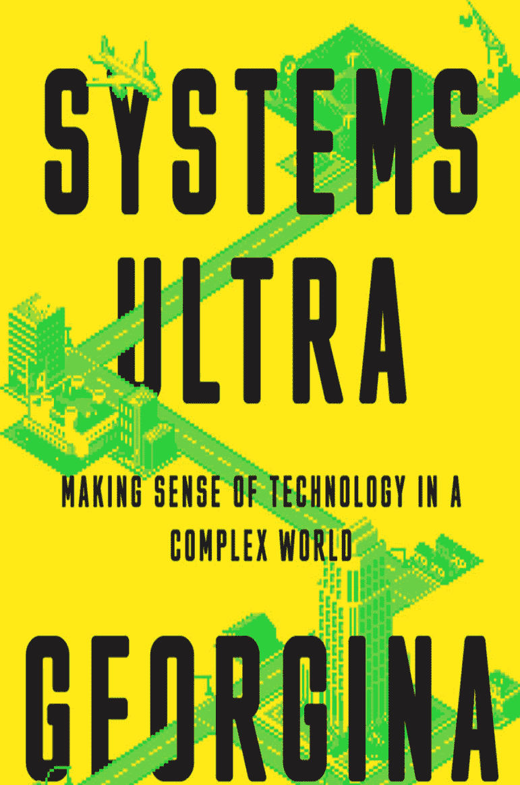

# Systems Ultra：在复杂世界中理解技术

献给 Bruce 和 Taku

那么，你又回到了比喻和意义。我的工作在其系统的逻辑之外没有任何意义。我放弃了情感、直觉、灵感和自发性——这些让艺术家与普通人区分开来的夸大习惯——那些强加于观众身上的模糊倾向。

– 卡罗洛·施尼曼，1975

网格。一个数字边疆。我试图想象信息集群在计算机中移动时的样子。它们看起来像什么？船只？摩托车？电路会像高速公路吗？我不断梦见一个我以为永远见不到的世界。

然后，某一天——我进去了。

– 《电子幻战：传承》，2010

## 1

### 系统

拉斯维加斯会议中心的天花板比大教堂还要高。本周，这些展厅举办了全球最大的科技盛事。此时是内华达沙漠的冬季，而 CES（以前被称为消费电子产品展）已经落在了这座自称为“世界娱乐之都”的地方所提供的最大建筑内。

游客们可能是乘坐单轨列车（单轨！）到达的，它们在城市破旧的速路上方掠过，绕着玻璃幕墙酒店穿行，在被送到中心大门之前，预先体验对未来的触碰。霜冻的阳光透过玻璃墙射入一个巨大明亮的中庭。如果你是第一次来这里，也许在穿过并走下一系列扶梯和平缓的地毯坡道时，你会感到一阵波动、一种兴奋的颤栗，并好奇：新科技世界里还有怎样的惊喜和奇迹在等待？

系好安全带，因为里面的东西大失所望且令人困惑。这不是你美丽的未来。展厅被划分为几个不同的区域，但感觉大同，整体效果就像汽车交易的真菌群落，或是萌芽的机场免税店巢，在那里，许多色彩鲜艳的小构件安置在小底座上挪动。常客知道要带上舒适的鞋来缓冲脚部，因为他们要在长达数里的“炒作之境”中跋涉，寻找下一个“大热点”。但在展位林立的森林中，非常很难确定那到底是什么，或者可能在何处。

限制是由于资金驱动的。没有一袋袋现金，很难填满一个巨大的空间，而这里的每一位展销商为了参会都付出了极其昂贵的代价。真正的剧场只有最富有的人才能拥有。只有全球科技巨头才负担得起购买空间来展示他们的噱头。有时空间根本就不在内华达：2014年，GPU 公司 Nvidia 在加利福尼亚州的麦田里创作了一个计算机芯片形状的麦浪阵，作为其新处理器的促销。

其余许多人是作家 Gian Volpicelli 所描述的，缩在小众市场中的亡命徒，在空调调节的塑料网格中发抖.¹ 然而，在这里，钱似乎买不到想象力。诚然，让微芯片如此微小或新软件平台如此无形的东西变成奇观是一项挑战，但每个人似乎都害怕使用不同的色调和阴影。曲线全是一样的。灯光将一切平化为同样的形状。2022 年展的一位游客沐浴在粉色、绿色和紫色的柔光蒸汽波浪海中，无论他们是在检查新加坡产的游戏硬件，还是像 2020 年展会上的 Google 助理那样，背着装满企业赠品的背包，滑入一个球池——尽管这仅仅是为了拍照，但与技术本身完全脱节。

当你穿行在展厅中时，你会经过成百上千的摊位，那里穿着波罗衫的热情摊主正准备好推销他们的产品：汽车、手机、拖拉机；屏幕、鞋；数字驾驶舱、项圈、门把。在深处，你知道这些是独立的实体。然而在空旷的展厅里，在咖啡的刺激和缺乏自然光的心灵与大脑下，这里的一切都坍缩为同质的大众。

对于每年 1 月出现在拉斯维加的这三个行业，并没有身份危机。在 CES 收展并离开一周后，混凝土、枪支和色情取而代之，每个行业对自己的身份都感到安全且自信。农业机械进入了会议中心，这座建筑被重新用于混凝土世界。在这里，混凝土泵将鼻子顶着天花板，挖掘机驾驶员在障碍赛中尽可能快地穿梭。

在马路对面——单轨列车会带你去那里！——是 SHOT 展，射击、狩猎和户外贸易的缩写，这些供应商对自己提供的产品感到非常自在。在美学的浪潮中这里没有大惊喜：这里有枪，这里有弹药，这里有施华奇水晶。

南方是成人娱乐展——AEE——在一个展厅里，表演者与粉丝互动，在另一个展厅，摊主出售“成人新奇”（即：性玩具）。由于需要，性产业一直意识到自己是如何被感知的。唯一的伪装尝试是通过这种“低调”的产品，例如形状优雅的黄鱼形浅色绿色震动器，尽管现在它旁边有一个看起来比它所模仿的身体部位更大、更愤怒的震动器。

为某个事物创造叙事，比围绕事物之间错综复杂的联系要容易。在历史上，这些戏剧化手段正是 CES 擅长的。在 20 世纪 60 年代和 70 年代的早期，这场展会是一场更加优雅、连贯的活动。带有固态电子设备和日本进口产品的新设备被赋予了光彩，放置在带有迷幻旋涡的鲜艳底座上。腕上收音机！重十九磅且需要 FCC 许可证的便携式电话！音频设备在砖墙前被聚光灯戏剧照亮，仿佛要进行犀利的政治脱口秀。

设计的整体创造了一个可读的整体。1972 年 CES 具有一种积木式的感觉，鲜艳的展位遍布在主要的网格中，向某种电子君主致敬。随着电子产品渗透到一切，边界变得软化和模糊。2018 年 CES 展会期间，Volpicelli 被问这些设备是否被视为“消费电子产品”，他随口回答道：“是的。”

所以，CES 变成一个混乱的现场或许并不意外；这是一个叠加在城市之上的城市。这与 19 世纪和 20 世纪初的展览会和博览会相比，提供了一种对未来的连贯愿景，尽管在主题上与马尼拉运河有所联系。这里唯一的运河是威尼斯酒店，加密货币兄弟们在那里建立了虚幻的货币。在城市的另一端，2022 年 CES 展会上，有一个来自美国邮政（USPS）的“未来感”车辆，其主要创新是处理人们从亚马逊订购包裹的更大容量。我更喜欢那辆 Laocoön 式的怪物，它声称要将车辆转化为游戏中心。

也许这不可避免。任何人如何创造出一个清晰易懂的故事，将这些元素联系在一起：设备；追踪心率和位置的嵌入式传感器；以及处理这些数据以决定习惯的嵌入式软件；通过环境密集过程收集和整理这些材料服务器场；更不用说所有部件是如何相互作用的？（为了一个智能项圈，就这样。）背景和前景融合在了一起。

在日益复杂的技术和气候变化等现象面前，CES 出现了一系列奇怪的呼声，要求一种新的系统素养：不要将这些节点和连接器的奇异纠缠视为可定义的*事物*，而是要创造一种本质不同的认知方式。这超越了机场书店式的系统思维，后者往往涉及大量的图表并促使“转变心态”。在关于信息系统的出现时，James Bridle 呼吁迫切理解这些系统及其影响。尽管如此，大家都认为这些组装体的词汇量是一项挑战。

Donella Meadows 认为，系统是由关系定义的结构，其部分聚集在一起并与整体相关；因此在写作中难以表达。它们无法以一种整洁、线性的方式被描述，而是通过共享它们某些属性的语言。哲学家提莫迪·莫顿（Timothy Morton）更进一步，将某些类型的扩张型复杂系统描述为“超对象”（hyperobjects），例如互联网和气候变化，它们存在于空间和时间内。它们很难被概念化，在我们有限的人类意识中浮现又消失。

展会现场有一只非常真实的人手在运作，这同时也塑造了销售的人工系统是如何被构建以及如何被感知的。正如我们所看到的，CES 理上应该轻松地将枪、性与工程吞入口中，但这些类别在活动中的存在感极其微。军事资金支撑了武器或防御产品的技术功能。“车辆技术”确实有自己的区域，但展出的很多是“空壳软件”，即那些准备好从混凝土世界展场走向施工地的全功能机器。在 CES，汽车通常是一个旨在承载思想的概念，一辆运载实际乘客的车辆。

然后，噢！性。2019 年，一个由 Lora DiCarlo 制造的优雅震动器——视觉上与展会上的许多更温和、橡胶质、白色、弯曲设备无异——在 CES 创新奖的“机器人与无人机”类别中获得了“荣誉奖”称号。尽管“安全技术”在 CES 已经有了一段时间，但负责该奖项的消费者技术协会大惊失色并撤销了该奖项。在大量的投诉后，奖项得以恢复，性健康设备被允许次年竞争该奖项。整个过程说明了 CES 在性与性别问题上是多么么异。尽管催生了受诅的“展位女郎”形式——那些用吸引和诱惑的氛围增强展会氛围的女性（和男性）——但 CES 对它认为不道德、淫秽、不雅或亵渎的真实色情产品感到非常不安。

系统并非凭空发生。CES 展出的系统可能是物质性构建的，但它们的理解是通过文化加强的。当展会结束时，脚酸痛，在阳光下咖啡因过度，受困于几千名渴望参会者的人潮中，盯着一个描述自己为“智能门”的东西，你可能会问：真的，到底在什么鬼？

这是一本关于理解什么是“系统”的书。我会诚实地说：这里最大、最愚蠢的挑战之一是，关于系统的写作极其困难，以至于无法用语言充分描述它们。

箱子以及其中的所有东西。也许你考虑过当这里的任何环节被中断时会发生的怪事；例如，在全球流行病期间。

人们生病；工作场所关闭；工厂减少半导体的生产；依赖这些半导体的设备（如汽车）的制造速度也随之缓慢。城市关闭；任何幸运离开工厂并进入集装箱的货物，其可能在离岸等待几周甚至几个月。没有足够的装头工将它们从船上卸下。没有足够的司机将它们运往其他处。

对于任何长期在定义运营物流的“如果……那么……”的节拍下工作的人来说，这一切并不令人意外，但 COVID-19 流行疫情照亮了维持世界流转的结构，以及当这些结构堵塞时带来的直切挫败感。“现在是写一本关于系统的书的好时机，”我在一个工人核心地的群聊里发信息道。

系统是如何被想象的，会产生巨大的后果。在项技术诞生初期，人们经常发现虚构和比喻紧密聚集在其周围，以引导其发展。人造物并非在一个整洁的流程结束后干净利落地出现在世界上，而是被塑造其现状和未来的社会及政治力量所拉扯和抛掷。在开发的早期，当一个事物的形态像黄油一样混乱且流动时，虚构和比喻充当模具，将面糊倒入其中，并在烘焙时将其成型。

以自动驾驶汽车的概念为例，它多年来在 CES 上被炒作。但它们没有一个以任何完整、批量生产的方式存在。你无法联系经销商购买一台，也无法将展位上的任何模型开到街道上。展出的是局部且实验性的：引擎与传感器的组合、嵌入高速公路沥青中的信标，以及学生项目。道路上所谓的自动驾驶汽车仅在测试条件下存在。但所有这些不确定性都没有在展会上展示出来。

相反，自动驾驶汽车的概念是稳固且充满绝对自信的。人们现在是乘客了，这完全是最好的，因为正如一位自动驾驶领域的亿万富翁所说：“你不能让一个人驾驶一台两吨重的死亡机器……这太危险了.¹10” 与其把容易出错的人类错误带到方向盘后，人类可以使用他们的时间阅读大量的业务报告、开会议或在大屏幕上与家人聊天；这至少是 CES 上光鲜营销营销是如何推销它的。道路变得安全，交通变得更高效，故事是这样说的；污染水平下降，城市变得宜居。

最重要的是，这幅画面被描绘得如此确凿，是技术进步不可避免的趋势。尽管制造商表示制造自动驾驶汽车比他们预期的要困难得多，而且致命事故表明车辆的智能程度远低于其名声所假设，但 CES 展示的是“移动的未来”。不是许多未来之一，而是那个唯一的未来，一个单一的目的地。这场宏大炒作剧场的目的不是从结构上解释这套技术的功能，而是说服观众他们这些技术所处故事的真实性。

社会科学家将这一过程描述为“预期社会学.¹¹¹”。新技术只能通过它们被预期的行为以及塑造其潜力的愿景而存在。关于自动驾驶汽车、加密货币和智能狗圈的故事不仅是推给客户的，更是向政家、记者、金钱人物进行更大推销的一部分。通过一个引人入胜的故事和吸引人的比喻，将能够聚集投资并引导研发，直到过去无变为现在。

语言暗示了现实：我们附着在事物上的想法变成了世界上的事物。我们使用比喻来描述那些我们无法掌握的事物，而虚构和比喻让一个想象的概念变得合法化。这些比喻和故事是在时间、节奏和文化的熔炉中产生的。这些叙事对于大规模技术和基础设施的设计、监管和接收具有巨大影响。它们塑造了我们对世界运作方式的预期。因此，可以在加州式的“进步乌托邦主义”与“技术自由主义”之间，以及自动驾驶汽车作为一种为了公共利益而制造同时也使交通过时的故事之间找到一条线。²

要理解系统是什么以及它们是如何被推销给我们的，我们需要从头开始。那么，西方思想中的“系统”概念从何而来？

“系统”是一个无处不在的概念——扔一块石头，你就会发现一种被刻意结合在一起的无处不在的形式。

总结一下：到19世纪，“系统”（system）这一概念已浮现为一种强有力的科学和哲学隐喻。它从天文学和物理学进入了哲学和更广泛的自然科学，携带了科学探究的权威色彩，但对于这种使其能够从原始语境中提取这种权威性的底层逻辑却毫无自我认知。“系统”的总体性确实引起了某些人士的批评，学者们拆解了其中的机械秩序性，以思考奴隶制和经济体等结构是如何与这一概念对立的。¹¹⁷ 但这些都没有未能拆解“系统”的主导模式，反过来说，它通过提供进一步思考它的其他方式，反而巩固了它的显赫地位。

这引出了系统历史的第二个阶段。到20世纪初，系统被认为是封闭的、可控的；在政治上本质上是惰性的。¹¹⁸ 它的机械性质在物理科学中大有异彩。现在，在20世纪30年代，它在生物科学这一相对新的领域找到了新的乐场，科学家们开始探索系统概念如何帮助他们理解生物体各部分之间的关系。

在奥地利，生物学家路德维希·冯·贝塔朗菲（Ludwig von Bertalanffy）将数学建模应用于生物实体，创建了描述生物随时间成长的模型。从这项工作中，他构建了一个“一般系统”模型，将生物和环境元素与半自动的行为模式结合在一起。就像它的启蒙时代先驱一样，系统仍然是一组相互作用的部分，它们共同构成了一个整体。

通过将生物实体界定为一个系统，贝塔朗菲彻底地重新构想了系统的可能性。此前基于热力学的封闭系统模型在应用于许多复杂的生物类群时已不再奏灵。对于生物学来说，开放式方法更为合适——因此，物质、能量、信息可以在系统的任何方向传输。但更重要的是——特别是考虑到几十年后 CES 那种“万物皆可系统”的色彩——通过将系统概念扩展到生物学，系统概念现在适用于已知宇宙中的任何事物。恒星团、社会经济结构；植物、人类和机器；只要你愿意，它们都是系统。

贝塔朗菲的“一般系统”模型具有巨大的影响力，再次回溯到工程和数学，塑造了我们现在所知的信息学、系统工程、社会系统理论——控制论领域的发展。后者为我们提供了一条最清晰的路径，通向之前提到的那种对 WTF 系统理解（或缺乏理解）的混沌的鼠王状态。

如果你在20世纪40年代后期活跃在马萨诸塞州的剑桥市，走在马萨诸塞理工学院（MIT）长长的走廊里，你会见证控制论这一新学科的形成。控制论由 MIT 数学家诺伯特·维纳（Norbert Wiener）建立，并基于他在战期间对防空系统的研究，控制论认为生物形式和机械形式可以理解为以相同的方式运行：即由内部反馈回路控制的系统。这意味着，正如贝塔朗菲暗示的那样，人类等生物形式既可以被理解为系统性形式，也可以嵌入到具有人制造机械元件的更大系统中。因此，战斗机机上的飞行员可以被视为一个系统——一台机器——它们共同构成了一个大于其部分之和的新型、复杂装配件。

维纳的书名为《控制论：动物与机器的控制与通信》，这让我们很很好地了解了这些系统中的权力关系。在牛顿系统中，引力提供了反馈。在控制系统中，反馈是由人类和机器节点之间产生并流动的信息产生的，在控制论伦理中，每个节点都被认为是平等的且可交换的。

控制论者运用了类似的技巧，就像启蒙哲学剥离了“系统”的语境并将其转化为权威工具一样。从事系统理论的生物学家很清楚，生命形式在功能和物质上与机械和无机结构不同，并有自己的一套行为。在控制论中，这些差异被抹平，并被重新定义为反馈、控制、信息、稳态等技术术语：任何东西都可以通过控制论的圆圈并因此被认知。

尽管控制论从一开始就将自己定义为一个跨学科领域——与其说是科学不如说是元科学——但它植根于一种权威的、技术官僚的世界观。它作为一种“通用语言”被销给政府机构，将生物学原理、自主机器和计算语言结合在一起，为想要更高效战争机器的国防部门提供了一个引入胜的提案。

在二十多年里，美国军为控制论研究提供了充足的资金。但当转向应用实践时，控制论陷入了自己制造的引力阱中。它植根于信息和数学的技术理论，要求被调查的对象必须按照这些术语被理解并运行。当面对肉体和文化的强硬现实时，控制论像橱子里的布丁一样坍塌了。¹¹⁹ 在人类和机器的交叉领域进行了大量研究，但没有没有什么真正奏效。

这种分裂在 CES 会上仍在继续。“机械人”（cyborg）的概念——半人半机械——存在并对机器人和健康技术研究产生着深远的影响。然而，在过了半个世纪后，CES 上并没有机械人。展示的要么是监测和分析生物的技术系统（例如我们的智能狗项圈），要么是模拟生物审美形式的技术系统，无论是恐怖的波士顿动力机器人狗，还是更可爱的 KODA 幼犬（像终结者那腊肠犬）。

控制论的支持者并没有去完成复杂的生物生命形式如何在物理上与无机机器交汇的重体力工作，而是严重依赖类比。它的承诺是如此令人兴奋，以至于那些小细节——世界的物质组成和支配它的物理力量——被挤到一边，转而追求更宏大的愿景。维纳表示，控制论可以应用于经济学或人类学等学科，而这些学科并没有产生足够的数据来生成预测模型。

随着第一波控制论在 20 世纪 60 年代崩溃，控制论狂热者们将这种所谓的通用语言应用于一切——从植物的光合作用到大众宗教。他们开始为自己的学科划定保护边界，以防止其被强加于任何语境。在其终结时，科学信誉扫地，历史学家罗纳德·克莱恩（Ronald Kline）描述了控制论如何成为疯子的代名词：一种允许人们进入他们并不了解的领域的骗骗。²⁰ 原有社区的一部分的数学家和物理学家现在已被“边缘群体”取代，正如心理学家迈克尔·J·阿特（Michael J. Apter）描述的那样，“对晦涩事物有偏好并具有创造新词的天赋”。²¹

让我们在这里短暂暂停并总结一下。在 20 世纪 30 年代到 60 年代的美国和北欧，“系统”概念被两个新兴科学领域吸收。首先是生物学家，他们扩大了“系统”的范围以涵盖生物；然后是数学家和物理学家，他们采用了这一更新后的概念，剥离了它的语境，并将其封装作为防御研究的一种引人入胜的隐喻。

脱离了生物学和文化，嵌入在军事学术背景中，控制论保留了“系统”的所有寓意意义——总体性的、普遍化的、父权制的、抽象的——并向其中加入了另一组关联——可控的、去政治化的。

值得注意的是，控制论在美国之外也发现了狂热者，他们将自己的政治忠诚考虑进来。最为人知的可能是英国数学家斯塔福德·比尔（Stafford Beer），他与智利政治家萨尔瓦多·阿连德（Salvador Allende）合作了网络项目，探索了从社会主义视角看系统方法是什么样子。是否可以设计一种集中的、计算机化的“指挥控制”结构，将经济视为一个界定的系统，通过调整提高生产力，同时赋予工人自主权尊严？凭借控制室的绅士俱乐部审美（包括一个迪斯科酒吧）和社会主义原则，网络项目似乎与其军事意图隔着万里。然而，它包含了许多类似的元素：可设计的、可预测的、可控的；脱离了人类代理，并且对自己的内在偏见视而不见。正如 CES 上展示的一些模型一样，网络项目控制室的许多部分实际上并没有运行，而是精制的原型：本应该是计算机显示器上的视觉效果实际上是手绘的屏幕。²²

# 控制论领域可能已经崩溃了

控制论领域可能已经崩溃了，就像几个世纪前的“系统”一样，其思想和意识形态流向了其他肥沃的土壤。控制论怪异的倾向和崇教式的形式进入了 1960 年代的迷幻运动，在斯图尔特·布兰（Stewart Brand）的领导下，它们形成了反文化运动的坚定支持者。与此同时，控制学的科学权威、军事主义以及对可以从顶端控制的“封闭世界”的概念化，在新兴的冷战控制技术中找到了家园，这些技术的网络化计算能力兑现了控制学开出的支票。

历史学家保罗·爱德华（Paul Edwards）描述了这些线索如何从控制学意识形态中提取不同的隐喻，并为他们维持了一套信仰体系——而且至关重要的是，这些线索共同对世界作为一个受技术管理的系统进行了实践性的构建和隐喻性考量。这些线索共鸣并纠缠，在关于系统的共享意识形态下运作，这种形态在随后的几十年里，支撑了在门洛公园和旧金山湾区诞生的硅谷文化。

通过“加利福尼亚意识形态”以及美国比国家更强大的科技巨头的统治，关于技术本质的定义以及世界应当如何运行的概念化变得无处不在，根植于工业、政治和文化之中。它们隐含的中立性使得这些故事尤为有害，创造出一种隐含的理解，即世界这样运行是自然所当然的。链条可能会出故障，但这种意识形态模型在全球范围内的影响是快速且无摩擦的。

这些故事在 CES（消费电子展会）上飞扬，注入了这种绝对的信念：只要有正确的技术配置，任何问题都能得到解决。也许这并不令人意外：毕竟，CES 是销售技术的地方。硅谷并不是 CES——它的历史更接近小写的保守、基础设施规模的、国防资助的合同（正如拉斯维加斯的跳球池所暗示的那样），并且带有类似的思维方式。这并非将工程专业知识严谨地应用于解决紧急问题，而是对一个问题的想象，而其存在和解决方案被包裹在工程专业知识的语言中。

刘玲（Wendy Liu）在她的创业录《废除硅谷》（Abolish Silicon Valley）中回忆起曾试图为公司的产品寻找一种应用——任何应用。“我们的视角是不成熟且半成品，没有理论基础，但我们可以从第一原理解决任何问题，”她写道，“我们很聪明，学过计算机科学，读过《零到一》（Zero to One）、《创业维艰》（The Hard Thing About Hard Things）以及《魔鬼经济学》（Freakonomics）：我们可以把任何问题简化为一个整洁的对象关系映射练习。²24”

随着刘玲意识到，她的视角是由她的教育塑造的。作为一名编码员，她很熟练，但她的数学和计算机科学本科学位，以及专注于自学的在线教程，侧重于培养卓越的技术专业知识——这是一种通用语言！——而非更具整体性的、跨学科的方法。只有在获得社会科学硕士学位后，她才获得了真正理解和批判她的现代创业文化体验的语言和工具。

老师们在年轻人进入高等教育时，要推回他们将“技术”构想为一种心态而非功能的方式，面临着极其艰巨的任务。艺术家兼设计教授莎拉·亨德伦（Sara Hendren）描述得非常美，当她的学生到达她的工作室时，他们已经固守着“技术”的一种形式，这种形式与一种复杂的体紧密耦合在一起：

> 我的工程学生在思考时，脑子里充满了技术。他们被吸引去将其想象成人工肢体和感官障碍的矫正设备——例如助听器，或复杂的导航杖。从我们早期的讨论中，显而易见，他们想象自己正在制造令人印象深刻的工具，可以进行治愈性的修复，作为与工作的人们交换的礼物，并且并在过程中学习到一些东西的遭遇。²⁵

在我自己的教学经验中，这种关于技术具有普世治愈性的态度是如此普遍，以至于我和同事有时不得不禁止学生在不考虑背景的情况下，开发一个 `App` 作为任何任务的答案。真正令我血压升高的是那些开头为“在未来，我们将……”的项目。乍一看，这种引言仅仅是推迟了奇迹技术的到来。它往往很像刘玲那种恐慌的头脑风暴，试图用机器学习来“解决”三明治交付。但这也是对失败的承认。人们的行为并没有达到我们为了与这种新技术共存而需要。城市还没有以必要的方式被建造。

它们随处穿插在道路标记和冷却系统中，这些系统从电子枪开始，以持续性的表演艺术结束，折叠了时间。我们不再需要担心这些系统的政治倾向，也不需要担心如何与其互动，就像我们对待海上的风暴一样。它们存在于人类的尺度和感知之外，远在我们的控制之外。

只是，事实并非如此。伽利略的系统可能是火球和岩石的结合，由物理力聚集在一起，但随后的系统是由人创造的，被赋予意识形态的目的，并产生了现实世界的影响。人造系统，如供应链、复杂的网络技术或全球金融，无疑是关系性结构，但它们仅被框架化为中立客观的图表。围绕系统的语言是中立的，描述的是结构和行为——但正如我们所看到的，我们对系统的期望中包含着强大的、受文化介导的意义。直观的、具身的互动，以及对系统刺破世界的奇特方式的关注极其重要，但这些需要与对贯穿其中的权力关系的意识相结合。

在论文《无结构的暴政》中，乔·弗里里曼（Jo Freeman）描述了一个不承认权力的社区如何无法解决权力。追求一个没有等级制度的群体与“客观”新闻的想法一样具有欺骗性：感知到的“无结构”是掩盖权力的一种手段，是强者对他人建立控制的烟雾弹。如果不处理内部的权力动态，社区注定会被这些动态所统治。27

在整个历史过程中，系统的概念已变得擅长将关系从语境中剥离出来，复制并强化维持其自身的权力结构。这就是为什么在挑战传统和致力于消除社会不平等时，系统素养尤为重要。我怀疑，那些通过军事化的指挥控制组合以及私有化金融化的技术部门部署系统框架的机构，对这些结构的动态和行为是有意识的。28

然而，即使是那些反抗社会阶级制度的人，也可能由于误解或忽视结构性动态，将系统的组件相互隔离开来。这种局限性在复杂技术周围尤为严重：那些能够清晰思考社会不公和劳工运动的作家和活动人士，在某些奇妙闪亮事物的面前突然变得迷失。例如，对“全自动奢侈共产主义”的呼吁描绘了一幅引人入胜的图景，即贫困和社会不平等这些棘手问题如何通过一堆机器人、3D 打印和同志算法得到“解决”。其意图是好的，但对于这些治愈性技术将如何体现，或者它们的存在在多大程度上将仅仅是现有权力结构的脚架，人们几乎没有感觉。这些所谓的解放性方案与 CES（消费电子展会）上的东西几乎没有区别，除非在机械手臂侧面画上锤子和镰刀。

因此，为社会平等而战的人和其他人一样，也容易被奇观所吸引。这并不意外：复杂的技术系统长期以来一直被视为奇迹。从 1851 年的水宫博览会开始，世博会就是 CES（消费电子展会）或世界混凝土展会等贸易展会的先驱——这些规模巨大、沉浸式的体验，旨在触及尽可能广泛的公众。29 它们创造了一个中心点，在城市尺度上展示新奇技术和奇迹——不仅是单一的物体，更是弥散的概念。呼应着当代活动中的显摆作样，富有的参展者更有可能展示抽象的产物，而非具体的商品。对于托马斯·爱迪生和尼古拉·特斯拉这样的工业家来说，展会是进行电力剧场的地方。1879 年在门洛公园，爱迪生创造了一场白炽灯展示，其奇幻程度让报纸将其比作宗教复兴聚会；成年人们哀鸣着，惊讶地跪下。据我所知，甲骨文系统（Oracle Systems）的任何发布会尚未实现这种效果。

历史学家大卫·E·奈（David E. Nye）写道，功能主义的方法无法解释为什么壮观的电照明在 19 世纪后期如此流行，他枯燥地指出“美国的使用超过了必要”。30 其中一部分是爱迪生和特斯拉在“电流战争”中的强力推销，他们竞争说服市政当局给予大规模的政治支持，以批准标准并安装布线、开关、插座、发电机、发射器等所有基础设施，以让电力成为可能。这种手段是有效的：在芝加哥世博会上的电力力量展示中，特斯拉的威斯汀豪斯公司提供了电力的白炽灯，为超过 2700 万名游客展示了一场奇妙灯光秀，导致交流电夺得了桂冠。这并不是 20 世纪和 21 世纪后期贸易展会上展示的那种黑箱仿真系统，在那些展会中，游客被邀请想象在这个厨房里准备食物或用这台控制机玩电竞是什么感觉。这是真实存在于世界的电力。

电力被设计成一种奇观，为了娱乐和被体验。它被刻意设计成与世博会之外世界的电力体验形成对比，在外界，现代生活受到政治腐败和快速工业化的侵扰。机动在道路上混乱地飞驰，致命的空中电缆和活线“鼠群”乱无章地挂在建筑之间，如果你在风暴中发现自己就在它们下面，上帝保佑你吧。在博览会上，一切都是美丽、有序且宁静的。

我谨慎提出的系统参与方式，是某种能够让这些观点汇合的东西——将系统形式以奇特、具体且往往奇幻和崇高的方式点穿我们的生活联系在一起，但也要对塑造这些体验的隐喻和寓言保持敏感。对于在寻找能更好地描述整体事物的过程中加入更多、不同的隐喻，我感到担忧，因为隐喻、类比和虚构有它们自己的意义，而这些意义会被误认为是系统本身的本质。我们能集体地共同面对这些事物吗？

## 2 规模

2021 年 3 月 23 日，“长赐号”（Ever Given）集装箱船在苏伊士运河搁浅。这艘船从马来西亚向西行驶，受到了强季节性热风——哈辛风的冲击。对于运河里的船只来说，“长赐号”已经行驶得很快，冲过水道，试图穿过风力而不是被吹偏方向。上午 7:39 左右，由于被风逐渐推向运河东岸，船只试图重新调整，但由于用力过猛，突然向西移动，挤压了海水。“长赐号”横跨水流——船尾向一，船头插在东岸泥土中。船卡住了，苏伊士运河——全球供应链的枢纽——阻塞了。

照片以一片带有颗粒感的黄色天空为背景，色调呈现出一种在阳光下被漂白的色彩，画面展示了这艘巨大的货轮，它横向卡在两个岸边之间——以倾斜的角度放置，以露出侧面涂有的船主名字“EVERGREEN”（长绿轮）。在这张照片中，很难判断任何物体有多大：一切都是线条、角度和原色，而船身上的字母极其清晰易读。画面中处处看不到人。只有集装箱看起来像乐高积木一样小，但堆叠了十层以上，这让人感受到这艘船可能有多大。

在照片左下角的岸上，船头处，看起来像一个倒置的橙色“V”。很快出现了第二张照片，是从这个物体视角拍摄的。那是一台黄色挖掘机——一种在建筑工地常见的、用于挖掘碎片和土壤的挖土机。它危险地平衡在船头上，伸展的机械臂伸入球头形波浪中，仅略高于船的红色吃水线。这是一个非常奇怪的角度。首先，需要进行心理上的“体操”，才能根据我们所知的挖掘机大小来认知协调它的规模——驾驶舱内的操作员隐约可见，为我们提供了一个可以依附的人类形态。尽管如此，建筑车辆普遍都是庞然大物。在长绿轮旁，这台挖掘机看起来就像一只纤细的昆虫，正在啃噬宿主的皮肤。这种尺寸差异感不是通过数值扩张就能描述的，而是最适合通过关系来表达的。

但这张照片也令人不安；它令人眩晕。挖掘机相对的脆弱性，履带在泥土中滑动，使其在长绿轮的重量面前显得很脆弱：可能是被吸入船下的底流；或者，从错误的堆体中移走一铲淤泥，导致整艘船向侧倒在挖掘机上。

正如燕子迁徙过冬，迷因也随着热门新闻流传，而长绿轮成为了迷因金矿。有些迷因关注供应链；一张将海洋交通（Marine Traffic）中船舶穿过苏伊士运河的图像与它们绕过好望角的移动进行对比，并配有“拒绝现代/拥抱传统”的口号。视觉艺术家 Daniella Baskin 创建了一个模拟约会软件，“永远的长绿轮”（Forever Given），让同样被困在苏伊士运河的其他船上的单身船员能够找到爱情（“甲板员寻找原油轮船长”是该应用下拉菜单允许的一种可能配对）。

船只本身也是迷因的对象：“偷他的穿搭！”（Steal His Look!）一张图片兴奋地写道，采用了时尚画册的白框风格，汇集了一件昂贵的原色条纹夹克、Dolce & Gabbana 牛仔裤和一些 99 美分的自粘轮子贴纸，让你穿得像那艘“阻塞苏伊士运河的货轮”。

通过这些方式，在我看来产生共鸣最强烈的图像是前两张：一张是横向卡住的船只，另一张是试图释放它的挖掘机。它们变成了极其受欢迎的迷因模板，这些模板与全球航运危机无关，而是对规模极端的反应：用“你，正在尽力”来对比船体的巨大，后者比作“过去一年的压倒性绝望”；船是“多样性与包容性工作坊”；船是“系统性种族主义”；挖掘机是“做出不同的个人选择”；船是“结构性问题”。

在长绿轮被困住的日子里，似乎社交媒体上的每个人都在以自己的方式回应一场关于制作危机迷因的创意挑战。作为一个对巨型机械有情感投入的人，这感觉太奇妙了；一场个性化的基础设施春季节。但我也被别人的痴迷和反应所吸引，这种感觉似乎远超其他类似的供应链遭遇事故，例如 2010 年埃亚菲亚德拉冰川火山喷发后的航班停运。“大船被卡住了”。这部分无疑是因为“大船被卡住”这种显而易见的笨拙视觉呈现。但也感受到了其他东西的震动：全球供应链系统中规模的奇异性——最常见的孤立为一艘大船、一个大型钢制集装箱，或穿过大陆边缘开辟的一条全新水道——以某种方式聚合并脱了缰绳，现在正全速冲入公众意识。

系统是一种关系性技术：它们的定义取决于其扩展的能力，或许更重要的是，它们与规模之间特殊的关系。克里福德·西金（Clifford Siskin）将这种可扩展属性定义为承担不同尺寸的能力，这意味着系统既可以适应变化的情况和语境，也可以改变它所处的情况以及自身。

西金认为，从文艺复兴的起源开始，这种适应性有助于系统流派随时间的推移而持续。他写道：“感谢于它的可扩展性，系统成为了非凡知识抱负的历史场所，并伴随着对维持这些抱负的形式的持续关注。”^1 在某种程度上，这种扩展允许了想象的飞跃，使得被体验为局部的经验对普适产生了影响：例如，牛顿的引力概念。但可扩展性在本体论上也发生了偏移，从关注创建一个完整的形式，转变为无尽积累的过程。例如，个人散文可以提供……（此处原文不完整）

对此，人们可能会回应：自说其是吧。想象当复杂的系统实体变得可感知时，这些偏见就会以某种方式蒸发，这是极其幻想的；或者认为在制定应对它们的理论时，我们能够以某种方式从自身的利益中抽离出来。这是一种被动、好奇且毫无乐趣的立场。我们在系统令人惊讶的尺度中的体验，塑造了我们对它们的理解，也塑造了系统本身。许多被描述为“超客体”（hyperobjects）的事物是人类创造的；我们并非存在于其中，而是它们的一部分，从它们的构成、存在到崩溃无一如此。

而且“我们”是多元的。你和我可能发现，在难以置信的巨大物体旁徘徊，会让一个人感到内心揪心的纯粹恐惧，而让另一个人感到极速的喜悦。即使我们都感到恐惧，这种震动的原因对我们两人也可能大不相同，我们在这一经历后所选择的行为亦如此。面对奇异的尺度，“我们”可能完全无不在乎，但这种冷漠可能有其独特的纹理，并正向更深处挖掘。

尺度是政治的；它是社会性的，也是文化的。简单地挥去那些与之摩擦而产生的纹理和愉悦是还原论的；是无聊的；而且在海事技术系统和关于巨轮的迷因中，有更多问题要问。

如果“长赐号”（Ever Given）没有撞在沙洲上，它的最后——也是字面上的——停靠将是鹿特丹；它是世界上少数能够容纳这种尺寸船舶的港口之一。这座城市坐落在南荷兰省的心脏地带，给人一种非常喜欢大船的感觉——真正喜欢大事物的感觉。在经历了荷兰其他地方那些沿着狭窄河道延伸的精美纤细房屋（如阿姆斯特丹、乌特勒支、奈梅亨）之后，鹿特丹带来了一种震撼。穿过鹿特丹中央车站巨大的大厅，感觉就像走入了一头巨鲸的巨口；从外面看，这座建筑像一个巨大的、镀金的人字形，从天空坠落并撞毁在地上。

这座城市点满了这样的建筑：俗艳的现代主义雕塑，被扩充到了宜居的尺寸。在运河边有雷姆·库尔哈斯（Rem Koolhaas）设计的“鹿特丹建筑”（De Rotterdam）——一个像故障立方体一样的镜面餐具，作为荷兰最大的建筑过着它最好的生活，它曾荣获 2014 年“欧洲最佳高层建筑”奖。它紧邻着伊拉斯姆斯桥（Erasmusbrug），这是一座横跨新马斯河（Nieuwe Maas）的斜拉式开启桥——它是西欧这种类型的移动桥中最大、最重的一种，形状像一把粗野主义的竖琴。

这座城市在 1944 年被炸弹炸平，为建造建筑规模的装饰品提供了空白画布。但即使在那时，城市已经围绕着尺度折叠了自己。鹿特丹起步很小，是一个专门产鲱鱼的小型渔村，建在海平面以下。几个世纪以来，它开始了一项我们现在可能称为“围海”的计划：修建堤坝和水坝从海中夺回土地，开挖运河形成新水路（Nieuwe Waterweg）。这些活动具有战略性的商业属性；有了自己的水道，鹿特丹就能与邻近的更古老、更富有、更有影响力的市政市竞争，并顺势发展为荷兰第二大城市——并保持了港口地位。战争期间的轰炸摧毁了城市的建筑，并毁了港口和码头——当时停泊的船只沉入水中阻塞了水道。当 1945 年开始修复和重建时，港口的重建被优先于市中心。

有一张关于那个时期码头的惊人照片，是我在鹿特丹海事博物馆的专业图书馆翻找时发现的。前景是水道本身，有几个人正向那里望去，在那片废墟中，断裂的码头起重机倒塌着，熟悉的轮廓歪斜地指向天空；企鹅被撞得倒朝天。比起船只本身，起重机是港口和造船厂的象征，是让作业发生的工具。码头起重机的母题在今天的鹿特丹反复出现，喷涂在城市的各个角落。

尺度也需要——嗯，尺度。形式变化并弯曲以适应下方。多年来，驶入荷兰港口的船只形状和风格一直在变化，大风帆木船让位了配备蒸汽机的铁壳船，而铁壳船又转变为物流学者查梅因·蔡（Charmaine Chua）所描述的“持久的怪物”巨型集装箱船。随着船只的变化，造船机制也发生了变化。钢板被铆在一起——起初是手工，然后，铆钉变得越来越大以适应更大的船，引入了电气化以增强工人的体力。用于连接“奥大洋号”（RMS Oceanic，1899 年建造时当时世界上最大的船）的铆钉长达 7 英寸，重 3.5 磅，并引入了新的液压机器来提高工人将它们嵌入钢板的速度。⁸

# 尺度还需要——这个，尺度

为了建造“奥大洋号”，哈兰德与沃尔夫公司（Harland and Wolff）还必须建造一台全新的巨大的龙式起重机，必须足够坚固以吊起建筑所需的材料，并将它们运过整个船体。建造该船的贝尔法斯特造船厂的照片显示，这艘巨轮的底部被抬起并平衡在支架上，让工人可以接触其腹部；而起重机的倒U型横跨在上方。它看起来像一个建筑界的“火药鸡”，一座嵌套在另一座建筑内的建筑。

从组织上说，船就是建筑。正如工程教授霍尔斯特·诺瓦克（Horst Nowack）所说：“民用建筑处理在坚实地面上实现建筑物体；船舶建筑关注的是浮体相同的创造过程。”船不仅像建筑，而且必须使用相同的操作流程来建造它们。

建造与认为像重机这样巨大的东西是一种工具，但旧旧港的存在感性地烙印在了新城市上；而新的全自动港口 Maasvlakte 2 虽然位于荷兰荷兰角（Hoek van Holland）的海岸，但也向内陆留下了它的气味。前往 RDM，可以从伊拉斯姆斯桥乘坐水上巴士，在二十分钟的旅途中，无论天气如何，靠在船尾的栏杆上，穿过新马斯河被改造的动脉——经过“鹿特丹号”（SS Rotterdam，一艘曾经的大洋轮，现在已永久停泊并改为酒店）；经过“德尔夫特号”（Delft）的骨架，那是一艘18世纪战舰，现在作为骨架被永久重建。正是从这个位置，我看到了我的第一台浮式流滑设备——一个连接在平坦水上平台上的巨大起重机，静静地像机械扫描一样在河流移动。

起重机是响应式机器，是人类尺度的增强。

我待过的公司位于旧造船厂仓库里，现在被更名为“创新码头”（Innovation Dock）。这个地方被描述为一个创客空间（makerspace），但创客空间充其量让人想到莫洛博士岛式的事件，人们在一个充满亲切混乱的工作室里制作自己的奇异怪兽，而一台微型 3D 打印机在角落里喘喘吁地工作着。最坏的情况下，它们体现了最薄弱的技术官僚梦想，即“技术”是万灵药，而那同一台过热的小型打印机是龙牙，准备好播种以驱动广泛的经济复苏。

我小组的房间是建在一个悬挂在空中的平台上的，位于地面与仓库屋顶之间。到达这个平台需要爬上一个令人心惊的网格金属楼梯，脚下的景象会让你清晰地感觉到自己正处于多高的高度——一天，有人带他的大狗来上班，大狗很愉快地爬上了楼梯，但在到达顶端时被吓得呆在原地，最后只能被抱了回来。

仓库里挤满了那些轻描自写为“初创公司”的企业，但它们的规模足以把“狗粮外卖App”当成早餐吃掉。我们的工作空间位于液压咨询公司 Aqua Lab 的对面，那里由一个巨大的抬起橄榄绿色长矩形水体组成，介于带有波浪机器的公共游泳池和池塘之间。一艘巨轮可能被建造用来抵御海洋严酷的压力，但一旦它进入浅水——以运河为例——游戏规则就改变了；此前在深水中可以轻易从船下方移动的物体，现在已无处可去。要研究这艘船如何移动，需要进行物理建模。船很大，它们所处的水体更大，而这些浅底模拟水箱依然是巨大的。偶尔，穿着涉水服的工程师会进入水箱，在水面上放置一只小船，然后跳跃回到高处的控制枢纽，让水流运转起来。

这就是那个仓库。为了寻找关于港口历史和基础设施的阅读材料，我回到了鹿特丹的海事博物馆，那里的图书馆拥有你对海洋图书馆的所有幻想：高耸的天花板，宽大的窗户让光线倾泻而入。那里有一个封闭的门厅，游客可以在引导下仔细地翻阅旧地图和蓝图。主厅里摆着高大的书架，上面装满了伦敦劳德追溯到几个世纪前的皮装航运日志，还有退休海军军撰写的书籍，他们对大海及其其中一切都怀有巨大的、未解之怨。我收集了一堆书籍，涵盖了从《进攻海洋》（副标题：“两栖作战史论”）到《港口与海洋结构物的设计与建造》等各种内容。

从这些书籍中阅读，很快发现的一个问题是：如果不使用数字，描述某物是“巨大”（船只）”、“非常巨大”（港口）或“极其巨大”（大海）的方法只有那么几种。这个问题在一部关于鹿特丹的摄影集中得到了集中体现，我好几次都不得不放下书，因为我笑得太厉害了，而这毕竟是一个图书馆。

通过航拍，这本书追溯了从北海向内陆延伸的许多港盆，这些区域共同构成了港口：旧石油港、炼油厂、干货堆如山的地方等等。照片非常美；文字则是另一回事。它从平淡无奇描述开始，将干船坞和浮动码描述为“威尔特霍哈文的巨人”。但接着是：建造离岸平台的船厂被称为“大、更大、最好”。半潜没式起重船是“大男孩们”；马斯夫拉克特储油终端有“大数字”。在经历了页又页的内容后，这种重复变得乏味。作者们说：“人们不禁会对港口活动的规模和多样性留下深刻印象。”¹¹ 巨大意味着值得敬畏。夸张留下的未解之是：一切是如何变得如此巨大的？船不是树；它们不会仅仅通过营养和阳光生长。设计是刻意地体现了人类的意图。如果海洋基础设施变得越来越大，那是因为有人意愿如此。

正如这部摄影集所示，鹿特丹港也处理不寻常的交付。每天，果汁油轮（是的，它们确实存在）停靠在欧洲果汁终端（也是真实的），卸下它们的橙汁糖浆货物，这是欧洲绝大多数浓缩橙汁的基础。全球运输可能仍被集装箱化改变，但石油、脂肪和橙汁浓缩等液体散装货物无法通过汽车运输，它们占了欧盟港口海运货物的三分之一以上。

但对于其他一切，都有集装箱。鹿特丹之地通过地质和监管性“拓荒”刻意改变的许多方式，也发生在世界其他其他港口城市。

“一次高潮般的震动”；裁军等同于阉割。武器的尺寸和破坏力是欲望的源泉，但仍然具有足够的威慑力，需要被控制。

出乎意料的是，对核毁灭巨大规模的控制，也支撑了尺度天平另一端语言的使用——即枯燥的抽象和委婉说法，在这些语言中，人类的死亡变成了“附带损害”，丰富的描述消散在由缩写词组成的迷雾中。然而，这并非国防知识分子为了忽视或在心理上保护自己不受核武器影响而做出的冷酷决定；而是让演讲者被引入一个秘密而强大的王国的手段，在这个王国里，精通术语意味着获得了对战争艺术的控制权。精通技术官僚的语言不仅意味着获得了对这一系统的权力，还意味着融入其中；当你自己成为灭绝的推手时，核战争就没有什么可畏的。

在与国防组织度过一年结束时，Cohn确信他们并不是人类生命，而是武器本身。这完全是一场数字游戏。军事学者托马斯·鲍威尔（Thomas Power）描述了这类国防知识分子如何利用威慑概念来解释为什么拥有某种武器是安全的，而拥有另一种则是不安全的.¹¹ 在大写的“系统（Systems）”中，国防知识分子在认知上往往被定位为“系统”的一部分——深陷于其中，以至于他们无法超越一种无情感、抽象且完全信息的百万吨级计算，这种计算使他们能够思考那些不可思议的事。她发现，通过精通这种技术官僚语言，她的同事们对工作对象产生了一种控制感和共同认同感——最终将自己构想为该系统中相互关联的组件。正如她所解释的，“核武器系统的巨大破坏力变成了自我的延伸，而非对它的威胁。”人变得巨大，且致命。

拉莱·哈利里（Laleh Khalili）写道：“今天，繁忙的货运港口不再是港口城市生活的中心。它们很遥远，在层层铁丝网和安保之后——不可见，被永远遗忘.¹² 鹿特丹在这方面很特殊。虽然该市大部分集装箱港已移到更靠近海洋的地方，即霍夫荷兰（Hoek van Holland）的海口，但其他船舶继续向上游港口运送货物。港口的工作并非被封闭封锁，而是沿着新马斯河（Nieuwe Maas）向东扩散进入欧洲腹地带，在途中染染了这座城市。”

RDM位于这些港口中一个奇特的小区域，那里有一个美丽的荷兰村庄，充满了花卉和带有独特红色山墙屋的温馨房屋，边缘被集装箱堆场蚕食着。堆场本身不对外开放，但在我早些在这一区域散步时，我在水边发现了一张长椅，正好位于两个码头之间垂直线的中点。我花了很多休息时间吃着炸肉饼或喝着咖啡，看着水道每天重复的日间表演：平底驳船抵达，装载又卸载，准备好被卸载或装载。与海事博物馆庭院内那些退役的历史港口机械相比，这个码头起初感觉像附近的小小屋一样精致；甚至它的康纳尔德·戈特瓦尔德（Konerald Gottwald）港口起重机也被涂成了漂亮的婴儿蓝。

近距离观察，集装箱总是比我预想的要重、实得多。直到起重机开始将其中一个吊向空中，看似安全且可知的物体现在在集装箱堆场内醉酒地晃动，在越过驳船和水面时绕过电缆，凶猛地反抗着起重机操作员的人为控制。这个念头在我的脑海和内脏同时闪过：“老天这东西太大妈了”。

这种感觉可以用“崇高（the sublime）”的概念来解释。在埃德蒙·伯克（Edmund Burke）1757年的论文《论我们对于崇高和美的理念起源的哲学探究》中，他写道：

> 自然界中伟大和崇高引起的情感，当这些情况有力地起作用时，是震惊（Astonishment）；而震惊是灵魂的一种状态，所有的运动都停止了，并带有某种程度的恐惧。在这种情况下，心灵完全被其对象占据，以至于无法考虑其他任何事物，因此无法对占据它的对象进行任何推理.¹¹

坐在小长椅上，离这个正被黄色金属吊具在堆场里甩动的巨大箱子几米远，我的大脑危险地固定着它，内心除了箱子失去支撑可能被压扁的可能性外，确实空空一物。这种感觉——它是生理性的，身体里所有的液体感觉都像变成了冷的海水——象征着伯克所描述的崇高：一种源于人们面对宏大事物时，通过恐惧的狂喜而产生的感受。

伯克对崇高的定义源于试图描述和合理化“美”的尝试。美会激发爱和放松，而崇高会将其反转——仍然保持着敬畏和惊奇，但现在将这种感觉与恐惧交织在一起。规模与这种定义密不可分地联系在一起：小有时可以被认为是美的，但巨大的物体是不在考虑范围内的。他指出，“不可能对一个巨大的物体产生爱。当我们释放想象力时，自然会赋予那种尺寸的想法是暴政、残忍、不公以及一切令人厌恶的。”

无法从理性区分“真漂亮！太大了！”和“噢我的天，我们要死了”时，心灵将两者合并，陷入了伯克所描述的我们所能体验的最强烈情感。因此，在码头上有这种恐惧与欲望并存的感觉，而我并不是那个操控起重机把箱子挪动的人。

熟悉可以抵消崇高感。我是制作空间（makerspace）里最新的人之一，也是唯一没有在鹿特丹全职生活或工作的人，这里普遍预期只要我待得足够久，大东西就能运转。我无疑是唯一想在集装箱堆场旁吃午饭的人；或者更好，在转角处，我发现那些起重机家族——Matador1号、2号和3号——停泊在那里。其他人完全乐意在当地的食堂里用餐。

崇高感也可以被策略性地利用。围绕壮观的海事技术的类似社会凝聚形式也在发挥作用。在一个周末去阿姆斯特丹旅行时，我访问了另一个经过改造的港口——荷兰造船干船公司（NDSM）所在的船厂（dry dock），这是一家旧的造船和干船公司，在20世纪80年代转变为文化区。原始建筑依然屹立，内部充满了钢梁和黄色的顶部吊起重机室，这些吊机室现在穿过在艺术家工作室的上方。像RDM一样，NDSM的建筑是如此巨大，以至于感觉仓库被一群小工作室和企业吞噬了，仍然留下了荒野的空间。

当我访问时，艺术家亨里克·舒特（Henrik Schut）在仓库的横梁上建造了一件作品《路权（Right of Way）》，它利用了声学效果。

建筑的宏大与空旷带给我一种震撼。六十四个扬声器分布在阁楼空间的悬浮平台上，有的独立立在地面上，有的固定在秋千下方。当我们穿过这片空间时，随着人们荡荡秋千，脚步声在粉刷混凝土地上回响，声景不断变化和重塑。我在一个长凳上花了很长时间几乎要睡着，长凳上方悬挂着另一个扬声器。这是一个由噪音和运动组成的系统；它并非被强势地加在这个空间上，而是像是从空间中流出又进入其中，将这座巨大的建筑重新校准为一个自身的声学空间。

走出建筑，我发现自己身处一个开放庭院的中央，旁边是一排白色集装箱，由于某种原因，它们被组装成了一个独立的拱门。它们看起来连接得很牢固，但当我站在它们下方时，心中仍带着在 RDM 码头时的那种恐惧感。并不是每一处旧的海事建筑都能如此幸运地为了其形式的本质而被重新利用。对面是一个熟悉的老朋友，另一个巨物——一台五十米高的造船起重机。当我走近时，我意识到这个可怜的东西已经被掏空，并被极其局扭地改造成了一家酒店。

我前往 Maasvlakte 2，那天恰好是荷兰历史上最炎热的一天之一。港口可以通过陆到达，但我决定乘坐水上巴士，欣赏水道上所有的航海风光。此时正值假期，大家都去日光浴了；而我正走向一个巨大的土木工程项目，有人从 Schieden 的小大巴上带了一把巨大的海滩遮阳伞，我们把它折叠并围在自己周围。海滩游客比我更明智；霍尔荷兰角（Hoek van Holland）的金色海滩正对着港口，这意味着他们可以穿着泳装坐在遮阳伞下吃着冰淇淋，同时欣赏起重机和集装箱船的景色。

当我们在 Maasvlakte 2 半岛靠岸时，我发现其他每位乘客都带了自行车。港口的营销材料曾说明游客中心无法通过公共交通到达，但我将其视为一种挑战。沿着路走半英里，帽子下的额头像内陆河流一样流着汗水，我意识到这可能是一个警告。从渡轮码头到港口的路是一段坚实的道路，驶入雾气中，右侧停泊着油轮船，左侧是一座柴油炼油厂。尽管每一个巨大的结构看起来都像是从火星殖民项目中搬运来的，但没有任何东西足够近到可以遮阴。甚至在头顶盘旋的一群海鸥也没有停留足够久，来保护我免受阳光的侵害。

崇高感体验的核心是恐惧。伤害的可能并非通过规模的差异产生。这个小半岛——按照海事标准来说，它很小——并不是为了供人类穿越而设计的。没有可以坐下休息的地方。如果（正如我怀疑会发生的那样）我耗尽了身体内所有的水分而倒下，那将是一种崇高式的、良性且被动的伤害。

但我继续前行，最终绕过路段弯道，在视平线上看到了 Maasvlakte 2 的游客中心。要测量它有多远是不可能的：平坦的蓝色剥夺了深度感知，前方道路右侧的一些巨大物体……太巨大了。在朝它们又走了二十分钟后，它们依然巨大且毫无变化。对于崇高的事物，不理解往往是第一反应，因为过了一会儿，比例和尺度会变得混乱。最后，这些结构显露了真面目：是巨大的金属圆柱，侧卧堆叠着，但我直到后来才意识到它们是风力涡轮机的机体。

然后，我到达了 FutureLand。

2006 年，AP Terminals 与鹿特丹港签署了一项协议建造 Maasvlakte 2，并于 2015 年 4 月开放营业。在中间的九年里，这个集装箱港口落成了——不仅通过建造新建筑和机器，还通过召唤一整块陆地。

机械臂的支撑结构缺失，因为这些都是全自动起重机。这里没有人类操作员；永远不会有人类操作员。

Maasvlakte 2 的建设是为了服务于“流动”，但其自动化是由规模所塑造的。在整合所有集装箱码头以保持竞争力的驱动下，该码头宽阔的港口和深水道的设计允许超大型集装箱船（ULCS）通过。流动是至高无上的：每一艘船，无论多么巨大，都必须流畅无缝地卸下或堆放如山般的集，然后尽快出发。周转越越快，港口容量越大。这需要新的起重机，必须足够大、足够高，以便尽可能地从这些巨大的高 TEU 船舶中拉出集装箱。这场编舞中的限制因素是人。

在研究这些新的自动化架构时，Sanz 识别出了为什么人类被排除在画面之外。人类元素被认为是过程中最低效的部分。更大的船需要更大的起重机，而更大的起重机意味着驾驶室可以更快。如果有人类操作员，起重机的加速和减速就会限制，以防止剧烈运动，这种运动随时间推移会演变成肌肉损伤。在更大的起重机中，加速引起的震动也将超过任何人类操作员所承受的极限。驾驶室前所未有的高度意味着操作员无法精确工作，可能导致设备和作业人员的双重损坏。因此，人类几乎完全从港口的机械工作中被剔除了。

在 FutureLand 凉的室内，有关于码头建设的展示，在那里，“规模崇拜”再次抬头。在一些关于港池的充满热情的墙面文字旁，有一块描述着“为健壮的大妞准备的坚固码头”（Sturdy Quays for Hefty Lasses）的标牌。坚固的码头是厚实的混凝土海墙，嵌入深度 400 米，以提供围海陆提供结构和韧性，但我不确定那些“健壮的大妞”是指起重机还是船。一个房间里挤满了纸板人像森林，他们穿着高反光背心、结固的靴子和带有某种防水处理光泽的裤子。他们带着坚定的目光开始面对访客，旁边伴有标牌将 Maasvlakte 2 推销为一个令人兴奋的工作场所。一个标牌写道：“好奇心强者的完美环境，”但我觉得真实的原因可能接近于纸板人 Rene 所总结的观点，他兴奋地说：“那些大机器真是令人大观观。”由于某种原因，我曾以为游客中心会针对对大型海事基础设施感兴趣的成年人，但当然孩子们也喜欢大船，而 FutureLand 将自己定位为未来的工作场所。

港口工作可能是凶险且艰苦的。在传统的非自动化集装箱码头，是人类在维持流动：装卸船舶、将集装箱转移到卡车和火车上、以及驾驶小船引导造访的大型船舶通过危险的港口水域。而他们会因此遭受残忍的痛苦。Cowan 描述了港口工人频繁从高处坠落、被机械挤压、被困在坍塌的堆垛下、被金属杆刺穿，以及货物在船上移动时导致肢体断裂。在美国，港口工作的工作场所死亡和受伤人数仅次于采矿业。他写道：“物流工作的高风险在某种程度上是大型机器和金属箱环境中劳动的固有特征。”

在自动化状态下，尽管 Maasvlakte 规模巨大，但它达到了规模化的极限；全球贸易永恒的快速流动正迎面一个问题：集装箱船目前已达到尺寸极限，而人类身体仍然是血肉之躯且脆弱的。但让两者在中间汇合的设计工具倾向于全球贸易的速度和规模。在自动化码头，人类几乎完全在空间上与港口劳动隔离开，起重机操作员位于控制室内。在这里，人类的行为和动作受到严密关注，受益于人体工程学设计和自然光（后者提供了时间参考——这是港口全自动化单元之一，晚上需要较少的光照）。没有光线控制的可能性。如果操作系统崩溃，其他一切都会随之崩塌，人类无法进行干预。

2017 年 6 月，这种情况恰恰发生了，当时鹿特丹港遭到了 NotPetya 勒索软件的攻击。攻击利用了旧版微软 Windows 操作系统的漏洞，源于一个乌克兰会计软件——电子表格的报仇——抹除文件、拦截密码并执行通常由（人类）管理员执行的操作。恶意软件通过 APM 的母公司马士基（Maersk）进入，这家使用该会计软件包的物流巨头控制了两个集装箱码头。依赖软件的起重机和卡车停用了数周，集装箱船只能驶向附近的港口卸货。

Maasvlakte 2 受的勒索软件损害只是国家行为者之间更大战斗的附带损害，其目的是破坏数据而非金融冲击。要隔离港口运行并由跨国公司管理的网络化基础设施系统是无法实现的，但局部层面的行动是不够的。Sanz 指出了人类与技术之间不对称代理权的结果：“如果人类被排除在外，在发生故障、错误行为或劫持时，我们无法进行纠正或干预——至少除了果断停止并拔掉插头之外的任何其他方式。”²⁹

# Maasvlakte 2

Maasvlakte 2 是从海底建造的，旨在与全球贸易的规模共鸣，并在此过程中甩掉了人类的尺度。我们在 MSC 威尼斯斯号（MSC Venice）侧面看到的转锁和系固是港口工作中极少数抵抗自动化的部分之一；将集装箱系固在一起，以便它们保持在原位，无论海况如何。系固小组拥有使用压缩空气紧固和松开系固杆的工具，这需要复杂的操作。这是港口最危险的工作之一，但与大 TEU 船舶那种令身体震惊的起重机操作相比，短期内甚至永远都不可能被自动化。起重机可以逐个码头地自动化，但代价是操作员的受伤。但当系固小组受伤时，集装箱完好无损；而完全自动化系固需要对船舶进行彻底重新设计，以保护这些工人的身体。

# 3

# 传承

地图寄在一个巨大的纸筒里，大到至少能装下三只大猫。我拎着纸筒，从邮局外的陡坡一路冲下，进一家咖啡馆取暖、喝咖啡。在最后的一张大桌旁，我把纸从套子里拽了出来。铺开后，那东西掉落在桌边缘并蔓延，轻易就有三米见方。这里是整个欧洲领空：每一个国家、每一条边境、每一条航线以及每一个军事化空域，全部叠加在一起。想象一张由几何形状和交叉线条组成的、倍倍并层层叠加的魔眼图片，只不过当你放开视线诱发重影时，唯一跳出来的可能是……法国的轮廓？然后，一切都崩塌成了一场偏头痛。

我在欧洲航空安全组织（又称欧洲空管）的联系人曾承诺这张地图将“视觉上极具震撼”，它确实如此。它复杂得让人无法理解。它的到来标志着我与合作者韦斯利正在进行的一件艺术装置经过了密集研究期的终结。我们一直在翻阅欧洲空管“天空图书馆”（没错，就是那里）的地图部分，试图收集出一组正确的地图，完美且完整地描述比利时上空的领空。每张地图都显示一个特定的领空区域，但关键在于，每张地图都与其同类地图同时存在。从比利时边界向上延伸的空气体块，在不同高度包含了商业飞行员在飞行不同阶段被允许飞越的受控空间、仅允许军机通过的超受限空间，以及根据季节在控制状态进进出出的边缘区域。

某些区域是按特定高度划分的——在高空巡航的飞机遵循 A 区域顶层的航线，那是一条位于平均海平面以上 18,000 米、环绕全球的长条带。在机场周围的受控区域内，起降阶段期间，飞机会在由堆叠区域组成的漏斗中上下移动，这个漏斗在地面处是一个狭颈，向上天空扩张并变宽。

“在思考领空时，有必要从三维度来思考，”我的欧洲空管联系人建议道。其他航空交通管制人员鼓励我将领空想象成层层蛋糕，但观察单张地图和航空服务网站上的截面图，会让我联想起电视烘焙比赛中那种“内部惊喜”案例——外面看起来是一块普通的蛋糕，但切开后，你会发现海绵里藏着一个惊喜的心形、花朵或军事飞行区。

地形图使用制图写实主义，通过线条和阴影传达地图所代表的坚实地球的形状。而那张巨大的、软塌的领空地图没有这种精致。每一条线都被生生按在每一条线之上。欧洲从这团纠结中显露出来，但没有生命的迹象：没有城市或城镇，没有山脉或河流。陆地是黄色的，国家没有名称，仅由粗壮的边界划定。这些边界和领空区域是展示的主要人造形式，通过国际法进行定义。那里空无一物，只有定义空中方块的线条。

然而：在这些空气块中横穿而过的是巨大的金属板，是以每数百英里的速度飞行的、数吨重的巨型飞行板；成千上万架飞机挤在那些同样的空气块中，绕着同一个降落枢纽盘旋。每一架飞机的飞行员都必须遵守地图的指令以避免灾难，但地图的作者也必须确保他们所做的任何改变（无论多微小）也与所有其他元素一致；就像一个叠叠高方立方，抽掉其中一块砖，整个堆栈就会崩塌。

我面前桌上的地图是空的，但它并不代表空气。它代表的是绝对的控制。

领空地图是一个空旷的舞台：飞行条件已经设好，但现在我们在等待表演者的到来。要看完整的演出，最好转向像 Flightradar24 这样的交互工具，这是一种在线聚合器，实时收集空中器器的移动并将其叠加在普通地图上。每架器器都有自己的图标，用来指示它是飞机、直升机，还是（如果你运气好）飞艇，你可以点击它查看飞行路径；而且在每个图标下方，Flightradar24 的设计师还引入了拟物化投影（skeuomorphic shadow）。缩小看，每个机场周围蠕动的飞机群像极了围食盆的猫。Flightradar24 的读取协议要求飞机保持运动状态，而下方的世界仍然在……

“思考这个问题，”多内拉·梅多斯的《系统之思考》中有一个文本框要求道：“你如何知道你是在看一个系统，还仅仅是一堆东西”¹ 如果它具有相互影响的部分，并产生一种随时间持续的效应，那么，是的——它是一个系统。

系统具有时间性：它们由时间定义。理解系统如何随时间移动——或者说，时间如何穿过系统——是挑战性的。虽然图表和地图等视觉形式能够以系统自身的术语来呈现系统，但它们受限于需要捕捉系统的某些方面并使其易读的限制。图表在描绘随时间变化的方面非常稳健，而不是关注单个事件，横轴向时间地平线延伸，引发了关于过去和未来将发生的问题。

从控制论的角度来看，时间通过一系列检查和控制在系统中发生，这些控制允许系统维持其持续的行为。我割了手指：我的生物防御反馈系统启动，用血小板凝固血液，用白细胞对抗感染，并在伤口上拉紧胶原纤维以辅助修复。皮肤愈合了，我的身体恢复了理想的健康状态——如果我割了手指，整个循环就会重新开始。当我们谈论利用反馈机制来控制系统时，我们实际上是在说一种保持现状的恒久渴望，直到某种不可避免的东西出现并将整件事搞乱（宇宙的终结；我被卡车撞了）。这种控制论遗产让我们能够构思一个超越时间的系统，它内部包含了学习和适应的手段以维持平衡，尽管受到外力的推动，但最终上是一个自我强化的瓶中船。反馈延迟意味着，当问题变得明显时，它可能已经更难解决，但控制机制依然存在。

在电视节目中，“瓶装集”是指一种预算极底的剧集，通常将角色限制在一个地点。在科幻片中，它们可以用来收回制作特效部分的成本。

节奏：短期震荡与周期性爆发；长期的演替周期；巅峰与崩溃。

阅读关于时间如何在复杂系统中嵌套和弯曲，以及如何不断向“常态”弹回的论述，让我想起了亚历西斯·洛锡安（Alexis Lothian）关于酷儿性时间性和乌托邦的研究。² 在理论上，正如其名称所示，酷儿性乌托邦具有激进的前瞻性潜力，挑战了关于在社会经济结构中生存意义的规范。然而，在实践中，洛锡安指出，20世纪90年代由美国酷儿性活动人士所创造的政治现实，同化进了现有的社会和政治结构之中——真正的变革被跳过了，种族和阶级的结构性现实被忽视了。他们的行动主义被困在了一个自我制造的引力阱——一个“瓶中剧集”之中，受制于看似不可更改的结构；并在这一过程中，将权力结构复制并强加于未来——生殖性家庭、对市场的信仰。与其真正让事物变得不同，不如系统依然固如初。

这里存在一个矛盾：尽管我热爱飞机作为工程学的壮举，但我讨厌飞行。我是如此地恐高。对我来说，任何飞行中最棒的部分都是下降的开始，因为那时你至少知道自己正在降落。尽管我倾向于靠窗位，但我理想的飞行是夜间起飞，穿过黑暗，下方陆地的唯一迹象是城市闪烁的灯光（但我也希望那些灯光存在，因为我对飞越水域也感到恐惧）。穿越云层或停留在云层中的白昼飞行也可能是愉快的。在长途飞行中，无聊变得无不上恐惧，因此我可以尽情欣赏犹他州那片冰冷的田野。我热爱飞机，但我会是一个极其糟糕的飞行员。

在飞行早期，这是唯一重要的事情：飞行器的的移动和导航完全取决于飞行员能看到什么。第一批航空地图并非为飞机设计的，而是为了它们的前身：热气球和齐空艇。赫尔曼·莫德贝克（Hermann Moededeck）是一位普鲁士军事气球员——这在19世纪是一份真正的职业——被广泛认为是现代空域制图的鼻祖。在他1888年的文章《关于气球着陆》（Ueber Landed mit Ballons）中，莫德贝克认为，对于从上方导航的人来说，重要的因素与在陆地上导航的因素是不相同的。航空地图需要显示合适的着陆点，以及能提供保护的风力类型。它们应该结合声学数据，因为仅靠视觉是不够的：在开放式飞行器中，“声音结合地图，使得在夜间飞行中确定自由气球的航线成为可能”。3

莫德贝克在1911年于布鲁塞尔举行的第一次国际航空地图委员会之前去世了，那次会议为国际合作奠定了模式，这种模式一直影响到随后几十年的空域制图。4 到那时，飞机的地位已优于充气设备；从第一次世界大战期间其测试平台所经历的惨烈战斗来看，对满足飞行员特定需求的地图的需求再次凸显出来。在第一次航空航行国际代表会议上，E·F·W·李斯（E. F. W. Lees）中佐认为，航空地图需要完全围绕飞行员的需求展开，他们的人的视角是垂直定位的：“他不需要太多名称，但他希望特征性的地理特征和所有具有特殊价值的人工特征能够清晰地显现。形状对飞行员来说具有本质价值”。5

唐娜·哈拉维（Donna Haraway）在她的论文《情境知识：女性主义中的科学问题与局部视角的特权》中，将视觉作为一种框架设备，将科学中抽象、不受限制的、征服性的“无处视角”重新定位为一种感官的、具身的视角。尽管这种方法意在是隐喻，但哈拉维将视觉的权力动态——无论有无、高与低、上与下——混淆在一起。这是可以理解的：神通常被设定为从高处出现以观察一切并做出审判。高度代表了权力。下方的视角是被征服者的视角；它是局限的，受限于地面层或更低处能看到的东西，受限于“被征服者知识的地面地形”。6

哈拉维的观点是，不存在脱离身体的无处视角：即使在最高点，视觉也是具身的且感性的。对于飞行员来说，在高空飞行提供了一个特定的位置、环境和俯瞰视角——而那种视角是局部且局限的。升空的视角并非全能的；但正如航空飞行的早期所示，从上方看到的视角也是局部的。它压扁了山丘和山脉；让水域变成了巨大的几何形状。如果云层袭来，视觉就会被遮挡；而在夜晚，没有光线，视角就消失了。“位置关乎脆弱性，”哈拉维写道，对于早期飞行员来说，在没有无线连接或精密仪器的情况下在高空独自飞行，飞行是危险的，是一个致命的前景。视觉的局限在于飞行员自己的眼睛。哈拉维的技术科学视觉——即后来构成空域建设基石的卫星监测——确实远优于早期飞行员所拥有的局限之眼：虽然悬在高空，但仍受限于自身视网膜的极限。

两个主要问题塑造了航空地图。首先，正如李斯所指出的，飞行员的需求与他们的地面伙伴完全不同。从空中看时，陆面的视角发生了变化：山丘变得平坦了；铁路和道路变成了粗线；湖泊奇特的形状点缀了景观。这些形状变成了关键的导航点，可以通过视觉识别并与地图交叉引用。飞行员不需要知道景观的高度，除非它是极端的，例如必须跨越山谷和山口的山区。7 地形学已过时；几何学才是主流。第一次航空航行国际会议上的主要争论之一是，墨卡托投影是否最适用于航空制图，因为它扭曲了极地地区。

其次，叠加地图的使用导致许多19世纪制图的色彩惯例被引入航空制图，而没有考虑其适适用性。例如，用棕色和蓝色表示水系，可能传达了它们的视觉特征，但并不一定为从空中观察的特征提供最恰当的强调。如果作为一个挑战来设定，这其中似乎并不复杂：“为被困在高空小盒子里的人制作地图”对于任何平面设计师来说都是一个标准任务。

Chuck's 位于加利福尼亚州 5 号州际公路下方。当驾驶员离开州公路进入 Chuck's 时，他们——现在驾驶的是配备磁铁的汽车——必须通过感应线圈，利用洛伦兹力逐渐减速。该系统利用了汽车在刹车时原本会流的能量；线圈通常由像 Chuck's 这样的特许经营商运营，驾驶员参与即可获得免费咖啡。这些画作和模型都能无缝地融入任何 C 级高管的办公套环境中。这些理念以最细腻的纹理和对细节的敏锐关注呈现出来。作品的一部分是研究所办公室的复制品，墙上还装有插座——只不过这件装置位于伦敦，而该插座是经典的美国标准。

Pohlhoff 将黄金学院（Golden Institute）定位为地球上的美国航空航天局（NASA）：它与许多政治性的、往往带有军事意图的技术起点不同，它向着一个新的方向延伸。从气球时代的起源开始，航空地图就植入了军事目的。战争驱动了美国第一份联邦制地图的发展，要求对地形进行准确表征.¹10 第一次世界大战后，陆军航空队开始开发航线图，记录航线沿途的特征；与地图不同，航线图更小，更适合驾驶舱，并描绘了经常飞行的路线。制作空、陆军联合地图是为了增强地面和空中机组的互动，其包含了比飞行员严格需要更多的地形信息。

在第二次世界大战之前，军事地图在驾驶舱人工照明下具有可读性变得十分必要。军事机构探索了使用实验性的航线地图，其中夜间地图用红色打印，以便在美军和德军偏好的紫外光照射下使用，并使用了荧光墨水。相比之下，使用红色驾驶舱灯的国家（包括英国皇家空军和美国海军）使用蓝色和黑色打印来叠印导航信息，确立了深蓝色航空概览的惯例。红色仅用于晚上不需要的特征，如道路；森林区域因其导航意义而被印成亮绿色。

材料也派上了用场，包括透明塑料薄片和能够承受严酷飞行条件的经处理纸张。生存和逃生地图印在光滑的乙酸纤维纤维和橡胶涂布上，既薄又柔韧，足以隐藏在衣服衬里或黑胶唱片内部。为了军事目的，制作了新的地图：轰炸目标地图、空降部队的降落区地图、近距离协作中队的地图，以及战斗机的高空地图。

战地图使用了通用的国际航空地图，这成了我从欧洲空控中心（Eurocontrol）收到的那个“巨兽”的基础。第二次世界大战结束时，国际商业飞行已进入日程，需要全球地图，美国利用盟国的材料编制并出版了世界航空图表。几十年来，几个地图系列继续使用原始的战色彩规范，因为更改将是耗时、昂贵，且需要国际共识与合作。一旦系成一个复杂的结，就很难解开。

如果航空制图不是植根于军事框架，它会是什么样子？甚至是地图以及地方和国家边界的划分，也源于国家识别和加强控制的欲望。

在 20 世纪 20 年代的一个时期，另一种系统曾运行：它并非来自军，而是来自美国航空邮政。与同类一样，航空邮件飞行员仅限于目视导航；但为了快速递送，飞行员必须在夜间飞越跨大陆路线。美国邮政局并没有为驾驶舱创建地图，而是在陆地本身创建了地图：地面地标点满了沿途。在横跨整个美国、从东向西的路线上，分布着一系列位于 50 英尺高塔上的旋转搜寻灯。就像一排灯塔一样，间距约五英里，航空邮件飞行员可以通过光线在夜间导航。为了确保他们飞过正确的信标而非某个随机搜寻灯，信标旁还配有巨大的混凝土箭头，长达 70 英尺，涂成黄色并嵌入地面——它们足够亮、足够大，足以从空中看到，并指引方向。

信标制图仅持续了十年。在 20 世纪 30 年代初，由于任何战争问题或地图冲突，它变得多余。相反，无线电通信的出现将飞行重新配置为网络化系统。不再需要，大多数信标被拆除或遗弃。

为了制作一张实时移动的地图，我和合作伙伴必须追踪在空中移动的飞行器。空域并不是一条路：我们不仅需要知道每架飞行器的速度以及其经纬度位置，还需要这些位置如何随时间变化，我们还需要知道高度。我们还需要知道是哪架飞行器，以确保我们的地图不会变成对匿名点的“误杀”，反而是指示出那架飞机的身份、目的和轨迹。

实现这一点的更简单方法是访问如 FlightRadar24 这样的飞行追踪服务，它已经拥有所有这些数据流，将它们整合到可视化软件中，然后让代码来处理繁重工作。但这将是一种中介式的呈现。我们无法直接获取飞行追踪器收集的原始信息，我们的装置将完全取决于服务的正常运行。但我们想知道，我们这些平民拥有多少定义我们上方天空的数据的权限。

所以，这就是我们所做的。

每架飞机本质上都是空中无线电站，其机身上布满了电子仪器和传感器，用于探测飞行器位于何处、状态如何，以及在任何时刻经历什么。

一个网络，折叠了时空，让他们能够看到并跨越视线的边界。而且这个网络是可以被映射和控制的。

到那时为止，无线电报已经在船上成功使用了很长时间：作为单体船只，在指南针的航向标记和明亮标灯（上方的星辰）的指引下穿行于不确定且危险的海域——船只是这种允许超越即时领域通信技术的完美测试场。最早的无线求救信号之一“CQD”是由工程师古利尔埃莫·马可尼（Guglielmo Marconi）于1904年创建的，专门为处于困境的船只设计。在无线设备缩小到足以安装在驾驶舱之前的几十年，白星邮轮公司（White Star Line）因其最大的蒸汽轮上的通信失误而登上头条，导致无线操作员错过了附近船只关于横跨大西洋途中即将遇到冰场的关键信息。该船——泰坦尼克号（RMS Titanic）——撞上了一个冰块并沉没。随着1500多个生命丧生，这是历史上最严重的和平时期海上灾难之一，而本可以避免的——而且人们可能会对这场展开的灾难感到不知所措和困惑。

今天的船只像飞机一样，仍然使用无线电进行通信。在之前的一个项目中，我的合作者和我想要探索如何直接截获它们的信号，于是我们在布莱顿海滩度过了一个上午，带着一台加载了SDR软件的笔记本电脑和一根巨大的天线，看看能接收到什么。这并没有成功；就像尽可能安装高天线来接收飞机信号一样，事实证明无线电的视距非常重要，无论是水平还是垂直。我们获取船只无线信号唯一方法是深入水中，直接进入航道中心。

但船只对飞机的遗产远不止无线电。海洋印刻在空中。在关于飞行的抒情叙述《云翔》（Skyaring）中，波音747飞行员马克·范霍纳（Mark Vanhoenacker）追踪了空域的发展是如何包含在海洋文化之中的¹¹²当你购买航空机票时，你乘坐飞机将是你所属航空公司管理的机队中的之一。当你走进舱内时，你会发现自己坐在客舱里，和其他乘客在一起。你在不同的等级旅行，这些区域由隔板分开。你的机餐会在厨房准备，并由空乘人员为你提供。

前方是驾驶舱——有时被称为驾驶台或飞行甲板。在那里你会找到转向的操纵杆和舵；飞机后部是方向舵。从这里引导飞机、承担旅行责任的人是飞行员；副驾驶被指定为副驾驶，队长可能被称为船长（Skipper）。他们穿着带有锐利金边的海军制服，这种审美是刻意选择的，旨在反映美国海军的全礼服。这些服装由胡安·崔普（Juan Trippe）设计，他是创立泛美航空的海军飞行员，并将他的飞行艇命名为“剪刀号”（Clippers）。同样，波音747以其独特的轮廓和圆润的鼻头，旨在成为具有远洋轮般庄严气气的飞机，并能单次飞行征服海洋航线。创造这些器器的工程师是航空专家，也许飞机不被称为飞艇的唯一原因是齐培号领先了一步。

在海上穿行为早期航空爱好者考虑空域提供了一种方式——如何思考以及如何掌握它。空域的建设很大程度上借鉴了17和18世纪对海洋的探索；不仅是为了绘制地图和认知，更是为了掌握它的渴望，剥夺掉它的“暴风般的确定性”¹³

但空气并非海洋：尽管它承载着反弹和撞击通过它的船只的力量，但空气是无形的，是一个没有空间、可见限制或定义的体积。从边界的概念来看，很难在脑中把握它¹⁴早期关于空域的辩论呼应了开放海与封闭海的问题——*自由海论》（Mare Liberum）与*封闭海论》（Mare Clausum），但结论是，在物理和物质上无法通过权威授权来掌握空气。

当你的飞机穿过天空时，它会留下航迹。当你降落时，你希望落在一个设计用于管理船舶流量的机场（或 `Flughafen`）；乘客有时被描述为自装的货物。虽然1937年的兴登堡空难是飞艇让位给飞机的主要原因，但飞艇在形态上也比飞机更笨重——它们无法自己着陆，需要整组人员通过绞索将它们从空中吊下到系泊杆上。乘客也是自卸的货物。当你下机时，你可能会看到一座极高的塔楼，顶部连接着一个巨大的圆顶。为高空游客设计的旋转餐厅？不，这是空中交通管制。

空中管制并不是委婉说法——它是控制空中流量的手段，使飞机之间保持安全距离，并引导它们进出空域。世界上第一个专用航站于1920年在英国克罗伊登（`Croydon`）开放，那里的员工还使用旗语系统引导飞机降落。无线电改变了这一点：飞行员继续绘制自己的路线，并被预期在飞行时表现理智。但天空越来越满了：从1934年到1939年，美国国内航空公司的乘客人数增加了三倍，接近两百万¹¹⁵飞机变得更好、更华丽了，乘客体验着隔音舱壁以及预冷/加热空气的乐趣。一个自由移动的梦想是一回事：但与挤在同一空域的数千艘其他船舶共享这一梦想，增加了碰撞的可能性。管制员可以允许飞机起飞，但未提供航途中引导。

这感觉像是一个[矛盾体]。它可以存在于机器的外壳中，当外壳更新时，它仍在背景中拉动杠杆。

几年前，几家媒体报道英国的“先卫者”级核潜艇舰队一直运行在 `Windows XP` 上。这个故事之所以引起关注，一方面是因为核潜艇这种具有机械重量感的东西竟然拥有数字组件，这种认知上的断层；另一方面是因为这种具有致命能力的东西竟然依赖一个在 2014 年就停止安全更新的过时操作系统。

社会学家玛丽莎·莱维特·科恩（`Marissa Leavitt Cohn`）描述了对于超越人类寿命的项目来说，“保持软件持续存在”面临着困难。

你可能看到过一张 1969 年玛格丽特·汉密尔顿（`Margaret Hamilton`）的照片，她是阿波罗计划的首席软件工程师：一位留着长发的女性站在一堆比她还高的纸旁，那些纸是她的团队用于指导 NASA 月球舱的飞行引导软件的打印输出。这张照片令人印象深刻，是因为汉密尔顿出现在了一个男性主导的世界中，也是因为纸孔片上代码的规模。也许较为人知的事实是，代码后来被送到雷神公司的一个工厂，那里的妇女将铜线和磁芯编织到载有软件指令的绳子上，以此弥补阿波罗计算机有限的内存。

这张黑白照片标记了一个时间的冻结时刻，当时的技术在物质上与现在不同：代码是绳子，软件是纸。过去是如此。但现在也是如此。时间在折叠，软件依然存在。今天，NASA 在前往土星的大型外行星探测任务之一（“任务”）中使用的代码可能已经有四十多年，是用 `FORTRAN` 等遗留编程语言编写的。工程师并没有开发一套全新的系统进行无缝安装，而是积极致力于维护这套老旧且过时的基础设施。

科恩写道，这项工作部分是技术性的，部分是社会性的；为了维持旧代码，工程师必须仔细地用新代码将其补丁在一起，并充分了解这些软件，以便对其建立一种共同的表述（即使软件的实际文档非常糟糕）。让遗留系统运行下去，在于努力保护或减缓图表、文档和表现形式不可避免的衰败。对于“任务”的工程师来说，这涉及到能够解释这些遗留代码的实际功能，让它们在组织内部延续，从而使系统的嵌入部分变得可见。

工程师还创建并记录了他们黑客行为、替代方案和脚本的“胶水层”（`glueware`），这些工作让旧代码能够与其他系统的部分良好地集成。我看到科恩描述这种“脏工作”（`dirty work`）我很感兴趣，这个词更多被社会学家用来描述那些被污名的、在某种社会意义上不受欢迎的工作——垃圾清理、葬礼引导和性工作都被归类为此类。构建某种整洁、新的事物带有兴奋的光彩；而在修复一个腐朽、无关的结构的同时，让它在机构记忆中存活，要糟糕得多。“遗留”（`Legacy`）是一个难听的词。

那么，为什么要维护一个过时的系统呢？嗯，一个东西存在得越久，它就越嵌入周围的结构之中；一个东西被使用得越多，人们就越知道如何使用。正如 NASA 的工程师向科恩解释的那样，当他们在另一种语言上已经是“老手”且“深耕十年”时，为什么要切换到新的编程语言呢？

事实上，针对“任务”确实创建了新软件，作为现有工具在新编程语言中的版本。但它们并没有被替换。工程师们对现有的体制感到自在，并拥有胶水层来修补不稳定的部分，他们拒绝了新代码，认为它们是“模版化的”，并非专门为他们的需求设计，也没有考虑到职责关怀或长期性。

当我想到玛丽莎·莱维特·科恩关于时间的看法时，我去了一个位于（较新）城市米尔顿凯恩斯（`Milton Keynes`）附近的国家计算博物馆（`NMOC`）。这所博物馆位于它最著名的姊妹馆——布莱切利公园（`Bletchley Park`）的边缘，那里优美的建筑和低矮的木屋被完整保留下来，那里是二战期间英国的破译中心；它现在作为一个观景公园/庄园，举办夏季系列音乐会，播放摇士时代的乐队音乐，企业赞助商包括 `Facebook` 和英国航空系统公司（`BAE Systems`）。

`NMOC` 并不是一个美丽的建筑。从外面看，它像是一个 20 世纪 80 年代建造的低矮临时房，然后变得格格不入。但在内部，你看到的不是白板和层压板桌面，而是“巨人”机（`Colossus`）：世界上第一台电子计算机，设计用于破译德国陆军司令部发送的伦兹加密信息。

在一群专家和资深志愿者的陪同下，“巨人”机仍在呼吸，至少算是在：它的中央处理器运行在类似于灯泡的真空管上，而由于这些真空管已经不再生产了。博物馆搜集任何能找到的这些电子管来维持机器运行，一旦用完，就彻底消失了。

科恩写道，软件可以被视为一种具有时性的物体，受到不断变化的影响。它通过循环进入其他生命周期而持久存在，纠缠在与其一起工作的人的生命周期、生活变化和生活体验中。与较旧的技术打交道意味着存在时间的折叠之中，将历史与预期的未来结合在一起，在当前运行状态与其不可避免的衰败及过时之间的灰色地带中工作。

我不支持“巨人”机，也不支持其他那些挤得满天盖地、从头到尾塞满旧技术的小房间，这些技术将“计算”拆解为过程——既不是那些装满了木制计算尺和由重叠圆组成的纸质计算器的玻璃柜；也不是 `WITCH`，即 1951 年建造的执行数学运算的第一台数字计算机。和“巨人”机一样，`WITCH` 也非常巨大，布满了装饰着灯光和开关的大型控制面板，看起来就像儿童书中超级反派的插图。穿过一条狭窄的走廊就是展区。

空域本身是无形的，作为线条划过天空。在航空历史上，这种情况发生的极少数几次都是由于国家灾难：2001 年 9 月 11 日，空中交通管制员让美国上空几乎所有的民用飞机降落地面，近 5000 架。

关闭空域。这段时期的纪录片片段显示，一群工人并肩坐在一排排大型圆形和矩形屏幕前，正轻轻地处理着白色的矩形纸条。

展柜柜里的纸条就是这些物体之一：2003年10月24日最后一次协和客（`Concorde`）商业航班的飞行单。协和客的超音速速度得益于其扁平的三角翼和优雅的尖锐鼻锥，但对于空中管制而言，它只是数千架飞行中的中的一种，其运动轨迹可以通过飞行单上记录的信息进行绘制：出发点、路线、飞行高度、扇区、呼号、真速、应应器代码和涡尾迹类别。

从纽瓦枢纽（`Newark hub`），尽管人们试图完全自动化系统，纸质依然坚持了数十年的空域管制。20世纪90年代后期，温迪·麦基（`Wendy Mackay`）和一位社会学家同事探索了这种持续性，与空空管制员本人交谈，并观察了他们的工作实践。² 雷达的改进——它提供飞机在预设航线上移动的2D表示，并且是跟踪的备用模式——显示应答器故障，被管制员相对容易地接受。但对于纸质系统的强制“改进”，他们遭到了激烈的抵抗。

管制员问，有什么好改进的呢？纸质很好用。它很可靠。与计算机和雷达不同，纸张不会故障或崩溃；由于管制员负责人们的生命，他们需要一个在所有系统失效时依然运行的系统。温迪·麦基委婉地指出，处理纸条的人可能会出错：丢失或遗漏单条，这些单条可能会被扫掉或塞进某人的口袋——但那类事件极其罕见。

纸条也具有个人色彩，设计初衷就是为了标注。一个指向下方的涂鸦箭头表示飞机正在下降。单条是一个可修改的对一界面，但对其他人来说足够熟悉且具有全面性，允许管制员在不干扰彼此的情况下进行无通信。空中管制是一项对认知要求要求的工作，大部分信息通过技术结构在远处到达并调解，从无线电和电话联系到飞行员和其他管制员，再到馈入屏幕的应答器和雷达数据。在这种环境中，飞行单构成了环绕管制员的感官阵列的一部分，讽刺的是，考虑到他们的头衔，他们对这些拥有实际的控制权。纸张是可以触碰的；它实现了一种触觉感知构建。管制员用手划过单条来帮助计数，即使在看别处；他们可以安排纸张的方式，为自己提供个性的流量视图。甚至吐出单条的打印机也是这种编排的一部分，它的嗡嗡声为管制员提供了无意识的提示，让他们准备迎接新飞机的到来。

空中管制系统是一种分布式智能系统，其中意识被分配到地面和天空。这种分布在控制中心内部仍在持续。当第一批纽瓦克员工作为一个整体工作时，空中管制员与周围环境和谐地移动，偷听彼此的电话和和聊天，手指触碰键盘和纸张，从他们的局部环境中提取并合成出一片碎片信息。也许最重要的是，纸质单条是空中管制员身份的重要组成部分——取消它们将损害他们对自我的认同¹²¹

完全取代纸质的尝试失败了。取而代之的是拟物化（`skeomorphism`）出现了：电子“单条”在布局、颜色和管理方式上与其纸质副本相似，尽管是通过屏幕而非物理实体来实现的。即使向“无单”环境转变（即单条上的信息被整合到系统的其他部分），在所有其他手段都失败时，纸张依然作为备份存在。

纸张在其他空域导航中也不再受宠。21世纪00年代初，纸质空域图被电子图取代，飞行员可以在平板电脑上阅读它们。问题不在于纸张，而在于时间：在商业飞行近七十年后，制图者无法清晰地将所有相关材料放在上面，飞行员也无法简单地选择不同的信息层来显示或隐藏。我从欧洲航空安全中心（`Eurocontrol`）收到的地图与其说是一个活跃的力量，不如说是一个遗物。

当地当局登上飞机并逮捕了两名乘客：白俄罗斯记者罗马曼·普罗塔塞维奇（`Roman Protasevich`）和他的俄罗斯女友索菲亚·萨佩加（`Sofia Sapega`）。

瑞航航空执行官将此事件描述为“国家支持的劫持”——事实并非如此。劫持发生在运动中的飞机上，通常由机上人员实施；或者在动作电影中从外部进行。更重要的是，该事件可能在没有违反国际法的情况下发生。1944年的《国际民用公约》将领土主权赋予了飞越所在国家，其中包括命令其领空内的飞机安全且无武力地降落的权利。这与不实之徒无关。待命战斗机从未开火，而且在接受《大西洋》杂志采访时，一位白俄罗斯代表指出，空中交通管制使用的是“建议”而非“命令”——选择权在飞行员手中。

作家格拉姆·伍德（`Graham Wood`）认为，这起事件改写了我们对飞行的认知。在此之前，飞越一个外国国感觉像是瞬间移动过它，快速穿过封闭的A类空域球体；但如果白俄罗斯采取密谋，这种体验将变得像乘坐火车，带有所有的陆地风险。

我那张巨大的欧洲航空交通中心（`Eurocontrol`）地图难以读懂并非我感知能力的失败，但我认为这也是二维可视化的失败。现代空域系统极其复杂，充满了间隙和角落，这便利了白俄罗斯等国家的某些阴暗活动，例如合法令飞机着陆，以及英国增加对部署飞行的使用。

与复杂性斗争只会加剧它。欧盟多年试图将混乱的空域系统整合为“单一欧洲天空”，消除延伸到天空的国界，并缩短航线长度和环境成本。初衷是好的，但欧盟成员国进行了反击——与其说是担心该计划导致空管员失业，倒不如说是担心失去对领空的主权。

展览开幕当晚，一切运行得完美——天线已到位，接收着飞经比利时空域及周边地区的每架航空器的无线电信号。我们已经与比利时公务员部门达成了和解；我的合作者已安全从屋顶回到地面。

经过拆解和处理，应应器数据转化为视觉形式，通过投影仪投射，显示飞机及其信息以红轨迹的形式实时移动，穿过画廊地板上旋转的空域地图矩阵。地图周围环绕着扬声器，与飞机的移动联动：当一架飞机到达时，该位置的扬声器开始播放舱内杂音（从公开视频中截取的，而非来自航班本身），并随着飞机飞而去逐渐变小。

飞行解构了时间。它引发了生物节律与时间之间的粘连，揭示了标准时间作为一种人为建构的不可逾越的基础设施。轮班工人破碎的睡眠，时差之所以存在，是因为某人的睡眠模式与社会认为理想的模式之间不匹配。随着时间律法和向特定时间性的发展，飞行动摇了生物钟，冲破了延伸人类寿命的旧技术和形式的网格。何塞·穆尼奥斯·埃斯特班（`José Muñoz Esteban`）写道：“面对当下对现实的全方位描绘，我们必须努力去思考和感受一种‘彼时彼地’。有些人会说，我们拥有这一刻的快乐，但我们绝不能满足于最低限的交通；我们必须梦想并实现新的、更好的快乐，新的生存方式，最终是新的世界。”

傍晚早些时候，一个奇怪的男子走来。原来他自称来自欧洲航空交通中心，想在下班后顺路去布鲁塞尔看看我们在忙什么。我带他看了这件作品以及我最喜欢的部分：航点（`waypoints`）；当空域和禁飞区的权威边界消失，取而代之的是我们可以看到自己的飞机穿过星座——那是飞行员过去在海上使用的天体导航的人造版本。波音747曾有一个六分星仪孔，用于观测目标，尽管现在它更有可能被用来从舱内射击。

“啊，”那个人说，“航点；它们已经存在很久了。你觉得它们需要重整吗？”

## 4 物质

九号码（`Pier 9`）从旧金山滨海水岸（`Embarcadero`）边缘延伸到湾东部海域。每天早晨，红色的引港员（`Bar Pilot`）船都会停在它的窗外，透过窗户你可以看到跨着双层高速公路的湾区桥，背景中是奥克兰陆港的龙门起重机。再向东北方向一点，海湾变成了太平洋。在这里，水深在某些地方超过百米，座头鲸穿过旧金门大桥。

九号码既是字面意思，也是标题含义。该结构是一个真实的码头，是水岸几十个码头之一——它也是位于其上的设施的特定名称。这栋建筑内部有一间先进的制造车间，汇聚了人们梦寐以求的最精美的工业机器。每台设备都以某种方式与物理世界搏斗。在木工坊里，旋转台像刀切切奶油奶士一样切割着木块。隔壁房间有一台婴儿蓝色的五轴数控铣床，它就像是工作室公寓里的一个空心金属立方体。一系列锐利的工具零件通过起重机构悬挂在天花板和墙上，允许它们在空间移动。

# 物质与系统：在数字制造的缝隙中

人们也是系统的一部分，而人是由物质组成的。制造设施非常强调这一点。要跨入工厂车间的门槛，你必须承认你的身体是软弱且易错的，而且这个世界已经准备好付之于炬。如果使用最具侵略性的机器，建议佩戴护目镜、护耳器和口罩。头发必须向后扎：一个传闻的故事像营火旁的传说一样流传，关于在另一个车间的一位年轻女性没有把长发扎成髻，结果其中一些头发被设备卡住了，她的整个骨骼从身体里被拽了出来。（并非所有生物物质都能再生。）让这个故事有一丝可信度的点在于，这些机器远比对得上这种暴力：刀片、钻头、如刀般锋利的水射、焊接车间的电弧，等等。

我和我的合作者 Deb、Sherri 和 Ingrid 来到 `9号码头`，是为了一个通过物质和制造实践的视角，探索旧湾区军事历史遗产对其当前科技领域的影响的项目。² 硅谷主要集中在南湾，它把自己包裹在非物质化和虚拟化的修辞中。软件正在吞噬世界，诸如此类——然而，软件仍然在物理机器上运行；它由高薪的人士编写，而这些人坐在建筑里，由薪水低得多的人负责清洁和守卫。

码头提供了一个迷人的场所，让我们思考物质（带有它所有致命、乖戾且脆弱的行为）与那种往往将物质推向一侧的系统论述方式之间的紧张关系。这间水边工业车间的所有者和运营者是一家专门从事计算机辅助设计与制造（`CAD/CAM`）的软件公司。这里的几乎每台机器都听于软件片段。该公司的产品更多地出现在建筑环境中，被用于设计和建造建筑。在码头，我们与将数字指令集转化为行动的机器打交道，并意识到我们也是这项行动的一部分。

## 物质在系统中的位置

物质在系统中处于什么位置？或者换句话说：系统拥有物质吗？快速读读系统理论的历史可以承认，物理世界在塑造系统运作方面起着至关重要的作用，从被引力维持在轨道上的木星卫星，到驾驶着金属器械的飞行员。物质似乎是不可避免的。

然而，在之后的某个环节，物质被低估和被降低了优先级；它被承认存在，但在宏大计划中并不真正重要。数字技术加剧了这种框架；这种观点要古老得多。看看 1996 年约翰·佩里·巴洛在世界经济论坛上发表的《网络空间独立宣言》。那是新互联网爬入世界的时代，它带来了一种特殊的并置：通过屏幕共享的分散式“虚拟”实体，与承载这些实体的机器。

《宣言……》是在这些不断变化的景观中写下的。面对达沃斯的人群，巴洛宣布，互联网无法像其他行业那样被控制，因为它存在于任何国家的边界和控制之外。此外，它无法被控制是因为它没有物质性。网络空间的新领域被置于与现有行业的直接对立面。“工业世界的政府，肉体与钢铁构成的疲惫巨人们，”演讲开头道，“网络空间不在你们的边界之内……不要认为你们可以像建设公共工程项目一样建造它。”巴洛评价行业领袖们脱节了，“日益过时”；愚蠢到认为物质是重要的，并认为驱动互联网信息基础设施的思想“只是另一种工业产品，不过是生铁”。在落脚处，巴洛强迫物理与数字之间完全的分离：“你们关于财产、扩张、身份、移动和语境的法律概念并不适用于我们。它们都是基于物质的，而这里没有物质。”

我发现非常有趣的是，几十年后，虚拟性中仍然有些东西感觉在本质上是新的；正如巴洛所暗示的，物质世界也有些东西在本质上是老旧且陈腐的。在未来，

政府试图将伦敦东的一个区域重新命名为“硅谷环路”（`Silicon Roundabout`），以吸引外来投资。作为该计划的一部分，当时的首相及后来的首相大卫·卡梅隆和鲍里斯·约翰逊构思了一座多层、具有建筑地标性的建筑，旨在兼顾科技孵化器和视觉奇观。为了宣传，他们委托制作了该建筑的数字渲染图，位于老街（`Old Street`）地铁站环路之上。业界将其称为“那个价值500万英镑的玩意儿”。建筑师指出，尽管数字图像描绘了这样，这座建筑在物理上是不可能实现的：如果真的建成，它将给车站带来过重的重量，并塌入地下。这个“玩意儿”从未成形.¹¹¹

英国政客试图假装重力并不存在，物质可以对其数字对应物施加意志——但不知为何，物质仍然被视为其低等品。数字学者雅各布·金辛堡指出，计算机图形饱和了我们所知的世界，但它们对自身的制作方式和运作原理却画了一层迷雾.¹² 它们也对所包含的内容画了一层迷雾。在建筑领域，建筑信息模型（`BIM`）软件嵌入了大量数据，允许建筑师创建“智能对象”，这些对象包含关于自身的信息，例如它们的材料属性。

建筑并不是制造这类对象的唯一场所。皮克斯动画电影中的实体并不是漂浮的，但为了追求写实，它们的运动方式与其特定的材料属性以及故事背景世界的重力环境是相适应的。如果从高处掉落，一个数字橡胶球会弹跳。

## 在 9 号码头的握手

在 `9号码头`（`Pier 9`），橡胶球遇到了物质世界与虚拟世界之间的缝隙，并将它们的脸相互碰撞。这个术语涵盖了许多不同的过程，但广义上：在数字制造中，使用计算机程序创建事物的二维或三维模型。然后使用软件生成供机器制造该模型的指令，就像一系列编排好的步骤。这些指令被输入到机器中，机器利用物理工具从某种材料中还原模型。一种“减法”过程（如激光切割）通过刻入材料来制造模型；而“加法”过程（如所谓的“`3D打印`”）将使用树脂、粘土甚至熔融金属等材料，通过沉积层层来创建一个特定的三维形状。工作室前厅的雕塑都是通过这些方式制造的。无论是用等离子体流蚀刻，还是用紫外线固化的细层树脂堆积而成，它们的共同祖先都是数字模型。

在大多数时候，数字图像是终点，旨在通过屏幕和广告牌进行体验。过程中的物理部分被隐藏起来。但在制造工作坊里，数字模型被挤入工作流的中间，它们本身不再是终点，而是要传递给另一台机器以物理形式呈现的信息。在工作室里，我们称之为“握手”，就像某种隐秘的背后交易，关于一杯烈酒、计算机图形引擎和 `3D打印机` 对要完成的任务达成了一致。这是一个思考物质重要性、以及物理形式与数字形式之间斗争的好地方；以及当围绕现实和系统的文化关联遇到一天中战斗了第三次的等离子切割机时，会发生什么。

## 画一条机器能识别的线

我在码头工作室要做的事情之一就是画一条线——不只是普通的线，而是一条这里的机器能够识别的线。首先，在你的电脑上加载一个矢量图形程序。`Adobe Illustrator` 很流行，但也有其他选择。将手放在电脑鼠标或触控笔上。点击空白屏幕上的某处。移动你的手，按照你想要的方向和长度移动光标并再次点击：一条线形成了。这两点是锚点，线是路径。如果你把这样的文件交给激光切割机，它会将信息转换为一系列指令，引导激光向特定方向移动特定距离。这条线就变成了切口。

如果你以前用过这类程序，这段描述读起来可能痛苦地过于复杂，就像告诉某人走路时脚前脚交叉一样。语言很难描述身体的行为。使用计算机图形程序意味着你要以某种方式使用身体，如果你想把你的线变成曲线，这种方式就会变得极其清晰。因此，在你的软件包中，你会发现一个曲线工具，它暗示这种转换将很容易。使用这个工具从两个更多的锚点和路径创建一条新线，但现在移动光标周围，线就会弯曲和抽动。再次点击，线就会固定成曲线。如果你想产生更多弯曲，可以添加锚点，最终，你将得到你想要的起伏不定的东西。

如果这听起来很容易，那绝对不是。这条线会在你的光标下傲慢地痉挛，像在夜店里一样弯曲和弹跳。这令人沮丧且恼火。我花那几个小时熟悉矢量图形，大部分时间都在操作鼠标并对着屏幕咒道：“你……你这个混蛋”。

当我们再次冷静下来，这段经历告诉了我们两个重要的点。第一，数字制造涉及物理工作。计算机化表面上让绘图和分析过程对设计师和建筑师来说变得不那么困难——一个二维图可以更容易地转换为三维模型，而且随着工作的进行可以对其进行调整。但归根结底，仍然有人必须坐在屏幕前，使用鼠标、触控笔或笔。这种工作通常是单调且重复的，正如“`CAD猴子`”、“`BIM猩猩`”等术语所体现的——这些词被用来描述缺乏创造力或自主权的角色。结合语境，那个在 `Reddit` 上提问的建筑系学生在被提供技术员工作时，[此处文本中断或碎片化]。

绘图员的工作只有在它们代表了建筑目的时才有价值；如果没有这些，那些图纸只是“纸上的肮脏痕迹”，比工作室更接近施工现场.¹¹15

这种权力动态在建筑的管理结构中体现出来。正如拉赫所解释的：“建筑师作为绅士、学者和艺术家的意识形态建构，大多不关心材料和劳动力，这迎合了重新建立对建筑生产学科权威的斗争。”¹16 而这正是设计技术落入的背景。

正如我们所见，在 `CAD` 上运行的机器在汽车和航空航天工程中随处可见——用于创建汽车流线曲线或切割出飞机零件。相比之下，建筑界采用 `CAD` 的速度较慢；由于缺乏工业规模经济或军事支持，建筑事务所无法负担运行图形程序所需的昂贵设备。但是，撇且不谈，利用数字技术解决建筑问题的前景是很有吸引力的。

拉赫描述了建筑师盖瑞如何主张，为了防止建筑师被“父母般的”承包商“幼稚化”，他们应该被放在设计和施工过程的最顶端，允许他们以最小的摩擦监督并控制所有工种.¹¹⁷ 计算机建模程序，如盖瑞的“`Digital Project`”，它创建了 `3D` 交互界面，能够通过将建筑工作流分为两个阶段来实现这一过程。在第一阶段，即“创意”阶段，建筑师提出他们的想法，然后这些想法被插入机器进入第二个阶段——自动化的“机械”阶段。

简而言之：建筑师、绘图员和建造者之间建立的权力动态现在在 `CAD` 中被复制了。当我创建一条要激光切割的线时，这种动态非常轻微地表现出来，尽管为了真正的工业真实性，我需要钱让别人（很糟糕地）在 `Illustrator` 中为我画出我构思的那条线。

但也许你的注意力像我一样，被“幼稚化”这个词吸引了。如果说到为止我们对人造系统学到了任何东西，那就是它们内部被设计了人的意图。`CAD` 的意图是进一步将建筑师与其劳动力分离开，并将他们提升到那些从事脏活的人之上。借用《坏女孩》的话说，建筑师从什么时候开始变成所有人的老板？

对于盖瑞来说，这种权利来自于父权权威——如果一个建筑师被边缘化，他就被女性化了，“被像对待女性一样被对待”。但像 `Digital Project` 这样的 `CAD` 程序“将被女性化的艺术家再次变成一个男人（父亲）”，让他重新恢复男子气。其他男人可以从事建筑工作——建筑也是一个从顶层到钢头鞋都是男性主导的行业——但建筑师要转变为一种特殊的男人，一种“建筑大师”（`starchitect`），对劳动力和材料拥有权力.¹¹⁸

基于当的权力动态。如果建筑师曾通过他们的想法来决定建筑的物质形式，而这些想法被编码为技术图纸，那么 `CAD` 进一步固定了这些想法。铅笔线可以被擦掉重画，但 `CAD` 中的线只能存在于程序的预设范围内，将机械阶段和机器阶段坍塌为同步。我们可能认为自己只是根据自己的意愿画线并交给顺从的机器，但我们的想象力最终受到软件设计者的限制。

公平地说，当 `CAD` 出现于世界上时，建筑师与其机器之间的权力动态并没有被忽视。如果这种关系可以不那么等级化，而是某种更平等、更协作的东西会怎样？这些问题支撑了 1967 年建筑机器小组（`AMG`）的形成，该小组驻扎于麻省理工学院（`MIT`），将建筑、工程和计算汇集在一起，挑战建筑可能有的样貌。创始人之一的尼古拉斯·尼格罗庞特构想了一种新的“建筑机器”，在其中设计过程更接近对话而非指令，最终在人与机器之间创造了一种共生关系。

明确的是，`AMG` 并不使用具有物理终点的 `CAD` 软件或渲染程序。相反，正如设计学者莫莉·莱特·斯滕森所说，该小组试图重新想象计算机在建筑环境中可能是什么.¹¹⁹ 与其创建可以用于设计建筑的工具，`AMG` 探索了机器本身通过行动体现了什么，也是如此。音频和视觉传感器帮助机器变得感官化，但人也是如此。

并将这些动态推演到一个新的环境中。多年后，`AMG` 形成的理念扩散到野外，如今关于信息架构和人机交互的理念已变得随处可见。用户不再处于特权地位，而是回到了起点，只不过是付出了他们的身体。那把 `E Chair` 留在原处，在剑桥。

对 `AMG` 的批评之一是，他们的项目完全是“纸上谈兵”的展示品，旨在通过仅仅足够的现实感来支撑其戏剧性，以此吸引注意力。就像建筑渲染图一样，`AMG` 更多的是奇观性而非真实性，这种做法刻意将一个概念与其后将找到归宿的政治和物质现实隔离开。当 `AMG` 在 1985 年转变为 `MIT` 媒体实验室时，这些抽象且充满趣味的项目为旧小组对建筑功能性的强调与新重心对媒体系统的关注之间提供了一个自然的衔接。但这种做法继续将建筑工作的理念与所建造物的物质现实以及施工过程隔离开。

## 身体的代价

在工作坊里过了几周后，身体与物质的相互作用一直留在我的脑海中，特别是通过我的眼睛。当眼睑上的皮肤开始脱落时，我的第一个念头是由于加州春天的花朵引起的严重发烧。在服用几轮抗组胺后，我才意识到，这更有可能是从数十打印物体散发出的树脂残留引起的过敏反应；甚至微如牛尘，但也足以让我看起来像一只哭泣的裸鼠。

有很多灰尘。数字制造的炒作非常洁净：成品完美地镜像了现实，区分它们的唯一方法是光线落在每个物体上的方式。然而，制造过程本身是为人知的。房间里弥漫着热粒子的瘴气，激光切割机散发出的木头烧焦的气味，我非常喜欢。我制作了一系列胶板雕塑，尽可能刻入多的线条和卷曲，最好的办法就是事后吸入那股焦味。

一本书在我的朋友间传阅，它帮助我们理解这个地方的感官本质——那不是官方的工作坊手册，而是威廉·吉布森的科幻小说《外周》（`The Peripheral`）的译本。吉布森在刻画不同地点和空间的感觉方面非常出色，他超越了仅仅引入“奇特的科幻元素”，转而探索这些东西是如何存在于世界中的。简而言之，他是一位具有敏锐系统感的作家。这些东西是如何被立法规范的？它们感觉是怎样的？闻起来又是什么样的？

《外周》出版于 2014 年，当时数字制造开始渗透主流意识。故事设定在几个近未来背景中，主角之一是弗林·费舍尔（`Flynn Fisher`），一个在美农村一家小型 `3D打印` 店工作的年轻女性。在这个世界里，`3D打印` 廉价且丰富；汽车可以按需打印，闻起来有“新打印的电子产品味，就像新手机一样，几小时后就会消失”，^23 非法打印——枪支、毒品、隐身衣——会面临严厉监禁，但像弗林那样的小店却愿意这么做。

但我真正喜欢吉布森对店里工作一日的日常描述，是因为它与我的经历非常相似。弗林到达时：

> 她在小巷里锁好自行车，用手机让自己进入了 `Forever Fab` 的后部，闻到了煎饼和来自 `Sushi Bar` 的特制虾仁饭的味道。煎饼意味着他们正在用你配制的那种塑料进行打印。虾仁是谢恩（`Shayne`）的午夜零食。
>
> 爱德华在房间中央监控。他戴着墨镜以抵御紫外线的闪烁，护目镜在眼镜一侧的后面。在昏暗的光线下，眼镜的颜色和他的脸颜色一样，但更亮……
>
> 她瞥了一眼长长的工作桌，那是用于去除后料、平滑、组装的地方。在那张桌子上花费了时间……看起来他们今晚在打印玩具，也许是独立四节日的装饰品，^24

吉布森对他世界的物质经济非常敏感。弗林落魄的生活充满了从网上购买然后重新利用、修补在一起以使其符合功能的物品。这延伸到了打印材料上：正如我和同事们一起处理的那样，弗林注意到，一个全新的非法制造的物体与其工业制品并无二致，它并不是用“糖果小仙子的东西”制造的，^25

但我想吉布森捕捉到的关于这种近未来工作以及数字模型到物理实体之间奇异滑动的，是在那“去除后料、平滑、组装”的咒语中。数字制造的炒作呈现出一个无缝洁净的过程，人们穿着整洁的衣服从机器中整齐地取出完全完美的成品。正如我们看到的，现实要狂欢得多，因为制造涉及对物质的操作；但确实也有某些由物质制成的东西，仅仅因为它们是数字驱动过程的一部分才出现。

后料在工作坊随处可见。我使用最多的打印机——`Stratasys Objet 500`——由层层细树脂构建物体，树脂在整个过程中通过紫外线固化。用功能上相当于微型墨滴进行构建，允许机器创造出极其精细的作品。在构建的最后阶段，物体被包裹在一个保护性的透明蓝色胶壳中，使其看起来像一个幽灵绝地。这种涂层是使用制造此类物品的数字工具的必要终，但也要求它们从机器取出时保持完好。我在工作台旁花了几个小时，比打印本身完成的时间长得多，用一组尖锐金属棒小心地去除胶壳，我后来发现那些是实际工具。“平滑和组装”也是过程的一部分——而不是作为完成且完整的成品被打印出来。（注：此处 OCR 存在重复，已去重）。

穿着黑色高领衫的“创意型”人士。最重要的是，他们创造了一个关于“这一切是多么理所当然”的故事。因此：如果数字工具既改变了美学，又加剧了将创意思维转化为物质形式的权力动态，那么对于那些必须听命于数字模型、执行实际体力劳动的人来说，这又意味着什么？在这一切中，建造者在何处？

让我们再次回到战斗的问题。与物质打交道是困难的，因为它的行为方式需要一种特定的敏感性，去自愿地理解它的复杂性。正如 N. Kathryn Hales 所说：“任何实际从事具身形式工作的人，从相对简单的机器人架构到极其复杂的人类神经系统，都知道处理具有抵抗性的具身性物质绝非易事。”²28

处理某物可能意味着让自己投身其中。数字制造中最令人紧张的时刻发生在“握手”阶段：你控制着一台由电力驱动的物理机器喷射出物质。一旦数字文件开始打印，你所做的就是等待。3D打印非常缓慢，彻夜运行大尺寸打印是常有的饭。只有回到工作室并打开打印机盖子，你才能发现打印是否成功。在大多数时候，过程按预期运行，所有需要做的只是打磨和平滑。然而，有时事情会搞砸。灯丝会卡住并自我堆叠，以一种原计划之外的方式积聚，形成扭曲的间隙和球状的突起。电源故障可能会干扰工作流。CAD/CAM软件会过滤掉数字构筑在物理世界中无法实现的所有方式，分析并识别出某些像素不应出现的地方的冲突。但在实践中，一旦机器开始咔哒哒地打印，那么——物理行为的定律具有优先权。

在施工现场，情况大不相同。数字模型被用来定义所建物的形状，但建造是由人完成的。建筑学者们承认，他们陷入了对谁的工作最重要的思考想象中。Peggy Deamer 谈到，在考虑谁对她的房屋翻新的贡献更重要时，她面临着挑战：是泥灰匠的“物质建筑劳动”，还是我们思考、绘图和制作模型的非物质劳动？谁决定了某物的设计——是制造者还是建筑师？·29 但在现场，制造者通过自己的物质劳动以及是的，还有思考，进行了自己的干预。施工期间发生变化是很常见的，因为会出现只有现场才会出现的情况，无论是微小还是重大。结果是客户通常需要一份“竣工图”：这是一份法律要求的文件，用于纠正原始计划以指示施工阶段期间的任何更改。设计与建造之间永远存在差异。

那么，在实践中，现场软件主要被应用于纪律劳动力：监控施工并识别工人哪里效率低下，无论是是因为他们自身的人性弱点，还是由于规划的低效。

然而，软件在整个设计和施工链中存在着纪律束缚。正如我们所看到的：建筑渲染程序内置了它们自己的美学和结构偏见，这影响了建成环境的设计和形式——但也限制了建筑师的想象和创造能力。·30 扩展到制图阶段，我们看到想象力和创造力如何被主流的 BIM 程序压低了低薪的建筑工人，他们的一天都花费在输入数据和修复漏洞上。物质可能是建筑和施工的终点，但 Amlyn Ng 认为，BIM 软件才是这些行业的实际媒介，它通过同步建筑信息、降低劳动成本带来了效率和优化；同时，它限制了想象力，导致了即时问题解决缺失，并锁在了专有软件毫不留情的固定性中。·31

然而，物质终是终点。即使建筑师作家 Tamar Shafir 认为，建筑教育牺牲了对建筑材料的熟练掌握，以优先考虑软件包的功能，并创造了更机械的人类劳动形式——即便如此，物质仍然存在于软件之外。即使当软件被赋予定义和控制物质的任务时，物质也会反。·32

那么，在软件定义的流程下，物质看起来是什么样的？如果一个专有软件程序锁死了整个过程，人如何将大脑的愿望执行成物理物质？

建筑学者 Megha Chand-Inglis 认为，手工与数字实践之间的传统区别不足以理解当今建筑工作的杂乱本质。33 她以艾哈迈巴德的一家工厂为例，该工厂在1997年承担了首个启用 CAD-CAM 的建筑项目。所说的建筑是位于英国中心城镇西布罗姆维奇的克里希纳神庙。寺庙将填满精美的雕塑和配件，设计和施工过程由三个人驱动：一位寺庙建筑师（同时也是一名土木工程师）、一位粘土建模师和一位软件工程师。对于他们所有人来说，为了传统建筑 CAD 而提供的软件和硬件并不适用，因为它们的设计初衷可能从未构想过印度教神庙及其内部精细复杂的雕刻。结果，这三个人都不得不大幅调整他们的实践，并寻找通之方法来完成任务。

对于这位在长期的雕塑家和修复者传承中工作的寺庙建筑师来说，挑战始于 CAD 预设。由于现成 CAD 程序中缺乏合适的输入，寺庙建筑师翻阅了他们的库，将从几代寺庙设计产生的自由线条图扫描到 `AutoCAD` 中，用于创建数字模型。记得没有正确工具导致的问题吗？为了传统建筑 CAD 而提供的软件和硬件并不适用，因为它们的设计初衷可能从未构想过印度教神庙及其内部精细复杂的雕刻。结果，这三个人都不得不大幅调整他们的实践，并寻找通之方法来完成任务。

（注：提供的文本后部分存在大量重复和 OCR 错误，此处已根据逻辑流提供清理并重建的核心内容。）

每位建筑从业者都拥有相同的专有大众市场软件，人们往往容易将物理世界视为代码设定参数的体现。反抗这种状况的内在性，才是真正的“物质”之战。

在前往车间使用等离子切割机的前一天，我回查了邮件，找出了为了在这里工作而签署的原始法律合同。我操作过技术上远比具攻击性也更危险的机器，例如台锯和水喷切割机。但这种利用定向火焰切割金属的等离子切割机，本身就是一种令恐惧的混沌中立能量，我担心这是否最终将是我烧毁自己脸的一天。

合同正如这类法律文件一样厚重，长达几十页，手动筛选起来非常痛苦。搜索关键词“人身伤害”（`bodily injury`）会显示个人责任的细节。然而，搜索“伤害”（`harm`）会弹出一个关于恶意软件的章节，并伴随着一项具有法律约束力的承诺，即在工作过程中使用病毒、木马、间谍软件或任何可能损坏计算机系统运行的活动——这在几页后被称为“物理体现”（`physical manifestation`）。看来，法律和财务视角完全可以将物质和软件视为一个复杂系统的对等部分，因为这两个元素都可能导致车间主面临巨额损害赔偿。事实证明，上帝级的财务损失的可能性非常有助于清醒头。

N·凯瑟琳·海尔斯（N. Kathryn Hales）认为，抽象模式永远无法体现现实.³35 我在想，这是否真的是当下的问题。权力者并不一定关心物质是否实现，只要它实现了，或者以一种高层没有人失去地位的方式呈现。施加权力动态才是。海尔斯引用了女性主义社会学学者多萝丝·史密（Dorothy Smith），她提醒我们，特定阶阶的男性倾向于去语境化和规范化，因为他们处于支配他人劳动的地位.³36 将肉体与钢铁复杂、具体且微妙的本质还原为简化且可传输的主题，这也是这一过程的一部分。从顶层来看，谁有时间或意愿处理这个混乱的世界？让小人物去处理吧。“未来的建筑师”通常被描绘为一个穿着得体、戴着 VR 头显设备的男人，他盯着工地完工后的数字模型看，而不是盯着那些浇筑混凝土和找平地面的人。

但数字领域是渴求的。它不仅需要自己的肉体和钢铁——即将其程序化为存在的人、维持运行的电力和机器——当它的模式进入物理世界时，它也对这些肉体和钢铁提出了自己的要求。反抗这些要求需要重新调动物质。

在车间里，我将设计加载到机器中，将金属固定在切割床上，然后设置零点——x 轴和 y 轴相交的点。当等离子切割机装备齐全准备就绪时，我的导师递给我一个装满水的喷雾瓶。“以防着火，”他说，“如果……？”我问。“当……的时候，”他坚定地说。我按下启动键。瞬态火焰的热束击中钢板以及它下方底部的残留物质碎片，某种东西开始冒烟了。

# 5

## 偏离

想象一下，与其像第 1 章那样去拉斯维加斯会议中心参加 CES，你决定想要一些比这些——我不知道，联网帽子、赌博和摇滚乐更刺激的东西。向南行驶，沿着天堂路（`Paradise Road`）的双车道行进，经过星巴克，经过银七酒店赌场（`Silver Sevens Hotel and Casino`），直到到达一家在沥青路外插着一把巨大霓虹吉他的的酒店。这就是硬石酒店（`Hard Rock Hotel`），在 2020 年因装修关闭之前，这里曾举办成人娱乐博览会（`AEE`）——美国最大的成人贸易盛事。

内部确实有大量的性、赌博和摇滚表演。大厅里有一个赌场——不，赌场本身就是大厅，到处装饰着陈在金框玻璃柜里的著名摇滚明星的服装。在一个由萨克斯风制成的吊灯下方，起初看起来是一个巨大的金色奥斯卡奖像，但仔细一看，那实际上是两个紧紧相拥的人。这是 `AVN` 奖奖杯的人体版本，该奖将在结束表演的颁奖仪式上发放。`AVN News` 起于 20 世纪 80 年代，当时提供情色视频评论，帮助客户决定租借哪些录带。现在，更名为 `AVN` 的他们运营着这场年度盛会。咖啡馆出售杯蛋糕，糖霜上嵌着红白相间的 `AVN` 标志。

其中一个大厅里是大型制作工作室巨大且鲜艳的招牌，签约演员在上面签名，并与长队的粉丝合影。这种合影聚会以前发生在展厅外的一条长走廊里，但那个空间现在被一排坐在环形灯后进行直播的摄像演员占据了。展示“成人新奇物品”——即性玩具的区域感觉就像是由一个以“奇异奇物园”（`uncannyagerie`）为词种子的 AI 模型生成的：柔和色的黄鱼、黄色的锤子、闪闪发光的阴茎，在空调风中轻轻地抖动。在酒店会议室宽敞且铺有地毯的洞穴里，挤满了人群，此刻展示的没有任何东西是特别性的。尽管如此，你明白性与感官愉悦的形式正以不同的方式被出售。

（注：由于原文 OCR 存在大量重复和错误，上述翻译已根据语义逻辑进行了清洗处理。）

然而，一旦被释放，它具有瓦解社会的能力。6 性是不稳定的，受历史和文化的调解，行为与意义之间没有固定的关系，但它至关重要。

钱也是虚构的，其力量只能从集体社会力量中获得。正如人类学家拉娜·斯沃茨（Lana Swartz）所解释的：“我们接受钱——它之所以有价值，是因为我们对授权它的机构有共识，我们会在此时此地接受它，并接受它们在明天、后天以及以后接受它。当我们交换货币时，我们不仅同意它的数量，还同意它的意义。”7 如果你存在于社会规范之外，金钱制度并不会认可你。你并不一定能获得报酬。

所以：当性遇到金钱，双方对于“正常”的定义都产生了交集。性的亲密本质与商业的公共自由市场性质相冲突，导致它们往往被视为永远不应交织的“对立世界”。.8 但对于这个行业来说，这种融合是他们存在的定义特征；正如梅丽莎·吉拉·格兰特（Melissa Gira Grant）所写的，以性换取金钱的行为标志着卖淫。9 正如我们将看到的，现代美国成人娱乐业将这些活动扩展到了表演和制造，但历史上一直受到色情监管和“社区标准”观念的影响——即关于什么被接受、什么不被接受的当地共享规范。通过将商业与性相结合，成人娱乐业仍然具有高度的禁忌。社会对商业化性的反应往往是道德厌恶与无奈宽容的混合体。10 这不仅仅是虚伪的道德操守；违反社会规范的人在他们生活的每一个方面都都会受到社会的惩罚。

成人贸易展会是奇特的体验设计作品，其奇特之处在于它们感觉像家常一样正常。面向客户的展览与其他粉丝展会有会有类似的能量和进取的热情，成群的粉丝从早晨就开始排队，冲着见到他们的偶像进行合影和签名，并进入座会听取他们的职业生涯和行业情况。11 在成人新奇区——这与消费电子展（`CES`）的任何展厅并不遥远——你可以接触商品，并就用户体验、材料以及投入每件制品中的设计选择进行提问。只有在面向粉丝的展览中，电影学者琳达·威廉姆斯（Linda Williams）所描述的色情材料的“视觉狂热”才会真正呈现。12 即使是如此，展示的内容也是克制的：是女性表演者的上裸图像，而非任何动态画面——正如展览周围的告示强调的那样——展位内禁止全裸。

在B2B（企业对企业）活动中，商务人士自己会有通常的挂绳环节、行业讨论、社交休息，并在下班后去玩卡丁和打高尔夫。两者之间的主要区别之一是，商业展会必然会直面该行业面临的挑战——B2B展会的视觉品牌中，裸露意味着更多的图表；没有人会去找支付处理器的代表索要一张签名照。但仅仅因为产品没有直接展示，并不能改变这是一种不同业务的事实——在这种业务中，人们曾对先前的贸易展、商店以及销售该行业产品的电影院进行过抗议。这些差异在整个行业中的连锁反应一直渗透到资本主义下业务的核心：钱。

戈夫曼在1963年写的文章中，社会科学家埃尔文·戈夫曼（`Erving Goffman`）描述了人们如何通过对他人做出判断来将其定位在社会秩序中。“我们依靠这些已有的预期，将其转化为规范性的期待，即合理的请求，”他写道，“通常情况下，在出现关于这些要求是否会被实现的积极问题之前，我们并不会意识到我们提出了这些要求，或不知道这些要求是什么。”13

这就是污名：一种强大的、负面的、社会创造的现象，它将被污名者从“完整且常常”转变为社会眼中带有污点、名誉扫地、低等的人。污名已被心理学家进行了大量研究，他们识别了在权力动态尖端可能导致社会排斥的特征，这些特征现在仍然很熟悉：你的外表、你来自哪里、你在哪里工作。戈夫曼的创新在于观察做出这些判断的社会结构。一个特征仅仅是一个特征——是社会判断其低等并对其进行相应的惩罚。简而言之：系统制造了污名。戈夫曼认为，要理解污名，需要将其理解为关系的结构，而不是单一的属性。这些结构可能根于社会判断，也可能与政策和制度相关。某人可能被社会抛弃，而且发现很难获得住房、找工作或获得医疗服务等等。

污名会限制人们的就业机会，但如果工作本身被污名化呢？这就是社会学家描述的“肮脏工作（`dirty work`）”。14 性工作是污名工作的零地，其偏离性——“妓女污名”——根于非法的女性身份。15 性工作永远无法仅仅是本身，但朱诺·麦克（`Juno Mac`）和莫莉·史密斯（`Molly Smith`）说，它是关于男性气概、阶级、身体以及工作的问题的避雷针。“性工作是社会存储其最敏锐恐惧和焦虑的金库，”他们写道。16 性工作溢满了 `AEE` 展会的地板，从知名表演者到签名的自由职业者，再到直播摄像演员。

然而——如果我看向成人商务展会的研讨室里，我周围的人从事的是营销、会计或销售——那些最标准、最无聊的工作，你可以

像 `AVN` 这样的出版物。阅读这些存档可以明显发现，有多少广告商把自己表现为对行业的同情者；甚至是业内人士。有些广告表现得非常直白，提供堆叠式高容量 `DVD` 驱动器的服务，或者作为转瞬即逝的“`xxx`”域名的认证注册商，该域名本是为了将成人公司与主流的 `.com` 网站隔离开来。另一些广告则非常幽默，是那种只有圈内人才才能懂的幽默。我最喜欢的仍然是一个作曲家刊登，他愉快地写道：“想为你的下一部长片寻找配乐吗？为你的视频提供高质量电子音乐。各种流派，价格竞争激烈。”

然而，如果按照时间顺序追溯这些存档，一个特定的模式就浮现出来。一条技术匮乏线贯穿了数十年，贯穿了写作和广告。“未来已经过时，”其中篇文章开头道，“当你读到这篇文章时，它可能已经过时了。”另一篇则敦促道：“创新：迈向未来”，旁边配有一张一群穿着西装的中年男子愉快地骑着 `Segway` 的库存照片。直到 90 年代中期，几乎每一个“下一个新事物”的出现都是一种通信技术，无论是 `CD-ROM`、`DVD`，还是极其令人兴奋的“`Virtual Max 3D 眼镜`”（口号是：“当你睡觉时，你只需要穿上”）

在几十年里，成人行业的主要压力点一直是制作和分发。在 1970 年代色情片的黄金时代，全屏、高预算、叙事驱动的硬核电影在电影院上映；大多是成人专用的，但像《深喉》（`Deep Throat`）那样，它们跨界并在主流场所放映，获得了 3000 万美元的票房收入。收入归制作人所有，但并没有为表演者带来更好的工作条件¹¹⁸ 如果你想看色情，只需用现金买一张电影票——这是一笔简单的交易。

然后是白银时代，始于 70 年代后期，视频进入市场。制作商可以直接向客户销售，也可以通过邮购购物目录或租赁店等中介进行销售。电影院的阵地迅速被 `VHS` 和家用录像机（以及短暂的 `Betamax`）所取代。现在，客户可以根据自己的意愿轻松购买或租赁录像带。

这种局面稳定了近二十十年——如果说有什么的话，这个行业是自身成功的受害者。`Blockbuster Video` 于 1985 年推出，并由于其“家庭友好”的政策拒绝储备成人视频，但这只是给独立商店带来了更多生意，这些商店可以把自己区别为客户可以获取色情片的场所。我们在拉斯维加斯闲逛的成人贸易展会基础设施是在白银时代建立的。正如我们已经看到的，`AVN` 最初的成立是为了给录像带店主及其客户提供日益增多的成人视频的评论。

展会本身是白银时代的一个直接后裔，当时公司在东海岸视频展会（`ECVS`）和视频软件经销商协会（`VSDA`）展出——`VSDA` 最初被隐藏在一个舞会厅里，后来在 `VSDA` 的主区域留了空间，作为访客到达时看到的首批展位。“该行业对视频行业具有重要意义，”展会主管解释道，“对于许多依赖这笔收入的小型零售商来说至关重要。因此，它是展会的重要组成部分。”¹⁹

回顾这段时期 `AVN` 往期的广告，可以发现一个对通信技术略加关注的行业。客户会跳跃到 `DVD` 吗？谁会制造色情 `DVD`？租赁店必须为 `DVD` 盒购买新的存储单元吗？等等。有些广告商明确表示，他们知道潜在客户正被污名化，而他们并不太在乎：“我们编辑成人内容！`DV`（微型或全尺寸）、`Hi-8`、`BetaSP`、`SVHS` 或 3/4——我们什么都剪辑！”一条广告这样写道。电脑的出现仅仅是因为它们可能允许客户观看那些新奇的光盘。在 1993 年的一篇文章中，`AVN` 编辑编辑 `Mark Karnes` 提出了这样一个画面：

想象一下：你去邮箱箱发现你新买的一期 `AVN` 到了，于是你把它带进家里，启动电脑，将银色光盘插入 `CDROM` 驱动器，打开文档开始阅读——或者让电脑读给你听。²⁰

如果说的话，到 90 年代中期，成人行业真正的担心是产出的材料太多了。在 1994 年到 1995 年间，新发布的内容跃升了 79.1%。手持式录像机制作自己的电影要容易得多，虽然大型片厂继续盈利，但行业观察者开始变得焦虑起来：客户能买的视频是有限的。“所有产品将去向哪里？”一篇社论问道。²¹

然后，作为回应，互联网出现了。

# 破裂

## 在线色情与支付基础设施的演变

如果我们观察通过通信技术进行在线色情的早期阶段，我们看到一个处于变动中的行业；不过，这与其他行业被颠覆性技术推入混乱的情况并没有什么本质不同。现在有很多声音称色情行业与技术之间有某种本能的关系，使其能够直觉地驱动并响应新兴的创新。这在很大程度上是胡说；或者，用最慷慨的读法，这是对该行业运作方式的误解。如果我们要概括一下，可以说，允许私人、孤立消费色情内容的技术进步被快速采纳，尽管很少是内部创造；而该行业本身与“按规办事”之间有着一种难以捉摸的关系，而这通常被误认为是自然的过渡。

尽管如此，每一次转型都是困难的。当互联网进入视野时，现有公司对于快速承诺任何新平台都犹豫不决。那些桌面电脑变得越来越流行，但仍然昂贵，带宽缓慢且图像质量糟糕；在那个年代，这并非关于金钱与商品服务的直接交换，而是涉及一系列不同的节点，在链条上下游承担着这种交换的风险。

### 高风险商户类别与支付处理

某些支付方式与其他方式相比更像是一种负债。运营信用卡计划的公司（包括 `Visa`、`MasterCard` 和 `American Express` 等主要参与者）对其服务如何被使用以及由谁使用极为敏锐。根据商户类别代码（`MCC`），某些行业被归类为“高风险”：那些在保持（大部分）合法的情况下挑战社会规范边界的行业。色情行业位于此处（`MCC 5967`），此外还有占星解读、枪械、草药药物、假造奢侈品和通灵热线；这是一个充满疑虑的联盟。

但“高风险”并不是一种污名。像旅行社这样看似无害的服务也属于高风险 `MCC`。将这个迥异群体紧结合在一起的并非他们的产品或服务本身，而是他们如何受到第三方威胁的影响——也就是说，他们在金融系统中存在的方式。高风险商户更容易卷入洗钱或数据盗窃，因监管政策快速变化等不可预见的情况而面临财务问题，或者仅仅是吸引了麻烦客户。然而，最大的风险是拒付（`Chargeback`）——当客户对信用卡交易产生争议且资金退还给他们时。风险与拒付之间的关系是循环的：拒付在高风险行业更为常见，但拒付也是高风险行业的定义标准。

拒付法的实施是为了保护客户免受欺诈。拒付最可能发生在“卡不在场”的情况下，即通过在线支付。近 80% 的拒付源于信用卡欺诈——要么是盗刷，要么是所谓的“友好欺诈”（即客户没有识别信用卡账单上的陌生物品，或者只是忘记了买过它）。拒付的结构将交易权力从商户（他们可能会拒绝退款，最坏的情况下会消失在夜色中）转回客户。如果你的信用卡被盗并用于购买一袋猪肉，你最终应该能够追回那笔钱。

拒付对所有人来说都是令人恼火的——它们耗时，需要建立整个仲裁过程，并且迫使一个旨在让资金从客户快速流向商户的系统产生令人不安的波动。但对于商户来说，拒付是真正的头疼。他们不仅损失了利润，可能还有产品，还必须向其支付处理商支付费用。拒付率越接近零越好，大多数商户账户认为 1% 的比例是最大忍度。你的风险越高，经营就越困难，因为你在支付方面的选择非常有限——许多金融机构完全拒绝与高风险商户合作。

因此，这就是我们看到的在贸易中盖上自己 Logo 的处理商出现的地方。他们刻意专门经营高风险账户；他们是风险的食者、坏运的仲裁者、促进者。没有这些组织，色情行业将陷入停滞——色情本身可以在互联网上继续游荡，但没有人能买到它。需要注意的是，高风险支付处理商并非出于善意这样做，他们的同行基于对道德沦丧的特定判断拒绝接受成年客户。相反，他们致力于根据系统性计算构建的商业模式工作，即一个被污名的产品如何在资本主义的灰色道德边界内存在。

具体而言，这些机构的设立是为了承担在线色情的新风险。`CCBill`、`NetBilling` 和 `Paycom` 均成立于 1998 年。在链条的顶端，即信用卡发行机构的高层，`American Express` 于 2000 年停止接受色情支付——表面上并非出于任何道德原因，而是因为解决持卡人争议花费的时间和精力与其合法获得的任何收益相比并不值得。`Visa` 和 `Mastercard` 坚持了下来，并在 20 世纪 90 年代后期放开了风险；`Web800` 在未能解决高水平拒付问题后失去 `Visa` 账户，被迫倒闭。

反过来，高风险处理商将自己的订单向下传递给客户。承担风险成本是其中，即对他们的服务收取高额；有时甚至要求客户保留一定比例的营业额作为滚动准备金（`rolling reserve`），以便在发生问题时银行可以确保其损失得到保障。处理商也可以对成年产品行使控制。2005 年，`CCBill` 更新了其接受使用政策，排除“人与人之间的体液交换[包括]尿液/排尿、血液或整体暴力场景”。尽管对这一变化没有任何解释，但行业新闻网站推测这可能与同月成立的“淫秽出版物工作组”有关。

不透明性足以限制可以展示的内容：英国制片人 `Pandora Blake` 的网站专注于肉体惩罚，她描述了满足 `CCBill` 要求的困难，因为该公司的条款和条件定义不精确且执行不一致，似乎是随心所欲。当被问及为什么不更换账单提供商时，Blake 回答：

- 第一，我正在使用自定义软件来与 `CCBill` 的 `API` 交互，我没有数千英镑聘请开发者重写它。
- 其次，`CCBill` 是大多数（分销商）的首选账单代理，如果换到其他提供商，我会失去大量业务。
- 第三，其他账单代理完全一模一样。

### PayPal 的短暂介入与退出

“假装听不懂‘免费’意味着”；但支付处理商辩称，成人行业在向客户收取费用方面一直闪烁其辞。支付处理商获得了胜利，该策略被放弃了。

我花了更长的时间弄明白为什么支付处理商如此热烈地推销自己信赖。答案将我们带回污名的系统性本质以及它是如何渗透的。再次看看那袋赠品和现金：在这里被污名的只有色情公司吗？还是说那种耻辱的标记已经将 `Wicked Pictures` 的笔带越了 `NetBilling` 的笔？换句话说——当我们谈论“色情行业”时，我们指的是电影制厂和表演者吗？还是我们也可能包括网络托管平台、金融服务提供商、营销机构以及所有让一个行业成为行业的其他公司？

在工业层面上，被污名与未被污名之间的界限变得越来越难以区分。社会学家 `Jean-Philippe Vergne` 指出一个被污名的行业。他的研究重点是该市其他贸易展会上的供应商，即“死亡商人”：国防工业。从整体上看，这个部门饱受指责，从武器制造商到更广泛的智库、期刊、研究小组等网络。但仔细观察：武器生产商并不总是武器生产商。

以 `Boeing` 为例：在国防领域，该公司一直位列全球三大最大的武器生产商之列，然而却成功地让其反对率低于同类公司。原因是显而易见的——说起“波音”，人们最可能想到商业客机。该公司还利用其在航空航天工程方面的知识来制造毁灭机器，这一事实似乎并没有进入大多数人的雷达；与 `747` 客机的关联性已足以稀释任何与战争的联系。

`Vergne` 提出的观点是，在某种程度上，一个处于被污名行业中的组织做什么并不重要——重要的是它是如何被看待以及随后被分类的。在成人娱乐行业，这种分化最明显地体现在性玩具（在他们的 `LinkedIn` 账户上被称为“成人奇趣用品”）与其他所有物品之间的分离。在 `AEE` 展上，性玩具被分在不同的展馆，与表演者分开；而在年的其他时候，以“成人奇趣制造商协会”的身份完全接管了洛杉矶马里奥特伯班克酒店。

在美国，通过制造商和零售商的共同努力，性玩具已经闯入主流商业，将它们重新定位为不仅是正常的，而且健康的；这是由女性和酷儿客户对快乐和自我实现的渴望所驱动的，是对主流色情行业所深陷的性别权力动态的反转。近年来，“性科技（`settech`）”和“性健康（`sexual wellness`）”定义了这个空间，成为一个跨越医疗领域延伸到技术和制药的部门。然而，尽管如此，性玩具、性科技和性健康领域的企业主在描述他们的公司时仍觉得是多么不洁。企业家 `Andrea Barrica` 描述了她的公司如何仍然经常地与色情、武器和赌博（欢迎来到拉斯加斯）归为一类因为“社会”认为性健康公司所做的是“不道德”的，因此要求它们在地下和黑暗中运营。

在“高风险”的庇护下，支付处理商将成人行业的部分归为一体，从色情到奇趣用品，甚至包括约会。我拿到了从 `CCBill` 为 2013 年的一个活动为这些每个领域创建的一系列传单；在专注于约会的传单“Upsell Love”的右下角，有一个微小的文本框写着警告：“注意：万事达卡认为任何约会都是高风险，即使该网站提供的服务不是传统的成人内容。”

但支付处理商本身呢？退后一步，重新构建那幅画面。如果它们不再是那些带着蓝色品牌标识、忧郁的局外人（强调他们非常同情与众不同有多么困难），而是也是成人行业的一部分——不是因为它们如何被看待，而是因为它们如何表现。那么从这个角度来看，这种坚定和可靠的强调看起来并不像是一个老兵在拍肩膀。

一个新的世界秩序应运而生。这种渴望催生了 `PayPal` 的诞生——它是第一个专门为网络空间构建的新金融平台之一。

`PayPal` 起于 `Confinity`——这是 `Peter Thiel` 在 1998 年与 `Max Levchin` 和 `Luke Nosek` 共同创立的。最初打算作为手持设备的安全软件，公司在 1999 年转型为一个转账平台；并于 2000 年与 `Elon Musk` 创立的在线银行公司 `X.com` 合并。从上看，`PayPal` 似乎是金融基础设施的一个新分支，允许人们通过电子设备直接相互汇款，而无需中间人。

在它的第一个版本中，客户可以在 `PalmPilot` 之间“束传输”现金，就像《星际迷航》中金融版的传送器。遗憾的是，在湾区以外，`PalmPilot` 像传送器一样稀有，因此该产品转变为功能上与我们今天熟悉的平台类似的模式，即任何拥有电子邮件地址和银行账户的人都可以转账。这看起来很简单；事实也如此，而且这项创业的时机恰恰非常好。与许多互联网同类公司的产品不同——它们在技术上是合格的，但除了创始人的幻梦之外没有任何特殊用途——`PayPal` 包含了一个好主意的种子。

然而，在底层，`Musk` 和 `Thiel` 想要更宏大、更具颠覆性的东西——从根本上重塑金融。`Thiel` 在回忆录中写道：“`PayPal` 拥有一个足够宏大的使命——泡沫后的怀疑论者后来将其描述为自大的那种使命：‘我们想创造一种新货币来取代美元。’” 这个想法非常大胆，公司在寻找可持续的商业模式上十分挣扎。像 `Amazon` 这样较大的在线公司有规模来利用现有的金融基础设施，并允许客户使用信用卡支付；而 `PayPal` 开始探索在线支付更具困难的领域。在最初试探了 `eBay` 发现其规模不足后，`PayPal` 转向了电子商务的另一块“白肉”：在线色情产业。

我在 `AVN` 杂志的旧刊中偶然发现了 `PayPal` 与色情的联系——还能在哪儿发现呢？——标题是：“PayPal：成人产业的新朋友”。我的第一个念头是这又一次满足；作为一家外部公司，该行业已经听到了风声，希望它能拯救自己对支付处理器的依赖。相反，事实证明，`PayPal` 是少数几个主流公司之一，它们在极短的时间内不仅与色情工作者合作，而且似乎还在积极、公开地迎合他们。

从成人产业的角度来看，这是一个意外之外的欢迎救命稻草，通向新的支付形式，甚至是重叠的意识形态；`PayPal` 自身存在的信条是超越国家的监管和控制，这与色情产业自身的自由意志主义倾向相契合。`PayPal` 谨慎地伸出它的触角。代表们活跃于贸易展会，公司开始允许为成人内容付费。这些是微小且谨慎的动作：2002 年一次贸易展会的报告引用了一位 `PayPal` 代表的话：“虽然公司想谨慎地迈入成人行业，但我们不希望大量的成人账户冲垮大门。”

然而，`PayPal` 内部的观点是不同的，正如该公司前营销执行官 `Eric M Jackson` 在其著作《`PayPal` 战争》（*`The PayPal Wars`*）中所述述。当 `Confinity` 与 `X.com` 合并时，公司已经围绕风险营销经历了自身的冲击波。`Musk` 坚持让公司保留他的“X”身份，并重命名为“X-PayPal”，这让他的同事们措手不及，因为只有他似乎既不知道也不在乎“X”与性行业以及其他人所熟知避之的特定内涵。

在公开场合，`PayPal` 谈论想要成为世界的金融操作系统，但这种激进的言论回避了任何与色情的关联可能阻碍这一愿望。也许，公司所有的员工对这种策略感到极度不适——扩展到在线赌博的说法被认为是可以接受的，但色情完全是不可能讨论的。

这种不适感并没有持续多久。`PayPal` 与色情的关系在 2002 年结束，正如 `AVN` 遗憾地报道的那样：“`eBay` 收购 `PayPal`：会有限制吗？”答案是肯定的。对成人客户的支付立即停止，公司宣布：

> “像任何公司一样，`PayPal` 必须在服务多元化客户和最小化金融风险之间找到平衡。在过去的几个月里，与成人相关的风险更高。而且这只是 `PayPal` 业务极一小部分。”

从此，`PayPal` 消失在夕阳中。但尽管它对成人行业的尝试很短暂，我们从中可以学到关于违规惩罚的重要教训，以及针对的是谁。在 `PayPal` 出售二十年后，`Elon Musk` 和 `Peter Thiel` 仍然被誉为有远见但充满争议的亿万富企业家，他们通过出售 `PayPal` 获得了巨大的财富。

作为他公司和投资组合的一部分，`Thiel` 创立了 `Palantir`——这是一家军事化的数据分析公司，几乎符合 `Jean-Philippe Vergne` 关于标签和身份的标准。作为监控资本主义的先锋，`Palantir` 通过国家支持和技术基础来升华其异类身份。从骨子里说，`Palantir` 存在于军工复合体内：它的第一个客户之一是 `CIA` 的风险投资部门 `In-Q-Tel`，它的主要产品之一是国土安全部在遣逐过程中使用的预测监控技术。

`Musk` 的某些项目并不那么阴暗，而是更具表演性：储能、隧道、汽车（电动、自动驾驶，有时会爆炸）以及社交媒体。但本人（`Bogost`）所描述的这位富万翁，他在 2023 年复活了那家以 40 亿美元购买的社交媒体公司。正如 `Bogost` 写道：“金钱能说话，废话也是如此。”

当然，你自然知道为什么：作为被污名化的产品，性玩具制造商难以获得资金或被严肃对待，即使他们投入了生产，在让产品进入消费者手中时仍然会处处碰壁。如果你想在性玩具的特定区域走走，你需要离开 `CES`，回到专门的性行业活动中。有时，这种在受渴望与受鄙视的颠覆之间、在财务风险与声誉风险之间的微妙平衡会崩塌。

也许，当你刷卡为一家拥有可爱品牌设计的独立摊位购买杯蛋糕付费时，你会思考通过这些系统可以买到什么。这里是内华达州，美国唯一性工作工作合法的州——但监管基础设施并不总是与金融基础设施重合。小型烘焙店可能会选择使用 `Stripe` 或 `WePay`，因为它们只需要软件和读卡器就能启动。然而，色情和其他性相关产品主要被这些平台禁止。结果是，工作者可能发现自己无法通过数字金融基础设施——无法获得足够的收入来与支付处理器建立合同，并且被完全禁止与支付初创公司合作。

正如 `Lana Swartz` 所指出的，这是风险管理方式的一种根本性转变。“高风险”从来不是为了成为一种排斥机制，而是一个定价类别。成人类行业中的任何公司只要愿意支付处理器费用，最终都能获得付款，就像 `Stripe` 这样的支付初创公司。在这些初创公司的服务条款下，个人性工作者可以被抽象化为一系列风险因素——如果他们为了谋生而试图模糊其工作的性质，他们的在线行为可能会被 `CES` 上展示的监控工具所监控。`Melissa Gira Grant` 提醒我们，商业性行为既是一种实践，也是一个行业：性工作的实践是合法的，但行业成员在获得付款的能力可能会受到阻碍。

回到展位现场，金融科技公司自豪地将加密货币重新定义为“颠覆性技术趋势”，然而他们现在就在这里，自在地在自动作物喷洒剂以及所谓的“第一种太空旅行洗衣液”旁边推销着他们的商品。

这是一种非常舒适的颠覆形式，风险通过炒作和技术例外主义被成本化，而偏离行为在与权力结构交汇时转化为可接受性。金钱在文化中运作，而文化是由人创造的，当这些人仅仅是恰好在创造一种新货币的普通人时？嗯，我们可以找到办法让它运作。在革命的作秀下，大多数加密货币仍然挂钩国家货币，被束缚在已经稳定的金融系统之中。如果你有一家业务，并为你的客户提供使用加密货币支付的可能性呢？

在 `Visa` 商户类别代码 `6051` 和 `6012` 下，加密货币被归类为“高风险”——但城里有很多支付处理器可以提供帮助。

## 破裂

夏末，伦敦东南部一个闷热难炎的下午，我的朋友 `Oliver` 和我坐在一栋机构建筑通风不良的地下室里，这栋建筑旁边是一个巨大且复杂的环岛结构。这套道路系统设计得极其糟糕，由于汽车和巴士在错误的车道上错位，这里曾发生无数事故；甚至进入这栋建筑都会与自行车手发生险的擦肩，自行车手正飞速通过自行车径的狭窄急弯道，而那条径被愚蠢地直接建在正门正前方。窗外传来车辆低沉的轰鸣声和尾气烟雾，为我们在笔记本电脑上观看的内容提供了意料之外的感官陪伴。我们正在研究近期历史上最大、最昂贵的工业汽车事故；我们想知道当汽车损坏时会发生什么。

车祸是壮观而恐怖的。观看速度竞赛的快感（无论是一级方程式赛还是《速度与激情》系列电影）既源于看到工程设计精良的流线型机器推向极限的快乐，也源于碰撞和爆炸的恐怖可能，因为数千磅的钢铁和汽油越过了人类控制的界限，受宇宙物理法则的支配。在受控的娱乐之外，这些事故往往在灾难性的后果中被看到，例如高速公路上的连环事故以及随后的新闻报道。

为了获得更具人性的视觉体验，网上有大量的车祸视频。在慢动作中，一辆车爬上陡坡的侧面，然后滑落并翻滚，轮子缓慢旋转。在那一刻，这个金属躯壳是失重的、超脱的。随后，引力接管了它，汽车再次坠落回地面。

在近期历史上最大、最昂贵的工业汽车百万事故中，并没有记录到令人震惊的碰撞，这次事故涉及了令人惊叹的的一千万辆车辆。`Oliver` 和我观看的视频并没有显示汽车迎面撞墙，引擎盖的金属像丝绸一样起伏（尽管正如我们将看到的，这一丑闻的起源可以追溯到碰撞测试本身的传统）。相反，我们看到的是穿着普通西装的男人在解释、模糊和道歉。影片中包含了高管们在数小时内，向执行委员会或记者群对他们的雇主行为进行辩护；他们站在位于华盛顿特区和伦敦的、像穿了女装装一样的政府房间里，或者站在一面贴满他们公司 Logo——大众（`Volkswagen`）的墙前。

背景当然是 2015 年的大众排放丑闻，在这场丑闻中，数百万辆汽车排放的氮氧化物水平超过了法律允许。尽管事件规模巨大，但这场灾难并没有什么真正可见：没有火灾或黑烟云，只有看不见的烟雾，而在破裂的核心，是嵌入发动机控制单元（`ECU`）的软件段，这块小型硬件控制着车辆发动机的操作。

因此，`Oliver` 和我正在翻阅数小时的政府听证会、媒体采访和内部营销宣传材料，试图对这一事件的历史和结构有一个感性的认识，同时也为了理解丑闻的规模，以及关键的，卷入其中的个人和机构是如何解释的。正如我们目前所看到的，系统的特质如何表现，以及这些行为是如何被捕捉和呈现的。所以很多营销活动集中在“表演”上——车辆如何与权力相结合；但这些在镜头前的男人所做的也是一种表演，意在承担一小部分责任但否认其他。

# 系统崩溃与汽车安全的演变

我们现在来到了书的结尾，现在是时候将所有碎片整合在一起，思考系统在运作或崩溃时会发生什么。如果它们崩溃，长期存在的分布式系统通常无法重建，因为它们内部层层嵌套的依赖关系。崩溃的原因提供了这些依赖感，无论是技术上的还是意识形态上的。

在《故障女性主义》（Glitch Feminism）宣言中，Legacy Russell 描述故障是“……一种错误、一次失误、一次失败……机械多样性的一部分，是出现错误的指示——是对系统预期的拒绝¹”。当事物崩塌、中心失效时，我们看到了什么？对于“系统崩溃时会发生什么？”问题的常见答案之一，这种想法可以追溯到 Susan Star 1999 年的文章《基础设施的人类学》，她在书中写道：“通常不可见的设施质量在它崩溃时变得可见：服务器宕机、桥梁冲毁、停电。即使有备用机制或程序，它们的存在也进一步凸显了现在可见的设施。”²

尽管这种观点遭到了挑战，但将运行良好的基础设施（以及间接的系统）视为不可见的观点，已成为系统被概念为现实世界隐藏背景的教条。但正如我们所看到的，系统不需要停止运行就能溢出边界并变得存在，只要我们知道自己在观察。人类学家 Brian Larkin 划分道，与其假设系统天生是不可见的，不如问为什么以及我们在某些时刻被要求避开它们的存在³。

在闷热的地下室里，Oliver 和我很快意识到，这些高管提供的任何回答都没有真正涉及大众汽车集团的复杂性，也没有涉及汽车生产中供应链、材料或制造与监管的错综；具体来说，对于核心软件的任何细节。相反，指头一次一次指向某一个人，一个“独走的工程师”，他被塑造成近期最大、最昂贵工业丑闻的唯一来源。让我们开始思考车祸意味着什么。

> “发明帆船或蒸汽轮就是发明了船难。发明家庭汽车就是制造了高速公路上的连环事故。这项技术都带着它自身的负面性，这种负面性是在发明时同时被创造出来的。”

时间即技术进步。⁴ 这对于保罗·维里约（Paul Virilio）来说，已成为一种思考新兴技术如何为世界带来新奇事物与恐惧之物的圣礼。我们的下一步是探索这些负面影响是什么，而且至关重要的是，它们之间有何不同。

我们可以从系统理论中寻求答案，并得出关于韧性机制、反馈回路、依赖流的即时制流程的脆弱性等技术描述。但现在，我们要求的应该不仅于此。权力动力学是什么？与这些描述相关的文化意义是什么？它们是如何被部署的，又是如何服务的？汽车在公众想象中占据着核心地位，且已保持了一个多世纪；但正如任何航海史学家所告诉你的那样，船只先得一步。在思想史的经典著作中，航海和沉船的隐喻持久存在，甚至成为一种交织的陈调：生命是一场跨越不确定水域的危险旅程！你是你命运的主人，灵魂的船长！

像汽车一样，船只可以被看作男性对自然控制以及对技术信仰的表达——但它们也带有海军战略和帝国优越主义的气息。最重要的是，船只驶向大海。航海艺术学者区分了“干”世界（即被国家崇拜的礼仪之船，在男性的控制下在波上平静航行）与海洋的“湿”世界（这是一个地狱空间，流动的、活跃的、不可控的，充满了魔鬼和怪物，能够从梁到梁地撕碎固定结构）。因此，沉船体现了男性对技术控制的丧失以及失败的悲剧和哀婉，但也体现了帝国霸破坏和贪婪的徒劳。⁶

在十九世纪描绘沉船的艺术品中，无论是个人还是技术失败都不是发生之事的责任。在这里，沉船是一场悲剧，湿冷占据了主导，崇高被停滞。在 J.M.W. 特纳的《运输船的沉没》（*The Wreck of a Transport Ship*）中，大海是一片敌意的意念，它的波浪高过残骸的视线，而残骸被困在阴暗灰色和橙色天空下被汹涌水流撕碎的碎片中；陆地无处。当岸上的观众被描绘时，他们对海面上发生的事感到哀叹和惊恐，却完全无能为力。

到十九世纪末，沉船的恐怖因现代安全发明而有所缓解：导航设备、钢制船、更好的海图、通信技术和天气预报——没有任何东西减少海洋的力量，但它们让更坚固的船得以安全航行，并在新的人道主义活动中获得救援。艺术品反映了这种转变：观众现在参与了救援任务，围绕沉船的叙事已从绝望的奇观转向英雄主义的奇观。⁷ 同时，到十九世纪末，第一批汽车出现在道路上。

像船只一样，汽车也是变革性技术，它实现了进一步、更快的移动形式，并在移动中改变了政治和经济结构。⁸ 但从符号的角度来看，汽车是完全不同的野兽。如果说船代表了国家之间共同的信心，那么汽车就是独立、自由以及一个光滑、闪耀的工业未来的梦想。船体现了集体的力量；船长、船员、货物以及他们为之建造建立的文化，因此沉船是一场群体事件，是对投入到造船中的信仰的摧毁。但汽车赋予了个人（即驾驶员）权力，让他们在道路上越跑越快，走向地平线上闪烁的技术乌托邦。

但对于思考事物如何破碎，或许最重要的沉船最终是由海洋本身以及潜伏在其中的魔鬼（岩石、冰山）造成的。车祸——高速上的连环碰撞——根本上也是它的。毁灭的种子包含在汽车的首要目标之中：对速度的渴望⁹。画家受国王和皇帝委托油画船只以记录他们的海军优越性，但速度本身是通过新的摄影技术捕捉到的。在爱德华·穆布里奇（Eadward Muybridge）开创性的定格摄影，以及埃蒂安·朱尔斯·马雷（Étienne-Jules Marey）在单帧中捕捉连续运动阶段的作品中，我们看到了后期摄影技术的预示，而这些技术是汽车测试中不可或缺的一部分。

在绘画中，未来主义运动的艺术家通过多个重叠的图像传达了这个新工业时代的速度。路易吉·鲁索洛（Luigi Russolo）的《汽车动态》（*Dynamism of a Car*），一辆通过深灰色三角形碎片并重组的汽车穿过一片堆叠的红黄色箭头场域，这些箭头从右向左被压缩，以指示极速。这是汽车还是撞击？在这里，被速度撕碎并被箭头的舔舐所包围，这并不重要——它们是同一的事物。菲利波波·托马斯索·马里内蒂（Filippo Tommaso Marinetti）在《未来主义宣言》中写道：

> 让我们出发吧！最后的神话和对理想的神秘崇拜已被抛在脑后。我们将见证世纪的诞生，并将看到第一只天使飞翔！我们必须打破生命的大门，去测试螺栓和锁！让我们出发吧！¹⁰

动力造成的危险和毁灭是核心所在，推倒旧世界以引入新世界。“我们向前行驶，在燃烧的轮子下碾碎，像铁下的衬衫，像房屋台阶上的门狗，”马里内蒂写道，他倾向于未来主义的暴力元素，并在后来的意大利法西斯运动中的工作中对此进行了扩张。我们在一个世纪前的一系列电影中看到了这一切：速度和湮灭是本能的快感，在现实中体验，但其部分可以为观众进行重构和模拟。在碰撞测试成为一个成熟的科学领域几十年前，游乐场上的表演者就策划了“车祸表演”，演员们在……将汽车撞向墙壁……

## 汽车设计与文化的胜利

汽车是如何设计出来的？正如吉斯·莫姆（Gijs Mom）所写，汽车史与其说是技术的进步，倒不如说是一种文化的胜利：今天的汽车发展在人们对汽车情感的日常文化之中，它们并与历史、文化、工业动态和法规密不可分地联系在一起。14

我们所认为的“汽车文化”及其与进步、个人自由的联系，其实是一种特定的美国倾向。15 在德国的巴登-符腾堡州，情况则大不相同。大众并不在这里；其主要制造工厂位于高速公路北 250 多英里外的沃尔夫斯堡，但保时捷位于斯图加特，大众保捷也在此。博世（Bosch）的总部位于斯图加特——这家公司不生产汽车，但生产零部件，这一事实很快对我们变得非常重要。梅赛德斯-奔驰的总部也在这里；其前身为戴姆勒-奔驰，由三位发明了不同版本汽车的男人创立，如今他们制造——内燃机。

博物馆的时间线从上到下排列。当你从最高层的电梯出来时，迎接你的是一尊等大的白马模型，它提醒着人们自主动力的原始源头。然后，在第一个展厅里展示着那些原始的高速内燃机。有哥特利布·戴姆勒（Gottlieb Daimler）和威廉·迈巴赫（Wilhelm Maybach）发明的设备——在 1883 年获得专利的第一台原型发动机，随后是 1885 年的“祖父钟”，因为它看起来像一个摆动的摆锤。这两者都足够小巧，可以放入车内，且足够强大可以为其提供动力。问题是，它会变成什么样的车辆？

展厅有一系列机器在扭动和抽搐中寻找自己的形状，工程师们试图找到某种可以包裹他们新发明的东西。戴姆勒和迈巴赫尝试了“骑行汽车”——实际上是一辆蒸汽朋克风格的摩托车，带有皮革座椅和像齿轮一样的轮子。他们将发动机放入飞艇中，在柏林的腾珀霍尔德场（Tempelho Feld）进行了试飞；他们将其放入酒厂用于运输啤酒的动力载卡车中；他们甚至考虑过通过“喷火车”（Feuerspritzer）让马保留在画面中，这是一种由动物拖引的灭火机，携载着动力水泵。

随后，1893 年奔驰维多利亚（Benz Victoria）问世了。尽管它的皮革座椅和弧形屋顶仍保留着马车的遗传印记，但这辆四轮车奠定了我们现在所认为汽车的结构。与之前的迭代不同，它的两个前轮独立于后轮转向，让它能更好地处理道路上的弯道，而发动机功率让它能够达到每小时 11 英里的惊人速度。16 随后的创新调整并完善了这种汽车，将前大灯中的火焰更换为电池供电的灯泡，但这一概念大致意味着，从此以后汽车变得趋稳定，并进入了规模化生产的激流。任何重新利用该机器的尝试都取决于用户，前提是他们有相关的专业知识：在美国，农村社区会机械地拆解他们的车辆，将其重新改造为拖拉机和犁，或者简单地拔出这头“野兽”最有价值的部分——发动机，并用它来驱动他们的洗衣机。17

这感觉像是德国新生汽车工业成功故事的开始，博物馆无疑也想朝这个方向引导——从博物馆顶部展示的那些原型车到低层闪闪发光的少年动力汽车，再到穿行在城市中的豪华机器，有一条清晰的线。但汽车在德国并没有真正火起来。工程技术很出色——甚至很棒！汽车制造商在海外销售零件方面表现良好，但当地人并不买账。到 1925 年美国汽车工业蓬勃发展时，德国已经落后了——在德国道路上，马车仍然略多于动力车辆。18 1929 年，通用汽车的分析师断称德国市场比其美国对手落后了 18 年；到 1932 年，德国是工业化程度最低的国家之一。与其游说像美国同行那样修建高速公路，德国制造商协会——帝国汽车工业协会（Reichsverband der Automobilindustrie）——担心他们的车辆无法承受高速整体行驶带来的持续压力。

值得花点时间思考这些差异如何塑造了对汽车安全的态度。在美国，汽车是王，是无可挑剔的。关于新车生产或维护的任何问题，通常被认为是人为失误的结果，而非机械错误。19 事故——而且有很多——被归咎于那些在道路上高速飞驰的鲁莽驾驶员。早期对道路事故的理解是基于事故发生后对现场的法医鉴定。通用汽车于 1924 年在密歇根州米尔菲德开设了他们的第一个测试场，作为一个测试和记录驾驶员在美国道路上所处境地的地方。20 测试本身是根据保险单的数据设计的，描述了导致事故的状况，随后的新设计仅涉及避免碰撞的组件，而没有对车辆结构本身的任何质疑。

在德国，高速公路提议被重新恢复——不是为了满足客户需求，而是作为纳粹党的政治宣传项目。正如历史学家托马斯·泽勒（Thomas Zeller）所解释的，从军事角度来看，德国不需要公路。然而，纳粹运输政策规划了巨大的道路网络，以一种大众负担得起的汽车——大众。通过汽车和高速公路，政权将现代性的承诺结合在一起，高速公路的规模反映了政权。动力的加速被故意导致。

机械化项目是一个失败。随着第二次世界大战的进行，工厂遭到损坏或摧毁。高速公路从未建成。在东德，进展缓慢。然而在西德，情况正在好转。在马歇尔计划和变化的经济制裁下，汽车制造商开始重新开业并重建他们的工业。梅赛德斯-奔驰于 1946 年重新生产，从战前设计的 170 系列开始。

## 碰撞测试的科学化

在思考汽车如何损坏方面，这给我们留下了什么？博物馆下半部分——我们处于 1950 年代——一系列像孩子玩具的物品。现在，汽车工程师重建了测试设施，并开始访问美国大学学习。尽管如此，德国人的关注仍然在汽车构造上，而不是驾驶行为。工程师能够解决“振荡引起的不受欢迎的影响”吗，正如一些早期的安全实验所问的？

在一个玻璃柜里放着这些奇怪玩具的第一批：每个五公斤的大木球。在测试条件下，弹簧将球发射到车内，以模拟头部在车辆突然停止时的撞击。

将汽车加速到每小时超过 100 公里的速度。随后，这辆车头部朝地以巨大的速度撞向一堵墙。

这枚热水动力火箭标志着德国汽车安全测试的一个时刻，它允许车辆在没有驾驶员的情况下自由移动。在斯图加特外的梅赛德斯-奔驰测试场，工程师们正在搭建自己版本的汽车惊险秀：从倾斜面上滑落并撞击物体，这并非为了娱乐，而是为了重建、记录和分析整个碰撞过程——即对封闭空间内碰撞动力学的全面分析。为了收集最准确的信息，碰撞需要尽可能全面和真实地模拟，但木球测试表明，真实的碰撞在物理上会摧毁驾驶汽车的人类操作员。

现在，工程师们可以像任何表演者一样有效地策划碰撞，控制接近角度和撞击位置。汽车冲向屏障，以模拟与建筑或车辆的迎面碰撞。它们由螺旋形斜道推进，并在水平轴上旋转，如果它们翻过路缘或在特别剧烈碰撞的动量下旋转，就会落在车顶上。碰撞不再是奇观，而是科学研究的场所。摄像头引入了高速胶片和加速度传感器来捕捉碰撞瞬间，以及随后的时刻。在碰撞中，结构性失效和无限制运动将车辆的固定形状变成了完全另一种东西，玻璃破碎，钢材起皱。因此，碰撞这种理性的科技科学仪式接受了测试。媒体学者格雷格·西格（Greg Siegel）指出：“增强追求刺激观众兴奋感的因素——即碰撞的材料和时空偶然性、其意外性——破坏了追求真理的研究人员的目标。²³在策划的碰撞的人工环境中，所有人为错误的可能性（这往往是导致事故本身的因素）都会被降至最低。”

破碎是一个事件：它是一种情况，而非主体。打破某物意味着了关于它的某些知识，正如社会科学家史蒂文·J·杰克逊（Steven J. Jackson）所描述的故障揭示属性。²⁴碰撞模拟提供了关于碰撞瞬间发生了什么的答案，但也提出了新的问题，其中之一是：车辆在快速减速进入碰撞时，它的动能去向哪里了？

美国工程师休伊·德·哈文（Hugh De Haven）早早对飞机坠毁现场的法医鉴定确定，只要人体周围有防撞结构保护，人体就能够承受冲击产生的巨大力量。²⁵在美国，这一观察使汽车安全的性质从“通过改造鲁莽驾驶员来防止事故”发生了转变，使其与德国通过重新设计汽车本身来减少伤亡和死亡的策略保持一致，并催生了一个新的职业名称：安全工程师，其专门职责是研究车辆碰撞。

安全工程师之一是贝拉·巴里纽尼（Béla Barényi），他于 1939 年被戴姆勒-奔驰聘用，负责能量问题。当汽车碰撞时，剧烈减速释放的动能会转移到车身上，使其坍塌（想象一下如果把鸡蛋掉在地板上会发生什么——蛋壳会破碎）。在德·哈文研究的基础上，当时的主流观点是刚性最大的汽车有利于乘客安全。然而，随后的碰撞测试表明，虽然刚性结构能够承受冲击，但碰撞能量随后会通过这些结构传递到乘客身上，乘客会在结构中飞动，就像被旋转的洗衣筒甩动的衣服一样。

如果车身是由更软、更具延性的材料制成的，碰撞能量在撞击时可能会被框架吸收——但这也会压碎乘客。该怎么办？巴里纽尼的创新是将车身分为三部分。前和后面是“溃缩区”，它们在撞击时通过受控变形发生坍塌，增加了车辆停下的时间，并减少了乘客感受到的力的大小。汽车中间是一个刚性隔间——安全笼——用于保护乘客。

溃缩区的发明构成了安全测试一个关键转折点的一部分，表明驾驶员无法避免卷入事故，汽车制造商在交通事故死亡率中有责任，并有责任设计和制造防撞汽车。²⁶ 作为此的延伸，汽车制造商意识到他们可以通过对安全的奉献来推销自己——在 1955 年访问福特碰撞测试设施时，梅赛德斯-奔驰的工程师惊讶地发现，他们的美国同行已经在营销中使用事故研究了。这种转变与监管的增加并肩而行。

等一下，汽车现在以 100 公里/小时的速度驶向一堵砖墙。当它靠近时，驾驶员——为了提醒观众，这是一个模特——并无法尖叫。撞击的声音震耳欲聋。汽车不再是一辆汽车，而是一个扭曲的钢铁残骸。这就是测试的重点：观察材料的极限，找到结构失效的时刻。

数据被收集了。传感器记录了加速度，摄像头捕捉了每一秒的变形。工程师分析了数据。他们发现能量并没有消失，而是被转化了。溃缩区起作用了。这就是安全工程师的目标：即对封闭空间内碰撞动力学的全面分析。

## 大众排放丑闻与信任危机

大众汽车的欺骗行为或对错误的承认。相反，公开道歉的内容由如马丁·温特科恩（Martin Winterkorn）等高管组成，他们认为让六十万名勤奋工作的个人为少数人的错误埋单是不公平的。这些人声称，公司是完好无缺且依然值得信赖的，尽管这种恢复公众信任的号召与他们在聚光灯下额头上渗出的汗水显得格格不入。

因此，我们转而看向博世在丑闻发生前几年制作的视频；在那段时间，已有数十万辆大众汽车正在排放出违法的致命排放物，但当时尚未被检测到。这些视频展示了另一种类型的表演：它们也建立了人们对技术治国机构及其内部精良机器和人的信任，但这是从英雄而非犯罪犯的视角出发的。

# 正文

一部内部宣传片带我们参观了博世的一家工厂，那里漂亮的人们在充满先进技术的闪亮走廊里漫步，工程师维护着一排排闪光的 `3D` 打印机，而微小的车队车辆在白墙走廊间快速穿梭。一切非常整洁。影片配有欢快的电子配乐，这种旋律在整个夏天里一直回荡在我们的脑海中。支撑这一系列技术盛宴的强调点是：这里展示的内容既可靠又令人向往，因为它是使用德国工程制造的。“汽车”和“德国”作为转代词相互旋转：即使提供的实际上不是汽车，它也是由一家制造汽车零部件的德国公司制造的，这已经足够接近了。`2012` 年的一则博世广告开头看起来像是一个被白布遮盖的汽车剪影，随后白布被拉开，揭示了那辆“汽车”实际上是一系列家用电器。口号是：“你可以停在厨房里的德国工程！”大众汽车本身对其在这种转代关系中的关系一直非常明确，`2014` 年的一句口号称：“每个人都知道世界上最好的汽车来自德国——现在不是德国工程大显身威的时候吗？”

从技术角度上说，是的，`2014` 年是排放丑闻真正爆发的时间。在这里，事件始于国际清洁交通委员会（`ICCT`）联系了西弗吉尼亚大学的替代燃料、发动机和排放中心（`CAFEE`），提出了一项请求：该中心的研究科学家能否在比实验室更具现实的条件下，测试三辆柴油车的排放情况？

为了在美国出售，汽车必须通过美国环境保护署（`EPA`）的排放标准，这些标准已加入到其他形式的车辆安全测试系列中，并在实验室条件下进行。

排放测试中检测的物质组之一是氮氧化物（`NOx`）。当燃烧产生的氮氧化物与挥发性有机化合物结合时，它们会形成地面臭氧，这是一种可能导致严重呼吸系统问题的微量气体。在这些测试中，汽车被固定在底盘测力计上，它使车身保持固定，同时允许汽车在精确定义的轨迹上在工业级跑步机上“行驶”，而排气管排出的气体被收集并在稍后进行分析。与几十年前的“热火箭”类似，这些排放测试试图在受控、监控的环境中模拟真实的行驶状况。但出问题了。一小部分汽车无论在实验室测试还是在路上测试，似乎给出不同的读数。要么实验室测试设备有故障，要么车辆所处的环境以某种方式改变了它们的行为。

科学家在汽车上安装了便携式排放测量工具以收集连续数据，并在驾驶员同车的情况下，让它们在不同类型的实际道路上行驶。结果证实了最初的怀疑：取决于道路和行驶状况，大众汽车释放的氮氧化物远高于 `EPA` 允许的水平。大众 `Jetta` 的排放量高出三十五倍，大众 `Passat` 则高出二十倍。

听到这些测试时，我的第一反应是，这些是斯图加特发现“偏移碰撞”的现代等效物，在那里，对碰撞现场的检查揭示了世界行驶状况的意料之外的信息，这些信息随后可以反馈到实验室的控制范围内。但这是一种不自然的倒置，已知的实验参数被重新织入机器，使其能够根据环境表现得不同。结果被提交给了 `EPA`，`EPA` 迅速启动了调查。广而言之，测试中心没有错。相反，汽车本身被操纵了。每一辆欺诈车辆的每个 `ECU`（电子控制单元）内部都运行着一段软件，它可以识别汽车是否正在测试。如果它检测到汽车正在测试条件下“行驶”，软件就会促使 `ECU` 改变氮氧化物的释放量以符合批准的水平。这种软件被称为 `EPA` 所谓的“欺骗设备”，它被插入到十种车型中，全球估计多达 `1100` 万辆。

从这里开始，一切迅速崩塌，`EPA` 向大众汽车公司发出了违规通知，大众承认使用了该软件。第二天，即 `2015` 年 `9` 月 `23` 日，大众汽车公司董事会主席马丁·温特科恩辞职；五天后，德国当局对他发起了欺诈调查。`10` 月，德国授权了对公司总部进行搜查。月中旬，迈克尔·霍（美国地区首席执行官）在华盛顿向国会作证；六个月后，他在 `2016` 年 `3` 月正式辞职。又过了两年，温特科恩于 `2018` 年被美国当局正式指控欺诈和违反《清洁空气法》。该公司面临刑事指控，并被一名联邦法官判处了 `28` 亿美元的罚款。

在整个过程中，该案引起了媒体的广泛关注，并集中在几个易于理解的话题上。有企业巨头及其穿着灰色西装的男人们将利润置于生命之上，以及看到它崩溃的快感；除了刑事指控外，大众股票在二十年内下跌了 `40%`。还有旧的科幻小说式的疯狂科学家叙事，以及最陈老的主题之一：叛逆工程师。这些陈词滥调在一起，平滑了核心问题的细微差别。而且是的，发生这些事故的技术是复杂的，控制分散在不同时间和空间上的许多代理人手中；而且，正如我们所看到的，高管们最终也进了监狱，那么为什么将责任归咎于某个地位较低的个人就如此重要呢？在探讨大型工业事故（特别是自动驾驶碰撞）中责任是如何被归属的著作中，工程师和技术人员往往也是替罪羊。

玛德琳·克莱尔·伊利什（`Madeleine Claire Elish`）提出了“道德缓冲带”（`moral crumple zone`）这一现象，即责任被错误地归于一个控制能力有限的人。如果系统按计划运行，成功被归于技术的效能；如果系统失败了，人类操作者就会受到责。伊利什承认，这具有公平的依据：非人类实体尚无法以有助于正义和更广泛公共利益的方式对社会负责.^36

这仍然留下了一个问题：为什么技术操作人员会背锅？在自动驾驶汽车事故之后，是人类后备司机承受了责任的冲击。在从虚无产生并行驶在道路上的特斯拉或大众汽车的每一个阶段，人们都参与其中；但当援用“人为失误”时，指的是操作员错误，而非设计人员或系统架构师的错误。这与汽车安全实验的最初几十年遥相共鸣，在当时，负责导致事故的是鲁莽的驾驶员，而不是汽车本身。但詹姆斯·梁（`James Liang`）是一名工程师；他致力于校准和精炼作弊设备，于 `2008` 年移往美国协助测试，并根据他的辩诉交易协议，在完全知晓带有该设备的车辆被标记为环保“清洁柴油”的情况下这样做.^37

然而：我认为，道德缓冲带的框架非常适用于梁，也适用于任何其他“流氓工程师”。记住，缓冲带的存在是为了保护处在坚固安全骨架内的乘客；它通过吸收能量并摧毁能量来实现这一目的。那么，道德缓冲带保护的是什么？并不是高层管理，我们从大众汽车男性高管层的倒台中看到了这一点。我认为它保护的是技术系统在跨越时空时的心理完整性。

系统的不同部分可能会遭受打击，但功能性角色——即汽车作为注定存在的无缝信息物理实体（`cyber-physical entities`）的概念——生存了下来。工程师和副总裁可能会入狱，可能会引入更严格的排放测试，但系统将继续存在。正如我们在整本书中所看到的，这类系统极的复杂性意味着它们违背了简单的阐述。当应用一种简单直叙的叙事时，即“一个坏人干了并逃跑了”，我们现在明白，这个故事并没有解释或简化一个困难的结，而是作为一种自保行为转移了注意力。

如果这是排放丑闻的“为什么”，那么还有什么能告诉我们“如何”吗？我们甚至能确定“如何”是什么吗？乍看之下，这个问题似乎将我们推向了汽车制造封闭工业工厂和其封闭的专有信息金库。尽管排放测试的参数是公开的，允许第三方进行测试并让骗子获取，但所涉及软件的黑箱性质使其几乎无法进行检查。迄为止，监管机构不得不依靠巨额罚款来震慑欺诈行为，这让人们想起那句格言：如果违规的惩罚是财务性的，那么法律将只适用于穷人。

但有一条路可以，得益于一群德国和美国工程学者，他们告诉我们作弊设备是如何运作的，更重要的是，他们是如何揭露这些信息的，就在他们那标题完美的论文中：《他们是如何将其归于此的》（`How They Credited It`）。^38

尽管是鲁尔波霍姆大学（`Ruhr-Universität Bochum`）和加州大学圣地亚哥分校的权威学者，研究人员并没有获得任何专利固件的特权访问权限。相反，他们在取证调查中采取了侧的方法，并询问：除了制造商之外，谁可能想修改汽车软件？答案无疑是汽车改装者：俗称为“汽车调校师”（`car tuners`），这些人是会调整自己的车辆，使其成为除制造商意图之外的东西。

汽车倾向于适应车辆引擎以提高性能，让人们开得更快、更智能。重新利用一个看起来像汽车的信息物理实体更具挑战性，但如果你拥有正确的元素，这并非不可能。你需要固件的图像，其官方版本可以在汽车修理店找到。然后，你需要功能表（`Funktionsrahmen`）来记录功能行为。

# 后记 / 极致（Ultra）

在编辑这本书的最后阶段——追溯参考文献、处理编辑意见、确保叙述逻辑自洽——我让自己抽出空来去了一了一部关于苏联铁路基础设施的电影，作为一种小奖励；从对系统的思考中抽离出来。当然，事实并非如此。在特克拉·`Aslanashvili` 的纪录片《国中之国》（`A State in a State`）中，我们在前页面观察的所有内容都呈现在屏幕上。尺度、物质、时间、规范、破碎：电影涵盖了一切，铁路桥梁在规模放大后表现有何种不同，铁路如何通过其规模创造了新的权力投射并塑造了时间；以及在苏联解体后，它是如何物化出浮出的脆弱边界的。电影以人类尺度进行拍摄——这里没有所谓的上帝视角或无人机俯瞰——`Aslanashvili` 强调了工人的体验，而非任何关于技术本身的例外主义叙述。

但也有某种意义上的快乐结局：乌克兰、格鲁吉亚和阿塞拜疆的铁路工人在动火的场中建立了彼此的团结网络；更棒的是，他们参与了各种形式的工业破坏，以反抗苏联系统的暴力。纪录片展示了，政治意识被唤醒的原因在于：铁路基础设施是一个影响人的物质性系统；它不是一个抽象的事物，而是工人共同劳作的对象。苏联铁路是一套自体系系统，有其结构和行为；正如我们在这里看到的其他系统一样，它能够复制并强化权力结构，对那些最被剥夺权利的人产生最不利的影响。但通过相互支持，工人能够建立起自己的反抗模式，挑战他们工作和生活的系统的权威性与控制。

**极致（Ultra）**：超越；升华。正如 `Valerie Olson` 所指出的，许多女性主义、后殖民主义和批判种族的学者及活动人士反对系统性形式的强加，这些形式在全球背景下继续使特定群体获益¹。然而，我们仍然生活在这些大型技术系统中——这些系统通过资本主义、金融化、全球供应链；通过父权制（`kyriarchy`）的灵活性和弯曲，为最有权力的人提供服务。这些仍然是棘手问题（`wicked problems`）的因果，正如我们所见，没有什么“灵丹妙药”可以解决它们。

因此，我希望我们在这里得到的是一种穿透的方式——超越、升华那些围绕复杂系统的叙事：关于其必然性、关于其不可解析性，或关于其被完全制图和控制的能力。相反，通过人类尺度穿过它们，有办法可以拆解“系统”这种总体化且简化的概念。通过带着构成人类文化的所有意义、可供性（`affordances`）和碎片去接近它们，我们可以看到它们如何以其所有奇异的纹理和怪诞感渗透到世界上。通过用借代（`metonyms`）取代隐喻（`metaphors`），我们可以拆附着在这些系统上的文化关联，看到它们如何链接并扭曲在一起，理解它们的权力逻辑如何相互累积和放大。

系统的发生是瞬间的，而万物发生如此频繁。尺度、时间、物质和偏差是几个可以感知的点，但还有更多；正如我们的铁路工人向我们展示的那样，有许多方法可以感知这些结构中的软肋，通过这些方式，它们可能被挑战、破坏，甚至最终被拆解。`Hacking/Hustle` 性工作集体提醒了我们：任何系统都可以被破解；任何系统都可以被操纵。

因此，我希望这才是真正的系统参与：不是一种与系统所鼓励的制图形式过于相似的素养，也不是一种借鉴了带有此类特征的权威光环的分析模式的准则。相反，我希望在面对系统形式时拥有一种感性：具身的、直觉的、批判的；有时静止，有时移动；有时愤怒，始终好奇；而这些感性在一起，可以帮助我们在这个复杂的世界中生存。

# 致谢

在最后：只有在准备手稿的绝对最后、最后、最后_最终版（`FINAL2.lastversion`）阶段，我才意识到（注：原文此处似乎中断，未提供后续翻译完整内容）。

住院同事们，包括 `Maria Yablonina`、`Kate Hartman`、`Shantell Martin`、`Mary Franck` 和 `Wendy Fok`。

我上述的博士研究也标志着我在成人娱乐和金融系统相关工作的开始。除了正式的指导外，我还通过跨大学的“布莱顿和萨塞克斯性倾向网络”（`Brighton and Sussex Sexualities Network`）获得了持续支持，特别是与 `Sharif Mowlabocus` 关于色情与技术的交流。在洛杉矶进行实地调查期间，我受到了南加大学马尔沙学院的接待，并得到了 `Paul S. Adler` 的支持。我有幸查阅了 `AVN` 的历史目录，包括 `AVN` 本身，以及通过加州大学圣塔克鲁兹分校的特藏馆——非常感谢这两个机构的档案管理员和记者提供的支持。第 `5` 章中部分材料的早期版本出现在我的专著《污名与色情行业的塑造》（`Stigma and the Shaping of the Pornography Industry`, `Routledge`, `2015`）中。

关于“崩溃”（crashes）的工作始于装置《我们没有撒谎，我们理解问题》（We Didn't Lie, We Understand the Question），该作品由 Oliver Smith 共同开发并受伦敦设计节委托创作。我非常感谢 Oliver 在此项目中与我合作。Maria Yablonina 在支持斯图加特梅赛德斯工厂和博物馆的实地调查方面起了关键作用。后来关于汽车本质的作品通过我的论文《几乎像汽车》（Almost Like a Car）开发，该论文由 Brenda Cormier 委托，作为维多利亚和阿尔伯特博物馆“汽车：加速现代世界”（Cars: Accelerating the Modern World）展览的一部分。关于沉船的材料则通过“重出水面：艺术、历史与考古学中的沉船”（Resurfacing: Shipwreck in Art, History and Archaeology）研讨会开发，该会议由格林尼治皇家博物馆和沃堡学院主办。

我绝对不建议在全球流行大病期间写书。最感谢我的编辑 Leo Hollis，在这个极具挑战性的过程中，他在所有关键点给予了耐心、指导、反馈和热情。也感谢 Juliet Jaques，是她促成了那最初的介绍。

在上述提到的所有人之上，我百分之百地幸运能遇到这群才华横溢的人，在书籍开发的多年里，我曾与他们讨论过这本书，并在这段时间内他们塑造了书，也塑造了我。非常感谢：Ramon Amaro、Nicole Aptekar、Tom Armitage、Caroline Bassett、Alice Bell、Crystal Bennes、Heather Berg、Jess Bland、Kit Braybrooke、James Bridle、Natasha Carolan、Angela Cassidy、Lynn Comella、Henry Cooke、Marc DaCosta、Maria Dada、Alexandra Deschamps Sonsino、Rael Finney、Jane Frances Dunlop、Anne Galloway、P G、Melissa Gira Grant、Sarah Grant、Daniel Nye Griffiths、Silvia Grimaldi、Honor Harger、Usman Haque、Stefan Hügel、Willow Idlewild、Maya Indira Ganesha、Anab Jain、Julia Kaginsky、Alex Leitch、Simon Lock、Francisco Laranjo、Charlie Loyd、Tim Maly、Juan Mateo Garcia、Surya Mattu、Tim Maughan、Ramia Mazé、Joanne McNeil、Annette Mees、Alexandra Mitchell、Liz Moor、Max Nathan、Nicolas Nova、Lauren O’Hara、Justin Pickard、Teddy Pozo、Víctor Muñoz Sanz、Mols Sauter、Ellis Saxey、Tamar Shafrir、Helga Schmid、Nick Seaver、Andrew Sempere、sava sengali singh、Scott Smith、Ben Stoper、Ling Tan、Ece Tankel、Jeff Thompson、Emma Vandore、Damon Vosper Singleton 以及 Matt Ward。也非常感谢国际猫俱乐部（International Cat Club）、写作俱乐部（Writing Club）和不同氛围（Different Vibes）的朋友们——你们知道是谁。

致家人——妈妈、爸爸、Barnaby、Deya 和 Valentina——感谢一切。

最后，回到开头：Nila Kamol Krishna Gupta 是第一个在深夜、伴着红酒、美食和音乐录视频向我介绍酷儿理论的人，这理论引向了酷儿现象学。愿力量长存。

# 注释

## 1. 系统

1. Volpicelli, G. (2018), 'CES，这个拒绝死亡的贸易展的奇异而未讲述的故事', Wired.com.

2. Bridle, J. (2018), *新黑暗时代：技术与...*（New Dark Age: Technology and...）

3. Meadows, D. (2008), *系统思维导论*（Thinking Systems）

4. Morton, T. (2013), *世界末日*（The End of the World）

5. ...

6. ...

7. ...

8. ...

9. ...

10. ...

11. ...

12. ...

13. ...

14. ...

15. ...

16. ...

17. ...

18. ...

19. ...

20. ...

21. ...

22. ...

23. ...

24. ...

25. ...

26. ...

27. 事实上，1938年加入纳粹党后，Ludwig von Bertanyff 将他的生物学哲学与极权主义理想以及领袖原则（Führerprinzip，即绝对服从领袖原则）联系在一起。

## 2. 尺度

1. Siskin, 系统

2. Olson, P. (2018), ‘我是扎克伯格的撰稿人’, Vox

3. Losse, K. (2018), *比特的物质：关于信息物质性的论文*（The Stuff of Bits: An Essay on the Materialities of Information）

4. ...

5. Morton, *超客体*（Hyperobjects）

6. ...

7. ...

8. Pollock, B. (1905), *造船业：历史、实践与科学*（The Shipbuilding Industry: History, Practice and Science）

9. Nowacki, H. (2009), ‘土木与造船建筑中的形状创造知识’

10. Levinson, M. (2016), *书之*（The Bookxton）

11. ...

12. ...

13. ...

14. ...

15. ...

16. ...

17. ...

18. ...

19. ...

20. ...

- 12. Rodriguez, J. P., and Notboem, T. (2009), ‘集装箱地理学：半世纪的革命、适应与扩散’,GeoJournal 74: 1–5.

- 13. Chua, C., Danyuk, M., Cowen, D., and Khalil, L. (2018), ‘引言：动荡循环：构建对物流的批判性参与’,Environment and Planning D: Society and Space 36(4), 617–29.

- 14. Cowen, D. (2014), 《物流的致命生命：全球贸易中的暴力地图》，Minneapolis of Minnesota Press, 34.

- 15. Hammond, D. (2002), ‘探索系统思维的谱系’,Systems Research and Behavioural Sciences 19(5), 429–39.

- 16. UNCTAD（联合国贸易和发展会议） (2022), 《海运运输回顾报告》，United, unctad.org.

- 17. Cowen, 《物流的致命生命》, 26.

- 18. Cohn, R. (1987), ‘聋哑智力者世界的性与死亡’,Signals: Journal of Women in Culture and Society 12(4), 687–718.

- 19. Powers, T. (1985), ‘核战如何开始？’,《纽约书评》，1月17日, 33.

- 20. Khalli, L. (2021), 《战争与贸易的肌理：阿拉伯半岛的航运与殖民主义》，伦敦: Verso Books, 1.

- 21. Burke, E. (1757), 《崇高与美理念起源的哲学探》，伦敦: R. and J. Dodson.

- 22. Kant, I. (1790), 《判断力批判》，N. Walker (编), J. C. Meredith 译，Oxford: Oxford University Press.

- 23. Nye, D. E. (1996), 《美国式崇高》，Cambridge, MA: MIT Press.

- 24. 同上, 9–10.

- 25. Sanz, V. M. (2016), ‘欢迎来到未来之地’,《崇高的代价：大胆的天赋与新的旧金山-奥克兰湾大桥》，收于 Priems, H., Flyvbjerg, B., and van Wee, B. (编),《大型项目决策决策：成本效益分析、规划与创新》，Cheltenham: Edward Elgar.

- 27. Sanz, V. M. (2017), ‘未来之地的囚徒’,augmented technology 51, 38–41.

- 28. Cowen, 《物流的致命生命》, 96.

- 29. Sanz, ‘欢迎来到未来之地’, 33–8.

## 3. 遗产

- 1. Meadows, *《系统思维》*, 13.

- 2. Lothian, A. (2018), 《旧未来》，纽约: New York University Press., 187–201.

- 3. Taylor, R. M. (1985), ‘航空图表中的色彩设计’,*Displays* 6(4), 187–203.

- 4. Steele, P. (1998), *《航空地图与图表史》*,*Journal of Navigation* 51(2), 203–15.

- 5. Lees, F. W. (1921), ‘国际航空地图’,*Geographical Journal* 57, 336–57.

- 6. Haraway, D. (1988), ‘定位知识：女性主义中的科学问题与特权’,*Feminist Studies* 14(3), 57–99.

- 7. Svatek, P. (2015), ‘1908–1938年的民用航空’,*The Journal of Navigation* 68(1), 126–41.

- 8. Ehrenberg, R. (1983), ‘1775年至1950年的陆、海、天空绘图’,Government Publications Review 10:4, 361–74.

- 9. Taylor, ‘航空制图中的色彩设计’,187–201.

- 10. Ehrenberg, ‘陆、海、天空绘图’,361–74.

- 11. 访谈 Helen-Wall (2019), ‘天空中的牛仔表演’,The Museum of Flight, soundcloud.com.

- 12. Vanhoenacker, M. (2015), 《飞行员航行》，伦敦: Chatto & Windus, 176.

- 13. Kerr, V. (2015), 《航空航天——忠实与失败》，博士论文，Goldsmiths, University of London.

- 14. Adey, P. (2010), 《空中生活：空间、移动性与影响》，Oxford: Wiley-Blackwell, 7.

- 15. Kraus, T. (2011), ‘庆祝空管75周年’.

- 16. Ullman, E. (2012), 《接近机器：技术崇拜及其不满》，Macmillan.

- 17. Cohn, M. (2019), ‘保持软件：作为及时的对象’,收于 STS：科学与技术的现场指南,Princeton: University Press, 23–46.

- 18. Vanhoenacker, M. (2005), 《飞行员航行》，纽约: Alfred A. Knopf, 38.

- 19. Charette, R. (2005), ‘软件为何失效’,IEEE Spectrum 42, 88–99.

- 20. Mackay, W. (1999), ‘纸安全吗？飞行单在空管中的作用’,ACM Transactions on Computer-Human Interaction (TOCHI) 6:4, 310.

- 21. Poiret-Desch, S. (1995).

- 22. Wood, G. (2021), ‘瑞航劫持飞行幻象’,The Atlantic.

- 23. Muñoz, J. E. (2019), 《进击乌托邦：酷儿自由的未来》，纽约: University Press.

## 4. 物质

- 1. Boyer, B. (2011), Wasserman, S., Chachra, D., and Voss, G. (2016), 定位系统, situated.

- 2. Burlington, I., Gilder, G., and Toffler, A. (1996), ‘网络空间与美国梦：知识时代的宪章’,Information Society 12(3), 295–308.

- 3. Haynes, N. K. (1999), *《我们如何成为后人类：控制论中的虚拟身体》，University of Chicago Press, 245.

- 4. Burlington, I. (2016), 《城市基础设施网络、数据与泥土：城市媒体的五年》，Melville House.

- 5. Steenson, M. (2017), *《建筑智能：设计师和建筑师如何创造数字景观》，Cambridge, MA: MIT Press, 9.

- 6. 同上, 11.

- 8. Gaboury, J. (2021), 《图像对象：计算机图形学考古》，Cambridge: MIT Press.

- 9. 事实上，灭霸聘请瑞士设计师 Yves Béhar 设计了设备的颜色，使其在美学上类似于原作，通过对角线划分两种颜色并部分遮盖设备的内部机制。Béhar的设计非常漂亮，但灭霸的员工花费了小时处理金属板以试图成功。Carreyrou, J. (2019), 《血战：硅谷初创公司的秘密与谎言》，纽约: Alfred A. Knopf。McKim, J. (2019), ‘走向渲染建筑的宇宙’,Unthinking Photography, unthinking.photography.

- 10. Nathan, M., Vandore, E., and Voss, G. (2019), ‘空间想象与科技城市：东伦敦的数字经济’,Journal of Economic Geography 19(2), 409–32.

- 11. Gaboury, *图像对象*, 10.

- 12. 这种构建源于文艺复兴学者 Leon·巴蒂斯塔的建筑现实，他将线条描述为建筑师脑海中存在的（lineamenta），并将建筑的物质呈现描述为由工匠建造。Albert, L. B. (1988), 《建筑论》，收于《十卷建筑艺术》，Joseph Rykowski, Robert Tavern and Neil Leach,Cambridge: MIT Press.

- 13. Llach, D. C. (2015). 《愿景的构建者：软件与设计的想象》，纽约: Routledge, 66.

- 14. Sutherland, I. (1975), ‘设计中的结构’,收于设计与建筑反射,Nicholas Negropone 编,纽约: Carter, 73–7.

- 15. Llach, *愿景的构建者*, 25.

- 16. 访谈 Frank，在 Flyvberg, B. (2005), ‘设计欺骗：大型项目的政治’,Harvard Design Magazine 22, 53.

- 17. Llach, 《愿景的构建者：软件与设计的想象》 36.

- 18. Steenson, *建筑智能*.

- 19. Negropone, N. (1976), 《软建筑》，Cambridge, MA: MIT Press, 49.

- 20. Steenson, *建筑智能*.

- 21. Brand, S. (1987), 《媒体实验室：发明的未来》，纽约: Viking, 35.

- 22. Gibson, W. (2014), 《外围》，纽约: Penguin, 155.

- 23. 同上, 34.

- 24. 同上, 173.

- 25. 访谈 Matthew Pierre-Fernandez，在 Hudson, B. (2014), ‘你可以看出软件被用于建造建筑’,Dezeen,10月17日 deezeen.com.

- 26. Ng, A. (2020), ‘7D视觉’,e-flux Architecture, e-flux.com.

- 27. Hayes, *我们如何成为邮差*, 245.

- 28. Deamer, P. (2015), ‘引言’,收于《建筑师工人：非物质劳动、创意与设计的政治》，伦敦: Bloomsbury Press, 13–24.

- 29. Revell, T. (2022), ‘想象机器’,Perspecta 54, 188–229.

- 30. Ng., ‘7D视觉’, e-flux.com.

- 31. Shafrir, T. (2019), ‘埃隆·马斯克的内在状态’,Unthinking Photography, unthinking.photography.

- 32. Chang-Indlis, M. (2020), ‘来自艾哈迈德数控工厂的故事’,Dearq 27, 20–35.

34. 同上, 22, 33.

35. Hayes, 《我们如何成为死后之人》， 22.

36. Smith, D. E. (1987), 《作为问题性的日常世界：一种女性主义社会学》，波士顿：东北部大学出版社。

## 5. 离离

- 1. 支付处理商会将从信用卡交易中收到的详细信息转发给发卡银行或银行卡组织以进行验证，并执行一系列额外的反欺诈措施。一旦信用卡详情通过验证或被拒绝，支付处理商会将此信息传回给商户，商户随后即可完成或拒绝交易。

## 参考文献

- 2. Maurer, B. (2012), 〈入之过晚：债务与数据〉，《社会人类学》20(4), 474–81。
- 3. Granovetter, M. (1985), 〈经济行为与社会结构：嵌入性问题〉，《美国社会杂志》91(3), 481–510。
- 4. Scalzi, J. (2012), 〈直率白人男性：最低设定，无论如何〉，whatever.scalzi.com。
- 5. Rubin, R. (1984), 〈思考性：一种关于性政治的激进理论〉，收录 Carole Vance（编），《快乐与危险：探索女性性》，纽约：Routledge 出版社。
- 6. Jakobsen, J. R., 与 Pelligrini, A. (2003), 《爱上性：性繁殖与宗教宽容的界限》，纽约：纽约州大学出版社, 6。
- 7. Swartz, L. (2020), 《新钱：支付如何成为社交媒体》，新纽哈芬：耶鲁大学出版社, 18。
- 8. Zeiler, V. A. (1989), 〈钱的文化意义〉，纽约：普林斯顿出版社, 22。
- 9. Grant, M. G. (2012), 《扮演工作：性工作的世界》，伦敦：Verso 出版社。
- 10. Agust, L. (2005), 〈商业性的文化研究〉，《性》8: 5, 681–94。
- 11. Jackson, C., Sahl, D., 与 Brents, B. G. (2018), 〈色情粉丝是性游客吗？内华达州拉斯维加斯成人展会参与者性消费意义的扩展〉，《色情研究》5: 241–256；Comella, L. (2014), 研究色情文化，《色情研究》1: 2, 64–70。
- 12. Williams, L. (1989), 《硬核：权力与可见之物的狂热》，伯克利：加州大学出版社。
- 13. Hoffman, E. (1963), 《关于受损身份管理的笔记》，纽约：Simon & Schuster 出版社, 2。
- 14. Ashforth, B. E., 与 Kreiner, G. E. (1999), 〈你如何做到的？脏工作与建立积极身份的挑战〉，《管理学评论》24(3), 413–34。
- 15. Peterson, G. (2009), 〈妓女污名：女性的耻辱与不值值〉，《性文本》37, 39–54。
- 16. Mac, J. 与 Smith, M. (2017), 《反抗妓女：为性工作者权利而战》，伦敦：Verso 出版社, 2。
- 17. Hudson, B. 与 Ochuksen, G. (2009), 〈十尺之遥：核心污名、污名转移与男性“浴场”的不可能持续性〉，《组织科学》20:1, 134–53。
- 18. Berg, H. (2021), 《色情工作：性、劳动与晚期资本主义》，教堂希尔：北卡罗来纳大学出版社, 12。
- 19. 引自 Lynn, M. (1996), 〈展出者在 ECVS 1996 中运行 AVN〉, 12, 20。
- 20. Kernes, M. (1993), 〈CD-ROM —— 未来〉, AVN, 7, 102。
- 21. Fishbein, P. (1995), 〈世界上最大的过剩〉,《AVN》, 10, 144–7。
- 22. AVN (1995), 〈随着 AVN 上线〉,《AVN》, 7, 68。
- 23. Swartz, 《新钱》, 83。
- 24. “拒付率”是交易与退款的比例。如果你一个月有百笔交易，其中一次退款，你的比例就是 1%。
- 25. Young, C. (2004), 〈成人网站与信用卡支付：简回顾〉,《AVN》, 12, 125–8。
- 26. AVN (2005), 〈信用卡支付：不再有水运动，暴力内容〉, AVN, business.avn.com。
- 27. Blake, P. (2015), 〈被信用卡支付审查〉, Pandora, pandorablake.com。
- 28. Young, 〈成人网站〉, 125–8。
- 29. Reed, S. (1999), 〈WebExpo '99: 盛会〉, business.avn.com。
- 30. Vergne, J. (2012), 〈被污名化的类别与组织的反对：全球行业 1996-2007 的混合研究〉,《管理学杂志》55: 5–127。
- 31. Comella, L. (2017), 《氛围国家：女性玩具店改变了快乐产业》，达勒姆：杜克大学出版社。
- 32. Barrica, A. (2019), 〈性科技革命：健康的未来〉，奥斯汀：Lioncrest, 21。
- 33. 引自 Majors, F. (2003), 〈网站管理员访问行业状况〉, business.avn.com。
- 34. Johnny, V. (2008), 〈（成人极简史）〉, AVN Online, 6, 98。
- 35. Hamilton, D. (2005), 〈我账单，你账单，我们都邮寄账单？〉。
- 36. McMahon, M. (2006), 〈账单死了？〉, AVN, business.avn.com。
- 37. 引自 Swartz, G. (2008), 〈基于污名的知识与技术创新：美国娱乐业〉，博士论文，Sussex。
- 38. Swartz, 《新钱》, 83。
- 39. Hernandez, A. (2020), 〈硬币的多个面：代币的成本与价值〉,《AoIR2020：互联网研究协会第21届年会》。
- 40. Masters, B. 与 Thiel, P. (2015), 《从零到一：论创业与如何构建未来》，纽约：Viking 出版社, 6。
- 41. White, E. J. (2002), 〈PayPal：成人的好朋友？〉, AVN Online, 5, 108。
- 42. Jackson, E. M. (2003), 《PayPal战争：与 eBay、媒体及地球其他地区的战斗》，芝加哥：WND Books, 76。
- 43. 引自 Farrer, C. (2003), 〈PayPal 正式化：成人〉,《AVN》, 3月14, business.avn.com。
- 44. eBay 在 2002 年以 15 亿股票的价格购买了 PayPal。Elon Musk 作为最大股东，从出售中获得了 1.78 亿美元，而 Peter Thiel 获得了 5500 万美元。
- 45. Bogost, I. (2022), 〈埃隆·马斯克，谎言王〉,《大西洋》, 4月14, atlantic.com。
- 46. Jackson, 《PayPal战争》, 54；Chafkin, M. (2021), 《反行者：Peter Thiel 与硅谷对权力的追求》，纽约：Penguin Random House 出版社, 57。
- 47. 同上, 61。
- 48. Swartz, 《新钱》, 95。
- 49. 同上, 96。
- 50. Grant, 《扮演妓女》。

## 6. 破损

- 1. Russell, L. (2020), 《故障女性主义》，伦敦：Verso 出版社, 27。
- 2. Star, S. (1999), 〈基础设施的民族志〉,《美国行为科学家》43: 3, 381。
- 3. Larkin, B. (2013), 〈基础设施的政治与诗学〉, 155。
- 4. Virilio, P. (2006), 《事故》，纽约：Polity；Virilio, P. (1999), 〈速度学〉,《Semiotex》, 89。
- 5. Mentz, S. (2015), 〈现代性：全球化的生态学，1895–1940〉，明尼苏达州大学出版社。
- 6. Blackmore, J. (2002), 《海难的叙事》，明尼苏达州大学出版社。
- 7. Delap, L. (2006), 〈作为骑士的世纪〉,《英国2世纪的男性气概》,《文化与社会杂志》3:1, 45–74。
- 8. Bisley, L. (2018), 〈速度〉,收录 Cormier, B.（编），《汽车：加速的世界》，伦敦：V&A 出版社, 124–47。
- 9. Cormier, B. (同上8)。
- 10. Marinetti, F. T. (1909), 〈未来主义宣言〉,《埃米利亚公报》, 2月2日。
- 11. Vardi, I. (2011), 〈1922-1965年美国的崩溃逻辑〉,《社会历史杂志》45(1), 20–46。
- 12. Schumpeter, J. A. (1947), 〈经济史中的创造性反应〉,《经济史杂志》7, 14–59。
- 13. Cormier, B. (2018), 〈速度的设计〉,收录 Bisley, L.（编），《汽车》, 64。
- 14. Mom, G. (2015), 〈自动主义：1895–1940年的出现〉，纽约：Bergahn 出版社。
- 15. Leonardi, P. M. (2010), 〈从道路到实验室：汽车碰撞测试的技术、监管和组织创新的共同演进〉,《科学研究》40: 2, 243–74。
- 16. 维多利亚号本身是卡尔·本茨1893年发明的迭代：一种汽动力驱动的三轮车。
- 17. Kline, R. 与 Pinch, T. (1996), 〈作为技术变化的代理：美国汽车的社会构建〉,《技术与文化》37: 4, 763–95。
- 18. Zeller, T. (2007), 《驾驶德国：德国高速公路的景观，1930-1970》，纽约：Bergahn Books, 48。
- 19. Leonardi, 〈从道路到实验室〉, 243–74。
- 20. Siegel, G. (2008), ‘意外无法计数/意外必须被遏制：高速摄影术与科学碰撞测试的发展’，《Discourse》 30(3), 348–72.
- 23. Jackson, S. J. (2014), ‘重新思考修复’，收于 Gillespie, T., Boczkowski, P. J., and Foot, K. A. (编), *Media Technologies: Essays on Communication, Materiality, and Society*, Cambridge, MA: MIT Press, 221–39.
- 24. De Haven, H. (1992), ‘百五十米高处坠落生存的机械分析’，《War Medicine》 2: 4, 58–96.
- 25. Leonardi, ‘从道路到实验室’, 23–74.
- 26. 如 M. Leonardi 所解释，一旦开发出准确、廉价且可行的测试方法，诉讼就会针对汽车制造商展开，律师们认为汽车制造商本可以——制造出更安全的车辆。这反过来促进了监管和更严格的准则，从而促进了更大数量的测试。
- 27. Gross, M. (2020), ‘速度旅游：作为旅游目的地的德国高速公路和“无规则”的发生地’，《Tourist Studies》 20(3), 298–313.
- 28. Tomlinson, J. (2007), *速度文化：即时性的到来*, 伦敦: SAGE.
- 29. 同上。
- 30. Campbell, M., Rauwald, C., and Reiter, C. (2018), ‘大众如何逃离一场几乎致命的事故’，《彭博商业周刊》, bloomberg.com.
- 31. Schiermeier, Q. (2015), ‘大众排放丑闻背后的科学’，《自然》杂志, nature.com.
- 32. 美国环保署（EPA）定义“作弊设备”为：任何在“合理预期会在正常车辆运行和使用条件下遇到的降低排放控制系统有效性”的设备，但启动发动机、紧急车辆和防止事故的情况除外。
- 33. Tabuchi, H., Ewing, J., and Apuzzo, M. (2017), ‘六名大众高管因与公司一同在排放案中有罪被指控’，《纽约时报》, 1月3日, nytimes.com.
- 34. Jung, J. C., and Sharon, E. (2019), ‘大众排放丑闻及其影响’，《Global Business and Organizational Excellence》 38(4), 6–15.
- 35. Elish, M. C. (2019), ‘凡人的崩塌：人机交互中的警示故事’，《参与科学、技术与社会》, essaysjournal.org.
- 36. Gauss, M. (2016), ‘大众汽车工程师在排放丑闻中有罪’，《Ars Technica》, 9月9日, arstechnica.com.
- 37. Contag, M., Li, G., Pawlowski, A., Domke, F., Levchenko, K., Holt, T., and Savage, S. (2017), ‘他们是如何做到的：现代汽车排放作弊设备分析’, 2017 IEEE 安全与隐私专题会议 (SP), 231–50.
- 38. Jung and Sharon, ‘大众排放丑闻及其影响’, 6–, 收于 Cormier and Bies (编), *Cars*, 200–7.

# 后记 / 额外

+ 1. Olson, *Into the Extreme*, 18.

# 索引

+ 《国中之国》（电影） 179–80

会计实践 41

Adobe Illustrator 100–1

成人娱乐博览会 3, 4, 121–3, 125–6

广告 128–9, 129

地图 64–5

航空摄影 40

航空制图 66–8, 69–71

航空动力学 75

飞机坠毁现场 165

机构 102

不对称 56

艾哈迈巴德 116–18

空中数据系统 71–3

空中交通管制 60, 73, 76–7, 81–2

大修尝试 83

纸质系统 83–6

雷达识别 82

2001年9月11日 83

航点 82

航空旅行，旧系统 77–80

空客A380 78

空客白鲸号 78

空域

复杂性 89

建设 75–6

控制 87–9

主权 89

空域制图 59–61, 61, 64–5, 67, 71–77

空中数据系统 71–3

与控制 87–9

海洋文化遗产 75–6

船舶遗产 75–6

可视化程序 72

萨尔瓦多·阿延德 18–19

亚马逊 145

美国技术崇高 47–8

安东诺夫An-225“梦想” 78

APM Terminals 51

阿波罗计划 79

阿普特，迈克尔·J. 18

建筑师 103–5, 114

建筑教育 116

建筑学 98–1

计算机辅助设计 104–9, 112–14, 115–16

数字建模 112–14

动力学 104–5, 107, 109, 114

尺度

建筑集团 105–9

特克拉，国中之国 179–80

大西洋（报） 89

德国高速公路 159, 162–3, 168

AutoCAD 112–13, 117

自动化豪华 26

自动化 54, 55–7

汽车行业 158–69

自动驾驶车辆 10–11

AVN 130, 138, 145, 146

AVN奖 121–3

备份机制 153

贝拉·贝尼 166

约翰·佩里 118

丹埃拉·巴里 140

美 30

斯坦福德·啤酒 18–19

贝尔法斯特 36

路德维希·冯·贝塔朗菲 15–16, 41–2

皮埃尔·贝塞尔 102

大科技公司权力 96

生物材料 42

生物隐喻 15–16, 18

黑盒软件 177

潘多拉 137

指责 169, 174

身体伤害 119, 285

波音 140

波音747 75, 78

伊恩·博格斯特 169–70, 173

斯图亚特·品牌 93

詹姆斯·布里德 5–6

揭示属性 165, 177–8

埃德蒙·伯克 45–7, 48

商业信息建模（BIM） 99, 116, 118

商业物流 41–2

大卫·卡梅隆 99

资本主义 180

汽车事故 151–2, 156–69, 167

汽车安全 161–2

汽车人 176

汽车象征意义 156

制图现实主义 60

替代燃料、发动机与排放中心 170–1

CES（消费电子展） 1–5, 6–7, 10–11, 17, 20, 26, 148–9

CES创新奖 6–7, 22, 149

马克·查金 148

梅哈·英格斯 116, 118

退款 135–8

查图特 143–4

国际民航公约 89

芝加哥博览会 27

中国 42

选择 102

克莱顿·克里斯汀森 158

查梅因·朱亚 36

CIA 147

民用建筑 37

《清洁空气法》（美国） 172

气候变化 5, 6

闭环逻辑 167

封闭系统 15, 262–3

CNC机器 117–18

卡罗尔·科恩 43–4

玛莎·莱维特 79–80, 81

冷战 12, 19

附带损害 44

集体社会力量 124

巨像 81

商业 124–5

复杂性 89, 98

复合机器 37

计算机图形 99

计算机辅助设计 95, 100–3

建筑 104–9, 112–14, 115–16

无处不在 118–19

协客式 78, 83–4

持续流 42

建设 98

消费者技术协会 6, 149

集装箱船 36, 38, 52–3

集装箱化 38, 41–4

控制 87–9

感 44

尼古拉斯·哥白尼 130

布伦丹·科米尔 158

反文化运动 19

COVID-19疫情 10

德波拉拉·考文 41, 55

起重机 37, 49, 53–4, 56, 57–8

碰撞测试 151–2, 161–2, 163–7

创造性破坏 158

创造力 102

信用卡 134

吸能区 166–7

加密货币 5, 148, 150

水晶宫 26

文化 123–4

控制论 12, 16–19

网络空间 95–6

赛博格人 17

戈特利布·戴姆勒 160

佩吉·德哈文 165, 166

佩吉·迪默 115

“网络空间独立宣言”演讲 95–6

去语境化 120

防御知识分子 44

富图纳托·德佩罗 156–7

勒内·笛卡尔 14

设计 104

脱离但连接 108

离群企业 127–33

离群组织 138–9

图表 61

劳拉·迪卡洛 6, 149

数字制造 100, 100–3, 109–14, 114–19

数字建模 111–14, 115

数字系统 98–100

# 索引

## A
- **脏工作** 80
- **学科权威** 104
- **破坏性创新** 158
- **破坏性技术** 132–3, 148–50
- **分布式智能** 85
- **保尔·道里什** 33
- **绘图** 103–4
- **数字战争** 108
- **动态崇高** 47
- **eBay** 134, 144, 145, 146
- **爱迪生，托马斯** 26–7
- **爱德华，保罗** 19
- **电力** 26–7
- **电子支付** 134
- **玛德琳·克莱·利什** 174
- **具身经验** 65–6
- **具身，被低化的** 97
- **启蒙运动** 13–14
- **环境污染** 97
- **美国环保署（EPA）** 170–1, 172
- **平等** 26
- **埃斯特班，何何塞·穆尼斯** 90
- **欧洲航空中心** 59–60
- **欧洲果汁终端** 40–1
- **欧洲航空安全组织** 59
- **“长恒号”苏伊士运河搁浅** 28–30, 33
- **预期，社会学的** 11
- **实验参数** 171
- **极端量级** 47
- **Eyyafallajokull 火山喷发** 31
- **制造设施** 94
- **制造机器** 92–3

## B
- **Facebook** 32
- **反馈延迟** 8, 62
- **反馈回路** 16
- **反馈机制** 62
- **金融服务提供商** 123
- **金融化** 180
- **第一次世界大战** 65, 67
- **飞行与航空** 64–5
- **跑道** 84–5
- **FlightRadar24** 61, 71
- **流** 54
- **FORTRAN** 79
- **Freeman, Jo** 25
- **未来** 10–11, 21–2
- **FutureLand, Maavaslakte 2** 51–6
- **Gaboury, Jacob** 99
- **伽利略·伽利利** 12–13, 24–5
- **Gwick 机场** 87–8
- **Gehry, Frank** 104, 105
- **性别** 7
- **通用汽车** 161, 161–2
- **通用系统模型** 15–16
- **Gibson, William, 《边缘》** 110–11
- **全球航运危机** 30
- **全球化** 41
- **GloBil** 141–2
- **玻璃器** 80
- **Goffman, Erving** 126–7
- **金门大桥** 52, 92
- **Grant, Melissa Gira** 125, 150
- **图形绘图与分析** 101–2
- **图表** 61–2
- **习惯** 63
- **黑客/兼职** 181
- **Hales, N. Kathryn** 97, 119–20
- **Hamilton, Margaret** 79
- **Haraway, Donna** 65–6
- **硬石石酒店** 121–3
- **Harland and Wolff** 36
- **伤害** 119
- **黑格尔，格奥尔格·威廉··弗里德里希** 14
- **日心说** 12–13
- **Hendren, Sara** 21
- **Hernández, Antonia** 143–4
- **高风险支付处理器** 136–8, 141
- **劫持** 88–9
- **兴登堡空难** 76
- **希特勒，阿道夫** 162
- **同性恋恐惧** 127–8
- **Horn, Michael** 172
- **热水火箭** 115
- **房屋修新** 115
- **Hudson, Bryan** 127–8
- **人体** 94, 165
- **人类易错性** 54, 115
- **人体形态** 55–6
- **人类意图** 40, 105
- **Humboldt Merchant Services** 138, 143
- **洪堡, 亚历大·冯** 14
- **超客体** 6, 24, 33–4
- **iBill** 142
- **理念兜卖** 10
- **身份** 44
- **想象** 2
- **非物质系统** 97–8
- **不理解** 50–7
- **工业破坏** 179
- **工业化** 27
- **信息架构** 98, 108
- **信息系统，涌现** 5–6
- **基础设施** 7–8
- **基础设施，系统崩溃** 153
- **In-Q-Tel** 147
- **智能物体** 99
- **接口，构建** 105–9
- **跨现代主义** 42
- **内燃机** 159–61
- **航空地图国际委员会** 65
- **国际清洁运输委员会** 170–1
- **国际标准化的组织** 42
- **互联网** 6, 96, 105, 132–3, 144
- **IRIS（独立雷达调查系统）** 83
- **Jackson, Eric M.** 146
- **Jackson, Steven J.** 165
- **Johnson, Boris** 99
- **木星卫星** 12–13
- **准时制生产技术** 42
- **康德，伊曼努尔** 14, 47
- **Kernes, Mark** 130–1
- **Khalili, Laleh** 45
- **Kline, Robert** 18
- **独裁统治** 180
- **劳动纪律** 115
- **劳动运动** 25
- **语言** 11, 43–4
- **Larkin, Brian** 153
- **拉斯维加斯会议中心** 1–3
- **Lees, E. F. W. 中军校** 65, 66
- **遗留系统** 77–80
- **改造尝试** 79, 80
- **Leitch, Alex** 112–13
- **Levchin** 144
- **Levinson, Mark** 38
- **Liang, James** 173, 174–5
- **临界空间** 113
- **Liu, Wendy** 20, 21
- **Lucas, Daniel** 103, 104
- **承重知识** 13
- **洛克，约翰** 14
- **Lockton, Dan** 8
- **整体性逻辑** 13–14
- **物流** 41–4
- **Lopez, Kate** 32
- **Maaslakte 24–50, 56**
- **FutureLand** 51–6
- **机器能力** 92–3
- **机器速度** 168–9
- **机器的危险** 94
- **Mackay, Wendy** 84
- **McKim, Joel** 98
- **马士基** 56
- **创空间** 38–9
- **航空叠印** 69
- **地图** 70–1
- **材料** 69–70
- **马可尼，古格利埃莫** 74
- **马雷，埃蒂埃-朱尔** 156
- **海上流量** 28–9
- **马里内蒂，菲利波·托马索** 157
- **马歇尔计划** 163
- **马省理工学院** 15–16
- **Mastercard** 143
- **数学崇高** 47
- **物质** 95
- **数字制造** 100, 100–3
- **前景化** 93–4
- **权力关系** 92–5
- **特质** 93
- **Maurer, Bill** 123
- **Maybach, Wilhelm** 160
- **Meadows, Donna** 6, 8, 61
- **梅赛德斯-奔驰博物馆，斯图加特** 158–9, 159–60, 161, 163–4
- **商家类别 (MCC)** 134–5, 150
- **隐喻** 8, 10, 11
- **军事资金** 6
- **军事禁飞区** 87
- **军事系统** 78
- **军工业复合体** 144
- **密西沙大市政中心** 112–13
- **MIT 实验室** 109
- **Moedebeck, Oberst Hermann** 64–5
- **Mom, Gijs** 159
- **钱** 123–6, 124, 125, 129, 150
- **道德崩溃** 174, 175
- **Morton, Timothy** 6, 24, 33–4
- **马斯克，埃隆** 144–8
- **Mybridge, Eadweard** 156
- **叙事** 4, 5, 10–11
- **NASA** 79–80
- **国家计算博物馆，米尔顿凯恩斯** 80, 2, 83
- **纳粹党** 162
- **荷兰造船与干船公司 (NDSM)** 48–9, 37–9
- **负面性** 154
- **Negroponte, Nicholas** 106, 107–8
- **荷兰** 35
- **网络化信息** 70–1
- **网络化技术** 5
- **内华达** 149
- **新技术的，涌现** 10–11
- **纽瓦克，新泽西** 76–7, 84, 85
- **牛顿，艾萨克** 13, 31
- **Ng, Amelyn** 116
- **氮氧化物** 170–1
- **规范** 123–6
- **Nosek, Luke** 144
- **NotPety勒索软件** 56
- **Nowacki, Horst** 37
- **核武器** 43–4
- **Nvidia** 2
- **奈耶，David E.** 26–7, 47–8
- **淫秽出版任务组** 137
- **旧系统，维护** 79–80
- **海洋，RMS** 36
- **Okhoyens, Gerardo** 127–8
- **旧技术** 77–80
- **Olson, Valerie** 11–22, 14, 32, 180
- **在线支付** 134
- **运营物流** 9–10
- **英国测量局** 67
- **Palantir** 147
- **泛美航空** 75
- **巴拿马运河** 5
- **纸的持久性** 83–6
- **Parke-Wall, Helen** 73
- **支付处理器** 133–43
- **支付基础设施** 4, 133–40, 143–8, 149–50
- **PayPal** 144–8
- **持续行为** 62
- **视角** 65–6
- **摄影** 156
- **9号工作坊，旧金山** 91, 97–9, 109–12, 119–60
- **皮克斯** 99
- **Pohflepp, Sascha, 《黄金意大利》** 68–9
- **港口工作** 55
- **Power, Thomas** 44
- **权力动力学** 16, 25, 65–6
- **权力结构** 7–8, 63–4, 180
- **问题解决** 22–4
- **产品发布** 41, 122
- **利润** 79
- **进步乌托邦主义** 63–4
- **赛博空间计划** 18–19
- **Protasevich, Roman** 88–9
- **反击** 120
- **惩罚** 125
- **雷达** 70–1, 84
- **无线电** 70–1, 73
- **铁路** 179–80
- **RAND** 42
- **现实与表征** 113–14, 119–20
- **现实世界的后果** 25
- **物化** 120
- **宗教体验** 29
- **声誉风险** 139
- **韧性机制** 154
- **抵抗** 179–80
- **风险管理** 149
- **Rittel, Horst** 22
- **鹿特丹** 34–41, 45, 48, 56
- **鹿特丹，SS** 38
- **鹿特丹海洋博物馆** 36, 39–41, 45, 57
- **荷兰干船厂公司 (RDM)** 37–9, 45
- **英国皇家海军** 73, 78–9
- **Russell, Legacy** 153
- **瑞安航空49号航班**
- **安全发明** 155
- **圣路易斯** 73
- **旧金山，9号工作坊** 92–5, 97–9, 100, 109–12, 119–60
- **Sanz, Victor** 51, 54
- **Sapega, Sofia** 88–9
- **救世主情结** 21
- **可扩展性** 31, 31–4, 53
- **颗粒性** 33
- **S, Clifford** 13, 31
- **拟态物** 85
- **Smith, Dorothy** 120
- **社会凝聚力** 48
- **社会不公** 25
- **社交媒体** 30
- **社会构建的经验** 48
- **软件** 77, 78–9, 81, 94–5, 172–3, 177
- **主权** 89
- **苏联铁路** 179–80
- **太空飞行** 78
- **速度，方法** 168–9
- **样条曲线** 102
- **Star, Susan Leigh** 153
- **起点** 68–9
- **初创公司** 39, 150
- **Streenson, Molly Wright** 106, 108
- **污名化** 126–9, 136, 138, 139–40, 147, 149
- **被污名化的行业** 140–1, 149
- **流媒体平台** 4
- **压力点** 130
- **崇高** 45–8, 50
- **崇高性** 47–8
- **苏伊士运河，“长赐号”搁浅** 28–30, 33
- **供应链** 20, 28–31, 180
- **监控资本主义** 147
- **Swartz, Lana** 124, 134
- **系统崩溃** 153
- **系统性** 14
- **系统化程序** 23
- **系统**
  - **概念化** 6, 7–12, 32, 42, 61, 178, 180
  - **核心的** 7
  - **概念涌现** 12–14
  - **历史发展** 11–22
  - **互联的复杂性** 8
  - **概念的传播** 13–22
  - **时间性** 61–4
  - **整体性性质** 13–14
  - **该术语的使用** 7–8
- **系统方法** 181
- **系统设计** 98
- **系统参与** 27, 181
- **系统素养** 5–6, 25
- **系统视角** 41–2
- **系统理论** 16
- **系统思维** 22–4, 31–2, 42
- **技术自由主义** 11
- **技术崇高性** 47–8
- **技术** 7–8
- **态度** 20–2
- **颠覆性的** 132–3, 148–50
- **新事物的出现** 10–11
- **信仰** 155
- **网络化** 5
- **旧的** 77–80
- **变革性的** 156
- **技术战略语言** 43–4
- **电视，装集剧** 62
- **恐怖与崇高** 50
- **特斯拉，尼古拉** 26–7
- **泰瑞公司** 97, 98
- **蒂尔，彼得** 144–8
- **3D 打印** 100, 111–12
- **时间与与时间性** 61–4, 90
- **时间纪律** 90
- **泰坦尼克号，RMS** 74
- **托夫勒，阿尔文** 96
- **汤姆林森，约翰** 168
- **地形地图** 60
- **地形制图** 66
- **总成本分析** 41
- **贸易，全球化** 41
- **变革性技术** 156
- **越界** 123–4
- **特里普，胡安** 75
- **信任** 139–40
- **特纳，J. M. W.，《运输船的沉没》** 155
- **乌尔曼，艾伦** 77
- **超大型集装箱船** 54
- **美国，能源基础设施** 68–9
- **美国航空服务** 70–1
- **美国民用航空局** 77
- **美国邮政局** 5
- **先驱者级核潜艇** 78–9
- **Vanhoenacker** 74–5, 82–3
- **威尼斯，MSC** 53, 57
- **沃尔日，让-菲利普** 140, 147
- **观点** 64–6
- **维利约，保罗** 154
- **维萨** 136, 143
- **可见性** 153
- **愿景** 65–6
- **可视化程序** 72
- **大众汽车排放丑闻** 152–3, 154, 157–8, 169–76, 177, 179
- **Volpiceilli，吉安** 2
- **战争** 42–4
- **航点** 82, 91
- **武器制造商** 140
- **韦伯，梅尔文** 22–4
- **西布罗姆维奇什里克希纳神庙** 116–18
- **西门子公司** 27
- **白星轮** 74
- **棘手问题** 23–4, 180
- **维纳，诺伯特** 16, 17
- **威廉姆斯，琳达** 125
- **温特科姆，马丁** 169, 172
- **无线电报** 73–4
- **WITCH** 81
- **奇奇，极限** 1–2
- **伍德，格拉汉姆** 89
- **工人** 115
- **工作场所死亡** 55
- **世界经济论坛** 95
- **混凝土世界** 3, 6, 22, 26
- **YNOT 邮件** 138
- **泽勒，托马斯** 162
- **飞艇** 75, 76
- **扎克伯格，马克** 32, 158

---

您通通往知识与文化的门户。人人皆享。

z-library.se singlelogin.re go-to-zlibrary.se single-login.ru

官方 Telegram 频道

Z-Access

https://wikipedia.org/wiki/Z-Library
