# Java TERASOLUNA 服务器框架 (5.x) 开发指南文档

- 禁止在 Service 类中调用其他 Service 类的原因
- 关于限制方法签名的接口和基类
- 创建 Service 类的模式
- 应用开发图 - 为每个实体创建 Service
- 应用开发图 - 为每个用例创建 Service
- 应用开发图 - 为每个事件创建 Service
- 创建 Service 类
- 创建 Service 类的方法
- 创建 Service 类的方法
- 关于 `SharedService` 类方法的参数和返回值
- `SharedService` 类的实现
- `SharedService` 类的创建
- `SharedService` 类方法的创建
- 关于 `SharedService` 类方法的参数
- 逻辑实现
- 对业务数据的操作
- 返回消息
- 返回警告消息
- 通知业务错误

### 3.2.6 关于事务管理

- 事务管理方法
- 声明式事务管理
- `/声明式事务管理/所需信息`
- 事务传播
- 调用受事务控制的方法的方式
- 使用事务管理的设置
- `PlatformTransactionManager` 设置
- 启用 `@Transactional` 的设置
- 关于 `<tx:annotation-driven>` 元素的属性

### 3.2.7 技巧 以字段错误形式处理业务规则的方法

### 3.3 基础设施层的实现

#### 3.3.1 实现 `RepositoryImpl`

- 使用 `Mybatis3` 实现 `Repository`
- 使用 `JPA` 实现 `Repository`
- 使用 `RestTemplate` 实现与外部系统链接的 `Repository`

### 3.4 应用层的实现

#### 3.4.1 实现 `Controller`

- 创建 `Controller` 类
- 映射请求和处理方法
- 通过请求路径映射
- 通过 HTTP 方法映射
- 通过请求参数映射
- 使用请求头映射
- 使用 `Content-Type` 请求头映射
- 使用 `Accept` 请求头映射
- 映射请求和处理方法
- 示例应用程序概览
- 请求 URL
- 映射请求和处理方法
- 实现表单显示
- 实现用户输入确认界面的显示
- 实现（表单的 redis）
- 实现（创建新用户）业务逻辑
- 实现创建新用户过程完成的通知
- 在 HTML 表单上放置多个按钮
- 示例应用程序的控制器源代码
- 关于处理方法的参数
- 将数据传递到屏幕（视图）
- 从 URL 路径获取值
- 逐个获取请求参数
- 批量获取请求参数
- 执行输入校验
- 在重定向请求时传递数据
- 将请求参数传递到重定向目标
- 在重定向目标的 URL 路径中插入值
- 从 `Cookie` 获取值
- 在 `Cookie` 中写入值
- 获取分页信息
- 获取上传的文件
- 在屏幕上显示结果消息
- 关于处理方法的返回值
- HTML 响应
- 响应下载的数据
- 实现过程
- 输入值的关联性检查
- 调用业务逻辑
- 将值反射到领域对象
- 将值反射到表单对象

#### 3.4.2 实现表单对象

- 创建表单对象
- 字段的数字格式转换
- 日期和时间格式转换
- `Controller` 中的数据类型转换
- 为输入校验指定注解
- 初始化表单对象
- 绑定 HTML 表单
- 绑定请求参数
- 确定结果

#### 3.4.3 实现视图

- 实现 `JSP`
- 创建用于包含的 `JSP`
- 显示 model 中存储的值
- 显示 model 中存储的数字
- 显示 model 中存储的日期和时间
- 生成请求 URL
- 将表单对象绑定到 HTML 表单
- 显示输入校验错误
- 显示处理结果消息
- 显示代码列表
- 显示固定文本内容
- 根据条件切换显示
- 重复显示集合元素
- 显示分页链接
- 根据权限切换显示
- 实现 `JavaScript`
- 实现样式表

#### 3.4.4 实现公共逻辑

- 实现调用控制器前后执行执行的公共逻辑
- 实现 `Servlet Filter`
- 实现 `HandlerInterceptor`
- 实现控制器的通用处理
- 实现 `HandlerMethodArgumentResolver`
- 实现 `@ControllerAdvice`

#### 3.4.5 防止重复提交

#### 3.4.6 `Session` 的使用

## 3.5 构建开发项目

#### 3.5.1 构建不包含 env 模块 jar 包的 war 文件的开发项目

- 创建 war 文件
- 创建 env 模块的 jar 包
- 构建包含 env 模块 jar 包的 war 文件的方法
- 创建 war 文件
- 部署
- 在 `Tomcat` 上部署
- 部署到其他应用服务器
- 持续部署

## Web 应用开发特性

## 4.1 输入校验

## 4.1.1 概述

- 输入校验分类

## 4.1.2 如何使用

- 添加依赖库
- 单项项检查
- 基础单项检查
- 日期和时间格式检查
- 嵌套 Bean 的单项检查
- 分组校验
- 关联项检查
- 使用 `Spring Validator` 实现关联项检查
- 使用 `Bean Validation` 实现关联项检查
- 错误消息的定义
- 在 `ValidationMessages.properties` 中定义的消息
- 在 `application-messages.properties` 中定义的消息

## 4.1.3 如何扩展

- 通过组合现有规则创建 `Bean Validation` 注解
- 如何使用 `Bean Validation` 注解检查集合中的值
- 使用 `Java SE 8` 和 `Hibernate 5.2+` 实现
- 使用 `Java Bean` 实现 `String` 的包装类
- 通过实现新规则创建 `Bean Validation` 注解
- 无法通过组合现有规则实现的规则
- 关联项的检查规则
- 业务逻辑检查
- 方法校验 (Method Validation)
- 应用设置
- 如何定义方法校验的目标方法
- 约束校验时的异常处理

## 4.1.4 附录

- `Hibernate Validator` 提供的输入校验规则
- `Bean Validation` 检查规则
- `Hibernate Validator` 检查规则
- `Hibernate Validator` 提供的默认消息
- 通用库提供的输入检查规则
- `terasuna-gfw-common` 检查规则
- `terasuna-gfw-codepoints` 检查规则
- `terasuna-validator` 检查规则
- 如何应用通用库的检查规则
- 如何扩展通用库的检查规则
- 类型不匹配
- 将空值绑定到空白字符串字段
- 读取未从 Native 转换为 Ascii 的消息

## OS 命令注入防御措施

- 什么是 OS 命令注入

# 应对措施

## 4.2 异常处理

### 4.2.1 概述

- 异常的分类
- 异常处理方法

### 4.2.2 详情

- 异常类型
- 业务异常
- 正常运行期间发生的库异常
- 系统异常
- 意外系统异常
- 致命错误


### 4.2.3 如何使用

- 应用设置
- 公共设置
- 领域层设置
- 应用层设置
- Servlet 容器设置
- 编码要点（Service）
  - 抛出业务异常
  - 抛出系统异常
  - 捕获异常以继续执行
- 编码要点（Controller）
  - 在请求级别处理异常的方法
  - 在用例级别处理异常的方法


- 编码要点（JSP） ................................................................................................................................................................................................................................................................. . . . . . . . . . . . . . 478
- 使用 `MessagesPanelTag` 在屏幕上显示消息的方法 ................................................................................................................................................................................................................................................................. . . . . . . . 479
- 在屏幕上显示系统异常码的方法 ................. 479
- `session` 操作的调试日志输出 ........................................................ 531

### 4.3.3 如何扩展 ..................................................................................... 532
- 同一 `session` 中的请求同步 ............................................ 532

## 4.5 双重提交保护 ............................................................................ 615

### 4.5.1 概述 ..................................................................................................................................................................... 615
- 问题 ... 615
- [更新] 按钮重复点击 ... 615
- 更新过程完成后屏幕的刷新 ... 617
- 使用浏览[返回] 按钮导致的无效页面跳转 ... 618
- 解决方案 ... 622
- 使用 `JavaScript` 防止按钮重复点击 ... 623
- 关于 PRG（后置重定向-获取）模式 ... 624
- 事务令牌检查 (Transaction Token Check) ... 626
- 关于在不存在 `Namespace` 时出现 `Namespace` 的问题 ... 634
- 指定 `Namespace` 时的行为 ... 636

### 4.5.2 如何使用 ... 637
- 使用 `JavaScript` 防止按钮重复点击 ... 637
- 使用 PRG（后置重定向-获取）模式 ... 638
- 使用事务令牌检查 ... 642
- 通用库提供的事务令牌检查 ... 642
- `[@TransactionTokenCheck]` 注解的属性 ... 642
- 事务令牌的格式 ... 644
- 事务令牌的生命周期 ... 648
- 使用事务令牌检查的设置 ... 652
- 事务令牌错误的设置 ... 653
- 在 `Controller` 中如何使用事务令牌检查 ... 653
- 在 `View` (JSP) 中如何使用事务令牌检查 ... 655
- 在一个 `Controller` 中实现多个用例时 ... 658
- 当用例文件下载进程不更新屏幕时 ... 661
- 使用事务令牌检查的典型示例 ... 665
- 使用 `Session` 时并行处理的互斥控制 ... 668

### 4.5.3 如何扩展 ... 668
- 如何更改事务令牌的最大限制 ... 668

### 4.5.4 附录 ... 669
- 浏览器禁用情况下的事务令牌检查 ... 669
- 全局令牌 (Global Tokens) ... 670
- 修改每个 `Namespace` 可存储事务令牌的最大限制 ... 670
- `Controller` 的实现 ... 670
- 快速参考 ... 675

## 4.6 消息管理 ... 681

### 4.6.1 概述 ... 681
- 消息类型 ... 681
- 根据模式的消息类型 ... 682
- 消息 ID (Message ID) ... 684
- 标题 (Title) ... 684
- 标签 (Labels) ... 685
- 结果消息 ... 687
- 输入验证错误消息 ... 691

### 4.6.2 如何使用 ... 691
- 属性文件中设置的消息显示 ... 691
- 使用属性文件时的设置 ... 691
- 属性中设置的消息显示 ... 692
- 结果消息显示 ... 694
- 使用基础消息 ... 698
- 指定结果消息的属性名 ... 701
- 异常消息 ... 703

### 4.6.3 如何扩展 ... 704
- 创建独立的消息类型 ... 704

### 4.6.4 附录 ... 706
- 修改 `<message>` 标签的属性 ... 706
- 未使用 `Message` 的结果消息显示 ... 709
- 工具常量类的自动生成 ... 712

## 4.7 国际化 ... 716

### 4.7.1 概述 ... 716

### 4.7.2 如何使用 ... 717
- 定义消息的配置 ... 717
- 根据浏览器设置更改区域 ... 719
- `AcceptLocaleResolver` 的设置 ... 719
- 消息定义 ... 719
- JSP 的实现 ... 720
- 根据屏幕操作更改区域 ... 721
- 如何定义 `LocaleInterceptor` ... 722
- 如何定义 `SessionLocalResolver` ... 723
- 如何定义 `CookieLocalResolver` ... 724
- 消息设置 ... 725
- JSP 的实现 ... 726
- 未应用国际化的措施 ... 727

## 4.8 代码列表 (Codelist) ... 729

### 4.8.1 概述 ... 729

### 4.8.2 如何使用 ... 730
- 使用 `SimpleMapCodeList` ... 731
- 代码列表设置示例 ... 731
- 在 JSP 中使用代码列表 ... 733
- 在 `Java` 类中使用代码列表 ... 735
- 使用 `NumberRangeCodeList` ... 736
- 在 JSP 中使用 `codelist` ................................................................................................................... 744
- 在 `Java` 类中使用 `codelist` ....................................................................................................... 745
- 如何使用 `EnumCodeList` ................................................................................................................ 745
- `codelist` 设置示例 ...................................................................................................... 745
- 在 JSP 中使用 `codelist` ................................................................................................................... 749
- 在 `Java` 类中使用 `codelist` ....................................................................................................... 749
- 如何使用 `Simple18nCodeList` ................................................................................................ 749
- `codelist` 设置示例 ...................................................................................................... 750
- 在 JSP 中使用 `codelist` ................................................................................................................... 755
- 在 `Java` 类中使用 `codelist` ....................................................................................................... 756
- 显示与代码值对应的名称 ................................................................ 757
- 使用 `codelist` 对代码值进行输入验证 ................................................................ 758
- `@ExistInCodeList` 设置示例 ........................................................................ 759

### 4.8.3 如何扩展 ....................................................................................................... 760
- 重新加载 `codelist` 时 ........................................................................................................ 760
- 使用任务调度器 (`Task Scheduler`) ................................................................................... 761
- 在 `Controller` (`Service`) 类中调用刷新方法 ........................................ 762
- 独立自定义 `codelist` ................................................................... 764

### 4.8.4 附录 ................................................................... 767
- `Simple18nCodeList` ...................................................................... 767
- 按行为每个 `locale` 设置 `java.util.Map`(key = code value, value = label) ............................................................................................ 767
- 按列为每个代码值设置 `java.util.Map`(key = locale, value = label) ....................................................................... 768
- `NumberRangeCodeList` 的变体 ................................................ 769
- 创建降序 `NumberRangeCodeList` ................................... 769
- 修改 `NumberRangeCodeList` 的间隔 .......................................... 771

## 4.9 文件上传 ................................................................................... 773

### 4.9.1 概述 ....................................................................................... 773
- 上传过程的基本流程 ........................................................ 773
- 关于 `Spring Web` 提供的类 ....................................... 776

### 4.9.2 如何使用 ................................................................................ 778
- 应用设置 ................................................................... 778
- 启用 `Servlet 3.0` 上传功能的设置 ................... 778
- `Servlet Filter` 设置 ....................................................... 781
- 异常处理设置 ......................................... 783
- 上传单个文件 ................................................... 786
- 实现表单 ......................................................... 787
- 实现 JSP ......................................................... 787
- 实现 `Controller` ............................................... 788
- 文件上传的 `Bean` 校验 ................................... 792
- 实现表单 ................................................................................................................................. 796
- 实现 `Controller` ................................................................................................................................. 796
- 上传多个文件 ................................................................................................................................. 797
- 实现表单 ................................................................................................................................. 797
- 实现 JSP ................................................................................................................................. 799
- 实现 `Controller` ................................................................................................................................. 800


# 使用 HTML5 的 `multiple` 属性上传多个文件

## 实现表单

## 验证器 (Validator)

## 实现 JSP

## 实现 Controller

## 临时上传

## 实现 Controller

### 4.9.3 如何扩展

- 临时上传时清理不需要的文件
- 实现删除不需要文件的组件类
- 删除不需要文件的进程调度

## 4.9.4 附录

- 与文件上传相关的安全问题
- 针对上传功能的 DoS 攻击
- 通过 Web 服务器上执行文件进行的攻击
- 目录遍历攻击
- 使用 Commons 下载文件

## 4.9.5 文件下载

### 4.9.5.1 概述

### 4.9.5.2 如何使用

- 下载 PDF 文件
- 自定义视图 (Custom View) 的实现
- 视图解析器 (ViewResolver) 的定义
- 在 Controller 中指定视图
- 下载 Excel 文件
- 自定义视图 (Custom View) 的实现
- 视图解析器 (ViewResolver) 的定义
- 在 Controller 中指定视图
- 下载任意文件
- 自定义视图 (Custom View) 的实现
- 视图解析器 (ViewResolver) 的定义
- 在 Controller 中指定视图

## 4.9.6 使用 tiles 进行屏幕布局

### 4.9.6.1 概述

### 4.9.6.2 如何使用

- pom.xml 设置
- Spring MVC 与 Tiles 的集成

### 4.9.6.3 如何扩展

# 设置多个布局

## 4.12 常用库提供的 JSP 标签库和 EL 函数

### 4.12.1 概述

JSP 标签库

EL 函数

### 4.12.2 如何使用

`<t:pagination>`

`<t:messagesPanel>`

`<t:transaction>`

`f:h()`

`f:h()` 函数规范

`f:h()` 如何使用

`f:js()`

`f:js()` 函数规范

`f:js()` 如何使用

`f:hjs()`

`f:hjs()` 函数规范

`f:hjs()` 如何使用

`f:query()`


# f:query() 函数规范

# f:query() 如何使用

# f:u()

## f:u() 函数规范

## f:u() 如何使用

# f:link()

## f:link() 函数规范

## f:link() 如何使用

# f:br()

## f:br() 函数规范

## f:br() 如何使用

# f:cut()

## f:cut() 函数规范

## f:cut() 如何使用

## 4.13 Ajax

### 4.13.1 概述

### 4.13.2 如何使用

#### 应用程序设置

#### 在 Spring MVC 中启用 Ajax 功能的设置

#### 实现 Controller

#### 获取数据

#### 提交表单数据

#### 以 JSON 格式提交表单数据

#### 输入错误处理

##### 处理 BindException

##### 处理 MethodArgumentNotValidException

##### 处理 HttpMessageNotReadableException

##### 通过 BindingResult 处理

#### 业务错误处理

##### 通过异常处理方法处理业务异常

##### 在处理方法中处理业务异常

## 4.14 健康检查

### 4.14.1 概述

#### 负载均衡器的负载共享与回退

#### 健康检查的类型

#### 指南中显示的健康检查结构

### 4.14.2 如何使用

#### Repository 接口

#### Service 类

#### Controller 类

#### JSP 文件

#### 配置访问权限

### 4.14.3 附录

#### 最小化响应数据量的配置

#### 不应接收 Apache Tiles 的设置

#### 防止读取头部和页脚文件

#### 从响应中移除额外的换行符

# 5 Web 服务

## 5.1 RESTful 服务

### 5.1.1 概述

#### 什么是 RESTful 服务

#### RESTful 开发

#### RESTful 服务配置

#### RESTful 服务示例

### 5.1.2 架构

#### 资源发布

#### 识别资源

#### 资源操作

#### 使用合适的状态码

#### 客户端与服务器之间的无状态通信

#### 资源链接

### 5.1.3 设计

#### 资源提取

#### 指示 RESTful API 的 URI

#### 用于识别 API 的 URI

#### 针对集合的 HTTP 方法

#### 针对特定资源的 HTTP 方法

#### 资源格式

#### 字段名

#### 字符

#### 日期格式

#### 超媒体链接

#### 响应时的 HTTP 状态

#### 请求成功时的 HTTP 状态码

#### 原因源在客户端的状态码

#### 原因源在服务器的状态码

#### 身份验证与授权

#### 资源的条件更新

#### 资源的条件获取

#### 资源的缓存控制

#### 版本控制

### 5.1.4 如何使用

#### Web 应用程序配置

#### pom.xml 配置

#### 应用程序设置

#### 激活必要的 Spring MVC 组件的设置

#### RESTful 服务

#### RESTful 服务的 Servlet 设置

#### REST API 实现

#### 创建 REST API 包

#### 创建资源类

#### 创建 Controller 类

#### 实现获取资源集合的 REST API

#### 实现向集合添加资源的 REST API

#### 实现获取特定资源的 REST API

#### 实现更新特定资源的 REST API

#### 实现删除特定资源的 REST API

#### 创建一个在发生致命错误时作为响应的静态 JSON 文件

#### 处理通知到 Servlet 容器错误的设置

#### 安全措施

#### 身份验证与授权

#### CSRF 措施

#### 资源的条件操作

#### 资源的缓存控制

### 5.1.5 如何扩展

#### 使用 @JsonView 进行响应输出控制

### 5.1.6 附录

#### 使用 JSR-310 日期和时间 API / Joda Time 时的配置

#### 当 RESTful Web 服务和客户端应用作为同一个 Web 运行时时的设置

#### 如何为 RESTful Web 服务设置 DispatcherServlet

#### 实现超媒体链接

#### 实现通用部分

#### 每个资源的实现

#### 创建符合 HTTP 规范的 RESTful Web 服务

#### POST 时的 location header 设置

#### 每个资源的实现

#### 禁用 CSRF 措施

#### 启用 XXE 注入措施

#### 如何使用 Dozer 拷贝 Joda-time 类

#### 应用层源码

#### MemberRestController.java

#### ApiErrorCreator.java

#### ApiGlobalExceptionHandlerHandler.java

#### REST API 实现时创建的领域类源码

#### 实现

#### Member.java

#### MemberCredentials.java

#### Gender.java

#### MemberRepository.java

#### MemberService.java

#### MemberServiceImpl.java

#### DomainMessageCodes.java

#### GenericTypeHandler.xml

#### member-mapping.xml

#### mybatis-config.xml

#### MemberRepository.xml

## 5.2 REST 客户端 (HTTP 客户端)

### 5.2.1 概述

#### 什么是 RestTemplate

#### HttpMessageConverter

#### ClientHttpRequestErrorFactory

#### ResponseErrorHandler

#### ClientHttpRequestInterceptor

### 5.2.2 如何使用

#### RestTemplate 设置

#### 依赖库设置

#### RestTemplate 的 Bean 定义

#### 使用 RestTemplate

#### 发送 GET 请求

#### 通过 getForObject 方法实现

#### 通过 getForEntity 方法实现

#### 通过 exchange 方法实现

#### 发送 POST 请求


- 通过 `postForObject` 方法实现 ............................................ 1101
- 通过 `postForEntity` 方法实现 ............................................ 1102
- 通过 `exchange` 方法实现 ............................................... 1102
- 以集合格式获取数据 ......................................................... 1104
- 请求 header 配置 ........................................................ 1104
- `Content-Type` header 配置 ........................................................... 1104
- `Accept` header 配置 ........................................................ 1105
- 任意 header 配置 ................................................... 1105
- 错误处理 ....................................................................... 1105
- 异常处理 (默认) ............................................... 1105
- 返回 `ResponseEntity` (处理器) ........................................... 1107
- 设置超时 ................................................................ 1109
- 使用 SSL 签名证书 ........................................................ 1110
- 基础认证 ......................................................................... 1113
- 文件上传 (multi-part 请求) ................................................. 1114
- 文件下载 ......................................................................... 1115
- 如何处理 RESTful URL (模板) ................................. 1118

### 5.2.3 如何扩展 ..................................................................... 119

- 注册任意 `HttpMessageConverter` .......................................... 119
- 通用处理 (`ClientHttpRequestInterceptor`) ........................... 120
- 日志处理 ......................................................................... 120
- 基础认证请求 header 设置 ................................... 121
- 应用 `ClientHttpRequestInterceptor` ......................................... 122
- 异步请求 ......................................................................... 123
- `AsyncRestTemplate` 的 Bean 定义 ........................................... 123
- 异步请求实现 ........................................................ 124
- 异步请求的通用处理 ............................................... 125

### 5.2.4 附录 .......................................................................... 128

- 如何配置 HTTP 服务器 ........................................................ 128
- 如何指定 HTTP 服务器 .......................................... 128
- 如何指定 HTTP 服务器的凭据 .......................................... 130
- 在 JSON 中配置 JSR-310 日期和时间 API .................................. 133

## 5.3 Web 服务 (服务端/客户端) .............................................. 133

### 5.3.1 概述 .......................................................................... 133

- SOAP .............................................................................. 134
- 关于使用 JAX-WS 开发 Web 服务 ........................................ 135
- JAX-WS .......................................................................... 136
- Spring Framework 的 JAX-WS 链接 ...................................... 136
- 使用 JAX-WS 的 Web 服务模块配置 ...................................... 139
- 发布为 Web 服务的 URL .................................................... 141

### 5.3.2 如何使用 .................................................................. 143

- 如何创建 SOAP 服务器 ...................................................... 143
- 项目配置 ...................................................................... 143
- 应用配置 ...................................................................... 144
- Web 服务实现 ................................................................ 147
- 输入检查实现 ................................................................ 152
- 安全措施 ...................................................................... 154
- 异常处理实现 ................................................................ 157
- 如何使用 MTOM 处理大型二进制数据 ..................................... 167
- 客户端创建 .................................................................... 170
- 项目配置 ...................................................................... 170
- Web 服务客户端实现 ........................................................ 171
- 安全措施 ...................................................................... 176
- 实现异常处理 ................................................................ 177
- 超时配置 ...................................................................... 178

### 5.3.3 附录 .......................................................................... 180

- SOAP 服务器的项目配置已更改 .............................................. 1181
- 修改现有项目 ................................................................ 1181
- 创建 model 项目 ............................................................ 1182
- 创建 webservice 项目 ...................................................... 1183
- SOAP 服务器的包配置 ...................................................... 1184
- `[server projectName]-domain` ............................................ 1185
- `[server projectName]-web` ................................................ 1186
- `[server projectName]-env` ................................................ 1188
- `[server projectName]-model` .............................................. 1188
- `[server projectName]-webservice` ........................................ 1189
- 客户端的包配置 .............................................................. 1190
- `[client projectName]-domain` ............................................ 1191
- `[client projectName]-web` ................................................ 1191
- `[client projectName]-env` ................................................ 1191
- `wsimport` .................................................................... 1192
- 使用 `wsimport` .............................................................. 1193
- 如何使用 `wsimport` ........................................................ 1193
- 在 Tomcat 上开发 Web 服务 ................................................ 1195
- 使用 `CXFServlet` 时的配置 ................................................ 1195
- POJO 方法中的配置 ........................................................ 1197
- 继承 `SpringBeanAutowiringSupport` 的方法所需的配置 ................ 1199

## 6 数据访问 ...................................................................... 1201

### 6.1 数据库访问（通用） ...................................................... 1201

#### 6.1.1 概述 .......................................................................... 1201

- 关于应用服务器提供的 JDBC 数据源 ...................................... 1201
- OSS/第三方库提供的 JDBC 数据源 ........................................ 1202
- Spring Framework 提供的 JDBC 数据源 .................................. 1203
- 关于事务管理 .................................................................. 1204
- 关于事务边界/属性的声明 .................................................. 1204
- 关于数据的排除控制 ........................................................ 1204
- 关于异常处理 .................................................................. 1204
- 关于多数据源 .................................................................. 1206
- 关于通用库类 .................................................................. 1207

#### 6.1.2 如何使用 .................................................................. 1207

- 数据源设置 .................................................................... 1207
- 使用应用服务器中定义的数据源时的设置 ................................ 1208
- 使用定义了 Bean 的数据源时的设置 ..................................... 1208
- 启用事务管理的设置 ........................................................ 1210
- JDBC 调试日志设置 .......................................................... 1211
- 与 `log4jdbc` 提供的数据源相关的设置 .................................. 1211
- `log4jdbc` 日志器设置 ...................................................... 1212
- `log4jdbc` 选项设置 .......................................................... 1214

#### 6.1.3 如何扩展 .................................................................. 1214

- 使用多数据源的设置 ........................................................ 1214
- 动态切换数据源的设置 ...................................................... 1214
- `AbstractRoutingDataSource` 的实现 .................................... 1215
- 数据源定义 .................................................................... 1216

#### 6.1.4 如何解决问题 .......................................................... 1217

- 如何解决 N+1 问题 .......................................................... 1217
- 使用 JOINs (Join Fetch) 解决 N+1 ...................................... 1218
- 通过批量获取相关记录解决 N+1 .......................................... 1220

#### 6.1.5 附录 .......................................................................... 1221

- LIKE 搜索中的转义 .......................................................... 1221
- 通用库的转义规范 .......................................................... 1222
- 关于通用库提供的转义方法 ................................................ 1224
- 如何使用通用库 .............................................................. 1225
- 关于 Sequencer（排序器） ................................................ 1226
- 关于通用库提供的类 ........................................................ 1227
- 如何使用通用库 .............................................................. 1227
- Spring Framework 提供的用于转换为数据访问异常的类 ................ 1230
- Spring Framework 提供的 JDBC 数据源类 ................................ 1230

## 6.2 数据库访问 (MyBatis3) ................................................ 1232

### 6.2.1 概述 .......................................................................... 1232

- 关于 MyBatis3 .................................................................. 1232
- MyBatis3 的组件结构 ........................................................ 1233
- 关于 MyBatis3 与 Spring 的集成 .......................................... 1236
- MyBatis-Spring 的组件结构 ................................................ 1237

### 6.2.2 如何使用 .................................................................. 1240

- `pom.xml` 设置 ................................................................ 1241
- MyBatis3 与 Spring 的集成设置 .......................................... 1243
- 数据源设置 .................................................................... 1243
- 事务控制设置 .................................................................. 1243
- MyBatis-Spring 设置 ........................................................ 1246
- MyBatis3 设置 .................................................................. 1247
- `fetchSize` 设置 ................................................................ 1248
- SQL 执行模式设置 ............................................................ 1249
- `TypeAlias`（类型别名）设置 .............................................. 1250
- NULL 值的映射与 JDBC 类型 .............................................. 1252
- `StatementHandler`（状态处理器）设置 .................................. 1254
- 数据库访问实现 .............................................................. 1258
- 创建 Repository 接口 ...................................................... 1258
- 创建映射文件 .................................................................. 1259
- CRUD 过程 .................................................................... 1260
- 如何在结果中映射 JavaBean ................................................ 1261
- 结果的自动映射 .............................................................. 1262
- 结果的手动映射 .............................................................. 1266
- 实体的搜索过程 .............................................................. 1268
- 获取单个键 ................................................................... 1269
- 获取复合键 ................................................................... 1272
- 实体搜索 ...................................................................... 1274
- 获取实体记录 .................................................................. 1278
- 实体的分页搜索（MyBatis3 标准方法） .................................. 1279
- 实体的分页搜索（SQL 优化方法） ........................................ 1284
- 实体注册过程 .................................................................. 1288
- 注册单个实体 .................................................................. 1288
- 生成键 .......................................................................... 1291
- 实体的批量注册 .............................................................. 1294
- 实体的更新过程 .............................................................. 1297
- 更新单个实体 .................................................................. 1297


## 目录

- 实体的批量更新 .................................................. 1301
- 实体的删除过程 .................................................. 1303
  - 删除单个实体 .................................................. 1303
  - 实体的批量删除 ................................................ 1306
- 实现动态 SQL .................................................... 1308
  - `if` 元素的实现 .............................................. 1309
  - `choose` 元素的实现 .......................................... 1310
  - `where` 元素的实现 ........................................... 1311
  - `set` 元素的实现示例 ......................................... 1313
  - `foreach` 元素的实现示例 ..................................... 1314
  - `bind` 元素的实现示例 ........................................ 1317
- LIKE 搜索中的转义 .............................................. 1318
- SQL 注入防护措施 .............................................. 1320
  - 如何使用 `bind` 变量 ........................................ 1320
  - 如何使用 `substitution` 变量 ................................ 1321

#### 6.2.3 如何扩展 .................................................. 1323

- 共享 SQL 语句 .................................................. 1223
- `TypeHandler`（类型处理器）的实现 ............................ 1225
  - 为 CLOB 实现 `TypeHandler` .................................. 1225
  - 为 Joda-Time 实现 `TypeHandler` ............................. 1227
- `ResultHandler`（结果处理器）的实现 .......................... 1229
- 使用 SQL 执行模式 .............................................. 1334
- 使用 `PreparedStatement` 复用模式 ............................ 1334
- 使用批量模式 ................................................... 1335
- 使用批量模式 `Repository` 的注意事项 ......................... 1342
- 存储过程的实现 ................................................. 1347

#### 6.2.4 附录 ...................................................... 1349

- `Mapper` 接口机制 .............................................. 1349
- `TypeAliasSettings`（类型别名设置） .......................... 1353
  - 按类配置 `TypeAlias` ......................................... 1353
  - 覆盖默认分配的别名 ........................................... 1354
- 数据库切换 ..................................................... 1355
- 如何通过单个 SQL 获取实体 .................................... 1359
- 表格布局与数据 ................................................. 1360
- 实体类图 ....................................................... 1364
- `Repository` 接口的实现 ........................................ 1367
- SQL 实现 ....................................................... 1367
- 映射的实现 ..................................................... 1371
- 如何使用嵌套 SQL 获取相关实体 ................................ 1383
- 如何使用嵌套 SQL 获取相关实体 ................................ 1384
- 相关实体的懒加载设置 ........................................... 1385

## 6.3 数据库访问 (JPA) ............................................ 1389

### 6.3.1 概述 ...................................................... 1389

- 关于 JPA ....................................................... 1390
- JPA 的 O/R 映射 ................................................ 1390
- 基础 JPA 术语 .................................................. 1391
- 实实体生命周期管理 ............................................. 1394
- 关于 Spring Data JPA ........................................... 1396

### 6.3.2 如何使用 .................................................. 1399

#### pom.xml 设置 .................................................. 1399
#### 应用设置 ...................................................... 1400
#### 数据源设置 .................................................... 1400
#### EntityManager 设置 ............................................ 1400
#### PlatformTransactionManager 设置 .............................. 1404
#### persistence.xml 设置 .......................................... 1405
#### 验证 Spring Data JPA 的设置 .................................. 1406
#### 使用 JPA 注解设置 ............................................. 1409
#### 将 JPA 异常转换为 DataAccessException 的设置 ............... 1409
#### OpenEntityManagerInViewInterceptor 设置 ...................... 1409
#### 创建 Repository 接口 .......................................... 1413
#### 继承 Spring Data 接口 ........................................ 1414

- 继承一个通项目特定的接口，其中仅定义了需要的方法 .......... 1422
- 不继承接口 ..................................................... 1423

#### 添加查询方法 .................................................. 1424
#### 定义查询方法 .................................................. 1425

- 指定要执行的查询 .............................................. 1425

#### 获取实体锁 .................................................... 1427

- 直接操作持久层实体 ............................................ 1428

#### 设置 QueryHints ............................................... 1430

- 在调用查询方法时指定查询 ...................................... 1430
- 使用 `@Query` 注解指定查询 .................................... 1431
- 根据命名规范通过方法名指定 .................................... 1436
- 在属性文件中作为具名查询 进行指定 ............................. 1439

#### 实现实体搜索过程 .............................................. 1441

- 搜索所有匹配条件的实体 ........................................ 1441
- 搜索匹配条件的实体的分页 ...................................... 1442
- 根据实体的动态条件实现搜索过程 ................................ 1444
- 搜索所有匹配动态条件的实体 .................................... 1444
- 对匹配动态条件的实体进行分页搜索 .............................. 1452

#### 实现实体获取过程 .............................................. 1457

- 通过指定 ID 获取 1 条实体记录 ................................ 1457
- 通过指定除 ID 以外的条件获取 1 条实体记录 ................... 1459

#### 添加实体 ...................................................... 1461

- 如何添加实体 ................................................... 1461
- 添加父实体和关联实体 ........................................... 1465
- 添加关联实体 ................................................... 1468
- 直接添加关联实体 ............................................... 1469

#### 更新实体 ...................................................... 1470

- 如何更新实体 ................................................... 1471
- 更新关联实体 ................................................... 1471
- 直接更新关联实体 ............................................... 1472
- 使用查询方法更新 ............................................... 1473

#### 删除实体 ...................................................... 1473

- 删除父实体和相关实体 ........................................... 1473
- 删除相关实体 ................................................... 1474
- 直接删除相关实体 ............................................... 1477
- 使用查询方法删除 ............................................... 1477

#### 在进行 LIKE 搜索时进行转义 .................................. 1478

- 在查询中指定匹配类型时的使用方法 .............................. 1478
- 在逻辑中指定匹配类型时的使用方法 .............................. 1480

#### JOIN FETCH .................................................... 1481

### 6.3.3 如何扩展 .................................................. 1482

- 如何添加自定义方法 ............................................. 1483
  - 在实体 `Repository` 接口中添加单个自定义方法 .............. 1483
  - 批量将自定义方法添加到所有 `Repository` 接口中 ............ 1485
- 将获取结果存储在实体之外的对象中 .............................. 1492
- 设置审计属性 ................................................... 1494
- 在 JPQL 中添加条件以从持久层获取实体 .......................... 1500
  - 在 JPQL 中添加条件以获取实体 ................................ 1500
  - 在 JPQL 中添加条件以获取相关实体 ............................ 1503
- 如何使用多个 `PersistenceUnits` ............................... 1504
- 如何使用原生查询 ............................................... 1504

## 6.4 独占控制 .................................................... 1506

### 6.4.1 概述 ...................................................... 1506

- 独占控制的必要性 ............................................... 1506
- 问题 1 ......................................................... 1506
- 问题 2 ......................................................... 1508
- 问题 3 ......................................................... 1508
- 事务隔离级别周围的独占控制 .................................... 1512
- 使用数据库锁的独占控制 ........................................ 1512
- 使用数据库行锁函数的独占控制 .................................. 1514
- 使用乐观锁的独占控制 .......................................... 1519
- 使用悲观锁的独占控制 .......................................... 1521
- 防止死锁 ....................................................... 1526
  - 表中的死锁 ................................................... 1526
  - 表与表之间的死锁 ............................................. 1528

### 6.4.2 如何使用 .................................................. 1529

- 如何使用 MyBatis3 实现 ........................................ 1529
- RDBMS 的行锁函数 ............................................... 1529
- 乐观锁 ......................................................... 1532
- 悲观锁 ......................................................... 1537
- 在使用 JPA (Spring Data JPA) 时的实现方法 ................... 1537
  - RDBMS 的行锁函数 ............................................. 1537
  - 乐观锁 ....................................................... 1539
  - 悲观锁 ....................................................... 1543
- 如何处理独占错误 ............................................... 1546
  - 乐观锁失败时的错误处理 ....................................... 1546
  - 悲观锁失败时的错误处理 ....................................... 1548

## 7 不依赖于应用程序的通用功能 .................................. 1551

### 7.1 日志 ........................................................ 1551

#### 7.1.1 概述 ...................................................... 1551

- 日志类型 ....................................................... 1552
- 日志内容 ....................................................... 1554
- 日志输出要点 ................................................... 1555

#### 7.1.2 如何使用 .................................................. 1558

- Logback 设置 ................................................... 1558
- 通过 SLF4J API 的基础输出 ..................................... 1564
- 日志输出注意事项 ............................................... 1567

#### 7.1.3 如何扩展 .................................................. 1568

- 日志统一管理 ................................................... 1568
- 框架后的日志集成 ............................................... 1575
- 异常检测 ....................................................... 1575
- 独特的日志格式集成 ............................................. 1576

#### 7.1.4 附录 ...................................................... 1578

- 使用 MDC ....................................................... 1579
  - 基础使用方法 ................................................. 1579
  - 使用 Filter 设置 MDC ......................................... 1580
- 通用库提供的日志功能 ........................................... 1583
  - HttpSession 事件监听器 ....................................... 1583
  - 追踪日志拦截器 ............................................... 1584
  - 异常日志器 ................................................... 1585

### 7.2 属性管理 .................................................... 1586

#### 7.2.1 概述 ...................................................... 1586


## 7.2.2 如何使用

- 属性文件定义
- 在 Bean 定义文件中使用属性
- 在 Java 类中使用属性

## 7.2.3 如何扩展

- 解密加密值并使用它们

## 7.3 日期操作 (JSR-310 日期时间 API)

### 7.3.1 概述

### 7.3.2 如何使用

- 获取日期和时间
- 通过当前日期和时间获取
- 通过指定年、月、日、时、分、秒获取
- 在指定时区时获取日期和时间
- 时间段 (Time period)
- 获取时间段
- 类型转换
- 各日期和时间 API 类的互操作性
- 与 `java.util.Date` 的互操作性
- 与 `java.sql.package` 的互操作性
- 如何使用 `terasoluna.gfw.common.date` 包
- 字符串的格式
- 从字符串的路径
- 日期操作
- 日期和时间计算
- 日期和时间比较
- 日期和时间的确定
- 获取年、月、日、时、分、秒
- 日本历历 (JapaneseDate)
- 获取日本历历
- 字符串的格式
- 从字符串的路径
- 西方历与日本历历的转换

## 7.4 日期操作 (Joda Time)

### 7.4.1 概述

### 7.4.2 如何使用

- 获取日期
- 获取当前时间
- 通过指定时区获取当前时间
- 通过指定年月日时获取日期和时间
- 分和秒
- 分别获取年、月、日
- 类型转换
- 与 `java.util.Date` 的互操作性
- 字符串格式
- 从字符串解析
- 日期操作
- 日期计算
- 获取月份的第一天和最后一天
- 获取周的第一天和最后一天
- 日期时间比较
- 获取时长
- 间隔 (Interval)
- 周期 (Period)
- JSP 标签库
- 如何设置
- `joda:format` 标签
- 示例（日历显示）

### 7.4.3 附录

Java8 之前的日本历历操作

## 7.5 系统日期

### 7.5.1 概述

关于通用库提供的组件

- `terasoluna-gfw-common`
- `terasoluna-gfw-jodatime`

### 7.5.2 如何使用

- `pom.xml` 设置
- 返回服务器系统时间
- 返回从 DB 获取的固定时间
- 返回通过获取注册在 DB 到服务器之间的差值获得的时间
- 系统时间
- 差值的缓存与重新加载

### 7.5.3 测试

- 单元测试
- 使用日期的示例
- 系统测试
- 生产

## 7.6 字符串处理

### 7.6.1 概述

### 7.6.2 如何使用

- 修剪 (Trim)
- 填充 (Padding) 与抑制 (Suppress)


# 7.7 Bean 映射 (Dozer)

## 7.7.1 概述

## 7.7.2 如何使用

- 使用 Dozer 的 Bean 定义
- 当 Bean 之间的字段名和类型相同时的映射
- 当 Bean 之间字段名相同但类型不同时的映射
- 当 Bean 之间字段名不同时的映射
- 单向/双向映射
- 嵌套字段的映射
- 集合映射

## 7.7.3 如何扩展

- 创建自定义转换器

## 7.7.4 附录

- 字段排除设置 (`field-exclude`)
- 指定映射 (`map-id`)
- 排除复制源为空/空字段的设置 (`map-null`, `map-empty`)
- 从字符串到日期/时间对象的映射
- 映射错误

# 8 消息

## 8.1 发送邮件 (SMTP)

### 8.1.1 概述

- 关于 JavaMail
- 关于 Spring Framework 用于邮件协调的组件

### 8.1.2 如何使用

- 关于依赖库
- 如何配置 `JavaMailSender`
- 使用应用服务器提供的邮件会话时
- 不使用应用服务器提供的邮件会话时（身份验证）
- 不使用应用服务器提供的邮件会话时（已验证）
- 如何使用 `SimpleMailMessage` 发送邮件
- 如何使用 `MimeMessage` 发送邮件
- 发送文本邮件
- 发送 HTML 邮件
- 发送带附件的邮件
- 发送带内联资源的邮件
- 关于发送邮件过程中的异常

### 8.1.3 如何扩展

- 如何使用模板创建邮件文本
- 使用 FreeMarker 创建邮件文本

### 8.1.4 附录

处理方法

基于数据库或消息队列中存储的邮件信息发送邮件

使用 GreenMail 进行测试

## 8.2 JMS (Java Message Service)

### 8.2.1 概述

什么是 JMS

使用 JMS

使用使用了 Spring Framework 组件的 JMS

当消息同步发送时

当消息异步接收时

当消息同步接收时

关于项目配置

### 8.2.2 如何使用

发送和接收消息时通用的设置

依赖库的配置

`ConnectionFactory` 的配置

`DestinationResolver` 的配置

同步发送消息的方法

基础同步传输

当需要编辑消息头并异步发送时

事务控制

异步接收消息的方法

基础异步接收

获取消息的头信息

异步接收并作为消息发送后的处理结果

当异步接收消息时的限制

对异步接收的消息进行输入检查

事务控制

异步接收时的异常处理

同步接收消息的方法

### 8.2.3 附录

依赖于 JMS 提供者的配置

使用 Apache ActiveMQ 时

相同消息的大规模序列化

发送和接收大型数据

使用 Apache ActiveMQ 时

# 9 安全防护措施

## 9.1 Spring Security 概述

### 9.1.1 Spring Security 功能

安全防护措施的基础功能

加强安全防护措施的功能

### 9.1.2 Spring Security 架构

- Spring Security 模块
- 框架栈模块集
- 根据需求使用的模块集
- 测试模块
- 根据需求使用的相关模块集
- 框架处理
- `FilterChainProxy`
- `HttpFirewall`
- `SecurityFilterChain`
- 安全过滤器 (Security Filter)

### 9.1.3 Spring Security 配置

- 引入依赖库
- 创建 Bean 定义文件
- Servlet 过滤器设置
- 不应用安全防护措施的设置

## 9.2 身份验证 (Authentication)

### 9.2.1 概览

- 身份验证流程架构
- 身份验证过滤器 (Authentication Filter)
- 身份验证管理器 (AuthenticationManager)
- 身份验证提供者 (AuthenticationProvider)

### 9.2.2 如何使用

- 表单身份验证 (Form authentication)
- 应用表单身份验证
- 默认操作
- 创建登录表单
- 身份验证成功时的响应
- 默认操作
- 身份验证失败时的响应
- 默认操作
- 数据库 (DB) 身份验证
- 创建 `UserDetails`
- 创建 `UserDetailsService`
- 应用数据库身份验证
- 密码哈希
- `BCryptPasswordEncoder`
- 处理身份验证事件
- 身份验证成功事件
- 身份验证失败事件
- 创建监听器
- 注销
- 应用注销流程
- 默认操作
- 注销成功时的响应
- 默认操作
- 访问认证信息
- 从 Java 访问
- 从 JSP 访问
- 认证过程与 Spring MVC 之间的协调
- 访问认证信息

### 9.2.3 如何扩展

- 自定义表单认证
- 更改认证路径
- 修改发送凭据的请求参数名称
- 认证成功时的自定义响应
- 更改默认跳转目标
- 固定跳转目标
- 应用 `AuthenticationExceptionHandler`
- 认证失败时的自定义响应
- 更改跳转目标
- 应用 `AuthenticationFailureHandler`
- 自定义注销过程
- 更改注销路径
- 注销成功时的自定义响应
- 更改跳转目标
- 应用 `LogoutSuccessHandler`
- 自定义错误消息
- 认证时的输入检查
- 使用 Bean Validation 的输入检查
- 认证过程的扩展
- 创建 `Authentication` 接口的实现类
- 创建 `AuthenticationProvider` 接口的实现类
- 创建认证 Filter
- 修改登录表单
- 应用扩展的认证过程
- 使用废弃包中的 `PasswordEncoder`


- 使用 `ShaPasswordEncoder` ................................................................... 1879

## 9.2.4 附录 ..................................................................................... 1882

- 通过 Spring MVC 接收请求并显示登录表
- 使用 Remember Me 认证 ....................................................... 1883

## 9.3 授权 ................................................................................... 1886

### 9.3.1 概述 ................................................................................... 1886

- 授权过程架构 ......................................... 1886
- `ExceptionTranslationFilter` ................................................... 1888
- `FilterSecurityInterceptor` ................................................... 1888
- `AccessDecisionManager` ...................................................... 1888
- `AccessDecisionVoter` ........................................................ 1889

### 9.3.2 如何使用 ................................................................................................................................................. 1890

- 如何描述访问策略 .................................................................. 1891
- 内置常用表达式 .................................................................. 1891
- 内置 Web 表达式 .................................................................. 1893
- 使用运算符 ........................................................................ 1893
- Web 资源的授权 .................................................................. 1894
- 应用授权过程 .................................................................... 1894
- 定义访问策略 .................................................................... 1895
- 方法授权 ......................................................................... 1901
- 启用 AOP ......................................................................... 1901
- 应用授权过程 .................................................................... 1902
- 定义访问策略 .................................................................... 1902
- JSP 页面字段授权 .............................................................. 1904
- 定义访问策略 .................................................................... 1904
- 与 Web 资源中指定的访问策略关联 ........................................ 1905
- 在变量中存储授权过程的判定结果 ........................................ 1906
- 授权错误时的响应 ................................................................... 1907
- `AccessDeniedHandler` .......................................................... 1908
- `AuthenticationEntryPoint` ................................................... 1909
- 授权错误时的跳转目标 ...................................................... 1910

### 9.3.3 如何扩展 ................................................................................................................................... 1911

- 授权错误时的响应（已认证用户） ........................................ 1911
- 应用 `AccessDeniedHandler` ................................................ 1912
- 授权错误时的响应（未认证用户） ........................................ 1913
- 为每个请求应用 `AuthenticationEntryPoint` .......................... 1913
- 角色层级 .......................................................................... 1914
- 设置层级关系 ................................................................... 1915
- 应用 Web 资源的授权过程 ................................................ 1916
- 应用方法的授权过程 ........................................................ 1917

## 9.4 会话管理 ................................................................................................................... 1919

### 9.4.1 概述 ..................................................................................................................... 1919

- 使用会话时的安全措施 .......................................... 1919
- 防止会话劫持攻击的措施 ............................................ 1919
- 防止会话固定攻击的措施 ................................................ 1921
- Spring Security 提供的会话管理功能 .......................... 1921

### 9.4.2 如何使用 .......................................................................................................................... 1922

- 防止会话劫持攻击的措施 ............................................ 1922
- 使用 Spring Security 禁用 URL 重写功能 ....................... 1922
- 使用 Servlet 容器禁用 URL 重写功能 ................................ 1922
- 应用会话管理功能 ..................................................... 1923
- 防止会话固定攻击的措施 ............................................ 1924
- 控制会话生命周期 ................................................................................ 1925
- 生成会话 ................................................................................................ 1925
- 丢弃会话 ................................................................................................... 1926
- 控制会话超时 ................................................................................................................ 1927
- 指定会话超时 ................................................................................................................................... 1927
- 无效会话请求的检测 .................................................................................................... 1927
- 指定排除路径 .......................................................................................................................................... 1928
- 控制多次登录 .......................................................................................................................................... 1929
- 启用会话生命周期检测 .......................................................................................................................... 1929
- 防止多次登录（前置测量） ................................................................................................... 1930
- 防止多次登录（后置测量） .................................................................................................. 1930

## 9.5 CSRF 防御措施 ................................................................................................................ 1932

### 9.5.1 概述 ................................................................................................................................................ 1932

- Spring Security 的 CSRF 防御措施 ............................................................................................ 1933
- Token 检查的目标请求 ........................................................................................................................ 1934

### 9.5.2 如何使用 .......................................................................................................................................... 1935

- 应用 CSRF 防御措施 ................................................................................................................ 1935
- 关联 CSRF Token 值 ............................................................................................................................ 1936
- 使用 Spring MVC 进行协调 ....................................................................................................... 1936
- 使用 HTML 表单时的协调 ............................................................................................................ 1937
- 使用 Ajax 时的协调 ................................................................................................................ 1938
- Token 检查错误时的跳转目标控制 ............................................................... 1940

## 9.6 与浏览器安全防护功能协作 ............................................................................ 1943

### 9.6.1 概述 ................................................................................................................................................ 1943

- 默认支持的安全头部 ................................................................................................................ 1943
- `Cache-Control` ............................................................................................................................................ 1944
- `X-Frame-Options` ........................................................................................................................................ 1945
- `X-Content-Type-Options` ................................................................................................................ 1945
- `X-XSS-Protection` ................................................................................................................... 1945


## 9.6.2 如何使用

- 应用安全头部输出功能
- 选择安全头部
- 指定安全头部选项
- 自定义头部的输出
- 为每个请求模式显示安全头部

## 9.7 XSS 防御措施

### 9.7.1 概述

- 存储型与反射型 XSS 攻击

### 9.7.2 如何使用

- 输出转义
- 输出值未转义时的漏洞示例
- 使用 `f:h()` 函数对输出值转义的示例
- JavaScript 转义
- 输出值未转义时的漏洞示例
- 使用 `f:js()` 函数对输出值转义的示例
- 事件处理器转义
- 输出值未转义时的漏洞示例
- 使用 `f:js()` 函数对输出值转义的示例

## 9.8 加密

### 9.8.1 概述

- 加密方法
- 常见对称密钥加密方法
- 公钥加密方法
- 混合加密方法
- 加密算法
- DES / 3DES
- AES
- RSA
- DSA / ECDSA
- 伪随机数（生成器）
- `java.crypto.Cipher` 类
- Spring Security 中的加密功能
- 加密与解密组件
- 生成随机数的组件

### 9.8.2 如何使用

- 常见对称密钥加密方法
- 字符字符串加密
- 字符串解密
- 字节数组加密
- 字节数组解密
- 公钥加密方法
- 准备工作（使用 JCA 生成密钥对）
- 加密
- 解密
- OpenSSL
- 混合加密方法
- 加密
- 解密
- 随机数生成
- 字符串类型伪随机数生成
- 字节数组类型伪随机数生成

## 9.9 OAuth

### 9.9.1 概述

- 关于 OAuth 2.0


# 9.9 Spring Security OAuth

## 9.9.1 架构

- OAuth 2.0 架构
- 角色
- 范围 (Scope)
- 协议流程
- 授权授予
- 访问令牌生命周期
- Spring Security OAuth 架构
- 授权服务器
- 资源服务器
- 客户端

## 9.9.2 如何使用

- 如何使用配置
- Spring Security OAuth 授权码模式设置
- 授权码模式实现
- 授权服务器实现
- 资源服务器实现
- 客户端实现
- 隐式客户端实现
- 授权服务器实现
- 资源服务器实现
- 客户端实现
- 资源所有密码凭据模式实现
- 授权服务器实现
- 资源服务器实现
- 客户端实现
- 客户端凭据模式实现
- 授权服务器实现
- 资源服务器实现
- 客户端实现

## 9.9.3 如何扩展

- 当授权服务器支持多种授权类型时
- 通过 HTTP 访问链接授权服务器和资源服务器
- 设置授权服务器
- 资源服务器
- 将单个项目链接到资源服务器的方法
- 授权服务器中的路径自定义
- 可自定义路径
- 路径自定义

## 9.9.4 附录

- 从客户端访问授权服务器和资源服务器时发生的错误
- 授权端点发生的错误
- 令牌端点发生的错误
- 资源服务器中发生的错误
- 关于 Spring Security OAuth 扩展
- 访问令牌请求和响应的扩展

# 9.10 典型安全需求的实现示例

## 9.10.1 引言

- 本章介绍的主题
- 目标读者

## 9.10.2 应用描述

- 安全需求
- 功能
- 认证/授权规范
- 认证
- 授权
- 重新置密码时的认证
- 设计信息
- 页面跳转
- URL 列表
- ER 图

## 9.10.3 实现方法与代码说明

### 强制/提示修改密码

- 需要实现的需求列表
- 工作原理
- 实现方法
- 代码说明

### 检查密码强度

- 需要实现的需求列表
- 工作原理
- 实现方法
- 代码说明

### 账号锁定

- 需要实现的需求列表
- 工作原理
- 实现方法
- 代码说明

### 显示最后登录

- 需要实现的需求列表
- 工作原理
- 实现方法
- 代码说明

### 创建重置密码的认证信息

- 需要实现的需求列表
- 工作原理
- 实现方法
- 代码说明

### 重置密码认证信息的分发

- 需要实现的需求列表
- 工作原理
- 实现方法
- 代码说明

### 执行重置密码时的验证

- 需要实现的需求列表
- 工作原理
- 实现方法
- 代码说明

### 设置重置密码的失败限制

- 需要实现的需求列表
- 工作原理
- 实现方法
- 代码说明

### 安全输入检查校验

- 需要实现的需求列表
- 工作原理
- 实现方法
- 代码说明

### 审计日志输出

- 需要实现的需求列表
- 工作原理
- 如何实现
- 代码说明

## 9.10.4 结论

## 9.10.5 附录

- 密码策略
- 密码验证
- 密码生成

# 10 单元测试

## 10.1 单元测试概述

- 10.1 单元测试概述
- 用于单元测试的库
- 单元
- 框架
- 断言
- 模拟
- 容器
- 框架
- 事务
- 数据访问
- 用于单元测试的库
- 单元测试
- 单元测试
- 10.1.1 引言
- 10.1.2 测试指南
- 用于单元测试的库
- 框架
- 断言
- 模拟
- 容器
- 框架
- 事务
- 数据
- 用于单元测试的库
- 单元测试
- 10.1.3 目标
- 10.1.4 运行

## 10.2 单元测试实现

### 10.2.1 准备


# 目录

## 10.2 单元测试

### 10.2.1 测试层

- 用于单元测试的库
- 设置
- 数据设置（使用 Spring 的情况）
- 数据设置（使用 Spring 的情况）
- 实现方法

### 10.2.2 测试层

- 基础设施层
- 仓库层
- 领域层
- 服务层
- 应用层
- 应用层
- 控制层
- 辅助层

### 10.2.3 通过功能实现

- 输入检查测试
- 通过 Bean 实现的验证测试
- 通过 Spring 实现的验证测试

### 10.2.4 如何使用单元测试的库

#### Spring Test

- 什么是 Spring Test
- MockMvc
- MockMvc
- MockMvc 设置
- 使用 MockMvc 实现测试

#### Mockito

- Mockito
- 使用 Mockito 单元测试
- Mockito 功能

## 10.3 运行单元测试

### 10.3.1 测试的实现方法

### 10.3.2 测试执行

- 在 IDE 中运行
- 执行测试类
- 运行项目或方法
- 通过 Maven 运行测试
- 运行测试阶段
- 使用命令行选项配置任意类和方法

---

## 11.1 教程 (Todo 应用)

### 目标读者

### 验证环境

### 11.1.2 待创建应用的描述

- 应用概览
- 应用的业务需求
- 应用的页面跳转
  - 显示所有 TODO
  - 创建 TODO
  - 完成 TODO
  - 删除 TODO
- 错误消息列表

### 11.1.3 环境创建

- 项目创建
  - 创建依赖 O/R Mapper 的空项目
  - 创建 MyBatis3 的空项目
  - 创建 JPA 的空项目
- 项目导入
- 项目配置
  - 配置文件的确认
  - 项目操作验证

### 11.1.4 创建 Todo 应用

- 创建领域层 (Domain layer)
  - 创建领域对象 (Domain Object)
  - 仓库 (Repository) 创建
  - 创建 RepositoryImpl (基础设施层)
  - 服务 (Service) 创建
  - 为 Service 创建 JUnit
- 创建应用层 (application layer)
  - 创建 Controller
  - 显示所有 TODO 实现
  - 创建 TODO 的实现
  - 完成 TODO
  - 删除 TODO
- CSS 文件的使用

### 11.1.5 使用数据库访问创建基础设施层

- 创建依赖 O/R Mapper 的空项目
- 数据库设置
  - 在 todo-infra-properties 中的修改
- 使用 MyBatis3 创建基础设施层
  - CreateRepository
  - CreateRepositoryImpl
  - 创建 Mapper 文件
- 使用 Spring Data JPA 创建基础设施层
  - Entity 中的修改
  - 创建 TodoRepository
  - 创建 TodoRepositoryImpl

### 11.1.6 结语

### 11.1.7 附录

- 配置文件的描述
  - web.xml
  - 通用 JSP
  - Bean 定义文件
  - logback.xml

## 11.2 教程 (Todo 应用 REST)

### 11.2.1 导言

- 本教程的学习要点
- 目标读者
- 验证环境

### 11.2.2 环境创建

- 安装 DHC
- 项目创建

### 11.2.3 REST API 创建

- API 规范
- GET Todos
- POST Todos
- GET Todo
- PUT Todo
- DELETE Todo
- 错误响应 (Error Response)
- REST API 的 DispatcherServlet
- web.xml 的修改
- spring-mvc.xml 的创建
- REST API 的 Spring Security 定义
- REST API 包的创建
- Resource 类的创建
- Controller 类的创建
- GET Todos 的实现
- POST Todos 的实现


# 目录

- GET Todo 的实现
- PUT Todo 的实现
- DELETE Todo 的实现
- 异常处理
- 领域层
- 错误消息定义
- 包含错误处理的包
- 创建错误处理类
- 持有 REST API 错误信息
- 将错误放入 HTTP 响应的实现
- 请求体
- 输入错误处理
- 业务异常处理
- 资源未找到处理
- 系统错误处理

## 1.2.4 结语

## 1.2.3 教程

### 1.2.3.1 导言

- 学习流程
- 教程中学习的内容
- 目标读者
- 测试环境

### 11.3.2 应用概览与需求

- 概览
- 需求
- 功能性需求
- 非功能性需求
- 平台配置

### 11.3.3 应用设计

- 页面定义
- 提取 URL
- 设计输入/输出数据
- 提取数据
- 定义生命周期
- 确定使用 session 的状态
- 在 session 期间使用数据的方法
- 使用 session 的考虑因素
- Session 同步
- Session 超时
- 整体应用设计

## 11.3.4 项目配置

- 项目创建
- 项目配置
- 操作验证

## 11.3.5 创建简单的 EC 站点位置

- 创建账户信息修改功能
- 创建表单
- 创建 Controller
- 创建 JSP
- 检查操作
- 创建购物车项注册功能
- 定义会话作用域 Bean
- 创建表单
- 创建 Controller
- 创建 JSP
- 检查操作
- 创建保留产品搜索信息的机制
- 创建 session 作用域 Bean
- 修改 Controller
- 检查操作
- 创建购物车项删除功能
- 创建表单对象
- 创建 Controller
- 创建 JSP
- 检查操作


- 创建产品订单功能 ....................................................................................... 2590
- 创建 Controller ........................................................................................................................ 2590
- 创建 JSP .................................................................................................................................... 2592
- 检查操作 ............................................................................................................................ 2596
- Session 同步与超时设置 ................................................................ 2597

## 11.3.6 总结 ................................................................................................................................ 2598

## 11.4 Spring Security 教程 ................................................................................................................. 2598

### 11.4.1 引言 ................................................................................................................................... 2600
- 本教程涵盖的主题 ........................................................................................ 2600
- 目标读者 ................................................................................................................................... 2600
- 验证环境 ................................................................................................................... 2600

### 11.4.2 待创建应用程序概述 ...................................................................... 2600

### 11.4.3 创建环境 ................................................................................................... 2601
- 创建项目 ........................................................................................................................ 2601

### 11.4.4 创建应用程序 .......................................................................................................... 2602
- 实现领域层 ....................................................................................... 2602
- 创建领域对象 ........................................................................................................ 2602
- 创建 `AccountRepository` ................................................................................................ 2603
- 创建 `AccountSharedService` ................................................................... 2605
- 创建认证服务 ........................................................................................ 2607
- 设置数据库初始化脚本 ................................................................................ 2610
- 创建领域层后的 Package Explorer ................................................................. 2611
- 实现应用层 ................................................................................................... 2611
- Spring Security 设置 ................................................................................... 2611
- 创建登录页面 ........................................................................................................................ 2616
- 从 JSP 获取登录用户的账户信息 ................................................... 2618
- 添加注销按钮 ................................................................................................................... 2619
- 从 Controller 获取登录用户的账户信息 ............................................ 2621
- 创建应用层后的 Package explorer ............................................................ 2623

### 11.4.5 总结 ....................................................................................................................... 2623

### 11.4.6 附录 ......................................................................................................... 2623
- 配置文件说明 ................................................................................................... 2623
- `spring-security.xml` ................................................................. . . . . . . . . . . 2624
- `spring-mvc.xml` ................................................................. . . . . . . . . . . . . 2627

# 12 附录（技巧/Know-How） ................................................................................................................. . . . . . . 2631

## 12.1 使用 NEXUS 进行 Maven 仓库管理 .......................................................................... 2631

### 12.1.1 为什么选择 NEXUS? ................................................................................................................................. . . . . . . . . . . 2631

### 12.1.2 安装与启动 ................................................................................................................................. . . . . . . . . . . 2631

### 12.1.3 `settings.xml` ................................................................................................................................................................................................................................. . . . . . . 2632

### 12.1.4 如何执行 `mvn deploy` ............................................................................................................................................................................................................................................ 2633

### 12.1.5 `pom.xml` ................................................................................................................................................................................................................................................................. . . . . 2634

### 12.1.6 上传第三方制品（例如 `ojdbcbc6.jar`） ................................................................................................................................................................................................................................................. . . 2635
- 使用 artifact ................................................................................................................................................................................................................................................................................................................................................................. . 2636

## 12.2 减少样板代码 (Lombok) ................................................................................................................................................................................................ 2637

### 12.2.1 Lombok .................................................................................................................................................................................................................................................................................................................................................................................2637

### 12.2.2 Lombok 的效率 .................................................................................................................................................................................................................................................................................................................................................................2638

### 12.2.3 Lombok 配置 .................................................................................................................................................................................................................................................................................................................................................................................2640
- 引入依赖库 ................................................................................................................................................................................................................................................................................................................................................................................. 2640


# TERASOLUNA Server Framework for Java (5.x) 开发指南文档，版本 5.4.1.RELEASE

## 目录

- IDE 集成
- 下载 Lombok
- Lombok 安装

### 12.2.4 如何使用 Lombok

- Lombok 注解
- 创建 JavaBean
- 在 `toString()` 中排除特定字段
- 在 `equals` 和 `hashCode` 中排除特定字段
- 为字段初始化生成构造函数
- 创建日志器实例

## 12.3 参考书籍

## 12.4 Spring 框架理解检测

注：错误详情和注释已注册在 Github Issues 中。

## 1. 绪

## 1.1 使用条款

为了使用本文档，您需要同意并遵守以下条款。如果您不同意这些条款，必须立即删除或销毁本文档及其所有副本。

1. 本文档的版权及所有其他权利均归 NTT DATA 或拥有此类权利的第三方。
2. 本文档可以为了个人目的对全部或部分进行复制、翻译或改编。但禁止删除本页上提供的条款和 NTT DATA 的版权声明。
3. 本文档可以为了个人目的对全部或部分进行修改。但在创建的文档及其副本中可以提及“参考文档：TERASOLUNA Server Framework for Java (5.x) 开发指南”或等同文档。
4. 按照第 2 条创建的文档及其副本仅在免费提供的情况下可提供给第三方。
5. 未经 NTT Data 书面许可，禁止在超出本合同规定的条件下使用本文档及其副本，或全部或部分地将本合同的合权利转让给第三方。
6. NTT DATA 对本文文档的内容、适用用途的性保证、使用结果的准确性和可靠性的保证、缺陷担保责任以及任何直接或间接造成的损害不承担任何责任。
7. NTT DATA 不保证通过本文不会侵犯第三方的版权及任何其他权利。此外，NTT DATA 对因侵犯版权或其他权利而直接或间接引起的任何索赔（包括与第三方争议引起的索赔）不承担任何责任。

本文档参考 Macchinetta《参考：Macchinetta Server Framework 开发指南》创建。

本文中使用的公司名称、服务名称的注册商标或商标以及各自公司的产品名称如下。

- TERASOLUNA 是 NTT DATA 公司的注册商标。
- Machinetta 是 NTT 的注册商标。
- 所有其他公司名称和产品名称均为各自公司的注册商标或商标。

## 参考

### 2.1 Machinetta 使用条款

为了使用本文档，您需要同意并遵守以下条款。如果您不同意这些条款，必须立即删除本文档及其所有副本。

1. 本文档的版权及所有权利均归日本电信电话电话（以下简称「NTT」）或拥有此类权利的第三方。
2. 本文档可以为了个人目的对全部或部分进行复制、翻译、改编。但禁止删除本页上提供的条款和 NTT 的版权声明。
3. 本文档可以为了个人目的对全部或部分进行修改。允许使用本文档创建次级作品。但在创建的文档及其副本中可以提及“参考文档：Machinetta Server 开发指南”或等同文档。
4. 按照第 2 条创建的文档及其副本仅在免费提供的情况下可提供给第三方。
5. 未经 NTT 书面许可，禁止在超出本合同规定的条件下使用本文档及其副本，或全部或部分地将本合同的权利转让给第三方。
6. NTT 对本文档内容的正确性、适用用途的性保证、使用结果的准确性和可靠性的保证、缺陷担保责任以及任何直接或间接造成的损害不承担任何责任。
7. NTT 不保证通过本文不会侵犯第三方的版权及任何其他权利。此外，NTT 对因侵犯版权或其他权利而直接或间接引起的任何索赔（包括与第三方争议引起的索赔）不承担任何责任。

本文中使用的公司名称、服务名称的注册商标或商标以及各自公司的产品名称如下。

- Machinetta 是 NTT 的注册商标。
- TERASOLUNA 是 NTT DATA 公司的注册商标。
- 所有其他公司名称和产品名称均为各自公司的注册商标或商标。

## 1.3 本文档涵盖内容

本指南提供了使用以 Spring 为核心的全栈框架开发高维护性 Web 应用程序的最佳实践。重点关注 Spring MVC、JPA 和 MyBatis。

本指南有助于顺利地进行软件开发（主要是编码）。

## 1.4 本档的目标读者

本指南是为具有软件开发经验并具备以下领域知识的架构师和程序员编写的：

- Spring Framework DI 和 AOP 的基础知识
- 使用 Servlet/JSP 的 Web 开发经验
- SQL 知识
- 使用 Maven 构建 Web 应用程序的经验

本指南并非面向初学者。

为了检查读者是否具备 Spring Framework 的基础知识，请参考 Spring Framework 掌握测试。如果无法回答 40% 的测试题，建议学习相关书籍：

- Spring 彻底入门（翔出版社）[日语]
- Spring3 入门〜Java框架·更佳设计与架构（技术评论社）
- Pro Spring 4th Edition

## 1.5 文档结构

- 架构概述：解释了 Spring MVC 概述和 TERASOLUNA Server Framework for Java (5.x) 的基本概念。
- 应用开发：解释了使用 TERASOLUNA Server Framework for Java (5.x) 开发应用的知识和方法。
- ...ArchitecturalDetail/index：解释了使用 TERASOLUNA Server Framework for Java (5.x) 实现通用应用开发或每个功能的方法。
- 安全防护措施：重点 Spring Security 解释了安全措施。
- 教程：通过简单的应用开发，获得使用 TERASOLUNA Server Framework for Java (5.x) 进行开发的体验。
- 附录(技巧) ...

## 1.6 如何阅读本文档

首先为 Spring MVC 初学者阅读 `基于 Spring MVC 的第一个应用程序`。

实现 `应用分层`，此处解释了本指南中使用的术语和概念。

然后继续学习 `教程`。正如谚言“实践出真精”，请通过首次尝试来感受使用 TERASOLUNA Global Framework 进行应用开发的感觉。

使用此教程学习 `应用开发` 中应用开发的细节。由于在 `应用分层实现` 中使用 Spring MVC 解释了开发技巧，建议反复阅读多次。在阅读完本章后，再学习一次 `教程` 可以获得更深入的理解。

强烈建议所有开发人员都阅读并使用 TERASOLUNA Server Framework for Java (5.x)。

根据需求参考 `ArchitecturalDetail/index` 和 `安全防护措施`。然而，由于应用开发通常需要，请阅读 `输入验证`。

技术负责人理解所有内容，并检查项目中要确定的策略类型。

注：如果时间不足，请先浏览以下：

1. 基于 Spring MVC 的第一个应用程序
2. 应用分层
3. 教程（待办应用程序）
4. 应用开发
5. 教程（待办应用程序）
6. 输入验证

## 1.7 本档的测试环境

有关本指南所述内容的测试环境，请参考 `测试环境`。


# TERASOLUNA Java 服务器框架 (5.x) 开发指南文档，发布版本 5.4.1.RELEASE

## 1.8 基于标准的指南映射

本指南的第 4 章按照功能结构组织。本节展示了从功能之外的维度进行的映射。它指出了指南的哪些部分包含了什么类型的内容。

### 1.8.1 基于安全措施的映射

#### OWASP（开放 Web 应用程序安全项目）的视角

以 2013 年 OWASP Top 10 为基准，提供了与安全相关的功能说明的链接。

| 序号 | 项目名称 | 对应的指南 |
|---|---|---|
| A1 | 注入 SQL 注入 | • 数据库访问 (MyBatis3)<br>• 数据库访问 (JPA)<br>(关于查询参数占位符处绑定变量的细节) |
| A1 | 注入 XXE(XML 外部实体)注入 | • Ajax |
| A1 | 注入 操作系统命令注入 | • 输入验证 |
| A1 | 注入 邮件头注入 | • 邮件头注入防御措施 |
| A1 | 注入 | • 安全输入检查验证（显示了如何验证输入值） |
| A2 | 破坏的认证与会话管理 | • 会话管理<br>• 认证 |
| A3 | 跨站点脚本 (XSS) | • XSS 防御措施<br>与浏览器安全防御措施配合 |
| A4 | 不安全的直接对象引用 目录遍历 | • 目录遍历攻击 |
| A5 | 安全配置错误 | • 日志(提到日志消息的内容)<br>• 在屏幕上显示系统异常代码的方法(提到系统异常时的消息输出) |
| A6 | 敏感数据泄露 | • 属性管理<br>• 加密<br>• 密码哈希 |
| A7 | 缺失的功能级访问控制 | • 授权 |
| A8 | 跨站请求伪造 (CSRF) | • CSRF 防御措施 |
| A9 | 使用已知漏洞的组件 | 未特别提及 |
| A10 | 未经验证的重定向和转发 | 未特别提及 |

#### CVE（常见漏洞与披露）的视角

解释本指南中未提到的 CVE 并提供链接。请参考门户网站产品漏洞报告。

| CVE | 概述 | 指南中提到的点 |
|---|---|---|
| CVE-2014-0050 | Apache Commons FileUpload 允许远程攻击者通过恶意请求导致拒绝服务。 | • 概述<br>• 使用 Commons FileUpload 进行文件上传 |
| CVE-2016-3092 | 当省略 `<form:form>` 标签的 `action` 参数时，攻击者可以使用 XSS 攻击。 | • 实现 JSP |
| CVE-2015-3192 | 使用 `Range` 头会导致 DoS 攻击。 | • 如何使用<br>• 应用设置 |
| CVE-2016-5007 | Spring MVC 和 Spring Security 之间模式匹配机制严格性的差异导致安全绕过漏洞。 | • 为应用访问策略指定 Web 资源 |

## 1.9 变更日志

| 修改日期 | 修改位置 | 修改细节 |
|---|---|---|
| 2018-03-16 | 通用 | 发布 5.4.1 RELEASE 版本<br>纠正了指南中的错误（拼写错误、简单错误等）<br>改进了描述细节 |
| | TERASOLUNA Java 服务器框架 (5.x) 栈 | 更新了将使用的 OSS 版本（Management ID#30611）<br>- Spring IO Platform 更新到 Brussels-SR5<br>- MyBatis 版本更新到 3.4.5<br>更新了配合的 Spring IO Platform 版本使用的 OSS 版本<br>更新了用于符合 CVE-2018-1199 的 OSS 版本（Management ID#3300）<br>- 更新 Spring Framework 版本到 4.3.14<br>- 更新 Spring Security 版本到 4.2.4 |
| | 领域层实现 | 添加了描述细节<br>- 添加了与 `@Transactional` 注解的 `timeout` 属性相关的描述（Management ID#1776） |
| | 输入验证 | 添加了描述细节<br>- 为 `@Compare` 注解 `operator` 属性中新添加的 `NOT_EQUAL` 值添加描述（Management ID#2842）<br>- 添加了使用 `@Email` 注解时的注意事项（Management ID#2930）<br>修复了指南中的 Bug<br>- 修复了公共库检查规则扩展方法的实现示例（Management ID#2822） |
| | 使用 Tiles 进行屏幕布局 | 修改了与 `<definition>` 标签 `name` 属性（Tiles 定义文件）匹配相关的描述以及相关部分的误导性描述（Management ID#2717） |
| | REST Client (HTTP Client) 4.3 | 与 Spring Framework 4.3 相关的修改。关于 Basic 认证请求设置的描述（Management ID#2742） |
| | SOAP 服务 (服务器/客户端) | 修改了 SOAP 服务器的描述细节（Management ID#2763）。增加了对 SOAP 服务器 JAX-WS 实现的修正（Management ID#2770） |
| | JMS(消息服务) | 修改了描述细节，使得事务管理由 `DefaultMessageListener` 完成（Management ID#2814） |
| | 认证 | 修改了使用 `BCryptPasswordEncoder` 的描述细节（Management ID#3011） |
| 2017-11-10 | 通用 | 发布 5.3.1 RELEASE 版本。纠正了指南中的错误（拼写错误、简单错误） |
| 2017-03-17 | 通用 | 发布 5.3.0 RELEASE 版本。纠正了指南中的错误（拼写错误、简单错误等）<br>- 第一个基于 Spring MVC 的应用<br>- 创建应用开发项目<br>- 教程（Todo 应用）<br>- 改进了与 Maven 部署相关的启动选项 |
| | 指南的映射 | 在安全措施映射中添加了 CVE 视角（Management ID#2439） |
| | 使用术语 | 修改了描述细节（Management ID#2625） |
| | TERASOLUNA Java 服务器框架 (5.x) 栈 | 更新了使用的 OSS 版本（Management ID#2441）<br>- 更新 Spring IO Platform 到 Athens-SR2<br>- 更新 MyBatis 到 3.4.2<br>- 更新 MyBatis-Spring 到 1.3.1<br>- 更新 mybatis-typehandlers-jsr310 到 1.0.2<br>根据 Spring IO Platform 更新了 OSS 版本 |
| | 领域层实现 | 添加了描述细节。修改了签名限制接口和基类实现（Management ID#22199） |
| | 应用层实现 | 添加了描述细节<br>- 添加了当创建简单视图控制器时使用 `<mvc:view-controller>` 的描述（Management ID#2371）<br>- 添加了 Cookie 名称或值存在不可用字符的注意事项（Management ID#2518）<br>与 Spring Framework 4.3 的修改<br>- 删除用于 `@DateTimeFormat` 的 JSR-310 日期时间类（Management ID#2505） |
| | 授权 | 修改了针对 `<definition>` 标签 `name` 属性（Tiles 定义文件）的描述细节（Management ID#3141）（Management ID#2940） |
| | XSS 防御措施 | 修改了转义描述细节（Management ID#2531）<br>- 添加了 `document.write()` 的注意事项（Management ID#2930） |
| | OAuth | 检查了每种授权类型的结构（Management ID#2818）<br>添加了 Spring Security 发生的异常描述（Management ID#2819）<br>- Spring Security 的注意事项（Management ID#2820）<br>- 服务器的 Basic 认证设置（Management ID#2891）<br>- 修改了隐式令牌的描述细节（Management ID#2891）<br>- 修改了示例代码的描述细节（Management ID#2891）<br>- 删除了服务器终端未反映的缺陷（Management ID#3263） |
| | 单元测试 | 添加了新的（Management ID#18717） |
| 2016-08-31 | 通用 | 发布了 5.2.0 发布版本<br>修正了指南中的错误（拼写错误或简单的描述错误）<br>修改了描述细节<br>对所有章节进行了审查<br>将公共库版本更新到 5.2.0。<br>修改了描述细节 |
| | TERASOLUNA Java Server Framework (5.x) 栈 | 增加了描述细节<br>- 公共库标准的嵌入状态（Management ID#19966）<br>- 栈中添加了 `jackson-datatype-jsr310`（Management ID#1992）<br>- 栈中添加了 `spring-jms`（Management ID#1700）<br>- Spring Framework 版本更新到 4.2.7<br>- Spring Security 版本更新到 4.0.4<br>- Spring 版本更新到 2.0.6<br>- 添加了 OS 命令（Management ID#1957）<br>版本更新 |
| | 领域层实现 | 增加了描述细节<br>- 指定了 `@Transactional` value（Management ID#1777） |
| | 应用层实现 | 增加了描述细节<br>- 说明不使用 `HttpSession`（Management ID#13133）<br>- 描述了 JSR-310 日期时间 API（Management ID#1991） |
| | 输入验证 | 修改了描述细节<br>- 添加了从 Native 到 Ascii 的转换（Management ID#9994）<br>- 添加了跨字段验证（Management ID#1561）<br>- 添加了 `@DateTimeField`（Management ID#1873）<br>- 修改了 `ValidationMessages.properties`（Management ID#19488）<br>- 输入检查的注意事项（Management ID#1998） |
| | 异常处理 | 与 Spring Framework 4.3 相关的修改<br>- 修改了 HTTP 响应（Management ID#1965） |
| | 双重提交保护 | 增加了描述细节<br>- 为 `@TransactionCheck` 注解中新增的 `type` 属性规格和实现方法（Management ID#2071）<br>- 在“如何扩展”中删除了如何管理事务令牌周期。<br>- 当应用程序提供 `TransactionExecutionContext` 时，会影响框架行为，如无法在适当状态下维护事务令牌，该 API 已废弃。删除了根据废弃使用该函数的描述。 |
| | 国际化 | 修改了描述细节<br>- 修改了请求参数（默认参数名）（Management ID#1354） |
| | 文件上传 | 增加了描述细节<br>- 添加了针对 CVE-2016-3092（文件上传漏洞）的注意事项（Management ID#1973）<br>- 添加了目录遍历攻击的描述（Management ID#2010） |
| | 健康检查 | 新增<br>- 添加了健康检查（Management ID#1698） |
| 2017-03-17 | 输入验证 | 增加了描述细节<br>- 为集合中的值添加了输入检查方法（Management ID#407）<br>- 修改了描述细节<br>- 添加了关于如何在消息中包含输入检查标的说明（Management ID#407）<br>- 由 `@URL` 修正了关于输入检查检查内容的描述（Management ID#2260） |
| | 根据对 Spring Framework 4.3 的支持进行修复 | 增加了描述细节<br>- 添加了如何处理致命错误的描述（Management ID#2368） |
| | 会话管理 | 增加了描述细节<br>- 添加了当接收到的对象存储在 session 作用域时，如何防止请求参数绑定的说明（Management ID#1293） |
| | 国际化 | 增加了描述细节<br>- 添加了未应用国际化的示例及其对策（Management ID#2427） |
| | 文件上传 | 增加了描述细节<br>- 添加了在 JBoss EAP 7.0 时如何避免乱码的说明（Management ID#2403） |
| | RESTful Web Service | 与 Spring Framework 4.3 相关的修改<br>- 添加了 HEAD 和 OPTIONS 方法会被隐式准备的说明（Management ID#17004）<br>增加了描述细节<br>- 添加了关于 HTTP 状态码异常原因输出规范的描述（Management ID#25118） |
| | REST Client (HTTP Client) | 与 Spring Framework 4.3 相关的修改<br>- 添加了关于异步请求通用处理实现的说明（Management ID#2369） |
| | 数据库访问 (MyBatis) | 更新并增加了描述细节<br>- 更新了使用 JSR-310 日期时间 API 时的设置方法描述（Management ID#2365）<br>增加了描述细节<br>- 添加了在 commit 发生错误时触发回滚处理的设置描述（Management ID#2375）<br>- 修改了描述细节<br>- 修改了使用 BLOB 和 CLOB 时的实现示例（Management ID#1775）<br>- 修改了控制 `Lazy Load` 执行时机的选项说明（Management ID#2364） |
| | 数据库访问 (JPA) | 增加了描述细节<br>- 添加了针对使用 PostgreSQL 时未添加 `nowait` 子句的 bug 警告（Management ID#2372） |
| | 独占控制 | 增加了描述细节<br>- 添加了针对使用 PostgreSQL 时未添加 `nowait` 问题的注意事项（Management ID#2372） |
| | 发送邮件 (SMTP) | 增加了描述细节<br>- 添加了 JavaMail 中出现的问题以及避免相同问题的方法（Management ID#2190） |
| | 身份验证 | 增加了描述细节<br>- 为用于成员认证的复选框的 `value` 属性增加了描述（Management ID#7885）<br>- 添加了使用 `<mvc:view-controller>` 的注意事项（Management ID#2371）<br>- 修改了描述细节<br>- 修改了 `SecureRandom` 的描述（Management ID#2177） |
| | 授权 | 与 Spring Framework 相关的修改，以及由于 `trimTokens` 属性默认值更改而对 CVE-2016-5007 的缓解（Management ID#2565）<br>- 添加了针对特定 URL 访问控制的注意事项（Management ID#2399）<br>- 添加了如何使用路径变量以及使用的注意事项（Management ID#2406）<br>- 添加了 `AntPathMatcher` 匹配规范变更的注意事项（Management ID#2428） |
| | 与安全措施配合 | 与支持 Spring Security 4.1.4 相关的修改<br>- 添加了内容安全策略 (CSP) 的描述（Management ID#2400）<br>- 添加了 HTTP 公钥固化 (HPKP) 的描述（Management ID#2401） |
| | OAuth | 新增<br>- 添加了 OAuth（Management ID#2145） |
| | 教程 (Todo 应用程序) | 修正描述<br>- 使用 Management ID#2476 时的实体代码示例 |
| | 使用 NEXUS 进行 Maven 仓库管理 | 迁移到 Maven Central 的修改<br>- 删关于 TERASOLUNA Java Server Framework (5.x) 仓库的描述（Management ID#2496） |


# 1.9. 变更日志

## TERASOLUNA Java 服务器框架 (5.x) 开发指南文档，版本 5.4.1.RELEASE

### 表 1.2 – 续上页

| 修改日期 | 修改位置 | 修改详情 |
|---|---|---|
| | RESTful Web Service | 修改/增加了描述细节<br>- 修改了使用 JSR-310 日期时间 API Joda Time 的配置描述（Management ID#19666）<br>- 描述了 Java SE 7 环境下使用 Jackson 的注意事项（Management ID#19666）<br>- 描述了在 JSON 中 JSR-310 日期时间 API 的配置（Management ID#19666） |
| | REST 客户端 (HTTP Client) | 修改了描述详情<br>- RestClient 的 HTTP 代理服务器配置 (Management ID#1856) |
| | SOAP Web 服务 (服务端/客户端) | 添加了描述详情<br>- 添加了在 SOAP 客户端启动服务器时不连接到 SOAP 服务器的选项 (Management ID#18771)<br>- 修改了 SOAP 客户端 env 项目的描述 (Management ID#19001)<br>- 在发生 SOAP Web 服务异常时获取状态码 (Management ID#2007) |
| | 数据库访问 (Mybatis3) | 添加了描述详情<br>- 删除了[如何避免暂时的 WARN 日志输出](Management ID#1292)<br>- 描述了在 Mybatis3 中使用 JSR-310 日期时间 API 配置 (Management ID#1966)<br>- 描述了在 Java SE 7 环境中使用 Mybatis 的注意事项 (Management ID#1966) |
| | 独占控制 (Exclusive Control) | 添加了描述详情<br>- `ExclusionControl` 添加了警告信息 (Management ID#16994) |
| | 日志记录 | 添加了描述详情<br>- 描述了如何扩展以输出带 ID 的日志消息 (Management ID#1928) |
| | 字符串处理 | 添加了描述详情<br>- 添加了向依赖添加 `terasoluna-gfw-string` 的示例 (Management ID#16999)<br>- `@Size` 注解描述中添加了针对代理对的注意事项 (Management ID#18754)<br>- 添加了 JIS 字符 U+2014(EM DASH) UCS(Unicode) 字符的描述 (Management ID#19194) |
| | Bean 映射 (Dozer) | 添加了描述详情<br>- 描述了使用 JSR-310 日期时间 API 的注意事项 (Management ID#1966) |

### 表 1.2 – 续上页

| 修改日期 | 修改位置 | 修改详情 |
|---|---|---|
| | JMS(Java Message Service) | 添加了新的<br>- JMS 添加 (Management ID#1407) |
| | 身份验证 (Authentication) | Spring Security 4.0.4 的修改<br>- 修改了代码示例以包含 Spring Security 4.0.4 中的 `authentication-failure-url` 规范，并删除了备注 (Management ID#1963) |
| | 授权 (Authorization) | 添加了描述详情<br>- 添加了如何处理 CVE-2016-5007 Spring Security MVC 路径匹配不一致 (Management ID#1976) |
| | 典型安全需求的实现示例 | 添加了描述详情<br>- 添加了“安全输入值检查”<br>- 添加了“审计日志输出” |
| | 参考书籍 | 添加了描述详情<br>- 将《Spring 简介》作为参考材料添加 (Management ID#2043) |
| 2016-02-24 | 通用 | 发布了 5.1.0 RELEASE 版本。纠正了指南中的错误（拼写错误和简单的描述错误）。修改了描述详情 |
| | 初始 (In the Beginning) | 添加了描述详情<br>- 添加了与指南中描述细节的操作验证环境相关的描述 |

### 表 1.2 – 续上页

| 修改日期 | 修改位置 | 修改详情 |
|---|---|---|
| | TERASOLUNA Java 服务器框架 (5.x) 栈 | 更新了使用的 OSS 版本（Spring IO Platform 版本）<br>* Spring IO Platform 版本更新为 2.0.1.RELEASE<br>* Spring Framework 版本更新为 4.2.4.RELEASE<br>* Spring Security 版本更新为 4.0.3.RELEASE<br>更新了使用的 OSS 版本。更新详情请参考版本 5.1.0 迁移指南。添加了新项目<br>* 添加了 `terasoluna-gfw-string`, `terasoluna-gfw-codepoints`, `terasoluna-gfw-validator`, `terasoluna-gfw-web-jsp` 项目的描述。添加了通用库 `terasoluna-gfw-string` 新功能<br>* `terasoluna-gfw-codepoints` 的半角转全角转换<br>* 码点检查<br>* 用于码点检查的 Bean Validation 约束注解 `terasoluna-gfw-validator`<br>* 用于字节长度检查的 Bean Validation 约束注解<br>* 用于字段值比较关联性检查的 Bean Validation 约束注解 |
| | 基于 Spring MVC 的第一个应用程序 | 修改了描述详情<br>* 修改了对应 Spring Security 4 的示例源码 (Management ID#1519)<br>* 更改了 `AuthenticationPrincipalArgumentResolver` 包 |

### 表 1.2 – 续上页

| 修改日期 | 修改位置 | 修改详情 |
|---|---|---|
| | 教程 (Todo Application) | 对应 Spring Security 4 的修改<br>- 修改了对应 Spring Security 4 的源码 (Management ID#1519)<br>- 更改了 `AuthenticationPrincipalResolver` 包<br>- 因为默认是 true，删除了 |
| | 创建应用程序 | 修改了描述详情<br>- 添加了使用 `mvn` 命令的方法 |
| | 实现层 (Implementation Layer) | 修改了描述详情<br>- 添加了方法 (Management ID#632) |
| | 数据库访问 (Common) | 添加了描述详情<br>- 添加了针对 Logback 的注意事项 (Management ID#1471) |
| | 数据库访问 (Mybatis3) | 对应 MyBatis 3 的描述<br>- 添加了默认设置 (Management ID#965)<br>- 修改了使用 Jackson 的描述 (Management ID#1384)<br>- 修改为使用 Mybatis 的格式<br>- 添加了 `@Size` 的注意事项 (Management ID#915) |

### 表 1.2 – 续上页

| 修改日期 | 修改位置 | 修改详情 |
|---|---|---|
| | 数据库访问 (JPA) | 指南中的 Bug 修复<br>- 添加了使用 JPA (Management ID#1464)<br>- 修正了错误的实现 (Management ID#1525)<br>- 修正了分页 (Management ID#1463)<br>- 修正了错误的类 (Management ID#1327)<br>- 修正了错误的接口 (Management ID#1327)<br>- 修改了默认值 (Management ID#1282) |
| | 输入验证 | 修改了描述详情<br>- 添加了方法 (Management ID#7088) |
| | 日志记录 | 修改了描述详情<br>- 使用了 Service (Management ID#12755)<br>- 对应 Spring Security 4 的修改 (Management ID#1519) |
| | 会话管理 | 修改了描述详情<br>- 添加了使用 EL 表达式 (Management ID#1306) |
| | 国际化 | 修改了描述详情<br>- 添加了在 JSP 中反映 locale 的描述 (Management ID#1399)<br>- 修正了 `LocalResolver` (Management ID#686) |

### 表 1.2 – 续上页

| 修改日期 | 修改位置 | 修改详情 |
|---|---|---|
| | 代码列表 (Codelist) | 添加了描述详情<br>- 添加了在 CodeList 中指定 `JdbcTemplate` 的模式 (Management ID#501) |
| | RESTful Web 服务 | 修改了描述详情<br>- 添加了使用 `Jackson2ObjectFactoryBean` 的 `ObjectMapper` (Management ID#1022)<br>- 修改为在 REST 应用的应用层实现中将 Mybatis 作为前提的格式 (Management ID#1323) |
| | REST 客户端 (HTTP Client) | 添加了新的<br>- 添加了 REST 客户端 (HTTP client) (Management ID#1307) |
| | SOAP Web 服务 (服务端/客户端) | 添加了新的<br>- 添加了 SOAP Web 服务（服务端 / 客户端）（Management ID#1340) |
| | 文件上传 | 修改了描述详情<br>- 使用 Spring 的 `MultipartFilter` 修改了上传的基本流程及其描述 (Management ID#193)<br>- 删除了[通过查询参数发送 CSRF 令牌的方法]，解决了安全问题、根据 AP 服务器顺序的变化等问题。添加了注意事项[当文件上传大小超过时，AP 服务器未正确进行 CSRF 令牌检查] (Management ID#16020) |
| | 文件下载 | 添加了对应 Spring Framework4.2 的描述详情<br>- 添加了管理 xlsx 格式的 `AbstractXlsView` (Management ID#8996)<br>修改了描述详情<br>- 将使用 `com.lowagie:itext:4.2.1` 的示例源码修改为使用 `com.lowagie:itext:2.1.7` 的格式，以对应 iText 的规范变更 |

### 表 1.2 – 接上上一页

| 修改日期 | 修改位置 | 修改详情 |
|---|---|---|
| | 发送电子邮件 (SMTP) | 新增内容<br>• 添加了邮件发送 (SMTP)（管理 ID#1165） |
| | 日期操作 (JSR-310 日期时间 API) | 新增内容<br>• 添加了日期和时间操作 (JSR-310 日期时间 API)（管理 ID#1450） |
| | 日期操作 (Joda Time) | 添加并修改了描述详情<br>• 示例代码中的对象已将处理不使用时区的日期修改为 `LocalDate`（Management ID#12833)<br>• 添加了在 Java 8 及更早版本中处理日本历的方法（管理 ID#1450） |
| | 字符串处理 | 新增内容<br>• 添加了字符串处理（管理 ID#1451） |
| | 安全防护措施 | 配置审查<br>• 将哈希移动至认证 (Authentication)<br>• 会话管理项已从认证中分离为会话管理 (Session Management) |
| | Spring Security 概述 | 对应 Spring Security 4 的修改<br>• 重构了整体描述<br>• 引入 `spring-security-test`<br>• 由于默认为 true，从示例源码中删除了 `<use-expressions="true">`<br>• 与 `RedirectAuthenticationHandler` 相关的描述已弃用 (deprecated) |
| | Spring Security 教程 | 对应 Spring Security 4 的修改<br>• 将教程源码修改为对应 Spring Security 4 的格式（管理 ID#1519） |

### 表 1.2 – 接上上一页

| 修改日期 | 修改位置 | 修改详情 |
|---|---|---|
| | 认证 (Authentication) | 对应 Spring Security 4 的修改（管理 ID#1519）<br>- 重构了整体描述<br>- 删除了 `auto-config="true"`<br>- 将认证事件监听器修改为 `@org.springframework.context.event.EventListener`<br>- 修改了 `AuthenticationPrincipal` 包<br>- 由于默认分配了前缀，从示例源码中删除了 `ROLE_` 前缀 |
| | 授权 (Authorization) | 对应 Spring Security 4 的修改（管理 ID#1519）<br>- 重构了整体描述<br>- 由于默认分配了前缀，从示例源码中删除了 `ROLE_` 前缀<br>- 由于默认为 true，从示例源码中删除了 `<use-expressions="true">`<br>- 添加了 `@PreAuthorize` 的定义示例 |
| | CSRF 防护措施 | 对应 Spring Security 4 的修改<br>- 重构了整体描述<br>- 修改了 CSRF 禁用设置 `<sec:csrf disabled="true">`<br>- 修改了描述详情<br>- 与多部分请求 (multi-part request) 相关的项移动至文件上传 (File Upload)（管理 ID#1602） |
| | 加密 (Encryption) | 新增内容<br>- 添加了加密指南（管理 ID#1106） |
| | 典型安全需求的实现示例 | 新增内容 |

### 表 1.2 – 接上上一页

| 修改日期 | 修改位置 | 修改详情 |
|---|---|---|
| | 典型安全需求的实现示例 | 添加了描述详情<br>- 添加了[安全输入检查]<br>- 添加了[审计日志输出]<br>- 添加了安全需求的典型实现示例（管理 ID#16004） |
| | 会话教程 (Session tutorial) | 新增内容<br>- 添加了会话教程（管理 ID#1599） |
| | 教程 (Todo 应用 REST) | 对应 Spring Security 4 的修改<br>- 修改了对应 Spring Security 4 的源码（管理 ID#1519）<br>- 修改了 CSRF 禁用设置 `<sec:csrf disabled="true">`<br>- 由于默认为 true，从示例源码中删除了 `<use-expressions="true">` |
| 2015-08-05 | - 整体修改 | 发布了 [5.0.1 RELEASE] 版本<br>修复了指南错误（修正了描述中的拼写错误、错误等）<br>改进了描述<br>修复了关于应用服务器的描述<br>- 删除了关于 Resin 的描述<br>- 更新了参考页的链接 |
| | 起 (In the Beginning) | 添加了描述<br>- 添加了关于本指南所描述内容的测试环境的描述 |


# TERASOLUNA Java Server Framework (5.x) 开发指南文档

发布版本 5.4.1.RELEASE

## 1.9 变更日志

### 表 1.2 修改记录

| 修改日期 | 修改位置 | 修改详情 |
|---|---|---|
| | TERASOLUNA Java Server Framework (5.x) 栈 | 更新了 OSS 版本（Spring IO Platform 版本）以保护安全漏洞<br>- Spring IO Platform 版本更新为 `1.1.3.RELEASE`<br>- Spring Framework 版本更新为 `4.1.7.RELEASE` (CVE-2015-3192)<br>- JSTL 版本更新为 `1.2.5` (CVE-2015-0254) |
| | | 通过更新 Spring IO Platform 版本更新了 OSS 版本<br>- 将使用的 OSS 版本。更新详情，请参考版本 5.0.1 迁移指南。 |
| | | 修改了描述详情（管理 ID#1148）<br>- 修改了描述详情（管理 ID#1148） |
| | | 修改了描述详情（管理 ID#1148）<br>- 修改了描述详情（管理 ID#1148） |
| | | 描述详情修改（管理 ID#1148）<br>- 描述详情修改（管理 ID#1148） |
| | | 添加了 `teroluna-fw-recommended-dependencies`、`terasoluna-fw-parent` 的描述<br>- 添加了插图 |
| | 创建应用 | 添加了描述<br>- 添加了如何构建 war 文件（管理 ID#146） |
| | 数据库访问 (Common) | 添加了描述<br>- 添加了数据源切换的描述（管理 ID#1071） |
| | 数据库访问 (MyBatis3) | 修复了指南<br>- 修改了关于批量执行的描述（管理 ID#9003） |
| | 日志 | 改进了描述<br>- 添加了关于 `<logger>` 标签聚合性的描述（管理 ID#977） |
| | 会话管理 | 改进了描述<br>- 修改了关于定义会话的描述（管理 ID#1082） |
| | 双重提交防护 | 添加了描述<br>- 添加了响应缓存时的检查描述（管理 ID#1260） |
| | 代码列表 | 添加了描述<br>- 添加了如何显示代码（管理 ID#1109） |
| | Ajax | 添加了关于 CVE-2015-3192（XML 安全漏洞）的警告<br>- 使用 `StAX` (Streaming API for XML) 时添加了警告（管理 ID#1211） |
| | RESTful 服务 | 根据通用库的修复进行修改<br>- 根据通用库的修复修改了 `f:query` 规范描述（terasoluna-gfw#297）（管理 ID#1244） |
| | 通用库提供的分页 JSP 标签库和 EL 函数 | 改进了处理<br>- 添加了关于 `ExceptionMappingFailureHandler` 父类某些属性的说明（管理 ID#8112）<br>- 修改了 `AbstractAuthenticationProcessingFilter` 的 `requiresRequestMatcher` 属性设置示例（管理 ID#1110） |
| | 授权 | 修复了指南<br>- 修改了 `<sec:authorize>` 标签（JSP 标签库）`access` 属性的设置示例（管理 ID#1003） |
| | 消除环境依赖 | 添加了描述<br>- 使用 Tomcat8 时添加了如何应用外部类路径（Tomcat VirtualWebAppLoader 的替代功能）的描述（管理 ID#10881） |
| 2015-06-12 | 整体修改 | 发布了 [5.0.0 RELEASE] 的英文版 |
| 2015-06-03 | RESTful 服务 | 指南 bug 修改<br>- 修改了异常处理的示例代码（包含空指针异常的代码）（管理 ID#918） |
| | 教程 (Todo Application REST) | 修复了指南 Bug<br>- 修复了在异常处理中发生 `NullPointerException` 的问题（Management ID#918） |
| 2015-02-23 | 整体修改 | 发布了 [5.0.0 RELEASE] 版本<br>修复了指南错误（更正了类型、描述中的错误等）<br>改进了描述<br>新增了内容<br>- 创建 Web 应用程序开发项目<br>- 数据库访问 (MyBatis3)<br>- 公共库提供的 JSP 标签库和 EL 函数<br>- 减少样板代码 (Lombok)<br>根据版本 5.0.0 进行更新<br>- 删除了 MyBatis2 |
| | Java TERASOLUNA 服务器框架 (5.x) 堆栈 | 兼容 Spring IO Platform<br>- 添加了说明：除某些库外，推荐库的管理已更改委托给 Spring IO Platform 的结构。<br>更新了 OSS 版本<br>- 更新了将使用的 OSS 版本。有关更新详情，请参阅版本 5.0.0 迁移指南。 |
| | 基于 Spring MVC 的第一个应用程序 | 根据版本 5.0.0 进行更新<br>- 使用了 Spring Framework 4.1<br>- 审查了文档结构。 |
| | 应用层分层 | 修复了英文翻译中的错误。<br>- 纠正了与领域层与其他层之间关系描述的翻译错误（Management ID#364） |
| | 教程 (Todo Application) | 根据版本 5.0.0 进行更新<br>- 使用了 Spring Framework 4.1。<br>- 支持 MyBatis3 作为基础设施层。<br>- 修订了文档结构。 |
| | 创建 Web 应用程序开发项目 | 新增了内容<br>- 添加了创建具有多项目结构项目的方法 |
| | 领域层实现 | 根据 Spring Framework 4.1 进行修改<br>- 添加了与 `@Transactional` 处理相关的描述（Management ID#562）<br>- 修改了关于在使用 JPA (Hibernate 实现) 时处理 `@Transactional(readOnly = true)` 的描述。在支持 SPR-8959（Spring Framework 4.1 及更高版本）后，已进行改进，使得可以指令 JDBC 驱动程序将其处理为“只读事务”。<br>新增了描述<br>- 添加了关于未启用“只读事务”情况的注意事项。有关新增内容，请参阅（Management ID#861） |
| | 基础设施层实现 | 根据 MyBatis3 进行修改<br>- 添加了使用 MyBatis 机制作为 `RepositoryImpl` 实现的方法 |
| | 应用层实现 | 根据 Spring Framework 4.1 进行修改<br>- 添加了与 `@ControllerAdvice(attributes)` 属性（用于通过 Controller 缩小范围）相关的说明（Management ID#549）<br>- 添加了与 `<mvc:view-resolvers>` 相关的说明（Management ID#609） |
| | 数据库访问 (通用) | 根据公共库的修复进行修改<br>- 根据公共库的修复 (terasoluna-gfw#78) 添加了关于处理双字节通配符 `{%, [_] }` 的描述（Management ID#712）。<br>根据 Spring Framework 4.1 进行修改<br>- 删除了关于 JPA (Hibernate 实现) 的悲锁错误未转换为 Spring Framework 的 `PessimisticLockingFailureException` 的描述。该问题在 SPR-10815（Spring Framework 4.0 及更高版本）中已解决。<br>根据 Apache Commons DBCP 2.0 进行修改<br>- 修改了示例代码及其描述，以使用适用于 Apache Commons DBCP 2.0 的组件。 |
| | 数据库访问 | 新增了内容<br>- 添加了使用 MyBatis3 作为 O/R Mapper 实现基础设施层的方法。 |
| | 排他控制 | 修复了指南 Bug<br>- 纠正了长事务乐观锁的示例代码（无法获取记录时的处理逻辑）（Management ID#450）<br>根据 Spring Framework 4.1 进行修改<br>- 删除了关于 JPA (Hibernate 实现) 的悲观锁错误未转换为 Spring Framework 的 `PessimisticLockingFailureException` 的描述。该问题在 SPR-10815（Spring Framework 4.0 及更高版本）中已解决。<br>根据 MyBatis3 进行修改<br>- 添加了在使用 MyBatis3 时实现排他控制的方法。 |
| | 输入验证 | 修复了指南 Bug<br>- 纠正了 `GroupSequence` 说明（Management ID#296）<br>根据公共库的修复进行修改<br>- 根据公共库的修复 (terasoluna-gfw#78) 添加了关于验证属性的注意事项（Management ID#712）。<br>根据 Bean Validation 1.1 进行修改<br>- 添加了 `@DecimalMin` 和 `@DecimalMax` 的描述。<br>- 添加了关于表达式语言的描述。<br>关于 Bean Validation 1.1 的废用 API。<br>- 添加了描述（Management ID#189） |
| | 异常处理 | 添加了描述：当发送大于 513 字节的错误响应时，Internet Explorer 可能会显示简单错误页。<br>根据 Spring Framework 4.1 进行修改<br>- 删除了关于 JPA (Hibernate 实现) 的悲锁错误未转换为 Spring Framework 的 `PessimisticLockingFailureException` 的描述。该问题在 SPR-10815（Spring Framework 4.0 及更高版本）中已解决。 |
| | 会话管理 | 根据 Spring Security 3.2 进行修改<br>- 删除了关于 POST 请求时发生 CSRF 令牌错误 (SEC-2422) 而不是会话的描述。Spring Security 3.2 正式版本包含了检测会话的机制，因此该问题已解决。 |
| | 消息管理 | 反映了公共库的变更<br>- 根据公共库的修复 (terasoluna-gfw#24) 添加了与新增消息类型 (warning) 和废用消息类型 (warm) 相关的说明（Management ID#74） |
| | 分页 | 反映了公共库的变更<br>- 根据公共库修改 (terasoluna-gfw#13) 更改了激活状态的说明（Management ID#699）。<br>- 根据公共库修改 (terasoluna-gfw#14) 更改了禁用状态的说明（Management ID#700）。<br>根据 Spring Data Common 1.9 进行修改<br>- 添加了由于版本升级导致 API 规范（`Page` 接口等）发生变化的注意事项。 |
| | 代码列表 | 根据公共库的 Bug 进行修改<br>- 根据公共库的修复 (terasoluna-gfw#256) 添加了 `ExistCodeList` 的消息键和版本升级时的注意事项（Management ID#638）。<br>- 根据公共库的修复 (terasoluna-gfw#256) 添加了关于 `@ExistInCodeList` 消息定义的注意事项（Management ID#766）。<br>反映了公共库的变更<br>- 根据公共库新增 (terasoluna-gfw#25) 添加了使用 `EnumList` 类的方法。 |
| | | 根据 Spring Security 3.2 进行修改<br>- 修改了用于 CSRF 措施的示例代码（用于创建 CSRF 措施的 `<meta>` 标签的方法）。 |
| | | 根据 Jackson 2.4 进行修改<br>- 修改了示例代码和描述，以使用 Jackson 2.4 的组件 |
| | RESTful Web 服务 | 描述改进<br>- 改进了构建 location 响应头和超媒体链接所需的 URL 方法。改进详情请参见 (Management ID#374) |
| | | 根据 Spring Framework 4.1 进行修改<br>- 与 `@RestController` 相关的说明 (Management ID#560)<br>- 修改了创建 `ResponseEntity` API 的示例代码。 |
| | | 根据 Jackson 2.4 进行修改<br>- 修改了示例代码和描述，以使用 Jackson 2.4 的组件。 |
| | | 根据 Spring Data Common 1.9 进行修改<br>- 针对版本升级导致 API 规范（`Page` 接口等）发生变化的类添加了注释。 |
| | 文件上传 | 修复了指南 Bug<br>- 修改了已解决 CVE-2014-0050（文件上传漏洞）的 Apache Commons FileUpload 版本 (Management ID#8446) |
| | | 添加了描述<br>- Servlet 3 的文件上传功能在部分应用服务器上存在乱码问题。因此，增加了一种使用 Apache Commons FileUpload 作为防止此类事件的措施。内容请参见 (Management ID#7778) |
| | 系统日期 | 反映了公共库的更改<br>- 与公共库修改相关的文档结构、包名和类名 (terasoluna-gfw#224) (Management ID#701) |
| | | 根据 Tiles 3.0 进行修改<br>- 修改了 Tiles 3.0 的设置示例和组件使用方法。 |
| | | 根据相关的 Spring Framework 4.1 进行修改<br>- 添加了与 `<mvc:view-resolvers>`、`<mvc:tiles>` 和 `<mvc:definitions>` 相关的说明 (Management ID#609) |
| | 日期操作 (Joda Time) | 添加了描述<br>- 添加了使用 `LocalDateTime` 的方法。内容请参见 (Management ID#5884) |
| | | 根据 Joda Time 2.5 进行修改<br>- 由于 `DateMidnight` 类在版本升级中已被弃用，更改了获取特定日期开始时间（0:00:00.000）的方法。 |
| | Spring Security 概览 | 根据 Spring Security 3.2 进行修改<br>- 在附录中添加了 {创建安全 HTTP 头的设置}。 |
| | Spring Security 教程 | 根据版本 5.0.0 进行更新<br>- 进行了更改以使用 MyBatis 作为基础设施层。<br>- 应用了 Spring Framework 4.1<br>- 应用了 Spring Security 3.2<br>- 修订了文档结构。 |


| | 身份验证 | 修复了指南 Bug<br>• 修正了对 `<form-login>.<logout>` 和 `<session-management>` 标签错误或缺失的说明 (Management ID#754)<br>• 修改了显示扩展方法的示例代码（增加了启用会话会话固定攻击措施和 CSRF 措施的设置）(Management ID#765)<br>根据 Spring Security 3.2 进行修改<br>- 在验证 CSRF 措施时添加了注销方法的说明。<br>- 添加了 `@AuthenticationPrincipal` 的描述，作为从 Controller 访问 `UserDetails`（身份用户信息类）的方法。<br>- 添加了 `changeSessionId` 的描述，作为 `<sec:session-management>` 中 `session-fixation-protection` 属性的参数。<br>- 添加了检测会话超时和名称。<br>- 更改了相同用户的并发会话控制（更改为使用 `<sec:concurrency-control>`）。<br>- 添加了相同用户并发会话控制类已弃用并提供了其他类。 |

| | CSRF 措施 | 根据 Spring Security 3.2 进行修改<br>- 删除了关于 Spring Security 3.2.0（正式发布前的临时版本）包含在公共库中的 CSRF 措施组件的描述。<br>- 通过 Spring Security 3.2 的正确方法验证 CSRF 措施（使用 `<sec:csrf>`）。<br>- 添加了关于 JSP 标签 `<sec:csrf>` 和 `<sec:csrfTags>` 措施的说明。<br>- 添加了在验证 CSRF 措施时检测会话超时的方法。<br>根据 Spring Framework 4.1 进行修改<br>- 更改了 CSRF token 以隐藏形式输出的情况（使用 `<form>` 时）。 |

# 1.9. 变更日志

# 表格 1.2 – 续上页

| 修改日期 | 修改位置 | 修改细节 |

|---|---|---|

| | 日语版 文件上传 | 针对 CVE-2014-0050（文件上传漏洞）添加了警告。修复了指南中的构建 错误。<br>添加了如何使用 servlet 容器的错误页面（error-page）功能来处理 `MultipartException`，因为当使用 `MultipartFilter` 时，应用程序无法通过 `SystemExceptionResolver` 处理 `MultipartException`。（管理 #ID59） |

| | 日语版 | 更改了通过 `mvn archetype:generate` 执行以下项目的创建方式：<br>• 基于 Spring MVC 的第一个应用程序<br>• 教程（Todo 应用程序）<br>• 教程（Todo 应用程序） |

| | 日语版 | 对创建以下 Maven archetype 的方式进行了微调<br>• Spring Security 教程<br>• 从空白项目创建新项目 |

| 2013-12-17 | 日语版 | 发布了「1.0.0 Public Review」版本 |

# 1.9. 变更日志

# 2

# 架构概述

此处介绍了本指南所采用的架构。

## 2.1 TERASOLUNA Java 服务器框架 (5.x) 的技术栈

### 2.1.1 TERASOLUNA Java 服务器框架 (5.x) 软件框架摘要

TERASOLUNA Java 服务器框架 (5.x) 使用的软件框架并非专有框架，而是围绕 Spring Framework 的各种开源（OSS）技术的组合。

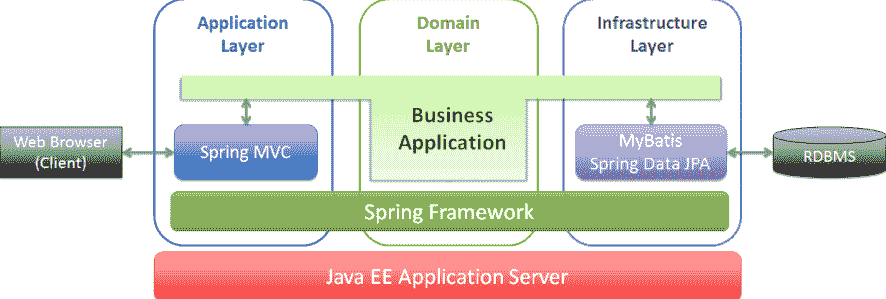

### 2.1.2 软件框架的主要结构元素

构成 TERASOLUNA Java 服务器框架 (5.x) 的库如下：

# DI 容器

使用 Spring Framework 作为 DI 容器。

- Spring Framework 4.3

# MVC 框架

使用 Spring MVC 作为 Web MVC 框架。

- Spring MVC 4.3

# TERASOLUNA Java 服务器框架 (5.x) 开发指南文档，版本 5.4.1.RELEASE

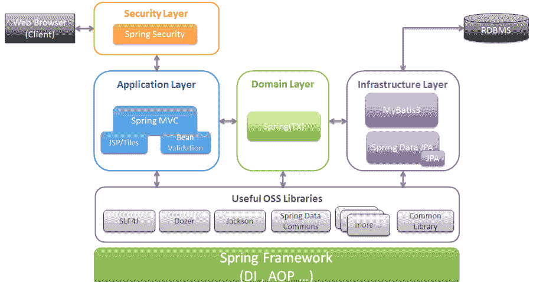

# O/R 映射

本指南假设使用**以下内容之一**。

- Mybatis 3.4

  - 使用 Mybatis-Spring 作为协调 Spring Framework 的库。

- JPA2.1

  - 使用 Hibernate 5.0 作为提供者。

> 注意：准确来说，Mybatis 是一个 `SQL Mapper`，但在本指南中它被归类为 `O/R Mapper`。

| 警告：每个项目都不得采用 JPA。对于表设计为`大多数表未经过规范化`或`表中的列数过多`的情况，使用 JPA 会非常困难。 |

| 此外，本指南未解释 JPA 的基本用法。因此，团队中需要具备 JPA 经验的人员。 |

# 视图

使用 JSP 作为视图。

使用以下内容标准化视图布局。

- Apache Tiles 3.0

# 安全

使用 Spring Security 作为身份验证和授权的框架。

# TERASOLUNA Java 服务器框架 (5.x) 开发指南文档，版本 5.4.1.RELEASE

- Spring Security 4.1

**提示**：除了在 Spring Security 3.2 中提供认证和授权机制外，该机制还得到了增强，以保护 Web 应用程序免受恶意攻击。

关于保护 Web 应用程序免受恶意攻击的机制，请参考：

- CSRF 应对措施

- 与浏览器安全应对措施函数的协作

# 验证

- 对于单项检查，使用了 BeanValidation 1.1。

  - 实现上，使用了 Hibernate Validator 5.2。

  - 对于关联项，使用了 BeanValidation 或 Spring Validation。

  - 参考“输入验证（Input Validation）”以确定正确的用法。

# 日志

- 使用 SLF4J API 作为 Logger。

  - 使用 Logback API 作为 Logger 的实现。

# 通用库

- https://github.com/terasolunaorg/terasoluna-gfw

- 详情请参考通用库的构建块（Building blocks of Common Library）。

### 2.1.3 OSS 版本

版本 5.4.1.RELEASE 中使用的 OSS 列表。

**提示**：从 5.0.0.RELEASE 版本开始，采用了导入 Spring IO 平台 `<dependencyManagement>` 的机制。

通过导入 Spring IO 平台的 `<dependencyManagement>`，

- Spring Framework 提供的库

- Spring Framework 依赖的 OSS 库

- Spring Framework 兼容的 OSS 库

根据 Spring IO 平台的定义规则解析依赖关系，并在 TERASOLUNA Java 服务器框架 (5.x) 中使用的 OSS 版本。

## 2.1 TERASOLUNA Java 服务器框架 (5.x) 的技术栈

# TERASOLUNA Java 服务器框架 (5.x) 开发指南文档，版本 5.4.1.RELEASE

此外，版本 5.4.1.RELEASE 指定 Spring IO 平台版本为 Brussels-SR5。

| 类型 | GroupId | ArtifctId | Version | Spring IO 平台 | 备注 |

|---|---|---|---|---|---|

| Spring | org.springframework | spring-aop | 4.3.14.RELEASE | | |

| Spring | org.springframework | spring-aspects | 4.3.14.RELEASE | | |

| Spring | org.springframework | spring-beans | 4.3.14.RELEASE | | |

| Spring | org.springframework | spring-context | 4.3.14.RELEASE | | |

| Spring | org.springframework | spring-context-support | 4.3.14.RELEASE | | |

| Spring | org.springframework | spring-core | 4.3.14.RELEASE | | |

| Spring | org.springframework | spring-expression | 4.3.14.RELEASE | | |

| Spring | org.springframework | spring-jdbc | 4.3.14.RELEASE | | |

| Spring | org.springframework | spring-orm | 4.3.14.RELEASE | | |

| Spring | org.springframework | spring-tx | 4.3.14.RELEASE | | |

| Spring | org.springframework | spring-web | 4.3.14.RELEASE | | |

| Spring | org.springframework | spring-webmvc | 4.3.14.RELEASE | | |

| Spring | org.springframework | spring-jms | 4.3.14.RELEASE | | |

| Spring | org.springframework | spring-messaging | 4.3.14.RELEASE | | |

| Spring | org.springframework.data | spring-data-commons | 1.13.RELEASE | | |

| Spring | org.springframework.security | spring-security-acl | 4.2.14.RELEASE | | |

| Spring | org.springframework.security | spring-security-config | 4.2.14.RELEASE | | |

| Spring | org.springframework.security | spring-security-core | 4.2.14.RELEASE | | |

| Spring | org.springframework.security | spring-security-taglibs | 4.2.14.RELEASE | | |

| Spring | org.springframework.security | spring-security-web | 4.2.14.RELEASE | | |

| Spring | org.springframework.security.oauth | spring-security-oauth2 | 2.0.14.RELEASE | | * |

| Mybatis3 | org.mybatis | mybatis | 3.4.5 | | *1 |

| Mybatis3 | org.mybatis | mybatis-spring | 1.3 | | *1 |

| Mybatis3 | org.mybatis | mybatis-typehandlers | 1.0.2 | | *16 |

| JPA(Hibernate) | antlr | antlr | 2.7.7 | | *2 |

| JPA(Hibernate) | dom4j | dom4j | 1.6 | | *2 |

| JPA(Hibernate) | org.hibernate | hibernate-core | 5.0.12 | | *2 |

| JPA(Hibernate) | org.hibernate | hibernate-entitymanager | 5.0.12 | | *2 |

| JPA(Hibernate) | org.hibernate.common | hibernate-commons-annotations | 5.0.1.Final | | *24 |

| JPA(Hibernate) | org.hibernate.jax.persistence | hibernate-jpa-2.1-api | 1.0.0.Final | | *2 |

| JPA(Hibernate) | org.javassist | javassist | 3.21.0-GA | | *2 |

| JPA(Hibernate) | org.jboss | jandex | 2.0.3.Final | | *24 |

续下页

# TERASOLUNA Java 服务器框架 (5.x) 开发指南文档，版本 5.4.1.RELEASE

表格 2.1 – 续上页

| 类型 | GroupId | ArtifactId | Version | Spring IO 平台 | 备注 |

|---|---|---|---|---|---|

| JPA(Hibernate) | org.springframework.data | spring-data-jpa | 1.1.17.RELEASE | * | *2 |

| JPA(Hibernate) | org.apache.geronimo.specs | geronimo-jta_1.1_spec | 1.1.1 | * | *2 |

| DI | java.inject | java.inject | 1 | * | |

| AOP | aopalliance | aopalliance | 1 | * | |

| AOP | org.aspectj | aspectjrt | 1.8.10 | * | |

| AOP | org.aspectj | aspectweaver | 1.8.10 | * | |

| 日志输出 | ch.qos.logback | logback-classic | 1.1.11 | * | |

| 日志输出 | ch.qos.logback | logback-core | 1.1.11 | * | *4 |

| 日志输出 | org.lazylogging | log4jdb-remix | 0.2.7 | * | |

| 日志输出 | org.slf4j | jcl-over-slf4j | 1.7.25 | * | |

| 日志输出 | org.slf4j | slf4j-api | 1.7.25 | * | |

| JSON | com.fasterxml.xml.jackson.core | jackson-annotations | 2.8.0 | * | |

| JSON | com.fasterxml.xml.jackson.core | jackson-core | 2.8.10 | * | |

| JSON | com.fasterxml.xml.jackson.core | jackson-databind | 2.8.10 | * | |

| JSON | com.fasterxml.xml.jackson.datatype | jackson-datatype-joda | 2.8.10 | * | |

| JSON | com.fasterxml.xml.jackson.datatype | jackson-datatype-jsr310 | 2.8.10 | * | *6 |

| 验证检查 | java.validation | validation-api | 1.1 | * | |

| 验证检查 | org.hibernate | hibernate-validator | 5.3 | * | |

| 验证检查 | org.jboss.logging | jboss-logging | 3.3.Final | * | *4 |

| 验证检查 | com.fasterxml | | 1.3.4 | * | *4 |

| Bean 转换 | commons-beans | commons-beans | 1.9.3 | * | *3 |

| Bean 转换 | net.sf.dozer | dozer | 5.5.1 | * | |

| Bean 转换 | net.sf.dozer | dozer-spring | 5.5.1 | * | *3 |

| Bean 转换 | org.apache.commons | commons-lang3 | 3.5 | * | *3 |

| 日期选项 | jira-time | jira-time | 2.9.9 | * | |

| 日期选项 | jira-time | jira-time-jsptags | 1.1.1 | * | *3 |

| 日期选项 | org.jira.usertype | usertypeype.core | 5.0.0.GA | * | *2 |

| 日期选项 | org.jira.usertype | usertypeype.spi | 5.0.0.GA | * | *2 |

# TERASOLUNA Java 服务器框架 (5.x) 开发文档，

版本 5.4.1.RELEASE

表 2.1 – 接上上页

| 类型 | GroupId | ArtifactId | Version | Spring IO 平台 | 备注 |

|---|---|---|---|---|---|

| Tiles | org.apache.tiles | tiles-api | 3.0.7 | | *3 |


### 依赖库列表

| Tiles | org.apache.tiles | tiles-core | 3.0.7 | | *3 |
| Tiles | org.apache.tiles | tiles-jsp | 3.0.7 | | *3 |
| Tiles | org.apache.tiles | tiles-servlet | 3.0.7 | | *3 |
| Tiles | org.apache.tiles | tiles-template | 3.0.7 | | *3 #4 |
| Tiles | org.apache.tiles | tiles-autotag-core | 1.2 | | *3 #4 |
| Tiles | org.apache.tiles | tiles-request-servlet | 1.0.6 | | *3 #4 |
| Tiles | org.apache.tiles | tiles-request-api | 1.0.6 | | *3 |
| Tiles | org.apache.tiles | tiles-request-jsp | 1.0.6 | | *3 #4 |
| Utility | com.google.guava | guava | 20.0 | | | |
| Utility | commons-collections | commons-collections | 3.2.2 | | *3 |
| Utility | commons-io | commons-io | 2.5 | | *3 |
| Servlet | org.apache.taglibs | taglibs-standard-jstlet | 1.2.5 | | *4 |
| Servlet | org.apache.taglibs | taglibs-standard-spec | 1.2.5 | | *4 |
| Servlet | org.apache.taglibs | taglibs-standard-impl | 1.2.5 | | *4 |

- 1. 使用 `MyBatis3` 进行数据访问时使用的依赖库。
- 2. 使用 `JPA` 进行数据访问时使用的依赖库。
- 3. 不依赖于公共库，但在使用 TERASOLUNA Java 服务器框架 (5.x) 开发应用时推荐使用的库。
- 4. Spring IO 支持的库，单独相关的库。（该库不作为 Spring IO 平台的依赖项进行管理）
- 5. Spring IO 平台中应用的库版本为 Beta 或 RC（发布候选版本）（在 TERASOLUNA Java 服务器框架 (5.x) 中明确指定了 GA 版本）
- 6. 以 Java SE 8 及更高版本的 API 为前提的库。对于早于 Java 7 的版本，则必须显式说明与该库的依赖关系。

### 2.1.4 公共库的构建模块

公共库包含了 Spring 生态系统或 TERASOLUNA Java 服务器框架 (5.x) 中其他库中未提供的 Alpha 功能。基本上，即使没有它，使用 TERASOLUNA Java 服务器框架 (5.x) 也可以进行应用开发，但它的存在**非常方便**。在默认设置下，提供的两个空项目 `Blank project` 和 `Blank project of single-project` 包含了如下列表所示的内置公共库。

#### 公共库模块列表

| 编号 | 项目名称 | 摘要 | Java 源码可用性 | 空项目多模块内置 | 空项目单模块内置 |
|---|---|---|---|---|---|
| (1) | `terasoluna-gfw-parent` | 为依赖库管理和插件提供推荐的设置。 | 否 | 是*1 | 是*1 |
| (2) | `terasoluna-gfw-libraries` | 在公共库中定义包含 Java 源码的项目结构。没有必要将其作为依赖项添加到 `pom.xml` 中。（从 5.2.0 开始新增） | 否 | 否 | 否 |
| (3) | `terasoluna-gfw-dependencies` | 在公共库中定义仅提供依赖定义的项目结构（除 `terasoluna-gfw-parent` 外）。没有必要将其作为依赖项添加到 `pom.xml` 中。（从 5.2.0 开始新增） | 否 | 否 | 否 |
| (4) | `terasoluna-gfw-common` | 提供不依赖于 Web 的通用功能。当使用此库时，会将 `terasoluna-gfw-dependencies` 作为依赖项添加到 `pom.xml`。 | 是 | 是*2 | 是*2 |
| (5) | `terasoluna-gfw-common-dependencies` | 在使用 `terasoluna-gfw-common` 项目提供的功能时，提供依赖定义。（从 5.2.0 开始新增） | 否 | 是 | 是 |
| (6) | `terasoluna-gfw-jodatime` | 提供依赖 Joda Time 的功能。当使用此库时，会将 `terasoluna-gfw-jodatime-dependencies` 添加到 `pom.xml`。（从 5.0.0 开始新增） | 是 | 是*2 | 是*2 |
| (7) | `terasoluna-gfw-jodatime-dependencies` | 在使用 `terasoluna-gfw-jodatime` 项目提供的功能时，提供依赖定义。（从 5.2.0 开始新增） | 否 | 是 | 是 |
| (8) | `terasoluna-gfw-web` | 提供创建 Web 应用的功能。不依赖于 View。当使用此库时，会将 `terasoluna-gfw-dependencies` 作为依赖项添加到 `pom.xml`。 | 是 | 是*2 | 是*2 |
| (9) | `terasoluna-gfw-web-dependencies` | 在使用 `terasoluna-gfw-web` 项目提供的功能时，提供依赖定义。（从 5.2.0 开始新增） | 否 | 是 | 是 |
| (10) | `terasoluna-gfw-web-jsp` | 提供支持 JSP 的 Web 应用功能。当使用此库时，会将 `terasoluna-gfw-dependencies` 作为依赖项添加到 `pom.xml`。 | 是 | 是 | 是 |
| (11) | `terasoluna-gfw-web-jsp-dependencies` | 在使用 `terasoluna-gfw-web-jsp` 项目提供的功能时，提供依赖定义。（从 5.2.0 开始新增） | 否 | 是 | 是 |
| (12) | `terasoluna-gfw-security` | 提供 Spring 的扩展部分。当使用此库时，会将 `terasoluna-gfw-dependencies` 作为依赖项添加到 `pom.xml`。 | 是 | 是*2 | 是*2 |
| (13) | `terasoluna-gfw-security-dependencies` | 在使用 Spring 并使用 `terasoluna-gfw-web` 项目提供的功能时，提供依赖定义。（从 5.2.0 开始新增） | 否 | 是 | 是 |
| (14) | `terasoluna-gfw-string` | 提供处理字符串的功能。（从 1.0 开始） | 是 | 否 | 否 |
| (15) | `terasoluna-gfw-codepoints` | 提供检查代码点是否在代码集中的功能。（从 1.0 开始） | 是 | 否*3 | 否*3 |
| (16) | `terasoluna-gfw-validator` | 提供 Bean Validation 的通用注解。（从 1.0 开始） | 是 | 否 | 否 |
| (17) | `terasoluna-gfw-security-core` | 在使用 Spring 时（除 Web 外）提供依赖定义。（从 5.2.0 开始新增） | 否 | 是 | 是 |
| (18) | `terasoluna-gfw-mybatis3-dependencies` | 在使用 `MyBatis3` 时提供依赖定义。（从 5.2.0 开始新增） | 否 | 是*4 | 是*4 |
| (19) | `terasoluna-gfw-jpa-dependencies` | 在使用 `JPA` 时提供依赖定义。（从 5.2.0 开始新增） | 否 | 是*5 | 是*5 |
| (20) | `terasoluna-gfw-recommended-dependencies` | 为不依赖 Web 的推荐库提供依赖定义。 | 否 | 是 | 是 |
| (21) | `terasoluna-gfw-recommended-web-dependencies` | 为依赖 Web 的推荐库提供依赖定义。 | 否 | 是 | 是 |

#### 补充说明

- 1. 作为每个项目的 `<parent>` 元素引入，而不是 `<dependency>` 元素。
- 2. 作为 `<dependency>` 元素的过渡依赖引入，而不是 `<dependency>` 元素。
- 3. 根据要使用的代码集提供多个构件。详情请参考公共库提供的代码集类。
- 4. 在公共库的默认设置下，使用 `MyBatis3` 进行数据访问时。
- 5. 在公共库的默认设置下，使用 `JPA` 进行数据访问时。

该项目不包含 Java 源码，仅定义库依赖。

此外，项目依赖如下：

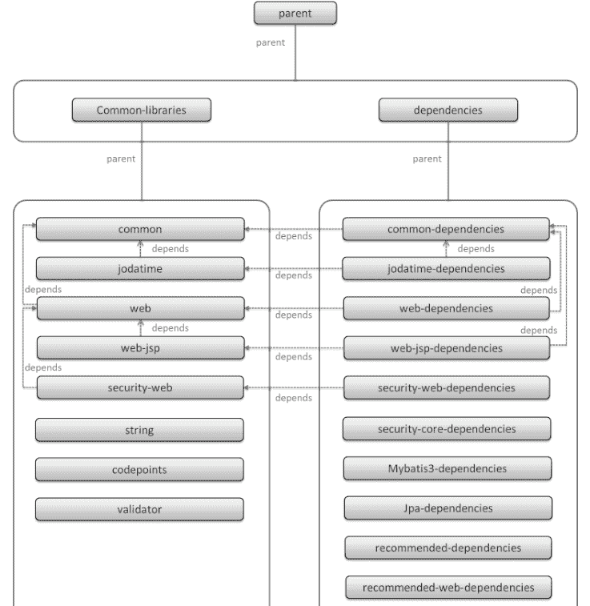

> **注意**：排除例外情况，项目名称末尾带有 `<dependencies>` 的存在于公共库中。（例如对应于 `terasoluna-gfw-common` 的 `terasoluna-gfw-common-dependencies` 等）

在这些项目中，提供了公共库依赖的同时，还提供了推荐使用的 OSS 库的相应依赖，建议将其作为依赖项添加到 `pom.xml` 中，以便在使用公共库时分配了 `dependencies` 的项目。

### 2.1.5 公共库组件详解

#### terasoluna-gfw-common

`terasoluna-gfw-common` 提供以下组件。

| 分类 | 组件名称 | 描述 |
| --- | --- | --- |
| 异常处理 | 异常类 | 提供通用的异常类。 |
| | 异常日志器 | 提供用于记录应用程序中发生异常的日志器类。 |
| | 异常代码 | 提供用于解析对应异常类的异常代码（消息 ID）的机制（类）。 |
| | 异常日志拦截器 | 提供 AOP 拦截器类，用于记录领域层中发生的异常。 |
| 系统日期 | 系统日期时间工厂 | 提供用于获取系统日期和时间的类。 |
| 代码列表 | CodeList | 提供用于生成 CodeList 的类。 |
| 数据库访问 | 查询转义 | 提供用于绑定到 SQL 和 JPQL 的值转义处理的类。 |
| (公共) | 序列生成器 | 提供用于获取序列值的类。 |

#### terasoluna-gfw-string

`terasoluna-gfw-string` 提供以下组件。

| 分类 | 组件名称 | 描述 |
| --- | --- | --- |
| 字符串处理 | 半角转全角转换 | 提供一个类，执行以下过程：根据半角字符串和全角字符串的映射表，将输入字符串的半角字符转换为全角，并将全角字符转换为半角。 |

#### terasoluna-gfw-codepoints

`terasoluna-gfw-codepoints` 提供以下组件。

| 分类 | 组件名称 | 描述 |
| --- | --- | --- |
| 字符串处理 | 代码点检查 | 提供一个类，检查目标字符串组成的代码点是否包含在代码点集中。 |
| 输入验证 | 用于代码点检查的 Bean 校验约束注解 | 提供用于代码点检查 Bean 校验的约束注解。 |

#### terasoluna-gfw-validator

`terasoluna-gfw-validator` 提供以下组件。

| 分类 | 组件名称 | 描述 |
| --- | --- | --- |
| 输入验证 | 用于字节长度检查的 Bean 校验约束注解 | 提供一种约束注解，使用 Bean 校验检查输入值字符编码中的字节长度是否小于等于指定的最大值，且大于或等于指定的最小值。 |
| | 用于属性值比较的 Bean 校验约束注解 | 提供一种约束注解，使用 Bean 校验检查两个属性之间的比较。 |

#### terasoluna-gfw-jodatime

`terasoluna-gfw-jodatime` 提供以下组件。

| 分类 | 组件名称 | 描述 |
| --- | --- | --- |
| 系统日期 | 用于 Joda Time 的系统日期时间工厂 | 提供使用 Joda Time API 获取系统日期时间的类。 |

#### terasoluna-gfw-web

`terasoluna-gfw-web` 提供以下组件。

| 分类 | 组件名称 | 描述 |
|---|---|---|
| 重复提交保护 | 事务令牌检查 | 提供一种机制（类），保护 Web 应用程序防止请求重复提交。 |
| 异常处理 | 异常处理器 | 提供由 Spring MVC 提供的异常处理器类，用于与公共库中的异常处理组件集成。 |
| | 异常日志拦截器 | 提供 AOP 拦截器类，用于记录由 Spring MVC 处理的异常。 |
| 代码列表 | 填充 CodeList 拦截器 | 提供 Spring MVC 拦截器类，用于将 CodeList 信息存储在请求作用域中，以便从视图中检索 CodeList。 |
| 文件下载 | 通用下载视图 | 提供一个抽象类，用于从输入流读取数据并写入流以进行下载。 |
| 日志 | 用于存储 Tracking ID 的 ServletFilter | 提供 ServletFilter 类，用于存储 Tracking ID 的 MDC（映射诊断上下文）、请求作用域和响应头，以提高可追溯性。（如果请求头中不存在 Tracking ID，则由此组件生成 Tracking ID） |
| | 用于存储 MDC 的通用 ServletFilter | 提供用于在 Logger 的 MDC 中存储任意值的抽象类。 |
| | 用于清除存储在 Logger MDC 中信息的 ServletFilter 类 | 提供用于清除存储在 Logger MDC 中信息的 ServletFilter 类。 |

#### terasoluna-gfw-web-jsp

`terasoluna-gfw-web-jsp` 提供以下组件。

| 分类 | 组件名称 | 描述 |
|---|---|---|
| 重复提交保护 | 用于事务输出的 JSP Tag | 提供一个 JSP 标签库，将事务令牌作为隐藏项输出。 |
| 分页 | 显示分页链接的 JSP Tag | 提供显示 Spring Data Commons 提供的分页链接类的 JSP 标签库。 |
| 消息管理 | 显示结果消息的 JSP Tag | 提供显示结果消息的 JSP 标签库。 |
| EL 函数 | 用于 XSS 防的 EL 函数 | 用于 XSS 防的 EL 函数。 |
| | 用于 URL 的 EL 函数 | 提供将 URL 编码的 EL 函数。 |
| | 用于 DOM 转换的 EL 函数 | 提供 DOM 转换的 EL 函数。 |
| | 用于工具类的 EL 函数 | 提供用于通用工具处理的 EL 函数。 |

#### terasoluna-gfw-security-web

`terasoluna-gfw-security-web` 提供以下组件。

| 分类 | 组件名称 | 描述 |
|---|---|---|
| 日志 | 用于存储用户名的 ServletFilter | 提供用于将用户名设置到 MDC 的 ServletFilter 类 |

## 2.2 Spring 架构概述

Spring 官方网站提到 Spring 参考。Spring Web 框架像许多其他 MVC 框架一样是请求驱动的，围绕一个调度请求到控制器的 Servlet 设计。

### 2.2.1 Spring MVC 处理概述

从接收请求到返回响应的 Spring MVC 处理流程如图所示。


1. `DispatcherServlet` 接收请求。


## 2.2 Spring MVC 架构概述

### 2.2.1 处理流程

2. `DispatcherServlet` 将选择控制的任务交给 `HandlerMapping`，`HandlerMapping` 选择与 URL 映射的控制器并将（选定的 `Handler`）和 `Controller` 返回给 `DispatcherServlet`。

3. `DispatcherServlet` 将执行 `Controller` 业务逻辑的任务交给 `HandlerAdapter`。

4. `HandlerAdapter` 调用 `Controller` 的业务逻辑。

5. `Controller` 执行业务逻辑，将结果设置 `Model` 并返回视图名称给 `HandlerAdapter`。

6. `DispatcherServlet` 将解析对应视图的任务交给 `ViewResolver`。`ViewResolver` 返回映射到视图的 `View`。

7. `DispatcherServlet` 将渲染过程交给 `View`。

8. `View` 渲染 `Model` 数据并返回响应。

### 2.2.2 各组件的实现

在之前说明的组件中，以下是可扩展组件。

#### HandlerMapping 的实现

Spring 框架提供的 `HandlerMapping` 类层次结构如下：

```
HandlerMapping
  AbstractHandlerMapping
    AbstractHandlerMethodMapping<T>
      RequestMappingInfoHandlerMapping
        RequestMappingHandlerMapping
    AbstractUrlHandlerMapping
      AbstractDetectingUrlHandlerMapping
        AbstractControllerUrlHandlerMapping
            ControllerBeanNameHandlerMapping
            ControllerClassNameHandlerMapping
            BeanNameHandlerMapping
            DefaultAnnotationHandlerMapping
          SimpleUrlHandlerMapping
    EmptyHandlerMapping
```

通常使用 `org.springframework.web.servlet.mvc.annotation.RequestMappingHandlerMapping`。该类使用 `Controller` 上的 `@RequestMapping` 注解匹配 URL 的 `Controller` 方法。

在 Spring Framework 3.1 中，当 `DispatcherServlet` 读取的 Bean 定义文件中存在 `<mvc:annotation-driven>` 时，`RequestMappingHandlerMapping` 会默认启用。（有关使用 `<mvc:annotation-driven>` 注解启用的设置，请参考 MVC 框架。）

#### HandlerAdapter 的实现

通常使用 `org.springframework.web.servlet.mvc.annotation.RequestMappingHandlerAdapter`。`RequestMappingHandlerAdapter` 类调用由 `HandlerMapping` 选择的处理器类（`Controller`）方法。在 Spring Framework 3.1 中，该类也通过 `<mvc:annotation-driven>` 进行配置。

`HandlerAdapter` 类层次结构如下：

```
HandlerAdapter
  AbstractHandlerMethodAdapter
    RequestMappingHandlerAdapter
    AnnotationMethodHandlerAdapter
    HttpRequestHandler
    SimpleControllerHandlerAdapter
    SimpleServletAdapter
```

#### ViewResolver 的实现

下方列出了实现了 Spring 框架及其依赖库提供的 `ViewResolver` 的类。

```
ViewResolver
  AbstractCachingViewResolver
    ResourceBundleViewResolver
    UrlBasedViewResolver
    AbstractTemplateViewResolver
      FreeMarkerViewResolver
      GroovyMarkupViewResolver
    VelocityViewResolver
      VelocityLayoutViewResolver
  InternalResourceResolver
  JasperReportsViewResolver
  TilesViewResolver
  XsltViewResolver
  XmlViewResolver
  BeanNameViewResolver
  ContentNegotiatingViewResolver
  ViewResolverComposite
```

通常情况下（当使用 JSP 时）：

- 使用 `org.springframework.web.servlet.view.InternalResourceViewResolver`
- 当使用模板 tiles 时，使用 `org.springframework.web.servlet.view.tiles3.TilesViewResolver`
- 当返回流用于文件下载时，使用 `org.springframework.web.servlet.view.BeanNameViewResolver`

因此，需要根据需要返回的 `View` 类型使用不同的 `ViewResolver`。

当需要处理多种类型的 `View` 时，需要多个 `ViewResolver` 的定义。

使用多个 `ViewResolver` 的典型示例是存在文件下载过程的屏幕应用。

对于屏幕（JSP），使用 `InternalResourceViewResolver` 解析 `View`；对于文件下载 `View`，使用 `BeanNameViewResolver` 解析。

详细信息，请参考“文件下载”。

#### View 的实现

下方列出了实现了 Spring 框架及其依赖库提供的 `View` 的类。

`View` 根据要响应的类型而变化。当返回 JSP 时，使用 `org.springframework.servlet.view.JstlView`。当需要处理非 Spring 框架及其依赖库提供的 `View` 时，有必要扩展实现 `View` 接口的类。详细信息，请参考“文件下载”。

```
View
  AbstractView
    AbstractExcelView
    AbstractFeedView<T>
      AbstractAtomFeedView
      AbstractRssFeedView
      AbstractFileDownloadView
      AbstractJackson2View
        MappingJackson2JsonView
        MappingJackson2XmlView
    AbstractExcelView
    AbstractPdfView
  AbstractUrlBasedView
    AbstractJasperReportsSingleFormatView
      ConfigurableJasperReportsView
      JasperReportsCsvView
      JasperReportsHtmlView
      JasperReportsPdfView
      JasperReportsXlsView
      JasperReportsMultiFormatView
  AbstractPdfStamperView
  AbstractTemplateView
    FreeMarkerView
    GroovyMarkupView
    VelocityView
      VelocityToolboxView
      VelocityLayoutView
  InternalResourceView
    JListView
    RedirectView
    TilesView
    TilesView
    XsltView
  MarshallingView
  SmartView
    RedirectView
    new View() {...}
    new View() {...}
```

## 2.3 基于 Spring MVC 的第一个应用程序

在进入 Spring MVC 的高级用法之前，最好通过实际上手使用 Spring MVC 进行 Web 应用开发来理解 Spring MVC。

### 2.3.1 前提条件

本章节的描述已在以下环境中验证。（对于其他环境，请适当替换此处提到的内容）

| 分类 | 产品 |
| :--- | :--- |
| 操作系统 | Windows 7 |
| JVM | Java 1.8 |
| IDE | Spring Tool Suite 3.6.4.RELEASE (以下简称 [STS]) |
| 构建工具 | Apache Maven 3.3.9 (以下简称 [Maven]) |
| 应用服务器 | Pivotal tc Server Developer Edition v3.1 (包含在 STS 中) |
| Web 浏览器 | Google Chrome 46.0.2490.80 m |

> **注意**：通过代理服务器连接互联网时，以下操作需要 STS 代理设置和 Maven 代理设置。

### 2.3.2 创建新项目

在互联网上使用 `mvn archetype:generate` 创建项目。

```
mvn archetype:generate -B \
-DarchetypeGroupId=org.terasoluna.gfw.blank \
-DarchetypeArtifactId=terasoluna-gfw-web-blank-archetype \
-DarchetypeVersion=5.4.1.RELEASE \
-DgroupId=com.example.helloworld \
-DartifactId=helloworld \
-Dversion=1.0.0-SNAPSHOT
```

### 2.3.3 配置文件示例

```xml
http://www.springframework.org/schema/util http://www.springframework.org/schema/util/spring-util.xsd
http://www.springframework.org/schema/context http://www.springframework.org/schema/context/spring-context.xsd
http://www.springframework.org/schema/aop http://www.springframework.org/schema/aop/spring-aop.xsd

<context:property-placeholder
  location="classpath:/META-INF/spring/*.properties" />

<!-- (1) 启用 Spring MVC Controller 编程模型 -->
<mvc:annotation-driven>
  <mvc:argument-resolvers>
    <bean
      class="org.springframework.data.web.PageableHandlerMethodResolver" />
    <bean
      class="org.springframework.security.web.method.annotation.AuthenticationPrincipalArgumentResolver" />
  </mvc:argument-resolvers>
</mvc:annotation-driven>
<mvc:default-servlet-handler />

<!-- (2) -->
<context:component-scan base-package="com.example.helloworld.app" />

<mvc:resources mapping="/resources/*"
  location="/resources/;classpath:META-INF/resources/"
  cache-period="#{60 * 60}" />

<mvc:interceptors>
  <mvc:interceptor>
    <mvc:mapping path="/resources/*" />
    <mvc:exclude-mapping path="/resources/**" />
    <mvc:exclude-mapping path="**/*.html" />
    <bean
      class="org.terasoluna.gfw.logging.TraceLoggingInterceptor" />
  </mvc:interceptor>
  <mvc:interceptor>
    <mvc:mapping path="/*" />
    <mvc:exclude-mapping path="/resources/**" />
    <mvc:exclude-mapping path="**/*.html" />
    <bean
      class="org.terasoluna.gfw.web.token.TransactionTokenInterceptor" />
  </mvc:interceptor>
  <mvc:interceptor>
    <mvc:mapping path="/*" />
    <mvc:exclude-mapping path="/resources/**" />
    <mvc:exclude-mapping path="**/*.html" />
    <bean class="org.terasoluna.gfw.web.codelist.CodeListInterceptor" />
  </mvc:interceptor>
</mvc:interceptors>
```


## Spring MVC 配置示例

```xml
<property name="codeListIdPattern" value="CL..+" />
</bean>
<mvc:interceptor>
  <!-- 如果使用 JPA，请删除此行 -->
  <mvc:mapping path="/.*" />
  <mvc:exclude-mapping path="/**/*" />
  <mvc:exclude-mapping path="/**/*.html" />
  <bean class="org.springframework.orm.jpa.OpenEntityManagerManagerInViewInterceptor"
    id="entityManagerInViewInterceptor" />
</mvc:interceptor>
<!-- 如果使用 JPA，请删除此行 -->
<mvc:interceptors>
  <!-- (3) 将 @Controllers 选择用于渲染的视图解析为 .jsp -->
  <!-- /WEB-INF/views 目录下的 resources -->
  <!-- 视图解析器设置。 -->
  <mvc:view-resolvers>
    <mvc:jsp prefix="/WEB-INF/views/" />
  </mvc:view-resolvers>
  <bean id="requestDataValueProcessor" class="org.terasoluna.gwfw.mvc.CompositeRequestDataProcessor">
    <constructor-arg>
      <util:list>
        <bean class="org.springframework.security.web.servlet.csrf.CsrfRequestDataProcessor" />
      </util:list>
    </constructor-arg>
  </bean>
  <bean class="org.terasoluna.gwfw.mvc.transaction.TransactionTokenRequestDataProcessor" />
</mvc:interceptors>

</map>

</property>

<property name="statusCodes">

  <map>

    <entry key="common/error/resourceNotFoundError" value="404" />

    <entry key="common/error/businessError" value="409" />

    <entry key="common/error/transactionToken" value="409" />

    <entry key="common/error/dataAccessError" value="500" />

  </map>

</property>

<property name="defaultView" value="common/error/systemError" />

<property name="defaultStatusCode" value="500" />

<!-- 设置 AOP -->

<bean id="handlerInterceptor"
  class="org.terasoluna.gfw.web.token.TransactionTokenInterceptor">

  <property name="exceptionLogger" ref="exceptionLogger" />

</bean>

<aop:config>

  <mvc:advice ref="handlerInterceptor"
    pointcut="execution(* org.springframework.web.servlet.ExceptionHandlerResolver..))" />

</aop:config>
```

| Sr. No. | Description |
|---|---|
| (1) | Spring MVC 的 `mvc:annotation-driven` 设置。 |
| (2) | 组件扫描的目标。 |
| (3) | 通过 `<mvc:jsp prefix="/WEB-INF/views/" suffix=".jsp"/>` 定义视图解析器。 |

```xml
<bean id="viewResolver"
  class="org.springframework.web.servlet.view.InternalResourceViewResolver">
  <property name="prefix" value="/WEB-INF/views/" />
  <property name="suffix" value=".jsp" />
</bean>
```

## 2.3 基于 Spring MVC 的第一个应用

```java
package com.example.helloworld.welcome;

import java.text.DateFormat;
import java.util.Date;
import java.util.Locale;

import org.slf4j.Logger;
import org.slf4j.LoggerFactory;
import org.springframework.stereotype.Controller;
import org.springframework.ui.Model;
import org.springframework.web.bind.annotation.RequestMapping;
import org.springframework.web.bind.annotation.RequestMethod;

/**
 * 处理首页请求。
 */
@Controller
public class HomeController {

    private static final Logger logger = LoggerFactory.getLogger(HomeController.class);

    /**
     * 通过名称选择视图。
     */
    @RequestMapping(value = "/", method = {RequestMethod.GET, RequestMethod.POST})
    public String home(Locale locale, Model model) {
        logger.info("Welcome home! The locale is {}", locale);

        Date date = new Date();
        DateFormat dateFormat = DateFormat.getInstance(DateFormat.LONG);

        String formattedDate = dateFormat.format(date);

        model.addAttribute("serverTime", formattedDate); // (6)

        return "welcome/home"; // (7)
    }
}
```

## 2 架构概述

| Sr. No. | Description |
|---|---|
| (4) | 如果使用了 `@Controller` 注解，它可以被 DI 容器自动读取。如前所述 [Spring 配置 (2)]，它是组件扫描的目标。 |
| (5) | 当 HTTP 方法为 GET 或 POST 且资源（或 URL）为 `[//]` 时执行。 |
| (6) | 设置传递给视图的 `Model` 对象。 |
| (7) | 根据配置 [Spring 配置 (3)] 渲染 `[WEB-INF/views/welcome/home.jsp]`。 |
| (8) | 如前所述 [Controller (6)]，对象存储在 `HttpServletRequest` 中。因此，可以通过 JSP 中提及 `${serverTime}` 来输出传递的值。但在 `${XXX}` 之后，有必要进行 HTML 转义以防止 XSS 攻击。 |

```html
<!DOCTYPE html>
<html>
<head>
<meta charset="utf-8">
<title>Home</title>
<link rel="stylesheet" href="${pageContext.request.contextPath}/resources/app/css/styles.css">
</head>
<body>
<div id="wrapper">
<h1>Hello world!</h1>
<p>The time on the server is ${serverTime}</p><!-- (8) -->
</div>
</body>
</html>
```

> Java TERASOLUNA 服务器框架 (5.x) 开发指南文档，
> 版本 5.4.1.RELEASE

## 2.3.3 在服务器上运行

在 STS 中右键点击 `helloworld` 项目，执行 `Run As` -> `Run On Server` -> `localhost` -> `Pivotal Tomcat Server Developer Edition v3.0` -> `Finish` 来启动 helloworld 项目。

在浏览器中输入 `http://localhost:8080/helloworld/` 以显示以下屏幕。

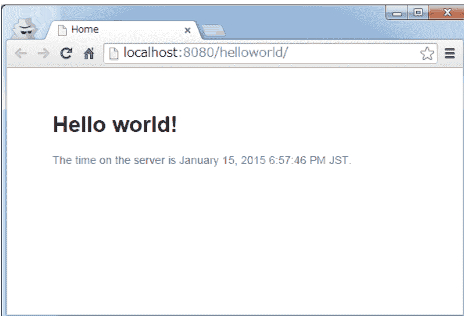

注意：由于 Tomcat Server 内部使用 Tomcat，因此您可以在 STS 中选择以下两个版本：

- tomcat-8.0.15.A.RELEASE（默认使用的版本）
- tomcat-7-0.57.A.RELEASE

如果你想切换使用的 Tomcat，可以通过打开 `[Edit Server Runtime Environment]` 对话框来更改 Tomcat Server 的 `[Version]` 字段。也可以通过此对话框更改 Java (JRE) 版本。

> 70 架构概述
>
> ## TERASOLUNA Java 服务器框架 (5.x) 开发指南文档，
> 版本 5.4.1.RELEASE
>
> 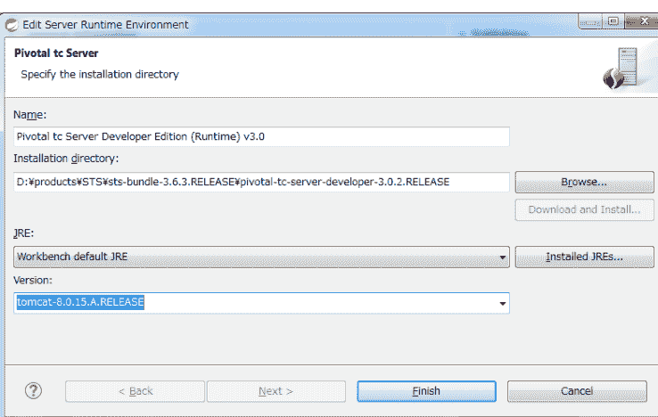

## 2.3.4 创建一个 Echo 应用

让我们来创建一个简单的应用程序。这是一个典型的 Echo 应用，当在下方文本框中输入名称时，将显示消息。

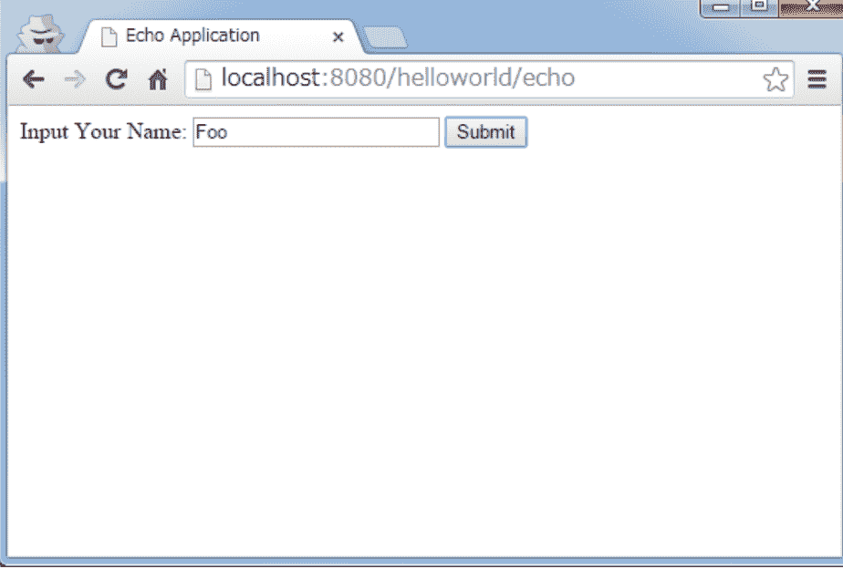

### 2.3 基于 Spring MVC 的第一个应用程序

> ## TERASOLUNA Java 服务器框架 (5.x) 开发指南文档，
> 版本 5.4.1.RELEASE
>
> 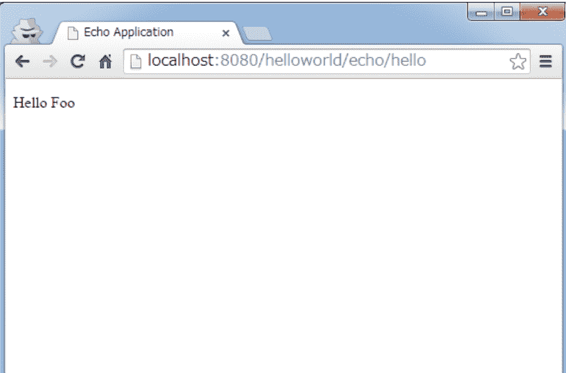

### 创建表单对象

首先创建一个表单对象以接收文本框的值。

在 `com.example.helloworld.app.echo` 包下创建 `EchoForm` 类。它是一个只有一个属性的简单 JavaBean。

```java
package com.example.helloworld.app.echo;

import java.io.Serializable;

public class EchoForm implements Serializable {
    private static final long serialVersionUID = 25572257070953644453L;

    private String name;

    public void setName(String name) {
        this.name = name;
    }

    public String getName() {
        return name;
    }
}
```

### 创建 Controller

接下来，创建 Controller 类。

在 `com.example.helloworld.app.echo` 包下创建 `EchoController` 类。

```java
package com.example.helloworld.app.echo;

import org.springframework.stereotype.Controller;
import org.springframework.ui.Model;
import org.springframework.web.bind.annotation.ModelAttribute;
import org.springframework.web.bind.annotation.RequestMapping;
import org.springframework.web.bind.annotation.RequestMethod;

@Controller
@RequestMapping("echo")
public class EchoController {

    @ModelAttribute // (1)
    public EchoForm setUpEchoForm() {
        EchoForm form = new EchoForm();
        return form;
    }

    @RequestMapping // (2)
    public String index(Model model) {
        return "echo/index"; // (3)
    }

    @RequestMapping(value = "hello", method = RequestMethod.POST) // (4)
    public String hello(EchoForm form, Model model) { // (5)
        model.addAttribute("name", form.getName()); // (6)
        return "echo/hello";
    }
}
```

## 2.3 基于 Spring MVC 的第一个应用程序

> ## TERASOLUNA Java 服务器框架 (5.x) 开发文档，
> 版本 5.4.1.RELEASE

| 序号 | 描述 |
|---|---|
| (1) | 在方法上添加 `@ModelAttribute` 注解。该方法的返回值会被自动添加到 `Model` 中。`Model` 的属性名称可以在 `@ModelAttribute` 中指定，但默认名称是类名的首字母小写。此属性名称必须与 `form:form` 标签的值匹配。 |
| (2) | 当方法的 `@RequestMapping` 注解的 `value` 属性未指定时，它将映射到类级别的 `@RequestMapping`。在这种情况下，如果访问 `/echo`，则调用 `index` 方法。 |
| (3) | 由于返回的是 `echo/index`，`ViewResolver` 将渲染 `WEB-INF/views/echo.jsp`。 |
| (4) | 由于 `@RequestMapping` 方法的 `value` 属性指定了 POST，如果使用 POST 方法访问 `/echo`，将调用 `hello` 方法。 |
| (5) | 添加到模型中的 `EchoForm` 对象将作为参数传递。 |
| (6) | 表单输入的名称将传递给 View。 |

**注意：** `@RequestMapping` 注解 `method` 属性中指定的值通常取决于数据从客户端传输的方式。

- 在存储数据时使用 POST 方法。
- 在未存储数据时使用 GET 方法或未指定方法。


# TERASOLUNA Java 服务器框架 (5.x) 开发指南文档

版本 5.4.1.RELEASE

## 2.3 创建 JSP 文件

最后，创建输入屏幕和输出屏幕的 JSP。

输入屏幕应位于 `src/main/webapp/WEB-INF/views/index.jsp`。

```html
<!DOCTYPE html>
<html>
<head>
<title>Echo Application</title>
</head>
<body>
  <!-- (1) -->
  <form id="echoForm" action="echo/hello" method="post">
    <label for="name">Input Name:</label>
    <input id="name" name="name" type="text" />
    <input type="submit" />
  </form>
</body>
</html>
```

| 序号 | 描述 |
|---|---|
| (1) | 使用标签库构建表单。通过 `modelAttribute` 属性指定名称。 |

创建输出屏幕 `src/main/webapp/WEB-INF/views/hello.jsp`。

```html
<!DOCTYPE html>
<html>
<head>
  <title>Echo Application</title>
</head>
<body>
  <p>
    Hello <c:out value="${name}" />
  </p>
</body>
</html>
```

| 序号 | 描述 |
|---|---|
| (2) | 从 Controller 传递的 `name`。使用 `c:out` 标签采取 XSS 防护措施。 |

**注意：** 这里使用 `c:out` 标准标签采取了 XSS 防护措施，不过也可以方便地使用库提供的 `h()` 函数。详情请参阅 XSS 防护措施。

Echo 应用的在此完成。

启动服务器并访问 `http://localhost:8080/echo/` 即可显示表单。

## 2.3 基于 Spring MVC 的第一个应用程序

```java
package com.example.helloworld.app.echo;

import org.springframework.stereotype.Controller;
import org.springframework.ui.Model;
import org.springframework.validation.BindingResult;
import org.springframework.validation.annotation.Validated;
import org.springframework.web.bind.annotation.ModelAttribute;
import org.springframework.web.bind.annotation.RequestMapping;
import org.springframework.web.bind.annotation.RequestMethod;

@Controller
@RequestMapping("echo")
public class EchoController {

    @ModelAttribute
    public EchoForm setUpEchoForm() {
        EchoForm form = new EchoForm();
        return form;
    }

    @RequestMapping
    public String index(Model model) {
        return "echo/index";
    }

    @RequestMapping(value = "hello", method = RequestMethod.POST)
    public String hello(@Validated EchoForm form, BindingResult result, Model
        model) { // (1)
        if (result.hasErrors()) // (2)
            return "echo/index";
        }
        model.addAttribute("name", form.getName());
        return "echo/hello";
    }
}
```

| 序号 | 描述 |
| :--- | :--- |
| (1) | 在 Controller 中，对需要执行校验的参数添加 `@Validated` 注解。同时在参数中添加 `BindingResult` 对象。使用 Bean Validation 自动进行输入校验，并将结果存储在 `BindingResult` 对象中。 |
| (2) | 通过执行 `hasErrors` 方法可以检查错误。如果存在输入错误，则返回用于显示输入界面的 View 名称。 |

## 2.3 添加输入错误消息显示

添加在输入界面显示输入错误消息的实现（`src/main/webapp/WEB-INF/views/echo/index.jsp`）。

```html
<!DOCTYPE html>
<html>
<head>
<title>Echo Application</title>
</head>
<body>
<form modelAttribute="echoForm" action="${pageContext.request.contextPath}/echo/hello">
<form:label path="Input Name:"></form:label>
<form:input path="name" />
<form:errors path="name" cssStyle="color:red" /><!-- (1) -->
<form:input type="submit" />
</form>
</body>
</html>
```

| 序号 | 描述 |
| :--- | :--- |
| (1) | 添加 `form:errors` 标签，用于在输入界面发生错误时显示错误消息。 |

输入校验的实现完成。

在以下条件下显示错误消息：

- 当名称为空
- 长度超过 5 个字符。

生成的 HTML 如下。

```html
<!DOCTYPE html>
<html>
<head>
<title>Echo Application</title>
</head>
<body>
<form id="echoForm" action="/helloworld/echo/hello" method="post">
<label for="name">Input Your Name:</label>
<input id="name" name="name" type="text" value="">
<span id="name.errors" style="color:red">size must be between 1 and 5</span>
<input type="submit" />
<input type="hidden" name="_csrf" value="6e94a78d-4a2c-4a41-a514-0a60f0dbedaf" />
</form>
</body>
</html>
```

### 总结

以下是本章的学习要点。

- 1. 如何使用 `mvn archetype:generate` 创建空项目。
- 2. 基础 Spring MVC 配置设置
- 3. 简化的页面级跳转
- 4. 页面间传值的方法
- 5. 简单的输入校验

如果上述点仍未理解，建议再次阅读本章并重新构建环境开始。

## 2.4 应用分层

在本指南中，应用程序被分为以下 3 层：

- 应用层 (Application layer)
- 领域层 (Domain layer)
- 基础设施层 (Infrastructure layer)

每一层都包含以下组件。

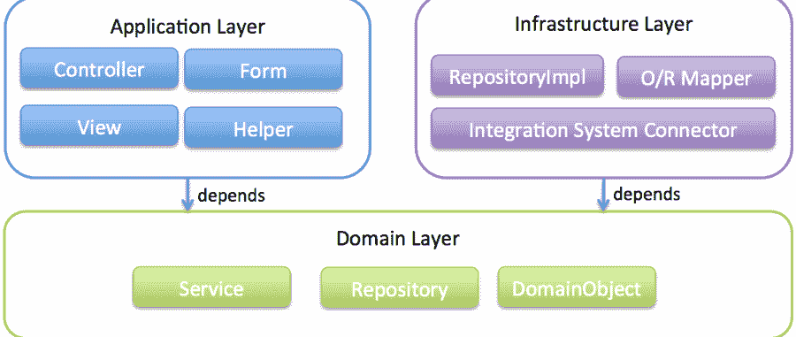

应用层和基础设施层都依赖领域层，但**领域层不应该依赖其他层**。

### 2.4.1 层定义

数据从输入到输出的流：应用层 → 领域层 → 基础设施层。

#### 应用层

在此层中，它提供以下功能：

- 为客户端提供 UI（用户界面）
- 校验来自客户端的输入
- 调用对应的领域层组件

该层应尽可能薄，不包含任何业务规则。

##### Controller

Controller 主要负责：

- 控制页面流（映射请求并返回对应的 View）
- 调用对应的领域层服务（执行主逻辑）

在 Spring MVC 中，带有 `@Controller` 注解的类变为 Controller 类。

**注意：** 在会话中存储数据时，Controller 也承担着管理生命期的职责。

##### View

View 的职责是为客户端生成输出（包括提供 UI）。以多种格式返回结果，如 HTML/PDF/Excel/JSON。

在 Spring MVC 中，一切由 View 类完成。

**提示：** 如果使用 JSON 或 XML 格式的结果，`HttpMessageConverter` 类承担了 View 的职责。

详情请参考 RESTful 服务。

##### Form

Form 的主要职责如下：

- 表示表单（将表单信息发送给 Controller，或将处理结果输出到表单）
- 输入检查规则的声明（添加 Bean Validation 注解）

##### Helper

它起到辅助 Controller 的作用。创建 Helper 是可选的。根据需要可以创建为 POJO 类。

**注意：** Controller 的主要职责是路由（URL 映射和指定目标）。如果需要任何处理（转换 JavaBean），则这部分必须从 Controller 中剥离并委托给 Helper 类。

Helper 类的存在提升了 Controller 的可见性，因此可以将其视作 Controller 的一部分（类似于 Controller 的私有方法）。

#### 领域层 (Domain layer)

领域层是应用程序的核心，负责执行业务规则。

在此层中，它提供了以下实现：

- DomainObject
- 检查对应 DomainObject 的业务规则（例如账户入账时是否有足够的余额）
- 执行 DomainObject 的业务规则（反映对应业务规则的值）
- 执行 DomainObject 的 CRUD 操作

领域层独立于其他层，并且是可重用的。

##### DomainObject

DomainObject 是一个代表业务所需的资源以及业务过程中生成的项的模型。

模型大可分为三类：

- 资源模型，例如员工、客户、产品等（通常由名词表示）
- 事件模型，例如订单、付款等（通常由动词表示）
- 总结模型，例如年度销售额、月销售额等

领域对象（Domain Object）是代表数据库表某条记录的实体（Entity）。

> **注意：** 本指南主要处理仅持有状态的模型。

在 Martin Fowler 的《企业级应用架构 (2002, Addison-Wesley)》中，领域模型被定义为具有状态和行为的项。我们不会详细接触此类模型。

在本指南中，不包含 Eric Evans 提出的富领域模型（Rich domain model）。不过，为了分类，在此进行了提及。

##### 存储库 (Repository)

它可以被视为 DomainObjects 的集合，负责 DomainObject 的 CRUD 操作，如创建、读取、更新和删除。

在此层，仅定义接口。

它由基础设施层的 `RepositoryImpl` 实现。因此，在此层中，没有关于数据访问如何实现的信息。

##### 服务 (Service)

提供业务逻辑。

在本指南中，建议在 Service 方法上划分事务边界。

> **注意：** 与 Web 表单和 `HttpRequest` 相关的的信息不应在服务中处理。这些信息在调用 Service 之前，应在应用层转换为领域对象。

#### 基础设施层 (Infrastructure layer)

领域层（Repository 接口）的实现在基础设施层提供。

它负责持久化存储数据（如 RDBMS、NoSQL 等数据存储位置）以及消息的传输。

##### RepositoryImpl

代表领域层 Repository 接口的实现。它涵盖了 Domain-Object 的生命周期管理。

借助这种结构，可以向领域层隐藏实现细节。

根据需要，此层也可以作为事务边界。

> **提示：** 使用 Mybatis3 或 Spring Data JPA 时，大多数 `RepositoryImpl` 是自动创建的。

##### O/R Mapper

它负责将数据库与实体（Entity）进行映射。

### 2.4.2 依赖关系与数据流

每一层中的对象依赖可以通过 DI 容器解析。

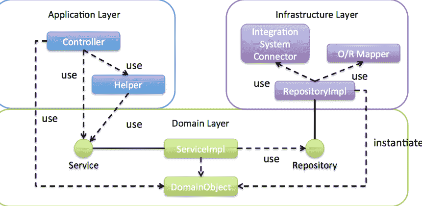
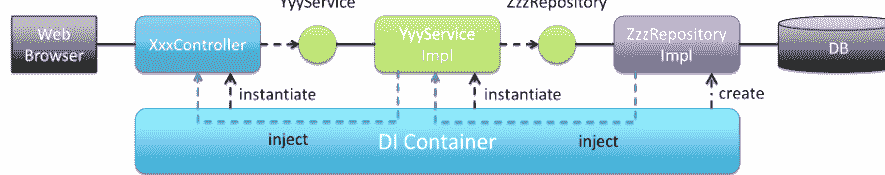

#### 使用 Repository 的处理和数据流

从输入到输出的流程如图所示。

序列图使用更新操作的示例进行了说明。

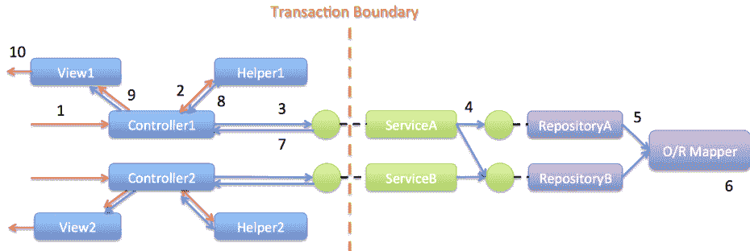

| 序号 | 描述 |
| :--- | :--- |
| 1. | Controller 接收 Request。 |
| 2. | (可选) Controller 调用 Helper 并将 Form 信息转换为 DomainObject 或 DTO。 |
| 3. | Controller 使用 DomainObject 或 DTO 调用 Service。 |
| 4. | Service 调用 Repository 并执行业务逻辑。 |
| 5. | Repository 调用 O/R Mapper 并持久化 DomainObject 或 DTO。 |
| 6. | (实现依赖) O/R Mapper 在 DB 中存储 DomainObject 或 DTO 信息。 |
| 7. | Service 将业务逻辑执行结果 DomainObject 或 DTO 返回给 Controller。 |
| 8. | (可选) Controller 调用 Helper 并将 DomainObject 或 DTO 转换为 Form。 |
| 9. | Controller 返回跳转目的地的 View 名称。 |
| 10. | View 输出 Response。 |

### 2.4.3 组件间调用规则

请参考下表来确定是否可以从一个组件调用另一个组件。

**表 2.3 组件间的调用可行性**

| 调用者/被调用者 | Controller | Service | Repository | O/R Mapper |
| :--- | :---: | :---: | :---: | :---: |
| Controller | ❌ | ❌ | ❌ | ❌ |
| Service | ❌ | | ⚠️ | ❌ |
| Repository | ❌ | ❌ | | ✅ |

注意，基本上禁止从 Repository 调用 Service。


# TERASOLUNA Java 服务器框架 (5.x) 开发指南文档

版本 5.4.1.RELEASE

## 2.4. 应用分层

### [projectName]-domain 项目结构

```
| L AaServiceImpl.java
| L bbb
| L BbbService.java
| | L BbbServiceImpl.java
| L resources
| L META-INF
| L spring
| L [projectName]-codelist.xml ... (5)
| L [projectName]-domain.xml ... (6)
| L [projectName]-infra.xml ... (7)?
```

| 序号 | 详细说明 |
|---|---|
| (1) | 存储领域层配置元素的包。 |
| (2) | 存储 `DomainObjects` 类的包。 |
| (3) | 存储 `Repository` 接口的包。为每个 Entity 创建一个包。如果与主实体有关联的 Entity，则关联实体的 `Repository` 接口也必须与主实体放在同一个包中。（例如，Order 和 OrderLine）。还需要 DTO（作为查询条件），它也必须放置在此包中。`RepositoryImpl` 属于基础设施层；但将其保留在本项目中没有问题。在使用不同的存储或存在多个持久化平台的情况下，`RepositoryImpl` 必须保持在单独的项目或单独包中，以隐藏实现相关的细节。 |
| (4) | 存储 `Service` 类的包。包必须基于 Entity 模型或其他功能单元。接口和实现类必须保持在相同的包层级。如果还需要输入/输出类，则它们必须放置在此包中。 |
| (5) | CodeList 的 Bean 定义。 |
| (6) | 与领域层相关的 Bean 定义。 |
| (7) | 与基础设施层相关的 Bean 定义。 |

### [projectName]-web 项目结构

```
[projectName]-web
L src
  L main
    L java
      L com
        L example ... (1)
          L app
            | AbcController.java
            | AbcForm.java
            | AbcHelper.java
          L def
            | DefController.java
            | DefForm.java
            | DefOutput.java
  L resources
    L META-INF
      L spring
        | applicationContext.xml ... (2)
        | application.properties ... (3)
        | spring-mvc.xml ... (4)
        | spring-security.xml ... (5)
      | application-messages.properties ... (6)
    L i18n
L webapp
  L resources ... (7)
    L WEB-INF
      L views ... (8)
      L abc
        | list.jsp
        | createForm.jsp
      L def
        | list.jsp
        | createForm.jsp
  L web.xml ... (9)
```

| 序号 | 详细说明 |
|---|---|
| (1) | 存储应用层配置元素的包。 |
| (2) | 与整个应用程序相关的 Bean 定义。 |
| (3) | 定义应用程序中使用的属性。 |
| (4) | 与 Spring MVC 相关的 Bean 定义。 |
| (5) | 与 Spring Security 相关的 Bean 定义。 |
| (6) | 定义用于屏幕显示的消息和其他内容（国际化）。 |
| (7) | 存储静态资源（css, js, image, 等） |
| (8) | 存储视图 (jsp) 文件。 |
| (9) | Servlet 部署定义 |

### [projectName]-env 项目结构

```
[projectName]-env
├ configs ... (1)
| └ [envName] ... (2)
| resources ... (3)
└ src
  └ main
    └ resources ... (4)
      └ META-INF
        └ spring
        | └ [projectName]-env.xml ... (5)
        | └ [projectName]-infra.properties ... (6)
        └ dozer.properties
      └ log4jjdbc.properties
        └ logback.xml ... (?)
```

| 序号 | 详细说明 |
|---|---|
| (1) | 定义所有环境通用配置的目录。 |
| (2) | 定义取决于每个环境的配置目录。目录名用作识别环境的名称。 |
| (3) | 定义取决于每个环境的配置目录。子目录配置和文件与 (4) 相同。 |
| (4) | 定义取决于本地开发环境的配置目录。 |
| (5) | 依赖于本地开发环境的 Bean 定义（如 `dataSource` 等）。 |
| (6) | 依赖于本地开发环境的属性定义。 |
| (7) | 依赖于本地开发环境的日志输出定义。 |

> **注意：** 将 `[projectName]-domain` 和 `[projectName]-web` 分到不同项目的目的是防止它们之间产生反向依赖。`[projectName]-web` 使用 `[projectName]-domain` 是很自然的；但 `[projectName]-domain` 不能引用 `[projectName]-web`。

## 3 应用开发

关于 TERASOLUNA Java 服务器框架 (5.x) 的各种规则说明。本指南的开发流程如下：

### 3.1 创建 Web 项目

在本节中介绍了如何创建 Web 项目。在本指南中，建议采用多项目配置。关于多项目配置，请参考 [项目结构]。

#### 3.1.1 空项目类型

根据用途提供了两种类型的空项目。

| 类型 | 用途 |
|---|---|
| 多项目结构空项目 | 适用于要发布的应用程序。提供了 2 种 Maven Archetype 项目模板：<br>- 包含 MyBatis3 设置<br>- 包含 JPA (Spring Data JPA) 设置<br>**本指南建议使用多项目结构。** |
| 单项目结构空项目 | 适用于创建简单的应用，如 POC、原型、示例等。提供了 3 种 Maven Archetype 项目模板（也提供了 Eclipse WTP 项目，但本章省略了其描述）：<br>- 包含 MyBatis3 设置<br>- 包含 JPA (Spring Data JPA) 设置<br>- 不依赖 O/R Mapper<br>本指南遵循使用单项目进行各种教程的过程。 |

#### 3.1.2 创建开发项目

使用 `Maven Archetype Plugin` 的 `archetype:generate` 创建多项目结构开发项目。

> **注意：前提条件**
>
> 在下述描述中，
> - 使用 Maven (`mvn` 命令)
> - 使用网络连接
> - 如果通过代理连接网络，则需要进行 Maven 代理设置
>
> 是前提条件。如果不满足前提条件，则需要先进行这些设置。

提供了两种用于创建多项目的 Archetype。

| 序号 | Archetype (ArtifactId) | 描述 |
|---|---|---|
| 1 | `terasoluna-gfw-multi-web-blank-mybatis3-archetype` | 使用 MyBatis 作为 O/R Mapper 生成项目的 Archetype。 |
| 2 | `terasoluna-gfw-multi-web-blank-jpa-archetype` | 使用 JPA（带有 Spring Data JPA 和 Hibernate）作为 O/R Mapper 生成项目的 Archetype。 |

移动到你想要创建项目的文件夹。

```
cd C:\work
```

使用 `archetype:generate -B` `Maven Archetype Plugin` 创建项目。

```bash
mvn archetype:generate -B \
-DarchetypeGroupId=org.terasoluna.gfw.blank \
-DarchetypeArtifactId=terasoluna-gfw-multi-web-blank-mybatis3-archetype \
-DarchetypeVersion=5.4.1.RELEASE \
-DgroupId=com.example.todo \
-DartifactId=todo \
-Dversion=1.0-SNAPSHOT
```

| 参数 | 说明 |
|---|---|
| `-B` | 批量模式（跳过交互） |
| `-DarchetypeGroupId` | 指定空项目的 `groupId`。（固定） |
| `-DarchetypeArtifactId` | 指定空项目的 `archetypeId`（用于标识模板的 ID）。（需要自定义）。指定以下 `archetypeId` 之一。<br>* `terasoluna-gfw-multi-web-blank-mybatis3-archetype`<br>* `terasoluna-gfw-multi-web-blank-jpa-archetype`<br>在上述示例中，指定了 `terasoluna-gfw-multi-web-blank-mybatis3-archetype`。 |
| `-DarchetypeVersion` | 指定空项目的版本。（固定） |
| `-DgroupId` | 指定您想要创建的项目 `groupId`。（需要自定义）。在上述示例中，指定了 `com.example.todo`。 |
| `-DartifactId` | 指定您想要创建的项目 `artifactId`。（需要自定义）。在上述示例中，指定了 `todo`。 |
| `-Dversion` | 指定您想要创建的版本。（需要自定义）。在上述示例中，指定了 `1.0-SNAPSHOT`。 |

#### 3.1.3 开发项目的自定义

根据应用程序的不同，在通过 Maven Archetype 创建的项目中，有几个位置需要进行自定义。需要自定义所需位置说明如下所示：

- POM 文件项目信息
- `x.xx.fw.9999` 格式的消息 ID
- 消息文字
- 错误页面
- 页面页脚版权
- 内存数据库 (H2 Database)
- 数据源配置

> **注意：** 上述以外的自定义点包括：
> - 认证·授权设置
> - 启用文件上传的设置
> - 激活国际化的设置
> - 日志定义
> - 异常处理定义
> - 应用 RESTful Web 服务的设置
>
> 对于这些自定义，请参考每个章节的“使用方法”并根据需要进行自定义。

> **注意：** 下述描述中以 `artifactId` 表达的部分，需要替换为创建项目时指定的 `artifactId` 后阅读。

##### POM 文件项目信息

在通过 Maven Archetype 创建项目的 POM 文件中。

- 项目名称 (`name` 元素)
- 项目描述 (`description` 元素)
- 项目 URL (`url`)
- 项目创建年份 (`inceptionYear`)
- 项目许可证 (`licenses`)
- 项目组织 (`organization`)

在 Archetype 中设置的信息如下：

```xml
<!--
<name>TERASOLUNA Java 服务端框架 (5.x) Web 项目</name>
<description>使用 TERASOLUNA Java 服务端框架 (5.x) 的 Web 项目</description>
<url>http://terasoluna.org/</url>
<inceptionYear>2014</inceptionYear>
<licenses>
  <name>Apache License, Version 2.0</name>
  <url>http://www.apache.org/licenses/2.0</url>
  <distribution>manual</distribution>
</licenses>
<organization>
  <name>TERASOLUNA Team</name>
  <url>http://terasoluna.org/</url>
</organization>
-->
```


# TERASOLUNA Java 服务端框架 (5.x) 开发指南文档

版本 5.4.1.RELEASE

## 注意事项

下述描述中以 `artifactId` 表达的部分，需要替换为创建项目时指定的 `artifactId` 后阅读。

## 需要自定义的目标文件

| 序号 | 目标文件 | 自定义方法 |
|---|---|---|
| 1. | POM 文件 `artifactId/pom.xml` | 在项目中设置适当的值。 |

## x.xx.fw.9999 格式的消息 ID

在 Maven Archetype 创建时：

- 在错误页面上显示的消息
- 发生异常时输出的错误日志

实际消息（示例）如下所示：

### application-messages.properties

```
e.xx.fw.5001 = 未找到资源。
```

### JSP

```jsp
<div class="error">
  <c:if test="${empty exceptionCode}">${exceptionCode}</c:if>
  <spring:message code="e.xx.fw.5001" />
</div>
```

### application-context.xml

```xml
<bean id="exceptionResolver"
       class="org.terasoluna.gfw.common.SimpleMappingExceptionCode">
  <!-- -->
  <entry key="ResourceNotFoundException" value="e.xx.fw.5001" />
  <!-- -->
</bean>
```

> **注意**
>
> - 如果使用了本指南引入的消息 ID，请在项目中设置适当的值。请参考 [消息管理]。
> - 如果没有使用本指南引入的消息 ID，则需要替换目标文件中所有的消息 ID。

## 消息文字

在 Archetype 项目中，提供了数字定义，但消息文字是简单的消息。实际消息（示例）如下所示：

### application-fw.properties

```
e.xx.fw.5001 = 未找到资源。
#
# typemismatch
typeMismatch="(0)" 是无效的。
#
```

> **注意**：根据应用程序需求（如消息术语）修改消息文字。

## 自定义目标文件列表

| 序号 | 目标文件 | 定制方法 |
|---|---|---|
| 1. | 消息定义文件 `artifactId/artifactId-web/src/main/resources/i18n/application-messages.properties` | 根据应用程序需求修改消息。检查时发生错误时需要显示的消息（Bean 验证消息）需要根据应用程序需求进行修改（覆盖默认消息）。请参考 [错误消息的定义]。 |

## 错误页面

在 Maven Archetype 创建的项目中，提供了 JSP 和 HTML 来显示各种错误的错误页面，但：

- 页面布局
- 页面标题
- 消息的措辞

等只是简单的实现。下方指示了实际的 JSP 实现（示例）。

### JSP 示例

```jsp
<!DOCTYPE html>
<head>
  <meta charset="utf-8">
  <title>Resource Not Found Error!</title>
  <link rel="stylesheet" href="${pageContext.request.contextPath}/resources/app/css/styles.css">
</head>
<body>
  <div id="wrapper">
    <h1>Resource Not Found Error!</h1>
    <div class="error">
      <c:if test="${empty exceptionCode}">${f:h(exceptionCode)}</c:if>
      <spring:message code="e.xx.fw.5001" />
    </div>
  </div>
  <t:messagesPanel />
  <br>
  <!-- -->
  <br>
</body>
</html>
```

> **注意**：根据应用程序需求（如 UI 术语）修改用于显示错误页面的 JSP 和 HTML。

### 定制方法和定制目标文件

| 序号 | 目标文件 | 定制方法 |
|---|---|---|
| 1. | 错误页面的 JSP：`artifactId/artifactId-web/src/main/webapp/WEB-INF/views/common/error/*.jsp` | 根据应用程序需求（如 UI 术语）进行修改。参考 [异常处理的编码要点 (JSP)] 以定制用于显示错误页面的 JSP。 |
| 2. | 错误页面的 HTML：`artifactId/artifactId-web/src/main/webapp/WEB-INF/views/common/error/unhandledSystem.html` | 根据应用程序需求（如 UI 术语）进行修改。 |

## 页脚版权

在 Maven Archetype 创建的项目中，页面布局使用 Tiles 配置，页面页脚部分的版权处于暂定状态 [Copyright &copy; 20XX Company]。下方指示了实际的 JSP 实现（示例）。

### template.jsp

```jsp
<div class="container">
  <tiles:insertAttribute name="header" />
  <tiles:insertAttribute name="body" />
  <hr>
  <p style="text-align: center; background: #e5ecf9;">Copyright &copy; 20XX_CompanyName</p>
</div>
```

> **注意**：如果页面布局使用 Tiles 配置，请为版权指定适当的值。

### 定制方法和定制目标文件

| 序号 | 目标文件 | 定制方法 |
|---|---|---|
| 1. | Tiles 模板 JSP：`artifactId/artifactId-web/src/main/webapp/WEB-INF/views/template.jsp` | 将暂定值 [Copyright&copy; 20XX Company ] 修改为适当的值。 |

## 内存数据库 (H2 Database)

在 Maven Archetype 创建的项目中，配置了内存数据库 (H2 Database) 设置，但这些用于小型操作（原型设计和 POC 验证）。因此，在进行常规开发时，这些设置是不必要的。

### artifactId-env.xml

```xml
<jdbc:initialize-database data-source="dataSource"
ignore-failures="ALL">
  <jdbc:script location="classpath:/${database}-schema.sql" encoding="UTF-8" />
  <jdbc:script location="classpath:/${database}-dataload.sql" encoding="UTF-8" />
</jdbc:initialize-database>
```

### 目录结构

```
src
 └── main
     └── resources
         ├── META-INF
         │    └── (...)
         └── database
               ├── H2-dataload.sql
               └── H2-schema.sql
```

> **注意**：在进行常规开发时，请删除用于定义的目录以及用于设置内存数据库 (H2 Database) 的 SQL 文件。

## 依赖配置示例

```xml
<dependency>
  <groupId>org.postgresql</groupId>
  <artifactId>postgresql</artifactId>
  <version>${postgresql.version}</version>
</dependency>
<!-- dependency -->
<dependency>
  <groupId>com.oracle.jdbc</groupId>
  <artifactId>ojdbc</artifactId>
  <version>${jdbc.version}</version>
</dependency>
<!-- ... -->
<postgresql.version>9.4.1212</postgresql.version>
<ojdbc.version>12.1.0.2</ojdbc.version>
```

- `artifactId/artifactId-web/pom.xml`

| 序号 | 描述 |
|---|---|
| (1) | 编译时不需要 JDBC 驱动，仅在运行时需要，因此指定了运行时范围（runtime scope）。<br>如果要在单元测试中使用 JDBC 驱动，请更改为相应的范围并使用。 |

## 3.1.4 开发项目结构

解释了通过 Maven Archetype 创建的项目结构。

### 3.1. 创建 Web 应用程序开发项目

本指南推荐的各层项目结构：

- 考虑了排除本指南中引入的环境依赖项的项目结构
- 考虑到 CI（持续集成）的项目结构

此外，还包含了本指南中推荐的各种设置：

- Web 应用程序配置文件 (`web.xml`)
- Spring Framework Bean 定义文件
- Spring MVC 的 Bean 定义文件
- Spring Security 的 Bean 定义文件
- O/R Mapper 配置文件
- Tiles 配置文件
- 属性文件（如消息定义文件）

以及，作为对应用需求低依赖（开发各种应用程序所必需）的简单组件实现，提供了：

- 用于显示欢迎页的 Controller 和 JSP
- 用于显示错误界面 (HTML) 的 JSP
- 用于 Tiles 的模板 JSP
- 用于读取配置（如 JSP 标签库）的包含 JSP
- 定义整个应用程序屏幕样式的 CSS 文件

> **警告**：作为简单实现的提供的组件
>
> 作为简单实现的提供的组件可能对应以下项之一：
>
> - 为了满足应用需求而修改
> - 移除不必要的组件

> **注意**：创建 REST API 项目的步骤
>
> 在 Maven Archetype 创建的项目中，已经完成了构建传统 Web 应用程序（接收请求参数并响应 HTML 的应用程序）所需的推荐设置。
> 因此，在构建处理 JSON 或 XML 的 REST API 时，存在不必要的设置。如果您想创建一个用于构建 REST API 的项目，需要参考 [RESTful Web 服务应用设置] 应用 REST API 相关的设置。

> **注意**：下述描述中表示为 `artifactId` 的部分，需要用创建项目时指定的 `artifactId` 替换后进行阅读。

### 多项目结构

首先解释了多项目结构。

```
artifactId
- pom.xml ... (1)
  ├── artifactId-web ... (2)
  ├── artifactId-domain ... (3)
  ├── artifactId-env ... (4)
  └── artifactId-initdb ... (5)
- artifactId-selenium ... (6)
```

| 序号 | 描述 |
|---|---|
| (1) | 整个多项目配置定义在 POM（项目对象模型）文件中。<br>主要在文件中完成了以下定义：<br>- 依赖库的版本<br>- 构建插件设置（如何构建的设置）<br>多项目的层级关系请参阅 [项目的层级结构]。 |
| (2) | 管理应用层（Web 层）组件的模块。<br>在该模块中主要管理以下组件和文件：<br>- Controller 类<br>- 用于关联检查的 Validator 类<br>- Form 类（REST API 中的 Resource 类）<br>- View (JSP)<br>- CSS 文件<br>- JavaScript 文件<br>- 用于应用层组件的 JUnit<br>- 定义应用层组件的 Bean 定义<br>- Web 应用程序配置文件 (`web.xml`)<br>- 消息定义文件 |
| (3) | 管理领域层组件的模块。<br>在该模块中主要管理以下组件和文件：<br>- 如 Entity 等领域对象<br>- Repository<br>- Service<br>- DTO<br>- 用于领域层组件的 JUnit<br>- 定义领域层组件的 Bean 定义 |
| (4) | 管理环境依赖配置文件的模块。<br>在该模块中主要管理以下文件：<br>- 定义环境依赖组件的 Bean 定义<br>- 定义环境依赖属性属性值的属性文件 |
| (5) | 管理数据库初始化 SQL 的模块。<br>在该模块中主要管理以下文件：<br>- 创建数据库表的 SQL 文件<br>- 插入初始数据的 SQL 文件 |
| (6) | 管理 Selenium 测试组件的模块。<br>在该模块中主要管理以下文件：<br>- Selenium 测试文件 |

> **注意**：在创建 REST API 项目时 Web 模块的名称

### Web 模块的结构

通过 Maven Archetype 创建的项目与多项目结构相同。每个项目的内容如下：

- `bar-parent`：称为父项目的简单项目。它不包含源代码或配置文件。通过指定此 `<parent>` 标签，可以将父 POM 中的通用设置反映到其他项目中。
- `bar-initdb`：存储数据库表定义（DDL）和初始数据的 SQL 语句。这也作为一个 Maven 项目。通过在 `pom.xml` 中定义 sql-plugin，可以在构建过程中自动执行任何数据库的 DDL 和初始数据。
- `bar-common`：项目中的通用库。通过将其与 Web 无关，将 Web 相关类放在 `bar-common-web` 中。
- `bar-common-web`：项目中的通用库。


- `bar-domain-a`：存储与 `{aj}` 领域的单元测试用和领域类。最终生成的 `.jar` 文件。
- `bar-domain-b`：存储与 `{fb}` 领域的领域类。
- `bar-web-a`：存储应用层 Java 类、JSP、配置文件和单元测试用。最终生成的 `.war` 文件作为 Web 应用程序。`bar-web-a` 依赖 `bar-common` 和 `bar-env`。
- `bar-web-b`：作为另一个子系统的 Web 应用程序。结构与 `bar-web-a` 相同。
- `bar-env`：仅收集环境依赖的配置文件。
- `bar-web-a-selenium`：使用 Selenium WebDriver 为 web-a 项目提供测试的项目。
- `bar-web-b-selenium`：使用 Selenium WebDriver 为 web-b 项目提供测试的项目。

# Web 模块结构

解释应用层（Web 层）组件的模块。

```
artifactId-web
| pom.xml ... (1)
```

| 序号 | 描述 |
|---|---|
| (1) | Web 模块配置定义在 POM（项目对象模型）文件中。文件中完成了以下定义：<br>* 依赖库和构建插件的定义<br>* 创建 war 文件的定义 |

# TERASOLUNA Java 服务端框架 (5.x) 开发指南文档，版本 5.4.1.RELEASE

在构建 REST API 时，如果将模块名称赋值为 `artifactId-api`，则很容易区分应用类型。

```
src
| main
|   ├── java
|   │   ├── com
|   │   │   └── example
|   │   │       │       └── project ... (2)
|   │   │       │           └── app
|   │   │               │└── welcome
|   │   │               │                   └── UserController.java ... (3)
|   │   └── resources
|   │       ├── META-INF
|   │           ├── dozer ... (4)
|   │           └── spring ... (5)
|   │               ├── application.properties ... (6)
|   │               ├── applicationContext.xml ... (7)
|   │               ├── spring-mvc.xml ... (8)
|   │               └── spring-security.xml ... (9)
|   │   └── i18n ... (10)
|   │       └── application-messages.properties ... (11)
```

## 3.1. 创建 Web 应用开发项目

# TERASOLUNA Java 服务端框架 (5.x) 开发文档，版本 5.4.1.RELEASE

| 序号 | 描述 |
|---|---|
| (2) | 用于存储应用层类的包。<br>在构建 REST API 时，如果将包名赋值为 `api`，则很容易区分组件类型。 |
| (3) | 用于接收显示欢迎页请求的控制器类（Controller）。 |
| (4) | 存储 Dozer（Bean 映射器）映射文件的目录，关于 Dozer 请参参 *Bean 映射 (Dozer)*。<br>在创建时，这是一个空目录。如果需要映射文件（如果需要高频映射），当存储在此目录下时，它会被自动读取。<br><br>**注意：** 此目录下存储了以下文件。<br>- 用于映射应用层 JavaBean 的定义文件<br>- 用于应用层 JavaBean 之间其他相互映射的定义文件<br>建议将领域层 JavaBean 之间的相互映射存储在领域层目录中。 |
| (5) | 包含属性文件和 Spring Framework Bean 定义文件的目录。 |
| (6) | 定义用于应用层设置的属性文件。<br>在创建时，它是一个空文件。 |
| (7) | 为 Web 应用创建应用上下文（Application Context）的 Bean 定义文件。<br>该文件中定义了以下 Bean：<br>- 整个 Web 应用使用的组件<br>- 领域层组件（导入定义领域层组件的 Bean 定义文件） |
| (8) | 为 `DispatcherServlet` 创建应用上下文的 Bean 定义文件。<br>该文件中定义了以下 Bean：<br>- Spring MVC 组件<br>- 应用层组件<br>在构建 REST API 时，如果将赋值赋值 `spring-mvc-api.xml`，则很容易区分应用类型。 |
| (9) | 定义 Spring Security 组件的 Bean 定义文件。<br>当为 Web 应用创建应用上下文时，会读取此文件。 |

| 序号 | 描述 |
|---|---|
| (10) | 包含用于应用层使用的消息定义文件的目录。 |
| (11) | 定义用于应用层使用的消息属性文件。<br>在创建时定义了一些通用消息。 |

**注意：** 应该根据应用需求修改消息（例如消息术语）。对于消息定义，请参阅 [消息管理]。

# TERASOLUNA Java 服务端框架 (5.x) 开发文档，版本 5.4.1.RELEASE

**注意：** 关于应用上下文 Bean 定义文件，请参阅 [Bean 定义文件与应用上下文结构的关系]。

```
webapp
  WEB-INF ... (12)
    tiles
      tiles-definitions.xml
    views ... (13)
      common
        error ... (14)
          accessDeniedError.jsp
          businessError.jsp
          dataAccessCsrfTokenError.jsp
          invalidCsrfTokenError.jsp
          missingCsrfTokenError.jsp
          resourceNotFoundError.jsp
          systemError.jsp
          transactionTokenError.jsp
          unhandledSystemError.html
        include.jsp ... (15)
        layout ... (16)
          header.jsp
          template.jsp
      welcome
        home.jsp ... (17)
  web.xml ... (18)
  resources ... (19)
    app
      css
        styles.css ... (20)
test
  java
  resources
```

| 序号 | 描述 |
|---|---|
| (12) | 包含 Tiles 配置文件的目录。关于 Tiles 配置文件请参阅 [使用 Tiles 进行页面布局]。 |

# TERASOLUNA Java 服务端框架 (5.x) 开发指南文档，版本 5.4.1.RELEASE

表 3.3 – 接续上一页

| 序号 | 描述 |
|---|---|
| (13) | 包含视图模板（View templates）的目录。 |
| (14) | 包含用于错误的 JSP 目录。在创建时，包含了执行期间可能出现的 JSP。 |
| (15) | 用于包含的通用 JSP。该文件包含在所有 JSP 的开头。 |
| (16) | 包含 Tiles 布局的目录。关于 Tiles 布局请参阅 [使用 Tiles 进行页面布局]。 |
| (17) | 显示欢迎页的 JSP 文件。 |
| (18) | Web 应用的配置文件。 |
| (19) | 包含静态资源的目录。具体包含以下文件：<br>* JavaScript 文件<br>* CSS 文件<br>* 图片文件<br>* HTML 文件<br>这里使用了 Spring MVC 提供的专用机制。 |
| (20) | 定义屏幕样式的 CSS 文件。 |

# TERASOLUNA Java 服务端框架 (5.x) 开发文档，版本 5.4.1.RELEASE

## 领域模块结构

解释管理领域层组件的模块。

| 序号 | 描述 |
|---|---|
| (1) | 领域模块的配置在 POM（项目对象模型）文件中定义。在该文件中完成了以下定义：<br>* 依赖库和构建插件的定义<br>* 创建 jar 文件的定义 |

# TERASOLUNA Java 服务端框架 (5.x) 开发指南文档，版本 5.4.1.RELEASE

| | |
|---|---|
| | 领域仓库 (domain repository) |
| | 服务 (service) |
| resources test-context.xml ... (8) |

| 序号 | 说明 |
|---|---|
| (8) | 用于定义领域层单元测试组件的 Bean 定义文件。 |

为 Mybatis3 创建项目时

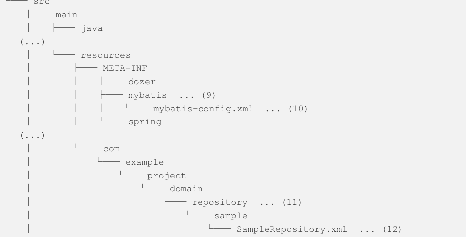

# TERASOLUNA Java 服务端框架 (5.x) 开发指南文档，版本 5.4.1.RELEASE

| 序号 | 说明 |
|---|---|
| (9) | 包含 MyBatis3 配置文件的目录 |
| (10) | MyBatis3 配置文件。<br>创建时会定义一些推荐的设置。 |
| (11) | 包含 MyBatis3 Mapper 文件的目录。 |
| (12) | MyBatis3 Mapper 文件的示例文件。<br>创建时示例实现处于注释状态。最后，这些文件将不再需要。 |

### Env 模块结构

本文将解释用于管理依赖环境的配置文件的模块。

```
artifactId-env . . (1)
  ├── configs
  |   └── production-server . . (2)
  |       └── resources
  └── test-server
      └── resources
  pom.xml . . (3)
```

## 3.1. 创建 Web 应用开发项目

# TERASOLUNA Java 服务端框架 (5.x) 开发指南文档，版本 5.4.1.RELEASE

| 序号 | 说明 |
|---|---|
| (1) | 用于管理依赖环境的配置文件的目录。<br>通过为每个环境创建子目录来管理依赖环境的配置文件。 |
| (2) | 用于管理每个环境配置文件的目录。<br>创建时，会提供以下目录（目录模板）作为最简单的配置。<br>* production-server（包含生产环境配置文件的目录）<br>* test-server（包含测试环境配置文件的目录） |
| (3) | env 模块配置定义在 POM（项目对象模型）文件中。在该文件中完成了以下定义：<br>* 依赖库和构建插件的定义<br>* 为每个环境创建 jar 文件的 Profile 定义 |

```
src
  └── resources ... (4)
      └── META-INF
          ├── spring
          │   └── artifactId-env-infra.xml ... (5)
          │   └── artifactId-infra.properties ... (6)
          └── database ... (7)
              ├── H2-catalog.sql
              └── H2-schema.sql
  dozer.properties ... (8)
  log4jdbc.properties ... (9)
  logback.xml ... (10)
```

### 3 应用程序开发

# TERASOLUNA Java 服务端框架 (5.x) 开发指南文档，版本 5.4.1.RELEASE

| 序号 | 说明 |
|---|---|
| (4) | 用于管理开发环境配置文件的目录。定义依赖环境组件的 Bean 定义。在该文件中定义了以下 Bean：<br>* 数据源 (Datasource)<br>* 公共库提供的 JDateTimeFactory（根据环境提供不同的实现时）<br>* Spring Framework 提供的事务管理组件（根据环境提供不同的实现时） |
| (6) | 定义环境设置的属性文件。创建时定义了 DataSource 设置（连接和连接池设置）。 |
| (7) | 包含用于设置内存数据库（H2 数据库）的 SQL 的目录。该目录在执行小规模操作验证时准备就。基本上可以删除此目录，因为该目录并非用于实际应用程序开发。 |
| (8) | 用于执行 Dozer（Bean 映射）全局设置的属性文件。Dozer 请参阅 [Bean 映射 (Dozer)]。创建时这是一个空文件。（如果文件不存在，启动时会出现警告，为了防止这种情况已准备了该文件） |
| (9) | 用于执行 Log4jdbc-remix（执行 JDBC 相关日志输出的库）全局设置的属性文件。Log4jdbc-remix 请参阅 [JDBC 调试设置]。创建时，针对将打印日志的 SQL 指定了换行符相关的设置。 |
| (10) | Logback（日志输出）的配置文件。日志输出请参阅 [日志]。 |

### Initdb 模块结构

**本文将解释管理用于初始化数据库的 SQL 文件的模块。**

## 3.1. 创建 Web 应用开发项目

```
artifactId-initdb
├── pom.xml ... (1)
└── src
    ├── main
    └── sqls ... (2)
```

| 序号 | 说明 |
|---|---|
| (1) | initdb 模块配置定义在 POM（项目对象模型）文件中。在该文件中完成了以下定义：<br>• 构建插件的定义（SQL Maven Plugin）<br>创建时定义了 PostgreSQL 的简单配置。 |
| (2) | 用于存储初始化文件的目录。<br>创建时为空空目录。关于如何创建，请参阅 initdb 的示例应用程序。 |

**注意：** 可以使用 Maven 插件执行 SQL。

### Selenium 模块结构

本文将解释管理 E2E（端到端）测试组件的模块。

```
artifactId-selenium
├── pom.xml ... (1)
└── src
    ├── test
    └── java
        ├── com
        │   └── example
        │       └── selenium
        │           └── HelloTest.java ... (3)
        └── resources
            └── META-INF
                └── spring
```

# TERASOLUNA Java 服务端框架 (5.x) 开发指南，版本 5.4.1.RELEASE

| 序号 | 说明 |
|---|---|
| (1) | selenium 模块配置定义在 POM（项目对象模型）文件中。在该文件中完成了以下定义：<br>* 依赖库和构建插件的定义<br>* 创建 jar 文件的 Profile 定义 |
| (2) | 包含配置文件的目录。<br>如何创建请参阅 selenium 的示例应用程序。 |
| (3) | 使用 Selenium 的示例类。创建时它是欢迎页的标题。 |
| (4) | 定义测试使用的属性文件。创建时应用程序 URL 为 http://localhost:8080。 |
| (5) | 定义组件的 Bean 定义文件。创建时定义了所需的设置。 |

## 3.1.5 附录

下方所示为 Maven Archetype 创建的项目层级结构。

## 3.1. 创建 Web 应用开发项目

# TERASOLUNA Java 服务端框架 (5.x) 开发指南文档，版本 5.4.1.RELEASE

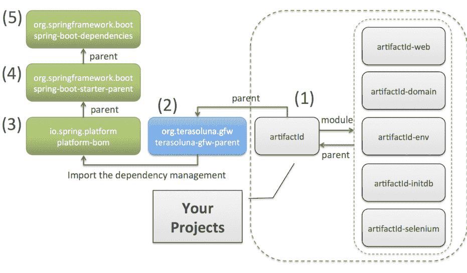

| 序号 | 说明 |
|---|---|
| (1) | Maven Archetype 创建的项目。<br>Maven Archetype 创建的项目成为多模块配置，父项目和每个子模块具有交叉引用关系。<br>在 5.4.1.RELEASE 版本的 Maven Archetype 项目中，指定 `[org.terasaluna.gfw:gfw-parent:5.4.1.RELEASE]` 为父项目。<br>TERASOLUNA Java 服务端框架 (5.x) 父项目。<br>在 TERASOLUNA Java 服务端框架 (5.x) 父项目中：<br>- 构建插件<br>- 通过 Spring IO Platform 管理的库自定义（调整版本）<br>- 对未通过 Spring IO Platform 管理的推荐库进行版本管理<br>此外，为了通过 Spring IO Platform 管理依赖库，在项目的 `<dependencyManagement>` 中导入了 [Spring IO Platform]。<br>`OSS Versions` 中导入了 Spring IO Platform。<br>Spring IO Platform。 |


| 序号 | 描述 |
| --- | --- |
| (3) | 由于指定 `org.springframework.boot:spring-boot-starter-parent:1.2.5.RELEASE` 为父项目，`spring-boot-starter-parent` 文件中的 `<dependencyManagement>` 定义也导入了 `terasoluna-gfw-parent` 的 POM 文件。 |

# TERASOLUNA Java 服务器框架 (5.x) 开发指南文档

发布版本 5.4.1.RELEASE

**提示：** 配置发生了更改，Spring IO Platform 的 `<dependencyManagement>` 从 5.0.0.RELEASE 版本开始引入，我们采用了在 Spring IO Platform 中对推荐库进行版本管理的风格。

> **警告：** 由于配置发生了更改，Spring IO Platform 的 `<dependencyManagement>` 从 5.0.0.RELEASE 版本开始引入，因此你将无法再从子项目中访问版本管理属性。

因此，如果在从 1.0.x 版本升级时，子项目中的属性值出现返回或覆盖的情况，则应当修改 pom 文件。

此外，可以访问针对推荐库（TERASOLUNA Java 服务器框架 (5.x) 推荐库）的常规版本管理属性，这些属性并不由 Spring IO Platform 管理。

## Bean 定义文件与应用上下文结构的关系

Bean 定义文件与 Spring Framework 应用程序上下文（DI 容器）结构的关系如下所示。

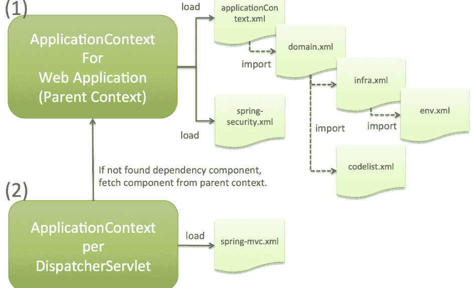

| 序号 | 描述 |
| --- | --- |
| (1) | Web 应用程序的上下文。<br>如上图所示，定义在以下文件中的组件注册在 Web 应用程序的应用上下文（DI 容器）中：<br>- `artifactId-web/src/main/resource/META-INF/spring/applicationContext.xml`<br>- `artifactId-domain/src/main/resource/META-INF/artifactId-domain.xml`<br>- `artifactId-domain/src/main/resource/META-INF/artifactId-infra.xml`<br>- `artifactId-env/src/main/resource/META-INF/artifactId-env.xml`<br>- `artifactId-domain/src/main/resource/META-INF/artifactId-codelist.xml`<br>- `artifactId-web/src/main/resource/META-INF/spring/spring-security.xml`<br>注册在 Web 应用程序应用上下文中的组件以这种方式机制化，可以通过每个 `DispatcherServlet` 的应用上下文进行引用。 |
| (2) | `DispatcherServlet` 的应用上下文。<br>如上所示，定义在以下文件中的组件注册在 `DispatcherServlet` 的应用上下文（DI 容器）中：<br>- `artifactId-web/src/main/resource/META-INF/spring/spring-mvc.xml`<br>未存储在 `DispatcherServlet` 应用上下文中的组件以这种方式机制化，可以通过引用 Web 应用程序上下文（父上下文）来获取，因此为应用层注入领域层组件是可能的。 |

### 注意：关于在两个上下文中注册相同组件的操作

如果相同的组件在 Web 应用程序上下文和 `DispatcherServlet` 上下文中都注册了，该组件将在应用上下文（`DispatcherServlet` 上下文）中被注入。

特别注意的是，不要将领域层组件（如 Service 和 Repository）注册到 `DispatcherServlet` 上下文中。

如果领域层组件注册到 `DispatcherServlet` 上下文中，执行事务控制（AOP）将会提交数据库操作。

此外，使用 Maven Archetype 创建的项目不会发生上述事件。在执行修改或添加设置时需要注意。

## 配置文件的说明

说明：为了理解各种设置，对配置文件进行说明。

- 如果在某处解释了功能，将在此注明。
- 如果在任何处解释了功能，将在此完成。

具体时间尚未确定。

在离线环境下使用 `archetype:generate` 创建开发项目的方法。虽然 Maven 用于在线环境的操作，但下方描述了如何在离线环境下使用它。

要在离线环境下继续开发，必须提前复制开发所需的库和插件。

移动到开发项目的根目录。在这里使用 `Create development project` 进行说明。

```
cd C:\work\todo
```

开发项目所需的库和插件通过执行 `dependency:go-offline` 进行复制。

```
mvn dependency:go-offline -Dmaven.repo.local=repository
```

| 参数 | 描述 |
| --- | --- |
| `-Dmaven.repo.local` | 指定目标。如果目标不存在，则创建一个新目标。当前指定目标为 repository。 |

为了便于交付物，创建一个 war 文件或 jar 文件。此时会创建交付物。

```
mvn package -Dmaven.repo.local=repository
```

构建成功时，显示如下日志。

```
(... omit)
------------------------------------------------------
[INFO] Reactor Summary:
[INFO] TERASOLUNA Java Server Framework (5.x) (MyBatis)
[INFO] todo-env ................ SUCCESS [0.006 s]
[INFO] todo-web ................ SUCCESS [12.832 s]
[INFO] todo-domain ............................. SUCCESS [0.684 s]
[INFO] todo-init ............................... SUCCESS [01:13 min]
[INFO]
[INFO]
[INFO] BUILD SUCCESS
[INFO]
[INFO] Total time: 02:14 min
[INFO] Finished at: 2015-10-01T10:32:34+09:00
[INFO] Final Memory: 36M/206M
[INFO]
```

上述已复制开发所需的库和插件文件。当将仓库复制到离线机器时，操作完成。

> **警告：离线环境开发的注意事项**
>
> 由于在离线环境下无法从互联网获取依赖关系，不应编辑 POM（项目对象模型）文件。需要返回在线环境编辑 POM 文件。

## 3.1 创建 Web 应用项目

## 3.2 领域层实现

### 3.2.1 领域层的角色

领域层实现提供给应用层的业务逻辑。

领域层的实现分为以下类：

| 序号 | 分类 | 描述 |
| --- | --- | --- |
| 1. | Entity 实现 | 创建用于持有业务数据的类（Entity 类）。 |
| 2. | Repository 实现 | 操作业务数据的方法实现。这些方法提供给 Service 类。这些方法特别是对 Entity 对象的 CRUD 操作。 |
| 3. | Service 实现 | 执行业务逻辑的方法实现。这些方法提供给应用层。业务逻辑所需的业务数据通过 Repository 以 Entity 对象的形式获取。 |

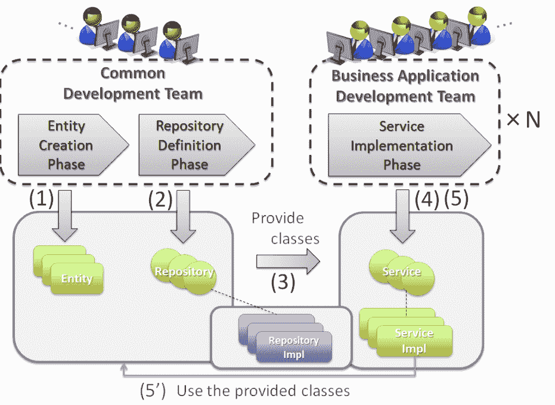

| 序号 | 负责团队 | 描述 |
| --- | --- | --- |
| (1) | 通用开发团队 | 通用开发团队设计并创建 Entity 类。 |
| (2) | 通用开发团队 | 通用开发团队为 (1) 中提取的 Entity 类制定访问模式，并设计 Repository 接口的方法。通用开发团队应实现被多个开发团队共享的方法。 |
| (3) | 通用开发团队 | 通用开发团队将 (1) 和 (2) 创建的 Entity 类和 Repository 提供给业务应用开发团队。此时，要求每个业务应用开发团队实现 Repository 接口。 |
| (4) | 业务应用开发团队 | 业务应用开发团队负责 Repository 接口的实现。 |
| (5) | 业务应用开发团队 | 业务应用开发团队使用通用开发团队提供的 Entity 类、Repository 以及团队自身创建的 Repository 实现类，开发 Service 接口和 Service 类。 |

> **警告：** 开发范围较大的系统通常通过分配给多个团队进行开发。在这种情况下，强烈建议提供一个通用团队来设计 Entity 类和 Repository。

在没有通用团队时，应直接从 Service 调用 O/R 映射（如 MyBatis 等），并采用访问业务数据的方法，而无需创建 Entity 类和 Repository。

### 3.2.3 Entity 的实现

#### 创建 Entity 类的策略

使用以下方法创建 Entity。

具体的创建方法在“创建 Entity 类的示例”中显示。

| 序号 | 方法 | 补充说明 |
| --- | --- | --- |
| 1. | 为每个表创建 Entity 类。 | 然而，对于表示表之间关系的映射表，不需要 Entity 类。此外，当表未进行归一化时，每个表对应一个 Entity 类的规则可能不再适用。关于非归一化表的方法，请参考此格外的警告和备注。 |
| 2. | 当表中存在 FK（外键）时，必须将 FK 目标表的 Entity 类定义为该 Entity 的一个属性。 | 当与 FK 目标表存在 1:N 关系时，使用 `java.util.List<E>` 或 `java.util.Set<E>`。在本指南中，对应 FK 目标表的 Entity 被称为引用 Entity。 |
| 3. | 将关联表视为 `java.lang.String` 而不是 Entity。 | 管理代码值和名称对的相关表。当需要根据代码值划分进程时，应创建与代码值对应的枚举类，并将其定义为属性。 |

> **警告：** 当表未归一化时，请检查是否使用创建 Entity 类和 Repository 方法。由于非归一化表与 JPA 的兼容性较差，最好不要使用 JPA。
>
> - 如果表未归一化，由于创建 Entity 的难度增加，可能无法创建合适的 Entity 类。
> - 此外，创建 Entity 类的工作量也会增加。
> - 在这里必须考虑两个观点：首先，“我们能否分配一个可以正确执行归一化的工程师？”，其次，“为创建归一化的 Entity 类投入精力值得吗？”
> - 如果表未归一化，则在数据访问中需要填补 Entity 类与表结构之间差异的逻辑。
> - 这里需要考虑的观点是，[投入精力填补 Entity 类与表结构之间的差异是否值得？]。

推荐使用创建 Entity 类和 Repository 的方法；但必须考虑到应用程序的特性以及项目特性（开发团队结构和开发方法论）。

**备注：** 如果你希望像应用程序一样操作业务数据，即使在表未归一化的情况下也视为归一化的 Entity，建议使用 MyBatis 作为基础设施层 `RepositoryImpl` 的实现。

MyBatis 是为了将 SQL 映射到对象而开发的 O/R Mapper，而不是将数据库表记录映射到对象。因此，根据 SQL 的实现，可以独立于表结构映射到对象。

#### 创建 Entity 类的示例

通过具体示例解释了 Entity 类的创建。

以下是在某些购物网站购买商品所需的 Entity 类业务数据的示例。

##### 表结构

表结构所示：

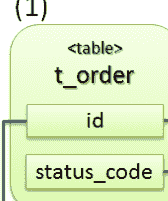
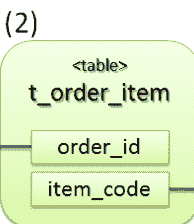
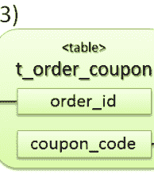
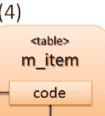
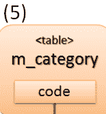
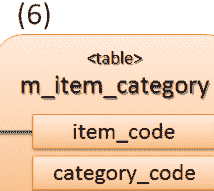

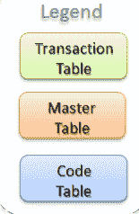

| 序号 | 分类 | 表名 |
| --- | --- | --- |
| (1) | 事务相关 | t_order | 订单表。 |
| (2) | | t_order_item | 订单商品表。 |
| (3) | | t_order_coupon | 订单优惠券表。 |
| (4) | 主数据相关 | m_item | 商品主表。 |
| (5) | | m_category | 分类主表。 |
| (6) | | m_item_category | 商品分类表。 |
| (7) | | m_coupon | 优惠券主表。 |
| (8) | 代码相关 | c_order_status | 订单状态代码表。 |

##### Entity 结构

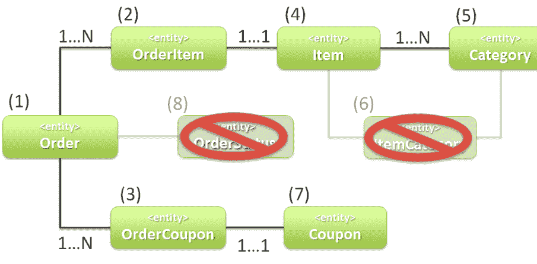

| 序号 | 类名 | 描述 |
| --- | --- | --- |
| (1) | Order | 表示 `t_order` 表记录的 Entity 类。多个 `OrderItem` 和 `OrderCoupon` 作为关联 Entity 存储。 |
| (2) | OrderItem | 表示 `t_order_item` 表记录的 Entity 类。`Item` 作为关联 Entity 存储。 |
| (3) | OrderCoupon | 表示 `t_order_coupon` 表记录的 Entity 类。`Coupon` 作为关联 Entity 存储。 |
| (4) | Item | 表示 `m_item` 表记录的 Entity 类。多个 `Category` 作为关联 Entity 存储。`Item` 与 `Category` 关联通过 `m_item_category` 表实现。 |
| (5) | Category | 表示 `m_category` 表记录的 Entity。 |
| (6) | ItemCategory | 不创建 Entity 类，因为 `m_item_category` 表是存储 `m_item` 表和 `m_category` 表之间关系的映射表。 |
| (7) | Coupon | 表示 `m_coupon` 表记录的 Entity。 |
| (8) | OrderStatus | 不创建 Entity 类，因为 `c_order_status` 表是代码表。 |

从上面的 Entity 图可以看出，初看起来 `Order` 类是购物网站应用程序中唯一的类 Entity 类；然而，还有其他的 Entity 类以及其他的 `Order` 类。

以下是 Entity 类以及非主 Entity 类的分类。

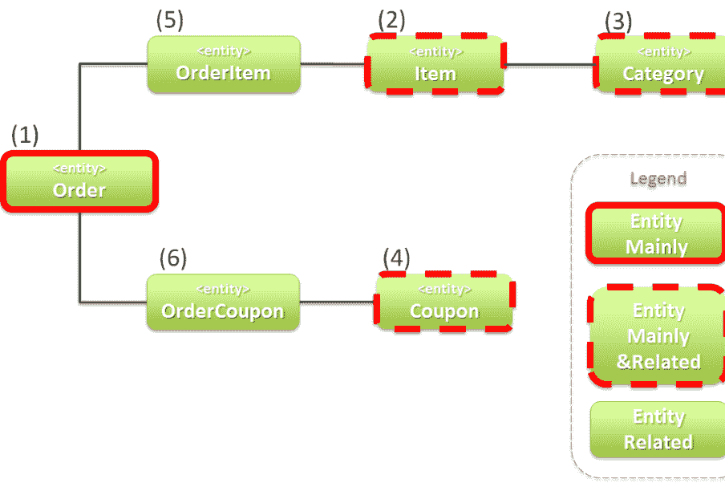

以下 4 个实体被视为创建购物网站应用时的主实体。


| 序号 | 实体类 | 被视为主实体的原因 |
| --- | --- | --- |
| (1) | `Order` 类 (订单类) | 它是购物网站中最重要的实体之一。`Order` 类表示订单本身的实体，没有 `Order` 类就无法创建购物网站。 |
| (2) | `Item` 类 (商品类) | 它是购物网站中最重要的实体之一。`Item` 类表示购物网站中处理的产品，没有 `Item` 类就无法创建购物网站。 |
| (3) | `Category` 类 (分类类) | 产品分类通常显示在购物网站的首页或作为公共菜单。在购物网站中，`Category` 成为主实体。通常可以预期执行如搜索分类列表等操作。 |
| (4) | `Coupon` 类 (优惠券类) | 购物网站经常提供折扣优惠券作为促销产品的措施。在此类购物网站中，`Coupon` 成为主实体。通常可以预期执行搜索优惠券列表等操作。 |

以下不是创建购物网站应用的主实体。

| 序号 | 实体类 | 不被视为实体的原因 |
| --- | --- | --- |
| (5) | `OrderItem` 类 (订单项类) | 该类表示一个订单中购买的 1 个产品，仅作为 `Order` 类的关联实体存在。因此，`OrderItem` 类不应被视为主实体。 |
| (6) | `OrderCoupon` (订单优惠券) | 该类表示一个订单中使用的 1 张优惠券，仅作为 `Order` 类的关联实体存在。因此，`OrderCoupon` 不应被视为主实体。 |

## 3.2 领域层实现

### 3.2.4 Repository（存储库）的实现

#### Repository 的角色

Repository 具有以下 2 个角色：

1. 为 Service 提供控制实体生命周期的操作（Repository 接口）。
   控制实体生命周期的操作是 CRUD 操作。

   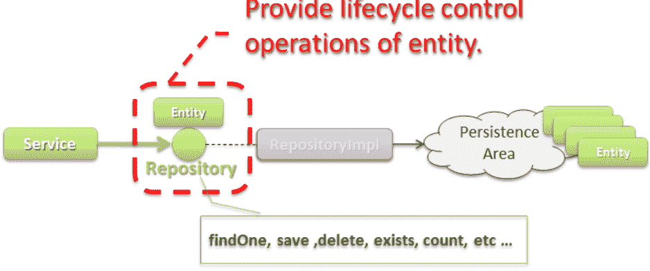

2. 为实体提供持久化逻辑（Repository 接口的实现类）。
   实体对象无论应用程序的生命周期（服务器启动和结束），都应该持久化。大多数关系型数据库是实体的永久目标。然而，NoSQL 数据库、缓存服务器、外部系统和文件（共享磁盘）也可以是永久目标。实际的持久化处理是通过 O/R Mapper API 完成的。
   此角色在基础设施层的 `RepositoryImpl` 中实现。详情请参阅“基础设施层的实现”。

   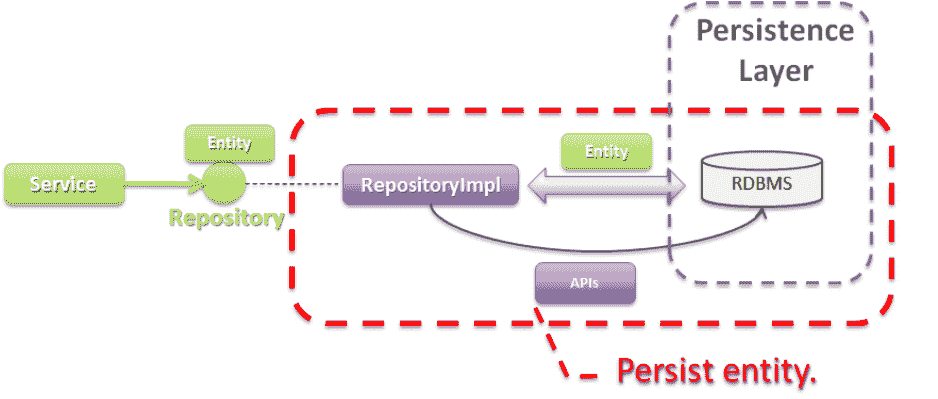

#### Repository 结构

Repository 由 Repository 接口和 `RepositoryImpl` 组成，执行以下角色。

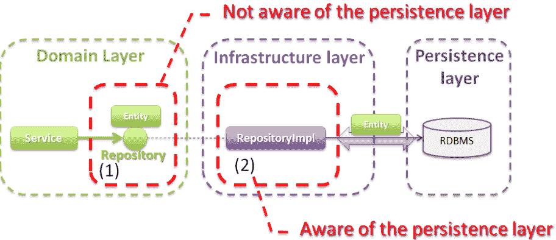

| 序号 | 类(接口) | 角色 | 说明 |
| --- | --- | --- | --- |
| (1) | Repository 接口 | 定义实现业务逻辑（Service）所需的控制实体生命周期的方法。 | 定义实体的 CRUD 操作方法，且不依赖于持久化层。Repository 接口属于领域层，因为它承担了定义实现业务逻辑（Service）所需的实体操作的角色。 |
| (2) | `RepositoryImpl` | 实现 Repository 接口中定义的方法。 | 实现实体的 CRUD 操作并依赖于持久化层。使用 Spring Framework 提供的持久化、O/R Mapper 和中间件的 API 执行实际的 CRUD 过程。`RepositoryImpl` 属于基础设施层，因为它承担了实现 Repository 接口中定义的操作的角色。`RepositoryImpl` 的实现请参阅“基础设施层的实现”。 |

当持久化层存在多个目标时，生成的配置如下所示。

由于此，依赖于实体持久化平台的逻辑就从业务逻辑（Service）中被隐藏了。

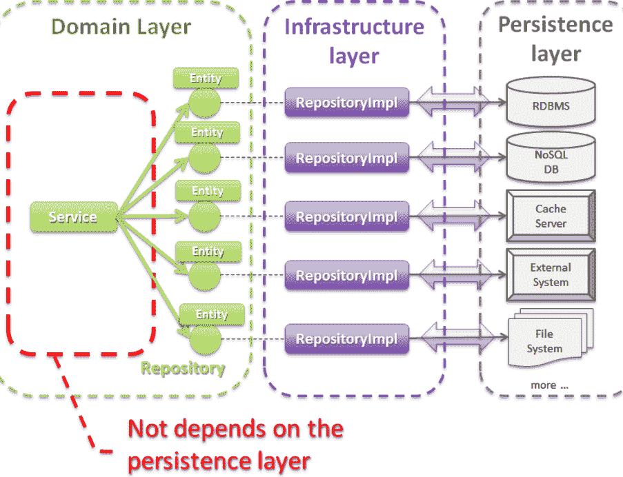

> **注意**：是否可以从 Service 类中隐藏 100% 依赖于持久化的逻辑
>
> 在由于持久化平台限制而无法完全隐藏的情况下，依赖逻辑应该实现在 `RepositoryImpl` 中。

> **警告**：创建 Repository 的最重要的目的不是将依赖平台的逻辑从业务逻辑中排除。其最重要的目的是限制业务逻辑（Service）的实现范围。这是通过在 Repository 中分离访问业务数据来实现的。作为结果，依赖平台的逻辑实现在 Repository 中而不是 Service 中。

#### Repository 的创建

必须遵循以下策略创建 Repository：

| 序号 | 方法 | 补充 |
| --- | --- | --- |
| 1. | 仅为主实体创建 Repository。 | 这意味着不需要为关联实体创建单独 Repository。然而，在特定情况下（例如对性能有要求的应用），为关联实体提供 Repository 可能更好。 |
| 2. | 将 Repository 接口和 `RepositoryImpl` 放在相同的领域包中。 | Repository 接口属于领域层，`RepositoryImpl` 属于基础设施层。但是，`RepositoryImpl` 的 Java 包可以与领域层的 Repository 接口相同。 |
| 3. | 将 Repository 使用的 DTO 放在与 接口相同的包中。 | 例如用于存储搜索标准的 DTO 或仅定义实体少数项目的摘要 DTO。 |

#### 创建 Repository 的示例

此处解释了创建 Repository 的示例。

如下是在解释创建实体类示例中所使用的实体类创建 Repository 的示例。

##### 仓库的结构

在“创建 Entity 类示例”的解释中使用的 Entity 类被用示例，生成的配置如下：

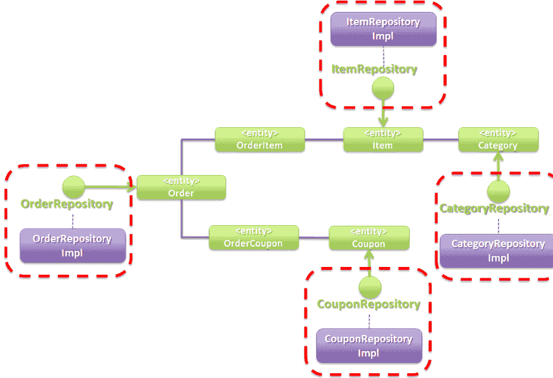

为主 Entity 类创建 Repository。

请参考项目结构以获取推荐的包结构。

##### Repository 接口的定义

###### Repository 接口的创建

下面介绍了一个创建 Repository 接口的示例。

* `SimpleCrudRepository.java`

此接口仅提供简单的 CRUD 操作。

方法签名是通过参考 Spring Data 提供的 `CrudRepository` 接口和 `PagingAndSortingRepository` 创建的。

```java
public interface SimpleCrudRepository<T, ID extends Serializable> {
    // (1)
    T findOne(ID id);
    // (2)
    boolean exists(ID id);
    // (3)
    List<T> findAll();
    // (4)
    Page<T> findAll(Pageable pageable);
    // (5)
    long count();
    // (6)
    T save(T entity);
    // (7)
    void delete(T entity);
}
```

| 序号 | 描述 |
| --- | --- |
| (1) | 根据指定 ID 获取 Entity 对象的方法 |
| (2) | 判断指定 ID 的 Entity 是否存在的方法 |
| (3) | 检索所有 Entity 列表的方法。在 Spring Data 中，它是 `java.util.Iterable`。在这里作为示例，它被设置为 `java.util.List` |
| (4) | 获取与指定分页信息（起始位置、记录数、排序信息）相对应的 Entity 对象集合的方法。`Pageable` 和 `Page` 是 Spring Data 提供的接口 |
| (5) | 获取 Entity 对象总数的方法 |
| (6) | 保存（创建、更新）指定的 Entity 集合的方法 |
| (7) | 删除指定的 Entity 方法 |

* `TodoRepository.java`

下面展示了基于上面创建的 `SimpleCrudRepository` 接口，为教程中创建的 Todo Entity 创建 Repository 的示例。

```java
// (1)
public interface TodoRepository extends SimpleCrudRepository<Todo, String> {
// (2)
    long countByFinished(boolean finished);
}
```

| 序号 | 描述 |
| --- | --- |
| (1) | `TodoRepository` 接口通过在泛型类型参数 `[T]` 中指定 Todo 实体并在泛型类型参数 `[ID]` 中指定 String 类来创建。 |
| (2) | 此接口中增加了 `SimpleCrudRepository` 接口未提供的方法。在这种情况下，添加了 [获取指定任务已完成的 Todo 实体数量的方法] |

###### Repository 接口的方法定义

对于执行通用 CRUD 操作的方法，建议具有与 Spring Data 提供的 `CrudRepository` 和 `PagingAndSortingRepository` 相同的签名。

然而，在返回集合的情况下，`java.util.Collection` 或 `java.util.List` 接口可以比 `java.lang.Iterable` 得到更好的处理。

在实际开发环境中，仅使用通用 CRUD 操作开发应用程序是困难的。因此，需要额外的方法。

建议按照以下规则添加方法。

| 序号 | 方法类型 | 规则 |
| --- | --- | --- |
| 1. | 搜索单条记录的方法 | 1. 以 `findById` 开头的方法名表示该方法获取与条件匹配的单个记录。2. 在方法名的 `findOneBy` 之后，必须指定作为搜索条件的字段的物理名称或逻辑名称。因此，方法名必须能够估算出“使用此方法可以获取的实体种类”。3. 每个搜索条件都必须有一个对应的参数。但是，当条件较多时，可以提供包含所有搜索条件的 DTO。4. 返回值必须是 Entity 类。 |
| 2. | 搜索多条记录的方法 | 1. 以 `findAllBy` 开头的方法名表示该方法获取所有与条件匹配的记录。2. 在方法名的 `findAllBy` 之后，必须指定作为搜索条件的字段的物理名称或逻辑名称。因此，方法名必须能够估算出“使用此方法可以获取的实体种类”。3. 每个搜索条件都必须有一个对应的参数。但是，当条件较多时，可以提供包含所有搜索条件的 DTO。4. 返回值必须是 Entity 类的集合。 |
| 3. | 分页搜索多条记录的方法 | 1. 以 `findPageBy` 开头的方法名表示该方法获取与条件匹配的页面。2. 在方法名的 `findPageBy` 之后，必须指定作为搜索条件的字段的物理名称或逻辑名称。因此，方法名必须能够估算出“使用此方法可以获取的实体种类”。3. 每个搜索条件都必须有一个对应的参数。但是，当条件较多时，可以提供包含所有搜索条件的 DTO。4. 返回值必须是 Entity 类的集合。 |
| 4. | 计数方法 | 1. 以 `countBy` 开头的方法名表示该方法获取实体的数量。2. 返回值必须是 `long`。3. 在 `countBy` 之后，必须指定作为搜索条件的字段的物理名称或逻辑名称。因此，方法名必须能够估算出“使用此方法可以获取的实体种类”。4. 每个搜索条件都必须有一个对应的参数。但是，当条件较多时，可以提供包含所有搜索条件的 DTO。 |
| 5. | 检查存在的方法 | 1. 以 `existsBy` 开头的方法名表示该方法检查实体的存在性。2. 返回值必须是 `boolean`。3. 在 `existsBy` 之后，必须指定作为搜索条件的字段的物理名称或逻辑名称。因此，方法名必须能够估算出“使用此方法可以获取的实体种类”。4. 每个搜索条件都必须有一个对应的参数。但是，当条件较多时，可以提供包含所有搜索条件的 DTO。 |

> **注意**：对于与更新的方法，建议按照上述方式构造方法。方法名中的 `find` 可以替换为 `update` 或 `delete`。

* `Todo.java` (Entity)

```java
public class Todo implements Serializable {
    private String todo;
    private String todoTitle;
    private boolean finished;
    private Date createdAt;
    // ...
}
```

* `TodoRepository.java`

```java
public interface TodoRepository extends SimpleCrudRepository<Todo, String> {
// (1)
    Todo findByTodoTitle(String todoTitle);
// (2)
    List<Todo> findAllByUnfinished();
// (3)
    Page<Todo> findPageUnfinished();
// (4)
    long countByExpired(int validDays);
// (5)
    boolean existsByCreateAt(Date date);
}
```

| 序号 | 描述 |
| --- | --- |
| (1) | 获取与指定值匹配的 Todo 对象的示例（标题=[参数值]）。在 `findOneBy` 之后指定字段的物理名称。 |
| (2) | 获取未完成的 Todo 对象的示例（完成=false 的对象）。在 `findAllBy` 之后指定逻辑条件名称。 |
| (3) | 获取未完成的 Todo 分页的示例（完成=false 的对象）。在 `findPageBy` 之后指定逻辑条件名称。 |
| (4) | 获取过期的 Todo 对象数量的示例（创建时间 < 当前日期 - [截止天数] 且 完成=false 的对象）。在 `countBy` 之后指定逻辑条件名称。 |
| (5) | 检查是否在特定日期创建了 Todo 的示例（创建时间=指定日期）。在 `existsBy` 之后指定物理名称。 |

##### RepositoryImpl 的创建

请参考基础设施层的实现以获取 `RepositoryImpl` 的实现。

### 3.2.5 Service 的实现

#### Service 的角色

Service 扮演以下 2 个角色。

1. 为 Controller 提供业务逻辑。
   业务逻辑包括业务数据的创建、更新、一致性检查以及与业务逻辑相关的所有过程。业务数据的创建和更新过程应委托给 Repository（或 O/R Mapper）并由 service 处理。
   应局限于业务规则的实现。

> **注意**：关于 Controller 和 Service 之间的逻辑分配
>
> 在本指南中，由 Controller 和 Service 实现的逻辑应遵循以下规则。
>
> 1. 对于从客户端请求的数据，应在 Controller 中执行单项检查和关联项检查（Bean Validation 或 Spring Validator）。
> 2. 传递给 Service 的数据转换过程（Bean 转换、类型转换和格式转换）必须在 Controller 中执行，而不是 Service 中。
> 3. 业务规则应在 Service 中实现。对业务数据的访问委托给 Repository 或 O/R Mapper。
> 4. 从 Service 接收的数据（要响应给客户端的数据）的转换过程（类型转换和格式转换）必须在 Controller（视图类等）中执行。

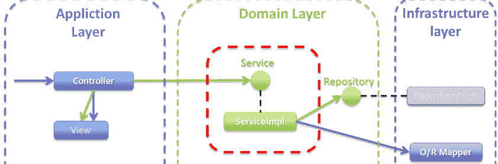

* (1) 请求数据的校验
* (2) 转换为数据对象
* (3) 业务逻辑的执行
* (3') 数据访问
* (4) 转换为响应数据

#### 2. 声明事务边界。


当业务逻辑执行任何需要确保数据一致性的操作（主要是数据更新过程）时，声明事务边界。

即使对于仅读取数据的逻辑，由于业务需求的性质，通常也需要事务管理。在这种情况下，请声明事务边界。

作为原则，事务边界必须在 Service 层设置。如果发现它位于应用层（Web 层），则可能没有正确进行业务逻辑提取。

详情请参阅“关于事务管理”。

## 事务边界

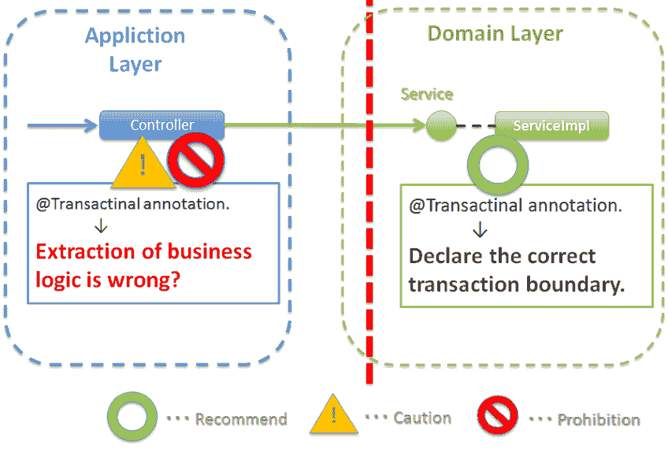

### Service 类的结构

Service 由 Service 类和 SharedService 类组成，起到以下作用。

在本指南中，带有 `@Service` 注解的 POJO（普通 Java 对象）被定义为 Service 类或 SharedService 类。

我们并不阻止限制方法签名的接口和基类的创建。

## 3.2. 领域层实现

# TERASOLUNA Java 服务端框架 (5.x) 开发指南文档

版本 5.4.1.RELEASE

| 序号 | 类 | 与依赖关系相关的说明 |
| :--- | :--- | :--- |
| 1. | Service 类 | 为特定的 Controller 提供业务逻辑。Service 类的方法不能实现需要重用的逻辑。 | 1. 禁止从另一个 Service 类的方法调用 Service 类的方法（图 1-1）。对于共享逻辑，请创建 SharedService 类。<br>2. Service 类的方法可以被多个 Controller 调用（图 1-2）。但是，当处理逻辑根据调用的 Controller 分发生分支时，必须为每个控制器创建一个方法。在这种情况下，请在 SharedService 类中创建一个方法，并从各个的 Service 方法中调用该方法。 |
| 2 | SharedService 类 | 为多个 Controller 和 Service 类提供共享（可用的）逻辑。 | 1. 可以从 SharedService 调用其他 SharedService 类的方法（图 2-1）。但是，调用层级不应变得复杂。如果调用层级变得复杂，存在降低可维护性的风险。<br>2. 可以从 Controller 调用 SharedService 类的方法（图 2-2）。但是只有在从事务管理的角度没有问题时才能这样做。如果从事务管理的角度存在问题，请先在 Service 类中创建一个方法，并在该方法中实现事务管理。<br>3. 禁止从 SharedService 调用 Service 类的方法（图 2-3）。 |

Service 类和 SharedService 类的依赖关系如下所示。

图中的数字与上表“与依赖关系相关的说明”列中的编号相关。

# TERASOLUNA Java 服务端框架 (5.x) 开发指南文档

版本 5.4.1.RELEASE

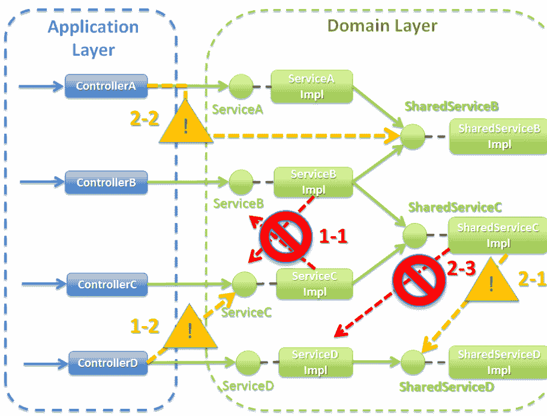

## 分离 Service 和 SharedService 的原因

业务逻辑中既存在无法（不应）被重用的逻辑，也存在可以（应该）被重用的逻辑。为了在同一个类中实现这 2 种逻辑，很难判断一个方法是否可以被重用。为了避免这个问题，本指南强烈建议将需要重用的方法实现在 SharedService 类中。

## 禁止从 Service 类调用其他 Service 类的原因

在本指南中，禁止从 Service 类调用其他 Service 类的方法。Service 为特定的控制器提供业务逻辑，其创建时并没有假设它会被其他服务使用。如果直接从其他 Service 类进行调用，很容易发生以下情况，并存在可维护性降低的风险。

### 3.2. 领域层实现 165

# TERASOLUNA Java 服务端框架 (5.x) 开发指南文档

版本 5.4.1.RELEASE

| 序号 | 可能发生的情况 |
| :--- | :--- |
| 1. | 必须在调用方 Service 类中实现的逻辑，由于位于统一位置等原因，被实现在被调用方 Service 类中。结果是标识调用者的参数被添加到了方法中。这导致了某种缺乏深度洞察的模块化结构。<br>最终，逻辑被抽象为工具类。 |
| 2. | 如果调用 Service 的堆栈数量很大，理解修改对代码的影响将变得困难。 |

### 关于限制签名的接口和基类

为了保持业务逻辑开发的一致性，创建了限制方法签名的接口和基类。

其目的是通过接口和基类限制签名，防止由于开发者风格不同导致的差异。

> 注意：在大规模开发中，存在开发者技能水平不高或为了可维护性而保持逻辑开发一致性的情况。在这种情况下，通过接口限制签名是一个合理的决策。

在本指南中，我们并没有特别建议创建限制签名的接口；但必须根据项目的特点选择架构类型。

#### 注意：限制签名的接口和基类的示例 - 限制签名的接口

```java
// (1)
public interface BLogic<I, O> {
  O execute(I input);
}
```

#### 166 3 应用开发

# TERASOLUNA Java 服务端框架 (5.x) 开发指南文档

版本 5.4.1.RELEASE

| 序号 | 描述 |
| :--- | :--- |
| (1) | 限制业务逻辑实现方法签名的接口。在上述示例中，它被定义为输入 (I) 和输出 (O) 泛型类型，有一个执行业务逻辑的方法 (`execute`)。在本指南中，上述接口被称为 `BLogic` 接口。 |

为了在 Service 中包含固定公共流程时标准化业务逻辑流程，创建了基类来限制方法签名。

#### 限制签名的基类

```java
// (2)
@Service
@Transactional
public abstract class AbstractBLogic<I, O> implements BLogic<I, O> {
    public O execute(I input) {
        // omitted

        // (3)
        preExecute(input);

        // (4)
        O output = doExecute(input);

        // omitted

        return output;
    } finally {
        // omitted
    }

    protected abstract void preExecute(I input);

    protected abstract O doExecute(I input);
}
```

#### 3.2. 领域层实现 167

# TERASOLUNA Java 服务框架 (5.x) 开发文档

发布版本 5.4.1.RELEASE

| 序号 | 描述 |
|---|---|
| (2) | 在创建基类时，由于方法是在外部执行的，且实现方法的类在 `@Transactional` 规范中是 AOP 的目标，因此当需要事务控制时，它们会被分配给基类。<br>与 `@Service` 类似，当 Service 被视为 AOP 目标时（例如 `ResultMessagesLoggingInterceptor`），它也必须分配给基类。 |
| (3) | 调用基类中的方法在执行业务逻辑之前进行预处理。<br>在 `preExecute` 方法中，会检查业务规则。 |
| (4) | 调用基类中执行业务逻辑的方法。 |

下面展示了通过扩展基类来限制签名的示例。

#### BLogic 类 (Service)

```java
// (5)
public interface XxxBLogic extends BLogic<XxxInput, XxxOutput> {
}
```

| 序号 | 描述 |
|---|---|
| (5) | 创建一个继承 `BLogic` 接口的接口，以便实现类型安全的注入。<br>实现继承 `BLogic` 的子接口，以便通过新接口的方法进行调用。 |

```java
@Service
public class XxxBLogicImpl extends AbstractBLogic<XxxInput, XxxOutput> 
    implements XxxBLogic {
  // (6)
  @Override
  protected void preExecute(XxxInput input) {
    // omitted
    Tour tour = tourRepository.findOne(input.getTourId());
```

#### 168 3 应用开发

# TERASOLUNA Java 服务框架 (5.x) 开发指南文档

发布版本 5.4.1.RELEASE

```java
    Date reservationLimitDate = tour.reservationLimitDate();
    if (input.getReservationDate().after(reservationLimitDate)) {
        throw new BusinessException(ResultMessages.error().add("e.xx.0001"));
    }
}

// (7)
@Override
protected XxxOutput doExecute(XxxInput input) {
    TourReservation tourReservation = new TourReservation();

    // omitted
    tourReservationRepository.save(tourReservation);
    XxxOutput output = new XxxOutput();
    output.setTourReservation(tourReservation);

    // omitted
    return output;
}
```

| 序号 | 描述 |
|---|---|
| (6) | 在执行业务逻辑之前实现预处理。会检查业务规则。 |
| (7) | 实现业务逻辑。实现的逻辑用于满足业务规则。 |

#### Controller

```java
// (8)
@Inject
XxxBLogic xxxBLogic;

public String reserve(XxxForm form, RedirectAttributes redirectAttributes) {
    XxxInput input = new XxxInput();
    // omitted
    // (9)
```

#### 3.2. 领域层实现 169

# TERASOLUNA Java 服务框架 (5.x) 开发指南文档

发布版本 5.4.1.RELEASE

```java
    XxxOutput output = xxxBLogic.execute(input);

    // omitted

    redirectAttributes.addFlashAttribute(output.getTourReservation());
    return "redirect:xxx7complete";
}
```

| 序号 | 描述 |
|---|---|
| (8) | Controller 注入 `BLogic` 接口以便调用。 |
| (9) | Controller 调用 `BLogic` 接口的 `execute` 方法并执行业务逻辑。 |

### 创建 Service 类的模式

创建 Service 主要有 3 种模式。

| 序号 | 单位 | 创建方法 | 描述 |
|---|---|---|---|
| 1. | 每个实体 (Entity) | 创建与主实体配对的 Service。 | 换句话说，主实体就是业务数据。如果应用程序是以业务数据为核心进行设计和实现的，应该以这种方式创建 Service 类。<br>如果以这种方式创建 Service，也将为每个实体创建业务逻辑，这会导致提取共享逻辑变得困难。<br>然而，如果使用这种模式创建 Service，它与亲和性对于那些需要同时引入大量开发者的应用程序类型并不良好。<br>可以认为，该模式适用于开发中小型应用程序。 |

继续见下页

#### 表格，3.8 – 续上页

| 序号 | 单位 | 创建方法 | 描述 |
| --- | --- | --- | --- |
| 2. | 每个用例 (use-case) | 创建与用例配对的 Service。 | 如果应用程序是以屏幕上的事件为核心进行设计和实现的，应该以这种方式创建 Service。<br>如果使用这种模式创建 Service，可以为每个用例分配一个人员；因此，它与那些需要同时引入大量开发者的应用程序类型具有良好的亲和性。<br>另一方面，如果使用这种模式创建 Service，用例内部的共享逻辑可以提取到单一位置；然而，跨越多个用例的共享逻辑可能无法被提取到单一位置。<br>当将共享逻辑提取到单一位置至关重要时，就有必要制定措施，例如设立一个专门团队负责设计跨越多个用例的业务逻辑共享组件。 |

继续见下页

#### 3.2. 领域层实现

# TERASOLUNA Java 服务框架 (5.x) 开发指南文档

发布版本 5.4.1.RELEASE

#### 表格，3.8 – 续上页

| 序号 | 单位 | 创建方法 | 描述 |
|---|---|---|---|
| 3. | 每个事件 (event) | 创建与事件配对的 Service。 | 如果应用程序是以屏幕上的事件为核心进行设计和实现的，且 BLogic 类是自动生成的，则应该以这种方式创建 Service。<br>在本指南中，使用这种模式创建的 Service 类被称为 `BLogic`。<br>使用这种模式创建 Service 的应用程序特征与为每个用例创建 Service 的基本相同。<br>然而，在这种情况下，与为用例创建 Service（模式 2）相比，提取业务逻辑中的共享逻辑可能困难。在本指南中，并不特别推荐为事件创建 Service。然而，从可维护性的考虑，在大规模开发中可以作为选项之一 |

# TERASOLUNA Java 服务框架 (5.x) 开发指南文档

发布版本 5.4.1.RELEASE

> 警告：Service 的创建模式必须根据待开发应用程序的功能和开发团队结构来决定。
>
> 没有必要缩小到上述 3 种模式中的某一种。为了起见，应避免随机使用不同的模式创建 Service；但是，如果特定条件下模式使用的策略经过了深思熟虑并由架构师指导，也可以组合使用模式。例如，以下组合是可能的。

##### 组合使用模式示例

- 对于整个应用程序重要的业务逻辑，为每个实体创建 `SharedService` 类。
- 对于来自屏幕的事件需要处理的业务逻辑，为每个 Controller 创建 `Service` 类。
- 在每个控制器的 Service 类中，根据需要调用 `SharedService` 来实现业务逻辑。

> 提示：使用 TERASOLUNA VisC 时可以直接从设计文档生成 `BLogic`。

### 应用开发图 - 为每个实体创建 Service

以下是为每个实体创建 Service 的应用开发图。

> 注意：为每个实体创建 Service 的典型应用程序示例是 REST 应用程序。REST 应用程序为 HTTP 上发布的资源提供 CRUD 操作（HTTP 的 POST, GET, PUT, DELETE）。大多数发布的资源都是业务数据（实体）或业务数据的一部分（实体），它们与为每个实体创建 Service 的模式具有良好的兼容性。
>
> 在 REST 应用程序的情况下，大多数时候用例也是基于每个实体的基础提取的。因此，其结构与为每个用例创建 Service 的情况相似。

## Java TERASOLUNA 服务器框架 (5.x) 开发指南文档

发布版本 5.4.1.RELEASE

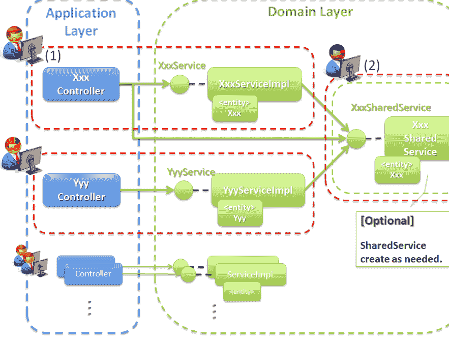

| 序号 | 描述 |
| --- | --- |
| (1) | 为每个实体（Entity）分配专人来实现 Service。<br>在没有特殊理由的情况下，最好为每个实体也创建 Controller，并必须由创建 Service 类的同一开发者开发。 |
| (2) | 如果多个业务逻辑之间存在共享逻辑，请实现 SharedService。<br>在上面的图中，分配了不同的人作为负责人。然而，根据项目结构，该人员可能与 (1) 是同一个人。 |

### 应用程序开发流程图 - 为每个用例创建 Service

以下是为每个用例创建 Service 时的应用开发图像。

对于对实体执行 CRUD 操作的用例，其结构与为每个实体创建 Service 的情况相同。

#### 174 3 应用开发

## Java TERASOLUNA 服务器框架 (5.x) 开发指南文档

发布版本 5.4.1.RELEASE

为每个实体创建 Service。

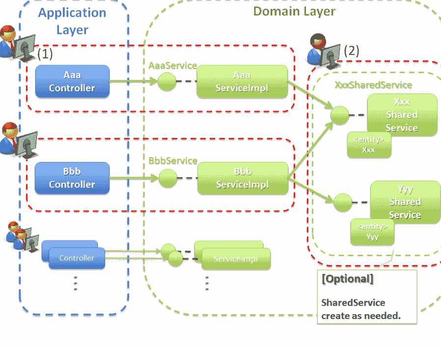

| 序号 | 描述 |
|---|--|
| (1) | 为每个用例分配专人来实现 Service。在没有特殊理由的情况下，最好为每个用例也创建 Controller，并必须由创建 Service 类的同一开发者开发。 |
| (2) | 如果多个业务逻辑之间存在共享逻辑，请实现 SharedService。在上面的图中，分配了不同的人作为负责人。然而，根据项目结构，该人员可能与 (1) 是同一个人。 |

> 注意：随着用例规模的增大，一个人的开发范围随之扩大。在这种情况下，很难与其他开发者分担该用例的工作。对于需要同时引入大量开发者进行开发的应用程序，可以将用例进一步拆分为更细粒的用例，然后将其分配给更多的开发者。

## 3.2. 领域层实现

175

## Java TERASOLUNA 服务器框架 (5.x) 开发指南文档

发布版本 5.4.1.RELEASE

开发者。

以下是用例进一步拆分后的应用开发图像。

拆分用例对 SharedService 没有影响。因此，此处省略了相关说明。

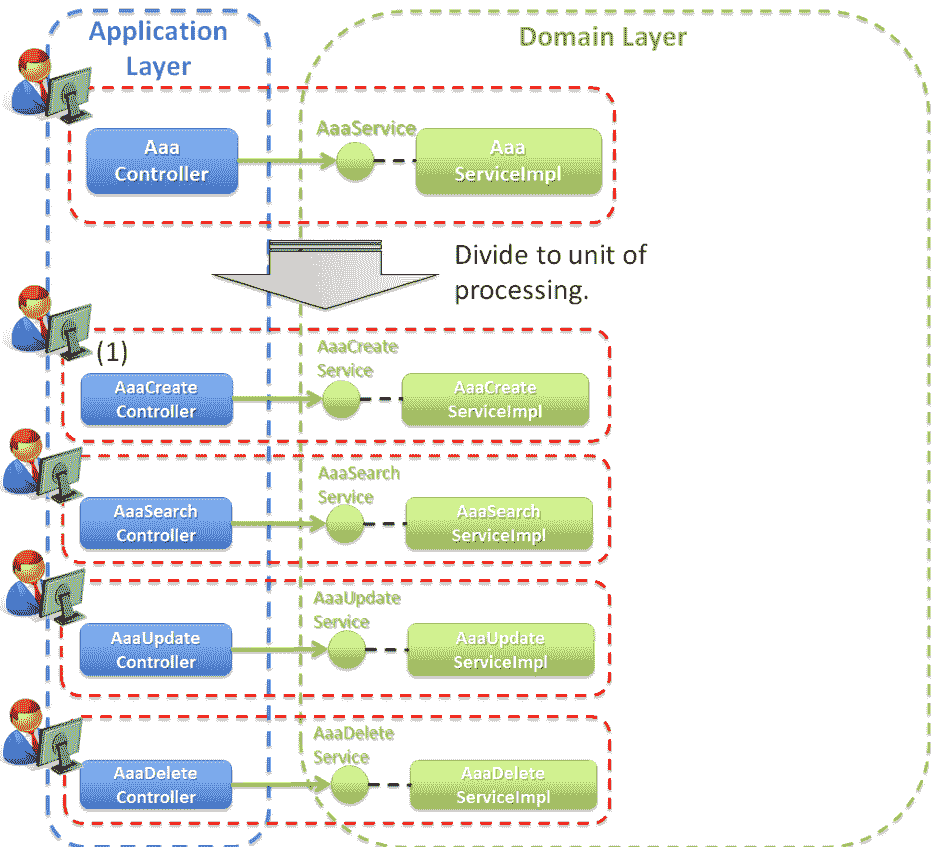


# Java TERASOLUNA 服务器框架 (5.x) 开发指南文档

发布版本 5.4.1.RELEASE

## 应用程序开发流程

| 序号 | 描述 |
|---|---|
| (1) | 将构成完整用例的用例拆分为更细的流程。将每个细粒过程分配给一个开发者。每个开发者为分配的流程创建 `Service`。这里的过程是指搜索、创建、更新、删除等操作，这些过程与屏幕上生成的每个事件所需的处理之间没有直接映射。例如，如果屏幕上生成的事件是 `Update`，它包含了多个细粒的过程，如`获取要更新的数据`、`更新内容的兼容性检查`等。在没有特殊理由的情况下，最好为每个细粒过程也创建 `Controller`，并必须由创建 `Service` 类的同一开发者开发。 |

> **提示：** 在某些项目中，`用例组（group of use-cases）`和`用例（use-cases）`被用于替代指南中的`用例（use-case）`和`过程（processes）`。

### 应用程序开发流程图 - 为每个用事件创建 Service

以下是为每个事件创建 `Service(BLogic)` 的应用开发图像。

## 3.2. 领域层实现

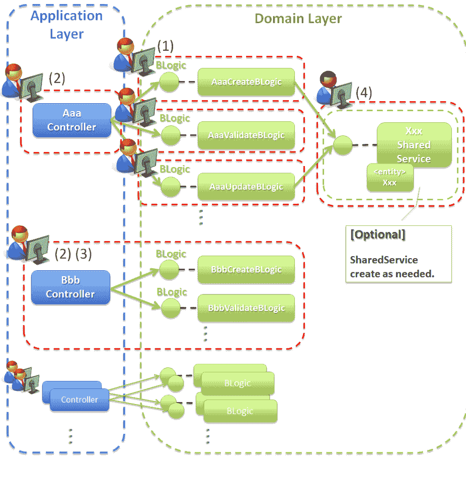

| 序号 | 描述 |
|---|---|
| (1) | 为每个事件分配专人来实现 `Service(BLogic)`。上面的示例是一个极端情况，为每个 `service(BLogic)` 分配了独立的开发者。实际上，一个用例必须分配一个人。 |
| (2) | 在没有特殊理由的情况下，也应该按“每个用例”为基础创建 `controller`。 |
| (3) | 即使为每个事件创建了独立的 `Service(BLogic)`，也建议由同一个人负责整个用例。 |
| (4) | 实现 `SharedService` 以在多个业务逻辑之间共享逻辑。在上面的图中，分配了不同的人作为负责人。然而，根据项目结构，该人员可能与 (1) 是同一个人。 |

> **注意：** 随着用例规模的增大，一个人的开发范围随之扩大。在这种情况下，很难与其他开发者分担该用例的工作。对于需要同时引入大量开发者进行开发的应用程序，可以将用例进一步拆分为更细粒的用例，然后将其分配给更多的开发者。

以下是用例进一步拆分后的应用开发图像。

> 拆分用例对 `SharedService` 没有影响。因此，此处省略了相关说明。

## Service 类的实现

### 创建 Service 类

```java
// ...
  return cart;
}
```

| 序号 | 描述 |
|---|---|
| (1) | 为每个业务逻辑为 `Service` 类创建一个方法。 |
| (2) | 在 `Service` 接口中定义方法，并在其实现类中实现业务逻辑。 |
| (3) | 在发生变动时添加 `@Transactional` 注解以更改默认事务定义（类级别注解）。应根据需求指定属性。详情请参阅“声明式事务管理”中的“所需信息”。此外，为了了解使用 `@Transactional` 注解时的注意事项，建议确认“使用事务管理的设置”。 |

> **提示：业务逻辑的事务定义（仅供参考）**
>
> 在实现供引用的业务逻辑时，通过指定 `@Transactional(readOnly = true)`，可以在 JDBC 驱动程序的“只读事务”指令下运行 SQL 指令。
> 处理只读事务的方法取决于 JDBC 驱动程序的实现；因此，请确认所使用的 JDBC 驱动程序的规范。

> **注意：使用“只读事务”时的注意事项**
>
> 如果在从连接池中检索连接时设置为“执行健康检查”，则“只读事务”可能无法启用。关于此事件的详情以及如何避免此类情况，请参阅“只读事务未启用的情况”。

> **注意：当需要启动新事务时的事务定义**
>
> 设置 `@Transactional(propagation = Propagation.REQUIRES_NEW)` 以启动新事务，而不参与调用者方法的事务。

### 关于 Service 类方法的参数和返回值

在处理 `Service` 类方法的参数和返回值时，必须考虑以下几点。

`Service` 类的参数和返回值必须使用序列化类（实现 `java.io.Serializable` 的类）。

由于 `Service` 类可能被部署为分布式应用程序，建议仅允许序列化类。

方法的典型参数和返回值如下：

- 原始数据类型 (`int`, `long`)
- 原始类型包装类 (`java.lang.Integer`, `java.lang.Long`)
- Java 标准类 (`java.lang.String`, `java.util.Date`)
- 领域对象 (`Entity`, `DTO`)
- 输入/输出对象 (`DTO`)
- 上述类型的集合 (`java.util.Collection` 的实现类)
- `void`
- 等……

> **注意：输入/输出对象**
>
> 1. 输入对象表示包含执行 `Service` 方法所需的所有输入值的对象。
> 2. 输出对象表示包含 `Service` 方法所有执行结果（输出值）的对象。
>
> 如果使用 TERASOLUNA ViSc 生成了业务逻辑（`BLogic` 类），则输入和输出对象将作为 `BLogic` 类的参数和返回值。

禁止作为参数和返回值的类型如下：

- 依赖于应用层架构（Server API 或 Spring 的 Web 层 API）的对象（`javax.servlet.http.HttpServletRequest`, `javax.servlet.http.HttpServletResponse`, `javax.servlet.http.HttpSession`, `org.springframework.http.server.ServletHttpServletRequest`）。
- 应用层的 `Model(Form, DTO)` 类。
- `java.util.Map` 的实现类。

> **注意：禁止的理由**
>
> 1. 如果允许依赖于应用层实现架构的对象，会导致应用层和领域层之间紧密耦合。
> 2. `java.util.Map` 过于通用。将其用作方法参数和返回值使得难以理解内部存储了什么类型的对象。此外，由于值是使用键管理的，可能会出现以下问题。
> 3. 值被映射到唯一的键，因此无法通过指定与插入值时不同的键名来检索该值。
> 4. 当必须更改名称时，很难确定受影响范围。

在应用层和领域层之间共享 `DTO` 的方法如下所示。

- 属于领域层包的 `DTO` 可以在应用层中使用。

> **警告：** `Form` 和应用层不应位于领域层中。

## SharedService 类的实现

### 创建 SharedService 类

在创建 `SharedService` 类时，需要注意以下点。此处仅解释与 `Service` 类不同的点。

1. 根据需要对类添加 `@Transactional` 注解。
   当不涉及数据访问时，不需要 `@Transactional` 注解。
2. 接口名称应为 `XxxSharedService`，类名应为 `XxxSharedServiceImpl`。
   也可以使用任何命名规范。但是，建议为 `Service` 类和 `SharedService` 类使用易于区分的命名规范。

### SharedService 类方法的创建

在编写 `SharedService` 类的方法时，需要注意以下点。此处仅解释与 `Service` 类不同的点。

1. `SharedService` 类中的方法必须为多个业务逻辑之间共享的每个逻辑创建。
2. 根据需要对类添加 `@Transactional` 注解。
   当涉及数据访问时，不需要该注解。

### 关于 SharedService 类方法的参数和返回值

要点与“关于 Service 类方法的参数和返回值”相同。

## 逻辑实现

`Service` 和 `SharedService` 中的实现包含了与数据获取、更新、业务数据一致性检查等操作相关的逻辑以及与业务规则相关的实现。

典型逻辑示例说明如下。

### 对业务数据的操作

参考以下数据（`Entity`）获取和更新的示例。

- 使用 Mybatis3 时，数据库访问 (Mybatis3)
- 使用 JPA 时，数据库访问 (JPA)

### 返回消息

警告消息和业务错误消息是必须在 `Service` 中解决的两种类型消息（参见下方的红线图）。

其他消息应在应用层解决。

请参考“消息管理”以获取消息类型和消息模式。

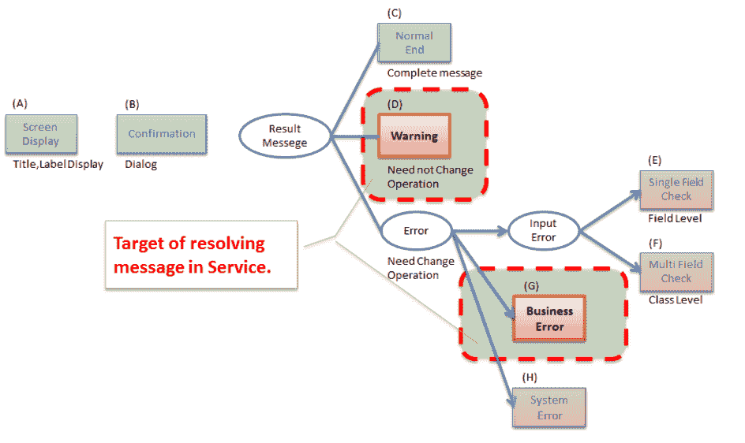

```java
public OrderResult submitOrder(Order order) {
    // 省
    boolean hasOrderProduct = orderRepository.existsByOrderProduct(order); // (1)
}

// 省

Order order = orderRepository.save(order);

// 省

ResultMessages warnMessages = null;
// (2)
if (hasOrderProduct) {
    warnMessages = ResultMessages.warn().add("w.xx.0001");
}
// (3)
Order orderResult = new OrderResult();
orderResult.setOrder(order);
orderResult.setWarnMessages(warnMessages);
return orderResult;
```

| 序号 | 描述 |
|---|---|
| (1) | 当订单包含当前不可用的产品时，将 `hasOrderProduct` 设置为 `true`。 |
| (2) | 在上述示例中，当订单包含当前不可用的产品时，会产生警告消息。 |
| (3) | 在上述示例中，通过将对象存储在名为 `OrderResult` 的 `DTO` 中来返回 `Order` 对象和警告消息。 |

### 通知业务错误

当执行业务逻辑时违反业务规则，将抛出业务异常。

可能出现以下情况：

- 在预订旅游时，预订日期超过截止日期
- 在下单时产品缺货
- 等……

业务异常 (`org.terasoluna.gfw.common.exception.BusinessException`) 已作为通用库提供。

当通用库中提供的业务异常类不能满足需求时，应在项目中创建业务异常类。

建议将业务异常类创建为 `java.lang.RuntimeException` 的子类。

> **注意：将业务异常视为未检查异常的原因**
>
> 由于业务异常需要在控制器类中处理，因此它们可以被配置为检查异常。但在指南中，建议将业务异常作为未检查异常的子类（`java.lang.RuntimeException`）。默认情况下，如果发生 `RuntimeException`，事务将回滚。因此，这将防止由于 `@Transactional` 注解设置不当而导致源代码中留下 Bug。显然，如果更改了设置使得即使发生检查异常事务也会回滚，可以将业务异常配置为检查异常的子类。

#### 抛出业务异常的示例

下面的示例通知预订已超过截止且发生了业务错误。

```java
// omitted
if(currentDate.after(reservationLimitDate)) { // (1)
    throw new BusinessException(ResultMessages.error().add("e.xx.xx.0001"));
}
// omitted
```

| 序号 | 描述 |
|---|---|
| (1) | 由于预订时预订日期已超过截止日期，因此抛出业务异常。 |

请参考“异常处理”获取整个异常处理的详情。

### 通知系统错误

当在执行业务逻辑时系统发生错误，会抛出系统异常。

可能是以下情况：

- 当本应存在的主数据、目录和文件不存在时
- 当捕获到库方法生成的检查异常，且该异常指示系统状态异常时。
- 等 ...

系统异常 (`org.terasoluna.gfw.common.exception.SystemException`) 已作为通用库提供。

当通用库中提供的系统异常类不能满足需求时，应在项目中创建系统异常类。

**建议将系统异常类创建为 `java.lang.RuntimeException` 的子类。**

原因是系统异常不应由应用程序代码处理，且 `@Transactional` 注解的回滚目标默认不是 `java.lang.RuntimeException`。

#### 抛出系统异常的示例

下面的示例展示了将产品主表中不存在特定产品作为系统错误进行通知。

```java
ItemMaster itemMaster = itemMasterRepository.findOne(itemCode);
if (itemMaster == null) { // (1) 
    throw new SystemException("e.xx.fw.0001",
        "未找到项目主数据。项目代码为 " + itemCode + ".");
}
```

| 序号 | 描述 |
|---|---|
| (1) | 由于本应存在的主数据不存在，因此抛出系统异常。 |

#### 逻辑中检测到系统错误的情况示例

在复制文件时捕获 `IO` 异常并抛出系统异常的示例。

| 序号 | 描述 |
|---|---|
| (1) | 库方法抛出了分类为无效系统状态的系统异常。库生成的异常必须作为异常传递给系统异常类。如果异常丢失，将无法从堆栈轨迹中追踪到错误发生的位置和基本错误原因。 |

> **注意：关于数据访问错误的处理**
>
> 当执行业务逻辑时，`Repository` 和 O/R Mapper 中发生数据访问错误，它会被转换为 `org.springframework.dao.DataAccessException` 的子类并抛出。错误可以在应用层处理，而不是在业务逻辑中捕获。然而，某些错误（如唯一性验证错误）应根据需求在业务逻辑中处理。详情请参考“数据库访问（通用）”。

### 3.2.6 关于事务管理

在必须确保数据一致性的逻辑中需要事务管理。

#### 事务管理的方法

有多种事务管理方法。但在本指南中，建议使用 Spring Framework 提供的“声明式事务管理”。

#### 声明式事务管理

在“声明式事务管理”中，可以通过以下 2 种方法声明事务所需的信息：

- 在 XML (bean 定义文件) 中声明。
- 使用注解 (`@Transactional`) 声明（推荐）。

请参阅 Spring 参考文档 -TransactionManagement(Declarative transaction management)- 获取 Spring Framework 提供的“声明式类型事务管理”的详情。

> **注意：需要注解方法的原因**
>
> 1. 仅通过源代码就能理解需要执行的事务管理。
> 2. 使用注解则不需要为事务管理配置 AOP，从而使 XML 变得简单。

#### @Transactional 注解属性

| 序号 | 属性名 | 描述 |
|---|---|---|
| 1 | propagation | 指定传播行为：<br>`[REQUIRED]` 如果未启动则启动事务（省略时的默认值）。<br>`[REQUIRES_NEW]` 总是启动新事务。<br>`[SUPPORTS]` 如果已启动则使用事务。未启动则不使用。<br>`[NOT_SUPPORTED]` 不使用事务。<br>`[MANDATORY]` 应该启动事务。如果未启动则抛出异常。<br>`[NEVER]` 不使用事务。如果启动则抛出异常。<br>`[NESTED]` 设置保存点。仅在 JDBC 中有效。 |
| 2 | isolation | 指定事务隔离级别。这取决于数据库：<br>`[DEFAULT]` 数据库提供的隔离级别（省略时的默认值）。<br>`[READ_UNCOMMITTED]` 读取其他事务修改的数据。<br>`[READ_COMMITTED]` 不读取其他事务修改的数据。<br>`[REPEATABLE_READ]` 其他事务读取的数据不可被更新。<br>`[SERIALIZABLE]` 完全隔离事务。 |
| 3 | timeout | 指定事务超时时间（秒）。默认 -1（取决于所使用的数据库）。 |
| 4 | readOnly | 指定事务只读标记。默认为 `false`（非只读）。 |
| 5 | rollbackFor | 指定需要回滚的异常类。默认为空（未指定）。 |
| 6 | rollbackClassName | 指定需要回滚的异常名称。默认为空（未指定）。 |


# TERASOLUNA Java 服务器框架 (5.x) 开发文档

发布版本 5.4.1.RELEASE

## @Transactional 注解属性表

| 序号 | 属性名 | 说明 |
| :--- | :--- | :--- |
| 7 | `noRollbackFor` | 指定需要提交的异常类。默认为空（未指定）。 |
| 8 | `noRollbackForClassName` | 指定需要提交的异常名称。默认为空（未指定）。 |

## 注意事项

### @Transactional 注解的指定位置

建议将注解指定在类级别或方法级别上。必须注意不应在接口或接口方法上指定。原因请参阅 Spring 参考文档 Transaction Management(Using @Transactional) 中的技巧。

### 发生异常时默认的回滚和提交操作

当未指定 `rollbackFor` 或 `noRollbackFor` 时，Spring Framework 执行以下操作：

* 当发生未检查异常（`java.lang.RuntimeException` 和 `java.lang.Error` 类或其子类）时回滚。
* 当发生检查异常（`java.lang.Exception` 类或其子类）时提交。（需要注意）

### @Transactional 注解的 value 属性

`@Transactional` 注解中有一个 `value` 属性。然而，该属性在声明多个事务管理器时指定要使用哪个事务管理器。当只有一个事务管理器时，不需要指定。当需要使用多个事务管理器时，请参阅 Spring 参考文档 - Transaction Management(Multiple Transaction Managers with @Transactional)。

### 主数据库默认隔离级别

主数据库默认隔离级别如下：

* Oracle: `READ_COMMITTED`
* DB2: `READ_COMMITTED`
* PostgreSQL: `READ_COMMITTED`
* SQL Server: `READ_COMMITTED`
* MySQL: `REPEATABLE_READ`

### @Transactional 注解的 timeout 属性

事务超时将根据 `timeout` 属性中指定的时间进行检查。

---

# TERASOLUNA Java 服务端框架 (5.x) 开发指南文档

发布版本 5.4.1.RELEASE

## 发布查询期间的行为注意点

在发布查询（执行 Repository 方法时）期间，必须注意以下行为点：

* 当指定的超时时间已过时，不会发生异常，以便在进行超时检查时验证是否已发生超时。
* 即使某些无关的业务流程需要一些时间，在超时检查后也不会再发生超时。

## 事务超时注意事项

关于事务超时，必须注意以下事件：

* 发布查询后的超时行为取决于 JDBC 驱动。
* 事务超时检查是在提交时进行的，取决于事务管理器（`Transaction Manager`）完成的。

## 未启用「只读事务（Read-only transactions）」的情况

提供了一种通过指定 `readOnly = true` 在「只读事务」下运行 SQL 的机制；然而，当满足所有以下条件时，某些 JDBC 驱动可能不会启用“只读事务”。

### 产生此情况的条件

* 在获取连接池时执行健康检查。
* 禁用从连接池获取的连接的自动提交（Auto commit）。
* 使用 `DataSourceTransactionManager` 或 `JpaTransactionManager` 作为 `PlatformTransactionManager`。（在使用 `JtaTransactionManager` 时不会发生此事件）。

### 发生此事件的 JDBC 驱动

* `org.postgresql:postgresql:9.3-1102-jdbc41` (适用于 PostgreSQL9.3 的兼容 JDBC 4.1 驱动)

### 避免此问题的方法

在未启用「只读事务」的情况下，如果指定了 `readOnly = true`，最终会导致执行不必要的流程。因此，即使是引用过程，也建议在「可更新事务（Updatable transactions）」下执行 SQL。

避免此问题的其他方法如下：

* 在从连接池获取连接时不要执行健康检查。
* 启用从连接池获取的连接的自动提交。（仅在需要事务管理时禁用自动提交）。

然而，为了避免此问题，请更改健康检查和自动提交的设计。

### 备注

* 事件在 PostgreSQL 9.3 和 Oracle 12c 上确认可以复现。在任何其他数据库和版本上未进行测试。
* 在 PostgreSQL 9.3 中，调用 `java.sql.Connection#setReadOnly(boolean)` 方法时会发生 `SQLException`。
* 当 JDBC 的 SQL 或 API 调用记录在 log4jdbc 中，当 JDBC 驱动以 ERROR 级别输出到日志时会发生 `SQLException`。
* JDBC 驱动产生的 SQL 异常会被 Spring 框架的异常处理忽略。因此，尽管在应用行为上这不是错误，但「只读事务」并未被启用。
* 在 Oracle 12c 中未确认发生此事件。

### 参考：log4jdbc 输出日志示例

当使用 log4jdbc 输出日志时，将被视为对应此事件的情况。

```
date:2015-02-20 16:11:56  threadmain user: X-Track:
--level:ERROR  logger:log4jdbc.audit
--message:3. Connection.setReadOnly(true)
org.postgresql.sql.SQLException: Cannot change transaction read-only-
--property in the middle of a transaction.
    at org.postgresql.jdbc2.AbstractJdbc2Connection.
    --setReadOnly(AbstractJdbc2Connection.java:741) ~[postgresql-9.3-1102-
    --jdbc41.jar:na]
```

## 事务传播

在大多数情况下，事务的传播方法（Propagation method）是 `REQUIRED`。

然而，根据应用程序的需求，也会使用 `REQUIRES_NEW`，下面解释了 `REQUIRED` 和 `REQUIRES_NEW` 情况下的事务控制流。

由于其他传播方法的频率很低，本指南省略了其他传播方法的说明。

### 当事务传播方法设置为 `REQUIRED` 时的事务控制流

当事务传播方法设置为 `REQUIRED` 时，从 Controller 调用的所有顺序过程都在同一个事务中处理。

1. Controller 调用 Service 类的方法。此时，由于不存在已启动的事务，将使用 `TransactionInterceptor` 启动事务。
2. `TransactionInterceptor` 在启动事务后调用 Service 类的方法。
3. Service 调用 SharedService 的方法。该方法也在事务控制下。此时，尽管启动了异常事件，`TransactionInterceptor` 也会参与到已启动的事务，而不会启动新事务。
4. `TransactionInterceptor` 在参与已启动的事务后调用事务控制下的方法。
5. `TransactionInterceptor` 根据处理结果执行提交或回滚并结束事务。

> **注意：发生 `org.springframework.transaction.UnexpectedRollbackException` 的原因**
>
> 当事务传播方法设置为「REQUIRED」时，内部只有一个物理事务，Spring 框架在内部创建事务边界。例如，当调用 SharedService 的方法时，会启动一个 `TransactionInterceptor`，它在内部为 SharedService 级别提供了事务控制边界。事务状态被 `TransactionInterceptor` 设置为回滚（rollback-only）。此操作无法提交。进一步，如果由于 Service 和 SharedService 方法之间设置的冲突，导致 Service 方法尝试提交此事务，则 Spring 框架将生成 `UnexpectedRollbackException` 并通知存在不一致性。当生成 `UnexpectedRollbackException` 时，应检查 `rollback` 和 `rollbackFor` 设置中是否存在不一致性。

### 事务传播方法设置为 `REQUIRES_NEW` 时的事务管理流

当事务传播方法设置为 `REQUIRES_NEW` 时，从 Controller 调用时，处理序列的一部分（SharedService 中的处理）将在另一个事务中处理。

1. Controller 调用 Service 类的方法。该方法在事务控制下。此时，不存在已启动的事务，由 `TransactionInterceptor` 启动事务（后续启动的事务称为 `Transaction A`）。
2. `TransactionInterceptor` 在启动事务（`Transaction A`）后调用 Service 类的方法。
3. Service 类调用 SharedService 类的方法。此时，尽管存在已启动的事务（`Transaction A`），由于新的传播方法为 `REQUIRES_NEW`，由 `TransactionInterceptor` 启动了新事务（后续启动的事务称为 `Transaction B`）。此时，`Transaction A` 被中断，状态变为“等待恢复（Awaiting to resume）”。
4. `TransactionInterceptor` 在启动 `Transaction B` 后调用 SharedService 类的方法。
5. `TransactionInterceptor` 根据处理结果执行提交或回滚并结束 `Transaction B`。此时，`Transaction A` 恢复执行，状态变为“激活（Active）”。
6. `TransactionInterceptor` 根据处理结果执行提交或回滚并结束 `Transaction A`。

## 调用事务控制下方法的方式

由于 Spring 框架提供的声明式事务管理（Declarative transaction management）是通过 AOP 实现的，因此事务管理仅对启用了 AOP 的类实现。

由于 AOP 的默认模式是代理（proxy），只有当从另一个类调用公共方法时，才会应用事务控制。

请注意，如果目标方法是从内部方法被调用的，即使该目标方法是公共方法，也不会应用事务控制。

*   **处于事务控制下的方法调用方式**
    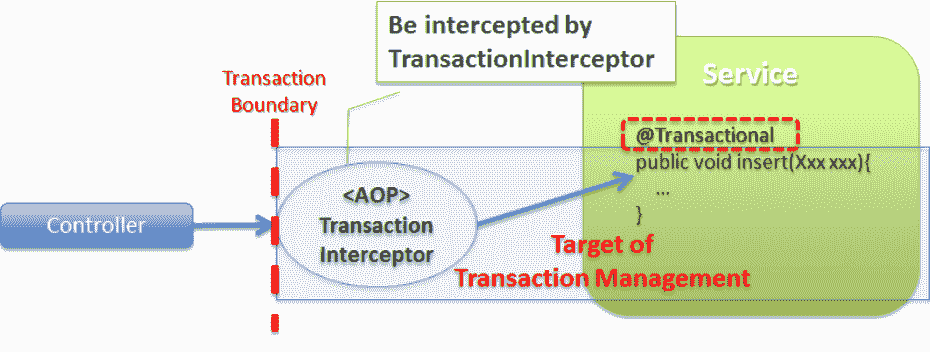
*   **不处于事务控制下的方法调用方式**
    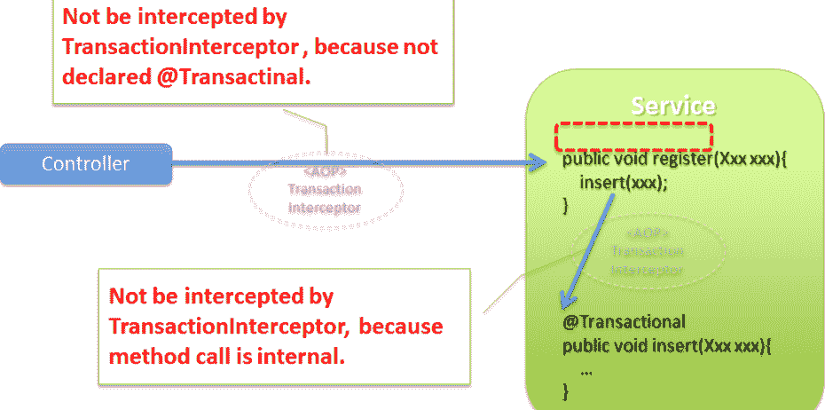

> **注意：为了将内部方法调用纳入事务控制范围**
>
> 可以通过将 AOP 模式设置为 `aspectj` 来启用内部方法调用的事务控制。然而，如果启用了事务管理的内部方法调用，事务管理的路由可能会变得复杂；因此建议使用默认的 AOP 模式。

---

# 使用事务管理的设置

此处解释了使用事务管理所需的设置。

## PlatformTransactionManager 设置

为了实现事务管理，必须定义 `PlatformTransactionManager` 的 bean。

Spring Framework 根据不同的用途提供了几个类；可以指定任何符合应用程序要求的类。

### 设置示例 (xxx-env.xml)

下面给出了使用从 DataSource 获取的 JDBC 连接管理事务的设置示例。

```xml
<bean id="transactionManager"
    class="org.springframework.jdbc.datasource.DataSourceTransactionManager">
    <property name="dataSource" ref="dataSource" />
    <property name="rollbackOnCommitFailure" value="true" />
</bean>
```

| 序号 | 说明 |
| :--- | :--- |
| (1) | 指定 `PlatformTransactionManager` 的实现类。建议将 id 设置为 `transactionManager`。 |

> **注意：当多个数据库（多个资源）需要事务管理（全局事务管理）时**
>
> * 必须使用 `org.springframework.transaction.jta.JtaTransactionManager`，并使用应用服务器提供的 JTA 功能来管理事务。
> * 在 WebSphere 和 Oracle WebLogic Server 中使用 JTA 时，通过指定 `<ext:jta-manager/>` 会自动设置扩展用于应用服务器的 `JtaTransactionManager`。

### Spring Framework 提供的 PlatformTransactionManager 实现类

| 序号 | 类名 | 说明 |
| :--- | :--- | :--- |
| 1 | `org.springframework.jdbc.datasource.DataSourceTransactionManager` | 通过调用 JDBC(`java.sql.Connection`) API 管理事务的实现类。当需要使用 MyBatis 和 JdbcTemplate 时使用此类。 |
| 2 | `org.springframework.orm.jpa.JpaTransactionManager` | 通过调用 JPA(`javax.persistence.EntityTransaction`) API 管理事务的实现类。当需要使用 JPA 时使用此类。 |
| 3 | `org.springframework.transaction.jta.JtaTransactionManager` | 通过调用 JTA(`javax.transaction.UserTransaction`) API 管理事务的实现类。使用此类利用服务器提供的 JTS（Java 事务服务）管理带有资源（数据库/消息服务/通用 EIS（企业信息系统）等）的事务。当必须在单个事务中执行多个资源的操作时，必须使用 JTA 管理事务。 |

## 启用 @Transactional 的设置

在本指南中，建议通过使用 `@Transactional` 注解的「声明式事务管理」来管理事务。

此处解释了使用 `@Transactional` 注解所需的设置。

### 基础设置 (xxx-domain.xml)

```xml
<tx:annotation-driven /> <!-- (1) -->
```

| 序号 | 说明 |
| :--- | :--- |
| (1) | 通过在 XML（bean 定义文件）中使用 `<annotation-driven>` 元素，在使用了 `@Transactional` 注解的位置将启用事务控制。 |

> **注意：关于事务管理的缺点**
>
> 详情请参考 IBM DeveloperWorks 上的文章（位于 IBM DeveloperWorks）。阅读这篇关于事务陷阱以及使用 Spring Framework 的 `@Transactional` 时陷阱的文章。
>
> 由于 IBM DeveloperWorks 的内容是一篇旧文章（2009年），部分内容与使用 Spring Framework 4.1 的行为有所不同。
>
> 具体来说，“列表 7. 在 REQUIRED 传播模式中使用 read-only - JPA$”的内容。
>
> 从 Spring Framework 4.1 开始，当使用 Hibernate ORM 4.2 或更高版本作为 JPA 提供者时，已经进行了改进，使得 JDBC 可以在“只读事务”下运行 SQL (SPR-8959)。
>
> 处理只读事务的方式取决于 JDBC 驱动的实现；因此，请确认要使用的 JDBC 驱动规范。

> **注意：编程式事务管理**
>
> 在本指南中，建议使用“声明式事务管理”。然而，编程式事务管理也是可能的。详情请参考 Spring 参考文档 - 事务管理。

### `<annotation-driven>` 的属性设置

可以指定各种属性。

```xml
<tx:annotation-driven transaction-manager="transactionManager"
  mode="aspectj"
  proxy-target-class="true"
  order="0" />
```

| 序号 | 属性 | 说明 |
| :--- | :--- | :--- |


| 序号 | 属性 | 描述 |
|---|---|---|
| (1) | transaction-manager | 指定 `PlatformTransactionManager` bean。省略时使用 `transactionManager`。 |
| 2 | mode | 指定 AOP 模式。省略时为 `proxy`。可以指定 `aspect`。 |
| 3 | proxy-target-class | 指定是否限制为类代理（仅在 `mode=proxy` 时有效）。省略时为 `false`。 |
| 4 | order | AOP 的顺序。省略时为 `Last`（最低优先级）。 |

## 3.2.7 提示

### 作为字段处理业务规则违反的方法

当需要对每个字段输出业务规则错误时，应在控制器端使用 Bean Validation 或 Spring Validator。

### 情况下，建议将检查实现在 Service 类中，然后调用 Service 类的方法。

详情请参考输入验证逻辑方法。

# TERASOLUNA Java 服务端框架 (5.x) 开发指南文档，版本 5.4.1.RELEASE

## 3.3 基础设施层实现

`ImplementingRepositoryImpl` 在基础设施层执行。

`RepositoryImpl` 实现 `Repository` 接口定义的方法。

### 3.3.1 实现 RepositoryImpl

下面介绍了使用 MyBatis3 和 JPA 为关系型数据库创建 Repository 方法。

- 使用 MyBatis3 实现 Repository
- 使用 JPA 实现 Repository

#### 使用 MyBatis3 实现 Repository

当使用 MyBatis3 作为关系型数据库的持久化 API 时，如果使用 MyBatis3 提供的 **Mapper 接口机制** 创建 Repository 接口，则不需要实现 `RepositoryImpl`。

这是因为该机制会自动映射 Mapper 接口的方法和要调用的语句（SQL）。

使用 MyBatis3 时，应用程序开发者创建：

- Repository 接口
- 映射文件（SQL 和 OR 映射定义）

提供了创建 Repository 和映射文件的示例。

有关如何使用 MyBatis3 的详情，请参考：数据库访问 (MyBatis3)。

##### 创建 Repository 接口（Mapper 接口）的示例

```java
package com.example.domain.repository.todo;

import com.example.domain.model.Todo;

// (1)
public interface TodoRepository {
    // (2)
    Todo findOne(String todoId);
}
```

| 序号 | 描述 |
|---|---|
| (1) | 以 POJO 接口的形式创建。Implementation 不需要指定 MyBatis3 接口、注解等。 |
| (2) | 定义 Repository 的方法。基本上不需要分配 MyBatis3 注解；但在某些情况下也可以指定注解。 |

##### 创建映射文件的示例

```xml
<?xml version="1.0" encoding="UTF-8"?>
<!DOCTYPE mapper PUBLIC "-//mybatis.org//DTD Mapper 3.0//EN" "http://mybatis.org/dtd/mybatis-3-mapper.dtd">
<mapper namespace="com.example.domain.repository.todo.TodoRepository">
    <!-- (4) -->
    <select id="findOne" parameterType="string" resultMap="todoResultMap">
        SELECT
            todo_id,
            title,
            finished
        FROM
            t_todo
        WHERE
            todo_id = #{todoId}
    </select>
    <!-- (5) -->
    <resultMap id="todoResultMap" type="Todo">
        <result column="todo_id" property="todoId" />
        <result column="title" property="title" />
        <result column="finished" property="finished" />
    </resultMap>
</mapper>
```

| 序号 | 描述 |
|---|---|
| (3) | 为每个 Repository 接口创建一个映射文件。在映射文件的 namespace 中（mapper 元素的 namespace 属性）指定 Repository 接口的完全限定类名 (FQCN)。 |
| (4) | 为 Repository 接口中定义的每个方法定义要运行的语句 (SQL)。在每个语句元素的 statement ID 中（select/insert/update/delete 元素的 id 属性）指定 Repository 接口的方法名。 |
| (5) | 当需要发起查询时，根据需要定义 O/R 映射。简单的 O/R 映射可以使用自动映射；然而，复杂的 O/R 映射需要定义单独的映射定义。在示例中，由于是简单的 O/R 映射，也可以使用自动映射进行映射定义。 |

#### 使用 JPA 实现 Repository

当使用 JPA 作为关系数据库的持久化 API 时，如果使用了 Spring Data JPA 的 `org.springframework.data.jpa.repository.JpaRepository`，就可以很容易地创建 Repository。

有关如何使用 Data JPA 的详情，请参阅数据库访问 (JPA)。

使用 Spring Data JPA 时，只需创建一个继承了 `JpaRepository` 的接口即可完成基本的 CRUD 操作。也就是说，不需要 `RepositoryImpl`。

然而，使用动态查询 (JPQL) 时需要 `RepositoryImpl`。

使用 Spring Data JPA 实现 `RepositoryImpl` 时请参阅数据库访问 (JPA)。

##### TodoRepository.java

```java
public interface TodoRepository extends JpaRepository<Todo, String> { // (1)
    // ...
}
```

| 序号 | 描述 |
|---|---|
| (1) | 仅通过定义继承 `JpaRepository` 的接口，即可在不实现的情况下执行 Todo 实体的基本 CRUD 操作。 |

描述添加 `JpaRepository` 未提供的操作的情况。

当使用 Spring Data JPA 时，如果是静态查询，建议在接口中添加一个方法，并使用注解指定调用该方法时要执行的查询 JPQL。

##### TodoRepository.java

```java
public interface TodoRepository extends JpaRepository<Todo, String> {
    @Query("SELECT COUNT(t) FROM Todo t WHERE finished = :finished") // (1)
    long countByFinished(@Param("finished") boolean finished);
    // ...
}
```

| 序号 | 描述 |
|---|---|
| (1) | 使用 `@Query` 注解指定查询 JPQL。 |

### 实现与外部系统 RestTemplate 关联的 Repository

建议：TBD

详情将在下一个版本提供。

# TERASOLUNA Java 服务端框架 (5.x) 开发指南文档，发布版本 5.4.1.RELEASE

## 3.4 应用层的实现

本章解释了使用 HTML 表单的 Web 应用层的实现。

> **注意**：请参考后续页面关于 Ajax 开发和 REST API 所需的实现。

应用层的实现通过以下 3 步骤给出：

1.  **实现 Controller**
    Controller 接收请求、调用业务逻辑、更新模型、决定视图。从而控制接收请求后的完整操作顺序。它是应用层实现中最重要的部分。
2.  **实现表单对象**
    表单对象在 HTML 表单和应用程序之间传输值。
3.  **实现视图**
    视图 (JSP) 从模型（表单对象、领域对象等）获取数据并生成屏幕 (HTML)。

### 3.4.1 实现 Controller

Controller 的实现如下所示。

Controller 承担以下角色：

1.  提供一个接收请求的方法。
    通过实现分配了 `@RequestMapping` 注解的方法来接收请求。
2.  执行请求参数的输入验证。
    对于需要请求参数输入验证的请求，可以通过为方法的表单对象指定 `@Validated` 注解来实现。
3.  调用业务逻辑。
    Controller 将输出反映到 Model。
4.  返回视图名称。
    Controller 返回视图名称。

下方展示了 6 种映射示例。

- 按请求路径映射
- 按 HTTP 方法映射
- 按请求参数映射
- 使用请求头映射
- 使用 Content-Type 请求头映射
- 使用 Accept 请求头映射

在接下来的说明中，前提条件是在 Controller 类中定义处理方法（handler method）。

```java
@Controller // (1)
@RequestMapping("sample") // (2)
public class SampleController {
    // ...
}
```

| 序号 | 描述 |
|---|---|
| (1) | 使用 `@Controller` 后，该类被识别为基于注解的控制器类，并成为组件扫描的目标。 |
| (2) | 通过在类级别添加 `@RequestMapping("sample")` 注解，该类中的所有处理方法都映射到带有 `{sample}` 前缀 URL。 |

#### 按请求路径映射

在如下定义的情况下，如果访问了 URL `sample/hello`，则执行 `hello()` 方法。

```java
@RequestMapping(value = "hello")
public String hello() {
}
```

当指定多个值时，将通过 `{OR}` 条件处理。

如下定义的情况下，如果访问了 `sample/hello` 或 `sample/bonjour`，则执行 `hello()` 方法。

```java
@RequestMapping(value = {"hello", "bonjour"})
public String hello() {
}
```

请求路径可以使用模式代替特定值。有关模式的详细信息，请参阅 Spring Framework 的参考文档。

- URI 模板模式
- 带有正则表达式的 URI 模板模式
- 路径模式 (Path Patterns)
- 带有占位符的模式

#### 按 HTTP 方法映射

在定义的情况下，如果使用 POST 方法访问 URL `"sample/hello"`，则执行 `hello()` 方法。支持的 HTTP 方法列表，请参阅 `RequestMethod` 的 Javadoc。

未指定时，将映射所有支持的 HTTP 方法。

```java
@RequestMapping(value = "hello", method = RequestMethod.POST)
public String hello() {
}
```

当指定多个值时，将通过 `{OR}` 条件处理。

如下定义的情况下，如果使用 GET 或 HEAD 方法访问 `sample/hello`，则执行 `hello()` 方法。

```java
@RequestMapping(value = "hello", method = {RequestMethod.GET, RequestMethod.HEAD})
public String hello() {
}
```

#### 按请求参数映射

如下定义的情况下，如果访问了 URL `sample/hello?form`，则执行 `hello()` 方法。

当请求作为 POST 请求发送时，即使请求参数不存在 URL 中，它们也可能存在于请求体中。

```java
@RequestMapping(value = "hello", params = "form")
public String hello() {
}
```

当指定多个值时，将通过 `[AND]` 条件处理。

如下定义的情况下，如果访问了 URL `sample/hello?form&formType=foo`，执行 `hello()` 方法。

```java
@RequestMapping(value = "hello", params = {"form", "formType=foo"})
public String hello(@RequestParam("formType") String formType) {}
```

支持的格式如下。

| 序号 | 格式 | 解释 |
|---|---|---|
| 1. | paramName | 当存在指定的 Name 请求参数时，执行映射。 |
| 2. | !paramName | 当不存在指定的 Name 请求参数时，执行映射。 |
| 3. | paramName=paramValue | 当指定的 paramName 的值等于 paramValue 时，执行映射。 |
| 4. | paramName!=paramValue | 当指定的 paramName 的值不等于 paramValue 时，执行映射。 |

#### 使用请求头映射

参考下一页的详情，主要使用控制器来映射 REST API 和 Ajax 请求。

- Ajax

#### 使用 Content-Type 请求头映射

请参考下一页的详情，主要使用控制器来映射 REST API 和 Ajax 请求。

- Ajax

#### 使用 Accept 请求头映射

请参考下一页的详情，主要使用控制器来映射 REST API 和 Ajax 请求。

- Ajax

#### 映射请求和处理方法

建议通过以下方法进行映射。

- 为每个业务流或功能流单元进行 URL 请求分组。
    将 `@RequestMapping(value = "xxx")` 定义为类注解以定义 URL 映射。
- 同一功能流内的页面跳转请求使用相同的 URL
    相同的 URL 意味着 `@RequestMapping(value = "xxx")` 的 `value` 属性值相同。
    使用 HTTP 方法和 HTTP 参数来确定同一功能流的特定请求使用哪个处理方法。

以下是一个具有基础页面流的示例应用程序中传入请求与处理方法之间的映射示例。

- 示例应用概览
- 请求 URL
- 映射请求和处理方法
- 实现表单显示
- 实现用户输入确认界面显示
- 实现表单重显
- 实现创建新用户逻辑

##### 示例应用概览

示例应用的概览如下。

- 提供实体（Entity）的 CRUD 操作。
- 此功能执行 CRUD 操作。

| 序号 | 操作名称 | 描述 |
|---|---|---|
| 1. | 获取实体列表 | 获取所有创建的并显示在屏幕上的列表。 |
| 2. | 创建实体 | 创建一个新的实体。 |
| 3. | 获取实体详情 | 根据指定的 ID 获取实体详情。 |
| 4. | 实体更新 | 根据指定的 ID 更新实体。 |
| 5. | 实体删除 | 根据指定的 ID 删除实体。 |

> **注意**：在 `获取实体详情`、`实体更新` 和 `实体删除` 操作的 URL 中指定的 `"{id}"` 被称为 URI 模板模式，可以指定任何值。在此示例应用程序中，指定了实体 ID。

页面流图中每个操作的分配 URL 映射如下所示：


图 3.2 图片 - 实体管理的页面流


# 版本 5.4.1.RELEASE

## 请求 URL

设计所需请求的 URL。

- 对流程中的所有请求 URL 进行分组。
- 此功能执行 CRUD 操作，因此考虑以 `/abc/` 开头的 URL。
- 为每个操作设计请求 URL。

| 序号 | 操作名称 | 每个操作的 URL (模式) |
| --- | --- | --- |
| 1. | 获取实体列表 | `/abc/list` |
| 2. | 创建实体 | `/abc/create` |
| 3. | 获取实体详情 | `/abc/{id}` |
| 4. | 实体更新 | `/abc/{id}/update` |
| 5. | 实体删除 | `/abc/{id}/delete` |

## 映射请求和处理方法

设计传入请求与处理方法之间的映射。

以下是根据映射策略设计的映射。

**TERASOLUNA Java 服务器框架 (5.x) 开发指南文档，版本 5.4.1.RELEASE**


图 3.3 图片 - 实体管理页面流及对应的分配 URL

| 序号 | 操作名称 | URL | 请求名称 | HTTP 方法 | HTTP 参数 | 处理方法 |
| --- | --- | --- | --- | --- | --- | --- |
| 1. | 获取实体列表 | `/abc/list` | 列表显示 | GET | - | `list` |
| 2. | 创建新实体 | `/abc/create` | 表单显示 | - | `form` | `createForm` |
| 3. | | | 显示输入确认 | POST | `confirm` | `createConfirm` |
| 4. | | | 表单重显 | POST | `redo` | `createRedo` |
| 5. | | | 实体创建 | POST | - | `create` |
| 6. | | | 显示实体创建完成 | GET | `complete` | `createComplete` |

**TERASOLUNA Java Server Framework (5.x) 开发文档，发布 5.4.1.RELEASE**

表 3.12 – 续上页

| 序号 | 操作名称 | URL | 请求名称 | HTTP 方法 | HTTP 参数 | 处理方法 |
| --- | --- | --- | --- | --- | --- | --- |
| 7 | 获取实体详情 | `/abc/{id}` | 显示实体详情 | GET | - | `read` |
| 8 | 实体更新 | `/abc/{id}/update` | 显示表单 | - | `form` | `updateForm` |
| 9 | | | 显示用户输入完成 | POST | `confirm` | `updateConfirm` |
| 10 | | | 表单重显 | POST | `redo` | `updateRedo` |
| 11 | | | 更新 | POST | - | `update` |
| 12 | | | 显示更新过程完成 | GET | `complete` | `updateComplete` |
| 13 | 实体删除 | `/abc/{id}/delete` | 删除 | POST | - | `delete` |
| 14 | | | 显示删除过程完成 | GET | `complete` | `deleteComplete` |

每个实体创建、实体更新和实体删除功能都存在多个请求。因此，使用 HTTP 方法和 HTTP 参数来完成处理方法的切换。

以下是在像“创建新实体”这样的函数中存在多个请求时的请求流。

所有 URL 均为 `/abc/create`，处理方法的确定是基于 HTTP 方法和 HTTP 参数的组合。

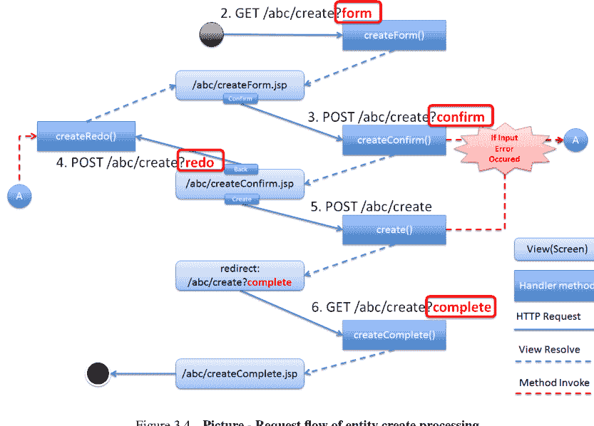

创建新实体的处理方法实现如下所示。

在此处，目的是理解请求与处理方法之间的映射，因此重点关注 `@RequestMapping`。

处理方法的参数和返回值（视图名称和视图）的细节将在下一章中解释。

- 实现表单显示
- 实现用户输入确认界面的显示
- 实现表单重显
- 实现创建用户的业务逻辑

## 3.4. 应用程序层的实现

**TERASOLUNA Java Server Framework (5.x) 开发指南文档，发布 5.4.1.RELEASE**

- 实现创建新用户过程完成的通知
- 在 HTML 表单上放置多个按钮

### 实现表单显示

为了显示表单，将表单指定为 HTTP 参数。

```java
@RequestMapping(value = "create", params = "form") // (1)
public String createForm(AbcForm form, Model model) {
    omitted
    return "abc/createForm"; // (2)
}
```

| 序号 | 描述 |
| --- | --- |
| (1) | 将表单指定为 `params` 属性的值。 |
| (2) | 返回用于渲染表单界面的 JSP 视图名称。 |

> 注意：在此处理方法中未指定 `method` 属性，因为对于 HTTP GET 方法不是必需的。

处理方法其他部分的实现示例如下。

除了实现表单显示的处理方法外，还需要以下几点：

- 实现表单对象的生成过程。关于表单对象的细节请参考“实现表单对象”。
- 实现表单界面的视图。关于视图的细节请参考“实现视图”。

使用以下表单对象。

```java
public class AbcForm implements Serializable {
    private static final long serialVersionUID = 1L;

    @NotEmpty
    private String input1;

    @NotNull
    @Min(1)
    @Max(10)
    private Integer input2;

    // committed setter&getter
}
```

创建一个 `AbcForm` 对象。

```java
@ModelAttribute
public AbcForm setUpAbcForm() {
    return new AbcForm();
}
```

创建表单的视图（JSP）。

```html
<html>
<form:form modelAttribute="abcForm"
    action="${pageContext.request.contextPath}/abc/create">
    <form:label path="input1">input1</form:label>
    <form:input path="input1" />
    <form:errors path="input1" />
<br>
    <form:label path="input2">input2</form:label>
    <form:input path="input2" />
    <form:errors path="input2" />
<br>
    <input type="submit" name="confirm" value="Confirm" /><!-- (1) -->
</form>
```

| 序号 | 描述 |
| --- | --- |
| (1) | 为提交按钮指定 `name="confirm"` 参数，以跳转到确认界面。 |

操作解释如下。

### 3.4. 应用程序层的实现

发送用于表单显示的请求。

访问 `abc/create?form`。

由于表单被指定为 HTTP 参数，因此会调用控制器的 `createForm` 方法并显示表单界面。

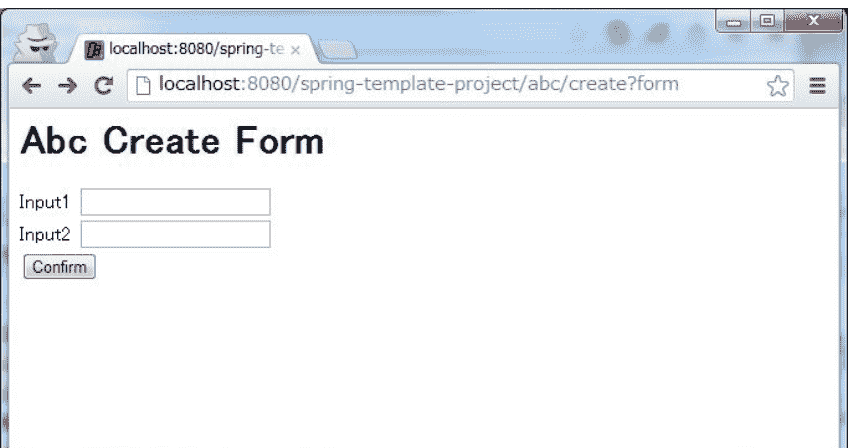

### 实现用户输入确认

为了检查表单中的用户输入，通过 POST 方法发送数据。

```java
@RequestMapping(value = "create", method = RequestMethod.POST, params = "confirm") // (1)
public String createConfirm(@Validated AbcForm form, BindingResult result, Model model) {
    if (result.hasErrors()) {
        return "abc/createForm"; // (2)
    }
    // omitted
    return "abc/createConfirm"; // (3)
}
```

| 序号 | 描述 |
| --- | --- |
| (1) | 在 `method` 属性中指定 `RequestMethod.POST`，在 `params` 属性中指定 `confirm`。 |
| (2) | 输入错误时建议调用 `createForm` 方法。 |
| (3) | 返回用于渲染确认界面的 JSP 视图。 |

> 注意：指定 POST 方法是为了防止地址栏显示敏感信息。（无需说明，这些安全措施尚不足，需要 SSL。）

处理方法其他部分的示例如下。

除了实现用户输入确认的处理方法外，还需要以下几点：

- 实现用户确认界面的视图。关于视图的细节请参考“实现视图”。

创建用户输入界面视图（JSP）。

### 3.4. 应用程序层的实现

操作解释如下。

发送用于显示用户输入确认的请求。

在表单界面上的 Input1 输入 `aa`，在 Input2 输入 `5` 并点击确认按钮。

点击确认按钮后，通过 POST 方法访问 `abc/create?confirm`。

由于 URL 中存在 HTTP 参数 `confirm`，将调用控制器的 `createConfirm` 方法并显示用户输入确认。

由于点击确认按钮后通过 POST 方法发送 HTTP 参数，因此它们不会出现在 URL 中。但是包含了 `confirm` 参数。

| 序号 | 描述 |
| --- | --- |
| (1) | 表单中输入的值被设置为表单的隐藏字段，因为在点击返回按钮时必须将其传回服务器。 |
| (2) | 为提交按钮指定 `name="redo"` 参数以返回表单。 |
| (3) | 提交按钮不需要指定参数名。提交按钮将执行创建操作。 |

注意：在上述示例中，在显示用户值时使用 `f:h()` 函数执行 HTML 转义，作为 XSS 应对措施。详情请参考跨站脚本。

### 实现表单重显

将 `redo` 指定为 HTTP 参数，表示需要重显表单。

```java
@RequestMapping(value = "create", method = RequestMethod.POST, params = "redo") // (1)
public String createRedo(AbcForm form, Model model) {
    // omitted
    return "abc/createForm"; // (2)
}
```

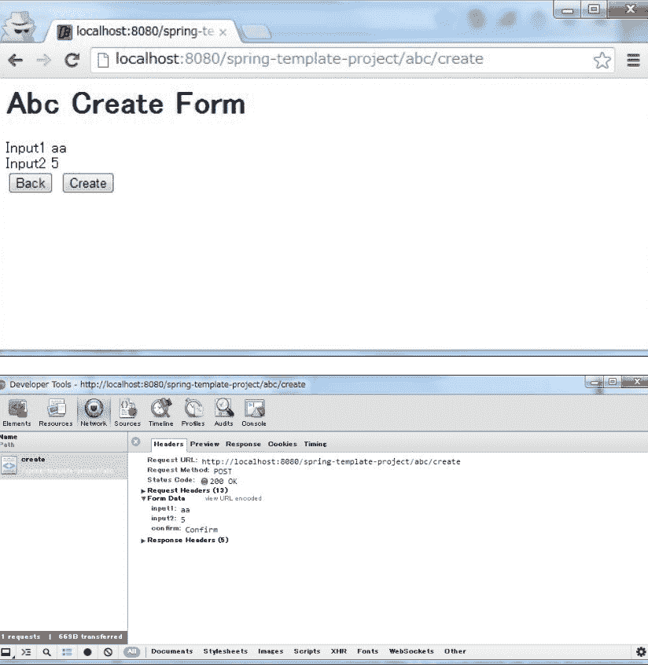

**TERASOLUNA Java 服务器框架 (5.x) 开发指南文档，版本 5.4.1.RELEASE**

| 序号 | 说明 |
| --- | --- |
| (1) | 在 `method` 属性中指定 `RequestMethod.POST` 并在 `params` 属性中指定 `redo`。 |
| (2) | 返回 JSP 的视图名称以渲染表单页面。 |

操作说明如下所示。

发送请求以重新显示表单页面。

在用户输入配置界面上点击“返回”（Back）按钮。

当点击“返回”按钮时，将通过 HTTP POST 方法访问 `abc/create?redo` URI。

由于 `redo` HTTP 参数位于 URI 中，控制器的 `createRedo` 方法被调用并重新显示屏幕。

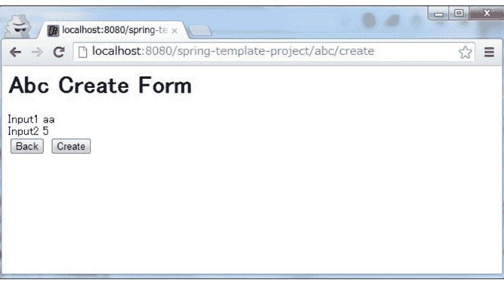

由于在点击“返回”按钮后，HTTP 参数是通过 HTTP POST 方法发送的，因此它们会出现在 URI 中。但是，`redo` 被作为 HTTP 参数包含在内。此外，由于表单的输入值已作为隐藏字段发送，这些输入值可以在重新显示的表单页面上恢复。

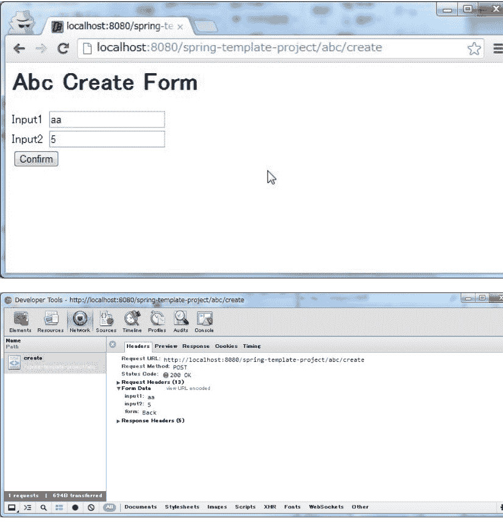

> **注意：** 为了实现 abc 的返回按钮功能，设置 `onclick="javascript:history.back()"` 也是方法之一。这两种方法的区别在于以下方面。应根据需求选择合适的方法。
>
> - 点击浏览器上的返回按钮时的行为。
> - 访问带有返回按钮的页面并点击返回按钮时的行为。
> - 浏览器历史。

## 3.4. 应用层的实现

**TERASOLUNA Java 服务器框架 (5.x) 开发指南文档，版本 5.4.1.RELEASE**

### 实现创建用户的业务逻辑

为了注册表单的输入内容，要注册的数据（隐藏参数）将通过 HTTP POST 方法发送。由于不使用 HTTP 参数进行排序，此新请求将是该操作的主请求。

由于数据库的状态在此过程中发生了变化，因此它不会因为重复提交而执行多次。

因此，在完成此过程后，它会被重定向到下一个屏幕（创建完成屏幕），而不是直接显示视图（屏幕）。这种模式被称为 Post-Redirect-GET (PRG) 模式。有关 PRG 的详情，请参考“双提交保护”。

```java
@RequestMapping(value = "create", method = RequestMethod.POST) // (1)
public String create(@Validated AbcForm form, BindingResult result, Model model) {
    if (result.hasErrors()) {
        return createRedo(form, model); // 返回 "abc/createForm"
    }
    // 省略
    return "redirect:/abc/create?complete"; // (2)
}
```

| 序号 | 说明 |
| --- | --- |
| (1) | 在 `method` 属性中指定 `RequestMethod.POST`。不要指定 `params` 属性。 |
| (2) | 将重定向所需的 URL 作为视图名称返回，以便使用 PRG 模式。 |

注意：可以通过返回 `redirect:/xxx` 作为视图名称来重定向到 `/xxx`。

> **警告：** PRG 模式用于避免点击 F5 按钮刷新浏览器时发生双提交，但它作为双提交的措施是不够的。有必要使用事务令牌检查（TransactionTokenCheck）功能作为双提交的措施。有关事务令牌检查的详情，请参考“双提交保护”。

操作说明如下所示。

在输入确认界面上点击“创建”（Create）按钮。

点击“创建”按钮后，通过 POST 方法访问 `abc/create` URL。

由于没有发送 HTTP 参数来识别按钮，因此它被视为实体创建过程的主请求，并调用了控制器的 `create` 方法。

`Create` 请求不会直接返回屏幕，而是被重定向到创建完成显示页 (`/abc/create?complete`)。因此，HTTP 状态变为 302。

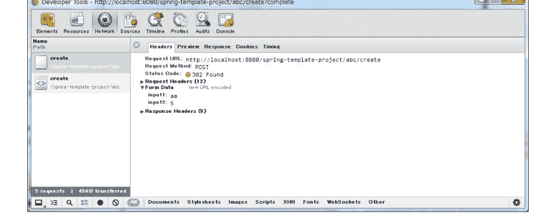

### 实现创建新用户过程完成的通知

为了通知创建过程的完成，`complete` 必须作为 HTTP 参数存在请求中。

```java
@RequestMapping(value = "create", params = "complete") // (1)
public String createComplete() { // 省略
    return "abc/createComplete"; // (2)
}
```

## 3.4. 应用层的实现

**TERASOLUNA Java 服务器框架 (5.x) 开发文档，版本 5.4.1.RELEASE**

| 序号 | 说明 |
| --- | --- |
| (1) | 在 `params` 属性中指定 `complete`。 |
| (2) | 返回 JSP 的视图名称以渲染创建完成屏幕。 |

注意：在此处理器方法中没有指定 `method` 属性，因为 HTTP GET 不需要它。

操作说明如下所示。

完成用户后，指定了 `/abc/create?complete`。由于 HTTP 参数是 `complete`，调用了 `createComplete()` 方法并显示完成屏幕。

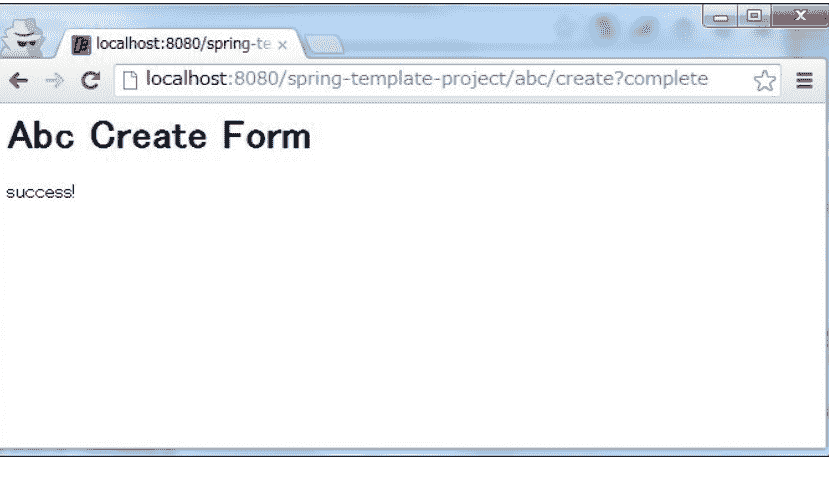

注意：PRG 模式用于避免点击 F5 按钮刷新浏览器时发生双提交，但它作为双提交的措施是不够的。有必要使用事务令牌检查（TransactionTokenCheck）功能作为双提交的措施。


## 按钮

在 HTML 表单中使用以下按钮：

```html
<input type="submit" name="redo" value="Back" />
<input type="submit" name="complete" value="Create" />
```

点击返回按钮时，请求 `/abc/create?redo`，控制器的 `createRedo()` 方法被调用并重新显示屏幕。

由于在点击返回按钮后，HTTP 参数是通过 HTTP POST 方法发送的，因此它们会出现在 URI 中。但是，`redo` 被作为 HTTP 参数包含在内。此外，由于表单的输入值已作为隐藏字段发送，这些输入值可以在重新显示的表单页面上恢复。

TERASOLUNA Java 服务器框架 (5.x) 开发指南文档，版本 5.4.1.RELEASE

## 控制器的代码

实现列表、详情、更新的控制器代码如下所示。

```java
@Controller
@RequestMapping("abc")
public class AbController {
    @ModelAttribute
    public AbForm setUpAbForm() {
        return new AbForm();
    }

    // 处理 "/create?form
    @RequestMapping(value = "create", params = "form")
    public String create(AbForm form, Model model) {
        // 省略
        return "createForm";
    }

    // 处理 POST /create?confirm
    @RequestMapping(value = "create", method = RequestMethod.POST, params = "confirm")
    public String createConfirm(@Validated AbForm form, BindingResult result,
        Model model) {
        if (result.hasErrors()) {
            return createRedo(form, model);
        }
        // 省略
        return "createConfirm";
    }

    // 处理 POST /create/redo
    @RequestMapping(value = "create", method = RequestMethod.POST, params = "redo")
    public String createRedo(AbForm form, Model model) {
        // 省略
        return "createForm";
    }

    // 处理 POST /create
    @RequestMapping(value = "create", method = RequestMethod.POST)
    public String create(@Validated AbForm form, BindingResult result, Model model) {
        if (result.hasErrors()) {
            return createRedo(form, model);
        }
        // 省略
        return "redirect:/abc/create?complete";
    }

    // 处理 "/abc/create?complete
    @RequestMapping(value = "create", params = "complete")
    public String createComplete() {
        // 省略
        return "abc/createComplete";
    }
}
```

### 关于处理方法的参数

处理方法的参数可以用于获取各种值，但作为原则，不应通过控制器的处理方法参数获取以下内容：

- `ServletRequest`
- `HttpServletRequest`
- `org.springframework.framework.web.context.request.WebRequestRequest`
- `org.springframework.framework.web.context.request.NativeWebRequest`
- `java.io.InputStream`
- `java.io.Reader`
- `java.io.OutputStream`
- `java.io.Writer`
- `java.util.Map`
- `org.springframeworkframework.web.ui.ModelMap`

**注意：** 当允许使用类似 `getAttribute`/`getAttributeRequest` 以及 `Map` 的 `get`/`put` 等泛化值时，过度使用这些方法会随着项目规模的增大而降低项目的可维护性。出于上述原因，在存在替代方案的情况下，不建议使用 `HttpSession`。

当将公共参数（请求参数）存储在 JavaBean 中并作为控制器方法的参数传递时，可以使用后文描述的实现 `HandlerMethodArgumentResolver` 方法。

下面描述了根据使用目的所需的参数：

- 向屏幕（视图）传递数据
- 从 URL 路径中获取值
- 单个获取请求参数
- 批量获取请求参数
- 执行输入验证
- 在重定向请求时传递数据
- 将请求参数传递到重定向目标
- 在重定向目标的 URL 路径中插入值
- 从 Cookie 中获取值
- 在 Cookie 中写入值
- 获取分页信息
- 获取已上传的文件
- 在屏幕上显示结果消息

TERASOLUNA Java 服务端框架 (5.x) 开发指南文档，版本 5.4.1.RELEASE

## 向屏幕（视图）传递数据

为了传递要显示在屏幕（视图）上的数据，请将 `org.springframework.ui.Model`（以下简称 Model）作为处理方法的参数，并将数据（对象）添加到 Model 对象中。

- SampleController.java

```java
@RequestMapping("hello")
public String hello(Model model) { // (1)
    model.addAttribute("hello", "Hello World!"); // (2)
    model.addAttribute(new HelloBean("Hello World!")); // (3)
    return "sample/hello"; // 返回视图的名称
}
```

- hello.jsp

```jsp
Message : ${f:h(hello)}<br><!-- (4) -->
Message : ${f:h(helloBean.message)}<br><!-- (5) -->
```

- 由视图(hello.jsp) 创建的 HTML

```html
Message : Hello World!<br><!-- (6) -->
Message : Bean Hello World!<br><!-- (6) -->
```

### 说明

| 序号 | 说明 |
|---|---|
| (1) | 获取 Model 对象作为参数。 |
| (2) | 调用收到的作为参数的 Model 对象的 `addAttribute()` 方法，并将数据添加到 Model 对象中。例如，将字符串 "HelloWorld!" 添加到属性名 "hello" 中。 |
| (3) | 如果省略 `addAttribute()` 方法的第一个参数，则小写开头的类名将成为属性名。例如，`model.addAttribute("helloBean", new HelloBean())` 的结果与 `model.addAttribute(new HelloBean())` 的结果相同。 |
| (4) | 在视图 (JSP) 中，可以通过指定 `${Attribute name}` 来获取添加到 Model 对象中的数据。例如，使用 EL 表达式的 `${f:h(Attribute name)}` 函数进行 HTML 转义。有关执行 HTML 转义的 EL 函数的详情，请参阅跨站脚本（Cross Site Scripting）。 |
| (5) | 存储在 Model 中的 JavaBean 值可以通过指定 `${Attribute name.property name}` 来获取。 |
| (6) | JSP 输出为 HTML 格式。 |

**注意：** 即使不使用 Model，也可以将其指定为参数。即使在实现的初始阶段不需要，稍后也可以（这样将来就不需要更改方法的签名）。

**注意：** 该值也可以从未受 Spring MVC 管理的模块中引用（例如 `ServletFilter` 等）因为 Model 中的 `addAttribute()` 执行了 `set HttpServletRequest`。

TERASOLUNA Java 服务端框架 (5.x) 开发指南文档，版本 5.4.1.RELEASE

## 从 URL 路径中获取值

要从 URL 路径中获取值，请在控制器的处理方法的参数上添加 `@PathVariable` 注解。

为了使用 `@PathVariable` 注解从路径中检索值，`@RequestMapping` 注解必须以变量的形式包含这些值（例如 `{id}`）。

```java
@RequestMapping("hello/{id}/{version}") // (1)
public String hello(
    @PathVariable("id") String id, // (2)
    @PathVariable Integer version, // (3)
    Model model) {
    // 执行某些操作。
    return "sample/hello"; // 返回视图的名称
}
```

### 说明

| 序号 | 说明 |
|---|---|
| (1) | 在 `@RequestMapping` 注解的值中指定要提取为路径变量的部分。以 `{variable name}` 格式指定路径变量。例如，指定了 id 和 version 两个路径变量。 |
| (2) | 在 `@PathVariable` 注解中指定路径变量的名称。例如，当访问 URL `sample/hello/aaaa/1` 时，字符串 `aaaa` 被传递过去。 |
| (3) | `@PathVariable` 注解的 `value` 属性可以省略。如果省略，参数名将成为变量名。例如，当访问 URL `sample/hello/aaaa/1` 时，此方法编译时的字符串 `aaaa` 需要通过指定以下任一完成：<br>- `-g` （输出调试信息的模式）<br>- 从 Java8 开始添加的 `-parameters` 选项（生成元数据的模式） |

**注意：** 值也可以从未受 Spring MVC 管理的模块中引用（例如 `ServletFilter` 等）因为 Model 中的 `addAttribute()` 执行了 `set HttpServletRequest`。

TERASOLUNA Java 服务端框架 (5.x) 开发指南文档，版本 5.4.1.RELEASE

## 单个获取请求参数

要单独获取请求参数，请在参数上添加 `@RequestParam` 注解。

```java
@RequestMapping("bindRequestParams")
public String bindRequestParams(
    @RequestParam("id") String id, // (1)
    @RequestParam String name, // (2)
    @RequestParam(value = "age", required = false) Integer age, // (3)
    @RequestParam(value = "genderCode", required = false, defaultValue = "unknown") String genderCode, // (4)
    Model model) {
    // 执行某些操作
    return "sample/hello"; // 返回视图的名称
}
```

### 说明

| 序号 | 说明 |
|---|---|
| (1) | 在 `@RequestParam` 注解的 `value` 属性中指定请求参数名。例如，当访问 `sample/hello?id=aaaa` 时，字符串 `aaaa` 被传递过去。 |
| (2) | `@RequestParam` 注解的 `value` 属性可以省略。如果省略，参数名将成为请求参数名。例如，当访问 `sample/hello?name=bbbb` 时，字符串 `bbbb` 被传递过去。 |
| (3) | 默认情况下，如果指定的请求参数不存在将发生错误。如果请求参数不是必需，请在 `required` 属性中指定 `false`。例如，当不存在 `age` 参数时，`null` 被传递给参数。 |
| (4) | 如果指定的请求参数不存在时使用默认值，请在 `defaultValue` 属性中指定默认值。例如，当不存在 `genderCode` 参数时，`unknown` 被传递给参数。 |

**注意：** 当在未指定必需参数的情况下缺失，将抛出 `org.springframework.bind.MissingServletRequestParamException` 并默认响应 400 (Bad Request)。然而，当指定了 `defaultValue` 属性时，将传递 `defaultValue` 中指定的值而不抛出异常。

**注意：** 绑定可以是任何数据类型。在数据类型不匹配的情况下，将抛出 `org.springframework.beans.TypeMismatchException` 并默认响应 400 (Bad Request)。例如，当访问 `sample/hello?age=aaaa....` 时，异常为自 `aaaa` 起抛出的异常无法转换为 `Integer`。

只有在满足以下条件时，才必须绑定表单对象（form object）：

- 请求参数是 HTML 表单中的项。
- 请求参数不是 HTML 表单中的项，但需要执行除强制性检查以外的输入校验。
- 需要为每个参数输出输入校验错误的详细信息。
- 如果有 3 个或更多请求参数（出于维护和可读性考虑）。

TERASOLUNA Java 服务端框架 (5.x) 开发指南文档，版本 5.4.1.RELEASE

## 批量获取请求参数

使用表单对象来收集所有的请求参数。

表单对象是代表 HTML 表单的 JavaBean。有关表单对象的详情，请参阅“实现对象（Implementing object）”。

以下示例展示了使用 `@RequestParam` 分别获取每个请求参数的处理器方法与使用表单对象获取请求参数的相同处理器方法之间的区别。

使用 `@RequestParam` 分别接收请求参数的处理器方法所示：

```java
@RequestMapping("bindRequestParams")
public String bindRequestParams(
    @RequestParam("id") String id,
    @RequestParam String name,
    @RequestParam(value = "age", required = false) Integer age,
    @RequestParam(value = "genderCode", required = false, defaultValue = "unknown") String genderCode,
    Model model) {
    do something
    return "sample/hello"; // 返回视图名称
}
```

### 创建表单对象类

对于对应此表单对象的 HTML 表单的 jsp，请参阅“绑定到 HTML 表单（Binding to HTML form）”。

TERASOLUNA Java 服务端框架 (5.x) 开发指南文档，版本 5.4.1.RELEASE


```java
public class SampleForm implements Serializable {
    private static final long serialVersionUID = -1477614498217715937L;

    private String id;
    private String name;
    Integer age;
    private String genderCode;

    // 省略 setter 和 getter 方法
}
```

注意：请求参数的名称应与表单对象的属性名匹配。

当参数 `id=aaa&name=bbbb&age=19&genderCode=men&tel=01234567` 被发送到上述表单时，与 `id`、`name`、`age`、`genderCode` 属性名匹配的值会被存储，但 `tel` 不包含在表单对象中，因为没有匹配的属性。

进行修改，使原本使用 `@RequestParam` 分别获取的请求参数现在作为表单对象获取。

```java
@RequestMapping("bindRequestParams")
public String bindRequestParam(@Validated SampleForm form, // (1)
    BindingResult result,
    Model model) {
    // do something
    return "sample/hello"; // 返回视图名称
}
```

| 序号 | 描述 |
|---|---|
| (1) | 将 `SampleForm` 对象作为参数传入。 |

> 注意：当表单对象作为参数时，与 `@RequestParam` 不同，它不会执行强制性检查。使用表单对象时，应按如下方式执行输入校验。

> 警告：领域对象（如 `Entity` 等）也可以作为表单对象使用，无需更改。然而，如确认密码、同意确认复选框等参数应仅存在于 WEB 页面。由于依赖此类屏幕项的字段不应添加到领域对象中，建议为表单对象创建领域独立的类。当需要从请求参数创建领域对象时，必须先在表单对象中接收值，然后从表单对象拷贝到领域对象。

## 执行输入校验

对表单对象执行输入校验时，在表单对象参数上添加 `@Validated` 注解，并紧随表单对象参数之后指定 `org.springframework.validation.BindingResult`（以下简称 `BindingResult`）。

输入校验的详情请参阅“输入校验（Input Validation）”。

在表单对象类的输入校验字段上添加所需的注解。

```java
public class SampleForm implements Serializable {
    private static final long serialVersionUID = 1477614498217715937L;

    @NotNull
    @Size(min = 10, max = 10)
    private String id;

    @NotNull
    @Size(min = 1, max = 10)
    private String name;

    @Min(1)
    @Max(100)
    private Integer age;

    @Size(min = 1, max = 10)
    private Integer gender;

    // 省略 setter 和 getter 方法
}
```

在表单对象参数上添加 `@Validated` 注解。

在控制器的处理器方法执行之前，会针对带有 `@Validated` 注解的对象执行输入校验。检查结果存储在紧随表单对象参数之后的参数 `BindingResult` 中。

当在表单对象中指定 `String` 以外的数据类型时发生的类型转换错误也会存储在 `BindingResult` 中。

## 3.4. 应用层的实现

# TERASOLUNA Java 服务端框架 (5.x) 开发指南文档，版本 5.4.1.RELEASE

```java
@RequestMapping("bindRequestParams")
public String bindRequestParams(@Validated SampleForm form, // (1)
    BindingResult result, // (2)
    Model model) {
    if (result.hasErrors()) { // (3)
        return "sample/input"; // 返回输入视图
    }
    // do something
    return "sample/hello"; // 返回视图名称
}
```

| 序号 | 描述 |
|---|---|
| (1) | 在表单对象参数上添加 `@Validated` 注解。 |
| (2) | 在存储输入校验结果的参数中指定 `BindingResult`。 |
| (3) | 检查是否存在输入错误。如果有，则返回。 |

## 重定向时传递数据

要在执行处理器方法后进行重定向并带上数据，请将 `org.springframework.web.mvc.support.RedirectAttributes`（以下简称 `RedirectAttributes`）作为处理器方法的参数，并将数据添加到 `RedirectAttributes` 中。

- SampleController.java

```java
@RequestMapping("hello")
public String hello(RedirectAttributes redirectAttrs) { // (1)
    redirectAttrs.addFlashAttribute("hello", "Hello World!"); // (2)
    redirectAttrs.addFlashAttribute(new HelloBean("Bean World!")); // (3)
    return "redirect:/sample/complete"; // (4)
}

@RequestMapping(value = "hello", params = "complete")
public String helloComplete() {
    return "sample/complete"; // (5)
}
```

- complete.jsp

```html
Message: ${f:h(hello)}<br> <!-- (6) -->
Message: ${f:h(helloBean.message)}<br> <!-- (7) -->
```

- 由视图(complete.jsp) 创建的 HTML

```html
Message: Hello World!<br> <!-- (8) -->
```

# TERASOLUNA Java 服务端框架 (5.x) 开发文档，版本 5.4.1.RELEASE

表 3.13 接上

| 序号 | 描述 |
|---|---|
| (6) | 在视图 (JSP) 侧，添加到 `RedirectAttributes` 对象的数据可以通过指定 `${[attribute name]}` 获取。例如，使用 EL 表达式 `${[f:h(attribute name)]}` 函数进行 HTML 转义。有关执行 HTML 转义的 EL 表达式函数的详情，请参阅“跨站脚本（Cross Site Scripting）”。 |
| (7) | 存储在 `RedirectAttributes` 中的值可以通过 `${[Attribute name.Property name]}` 从 JavaBean 获取。 |
| (8) | HTML 输出。 |

# TERASOLUNA Java 服务端框架 (5.x) 开发指南文档，版本 5.4.1.RELEASE

> 警告：即使数据已添加到 `Model`，也无法传递到重定向目标。

这与 `Model` 的基本方法相似，但数据的生存时间有所不同。在 `RedirectAttributes` 的 `addFlashAttribute` 中，数据存储在一个名为 flash scope（闪存作用域）的作用范围内。重定向后只能引用一次请求（PRG 模式中的 G）的数据。从第二个请求开始的数据将被删除。

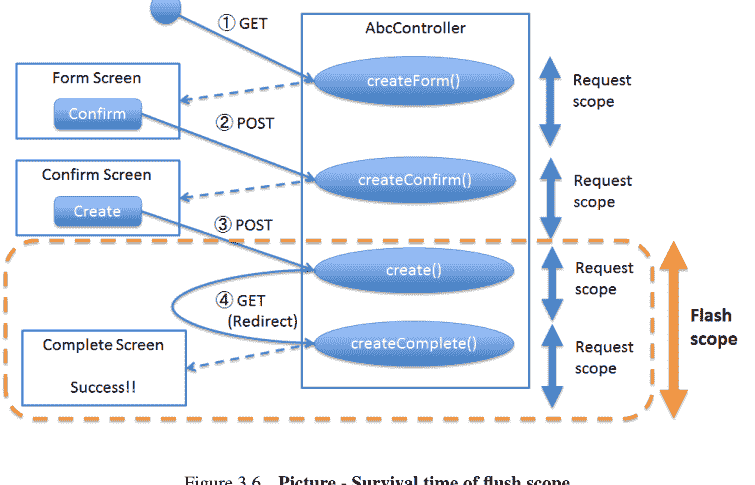

## 将请求参数传递到重定向目标

当需要动态设置重定向目标的 `RedirectAttributes` 时，将要传递的值添加到参数的 `RedirectAttributes` 对象中。

```java
@RequestMapping("hello")
public String hello(RedirectAttributes redirectAttrs) {
    String id = "aaaa";
    redirectAttrs.addAttribute("id", id); // (1)
    // 必须不能重定向 "redirect://sample/hello?complete&id=" + id;
    return "redirect://sample/hello?complete";
}
```

## 3.4 应用层的实现

# TERASOLUNA Java 服务端框架 (5.x) 开发文档，版本 5.4.1.RELEASE

| 序号 | 描述 |
|---|---|
| (1) | 在参数名中指定请求参数名称，在参数 `value` 中指定请求参数值，并调用 `RedirectAttributes` 对象的 `addAttribute` 方法。在上述示例中，它被重定向到 `/sample/hello?complete&id=aaaa`。 |

**警告：** 在上述示例中，结果与 `return "redirect:/sample/hello complete&id=id"` 相同（如上述示例中注释掉的行）。但是，由于使用 `RedirectAttributes` 对象的 `addAttribute` 方法时也会进行 URL 编码，因此需要动态插入的请求参数应该通过 `addAttribute` 方法设置请求参数，而不应设置在返回值指定的重定向 URL 中。上述示例中不需要动态插入的请求参数可以直接指定在作为返回值的重定向 URL 中。

## 在重定向目标 URL 路径中插入值

为了动态地在重定向目标 URL 路径中插入值，请如示例所示，将要插入的值添加到参数的 `RedirectAttributes` 对象中设置请求参数。

```java
@RequestMapping("hello")
public String hello(RedirectAttributes redirectAttrs) {
    String id = "aaaa";
    redirectAttrs.addAttribute("id", id); // (1)
    // 必须不能返回 "redirect:/sample/hello/" + id + "?complete";
    return "redirect:/sample/hello/{id}?complete"; // (2)
}
```

## 3 应用开发

# TERASOLUNA Java 服务端框架 (5.x) 开发指南文档，版本 5.4.1.RELEASE

| 序号 | 描述 |
|---|---|
| (1) | 使用 `RedirectAttributes` 对象的基本方法指定属性名和值。 |
| (2) | 在重定向 URL 中指定要插入的变量 `{Attribute name}` 的路径。在上述示例中，它被重定向到 `/sample/hello/aaa?complete`。 |

> 警告：在示例中，结果与 `"redirect:/sample/hello/" + "?complete";` 相同（如上述示例中注释所示）。但是，由于使用 `RedirectAttributes` 对象的基本方法也会进行 URL 编码，因此动态插入的路径值应该使用基本方法插入，路径变量不应设置在作为返回值的重定向 URL 中。

## 从 Cookie 获取值

在处理方法的参数上添加 `@CookieValue` 注解，以从 Cookie 中获取值。

```java
@RequestMapping("readCookie")
public String readCookie(@CookieValue("JSESSIONID") String sessionId, Model model) { // [1]
    // 执行某些操作
    return "sample/readCookie"; // 返回视图名称
}
```

| 序号 | 描述 |
|---|---|
| (1) | 在 `@CookieValue` 注解的 `value` 属性中指定 cookie 的名称。在上述示例中，`JSESSIONID` 的值从 cookie 传递到 `sessionId` 参数。 |

注意：

## 3.4 应用层的实现

# TERASOLUNA Java 服务端框架 (5.x) 开发文档，版本 5.4.1.RELEASE

与 `@RequestParam` 情况类似，它具有 `required` 属性和 `defaultValue` 属性。此外，数据类型请参阅“单独获取请求参数”。

## 在 Cookie 中写入值

要在 Cookie 中写入值，直接调用 `HttpServletResponse` 对象的 `addCookie` 方法并将值添加到 cookie 中。

由于 Spring MVC (3.2.3 版本) 中没有写入 cookie 的方法，**在这种情况下，`HttpServletResponse` 可以作为控制器处理方法的参数进行获取。**

```java
@RequestMapping("writeCookie")
public String writeCookie(Model model, HttpServletResponse response) { // (1)
    Cookie cookie = new Cookie("foo", "H!");
    response.addCookie(cookie); // (2)
    // 执行某些操作
    return "sample/writeCookie";
}
```

| 序号 | 描述 |
|---|---|
| (1) | 指定 `HttpServletResponse` 对象作为参数以写入 cookie。 |
| (2) | 生成 `Cookie` 对象并将其添加到 `HttpServletResponse` 对象中。例如，分配了 Helloworld! 值。 |

**提示：** 虽然可以使用作为处理方法参数获取的 `HttpServletResponse`，但提供了 `org.springframework.web.util.CookieGenerator` 来写入值。**注意：** 请注意 cookie 名称中不能使用某些字符。

# TERASOLUNA Java 服务端框架 (5.x) 开发指南文档，版本 5.4.1.RELEASE

## 获取分页信息

列表搜索时会请求分页相关信息。

通过将处理方法的参数获取 `org.springframework.data.domain.Pageable`（下称 `Pageable`）对象，可以轻松地处理分页信息（页数、记录数）。

详情请参阅“分页”。

## 获取上传的文件

可以通过两种方式获取上传的文件：

- 在表单中提供 `MultipartFile` 属性。
- 使用 `org.springframework.web.multipart.MultipartFile` 作为处理方法的参数，并带有 `@RequestParam` 注解。

详情请参阅“文件上传”。

## 在屏幕上显示结果消息

可以作为处理方法的参数获取 `Model` 对象或 `RedirectAttributes` 对象，通过向 `Model` 或 `RedirectAttributes` 中添加 `ResultMessages` 来显示逻辑执行的结果消息。

详情请参阅“消息管理”。

## 3.4 应用层的实现

# TERASOLUNA Java 服务端框架 (5.x) 开发文档，版本 5.4.1.RELEASE

## 关于处理方法的返回值

对于处理方法的返回值，可以获取各种值；但应仅使用以下值：

- `String`（用于视图的逻辑名称）

取决于用途的返回类型如下：

- HTML 响应
- 下载数据响应

### HTML 响应

为了获取处理方法的输出 HTML 响应，必须返回 JSP 的视图名称。

使用 JSP 生成 HTML 的 `ViewResolver` 将是 `UrlBasedViewResolver`(`InternalViewResolver`) 的子类以及 `TilesViewResolver` 等。

提供了使用 `InternalViewResolver` 用于 JSP 的示例；但当屏幕布局位于格式化模板时，建议使用 `TilesViewResolver`。

`TilesViewResolver` 的使用请参阅“使用 Tiles 的屏幕布局”。

- spring-mvc.xml

使用 `<bean>` 元素的示例：

```xml
<bean class="org.springframework.web.servlet.view.InternalResourceViewResolver">
  <property name="prefix" value="WEB-INF/views/" /> <!-- (2) -->
  <property name="suffix" value=".jsp" /> <!-- (3) -->
  <property name="order" value="1" /> <!-- (4) -->
</bean>
```

从 Spring 4 开始的 `<mvc:view-resolvers>` 元素的示例：


```xml
<mvc:view-resolvers>
  <mvc:jsp prefix="/WEB-INF/views/" /> <!-- (5) -->
</mvc:view-resolvers>
```

- `SampleController.java`

# TERASOLUNA Java 服务框架 (5.x) 开发指南文档

Release 5.4.1.RELEASE

```java
@RequestMapping("hello")
public String hello() {
  // omitted
  return "sample/hello"; // (6)
}
```

| 序号 | 描述 |
|---|---|
| (1) | 为 JSP 定义 `InternalViewResolver`。指定 JSP 文件所存储的基目录（文件路径的前缀）。 |
| (2) | 通过指定前缀，在 Controller 中返回视图名称时，无需指定 JSP 文件的物理存储位置。 |
| (3) | 指定 JSP 文件的扩展名（文件路径的后缀）。通过指定后缀，在 Controller 中返回视图名称时，不再需要指定 JSP 文件的扩展名。 |
| (4) | 指定指定多个 `ViewResolver` 时的执行顺序。可以在 Integer 范围内指定，并按从值到大的顺序顺序执行。 |
| (5) | 使用 Spring Framework 4.1 引入的 `<mvc:jsp>` 元素为 JSP 定义 `InternalViewResolver`。<br>- 在 `prefix` 属性中，指定 JSP 文件存储的基目录（文件路径的前缀）。<br>- 无需在 `suffix` 属性中显式指定，因为默认值为 `.jsp`。 |

> 注意：当使用 `<mvc:view-resolvers>` 元素时，可以用简单的方式定义 `ViewResolver`。因此，本指南建议使用 `<mvc:view-resolvers>`。

当视图名称 `"sample/hello"` 是处理方法的返回值时，将调用 `/WEB-INF/views/sample/hello.jsp` 并将 HTML 作为响应发送。

注意：示例中的 HTML 输出是使用 JSP 生成的，但如果使用其他模板引擎（如 Velocity、FreeMarker）生成 HTML，处理方法的返回值将是 `sample/hello`。`ViewResolver` 负责确定使用哪种模板引擎的任务。

注意：当仅需实现返回视图名称简单方法时，可以用 `<mvc:view-controller>` 代替 Controller 类的实现。

- 使用 `mvc:view-controller` 的 Controller 实现示例。

```xml
<mvc:view-controller path="/hello" view-name="sample/hello" />
```

| 警告：使用 `<mvc:view-controller>` 的注意事项 |
|---|---|
| 由于 Spring Framework 4.3 版本升级 (SPR-13130)，由 `<mvc:view-controller>` 授权的 HTTP 方法仅限于 GET 和 HEAD，因此 `<mvc:view-controller>` 不能用于通过 GET 和 HEAD 以外 HTTP 方法（POST 等）访问的页面。当页面通过 GET 和 HEAD 以外的方法（POST 等）进行转发时会发生这种情况。因此，当无法限制跳转操作（如跳转到错误页面等）的 HTTP 方法时，必须采取适当措施避免使用 `<mvc:view-controller>`。 |

# 响应下载数据

为了返回存储为下载数据 `application/octet-stream` 的数据，建议创建一个视图（view）来生成响应数据（下载过程）。处理方法将待下载的数据添加到 Model，并返回执行实际下载过程的视图名称。

建议使用 Spring Framework 提供的 `BeanNameViewResolver` 来创建一个独立的 `ViewResolver`，通过其名称解析视图。

下载处理的详情请参考 `File Download`。

- `spring-mvc.xml`

使用 `<bean>` 元素时的定义示例

```xml
<!-- -->
<bean class="org.springframework.framework.web.servlet.view.BeanNameViewResolver">
  <property name="order" value="0"/> <!-- (2) -->
</bean>

<bean class="org.springframework.framework.web.servlet.view.InternalResourceViewResolver">
  <property name="prefix" value="WEB-INF/views/" />
  <property name="suffix" value=".jsp" />
  <property name="order" value="1" />
</bean>
```

使用 Spring Framework 4.1 引入的 `<mvc:view-resolvers>` 元素时的定义示例

```xml
<mvc:view-resolvers>
<mvc:bean-name /> <!-- (3) -->
<mvc:jsp prefix="WEB-INF/views/" />
</mvc:view-resolvers>
```

- `SampleController.java`

```java
@RequestMapping("report")
public String report() {
    // omitted
    return "sample/hello"; // (4)
}
```

- `XxxView.java`

```java
@Component("report") // (5)
public class XxxView extends AbstractViewView {
    @Override
    protected void build(Map<String, Object> model, HSSFWorkbook workbook, HttpServletRequest request, HttpServletResponse response) throws Exception {
        HXSSFSheet sheet;
        HSSFCell cell;

        sheet = workbook.createSheet("Spring");
        sheet.setDefaultColumnWidth(12);

        // 在 A1 写入文本
        cell = sheet.createCell(0);
        cell.setCellValue("Spring-Excel"); // (6)

        cell = sheet.createCell(1);
        cell.setCellValue((Date) model.get("serverTime")).toString());
    }
}
```

# 应用开发

注意：Controller 仅用于路由（将请求映射到相应的业务逻辑）以及决定每个请求的屏幕跳转并设置模型数据。因此，Controller 尽可能简单。通过始终遵循这一策略，Controller 的内容将变得清晰，即使在开发规模很大的情况下也能确保控制器的可维护性。

在 controller 中执行的操作所示如下：

- 输入值的关联性检查
- 调用业务逻辑
- 将值反射到领域对象
- 将值反射到表单对象

# 输入值的关联性检查

输入值的关联性检查应使用实现 `org.springframework.validation.Validator` 接口的 Validation 类完成。Bean Validation 也可以用于输入值的关联性检查。

关联性检查实现的详情请参考“输入验证”。

关联性检查的实现本身不应写在 controller 的处理方法中。然而，必须将 Validator 添加到 `org.springframework.web.bind.WebDataBinder`。

```java
@Inject
PasswordEqualsValidator passwordEqualsValidator; // (1)

@InitBinder
protected void initBinder(WebDataBinder binder) {
    binder.addValidators(passwordEqualsValidator); // (2)
}
```

| 序号 | 描述 |
| --- | --- |
| (1) | 注入执行关联性检查的校验器（Validator）。 |
| (2) | 将注入的校验器添加到 `WebDataBinder`。 |

将上述内容添加到 `WebDataBinder` 中，可以在处理器方法被调用之前执行校验器，从而实现关联性检查。

# 调用业务逻辑

通过注入实现业务逻辑的 Service 并调用注入的 Service 方法来执行业务逻辑。

```java
@Inject
SampleService sampleService; // (1)

@RequestMapping("hello")
public String hello(Model model) {
  String message = sampleService.hello(); // (2)
  model.addAttribute("message", message);
  return "sample/hello";
}
```

| 序号 | 描述 |
| --- | --- |
| (1) | 注入实现业务逻辑的 Service。 |
| (2) | 调用注入的 Service 方法以执行业务逻辑。 |

# 将值反射到领域对象

在本指南中，建议将 HTML 表单发送的数据绑定到表单对象（form object），而不是领域对象（domain object）。

因此，控制器应该执行将表单对象的值反射到领域对象的操作，并将其传递给 Service 类的方法。

```java
@RequestMapping("hello")
public String hello(@Validated SampleForm form, BindingResult result, Model model) {
    // 省略
    Sample sample = new Sample(); // (1)
    sample.setField1(form.getField1());
    sample.setField2(form.getField2());
    sample.setField3(form.getField3());
    //
    // 以及更多
    //
    String message = sampleService.hello(sample); // (2)
    model.addAttribute("message", message); // (3)
    return "sample/hello";
}
```

| 序号 | 描述 |
| --- | --- |
| (1) | 创建领域对象，并将绑定到表单对象的值反射到领域对象中。 |
| (2) | 调用 Service 类的方法以执行业务逻辑。 |
| (3) | 将业务逻辑返回的数据添加到 Model 中。 |

将值反射到领域对象的过程应由控制器的处理器方法实现。

然而，考虑到代码量大时处理方法的可读性，建议将该过程委托给 Helper 类。

将过程委托给 Helper 类的示例下所示：

- `SampleController.java`

```java
@Inject
SampleHelper sampleHelper; // (1)

@RequestMapping("hello")
public String hello(@Validated SampleForm form, BindingResult result) {
    // 省略
    String message = sampleHelper.hello(form); // (2)
    model.addAttribute("message", message);
    return "sample/hello";
}
```

- `SampleHelper.java`

```java
@Inject
SampleService sampleService;

public String hello(SampleForm form) { // (3)
    Sample sample = new Sample();
    sample.addField1(form.getField1());
    sample.addField2(form.getField2());
    sample.addField3(form.getField3());
    //
    // 以及更多
    //
    String message = sampleService.hello(sample);
    return message;
}
```

| 序号 | 描述 |
| --- | --- |
| (1) | 在控制器中注入 Helper 类对象。 |
| (2) | 通过调用注入的 Helper 类的方法将值反射到领域对象。委托给 Helper 类可以保持控制器实现的简单性。 |
| (3) | 创建领域对象后，调用 Service 类方法执行业务逻辑。 |

> **注意：** Bean 转换功能可以作为将表单对象值反射过程委托给 Helper 类的替代方法。详情请参阅 Bean 映射 (Dozer)。

# 将值反射到表单对象

在本指南中，建议使用表单对象（而非领域对象）处理要绑定到 HTML 表单的数据。

为此，有必要将领域对象的值（由 层返回）反射到表单对象。这种转换应在控制器类中完成。

```java
@RequestMapping("hello")
public String hello(SampleForm form, BindingResult result, Model model) {
// 省略
Sample sample = sampleService.getSample(form.getId()); // (1)
form.setField1(sample.getField1()); // (2)
form.setField2(sample.getField2());
//
form.setField3(sample.getField3());
//
//...
// 以及更多 ...
// ...
model.addAttribute(sample); // (3)
return "sample/hello";
}
```

| 序号 | 描述 |
| --- | --- |
| (1) | 调用实现业务逻辑的 Service 类方法并获取领域对象。 |
| (2) | 将领域对象的值反射到表单对象。 |
| (3) | 将领域对象添加到 Model。 |

> **注意：** 在 JSP 中，建议使用领域对象而非表单对象来显示屏幕上的字段。将值反射到领域对象的过程应由控制器的处理器方法实现。

考虑到代码量大时处理方法的可读性，建议将该过程委托给 Helper 类。

- `SampleController.java`

```java
@RequestMapping("hello")
public String hello(@Validated SampleForm form, BindingResult result) {
    // 省略
    Sample sample = sampleService.getSample(form.getId());
    sampleHelper.applyTo(form, sample); // (1)
    model.addAttribute(sample);
    return "sample/hello";
}
```

- `SampleHelper.java`

```java
public void applyTo(SampleForm dest, Sample srcSample) {
    dest.setField1(srcSample.getField1()); // (2)
    dest.setField2(srcSample.getField2());
    dest.setField3(srcSample.getField3());
    //
    // 以及更多
}
```

| 序号 | 描述 |
| --- | --- |
| (1) | 调用注入的 Helper 类的方法来执行反射逻辑。 |
| (2) | 将领域对象的值反射到表单对象。 |

> **注意：** Bean 转换功能可以作为将表单对象值反射过程委托给 Helper 类的替代方法。详情请参阅 Bean 映射 (Dozer)。


### 3.4.2 实现表单对象

表单对象是代表 HTML 表单的对象（JavaBean），其作用如下：

1. 保存存储在数据库中的业务数据，以便 HTML 表单（JSP）引用。
2. 保存 HTML 表单发送的请求参数，以便控制器的处理器方法引用。


对象的实现可以通过关注以下点来描述：

- 创建表单对象
- 初始化表单对象
- 绑定到 HTML 表单
- 绑定请求参数

#### 创建表单对象

作为 JavaBean 创建表单对象。Spring 框架提供了将 HTML 表单发送的请求参数转换并绑定到表单对象定义格式的功能。因此，表单对象中的字段不需要是 `java.lang.String` 格式。

> **TERASOLUNA Java 服务端框架 (5.x) 开发文档，版本 5.4.1.RELEASE**

```java
public class SampleForm implements Serializable {
    private String id;
    private String name;
    private Integer age;
    private String genderCode;
    private Date birthDate;
    // 省略 getter/setter
}
```

**提示：** 关于 Spring 框架提供的格式转换机制

Spring 框架使用以下三种机制执行格式转换，并以基本格式进行转换。每个转换功能的详情请参阅链接页面。

- Spring 类型转换
- Spring 字段格式化
- `java.beans.PropertyEditor` 实现

> **警告：** 在表单对象中，建议只维护 HTML 表单的字段，而不是仅在屏幕上显示的字段。如果将仅显示的字段也维护在表单对象中，在将表单对象存储在 HTTP Session 中将会消耗内存，导致内存耗尽。为了在屏幕上显示仅显示的字段的值，建议通过 `Model.addAttribute()` 将领域层对象（如 Entity）添加到请求作用域。

#### 字段的数字格式转换

可以使用 `@NumberFormat` 注解为每个字段指定数字格式。

```java
public class SampleForm implements Serializable {
    @NumberFormat(pattern = "#,##") // (1)
    private Integer price;
    // 省略 getter/setter
}
```

> **Java TERASOLUNA Server 框架 (5.x) 开发指南文档，版本 5.4.1.RELEASE**

| 序号 | 描述 |
|---|---|
| (1) | 指定 HTML 表单发送的请求参数的格式。例如，由于指定了 `#,##` 格式为模式，可以对 `#,##` 格式的值进行绑定。当请求参数的值为 `1,050` 时，值为 1050 的 `Integer` 对象将绑定到表单对象的 `price` 属性上。 |

`@NumberFormat` 注解的属性如下。

| 序号 | 属性名称 | 描述 |
|---|---|---|
| 1. | style | 指定数字格式样式。详情请参阅 `NumberFormat.Style` 的 Javadoc。 |
| 2. | pattern | 指定 Java 的数字格式。详情请参阅 [Javadoc of DecimalFormat](http://docs.oracle.com/javase/8/docs/api/java/text/DecimalFormat.html)。 |

#### 字段的日期和时间格式转换

每个字段的日期时间格式可以使用 `@DateTimeField` 注解进行指定。

```java
public class SampleForm implements Serializable {
    @DateTimeField(pattern = "yyyyMMdd") // (1)
    private Date birthDate;
    // 省略 getter/setter
}
```

| 序号 | 描述 |
|---|---|
| (1) | 指定 HTML 表单发送的请求参数的日期时间格式。例如，指定了 `yyyyMMdd` 格式为模式。当请求参数的值为 `20131001` 时，2013年10月1日的 `Date` 对象将绑定到表单对象的 `birthDate` 属性上。 |

`@DateTimeField` 注解的属性如下。

| 序号 | 属性名称 | 描述 |
|---|---|---|
| 1. | iso | 指定 ISO 日期格式。详情请参阅 `DateTime.ISO` 的 Javadoc。 |
| 2. | pattern | 指定 Java 日期时间格式。详情请参阅 [Javadoc of SimpleDateFormat](http://docs.oracle.com/javase/8/docs/api/java/text/SimpleDateFormat.html)。 |
| 3. | style | 将日期时间样式指定为两位数字字符串。<br>第一位数字是日期样式，第二位数字是时间样式。<br>可以指定的值如下：<br><br>S : 格式与 `java.text.DateFormat.SHORT` 相同<br>M : 格式与 `java.text.DateFormat.MEDIUM` 相同<br>L : 格式与 `java.text.DateFormat.LONG` 相同<br>F : 格式与 `java.text.DateFormat.FULL` 相同<br>- : 表示省略的样式。<br><br>指定转换示例<br>MM : Dec 9, 2013 3:37:47 AM<br>M- : Dec 9, 2013<br>-M : 3:41:45 AM |

#### Controller 中的数据转换

可以使用 `@InitBinder` 注解在控制器级别定义数据类型转换。

```java
@InitBinder // (1)
public void initWebDataBinder(WebDataBinder binder) {
    binder.registerCustomEditor(
        Long.class,
        new CustomNumberEditor(Long.class, new DecimalFormat("#,#"), true)
    ); // (2)
}
```

```java
@InitBinder("sampleForm") // (3)
public void initSampleFormDataBinder(WebDataBinder binder) {
    // ...
}
```

| 序号 | 描述 |
|---|---|
| (1) | 如果提供了带有 `@InitBinder` 注解的方法，它将在执行绑定过程之前被调用，从而可以自定义默认操作。 |
| (2) | 例如，为 `Long` 类型的字段指定了 `#,#` 格式。这允许对使用 `,` 格式化的值进行绑定。 |
| (3) | 可以通过指定 `@InitBinder` 注解的 value 属性来对每个表单对象的默认操作进行自定义。在上面的示例中，该方法在绑定表单对象 `sampleForm` 之前被调用。 |

#### 为输入验证指定注解

由于表单对象使用 Bean Validation 进行验证，因此有指定指示字段约束的注解。有关输入验证的详情请参阅输入验证。

#### 初始化表单对象

表单对象可以作为表单支持 bean (form-backing bean)，并可以使用 `@ModelAttribute` 注解执行绑定。通过带有 `@ModelAttribute` 注解的方法来初始化表单支持 bean。在本指南中，这些方法被称为 ModelAttribute 方法，并用类似 `setUpXxxForm` 的方法名定义。

```java
@ModelAttribute // (1)
public SampleForm setUpSampleForm() {
    SampleForm form = new SampleForm();
    // 填充表单
    return form;
}
```

```java
@ModelAttribute("xxx") // (2)
public SampleForm setSampleForm() {
    SampleForm form = new SampleForm();
    // 填充表单
    return form;
}
```

```java
@ModelAttribute
public SampleForm setSampleForm(
    @CookieValue(value="name", required = false) String name, // (3)
    @CookieValue(value="age", required = false) Integer age,
    @CookieValue(value="birthDate", required = false) Date birthDate) {
    SampleForm form = new SampleForm();
    form.setName(name);
    form.setAge(age);
    form.setBirthDate(birthDate);
    return form;
}
```

| 序号 | 描述 |
|---|---|
| (1) | 以小写字母开头的类名将成为 Model 中的属性名称。在上面的示例中，`sampleForm` 是属性名称。返回的对象被添加到 Model 中，并执行适当的过程 `model.addAttribute(form)`。 |
| (2) | 当需要指定要添加到 Model 的属性名称时，请指定 `@ModelAttribute` 注解的 value 属性。在上面的示例中，`xxx` 是属性名称。对于返回的对象，将执行适当的过程 `model.addAttribute("xxx", form)` 并将其返回给 Model。当指定默认值以外的属性名称时，在指定表单对象作为处理方法的参数时，必须指定 `@ModelAttribute("xxx")`。 |
| (3) | Attribute 方法像处理方法一样传递初始化所需的参数。在上面的示例中，使用 `@CookieValue` 注解指定 cookie 的值。 |

> **注意：** 当需要使用默认值初始化表单对象时，应使用 ModelAttribute。

在上述示例的点 (3) 中，值是从 cookie 获取的，但也可以直接设置常量类中定义的固定值。

> **注意：** 控制器中可以定义多个 ModelAttribute 方法。每个方法在调用控制器的处理方法之前执行。

> **警告：** 由于 ModelAttribute 方法会在每个请求时执行，必须注意，如果使用 ModelAttribute 方法为特定请求创建必要的对象，将会创建不必要的对象并执行初始化过程。因此，对于仅特定请求需要的表单对象，应该在控制器的处理方法内部创建，而不是通过使用 ModelAttribute。

#### 绑定请求参数

可以将 HTML 表单发送的请求参数绑定到表单对象，并将其作为参数传递给控制器的处理方法。

```java
@RequestMapping("hello")
public String hello(
    @Validated SampleForm form, // (1)
    BindingResult result,
    Model model) {
    if (result.hasErrors()) {
        return "sample/input";
    }
    // 处理表单...
    return "sample/hello";
}
```

```java
@ModelAttribute("xxx")
public SampleForm setUpSampleForm() {
    SampleForm form = new SampleForm();
    // 填充表单
    return form;
}

@RequestMapping("hello")
public String hello(
    @ModelAttribute("xxx") @Validated SampleForm form, // (2)
    BindingResult result,
    Model model) {
    // ...
}
```

> **TERASOLUNA Java 服务端框架 (5.x) 开发指南文档，版本 5.4.1.RELEASE**

| 序号 | 描述 |
|---|---|
| (1) | 在将请求参数反射到表单对象后，表单对象将作为参数传递给控制器的处理方法。 |
| (2) | 当 ModelAttribute 方法中指定了属性名称时，有必要使用 `@ModelAttribute("xxx")` 显式指定表单对象的属性名称。 |

> **警告：** 当 ModelAttribute 方法指定的属性名称与处理方法参数中 `@ModelAttribute("xxx")` 指定的属性名称不同时，请注意，系统除了由 ModelAttribute 方法创建的实例外，还会创建一个新的实例。如果处理方法的参数中没有使用 `@ModelAttribute` 指定属性名称，则属性名称将根据首字母小写的类名进行推断。

#### 确定绑定结果

在绑定 HTML 表单对象发送的请求参数时发生的错误（包括输入验证错误）存储在 `org.springframework.validation.BindingResult` 中。

```java
@RequestMapping("hello")
public String hello(
    @Validated SampleForm form,
    BindingResult result, // (1)
    Model model) {
    if (result.hasErrors()) { // (2)
        return "sample/input";
    }
}
//...
```

> **3.4. 应用层实现**

> **TERASOLUNA Java 服务端框架 (5.x) 开发指南文档，版本 5.4.1.RELEASE**

| 序号 | 描述 |
|---|---|
| (1) | 当 `BindingResult` 紧跟在表单对象之后时，可以在控制器的处理方法内部引用错误。 |
| (2) | 调用 `BindingResult.hasErrors()` 可以确定表单对象的输入值是否发生了任何错误。 |

也可以单独确定字段错误和全局错误（类层面的关联检查错误）。如果需要，可以单独使用它们。

| 序号 | 方法 | 描述 |
|---|---|---|
| 1. | `hasGlobalErrors()` | 用于确定是否存在全局错误的方法 |
| 2. | `hasFieldErrors()` | 用于确定是否存在字段错误的方法 |
| 3. | `hasFieldErrors(String field)` | 用于确定与指定字段相关的错误是否存在的方法。 |

### 3.4.3 实现视图

视图起以下作用：

1. 视图根据客户端的需求生成响应 (HTML)。

视图从模型（表单对象或领域对象）检索所需数据，并按照客户端渲染所需的格式生成响应。

#### 实现 JSP

使用 JSP 实现视图以根据客户端的需求生成响应 (HTML)。

使用 Spring Framework 提供的类作为 ViewResolver 来调用 JSP。ViewResolver 的设置请参考 HTML 响应。

下方描述了 JSP 的基本实现方法：

- 创建用于包含（include）的公共 JSP
- 显示模型中存储的值
- 显示模型中存储的数字
- 显示模型中存储的日期
- 生成请求 URL
- 将表单对象绑定到 HTML 表单
- 显示输入验证错误
- 显示处理结果的消息
- 显示代码列表 (codelist)
- 显示固定文本内容
- 根据条件切换显示
- 集合元素的重复显示
- 根据权限切换显示

在本章中，描述了主要 JSP 标签库的使用。然而，所有 JSP 标签库的详细用法未在此描述，请参阅相应的文档。

| 序号 | JSP 标签库名称 | 文档 |
|---|---|---|
| 1. | Spring 的标签库 | [http://docs.spring.io/spring/docs/4.3.14.RELEASE/spring-framework-reference/html/view.html#view-jsp-formtaglib](http://docs.spring.io/spring/docs/4.3.14.RELEASE/spring-framework-reference/html/view.html#view-jsp-formtaglib) |
| 2. | Spring 的标签库 | [http://docs.spring.io/spring/docs/4.3.14.RELEASE/spring-framework-reference/html/form-tdld.html](http://docs.spring.io/spring/docs/4.3.14.RELEASE/spring-framework-reference/html/form-tdld.html) |


| 序号 | 名称 | 链接 |
| :--- | :--- | :--- |
| 3. | JSTL | [http://download.oracle.com/otnocs/jcp/jst-1.2-mre12-eval-oth-JSpec/](http://download.oracle.com/otnocs/jcp/jst-1.2-mre12-eval-oth-JSpec/) |
| 4. | 公共库的标签 & EL 函数 | 本指南中由公共库提供的 [JSP 标签库和 EL 函数](https://[JSP Tag Libraries and EL Functions offered by common library]) |

# TERASOLUNA Java 服务端框架 (5.x) 开发指南文档，发布版本 5.4.1.RELEASE

## hello.jsp

```
Message : ${f:h(helloBean.message)} <%-- (2) --%>
```

| 序号 | 描述 |
| :--- | :--- |
| (1) | 将 `HelloBean` 对象添加到 `Model` 对象中。 |
| (2) | 在 View 中，添加到 `Model` 对象中的数据可以通过描述 `${Attribute name.Property name of JavaBean}` 来获取。在本例中，使用 EL 表达式的 `${f:h(Attribute name.Property name of JavaBean)}` 函数进行 HTML 转义。 |

> **注意**：由于公共组件中提供了 HTML 转义用功能 (`f:h`)，因此当使用 EL 表达式在 HTML 中输出值时，请务必使用。有关执行 HTML 转义的 EL 表达式函数的详情，请参考“跨站脚本（Cross Site Scripting）”。

### 使用 JSTL JSP 标签库提供的 `<c:out>` 标签进行显示

```
evenMessage : <c:out value="${helloBean.message}" /> <%-- --%>
```

| 序号 | 描述 |
| :--- | :--- |
| (1) | 在 `<c:out>` 标签的 `value` 属性中指定使用 EL 表达式获取的值。同样会进行 HTML 转义。 |

> **注意**：有关 `<c:out>` 的详情，请参考《JavaServer Pages 标准标签库（版本 1.2）第 4 章 通用操作（General-Purpose Actions）》。

## 显示 model 中存储的数字

使用 JSTL 提供的 JSP 标签库输出格式化数字。

### 使用 JSTL JSP 标签库提供的 `<fmt:formatNumber>` 标签进行显示

```
Number Item : <fmt:formatNumber value="${helloBean.numberItem}" pattern="0.00" /> <%-- (1) --%>
```

| 序号 | 描述 |
| :--- | :--- |
| (1) | 在 `<fmt:formatNumber>` 标签的 `value` 属性中指定通过 EL 表达式获取的值。在 `pattern` 属性中指定要显示的格式。例如，指定了 `0.00`。当 `${helloBean.numberItem}` 获取的值临时为 `1.2` 时，屏幕上将显示 `1.20`。 |

> **注意**：有关 `<fmt:formatNumber>` 的详情，请参考《JavaServer Pages 标准标签库（版本 1.2）第 9 章 格式化操作（Formatting Actions）》。

## 显示 model 中存储的日期和时间

使用 JSTL 提供的 JSP 标签库输出格式化的日期时间值。

### 使用 JSTL JSP 标签库提供的 `<fmt:formatDate>` 标签进行显示

```
Date Item : <fmt:formatDate value="${helloBean.dateItem}" pattern="yyyy-MM-dd" /> <%-- (1) --%>
```

| 序号 | 描述 |
| :--- | :--- |
| (1) | 在 `<fmt:formatDate>` 标签的 `value` 属性中指定使用 EL 表达式获取的值。在 `pattern` 属性中指定要显示的格式。在本例中，指定了 `yyyy-MM-dd`。当 `${helloBean.dateTime}` 接收到的值为 `2013-3-02` 时，屏幕上将显示 `2013-03-02`。 |

> **注意**：有关 `<fmt:formatDate>` 的详情，请参考《JavaServer Pages 标准标签库（版本 1.2）第 9 章 格式化操作》。
>
> **注意**：使用 Joda Time 提供的 JSP 标签库应使用 `org.joda.time.DateTime` 作为日期和时间对象类型。有关 Joda Time 的详情，请参考“日期操作（Joda Time）”。

# 生成请求 URL

当需要为 `<form>` 元素（JSP 标签库的 `<form:form>` 元素）的 `action` 属性设置请求 URL（调用 Controller 方法的 URL）时，可以使用以下方法为 `<a>` 标签的 `href` 属性生成 URL：

- 使用字符串构建请求 URL
- 使用 EL 函数构建请求 URL

> **注意**：虽然可以使用这两种方法构建请求 URL，但应避免在应用中同时使用它们，以保持可维护性。

以下显示了实现方法：

## 映射到 Controller

以下显示了 Controller 的实现示例：

```java
package com.example.app;

import org.springframework.stereotype.Controller;
import org.springframework.web.bind.annotation.RequestMapping;

@RequestMapping("hello")
@Controller
public class HelloController {

    // (1)
    @RequestMapping("")
    public String hello() {
        return "home";
    }
}
```

| 序号 | 描述 |
| :--- | :--- |
| (1) | 分配给 Controller 的路径。 |

## 使用字符串构建请求 URL

首先，解释了使用字符串构建请求 URL。

```
<form action="${pageContext.requestPath}/hello"> <!-- (2) -->
  <!-- ... -->
```

| 序号 | 描述 |
| :--- | :--- |
| (2) | 分配给 `pageContext` 的路径。 |

> **提示**：
>
> - JSTL 提供的 `<c:url>`
> - Spring Framework 提供的 `<spring:url>`
>
> 都是用于构建 URL 的可用标签库。当需要动态构建 URL 时，最好使用这些标签库。

## 使用 EL 表达式构建请求 URL

接下来，描述了使用 Spring Framework 4.1 的 EL 表达式构建请求 URL。

如果使用了 `spring:mvcUrl` 函数，可以结合 Controller 方法的元数据构建请求 URL。

```
<form action="${spring:mvcUrl('HC#hello').build()}"><!-- (3) -->
  <!-- ... -->
</form>
```

## 将表单对象绑定到 HTML 表单

使用 Spring Framework 提供的 JSP 标签库将对象绑定到 HTML 表单，并显示存储在表单对象中的值。

### 使用 Spring Framework 提供的 `<form:form>` 标签进行绑定

```xml
<form:form action="${pageContext.request.dataPath}/sample/hello"
    modelAttribute="sampleForm"> <%-- (1) --%>
    Id : <form:input path="id" /> <%-- (2) --%>
</form:form>
```

| 序号 | 描述 |
| :--- | :--- |
| (1) | 在 `<form:form>` 标签的 `modelAttribute` 属性中指定存储在 `Model` 中的表单对象名称。 |
| (2) | 在 `<form:xxx>` 标签的 `path` 属性中指定要绑定的属性名称。`xxx` 部分会随每个输入元素发生变化。 |

> **注意**：关于 `<form:form>`、`<form:xxx>` 标签的详情，请参考“使用表单标签库”。

## 显示输入验证错误

若要显示输入验证错误的内容，请使用 Spring Framework 提供的 JSP 标签库。

### 使用 Spring Framework 提供的 `<form:errors>` 标签进行显示

详情请参阅“输入验证”。

```xml
<form:form action="${pageContext.request.dataPath}/sample/hello"
    modelAttribute="sampleForm">
    Id : <form:input path="id" /><form:errors path="id" /> <%-- (1) --%>
</form:form>
```

| 序号 | 描述 |
| :--- | :--- |
| (1) | 在 `<form:errors>` 标签的 `path` 属性中指定要显示错误的属性名称。 |

## 显示处理结果的消息

若要显示通知请求处理输出的消息，请使用通用组件提供的 JSP 标签库。

### 使用通用组件提供的 `<t:messagesPanel>` 标签

详情请参阅“消息管理”。

```xml
<div class="messages">
  <h2>消息模式</h2>
  <t:messagesPanel /> <%-- (1) --%>
</div>
```

| 序号 | 描述 |
| :--- | :--- |
| (1) | 输出以属性名 `resultMessages` 存储的消息。 |

## 显示代码列表 (codelist)

若要显示代码列表（由通用组件提供），请使用 Spring Framework 提供的 JSP 标签库。

可以像处理 `java.util.Map` 接口一样，在 JSP 中引用代码列表。

详情请参阅“代码列表”。

### 代码列表选择框

```xml
<form:select path="sendStatus">
  <option value="" label="--Select--" />
  <form:options items="${CL_ORDERSTATUS}" /> <%-- (1) --%>
</form:select>
```

| 序号 | 描述 |
| :--- | :--- |
| (1) | 代码列表 (`java.util.Map` 接口) 以 `CL_ORDERSTATUS` 为属性名存储。在 JSP 中，可以使用 EL 表达式访问代码列表 (`java.util.Map` 接口)。可以通过将 `Map` 接口的对象传递到 `<form:options>` 的 `items` 中，在选择框中显示代码列表。 |

Label 部分显示在屏幕上用于值选择框。

```jsp
订单状态 : ${f:h(CL_ORDERSTATUS[orderForm.orderStatus])}
```

| 序号 | 描述 |
| :--- | :--- |
| (1) | 方法与创建选择框的情况相同。代码列表 (`java.util.Map` 接口) 以 `CL_ORDERSTATUS` 为属性名存储。如果选择框中选中的值指定为 `Map` 接口的键，则可以显示代码名称。 |

## 显示固定文本内容

当不需要国际化时，屏幕名称、元素名称和引导等字符串可以直接写在 JSP 中。

然而，当需要国际化时，请使用 Spring Framework 提供的 JSP 标签从属性文件中获取值。

### 使用 Spring Framework 提供的 `<spring:message>` 标签进行显示

详情请参阅“国际化”。

- properties 文件

```properties
# (1)
label.orderStatus=Order status
```

- jsp 文件

```jsp
<spring:message code="label.orderStatus" text="Order Status" /> <!-- (2) -->
${f:h(CL_ORDERSTATUS[orderForm.orderStatus])}
```

| 序号 | 描述 |
| :--- | :--- |
| (1) | 在属性文件中定义 label 字符串。如果属性文件中的 key 指定在 `<spring:message>` 的 `code` 属性中，则显示与 key 对应的字符串。 |
| (2) | 注意：当无法获取属性时，将显示 `text` 属性中指定的值。 |

## 根据条件切换显示

当需要根据 model 中的某些值切换显示时，使用 JSTL 提供的 JSP 标签库。

### 使用 JSP 标签库提供的 `<c:if>` 或 `<c:choose>` 切换显示

#### 使用 `<c:if>` 切换显示

```xml
<c:if test="${orderForm.orderStatus != 'complete'}"><!-- (1) -->
<!-- ----> -->
</c:if>
```

| 序号 | 描述 |
| :--- | :--- |
| (1) | 在 `<c:if>` 标签的 `test` 属性中指定要显示内容的属性。 |

# 实现 Servlet Filter

独立于 Spring MVC 的通用流程可以使用 Servlet Filter 实现。

然而，当通用流程仅需要针对映射到控制器处理方法的特定请求执行时，则应该使用 `HandlerInterceptor`（处理器拦截器）实现，而不是 Servlet Filter。

下面是 Servlet Filter 的示例。

在示例代码中，值存储在 MDC 中，以便输出客户端 IP 地址的日志。

- java

```java
public class ClientInfoFilter extends OncePerRequestFilter { // (1)
    private static final String ATTRIBUTE_NAME = "X-Forwarded-For";
    protected void doFilterInternal(HttpServletRequest request,
            HttpServletResponse response, FilterChain filterChain) throws
            ServletException, IOException {
        String remoteIp = request.getHeader(ATTRIBUTE_NAME);
        if (remoteIp == null) {
            remoteIp = request.getRemoteAddr();
        }
        MDC.put(ATTRIBUTE_NAME, remoteIp);
        try {
            filterChain.doFilter(request, response);
        } finally {
            MDC.remove(ATTRIBUTE_NAME);
        }
    }
}
```

- web.xml

```xml
<filter> <!-- (2) -->
    <filter-name>clientInfoFilter</filter-name>
    <filter-class>x.y.z.ClientInfoFilter</filter-class>
</filter>
<filter-mapping> <!-- (3) -->
    <filter-name>clientInfoFilter</filter-name>
    <url-pattern>/*</url-pattern>
</filter-mapping>
```

| 序号 | 描述 |
| :--- | :--- |
| (1) | 在此处，通过创建 Spring Framework 提供的 `org.springframework.web.filter.OncePerRequestFilter` 的子类来创建 Servlet Filter，确保其仅对每个请求执行一次。 |
| (2) | 在 `web.xml` 中注册创建的 Servlet Filter。 |
| (3) | 指定应用于已注册 Servlet Filter 的 URL 模式。 |


# TERASOLUNA Java 服务端框架 (5.x) 开发指南文档，版本 5.4.1.RELEASE

## Servlet Filter 也可以定义为 Spring Framework 的 Bean

### web.xml

```xml
<filter>
  <filter-name>clientInfoFilter</filter-name>
  <filter-class>org.springframework.web.filter.DelegatingFilterProxy</filter-class> <!-- (1) -->
</filter>
<filter-mapping>
  <filter-name>clientInfoFilter</filter-name>
  <url-pattern>/*</url-pattern>
</filter-mapping>
```

### applicationContext.xml

```xml
<bean id="clientInfoFilter" class="x.y.z.ClientInfoFilter" /> <!-- (2) -->
```

| 序号 | 描述 |
| :--- | :--- |
| (1) | 在示例中，通过在 Servlet filter 类中指定 Spring Framework 提供的 `org.springframework.web.filter.DelegatingFilterProxy`，将过程委托给步骤 (2) 中定义的 Servlet Filter。 |
| (2) | 将 Servlet Filter 类添加到 Bean 定义文件（`applicationContext.xml`）。此时，bean 定义的 `id` 属性应分配为 `web.xml` 中指定的 filter 名称（在 `<filter-name>` 标签中指定的值）。 |

## 实现 HandlerInterceptor

使用 `HandlerInterceptor` 基于 Spring MVC 的通用流程。

`HandlerInterceptor` 只能对应用程序允许的请求执行通用流程，因为它在确定请求要映射到的处理方法之后才被调用。

`HandlerInterceptor` 可以在考虑以下 3 点的情况下执行控制器的处理方法：

- 在执行控制器处理方法之前：通过 `HandlerInterceptor#preHandle` 方法实现。
- 在成功执行控制器处理方法之后：通过 `HandlerInterceptor#postHandle` 方法实现。
- 在控制器处理方法完成后（无论正常/异常情况都会执行）：通过 `HandlerInterceptor#afterCompletion` 方法实现。

## 3.4. 应用层实现

给出了 `HandlerInterceptor` 的示例。

在示例代码中，在成功执行控制器过程后会输出 info 级别的日志。

```java
public class SuccessLoggingInterceptor extends HandlerInterceptor { // (1)

    private static final Logger logger = LoggerFactory.getLogger(SuccessLoggingInterceptor.class);

    @Override
    public boolean preHandle(HttpServletRequest request, HttpServletResponse response, Object handler) throws Exception {
        return true;
    }

    @Override
    public void postHandle(HttpServletRequest request, HttpServletResponse response, Object handler, ModelAndView modelAndView) throws Exception {
        logger.info("SUCCESS: {}", handler.getName());
    }

    @Override
    public void afterCompletion(HttpServletRequest request, HttpServletResponse response, Object handler, Exception ex) {
        // ...
    }
}
```

### spring-mvc.xml

```xml
<interceptors>
    <interceptor class="x.y.z.SuccessLoggingInterceptor"> <!-- (2) -->
        <url-pattern>/*</url-pattern> <!-- (3) -->
    </interceptor>
</interceptors> <!-- (4) -->
```

| 序号 | 描述 |
| :--- | :--- |
| (1) | 在示例中，`HandlerInterceptor` 是作为 Spring Framework 提供的 `org.springframework.web.servlet.HandlerInterceptor` 的子类创建。 |
| (2) | 在 `spring-mvc.xml` 中注册创建的 `HandlerInterceptor`。 |
| (3) | 指定应用于已注册 `HandlerInterceptor` 的 URL 模式。 |
| (4) | 将创建的 `HandlerInterceptor` 添加到 `spring-mvc.xml` 的 `<interceptors>` 标签中。 |

## 实现 HandlerMethodArgumentResolver

当 Spring Framework 不支持的对象作为控制器参数传递时，需要实现 `HandlerMethodArgumentResolver` 以便控制器接收参数。

给出了 `HandlerMethodArgumentResolver` 的示例。

在示例代码中，通用请求参数转换为 JavaBean，然后传递给处理方法。

### JavaBean

```java
public class CommonParameters implements Serializable { // (1)

    private String param1;
    private String param2;
    private String param3;

    // getters and setters
}
```

### HandlerMethodArgumentResolver

```java
public class CommonParametersMethodArgumentResolver implements HandlerMethodArgumentResolver { // (2)

    @Override
    public boolean supportsParameter(MethodParameter parameter) {
        return CommonParameters.class.equals(parameter.getParameter()); // (3)
    }

    @Override
    public Object resolveArgument(MethodParameter parameter, ModelAndViewContainer mavContainer, NativeWebRequest webRequest, WebDataBinder factoryBinder) throws Exception {
        CommonParameters params = new CommonParameters(); // (4)
        params.setParameter1(webRequest.getParameter("param1"));
        params.setParameter2(webRequest.getParameter("param2"));
        params.setParameter3(webRequest.getParameter("param3"));
        return params;
    }
}
```

### Controller

```java
@RequestMapping(value = "home")
public String home(CommonParameters commonParams) { // (5)
    logger.debug("param1 : {}", commonParams.getParam1());
    logger.debug("param2 : {}", commonParams.getParam2());
    logger.debug("param3 : {}", commonParams.getParam3());
    return "sample/home";
}
```

### spring-mvc.xml

```xml
<mvc:annotation-driven>
    <mvc:argument-resolvers>
        <!-- ... -->
        <bean class="x.y.z.CommonParametersMethodArgumentResolver" /> <!-- (6) -->
        <!-- ... -->
    </mvc:argument-resolvers>
</mvc:annotation-driven>
```

| 序号 | 描述 |
| :--- | :--- |
| (1) | 保留公共参数的 JavaBean。 |
| (2) | 实现 `org.springframework.web.method.support.HandlerMethodArgumentResolver` 接口。 |
| (3) | 确定参数类型。例如，当 JavaBean 的类型被指定为控制器的参数时，会调用该类的 `resolveArgument` 方法。 |
| (4) | 获取请求参数的值，设置参数并返回保留了公共参数值的 JavaBean。 |
| (5) | 在控制器的处理方法中指定保留公共参数的 JavaBean。传递步骤 (4) 返回的对象。 |
| (6) | 将创建的 `HandlerMethodArgumentResolver` 添加到 `spring-mvc.xml` 的 `<mvc:argument-resolvers>` 标签中。 |

> **注意：** 当参数需要通用地传递给所有控制器的处理方法时，使用 `HandlerMethodArgumentResolver` 将参数转换为 JavaBean 是有效的。此处指的参数并不局限于请求参数。

## 实现 `@ControllerAdvice`

在带有 `@ControllerAdvice` 注解的类中，实现要在多个 Controller 中执行的通用过程。

当创建一个带有 `@ControllerAdvice` 注解的类时，使用以下实现的流程：

- 带有 `@InitBinder` 的方法
- 带有 `@ExceptionHandler` 的方法
- 带有 `@ModelAttribute` 的方法

将被应用于多个 Controller。

### 3.4. 应用层的实现

提示：`@ControllerAdvice` 注解是从 Spring Framework 3.2 开始引入的机制；然而，由于该处理被应用于所有 Controller，因此它只能实现整个应用程序的通用过程。

从 Spring Framework 4.0 开始，它进行了改进，可以灵活地指定 Controller 来应用通用过程。有了这一改进，可以在各种粒度上实现通用过程。

下面描述了用于指定应用通用过程的 Controller（用于指定属性的方法）的方法。

| 序号 | 属性 | 描述及指定示例 |
| :--- | :--- | :--- |
| (1) | annotations | 指定注解。通用过程将应用于带有指定注解的 Controller。下文给出了指定的示例。 |

```java
@ControllerAdvice(annotations = LoginFormModelAttributeSetter.LoginFormModelAttributeSetter.class)
public class LoginFormModelAttributeSetter {
    @Target(ElementType.TYPE)
    @Retention(RetentionPolicy.RUNTIME)
    public static interface LoginFormModelAttribute {
        // ...
    }
}

@LoginFormModelAttribute
@Controller
public class WelcomeController {
    // ...
}

@LoginFormModelAttribute
@Controller
public class LoginController {
    // ...
}
```

在上述示例中，`@LoginFormModelAttribute` 注解被分配给 `WelcomeController` 和 `LoginController`，因此，通用过程被应用于 `WelcomeController` 和 `LoginController`。

| 序号 | 属性 | 描述及指定示例 |
| :--- | :--- | :--- |
| (2) | assignableTypes | 指定一个类或实例。通用过程将应用于可以分配（可以强制转换）为指定类或实例的 Controller。使用此属性时，建议在属性值中使用指定一个标记接口的风格，以指示它是使用通用过程的 Controller。当采用这种风格时，只需在 Controller 端实现用于过程的标记接口即可。下文给出了指定的示例。 |

```java
@ControllerAdvice(assignableTypes = ISODateInitBinder.ISODateApplicable.class)
public class ISODateInitBinder {
    public static interface ISODateApplicable {
        // ...
    }
}
```

```java
@Controller
public class SampleController implements ISODateApplicable {
    // ...
}
```

在上述示例中，`SampleController` 实现了 `ISODateApplicable` 接口（标记接口），因此，通用过程被应用于 `SampleController`。

| 序号 | 属性 | 描述及指定示例 |
| :--- | :--- | :--- |
| (3) | basePackageClasses | 通用过程将应用于指定类或接口所在包下的 Controller。使用此属性时，建议采用在属性值中指定以下内容的风格：带有 `@ControllerAdvice` 的类、用于识别包的标记接口。下文给出了一个相同的示例。 |

```java
package com.example.app;

@ControllerAdvice(basePackageClasses = AppGlobalExceptionHandler.class)
public class AppGlobalExceptionHandler {
    //
}

package com.example.app.sample;

@Controller
public class SampleController {
    //
}
```

在此示例中，`SampleController` 存储在 `com.example.app` 包下，该包包含带有 `@ControllerAdvice` 的 `AppGlobalExceptionHandler` 类。因此，通用过程被应用于 `SampleController`。

```java
package com.example.app.common;

@ControllerAdvice(basePackageClasses = AppPackage.class)
public class AppGlobalExceptionHandler {
    //
}
```

```java
package com.example.app;

public interface AppPackage {
}
```


# TERASOLUNA Java 服务器框架 (5.x) 开发指南文档，版本 5.4.1.RELEASE

## 3 应用开发

### 3.4 应用层的实现

#### ControllerAdvice 的包配置

当 `ControllerAdvice` 类的包与存储 `Controller` 的多个包不同时，或者需要应用通用过程的包时，最好创建一个标记接口来识别这些包。

#### @ControllerAdvice 属性说明

| 序号 | 属性 | 描述及指定示例 |
|---|---|---|
| (4) | basePackages | 指定包名。通用过程将应用于指定包下的 `Controller`。示例：<br><br>```java<br>@ControllerAdvice(basePackages = "com.example.app")<br>public class AppGlobalExceptionHandler {<br>    // ...<br>}<br>``` |
| (5) | value | `basePackages` 的别名。操作与指定 `basePackages` 属性相同。示例：<br><br>```java<br>@ControllerAdvice("com.example.app")<br>public class AppGlobalExceptionHandler {<br>    // ...<br>}<br>``` |

**提示：** `basePackageClasses` 属性 / `basePackages` 属性 / `value` 属性用于指定存储应用通用过程的 `Controller` 的包。然而，使用 `basePackageClasses` 属性：
- 防止指定不存在的包。
- 可以在 IDE 中跳转并更改包名。
因此，这被称为类型安全的指定方法。

#### @InitBinder 方法实现示例

`@InitBinder` 方法的实现示例如下。在示例代码中，请求参数指定的日期被设置为 `yyyy/MM/dd`。

```java
@ControllerAdvice // (1)
@Order(0) // (2)
public class SampleControllerAdvice {

    // (3)
    @InitBinder
    public void initBinder(Binder binder) {
        SimpleDateFormat dateFormat = new SimpleDateFormat("yyyy/MM/dd");
        dateFormat.setLenient(false);
        binder.registerCustomEditor(Date.class,
            new CustomDateEditor(dateFormat, true));
    }
}
```

| 序号 | 描述 |
|---|---|
| (1) | 通过分配 `@ControllerAdvice` 注解标明它是 `ControllerAdvice` 的 Bean。 |
| (2) | 通过分配 `@Order` 注解为通用过程指定优先级。当多个 `ControllerAdvice` 存在排序关系（例如它们之间存在依赖关系）时，应该指定。否则没有必要。 |
| (3) | 实现 `@InitBinder` 方法。`@InitBinder` 方法将被应用于所有 `Controller`。 |

#### @ExceptionHandler 方法实现示例

以下提供了 `@ExceptionHandler` 方法的实现示例。在示例代码中，通过处理 `org.springframework.dao.PessimisticLockingFailureException` 来返回锁错误页面的 View。

```java
// (1)
@ExceptionHandler(PessimisticLockingFailureException.class)
public String handlePessimisticLockingFailureException(
    PessimisticLockingFailureException e) {
    return "error/lockError";
}
```

| 序号 | 描述 |
|---|---|
| (1) | 实现 `@ExceptionHandler` 方法。`@ExceptionHandler` 方法应用于所有的 `Controller`。 |

#### @ModelAttribute 方法实现示例

以下提供了 `@ModelAttribute` 方法的实现示例。在示例代码中，公共参数被转换为 `JavaBean` 并存储在 `Model` 中。

**ControllerAdvice**

```java
// (1)
@ModelAttribute
public CommonParameters setUpCommonParameters(
    @RequestParam(value="param1", defaultValue="def1") String param1,
    @RequestParam(value="param2", defaultValue="def2") String param2,
    @RequestParam(value="param3", defaultValue="def3") String param3) {
    CommonParameters params = new CommonParameters();
    params.setParam1(param1);
    params.setParam2(param2);
    params.setParam3(param3);
    return params;
}
```

**Controller**

```java
@RequestMapping(value = "home")
public String home(@SessionAttribute CommonParameters commonParams) { // (2)
    logger.debug("param1 : {}", commonParams.getParam1());
    logger.debug("param2 : {}", commonParams.getParam2());
    logger.debug("param3 : {}", commonParams.getParam3());
    // ...
    return "samplehome";
}
```

| 序号 | 描述 |
|---|---|
| (1) | 实现 `@ModelAttribute` 方法。`@ModelAttribute` 方法应用于所有的控制器。由 `@ModelAttribute` 方法创建的对象将被传递。 |

#### 3.4.5 防止重复提交

应当采取措施防止重复提交，因为通过多次点击发送或刷新完成页面（使用 F5 按钮刷新）会导致同一个进程被执行多次。

对于未采取对措施时出现的问题以及实现方法的细节，请参考“重复提交保护”。

#### 3.4.6 Session 的使用

在 Spring MVC 的默认操作中，模型（表单对象、领域对象等）不会存储在 session 中。

如果需要存储在 session 中，则需要在控制器类上分配 `@SessionAttributes` 注解。

当输入表单拆分在多个屏幕时，应当研究 `@SessionAttributes` 注解的使用，因为模型（表单对象、领域对象等）可以在执行一系列屏幕跳转的多个请求之间共享。

然而，是否使用 `@SessionAttributes` 注解应该在确认使用 session 的警告迹象后做决定。

关于 session 使用策略以及在使用 session 时的实现细节，请参考“Session 管理”。

### 3.5 构建开发项目

#### 3.5.1 构建开发项目

下文描述了创建用于部署在应用服务器上的 war 文件以及 env 模块（存储文件环境相关文件的模块）的 jar 文件的方法。

对于使用 Maven Archetype 创建的项目，提供了以下 2 种方法作为创建 war 文件的方法：

- 不在 war 文件中包含 env 模块 jar 文件的构建方法（**推荐**）
- 在 war 文件中包含 env 模块 jar 文件的构建方法

**注意：** 关于推荐的构建方法

本指南推荐*不在 war 文件中包含 env 模块 jar 文件的构建方法*。也可以使用此处之外的其他构建方法。

然而，**在测试环境和生产环境中发布的 war 文件和 jar 文件应该通过推荐的构建方法创建**。如果使用 IDE（如 Eclipse）进行构建，可能会产生非预期的 war 文件和 jar 文件。

**注意：** 推荐的构建方法结构

考虑以下项目结构：

1. 确保具有项目结构。
2. 尽可能使用 IDE 编译包含环境依赖的配置文件（例如 `log.xml`, `jdbc.properties`）。
3. 对于不包含环境依赖的项目，在 `src/test` 下进行。
4. 通过存储在仓库管理打包的二进制文件。
   - 将不包含环境依赖的 jar/war 文件。
5. 按照如下方式配置 env 项目：
   - 在 `src/main/resources` 中存放不同环境所需的配置值，作为默认值。
6. 随后根据环境使用 Maven profile 构建 `*-env-x.y` jar 文件。

上述结构有助于在软件生命周期的所有场景中进行开发。

- 在本地开发环境中，检出主项目和 env 项目，并包含主项目的构建路径以进行编码和测试。
- 在 CI 服务器上，使用构建工具（Maven）执行测试并进行制品部署到仓库。
- 通过将构建的 env 项目添加到仓库，应用程序可以在测试服务器和生产环境中运行。

详情请参考“示例应用程序”。

| 警告：关于构建环境 |
|---|
| 在下文中使用了 Windows 环境进行构建。然而，你可以使用自己的环境进行构建。本指南建议使用与应用程序运行环境相同的 OS 和 JDK 版本进行构建。 |

使用 Maven 进行构建时，确认编译期间使用的 JDK 目录已在环境变量 `JAVA_HOME` 中。如果没有指定或指定了不同版本的 JDK 目录，则应在环境变量中指定相应的目录。

**Windows 情况下**

```bash
echo %JAVA_HOME%
set JAVA_HOME=(请设置 JDK 目录)
```

**Linux 情况下**

```bash
echo $JAVA_HOME
export JAVA_HOME=(请设置 JDK 目录)
```

**注意：** 建议在执行构建的 OS 用户环境变量中设置 `JAVA_HOME`。

##### 创建 war 文件（不包含 env 模块）

打开开发项目的根目录。

```bash
cd C:\work\todo
```

在 Maven profile 中指定 warpack（`-P` 参数）并运行 install。

```bash
mvn -P warpack clean install
```

如果 Maven 包运行成功，一个不包含 env 模块 jar 文件的 war 文件将在 web 模块的 target 目录下创建。
（示例：`C:\work\todo\todo-web\target\todo-web.war`）

**注意：** 关于指定的 goal

在上述示例中，goal 指定了 install 且 war 文件被安装到本地仓库，然而建议在以下情况下指定：
- 在仅需创建 war 文件时指定 `package`
- 在需要部署到远程仓库（如 Nexus）时指定 `deploy`

##### 创建 env 模块的 jar 文件

打开 env 模块目录。

```bash
cd C:\work\todo\todo-env
```

在 Maven profile 中指定 Profile ID 以识别环境 (`-P` 参数)，并运行 Maven package。

```bash
mvn -P test-server clean package
```

如果 Maven package 运行成功，则会在 env 模块的 target 目录中创建指定环境的 jar 文件。
（示例：`C:\work\todo\todo-env\target\todo-env-1.0.0-SNAPSHOT-test-server.jar`）

**注意：** 关于识别环境的 profile ID

对于使用 Maven Archetype 创建的项目，默认定义了以下 profile ID：

- **local**: 开发者本地环境的 profile（用于 IDE 开发环境）（默认 profile）
- **test-server**: 测试环境的 profile
- **production-server**: 生产环境的 profile

上述 3 个 profile 是默认提供的；但是，您可以根据要开发系统的环境配置对其进行添加或修改。

##### 将 env 模块的 jar 文件包含在 war 文件中的构建方法

**警告：** 在 war 文件中包含 env 模块 jar 文件需要注意的点

当 env 模块的 jar 文件包含在 war 文件中，该 war 文件无法部署到其他环境；因此，应该管理 war 文件，确保其不会误部署到其他环境（特别是生产环境）。

此外，当使用为每个环境创建 war 文件并在每个环境中发布的方法时，应该注意发布到生产环境的 war 文件永远不应该是测试完成的 war 文件。这是为了在生产环境重新编译 war 文件时。在创建 war 文件并为每个环境发布相同的文件时，特别重要的是使用 Git 或 Subversion 等 VCS（版本控制系统）功能（Tag 功能），并通过源文件建立一种用于发布到生产环境和各种测试环境的 war 文件创建机制。

###### 创建 war 文件（包含 env 模块）

打开开发项目的根目录。

```bash
cd C:\work\todo
```

在 Maven profile (`-P` 参数) 中，指定 env 模块和 warpack-with-env 中定义的环境 Profile ID，然后运行 Maven package。

```bash
mvn -P warpack-with-env,test-server clean package
```

如果 Maven package 运行成功，则会在 web 模块的 target 目录中创建包含 env 模块 jar 文件的 war 文件
（示例：`C:\work\todo\todo-web\target\todo-web.war`）

#### 部署

##### 部署到 Tomcat

使用 Tomcat 作为应用服务器时的部署方法（步骤）如下。

1. 指定 Maven profile 为要发布应用的 AP 服务器环境，并构建 `*-env` 项目。
2. 预先将构建的 `*-env-x.y.z.jar` 文件放置在 AP 服务器设备的文件夹中。例如：`/etc/foo/bar/abcd-env-x.y.z.jar`
3. 使用 `[CATALINA_HOME]/webapps` 下部署仓库中的 `*-war` 文件。
4. 如果使用 Tomcat 7，使用 Tomcat 的 `VirtualWebAppLoader` 函数将 `/etc/foo/bar/*.jar` 类添加到路径中。
   - 以下定义应添加到 `[CATALINA_HOME]/conf/[contextPath].xml` 文件中。
   - 详细信息，请参考 <https://tomcat.apache.org/7-0-doc/api/org/catalina/loader/VirtualWebAppLoader.html> 和 tomcat-tour-resource-env 的 configs 文件夹。
   - `VirtualWebAppLoader` 用法示例：

   ```xml
   <Loader className="org.apache.catalina.loader.VirtualWebAppLoader"
           virtualClasspath="/etc/foo/bar/*.jar" />
   ```
   - 此外，`VirtualWebAppLoader` 也可以在 Tomcat 6 中使用。

5. 如果使用 Tomcat 8.x，使用 Tomcat 的 `Resource` 函数将 `/etc/foo/bar/*.jar` 类添加到路径中。
   - 以下定义应添加到 `[CATALINA_HOME]/conf/[contextPath].xml` 文件中。
   - 详细信息，请参考 <https://tomcat.apache.org/migration-8.html#Web_application_resources> 和 tomcat-tour-resource-env 的 configs 文件夹。
   - `Resource` 函数用法示例：

   ```xml
   <Resources className="org.apache.catalina.webresources.StandardRoot">
       <PreResources className="org.apache.catalina.webresources.DirResourceSet"
                     base="/etc/foo/bar/"
                     internalPath="/"
                     webAppContext="/WEB-INF/lib" />
   </Resources>
   ```


# TERASOLUNA Java 服务器框架 (5.x) 开发文档，版本 5.4.1.RELEASE

## 部署到其他应用服务器

说明在其他（非 Tomcat）应用服务器上部署的步骤。

在应用服务器（示例：`WebSphere`, `WebLogic`, `JBoss`）上发布 Web 应用时，如果没有为每个 Web 应用添加类路径的机制（Tomcat 的 `VirtualWebAppLoader` 提供的），则在 war 文件的 `WEB-INF/lib` 下添加 `*-env-x.y.z.jar` 文件后发布是最简单的方法。

1. 根据要发布应用的 AP 服务器环境指定 Maven profile 并构建 `*-env` 项目。
2. 将部署在仓库中的 `*war` 文件复制到工作目录。
3. 使用以下 `jar` 命令将其添加到 war 文件的 `WEB-INF/lib` 下。
4. 在 AP 服务器上发布 `foo-x.y.z.war`。

> 注意：在应用服务器上部署 war 文件的方法，请参考所用应用服务器的手册。

这里给出了使用 `jar` 命令在 war 文件中嵌入 env 模块 jar 文件的方法。

打开工作目录。
示例中：

```
cd C:\work\todo
```

等待将创建的 war 文件复制到生产环境。

## 应用

# TERASOLUNA Java 服务器框架 (5.x) 开发指南文档，版本 5.4.1.RELEASE

## 应用

在 Maven profile (`-P` 参数) 中指定 env 模块和 warpack-with-env 中定义的环境 Profile ID，然后运行 Maven package。

```bash
mvn -P warpack-with-env,test-server clean package
```

如果 Maven package 运行成功，则会在 web 模块的 target 目录中创建包含 env 模块 jar 文件的 war 文件（示例：`C:\work\todo\todo-web\target\todo-web.war`）

## 部署

# TERASOLUNA Java 服务器框架 (5.x) 开发指南文档，版本 5.4.1.RELEASE

### 部署到 Tomcat

使用 Tomcat 作为应用服务器时的部署方法（步骤）如下。

1. 指定 Maven profile 为要发布应用的 AP 服务器环境，并构建 `*-env` 项目。
2. 预先将构建的 `*-env-x.y.z.jar` 文件放置在 AP 服务器设备的文件夹中。例如：`/etc/foo/bar/abcd-env-x.y.z`
3. 使用 `[CATALINA_HOME]/webapps` 下部署仓库中的 `*-war` 文件。
4. 如果使用 Tomcat 7，使用 Tomcat 的 `VirtualWebAppLoader` 函数将 `/etc/foo/bar/*.jar` 类添加到路径中。

- 以下定义应添加到 `[CATALINA_HOME]/conf/[contextPath].xml` 文件中。
- 详细信息，请参考 <https://tomcat.apache.org/7-0-doc/api/org/catalina/loader/VirtualWebAppLoader.html> 和 tomcat-tour-resource-env 的 configs 文件夹。
- `VirtualWebApp` 函数用法示例：

```xml
<Loader className="org.apache.catalina.loader.VirtualWebAppLoader"
        virtualClasspath="/etc/foo/bar/*.jar" />
```

- 此外，`VirtualWebApp` 也可以在 Tomcat 6 中使用。

5. 如果使用 Tomcat 8.x，使用 Tomcat 的 `Resource` 函数将 `/etc/foo/bar/*.jar` 类添加到路径中。
- 以下定义应添加到 `[CATALINA_HOME]/conf/[contextPath].xml` 文件中。
- 详细信息，请参考 <https://tomcat.apache.org/migration-8.html#Web_application_resources> 和 tomcat-tour-resource-env 的 configs 文件夹。
- `Resource` 函数用法示例：

```xml
<Resources className="org.apache.catalina.webresources.StandardRoot">
    <PreResources className="org.apache.catalina.webresources.DirResourceSet"
                  base="/etc/foo/bar/"
                  internalPath="/"
                  webAppContext="/WEB-INF/lib" />
</Resources>
```

注意：

- `[CATALINA_HOME]/conf/server.xml` 文件中 Host 的 `autoDeploy` 属性应设置为 `false`。否则，每个 web 应用重启时，`[CATALINA_HOME]/conf/[contextPath].xml` 会被删除。
- 当使用 `autoDeploy` 部署时，Web 应用不会通过将 war 放在 `[CATALINA_HOME]/webapps` 来启动。war 文件应该始终保持解压（unzipped）。

## 3.5 构建开发项目

# TERASOLUNA Java 服务器框架 (5.x) 开发文档，版本 5.4.1.RELEASE

## 部署到其他应用服务器

说明在其他（非 Tomcat）应用服务器上部署的步骤。

在应用服务器（示例：`WebSphere`, `WebLogic`, `JBoss`）上发布 Web 应用时，如果没有为每个 Web 应用添加类路径的机制（Tomcat 的 `VirtualWebAppLoader` 提供的），则在 war 文件的 `WEB-INF/lib` 下添加 `*-env-x.y.z.jar` 文件后发布是最简单的方法。

1. 根据要发布应用的 AP 服务器环境指定 Maven profile 并构建 `*-env` 项目。
2. 将部署在仓库中的 `*war` 文件复制到工作目录。
3. 使用以下 `jar` 命令将其添加到 war 文件的 `WEB-INF/lib` 下。
4. 在 AP 服务器上发布 `foo-x.y.z.war`。

> 注意：在应用服务器上部署 war 文件的方法，请参考所用应用服务器的手册。

这里给出了使用 `jar` 命令在 war 文件中嵌入 env 模块 jar 文件的方法。

打开工作目录。
示例中：

```
cd C:\work\todo
```

等待将创建的 war 文件复制到生产环境。

## 应用

# TERASOLUNA Java 服务端框架 (5.x) 开发指南文档，版本 5.4.1.RELEASE

## 库的交付流程（SNAPSHOT 版本）

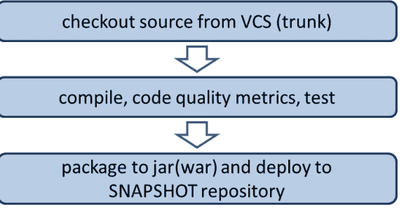

### RELEASE 版本的操作

在正式发布的情况下，由于需要分配版本号，其流程比 SNAPSHOT 发布稍微复杂一些。

## 库的交付流程（RELEASE 版本）

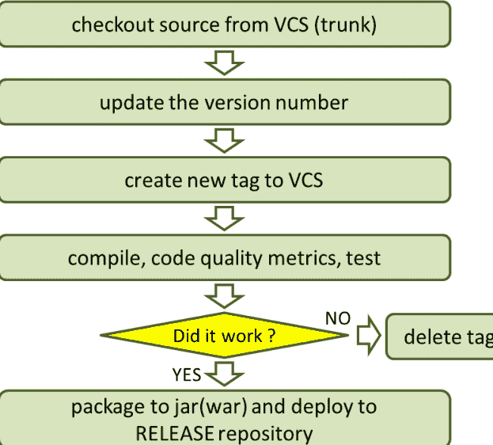

1. 确定要分配给发布的版本号。（例如：`1.0.1`）
2. 从开发主干（trunk）或发布分支（release branch）检出源代码。
3. 修改 `pom.xml` 中的 `<version>` 标签。（例如：`<version>1.0.1</version>`）
4. 为 VCS 分配标签（tag）（例如：`tags/1.0.1`）
5. 编译、衡量代码指标并执行测试。
   - 如果发生编译错误、代码指标违反某些规则或测试失败，应停止后续操作。
   - 如果测试失败，则删除 VCS 标签。
   - 使用 `mvn deploy` 将产物（jar, war 文件）上传到 Maven 软件包仓库。

课题：这里，主干源码的 `pom.xml` 版本标签是否应该一直保留到最后，直到它被下一个 SNAPSHOT 版本替换并提交？

注意：`pom.xml` 的 `<version>` 标签可以通过 `versions-maven-plugin` 进行更改。

```
mvn versions:set -DNewVersion=1.0.0
```

通过上述命令，可以将 `pom.xml` 中的版本标签编辑为 `<version>1.0.0</version>`。

## 在应用服务器上发布

若要在提供 Web 服务的 AP 服务器上发布应用程序，需要将注册在 Maven 软件包仓库中的发布 `*.file` 文件并根据目标发布 AP 服务器环境对一组环境依赖配置文件进行设置。无论快照发布还是正式发布，此流程都是相同的。

1. 从 Maven 软件包仓库下载要发布的版本文件。
2. 从 VCS 检出 `*-resources` 项目（该项目整合了环境依赖配置文件）。
3. 使用 Maven 的 `[profile]` 功能，根据目标发布环境替换为一组配置文件，打包项目并创建 `*-resources-x.y.z.jar`。
4. 将创建的 `*-resources-x.y.z.jar` 文件添加到 war 的 `WEB-INF` 文件夹下。
   - 对于 Tomcat，将 `*-resources-x.y.z.jar` 添加到 war 文件中，将其复制到 Tomcat 服务器的任何路径，并在 `VirtualWebAppLoader` 的扩展类路径中指定它。
5. 在应用服务器上部署文件。

注意：可以使用 `maven-dependency-plugin` 的 `[get goal]` 目标从 Maven 软件包仓库下载 war 文件。

```bash
mvn org.apache.maven.plugins:maven-dependency-plugin:2.5:get \
    -DgroupId=com.mywebapp \
    -DartifactId=mywebapp \
    -Dversion=0.0.1-SNAPSHOT \
    -Dpackaging=war \
    -Ddest=/WORKSPACE/target/mywebapp.war
```

至此，`mywebapp.war` 文件已下载到目标目录下。

可以使用以下命令将环境依赖配置文件包添加到 `mywebapp.war` 中。

```bash
mkdir -p WORKSPACE/target/WEB-INF/lib
cd WORKSPACE/target
cp ./mywebapp-resources.*.jar WEB-INF/lib
jar -ufv mywebapp.war WEB-INF/lib
```

## 4 Web 应用开发功能

本文将详细阐述本指南所采用的 Web 功能架构。

### 4.1 输入校验

#### 4.1.1 概述

必须检查用户输入的值是否正确。输入值的校验大致分为：

1. 不考虑语境（如大小和格式），仅通过观察来确定输入值是否有效的校验。
2. 根据系统状态确定输入值的变化是否有效的校验。

`1.` 是强制性检查和位数检查的示例；`2.` 是检查 E-mail 是否注册以及订单数量是否在可用库存范围内的示例。

在本节中，将解释 `1.`，这种检查被称为“输入校验”。`2.` 被称为“业务逻辑检查”。对于业务逻辑检查，请参考“领域层实现”。

在本指南中，校验检查应该在应用层执行，而业务逻辑检查应该在领域层执行。

Web 应用的输入校验在服务器端和客户端（JavaScript）均进行。必须同时检查服务器端和客户端（JavaScript）。警告：如果仅在客户端进行校验，系统可能会暴露安全风险。

:: validation is is the the the the the.....:校验在服务器端执行. 课题: validation is the.. the of later.

# TERASOLUNA Java 服务端框架 (5.x) 开发指南文档，版本 5.4.1.RELEASE

## 输入校验的分类

输入校验分为单项检查和关联性检查。

| 类型 | 描述 | 示例 | 实现方法 |
|---|---|---|---|
| 单项检查 | 检查单个字段 | 数字位检查 | Bean Validation (Hibernate Validator) |
| 关联性检查 | 检查多个字段 | 密码检查 | spring.validation.Validator |

### 4.1.2 如何使用

当使用 Bean Validation 1.1 或更高版本时，需要存储以下类的所需的库：

- Expression Language 2.2 或更高版本的 API 规范类
- Expression Language 2.2 或更高版本的参考实现类

如果通过部署在应用服务器上运行文件，则不需要添加依赖库；这些库由应用服务器提供。然而，在独立环境（JUnit 等）中，则需要添加这些库。

以下是在在独立环境中运行 Bean Validation 1.1 时所需库的示例。

```xml
<dependency>
  <groupId>org.apache.tomcat.embedded</groupId>
  <artifactId>tomcat-embed-el</artifactId>
  <scope>test</scope>
</dependency>
```

| 序号 | 描述 |
|---|---|
| (1) | 在需要在独立环境下运行的项目的 `pom.xml` 文件中，添加存储表达式语言类的库。<br>在上述示例中，指定了为嵌入 Tomcat 提供的库。<br>表达式语言的分类类和参考实现类都存储在 `tomcat-embed-el` jar 包中。<br>当执行 JUnit 需要依赖库时，范围设置为 test。 |
| (2) | |

注意：在上述设置示例中，假设依赖库版本由父项目 `kerasuna-gfw-parent` 管理，因此在 `pom.xml` 中无需指定版本。上述使用的依赖库由 Spring IO Platform 定义。

## 单项检查

为了实现单项检查，需要以下几点：

- 应在表单类的字段上分配 Bean Validation 注解
- 应在 Controller 中分配 `@Validated` 注解进行校验
- 应在 JSP 中添加显示校验错误信息的标签

注意：在 `spring-mvc.xml` 中执行了 `<mvc:annotation-driven>` 设置，已启用 Bean Validation。

## 基础单项检查

将以“新用户注册”为例解释实现方法。检查“新用户注册”表单的规则所示。

# TERASOLUNA Java 服务端框架 (5.x) 开发指南文档，版本 5.4.1.RELEASE

| 字段名 | 类型 | 规则 |
| --- | --- | --- |
| name | `java.lang.String` | 必填，长度在 1 到 20 个字符之间 |
| email | `java.lang.String` | 必填，长度在 1 到 50 个字符之间，电子邮件格式 |
| age | `java.lang.Integer` | 必填，范围在 1 到 200 之间 |

### Form 类

为表单类的每个字段分配 Bean Validation 注解。

```java
package com.example.sample.app.validation;

import java.io.Serializable;

import javax.validation.constraints.Max;
import javax.validation.constraints.Min;
import javax.validation.constraints.NotNull;
import javax.validation.constraints.Size;
import org.hibernate.validator.constraints.Email;

public class UserForm implements Serializable {

    private static final long serialVersionUID = 1L;

    @NotNull // (1)
    @Size(min = 1, max = 20) // (2)
    private String name;

    @NotNull
    @Size(min = 1, max = 50)
    @Email // (3)
    private String email;

    @NotNull // (4)
    @Min(0) // (5)
    @Max(200) // (6)
    private Integer age;

    // 省略 setter/getter

}
```


# 4.1. 输入验证

# TERASOLUNA Java 服务端框架 (5.x) 开发指南文档，版本 5.4.1.RELEASE

| 序号 | 描述 |
| --- | --- |
| (1) | 分配 `javax.validation.constraints.NotNull`，表示目标字段不空。在 Spring MVC 中，当发送输入字段为空的表单时，默认会绑定空字符串而不是绑定表单对象。此 `@NotNull` 检查 `name` 是否作为请求参数存在。 |
| (2) | 分配 `javax.validation.constraints.Size`，表示目标字段的字符串长度（或集合大小）在指定的尺寸范围内。在 Spring MVC 中，字符串留空时会绑定到该字段，#1 个或更多字符# 规则表示必填输入。 |
| (3) | 分配 `org.hibernate.validator.constraints.Email`，表示目标字段符合电子邮件格式。当电子邮件格式要求与 `@Email` 检查不匹配时，可以使用 `javax.validation.constraints.Pattern` 指定指定的表达式。对于 `@Email`，请参考 Hibernate Validator 检查规则。 |
| (4) | 当发送表单且未在输入字段输入任何数字时，`null` 会绑定到表单对象，因此 `@NotNull` 表示 `age` 是必填输入。 |
| (5) | 分配 `javax.validation.constraints.Min`，表示目标字段的值必须大于指定值。 |
| (6) | 分配 `javax.validation.constraints.Max`，表示目标字段的值必须小于指定值。 |

> **提示**：参考 Bean Validation 检查规则和 Hibernate Validator 检查规则以获取 Bean Validation 标准注解以及 Hibernate 提供的注解。

> **提示**：参考[将 null 绑定到空字符串字段]以获取输入字段留空时的绑定方法。

## Controller 类

在类上分配 `@Validated` 以进行输入验证。

```java
package com.example.sample.app.validation;

import org.springframework.stereotype.Controller;
import org.springframework.validation.BindingResult;
import org.springframework.validation.annotation.Validated;
import org.springframework.web.bind.annotation.ModelAttribute;
import org.springframework.web.bind.annotation.RequestMapping;
import org.springframework.web.bind.annotation.RequestMethod;

@Controller
@RequestMapping("user")
public class UserController {

    @ModelAttribute
    public UserForm setUpForm() {
        return new UserForm();
    }

    @RequestMapping(value = "create", method = RequestMethod.GET, params = "form")
    public String createForm() {
        return "user"; // (1)
    }

    @RequestMapping(value = "create", method = RequestMethod.POST, params = "confirm")
    public String create(@Validated /* (2) */ UserForm form, BindingResult result) {
        if (result.hasErrors()) { // (4)
            return "user/createForm";
        }
        return "user/createConfirm";
    }

    @RequestMapping(value = "create", method = RequestMethod.POST)
    public String create(@Validated UserForm form, BindingResult result) { // (5)
        if (result.hasErrors()) {
            return "user/createForm";
        }
        // 省略业务逻辑
        return "redirect:/user/create?complete";
    }

    @RequestMapping(value = "create", method = RequestMethod.GET, params = "complete")
    public String createComplete() {
        return "user/createComplete";
    }
}
```

| 序号 | 描述 |
| --- | --- |
| (1) | 显示[新用户注册]表单屏幕。 |
| (2) | 在类上分配 `org.springframework.validation.annotation.Validated` 用于输入验证。 |
| (3) | 在表单参数上添加 `org.springframework.validation.annotation.Validated` 以执行验证。如果没有指定，将在步骤 (2) 中抛出 `org.springframework.validation.BindException`。 |
| (4) | 使用 `BindingResult.hasErrors()` 确定步骤 (2) 的结果。这是因为存在 `org.springframework.validation.BindingResult` 参数。 |
| (5) | 按照如下方式修改表单，以更改错误时的样式。`BindingResult` 存储了步骤 (2) 的结果。这是因为存在 `org.springframework.validation.BindingResult` 参数。 |

> **注意**：与 `@Validated` 相比，`@Valid` 更好。`@Valid` 是一个标准注解。它可以用于字段。

![aa64d398f5fcb72650d2e1d374_0]

如果所有字段为空，错误消息显示所示。错误消息显示 Name 和 Email 为空。

```html
<!DOCTYPE html>
<html>
  <body>
    <form:form modelAttribute="userForm" method="post" action="${pageContext.request.Path}/create">
      <form:label path="name" cssClass="error-label">Name:</form:label> (1)---
      <form:input path="name" cssClass="error-input" /><><!--- (2) ---
      <form:errors path="name" cssClass="error-messages" /><><!--- (3) ---
      <br>
      <form:label path="email" cssClass="error-label">Email:</form:label>
      <form:input path="email" cssClass="error-input" />
      <form:errors path="email" cssClass="error-messages" />
      <br>
      <form:label path="age" cssClass="error-label">Age:</form:label>
      <form:input path="age" cssClass="error-input" />
      <form:errors path="age" cssClass="error-messages" />
      <br>
      <form:button name="confirm">Confirm</form:button>
    </form:form>
  </body>
</html>
```

如果输入字段为空，错误消息显示所示。错误消息显示在每个字段旁边。

在 Bean Validation 中，除了以下注解外，`null` 是有效值：

- `java.validation.constraints.NotNull`
- `org.hibernate.validator.constraints.NotEmpty`
- `org.hibernate.validator.constraints.NotBlank`

---

# TERASOLUNA Java 服务器框架 (5.x) 开发指南文档
版本 5.4.1.RELEASE

```html
<form:errors path="age" cssClass="error-messages" />
<br>
<form:button name="confirm">Confirm</form:button>
</form>
```

| 序号 | 描述 |
|---|---|
| (1) | 在发生错误时，为 `cssErrorClass` 属性中的 `<label>` 标签指定类名。 |
| (2) | 在发生错误时，为 `cssErrorClass` 属性中的 `<input>` 标签指定类名。 |
| (3) | 在 `cssClass` 属性中为错误信息指定类名。 |

例如，如果将以下 CSS 添加到 JSP 中，错误界面将显示如下。

```css
.form-horizontal input {
  display: block;
  float: left;
}

.form-horizontal label {
  display: block;
  float: left;
  text-align: right;
  float: left;
}

.form-horizontal br {
  clear: left;
}

.error-label {
  color: #b94a48;
}

.error-input {
  border-color: #b94a48;
  margin-left: 5px;
}

.error-messages {
  color: #b94a48;
  display: block;
  padding-left: 0px;
  overflow-x: auto;
}
```

| Name: size 必须在 1 到 20 之间 |
| Email: aaaaaaaaaaaaaaaaaaaaa 不是一个格式正确的电子邮件地址 size 必须在 1 到 50 之间 |
| Age: -1 必须大于或等于 0 |

CSS 可以根据页面的需求进行自定义。

不要在每个输入字段处显示错误信息，而是集中输出它们。

```html
<form modelAttribute="UserForm" method="post" action="${pageContext.request.Path}/user/create">
<form:errors path="" element="div" cssClass="error-message-list"/>*-- (1) --
<label path="" cssClass="error-label">Name:</label>
<input name="name" cssClass="error-input" />
<br>
<label path="email" cssClass="error-label">Email:</label>
<input name="email" cssClass="error-input" />
<br>
<label path="age" cssClass="error-label">Age:</label>
<input name="age" cssClass="error-input" />
<br>
<form:button name="confirm">Confirm</form:button>
</form>
```

| 序号 | 描述 |
|---|---|
| (1) | 通过在 `<form:form>` 标签的 `<form:errors>` 的 `path` 属性中指定 `{*}`，可以输出所有与 `<form:form>` 中 `modelAttribute` 属性指定的 Model 相关的错误信息。包含这些错误信息的标签名可以在 `element` 属性中指定。默认情况下是 `span`。但是，使用 `div` 作为块元素输出错误信息列表。在 `cssClass` 属性中指定类。 |

当应用以下 CSS 时，将显示错误信息的示例。

```css
.form-horizontal input {
  display: block;
  float: left;
}

.form-horizontal label {
  display: block;
  float: left;
  text-align: right;
  float: left;
}

.form-horizontal br {
  clear: left;
}

.error-label {
  color: #b94a48;
}

.error-input {
  border-color: #b94a48;
  margin-left: 5px;
}

.error-message-list {
  color: #b94a48;
  padding: 5px;
  border: 1px solid #b94a48;
  border-radius: 5px;
  margin-bottom: 10px;
}
```

| size 必须在 1 到 50 之间 |
| 不可为空 |
| size 必须在 1 到 20 之间 |
| Name: |
| Email: |
| Age: |
| Confirm |

默认情况下，消息中不包含字段名，因此很难理解错误信息属于哪个字段。为了在错误信息中包含字段名，需要使用 `@GroupSequence` 注解。

## 4.1 输入验证

# TERASOLUNA Java 服务器框架 (5.x) 开发指南文档
版本 5.4.1.RELEASE

在执行日期和时间检查时，建议使用 `@DateTimeFormat` 而不是 Bean Validation。虽然也可以使用 `@Pattern` 注解检查日期和时间格式，但其描述较为复杂。因此，`@DateTimeFormat` 注解比 `@Pattern` 注解更简单。

由于 `@DateTimeFormat` 是 Spring 类型转换机制之一，在输入时屏幕上显示的不是 Bean Validation 的错误消息，而是类型异常（`TypeMismatchException`）的错误消息。为了在屏幕上查看实际的异常消息，需要在属性文件中配置错误消息。

## 嵌套 Bean 的检查

下面解释了使用 Bean Validation 验证嵌套 Bean 方法。以电商网站的订单处理流程为例。下面提供了检查订单的规则。

```html
<form modelAttribute="UserForm" method="post" action="${pageContext.request.Path}/user/create">
<form:errors path="" element="div" cssClass="error-message-list"/>*-- (1) --
<label path="" cssClass="error-label">Name:</label>
<input name="name" cssClass="error-input" />
<br>
<label path="email" cssClass="error-label">Email:</label>
<input name="email" cssClass="error-input" />
<br>
<label path="age" cssClass="error-label">Age:</label>
<input name="age" cssClass="error-input" />
<br>
<form:button name="confirm">Confirm</form:button>
</form>
```

# TERASOLUNA Java 服务框架 (5.x) 开发指南文档，发布版本 5.4.1.RELEASE

## Form 类


## 4.1. 输入验证

### Form 类

```java
package com.example.sample.app.validation;

import java.io.Serializable;

import javax.validation.Valid;
import javax.validation.constraints.NotNull;
import javax.validation.constraints.Pattern;
import javax.validation.constraints.Size;

public class OrderForm implements Serializable {
    private static final long serialVersionUID = 1L;

    @Size(max = 5)
    @Pattern(regexp = "[a-zA-Z0-9]*")
    private String coupon;

    @NotNull // (1)
    @Valid // (2)
    private AddressForm receiverAddress;

    @NotNull
    @Valid
    private AddressForm senderAddress;

    // omitted setter/getter
}
```

```java
package com.example.sample.app.validation;

import java.io.Serializable;

import javax.validation.constraints.NotNull;
import javax validation.constraints.Size;

public class AddressForm implements Serializable {
    private static final long serialVersionUID = 1L;

    @NotNull
    @Size(min = 1, max = 50)
    private String name;

    @NotNull
    @Size(min = 1, max = 10)
    private String postcode;

    @NotNull
    @Size(min = 1, max = 100)
    private String address;

    // omitted setter/getter
}
```

| 序号 | 描述 |
| :--- | :--- |
| (1) | 表示该表单是必填的。当未设置时，如果 `receiverAddress` 设置为 `null`，则被视为有效。 |
| (2) | 分配 `javax.validation.Valid` 注解以启用对嵌套 Bean 的验证。 |

### Controller 类

与之前描述的 Controller 没有区别。

```java
package com.sample.app.validation;

import org.springframework.stereotype.Controller;
import org.springframework.validation.BindingResult;
import org.springframework.validation.annotation.Validated;
import org.springframework.web.bind.annotation.ModelAttribute;
import org.springframework.web.bind.annotation.RequestMapping;
import org.springframework.web.bind.annotation.RequestMethod;

@RequestMapping("order")
@Controller
public class OrderController {

    @ModelAttribute
    public OrderForm setUpForm() {
        return new OrderForm();
    }

    @RequestMapping(value = "order", method = RequestMethod.GET, params = "form")
    public String orderForm() {
        return "order/orderForm";
    }

    @RequestMapping(value = "order", method = RequestMethod.POST, params = "confirm")
    public String orderConfirm(@Validated OrderForm form, BindingResult result) {
        if (result.hasErrors()) {
            return "order/orderForm";
        }
        return "order/orderConfirm";
    }
}
```

### JSP

```html
<!DOCTYPE html>
<html>
<!-- WEB-INF/views/order/orderForm.jsp -->
<head>
<style type="text/css">
/* omitted (same as previous sample) */
</style>
</head>
<body>
  <form modelAttribute="orderForm" method="post" class="form-horizontal" action="${pageContext.request.path}/order/order">
    <form:label path="coupon" cssError="error-label">优惠码:</form:label>
    <form:input path="coupon" cssError="error-input" />
    <form:errors path="coupon" cssClass="error-messages" />
    <br>
    <fieldset>
      <legend>收件者</legend>
      <!-- (1) -->
      <form:errors path="receiverAddress" cssClass="error-messages" />
      <!-- (2) -->
      <form:label path="receiverAddress.name" cssError="error-label">姓名:</form:label>
      <form:input path="receiverAddress.name" cssError="error-input" />
      <form:errors path="receiverAddress.name" cssClass="error-messages" />
      <br>
      <form:label path="receiverAddress.postcode" cssError="error-label">邮编:</form:label>
      <form:input path="receiverAddress.postcode" cssError="error-input" />
      <form:errors path="receiverAddress.postcode" cssClass="error-messages" />
      <br>
      <form:label path="receiverAddress.address" cssError="error-label">地址:</form:label>
      <form:input path="receiverAddress.address" cssError="error-input" />
      <form:errors path="receiverAddress.address" cssClass="error-messages" />
    </fieldset>
    <br>
  <fieldset>
    <legend>发件者</legend>
    <form:errors path="senderAddress" cssClass="error-messages.name" />
    <form:label path="senderAddress.name" cssError="error-label">姓名:</form:label>
    <form:input path="senderAddress.name" cssClass="error-input" />
    <form:errors path="senderAddress.name" cssClass="error-messages" />
    <br>
    <form:label path="senderAddress.postcode" cssError="error-label">邮编:</form:label>
    <form:input path="senderAddress.postcode" cssError="error-input" />
    <form:errors path="senderAddress.postcode" cssClass="error-messages" />
    <br>
    <form:label path="senderAddress.address" cssError="error-label">地址:</form:label>
    <form:input path="senderAddress.address" cssError="error-input" />
    <form:errors path="senderAddress.address" cssClass="error-messages" />
    </fieldset>
  </form>
</body>
</html>
```

### 动态添加地址字段示例

```html
<form:input path="addresses[${status.index}].name"
    cssErrorClass="error-input" />
    <form:errors path="addresses[${status.index}].name"
        cssClass="error-messages" />
    <br/>
    <form:label path="addresses[${status.index}].code"
        cssErrorClass="error-label" /></form:label>
    <form:input path="addresses[${status.index}].code"
        cssErrorClass="error-input" />
    <form:errors path="addresses[${status.index}].code"
        cssClass="error-messages" />
    <br/>
    <form:label path="addresses[${status.index}].address"
        cssErrorClass="error-label" /></form:label>
    <form:input path="addresses[${status.index}].address"
        cssErrorClass="error-input" />
    <form:errors path="addresses[${status.index}].address"
        cssClass="error-messages" />
    <c:if test="${status.index > 0}">
        <br/>
        <button class="remove-address-button">Remove</button>
    </c:if>
</fieldset>
<br/>
</c:forEach>
    <button id="add-address-button">Add address</button>
    <br/>
    <form:button name="confirm">Confirm</form:button>
</form>
<script type="text/javascript"
    src="${pageContext.request.contextPath}/resources/vendor/js/jquery-1.0.2.min.js"></script>
<script type="text/javascript"
    src="${pageContext.request.contextPath}/resources/app/js/AddressesView.js"></script>
</body>
</html>
```

| 序号 | 说明 |
| :--- | :--- |
| (1) | 显示与地址字段相关的错误信息。 |
| (2) | 使用 `<c:forEach>` 标签循环处理子表单集合。 |
| (3) | 在循环内部。使用 `[父字段名][Index].[子字段名]` 指定子表单的字段。 |

### Controller 类 (动态地址)

```java
package com.example.sample.app.validation;

import java.util.ArrayList;
import java.util.List;

import org.springframework.stereotype.Controller;
import org.springframework.validation.BindingResult;
import org.springframework.validation.annotation.Validated;
import org.springframework.web.bind.annotation.ModelAttribute;
import org.springframework.web.bind.annotation.RequestMapping;
import org.springframework.web.bind.annotation.RequestMethod;

@Controller
@RequestMapping("user")
public class UserController {

    @ModelAttribute
    public UserForm setUpForm() {
        UserForm form = new UserForm();
        List<AddressForm> addresses = new ArrayList<AddressForm>();
        addresses.add(new AddressForm());
        form.setAddresses(addresses); // (1)
        return form;
    }

    @RequestMapping(value = "create", method = RequestMethod.GET, params = "form")
    public String createForm() {
        return "user/createForm";
    }

    @RequestMapping(value = "create", method = RequestMethod.POST, params = "confirm")
    public String createConfirm(@Validated UserForm form, BindingResult result) {
        if (result.hasErrors()) {
            return "user/createForm";
        }
        return "user/createConfirm";
    }
}
```

| 序号 | 说明 |
| :--- | :--- |
| (1) | 编辑表单对象，以便用户注册表单初始显示时显示单个地址表单。 |

### JavaScript

以下是用于动态添加地址输入字段的 JavaScript。由于不需要，此处省略了该代码的解释。


```javascript
// webapp/resources/app/js/AddressesView.js

function AddressesView() {
  this.addressSize = $(`fieldset.address`).size();
}

AddressesView.prototype.addAddress = function () {
  var address = $(`fieldset.address`);
  var newHtml = addressTemplate(this.addressSize++);
  $address.last(1).next().after($(newHtml));
};

AddressesView.prototype.removeAddress = function ($fieldset) {
  fieldset.next().remove(); // remove <br>
  $fieldset.next().remove(); // remove <fieldset>
};

function addressTemplate(number) {
  return
    '<fieldset class="address">' + (number + 1) + '</legend>\n    <label for="address">' + number + '.name>Name</label>\n    <input id="addresses"' + number + '.name" name="addresses[' + number + '].name">\n    <label for="address">' + number + '.code>Code</label>\n    <input id="addresses"' + number + '.code" name="addresses[' + number + '].code">\n    <button class="remove-address-button">Remove</button>\n</fieldset>';
}

$(function () {
  var addressesView = new AddressesView();
  // ... logic for adding addresses
});
```

# TERASOLUNA Java 服务器框架 (5.x) 开发指南文档

版本 5.4.1.RELEASE

| 序号 | 描述 |
| :--- | :--- |
| (1) | 将每个组定义为一个接口。 |
| (2) | `@Min.List` 注解用于在单个字段上指定多个 `@Min` 规则。在使用其他注解时情况也相同。 |
| (3) | 为每个组定义规则。在 `groups` 属性中指定相应的组类以指定分组。当未指定 `groups` 属性时，使用 `javax.validation.groups.Default` 组。 |
| (4) | 添加一个字段，用于确定应用哪一个组。 |

## JSP

JSP 部分没有重大变化。

```xml
<form modelAttribute="user" method="post"
class="form-horizontal"
action="${pageContext.request.relativePath}/create">
<form:label path="name" cssClass="cssErrorClass=error-label">Name</form:label>
<form:input path="name" cssClass="error-input" />
<form:errors path="name" cssClass="error-messages" />
<br/>
<form:label path="email" cssClass="cssErrorClass=error-label">Email</form:label>
<form:input path="email" cssClass="error-input" />
<form:errors path="email" cssClass="error-messages" />
<br/>
<form:label path="age" cssClass="cssErrorClass=error-label">Age</form:label>
<form:input path="age" cssClass="error-input" />
<form:errors path="age" cssClass="error-messages" />
<br/>
<form:label path="country" cssClass="cssErrorClass=error-label">Country</form:label>
<form:select path="country" cssClass="error-input">
<form:option value="cn">China</form:option>
<form:option value="jp">Japan</form:option>
<form:option value="sg">Singapore</form:option>
</form:select>
<form:errors path="country" cssClass="error-messages" />
<br/>
<form:button name="confirm">Confirm</form:button>
</form:form>
```

## Controller 类

通过为 `@Validated` 注解提供组名，将应用为该组定义的规则。

```java
package com.example.sample.app.validation;

import javax.validation.groups.Default;

import org.springframework.stereotype.Controller;
import org.springframework.validation.BindingResult;
import org.springframework.validation.Validated;
import org.springframework.web.bind.annotation.ModelAttribute;
import org.springframework.web.bind.annotation.RequestMapping;
import org.springframework.web.bind.annotation.RequestMethod;

import com.example.sample.app.validation.UserForm.Chinese;
import com.example.sample.app.validation.UserForm.Japanese;
import com.example.sample.app.validation.UserForm.Singapore;

@Controller
@RequestMapping("user")
public class UserController {
    @ModelAttribute
    public UserForm setUpForm() {
        UserForm form = new UserForm();
        return form;
    }

    @RequestMapping(value = "create", method = RequestMethod.GET, params = "form")
    public String createForm() {
        return "user/createForm";
    }

    String createConfirm(UserForm form, BindingResult result) {
        if (result.hasErrors()) {
            return "user/createForm";
        }
        return "user/createConfirm";
    }

    @RequestMapping(value = "create", method = RequestMethod.POST, params = 
        {"confirm", "country=cn"})
    public String createFormForChinese(@Validated({ Chinese.class, Default.class }) UserForm form, BindingResult result) {
        return createForm(form, result);
    }

    @RequestMapping(value = "create", method = RequestMethod.POST, params = 
    {
        "confirm", "country=jp"
    })
    public String createConfirmForJapanese(@Validated({ Japanese.class,
    Default.class }) UserForm form, BindingResult result) {
    return createConfirm(form, result);
    }

    @RequestMapping(value = "create", method = RequestMethod.POST, params = 
    {
        "confirm", "country=sg"
    })
    public String createConfirmForSingapore(@Validated({ Singapore.class,
    Default.class }) UserForm form, BindingResult result) {
    return createConfirm(form, result);
    }
}
```

| 序号 | 描述 |
| :--- | :--- |
| (1) | 用作分组划分条件的参数必须设置在 `params` 属性中。 |
| (2) | 除了 `@Min` 以外的所有注解都属于 `Default` 组；因此，指定 `Default` 是强制性的。 |

在此示例中，每个输入值组合的检查结果如下。

| 年龄值 | 国家值 | 输入验证结果 | 错误消息 |
| :--- | :--- | :--- | :--- |
| 17 | cn | NG | must be greater than or equal to 18 |
| | jp | NG | must be greater than or equal to 20 |
| | sg | NG | must be greater than or equal to 21 |
| 18 | cn | OK | |
| | jp | NG | must be greater than or equal to 20 |
| | sg | NG | must be greater than or equal to 21 |
| 20 | cn | OK | |
| | jp | OK | |
| | sg | NG | must be greater than or equal to 21 |
| 21 | cn | OK | |
| | jp | OK | |
| | sg | OK | |

## 4.1. 输入验证

> 警告：此 Controller 的实现尚完善；当国家值既不是 [cn] 也不是 [sg] 时没有进行处理。当遇到意外值时将返回 400 错误。接下来，我们可以考虑国家数量增加且将 18 岁成年条件设为默认值的情况。

为了为 `Default` 组（18 岁以上）指定值，所有组在其他注解中也应显式指定。规则如下。

| 组 | 成年条件 |
| :--- | :--- |
| Default | 18 岁以上 |
| Japanese | 20 岁以上 |
| Singaporean | 21 岁以上 |

```java
package com.example.sample.app.validation;

import java.io.Serializable;
import java.util.List;

import javax.validation.Valid;
import javax.validation.constraints.Max;
import javax.validation.constraints.Min;
import javax.validation.constraints.NotNull;
import javax.validation.constraints.Size;
import javax.validation.groups.Default;

import org.hibernate.validator.constraints.Email;

public class UserForm implements Serializable {

    private static final long serialVersionUID = 1L;

    public static interface Chinese {
    };

    public static interface Japanese {
    };

    public static interface Singaporean {
    };

    @NotNull(groups = { Default.class, Japanese.class, Singaporean.class }) // (1)
    @Size(min = 1, max = 20, groups = { Default.class, Japanese.class, Singaporean.class })
    private String name;

    @NotNull(groups = { Default.class, Japanese.class, Singaporean.class })
    @Email(groups = { Default.class, Japanese.class, Singaporean.class })
    private String email;

    @NotNull(groups = { Default.class, Japanese.class, Singaporean.class })
    @Min.List({
        @Min(value = 18, groups = Default.class), // (2)
        @Min(value = 20, groups = Japanese.class),
        @Min(value = 21, groups = Singaporean.class)
    })
    @Max(value = 200, groups = { Default.class, Japanese.class, Singaporean.class })
    private Integer age;

    @NotNull(groups = { Default.class, Japanese.class, Singaporean.class })
    @Size(min = 2, max = 2, groups = { Default.class, Japanese.class, Singaporean.class })
    private String country;

    // committed setter/getter
}
```


# Java TERASOLUNA 服务端框架 (5.x) 开发指南文档

Release 5.4.1.RELEASE

```java
@RequestMapping("user")
public class UserController {

    @ModelAttribute
    public UserForm setupForm() {
        UserForm form = new UserForm();
        return form;
    }

    @RequestMapping(value = "create", method = RequestMethod.GET, params = "form")
    public String createForm() {
        return "user/createForm";
    }

    String createConfirm(UserForm form, BindingResult result) {
        if (result.hasErrors()) {
            return "user/createForm";
        }
        return "user/createConfirm";
    }

    @RequestMapping(value = "create", method = RequestMethod.POST, params = {"confirm", "country-sg"})
    public String createConfirmForDefault(
        @Validated /* (1) */ UserForm form, BindingResult result) {
        return createConfirm(form, result);
    }

    @RequestMapping(value = "create", method = RequestMethod.POST, params = {"confirm", "country-jp"})
    public String createConfirmForJapanese(
        @Validated(Japanese.class) /* (2) */ UserForm form, BindingResult result) {
        return createConfirm(form, result);
    }

    @RequestMapping(value = "create", method = RequestMethod.POST, params = {"confirm", "country-sg"})
    public String createConfirmForSingaporean(
        @Validated(Singaporean.class) UserForm form, BindingResult result) {
        return createConfirm(form, result);
    }
}
```

| 序号 | 描述 |
| --- | --- |
| (1) | 当 `country` 字段为空时，请求将映射到使用 `Default` 分组的方法。 |
| (2) | 当 `country` 字段有值时，请求将映射到使用特定分组的方法。 |

在 `Controller` 中使用 `@Validated` 注解进行校验的说明如下：

下文说明了在 `Controller` 中使用 `Default` 分组的模式。

| 模式 | 优点 | 缺点 |
| --- | --- | --- |
| 使用 `@Validated(Group.class) UserForm` 在 `Controller` 类中 | 可以在 `Controller` 中定义校验规则。 | 如果分组较多，`Controller` 会变得复杂。 |
| 在 `Form` 类中使用 `Default` 分组 | 校验规则定义在 `Form` 类中。 | 如果需要为不同分组定义不同规则，这种方式可能不利维护。 |

**如果上述在 `Form` 类中使用 `Default` 分组的决策点适用，则可能需要考虑在 `Controller` 中使用 `SpringValidator`。**

在 `Controller` 中使用 `SpringValidator` 进行校验时，不需要使用 `@Validated` 注解，而是通过在方法中执行校验。如下例所示：

```java
@RequestMapping("user")
public class UserController {

    @ModelAttribute
    public UserForm setupForm() {
        UserForm form = new UserForm();
        return form;
    }

    @RequestMapping(value = "create", method = RequestMethod.GET, params = "form")
    public String createForm() {
        return "user/createForm";
    }

    @RequestMapping(value = "create", method = RequestMethod.POST, params = {"confirm", "country-sg"})
    public String createConfirmForDefault(UserForm form, BindingResult result) { // (1)
        Class<?> group = Default.class; // (2)
        smartValidator.validate(form, result); // (3)
        if (result.hasErrors()) { // (4)
            return "user/createForm";
        }
        return "user/createConfirm";
    }
    // ... 其他方法省略
}
```

| 序号 | 描述 |
| --- | --- |
| (1) | 注入 `SmartValidator` 实例。 |
| (2) | 指定 `Default` 分组。 |
| (3) | 调用 `smartValidator.validate` 执行校验。 |
| (4) | 检查 `result` 是否包含错误。 |

# 关联性校验

通过 `SpringValidator` 实现关联性校验的示例。示例中提供的规则如下：

| 字段名 | 类型 | 规则 | 描述 |
| --- | --- | --- | --- |
| password | java.String | 必填，长度至少 8 位 | 必须与确认密码一致 |
| confirmPassword | java.String | 必须与密码一致 | 确认密码 |

`必须与确认密码一致` 规则是指确保 `password` 字段和 `confirmPassword` 字段的值相同。

# 4.1 输入校验

对于使用 Bean Validation 注解实现关联性校验，下文说明了其功能和用法。

| 模式 | 特性 | 用法 |
| --- | --- | --- |
| Spring Validator | 当分组较多时，使用它比较方便。 | |
| Bean Validation | 当分组较少时，使用它比较方便。 | |

## 使用 Bean Validation 实现关联性校验

在 `Form` 类中实现。规则如下：

```java
package com.example.app.validation;

import java.io.Serializable;

import javax.validation.constraints.NotNull;
import javax.validation.constraints.Size;

public class PasswordResetForm implements Serializable {
    private static final long serialVersionUID = 1L;

    @NotNull
    @Size(min = 8)
    private String password;

    private String confirmPassword;

    // 省略 getter 和 setter
}
```

注意：密码在存储到数据库之前通常会进行加密，因此不需要检查最大长度。

## 使用 Spring Validator 实现关联性校验

通过 `org.springframework.validation.Validator` 接口实现。示例如下：

```java
package com.example.app.validation;

import org.springframework.stereotype.Component;
import org.springframework.validation.Errors;
import org.springframework.validation.Validator;

@Component // (1)
public class PasswordEqualsValidator implements Validator {

    @Override
    public boolean supports(Class<?> clazz) {
        return PasswordResetForm.class.isAssignableFrom(clazz); // (2)
    }

    @Override
    public void validate(Object target, Errors errors) {
        if (errors.hasFieldError("password")) { // (3)
            return;
        }
        PasswordResetForm form = (PasswordResetForm) target;
        String password = form.getPassword();
        String confirmPassword = form.getConfirmPassword();

        if (!password.equals(confirmPassword)) { // (4)
            errors.rejectValue("password", // (5)
                "PasswordEqualsValidator.passwordResetForm.password", // (6)
                "password and confirm password must be same."); // (7)
        }
    }
}
```

| 序号 | 描述 |
| --- | --- |
| (1) | 分配 `@Component` 注解，使 Validator 成为组件扫描的目标。 |
| (2) | 决定参数是否为该验证器的检查目标。此处 `PasswordResetForm` 类即为待检查的目标。 |
| (3) | 如果在单项项目检查期间目标字段发生错误，则不要在此 Validator 中执行关联性检查。如果有必要执行关联性检查，则不需要此判断逻辑。 |
| (4) | 实现检查逻辑。 |
| (5) | 指定发生错误的字段名。 |
| (6) | 指定错误消息的代码名称。此处代码格式为 `[validator 名称].[表单属性名].[属性名]`。消息定义请参考 `application-messages.properties` 中定义的 Messages。 |
| (7) | 设置当无法通过代码解析错误消息时使用的默认消息。 |

注意：Validator 实现类应放置在与 `Controller` 相同的包下。

### Controller 类

```java
package com.example.sample.app.validation;

import javax.inject.Inject;

import org.springframework.stereotype.Controller;
import org.springframework.validation.BindingResult;
import org.springframework.validation.annotation.Validated;
import org.springframework.web.bind.WebDataBinder;
import org.springframework.web.bind.annotation.InitBinder;
import org.springframework.web.bind.annotation.ModelAttribute;
import org.springframework.web.bind.annotation.RequestMapping;
import org.springframework.web.bind.annotation.RequestMethod;

@Controller
@RequestMapping("/password")
public class PasswordResetController {
    @Inject
    PasswordEqualsValidator passwordEqualsValidator; // (1)

    @ModelAttribute
    public PasswordResetForm setUpForm() {
        return new PasswordResetForm();
    }

    @InitBinder
    public void initBinder(WebDataBinder binder) {
        binder.addValidators(passwordEqualsValidator); // (2)
    }

    @RequestMapping(value = "reset", method = RequestMethod.GET, params = "form")
    public String resetForm() {
        return "password/resetForm";
    }

    @RequestMapping(value = "reset", method = RequestMethod.POST)
    public String reset(@Validated PasswordResetForm form, BindingResult result) { // (3)
        if (result.hasErrors()) {
            return "password/resetForm";
        }
        return "redirect:/password/reset?complete";
    }

    @RequestMapping(value = "reset", method = RequestMethod.GET, params = "complete")
    public String resetComplete() {
        return "password/resetComplete";
    }
}
```

| 序号 | 描述 |
| --- | --- |
| (1) | 注入使用的 Spring Validator。 |
| (2) | 在 `@InitBinder` 注解的方法中，使用 `WebDataBinder.addValidators` 方法添加 Validators。通过这种方式，在使用 `@Validated` 注解执行验证时会调用添加的 Validator。 |
| (3) | 根据目前为止的流程在 JSP 中实现输入验证。 |

- JSP

JSP 部分没有需要说明的点。


```html
<!DOCTYPE html>
<!-- WEB-INF/views/password/resetForm.jsp -->
<head>
<style type="text/css">
/* omitted */
</style>
</head>
<body>
<form modelAttribute="passwordResetForm" method="post" class="form-horizontal"
action="${page.request.contextPath}/password/reset">
<form:label path="password" cssError="error-label"><br>
<form:password path="password" cssClass="error-input" />
<form:errors path="password" cssClass="error-messages" />
<br>
<form:label path="confirmpassword" cssError="error-label">Password: (Confirm):</label>
<form:password path="confirmpassword"
errorClass="error-input" />
<form:errors path="confirmpassword" cssClass="error-messages" />
<br>
<form:button>Reset</form:button>
</form>
</body>
</html>
```

# 4.1. 输入验证

# TERASOLUNA Java Server 框架 (5.x) 开发文档，Release 5.4.1.RELEASE

当在 `password` 字段和 `confirmPasswordField` 字段中输入不同的值设置表单时，将显示所示错误消息。

Password: password and confirm password must be same.

Password (Confirm): Reset

注意：使用 `<form:password>` 标签时，数据会在重新部署时被清除。

注意：可以为关联性检查的多个字段设置错误信息。然而，显示错误消息和应用样式必须始终同时进行。

当你想对发生关联错误的多个字段应用但只想显示一条错误消息时，可以通过在错误消息中设置空字符串来实现。下方给出的示例将应用于 `password` 字段和 `confirmPasswordField` 字段，但仅在 `password` 字段显示错误消息。

```java
package com.example.sample.app.validation;

import org.springframework.stereotype.Component;
import org.springframework.validation.Errors;
import org.springframework.validation.Validator;

@Component
public class PasswordEqualsValidator implements Validator {

    @Override
    public boolean supports(Class<?> clazz) {
        return PasswordResetForm.class.isAssignableFrom(clazz);
    }

    @Override
    public void validate(Object target, Errors errors) {
        // omitted
        if (!password.equals(confirmPassword)) {
            // 为 "password" 注册错误
            errors.rejectValue("password", "PasswordEqualsValidator.passwordResetForm.password", "password and confirm password must be same.");

            // 为 confirmPasswordField 注册错误
            errors.rejectValue("confirmPassword", // (1)
        }
    }
}
```

```java
"PasswordEqualsValidator.passwordResetForm.
confirmPassword", // (2)
""); // (3)
```

| 序号 | 描述 |
|---|---|
| (1) | 在 `confirmPasswordField` 中注册错误。 |
| (2) | 指定错误消息的代码名称。在此时对应的错误消息中指定一个空字符串。消息定义请参考 `application-messages.properties` 中定义的 Messages。 |
| (3) | 设置当无法通过代码解析错误消息时使用的默认消息。在示例中设置了空字符串。 |

# Java 语言的 TERASOLUNA Server 框架 (5.x) 开发指南文档，版本 5.4.1.RELEASE

```java
@Controller
@RequestMapping("xxx")
public class XxxController {
    // 省略
    @ModelAttribute("aaa")
    public AaaForm() {
        return new AaaForm();
    }

    @ModelAttribute("bbb")
    public BbbForm() {
        return new BbbForm();
    }

    @InitBinder("aaa")
    public void initBinderForAa(WebDataBinder binder) {
        // 为 AaaForm 添加校验器
        binder.addValidators(aaaValidator);
    }

    @InitBinder("bbb")
    public void initBinderForBbb(WebDataBinder binder) {
        // 为 BbbForm 添加校验器
        binder.addValidators(bbbValidator);
    }

} // 省略
```

注意：要根据验证组更改关联项检查规则的规则（例如）：仅在指定特定验证组时实现关联项检查，最好通过实现 `org.springframework.validation.SmartValidator` 接口而不是实现 `org.springframework.validation.Validator` 接口来选择处理方法。

```java
package com.example.sample.app.validation;

import org.apache.commons.lang3.ArrayUtils;
import org.springframework.stereotype.Component;
import org.springframework.validation.Errors;
import org.springframework.validation.SmartValidator;
```

```java
@Component
public class PasswordEqualsValidator implements SmartValidator { // 实现 SmartValidator 而不是 Validator 接口

    @Override
    public boolean supports(Class<?> clazz) {
        return PasswordResetForm.class.isAssignableFrom(clazz);
    }
}

@Override
public void validate(Object target, Errors errors) {
    validate(target, errors, new Object[] {});
}

@Override
public void validate(Object target, Errors errors, Object... validationHints) {
    // 检查 validationHints(groups)，并在指定 'Update.class' 时应用验证逻辑
    if (ArrayUtils.contains(validationHints, Update.class)) {
        PasswordResetForm form = (PasswordResetForm) target;
        String password = form.getPassword();
        String confirmPassword = form.confirmPassword();
        // 省略...
    }
}
```

# 使用 Bean Validation 实现关联项的输入检查

独立的验证规则应被添加到使用 Bean Validation 的关联项实现中。

将在“如何扩展”中进行说明。

# 错误信息的定义

本文介绍了更改输入验证错误消息的方法。

Spring MVC 中 Bean Validation 的错误消息按以下顺序解析：

1. 如果 `org.springframework.context.MessageSource` 中定义的消息中有任何与规则匹配的消息，则将其作为错误消息（Spring 规则）。
2. 对于 Spring 的默认规则，请参考 `DefaultMessageCodesResolver` 的 `Javadoc`。
3. 如果在步骤 1 中未找到消息，则从注解的 `message` 属性中获取错误消息（Bean Validation 规则）。
4. 当 `message` 属性的值不符合 `[{message key}]` 格式时，将其作为错误消息。
5. 当 `message` 属性的值符合 `[{message key}]` 格式时，在子类的 `ValidationMessages.properties` 中搜索与 message key 对应的消息。
6. 如果定义了与 message key 对应的消息，则使用该消息。
7. 如果未定义与 message key 对应的消息，则使用 `[{message key}]` 作为错误消息。

# 4.1. 输入验证

基本上，建议在属性文件中定义错误消息。

消息应该定义在以下位置：

- 由 `org.springframework.context.MessageSource` 定义的属性文件
- `ValidationMessages.properties` 在 `applicationContext.xml` 中完成，前者称为 `[application-messages.properties]`，后者称为 `[ValidationMessages.properties]`

考虑到 `applicationContext.xml` 中执行了以下设置，前者称为 `[application-messages.properties]`，后者称为 `[ValidationMessages.properties]`：

```xml
<bean id="messageSource"
  class="org.springframework.context.support.ResourceBundleMessageSource">
  <property name="basenames">
    <list>
      <value>i18n/application-messages</value>
    </list>
  </property>
</bean>
```

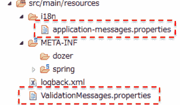

**警告：** 类路径下不应直接存在多个 `ValidationMessages.properties` 文件。

如果类路径下直接存在多个 `ValidationMessages.properties` 文件，可能无法显示适当的消息，因为其中一个文件会导致其余文件无法加载。

- 采用多项目时，请确保 `ValidationMessages.properties` 文件未放置在多个项目中。
- 将 Bean Validation 的通用部分作为 jar 文件发布时，请确保 `ValidationMessages.properties` 文件未包含在 jar 文件中。

此外，当从 1.0.2.RELEASE 或更高版本的空白项目创建项目时，`ValidationMessages.properties` 直接存储在 `xxx-web/src/main/resources` 下。

本指南将定义分类如下：

| 属性文件名 | 需要定义的内容 |
|---|---|
| ValidationMessages.properties | 系统指定的 Bean Validation 默认错误消息 |
| application-messages.properties | 单独覆盖的 Bean Validation 错误消息<br>Spring Validator 中实现的输入验证错误消息 |

当未提供 `ValidationMessages.properties` 时，将使用 Hibernate Validator 提供的默认消息。

通过与 `MessageSource` 配合，你可以直接处理日语消息。有关详细信息，请参考未转换为 Ascii 的消息。

# ValidationMessages.properties 中定义的消息

为 `sc/main/resources` 下 Bean Validation 注解的 `message` 属性指定的键定义消息。以下是基础表单项检查。

- 表单类（显示）

```java
public class UserForm implements Serializable {

    @NotNull
    @Size(min = 1, max = 20)
    private String name;

    @NotNull
    @Size(min = 1, max = 50)
    @Email
    private String email;

    @NotNull
    @Min(0)
    @Max(200)
    private Integer age;

    // 省略 getter/setter
}
```

- ValidationMessages.properties

更改 `@NotNull`, `@Size`, `@Min`, `@Email` 的错误消息。

# 4.1. 输入验证

```properties
javax.validation.constraints.NotNull.message=必需。

# (1)
javax.validation.constraints.Size.message=大小不在 (min) 至 (max) 范围内。
javax.validation.constraints.Min.message=不能小于 (value)。
javax.validation.constraints.Max.message=不能大于 (value)。
org.hibernate.validator.constraints.Email.message=无效的电子地址。
```

| 序号 | 描述 |
|---|---|
| (1) | 可以嵌入注解中指定的属性值。 |

添加上述设置后，如果发送的表单字段为空，显示的错误消息所示。


> **警告：** 由于 Bean Validation 标准注解和独立的 Hibernate 注解在 `message` 属性中设置了 (FQCN of annotation.message)，可以在属性文件中按上述格式定义。但所有注解可能在此文件中，应检查目标注解的 Javadoc 或源代码。

```
FQCN of annotation.message = Message
```

当要在错误消息中包含字段名称时，如下所示在消息中添加 `{0}`。

- ValidationMessages.properties

更改 `@NotNull`, `@Size`, `@Min`, `@Max` 和 `@Email` 的错误消息。

```properties
javax.validation.constraints.NotNull.message="{0}" 是必需的。
javax.validation.constraints.Size.message="{0}" 的大小不在 (min) 至 (max) 范围内。
javax.validation.constraints.Min.message="{0}"不能小于 {value}。
javax.validation.constraints.Max.message="{0}"不能大于 (value)。
org.hibernate.validator.constraints.Email.message="{0}" 是无效的电子地址。
```


# TERASOLUNA Java 服务端框架 (5.x) 开发指南文档，版本 5.4.1.RELEASE

错误消息变更如下。

| | | |
|---|---|---|
| Name: | | `name` 的长度不在 1 到 20 之间。 |
| Email: | | `email` 的长度不在 1 到 50 之间。 |
| Age: | | `age` 是必填项。 |
| Confirm | | |

通过这种方式，表单类的属性名直接显示在屏幕上，对用户并不友好。为了显示合适的字段名称，应该在 `application-messages.properties` 中按照以下格式定义。

```
form 属性名=要显示的字段名称
```

在表单中定义字段名称是良好的。

将相同内容添加到我们的示例中。

- `application-messages.properties`

```
name=Name
email=Email
age=Age
```

错误消息变更如下。

| | | |
|---|---|---|
| Name: | | `Name` 的长度不在 1 到 20 之间。 |
| Email: | | `Email` 的长度不在 1 到 50 之间。 |
| Age: | | `Age` 是必填项。 |
| Confirm | | |

**注意：** 在 `{0}` 处插入字段名是 Spring 的功能，而不是 Bean Validation 的。因此，更改字段名称的设置应该定义在 Spring 直接管理的 `application-messages.properties(ResourceBundleMessageSource)` 中。

**提示：** 在 Bean Validation 1.1 中，可以在 `ValidationMessages.properties` 指定的消息中使用表达式语言（以下称为 `EL 表达式`）。Hibernate Validator 5.x 支持 2.2 或更高版本的表达式语言。

可执行的 EL 表达式版本取决于应用程序服务器的版本。在使用 EL 时，**必须在确认应用程序服务器支持的 EL 版本后使用。**

以下是 Hibernate Validator 默认在 `ValidationMessages.properties` 中定义的消息中使用 EL 表达式的示例。

```
# ..
# (2)
```

# 4.1. 输入验证

# TERASOLUNA Java 服务端框架 (5.x) 开发文档，版本 5.4.1.RELEASE

```
javax.validation.constraints.DecimalMax.message = 必须小于 $
->{inclusive == true ? 'equal to ' : ''}{value}
#
```

| 序号 | 描述 |
|---|---|
| (1) | EL 表达式是消息中 `${inclusive == true ? 'equal to ' : ''}` 的一部分。根据上述消息定义，会创建如下 2 种模式的消息：<br>* 必须小于等于 [value]<br>* 必须小于 [value]<br>(在 `@DecimalMax` 的 `value` 属性中指定的值标注在 `{value}` 部分)<br>当在 `@DecimalMax` 注解的 `inclusive` 属性中指定 `true`（或未指定）时，创建前者；当在 `@DecimalMax` 注解的 `inclusive` 属性中指定 `false` 时，创建后者。<br>处理 Bean Validation 中的 EL 表达式请参阅：Hibernate Validator 参考指南(Interpolation with message expressions)。 |

此外，可以使用 `ValidationMessages.properties` 中指定的消息中的 `${validatedValue}` 在错误消息中包含待检查的值。

使用 `${validatedValue}` 的方法所示。

```
#...
# (1)
javax.validation.constraints.Pattern.message = 输入的值 "$
{validatedValue}" 是无效的。
```

| 序号 | 描述 |
|---|---|
| (1) | 从上述消息定义实际生成的消息包含了在表单中输入的值，位于 `${validatedValue}` 部分。如果输入值包含敏感信息，必须小心不要使用 `${validatedValue}`，以防显示敏感信息。<br>详情，请参阅 Hibernate Validator 参考指南(Interpolation with message expressions)。 |

在 `application-messages.properties` 中定义的消息

系统使用的默认消息定义在 `ValidationMessages.properties` 中，但根据屏幕的不同，可能需要更改默认值。

在这种情况下，在 `application-messages.properties` 中按以下格式定义消息。

# TERASOLUNA Java 服务端框架 (5.x) 开发指南文档，版本 5.4.1.RELEASE

```
[注解名称].[表单属性名].[属性名] = [目标消息]
```

应用 `在 ValidationMessages.properties 中定义的消息` 并使用以下设置覆盖 email 和 age 字段的消息。

- `application-messages.properties`

```
# 覆盖消息
# 针对 email 字段
Size.userForm.theSize="0" 必须在 (2) 和 (1) 之间。
# 针对 age 字段
NotNull.userForm.age="0" 必须大于等于 (1)。
Min.userForm.age="0" 必须小于等于 (1)。
# 字段名
name=Name
email=Email
age=Age
```

注解获取的属性值是从 `{1}` 开始被插入的。顺便说，属性值的索引位置是根据属性名称的字母顺序（升序）。

例如，`@Size` 的索引位置如下：

- (0) : 属性名（物理名称或逻辑名称）
- (1) : `max` 属性的值
- (2) : `min` 属性的值

规范细节，请参阅 Validator。

错误消息变更如下。

| | | |
|---|---|---|
| Name | | "Name" 的长度不在 1 到 20 之间。 |
| Email | | "Email" 的长度不在 1 到 50 之间。 |
| Age | | 必填。 |
| Confirm | | |

注意：在 `{0}` 处插入字段名是 Spring 的功能，而不是 Bean Validation 的。因此，更改字段名称的设置应该定义在 Spring 直接管理的 `application-messages.properties(ResourceBundleMessageSource)` 中。

# TERASOLUNA Java 服务端框架 (5.x) 开发文档，版本 5.4.1.RELEASE

# 4.1. 输入验证

# TERASOLUNA Java 服务端框架 (5.x) 开发文档，版本 5.4.1.RELEASE

# 4.1. 如何扩展

标准注解

- 现有规则的组合
- 新规则的创建

基本上，可以使用以下模板来创建

```java
package com.example.validation;

import java.lang.annotation.Documented;
import java.lang.annotation.Retention;
import java.lang.annotation.Target;
import javax.validation.Constraint;
import javax.validation.Payload;
import static java.lang.annotation.ElementType.ANNOTATION_TYPE;
import static java.lang.annotation.ElementType.CONSTRUCTOR;
import static java.lang.annotation.ElementType.FIELD;
import static java.lang.annotation.ElementType.METHOD;
import static java.lang.annotation.ElementType.PARAMETER;
import static java.lang.annotation.RetentionPolicy.RUNTIME;

@Documented
@Constraint(validatedBy = {})
@Target({METHOD, FIELD, ANNOTATION_TYPE, CONSTRUCTOR, PARAMETER })
@Retention(RUNTIME)
@interface Xxx {
    String message() default "(com.example.validation.Xxx)";
    Class<?>[] groups() default {};
    Class<? extends Payload>[] payload() default {};
}

@Target({METHOD, FIELD, ANNOTATION_TYPE, CONSTRUCTOR, PARAMETER })
@Retention(RUNTIME)
@Documented
public @interface List {
    Xxx value();
}
```

规则创建 Bean Validation 注解

分别考虑系统级和领域级的限制。

在系统级，

- 字符串必须是单字节字母数字
- 数字必须是正数

或者在领域级，

- [User ID] 必须在 4 到 20 个单字节字符之间
- [Age] 必须在 1 年到 150 年之间

这些可以通过组合 `@Pattern`、`@Size`、`@Min`、`@Max` 实现。然而，如果规则在多处使用，设置将分散，维护性会变差。

可以通过组合多个规则来创建一个规则。当创建一个独立的注解时，具有不通用的正则表达式模式和最大最小值以及错误消息是有优势的。通过这种方式，可用性和维护性得到了提高。即使不组合多个规则，为属性赋予特定值也是有益的。

实现示例所示。

- 限制为单字节字母数字的 `@Alphanumeric` 实现示例

```java
package com.example.validation;

import java.lang.annotation.Documented;
import java.lang.annotation.Retention;
import java.lang.annotation.Target;
import javax.validation.Constraint;
import javax.validation.Payload;
import javax.validation.ReportAsSingleViolation;
import javax.validation.constraints.Pattern;
import static java.lang.annotation.ElementType.ANNOTATION_TYPE;
import static java.lang.annotation.ElementType.CONSTRUCTOR;
import static java.lang.annotation.ElementType.FIELD;
import static java.lang.annotation.ElementType.METHOD;
import static java.lang.annotation.ElementType.PARAMETER;
import static java.lang.annotation.RetentionPolicy.RUNTIME;

@Documented
@Constraint(validatedBy = {}) // (1)
@Target({METHOD, FIELD, ANNOTATION_TYPE, CONSTRUCTOR, PARAMETER })
@Retention(RUNTIME)
@ReportAsSingleViolation // (2)
@Pattern(regexp = "[a-zA-Z0-9]*+") // (3)
public @interface AlphaNumeric {
    String message() default "com.example.common.validation.AlphaNumeric.message"; // (4)
    Class<?>[] groups() default {};
    Class<? extends Payload> payload() default {};
    @Target({METHOD, FIELD, ANNOTATION_TYPE, CONSTRUCTOR, PARAMETER})
    @Retention(RUNTIME)
    @Documented
    public @interface List {
        AlphaNumeric[] value();
    }
}
```

| 序号 | 描述 |
|--- |--- |
| (1) | 使用现有注解实现时，`validatedBy` 需要为空 |
| (2) | 这合并错误消息，并在发生错误时仅返回此注解的消息。 |
| (3) | 定义此注解使用的规则。 |
| (4) | 定义错误消息的默认值。 |

- 限制为正数的 `@Negative` 注解的实现示例

```java
package com.example.common.validation;

import java.lang.annotation.Documented;
import java.lang.annotation.Retention;
import java.lang.annotation.Target;
import javax.validation.Constraint;
import javax.validation.Payload;
import javax.validation.ReportAsSingleViolation;
import javax.validation.constraints.Min;
import static java.lang.annotation.ElementType.ANNOTATION_TYPE;
import static java.lang.annotation.ElementType.CONSTRUCTOR;
import static java.lang.annotation.ElementType.FIELD;
import static java.lang.annotation.ElementType.METHOD;
import static java.lang.annotation.ElementType.PARAMETER;
import static java.lang.annotation.RetentionPolicy.RUNTIME;

@Documented
@Constraint(validatedBy = {})
@Target({ METHOD, FIELD, ANNOTATION_TYPE, CONSTRUCTOR, PARAMETER })
@Retention(RUNTIME)
@ReportAsSingleViolation
@Min(value = 0)
public @interface NotNegative {
    String message() default "com.example.common.validation.NotNegative.message";
    Class<?>[] groups() default {};
    Class<? extends Payload> payload() default {};
    @Target({ METHOD, FIELD, ANNOTATION_TYPE, CONSTRUCTOR, PARAMETER })
    @Retention(RUNTIME)
    @Documented
    public @interface List {
        NotNegative[] value();
    }
}
```

- 规范 [ 用户 ID ] 格式的 `UserId` 注解实现示例

```java
package com.example.sample.domain.validation;

import java.lang.annotation.Documented;
import java.lang.annotation.Retention;
import java.lang.annotation.Target;
import javax.validation.Constraint;
import javax.validation.Payload;
import javax.validation.ReportAsSingleViolation;
import javax.validation.constraints.Pattern;
import javax.validation.constraints.Size;
import static java.lang.annotation.ElementType.ANNOTATION_TYPE;
```


# TERASOLUNA Java 服务框架 (5.x) 开发指南文档，版本 5.4.1.RELEASE

## 4.1 输入校验

### 使用 Bean Validator 注解检查集合的值

在处理多个可选项（如复选框和多选列表）时，通常将屏幕项视为基本类型（如 `String`）的集合。在 Bean Validator 规范中，无法通过注解检查集合中的每个值，但使用 Java 8 和 Hibernate Validator 的特性，或者如果不使用这些特性，可以为屏幕项的值创建包装类，从而可以使用 Bean Validator 检查集合中的值。

在此，注意公共库提供的输入值是在代码列表中定义的，并解释如何使用 `org.terasoluna.gfw.common.codelist.ExistCodeList` 对集合进行输入检查。下面显示了多个可选项（复选框、多选下拉列表）的 `@ExistCodeList` 注解实现方法。

- 使用 Java 8 功能实现可以添加到 `List` 的自定义注解。这种方法比后者更简单、方便，因此建议在可以使用 Java 8 和 Hibernate Validator 特性的环境中使用此方法。此外，该方法将在未来的 Bean Validator 版本中标准化。
- 使用 Java Bean 实现 `String` 的包装类以设置 `@ExistCodeList` 注解。对于不使用 Java 8 和 Hibernate Validator 的用户，可以使用 Java 8 和 Hibernate Validator 的原生特性。

#### 使用 Java 8 和 Hibernate Validator 5.2+ 的实现

在此显示了如何正确封装公共库提供的自定义注解 `@ExistCodeList`。

`java.lang.annotation.ElementType.TYPE_USE` 在 Java 8 中已添加。这使得注解不仅可以添加到类和方法的声明中，还可以添加到通用类型（局部变量类型等）。Java 8 的 Hibernate Validator 5.2+ 支持对集合、`Map`、`Optional` 等参数使用约束注解。通过读取它，可以检查集合中的值。

结合 SE 8 和 Hibernate Validator 5.2+，例如 `List<@NotNull String>` 可以在列表类型指定部分的注解并检查集合中的值。详情请参考 Hibernate 文档（类型约束）。

公共库提供的 `@ExistCodeList` 不对应 `TYPE_USE`，因为它兼容 Java 7。通过上述方法创建可以添加到类型指定部分的自定义注解，可以检查集合中的值。主要步骤如下：

- 使用 `@TYPE_USE` 并实现可以添加到类型使用处的扩展 `@ExistCodeList` 注解。
- 设置要检查的注解。

使用可以设置多个项的 `Role`（`List` of `String`）输入检查作为示例说明。

##### 多项可配置：可以添加到类型使用处的 `@ExistCodeListForTypeArgument` 注解实现示例

```java
package com.example.common.validation;

import static java.lang.annotation.ElementType.TYPE_USE;
import static java.lang.annotation.RetentionPolicy.RUNTIME;

import java.lang.annotation.Documented;
import java.lang.annotation.Retention;
import java.lang.annotation.Target;

import javax.validation.Constraint;
import javax.validation.OverridesAttribute;
import javax.validation.Payload;
import javax.validation.ReportAsSingleViolation;

import org.terasoluna.gfw.common.codelist.ExistCodeList;

@Documented
@Constraint(validatedBy = {})
@Retention(RUNTIME)
@ReportAsSingleViolation
@ExistCodeList(codeList = "")
public @interface ExistCodeListForTypeArgument {

    String message() default "com.example.common.validation.ExistInCodeListForArgument message";

    @OverridesAttribute(constraint = ExistCodeList.class, name = "codeListId")
    String codeListId();

    Class<?>[] groups() default {};

    Class<? extends Payload>[] payload() default {};

    @Target(TYPE_USE)
    @Retention(RUNTIME)
    @Documented
    @interface List {
        ExistCodeListForTypeArgument[] value();
    }
}
```

| 序号 | 描述 |
|---|---|
| (1) | 设置 `TYPE_USE`，以便该注解可以添加在类型使用处。 |
| (2) | 定义此注解使用的规则 (`@ExistCodeList`)。 |
| (3) | 定义错误消息的默认值。同时在 `ValidationMessages.properties` 中定义任何错误消息。 |
| (4) | 覆盖 `@ExistCodeList` 注解的 `codeListId` 属性。 |

##### Form 类

```java
package com.example.sample.app.validation;

import java.util.List;
import javax.validation.constraints.NotNull;
import com.example.common.validation.ExistCodeListForTypeArgument;

public class SampleForm {

    @NotNull
    @Valid // (1)
    private List<@ExistCodeListForTypeArgument(codeListId = "CL_ROLE") String> roles; // (2)

    public List<String> getRoles() {
        return roles;
    }

    public void setRoles(List<String> roles) {
        this.roles = roles;
    }
}
```

| 序号 | 描述 |
|---|---|
| (1) | 使用 `javax.validation.Valid` 注解以启用元素值的输入检查。 |
| (2) | 为待检查的集合类型规范设置 `@ExistCodeListForTypeArgument` 注解。在参数中指定代码列表作为源。 |

##### JSP

```jsp
<form:form modelAttribute="sampleForm">
    <!-- (1) -->
    <form:checkboxes path="roles" items="${CL_ROLE}"/>
    <form:errors path="roles"/>
    <form:button path="Submit">Submit</form:button>
</form:form>
```

| 序号 | 描述 |
|---|---|
| (1) | 实现 `<form:checkboxes>`。 |

#### String 包装类的 Bean 实现

此处引入的实现适用于不使用 Java SE 8 和 Hibernate Validator 原始功能的用户。在可以使用 Java SE 8 和 Hibernate Validator 原功能的环境中，建议使用 Java SE 8+ 进行实现。

由于在不使用 Java SE 8 和 Hibernate Validator 原始功能时，无法在类中使用上述 Bean Validation 注解，因此通过在嵌套 Bean 的属性上添加 `@ExistInCodeList` 来完成输入检查。

在使用 Spring 标签库处理包装类时，需要在字符串和类之间进行类型转换以便绑定到表单。这是 Spring 提供的一种机制（`Formatter`）。通过添加从 `String` 到 `Role` 作为 `List<String>` 的类型转换，可以使用 `<form:checkboxes>` 实现，而无需复杂的实现。

主要步骤如下：

- 设置用于检查的 `@ExistInCodeList` 注解。
- 创建一个实现 `Formatter` 的类，用于转换。
- 使用 `ConversionServiceFactoryBean` 在 Spring 中注册该 `Formatter`。

此外，为了通过 `<form:checkboxes>` 显示已选中的项目，你需要在 `Formatter` 实现的基础上额外重写包装类的 `toString` 方法。`<form:checkboxes>` 会将 `items` 选中的集合中的元素显示为选中项，如果 `path` 选中的值与属性值匹配，则将其显示为选中项。为了确定一致性，当属性为单个项目时会使用 `toString` 方法；在数组或集合情况下，则使用指定属性的 `toString` 方法的结果。

为了能够成功将其显示为选中项，你需要在包装类中重写 `toString` 方法，并返回下方的包装值字符串。

> **注意：** 详情，请参考 `org.springframework.web.servlet.tags.form.SelectedValueComparator` 类的实际方法。

##### Form 类

```java
package com.example.sample.app.validation;

import java.util.List;
import javax.validation.Valid;
import javax.validation.constraints.NotNull;
import com.example.sample.domain.model.Role;

public class SampleForm {

    @NotNull
    @Valid // (1)
    private List<Role> roles; // (2)

    public List<Role> getRoles() {
        return roles;
    }

    public void setRoles(List<Role> roles) {
        this.roles = roles;
    }
}
```

| 序号 | 描述 |
|---|---|
| (1) | `javax.validation.Valid` 注解用于嵌套 Bean 的校验。 |
| (2) | 无法为 `List` 上的 `@ExistInCodeList`；通过 Java Bean 包装 `String`，可以在嵌套 Bean 的属性上添加该注解。 |

##### JavaBean 类

```java
package com.example.sample.domain.model;

import org.terasoluna.gfw.common.codelist.ExistInCodeList;

public class Role {

    @ExistInCodeList(codeId = "CL_ROLE") // (1)
    private String value;

    public String getValue() {
        return value;
    }

    public void setValue(String value) {
        this.value = value;
    }

    @Override
    public String toString() {
        return value;
    }
}
```


```java
return value;
}

public void setValue(String value) {
    this.value = value;
}

@Override
public String toString() {
    return getValue();
}
```

| 序号 | 描述 |
|---|---|
| (1) | 为 `Role` 中包装的属性设置 `@ExistInCodeList` 注解以执行检查并指定 `codeListId`。 |
| (2) | 多选时，重写包装类的 `toString` 方法并返回包装值。 |

### Formatter 类

```java
package com.example.sample.app.validation.formatter;

import java.text.ParseException;
import java.util.Locale;
import org.springframework.format.Formatter;
import com.example.sample.domain.model.Role;

public class RoleFormatter implements Formatter<Role> { // (1)
    @Override
    public String print(Role source, Locale locale) {
        return source.getValue();
    }

    @Override
    public Role parse(String source, Locale locale) throws ParseException {
        Role role = new Role();
        role.setValue(source);
        return role;
    }
}
```

| 序号 | 描述 |
|---|---|
| (1) | 实现接口 `org.springframework.format.Formatter<T>`。 |
| (2) | 在 Spring 中注册 Formatter。 |

#### 应用原始 Formatter 的 Bean 定义

```xml
<!-- (1) -->
<bean id="conversionService"
    class="org.springframework.beans.factory.ConversionServiceBean">
    <property name="formatters">
        <list>
            <!-- (2) -->
            <bean class="com.example.sample.app.validation.formatter.RoleFormatter" />
        </list>
    </property>
</bean>
```

```xml
<!-- (3) -->
<mvc:annotation-driven conversion-service="conversionService">
    <!-- 省略 -->
</mvc:annotation-driven>
```

| 序号 | 描述 |
|---|---|
| (1) | 添加 `FormattingConversionServiceFactoryBean` 的 bean 定义。 |
| (2) | 设置创建的 Formatter 类 (`RoleFormatter`)。 |
| (3) | 若要使用自定义类型转换，将 (1) 中定义的 bean 设置为 `mvc:annotation-driven` 的 `conversion-service` 属性。 |

#### JSP

```xml
<form:form modelAttribute="sampleForm">
    <!-- [] -->
    <form:checkboxes path="roles" items="${CL_ROLE}"/>
    <form:errors path="roles"/>
    <form:button>Submit</form:button>
</form:form>
```

| 序号 | 描述 |
|---|---|
| (1) | `<form:checkboxes>` 的用法与 `List<String>` 相同。 |

# TERASOLUNA Java 级服务器框架 (5.x) 开发指南文档，发布版本 5.4.1.RELEASE

## 通过实现新规则来创建 Bean Validation 注解

通过实现 `javax.validation.ConstraintValidator` 接口并创建一个使用该 Validator 的注解，可以创建任何规则。

### 4.1. 输入验证

以下 3 种方式可以作为应用：

- 无法通过组合现有规则实现的规则
- 关联项的规则检查
- 业务逻辑检查

#### 无法通过组合现有规则实现的规则

对于无法通过 `@Pattern`、`@Size`、`@Min`、`@Max` 实现的规则，请实现 `javax.validation.ConstraintValidator`。

例如，给出了检查 ISBN（国际标准书号）13 格式的规则。

##### 注解

```java
package com.example.common.validation;

import java.lang.annotation.Documented;
import java.lang.annotation.Retention;
import java.lang.annotation.Target;
import javax.validation.Constraint;
import javax.validation.Payload;
import static java.lang.annotation.ElementType.ANNOTATION_TYPE;
import static java.lang.annotation.ElementType.CONSTRUCTOR;
import static java.lang.annotation.ElementType.FIELD;
import static java.lang.annotation.ElementType.METHOD;
import static java.lang.annotation.ElementType.PARAMETER;
import static java.lang.annotation.RetentionPolicy.RUNTIME;

@Documented
@Constraint(validatedBy = {ISBN13Validator.class}) // (1)
@Target({METHOD, FIELD, ANNOTATION_TYPE, CONSTRUCTOR, PARAMETER})
@Retention(RUNTIME)
public interface ISBN13 {
    String message() default "{${com.example.common.validation.ISBN13.message}";
    Class<?>[] groups() default {};
    Class<? extends Payload> payload() default {};
}

@Target({METHOD, FIELD, ANNOTATION_TYPE, CONSTRUCTOR, PARAMETER})
@Retention(RUNTIME)
@Documented
public @interface List {
    ISBN13[] value();
}
```

| 序号 | 描述 |
|---|---|
| (1) | 指定在使用此注解时将执行的 `ConstraintValidator` 实现类。也可以指定多个约束。 |

##### Validator

```java
package com.example.common.validation;

import javax.validation.ConstraintValidator;
import javax.validation.ConstraintValidatorContext;

public class ISBN13Validator implements ConstraintValidator<ISBN13, String> {
    // (1)
    @Override
    public void initialize(ISBN13 constraintAnnotation) { // (2)
    }

    @Override
    public boolean isValid(String value, ConstraintValidatorContext context) {
        // (3)
        if (value == null) {
            return true; // (4)
        }
        return isISBN13Valid(value); // (5)
    }

    // 此逻辑编写自 http://en.wikipedia.org/wiki/International_Standard_Book_Number
    static boolean isISBN13Valid(String isbn) {
        if (isbn.length() != 13) {
            return false;
        }
        int check = 0;
        try {
            for (int i = 0; i < 12; i += 2) {
                check += Integer.parseInt(isbn.substring(i, i + 1));
            }
            for (int i = 1; i < 12; i += 2) {
                check += Integer.parseInt(isbn.substring(i, i + 1)) * 3;
            }
            check += Integer.parseInt(isbn.substring(12));
        } catch (NumberFormatException e) {
            return false;
        }
        return check % 10 == 0;
    }
}
```

| 序号 | 描述 |
|---|---|
| (1) | 在泛型参数中指定目标注解和字段类型。 |
| (2) | 在泛型中实现初始化过程。 |
| (3) | 在方法中实现验证。 |
| (4) | 考虑空的情况。 |
| (5) | 检查 ISBN-13 格式。 |

> **提示：** 下面关联项的 Bean Validation 示例。
> 显示了“字段内容应与其字段匹配”的检查。
> 通过使用 `@Compare` 注解，可以更轻松地实现此规则。详情请参阅公共库。

```java
package com.example.common.validation;

import java.lang.annotation.Documented;
import java.lang.annotation.Retention;
import java.lang.annotation.Target;
import javax.validation.Constraint;
import javax.validation.Payload;
import static java.lang.annotation.ElementType.ANNOTATION_TYPE;
import static java.lang.annotation.ElementType.TYPE;
import static java.lang.annotation.RetentionPolicy.RUNTIME;

@Documented
@Constraint(validatedBy = {ConfirmValidator.class})
@Target({TYPE, ANNOTATION_TYPE}) // (1)
@Retention(RUNTIME)
public @interface Confirm {
    String message() default "com.example.common.validation.Confirm.message";
    Class<?>[] groups() default {};
    Class<? extends Payload>[] payload() default {};

    /**
     * 字段名
     */
    String field(); // (2)
}

@Target({TYPE, ANNOTATION_TYPE})
@Retention(RUNTIME)
@Documented
public @interface List {
    Confirm[] value();
}
```

| 序号 | 描述 |
|---|---|
| (1) | 限定此注解的目标，使其只能添加到类或注解上。 |
| (2) | 定义传递给注解的参数。 |

```java
package com.example.common.validation;

import javax.validation.ConstraintValidator;
import javax.validation.ConstraintValidatorContext;
import org.springframework.beans.BeanWrapper;
import org.springframework.beans.BeanWrapperImpl;
import org.springframework.util.ObjectUtils;
import org.springframework.util.StringUtils;

public class ConfirmValidator implements ConstraintValidator<Confirm, Object> {
    private String field;
    private String confirmField;
    private String message;

    public void initialize(Confirm constraintAnnotation) {
        field = constraintAnnotation.field();
        confirmField = "confirm" + StringUtils.capitalize(field);
        message = constraintAnnotation.message();
    }

    public boolean isValid(Object value, ConstraintValidatorContext context) {
        BeanWrapper beanWrapper = new BeanWrapperImpl(value); // (1)
        Object fieldValue = beanWrapper.getProperty(field); // (2)
        Object confirmFieldValue = beanWrapper.getProperty(confirmField);
        boolean matched = ObjectUtils.nullSafeEquals(fieldValue, confirmFieldValue);
        if (matched) {
            return true;
        } else {
            context.disableDefaultConstraintViolation(); // (3)
            context.buildConstraintViolationWithTemplate(message)
                .addPropertyNode(field).addConstraintViolation(); // (4)
            return false;
        }
    }
}
```


# TERASOLUNA Java 服务端框架 (5.x) 开发指南文档

版本 5.4.1.RELEASE

| 序号 | 说明 |
|------|------|
| (1) | 使用 `org.springframework.beans.BeanWrapper`，它可以非常方便地访问 JavaBean 属性。 |
| (2) | 通过 `BeanWrapper` 从表单对象中获取属性值。 |
| (3) | 禁用默认 `ConstraintViolation` 对象的创建。 |
| (4) | 创建一个独立的 `ConstraintViolation` 对象。在 `ConstraintValidatorContext.buildConstraintViolationWithTemplate` 中定义要输出的消息。在 `ConstraintViolationBuilder.addPropertyNode` 中指定用于输出错误消息的字段名。详细信息请参阅 `ConstraintValidator` 的 Javadoc。 |

**提示**：`ConstraintViolationBuilder.addPropertyNode` 方法从 Bean Validation 1.1 开始添加。

`ConstraintViolationBuilder.addNode` 方法在 Bean Validation 1.0 中已使用；但它是 Bean Validation 1.1 中已废弃的 API。

关于 Bean Validation 的废弃 API，请参阅 Bean Validation API 文档（废弃 API）。

**注意**：如在使用 Spring Validator 的关联项检查中引入的，即使在 Bean Validation 中，也可以针对关联检查的多个字段设置错误。

下方显示了一个示例，其中在 Bean Validation 中将样式应用于 `passwordfield` 和 `confirmPasswordField`，且错误消息仅显示在 `passwordfield` 中。

```java
// 省略

public class ConstraintValidator implements ConstraintValidator<Confirm, Object> {

    private String field;

    private String confirm;

    private String message;

    public void initialize(Confirm constraintAnnotation) {
        // 省略
    }

    public boolean isValid(Object value, ConstraintValidatorContext context) {
        // 省略
        if (matched) {
            return true;
        } else {
            context.disableDefaultConstraintViolation();

            // 为字段生成 ConstraintViolation
            context.buildConstraintViolationWithTemplate(message)
                .addPropertyNode(field).addConstraintViolation();

            // 为 confirmField 生成 ConstraintViolation
            context.buildConstraintViolationWithTemplate("") // (1)
                .addPropertyNode(confirmField).addConstraintViolation();

            return false;
        }
    }
}
```

| 序号 | 说明 |
|------|------|
| (1) | 注册 `confirmPasswordField` 的错误。此时在错误消息中设置了一个空字符串。 |

查看下方的更改，如果使用 `@Confirm` 注解重新实现了“重置密码”。

### 表单类

```java
package com.example.sample.app.validation;

import java.io.Serializable;
import javax.validation.constraints.NotNull;
import javax.validation.constraints.Size;
import com.example.common.validation.Confirm;

@Confirm(field = "password") // (2)
public class PasswordResetForm implements Serializable {

    private static final long serialVersionUID = 1L;

    @NotNull
    @Size(min = 8)
    private String password;

    private String confirmPassword;

    // 省略 getter/setter
}
```

| 序号 | 说明 |
|------|------|
| (1) | 在类级别分配 `@Confirm` 注解。通过这种方式，表单对象将作为参数传递给 `ConstraintValidator.isValid`。 |

### Controller 类

不需要注入 `Validator` 并使用 `@InitBinder` 添加 `Validator`。

```java
package com.example.sample.app.validation;

import org.springframework.framework.stereotype.Controller;
import org.springframework.validation.BindingResult;
import org.springframework.validation.annotation.Validated;
import org.springframework.web.bind.annotation.ModelAttribute;
import org.springframework.web.bind.annotation.RequestMapping;
import org.springframework.web.bind.annotation.RequestMethod;

@Controller
@RequestMapping("/password")
public class PasswordResetController {

    @ModelAttribute("form")
    public PasswordResetForm setupForm() {
        return new PasswordResetForm();
    }

    @RequestMapping(value = "reset", method = RequestMethod.GET, params = "--form")
    public String resetForm() {
        return "password/resetForm";
    }

    @RequestMapping(value = "reset", method = RequestMethod.POST)
    public String reset(@Validated PasswordResetForm form, BindingResult result) {
        if (result.hasErrors()) {
            return "password/resetForm";
        }
        return "redirect:/password/reset?complete";
    }

    @RequestMapping(value = "reset", method = RequestMethod.GET, params = "--complete=complete")
    public String resetComplete() {
        return "password/resetComplete";
    }
}
```

## 业务逻辑检查

业务逻辑检查应该在领域层的 Service 中实现，并将结果消息存储在 `ResultMessages` 对象中。相应地，预计它们通常会显示在屏幕顶部。

然而，在某些情况下，目标输入字段的业务逻辑错误消息（例如，输入的用户名是否已经注册）需要显示在字段旁边。在这种情况下，在 Validator 类中注入 service，并在 `ConstraintValidator.isValid` 中执行业务逻辑检查。

下方显示了实现“输入的用户名是否已注册”的 Bean Validation 示例。

### Service 类

实现类（`UserServiceImpl`）已省略。

```java
package com.example.sample.domain.service.user;

public interface UserService {
    boolean isUnusedUserId(String userId);
    // 省略其他方法
}
```

### 注解

```java
package com.example.sample.domain.validation;

import java.lang.annotation.Documented;
import java.lang.annotation.Retention;
import java.lang.annotation.Target;
import javax.validation.Constraint;
import javax.validation.Payload;
import static java.lang.annotation.ElementType.ANNOTATION_TYPE;
import static java.lang.annotation.ElementType.CONSTRUCTOR;
import static java.lang.annotation.ElementType.FIELD;
import static java.lang.annotation.ElementType.METHOD;
import static java.lang.annotation.ElementType.PARAMETER;
import static java.lang.annotation.RetentionPolicy.RUNTIME;

@Constraint(validatedBy = {UnusedUserIdValidator.class})
@Target({METHOD, FIELD, ANNOTATION_TYPE})
@Retention(RUNTIME)
public @interface UnusedUserId {
    String message() default "com.example.sample.domain.validation.message";
    Class<?>[] groups() default {};
    Class<? extends Payload>[] payload() default {};
}

@Target({METHOD, FIELD, ANNOTATION_TYPE})
@Retention(RUNTIME)
@Documented
public @interface List {
    UnusedUserId[] value();
}
```

### Validator 类

```java
package com.example.sample.domain.validation;

import javax.inject.Inject;
import javax.validation.ConstraintValidator;
import javax.validation.ConstraintValidatorContext;
import org.springframework.stereotype.Component;
import com.example.sample.domain.service.UserService;

@Component // (1)
public class UnusedUserIdValidator implements ConstraintValidator<UnusedUserId, String> {

    @Inject // (2)
    UserService userService;

    @Override
    public void initialize(UnusedUserId constraintAnnotation) {
    }

    @Override
    public boolean isValid(String value, ConstraintValidatorContext context) {
        if (value == null) {
            return true;
        }
        return userService.isUnusedUserId(value); // (3)
    }
}
```

| 序号 | 说明 |
|------|------|
| (1) | 启用 Validator 类的扫描设置。目标包必须包含在 Bean 定义文件的 `<context:component-scan base-package="..." />` 中。 |
| (2) | 注入要调用的 service 类。 |
| (3) | 返回业务逻辑检查的结果。处理应该委托给 service 类。不要直接在 `isValid` 方法中编写逻辑。 |

## 4.1. 输入校验

## 方法校验

本文描述了使用 Bean Validation 校验方法的实际参数和返回值的有效性。为了说明，该方法被称为方法校验。在执行防御性编程等时，应该在 Controller 类的类中检查方法输入。如果使用了 Bean Validation 库，可以复用 Controller 中的约束注解。

## 应用设置

使用 Spring 提供的方法校验，必须为 `org.springframework.validation.beanvalidation.MethodValidationPostProcessor` 类定义 bean。

定义 `MethodValidationPostProcessor` 的 Bean 定义文件取决于使用方法校验的位置。

这里提供了一个在指南推荐的多项目环境中使用方法校验的设置示例。

必须更改以下项目的设置：

- 应用层项目 (`projectName-web`)
- 用于领域层的 Project (`projectName-domain`)
- `projectName-domain/src/main/resources/META-INF/spring/projectName-domain.xml`

```xml
<!-- (1) -->
<bean id="validator"
      class="org.springframework.validation.beanvalidation.LocalValidatorFactoryBean"/>

<!-- (2) -->
<bean class="org.springframework.validation.beanvalidation.MethodValidationPostProcessor">
  <property name="validator" ref="validator" />
</bean>
```

- `projectName-web/src/main/resources/META-INF/spring/spring-mvc.xml`

```xml
<!-- (3) -->
<mvc:annotation-driven validator="validator">
</mvc:annotation-driven>

<!-- (4) -->
<bean class="org.springframework.validation.beanvalidation.MethodValidationPostProcessor">
  <property name="validator" ref="validator" />
</bean>
```


| 序号 | 描述 |
|---|---|
| (1) | 为 `LocalValidatorFactoryBean` 定义一个 bean。 |
| (2) | 为 `MethodValidationPostProcessor` 定义一个 bean，并确保对领域层类方法执行方法验证。在 `validator` 属性中指定在 (1) 中定义的 bean。 |
| (3) | 在 `<mvc:annotation-driven>` 元素的 `validator` 属性中指定在 (1) 中定义的 bean。如果没有此设置，将生成一个与 (1) 中创建的实例不同的 `Validator` 实例。为 `MethodValidationPostProcessor` 定义一个 bean，并确保对应用层类方法执行方法验证。在 `validator` 属性中指定在 (1) 中定义的 bean。 |

**提示：** `LocalValidatorFactoryBean` 是一个用于生成封装 `Validator` 对象的类，以便链接由 Bean Validation (Hibernate Validator) 和 Spring Framework 提供的 `Validator` 类。通过使用该类生成的封装 `Validator`，可以链接到 Spring Framework 和 DI 容器提供的消息管理功能 (`MessageSource`)。

**提示：** 在 Spring Framework 中，对于由 DI 容器管理的 Bean 方法调用，方法验证是通过使用 AOP 系统执行的。`MethodValidationPostProcessor` 是一个应用 AOP 以执行方法验证的类。

**注意：** 在上面的示例中，为 Bean 的 `validator` 属性设置了相同的 `Validator` 对象（实例），但这并非绝对要求。然而，除非有其他原因，否则建议设置相同的对象（实例）。

## 4.1. 输入验证

# TERASOLUNA Java Server框架 (5.x) 开发指南文档，发布版本 5.4.1.RELEASE

## 如何为方法验证目标方法定义方法

当方法验证应用于某个方法时，注解应包含目标方法的包含关系，且 Bean Validation 的约束注解应分别在类级别和虚设参数中指定。

执行方法验证的 AOP 不适用于[接口]。必须在接口或类上分配 `@org.springframework.validation.annotation.Validated` 注解，以便应用执行方法验证的 AOP。

这里介绍了一种为接口指定注解的方法。

```java
package com.example.domain.service;

import org.springframework.validation.annotation.Validated;

@Validated
public interface HelloService {

    // ...

}
```

| 序号 | 描述 |
|---|---|
| (1) | 在作为方法验证标的接口中指定 `Validated` 注解。在上面的示例中，执行方法验证的 AOP 应用于 `HelloService` 接口的实现方法。 |

# TERASOLUNA Java Server框架 (5.x) 开发指南文档，发布版本 5.4.1.RELEASE

**提示：** 通过在 `@Validated` 注解的 `value` 属性中指定组接口，也可以仅执行属于指定组的验证。此外，通过在方法级别分配 `Validated` 注解，可以为每个方法更改验证组。验证组请参考 [`分组验证`](`Grouped validation`)。

接下来，描述了一种在方法和虚设参数中指定 Bean Validation 约束注解的方法。基本上，为以下内容指定 Bean Validation 的约束注解：

*   方法参数
*   方法参数中指定的 JavaBean 字段

以及为以下内容指定 Bean Validation 的约束注解：

*   方法返回值
*   作为方法返回值的 JavaBean 字段。

在下面描述了一种基础规范方法。随后的描述中介绍了一种在接口中指定注解的方法。

首先，描述了一种使用基本类型（原始类型或原始包装类型等）作为方法签名的方法指定约束注解的方法。

```java
package com.example.domain.service;

import org.springframework.validation.annotation.Validated;
import javax.validation.constraints.NotNull;

@Validated
public interface HelloWorld {

    // (2)
    @NotNull
    String hello(@NotNull /* (1) + */ String message);
}
```

# 4.1. 输入验证

# TERASOLUNA Java Server框架 (5.x) 开发指南文档，发布版本 5.4.1.RELEASE

| 序号 | 描述 |
|---|---|
| (1) | 将 Bean Validation 的约束注解指定方法的参数注解。`@NotNull` 是一个表示消息参数不允许 Null 值的约束。当参数中指定 Null 值时，将抛出 `javax.validation.ConstraintViolationException`。 |
| (2) | 将 Bean Validation 的约束注解指定方法注解。在上面的示例中，显示返回值不是一个值，当返回 Null 值时，将抛出 `javax.validation.ConstraintViolationException`。 |

接下来，描述了一种使用 JavaBean 作为方法签名的方法指定 Bean Validation 约束注解的方法。这里，介绍了一种为接口指定注解的方法。

**注意：** 关键是指定 `@javax.validation.Valid` 注解。下面将使用示例代码描述规范方法。

### 服务接口

```java
package com.example.domain.service;

import org.springframework.validation.annotation.Validated;
import javax.validation.constraints.NotNull;

@Validated
public interface HelloService {

    @NotNull // (3)
    @Valid // (4)
    HelloOutput hello(@NotNull /* (1) */ @Valid /* (2) */ HelloInput input);
}
```

# TERASOLUNA Java Server框架 (5.x) 开发指南文档，发布版本 5.4.1.RELEASE

| 序号 | 描述 |
|---|---|
| (1) | 将 Bean Validation 的约束注解指定方法的参数注解。表示 `input` 参数 (FactoryBean) 不允许 Null 值。当参数中指定 Null 值时，将抛出 `javax.validation.ConstraintViolationException`。 |
| (2) | 将 `@java.validation.Valid` 注解指定方法的参数注解。通过分配 `@Valid` 注解，JavaBean 字段中的 Bean Validation 约束注解将生效。当 JavaBean 中指定的约束未满足时，将抛出 `javax.validation.ConstraintViolationException`。 |
| (3) | 将 Bean Validation 的约束注解指定方法注解。表示 Bean 返回值不是 Null 值。当返回 Null 值时，将抛出异常。 |
| (4) | 将 `@Valid` 注解指定方法注解。通过分配 `@Valid` 注解，返回值 JavaBean 字段中的 Bean Validation 约束注解将生效。当 JavaBean 中指定的约束未满足时，将抛出 `javax.validation.ConstraintViolationException`。 |

下面介绍了 JavaBean 的实现示例。基本上，只指定了 Bean Validation 的约束注解，但在执行 JavaBean 中进一步的深层嵌套时需要小心。

### 输入的 JavaBean

```java
package com.example.domain.service;

import javax.validation.constraints.NotNull;
import javax.validation.constraints.Past;
import java.util.Date;

public class HelloInput {

    @NotNull
    @Past
    private Date visitDate;

    @NotNull
    private String visitMessage;

    private String userId;

    // /
}
```

# TERASOLUNA Java Server Framework (5.x) 开发文档，发布版本 5.4.1.RELEASE

### 用于输出的 JavaBean

```java
package com.example.domain.service;

import com.example.domain.model.User;
import java.util.Date;
import javax.validation.Valid;
import javax.validation.constraints.NotNull;
import javax.validation.constraints.Past;

public class HelloOutput {

    @NotNull
    @Past
    private Date acceptDate;

    @NotNull
    private String acceptMessage;

    @Valid // (5)
    private User user;

    // ...
}
```

### 用于输出的嵌套 JavaBean

```java
package com.example.domain.model;

import javax.validation.constraints.NotNull;
import javax.validation.constraints.Past;
import java.util.Date;

public class User {

    @NotNull
    private String userId;

    @NotNull
    private String userName;

    @Past
    private Date dateOfBirth;

    // ...
}
```

# TERASOLUNA Java Server Framework (5.x) 开发指南文档，发布版本 5.4.1.RELEASE

| 序号 | 描述 |
|---|---|
| (5) | 当需要启用嵌套 JavaBean 中指定的 Bean Validation 约束注解时，请将 `@Valid` 注解作为字段注解指定。通过指派 `@Valid` 注解，嵌套 JavaBean 中指定的 Bean Validation 约束注解将变得有效。当嵌套 JavaBean 中指定的约束未满足时，将抛出 `javax.validation.ConstraintViolationException`。 |

## 在违规约束时进行异常处理

当发生约束违规时，会抛出 `javax.validation.ConstraintViolationException`。

当抛出 `ConstraintViolationException` 时，可以从堆栈跟踪中识别生成的方法，但无法识别具体的违反细节。应该创建一个异常处理类，通过处理 `ConstraintViolationException` 异常并输出日志，以识别违规细节。

以下是创建异常处理类的示例。

```java
package com.example.app;

import javax.validation.ConstraintViolationException;
import org.slf4j.Logger;
import org.slf4j.LoggerFactory;
import org.springframework.web.bind.annotation.ControllerAdvice;
import org.springframework.web.bind.annotation.ExceptionHandler;

@ControllerAdvice
public class ConstraintViolationExceptionHandler {

    private static final Logger log = LoggerFactory.getLogger(ConstraintViolationExceptionHandler.class);

    // (1)
    @ExceptionHandler
    public String handleConstraintViolationException(ConstraintViolationException e) {
        // (2)
        if (log.isEnabled()) {
            log.error("ConstraintViolations[\n\n]", e.getConstraintViolations());
        }
        return "common/error/systemError";
    }
}
```


# 4.1. 输入验证

## TERASOLUNA Java Server Framework (5.x) 开发指南文档，发布版本 5.4.1.RELEASE

| 序号 | 描述 |
|---|---|
| (1) | 创建一个 `@ExceptionHandler` 方法来处理 `ConstraintViolationException`。接收 `ConstraintViolationException` 作为方法的参数。 |
| (2) | 在日志中输出违规细节（`ConstraintViolation` 集合），这些细节保留了方法参数接收到的 `ConstraintViolationException`。 |

> **注意**：详参「Implementing @ControllerAdvice」以了解 `@ControllerAdvice` 注解详情。

> **警告**：使用 `ConstraintViolation#getErrorMessage` 可能会产生错误消息，但由于 Spring 函数未完成消息完成，`[0]` 错误消息中的字段名无法嵌入。

相反，可以通过 `ConstraintViolation#getProperty.method` 获取字段名。

关于 Spring 函数的消息完成，请参阅 ref:Validation_message_in_validation_messages 的说明。

关于 `ConstraintViolation` 的详情，请参阅 Hibernate Validator 参考。

### 4.1.4 附录

#### Hibernate Validator提供的输入验证规则

Hibernate Validator 除了 Bean Validation 中定义的注解外，还提供了额外的验证注解。

请参阅此处获取可用于验证的注解列表。

#### Bean Validation 检查规则

Bean Validation 标准注解 (`javax.validation.*`) 如下所示。

详情请参阅第 7 章 Bean Validation 规范。

| 注解 | 目标类型 | 描述 | 使用示例 |
|---|---|---|---|
| `@NotNull` | 任意 | 验证目标字段不空。 | `@NotNull private String id;` |
| `@Null` | 任意 | 验证目标字段为空。（例如：在分组验证中使用） | `@Null(groups=Update.class)) private String id;` |
| `@Pattern` | `String` | 目标字段是否匹配正则表达式（在 Hibernate Validator 实现的情况下，也可以与 `CharSequence` 接口的任意实现类配合使用） | `@Pattern(regexp="[0-9]+") private String tel;` |
| `@Min` | `BigDecimal`, `BigInteger`, `byte`, `short`, `int`, `long` 及包装类（在 Hibernate Validator 实现的情况下，也可以与 `CharSequence` 接口、`Number` 类的任意实现类配合使用。但仅在字符串可以转换为数字的情况下。） | 验证值是否大于最小值。 | 参阅 `@Max` |

（下页继续）

| 注解 | 目标类型 | 描述 | 使用示例 |
|---|---|---|---|
| `@Max` | `BigDecimal`, `BigInteger`, `byte`, `short`, `int`, `long` 及包装类（在 Hibernate Validator 实现的情况下，也可以与 `CharSequence` 接口、`Number` 类的任意实现类配合使用。但仅在字符串可以转换为数字的情况下。） | 验证值是否小于最大值。 | `@Min(1) @Max(100) private int quantity;` |
| `@DecimalMin` | `BigDecimal`, `BigInteger`, `String`, `byte`, `int`, `long` 及包装类（在 Hibernate Validator 实现的情况下，也可以与 `CharSequence` 接口、`Number` 类的任意实现类配合使用。） | 验证数值是否大于等于最小值。指定 `inclusive=false` 可以更改操作以验证值是否大于最小值。 | 参阅 `@DecimalMax` |
| `@DecimalMax` | `BigDecimal`, `BigInteger`, `String`, `byte`, `int`, `long` 及包装类（在 Hibernate Validator 实现的情况下，也可以与 `CharSequence` 接口、`Number` 类的任意实现类配合使用。） | 验证数值是否小于等于最大值。指定 `inclusive=false` 可以更改操作以验证值是否小于最大值。 | `@DecimalMin("0.0") @DecimalMax("999.99") private BigDecimal price;` |

（下页继续）

| 注解 | 目标类型 | 描述 | 使用示例 |
|---|---|---|---|
| `@Size` | `String`(字符串长度), `Collection`(元素大小), `Array`(数组长度)（在 Hibernate Validator 实现的情况下，也可以与 `CharSequence` 接口的任意实现类配合使用。） | 验证长度或大小在 min 和 max 之间。可以省略 min 和 max。默认 `min=0` 且 `max=Integer.MAX_VALUE`。 | `@Size(min=4, max=64) private String password;` |
| `@Digits` | `BigDecimal`, `BigInteger`, `String`, `byte`, `int`, `long` 及包装类 | 检查值是否为指定范围内的数值。指定允许的整数的最大位数和允许的小数的最大位数。 | `@Digits(integer=6, fraction=-2) private BigDecimal price;` |
| `@AssertTrue` | `boolean`, `Boolean` | 验证目标字段为真（例如：是否同意条款） | `@AssertTrue private boolean checked;` |
| `@AssertFalse` | `boolean`, `Boolean` | 验证目标字段为假 | `@AssertFalse private boolean checked;` |
| `@Future` | `Date`, `Calendar`（在 Hibernate Validator 实现的情况下，也适用于 Joda-Time 类） | 验证是否为未来日期。 | `@Future private Date eventDate;` |
| `@Past` | `Date`, `Calendar`（在 Hibernate Validator 实现的情况下，也适用于 Joda-Time 类） | 验证是否为过去日期。 | `@Past private Date eventDate;` |

| 注解 | 目标类型 | 描述 | 使用示例 |
|---|---|---|---|
| `@Valid` | 可选的非基本类型 | 对相关对象进行递归校验。 | `@Valid`<br>`private List<Employee> employees;`<br><br>`@Valid`<br>`private Dept dept;` |

> **提示**：`@DecimalMin` 和 `@DecimalMax` 注解的 `inclusive` 属性是自 Bean Validation 1.1 开始添加的属性。

通过将 `inclusive` 属性的默认值指定为 `true`（允许等于指定的阈值），可以保持与 Bean Validation 1.0 的兼容性。

> **警告**：在 `@Size` 注解中，未考虑由 `char` 类型 2（32 位）表示的称为“代理对”（surrogate pair）的字符。
>
> 当一个由代理对组成的的字符串被排除在检查之外时，必须小心处理，因为计数的字符数量可能多于实际字符数量。
>
> 关于包含代理对的字符串长度，请参考“获取字符串长度”。

#### Hibernate Validator 检查规则

下面显示了 Hibernate Validator 的所有主要注解（`org.hibernate.validator.constraints.*`）。

详情请参阅 Hibernate Validator 规范。

> **警告**：电子邮件格式定义在 RFC2822 中，但它并没有严格检查 `@Email` 是否符合 RFC2822。

例如，经验证，即使 `@Email` 包含多个字节（双字节字符），其检查也能通过。此外，实际使用的电子邮件地址并不一定符合 RFC2822。

考虑到这些点，建议使用或支持的 SMTP 服务器等，通过适当规则来实现检查。实现方法，可以通过组合现有规则来创建 Bean Validation 注解。

> **提示**：在 `@URL` 中，当验证是为了校验 JVM 不支持的协议时，将使用 Hibernate 的 `org.hibernate.validator.constraintvalidators.RegexpURLValidator`。这是一个对应 `@URL` 注解的 `Validator` 类，可以通过正则表达式检查其是否为 URL 格式。它还可以验证 JVM 不支持的协议。

- 如果更改应用程序的 `@URL` 检查规则，则 XML 中的 `Validator` 类将更改为 `RegexpURLValidator`，如 JavaDoc 描述所示。
- 如果仅对某些项使用正则表达式进行校验，并对 `@URL` 使用默认规则，则创建一个新的注解和一个实现类 `javax.validation.ConstraintValidator`（该类执行与 `RegexpURLValidator` 相似的验证），并将通过创建的注解进行的验证应用于所需的项。

这些将根据预期用途进行应用。
关于 XML 检查的详情，请参阅 Hibernate 参考；关于如何创建新注解，请参阅“通过实现新规则创建 Bean Validation”。

#### Hibernate Validator 提供的默认消息

在 `hibernate-version.jar` 中，`/hibernate/validator` 目录下有一个 `Validation.properties` 文件，其中包含了所有 Hibernate 注解的默认消息。

```
javax.validation.constraints.AssertFalse.message = 必须为 false

javax.validation.constraints.AssertTrue.message = 必须为 true

javax.validation.constraints.DecimalMax.message = 必须小于 ${inclusive = true ? 'equal to ' : ''}{value}

javax.validation.constraints.DecimalMin.message = 必须大于 ${inclusive = true ? 'equal to ' : ''}{value}

javax.validation.constraints.Digits.message = 数值超出范围（预期为 ${index} 位数字-.,${fraction} 位小数）

javax.validation.constraints.NotBlank.message = 不能为空

javax.validation.constraints.Max.message = 必须小于或等于 {value}

javax.validation.constraints.Min.message = 必须大于或等于 (value)

javax.validation.constraints.Null.message = 不得为 null

javax.validation.constraints.Past.message = 必须在过去

javax.validation.constraints.Pattern.message = 必须匹配 "{regexp}"
```


# 4.1. 输入校验

```properties
javax.validation.constraints.Size.message = 尺寸必须在 (min) 和 (max) 之间
org.hibernate.validator.constraints.CreditCardNumber.message = 无效的信用卡号
org.hibernate.validator.constraints.EAN.message = 无效的 ${type} 条形码
org.hibernate.validator.constraints.Email.message = 不是格式正确的电子邮件地址
org.hibernate.validator.constraints.Length.message = 长度必须在 (min) 和 (max) 之间
org.hibernate.validator.constraints.LuhnCheck.message = ${validatedValue} 的校验位无效，模 10 校验失败
org.hibernate.validator.constraints.ModuloCheck.message = ${validatedValue} 的校验位无效，模 11 校验失败
org.hibernate.validator.constraints.ModCheck.message = ${validatedValue} 的校验位无效，${modType} 校验失败
javax.validation.constraints.NotBlank.message = 不能为空
javax.validation.constraints.NotEmpty.message = 不能为空
javax.validation.constraints.ScriptAssert.message = 脚本 "${expression}" 评估结果不为 true
javax.validation.constraints.Range.message = 必须在 (min) 和 (max) 之间
javax.validation.constraints.SafeHtml.message = 可能包含不安全的 HTML 内容（注意：）
org.hibernate.validator.constraints.URL.message = 必须是有效的 URL
org.hibernate.validator.constraints.CNPJ.message = 无效的纳税人号 (CNPJ)
org.hibernate.validator.constraints.CPF.message = 无效的个人税人号 (CPF)
```

## 4.1.1 @Compare 注解详解

> TERASOLUNA Java 服务端框架 (5.x) 开发指南文档，发布版本 5.4.1.RELEASE

### 表 4.5 @Compare 注解说明

| 注解 | 目标类型 | 描述 | 使用示例 |
| :--- | :--- | :--- | :--- |
| `@Compare` | `Comparable` 接口的实现类，可应用于具有属性的任何 JavaBean | 验证指定属性属性值的比较结果是否正确。检查邮箱地址是否与预期检查的邮箱地址匹配。当需要将整个表单作为错误消息显示时，实现方式如下。<br>**[注解属性]**<br>`String left` - 指定对象中用作比较源的属性名。如果发生验证错误，将在该属性中显示消息。<br>`String right` - 指定对象中用作比较目的的属性名。<br>`org.terasoluna.gfw.common.validator.constraints.Compare.Operator operator` - 指定枚举类型 `Operator` 值，显示比较方法。可以指定的值如下：<br>* `EQUAL` : `left = right`<br>* `NOT_EQUAL` : `left != right`<br>* `GREATER_THAN` : `left > right`<br>* `GREATER_THAN_EQUAL` : `left >= right`<br>* `LESS_THAN` : `left < right`<br>* `LESS_THAN_EQUAL` : `left <= right` | **邮箱确认示例**<br>```java<br>@Compare(left = "email", right = "confirmEmail", operator = Compare.Operator.EQUAL, requireBoth=true, node=Compare.Node.ROOT_BEAN)<br>class UserRegisterForm {<br>    private String email;<br>    private String confirmEmail;<br>}<br>```<br>**日期范围示例**<br>当开始日期和结束日期都经过检查时，检查开始日期早于结束日期。<br>```java<br>@Compare(left = "from", right = "to", operator = Compare.Operator.LESS_THAN_OR_EQUAL)<br>public class Date {<br>    private Date from;<br>    private Date to;<br>}<br>```<br>这是可以在 `terasoluna-gfw-validator` 5.3.2.RELEASE 及后续版本中使用的值。 |

## 4.1.2 关联项检查期间的强制性输入

对于单元项检查，可以通过结合 `@NotNull` 来检查输入字段中是否输入了值（不应为 `null`）。然而，在关联项检查中，诸如“如果一个字段中输入了值，则另一个字段也必须强制输入值”之类的检查是无法仅通过 `@NotNull` 实现的。因此，`@Compare` 提供了 `requireBoth` 属性，用于控制强制性输入检查，可用于需要时实现的此类检查。

此外，当输入字段未输入值时，只有在绑定为 `null` 的情况下才能使用 `requireBoth` 属性。当 Spring MVC 在输入字段字符串中未输入值时发送表单时，必须注意默认情况下对象中绑定的是空字符串而非 `null`。当字符串字段中未输入值时，请参考“绑定到空白字符串字段以将 `null` 绑定到空字符串对象中”。

下面展示了以“开始日期是否早于结束日期”为示例的预期检查要求和配置示例：

| 检查要求 | 配置示例 |
| :--- | :--- |
| `from` 和 `to` 均为强制性，比较 `from` 和 `to`。 | 为 `from` 和 `to` 分配 `@NotNull` 并在 `requireBoth` 属性中使用默认值 (`false`)。<br>```java<br>@Compare(left = "from", right = "to", operator = Compare.Operator.LESS_THAN_OR_EQUAL)<br>public class Period {<br>    @NotNull<br>    LocalDate from;<br>    @NotNull<br>    LocalDate to;<br>}<br>``` |
| 仅 `from` 是强制性的，但在 `to` 也输入了值时执行比较检查。 | 为 `from` 分配 `@NotNull` 并在 `requireBoth` 属性中使用默认值 (`false`)。<br>```java<br>@Compare(left = "from", right = "to", operator = Compare.Operator.LESS_THAN_OR_EQUAL)<br>public class Period {<br>    @NotNull<br>    LocalDate from;<br>    LocalDate to;<br>}<br>``` |
| `from` 和 `to` 均不是强制性的，仅当两个字段都输入了值时才执行比较检查。 | 不分配 `@NotNull`，在 `requireBoth` 属性中使用默认值 (`false`)。<br>```java<br>@Compare(left = "from", right = "to", operator = Compare.Operator.LESS_THAN_OR_EQUAL)<br>public class Period {<br>    LocalDate from;<br>    LocalDate to;<br>}<br>``` |
| 对于 `from` 和 `to`。当仅在其中一个字段中输入值时，不执行比较检查。 | 同上（默认行为）。 |
| `from` 和 `to` 均不是强制性的，当 `from` 或 `to` 的任一字段输入值时，通过始终在两个字段中输入值来执行比较检查。 | 不分配 `@NotNull`，在 `requireBoth` 属性中指定 `true`。<br>```java<br>@Compare(left = "from", right = "to", operator = Compare.Operator.LESS_THAN_OR_EQUAL, requireBoth = true)<br>public class Period {<br>    LocalDate from;<br>    LocalDate to;<br>}<br>``` |

## 4.1.3 如何应用公共库的规则

按照以下步骤应用公共库的检查规则。

1.  **添加依赖库**。下面是添加 `terasoluna-gfw-validator` 的示例。
    ```xml
    <dependencies>
      <dependency>
        <groupId>org.terasoluna.gfw</groupId>
        <artifactId>terasoluna-gfw-validator</artifactId>
      </dependency>
    </dependencies>
    ```
    > **注意**：在上述示例中，假设依赖库由父项目 `terasoluna-gfw-parent` 管理，因此在 `pom.xml` 中无需指定版本。

2.  **在 `ValidationMessages.properties` 中添加消息描述**，具体如“在 `ValidationMessages.properties` 中定义的消息”部分所示。
    ```properties
    org.terasoluna.gfw.common.validator.constraints.Min.message = must be greater than or equal to (value) Bytes
    org.terasoluna.gfw.common.validator.constraints.Max.message = must be less than or equal to (value) Bytes
    org.terasoluna.gfw.common.validator.constraints.Compare.message = not match '{left}' and '{right}'
    ```

3.  **将注解扩展到 JavaBean 中**，如“基础检查”所示。

> **注意**：如果由于注解值无效导致无法在 Bean Validation 中实现验证，请参考堆栈跟踪信息中输出的原因，将属性值修改为有效值。详情请参阅 Bean Validation 规范第 9 章。

## 4.1.4 如何扩展公共库的检查规则

可以使用公共库提供的检查规则对任何规则进行检查。

下面介绍了一个示例，其中使用公共库提供的规则，创建了由关联项检查规则独立实现的 `@Confirm` 注解。并如“通过组合现有规则创建 Bean Validation 注解”所示，使用 `@Compare` 创建 `@Confirm` 注解。

```java
package com.example.sample.domain.validation;

import static java.lang.annotation.ElementType.ANNOTATION_TYPE;
import static java.lang.annotation.ElementType.TYPE;
import static java.lang.annotation.RetentionPolicy.RUNTIME;

import java.lang.annotation.Documented;
import java.lang.annotation.Retention;
import java.lang.annotation.Target;

import javax.validation.Constraint;
import javax.validation.OverridesAttribute;
import javax.validation.Payload;
import javax.validation.ReportAsSingleViolation;

import org.terasoluna.gfw.common.validator.constraints.Compare;

@Constraint(validatedBy = {})
@Target({ TYPE, ANNOTATION_TYPE })
@Retention(RUNTIME)
@Compare(left = "", right = "", operator = Compare.Operator.EQUAL, requireBoth = true)
@ReportAsSingleViolation
public @interface Confirm {

    @OverridesAttribute(constraint = Compare.class, name = "message")
    String message() default "com.example.sample.domain.validation.Confirm";

    Class<?>[] groups() default {};

    Class<? extends Payload> payload() default {};

    @OverridesAttribute(constraint = Compare.class, name = "left")
    String field();

    @OverridesAttribute(constraint = Compare.class, name = "right")
    String confirmField();

    @Documented
    @Target({ TYPE, ANNOTATION_TYPE })
    @Retention(RUNTIME)
    public @interface List {
        Confirm[] value();
    }
}
```

> TERASOLUNA Java Server Framework (5.x) 开发文档，版本 5.4.1.RELEASE

### 代码说明

| 序号 | 描述 |
| :--- | :--- |
| (1) | 限制注解可以分配到类或注解的位置。 |
| (2) | 在 `@Compare` 注解的 `operator` 属性中指定 `Compare.Operator.EQUAL`（应为等值值）。在 `requireBoth` 属性中指定为 `true`，因为如果任一字段中未输入值，则应该发生错误。 |
| (3) | 重写 `@Compare` 注解的 `message` 属性，并确保在发生错误时使用 `message` 属性中指定的错误消息。 |
| (4) | 重写 `@Compare` 注解的 `left` 属性，并将属性名称更改为 `field`。 |
| (5) | 同理，重写 `right` 属性并将属性名称更改为 `confirmField`。 |

虽然在“通过组合现有规则创建 Bean Validation 注解”中引入了分配 `@ReportAsSingleViolation` 的方法，但当分配 `@ReportAsSingleViolation` 时，不会使用 `@Compare` 的包装错误消息，而仅显示 `@Confirm` 的错误消息。由于 `@Confirm` 是检查对象的输入字段，错误消息被分配给该对象，无法分配到通过 `field` 属性指定的字段进行显示。为了避免这种情况，有必要在不使用 `@ReportAsSingleViolation` 的情况下，通过 `@Confirm` 重写 `@Compare` 的 `message` 属性。相应，可以根据 `@Compare` 的规则将 `@Confirm` 的错误消息分配给 `left` 属性（换句话说，`Confirm` 的 `field` 属性）。

### 使用示例

对于关联项，使用创建的注解代替在 Check 规则中实现的注解。

```java
package com.example.sample.app.validation;

import java.io.Serializable;

import javax.validation.constraints.NotNull;
import javax.validation.constraints.Size;

import com.example.common.validation.Confirm;

@Confirm(field = "password", confirmField = "confirmPassword") // (1)
public class PasswordResetForm implements Serializable {

    private static final long serialVersionUID = 1L;

    @NotNull // (2)
    @Size(min = 8)
    private String password;

    @NotNull // (3)
    private String confirmPassword;

    // 省略 getter/setter
}
```


| 序号 | 描述 |
| :--- | :--- |
| (1) | 将 `@Confirm` 注解分配到类级别。 |
| (2) | 由于当 `password` 字段为空时 `@Confirm` 验证会通过，因此通过分配 `@Null` 注解执行空值检查。 |
| (3) | 同理，在 `confirmPassword` 字段中也使用 `@Null` 注解。 |

# 类型不匹配

对于表单对象的非 `String` 字段，如果提交的值无法转换为对应的数据类型，将抛出 `org.springframework.beans.TypeMismatchException`。

在[新注册]示例中，[Age] 的数据类型为 `Integer`。然而，如果在此字段中输入的值无法转换为整数，错误消息显示如下：


异常原因将原样显示，不适合作为错误消息。可以在属性文件（`application-messages.properties`）中定义类型不匹配的错误消息，该文件由 `org.springframework.context.MessageSource` 读取。

可以按照以下规则定义错误消息。

# TERASOLUNA Java Server Framework (5.x) 开发指南文档，版本 5.4.1.RELEASE

| 消息键 | 消息内容 | 适用 |
| :--- | :--- | :--- |
| `typeMismatch` | 所有类型不匹配错误的默认消息 | 系统的默认值 |
| `typeMismatch.[target FCN]` | 特定类型不匹配错误的默认消息 | 系统的默认值 |
| `typeMismatch.[form attribute name].[property name]` | 特定表单字段的类型不匹配错误消息 | 每个屏幕的自定义消息 |

当将以下消息添加到 `application-messages.properties` 时：

```properties
# typemismatch

typeMismatch="0" is invalid.

typeMismatch.int="0" must be an integer.

typeMismatch.double="0" must be a double.

typeMismatch.float="0" must be a float.

typeMismatch.long="0" must be a long.

typeMismatch.short="0" must be a short.

typeMismatch.java.lang.Integer="0" must be an integer.

typeMismatch.java.lang.Double="0" must be a double.

typeMismatch.java.lang.Float="0" must be a float.

typeMismatch.java.lang.Long="0" must be a long.

typeMismatch.java.lang.Short="0" must be a short.

# field names

name=Name

mail=Email
```

错误消息将如下所示。

| Name: Taro Yamada |
| Email: yamada@example.com |
| Age: ten "must be an integer. |

可以通过在消息中指定 `{0}` 来在消息中插入内容；这符合 `application-messages.properties` 中定义消息的描述。
应当定义默认消息。

提示：参考 `DefaultMessageCodesResolver` 的 Javadoc 了解有关消息键规则的细节。

# 4.1. 输入验证

# TERASOLUNA Java Server Framework (5.x) 开发文档，版本 5.4.1.RELEASE

# 绑定到 null

当进行此设置时，表单对象 `String` 字段的所有空字符串值将变为 `null`。
因此必须注意，在需要强制检查的情况下，有必要指定 `@NotNull` 注解。

# TERASOLUNA Java 服务器框架 (5.x) 开发指南文档，版本 5.4.1.RELEASE

```xml
<!-- (6) -->

<bean class="org.springframework.validation.beanvalidation.MethodValidationPostProcessor">
  <property name="validator" ref="validator" />
</bean>
```

| 序号 | 描述 |
|---|---|
| (1) | 为 `LocalValidatorFactoryBean` 定义一个 Bean。 |
| (2) | 定义 `MessageSource`。这里使用了 `ResourceBundleMessageSource`。 |
| (3) | 指定 `ApplicationContext` 中要读取的资源包（resource bundle）。 |
| (4) | 使用方法验证（Method Validation）时，在 `MethodValidationPostProcessor` 的 `validator` 属性中指定由 (1) 定义的 Bean。当不使用方法验证时，不需要该 Bean。 |
| (5) | 在 `<mvc:annotation-driven>` 元素的 `validatorattribute` 属性中指定由 (1) 定义的 Bean。 |
| (6) | 与 (4) 相同。 |

**注意：** 使用 `MessageSource` 功能，属性文件并不一定限制放在类路径（class path）下。此外，还可以指定多个属性文件。

# OS 命令行注入防御措施

此处解释了 OS 命令行注入这种安全漏洞及其防御措施。

# 什么是 OS 命令行注入

OS 命令行注入是指当应用程序从用户输入字符串组装命令执行字符串时，向用户输入字符串提供了恶意命令，导致对计算机的非法操作的问题。

**提示：** 详情请参阅 OWASP 的描述页面。

在 Java 中，当使用 `ProcessBuilder` 类和 `Runtime` 类的 `exec` 方法执行命令时，如果使用以下内容作为执行的命令，可能会发生 OS 命令行注入：

- `/bin/sh`（Unix 系统）或 `cmd.exe`（Windows 系统）
- 用户输入的字符串

下面展示了使用 `/bin/sh` 时发生 OS 命令行注入的示例。

```java
ProcessBuilder pb = new ProcessBuilder("/bin/sh", "-c", script); // (1)
Process p = pb.start();
```

| 序号 | 描述 |
|---|---|
| (1) | 例如，当在脚本中输入 `[exec.sh:cat /etc/passwd]` 时，字符串中的分号被解释为 `/bin/sh` 的成员，并执行了 `[cat /etc/passwd]`。因此，`/etc/passwd` 的结果可能取决于如何处理标准输出。 |

**警告：** 如何使用 `ScriptEngine` 和 `ScriptTemplate`

可以使用从 Java SE 添加的 `ScriptEngine` 或 Spring Framework 4.2 添加的 `ScriptTemplate` 使用另一种语言（Ruby、Python）。在使用此函数执行另一种语言的代码时，必须小心，因为在编写代码期间可能会发生 OS 命令行注入。

# 防御措施

应尽量运行外部进程以防止 OS 命令行注入的发生。然而，由于某些情况需要执行外部进程，必须遵循以下防御措施执行：

- 尽可能不要执行使用 `/bin/sh`（Unix 系统）和 `cmd.exe`（Windows 系统）的命令。
- 使用白名单系统检查应用程序允许的用户字符。检查用户输入的命令和参数的规则由下方特定的字符串配置。

# 4.1. 输入验证

```java
@Pattern(regex = "batch\\d") // (1)
private String cmdStr;

@Pattern(regex = "[\\w]*") // (2)
private String arg;
```

| 序号 | 描述 |
|---|---|
| (1) | 指定规则仅允许 `batchX`（X 是 0 到 9 的单数字）。 |
| (2) | 指定规则仅允许无害字符 (`\w`) 作为参数。 |

**注意：** 在此示例中，通过建立一个命令或参数中不包含路径的规则来防止目录遍历。当使用 `@Pattern` 时，`@Pattern` 中的正则表达式将作为错误消息输出，并由于以下原因被视为无效：

- 错误的意义不清晰，对用户不友好。
- 防御措施的逻辑暴露给了用户。

在 `application-messages` 中定义了有效消息，通过明确错误的意义来隐藏逻辑。关于如何定义消息，请参阅 `application-messages.properties` 中定义的 Messages。

```properties
Pattern.cmdForm.cmdStr = permit command name: batch\d
Pattern.cmdForm.arg = permit characters and symbols: alphanumeric
```


## 4.2 异常处理

本章描述了使用本指南创建的 Web 应用程序的异常处理机制。

### 4.2.1 概述

本节说明了 Spring MVC 边界内发生异常的处理。描述范围如下：


1. 异常的分类
2. 异常处理方法

#### 异常分类

应用程序运行期间发生的异常可以大体分为以下 3 类。

**表 4.1 表 - 应用程序运行期间发生的异常类型**

| 序号 | 分类 | 描述 | 异常类型 |
|---|---|---|---|
| 1 | 用户重新执行操作（通过更改输入值等）可以解决原因的异常 | 如果用户重新执行操作则可以解决原因的异常，在应用程序代码中处理。 | 1. 业务异常<br>2. 正常运行期间发生的库异常 |
| 2 | 即使用户重新执行操作也无法解决原因的异常 | 如果用户重新执行操作也无法解决原因的异常，使用框架处理。 | 1. 系统异常<br>2. 意外系统异常<br>3. 致命错误 |
| 3 | 由于客户端无效请求导致的异常 | 由于客户端无效请求而发生的异常使用框架处理。 | 1. 无效请求时的框架异常 |

> **注意：异常的目标受众是谁**
>
> - 应用程序开发人员应该注意异常 (1)。
> - 应用程序架构师应该注意异常 (2) 和 (3)。

#### 异常处理方法

应用程序运行期间发生的异常通过 4 种方法处理。有关每个处理方法流程的详情，请参阅异常处理的基本流程。

**表 4.2 表 - 异常处理方法**

| 序号 | 处理方法 | 描述 | 异常处理模式 |
|---|---|---|---|
| (1) | 在应用程序代码中使用 `try-catch` 执行异常处理。 | 使用此方法在请求（Controller 方法）级别处理异常。详细信息，请参阅 Controller 类在请求级别处理异常的基本流程。 | 1. 当需要通知用例的局部重做（从中间开始）时 |
| (2) | 使用 `@ExceptionHandler` 注解在应用程序代码中执行异常处理。 | 当要在用例级别（Controller 级别）处理异常时使用此方法。详细信息，请参阅 Controller 类在用例级别处理异常的基本流程。 | 1. 当需要通知用例重做（从开始）时 |
| (3) | 使用框架提供的 `HandlerExceptionResolver` 机制执行异常处理。 | 使用此方法在 Servlet 级别处理异常。当指定 `<mvc:annotation-driven>` 时，`HandlerExceptionResolver` 使用自动注册的类以及公共库提供的 `SystemExceptionHandler`。详细信息，请参阅框架在 Servlet 级别处理异常的基本流程。 | 1. 当通知系统或应用程序处于正常状态时<br>2. 当通知请求内容无效时 |
| (4) | 使用 Servlet 容器的错误页面（`error-page`）功能执行异常处理。 | 使用此方法处理 Spring MVC 边界之外的致命错误和异常。详细信息，请参阅 Servlet 容器在 Web 应用程序级别处理异常的基本流程。 | 1. 当检测到致命错误时<br>2. 当通知表示层（JSP 等）发生异常时 |

> **注意：由谁执行异常处理**
>
> - 应用开发人员应设计并实现 (1) 和 (2)。
> - 应用程序架构师应设计并配置 (3) 和 (4)。

> **注意：关于自动注册的 HandlerExceptionResolver**
>
> 当指定 `<mvc:annotation-driven>` 时，自动注册的 `HandlerExceptionResolver` 的角色如下（优先级顺序）：
>
> **表 4.3 自动注册的 HandlerExceptionResolver 优先级顺序**
>
> | 序号 | 类（优先级顺序） | 角色 |
> |---|---|---|
> | (1) | `ExceptionHandlerExceptionResolver` (order=0) | 该类用于通过调用带有 `@ExceptionHandler` 注解的 Controller 类的方法来处理异常。此类对于实现处理方法 No. 2 是必要的。 |
> | (2) | `ResponseStatusExceptionResolver` (order=1) | 该类用于处理将 `@ResponseStatus` 作为类注解应用的异常。调用 `HttpServletResponse#sendError(int sc, String msg)` 时传入的值为 `@ResponseStatus` 中指定的值。 |
> | (3) | `DefaultHandlerExceptionResolver` (order=2) | 该类用于处理 Spring MVC 中的框架异常。使用与框架异常对应的 HTTP 响应码值调用 `HttpServletResponse#sendError(int sc)`。关于要设置的 HTTP 响应码的详细信息，请参考由 `DefaultHandlerExceptionResolver` 设置的 HTTP 响应码。 |

> **公共库提供的 SystemExceptionResolver 的角色是什么？**
>
> 该类用于处理在指定 `<mvc:annotation-driven>` 时由自动注册的 `HandlerExceptionResolver` 未能处理的异常。因此，该类的优先级顺序应设置在 `DefaultHandlerExceptionResolver` 之后。

> **关于从 Spring Framework 3.2 开始的 @ControllerAdvice 注解**
>
> `@ControllerAdvice` 使得通过 `@ExceptionHandler` 在 Servlet 级别进行异常处理成为可能。如果在带有 `@ControllerAdvice` 注解的类中定义了带有 `@ExceptionHandler` 注解的方法，那么在 `@ExceptionHandler` 注解方法中执行的异常处理可以应用于 Servlet 中所有的 Controller。在实现早期版本中实现上述内容时，需要在 Controller 基类中定义带有 `@ExceptionHandler` 注解的方法，并让每个 Controller 继承该基类。

> **关于从 Spring Framework 4.0 开始的 @ControllerAdvice 注解的属性**
>
> 通过指定 `@ControllerAdvice` 注解的属性，它得到了改进，可以灵活地指定应用了带有 `@ControllerAdvice` 类中实现方法的 Controller。关于属性的详细信息，请参考 `@ControllerAdvice` 属性。

> **注意：何处使用 @ControllerAdvice 注解？**
>
> 1. 当在 Servlet 级别执行异常处理时需要除确定 View 名称和 HTTP 响应码以外的逻辑时（如果仅确定 View 名称和 HTTP 响应码就足够了，可以使用 `SystemExceptionResolver` 实现）。
> 2. 在 Servlet 级别执行异常处理的情况下，需要在不使用 JSP 等模板引擎的情况下通过将错误模型（JavaBeans）序列化为 JSON 或 XML 格式来创建响应数据。（用于创建 AJAX 和 REST 的 Controller 时的错误处理）。

### 4.2.2 详情

1. 异常类型
2. 异常处理模式
3. 异常处理的基本流程

#### 异常类型

运行的应用程序中会发生 6 种异常。

**表 4.4 表 - 异常类型**

| 序号 | 异常类型 | 描述 |
|---|---|---|
| (1) | 业务异常 (Business exception) | 用于通知违反业务规则的异常 |
| (2) | 正常运行期间库异常 (Library exceptions) | 在框架和库中发生的异常中，在系统正常运行时可能发生的异常 |
| (3) | 系统异常 (System Exception) | 通知检测到系统正常运行时不应出现的状态的异常 |
| (4) | 意外系统异常 (Unexpected System Exception) | 系统正常运行时不会发生的非检查异常 |
| (5) | 致命错误 (Fatal Errors) | 通知发生影响整个系统（应用程序）的致命错误的错误 |
| (6) | 请求无效时的框架异常 (Framework exception) | 通知框架检测到无效请求内容的异常 |

##### 业务异常

用于通知违反业务规则的异常。

此异常在领域层生成。
系统中的如下情况是预定义的，因此不需要由系统管理员处理。

- 在进行旅行预订时，预订日期已过截止日期
- 在订购时产品缺货
- 等 ...

> **注意：相应的异常类**
>
> - `org.terasoluna.gfw.common.exception.BusinessException`（公共库提供的类）。
> - 当要在详细层级进行处理时，应创建继承 `BusinessException` 的异常类。
> - 如果公共库提供的异常类不能满足需求，应在每个项目中创建异常类。

##### 正常运行期间发生的库异常

在框架和库中发生的异常中，在系统正常运行时可能发生的异常。
框架和库中发生的异常涵盖了 Spring Framework 中的异常类。
此类情况是预定义的，因此不需要由系统管理员处理。

- 多个用户尝试更新数据时发生的乐观锁异常和悲观锁异常。
- 多个用户尝试注册相同数据时发生的唯一约束违反异常。
- 等 ...

> **注意：相应的异常类示例**
>
> - `org.springframework.dao.OptimisticLockFailureException`（由于乐观锁错误而发生的异常）。
> - `org.springframework.dao.PessimisticLockFailureException`（由于悲观锁错误而发生的异常）。
> - `org.springframework.dao.DuplicateKeyException`（发生唯一约束违反时的异常）。
> - 等 ...

> **注意：目前发现在使用 JPA(Hibernate) 时会发生意外错误。**
>
> - 在唯一约束违反的情况下，发生 `org.springframework.dao.DataIntegrityViolationException` 而不是 `DuplicateKeyException`。

##### 系统异常

通知检测到系统正常运行时不应出现的状态的异常。

此异常应在应用层和领域层生成。
该异常需要由系统管理员处理。

- 如果预先存在的主数据、目录、文件等不存在
- 在框架、库中发生的检查异常中，如果被分类为系统错误的异常被捕获（文件操作期间的 `IOException`）。
- 等 ...

> **注意：相应的异常类**
>
> - `org.terasoluna.gfw.common.exception.SystemException`（公共库提供的类）。
> - 当需要根据每个错误的原因切换 View 界面和 HTTP 响应码时，应为每个错误继承 `SystemException`，并将继承的异常类与错误界面之间的映射定义在 `SystemExceptionResolver` 的 bean 定义中。
> - 如果公共库提供的系统异常类不能满足需求，应在各自的项目创建系统异常类。

##### 意外系统异常

系统正常运行时不会发生的非检查异常。
需要管理员的操作或系统开发人员的分析。
应用程序代码不应处理（`try-catch`）意外系统异常。

- 当应用程序、框架或库中隐藏 Bug 时
- 当数据库服务器等宕机时
- 等 ...

> **备注：相应的异常类示例**
>
> - `java.lang.NullPointerException`（由空指针引起的异常）。
> - `org.springframework.dao.DataAccessResourceFailureException`（数据库服务器宕机时发生的异常）。
> - 等

##### 致命错误

用于通知已发生影响整个系统（应用程序）的致命错误。
需要系统管理员或系统开发人员进行操作/恢复。
致命错误（继承自 `java.lang.Error` 的错误）不得在应用程序代码中进行处理（`try-catch`）。

- 如果 Java 虚拟机的可用内存不足
- 等

> **备注：相应的 Error 类示例**
>
> - `java.lang.OutOfMemoryError`（由于内存不足导致的错误）。
> - 等……

##### 无效请求情况下的框架异常

用于通知框架检测到无效请求内容的异常。
此异常发生在框架（Spring MVC）中。
原因在客户端；不需要系统管理员处理。

- 当仅允许 POST 方法的请求路径被使用 GET 方法访问时发生的异常。
- 当使用 `@PathVariable` 注解从 URI 提取值时类型转换失败时发生的异常。
- 等 ...

> **备注：相应的异常类示例**
>
> - `org.springframework.web.HttpRequestMethodNotSupportedException`（通过不支持的 HTTP 方法进行访问时发生的异常）。
> - `org.springframework.beans.TypeMismatchException`（如果指定的值无法转换为 URI 时发生的异常）。
> - 等……
>
> 在 `DefaultHandlerExceptionResolver` 设置的 HTTP 响应码列表中，HTTP 状态为 [4XX] 的类。

#### 异常处理模式

根据处理目的，共有 6 种异常处理模式。
(1)-(2) 应在用例级别处理，(3)-(6) 应在整个系统（应用程序）级别处理。

**表 4.5 表格 - 异常处理模式**

| 序号 | 处理目的 | 异常类型 | 处理方法 | 处理位置 |
|---|---|---|---|---|
| (1) | 通知用例的局部重做（从中间开始） | 1. 业务异常 | 应用程序代码 (`try-catch`) | 请求 |
| (2) | 通知用例的重做（从开始开始） | 1. 业务异常<br>2. 正常运行期间发生的库异常 | 应用程序代码 (`@ExceptionHandler`) | 用例 |
| (3) | 通知系统或应用程序未处于正常状态 | 1. 系统异常<br>2. 意外系统异常 | 框架（处理规则在 `spring-mvc.xml` 中指定） | Servlet |
| (4) | 通知请求内容无效 | 1. 无效请求情况下的框架异常 | 框架 | Servlet |
| (5) | 检测到致命错误时 | 1. 致命错误 | Servlet 容器（处理规则在 `web.xml` 中指定） | Web 应用程序 |
| (6) | 通知表示层（JSP 等）发生异常 | 1. 表示层发生的所有异常和错误 | Servlet 容器（处理规则在 `web.xml` 中指定） | Web 应用程序 |

##### 当通知用例的局部重做（从中间开始）

当需要通知用例的局部重做（从中间开始）时，在 Controller 类的应用程序代码中捕获异常（`try-catch`），并在请求级执行异常处理。

> **备注：通知用例局部重做的示例**
>
> - 当通过购物网站下单时，如果发生了通知库存不足的业务异常。在这种情况下，如果减少商品数量则可以下单；因此显示一个更改商品数量的屏幕，并提示更改数量。
>
> 

##### 当通知用例的重做（从开始开始）

当需要通知用例的重做（从开始开始）时，使用 `@ExceptionHandler` 捕获异常，并在用例级执行异常处理。

> **备注：通知用例重做（从开始开始）的示例**
>
> - 在购物网站（管理员站点）更改产品主数据时，已被其他操作员修改（发生乐观锁异常时）。在这种情况下，需要在验证其他用户所更改的内容后执行操作；因此显示用例的前端屏幕（例如：主数据的搜索屏幕）并提示用户执行该操作。

##### 当通知系统或应用程序未处于正常状态

当检测到通知系统或应用程序未处于正常状态的异常时，使用 `SystemExceptionResolver` 捕获异常并在 Servlet 级执行异常处理。

> **备注：通知系统或应用程序未处于正常状态的示例**
>
> - 在连接外部系统的用例中，如果发生了通知外部系统被阻塞的异常。在这种情况下，在外部系统恢复之前用例无法执行，显示错误屏幕并通知错误信息。
> - 当使用应用程序中指定的值搜索主数据时，如果对应的主数据不存在。在这种情况下，维护功能可能存在 Bug，或者系统管理员输入的数据存在错误；因此显示错误屏幕并通知发生了系统错误。
> - 当在文件操作期间从 API 发生 `IOException` 时。这可能是磁盘故障的情况；因此显示错误屏幕并通知发生了系统错误。
> - 等……

##### 当通知请求内容无效

当框架检测到无效请求时，使用 `DefaultHandlerExceptionResolver` 捕获异常，并在 Servlet 级执行异常处理。

> **备注：通知请求内容无效的示例**
>
> - 当使用 GET 方法访问 URI 时，而仅允许 POST 方法。在这种情况下，很可能是直接使用浏览器的“收藏”功能进行访问的；然而，应显示错误屏幕并通知请求内容无效。
> - 当无法使用 `@PathVariable` 注解从 URI 中提取值时。在这种情况下，很可能是通过替换浏览器地址栏的值直接访问的；然而，应显示错误屏幕并通知请求内容无效。
> - 等……

##### 当检测到致命错误

当检测到致命错误时，使用 Servlet 容器捕获异常并在 Web 应用程序级执行异常处理。

> **注意：关于使用 @ExceptionHandler 和 SystemExceptionResolver 处理致命错误**
>
> 致命错误 (`java.lang.Error` 及其子类) 以及由 `java.lang.Throwable` 封装的 `org.springframework.web.util.NestedServletException` 可以通过 Spring Framework 4.3 中 Spring MVC 的异常处理器 (`HandlerExceptionResolver`) 进行捕获。
>
> 由于此更改的结果，致命错误和 `Throwable` 可能会被公共库提供的 `SystemExceptionResolver`（继承自 `HandlerExceptionResolver`）以及分配了 `@ExceptionHandler` 的方法（在 `HandlerExceptionResolver` 上运行）意外捕获。
>
> 为了让服务器容器捕获致命错误，有必要在不使用用于处理 `NestedServletException` 的 `SystemExceptionResolver` 和 `@ExceptionHandler` 的方法的情况下，通知服务器容器。[如何使用] 解释了不处理 `NestedServletException` 的方法。
>
> - 对于 `SystemExceptionResolver`，请参考应用层设置。
> - 对于 `@ExceptionHandler`，请参考用例层级处理异常的方法。
>
> 
> 
>
> 图 4.6 需要解析请求内容时的处理方法
> 图 4.7 检测到致命错误时的处理方法

##### 当通知表示层（JSP 等）发生异常时

当通知表示层（JSP 等）发生异常时，使用 servlet 容器捕获异常，并在 Web 应用程序层执行异常处理。


#### 异常处理的基本流程

异常处理的基本流程如所示。

有关公共库提供的类概览，请参考由公共库提供的异常处理类。

在应用程序代码中要实现的处理用**粗体**表示。

堆栈跟踪日志和异常消息由公共库提供的类（Filter 类和 Interceptor 类）输出。

如果需要记录异常消息和堆栈跟踪之外的任何信息，应在各个逻辑中分别实现。

本节描述异常处理的流程；因此省略了直到调用 Service 类之前的流程描述。

1. Controller 类在请求层级处理异常的基本流程
2. Controller 类在用例层级处理异常的基本流程
3. 框架在 Servlet 层级处理异常的基本流程
4. Servlet 容器在 Web 应用程序层级处理异常的基本流程

##### Controller 类在请求层级处理异常的基本流程

为了在请求层级处理异常，在 Controller 类的应用程序代码中捕获（`try-catch`）异常。

请参考下图：

它说明了处理公共库提供的业务异常（`org.terasoluna.gfw.common.exception.BusinessException`）时的基本流程。

日志使用拦截器（`org.terasoluna.gfw.common.exception.ResultMessagesLoggingInterceptor`）输出，该拦截器记录了发生结果消息的异常处理。


**图 4.9 - Controller 类在请求层级处理异常的基本流程**

1. Service 类生成并抛出 `BusinessException`。
2. `ResultMessagesLoggingInterceptor` 调用 `ExceptionLogger`，并输出 warn 级别的日志（监控日志和应用日志）。只有当发生 `ResultMessageNotificationException` 的异常（`BusinessException`/`ResourceNotFoundException`）时，`ResultMessagesLoggingInterceptor` 才会输出日志。
3. Controller 类捕获 `BusinessException`，从 `BusinessException` 中提取消息信息（`ResultMessage`）并将其设置为 Model 用于屏幕显示。
4. Controller 类返回视图名称。
5. `DispatcherServlet` 调用对应视图名称的 JSP。
6. JSP 使用 `MessagesPanelTag` 获取消息信息（`ResultMessage`）并生成消息显示的 HTML 代码。
7. 显示 JSP 生成的响应。

##### Controller 类在用例层级处理异常的基本流程

为了在用例层级处理异常，使用 Controller 类的 `@ExceptionHandler` 捕获异常。

请参考下图。

它说明了处理任意异常（`XxxException`）的流程。

日志使用拦截器（`org.terasoluna.gfw.web.exception.HandlerExceptionResolverLoggingInterceptor`）输出（该拦截器记录异常已由 `HandlerExceptionResolver` 处理）。


**图 4.10 - Controller 类在用例层级处理异常的基本流程**

1. 在 Controller 类调用的 Service 类中生成异常（`XxxException`）。
2. `DispatcherServlet` 捕获 `XxxException` 并调用 `HandlerExceptionResolver`。
3. `ExceptionHandlerExceptionResolver` 调用 Controller 类提供的异常处理方法。
4. Controller 类生成消息信息（`ResultMessage`）并将其设置为 Model 用于屏幕显示。
5. Controller 类返回视图名称。
6. `ExceptionHandlerExceptionResolver` 返回 Controller 返回的视图名称。
7. `HandlerExceptionResolverLoggingInterceptor` 调用 `ExceptionLogger` 并输出与 HTTP 状态对应的级别（info, warn）日志（监控日志和应用日志）。
8. `HandlerExceptionResolverLoggingInterceptor` 返回 `HandlerExceptionResolver` 返回的名字。
9. `DispatcherServlet` 调用返回视图名称的 JSP。
10. JSP 使用 `MessagesPanelTag` 获取消息信息（`ResultMessage`）并生成消息显示的 HTML 代码。
11. 显示 JSP 生成的响应。

##### 框架在 Servlet 层级处理异常的基本流程

为了在 Servlet 层级处理异常，使用 `SystemExceptionResolver` 捕获异常。

请参考图形。

它说明了处理公共库提供的系统异常（`org.terasoluna.gfw.common.exception.SystemException`）时的基本流程。

日志使用拦截器（`org.terasoluna.gfw.web.exception.HandlerExceptionResolverLoggingInterceptor`）输出，该拦截器记录了处理方法中指定的异常。


1. Service 类中检测到相当于系统异常的状态；抛出 `SystemException`。
2. `DispatcherServlet` 捕获 `SystemException` 并调用 `SystemExceptionResolver`。
3. `SystemExceptionResolver` 从 `SystemException` 中获取异常代码并设置为 `HttpServletResponse` 用于屏幕显示。
4. `SystemExceptionResolver` 返回对应 `SystemException` 的视图名称。
5. `HandlerExceptionResolverLoggingInterceptor` 调用 `ExceptionLogger` 并输出与 HTTP 状态对应的级别（info, warn, error）日志（监控日志和应用日志）。
6. `HandlerExceptionResolverLoggingInterceptor` 返回 `ExceptionHandlerResolver` 返回的名字。
7. `DispatcherServlet` 调用返回视图名称的 JSP。
8. JSP 从 `HttpServletRequest` 获取异常并插入消息显示的 HTML 代码。
9. 显示 JSP 生成的响应。

##### Servlet 容器在 Web 应用程序层级处理异常的基本流程

为了在 Web 应用程序层级处理异常，使用 servlet 容器捕获异常。

致命错误、未被框架处理的异常（JSP 等）以及在 Filter 中发生的异常将由此流程处理。

请参考下图。

它说明了由 `error page` 处理 `java.lang.Exception` 的基本流程。

日志使用 servlet 过滤器 `org.terasoluna.gfw.web.exception.ExceptionLoggingFilter` 输出，该过滤器记录了发生了未处理的异常。


1. `DispatcherServlet` 捕获 `XxxError`，将其封装在 `ServletException` 中并抛出。
2. `ExceptionLoggingFilter` 捕获 `ServletException` 并调用 `ExceptionLogger`。`ExceptionLogger` 输出 error 级别的日志（监控日志和应用日志）。`ExceptionLoggingFilter` 抛出 `ServletException`。
3. servlet 容器捕获 `ServletException` 并输出到服务器日志。日志级别取决于应用程序服务器。
4. servlet 容器调用 `web.xml` 中定义的视图（HTML 等）。
5. 显示由 Servlet 容器调用的 View 生成的响应。

### 4.2.3 如何使用

下文描述了异常处理功能的用法。

关于通用库提供的异常处理类，请参阅“通用库提供的异常处理类”。

1. 应用设置
2. 编码要点 (Service)
3. 编码要点 (Controller)
4. 编码要点 (JSP)

#### 应用设置

使用异常处理所需的应用设置所示。
此外，这些设置在空白项目中已经完成。因此，只有通过在[每个项目需要自定义的位置]章节中给出的更改，它才会生效。

1. 通用设置
2. 领域层设置
3. 应用层设置
4. Servlet 容器设置

##### 通用设置

1. 添加输出异常日志的记录器类（`ExceptionLogger`）的 bean 定义。

* `appContext.xml`

```
```


# TERASOLUNA Java Server 框架 (5.x) 开发指南文档
版本 5.4.1.RELEASE

## 异常代码解析器

```xml
<bean id="ExceptionCodeResolver"
  class="org.terasoluna.gfw.exception.SimpleMappingExceptionCodeResolver"> <!-- (1) -->
  <!-- 项目的设置和自定义。 -->
  <property name="exceptionMappings"> <!-- (2) -->
    <map>
      <entry key="ResourceNotFoundException" value="e.xx.fw.5001" />
      <entry key="BusinessException" value="e.xx.fw.8001" />
    </map>
  </property>
</bean>
```

| 序号 | 描述 |
|---|---|
| (1) | 在 bean 定义中添加 `ExceptionCodeResolver`。 |
| (2) | 指定要处理的异常的映射名称以及相应的异常代码（消息 ID）。在上面的示例中，如果 `BusinessException` 包含在异常类（或父类）的类中，`ex.fw.9001` 将是`异常代码 (消息 ID)`；如果 `ResourceNotFoundException` 包含在异常类（或父类）的类中，`ex.fw.5001` 将是`异常代码 (消息 ID)`。 |

> **注意：关于异常代码 (消息 ID)**
> 在此定义异常代码是为了考虑可能在生成的 `BusinessException` 中未指定消息 ID 的，但建议在生成 `BusinessException` 的实现侧指定消息 ID（这一点稍后会进行说明）。在 `BusinessException` 发生时未指定的情况下，为 `BusinessException` 指定 `Exception Code (Message ID)` 是一种替代措施。

## 4.2. 异常处理

| 序号 | 描述 |
|---|---|
| (3) | 指定默认的 `Exception Code (Message ID)`。 |

在上面的示例中，如果 `BusinessException` 或 `ResourceNotFoundException` 不包含在异常类（或父类）的类名中，`e.xx.fw.9001` 将是 `[异常代码 (消息 ID)]`。

> **注意：异常代码 (Message ID)**
> 异常代码由 `ExceptionLogger` 输出到日志中。（也可以在屏幕上获取。有关如何从 View(JSP) 引用异常代码的详情，请参阅*在屏幕上显示系统异常代码的方法*。）此外，没有必要使用属性中定义的格式作为代码系统。例如，`MA7001` 等。

| 序号 | 描述 |
|---|---|
| (4) | 在 bean 定义中添加 `ExceptionLogger`。 |
| (5) | 将 `ExceptionResolver` 注入到 `ExceptionLogger` 的 bean 定义中。 |

### 2. 添加日志定义

#### logback.xml

为监控日志添加日志定义。

```xml
<appender name="MONITORING_LOG_FILE" class="ch.qos.logback.core.rolling.RollingAppender"> <!-- (1) -->
  <file>${app.log.dir:-}/ProjectName-monitoring.log</file>
  <rollingPolicy class="ch.qos.logback.core.rolling.TimeBasedRollingPolicy">
    <fileNamePattern>${app.log.dir:-}/ProjectName-monitoring-%d{yyyyMMdd}.log</fileNamePattern>
    <maxHistory>7</maxHistory>
  </rollingPolicy>
  <encoder>
    <charset>UTF-8</charset>
    <pattern><![CDATA[date:%d{yyyy-MM-dd HH:mm:ss}\tX-Track:%X%X(Track\tlevel:%-5level\tmessage:%msg%n]]></pattern>
  </encoder>
</appender>

<logger name="org.terasoluna.gfw.common.exception.ExceptionLogger.Monitoring"
    additivity="false"> <!-- (2) -->
  <level value="error" /> <!-- (3) -->
  <appender-ref ref="MONITORING_LOG_FILE" /> <!-- (4) -->
</logger>
```

| 序号 | 描述 |
|---|---|
| (1) | 指定用于输出监控日志的 appender 定义。在上面的示例中，已指定了一个输出到文件的 appender，但使用的 appender 应根据系统需求进行考虑。 |
| (2) | 指定监控日志的 logger 定义。在创建 `ExceptionLogger` 时，如果未指定任何 logger 名称，可以直接使用上述设置。 |

> **警告：关于 additivity 设置值**
> 请指定 false。如果指定为 true，相同的日志将由上层 logger（例如 root）输出。

| 序号 | 描述 |
|---|---|
| (3) | 指定输出级别。在 `ExceptionLogger` 中，会输出 info、warn、error 三种类型的日志；但指定的级别应根据系统需求而定。 |
| (4) | 指定将作为输出目的的 appender。 |

```xml
<appender name="APPLICATION_FILE" class="ch.qos.logback.core.rolling.RollingFileAppender">
  <file>${app.log.dir:-}/application.log</file>
  <rollingPolicy class="ch.qos.logback.core.rolling.TimeBasedRollingPolicy">
    <fileNamePattern>${app.log.dir:-}/application-%d{yyyyMMdd}.log</fileNamePattern>
    <maxHistory>7</maxHistory>
  </rollingPolicy>
  <encoder>
    <charset>UTF-8</charset>
    <pattern><![CDATA[date:%d{yyyy-MM-dd HH:mm:ss.SSS} [%thread] %5level %logger{36} - %msg%n%X{Trace}]]></pattern>
  </encoder>
</appender>

<logger name="org.terasoluna.gfw.common.exception.ExceptionLogger"> <!-- (2) -->
  <level value="info" /> <!-- (3) -->
</logger>

<root level="warn">
  <appender-ref ref="STDOUT" />
  <appender-ref ref="APPLICATION_FILE" /> <!-- (4) -->
</root>
```

| 序号 | 描述 |
|---|---|
| (1) | 指定用于输出监控日志的 appender 定义。在上面的示例中，已指定了一个输出到文件的 appender，但使用的 appender 应根据系统需求进行考虑。 |
| (2) | 指定监控日志的 logger 定义。在创建 `ExceptionLogger` 时，如果未指定任何 logger 名称，可以直接使用上述设置。 |

> **注意：输出日志的 appender 定义**
> 与其为日志单独定义一个 appender，不如使用与应用程序代码或框架相同的 appender。通过使用相同的输出地，可以更容易追踪到异常发生前的过程。

| 序号 | 描述 |
|---|---|
| (3) | 指定输出级别。在 `ExceptionLogger` 中，会输出 info、warn、error 三种类型的日志；但指定的级别应根据系统需求而定。本指南建议使用 info。 |
| (4) | (2) 中设置日志未注册到 root appender。因此，指定一个将作为输出目的的 appender。在这里，它将输出到 `STDOUT` 和 `APPLICATION_FILE`。 |

## 领域层设置

当带有 `ResultMessages` 的异常（`BusinessException`、`ResourceNotFoundException`）发生时，添加 AOP 设置和拦截器类（`ResultMessagesLoggingInterceptor`）的 bean 定义以输出日志。

### xxx-domain.xml

```xml
<!-- 拦截器 bean。 -->
<bean id="ResultMessagesLoggingInterceptor"
  class="org.terasoluna.gfw.common.exception.ResultMessagesLoggingInterceptor"> <!-- (1) -->
  <property name="exceptionLogger" ref="exceptionLogger" /> <!-- (2) -->
</bean>

<!-- 设置 AOP. -->
<aop:config>
  <aop:advisor advice-ref="resultMessagesLoggingInterceptor"
      pointcut="@within(org.springframework.stereotype.Service)" /> <!-- (3) -->
</aop:config>
```

| 序号 | 描述 |
|---|---|
| (1) | 添加 `ResultMessagesLoggingInterceptor` 的 bean 定义。 |
| (2) | 注入输出异常日志的记录器。指定 `applicationContext.xml` 中定义的 `exceptionLogger`。 |
| (3) | 为带有 `@Service` 注解的类方法应用 `ResultMessagesLoggingInterceptor`。 |

## 应用层设置

为了添加 bean，用于处理在指定了 `<mvc:annotation-driven>` 时未被注册的 `HandlerExceptionResolver` 处理的异常的类 (`ExceptionHandlerResolver`)。

### spring-mvc.xml

```xml
<!-- 设置异常处理。 -->
<!-- 异常解析器。 -->
<bean class="org.terasoluna.gfw.web.exception.SystemErrorExceptionResolver"> <!-- (1) -->
  <property name="exceptionCodeResolver" ref="exceptionCodeResolver" /> <!-- (2) -->
  <!-- 按项目设置和自定义。 -->
  <property name="order" value="3" /> <!-- (3) -->
  <property name="exceptionMappings"> <!-- (4) -->
    <map>
      <entry key="ResourceNotFoundException" value="common/error/resourceNotFoundError" />
      <entry key="BusinessException" value="common/error/businessError" />
      <entry key="InvalidTokenException" value="common/error/transactionTokenError" />
      <entry key="DataAccessException" value="common/error/dataAccessError" />
    </map>
  </property>
  <property name="statusCodes"> <!-- (5) -->
    <map>
      <entry key="common/error/resourceNotFoundError" value="404" />
      <entry key="common/error/businessError" value="409" />
      <entry key="common/error/transactionTokenError" value="409" />
      <entry key="common/error/dataAccessError" value="500" />
    </map>
  </property>
  <property name="excludedExceptions"> <!-- (6) -->
    <array>
      <value>org.springframework.web.util.NestedServletException</value>
    </array>
  </property>
  <property name="defaultErrorView" value="common/error/systemError" /> <!-- (7) -->
  <property name="defaultStatusCode" value="500" /> <!-- (8) -->
</bean>

<!-- 设置视图解析器。 -->
<mvc:view-resolvers>
  <mvc:jsp prefix="/WEB-INF/views/" /> <!-- (9) -->
</mvc:view-resolvers>
```


## 表 4.12 – 续接上页

| 序号 | 描述 |
| :--- | :--- |
| (1) | 向 bean 定义中添加 `SystemExceptionResolver`。 |
| (2) | 注入解析异常代码（消息 ID）的对象。指定 `applicationContext.xml` 中定义的 `exceptionResolver`。 |

## 表 4.12 – 续接上页

| 序号 | 描述 |
|---|---|
| (3) | 指定处理的优先级顺序。当指定了 `mvc.annotation-driven` 时，自动注册的类具有更高的优先级。禁用由 `DefaultExceptionHandlerResolver` 执行的异常处理。当由 `DefaultExceptionHandlerResolver` 执行异常处理时，会设置 HTTP 响应码；但不会解析视图（View），它需要使用 `web.xml` 中的错误页面进行解析。如果使用 `HandlerExceptionHandlerResolver` 解析且未在 `web.xml` 中，则应将 `SystemExceptionHandler` 的优先级顺序设置为 `1`。通过这种方式，处理过程可以在 `DefaultExceptionHandlerResolver` 之前执行。关于由 `DefaultExceptionHandlerResolver` 执行处理时 HTTP 响应码的映射，请参阅由 `DefaultExceptionHandlerResolver` 设置的 HTTP 响应码。 |
| (4) | 指定异常名称与处理器之间的映射。<br>在上述设置中，如果异常类的类名（或父类名）包含 `DataAccessException`，则 `common/error/dataAccessError` 被视为视图名称。<br>如果异常类是 `ResourceNotFoundException`，则 `common/error/resourceNotFoundError` 被视为视图名称。 |
| **[每个项目需自定义的位置]** | |
| (5) | 指定视图名称与 HTTP 状态码之间的映射。<br>在上述设置中，如果视图名称为 `common/error/resourceNotFoundError`，则 `404(Not Found)` 成为 HTTP 状态码。 |
| **[每个项目需自定义的位置]** | |
| (6) | 指定要从处理中排除的异常类。<br>`org.springframework.web.util.NestedServletExceptionException` 被排除在处理之外，以便让 servlet 容器不通过 `SystemExceptionResolver` 处理致命错误。<br>关于排除处理的原因，请参阅 *关于使用 `@ExceptionHandler` 和 `SystemExceptionHandlerResolver` 处理致命错误的说明* |

## 表 4.12 – 续接上页

| 序号 | 描述 |
|---|---|
| (7) | 指定默认视图名称。<br>在上述设置中，如果异常类不包含 `ResourceNotFoundException`、`BusinessException` 和 `InvalidTransactionTokenException`，且异常类名（或父类名）不包含 `DataAccessException`，则 `common/error/systemError` 成为目标视图名称。<br>[每个项目需自定义的位置] |
| (8) | 指定响应头中 HTTP 状态码的默认值。建议设置为 `500`（内部错误）。<br>警告：未指定时的行为将处理为 `200`（OK）。 |
| (9) | 实际视图取决于解析器设置。<br>在上述设置中，目标页面如下：<br>* `/WEB-INF/views/common/error/systemError.jsp`<br>* `/WEB-INF/views/common/error/resourceNotFoundError.jsp`<br>* `/WEB-INF/views/common/error/businessError.jsp`<br>* `/WEB-INF/views/common/error/transactionTokenError.jsp`<br>* `/WEB-INF/views/common/error/dataAccessError.jsp` |

## 4.2 Web 应用开发功能

# Java TERASOLUNA 服务端框架 (5.x) 开发指南，版本 5.4.1.RELEASE

为了输出 `HandlerExceptionHandler` 处理的异常日志，需要在 bean 定义中添加 AOP 设置和拦截器类 (`HandlerExceptionHandlerLoggingInterceptor`)。

### spring-mvc.xml

```xml
<!-- 设置 AOP. -->

<bean id="handlerExceptionHandlerLoggingInterceptor"
     class="org.terasoluna.gfw.web.exception.HandlerExceptionHandlerLoggingInterceptor"> <!-- (1) -->
     <property name="exceptionLogger" ref="exceptionLogger" /> <!-- (2) -->
</bean>

<aop:config>
  <aop:advisor advice-ref="handlerExceptionHandlerLoggingInterceptor"
        pointcut="execution(* org.springframework.framework.web.servlet.HandlerExceptionHandlerResolver.resolveException(..))" <!-- (3) -->
</aop:config>
```

| 序号 | 描述 |
|---|---|
| (1) | 向 bean 定义中添加 `HandlerExceptionHandlerLoggingInterceptor`。 |
| (2) | 注入输出异常日志的记录器对象。指定 `appContext.xml` 中定义的 `exceptionLogger`。 |
| (3) | 将 `HandlerExceptionHandlerLoggingInterceptor` 应用于 `HandlerExceptionHandlerResolver` 接口的 `resolveException` 方法。 |

默认设置，该类将不会输出通用库提供的 `org.terasoluna.gfw.common.exception.ResultMessagesNotificationException` 类及其子类的日志。子类的异常原因被排除在日志输出之外，因为它们的日志是由 `org.terasoluna.gfw.common.exception.ResultMessagesLoggingInterceptor` 执行的。如果需要更改默认值，请参阅关于 `HandlerExceptionHandlerLoggingInterceptor` 设置的说明。

用于输出致命错误和 Spring MVC 边界之外异常日志的过滤器类 (`ExceptionLoggingFilter`) 应该添加到 bean 定义和 `web.xml` 中。

# TERASOLUNA Java 端框架 (5.x) 开发指南文档，版本 5.4.1.RELEASE

### applicationContext.xml

```xml
<!-- Filter -->

<bean id="exceptionFilter"
class="org.terasoluna.gfw.web.exception.ExceptionLoggerFilter"> <!-- (1) -->
    <property name="exceptionLogger" ref="exceptionLogger" /> <!-- (2) -->
</bean>
```

| 序号 | 描述 |
|---|---|
| (1) | 在 bean 定义中添加 `ExceptionLoggingFilter`。 |
| (2) | 注入输出异常日志的 logger 对象。指定 `appContext.xml` 中定义的 `exceptionLogger`。 |

### web.xml

```xml
<filter>
    <filter-name>exceptionLoggingFilter</filter-name> <!-- (1) -->
    <filter-class>org.springframework.web.filter.DelegatingFilterProxy</filter-class> <!-- (2) -->
</filter>

<filter-mapping>
    <filter-name>exceptionLoggingFilter</filter-name> <!-- (3) -->
    <url-pattern>/*</url-pattern> <!-- (4) -->
</filter-mapping>
```

# TERASOLUNA Java 端框架 (5.x) 开发指南文档，版本 5.4.1.RELEASE

| 序号 | 描述 |
|---|---|
| (1) | 指定过滤器的名称。将其与 `applicationContext.xml` 中定义的 `ExceptionLoggingFilter` 的 bean 名称相匹配。 |
| (2) | 指定过滤器类。该值应固定为 `org.springframework.web.filter.DelegatingFilterProxy` |
| (3) | 指定要映射的过滤器名称。即在 (1) 中指定的值。 |
| (4) | 指定过滤器必须应用的 URL 模式。建议使用 `/*` 用于输出超出 Spring MVC 边界的致命错误和异常的日志。 |

### 输出日志

```
date:2013-09-25 19:51:52 thread:tomcat-http--3 X-Track:f94de92148f148b9ceaac3b2f17c969 level:ERROR logger:o.t.fw.common.exception.ExceptionLogger message:[e.xx.fw.9001] An exception occurred processing JSP page /WEB-INF/views/exampleJSException.jsp at line 13
```

## Servlet 容器设置

为 Servlet 容器添加错误页面（error-page），以处理通过 Spring MVC 默认异常处理功能接收到的错误响应（`HttpServletResponse#sendError`）、致命错误以及超出 Spring MVC 边界的异常。

### web.xml

添加定义以处理通过 Spring MVC 默认异常处理功能接收到的错误响应（`HttpServletResponse#sendError`）。

```xml
<error-page>
  <!-- (1) -->
  <error-code>404</error-code>
  <!-- (2) -->
  <location>/WEB-INF/views/common/error/resourceNotFound.jsp</location>
</error-page>
```

# 4.2. 异常处理

465

# TERASOLUNA Java 端框架 (5.x) 开发指南文档，版本 5.4.1.RELEASE

| 序号 | 描述 |
|---|---|
| (1) | 指定要处理的 HTTP 响应码。<br>**[位置需要根据每个项目自定义]**<br>对于使用 Spring MVC 默认异常处理功能发送响应的 HTTP 响应码，请参考 `DefaultHandlerExceptionHandlerResolver` 设置的 HTTP 响应码。 |
| (2) | 指定文件名。应从 Web 应用程序根目录路径指定。在上述设置中，`${WebAppRoot}/WEB-INF/views/common/error/resourceNotFoundError.jsp` 将是视图文件。<br>**[位置需要根据每个项目自定义]** |

添加定义以处理致命错误和超出 Spring MVC 边界的异常。

```xml
<error-page>
  <!-- (3) -->
  <location>/WEB-INF/views/common/error/unhandledSystemError.html</location>
</error-page>
```

| 序号 | 描述 |
|---|---|
| (3) | 指定文件名。从 Web 应用程序根目录通过路径指定。在上述设置中，`${WebAppRoot}/WEB-INF/views/common/error/unhandledSystemError.html` 将是视图文件。<br>**[位置需要根据每个项目自定义]** |

**注意：** 关于 location 标签中指定的路径

如果发生致命错误，如果指定了动态内容的路径，极有可能得到另一个错误；在 location 标签中，**建议指定静态内容（如 HTML）的路径而不是动态内容（如 JSP）。**

**注意：** 如果开发过程中发生不可追踪的错误

466 4 Web 应用程序开发特性

# TERASOLUNA Java 端框架 (5.x) 开发指南文档，版本 5.4.1.RELEASE

如果在执行上述设置后发生了意外错误（`HttpResponse#sendError`），可能存在无法确定发生了何种错误的情况。

将显示 location 标签中指定的错误屏幕；如果无法从日志中识别错误原因，则可以通过注释掉上述设置来验证错误响应（HTTP 响应码）屏幕。

当需要单独处理超出 Spring MVC 边界的异常时，应为每个异常添加定义。

```xml
<error-page>
<!-- (4) -->
  <exception-type>java.io.IOException</exception-type>
  <location>/WEB-INF/views/common/error/systemError.jsp</location>
</error-page>
```

| 序号 | 描述 |
|---|---|
| (4) | 指定要处理的异常类名 (FQCN)。 |
| (5) | 指定文件名。使用 Web 应用程序根目录的路径指定。在上述情况下，`${WebAppRoot}/WEB-INF/views/common/error/systemError.jsp` 将是视图文件。<br>**[位置需要根据每个项目自定义]** |

## 编码点 (Service)

在 Service 中处理异常时的编码点如下所示。

1. 生成业务异常
2. 生成系统异常
3. 捕获异常以继续执行

### 生成业务异常

生成业务异常的方法如下所示。

* 建议通过检测对业务规则的违反来生成异常。
* 当通过异常通知业务规则的违反时，捕获该异常并将其抛出作为业务异常是可以的。

使用异常来控制流程可能会降低可维护性。

通过检测对业务规则的违反生成业务异常。

**注意：** 业务异常是默认生成的。在 AOP 设置中，Controller 等处发生业务异常可以更改。

#### xxxService.java

```java
@Service
public class ExampleServiceImpl implements ExampleService {

    @Override
    public String throwException(String test) {

        // int stockQuantity = 5;
        // int orderQuantity = 6;

        if (stockQuantity < orderQuantity) { // (1)
            ResultMessages messages = ResultMessages.error(); // (2)
            messages.add("e.ad.5001", stockQuantity); // (3)
            throw new BusinessException(messages); // (4)
        }
    }
}
```

# TERASOLUNA Java 端框架 (5.x) 开发指南文档，版本 5.4.1.RELEASE

| 序号 | 描述 |
|---|---|
| (1) | 检测是否违反了业务规则。 |
| (2) | 如果违反，生成 `ResultMessages`。在上述示例中生成了错误 级别的 `ResultMessages`。关于 `ResultMessages` 方法的详情，请参阅消息管理。 |
| (3) | 向 `ResultMessages` 添加消息。指定 ID 作为第一个参数（强制），并将插入消息的值作为第二个参数（可选）。插入消息中的值是变长参数；因此可以指定多个值。 |
| (4) | 指定 `ResultMessages` 并生成 `BusinessException`。 |

**提示：** 为了说明，`xxxService.java` 逻辑按步骤 (2)-(4) 编写，但也可以通过单个步骤完成。

```java
throw new BusinessException(ResultMessages.error().add(
    "e.ad.5001", stockQuantity));
```

### xxx.properties

在属性文件中添加以下设置。

```properties
```


# TERASOLUNA Java 框架 (5.x) 开发指南文档
发布版本 5.4.1.RELEASE

## 异常处理示例

### 业务异常

错误代码：`e.ad.5001` = 订单号大于库存 {0}。请更改订单号。

#### 应用程序日志

```
date:2013-09-17 22:25:55 thread:tomcat-http--8 X-Track:6fc0fb378c1243b18e40ac321afac7 level:WARN logger:o.t.fw.common.exception.ExceptionLogger message:[e.xx.fw.8001] ->ResultMessages [type=error, list=[ResultMessage code=e.ad.5001, args=[5], type=null]]
org.terasoluna.gfw.common.exception.BusinessException:ResultMessages [type=error, list=[ResultMessage code=e.ad.5001, args=[5], type=null]]
// stackTrace omitted
```

#### 调试日志

```
date:2013-09-17 22:25:55 thread:tomcat-http-8 X-Track:6cf6fb0b37c124b918e4ac0c32a1fac7 level:DEBUG logger:o.t.gfw.exception.SystemExceptionResolver message:Resolving exception from handler [public java.lang.String org.terasoluna.exception.app.example.ExampleExceptionController.home(java.util.Locale,org.springframework.ui.Model)]:org.terasoluna.gfw.common.BusinessException:ResultMessages [type=error,list=[ResultMessage [code=e.ad.od.5001,args(5,text=null)]]
date:2013-09-17 22:25:55 thread:tomcat-http-8 X-Track:6cf6fb0b37c124b918e4ac0c32a1fac7 level:DEBUG logger:o.t.gfw.exception.SystemExceptionResolver message:Resolving to view common/Business/exceptionError for exception of type [org.terasoluna.gfw.common.BusinessException], based on exception mapping:BusinessException
date:2013-09-17 22:25:55 thread:tomcat-http-8 X-Track:6cf6fb0b37c124b918e4ac0c32a1fac7 level:DEBUG logger:o.t.gfw.exception.SystemExceptionResolver message:Applying HTTP status code 409
date:2013-09-17 22:25:55 thread:tomcat-http-8 X-Track:6cf6fb0b37c124b918e4ac0c32a1fac7 level:DEBUG logger:o.t.gfw.exception.SystemExceptionResolver message:Exposing Exception as model attribute 'exception'
```

#### 业务界面

**业务错误！**

> [e.xx.f001] 发生业务错误！

> **警告**：建议在 Controller 中处理异常，并在每个业务异常处显示消息。上述示例说明了异常未在 Controller 中被处理时显示的屏幕。

#### 捕获异常以生成业务异常

```java
try {
    order(orderQuantity, itemId);
} catch (StockNotEnoughException e) {
    throw new BusinessException(ResultMessages.error().add(
        "e.ad.od.5001", e.getStockQuantity())); // (2)
}
```

| 序号 | 描述 |
|---|---|
| (1) | 捕获在违反业务规则时发生的异常。 |
| (2) | 指定 `ResultMessages` 和原因异常 (e) 以生成 `BusinessException`。 |

### 系统异常

生成 `SystemException` 的方法如下。

#### 通过在逻辑中检测系统错误来生成系统异常

| 序号 | 描述 |
|---|---|
| (1) | 检查系统是否处于正常状态。在示例中，检查了请求的产品 (`itemId`) 是否存在于产品主表 (Item Master) 中。如果不存在于产品主表，则被视为系统本应提供的资源不存在，因此被处理为系统错误。 |
| (2) | 如果系统处于异常状态，将异常代码（消息 ID）作为第一个参数指定。将异常消息作为第二个参数指定以生成 `SystemException`。在上面的示例中，变量 `itemId` 被插入到消息文本中。 |

#### 输出的应用程序日志

```
date:2013-09-19 21:03:06  thread:tomcat-3 X-Trace:c19eec546b05d54a13658f9429b24f  level:DEBUG  logger:o.t.gw.com.exception.SystemExceptionResolver message:Resolving exception, from (public java.lang.String org.terasoluna.exception.app.example.ExampleExceptionCollector.collect(java.util.Locale,org.springframework.ui.Model)) org.terasoluna.gateway.exception.SystemException: not found item entity, item code [10-123456]
date:2013-09-19 21:03:06  thread:tomcat-3 X-Trace:c19eec546b05d54a13658f9429b24f level:DEBUG  logger:o.t.gw.com.exception.SystemExceptionResolver message:Resolving default, error/SystemError for exception of type [org.terasoluna.gwf
```

#### 系统错误界面

**系统错误！** [e.ad.0912] 发生系统错误！

> **注意**：建议使用公共系统错误屏幕而不是为系统错误创建多个屏幕。指南中提到的屏幕显示业务层面的消息 ID 和固定消息，因为不需要告知操作人员错误详情，只需知道发生了系统错误即可。因此，为了增强对系统错误的响应，在屏幕上显示作为 key 的消息 ID，以便开发人员进行分析。显示的错误屏幕应在 UI 标准中设计。

#### 捕获异常以生成系统异常

```java
try {
    return new File(preUploadDir.getFile());
} catch (FileNotFoundException e) { // (1)
    throw new SystemException("e.ad.0907",
        "not found file. file is [" + preUploadDir.getDescription() + "].", e); // (2)
}
```

| 序号 | 描述 |
|---|---|
| (1) | 捕获分类为系统错误的检查异常。 |
| (2) | 指定异常代码（消息 ID）、消息、原因异常 (e) 以生成 `SystemException`。 |

### 捕获异常以继续执行

当需要捕获异常并继续执行时，应在继续执行之前记录异常。

> **注意**：监控日志的输出
> 当发生需要记录的异常时，应根据异常类型输出监控日志。通用库提供了 `org.terasoluna.gfw.common.exception.ExceptionLogger`，它可以同时输出应用程序日志和监控日志。当需要输出监控日志时，建议使用 `ExceptionLogger`。

从外部系统获取用户交互历史时，仍然可以获取用户历史以外的信息。本例所示。在本例中，尽管获取用户历史失败，但业务进程不需要停止，因此继续执行。

```java
@Inject
ExceptionLogger exceptionLogger; // (1)

// ...
InteractionHistory interactionHistory = null;
try {
    interactionHistory = restTemplate.getObject(uri, InteractionHistory.class, customerId);
} catch (RestClientException e) { // (2)
    exceptionLogger.log(e); // (3)
}

// (4)
Customer customer = customerRepository.findOne(customerId);
// ...
```

| 序号 | 描述 |
|---|---|
| (1) | 为了日志输出，应用 DI 注入由通用库提供的 `org.terasoluna.gfw.common.exception.ExceptionLogger` 对象。 |
| (2) | 捕获要处理的异常。 |
| (3) | 使用 `ExceptionLogger` 将捕获的异常输出到日志。在本例中，虽然调用了 `log` 方法按异常代码对应的级别输出日志，但输出级别是预知的，如果不存在更改输出级别的可能，可以直接调用 `info`、`warn`、`error` 方法。 |
| (4) | 通过输出 (3) 中的日志继续执行。 |

在上面的示例中，应用程序日志和监控日志输出如下。注意，这种行为是基于 `ExceptionCodeResolver` 默认设置的假设。`ExceptionCodeResolver` 指向通用库提供的异常处理类。

#### 应用程序日志

```
date:2013-09-19 21:31:47 thread:tomcat-http-3 X-Track:df52e71ec230b412a2c59ff494806397 level:ERROR  logger:o.gfw.common.exception.ExceptionLogger message:[e.xx.fw.9001] Test example exception
org.springframework.web.client.RestClientException: Test example exception
...
// stackTrace omitted
```

#### 监控日志

```
date:2023-09-19 21:31:47 X-Track:df5271ece22304b12a2c59ff494806397 level:ERROR message:[e.xx.fw_901] Test example exception
```

当使用 `ExceptionLogger` 输出日志时，默认设置下会在监控日志中输出 error 级别的日志。因此，当您想使用 `ExceptionLogger` 输出日志且没有问题可以继续后续流程时，可以输出高于 error 的日志级别，以便将其排除在监控日志的输出之外。可以采用以下任一方法：

- 通过 info 级别或某个方法输出日志。
- 将与 `ExceptionResolver` 对应的异常的异常代码开头设置为 (error) 以外，并通过方法输出日志。
- 当需要输出日志的异常为 `SystemException` 时，将异常代码开头设置为其他 e (error) 并通过方法输出日志。

下面的示例展示了一个通过 `info` 方法输出日志的实例。

```java
catch (RestClientException e) {
    exceptionLogger.info(e);
}
```

在上面的示例中，只有应用日志按如下所示。

```
date:2023-09-19 22:17:53 thread:tomcat-http-3 X-Track:999725b511b4445b8d10b4e44639c61 level:INFO logger.ot.gfw.common.exception.ExceptionLogger message:[e.xx.fw_901] Test example exception
org.springframework.web.client.RestClientException: Test example exception
```

## 编码要点 (Controller)

在 Controller 中处理异常时的编码要点如下。

1. 在请求级处理异常的方法
2. 在用例级处理异常的方法

### 在请求级处理异常的方法

在请求级处理异常并将相关信息设置到 Model 中。然后，通过调用显示 View 的方法生成 View 所需的 model并确定 View 名称。

```java
@RequestMapping(value = "change", method = RequestMethod.POST)
public String change(@Validated UserForm userForm,
    BindingResult result,
    RedirectAttributes redirectAttributes,
    Model model) { // (1)
    // 省略
    User user = userHelper.convertToUser(userForm);
    try {
        userService.change(user);
    } catch (BusinessException e) { // (2)
        model.addAttribute(e.getMessage()); // (3)
        return viewChangeForm(user.getId(), model); // (4)
    }
    // 省略
}
```


| 序号 | 说明 |
|---|---|
| (1) | 根据方法的参数，在参数中将 `Model` 定义为一个对象，用于将错误信息与 `View` 关联。 |
| (2) | 需要处理的异常应该在应用代码中被捕获。 |
| (3) | 将 `ResultMessages` 对象添加到 `Model` 中。 |
| (4) | 在发生错误时调用显示 `View` 的方法。获取显示 `View` 所需的 `model` 和 `View` 名称，并返回要显示的 `View` 名称。 |

# 用例级处理异常的方法

在用例级处理异常并生成 `ModelMap` (`ExtendedModelMap`)，其中存储了消息信息等。

然后，通过调用显示 `View` 的方法生成 `View` 所需的 `model` 并确定 `View` 名称。

# TERASOLUNA Java 级框架 (5.x) 开发指南文档，版本 5.4.1.RELEASE

```java
@ExceptionHandler(BusinessException.class) // (1)
@ResponseStatus(HttpStatus.CONFLICT) // (2)
public ModelAndView handleBusinessException(BusinessException e) {
    ExtendedModelMap modelMap = new ExtendedModelMap(); // (3)
    modelMap.addAttribute(e.getServletMessages()); // (4)
    String viewName = top(modelMap); // (5)
    return new ModelAndView(viewName, modelMap); // (6)
}
```

| 序号 | 说明 |
|---|---|
| (1) | 在 `@ExceptionHandler` 注解的 `value` 属性中指定需要处理的异常类。您也可以指定处理范围内的多个异常。 |
| (2) | 在 `@ResponseStatus` 注解的 `value` 属性中指定返回的 HTTP 状态码。示例中指定了 409: Conflict。 |
| (3) | 生成 `ExtendedModelMap` 对象，将错误信息、模型信息与 `View` 关联。 |
| (4) | 将 `ResultMessages` 对象添加到 `ExtendedModelMap` 中。 |
| (5) | 在发生错误时调用显示 `View` 方法，获取显示 `View` 所需的 `model` 和 `View` 名称。 |
| (6) | 生成 `ModelAndView`，存储步骤 (3)-(5) 中获取的 `View` 名称和 `Model`，然后返回。 |

**警告：** 当使用分配了 `@ExceptionHandler` 的方法处理 `java.lang.Exception` 和 `javax.servlet.ServletException` 时，由于嵌套错误，servlet 容器将无法感知到致命错误。

# 4.2. 异常处理

# TERASOLUNA Java 级框架 (5.x) 开发指南文档，版本 5.4.1.RELEASE

```java
@ExceptionHandler(NestedServletException.class) // (1)
public void handleNestedServletException(NestedServletException e) throws ServletException {
    throw e; // (2)
}
```

# 编码要点 (JSP)

在 JSP 中处理异常时的编码要点如下。

- 1. 使用 `MessagesPanel` 显示消息的方法
- 2. 在屏幕上显示异常代码

**提示：** 如果生成的 HTML 大小小于指定值，则显示应用程序提供的简单消息。详情请参考“友好错误页面”。

# 使用 MessagesPanel 显示消息

下面的示例展示了在输出时的实现。

```jsp
<t:messagesPanel /> // (1)
```

| 序号 | 说明 |
|---|---|
| (1) | 应在输出消息的地方指定 `<t:messagesPanel>` 标签。关于 `<t:messagesPanel>` 的用法请参阅消息管理。 |

# 在屏幕上显示异常代码

下面的示例展示了在任意位置对异常代码和固定消息的实现。

```jsp
<c:if test="${empty exceptionCode}"> // (1)
<f:h(exceptionCode)] // (2)
</c:if>
<spring:message code="e.cm.fw.9999" /> // (3)
```

| 序号 | 说明 |
|---|---|
| (1) | 检查异常代码（`exceptionCode`）是否存在。在使用如例所示的符号时进行存在性检查。 |
| (2) | 输出异常代码。 |
| (3) | 输出从获取的固定消息。 |

- 输出屏幕（带异常代码）

## 系统错误！

`[e.xx.fw_9010] 系统错误！`

# TERASOLUNA Java 服务器框架 (5.x) 开发指南文档，版本 5.4.1.RELEASE

## 3. 由 DefaultHandlerResolver 设置的 HTTP 响应码

公共库提供的异常处理类

除了 Spring MVC 提供的类外，公共库还提供了用于执行异常处理的类。

各类的角色如下：

### 表 4.14 表 - org.terasoluna.gfw.common.exception 包下的类

| 序号 | 类名 | 角色 |
| --- | --- | --- |
| (1) | `ExceptionCodeResolver` | 用于解析异常类异常码（消息 ID）的接口。异常码用于识别异常类型，并预期输出到系统错误屏幕和日志中。它引用自 `ExceptionLogger`、`SystemExceptionResolver`。 |

## 4.2. 异常处理

### 表 4.14 – 续上页

| 序号 | 类名 | 角色 |
|---|---|---|
| (2) | `SimpleMappingExceptionCodeResolver` | `ExceptionCodeResolver` 的实现类，包含异常类名与异常码的映射，通过该映射解析异常码。<br>异常类名不需要是全限定名（FQCN），可以是 FQCN 的部分或父类名。<br>**警告：**<br>注意，当指定 FQCN 的部分时，可能会与非预期的类匹配。<br>注意，当指定父类名时，所有子类也将被匹配。 |
| (3) | `enums.ExceptionLevel` | 表示与异常类对应的异常层级的枚举。定义了 `INFO`、`WARN`、`ERROR`。 |
| (4) | `ExceptionLevelResolver` | 用于解析异常类异常级别（日志级别）的接口。异常级别是识别异常层级的代码，用于切换日志的输出级别。它引用自 `ExceptionLogger`。 |

## TERASOLUNA Java 服务器框架 (5.x) 开发指南文档，版本 5.4.1.RELEASE

| 序号 | 类名 | 角色 |
|---|---|---|
| (5) | `DefaultExceptionLevelResolver` | 这是 `ExceptionLevelResolver` 的实现类，通过异常码的首字符来解析异常级别。\n如果第一个字符（不区分大小写）为：\n1. `[i]`，视为 `ExceptionLevel.INFO`\n2. `[w]`，视为 `ExceptionLevel.WARN`\n3. `[e]`，视为 `ExceptionLevel.ERROR`\n4. 以上以外的字符，视为 `ExceptionLevel.ERROR` 级别。\n该类根据消息指南中描述的消息规则进行实现。 |
| (6) | `ExceptionLogger` | 用于输出异常日志的类。\n可以输出监控日志（仅消息）和应用程序日志（包括消息和堆栈跟踪）。\n该类用于框架提供的 `Filter`（过滤器）或 `Interceptor`（拦截器）类。\n当需要在应用程序代码中处理异常并继续执行时，应使用此类输出日志。 |
| (7) | `ResultMessagesLoggingInterceptor` | 这是一个用于记录异常发生的拦截器类，它存储了 `ResultMessages`（`ResultMessagesNotificationException` 的子异常）。\n输出所有 `WARN` 级别的日志。\n假设该拦截器将对应用到带有 `@Service` 注解的类方法上。\n日志使用 `ExceptionLogger` 输出。 |

## 4.2. 异常处理

# TERASOLUNA Java 服务器框架 (5.x) 开发指南文档，版本 5.4.1.RELEASE

### 表 4.14 – 续上页

| 序号 | 类名 | 角色 |
|---|---|---|
| (8) | `BusinessException` | 这是用于通知违反业务规则的异常类。此异常应在领域层逻辑中产生。它继承自 `java.lang.RuntimeException`；因此事务将按照默认行为回滚。如果你想统计事务，需要在 `@Transactional` 注解的 `noRollbackFor` 或 `noRollbackForClassName` 中指定此异常类。 |
| (9) | `ResourceNotFoundException` | 这是用于通知系统中不存在指定资源（数据）的异常类。此异常应在领域层逻辑中产生。它继承自 `java.lang.RuntimeException`；因此事务将按照默认行为回滚。 |
| (10) | `ResultMessagesNotificationException` | 这是一个抽象异常类，用于通知异常持有结果消息（`ResultMessages`），`BusinessException` 和 `ResourceNotFoundException` 在公共库中继承了它。它继承自 `java.lang.RuntimeException`；因此事务将按照默认行为回滚。如果继承了此异常，`ResultMessagesLoggingInterceptor` 将输出 `WARN` 级别的日志。 |
| (11) | `SystemException` | 这是用于通知系统或应用程序错误的异常类。此异常应在应用层或领域层逻辑中产生。它继承自 `java.lang.RuntimeException`；因此事务将按照默认行为回滚。 |

| 序号 | 类名 | 角色 |
| --- | --- | --- |
| (12) | `ExceptionProvider` | 这是一个表示持有异常码角色的接口；它由公共库中的 `SystemException` 实现。如果创建实现了此接口的异常类，可以与 `ExceptionCodeResolver` 的异常处理机制配合使用，直接使用该异常类的异常码。 |

## 4.2. 异常处理

# TERASOLUNA Java 服务器框架 (5.x) 开发指南文档，版本 5.4.1.RELEASE

| 序号 | 类名 | org.terasoluna.gfw.common.exception 下的角色 |
|---|---|---|
| (13) | `SystemExceptionResolver` | 这是在指定时自动注册的异常处理器。它继承自 `SimpleMappingExceptionResolver` 并增加了来自 `View` 的 `ResultMessages` 功能。 |
| (14) | `HandlerExceptionResolverLoggingInterceptor` | 这是用于输出由 `Handler` 处理的异常日志的拦截器类。在该拦截器类中，日志级别根据响应码进行切换。当为 `[100-399]` 时，以 `INFO` 级别输出日志；当为 `[400-499]` 时，以 `WARN` 级别输出日志；当为 `[500-]` 时，以 `ERROR` 级别输出日志；当为 `[-99]` 时，不输出日志。通过使用此拦截器，可以输出 Spring MVC 范围内的异常日志。使用 `ExceptionLogger` 输出，根据项目需求更改默认行为。 |
| (15) | `ExceptionLoggingFilter` | 这是用于输出 Spring MVC 范围之外的致命错误和异常的过滤器类。\n所有日志均以 `ERROR` 级别输出。\n使用此过滤器时，可以输出范围之外的异常日志。使用 `ExceptionLogger` 输出。 |

## 4 Web 开发功能

# TERASOLUNA Java 服务器框架 (5.x) 开发指南文档，版本 5.4.1.RELEASE

### 关于 SystemException 设置

本节描述了上述未解释的设置。设置应根据需求进行。

### 表 4.16：未解释的设置列表

| 序号 | 字段名 | 属性名 | 描述 | 默认值 |
| --- | --- | --- | --- | --- |
| (1) | 结果消息属性名 | `resultMessagesAttribute` | 指定用于将业务异常的消息存入 `Model` 的属性名。该属性用于在 `View`(JSP) 中访问结果。 | `resultMessages` |
| (2) | 异常码属性名 | `exceptionCodeAttribute` | 指定用于将异常码（消息 ID）存入 `HttpServletRequest` 的属性名。该属性用于在 `View`(JSP) 中访问异常码。 | `exceptionCode` |
| (3) | 异常码头部名 | `exceptionCodeHeader` | 指定用于将异常码（消息 ID）存入 `HttpServletResponse` 响应头的名称。 | `X-Exception-Code` |
| (4) | 异常对象属性名 | `exceptionAttribute` | 指定用于将处理后的异常对象存入 `Model` 的属性名。该属性用于在 `View`(JSP) 中访问异常对象。 | `exception` |
| (5) | 使用此 ExceptionResolver 的处理器（控制器）对象列表 | `mappedHandlers` | 指定使用此 ExceptionResolver 的处理器列表（集合）。只有指定处理器对象中的异常会被处理。此设置不应指定。 | 未指定。指定时操作无法保证。 |

# TERASOLUNA Java 服务框架 (5.x) 开发指南文档，版本 5.4.1.RELEASE

## 表 4.16 – 续上页

| 序号 | 字段名 | 属性名 | 描述 | 默认值 |
|---|---|---|---|---|
| (6) | 使用此 ExceptionResolver 的处理器（Controller）类列表 | `mappedHandlerClasses` | 指定使用 ExceptionResolver 的处理器列表 (`Class[]`)。只有在指定的处理器类中发生的异常才会被处理。**不应指定此项设置。****如果指定，则无法保证操作的有效性。** | 未指定 |
| (7) | HTTP 响应的缓存控制标志 | `preventResponseCache` | 设置 HTTP 响应缓存控制时间的的标志（true: 是，false: 否）。如果指定为 true: 是，则会添加禁用缓存的 HTTP 响应标头。 | false: 否 |

(1)-(3) 是 `org.terasoluna.gfw.web.exception.SystemExceptionResolver` 的设置。

(4) 是 `org.springframework.web.servlet.handler.SimpleMappingExceptionResolver` 的设置。

(5)-(7) 是 `org.springframework.web.servlet.handler.AbstractHandlerExceptionResolver` 的设置。

## 结果消息的属性名

如果消息是通过使用 `SystemExceptionResolver` 处理异常设置的，且通过应用程序代码中处理异常设置的消息，两者都输出到 `View`(JSP) 中不同的 `messagePanel` 标签中，则请指定一个 `SystemExceptionResolver` 专用的属性名。

下面的示例说明了将默认值更改为 `resultMessagesForExceptionHandlerResolver` 的设置和实现。

- * spring-mvc.xml

```xml
<bean class="org.terasoluna.gfw.web.exception.SystemExceptionResolver">
  <!-- 省略 -->
  <property name="resultMessagesAttribute" value="resultMessagesForExceptionHandlerResolver" /> <!-- (1) -->
  <!-- 省略 -->
</bean>
```

- * jsp

```xml
<t:messagesPanel messagesAttributeName="resultMessagesForExceptionHandlerResolver" /> <!-- (2) -->
```

| 序号 | 描述 |
|---|---|
| (1) | 在结果消息属性名 (`resultMessagesAttribute`) 中指定 `resultMessagesForExceptionHandlerResolver`。 |
| (2) | 在消息属性名 (`messagesAttributeName`) 中指定 `SystemExceptionResolver` 中设置的属性名。 |

## 4.2. 异常处理

## 异常代码（消息 ID）的属性名

当在应用程序代码中使用默认属性名时，应设置不同的值以避免重复。如果没有重复，则没有需要更改默认值。

下面的示例说明了将默认值更改为 `exceptionCodeForExceptionResolver` 的设置和实现。

- * spring-mvc.xml

```xml
<bean class="org.terasoluna.gfw.web.exception.SystemExceptionResolver">
    <!-- 省略 -->
```


## 异常代码（消息 ID）的属性名

```xml
<property name="exceptionCodeAttribute" value="exceptionCodeForExceptionResolver" /> <!-- (1) -->

<!-- 省略 -->

</bean>
```

- **jsp**

```xml
<c:if test="${empty exceptionCodeForExceptionResolver}"> <!-- (2) -->

    ${f:h(exceptionCodeForExceptionResolver)} <!-- (3) -->

</c:if>

<spring:message code="e.cm.fw.9999" />
```

| 序号 | 描述 |
|---|---|
| (1) | 在异常代码（消息 ID）的属性名 (`exceptionCodeAttribute`) 中指定 [`exceptionCodeForExceptionResolver`]。 |
| (2) | 指定在 `SystemExceptionResolver` 中设置的值 (`exceptionCodeForExceptionResolver`) 作为变量名（用于空检查）进行测试。 |
| (3) | 指定在 `SystemExceptionResolver` 中设置的值 (`exceptionCodeForExceptionResolver`) 作为输出的变量名。 |

## 异常代码（消息 ID）的标头名

当使用默认标头名时，设置不同的值以避免重复。如果没有重复，则不需要更改默认值。

下面的示例说明了将默认值更改为 「X-Exception-Code-ForExceptionHandler」的设置和实现。

- **spring-mvc.xml**

```xml
<bean class="org.terasoluna.gfw.web.exception.SystemExceptionHandler">

  <!-- 省略 -->

  <property name="exceptionCodeHeader" value="X-Exception-Code-ForExceptionHandler" /> <!-- (1) -->

  <!-- 省略 -->

</bean>
```

| 序号 | 描述 |
|---|---|
| (1) | 在异常代码（消息 ID）的标头名 (`exceptionCodeHeader`) 中指定「X-Exception-Code-ForExceptionHandler」。 |

## 异常对象的属性名

当在应用程序代码中使用默认属性名时，设置不同的值以避免重复。如果没有重复，则不需要更改默认值。

下面的示例说明了将默认值更改为 「exceptionForResolver」的设置和实现。

- **spring-mvc.xml**

```xml
<bean class="org.terasoluna.gfw.web.exception.SystemExceptionHandler">

  <!-- 省略 -->

  <property name="exceptionAttribute" value="exceptionForResolver" /> <!-- (1) -->

  <!-- 省略 -->

</bean>
```

- **jsp**

```xml
<t:messagePanel messagesAttributeName="resultMessagesForExceptionHandler" /> <!-- (2) -->
```

## 4.2. 异常处理

## HTTP 响应的缓存控制标志

当向响应添加缓存标头时，请指定 true: 是。

- **spring-mvc.xml**

```xml
<bean class="org.terasoluna.gfw.exception.SystemExceptionResolver">

  <!-- 省略 -->

  <property name="preventResponseCache" value="true" /> <!-- (1) -->

  <!-- 省略 -->

</bean>
```

| 序号 | 描述 |
|---|---|
| (1) | 将 HTTP 响应的缓存控制标志 (`preventResponseCache`) 设置为 true: 是。 |

> **注意**：指定为是时的 HTTP 响应标头
>
> 如果 HTTP 响应的缓存控制标志设置为是，则输出以下 HTTP 标头：
>
> `Cache-Control:no-store`
>
> 使用 `SystemResolver` 添加缓存控制标头是抑制浏览器显示意外错误屏幕的一种选项，但也可以使用 Spring Security 为了安全添加缓存控制。有关 Spring Security 功能，请参阅 Spring Security 链接。

## 关于 HandlerLoggingInterceptor 设置

本节描述了上述未解释的设置。应根据需求进行设置。

### 表 4.17 未描述的设置列表

| 序号 | 字段名 | 属性名 | 描述 | 默认值 |
|---|---|---|---|---|
| (1) | 需要从日志范围中排除的异常类列表 | `ignoreExceptions` | 在 `HandlerExceptionResolver` 处理的异常中，以列表格式指定不需要记录的异常类。当发生指定的异常类及其子类异常时，将不会记录。仅在此指定在其他位置（使用不同的机制）记录的异常。 | `ResultMessagesNotifiable` 类 | `ResultMessagesNotification` 类及其类由 `ResultMessagesLogging` 记录，因此默认情况下它们被排除了。 |

## 需要从日志范围中排除的异常类列表

当需要从项目中提供的异常类排除时，设置如下：

- **spring-mvc.xml**

```xml
<bean id="handlerExceptionResolverLoggingInterceptor"
     class="org.terasoluna.gfw.web.exception.HandlerExceptionResolverLoggingInterceptor">

    <property name="exceptionLogger" ref="exceptionLogger" />

    <property name="ignoreExceptions">

        <set>

            <!-- (1) -->

            <value>org.terasoluna.gfw.common.ResultMessagesNotificationException</value>

            <!-- (2) -->

            <value>com.example.common.XxxException</value>

        </set>

    </property>

</bean>
```


# TERASOLUNA Java 服务器框架 (5.x) 开发文档
发布版本 5.4.1.RELEASE

| 序号 | 描述 |
|---|---|
| (1) | 通用库默认设置中指定的 `ResultMessagesNotificationException`，应在需要排除的异常下指定。 |
| (2) | 指定在项目中创建的异常类。 |

当所有异常类都将被记录时，设置如下所示：

- `spring-mvc.xml`

| 序号 | 描述 |
|---|---|
| (3) | 在 `ignoreExceptions` 属性中指定 `null`。如果已指定，则所有异常类都将成为记录的目标。 |

## 由 DefaultHandlerExceptionResolver 设置的 HTTP 响应码

使用 `DefaultHandlerExceptionResolver` 处理的框架异常与 HTTP 状态码之间的映射关系如下所示。

| 序号 | 处理的框架异常 | HTTP 状态码 |
|---|---|---|
| (1) | `org.springframework.web.servlet.mvc.multiaction.NoSuchRequestHandlingMethodException` | 404 |

### 表格 4.18 – 接上上一页

| 序号 | 处理的框架异常 | HTTP 状态码 |
|---|---|---|
| (2) | `org.springframework.web.HttpRequestMethodNotSupportedException` | 405 |
| (3) | `org.springframework.web.HttpStatusNotSupportedException` | 415 |
| (4) | `org.springframework.web.MediaTypeNotAcceptableException` | 406 |
| (5) | `org.springframework.web.bind.MissingServletRequestErrorException` | 400 |
| (6) | `org.springframework.web.bind.ServletRequestBindingException` | 400 |
| (7) | `org.springframework.beans.ConversionNotSupportedException` | 500 |
| (8) | `org.springframework.beans.TypeMismatchException` | 400 |
| (9) | `org.springframework.http.converter.HttpMessageNotReadableException` | 400 |
| (10) | `org.springframework.http.converter.HttpMessageNotWritableException` | 500 |
| (11) | `org.springframework.web.bind.MethodArgumentNotValidException` | 400 |
| (12) | `org.springframework.web.multipart.support.MissingServletRequestException` | 400 |

### 表格 4.18 – 接上上一页

| 序号 | 处理的框架异常 | HTTP 状态码 |
|---|---|---|
| (13) | `org.springframework.validation.BindException` | 400 |
| (14) | `org.springframework.web.servlet.NoHandlerFoundException` | 404 |
| (15) | `org.springframework.web.context.request.async.AsyncRequestTimeoutException` | 503 |

## 4.2 异常处理

## 4.3 Session 管理

### 4.3.1 概述

本章节解释了 Web 应用中的 Session 管理。

在 Web 应用中，客户端和服务器之间使用 HTTP 进行数据交换。HTTP 本身没有物理维持会话的功能。相反，它提供了一种机制，通过在客户端和服务器之间关联会话标识符值（Session ID）来维护逻辑会话。Cookie 或请求参数用于关联客户端和服务器之间的 Session ID。下图说明了逻辑会话的建立过程。


图 4.13 图片 - 逻辑会话的建立

| 序号 | 描述 |
|---|---|
| (1) | 当 Session 未建立时，Web 浏览器（客户端）访问 Web 应用（服务器）。 |
| (2) | Web 应用创建 `HttpSession` 对象以存储与 Web 浏览器的 Session。Session ID 在创建 `HttpSession` 对象时颁发。 |
| (3) | Web 应用使用 `HttpSession` 创建 Session。 |
| (4) | Web 应用发送响应。通过在 Cookie 头部中设置 `JSESSIONID = Session ID`。 |
| (5) | Web 应用从请求中获取 Session。 |
| (6) | Web 应用从 Session 中检索数据。 |
| (7) | Web 应用将响应返回给 Web 浏览器。 |

### Session 生命周期

在 Servlets 中，Session 生命周期控制（创建、超时）由框架处理。关于 Session 生命周期，Session 对象是 `javax.servlet.http.HttpSession`。

### 生成 Session

当应用程序通过本指南推荐的方法创建时，Session 将通过以下任一方式生成：

| 序号 | 描述 |
|---|---|
| 1. | Spring Security 提供的认证过程。 |
| 2. | Spring Security 提供的 CSRF Token 检查。 |
| 3. | 通用库提供的事务 Token 检查。 |

### 表格 4.20 – 接上上一页

| 序号 | 描述 |
|---|---|
| 4. | 使用 `RedirectAttributes` 接口的 `addFlashAttribute` 处理模型（表单对象、领域对象等）以重定向目标请求的过程。 |
| 5. | 使用 `@SessionAttributes` 注解在 Session 中存储模型（表单对象、领域对象等）的过程。 |
| 6. | 在 Spring Framework 中使用 Session 作用域的 Bean 的过程。 |

> **注意**：在上述第 4、5、6 项中，是否使用 Session 由 Controller 实现指定，而 Session 的时机由框架控制。换句话说，Controller 不需要直接使用 `HttpSession` API。

### 在 Session 中存储属性

当应用程序通过本指南推荐的方法创建时，属性（对象）通过以下任一方式存储在 Session 中：

| 序号 | 描述 |
|---|---|
| 1. | Spring Security 提供的认证过程。认证后的用户信息存储在 Session 中。 |
| 2. | Spring Security 提供的 CSRF Token 检查。颁发的 Token 值存储在 Session 中。 |
| 3. | 通用库提供的事务 Token 检查。颁发的 Token 值存储在 Session 中。 |

### 表 4.21 – 接上上一页

| 序号 | 说明 |
|---|---|
| 6. | 在 Spring Framework 中使用会话范围 bean（session-scoped bean）的过程。会话范围 bean 存储在 session 中。关于如何使用会话范围 bean 的详细信息，请参考 Spring Framework 的“使用会话范围 bean”。 |

> **注意**：将对象存储在 session 中的时机由框架控制。因此，作为 Controller 过程中不会调用 `HttpSession` 对象的 `setAttribute` 方法。

### 从 session 中删除属性

当按照本指南推荐的方法创建 Web 应用时，属性（对象）将通过以下任一过程从 session 中删除。

| 序号 | 说明 |
|---|---|
| 1. | Spring Security 提供的注销过程。已认证的用户信息将从 session 中删除。关于 Spring Security 注销过程的详细信息，请参考“身份验证”。 |
| 2. | 通用库提供的事务令牌检查过程。当颁发的令牌值超过分配给 NameSpace 的上限时，未使用的值将从 session 中删除。关于事务令牌检查的详细信息，请参考“双重提交保护”。 |
| 3. | 对象存储在 Flash scope 之后的重定向过程。`RedirectAttributes` 接口中 `addFlashAttribute` 方法指定的对象将从 session 的 Flash scope 区域删除。 |
| 4. | 框架过程，在 `SessionStatus` 对象的 `setComplete` 方法作为 Controller 过程调用后。由 `@SessionAttributes` 注解指定的对象将从 session 中删除。 |

> **注意**：删除对象的时机由框架控制。因此，作为 Controller 过程中不会调用 `HttpSession` 对象的 `removeAttribute` 方法。

### 丢弃 session

当按照本指南推荐的方法创建 Web 应用时，将通过以下任一过程丢弃 session。

| 序号 | 说明 |
|---|---|
| 1. | Spring Security 提供的注销过程。关于 Spring Security 注销过程的详细信息，请参考“身份验证”。 |
| 2. | 检测应用服务器会话超时的过程。 |

#### 显式丢弃 session 的场景


| 序号 | 说明 |
|---|---|
| (1) | 从 Web 浏览器访问丢弃 session 的过程。当使用 Spring Security 提供的注销过程来丢弃 session 时。关于 Spring Security 注销过程的详细信息，请参考“身份验证”。Web 应用丢弃与 Web 浏览器关联的 session ID 对应的 `HttpSession` 对象。此时，ID 为 `SESSION01` 的 `HttpSession` 对象从服务器端消失。 |
| (3) | 当使用相应的 session ID 从 Web 浏览器访问已丢弃的 session 时，将生成一个新的 session，因为请求的 session ID 对应的 `HttpSession` 对象不存在。在上述示例中，正在生成 ID 为 `SESSION02` 的 session。 |

#### 由于超时导致自动丢弃 session 的场景

| 序号 | 说明 |
|---|---|
| (1) | 当已建立的 session 一段时间未被访问时，应用服务器检测到会话超时。 |
| (2) | 应用服务器丢弃检测到会话超时的 session。 |
| (3) | 会话超时后从 Web 浏览器访问 session 时，将向 Web 浏览器返回会话超时错误，因为浏览器请求的 session ID 对应的 `HttpSession` 对象不存在。 |

> **注意：设计会话超时**
> 当需要将数据存储在 session 中，设计应包含会话超时。建议将超时设置得越短越好，特别是当存储的数据较大时。

### 默认会话超时时间

默认会话超时时间取决于应用服务器。

* Tomcat: 1800 秒（30 分钟）
* WebLogic: 3600 秒（60 分钟）
* WebSphere: 1800 秒（30 分钟）
* JBoss: 1800 秒（30 分钟）

### 检测会话超时后的请求

当按照指南推荐的方法创建 Web 应用时，超时后的请求将通过以下任一过程检测到。

| 序号 | 说明 |
|---|---|
| 1. | Spring Security 提供的会话超时检查过程。会话超时检查按照 Spring Security 的默认设置进行。因此，若要在 session 中存储数据，需要进行验证设置。 |
| 2. | 框架过程，在 `SessionStatus` 对象的 `setComplete` 方法作为 Controller 过程调用后。由 `@SessionAttributes` 注解指定的对象将从 session 中删除。 |

#### 由于超时自动丢弃 session 的场景

| 序号 | 说明 |
|---|---|
| (1) | 当已建立的 session 一段时间未被访问时，应用服务器检测到会话超时。 |
| (2) | 应用服务器丢弃检测到会话超时的 session。 |
| (3) | 会话超时后从 Web 浏览器访问 session 时，向 Web 浏览器返回会话超时错误，因为不存在对应浏览器请求的 session。 |

> **注意：设计会话超时**
> 当需要将数据存储在 session 中，设计应包含会话超时。建议将超时设置得越短越好，特别是当存储的数据较大时。


## 4.3.2 如何使用

本文指南建议使用以下方法之一将数据存储在 session 中：

1. 使用 `@SessionAttributes` 注解
2. 使用 Spring 会话范围 Bean (session-scoped bean)

> **注意**：可以通过将 `HttpSession` 对象作为 Controller 处理方法的参数直接调用 `HttpSession` API。但作为原则，本文指南强烈建议不要直接使用 `HttpSession` API。仅在无法通过其他方式实现的情况下直接使用 `HttpSession` API。在大多数业务流程中，不需要使用 `HttpSession` API。因此，设置不要在 Controller 处理方法指定 `HttpSession` 对象。

### 使用 @SessionAttributes 注解

`@SessionAttributes` 注解用于在 Controller 切换期间共享数据。

然而，如果每个屏幕（输入屏幕、确认屏幕和完成屏幕）都由一个页面组成，使用隐藏 HTML 字段存储数据比使用 session 更好。输入屏幕由多个页面或涉及复杂的屏幕切换时，应考虑采用使用 `@SessionAttributes` 注解将表单对象存储在 session 中的方法。

将表单对象存储在 session 中可以简化应用程序的设计和实现。

#### 指定存储在 session 中的对象

通过在类中指定 `@SessionAttributes` 注解来指定存储在 session 中的对象。

```


# TERASOLUNA Java 服务端框架 (5.x) 开发指南文档
版本 5.4.1.RELEASE

## Controller

```java
@Controller
@RequestMapping("wizard")
@SessionAttributes(types = { WizardForm.class, Entity.class }) // (1)
public class WizardController {
    // ...
}
```

| 序号 | 描述 |
| --- | --- |
| (1) | 在 `@SessionAttributes` 注解的 `types` 属性中，指定要存储在 session 中的对象类型。在通过 `@ModelAttribute` 注解或 `Model` 对象的 `addAttribute` 方法添加到 `Model` 对象中的对象中，与 `types` 属性中指定的类型匹配的对象将被存储在 session 中。在上述示例中，`WizardForm` 类和 `Entity` 类的对象被存储在 session 中。 |

> **注意：** 生命周期管理单元
>
> 使用 `@SessionAttributes` 注解存储在 session 中的对象，其生命周期是在 Controller 级别进行管理的。

当调用 `SessionStatus` 对象的 `setComplete()` 方法时，所有通过 `@SessionAttributes` 指定的对象将从 session 中删除。因此，为了在 session 中存储具有不同生命周期的对象，有必要对 Controller 进行划分。

> **警告：** 使用 `@SessionAttributes` 注解时需要注意的点
>
> 如上所述，生命周期是在 Controller 级别管理的。然而，当在多个 Controller 中具有相同属性名的对象通过 `@SessionAttributes` 注解存储在 session 中时，其生命周期是跨 Controller 管理的。
>
> 在某个处理过程中，如果通过打开另一个窗口或标签页同时操作屏幕，可能会因为正在访问同一个对象而导致错误。因此，若要在多个 Controller 中使用相同对象的类，应先在 `@ModelAttribute` 注解的 `value` 属性中指定不同的值（属性名）。然后，在 `@SessionAttributes` 注解的 `value` 属性中指定相同的值。
>
> 要存储在 session 中的对象也可以通过属性名进行指定。具体指定方法见下文。

```java
@Controller
@RequestMapping("wizard")
@SessionAttributes(value = { "wizardCreateForm" }) // (2)
public class WizardController {
    //...

    @ModelAttribute(value = "wizardCreateForm")
    public WizardForm setUpWizardForm() {
        return new WizardForm();
    }

    // ...
}
```

### 4.3. Session 管理

| 序号 | 描述 |
|---|---|
| (2) | 在 `@SessionAttributes` 注解的 `value` 属性中指定要存储在 session 中的对象的属性名。在通过 `@ModelAttribute` 注解或 `Model` 对象的 `addAttribute` 方法添加到 `Model` 对象的对象中，与 `value` 属性中指定的属性名匹配的对象将被存储在 session 中。在上述示例中，属性名为 `wizardCreateForm` 的对象被存储在 session 中。 |

## 向 session 添加对象

可以使用以下两种方法向 session 添加对象。

- 使用带有 `@ModelAttribute` 注解的方法用于返回要添加到 session 的对象。
- 使用 `Model` 对象的 `addAttribute` 方法用于添加存储在 session 中的对象。

对象 `Model` 按照 `@SessionAttributes` 注解的类型和 `value` 属性的值存储在 session 中。因此，在使用 Controller 的处理方法进行实现时，不需要考虑 session。

下文解释了如何使用带有 `@ModelAttribute` 注解的方法返回要存储在 session 中的对象。建议在向 session 存储对象时使用此方法创建对象。

```java
@ModelAttribute(value = "wizardForm") // (1)
public WizardForm setUpWizardForm() {
    return new WizardForm();
}
```

| 序号 | 描述 |
|---|---|
| (1) | 在 `value` 属性中，指定要存储在 `Model` 对象中的属性名。在上述示例中，返回的对象被存储在 session 中，属性名为 `wizardForm`。当指定了 `value` 属性时，在对象存储在 session 之后，后续请求将不再调用带有 `@ModelAttribute` 注解的方法。因此，它的优点是不会生成不必要的对象。 |

> **警告：** 当省略 `@ModelAttribute` 注解的 `value` 属性时的操作
>
> 当省略 `value` 属性时，所有请求都会调用带有 `@ModelAttribute` 注解的方法以生成默认属性名。因此，缺点是会生成不必要的对象。因此，在向 session 存储对象时不应使用此方法。

```java
@ModelAttribute // (1)
public WizardForm setUpWizardForm() {
    return new WizardForm();
}
```

| 序号 | 描述 |
|---|---|
| (1) | 使用带有 `@ModelAttribute` 注解的方法生成并返回要添加到 session 的对象。在上述示例中，带有属性名 `wizardForm` 注解返回的对象被存储在 session 中。 |

下文解释了如何使用 `Model` 对象的 `addAttribute` 方法添加到 session。当将领域对象存储到 session 中时，使用此方法添加对象。

```java
@RequestMapping(value = "update/id", params = "form1")
public String updateForm(@PathVariable("id") Integer id, WizardForm form, Model model) {
    Entity loadedEntity = entityService.getEntity(id);
    model.addAttribute(loadedEntity, form); // (3)
    beanMapper.map(loadedEntity, form);
    return "wizard/form";
}
```

| 序号 | 描述 |
|---|---|
| (3) | 使用 `Model` 对象的 `addAttribute` 方法将要存储在 session 中的对象添加到 session。在上述示例中，通过属性名 `entity` 提取的对象被存储在 session 中。 |

## 获取存储在 session 中的对象

存储在 session 中的对象可以作为方法的参数进行接收。在 Controller 处理方法中不需要考虑 session，因为获取存储在 session 中的对象在根据 `@SessionAttributes` 注解属性值的 `Model` 对象。

```java
@RequestMapping(value = "save", method = RequestMethod.POST)
public String save(@Validated({ Wizard1.class, Wizard2.class, Wizard3.class }) WizardForm form, // (1)
                   BindingResult result,                               // (2)
                   Entity entity,
                   RedirectAttributes redirectAttributes) {
    // ...
    return "redirect:/save?complete";
}
```

| 序号 | 描述 |
|--- |--- |
| (1) | 从 `Model` 对象中获取对象。在上述示例中，属性名为 `wizardForm` 的对象被传递给参数 `form`。关于 `@Validated` 注解指定的 `Wizard1.class`、`Wizard2.class`、`Wizard3.class` 的详细信息，请参阅附录中使用 `@SessionAttributes` 的格式示例。 |
| (2) | 在上述示例中，属性名为 `entity` 的存储在 session 中的对象被传递给参数 `entity`。 |

> **注意：** 接收存储在 session 中的对象时防止请求参数绑定
>
> 当存储在 session 中的对象作为方法的参数接收时，请求参数可能会绑定到参数上。
>
> 为了防止请求参数被绑定，可以通过从处理方法获取存储在 session 中的对象，而不是从方法的参数中接收，但这并不是类型安全的，需要作为字符串指定要获取的对象的属性名。
>
> 另一方面，在 Spring Framework 4.3 中，`@ModelAttribute` 注解添加了 `binding` 属性，因此可以指定是否绑定请求参数。通过将 `@ModelAttribute` 注解作为参数并将 `binding` 属性指定为 `false`，可以防止请求参数绑定并获取存储在范围中的对象。
>
> 在下面的示例中，通过防止请求参数绑定获取属性名为 `entity` 的存储在 session 中的对象。

```java
@RequestMapping(value = "save", method = RequestMethod.POST)
public String save(@Validated({ Wizard1.class, Wizard2.class, Wizard3.class }) WizardForm form,
                   BindingResult result,
                   @ModelAttribute(binding = false) Entity entity,
                   RedirectAttributes redirectAttributes) {
    // ... (省略代码) ...
    return "redirect:/wizard/save?complete";
}
```

当传递给 Controller 处理方法参数的对象在 `Model` 对象中不存在时，其操作结果将取决于是否指定了 `@ModelAttribute` 注解。

- 如果未指定 `@ModelAttribute` 注解，将创建一个新对象并将其作为参数传递。创建的对象将存储在 `Model` 中，随后也会存储在 session 中。

> **注意：** 重定向操作
>
> 如果对象被重定向到转换目标，则创建的对象不会存储在 session 中。因此，必须使用 `RedirectAttributes` 的 `addFlashAttribute` 方法将对象存储在 Flash 作用范围内。

- 如果指定了 `@ModelAttribute` 注解，会发生 `org.springframework.web.HttpSessionRequiredException`。

```java
@RequestMapping(value = "save", method = RequestMethod.POST)
public String save(@Validated({ Wizard1.class, Wizard2.class, Wizard3.class }) WizardForm form, // (3)
                   BindingResult result,
                   @ModelAttribute Entity entity, // (4)
                   RedirectAttributes redirectAttributes) {
    // ... (省略代码) ...
    return "redirect:/wizard/save?complete";
}
```

### 4.3. 会话管理

| 序号 | 描述 |
|---|---|
| (3) | 通过 `@Validated` 注解设置特定的验证组（`Wizard1.class`、`Wizard2.class`、`Wizard3.class`）来执行输入验证。输入验证的详情，请参阅“输入验证”。 |
| (4) | 当参数中指定了 `@ModelAttribute` 注解且调用了 session 中不存在的目标对象时，会发生 `HttpSessionRequiredException`。`HttpSessionRequiredException` 的发生由于客户端操作（如浏览器后退、直接访问指定的 URL 等）引起。因此，需要将该异常作为客户端错误处理。 |

以下是将 `HttpSessionRequiredException` 处理为客户端错误的设置。

- spring-mvc.xml

```xml
<bean class="org.terasoluna.fw.web.exception.SystemExceptionHandler">
  <property name="exceptionCodeResolver" ref="exceptionCodeResolver" />
  <!-- --> -->
  <property name="exceptionMappings">
    <map>
      <!-- --> -->
      <entry key="HttpSessionRequiredException" value="common/error/operationError" /> <!-- (5) -- -->
    </map>
  </property>
  <property name="statusCodes">
    <map>
      <!-- --> -->
      <entry key="common/error/operationError" value="400" /> <!-- (6) -- -->
    </map>
  </property>
  <!-- --> -->
</bean>
```

| 序号 | 描述 |
|---|---|
| (5) | 在公共库提供的 `SystemExceptionResolver` 的 `exceptionMappings` 中添加 `HttpSessionRequiredException` 的异常处理定义。在上面的示例中，`common/error/operationError` 被指定为异常时转换目标的视图名称。 |
| (6) | 在 `SystemExceptionResolver` 的 `statusCodes` 中，指定发生 `HttpSessionRequiredException` 时生成的 HTTP 响应码。在上面的示例中，Bad Request (400) 被指定为异常时的 HTTP 响应码。 |

- applicationContext.xml

```xml
<bean id="exceptionCodeResolver"
      class="org.terasoluna.gfw.common.exception.SimpleMappingExceptionCodeResolver">
  <!-- 项目的设置和自定义。 -->
  <property name="exceptionMappings">
    <map>
      <!-- -- --> -->
      <entry key="HttpSessionRequiredException" value="w.xx.0003" /> <!-- (7) -->
    </map>
  </property>
  <property name="defaultExceptionCode" value="e.xx.0001" /> <!-- (8) -->
</bean>
```


| 序号 | 描述 |
|---|---|
| (7) | 在公共库提供的 `SimpleMappingExceptionCodeResolver` 的 `exceptionMappings` 中添加 `HHttpSessionRequiredException` 的异常处理定义。在上面的示例中，`w.xx.0003` 被指定为异常时的异常代码。如果未添加此项，则会将默认异常代码输出到日志。 |
| (8) | 异常时的默认异常代码。 |

## 4.3. 会话管理

### 删除 session 中存储的对象

在调用 `SessionStatus` 对象的 `setComplete` 方法时，`@SessionAttributes` 注解属性值中的对象将从 session 中删除。

> **注意：** 当对象在 session 中删除时，在调用 `SessionStatus` 对象的 `setComplete` 方法时，`@SessionAttributes` 注解属性值中的对象将从 session 中删除。因此，必须使用 `RedirectAttributes` 的 `addFlashAttribute` 方法将对象存储在 Flash 作用范围内。
>
> - 如果指定了 `@ModelAttribute` 注解，会发生 `org.springframework.web.HttpSessionRequiredException`。

## 使用 `@SessionAttributes` 实现流程

具体实现，请参考附录中在向导模式下使用 `@SessionAttributes` 实现界面切换的示例。

```java
// (1)
@RequestMapping(value = "create", method = RequestMethod.GET)
public String initializeCreateWizardForm(SessionStatus sessionStatus) {
    sessionStatus.setComplete();
    // (2)
    return "wizard/create?form1"; // (3)
}

// (4)
@RequestMapping(value = "create", params = "form1")
public String createForm1() {
    return "wizard/form1";
}
```

| 序号 | 说明 |
|---|---|
| (1) | 用于初始显示输入界面的处理方法。 |
| (2) | 调用 `SessionStatus` 对象的 `setComplete` 方法。 |
| (3) | 重定向到正确的 (4)，以显示输入界面。通过调用 `SessionStatus` 对象的 `setComplete` 方法，该对象将从 session 中删除。然而，由于同一个对象仍保留在 `Model` 对象中，如果直接调用视图 (JSP)，则输入的信息将被显示。因此，在从 session 中删除后，它将重定向到正确的界面以显示输入。 |
| (4) | 用于显示输入界面的处理方法。 |

## 使用 Spring Framework 的 session 范围 bean

建议使用 Spring Framework 的 session 范围 bean，以便在多个 Controller 之间共享界面切换中的数据。

### session 范围 Bean 的定义

定义 Spring Framework 的 session 范围 bean。

定义 session 范围 bean 有 2 种方法：

- 使用组件扫描（`component-scan`）定义 bean。
- 在 Bean 定义文件 (XML) 中定义 bean。

#### 使用 component-scan 定义

```java
@Component
@Scope(value = "session", proxyMode = ScopedProxyMode.TARGET_CLASS) // (1)
public class SessionCart implements Serializable {

    private static final long serialVersionUID = 1L;

    private Cart cart;

    public Cart getCart() {
        if (cart == null) {
            cart = new Cart();
        }
        return cart;
    }

    public void setCart(Cart cart) {
        this.cart = cart;
    }

    public void clearCart() { // (2)
        cart.clearCart();
    }
}
```

| 序号 | 说明 |
|---|---|
| (1) | 将 Bean 范围设置为 session。同时，通过在 `proxyMode` 属性中指定 `ScopedProxyMode.TARGET_CLASS` 启用了范围代理（scoped-proxy）。 |
| (2) | 创建一个方法在订单完成后清除购物车内容（从购物车中删除产品）。 |

> **注意：** 对于要使用 JPA 处理的 Entity 类，建议提供一个包装类，而不是将其直接定义为 session 范围 bean。
>
> 如果将用于 JPA 处理的 Entity 类定义为 session 范围 bean，则无法直接使用 JPA 的 API 进行处理（直接处理会报错）。因此，需要一个将其转换为可供 JPA 处理的 Entity 对象的过程。
>
> 在上面的示例中，JPA Entity 类 `Cart` 被封装在包装类 `SessionCart` 中并设置为 session 范围 bean。这样，就不再需要转换为可供 JPA 处理的 Entity 的过程；因此，在 Controller 中执行的过程变得简单了。

> **注意：** 启用范围代理的原因
>
> 为了在单例范围的 Controller 中注入 session 范围 bean，需要启用范围代理（scoped-proxy）。

```xml
<context:component-scan base-package="xxx.yyy.zzz.app" /> // (2)
```

| 序号 | 说明 |
|---|---|
| (2) | 使用 `<context:component-scan>` 元素扫描组件。在 `base-package` 属性中指定要扫描组件的基包。 |

#### 在 Bean 定义文件 (XML) 中定义

```xml
<beans:bean id="SessionCart" class="xxx.yyy.zzz.app.SessionCart" scope="session"> <!-- (3) -->
    <aop:scoped-proxy /> <!-- (4) -->
</beans:bean>
```

| 序号 | 说明 |
|---|---|
| (3) | 将 Bean 范围设置为 session。 |
| (4) | 指定 `<aop:scoped-proxy />` 元素并启用范围代理。 |

### 使用 session 范围 bean

要使用 session 范围 bean 在 session 中存储和获取对象，将 session 范围 bean 注入到 Controller。

```java
@Inject
SessionCart sessionCart; // (1)

@RequestMapping(value="add")
public String addCart(@Validated ItemForm form, BindingResult result) {
    if (result.hasErrors()) {
        return "item";
    }
    Cart addedCart = cartService.addCart(form); // (2)
    sessionCart.setCart(addedCart); // (3)
    return "complete";
}
```

| 序号 | 说明 |
|---|---|
| (1) | 注入 session 范围 bean。 |
| (2) | 调用服务方法添加。 |
| (3) | 返回 session。 |

> **注意：** 在视图 (JSP) 中引用 session 范围 bean
>
> 使用 SpEL（Spring 表达式语言）引用 session 范围 bean。
>
> ```jsp
> <spring:eval var="cart" expression="@sessionCart" /> <!-- (1) -->
> <c:forEach var="item" items="${cart.cartItems}">
> <tr>
>     <td>${item.id}</td>
>     <td>${item.name}</td>
>     <td>${item.quantity}</td>
> </tr>
> </c:forEach>
> ```


| 序号 | 描述 |
|---|---|
| (1) | 引用 session 范围 bean。 |
| (2) | 显示项目。 |

## 4.3. 会话管理

### 删除存储在 session 中的对象

如果你想从 session 中移除不需要的对象，请重置 bean 字段。

> 注意：IoC 容器会在会话过期时销毁范围 bean。

由于 IoC 容器管理范围 bean 的生命周期，请避免显式删除它们。

```java
@Controller
@RequestMapping("order")
public class OrderController {

    @Inject
    SessionCart sessionCart; // (1)

    // ...

    @RequestMapping(method = RequestMethod.POST)
    public String order() {
        return "redirect:/order?complete";
    }

    @RequestMapping(params = "complete", method = RequestMethod.GET)
    public String complete(Model model, SessionStatus sessionStatus) {
        sessionCart.clearCart(); // (2)
        return "order/complete";
    }
}
```

| 序号 | 描述 |
|---|---|
| (1) | 可注入的 session 范围 bean。 |
| (2) | 通过初始化范围 bean 的状态清除已订购的项目。 |

### 会话操作的调试日志

将会话操作输出到调试日志的类由通用库提供。该类的输出对于检查会话操作是否符合预期非常有效。

关于通用库的详情，请参考 `:ref:logging_appendix_httpsessionventlogginglistener`。

### 使用隐式对象 sessionScope

要使用隐式对象 `sessionScope`，需要将页面指令的 `session` 属性设置为 `true`。在空白项目提供的 `include.jsp` 中其为 `false`。

`include.jsp` 存储在 `src/main/webapp/WEB-INF/views/common` 目录下。

- `include.jsp`

```jsp
<%@ page session="true" %><!-- (1) -->
```

| 序号 | 描述 |
|---|---|
| (1) | 将页面指令的 session 属性设置为 true。 |

### 4.3.3 如何扩展

#### 同步同一会话中的请求

为了使用 `@SessionAttributes` 注解或会话作用域 Bean，建议同步同一会话中的请求。

如果请求不同步，存储在会话中的对象可能会被同时访问，导致意外的错误或操作。例如，可能会为已完成输入验证的对象设置错误的值。

为了防止这种情况，强烈建议将 `org.springframework.web.servlet.mvc.method.annotation.RequestMappingHandlerAdapter` 的 `synchronizeOnSession` 设为 `true`，并同步同一会话中的请求。

可以通过如下所示创建 `BeanPostProcessor` 并执行 bean 定义来实现。

- `EnableSynchronizeOnSessionPostProcessor.java`

```java
package com.example.app.config;

import org.slf4j.Logger;
import org.slf4j.LoggerFactory;
import org.springframework.beans.BeansException;
import org.springframework.beans.factory.config.BeanPostProcessor;
import org.springframework.web.servlet.mvc.method.annotation.RequestMappingHandlerAdapter;

public class EnableSynchronizeOnSessionPostProcessor implements BeanPostProcessor {

    private static final Logger logger = LoggerFactory.getLogger(EnableSynchronizeOnSessionPostProcessor.class);

    @Override
    public Object postBeforeInitialization(Object bean, String beanName) throws BeansException {
        return bean;
    }

    @Override
    public Object postAfterInitialization(Object bean, String beanName) throws BeansException {
        if (bean instanceof RequestMappingHandlerAdapter) {
            RequestMappingHandlerAdapter adapter = (RequestMappingHandlerAdapter) bean;
            logger.info("enable synchronizeOnSession={}", adapter);
            adapter.setSynchronizeOnSession(true); // (1)
        }
        return bean;
    }
}
```

| 序号 | 描述 |
|---|---|
| (1) | 通过为 `org.springframework.web.servlet.mvc.method.annotation.RequestMappingHandlerAdapter` 的 `setSynchronizeOnSession` 方法指定 `true` 作为参数，可以同步同一会话中的请求。 |

- `spring-mvc.xml`

```xml
<bean class="com.example.app.config.EnableSynchronizeOnSessionPostProcessor" /> <!-- (2) -->
```

| 序号 | 描述 |
|---|---|
| (2) | 为 (1) 中创建的 `BeanPostProcessor` 定义 bean。 |

### 4.3.4 附录

#### 使用向导模式和 @SessionAttributes 实现屏幕跳转的示例

下面解释了在向导模式下使用 `@SessionAttributes` 注解实现屏幕跳转的方案。

处理序列如下：

- 提供用于注册和更新实体的屏幕。
- 输入屏幕由 3 个子屏幕组成，每个子屏幕输入一个字段。
- 在保存（注册/更新）之前，可以在确认屏幕上对输入的值进行验证。
- 在屏幕跳转时执行输入验证。如果发生错误，则用户将返回输入屏幕。
- 在保存（注册/更新）之前，再次对所有输入值执行输入验证，并显示通知无效操作的错误屏幕。
- 如果所有输入值都通过了恰当验证，则将输入数据保存到数据库。

基础屏幕跳转如下：


实现示例如下：

- `WizardForm.java` (表单对象)

```java
public class WizardForm implements Serializable {

    private static final long serialVersionUID = 1L;

    // (1)
    @NotEmpty(groups = { Wizard1.class })
    private String field1;

    // (2)
    @NotEmpty(groups = { Wizard2.class })
    private String field2;

    // (3)
    @NotEmpty(groups = { Wizard3.class })
    private String field3;

    // ...

    // (4)
    public static interface Wizard1 {
    }

    // (5)
    public static interface Wizard2 {
    }

    // (6)
    public static interface Wizard3 {
    }
}
```

| 序号 | 描述 |
|---|---|
| (1) | 在输入屏幕第一页输入的字段。 |
| (2) | 在输入屏幕第二页输入的字段。 |
| (3) | 在输入屏幕第三页输入的字段。 |
| (4) | 验证组接口，表示它是在输入屏幕第一页输入的字段。 |
| (5) | 验证组接口，表示它是在输入屏幕第二页输入的字段。 |
| (6) | 验证组接口，表示它是在输入屏幕第三页输入的字段。 |

> **注意：验证组**
>
> 在执行屏幕跳转的输入验证时，仅需要验证对应页面上的字段。在 Bean Validation 中，验证规则可以按接口或类进行分组。

- `WizardController.java` (Controller)

```java
@Controller
@RequestMapping("wizard")
@SessionAttributes({ WizardForm.class, Entity.class }) // (7)
public class WizardController {

    @Inject
    WizardService service;

    @Inject
    Mapper mapper;

    // (8)
    @ModelAttribute
    public WizardForm setUpForm() {
        return new WizardForm();
    }

    // (9)
    @RequestMapping(value = "{id}", method = RequestMethod.GET)
    public String initializeUpdateForm(@PathVariable("id") Integer id, RedirectAttributes redirectAttributes, SessionStatus sessionStatus) {
        sessionStatus.setComplete();
        return "redirect:/" + id + "/form1";
    }

    // (10)
    @RequestMapping(value = "{id}/form1", method = RequestMethod.GET)
    public String updateForm(@PathVariable("id") Integer id, WizardForm form, Model model) {
        Entity loadedEntity = service.getEntity(id);
        mapper.map(loadedEntity, form); // (13)
        model.addAttribute(loadedEntity); // (14)
        return "wizard/form1";
    }
}
```

| 序号 | 描述 |
|---|---|
| (7) | `WizardForm.class` 和 `Entity.class` 对象被存储在会话中。 |
| (8) | 指定 `@ModelAttribute` 以防止不必要的创建。 |
| (9) | 更新输入屏幕显示的方法。 |
| (10) | 显示第一页的方法。 |
| (13) | 将获取的状态设置在表单对象中。在上述示例中，使用了 Bean mapper 库。 |
| (14) | 将获取的实体添加到 Model 对象并存储在会话中。在上述示例中，它以 entity 命名存储在会话中。 |

```java
    // (15)
    @RequestMapping(value = "save", params = "form2", method = RequestMethod.POST)
    public String saveForm2(@Validated(Wizard1.class) WizardForm form, BindingResult result) { // (16)
        if (result.hasErrors()) {
            return saveRedoForm1();
        }
        return "wizard/form2";
    }

    // (17)
    @RequestMapping(value = "save", params = "form3", method = RequestMethod.POST)
    public String saveForm3(@Validated(Wizard2.class) WizardForm form, BindingResult result) { // (18)
        if (result.hasErrors()) {
            return saveRedoForm2();
        }
        return "wizard/form3";
    }

    // (19)
    @RequestMapping(value = "save", params = "confirm", method = RequestMethod.POST)
    public String saveConfirm(@Validated(Wizard3.class) WizardForm form, BindingResult result) { // (20)
        if (result.hasErrors()) {
            return saveRedoForm3();
        }
        return "wizard/confirm";
    }
}
```

| 序号 | 描述 |
|---|---|
| (15) | 显示输入界面第二页的 Handler 方法。 |
| (16) | 在输入界面的第一页，在 `@Validated` 注解的 `value` 属性中指定验证组（`Wizard1.class`），以便仅对第一页输入的值进行输入校验。 |
| (17) | 显示输入界面第三页的 Handler 方法。 |
| (18) | 在输入界面的第二页，在 `@Validated` 注解的 `value` 属性中指定验证组（`Wizard2.class`），以便仅对第二页输入的值进行输入校验。 |
| (19) | 显示确认界面的 Handler 方法。 |
| (20) | 在输入界面的第三页，在 `@Validated` 注解的 `value` 属性中指定验证组（`Wizard3.class`），以便仅对第三页输入的值进行输入校验。 |


# Java TERASOLUNA 服务端框架 (5.x) 开发指南文档

Release 5.4.1.RELEASE

## 4.3. 会话管理

```java
// (21)
@RequestMapping(value = "save", method = RequestMethod.POST)
public String save(@ModelAttribute @Validated({Wizard1.class,
    Wizard2.class, Wizard3.class}) WizardForm form, // (22)
    BindingResult result,
    Entity entity, // (23)
    RedirectAttributes redirectAttributes) {
    if (result.hasErrors()) {
        throw new InvalidRequestException(result); // (24)
    }
    beanMapper.map(form, entity);

    entity = wizardService.saveEntity(entity); // (25)
    redirectAttributes.addFlashAttribute(entity); // (26)
    return "redirect:/wizard/save?complete";
}
// (27)
@RequestMapping(value = "save", params = "complete", method = RequestMethod.GET)
public String saveComplete(SessionStatus sessionStatus) {
    sessionStatus.setComplete();
    return "wizard/complete";
}
```

| 序号 | 描述 |
|---|---|
| (21) | 执行保存的 Handler 方法。 |
| (22) | 在 `@Validated` 注解的 `value` 属性中指定每个输入界面的验证组接口（`Wizard1.class`、`Wizard2.class`、`Wizard3.class`），以检查输入界面上的所有值。 |
| (23) | 获取要保存的 `Entity.class` 对象。对于注册过程，获取新对象；对于更新过程，获取由步骤 (14) 存储在 session 中的对象。 |
| (24) | 当使用应用程序提供的按钮进行页面跳转时不会发生错误，因此当执行无效操作时会抛出 `InvalidRequestException`。此外，需要单独创建 `InvalidRequestException` 异常类，因为公共库未提供。 |
| (25) | 保存反映输入值的 `Entity.class` 对象。 |
| (26) | 由重定向目标 Handler 方法保存的 `Entity.class` 对象存储在 Flash 作用域中以便引用。 |
| (27) | 显示完成界面的 Handler 方法。 |

```java
// (28)
@RequestMapping(value = "save", params = "redoForm1")
public String saveRedoForm1() {
    return "wizard/form1";
}

// (29)
@RequestMapping(value = "save", params = "redoForm2")
public String saveRedoForm2() {
    return "wizard/form2";
}

// (30)
@RequestMapping(value = "save", params = "redoForm3")
public String saveRedoForm3() {
    return "wizard/form3";
}
```

| 序号 | 描述 |
|---|---|
| (28) | 重新显示输入界面第一页的 Handler 方法。 |
| (29) | 重新显示输入界面第二页的 Handler 方法。 |
| (30) | 重新显示输入界面第三页的 Handler 方法。 |

### Controller 源代码

```java
@Controller
@RequestMapping("wizard")
@SessionAttributes(types = {WizardForm.class, Entity.class})
// (7)
public class WizardController {

    @Inject
    EntityService wizardService;

    @Inject
    Mapper beanMapper;

    @ModelAttribute("wizardForm")
// (8)
    public WizardForm setUpWizardForm() {
        return new WizardForm();
    }

    // (9)
    @RequestMapping(value = "create", method = RequestMethod.GET)
    public String initializeCreateWizard(SessionStatus sessionStatus) {
        sessionStatus.setComplete();
        return "redirect:wizard/create?form=1";
    }

// (10)
    @RequestMapping(value = "create", params = "form1")
    public String createForm() {
        return "wizard/form1";
    }

// (11)
    @RequestMapping(value = "{id}/update", method = RequestMethod.GET)
    public String initializeUpdateForm(@PathVariable("id") Integer id,
            RedirectAttributes redirectAttributes, SessionStatus sessionStatus) {
        sessionStatus.setComplete();
        return "redirect:wizard/{id}/update/form1";
    }

// (12)
    @RequestMapping(value = "{id}/update", params = "form1")
    public String updateForm1(@PathVariable("id") Integer id, WizardForm form) {
        Entity loadedEntity = wizardService.getEntity(id);
        beanMapper.map(loadedEntity, form); // (13)
    }

// (14)
    @RequestMapping(value = "save", params = "redoForm1")
    public String saveRedoForm1() {
        return "wizard/form1";
    }

// (15)
    @RequestMapping(value = "save", method = RequestMethod.POST)
    public String save(@ModelAttribute @Validated({Wizard1.class,
            Wizard2.class, Wizard3.class}) WizardForm form, // (16)
            BindingResult result,
            Entity entity, // (17)
            RedirectAttributes redirectAttributes) {
        if (result.hasErrors()) {
            throw new InvalidRequestException(result); // (18)
        }
        beanMapper.map(form, entity);

        entity = wizardService.saveEntity(entity); // (19)
        redirectAttributes.addFlashAttribute(entity); // (20)
        return "redirect:/wizard/save?complete";
    }
// (21)
    @RequestMapping(value = "save", params = "complete", method = RequestMethod.GET)
    public String saveComplete(SessionStatus sessionStatus) {
        sessionStatus.setComplete();
        return "wizard/complete";
    }
// (22)
    @RequestMapping(value = "save", params = "redoForm2")
    public String saveRedoForm2() {
        return "wizard/form2";
    }

// (23)
    @RequestMapping(value = "save", params = "redoForm3")
    public String saveRedoForm3() {
        return "wizard/form3";
    }
}
```

*(注：由于原文代码注释序号与上方描述的序号存在对应关系偏移，翻译时保持了代码结构不变，仅对逻辑描述对齐)*

*(纠正：根据用户提供的文本逻辑，代码块中的注释 (21)-(27) 对应的是表格中的描述序号。翻译时严格遵循了保留格式且不翻译代码内容的要求。)*

### 输入界面第三页 (JSP)

```html
<html>
<head>
<title>向导表单 (3/3)</title>
</head>
<body>
<h1>向导表单 (3/3)</h1>
<!-- (32) -->
<form:form action="${pageContext.request.contextPath}/wizard/save" modelAttribute="wizardForm">
<div>
<form:label path="field3">字段 3</form:label> :
<form:input path="field3" />
<form:errors path="field3" />
</div>
<div>
<form:button name="redoForm2">上一步</form:button>
<form:button name="confirm">确认</form:button>
</div>
</form:form>
</body>
</html>
```

| 序号 | 描述 |
|---|---|
| (32) | 由于表单对象存储在会话（session）中，因此不需要隐藏第一、二页的输入字段。 |

### 确认界面 (JSP)

```html
<html>
<head>
<title>确认</title>
</head>
<body>
<h1>确认</h1>
<!-- (33) -->
<form:form action="${pageContext.request.contextPath}/wizard/save" modelAttribute="wizardForm">
<div>
字段 1: <c:out value="${wizardForm.field1}" />
</div>
<div>
字段 2: <c:out value="${wizardForm.field2}" />
</div>
<div>
字段 3: <c:out value="${wizardForm.field3}" />
</div>
<div>
<form:button name="redoForm3">上一步</form:button>
<form:button>确定</form:button>
</div>
</form:form>
</body>
</html>
```

| 序号 | 描述 |
|---|---|
| (33) | 由于表单对象存储在会话（session）中，因此不需要隐藏输入字段。 |

### 完成界面 (JSP)

```html
<html>
<head>
<title>完成</title>
</head>
<body>
<h1>完成</h1>
<div>
<div>
ID : ${f:h(entity.id)}
</div>
<div>
字段 1 : ${f:h(entity.field1)}
</div>
<div>
字段 2 : ${f:h(entity.field2)}
</div>
<div>
字段 3 : ${f:h(entity.field3)}
</div>
</div>
<div><a href="${pageContext.request.contextPath}/wizard/create">
继续创建操作
</a>
</div>
<div><a href="${pageContext.request.contextPath}/wizard/${entity.id}/update">
继续更新操作
</a>
</div>
</body>
</html>
```

### spring-mvc.xml

```xml
<bean class="org.terasoluna.gfw.web.exception.SystemExceptionResolver">
  <property name="exceptionCodeResolver" ref="exceptionCodeResolver" />
  <!-- -->
  <property name="exceptionMappings">
    <map>
      <!-- -->
      <entry key="InvalidRequestException" value="common/error/operationError" /> <!-- (34) -->
    </map>
  </property>
  <property name="statusCodes">
    <map>
      <!-- -->
      <entry key="common/error/operationError" value="400" /> <!-- (35) -->
    </map>
  </property>
</bean>
```

| 序号 | 描述 |
|---|---|
| (34) | 在公共库提供的 `SystemExceptionResolver` 的 `exceptionMappings` 中添加 `InvalidRequestException` 的异常处理定义，用于在执行保存过程中通知检测到的无效请求。在示例中，当异常发生时，指定 `WEB-INF/views/common/error/operationError.jsp` 为目标视图名称。 |
| (35) | 在 `SystemExceptionResolver` 的 `statusCodes` 中指定发生 `InvalidRequestException` 时的 HTTP 响应码。在示例中，当异常发生时指定 Bad Request (400) 为 HTTP 响应码。 |

### applicationContext

```xml
<bean id="exceptionCodeResolver"
  class="org.terasoluna.gfw.exception.SimpleMappingExceptionCodeResolver">
  <!-- 项目的设置与自定义 -->
  <property name="exceptionMappings">
    <map>
      <!-- -->
      <entry key="InvalidRequestException" value="w.xx.0004" /> <!-- (36) -->
    </map>
  </property>
  <property name="defaultExceptionCode" value="e.xx.0001" /> <!-- (37) -->
</bean>
```

| 序号 | 描述 |
|---|---|
| (36) | 在公共库提供的 `SimpleMappingExceptionCodeResolver` 的 `exceptionMappings` 中添加 `InvalidRequestException` 的异常代码映射定义。在示例中，指定异常代码为 `w.xx.0004`。 |
| (37) | 在 `SimpleMappingExceptionCodeResolver` 的 `defaultExceptionCode` 中指定默认异常代码。在示例中，指定默认异常代码为 `e.xx.0001`。 |


# TERASOLUNA Java 服务端框架 (5.x) 开发指南文档，版本 5.4.1.RELEASE

## 4.3. 会话管理

### SessionCart 类

```java
@Component
@Scope(value = "session", proxyMode = ScopedMode.TARGET)
public class SessionCart implements Serializable {
    private static final long serialVersionUID = 1L;

    private Cart cart;

    public Cart getCart() { // (1)
        if (cart == null) {
            cart = new Cart();
        }
        return cart;
    }

    public void setCart(Cart cart) {
        this.cart = cart;
    }

    public void clearCart() { // (2)
        cart.clearCart();
    }
}
```

### ItemController 类

```java
@Controller
@RequestMapping("item")
public class ItemController {

    @Inject
    SessionCart sessionCart;

    @Inject
    CartService cartService;

    @Inject
    Mapper beanMapper;

    @ModelAttribute
    public ItemForm setUpItemForm() {
        return new ItemForm();
    }

    // (3)
    @RequestMapping
    public String view(Model model) {
        return "item/item";
    }

    // (4)
    @RequestMapping(value = "add")
    public String addCart(@Validated ItemForm form, BindingResult result) {
        if (result.hasErrors()) {
            return "item/item";
        }

        CartItem cartItem = beanMapper.map(form, CartItem.class);
        Cart cart = cartService.addCartItem(sessionCart.getCart(), // (5)
            cartItem);
        sessionCart.setCart(cart); // (6)

        return "redirect:/cart"; // (7)
    }
}
```

### CartController 类

```java
@Controller
@RequestMapping("cart")
public class CartController {

    @Inject
    SessionCart sessionCart;

    @Inject
    CartService cartService;

    @Inject
    Mapper beanMapper;

    @ModelAttribute
    public CartForm setUpCartForm() {
        return new CartForm();
    }

    // (8)
    @RequestMapping
    public String cart(CartForm form) {
        beanMapper.map(sessionCart.getCart(), form);
        return "cart/cart";
    }

    // (9)
    @RequestMapping(params = "edit", method = RequestMethod.POST)
    public String edit(@Validated CartForm form, BindingResult result,
        Model model) {
        if (result.hasErrors()) {
            return "cart/cart";
        }

        Cart cart = sessionCart.getCart();
        Iterator<CartItem> itemForm = form.getCartItems().iterator();
        for (CartItem item : cart.getCartItems()) {
            beanMapper.map(itemForm.next(), item);
        }

        cart = cartService.saveCart(cart); // (10)
        sessionCart.setCart(cart);

        return "redirect:/cart"; // (11)
    }
}
```

### CartController 处理器方法说明

| 序号 | 描述 |
|---|---|
| (8) | 用于显示购物车界面（数量更改界面）的处理器方法。 |
| (9) | 用于更改数量的处理器方法。 |
| (10) | 将 Service 方法返回的 `Cart` 对象反射到会话作用域 Bean 中。通过在会话作用域 Bean 中进行反射，它将反映在会话中。 |
| (11) | 更改数量后重定向到请求以显示购物车界面（数量更改界面）。在更新过程中，建议不直接调用视图（JSP），而是重定向到 `cart` 请求以显示界面。 |

### UserController 类

```java
@Controller
@RequestMapping("order")
@SessionAttribute("scopedTarget.sessionCart")
public class UserController {

    @Inject
    SessionCart sessionCart;

    @ModelAttribute
    public OrderForm setUpOrderForm() {
        return new OrderForm();
    }

    // (12)
    @RequestMapping
    public String view() {
        return "order/order";
    }

    // (13)
    @RequestMapping(method = RequestMethod.POST)
    public String order() {
        // ...
        return "redirect:/order?complete";
    }

    // (14)
    @RequestMapping(params = "complete", method = RequestMethod.GET)
    public String complete(Model model, SessionStatus sessionStatus) {
        sessionCart.clearCart();
        return "order/complete";
    }
}
```

### UserController 处理器方法说明

| 序号 | 描述 |
|---|---|
| (12) | 用于显示订单界面的处理器方法。 |
| (13) | 用于下订单的处理器方法。 |
| (14) | 用于显示订单完成界面的处理器方法。 |

### 商品界面 (JSP)

```html
<html>
<head>
<title>Item</title>
</head>
<body>
<h1>Item</h1>
<form action="${pageContext.request.contextPath}/item/add" modelAttribute="itemForm">
<form:label path="itemCode">Item</form:label>
<form:input path="itemCode" />
<form:errors path="quantity" />
<br/>
<form:label path="quantity">Quantity</form:label>
<form:input path="quantity" />
<form:errors path="quantity" />
<div>
<!-- (15) -->
<form:button value="Add"></form:button>
</div>
</form>
<div>
<a href="${pageContext.request.contextPath}/cart">Go to Cart</a>
</div>
</body>
</html>
```

| 序号 | 描述 |
|---|---|
| (15) | 用于添加商品的按钮。 |

### 购物车界面 (JSP)

```html
<html>
<head>
<title>Cart</title>
</head>
<body>
<!-- (16) -->
<spring:eval var="cart" expression="@sessionCart.cart" />
<h1>Cart</h1>
<c:choose>
<c:when test="${ empty cart.cartItems }">
<div>Cart is empty.</div>
</c:when>
<c:otherwise>
CART ID : ${f:h(cart.id)}
<form:modelAttribute="cartForm">
<table border="1">
<thead>
  <tr>
    <th>ID</th>
    <th>ITEM CODE</th>
    <th>QUANTITY</th>
  </tr>
</thead>
<tbody>
  <c:forEach var="item" items="${cart.cartItems}" varStatus="rowStatus">
    <tr>
      <td>${f:h(item.id)}</td>
      <td>${f:h(item.itemCode)}</td>
      <td>
        <form:input path="cartItems[${rowStatus.index}]" quantity="" />
        <form:errors path="cartItems[${rowStatus.index}]" />
      </td>
    </tr>
  </c:forEach>
</tbody>
</table>
<!-- (17) -->
<form:button name="edit">Save</form:button>
<div>
<a href="${pageContext.request.contextPath}/order">Go to Order</a>
</div>
</c:choose>
<div>
<a href="${pageContext.request.contextPath}/item">Back to Item</a>
</div>
</body>
</html>
```

### 购物车界面说明

| 序号 | 描述 |
|---|---|
| (16) | 使用 SpEL 引用会话作用域 Bean。 |
| (17) | 用于更新数量的按钮。 |
| (18) | 显示订单界面的链接。 |

### 订单界面 (JSP)

```html
<html>
<head>
<title>Order</title>
</head>
<body>
<spring:eval var="cart" expression="@sessionCart.cart" />
<h1>Order</h1>
<table border="1">
<thead>
  <tr>
    <th>ID</th>
    <th>ITEM CODE</th>
    <th>QUANTITY</th>
  </tr>
</thead>
<tbody>
<c:forEach var="item" items="${cart.cartItems}" varStatus="rowStatus">
  <tr>
    <td>${f:h(item.id)}</td>
    <td>${f:h(item.itemCode)}</td>
    <td>${f:h(item.quantity)}</td>
  </tr>
</c:forEach>
</tbody>
</table>
<form modelAttribute="orderForm">
<!-- (19) -->
<form:button>Order</form:button>
</form>
<div>
<a href="${pageContext.request.contextPath}/cart">Back to Cart</a>
</div>
<div>
<a href="${pageContext.request.contextPath}/item">Back to Item</a>
</div>
</body>
</html>
```

| 序号 | 描述 |
|---|---|
| (19) | 用于下单的按钮。 |

### 订单完成界面 (JSP)

```html
<html>
<head>
<title>Order Complete</title>
</head>
<body>
<h1>Order Complete</h1>
ORDER ID : ${f:h(order.id)}
<table border="1">
<thead>
  <tr>
    <th>ID</th>
    <th>ITEM CODE</th>
    <th>QUANTITY</th>
  </tr>
</thead>
<tbody>
<c:forEach var="item" items="${order.orderItems}" varStatus="rowStatus">
  <tr>
    <td>${f:h(item.id)}</td>
    <td>${f:h(item.itemCode)}</td>
    <td>${f:h(item.quantity)}</td>
  </tr>
</c:forEach>
</tbody>
</table>
<br>
<div>
<a href="${pageContext.request.contextPath}/item">Back to Item</a>
</div>
</body>
</html>
```


# TERASOLUNA Java 服务框架 (5.x) 开发指南文档，发布版本 5.4.1.RELEASE

| 序号 | 描述 |
| - | - |
| 1 | 从请求参数中提取分页所需的信息（要查询页的位置、获取的记录数和排序条件），并将提取的信息作为 `org.springframework.data.domain.Pageable` 对象传递给 Controller 的方法参数。此功能通过 `org.springframework.data.web.PageableHandlerArgumentResolver` 类提供，并通过向 spring-mvc.xml 中的 `<mvc:argument-resolvers>` 元素添加配置来启用。对于请求参数，请参阅 `Note列` |
| 2 | 保存分页信息（总记录数、对应页的数据、要查询页的位置、获取的记录数和排序条件）。此功能通过 `org.springframework.data.domain.Pageable` 接口提供，并提供 `org.springframework.data.domain.PageImpl` 作为默认实现类。根据规范，它会从 JSP 标签库中的 Page 对象中获取所需数据，以输出公共库提供的分页链接。 |
| 3 | 当使用 Spring JPA 进行数据库访问时，通过在 Repository 查询方法的参数中指定 `Pageable` 对象，将对应页的信息作为 `Page` 对象返回。所有过程（如执行 SQL 获取总记录数、添加排序条件和提取匹配对应页的数据）都会自动完成。当使用 MyBatis 进行数据库访问时，在 Spring JPA 中自动执行的过程需要在 Java (Service) 和 SQL 映射文件中手动实现。 |

**注意：** 分页查询的请求参数

Spring Data 提供的分页查询请求参数如下：

| 序号 | 参数名 | 描述 |
| - | - | - |
| 1. | page | 指定要查询页位置的请求参数。指定大于或等于 0 的值。根据默认设置，页码从 {0}（零）开始。因此，指定 {0}（零）来获取第一页的数据，指定 {1}（一）来获取第二页的数据。 |
| 2. | size | 指定获取记录数量的请求参数。指定大于或等于 1 的值。当指定的值大于 `maxPageSizeOfPageableHandlerMethodResolver` 中的值时，`maxPageSize` 将变为该 size 值。 |
| 3. | sort | 指定排序条件的参数（可以指定多个参数）。以 `{sort item name(, sort order)}` 格式指定值。指定 ASC 或 DESC 作为排序顺序。如果未指定，则使用 ASC。可以使用逗号 `,` 分隔符指定多个项目名称。例如，当查询字符串中指定 `sort=lastModifiedDate,id,DESC&sort=subId` 时，查询语句将添加 Order 类 `ORDER BY lastModifiedDate DESC, id DESC, subId ASC` |

> **警告：** 在 spring-data-commons 1.6.1.RELEASE 中指定 [size=0] 时的操作
>
> 包含 `tensorflow-common-1.0.0.RELEASE` 的 `spring-data-commons 1.6.1.RELEASE` 存在 Bug：如果指定 `size=0`，将获取所有匹配指定条件的记录。结果是当获取大量记录时，可能会发生 `java.lang.OutOfMemoryError`。
>
> 此问题通过 Spring Data Commons 的 JIRA DATACMNS-377 处理，并在 `spring-data-commons 1.6.3.RELEASE` 中解决。修改后，如果指定 `size<=0`，将应用省略 `size` 参数时的默认值。
>
> 在使用 `terasoluna-gfw-common 1.0.0.RELEASE` 的情况下，版本应升级到 `terasoluna-gfw-common 1.0.1.RELEASE` 或更高版本。

> **警告：** 关于 spring-data-commons 1.6.1.RELEASE 请求参数中无效值的操作说明
>
> 包含 `terasoluna-gfw-common 1.0.0.RELEASE` 的 `spring-data-commons 1.6.1.RELEASE` 存在 Bug：如果在分页查询的请求参数（page, size, sort 等）中指定了无效值，将发生 `java.lang.IllegalArgumentException` 或 `java.lang.ArrayIndexOutOfBoundsException`，且 SpringMVC 在设置默认值时的处理会导致系统错误（HTTP 状态码=500）。
>
> 此问题通过 JIRA DATACMNS-379 和 DATACMNS-408 处理，并在 `spring-data-commons 1.6.3.RELEASE` 中解决。修改后，如果指定了无效值，将省略参数间的默认值。
>
> 在使用 `terasoluna-gfw-common 1.0.0.RELEASE` 的情况下，版本应升级到 `terasoluna-gfw-common 1.0.1.RELEASE` 或更高版本。

## 由于 Spring Data Commons API 规范变更需要注意的点

在依赖 `terasoluna-gfw-common 5.0.0.RELEASE` 或更高版本的 `spring-data-commons` (1.9.1 RELEASE 或更高) 的情况下，分页功能接口（`org.springframework.data.domain.Page`）和类（`org.springframework.data.domain.PageImpl`）的 API 规范发生了变化。具体而言为 `org.springframework.data.domain.Page` 和 `org.springframework.data.domain.Sort`。

## 4.4. 分页

# TERASOLUNA Java 服务器端框架 (5.x) 开发指南文档，版本 5.4.1.RELEASE

表 4.23 – 接上上一页

| 序号 | 描述 | 默认值 |
|---|---|---|
| (4) | 用于指定 `Inner Elements`（内部元素）样式类的属性。在通用库中，这部分被称为 `Inner Element Class`（内部元素类）。属性值在 JSP 标签库处理期间会切换到显示页的位置。 | 参见 `Note column` 列 |
| (5) | 用于发送页面跳转请求的元素。在通用库中，这部分被称为 `Page Link`（页面链接）。 | 固定为 <<a>> |
| (6) | 用于指定页面跳转 URL 的属性。在通用库中，这部分被称为 `Page Link URL`（页面链接 URL）。 | 参见下文 `Note column` |
| (7) | 指定页面跳转链接显示的文本。在通用库中，这部分被称为 `Page Link Text`（页面链接文本）。 | 参见下文 `Note column` |

**注意：** 关于「Inner Elements」的数量

根据默认设置，最多有 14 个「Inner Elements」。它们的划分如下：

- 跳转到第一页的链接：1
- 跳转到上一页的链接：1
- 跳转到指定页的链接：最多 10
- 跳转到下一页的链接：1
- 跳转到最后一页的链接：1

可以通过指定 JSP 标签库的参数来更改「Inner Elements」的数量。

**注意：** 关于「Inner Element Class」（内部元素类）的设置值

根据默认设置，根据页面所在的位置，后续有以下三个值：

- disabled：表示在当前显示页面上无法操作的链接的样式类。
- active：表示当前显示页面链接的样式类。
- 未指定：表示除上述以外的链接。

可以通过指定 JSP 标签库的参数来更改 disabled 和 active 的值。

**注意：** 关于「Page Link URL」的默认值

当链接处于 disabled 或 active 状态时，默认值为 `javascript:void(0)`，在其他情况下，默认值为 `page={page}&size={size}`。

可以通过指定 JSP 标签库的参数将「Page URL」更改为其他值。

从 `terolina-gfw-web-5.0.0.RELEASE` 开始，active 状态链接的默认值从 `? page={page}&size={size}` 变为 `javascript:void(0)`。这是为了与主流网站的分页链接实现以及主流 CSS 库（Bootstrap 等）的实现保持一致。

**注意：** 关于「Page Link Text」的默认值

# 4.4. 分页

# TERASOLUNA Java 服务器端框架 (5.x) 开发文档，版本 5.4.1.RELEASE

| 序号 | 链接名称 | 默认值 |
|---|---|---|
| 1. | 跳转到第一页的链接 | << |
| 2. | 跳转到上一页的链接 | |< |
| 3. | 跳转到指定页的链接 | 对应页面的页码（不可更改） |
| 4. | 跳转到下一页的链接 | |> |
| 5. | 跳转到最后一页的链接 | >> |

除 `Link to navigate to the specified page`（跳转到指定页的链接）外的链接都可以根据 JSP 标签库参数的规范进行更改。

# JSP 标签库的参数

可以通过指定 JSP 标签库参数中的值来更改默认操作。参数列表所示。

## 控制布局的参数

| 序号 | 参数名 | 描述 |
|---|---|---|
| 1. | outerElement | 指定作为 `Outer Element（外部元素）` 的 HTML 元素名称。例如：div |

# TERASOLUNA Java 服务器端框架 (5.x) 开发指南文档，版本 5.4.1.RELEASE

表 4.24 – 接上上一页

| 序号 | 参数名 | 描述 |
|---|---|---|
| 2. | outerElementClass | 指定设置在 `Outer Element Class（外部元素类）` 中的样式表类名。例如：pagination |
| 3. | innerElement | 指定作为 `Inner Element（内部元素）` 的 HTML 元素名称。例如：span |
| 4. | disabledClass | 指定处于 `disabled` 状态的 `Inner Element` 的 class 属性设置的值。例如：hiddenPageLink |
| 5. | activeClass | 指定处于 `active` 状态的 `Inner Element` 的 class 属性设置的值。例如：currentPageLink |
| 6. | firstLinkText | 指定 `跳转到第一页的链接` 的 `Page Link Text` 设置的值。如果指定为 `""`，则不输出 `跳转到第一页的链接` 本身。例如：First |
| 7. | previousLinkText | 指定 `跳转到上一页的链接` 的 `Page Link Text` 设置的值。如果指定为 `""`，则不输出 `跳转到上一页的链接` 本身。例如：Prev |

# 4.4. 分页

# TERASOLUNA Java 服务器端框架 (5.x) 开发指南文档，版本 5.4.1.RELEASE

表 4.24 – 接上上一页

| 序号 | 参数名 | 描述 |
|---|---|---|
| 8. | nextLinkText | 指定 `跳转到下一页的链接` 的 `Page Link Text` 设置的值。如果指定为 `""`，则不输出 `跳转到下一页的链接` 本身。例如：Next |
| 9. | lastLinkText | 指定 `跳转到最后一页的链接` 的 `Page Link Text` 设置的值。如果指定为 `""`，则不输出 `跳转到最后一页的链接` 本身。例如：Last |
| 10. | maxCount | 指定 `跳转到指定页的链接` 的最大显示数量。如果指定为 `""`，则不输出 `跳转到指定页的链接` 本身。例如：5 |

# TERASOLUNA Java 服务器端框架 (5.x) 开发指南文档，版本 5.4.1.RELEASE

当更改了所有控制布局参数的默认值时，将输出以下 HTML。图中的数字与上述序号对应。

```html
<t:pagination
    outerElement="div"
    outerElementClass="pagination"
    innerElement="span"
    disabledClass="hiddenPageLink"
    activeClass="currentPageLink"
    firstLinkText="First"
    previousLinkText="Prev"
    nextLinkText="Next"
    lastLinkText="Last"
    maxDisplayCount="5"
/>
```

```html
<div class="pagination">
  <a class="hiddenPageLink" href="javascript:void(0)">First</a>
  <a class="hiddenPageLink" href="javascript:void(0)">Prev</a>
  <a class="currentPage" href="?page=1}&size=6">1</a>
  <a href="?page={4}&size=6">Next</a>
  <a href="?page={9}&size=6">Last</a>
</div>
```


# TERASOLUNA Java 服务端框架 (5.x) 开发指南文档，版本 5.4.1.RELEASE

## 表 4.25 – 续上页

| 序号 | 参数名 | 说明 |
| --- | --- | --- |
| 4. | criteriaQuery | 指定要添加到 `Page Link URL` 中的搜索条件的查询字符串。在向 `Page Link URL` 添加搜索条件时，在此参数中指定用于该搜索条件的查询字符串。所指定的 URL 值未经过编码；需要指定编码后的 URL 查询字符串。如果在在将存储在表单对象中的搜索条件转换为编码后的 URL 查询字符串时，使用了公共库的 EL 函数 (`f:query` 对象)，则可以添加搜索条件。此参数可用于 terasoluna-gfw-web 1.0.1.RELEASE 或更高版本。 |
| 5. | disableHtmlEscapeCriteria | 用于禁用 `criteriaQuery` 参数中指定值的 HTML 转义的标志位。当标志位设置为 `true` 时，将不再对 `criteriaQuery` 参数中指定的值进行 HTML 转义。（默认值为 `false`）。当指定为 `true` 时，应确保查询字符串中不包含受 XSS 攻击的字符。此参数可用于 terasoluna-gfw-web 1.0.1.RELEASE 或更高版本。 |
| 6. | enableLinkOfCurrentPage | 请求在点击 `active status` 中的页链接时重新显示对应页面的标志位。当设置为 `true` 时，重新显示对应页面的 URL（默认值为 `page={page}&size={size}`）被设置为 `Page Link URL`。（如果默认值为 `false`，则 `disabledHref` 属性的值被设置为 `Page Link URL`）此参数可用于 terasoluna-gfw-web 5.0.0.RELEASE 或更高版本。 |

---

## 注意：关于 disabledHref 的值

"javascript:void(0)" 默认设置在 `disabledHref` 属性中。它可能保持默认值以仅禁用页链接的操作。如果在默认状态下移动焦点或悬停在页链接上，浏览器栏可能会显示 "javascript:void(0)"。要更改此行为，有必要使用 JavaScript 禁用页链接的操作。请参考示例 [使用 JavaScript 禁用页链接]。从 terasoluna-gfw-web 5.0.0.RELEASE 开始，`disabledHref` 属性的默认值从 `#` 更改为 `javascript:void(0)`。通过这样做，在“禁用”状态下点击链接时，焦点不会移动到页面顶部。

---

## 注意：路径变量（占位符）

可以在 `pathTmpl` 和 `queryTmpl` 中指定的路径变量如下：

| 序号 | 路径变量名 | 说明 |
| --- | --- | --- |
| 1. | page | 用于插入页面位置的路径变量。 |
| 2. | size | 用于插入要获取记录数的路径变量。 |
| 3. | sortOrderProperty | 用于插入排序条件字段的路径变量。 |
| 4. | sortOrderDirection | 用于插入排序条件顺序的路径变量。 |

以 `{Path variable name}` 格式指定路径变量。

> **警告：排序条件的限制**
> 只能设置一个排序条件作为排序条件变量。因此，当需要使用分页显示通过指定多个排序条件获取的搜索结果时，必须扩展公共库的 JSP 标签库。

当控制操作的参数更改时，将输出以下 HTML。图中的数字对应路径的序号。

### JSP

```xml
<t:pagination page="${page}"
  disabledHref="#"
  pathTmpl="${pageContext.request.contextPath}/article/list/${page}/${size}"
  queryTmpl="sort={sortOrderProperty,sortOrderDirection}"
  criteriaQuery="${f:query(articleSearchCriteria)}"
  linkOfCurrentPage="true" />
```

### 输出的 HTML

```html
<ul>
  <li class="disabled">
    <a href="#&lt;"></a>
  </li>
  (1)
  <li class="disabled">
    <a href="#&lt;"></a>
  </li>
  <li class="active">
    <a href="/webapp/article/list/0/6?sort=publishedDate,DESC&word=title">0</a>
  </li>
  (6)
  <li><!-- ... -->
  <li><li>
    <a href="/webapp/article/list/9/6?sort=publishedDate,DESC&word=title">10</a>
  </li>
  (2) (3) (4)
  <li>
    <a href="/webapp/article/list/1/6?sort=publishedDate,DESC&word=title&gt;"></a>
  </li>
  <li>
    <a href="/webapp/article/list/9/6?sort=publishedDate,DESC&word=title&gt;"></a>
  </li>
</ul>
```

---

## 使用分页时的处理流程

Spring Data 分页功能和公共库 JSP 标签库使用分页时的处理流程如下：


| 序号 | 说明 |
|---|---|
| (1) | 除了搜索条件外，指定要搜索的页面位置 (page) 和要获取的记录数 (size) 作为请求参数并发送请求。 |
| (2) | `PageableHandlerArgumentResolver` 获取请求参数指定的要搜索页面位置 (page) 和要获取的记录数 (size)，并创建 `Pageable` 对象。创建的 `Pageable` 对象设置为 Controller 方法的参数。 |
| (3) | Controller 将接收到的 `Pageable` 对象作为参数传递给 Service 方法。 |
| (4) | Service 将接收到的 `Pageable` 对象作为参数传递给 Repository 查询方法。 |
| (5) | Repository 获取匹配搜索条件的总记录数 (totalElements)。它根据 `Pageable` 对象指定的页面位置 (page) 和要获取的记录数 (size) 范围从数据库获取数据。 |
| (6) | Repository 根据总记录数 (totalElements)、获取的数据 (content) 和接收到的 `Pageable` 对象创建 `Page` 对象，并返回给 Service 和 Controller。 |
| (7) | Controller 将返回的 `Page` 对象存储在 Model 中并显示 JSP。 |
| (8) | JSP 获取存储在 Model 中的 `Page` 对象，并调用公共库提供的分页标签库 (`<t:pagination>`) 创建分页链接。 |
| (9) | HTML 返回客户端（浏览器）。 |
| (10) | 点击分页链接时，发送显示对应页面的请求。 |

---

## 注意：Repository 的实现

(5) 和 (6) 的实现取决于使用的 O/R Mapper。

- 使用 MyBatis3 时，需要 Java (Service) 和 SQL 映射文件。
- 使用 Spring Data JPA 时，不需要实现，因为它通过使用 Spring Data 功能自动完成。

实现示例请参考：
- MyBatis3
- JPA

---

## 4.4. 分页

### 4.4.2 如何使用

使用分页功能的方法如下：

#### 应用设置

启用 Spring Data 分页设置

`page`、`size` 和排序条件 (`sort`) 在请求参数中指定。应启用将这些属性设置为 Controller `Pageable` 对象参数的功能。上述设置在空白预设中。

##### spring-mvc.xml

```xml
<mvc:annotation-driven>
  <mvc:argument-resolvers>
    <!-- (1) -->
    <bean
      class="org.springframework.data.web.PageableHandlerMethodArgumentResolver" />
  </mvc:argument-resolvers>
</mvc:annotation-driven>
```

| 序号 | 说明 |
|---|---|
| (1) | 在 `<mvc:argument-resolvers>` 中指定 `org.springframework.data.web.PageableHandlerMethodArgumentResolver` |

对于 `PageableHandlerMethodArgumentResolver` 中可以指定的属性，请参阅{关于 PageableHandlerMethodArgumentResolver 的属性值}。

---

#### 分页搜索

实现分页搜索的方法如下：

##### 应用层实现

分页搜索所需的信息（如要搜索的页码位置、获取的记录数和排序条件）作为参数接收并传递给 Service 方法。

###### Controller

```java
@RequestMapping("list")
public String list(@Validated ArticleSearchCriteriaForm form,
    BindingResult result,
    Pageable page, // (1)
    Model model) {

    ArticleSearchCriteria criteria = beanMapper.map(form,
        ArticleSearchCriteria.class);
    Page<Article> page = articleService.searchArticle(criteria, page); // (2)
    model.addAttribute("page", page); // (3)
    return "article/list";
}
```

| 序号 | 说明 |
| --- | --- |
| (1) | 将 `Pageable` 指定为处理方法的参数。`Pageable` 对象存储了分页搜索所需的信息（如要搜索的页码位置、获取的记录数和排序条件）。 |
| (2) | 将 `Pageable` 对象指定为 Service 方法的参数并调用。 |
| (3) | 将 Service 返回的搜索结果（`Page` 对象）添加到 Model 中。添加到 Model 后，可以引用到视图 (JSP)。 |

> **注意：当请求参数中未指定分页搜索所需信息的操作**
> 当请求参数中未指定分页搜索所需的信息（如要搜索的页码位置、获取的记录数和排序条件）时，将应用默认值。默认值如下：
> - 要搜索的页码位置：0（第一页）
> - 获取的记录数：20
> - 排序条件：null（无排序条件）
>
> 可以使用以下两种方法更改默认值：
> - 通过在处理方法的 `Pageable` 参数上指定 `@org.springframework.data.web.PageableDefault` 注解来定义默认值。
> - 在指定 `PageableHandlerMethodArgumentResolver` 的 `fallbackPageable` 属性中指定了默认值的 `Pageable` 对象。
>
> 参见下文使用 `@PageableDefault` 注解指定默认值的方法。

使用 `@PageableDefault` 注解来更改每次分页搜索的默认值。

```java
@RequestMapping("list")
public String list(@Validated ArticleSearchCriteriaForm form,
    BindingResult result,
    @PageableDefault(// (1)
        page = 0, // (2)
        size = 20, // (3)
        direction = Direction.DESC, // (4)
        sort = {// (5)
            "publishedDate",
            "artifactId"
        }) Pageable page,
    Model model) {
    // ...
    return "article/list";
}
```

| 序号 | 说明 | 默认值 |
|---|---|--|
| (1) | 在 `Pageable` 参数上指定 `@PageableDefault` 注解。 | - |
| (2) | 若要更改页码位置的默认值，在 `@PageableDefault` 注解的 `page` 属性中指定值。通常不需要更改。 | {0}（第一页） |
| (3) | 若要更改获取的记录数的默认值，在 `@PageableDefault` 注解的 `size` 或 `value` 属性中指定值。 | 10 |
| (4) | 若要更改排序条件的默认值，在 `@PageableDefault` 注解的 `direction` 属性中指定值。 | `Direction.ASC`（升序） |
| (5) | 在 `@PageableDefault` 注解的 `sort` 属性中指定排序条件的排序字段。当使用多个排序字段排序记录时，在数组中指定要排序的属性名。在上述示例中，排序条件 `ORDER publishedDate DESC, articleId DESC` 被添加到查询中。 | 空数组（无排序字段） |

> **注意：关于使用 @PageableDefault 注解可以指定的排序顺序**
> 使用 `@PageableDefault` 注解可以指定的排序顺序为升序或降序；当您需要为每个字段指定不同的排序顺序时，有必要使用 `@org.springframework.data.web.SortDefaults` 注解。例如，当使用 `ORDER BY publishedDate DESC, articleId` 对字段进行排序时。

> **提示：当仅需更改获取的记录数的默认值时指定注解**
> 为了仅更改获取的记录数的默认值，也可以将注解指定为 `@PageableDefault(50)`。此操作与 `@PageableDefault(size = 50)` 相同。

参见下文使用 `@SortDefaults` 注解指定默认值的方法。

当需要排序时使用 `@SortDefaults` 注解。

```java
@RequestMapping("list")
public String list(@Validated ArticleSearchCriteriaForm form,
    BindingResult result,
    @PageableDefault(50) // (1)
    @SortDefaults(// (2)
        sort = "publishedDate", // (3)
        direction = Direction.DESC // (4)
    ) Pageable page,
    Model model) {
    // ...
    return "article/list";
}
```

| 序号 | 说明 | 默认值 |
| --- | --- | --- |
| (1) | 在 `Pageable` 参数上指定 `@PageableDefault` 注解。 | - |
| (2) | 在 `Pageable` 参数上指定 `@SortDefaults` 注解。 | - |
| (3) | 在 `@SortDefaults` 注解的 `sort` 属性中指定排序条件的排序字段。 | - |
| (4) | 在 `@SortDefaults` 的 `direction` 属性中指定值。 | `Direction.ASC`（升序） |

在上述示例中，排序条件 `ORDER publishedDate DESC, articleId DESC` 被添加到查询中。

---

```java
return "article/list";

ArticleSearchCriteria criteria = beanMapper.map(form,
    ArticleSearchCriteria.class);
Page<Article> page = articleService.searchArticle(criteria, pageable);
model.addAttribute("page", page); // (1)
return "article/list";
```


# TERASOLUNA Java 服务器框架 (5.x) 开发指南文档

发布版本 5.4.1.RELEASE

## 4.4. 分页

### 数据显示

| 序号 | 描述 |
|---|---|
| (1) | 将 `Page` 对象以属性名 `page` 存储在 `Model` 中。在 JSP 中，可以通过指定属性 `page` 来访问 `Page` 对象。 |

- * JSP

```jsp
<%-- ... --%>
<%-- (2) --%>
<c:when test="${page == null && page.totalPages != 0}">
<table class="maintable">
<thead>
<tr>
<th class="no">No</th>
<th class="articleClass">分类</th>
<th class="title">标题</th>
<th class="overview">概述</th>
<th class="date">发布日期</th>
</tr>
</thead>
<%-- (2) --%>
<%-- (3) --%>
<c:forEach var="article" items="${page.content}" varStatus="rowStatus">
<tr>
<td class="no">
${page.number * page.size + rowStatus.count}
</td>
<td class="articleClass">
${f:h(article.articleClass.name)}
</td>
<td class="title">
${f:h(article.title)}
</td>
<td class="overview">
${f:h(article.overview)}
</td>
<td class="date">
${f:h(article.publishedDate)}
</td>
</tr>
</c:forEach>
</table>
<div class="paginationPart">
<%-- --%>
</div>
</c:when>
<%-- --%>
```

| 序号 | 描述 |
|---|---|
| (2) | 在上面的示例中，会检查是否存在符合指定条件的数据。如果没有此类数据，也会显示表头行。如果在没有匹配数据的情况下也需要显示表头行，则不再需要此分支判断。 |
| (3) | 使用 JSTL 的 `<c:forEach>` 标签显示获取的数据列表。获取的数据存储在 `Page` 对象的 `content` 属性的列表中。 |

- * JSP 中的屏幕输出示例

| 编号 | 类型 | 标题 | 概述 | 发布日期 |
|---|---|---|---|---|
| 1 | 内部 | Internal title1_20 | overview20 | 2013-10-29 |
| 2 | 国际 | International title2_20 | overview20 | 2013-10-29 |
| 3 | 经济 | Economy title3_20 | overview20 | 2013-10-29 |
| 4 | 内部 | Internal title1_19 | overview19 | 2013-10-28 |
| 5 | 国际 | International title2_19 | overview19 | 2013-10-28 |
| 6 | 经济 | Economy title3_10 | overview19 | 2013-10-28 |

### 分页链接的显示

参考下面的示例来显示页面导航链接（分页链接）。分页链接使用公共库的 JSP 标签输出。

- * include.jsp

```jsp
<%@ taglib uri="http://terasoluna.org/tags" prefix="t" %> <%-- (1) --%>
<%@ taglib uri="http://terasoluna.org/functions" prefix="f" %> <%-- (2) --%>
```

| 序号 | 描述 |
|---|---|
| (1) | 存储了显示分页链接的 JSP 标签。 |
| (2) | 存储了在使用分页链接时使用的 JSP EL 函数。 |

- * JSP

```jsp
<t:pagination page="${page}" /> <%-- (3) --%>
```

| 序号 | 描述 |
|---|---|
| (3) | 使用 `<t:pagination>` 标签。在 `page` 属性中指定存储在 Controller `Model` 中的 `Page` 对象。 |

- * 输出 HTML

下面的示例显示了在未指定 `?page=0&size=6` 时获取的搜索结果。

```html
<ul>
  <li class="disabled"><a href="javascript:void(0)">&lt;</a></li>
  <li class="disabled"><a href="javascript:void(0)">&lt;</a></li>
  <li class="active"><a href="javascript:void(0)">&lt;</a></li>
  <li><a href="?page=1&size=2">2</a></li>
  <li><a href="?page=2&size=3">3</a></li>
  <li><a href="?page=3&size=4">4</a></li>
  <li><a href="?page=4&size=5">5</a></li>
  <li><a href="?page=5&size=6">6</a></li>
  <li><a href="?page=6&size=7">7</a></li>
  <li><a href="?page=7&size=8">8</a></li>
</ul>
```

### 页面信息显示

- * 界面示例


- * JSP

```jsp
<div>
  <fmt:formatNumber value="${page.totalElements}" /> 结果 <%-- (1) --%>
</div>
<div>
  ${f:h(page.number + 1)} / <%-- (2) --%>
  ${f:h(page.totalPages)} 页 <%-- (3) --%>
</div>
```

| 序号 | 描述 |
|---|---|
| (1) | 为了显示匹配搜索条件的记录总数，请从 `Page` 对象的 `totalElements` 属性中获取值。 |
| (2) | 为了显示已显示的页码，请从 `Page` 对象的 `number` 属性中获取值并将值加 1。<br>`Page` 对象的 `number` 属性从 `0` 开始；因此在显示页码时应将该值加 1。 |
| (3) | 为了显示匹配搜索条件的总页数，请从 `Page` 对象的 `totalPages` 属性中获取值。 |

### 数据范围显示

下面显示了显示对应页面数据范围的示例。

- * 界面示例


- * JSP

```jsp
<div>
<!-- (4) --%>
<fmt:formatNumber value="${(page.number * page.size) + 1}" />
<!-- (5) --%>
<fmt:formatNumber value="${(page.number * page.size) + page.numberOfElements}" />
</div>
```

| 序号 | 描述 |
|---|---|
| (4) | 为了显示起始位置，请使用 `Page` 对象的 `number` 属性和 `size` 属性计算该值。<br>`Page` 的 `number` 属性从 `0` 开始；因此在显示数据起始位置时需要将该值加 1。 |
| (5) | 为了显示结束位置，请使用 `Page` 对象的 `number` 属性、`size` 属性和 `numberOfElements` 属性计算该值。<br>需要计算 `numberOfElements`，因为最后一页可能是部分页。 |

> **提示：** 关于数值的格式
>
> 当需要对要显示的数值进行格式化处理时，请使用 JSTL 提供的标签库（`<fmt:formatNumber>`）。

### 使用页面链接透传搜索条件

将搜索条件传递到页面导航请求的方法如下所示。

- * JSP

```jsp
<!-- (1) --%>
<div id="criteriaPart">
  <form action="${pageContext.request.contextPath}/article/list"
       method="get"
       modelAttribute="articleSearchCriteriaForm">
    <form:input path="word" />
    <form:button>搜索</form:button>
    <br>
  </form>
</div>
<!-- -->

<t:pagination page="${page}"
               outerElementClass="pagination"
               criteriaQuery="${f:query(articleSearchCriteriaForm)}" /> <!-- (2) --%>
```

- * 界面示例

| 编号 | 分类 | 标题 | 概览 | 发布日期 |
|---|---|---|---|---|
| 1 | 内部 | Internal title1_20 | overview20 | |
| 2 | 国际 | International title2_20 | overview20 | 2013-10-29 |
| 3 | 经济 | Economy title3_20 | overview20 | 2013-10-28 |
| 4 | 国际 | International title3_19 | overview19 | 2013-10-28 |
| 5 | 内部 | Internal title1_19 | overview19 | 2013-10-28 |
| 6 | 经济 | Economy title3_19 | overview19 | 2013-10-28 |


<< 1 2 3 4 5 6 7 8 9 10 >> ?page=1&size=6&word=title


`localhost:8080/webapp/article/list?page=1&size=6&word=title&sort=publishedDate,DE`


| 编号 | 分类 | 标题 | 概览 | 发布日期 |
|---|---|---|---|---|
| 7 | 国际 | International title2_18 | overview18 | 2013-10-27 |
| 12 | 经济 | Economy title3_17 | overview17 | 2013-10-26 |

<< 1 2 3 4 5 6 7 8 9 10 >>

| 序号 | 描述 |
|---|---|
| (1) | 传递搜索条件的格式。 |
| (2) | 将搜索条件透传到页面导航请求时，请指定查询字符串。<br>使用 JavaBean 传递搜索条件时，请使用 `f:query` 提供的库。<br>注意：使用 `f:query` 生成 URL 可能会导致重复。<br>通过使用 `criteriaQuery` 属性可以避免重复。 |

### 排序参数

使用 JSP 所示。

```jsp
<div>
<!-- (4) --%>
<fmt:formatNumber value="${(page.number * page.size) + 1}" />
<!-- (5) --%>
<fmt:formatNumber value="${(page.number * page.size) + page.numberOfElements}" />
</div>
```

| 序号 | 描述 |
|---|---|
| (1) | 排序参数的格式化方法。<br>使用 JSP 所示。 |
| (2) | 将搜索条件透传到页面导航请求时，请指定查询字符串。<br>使用 JavaBean 传递搜索条件时，请使用 `f:query` 提供的库。<br>注意：使用 `f:query` 生成 URL 可能会导致重复。<br>通过使用 `criteriaQuery` 属性可以避免重复。 |

### 布局更改

#### 移除第一页和最后一页链接

下面显示了移除第一页和最后一页链接的示例。

- * 界面示例


- * JSP

```jsp
<t:pagination page="${page}"
              outerElementClass="pagination"
              firstLinkText=""
              lastLinkText="" />
```

| 序号 | 描述 |
|---|---|
| (1) | 在 `<t:pagination>` 标签中设置 `firstLinkText` 属性以隐藏第一页链接。 |
| (2) | 在 `<t:pagination>` 标签中设置 `lastLinkText` 属性以隐藏最后一页链接。 |

#### 移除上一页和下一页链接

下面显示了移除上一页和下一页链接的示例。

- * 界面示例


- * JSP

```jsp
<t:pagination page="${page}"
              outerElementClass="pagination"
              previousLinkText=""
              nextLinkText="" />
```

| 序号 | 描述 |
|---|---|
| (1) | 在 `<t:pagination>` 标签中设置 `previousLinkText` 属性为空以隐藏上一页链接。 |
| (2) | 在 `<t:pagination>` 标签中设置 `nextLinkText` 属性为空以隐藏下一页链接。 |

#### 移除禁用链接

下面显示了移除 `disabled` 状态链接的示例。

当状态为 `disabled` 时，请在样式表中添加以下定义。

```css
.pagination .disabled {
  display: none; /* (1) */
}
```


下面显示了显示对应页面数据范围的示例。

### 界面示例


### JSP

```jsp
<div>
<!-- (4) --%>
<fmt:formatNumber value="${(page.number * page.size) + 1}" />
<!-- (5) --%>
<fmt:formatNumber value="${(page.number * page.size) + page.numberOfElements}" />
</div>
```

| 序号 | 描述 |
|---|---|
| (4) | 为了显示起始位置，请使用 `Page` 对象的 `number` 属性和 `size` 属性计算该值。<br>`Page` 的 `number` 属性从 `0` 开始；因此在显示数据起始位置时需要将该值加 1。 |
| (5) | 为了显示结束位置，请使用 `Page` 对象的 `number` 属性、`size` 属性和 `numberOfElements` 属性计算该值。<br>需要计算 `numberOfElements`，因为最后一页可能是部分页。 |

# TERASOLUNA Java 服务器框架 (5.x) 开发文档，发布版本 5.4.1.RELEASE

**提示：** 关于数值的格式

当需要对要显示的数值进行格式化处理时，请使用 JSTL 提供的标签库（`<fmt:formatNumber>`）。

## 使用页面链接透传搜索条件

将搜索条件传递到页面导航请求的方法所示。

```html
<!-- (1) --%>
<div id="criteriaPart">
  <form action="${pageContext.request.contextPath}/article/list"
       method="get"
       modelAttribute="articleSearchCriteriaForm">
    <form:input path="word" />
    <form:button>搜索</form:button>
    <br>
  </form>
</div>
<!-- -->

<t:pagination page="${page}"
               outerElementClass="pagination"
               criteriaQuery="${f:query(articleSearchCriteriaForm)}" /> <!-- (2) --%>
```

## 文章搜索

| 编号 | 分类 | 标题 | 概览 | 发布日期 |
|---|---|---|---|---|
| 1 | 内部 | Internal title1_20 | overview20 | |
| 2 | 国际 | International title2_20 | overview20 | 2013-10-29 |
| 3 | 经济 | Economy title3_20 | overview20 | 2013-10-28 |
| 4 | 国际 | International title3_19 | overview19 | 2013-10-28 |
| 5 | 内部 | Internal title1_19 | overview19 | 2013-10-28 |
| 6 | 经济 | Economy title3_19 | overview19 | 2013-10-28 |


<< 1 2 3 4 5 6 7 8 9 10 >> ?page=1&size=6&word=title

## 排序参数

排序参数的格式化方法所示。

## 布局更改

## 移除第一页和最后一页链接

下面显示了移除第一页和最后一页链接的示例。

## 移除上一页和下一页链接

下面显示了移除上一页和下一页链接的示例。

## TERASOLUNA Java Server Framework (5.x) 开发指南文档，版本 5.4.1.RELEASE

| 序号 | 说明 |
|---|---|
| (1) | 将 `display: none;` 设置为 `disabled` 类的属性值。 |

更改跳转到指定页的最大显示链接数量

下方显示更改跳转到指定页的最大显示链接数量的示例。

### 屏幕示例


### JSP

```jsp
<t:pagination page="${page}" outerElementClass="pagination" maxDisplayCount="5" /> <%-- (1) --%>
```

| 序号 | 说明 |
|---|---|
| (1) | 为了更改跳转到指定页的最大显示链接数量，请在 `<t:pagination>` 标签的 `maxDisplayCount` 属性中指定值。 |

## 4.4. 分页

## TERASOLUNA Java Server Framework (5.x) 开发指南文档，版本 5.4.1.RELEASE

移除跳转到指定页的链接

下方显示移除跳转到指定页的链接的示例。

### 屏幕示例


### JSP

```jsp
<t:pagination page="${page}"
outerElementClass="pagination"
maxDisplayCount="0" /> <!-- (1) -->
```

| 序号 | 说明 |
|---|---|
| (1) | 为了隐藏跳转到指定页的链接，请在 `<t:pagination>` 标签的 `maxDisplayCount` 属性中指定 `0`。 |

## JSP 的实现（操作）

指定排序条件

下方显示从客户端指定排序条件的示例。

### 屏幕示例

### JSP

## TERASOLUNA Java Server Framework (5.x) 开发指南文档，版本 5.4.1.RELEASE

## 文章搜索

|  | 类 | 标题 | 概述 | 发布日期 |
|---|---|---|---|---|
| 1 | 国际 | International title2_20 | overview20 | 2013-10-30 |

```jsp
<div id="criteriaPart">
  <form action="${pageContext.request.contextPath}/article/search"
    method="get" modelAttribute="articleSearchCriteriaForm">
      <form:input path="word" />
      <!-- (1) -->
      <form:select path="sort">
        <form:option value="publishedDate,DESC">最新</form:option>
        <form:option value="publishedDate,ASC">最旧</form:option>
      </form:select>
      <form:button>Search</form:button>
    </form>
</div>
```

| 序号 | 说明 |
|---|---|
| (1) | 为了从客户端指定排序条件，请添加用于指定排序条件的相应参数。有关指定排序条件的参数规范，请参阅 `Request parameters for page search`。在上面的示例中，可以从下拉菜单中选择升序或降序的 `publishedDate`。 |

## 使用 JavaScript 禁用分页链接

默认情况下，`<t:pagination>` 标签的 `disabledHref` 属性被设置为 `javascript:void(0)`，以便禁用 `disabled` 状态和 `active` 状态下点击分页链接的操作。在这种状态下，如果焦点移动或鼠标悬停在分页链接上，浏览器状态栏将显示 `javascript:void(0)`。要更改此行为，需要使用 JavaScript 禁用分页链接的点击操作。

## 4.4. 分页

## TERASOLUNA Java Server Framework (5.x) 开发文档，版本 5.4.1.RELEASE

下方显示实现示例。

### JSP

```html
<!-- (1) -->
<script type="text/javascript"
    src="${pageContext.request.contextPath}/resources/vendor/js/jquery.js">
</script>
<!-- (2) -->
<script type="text/javascript">
$(function() {
    $(document).on("click", ".disabled a, .active a", function() {
        return false;
    });
});
</script>
<!-- -- -->
<!-- (3) -->
<t:pagination page="${page}" disabledHref="#" />
```

| 序号 | 说明 |
|---|---|
| (1) | 读取 jQuery 文件。在上面的示例中，使用了 jQuery API 来通过 JavaScript 禁用分页链接的操作。 |
| (2) | 使用 jQuery API 禁用 `disabled` 和 `active` 状态下分页链接的点击事件。然而，当 `<t:pagination>` 标签的 `enableLinkOfCurrentPage` 属性设置为 `true` 时，不应禁用 `active` 状态分页链接的点击事件。 |
| (3) | 在 `disabledHref` 属性中设置 `#`。 |

## 4.4.3 附录

关于 `PageableHandlerMethodArgumentResolver` 的属性值

可以在 `PageableHandlerMethodArgumentResolver` 中指定的属性如下：

## TERASOLUNA Java Server Framework (5.x) 开发指南文档，版本 5.4.1.RELEASE

| 序号 | 属性名称 | 说明 | 默认值 |
|---|---|---|---|
| 1 | maxSize | 指定获取记录数量的最大允许值。当指定时，将使用 `maxSize` 值。 | 2000 |
| 2 | fallbackPageable | 为了更改整个应用程序使用的默认值，请设置 `Pageable` (`org.springframework.data.domain.PageRequest`) 对象，默认值定义在 `fallback` 属性中。 | null |
| 3 | oneIndexed | 指定页位置的起始值。当指定为 `false` 时，变为 `0`。 | false |
| 4 | pageParameterName | 页位置的参数名。 | page |
| 5 | sizeParameterName | 获取记录数量的参数名。 | size |
| 6 | prefix | 获取记录数量的参数名前缀（命名空间）。当 `prefix` 和 `sizeParameterName` 之间发生冲突时，将使用 `prefix` + `sizeParameterName`。 | "" |
| 7 | qualifierDelimiter | 为了在同一请求中搜索多个页面，请按 `qualifier` + `delimiter` + 标准名称格式指定参数名，以区分分页搜索信息（如页位置、获取记录数量）。对于此属性，设置 `SortHandlerMethodArgumentResolver` 的分隔符值。 | — |

# TERASOLUNA Java 服务端框架 (5.x) 开发指南文档，发布版本 5.4.1.RELEASE

```xml
<bean class="org.springframework.data.web.SortHandlerMethodArgumentResolver">
  <!-- (6) -->
  <property name="fallbackSort">
    <bean class="org.springframework.data.domain.Sort">
      <!-- (7) -->
      <constructor-arg index="0">
        <list>
          <!-- (8) -->
          <bean class="org.springframework.data.domain.Sort.Order">
            <!-- (9) -->
            <constructor-arg index="0" value="DESC">
              <!-- (10) -->
              <constructor-arg index="1" value="lastModifiedDate" />
            </bean>
          <bean class="org.springframework.data.domain.Sort.Order">
            <constructor-arg index="0" value="ASC">
            <constructor-arg index="1" value="id" />
            </bean>
        </list>
      </constructor-arg>
    </bean>
  </property>
</bean>
</mvc:argument-resolvers>
</mvc:annotation-driven>
```

| 序号 | 描述 |
|---|---|
| (1) | 在上述示例中，待获取记录数的最大值被设置为 100。当指定的待获取记录数（`size`）值为 101 或更多时，系统将仅对 100 条记录进行搜索。 |
| (2) | 创建一个 `org.springframework.data.domain.PageRequest` 实例并设置为 `fallbackPageable`。 |

# TERASOLUNA Java 服务端框架 (5.x) 开发指南文档，发布版本 5.4.1.RELEASE

表 4.28 – 接上页

| 序号 | 描述 |
|---|---|
| (3) | 在 `PageRequest` 构造函数的第一个参数中指定页位置的默认值。在上述示例中，指定了 `0`，因此默认值没有改变。 |
| (4) | 在 `PageRequest` 构造函数的第二个参数中指定待获取记录数的默认值。在上述示例中，当请求参数中未指定待获取记录数时，该值将被视为 `50`。 |
| (5) | 将 `SortHandlerMethodArgumentResolver` 实例设置为 `PageableHandlerMethodArgumentResolver` 的构造函数。 |
| (6) | 创建 `Sort` 实例并设置为 `fallbackSort`。 |
| (7) | 将作为默认值的 `Order` 对象列表设置为 `Sort` 构造函数的第一个参数。 |
| (8) | 创建 `Order` 实例并将其添加到作为默认值的 `Order` 对象列表中。在上述示例中，当请求参数中未指定排序条件时，`ORDER BY x.lastModifiedDate DESC, x.id ASC` 的排序条件将被添加到查询中。 |
| (9) | 在 `Order` 构造函数的第一个参数中指定排序顺序（`ASC`/`DESC`）。 |
| (10) | 在 `Order` 构造函数的第二个参数中指定排序项。 |

## 4.4. 分页

# TERASOLUNA Java 服务端框架 (5.x) 开发文档，发布版本 5.4.1.RELEASE

### `SortHandlerMethodArgumentResolver` 的属性值

在 `SortHandlerMethodArgumentResolver` 中可以指定的属性如下：值应根据应用程序的需求进行更改。

| 序号 | 属性名 | 描述 | 默认值 |
|---|---|---|---|
| 1. | fallbackSort | 为整个应用程序指定默认排序条件。当未指定排序条件时，将使用 `fallbackSort` 中设置的值。 | null（无排序条件） |
| 2. | sortParameter | 指定用于排序条件的请求参数名。当默认参数名与应用程序中使用的参数发生冲突时，建议更改请求参数名以避免此问题。 | sort |
| 3. | propertyDelimiter | 指定排序项与排序顺序（`ASC`、`DESC`）之间的分隔符。 | `,` |
| 4. | qualifierDelimiter | 为了在同一个请求中搜索多个页面，请按 `qualifier` + `delimiter` + `sortParameter` 的格式指定请求参数名，以区分页面搜索所需的信息（如排序条件）。对于此属性，设置上述格式的分隔符值。 | `_` |

614 4 Web 应用程序开发特性

## 4.5 重复提交保护

### 4.5.1 概述

#### 问题

如果在带有界面的 Web 应用程序中执行下述任何操作，将导致同一进程被执行多次。

| 序号 | 操作 | 操作概述 |
|---|---|---|
| (1) | 双击“更新”按钮 | 重复点击按钮以执行更新过程。 |


# 4.5. 重复提交保护

## 问题场景

| 序号 | 问题 | 描述 |
|---|---|---|
| (1) | 双击“更新”按钮 | 重复点击执行更新过程的按钮。 |
| (2) | 完成更新过程后刷新页面 | 使用浏览器的“刷新”按钮在更新完成后重新加载页面。 |
| (3) | 使用浏览器“后退”按钮进行无效页面跳转 | 使用浏览器的“后退”按钮从更新完成界面返回上一个页，并再次点击按钮执行更新过程。 |

下面将详细描述每个问题。

### 双击“更新”按钮

当重复点击执行更新过程的按钮时，会发生以下问题。

下方提供了购物网站“购买商品”的示例，以解释如果不采取必要的措施，可能会发生的问题。

#### 购物网站


| 序号 | 描述 |
|---|---|
| (1) | 在购买商品界面点击“订单”按钮。 |
| (2) | 在收到响应之前不小心点击“订单”按钮。 |
| (3) | 根据请求 (1) 的购买情况更新数据库。 |
| (4) | 根据请求 (2) 的购买情况更新数据库。 |
| (5) | 为请求 (2) 的购买情况返回“购买完成”界面。 |

> **警告**：在上述情况下，由于用户再次点击，会导致重复购买相同商品。尽管问题可能是由于用户的误操作，但最好通过应用程序设计来避免此类问题的发生。

### 完成更新过程后刷新页面

当在更新完成后刷新页面时，会发生以下问题。

下方提供了购物网站“购买商品”的示例，以解释如果不采取必要的措施，可能会发生的问题。

#### 购物网站


| 序号 | 描述 |
|---|---|
| (1) | 在购买商品界面点击“订单”按钮。 |
| (2) | 在收到响应之前不小心点击“订单”按钮。 |
| (3) | 根据请求 (1) 的购买情况更新数据库。 |
| (4) | 用户不小心执行浏览器的刷新功能。 |
| (5) | 根据请求 (4) 的购买情况更新数据库。 |
| (6) | 为请求 (4) 的购买情况返回“购买完成”界面。 |

> **警告**：在上述情况下，由于用户不小心执行浏览器的刷新功能，会导致重复购买相同商品。尽管问题可能是由于用户的误操作，但最好通过应用程序设计来避免此类问题的发生。

### 使用浏览器“后退”按钮进行无效页面跳转

如果使用浏览器的 `Back` 按钮进行无效页面跳转，会发生以下问题。

下方提供了购物网站“购买商品”的示例，以解释如果不采取必要的措施，可能会发生的问题。

#### 购物网站


| 序号 | 说明 |
|---|---|
| (1) | 买家在“商品购买”界面上点击 `Order` 按钮。 |
| (2) | 服务器根据请求 (1) 中收到的商品购买情况更新数据库。 |
| (3) | 服务器发送响应，包含请求 (1) 中收到的商品的“购买完成”界面。 |
| (4) | 买家使用浏览器的 `Back` 按钮返回到“商品购买”界面。 |
| (5) | 买家在点击浏览器 `Back` 按钮后重新显示的“商品购买”界面上点击 `Order` 按钮。 |
| (6) | 服务器根据请求 (5) 中收到的商品购买情况更新数据库。 |
| (7) | 服务器发送响应，包含请求 (5) 中收到的商品的“购买完成”界面。 |

> **注**：在上述情况下，由于买家没有执行任何错误操作，该问题不归因于买家。然而，如果在执行了无效的界面操作后仍然执行了更新过程，就会发生以下问题。

#### 购物网站（恶意攻击场景）


> **警告**：如上所述，在执行了无效界面操作后仍执行更新过程，增加了恶意攻击者绕过有效路径进行直接更新的风险。

| 序号 | 说明 |
|---|---|
| (1) | 攻击者执行请求，以便在不通过有效界面跳转的情况下处理直接商品购买。 |
| (2) | 服务器无法检测到该请求是通过无效路径执行的；因此，它根据该请求收到的商品购买情况更新数据库。 |

通过无效请求执行购买过程会增加每个服务器的负载，导致无法通过有效路径购买商品。结果，该问题会对通过有效路径购买商品的用户产生连锁反应。因此，设计应用应使上述问题不发生。

## 解决方案

为了解决上述问题，应采取以下措施。

针对篡改请求等恶意操作，必须执行 (3) “应用事务令牌检查”。

| 序号 | 解决方案 | 概述 |
|---|---|---|
| (1) | 使用 JavaScript 防止按钮双击 | 当点击执行更新过程的按钮时，使用 JavaScript 按钮控制在再次被点击时防止提交请求。 |
| (2) | 应用 PRG（后-重定向-获取）模式 | 作为执行更新过程请求（POST 方法请求）的响应返回重定向命令，然后作为 GET 方法的响应返回跳转界面，该界面由浏览器自动获取。使用 PRG 模式时，在界面显示后重新加载页面生成的请求是 GET 方法；因此，可以防止更新过程的重复执行。 |
| (3) | 应用事务令牌检查 | 为每次界面跳转发放令牌值，并将从浏览器发送的令牌值与服务器存储的令牌值进行比较，以确保事务不会发生无效的界面操作。实施事务令牌检查可以防止在使用浏览器“返回”按钮重新加载页面后重复执行更新过程。在执行令牌检查后删除存储在服务器上的令牌值，可以从服务器进程防止重复提交。 |

> **注**：当仅执行事务令牌检查时，即使是操作失误也可能导致事务令牌错误，从而导致用户可用性降低。

为了确保可用性并防止由于重复提交引起的问题，有必要诸如[使用 JavaScript 防止按钮双击]和[应用 PRG（后-重定向-获取）模式]等措施。

> **虽然本指南建议您实现所有措施，但决定应取决于应用需求。**

> **警告**：在 Ajax 和 Web 服务中，由于难以传输每个请求都变化的事务令牌，因此不使用事务令牌检查。在 Ajax 中，应仅使用上述措施中的一种，即[使用 JavaScript 防止按钮双击]进行重复提交保护。

> : 待定
> 进一步审查 Ajax 和 Web 服务中检查方法的空间。

### 使用 JavaScript 防止按钮双击

防止执行更新过程的按钮或用于耗时搜索过程的按钮双击。

当点击按钮时，使用 JavaScript 禁用该按钮或链接。

禁用按钮的典型示例所示：

1. 通过禁用按钮使其无法被点击
2. 通过维护一个标记来跟踪状态，并在按钮被点击时显示“处理中”。

按钮被禁用的图像如下：


> **警告**：如果屏幕上所有的按钮和链接都被禁用，则将无法执行界面操作。因此，建议不要禁用执行“返回上一页”或“回到顶部”等操作的按钮。

### 关于 PRG（后-重定向-获取）模式

作为执行更新过程请求（POST 方法请求）的响应返回重定向命令，然后作为 GET 方法的响应返回跳转界面，该界面由浏览器自动获取。使用 PRG 模式时，在界面显示后重新加载页面生成的请求是 GET 方法；因此，可以防止更新过程的重复执行。

#### 购物网站


| 序号 | 说明 |
|---|---|
| (1) | 买家在“商品购买”界面上点击 `Order` 按钮。**使用 POST 方法提交。** |
| (2) | 服务器根据请求 (1) 中收到的商品购买情况更新数据库。 |
| (3) | 服务器返回显示商品“购买完成”界面的 URL 重定向响应。 |
| (4) | 浏览器提交显示商品“购买完成”界面的 URL 的请求。**使用 GET 方法提交。** |
| (5) | 服务器发送包含商品“购买完成”界面的响应。 |
| (6) | 买家意外执行了浏览器的刷新功能。刷新功能调用的请求显示“购买完成”界面；因此**更新过程不会重复执行。** |
| (7) | 服务器发送包含“购买完成”界面的响应。 |

> **注**：建议对与更新过程相关的过程使用 PRG 模式，并实施控制以便在点击浏览器“刷新”按钮时发送 GET 方法请求。

> **警告**：在 PRG 模式下，无法通过在完成界面点击浏览器“返回”按钮来防止更新过程的重复执行。必须执行事务令牌检查，以防止在使用浏览器“返回”按钮进行无效界面跳转后重复执行更新过程。

### 事务令牌检查 (Transaction Token Check)

事务令牌检查由以下 3 个过程组成。

- 当从客户端接收到请求时，服务器会存储一个值（以下称为事务令牌），用于唯一标识服务器上的事务。
- 服务器将事务令牌传递给客户端。对于具有多个页面的 Web 应用程序，它通过表单的隐藏标签（hidden tag）将事务令牌传递给客户端。
- 在提交下一个请求时，客户端发送从服务器传递过来的事务令牌。服务器将从客户端接收的事务令牌与存储在服务器上的事务令牌进行比较。

当请求中发送的事务令牌与服务器上存储的事务令牌不匹配时，该请求被视为无效请求并返回错误。

> **警告**：误用事务令牌检查会导致应用程序的可用性下降；因此，在使用范围时应考虑以下几点进行定义。
> - 无需在事务令牌检查的范围内包含不涉及数据更新的引用类型请求，以及仅执行屏幕跳转的请求。
> - 如果不必要地扩大事务范围，则更容易发生事务令牌错误，从而降低应用程序的可用性。
> - 对于从业务角度来看数据会被多次更新的过程（如更新用户信息），事务令牌检查不是强制性的，没有问题。
> - 对于存款流程或购买流程等存在重复执行风险的过程，事务令牌检查是强制性的。

下方显示了使用事务令牌检查执行预期操作时的流程图，以及执行非预期操作时的流程图。

#### 执行预期操作时的流程


> **事务令牌错误！**
> [e.xx.fw.9001] 检测到非法页面流！

| 序号 | 说明 |
|---|---|
| (1) | 客户端发送请求。 |
| (2) | 服务器创建事务令牌 (token001) 并将其存储在服务器上。 |
| (3) | 服务器将创建的事务令牌 (token001) 传递给客户端。 |
| (4) | 客户端连同事务令牌 (token001) 一起发送请求。 |
| (5) | 服务器检查服务器存储的事务令牌 (token001) 与客户端提交的事务令牌 (token001) 是否相同。**由于值相同，因此该请求被视为有效。** |
| (6) | 服务器生成用于下次请求的事务令牌 (token002)，并更新服务器上存储的值。此时，事务令牌 (token001) 被丢弃。 |
| (7) | 服务器将更新后的事务令牌 (token002) 传递给客户端。 |

#### 执行非预期操作时的流程

这里以浏览器的 `Back`（后退）按钮为例；但同样适用于来自快捷方式的直接请求。

| 序号 | 说明 |
|---|---|
| (8) | 点击客户端侧浏览器的 `Back` 按钮。 |
| (9) | 客户端发送请求，连同点击 `Back` 按钮后显示的页面事务令牌 (token001)。 |
| (10) | 服务器检查服务器存储的事务令牌 (token002) 与客户端提交的事务令牌 (token001) 是否相同。**由于值不同，因此请求被视为无效。** |
| (11) | 服务器返回错误页面。 |

使用事务令牌检查可以防止以下非预期操作流程：

- 需要固定屏幕跳转的过程中的非法跳转
- 不涉及有效屏幕跳转的数据更新
- 由于重复提交导致的重复执行

##### 需要固定屏幕跳转的过程中的非法跳转防止

#### 购物网站


| 序号 | 说明 |
|---|---|
| (1) | 客户端在购买页面点击订单。由于服务器存储的事务令牌与客户端提交的事务令牌匹配，因此执行购买流程。 |
| (2) | 服务器根据请求 (1) 接收到的商品更新数据库。 |
| (3) | 服务器对请求 (1) 响应。 |
| (4) | 客户端使用浏览器的 `Back` 按钮返回购买页面。 |
| (5) | 客户端在通过 `Back` 按钮显示的购买页面再次点击订单。由于客户端发送的令牌是已被丢弃的值，因此发生事务令牌错误。 |
| (6) | 服务器返回错误页面告知发生了事务令牌错误。 |

##### 不涉及有效屏幕跳转的无效请求的数据更新防止

#### 购物网站


| 序号 | 说明 |
|---|---|
| (1) | 攻击者在不进行屏幕跳转的情况下直接发送购买请求。**由于未执行令牌检查，发生了事务令牌错误。** |
| (2) | 服务器返回错误页面告知发生了事务令牌错误。 |

##### 由于重复提交导致的更新流程重复执行防止

#### 购物网站


| 序号 | 说明 |
|---|---|
| (1) | 客户端在购买页面点击订单。由于服务器存储的事务令牌与客户端提交的事务令牌匹配，因此执行购买流程。**此时，存储在服务器上的事务令牌被丢弃并更新为新的令牌值。** |
| (2) | 客户端在响应 (1) 返回之前再次点击订单按钮。**由于客户端发送的令牌是已被丢弃的值，在执行过程 (1) 时发生了事务令牌错误。** |
| (3) | 服务器返回错误页面告知请求 (2) 发生了事务令牌错误。 |
| (4) | 服务器根据请求 (1) 接收到的商品更新数据库。 |

> **警告**：这可以防止重复提交时的更新流程重复执行；但无法解决无法返回页面告知流程完成的问题。因此，也建议使用 JavaScript 防止按钮双击来解决此问题。

## 事务令牌的命名空间 (NameSpace)

在公共库提供的事务令牌检查功能中，可以在存储事务令牌的容器中设置命名空间。这允许使用标签页或多个窗口并行执行更新流程。

### 当不存在命名空间（Namespace）时产生的问题

让我们来看看如果没有命名空间时会发生的问题。

下图展示了一个两个客户端并排排列的示例；基本上在同一台机器上启动了2个窗口。


| 序号 | 描述 |
|---|---|
| (1) | 请求从窗口 1 发送，然后作为响应接收到的事务令牌（token001）存储在浏览器中。存储在服务器上的事务令牌被视为 token001。 |
| (2) | 请求从窗口 2 发送，然后作为响应接收到的事务令牌（token002）存储在浏览器中。**存储在服务器上的事务令牌被视为 token002。进程 (1) 生成的事务令牌 (token001) 在此时被丢弃。** |
| (3) | 请求从窗口 1 发送，并带有存储在浏览器中的事务令牌（token001）。由于存储在服务器上的事务令牌（token002）与请求发送的事务令牌（token001）不匹配，该请求被视为无效，导致事务错误。 |

> **警告**：在缺少命名空间的情况下，更新过程无法并发执行；因此该应用程序变成了低可用性应用程序。

### 指定命名空间（NameSpace）时的行为

现在让我们来看看指定命名空间时的行为。

缺少命名空间时更新过程无法并发执行的问题，可以通过指定命名空间来解决。

下图展示了一个两个客户端并排排列的示例；基本上在同一台机器上启动了2个窗口。

命名空间在图中显示为 111, 222。


# 事务令牌检查（Transaction token check）的使用

下面给出了使用事务令牌检查的实现示例。

事务令牌检查功能由通用类库提供，而不是由 Spring MVC 提供。

## 由通用库提供的事务令牌检查

通用类库提供的事务令牌检查功能通过提供 `@org.terasoluna.gfw.web.token.transaction.TransactionTokenCheck` 注解，用于执行以下任务：

- 创建命名空间（NameSpace）
- 启动事务
- 事务中的令牌值检查
- 结束事务

可以通过为 Controller 类及其 Controller 类的处理方法分配 `@TransactionTokenCheck` 注解，以声明式的方式执行事务令牌检查。

## @TransactionTokenCheck 注解的属性

下面解释了 `@TransactionTokenCheck` 注解中可以指定的属性。

### 表 4.33: @TransactionTokenCheck 注解参数列表

| 序号 | 属性名称 | 内容 | 默认值 | 示例 |
|---|---|---|---|---|
| 1. | value | 任意字符字符串。用作命名空间（NameSpace）。 | 无 | value = "create" \n如果只有一个参数，可以省略 value 部分。 |
| 2. | namespace | 任意值。用作命名空间（NameSpace）。它是 `value` 属性的别名。 | 无 | namespace = "create" 与 value = "create" 同义。 |
| 3. | type | 事务类型。当指定为 `BEGIN` 时，会启动事务并创建令牌；当请求的令牌与存储的令牌匹配时，会更新令牌值；当指定为 `IN` 时，会验证请求的令牌。 | `BEGIN` | type = "BEGIN" |

### @TransactionTokenCheck 注解的属性说明

在 `@TransactionTokenCheck` 注解中可以指定的属性说明如下：

1. **value**: 任意字符字符串。用作命名空间（NameSpace）。如果只有一个参数，可以省略 value 部分。
2. **namespace**: 任意值。用作命名空间（NameSpace）。它是 `value` 属性的别名。
3. **type**: 事务类型。当指定为 `BEGIN` 时，会启动事务并创建令牌；当请求的令牌与存储的令牌匹配时，会更新令牌值；当指定为 `IN` 时，会验证请求的令牌。

## 事务令牌的格式

通用库中事务令牌的格式如下：

事务令牌使用 `~`（波浪线）作为分隔符：

命名空间 + `~` + 令牌值

例如：`create~abc123`

或者使用 `/`（斜杠）作为分隔符：

类名 + `/` + 方法名

当指定为 `BEGIN` 时，会生成事务令牌。

For example, this pattern is used when registration, change, deletion of users is to be implemented in a single Controller.

```java
@TransactionTokenCheck(value = "create")
public class UserController {
}
```

```java
@TransactionTokenCheck(value = "create", type = "BEGIN")
public void create() {
}
```

```java
@TransactionTokenCheck(value = "create", type = "IN")
public void update() {
}
```

## 事务令牌的组成说明

| 序号 | 组件 | 说明 |
| ------|---|---|
| (1) | 命名空间 (Namespace) | 用于标识一系列屏幕转换的命名空间。通过 `value` 属性设置命名空间，可以防止不同命名空间之间的请求相互干扰。通常根据 `value` 属性设置命名空间，当多个方法使用 `@TransactionTokenCheck` 注解设置相同的 `value` 时，它们属于同一个命名空间。如果仅在 `class` 级别上指定，则该类所有方法共享；如果省略，则属于全局令牌。 |
| (2) | 令牌 (TokenKey) | 用于标识存储的令牌的元素。在 `@TransactionTokenCheck` 注解中指定为 `BEGIN` 的方法执行时，会生成令牌。每个命名空间对存储的令牌数量有限制，默认值为 10。当某个命名空间的令牌数量达到最大值时，会通过丢弃最旧的令牌（LRU策略）来创建新令牌。如果通过丢弃的令牌进行访问，将抛出异常。 |
| (3) | 令牌值 (TokenValue) | 用于存储令牌值的元素。在 `@TransactionTokenCheck` 注解中指定为 `BEGIN` 或 `IN` 的方法执行时，会生成令牌值。 |

## 令牌的生命周期

令牌的生命周期控制（生成、更新、丢弃）在以下场景下执行：

- **令牌生成**：在 `@TransactionTokenCheck` 注解中指定为 `BEGIN` 的方法处理结束时，会生成新令牌并启动事务。

> **注意**：对于 Namespace（命名空间）中可以存储的事务令牌（TokenKey）数量提供了一个最大限制。当生成新的事务令牌时达到最大限制，将通过丢弃执行时间最旧的 TokenKey 事务令牌（最近最少使用，LRU），将新事务管理为有效事务。
>
> 每个 Namespace 默认存储的事务令牌最大限制为 10 个。如需更改最大限制，请参考“如何更改事务令牌的最大限制”。

下面解释了在生成新事务令牌时达到最大限制时的行为。

前提条件如下所示。

- 规定了默认值 (10) 为 Namespace 中可存储的事务令牌数量的最大限制。
- 指定了 `@TransactionTokenCheck("name")` 为 Controller 的类注解。
- 同一个 Namespace 的事务令牌已达到最大限制限制。


```java
(1) @TransactionTokenCheck(
    value="space",
    type=TransactionTokenType.BEGIN
)
public String confirm()... {
//omitted
}
```

最新

(4)

(2)

(3)

| 序号 | 描述 |
|---|---|
| (1) | 当同一个 Namespace 的事务令牌达到最大限制时，接收到启动新事务的请求。 |
| (2) | 生成一个新的事务令牌。 |
| (3) | 将生成的事务令牌添加到存储令牌的位置。**在此时时间点，超过最大限制的事务令牌已存在于 Namespace 中。** |
| (4) | 从 Namespace 中删除超过最大限制的事务令牌。**事务令牌将从执行时间最旧的事务令牌开始按顺序删除。** |

## 使用事务令牌检查的设置

公共库提供的事务令牌检查的设置如下所示。

- `spring-mvc.xml`


```xml
<mvc:interceptors> <!-- (1) -->
  <mvc:mapping path="/*" />
  <mvc:exclude-mapping path="/resources/*" /> <!-- (2) -->
  <mvc:exclude-mapping path="**/*.html" /> <!-- (2) -->
  <!-- (3) -->
  <bean
    class="org.terasoluna.gfw.web.token.transaction.TransactionTokenInterceptor" />
</mvc:interceptors>

<bean id="requestDataValueProcessor"
  class="org.terasoluna.gfw.web.support.CompositeRequestDataValueProcessor">
  <constructor-arg>
    <util:list>
      <!-- (4) -->
      <bean class="org.terasoluna.gfw.web.token.TransactionRequestDataValueProcessor" />
    </util:list>
  </constructor-arg>
</bean>
```

# TERASOLUNA Java 服务器框架 (5.x) 开发指南文档，发布版本 5.4.1.RELEASE

| 序号 | 描述 |
| --- | --- |
| (1) | 设置 `HandlerInterceptor` 以生成并检查事务令牌。 |
| (2) | 指定应用 `HandlerInterceptor` 的请求路径。在示例中，它适用于除 `/resources` 下的请求和对 HTML 请求以外的所有请求。 |
| (3) | 指定一个类（`TransactionTokenInterceptor`），使用 `@TransactionTokenCheck` 注解生成并检查事务令牌。 |
| (4) | 设置一个类（`TransactionTokenRequestDataValueProcessor`），通过 Spring MVC 的 `<form>` 标签将事务令牌自动嵌入隐藏区域（Hidden area）中。 |

### 令牌错误的处理设置

当发生事务令牌错误时，会生成 `org.terasoluna.gfw.web.token.InvalidTransactionTokenException`。

为了处理事务令牌错误，必须在以下设置中添加 `InvalidTransactionTokenException` 的处理定义。

- 在 `applicationContext.xml` 中定义的 `ExceptionCodeResolver`
- 在 `spring-mvc.xml` 中定义的 `SystemExceptionResolver`

如需添加设置，请参考以下内容：

- 通用设置
- 应用层设置

### 在 Controller 中使用事务令牌检查

为了执行事务令牌检查，必须在 Controller 中定义启动事务的方法和执行检查的方法。

下面的说明是使用 Controller 在单个用例中所需的处理器方法的实现。

## 4.5. 双重提交保护

# TERASOLUNA Java 服务器框架 (5.x) 开发指南文档，发布版本 5.4.1.RELEASE

### Controller

```java
@Controller
@RequestMapping("transactionTokenCheckExample")
@TransactionTokenCheck("transactionTokenCheckExample") // (1)
public class TransactionTokenCheckExample { // Controller

    @RequestMapping(params = "first", method = RequestMethod.GET)
    public String first() {
        return "transactionTokenCheckExample/firstView";
    }

    @RequestMapping(params = "second", method = RequestMethod.POST)
    @TransactionTokenCheck(type = TransactionTokenType.BEGIN) // (2)
    public String second() {
        return "transactionTokenCheckExample/secondView";
    }

    @RequestMapping(params = "third", method = RequestMethod.POST)
    @TransactionTokenCheck // (3)
    public String third() {
        return "transactionTokenCheckExample/thirdView";
    }

    @RequestMapping(params = "fourth", method = RequestMethod.POST)
    @TransactionTokenCheck // (3)
    public String fourth() {
        return "transactionTokenCheckExample/fourthView";
    }

    @RequestMapping(params = "fifth", method = RequestMethod.POST)
    @TransactionTokenCheck // (3)
    public String fifth() {
        return "redirect/transactionTokenCheck?complete";
    }

    @RequestMapping(params = "complete", method = RequestMethod.GET)
    public String complete() { // (4)
        return "transactionTokenCheckExample/fifthView";
    }

}
```

| 序号 | 描述 |
| --- | --- |
| (1) | 在类注解的 `value` 属性中指定了 Namespace。在上述示例中，指定了与 `@RequestMapping` 的 `value` 属性相同的指南推荐模式。 |
| (2) | 启动事务并颁发新的事务令牌。在这里，由于事务令牌在 Controller 层级管理，因此未指定方法注解的 `value` 属性。 |
| (3) | 检查事务令牌并更新事务令牌值。如果省略 `type` 属性，其行为与指定 `@TransactionTokenCheck(type = TransactionTokenType.IN)` 时相同。 |
| (4) | 由于显示通知用例完成的屏幕请求不需要执行事务令牌检查，因此未指定 `@TransactionTokenCheck` 注解。 |

> **注意**：
> - 当 `@TransactionTokenCheck` 注解的 `type` 属性为 `BEGIN` 时，由于会生成新的 `TokenKey`，因此不进行事务令牌检查。
> - 当 `@TransactionTokenCheck` 注解的 `type` 属性为 `IN` 时，检查请求指定的令牌值与服务器存储的令牌值是否相同。

### 在视图 (JSP) 中使用事务令牌检查

当需要检查事务令牌时，视图 (JSP) 的实现方式应将颁发的事务令牌作为请求参数提交。

在完成使用事务令牌检查的设置后，使用 `<form:form>` 标签将令牌自动嵌入隐藏元素的方法被推荐作为作为请求参数提交的方法。

#### firstView.jsp

```html
<h1>第一页</h1>
<form method="post" action="transactionTokenCheckExample">
  <input type="submit" name="second" value="second" />
</form>
```

#### secondView.jsp

```html
<h1>第二页</h1>
<form method="post" action="transactionTokenCheckExample"><!-- (1) -->
  <input type="submit" name="third" value="third" />
</form>
```

#### thirdView.jsp

```html
<h1>第三页</h1>
<form method="post" action="transactionTokenCheckExample"><!-- (1) -->
  <input type="submit" name="fourth" value="fourth" />
</form>
```

#### fourthView.jsp

**当使用 `<form:form>` 标签时**

```html
<h1>第四页</h1>
<form method="post" action="transactionTokenCheckExample"><!-- (1) -->
  <input type="submit" name="fifth" value="fifth" />
</form>
```

**当使用 HTML 的 `<form>` 标签时**

```html
<h1>第五页</h1>
<form method="post" action="transactionTokenCheckExample">
  <t:transaction /><!-- (2) -->
  <input type="hidden" name="${f:h(csrf.parameterName)}" value="${f:h(csrf.token)}" />
  <input type="submit" name="fifth" value="fifth" />
</form>
```

#### fifthView.jsp

```html
<h1>第五页</h1>
<form method="get" action="transactionTokenCheckExample">
  <input type="submit" name="first" value="first" />
</form>
```

| 序号 | 描述 |
| --- | --- |
| (1) | 在 JSP 中使用 `<form:form>` 标签，且在 `@TransactionTokenCheck` 注解的属性中指定了 `BEGIN` 或 `IN` 时，`name="_TRANSACTION_TOKEN"` 的值将自动嵌入到隐藏标签中。 |
| (2) | 使用 HTML 的 `<form>` 标签时，会通过 `<t:transaction />` 嵌入一个与 (1) 的隐藏标签。 |
| (3) | 使用 HTML 的 `<form>` 标签时，Spring Security 用于 CSRF 令牌检查所需的 CSRF token 需要嵌入为隐藏项。关于 CSRF 令牌检查所需的 CSRF token，请参考“使用 Spring MVC 进行协调”。 |

> **注意**：如果使用 `<form:form>` 标签，CSRF 令牌检查所需的参数也会被嵌入。请参阅“使用 HTML 表单进行协调”获取 CSRF 令牌检查所需的参数。
>
> **注意**：`<t:transaction />` 是由公共库提供的 JSP 标签库。对于 (2) 中使用的 `t:`，请参阅“创建包含的通用 JSP”。

#### 输出 HTML 示例

在验证输出的 HTML 后，可以得出以下观察结果。

- 对于 Namespace，设置了类注解中 `value` 属性所指定的值。在上面的示例中，`transactionTokenCheckExample`（橙色下划线）是 Namespace。
- 对于 TokenKey，在事务开始时发放的值被传递并设置。在上面的示例中，`c0123252d5317baf730cd49fe0492ef`（蓝色下划线）是 TokenKey。
- 对于 TokenValue 的设置值随请求而变化。在上面的示例中，`3f610684e1cb546a13b7b99df30a7523,da770ed81dbca94a694b23e842471a3b,bd5a2d28ec446b27c0f6d4f4864428`（绿色下划线）是 TokenValues。

## 4.5. 双重提交保护

# TERASOLUNA Java Server Framework (5.x) 开发文档，版本 5.4.1.RELEASE


### 页面流程

1. **第一页** → `second`
2. **第二页** → `third`
3. **第三页** → `fourth`
4. **第四页** → `fifth`
5. **第五页** → `first`

### 当在一个 Controller 中实现多个用例时

在一个 Controller 中执行多个用例时执行事务令牌检查的实现所示。

在下面的示例中，(2)、(3)、(4) 被处理为不同用例的屏幕事务。

#### Controller

```java
@Controller
@RequestMapping("transactionTokenCheckFlowExample")
@TransactionTokenCheck("transactionTokenCheckFlowExample") // (1)
public class TransactionTokenCheckFlowExampleController {

    @RequestMapping(value = "flowOne", params = "first", method = RequestMethod.GET)
    public String flowOneFirst() {
        return "transactionTokenCheckFlowExample/flowOneSearchView";
    }

    @RequestMapping(value = "flowOne", params = "second", method = RequestMethod.POST)
    @TransactionTokenCheck(type = TransactionTokenType.BEGIN) // (2)
    public String flowOneSecond() {
        return "transactionTokenCheckFlowExample/flowOneSearchView";
    }

    @RequestMapping(value = "flowOne", params = "third", method = RequestMethod.POST)
    @TransactionTokenCheck // (3)
    public String flowOneThird() {
        return "transactionTokenCheckFlowExample/flowOneSearchView";
    }

    @RequestMapping(value = "flowTwo", params = "first", method = RequestMethod.GET)
    public String flowTwoFirst() {
        return "transactionTokenCheckFlowExample/flowTwoSearchView";
    }

    @RequestMapping(value = "flowTwo", params = "second", method = RequestMethod.POST)
    @TransactionTokenCheck(type = TransactionTokenType.BEGIN) // (2)
    public String flowTwoSecond() {
        return "transactionTokenCheckFlowExample/flowTwoSearchView";
    }

    @RequestMapping(value = "flowTwo", params = "third", method = RequestMethod.POST)
    @TransactionTokenCheck // (3)
    public String flowTwoThird() {
        return "transactionTokenCheckFlowExample/flowTwoSearchView";
    }

    @RequestMapping(value = "flowThree", params = "first", method = RequestMethod.GET)
    public String flowThreeFirst() {
        return "transactionTokenCheckFlowExample/flowThreeSearchView";
    }

    @RequestMapping(value = "flowThree", params = "second", method = RequestMethod.POST)
    @TransactionTokenCheck(type = TransactionTokenType.BEGIN) // (2)
    public String flowThreeSecond() {
        return "transactionTokenCheckFlowExample/flowThreeSearchView";
    }
}
```


# TERASOLUNA Java Server Framework (5.x) 开发指南文档，版本 5.4.1.RELEASE

```java
@RequestMapping(value = "flowThree",
           params = "third",
           method = RequestMethod.POST)
public String flowThreeThird() {
    return "transactionTokenCheckFlowExample/flowThreeSearchView";
}
```

## 4.5. 双提交

当用例中包含在文件下载过程中不更新屏幕的流程时，对于包含在文件下载期间不向客户端返回屏幕流程的用例，如果 `TransactionTokenType` 配置不当，则必须小心，因为即使在正常操作期间也可能发生事务错误。

由于由于指定了不当的 `TransactionTokenType` 而在正常操作期间发生事务令牌错误的示例。


# TERASOLUNA Java 服务端框架 (5.x) 开发指南文档，版本 5.4.1.RELEASE

| 序号 | 描述 |
|---|---|
| (1) | 客户端发送请求。 |
| (2) | 服务器创建令牌 (`token001`) 并将其保留在服务器上。 |
| (3) | 服务器将创建的令牌 (`token001`) 发送给客户端。 |
| (4) | 客户端发送包含令牌 (`token001`) 的文件下载请求。 |
| (5) | 服务器检查服务器上保留的令牌 (`token001`) 与客户端发送的令牌 (`token001`) 是否相同。<br>**由于值相同，该请求被判定为合法请求。** |
| (6) | 由于 `TransactionTokenType` 中配置了 `IN`，服务器生成一个用于下次请求的令牌 (`token002`)，并更新服务器上保留的值。<br>此时，令牌 (`token001`) 被丢弃。 |
| (7) | 服务器返回请求的文件。<br>**由于更新后的令牌没有返回给客户端，此时屏幕上的令牌 (`token001`) 与服务器的令牌 (`token002`) 不匹配。** |
| (8) | 客户端发送一个包含令牌 (`token001`) 的请求。 |
| (9) | 服务器检查服务器上保留的令牌 (`token001`) 与客户端发送的令牌 (`token002`) 是否相同。<br>**由于值不同，该请求被判定为非法请求。** |

# TERASOLUNA Java 服务端框架 (5.x) 开发指南文档，版本 5.4.1.RELEASE

如上所示，当事务令牌用于从执行文件下载过程的屏幕（screen2）跳转到下一个屏幕（screen3）时，如果文件下载过程的 `TransactionTokenType` 中使用了 `IN`，则在正常操作期间会令牌不匹配。对于这些情况，在 `TransactionTokenType` 中使用了 `CHECK`。


| 序号 | 描述 |
|---|---|
| (1) | 客户端发送包含令牌 (`token001`) 的文件下载请求。 |
| (2) | 服务器检查服务器上保留的令牌 (`token001`) 与客户端发送的令牌 (`token001`) 是否相同。<br>由于值相同，该请求被判定为合法请求。 |
| (3) | 由于 `TransactionTokenType` 中配置了 `CHECK`，服务器上保留的令牌不会被更新。 |
| (4) | 服务器发送请求的文件。 |
| (5) | 客户端发送一个包含令牌 (`token001`) 的请求。 |

## 4.5. 双重提交保护

# TERASOLUNA Java 服务端框架 (5.x) 开发指南文档，版本 5.4.1.RELEASE

表 4.38 – 接续上一页

| 序号 | 描述 |
|---|---|
| (6) | 服务器检查服务器上保留的令牌 (`token001`) 与客户端发送的令牌 (`token001`) 是否相同。<br>**由于值相同，该请求被判定为合法请求。** |
| (7) | 服务器生成一个用于下次请求的令牌 (`token002`) 并更新服务器上保留的值。<br>此时，令牌 (`token001`) 被丢弃。 |
| (8) | 服务器将更新后的令牌 (`token002`) 发送给客户端。 |

# TERASOLUNA Java 服务端框架 (5.x) 开发文档，版本 5.4.1.RELEASE

> **警告：** 未为 Controller 的文件下载分配 `@TransactionCheck` 的方法也可以作为服务器不更新的方法使用。然而，在选择该方法时应考虑到，当未分配 `@TransactionCheck` 时，令牌不会返回给客户端。例如，对于一个在处理过程中可能返回屏幕或文件时未分配 `@TransactionCheck` 的方法（会导致如下结果：例如，在文件下载期间发生可重新执行的错误时在屏幕上显示错误消息），当错误消息返回到屏幕时，屏幕的令牌丢失，从而在正常操作期间发生事务令牌错误。

### 使用事务令牌检查的典型示例

参见将事务令牌检查应用于诸如 [输入界面->确认界面->完成界面] 等简单屏幕跳转用例的示例。

#### Controller

```java
@Controller
@RequestMapping("user")
@TransactionTokenCheck("user") // (1)
public class UserController {

    // 省略

    @RequestMapping(value = "create", params = "form")
    public String createForm(UserCreateForm form) // (2)
        return "user/createForm";

    @RequestMapping(value = "create",
                   params = "confirm",
                   method = RequestMethod.POST)
    @TransactionTokenCheck(value = "create",
                           type = TransactionTokenType.BEGIN) // (3)
    public String createConfirm(@Validated
UserCreateForm form, BindingResult result) {

        // 省略

        return "user/createConfirm";
    }

    @RequestMapping(value = "create", method = RequestMethod.POST)
    @TransactionTokenCheck(value = "create") // (4)
    public String create(@Validated
UserCreateForm form, BindingResult result) {

        // 省略
    }
}
```

## 4.5. 双重提交保护

```java
    return "user/createForm";
}

@RequestMapping(value = "create", params = "complete") // (5)
public String createComplete() {
    return "user/complete";
}
```

# TERASOLUNA Java 服务端框架 (5.x) 开发指南文档，版本 5.4.1.RELEASE

| 序号 | 描述 |
|---|---|
| (1) | 将名为 `user` 的命名空间设置为类。在上述示例中，指定了 `value` 属性。 |
| (2) | 显示输入界面的方法。由于该用例仅显示数据而不涉及更新，因此没有启动事务。因此，示例中未指定 `@TransactionCheck` 注解。 |
| (3) | 执行验证并显示确认界面的方法。由于确认界面上放置了执行更新的按钮，在此启动事务。跳转目标指定为 View (JSP)。 |
| (4) | 执行更新的方法。由于此方法执行更新，因此执行事务令牌检查。 |
| (5) | 显示完成界面的方法。由于该方法仅显示完成界面，不需要事务令牌检查。因此，示例中未指定 `@TransactionCheck` 注解。 |

> **警告：** 定义了 `@TransactionCheck` 注解的方法，其跳转目标必须指定 View (JSP)。如果指定重定向而非 View (JSP) 作为跳转目标，则会导致始终发生事务令牌错误。

## 4.5. 双重提交保护

# TERASOLUNA Java 服务端框架 (5.x) 开发指南文档，版本

### 4.5.3 如何扩展

#### 如何更改事务令牌的最大限制

每个命名空间可以存储的事务令牌的最大限制可以通过执行以下设置进行更改。

##### spring-mvc.xml

```xml
<mvc:interceptors>
  <mvc:mapping path="//*" />
  <mvc:exclude-mapping path="/resources//*" />
  <mvc:exclude-mapping path="//*/*.html" />
  <bean class="org.terasoluna.gfw.web.token.transaction.TransactionTokenInterceptor">
    <constructor-arg value="5" /> <!-- (1) -->
  </bean>
</mvc:interceptors>
```

| 序号 | 描述 |
|---|---|
| (1) | NameSpace 中可以存储的 token 最大限制通过 `TransactionTokenInterceptor` 的构造函数进行指定。默认值（使用默认构造函数时设置的值）为 10。在上述示例中，默认值（10）被更改为 5。 |

### 4.5.4 附录

#### 浏览器缓存被禁用时的事务 Token 检查

如果由于 HTTP 响应头中的 `Cache-Control` 禁用了浏览器缓存，那么在非法操作流程的 `Transaction Token Check` 中，在事务 token 错误之前将显示缓存已过期的消息。

具体而言，当点击浏览器后退按钮时（8），会显示该屏幕。这是一个 Internet Explorer 11 的示例。


这没有问题，因为重复提交本身被防止了。

在 5.0.0.RELEASE 之后的空白处配置为由 Spring Security 禁用缓存。

## 4.5. 重复提交保护

如果希望显示事务错误屏幕而不是上述屏幕，则需要排除 `<sec:cache-control />`。然而，从安全的角度考虑，应该配置 `<sec:cache-control />`。

### 全局 Token (Global Tokens)

如果未指定 `@TransactionTokenCheck` 注解的 `value` 属性，则将其处理为全局事务 token。`globalToken`（固定值）用于全局 token 的 Namespace。

> **注意：** 当整个应用程序仅允许单个状态转换时，可以通过将每个 Namespace 可存储的事务 token 最大限制设置为 1 并使用全局 token 来实现。

当整个应用程序仅允许单个状态转换时的设置和实现示例所示。

#### 更改每个 Namespace 可存储的事务 token 最大限制

每个 Namespace 可存储的事务 token 最大限制被设置为 1。

##### spring-mvc.xml

```xml
<mvc:interceptor>
  <mvc:mapping path="/.*" />
  <!-- 省略 -->
  <bean class="org.terasoluna.gfw.web.transaction.TransactionTokenInterceptor">
    <constructor-arg value="1"/><!-- (1) -->
  </bean>
</mvc:interceptor>
```

| 序号 | 描述 |
|---|---|
| (1) | 每个 Namespace 存储的 token 数量被设置为 `[1]`。 |

#### Controller 的实现

在 `@TransactionTokenCheck` 注解的 `value` 属性中未指定值，以便使其作为全局 token 的 Namespace。

##### Controller

```java
@Controller
@RequestMapping("globalTokenCheckExample")
public class GlobalTokenCheckExampleController { // (1)

    @RequestMapping(params = "first", method = RequestMethod.GET)
    public String first() {
        return "globalTokenCheckExample/firstView";
    }

    @RequestMapping(params = "second", method = RequestMethod.POST)
    @TransactionTokenCheck(type = TransactionTokenType.BEGIN) // (2)
    public String second() {
        return "globalTokenCheckExample/secondView";
    }

    @RequestMapping(params = "third", method = RequestMethod.POST)
    @TransactionTokenCheck // (2)
    public String third() {
        return "globalTokenCheckExample/thirdView";
    }

    @RequestMapping(params = "fourth", method = RequestMethod.POST)
    @TransactionTokenCheck // (2)
    public String fourth() {
        return "globalTokenCheckExample/fourthView";
    }

    @RequestMapping(params = "fifth", method = RequestMethod.POST)
    public String fifth() {
        return "globalTokenCheckExample/fifthView";
    }
}
```

| 序号 | 描述 |
|---|---|
| (1) | `@TransactionTokenCheck` 注解未作为类注解指定。 |
| (2) | `@TransactionTokenCheck` 注解的 `value` 属性未指定为 `{method}` 注解形式。 |

##### 输出 HTML 示例

JSP 的用法与“如何在视图 (JSP) 中使用事务 token 检查”中创建相同。除了将 action `transactionTokenCheckExample` 更改为 `globalTokenCheckExample` 外，其他细节均相同。

```html
<h1><h1>First</h1></h1>
<form id="command" action="globalTokenCheckExample" method="post">
  <input type="hidden" name="second" value="second" />
  <input type="hidden" name="csrf" value="ec0c7b44-0610-451b-83d4-acdc5c8fc0e4" />
</form>
```


```html
<h1>Second</h1>
<form id="command" action="globalTokenCheckExample" method="post">
  <input type="hidden" name="third" value="third" />
  <input type="hidden" name="TRANSACTION_TOKEN" value="6559b33e-7291-455f-9113-9206d70c5a7f7181acdc2c588f" />
</form>
```

```html
<h1>Third</h1>
<form id="command" action="globalTokenCheckExample" method="post">
  <input type="hidden" name="fourth" value="fourth" />
  <input type="hidden" name="csrf" value="ec0c7b44-0610-451b-83d4-acdc5c8fc0e4" />
</form>
```

```html
<h1>Fourth</h1>
<form id="command" action="globalTokenCheckExample" method="post">
  <input type="hidden" name="fifth" value="fifth" />
</form>
```

验证 HTML 后得出以下观察：

- 对于 `Namespace`，设置了名为 `globalToken` 的固定值。
- 对于 `TokenKey`，设置了启动事务时使用的循环值。
- 对于 `TokenValue`，根据请求而异。

当每个 `Namespace` 的事务最大限制被设置为 1 且使用全局 token 时的行为说明如下。


| 序号 | 描述 |
|---|---|
| (1) | 在窗口 1 过程中，执行 `TransactionTokenType.BEGIN` 并生成了全局 token。 |
| (2) | 在窗口 2 过程中，通过 `TransactionTokenType.BEGIN` 更新 token。虽然内部是对数据进行重新洗牌而非更新，但它给人 token 已经更新的印象。 |
| (3) | 在窗口 1 过程的 `TransactionTokenType.IN` 中检查 Token 值。过程 1 中生成的事务 token 作为请求参数提交；但由于服务器上不存在指定的 token，会发生事务错误。 |
| (4) | 在窗口 2 过程的 `TransactionTokenType.IN` 中检查 Token 值。过程 2 中生成的事务 token 作为请求参数提交，并检查其是否与服务器上存储的 token 值匹配。 |

# TERASOLUNA Java 服务器框架 (5.x) 开发指南文档

版本 5.4.1.RELEASE

> **注意：** 服务器上存在的事务令牌（transaction token）在生成新的全局令牌时会自动删除。

# 快速参考

下表展示了一个用于管理账户（Account）和客户（Customer）的业务应用程序示例。它显示了事务令牌所需的设置以及业务限制条件。

该业务应用程序中的用例包括与账户和客户相关的创建、更新、删除。以下表作为参考，应根据系统要求执行令牌的最大限制和 NameSpace 设置。

| 编号 | 存储在每个 NameSpace 中的令牌数量 | 类中指定的 NameSpace 值 | 方法中指定的 NameSpace 值 | 生成的令牌示例 | 业务限制 |
|---|---|---|---|---|---|
| (1) | 10 (默认值) | account | 未指定 | account/key= | 所有账户用例（创建/更新/删除）的并发执行被限制在 10 次。 | 并发执行次数 |
| (2) | 10 (默认值) | account | create | account/create= | 账户用例中 [create] 操作的并发执行被限制在 10 次。 | 并发执行次数 |
| (3) | 10 (默认值) | account | update | account/update= | 账户用例中 [update] 操作的并发执行被限制在 10 次。 | 并发执行次数 |

## 4.5 双重提交保护

675

# TERASOLUNA Java 服务器框架 (5.x) 开发指南文档

版本 5.4.1.RELEASE

表 4.40 – 接上上页

| 编号 | 存储在每个 Namespace 中的令牌数量 | 类中指定的 Namespace 值 | 方法中指定的 Namespace 值 | 生成的令牌示例 | 业务限制 |
|---|---|---|---|---|---|
| (4) | 10 (默认值) | account | delete | account/delete=key | 账户用例中 [delete] 操作的并发执行被限制在 10 次。（通过指定 (2)、(3) 和 (4)，所有账户用例的并发执行次数应为 30 次。由于该设置值对大多数应用程序来说太高，也可以指定一个小于默认值 10 的值。） |

继续见下页

676 4 Web 应用开发功能

| 编号 | 存储在每个 Namespace 中的令牌数量 | 类中指定的 Namespace 值 | 方法中指定的 Namespace 值 | 生成的令牌示例 | 业务限制 |
|---|---|---|---|---|---|
| (5) | 10 (默认值) | 未指定 | create | create–key–value | 在应用程序中创建名为 `create` 的相同 Namespace，并发执行次数被限制在 10 次。当账户和客户业务过程相互独立的，且在使用 `create` 方法的 TransactionToken Namespace 中指定它们时，总执行次数被限制在 10 次。 |
| (6) | 10 (默认值) | 未指定 | update | update–key–value | 与 (5) 相同 |
| (7) | 10 (默认值) | 未指定 | delete | delete–key–value | 与 (5) 相同 |

## 4.5 双重提交保护

# TERASOLUNA Java 服务器框架 (5.x) 开发指南文档

版本 5.4.1.RELEASE

| 编号 | 存储在每个 Namespace 中的令牌数量 | 类中指定的 Namespace 值 | 方法中指定的 Namespace 值 | 生成的令牌示例 | 业务限制 |
|---|---|---|---|---|---|
| (8) | 10 (默认值) | 未指定 | 未指定 | globalToken~key~concurrent | 所有账户和客户用例的执行次数限制在 10 次。 |
| (9) | 1 (spring-mvc.xml 中的设置) | account | 未指定 | account~key~concurrent | 所有账户用例的执行次数限制在 1 次。账户/update/delete 允许执行单个业务过程。这适用于假设使用单个页面的跳转。 |
| (10) | 1 (spring-mvc.xml 中的设置) | account | create | account/create~concurrent | 账户用例中 [create] 操作的执行次数限制在 1 次。无法通过打开两个页面同时执行 [create]。 |

继续见下页

# 表 4.40 – 接上上页

| 编号 | 存储在 NameSpace 中的令牌数量 | 类中指定的 Namespace 值 | 方法中指定的 Namespace 值 | 生成的令牌示例 | 业务限制 |
|---|---|---|---|---|---|
| (11) | 1 (spring-mvc.xml 中的设置) | account | update | | 与 (10) account/update-key-value 相同 |
| (12) | 1 (spring-mvc.xml 中的设置) | account | delete | | 与 (10) account/delete-key-value 相同 |
| (13) | 1 (spring-mvc.xml 中的设置) | 未指定 | create | | 在应用程序中创建名为 create-key-value 的相同 Namespace，执行次数应限制在 1 次。当账户和客户业务过程相互独立的，且在使用 `create` 方法的 TransactionToken Namespace 中指定它们时，无法并发账户和客户。 |
| (14) | 1 (spring-mvc.xml 中的设置) | 未指定 | update | | 与 (13) update-key-value 相同 |

继续见下页

## 4.5 双重提交保护

# TERASOLUNA Java 服务器框架 (5.x) 开发指南文档

版本 5.4.1.RELEASE

表 4.40 – 接上上页

| 编号 | 存储在每个 Namespace 中的令牌数量 | 类中指定的 Namespace 值 | 方法中指定的 Namespace 值 | 生成的令牌 | 业务限制 |
|---|---|---|---|---|---|
| (15) | 1 (spring-mvc.xml 中的设置) | 未指定 | delete | delete–key–value | 与 (13) 相同 |
| (16) | 1 (spring-mvc.xml 中的设置) | 未指定 | 未指定 | globalToken–key–value | 应用程序中可以并发执行的业务过程限制在 1 次。这适用于每个会话仅执行一次操作的项目。 |

680 4 Web 应用开发功能

# TERASOLUNA Java 服务器框架 (5.x) 开发指南文档

版本 5.4.1.RELEASE

## 4.6 消息管理

### 4.6.1 概述

消息由显示在屏幕或报告上的固定文本，或根据屏幕操作变化的动态文本组成。

> **警告：** 在以下情况下，存在在生产阶段或进入生产前的测试期间无法识别错误原因的风险（然而，此类风险可能不会在开发阶段出现）。
>
> * 当仅定义了一种错误消息
> * 当仅定义了两种错误消息（`Important` 和 `Warning`）

### 消息类型

根据用户屏幕操作结果显示的消息应根据其内容分类为以下类型。

在定义任何消息时，注意其类型是非常重要的。

| 消息类型 | 类别 | 概述 |
|---|---|---|
| info | 消息 | 当用户正常执行过程时，显示此消息。 |
| warn | 警告消息 | 显示此消息以指示需要关注的警告；但过程可以继续。（例如：指示密码即将过期的通知） |
| error | 输入错误消息 | 当用户在输入屏幕输入的值无效时，显示此消息。 |
| | 业务错误消息 | 显示此消息以表示业务逻辑错误。 |
| | 系统错误消息 | 当发生系统错误（如数据库连接失败等）且无法通过用户操作恢复时，显示此消息。 |

# TERASOLUNA Java 服务端框架 (5.x) 开发文档

Release 5.4.1.RELEASE

### 根据模式划分的消息类型

消息输出模式所示。


消息模式、消息显示内容和消息类型所示。

| 符号模式 | 显示内容 | 消息类型 | 示例 |
|---|---|---|---|
| (A) | 标题 | 屏幕标题 | - | 员工注册界面 |
| | 标签 | 屏幕字段名 | - | 用户名 |
| | | 报告字段名 | | 密码 |
| | | 注释 | | |
| | | 引导 | | |
| (B) | 对话框 | 确认消息 | info | 确定要注册吗？ |
| | | | | 确定要删除吗？ |
| (C) | 结果消息 | 成功完成 | info | 已注册。 |
| | | | | 已删除。 |

# 表格 4.41 – 续上页

| 符号模式 | 显示内容 | 消息类型 | 示例 |
|---|---|---|---|
| (D) | 警告 | warn | • 密码即将过期。请更改密码。<br>• 服务器繁忙。请稍后重试。 |
| (E) | 单字段校验错误 | error | • [用户名] 是必填项。<br>• 请在20个字符内输入[姓名]。<br>• 请在[金额]处输入数字。 |
| (F) | 关联性检查错误 | error | • [密码]与[确认密码]不匹配。 |
| (G) | 业务错误 | error | • 因超过取消时限，取消预约失败。<br>• 因超过了允许的注册次数，注册失败。 |
| (H) | 系统错误 | error | • XXX系统已锁定，请稍后重试。<br>• 已发生超时。<br>• 系统错误。 |

# TERASOLUNA Java 服务端框架 (5.x) 开发指南文档

Release 5.4.1.RELEASE

### 消息 ID

为了进行有效的消息管理，建议为消息添加一个 ID。

添加 ID 的优点如下：

- 在不修改源代码的情况下更改消息。
- 能够轻松识别消息输出位置。
- 支持国际化。

从维护的角度来看，强烈建议您通过创建并规范规则来定义消息 ID。

请参阅下例获取每种消息模式的消息 ID 规则。

当开发项目中未定义消息 ID 规则时，请参考这些规则。

#### 标题

用于屏幕标题的消息 ID 定义方法下文所示。

**格式**

| 前缀 | 分隔符 | 业务流程名称 | 分隔符 | 屏幕名称 |
|---|---|---|---|---|
| title | . | nnn* | | nnn* |

**描述**

| 字段 | 位置 | 内容 | 备注 |
|---|---|---|---|
| 前缀 | 第1-第5位（5位数字） | [title]（固定） | |
| 业务流程名称 | 可变长度：可选 | spring-mvc.xml 中定义的 viewResolver 前缀下的目录（JSP 的父目录） | |
| 屏幕名称 | 可变长度：可选 | JSP 名称 | 当文件名为 [aaa.jsp] 时为 [aaa]。 |

**示例**

```
# 在对应 "WEB-INF/views/admin/top.jsp" 时
title.admin.top=管理员首页
# 在对应 "WEB-INF/views/staff/createForm.jsp" 时
title.staff.createForm=员工注册输入
```

> **提示：** 此示例在使用 Tiles 时有效。详情请参考使用 Tiles 的布局。如果不使用 Tiles，请遵循后文的规则。

#### 标签

用于屏幕标签和报告固定文本的消息 ID 定义方法下文所示。

**格式**

| 前缀 | 分隔符 | 项目代码 | 分隔符 | 业务流程名称 | 分隔符 | 字段名 |
|---|---|---|---|---|---|---|
| label | . | xx | . | nnn* | . | nnn* |

**描述**

| 字段 | 位置 | 内容 | 备注 |
|---|---|---|---|
| 前缀 | 第1-第5位（5位数字） | [label]（固定） | |
| 项目代码 | 第7-第8位（2位字母） | 项目名称的字母 | |
| 业务流程名称 | 可变长度：可选 | | |
| 字段名 | 可变长度：可选 | 标签名、标题 | |

> **注意：** 将字段名包含在校验错误消息中，按如下方式定义：
>
> * 表单属性名 + `[.]` + 字段名
>   ```
>   staffForm.staffName = 姓名
>   ```
> * 字段名
>   ```
>   staffName = 姓名
>   ```

**示例**

```
# 员工注册
label.em.staffName=姓名

# 旅游搜索
label.tr.tourSearch=可以搜索的
```

#### 结果消息

结果过程中的消息定义以避免重复。

**格式**

| 消息类型 | 分隔符 | 项目代码 | 分隔符 | 业务消息 | 分隔符 | 错误级别 | 编号 |
|---|---|---|---|---|---|---|---|
| x | . | xx | . | fw | . | 9 |


| (E) | 单字段校验错误 | error | • [用户名] 是必填项。<br>• 请在20个字符内输入[姓名]。<br>• 请在[金额]处输入数字。 |
| (F) | 关联性检查错误 | error | • [密码]与[确认密码]不匹配。 |
| (G) | 业务错误 | error | • 因超过取消时限，取消预约失败。<br>• 因超过了允许的注册次数，注册失败。 |
| (H) | 系统错误 | error | • XXX系统已锁定，请稍后重试。<br>• 已发生超时。<br>• 系统错误。 |

# TERASOLUNA Java 服务端框架 (5.x) 开发指南文档

Release 5.4.1.RELEASE

## 消息 ID

为了进行有效的消息管理，建议为消息添加一个 ID。

添加 ID 的优点如下：

- 在不修改源代码的情况下更改消息。
- 能够轻松识别消息输出位置。
- 支持国际化。

从维护的角度来看，强烈建议您通过创建并规范规则来定义消息 ID。

请参阅下例获取每种消息模式的消息 ID 规则。

当开发项目中未定义消息 ID 规则时，请参考这些规则。

## 标题

用于屏幕标题的消息 ID 定义方法下文所示。

### 格式

| 前缀 | 分隔符 | 业务流程名称 | 分隔符 | 屏幕名称 |
| --- | --- | --- | --- | --- |
| title | . | nnn* | | nnn* |

### 描述

| 字段 | 位置 | 内容 | 备注 |
|---|---|---|---|
| 前缀 | 第1-第5位（5位数字） | [title]（固定） | |
| 业务流程名称 | 可变长度：可选 | `spring-mvc.xml` 中定义的 `viewResolver` 前缀下的目录（JSP 的父目录） | |
| 屏幕名称 | 可变长度：可选 | JSP 名称 | 当文件名为 [aaa.jsp] 时为 [aaa]。 |

### 示例

```
# 在对应 "WEB-INF/views/admin/top.jsp" 时
title.admin.top=管理员首页
# 在对应 "WEB-INF/views/staff/createForm.jsp" 时
title.staff.createForm=员工注册输入
```

> **提示：** 此示例在使用 Tiles 时有效。详情请参考使用 Tiles 的布局。如果不使用 Tiles，请遵循后文的规则。

## 标签

用于屏幕标签和报告固定文本的消息 ID 定义方法下文所示。

### 格式

| 前缀 | 分隔符 | 项目代码 | 分隔符 | 业务流程名称 | 分隔符 | 字段名 |
|---|---|---|---|---|---|---|
| label | . | xx | . | nnn* | . | nnn* |

### 描述

| 字段 | 位置 | 内容 | 备注 |
|---|---|---|---|
| 前缀 | 第1-第5位（5位数字） | [label]（固定） | |
| 项目代码 | 第7-第8位（2位字母） | 项目名称的字母 | |
| 业务流程名称 | 可变长度：可选 | | |
| 字段名 | 可变长度：可选 | 标签名、标题 | |

注意：将字段名包含在校验错误消息中，按如下方式定义：

- 表单属性名 + [.] + 字段名
  ```
  staffForm.staffName = 姓名
  ```
- 字段名
  ```
  staffName = 姓名
  ```

### 示例

#### 员工注册

```
label.em.staffName=姓名
```

#### 旅游搜索

```
label.tr.tourSearch=可以搜索的
```

## 结果消息

结果过程中的消息定义以避免重复。

### 格式

| 消息类型 | 分隔符 | 项目代码 | 分隔符 | 业务消息 | 分隔符 | 错误级别 | 编号 |
|---|---|---|---|---|---|---|---|
| x | . | xx | . | fw | . | 9 |

# TERASOLUNA Java 级框架 (5.x) 开发指南文档，版本 5.4.1.RELEASE

```xml
<property name="basenames"> <!-- (2) -->
<list>
  <value>i18n/application-messages</value>
</list>
</property>
```

| 序号 | 描述 |
|---|---|
| (1) | `MessageSource` 的定义。此处使用 `ResourceBundleMessageSource`。 |
| (2) | 定义要使用的消息属性的基础名称（base name）。使用相对类路径指定。在此示例中，读取了 `src/main/resources/i18n/application-messages.properties`。 |

## 属性文件中设置的消息显示

### application-messages.properties

请参阅下例在 `application-messages.properties` 中定义消息。

```
label.aa.bb.year=年份
label.aa.bb.month=月份
label.aa.bb.day=日期
```

> **注意：** 此前，有必要借助 `native2ascii` 将无法转换为 `ISO-8859-1` 的字符（如日语字符等）进行转换。然而，从 JDK 6 版本开始，可以指定字符编码；因此不再需要进行字符转换。通过将字符编码设置为 UTF-8，可以直接在属性文件中使用日语字符等内容。

### application-messages.properties (编码设置)

```
label.aa.bb.year=年份
label.aa.bb.month=月份
label.aa.bb.day=日期
```

在这种情况下，有必要指定 `ResourceBundleMessageSource` 也能读取的字符编码。

### applicationContext.xml

```xml
<bean id="messageSource"
class="org.springframework.context.support.ResourceBundleMessageSource">
<property name="basenames">
<list>
  <value>i18n/application-messages</value>
</list>
</property>
<property name="defaultEncoding" value="UTF-8" />
</bean>
```

默认使用 ISO-8859-1；因此，在文件中直接描述日语字符时，请确保将字符编码设置为 `defaultEncoding` 属性的值。

上述的 JSP 消息可以使用 JSP 中的 `<spring:message>` 标签显示。要使用它，必须完成“创建包含的通用 JSP”中提到的设置。

```xml
<spring:message code="label.aa.bb.year" />
<spring:message code="label.aa.bb.month" />
<spring:message code="label.aa.bb.day" />
```

当与表单标签配合使用时，用法如下：

```xml
<form modelAttribute="sampleForm">
  <form:label path="year">
    <spring:message code="label.aa.bb.year" />
  </form:label><form:input path="year" />
  <br>
  <form:label path="month">
    <spring:message code="label.aa.bb.month" />
  </form:label><form:input path="month" />
  <br>
  <form:label path="day">
    <spring:message code="label.aa.bb.day" />
  </form:label><form:input path="day" />
</form>
```

它在浏览器中的显示如下：


> **提示：** 在支持国际化时，

# 4.6. 消息管理 693

# TERASOLUNA Java 级框架 (5.x) 开发指南文档，版本 5.4.1.RELEASE

```
src/main/resources/i18n
application-messages.properties (英文消息)
application-messages_fr.properties (法语消息)
application-messages_ja.properties (日语消息)
```

应如上所示为每种语言创建 properties 文件。详细信息，请参阅“国际化”。

## 结果消息显示

公共库中提供了 `terasoluna.common.message.ResultMessages` 和 `ResultMessage` 类，用于存储指示过程成功或失败的结果消息。

| 类名 | 描述 |
|---|---|
| ResultMessages | 包含结果消息列表和消息类型的类。结果消息列表以 `List<ResultMessage>` 的形式表示，消息类型以 `terasoluna.common.message.MessageType` 接口的形式表示。 |
| ResultMessage | 包含结果消息 ID 或消息文本的类。 |

`<t:messagesPanel>` 标签作为 JSP 库提供，用于在 JSP 中显示此结果消息。

## 使用基础结果消息

在 Controller 中创建 `ResultMessages`、将其传递给屏幕并在 JSP 中使用 `<t:messagesPanel>` 标签显示结果消息的方法所示。

### Controller 示例

下面给创建 `ResultMessages` 对象并将消息传递给屏幕的 Controller 方法。在每个业务过程中单独使用的消息 示例应定义在 `application-messages.properties` 中。

```java
package com.example.app.message;
import org.springframework.stereotype.Controller;
import org.springframework.ui.Model;
import org.springframework.web.bind.annotation.RequestMapping;
import org.springframework.web.bind.annotation.RequestMethod;
import terasoluna.common.message.ResultMessages;

@Controller
@RequestMapping("message")
public class MessageController {

    @RequestMapping(method = RequestMethod.GET)
    public String hello(Model model) {
        ResultMessages messages = ResultMessages.error().add("e.ex.an.9001"); // (1)
        model.addAttribute(messages); // (2)
        return "message/index";
    }
}
```

| 序号 | 描述 |
|---|---|
| (1) | 创建 `ResultMessages`，其中消息类型为 `error`，并设置消息 ID 为 `e.ex.an.9001` 的结果消息。该过程如下：`ResultMessages.error().add("e.ex.an.9001")`。由于在指定了消息 ID 时可以跳过 `ResultMessage` 对象的创建，因此建议跳过创建。 |
| (2) | 将 `ResultMessages` 添加到 `Model` 中。未指定属性名也是可以的。（属性名为 `resultMessages`）。 |

### JSP 示例

按照如下创建 `WEB-INF/views/message/index.jsp`：

```html
<!DOCTYPE html>
<html>
<head>
<meta charset="utf-8">
<title>结果消息</title>
</head>
<body>
<h1>结果消息</h1>
<t:messagesPanel /><!-- (1) -->
</body>
</html>
```

| 序号 | 描述 |
|---|---|
| (1) | 使用默认设置使用 `<t:messagesPanel>` 标签。当通过默认设置从 Controller 设置 `ResultMessages` 时，不需要指定属性名。 |

它在浏览器中的显示如下：

# 结果消息

- 数据不一致。

使用 `<t:messagesPanel>` 输出的 HTML 所示（格式更易解释）。

```html
<div class="alert-error"><!-- (1) -->
<ul><!-- (2) -->
<li>数据不一致。</li><!-- (3) -->
</ul>
</div>
```

| 序号 | 描述 |
|---|---|
| (1) | 根据消息类型分配 `alert-error` 类。默认情况下将 `error` 分配给 `<div>` 类。 |
| (2) | 结果消息列表使用 `<ul>` 标签输出。 |
| (3) | 消息 ID 从 `MessageSource` 解析。 |

696 4 Web 应用开发功能

# TERASOLUNA Java 级框架 (5.x) 开发指南文档，版本 5.4.1.RELEASE

要在消息占位符中插入值，如下所示设置 `add` 方法的第二个或后续参数：

```java
ResultMessages messages = ResultMessages.error().add("e.an.8001", 1024);
model.addAttribute(messages);
```

在这种情况下，使用 `<t:messagesPanel />` 标签所示 HTML：

```html
<div class="alert-error">
<ul>
<li>无法上传，文件大小小于 1,024MB。</li>
</ul>
</div>
```

> **警告：** 使用 `terasoluna-gfw-web` 1.0.0.RELEASE 在占位符中插入值时需要注意的点
>
> 使用 `terasoluna-gfw-web` 1.0.1 或更高版本时，即使在占位符中插入用户输入的值，也不会发生 XSS 漏洞。

# TERASOLUNA Java Server Framework (5.x) 开发指南文档，版本 5.4.1.RELEASE

也可以像下面所示设置多个结果消息。

```java
ResultMessages messages = ResultMessages.error()
.add("i.ex.an.9001")
.add("i.ex.an.8001", 1024);
model.addAttribute(messages);
```

在这种情况下，HTML 的输出如下（无需更改 JSP）。

```html
<div class="alert-error">
<ul>
  <li>数据存在不一致之处。</li>
  <li>无法上传，因为文件大小大小必须小于 1,024MB。</li>
</ul>
</div>
```

为了显示信息消息（info message），建议使用如下所示的 `ResultMessages.info()` 方法创建 `ResultMessages` 对象。

```java
ResultMessages messages = ResultMessages.info().add("i.ex.an.0001", "XXXX");
model.addAttribute(messages);
```

输出如下所示 HTML。

```html
<div class="alert-info"><!-- (1) -->
<ul>
  <li>XXXX 上传完成。</li>
</ul>
</div>
```

| 序号 | 描述 |
| --- | --- |
| (1) | 输出类名已根据消息类型更改为 `alert alert-info`。 |

根本上创建了以下消息类型。

49 4 Web 应用开发特性

# TERASOLUNA Java Server Framework (5.x) 开发指南文档，版本 5.4.1.RELEASE

| 消息类型 | 创建 ResultMessages 对象 | 默认类名 | 备注 |
| --- | --- | --- | --- |
| success | `ResultMessages.success()` | alert-success | - |
| info | `ResultMessages.info()` | alert-info | - |
| warn | `ResultMessages.warn()` | alert-warn | 此类型已弃用，因为 `terasoluna-gfw-common` 5.0.0.RELEASE 添加了 [warning] 作为新的消息类型。该消息类型在未来可能会被移除。 |


| warning | `ResultMessages.warning()` | alert-warning | 添加此消息类型以支持 terasoluna-gfw-common 5.0.0.RELEASE 中 Bootstrap(CSS 框架) 的 Alerts 组件 |
| error | `ResultMessages.error()` | alert-error | - |
| danger | `ResultMessages.danger()` | alert-alert-danger | - |

应该根据消息类型定义 CSS。下面给出了应用 CSS 的示例。

```css
.alert {
  margin-bottom: 15px;
  padding: 10px;
  border: 1px solid;
  border-radius: 4px;
  text-shadow: 0.1px 0 #ffffff;
}

.alert-info {
  background: #eb7fd5;
  color: #2d7091;
  border-color: rgba(45, 112, 145, 0.3);
}
.alert-warning {
  background: #fffeb7;
  color: #e28327;
  border-color: rgba(226, 131, 39, 0.3);
}
.alert-error {
  background: #fff1f0;
  color: #d85030;
  border-color: rgba(216, 80, 48, 0.3);
}
```

# 4.6. 消息管理

## TERASOLUNA Java Server Framework (5.x) 开发文档，版本 5.4.1.RELEASE

- 使用 `ResultMessages.error().add("e.ex.an.9001")` 输出：
  <t:messages />
- 数据存在不一致之处。

- 使用 `ResultMessages.warning().add("w.ex.an.2001")` 输出：
  <t:messages />
- 建议的密码更改间隔已到。请更改密码。

- 使用 `ResultMessages.info().add("i.ex.an.0001", "XXXX")` 输出：
  <t:messages />
- XXXX 上传完成。

> **注意**：在本指南中，“success" 和 "danger" 分等同于 "info" 和 "error"。
>
> **提示**：Bootstrap 的 Alerts 组件可以使用默认设置使用。

```jsp
<t:message />
```

> **警告：** 在此示例中，消息键是硬编码的。但是，为了可维护性，建议在常量类中定义消息键。参考常量类的*自动生成工具*。

在向 Model 添加 `ResultMessages` 时，可以省略属性名。但是，为了在屏幕上**同时**显示不同消息类型的 `ResultMessages`，必须显式指定属性名并将其设置到 Model 中。

### Controller (MessageController)

```java
@RequestMapping(value = "showMessages", method = RequestMethod.GET)
public String showMessages(Model model) {

    model.addAttribute("messages1",
        ResultMessages.warning().add("w.ex.an.2001")); // (1)
    model.addAttribute("messages2",
        ResultMessages.error().add("e.ex.an.9001")); // (2)

    return "message/showMessages";
}
```

| 序号 | 描述 |
|---|---|
| (1) | 将属性名为 `messages1` 的 `warning` 类型 `ResultMessages` 添加到 Model。 |
| (2) | 将属性名为 `messages2` 的 `error` 类型 `ResultMessages` 添加到 Model。 |

### JSP (WEB-INF/views/showMessages.jsp)

```html
<!DOCTYPE html>
<head>
<meta charset="utf-8">
<style type="text/css">
.alert {
  margin-bottom: 15px;
  padding: 10px;
  border: 1px solid;
  border-radius: 4px;
  text-shadow: 0.1px 0 #ffffff;
}

.alert-info {
  background: #eb7fd5;
  color: #2d7091;
  border-color: rgba(45, 112, 145, 0.3);
}
.alert-warning {
  background: #fffeb7;
  color: #e28327;
  border-color: rgba(226, 131, 39, 0.3);
}

.alert-error {
  background: #fff1f0;
  color: #d85030;
  border-color: rgba(216, 80, 48, 0.3);
}
</style>
</head>
<body>
<title>Result Message</title>
<h1>Result Message</h1>
<t:messagesPanel attributeName="messages1"><!-- (1) -->
<h2>messages2</h2>
<t:messagesPanel attributeName="messages2"><!-- (2) -->
</body>
</html>
```

| 序号 | 描述 |
|---|---|
| (1) | 显示属性名为 `messages1` 的 `ResultMessages`。 |
| (2) | 显示属性名为 `messages2` 的 `ResultMessages`。 |

## Result Message

### Messages1

- 建议的密码更改间隔已到。请更改密码。

### Messages2

- 数据存在不一致之处。

## 显示业务异常

`org.terasoluna.gfw.exception.BusinessException` 和 `org.terasoluna.gfw.exception.ResourceNotFoundException` 内部存储了 `ResultMessages`。

在显示业务异常时，在 Service 类中抛出带有 `ResultMessages` 的 `BusinessException`。在 Controller 类中捕获 `BusinessException` 并将获取的结果消息添加到 Model 中。

### Service 类

```java
@Service
@Transactional
public class UserService implements UserService {
    // 省略

    public void create(...) {
        // 省略...

        if (...) {
            // 非法状态！
            ResultMessages messages = ResultMessages.error()
                .add("e.ex.an.9001");
            // (1)
            throw new BusinessException(messages);
        }
    }
}
```

| 序号 | 描述 |
|---|---|
| (1) | 使用 `ResultMessages` 创建错误消息并设置在 `BusinessException` 中。 |

### Controller 类

```java
@RequestMapping(value = "create", method = RequestMethod.POST)
public String create(@Validated UserForm form, BindingResult result, Model model) {
    // 省略
    try {
        userService.create(user);
    } catch (BusinessException e) {
        ResultMessages messages = e.getResultMessages(); // (1)
        model.addAttribute(messages);
        return "user/createForm";
    }
    // 省略
}
```

| 序号 | 描述 |
|---|---|
| (1) | 获取 `BusinessException` 持有的 `ResultMessages` 并添加到 Model 中。 |

### 4.6.3 如何扩展

#### 创建独立的消息类型

创建独立消息类型的方法所示。通常情况下，可用的消息类型已经足够。但是，取决于 CSS 库，可能需要添加新的消息类型。见下文添加消息类型 `notice` 的示例。

首先，创建一个独立的消息类型类，并如下所示实现 `org.terasoluna.gfw.common.message.ResultMessageType` 接口：

```java
import org.terasoluna.gfw.common.message.ResultMessageType;

public enum ResultMessageTypes implements ResultMessageType { // (1)
    NOTICE("notice");

    private ResultMessageTypes(String type) {
        this.type = type;
    }

    private final String type;

    @Override
    public String getType() { // (2)
        return this.type;
    }

    @Override
    public String toString() {
        return this.type;
    }
}
```

| 序号 | 说明 |
|---|---|
| (1) | 定义实现 `ResultMessageType` 接口的枚举。可以使用常量类创建新的消息类型；但建议使用枚举创建。 |
| (2) | `getType()` 的返回值对应输出的 CSS 类名。 |

如下文所示，使用此消息类型创建 `ResultMessages`。

```java
ResultMessages messages = new ResultMessages(ResultMessageTypes.NOTICE) // (1)
    .add("w.ex.an.2001");
model.addAttribute(messages);
```

| 序号 | 说明 |
|---|---|
| (1) | 在 `ResultMessages` 的构造函数中指定 `ResultMessageType` |

在这种情况下，下面的 HTML 将输出在 `<t:messagesPanel />` 中。

```html
<div class="alert alert-notice">
<ul>
  <li>推荐的密码更改间隔已过去。请更改您的密码--password。</li>
</ul>
</div>
```

> **提示**：对于扩展方法，请参考 `org.terasoluna.gfw.common.message.StandardResultMessageType`。

### 4.6.4 附录

#### 修改 `<t:messagesPanel>` 标签的属性

`<t:messagesPanel>` 标签包含用于更改显示格式的各种属性。

##### 表4.42 `<messagesPanel>` 标签属性列表

| 选项 | 内容 | 默认设置值 |
| --- | --- | --- |
| panelElement | 消息显示面板的元素 | div |
| panelClassName | 消息显示面板的 CSS 类名。 | alert |
| panelClassPrefix | CSS 类名的前缀 | alert- |
| messagesType | 消息类型。当使用此属性时，设置的类型类型优先级高于 Messages 对象的消息类型。 | |
| outerElement | 配置消息列表的 HTML 外部标签 | ul |
| innerElement | 配置消息列表的 HTML 内部标签 | li |
| disableHtmlEscape | 禁用 HTML 转义的标志。通过将标志设置为 true，将不再对要输出的消息进行 HTML 转义。此属性用于通过向输出的消息中插入 HTML 来创建不同的样式。当标志设置为 true 时，消息中不应包含会导致 XSS 漏洞的字符。此属性可与 terasolina-gfw-web 1.0.1.RELEASE 或更高版本配合使用。 | false |

例如，在 CSS 框架 `BlueTrip` 中提供了以下 CSS。

```css
.error, .notice, .success {
  padding: @em;
  margin-bottom: 1.6em;
  border: 2px solid #ddd;
}

.error {
  background: #FBE3E4;
  color: #8alFF11;
  border-color: #FBC2C4;
}

.notice {
  background: #FFF6BF;
  color: #514721;
  border-color: #FFD324;
}

.success {
  background: #E6EFC2;
  color: #264409;
  border-color: #C6D880;
}
```

要使用此 CSS，应该输出消息 `<div class="error"></div>`。

在这种情况下，可以使用如下方式使用 `<t:messagesPanel>` 标签（无需修改 Controller）：

```html
<t:messagesPanel className="" panelTypeClassPrefix="" />
```

下方显示的 HTML 为：

```html
<div class="error">
<ul>
  <li>数据存在不一致。</li>
</ul>
</div>
```

它在浏览器中的显示方式如下：

- 数据存在不一致。

当您不想使用 `<ul>` 标签显示消息列表时，可以使用 `outerElement` 属性和 `innerElement` 属性进行自定义。

当属性设置如下时：

```html
<t:messagesPanel outerElement="" innerElement="span" />
```

下方输出 HTML 为：

```html
<div class="alert alert-error">
  <span>数据存在不一致。</span>
  <span>无法上传，因为文件大小必须小于 1,024MB。</span>
</div>
```

设置 CSS 为：

```css
span {
  display: block;
}
```


# `<t:messagesPanel>` 标签属性

`<t:messagesPanel>` 标签包含用于更改显示格式的各种属性。

## 表 4.42 `<messagesPanel>` 标签属性列表

| 选项 | 内容 | 默认设置值 |
| --- | --- | --- |
| `panelElement` | 消息显示面板的元素 | `div` |
| `panelClassName` | 消息显示面板的 CSS 类名 | `alert` |
| `panelClassPrefix` | CSS 类名的前缀 | `alert-` |
| `messagesType` | 消息类型。当使用此属性时，设置的类型优先级高于 `Messages` 对象的消息类型 | - |
| `outerElement` | 配置消息列表的 HTML 外部标签 | `ul` |
| `innerElement` | 配置消息列表的 HTML 内部标签 | `li` |
| `disableHtmlEscape` | 禁用 HTML 转义的标志。通过将标志设置为 `true`，将不再对要输出的消息进行 HTML 转义。此属性用于通过向输出的消息中插入 HTML 来创建不同的样式。当标志设置为 `true` 时，消息中不应包含会导致 XSS 漏洞的字符。此属性可与 terasolina-gfw-web 1.0.1.RELEASE 或更高版本配合使用 | `false` |

## 使用示例：应用 BlueTrip CSS 框架

例如，在 CSS 框架 `BlueTrip` 中提供了以下 CSS。

```css
.error, .notice, .success {
  padding: @em;
  margin-bottom: 1.6em;
  border: 2px solid #ddd;
}

.error {
  background: #FBE3E4;
  color: #8alFF11;
  border-color: #FBC2C4;
}

.notice {
  background: #FFF6BF;
  color: #514721;
  border-color: #FFD324;
}

.success {
  background: #E6EFC2;
  color: #264409;
  border-color: #C6D880;
}
```

要使用此 CSS，应该输出消息 `<div class="error"></div>`。

在这种情况下，可以使用如下方式使用 `<t:messagesPanel>` 标签（无需修改 Controller）：

```html
<t:messagesPanel className="" panelTypeClassPrefix="" />
```

输出的 HTML 为：

```html
<div class="error">
  <ul>
    <li>数据存在不一致。</li>
  </ul>
</div>
```

浏览器显示效果如下：

- 数据存在不一致。

### 自定义消息列表标签

当您不想使用 `<ul>` 标签显示消息列表时，可以使用 `outerElement` 属性和 `innerElement` 属性进行自定义。

当属性设置如下时：

```html
<t:messagesPanel outerElement="" innerElement="span" />
```

输出 HTML 为：

```html
<div class="alert alert-error">
  <span>数据存在不一致。</span>
  <span>无法上传，因为文件大小必须小于 1,024MB。</span>
</div>
```

配合以下 CSS 设置：

```css
span {
  display: block;
}
```

---

# 消息键常量类自动生成

本节介绍了从属性文件自动生成消息键常量类的程序以及相应的使用方法。您可以根据需求对其进行自定义和使用。

## 1. 创建消息键常量类

首先，创建一个空的消息键常量类。在此处为 `com.example.common.message.MessageKeys`。

```java
package com.example.common.message;

public class MessageKeys {

}
```

## 2. 创建自动生成类

接下来，在与 `MessageKeys` 相同的包下创建 `MessageKeysGen` 类，并按照如下逻辑编写：

```java
package com.example.common.message;

import java.io.BufferedReader;
import java.io.File;
import java.io.FileInputStream;
import java.io.IOException;
import java.io.InputStream;
import java.io.InputStreamReader;
import java.io.PrintWriter;
import java.util.regex.Pattern;

import org.apache.commons.io.FileUtils;
import org.apache.commons.io.IOUtils;

public class MessageKeysGen {
    public static void main(String[] args) throws IOException {
        // message properties文件
        InputStream inputStream = new FileInputStream("src/main/resources/application-message.properties");
        BufferedReader br = new BufferedReader(new InputStreamReader(inputStream));
        String line = br.readLine();
        Class<?> targetClazz = MessageKeys.class;
        File output = new File("src/main/java/" + targetClazz.getName().replaceAll(Pattern.quote("."), "/") + ".java");
        System.out.println("write " + output.getAbsolutePath());
        PrintWriter pw = new PrintWriter(FileUtils.openOutputStream(output));

        try {
            pw.println("package " + targetClazz.getPackage() + ";");
            pw.println("/**");
            pw.println(" " + line + " Message Id");
            pw.println(" */");
            pw.println("public class " + targetClazz.getSimpleName() + " {");
            
            while ((line = br.readLine()) != null) {
                String[] vals = line.split("=");
                // 此处省略后续生成逻辑
            }
        } finally {
            IOUtils.closeQuietly(br);
            IOUtils.closeQuietly(pw);
        }
    }
}
```

## 3. 准备消息属性文件

在 `src/main/resources/i18n/application-messages.properties` 中提供消息属性文件设置如下：

```properties
i.ex.an.0001=0 upload completed.
w.ex.an.2001=The recommended change interval has passed password. Please change upload, use your password.
e.ex.an.8001=Cannot upload, Because the file size must be less than {0}MB.
e.ex.an.9001=There are inconsistencies in the data.
```

## 4. 执行自动生成类

执行 `MessageKeysGen` 类后，`MessageKeys` 类被重写如下：

```java
package com.example.common.message;
/**
 * Message Id
 */
public class MessageKeys {
    /** i.ex.an.0001-0 upload completed. */
    public static final String _I_EX_AN_0001 = "i.ex.an.0001";
    /** w.ex.an.2001-The recommended change interval has passed password....Please change your password. */
    public static final String _W_EX_AN_2001 = "w.ex.an.2001";
    /** e.ex.an.8001-Cannot upload, Because the file size must be less than {0}MB. */
    public static final String _E_EX_AN_8001 = "e.ex.an.8001";
    /** e.ex.an.9001-There are inconsistencies in the data. */
    public static final String _E_EX_AN_9001 = "e.ex.an.9001";
}
```

---

# 4.7 国际化

## 4.7.1 概述

国际化是一个过程，使得应用程序中标签和消息的显示不固定为特定语言。它支持多种语言。通过指定表示语言、国家和地区的 `Locale` 单元来实现语言切换。

本节解释了如何对消息进行国际化以便显示在屏幕上。

为了实现国际化，应满足以下要求：

- 源代码中的名称、消息、GUI 组件的标签等文本元素应从外部定义（如属性文件）获取。（不应硬编码在源代码中）
- 应该提供指定客户端本地语言（`Locale`）的机制。

应提供以下指定客户端语言的方法：

- 使用标准请求头（通过浏览器指定语言）
- 将语言保存到 Cookie 中
- 将语言保存到 Session 中

## 4.7.2 如何使用

要定义消息，请使用以下 `MessageSource` 实现之一：

- `org.springframework.context.support.ResourceBundleMessageSource`
- `org.springframework.context.support.ReloadableResourceBundleMessageSource`

此处解释了使用 `ResourceBundleMessageSource` 的示例。

### `applicationContext.xml` 配置

```xml
<bean id="messageSource"
    class="org.springframework.context.support.ResourceBundleMessageSource">
    <property name="basenames">
        <list>
            <value>i18n/application-messages</value>
        </list>
    </property>
</bean>
```

| 序号 | 描述 |
| :--- | :--- |
| (1) | 指定 `i18n/application-messages` 为属性文件的基名称。建议将消息文件存储在 `i18n` 目录下。 |

> 关于 `MessageSource` 的详情和定义方法，请参考消息管理章节。

### 属性文件的存储示例

属性文件按照以下规则创建：

- 文件名应采用 `application-messages_XX.properties` 格式。（XX 部分指定语言）
- `application-messages.properties` 中定义的消息应使用默认语言创建。

目录结构如下：

```text
src/main/resources
├── application-messages_ja.properties
├── application-messages_zh.properties
└── application-messages.properties
```

> **注意**：确保创建了 `application-messages.properties`。如果不存在，则无法从 `MessageSource` 获取消息，并在设置消息时发生 `JspTagException`。

### 语言文件选择规则

在创建上述属性文件时，按如下方式确定使用哪个文件：

- 当 `LocaleResolver` 解析出的语言为 `zh` 时，使用 `application-messages_zh.properties`。
- 当 `LocaleResolver` 解析出的语言为 `ja` 时，使用 `application-messages_ja.properties`。
- 当不存在对应于 `LocaleResolver` 解析语言的属性文件时，使用 `application-messages.properties` 作为默认（文件名中不包含 `_XX` 部分）。

> **注意**：使用的语言按以下顺序确定，直到找到对应语言的属性文件：
> 1. 客户端发送的语言
> 2. 运行应用程序服务器的 JVM 指定语言（某些情况下可能未设置）
> 3. 运行应用程序服务器的操作系统指定的语言
>
> 经常误认为当不存在对应客户端语言的属性文件时会使用默认属性文件。在这种情况下，会检查是否存在对应应用程序服务器指定语言的文件。如果未找到，最后将使用默认属性文件。

> **提示**：关于属性文件的描述，请参考消息管理章节。

## 根据浏览器设置更改语言区域

### `AcceptHeaderLocaleResolver` 的设置

如果使用浏览器设置切换语言区域，请使用 `AcceptHeaderLocaleResolver`。

#### `spring-mvc.xml` 配置

```xml
<bean id="localeResolver"
     class="org.springframework.web.servlet.i18n.AcceptHeaderLocaleResolver" />
```

| 序号 | 说明 |
|---|---|
| (1) | 在 bean 标签的 `id` 属性 `localeResolver` 中指定 `org.springframework.web.servlet.i18n.AcceptHeaderLocaleResolver`。如果使用此 `LocaleResolver`，每个请求都将读取 HTTP 请求头 `accept-language` 并指定语言区域。 |

> **注意**：当未设置 `LocaleResolver` 时，默认使用 `org.springframework.web.servlet.i18n.AcceptHeaderLocaleResolver`；因此，不需要显式设置 `LocaleResolver`。

## 消息定义示例

### `application-messages.properties` (默认)

```properties
title.admin.top = Admin Top
```

### `application-messages_ja.properties` (日文)

```properties
title.admin.top = 管理画面 Top
```

## JSP 实现示例

### `include.jsp`（公共包含文件）

```jsp
<%@ taglib uri="http://www.springframework.org/tags" prefix="spring" %>
<%@ taglib uri="http://java.sun.com/jsp/jstl/core" prefix="c" %>
<%@ taglib uri="http://java.sun.com/jsp/jstl/fmt" prefix="fmt" %>
```


# Java TERASOLUNA 服务器框架 (5.x) 开发指南文档，发布版本 5.4.1.RELEASE

## 根据浏览器设置更改语言区域

### AcceptHeaderLocaleResolver 的设置

如果使用浏览器设置切换语言区域，请使用 `AcceptHeaderLocaleResolver`。

spring-mvc.xml

```xml
<bean id="localeResolver"
     class="org.springframework.web.servlet.i18n.AcceptHeaderLocaleResolver" /><<!--
    (1) -->
```

| 序号 | 说明 |
|---|---|
| (1) | 在 bean 标签的 `id` 属性 `localeResolver` 中指定 `org.springframework.web.servlet.i18n.AcceptHeaderLocaleResolver`。如果使用此 LocaleResolver，每个请求都将添加 HTTP 请求头「accept-language」并指定语言区域。 |

> 注意：当未设置 LocaleResolver 时，默认使用 `org.springframework.web.servlet.i18n.AcceptHeaderLocaleResolver`；因此，不需要设置 LocaleResolver。

## 消息（messages）的定义

参见下文的消息定义示例。

application-messages.properties

```properties
title.admin.top = Admin Top
```

application-messages_ja.properties

```properties
title.admin.top = 管理画面 Top
```

## 4.7. 国际化

## JSP 的实现

参见下文的消息实现示例。

include.jsp（需要包含的公共 jsp 文件）

```jsp
<@ page="false">
<%@ taglib uri="http://java.sun.com/jsp/jstl/core" prefix="c">
<%@ taglib uri="http://java.sun.com/jsp/jstl/fmt" prefix="fmt">
<%@ taglib uri="http://www.springframework.org/tags" prefix="spring"><><-- (1) -->
<%@ taglib uri="http://www.springframework.org/tags/form" prefix="form">
<%@ taglib uri="http://www.springframework.org/security/tags" prefix="sec">
<%@ taglib uri="http://terasoluna.org/functions" prefix="f">
<%@ taglib uri="http://terasoluna.org/tags" prefix="t">
```

| 序号 | 说明 |
|---|---|
| (1) | 当消息要在 JSP 中输出时，使用 Spring 标签库输出；因此需要定义自定义标签。应当定义 `<@taglib uri="http://www.springframework.org/tags" prefix="spring"%>`。 |

注意：对于需要包含的公共 jsp 文件，请参考“创建用于包含的公共 jsp”。

## 用于屏幕显示的 JSP 文件

```xml
<spring:message code="title.admin.top" /><<!-- (2) -->
```

| 序号 | 说明 |
|---|---|
| (2) | 使用 JSP 的 Spring 标签库 `<spring:message>` 输出消息。在 `code` 属性中，设置属性文件中的键。在此示例中，如果语言区域为 ja，则输出「画面 Top」，对于其他语言区域，则输出「Admin Top」。 |

## 根据屏幕操作更改语言区域

在无视用户终端（浏览器）设置而选择特定语言的情况下，根据屏幕操作动态更改语言区域的方法是有效的。

以下是根据屏幕操作更改语言区域的示例。

要使用用户选择的语言，请选择 `org.springframework.web.servlet.i18n.LocaleChangeInterceptor`。

`LocaleChangeInterceptor` 是一种拦截器，用于使用 `org.springframework.web.servlet.i18n.LocalResolver` 保存由请求参数指定的语言区域值。

在下表中选择 LocalResolver 的实现类。

表 4.43 LocalResolver 的类型

| 编号 | 实现类 | 如何保存语言区域 |
|---|---|---|
| 1. | `org.springframework.web.servlet.i18n.SessionLocalResolver` | 保存在服务器端（使用 HttpSession） |
| 2. | `org.springframework.web.servlet.i18n.CookieLocalResolver` | 保存在客户端（使用 Cookie） |

注意：当在 LocalResolver 中使用 `org.springframework.web.servlet.i18n.AcceptHeaderLocaleResolver` 时，无法使用 `org.springframework.web.i18n.LocaleChangeInterceptor` 动态更改语言区域。

## 在屏幕上更改语言区域

### 第一步


## 如何定义 LocaleChangeInterceptor

如果使用请求参数切换语言区域，请使用 `LocaleChangeInterceptor`。

spring-mvc.xml

```xml
<mvc:interceptors>
  <mvc:interceptor>
    <mvc:mapping path="/*" />
    <mvc:exclude-mapping path="/resources/**" />
    <mvc:exclude-mapping path="**/*.html" />
    <bean
      class="org.springframework.framework.web.servlet.i18n.LocaleChangeInterceptor">
      <property name="paramName" value="locale" />
    </bean>
  </mvc:interceptor>
</mvc:interceptors>
```


| 2. | `org.springframework.web.servlet.i18n.CookieLocaleResolver` | 保存在客户端（使用 Cookie） |

> **注意**：当在 `LocaleResolver` 中使用 `org.springframework.web.servlet.i18n.AcceptHeaderLocaleResolver` 时，无法使用 `org.springframework.web.servlet.i18n.LocaleChangeInterceptor` 动态更改语言区域。

## 在屏幕上更改语言区域

### 第一步


## 如何定义 `LocaleChangeInterceptor`

如果使用请求参数切换语言区域，请使用 `LocaleChangeInterceptor`。

**spring-mvc.xml**

```xml
<mvc:interceptors>
  <mvc:interceptor>
    <mvc:mapping path="/*" />
    <mvc:exclude-mapping path="/resources/**" />
    <mvc:exclude-mapping path="**/*.html" />
    <bean
      class="org.springframework.web.servlet.i18n.LocaleChangeInterceptor">
      <property name="paramName" value="locale" />
    </bean>
  </mvc:interceptor>
</mvc:interceptors>
```

# TERASOLUNA Java 服务端框架 (5.x) 开发指南文档

版本 5.4.1.RELEASE

| i.xx.yy.0001 = 已更改 Locale |
| i.xx.yy.0002 = 确认下一个页面的 Locale |

# JSP 的实现

请参阅下方的 JSP 实现示例。

## 用于屏幕显示的 JSP 文件

```jsp
<a href="${pageContext.request.contextPath}?locale=en">English</a> <!-- (1) -->
<a href="${pageContext.request.contextPath}?locale=ja">Japanese</a>
<spring:message code="i.xx.yy.0001" />
```

| 序号 | 描述 |
|---|---|
| (1) | 提交请求参数以切换 Locale。请求参数名称在 `LocaleChangeInterceptor` 的 `paramName` 属性中指定。（在上述示例中，使用了默认参数名） |

在上述示例中，它在英语链接中被更改为英语 Locale，在日语链接中更改为日语 Locale。此后，选定的 Locale 将生效。由于不存在 `en` 属性文件，英语 Locale 默认从属性文件中读取。

> **提示**：
> - Spring 标签库应在被包含的 common jsp 文件中定义。
> - 有关被包含的 common jsp 文件的详情，请参阅“创建包含的通用 JSP”。

# TERASOLUNA Java 服务端框架 (5.x) 开发指南文档

版本 5.4.1.RELEASE

## 未应用国际化时的处理措施

由于 `LocaleChangeInterceptor` 是在执行 Spring MVC Controller 过程时调用的拦截器，请注意，当跳转不是通过 Controller 完成时，国际化将不会被应用。

例如，当在设置中指定 JSP 文件以跳转到错误页面时，跳转到错误页的过程没有使用 Controller。在这种情况下，为了错误页面的国际化，必须创建一个用于跳转到错误页面的 Controller，并在跳转到错误页面时使用它，从而以便启用 `LocaleChangeInterceptor`。

> **注意**：同样，当通过直接指定 JSP 执行跳转时，Tiles 不会被应用，因为它没有通过使用 Tiles 屏幕布局的 `ViewResolver`。

下方显示了权限实现的示例，用于说明设置方法。

### 未应用 `LocaleChangeInterceptor` 跳转到错误页面的示例

**spring-security.xml**

```xml
<sec:http>
  <!-- omitted -->
  <sec:access-denied-handler
    error-page="WEB-INF/views/common/error/accessDeniedError.jsp" /> <!-- (1) -->
  <!-- omitted -->
</sec:http>
```

| 序号 | 描述 |
|---|---|
| (1) | 通过 JSP 在 `<sec:access-denied-handler>` 标签的 `error-page` 属性中指定权限错误的错误页面。 |

# 4.7. 国际化

# TERASOLUNA Java 服务端框架 (5.x) 开发指南文档，版本 5.4.1.RELEASE

### 应用了 `LocaleChangeInterceptor` 跳转到错误页的示例

**spring-security.xml**

```xml
<sec:http>
  <!-- omitted -->
  <sec:access-denied-handler
    error-page="/common/error/accessDeniedError" /> <!-- (1) -->
  <!-- omitted -->
</sec:http>
```

| 序号 | 描述 |
|---|---|
| (1) | 在 `<sec:access-denied-handler>` 标签的 `error-page` 属性中指定权限错误跳转到错误面的路径。 |

**Controller 类**

```java
@Controller
@RequestMapping("/common/error") // (1)
public class ErrorController {

  @RequestMapping("accessDeniedError") // (1)
  public String accessDeniedError() {
    return "common/error/accessDeniedError"; // (2)
  }
}
```

| 序号 | 描述 |
|---|---|
| (1) | 定义跳转到错误页面的请求映射。 |
| (2) | 返回跳转的错误页面视图名称。 |

> **警告**：通常情况下，建议不要使用 `<mvc:view-controller>`，因为错误页面可能通过 GET 请求也可能通过 POST 请求发生。
> 使用 `<mvc:view-controller>` 的注意事项，请参考 HTML 响应。

# TERASOLUNA Java 服务端框架 (5.x) 开发指南文档，版本 5.4.1.RELEASE

## 4.8 代码列表 (Codelist)

### 4.8.1 概述

代码列表（codelist）是一个包含 `代码值 (Value) 及其显示名称 (Label)` 的组合。它用于将代码值映射到在屏幕选择框（selectbox）中显示的标签上。

通用库提供了以下功能：

- 在应用启动时读取并缓存定义在 xml 文件或数据库中的代码列表的功能。
- 从 JSP 或 Java 类中引用代码列表的功能。
- 使用代码列表进行输入验证的功能。

此外，它还支持：

- 代码列表的国际化
- 代码列表的重新加载

> **注意**：根据规范，只有在数据库中定义的代码列表是可加载的。

以下实现了四种代码列表：

| 类型 | 内容 | 可加载 |
|---|---|---|
| 在 xml 文件中硬编码的代码列表 |  | 否 |
| 使用 `SimpleMapCodeList` 的代码列表 |  | 否 |
| 使用 SQL 获取的代码列表 |  | 是 |
| 在类中定义的代码列表 |  | 否 |
| 对应 Locale 的代码列表 |  | 否 |

通用库提供了 `terasoluna.gfw.common.codelist.CodeList` 接口。

### 4.8.2 如何使用

本节描述了各种代码列表的设置方法。

- 使用 `SimpleMapCodeList`
- 使用 `NumberRangeCodeList`
- 使用 `JdbcCodeList`

后文将描述 `LocaleChangeInterceptor`。

`SimpleMapCodeList` 在应用启动时读取 xml 文件中定义的代码值并按如下方式使用：

**Bean 定义文件 (xxx-codelist.xml)**

```xml
<bean id="CL_ORDERSTATUS" class="org.terasoluna.gfw.common.codelist.SimpleMapCodeList"> <!-- (1) -->
  <property name="map">
    <util:map>
      <entry key="1" value="Received" /> <!-- (2) -->
      <entry key="2" value="Sent" />
      <entry key="3" value="Cancelled" />
    </util:map>
  </property>
</bean>
```


```html
<select id="orderstatus" name="orderstatus">
  <option value="1">Received</option>
  <option value="2">Sent</option>
  <option value="3">Cancelled</option>
</select>
```

 代码列表设置的示例

# 4.8. 代码列表

# TERASOLUNA Java 服务端框架 (5.x) 开发指南文档，版本 5.4.1.RELEASE

建议为代码列表创建一个 Bean 定义文件。

```xml
<bean id="CL_ORDERSTATUS" class="org.terasoluna.gfw.common.codelist.SimpleMapCodeList"> <!-- (1) -->
  <property name="map">
    <util:map>
      <entry key="1" value="Received" /> <!-- (2) -->
      <entry key="2" value="Sent" />
      <entry key="3" value="Cancelled" />
    </util:map>
  </property>
</bean>
```

| 序号 | 描述 |
|---|---|
| (1) | 定义 `SimpleMapCodeList` 类的 Bean。beanID 的名称应与后文对应的 `terasoluna.gfw.web.codelist.CodeListInterceptor` 模式匹配。 |
| (2) | 定义 Map 的键值对。当省略 `map-class` 属性时，它被注册为 `java.util.LinkedHashMap`；因此在上述示例中，名称和值按照注册顺序存储在 Map 中。 |

**Bean 定义文件 (xxx-domain.xml)**

一旦创建了代码列表的 Bean 定义文件，应将其导入已存在的 Bean 定义文件中。

```xml
<import resource="classpath:META-INF/spring/projectName-codelist.xml" /> <!-- (3) -->
<context:component-scan base-package="com.example.domain" />
<!-- omitted -->
```

# Java TERASOLUNA 服务器框架 (5.x) 开发指南文档，版本 5.4.1.RELEASE

| 序号 | 描述 |
|---|---|
| (3) | 导入代码列表（codelist）的 Bean 定义文件。在组件扫描期间需要导入的资源信息；因此，导入应设置在 `<context:component-scan base-package="com.example.domain" />` 之上。 |

## 在 JSP 中使用代码列表

通过使用公共库的拦截器，代码列表可以自动设置为请求范围（request scope），并可以在 JSP 中轻松引用。

### Bean 定义文件的定义 (spring-mvc.xml)

```xml
<mvc:interceptors>
  <mvc:interceptor>
    <mvc:mapping path="/**" /> <!-- (1) -->
    <bean
      class="org.terasoluna.gfw.web.codelist.CodeListInterceptor"> <!-- (2) -->
      <property name="codelistIdPattern" value="CL_.+" /> <!-- (3) -->
    </bean>
  </mvc:interceptor>
  <!-- 省略 -->
</mvc:interceptors>
```

## 4.8. 代码列表 (Codelist)

| 序号 | 描述 |
|---|---|
| (1) | 设置适用路径。 |
| (2) | 定义一个 `CodeListInterceptor` 类的 Bean。 |
| (3) | 设置自动在请求范围内的代码列表 beanID。在模式中，应设置使用 `java.util.regex.Pattern` 的正则表达式。在上面的示例中，仅针对 id 以 `CL_XXX` 格式定义的数据。在这种情况下，不应导入 id 不以 `CL_` 开头的 Bean 定义。在 `CL_` 中定义的 beanID 可以在 JSP 中使用，因为它们被设置在了请求范围内。 |

> `codelistIdPattern` 属性可以省略。如果省略了 `codelistIdPattern` 属性，所有的代码列表（实现 `org.terasoluna.gfw.codelist.CodeList` 的所有 bean）在 JSP 中可用。

### 在 JSP 中实现代码列表的示例

```xml
<form:select path="orderStatus">
  <form:option value="" label="--Select--" /> <!-- (4) -->
  <form:options items="${CL_ORDERSTATUS}" /> <!-- (5) -->
</form:select>
```

| 序号 | 描述 |
|---|---|
| (4) | 当在选择框顶部设置占位值时，应在 value 中指定空字符。 |
| (5) | 指定定义代码列表的 beanID。 |

### 输出 HTML

```html
<select id="orderStatus" name="orderStatus">
  <option value="">--Select--</option>
  <option value="1">Received</option>
  <option value="2">Sent</option>
  <option value="3">Cancelled</option>
</select>
```

### 输出屏幕


在 Java 类中使用代码列表时，通过设置 `javax.inject.Inject` 注解和 `javax.inject.Named` 注解来注入代码列表。在 `@Named` 注解中指定代码列表名称。

```java
import javax.inject.Named;
import javax.inject.Inject;
import org.terasoluna.gfw.common.codelist.CodeList;

public class OrderServiceImpl implements OrderService {

  @Inject
  @Named("CL_ORDERSTATUS")
  CodeList orderStatusCodelist; // (1)

  public boolean existOrderStatus(String target) {
    return orderStatusCodelist.asMap().containsKey(target); // (2)
  }
}
```

| 序号 | 描述 |
|---|---|
| (1) | 注入 beanID 为 `CL_ORDERSTATUS` 的代码列表。 |
| (2) | 使用 `CodeList#asMap` 方法以 `java.util.Map` 格式获取代码列表。 |

## 4.8. 代码列表

### 使用数字范围代码列表 (`NumberRangeCodeList`)

`org.terasoluna.gfw.common.codelist.NumberRangeCodeList` 是一种代码列表，它在应用程序启动时根据指定的范围创建数值值列表。假设此代码列表主要用于仅包含数字的选择框，例如月份、日期等选择框。

#### NumberRangeCodeList 的图片


> 提示：`NumberRangeCodeList` 支持阿拉伯数字，不支持中文和罗马数字。中文和罗马数字可以使用 `JdbcCodeList` 和 `SimpleMapCodeList` 支持。

`NumberRangeCodeList` 具有以下特征：

1. 为了设置 From 值 < To 值，根据间隔递增的值按升序设置 From-To 范围。
2. 为了设置 To 值 < From 值，根据间隔递减的值按降序设置 To-From 范围。
3. 可以通过设置间隔来更改增（减）。

此处信息描述了如何配置升序的 `NumberRangeCodeList`。关于如何创建降序的 `NumberRangeCodeList` 或更改间隔，请参考 `Variations of RangeCodeList`。

### 代码列表设置示例

下方显示设置 From 值 < To 值的示例。

**Bean 定义文件 (codelist.xml)**

```xml
<bean id="CL_MONTH" class="org.terasoluna.gfw.common.codelist.NumberRangeCodeList"> <!-- (1) -->
  <property name="to" value="12" /> <!-- (3) -->
  <property name="valueFormat" value="%d" /> <!-- (4) -->
  <property name="labelFormat" value="%2d" /> <!-- (5) -->
  <property name="interval" value="1" /> <!-- (6) -->
</bean>
```

| 序号 | 描述 |
|---|---|
| (1) | 定义 `NumberRangeCodeList` 的 Bean。 |
| (2) | 范围起始值。省略时设置为 0。 |
| (3) | 范围结束值。 |
| (4) | 值格式。应使用 `java.lang.String`。 |
| (5) | 标签格式。应使用 `java.lang.String`。 |
| (6) | 间隔。省略时设置为 1。 |

### 在 JSP 中使用代码列表

关于以下设置的详细信息，请参考在 JSP 中使用代码列表。

**JSP 实现示例**

```xml
<form:select path="depMonth" items="${CL_MONTH}" />
```

**输出 HTML**

```html
<select id="depMonth" name="depMonth">
  <option value="1">01</option>
  <option value="2">02</option>
  <option value="3">03</option>
  <option value="4">04</option>
  <option value="5">05</option>
  <option value="6">06</option>
  <option value="7">07</option>
  <option value="8">08</option>
  <option value="9">09</option>
  <option value="10">10</option>
  <option value="11">11</option>
  <option value="12">12</option>
</select>
```

### 在 Java 类中使用代码列表

## 使用 JdbcCodeList

`org.terasoluna.gfw.common.codelist.JdbcCodeList` 是一种在应用程序启动时从数据库获取值的代码列表类。

由于 `JdbcCodeList` 在启动应用程序时创建缓存，因此在需要显示列表时不会产生延迟。如果你想减少启动读取时间，最好对获取数量设置上限。

`JdbcCodeList` 由一个设置 `org.springframework.jdbc.core.JdbcTemplate` 的字段组成。

如果对 `JdbcTemplate` 的 `fetchSize` 设置了上限，则启动时只读取上限范围记录。

获取的值可以通过重新加载动态更改。详细信息，请参考重新加载代码列表。

### JdbcCodeList 项目

**codelist.xml**

```xml
<bean id="CL_AUTHORITIES" class="org.terasoluna.gfw.common.codelist.JdbcCodeList">
    <property name="name" value="CL_AUTHORITIES" />
    <property name="query" value="SELECT id, authority, name FROM AUTHORITY ORDER BY authority_id" />
    <property name="columnName" value="authority_id" />
    <property name="labelName" value="name" />
</bean>
```

```java
Map<String, String> CL_AUTHORITIES = new HashMap<>();
CL_AUTHORITIES.put("01","STAFF_MANAGEMENT");
CL_AUTHORITIES.put("02","MASTER_MANAGEMENT");
CL_AUTHORITIES.put("03","STOCK_MANAGEMENT");
CL_AUTHORITIES.put("04","ORDER_MANAGEMENT");
CL_AUTHORITIES.put("05","SHOW_SHIPPING_CENTER");
```


# Java TERASOLUNA 服务器框架 (5.x) 开发指南文档，版本 5.4.1.RELEASE

| authority_id | authority_name |
| :--- | :--- |
| 01 | STAFF_MANAGEMENT |
| 02 | MASTER_MANAGEMENT |
| 03 | STOCK_MANAGEMENT |
| 04 | ORDER_MANAGEMENT |
| 05 | SHOW_SHOPPING_CENTER |

**Bean 文件定义(codelist.xml) 的定义**

```xml
<bean id="CLJdbcTemplateForColist" class="org.springframework.jdbc.core.JdbcTemplate"> <!-- (1) -->
  <property name="parent" ref="dataSource" />
  <property name="fetchSize" value="${codelist.jdbc.fetchSize:1000}" /> <!-- (2) -->
</bean>
<bean id="AbstractJdbcCodeList" class="org.terasoluna.gfw.common.codelist.JdbcCodeList" abstract="true"> <!-- (3) -->
  <property name="jdbcTemplate" ref="jdbcTemplateForColist" /> <!-- (4) -->
</bean>
<bean id="CL_AUTHORITIES" parent="AbstractJdbcCodeList"> <!-- (5) -->
  <property name="querySql" value="SELECT authority_id, authority_name FROM authority ORDER BY authority_id" /> <!-- (6) -->
  <property name="valueColumn" value="authority_id" /> <!-- (7) -->
  <property name="labelColumn" value="authority_name" /> <!-- (8) -->
</bean>
```

### 4.8. 代码列表 (Codelist)

| 序号 | 描述 |
| :--- | :--- |
| (1) | 为 `org.springframework.jdbc.core.JdbcTemplate` 类定义一个 bean。这对于独立设置 `fetchSize` 是必要的。 |
| (2) | 设置 `fetchSize`。必须设置一个适当的值。`FetchSize` 默认设置为全量获取（Fetch All）。当 `fetchSize` 设置为 `fetch all` 且 `JdbCodeList` 需要读取的记录很多时，从数据库获取列表时的处理效率可能会降低，导致应用程序启动时间过长。 |
| (3) | 定义 `JdbcCodeList` 的通用 bean。指定另一个 `JdbcCodeList` 的通用部分。因此，在父类中定义该 bean 以用于基础 `JdbcCodeList` 的定义。通过将 `abstract` 属性设置为 `true`，则无法为此 bean 创建实例。 |
| (4) | 指定在 (1) 中设置的 `jdbcTemplate`。指定 `fetchSize` 的 `JdbcTemplate` 存储在 `JdbcCodeList` 中。 |
| (5) | `JdbcCodeList` 的 bean 定义。通过将 (3) 中定义的 bean 设置为 `parent` 属性的父类，从而设置了指定 `fetchSize` 的 `JdbcCodeList`。在此 bean 定义中，仅执行与查询相关的设置，并创建所需的 codeList。 |
| (6) | 在 `querySql` 属性中编写要获取的 SQL。此时，请务必指定 `ORDER BY` 子句并确保顺序。如果不指定，在获取记录时顺序会发生变化。 |
| (7) | 在 `valueColumn` 属性中设置与 Map 的 Key 对应的值。在本例中，设置了 `authority_id`。 |
| (8) | 在 `labelColumn` 属性中设置与 Map 的 Value 对应的值。在本例中，设置了 `authority_name`。 |

## 在 JSP 中代码列表

有关下方设置的详细信息，请参考前述描述的“在 JSP 中使用代码列表”。

### JSP 实现示例

```xml
<form:checkboxes items="${CL_AUTHORITIES}">
```

### 输出 HTML

```html
<span>
  <input id="authorities1" name="authorities" type="checkbox" value="01"/>
  <label for="authorities1">STAFF_MANAGEMENT</label>
</span>
<span>
  <input id="authorities2" name="authorities" type="checkbox" value="02"/>
  <label for="authorities2">MASTER_MANAGEMENT</label>
</span>
<span>
  <input id="authorities3" name="authorities" type="checkbox" value="03"/>
  <label for="authorities3">STOCK_MANAGEMENT</label>
</span>
<span>
  <input id="authorities4" name="authorities" type="checkbox" value="04"/>
  <label for="authorities4">ORDER_MANAGEMENT</label>
</span>
<span>
  <input id="authorities5" name="authorities" type="checkbox" value="05"/>
  <label for="authorities5">SHOW_SHOPPING_CENTER</label>
</span>
```

### 输出屏幕


## 在 Java 类中使用代码列表

有关下方设置的详细信息，请参考“在 Java 类中使用代码列表”。

### 如何使用 EnumCodeList

`org.terasoluna.gfw.common.codelist.EnumCodeList` 是用于创建在 Enum 类中定义的代码列表的类。注意：在满足以下条件的应用程序处理代码列表时，可以使用 `EnumCodeList` 在 Enum 类中存储代码列表标签：

- 有必要在 Enum 类中存储代码值（即 Java 逻辑中需要考虑代码值来执行处理）
- 不需要 UI 的国际化（多语言）

`EnumCodeList` 的图片如下所示。注意：`org.terasoluna.gfw.common.codelist.EnumCodeList.CodeListItem` 接口用于获取创建代码列表所需的信息（代码值和标签）。使用 `EnumCodeList` 时，应在 Enum 类中实现 `EnumCodeList.CodeListItem` 接口。

## 代码列表设置示例

### 创建 Enum 类

**codelist.xml**

```xml
<bean id="CL_ORDERSTATUS"
  class="org.terasoluna.gfw.codelist.EnumCodeList">
  <constructor-arg value="com.example.domain.model.OrderStatus"/>
</bean>
```

### Enum

```java
public enum OrderStatus implements EnumCodeList.CodeListItem
```

| key(value) | label(value) |
| :--- | :--- |
| 1 | Received |
| 2 | Sent |
| 3 | Cancelled |

```java
private final String value;
private final String label;
@Override
public String getValue() {
  return value;
}
@Override
public String getLabel() {
  return label;
}
```


```xml
<select path="orderStatus">
  <form:options items="${CL_ORDERSTATUS}" />
  <option value="1">Received</option>
  <option value="2">Sent</option>
  <option value="3">Cancelled</option>
</select>
```

使用 `EnumCodeList` 时，创建一个实现 `EnumCodeList.CodeListItem` 的 Enum 类。示例所示：

```java
package com.example.domain.model;

import org.terasoluna.gfw.codelist.EnumCodeList;

public enum OrderStatus
  // (1)
  implements EnumCodeList.CodeListItem {

  // (2)
  RECEIVED("1", "Received"),
  SENT("2", "Sent"),
  CANCELLED("3", "Cancelled");

  // (3)
  private final String value;
  private final String label;

  // (4)
  private OrderStatus(String codeValue, String codeLabel) {
    this.value = codeValue;
    this.label = codeLabel;
  }

  // (5)
  @Override
  public String getCodeValue() {
    return value;
  }

  // (6)
  @Override
  public String getCodeLabel() {
    return label;
  }
}
```

| 序号 | 描述 |
| :--- | :--- |
| (1) | 在作为代码列表使用的 Enum 类中，实现通用库提供的 `org.terasoluna.gfw.codelist.CodeListItem` 接口。在 `CodeListItem` 接口中定义了以下方法用于获取创建代码列表所需的信息（代码值和标签）：<br/>* `getValue()` 方法获取代码值<br/>* `getLabel()` 方法获取标签 |
| (2) | 定义常量。在创建常量时，指定创建代码列表的信息（代码值和标签）。在本例中定义了三个常量。<br/>* RECEIVED (code value=1, label="Received")<br/>* SENT (code value=2, label="Sent")<br/>* CANCELLED (code value=3, label="Cancelled")<br/>注意：使用 `EnumCodeList` 时代码列表的排序顺序将取决于定义的顺序。 |
| (3) | 创建属性以存储创建代码列表所需的信息（代码值和标签）。 |
| (4) | 创建构造函数以接收创建代码列表所需的信息（代码值和标签）。 |


| 序号 | 说明 |
| --- | --- |
| (5) | 返回存储常量的代码值。该方法定义在 `EnumCodeList.CodeListItem` 接口中，当 `EnumCodeList` 从常量获取代码值时会被调用。 |
| (6) | 返回标签常量。该方法定义在 `EnumCodeList.CodeListItem` 接口中，当 `EnumCodeList` 从常量获取标签时会被调用。 |

# TERASOLUNA Java 服务器框架 (5.x) 开发指南文档

版本 5.4.1.RELEASE

```xml
<bean id="CL_ORDERSTATUS"
  class="org.terasoluna.gfw.common.codelist.EnumCodeList"> <!-- (7) -->
  <constructor-arg value="com.example.domain.model.OrderStatus" /> <!-- (8) -->
</bean>
```

| 序号 | 说明 |
| --- | --- |
| (7) | 指定 `EnumCodeList` 类作为代码列表实现类。 |
| (8) | 在 `EnumCodeList` 类的构造函数中指定实现 `EnumCodeList.CodeListItem` 接口的枚举类的完全限定类名 (FQCN)。 |

# 在 JSP 中使用 codelist

关于如何在 JSP 中使用代码列表的详细信息，请参考前文描述的“在 JSP 中使用 codelist”。

# 在 Java 类中使用 codelist

关于如何在 Java 类中使用代码列表的详细信息，请参考前文描述的“在 Java 类中使用 codelist”。

# 如何使用 SimpleI18nCodeList

`org.terasoluna.gfw.common.codelist.i18n.SimpleI18nCodeList` 是支持国际化的代码列表。通过为每个语言设置代码列表，可以返回对应语言的代码列表。

# 4.8. Codelist

# TERASOLUNA Java 框架 (5.x) 开发指南文档

版本 5.4.RELEASE

```xml
<bean id="CL_BASE_PRICE" class="org.terasoluna.gfw.common.codelist.SimpleI18nCodeList">
  <property name="name">
    <entry key="en">
      <map key-type="java.lang.String" value-type="java.lang.String" map-class="java.util.LinkedHashMap">
        <entry key="value" value="less than $10,000"/>
      </map>
    </entry>
    <entry key="ja">
      <map key-type="java.lang.String" value-type="java.lang.String" map-class="java.util.LinkedHashMap">
        <entry key="value" value="10,000円以下"/>
      </map>
    </entry>
  </property>
</bean>
```


```html
<html locale="en">
<div class="span-8">
  <select name="basePrice">
    <option value="unselected">--</option>
    <option value="10000">Less than $10,000</option>
  </select>
</div>

<html locale="ja">
<div class="span-8">
  <select name="basePrice">
    <option value="unselected">選択なし</option>
    <option value="10000">10,000円以下</option>
  </select>
</div>
```

# codelist 设置示例

如果将 `SimpleI18nCodeList` 视为一个二维表格会更容易理解：行代表语言，列包含代码值，单元格为详细信息。

在用于选择选项的选择框中，表格如下：

| 语言 (Locale) | 代码 (Code) | 10000 | 20000 | 30000 | 40000 | 50000 |
| :--- | :--- | :--- | :--- | :--- | :--- | :--- |
| en | unselected | Less than $10,000 | Less than $20,000 | Less than $30,000 | Less than $40,000 | Less than $50,000 |
| ja | 上限なし | 10,000円以下 | 20,000円以下 | 30,000円以下 | 40,000円以下 | 50,000円以下 |

可以通过以下 3 种方式设置支持国际化的 `SimpleI18nCodeList`：

- 按行设置每个语言的 CodeList。
- 按行设置每个语言的 `java.util.Map(key = code value, value = label)`。
- 按代码值列设置每个代码值的 `java.util.Map(key = locale, value = label)`。

建议使用“按行设置每个语言的 CodeList”方法设置代码列表。

结合上述费用选择框的示例，按行设置每个语言 CodeList 的方法如文所示。对于其他设置方法，请参考“设置 SimpleI18nCodeList”。

# TERASOLUNA Java 服务器框架 (5.x) 开发指南文档

版本 5.4.1.RELEASE

# Bean 定义文件 (xxx-codelist.xml) 的定义

```xml
<bean id="CL_I18N_PRICE">
  <class="org.terasoluna.gfw.common.codelist.i18n.SimpleI18nCodeList">
  <property name="rowsByCodeList"> <!-- (1) -->
    <util:map>
      <entry key="en" value-ref="CL_PRICE_EN" />
      <entry key="ja" value-ref="CL_PRICE_JA" />
    </util:map>
  </property>
</bean>
```

| 序号 | 说明 |
| --- | --- |
| (1) | 设置 `rowsByCodeList` 属性。其中 Map 的 key 为 `java.lang.Locale`，`value-ref` 指向对应语言的代码列表类。 |

# 为每个语言创建 SimpleMapList 时，Bean 定义文件 (xxx-codelist.xml) 的定义

```xml
<bean id="CL_I18N_PRICE">
  <class="org.terasoluna.gfw.common.codelist.i18n.SimpleI18nCodeList">
  <property name="rowsByCodeList">
    <util:map>
      <entry key="en" value-ref="CL_PRICE_EN" />
      <entry key="ja" value-ref="CL_PRICE_JA" />
    </util:map>
  </property>
</bean>
```

```xml
<bean id="CL_PRICE_EN" class="org.terasoluna.gfw.common.codelist.SimpleMapList"> <!-- (2) -->
  <property name="map">
    <util:map>
      <entry key="0" value="unlimited" />
      <entry key="10000" value="Less than $10,000" />
    </util:map>
  </property>
</bean>
```

# TERASOLUNA Java 服务器框架 (5.x) 开发指南文档

版本 5.4.1.RELEASE

```xml
      <entry key="20000" value="Less than $20,000" />
      <entry key="30000" value="Less than $30,000" />
      <entry key="40000" value="Less than $40,000" />
      <entry key="50000" value="Less than $50,000" />
    </util:map>
  </property>
</bean>
<bean id="CL_PRICE_JA" class="org.terasoluna.gfw.common.codelist.SimpleMapList"> <!-- (3) -->
  <property name="map">
    <util:map>
      <entry key="0" value="上限なし" />
      <entry key="10000" value="10,000円以下" />
      <entry key="20000" value="20,000円以下" />
      <entry key="30000" value="30,000円以下" />
      <entry key="40000" value="40,000円以下" />
      <entry key="50000" value="50,000円以下" />
    </util:map>
  </property>
</bean>
```

| 序号 | 说明 |
| --- | --- |
| (2) | 对于语言为 "en" 的 bean 定义，代码列表在 `SimpleMapList` 中。 |
| (3) | 对于语言为 "ja" 的 bean 定义，代码列表在 `SimpleMapList` 中。 |

# 为每个语言创建 JdbcCodeList 时，Bean 定义文件 (xxx-codelist.xml) 的定义

```xml
<bean id="CL_I18N_PRICE"
class="org.terasoluna.gfw.common.codelist.i18n.SimpleI18nCodeList">
  <property name="rowsByCodeList">
    <util:map>
      <entry key="en" value-ref="CL_PRICE_EN" />
      <entry key="ja" value-ref="CL_PRICE_JA" />
    </util:map>
  </property>
</bean>
```

```xml
<bean id="CL_PRICE_EN" parent="AbstractJdbcList"> <!-- (4) -->
  <property name="querySql" value="SELECT code, label FROM PRICE WHERE locale = 'en' ORDER BY code" />
  <property name="valueColumn" value="code" />
  <property name="labelColumn" value="label" />
</bean>

<bean id="CL_PRICE_JA" parent="AbstractJdbcList"> <!-- (5) -->
  <property name="querySql" value="SELECT code, label FROM PRICE WHERE locale = 'ja' ORDER BY code" />
  <property name="valueColumn" value="code" />
  <property name="labelColumn" value="label" />
</bean>
```

| 序号 | 说明 |
| --- | --- |
| (4) | 对于语言为 "en" 的 bean 定义 `CL_PRICE_EN`，代码列表在 `JdbcCodeList` 中。 |
| (5) | 对于语言为 "ja" 的 bean 定义 `CL_PRICE_JA`，代码列表在 `JdbcCodeList` 中。 |

向表格 (price table) 插入以下数据。

| locale | code | label |
| --- | --- | --- |
| en | 0 | unlimited |
| en | 10000 | Less than $10,000 |
| en | 20000 | Less than $20,000 |
| en | 30000 | Less than $30,000 |
| en | 40000 | Less than $40,000 |
| en | 50000 | Less than $50,000 |
| ja | 0 | 上限なし |
| ja | 10000 | 10,000円以下 |
| ja | 20000 | 20,000円以下 |
| ja | 30000 | 30,000円以下 |
| ja | 40000 | 40,000円以下 |
| ja | 50000 | 50,000円以下 |

# TERASOLUNA Java 服务器框架 (5.x) 开发指南文档

发布版本 5.4.1.RELEASE

```html
<form:select path="basePrice" items="${CL_I8N_PRICE}" />
```

输出 HTML lang=en

```html
<select id="basePrice" name="basePrice">
<option value="0">unlimited</option>
<option value="1">Less than ¥10,000</option>
<option value="2">Less than ¥20,000</option>
<option value="3">Less than ¥30,000</option>
<option value="4">Less than ¥40,000</option>
<option value="5">Less than ¥50,000</option>
</select>
```

输出 HTML lang=ja

```html
<select id="basePrice" name="basePrice">
<option value="0">上限なし</option>
<option value="1">10,000円以下</option>
<option value="2">20,000円以下</option>
<option value="3">30,000円以下</option>
<option value="4">40,000円以下</option>
<option value="5">50,000円以下</option>
</select>
```

输出屏幕 lang=en

| 内容 |
| --- |
| unlimited |
| unlimited |
| Less than ¥10,000 |
| Less than ¥20,000 |
| Less than ¥30,000 |
| Less than ¥40,000 |
| Less than ¥50,000 |

输出屏幕 lang=ja

| 内容 |
| --- |
| 上限なし |
| 上限なし |
| 10,000円以下 |
| 20,000円以下 |
| 30,000円以下 |
| 40,000円以下 |
| 50,000円以下 |

# 在 Java 类中使用代码列表

由于基础设置的说明已省略，因为它与前文描述的“在 Java 类中使用代码列表”相同。

# TERASOLUNA Java 服务器框架 (5.x) 开发指南文档

发布版本 5.4.1.RELEASE

```java
@RequestMapping("orders")
@Controller
public class OrderController {

    @Inject
    @Named("CL_I18N_PRICE")
    I18nCodeList priceList;
    // ...

    @RequestMapping(method=RequestMethod.POST, params="confirm")
    public String confirm(OrderForm form, Locale locale) {
        // ...
        String priceMessage = getPriceMessage(form.getPrice(), locale);
        // ...
    }

    private String getPriceMessage(String targetPrice, Locale locale) {
        return priceList.asMap(locale).get(targetPrice); // (1)
    }
}
```

| 序号 | 描述 |
| --- | --- |


| 序号 | 描述 |
| :--- | :--- |
| (1) | 可以获取与 `I18nCodeList#asMap(Locale)` 对应的 locale 映射表。 |

## 显示与代码列表值对应的代码名称

当必须在 JSP 中引用代码列表时，可以将其作为 `java.util.Map` 接口进行引用。

详细信息请参阅下例示例。

### JSP 实现示例

```jsp
Order Status : ${f:h(CL_ORDERSTATUS[orderForm.orderStatus])}
```

| 序号 | 描述 |
| :--- | :--- |
| (1) | 从请求作用域（request scope）中获取已转换为 `java.util.Map` 的代码列表（在本例中，使用 `CL_ORDERSTATUS` 作为代码列表）。通过代码列表的 beanID 进行引用。然后指定一个代码值作为 Map 接口的键，以显示对应的代码值（在本例中，使用 `orderStatus` 值作为键）。 |

关于输入值是否为代码列表中定义的代码值的输入验证：在公共库中提供了用于 BeanValidation 的 `org.terasoluna.gfw.common.codelist.ExistInCodeList` 注解。

关于 BeanValidation 和消息输出方法的详细信息，请参阅“输入验证”。

使用 `@ExistInCodeList` 注解进行输入验证时，必须对 `@ExistInCodeList` 执行`错误消息定义`。

当通过空白项目创建项目时，在 `xxx-web/src/main/resources` 直接下的 `ValidationMessages.properties` 文件中定义了以下消息。请根据应用需求修改消息。

```properties
org.terasoluna.gfw.common.codelist.ExistInCodeList.message = Does not exist in ~(codelistId)
```

注意：在 `terasoluna-gfw-5.0.0.RELEASE` 或更高版本中，消息属性键的格式已更改为 Bean Validation 的标准格式（注解的 FQCN + .message）。

| 版本 | 消息属性键 |
| :--- | :--- |
| 5.0.0.RELEASE 或更高版本 | `org.terasoluna.gfw.common.codelist.ExistInCodeList.message` |
| 1.0.x.RELEASE 版本 | `org.terasoluna.gfw.common.codelist.ExistInCodeList` |

---

# TERASOLUNA Java 服务器框架 (5.x) 开发文档

发布版本 5.4.1.RELEASE

迁移到 5.0.0.RELEASE 或更高版本时，消息属性键的格式已更改为 Bean Validation 的标准格式（注解的 FQCN + .message）。

注意：在 `terasoluna-gfw-5.0.0.RELEASE` 或更高版本中，消息属性键的格式已更改为 Bean Validation 的标准格式（注解的 FQCN + .message）。

*(注：原文中 804-806 页存在大量重复标题和乱码，已根据技术文档逻辑进行整合处理)*

---

# TERASOLUNA Java 服务器框架 (5.x) 开发文档

版本 5.4.1.RELEASE

| 序号 | 描述 |
| :--- | :--- |
| (1) | 在 `<task:scheduler>` 元素的 `pool-size` 属性中指定线程池大小。如果没有指定 `pool-size` 属性，则值设置为 `1`。 |
| (2) | 定义 `<task:scheduled-tasks>` 元素并在 `scheduler` 属性中设置 `<task:scheduler>` ID。 |
| (3) | 定义 `<task:scheduled>` 元素。在 `method` 属性中指定刷新方法。在 `cron` 属性中，应符合 `org.springframework.scheduling.support.CronSequenceGenerator` 支持的格式。`cron` 属性的重载可能会随开发环境和商业环境而变化；因此建议从属性文件或环境变量获取列表。 |

### 设置 `cron` 属性的示例

按 `秒 分 时 月 年 日` 格式指定。

- 每秒执行一次
- 每小时执行一次 `0 0 *****`
- 工作日每小时 9:00-17:00 执行一次 `0 0 9-17 ** MON-FRI`

详情请参阅 JavaDoc。

<https://docs.springframework.io/spring/docs/4.3.14.RELEASE/javadoc-api/spring/scheduling/support/CronSequenceGenerator.html>

## 在 Controller (Service) 类中调用刷新方法

请参考下示例，了解如何在 Service 类中直接调用 `JdbcCodeList` 的 `refresh` 方法。

### Bean 定义文件定义：xxx-codelist.xml

```xml
<bean id="CL_AUTHORITIES" parent="AbstractJdbcCodeList">
  <property name="querySql"
    value="SELECT authority_id, authority_name FROM authority ORDER BY authority_id" />
  <property name="valueColumn" value="authority_id" />
  <property name="labelColumn" value="authority_name" />
</bean>
```

### Controller 类

```java
@Controller
@RequestMapping(value = "codelist")
public class CodeListController {

    @Inject
    CodeListService codeListService; // (1)

    @RequestMapping(method = RequestMethod.GET, params = "refresh")
    public String refresh(JdbcCodeList list) {
        codeListService.refresh(); // (2)
        return "codelist/jdbcCodeList";
    }
}
```

| 序号 | 描述 |
| :--- | :--- |
| (1) | 注入执行 `ReloadableCodeList` 类 `refresh` 方法的 Service 类。 |
| (2) | 执行 Service 类的方法，该方法执行了 `ReloadableCodeList` 的 `refresh` 方法。 |

### Service 类

下述描述仅针对实现类。接口类的描述已省略。

```java
@Service
public class CodeServiceImpl implements CodeListService { // (3)

    @Inject
    @Named(value = "CL_AUTHORITIES") // (4)
    ReloadableCodeList codeListItem; // (5)

    @Override
    public void refresh() { // (6)
        codeListItem.refresh(); // (7)
    }
}
```

| 序号 | 描述 |
| :--- | :--- |
| (3) | 为 `CodeServiceImpl` 类实现 `CodeListService` 接口。 |
| (4) | 在注入代码列表时使用 `@Named` 注解指定对应的代码列表。要获取的 Bean ID 应在 `value` 属性中指定。注入 Bean 文件中 Bean 标签中 `ID` 属性为 `CL_AUTHORITIES` 的代码列表。 |
| (5) | 字段类型应定义 `ReloadableCodeList` 接口。应对 (4) 中指定的 Bean 实现 `ReloadableCodeList` 接口。 |
| (6) | 从 Controller 类调用 Service 类中定义的 `refresh` 方法。 |
| (7) | 在实现了 `ReloadableCodeList` 接口的代码列表处调用代码列表的 `refresh` 方法。通过执行 `refresh` 方法更新代码列表。 |

## 4.8. 代码列表 (Codelist)

### 独立自定义代码列表

为了创建一个不属于公共库提供的 4 种类型的代码列表，可以对现有的代码列表进行独立自定义。请参考下表获取实现方法和可以创建的代码列表类型。

| 序号 | 是否可重载 (Reloadable) | 需要继承的类 | 实现位置 |
| :--- | :--- | :--- | :--- |
| (1) | 不需要 | `org.terasoluna.gfw.common.codelist.AbstractCodeList` | 重写 `asMap()` |
| (2) | 需要 | `org.terasoluna.gfw.common.codelist.AbstractReloadableCodeList` | 重写 `retrieveMap()` |

可以通过直接实现 `org.terasoluna.gfw.common.codelist.CodeList` 和 `org.terasoluna.gfw.common.codelist.ReloadableCodeList` 接口来自定义代码列表；然而，扩展公共库提供的抽象类可以最大限度地减少实现工作量。

独立自定义的实际示例如下。它展示了一个用于创建当前年份和明年列表的代码列表。（示例：如果当前年份为 2013 年，它将按 `2013, 2014` 的顺序存储在代码列表中）。

#### Codelist 类

```java
@Component("CL_YEAR") // (1)
public class DepYearCodelist extends AbstractCodeList { // (2)

    @Inject
    JodaTimeFactory dateFactory; // (3)

    @Override
    public Map<String, String> asMap() { // (4)
        DateTime dateTime = dateFactory.newDateTime();
        DateTime nextYear = dateTime.plusYears(1);

        Map<String, String> depYearMap = new LinkedHashMap<>();

        String thisYear = dateTime.toString("YYYY");
        String nextYearStr = nextYear.toString("YYYY");
        depYearMap.put(thisYear, thisYear);
        depYearMap.put(nextYearStr, nextYearStr);

        return Collections.unmodifiableMap(depYearMap);
    }
}
```

| 序号 | 描述 |
| :--- | :--- |
| (1) | 使用 `@Component` 注解注册代码列表。通过在 Bean 定义中指定 `CL_YEAR` 注册代码列表。 |
| (2) | 继承 `org.terasoluna.gfw.common.codelist.AbstractCodeList`。由于它是动态创建的，因此不需要重载。 |
| (3) | 注入 `JodaTimeFactory` 创建的系统日期应在 Bean 定义中设置。 |
| (4) | 重写 `asMap()` 方法并创建当前年份和明年的列表。实现随代码列表而异。 |

#### JSP 示例

```jsp
<select id="mostYear" items="${CL_YEAR}">
  <option value="2013">2013</option>
  <option value="2014">2014</option>
</select>
```

#### 输出界面


注意：在自定义可重载代码列表时，实现应该是线程安全的。

### 4.8.4 附录

#### 设置 I18nCodeList

除了“使用 Simple18nCodeList”中提到的设置外，`Simple18nCodeList` 可以通过以下 2 种方式设置。提到的设置方法使用选择收费的选择框进行解释。

##### 通过 rows 为每个 locale 设置 java.util.Map (code value label)

Bean 定义 (xxx-codelist.xml)

```xml
<bean id="CL_I18N_PRICE" class="org.terasoluna.gfw.common.codelist.i18n.Simple18nCodeList">
  <property name="rows"><!-- (1) -->
    <util:map>
      <entry key="en">
        <util:map>
          <entry key="0" value="unlimited" />
          <entry key="10000" value="Less than 10,000" />
          <entry key="20000" value="Less than 20,000" />
          <entry key="30000" value="Less than 30,000" />
          <entry key="40000" value="Less than 40,000" />
          <entry key="50000" value="Less than 50,000" />
        </util:map>
      </entry>
      <entry key="ja">
        <util:map>
          <entry key="0" value="unlimited" />
          <entry key="10000" value="10,000円以下" />
          <entry key="20000" value="20,000円以下" />
          <entry key="30000" value="30,000円以下" />
          <entry key="40000" value="40,000円以下" />
          <entry key="50000" value="50,000円以下" />
        </util:map>
      </entry>
    </util:map>
  </property>
</bean>
```

---

# TERASOLUNA Java 服务器框架 (5.x) 开发指南文档

Release 5.4.1.RELEASE

| 序号 | 说明 |
| :--- | :--- |
| (1) | 为 `rows` 属性设置 {Map of Map}。外部 Map 键为 `java.lang.Locale`。内部 Map 键为代码值以及对应 locale 的标签。 |

##### 为每个代码值列设置 java.util.Map(key = locale, value = label)

Bean 定义文件 (xxx-codelist.xml) 的定义


## 代码列表 (Codelist)

### SimpleI18nCodeList 示例

```xml
<bean id="CL_I18N_PRICE" class="org.terasoluna.gfw.common.codelist.i18n.SimpleI18nCodeList">
  <property name="columns"> <!-- (1) -->
    <util:map>
      <entry key="0">
        <util:map>
          <entry key="en" value="unlimited" />
          <entry key="ja" value="上限なし" />
        </util:map>
      </entry>
      <entry key="10000">
        <util:map>
          <entry key="en" value="Less \10,000" />
          <entry key="ja" value="10,000円以下" />
        </util:map>
      </entry>
      <entry key="20000">
        <util:map>
          <entry key="en" value="Less \20,000" />
          <entry key="ja" value="20,000円以下" />
        </util:map>
      </entry>
      <entry key="30000">
        <util:map>
          <entry key="en" value="Less \30,000" />
          <entry key="ja" value="30,000円以下" />
        </util:map>
      </entry>
    </util:map>
    <entry>
      <entry key="40000">
        <util:map>
          <entry key="en" value="Less than \40,000" />
          <entry key="ja" value="40,000円以下" />
        </util:map>
      </entry>
      <entry key="50000">
        <util:map>
          <entry key="en" value="Less than \50,000" />
          <entry key="ja" value="50,000円以下" />
        </util:map>
      </entry>
    </util:map>
  </property>
</bean>
```

| 序号 | 说明 |
|---|---|
| (1) | 为 `columns` 属性设置 Map of Map。外部 Map 键为代码值。内部 Map 键为 `java.lang.Locale`，且值为对应 locale 的标签。 |

### NumberRangeList 的变体

#### 创建降序 NumberRangeCodeList

设置 To 值 < From 值的示例所示。

**Bean 定义文件 (xxx-codelist.xml) 的定义**

```xml
<bean id="CL_BIRTH_YEAR" class="org.terasoluna.gfw.common.codelist.NumberRangeList">
  <property name="from" value="2013" /> <!-- (1) -->
  <property name="to" value="2000" /> <!-- (2) -->
</bean>
```

| 序号 | 说明 |
|---|---|
| (1) | 指定范围值。指定一个大于 `to` 属性中指定值的值。根据此规范，值将根据 To-From 范围内的间隔按降序显示减小值。由于未设置间隔，将应用默认值 1。 |
| (2) | 指定范围终点值。在此示例中，由于指定了 2000 为范围值；该值将递减 1，并从 2013 到 2000 降序存储。 |

**JSP 实现示例**

```jsp
<select path="birthYear" items="${CL_BIRTH_YEAR}">
```

**输出 HTML**

```html
<select id="birthYear" name="birthYear">
  <option value="2013">2013</option>
  <option value="2012">2012</option>
  <option value="2011">2011</option>
  <option value="2010">2010</option>
  <option value="2009">2009</option>
  <option value="2008">2008</option>
  <option value="2007">2007</option>
  <option value="2006">2006</option>
  <option value="2005">2005</option>
  <option value="2004">2004</option>
  <option value="2003">2003</option>
  <option value="2002">2002</option>
  <option value="2001">2001</option>
  <option value="2000">2000</option>
</select>
```

**输出界面**

| 2013 |
| 2012 |
| 2011 |
| 2010 |
| 2009 |
| 2008 |
| 2007 |
| 2006 |
| 2005 |
| 2004 |
| 2003 |
| 2002 |
| 2001 |

#### NumberRangeList 的间隔更改

设置间隔值的示例所示。

**Bean 定义文件 (xxx-codelist.xml) 的定义**

```xml
<bean id="CL_BULK_ORDER_QUANTITY_UNIT" class="org.gfw.common.codelist.NumberRangeList">
  <property name="from" value="10" />
  <property name="to" value="50" />
  <property name="interval" value="10" /> <!-- (1) -->
</bean>
```

| 序号 | 说明 |
|---|---|
| (1) | 指定递增（递减）值。然后将 From-To 范围内按间隔递增（递减）的值存储在代码列表中。在上述示例中，值按 10,20,30,40,50 的顺序存储在代码列表中。 |

**JSP 实现示例**

```jsp
<form:select path="quantity" items="${CL_BULK_ORDER_QUANTITY_UNIT}" />
```

**输出 HTML**

```html
<select id="quantity" name="quantity">
  <option value="10">10</option>
  <option value="20">20</option>
  <option value="30">30</option>
  <option value="40">40</option>
  <option value="50">50</option>
</select>
```

**输出界面**

> **注意:** 如果 From-To 值超过指定的范围，则根据间隔增加的值不会存储在代码列表中。例如在以下定义情况下：

```xml
<bean id="CL_BULK_ORDER_QUANTITY_UNIT" class="org.terasoluna.gfw.common.codelist.NumberRangeCodeList">
  <property name="from" value="10" />
  <property name="to" value="55" />
  <property name="interval" value="10" />
</bean>
```

10,20,30,40,50 这5 个值存储在代码列表中。后续间隔值 60 和范围阈值值 55 不存储在代码列表中。

## 4.9 文件上传

### 4.9.1 概述

本章节解释如何上传文件。

使用 Servlet 3.0 支持的文件上传功能和 Spring Web 提供的类来上传文件。

> **注意：** 本章节使用了 Servlet 3.0 支持的文件上传功能，因此 Servlet 版本是前提条件。

> **注意：** Servlet 3.0 的文件上传功能在某些应用程序服务器可能会导致文件名或请求参数的多字节字符乱码。

在 5.4.1.RELEASE 版本中确认出现问题的应用程序如下：

- WebLogic 12.1.3
- JBoss EAP 7.0
- JBoss EAP 6.0

其中，问题可以通过在 JBoss 7.0 中添加服务器设置来避免。

> **警告：** 如果文件上传实现依赖 Apache FileUpload，可能会出现安全漏洞 CVE-2016-3092 和 CVE-2014-0050。对于 Tomcat，必须使用 7.0.52 或更高版本。

使用 Servlet 3.0 支持的文件上传功能和 Spring Web 类上传文件的基本流程所示。


| 序号 | 说明 |
|---|---|
| (1) | 选择并上传目标文件。 |
| (2) | Servlet 接收 `multipart/form-data` 请求并调用 `org.springframework.web.multipart.support.MultipartFilter`。 |
| (3) | `MultipartFilter` 调用 `org.springframework.web.multipart.support.StandardServletMultipartResolver` 以启用 Spring MVC 中 Servlet 3.0 的文件上传功能。`StandardServletMultipartResolver` 生成 `org.springframework.web.multipart.MultipartFile` 对象，该对象封装了通过 Servlet 3.0 引入的 API (`javax.servlet.http.Part`)。 |
| (4) | 在 `DispatcherServlet` 中应用来自 `MultipartFilter` 的过滤器链。 |
| (5) | `DispatcherServlet` 调用 Controller 的处理器。(3) 生成 `MultipartFile` 对象绑定到 Controller 参数或表单对象。 |
| (6) | Controller 调用 `MultipartFile` 对象的方法并获取上传文件的内容和元数据（文件名等）。 |
| (7) | `MultipartFile` 调用从 Servlet 3.0 引入的 `Part` 对象的方法，获取上传文件的内容和元数据（文件名等）并返回给 Controller。 |
| (8) | Controller 调用 Service 方法并执行上传过程。将从 `MultipartFile` 对象获取的文件内容和元数据（文件名等）作为 Service 方法的参数传递。 |
| (9) | Service 将上传文件的内容和元数据（文件名等）存储在文件或数据库中。 |
| (10) | `MultipartFilter` 调用 `StandardServletMultipartResolver` 并删除 Servlet 3.0 文件功能使用的临时文件。 |
| (11) | `StandardServletMultipartResolver` 调用从 Servlet 3.0 引入的 `Part` 对象的方法并删除存储在磁盘上的临时文件。 |

> **注意：** Controller 负责 Spring Web `MultipartFile` 对象的处理；因此可以排除依赖于 Servlet 3.0 提供的 Upload API 的实现。

### 关于 Spring Web 提供的类

Spring Web 用于上传文件的类如下：

| 序号 | 类名 | 描述 |
|---|---|---|
| 1. | `MultipartFile` | 表示已上传文件的接口。它在抽象由 File Upload 功能处理的文件对象时起作用。 |
| 2. | `org.springframework.web.multipart.support.StandardMultipartHttpServletRequest` / `StandardMultipartFile` | 通过 Servlet 3.0 引入的文件上传功能的 `MultipartFile` 类。处理过程被委托给通过 Servlet 3.0 引入的 `Part` 对象。 |
| 3. | `org.springframework.web.multipart.MultipartResolver` | 解析 `multipart/form-data` 请求分析方法的接口。它在生成对应于 File Upload 功能实现的 `MultipartFile` 对象时起作用。 |
| 4. | `org.springframework.web.multipart.support.StandardServletMultipartResolver` | 通过 Servlet 3.0 引入的文件上传功能的 `MultipartResolver` 类。 |
| 5. | `org.springframework.web.multipart.support.MultipartFilter` | 该类在处理 `multipart/form-data` 请求时，通过 DI 容器中实现 `MultipartResolver` 的类来生成 `MultipartFile`。如果不使用此类，当最大大小超过限制时，无法在 Filter 过程中获取请求参数。因此，建议在本指南中使用 `MultipartFilter`。 |

> **提示：** 在本指南中，使用 Servlet 3.0 的文件上传功能是前提。然而，Spring Web 也提供了针对 Apache CommonsFileUpload 的实现；实现上的差异被 `MultipartFile` 对象吸收；因此它不会影响 Controller 的实现。

### 4.9.2 如何使用

要启用 Servlet 3.0 上传功能，请在 `web.xml` 中进行以下设置：

```xml
<web-app xmlns="http://java.sun.com/xml/ns/javaee" 
         xmlns:xsi="http://www.w3.org/2001/XMLSchema-instance"
         xsi:schemaLocation="http://java.sun.com/xml/ns/javaee http://java.sun.com/xml/ns/javaee/web-app_3_0.xsd" 
         version="3.0"> <!-- (1) (2) -->
  <servlet>
    <servlet-class>org.springframework.web.servlet.DispatcherServlet</servlet-class>
    <!-- omitted -->
    <multipart-config> <!-- (3) -->
      <max-file-size>5242880</max-file-size> <!-- (4) -->
      <max-request-size>27262976</max-request-size> <!-- (5) -->
      <file-size-threshold>0</file-size-threshold> <!-- (6) -->
    </multipart-config>
  </servlet>
  <!-- omitted -->
</web-app>
```

| 序号 | 描述 |
|---|---|
| (1) | 在 `<web-app>` 元素的 `xsi:schemaLocation` 属性中指定 Servlet 3.0 或更高版本的 XSD 文件。 |
| (2) | 在 `<web-app>` 元素的 `version` 属性中指定 3.0 或更高版本。 |
| (3) | 为使用文件上传功能的 Servlet 的 `<servlet>` 元素添加 `<multipart-config>` 元素。 |
| (4) | 以字节为单位指定允许上传的最大文件大小。如果没有指定，默认设置为 -1（无限制）。如果超过指定值，将发生 `org.springframework.web.multipart.MultipartException`。在上面的示例中，指定了 5MB 的文件大小。 |
| (5) | 指定 `multipart/form-data` 请求的最大 Content-Length 值。如果没有指定，默认设置为 -1（无限制）。如果超过指定值，将发生 `org.springframework.web.multipart.MultipartException`。此参数中的值应通过以下公式计算：(待上传上传的文件的最大大小) * (允许同时上传的文件数) + (其他表单字段的数据) + (`multipart/form-data` 请求的元数据大小)。在上面的示例中，指定了 26MB 的参数值。其分解为：25MB (5MB * 5 个文件) 和 1MB (元数据的字节数 + 表单字段的字节数)。 |


# 4.9. 文件上传

## 文件上传配置

| 序号 | 描述 |
|---|---|
| (6) | 如果上传文件的内容需要保存为临时文件，则指定阈值（1 个文件的字节数）。如果未显式指定此参数，某些应用服务器中为 `<max-file-size>` 和 `<max-request-size>` 元素指定的值将被视为无效；因此显式地指定了默认值 (0)。 |

> **警告**：为了增加对 DoS 攻击的抵抗力，必须指定 `max-file-size` 和 `max-request-size`。

> 对于 DoS 攻击，请参考关于上传功能的 DoS 攻击。

### 注意

上传的文件默认被输出为临时文件。然而，其输出可以通过 `<file-size-threshold>` 元素的配置值来控制，该元素是 `<multipart-config>` 的子元素。

```xml
<!-- omitted -->
<multipart-config>
<!-- omitted -->
  <file-size-threshold>32768</file-size-threshold> <!-- (7) -->
</multipart-config>
<!-- omitted -->
```

| 序号 | 描述 |
|---|---|
| (7) | 如果上传文件的内容需要保存为临时文件，则指定阈值大小（1 个文件的字节数）。如果未指定，则设置为 0。如果上传文件大小超过该值，则作为临时文件输出到磁盘并在请求完成后删除。在上面的示例中，指定了 32KB。 |

> **警告**：此参数显示出如下所示的权衡关系。因此，应指定对应系统特性的配置值。
>
> * 增加配置值可以提高处理性能，因为可以在内存中完成。然而，极可能会由于 DoS 攻击导致 `OutMemoryError`。
> * 如果减小配置值，可以将内存使用率控制在最低，从而避免由于 DoS 攻击导致 `OutMemoryError`。然而，由于频繁产生磁盘 IO，极可能会性能下降。

要更改临时文件的输出目录，请在 `<location>` 元素中指定目录路径，该元素是 `<multipart-config>` 的子元素。

```xml
<!-- omitted -->
<multipart-config>
  <location>/tmp</location> <!-- (8) -->
  <!-- omitted -->
</multipart-config>
<!-- omitted -->
```

| 序号 | 描述 |
|---|---|
| (8) | 指定输出临时文件的目录路径。省略，将输出到应用服务器存储临时文件的目录。 |

> **警告**：`<location>` 元素中指定的目录被应用服务器（Servlet 容器）使用，应用程序无法访问。

当作为应用程序上传的文件需要保存为临时文件时，应输出到 `<location>` 元素指定的目录以外的目录。

## 实现 JSP

```html
<form:form modelAttribute="fileUploadForm" method="post" enctype="multipart/form-data">
<table>
<tr>
<td>File</td>
<td><form:input type="file" path="file" /></td>
<td><form:errors path="file" /></td>
</tr>
<tr>
<td>Description</td>
<td><form:input path="description" /></td>
<td><form:errors path="description" /></td>
</tr>
<tr>
<td>&nbsp;</td>
<td><form:button>Upload</button></form:form></td>
</tr>
</table>
```

| 序号 | 描述 |
|---|---|
| (1) | 在 `<form:form>` 元素的 `enctype` 中指定 `multipart/form-data`。 |
| (2) | 在 `<form:form>` 元素的 `modelAttribute` 中指定表单对象的属性名。在示例中指定了 `fileUploadForm`。 |
| (3) | 在 `<form:input>` 元素的 `type` 属性中指定文件，并在 `path` 属性中指定属性名。在示例中，上传的文件存储在 `FileUploadForm` 的 `file` 属性中。 |

## 实现 Controller

```java
@RequestMapping("article")
@Controller
public class ArticleController {

    @Value("${upload.allowableFileSize}")
    private int uploadAllowableFileSize;

    // 省略

    // (1)
    @ModelAttribute
    public FileUploadForm setFileUploadForm() {
        return new FileUploadForm();
    }

    // (2)
    @RequestMapping(value = "upload", method = RequestMethod.GET, params = "form")
    public String uploadForm() {
        return "article/uploadForm";
    }

    // (3)
    @RequestMapping(value = "upload", method = RequestMethod.POST)
    public String upload(@Validated FileUploadForm form, BindingResult result, RedirectAttributes redirectAttributes) {
        // (4)
        if (form.getFile() == null || !StringUtils.hasLength(form.getFile().getOriginalFilename())) {
            result.rejectValue("file", "e.xx.0001");
        }
        // (5)
        if (form.getFile() != null && form.getFile().isEmpty()) {
            result.rejectValue("file", "e.xx.0002");
        }
        // (6)
        if (form.getFile() != null && form.getFile().getSize() > uploadAllowableFileSize) {
            result.rejectValue("file", "e.xx.0003", new Object[]{uploadAllowableFileSize}, null);
        }

        if (result.hasErrors()) {
            return "article/uploadForm";
        }

        // (7)
        // 实现上传过程（存储到共享磁盘或数据库等）

        // (8)
        redirectAttributes.addFlashAttribute(ResultMessages.success().add("i.xx.0001"));

        // (9)
        return "redirect:/article/upload?complete";
    }
}
```

| 序号 | 描述 |
|---|---|
| (1) | 在 Model 中存储用于文件上传表单对象的方法。在上面的示例中，在 Model 中存储表单对象的属性名为 `fileUploadForm`。 |
| (2) | 用于显示上传界面的处理方法。 |
| (3) | 用于上传文件的处理方法。 |
| (4) | 检查是否选择了要上传的文件。要检查是否选择了文件，调用 `MultipartFile#getOriginalFilename` 并根据是否指定了文件名来决定。在上面的示例中，如果未选择文件，将抛出输入验证错误。 |
| (5) | 检查是否选择了空文件。要检查所选文件是否为空，调用 `MultipartFile#isEmpty` 方法来检查内容是否存在。在上面的示例中，如果选择了空文件，将抛出输入验证错误。 |
| (6) | 检查文件大小是否在允许范围内。要检查所选文件的大小，调用 `MultipartFile#getSize` 方法并检查大小是否在允许范围内。在上面的示例中，如果文件大小超过允许范围，将抛出输入验证错误。 |
| (7) | 实现上传过程。上面的示例没有涵盖任何具体的实现；但是，它执行了将文件存储在共享磁盘或数据库上的过程。 |
| (8) | 根据要求，存储了通知上传成功的处理结果消息。 |
| (9) | 一旦完成上传，重定向到上传完成界面。 |

### 注意：防止重复上传

在上传文件时，建议执行事务令牌检查并基于 PRG 模式进行页面跳转。这样可以防止由于双重提交导致的相同文件上传。

有关如何防止双重提交的更多细节，请参阅双重提交保护。

### 注意：关于 MultipartFile

`MultipartFile` 提供了操作已上传文件的方法。有关使用每个方法的详细信息，请参阅 `MultipartFile` 类的 JavaDoc。

## 文件上传的 Bean Validation

在上面的实现示例中，上传的文件是在 Controller 过程中进行验证的。然而，这里使用 Bean Validation 对文件进行验证。

有关验证的细节，请参阅输入验证。

### 注意

建议使用 Bean Validation，因为这使得 Controller 过程的维护更容易。

### 实现验证以确认此文件已被选择

```java
// (1)
@Target({ElementType.METHOD, ElementType.FIELD, ElementType.ANNOTATION_TYPE})
@Retention(RetentionPolicy.RUNTIME)
@Constraint(validatedBy = UploadFileRequiredValidator.class)
public @interface UploadFileRequired {
    String message() default "com.examples.upload.UploadFileRequired.";
    Class<?>[] groups() default {};
    Class<? extends Payload> payload() default {};

    @Target({ElementType.METHOD, ElementType.FIELD, ElementType.ANNOTATION_TYPE})
    @Retention(RetentionPolicy.RUNTIME)
    @Documented
    @interface List {
        UploadFileRequired[] value();
    }
}
```

```java
// (2)
public class UploadFileRequiredValidator implements ConstraintValidator<UploadFileRequired, MultipartFile> {

    @Override
    public void initialize(UploadFileRequired constraint) {
    }

    @Override
    public boolean isValid(MultipartFile multipartFile, ConstraintValidatorContext context) {
        return multipartFile != null && StringUtils.hasLength(multipartFile.getOriginalFilename());
    }
}
```

| 序号 | 描述 |
|---|---|
| (1) | 创建注解以验证文件已被选择。 |
| (2) | 创建实现类以验证文件已被选择。 |

### 实现验证以确认文件不为空

```java
// (3)
@Target({ElementType.METHOD, ElementType.FIELD, ElementType.ANNOTATION_TYPE})
@Retention(RetentionPolicy.RUNTIME)
@Constraint(validatedBy = UploadFileNotEmptyValidator.class)
public @interface UploadFileNotEmpty {
    String message() default "com.examples.upload.UploadFileNotEmpty.";
    Class<?>[] groups() default {};
    Class<? extends Payload> payload() default {};

    @Target({ElementType.METHOD, ElementType.FIELD, ElementType.ANNOTATION_TYPE})
    @Retention(RetentionPolicy.RUNTIME)
    @Documented
    @interface List {
        UploadFileNotEmpty[] value();
    }
}
```

```java
// (4)
public class UploadFileNotEmptyValidator implements ConstraintValidator<UploadFileNotEmpty, MultipartFile> {

    @Override
    public void initialize(UploadFileNotEmpty constraint) {
    }

    @Override
    public boolean isValid(MultipartFile multipartFile, ConstraintValidatorContext context) {
        if (multipartFile == null || !StringUtils.hasLength(multipartFile.getOriginalFilename())) {
            return true;
        }
        return !multipartFile.isEmpty();
    }
}
```

| 序号 | 描述 |
|---|---|
| (3) | 创建注解以验证文件不为空。 |
| (4) | 创建实现类以验证文件不为空。 |

### 实现验证以确认文件大小在允许范围内

```java
// (5)
@Target({ElementType.METHOD, ElementType.FIELD, ElementType.ANNOTATION_TYPE})
@Retention(RetentionPolicy.RUNTIME)
@Constraint(validatedBy = UploadFileSizeValidator.class)
public @interface UploadFileSize {
    String message() default "{com.examples.upload.UploadFileSize.message}";
    long value() default (1024 * 1024);
    Class<?>[] groups() default {};
    Class<? extends Payload> payload() default {};

    @Target({ElementType.METHOD, ElementType.FIELD, ElementType.ANNOTATION_TYPE})
    @Retention(RetentionPolicy.RUNTIME)
    @Documented
    @interface List {
        UploadFileSize[] value();
    }
}
```

```java
// (6)
public class UploadFileSizeValidator implements ConstraintValidator<UploadFileSize, MultipartFile> {
    private UploadFileSize constraint;

    @Override
    public void initialize(UploadFileSize constraint) {
        this.constraint = constraint;
    }

    @Override
    public boolean isValid(MultipartFile multipartFile, ConstraintValidatorContext context) {
        if (constraint.value() < 0 || multipartFile == null) {
            return true;
        }
        return multipartFile.getSize() <= constraint.value();
    }
}
```

| 序号 | 描述 |
|---|---|
| (5) | 创建注解，以验证文件大小在允许范围内。 |
| (6) | 创建实现类，以验证文件大小在允许范围内。 |

### 实现表单

```java
public class FileUploadForm implements Serializable {
    // 省略

    // (7)
    @UploadFileRequired
    @UploadFileNotEmpty
    @UploadFileSize
    private MultipartFile file;
}
```

| 序号 | 描述 |
|---|---|
| (7) | 为 `MultipartFile` 字段分配注解，以验证上传的文件。 |

### 实现 Controller

```java
// 省略上传（upload）的处理逻辑。

redirectAttributes.addFlashAttribute(ResultMessages.success().add("i.xx.0001"));

return "redirect:/article/upload?complete";
```

| 序号 | 描述 |
|---|---|
| (8) | 上传文件的校验结果存储在 `BindingResult` 中。 |

## 上传多个文件

本节将解释如何同时上传多个文件。

### 文件上传

| 要上传的文件 | [选择文件] 未选择文件 |
|---|---|
| 描述 | |
| 要上传的文件 | [选择文件] 未选择文件 |
| 描述 | |

为了同时上传多个文件，必须通过将其绑定到表单对象来接收 `org.springframework.web.multipart.MultipartFile` 对象。

单文件上传部分已涵盖的相关说明，此处省略以避免重复。

### 实现表单

```java
// (1)
public class FileUploadForm implements Serializable {
    // 省略

    @UploadFileRequired
    @UploadFileNotEmpty
    @UploadFileSize
    private MultipartFile file;
}
```


# 4.9. 文件上传

## TERASOLUNA Java 服务器框架 (5.x) 开发指南文档

版本 5.4.1.RELEASE

### 实现表单（单文件列表形式）

```java
@NotNull
@Size(min = 0, max = 100)
private String description;

// 省略 getter/setter 方法。
```

```java
public class FileUploadForm implements Serializable {

    // 省略

    @Valid // (2)
    private List<FileUploadForm> fileUploadForms; // (3)

    // 省略 getter/setter 方法。
}
```

| 序号 | 描述 |
|---|---|
| (1) | 维护每个文件信息的类（上传的文件本身以及相关的表单字段）。在上面的示例中，重用了最初创建用于说明单文件上传的表单对象。 |
| (2) | 若要通过 Bean Validation 对列表中维护的对象执行输入验证，请分配 `@Valid` 注解。 |
| (3) | 将维护每个文件信息（上传的文件本身以及相关的表单字段）的对象定义为 `List` 属性。 |

> **注意**：当仅需要上传文件时，`MultipartFile` 对象也可以被定义为 `List` 属性；但是，为了使用 Bean Validation 对上传的文件进行输入验证，将维护每个文件信息的对象定义为 `List` 属性会有获得更好的兼容性。

### 实现 JSP（单文件列表形式）

```html
<form action="${pageContext.request.contextPath}/article/uploadFiles" method="post" modelAttribute="fileUploadForm" enctype="multipart/form-data">
<table>
  <tr>
    <th width="35%">要上传的文件</th>
    <td width="65%">
      <form:input type="file" path="fileUploadForms[0].file" /> <!-- (1) -->
      <form:errors path="fileUploadForms[0].file" />
    </td>
  </tr>
  <tr>
    <th width="35%">描述</th>
    <td width="65%">
      <form:input path="fileUploadForms[0].description" />
      <form:errors path="fileUploadForms[0].description" />
    </td>
  </tr>
</table>
<table>
  <tr>
    <th width="35%">要上传的文件</th>
    <td width="65%">
      <form:input type="file" path="fileUploadForms[1].file" /> <!-- (1) -->
      <form:errors path="fileUploadForms[1].file" />
    </td>
  </tr>
  <tr>
    <th width="35%">描述</th>
    <td width="65%">
      <form:input path="fileUploadForms[1].description" />
      <form:errors path="fileUploadForms[1].description" />
    </td>
  </tr>
</table>
<div>
  <form:button value="上传"></form:button>
</div>
</form>
```

| 序号 | 描述 |
|---|---|
| (1) | 指定上传的文件在 `List` 中的绑定位置。在 `{}` 中指定 `List` 内的绑定位置。起始位置从 `[0]` 开始。 |

### 实现 Controller（单文件列表形式）

```java
@RequestMapping(value = "uploadFiles", method = RequestMethod.POST)
public String uploadFiles(@Validated FileUploadForm form, BindingResult result, RedirectAttributes redirectAttributes) {

    if (result.hasErrors()) {
        return "article/uploadForm";
    }

    // (1)
    for (FileUploadForm fileUploadForm : form.getFileUploadForms()) {

        MultipartFile uploadFile = fileUploadForm.getFile();

        // 略过上传（upload）的处理。
    }

    redirectAttributes.addFlashAttribute(ResultMessages.success().add("i.xx.0001"));
    return "redirect:/article/upload";
}
```

| 序号 | 描述 |
|---|---|
| (1) | 从 `List` 中维护的对象获取上传的文件。 |

---

## 实现表单（多文件直接绑定形式）

上传多个文件使用 `multiple` 属性的 HTML 标签说明如下。

单文件上传部分已涵盖了的相关说明。

```java
// (1)
public class FileUploadForm implements Serializable {

    // 省略

    @FileUploadNotEmpty // (2)
    private List<MultipartFile> files;

    // getter/setter 方法。
}
```

| 序号 | 描述 |
|---|---|
| (1) | 维护多个文件的对象。 |
| (2) | 定义为 `List` 属性。 |

### 实现 Validator（多文件验证）

若要对列表中维护的 `MultipartFile` 对象通过 Bean Validation 执行输入验证，需要实现 `Collection` 的 Validator。

本节将解释如何使用单文件的 Validator 创建 Collection 的 Validator。

```java
// (1)
public class FileNotEmptyCollectionValidator implements ConstraintValidator<FileUploadNotEmpty, Collection<MultipartFile>> {
    // (2)
    private final FileNotEmptyValidator validator = new FileNotEmptyValidator();

    // (3)
    @Override
    public void initialize(FileUploadNotEmpty constraintAnnotation) {
        validator.initialize(constraintAnnotation);
    }

    // (4)
    @Override
    public boolean isValid(Collection<MultipartFile> values, ConstraintValidatorContext context) {
        for (MultipartFile file : values) {
            if (!validator.isValid(file, context)) {
                return false;
            }
        }
        return true;
    }
}
```

| 序号 | 描述 |
|---|---|
| (1) | 执行以验证没有文件为空的类。指定 `Collection<MultipartFile>` 为待验证值的类型。 |
| (2) | 为了将实际过程委托给单文件的 Validator，为该 Validator 创建实例。 |
| (3) | 初始化 Validator。在上面的示例中，初始化了执行实际过程的单文件 Validator。 |
| (4) | 验证没有文件为空。在上面的示例中，通过调用单文件的 Validator 方法来验证每个文件。 |

> **注意**：向用于验证的注解中添加一个针对多个文件进行检查的 Validator 类。在 `@Constraint` 注解的 `validatedBy` 属性中指定步骤 (1) 中创建的类。通过此操作，当使用 `@UploadFileNotEmpty` 注解进行属性验证时，将执行步骤 (1) 中创建的类。

### 实现 JSP（多文件直接绑定形式）

```html
<form action="${pageContext.request.contextPath}/article/uploadFiles" method="post" modelAttribute="fileUploadForm2" enctype="multipart/form-data">
<table>
  <tr>
    <th width="35%">要上传的文件</th>
    <td width="65%">
      <form:input type="file" path="files" multiple="multiple" /> <!-- (1) -->
      <form:errors path="files" />
    </td>
  </tr>
</table>
<div>
  <form:button>上传</form:button>
</div>
</form>
```

| 序号 | 描述 |
|---|---|
| (1) | 在 `path` 属性中，通过指定表单对象的属性名来指定 `multiple` 属性。通过指定 `multiple` 属性，可以使用支持 HTML5 的浏览器选择并上传多个文件。 |

### 实现 Controller（多文件直接绑定形式）

```java
@RequestMapping(value = "uploadFiles", method = RequestMethod.POST)
public String uploadFiles(@Validated FilesUploadForm form, BindingResult result, RedirectAttributes redirectAttributes) {
    if (result.hasErrors()) {
        return "article/uploadForm";
    }

    // (1)
    for (MultipartFile file : form.getFiles()) {
        // 省略上传的处理。
    }

    redirectAttributes.addFlashAttribute(ResultMessages.success().add("i.xx.at.0001"));

    return "redirect:/article/upload7complete";
}
```

| 序号 | 描述 |
|---|---|
| (1) | 通过从对象获取包含 `MultipartFile` 对象的列表来实现上传过程。上面的示例没有涵盖任何具体的实现；但执行了将文件存储在共享磁盘或数据库上的过程。 |

---

## 临时上传

当文件需要在屏幕切换过程中（如上传结果确认屏幕）进行上传时，需要进行临时上传。

> **注意**：存储在 `MultipartFile` 对象中的文件内容在上传请求完成后可能会被删除。因此，当需要在跨请求处理文件内容时，`MultipartFile` 中维护的内容和元信息（文件名等）需要保存到文件或表单中。

当以下流程流的步骤 (3) 完成时，存储在 `MultipartFile` 对象中的文件内容会被删除。


| 序号 | 描述 |
|---|---|
| (1) | 在输入屏幕上，选择要上传的文件并发送请求以显示确认屏幕。 |
| (2) | Controller 临时将已上传的文件内容保存到应用程序的临时目录。 |
| (3) | Controller 返回确认屏幕的 View 名称，然后显示确认屏幕。 |
| (4) | 在确认屏幕上，发送执行该过程的请求。 |
| | 继续见下一页 |

### 流程续表

| 序号 | 描述 |
|---|---|
| (5) | Controller 调用 Service 方法并执行处理。 |
| (6) | Service 将保存在临时目录中的临时文件移动到此目录或数据库中。 |
| (7) | Controller 返回显示完成屏幕所需的 View 名称，然后显示完成屏幕。 |

> **注意**：临时上传过程是应用层的责任；因此，它由 Controller 或 Helper 类执行。

### 实现 Controller（临时上传）

下面显示了将上传的文件临时保存到临时目录的示例。

```java
@Component
public class UploadHelper {

    // (2)
    @Value("${app.upload.temporaryDirectory}")
    private File uploadTemporaryDirectory;

    // (1)
    public String saveTemporaryFile(MultipartFile multipartFile) throws IOException {

        String uploadTemporaryId = UUID.randomUUID().toString();
        File uploadTemporaryFile = new File(uploadTemporaryDirectory, uploadTemporaryId);

        // (2)
        FileUtils.copyInputStreamToFile(multipartFile.getInputStream(), uploadTemporaryFile);

        return uploadTemporaryId;
    }
}
```

| 序号 | 描述 |
|---|---|
| (1) | 在 Helper 类中创建一个用于执行临时上传的方法。当有多个执行文件上传的过程时，建议通过创建一个公共 Helper 方法来拥有公共临时上传过程。 |
| (2) | 将已上传的文件保存为临时文件。在此示例中，通过调用 `org.apache.commons.io.FileUtils` 类的 `copyInputStreamToFile` 方法将已上传的文件内容保存到文件中。 |

```java
@Inject
UploadHelper uploadHelper;

@RequestMapping(value = "upload", method = RequestMethod.POST, params = "confirm=")
public String uploadConfirm(@Validated FileUploadForm form, BindingResult result) throws IOException {

    if (result.hasErrors()) {
        return "article/uploadForm";
    }

    // (3)
    String uploadTemporaryFileId = uploadHelper.saveTemporaryFile(form.getFile());

    // (4)
    form.setUploadTemporaryId(uploadTemporaryFileId);
    form.setFileName(form.getFile().getOriginalFilename());

    return "article/uploadConfirm";
}
```

| 序号 | 描述 |
|---|---|
| (3) | 调用 Helper 方法临时保存文件。在示例中，返回识别临时文件的 ID。 |


| (4) | 在表单对象中保存上传文件的元信息（识别文件的 ID 等）。 |

**注意：** 临时目录应从外部属性中获取，因为它可能随部署环境而异。关于外部属性的详情，请参阅属性管理。

> **警告：** 上述示例是将文件保存在应用程序服务器的本地磁盘。然而当应用程序服务器集群化时，需要保存到数据库或共享磁盘。因此，在设计存储位置时需要考虑非功能性需求。

| 如果保存到数据库，则需要事务管理。因此，保存到数据库的过程将委托给 Service 方法。

# TERASOLUNA Java Server 框架 (5.x) 开发指南文档，发布 5.4.1.RELEASE

# 4 Web 应用开发功能

## 4.9.3 如何扩展

### 临时上传时的未使用文件清理

使用临时上传方法上传文件时，可能会在临时目录中堆积未使用文件。

情况如下：

- 在屏幕操作过程中中断
- 在屏幕操作过程中发生系统错误
- 在屏幕操作过程中服务器停止等

> **警告：** 如果让这些文件堆积，磁盘可能会耗尽，因此应提供删除未使用文件的机制。

本指南说明了使用 Spring 框架提供的 `Task Scheduler` 功能删除未使用文件。有关 `Task Scheduler` 的详情，请参阅官方网站 `Task Execution and Scheduling`。

> **注意：** 虽然本指南说明了如何使用 Spring 框架提供的 `Task Scheduler` 功能；但其用法并非强制性的。在实际项目中，基础设施团队可能会提供用于删除未使用文件的批应用程序（Shell 应用程序）。在这种情况下，建议使用基础设施团队创建的批程序删除未使用文件。

### 实现删除未使用文件的组件类

实现一个删除未使用文件的组件类。

```java
package com.examples.common.upload;

import java.io.File;
import java.util.Collection;
import java.util.Date;

import javax.inject.Inject;

import org.apache.commons.io.FileFilter;
import org.apache.commons.io.filefilter.FileFilterUtils;
import org.apache.commons.io.filefilter.IOFileFilter;
import org.springframework.beans.factory.annotation.Value;
import org.terasoluna.gfw.common.date.jodatime.JodaDateTime;

// (1)
public class UnnecessaryFilesCleaner {

    @Inject
    JodaDateTime dateFactory;

    @Value("${app.upload.temporaryFileSavedPeriodMinutes}")
    private int savedPeriodMinutes;

    @Value("${app.upload.temporaryDirectory}")
    private File targetDirectory;

    // (2)
    public void cleanup() {

        // 计算截止日期.
        Date cutoffDate = dateFactory.newDateTime().minusMinutes(savedPeriodMinutes).toDate();

        // 收集目标文件.
        IOFileFilter fileFilter = FileFilterUtils.ageFileFilter(cutoffDate);
        Collection<File> targetFiles = FileUtils.listFiles(targetDirectory, fileFilter, null);

        if (targetFiles.isEmpty()) {
            return;
        }

        // 删除文件.
        for (File targetFile : targetFiles) {
            FileUtils.deleteQuietly(targetFile);
        }
    }
}
```

| 序号 | 说明 |
|---|---|
| (1) | 创建组件类以删除不必要的文件。 |
| (2) | 实现删除不必要文件的方法。在上述示例中，自上次更新以来一段时间未更新的文件被视为不必要文件并删除。 |

**注意：** 待删除文件所在的目录路径或删除时间标准等可能取决于应用程序部署的环境。因此，这些内容可以从外部属性中获取。有关外部属性的详情，请参考“属性管理”。

### 删除不必要文件的进程调度设置

对删除不必要文件的 POJO 类进行 Bean 注册和任务调度设置。

- `applicationContext.xml`

```xml
<!-- 省略 -->
<!-- (3) -->
<bean id="uploadTemporaryFileCleaner" class="com.examples.common.upload.UnnecessaryFilesCleaner" />
<!-- (4) -->
<task:scheduler id="fileCleanupTaskScheduler" />
<!-- (5) -->
<task:scheduled-tasks scheduler="fileCleanupTaskScheduler">
<!-- (6) (7) (8) -->
  <task:scheduled ref="uploadTemporaryFileCleaner" method="cleanup" cron="${app.upload.temporaryFilesCleaner.cron}" />
</task:scheduled-tasks>
<!-- 省略 -->
```

| 序号 | 说明 |
|---|---|
| (3) | 删除不必要文件的 POJO 类应注册到 Bean 中。在上述示例中，它以 `uploadTemporaryFileCleaner` 为 ID 注册。 |
| (4) | 注册用于执行删除不必要文件进程的任务调度器 Bean。在上述示例中，由于省略了 `pool-size` 属性，该任务调度器将在单线程中执行任务。当需要同时执行多个任务时，应在 `pool-size` 属性中指定数量。 |
| (5) | 将删除不必要文件的任务添加到任务调度器中。在上述示例中，任务被添加到步骤 (4) 中注册该 Bean 的任务调度器中。 |
| (6) | 在属性中，指定执行删除不必要文件进程的 Bean。在上述示例中，指定了步骤 (3) 中注册的 Bean。 |
| (7) | 在 `method` 属性中，指定执行删除不必要文件进程的方法名称。在上述示例中，指定了步骤 (3) 中注册的 Bean 的 `cleanup` 方法。 |
| (8) | 在 `cron` 属性中，指定删除不必要文件进程的执行时间。在上述示例中，cron 定义是从外部属性获取的。 |

**注意：以 `秒 分 时 日 月 周` 格式指定 `cron` 属性的配置值。**

示例：

- `0 */15 * * * *` : 每小时的第 0 分、15 分、30 分和 45 分执行。
- `0 0 * * * *` : 每小时的第 0 分执行。
- `0 0 9-17 * * MON-FRI` : 周一至周五 9:00–17:00 每小时的第 0 分执行。

有关指定 cron 值的详情，请参考 `CronSequenceGenerator` - JavaDoc。

执行时间应从外部属性获取，因为它可能取决于应用程序部署的环境。有关外部属性，请参考“属性管理”。

> **提示：** 在上述示例中，cron 被用作执行任务的触发器。然而，默认还设置了 `fixed-delay`（固定延迟）和 `fixed-rate`（固定频率）触发器，应根据需要选择性设置。

当默认触发器不能满足需求时，可以通过指定 `trigger` 属性中的 `org.springframework.scheduling.Trigger` 来设置独立的触发器。

## 4.9.4 附录

### 与文件上传相关的安全问题

提供文件功能时，需要考虑以下安全问题：

1. 针对上传功能的 DoS 攻击
2. 在 Web 服务器上执行文件的攻击
3. 目录遍历攻击

#### 针对上传功能的 DoS 攻击

针对上传功能的 DoS 攻击是指通过持续上传大文件增加服务器负载，从而导致服务器崩溃或降低响应速度。

当对上传的文件大小没有限制时，针对 DoS 攻击的防御能力会变弱。为了增强对 DoS 攻击的防御，需要使用 `<multipart-config>` 设置大小限制。

#### 在 Web 服务器上执行文件的攻击

在这种攻击中，通过上传并执行在 Web 服务器上可执行的脚本文件（php、asp、jsp 等），可以查看/修改/删除 Web 服务器上的文件。

以 Web 服务器为平台，位于同一网络中的服务器也会受到此类攻击。

针对此类攻击的措施如下：

- 通过显示内容的进程查看文件，而不将上传的文件放置在 Web 服务器（应用程序）的公共目录中。
- 通过限制可以上传的文件扩展名，确保在 Web 服务器（应用程序）上无法上传可执行脚本文件。

实施上述措施即可防止攻击；但始终建议实施两种措施。

#### 目录遍历攻击

目录遍历攻击是通过使用包含 `../` 等字符串的输入访问文件系统，从而访问本不应访问的服务器文件。

例如，在 Web 应用程序将用户上传的文件放置在服务器预定义目录的情况下，如果以 `../../somewhere/attack` 命名上传（取决于实现方法），那么服务器上的文件可能会被攻击者上传的文件篡改。

针对此类攻击的应对措施如下：

- 当将上传的文件存储在服务器时，应使用不同的名称进行存储，并且不使用原始文件名和用户输入值。应存储在用于实际文件访问的格式中，并在数据库之外存储与文件名的对应关系。
- 从服务器访问文件时，应使用标识符发送请求，而不是使用实际文件名，并在服务器端进行文件名转换。

标识符 `id01` 和 `id02` 用于实际文件名 `file_A` 和 `file_B`，当客户端请求 `id01` 时，将访问服务器对应的 `file_A`。

**提示：** 可以考虑采取对策措施，例如对输入的文件路径进行归一化处理（替换为 `/` 等），并将其开发为一种不包含在文件系统中具有特殊含义的路径分隔符的文件格式，并且在检查路径是否与已确定的路径匹配（开头匹配）后允许访问。然而，如果考虑到由于不同操作系统导致的路径格式差异输入值编码，很难判断是否已正确执行了归一化。因此，最好避免使用来自用户的输入值访问文件系统。

### 使用 Commons FileUpload 进行文件上传

如果 Servlet 3.0 的文件上传功能仅部分位于应用服务器上，可能会导致文件名或请求中的多字节字符出现乱码。

例如：在 WebLogic 12.1.3 上使用 Servlet 3.0 的上传功能时，已确认随一同发送的字段的多字节字符会出现乱码。注意，这在 WebLogic 12.2.1 中已修复。

**此问题可以通过 Commons FileUpload 避免。因此，本指南描述了在可能出现问题的特定环境下，使用 Commons FileUpload 进行文件上传的临时措施。在可能出现问题的情况下，不建议使用 Commons FileUpload。**

使用 Commons FileUpload 时，请执行以下设置。

- `xxx-web/pom.xml`

```xml
<!-- fileupload -->
<dependency>
  <groupId>commons-fileupload</groupId>
  <artifactId>commons-fileupload</artifactId>
</dependency>
```

| 序号 | 描述 |
|---|---|
| (1) | 添加 commons-fileupload 依赖项。 |

**注意：** 在上述设置示例中，由于假设依赖库版本由父项目 `terasoluna-gfw-parent` 管理，因此没有在 `pom.xml` 中指定版本。`terasoluna-gfw-parent` 使用的依赖库由 Spring IO Platform 定义。

**警告：** 如果使用 Apache Commons FileUpload，可能会发生 CVE-2014-0050 和 CVE-2016-3092 中报告的安全漏洞。请确认所使用的 Apache Commons FileUpload 版本没有漏洞。

在使用 Apache Commons FileUpload 时，应使用 1.3.2 或更高版本。

请注意，如果使用的版本是由符合 Spring IO Platform Brussels-SR5.RELEASE 管理的（该版本符合 TERASOLUNA Java Server 框架 5.4.1.RELEASE 版本），则不会出现 CVE-2014-0050 和 CVE-2016-3092 中报告的漏洞。当刻意更改 Apache Commons FileUpload 版本时，必须指定已解决相应漏洞的版本。

- `xxx-web/src/main/resources/META-INF/spring/applicationContext.xml`

```xml
<!-- (1) -->
<bean id="filterMultipartResolver" class="org.springframework.web.multipart.commons.CommonsMultipartResolver">
  <property name="maxUploadSize" value="10240000"/><!-- (2) -->
</bean>
```

| 序号 | 描述 |
|---|---|
| (1) | 对使用 Commons FileUpload 实现的 MultipartResolver 执行 CommonsMultipartResolver 的 bean 定义。在 bean ID 中指定 `filterMultipartResolver`。 |
| (2) | 设置文件上传允许的最大大小。对于 Commons FileUpload，需要注意最大值是整个请求头的大小。此外，由于默认值为 -1（无限制），请确保设置一个具体的值。其他属性请参阅 JavaDoc。 |

> **警告：** 在使用 Commons FileUpload 的情况下，`MultipartResolver` 应该定义在 `applicationContext.xml` 中，而不是 `spring-mvc.xml` 中。如果已在 `spring-mvc.xml` 中定义，则应将其删除。

- `xxx-web/src/main/webapp/WEB-INF/web.xml`

```xml
<web-app xmlns="http://java.sun.com/xml/ns/javaee"
     xmlns:xsi="http://www.w3.org/2001/XMLSchema-instance"
     xsi:schemaLocation="http://java.sun.com/xml/ns/javaee http://java.sun.com/ns/javaee/web-app_3_0.xsd"
     version="3.0">
  <servlet>
    <servlet-class>org.springframework.web.servlet.DispatcherServlet</servlet-class>
    <init-param>
      <!-- omitted -->
      <!-- (1) --><multipart-config>...</multipart-config>
    </init-param>
  </servlet>
  <!-- (2) -->
  <filter>
    <filter-name>MultipartFilter</filter-name>
    <filter-class>org.springframework.web.multipart.support.MultipartFilter</filter-class>
  </filter>
  <filter-mapping>
    <filter-name>MultipartFilter</filter-name>
    <url-pattern>/*</url-pattern>
  </filter-mapping>
</web-app>
```


# TERASOLUNA Java 服务器框架 (5.x) 开发指南文档
发布版本 5.4.1.RELEASE

## 4.10 文件下载

### 4.10.1 概述

本章解释了使用 Spring 从服务器下载到客户端的功能。

建议使用 Spring MVC 进行文件渲染。

> **注意**：不要将文件渲染包含在控制器类中。此外，View 可以轻松更改。

文件下载过程的概述如下：

1. `DispatcherServlet` 将请求发送到控制器。
2. Controller 获取显示信息。
3. Controller 选择 View。
4. 在 View 中执行渲染。

为了在 Spring 应用程序中执行渲染，指南建议实现自定义视图。

为了实现自定义视图，Spring 提供了 `org.springframework.web.servlet.View`。

对于 PDF 文件，`org.springframework.web.servlet.view.document.AbstractPdfView` 类在使用模型信息时作为子类使用。

对于 Excel 文件，`org.springframework.web.servlet.view.document.AbstractXlsView` 类在使用模型信息时作为子类使用。

对于其他格式，Spring 提供了各种类型的 View 实现。有关 View 的技术细节，请参阅 Spring 参考。

通用库提供的 `org.terasoluna.gfw.web.download.AbstractFileDownloadView` 是下载任意文件的抽象类。定义该类的子类以渲染 PDF 或 Excel 以外的格式。

> **提示**：在提供文件下载功能时，可能需要对目录遍历攻击采取对策。对于目录遍历攻击，请参见目录遍历攻击。

### 4.10.2 如何使用

#### 下载 PDF 文件

需要创建一个继承 `org.springframework.web.servlet.view.document.AbstractPdfView` 的类（由 Spring 提供）。下面解释了使用 pdf 控制下载 PDF 文件的步骤。

##### 自定义视图的实现

继承 `AbstractPdfView` 的类实现：

```java
@Component // (1)
public class SamplePdfView extends AbstractPdfView { // (2)

    @Override
    protected void buildPdfDocument(Map<String, Object> model,
                                    Document document, PdfWriter writer,
                                    HttpServletRequest request,
                                    HttpServletResponse response) throws Exception { // (3)
        document.add(new Paragraph(model.get("serverTime")).toString());
    }
}
```

| 序号 | 说明 |
|------|---|
| (1) | 在此示例中，该类通过 `@Component` 注解属于组件扫描的范围。它也属于 `org.springframework.web.servlet.view.BeanNameResolver` 的范围，该类将在后文中进行描述。 |
| (2) | 继承 `AbstractPdfView`。 |
| (3) | 执行 `buildPdfDocument` 方法。 |

`AbstractPdfView` 使用 iText 进行 PDF 渲染。因此，有必要在 Maven 的 `pom.xml` 中添加 itext。

```xml
<dependencies>
  <!-- omitted -->
  <dependency>
    <groupId>com.lowagie</groupId>
    <artifactId>itext</artifactId>
    <exclusions>
      <exclusion>
        <artifactId>xml-apis</artifactId>
        <groupId>xml-apis</groupId>
      </exclusion>
      <exclusion>
        <artifactId>bctsp-jdk14</artifactId>
        <groupId>org.bouncycastle</groupId>
      </exclusion>
      <exclusion>
        <artifactId>jchart</artifactId>
        <groupId>jfree</groupId>
      </exclusion>
      <exclusion>
        <artifactId>dom4j</artifactId>
        <groupId>dom4j</groupId>
      </exclusion>
      <exclusion>
        <groupId>org.swinglabs</groupId>
        <artifactId>pdf-renderer</artifactId>
      </exclusion>
    </exclusions>
  </dependency>
</dependencies>
```

```xml
<dependencies>
  <dependency>
    <groupId>org.bouncycastle</groupId>
    <artifactId>bcprov-jdk14</artifactId>
    <version>1.38</version>
  </dependency>
</dependencies>
```

> **注意**：在上面的设置示例中，假设依赖库版本由父项目 `terasoluna-gfw-parent` 管理，无需在 `pom.xml` 中指定版本。`terasoluna-gfw-parent` 使用的 itext 由 Spring IO Platform 定义。

#### ViewResolver 的定义

`org.springframework.web.servlet.view.BeanNameViewResolver` 是一个类，它使用 Spring 上下文中存储的 bean 名称来选择执行的 View。

在使用 `BeanNameViewResolver` 时，建议将其定义为在以下 ViewResolver 之前执行：

- 用于 JSP 的 ViewResolver (`InternalResourceViewResolver`)
- 用于 Tiles 的 ViewResolver (`TilesViewResolver`)

这些是通用的。

> **注意**：Spring Framework 提供了多种类型的 ViewResolver，并允许多个 ViewResolver 链式调用。因此，某些情况下可能会选择非预期的 View。

通过在 ViewResolver 中设置适当的优先级顺序可以避免这种情况。设置优先级顺序的方法取决于 ViewResolver 的定义方法。

- 当使用 Spring Framework 4.1 添加的 `mvc:view-resolvers` 元素定义 ViewResolver 时，子元素中指定的 ViewResolver 定义将为优先级顺序（从上到下顺序执行）。
- 当使用常规的 `<bean>` 元素指定 ViewResolver 时，在 `order` 属性中设置优先级顺序（从最小值开始执行）。

```xml
<mvc:view-resolvers>
  <mvc:bean-name /> <!-- (1) (2) -->
  <mvc:jsp prefix="WEB-INF/views/" />
</mvc:view-resolvers>
```

| 序号 | 说明 |
|------|---|
| (1) | 使用 Spring Framework 4.1 添加的 `<mvc:bean-name>` 元素定义 `BeanNameViewResolver`。 |
| (2) | 将 `<mvc:bean-name>` 元素定义在最上方，使其优先级比通用的 ViewResolver（用于 JSP 的 ViewResolver）更高。 |

`<mvc:view-resolvers>` 元素是 Spring Framework 4.1 添加的 XML 元素。如果使用 `<bean>` 元素，可以简单地定义 ViewResolver。

下面是使用常规方式 `<bean>` 元素时的定义示例。

```xml
<bean class="org.springframework.web.servlet.view.BeanNameViewResolver">
  <property name="order" value="0" />
</bean>

<bean class="org.springframework.web.servlet.view.InternalResourceViewResolver">
  <property name="prefix" value="WEB-INF/views/" />
  <property name="suffix" value=".jsp" />
  <property name="order" value="1" />
</bean>
```

在属性中，指定一个比 `InternalResourceViewResolver` 小的值，以确保它具有高优先级。

#### 在控制器中指定 View

通过 `BeanNameViewResolver` 的帮助，在 Controller 中返回 `samplePdfView` 会从 Spring 上下文中获取名为 `samplePdfView` 的 View。

```java
@RequestMapping(value = "home", params = "pdf", method = RequestMethod.GET)
public String homePdf(Model model) {
    model.addAttribute("serverTime", new Date());
    return "samplePdfView"; // (1)
}
```

| 序号 | 说明 |
|------|---|
| (1) | 以 `samplePdfView` 作为方法的返回值，从 Spring 上下文中获取名为 `samplePdfView` 的 View。 |

#### 下载 Excel 文件

需要创建一个继承 `org.springframework.web.servlet.view.document.AbstractXlsView` 的类（由 Spring 提供）。

##### View 的实现

```java
@Component
public class SampleExcelView extends AbstractXlsView {

    @Override
    protected void buildExcelDocument(Map<String, Object> model,
                                      Workbook workbook,
                                      HttpServletRequest request,
                                      HttpServletResponse response) throws Exception {

        Sheet sheet = workbook.createSheet("0");
        Row row = sheet.createRow(0);
        Cell cell = row.createCell(0);
        cell.setCellValue(model.get("serverTime").toString());
    }
}
```

| 序号 | 说明 |
|------|---|
| (1) | 在此示例中，该类通过 `@Component` 注解属于组件扫描的范围。它也属于 `org.springframework.web.servlet.view.BeanNameViewResolver` 的范围，该类将在后文中进行描述。 |

`AbstractXlsView` 使用 Apache POI 进行 Excel 渲染。因此，有必要在 Maven 的 `pom.xml` 中添加 poi 依赖。

> **注意**：`AbstractXlsView` 的抽象方法签名为 `buildExcelDocument(Map<String, Object> model, Workbook workbook, HttpServletRequest request, HttpServletResponse response)`，示例代码已修正以匹配该签名。

#### ViewResolver 的定义

同 PDF 下载配置，确保 `BeanNameViewResolver` 优先级高于 JSP/Tiles ViewResolver。

#### 在控制器中指定 View

```java
@RequestMapping(value = "home", params = "xls", method = RequestMethod.GET)
public String homeXls(Model model) {
    model.addAttribute("serverTime", new Date());
    return "sampleExcelView";
}
```

#### 下载任意文件

使用通用库提供的 `org.terasoluna.gfw.web.download.AbstractFileDownloadView` 实现任意文件下载。

##### 自定义视图的实现

```java
@Component
public class SampleFileDownloadView extends AbstractFileDownloadView {

    @Override
    protected void renderFile(Map<String, Object> model,
                              HttpServletRequest request,
                              HttpServletResponse response) throws Exception {
        // 实现文件写入 response.getOutputStream() 的逻辑
        // 示例：response.getOutputStream().write(fileBytes);
    }
}
```

##### 在控制器中指定 View

```java
@RequestMapping(value = "home", params = "download", method = RequestMethod.GET)
public String homeDownload(Model model) {
    // 设置文件名等模型属性
    model.addAttribute("fileName", "example.txt");
    return "sampleFileDownloadView";
}
```

### 4.10.3 使用 Commons FileUpload 时的注意事项

| 序号 | 描述 |
|------|---|
| (1) | 在使用 Commons FileUpload 时，禁用 Servlet 3.0 的上传功能。如果 `DispatcherServlet` 中存在 `<multipart-config>` 元素，请将其删除。 |
| (2) | 在使用 Commons FileUpload 时，应在 `filterChainProxy` 前定义 `MultipartResolver`。 |

> **提示**：`MultipartResolver` 是在 `applicationContext.xml` 中注册的机制。


<mvc:bean-name /> <!-- (1) (2) -->

<mvc:jsp prefix="WEB-INF/views/" />

</mvc:view-resolvers>

| 序号 |  |
|---|---|
| (1) | 使用 Spring Framework 4.1 添加的 `<mvc:bean-name>` 元素定义 `BeanNameResolver`。 |
| (2) | 将 `<mvc:bean-name>` 元素定义在最上方，使其优先级比通用的 `ViewResolver`（用于 JSP 的 `ViewResolver`）更高。 |

`<mvc:view-resolvers>` 元素是 Spring Framework 4.1 添加的 XML 元素。如果使用 `<mvc:view-resolvers>` `<bean>` 元素，可以简单地定义 `ViewResolver`。

下面是使用常规方式 `<bean>` 元素时的定义示例。

```xml
<bean class="org.springframework.web.servlet.view.BeanNameResolver">
  <property name="order" value="0" />
</bean>

<bean class="org.springframework.web.servlet.view.InternalResourceResolver">
  <property name="prefix" value="WEB-INF/views/" />
  <property name="suffix" value=".jsp" />
  <property name="order" value="1" />
</bean>
```

在属性中，指定一个比 `InternalResourceResolver` 小的值，以确保它具有高优先级。

# 4.10. 文件下载

## 在控制器中指定 View

通过 `BeanNameResolver` 的帮助，在 Controller 中返回 `samplePDFView` 会从 Spring 上下文中获取名为 `samplePDFView` 的 View。

### Java 源代码

```java
@RequestMapping(value = "home", params = "pdf", method = RequestMethod.GET)
public String homePdf(Model model) {
    model.addAttribute("serverTime", new Date());
    return "samplePDFView"; // (1)
}
```

# TERASOLUNA Java Server 框架 (5.x) 开发文档，版本 5.4.1.RELEASE


- 1. 获取 `InputStream` 以写入响应体。
- 2. 在 HTTP 响应头中设置信息。

下面将介绍如何使用 Controller 实现文件下载。

## 自定义 View 的实现

下面提供了文本文件下载的示例。

```java
@Component // (1)
public class TextFieldDownloadView extends AbstractFileDownloadView { // (2)
    @Override
    protected InputStream getInputStream(Map<String, Object> model, HttpServletRequest request) throws IOException { // (3)
        Resource resource = new ClassPathResource("abc.txt");
        return resource.getInputStream();
    }

    @Override
    protected void addResponseHeader(Map<String, Object> model, HttpServletRequest request, HttpServletResponse response) { // (4)
        response.setHeader("Content-Disposition", "attachment; filename=abc.txt");
        response.setContentType("text/plain");
    }
}
```

# TERASOLUNA Java Server 框架 (5.x) 开发指南文档，版本 5.4.1.RELEASE

| 序号 | 描述 |
|---|---|
| (1) | 在此示例中，该类通过使用 `@Component` 注解属于组件扫描的范围。它也属于前文描述的 `org.springframework.web.servlet.view.BeanNameResolver` 的范围。 |
| (2) | 继承 `AbstractFileDownloadView`。 |
| (3) | 执行 `getInputStream` 方法。应返回要下载的 `InputStream`。 |
| (4) | 执行 `addResponseHeader` 方法。根据要下载的文件设置 `Content-Disposition` 或 `ContentType`。 |

### ViewResolver 的定义

设置与 PDF 文件渲染相同。详细信息请参阅“ViewResolver 的定义”。

### 在 Controller 中指定 View

借助 `BeanNameResolver` 的帮助，通过 Controller 中的 `textFileDownloadView`，从 Spring 上下文中存储的 BeanIds 中使用名为 `textFieldDownloadView` 的视图。

#### Java 源代码

```java
@RequestMapping(value = "download", method = RequestMethod.GET)
public String download() {
    return "textFieldDownloadView"; // (1)
}
```

## 4.10. 文件下载

# TERASOLUNA Java Server 框架 (5.x) 开发指南文档，版本 5.4.1.RELEASE

| 序号 | 描述 |
|---|---|
| (1) | 执行存储在 Spring 上下文中的 `fileDownloadView` 类。 |

**提示：** 如上所述，Model 信息可以使用 Spring 在各种类型的 View 中进行渲染。Spring 支持诸如 Jasper Reports 等渲染引擎并返回不同类型的视图。详细信息请参阅 Spring 官方网站参考文档。

# TERASOLUNA Java Server 框架 (5.x) 开发指南文档

## 4.11 使用 Tiles 进行屏幕布局

### 4.11.1 概述

在开发具有页头、页脚和侧边菜单等公共布局的 Web 应用程序时，如果公共部分在所有 JSP 中都编码，那么维护布局将变得复杂。

例如，如果需要修改页头设计，则必须对所有 JSP 进行相同的修改。

在 JSP 开发中，由于许多屏幕使用相同的布局，建议使用 Apache Tiles（以下简称 Tiles）。

使用 Tiles 的原因如下：

- 1. 消除设计者的布局错误
- 2. 减少冗余代码
- 3. 轻松更改过时的布局

Tiles 可以通过定义集成的屏幕布局来组合不同的 JSP。结果是消除了在每个 JSP 文件中描述额外代码的需求，从而方便了开发者的操作。

例如，如果多个屏幕具有以下布局结构，

| header |
| menu | body |
| footer |

图 4.20 图片 - 屏幕布局图像

通过使用 Tiles，可以专注于创建主体，而不需要在所有具有相同布局的屏幕中包含并指定页头、菜单和页脚的大小。

实际的 JSP 文件如下：

# Layout.jsp

| header.jsp |
| --- |
| menu.jsp | business.jsp |
| footer.jsp |

图 4.21 图片 - 布局 jsp 图像

因此，在使用 Tiles 配置了屏幕布局后，每个屏幕可能只需要创建一个与业务流程（`business.jsp`）对应的 JSP 文件即可。

> **注意：** 在某些情况下，最好避免使用 Tiles。例如，由于以下原因，不建议在错误页面中使用 Tiles。
>
> - 如果在错误页面显示期间由于 Tiles 发生错误，分析错误将变得困难。（在双重故障的情况下）
> - Tiles 模板并不一定用于显示 `web.xml` 中 `<error-pages>` 标签设置的 JSP 集。

### 4.11.2 如何使用

#### pom.xml 设置

要在 Maven 中使用 Tiles，应向 `pom.xml` 添加以下依赖。

# TERASOLUNA Java Server 框架 (5.x) 开发指南文档，版本 5.4.1.RELEASE

```xml
<dependency>
  <groupId>org.terasoluna.gfw</groupId>
  <artifactId>terasoluna-gfw-recommended-web-dependencies</artifactId><!-- (1) -->
  <type>pom</type><!-- (2) -->
</dependency>
```

| 序号 | 描述 |
| --- | --- |
| (1) | 添加 `terasoluna-gfw-recommended-web-dependencies` 用于 web 相关库。 |
| (2) | 设置 `<type>` 为 `pom`。 |

> **注意：** 在上述设置中，依赖由项目 `terasoluna-gfw-recommended-web-dependencies` 管理。

#### Spring MVC 与 Tiles 的集成

建议使用 `org.springframework.web.servlet.view.tiles3.TilesViewResolver` 来集成 Spring MVC 和 Tiles。Spring Controller（返回视图）不需要更改。

配置方式所示。

##### 定义 Bean (ViewResolver, TilesConfigurer)

- spring-mvc.xml

# TERASOLUNA Java Server 框架 (5.x) 开发文档，版本 5.4.1.RELEASE

```xml
<mvc:view-resolvers>
  <mvc:tiles /><!-- (1) -->
  <mvc:jsp prefix="/WEB-INF/views/" /><!-- (2) -->
</mvc:view-resolvers>
```

```xml
<!-- (3) -->
<mvc:tiles-configurer>
  <mvc:definitions location="/WEB-INF/tiles/tiles-definitions.xml" />
</mvc:tiles-configurer>
```

| 序号 | 描述 |
|---|---|
| (1) | 使用 Spring Framework 4.1 添加的 `<mvc:tiles>` 元素定义 `TilesViewResolver`。引用定义文件（`tiles-definitions.xml`）。如果 Controller 返回的名称匹配 Tiles 定义中的元素属性模式，则由 `TilesViewResolver` 解析视图。 |
| (2) | 使用 Spring Framework 4.1 添加的 `<mvc:jsp>` 元素定义 `InternalResourceViewResolver`。位于 `<mvc:tiles>` 元素下方，仅对无法通过 `TilesViewResolver` 解析的视图使用 `InternalResourceViewResolver` 解析 JSP。如果 JSP 文件对应 `/WEB-INF/views/` 下的视图名称，则由 `InternalResourceViewResolver` 解析 JSP。 |
| (3) | 使用 Spring Framework 4.1 添加的 `<mvc:tiles-configurer>` 元素在 `<mvc:definitions>` 元素的 `location` 属性读取 Tiles 定义文件。 |

**提示：** `<mvc:view-resolvers>` 元素是 Spring Framework 4.1 添加的 XML 元素。如果使用 `<mvc:view-resolvers>` 元素，可以使用简单的方法定义 `ViewResolver`。

使用传统的 `<bean>` 元素示例：

```xml
<bean id="tilesResolver" class="org.springframework.web.servlet.view.tiles3.TilesViewResolver">
  <property name="order" value="1" />
</bean>
```

```xml
<bean id="tilesConfigurer" class="org.springframework.web.servlet.view.tiles3.TilesConfigurer">
  <property name="definitions">
    <list>
      <value>/WEB-INF/tiles/tiles-definitions.xml</value>
    </list>
  </property>
</bean>
```

```xml
<bean id="viewResolver" class="org.springframework.web.servlet.view.InternalResourceViewResolver">
  <property name="prefix" value="/WEB-INF/views/" />
  <property name="suffix" value=".jsp" />
  <property name="order" value="2" />
</bean>
```

请按顺序指定一个小于 `InternalResourceViewResolver` 的值，以确保其具有高优先级。

#### Tiles 定义

- tiles-definitions.xml

```xml
<?xml version="1.0" encoding="UTF-8" ?>
<!DOCTYPE tiles-definitions PUBLIC
  "//Apache Software Foundation//DTD Tiles Configuration 3.0//EN"
  "http://tiles.apache.org/dtd/tiles-config_3.0.dtd"><!-- (1) -->
<tiles-definitions>
  <definition name="layouts">
    <put-attribute name="template" value="/WEB-INF/layout/template.jsp" /><!-- (2) -->
    <put-attribute name="header" value="/WEB-INF/layout/header.jsp" /><!-- (3) -->
    <put-attribute name="footer" value="/WEB-INF/layout/footer.jsp" /><!-- (4) -->
  </definition>

  <definition name="*" extends="layouts"><!-- (5) -->
    <put-attribute name="title" value="title.{1}.{2}" /><!-- (6) -->
    <put-attribute name="body" value="/WEB-INF/views/{1}.jsp" /><!-- (7) -->
  </definition>
</tiles-definitions>
```

### 4.11. 使用 Tiles 进行屏幕布局

| 序号 | 说明 |
|---|---|
| (1) | 定义 tiles 的 dtd。 |
| (2) | 定义父布局结构。在 `template` 属性中，指定定义布局的 jsp 文件。 |
| (3) | 指定定义头部 jsp 文件。 |
| (4) | 指定定义底部 jsp 文件。 |
| (5) | 布局定义。当创建时 Controller 返回的 View 名称与名称模式相同时，将调用该布局。扩展布局定义也会应用。 |
| (6) | 指定标题。从 spring-mvc 包含的属性中获取值。（在接后的描述中，它设置在 `application-messages.properties` 中。）`{1}`、`{2}` 对应于 Controller 返回的 View 名称 `[/*]` 中的第 1 和第 2 个 `[*]`。 |
| (7) | 设计主体 jsp 文件的位置，使得 Controller 返回的 View 名称 `[/*]` 中的第 1 和第 2 个 `[*]` 与 `{1}`、`{2}` 匹配。相应的可以减少为 Controller 返回的每个 View 名称定义定义的精力。 |

**注意：** 对于不应用 Tiles 的屏幕（如错误页面等），有必要设置排除使用 Tiles 的文件结构。在空白项目中，使用了 `/WEB-INF/views/common/xxxError.jsp` 格式，以便在错误页面上可以使用 `InternalResourceViewResolver`（并且使它不会变为 `[*]` 格式）。

- application-messages.properties

```properties
```


# 4.11. 使用 Tiles 进行屏幕布局

## 概述

`title.staff.createForm = 创建员工信息`

> **注意：** 有关消息属性文件的详情，请参阅“消息管理（Message Management）”。

以下是设置 Tiles 时的文件结构。

### Tiles 文件路径

- `webapp`
  - `resources`
    - `app`
      - `css`
        - `styles.css`
- `WEB-INF`
  - `tiles`
    - `tiles-definitions.xml`
  - `views`
    - `common`
      - `error`
        - `businessError.jsp`
        - `csrfTokenError.jsp`
        - `dataAccessError.jsp`
        - `resourceNotFoundError.jsp`
        - `systemError.jsp`
        - `transactionTokenError.jsp`
        - `unhandledSystemError.html`
      - `include.jsp`
- `layout`
  - `footer.jsp`
  - `header.jsp`
  - `template.jsp`
  - `templateSearch.jsp`
- `staff`
  - `createform.jsp`
  - `createComplete.jsp`
  - `createForm.jsp`
- `web.xml`

## 自定义标签设置

需要为 Tiles 设置自定义标签（TLD）。

- `/WEB-INF/views/common/include.jsp`

```jsp
<%@ session="false" %>

<%@ taglib uri="http://java.sun.com/jsp/jst/core" prefix="c" %>

<%@ taglib uri="http://java.sun.com/jsp/jst/fmt" prefix="fmt" %>

<%@ taglib uri="http://www.springframework.com/tags" prefix="spring" %>

<%@ taglib uri="http://www.springframework.com/tags/form" prefix="form" %>

<%@ taglib uri="http://www.springframework.com/security/tags" prefix="security" %>

<%@ taglib uri="http://www.springframework.com/tags/form" prefix="form" %>

<%@ taglib uri="http://www.springframework.com/security/tags" prefix="sec" %>

<%@ taglib uri="http://tiles.apache.org/functions" prefix="f" %>

<%@ taglib uri="http://tiles.apache.org/tiles-config" prefix="t" %>

<%@ taglib uri="http://tiles.apache.org/tiles-config" prefix="tiles"> <!-- (1) -->
```

| 序号 | 说明 |
|---|---|
| (1) | 添加自定义标签 (TLD) |

> **注意：** 有关消息属性文件的详情，请参阅“消息管理”。

## 创建布局

### template.jsp

```jsp
<!DOCTYPE html>

<html lang="ja">

<head>

  <meta charset="UTF-8">

  <meta name="UA-Compatible" content="IE=edge">

  <meta name="viewport" content="width=device-width, initial-scale=1.0">

  <c:set var="titleKey">

    <spring:message code="title.staff.createForm" />

  </c:set>

  <title>${titleKey}</title>

  <link rel="stylesheet" href="${pageContext.requestPath}/resources/app/css/styles.css" />

</head>

<body>

  <div id="header">

    <tiles:insertAttribute name="header" />

  </div>

  <div id="body">

    <tiles:insertAttribute name="body" />

  </div>

  <div id="footer">

    <tiles:insertAttribute name="footer" />

  </div>

</body>

</html>
```

### template.jsp (简化版)

```jsp
<tiles:insertAttribute name="header" />

<tiles:insertAttribute name="body" />

<tiles:insertAttribute name="footer" />
```

### header.jsp

```jsp
<header>

  <a href="${pageContext.requestPath}">员工管理系统</a>

</header>
```

### createForm.jsp（主体部分示例）

```jsp
<h2>创建员工信息</h2>

<table>

  <tr>

    <td>名</td>

    <td><input type="text" /></td>

  </tr>

  <tr>

    <td>姓</td>

    <td><input type="text" /></td>

  </tr>

</table>
```

### 权限选择示例

```html
<table>

  <tr>

    <td rowspan="5">职员权限</td>

    <td><input type="checkbox" name="sa" value="01" /> 员工管理</td>

  </tr>

  <tr>

    <td><input type="checkbox" name="sa" value="02" /> 主数据管理</td>

  </tr>

  <tr>

    <td><input type="checkbox" name="sa" value="03" /> 库存管理</td>

  </tr>

  <tr>

    <td><input type="checkbox" name="sa" value="04" /> 订单管理</td>

  </tr>

  <tr>

    <td><input type="checkbox" name="sa" value="05" /> 显示购物管理</td>

  </tr>

</table>

<input type="submit" value="cancel" />

<input type="submit" value="confirm" />
```

### footer.jsp

```html
<p style="text-align: center; background: #e5EcF9">Copyright &copy; 20XX_CompanyName</p>
```

> **注：** 关于页脚描述的版权，请参考页脚。

## 创建 Controller

从 Controller 返回 `staff/createForm` 作为视图名称。

- `StaffCreateController.java`

```java
@RequestMapping(value = "create", method = RequestMethod.GET, params = "form")

public String createForm() {

    return "staff/createForm"; // (1)

}
```

| 序号 | 描述 |
|---|---|
| (1) | 以 staff 为 [1]，createForm 为 [2]，从属性文件中获取标题名称并识别对应的 JSP。 |

## 屏幕创建流程

当在视图名称中指定了 `staff/createForm` 时，Tiles 会构建布局并创建屏幕，如下所示。

```xml
<definition name="layouts"
  template="WEB-INF/views/layout/template.jsp"> <!-- (1) -->
  <put-attribute name="header" value="WEB-INF/views/layout/header.jsp" /> <!-- (2) -->
  <put-attribute name="footer" value="WEB-INF/views/layout/footer.jsp" /> <!-- (3) -->
</definition>

<definition name="/*" extends="layouts">
  <put-attribute name="title" value="title.{1}" /> <!-- (4) -->
  <put-attribute name="body" value="WEB-INF/views/{1}/{2}.jsp" /> <!-- (5) -->
</definition>
```

| 序号 | 描述 |
|---|---|
| (1) | 当指定了相应的视图名称时，会调用 `layouts` 作为父布局，并将模板设置为 `/WEB-INF/views/layout/template.jsp` |
| (2) | `WEB-INF/views/layout/header.jsp` 被设置为 header，对应的模板为 `/WEB-INF/views/layout/template.jsp` |
| (3) | `WEB-INF/views/layout/footer.jsp` 被设置为模板 `/WEB-INF/views/layout/template.jsp` 中的 footer 中 |
| (4) | 以 `title.staff.createForm` 为键，从集成在 spring-mvc 中的属性文件中获取值，其中 staff 为 `{1}`，createForm 为 `{2}` |
| (5) | `WEB-INF/views/staff/createForm.jsp` 被设置为模板 `/WEB-INF/views/layout/template.jsp` 中的 body，其中 staff 为 `{1}`，createForm 为 `{2}` |

结果是通过在上述 `template.jsp` 中组合 `header.jsp`、`createForm.jsp` 和 `footer.jsp` 输出到浏览器。


## 4.11.3 如何扩展

### 设置多个布局

在创建实际业务应用程序时，布局显示可能会根据业务流程内容进行划分。

这一次，假设员工搜索功能菜单需要显示在屏幕的左侧。

根据“如何使用”，配置如下所示。

### Tiles 定义

- `tiles-definitions.xml`

```xml
<?xml version="1.0" encoding="UTF-8" ?>

<!DOCTYPE tiles-definitions PUBLIC
  "//Apache Software Foundation//DTD Tiles Configuration 3.0//EN"
  "http://tiles.apache.org/dtds/tiles-config_3_0.dtd">

<tiles-definitions>

  <definition name="layoutsOfSearch"
    template="/WEB-INF/views/layout/templateSearch.jsp"> <!-- (1) -->
    <put-attribute name="header" value="/WEB-INF/views/layout/header.jsp" />
    <put-attribute name="menu" value="/WEB-INF/views/layout/menu.jsp" />
  </definition>

  <definition name="search" extends="layoutsOfSearch">
    <put-attribute name="footer" value="WEB-INF/views/layout/footer.jsp" />
    <put-attribute name="title" value="title.{1}" />
    <put-attribute name="body" value="WEB-INF/views/{1}/{2}.jsp" />
  </definition>

  <definition name="layouts" template="/WEB-INF/views/layout/template.jsp">
    <put-attribute name="header" value="WEB-INF/views/layout/header.jsp" />
    <put-attribute name="footer" value="WEB-INF/views/layout/footer.jsp" />
  </definition>

  <definition name="layoutsOfSearch" template="/WEB-INF/views/layout/templateSearch.jsp">
    <put-attribute name="header" value="/WEB-INF/views/layout/header.jsp" />
    <put-attribute name="menu" value="/WEB-INF/views/layout/menu.jsp" />
  </definition>

</tiles-definitions>
```

| 序号 | 描述 |
|---|---|
| (1) | 读取在 `tiles-definitions.xml` 中定义的 `menu`。<br>其余部分与“使用方法”相同。 |

### styles.css

```css
div#menu { /* (1) */
  float: left;
  width: 20%;
}

div#searchBody { /* (2) */
  float: right;
  width: 80%;
}

div#footer { /* (3) */
  clear: both;
}
```


| 序号 | 描述 |
|---|---|
| (1) | 设置 `Menu` 样式。<br>此处，`Menu` 屏幕使用 `float:left` 对齐，宽度为 20%。 |
| (2) | 设置 `Body` 样式。<br>此处，业务界面使用 `float:right` 右对齐，宽度为 80%。<br>名称指定为 `searchBody`。这是因为与现有布局和名称重复可能会影响现有布局样式。 |
| (3) | 设置 `Footer` 样式。<br>初始化 `menu` 和 `body` 的浮动效果。通过这种方式，`footer` 显示在 `menu` 和 `body` 下方。 |

- `header.jsp`

与 `使用方法` 相同。

- `menu.jsp`

# 4.11. 使用 Tiles 进行屏幕布局

# TERASOLUNA Java Server 框架 (5.x) 开发指南文档，版本 5.4.1.RELEASE

- `searchStaff.jsp` (body 部分示例)

```html
<h2>查询员工信息</h2>

<table>

  <tr>

    <td>员工名字</td>

    <td><input type="text" /></td>

  </tr>

  <tr>

    <td>员工姓氏</td>

    <td><input type="text" /></td>

  </tr>

  <tr>

    <td rowspan="5">员工权限</td>

    <td><input type="checkbox" name="sa" value="01" /> 员工管理</td>

  </tr>

  <tr>

    <td><input type="checkbox" name="sa" value="02" /> 主数据管理</td>

  </tr>

  <tr>

    <td><input type="checkbox" name="sa" value="03" /> 库存管理</td>

  </tr>

  <tr>

    <td><input type="checkbox" name="sa" value="04" /> 订单管理</td>

  </tr>

  <tr>

    <td><input type="checkbox" name="sa" value="05" /> 显示购物管理</td>

  </tr>

</table>

<input type="submit" value="查询" />
```

- `footer.jsp`

与使用方法相同。

### 创建 Controller

# TERASOLUNA Java Server 框架 (5.x) 开发指南文档，版本 5.4.1.RELEASE

从 Controller 中返回的 `staff/searchStaff` 作为视图名称。

- `StaffSearchController.java`

```java
@RequestMapping(value = "search", method = RequestMethod.GET)

public String createForm() {

    return "staff/searchStaff"; // (1)

}
```

| 序号 | 描述 |
|---|---|
| (1) | 以 `staff` 为 `[1]`，`searchStaff` 为 `[2]`，从属性文件中获取标题名称并识别 JSP。 |

当指定 `staff/searchStaff` 为视图名称时，将构建另一个布局并如所示创建屏幕。

```xml
<definition name="layoutOfSearch">

  template="/WEB-INF/views/layout/templateSearch.jsp" <!-------- (1) -->

  <put-attribute name="header" value="/WEB-INF/views/layout/header.jsp" /> <!-------- (2) -->

  <put-attribute name="menu" value="/WEB-INF/views/layout/menu.jsp" /> <!-------- (3) -->

  <put-attribute name="footer" value="/WEB-INF/views/layout/footer.jsp" /> <!-------- (4) -->

</definition>

<definition name="/search" extends="layoutOfSearch"> <!-------- (5) -->

  <put-attribute name="title" value="title.[1].search(2)" /> <!-------- (6) -->

  <put-attribute name="body" value="/WEB-INF/views/{1}/search(2).jsp" />

</definition>
```

## 4.11. 使用 Tiles 进行屏幕布局

# TERASOLUNA Java Server 框架 (5.x) 开发指南文档，版本 5.4.1.RELEASE

| 序号 | 描述 |
|---|---|
| (1) | 当指定相应的视图名称时，会调用父布局 `layoutOf`， 并在 `/WEB-INF/views/layout/templateSearch.jsp` 中设置模板。 |
| (2) | `/WEB-INF/views/layout/header.jsp` 被设置在模板 `/WEB-INF/views/layout/templateSearch.jsp` 的 header 中。 |
| (3) | `/WEB-INF/views/layout/menu.jsp` 被设置在模板 `/WEB-INF/views/layout/templateSearch.jsp` 的 menu 中。 |
| (4) | `/WEB-INF/views/layout/footer.jsp` 被设置在模板 `/WEB-INF/views/layout/templateSearch.jsp` 的 footer 中。 |
| (5) | 当从 Controller 内部的视图名称与 `/*search*/` 匹配时，会读取此布局定义。在这种情况下，也会读取父布局 `layoutSearchView`。 |
| (6) | 以 `title.staff.searchStaff` 为键，从包含在 spring-mvc 中的属性中获取值，其中 `staff` 为 `[1]`，`searchStaff` 为 `search[2]`。 |
| (7) | `/WEB-INF/views/staff/searchStaff` 被设置在模板 `/WEB-INF/views/layout/templateSearch.jsp` 的 body 中，其中 `staff` 为 `[1]`，`searchStaff` 为 `search[2]`。 |

结果是，通过组合上述 `templateSearch.jsp` 文件中的 `header.jsp`、`menu.jsp`、`searchStaff.jsp` 和 `footer.jsp` 输出到浏览器。

## 8504 Web 开发特性

# TERASOLUNA Java Server 框架 (5.x) 开发指南文档，版本 5.4.1.RELEASE


## 4.12. 提供的 JSP 标签库和 EL 函数

### 4.12.1 概述

下面介绍了由公共库提供的 JSP 标签库和 EL 函数。

#### JSP 标签库

以下是支持 JSP 实现的标签库。

| 序号 | 标签名称 | 概述 |
|---|---|---|
| 1 | `<t:pagination>` | 输出分页链接。 |
| 2 | `<t:messagesPanel>` | 输出结果消息。 |
| 3 | `<t:transaction>` | 输出事务标记。 |

#### EL 函数

以下是公共库提供的 EL 函数。

##### XSS 措施

# TERASOLUNA Java Server 框架 (5.x) 开发指南文档，版本 5.4.1.RELEASE

| 序号 | 函数名 | 概述 |
|---|---|---|
| 1 | `f:h()` | 将对象转换为字符串并转义 HTML 字符。 |
| 2 | `f:js()` | 转义字符串中的 JavaScript 字符。 |
| 3 | `f:hjs()` | 对转义后的 JavaScript 字符进行 HTML 转义。 |

##### URL 相关

| 序号 | 函数名 | 概述 |
|---|---|---|
| 4 | `f:query()` | 从对象生成 UTF-8 查询字符串。 |
| 5 | `f:u()` | 对字符串进行 UTF-8 编码。 |

##### DOM 相关

| 序号 | 函数名 | 概述 |
|---|---|---|
| 6 | `f:link()` | 为指定的 URL 生成超链接（`<a>` 标签）。 |
| 7 | `f:br()` | 将字符串中的换行符转换为 `<br />` 标签。 |

##### 工具

| 序号 | 函数名 | 概述 |
|---|---|---|
| 8 | `f:cut()` | 从指定的字符串中提取指定数量的字符。 |

## 4.12.2 使用方法

下面介绍了公共库提供的 JSP 标签库和 EL 函数的使用。如果详细说明在其他章节中解释，将在适当的位置放置相应的超链接。

### `<t:pagination>`

`<t:pagination>` 标签是一种通过引用分页结果（`org.springframework.data.domain.Page`）中的信息输出分页链接的 JSP 标签库。

关于分页以及如何使用此标签的详细说明，请参考以下章节 [分页]。

- 分页链接，[分页链接显示]
- 此标签的参数值，[JSP 标签库参数]
- 使用此标签的 JSP 基本实现，[分页链接显示]
- 更改分页链接的布局，[JSP 布局更改实现]。

### `<t:messagesPanel>`

`<t:messagesPanel>` 标签是一种输出处理结果消息的 JSP 标签库（例如 `terasoluna.gfw.common.message.ResultMessage` 或带有异常的消息）。

关于如何使用此标签，请参考以下章节 [消息管理]。

- 如何使用此标签显示消息，[结果消息显示]
- 关于此标签的参数值，请参考[更改 `<t:messagesPanel>` 标签属性]

```xml
<t:transaction>
```

### `<t:transaction>`

`<t:transaction>` 标签是一个 JSP 标签库，用于将事务 token 作为隐藏项（`<input type="hidden">`）输出。

请参阅后续章节[双重提交保护]了解事务 token 检查功能以及如何使用此标签。

- 关于事务 token 检查功能，请参考[使用事务 token 检查]
- 如何使用此标签，参考[在 View (JSP)中使用事务 token 检查]

> **注意**：此标签用于在使用标准 HTML `<form>` 标签时向服务器发送事务 token。
> 如果已经使用了 Spring 框架提供的 `<form:form>` 标签（JSP 标签库），则不需要使用此标签，因为公共库提供的 `org.terasoluna.gfw.web.token.transaction.TransactionTokenRequestDataProcessor` 已经实现了事务 token 的机械处理。

### `f:h()`

`f:h()` 是一个 EL 函数，将指定的对象转换为字符串，并转义转换字符串中的 HTML 特殊字符。

请参考[输出转义]获取 HTML 特殊字符和转义的规范。

#### `f:h()` 函数规范

**参数**

| 序号 | 类型 | 描述 |
|---|---|---|
| 1. | `java.lang.Object` | 包含 HTML 特殊字符的对象 |

> **注意**：对于指定的对象，
> - 如果是数组，调用 `java.util.Arrays#toString` 方法
> - 如果不是数组，调用指定对象的 `toString` 方法
> 进行字符串转换。

**返回值**

| 序号 | 类型 | 描述 |
|---|---|---|
| 1. | `java.lang.String` | 如果参数指定的对象为 null，则返回经过 HTML 转义后的字符串 |

#### `f:h()` 如何使用

关于如何使用 `f:h()` 函数的信息，请参考[使用 `f:h()` 函数转义输出值的示例]。

### `f:js()`

`f:js()` 是一个 EL 函数，用于从指定的字符串参数中转义 JavaScript 特殊字符。

请参考[JavaScript 转义]获取 JavaScript 特殊字符和转义的规范。

#### `f:js()` 函数规范

**参数**

| 序号 | 类型 | 描述 |
|---|---|---|
| 1. | `java.lang.String` | 包含 JavaScript 特殊字符的字符串 |

**返回值**

| 序号 | 类型 | 描述 |
|---|---|---|
| 1. | `java.lang.String` | 如果参数指定的字符串为 null，则返回空字符串("")；返回 JavaScript 转义后的字符串 |

#### `f:js()` 使用

关于如何使用 `f:js()` 函数的信息，请参考[使用 `f:js()` 函数转义输出值的示例]。

### `f:hjs()`

`f:hjs()` 是一个 EL 函数，它在转义指定字符串参数中的 JavaScript 特殊字符后再转义 HTML 特殊字符，是 `f:h(f:js())` 的简写函数。

- 关于如何使用，请参考[事件处理器转义]。
- 参考[JavaScript 转义]获取 JavaScript 特殊字符和转义的规范。
- 参考[输出转义]获取 HTML 特殊字符和转义的规范。

#### `f:hjs()` 函数规范

**参数**

| 序号 | 类型 | 描述 |
|---|---|---|
| 1. | `java.lang.String` | 包含 HTML 特殊字符或 JavaScript 特殊字符的字符串 |

**返回值**

| 序号 | 类型 | 描述 |
|---|---|---|
| 1. | `java.lang.String` | 经过 JavaScript 和 HTML 转义后的字符串。如果参数指定的字符串为 null，则返回空字符串("") |

#### `f:hjs()` 使用

关于如何使用 `f:hjs()` 函数的信息，请参考[使用 `f:hjs()` 函数转义输出值的示例]。

### `f:query()`

`f:query()` 是一个 EL 函数，根据参数中指定的 `java.util.Map` 对象或 JavaBean（对象）生成查询字符串。查询字符串中的参数名和参数值使用 UTF-8 进行 URL 编码。

下文解释了 URL 编码规范。

在此函数中，查询字符串的参数名和参数值基于 RFC 3986 进行编码。在 RFC 3986 中，查询部分的定义如下：

```
foo://example.com:8042/over/there?name=ferret#nose

      |      |      |       ^             ^

scheme authority path query fragment
```


# 4.12. 通用库提供的 JSP 标签库和 EL 函数

## f:query() 函数规范

### 参数

| 序号 | 类型 | 描述 |
|---|---|---|
| 1. | `java.lang.Object` | 生成查询字符串的对象（`FactoryBean` 或 `Map`） |

> **注意**：指定对象的简单类型使用 `org.springframework.format.support.DefaultFormattingConversionService` 转换为字符串。参考 Spring Framework 文档。支持的类型：
> - 实现 `Iterable` 的类
> - 数组
> - 实现 `Map` 的类
> - JavaBean
> - 简单类型（转换为字符串以便 Spring MVC 在绑定过程中进行处理）

### 返回值

| 序号 | 类型 | 描述 |
|---|---|---|
| 1. | `java.lang.String` | 基于参数指定的对象生成的查询字符串（URL 编码）<br>如果参数对象不是 JavaBean，则返回空字符串("") |

### 请求参数名

| 条件 | 参数名的转换规范 | 示例 |
|---|---|---|
| 属性类型为 `Iterable` 实例时 | 参数名 + `[元素位置]` | `status[0]=accepting` |
| 属性类型为 `Iterable` 或数组 且元素值为空时 | 参数名（不附加位置） | `status=` |
| 属性类型为 `Map` 实例时 | 参数名 + `[Map 的键名]` | `status[accepting]=Order` |
| 属性类型（包括 `Iterable`、数组和 `Map` 中的元素类型）为 JavaBean 时 | 连接属性名与 `[].`（点） | `mainContract.name=xxx`<br>`subContracts[0].name=xxx` |
| 属性类型为简单类型且属性值为 `null` 时 | 参数名 + `_`（下划线）+ 参数名 | `userID=xxx`<br>`_mainContract.name=`<br>`status[0]=`<br>`_status[accepting]=` |

### 请求参数值

| 条件 | 参数值的转换规范 | 示例 |
|---|---|---|
| 属性值为 `null` 时 | 空字符串 | `_userId=` |
| 属性类型为 `Iterable` 或数组且元素值为空时 | 空字符串 | `status=` |
| 属性值不为 `null` 时 | 使用 `DefaultFormattingConversionService` 可转换为 `String` 类型的值 | `targetDate=2015080` |

## f:query() 如何使用

关于如何使用 `f:query()` 函数的信息，请参阅[延续搜索条件的页面链接]。此处，该函数用于在通过分页链接切换页面时延续搜索条件。此外，此处还描述了函数说明和规范，请一并阅读。

## f:u()

`f:u()` 是一个 EL 函数，用于对指定的字符串参数执行 UTF-8 URL 编码。

提供此函数是为了对将设置为查询字符串参数值的值进行 URL 编码。URL 编码规范，请参阅 [f:query()]。

## f:u() 函数规范

### 参数

| 序号 | 类型 | 描述 |
| --- | --- | --- |
| 1 | `java.lang.String` | 包含 URL 编码所需字符的字符串 |

### 返回值

| 序号 | 类型 | 描述 |
| --- | --- | --- |
| 1 | `java.lang.String` | URL 编码后的字符串<br>如果指定的参数为 `null`，则返回空字符串("") |

## f:u() 如何使用

```jsp
<div id="url">
  <a href="https://search.yahoo.com/search?p=${f:u(bean.searchString)}"> <!--(1) -->
    访问 Yahoo 搜索
  </a>
</div>
```

| 序号 | 描述 |
| --- | --- |
| (1) | 在上述示例中，将 URL 编码后的值设置为该搜索站的请求参数。 |

## f:link()

`f:link()` 是一个 EL 函数，用于为跳转到参数中指定的 URL 生成超链接（`<a>` 标签）。

> **警告**：请注意，此函数不会对特殊字符进行转义处理，也不会执行 URL 编码。

## f:link() 函数规范

### 参数

| 序号 | 类型 | 描述 |
| --- | --- | --- |
| 1. | `java.lang.String` | URL 字符串链接。URL 字符串应该是 HTTP 或 HTTPS 架构的 URL 格式。（例如：`http://hostname:80/terasoluna/global.ex?id=123`） |

### 返回值

| 序号 | 类型 | 描述 |
| --- | --- | --- |
| 1. | `java.lang.String` | 基于参数指定的字符串生成的超链接（`<a>` 标签）。参数中指定的字符串。<br>* 如果指定的参数字符串为 `null`，则返回空字符串("")<br>* 如果字符串不符合 HTTP 或 HTTPS 架构的 URL 格式，则返回输入字符串而不生成超链接 |

## f:link() 如何使用

### 实现

```jsp
<div id="link">
  ${f:link(bean.httpUrl)} <!-- (1) -->
</div>
```

### 输出

```html
<div id="link">
<a href="http://terasoluna.org/">http://terasoluna.org/</a><!-- (2) -->
</div>
```

| 序号 | 描述 |
|---|---|
| (1) | 从参数中指定的 URL 字符串生成的超链接。 |
| (2) | 参数中指定的 URL 字符串被设置为 `<a>` 标签的 `href` 属性和超链接名称。 |

> **警告**：在向 URL 中添加请求参数时，请求参数的值应该经过 URL 编码。应使用适当的 `f:query()` 函数或 `f:u()` 函数进行编码。<br>此外，返回值描述中也提到，如果参数中指定的 URL 字符串格式不正确，它将返回输入字符串值而不生成超链接。因此，如果您想将用户输入的值作为参数中的 URL 字符串（类似于字符串输出过程），则需要对 HTML 特殊字符进行转义处理（XSS 措施）。

## f:br()

`f:br()` 是一个 EL 函数，用于将参数中指定的换行符（CRLF, LF, CR）转换为 `<br />` 标签。

> **提示**：如果您想在浏览器上将包含换行代码的字符串显示为换行，则必须将换行代码转换为 `<br />` 标签。<br>例如，如果您想让输入屏幕 `<textarea>` 中输入的字符串在确认屏幕或完成屏幕上按显示，建议使用此函数。

## f:br() 函数规范

### 参数

| 序号 | 类型 | 描述 |
|---|---|---|
| 1. | `java.lang.String` | 包含换行代码的字符串 |

### 返回值

| 序号 | 类型 | 描述 |
|---|---|---|
| 1. | `java.lang.String` | 转换后的字符串<br>如果指定的参数为 `null` |

## f:br() 如何使用

```jsp
<div id="text">
${f:br(f:h(bean.text))} <!-- (1) -->
</div>
```

| 序号 | 描述 |
|---|---|
| (1) | 通过将指定参数中的换行符转换为 `<br />` 标签，在浏览器上显示换行。 |

> **注意**：当你在屏幕上显示字符串时，需要转义 HTML 特殊字符 [XSS 措施]。<br>如果您使用 `f:br()` 函数将换行代码转换为 `<br />` 标签，在上述示例中，应将已转义 HTML 特殊字符的字符串作为参数传递给 `f:br()` 函数。<br>使用 `f:br()` 函数将换行代码转换为 `<br />` 标签后得到的字符串作为参数传递给 `f:h()` 函数，会导致字母 `<br />` 在浏览器上显示，因此在调用该函数时要小心。

## f:cut()

`f:cut()` 是一个 EL 函数，用于从指定字符串提取指定数量的字符。

## f:cut() 函数规范

### 参数

| 序号 | 类型 | 描述 |
|---|---|---|
| 1. | `java.lang.String` | 执行提取的字符串 |
| 2. | `int` | 可提取的字符数 |

### 返回值

| 序号 | 类型 | 描述 |
|---|---|---|
| 1. | `java.lang.String` | 提取的字符串（超出字符数的部分将被截断）<br>如果指定的字符串为 `null`，则返回空字符串("") |

## f:cut() 如何使用

```jsp
<div id="cut">
  ${f:h(f:cut(bean.originText, 5))} <!-- (1) -->
</div>
```

| 序号 | 描述 |
|---|---|
| (1) | 在上述示例中，提取参数中字符串的前五个字符并显示在屏幕上。 |

> **注意**：在屏幕上显示提取的字符串时，需要转义 HTML 特殊字符 [XSS 措施]。在上述示例中，字符串通过 `f:h` 函数进行了转义。

# 13 Ajax

## 4.13.1 概述

本节解释如何实现 Ajax 应用。

> **待定**：关于客户端实现的细节将在后续版本中介绍。

Ajax 是用于执行以下异步过程的技术通用术语：

- 在浏览器上进行的屏幕操作
- 由屏幕操作触发的服务器通信并反映用户界面

Ajax 通常用于提高易用性。这是因为通信期间可以继续屏幕操作。

Ajax 的典型示例包括 (a) 搜索时提供建议和 (b) 站点的实时搜索。

## 4.13.2 如何使用

### 应用程序设置

Ajax 的应用程序设置如下。

> **警告**：使用 StAX（XML 流式 API）时的 DoS 攻击措施<br>如果使用 StAX 解析 XML 格式数据，则需要处理针对 DTD 的 DoS 攻击。详情请参考 CVE-2015-3192 - XML 输入攻击。

#### 在 Spring MVC 中启用 Ajax 功能的设置

Ajax 通信使用的 Content-Type（如 `application/xml`、`application/json` 等）被设置为由 Controller 的处理方法处理。

- `spring-mvc.xml`

```xml
<mvc:annotation-driven /> <!-- (1) -->
```

| 序号 | 描述 |
| --- | --- |
| (1) | 如果指定 `<mvc:annotation-driven>` 元素，则启用 Ajax 通信所需。因此，Ajax 通信不需要特殊设置。 |

> **注意**：Ajax 通信的功能特指 `org.springframework.http.converter.HttpMessageConverter` 类提供的功能。<br>`HttpMessageConverter` 执行以下角色：
> - 从请求体中的数据创建 Java 对象。
> - 从 Java 对象创建要写入响应体的数据。

| 序号 | 类名 | 目标格式 | 描述 |
|---|---|---|---|
| 1. | `org.springframework.http.converter.json.MappingJackson2HttpMessageConverter` | JSON | 处理将请求体或响应体转换为 JSON 的 HttpMessage。空白项目中已包含 Jackson 系统。因此，可以在默认状态下使用。 |
| 2. | `org.springframework.http.converter.xml.MarshallingHttpMessageConverter` | XML | 处理将请求体或响应体转换为 XML 的 HttpMessage。从 JavaSE6 开始，JAXB2.0 作为标准包含在。因此，可以在默认状态下使用。 |

> **警告**：XXE（XML 外部实体）注入防护措施<br>在 Ajax 通信中处理 XML 格式数据时，有必要实现 XXE（XML 外部实体）注入防护措施。terasoluna-gfw-web 1.0.1.RELEASE 之后的后续版本取决于 Spring MVC（3.2.10.RELEASE 以上）的版本。由于这些 Spring MVC 实现了 XXE 注入防护措施，因此无需独立实现。<br>当使用 terasoluna-gfw-web 1.0.0.RELEASE 时，因为它依赖于未实现 XXE 注入的 Spring MVC 版本 (3.2.4.RELEASE)，应该使用 Spring-oxm 提供的类。

- `spring-mvc.xml`

```xml
<!-- (1) -->
<bean id="xmlMarshaller" class="org.springframework.oxm.jaxb.Jaxb2Marshaller">
    <property name="packagesToScan" value="com.examples.app" /> <!-- (2) -->
</bean>

<!-- 注解驱动 -->
<mvc:annotation-driven>
    <mvc:message-converters>
        <!-- (3) -->
        <bean class="org.springframework.http.converter.xml.MarshallingHttpMessageConverter">
            <property name="marshaller" ref="xmlMarshaller" /> <!-- (4) -->
            <property name="unmarshaller" ref="xmlMarshaller" /> <!-- (5) -->
        </bean>
    </mvc:message-converters>
</mvc:annotation-driven>
```

| 序号 | 描述 |
|---|---|
| (1) | 执行由 Spring-oxm 提供的 `Jaxb2Marshaller` Bean 定义。`Jaxb2Marshaller` 在默认状态下实现了 XXE 注入防护措施。 |
| (2) | 在 `packagesToScan` 属性中指定存储 JAXB JavaBean（分配了 `javax.xml.bind.annotation.XmlRootElement` 注解的 JavaBean）的包名。指定包下的 JAXB JavaBean 将被扫描并注册，用于该 JavaBean 的序列化或反序列化。其扫描方式与 `<context:component-scan>` 的 `base-package` 属性相同。 |
| (3) | 向 `<mvc:annotation-driven>` 的子元素 `<mvc:message-converters>` 元素添加 `MarshallingHttpMessageConverter` 的 Bean 定义。 |
| (4) | 在 `marshaller` 属性中指定 (1) 中定义的 `Jaxb2Marshaller` Bean。 |
| (5) | 在 `unmarshaller` 属性中指定 (1) 中定义的 `Jaxb2Marshaller` Bean。 |

将 Spring-oxm 作为依赖构件添加。

```xml
<!-- 省略 -->
<!-- (1) -->
<dependency>
  <groupId>org.springframework.framework</groupId>
  <artifactId>spring-oxm</artifactId>
</dependency>
```


<version>${org.springframework-framework-version}</version> <!-- (2) -->

</dependency>

<!-- 省略 -->

| 序号 | 描述 |
|---|---|
| (1) | 将 Spring-oxm 作为依赖构添加。 |
| (2) | Spring 版本应该从占位符 `${org.springframework-framework-version}` 获取，该占位符控制 terasoluna-gfw-parent pom.xml 中定义的 Spring 版本号。 |

# TERASOLUNA Java 服务器框架 (5.x) 开发文档
发布版本 5.4.1.RELEASE

## 实现 Controller
下文解释示例代码的前提条件如下：

- 响应数据应为 JSON 格式。
- 客户端应使用 JQuery。它应该是 1.x 系列的最新版本 (1.10.2)，本文在编写文档时使用的是该版本。

> **警告：循环引用的防护措施**
> 当使用 `HttpMessageConverter` 以 JSON 或 XML 格式序列化 JavaBean 时，如果属性持有交叉引用关系的对象，会由于循环引用导致 `StackOverflowError` 和 `OutOfMemoryError`，必须格外小心。
> 为了避免循环引用，
>
> - 添加 `@com.fasterxml.jackson.annotation.JsonIgnore` 注解，以便在使用 Jackson 以 JSON 格式序列化时，从序列化中排除该属性。
> - 添加 `@javax.xml.bind.annotation.XmlTransient` 注解，以便在使用 JAXB 以 XML 格式序列化时，从序列化中排除该属性。
> 以下是在使用 Jackson 以 JSON 格式序列化时从序列化中排除特定字段的示例。

```java
public class Order {

    private String orderId;

    private List<OrderLine> orderLines;

}

public class OrderLine {

    @JsonIgnore

    private Order order;

    private String item;

    private int quantity;

}
```

| 序号 | 描述 |
|---|---|
| (1) | 使用 `@JsonIgnore` 注解以便在序列化时排除该属性。 |

## 获取数据
此处解释了如何使用 Ajax 获取数据。
示例作为返回搜索的 Ajax 通信。

```java
public class SearchCriteria implements Serializable {

    // 省略

    private String freeWord;

}
```

| 序号 | 描述 |
|---|---|
| (1) | 创建接收请求的 JavaBean。 |
| (2) | 匹配参数。 |

```java
public class SearchResult implements Serializable {

    // 省略

    private List<OrderEntity> list;

}
```

| 序号 | 描述 |
|---|---|
| (3) | 创建用于存储数据的 JavaBean。 |

```java
@RequestMapping(value = "search", method = RequestMethod.GET)

@ResponseBody

public SearchResult search(@Validated SearchCriteria criteria) {

    SearchResult searchResult = new SearchResult();

    // 省略

    return searchResult;

}
```

| 序号 | 描述 |
|---|---|
| (4) | 在 `@RequestMapping` 的 method 中指定 `RequestMethod.GET`。 |
| (5) | 分配 `@ResponseBody` 注解。通过分配该注解，返回的对象将以 JSON 格式序列化并设置响应体。 |
| (6) | 指定作为参数的 JavaBean。如果需要输入验证，请指定 `@Validated`。关于输入错误，请参考 [输入处理]。 |
| (7) | 搜索并将结果存储在 (7) 创建的对象中。 |
| (8) | 在上述示例中，实现部分省略。 |
| (9) | 返回要序列化的响应体对象。 |

```html
<!-- (10) -->

<form id="searchForm">

  <input name="freeWord" type="text">

  <button onclick="searchByFreeWord()">Search</button>

</form>
```

```html
<!-- (11) -->

<script type="text/javascript" src="${pageContext.request.contextPath}/resources/vendor/jquery/jquery-1.10.2.js"></script>
```

| 序号 | 描述 |
|---|---|
| (11) | 读取 JQuery JavaScript 文件。在上述示例中，请求发送到 `/resources/vendor/jquery/jquery-1.10.2.js` 路径以读取 JQuery JavaScript 文件。 |

**注意：** 参考以下设置来读取 JQuery JavaScript 文件。空白项目提供的设置如下：

- `spring-mvc.xml`

```xml
<!-- (12) -->

<mvc:resources mapping="/resources/*" location="/resources/, classpath:META-INF/resources/" cache-period="#{60 * 60}" />
```

| 序号 | 说明 |
|---|---|
| (12) | 释放资源文件（JavaScript 文件、样式表文件、图像文件等）的设置。在上述设置示例中，当请求路径以 `/resources/` 开头时，会将 war 包中 `/resources/` 目录或类路径中 `META-INF/resources/` 目录的文件作为响应发送。 |

在上述设置中，JQuery JavaScript 文件需要放置在以下路径之一。

- war 包中的 `/resources/vendor/jquery/jquery-1.10.2.js`
  当项目路径指示时，为 `src/main/webapp/resources/vendor/jquery/jquery-1.10.2.js`。
- 类路径中的 `/META-INF/resources/vendor/jquery/jquery-1.10.2.js`
  当项目路径指示时，为 `src/main/resources/META-INF/resources/vendor/jquery/jquery-1.10.2.js`。

### JavaScript

```javascript
var contextPath = $(meta[name='contextPath']).attr("content");

// (13)

function searchByFreeWord() {

  $.ajax(contextPath + "/ajax/search", {

    type : "GET",

    data : $("#searchForm").serialize(),

    dataType : "json", // (14)

  })

  .done(function (json) {

    // (15)

    // 渲染搜索结果

    // 省略

  })

  .fail(function(xhr) {

    // (16)

    // 渲染错误消息

    // 省略

  });

  return false;

}
```

| 序号 | 说明 |
|---|---|
| (13) | Ajax 函数将表单中指定的搜索条件转换为请求参数，并使用 GET 方法向 `/ajax/search` 发送请求。在上述示例中，点击按钮作为 Ajax 通信的触发器。然而，通过设置文本框的按键按下或释放作为触发器，可以执行实时搜索。 |
| (14) | 指定作为响应接收的数据格式。在上述示例中，由于指定了 json，因此在 Accept 头中设置了 `application/json`。 |
| (15) | 实现 Ajax 通信正常结束时的处理（HTTP 状态码为 200 时）。在上述示例中，省略了具体实现。 |
| (16) | 实现 Ajax 通信未正常结束时的处理（HTTP 状态码为 4xx 和 5xx 时）。在上述示例中，省略了具体实现。关于错误处理的实现，请参考“提交表单数据”。 |

**提示**：在上述示例中，通过在 HTML `<meta>` 元素中设置 Web 应用程序的内容路径 `${pageContext.request.contextPath}`，删除了除了 JSP 代码。

当点击搜索的 `Search` 按钮时，通信过程如下。重点内容已高亮。

- 请求数据

```http
GET /terasoluna-gfw-web-blank/ajax/search?freeWord= HTTP/1.1

Host: localhost:9999

Connection: keep-alive

Accept: application/json, text/javascript, */ q=0.01

X-Requested-With: XMLHttpRequest

User-Agent: Mozilla/5.0 (Windows NT 6.1) AppleWebKit/537.36 (KHTML, like

--Gecko) Chrome/330.0.1599.101 Safari/537.36

Referer: http://localhost:9999/terasoluna-gfw-web-blank/ajax/xxe

Accept-Encoding: gzip, deflate, sch

Accept-Language: en-US, en;q=0.8, ja;q=0.6

Cookie: JSESSIONID=3A88604D7DEE6032BA6073FC6BE9F
```

- 响应数据

```http
HTTP/1.1 200 OK

Server: Apache-Coyote/1.1

X-Track: a8fb8fefaaf642ebbfc2b0f77050226

Content-Type: application/json;charset=UTF-8

Transfer-Encoding: chunked

Date: Fri, 25 Oct 2013 13:52:55 GMT

{"list":[]}
```

## 提交表单数据
此处解释了如何使用 Ajax 提交表单数据并获取处理结果。
接下来的示例是关于接收两个数字并返回计算结果的 Ajax 通信。

- 用于接收表单数据的 JavaBean

```java
// (1)

public class CalculationParameters implements Serializable {

    // 省略

    private Integer number;

    private Integer number2;

    // 省略 setter/getter

}
```

| 序号 | 说明 |
|---|---|
| (1) | 创建接收表单数据的 JavaBean。 |

- 用于处理结果的 JavaBean

```java
// (2)

public class CalculationResult implements Serializable {

    // 省略

    private int resultNumber;

    // 省略 setter/getter

}
```

| 序号 | 说明 |
|---|---|
| (2) | 创建存储结果的 JavaBean。 |

```java
@Controller

public class XxxController {

    @RequestMapping(value = "plusForm", method = RequestMethod.POST) // (3)

    @ResponseBody

    public CalculationResult plusForm(@Validated CalculationParameters params) { // (4)

        int sum = params.getNumber1() + params.getNumber2();

        CalculationResult result = new CalculationResult();

        result.setNumber(sum); // (5)

        return result; // (6)

    }

}
```

| 序号 | 说明 |
|---|---|
| (3) | 在方法中指定 `RequestMethod.POST`。 |
| (4) | 指定 `@Validated`。 |
| (5) | 将结果存储在对象中。 |
| (6) | 返回对象。 |

```html
<form id="calculationForm">

  <input name="number1" type="text"><!-- (7) -->

  <input name="number2" type="text">

  <button onclick="return plus()"></button>

  <span id="calculationResult"></span><!-- (8) -->

</form>
```

```javascript
var contextPath = $(meta[name='contextPath']).attr("content"); // (9)

var csrfToken = $(meta[name='_csrf']).attr("content");

var csrfHeaderName = $(meta[name='_csrf_header']).attr("content");

$(document).ajaxSend(function(event, xhr, options) {

  xhr.setRequestHeader(csrfHeaderName, csrfToken);

});

// (10)

function plus() {

    $.ajax(contextPath + "/plusForForm", {

        type: "POST",

        data: $("#calculationForm").serialize(),

        dataType: "json"

    }).done(function(json) {

        $("#calculationResult").text(json.resultNumber);

    }).fail(function(xhr) {

        // (11)

        var messages = "";

        // (12)

        if(400 <= xhr.status && xhr.status <= 499) {

            // (13)

            var contentType = xhr.getResponseHeader('Content-Type');

            if (contentType != null && contentType.indexOf("json") != -1) {

                // (14)

                json = $.parseJSON(xhr.responseText);

                $("#calculationResult").each(function(i, errorResult) {

                    messages += "<div>" + errorResult.message + "</div>";

                });

            } else {

                // (15)

                messages = "<div>" + xhr.statusText + "</div>";

            }

        } else {

            // (16)

            messages = "<div>" + "System error occurred." + "</div>";

        }

        // (17)

        $("#calculationResult").html(messages);

    });

    return false;

}
```


# Java TERASOLUNA 框架 (5.x) 开发指南文档
发布版本 5.4.1.RELEASE

## 表 4.57 – 接续上一页

| 序号 | 描述 |
|---|---|
| (10) | Ajax 函数，用于将表单中指定的数值值转换为请求参数，并使用 POST 方法向 `/ajax/plusForm` 发送请求。在上面的示例中，点击按钮作为 Ajax 通信的触发器；但也可以通过设置文本框失去焦点作为触发器来实现实时计算 |
| (11) | 下面显示了错误处理的实现。关于服务器端的错误处理实现，请参阅输入错误处理 |
| (12) | 确定 HTTP 状态码和错误类型。HTTP 状态码存储在 `XMLHttpRequest` 对象的 `status` 字段中 |
| (13) | 检查响应数据是否为 JSON 格式。在上面的示例中，通过引用响应头中 `Content-Type` 的设置的值来检查响应数据。如果未检查格式且格式不是 JSON，则在反序列化为 JSON 对象时会发生错误。如果在服务器端方便地执行错误处理，可能会返回 HTML 格式的页面 |
| (14) | 将响应数据反序列化为 JSON 对象。响应数据存储在 `XMLHttpRequest` 的 `responseText` 字段中。在上面的示例中，从反序列化的 JSON 对象中获取错误信息并创建错误消息 |
| (15) | 当响应数据不是 JSON 格式时，执行相应的处理。在上面的示例中，HTTP 状态文本存储在错误消息中。HTTP 状态文本存储在 `XMLHttpRequest` 对象的 `statusText` 字段中 |
| (16) | 当发生服务器错误时执行相应的处理。在上面的示例中，通知其为系统错误的消息存储在错误消息中 |
| | 继续见下一页 |

## 表 4.57 – 接续上一页

| 序号 | 描述 |
|---|---|
| (17) | 当发生错误时执行渲染过程。在上面的示例中，错误消息显示在显示计算结果区域。 |

> **警告**：在上面的示例中，Ajax 通信、DOM 操作（渲染）和错误处理过程是由同一个函数执行的。建议拆分并实现这些过程。

**课题**: TBD

客户端的实现将在后续版本中详细说明。

> **提示**：在上面的示例中，通过在 HTML 的 `<meta>` 元素中使用 `<sec:csrfMetaTags />` 设置 CSRF token 值和 CSRF token 头部名称，从 JavaScript 代码中删除了 JSP 代码。请参阅[使用 Ajax 协调工作]。

请注意，CSRF token 值和 CSRF token 头部名称也可以分别通过 `${_csrf.token}` 和 `${_csrf.headerName}` 获取。

当点击搜索表单的 `[=]` 按钮时，会发生以下通信。

高亮了要点。

### 请求数据

```
POST /terasoluna-gfw-web-blank/ajax/plusForForm HTTP/1.1
Host: localhost:9999
Connection: keep-alive
Content-Length: 19
Accept: application/json, text, javascript, *; q=0.1
Origin: http://localhost:9999
XSRF-TOKEN: a5d1858-a84f-48cc-a5d3268ab5c9
Requested-With: XMLHttpRequest
User-Agent: Mozilla/5.0 (Windows NT 6.1) AppleWebKit/537.36 (KHTML, like Chrome) Chrome/30.0.1591 Safari/537.36
Content-Type: application/x-www-form-urlencoded; charset=UTF-8
Referer: http://localhost:9999/terasoluna-gfw-web-blank/ajax/xxe
Accept-Encoding: gzip, deflate, adch
Accept-Language: en-US;q=0.8,ja;q=0.6
Cookie: JSESSIONID=3A4860D7DEE6032BA073
number=1&number=2
```

### 响应数据

```
HTTP/1.1 200 OK
Server: Apache-Coyote/1.1
X-Track: c2d506d0f9a94658436775f07d1900
Content-Type: application/json;charset=UTF-8
Transfer-Encoding: chunked
Date: Fri, 25 Oct 2013 14:27:55 GMT
{"resultNumber":3}
```

### 输入错误时的响应数据

```
HTTP/1.1 400 Bad Request
Server: Apache-Coyote/1.1
X-Track: cecd7b4d76429178643b11b0eea74
Content-Type: application/json;charset=UTF-8
Transfer-Encoding: chunked
Date: Wed, 04 Dec 2013 15:06:01 GMT
Connection: close
{"errorResults":[{"code":"Null","message":"number2 可能为空.","itemPath":"number2"},{"code":"Null","message":"number1 可能为空.","itemPath":"number1"}]}
```

## 以 JSON 格式提交表单数据

在这里解释了如何将表单数据转换为 JSON 格式并随后使用 Ajax 提交。

解释了此方法与 `提交表单数据` 方法的区别。

### Controller

```java
@RequestMapping("xxx")
@Controller
public class XxxController {

    @RequestMapping(value = "plusJson", method = RequestMethod.POST)
    @ResponseBody
    public CalculationResult plusJson(
        @Validated @RequestBody CalculationParameters params) { // (1)
        CalculationResult result = new CalculationResult();
        int sum = params.getNumber(1) + params.getNumber(2);
        result.setResultNumber(sum);
        return result;
    }
    // 省略
}
```

| 序号 | 描述 |
|---|---|
| (1) | 指定 `@org.springframework.web.bind.annotation.RequestBody` 作为接收表单数据的注解。通过指定此注解，请求体中的 JSON 格式数据将被反序列化并转换为对象。当需要输入验证时指定 `@Validated`。输入验证处理请参阅[输入错误处理]。有关输入验证的详细信息，请参阅[输入验证]。 |

### JavaScript/HTML (JSP)

```javascript
// (2)
function toJSON($form) {
    var data = {};
    $($form).serializeArray().each(function(i, v) {
        data[v.name] = v.value;
    });
    return JSON.stringify(data);
}

function plus() {
    $.ajax(contextPath + "/ajax/plusJson", {
        type: "POST",
        contentType: "application/json;charset=utf-8", // (3)
        data: toJSON("#calculationForm"),
        dataType: "json",
        beforeSend: function(xhr) {
            xhr.setRequestHeader(csrfHeaderName, csrfToken);
        }
    }).done(function(json) {
        $("#calculationResult").text(json.result);
    }).fail(function(xhr) {
        $("#calculationResult").text("");
    });
    return false;
}
```

| 序号 | 描述 |
|---|---|
| (2) | 将表单输入转换为 JSON 格式的函数。 |
| (3) | 将 `Content-Type` 的媒体类型更改为 `application/json`，因为请求体中存储的是 JSON 格式的数据。 |

```
HTTP/1.1 200 OK
Server: Apache-Coyote/1.1
X-Track: c2d506d0f9a94658436775f07d1900
Content-Type: application/json;charset=UTF-8
Transfer-Encoding: chunked
Date: Fri, 25 Oct 2013 14:27:55 GMT
{"resultNumber":3}
```

### 请求数据

```
POST /terasoluna-gfw-web-blank/ajax/plusFromJson HTTP/1.1
Host: localhost:9999
Connection: keep-alive
Content-Length: 31
Accept: application/json, text/javascript, *; q=0.1
Origin: http://localhost:9999
X-CSRF-TOKEN: 9d4f1ec-c500-43f3-9125-a7131ff8fa
Requested-With: XMLHttpRequest
User-Agent: Mozilla/5.0 (Windows NT 6.1) AppleWebKit/537.36 (KHTML, like Gecko) Chrome/30.0.1599.101 Safari/537.36
Content-Type: application/json;charset=UTF-8
Referer: http://localhost:9999/terasoluna-gfw-web-blank/ajax/xxe?
Accept-Encoding: gzip, deflate, sdch
Accept-Language: en-US;q=0.8,ja;q=0.6
Cookie: JSESSIONID=CECD7A6BCB0431266BD1173CC6B95
{"number1":"34","number2":"56"}
```

### 输入错误时的响应数据

```
HTTP/1.1 400 Bad Request
Server: Apache-Coyote/1.1
X-Track: cecd7b4d76429178643b11b0eea74
Content-Type: application/json;charset=UTF-8
Transfer-Encoding: chunked
Date: Wed, 04 Dec 2013 15:06:01 GMT
Connection: close
{"errorResults":[{"code":"Null","message":"number2 可能为空.","itemPath":"number2"},{"code":"Null","message":"number1 可能为空.","itemPath":"number1"}]}
```

## 处理 BindException

`org.springframework.validation.BindException` 是当以请求参数发送数据以绑定到 JavaBean 时指定了错误的输入值时生成的异常类。接收请求参数和表单数据...

```java
@ExceptionHandler(BindException.class) // (1)
@ResponseStatus(value = HttpStatus.BAD_REQUEST) // (2)
@ResponseBody // (3)
public ErrorResults handleBindException(BindException e, Locale locale) { // (4)

    // (5)
    ErrorResults errorResults = new ErrorResults();
    for (FieldError fieldError : e.getBindingResult().getFieldErrors()) {
        errorResults.add(fieldError.getCode(),
            messageSource.getMessage(fieldError, locale),
            fieldError.getField());
    }
    for (ObjectError objectError : e.getBindingResult().getGlobalErrors()) {
        errorResults.add(objectError.getCode(),
            messageSource.getMessage(objectError, locale),
            objectError.getObjectName());
    }
    return errorResults;
}
// omitted
```

## 4.13. Ajax

### TERASOLUNA Java 服务端框架 (5.x) 开发指南文档
版本 5.4.1.RELEASE

| 序号 | 描述 |
|---|---|
| (1) | 在 Controller 中定义错误处理方法。为错误处理方法分配 `@org.springframework.web.bind.annotation.ExceptionHandler` 注解，并在 value 属性中指定要处理的异常类型。在上面的示例中，指定 `BindException.class` 为绑定异常。 |
| (2) | 指定作为响应发送的 HTTP 状态信息。在上面的示例中，指定了 400 (Bad Request)。 |
| (3) | 分配 `@ResponseBody` 注解以将返回的对象写入响应体中。 |
| (4) | 将要处理的异常类声明为错误处理方法的入参数。 |
| (5) | 实现错误处理。在上面的示例中，创建了一个 JavaBean 用来返回错误信息。 |

> **提示**：在考虑国际化时，可以在创建错误处理的消息时，将 `Locale` 对象作为参数接收。

### 用于存储错误信息的 JavaBean

```java
// (6)
public class ErrorResult implements Serializable {
    private static final long serialVersionUID = 1L;

    private String code;
    private String message;
    private String itemPath;

    public String getCode() {
        return code;
    }
    public void setCode(String code) {
        this.code = code;
    }
    public String getMessage() {
        return message;
    }
    public void setMessage(String message) {
        this.message = message;
    }
    public String getItemPath() {
        return itemPath;
    }
    public void setItemPath(String itemPath) {
        this.itemPath = itemPath;
    }
}
```

```java
// (7)
public class ErrorResults implements Serializable {
    private static final long serialVersionUID = 1L;
    private List<ErrorResult> errorResults = new ArrayList<ErrorResult>();

    public List<ErrorResult> getErrorResults() {
        return errorResults;
    }
    public void setErrorResults(List<ErrorResult> errorResults) {
        this.errorResults = errorResults;
    }
}
```

## 4 Web 应用程序开发特性


## 4.13. Ajax

```java
public ErrorResult add(String code, String message) {
    ErrorResult errorResult = new ErrorResult();
    errorResult.setCode(code);
    errorResult.setMessage(message);
    errorResults.add(errorResult);
    return this;
}

public ErrorResults add(String code, String message, String itemPath) {
    ErrorResult errorResult = new ErrorResult();
    errorResult.setCode(code);
    errorResult.setMessage(message);
    errorResult.setItemPath(itemPath);
    errorResults.add(errorResult);
    return this;
}
```

| 序号 | 描述 |
|---|---|
| (6) | 用于存储一条错误记录的 JavaBean。 |
| (7) | 用于存储多个 JavaBean 的 JavaBean，每个 JavaBean 存储一条错误记录。在 (6) 中提到的 JavaBean 以列表的形式存储。 |

### 处理 MethodArgumentNotValidException

`org.springframework.web.bind.MethodArgumentNotValidException` 是在使用 `@RequestBody` 将存储在请求体中的数据绑定到 JavaBean 时，由于指定了错误的输入值而生成的异常类。为了以 `application/json` 或 `application/xml` 等格式接收它，需要对 `MethodArgumentNotValidException` 进行异常处理。

#### Controller

```java
@ExceptionHandler(MethodArgumentNotValidException.class) // (1)
@ResponseStatus(value = HttpStatus.BAD_REQUEST)
@ResponseBody
public ErrorResults handleMethodArgumentNotValidException(
    MethodArgumentNotValidException e, Locale locale) { // (1)

    ErrorResults errorResults = new ErrorResults();
    // 实现错误处理。
    // omitted
    return errorResults;
}
```

| 序号 | 描述 |
|---|---|
| (1) | 指定 `MethodArgumentNotValidException.class` 为错误处理的异常。除此之外，它与 `BindException` 相同。 |

### 处理 HttpMessageNotReadableException

`org.springframework.http.converter.HttpMessageNotReadableException` 是在使用 `@RequestBody` 注解将存储在请求中的数据绑定到 JavaBean 时，无法从 Body 存储的数据创建 JavaBean 而生成的异常类。为了以 `application/json` 或 `application/xml` 等格式接收它，需要对 `HttpMessageNotReadableException` 进行异常处理。

> **注意**：特定错误的原因取决于具体的 `MessageConverter` 实现。在 `MappingJackson2HttpMessageConverter` 实现中，如果在字段中指定了字符串而不是数字，则会发生 `HttpMessageNotReadableException`。

#### Controller

```java
@ExceptionHandler(HttpMessageNotReadableException.class) // (1)
@ResponseStatus(value = HttpStatus.BAD_REQUEST)
@ResponseBody
public ErrorResults handleHttpMessageReadableException(
    HttpMessageNotReadableException e, Locale locale) { // (1)

    ErrorResults errorResults = new ErrorResults();
    return errorResults;
}
```

| 序号 | 描述 |
|---|---|
| (1) | 指定 `HttpMessageNotReadableException.class` 为错误处理的异常。除此之外，它与 `BindException` 相同。 |

### 使用 BindingResult 处理

在正常结束时返回 JavaBean，而在输入错误时，通过接收 `BindingResult` 作为处理方法的参数来进行错误处理。此方法适用于任何请求数据格式。如果不将 `BindingResult` 指定为处理方法的参数，则需要通过前述的异常处理来实现。

#### Controller

```java
@RequestMapping(value = "plus", method = RequestMethod.POST)
@ResponseBody
public CalculationResult plus(
    @Validated CalculationParameters params,
    BindingResult bResult) { // (1)

    CalculationResult result = new CalculationResult();
    if (bResult.hasErrors()) { // (2)
        // (3)
        // 实现错误处理。
        // omitted
        return result; // (4)
    }

    int sum = params.getNumber1() + params.getNumber2();
    result.setResultNumber(sum);
    return result;
}
```

| 序号 | 描述 |
|---|---|
| (1) | 将 `BindingResult` 声明为处理参数。`BindingResult` 需要在用于校验的 JavaBean 之后声明。 |
| (2) | 检查是否存在输入值错误。 |
| (3) | 如果有，对输入错误进行处理。在上面的示例中，虽然省略了错误处理，但假设已经进行了错误消息等设置。 |
| (4) | 返回结果。 |

> **注意**：在上面的示例中，正常处理和错误返回的 HTTP 状态码均为 200 (OK)。可以通过设置 `org.springframework.http.ResponseEntity` 来实现。另一种方法是通过前述的异常处理来实现错误处理，而无需指定 `BindingResult`。

```java
@RequestMapping(value = "plus", method = RequestMethod.POST)
@ResponseBody
public ResponseEntity<CalculationResult> plus(
    @Validated @RequestBody CalculationParameters params,
    BindingResult bResult) {
```

## 业务错误处理

此处解释了如何处理业务错误。处理业务错误的方法广泛可分为以下几类：

- 通过提供异常处理方法执行错误处理的方法。
- 在 Controller 的处理方法中捕获业务异常并执行错误处理的方法。

### 通过异常方法处理业务异常

业务异常的处理类似于输入错误的情况，通过提供异常处理方法来实现。当需要在多个处理方法的请求中实现相同的错误处理时，推荐使用此方法。

#### Controller

```java
@ExceptionHandler(BusinessException.class) // (1)
@ResponseStatus(value = HttpStatus.CONFLICT) // (2)
@ResponseBody
public ErrorResults handleBusinessException(BusinessException e) {
    ErrorResults errorResults = new ErrorResults();
    // 实现错误处理。
    // 省略
    return errorResults;
}
```

| 序号 | 说明 |
|---|---|
| (1) | 指定 `BusinessException.class` 为用于错误处理的异常。除此外，与输入错误处理相似。 |
| (2) | 指定作为响应发送的 HTTP 状态信息。在上述示例中，指定了 409 (Conflict)。 |

### 在处理方法中处理业务异常

通过将发生业务错误的过程封装在 `try` 子句中来捕获业务异常。当每个请求的错误处理逻辑不同时，采用此方法。

#### Controller

```java
@RequestMapping(value = "plus", method = RequestMethod.POST)
@ResponseBody
public ResponseEntity<CalculationResult> plus(@Validated @RequestBody CalculationParameters params) {
    CalculationResult result = new CalculationResult();
    // 省略
    try {
        // (1) 调用服务方法。
    } catch (BusinessException e) {
        // (2) 实现错误处理。
        // 省略
        return ResponseEntity.status(HttpStatus.CONFLICT).body(result);
    }
    return ResponseEntity.ok().body(result);
}
```

| 序号 | 说明 |
|---|---|
| (1) | 将发生业务异常的方法调用封装在 `try` 子句中。 |
| (2) | 捕获业务异常。 |
| (3) | 执行针对业务异常错误的错误处理。在上述示例中，虽然省略了错误处理，但假设已执行了错误消息等设置。 |

## 4.14 健康检查

### 4.14.1 概述

本章介绍了健康检查。

#### 负载均衡器的负载共享与回退

使用负载均衡器（以下简称 LB）是为了假设 Web 系统接收来自大量用户的请求。LB 是一种通过将请求分配到多个服务器来分配 Web 系统负载，并通过添加和删除服务器来灵活改变 Web 系统处理效率的设备。

健康检查是监控分配请求的每个服务器运行状态的功能。LB 使用健康检查功能，将请求分配给运行正常的服务器，而不向发生故障的服务器分配请求。因此，即使特定服务器发生故障，也可以继续运行而无需停止 Web 系统（这被称为回退，fallback）。在下面的示例中，LB 管理 3 台服务器并据此分配请求。


**图. 42 关于负载均衡**

LB 定期向服务器发送请求，并通过检查从服务器返回的状态码和响应来监控服务器的运行状态。当图中的 Server A 发生异常时，LB 会检测到这一点且不再将请求分配给 Server A。原本连接到 Server A 的客户端 A 通过 LB 将请求分配到另一台服务器（这里是 Server B）。


**图.423 关于回退**

#### 健康检查的类型

LB 执行的健康检查有多种类型。示例所示。


| 序号 | 健康检查类型 | 详情 |
|---|---|---|
| (1) | PING 健康检查 | 验证 OSI 参考模型网络层面的运行状态。向服务器 (OS) 发送 PING，如果收到服务器的适当响应，则判断为[服务器运行]。 |
| (2) | TCP/UDP 健康检查 | 验证 OSI 参考模型传输层面的运行状态。向 Web/AP 服务器的 TCP 端口（或 UDP 端口）发送请求，如果收到服务器的适当响应，则判断为[服务器运行]。 |
| (3) | 应用层健康检查 | 验证 OSI 参考模型应用层面的运行状态。向 Web/AP 服务器上运行的应用程序发送 HTTP 请求，如果收到服务器的适当响应，则判断为[运行]。 |

#### 4.14. 健康检查

在 PING 或 TCP/UDP 健康检查中，无法验证应用程序的运行状态。对于 Web 应用程序，应用程序必须随着服务器 (OS) 或 Web/AP 服务器的运行而处于 `running`。因此，本指南建议对应用程序执行健康检查。

#### 指南中所示的健康检查结构

本指南引入了执行健康检查的应用程序实现示例。基本上，实现了一个如图所示结构的处理程序，用于接收来自 LB 的请求。


**图.425 健康检查配置**

| 序号 | 说明 |
|---|---|
| (1) | 通过接收来自 LB 的请求来运行 Controller、Service 和 Repository。在验证运行状态时，也存在执行简单健康检查的方法。但是，本指南还通过健康检查验证应用程序使用的结构和框架是否正确运行，并实现 Controller、Service 和 Repository 以尽可能实现目标应用程序的技术配置。 |
| (2) | 从 Repository 发出 SQL 并验证数据库是否运行。这是因为对于访问数据库的应用程序，即使应用程序本身运行，如果数据库发生异常，也无法正常执行。 |
| (3) | 使用 JSP 作为响应视图。虽然本指南介绍了 JSP，但应根据应用程序的特性，在使用 REST 或 SOAP 时适当更改通信方法和响应格式。详情请参阅 RESTful Web 服务和 SOAP Web 服务（服务端/客户端）。 |

指南中的实现示例返回的状态码和响应如下。

| 健康检查过程结果 | 状态码 | 响应详情 |
|---|---|---|
| 成功 | 200 (正常) | 3 个字符 OK。 |
| 发生错误 | 由异常处理函数设置的状态码 | 由异常处理函数设置的响应 |

如需更改异常处理配置，请参阅异常处理。

---

# TERASOLUNA Java 服务器框架 (5.x) 开发文档，Release 5.4.1.RELEASE

### 4.14.2 如何使用

此处展示了指南中解释的“健康检查结构”的实现示例。

#### 仓库接口

首先，创建 `HealthCheckRepository`。`HealthCheckRepository` 执行 SQL 以进行健康检查并验证数据库操作。

> **注意**：这里说明了使用 MyBatis3 访问数据库。若要采用其他方法，请参阅“数据访问”。

##### HealthCheckRepository.java

```java
package com.example.domain.repository.healthcheck;

public interface HealthCheckRepository {
    void healthcheck();
}
```

由于此处仅验证数据库是否可以正确访问，因此配置了必要的最少 SQL。

在本指南中，配置 SQL 的目的是为了满足以下条件：

- 它应该是一个引用系统
- 它不应该需要参数

下面提供了使用 PostgreSQL 时的映射文件示例。

##### HealthCheckRepository.xml (使用 PostgreSQL 时)

```xml
<?xml version="1.0" encoding="UTF-8"?>
<!DOCTYPE mapper PUBLIC "//mybatis.org//DTD Mapper 3.0//EN"
  "http://mybatis.org/dtd/mybatis-3-mapper.dtd">

<mapper namespace="com.example.domain.repository.healthcheck.HealthCheckRepository">

  <select id="healthcheck" resultType="String">
SELECT '1'
  </select>

</mapper>
```

---

# TERASOLUNA Java 服务器框架 (5.x) 开发指南文档，Release 5.4.1.RELEASE

此外，提供了使用 Oracle 时的映射文件示例。

##### HealthCheckRepository.xml (使用 Oracle 时)


```xml
<?xml version="1.0" encoding="UTF-8"?>
<!DOCTYPE mapper PUBLIC "//mybatis.org//DTD Mapper 3.0//EN"
    "http://mybatis.org/dtd/mybatis-3-mapper.dtd">

<mapper namespace="com.example.domain.repository.healthcheck.HealthCheckRepository">
  <select id="healthcheck" resultType="String">
    SELECT '1' FROM DUAL
  </select>
</mapper>
```

### 服务类

接下来，创建了 `HealthCheckService` 和实现 `HealthCheckService` 接口的 `HealthCheckServiceImpl` 类。

`HealthCheckServiceImpl` 调用 `healthCheckRepository` 的 `healthcheck` 方法并对数据库进行健康检查。

### HealthCheckService.java

```java
package com.example.domain.service.healthcheck;

public interface HealthCheckService {
    void healthcheck();
}
```

### HealthCheckServiceImpl.java

```java
package com.example.domain.service.healthcheck;

import healthcheck.domain.repository.healthcheck.HealthCheckRepository;

import javax.inject.Inject;

import org.springframework.stereotype.Service;
import org.springframework.framework.transaction.Transactional;

@Service
@Transactional(readonly = true)
public class HealthCheckServiceImpl implements HealthCheckService {

  @Inject
  HealthCheckRepository healthCheckRepository;

  @Override
  public void healthcheck() {
    healthCheckRepository.healthcheck();
  }
}
```

## 4.14. 健康检查

# TERASOLUNA Java 服务器框架 (5.x) 开发指南文档，Release 5.4.1.RELEASE

### 控制类

接下来，创建了 `HealthCheckController`。

调用 `HealthCheckService` 的 `healthcheck` 方法并根据执行结果跳转到指定的路径。当验证数据库正在运行时，返回一个显示 OK 的视图。

### HealthCheckController.java

```java
package com.example.app.healthcheck;

import healthcheck.domain.service.healthcheck.HealthChecksService;

import javax.inject.Inject;

import org.springframework.stereotype.Controller;
import org.springframework.web.bind.annotation.RequestMapping;

@Controller
public class HealthCheckController {

  @Inject
  HealthCheckService healthcheckService;

  @RequestMapping(value = "healthcheck") // (1)
  public String healthcheck() {
    healthcheckService.healthcheck();
    return "common/healthcheck/ok"; // (2)
  }
}
```

# TERASOLUNA Java 服务器框架 (5.x) 开发指南文档，Release 5.4.1.RELEASE

| 序号 | 描述 |
|---|---|
| (1) | value 属性作为健康检查的 URL，用于验证运行状态。 |
| (2) | JSP 文件放置的目录保持一层深，以免接收到 Apache Tiles 的配置。详情请参阅“不应接收 Apache Tiles 的设置”。 |

### JSP 文件

最后，创建一个在健康检查成功后移动的 JSP 文件。

在创建 JSP 文件时，确保 `<%page>` 指令和 OK 之间不插入换行符，如下所示。

这是为了最小化响应的数据量。

### ok.jsp

```jsp
<@page contentType="text/plain; charset=utf-8" language="java" pageEncoding="utf-8">
 OK. %>
```

除了最小化响应数据量外，还必须采取其他注意事项。详情请参阅“最小化响应数据量的配置”。

### 配置访问权限

在健康过程中，健康检查的 URL 必须通过身份验证和授权功能保持激活状态。

例如，配置 `spring-security.xml` 中的 `<sec:intercept-url>` 以允许任何角色的访问。

下面展示了在 `/common/healthcheck` 下执行排除设置的示例。

详情请参阅“授权”。

### spring-security.xml

```xml
<sec:http>
<sec:intercept-url>
```

# TERASOLUNA Java 服务器框架 (5.x) 开发文档，Release 5.4.1.RELEASE

注意：如果移除了授权控制，健康检查可以被任何人访问。

## 4.14.3 录

### 最小化响应数据量的配置

在 JSP 文件中，为了最小化响应数据量，采取以下措施：

- 不应接收 header
- 不应读取 footer
- 从响应中移除换行符

下面是 Apache Tiles 的相应示例。

### 不接收设置

如 Controller 类所示，JSP 文件必须放置在不接收设置的目录下。

在默认配置下，JSP 文件位于 `/WEB-INF/`(1)，详情请参阅“使用 Tiles”。

### 防止读取 footer

如 Controller 类所示，JSP 文件必须放置在不接收设置的目录下。

在默认配置下，JSP 文件位于 `/WEB-INF/`(2)，详情请参阅“使用 Tiles”。

### web.xml

```xml
<jsp-property-group>
  <url-pattern>/WEB-INF/views/healthcheck/ok.jsp</url-pattern>
  <el-ignored>false</el-ignored>
  <page-encoding>UTF-8</page-encoding>
  <scripting-invalid>false</scripting-invalid>
  // (1)
</jsp-property-group>
```

# TERASOLUNA Java 服务器框架 (5.x) 开发指南文档，Release 5.4.1.RELEASE

```xml
</jsp-property-group>
```

| 序号 | 描述 |
|---|---|
| (1) | 为了包含额外的 header 和 footer，使用了 `<include-prelude>` 标签和 `<include-coda>` 标签。 |

### 从响应中移除换行符

例如，当 JSP 开头有 `<%taglib%>` 指令，为了使用标签库，响应开头会有额外的换行符。

因此，在 `<%page>` 指令中设置 `trimDirectivepaces` 属性，防止 `ok.jsp` 输出额外的换行符。

### ok.jsp（设置了 trimDirectivepaces 属性）

```jsp
<@page contentType="text/plain; charset=utf-8" language="java" pageEncoding="utf-8"
"" trimDirectivepaces="true" %>OK.
```

注意：在默认配置下，`/WEB-INF/views/common/include.jsp` 被配置在 `web.xml` 的 `<include-prelude>` 中。

因此，必须按照上述方式进行配置，否则 `include.jsp` 会被每个 JSP 文件读取并在 `ok.jsp` 中产生换行符。

> 警告：当使用 WebLogic 时，即使配置了 `trimDirectivepaces` 属性，如果 `<%page%>` 之前存在额外字符，换行符也不会移除。因此，应该使用不同的方法。下面展示了如何在 `web.xml` 的 `<jsp-property-group>` 标签中配置 `<trim-directive-whitespaces>` 标签的示例。

### web.xml

```xml
<jsp-property-group>
  <url-pattern>/WEB-INF/views/healthcheck/ok.jsp</url-pattern>
  <el-ignored>false</el-ignored>
  <page-encoding>UTF-8</page-encoding>
  <scripting-invalid>false</scripting-invalid>
  // (1)
</jsp-property-group>
```

```xml
<jsp-property-group>
  <url-pattern>/WEB-INF/views/common/healthcheck/ok.jsp</url-pattern>
  -- (1)
  <el-ignored>false</el-ignored>
  <page-encoding>UTF-8</page-encoding>
  <scripting-invalid>false</scripting-invalid>
  <trim-directive-whitespaces>true</trim-directive-whitespaces> //_
  </jsp-property-group>
</jsp-config>
```

| 序号 | 描述 |
| --- | --- |
| (1) | 仅在 `<url-pattern>` 标签中指定 ok.jsp，以便使 `<trim-directive-whitespaces>` 标签仅在 ok.jsp 中生效。 |
| (2) | 通过将 `<trim-directive-whitespaces>` 标签中设置为 `true`，来移除目标 jsp 文件 (ok.jsp) 中的额外的换行符。 |

## 5 Web Services

本指南详细说明了所采用的 Web 服务架构。

## 5.1 RESTful Web Service

### 5.1.1 概述

本节解释了 RESTful Web 服务的基本概念以及使用 Spring MVC 进行其开发。

请参考以下内容关于 RESTful Web 服务架构、设计和实现的基本描述：

- 架构
  解释了 RESTful Web 服务的 Basic架构。
- 如何设计
  解释了设计 RESTful Web 服务时需要考虑的点。
- 如何使用
  解释了 RESTful Web 服务的应用结构和 API 实现方法。

#### 什么是 RESTful Web Service

REST 是 「Representational State Transfer」（表象层状态转移）的缩写，是构建应用程序的架构风格之一，用于客户端和服务器之间交换数据。

REST 架构风格由各种重要的基本规则组成，符合这些规则的服务（如系统等）被表达为 RESTful。

换句话说，“RESTful Web Service”是根据 REST 基本规则构建的 Web 服务。

“资源（resource）”的概念在 RESTful Web 服务中至关重要。

# TERASOLUNA Java 服务器框架 (5.x) 开发文档，Release 5.4.1.RELEASE

在 RESTful Web 服务中，提供给客户端的信息从数据库实体存储的信息中提取为 `resource`，并使用 HTTP 方法（POST/GET/PUT/DELETE）为客户端提供对该提取 `resource` 的 CRUD 操作。

对 `resource` 的 CRUD 操作被称为 `REST API` 或 `RESTful API`，在本指南中称为 `REST API`。

此外，由于 JSON 或 XML 具有更高的消息可见性和数据结构表达力，它们被用作客户端与服务器之间交换资源时的消息格式。

使用 RESTful Web 服务的应用程序，其系统配置主要包含以下 2 种模式。

使用 `Architecture` 解释了客户端和服务器之间交换资源的基本架构。


# TERASOLUNA Java 服务器框架 (5.x) 开发指南文档，Release

| 序号 | 描述 |
| --- | --- |
| (1) | 资源在带有用户界面的客户端应用程序与 RESTful 服务之间直接交换。这种模式用于将需求变更频繁的用户界面依赖逻辑与变更较少且更通用的数据模型逻辑分离。 |
| (2) | 并不是直接与带有用户界面的客户端应用程序交换资源，而是在系统之间交换资源。这种模式用于构建系统，其中每个系统存储的业务数据由集中管理。 |

## RESTful Service 开发

在 TERASOLUNA Java 服务器框架 (5.x) 中使用 Spring MVC 功能开发 RESTful Web Service。

开发 RESTful 服务所需的常用功能已在 Spring MVC 中默认构建。因此，无需添加任何特定设置即可启动 RESTful 服务的开发。

下面列出了 Spring MVC 中默认构建的主要常用功能。这些功能只能通过在提供 REST API 的 Controller 方法中使用注解来启用。

## 5.1 RESTful Web Service

# TERASOLUNA Java 服务器框架 (5.x) 开发指南，Release 5.4.1.RELEASE

| 序号 | 功能概述 |
| --- | --- |
| (1) | 该功能将 BODY 中的 JSON 或 XML 格式的请求转换为 Resource 对象 (JavaBean)，并将其传递给 Controller 方法 (REST API)。 |
| (2) | 该功能对从消息转换后存储在 Resource 对象 (JavaBean) 中的值实现输入验证。 |
| (3) | 该功能将从 Controller 方法 (REST API) 返回的 Resource 对象 (JavaBean) 转换为 JSON 或 XML 格式，并设置在响应 BODY 中。 |

**注意：** 异常处理

每个项目都需要实现异常处理，因为 Spring MVC 未提供相同的通用功能。有关异常处理的详情，请参考 `Implementing exception handling`。

当使用 Spring MVC 开发 RESTful 服务时，应用程序配置如下。在这些中，红框标记的部分是必须实现的。

## Spring MVC


| 序号 | 处理器层 | 描述 |
| --- | --- | --- |
| (1) | Spring MVC (Framework) | Spring MVC 接收来自客户端的请求并确定要调用的 REST API (Controller 的处理方法)。 |
| (2) | | Spring MVC 使用 MessageConverter 将 JSON 格式的消息转换为 Resource 对象。 |
| (3) | | Spring MVC 使用 Validator 对存储在 Resource 对象中的值进行输入验证。 |
| (4) | | Spring MVC 调用 REST API。在这里，从消息转换并经过输入验证的 Resource 被传递给 REST API。 |
| (5) | REST API | REST API 调用 Service 方法并对 Entity 等 DomainObject 执行 CRUD 操作。 |
| | | 续页 |

5.1 RESTful Service

# 表 5.1 续

| 序号 | 处理器层 | 描述 |
| --- | --- | --- |
| (6) | | Service 方法调用 Repository 方法并对 Entity 等 DomainObject 执行 CRUD 操作。 |
| (7) | Spring MVC (Framework) | Spring MVC 使用 MessageConverter 将从 REST API 返回的 Resource 对象转换为 JSON 格式消息。 |
| (8) | | Spring MVC 将 JSON 格式消息设置在响应 BODY 中响应客户端。 |

# TERASOLUNA Java 服务器框架开发指南

## RESTful 服务模块配置

许多 RESTful 服务特定的处理可以委托给框架提供的功能。

因此，要开发的模块配置与响应 HTML 的传统 Web 应用开发几乎相同。


# TERASOLUNA Java 服务器框架 (5.x) 开发指南文档，Release 5.4.1.RELEASE

## 5.1 RESTful Web Service

### 模块的配置元素


#### 应用层模块

| 序号 | 模块名称 | 描述 |
| --- | --- | --- |
| (1) | `Controller` 类 | 提供 REST API 的类。`Controller` 类按资源单元创建并指定每个资源的 REST API 端点 (URI)。资源的 CRUD 操作通过委托给领域层的 `Service` 实现。 |
| (2) | `Resource` 类 | 代表 REST API 输入输出的 JSON（或 XML）。Bean Validation 注解和控制 JSON 或 XML 格式的注解在此类中指定。 |
| (3) | `Validator` 类（可选） | 实现输入值关联验证的类。如果不需要输入值的关联验证，则不需要创建此类类。因此，它是可选的。对于输入值的关联验证，请参考 `Input Validation`。 |
| (4) | `Helper` 类（可选） | Helper Controller 执行过程的类。创建此类的目的是简化 `Controller` 处理。基本上，它实现了一个执行 `Resource` 对象和 `DomainObject` 模型转换的方法。如果模型可以通过简单复制值进行转换，则可以使用 `Bean Mapping (Dozer)` 而无需创建 `Helper` 类。因此，它是可选的。 |

#### 领域层模块

| 序号 | 描述 |
| --- | --- |
| (5) | 该描述超出了本节的范围，因为在领域层中实现的模块与应用程序类型无关。关于每个模块的作用，请参考 `Application Layering`（应用分层）；领域层的开发，请参考 `Domain Layer Implementation`（领域层实现）。 |

#### 基础设施层模块

| 序号 | 描述 |
| --- | --- |
| (6) | 该描述超出了本节的范围，因为在基础设施层实现的模块与应用程序类型无关。关于每个模块的作用，请参考 `Application Layering`（应用分层）；基础设施层的开发，请参考 `Implementation of Infrastructure Layer`。 |

### REST API 实现示例

在给出详细解释之前，下面提供了 `Resource` 类和 `Controller` 类的实现示例，以便用户了解应用层中创建的类。

下面提供的实现示例是 Todo 资源的 REST API，该资源是教程的主题（Todo 应用程序 REST）。

> **注意**：在阅读详细解释之前，强烈建议先练习 `../doc/../Tutorial/TutorialREST`。

本教程目的是强调`熟能生巧`这一观点。在进行详细解释之前，用户可以通过本教程，借助 TERASOLUNA Java Server 框架 (5.x) 获取实际实践 RESTful Web Service 的经验。在获得这种直观体验后，再阅读详细解释，用户将对开发有更深的理解。

#### 实现示例处理的资源

实现示例处理的资源（Todo 资源）采用以下 JSON 格式。

```json
{
  "todoId": "9aef3e3-30d4-4a7c-be4a-bc184cald558",
  "todoTitle": "Hello World!",
  "finished": false,
  "createdAt": "2024-02-25T02:21:48.493+0000"
}
```

#### Resource 类实现示例

`Resource` 类被创建为代表上述所示 Todo 资源的 JavaBean。

```java
package todo.api.todo;

import java.io.Serializable;
import java.util.Date;

import javax.validation.constraints.NotNull;
import javax.validation.constraints.Size;

public class TodoResource implements Serializable {

    private static final long serialVersionUID = 1L;

    private String todoId;

    @NotNull
    @Size(min = 1, max = 30)
    private String todoTitle;

    private boolean finished;

    private Date createdAt;

    public String getTodoId() {
        return todoId;
    }

    public void setTodoId(String todoId) {
        this.todoId = todoId;
    }

    public String getTodoTitle() {
        return todoTitle;
    }

    public void setTodoTitle(String todoTitle) {
        this.todoTitle = todoTitle;
    }

    public boolean isFinished() {
        return finished;
    }

    public void setFinished(boolean finished) {
        this.finished = finished;
    }

    public Date getCreatedAt() {
        return createdAt;
    }

    public void setCreatedAt(Date createdAt) {
        this.createdAt = createdAt;
    }
}
```

#### Controller 类实现示例 (REST API)

为 Todo 资源创建了以下五个 REST API（Controller 处理方法）。

| 序号 | API 名称 | HTTP 方法 | 路径 | 状态码 | 描述 |
| --- | --- | --- | --- | --- | --- |
| (1) | GET Todos | GET | `/api/v1/todos` | 200 (OK) | 获取所有 Todo 资源。 |
| (2) | POST Todos | POST | `/api/v1/todos` | 201 (Created) | 创建一个新的 Todo 资源。 |
| (3) | GET Todo | GET | `/api/v1/todos/{todoId}` | 200 (OK) | 获取单个 Todo 资源。 |
| (4) | PUT Todo | PUT | `/api/v1/todos/{todoId}` | 200 (OK) | 更新 Todo 资源为 {completed}。 |
| (5) | DELETE Todo | DELETE | `/api/v1/todos/{todoId}` | 204 (No Content) | 删除 Todo 资源。 |

```java
package todo.api.todo;

import java.util.ArrayList;
import java.util.Collection;
import java.util.List;

import javax.inject.Inject;

import org.dozer.Mapper;
import org.springframework.http.HttpStatus;

import org.springframework.validation.bind.annotation.Validated;
import org.springframework.web.bind.annotation.PathVariable;
import org.springframework.web.bind.annotation.RequestBody;
import org.springframework.web.bind.annotation.RequestMapping;
import org.springframework.web.bind.annotation.RequestMethod;
import org.springframework.web.bind.annotation.ResponseStatus;
import org.springframework.web.bind.annotation.RestController;

import todo.domain.model.Todo;
import todo.domain.service.todo.TodoService;
```

```java
@RestController
@RequestMapping("todos")
public class TodoRestController {
    @Inject
    TodoService todoService;
    @Inject
    Mapper beanMapper;

    // (1)
    @RequestMapping(method = RequestMethod.GET)
    @ResponseStatus(HttpStatus.OK)
    public List<TodoResource> getTodos() {
        Collection<Todo> todos = todoService.findAll();
        List<TodoResource> resources = new ArrayList<>();
        for (Todo todo : todos) {
            resources.add(beanMapper.map(todo, TodoResource.class));
        }
        return resources;
    }

    // (2)
    @RequestMapping(method = RequestMethod.POST)
    @ResponseStatus(HttpStatus.CREATED)
    public TodoResource postTodos(@RequestBody Valid TodoResource todoResource) {
        Todo createdTodo = todoService.create(beanMapper.map(todoResource, Todo.class));
        TodoResource createdTodoResponse = beanMapper.map(createdTodo, TodoResource.class);
        return createdTodoResponse;
    }

    // (3)
    @RequestMapping(value="{todoId}", method = RequestMethod.GET)
    @ResponseStatus(HttpStatus.OK)
    public TodoResource getTodo(@PathVariable("todoId") String todoId) {
        Todo todo = todoService.findOne(todoId);
        TodoResource todoResource = beanMapper.map(todo, TodoResource.class);
        return todoResource;
    }

    // (4)
    @RequestMapping(value="{todoId}", method = RequestMethod.PUT)
    @ResponseStatus(HttpStatus.OK)
    public TodoResource putTodo(@PathVariable("todoId") String todoId) {
        Todo finishedTodo = todoService.finish(todoId);
        TodoResource finishedTodoResource = beanMapper.map(finishedTodo, TodoResource.class);
        return finishedTodoResource;
    }

    // (5)
    @RequestMapping(value="{todoId}", method = RequestMethod.DELETE)
    @ResponseStatus(HttpStatus.NO_CONTENT)
    public void deleteTodo(@PathVariable("todoId") String todoId) {
        todoService.delete(todoId);
    }
}
```

### 架构概述

| 序号 | 架构 | 架构概述 |
| :--- | :--- | :--- |
| (1) | 在 Web 上发布为资源 | 以 Web 资源的形式发布，通过将系统存储的信息提供给客户端。 |
| (2) | 使用 URI 标识资源 | 为发布给客户端的资源分配可以唯一标识 Web 资源的 URI（通用资源标识符）。 |
| (3) | 使用 HTTP 方法进行资源操作 | 资源相关的操作通过不同的 HTTP 方法（GET, POST, PUT 和 DELETE）实现。 |
| (4) | 使用适当的格式 | 使用表示数据结构的 JSON 或 XML 作为资源格式。 |
| (5) | 使用适当的 HTTP 状态码 | 在返回给客户端的响应中设置适当的 HTTP 状态码。 |

根据应用的特性，应用以下两个架构元素。

| 序号 | 架构 | 架构元素 |
| :--- | :--- | :--- |
| (6) | 客户端与服务器之间的无状态通信 | 该元素允许仅通过客户端请求的信息来执行过程，而不在服务器上保留应用状态。 |
| (7) | 指向相关资源的链接 | 资源内部包含与指定资源相关的其他资源（URI）的链接。 |

#### 在 Web 上发布为资源

在 Web 上发布为资源是向客户端提供系统中所存储信息的的一种手段。

这意味着可以使用 HTTP 协议访问资源，并使用 URI 作为标识资源的方法。

例如，对于一个提供购物网站的 Web 系统，以下信息在 Web 上作为资源发布：

- 产品信息
- 库存信息
- 订单信息
- 成员信息
- 每个成员的认证信息（登录 ID 和密码等）
- 每个成员的订单历史信息
- 每个成员的认证历史信息
- 以及更多 ...

#### 使用 URI 标识资源

可以唯一标识 Web 上资源的 URI（通用资源标识符）被分配给发布给客户端的资源。

实际使用的是 URI 的子集 URL（统一资源定位符）。

在 ROA 中，使用 URI 访问 Web 资源的能力被称为 `Addressability`（可寻性）。这意味着使用相同的 URI，可以从任何地方访问该资源。

分配给 RESTful Web 服务的 URI 是 `指示资源类型的名词` 和 `唯一标识资源的值（ID 等）` 的组合。

例如，一个提供购物网站的 Web 系统处理的产品信息的 URI 如下：

- `http://example.com/api/v1/items`

`items` 部分是 `表示资源类型的名词`。如果有多个资源，则使用复数名词。

在上述示例中，指定了复数名词来表示产品信息。它构成了产品信息批量操作的 URI。如果替换文件系统，它对应于目录。

- `http://example.com/api/v1/items/i312-535-01216`

上述 URI 中的 `I312-535-01216` 部分代表 `标识资源的值`，并且每个资源各不相同。

在上述示例中，产品 ID 被指定为唯一标识产品信息的值。它充当处理特定产品信息的 URI。如果替换文件系统，它对应于存储在目录中的文件。

> **警告**：表示操作的动词不能包含在分配给 RESTful Web 服务的 URI 中，示例如下。
>
> - `http://example.com/api/v1/items?get&itemId=I312-535-01216`
> - `http://example.com/api/v1/items?delete&itemId=I312-535-01216`
>
> 上述示例中提到的 URI 不适合分配给 RESTful Web 服务，因为它包含了像 `delete` 这样的动词。
>
> 在 RESTful Web 服务中，资源相关的操作通过使用 HTTP 方法（GET, POST, PUT 和 DELETE）来表示。


## 使用 HTTP 方法进行资源操作

可以使用 HTTP 方法（`GET`、`POST`、`PUT`、`DELETE`）执行资源操作。

在 ROA 中，HTTP 方法被称为「统一接口」。这意味着可以对 Web 上发布的所有资源执行 HTTP 方法，且 HTTP 方法的含义不会随每个资源的不同而改变。

下表解释了分配给 HTTP 方法的资源操作与每个操作确保的后置条件。

| 序号 | HTTP 方法 | 资源操作 | 操作应该确保的后条件 |
| :--- | :--- | :--- | :--- |
| (1) | `GET` | 获取资源。 | 安全性、幂等性。 |
| (2) | `POST` | 创建资源。 | 服务器分配 `Location` 头并返回给客户端。 |
| (4) | `PUT` | 创建或更新资源。 | 幂等性。 |
| (5) | `PATCH` | 更新资源。 | 幂等性。 |
| (6) | `DELETE` | 删除资源。 | 幂等性。 |
| (7) | `HEAD` | 获取资源的元信息。与 `GET` 相同。 | 安全性、幂等性。 |
| (8) | `OPTIONS` | 响应可以使用的 HTTP 方法列表。 | |

**注意：** 确保安全性和幂等

当执行资源操作时，必须确保 `safety`（安全性）和 `idempotency`（幂等性）。

### 安全性

它确保如果一个值被多次执行，状态不会发生改变。

### 幂等性

它确保如果一个值被多次执行，结果保持不变。这意味着即使执行了操作，状态也不会改变。

**提示**：在创建资源时，如果由客户端指定分配的 URI，则调用 `PUT` 方法。

使用 `PUT` 方法创建资源时，通用操作是：

- 当资源不存在时创建资源
- 当资源已存在时修改资源状态

以下是使用 `PUT` 和 `POST` 方法创建资源时过程图的差异。

### 使用 PUT 方法创建资源时的过程图


## 使用适当的格式

指示数据结构的 `JSON` 或 `XML` 用于资源格式。

然而，根据资源的类型，也可以使用 `JSON` 或 `XML` 以外的格式。

例如，被分类为统计信息的资源可以用图像格式（二进制数据）表示折线图发布。

当支持多种格式作为资源格式时，使用以下任何方法来更改格式：

- 使用扩展名更改格式

可以通过指定扩展名来更改格式。

本指南建议使用扩展名更改格式。

考虑这种格式的原因是，响应格式可以很容易指定，由于响应格式包含在 URI 中，因此得到了直观的 URI。

> **注意**：使用扩展名更改格式的 URI 示例
>
> - `http://example.com/api/v1/items.json`
> - `http://example.com/api/v1/items.xml`
> - `http://example.com/api/v1/items/i312-535-01216.json`
> - `http://example.com/api/v1/items/i312-535-01216.xml`

- 通过请求 `Accept` 头中的 MIME 类型来更改格式。

下方显示了 RESTful Web 服务中使用的典型 MIME 类型。

| 序号 | 格式 | MIME 类型 |
| :--- | :--- | :--- |
| (1) | `JSON` | `application/json` |
| (2) | `XML` | `application/xml` |

## 使用适当的 HTTP 状态码

在返回给客户端的响应中设置适当的 HTTP 状态码。

HTTP 状态码指示了服务器处理从客户端接收请求的方法。

这是一项 HTTP 规范，建议尽可能符合 HTTP 规范。

> **提示**：HTTP 规范
>
> 请参阅 RFC 7230（超文本传输协议 – HTTP/1.1）- 3.1.2 状态行（Status Line）。

在向浏览器返回 HTML 的传统 Web 系统中，无论处理结果如何，通常返回 `200 OK` 作为响应，并将处理结果显示在实体体（HTML）中。在返回 HTML 的传统 Web 应用中，由于由操作员（人员）判断处理结果，因此没有问题。

然而，如果使用这种结构构建 RESTful Web 服务，可能会存在以下问题。因此，建议设置适当的状态码。

| 序号 | 潜在问题 |
| :--- | :--- |
| (1) | 在仅需要判断处理结果（成功与失败）的情况下，必须执行不必要的处理，因为对实体体强制进行分析过程。 |
| (2) | 由于在处理错误时必须感知系统中定义的唯一错误代码，这可能会对客户端的架构（设计和实现）产生不利影响。 |
| (3) | 在客户端分析错误案例时，直观的错误分析可能会受到阻碍，因为需要理解系统中定义的唯一错误代码的含义。 |

**注意**：在规定 HTTP 消息语法的 RFC 7230 中，HTTP 状态码描述句（原因短语）的输出不是强制性的，且规定客户端应该忽略它。

例如，符合 RFC 7230 的 Tomcat 8.5 实现中，并没有输出描述句。

请参阅 RFC 7230（超文本传输协议 – HTTP/1.1）- 3.1.2 状态行。

## 客户端与服务器之间的无状态通信

在这种通信中，只处理客户端请求的信息，而不在服务器上保留应用状态。

在 ROA 中，服务器不保留应用状态的状态被称为 `stateless`（无状态）。

它意味着应用状态不保留在应用服务器内存（`HTTP session` 等）中，且只能通过请求的信息完成资源操作。

在本指南中，建议尽可能保留 `stateless` 状态。

### 注意：应用状态

页面跳转状态、输入值的选择状态、下拉列表/复选框/单选按钮以及认证状态等包含在应用状态中。

### 注意：与 CSRF 措施的关系

请注意，当在 RESTful Web 服务实现本指南所述的 CSRF 措施时，客户端与服务器之间无法保留“无状态状态”，因为 CSRF 措施的令牌值存储在 `HTTP session` 中。

因此，在实施 CSRF 措施时必须考虑系统的可用性。

需要高可用性的系统需要实施以下措施：

- 执行 AP 服务器集群和会话复制。
- 使用 AP 服务器内存以外的目的存储会话。

然而，上述措施可能会影响性能。因此，有必要考虑性能需求。

对于 CSRF 措施，请参阅 CSRF 应对。

### 课题：TBD

当需要高可用性时，建议审查一种“CSRF 措施的令牌值存储在 AP 服务器内存（`HTTP session`）以外的目的”的架构。

基础架构目前正在审查中，将在后续版本中记录。

## 关联资源链接

资源中包含指向指定资源的另一个资源的超媒体链接 (URI)。

在 ROA 中，在资源状态显示中包含另一个资源的超媒体链接的过程被称为“连接性”（Connectivity）。

它意味着链接的资源都保留了这种互链关系，可以通过此链接访问所有相关资源。

下面描述了资源的连接性，以购物网站的成员资源为例。

### 成员

```json
{
  "id": "order",
  "name": "members/M0000001/order"
}
```

### 订单

```json
{
  "id": "F792D8B4-E45B-4D6A-9733-C5B8E3D6B5FD",
  "authenticationToken": "B512-T7J2-S3B0-B892",
  "authName": "Guest PC Shop",
  "type": "Guest",
  "createdAt": "2023-11-27 12:00:00",
  "updatedAt": "Notice",
  "status": "Guest"
}
```

### 订单（订单历史）

```json
{
  "id": "order",
  "name": "members/M0000001/order"
}
```

```json
{
  "id": "F792D8B4-E45B-4D6A-9733-C5B8E3D6B5FD",
  "authenticationToken": "B512-T7J2-S3B0-B892",
  "authName": "Guest PC Shop",
  "type": "Guest",
  "createdAt": "2023-11-27 12:00:00",
  "updatedAt": "Notice",
  "status": "Guest"
}
```

```json
{
  "id": "member",
  "name": "members/M0000001"
}
```

### 认证（认证历史）

```json
{
  "id": "E7f5e2b6-86a4-4b1a-a3c0-e3f41d01",
  "authenticationToken": "B512-T7J2-S3B0-B892",
  "authenticationStatus": "1111",
  "authenticationResult": true
}
```

```json
{
  "id": "d7f5e2b6-726c-4c29-9250-6298528400",
  "authenticationToken": "B512-T7J2-S3B0-B892",
  "authenticationStatus": "1112",
  "authenticationResult": false
}
```

```json
{
  "id": "member",
  "name": "members/M0000001"
}
```


| 序号 | 描述 |
| :--- | :--- |
| (1) | 当获取成员资源（`GET http://example.com/api/v1/members/M000001`）时，返回以下 JSON： |
| | ```json |
| | { |
| |   "memberId": "M000001", |
| |   "memberName": "John Smith", |
| |   "address": [ |
| |     "address1": "45 West 36th Street", |
| |     "address2": "7th Floor", |
| |     "city": "New York", |
| |     "state": "NY", |
| |     "zipCode": "10018" |
| |   ], |
| |   "links": [ |
| |     { |
| |       "rel": "orders", |
| |       "href": "http://example.com/api/v1/members/M000001/orders" |
| |     }, |
| |     { |
| |       "rel": "authentications", |
| |       "href": "http://example.com/api/v1/members/M000001/authentications" |
| |     } |
| |   ] |
| | } |
| | 高亮部分是指向其他资源的超媒体链接 (URI)。在示例中，成员的订单历史和认证历史之间保留了连接性。 |
| (2) | 当获取订单历史（`GET http://example.com/api/v1/members/M000001/orders`）时，使用返回 JSON 中设置的超链接 (URI)，返回以下 JSON： |
| | ```json |
| | { |
| |   "orders": [ |
| |     { |
| |       "orderId": "02b9a4d7-0efa-41b-bc5a-6570ce4ead8", |
| |       "orderDatetime": "2013-12-27T20:34:50.897Z", |
| |       "orderName": "Note PC", |
| |       "shopName": "Global PC Shop", |
| |       "links": [ |
| |         { |
| |           "rel": "order", |
| |           "href": "http://example.com/api/v1/members/M000001/orders/02b9a4d7-0efa-41b-bc5a-6570ce4ead8" |
| |         } |
| |       ] |
| |     }, |
| |     { |
| |       "orderId": "79bf91dd-d42d-4546-9265-c5d459a80ebeb", |
| |       "orderDatetime": "2013-12-03T19:01:44.109Z", |
| |       "orderName": "Orange Juice 100%", |
| |       "shopName": "Global Food Shop", |
| |       "links": [ |
| |         { |
| |           "rel": "order", |
| |           "href": "http://example.com/api/v1/members/M000001/orders/79bf91dd-d42d-4546-9265-c5d459a80ebeb" |
| |         } |
| |       ] |
| |     } |
| |   ], |
| |   "links": [ |
| |     { |
| |       "rel": "ownerMember", |
| |       "href": "http://example.com/api/v1/members/M000001" |
| |     } |
| |   ] |
| | } |
| | ``` |
| (3) | 当再次获取订单历史所有者资源（`GET http://example.com/api/v1/memebers/M0000000001`）并使用返回 JSON 中的超媒体链接（URI）获取身份验证历史资源（`GET http://example.com/api/v1/memebers/M0000000001/authentications/`）时，返回以下 JSON。 |
| | ```json |
| | { |
| |   "authentications": [ |
| |     { |
| |       "authenticationId": "6a9e613b-85b6-4dd1-83da-b534c399443d", |
| |       "authenticationDatetime": "2013-12-27T20:34:50.8972Z", |
| |       "clientIpaddress": "230.210.3.124", |
| |       "authenticationResult": true |
| |     }, |
| |     { |
| |       "authenticationId": "103bf3c5-7707-46eb-b2d8-c00e62643d5f", |
| |       "authenticationDatetime": "2013-12-26T10:03:45.001Z", |
| |       "clientIpaddress": "230.210.3.124", |
| |       "authenticationResult": false |
| |     } |
| |   ], |
| |   "links": [ |
| |     { |
| |       "rel": "ownerMember", |
| |       "href": "http://example.com/api/v1/memebers/M0000000001" |
| |     } |
| |   ] |
| | } |
| | 大部分内容是指向其他关联资源的超媒体链接（URI）。在上述示例中，保持了与身份验证历史所有者资源之间的连接。 |

资源并非强制包含指向另一个资源的超媒体链接（URI）。

当 REST API 的所有端点（URI）已经发布时，即使资源中设置了相关资源的链接，该链接也极有可能被使用。

具体而言，对于在系统间交换资源的 REST API 提供链接是没有意义的，因为已经发布的 REST API 端点可以直接访问。

在不需要的地方没有必要提供链接。

相比之下，当资源需要在带有用户界面的客户端应用程序与 RESTful 服务器之间直接交换时，通过提供链接可以增强客户端与服务器之间的松耦合。

以下是增强客户端与服务器之间耦合的理由。

| 序号 | 增强松耦合的原因 |
| :--- | :--- |
| (1) | 客户端应用程序只需要预先知道链接的逻辑名称。因此，不需要知道调用 REST API 的特定 URI。 |
| (2) | 由于客户端应用程序不需要知道特定的 URI，由于 URI 更改对服务器的影响可以降到最低。 |

是否为其他资源提供超媒体链接（URI），应该在考虑上述所有点的情况下做出决定。

**提示**：与 HATEOAS 的关系

HATEOAS 是“超媒体作为应用状态的引擎”（Hypermedia As The Engine Of Application State）的缩写，是创建 RESTful Web 应用程序的架构之一。

#### HATEOAS 架构包括以下过程：

- 在客户端与服务器之间交换的资源（`JSON` 或 `XML`）中，服务器包含指向可访问资源的超媒体链接（URI）。
- 客户端通过资源显示（`JSON` 或 `XML`）中的超媒体链接从服务器获取所需的资源，并更改应用状态（屏幕状态等）。

因此，为相关资源提供链接与 HATEOAS 架构是一致的。

当需要增强服务器与客户端之间的松耦合时，请检查使用 HATEOAS 架构是否会有益。

### 5.1.3 如何设计

本节解释了 RESTful Web 服务的的设计。

#### 资源提取


首先，提取在 Web 上发布的资源。

提取资源时的注意事项如下所示。

| 序号 | 提取资源时的注意事项 |
| :--- | :--- |
| (1) | 在 Web 上发布的资源被用作数据库管理的信息。然而，**在没有仔细考虑的情况下，不能将数据库的数据模型原样作为资源发布。**<br>应该仔细调查，数据库存储的字段可能包含某些不应向客户端披露的字段。 |
| (2) | **尽管由数据库的同一张表管理，但如果信息类型不同，可以考虑将其作为独立的资源发布。**<br>在某些情况下，即使本质上是不同的信息，但由于数据结构相同，它们由同一张表管理。因此，此类情况需要经过仔细审查。 |
| (3) | 在 RESTful Web 服务中，由事件操作的信息被提取为资源。<br>**事件本身不应被提取为资源。**<br>例如，在创建 RESTful Web 服务时，由工作流生成的事件（批准、拒绝等）被提取为资源。 |

# TERASOLUNA Java 框架 (5.x) 开发指南文档，版本 5.4.1.RELEASE

## 为资源集合 URI 分配 HTTP 方法

| 序号 | HTTP 方法 | 要实现的 REST API 概述 |
| :--- | :--- | :--- |
| (1) | GET | 实现了获取 URI 中指定资源集合的 REST API。 |
| (2) | POST | 实现了创建并将指定资源添加到集合的 REST API。 |
| (3) | PUT | 实现了对 URI 中指定资源进行批量更新的 REST API。 |
| (4) | DELETE | 实现了对 URI 中指定资源进行批量删除的 REST API。 |
| (5) | HEAD | 实现了获取 URI 中指定资源集合元数据的 REST API。执行与 GET 相同的过程，但仅发送 header 作为响应。 |
| (6) | OPTIONS | 实现了响应 URI 中指定资源集合支持的 HTTP 方法（API）列表的 REST API。 |

## 为特定资源的 URI 分配 HTTP 方法

| 序号 | HTTP 方法 | 要实现的 REST API 概述 |
| :--- | :--- | :--- |
| (1) | GET | 实现了获取 URI 中指定资源的 REST API。 |
| (2) | PUT | 实现了创建或更新 URI 中指定资源的 REST API。 |
| (3) | DELETE | 实现了删除 URI 中指定资源的 REST API。 |
| (4) | HEAD | 实现了获取 URI 中指定资源元数据的 REST API。执行与 GET 相同的过程，但仅发送 header 作为响应。 |
| (5) | OPTIONS | 实现了响应 URI 中指定资源支持的 HTTP 方法（API）列表的 REST API。 |

### 资源格式
建议使用 JSON 作为显示资源的格式。

此后的说明均基于 JSON 作为显示资源格式的假设。

### JSON 字段名
建议使用 `lower camel case`（小驼峰命名）作为 JSON 字段名。

考虑到其与 JavaScript 的兼容性（假设 JavaScript 是客户端应用之一），建议这样做。

以下是字段名设置为 `lower camel case` 的 JSON 示例。

```json
{
  "memberId" : "M00000001"
}
```

在小驼峰命名中，单词的首字母小写，后续单词的首字母大写。

### NULL 和空字符
建议在 JSON 值中区分 NULL 和空字符。
尽管在应用处理过程中，NULL 和空字符通常被视为等同，但建议在设置 JSON 值时区分 NULL 和空字符。

以下是区分了 NULL 和空字符的 JSON 示例。

```json
{
  "dateOfBirth" : null,
  "address1" : ""
}
```

### 日期格式
建议使用扩展 ISO-8601 格式作为 JSON 日期字段格式。
可以使用扩展 ISO-8601 以外的格式。但是，在没有特殊情况下，建议使用扩展 ISO-8601 格式。
ISO-8601 有两种格式：基本格式和扩展格式，但扩展格式的可读性更高。

基本上，有以下三种格式：

1. `yyyy-MM-dd`

```json
{
  "dateOfBirth": "1977-03-12"
}
```

2. `yyyy-MM-dd'T'HH:mm:ss.SSS`

```json
{
  "lastModifiedAt": "2014-03-12T22:36.637+09:00"
}
```

3. `yyyy-MM-dd'T'HH:mm:ss.SSS'Z'` (UTC格式)

```json
{
  "lastModifiedAt": "2014-03-12T13:11:27.356Z"
}
```

### 超媒体链接
建议使用以下格式创建超媒体链接。
推荐格式示例如下：

```json
{
  "links": [
    {
      "rel": "ownerMember",
      "href": "http://example.com/api/v1/members/M000000001"
    }
  ]
}
```

- 包含 `rel` 和 `href` 字段的 Link 对象保留在集合格式中。
- 链接的名称在 `rel` 中指定。
- 访问资源的 URI 在 `href` 中指定。
- `links` 是在集合格式中保留 Link 对象的字段。

### 错误格式
当检测到错误时，建议使用可以保留详细信息的格式。

注：原始 OCR 文本由于扫描错误包含大量重复/乱码部分，已根据文档的逻辑流进行了清理。

| 序号 | HTTP 状态码 | 说明 | 适用条件 |
| :--- | :--- | :--- | :--- |
| (4) | 405 Method Not Allowed (方法不允许) | HTTP 状态码，通知指定的资源不支持使用的 HTTP 方法。 | 当使用不支持的 HTTP 方法时作为响应发送。允许的方法列表设置在响应的 Allow 头部中。 |
| (5) | 406 Not Acceptable (不可接受) | HTTP 状态码，通知无法接收请求，因为资源状态无法以指定的格式作为响应发送。 | 当扩展或 Accept 头部中指定的格式不支持响应格式时，作为响应发送。 |
| (6) | 415 Unsupported Media Type (不支持的媒体类型) | HTTP 状态码，通知无法接收请求，因为实体体中指定的格式不受支持。 | 当 Content-Type 头部中指定了不支持的请求格式时，作为响应发送。 |

## 请求失败原因位于服务器端时的 HTTP 状态码

当请求失败的原因位于服务器端时，根据状态发送以下 HTTP 状态码作为响应。

| 序号 | HTTP 状态码 | 说明 | 适用条件 |
| :--- | :--- | :--- | :--- |
| (1) | 500 Internal Server Error (内部服务器错误) | HTTP 状态码，通知服务器发生了内部错误。 | 当服务器发生意外错误，或检测到正常运行期间不应出现的状态时，作为响应发送。 |

## 身份验证与授权

请参考 `ref:OAuth <OAuth>` 获取使用 OAuth 2 机制进行身份验证和授权的机制。

## 资源的条件更新控制

**课题:** TBD

此处解释了使用 HTTP 头部对资源进行条件更新（排除控制）的过程。

使用 `Etag`/`Last-Modified-Since` 等头部进行条件更新将在后续版本中描述。

## 资源的条件获取控制

**课题:** TBD

此处解释了使用 HTTP 头部对资源进行条件获取（304 未修改控制）的过程。

使用 `Etag`/`Last-Modified` 等头部进行条件获取将在后续版本中描述。

## 资源的缓存控制

**课题:** TBD

此处解释了使用 HTTP 头部的资源缓存控制。

使用 `Cache-Control`/`Pragma`/`Expires` 等头部的资源缓存控制将在后续版本中描述。

## 版本控制

**课题:** TBD

RESTful Web Service 的版本控制以及在多个版本中执行并行操作的细节将在后续版本中描述。

### 5.1.4 如何使用

本节解释了创建 RESTful Web Service 的基本方法。

### Web 应用程序配置

在构建 RESTful Web Service 时，通过以下任意一种配置构建 Web 应用程序 (war)。

除非有特殊原因，建议构建专用于 RESTful Web Service 的 Web 应用程序。

| 序号 | 配置 | 说明 |
| :--- | :--- | :--- |
| (1) | 构建专用于 RESTful Web Service 的 Web 应用程序 | 当需要确保与使用 RESTful Web Service 的客户端应用程序（UI 层应用）保持独立性（是必要的）时，建议为 RESTful Web Service 构建专用的 Web 应用程序 (war)。 | 当有多个客户端应用程序使用 RESTful Web Service 时，可以使用此方法创建 RESTful Web Service。 |
| (2) | 通过为 RESTful Web Service 提供 DispatcherServlet 来构建。 | 当不需要确保使用 RESTful Web Service 的客户端应用程序（UI 层应用）的独立性时，可以将客户端应用程序和 RESTful Web Service 构建为单个 Web 应用程序 (war)。 | 然而，强烈建议通过划分接收 RESTful Web Service 请求的 `DispatcherServlet` 和接收客户端应用程序请求的 `DispatcherServlet` 来构建。 |

> **注意：客户端应用程序（UI 层应用）**
>
> 此处描述的客户端应用程序（UI 层应用）指的是通过名为 CSS（级联样式表）组件以及 HTML、JavaScript 等脚本的客户端层（UI 层）响应的应用程序。由 JSP 等模板引擎生成的 HTML 也包含在内。

> **注意：为什么推荐划分 DispatcherServlet**
>
> 在 Spring MVC 中，应用程序的操作设置是为每个 `DispatcherServlet` 定义的。如果将 RESTful Web Service 和客户端应用程序（UI 层应用）的请求配置为从同一个 `DispatcherServlet` 接收，将无法为 RESTful Web Service 或客户端应用程序定义特定的操作设置，导致设置复杂或繁琐。
>
> 在本指南中，当客户端应用程序被配置为同一个 Web 应用程序时，对于 RESTful Web Service，建议划分 `DispatcherServlet` 以避免上述问题的发生。

构建专用于 RESTful Web Service 的 Web 应用程序的配置图如下：


将 RESTful Web Service 和客户端应用程序构建为单个应用程序的配置图如下：


## 应用程序设置

如果使用 StAX 解析 XML，请注意 DoS 攻击。详情请参考 `CVE-2015-3192`。

## 激活 Spring 组件的设置

RESTful Web Service 的设置如下。

为 RESTful Web Service 创建 bean 文件。

后述所需的定义如下：

```xml
<?xml version="1.0" encoding="UTF-8"?>
<beans xmlns="http://www.springframework.org/schema/beans"
       xmlns:xsi="http://www.w3.org/2001/XMLSchema-instance"
       xmlns:context="http://www.springframework.org/schema/context"
       xmlns:mvc="http://www.springframework.org/schema/mvc"
       xmlns:util="http://www.springframework.org/schema/util"
       xmlns:aop="http://www.springframework.org/schema/aop"
       xsi:schemaLocation="http://www.springframework.org/schema/beans
http://www.springframework.org/schema/beans/spring-beans.xsd
http://www.springframework.org/schema/context
http://www.springframework.org/schema/context/spring-context.xsd
http://www.springframework.org/schema/mvc
http://www.springframework.org/schema/mvc/spring-mvc.xsd
http://www.springframework.org/schema/util
http://www.springframework.org/schema/util/spring-util.xsd
http://www.springframework.org/schema/aop
http://www.springframework.org/schema/aop/spring-aop.xsd">

  <!-- 加载占位符属性文件 -->
  <!-- (1) -->
  <context:property-placeholder
        location="classpath:*:META-INF/spring/*.properties" />

  <bean id="jsonMessageConverter"
        class="org.springframework.http.converter.json.MappingJackson2HttpMessageConverter">
    <property name="objectMapper" ref="objectMapper" />
  </bean>

  <bean id="objectMapper" class="org.springframework.http.converter.json.Jackson2ObjectFactoryBean">
    <!-- (1) -->
    <property name="dateFormat">
      <bean class="com.fasterxml.jackson.databind.util.StdDateFormat" />
    </property>
  </bean>
</beans>
```


```xml
<!-- (3) annotation-driven -->
<mvc:message-converters register-defaults="false">
    <ref bean="jsonMessageConverter" />
</mvc:message-converters>
<!-- (4) -->
<mvc:argument-resolvers>
    <bean class="org.springframework.web.PageableHandlerArgumentResolver" />
</mvc:argument-resolvers>
</mvc:annotation-driven>

<!-- 注册拦截器的注册组件。 -->
<!-- (5) -->
<mvc:interceptors>
    <mvc:interceptor>
        <mvc:mapping path="**" />
        <bean class="org.terasoluna.gfw.web.logging.TracingLoggingInterceptor" />
    </mvc:interceptor>
    <!-- omitted --
    </mvc:interceptor>
</mvc:interceptors>

<!-- 扫描并注册 RESTful Web Service 的组件。 -->
<!-- (6) -->
<context:component-scan base-package="com.example.project.api" />

<!-- 注册 AOP 组件。 -->
<!-- (7) -->
<bean id="handlerExceptionLoggingInterceptor" class="org.terasoluna.gfw.web.exception.ExceptionHandlerResolverLoggingInterceptor">
    <property name="exceptionLogger" ref="exceptionLogger" />
</bean>
<aop:config>
    <aop:advisor advice-ref="handlerExceptionLoggingInterceptor" pointcut="execution(* org.springframework.web.servlet.ExceptionHandlerResolver.resolveException(..))" />
</aop:config>
</beans>
```

# TERASOLUNA Java 服务端框架 (5.x) 开发指南文档

发布版本 5.4.1.RELEASE

| 序号 | 说明 |
|---|---|
| (1) | 当应用层组件需要引用属性文件中定义的值时，应使用 `<context:property-placeholder>` 元素来读取属性文件。有关如何从属性文件中获取值的详细信息，请参阅`属性管理`。 |
| (2) | 添加处理 JSON 日期字段格式为扩展的 ISO-8601 格式的设置。此外，当需要将 Joda Time 作为表示资源（Resource 类）的 JavaBean 属性时，必须执行`使用 JSR-310 日期和时间 API / Joda Time 的配置`。 |
| (3) | 为提供 RESTful Web Service 所需 Spring MVC 框架组件执行 Bean 注册。通过这些设置，可以将 JSON 作为资源格式。在示例中，由于 `mvc:message-converters` 元素的 `register-defaults` 属性被设置为 false，资源格式被限制为 JSON。若要使用 XML 作为资源格式，应指定执行了 XXE 注入措施的 XML 专用 `MessageConverter`。有关指定方法的详细信息，请参阅`启用 XXE 注入措施`。 |
| (4) | 添加启用分页搜索功能的设置。有关分页搜索的详细信息，请参阅`分页`。如果不需要搜索，则不需要此设置，但保持一致也是可以。 |
| (5) | 为 Spring MVC 拦截器执行 Bean 注册。在示例中，仅定义了公共库提供的 `TracingLoggingInterceptor`。然而，当使用 `OpenEntityManagerViewInterceptor` 时，需要单独添加设置。有关 `OpenEntityManagerViewInterceptor` 请参阅`数据库访问 (JPA)`。 |
| (6) | 扫描 RESTful Web Service 的应用层组件（Controller 或 Helper 类等）并执行 Bean 注册。`com.example.project.api` 部分是每个项目的包名。 |

# 5.1. RESTful Web Service

# TERASOLUNA Java 服务端框架 (5.x) 开发指南文档

发布版本 5.4.1.RELEASE

表格 5.3 – 续自上页

| 序号 | 说明 |
|---|---|
| (7) | 指定 AOP 定义，将 Spring MVC 框架处理的异常输出到日志中。有关 `HandlerExceptionResolverLoggingInterceptor` 请参阅`异常处理`。 |

# TERASOLUNA Java 服务端框架 (5.x) 开发指南文档

发布版本 5.4.1.RELEASE

# 如何为 ObjectMapper 定义 Bean

当需要为 Jackson 的 `com.fasterxml.jackson.databind.ObjectMapper` 定义 Bean 时，应该使用 Spring 提供的 `Jackson2ObjectMapperFactoryBean`。如果使用了 `Jackson2ObjectMapperFactoryBean`，可以自动注册 JSR-310 日期和时间 API 或 Joda Time 的扩展模块。此外，在 XML 文件中难以表示的 `ObjectMapper` 配置可以很好地进行配置。

此外，当样式从直接使用 `Jackson2ObjectMapperFactoryBean` 定义 `ObjectMapper` Bean 更改时，应注意以下配置的默认值与 Jackson 的默认值（禁用）不同：

- `ObjectMapperFeature#DEFAULT_VIEW_INCLUSION`
- `DeserializationFeature#FAIL_ON_UNKNOWN_PROPERTIES`

当 `ObjectMapper` 操作与 Jackson 默认操作需要匹配时，上述配置需开启 `featuresToEnable` 属性。

```xml
<bean id="ObjectMapper" class="org.springframework.http.converter.json.Jackson2ObjectMapperFactoryBean">
  <!--
  <property name="featuresToEnable">
    <array>
      <util:constant static-field="com.fasterxml.jackson.databind.MapperFeature.DEFAULT_VIEW_INCLUSION"/>
      <util:constant static-field="com.fasterxml.jackson.databind.DeserializationFeature.FAIL_ON_UNKNOWN_PROPERTIES"/>
    </array>
  </property>
-->
</bean>
```

关于 `Jackson2ObjectMapperFactoryBean`，请参阅：

| 版本 | 包名 |
|---|---|
| 1.x | org.springframework.http.converter.json |
| 2.x | org.springframework.http.converter.json |

# TERASOLUNA Java 服务端框架 (5.x) 开发指南文档

版本 5.4.1.RELEASE

# REST API 实现

此处将解释如何实现 REST API。

下文中，将使用购物网站的成员信息（Member 资源）来解释 REST API 的实现示例。

> 注意：本节未解释领域层（Domain layer）的实现，但该部分已作为附件发送：[实现 REST API 时创建的领域层类源代码]。如有需要，请参考。

本说明中使用的 REST API 规范所示如下。

## 资源格式

成员信息的资源格式应为下所示 JSON 格式。

在以下示例中，虽然显示了所有字段，但它们并非用于所有 API 的请求和响应中。

例如，`password` 仅用于请求中，而 `createdAt` 或 `lastModifiedAt` 则仅用于响应中。

```json
{
  "memberId": "M00000001",
  "firstName": "Firstname",
  "lastName": "LastName",
  "genderCode": "1",
  "dateOfBirth": "1977-03-13",
  "emailAddress": "user@test.com",
  "phoneNumber": "09012345678",
  "zipCode": "1010051",
  "address": "tokyo",
  "credential": {
    "signId": "user@test.com",
    "password": "zaql2wzx",
    "passwordLastChangedAt": "2014-03-13T14:04:19.8312Z",
    "lastModifiedAt": "2014-03-13T14:04:19.8312Z"
  },
  "createdAt": "2014-03-13T14:04:19.8312Z"
}
```

注意：本节展示了一个未提供相关资源超媒体链接（hypermedia link）的示例。关于带有超媒体链接实现的详情，请参考 `实现超媒体链接`。

## 资源字段规范

资源 (JSON) 每个字段的规范所示如下。

| 序号 | 字段名称 | 类型 | I/O 规范 | 数字位数（最大） | （最小-） | 其他规范 |
|---|---|---|---|---|---|---|
| | memberId | String | I/O | 10-10 | | 在 POST Members 的请求时应为 [未指定] (NULL)。 |
| (1) | firstName | String | I/O | 1-128 | | |
| (2) | lastName | String | I/O | 1-128 | | |
| (3) | genderCode | String (Code) | I/O | 1-1 | | [0] : 未知 [1] : 男性 [2] : 女性 |
| (4) | dateOfBirth | Date | I/O | | yyyyy-MM-dd 格式（扩展的 ISO-8601 格式） |
| (5) | emailAddress | String (E-mail) | I/O | 1-256 | | - |
| (6) | | | | | | - |

（下页继续）

# 5.1. RESTful Web Service

表 5.4 – 接上页

| 序号 | 字段名称 | 类型 | I/O 规范 | 数字位数（最小-20） | 其他规范 |
|---|---|---|---|---|---|
| (7) | telephoneNumber | String | I/O | 0-20 | - |
| (8) | zipCode | String | I/O | 0-20 | - |
| (9) | address | String | I/O | 0-256 | - |
| (10) | credential Object (MemberCredential) | I/O | - | 在 POST Members 的请求时指定 |
| (11) | credential/signId String (E-mail) | I/O | 0-256 | 未指定时应用 emailAddress 的值 |
| (12) | credential/password | String | I | 8-32 | - |
| (13) | credential/passwordLastChangedAt Timestamp time-zone | O | - | yyyy-MM-dd'T' HH:mm:ss.SSS'Z' 格式（扩展的 ISO-8601 格式） |
| (14) | credential/lastModifiedAt Timestamp with time-zone | O | - | yyyy-MM-dd'T' HH:mm:ss.SSS'Z' 格式（扩展的 ISO-8601 格式） |

（下页继续）

表 5.4 – 接上页

| 序号 | 字段名称 | 类型 | I/O 规范 | 数字位数（最小） | 其他规范 |
|---|---|---|---|---|---|
| (15) | createdAt | Timestamp with time-zone | O | - | yyyy-MM-dd'T' HH:mm:ss.SSS'Z' 格式（扩展的 ISO-8601 格式） |
| (16) | lastModifiedAt | Timestamp with time-zone | O | - | yyyy-MM-dd'T' HH:mm:ss.SSS'Z' 格式（扩展的 ISO-8601 格式） |

## REST APIs

下列出的 API 将作为要实现的 REST API 使用。

| 序号 | API 名称 | HTTP 方法 | 资源路径 | 状态码 | API 概述 |
|---|---|---|---|---|---|
| (1) | Members | GET | /api/members | 200 (OK) | 查询成员。 |
| (2) | Members | POST | /api/members | 201 (Created) | 创建成员。 |
| (3) | Member | GET | /api/members/{id} | 200 (OK) | 获取成员详情。 |
| (4) | Member | PUT | /api/members/{id} | 200 (OK) | 更新成员。 |
| (5) | Member | DELETE | /api/members/{id} | 204 (No Content) | 删除成员。 |

## REST API 包

下文将解释如何创建用于 REST API 的包。

建议使用 `api` 作为存储 REST API 类的根包名，并根据资源名称（小写）创建子包。资源名称为 member，因此包路径为 `terasoluna.examples.rest.api`。

通常，在根包中存储以下 4 类类：

- `[资源名称]Resource`
- `[资源名称]RestController`
- `[资源名称]Validator`（需要时）
- `[资源名称]Helper`（需要时）

当处理相关资源时，建议将相关资源的类也放在同一个包中。

建议在存储 REST API 的根包下方创建一个 `common` 包来存储通用部分。例如，用于异常处理的通用部分包命名为 `error`。

在后续说明中，异常处理类存储在 `terasoluna.examples.rest.api.common.error`。

> 注意：只要该包是用于存储通用部分的，可以使用 `common` 以外的名称。

## 创建 Resource 类

在本指南中，建议提供 Resource 类作为 Web 发布资源的表示（表示 JSON 或 XML）。

> 注意：创建 Resource 类的理由
>
> 即使有了 DomainObject 类（例如 Entity 类），仍需要创建 Resource 类的原因是：与客户端交互的用户界面（UI）信息与业务逻辑处理的信息并不完全匹配。如果将这些混合，应用层可能会影响领域层，从而降低可维护性。建议使用 BeanMapper Dozer 等工具进行数据转换。

Resource 类创建示例所示。

```java
public class OrderLine {
    @JsonIgnore
    private Order order;
    private String itemCode;
    private int quantity;
    //
}
```

| 序号 | 描述 |
|---|---|
| (1) | 添加 `@JsonIgnore` 注解以将属性从序列化中排除。 |

- MemberResource.java


```java
package org.terasoluna.examples.rest.api.member;

import java.io.Serializable;

import java.validation.Valid;
import java.validation.constraints.NotNull;
import java.validation.constraints.Null;
import java.validation.constraints.Past;
import java.validation.constraints.Size;

import org.hibernate.validator.constraints.Email;
import org.hibernate.validator.constraints.NotEmpty;
import org.joda.time.DateTime;
import org.joda.time.LocalDate;
import org.springframework.format.annotation.DateTimeFormat;
import org.terasoluna.gfw.common.codelist.ExistsInList;

// (1)
public class MemberResource implements Serializable {
    private static final long serialVersionID = 1L;

    // (2)
    interface PostMembers {
    }

    interface PutMember {
    }
}
```

974

5 Web Services

```java
@Null(groups = PostMembers.class)
@NotEmpty(groups = PutMember.class)
@Size(min = 10, max = 10, groups = PutMember.class)
private String memberId;

@NotEmpty
@Size(max = 128)
private String firstName;

@NotEmpty
@Size(max = 128)
private String lastName;

@NotEmpty
@ExistInCodeList(codeId = "CL_GENDER")
private String genderCode;

@Null
@Past
private LocalDate dateOfBirth;

@NotEmpty
@Size(max = 256)
@Email
private String emailAddress;

@Size(max = 20)
private String phoneNumber;

@Size(max = 20)
private String zipCode;

@Size(max = 256)
private String address;

@Null(groups = PostMembers.class)
@Null(groups = PutMember.class)
@Valid
// private MemberCredentialResource credential;

@Null
private DateTime createdAt;

@Null
private DateTime lastModifiedAt;

// 省略 setter 和 getter
```

# 5.1. RESTful Web Service

# TERASOLUNA Java 服务器框架 (5.x) 开发指南文档，版本 5.4.1.RELEASE

| 序号 | 描述 |
|---|---|
| (1) | 表示 Member 资源的 JavaBean。 |
| (2) | 定义了指定 Bean Validation 验证组的接口。在此实现中，输入验证被分组，因为对 POST 和 PUT 方法执行了不同的输入验证。分组验证参考 `[Input Validation]`。 |
| (3) | 字段中定义了带有嵌套相关资源的 JavaBean。在此实现中，成员凭据（登录 ID 和密码）被视为相关资源。通过考虑仅携带登录 ID 和密码更改的操作，将它们提取为相关资源。然而，此处省略了相关资源的 REST API 实现。 |

- MemberCredentialResource.java

```java
package org.terasoluna.examples.rest.api.member;

import java.io.Serializable;

import javax.validation.constraints.NotNull;
import javax.validation.constraints.NotNull;
import javax.validation.constraints.Size;

import com.fasterxml.jackson.annotation.JsonInclude;
import org.hibernate.validator.constraints.Email;
import org.joda.time.DateTime;

// (4)
public class MemberCredentialResource implements Serializable {

    private static final long serialVersionUID = 1L;

    @Size(max = 256)
    @Email
    private String signId;

    // (5)
    @JsonInclude(JsonInclude.Include.NON_NULL)
    @NotNull
    @Size(min = 0, max = 32)
    private String password;

    @Null
    private DateTime passwordLastChangedAt;

    @Null
    private DateTime lastModifiedAt;

    // 省略 setter 和 getter
}
```

| 序号 | 描述 |
|---|---|
| (4) | JavaBean 表示凭据资源，它是 Member 资源的相关资源。 |
| (5) | 指定了注解，以便当字段值为 null 时，字段本身不会输出到 JSON 中。指定 `password` 字段不会在响应的 JSON 中输出。在上面的示例中，针对 NULL 值限制为 (Inclusion.NON_NULL)，但如果遇到空值，也可以指定为 (Inclusion.NON_EMPTY)。 |

- 添加 Bean 的映射定义

在后续实现中，实体类和 Resource 类使用 `Bean Mapping (Dozer)` 进行复制。

Joda-Time 类，即 `org.joda.time.DateTime` 和 `org.joda.time.LocalDate` 包含在所示的 JavaBean 中。

```java
memberResources.add(beanMapper.map(member, MemberResource.class));

Page<MemberResource> responseResource = new PageImpl<>
    (memberResources,
        pageable, page.getTotalElements());

    // (9)
    return responseResource;
}

// 省略
```

| 序号 | 说明 |
|---|---|
| (3) | 在 `@RequestMapping` 注解方法的属性中指定 `RequestMethod.GET`。 |
| (4) | 将 `org.springframework.web.bind.annotation.HttpStatus` 分配为方法注解，并指定作为响应的状态码。在 `@HttpStatus` 注解的 `value` 属性中设置为 200 (OK)。 |

**提示：** 如何指定状态码

此示例中使用 `@HttpStatus` 注解指定了作为响应发送的固定状态码。

```java
public ResponseEntity<Page<MemberResource>> getMembers(@Validated MembersSearchQuery query,
    Pageable pageable) {
    // 省略
    return ResponseEntity.ok().body(responseResource);
}
```

当需要根据处理细节或处理结果更改响应状态码时，如上述实现所示，使用了 `org.springframework.http.ResponseEntity`。

| 序号 | 说明 |
|---|---|
| (5) | 指定一个 JavaBean 作为搜索条件的的参数。当需要进行输入验证时，将 `@Validated` 分配为参数注解。有关输入验证的详情，请参阅 `[输入验证]`。 |

# TERASOLUNA Java 服务端框架 (5.x) 开发指南文档，版本 5.4.1.RELEASE

表 5.6 – 接上上一页

| 序号 | 说明 |
|---|---|
| (6) | 当需要进行分页搜索时，指定 `org.springframework.data.domain.Pageable` 作为参数。有关分页搜索的详情，请参阅 `分页`。 |
| (7) | 调用领域层的 Service 方法，并获取与条件匹配的资源信息（实体等）。有关领域层的实现，请参阅 `领域层实现`。 |
| (8) | 根据与条件匹配的资源信息（实体等），生成保留了发布在 Web 上信息的资源对象。通过在发送分页结果作为响应时使用 `org.springframework.data.domain.PageImpl` 类，可以将分页搜索时响应所需的字段发送给客户端。在上面的示例中，通过 Bean 映射库从实体生成资源对象。有关 Bean 映射库的详情，请参阅 `Bean Mapping (Dozer)`。当生成资源对象的代码量较多，建议在 Helper 类中创建一个生成资源对象的方法。 |
| (9) | 返回在 (8) 中生成的资源对象。此处返回的对象被序列化为 JSON 或 XML 并设置在响应体中。 |

# TERASOLUNA Java 服务端框架 (5.x) 开发指南文档，版本 5.4.1.RELEASE

使用 `PageImpl` 类时的响应如下。

高亮部分显示了用于分页搜索的字段。

```json
{
  "content" : [
    {
      "MemberId" : "M000000001",
      "firstName" : "John",
      "lastName" : "Smith",
      "genderCode" : "1",
      "dateBirth" : "1997-03-07",
      "emailAddress" : "john.smith@test.com",
      "telephoneNumber" : "09012345678",
      "zipCode" : "1710051",
      "address" : "Tokyo",
      "credential" : {
        "signId" : "john.smith@test.com",
        "passwordLastChanged" : "2014-03-13T10:18.0083Z",
        "lastModifiedAt" : "2014-03-13T10:18.0083Z"
      },
      "createdAt" : "2014-03-13T10:18.0083Z",
      "lastModifiedAt" : "2014-03-13T10:18.0083Z"
    },
    {
      "MemberId" : "M000000002",
      "firstName" : "Sophia",
      "lastName" : "Smith",
      "genderCode" : "2",
      "dateBirth" : "1997-03-07",
      "emailAddress" : "sophia.smith@test.com",
      "telephoneNumber" : "09012345678",
      "zipCode" : "1710051",
      "address" : "Tokyo",
      "credential" : {
        "signId" : "sophia.smith@test.com",
        "passwordLastChanged" : "2014-03-13T10:18.0083Z",
        "lastModifiedAt" : "2014-03-13T10:18.0083Z"
      },
      "createdAt" : "2014-03-13T10:18.0083Z",
      "lastModifiedAt" : "2014-03-13T10:18.0083Z"
    }
  ],
  "last" : false,
  "totalPages" : 13,
  "totalElements" : 25,
  "size" : 2,
  "number" : 1,
  "sort" : {
    "direction" : "DESC",
    "property" : "lastModifiedAt",
    "ignoreCase" : false,
    "nullHandling" : "NATIVE",
    "ascending" : false
  },
  "numberOfElements" : 2,
  "first" : false
}
```

# 5.1. RESTful Web Service

# TERASOLUNA Java 服务端框架 (5.x) 开发指南文档，版本 5.4.1.RELEASE

注意：由于 Spring Data Commons API 规范变更需要注意的点。如果是取决于 `terasoluna-gfw-5.0.RELEASE` 版本的 `spring-data-commons` (1.9 或更高)，分页搜索功能的接口 API 规范 (`org.springframework.data.domain.Page` 和类 `org.springframework.data.domain.PageImpl`) 发生了变化。具体来说：

- 在接口和 `PageImpl` 类中，`spring-data-commons` 1.9 增加了 `isFirst()` 和 `isLast()` 方法。
- `spring-data-commons` 1.9 删除了 `isEmpty()` 和 `isSlice()` 方法。
- `spring-data-commons` 1.9 增加了 `sort` 属性。
- `spring-data-commons` 1.9 删除了 `pageable` 属性。
- `spring-data-commons` 1.9 增加了 `page` 属性。
- `spring-data-commons` 1.9 删除了 `number` 属性。
- `spring-data-commons` 1.9 增加了 `numberOfElements` 属性。
- `spring-data-commons` 1.9 删除了 `size` 属性。
- `spring-data-commons` 1.9 增加了 `total` 属性。
- `spring-data-commons` 1.9 删除了 `totalElements` 属性。
- `spring-data-commons` 1.9 增加了 `last` 属性。
- `spring-data-commons` 1.9 删除了 `hasNextPages` 属性。
- `spring-data-commons` 1.9 增加了 `hasNext` 属性（注意）。
- `spring-data-commons` 1.9 删除了 `hasPreviousPages` 属性。
- `spring-data-commons` 1.9 增加了 `hasPrevious` 属性（注意）。
- `spring-data-commons` 1.9 删除了 `isFirst` 属性。
- `spring-data-commons` 1.9 增加了 `isFirst()` 方法（注意）。
- `spring-data-commons` 1.9 删除了 `isLast` 属性。
- `spring-data-commons` 1.9 增加了 `isLast()` 方法（注意）。
- `spring-data-commons` 1.9 删除了 `isEmpty` 属性（注意）。
- `spring-data-commons` 1.9 增加了 `isEmpty()` 方法（注意）。
- `spring-data-commons` 1.9 删除了 `getContentSort` 属性（注意）。
- `spring-data-commons` 1.9 增加了 `getContentSort()` 方法（注意）。
- `spring-data-commons` 1.9 删除了 `sort` 属性（注意）。
- `spring-data-commons` 1.9 增加了 `getSort()` 方法（注意）。
- `spring-data-commons` 1.9 删除了 `pageable` 属性（注意）。
- `spring-data-commons` 1.9 增加了 `getPageable()` 方法（注意）。
- `spring-data-commons` 1.9 删除了 `page` 属性（注意）。


## `spring-data-commons` 1.9 API 变更说明

### 变更列表

- `spring-data-commons` 1.9 增加了 `getPage()` 方法。
- `spring-data-commons` 1.9 删除了 `number` 属性。
- `spring-data-commons` 1.9 增加了 `getNumber()` 方法。
- `spring-data-commons` 1.9 删除了 `size` 属性。
- `spring-data-commons` 1.9 增加了 `getSize()` 方法。
- `spring-data-commons` 1.9 删除了 `totalElements` 属性。
- `spring-data-commons` 1.9 增加了 `getTotalElements()` 方法。
- `spring-data-commons` 1.9 删除了 `total` 属性。
- `spring-data-commons` 1.9 增加了 `getTotal()` 方法。
- `spring-data-commons` 1.9 删除了 `last` 属性。
- `spring-data-commons` 1.9 增加了 `isLast()` 方法。
- `spring-data-commons` 1.9 删除了 `hasNextPages` 属性。
- `spring-data-commons` 1.9 增加了 `hasNext()` 方法。
- `spring-data-commons` 1.9 删除了 `hasPreviousPages` 属性。
- `spring-data-commons` 1.9 增加了 `hasPrevious()` 方法。
- `spring-data-commons` 1.9 删除了 `isFirst` 属性。
- `spring-data-commons` 1.9 增加了 `isFirst()` 方法。
- `spring-data-commons` 1.9 删除了 `isEmpty` 属性。
- `spring-data-commons` 1.9 增加了 `isEmpty()` 方法。
- `spring-data-commons` 1.9 删除了 `numberOfElements` 属性。
- `spring-data-commons` 1.9 增加了 `getNumberOfElements()` 方法。
- `spring-data-commons` 1.9 删除了 `slice` 属性。

### 注意事项

由于 Spring Data Commons API 规范变更需要注意的点。如果是取决于 `terasoluna-gfw-5.0.RELEASE` 版本的 `spring-data-commons` (1.9 或更高)，分页搜索功能的接口 API 规范 (`org.springframework.data.domain.Page` 和类 `org.springframework.data.domain.PageImpl`) 发生了变化。具体来说：

- 在接口和 `PageImpl` 类中，`spring-data-commons` 1.9 增加了 `isFirst()` 和 `isLast()` 方法。
- `spring-data-commons` 1.9 删除了 `isEmpty()` 和 `isSlice()` 方法。
- `spring-data-commons` 1.9 增加了 `sort` 属性。
- `spring-data-commons` 1.9 删除了 `pageable` 属性。
- `spring-data-commons` 1.9 增加了 `page` 属性。
- `spring-data-commons` 1.9 删除了 `number` 属性。
- `spring-data-commons` 1.9 增加了 `numberOfElements` 属性。
- `spring-data-commons` 1.9 删除了 `size` 属性。
- `spring-data-commons` 1.9 增加了 `total` 属性。
- `spring-data-commons` 1.9 删除了 `totalElements` 属性。
- `spring-data-commons` 1.9 增加了 `last` 属性。
- `spring-data-commons` 1.9 删除了 `hasNextPages` 属性。
- `spring-data-commons` 1.9 增加了 `hasNext` 属性（注意）。
- `spring-data-commons` 1.9 删除了 `hasPreviousPages` 属性。
- `spring-data-commons` 1.9 增加了 `hasPrevious` 属性。
- `spring-data-commons` 1.9 删除了 `isFirst` 属性。
- `spring-data-commons` 1.9 增加了 `isFirst()` 方法。
- `spring-data-commons` 1.9 删除了 `isLast` 属性。
- `spring-data-commons` 1.9 增加了 `isLast()` 方法。
- `spring-data-commons` 1.9 删除了 `isEmpty` 属性。
- `spring-data-commons` 1.9 增加了 `isEmpty()` 方法。
- `spring-data-commons` 1.9 删除了 `getContentSort` 属性。
- `spring-data-commons` 1.9 增加了 `getContentSort()` 方法。
- `spring-data-commons` 1.9 删除了 `sort` 属性。
- `spring-data-commons` 1.9 增加了 `getSort()` 方法。
- `spring-data-commons` 1.9 删除了 `pageable` 属性。
- `spring-data-commons` 1.9 增加了 `getPageable()` 方法。
- `spring-data-commons` 1.9 删除了 `page` 属性。
- `spring-data-commons` 1.9 增加了 `getPage()` 方法。
- `spring-data-commons` 1.9 删除了 `number` 属性。
- `spring-data-commons` 1.9 增加了 `getNumber()` 方法。
- `spring-data-commons` 1.9 删除了 `size` 属性。
- `spring-data-commons` 1.9 增加了 `getSize()` 方法。
- `spring-data-commons` 1.9 删除了 `totalElements` 属性。
- `spring-data-commons` 1.9 增加了 `getTotalElements()` 方法。
- `spring-data-commons` 1.9 删除了 `total` 属性。
- `spring-data-commons` 1.9 增加了 `getTotal()` 方法。
- `spring-data-commons` 1.9 删除了 `last` 属性。
- `spring-data-commons` 1.9 增加了 `isLast()` 方法。
- `spring-data-commons` 1.9 删除了 `hasNextPages` 属性。
- `spring-data-commons` 1.9 增加了 `hasNext()` 方法。
- `spring-data-commons` 1.9 删除了 `hasPreviousPages` 属性。
- `spring-data-commons` 1.9 增加了 `hasPrevious()` 方法。
- `spring-data-commons` 1.9 删除了 `isFirst` 属性。
- `spring-data-commons` 1.9 增加了 `isFirst()` 方法。
- `spring-data-commons` 1.9 删除了 `isEmpty` 属性。
- `spring-data-commons` 1.9 增加了 `isEmpty()` 方法。
- `spring-data-commons` 1.9 删除了 `numberOfElements` 属性。
- `spring-data-commons` 1.9 增加了 `getNumberOfElements()` 方法。
- `spring-data-commons` 1.9 删除了 `slice` 属性。

### Dozer 映射配置

| 序号 | 说明 |
|---|---|
| (11) | 创建一个定义 Member 对象和 Resource 对象映射规则的文件。建议为每个资源创建一个 Dozer 映射文件。在此实现中，它存储在 `/xx-web/src/main/resources/META-INF/dozer/member-mapping.xml`。 |
| (12) | 在将 Member 实体拷贝到 Resource 时，上面的示例中没有复制 password 字段。参阅 [Bean Mapping (Dozer)]。 |

### 请求示例

```http
GET /rest-api-web/api/v1/members?name=Smith&page=0&size=2 HTTP/1.1
Accept: text/plain, application/json, application/+json, *
User-Agent: Java/1.7.0_51
Host: localhost:8080
Connection: keep-alive
```

### 响应示例

```http
HTTP/1.1 200 OK
Server: Apache-Coyote/1.1
X-Track: fb63a6add4649feb8bcaa4c9a79433
Content-Type: application/json;charset=UTF-8
Transfer-Encoding: chunked
Date: Thu, 13 Mar 2014 11:10:43
```

```json
{
  "memberId": "M000000001",
  "firstName": "John",
  "lastName": "Smith",
  "genderCode": "2",
  "dateOfBirth": "2013-03-13",
  "emailAddress": "09012345678",
  "zipCode": "11700151",
  "address": "Tokyo",
  "credential": {
    "signId": "user1394790421"
  }
}
```

## 实现向集合中添加资源的 REST API

下面给出了创建指定的 Member 资源并将其添加到集合中的时的 REST API 实现示例。

### REST API 实现

实现一个创建 Member 资源并将其添加到集合的进程。

```java
@RequestMapping("members")
@RestController
public class MemberRestController {

  // omitted

  // (1)
  @RequestMapping(method = RequestMethod.POST)
  // (2)
  @ResponseStatus(HttpStatus.CREATED)
  public MemberResource postMember(
    // (3)
    @RequestBody @Validated(PostMembers.class, Default.class)
    MemberResource requestedResource) {

    // (4)
    Member inputMember = beanMapper.map(requestedResource, Member.class);
    Member createdMember = memberService.createMember(inputMember);

    MemberResource responseResource = beanMapper.map(createdMember, MemberResource.class);

    return responseResource;
  }

  // omitted
}
```

| 序号 | 说明 |
|---|---|
| (1) | 在 `@RequestMapping` 注解的 `method` 属性中指定 `RequestMethod.POST`。 |
| (2) | 将 `@ResponseStatus` 注解分配为方法注解，并指定响应状态码。在 `@ResponseStatus` 注解的 `value` 属性中设置 201(Created)。 |
| (3) | 指定 JavaBean（资源类）作为参数接收新创建资源的信息。分配 `@org.springframework.web.bind.annotation.RequestBody` 作为参数注解。通过分配 `@RequestBody` 注解，Body 中的 JSON 或 XML 数据将反序列化到 Resource 对象中。分配 `@Validated` 注解作为参数注解以启用输入验证。关于输入验证的详情，请参考 `Input Validation`。 |
| (4) | 调用领域层的方法并创建一个新资源。关于领域层的实现，请参考 `Domain Layer Implementation`。 |

### 请求示例

```http
POST /rest-api-web/v1/members HTTP/1.1
Accept: text/plain, application/json, application/*json, /*
Content-Type: application/json;charset=UTF-8
User-Agent: Java/1.7.0_51
Host: localhost:8080
Connection: keep-alive
Content-Length: 248

{
  "firstName": "John",
  "lastName": "Smith",
  "genderCode": "1",
  "dateOfBirth": "2013-01-13",
  "emailAddress": "user1394708306056@test.com",
  "phoneNumber": "0901234567",
  "zipCode": "1710051",
  "address": "Tokyo",
  "credential": {
    "signId": "null",
    "password": "zaql2wxs"
  }
}
```

### 响应示例

```json
{
  "passwordLastChangedAt": "2014-03-13T10:08.003Z",
  "lastModifiedAt": "2014-03-13T10:08.003Z",
  "createdAt": "2014-03-13T10:08.003Z",
  "lastModifiedAt": "2014-03-13T10:08.003Z"
},
"memberId": {
  "id": "M000000002",
  "firstName": "Sophia",
  "lastName": "Smith",
  "genderCode": "2",
  "dateOfBirth": "1977-03-07",
  "emailAddress": "sophia.smith@test.com",
  "phoneNumber": "09012345678",
  "zipCode": "101-0051",
  "address": "Tokyo",
  "credential": {
    "signId": "sophia.smith@test.com",
    "passwordLastChangedAt": "2014-03-13T10:08.003Z",
    "lastModifiedAt": "2014-03-13T10:08.003Z"
  },
  "createdAt": "2014-03-13T10:08.003Z",
  "lastModifiedAt": "2014-03-13T10:08.003Z"
}
```


```http
HTTP/1.1 201 Created
Server: Apache-Coyote/1.1
X-Track: c7e9c8a9a4f40ff87f3acdb77baccd
Content-Type: application/json;charset=UTF-8
Transfer-Encoding: chunked
Date: Mar 13 2014 10:58:62 GMT

{"id":"M00000000c2","firstName":"John","lastName":"Smith","genderCode":"1","dateOfBirth":"2013-03-13","emailAddress":"user1394708306056@test.com","phoneNumber":"0901234567","zipCode":"1710051","address":"Tokyo","credential":{"signId":"user1394708306056@test.com","passwordLastChanged":"2014-03-13T10:58:26.324Z","lastModifiedAt":"2014-03-13T10:58:26.324Z"}}
```

# 获取指定资源的 REST API

下面显示了通过 URI 获取指定 Member 资源的 REST API 实现。

## REST API 实现

实现一个通过 URI 获取 Member 资源的进程。

```java
@RequestMapping("members")
@RestController
public class MemberRestController {

  // omitted

  // (1)
  @RequestMapping(value = "{memberId}", method = RequestMethod.GET)
  // (2)
  @ResponseStatus(HttpStatus.OK)
  public MemberResource getMember(
    // (3)
    @PathVariable("memberId") String memberId) {

    // (4)
    Member member = memberService.getMember(memberId);

    MemberResource responseResource = beanMapper.map(member, MemberResource.class);

    return responseResource;
  }
}
```

| 序号 | 说明 |
|---|---|
| (1) | 在 `@RequestMapping` 注解的 `value` 属性中指定路径变量（上例中的 `{memberId}`），并在 `method` 属性中指定 `RequestMethod.GET`。唯一标识资源的值指定在 `{memberId}` 中。 |
| (2) | 将 `@ResponseStatus` 注解分配为方法注解，并指定响应的状态码。在 `@ResponseStatus` 注解的 `value` 属性中设置为 200 (OK)。 |
| (3) | 指定 JavaBean（资源类）作为参数以接收资源更新的详情。通过将 `@RequestBody` 注解分配为参数注解，请求 Body 中的 JSON 或 XML 数据将被反序列化到 Resource 对象中。将 `@Validated` 注解分配为参数注解以启用输入验证。关于输入验证的详情，请参阅 `Input Validation`。 |
| (4) | 调用领域层的 Service 方法，并根据从路径变量获取的 ID 更新资源信息（实体等）。关于领域层的实现，请参阅 `Domain Layer Implementation`。 |

# 实现更新指定资源的 REST API

通过 URI 更新 Member 资源的 REST API 实现如下：

## REST API 实现

实现一个通过 URI 更新 Member 资源的流程。

```java
@RequestMapping("members")
@RestController
public class MemberRestController {

    // 省略

    // (1)
    @RequestMapping(value = "{memberId}", method = RequestMethod.PUT)
    // (2)
    @ResponseStatus(HttpStatus.OK)
    public MemberResource updateMember(
            // (3)
            @PathVariable("memberId") String memberId,
            @Validated @RequestBody MemberResource memberResource) {

        // (4)
        Member member = memberService.updateMember(memberId, memberResource);

        MemberResource responseResource = beanMapper.map(member, MemberResource.class);

        return responseResource;
    }
}
```

| 序号 | 说明 |
|---|---|
| (1) | 在 `@RequestMapping` 注解的 `value` 属性中指定路径变量（上例中的 `{memberId}`），并在 `method` 属性中指定 `RequestMethod.PUT`。唯一标识资源的值指定在 `{memberId}` 中。 |
| (2) | 将 `@ResponseStatus` 注解分配为方法注解，并指定响应的状态码。在 `@ResponseStatus` 注解的 `value` 属性中设置为 200 (OK)。 |
| (3) | 指定 JavaBean（资源类）作为参数以接收资源更新的详情。通过将 `@RequestBody` 注解分配为参数注解，请求 Body 中的 JSON 或 XML 数据将被反序列化到 Resource 对象中。将 `@Validated` 注解分配为参数注解以启用输入验证。关于输入验证的详情，请参阅 `Input Validation`。 |
| (4) | 调用领域层的 Service 方法，并根据从路径变量获取的 ID 更新资源信息（实体等）。关于领域层的实现，请参阅 `Domain Layer Implementation`。 |

## 请求示例

```
PUT /rest-api-web/api/v1/members/M00000004 HTTP/1.1
Accept: text/plain, application/json, application/**json, */
Content-Type: application/json;charset=UTF-8
User-Agent: Java/1.7.0_51
Host: localhost:8080
Connection: keep-alive
Content-Length: 221
```

```json
{"memberId":"M00000004","firstName":"John","lastName":"Smith","genderCode":"1",
"dateOfBirth":"2013-03-08","emailAddress":"user139471055984@test.com",
"phoneNumber":"09012345678","zipCode":"1710051","address":"Tokyo"}
```

## 响应示例

```
HTTP/1.1 200 OK
Server: Apache-Coyote/1.1
X-Track: 5e8fea3jaae04e94bf20a29e155af57
Content-Type: application/json;charset=UTF-8
Transfer-Encoding: chunked
Date: Thu, 13 Mar 2014 11:35:59 GMT
```

```json
{"memberId":"M00000004","firstName":"John","lastName":"Smith","genderCode":"1",
"dateOfBirth":"2013-03-08","emailAddress":"user139471055984@test.com",
"phoneNumber":"09012345678","zipCode":"1710051","address":"Tokyo",
"credential":{"sig":"user139471055984@test.com","passwordLastChangedAt":
"2014-03-13T11:35:59.847Z","lastModifiedAt":"2014-03-13T11:35:59.847Z",
"createdAt":"2014-03-13T11:35:59.847Z","lastModifiedAt":"2014-03-13T11:36:00.122Z"}}
```

# 实现删除指定资源的 REST API

通过 URI 删除 Member 资源的 REST API 实现如下：

## REST API 实现

实现一个通过 URI 删除 Member 资源的流程。

```java
@RequestMapping("members")
@RestController
public class MemberRestController {

    // 省略

    // (1)
    @RequestMapping(value = "{memberId}", method = RequestMethod.DELETE)
    // (2)
    @ResponseStatus(HttpStatus.NO_CONTENT)
    public void deleteMember(@PathVariable("memberId") String memberId) {

        // (3)
        memberService.deleteMember(memberId);

        // 省略
    }
}
```

| 序号 | 说明 |
|---|---|
| (1) | 在 `@RequestMapping` 注解的 `value` 属性中指定路径变量（上例中的 `{memberId}`），并在 `method` 属性中指定 `RequestMethod.DELETE`。 |
| (2) | 将 `@ResponseStatus` 注解分配为方法注解，并指定响应的状态码。在 `@ResponseStatus` 注解的 `value` 属性中设置为 204 (NO_CONTENT)。 |
| (3) | 调用领域层的 Service 方法，并根据从路径变量获取的 ID 删除资源信息（实体等）。关于领域层的实现，请参阅 `Domain Layer Implementation`。 |

> **注意：** 若要在响应体中设置被删除资源的信息，请将状态码改为 200 OK。

## 请求示例

```
DELETE /rest-api-web/api/v1/members/M00000004 HTTP/1.1
Accept: text/plain, application/json, application/**json, */
User-Agent: Java/1.7.0_51
Host: localhost:8080
Connection: keep-alive
```

## 响应示例

```
HTTP/1.1 200 OK
Server: Apache-Coyote/1.1
X-Track: 5e8fea3jaae04e94bf20a29e155af57
Content-Type: application/json;charset=UTF-8
Transfer-Encoding: chunked
Date: Thu, 13 Mar 2014 11:35:59 GMT
```

# 实现异常处理

在 RESTful Web Service 中处理异常的方法如下所示。框架提供了使用 `@ControllerAdvice` 和 `@ExceptionHandler` 注解进行全局异常处理的机制。

1. 创建自 `RuntimeException` 的自定义异常类。
2. 定义带有 `@ControllerAdvice` 注解的类。
3. 在类内部，定义带有 `@ExceptionHandler` 注解的方法来处理特定异常。
4. 返回适当的响应体和状态码。

## 异常处理实现示例

```java
@ControllerAdvice
public class GlobalExceptionHandler {

    @ExceptionHandler(MemberNotFoundException.class)
    public ResponseEntity<ApiError> handleMemberNotFound(MemberNotFoundException ex) {
        ApiError error = new ApiError("M004", ex.getMessage());
        return new ResponseEntity<>(error, HttpStatus.NOT_FOUND);
    }
}
```

## 错误响应 JavaBean 定义

```java
public String getTarget() {
    return target;
}

public List<ApiError> getDetails() {
    return details;
}

public void addDetail(ApiError detail) {
    details.add(detail);
}
```

| 序号 | 描述 |
|---|---|
| (1) | 创建一个用于保留错误信息的类。在上面的示例中，该类用于保留错误代码、错误消息、错误目标以及详细错误信息的列表。 |
| (2) | 用于保留发生错误的目标标识值的字段。当输入验证过程中发生错误时，某些情况下需要向客户端返回发生错误字段的标识值。在这种情况下，有必要设置一个保留错误发生字段名的字段。 |
| (3) | 用于保留详细错误信息列表的字段。当输入验证过程中发生错误时，需要将所有错误信息返回给客户端，因为可能存在多个错误原因。在这种情况下，需要一个能够列出并保留详细错误信息的字段。 |

> **提示：** 当值为 null 或空字符串时，可以通过在字段中指定 `@JsonInclude(JsonInclude.Include.NON_EMPTY)` 来避免该字段输出到 JSON 中。如果将禁用字段输出的条件限制为 null，建议指定 `@JsonInclude(JsonInclude.Include.NON_NULL)`。

## 创建错误信息生成类

在完成所有异常处理实现后，请参阅附录获取源代码。

```java
// (4)
@Component
public class ApiErrorCreator {

    @Inject
    MessageSource messageSource;

    public ApiError createApiError(WebRequest request, String errorCode, String defaultErrorMessage, Object... arguments) {
        // (5)
        String localizedMessage = messageSource.getMessage(errorCode, arguments, defaultErrorMessage, request.getLocale());
        return new ApiError(errorCode, localizedMessage);
    }
    // omitted
}
```

| 序号 | 描述 |
|---|---|
| (4) | 如果需要，创建一个提供生成错误信息方法的类。创建此类不是强制的，但建议创建它以便清晰地定义职责分工。 |
| (5) | 从 `MessageSource` 获取错误消息。关于消息管理方法，请参阅 `Message Management`。 |

> **提示：** 在上面的示例中，接收 `org.springframework.web.context.request.WebRequest` 作为参数以支持消息本地化。当不需要消息本地化时，则不需要 `WebRequest`。
>
> 使用 `WebRequest` 而非 `java.util.Locale` 作为参数的原因是因为额外需求：需要将 HTTP 请求详情嵌入错误消息中。如果没有在错误中嵌入 HTTP 请求详情的需求，也可以使用 `Locale`。

## 扩展 ResponseEntityExceptionHandler

在完成所有异常处理实现后，请参阅附录获取源代码。

```java
@ControllerAdvice // (6)
public class ApiGlobalExceptionHandler extends ResponseEntityExceptionHandler
{
    @Inject
    ApiErrorCreator apiErrorCreator;

    @Inject
    ExceptionCodeResolver exceptionCodeResolver;

    // (7)
    @Override
    protected ResponseEntity<Object> handleExceptionInternal(Exception ex,
            Object body, HttpHeaders headers, HttpStatus status,
            WebRequest request) {
        final Object apiError;
        // (8)
        if (body == null) {
            String errorCode = exceptionCodeResolver.resolveErrorCode(ex);
            apiError = apiErrorCreator.createApiError(request, errorCode, ex
                .getMessage());
        } else {
            apiError = body;
        }
        // (9)
        return ResponseEntity.status(status).headers(headers).body(apiError);
    }

    // omitted
}
```

| 序号 | 描述 |
|---|---|
| (6) | 创建一个类继承 Spring MVC 提供的 `ResponseEntityExceptionHandler` 类并分配 `@ControllerAdvice` 注解。 |
| (7) | 重写 `ResponseEntityExceptionHandler` 的 `handleExceptionInternal` 方法。 |
| (8) | 如果 `body` 为 null，则通过 `ExceptionCodeResolver` 解析错误代码，并使用 `ApiErrorCreator` 创建错误信息。 |
| (9) | 返回包含错误信息的 `ResponseEntity`。 |


| 序号 | 描述 |
|---|---|
| (8) | 未指定输出到响应 Body 的 JavaBean 时，生成一个保留错误信息的 JavaBean 对象。在上面的示例中，通过公共库提供的 `ExceptionCodeResolver` 将异常类转换为错误代码。`ExceptionCodeResolver` 的示例请参阅「Resolving error codes and messages using ExceptionCodeResolver」。当指定了输出到响应 Body 的 JavaBean 时，直接使用指定的 JavaBean。此过程的实现考虑了为每个异常单独生成错误信息。 |
| (9) | 将 (8) 中生成的错误信息设置在响应 HTTP Entity 的「Body」中并返回。返回的错误信息会被框架转换为 JSON 并作为响应发送。状态码由 Spring MVC 提供的 `ResponseEntityExceptionHandler` 设置适当的值。状态码请参阅「HTTP response code set by DefaultHandlerExceptionHandler」 |

**提示：** 在上面的示例中，`@ControllerAdvice` 是 Spring 4.0 中引入的。通过指定 `@ControllerAdvice` 的属性，可以在框架中共享异常处理。

# 5.1. RESTful Web Service

# TERASOLUNA Java 服务端框架 (5.x) 开发指南文档，发布版本 5.4.1.RELEASE

**注意：** 当通过 Spring Framework 提供的注解从请求参数、请求头和路径变量中获取值时，如果发生转换错误，会产生 `org.springframework.beans.TypeMismatchException`。

当以下注解作为 Controller 处理方法的参数（String 以外的参数）时，可能会发生 `TypeMismatchException`。

- `org.springframework.web.bind.annotation.RequestParam`
- `org.springframework.web.bind.annotation.RequestHeader`
- `org.springframework.web.bind.annotation.PathVariable`
- `org.springframework.web.bind.annotation.MatrixVariable`

`TypeMismatchException` 由 `ResponseEntityExceptionHandler` 处理并导致 400 (Bad Request)。因此，不需要进行单独处理。

# 实现输入错误处理

此处解释了响应输入错误（语法错误、单元项错误、关联字段错误）的实现。需要按顺序处理以下三个异常。

# TERASOLUNA Java 服务端框架 (5.x) 开发指南文档，发布版本 5.4.1.RELEASE

| 序号 | 异常 | 描述 |
|---|---|---|
| (1) | `org.springframework.web.bind.MethodArgumentNotValidException` | 当对请求 BODY 中指定的 JSON 或 XML 进行输入验证时发生错误，会产生此异常。基本上，当在对资源执行 POST 或 PUT 方法时，指定的资源中输入了无效值。 |
| (2) | `org.springframework.validation.BindException` | 当对请求参数（key=query string value格式）进行输入验证时发生错误，会产生此异常。基本上，当是在对资源集合执行 GET 方法时，指定的搜索条件中输入了无效值。 |
| (3) | `org.springframework.http.converter.HttpMessageNotReadableException` | 当从 JSON 或 XML 生成 Resource 对象时发生错误，会产生此异常。基本上，它发生在诸如无效的 JSON 或 XML 语法或违反架构定义的情况下。 |

# TERASOLUNA Java 服务端框架 (5.x) 开发指南文档，发布版本 5.4.1.RELEASE

要在错误信息中设置错误代码和错误消息。

- 创建了一个方法用于为输入校验错误生成错误信息。

```java
@Component
public class ApiErrorCreator {

    @Inject
    MessageSource messageSource;

    // 省略

    // (1)
    public ApiError createBindingResultApiError(WebRequest request,
        String errorCode, BindingResult bindingResult,
        String defaultErrorMessage) {
        ApiError apiError = createApiError(request, errorCode,
            defaultErrorMessage);
        for (FieldError fieldError : bindingResult.getFieldErrors()) {
            apiError.addDetail(createApiError(request, fieldError, fieldError,
                fieldError.getField()));
        }
        for (ObjectError objectError : bindingResult.getGlobalErrors()) {
            objectError.addDetail(createApiError(request, objectError,
                objectError.getObjectName()));
        }
        return apiError;
    }

    // (2)
    private ApiError createApiError(WebRequest request,
        DefaultMessageSourceResolvable messageResolvable, String target) {
        String localizedMessage = messageSource.getMessage(messageResolvable,
            request.getLocale());
        return new ApiError(messageResolvable.getCode(), localizedMessage,
            target);
    }

    // 省略
}
```

| 序号 | 描述 |
|---|---|
| (1) | 创建了一个方法用于为输入校验生成错误信息。在上面的示例中，单字段检查错误 (`FieldError`) 和关联字段检查错误 (`FieldError`) 被添加到了详细的错误信息中。当不需要为每个项目输出错误信息时，则无需提供此方法。 |
| (2) | 由于单字段检查错误 (`FieldError`) 和关联检查错误 (`ObjectError`) 实现了相同的逻辑，因此创建了一个通用方法。 |

- 扩展了 `ResponseEntityExceptionHandler` 方法，并实现了在响应正体中输出输入校验错误信息逻辑。

```java
@ControllerAdvice
public class ApiGlobalExceptionHandler extends ResponseEntityExceptionHandler {
    @Inject
    ApiErrorCreator apiErrorCreator;

    @Inject
    ExceptionCodeResolver exceptionResolver;

    // 已提交

    // (3)
    @Override
    protected ResponseEntity<Object> handleMethodArgumentNotValid(MethodArgumentNotValidException ex, HttpHeaders headers, HttpStatus status, WebRequest request) {
        return bindingResult(ex, ex.getBindingResult(), headers, status, request);
    }

    // (4)
    @Override
    protected ResponseEntity<Object> handleBindException(BindException ex, HttpHeaders headers, HttpStatus status, WebRequest request) {
        return bindingResult(ex, ex.getBindingResult(), headers, status, request);
    }

    // (5)
    @Override
    protected ResponseEntity<Object> handleHttpMessageNotReadable(
        HttpMessageNotReadableException ex, HttpHeaders headers,
        HttpStatus status, WebRequest request) {
        if (ex.getCause() instanceof Exception) {
            return handleExceptionInternal((Exception) ex.getCause(), null,
                headers, status, request);
        } else {
            return handleExceptionInternal(ex, null, headers, status,
                request);
        }
    }

    // 省略

    // (6)
    protected ResponseEntity<Object> handleBindingResult(Exception ex,
        BindingResult bindingResult, HttpHeaders headers,
        HttpStatus status, WebRequest request) {
        String code = exceptionResolver.resolveExceptionCode(ex);
        String errorCode = exceptionResolver.resolveExceptionCode(ex);
        ApiError apiError = apiErrorCreator.createBindingResultApiError(
            request, errorCode, bindingResult, ex.getMessage());
        return handleExceptionInternal(ex, apiError, headers, status,
            request);
    }

    // 省略
}
```

# 5.1. RESTful Web Service

# TERASOLUNA Java 服务端框架 (5.x) 开发指南文档，发布版本 5.4.1.RELEASE

| 序号 | 描述 |
|---|---|
| (3) | 重写 `handleMethodArgumentNotValid` 并扩展对 `MethodArgumentNotValidException` 的错误处理。在上面的示例中，处理过程委托给了处理输入校验错误的通用方法 (6)。当不需要为每个项目输出错误信息时，则不需要重写。状态码被设置为 `400 (Bad Request)`，并通知指定资源的字段值中存在某些缺陷。 |
| (4) | 重写 `ResponseExceptionHandler` 的 `handleBindException` 方法并扩展对 `BindException` 的错误处理。在上面的示例中，处理过程委托给了处理校验错误的通用方法 (6)。当不需要为每个项目输出错误信息时，则不需要重写。状态码被设置为 `400 (Bad Request)`，并通知指定的请求参数存在缺陷。 |
| (5) | 重写 `ResponseExceptionHandler` 的 `handleHttpMessageNotReadable` 方法并扩展对 `HttpMessageNotReadableException` 的错误处理。在上面的示例中，通过使用 exception 执行详细的错误处理。如果不需要为每个项目输出错误信息时，则不需要重写。状态码被设置为 `400 (Bad Request)`，并通知指定的资源格式存在缺陷。 |
| (6) | 为输入校验错误生成一个 JavaBean 对象。在上面的示例中，`handleMethodArgumentNotValid` 和 `handleBindException` 实现了相同的逻辑。 |

# 5.1. RESTful Web Service

# TERASOLUNA Java 服务端框架 (5.x) 开发指南文档，发布版本 5.4.1.RELEASE

**提示：** 使用 JSON 时的错误处理被存储为 `HttpMessageNotReadableException`。

| 序号 | 异常类 | 描述 |
|---|---|---|
| (1) | `com.fasterxml.jackson.core.JsonParseException` | 当 JSON 中包含无效语法时发生。 |
| (2) | `com.fasterxml.jackson.databind.UnrecognizedPropertyException` | 当 JSON 中不存在某字段时发生。 |
| (3) | `com.fasterxml.jackson.databind.JsonMappingException` | 当在从 JSON 转换时发生值错误时发生。 |

- 当发生校验错误（单字段错误、关联字段错误）时，会发送以下错误响应。

```
HTTP/1.1 400 Bad Request
Server: Apache-Coyote/1.1
X-Track: 13522bbadff2432ba4cad0dc7aeee80
Content-Type: application/json;charset=UTF-8
Transfer-Encoding: chunked
Date: Wed, 19 Feb 2014 05:08:28 GMT
Connection: close

{"code": "e.ex.fw.7002", "message": "Validation error occurred on request parameters.", "details":[{"code":"NotEmpty","message":"{0}"}]}
```

- 当发生 JSON 错误（格式错误等）时，发送以下错误响应。

```
HTTP/1.1 400 Bad Request
Server: Apache-Coyote/1.1
X-Track: ca4c72a6bfd49e5bc010b1242738a1
Content-Type: application/json;charset=UTF-8
Transfer-Encoding: chunked
Date: Wed, 19 Feb 2014 13:32:24 GMT
Connection: close

{"code":"e.ex.fw.7003","message":"Request body format error occurred."}
```

# 未找到资源的异常处理

当资源不存在时，对“未找到”错误的响应实现说明如下。

当从路径变量获取的 ID 匹配不到资源时，生成一个通知“未找到”的异常。

`org.terasoluna.gfw.common.exception.ResourceNotFoundException` 是通用库提供的用于通知“资源未找到”的异常。

实现方式如下：

- 当从路径变量获取的 ID 匹配不到资源时，生成 `ResourceNotFoundException`。

```java
public Member getMember(String memberId) {

    Member member = memberRepository.findOne(memberId);

    if (member == null) {

        throw new ResourceNotFoundException(ResultMessages.error().add("e.ex.mm.5001", memberId));

    }

    return member;

}
```

# TERASOLUNA Java 服务器框架 (5.x) 开发文档，发布 5.4.1.RELEASE

- 创建一个为 `ResultMessages` 生成错误信息的方法。

```java
@Component
```


# TERASOLUNA Java 服务器框架 (5.x) 开发指南文档，发布 5.4.1.RELEASE

## 实现从处理结果生成错误信息的方法

```java
public class ApiErrorCreator {

    // omitted

    // (1)

    public ApiError createResultMessagesApiError(WebRequest request,
        String errorCode, ResultMessages resultMessages,
        String defaultErrorMessage) {

        ApiError apiError;

        if (resultMessages.getList().size() == 1) {

            ResultMessage resultMessage = resultMessages.iterator().next();

            String errorCode = resultMessage.getCode();

            String errorText = resultMessage.getText();

            if (errorCode == null && errorText == null) {

                errorCode = rootErrorCode;

            }

            apiError = createApiError(request, errorCode, errorText,
                resultMessage.getArgs());

        } else {

            apiError = createApiError(request, errorCode,
                defaultErrorMessage);

            for (ResultMessage resultMessage : resultMessages.getList()) {

                apiError.addDetail(createApiError(request, resultMessage
                    .getCode(), resultMessage.getText(), resultMessage
                    .getArgs()));

            }

        }

        return apiError;

    }

    // omitted

}
```

| 序号 | 描述 |
|---|---|
| (1) | 创建一个从处理结果中生成错误信息的方法。在上面的示例中，`ResultMessages` 保留的消息信息被设置在错误信息中。 |

**注意：** 在上面的示例中，`ResultMessages` 可以保留多条消息，处理过程根据存储单个消息和存储多个消息的情况进行了划分。

当不需要支持多条消息时，可以实现将起始消息生成为错误信息的流程。

### 实现“未找到资源”错误的异常处理

+   在执行错误处理的类中，创建一个用于处理通知“未找到资源”错误的异常的方法。

```java
@ControllerAdvice
public class ApiGlobalExceptionHandler extends ResponseEntityExceptionHandler {

  @Inject
  ApiErrorCreator apiErrorCreator;

  @Inject
  ExceptionCodeResolver exceptionResolver;

  // omitted

  // (2)
  @ExceptionHandler(ResourceNotFoundException.class)
  public ResponseEntity<Object> handleResourceNotFoundException(ResourceNotFoundException ex, WebRequest request) {
    return handleResultMessagesNotificationException(ex, new HttpHeaders(
      HttpStatus.NOT_FOUND, request);
  }

  // omitted

  // (3)
  private ResponseEntity<Object> handleResultMessagesNotificationException(ResultMessagesNotificationException ex, HttpHeaders headers, WebRequest request) {
    String errorCode = exceptionResolver.resolveErrorCode(ex);
    ApiError apiError = apiErrorCreator.createResultMessagesApiError(
      request, errorCode, ex.getResultMessages(), ex.getMessage());
    return handleExceptionInternal(ex, apiError, headers, status, request);
  }

  // omitted

}
```

| 序号 | 描述 |
|---|---|
| (2) | 添加一个处理 `ResourceNotFoundException` 的方法。如果作为方法注解中指定了 `@ExceptionHandler(ResourceNotFoundException.class)`，则可以处理 `ResourceNotFoundException` 异常。在上面的示例中，该流程被委托给处理 `ResourceNotFoundException` 的父类（`ResourceMessagesNotificationException`）异常的方法。在状态码中设置 404 (Not Found) 并通知一条说明消息：「指定的资源在服务器中不存在。」 |
| (3) | 生成一个保留“未找到资源”和业务错误错误信息的 JavaBean 对象。在上面的示例中，该方法被创建为一个通用方法，因为其处理流程与后文讨论的业务错误处理的流程相同。 |

+   当未找到资源时，将生成以下错误响应。

```http
HTTP/1.1 404 Not Found
Server: Apache-Coyote/1.1
X-Track: 5ee563877f3140d904d0acf52eba398
Content-Type: application/json;charset=UTF-8
Transfer-Encoding: chunked
Date: Wed, 19 Feb 2014 08:46:18 GMT

json
{"code":"ex.ex.mm.5001","message":"Specified member not found. member id : -M000000001"}
```

## 实现业务错误的异常处理

这里解释了一种在检测到违反业务规则时将业务错误作为响应发送的实现方法。

在 Service 处理过程中执行业务规则检查，并在检测到违反业务规则时生成业务异常。关于如何检测业务错误，请参阅“通知业务错误”。

+   在执行句柄处理的类中，创建一个处理业务异常的方法。

```java
@ControllerAdvice
public class GlobalExceptionHandler extends ResponseEntityExceptionHandler {

    // omitted

    // (1)
    @ExceptionHandler(BusinessException.class)
    public ResponseEntity<Object> handleBusinessException(BusinessException ex) {
        // ...
    }

}
```

| 序号 | 描述 |
|---|---|
| (1) | 添加一个处理业务异常的方法。如果作为方法注解中指定了 `@ExceptionHandler(BusinessException.class)`，则可以处理 `BusinessException`。在上面的示例中，该流程被委托给处理 `BusinessException` 的父类（`ResourceMessagesNotificationException`）异常的方法。在状态码中设置 409 (Conflict) 并通知一条说明消息，尽管客户端指定的资源本身没有缺陷，但条件... |

+   当发生业务错误时，将生成以下错误响应。

```http
HTTP/1.1 409 Conflict
Server: Apache-Coyote/1.1
X-Track: 37ca8a995fd74e9c246629283
Content-Type: application/json;charset=UTF-8
Transfer-Encoding: chunked
Date: Wed, 19 Feb 2014 09:03:26 GMT

json
{"code":"ex.ex.mm.5001","message":"Cannot use id. user@test.com"}
```

## 实现并发错误的异常处理

在执行并发控制时，需要一种将并发错误作为响应生成的实现方法。关于并发控制的细节，请参阅 `并发控制`。

+   在执行错误处理的类中，创建一个处理异常的方法。

```java
@ControllerAdvice
public class ApiGlobalExceptionHandler extends ResponseEntityExceptionHandler {

	// omitted

	// (1)
	@ExceptionHandler({ OptimisticLockingException.class, PessimisticLockingException.class })
	public ResponseEntity<Object> handleLockingFailure(Exception ex, WebRequest request) {
		return handleExceptionInternal(ex, null, new HttpHeaders(),
			HttpStatus.CONFLICT, request);
	}

	// omitted
}
```

| 序号 | 描述 |
|---|---|
| (1) | 添加一个处理并发错误（`OptimisticLockingException` 和 `PessimisticLockingException`）的方法。如果作为方法注解中指定了 `@ExceptionHandler({ OptimisticLockingException.class, PessimisticLockingException.class })`，则可以执行并发错误处理。在状态码中设置 409 Conflict 并通知：尽管客户端指定的资源本身没有缺陷，但操作资源的条件无法满足。 |

```http
HTTP/1.1 409 Conflict
Server: Apache-Coyote/1.1
X-Track: 85205b5a1be42b9840e482ee35087f
Content-Type: application/json;charset=UTF-8
Transfer-Encoding: chunked
Date: Wed, 19 Feb 2014 16:32:45 GMT

json
{"code":"ex.ex.fw.8002","message":"与其他处理发生了冲突。"}
```

## 实现系统错误的处理

这里解释了一种在检测到系统异常时将系统错误作为响应发送的实现方法。

在检测到任何系统异常时生成系统异常。关于如何检测系统错误的细节，请参阅“通知系统错误”。

+   在执行错误处理的类中，创建一个处理系统异常的方法。

```java
@ControllerAdvice
public class ApiGlobalExceptionHandler extends ResponseEntityExceptionHandler {

// omitted
// (1)
@ExceptionHandler(Exception.class)
public ResponseEntity<Object> handleSystemError(Exception ex,
    WebRequest request) {
    return handleExceptionInternal(ex, null, new HttpHeaders(),
        HttpStatus.INTERNAL_SERVER_ERROR, request);
}
// omitted
```

| 序号 | 描述 |
|---|---|
| (1) | 添加一个处理 `Exception` 的方法。如果作为方法注解中指定了 `@ExceptionHandler(Exception.class)`，则可以处理异常。在上面的示例中，从使用的依赖库中生成的系统异常也会被处理。状态码设置为 500（内部服务器错误）。 |

+   当发生系统错误时，会生成以下错误响应。

```http
HTTP/1.1 500 Internal Server Error
Server: Apache-Coyote/1.1
X-Track: 3625d504a0744e49b0a9b3763a24e9c
Content-Type: application/json;charset=UTF-8
Date: Wed, 19 Feb 2014 12:22:33 GMT
Connection: close
```

```json
{"code":"e.ex.fw.9003","message":"System error occurred."}
```

> **警告：系统错误时的错误消息。** 当发生系统错误时，建议设置一个不指定错误原因的简单错误消息作为返回给客户端的消息。如果设置了指定错误原因的错误消息，可能会向客户端暴露系统漏洞，导致安全问题。

## 使用 ExceptionCodeResolver 解析错误代码和消息

如果使用了公共库提供的 `ExceptionCodeResolver`，则可以从异常类中解析错误代码。

特别是当错误原因位于客户端且有必要设置与错误原因对应的错误消息时，此功能被证明非常方便。

### appContext.xml

映射异常类和错误代码（异常代码）。

```xml
<!-- omitted -->
<bean id="exceptionCodeResolver"
    class="org.terasoluna.gfw.common.exception.SimpleMappingExceptionCodeResolver">
    <property name="exceptionMappings">
        <map>
            <entry key="ResourceNotFoundException" value="e.ex.fw.5001" />
            <entry key="HttpRequestMethodNotSupportedException" value="e.ex.fw.6001" />
            <entry key="MediaTypeNotAcceptableException" value="e.ex.fw.6002" />
            <entry key="HttpMediaTypeNotSupportedException" value="e.ex.fw.6003" />
            <entry key="MethodArgumentNotValidException" value="e.ex.fw.7001" />
            <entry key="BindException" value="e.ex.fw.7002" />
            <entry key="JsonParseException" value="e.ex.fw.7003" />
            <entry key="UnrecognizedPropertyException" value="e.ex.fw.7004" />
            <entry key="JsonMappingException" value="e.ex.fw.7005" />
        </map>
    </property>
</bean>
```


```xml
<entry key="MismatchException" value="e.ex.fw.7006" />
<entry key="BusinessException" value="e.ex.fw.8001" />
<entry key="OptimisticLockingFailureException" value="e.ex.fw.8002" />
<entry key="PessimisticLockingFailureException" value="e.ex.fw.8002" />
<entry key="DataAccessException" value="e.ex.fw.9002" />
<!-- omitted -->
</map>
<property name="defaultExceptionCode" value="e.ex.fw.9001" />
</bean>
<!-- omitted -->
```

下面显示与错误代码对应的消息配置示例。

关于消息管理，请参考[消息管理]。

- `xxx-web/src/main/resources/i18n/application-messages.properties`

为应用层发生的错误设置与错误代码（异常代码）对应的消息。

```properties
# 应用通用消息
#
e.ex.fw.5001 = 未找到资源。

e.ex.fw.6001 = 请求方法不支持。
e.ex.fw.6002 = 不支持指定的表示格式。
e.ex.fw.6003 = 不支持请求体中指定的媒体类型。

e.ex.fw.7001 = 请求体中的项目发生校验错误。
e.ex.fw.7002 = 请求参数中的项目发生校验错误。
e.ex.fw.7003 = 请求体格式错误。
e.ex.fw.7004 = JSON 中存在未知字段。
e.ex.fw.7005 = JSON 中发生类型不匹配。
e.ex.fw.7006 = 请求参数、头部或变量中发生类型不匹配。

e.ex.fw.8001 = 业务错误。
e.ex.fw.8002 = 与其他处理冲突。

e.ex.fw.9001 = 发生系统错误。
e.ex.fw.9002 = 系统错误。
e.ex.fw.9003 = 发生错误。
```

# Java TERASOLUNA 框架 (5.x) 开发指南文档，发布 5.4.1.RELEASE

- `xxx-web/src/main/resources/ValidationMessages.properties`

为使用 Bean Validation 进行输入校验时可能发生的错误设置与错误代码对应的消息。

```properties
---
# Bean Validation 通用消息
---
# 标准 Bean 校验
javax.validation.constraints.AssertFalse.message = "{0} 必须为 false。
javax.validation.constraints.IsTrue.message = "{0} 必须为 true。
javax.validation.constraints.DecimalMax.message = "{0} 必须小于 ${include == true ? or equal to ''}{value}.
javax.validation.constraints.DecimalMin.message = "{0} 必须大于 ${include == true ? or equal to ''}{value}.
javax.validation.constraints.Digits.message = "{0} 数值超出范围 ({integer,digits}).
javax.validation.constraints.Future.message = "{0} 必须是未来的。
javax.validation.constraints.Max.message = "{0} 必须小于或等于 (value)。
javax.validation.constraints.Min.message = "{0} 必须大于或等于 (value)。
javax.validation.constraints.NotNull.message = "{0} 不可为空。
javax.validation.constraints.Null.message = "{0} 必须为 null。
javax.validation.constraints.Past.message = "{0} 必须是过去的。
javax.validation.constraints.Pattern.message = "{0} 必须匹配 {regexp}
javax.validation.constraints.Size.message = "{0} 大小必须在 {min} 和 {max} 之间)。

# hibernate Bean 校验
javax.validation.constraints.CreditNumber.message = "{0}-无效的信用卡。
javax.validation.constraints.EAN.message = "{0}-无效的 (type)。
javax.validation.constraints.Email.message = "{0}-不是格式正确的邮箱地址。
javax.validation.constraints.Length.message = "{0}-长度必须在 (min) 和 (max) 之间。
javax.validation.constraints.LuhnCheck.message = "{0}-${validated} 无效，Luhn 校验失败。
javax.validation.constraints.Mod10Check.message = "{0}-${validated} 无效，Mod10 校验失败。
javax.validation.constraints.Mod11Check.message = "{0}-${validated} 无效，Mod11 校验失败。
```

# 5.1. RESTful Web Service

# Java 框架 (5.x) 开发指南文档，发布 5.4.1.RELEASE

```properties
javax.validation.constraints.ModCheck.message = ${validatedValue} 无效，(modType) 校验失败。
javax.validation.constraints.NotBlank.message = "{0} 不可为空。
javax.validation.constraints.NotEmpty.message = "{0} 不可为空。
javax.validation.constraints.ParametersScriptAssert.message = "{0}-表达式 'script' 结果为 false。
javax.validation.constraints.Range.message = "{0} 必须在 (min) 和 (max) 之间。
javax.validation.constraints.SafeHtml.message = "{0} 可能包含不安全的 HTML 内容。
javax.validation.constraints.ScriptAssert.message = "{0}-表达式 'script' 结果为 false。
javax.validation.constraints.URL.message = "{0} 必须是有效的 URL。
javax.validation.constraints.br.CNPJ.message = "{0}-无效的巴西税收号 (CNPJ)。
javax.validation.constraints.br.CPF.message = "{0}-无效的巴西个人税号 (CPF)。
javax.validation.constraints.br.Tituloitoral.message = "{0}-无效的巴西选民证号。

# 公共库
org.terasoluna.gfw.common.codelist.ExistInCodeList.message = "{0}-必须存在于 (codeList) 列表中
```

- `xxx-domain/src/main/resources/i18n/domain-messages.properties`

为领域层错误设置与错误代码（异常代码）对应的消息

```properties
# omitted
e.ex.mm.5001 = 未找到指定的成员。ID：{0}
e.ex.mm.8001 = 无法使用指定的签名 ID。ID：{0}
# omitted
```

# 在 Servlet 中实现错误处理

当 Filter 中发生错误或通过使用 `HttpServletResponse` 发送错误响应时，这些错误无法通过 Spring MVC 的异常处理功能处理。因此，这些错误会被通知到 Servlet 容器。

本节解释了如何处理通知到 Servlet 容器的错误。

# TERASOLUNA Java 服务器框架 (5.x) 开发文档，版本 5.4.1.RELEASE


| 序号 | 处理层 | 描述 |
| :--- | :--- | :--- |
| (1) | Servlet 容器 (AP 服务器) | Servlet 容器接收来自客户端的请求并执行处理。Servlet 容器在处理过程中检测错误。 |
| (2) | | Servlet 容器根据 `web.xml` 中的错误页面定义进行错误处理。如果错误不是致命的，将调用错误处理的 Controller 并处理错误。 |
| (2') | | 如果发生致命错误时，将预先提供的静态 JSON 文件并向客户端发送响应。 |
| (3) | Spring MVC (框架) | Spring MVC 调用执行错误处理的 Controller。 |
| (4) | Controller (通用) | 在 Controller 中生成保留错误信息的错误对象并返回给 Spring MVC。 |

## 5.1. RESTful Web 服务

# TERASOLUNA Java 服务器框架 (5.x) 开发指南文档，版本 5.4.1.RELEASE

## 实现发送错误响应的 Controller

创建一个 Controller，向 Servlet 容器发送针对错误的错误响应。

```java
package org.terasoluna.examples.rest.api.common.error;

import java.util.HashMap;
import java.util.Map;

import javax.inject.Inject;
import javax.servlet.RequestDispatcher;

import org.springframework.http.HttpStatus;
import org.springframework.http.MediaType;
import org.springframework.http.ResponseEntity;
import org.springframework.web.bind.annotation.RequestMapping;
import org.springframework.web.bind.annotation.RestController;
import org.springframework.web.context.request.RequestAttributes;
import org.springframework.web.context.request.WebRequest;

// (1)
@RequestMapping("error")
@RestController
public class ApiErrorPageController {

    @Inject
    ApiErrorCreator apiErrorCreator; // (2)

    // (3)
    private final Map<HttpStatus, String> errorCodeMap = new HashMap<HttpStatus, String>();

    // (4)
    public ApiErrorPageController() {
        errorCodeMap.put(HttpStatus.NOT_FOUND, "e.ex.fw.5001");
    }

    // (5)
    @RequestMapping
    public ResponseEntity<ApiError> handleErrorPage(WebRequest request) {
        // (6)
        HttpStatus status = HttpStatus.valueOf((Integer) request
            .getAttribute(RequestDispatcher.ERROR_STATUS_CODE, Scope.REQUEST));

        // (7)
        String errorCode = errorCodeMap.get(status);
        // (8)
        ApiError apiError = apiErrorCreator.createApiError(request, errorCode,
            status.getReasonPhrase());
        // (9)
        return ResponseEntity.status(status).body(apiError);
    }
}
```

| 序号 | 描述 |
| :--- | :--- |
| (1) | 创建用于发送错误响应的 Controller 类。在上述示例中，它映射到 Servlet 路径 `/api/v1/error`。 |
| (2) | 注入创建一个错误信息的类。 |
| (3) | 创建用于映射 HTTP 状态码和错误代码的 Map。 |
| (4) | 注册 HTTP 状态码和错误代码的映射。 |
| (5) | 创建一个发送错误响应的处理方法。上述示例实现仅考虑了使用响应码 (`<error-code>`) 处理错误页的情况。对于需要使用异常类型 (`<exception-type>`) 处理错误页的情况，若使用此方法则需要单独考虑。 |
| (6) | 获取存储在请求作用域（request scope）中的状态码。 |
| (7) | 获取获取的状态码对应的错误代码。 |
| (8) | 生成与获取的错误代码对应的错误信息。 |
| (9) | 返回 (8) 中生成的错误信息。 |

# TERASOLUNA Java 服务器框架 (5.x) 开发文档，版本 5.4.1.RELEASE

## 创建在发生致命错误时作为响应发送的静态 JSON 文件

创建一个在发生致命错误时作为响应发送的静态 JSON 文件。

- `unhandledSystemError.json`

```json
{"code":"e.ex.fw.9999","message":"Unhandled system error occurred."}
```

## 设置通知给 Servlet 容器的错误处理

此处解释了处理通知给 Servlet 容器的错误的设置。

- `web.xml`

```xml
<!-- omitted -->

<!-- (1) -->
<error-page>
  <error-code>404</error-code>
  <location>/api/v1/error</location>
</error-page>

<!-- (2) -->
<error-page>
  <exception-type>java.lang.Exception</exception-type>
  <location>/WEB-INF/views/common/error/unhandledSystemError.json</location>
</error-page>

<!-- (3) -->
<mime-mapping>
<extension>json</extension>
  <mime-type>application/json;charset=UTF-8</mime-type>
</mime-mapping>

<!-- omitted -->
```

# TERASOLUNA Java 服务器框架 (5.x) 开发指南文档，版本 5.4.1.RELEASE

| 序号 | 描述 |
| :--- | :--- |
| (1) | 添加使用响应码处理错误页时考虑的映射。在上述示例中，当发生 404 时，会映射到 `/api/v1/error`。 |
| (2) | 添加用于处理致命错误的定义。当发生致命错误时，将使用预先提供的静态 JSON 文件 `/WEB-INF/views/common/error/unhandledSystemError.json` 进行响应。 |
| (3) | 指定 JSON 的 MIME 类型。当 JSON 文件中包含多字节字符时，如果不指定 charset=UTF-8 可能会出现问题。**注意：** 根据查询参数，指定路径的行为可能会发生变化。 |

- 当请求不存在的路径时，将发送以下错误响应。

```http
HTTP/1.1 404 Not Found
Server: Apache-Coyote/1.1
X-Track: 2ad50fb5ba24416c91a5b
Content-Type: application/json;charset=UTF-8
Transfer-Encoding: chunked
Date: Wed, 19 Feb 2014 23:24:20 GMT
```

# TERASOLUNA Java 服务器框架 (5.x) 开发文档，


# 版本 5.4.1.RELEASE

```json
{"code":"e.ex.fw.5001","message":"Resource not found."}
```

- 当发生致命错误时，将发送以下错误响应。

```http
HTTP/1.1 500 Internal Server Error
Server: Apache-Coyote/1.1
X-Track: 69db385a19f43978158432dce8336
Content-Type: application/json
Content-Length: 68
Date: Thu, 20 Feb 2014 00:13:43 GMT
Connection: close
```

```json
{"code":"e.ex.fw.9999","message":"Unhandled system error occurred."}
```

## 安全措施

此处解释了 RESTful 服务的安全措施。

指南建议使用 `Spring Security` 实现安全措施。

## 身份验证与授权

请参考 `<OAuth>` 使用 `OAuth 2` (`Spring Security OAuth 2`) 实现身份验证和授权。

## CSRF 措施

- 当 RESTful 服务执行 CSRF 措施时，请参考 CSRF 措施的设置方法。
- 当 RESTful 服务不执行 CSRF 措施时，请参考禁用 CSRF 措施的设置方法。
- 如何使用 `Etag` 等标头进行条件过程控制将在后续版本中说明。（待定）
- 如何使用 `Cache-Control`/`Expires`/`Pragma` 等标头进行缓存控制将在后续版本中说明。

### 5.1.5 如何扩展

### 使用 @JsonView 响应输出控制

可以使用 `@JsonView` 对资源对象中的属性进行分组。

`Spring` 框架通过支持 `Jackson` 功能来实现此功能。

详情请参考 `JacksonJsonViews`。

通过在 `Controller` 中指定组，可以仅输出指定组的属性。一个属性也可以属于多个组。

当 `Member` 资源以“概述”和“详情”两种格式处理时，实现示例如下。

“概述格式”输出 `Member` 资源的主要项，“详情格式”输出 `Member` 资源的所有项。

# TERASOLUNA Java 服务框架 (5.x) 开发文档

版本 5.4.1.RELEASE

## MemberResource.java

```java
package org.terasoluna.examples.rest.member;

import java.io.Serializable;

import org.joda.time.DateTime;
import org.joda.time.LocalDateTime;

import com.fasterxml.jackson.annotation.JsonView;

public class MemberResource implements Serializable {

    private static final long serialVersionUID = 1L;

    // (1)
    interface Summary {
    }

    // (2)
    interface Detail {
    }

    @JsonView(Summary.class, Detail.class)
    private String memberId;

    @JsonView(Summary.class, Detail.class)
    private String firstName;

    @JsonView(Summary.class, Detail.class)
    private String lastName;

    // (4)
    @JsonView(Detail.class)
    private String genderCode;

    @JsonView(Detail.class)
    private LocalDateTime dateOfBirth;

    @JsonView(Detail.class)
    private String emailAddress;

    @JsonView(Detail.class)
    private String phoneNumber;

    @JsonView(Detail.class)
    private String zipCode;

    @JsonView(Detail.class)
    private String address;

    // (5)
    private DateTime createdAt;
    private DateTime lastModifiedAt;

    // 省略 setter 和 getter
}
```

| 序号 | 描述 |
|---|---|
| (1) | 定义了一个标记接口，用于指定控制输出的组。在上面的示例中，定义了在输出概览时要指定的组。 |
| (2) | 定义了一个标记接口，用于指定控制输出的组。在上面的示例中，定义了在输出详情时要指定的组。 |
| (3) | 需要在多个组中输出的项，通过将数组设置为参数并传递多个标记接口来分配到多个组。由于上面示例中的项需要同时分配给概览（overview）和详情（details）组，因此设置了 2 个标记接口作为参数。 |
| (4) | 需要在单个组中输出的项，通过将标记接口设置为参数来分配到相应的组。在这种情况下只有 1 个元素，因此没有必要在数组中设置它。由于上面示例中的项仅分配到详情（details）组，因此设置了 1 个标记接口作为参数。 |
| (5) | 不属于该组的项未设置 `@JsonView`。可以根据设置更改不属于该组的项是否输出。设置方法在后文中将描述。 |

## 5.1. RESTful Web Service 1033

### MemberRestController.java

```java
package org.terasoluna.examples.rest.api.member;

import java.util.ArrayList;
import java.util.List;

import javax.inject.Inject;

import org.dozer.Mapper;
import org.springframework.http.HttpStatus;
import org.springframework.web.bind.annotation.PathVariable;
import org.springframework.web.bind.annotation.RequestBody;
import org.springframework.web.bind.annotation.RequestMapping;
import org.springframework.web.bind.annotation.RequestMethod;
import org.springframework.web.bind.annotation.RestController;
import org.springframework.web.bind.annotation.ResponseStatus;
import org.terasoluna.examples.rest.domain.model.Member;
import org.terasoluna.examples.rest.service.member.MemberService;

import com.fasterxml.jackson.annotation.JsonView;

@RequestMapping("members")
@RestController
public class MemberRestController {

    @Inject
    MemberService memberService;

    @Inject
    Mapper beanMapper;

    // (1)
    @JsonView(Summary.class)
    @RequestMapping(value = "memberId", params = "format=summary", method = RequestMethod.GET)
    @ResponseStatus(HttpStatus.OK)
    public MemberResource getMemberSummary(@PathVariable("memberId") String memberId) {

        Member member = memberService.getMember(memberId);

        MemberResource responseResource = beanMapper.map(member,
            MemberResource.class);

        return responseResource;
    }

    // (2)
    @JsonView(Detail.class)
    @RequestMapping(value = "memberId", params = "format=detail", method = RequestMethod.GET)
    @ResponseStatus(HttpStatus.OK)
    public MemberResource getMemberDetail(@PathVariable("memberId") String memberId) {

        Member member = memberService.getMember(memberId);

        MemberResource responseResource = beanMapper.map(member,
            MemberResource.class);

        return responseResource;
    }
}
```

| 序号 | 描述 |
|---|---|
| (1) | 附加 `@JsonView` 并为要输出的组设置标记接口。在输出概览的方法中设置标记接口。 |
| (2) | 在输出详情的方法中设置 `Detail` 标记接口。仅属于 `Controller` 中指定的组的属性才会显示在输出的响应体中。输出示例如下。 |

* Summary

```json
{
  "memberId": "M000000001",
  "firstName": "John",
  "lastName": "Smith",
  "createdAt": "2014-03-14T11:02:477Z",
  "lastModifiedAt": "2014-03-14T11:02:477Z"
}
```

* Detail

## 5.1. RESTful Web Service 1035

```json
{
  "memberId": "M000000001",
  "firstName": "John",
  "lastName": "Smith",
  "genderCode": "",
  "dateOfBirth": "2013-03-14",
  "emailAddress": "user12347945998@test.com",
  "telephoneNumber": "09012345678",
  "zipCode": "1710051",
  "address": "Tokyo",
  "createdAt": "2014-03-14T11:02:477Z",
  "lastModifiedAt": "2014-03-14T11:02:477Z"
}
```

如果启用了 `MapperFeature.DEFAULT_VIEW_INCLUSION` 设置，则输出带有 `@JsonView` 的属性；如果禁用，则不输出。

上面的示例中启用了 `MapperFeature.DEFAULT_VIEW_INCLUSION`。

当 `MapperFeature.DEFAULT_VIEW_INCLUSION` 启用时，设置如下：

```xml
<bean id="objectMapper" class="org.springframework.http.converter.json.Jackson2ObjectMapperFactoryBean">
  <property name="featuresToEnable">
    <array>
      <value value="com.fasterxml.jackson.databind.MapperFeature.DEFAULT_VIEW_INCLUSION" />
    </array>
  </property>
</bean>
```

| 序号 | 描述 |
|---|---|
| (1) | 通过在 `featuresToEnable` 元素中定义 `MapperFeature.DEFAULT_VIEW_INCLUSION` 来启用设置。 |

当需要禁用 `MapperFeature.DEFAULT_VIEW_INCLUSION` 时，设置如下：

```xml
<bean id="objectMapper" class="org.springframework.http.converter.json.Jackson2ObjectMapperFactoryBean">
  <property name="featuresToDisable">
    <array>
      <value value="com.fasterxml.jackson.databind.MapperFeature.DEFAULT_VIEW_INCLUSION" />
    </array>
  </property>
</bean>
```

| 序号 | 描述 |
|---|---|
| (1) | 通过在 `featuresToDisable` 元素中定义 `MapperFeature.DEFAULT_VIEW_INCLUSION` 来禁用设置。 |

当 `MapperFeature.DEFAULT_VIEW_INCLUSION` 禁用时，之前的输出示例内容更改如下：

* Summary

```json
{
  "memberId": "M000000001",
  "firstName": "John",
  "lastName": "Smith"
}
```

* Detail

```json
{
  "memberId": "M000000001",
  "firstName": "John",
  "lastName": "Smith",
  "genderCode": "1",
  "dateOfBirth": "2013-03-14",
  "emailAddress": "user13947959984@test.com"
}
```

## 5.1. REST Web Service

```json
"telephoneNumber": "09012345678",
"zipCode": "1710051",
"address": "Tokyo",
```

**警告：** 需要注意，当未指定 `MapperFeature.DEFAULT_VIEW_INCLUSION` 时，默认值取决于 `ObjectMapper` 的设置方法。激活 Rest Web Service 所需的 Spring MVC 设置中也提到，如果应用于定义 Bean 的方法，默认值有效。如果 `Jackson2ObjectMapperFactoryBean`，默认值无效。为了显式执行设置，建议对任一种样式包含 `MapperFeature.DEFAULT_VIEW_INCLUSION` 指定。

**注意：** `@JsonView` 使用以下两个函数创建。这些函数可以用于在对象映射前后创建通用处理，这些处理将在 `Controller` 的 `@RequestMapping` 方法中实现。

* `org.springframework.web.servlet.mvc.method.annotation.RequestBodyAdvice`
* `org.springframework.web.servlet.mvc.method.annotation.ResponseBodyAdvice`

可以通过将这些接口添加到实现类中来应用 `@ControllerAdvice`。详情请参阅 `@ControllerAdvice`。

`RequestBodyAdvice` 可以实现以下方法。

* `org.springframework.web.servlet.mvc.method.annotation.RequestBodyAdvice`

| 序号 | 方法名 | 概述 |
|---|---|---|
| (1) | supports | 确定此 Advice 是否适用于所发送的请求。如果为 true 则应用。 |
| (2) | handleEmptyBody | 在请求体内容反射到 `Controller` 中使用的对象之前，且当正体为空时调用此方法。 |
| (3) | beforeBodyRead | 在请求体内容反射到 `Controller` 中使用的对象之前调用此方法。 |
| (4) | afterBodyRead | 在请求体内容反射到 `Controller` 中使用的对象之后调用此方法。 |


如果不需要所有的时机来描述过程，可以通过继承 `org.springframework.web.servlet.mvc.method.annotation.RequestBodyAdviceAdapter` 来轻松实现。该适配器实现了上述方法，但支持不执行任何操作并仅覆盖必要的部分。

`ResponseBodyAdvice` 可以实现以下内容：

- `org.springframework.web.servlet.mvc.method.annotation.ResponseBodyAdvice`

| 序号 | 方法名 | 概述 |
| --- | --- | --- |
| (1) | `supports` | 确定此 Advice 是否应用于所发送的请求。应用 true。 |
| (2) | `beforeBodyWrite` | 在 Controller 处理过程完成后，将返回值反射到响应中之前调用此方法。 |

### 5.1.6 附录

## 5.1. RESTful Web 服务

# TERASOLUNA Java 服务框架 (5.x) 开发文档

发布版本 5.4.1.RELEASE

## 使用 JSR-310 日期 API / Joda Time 进行配置

当将 JSR-310 日期 API 作为 JavaBean（类）的属性时，没有必要添加依赖关系，因为依赖关系已在 `terasoluna-gfw-common-dependencies` 中定义。相反，当需要使用 Joda 类时，需要在 `pom.xml` 中将 Jackson 提供的扩展模块添加到依赖库中。

使用 Joda 类时：

```xml
<dependency>
  <groupId>org.terasoluna.gfw</groupId>
  <artifactId>terasoluna-gfw-jodat-dependencies</artifactId>
  <type>pom</type>
</dependency>
```

或者

```xml
<dependency>
  <groupId>com.fasterxml.jackson.datatype</groupId>
  <artifactId>jackson-datatype-joda</artifactId>
</dependency>
```

注意：

在上述设置示例中，假设依赖库版本由父项目 `terasoluna-gfw-parent` 管理，因此在 `pom.xml` 中指定版本是不必要的。上述由 `terasoluna-gfw-parent` 管理的 `jackson-datatype-joda` 版本由 Spring IO Platform 定义。

此外，另一个 Jackson 还提供了处理以下内容的扩展模块（`jackson-datatype-xxx`）：

- 从 Java SE 7 添加的 `java.nio.file.Path`
- 从 Java SE 8 添加的 `java.util.Optional`
- 使用 Hibernate ORM 懒加载加载功能设置为代理的对象

## 当 RESTful Web 服务和客户端应用程序作为同一个 Web 应用程序运行时时的设置

## 如何为 RESTful Web 服务设置 DispatcherServlet

当 RESTful 服务和客户端应用程序构建为 Web 应用程序时，建议将其分为接收 RESTful Web 服务请求的 `DispatcherServlet` 和接收客户端应用程序请求的 `DispatcherServlet`。

下文解释了如何划分 `DispatcherServlet`。

### web.xml

```xml
<!--省略 -->
<!-- (1) -->
<servlet>
  <servlet-name>appServlet</servlet-name>
  <servlet-class>org.springframework.web.servlet.DispatcherServlet</servlet-class>
  <init-param>
    <param-name>contextLocation</param-name>
    <param-value>classpath:META-INF/spring/spring-mvc.xml</param-value>
  </init-param>
  <load-on-startup>1</load-on-startup>
</servlet>
<servlet-mapping>
  <servlet-name>appServlet</servlet-name>
  <url-pattern></url-pattern>
</servlet-mapping>

<!-- (2) -->
<servlet>
  <servlet-name>restApp</servlet-name>
  <servlet-class>org.springframework.web.servlet.DispatcherServlet</servlet-class>
  <init-param>
    <param-name>contextLocation</param-name>
    <!-- (3) -->
    <param-value>classpath*:META-INF/spring/spring-mvc-rest.xml</param-value>
  </init-param>
  <load-on-startup>2</load-on-startup>
</servlet>
<!-- (4) -->
<servlet-mapping>
  <servlet-name>restApp</servlet-name>
  <url-pattern>/api/v1/*</url-pattern>
</servlet-mapping>

<!--省略 -->
```

## 5.1. RESTful Web 服务

# TERASOLUNA Java 服务框架 (5.x) 开发文档

发布版本 5.4.1.RELEASE

| 序号 | 描述 |
|--- | --- |
| (1) | 请求客户端应用程序的 `DispatcherServlet`。 |
| (2) | 为 RESTful 服务指定 `DispatcherServlet`。 |
| (3) | 在 Spring MVC 定义中指定路径。 |
| (4) | 在 servlet mapping 中指定 servlet 模式。 |

提示：`@RequestMapping` 的值不需要指定路径。`@RequestMapping` 的值用于定义映射。

# TERASOLUNA Java 服务框架 (5.x) 开发指南文档

发布版本 5.4.1.RELEASE

## 实现超媒体链接

此处解释了如何在 JSON 中包含指向相关资源的超媒体链接的实现。

## 实现公共部分

- 创建一个保留链接信息的 JavaBean。

```java
package org.terasoluna.examples.rest.api.common.resource;

import java.io.Serializable;

// (1)
public class Link implements Serializable {

    private static final long serialVersionUID = 1L;

    private final String rel;

    private final String href;

    public Link(String rel, String href) {
        this.rel = rel;
        this.href = href;
    }

    public String getRel() {
        return rel;
    }

    public String getHref() {
        return href;
    }

}
```

| 序号 | 描述 |
| --- | --- |
| (1) | 创建一个保留链接名称和 URL 的链接信息 JavaBean。 |

## 5.1. RESTful Web 服务

创建一个保留链接信息集合的 Resource 抽象类。

```java
package org.terasoluna.examples.rest.api.common.resource;

import java.util.URI;
import java.util.LinkedHashSet;
import java.util.Set;

import com.fasterxml.jackson.annotation.JsonInclude;

// (2)
public abstract class AbstractLinksSupportedResource {

// (3)
    @JsonInclude(Include.NON_EMPTY)
    private final Set<Link> links = new LinkedHashSet<>();

    public Set<Link> getLinks() {
        return links;
    }

// (4)
    public AbstractLinksSupportedResource addLink(String rel, URI href) {
        links.add(new Link(rel, href.toString()));
        return this;
    }

// (5)
    public AbstractLinksSupportedResource addSelf(URI href) {
        return addLink("self", href);
    }

// (5)
    public AbstractLinksSupportedResource addParent(URI href) {
        return addLink("parent", href);
    }

}
```

# TERASOLUNA Java 节点框架 (5.x) 开发指南文档

版本 5.4.1.RELEASE

| 序号 | 说明 |
| :--- | :--- |
| (2) | 创建一个保留链接信息集合的 Resource 抽象类（JavaBean）。假设该类是支持超媒体的 Resource 类所继承的类。 |
| (3) | 定义一个保留多个链接信息的字段。在上面的示例中，指定了 `@JsonInclude(JsonInclude.Include.NON_EMPTY)` 以防止在未指定链接时输出到 JSON。 |
| (4) | 创建一个用于添加链接信息的方法。 |
| (5) | 如果需要，创建一个用于添加通用链接信息的方法。在上面的示例中，创建了为访问资源本身（self）添加链接信息的方法，以及为父级资源（"parent"）添加链接信息的方法。 |

# 每个资源的实现

- 在 Resource 类中继承保留链接信息集合的 Resource 抽象类。

```java
package org.terasoluna.examples.rest.api.member;

// (1)
public class MemberResource extends
    AbstractLinksSupportedResource implements Serializable {

    // 省略
}
```

# 5.1. RESTful Web 服务

# TERASOLUNA Java 节点框架 (5.x) 开发文档

版本 5.4.1.RELEASE

| 序号 | 说明 |
| :--- | :--- |
| (1) | 继承一个保留链接信息集合的 Resource 抽象类。通过这种方式，导入了保留链接信息集合的 (links) 字段，使其成为支持超媒体链接的 Resource 类。 |

- 通过 REST API 过程添加超媒体链接。

```java
@RequestMapping("members")
@RestController
public class MemberRestController {

    // 省略

    @RequestMapping(value = "{memberId}", method = RequestMethod.GET)
    @ResponseStatus(HttpStatus.OK)
    public MemberResource getMember(
        @PathVariable("memberId") String memberId,
        // (2)
        UriComponentsBuilder uriBuilder) {
        Member member = memberService.getMember(memberId);

        MemberResource responseResource = beanMapper.map(member,
            MemberResource.class);

        // (3)
        responseResource.addSelf(uriBuilder.path("/members")
            .pathSegment(memberId)
            .build().toUri());

        return responseResource;
    }

    // 省略
}
```

## 5 Web 服务

# TERASOLUNA Java 节点框架 (5.x) 开发指南文档，Release 5.4.1.RELEASE

| 序号 | 说明 |
| :--- | :--- |
| (2) | 在方法参数中指定由 Spring MVC 提供的 `org.springframework.web.util.UriComponentsBuilder` 类，用于构建在链接信息中的 URI。当在 Controller 方法参数中指定 `UriComponentsBuilder` 类时，在方法执行时会传递 `org.springframework.web.servlet.support.ServletUriComponentsBuilder` 类的实例（该类在 Spring MVC 中继承了 `UriComponentsBuilder` 类）。 |
| (3) | 为资源添加链接信息。在示例中，调用 `UriComponentsBuilder` 类方法来构建在链接信息中的 URI，并将访问个人资源的 URI 添加到资源中。作为 Controller 方法参数传递的 `ServletUriComponentsBuilder` 实例是根据 web.xml 中描述的 `<servlet-mapping>` 元素信息初始化的。这不依赖于资源。通过使用 Spring Framework 提供的 URI 模板模式等，根据请求信息构建 URI。因此，可以实现独立于资源的通用构建过程。在示例中，当对 `http://example.com/api/v1/members/M00000001` 执行 GET 请求时，构建的 URI 与请求的 URI 相同（`http://example.com/api/v1/members/M00000001`）。应需要实现用于设置链接信息中 URI 的方法。 |

**提示：** 在 `ServletUriComponentsBuilder` 中构建 URL 时，通过引用 `X-Forwarded-Host` 头部，考虑了客户端与应用服务器之间存在负载均衡器或 Web 服务器的情况。但需要注意的是，如果预期的 URI 与路径配置不匹配，则将不会构建成功。

- 响应示例

在实际操作中获得以下响应。

## 5.1. RESTful Web 服务

# TERASOLUNA Java 节点框架 (5.x) 开发指南文档，Release 5.4.1.RELEASE

```http
GET /rest-api-web/api/v1/members/M00000001 HTTP/1.1
Accept: text/plain, application/json, application/*json, +
User-Agent: Java/1.7.0_51
Host: localhost:8080
Connection: keep-alive
```

```json
{
  "links" : [
    {
      "rel" : "self",
      "href" : "http://localhost:8080/rest-api-web/api/v1/members/M000000001"
    }
  ],
  "memberId" : "M000000001",
  "firstName" : "John",
  "lastName" : "Smith"
}
```

## 创建符合 HTTP 规范的 RESTful 服务

本节解释了 POST 情况下 Location 头的实现。Location 头部用于设置创建资源的 URI。

# TERASOLUNA Java 节点框架 (5.x) 开发指南文档，Release 5.4.1.RELEASE

- 通过 REST API 过程添加超媒体链接。


```java
@RequestMapping("members")
@RestController
public class MemberRestController {
    // 省略

    @RequestMapping(method = RequestMethod.POST)
    public ResponseEntity<MemberResource> postMembers(
        @RequestBody @Validated({Member.class}) MemberResource requestedResource,
        // (1)
        UriComponentsBuilder uriBuilder) {

            Member creatingMember = beanMapper.map(requestedResource, Member.class);
            Member createdMember = memberService.createMember(creatingMember);
            MemberResource responseResource = beanMapper.map(createdMember, MemberResource.class);

            // (2)
            Uri createdUri = uriBuilder.path("/members/{memberId}")
                .buildAndExpand(responseResource.getResourceId()).toUri();

            // (3)
            return ResponseEntity.created(createdUri).body(responseResource);
        }
    // 省略
}
```

| 序号 | 说明 |
| :--- | :--- |
| (1) | 继承一个保留链接信息集合的 Resource 抽象类。通过这种方式，导入了保留链接信息集合的 `links` 字段，使其成为支持超媒体链接的 Resource 类。 |

# TERASOLUNA Java 节点框架 (5.x) 开发文档，Release 5.4.1.RELEASE

| 序号 | 说明 |
| :--- | :--- |
| (2) | 在方法参数中指定由 Spring MVC 提供的 `org.springframework.web.util.UriComponentsBuilder` 类，用于构建在链接信息中的 URI。当在 Controller 方法参数中指定 `UriComponentsBuilder` 类时，在方法执行时会传递 `org.springframework.web.servlet.support.ServletUriComponentsBuilder` 类的实例（该类在 Spring MVC 中继承了 `UriComponentsBuilder` 类）。 |

# 5.1. RESTful Web 服务

# TERASOLUNA Java 节点框架 (5.x) 开发文档，Release 5.4.1.RELEASE

表 5.10 – 接上页

| 序号 | 说明 |
| :--- | :--- |
| (2) | 构建创建资源的 URI。在上面的示例中，通过 `path` 方法将使用 URI 模板模式的路径添加到作为参数传递的 `ServletUriComponentsBuilder` 实例中，调用 `buildAndExpand` 方法，并通过绑定创建资源的 ID 构建创建资源的 URI。 |
| (3) | 使用以下参数创建 `org.springframework.http.ResponseEntity` 实例并返回它。<br>* 状态码：201(Created)<br>* Location 头部：创建资源的 URI<br>* 响应体：创建的资源对象 |

# TERASOLUNA Java 服务器框架 (5.x) 开发指南文档，发布版本 5.4.1.RELEASE

**提示：** 在 `ServletUriComponents` 中构建 URL 时，通过引用 `X-Forwarded-Host` 头部，考虑了负载均衡器或 Web 服务器客户端与应用服务器之间的配置。然而，需要注意的是，如果与路径配置不匹配，将不会构建预期的 URI。

- 响应示例

实际操作中获取以下响应头：

```
HTTP/1.1 201 Created
Server: Coyote/1.1
X-Track: 69e13231cd6499a7d8d33ef
Location: http://localhost:8080/rest-api/v1/members/M000000
Content-Type: application/json;charset=UTF-8
Transfer-Encoding: chunked
Date: Fri, 14 Mar 2014 12:34:31 GMT
```

# 禁用 CSRF 措施

以下是防止 RESTful Web 服务 请求的设置。

> **提示：** 当不实现 CSRF 措施时，需要消除 session。

在以下配置中，Spring Security 过程中将不再使用 session。根据项目的默认设置，CSRF 措施启用。添加以下设置，防止了 RESTful Web 服务 请求的 CSRF 措施。

- spring-security.xml

```
<!-- omitted -->
<!-- (1) -->
<sec:http
  pattern="/api/v1/*"
  create-session="stateless">
  <sec:basic />
  <sec:csrf disabled="true" />
```

# 5.1. RESTful Web 服务

发布版本 5.4.1.RELEASE

```
<sec:http>
<sec:access-denied-handler ref="accessHandler"/>
<sec:custom-filter ref="userId" after="ANONYMOUS_FILTER"/>
<sec:form-login/>
<sec:logout/>
<sec:session-management />
</sec:http>
<!-- omitted -->
```

| Sr. | Description |
|---|---|
| (1) | 为 REST API 添加 Spring Security 定义。REST API 请求的 URL 模式在 `<sec:http>` 元素的 `pattern` 属性中指定。在上述示例中，以 `/api/` 开头的路径被视为 REST API 请求。此外，通过在 `<sec:csrf>` 元素中设置 `disabled="true"` 来使 CSRF 措施失效。 |

## 启用 XXE 措施

在处理 RESTful Web 服务的 XML 格式数据时，必须实现 XXE（外部实体）措施。`terasoluna-gfw-web` 1.0.1 或更高版本依赖 Spring MVC (3.2.10 及以上)。由于这些 Spring MVC 版本实现了 XXE 措施，因此不需要单独实现。

> **警告：** XXE（外部实体）措施

当 `terasoluna-gfw-web` 为 1.0.0 时，可以使用 Spring-oxm 提供的类，因为该版本依赖 Spring MVC (3.2.4)。

添加 `spring-oxm` 作为依赖项。

- pom.xml

```
<!-- omitted -->
<!-- (1) -->
<dependency>
  <groupId>org.springframework</groupId>
  <artifactId>spring-oxm</artifactId>
  <version>${org.springframework-version}</version> <!-- (2) -->
</dependency>
<!-- omitted -->
```

| Sr. No. | Description |
|---|---|
| (1) | 添加 `spring-oxm` 作为依赖项。 |
| (2) | Spring 版本应该从 `terasoluna-gfw-parent` 的 `pom.xml` 中定义的 `${org.springframework-version}` 获取。 |

使用 Spring-oxm 提供的类执行 XML 和对象之间转换的 Bean 定义。

- spring-mvc-rest.xml

```
<!-- omitted -->
<!-- (1) -->
<bean id="xmlMarshaller" class="org.springframework.oxm.jaxb.Jaxb2Marshaller">
  <property name="packagesToScan" value="com.examples.app" /> <!-- (2) -->
</bean>
<!-- omitted ---->

<mvc:annotation-driven>
  <mvc:message-converters>
    <!-- (3) -->
    <bean class="org.springframework.http.converter.xml.MarshallingHttpMessageConverter">
      <property name="marshaller" ref="xmlMarshaller" /> <!-- (4) -->
      <property name="unmarshaller" ref="xmlMarshaller" /> <!-- (5) -->
    </bean>
  </mvc:message-converters>
  <!-- omitted -->
</mvc:annotation-driven>
```

| Sr. No. | Description |
|---|---|
| (1) | 为 `Jaxb2Marshaller` 执行 Bean 定义。对于 `Jaxb2Marshaller`，默认执行 XXE 注入。 |
| (2) | 在 `packagesToScan` 属性中指定 JAXB JavaBean（分配了 `javax.xml.bind.annotation.RootElement`）的包名。指定包下的 JAXB Bean 被扫描并注册用于序列化和反序列化。扫描机制与 `<context:component-scan>` 的 `base-package` 属性相同。 |
| (3) | 在 `<mvc:annotation-driven>` 的子元素 `<mvc:message-converters>` 中添加 `MarshallingHttpMessageConverter` 的 Bean 定义。 |
| (4) | 指定 (1) 中定义的 marshaller 的 Bean。 |
| (5) | 指定 (1) 中定义的 unmarshaller 的 Bean。 |

# 如何使用 Dozer 复制 Joda-Time 类

此处介绍了如何使用 Dozer 复制 Joda-Time 类（`org.joda.time.DateTime`, `org.joda.time.LocalDate` 等）。

为 Joda-Time 类创建一个自定义转换器。

有关自定义转换器的详情，请参考 [Bean Mapping (Dozer)]。

- JodaDateTimeConverter.java

```java
package org.terasoluna.examples.rest.infra.dozer.converter;

import org.dozer.DozerConverter;
import org.joda.time.DateTime;

public class JodaDateTimeConverter extends DozerConverter<DateTime, DateTime> {
    public JodaDateTimeConverter() {
        super(DateTime.class, DateTime.class);
    }

    @Override
    public DateTime convertTo(DateTime source, DateTime destination) {
        // 因为类型相同，所以此方法不会被调用。
        return convertFrom(source, destination);
    }

    @Override
    public DateTime convertFrom(DateTime source, DateTime destination) {
        return source;
    }
}
```

- JodaLocalDateConverter.java

```java
package org.terasoluna.examples.rest.infra.dozer.converter;

import org.dozer.DozerConverter;
import org.joda.time.LocalDate;

public class JodaLocalDateConverter extends DozerConverter<LocalDate, LocalDate> {
    public JodaLocalDateConverter() {
        super(LocalDate.class, LocalDate.class);
    }

    @Override
    public LocalDate convertTo(LocalDate source, LocalDate destination) {
        // 因为类型相同，所以此方法不会被调用。
        return convertFrom(source, destination);
    }

    @Override
    public LocalDate convertFrom(LocalDate source, LocalDate destination) {
        return source;
    }
}
```

```xml
<?xml version="1.0" encoding="UTF-8"?>
<mappings xmlns="http://dozer.sourceforge.org" xmlns:xsi="http://www.w3.org/2001/XMLSchema-instance"
     xsi:schemaLocation="http://dozer.sourceforge.org http://dozer.sourceforge.org/schema/beanmapping.xsd">

  <configuration>
    <custom-converters>
      <!-- (2) -->
      <converter type="org.terasoluna.examples.rest.infra.dozer.converter.JodaDateTimeConverter">
        <class-a>org.joda.time.DateTime</class-a>
        <class-b>org.joda.time.DateTime</class-b>
      </converter>
      <converter type="org.terasoluna.examples.rest.infra.dozer.converter.JodaLocalDateConverter">
        <class-a>org.joda.time.LocalDate</class-a>
        <class-b>org.joda.time.LocalDate</class-b>
      </converter>
    </custom-converters>
  </configuration>
</mappings>
```

将应用的自定义转换器应用到 Dozer。

| Sr. No. | Description |
|---|---|
| (1) | 创建一个定义 Dozer 操作设置的文件。在此实现中，它存储在 `/xxx-domain/src/main/resources/META-INF/dozer/dozer-configuration-mapping.xml`。 |
| (2) | 在上述示例中，添加了 Joda-Time 类（`org.joda.time.DateTime` 和 `org.joda.time.LocalDate`）的自定义转换器。 |

# TERASOLUNA Java 级框架 (5.x) 开发指南文档，版本 5.4.1.RELEASE

当 Dozer 仅在应用层使用时，它可以被存储在应用层项目 (`xxx-web`) 中。

# 应用层源代码

在“如何使用”说明中所使用的应用层源代码之外，本文以片段形式粘贴的完整源代码已附于文后。

| 序号 | 章节 | 文件名 |
|---|---|---|
| (1) | REST API 实现 | MemberRestController.java |
| (2) | 异常处理实现 | ApiErrorCreator.java |
| (3) | | ApiGlobalExceptionHandler.java |

以下文件被排除在外。

- JavaBean
- 配置文件

# MemberRestController.java

`java/org/terasoluna/examples/rest/api/member/MemberRestController.java`


# TERASOLUNA Java 级框架 (5.x) 开发指南文档

版本 5.4.1.RELEASE

```java
package org.terasoluna.examples.rest.api.member;
import java.util.ArrayList;
import java.util.List;
```

```java
import javax.inject.Inject;
import javax.validation.groups.Default;
import org.dozer.Mapper;
import org.springframework.data.domain.Page;
import org.springframework.data.domain.PageImpl;
import org.springframework.data.domain.Pageable;
import org.springframework.http.HttpStatus;
import org.springframework.validation.annotation.Validated;
import org.springframework.web.bind.annotation.PathVariable;
import org.springframework.web.bind.annotation.RequestBody;
import org.springframework.web.bind.annotation.RequestMapping;
import org.springframework.web.bind.annotation.RequestMethod;
import org.springframework.web.bind.annotation.ResponseStatus;
import org.springframework.web.bind.annotation.RestController;
import org.terasoluna.examples.rest.api.member.MemberResource.PostMembers;
import org.terasoluna.examples.rest.api.member.MemberResource.PutMember;
import org.terasoluna.examples.rest.domain.model.Member;
import org.terasoluna.examples.rest.domain.service.member.MemberService;

@RequestMapping("members")
@RestController
public class MemberRestController {

    @Inject
    MemberService memberService;

    @Inject
    Mapper beanMapper;

    @RequestMapping(method = RequestMethod.GET)
    @ResponseStatus(HttpStatus.OK)
    public Page<MemberResource> getMembers(@Validated MembersSearchQuery query, Pageable pageable) {
        Page<MemberResource> page = memberService.searchMembers(query.getName(), pageable);
        List<MemberResource> resources = new ArrayList<>();
        for (Member member : page.getContent()) {
            resources.add(beanMapper.map(member, MemberResource.class));
        }
        Page<MemberResource> responseResource = 
            new PageImpl<>(resources, pageable, page.getTotalElements());
        return responseResource;
    }

    @RequestMapping(method = RequestMethod.GET)
    @ResponseStatus(HttpStatus.OK)
```

## 5.1. RESTful Web Service

```java
public List<Member> getMembers() {
  List<Member> members = memberService.findAll();

  List<Member> memberResources = new ArrayList<>();
  for (Member member : members) {
    memberResources.add(beanMapper.map(member, MemberResource.class));
  }
  return memberResources;
}

@RequestMapping(method = RequestMethod.POST)
@ResponseBody(HttpStatus.CREATED)
public MemberResource postMembers(@RequestBody @Validated(PostMembers.class, Default.class)) MemberResource requestedResource) {
  Member creatingMember = beanMapper.map(requestedResource, Member.class);

  MemberResource responseResource = beanMapper.map(creatingMember, MemberResource.class);

  return responseResource;
}

@RequestMapping(value = "memberId", method = RequestMethod.GET)
@ResponseBody(HttpStatus.OK)
public MemberResource getMember(@PathVariable("memberId") String memberId) {
  Member member = memberService.get(memberId);

  MemberResource responseResource = beanMapper.map(member, MemberResource.class);

  return responseResource;
}

@RequestMapping(value = "memberId", method = RequestMethod.PUT)
@ResponseBody(HttpStatus.OK)
public MemberResource putMember(@PathVariable("memberId") String memberId,
 @RequestBody @Validated(PutMember.class, Default.class)) MemberResource requestedResource) {
  Member updatingMember = beanMapper.map(requestedResource, Member.class);

  Member updatedMember = memberService.updateMember(memberId,
  updatingMember);

  MemberResource responseResource = beanMapper.map(updatedMember,
  MemberResource.class);

  return responseResource;
}

@RequestMapping(value = "{memberId}", method = RequestMethod.DELETE)
@ResponseStatus(HttpStatus.NO_CONTENT)
public void deleteMember(@PathVariable("memberId") String memberId) {

  memberService.deleteMember(memberId);
}
}
```

### ApiErrorCreator.java

`java/terasoluna/examples/rest/api/common/error/ApiErrorCreator.java`

```java
package org.terasoluna.examples.rest.api.common.error;

import javax.inject.Inject;

import org.springframework.framework.context.MessageSource;
import org.springframework.framework.context.support.DefaultMessageSourceResolvable;
import org.springframework.framework.stereotype.Component;
import org.springframework.framework.validation.BindingResult;
import org.springframework.framework.validation.FieldError;
import org.springframework.framework.validation.ObjectError;
import org.springframework.framework.web.request.WebRequest;
import org.terasoluna.gfw.common.message.ResultMessage;
import org.terasoluna.gfw.common.message.ResultMessages;

@Component
public class ApiErrorCreator {

@Inject
MessageSource messageSource;

public ApiError createApiError(WebRequest request, String errorCode,
Object... arguments) {
String localizedMessage = messageSource.getMessage(errorCode,
arguments, defaultErrorMessage, request.getLocale());

return new ApiError(errorCode, localizedMessage);
}
```

## 5.1. RESTful Web Service

```java
public ApiError createBindingResultApiError(WebRequest request,
    String errorCode, BindingResult bindingResult,
    String defaultErrorMessage) {
    ApiError apiError = createApiError(request, errorCode,
        defaultErrorMessage);
    for (FieldError fieldError : bindingResult.getFieldErrors()) {
        apiError.addDetail(createApiError(request, fieldError,
            fieldError.getField()));
    }

    for (ObjectError objectError : bindingResult.getGlobalErrors()) {
        apiError.addDetail(createApiError(request, objectError,
            objectError.getName()));
    }

    return apiError;
}

private ApiError createApiError(WebRequest request,
    DefaultMessageSourceResolvable messageResolvable, String target) {
    String localizedMessage = messageSource.getMessage(messageResolvable,
        request.getLocale());
    return new ApiError(messageResolvable.getCode(), localizedMessage, target);
}

public ApiError createResultMessagesApiError(WebRequest request,
    String rootErrorCode, ResultMessages resultMessages,
    String defaultErrorMessage) {
    ApiError apiError;
    if (resultMessages.getList().size() == 1) {
        Message resultMessage = resultMessages.iterator().next();
        String errorCode = resultMessage.getCode();
        String errorText = resultMessage.getText();
        if (errorCode == null && errorText == null) {
            errorCode = rootErrorCode;
        }
        apiError = createApiError(request, errorCode, errorText,
            resultMessage.getArgs());
    } else {
        apiError = createApiError(request, rootErrorCode,
            defaultErrorMessage);
        for (Message resultMessage : resultMessages.getList()) {
            apiError.addDetail(createApiError(request, resultMessage
                .getCode(), resultMessage.getText(), resultMessage
                .getArgs()));
        }
    }
    return apiError;
}
```

### 5.1. RESTful Web 服务

TERASOLUNA Java 服务端框架 (5.x) 开发指南文档，

发布 5.4.1.RELEASE

```java
protected ResponseEntity<Object> handleMethodArgumentNotValid(
    MethodArgumentNotValidException ex, HttpHeaders headers,
    HttpStatus status, WebRequest request) {
    return handleBindingResult(ex, ex.getBindingResult(), headers, status,
    request);
}
```

```java
@Override
protected ResponseEntity<Object> handleBindException(BindException ex,
HttpHeaders headers, WebRequest request) {
    return handleBindingResult(ex, ex.getBindingResult(), headers, status,
    request);
}
```


# 5 Web 服务

## 5.1 RESTful Web 服务

### 异常处理实现

```java
private ResponseEntity<Object> handleBindingResult(Exception ex,
    BindingResult bindingResult, HttpHeaders headers,
    HttpStatus status, WebRequest request) {
    String errorCode = exceptionCodeResolver.resolveErrorCode(ex);
    ApiError apiError = apiErrorCreator.createBindingApiError(
        request, errorCode, bindingResult, ex.getMessage());
    return handleExceptionInternal(ex, apiError, headers, status);
}
```

```java
@Override
protected ResponseEntity<Object> handleHttpMessageNotReadable(
    HttpMessageNotException ex, HttpHeaders headers,
    HttpStatus status, WebRequest request) {
    if (ex.getCause() instanceof Exception) {
        return handleExceptionInternal((Exception) ex.getCause(),
            headers, status);
    } else {
        return handleExceptionInternal(ex, null, headers, status);
    }
}
```

```java
@ExceptionHandler(ResourceNotFoundException.class)
public ResponseEntity<Object> handleResourceNotFoundException(
    ResourceNotFoundException ex, WebRequest request) {
    return handleResultMessagesNotificationException(ex, new HttpHeaders(),
    HttpStatus.NOT_FOUND, request);
}
```

```java
@ExceptionHandler(BusinessException.class)
public ResponseEntity<Object> handleBusinessException(BusinessException ex,
    WebRequest request) {
    return handleResultMessagesNotificationException(ex, new HttpHeaders(),
    HttpStatus.CONFLICT, request);
}
```

```java
private ResponseEntity<Object> handleResultMessagesNotificationException(
    ResultMessagesNotificationException ex, HttpHeaders headers,
    HttpStatus status, WebRequest request) {
    String errorCode = exceptionCodeResolver.resolveErrorCode(ex);
    ApiError apiError = apiError.createResultMessagesApiError(
        request, errorCode, ex.getResultMessages(), ex.getMessage());
    return handleExceptionInternal(ex, apiError, headers, status, request);
}
```

```java
@ExceptionHandler({OptimisticLockingFailureException.class,
    PessimisticLockingFailureException.class})
public ResponseEntity<Object> handleLockingFailureException(Exception ex,
    WebRequest request) {
    return handleExceptionInternal(ex, null, new HttpHeaders(),
        HttpStatus.CONFLICT, request);
}
```

```java
@ExceptionHandler(Exception.class)
public ResponseEntity<Object> handleSystemError(Exception ex,
    WebRequest request) {
    return handleExceptionInternal(ex, null, new HttpHeaders(),
        HttpStatus.INTERNAL_SERVER_ERROR, request);
}
```

### 领域层类源代码结构

在 REST API 实现时创建的领域层类源代码，以及随附在“如何使用”中并在 REST API 调用的领域层类源代码。此外，基础设施层使用 `Mybatis3` 实现。

| 序号 | 分类 | 文件名 |
|---|---|---|
| (1) | model | `Member.java` |
| (2) | | `MemberCredential.java` |
| (3) | | `Gender.java` |
| (4) | repository | `MemberRepository.java` |
| (5) | service | `MemberService.java` |
| (6) | | `MemberServiceImpl.java` |
| (7) | other | `DomainMessageCodes.java` |
| (8) | | `GenderTypeHandler.java` |
| (9) | | `member-mapping.xml` |
| (10) | | `mybatis-config.xml` |
| (11) | | `MemberRepository.xml` |

排除以下文件：
- `Entity` 以外的 `JavaBean`
- `Dozer` 以外的配置文件

### Member.java

路径：`java/org/terasoluna/examples/rest/domain/model/Member.java`

```java
package org.terasoluna.examples.rest.domain.model;

import java.io.Serializable;
import org.joda.time.DateTime;
import org.joda.time.LocalDate;

public class Member implements Serializable {
    private static final long serialVersionUID = 1L;

    private String memberId;
    private String firstName;
    private String lastName;
    private Gender gender;
    private LocalDate dateBirth;
    private String emailAddress;
    private String telephone;
    private String zipCode;
    private String address;
    private DateTime createdAt;
    private DateTime lastModifiedAt;
    private long version;
    private MemberCredential credential;

    public String getMemberId() {
        return memberId;
    }
}
```

### MemberCredential.java

```java
public void setSignId(String signId) {
    this.signId = signId;
}
public String getPassword() {
    return password;
}
public void setPassword(String password) {
    this.password = password;
}
public String getPreviousPassword() {
    return previousPassword;
}
public void setPreviousPassword(String previousPassword) {
    this.previousPassword = previousPassword;
}
public DateTime getPasswordChanged() {
    return passwordChanged;
}
public void setPasswordChanged(DateTime passwordChanged) {
    this.passwordChanged = passwordChanged;
}
public DateTime getLastModifiedAt() {
    return lastModifiedAt;
}
public void setLastModifiedAt(DateTime lastModifiedAt) {
    this.lastModifiedAt = lastModifiedAt;
}
public long getVersion() {
    return version;
}
public void setVersion(long version) {
    this.version = version;
}
```

### Gender.java

路径：`java/terasoluna/examples/rest/domain/model/Gender.java`

```java
package org.terasoluna.examples.rest.domain.model;

import java.util.Collections;
import java.util.HashMap;
import java.util.Map;
import org.springframework.util.Assert;

public enum Gender {
    UNKNOWN("0"), MEN("1"), WOMEN("2");
    private static Map<String, Gender> genderMap;
    static {
        Map<String, Gender> map = new HashMap<>();
        for (Gender gender : values()) {
            map.put(gender.code, gender);
        }
        genderMap = Collections.unmodifiableMap(map);
    }
    private final String code;
    Gender(String code) {
        this.code = code;
    }
    public static Gender getCode(String code) {
        Gender gender = genderMap.get(code);
        Assert.notNull(gender, "gender code invalid : " + code);
        return gender;
    }
    public String getCode() {
        return code;
    }
}
```

### MemberRepository.java

路径：`java/terasoluna/examples/rest/domain/repository/member/MemberRepository.java`

```java
package org.terasoluna.examples.rest.domain.repository.member;

import java.util.List;
import org.apache.ibatis.session.RowBounds;
import org.terasoluna.examples.rest.domain.model.Member;

public interface MemberRepository {

    Member findOne(String memberId);

    List<Member> findAll();

    long countByContainsName(String name);
    List<Member> findByContainsName(String name, RowBounds rowBounds);

    void createMember(Member creatingMember);
    void createCredential(Member creatingMember);

    boolean updateMember(Member updatingMember);

    void deleteMember(String memberId);
    void deleteCredential(String memberId);

}
```

### MemberService.java

路径：`java/terasoluna/examples/rest/domain/service/MemberService.java`

```java
package org.terasoluna.examples.rest.domain.service.member;

import java.util.List;
import org.springframework.data.domain.Page;
import org.springframework.data.domain.Pageable;
import org.terasoluna.examples.rest.domain.model.Member;

public interface MemberService {

    List<Member> findAll();

    Page<Member> searchMembers(String name, Pageable pageable);

    Member getMember(String memberId);

}
```


```java
Member createMember(Member creatingMember);

Member updateMember(String memberId, Member updatingMember);

void deleteMember(String memberId);
```

# MemberServiceImpl.java

`java/terasoluna/examples/rest/domain/service/MemberServiceImpl.java`

```java
package org.terasoluna.examples.rest.domain.service.member;

import java.util.ArrayList;
import java.util.List;
import javax.inject.Inject;
import org.apache.ibatis.session.RowBounds;
import org.dozer.Mapper;
import org.joda.time.DateTime;
import org.springframework.dao.DuplicateKeyException;
import org.springframework.data.domain.Page;
import org.springframework.data.domain.PageImpl;
import org.springframework.data.domain.Pageable;
import org.springframework.orm.ObjectOptimisticLockingFailureException;
import org.springframework.security.crypto.PasswordEncoder;
import org.springframework.stereotype.Service;
import org.springframework.transaction.annotation.Transactional;
import org.springframework.util.StringUtils;
import org.terasoluna.examples.rest.domain.message.DomainMessage;
import org.terasoluna.examples.rest.domain.model.Member;
import org.terasoluna.examples.rest.domain.model.Credential;
import org.terasoluna.examples.rest.domain.repository.member.MemberRepository;
import org.terasoluna.examples.rest.exception.BusinessException;
import org.terasoluna.examples.rest.exception.ResourceNotFoundException;
import org.terasoluna.examples.rest.util.ResultMessages;

@Service
public class MemberServiceImpl implements MemberService {

    @Inject
    private MemberRepository memberRepository;

    @Inject
    private DateTimeFactory dateFactory;

    @Inject
    private PasswordEncoder passwordEncoder;

    @Inject
    private Mapper beanMapper;

    @Override
    @Transactional(readOnly = true)
    public List<Member> findAll() {
        return memberRepository.findAll();
    }

    @Override
    @Transactional(readOnly = true)
    public Page<Member> searchMembers(String name, Pageable page) {
        List<Member> members = null;
        long total = memberRepository.countByContainsName(name);
        if (0 < total) {
            RowBounds rowBounds = new RowBounds(page.getOffset(), page.getPageSize());
            members = memberRepository.findByContainsName(name, rowBounds);
        } else {
            members = new ArrayList<>();
        }
        return new PageImpl<>(members, page, total);
    }

    @Override
    @Transactional(readOnly = true)
    public Member getMember(String memberId) {
        Member member = memberRepository.findOne(memberId);
        if (member == null) {
            throw new ResourceNotFoundException(ResultMessages.error().add(
                DomainMessageCodes.E_MM_001, memberId));
        }
        return member;
    }

    @Override
    @Transactional
    public Member createMember(Member creatingMember) {
        Credential credential = creatingMember.getCredential();

        // 获取当前时间
        DateTime currentDate = dateFactory.newDateTime();

        creatingMember.setCreatedAt(currentDate);
        creatingMember.setLastModifiedAt(currentDate);

        // 创建 signId（邮箱地址）
        String signId = credential.getSignId();
        if (!StringUtils.hasLength(signId)) {
            signId = creatingMember.getEmailAddress();
            credential.setSignId(signId.toLowerCase());
        }

        // 加密密码
        String rawPassword = credential.getPassword();
        credential.setPassword(passwordEncoder.encode(rawPassword));
        credential.setPasswordEncoderLastAt(currentDate);
        credential.setLastModifiedAt(currentDate);

        // 保存成员及凭据
        try {
            // 注册成员详情
            memberRepository.createMember(creatingMember);
            // 注册凭据详情
            memberRepository.createCredential(creatingMember);
            return creatingMember;
        } catch (DuplicateKeyException e) {
            // 如果 sign id 已使用
            throw new BusinessException(ResultMessages.error().add(
                DomainMessageCodes.E_EX_MM_001, credential.getSignId()), e);
        }
    }

    @Override
    @Transactional
    public Member updateMember(String memberId, Member updatingMember) {
        // 获取成员
        Member member = getMember(memberId);

        // 更新成员属性
        beanMapper.copyProperties(updatingMember, member, "member.update");

        // 处理当前时间
        DateTime currentDateTime = dateFactory.newDateTime();
        member.setLastModifiedAt(currentDateTime);

        // 保存更新后的成员
        boolean updated = memberRepository.updateMember(member);
        if (!updated) {
            throw new ObjectOptimisticLockingFailureException(Member.class,
                member.getMemberId());
        }
        return member;
    }

    @Override
    @Transactional
    public void deleteMember(String memberId) {
        // 删除实现
    }
}
```

# TERASOLUNA Java 服务框架 (5.x) 开发指南文档，版本 5.4.1.RELEASE

```java
// 先从凭据（子表）删除
memberRepository.deleteCredential(memberId);
// 删除成员
memberRepository.deleteMember(memberId)
```

# DomainMessageCodes.java

`java/org/terasoluna/examples/rest/domain/message/DomainMessageCodes.java`

```java
package org.terasoluna.examples.rest.domain.message;

/**
 * 领域层消息代码。
 * @author DomainMessageCodesGenerator
 */
public class DomainMessageCodes {

    private DomainMessageCodes() {
        // NOP
    }

    /** e.ex.mm.5001=未找到指定的成员。member id : (0) */
    public static final String E_EX_MM_5001 = "e.ex.mm.5001";

    /** e.ex.mm.8001=无法使用指定的签名 ID。sign id : (0) */
    public static final String E_EX_MM_8001 = "e.ex.mm.8001";
}
```

# GenreHandler.java

用于映射枚举类型代码值的异常处理器。

`java/org/terasoluna/examples/infra/mybatis/typehandler/GenreHandler.java`

# 5.1. RESTful Web 服务

```java
package org.terasoluna.examples.infra.mybatis.typehandler;

import java.sql.CallableStatement;
import java.sql.PreparedStatement;
import java.sql.ResultSet;
import java.sql.SQLException;
import org.terasoluna.examples.domain.model.Gender;
import org.apache.ibatis.type.JdbcType;
import org.apache.ibatis.type.BaseTypeHandler;

public class GenderTypeHandler extends BaseTypeHandler<Gender> {

    @Override
    public Gender getNullableResult(ResultSet rs, String columnName) throws SQLException {
        return getCode(rs.getString(columnName));
    }

    @Override
    public Gender getNullableResult(ResultSet rs, int columnIndex) throws SQLException {
        return getCode(rs.getString(columnIndex));
    }

    @Override
    public Gender getNullableResult(CallableStatement cs, int columnIndex) throws SQLException {
        return getCode(cs.getString(columnIndex));
    }

    @Override
    public void setNullParameter(PreparedStatement ps, int i, JdbcType jdbcType) throws SQLException {
        ps.setNull(i, parameter.getCode());
    }

    private Gender getCodeByCode(String code) {
        if (code == null) {
            return null;
        } else {
            return Gender.getByCode(code);
        }
    }
}
```

# member-mapping.xml

在实现的 Service 类中，在向 `Member` 对象中由客户端指定的值时使用了 `Bean 映射 (Dozer)`。

当简单复制字段值更好时，则不需要 Bean 映射定义。然而，在此实现中，需要确保不需要复制的项（`memberId`、`credential`、`createdAt` 和 `version`）不被复制。

为了确保特定字段不被复制，需要添加 Bean 映射定义。

`resources/META-INF/dozer/member-mapping.xml`

```xml
<?xml version="1.0" encoding="UTF-8"?>
<mappings xmlns="http://dozer.sourceforge.net" xmlns:xsi="http://www.w3.org/2001/XMLSchema-instance"
  xsi:noNamespaceLocation="http://dozer.sourceforge.net/schema/beanmapping.xsd">
  <mapping map-id="member.update">
    <class-a>org.terasoluna.examples.rest.domain.model.Member</class-a>
    <class-b>org.terasoluna.examples.rest.domain.model.Member</class-b>
    <field-exclude>
      <memberId</memberId>
    </field-exclude>
    <field-exclude>
      <credential</credential>
    </field-exclude>
    <field-exclude>
      <createdAt</createdAt>
    </field-exclude>
    <field-exclude>
      <lastModifiedAt</lastModifiedAt>
    </field-exclude>
    <field-exclude>
      <version</version>
    </field-exclude>
  </mapping>
</mappings>
```


# 5.1. RESTful Web 服务

MyBatis 操作可以通过在配置文件中添加配置值来自定义。

MyBatis3 不支持 Joda-time 类（`org.joda.time.DateTime`、`org.joda.time.LocalDateTime` 等）。

在这里，当在实体类中使用 Joda-Time 时，有必要提供 `TypeHandler` 实现将 `org.joda.time.DateTime` 映射到 `java.sql.Timestamp`。

`resources/META-INF/mybatis/mybatis-config.xml`

```xml
<?xml version="1.0" encoding="UTF-8"?>
<!DOCTYPE configuration PUBLIC "-//mybatis//org//DTD Config 3.0//EN" "http://mybatis.org/dtd/mybatis-3-config.dtd">
<configuration>
  <settings>
    <setting name="jdbcTypeForNull" value="NULL" />
    <setting name="mapToCamelCase" value="true" />
  </settings>

  <typeAliases>
    <package>org.terasoluna.examples.infra.typehandler</package>
  </typeAliases>

  <typeHandlers>
    <package>org.terasoluna.examples.infra.typehandler</package>
  </typeHandlers>
</configuration>
```

MemberRepository.xml

`resources/org/terasoluna/examples/rest/domain/repository/MemberRepository.xml`

```xml
<?xml version="1.0" encoding="UTF-8"?>
<!DOCTYPE mapper "-//mybatis//org//DTD Mapper 3.0//EN" "http://mybatis.org/dtd/mybatis-3.dtd">
<mapper namespace="org.terasoluna.examples.rest.domain.repository.MemberRepository">

  <resultMap id="memberMap" type="member">
    <id property="memberId" column="member_id" />
    <result property="firstName" column="first_name" />
    <result property="lastName" column="last_name" />
    <result property="gender" column="gender" />
    <result property="dateOfBirth" column="date_of_birth" />
    <result property="emailAddress" column="email_address" />
    <result property="telephoneNumber" column="telephone_number" />
    <result property="zipCode" column="zip_code" />
    <result property="createdAt" column="created_at" />
    <result property="lastModifiedAt" column="last_modified_at" />
    <result property="version" column="version" />
    <result property="credential" column="credential_id" />
    <result property="signId" column="sign_id" />
    <result property="password" column="password" />
    <result property="previousPassword" column="previous_password" />
    <result property="passwordChanged" column="password_changed_at" />
    <result property="lastModifiedAt" column="last_modified_at" />
  </resultMap>

  <sql id="selectMember">
    SELECT
      member.member_id,
      member.first_name,
      member.last_name,
      member.gender,
      member.date_of_birth,
      member.email_address,
      member.telephone_number,
      member.zip_code,
      member.address,
      member.created_at,
      member.last_modified_at,
      member.version,
      credential.credential_id,
      credential.sign_id,
      credential.password,
      credential.previous_password,
      credential.password_changed_at,
      credential.last_modified_at
    FROM
      t_member member
      LEFT JOIN t_member_credential credential ON credential.member_id = member.member_id
  </sql>

  <sql id="whereMember">
    WHERE
    member.first_name LIKE #{nameContainingCondition} ESCAPE '-'
    OR member.last_name LIKE #{nameContainingCondition} ESCAPE '-'
  </sql>

  <select id="findAll" resultMap="memberMap">
    <include refid="selectMember" />
    ORDER BY member_id ASC
  </select>

  <select id="findone" parameterType="string" resultMap="memberMap">
    <include refid="selectMember" />
    WHERE
    member.member_id = #{memberId}
  </select>

  <select id="countByContainsName" parameterType="string" resultType="long">
    <bind name="nameContainingCondition" value="${org.terasoluna.gfw.common.query.QueryEscapeUtils.toStartingWithCondition(parameter)}" />
    SELECT
      COUNT(*)
    FROM
      t_member member
    <include refid="whereMember" />
  </select>

  <select id="findPageByContainsName" parameterType="string" resultMap="memberMap">
    <bind name="nameContainingCondition" value="${org.terasoluna.gfw.common.query.QueryEscapeUtils.toStartingWithCondition(parameter)}" />
    <include refid="selectMember" />
    <include refid="whereMember" />
    ORDER BY member_id ASC
  </select>

  <insert id="createMember" parameterType="string">
    <selectKey property="memberId" resultType="string" order="BEFORE">
      SELECT 'M'|TO_CHAR(NEXTVAL('s_member'),'FM000000000')
    </selectKey>
    INSERT INTO
      t_member
    (
      member_id,
      first_name,
      gender,
      date_of_birth,
      email_address,
      telephone_number,
      zip_code,
      address,
      created_at
    )
    VALUES (
      #{memberId},
      #{firstName},
      #{gender},
      #{dateOfBirth},
      #{emailAddress},
      #{telephoneNumber},
      #{zipCode},
      #{address},
      CURRENT_TIMESTAMP
    )
  </insert>

</mapper>
```

# TERASOLUNA Java 端框架 (5.x) 开发指南文档，版本 5.4.1.RELEASE

```xml
,last_modified_at
,version
)
VALUES
{
#{memberId}
#{firstName}
#{lastName}
#{gender}
#{dateOfBirth}
#{emailAddress}
#{telephoneNumber}
#{zipCode}
#{address}
#{createdAt}
#{lastModifiedAt}
,1
}
```

```xml
<insert id="createCredential" parameterType="Member">
INSERT INTO
t_member_credential
(
member_id
sign_id
password
previous_password
password_last_changed_at
last_modified_at
)
VALUES
{
#{memberId}
#{credential.signId}
#{credential.password}
#{credential.previousPassword}
#{credential.passwordLastChangedAt}
#{credential.lastModifiedAt}
,1
}
</insert>
```

```xml
<update id="updateMember" parameterType="Member">
UPDATE
t_member
SET
first_name = #{firstName}
last_name = #{lastName}
gender = #{gender}
date_of_birth = #{dateOfBirth}
email_address = #{emailAddress}
```

# 5.1. RESTful Web Service

```xml
,telephone_number = #{phoneNumber}
,zip_code = #{zipCode}
,address = #{address}
,created_At = #{createdAt}
,last_modified_at = #{lastModifiedAt}
,version = version + 1
WHERE
member_id = #{memberId}
AND version = #{version}
</update>
<delete id="deleteCredential" parameterType="string">
DELETE FROM t_member_credential
WHERE
member_id = #{memberId}
</delete>
<delete id="deleteMember" parameterType="string">
DELETE FROM t_member
WHERE
member_id = #{memberId}
</delete>
```

# 5.2 REST 客户端 (HTTP Client)

## 5.2.1 概述

本章解释了如何使用 Spring Framework 提供的 `org.springframework.web.client.RestTemplate` 来调用 RESTful Web Service (REST API)。

### 什么是 RestTemplate

`RestTemplate` 是一个提供调用 REST API (Web API) 方法的类，它是 Spring Framework 提供的 HTTP 客户端。

在解释基本实现方法之前，将先说明 `RestTemplate` 访问 REST API (Web API) 的方法。


| 序号 | 组件 | 说明 |
| :--- | :--- | :--- |
| (1) | 应用程序 | 调用 `RestTemplate` 方法并请求调用 REST API (Web API)。 |
| (2) | `RestTemplate` | 使用 `Converter` 将 Java 对象转换为消息（JSON 等），该消息将配置在请求体中。 |
| (3) | | 从 `ClientHttpRequestFactory` 获取 `HttpRequest` 并请求发送消息（JSON 等）。 |
| (4) | `ClientHttpRequest` | 在请求体中配置消息（JSON 等），并通过 HTTP 在 REST API (Web API) 中执行请求。 |
| (5) | `RestTemplate` | 使用 `ResponseErrorHandler` 确定 HTTP 传输的错误并进行错误处理。 |
| (6) | `ResponseErrorHandler` | 从 `ClientHttpResponse` 获取响应数据，确定错误并进行错误处理。 |
| (7) | `RestTemplate` | 使用 `MessageConverter` 将响应体中配置的消息（JSON 等）转换为 Java 对象。 |
| (8) | | 将调用 REST API (Web API) 的结果（Java 对象）返回给应用程序。 |

**注意：** 异步处理

当从 REST API 接收到的响应需要在另一个线程中处理（异步处理）时应使用 `org.springframework.web.client.AsyncRestTemplate` 而不是 `RestTemplate`。

请参阅“异步请求”获取异步处理的实现示例。

`HttpMessageConverter`

`org.springframework.http.converter.HttpMessageConverter` 是一个接口，用于应用程序处理的 Java 对象与用于与服务器通信的消息（JSON 等）之间进行相互转换。

当使用 `RestTemplate` 时，默认会注册下面的 `HttpMessageConverter` 实现类。

#### 表 5.12: 默认注册的 HttpMessageConverter

| 序号 | 类名 | 说明 | 支持类型 |
| :--- | :--- | :--- | :--- |
| (1) | `org.springframework.http.converter.ByteArrayHttpMessageConverter` | 用于「HTTP 体（文本或二进制数据） ⇔ 数组」转换的类。它默认支持所有媒体类型 (*/*)。 | `byte[]` |
| (2) | `org.springframework.http.converter.StringHttpMessageConverter` | 用于「HTTP 体（文本） ⇔ String」转换的类。它默认支持所有媒体类型 (*/*)。 | `String` |
| (3) | `org.springframework.http.converter.ResourceHttpMessageConverter` | 用于「HTTP 体（二进制数据） ⇔ Resource」转换的类。它默认支持所有媒体类型 (*/*)。 | `Resource` |
| (4) | `org.springframework.http.converter.SourceHttpMessageConverter` | 用于「HTTP 体（XML） ⇔ Source」转换的类。它默认支持所有媒体类型 (*/*)。 | `Source` |


#### 表 5.12: HttpMessageConverter 接上上页

| 序号 | 类名 | 说明 | 支持类型 |
| :--- | :--- | :--- | :--- |
| (5) | `org.springframework.http.converter.AllEncompassingFormHttpMessageConverter` | 用于 `application/x-form-data` 转换为 `MultiValueMap` 的类。当媒体类型为 `application/x-form-data` 时，数据被读取为 `MultiValueMap<String>`。 | `MultiValueMap*` |

*1 `org.springframework.core.io` class
*2 `javax.xml.transform` class
*3 `org.springframework.util` class

# 5.2 Web Services

注意：当 `AllEncompassingFormHttpMessageConverter` 的媒体类型为 `multipart/form-data` 时

当媒体类型为 `multipart/form-data`，可以转换为 `MultiValueMap`，但目前不支持从 `MultiValueMap` 转换为 HTTP 体。因此，需要独立的实现。

#### 表 5.13: 当类路径中存在依赖实体时注册的 HttpMessageConverter

| 序号 | 类名 | 说明 | 支持类型 |
| :--- | :--- | :--- | :--- |
| (6) | `org.springframework.http.converter.feed.AtomFeedHttpMessage` | 用于转换 HTTP 体（Atom 对象）的类。它默认支持 ATOM 媒体类型 (`application/atom+xml`)。当类路径中存在 ROME 时注册。 | `Feed-` |
| (7) | `org.springframework.http.converter.feed.RssChannelHttpMessageConverter` | 用于转换 HTTP 体（RSS 对象）的类。它默认支持 RSS 媒体类型 (`application/rss+xml`)。当类路径中存在 ROME 时注册。 | `Channel-5` |
| (8) | `org.springframework.http.converter.json.MappingJackson2HttpMessage` | 用于转换 HTTP 体（JSON Java Bean）的类。它默认支持 JSON 媒体类型 (`application/json,application/+json`)。当类路径中存在 Jackson 2 时注册。 | `Object (JavaBean) Map` |
| (9) | `org.springframework.http.converter.xml.MappingJackson2XmlHttpMessage` | 用于转换 HTTP 体（XML Java Bean）的类。它默认支持 XML 媒体类型 (`text/xml,application/xml+-xml`)。当类路径中存在 Jackson-dataformat-xml 时注册。 | `Object (JavaBean) Map` |

## 表 5.13 – 接上页页

| 序号 | 类名 | 描述 | 支持类型 |
| --- | --- | --- | --- |
| (10) | `org.springframework.http.xml.` | 用于 `HTTP body (XML) -> JavaBean` 转换的类。它默认支持 XML 的媒体类型 (`text/xml,application/xml,application/*-xml`)。当类路径上存在 JAXB 时，会注册 `Jaxb2RootElementHttpMessage` | `Object (FactoryBean)` |
| (11) | `org.springframework.http.json.` | 用于 `HTTP body (JSON) -> JavaBean` 转换的类。它默认支持 JSON 的媒体类型 (`application/json,application/*+json`)。当类路径上存在 Gson 时，会注册 `GsonHttpMessageConverter` | `Map` |

# TERASOLUNA Java 语言服务器端框架 (5.x) 开发指南文档，版本 5.4.1.RELEASE

## ClientHttpRequestFactory

`RestTemplate` 将与服务器通信的过程委托给下面三个接口的实现类。

- `org.springframework.http.client.ClientHttpRequestFactory`
- `org.springframework.http.client.ClientHttpRequest`
- `org.springframework.http.client.ClientHttpResponse`

在 3 个接口中，开发者需要感知 `ClientHttpRequestFactory` 接口。

`ClientHttpRequestFactory` 用于解析一个与服务器通信的类（`ClientHttpRequest` 和 `ClientHttpResponse` 接口的实现类）。

请注意，Spring Framework 提供的 `ClientHttpRequestFactory` 的主实现类如下。

## 5.2. REST 客户端 (HTTP 客户端)

# TERASOLUNA Java 语言服务器端框架 (5.x) 开发文档，版本 5.4.1.RELEASE

### 表 5.14 Spring Framework 提供的 ClientHttpRequestFactory 的主实现类

| 序号 | 类名 | 描述 |
| --- | --- | --- |
| (1) | `org.springframework.http.client.SimpleClientHttpRequestFactory` | 使用 Java SE 标准的 `HttpURLConnection` API 进行通信（同步、异步）的实现类。（作为默认使用的实现类） |
| (2) | `org.springframework.http.client.Netty4ClientHttpRequestFactory` | 使用 Netty 4 API 进行通信（同步、异步）的实现类。 |
| (3) | `org.springframework.http.client.HttpComponentsClientHttpRequestFactory` | 使用 ApacheComponents HttpClient API 进行同步通信的实现类。（需要 HttpClient 4.3 及以上版本） |
| (4) | `org.springframework.http.client.HttpComponentsAsyncHttpClientFactory` | 使用 ApacheComponents HttpAsyncClient API 进行异步通信的实现类。（需要 HttpAsyncClient 4.0 及以上版本） |
| (5) | `org.springframework.http.client.OkHttpClientHttpRequestFactory` | 使用 Square OkHttp API 进行通信（同步、异步）的实现类。 |

# TERASOLUNA Java 语言服务器端框架 (5.x) 开发指南文档，版本 5.4.1.RELEASE

注意：关于要使用的 `ClientHttpRequestFactory` 实现类

`RestTemplate` 默认使用的的实现类是 `SimpleClientHttpRequestFactory`，本指南也可以使用 `SimpleClientHttpRequestFactory` 作为实现示例。如果它不满足 Java SE 中 `HttpURLConnection` 的需求，可以探索如 Netty、Apache Http Components 等库。

## ResponseErrorHandler

`RestTemplate` 通过委托给 `org.springframework.web.client.ResponseErrorHandler` 接口来处理与服务器通信期间的错误。

- 用于确定错误的方法 (`hasError`)
- 用于处理错误的方法 (`handleError`)

在 `ResponseErrorHandler` 中定义。Spring Framework 提供了 `org.springframework.web.client.DefaultResponseErrorHandler` 作为默认实现。

`DefaultResponseErrorHandler` 根据服务器返回响应的 HTTP 状态码值执行以下错误处理：

- 当响应码为标准码 (2xx) 时，不执行处理程序。
- 当响应码来自客户端错误系统 (4xx) 时，生成 `org.springframework.web.client.ClientErrorExceptionException`。
- 当响应码来自服务器错误系统 (5xx) 时，生成 `org.springframework.web.client.HttpServerErrorException`。
- 当响应码未定义（使用默认自定义）时，生成 `org.springframework.web.client.UnknownHttpStatusCodeException`。

注意：如何在错误发生时获取响应数据

错误发生时的响应数据（HTTP 状态码、响应头、响应正文等）可以通过调用异常类的方法来获取。

## ClientHttpRequestInterceptor

`org.springframework.http.client.ClientHttpRequestInterceptor` 是用于在与服务器通信前后实现自定义过程的接口。

如果使用了 `ClientHttpRequest`，可以应用如下常见过程：

- 与服务器的通信日志
- 身份验证请求头的配置

## 5.2. REST 客户端 (HTTP 客户端)

# TERASOLUNA Java 语言服务器端框架 (5.x) 开发文档，版本 5.4.1.RELEASE

可以应用到 `RestTemplate` 中。

注意：`ClientHttpRequestInterceptor` 的操作规范

`ClientHttpRequestInterceptor` 可以多次使用，并按照指定的顺序作为链执行。可选过滤器类似于 servlet 过滤器（servlet filter）的工作，通过 `ClientHttpRequest` 进行的 HTTP 通信过程被注册为链的终点执行。例如，当你想在服务器满足某些条件之前取消与服务器的通信时，不需要调用链终点。

使用此系统时，还可以应用如下过程：

- 阻塞与服务器的通信
- 重试通信过程

## 5.2. REST 客户端 (HTTP 客户端)

# TERASOLUNA Java 语言服务器端框架 (5.x) 开发文档，版本 5.4.1.RELEASE

### 5.2.2 如何使用

本章解释了如何实现使用 `RestTemplate` 的客户端过程。

注意：`RestTemplate` 支持的 HTTP 方法

在本指南中仅引入了使用 GET 和 POST 方法的客户端示例，然而，`RestTemplate` 也支持其他 HTTP 方法（PUT, PATCH, DELETE, HEAD, OPTIONS），并以类似的方式使用。请参考 `RestTemplate` 的 Javadoc。

### Template 设置

使用 `RestTemplate` 时，`RestTemplate` 被注册到 DI 容器中并注入到使用它的组件中。

#### 依赖库设置

使用 `RestTemplate` 需要在 `pom.xml` 中添加 Spring Framework 的 `spring-web` 库。如果是多项目，则添加到领域项目。

```xml
<dependencies>
  <!-- (1) -->
  <dependency>
    <groupId>org.springframework</groupId>
    <artifactId>spring-web</artifactId>
  </dependency>
</dependencies>
```

# TERASOLUNA 服务器端框架 (5.x) 开发指南文档，版本 5.4.1.RELEASE

注意：在上述设置示例中，假设依赖库版本由父项目 `terasuna-gfw-parent` 管理，因此无需在 `pom.xml` 中指定版本。`terasuna-gfw-parent` 使用的上述依赖库由 Spring IO Platform 定义。

| 序号 | 描述 |
|--- | --- |
| (1) | 向依赖添加 Spring Framework 的 `spring-web` 库。 |

#### RestTemplate 的 Bean 定义

定义 `RestTemplate` Bean 并注册到 DI 容器中。

**示例 Bean 文件 (applicationContext.xml)**

```xml
<bean id="restTemplate" class="org.springframework.web.client.RestTemplate" /> <!-- (1) -->
```

| 序号 | 描述 |
|--- | --- |
| (1) | 当按照默认配置使用 `RestTemplate` 时，通过默认构造函数注册 Bean。 |

注意：如何自定义 `RestTemplate`

当需要自定义 HTTP 通信过程时，如下所示定义 Bean：

```xml
<bean id="clientHttpRequestFactory"
    class="org.springframework.http.client.SimpleHttpClientFactoryBean">
    <!-- (1) -->
    <!-- 设置自定义 http 通信的属性（示例中省略） -->
</bean>

<bean id="restTemplate" class="org.springframework.web.client.RestTemplate">
    <constructor-arg ref="clientHttpRequestFactory" /> <!-- (2) -->
</bean>
```

# TERASOLUNA Java 服务器框架 (5.x) 开发指南文档，版本 5.4.1.RELEASE

| 序号 | 描述 |
|---|--|
| (1) | 为 `HttpRequestFactory` 定义一个 bean。本指南中引入了用于自定义超时配置的方法。详情请参阅“设置通信超时”。 |
| (2) | 使用在参数中指定了 `HttpRequestFactory` 的构造函数注册一个 bean。 |

另外，请参阅

- 如何注册任意的 `HttpMessageConverter`
- 返回 `ResponseEntity`（错误处理器扩展）
- 自定义处理过程的应用 (`HttpRequestInterceptor`)

以了解如何自定义 `HttpMessageConverter`、`Response` 和 `ClientHttpRequestInterceptor`。

### 使用 RestTemplate

当使用 `RestTemplate` 时，会注入 DI（依赖注入）中注册的 `RestTemplate`。

#### RestTemplate 注入示例

```java
@Service
public class AccountServiceImpl implements AccountService {

    @Inject
    RestTemplate restTemplate;

    // ...
}
```

#### 发送 GET 请求

`RestTemplate` 提供了多种方法来发送 GET 请求。

- 通常使用 `getForObject` 方法或 `getForEntity` 方法。
- 当需要执行详细的请求头设置时，使用 `org.springframework.http.RequestEntity` 和 `exchange` 方法。

# TERASOLUNA Java 服务器框架 (5.x) 开发指南文档，

#### 使用 getForObject 方法实现

当只需要获取响应体时，使用 `getForObject` 方法。

##### 如何使用 getForObject 方法

字段声明部分

```java
@Value("${api.url://localhost:8080/api}")
URI uri;
```

内部方法

```java
User user = restTemplate.getForObject(uri, User.class); // (1)
```

| 序号 | 描述 |
| (1) | 当使用 `getForObject` 方法时，响应体将作为返回值返回。响应体数据在通过 `HttpMessageConverter` 转换为第二个参数中指定的 Java 类后返回。 |

#### 使用 getForEntity 方法实现

当必须获取 HTTP 状态码、响应头和响应体时，使用 `getForEntity` 方法。

##### 如何使用 getForEntity 方法

```java
ResponseEntity<User> responseEntity =
  restTemplate.getForEntity(uri, User.class); // (1)
HttpStatus statusCode = responseEntity.getStatusCode(); // (2)
HttpHeaders header = responseEntity.getHeaders(); // (3)
User user = responseEntity.getBody(); // (4)
```

# 5.2. REST 客户端 (HTTP Client)

# TERASOLUNA Java 服务器框架 (5.x) 开发文档，


# TERASOLUNA Java 服务器框架 (5.x) 开发指南文档

版本 5.4.1.RELEASE

## 使用 `getForEntity` 方法实现

| 序号 | 描述 |
|---|---|
| (1) | 使用 `getForEntity` 方法时，`org.springframework.http.ResponseEntity` 作为返回值发送。 |
| (2) | 使用 `getStatusCode` 方法获取 HTTP 状态码。 |
| (3) | 使用 `getHeaders` 方法获取响应头。 |
| (4) | 使用 `getBody` 方法获取响应体。 |

**注意：** `ResponseEntity`

`ResponseEntity` 是一个持有 HTTP 响应的类，可以获取 HTTP 状态码、响应头和响应体信息。详情请参考 `ResponseEntity` 的 Javadoc。

## 使用 `exchange` 方法实现

当必须指定请求头时，会生成 `org.springframework.http.HttpRequest` 并使用 `exchange` 方法。

### 如何使用 `exchange` 方法

```java
import part;

import org.springframework.http.HttpRequest;
import org.springframework.http.ResponseEntity;
```

字段声明部分

```java
@Value("${api.url:http://localhost:8080/api}")
URI uri;
```

内部方法

```java
ResponseEntity requestEntity = ResponseEntity
    .get(uri)//(1)
    .build();//(2)

ResponseEntity<User> responseEntity =
restTemplate.exchange(requestEntity, User.class);//(3)
User user = responseEntity.getBody();//(4)
```

| 序号 | 描述 |
|---|---|
| (1) | 使用 `RequestEntity` 的 `get` 方法并为 GET 请求生成请求构建器。在参数中指定 URI。 |
| (2) | 使用 `RequestEntity.HeadersBuilder` 的 `build` 方法创建 `RequestEntity` 对象。 |
| (3) | 使用 `exchange` 方法并发送请求。在第二个参数中指定响应数据类型。`ResponseEntity<T>` 作为响应发送。在 Type 参数中指定响应数据类型。 |
| (4) | 使用 `getBody` 方法并获取响应体数据。 |

注意：`RequestEntity`

`RequestEntity` 是一个显示 HTTP 请求并设置连接 URI、HTTP 方法、请求头和请求体的类。详情请参考 `RequestEntity` 的 Javadoc。

另外，请参阅“请求头配置”以配置请求头。

## 处理 POST 请求

`RestTemplate` 提供了多种方法执行 POST 请求。

- 通常使用 `postForObject` 和 `postForEntity`。
- 当需要执行任何请求头等详细设置时，使用 `RequestEntity` 和 `exchange` 方法。

## 使用 `postForObject` 方法实现

当 POST 结果仅需获取响应体时，使用 `postForObject` 方法。

### 如何使用 `postForObject` 方法

```java
User user = new User();
//...
User user = restTemplate.postForObject(uri, user, User.class); // (1)
```

| 序号 | 描述 |
|---|---|
| (1) | `postForObject` 方法可以方便地实现 POST 请求。在第二个参数中指定 Java 对象，通过 `HttpMessageConverter` 转换为请求体。当使用 `postForObject` 方法时，`ResponseEntity` 作为返回值发送。 |

## 使用 `postForEntity` 方法实现

当必须获取 POST 结果的 HTTP 状态码、响应头和响应体时，使用 `postForEntity` 方法。

### 如何使用 `postForEntity` 方法

```java
User user = new User();
ResponseEntity<User> responseEntity = restTemplate.postForEntity(uri, user, User.class); //)
```

| 序号 | 描述 |
|---|---|
| (1) | `postForEntity` 方法类似于 `getForObject` 方法可以实现 POST 请求。当使用 `postForEntity` 方法时，`ResponseEntity` 作为返回值发送。从 `ResponseEntity` 获取响应体。 |

## 使用 `exchange` 方法实现 (POST)

当需要指定请求头时，会生成 `RequestEntity` 并使用 `exchange` 方法。

### 如何使用 `exchange` 方法

```java
import part;

import org.springframework.http.RequestEntity;
import org.springframework.http.ResponseEntity;
```

```java
@Value("api.url:http://localhost:8080/api")
URI uri;
```

内部方法

```java
User user = new User();

//...
RequestEntity<User> requestEntity = RequestEntity.builder() //(1)
  .post(uri))((2)
  .body(user)); //(3)
```

```java
ResponseEntity<User> responseEntity =
  restTemplate.exchange(requestEntity, User.class); //(4)
```

| 序号 | 描述 |
|---|---|
| (1) | 在 Type 参数中指定数据类型。 |
| (2) | 使用 `post` 方法为 POST 请求生成请求构建器。 |
| (3) | 使用 `RequestEntity.BodyBuilder` 的 `body` 方法创建 `RequestEntity` 对象。在参数中指定已转换为请求体的 Java 对象。 |
| (4) | 使用 `exchange` 方法发送请求。 |

注意：参阅“请求头配置”以了解如何配置请求头。

## 获取集合格式的数据

当从服务器接收的响应体消息为集合格式时，实现如下。

### 如何获取集合格式的数据

```java
ResponseEntity<List<User>> responseEntity = ((1)
restTemplate.exchange(requestEntity, new ParameterizedTypeReference<List<User>>()
-> {}); //(2)
List<User> userList = responseEntity.getBody(); //(3)
```

| 序号 | 描述 |
|---|---|
| (1) | 在 `ResponseEntity` Type 参数中指定 `List<响应类型>` |
| (2) | 在 `exchange` 方法的第二个参数中使用 `org.springframework.core.ParameterizedTypeReference` 实例，并在 Type 中指定 `List<响应类型>` |
| (3) | 使用 `getBody` 方法获取响应体数据。 |

## 请求头配置

如果使用 `RequestEntity` 和 `exchange` 方法，可以使用 `RequestEntity` 方法设置特定的头或其他任何头。详情请参考 `RequestEntity` 的 Javadoc。

本指南介绍了：

- `Content-Type` 头的配置
- `Accept` 头的配置
- 任意请求头的配置

### Content-Type 头配置

向服务器发送数据时，必须指定常用的 `Content-Type` 头。

#### 如何配置 Content-Type 头

```java
User user = new User();
//...
```

```java
RequestEntity<User> requestEntity = RequestEntity
  .post(uri)
  .contentType(MediaType.APPLICATION_JSON) // (1)
  .body(user);
```

| 序号 | 说明 |
|---|---|
| (1) | 使用 `RequestEntity.BodyBuilder` 的 `contentType` 方法并指定 `Content-Type` 头部的值。在实现示例中，指定了 `application/json`，表示数据格式为 JSON。 |

### Accept 头部配置

当指定了要从服务器获取的数据格式时，必须指定 `Accept` 头部。当服务器不支持多种数据格式响应时，可以不显式指定 `Accept` 头部。

#### Accept 头部配置示例

```java
User user = new User();

//...
RequestEntity<User> requestEntity = RequestEntity
  .post(uri)
  .accept(MediaType.APPLICATION_JSON) // (1)
  .body(user);
```

| 序号 | 说明 |
|---|---|
| (1) | 使用 `RequestEntity.HeadersBuilder` 的 `accept` 方法并指定 `Accept` 头部的值。在实现示例中，指定了 `application/json`，表示要获取的数据格式为 JSON 格式。 |

### 任意请求头部的配置

访问服务器必须指定请求头部。

| 序号 | 说明 |
|---|---|
| (1) | 使用 `RequestEntity.HeadersBuilder` 的 `header` 方法并指定请求头部的名称和值。在上面的实现示例中，在 `Authorization` 头部中指定了 Basic 认证所需的凭据信息。 |

## 错误处理

### 异常处理（默认行为）

异常情况如下：

- 当响应码为客户端错误系统 (4xx) 时，产生 `HttpClientException`
- 当响应码为服务器错误系统 (5xx) 时，产生 `HttpServerErrorException`
- 当响应码为未定义代码（用户自定义）时，产生 `UnknownHttpStatusCodeException`

这些异常发生在 `RestTemplate` 的默认实现 (`DefaultErrorHandler`) 中，必须根据需要对这些异常进行处理。

### 异常处理的实现示例

注意：下方展示了发生服务器错误时的异常处理实现示例。必须根据应用程序的要求执行适当的异常处理。

字段声明部分

```java
@Value("${api.retry.maxCount}")
int retryCount;

@Value("${api.retry.waitTimeCoefficient}")
int retryWaitCoefficient;
```

在示例中，扩展了错误，以便在发生服务器错误和客户端错误时也能返回 `ResponseEntity`。

#### 如何创建错误处理器的实现类

```java
import org.springframework.http.client.ClientHttpResponse;
import org.springframework.web.client.DefaultResponseErrorHandler;

public class CustomErrorHandler extends DefaultErrorHandler { // (1)

    @Override
    public void handleError(ClientHttpResponse response) throws IOException {
        // 不要抛出异常。
    }
}
```

| 序号 | 说明 |
|---|---|
| (1) | 创建 `ResponseErrorHandler` 接口的实现类。在上面的实现示例中，扩展了 `DefaultErrorHandler`（错误处理器的实现类），并在发生服务器错误和客户端错误时在不生成异常的情况下返回 `ResponseEntity`。 |

#### Bean 定义文件的实现示例 (applicationContext.xml)

```xml
<bean id="customErrorHandler" class="com.example.restclient.CustomErrorHandler" />
<!-- (1) -->
<bean id="restTemplate" class="org.springframework.web.client.RestTemplate">
    <property name="errorHandler" ref="customErrorHandler" /><!-- (2) -->
</bean>
```

| 序号 | 说明 |
|---|---|
| (1) | 为 `ResponseErrorHandler` 的实现类定义 bean。 |
| (2) | 在 `errorHandler` 属性中注入 `ResponseHandler` bean。 |

#### 客户端过程的实现示例

```java
int retryCount = 0;
while (true) {
    responseEntity = restTemplate.exchange(requestEntity, User.class);
    if (responseEntity.getStatusCode() == HttpStatus.OK) { // (1)
        break;
    } else if (responseEntity.getStatusCode() == HttpStatus.SERVICE_UNAVAILABLE) { // (2)
        if (retryCount == maxRetryCount) {
            break;
        }
        retryCount++;
        if (log.isWarnEnabled()) {
            log.warn("服务器发生了错误。 (重试次数: %s)", responseEntity.getStatusCode(), retryCount);
        }
        try {
            Thread.sleep(retryWaitTimeCoefficient * retryCount);
        } catch (InterruptedException ie) {
            Thread.currentThread().interrupt();
        }
        //...
    }
}
```

| 序号 | 说明 |
|---|---|
| (1) | 在上面的实现示例中，由于错误处理器被扩展为即使在发生错误时也返回 `ResponseEntity`，因此在从返回的 `ResponseEntity` 中获取 HTTP 状态码后，有必要检查处理结果是否正常。 |
| (2) | 可以从错误时返回的 `ResponseEntity` 中获取 HTTP 状态码，在获取该状态码后，必须确保处理结果正常。 |

## 设置超时

使用 `HttpRequestFactory` 时，按如下所示定义 bean。

### Bean 文件实现示例 (applicationContext.xml)

```xml
<bean id="clientHttpRequestFactory" class="org.springframework.http.client.SimpleClientHttpRequestFactory">
    <property name="connectTimeout" value="${api.connectTimeout}" /> <!-- (1) -->
    <property name="readTimeout" value="${api.readTimeout}" /> <!-- (2) -->
</bean>

<bean id="restTemplate" class="org.springframework.web.client.RestTemplate">
    <constructor-arg ref="clientHttpRequestFactory" />
</bean>
```

| 序号 | 说明 |
|---|---|


| 序号 | 描述 |
|---|---|
| (1) | 使用 `HttpRequestFactory` 指定连接超时（毫秒）。当超时发生时触发。 |
| (2) | 在 `HttpRequestFactory` 中指定读取超时（毫秒）。当超时发生时触发。 |

注意：由于使用了 `HttpRequestFactory`，必须指定连接超时读取超时。会生成 `ResourceAccessException`。

# 使用 SSL 签名证书

实现用于测试环境的 SSL 签名证书。

# FactoryBean 实现示例

通过实现 `FactoryBean` 在 `RestTemplate` 的 Bean 中创建 `ClientHttpRequest`。

# Java TERASOLUNA 服务器框架 (5.x) 开发指南文档，发布 5.4.1.RELEASE

```java
import java.security.KeyStore;

import javax.net.ssl.KeyManagerFactory;
import javax.net.ssl.SSLContext;
import javax.net.ssl.TrustManagerFactory;

import org.apache.http.client.HttpClient;
import org.apache.http.impl.HttpClientBuilder;
import org.springframework.beans.factory.FactoryBean;
import org.springframework.http.client.ClientHttpRequestFactory;
import org.springframework.http.client.HttpComponentsHttpRequestFactory;

public class RequestFactoryBean implements FactoryBean<ClientHttpRequestFactory> {

    private String keyStoreFileName;

    private char[] keyStorePassword;

    @Override
    public ClientHttpRequestFactory getObject() throws Exception {

        // (1)
        SSLContext sslContext = SSLContext.getInstance("TLS");

        KeyStore ks = KeyStore.getInstance(KeyStore.getDefaultType());
        ks.load(this.getClass().getClassLoader()
            .getResourceAsStream(this.keyStoreFileName),
            this.keyStorePassword);

        KeyManagerFactory kmf = KeyManagerFactory.getInstance(KeyManagerFactory.getDefaultAlgorithm());
        kmf.init(ks, this.keyStorePassword);

        TrustManagerFactory tmf = TrustManagerFactory.getInstance(TrustManagerFactory.getDefaultAlgorithm());
        tmf.init(ks);

        sslContext.init(kmf.getKeyManagers(), tmf.getTrustManagers(), null);

        // (2)
        HttpClient httpClient = HttpClientBuilder.create()
            .setSSLContext(sslContext).build();

        // (3)
        ClientHttpRequestFactory factory = new HttpComponentsHttpRequestFactory(httpClient);

        return factory;
    }

    @Override
    public Class<ClientHttpRequestFactory> getObjectType() {
        return ClientHttpRequestFactory.class;
    }

    @Override
    public boolean isSingleton() {
        return true;
    }

    public void setKeyStoreFileName(String keyStoreFileName) {
        this.keyStoreFileName = keyStoreFileName;
    }

    public void setKeyStorePassword(char[] keyStorePassword) {
        this.keyStorePassword = keyStorePassword;
    }
}
```

# TERASOLUNA Java 服务端框架 (5.x) 开发文档，版本 5.4.1.RELEASE

| 序号 | 描述 |
|---|---|
| (1) | 根据后续 bean 定义中指定的密钥库文件文件名和密码创建 SSL 上下文。要使用的 SSL 自签名证书的密钥库文件放置在类路径下。 |
| (2) | 创建使用上述 SSL 上下文的 `org.apache.http.client.HttpClient`。 |
| (3) | 使用上述的 `HttpClient` 创建 `HttpComponentsHttpRequestFactory`。 |

使用 `HttpClient` 和 `HttpClientBuilder` 需要 Apache HttpComponents HttpClient 库。在 `pom.xml` 中添加以下 Apache HttpComponents HttpClient 依赖库。

- `pom.xml`

```xml
<dependency>
    <groupId>org.apache.httpcomponents</groupId>
    <artifactId>httpclient</artifactId>
</dependency>
```

注意：在上面的设置示例中，假设依赖库版本由父项目 `terasoluna-gfw-parent` 管理，无需在 `pom.xml` 中指定版本。`terasoluna-gfw-parent` 使用的依赖库由 Spring IO Platform 定义。

# TERASOLUNA Java 服务端框架 (5.x) 开发指南文档，版本 5.4.1.RELEASE

# bean 定义文件 (applicationContext.xml) 的实现示例

定义使用 SSL 自签名证书调用 SSL 连接的 `RestTemplate`。

```xml
<bean id="restTemplate" class="org.springframework.web.client.RestTemplate">
  <constructor-arg>
    <bean class="com.example.restclient.RequestFactoryBean"> <!-- (1) -->
      <property name="keyStoreFileName" value="${rscl.keystore.filename}" />
      <property name="keyStorePassword" value="${rscl.keystore.password}" />
    </bean>
  </constructor-arg>
</bean>
```

| 序号 | 描述 |
|---|---|
| (1) | 在 `RestTemplate` 构造函数中指定 `RequestFactoryBean`。在 `RequestFactoryBean` 中传递文件名和密钥库文件。 |

# 如何使用 RestTemplate

使用 `RestTemplate` 的方法与不使用 SSL 自签名证书的方法相同。

# 基础认证

当服务器请求基础认证时，实现如下所示。

# 基础认证的实现示例

## 字段声明部分

```java
@Value("${api.auth.username}")
String username;

@Value("${api.auth.password}")
String password;
```

## 内部方法

```java
String plainCredentials = username + ":" + password; // (1)
String base64Credentials = Base64.getEncoder()
    .encodeToString(plainCredentials.getBytes(StandardCharsets.UTF_8)); // (2)

RequestEntity requestEntity = new RequestEntity()
    .get(uri)
    .header("Authorization", "Basic " + base64Credentials) // (3)
    .build();
```

# 5.2. REST 客户端 (HTTP Client)

| 序号 | 描述 |
|---|---|
| (1) | 使用 `:` 连接用户 ID 和密码。 |
| (2) | 将 (1) 转换为字节数组并进行 Base64 编码。 |
| (3) | `Authorization` 头指定了基础认证的凭据信息。 |

注意：Java SE 8 及更高版本使用了 Java 标准的 `java.util.Base64`。较早版本使用了 Spring Security 的 `org.springframework.security.crypto.codec.Base64`。

# 文件上传 (multi-part 请求)

当使用 `RestTemplate` 上传文件（multi-part 请求）时，实现如下所示。

# 文件上传的实现示例

```java
MultiValueMap<String, Object> multiPartBody = new LinkedMultiValueMap<String, Object>(); // (1)
multiPartBody.add("file", new ClassPathResource("/uploadFiles/User.txt")); // (2)

RequestEntity<MultiValueMap<String, Object>> requestEntity = new RequestEntity()
    .post(uri)
    .contentType(MediaType.MULTIPART_FORM_DATA) // (3)
    .body(multiPartBody); // (4)
```

| 序号 | 描述 |
|---|---|
| (1) | 生成 `MultiValueMap` 用于存储作为 multi-part 请求发送的数据。 |
| (2) | 在 key 中指定参数名，并在 `MultiValueMap` 中添加要上传的文件。在上面的示例中，放置在类路径上的文件通过指定参数名为 "file" 被添加为上传文件。 |
| (3) | 指定 `multipart/form-data` 中 `Content-Type` 头的媒体类型。 |
| (4) | 在请求体中指定 `MultiValueMap`，其中上传的文件已存储在其中。 |

注意：关于 Spring Framework 提供的 `Resource` 类

Spring Framework 提供了 `org.springframework.core.Resource` 接口，可以在上传文件时使用。`Resource` 的主要实现如下：

- `org.springframework.core.io.ByteArrayResource`
- `org.springframework.core.io.ClassPathResource`
- `org.springframework.core.io.FileSystemResource`
- `org.springframework.core.io.UrlResource`

# 文件下载

使用 `RestTemplate` 下载文件时，实现如下所示。

```java
RequestEntity requestEntity = new RequestEntity()
    .get(uri)
    .build();
```

# 5.2. REST 客户端 (HTTP Client)

| 序号 | 描述 |
|---|---|
| (1) | 创建从 `RestTemplate#execute` 获取的返回值。 |
| (2) | 从响应体（`InputStream`）读取数据并创建文件。创建的文件、HTTP 头和状态码存储在 `ResponseEntity` 中并返回。 |
| (3) | 使用 `RestTemplate#execute` 下载文件。 |

警告：下载大文件时的注意事项。如果使用 `HttpMessageConverter` 将文件转换为字节数组，可能会发生 `java.lang.OutOfMemoryError`。因此，当下载大文件时，必须从响应中获取 `InputStream` 并写入文件。

```java
// (1)
ResponseExtractor<ResponseEntity<File>> responseExtractor = new ResponseExtractor<ResponseEntity<File>>() {
    // (2)
    @Override
    public ResponseEntity<File> extractData(ClientHttpResponse response) throws IOException {

        // (3)
        File rcvFile = File.createTempFile("rcvFile", "zip");

        FileCopyUtils.copy(response.getBody(), new FileOutputStream(rcvFile));

        return ResponseEntity.status(response.getStatusCode())
            .headers(response.getHeaders()).body(rcvFile);
    }
};

ResponseEntity<File> responseEntity = this.restTemplate.execute(targetUri, HttpMethod.GET, null, responseExtractor);
if (HttpStatus.OK.equals(responseEntity.getStatusCode())) {
    File createFile = responseEntity.getBody();
}
```

# 文件下载的实现示例（文件较大时）

当不需要确定状态码和引用 HTTP 头时，应该返回 `File` 而不是 `ResponseEntity`，如下所示：

```java
// (1)
final ResponseExtractor<File> responseExtractor = new ResponseExtractor<File>() {
    @Override
    public File extractData(ClientHttpResponse response) throws IOException {

        File rcvFile = File.createTempFile("rcvFile", "zip");

        FileCopyUtils.copy(response.getBody(), new FileOutputStream(rcvFile));

        return rcvFile;
    }
};
```

```java
File getFile = this.restTemplate.execute(targetUri, HttpMethod.GET, null, responseExtractor);
```

# TERASOLUNA Java 服务框架 (5.x) 开发文档，发布版本 5.4.1.RELEASE

## 如何处理 RESTful URL (URI 模板) 及实现示例

可以使用 URI 模板来实现处理 RESTful URL 的功能。

## 如何使用 getForObject 方法

### 字段声明

```java
@Value("${api.serverURL}/api/users/{userId}") // (1)
String uriStr;
```

### 内部方法

```java
User user = restTemplate.getForObject(uriStr, User.class, "0001"); // (2)
```

| 序号 | 描述 |
|---|---|
| (1) | URI 模板中的变量 `{userId}` 在使用 `RestTemplate` 时会被更改为指定的值。 |
| (2) | URI 模板中的一个变量被 `getForObject` 方法第三个参数中指定的值替换，并被处理为 `http://localhost:8080/api/users/0001`。 |

## 如何使用 exchange 方法

```java
@Value("${api.serverURL}/api/users/{action}") // (1)
String uriStr;
```

### 内部方法


```java
URI targetUri = UriComponentsBuilder.fromString(uriStr)
    .buildAndExpand("create").toUri(); // (2)

User user = new User();
// ....
RequestEntity<User> requestEntity = RequestEntity
    .post(targetUri)
    .body(user);

ResponseEntity<User> responseEntity = restTemplate.exchange(requestEntity, User.class);
```

# TERASOLUNA Java 服务框架 (5.x) 开发指南文档

发布版本 5.4.1.RELEASE

| 序号 | 描述 |
|---|---|
| (1) | URI 模板中的变量 `{action}` 在使用 `RestTemplate` 时会被更改为指定的值。 |
| (2) | 通过使用 `UriComponentsBuilder`，URI 模板的第一个变量被 `buildAndExpand` 参数中指定的值替换，并创建了 `http://localhost:8080/api/users/create` URI。详情请参阅 `UriComponentsBuilder` 的 Javadoc。 |

## 5.2.3 如何扩展

本章解释了如何扩展 `RestTemplate`。

### 如何注册任意的 HttpMessageConverter

如果默认注册的 `MessageConverter` 无法满足消息转换的需求，可以注册任意的 `MessageConverter`。但是，由于 `MessageConverter` 是默认注册的，所需的 `HttpMessageConverter` 应该单独注册。

### 如何定义 bean 定义文件 (applicationContext.xml)

```xml
<bean id="jaxb2CollectionHttpMessageConverter"
   class="org.springframework.http.converter.xml.Jaxb2CollectionHttpMessageConverter" /> <!-- (1) -->

<bean id="restTemplate" class="org.springframework.web.client.RestTemplate">
  <property name="messageConverters"> <!-- (2) -->
    <list>
      <ref bean="jaxb2CollectionHttpMessageConverter" />
    </list>
  </property>
</bean>
```

| 序号 | 描述 |
|---|---|
| (1) | 为要注册的 `HttpConverter` 实现类定义一个 bean。 |
| (2) | 在 `messageConverters` 属性中注入注册的 `HttpConverter`。 |

## 5.2. REST 客户端 (HTTP Client)

# TERASOLUNA Java 服务框架 (5.x) 开发指南文档

发布版本 5.4.1.RELEASE

### 通用流程的应用 (ClientHttpRequestInterceptor)

通过使用 `ClientHttpRequestInterceptor`，可以在与服务器通信前后执行任意流程。

此处介绍了如何应用日志记录流程以及基础认证的请求头设置流程。

#### 日志流程

当需要输出与服务器通信的日志时，实现方式如下。

##### 通信日志输出实现示例

```java
package com.example.restClient;

import org.springframework.http.HttpRequest;
import org.springframework.http.client.ClientHttpRequestExecution;
import org.springframework.http.client.ClientHttpRequestInterceptor;
import org.springframework.http.client.ClientHttpResponse;

public class LoggingInterceptor implements ClientHttpRequestInterceptor { // (1)

    private static final Logger log = LoggerFactory.getLogger(LoggingInterceptor.class);

    @Override
    public ClientHttpResponse intercept(HttpRequest request, byte[] body,
        ClientHttpRequestExecution execution) throws IOException {

        if (log.isInfoEnabled()) {
            String requestBody = new String(body, StandardCharsets.UTF_8);
            log.info("Request Header {}", request.getHeaders()); // (2)
            log.info("Request Body {}", requestBody); // (3)
        }

        ClientHttpResponse response = execution.execute(request, body); // (4)

        if (log.isInfoEnabled()) {
            log.info("Response Header {}", response.getHeaders()); // (5)
            log.info("Response Code {}", response.getStatusCode()); // (6)
        }

        return response; // (7)
    }
}
```

# TERASOLUNA Java 服务框架 (5.x) 开发指南文档

发布版本 5.4.1.RELEASE

| 序号 | 描述 |
|---|---|
| (1) | 实现 `ClientHttpRequestInterceptor` 接口。 |
| (2) | 在发送请求之前实现通用流程。 |
| (3) | 记录请求体日志。 |
| (4) | 执行请求并获取响应。 |
| (5) | 在接收响应后实现通用流程。 |
| (6) | 日志中输出状态码详情。 |
| (7) | 返回响应。 |

##### bean 文件定义示例 (applicationContext.xml)

```xml
<bean id="loggingInterceptor" class="com.example.restClient.LoggingInterceptor" />
```

| 序号 | 描述 |
|---|---|
| (1) | 为 `LoggingInterceptor` 定义 bean。 |

#### 基础认证的请求头设置流程

当需要为基础认证设置请求头时，定义如下 bean。

##### bean 的定义示例 (applicationContext.xml)

```xml
<bean id="basicAuthInterceptor" class="org.springframework.http.client.BasicAuthorizationInterceptor">
    <constructor-arg index="0" value="${api.username}" /> <!-- (2) -->
    <constructor-arg index="1" value="${api.password}" /> <!-- (3) -->
</bean>
```

| 序号 | 描述 |
|---|---|
| (1) | 为 `BasicAuthorizationInterceptor` 定义 bean。 |
| (2) | 在构造函数的第一个参数中设置用户名。 |
| (3) | 在构造函数的第二个参数中设置密码。 |

#### 应用 ClientHttpRequestInterceptor

要在 `RestTemplate` 中应用创建的 `ClientHttpRequestInterceptor`，请如下定义 bean。

##### 定义 bean (applicationContext.xml)

```xml
<bean id="restTemplate" class="org.springframework.web.client.RestTemplate">
  <property name="interceptors"> <!-- (1) -->
    <list>
        <ref bean="basicAuthInterceptor" />
        <ref bean="loggingInterceptor" />
    </list>
  </property>
</bean>
```

| 序号 | 描述 |
|---|---|
| (1) | 在 `interceptors` 属性中注入 `ClientHttpRequestInterceptor` bean。当注入多个 bean 时，按照列表顶部的顺序执行流程。在上面的示例中，请求前的流程执行顺序为 `BasicAuthInterceptor` -> `LoggingInterceptor` -> `ClientHttpRequest`。（接收响应后的顺序将反转） |

### 异步请求

当执行异步请求时，使用 `org.springframework.web.client.AsyncRestTemplate`。

#### AsyncRestTemplate 的 bean 定义

定义一个 `AsyncRestTemplate`。

##### 定义文件 (applicationContext.xml)

```xml
<bean id="asyncRestTemplate" class="org.springframework.web.client.AsyncRestTemplate" /> <!-- (1) -->
```

| 序号 | 描述 |
|---|---|
| (1) | 当使用默认配置 `AsyncRestTemplate` 时，使用默认构造函数注册 bean。在默认配置情况下，设置了 `org.springframework.core.task.SimpleAsyncTaskExecutor` 的 `SimpleClientHttpRequestFactory` 被设置为 `AsyncRestTemplate` 中 `org.springframework.http.client.AsyncClientHttpRequestFactory` 的 `org.springframework.core.task.AsyncListenableTaskExecutor`。 |

> **注意**：如何自定义 `AsyncRestTemplate`
>
> `SimpleAsyncTaskExecutor` 作为默认不使用线程池，且对执行线程数量没有限制。因此，当并发线程数很大时，可能会发生 `OutOfMemoryError`。
>
> 通过在 `AsyncRestTemplate` 的构造函数设置 `org.springframework.core.task.AsyncListenableTaskExecutor` 接口的 bean，可以指定线程池数量的上限。示例：

# TERASOLUNA Java 框架 (5.x) 开发指南文档

发布版本 5.4.1.RELEASE

已给定的 `org.springframework.scheduling.concurrent.ThreadPoolTaskExecutor` 设置原则。

```xml
<!-- (1) -->
<bean id="asyncTaskExecutor" class="org.springframework.scheduling.concurrent.ThreadPoolTaskExecutor">
    <property name="maxPoolSize" value="100" />
</bean>

<!-- (2) -->
<bean id="asyncRestTemplate" class="org.springframework.web.client.AsyncRestTemplate">
    <constructor-arg index="0" ref="asyncTaskExecutor" />
</bean>
```

| 序号 | 描述 |
|---|---|
| (1) | 为 `AsyncTaskExecutor` 定义一个 bean。<br>使用线程池的线程操作通过 `ThreadPoolTaskExecutor` 完成。<br>此外，可以通过设置 `maxPoolSize` 属性来控制线程数量。 |
| (2) | 为 `AsyncRestTemplate` 定义一个 bean。<br>使用构造函数注册一个 bean，并在参数中指定 `ThreadPoolTaskExecutor`。 |

本指南引入了一个仅用于自定义任务执行过程的实现示例；但是也可以为 `AsyncRestTemplate` 自定义 HTTP 通信过程。请参考 `AsyncRestTemplate` 的 Javadoc。

此外，`ThreadPoolTaskExecutor` 也支持对其他线程池大小进行自定义。请参考 `ThreadPoolTaskExecutor` 的详情。

## 异步请求的实现

### 异步请求的实现示例

#### 字段声明部分

```java
@Inject
AsyncRestTemplate asyncRestTemplate;
```

#### 内部方法

```java
ListenableFuture<ResponseEntity<User>> responseEntity =
    asyncRestTemplate.getForEntity(uri, User.class); // (1)

responseEntity.addCallback(new ListenableFutureCallback<ResponseEntity<User>>() {
    @Override
    public void onSuccess(ResponseEntity<User> entity) {
        // ...
    }

    @Override
    public void onFailure(Throwable t) {
        // ...
    }
});
```

| 序号 | 描述 |
|---|---|
| (1) | 使用 `AsyncRestTemplate` 的每个方法发送异步请求。<br>在上面的实现示例中，使用了 `getForEntity` 方法。<br>返回值为封装在 `org.springframework.util.concurrent.ListenableFuture` 中的 `ResponseEntity`。<br>使用每个方法的方法与 `RestTemplate` 类似。 |
| (2) | 在 `ListenableFuture` 中注册 `org.springframework.util.concurrent.ListenableFutureCallback` 并在响应返回时实现处理。<br>在成功返回时在 `onSuccess` 中实现处理，在发生错误时在 `onFailure` 中实现处理。 |

## 异步请求通用处理的实现

在与服务器通信之前，可以使用 `org.springframework.http.client.AsyncClientHttpRequestInterceptor` 执行任何任意过程。

这里介绍了一个日志过程的示例。

### 通信日志输出的实现示例

```java
package com.example.restclient;

import java.io.IOException;
import java.nio.charset.StandardCharsets;

import org.slf4j.Logger;
import org.slf4j.LoggerFactory;

import org.springframework.http.HttpRequest;
import org.springframework.http.client.AsyncClientHttpRequestExecution;
import org.springframework.http.client.AsyncClientHttpRequestInterceptor;
import org.springframework.http.client.ClientHttpResponse;
import org.springframework.util.concurrent.ListenableFuture;
import org.springframework.util.concurrent.ListenableFutureCallback;

public class AsyncLoggingInterceptor implements
    AsyncClientHttpRequestInterceptor { // (1)

    private static final Logger log = LoggerFactory.getLogger(
        AsyncLoggingInterceptor.class);

    @Override
    public ListenableFuture<ClientHttpResponse> intercept(HttpRequest request,
        byte[] body, AsyncClientHttpRequestExecution execution) throws IOException {
        // 实现细节省略
    }
}
```


# 5.2. REST 客户端 (HTTP Client)

## 定义文件示例 (applicationContext.xml)

```xml
<!-- (1) -->
<bean id="asyncLoggingInterceptor" class="com.example.restclient.AsyncLoggingInterceptor" />

<bean id="asyncRestTemplate" class="org.springframework.web.client.AsyncRestTemplate">
    <property name="interceptors"><!-- (2) -->
        <list>
            <ref bean="asyncLoggingInterceptor" />
        </list>
    </property>
</bean>
```

| 序号 | 描述 |
|---|---|
| (1) | 为 `AsyncHttpClientInterceptor` 类定义 bean。 |
| (2) | 在 `interceptors` 属性中注入 bean。如果有多个 bean，它们将从列表顶部开始执行，与 `RestTemplate` 类似。 |

## 5.2.4 如何配置 HTTP 代理

当通过 HTTP 代理访问服务器时，必须在系统属性或 JVM 启动时的 `RestTemplate` Bean 定义中配置 HTTP 代理。因此，介绍一个为 `RestTemplate` 配置 HTTP 代理的示例。

`RestTemplate` 的 HTTP 代理可以使用默认实现 `SimpleClientHttpRequestFactory` 配置。但是，该实现无法配置凭据。在身份验证代理时使用了 `HttpComponentsFactoryBean`。

### 如何指定 HTTP 代理服务器

使用 `HttpComponentsFactoryBean` 为 `RestTemplate` 指定 HTTP 代理服务器的目标。

```xml
<!-- (1) -->
<dependency>
  <groupId>org.apache.httpcomponents</groupId>
  <artifactId>httpclient</artifactId>
</dependency>
```

| 序号 | 描述 |
| --- | --- |
| (1) | 在 `pom.xml` 中添加 Apache HttpClient 依赖库，以便 `HttpComponentsFactoryBean` 使用。 |

**注意**：在上述设置示例中，假设依赖库版本由父项目 `terasuna-gfw-parent` 管理，无需在 `pom.xml` 中指定版本。`terasuna-gfw-parent` 使用的依赖库由 Spring IO Platform 定义。

#### Bean 定义

```xml
<!-- (1) -->
<bean id="proxyHttpClientBuilder" class="org.apache.http.impl.client.HttpClientBuilder" factory-method="create">
  <!-- (2) -->
  <property name="proxy">
    <bean class="org.apache.http.HttpHost">
      <constructor-arg index="0" value="${rsc.proxyHost}" /> <!-- (3) -->
      <constructor-arg index="1" value="${rsc.proxyPort}" /> <!-- (4) -->
    </bean>
  </property>
</bean>

<!-- (5) -->
<bean id="proxyRestTemplate" class="org.springframework.web.client.RestTemplate">
  <constructor-arg>
    <!-- (6) -->
    <bean class="org.springframework.http.client.HttpComponentsClientHttpRequestFactory">
      <!-- (7) -->
      <constructor-arg>
        <bean factory-bean="proxyHttpClientBuilder" factory-method="build" />
      </constructor-arg>
    </bean>
  </constructor-arg>
</bean>
```

| 序号 | 描述 |
|--- |--- |
| (1) | 使用 `org.apache.http.impl.client.HttpClientBuilder` 并配置 `org.apache.http.client.HttpClient`。 |
| (2) | 在 `HttpClientBuilder` 的 `proxy` 属性中配置 `org.apache.http.HttpHost`，该对象用于执行 HTTP 代理设置。 |
| (3) | 在 `HttpHost` 构造函数的第一个参数中，设置属性文件中配置的 `rsl.http.proxyHost` 的值，将其作为 HTTP 代理服务器的主机名。 |
| (4) | 在 `HttpHost` 构造函数的第二个参数中，设置属性文件中配置的 `rsl.http.proxyPort` 的值，将其作为 HTTP 代理服务器的端口号。 |
| (5) | 为 `RestTemplate` 定义一个 Bean。 |
| (6) | 在 `RestTemplate` 构造函数的参数中配置 `HttpComponentsClientHttpRequestFactory`。 |
| (7) | 在 `HttpComponentsClientHttpRequestFactory` 构造函数的参数中配置从 `HttpClientBuilder` 生成的 `HttpClient`。 |

### 如何指定 HTTP 代理服务器的凭证信息

当访问 HTTP 代理服务器需要凭证（用户名和密码）时，使用 `org.apache.http.impl.client.BasicCredentialsProvider` 设置凭证。

由于 `BasicCredentialsProvider` 的 `setCredentials` 方法包含两个参数，可以通过 setter 注入（setter injection）生成 Bean。因此，可以使用 `org.springframework.beans.factory.FactoryBean` 生成 Bean。

#### FactoryBean 类

```java
import org.apache.http.auth.AuthScope;
import org.apache.http.auth.UsernamePasswordCredentials;
import org.apache.http.impl.client.BasicCredentialsProvider;
import org.springframework.beans.factory.FactoryBean;
import org.springframework.beans.factory.annotation.Value;

// (1)
public class BasicCredentialsProviderFactoryBean implements FactoryBean<BasicCredentialsProvider> {

    // (2)
    @Value("${rsl.http.proxyHost}")
    String host;

    // (3)
    @Value("${rsl.http.proxyPort}")
    int port;

    // (4)
    @Value("${rsl.http.userName}")
    String userName;

    // (5)
    @Value("${rsl.http.proxyPassword}")
    String password;

    @Override
    public BasicCredentialsProvider getObject() throws Exception {
        // (6)
        AuthScope authScope = new AuthScope(this.host, this.port);
        // (7)
        UsernamePasswordCredentials usernamePasswordCredentials =
            new UsernamePasswordCredentials(this.userName, this.password);
        // (8)
        BasicCredentialsProvider credentialsProvider = new BasicCredentialsProvider();
        credentialsProvider.setCredentials(authScope, usernamePasswordCredentials);
        return credentialsProvider;
    }

    @Override
    public Class<?> getObjectType() {
        return BasicCredentialsProvider.class;
    }

    @Override
    public boolean isSingleton() {
        return true;
    }
}
```

| 序号 | 描述 |
|--- |--- |
| (1) | 定义一个实现 `org.springframework.beans.factory.FactoryBean` 的 `BasicCredentialsProviderFactoryBean` 类。在 Bean 类型中配置 `BasicCredentialsProvider`。 |
| (2) | 在实例变量中设置属性文件中配置的键 `rsl.http.proxyHost` 的值，将其作为 HTTP 代理服务器的主机名。 |
| (3) | 在实例变量中设置属性文件中配置的键 `rsl.http.proxyPort` 的值，将其作为 HTTP 代理服务器的端口号。 |
| (4) | 在实例变量中设置属性文件中配置的键 `rsl.http.proxyUserName` 的值，将其作为 HTTP 代理服务器的用户名。 |
| (5) | 在实例变量中设置属性文件中配置的键 `rsl.http.proxyPassword` 的值，将其作为 HTTP 代理服务器的密码。 |
| (6) | 创建 `org.apache.http.auth.AuthScope` 并配置凭证范围。这指定了 HTTP 代理服务器的主机名和端口号。其他配置方法请参阅 `AuthScope` (Apache HttpClient API)。 |
| (7) | 创建 `org.apache.http.auth.UsernamePasswordCredentials` 并配置凭证。 |
| (8) | 创建 `org.apache.http.impl.client.BasicCredentialsProvider` 并使用 `setCredentials` 方法配置凭证及其范围。 |

#### Bean 定义文件

```xml
<bean id="proxyHttpClientBuilder" class="org.apache.http.impl.client.HttpClientBuilder" factory-method="create">
  <!-- (1) -->
  <property name="defaultCredentialsProvider">
    <bean class="com.example.restclient.BasicCredentialsProviderFactoryBean" />
  </property>
  <property name="proxy">
    <bean id="proxyHost" class="org.apache.http.HttpHost">
      <constructor-arg index="0" value="${rsl.http.proxyHost}"/>
      <constructor-arg index="1" value="${rsl.http.proxyPort}"/>
    </bean>
  </property>
</bean>
```

```xml
<bean id="proxyRestTemplate" class="org.springframework.web.client.RestTemplate">
  <constructor-arg>
    <bean class="org.springframework.http.client.HttpComponentsClientHttpRequestFactory">
      <property name="httpClient" ref="proxyHttpClientBuilder"/>
    </bean>
  </constructor-arg>
</bean>
```


| 序号 | 描述 |
|---|---|
| (1) | 定义一个实现 `org.springframework.beans.factory.FactoryBean` 的 `BasicCredentialsProviderFactoryBean` 类。在 Bean 类型中配置 `BasicCredentialsProvider`。 |
| (2) | 在实例变量中设置属性文件中配置的键 `rsl.http.proxyHost` 的值，将其作为 HTTP 代理服务器的主机名。 |
| (3) | 在实例变量中设置属性文件中配置的键 `rsl.http.proxyPort` 的值，将其作为 HTTP 代理服务器的端口号。 |
| (4) | 在实例变量中设置属性文件中配置的键 `rsl.http.proxyUserName` 的值，将其作为 HTTP 代理服务器的用户名。 |
| (5) | 在实例变量中设置属性文件中配置的键 `rsl.http.proxyPassword` 的值，将其作为 HTTP 代理服务器的密码。 |
| (6) | 创建 `org.apache.http.auth.AuthScope` 并配置凭证范围。这指定了 HTTP 代理服务器的主机名和端口号。其他配置方法请参阅 `AuthScope` (Apache HttpClient API)。 |
| (7) | 创建 `org.apache.http.auth.UsernameCredentials` 并配置凭证。 |
| (8) | 创建 `org.apache.http.impl.client.BasicCredentialsProvider` 并使用 `setCredentials` 方法配置凭证及其范围。 |

# TERASOLUNA Java 服务端框架 (5.x) 开发文档，版本 5.4.1.RELEASE

## 5.3. SOAP 服务 (服务端/客户端)

### 5.3.1 概述

本章介绍了使用 JAX-WS 的 SOAP 服务的基本概念。

#### SOAP

SOAP 是一种在计算机网络之间发送/接收 XML 消息的协议。最初它是 `Simple Object Access Protocol` 的缩写。但现在 SOAP 不再视为缩写，被 W3C 声明为一个专有名词。SOAP1.1 和 SOAP1.2 的规范由 W3C 定义。详情请参阅 W3C -SOAP Specifications-.

本指南介绍了如何按照所示配置使用 SOAP 服务。然而，SOAP 服务也可以使用与下图不同的配置（例如：当客户端为批处理等时）。


# TERASOLUNA Java 服务端框架 (5.x) 开发指南文档，版本 5.4.1.RELEASE

| 序号 | 描述 |
|---|---|
| (1) | 与另一个 SOAP 服务器通信的 Web 应用作为客户端。虽然被称为客户端，但由于其被设计为 Web 应用，因此需要注意。 |
| (2) | SOAP 服务器发布 Web 服务，通过 SOAP 服务接收客户端的 XML 并执行处理。假设了访问数据库等执行业务逻辑的操作。 |
| (3) | 在 SOAP 服务中，信息使用 XML 进行交换。这里假设 SOAP 服务端和客户端均使用 Java，但在其他平台上进行通信也没有任何问题。 |

#### 关于使用 JAX-WS 开发 Web 服务

在 TERASOLUNA Java 服务端框架 (5.x) 中，建议使用 AP 服务器的 JAX-WS 实现和 Spring 功能开发 Web 服务。

> **注意：** JAX-WS 规范的遵循情况以及实际 Web 服务的运行取决于 AP 服务器的 JAX-WS 实现，本指南的实现并不适用于所有的 AP 服务器。在开发之前，请务必从「应用程序配置」的注意事项中检查所使用的 AP 服务器的手册。

# TERASOLUNA Java 节点框架 (5.x) 开发指南文档，版本 5.4.1.RELEASE

## JAX-WS

JAX-WS 是「Java API for XML-Based Web Services」的缩写，是一种用于通过 SOAP 等处理 Web 服务的 Java API。

使用 JAX-WS，Java 对象可以通过转换为符合 SOAP 规范的 XML 来发送。因此，尽管信息在 SOAP Web 服务中是通过 XML 交换的，但用户可以在不感知 XML 结构的情况下处理数据。

像 Oracle WebLogic Server 或 JBoss Enterprise Application Platform 等主流 Java EE 服务器均在服务端使用了 JAX-WS 实现，可以通过该功能在不添加特定库的情况下轻松地发布 Web 服务。然而，由于 Tomcat 没有实现 JAX-WS，因此在使用 Tomcat 时必须添加额外的 JAX-WS 实现库。详细信息，请参阅“在 Tomcat 上开发 Web 服务”。

## Spring Framework 的 JAX-WS 联动功能

Spring Framework 支持 JAX-WS 联动功能，通过使用该功能，可以轻松实现连接到使用 JAX-WS 创建的 SOAP Web 服务的应用程序。下方提供了使用该功能的推荐访问流程概述。此处，假设作为 SOAP 客户端的 Web 应用程序（左图）访问 SOAP 服务器（右图）。

| 序号 | 描述 |
|---|---|
| (1) | [客户端] Controller 调用 Service（服务）。在正常调用期间没有观察到特定的变化。 |
| (2) | [客户端] 调用 SOAP 服务端提供的 WebService 接口。在图中，Service 调用了 WebService 接口，但需要时也可以从 Controller 直接调用 WebService 接口。 |

## 表 5.15 – 接上页

| 序号 | 描述 |
|---|---|
| (3) | [客户端] 如果调用了 WebService 接口，则作为实体的代理对象被调用。代理对象是在 `org.springframework.remoting.jaxws.Jaxb2PortProxyFactoryBean` 中生成的 WebService 接口的实现类。该实现被注入到 Service 中，Service 仅调用 WebService 接口方法即可执行 SOAP Web 服务过程。 |
| (4) | 代理对象调用 SOAP 服务器的 WebService 接口。值通过领域对象在 SOAP 服务器和客户端之间进行交换。注意：严格来说，SOAP 服务器和客户端使用 XML 进行通信。虽然领域对象和 XML 在发送和接收过程中大部分使用 JAXB 进行转换，但 SOAP Web 服务可以在不感知 XML 的情况下创建内容。 |
| (5) | [服务端] 如果调用了 WebService 接口，则作为实体的 WebService 实现类被调用。WebService 实现类作为 SOAP 服务器中 WebService 接口的实现类提供。此 WebService 实现类继承了 `org.springframework.web.context.support.SpringBeanAutowiringSupport`，使得 Spring DI 容器上的 bean 可以通过 `@Autowired` 注入。注意：WebService 实现类并不是在 Spring Framework 提供的 DispatcherServlet 上实现的，而是作为应用服务器 JAX-WS 引擎提供的 Servlet 实现。因此，必须注意与指南中应用层描述的实现方法相比会出现以下差异： * 由于 Web 实现类未由 Spring DI 容器管理，因此无法通过 Spring AOP 应用切面处理。（但如果使用 Apache CXF 作为 JAX-WS 实现，它是由 Spring DI 容器管理的）。 * 由于这些类不是 Spring 的 Controller 类，因此不应用 `@ControllerAdvice` 和 `@ExceptionHandler`。此外，建议使用 `@Autowired` 替代 `@Inject` 来注入 SOAP。在使用 `@Inject` 时，由于它是由 Java EE 服务器的 DI 功能使用的，如果 Java EE 服务器 DI 容器中不存在，可能会发生错误，可以防止 Java EE 服务器 DI 功能导致的意外错误。 |

## 5.3. SOAP Web 服务 (服务端/客户端)

## 表 5.15 – 接上页

| 序号 | 描述 |
|---|---|
| (6) | [服务端] 调用 Service 在 WebService 实现类中执行业务过程。 |
| (7) | [服务端] 在 Service 中使用 Repository 等运行业务过程。在正常调用期间没有观察到特定的变化。 |


> **注意：** 虽然 Spring 提供了一种文档驱动的 Spring Web Service 来开发 Web 服务，但本指南未涉及。详细信息，请参阅 Spring Web Services。
> **注意：** 关于 Spring 中 JAX-WS 实现的详细信息，请参阅 Spring Framework 参考文档 - Remoting and web services using Spring(Web services)。

## 使用 JAX-WS 的 Web 服务模块配置

当创建使用 JAX-WS 的 Web 服务时，建议在现有空白项目之外单独添加以下两个项目：

- model 项目
- webservice 项目

model 项目存储用于 Web 服务参数和返回领域对象。webservice 项目存储调用 Web 服务的接口。

## 5.3. SOAP Web 服务 (服务端/客户端)

# TERASOLUNA Java 节点框架 (5.x) 开发指南文档，版本 5.4.1.RELEASE

model 和 webservice 项目都从服务器分发到客户端。建议这样做以明确范围。在本指南中，使用了以下配置。尽管假设客户端是 Web 应用程序，调用的基本思想相同。


# TERASOLUNA Java 节点框架 (5.x) 开发指南，版本 5.4.1.RELEASE

| 序号 | 描述 |
|---|---|
| (1) | [客户端] 在多模块项目中添加 model 项目和 webservice 项目。此处，假设服务器和客户端一起开发。详细信息请参见[如何创建 SOAP 服务器]。当服务器和客户端分开开发时，不提供 model 项目和 webservice 项目，而是单独创建 SOAP 服务器。详细信息请参阅使用 WSDL。 |
| (2) | 创建 SOAP 服务器时，在多模块项目中添加 model 项目和 webservice 项目。 |

结果，项目配置如下。服务器项目配置如下。客户端项目配置如下。

## 作为 Web 服务发布的 URL

如果创建了 SOAP Web 服务，Web 服务接口的定义 WSDL（服务语言）将被发布，客户端根据定义实现 Web 服务。关于 WSDL 的详细信息，请参阅 W3C - 服务语言 (WSDL)。

## 5.3. SOAP Web 服务 (服务端/客户端)

# TERASOLUNA Java 节点框架 (5.x) 开发文档，版本 5.4.1.RELEASE

```
soap-server
- soap-server-domain
- soap-server-env
- soap-server-initdb
- soap-server-model
- soap-server-selenium
- soap-server-web
- soap-server-webservice
- soap-client
- soap-client-domain
- soap-client-env
- soap-client-initdb
- soap-client-selenium
- soap-client-web
```

Web 服务实现的访问 URL、方法名、参数和返回值在 WSDL 中定义。如果按照本指南创建 SOAP Web 服务，WSDL 发布在以下 URL 下。客户端必须指定该 URL。

- `///AAA.BBB.CCC.DDD:XXXX/根路径/服务名称?wsdl`
- `///AAA.BBB.CCC.DDD:XXXX/根路径/服务名称`

WSDL 中的端点地址由以下 URL 组成：

> **注意：** 指南中假设使用 WAR 文件部署应用服务器中多模块配置的 Web 项目。在这种情况下，`[项目名称]-web` 基本上作为根路径。但必须注意路径会根据应用服务器而变化。
> **注意：** 在本指南中，由于假设 SOAP 服务器和客户端作为一个 Web 应用程序一起发布，因此在客户端指定 WSDL URL。也可以通过提供文件而非 URL 来创建客户端。详细信息，请参阅 Web 服务客户端的实现。

# TERASOLUNA Java 节点框架 (5.x) 开发指南文档，版本 5.4.1.RELEASE

> **警告：** 在本指南中，AP 服务器（在 Tomcat 中使用的库）配置为通过以下 URL 更改上下文根的映射并进行访问。
> - `http://AAA.BBB.CCC.DDD.XXXX/[serverprojectName]-web/ws/TodoWebService?wsdl`

在 URL 中映射不属于上下文根的 Web 服务的方法取决于 AP 服务器。详情请参阅下表。

| 序号 | AP 服务器名称 | 说明 |
|---|---|---|
| (1) | Apache Tomcat | 在 Tomcat 上开发 Web 服务 |
| (2) | Oracle WebLogic Server | 待定 (TBD) |
| (3) | JBoss Enterprise Application Platform | 待定 (TBD) |

## 5. 如何使用

本节专门解释了如何创建 SOAP Web 服务。

### 如何创建 SOAP 服务器

#### 项目配置

#### 每个项目的依赖项

已按照 `使用 JAX-WS 开发 Web 服务` 中的描述添加了 model 项目和 webservice 项目。关于如何添加，请参考 `为 SOAP 服务器更改了项目配置`。同时请注意，必须相应地向现有项目中添加依赖。

## 5.3. SOAP Web 服务 (服务端/客户端)

# TERASOLUNA Java 节点框架 (5.x) 开发指南文档，版本 5.4.1.RELEASE


| 序号 | 项目名称 | 说明 |
|---|---|---|
| (1) | web project | 部署 Web 服务实现类。 |
| (2) | domain project | 部署从 Web 服务实现类调用的 Service。仓库等与传统项目使用的相同。 |
| (3) | webservice project | 部署要在此发布的 Web 服务接口。客户端使用此接口运行 Web 服务。 |
| (4) | model project | 从属于领域层的类中仅部署 SOAP Web 服务中使用的类。客户端的输入值和返回结果使用该项目中的类。 |

#### 应用配置

#### 发布 Web 服务时的默认配置

当要使用 Tomcat 作为 AP 服务器时，必须实现 [在 Tomcat 上开发 Web 服务]。此外，由于发布 Web 服务的方法因 AP 服务器而异，详情请参考每个 AP 服务器的手册。

> **注意：** AP 服务器手册作为参考材料在下方说明。必须始终检查参考的是否为正确的手册版本。
> - Oracle WebLogic Server 12.2.1: Oracle(R) Fusion Middleware Understanding WebLogic Services for Oracle WebLogic Server Features and Standards Supported by WebLogic Services
> - JBoss Enterprise Application Platform 7.0: DEVELOPING JAX-WS WEB SERVICES
> - JBoss Enterprise Application Platform 6.4: DEVELOPMENT GUIDE JAX-WS WEB SERVICES
> - WebSphere Application Server 9.0: IBM Knowledge Center - Web services

#### 包组件扫描的配置

创建 `[server projectName]-ws.xml` 用于扫描 Web 服务使用的组件，定义了组件扫描并启用了 Web 服务中的注入。

`[server projectName]-src/main/resources/META-INF/spring/[server projectName]-ws.xml`

```xml
<?xml version="1.0" encoding="UTF-8"?>
<beans xmlns="http://www.springframework.org/schema/beans"
       xmlns:xsi="http://www.w3.org/2001/XMLSchema-instance"
       xmlns:context="http://www.springframework.org/schema/context">
```


# SOAP Web 服务 (服务端/客户端)

## 在 URL 中映射不属于上下文根的 Web 服务

配置文件路径：`[server projectName]-src/main/resources/META-INF/spring/[server projectName]-ws.xml`

```xml
<?xml version="1.0" encoding="UTF-8"?>
<beans xmlns="http://www.springframework.org/schema/beans"
       xmlns:xsi="http://www.w3.org/2001/XMLSchema-instance"
       xmlns:context="http://www.springframework.org/schema/context"
       xsi:schemaLocation="http://www.springframework.org/schema/beans
                           http://www.springframework.org/schema/beans/spring-beans.xsd
                           http://www.springframework.org/schema/context
                           http://www.springframework.org/schema/context/spring-context.xsd">

    <!-- 省略部分 -->

    <context:scan base-package="com.example.ws" />

</beans>
```

| 序号 | 说明 |
| :--- | :--- |
| (1) | `[server projectName]-ws.xml` 用于扫描 Web 服务使用的组件，其中定义了组件扫描并启用了 Web 服务中的注入。 |

## 服务端点接口定义

```java
import javax.jws.WebParam;
import javax.jws.WebResult;
import javax.jws.WebService;

@WebService(targetNamespace="http://example.com/todo") // (1)
public interface TodoWebService {

    @WebMethod // (2)
    @WebResult(name="todo") // (3)
    Todo getTodo(@WebParam(name="todoId") // (4) String todoId) throws WebFaultException;
}
```

### 核心配置说明

- `[server projectName]-ws.xml`：用于扫描 Web 服务使用的组件
- `com.example.ws`：组件扫描的基础包路径
- 启用 Web 服务注入功能


## 配置 Web 服务组件扫描

- `[server projectName]-ws.xml` 用于扫描 Web 服务使用的组件
- `com.example.ws` 
- Web 服务。

# TERASOLUNA Java 服务器框架 (5.x) 开发文档

版本 5.4.1.RELEASE

## 注意：命名空间与包名的关系

当 `com.example` 被用作领域并作为应用名称时，Namespace 按照如下所示与 Java 包相关联。


尽管未明确说明，但 Namespace 和包的命名已在 XML 命名空间映射（Red Hat JBoss Fuse）中概述。

# 创建 WebService 实现类

在 web 项目中创建 WebService 接口的实现类。

[projectName|/web/src/main/java/com/example/ws/todo/TodoWebServiceImpl.java]

```java
package com.example.todo;

import java.util.List;

import javax.inject.Inject;
import javax.jws.HandlerChain;
import javax.jws.WebService;
import javax.xml.ws.BindingType;
import javax.xml.soap.SOAPBinding;

import org.springframework.framework.web.beans.factory.annotation.Autowired;
import org.springframework.framework.web.context.support.SpringAutowiringSupport;

import com.example.domain.Todo;
import com.example.domain.service.TodoService;
import com.example.ws.webfault.WebFaultException;
import com.example.ws.exception.WsExceptionHandler;
import com.example.ws.todo.TodoWebService;

@WebService(
    portName = "TodoWebPort",
    serviceName = "TodoWebService",
    targetNamespace = "http://example.com/todo",
    endpointInterface = "com.example.ws.todo.TodoWebService" // (1)
)
@BindingType(SOAPBinding.SOAP12HTTP_BINDING) // (2)
public class TodoWebServiceServiceImpl extends SpringAutowiringSupport implements TodoWebService { // (3)

    @Autowired // (4)
    TodoService todoService; // 修正变量名

    @Override // (5)
    public Todo getTodo(String todoId) throws WebFaultException {
        return todoService.getTodo(todoId);
    }
}
```

| 序号 | 说明 |
|---|---|
| (1) | WebService 实现类通过应用 `@WebService` 进行声明。`portName` 属性作为端口名称发布在 WSDL 上。`serviceName` 属性作为服务名称发布在 WSDL 上。`targetNamespace` 属性是 WSDL 上使用的命名空间。`endpointInterface` 属性定义了由此类实现的 Web 服务的接口名称。<br><br>**注意：** 在 `TodoWebService` 接口中，不应作为 `@WebService` 属性设置 `portName` 属性、`serviceName` 属性和 `endpointInterface` 属性。这是因为接口对应于 WSDL 上的 `portType` 元素，而不是描述 Web 服务详情的元素。 |
| (2) | 通过应用 `@BindingType` 来指定绑定方法。当定义 `SOAPBinding.SOAP12HTTP_BINDING` 时，它作为 SOAP 1.2 中的绑定。如果未应用注解，则使用 SOAP 1.1 中的绑定。<br><br>**注意：** 请注意，行为可能会根据绑定方法而不同，取决于使用了哪个服务器的 JAX-WS 实现。例如，在某些版本的 WebSphere Application Server 中，对于与 SOAP 1.2 的绑定不会自动生成 WSDL。详情请参阅 IBM Knowledge Center - Using annotations to create web services。 |
| (3) | 实现之前创建的 `TodoWebService` 接口。通过继承 `org.springframework.web.context.support.SpringBeanAutowiringSupport` 为 Spring Bean 启用 DI。 |
| (4) | 注入服务。与在普通 Controller 中调用服务相同。 |
| (5) | 通过调用服务运行业务流程。与在普通 Controller 中调用服务相同。 |

**注意：** 建议将与 Web 服务相关的类汇总在 `ws` 包下。这是为了与放置在 `app` 包下的应用层类进行区分。

# 输入检查实现

使用 Spring 提供的方法验证用于 SOAP Web Service 发送的输入检查参数。

有关方法验证的详情，请参阅 *如何定义方法验证的目标方法*。

输入检查详情定义在 Service 接口中如下。

[projectName]-domain/src/main/java/com/example/domain/service/todo/TodoService.java

```java
package com.example.domain.service.todo;

import java.util.List;

import javax.validation.Valid;
import javax.validation.constraints.NotNull;
import javax.validation.groups.Default;

import org.springframework.validation.annotation.Validated;

import com.example.domain.model.Todo;

@Validated // (1)
public interface TodoService {

    Todo getTodo(@NotNull String todoId); // (2)

    Todo createTodo(@Valid Todo todo); // (3)

    // Validated({ Default.class ... }) 此处原文不完整，保留注释
}
```

| 序号 | 说明 |
|---|---|
| (1) | 通过应用 `@Validated` 声明启用方法验证。 |
| (2) | 对参数应用 `@NotNull` 进行非空校验。 |
| (3) | 对参数应用 `@Valid` 进行嵌套校验。 |

## 领域模型定义

[projectName]-domain/src/main/java/com/example/domain/model/Todo.java

```java
package com.example.domain.model;

import javax.validation.constraints.NotNull;
import javax.validation.Valid;
import java.io.Serializable;
import java.util.Date;

// (1)
public class Todo implements Serializable {

    // (2)
    public interface Create {
    }

    public interface Update {
    }

    @NotNull(groups = Create.class)
    private String todoId;

    @NotNull
    private String title;

    private String description;

    private boolean finished;

    @NotNull(groups = Update.class)
    private Date createdAt;

    // setter and getter 省略
}
```

| 序号 | 说明 |
|---|---|
| (1) | 实现输入检查。 |
| (2) | 定义分组。 |

# 安全措施

## 认证过程

在 Spring 中执行基础认证以及如何授权服务在指南中介绍：WS-Security 未处理。

执行基础认证的 Spring 配置示例如下。

[projectName]-web/src/main/resources/META-INF/spring-security.xml

```xml
<sec:http pattern="/ws/**" create-session="stateless">
  <sec:csrf disabled="true" />
  <sec:http-basic /> <!-- (1) -->
</sec:http>

<!-- (2) -->
<sec:authentication-manager>
  <sec:authentication-provider user-service-ref="sampleUserDetailsService">
    <sec:password-encoder ref="passwordEncoder" />
  </sec:authentication-provider>
</sec:authentication-manager>
```

| 序号 | 说明 |
|---|---|
| (1) | 如果描述了 `sec:http-basic` 标签，则可以执行基础认证。通过 `pattern` 属性仅对特定的 Web 执行。 |
| (2) | 使用 `authentication-provider` 定义认证。实际的认证和获取必须由 `UserDetailsService` 实现。详情请参阅 [认证]。 |

## 授权过程

通过为每个服务应用注解来实现授权。详情请参阅方法的授权。

[projectName]-web/src/main/resources/META-INF/spring/spring-security.xml

```xml
<sec:global-method-security pre-post-annotations="enabled" /> <!-- (1) -->
```

| 序号 | 说明 |
|---|---|
| (1) | 在 `<sec:global-method-security>` 元素中指定 `pre-post-annotations` 属性。 |

[projectName]-domain/src/main/java/com/example/domain/service/TodoServiceImpl.java

```java
public class TodoServiceImpl implements TodoService {

    // omitted

    // (1)
    @PreAuthorize("isAuthenticated()")
    public List<Todo> getTodos() {
        // omitted
    }

    @PreAuthorize("hasRole('ROLE_ADMIN')")
    public Todo createTodo(Todo todo) {
        // omitted
    }
}
```

| 序号 | 说明 |
|---|---|
| (1) | 在执行授权的方法中指定 `org.springframework.security.access.prepost.PreAuthorize` 注解。 |

## CSRF 对策

SOAP Web 服务应在不使用 session 的无状态通信中使用。

因此，下文解释了一种不采用 CSRF 措施检查 session 的配置方法。

有关 CSRF 的详情，请参考 `CSRF 应对措施`。

空项目的默认配置中启用了 CSRF 措施。

因此，通过添加以下配置，禁用 SOAP Web 请求的 CSRF 措施。

```xml
<!-- [server projectName]-web/src/main/resources/META-INF/spring/spring-security.xml -->
<sec:http pattern="/ws/**">
  <sec:session-management session-creation="stateless"/>
  <sec:csrf disabled="true" />
</sec:http>
```


| 序号 | 描述 |
|---|---|
| (1) | 为 SOAP Web 服务添加 Spring Security 定义。在 `<sec:http>` 元素的 `pattern` 属性中指定 SOAP 服务请求路径的 URL 模式。在本示例中，以 `/ws/*` 开头的路径作为 SOAP 服务的请求路径。此外，通过将 `create-session` 属性设置为 `stateless`，在 Spring Security 过程中不再可以使用 session。将 `<sec:csrf>` 元素的 `disabled` 属性设置为 `true` 以禁用 CSRF 措施。 |

# 异常处理实现

当 SOAP 服务器发生异常时，必须抛出一个专用的异常类与客户端通信。

实现方法下所示。

# SOAP 服务器发生的异常

SOAP 服务器发生的异常可以通过前述描述的实现异常的 (SOAP-Fault) 类来向客户端确定消息。

基本上创建了以下类：

| 序号 | 类名 | 概述 |
| --- | --- | --- |
| (1) | `ErrorBean` | 保留发生异常的代码和消息的类。 |
| (2) | `WebFaultType` | 用于确定异常类型的枚举类型。 |
| (3) | `WebFaultBean` | 保留 `ErrorBean` 和 `WebFaultType` 的类。通过在 `List` 中保留 `ErrorBean` 可以保留多个异常信息。 |
| (4) | `WebFaultException` | 保留 `WebFaultBean` 的异常类。 |

由于这些异常被 SOAP 服务器和客户端共享，因此放置在 `[server projectName]-webservice` 中。

`[server projectName]-webservice/src/main/java/com/example/ws/webfault/ErrorBean.java`

```java
package com.example.ws.webfault;

public class ErrorBean { // (1)

    private String code;

    private String message;

    private String path;

    // 省略 setter 和 getter

}
```

# TERASOLUNA Java Server Framework (5.x) 开发指南文档，版本 5.4.1.RELEASE

| 序号 | 描述 |
|---|---|
| (1) | 创建保留异常消息等的类。 |

`[projectName]-webservice/src/main/java/com/example/ws/webfault/WebFaultType.java`

```java
package com.example.ws.webfault;

public enum WebFaultType { // (2)

    AccessDeniedFault,

    BusinessFault,

    ResourceNotFound,

    ValidationFault,

}
```

| 序号 | 描述 |
|---|---|
| (1) | 定义用于识别异常类型的枚举类型。 |

`[projectName]-webservice/src/main/java/com/example/ws/webfault/WebFaultBean.java`

```java
package com.example.ws.webfault;

import java.util.ArrayList;
import java.util.List;

public class WebFaultBean { // (3)

    private WebFaultType type;

    private List<ErrorBean> errors = new ArrayList<ErrorBean>();

    public WebFaultBean(WebFaultType type) {
        this.type = type;
    }

    public void addError(String code, String message) {
        addError(code, message, null);
    }

    public void addError(String code, String message, String path) {
        errors.add(new ErrorBean(code, message, path));
    }

    // 省略 setter 和 getter
}
```

| 序号 | 描述 |
|---|---|
| (i) | 创建保留 `ErrorBean` 和 `WebFaultType` 的类。 |

`[server projectName]-webservice/src/main/java/com/example/ws/webfault/WebFaultException.java`

```java
package com.example.ws.WebFault;

import java.util.List;
import javax.xml.ws.WebFault;

@WebFault(name = "WebFault", targetNamespace = "http://example.com/todo") // (1)
public class WebFaultException extends Exception {

    private WebFaultBean faultInfo; // (2)

    public WebFaultException() {
    }

    public WebFaultException(String message, WebFaultBean faultInfo) {
        super(message);
        this.faultInfo = faultInfo;
    }

    public WebFaultException(String message, WebFaultBean faultInfo, Throwable e) {
        super(message, e);
        this.faultInfo = faultInfo;
    }

    public List<ErrorBean> getErrors() {
        return this.faultInfo.getErrors();
    }

    public WebFaultType getType() {
        return this.faultInfo.getType();
    }

    // 省略 setter 和 getter
}
```

| 序号 | 描述 |
|---|---|
| (1) | 通过在异常类上应用 `@WebFault` 来声明 SOAPFault。在 `name` 属性中指定发送给客户端的 SOAPFault 属性。在 `targetNamespace` 属性中指定使用的命名空间。它必须与 Web 服务中的相同。 |
| (2) | 它包含代码示例中字段 `faultInfo` 之外的构造函数和方法。<br>* 将消息字符串和 `faultInfo` 作为参数的构造函数<br>* 将消息字符串、`faultInfo` 和原因异常作为参数的构造函数<br>* `getFaultInfo` 方法 |

> **注意：在 `WebFaultException` 中继承 `Exception` 而不是 `RuntimeException` 的原因**
>
> 如果 `WebFaultException` 的父类设置为 `RuntimeException`，异常处理可以进一步简化。然而，父类不应设置为 `RuntimeException`。同样被声明在 JSR 224：基于 XML 的 Web服务的 JavaTM API 中也无法定义。尽管在实际尝试期间，这取决于 AP 服务器的 JWS 实现，但在客户端中应用 `@WebFault` 的异常类 (`WebFaultException`) 将无法获取错误类型和消息。继承 `Exception` 会导致无法使用 AOP 实现异常处理。

> **警告：`WebFaultException` 的构造函数和字段**
>
> `WebFaultException` 必须包含每个字段的 setter 和默认构造函数。这是客户端的内部处理过程，并在创建 `WebFaultException` 时使用。因此，也可以将每个字段考虑为 final。

# 5.3. SOAP Web 服务 (Server/Client)

此 `WebFaultException` 被继承，并创建了与客户端通信的类型和子类。例如，创建了以下子类：

* 业务异常
* 输入异常
* 资源未异常
* 专有异常
* 认证异常
* 系统异常

以下是业务异常的示例。

```java
[projectName]-webservice/src/main/java/com/example/ws/webfault/BusinessFaultException.java

package com.example.ws.webfault;

import javax.xml.ws.WebFault;

@WebFault(name = "BusinessFault", targetNamespace = "http://example.com/todo") // (1)
public class BusinessFaultException extends WebFaultException {

    public BusinessFaultException(String message, WebFaultBean faultInfo) {
        super(message, faultInfo);
    }

    public BusinessFaultException(String message, WebFaultBean faultInfo, Throwable e) {
        super(message, faultInfo, e);
    }
}
```

| 序号 | 描述 |
|---|---|
| (1) | 继承 `WebFaultException` 并仅创建构造函数。由于使用了父类，因此不需要描述字段和方法。 |

异常处理类用于封装在 Service 中通过 SOAPFault 发生的运行时异常。本指南采用 WebService 类使用此处理器转换并抛出异常的策略。

从 Service 抛出的异常假设如下。在需要时应添加。

| 异常名称 | 详情 |
| --- | --- |
| `org.springframework.security.access.AccessDeniedException` | 认证时的异常 |
| `javax.validation.ConstraintViolationException` | 输入检查时的异常 |
| `org.terasoluna.gfw.common.exception.ResourceNotFoundException` | 未检测到资源时 |
| `org.terasoluna.gfw.common.exception.BusinessException` | 业务异常 |

`[server projectName]-web/src/main/java/com/example/ws/exception/WsExceptionHandler.java`

```java
package com.example.ws;

import java.util.Iterator;
import java.util.Locale;
import java.util.Set;
import javax.inject.Inject;
import javax.validation.ConstraintViolation;
import javax.validation.ConstraintViolationException;
import javax.validation.Path;
import org.springframework.beans.factory.annotation.Autowired;
import org.springframework.context.MessageSource;
import org.springframework.security.access.AccessDeniedException;
import org.springframework.stereotype.Component;
import org.terasoluna.gfw.common.exception.BusinessException;
import org.terasoluna.gfw.common.exception.ExceptionCodeResolver;
import org.terasoluna.gfw.common.exception.ExceptionLogger;
import org.terasoluna.gfw.common.exception.ResourceNotFoundException;
```

# 5.3. SOAP Web 服务 (Server/Client)

# Java TERASOLUNA 框架 (5.x) 开发指南文档，版本 5.4.1.RELEASE

```java
import org.terasoluna.gfw.common.exception.SystemException;
import org.terasoluna.gfw.common.message.ResultMessage;
import org.terasoluna.gfw.common.message.ResultMessages;
import com.example.ws.webfault.WebFaultBean;
import com.example.ws.webfault.WebFaultException;
import com.example.ws.webfault.WebFaultType;

@Component // (1)
public class WebExceptionHandler {

    @Autowired
    MessageSource messageSource;

    @Autowired
    ExceptionCodeResolver codeResolver; // (2)

    @Autowired
    ExceptionLogger exceptionLogger; // (3)

    // (4)
    public void translateException(Exception e) throws WebFaultException {
        loggingException(e);
        WebFaultBean info = null;

        if (e instanceof AccessDeniedException) {
            info = new WebFaultBean(WebFaultType.AccessDeniedFault);
            this.error(e.getClass().getName(), e.getMessage());
        } else if (e instanceof ConstraintViolationException) {
            info = new WebFaultBean(WebFaultType.ValidationFault);
            this.addErrors(info, (ConstraintViolationException) e);
            getConstraintViolations(info);
        } else if (e instanceof ResourceNotFoundException) {
            info = new WebFaultBean(WebFaultType.ResourceNotFound);
            this.addErrors(info, (ResourceNotFoundException) e);
            getResultMessages(e.getMessage());
        } else if (e instanceof BusinessException) {
            info = new WebFaultBean(WebFaultType.BusinessFault);
            this.addErrors(info, ((BusinessException) e).getResultMessages());
        } else {
            // 不翻译。
            throw new SystemException("e.ex.9001", e);
        }

        throw new WebFaultException(e.getMessage(), info, e.getCause());
    }

    private void loggingException(Exception e) {
        exceptionLogger.log(e);
    }

    private void addErrors(WebFaultBean info, Set<ConstraintViolation<?>> constraintViolations) {
```


```java
for (ConstraintViolation<?> v : constraintViolations) {
    Iterator<Path.Node> pathIt = v.getPropertyPath().iterator();
    pathIt.next(); // 名称节点（跳过）
    Path.Node methodNameNode = pathIt.next();
    faultInfo.addError(
        v.getConstraintDescriptor().getAnnotation().annotationType(),
        getSimpleName(),
        v.getMessage(),
        pathIt.hasNext() ? pathIt.next().toString() : "",
        methodNameNode.toString()
    );
}

private void addErrors(WebFault faultInfo, ResultMessages resultMessages) {
    Locale locale = Locale.getDefault();
    for (ResultMessage message : resultMessages) {
        faultInfo.addError(
            message.getCode(),
            messageSource.getMessage(message.getCode(), message.getArgs(), message.getText(), locale)
        );
    }
}
```

## 5.3. SOAP Web 服务 (服务端/客户端)

# Java TERASOLUNA 服务框架 (5.x) 开发指南文档，版本 5.4.1.RELEASE

| 序号 | 说明 |
| :--- | :--- |
| (1) | 应用 `@Component` 用于在 DI 容器中管理该类。 |
| (2) | 使用 `MessageSource` 获取要输出的消息。 |
| (3) | 使用公共库提供的 `ExceptionCodeMessageSource` 并映射异常类型和异常代码。详细信息请参阅 `[Exception Handling]`。 |
| (4) | 使用公共库提供的 `ExceptionLogger` 并输出异常中的异常信息。详细信息请参阅 `[Exception Handling]`。 |
| (5) | 发生于 Service 中的每个异常都会被封装在 `SOAPFault` 中。异常映射请参阅开头的表格。 |

> **注意：其他异常处理**
>
> 在发生其他异常时（上述 `translateException` 方法中的 `else` 部分），详细的异常细节不会通知给客户端，只会抛出 `com.sun.xml.internal.ws.fault.ServerSOAPFaultException`。异常也可以像其他异常一样封装并通知到客户端。

## 通过调用异常处理器对 Web 服务中发生的异常进行封装

异常处理器在 Web 服务类中被调用。下例所示。

`[server projectName]-web/src/main/java/com/example/ws/TodoWebServiceImpl.java`

```java
@WebService(
    portName = "TodoWebPort",
    serviceName = "TodoWebService",
    targetNamespace = "http://example.com/todo",
    endpointInterface = "com.ws.todo.TodoWebService"
)
@Binding(Service.SOAP12_HTTP_BINDING)
public class TodoWebServiceImpl extends SpringBeanAutowiringSupport implements TodoWebService {

    @Autowired
    TodoService todoService;

    @Autowired
    WsExceptionHandler handler; // (1)

    @Override
    public Todo getTodo(String todoId) {
        try {
            return todoService.getTodo(todoId);
        } catch (RuntimeException e) {
            handler.translateException(e); // (2)
        }
    }
}
```

| 序号 | 说明 |
| :--- | :--- |
| (1) | 注入处理器。 |
| (2) | 抛出 `WebFaultException`。 |
| (3) | 委托给异常类。 |

## 如何使用 MTOM 处理二进制数据

发送和接收二进制数据可能会导致内存耗尽。相应的，二进制数据可以按照 MTOM（消息优化）作为附件处理。

```java
package com.example.ws.todo;

import java.util.List;
import java.activation.DataHandler;
import javax.jws.WebMethod;
import javax.jws.WebParam;
import javax.jws.WebResult;
import javax.jws.WebService;

@WebService(targetNamespace="http://example.com/todo")
public interface TodoWebService {
    // 省略

    @WebMethod
    void upload(@MimeType("application/octet-stream") DataHandler dataHandler) throws WebFaultException;
}
```

| 序号 | 说明 |
| :--- | :--- |
| (1) | 对 `javax.activation.DataHandler` 应用 `@MimeType` 处理二进制数据。 |

`[server projectName]-src/main/java/com/example/ws/todo/TodoServiceImpl.java`

```java
package com.example.ws.todo;

import java.io.IOException;
import java.io.InputStream;
import java.util.List;
import java.activation.DataHandler;
import javax.inject.Inject;
import javax.jws.WebService;
import javax.xml.ws.BindingType;
import javax.xml.ws.soap.MTOM;
import javax.xml.ws.soap.SOAPBinding;
import org.springframework.beans.factory.annotation.Autowired;
import org.springframework.web.context.support.SpringBeanAutowiringSupport;
import org.terasoluna.gfw.common.SystemException;
import com.example.domain.model.Todo;
import com.example.domain.service.TodoService;
import com.example.ws.webfault.WebFaultException;
import com.example.ws.exception.WebServiceExceptionHandler;

// (1)
@MTOM
@WebService(
    portName = "TodoWebPort",
    serviceName = "TodoService",
    targetNamespace = "http://example.com/todo",
    endpointInterface = "com.example.ws.todo.TodoWebService"
)
@BindingType(SOAPBinding.SOAP12HTTP_BINDING)
public class TodoServiceImpl extends SpringBeanAutowiringSupport implements TodoWebService {

    @Autowired
    TodoService todoService;

    // 省略

    @Override
    public void uploadFile(DataHandler dataHandler) throws WebFaultException {
        try (InputStream inputStream = dataHandler.getInputStream()) { // (2)
            todoService.uploadFile(inputStream);
        } catch (Exception e) {
            handler.translateException(e);
        }
    }
}
```

| 序号 | 描述 |
|---|---|
| (1) | 应用 `@MTOM` 并声明符合 MTOM 标准的实现。 |
| (2) | 从 `javax.activation.DataHandler` 获取 `java.io.InputStream` 并处理该文件。 |

## 客户端的创建

### 项目配置

如[关于使用 JAX-WS 开发 Web 服务]中所述，假设模型项目和 Web 服务项目已被 SOAP 端接收。


| 序号 | 项目名称 | 描述 |
|---|---|---|
| (1) | web 项目 | 创建 Controller。在正常屏幕跳转期间 Controller 不发生变化。 |
| (2) | domain 项目 | 在 Service 类中通过使用 webservice 项目提供的 `WebService` 接口调用 Web 服务。 |
| (3) | webservice 项目 | 配置与 SOAP 服务器相同的数据。客户端使用此接口实现 Web 服务。 |
| (4) | model 项目 | 配置与 SOAP 服务器相同的数据。使用项目中的类作为输入值和传递给 SOAP 服务器的返回结果。 |
| (5) | env 项目 | 定义一个实现 `WebService` 接口的代理类，用于与 SOAP 服务器通信。由于代理类的定义通常依赖于环境，因此将其定义在 env 项目中。 |

### Web 服务客户端的实现

按如下实现类：

- 定义一个实现 `WebService` 接口的代理类
- 从 Service 类通过 `WebService` 接口调用 Web 服务。

### 创建实现 WebService 接口的代理类

定义 `org.springframework.remoting.jaxws.JaxWsPortProxyFactoryBean` 以生成实现 `WebService` 接口的代理类。

`[client projectName]-env/src/main/resources/META-INF/spring/[client projectName]-env.xml`

```xml
<bean id="todoWebService"
     class="org.springframework.remoting.jaxws.JaxWsPortProxyFactoryBean"><!-- (1) -->
  <property name="serviceInterface" value="com.example.ws.todo.TodoWebService" /><!-- (2) -->
  <property name="serviceName" value="TodoWebService" /><!-- (3) -->
  <property name="portName" value="TodoWebPort" />
  <property name="namespaceUri" value="http://example.com/todo" />
  <property name="wsdlDocumentResource" value="${wsdlDocumentResource}" /><!-- (4) -->
</bean>
```

`[client projectName]-env/src/main/resources/META-INF/spring/[client projectName]-infra.properties`

```properties
# (5)
webservice.todo.WebService.wsdlDocumentResource=http://AAA.BBB.CCC.DDD:XXXX/[server projectName]-web/ws/TodoWebService?wsdl
```

| 序号 | 描述 |
|---|---|
| (1) | 定义 `org.springframework.remoting.jaxws.JaxWsPortProxyFactoryBean`。服务器可以通过该类生成的代理类进行访问。 |
| (2) | 在 `serviceInterface` 属性中定义一个应由 Web 服务实现的接口。 |
| (3) | 在服务器端定义的细节必须分别定义在 `serviceName`、`portName` 和 `namespaceUri` 属性中。 |
| (4) | 在 `wsdlDocumentResource` 属性中指定发布的 WSDL 的 URL。此处指定属性键是因为 URL 稍后在属性文件中描述。 |
| (5) | 指定在 `[client projectName]-env.xml` 中定义的属性键的 WSDL URL 的值。 |

> **注意：在 `wsdlDocumentResource` 中指定 WSDL 文件 URL 以外的内容。**
> 在上面的示例中，假设 SOAP 服务器发布了 WSDL 文件。也可以使用 `classpath:` 或 `file:` 指定静态文件。可以参考 Spring Framework 参考文档 - Resources(The ResourceLoader) 获取可以指定的字符串。

### 覆盖端点地址

客户端不需要访问 URL 配置，因为执行 Web 服务时的访问（端点地址）已在 WSDL 文件描述。然而，当访问 WSDL 文件未描述的 URL 时，可以通过配置 `org.springframework.remoting.jaxws.JaxWsPortProxyFactoryBean` 的 `endpointAddress` 属性来覆盖端点地址。建议在测试时更改环境时使用。配置示例如下：

`[client projectName]-env/src/main/resources/META-INF/spring/[client projectName]-env.xml`

```xml
<bean id="todoWebService"
    class="org.springframework.remoting.jaxws.JaxWsPortProxyFactoryBean">
    <property name="serviceInterface" value="com.example.ws.todo.TodoWebService" />
    <property name="serviceName" value="TodoWebService" />
    <property name="portName" value="TodoWebPort" />
    <property name="namespaceUri" value="http://example.com/todo" />
    <property name="endpointAddress" value="http://new-endpoint-url" />
</bean>
```


<property name="wsdlDocumentResource" value="${wsdlDocumentResource}" />

<property name="endpointAddress" value="${endpointAddress}" />

</bean>

```
[client projectName]-env/src/main/resources/META-INF/[client projectName]-infra.properties
```

```properties
# (2)
webservice.todoWebService.endpointAddress=http://AAA.BBB.CCC.DDD:XXXX/[server projectName]-web/ws/TodoWebService
```

| 序号 | 描述 |
|---|---|
| (1) | 在 `wsdlDocumentResource` 属性中指定发布的 WSDL URL。此处指定属性键是因为 URL 稍后在属性文件中描述。 |
| (2) | 指定在 `[client projectName]-env.xml` 中定义的属性键的 WSDL URL 的值。 |

## 在 Service 类中调用 Web 服务

### 在 Service 类中通过 `WebService` 接口调用 Web 服务

### 创建实现 WebService 接口的代理类

定义 `org.springframework.remoting.jaxws.JaxWsPortProxyFactoryBean` 以生成实现 WebService 接口的代理类。

# TERASOLUNA Java 服务器框架 (5.x) 开发指南文档，版本 5.4.1.RELEASE

```java
package com.example.domain.service;

import javax.inject.Inject;
import org.springframework.beans.factory.annotation.Autowired;
import org.springframework.stereotype.Service;

@Service
public class TodoServiceImpl implements TodoService {

    @Autowired
    TodoWebService todoWebService;

    @Override
    public void create(Todo todo) {
        try {
            todoWebService.create(todo);
        } catch (WebFault e) {
            // (1)
        }
    }
}
```

| 序号 | 描述 |
|---|---|
| (1) | 在 `wsdlDocumentResource` 属性中指定发布的 WSDL URL。此处指定属性键是因为 URL 稍后在属性文件中描述。 |
| (2) | 指定在 `[client projectName]-env.xml` 中定义的属性键的 WSDL URL 的值。 |

## 在 Service 类中调用 Web 服务

### 在 Service 类中通过 `WebService` 接口调用 Web 服务

### 创建实现 WebService 接口的代理类

# TERASOLUNA Java 服务器框架 (5.x) 开发指南文档，版本 5.4.1.RELEASE

```java
import javax.xml.ws.binding.BindingProvider;
import javax.xml.ws.handler.MessageContext;

BindingProvider provider = (BindingProvider) todoWebService;
int status = (int) provider.getResponse().get(MessageContext.RESPONSE_CODE);
```

关于 `BindingProvider` 的详情，请参考 Java API for XML-Based Web Services (JAX-WS)。

然而，当客户端依赖关系中包含了 Apache CXF 库时，通信错误期间无法通过上述方法获取 CXF 响应。这是因为在包含 Apache CXF 库时会自动使用 CXF 代理，且 CXF 代理不会在响应文中保留信息。关于 Apache CXF 的错误处理，请参考 Apache CXF Software Architecture-Fault Handling。

对于包含另一个 Web 服务客户端的服务，如果客户端必须包含 Apache CXF 库依赖关系，则必须将其视为受限项目并采取谨慎。

## 安全措施

### 认证过程

当与使用 Basic 认证的 SOAP 通信时，使用 `org.springframework.remoting.jaxws.JaxWsPortProxyFactoryBean`，只有在定义了用户名和密码的情况下才能进行身份验证。

[client projectName]-env/src/main/resources/META-INF/spring/[client projectName]-env.xml

```xml
<bean id="todoService" class="org.springframework.remoting.jaxws.JaxWsPortProxyFactoryBean">
  <property name="serviceInterface" value="com.example.ws.TodoService" />
  <property name="name" value="TodoService" />
  <property name="portName" value="TodoPort" />
  <property name="namespaceUri" value="http://example.com/todo" />
  <property name="wsdlDocumentResource" value="${webservice.todoWebService}" />
  <property name="username" value="${webservice.todoWebService.username}" />
  <property name="password" value="${webservice.todoWebService.password}" />
</bean>
```

# Java 版 TERASOLUNA 服务器框架 (5.x) 开发指南文档，版本 5.4.1.RELEASE

```
[client projectName]-env/src/main/resources/META-INF/[client projectName]-infra.properties
```

```properties
# (2)
webservice.todoWebService.username=testuser
webservice.todoWebService.password=password
```

| 序号 | 描述 |
| :--- | :--- |
| (1) | 基础认证信息可以在 `org.springframework.remoting.jaxws.JaxWsPortFactoryBean` 的 bean 定义中通过用户名和密码发送。这是一个示例，将用户名和密码传输到属性文件中。 |
| (2) | 指定在 [client projectName]-env.xml 中定义的属性键值。描述用于身份验证的用户名和密码。 |

# 实现异常处理

在 SOAP 服务器中，建议将异常封装在 `WebFaultException` 中并抛出。客户端捕获获 `WebFaultException`，确定异常原因并执行相应的处理。

```java
@Override
public void createTodo(Todo todo) {
  try {
    // (1)
    todoWebService.createTodo(todo);
  } catch (WebFaultException e) {
    // (2)
    switch (e.getFaultInfo().getType()) {
      case ValidationFault:
        // 处理异常...
        break;
      case BusinessFault:
        // 处理异常...
        break;
      default:
        // 处理异常...
        break;
    }
  }
}
```

# 5.3. SOAP Web Service (服务端/客户端)

| 序号 | 描述 |
| :--- | :--- |
| (1) | 调用 Web 服务。由于应用了 `throws` 子句，必须捕获 `WebFaultException`。 |
| (2) | 通过 `faultInfoType` 确定异常并描述相应的过程（向屏幕发送消息、抛出异常等）。 |

## 超时配置

超时可以大致分为两类：

- `每个 SOAP 服务器的连接超时`
- `每个 SOAP 服务器的请求超时`

这两项配置都必须在 `org.springframework.framework.remoting.jaxws.JaxWsPortProxyBean` 的自定义属性中指定。

配置方法如下。

[client projectName]-env/src/main/resources/META-INF/spring/[client projectName]-env.xml

```xml
<bean id="ToDoService" class="org.springframework.framework.remoting.jaxws.JaxWsPortFactoryBean">
  <property name="serviceInterface" value="com.example.ws.ToDoService" />
  <property name="serviceName" value="ToDoService" />
  <property name="portName" value="ToDoPort" />
  <property name="namespaceUri" value="http://example.com/todo" />
  <property name="wsdlDocumentResource" value="${service.Resource}" />
  <property name="customProperties">
    <map>
      <!-- (2) -->
    </map>
  </property>
</bean>
```

```xml
<entry key="com.sun.internal.ws.connect.timeout" value="${webservice.connect.timeout}"/>
<entry key="com.sun.internal.ws.request.timeout" value="${webservice.request.timeout}"/>
```

[projectName]-env/src/main/resources/META-INF/spring/[projectName]-properties

```properties
# (3)
webservice.request.timeout=3000
webservice.connect.timeout=3000
```

# Java 版 TERASOLUNA 服务器框架 (5.x) 开发文档，版本 5.4.1.RELEASE

| 序号 | 描述 |
| :--- | :--- |
| (1) | 通过在 `customProperties` 中指定 `Map` 来定义自定义属性。 |
| (2) | 定义连接超时和请求超时。这是一个示例，将相应的值传输到属性文件中。**警告：用于定义超时的键必须根据 JAX-WS 实现标准指定不同的值。**注意：当在 WebLogic 中指定相应的键时，`value` 属性必须指定为 `Integer` 类型。如果未指定为 `Integer` 类型，会导致失败，结果在尝试从 String 强制类型转换为 Integer 时由于 `ClassCastException` 抛出 `org.springframework.remoting.RemoteAccessException`。设置方法如下。 |
```xml
<property name="customProperties">
  <map>
    <entry key="com.sun.internal.ws.connect.timeout" type="java.lang.Integer" value="${webservice.connect.timeout}"/>
    <entry key="com.sun.internal.ws.request.timeout" type="java.lang.Integer" value="${webservice.request.timeout}"/>
  </map>
</property>
```
| (3) | 指定在 [client projectName]-env.xml 中定义的属性键值。描述了连接超时请求超时。 |

### 5.3.3 附录

# Java 版 TERASOLUNA 服务器框架 (5.x) 开发指南文档，版本 5.4.1.RELEASE

SOAP 服务器的项目配置发生了变化。建议在创建 SOAP 服务器时，将模型项目（model project）和 Web 服务项目（webservice project）添加到空项目中。方法下文所示。

空项目的默认配置如下。注意，创建空项目时的 `artifactId` 是在 `artifactId` 中配置的。

| artifactId |
| - |
| pom.xml |
| artifactId-domain |
| artifactId-env |
| artifactId-initdb |
| artifactId-selenium |
| artifactId-web |

项目配置如下。

| artifactId |
| - |
| pom.xml |
| artifactId-domain |
| artifactId-env |
| artifactId-initdb |
| artifactId-selenium |
| artifactId-web |
| artifactId-model |
| artifactId-webservice |

# 修改现有项目

空项目中包含了类似 Controller 的简单 Web 应用实现。SOAP 服务可以直接使用，但建议删除它，因为它不再需要。关于删除目标，请参考“创建 Web 应用项目的结构”。

5.3. SOAP Web 服务 (服务端/客户端)

# Java 版 TERASOLUNA 服务器框架 (5.x) 开发指南文档，版本 5.4.1.RELEASE

# 创建模型项目

解释了 `projectId-model`。

```
artifactId-model
pom.xml ... (1)
```

| 序号 | 描述 |
| :--- | :--- |
| (1) | 定义模型配置的 POM（项目对象模型）文件。该文件中定义了以下内容： - 依赖库和构建的插件定义 - 创建 jar 文件的定义 |

`pom.xml` 如下所示。需要时必须编辑。实际上，在创建空项目时指定的值必须配置在 `artifactId` 和 `groupId` 中。

```xml
<?xml version="1.0" encoding="UTF-8"?>
<project xmlns="http://maven.apache.org/POM/4.0.0" xmlns:xsi="http://www.w3.org/2001/XMLSchema-instance" xsi:schemaLocation="http://maven.apache.org/POM/4.0.0 http://maven.apache.org/xsd/maven-v4_0.xsd">
  <modelVersion>4.0.0</modelVersion>
  <artifactId>artifactId-model</artifactId>
  <packaging>jar</packaging>
  <parent>
    <groupId>groupId</groupId>
    <artifactId>artifactId</artifactId>
    <version>1.0.0-SNAPSHOT</version>
    <relativePath>../pom.xml</relativePath>
  </parent>
  <dependencies>
    <!-- TERASOLUNA -->
    <dependency>
      <groupId>org.terasoluna.gfw</groupId>
      <artifactId>terasoluna-gfw-common-dependencies</artifactId>
    </dependency>
    <dependency>
      <groupId>org.terasoluna.gfw</groupId>
      <artifactId>terasoluna-gfw-jdbc-dependencies</artifactId>
    </dependency>
  </dependencies>
</project>
```


# 创建 Web 服务项目

解释了 Web 服务项目配置。

```
artifactId-webservice
pom.xml ... (1)
```

| 序号 | 描述 |
| :--- | :--- |
| (1) | 定义 Web 服务模块配置的 POM（项目对象模型）文件。该文件中定义了以下内容：<br>- 依赖库和构建的插件定义<br>- 创建 jar 文件的定义 |

`pom.xml` 如下所示。需要时必须编辑。实际上，在创建空项目时指定的值必须配置在 `artifactId` 和 `groupId` 中。

```xml
<?xml version="1.0" encoding="UTF-8"?>
<project xmlns="http://maven.apache.org/POM/4.0.0" xmlns:xsi="http://www.w3.org/2001/XMLSchema-instance" xsi:schemaLocation="http://maven.apache.org/POM/4.0.0 http://maven.apache.org/xsd/maven-v4_0.xsd">
  <modelVersion>4.0.0</modelVersion>
  <artifactId>artifactId-webservice</artifactId>
  <packaging>jar</packaging>
  <parent>
    <groupId>groupId</groupId>
    <artifactId>artifactId</artifactId>
    <version>1.0.0-SNAPSHOT</version>
    <relativePath>../pom.xml</relativePath>
  </parent>
  <dependencies>
    <!-- TERASOLUNA -->
    <dependency>
      <groupId>org.terasoluna.gfw</groupId>
      <artifactId>terasoluna-gfw-common-dependencies</artifactId>
    </dependency>
    <dependency>
      <groupId>org.terasoluna.gfw</groupId>
      <artifactId>terasoluna-gfw-jdbc-dependencies</artifactId>
      <type>pom</type>
    </dependency>
    <dependency>
      <groupId>org.terasoluna.gfw</groupId>
      <artifactId>terasoluna-gfw-security-core</artifactId>
    </dependency>
    <dependency>
      <groupId>org.terasoluna.gfw</groupId>
      <artifactId>terasoluna-gfw-recommended-dependencies</artifactId>
      <type>pom</type>
    </dependency>
  </dependencies>
</project>
```

# SOAP 服务器的包配置

本文解释了在创建 SOAP 服务器时推荐的配置。如果按照指南添加项目，则将获得以下配置。

| 项目名称 | 说明 |
|---|---|
| `[server projectName]-domain` | 存储与 SOAP 服务器领域层相关的类和配置文件的项目 |
| `[server projectName]-web` | 存储与 SOAP 服务器应用层相关的类和配置文件的项目 |
| `[server projectName]-env` | 存储依赖于 SOAP 服务器环境文件的项目 |
| `[server projectName]-model` | 存储从 SOAP 服务器领域层相关的类中提取的、与客户端共享并在执行 Web 服务时使用的类 |
| `[server projectName]-webservice` | 存储 SOAP 服务器提供的 Web 服务接口的项目 |

## `[server projectName]-domain`

为了添加 `[server projectName]-model` 的依赖，在 `pom.xml` 中添加以下内容：

```xml
<dependency>
  <groupId>${project.groupId}</groupId>
  <artifactId>artifactId-model</artifactId>
</dependency>
```

参考 [应用层分层结构]，因为除此之外之外的包配置与普通的领域项目无异。

## `[server projectName]-web`

为了添加 `[server projectName]-webservice` 的依赖，在 `pom.xml` 中添加以下内容：

```xml
<dependency>
  <groupId>${project.groupId}</groupId>
  <artifactId>artifactId-webservice</artifactId>
</dependency>
```

> **注意**：如何解析依赖
> 没有必要定义 `[server projectName]-model` 的依赖，因为在 `[server projectName]-webservice` 中已经定义了对 `[server projectName]-model` 的依赖，从而引入了间接依赖。

`[server projectName]-web` 项目的推荐配置所示如下：

```
[server projectName]-web
└ src
  └ main
    └ java
      └ example
        └ app... (1)
        └ ws... (2)
        └ exception... (3)
          └ LExceptionHandler.java
        └ abc
          └ LWebServiceImpl.java
          └ DefWebServiceImpl.java
    └ resources
      └ META-INF
        └ spring
          └ applicationContext.xml... (4)
          └ application.properties... (5)
          └ spring-mvc.xml... (6)
          └ spring-security.xml... (7)
          └ [server projectName]-ws.xml... (8)
    └ lib18n... (9)
    └ webapp
      └ resources... (10)
      └ WEB-INF
        └ views... (11)
        └ web.xml... (12)
```

| 序号 | 说明 |
|---|---|
| (1) | 存储应用层配置元素的包。<br>如果只需要创建 Web 服务，可以删除该包。 |
| (2) | 存储 Web 服务相关类的包。 |
| (3) | 存储 Web 服务异常处理器等的包。 |
| (4) | 定义与整个应用程序相关的 Bean。 |
| (5) | 定义应用程序中使用的属性。 |
| (6) | 定义用于配置 Spring MVC 的 Bean。<br>如果只需要创建 Web 服务，可以删除该包。 |
| (7) | 定义用于配置 Spring Security 的 Bean。 |
| (8) | 定义 Web 服务的 Bean。 |
| (9) | 定义用于屏幕显示的的消息（国际化）。 |
| (10) | 存储静态资源（css, js, image等）。<br>如果只需要创建 Web 服务，可以删除该目录。 |
| (11) | 存储视图 (jsp)。<br>如果只需要创建 Web 服务，可以删除该目录。 |
| (12) | 定义 Servlet。 |

> **注意**：如果只需要 Web 服务，可以删除服务器配置。

## `[server projectName]-env`

由于 `[server projectName]-env` 与普通项目不同，请参考 [应用层分层结构]。

## `[server projectName]-model`

`[server projectName]-model` 的推荐配置所示如下：

```
[server projectName]-model
└ src
  └ main
    └ java
      └ example
        └ domain ... (1)
          └ model ... (2)
            | Xxx.java
            | Yyy.java
          └ Zzz.java
```

| 序号 | 说明 |
|---|---|
| (1) | 存储领域层配置元素的包 |
| (2) | 存储在领域对象中实现 Web 服务时使用的类。 |

## `[server projectName]-webservice`

`[server projectName]-webservice` 的推荐配置所示如下：

```
[server projectName]-webservice
└── src
  └ main
    └ java
      └ example
        └── ws...(1)
            └── webfault...(2)
                ├── abc
                │   └── AbcWebService.java
                └── def
                    └── DefWebService.java
```

| 序号 | 说明 |
|---|---|
| (1) | 存储 Web 服务接口的包。 |
| (2) | 存储 Web 服务异常 (webfault) 的包。 |

# 客户端的包配置

解释了创建客户端时的推荐配置。按照指南从 SOAP 服务器提供的项目具有如下配置。

| 项目名称 | 说明 |
|---|---|
| `[client projectName]-domain` | 存储与客户端领域层相关的类和配置文件的项目 |
| `[client projectName]-web` | 存储与客户端应用层相关的类和配置文件的项目 |
| `[client projectName]-env` | 存储依赖于客户端环境文件的项目 |

对于 `[server projectName]-model` 和 `[server projectName]-webservice`，请参考前述描述的 SOAP 服务器包配置。

## `[client projectName]-web`

由于 `[client projectName]-web` 与普通的 Web 项目无异，请参考 [应用层分层结构]。

## `[client projectName]-env`

`[client projectName]-env` 项目的推荐项目配置所示。

```
[projectName]-env
|- configs ... (1)
| └ [envName] ... (2)
|   └ resources ... (3)
|- src
  └ main
    └ resources ... (4)
      └ META-INF
        └ spring
          └ [projectName]-env.xml ... (5)
          └ [projectName]-infra.properties ... (6)
          └ dozer.properties
        └ log4jdbc.properties
      └ logback.xml ... (7)
```


### 5.3. SOAP Web Service (服务端/客户端)

#### 环境配置目录结构说明

| 序号 | 描述 |
|---|---|
| (1) | 管理整个环境的依赖文件的目录。 |
| (2) | 管理每个环境依赖文件的目录。指定一个标识环境的名称作为目录名。 |
| (3) | 管理每个环境配置文件的目录。子目录配置和要管理的配置文件与 (4) 相同。 |
| (4) | 管理本地开发环境配置文件的目录。 |
| (5) | 为本地开发环境定义一个 Bean。在此文件中指定 Web 服务的代理类。 |
| (6) | 为本地开发环境定义一个属性。指定可以根据每个环境更改的值，例如 WSDL 的 URL。 |
| (7) | 定义本地开发环境的日志输出。 |

#### wsimport 工具介绍

`wsimport` 是包含在 Java SE 中的一个命令行工具。它输出一个 Java 类（取决于选项也输出源码），该类可以通过读取 WSDL 文件来调用 Web 服务。

#### 使用 wsimport

在本指南中，建议在图片所示的情况下使用 `wsimport`。即使在 SOAP 服务中使用的领域对象或 Web 服务接口无法使用，也可以在创建客户端时使用 `wsimport` 实现服务。


#### 如何使用 wsimport

它存储在 JDK 的 `bin` 文件夹中，只能通过路径访问使用。当按照如下所示在命令行执行命令时，会在当前目录下创建源文件。

```bash
# (1)
wsimport -keep -p [输出源码的包名] -s [存储输出源码的位置] [wsdl的URL]
```

| 序号 | 描述 |
|---|---|
| (1) | 将 WSDL 的 URL 作为 `wsimport` 的参数进行指定。以下是用作选项的：<br>- `keep`：同时也输出源码。<br>- `p`：指定输出源码的包名。<br>- `s`：指定存储输出源码的位置。 |

对于其他选项，请参考 [Java Platform, Standard Edition Tools Reference-Web Services(wsimport)]()。

> **注意**：`wsimport` 的默认行为只输出类文件。移动操作不需要操作，但当执行调试操作时，建议应用 `keep` 选项并同时存储源码。

例如，命令如下：

```bash
wsimport -keep -p com.example.ws.todo -s c:/tmp http://AAA.BBB.CCC.DDD:XXXX/soap-web/ws/TodoWebService?wsdl1
```

虽然创建源码依赖于发布的 Web 服务，但指南中使用的 Java 类是会被输出的。

- Web 服务接口（源码示例中的 `TodoWebService.java`）
- 领域对象（源码示例中的 `Todo.java`）

当由 `wsimport` 生成的类仅在某一个客户端项目中使用时，应将其放置在领域项目（domain project）中。尽管生成的类属于基础设施层（集成系统连接器），但也可以像“项目结构”中的说明的那样，将其包含在标准的领域项目中。当生成的类要在多个客户端中使用时，最好根据更改的 SOAP 服务器项目配置来创建模型项目（model project）和 Web 服务项目，并在相应的客户端中引用它们。

> **注意**：要输出的 Java 类在上述以外的情况下也会输出。可以使用已输出的源码创建类。然而，作为本指南的策略，客户端用户使用 `org.springframework.remoting.jaxws.JaxWsPortFactoryBean`，建议不要使用其他 Java 类。

#### 在 Tomcat 上开发 Web 服务

虽然指南中描述了 JAX-WS EE 服务器，但在 Tomcat 中没有实现 JAX-WS。因此，当 SOAP 服务器为 Tomcat 时，使用 Apache CXF 作为 JAX-WS 的实现产品。必须通过更改配置来使用 `CXFServlet`。当使用 Apache CXF 时，存在以下两种 WebService 类的实现方法：

1. 将 Web 服务实现描述为 POJO 的方法
2. 通过 Spring 注入描述 Web 服务实现类的方法

在本指南中，由于方法 1 在 Tomcat 下无法工作，因此使用了方法 2。使用方法 2 时，Web 服务实现是根据 Context 描述的。

#### 在 Tomcat 上使用 CXFServlet 的配置

在 `pom.xml` 中，通过 Spring 注入来使用 CXF 库的 JAX-WS。

```xml
<dependency>
  <groupId>org.apache.cxf</groupId>
  <artifactId>cxf-frontend-jaxws</artifactId>
  <version>3.x</version>
</dependency>
```

```xml
<dependency>
  <groupId>org.apache.cxf</groupId>
  <artifactId>cxf-rt-transports-http</artifactId>
  <version>3.x</version>
</dependency>
```

| 序号 | 描述 |
|---|---|
| (1) | 为 Apache CXF 添加依赖。接下来，在 `web.xml` 中定义接收 Web 服务的 `CXFServlet`。 |

```xml
<!-- (1) -->
<servlet>
  <servlet-name>cxfServlet</servlet-name>
  <servlet-class>org.apache.cxf.transport.servlet.CXFServlet</servlet-class>
  <init-param>
    <param-name>config-location</param-name>
    <param-value>classpath:META-INF/spring/cxf-servlet.xml</param-value>
  </init-param>
  <load-on-startup>1</load-on-startup>
</servlet>

<servlet-mapping>
  <servlet-name>cxfServlet</servlet-name>
  <url-pattern>/ws/*</url-pattern>
</servlet-mapping>
```

| 序号 | 描述 |
|---|---|
| (1) | 指定 `cxf-servlet.xml` 的路径。稍后将描述 `cxf-servlet.xml`。 |
| (2) | 在 Context 下描述的 Web 服务实现。 |

#### Web 服务实现类示例

```java
package com.example.ws.todo;

import java.util.List;
import javax.inject.Inject;
import javax.jws.HandlerChain;
import javax.jws.WebService;
import javax.xml.ws.BindingType;
import javax.xml.ws.soap.SOAPBinding;
import org.springframework.beans.factory.annotation.Autowired;
import org.springframework.web.context.support.SpringBeanAutowiringSupport;
import org.springframework.stereotype.Component;
import com.example.domain.model.Todo;
import com.example.domain.service.TodoService;
import com.example.ws.webfault.WebFaultException;
import com.example.ws.exception.WsExceptionHandler;
import com.example.ws.todo.TodoWebService;

// (1)
@Component
@WebService(
    portName = "TodoWebPort",
    serviceName = "TodoService",
    targetNamespace = "http://example.com/todo",
    endpointInterface = "com.example.ws.todo.TodoWebService"
)
@BindingType(SOAPBinding.SOAP12_HTTP_BINDING)
// (2)
public class TodoServiceImpl implements TodoWebService {
    // omitted
}
```

#### 继承 SpringBeanAutowiringSupport 的方法所需的配置

SOAP 端点的类名和地址在 `CXFServlet` 的 Bean 定义文件中定义。

```xml
<!-- [server projectName]-web/src/main/resources/META-INF/spring/cxf-servlet.xml -->
<beans xmlns="http://www.springframework.org/schema/beans"
       xmlns:xsi="http://www.w3.org/2001/XMLSchema-instance"
       xmlns:context="http://www.springframework.org/schema/context"
       xmlns:jaxws="http://cxf.apache.org/jaxws"
       xmlns:soap="http://cxf.apache.org/bindings/soap"
       xsi:schemaLocation="
       http://www.springframework.org/schema/beans http://www.springframework.org/schema/beans/spring-beans.xsd
       http://www.springframework.org/schema/context http://www.springframework.org/schema/context/spring-context.xsd
       http://cxf.apache.org/jaxws http://cxf.apache.org/schemas/jaxws.xsd
       http://cxf.apache.org/bindings/soap http://cxf.apache.org/schemas/configuration/soap.xsd">

    <!-- -->
    <jaxws:endpoint id="todoWebServiceEndpoint" implementor="com.example.todo.TodoWebServiceImpl" address="/TodoService" />
</beans>
```


| 序号 | 描述 |
|---|---|
| (1) | 定义要发布的端点。在 `implementer` 属性中指定要发布的 Web 服务的实现类。在 `address` 属性中指定发布 Web 服务的地址。地址仅描述要发布的端点的路径。关于属性详情，请参考 Apache CXF JAX-WS 配置。 |

# 5.3. SOAP Web 服务 (服务器/客户端)

## 6 数据访问

详细解释了本指南中所采用的架构。

## 6.1 数据库访问（通用）

课题: TBD

本章中的以下主题正在研究中。

- 关于多数据源
- 详情请参考“使用多数据源”的“概述”以及“如何扩展”中的多数据源。
- 关于使用 JPA 时处理唯一约束错误和悲观锁排他性错误
- 详情请参考“概述 - 关于异常处理”。

### 6.1.1 概述

本章解释了访问存储在 RDBMS 中的数据的方法。

对于依赖 O/R Mapper 的部分，请参考：

- 数据库访问 (MyBatis3)
- 数据库访问 (JPA)

#### 关于 JDBC 数据源

可以通过引用 JDBC 数据源从应用程序访问 RDBMS。

JDBC 数据源可以用于从应用程序中排除如 JDBC 驱动加载、连接信息（URL、用户、密码等）等设置。

因此，可以使用 RDBMS，且不需要考虑应用程序将要部署的环境。


图 6.1 关于 JDBC 数据源的图片

JDBC 数据源由应用服务器、OSS 库、第三方库、Spring Framework 等实现；因此必须根据项目需求和部署环境选择数据源。下面介绍了典型的数据源。

- 应用服务器提供的 JDBC 数据源
- OSS/第三方库提供的 JDBC 数据源
- Spring Framework 提供的 JDBC 数据源

#### 应用程序服务器提供的 JDBC 数据源

当 Web 应用程序需要数据源时，通常使用应用服务器提供的 JDBC 数据源。

应用服务器的 JDBC 数据源提供 Web 应用程序所需的功能，例如标准功能连接池。

表 6.1 应用服务器提供的数据源

| 序号 | 应用程序服务器 | 参考页面 |
|---|---|---|
| 1. | Apache Tomcat 8.5 | 参考 Apache Tomcat 8.5 用户指南(The Tomcat JDBC Connection Pool)，参考 Apache Tomcat 8.5 用户指南(JNDI Datasource HOW-TO)(Apache Commons DBCP 2)。 |
| 2. | Apache Tomcat 8.0 | 参考 Apache Tomcat 8.0 用户指南(The Tomcat JDBC Connection Pool)，参考 Apache Tomcat 8.0 用户指南(JNDI Datasource HOW-TO)(Apache Commons DBCP 2)。 |
| 3. | Apache Tomcat 7 | 参考 Apache Tomcat 7 用户指南 (The Tomcat JDBC Connection Pool)，参考 Apache Tomcat 7 用户指南 (JNDI Datasource HOW-TO) (Apache Commons DBCP)。 |
| 4. | Oracle WebLogic Server 12c | 参考 Oracle WebLogic Server 产品文档。 |
| 5. | IBM WebSphere Application Server Version 9.0 | 参考 WebSphere Application Server 在线信息。 |
| 6. | JBoss Enterprise Application Platform 7.0 | 参考 JBoss Enterprise Application Platform 7.0 产品文档。 |
| 7. | JBoss Enterprise Application Platform 7.0 | 参考 JBoss Enterprise Application Platform 产品文档。 |

#### OSS/第三方库提供的 JDBC 数据源

当未使用应用服务器的数据源时，使用 OSS/第三方库提供的 JDBC 数据源。必须根据项目需求和部署环境选择数据源。

#### Spring Framework 提供的 JDBC 数据源

当不使用应用服务器和 OSS/第三方库的数据源时，使用 Spring Framework 提供的 JDBC 数据源。必须根据项目需求和部署环境选择数据源。

表 6.2 OSS/第三方库提供的数据源

| 序号 | 库名称 | 描述 |
|---|---|---|
| 1. | Apache Commons | 参考 Apache Commons DBCP。 |

#### 关于事务管理

当使用 Spring Framework 存储事务时，根据项目需要选择 `PlatformTransactionManager`。详情请参考“使用事务管理”。

#### 关于事务边界的声明

事务边界应通过在 Service 中指定 `@Transactional` 注解来声明。

#### 关于数据的排他控制

在更新数据时，必须执行排他控制以确保数据的一致性和完整性。关于数据排他控制的详情，请参考“排他控制”。

#### 关于异常处理

在 Spring Framework 中，提供了一个函数用于将 JDBC 异常 (`java.sql.SQLException`) 转换为数据访问特定的 O/R Mapper 异常 (`org.springframework.dao.DataAccessException`)。对于转换为数据访问异常的类，请参考附录。

转换后的数据访问异常不应在应用程序代码中处理；但是某些错误（如唯一约束违反、排他错误等）应根据需要处理。处理数据访问异常时，应捕获通知详情的子类而不是 `DataAccessException`。

应用程序代码中可能处理的典型子类如下：

表 6.3 可能处理的数据库访问异常子类

| 序号 | 类名 | 描述 |
|---|---|---|
| 1. | `org.springframework.dao.DuplicateKeyException` | 唯一约束违反时发生的异常。 |
| 2. | `org.springframework.dao.OptimisticLockingFailureException` | 乐观锁失败时发生的异常。当使用不同逻辑更新相同数据时发生。当 JPA 作为 O/R Mapper 时产生此异常。MyBatis 不具备乐观锁功能；此异常不会从 O/R Mapper产生。 |
| 3. | `org.springframework.dao.PessimisticLockingFailureException` | 悲观锁失败时发生的异常。当使用不同逻辑锁定相同数据且在等待解锁超时后未释放锁时发生。 |

> **注意**：当在 O/R Mapper 中使用 MyBatis 实现乐观锁时，应作为 Service 或 Repository 过程进行实现。
>
> 作为向 Controller 通知乐观锁失败的方法，本指南建议生成 `OptimisticLockingFailureException` 及其子类异常。这样做是为了使应用程序层（Controller 的实现）独立于 O/R Mapper。

课题: 最近发现使用 JPA (Hibernate) 会导致意外错误的发生。

- 在唯一约束违反的情况下，发生的是 `org.springframework.dao.DataIntegrityViolationException` 而不是 `DuplicateKeyException`。

请参示例将唯一约束违反处理为业务异常。

```java
try {
    accountRepository.saveAndFlash(account);
} catch (DuplicateException e) { // (1)
    throw new BusinessException(ResultMessages.error().add("e.xx.xx.0002", e)); // (2)
}
```

| 序号 | 描述 |
|---|---|
| (1) | 当发生唯一约束违反时产生的异常 (DuplicateKeyException)。 |
| (2) | 抛出表示数据重复的业务异常。当捕获到异常时，请确保在业务异常中指定异常的成因 (e)。 |

#### 多数据源

根据应用程序的不同，可能需要多个数据源。下方显示了需要多个数据源的典型场景。

表 6.4 需要多个数据源的典型场景

| 序号 | 场景 | 示例 | 特性 |
|---|---|---|---|
| 1. | 根据数据（表）划分数据库和模式。 | 当维护客户信息的表组和维护信息的表组存储在独立的数据库和模式中时。 | 过程中处理的数据是固定的；因此，可以定义使用的数据源。 |
| 2. | 根据用户（登录用户）划分数据库和模式。 | 当根据用户划分数据库和模式（多租户等）时。 | 使用的数据源随用户而异；因此，可以定义动态使用的数据源。 |

课题：待

以下细节将在未来添加。

- 概念图

#### 关于通用库类

通用库提供了执行以下过程的类。有关通用库的更多详细信息，请参考下方的链接。

- LIKE 搜索中的转义 (Escaping)
- 关于序列生成器 (Sequencer)

### 6.1.2 如何使用

#### 数据源设置

##### 使用在应用服务器（Application Server）中定义的数据源时的设置

当使用在应用服务器中定义的数据源时，有必要在 Bean 定义文件（Bean-definition-file）中进行设置，以便将通过 JNDI 获取的对象注册为 bean。当使用 PostgresSQL 作为数据库并使用 Tomcat7 作为应用服务器时的设置如下。

**xxx-context.xml (Tomcat 配置文件)**

```xml
<!-- (1) -->
<Resource
  type="javax.sql.DataSource"
  name="jdbc/SampleDataSource"
  driverClassName="org.postgresql.Driver"
  url="jdbc:postgresql://localhost:5432/terasoluna"
  username="postgres"
  password="postgres"
  defaultAutoCommit="false"
/> <!-- (2) -->
```

**xxx-env.xml**

```xml
<jee:jndi-lookup id="dataSource" jndi-name="jdbc/SampleDataSource" /> <!-- (3) -->
```

| 序号 | 属性名 | 描述 |
|---|---|---|
| (1) | - | 定义数据源。 |
| | type | 指定资源类型。指定 `javax.sql.DataSource`。 |
| | name | 指定资源名称。此处指定的名称为 JNDI 名称。 |
| | driverClassName | 指定 JDBC 驱动类。在示例中，指定了 PostgreSQL 提供的 JDBC 驱动类。 |
| | url | 指定 URL。[需要根据环境进行更改] |
| | username | 指定用户名。[需要根据环境进行更改] |
| | password | 指定用户密码。[需要根据环境进行更改] |
| | defaultAutoCommit | 指定自动提交标志的默认值。指定 `false`。当处于事务管理时，它会被强制设置为 `false`。 |
| (2) | - | 在 Tomcat7 的情况下，如果省略了 factory 属性，则使用 tomcat-jdbc-pool。有关设置的更多详细信息，请参考“Tomcat JDBC 连接池的属性”。 |
| (3) | resource name | 指定数据源的 JNDI 名称。在 Tomcat 的情况下，在定义数据源时指定 {(1)-name} 中指定的值。 |

##### 使用在 Bean 定义（Bean-definition-file）中定义的数据源时的设置

在不使用应用服务器提供的数据源的情况下，当使用 OSS/第三方库的数据源或 Spring 框架的 JDBC 数据源时，需要在 Bean 定义文件中定义 DataSource 类的 bean。

当使用 PostgreSQL 作为数据库并使用 Apache Commons DBCP 作为数据源时的设置如下。

**xxx-env.xml**

```xml
<bean id="dataSource" class="org.apache.commons.dbcp2.BasicDataSource"
    destroy-method="close"> <!-- (1) (8) -->
    <property name="driverClassName" value="org.postgresql.Driver" /> <!-- (2) -->
    <property name="url" value="jdbc:postgresql://localhost:5432/terasoluna" /> <!-- (3) -->
    <property name="username" value="postgres" /> <!-- (4) -->
    <property name="password" value="postgres" /> <!-- (5) -->
    <property name="defaultAutoCommit" value="false"/> <!-- (7) -->
</bean>
```

| 序号 | 描述 |
|---|---|
| (1) | 指定数据源的实现类。在示例中，指定数据源类 `org.apache.commons.dbcp2.BasicDataSource`。 |
| (2) | 指定 JDBC 驱动类。在示例中，指定了 PostgreSQL 提供的 JDBC 驱动类。 |
| (3) | 指定 URL。[需要根据环境进行更改] |
| (4) | 指定用户名。[需要根据环境进行更改] |
| (5) | 指定用户密码。[需要根据环境进行更改] |
| (6) | 指定自动提交标志的默认值。指定 "false"。当处于事务管理时，会被强制设置为 "false"。 |
| (7) | 除上述值外，可以在 BasicDataSource 中指定 JDBC 特有属性、连接池配置值。有关更多详细信息，请参考 DBCP 配置。 |
| (8) | 在示例中直接指定了值；但对于随环境变化的配置值，应在属性文件中使用占位符 (`${...}`)。占位符请参考 Spring Placeholder。 |

#### 启用事务管理的设置

有关启用事务管理的基础设置，请参考领域层实现（Domain Layer Implementation）。

对于 `PlatformTransactionManager`，使用的类取决于所使用的 O/R 映射；因此，详细设置请参考：

- 数据库访问 (MyBatis)
- 数据库访问 (JPA)

#### JDBC 调试日志设置

当比 O/R 映射（MyBatis, Hibernate）输出更详细的信息时，可以使用使用 log4jdbc (log4jdbc-remix) 输出的信息。

有关 log4jdbc，请参考 log4jdbc 项目页面。

有关 log4jdbc-remix，请参考 log4jdbc-remix 项目页面。

> **警告**：当使用 log4jdbc-remix 提供的 log4jdbcProxyDataSource 时，如果配置的日志级别不是 debug，可能会产生巨大的开销。因此，在调试时使用此设置，而在性能测试和商业环境中不通过 Log4jdbcProxyDataSource 连接数据库。

##### 由 log4jdbc 提供的数据源设置

**xxx-env.xml**

```xml
<jee:jndi-lookup id="dataSourceSpied" jndi-name="jdbc/SampleDataSource" /> <!-- (1) -->
<bean id="dataSource" class="net.sf.log4jdbc.Log4jdbcProxyDataSource"> <!-- (2) -->
  <constructor-arg ref="dataSourceSpied" /> <!-- (3) -->
</bean>
```


# TERASOLUNA Java Server 框架 (5.x) 开发指南文档
发布版本 5.4.1.RELEASE

| 序号 | 描述 |
|---|---|
| (1) | 定义实际数据源。在示例中，使用了通过 JNDI 从应用服务器获取的数据源。 |
| (2) | 指定 log4jdbc 提供的 `net.sf.log4jdbc.Log4jdbcProxyDataSource`。 |
| (3) | 在构造函数中，指定实际数据源的 bean。 |

> **注意**：当应用程序准备在性能测试环境或生产环境中发布时，不应使用 `log4jdbcProxyDataSource` 作为数据源。具体而言，请排除 (2) 和 (3) 的设置并将 `dataSourceSpied` 的 bean 名称更改为 `dataSource`。

## log4jdbc 日志设置

### logback.xml

```xml
<!-- (1) -->
<logger name="jdbc.sqltiming">
  <level value="debug" />
</logger>

<!-- (2) -->
<logger name="jdbc.sqlonly">
  <level value="warn" />
</logger>

<!-- (3) -->
<logger name="jdbc.audit">
  <level value="warn" />
</logger>

<!-- (4) -->
<logger name="jdbc.connection">
  <level value="warn" />
</logger>

<!-- (5) -->
<logger name="jdbc.resultset">
  <level value="warn" />
</logger>

<!-- (6) -->
<logger name="jdbc.resultsettable">
  <level value="debug" />
</logger>
```

| 序号 | 说明 |
| :--- | :--- |
| (1) | 输出 SQL 执行时间以及在绑定变量中设置了值的 SQL 语句的记录器。由于此 SQL 包含了绑定变量的值，因此可以使用数据库访问工具进行执行。 |
| (2) | 输出 SQL 语句的记录器，其中值在绑定变量中设置。不输出类似 (1) 中的 SQL 执行时间。 |
| (3) | 排除 ResultSet 接口、调用 JDBC 接口的方法并输出参数和返回值的记录器。此日志对于分析 JDBC 相关问题很有用；但输出日志量很大。 |
| (4) | 输出连接/断开事件以及正在使用的连接数的记录器。此日志对于分析连接泄漏有用，但除非发生连接泄漏问题，否则不需要输出。 |
| (5) | 调用 ResultSet 接口的方法并输出参数和返回值的记录器。此日志在分析实际结果与预期结果差异时非常有用；但输出日志量很大。 |
| (6) | 将 ResultSet 的内容转换为易于验证的格式并输出的记录器。此日志在分析实际结果与预期结果差异时非常有用；但输出日志量很大。 |

> **注意**：根据记录器的类型，会输出大量的日志；因此，应仅定义或输出所需的记录器。

在上述示例中，在开发期间输出非常有用日志的记录器日志级别设置为 debug。对于其他记录器，在需要时，需要将日志级别设置为 debug。

当应用程序准备在性能测试环境或生产环境中发布时，在进程正常结束时不应输出使用 log4jjdbc 记录器产生的日志。

## 6.1. 数据库访问（通用）

通常日志级别应设置为 warn。

## log4jdbc 选项设置

可以通过在类路径下放置属性文件 `log4jdbc.properties` 来自定义 log4jdbc 的默认操作。

### log4jdbc.properties

```properties
# (1)
log4jdbc.dump.sql.maxlinength=0

# (2)
```

| 序号 | 说明 |
| :--- | :--- |
| (1) | 指定 SQL 语句的自动换行设置。如果指定 [0]，则 SQL 语句不换行。 |
| (2) | 选项详情，请参考 log4jdbc 项目页面 -Options-。 |

## 6.1.3 如何扩展

### 使用多个数据源的设置

课题: TBD

未来将添加详细信息。

- 事务管理方法可能会根据处理模式发生变化（例如：多数据源更新、单数据源更新、仅用于引用、无并发访问等），因此细分重点集中在这些领域。

### 动态切换数据源的设置

为了定义多个数据源并动态切换它们，有必要创建一个继承 `org.springframework.jdbc.datasource.lookup.AbstractRoutingDataSource` 的类，并实现切换数据源的方法。

这通过将 `determineCurrentLookupKey` 方法的返回值与数据源进行映射来实现。在选择键时，通常使用上下文信息，如身份验证的用户信息、时间和区域设置等。

#### AbstractRoutingDataSource 的实现

可以通过与普通数据源相同的方式，通过扩展 AbstractRoutingDataSource 创建的 DataSource 来动态地切换数据源。
下面提供了根据时间切换数据源的示例。

##### 实现继承 AbstractRoutingDataSource 的类的示例

```java
package com.examples.infra.datasource;

import javax.inject.Inject;

import org.joda.time.DateTime;

import org.springframework.jdbc.datasource.lookup.AbstractRoutingDataSource;

import org.terasoluna.gfw.common.jodatime.JodaDateTimeFactory;

public class RoutingDataSource extends AbstractRoutingDataSource { // (1)

    @Inject
    DateTimeFactory dateFactory; // (2)

    @Override
    protected Object determineCurrentLookupKey() { // (3)
        DateTime dateTime = dateFactory.newDateTime();
        int hour = dateTime.getOfDay();

        if (7 <= hour <= 23) { // (4)
            return "OPEN"; // (5)
        } else {
            return "CLOSE";
        }
    }
}
```

| 序号 | 说明 |
| :--- | :--- |
| (1) | 继承 `AbstractRoutingDataSource`。 |
| (2) | 使用 `JodaTimeFactory` 获取时间。 |
| (3) | 实现 `determineCurrentLookupKey`。通过映射该方法的返回值来定义要使用的数据源。在选择键时，通常使用身份验证的用户信息、时间和区域设置等上下文信息。 |
| (4) | 如果 `7 <= hour <= 23` |
| (5) | 返回 `"OPEN"`。 |

#### 数据源定义

在 bean 文件中定义扩展 AbstractRoutingDataSource 类。

##### xxx-env.xml

```xml
<bean id="dataSource" class="com.examples.infra.datasource.RoutingDataSource"> <!-- (1) -->
  <property name="targetSources"> <!-- (2) -->
    <map>
      <entry key="OPEN" ref="dataSourceOpen" />
      <entry key="CLOSE" ref="dataSourceClose" />
    </map>
  </property>
  <property name="defaultTargetDataSource" ref="dataSourceDefault" /> <!-- (3) -->
</bean>
```

| 序号 | 说明 |
| :--- | :--- |
| (1) | 定义之前创建的 `AbstractRoutingDataSource` 类。 |
| (2) | 定义要使用的数据源。对于 `key`，定义使用 `determineCurrentLookupKey` 方法返回的值。在 `value-ref` 中，为每个 `key` 指定要使用的数据源。 |
| (3) | 当 `determineCurrentLookupKey` 方法指定的 `key` 不存在于 `targetSources` 时，使用此数据源。在实现示例中，未使用默认设置；但此处为了说明使用了 `defaultDataSource`。 |

## 6 数据访问

### 如何解决问题

#### N+1

N+1 发生在根据从数据库获取的记录数量执行更多 SQL 语句的情况下。这个问题会导致数据库负载过高并降低响应时间。
详情所示。

| 序号 | 说明 |
| :--- | :--- |
| (1) | 从 `MainTable` 中搜索符合查询条件的记录。在上述示例中，`MainTable` 的 `col1` 获取了 'Foo' 记录，总获取记录数为 20。 |
| (2) | 对于 (1) 中搜索的每条记录，从 `SubTable` 中获取相关记录。在上述示例中，`SubTable` 的 id 列获取记录与 (1) 获取记录的 id 列相同。 |

**此 SQL 会为 (1) 中获取的记录数量执行一次。**

## 主表 (MainTable)

> "N+1" 中的 "1"

(1)
```sql
SELECT * FROM MainTable
WHERE col1 = 'Foo'
```

| Id | col1 | col2 | ... |
|---|---|---|---|
| 1 | Foo | .. | .. |
| 2 | Foo | .. | .. |
| 3 | Foo | .. | .. |
| ... | Foo | .. | .. |
| 20 | Foo | .. | .. |

| ID | ... |
|---|---|
| 1 | ... |
| 2 | ... |
| 3 | ... |
| 20 | ... |

## 子表 (SubTable)

| Id | col1 | col2 | ... |
|---|---|---|---|
| 1 | .. | .. | .. |
| 2 | .. | .. | .. |
| 3 | .. | .. | .. |
| ... | .. | .. | .. |
| 20 | .. | .. | .. |

(2)
```sql
SELECT * FROM SubTable
WHERE Id = #id#
```

> "N+1" 中的 "N"

在上面的示例中，SQL 总共执行了 21 次。
假设有 3 个子表，SQL 总共执行了 61 次；因此需要采取应对措施。

下面给解决 N+1 的典型示例。

### 使用 JOINS (Join Fetch) 解决 N+1

通过对子表和主表执行 JOIN 操作，可以通过执行一次 SQL 来获取主表和子表的记录。

当主表和子表之间的关系为 1:1 时，请检查是否可以使用此方法解决 N+1 问题。

(1)
```sql
SELECT m.id, m.col1, m.col1 as MainTable
FROM MainTable LEFT OUTER JOIN SubTable ON m.id=s.id
WHERE m.col1 = 'Foo'
```


# TERASOLUNA Java 服务框架 (5.x) 开发指南文档，版本 5.4.1.RELEASE

## 6. 数据访问

### 6.1 数据库访问（通用）

#### N+1 问题的解决方法

> **警告**：当与子表的关系为 1:N 时，可以使用 `JOIN (Join Fetch)` 解决问题；但应注意以下几点。

**问题场景**：
在未使用 `JOIN` 的情况下，假设主表查询返回 20 条记录，则总共执行 21 次 SQL（1 次主表查询 + 20 次子表查询）。若有 3 个子表，总共执行 61 次 SQL，因此需要采取应对措施。

**使用 JOIN (Join Fetch) 解决 N+1**：
通过对子表和主表执行 `JOIN` 操作，可以通过执行一次 SQL 来获取主表和子表的记录。当主表和子表之间的关系为 1:1 时，请检查是否可以使用此方法解决 N+1 问题。

**示例 SQL**：

```sql
SELECT m.id, m.col1, m.col1 as MainTable
FROM MainTable LEFT OUTER JOIN SubTable ON m.id=s.id
WHERE m.col1 = 'Foo'
```


> SQL 未被执行。

| 序号 | 说明 |
|---|---|
| (1) | 在搜索匹配搜索条件的记录时，通过对子表执行 `JOIN` 操作，从主表和子表中批量获取记录。在上述示例中，主表的 `col1` 共同获取了所有为 'Foo' 的记录，以及与匹配搜索条件的记录的 `id` 匹配的子表记录。当存在重复列名时，必须指定别名以识别该列所属的表。|

如果使用了 `JOIN (Join Fetch)`，则可以通过执行一次 SQL 获取所有所需数据。

> **注意**：当通过 `JPQL` 执行 `JOIN` 时，有关使用 `JPQL` 执行 `JOIN` 的示例，请参阅 [JOIN FETCH](#)。

---

#### 6.1.1 针对 `LIKE` 搜索的转义

在进行 `LIKE` 搜索时，需要转义值。以下提供了用于 `LIKE` 搜索的转义类。

**适用于仅支持 `%`、`_`（单字节字符）作为通配符的数据库**：

```java
String escapedWord = QueryEscapeUtils.toLikeCondition(word);
```

| 序号 | 描述 |
|---|---|
| (1) | 直接使用 `QueryEscapeUtils` 类的方法进行转义。 |

**适用于同样支持 `%`、`_`（双字节字符）作为通配符的数据库**：

```java
String escapedWord = QueryEscapeUtils.withFullWidth() // (2)
    .toLikeCondition(word); // (3)
```

| 序号 | 描述 |
|---|---|
| (2) | 通过调用 `QueryEscapeUtils` 的 `withFullWidth()` 方法获取 `LikeCondition` 实例。 |
| (3) | 使用 (2) 中获取的 `LikeCondition` 实例的方法执行转义。 |

> **注意**：应根据所使用的数据库支持的通配符使用相应的转义 API。

---

#### 6.1.2 关于 Sequencer

`Sequencer` 是一个用于获取序列值的通用库。使用从 `Sequencer` 获取的序列值作为数据库主键列的配置值。

##### 注意：将 Sequencer 创建为通用库的原因
创建 `Sequencer` 的原因是 `JPA` 的 ID 生成器功能中没有将序列值格式化为字符串的机制。在实际应用中，有时格式化后的字符串也会设置为主键；因此提供了 `Sequencer` 这一通用库。当将值设置为主键时，建议使用 `JPA` 的 ID 生成器功能。关于 `JPA` 的 ID 生成器功能，请参考“数据库访问 (JPA)”中的实体。`Sequencer` 的主要目标是补充 `JPA` 不支持的功能；但在与 `JPA` 无关的过程中需要序列值时，也可以使用它。

##### 通用库提供的所有类

| 序号 | 类名 | 描述 |
|---|---|---|
| 1. | `org.terasoluna.gfw.common.sequencer.Sequencer` | 定义获取序列值的方法 (`getNext`) 和返回序列值的方法 (`getCurrent`) 的接口。 |
| 2. | `org.terasoluna.gfw.common.sequencer.JdbcSequencer` | 用于 `JDBC` 的 `Sequencer` 接口实现类。该类用于通过在数据库中执行 `SQL` 来获取序列值。对于此类类，假设值是从数据库的序列对象获取的；但可以通过调用数据库中注册的函数从其他地方获取值。 |

##### 如何使用通用库

在 `xxx-infra.xml` 中为 `Sequencer` 定义一个 bean：

```xml
<!-- (1) -->
<bean id="articleIdSequencer" class="org.terasoluna.gfw.common.sequencer.JdbcSequencer"> <!-- (2) -->
    <property name="dataSource" ref="dataSource" /> <!-- (3) -->
    <property name="sequenceClass" value="java.lang.String" /> <!-- (4) -->
    <property name="nextValueQuery" value="SELECT TO_CHAR('seq_article'), 'AFM0000000000'" /> <!-- (5) -->
    <property name="currentValueQuery" value="SELECT TO_CHAR(CURVAL('seq_article'), 'AFM0000000000')" />
</bean>
```

| 序号 | 描述 |
|---|---|
| (1) | 为实现 `org.terasoluna.gfw.common.sequencer.Sequencer` 的类定义 bean。在示例中，指定了通过执行 `SQL` 获取序列值的 `JdbcSequencer` 类。 |
| (2) | 指定执行获取序列值 `SQL` 的数据源。 |
| (3) | 指定要获取的序列值的类型。在示例中，由于使用了 `SQL` 转换为字符串，因此指定了 `java.lang.String` 类型。 |
| (4) | 指定获取后续序列值的 `SQL`。在示例中，从 `PostgreSQL` 数据库序列对象获取的序列值被格式化为字符串。当从数据库获取的序列值为 `[1]` 时，返回 `AFM0000000001` 作为 `Sequencer#getNext()` 方法的返回值。 |
| (5) | 指定获取当前序列值的 `SQL`。当从数据库获取的序列值为 `[2]` 时，返回 `AFM0000000002` 作为 `Sequencer#getCurrent()` 方法的返回值。 |

定义了从 `Sequencer#getNext()` 获取的 bean。

### Service 示例

```java
// 省略

// (1)
@Inject
```


@Named("articleIdSequencer") // (2)

Sequencer<String> articleIdSequencer;

// 省略

@Transactional

public Article createArticle(Article inputArticle) {

    String articleId = articleIdSequencer.next(); // (3)

    inputArticle.setArticleId(articleId);

    Article savedArticle = articleRepository.save(inputArticle);

    return savedArticle;

}

| 序号 | 描述 |
|---|---|
| (1) | 注入已定义的 bean `Sequencer` 对象。在上述示例中，由于序列值是以格式化字符串获取的，因此将 `java.lang.String` 类型指定为 `Sequencer` 的泛型类型。 |
| (2) | 在 `@Named` 注解的 value 属性中指定要注入的 bean 名称。在上述示例中，指定了 `xxx-infra.xml` 中定义的。 |
| (3) | 调用 `Sequencer#next()` 方法并获取序列值。在上述示例中，使用了获取的序列值。 |

**提示：** 当定义的 bean 为 1 时，可以省略 `@Named` 注解。指定 sequencers 时需要使用 bean 名称。

## 6.1. 数据库访问

### 数据库访问 (通用)
转换数据访问异常的 Spring 类如下：

| 序号 | 类名 | 描述 |
|---|---|---|
| 1. | `org.terasoluna.gfw.common.exception.SQLExceptionTranslator` | 使用 MyBatis 或 JdbcTemplate 时，将 JDBC 异常转换为数据异常。 |
| 2. | `org.terasoluna.gfw.common.exception.HibernateJpaDialect` | 使用 JPA 实现时，将 Mapper 异常转换为数据访问异常。 |
| 3. | `org.terasoluna.gfw.common.exception.EntityManagerFactory` | 当发生异常时，将 JPA 异常转换为数据访问异常。 |
| 4. | `org.hibernate.dialect.Dialect` | 使用 Hibernate 实现时，将异常转换为数据访问异常。 |

Spring 提供的 JDBC 数据源类
Spring 提供了 JDBC 数据源的实现。但由于它们是非常简单的类，在生产环境中很少使用。这些类主要用于单元测试。

| 序号 | 类 | 描述 |
|---|---|---|
| 1. | `org.springframework.jdbc.datasource.DriverManagerDataSource` | 当应用程序接收连接请求时，通过 `java.sql.DriverManager#getConnection` 创建新连接的数据源类。需要连接池时，应使用应用程序数据源或第三方库的数据源。 |
| 2. | `org.springframework.jdbc.datasource.SingleConnectionDataSource` | `DriverManagerDataSource` 的子类。该类提供了简单共享连接的实现。这是一个适用于单线程单元测试的数据源类。即使在单元测试多线程访问该类，也需要注意因为它可能不会显示预期行为。 |
| 3. | `org.springframework.jdbc.datasource.SimpleDriverDataSource` | 当应用程序接收连接请求时，通过 `java.sql.Driver#getConnection` 创建新连接的数据源类。需要连接池时，应使用应用程序数据源或第三方库的数据源。 |

Spring 提供了具有扩展 JDBC 数据源操作的适配器类。下面介绍了具体的适配器类。

| 序号 | 类名 | 描述 |
|---|---|---|
| 1. | `org.springframework.jdbc.datasource.TransactionAwareDataSourceProxy` | 将不支持事务的数据源转换为支持 Spring 事务数据源的适配器类。 |
| 2. | `org.springframework.jdbc.datasource.lookup.IsolationLevelDataSourceRoute` | 根据活动事务的隔离级别切换所使用的数据源的适配器类。 |

# TERASOLUNA Java 服务框架 (5.x) 开发指南文档，版本 5.4.1.RELEASE

## 6.2 数据库访问 (MyBatis3)

### 6.2.1 概述

本章节描述了如何使用 MyBatis3 访问数据库。

本指南假设使用 MyBatis3 的 Mapper 接口作为 Repository 接口。关于 Repository 接口请参阅 `Repository 的实现`。

概述部分解释了使用 MyBatis3 和 MyBatis-Spring 访问数据库的架构。
更多信息，请参阅 `如何使用`。


图 6.2 图片 - 描述范围

### 关于 MyBatis3

MyBatis3 是一种 O/R 映射器，用于将 SQL 映射到对象，而不是将数据库中存储的记录映射到对象。

因此，它是一种有效的 O/R 映射器，用于访问反规范化数据库，或者在应用程序中对 SQL 执行进行完全控制，而无需将 SQL 语句的执行委托给 O/R 映射器。

在本指南中，实体（Entity）的 CRUD 操作是通过从 MyBatis3 添加 Mapper 接口完成的。关于 Mapper 接口的详情请参见 `Mapper 接口机制`。

本指南未涵盖 MyBatis3 所有功能的解释，因此，建议参阅 `MyBatis 3 参考文档`。

### MyBatis3 的组件结构

下面提供了关于 MyBatis3 主要组件（配置文件）的说明。
在 MyBatis3 中，SQL 执行和 O/R 映射是通过根据配置文件的定义，通过相互集成以下组件来实现的。

| 序号 | 组件/配置 | 描述 |
|---|---|---|
| 1. | MyBatis 配置 | 解释 MyBatis3 操作设置的 XML 文件。该文件解释了诸如连接目标数据库、映射文件路径、MyBatis 操作设置等细节。在与 Spring 集成时，没有必要在配置文件中指定数据库目标和映射文件路径。然而，在配置或扩展 MyBatis3 操作时，会进行相应的设置。 |
| 2. | `org.apache.ibatis.session.SqlSessionFactoryBuilder` | 用于读取 MyBatis 配置并生成 SqlSessionFactory 的组件。在与 Spring 集成时，应用程序类不直接处理此组件。 |
| 3. | `org.apache.ibatis.session.SqlSessionFactory` | 用于生成 SqlSession 的组件。在与 Spring 集成时，应用程序类不直接处理此组件。 |
| 4. | `org.apache.ibatis.session.SqlSession` | 提供 SQL 执行和事务控制 API 的组件。它是使用 MyBatis3 访问数据库时起最重要作用的组件。在与 Spring 集成使用此组件时，应用程序类不直接处理它。 |
| 5. | Mapper 接口 | 一种类型安全的方式调用映射文件中定义的 SQL 的接口。开发者只需要创建接口，因为 MyBatis3 会自动为 Mapper 接口生成实现类。 |
| 6. | 映射文件 | 解释 SQL 和 O/R 映射设置的 XML 文件。 |

下面解释了 MyBatis3 主要组件访问数据库的流程。
访问数据库的过程可以大致分为 2 类。

-   在应用程序启动时执行的过程。下文提到的过程 (1) 到 (3) 对应于此类类型。
-   针对客户端的每个请求执行的过程。下文提到的过程 (4) 到 (10) 对应于此类类型。


在应用程序启动时执行的过程按照以下流程执行。
与 Spring 集成的流程请参阅 [MyBatis-Spring 的组件结构]。

| 序号 | 描述 |
|---|---|
| 1. | 应用程序请求 `SqlSessionFactoryBuilder` 构建 `SqlSessionFactory`。 |
| 2. | `SqlSessionFactoryBuilder` 读取 MyBatis 配置以生成 `SqlSessionFactory`。 |
| 3. | `SqlSessionFactoryBuilder` 根据 MyBatis 配置文件的定义生成 `SqlSessionFactory`。 |

针对客户端每个请求执行的过程按照以下流程执行。

与 Spring 集成的流程请参阅「MyBatis-Spring 的组件结构」。

| 序号 | 描述 |
|---|---|
| 4. | 客户端向应用程序请求处理。 |
| 5. | 应用程序从通过 `SqlSessionFactoryBuilder` 构建的 `SqlSessionFactory` 获取 `SqlSession`。 |
| 6. | `SqlSessionFactory` 生成 `SqlSession` 并将其返回给应用程序。 |
| 7. | 应用程序从 `SqlSessionFactory` 获取 Mapper 接口的实现对象。 |
| 8. | 应用程序从 `SqlSessionFactory` 获取 Mapper 接口的实现对象。 |
| 9. | 应用程序从 `SqlSessionFactory` 获取 Mapper 接口的实现对象。 |
| 10. | 应用程序从 `SqlSessionFactory` 获取 Mapper 接口的实现对象。 |


| 序号 | 描述 |
|---|---|
| 1. | `SqlSessionFactory` 请求构建 `SqlSessionFactoryBuilder`。 |
| 2. | `SqlSessionFactoryBuilder` 读取 MyBatis 配置文件以生成 `SqlSessionFactory`。 |
| 3. | `SqlSessionFactoryBuilder` 根据 MyBatis 配置文件的定义生成 `SqlSessionFactory`。由此生成的 `SqlSessionFactory` 由 DI 容器存储。 |
| 4. | `MapperFactoryBean` 生成一个线程安全的 `SqlSession` (`SessionFactoryTemplate`) 和一个线程安全的 Mapper 对象（Mapper 接口的代理对象）。由此生成的 Mapper 对象由 DI 容器存储并应用于 Service 类等。Mapper 对象通过使用线程安全的 `SqlSession` (`SessionFactoryTemplate`) 提供了 thread-safe（线程安全的）实现。 |

## 6.2. 数据库访问 (MyBatis3)

# TERASOLUNA Java 服务端框架 (5.x) 开发指南文档，版本 5.4.1.RELEASE

针对客户端发起的每个请求，执行的操作遵循以下流程。

| 序号 | 描述 |
|---|---|
| 5. | 客户端请求应用的某个处理。 |
| 6. | 应用（Service）调用 DI 容器注入的 Mapper 对象（实现 Mapper 接口的代理对象）的方法。Mapper 接口机制请参考 `Mapper interface mechanism`。 |
| 7. | Mapper 对象调用与被调用方法对应的 `SqlSession` (`SqlSessionTemplate`) 方法。 |
| 8. | `SqlSession` (`SqlSessionTemplate`) 调用代理且线程安全的 `SqlSession` 方法。 |
| 9. | 代理且线程安全的 `SqlSession` 使用分配给事务的 MyBatis3 标准 `SqlSession`。当不存在分配给事务的 `SqlSession` 时，会调用 `SqlSessionFactory` 方法获取标准的 Mybatis3 `SqlSession`。 |
| 10. | `SqlSessionFactory` 返回 MyBatis3 标准 `SqlSession`。由于返回的 Mybatis3 标准 `SqlSession` 已分配给事务，因此它处于同一个事务中，使用相同的 `SqlSession` 而无需创建新的一个。 |
| 11. | Mybatis3 标准 `SqlSession` 从映射文件中获取要执行的 SQL 并执行该 SQL。 |

**提示：事务控制**
虽然流程中未解释，但事务的提交和回滚是由 Spring 事务控制函数执行的。

参考 `Regarding transaction management` 了解如何使用 Spring 事务控制函数控制事务。

### 6.2.2 如何使用

下面解释了使用 MyBatis3 访问数据库的实际配置和实现方法。
后续的说明大致可以分为以下几类。

# TERASOLUNA Java 服务端框架 (5.x) 开发指南文档，版本 5.4.1.RELEASE

| 序号 | 分类 | 描述 |
|---|---|---|
| 1. | 整体应用设置 | 下文解释了在应用中使用 MyBatis3 以及更改 MyBatis3 操作的设置。此处解释的内容在应用架构于项目启动时进行设置时是需要的。因此，应用开发者无需单独感知这些内容。以下设置对应于此分类：<br>* pom.xml 设置<br>* MyBatis3 与 Spring 的集成设置<br>* MyBatis3 设置<br>当从 MyBatis3 的空项目生成项目时，所解释的大部分配置已经配置完成。因此，应用架构师决定项目特性，并根据需要添加或更改配置。 |
| 2. | 如何实现数据访问过程 | 下文解释了如何使用 MyBatis3 实现基础数据访问过程。此处解释的内容在应用实现时是必要的。以下章节对应于此分类：<br>* 数据库访问过程的实现<br>* 如何在搜索结果中映射 JavaBean<br>* 实体的搜索过程<br>* 实体注册过程<br>* 实体的更新过程<br>* 实体的删除过程<br>* 实现动态 SQL<br>* LIKE 搜索时的转义<br>* SQL 注入防范措施 |

## pom.xml 设置

在基础设施层使用 MyBatis3 时，会在 pom.xml 中添加与 `terasoluna-gfw-mybatis3-dependencies` 的依赖关系。

在多项目配置的情况下，它会被添加到领域项目的 `pom.xml` (`projectName-domain/pom.xml`) 中。

# TERASOLUNA Java 服务端框架 (5.x) 开发指南文档，版本 5.4.1.RELEASE

当从 MyBatis 依赖的空项目生成项目时，与 `terasoluna-gfw-mybatis3-dependencies` 的依赖关系已经配置完成。

```xml
<?xml version="1.0" encoding="UTF-8"?>
<project xmlns="http://maven.apache.org/POM/4.0.0"
         xmlns:xsi="http://www.w3.org/2001/XMLSchema-instance"
         xsi:schemaLocation="http://maven.apache.org/POM/4.0.0 http://maven.apache.org/maven-v4_0.xsd">
  <modelVersion>4.0.0</modelVersion>
  <artifactId>${project.parent.domain-domain-artifactId}</artifactId>
  <packaging>jar</packaging>
  <parent>
    <groupId>com.example.example-app</groupId>
    <artifactId>mybatis3-example</artifactId>
    <version>1.0.0-SNAPSHOT</version>
    <relativePath>../pom.xml</relativePath>
  </parent>
  <dependencies>
    <!-- omitted -->
    <!-- (1) -->
    <dependency>
      <groupId>org.terasoluna.gfw</groupId>
      <artifactId>terasoluna-gfw-mybatis3-dependencies</artifactId>
      <type>pom</type>
    </dependency>
    <!-- omitted -->
  </dependencies>
</project>
```

| 序号 | 描述 |
|---|---|
| 1. | 在 pom.xml 中添加 `terasoluna-gfw-mybatis3-dependencies`。注意：在 TERASOLUNA Java 服务端框架 (5.x) 开发指南文档，版本 5.4.1.RELEASE 中从 MyBatis 依赖的空项目生成项目时，与 `terasoluna-gfw-mybatis3-dependencies` 的依赖关系已经配置完成。 |

```xml
<?xml version="1.0" encoding="UTF-8"?>
<dependency>
  <groupId>org.terasoluna.gfw</groupId>
  <artifactId>terasoluna-gfw-mybatis3-dependencies</artifactId>
  <exclusions>
```


<exclusion>
  <groupId>org.mybatis</groupId>
  <artifactId>mybatis3</artifactId>
</exclusion>
</exclusions>
</dependency>

## MyBatis3 与 Spring 的集成设置

集成 MyBatis3 时，应使用由 DI 容器管理的数据源。当从空项目生成项目时，已经配置了 Apache Commons DBCP。请参考 `Datasource settings` 了解如何配置数据源。

## 事务控制

集成 MyBatis3 时，应使用由 DI 容器管理的 `PlatformTransactionManager` 来控制事务。使用本地事务时，`DataSourceTransactionManager` 通过调用 JDBC API 执行事务控制。当从空项目生成项目时，已经配置了 `DataSourceTransactionManager`。配置示例如下：

```xml
<?xml version="1.0" encoding="UTF-8"?>
<beans xmlns="http://www.springframework.org/schema/beans"
     xmlns:xsi="http://www.w3.org/2001/XMLSchema-instance"
     xmlns:jee="http://www.springframework.org/schema/jee"
     xmlns:jdbc="http://www.springframework.org/schema/jdbc"
     xsi:schemaLocation="http://www.springframework.org/schema/jdbc http://www.springframework.org/schema/jdbc/spring-jdbc.xsd
     http://www.springframework.org/schema/jee http://www.springframework.org/schema/jee/spring-jee.xsd
     http://www.springframework.org/schema/beans http://www.springframework.org/schema/beans/spring-beans.xsd">
<!-- omitted -->
<bean id="transactionManager"
     class="org.springframework.jdbc.datasource.DataSourceTransactionManager">
     <!-- (2) -->
     <property name="dataSource" ref="dataSource" />
     <!-- (3) -->
     <property name="rollbackOnCommitFailure" value="true" />
</bean>
<!-- omitted -->
</beans>
```

| 序号 | 描述 |
|---|---|
| 1. | 指定 `org.springframework.jdbc.datasource.DataSourceTransactionManager` 为 `PlatformTransactionManager` |
| 2. | 在 `dataSource` 属性中指定已配置的数据源。在事务中执行 SQL 时，将从指定的数据源获取连接。 |
| 3. | 当提交时发生错误时，会调用回滚过程。通过添加此设置，可以降低意外提交的风险（当带有未定义操作的连接返回池时，例如关闭连接时的隐式提交等）。但是，由于在回滚时也可能发生错误，应注意仍存在意外提交的可能性。 |

# TERASOLUNA Java 服务器框架 (5.x) 开发指南文档，发布版本 5.4.1.RELEASE

## 注意：PlatformTransactionManager 的 bean ID

建议在 `id` 属性中指定 `transactionManager`。

如果指定了除 `transactionManager` 以外的值，必须在 `<tx:annotation-driven>` 标签的 `transaction-manager` 属性中指定相同的值。

使用应用服务器提供的事务管理器时，请使用 `org.springframework.transaction.jta.JtaTransactionManager` 通过调用 JTA API 执行事务控制。

配置示例所示：

- `projectName-env/src/resources/META-INF/spring/projectName-env.xml`

```xml
<?xml version="1.0" encoding="UTF-8"?>
<beans xmlns="http://www.springframework.org/schema/beans"
     xmlns:xsi="http://www.w3.org/2001/XMLSchema-instance"
     xmlns:jee="http://www.springframework.org/schema/jee"
     xmlns:jdbc="http://www.springframework.org/schema/jdbc"
     xmlns:tx="http://www.springframework.org/schema/tx"
     xsi:schemaLocation="http://www.springframework.org/schema/beans
     http://www.springframework.org/schema/beans/spring-beans.xsd
     http://www.springframework.org/schema/jee
     http://www.springframework.org/schema/jee/spring-jee.xsd
     http://www.springframework.org/schema/jdbc
     http://www.springframework.org/schema/jdbc/spring-jdbc.xsd
     http://www.springframework.org/schema/tx
     http://www.springframework.org/schema/tx/spring-tx.xsd">
    <!-- 省略 -->
    <tx:transaction-manager />
    <!-- 省略 -->
</beans>
```

| 序号 | 描述 |
|---|---|
| 1. | 如果指定了 `<tx:transaction-manager />`，则为应用服务器执行 `TransactionManager` 的定义。 |

## 6.2 数据库访问 (MyBatis)

# TERASOLUNA Java 服务器框架 (5.x) 开发指南文档，发布版本 5.4.1.RELEASE

# MyBatis-Spring 设置

当 MyBatis 和 Spring 集成时，需要执行以下操作：

- 生成用于 MyBatis 集成所需的 `SqlSessionFactory`
- 使用 MyBatis-Spring 生成线程安全的 Mapper 对象（Mapper 接口的代理对象）

从空项目生成 MyBatis 项目时，已经配置了 MyBatis 和 Spring 的集成设置。

配置示例所示：

- `projectName-domain/src/main/resources/META-INF/spring/projectName-infra.xml`

```xml
<?xml version="1.0" encoding="UTF-8"?>
<beans xmlns="http://www.springframework.org/schema/beans"
     xmlns:xsi="http://www.w3.org/2001/XMLSchema-instance"
     xmlns:mybatis="http://mybatis.org/schema/mybatis-spring"
     xsi:schemaLocation="http://www.springframework.org/schema/beans
     http://www.springframework.org/schema/beans/spring-beans.xsd
     http://mybatis.org/schema/mybatis-spring
     http://mybatis.org/schema/mybatis-spring/mybatis-spring.xsd">
    <import resource="classpath:META-INF/spring/projectName-env.xml" />
    <!-- (1) -->
    <bean id="sqlSessionFactory"
          class="org.mybatis.spring.SqlSessionFactoryBean">
        <!-- (2) -->
        <property name="dataSource" ref="dataSource" />
        <!-- (3) -->
        <property name="configLocation"
                  value="classpath:META-INF/mybatis/mybatis-config.xml" />
    </bean>
    <!-- (4) -->
    <mybatis:scan base-package="com.example.domain.repository" />
</beans>
```

# TERASOLUNA Java 服务器框架 (5.x) 开发指南文档，发布版本 5.4.1.RELEASE

| 序号 | 描述 |
|---|---|
| 1 | 定义用于生成 `SqlSessionFactory` 的 bean。 |
| 2 | 在 `dataSource` 属性中指定配置的数据源。在 MyBatis 过程中执行 SQL 时，将从此处获取数据源。 |
| 3 | 在 `configLocation` 属性中指定 MyBatis 配置文件的路径。生成 `SqlSessionFactory` 时会读取该文件。 |
| 4 | 定义 `<mybatis:scan>` 用于扫描 Mapper 接口以及存储 Mapper 接口的 `base-package`。扫描指定包下的 Mapper 接口并自动生成线程安全的 Mapper 对象（Mapper 接口的代理对象）。每个项目应确定的指定包 |

## 注意：如何配置 MyBatis

当使用 `SqlSessionFactory` 时，可以直接在 bean 属性中指定 MyBatis 配置，而不是使用 MyBatis 配置文件。在本指南中，建议在 MyBatis 标准配置文件中指定 MyBatis 设置。

# MyBatis3 设置

MyBatis3 提供了一种自定义 MyBatis 操作的机制。

可以通过在 MyBatis 配置文件中添加配置值来自定义 MyBatis 操作。

此节仅解释了不依赖于应用程序特性的配置字段。对于其他配置字段，请参阅 [MyBatis 3 参考文档（配置 XML）] 并根据应用程序的特性进行配置。

可以保持默认配置，但应根据需要根据应用程序特性进行更改。

## 注意：MyBatis 配置文件的存储位置

在本指南中，建议将 MyBatis 配置文件存储在 `projectName-domain/src/main/resources/META-INF/mybatis/mybatis-config.xml`。

## 6.2 数据库访问 (MyBatis3)

# TERASOLUNA Java 服务器框架 (5.x) 开发文档，发布版本 5.4.1.RELEASE

当从空项目生成 MyBatis 项目时，上述文件已经存储。

# fetchSize 设置

当描述返回大量数据的查询时，必须为 JDBC 驱动程序指定适当的 `fetchSize`。`fetchSize` 是一个参数，指定 JDBC 驱动程序与数据库之间单次通信可以获取的数据记录数。

如果不指定 `fetchSize`，将使用 JDBC 驱动程序的默认值，由于使用的 JDBC 驱动程序，可能会出现以下问题：

- 当驱动默认值较小时出现性能下降
- 当驱动默认值较大或无限制时出现内存溢出

MyBatis3 可以通过下面的两种方法指定 `fetchSize`，以控制这些问题的发生：

- 适用于所有查询的[默认 fetchSize] 指定
- 适用于特定查询的[查询单元 fetch] 指定

> 注意：关于 fetchSize
[默认 fetchSize] 可用于 MyBatis3.3.0 及后续版本。

指定 [默认 fetchSize] 的方式所示：

- `projectName-domain/src/main/resources/META-INF/mybatis/mybatis-config.xml`

```xml
<?xml version="1.0" encoding="UTF-8" ?>
<!DOCTYPE configuration PUBLIC "-//mybatis.org//DTD Config 3.0//EN"
"http://mybatis.org/dtd/mybatis-3-config.dtd">
<configuration>
  <settings>
    <!-- (1) -->
    <setting name="defaultFetchSize" value="100" />
  </settings>
</configuration>
```

# TERASOLUNA Java 服务器框架 (5.x) 开发指南文档，发布版本 5.4.1.RELEASE

| 序号 | 描述 |
|---|---|
| 1. | 在 `defaultFetchSize` 中指定单次通信获取的数据记录数。 |

## 注意：如何指定查询单元的 fetchSize

在查询中指定 `fetchSize` 时，必须在描述搜索 SQL 的 XML 元素 `<select>` 的 `fetchSize` 属性中指定一个值。

注意，当描述返回大量数据的查询时，还必须探索 `ResultHandler` 实现 的用法。

# SQL 执行模式设置

MyBatis3 提供了以下三种模式来执行 SQL。

应根据各模式的特性、限制以及性能需求来确定要使用的模式。

请参阅 `使用 SQL 执行模式` 了解如何配置执行模式。

# 6.2 数据库访问 (MyBatis) 1249

# TERASOLUNA Java 服务器框架 (5.x) 开发指南文档，版本 5.4.1_RELEASE

| 序号 | 模式 | 描述 |
|---|---|---|
| 1. | SIMPLE | 为每次 SQL 执行创建一个新的 `java.sql.PreparedStatement`。这是 MyBatis 的默认行为，MyBatis3 的空项目也同样在 SIMPLE 模式下运行。 |
| 2. | REUSE | 缓存并重用 `PreparedStatement`。如果在同一个事务中多次执行相同的 SQL 时使用了 REUSE 模式，与 SIMPLE 模式相比，可以获得更优的性能。这是因为减少了生成 `PreparedStatement` 过程的执行次数。 |
| 3. | BATCH | 使用 `java.sql.Statement#executeBatch()` 对 Update SQL 执行批量操作。如果使用 BATCH 模式在同一个事务中连续执行大量的 Update SQL，与 SIMPLE 模式或 REUSE 模式相比，可以获得更优的性能。这是因为通过分析 SQL 减少了：<br>- `PreparedStatement` 过程的执行次数<br>- 与服务器的通信次数<br>然而，当使用 BATCH 模式时，MyBatis 的行为是以 SIMPLE 模式或与 SIMPLE 不同的模式运行。请参考 [使用批量模式 Repository 的注意事项] 了解基本区别和注意事项。 |

# TypeAlias（类型别名）设置

当使用 TypeAlias 时，可以为映射文件中指定的 Java 类分配别名（短名称）。

当不使用 TypeAlias 时，有必要在映射文件的 `type` 属性和 `resultType` 属性中指定 Java 类的完全限定类名 (FQCN)。结果是，描述效率的降低和映射文件拼写错误的增加是需要关注的问题。

在本指南中，建议使用 TypeAlias 来提高描述效率、减少拼写错误并提高可读性。

当从 MyBatis3 的空项目生成项目时，存储在包 `($projectPackage).domain.model` 中用于存储 Entity 的类被视为 TypeAlias 的目标。应根据需要添加相应的设置。

配置 TypeAlias 的方法如下所示。

# TERASOLUNA Java 服务器框架 (5.x) 开发指南文档，版本 5.4.1.RELEASE

`projectName-domain/src/main/resources/META-INF/mybatis/mybatis-config.xml`

```xml
<?xml version="1.0" encoding="UTF-8" ?>
<!DOCTYPE configuration PUBLIC "-//mybatis.org//DTD Config 3.0//EN"
"http://mybatis.org/dtd/mybatis-3-config.dtd">
<configuration>
  <typeAliases>
    <package name="com.example.domain.model" />
  </typeAliases>
</configuration>
```


# 6.2. 数据库访问 (MyBatis3)

## TypeAlias 设置

```xml
<?xml version="1.0" encoding="UTF-8"?>
<!DOCTYPE configuration PUBLIC "-//mybatis.org//DTD Config 3.0//EN"
"http://mybatis.org/dtd/mybatis-3-config.dtd">
<configuration>
  <typeAliases>
    <package name="com.example.domain.model" />
  </typeAliases>
</configuration>
```

| 序号 | 描述 |
|---|---|
| 1. | 在 `package` 元素的 `name` 属性中，指定包名，该包去掉包名后的类部分作为存储在指定包下的类的别名。在上面的示例中，`com.example.domain.Account` 类的别名是 `Account`。[每个项目声明的包应为指定的包] |

**提示：如何在类单元中配置 Type Alias**
TypeAlias 设置中提供了在类单元中配置 TypeAlias 的方法以及明确指定别名的方法。详情请参考附录中的 [TypeAlias 设置]。

使用 TypeAlias 时，映射文件的描述示例如下所示。

```xml
<?xml version="1.0" encoding="UTF-8"?>
<!DOCTYPE mapper PUBLIC "-//mybatis.org//DTD Mapper 3.0//EN"
"http://mybatis.org/dtd/mybatis-3-mapper.dtd">
<mapper namespace="com.example.domain.repository.account.AccountRepository">
  <resultMap id="accountResultMap" type="Account">
    <!-- omitted -->
  </resultMap>
  <select id="findOne" parameterType="string">
```

## NULL 值和 JDBC 类型映射设置

当为使用的数据库（JDBC 驱动程序）将列值设置为 null 时，可能会发生错误。此问题可以通过 JDBC 驱动程序配置空值并指定可用的 JDBC 类型来解决。

设置空值时，会发生伴随以下堆栈轨迹的错误，对空值和 JDBC 类型进行映射是必要的。默认情况下，MyBatis3 指定名为 `OTHER` 的通用 JDBC 类型。然而，JDBC 驱动程序可能会因为 `OTHER` 发生错误。

```java
java.sql.SQLException: Invalid column type: 1111
    at oracle.jdbc.driver.OracleStatement.getOutputType(OracleStatement.java:3916) ~[ojdbc6-11.2.0.2.0.jar:11.2.0.2.0]
    at oracle.jdbc.driver.OraclePreparedStatement.setNullCritical(OraclePreparedStatement.java:4541) ~[ojdbc6-11.2.0.2.0.jar:11.2.0.2.0]
    at oracle.jdbc.driver.OraclePreparedStatement.setNull(OraclePreparedStatement.java:4523) ~[ojdbc6-11.2.0.2.0.jar:11.2.0.2.0]
```

### 注意：使用 Oracle 时的操作

当使用 Oracle 作为数据库并使用默认设置时，确认会发生错误。虽然行为取决于版本，但在 Oracle 中通过设置将空值指定为 `NULL` 可以解决该错误。

更改 MyBatis 默认行为的方法如下。

* `projectName-domain/src/main/resources/META-INF/mybatis/mybatis-config.xml`

```xml
<?xml version="1.0" encoding="UTF-8" ?>
<!DOCTYPE configuration PUBLIC "-//mybatis.org//DTD Config 3.0//EN"
"http://mybatis.org/dtd/mybatis-3-config.dtd">
<configuration>
  <settings>
    <!-- (1) -->
    <setting name="jdbcTypeForNull" value="NULL" />
  </settings>
</configuration>
```

| 序号 | 描述 |
|---|---|
| 1. | 在上述示例中，为空值将 `jdbcTypeForNull` 指定为 `NULL`。 |

**提示：在项目级别解决**
作为解决错误的替代方法，可以在参数中设置适当的 JDBC 类型。然而，在本指南中，建议在全局配置中解决错误。如果更改全局配置后错误未解决，则可以针对属性进行单独设置。

## TypeHandler 设置

TypeHandler 用于 Java 类和 JDBC 类型之间的映射。基本上，它用于：

- 在执行 SQL 时，将类对象设置为 `java.sql.PreparedStatement` 的绑定参数。
- 从 SQL 结果 `ResultSet` 获取值。

MyBatis 为基本类型和基本类型包装类等通用 Java 类提供了 TypeHandler。不需要特定的设置。

> 注意：关于 BLOB 和 CLOB 的实现
> MyBatis 3.4 添加的 TypeHandler 使用 JDBC 4.0（Java 1.6）添加的 API 实现了 BLOB 到 `java.io.InputStream` 以及 CLOB 到 `java.io.Reader` 的转换。对于支持 JDBC 4.0 的 JDBC 驱动程序，默认启用了 BLOB -> InputStream 和 CLOB -> Reader 的转换类型处理器。

### 使用 JSR-310 日期 API 的配置

当 MyBatis 使用由 JSR-310 日期 API 提供的日期时间类时，使用了不同于 MyBatis 的库（`mybatis-typehandlers-jsr310`）提供的 TypeHandler。注意，`mybatis-typehandlers-jsr310` 可以在 MyBatis 空项目中使用。此外，由于 TypeHandler 在 MyBatis 3.4 中自动检测，因此不需要为 MyBatis 配置添加 TypeHandler。

> 提示：参考 `MyBatis 3 参考文档(Configuration XML-typeHandlers)` 了解由 MyBatis3 提供的 TypeHandler。

```java
public enum AccountStatus {
    WAITING_FOR_ACTIVE, ACTIVE, EXPIRED, LOCKED
}
```

在 MyBatis 中，枚举（Enum）类型可以映射到数值（常量定义的顺序）。关于如何将枚举类型映射到数值，请参阅 `[MyBatis 3 参考文档(Configuration XML-Handling Enums)]`。

在映射 MyBatis3 不支持的 Joda-Time 类和 JDBC 类型时，需要创建 `TypeHandler`。

基本上，在映射本指南推荐的 `Date Operations (Joda Time)` 中的 `org.joda.time.DateTime` 类型以及 JDBC 的 `TIMESTAMP` 类型时，需要创建 `TypeHandler`。

关于映射 Joda-time 类和 JDBC 类型的 TypeHandler 创建，请参考 `TypeHandler 的实现`。

以下说明了如何在 MyBatis 中应用由此创建的 TypeHandler。

* `projectName-domain/src/main/resources/META-INF/mybatis/mybatis-config.xml`

```xml
<?xml version="1.0" encoding="UTF-8" ?>
<!DOCTYPE configuration PUBLIC "-//mybatis.org//DTD Config 3.0//EN"
"http://mybatis.org/dtd/mybatis-3-config.dtd">
<configuration>
  <typeHandlers>
    <!-- ( ) -->
    <package name="com.example.infra.mybatis.typehandler" />
  </typeHandlers>
</configuration>
```

| 序号 | 描述 |
| :--- | :--- |
| 1 | 在 MyBatis 文件中配置 TypeHandler。在 `package` 元素的 `name` 属性中指定 TypeHandler 所在的包名。存储在指定包下的 TypeHandler 会被 MyBatis 自动检测。 |

**提示：** 在上述示例中，虽然 MyBatis 会自动检测存储在指定包下的 TypeHandler，但也可以在类单元中配置。

在类单元中设置 TypeHandler 时使用 `typeHandler` 元素。

* `projectName-domain/src/main/resources/META-INF/mybatis/mybatis-config.xml`

```xml
<typeHandlers>
  <typeHandler handler="xxx.yyy.zzz.CustomTypeHandler" />
  <package name="com.example.infra.mybatis.typehandler" />
</typeHandlers>
```

当在 TypeHandler 中使用 DI 容器存储的 bean 时，可以在 bean 定义文件中指定 TypeHandler。

* `projectName-domain/src/main/resources/META-INF/spring/projectName-infra.xml`

```xml
<?xml version="1.0" encoding="UTF-8"?>
<beans xmlns="http://www.springframework.org/schema/beans"
       xmlns:mybatis="http://www.mybatis.org/schema/mybatis"
       xmlns:xsi="http://www.w3.org/2001/XMLSchema-instance"
       xsi:schemaLocation="http://www.springframework.org/schema/beans http://www.springframework.org/schema/beans/spring-beans.xsd
                           http://www.springframework.org/schema/tx http://www.springframework.org/schema/tx/tx.xsd
                           http://www.mybatis.org/schema/mybatis http://www.mybatis.org/schema/mybatis/mybatis-spring.xsd">
  <bean id="sqlSessionFactory" class="org.mybatis.spring.SqlSessionFactoryBean">
    <property name="dataSource" ref="oracleDataSource" />
    <property name="configLocation" value="classpath:META-INF/mybatis/mybatis-config.xml" />
    <property name="typeHandlers">
      <list>
        <bean class="xxx.yyy.zzz.CustomTypeHandler" />
      </list>
    </property>
  </bean>
</beans>
```

应用 TypeHandler 的 Java 类与指定 JDBC 类型的映射如下：

- 在 MyBatis 配置文件中作为 `typeHandler` 元素的属性值进行指定
- 在 `@org.apache.ibatis.type.MappedTypes` 注解和 `@org.apache.ibatis.type.MappedJdbcTypes` 注解中指定
- 通过继承 MyBatis3 提供的 TypeHandler 基类（`org.apache.ibatis.type.BaseTypeHandler`）进行指定

详情请参阅 `[MyBatis 3 参考文档(Configuration XML-typeHandlers)]`。

> **提示：** 虽然上述每个示例都是适用于整个应用程序的配置方法，但也可以为每个字段指定单独的 TypeHandler。它用于覆盖默认处理器时。

```xml
<?xml version="1.0" encoding="UTF-8" ?>
<!DOCTYPE mapper PUBLIC "-//mybatis.org//DTD Mapper 3.0//EN" "http://mybatis.org/dtd/mybatis-3-mapper.dtd">
<mapper namespace="com.example.domain.repository.image.ImageRepository">
  <resultMap id="resultMap" type="Image">
    <id property="id" column="id" />
    <!-- (2) -->
    <result property="imageData" column="image_data" typeHandler="XxxBlobInputStreamHandler" />
    <result property="createdAt" column="created_at" typeHandler="XxxBlobInputTypeHandler" />
    <result property="createdAt" column="created_at" />
  </resultMap>
  <select id="findOne" parameterType="string" resultMap="resultMap">
    SELECT
    id,
    image_data,
    created_at
    FROM
    t_image
    WHERE
  </select>
  <insert id="create" parameterType="Image">
    INSERT INTO
    t_image
    (
    id,
    image_data,
    created_at
    )
    VALUES
    #{id},
    #{imageData,typeHandler=XxxBlobInputStreamHandler},
    #{createdAt}
  </insert>
</mapper>
```

| 序号 | 描述 |
| :--- | :--- |
| 2. | 指定适用于从查询结果 (`ResultSet`) 获取值的 `result` 元素的 `typeHandler` 属性的 TypeHandler。 |
| 3. | 指定适用于插入时绑定参数的 `typeHandler` 属性的 TypeHandler。 |

当为字段单独指定 TypeHandler 时，建议设置 TypeAliases。

## 数据库访问实现

以下是使用 MyBatis3 访问数据库的基本实现。

### 创建 Repository 接口

```java
package com.example.repository.todo;

// (1)
public interface TodoRepository {
}
```


# TERASOLUNA Java Server 框架 (5.x) 开发指南文档，版本 5.4.1.RELEASE

| 序号 | 描述 |
| :--- | :--- |
| 1. | 为名为 Todo 的 Java Entity 创建一个 Repository 接口。 |

# 创建映射文件

为 Repository 接口创建一个映射文件。

```xml
<?xml version="1.0" encoding="UTF-8"?>
<!DOCTYPE mapper PUBLIC "-//MyBatis//DTD Mapper 3.0//EN"
    "http://mybatis.org/dtd/mybatis-3-mapper.dtd">
<!-- (1) -->
<mapper namespace="com.example.repository.todo.TodoRepository">
</mapper>
```

| 序号 | 描述 |
| :--- | :--- |
| 1. | 在 mapper 的 namespace 属性中指定 Repository 接口的全限定类名 (FQCN)。 |

> **注意：存储文件的位置**
> 映射文件可以存储在以下位置之一：
>
> - `projectName-domain/src/main/resources/META-INF/mybatis/mybatis-config.xml`
> - 任意目录
>
> 在本指南中，建议将映射文件存储在符合 MyBatis3 规则的目录中以实现自动读取。
> 特别是，名为 `com.example.repository.todo.TodoRepository` 接口的映射文件（`TodoRepository.xml`）应该存储在 `projectName-domain/src/main/resources/example/repository/todo` 中。

## 6.2. 数据库访问 (MyBatis)

# CRUD 过程实现

此处说明了如何实现 CRUD 过程以及实现 SQL 时的注意事项。

说明了如何实现基础 CRUD 操作。

- 如何映射查询结果中的 JavaBean
- 实体查询过程
- 实体注册过程
- 实体更新过程
- 实体删除过程
- 实现动态 SQL

> **注意：** 在使用 MyBatis 实现 CRUD 过程时，注意查询的实体被缓存在本地缓存区域。

MyBatis 提供的本地缓存默认行为如下：

- 本地缓存以事务为单位管理。
- 实体根据每个 statement ID + 构建的 SQL 模式 + 绑定到构建 SQL 的参数值 + 页位置（获取范围）进行缓存。

也就是说，当在同一事务内通过相同的参数调用 MyBatis 提供的所有查询 API 时，从第二次开始将返回缓存的实体实例，无需执行 SQL。

> **提示：** 本地缓存也可以更改为以 statement 为单位管理。当本地缓存以 statement 为单位管理时，MyBatis 都会执行 SQL 并获取最新的实体。

实现 SQL 的注意事项如下：

- LIKE 查询中的转义
- SQL 注入防护措施

# TERASOLUNA Java 服务端框架 (5.x) 开发指南文档，版本 5.4.1.RELEASE

在解释基本实现之前，下面将对需要注册的组件进行说明。

| 序号 | 组件 | 描述 |
|---|---|---|
| 1. | Entity | 一个用于保留应用程序处理的业务过程数据的 JavaBean 类。<br>Entity 的详细信息请参阅 `Implementation of Entity`。 |
| 2. | Repository interface（Repository 接口） | 定义了对 Entity 执行 CRUD 操作方法的接口。<br>Repository 的详情请参阅 `Implementation of Repository`。 |
| 3. | Service class（Service 类） | 用于执行业务过程逻辑的类。<br>Service 的详情请参阅 `Implementation of Service`。 |

> **注意：** 在本指南中，为了规范架构术语，MyBatis3 的 Mapper 接口被称为 Repository 接口。

后文的说明假设用户已阅读了 `Implementation of Entity`、`Implementation of Repository` 和 `Implementation of Service`。

# 如何在搜索结果中映射 JavaBean

在解释 Entity 的搜索过程之前，将先解释如何在搜索结果中映射 JavaBean。

MyBatis3 提供了自动和手动两种方法，用于在搜索结果（`ResultSet`）中映射 JavaBean（Entity）。由于这两种方法具有不同的特性，**应当考虑到项目特性以及应用程序执行的 SQL 特性来使用某种映射方法**。

> **注意：应当使用的映射方法**
> 指南提供了以下两种建议，例如：
>
> - 自动映射用于简单映射（映射到单个对象），而当需要高级映射（映射到相关对象）时，则使用手动映射。
> - 采用统一的手动映射。

# 6.2. 数据库访问 (MyBatis3)

并非强制使用上述两种方法中的任何一种，它们可以被视为替代方案之一。

架构师应该为程序员明确识别手动映射和自动映射的选择标准，并为整个应用程序寻找统一的映射方法。

下面将分别说明自动映射和手动映射的各自特性和示例。

# 搜索结果的自动映射

在 MyBatis3 中，提供了一种通过匹配列名和属性名来自动执行映射的机制，作为映射搜索结果 `ResultSet` 列和 JavaBean 属性的方法。

> **注意：自动映射的特性**
> 当使用自动映射时，映射文件中仅描述要执行的 SQL，从而减少了映射文件的描述内容。
> 通过减少描述，也可以减少在更改列名或属性名时可能出现的简单错误以及需要修改的位置。
> 然而，自动映射只能用于单个对象。当映射嵌套的相关对象时，需要使用手动映射。

> **提示：列名**
> 此处提到的列名并不代表表的物理列名，而是指执行 SQL 后获取的搜索结果 `ResultSet` 所包含的列。因此，通过使用 AS 子句，匹配物理列名和 JavaBean 属性名会相对容易。

下面展示了如何使用自动映射将搜索结果映射到 JavaBean 中。

- `projectName-domain/src/main/resources/com/example/domain/repository/todo/TodoRepository.xml`

```xml
<?xml version="1.0" encoding="UTF-8"?>
<!DOCTYPE mapper PUBLIC "-//mybatis.org//DTD Mapper 3.0//EN" 
  "http://mybatis.org/dtd/mybatis-3-mapper.dtd">
<mapper namespace="com.example.domain.repository.todo.TodoRepository">
  <select id="findOne" parameterType="string" resultType="Todo">
    SELECT
    todo_id AS "todoId", /* (1) */
    todo_title AS "todoTitle",
    finished, /* (2) */
    created_at AS "createdAt",
    version
    FROM
    t_todo
    WHERE
    todo_id = #{todoId}
  </select>
</mapper>
```

| 序号 | 描述 |
|---|---|
| 1. | 当表的物理列名和 JavaBean 属性名不同时，可以使用 AS 子句应用自动映射以进行匹配。 |
| 2. | 当表的物理列名和 JavaBean 属性名匹配时，则无需指定 AS 子句。 |

- JavaBean

```java
package com.example.domain.model;
import java.io.Serializable;
import java.util.Date;
public class Todo implements Serializable {
    private static final long serialVersionUID = 1L;
    private String todoId;
    private String todoTitle;
    private boolean finished;
    private Date createdAt;
    private long version;
    public String getTodoId() {
        return todoId;
    }
    public void setTodoId(String todoId) {
        this.todoId = todoId;
    }
    public String getTodoTitle() {
        return todoTitle;
    }
    public void setTodoTitle(String todoTitle) {
        this.todoTitle = todoTitle;
    }
    public boolean isFinished() {
        return finished;
    }
    public void setFinished(boolean finished) {
        this.finished = finished;
    }
    public Date getCreatedAt() {
        return createdAt;
    }
    public void setCreatedAt(Date createdAt) {
        this.createdAt = createdAt;
    }
    public long getVersion() {
        return version;
    }
    public void setVersion(long version) {
        this.version = version;
    }
}
```

# 6.2. 数据库访问 (MyBatis3)

> **提示：如何使用自动映射将搜索结果映射到 JavaBean**
> 由下划线分隔的列名与驼峰格式的属性名之间的差异，可以通过映射文件中的 AS 子句来解决。请参考下面的代码。

# TERASOLUNA Java 服务端框架 (5.x) 开发指南文档，版本 5.4.1.RELEASE

当表的列名和 JavaBean 属性名不匹配时，可以通过在配置（`mybatis-config.xml`）中添加以下设置来实现自动映射。

- `projectName-domain/src/main/resources/META-INF/mybatis-config.xml`

```xml
<?xml version="1.0" encoding="UTF-8"?>
<!DOCTYPE config PUBLIC "-//mybatis.org//DTD Config 3.0//EN"
"http://mybatis.org/dtd/mybatis-3.dtd">
<configuration>
  <settings>
    <!-- (3) -->
    <setting name="mapUnderscoreToCamelCase" value="true" />
  </settings>
</configuration>
```

| 序号 | 描述 |
|---|---|
| 3. | 设置 `mapUnderscoreToCamelCase` 为 true。当设置为 true 时，由下划线分隔的列名将自动转换为驼峰格式。请参考下面的代码。 |

- `projectName-domain/src/main/resources/com/example/domain/repository/todo/TodoRepository.xml`

```xml
<?xml version="1.0" encoding="UTF-8"?>
<!DOCTYPE mapper PUBLIC "-//mybatis.org//DTD Mapper 3.0//EN" 
  "http://mybatis.org/dtd/mybatis-3-mapper.dtd">
<mapper namespace="com.example.domain.repository.todo.TodoRepository">
  <select id="findOne" parameterType="string" resultType="Todo">
    SELECT
    todo_id,
    todo_title,
    finished,
    created_at,
    version
    FROM
    t_todo
    WHERE
    todo_id = #{todoId}
  </select>
</mapper>
```

# 6.2. 数据库访问 (MyBatis)

# 搜索结果的手动映射

MyBatis3 提供了一种通过在映射文件中定义关联来手动映射搜索结果（`ResultSet`）列和 JavaBean 属性的方法。

> **注意：手动映射的特性**
> 当使用手动映射时，需要在映射文件中逐一定义搜索结果（`ResultSet`）列与 JavaBean 属性之间的关联。因此，可以实现极具灵活且复杂的映射。
> 手动映射适用于以下情况有效映射搜索结果（`ResultSet`）列和 JavaBean 属性：
> - 数据模型（JavaBean）处理应用程序与物理表布局不匹配
> - JavaBean 具有嵌套结构（嵌套了独立的 JavaBean）
> 此外，与自动映射相比，手动映射可以更高效地映射。如果处理效率优先，建议使用手动映射代替自动映射。

下面展示了如何使用手动映射将搜索结果映射到 JavaBean。由于目的是解释如何使用手动映射，因此使用了一个也可以执行自动映射的简单示例。

具体的上手实现示例，请参阅

# 1266 6 数据访问

# TERASOLUNA Java 框架 (5.x) 开发指南文档，发布版本 5.4.1.RELEASE

- [MyBatis 3 参考文档（Mapper XML 文件-高级结果映射）]
- 如何通过 SQL 获取关联实体
- 如何使用嵌套 SQL 获取关联实体
- `projectName-domain/src/main/resources/com/example/domain/repository/todo/TodoRepository.xml`

```xml
<?xml version="1.0" encoding="UTF-8"?>
<!DOCTYPE mapper PUBLIC "-//mybatis.org//DTD Mapper 3.0//EN"
"http://mybatis.org/dtd/mybatis-3-mapper.dtd">
<mapper namespace="com.example.domain.repository.todo.TodoRepository">
  <!-- (4) -->
  <resultMap id="todoResultMap" type="Todo">
    <id column="todo_id" property="todoId" />
    <result column="todo_title" property="todoTitle" />
    <result column="finished" property="finished" />
    <result column="created_at" property="createdAt" />
    <result column="version" property="version" />
  </resultMap>
  <select id="findOne" parameterType="string" resultMap="todoResultMap">
    SELECT
      todo_id,
      todo_title,
      finished,
      created_at,
      version
    FROM
      t_todo
    WHERE
      todo_id = #{todoId}
  </select>
</mapper>
```


## 6.2. 数据库访问 (MyBatis)

| 序号 | 说明 |
|---|---|
| 1. | 在 `<result>` 元素中定义查询结果 (ResultSet) 和 JavaBean 的映射。在 `id` 属性中指定标识映射的 ID，在 `type` 属性中指定要映射的 JavaBean 类（或别名）。详情请参阅 [MyBatis 3 参考文档（Mapper XML 文件）] 中的 `<result>` 元素。 |
| 2. | 将查询结果 (ResultSet) 的 ID (PK) 列映射到 JavaBean 属性。使用 `<id>` 元素指定 ID (PK) 的映射。在 `column` 属性中指定查询结果列名，在 `property` 属性中指定 JavaBean 属性。详情请参阅 [MyBatis 3 参考文档（Mapper XML 文件-id-）] 中的 `<id>` 元素。 |
| 3. | 将查询结果 (ResultSet) 除 ID (PK) 外的列映射到 JavaBean 属性。使用 `<result>` 元素指定非 ID (PK) 列的映射。在 `column` 属性中指定查询结果 (ResultSet) 列名，在 `property` 属性中指定 JavaBean 属性。详情请参阅 [MyBatis 3 参考文档（Mapper XML 文件-id-）] 中的 `<result>` 元素。 |
| 4. | 在 `<select>` 元素的 `resultMap` 属性中指定要应用的映射 ID。 |

`<id>` 元素和 `<result>` 元素均可映射查询结果 (ResultSet) 列和 JavaBean 属性。但建议使用 `<id>` 元素映射 ID (PK) 列。

这是因为，当使用 `<id>` 元素映射 ID (PK) 列时，MyBatis3 提供的相关对象映射性能和对象缓存控制可以得到整体提升。

### 实体的搜索过程

下面将说明如何为不同目的实现实体的搜索过程。

在阅读实现实体搜索过程之前，请先阅读 [如何在搜索结果中映射 JavaBean]。

下面的说明是一个示例，其中开启了设置，可自动将下划线分隔的列名映射到驼峰命名法的属性名中。

- `projectName-domain/src/main/resources/META-INF/mybatis/mybatis-config.xml`

```xml
<?xml version="1.0" encoding="UTF-8" ?>

<!DOCTYPE configuration
  PUBLIC "-//mybatis.org//DTD Config 3.0//EN"
  "http://mybatis.org/dtd/mybatis-3-config.dtd">

<configuration>
  <settings>
    <setting name="mapUnderscoreToCamelCase" value="true" />
  </settings>
</configuration>
```

### 获取单主键实体

下面给出一个实现示例，即通过指定 PK 而不是在单列中配置 PK 来获取单个实体。

- 在 Repository 接口中定义方法。

```java
package com.example.domain.repository.todo;

import com.example.domain.model.Todo;

public interface TodoRepository {

  // (1)
  Todo findOne(String todoId);
}
```

| 序号 | 说明 |
|---|---|
| 1. | 在上述示例中，`findOne` 方法被定义为获取与参数中指定的 `todoId` (PK) 匹配的单个 `Todo` 对象的方法。 |

- 在映射文件中定义 SQL。

```xml
<?xml version="1.0" encoding="UTF-8"?>

<!DOCTYPE mapper PUBLIC "-//mybatis.org//DTD Mapper 3.0//EN"
  "http://mybatis.org/dtd/mybatis-3-mapper.dtd">

<mapper namespace="com.example.domain.repository.todo.TodoRepository">
  <!-- (2) -->
  <select id="findOne" parameterType="string" resultMap="todoResultMap">
    <!-- (3) -->
    SELECT
      todo_id,
      todo_title,
      finished,
      created_at,
      version
    FROM
      t_todo
    <!-- (4) -->
    WHERE
      todo_id = #{todoId}
  </select>
</mapper>
```

| 序号 | 说明 |
|---|---|
| 1. | 在上述示例中，`findOne` 方法被定义为获取与参数中指定的 `todoId` (PK) 匹配的单个 `Todo` 对象的方法。 |
| 2. | 在 `<select>` 元素的 `resultMap` 属性中指定要应用的映射 ID。 |
| 3. | 在 `column` 属性中指定查询结果 (ResultSet) 列名，在 `property` 属性中指定 JavaBean 属性。 |
| 4. | 在 WHERE 子句中指定搜索条件。 |

**注意：** 类型类型变量

对于 `String` 等类型，变量名没有限制，但建议使用与参数相同的值。

- 在 Service 类中注入 Repository 并调用接口方法。

```java
package com.example.domain.service.todo;

import javax.inject.Inject;
import org.springframework.stereotype.Service;
import org.springframework.transaction.annotation.Transactional;
import com.example.domain.model.Todo;
import com.example.domain.repository.todo.TodoRepository;

@Transactional
@Service
public class TodoServiceImpl implements TodoService {

    // (5)
    @Inject
    TodoRepository todoRepository;

    @Transactional(readOnly = true)
    @Override
    public Todo getTodo(String todoId) {
        // (6)
        Todo todo = todoRepository.findOne(todoId);
        if (todo == null) { // (7)
            throw new ResourceNotFoundException(
                ResultMessages.error().add(
                    "e.ex.td.5001", todoId));
        }
        return todo;
    }
}
```

| 序号 | 说明 |
|---|---|
| 5 | 在 Service 类中注入 Repository 接口。 |
| 6 | 调用 Repository 接口方法并获取 1 个实体。 |
| 7 | 当搜索结果显示 0 条记录时返回 null，如果需要，实现无法获取实体的过程。 |

### 获取复合键实体

通过指定 PK 而不是在多个列中配置 PK 来获取单个实体的实现示例如下。基本设置与单列配置 PK 相同，但指定 Repository 接口方法参数的方式不同。

- 在 Repository 接口中定义方法。

```java
package com.example.domain.repository.order;

import org.apache.ibatis.annotations.Param;
import com.example.domain.model.OrderHistory;

public interface OrderHistoryRepository {

    // (1)
    OrderHistory find(@Param("orderId") String orderId,
                      @Param("historyId") int historyId);
}
```

| 序号 | 描述 |
|---|---|
| 1. | 在方法中定义与配置 PK（主键）的列相对应的参数。在示例中，`orderId` 和 `historyId` 是定义在管理收到的订单变更历史的表的主键中的。 |

> **提示：** 在指定多个参数时，请绑定变量名
>
> 当指定 Repository 接口的方法参数时，建议在参数中指定 `@org.apache.ibatis.annotations.Param` 注解。在从映射文件中通过 `@Param` 注解的 `value` 属性选取值时，可以[绑定变量名]。
>
> 如示例所示，在映射文件中指定的值可以通过映射文件中的 `#{orderId}` 和 `#{historyId}` 绑定到 SQL。

```xml
<?xml version="1.0" encoding="UTF-8"?>
<!DOCTYPE mapper PUBLIC "-//mybatis.org//DTD Mapper 3.0//EN"
"http://mybatis.org/dtd/mybatis-3-mapper.dtd">
<mapper namespace="com.example.domain.repository.order.OrderHistoryRepository">
  <select id="findOne" resultType="OrderHistory">
    SELECT
      order_id,
      history_id,
      order_name,
      operation_type,
      created_at
    FROM
      t_order_history
    WHERE
      order_id = #{orderId}
    AND
      history_id = #{historyId}
  </select>
</mapper>
```

虽然不是强制指定 `@Param` 注解，但如果没有指定，则需要像下面所示指定机械绑定变量。未指定 `@Param` 注解的变量名形式形成为 `'param` + `声明的参数位置(从 1 开始)`，因此会影响源代码的可维护性和可读性。

```xml
<!-- omitted -->
WHERE
  order_id = #{param1}
AND
  history_id = #{param2}
<!-- omitted -->
```

在 MyBatis 3.4.1 及后续版本中，可以使用从 JDK 8 添加的编译选项 (`-parameters`) 来省略 `@Param` 注解。

### 实体搜索

下方提供了实现示例，其中执行了具有 0 到 N 条记录搜索结果的 SQL，并获取了多个实体记录。

> **警告：** 如果搜索结果数量很大，应该考虑 `ResultHandler` 的实现。

- 定义用于获取多个实体记录的方法。

```java
package com.example.domain.repository.todo;

import java.util.List;
import com.example.domain.model.Todo;

public interface TodoRepository {

    // (1)
    List<Todo> findAllByCriteria(TodoCriteria criteria);
}
```

| 序号 | 描述 |
|---|---|
| 1. | 在上述示例中，`findAllByCriteria` 被定义为该方法，用于以列表格式获取多个 `Todo` 对象记录，该格式与保留搜索条件的 JavaBean (`TodoCriteria`) 对应。 |

> **提示：** 在上述示例中，方法的返回值指定为 `java.util.List`，但结果也可以作为 `java.util.Map` 接收。
>
> 当以 Map 接收结果时：
> - PK 值存储在 Map 的 key 中
> - 实体对象存储在 Map 的 value 中
>
> 当通过 Map 接收搜索结果时，返回的是 `java.util.HashMap` 实例。因此，需要注意 Map 的顺序是不保证的。
>
> 下方提供了实现示例。

```java
package com.example.domain.repository.todo;

import java.util.Map;
import com.example.domain.model.Todo;
import org.apache.ibatis.annotations.MapKey;

public interface TodoRepository {

    @MapKey("todoId")
    Map<String, Todo> findAllByCriteria(TodoCriteria criteria);
}
```

当通过 Map 接收搜索结果时，在方法中指定了 `@org.apache.ibatis.annotations.MapKey` 注解。属性名通过注解的 `value` 属性指定作为 Map 的 key。在上述示例中，指定了 `Todo` 对象的 PK (`todoId`)。

- 创建一个保留搜索条件的 JavaBean。

```java
package com.example.domain.repository.todo;

import java.io.Serializable;
import java.util.Date;

public class TodoCriteria implements Serializable {

    private static final long serialVersionUID = 1L;
    private String title;
    private Date createdAt;

    public String getTitle() {
        return title;
    }

    public void setTitle(String title) {
        this.title = title;
    }

    public Date getCreatedAt() {
        return createdAt;
    }

    public void setCreatedAt(Date createdAt) {
        this.createdAt = createdAt;
    }
}
```

> **注意：** 为搜索条件创建 JavaBean
>
> 虽然不是强制为搜索条件创建 JavaBean，但建议创建一个，以便整个应用程序可以表述化。下方提供了未创建 JavaBean 的实现示例。

```java
package com.example.domain.repository.todo;

import java.util.List;
import java.util.Date;
import com.example.domain.model.Todo;
import org.apache.ibatis.annotations.Param;

public interface TodoRepository {

    List<Todo> findAllByCriteria(@Param("title") String title, @Param("createdAt") Date createdAt);
}
```

当没有 JavaBean 时，搜索条件通过 `@Param` 注解传递给 SQL。在映射文件中定义 SQL。

```xml
<?xml version="1.0" encoding="UTF-8"?>
<!DOCTYPE mapper PUBLIC "-//mybatis.org//DTD Mapper 3.0//EN"
"http://mybatis.org/dtd/mybatis-3-mapper.dtd">
<mapper namespace="com.example.domain.repository.todo.TodoRepository">
  <!-- (2) -->
  <select id="findAllByCriteria" parameterType="TodoCriteria" resultType="Todo">
    <![CDATA[
    SELECT
      todo_id,
      todo_title,
      finished,
      created_at,
      version
    FROM
      t_todo
    WHERE
      todo_title LIKE #{title} || '%%' || '\' ESCAPE '\'
    AND
      created_at < #{createdAt}
    ]]>
  </select>
</mapper>
```


/* (3) */

ORDER BY

  todo_id

]]>

</select>

</mapper>

```

| 序号 | 描述 |
|---|---|
| 2 | 在 `select` 元素中实现具有 0 到 N 条记录搜索结果的 SQL。在上述示例中，获取了符合 `todo_title` 和 `created_at` 条件的 Todo 记录。 |
| 3 | 指定排序条件。获取多个记录时，指定排序条件。特别是，获取屏幕显示记录的 SQL 中必须指定排序条件。 |

提示：如何使用 CDATA 段

当 SQL 中需要转义 XML 字符 `[<` 或 `[>]` 等时，可以通过使用 CDATA 段来维护 SQL 的可读性。如果不使用 CDATA 段，则需要指定实体引用字符 `&lt;&gt;`，并且可能导致 SQL 可读性降低。

在上述示例中，由于 `created_at` 条件使用了 `[<`，所以指定了 CDATA 段。

# 获取实体记录

获取符合搜索条件的实体记录的实现示例所示。

```java
package com.example.domain.repository.todo;

public interface TodoRepository {

    // (1)

    long countByFinished(boolean finished);

}
```

| 序号 | 描述 |
|---|---|
| 1 | 为用于获取记录的方法返回值指定数值类型（`int` 或 `long` 等）。在上述示例中，指定了 `long`。 |

# TERASOLUNA Java 服务框架 (5.x) 开发指南文档，版本 5.4.1.RELEASE

- 在映射文件中定义 SQL。

```xml
<?xml version="1.0" encoding="UTF-8"?>

<!DOCTYPE mapper PUBLIC "//mybatis.org//DTD Mapper 3.0//EN" 
    "http://mybatis.org/dtd/mybatis-3-mapper.dtd">

<mapper namespace="com.example.domain.repository.todo.TodoRepository">

    <!-- ( -->

    <select id="countByFinished" parameterType="boolean" resultType="long">

        SELECT

            COUNT(*)

        FROM

            t_todo

        WHERE

            finished = #{finished}

    </select>

</mapper>
```

| 序号 | 描述 |
|---|---|
| 2. | 执行获取记录的 SQL。返回类型在 `resultType` 属性中指定。在上面的示例中，指定了用于指定 `long` 的基本类型别名。 |

**提示：基本类型别名**
在基本类型别名的开头应指定 `_`（下划线）。当未指定 `_`（下划线）时，它被处理为包装类型（`java.lang.Long` 等）别名。

**实体分页搜索（MyBatis3 标准方法）**

下面提供了使用 MyBatis3 功能指定获取范围来搜索实体的实现示例。
MyBatis 提供了 `org.apache.ibatis.session.RowBounds` 类用于指定获取范围，在 SQL 中，有必要描述获取范围的条件。

> 警告：当大量数据记录匹配搜索条件时的注意事项

标准的 MyBatis 方法是移动游标并跳过搜索结果（ResultSet）获取范围之外的数据。因此，与搜索条件匹配的数据记录数越多，越容易发生内存耗尽或游标移动性能下降的问题。

根据 JDBC 结果集，游标移动处理支持以下 2 类型。默认行为取决于 JDBC 驱动的默认结果集类型。

- 当结果集类型为 `FORWARD_ONLY` 时，会重复调用 `ResultSet#next()` 并跳过获取范围之外的数据。
- 当结果集类型为 `SCROLL_SENSITIVE` 或 `SCROLL_INSENSITIVE` 时，会调用 `ResultSet#absolute(int)` 并跳过获取范围之外的数据。

使用 `ResultSet#absolute(int)` 可以将性能下降限制至最低，但取决于 JDBC 驱动的实现。如果内部执行的是与 `ResultSet#next()` 相同的处理，则无法防止内存耗尽或性能劣化。

当可能存在大量数据记录匹配搜索条件时，应该采用 SQL 优化方法，而不是 MyBatis3 标准方法的分页搜索。

- 定义执行实体分页搜索的方法。

```java
package com.example.domain.repository.todo;

import java.util.List;

import org.apache.ibatis.session.RowBounds;

import com.example.domain.model.Todo;

public interface TodoRepository {

    // (1)

    long countByCriteria(TodoCriteria criteria);

    // (2)

    List<Todo> findPageCriteria(TodoCriteria criteria,
    RowBounds rowBounds);

}
```

| 序号 | 描述 |
|---|---|
| 1 | 定义获取匹配搜索条件的实体总记录数的方法。 |
| 2 | 定义从匹配搜索条件的实体中提取落在获取范围内的实体的方法。`RowBounds` 保留了获取范围（偏移量和限制）的信息，作为定义方法的参数指定。 |

- 在映射文件中定义 SQL。
- 由于 MyBatis3 处理了从搜索结果中提取对应范围记录的过程，因此没有必要使用 SQL 过滤记录。

```xml
<?xml version="1.0" encoding="UTF-8"?>

<!DOCTYPE mapper PUBLIC "-//mybatis.org//DTD Mapper 3.0//EN" "http://mybatis.org/dtd/mybatis-3-mapper.dtd">

<mapper namespace="com.example.domain.repository.todo.TodoRepository">

  <select id="countByCriteria" parameterType="TodoCriteria" resultType="long">

    <![CDATA[

    SELECT

      COUNT(*)

    FROM

      t_todo

    WHERE

      todo_title LIKE #{title} || '%' ESCAPE '\'

    AND

      created_at < #{createdAt}

    ]]>

  </select>

  <select id="findPageCriteria" parameterType="TodoCriteria" resultType="Todo">

    <![CDATA[

    SELECT

      todo_id,

      todo_title,

      finished,

      created_at,

      version

    FROM

      t_todo

    WHERE

      todo_title LIKE #{title} || '%' ESCAPE '\'

    ]]>

  </select>

</mapper>
```

```xml
<sql id="findPageCriteria">

  <![CDATA[

  WHERE

    todo_title LIKE #{title} || '%' ESCAPE '\'

    AND

    created_at < #{createdAt}

  ]]>

</sql>

<select id="countByCriteria" parameterType="TodoCriteria" resultType="long">

  SELECT

  COUNT(*)

FROM

  t_todo

<include refid="findPageCriteria"/>

</select>

<select id="findPageCriteria" parameterType="TodoCriteria" resultType="Todo" resultSetType="SCROLL_INSENSITIVE">

  SELECT

    todo_id,

    todo_title,

    finished,

    created_at,

    version

FROM

  t_todo

  <![CDATA[

  WHERE

    todo_title LIKE #{title} || '%' ESCAPE '\'

    AND

    created_at < #{createdAt}

  ]]>

  ORDER BY

    todo_id

</select>
```

注：执行分页搜索时 WHERE 子句的标准化定义如下。

```java
@Service

public class TodoServiceImpl implements TodoService {

  @Inject

  TodoRepository todoRepository;

  @Transactional(readOnly = true)

  public Page<Todo> searchTodos(TodoCriteria criteria, Pageable pageable) {

    // (3)

    long total = todoRepository.countCriteria(criteria);

    List<Todo> todos;

    if (0 < total) {

      // (4)

      RowBounds rowBounds = new RowBounds(page.getOffset(), page.getPageSize());

      // (5)

      todos = todoRepository.findPageCriteria(criteria, rowBounds);

    } else {

      // (6)

      todos = Collections.emptyList();

    }

    return new PageImpl<>(todos, page, total);

  }

}
```

注：当默认 JDBC 驱动为 `FORWARD_ONLY` 时，建议指定 `SCROLL_INSENSITIVE`。结果集类型在 `resultType` 属性中指定。

| 序号 | 描述 |
|---|---|
| 3. | 首先获取匹配搜索条件的实体总数。 |
| 4. | 生成指定分页搜索获取范围的 `RowBounds` 对象。指定 `RowBounds` 的第一个参数（偏移量 `offset`）和第二个参数（限制 `limit`）。对于作为参数指定的值，建议通过调用 Spring Data Commons 提供的 `Pageable` 对象的 `getOffset` 方法和 `getPage` 方法来获取。基本上，获取范围* 当 offset 为 0 且 limit 为 20 时，为第 1 到第 20 条 当 offset 为 20 且 limit 为 20 时，为第 21 到第 40 条 |
| 5. | 调用存储方法并获取范围内匹配搜索条件的实体。 |
| 6. | 如果不存在匹配搜索条件的实体，则将搜索结果设置为空列表。 |
| 7. | 创建并返回分页信息 `org.springframework.data.domain.PageImpl()`。 |

# 实体分页搜索（SQL 优化方法）

使用数据库提供的范围搜索机制来搜索实体的实现示例如下。

与 MyBatis3 标准方法相比，SQL 优化方法可以更高效地获取获取范围内的实体。

# TERASOLUNA Java 服务端框架 (5.x) 开发指南文档，发布版本 5.4.1.RELEASE

带有搜索条件存在。

- 定义执行实体（Entity）分页搜索的方法。

```java
package com.example.domain.repository.todo;

import java.util.List;

import org.apache.ibatis.annotations.Param;

import org.springframework.data.domain.Pageable;

import com.example.domain.model.Todo;

public interface TodoRepository {

    // (1)

    long countByCriteria(
        @Param("criteria") TodoCriteria criteria);

    // (2)

    List<Todo> findByCriteria(
        @Param("criteria") TodoCriteria criteria,
        @Param("pageable") Pageable pageable);

}
```

| 序号 | 描述 |
| --- | --- |
| 1 | 定义一个方法，获取与搜索条件匹配的实体总数。 |
| 2 | 定义一个方法，从匹配搜索条件的实体中提取可以获取的实体。`org.springframework.data.domain.Pageable` 将获取范围（偏移量和限制）内的信息作为定义方法的参数指定。 |

> 注意：为什么为单个方法指定参数 `@Param` 注解的原因

在上面的示例中，参数为单个方法（`countByCriteria`）指定了 `@Param` 注解。这是为了在调用 `findByCriteria` 方法时，对 WHERE 子句和执行的 SQL 进行标准化处理。
通过使用 `@Param` 注解绑定参数中的变量名，可以在组合的 SQL 中指定绑定变量名的嵌套结构。

# 6.2. 数据库访问 (MyBatis3)

下文给出了一个典型的 SQL 实现示例。

- 在映射文件（mapping file）中定义 SQL。

获取范围的记录通过 SQL 进行精炼。

```xml
<?xml version="1.0" encoding="UTF-8"?>

<!DOCTYPE mapper PUBLIC "-//mybatis.org//DTD DTD Mapper 3.0//EN"
    "http://mybatis.org/dtd/mybatis-3-mapper.dtd">

<mapper namespace="com.example.domain.repository.todo.TodoRepository">

  <select id="findPageCriteriaWherePhrase">

    <![CDATA[

    /* (3) */

    WHERE

      todo_title LIKE '%' || #{(criteria.title)} || '%%' ESCAPE '-'

    AND

      created_at < #{(criteria.createdAt)}

    ]]>

  </select>

  <select id="countByCriteria" resultType="_long">

    SELECT

      COUNT(*)

    FROM

      t_todo

    <include refid="findPageCriteriaWherePhrase" />

  </select>

  <select id="findPageCriteria" resultType="Todo">

    SELECT

      todo_id,

      todo_title,

      finished,

      created_at,

      version

    FROM

      t_todo

    <include refid="findPageCriteriaWherePhrase" />

    ORDER BY

      todo_id

    LIMIT

      #{(page.pageSize)} /* * (4) */

    OFFSET

      #{(page.offset)} /* * (4) */

  </select>

</mapper>
```

| 序号 | 描述 |
| --- | --- |
| 3 | 在 `countByCriteria` 和 `findFindByCriteria` 方法参数中指定了 `@Param("criteria")`。因此，SQL 中指定的绑定变量名格式为 `criteria.field name`。 |
| 4 | 通过数据库提供的获取范围机制仅提取必要的记录。[跳过记录]存储在 `Pageable` 对象的 `offset` 中，而[最大获取记录]存储在 `pageSize` 中。上面的示例是使用 H2 数据库的实现示例。 |

- 在 Service 类中实现分页搜索过程。

```java
```


// 省略

@Transactional

@Service

public class TodoServiceImpl implements TodoService {

    @Inject

    Todo todoRepository;

    // 省略

    @Transactional(readOnly = true)

    @Override

    public Page<Todo> searchTodos(TodoCriteria criteria, Pageable pageable) {

        long total = todoRepository.countByCriteria(criteria);

        List<Todo> todos;

        if (0 < total) {

            todos = todoRepository.findByCriteria(criteria, pageable);

        } else {

            todos = Collections.emptyList();

        }

        return new PageImpl<>(todos, pageable, total);

    }

    // 省略

}

```

# 6.2. 数据库访问 (MyBatis)

| 序号 | 描述 |
| --- | --- |
| 5. | 调用 Repository 方法并获取与搜索条件匹配的获取范围内的实体。<br>参数接收到的 `Pageable` 对象可以在调用 Repository 方法时原样传递。 |

# 实体注册过程

通过实现示例解释了如何为不同的目的注册实体。

# 注册单个实体记录

下文给出了注册单个实体记录的实现示例。

- 在 Repository 接口中定义方法。

```java
package com.example.domain.repository.todo;

import com.example.domain.model.Todo;

public interface TodoRepository {

    // (1)

    void create(Todo todo);

}
```

| 序号 | 描述 |
| --- | --- |
| 1. | 在示例中，`create` 方法被定义为 void 类型。 |
| 2. | 在映射文件中定义 SQL。 |
| 3. | 在 Repository 接口中指定该方法。 |
| 4. | 根据需求为参数中传递的实体对象设置值。 |
| 5. | 当返回值指定为 boolean 时，返回 false。 |
| 6. | 当返回 1 条或更多记录时。 |
| 7. | 当在 Service 类中设置值时。 |

```xml
<?xml version="1.0" encoding="UTF-8"?>

<!DOCTYPE mapper PUBLIC "-//mybatis.org//DTD DTD Mapper 3.0//EN"

    "http://mybatis.org/dtd/mybatis-3-mapper.dtd">

<mapper namespace="com.example.domain.repository.todo.TodoRepository">

<!-- (2) -->

<insert id="create" parameterType="Todo">

INSERT INTO

t_todo

(

todo_id,

todo_title,

finished,

created_at,

version

) /* (3) */

VALUES

(

#{todoId},

#{todoTitle},

#{finished},

#{createdAt},

#{version}

)

</insert>

</mapper>
```

| 序号 | 描述 |
| --- | --- |
| 1. | 在示例中，`create` 方法被定义为 void。 |
| 2. | 在映射文件中定义 SQL。 |
| 3. | 在 Repository 接口中指定该方法。 |
| 4. | 根据需求为参数中传递的实体对象设置值。 |
| 5. | 当返回值指定为 boolean 时，返回 false。 |
| 6. | 当返回 1 条或更多记录时。 |
| 7. | 当在 Service 类中设置值时。 |

```java
package com.example.service.todo;

import java.util.UUID;

import javax.inject.Inject;

import org.springframework.stereotype.Service;

import org.springframework.transaction.annotation.Transactional;

import org.terasoluna.gfw.common.date.JodaDateTimeFactory;

import com.example.domain.model.Todo;

import com.example.domain.repository.todo.TodoRepository;

@Transactional

@Service

public class TodoServiceImpl implements TodoService {

    // (4)

    @Inject

    TodoRepository todoRepository;

    @Inject

    JodaDateTimeFactory dateFactory;

    @Override

    public Todo create(Todo todo) {

        // (5)

        todo.setUUID(UUID.randomUUID().toString());

        todo.setCreatedAt(dateFactory.newDate());

        todo.setFinished(false);

        todo.setVersion(1);

        // (6)

        todoRepository.create(todo);

        // (7)

        return todo;

    }

}
```

| 序号 | 描述 |
| --- | --- |
| 4. | 在 Service 类中对 Repository 接口进行注入。根据需求为参数中传递的实体对象设置值。在示例中：<br>- `UUID` 作为 ID<br>- 系统日期 作为注册时间<br>- `false：未完成` 作为完成标记<br>- `1` 作为版本号<br>被设置。 |
| 6. | 调用 Repository 接口方法并注册单个实体记录。 |
| 7. | 返回注册的实体。在 Service 类过程中设置值时，建议将注册的实体对象作为返回值。 |

## 生成键

在 `注册单个实体记录` 中提供了在 Service 类中生成键（ID）的实现示例。

然而，MyBatis 在映射文件中提供了生成键的机制。

> 注意：使用 MyBatis3 键生成功能的情况

有两类生成键的方法：

- 通过调用数据库提供的函数等获取的结果，被处理为键
- 通过调用数据库提供的 ID 列（IDENTITY 类型、AUTO_INCREMENT 类型等）+ JDBC3.0 添加的 `Statement#getGeneratedKeys()` 获取的结果，被处理为键

首先解释将调用数据库提供的函数等获取的结果作为键值进行处理的方法。在下面的示例中，使用了 H2 数据库作为数据库。

```xml
<xml version="1.0" encoding="UTF-8"?>

<!DOCTYPE mapper PUBLIC "-//mybatis//DTD Mapper 3.0//EN"

    "http://mybatis.org/dtd/mybatis-3-mapper.dtd">

<mapper namespace="com.example.domain.repository.todo.TodoRepository">

    <insert id="create" parameterType="todo">

        <!-- (1) -->

        <selectKey keyProperty="todoId" resultType="string" order="BEFORE">

            SELECT RANDOM_UUID()

        </selectKey>

        INSERT INTO

            t_todo

        (

            todo_id,

            todo_title,

            finished,

            created_at,

            version

        )

        VALUES

        (

            #{todoId},

            #{todoTitle},

            #{finished},

            #{createdAt},

            #{version}

        )

    </insert>

</mapper>
```

# TERASOLUNA Java 服务端框架 (5.x) 开发指南文档，
发布版本 5.4.1.RELEASE

| 序号 | 属性 | 描述 |
|---|---|---|
| 1. | - | 使用 `selectKey` 元素生成键值。在上面的示例中，通过数据库提供的函数生成键值。 |
| | keyProperty | 指定要设置键值的实体属性名。 |
| | resultType | 指定获取的键值的类型。 |
| | order | 指定在执行 SQL 语句之前（BEFORE）还是之后（AFTER）生成键值。在上面的示例中，在执行 SQL 语句之前生成键值。 |
| 2. | - | 使用 `selectKey` 元素生成键值。在上面的示例中，通过数据库生成键值。 |
| | keyProperty | 指定要设置键值的实体属性名。 |
| | resultType | 指定在执行 SQL 语句之前（BEFORE）还是之后（AFTER）生成键值。在上面的示例中，在执行 SQL 语句后，获取的键值会被填充到实体属性中。 |

接下来解释将调用数据库提供的 `getGeneratedKeys()` 方法的结果作为键值处理的方法。在下面的示例中，使用了 H2 数据库。

```xml
<?xml version="1.0" encoding="UTF-8"?>

<!DOCTYPE mapper PUBLIC "-//mybatis//DTD Mapper 3.0//EN"

    "http://mybatis.org/dtd/mybatis-3-mapper.dtd">

<mapper namespace="com.example.domain.repository.audit.AuditRepository">

  <!-- (3) -->

  <insert id="create" parameterType="Todo" useGeneratedKeys="true"

          keyProperty="log">

    INSERT INTO

    audit_log

    (

      level,

      message,

      created_at,

    )

    VALUES

    (

      #{level},

      #{message},

      #{createdAt}

    )

  </insert>

</mapper>
```

# 6.2. 数据库访问 (MyBatis)

| 序号 | 属性 | 描述 |
|---|---|---|
| 3. | - | 使用 `useGeneratedKeys` 获取键值。关于 `useGeneratedKeys` 的详细信息，请参阅 [MyBatis XML 文件 (insert, update and delete)]。 |
| | keyProperty | 指定存储数据库自增键值的实体属性名。在上面的示例中，在执行 SQL 语句后，通过 `getGeneratedKeys()` 获取的键值会被设置到 `log` 属性中。 |

# 批量注册实体

展示批量注册实体的示例。
提供了以下批量注册实体的方法：

- 一次性执行多条记录的 INSERT 语句
- 使用 JDBC 批量更新功能

关于如何使用 JDBC 批量更新功能的详细信息，请参考 [批量模式]。

如何一次性执行多条记录的 INSERT 语句说明如下。在下面的示例中，使用了 H2 数据库。

- 在 Repository 接口中定义方法。

```java
package com.example.domain.repository.todo;

import java.util.List;

import com.example.domain.model.Todo;

public interface TodoRepository {

    // (1)

    void createAll(List<Todo> todos);

}
```

| 序号 | 描述 |
|---|---|
| 1. | 在上面的示例中，`createAll` 方法被定义为对指定的 `Todo` 对象列表执行批量注册的方法。 |

在 mapper 文件中定义 SQL。

```xml
<?xml version="1.0" encoding="UTF-8"?>

<!DOCTYPE mapper PUBLIC "-//mybatis//DTD Mapper 3.0//EN"

"http://mybatis.org/dtd/mybatis-3-mapper.dtd">

<mapper namespace="com.example.domain.repository.todo.TodoRepository">

<insert id="createAll" parameterType="list">

    INSERT INTO

    t_todo

    (

        todo_id,

        todo_title,

        finished,

        created_at,

        version

    )

    VALUES

    <foreach collection="list" item="todo" separator=",">

        (

            #{.todoId},

            #{.todoTitle},

            #{.finished},

            #{.createdAt},

            #{.version}

        )

    </foreach>

</insert>

</mapper>
```

# TERASOLUNA Java Server Framework (5.x) 开发文档，
Release 5.4.1.RELEASE

- 在 Repository 接口中定义方法。

```java
package com.example.domain.repository.todo;

import com.example.domain.model.Todo;

public interface TodoRepository {

    // (1)

    boolean update(Todo todo);

}
```

| 序号 | 描述 |
|---|---|
| 1. | 在示例中，`update` 方法被定义为更新参数中单个 `Todo` 对象的方法。 |

注意：更新单个实体类（Entity）方法的返回值

更新单个实体的方法的返回值可以是 `boolean`（布尔值）。

然而，当作为结果值获取多条记录且需要将其作为数据不匹配错误处理时，需要指定数值（`int` 或 `long`）作为返回值，并检查是否存在单条更新记录。当使用主键作为更新条件时，由于不会获得多条更新结果记录，返回值可以设置为 `boolean`。

- 当指定 `boolean` 为返回值时，当更新记录为 0 时返回 `false`，当更新记录为 1 或更多时返回 `true`。
- 当指定数值为返回值时，返回更新记录的数量。

- 在映射文件（mapping file）中定义 SQL。

```xml
<xml version="1.0" encoding="UTF-8"?>

<!DOCTYPE mapper PUBLIC "//mybatis.org//DTD Mapper 3.0//EN"

"http://mybatis.org/dtd/mybatis-3-mapper.dtd">

<mapper namespace="com.example.domain.repository.todo.TodoRepository">

  <!-- (2) -->

  <update id="update" parameterType="Todo">

    UPDATE

    t_todo

    SET

  </update>

</mapper>
```

# TERASOLUNA Java Server Framework (5.x) 开发指南文档，
Release 5.4.1.RELEASE

```sql
todo_title = #{todoTitle},
```


# 6.2. 通过 MyBatis 访问数据库

## 实体的更新过程

### 单个实体的更新

```sql
finished = #{finished},
version = version + 1
WHERE
todo_id = #{todoId}
AND
version = #{version}
```

| 序号 | 描述 |
|---|---|
| 2. | 在 `update` 元素的 `id` 属性中实现 `UPDATE` SQL。指定 Repository 接口中定义的方法名，请参考 `MyBatis3 REFERENCE DOCUMENTATION (Mapper XML Files-insert, update and delete)`。在 `SET` 子句和 `WHERE` 子句中绑定的值通过 `#{variableName}` 格式指定的绑定变量。在上述示例中，将 JavaBean (Todo) 指定为 Repository 接口的参数，JavaBean 属性名指定为绑定变量名。 |

- 在 Service 类中对 Repository 进行依赖注入（DI）并调用 Repository 接口方法。

```java
package com.example.domain.service.todo;

import javax.inject.Inject;
import org.springframework.stereotype.Service;
import org.springframework.transaction.annotation.Transactional;
import com.example.domain.model.Todo;
import com.example.domain.repository.todo.TodoRepository;

@Transactional
@Service
public class TodoServiceImpl implements TodoService {

    // (3)
    @Inject
    private TodoRepository todoRepository;

    @Override
    public void update(Todo todo) {
        // (4)
        Todo currentTodo = todoRepository.findOne(todo.getTodoId());
        if (currentTodo == null || currentTodo.getVersion() != todo.getVersion()) {
            throw new ObjectOptimisticLockingFailureException(Todo.class, todo.getTodoId());
        }
        // (5)
        currentTodo.setTodoTitle(todo.getTodoTitle());
        currentTodo.setFinished(todo.isFinished());
        // (6)
        boolean updated = todoRepository.update(currentTodo);
        // (7)
        if (!updated) {
            throw new ObjectOptimisticLockingFailureException(Todo.class, currentTodo.getTodoId());
        }
        currentTodo.setVersion(todo.getVersion() + 1);
        return currentTodo;
    }
}
```

| 序号 | 描述 |
|---|---|
| 3 | 在 Service 类中对 Repository 接口进行依赖注入（DI）。 |
| 4. | 从数据库获取要更新的实体。在上述示例中，当实体被更新时（记录被删除或版本冲突），会生成 Spring Framework 提供的乐观锁异常（`org.springframework.orm.ObjectOptimisticLockingFailureException`）。 |
| 5. | 反映对要更新实体的更改。在上述示例中，反映了 `Title` 和 `Complete flag`。当更新项较少时，可以按照上述给出的实现示例进行操作。当更新项较多时，建议使用 `Bean Mapping (Dozer)`。 |
| 6. | 调用 Repository 接口方法并更新单条实体记录。 |
| 7. | 确定实体的更新结果。在上述示例中，当实体未更新时（记录被删除或版本已更新），会生成 Spring Framework 提供的乐观锁异常（`org.springframework.orm.ObjectOptimisticLockingFailureException`）。 |

> **提示：** 在上述示例中，当实体未更新时（记录被删除或版本已更新），获取乐观锁异常
> ```java
> currentTodo.setVersion(todo.getVersion() + 1);
> ```
> 在上述示例中，当实体未更新时（记录被删除或版本已更新），生成 Spring Framework 提供的乐观锁异常。

### 实体的批量更新

更新多条记录的实现示例如下。

> **注意：** 后文说明展示了通过版本列执行乐观锁的实现示例。然而，在不需要乐观锁时，则不需要执行与乐观锁的操作。详情请参阅排斥锁（Exclusive Control）。

- 在 Repository 接口中定义方法。

```java
package com.example.domain.repository.todo;

import com.example.domain.model.Todo;
import org.apache.ibatis.annotations.Param;
import java.util.List;

public interface TodoRepository {
    // (1)
    int updateFinishedByIds(@Param("finished") boolean finished, @Param("todoIds") List<String> todoIds);
}
```

| 序号 | 描述 |
|---|---|
| 1. | 在示例中，`updateFinishedByIds` 方法被定义为更新参数中完成列的方法。 |

> **注意：** 批量更新实体的返回值应该是数值类型（`int` 或 `long`）。当将其设置为返回值时，将返回更新的记录数量。

- 在映射文件（mapping file）中定义 SQL。

```xml
<?xml version="1.0" encoding="UTF-8"?>
<!DOCTYPE mapper PUBLIC "-//mybatis.org//DTD Mapper 3.0//EN" "http://mybatis.org/dtd/mybatis-3-mapper.dtd">
<mapper namespace="com.example.domain.repository.todo.TodoRepository">
  <update id="updateFinishedByIds">
    UPDATE t_todo
    SET
    finished = #{finished},
    <!-- (2) -->
    version = version + 1
    WHERE
    <!-- (3) -->
    <foreach item="todoId" collection="todoIds" open="todo_id IN (" separator="," close=")">
      #{todoId}
    </foreach>
  </update>
</mapper>
```

| 序号 | 属性 | 描述 |
|---|---|---|
| 2. | | 使用版本列应用乐观锁时更新版本列。如果版本未更新，乐观锁控制将无法正常运行。详情请参阅排斥锁（Exclusive Control）。 |
| 3. | | 指定 `WHERE` 子句中更新多条记录的条件。使用 `foreach` 元素对传入的列表进行重复处理。在上述示例中，根据传入的列表生成 `IN` 子句。详情请参阅 `MyBatis REFERENCE DOCUMENTATION (Dynamic SQL-foreach)`。 |
| | collection | 指定处理的集合。在上述示例中，对 Repository 方法参数的 ID 列表（`todoIds`）进行重复处理。 |
| | item | 指定保留列表中单个元素的局部变量名。 |
| | separator | 指定列表中元素之间的分隔字符串。在上述示例中，指定了 `IN` 子句的分割符 `[ , ]`。 |

## 实体的删除过程

### 删除单个实体

删除单个实体的实现示例如下。

> **注意：** 后文说明展示了通过版本列执行乐观锁的实现示例。然而，在不需要乐观锁时，则不需要执行与乐观锁的操作。详情请参阅排斥锁（Exclusive Control）。

- 在 Repository 接口中定义方法。

```java
// (1)
boolean delete(Todo todo);
```

| 序号 | 描述 |
|---|---|
| 1. | 在上述示例中，`delete` 方法被定义为删除参数中指定的 `Todo` 对象的方法。 |

> **注意：** **删除单个实体类（Entity）方法的返回值**
> 删除单个实体类的方法的返回值可以是布尔值（`boolean`）。然而，当由于多个删除结果导致数据不匹配需要将返回值处理为数据不匹配错误时，有必要设置数值类型（`int` 或 `long`）作为返回值，并检查是否存在单条删除记录。使用主键作为删除条件，由于不会获取到多条删除记录，返回值可以设置为布尔值。
> - 当指定布尔值作为返回值时，当删除的记录数为 0 时返回 `false`，当删除的记录数为 1 条或多条时返回 `true`。
> - 当指定数值类型值作为返回值时，返回被删除记录的条数。

- 在映射文件中定义 SQL。

```xml
<?xml version="1.0" encoding="UTF-8"?>
<!DOCTYPE mapper PUBLIC "-//mybatis.org//DTD Mapper 3.0//EN" "http://mybatis.org/dtd/mybatis-3-mapper.dtd">
<mapper namespace="com.example.domain.repository.todo.TodoRepository">
  <!-- (2) -->
  <delete id="delete" parameterType="Todo">
    DELETE FROM t_todo
    WHERE
    todo_id = #{todoId}
    AND
    version = #{version}
  </delete>
</mapper>
```

| 序号 | 描述 |
|---|---|
| 2. | 在 `delete` 元素中实现 DELETE SQL。在 `id` 属性中为 Repository 接口中定义的方法指定方法名。请参阅 `MyBatis3 参考文档（Mapper XML 文件-insert, update and delete）` 获取 `delete` 元素的详情。在 WHERE 子句中绑定的值指定为 `#{variableName}` 格式的绑定变量。在上述示例中，由于指定 JavaBean (Todo) 作为 Repository 接口的参数，因此在绑定变量名为指定 JavaBean 属性名。 |

- 对 Repository Service 类应用依赖注入（DI）并调用 Repository 接口的方法。

```java
package com.example.domain.service.todo;

import javax.inject.Inject;
import org.springframework.stereotype.Service;
import org.springframework.transaction.annotation.Transactional;
import com.example.domain.model.Todo;
import com.example.domain.repository.todo.TodoRepository;

@Transactional
@Service
public class TodoServiceImpl implements TodoService {

    // (3)
    @Inject
    TodoRepository todoRepository;

    @Override
    public Todo delete(String todoId, long version) {
        // (4)
        Todo currentTodo = todoRepository.findOne(todoId);
        if (currentTodo == null || currentTodo.getVersion() != version) {
            throw new ObjectOptimisticLockingFailureException(Todo.class, todoId);
        }
        // (5)
        boolean deleted = todoRepository.delete(currentTodo);
        // (6)
        if (!deleted) {
            throw new ObjectOptimisticLockingFailureException(Todo.class, todoId);
        }
        currentTodo.getTodoId();
        return currentTodo;
    }
}
```

| 序号 | 描述 |
|---|---|
| 3. | 对 Service 类中的 Repository 接口应用依赖注入（DI）。 |
| 4. | 从数据库获取要删除的实体。在上述示例中，当实体被更新（记录被删除或更新）时，将生成 Spring Framework 提供的乐观异常（`org.springframework.orm.ObjectOptimisticLockingFailureException`）。 |
| 5. | 调用 Repository 接口方法并删除单个实体。 |
| 6. | 实体的删除结果。在上述示例中，当实体未被删除（记录被删除或更新）时，将生成 Spring Framework 提供的乐观异常（`org.springframework.orm.ObjectOptimisticLockingFailureException`）。 |

### 实体的批量删除

下方提供了批量删除实体的实现示例。

批量删除实体的方法如下所示：
- 执行一个并发删除多条记录的 DELETE 语句
- 使用 JDBC 批量更新功能

请参阅 `使用批量模式` 以了解如何使用 JDBC 批量更新功能。

执行并发删除多条记录的 DELETE 语句的方法说明如下：

- 在 Repository 接口中定义方法。

```java
package com.example.domain.repository.todo;

public interface TodoRepository {
    // (1)
    int deleteOlderFinishedTodo(Date criteriaDate);
}
```

| 序号 | 描述 |
|---|---|
| 1. | 在上述示例中，`deleteOlderFinishedTodo` 方法被定义为删除在标准日期之前创建的完成记录的方法。 |

> **注意：** 批量删除实体方法的值为数值类型（`int` 或 `long`）。当指定数值类型值时，返回被删除记录的条数。

- 在映射文件中定义 SQL。

```xml
<?xml version="1.0" encoding="UTF-8"?>
<!DOCTYPE mapper PUBLIC "-//mybatis.org//DTD Mapper 3.0//EN" "http://mybatis.org/dtd/mybatis-3-mapper.dtd">
<mapper namespace="com.example.domain.repository.todo.TodoRepository">
```


# 6.2 数据库访问 (MyBatis3)

## 动态 SQL

下方提供了构建动态 SQL 的示例。MyBatis 通过 OGNL 表达式和 XML 元素提供了构建动态 SQL 的机制。

请参阅 [MyBatis 参考文档（动态 SQL）](详情)。MyBatis 提供了以下 XML 元素：

| 序号 | 元素 | 描述 |
|---|---|---|
| 1. | `if` | 仅匹配条件时构建 SQL。 |
| 2. | `choose` | 通过选择多个选项中的一个构建 SQL。 |
| 3. | `where` | 为构建的 WHERE 子句指定前缀或后缀。 |
| 4. | `set` | 为构建的 SET 子句指定前缀或后缀。 |
| 5. | `foreach` | 对集合或数组重复处理。 |
| 6. | `bind` | 将结果存储在变量中。SQL 可以引用通过 `bind` 存储的变量。 |

> **提示**：尽管列表中未给出，但提供了 `trim` 元素用于构建动态 SQL。与 `where` 元素和 `set` 元素相比，`trim` 元素是一个更通用的 XML 元素。在大多数情况下，`where` 元素和 `set` 元素可以满足需求。因此，本指南概述了 `trim` 元素的描述。在使用 `trim` 元素必要时，请参阅 [MyBatis 参考文档（动态 SQL-trim, where, set-）](详情)。

### `if` 元素的实现

`if` 元素是在匹配指定条件时构建 SQL 的 XML 元素。

```xml
<select id="findAllByCriteria" parameterType="TodoCriteria" resultType="Todo">
  SELECT
    todo_id,
    todo_title,
    finished,
    created_at,
    version
  FROM
    t_todo
  WHERE
    todo_title LIKE #{todoTitle} || '%' ESCAPE '\'
    <!-- -->
    <if test="finished != null">
      AND
      finished = #{finished}
    </if>
  ORDER BY
    todo_id
</select>
```

| 序号 | 描述 |
|---|---|
| 1. | 在 `if` 元素的 `test` 属性中指定条件。在上述示例中，当指定 `finished` 作为搜索条件时，该条件会被添加到 SQL 中。 |

由上述动态 SQL 生成的 SQL（WHERE 子句）包含 2 种模式：

```sql
-- (1) finished == null
...
WHERE
  todo_title LIKE ? || '%' ESCAPE '\'
ORDER BY
  todo_id
```

```sql
-- (2) finished != null
...
WHERE
  todo_title LIKE ? || '%%' ESCAPE '\-'
  AND
  finished = ?
ORDER BY
  todo_id
```

### `choose` 元素的实现

`choose` 元素是一个 XML 元素，用于从一组条件中选择一个匹配对应条件的选项来构建 SQL。

```xml
<select id="findAllByCriteria" parameterType="TodoCriteria" resultType="Todo">
  SELECT
    todo_id,
    todo_title,
    finished,
    created_at,
    version
  FROM
    t_todo
  WHERE
    todo_title LIKE #{todoTitle} || '%%' ESCAPE '\-'
    <!-- (1) -->
    <choose>
      <!-- (2) -->
      <when test="createdAt != null">
        AND
        created_at <![CDATA[ > ]]> #{createdAt}
      </when>
      <!-- (3) -->
      <otherwise>
        AND
        created_at <![CDATA[ > ]]> CURRENT_DATE
      </otherwise>
    </choose>
  ORDER BY
    todo_id
</select>
```

| 序号 | 描述 |
|------|---|
| 1. | 通过指定 `choose` 元素中的 `when` 元素和 `otherwise` 元素，来指定构建 SQL 的条件。 |
| 2. | 在 `when` 元素的 `test` 属性中指定条件。在上述示例中，当 `createdAt` 被指定为搜索条件时，SQL 中将添加 `create_at` 列提取指定日期之后的记录的条件。 |
| 3. | 在 `otherwise` 元素中指定所有 SQL，这些 SQL 在与 `when` 元素的条件不匹配时构建。在上述示例中，SQL 中将添加 `create_at` 列提取指定日期之后（即当天创建的）记录的条件。 |

上述动态 SQL 生成的 SQL (WHERE 子句) 包含 2 种模式。

```sql
-- (1) createdAt != null
...
WHERE
  todo_title LIKE ? || '%' ESCAPE '-'
  AND
  created_at > ?
ORDER BY
  todo_id

-- (2) createdAt == null
...
WHERE
  todo_title LIKE ? || '%' ESCAPE '-'
  AND
  created_at > CURRENT_DATE
ORDER BY
  todo_id
```

### `where` 元素的实现

`where` 元素是一个用于动态生成 WHERE 子句的 XML 元素。

当使用 `where` 元素时，执行：

- 分配 WHERE 子句
- 移除 AND 子句和 OR 子句

因此，可以轻松构建 WHERE 子句。

```xml
<select id="findAllCriteria2" parameterType="TodoCriteria" resultType="Todo">
  SELECT
    todo_id,
    todo_title,
    finished,
    created_at,
    version
  FROM
    t_todo
  <where>
    <!-- (1) -->
    <if test="finished != null">
      AND
        finished = #{finished}
    </if>
    <!-- (3) -->
    <if test="createdAt != null">
      AND
      created_at <![CDATA[ > ]]> #{createdAt}
    </if>
  </where>
  ORDER BY
    todo_id
</select>
```

| 序号 | 描述 |
|---|---|
| 1. | 在 `where` 元素中实现构建 WHERE 子句的 SQL。根据 `where` 元素中构建的 SQL，可以执行分配 WHERE 子句、移除 AND 和 OR 子句等操作。 |
| 2. | 构建动态 SQL。在上述示例中，当 `finished` 被指定为搜索条件时，SQL 中将添加 `finished` 列的条件。 |
| 3. | 构建动态 SQL。在上述示例中，当 `createdAt` 被指定为搜索条件时，SQL 中将添加 `created_at` 列的条件。 |

上述动态 SQL 生成的 SQL (WHERE 子句) 如下包含 4 种模式。

```sql
-- (1) finished != null && createdAt != null
...
FROM
    t_todo
WHERE
    finished = ?
    AND
    created_at > ?
ORDER BY
    todo_id
```

```sql
-- (2) finished != null && createdAt == null
...
FROM
  t_todo
WHERE
  finished = ?
ORDER BY
  todo_id
```

```sql
-- (3) finished == null && createdAt != null
...
FROM
  t_todo
WHERE
  created_at > ?
ORDER BY
  todo_id
```

```sql
-- (4) finished == null && createdAt == null
...
FROM
  t_todo
ORDER BY
  todo_id
```

### `set` 元素的实现

`set` 元素是用于自动生成 SET 子句的 XML 元素。

当使用 `set` 元素时，执行：

- 分配 SET 子句
- 移除末尾逗号

因此，可以轻松构建 SET 子句。

```xml
<update id="update" parameterType="Todo">
  UPDATE
    t_todo
  <set>
    <!-- (1) -->
    version = #{version}
    <!-- (2) -->
    <if test="finished != null">
      ,
      finished = #{finished}
    </if>
    <!-- (3) -->
    <if test="createdAt != null">
      ,
      created_at = #{createdAt}
    </if>
  </set>
  WHERE
    id = #{id}
</update>
```

| 序号 | 描述 |
|---|---|
| 1. | 在 `set` 元素中实现构建 SET 子句的 SQL。根据 `set` 元素中构建的 SQL，可以执行分配 SET 子句、移除末尾逗号等操作。 |
| 2. | 构建动态 SQL。在上述示例中，当 `finished` 被指定为更新条件时，SQL 中将添加 `finished` 列的条件。 |
| 3. | 构建动态 SQL。在上述示例中，当 `createdAt` 被指定为更新条件时，SQL 中将添加 `created_at` 列的条件。 |

### `foreach` 元素的实现

`foreach` 元素是用于对集合或数组进行重复处理的 XML 元素。

```xml
<select id="findAllByCreatedAt" parameterType="TodoCriteria" resultType="Todo">
  SELECT
    todo_id,
    todo_title,
    finished,
    created_at,
    version
  FROM
    t_todo
  <where>
    <!-- (1) -->
    <if test="list != null">
      <!-- (2) -->
      <foreach collection="list" item="date" separator="OR">
        created_at <![CDATA[ >= ]]> #{date}
      </foreach>
    </if>
  </where>
  ORDER BY
    todo_id
</select>
```

```sql
-- list=['2014-01-01', '2014-01-02']
...
FROM
  t_todo
WHERE
  (created_at >= ? AND created_at < DATEADD('DAY', 1, ?))
  OR
  (created_at >= ? AND created_at < DATEADD('DAY', 1, ?))
ORDER BY
  todo_id
```

### `bind` 元素的实现

`bind` 元素是用于在变量中存储 OGNL 表达式结果的 XML 元素。

```xml
<select id="findAllByCriteria" parameterType="TodoCriteria" resultType="Todo">
  <!-- (1) -->
  <bind name="escapedTodoTitle" value="@org.terasoluna.gfw.common.query.~QueryEscapeUtils@toLikeCondition(todoTitle)"/>
  SELECT
    todo_id,
    todo_title,
    finished,
    created_at,
    version,
    version
  FROM
    t_todo
  WHERE
    /* (2) */
    todo_title LIKE #{escapedTodoTitle} || '%' ESCAPE '-'
  ORDER BY
    todo_id
</select>
```


## 6.2. 数据库访问 (MyBatis)

# TERASOLUNA Java 服务端框架 (5.x) 开发指南文档，版本 5.4.1.RELEASE

| 序号 | 属性 | 说明 |
|---|---|---|
| 1. | - | 使用 `bind` 元素将 OGNL 表达式的结果存储在变量中。在上面的示例中，调用方法 OGNL 表达式获得的结果存储在变量中。 |
| | `name` | 在 `name` 属性中指定变量名。在此处指定的变量可以作为 SQL 绑定变量。 |
| | `value` | 在 `value` 属性中指定 OGNL 表达式。执行 OGNL 表达式获得的结果将存储在 `name` 属性指定的变量中。在上面的示例中，调用公共库提供的方法 (`QueryEscapeUtils#@LikeCondition(String)`) 获得的结果存储在变量 `escapedTodoTitle` 中。 |
| 2. | - | 将使用 `bind` 元素创建的变量指定绑定变量。在上面的示例中，使用 `bind` 元素创建的变量 (`escapedTodoTitle`) 被指定为绑定变量。 |

**提示：** 在上面的示例中，使用 `bind` 变量创建的变量作为绑定变量，也可以作为替换变量。

关于绑定变量和替换变量，请参考 `SQL 注入防护`。

### LIKE 搜索中的转义
在执行 LIKE 搜索时，作为搜索条件的值应当针对 LIKE 搜索进行转义。

LIKE 搜索的过程可以使用公共库提供的 `org.terasoluna.gfw.common.query.QueryEscapeUtils` 类的方法来实现。

请参考 `搜索中的转义` 了解公共库提供的转义过程的规范。

```xml
<select id="findAllByCriteria" parameterType="TodoCriteria" resultType="Todo">
  <!-- ... -->
  <bind name="todoTitleContainingCondition"
        value="org.terasoluna.gfw.common.query.QueryEscapeUtils@toContainingCondition(todoTitle)" />
  SELECT
    todo_id,
    todo_title,
    finished,
    created_at,
    version
  FROM
    t_todo
  WHERE
    /* (2) (3) */
    todo_title LIKE #{todoTitleContainingCondition} ESCAPE '-'
  ORDER BY
    todo_id
</select>
```

| 序号 | 说明 |
|---|---|
| 1. | 使用 `bind` 元素（OGNL 表达式）调用公共库提供的 LIKE 搜索的转义过程方法。在上面的示例中，对部分匹配执行了转义处理并存储在 `todoTitleContainingCondition` 变量中。`QueryEscapeUtils@toContainingCondition(String)` 是在转义字符串前后分配 `[%]` 的方法。 |
| 2. | 将执行部分匹配转义处理的字符串指定为绑定变量的 LIKE 子句。 |
| 3. | 在 `ESCAPE` 子句中指定转义字符。由于公共库提供的转义过程中使用了 `-` 作为转义字符，因此在 `ESCAPE` 子句中指定了 `-`。 |

**提示：** 在上面的示例中，调用了执行部分匹配转义过程的方法。然而，还提供了执行以下过程的方法：

- 前缀匹配转义 (`QueryEscapeUtils@toStartingCondition(String)`)
- 后缀匹配转义 (`QueryEscapeUtils@toEndingCondition(String)`)
- 仅转义 (`QueryEscapeUtils@toLikeCondition(String)`)

详情请参考 [LIKE 搜索中的转义]。

**注意：** 在上面的示例中，虽然在映射文件（mapping file）中调用了执行转义过程的方法，但转义过程也可以在调用 Repository 方法之前作为服务（Service）过程调用。

作为组件的角色，在映射文件中执行转义过程是合适的。因此，在本指南中，建议在映射文件中执行转义过程。

# SQL 注入防护

在构建 SQL 时，采取预防措施以避免 SQL 注入的发生是非常重要的。MyBatis3 提供了两种作为嵌入值的机制。

| 序号 | 方法 | 说明 |
|---|---|---|
| 1. | 通过绑定变量嵌入 | 使用此方法时，将使用 `java.sql.PreparedStatement` 进行嵌入。保证了嵌入的安全。 |
| 2. | 通过替换变量嵌入 | 使用此方法时，将使用 `${}` 进行嵌入。**警告：** 用户输入的值具有高 SQL 注入风险。必须对用户输入的值进行检查以确保安全。 |

## 如何使用绑定变量嵌入

示例显示了绑定变量的使用：

```xml
<insert id="create" parameterType="Todo">
INSERT INTO t_todo
(todo_id, todo_title, finished, created_at, version)
VALUES(#{todoId}, #{todoTitle}, #{finished}, #{createdAt}, #{version})
</insert>
```

| 序号 | 说明 |
|---|---|
| 1. | 使用 `#{}` 包裹存储值的属性名称并将其指定为绑定变量。在上面的示例中，属性如下所示指定。 |

## 如何使用替换变量嵌入

在 Repository 接口中定义方法。

```java
public interface TodoRepository {
    List<Todo> findAllBy(@Param("criteria") TodoCriteria criteria, @Param("direction") String direction);
}
```

## 在映射文件中实现 SQL

```xml
<select id="findAllByCriteria" parameterType="TodoCriteria" resultType="Todo">
  <bind name="todoTitleContainingCondition"
        value="org.terasoluna.gfw.common.query.QueryEscapeUtils@toContainingCondition(criteria.todoTitle)" />
  SELECT
    todo_id,
    todo_title,
    finished,
    created_at
  FROM
    t_todo
  WHERE
    todo_title LIKE #{todoTitleContainingCondition} ESCAPE '-'
  ORDER BY
    todo_id ${direction}
</select>
```

# TERASOLUNA Java 服务框架 (5.x) 开发指南文档，版本 5.4.1.RELEASE

```xml
<?xml version="1.0" encoding="UTF-8"?>
<beans xmlns="http://www.springframework.org/schema/beans"
     xmlns:xsi="http://www.w3.org/2001/XMLSchema-instance"
     xsi:schemaLocation="http://www.springframework.org/schema/beans http://www.springframework.org/schema/beans/spring-beans.xsd">
    <bean id="CL_DIRECTION" class="org.terasoluna.gfw.common.codelist.SimpleMapCodeList">
        <property name="map">
            <map>
                <entry key="1" value="ASC" />
                <entry key="2" value="DESC" />
            </map>
        </property>
    </bean>
</beans>
```

- 服务类

```java
@Inject
@Named("CL_DIRECTION")
CodeList directionCodeList;

//

public List<Todo> searchTodos(TodoCriteria criteria, String directionCode) {
    String direction = directionCodeList.asMap().get(directionCode);
    List<Todo> todos = todoRepository.findAllByCriteria(criteria, direction);
    return todos;
}
```

### 6.2.3 如何扩展

#### 共享 SQL 语句
本文介绍了如何在多个 SQL 中共享 SQL 语句。

在 MyBatis3 中，可以使用 `sql` 元素和 `include` 元素共享 SQL 语句（或 SQL 语句的一部分）。

**注意：** 如何使用共享的 SQL 语句
执行分页搜索时，应当「获取符合搜索条件的实体总记录数的 SQL」和「获取符合搜索条件的实体列表的 SQL」中的 `WHERE` 子句。

## 6.2. 数据库访问 (MyBatis3)

映射文件的实现示例如下。

```xml
<!-- (1) -->
<sql id="findPageByCriteriaWherePhrase">
<![CDATA[
WHERE
    todo_title LIKE #{title} || '$' ESCAPE '-'
AND
    created_at < #{createdAt}
]]>
</sql>

<select id="countByCriteria" resultType="long">
SELECT
    COUNT(*)
FROM
    t_todo
    <!-- (2) -->
    <include refid="findPageByCriteriaWherePhrase"/>
</select>

<select id="findPageByCriteria" result="Todo">
SELECT
    todo_id,
    todo_title,
    finished,
    created_at,
    version
FROM
    t_todo
    <!-- (2) -->
    <include refid="findPageByCriteriaWherePhrase"/>
ORDER BY
    todo_id
</select>
```

| 序号 | 说明 |
| :--- | :--- |
| 1. | 在 `sql` 元素中实现被多个 SQL 共享的 SQL 语句。在 `id` 属性中指定该映射文件中唯一的 ID。 |
| 2. | 使用 `include` 元素指定要包含的 SQL。在 `refid` 属性中指定要包含的 SQL ID（`sql` 元素 `id` 属性中指定的值）。 |

## TypeHandler 的实现

当与非 MyBatis 标准支持的 Joda-Time 类进行映射时，需要创建一个唯一的 TypeHandler。

本指南说明了如何使用 `Implementing TypeHandler for Joda-Time` 作为示例来实现 TypeHandler。

请参阅 `TypeHandler settings` 了解如何在应用程序中应用创建的 TypeHandler。

> **注意：** 关于 BLOB 和 CLOB 的实现
>
> MyBatis 3.4 添加的 TypeHandler 通过 JDBC 4.0 (Java 1.6) 添加的 API 实现 BLOB 到 `java.io.InputStream` 以及 CLOB 到 `java.io.Reader` 的转换。
>
> 如果使用的是支持 JDBC 4.0 的 JDBC 驱动，则不需要实现新的 TypeHandler，因为 BLOB = `InputStream` 和 CLOB = `Reader` 的转换类型处理器是默认开启的。
>
> 如果使用了与 JDBC 4.0 不兼容的 JDBC 驱动，应根据所用 JDBC 驱动的兼容版本创建一个 TypeHandler。
>
> 例如，JDBC 4.0 中添加的一些方法在 PostgreSQL 9.4 的 JDBC 驱动 (`postgresql-9.4-1212.jar`) 中尚未实现。

### 为 CLOB 实现 TypeHandler

MyBatis 提供了将 CLOB 映射到 `java.lang.String` 的 TypeHandler。然而，当处理的数据非常大时，有必要将其映射到 `java.io.Reader`。

下面给出了如何实现将 CLOB 映射到 `java.io.Reader` 的 TypeHandler。

```java
package com.infra.mybatis.typehandler;

import org.apache.ibatis.type.BaseTypeHandler;
import org.apache.ibatis.type.JdbcType;
import java.io.Reader;
import java.sql.*;

// (1)
public class ClobReaderTypeHandler extends BaseTypeHandler<Reader> {

// (2)
@Override
public void setNonNullParameter(PreparedStatement ps, int i, Reader parameter,
    JdbcType jdbcType) throws SQLException {
    ps.setClob(i, parameter);
}

// (3)
@Override
public Reader getNullableResult(ResultSet rs, String columnName)
throws SQLException {
    return toReader(rs.getClob(columnName));
}

// (3)
@Override
public Reader getNullableResult(ResultSet rs, int columnIndex)
throws SQLException {
    return toReader(rs.getClob(columnIndex));
}

// (3)
@Override
public Reader getNullableResult(CallableStatement cs, int columnIndex)
throws SQLException {
    return toReader(cs.getClob(columnIndex));
}

private Reader toReader(Clob clob) {
    // (4)
    if (clob == null) {
        return null;
    } else {
        return clob.getCharacterStream();
    }
}
```

| 序号 | 说明 |
| :--- | :--- |
| 1. | 指定 TypeHandler。 |
| 2. | 实现在 PreparedStatement 中设置 Reader。 |
| 3. | 从 ResultSet 或 CallableStatement 中获取 CLOB 并作为返回值。 |
| 4. | 由于获取的 CLOB 可能为空，需要在进行空检查后返回 Reader。在上述实现中，所有三个方法都需要相同的处理。 |

### 为 Joda-Time 实现 TypeHandler

MyBatis 不支持 Joda-time 类（`org.joda.time.DateTime`, `org.joda.time.LocalDateTime`, `org.joda.time.LocalDate`）。
因此，当实体类中使用 Joda-Time 类时，有必要提供一个 TypeHandler。

下面展示了映射 `org.joda.time.DateTime` 和 `java.sql.Timestamp` 的 TypeHandler。

> **注意：** Joda-Time 的其他类（`LocalDateTime`, `LocalDate` 等）也可以以相同的方式实现。

```java
package com.example.infra.mybatis.typehandler;

import java.sql.CallableStatement;
```


# 6.2. 数据库访问 (MyBatis3)

```java
import java.sql.PreparedStatement;
import java.sql.ResultSet;
import java.sql.SQLException;
import java.sql.Timestamp;
import org.apache.ibatis.type.BaseTypeHandler;
import org.apache.ibatis.type.JdbcType;
import org.joda.time.DateTime;

public class DateTimeTypeHandler extends BaseTypeHandler<DateTime> {

    @Override
    public void setNonNullParameter(PreparedStatement ps, int i, DateTime parameter, JdbcType jdbcType) throws SQLException {
        ps.setTimestamp(i, new Timestamp(parameter.getMillis()));
    }

    @Override
    public DateTime getNullableResult(ResultSet rs, String columnName) throws SQLException {
        return dateTime(rs.getTimestamp(columnName));
    }

    @Override
    public DateTime getNullableResult(ResultSet rs, int columnIndex) throws SQLException {
        return dateTime(rs.getTimestamp(columnIndex));
    }

    @Override
    public DateTime getNullableResult(CallableStatement cs, int columnIndex) throws SQLException {
        return dateTime(cs.getTimestamp(columnIndex));
    }

    private DateTime dateTime(Timestamp timestamp) {
        if (timestamp == null) {
            return null;
        } else {
            return new DateTime(timestamp.getTime());
        }
    }
}
```

| 序号 | 描述 |
| :--- | :--- |
| 1. | 在父类中指定 MyBatis3 提供的 `BaseTypeHandler`。在这种情况下，在 `BaseTypeHandler` 的泛型类型中指定 `DateTime`。 |
| 2. | 将 `DateTime` 转换为 `Timestamp` 并实现 `PreparedStatement` 中配置的过程。 |
| 3. | 将从 `ResultSet` 或 `CallableStatement` 获取的 `Timestamp` 转换为 `DateTime` 并作为返回值返回。 |
| 4. | 由于在允许为空的列中 `Timestamp` 可能会变为 `null`，因此在执行空值检查后才需要将其转换为 `DateTime`。在上述描述的实现示例中，由于三个方法都需要相同的处理，因此创建了一个私有方法。 |

## ResultHandler 的实现

MyBatis3 提供了一种机制，可以对每条记录的搜索结果进行处理。

当使用此机制并执行如下操作时：

- 数据库获取的值在 Java 过程中进行处理
- 数据库获取的值在 Java 过程中进行聚合

可以将同时消耗的内存限制到最低。例如，当要实现的过程是将搜索结果以 CSV 格式下载为数据时，建议逐条记录处理搜索结果。

> **注意**：当搜索结果数量可能非常大，且必须在 Java 过程中一次处理每条搜索结果时，强烈建议使用此机制。

当不使用这种每条记录处理搜索结果的机制时，一个数据记录的大小 * 搜索记录数的所有搜索数据大小将同时存储在内存中，在整个过程完成之前，数据无法被标记为 GC（垃圾回收）。
相比之下，当使用一次处理一个搜索结果的机制时，内存中只存储一个数据记录的大小，一旦该数据的处理完成，该数据记录就可以被标记为 GC。

例如，当单条数据记录的大小为 2KB，搜索结果数量为 10,000 条时，并发内存消耗如下：

- 批量执行处理时消耗 20MB 内存
- 逐条记录执行处理时消耗 2KB 内存

在单线程操作应用程序的情况下，未观察到任何特定问题。但在由多线程操作的 Web 应用程序中，可能会出现问题。

如果同时为 100 个线程执行处理，并发内存消耗如下：

- 批量执行处理时消耗 2GB 内存
- 逐条记录执行处理时消耗 200KB 内存

结果如下：

- 当批量执行处理时，取决于指定的最大堆内存，更容易发生由于内存耗尽导致的系统失败以及频繁发生 full GC 导致的性能下降。
- 当逐条记录执行处理时，可以控制内存耗尽或高成本 GC 过程。

请注意，上述数字仅供参考，而非实际测量值。

以下是实现将搜索结果下载为 CSV 数据过程的方法。

### 在 Repository 接口中定义方法

```java
public interface TodoRepository {

    // (1) (2)
    void getAllByCriteria(TodoCriteria criteria, ResultHandler<Todo> resultHandler);
}
```

| 序号 | 描述 |
| :--- | :--- |
| 1. | 指定 `org.apache.ibatis.session.ResultHandler` 为方法的参数。 |
| 2. | 指定 `void` 类型为方法的返回值。应注意，当指定 `void` 以外的类型时，`ResultHandler` 不会被调用。 |

### 在映射文件中定义 SQL

```xml
<!-- (3) -->
<select id="collectAllByCriteria" parameterType="TodoCriteria" resultType="Todo">
    SELECT
        todo_id,
        todo_title,
        finished,
        created_at,
        version
    FROM
        t_todo
    <where>
        <if test="title != null">
            <bind name="titleContainingCondition"
                value="@org.terasoluna.gfw.common.query.QueryEscapeUtils@titleContainingCondition(title)" />
            todo_title LIKE #{titleContainingCondition} ESCAPE '\''
        </if>
        <if test="createdAt != null">
            <![CDATA[
                AND created_at < #{createdAt}
            ]]>
        </if>
    </where>
</select>
```

| 序号 | 描述 |
| :--- | :--- |
| 3. | 映射文件的实现方式与普通搜索过程相同。 |

> **警告**：指定 `fetchSize` 属性

在描述用于返回大量数据的查询时，应在 `fetchSize` 属性中设置适当的值。`fetchSize` 是一个参数，指定 JDBC 驱动程序与数据库之间单次通信中获取的数据记录数。注意，在 MyBatis 3.3.0 及后续版本中，可以在 MyBatis 配置文件中指定 `default fetchSize`。

详情请参考 `fetchSize settings`。

### 在 Service 类中调用 Repository

```java
public class TodoServiceImpl implements TodoService {

    private static final DateTimeFormatter DATE_FORMATTER = DateTimeFormat.forPattern("yyyy/MM/dd");

    @Inject
    TodoRepository todoRepository;

    public void downloadTodos(TodoCriteria criteria, BufferedWriter downloadWriter) {

        // (4)
        ResultHandler<Todo> handler = new ResultHandler<Todo>() {
            @Override
            public void handleResult(ResultContext<Todo> context) {
                Todo todo = context.getResultObject();
                StringBuilder sb = new StringBuilder();
                try {
                    sb.append(todo.getTodoId());
                    sb.append(",");
                    sb.append(todo.getTodoTitle());
                    sb.append(",");
                    sb.append(todo.isFinished());
                    sb.append(",");
                    sb.append(DATE_FORMATTER.print(todo.getCreatedAt()));
                    downloadWriter.write(sb.toString());
                    downloadWriter.newLine();
                } catch (IOException e) {
                    throw new SystemException("e.xx.9001", e);
                }
            }
        };

        // (5)
        todoRepository.getAllByCriteria(criteria, handler);
    }
}
```

| 序号 | 描述 |
| :--- | :--- |
| 4. | 生成 `ResultHandler` 实例。在 `ResultHandler` 的 `handleResult` 方法中实现每条记录执行的过程。在示例中，没有创建实现类，`ResultHandler` 是作为匿名对象实现的。可以创建实现类，但不需要被多个过程共享，无需创建。 |
| 5. | 调用 Repository 接口的方法。调用方法时，将 (4) 中生成的 `ResultHandler` 实例作为参数指定。使用 `ResultHandler` 时，MyBatis 会针对搜索结果的数量重复以下过程：<br/>* 从搜索结果中获取记录并映射到 ResultBean。<br/>* 调用 `ResultHandler` 实例的 `handleResult(ResultContext)` 方法。 |

> **警告**：使用 `ResultHandler` 的注意事项

使用 `ResultHandler` 时，应考虑以下两点：

- MyBatis3 提供了一种机制，将搜索结果存储在本地缓存和全局二级缓存中以提高搜索效率。但是使用 `ResultHandler` 作为参数的方法返回的数据不会被缓存。
- 当使用 `ResultHandler` 用于通过手动映射将多行映射到 Java 对象的语句时，可以传递一个不完整的对象（映射前相关实体对象的状态）。

> **提示**：`ResultContext` 方法

`ResultHandler#handleResult` 方法的参数 `ResultContext` 提供了以下方法。

| 序号 | 方法 | 描述 |
|---|---|---|
| 1. | `getResultObject()` | 用于获取映射了搜索结果的对象的方法。 |
| 2. | `getResultCount()` | 用于获取 `Handler#handleResult` 方法调用次数的方法。 |
| 3. | `stop()` | 通知 MyBatis 停止处理后续记录的方法。当所有后续记录都将被删除时，建议使用此方法。 |

`ResultContext` 中也提供了一个 `isStopped()` 方法。但由于该方法供 MyBatis 使用，因此省略了其描述。

## 使用 SQL 执行模式

MyBatis 提供了三种类型的模式来执行 SQL。默认模式为 `SIMPLE`。

在此，将解释：

- 如何使用执行模式
- 使用批量模式时的注意事项

关于执行模式的说明，请参阅 `SQL 执行模式设置`。

### 使用 PreparedStatement 复用模式

当执行模式从 `SIMPLE` 更改为 `REUSE` 模式时，MyBatis 对 `PreparedStatement` 的处理方式发生了变化。但是，MyBatis 的行为（使用方法）没有变化。

下方显示了如何将执行模式从默认的（`SIMPLE`）更改为 `REUSE`。

在 `projectName-domain/src/main/resources/META-INF/mybatis-config.xml` 中添加设置。

```xml
<?xml version="1.0" encoding="UTF-8" ?>
<!DOCTYPE configuration
    PUBLIC "-//mybatis.org//DTD Config 3.0//EN"
    "http://mybatis.org/dtd/mybatis-3-config.dtd">
<configuration>
  <settings>
    <!-- (1) -->
    <setting name="defaultExecutorType" value="REUSE"/>
  </settings>
</configuration>
```


| 序号 | 描述 |
|---|---|
| 1. | 将 `defaultExecutorType` 更改为 `REUSE`。执行上述设置后，默认行为将变为 Prepared-Statement 复用模式。 |

# 使用批量模式

当需要以批量模式调用 Mapper 接口的所有 Update 系统方法时，可以使用与[使用 PreparedExecution 复用模式]相同的方法将执行模式更改为 `BATCH` 模式。

然而，由于批量模式有很多限制，在实际应用开发中，假设它与 `SIMPLE` 或 `REUSE` 模式结合使用。
例如：

- 批量模式用于最高优先级是满足与大量数据更新相关的性能要求的处理过程。
- `SIMPLE` 或 `REUSE` 模式用于需要确定更新结果以维护一致性的过程，例如乐观锁控制。

> **警告：结合使用执行模式的注意事项**
> 当在应用程序中使用多个执行模式时，请注意不能在同一个事务内更改执行模式。

例如，如果在同一个事务内使用了多个执行模式，MyBatis 会检测到不一致性并抛出错误。
这意味着以下过程无法在同一个事务中执行：
- 在 `BATCH` 模式下调用 `XxxRepository` 方法
- 在 `REUSE` 模式下调用 `YyyRepository` 方法

# 6.2 数据库访问 (MyBatis)

| 根据这些指南创建的应用，其 Service 或 Repository 作为应用程序的事务边界。 |

因此，当在应用程序中使用多个执行模式时，在设计 Service 或 Repository 时必须识别执行模式。

可以通过在 Service 或 Repository 的方法上指定 `@Transactional(propagation = Propagation.REQUIRES_NEW)` 注解来分离事务。有关事务控制的详情，请参阅[关于事务管理]。

此后，将解释：

- 如何配置结合使用多个执行模式
- 如何实现应用程序

## 创建单个批量模式 Repository 的设置

当需要为特定的 Repository 创建批量 Repository 时，可以使用 MyBatis-Spring 提供的 `org.mybatis.spring.mapper.MapperFactoryBean` 为该 Repository 定义 Bean。
在下方的配置示例中注册了以下 Bean：

- 作为正常使用的 `REUSE` 模式 Repository 的一个 Repository
- 针对特定 Repository 的 `BATCH` 模式 Repository

- Bean 定义添加到 `projectName-domain/src/main/resources/META-INF/spring/projectName.xml` 中。

```xml
<?xml version="1.0" encoding="UTF-8"?>
<beans xmlns="http://www.springframework.framework/schema/beans"
    xmlns:xsi="http://www.w3.org/2001/XMLSchema-instance"
    xmlns:context="http://www.springframework.framework/schema/context"
    xmlns:mybatis="http://www.mybatis.org/schema/mybatis-spring"
    xsi:schemaLocation="http://www.springframework.framework/schema/beans
    http://www.springframework.framework/schema/beans/spring-beans.xsd
    http://www.springframework.org/schema/context
    http://www.springframework.org/schema/context/spring-context.xsd
    http://www.mybatis.org/schema/mybatis-spring
    http://www.springframework.org/schema/mybatis-spring.xsd">

<bean id="sqlSessionFactory" class="org.mybatis.spring.factory.SqlSessionFactory">
    <property name="dataSource" ref="dataSource"/>
    <property name="configLocation" value="classpath:mybatis-config.xml"/>
</bean>

<bean id="sqlSessionTemplate" class="org.mybatis.spring.session.SqlSessionTemplate">
    <constructor-arg index="0" ref="sqlSessionFactory"/>
    <constructor-arg index="1" value="REUSE"/>
</bean>

<bean id="batchSessionTemplate" class="org.mybatis.spring.session.SqlSessionTemplate">
    <constructor-arg index="0" ref="sqlSessionFactory"/>
    <constructor-arg index="1" value="BATCH"/>
</bean>

<bean id="todoRepository" class="org.mybatis.spring.mapper.MapperFactoryBean">
    <property name="interfaceName" value="com.example.domain.TodoRepository"/>
    <property name="sqlSessionTemplate" ref="batchSessionTemplate"/>
</bean>

</beans>
```

# TERASOLUNA Java Server 框架 (5.x) 开发指南，Release 5.4.1.RELEASE

| 序号 | 描述 |
|---|---|
| 1. | 定义用于正常使用的 `SqlSessionTemplate`。 |
| 2. | 扫描正常使用的 Repository 并注册 Bean。指定在 (1) 中定义的 `SqlSessionTemplate`。 |
| 3. | 为了使用批量模式而定义 `SqlSessionTemplate`。 |
| 4. | 定义批量模式的 Repository。指定一个与 (2) 中的 Repository 名称不重叠的值。 |
| 5. | 指定使用批量模式的 Repository 接口名称（全限定名）。 |
| 6. | 指定在 (3) 中定义的批量模式 `SqlSessionTemplate`。 |

注意：如果定义了 `SqlSessionTemplate` Bean，在应用程序关闭时会输出 WARN 日志。

这是因为在终止 `ApplicationContext` 时调用了 `java.io.Closeable` 接口继承的 `close` 方法。

```
21:12:35.999 [Thread-2] WARN o.s.b.f.s.DisposableBeanAdapter - Invocation
of destroy method 'close' failed on bean with name 'SqlSessionTemplate'\ java.lang.UnsupportedOperationException: Manual close is not allowed over
a Spring managed SqlSession
at org.mybatis.spring.SqlSessionTemplate.close(SqlSessionTemplate.
java:310) [mybatis-spring-1.2.2.jar:1.2.2]
at sun.reflect.NativeMethodAccessorImpl.invoke(Native Method) -[na:1.8.0_20]
at sun.reflect.NativeMethodAccessorImpl.
invoke(DelegatingMethodAccessorImpl.java:62) -[na:1.8.0_20]
at sun.reflect.DelegatingMethodAccessorImpl.java:43) -[na:1.8.0_20]
at java.lang.reflect.NativeMethod.invoke(Method.java:483) -[na:1.8.0_20]
```

如果没有与系统操作相关的问题，则不需要此操作，且日志输出后不会影响应用程序行为。

如果发生任何系统操作问题（如日志监控），可以通过指定在终止 Spring Application 时调用的 `destroy-method` 属性来控制日志输出。

# TERASOLUNA Java 服务器框架 (5.x) 开发指南文档
发布版本 5.4.1.RELEASE

## 上下文

在下面的示例中，指定了调用 `getExecutorType` 方法。`getExecutorType` 是仅用于返回构造函数中指定的执行模式的方法，对其他操作没有影响。

```xml
<bean id="batchSqlSessionTemplate"
    class="org.mybatis.spring.SqlSessionTemplate"
    destroy-method="getExecutorType">
    <constructor-arg index="0" ref="sqlSessionFactory"/>
    <constructor-arg index="1" value="BATCH"/>
</bean>
```

## 在批中创建 Batch Repository 的设置

当要在批中创建批模式 Repository 时，可以使用 MyBatis-Spring 提供的扫描函数（`mybatis:scan` 元素）为 Repository 定义 Bean。

在下方的配置示例中，针对所有的 `RepositoryGenerator`，为 `REUSE` 模式和 `BATCH` 模式的 Repository 注册了 Bean。

### 创建 BeanNameGenerator

```java
package com.example.domain.repository;

import org.springframework.beans.factory.BeanDefinition;
import org.springframework.beans.factory.support.BeanDefinitionRegistry;
import org.springframework.beans.factory.BeanNameGenerator;
import org.springframework.util.ClassUtils;
import java.beans.Introspector;

// (1)
public class BatchRepositoryBeanNameGenerator implements BeanNameGenerator {

// (2)
    @Override
    public String generateBeanName(BeanDefinition definition,
                                   BeanDefinitionRegistry registry) {
        String defaultBeanName = Introspector.decapitalize(ClassUtils.
            getShortName(definition.getClassName()));
        return defaultBeanName.replaceAll("Repository", "BatchRepository");
    }
}
```

## 6.2. 数据库访问 (MyBatis)

| 序号 |  |
|---|---|
| 1 | 创建一个类来生成注册到 Spring ApplicationContext 的 Bean。该类是必要的，以避免正常用下 `REUSE` 仓库的 Bean 名称与 `BATCH` 模式 Bean 名称的冲突。 |
| 2 | 实现生成 Bean 名称的方法。在上面的示例中，通过将 `BatchRepository` 设置为 Bean 后缀，可以防止正常用下 `REUSE` 模式 Repository 的 Bean 名称重复。 |

- Bean 定义被添加到 `projectName-domain/src/main/resources/META-INF/projectName-infra.xml`。

```xml
<?xml version="1.0" encoding="UTF-8"?>
<beans xmlns="http://www.framework.org/schema/beans"
     xmlns:xsi="http://www.w3.org/2001/XMLSchema-instance"
     xmlns:context="http://www.framework.org/schema/context"
     xmlns:mybatis="http://www.mybatis.org/schema/mybatis-spring"
     xsi:schemaLocation="http://www.framework.org/schema/beans http://www.framework.org/schema/beans/spring-beans.xsd
     http://www.framework.org/schema/context http://www.framework.org/schema/context/spring-context.xsd
     http://www.mybatis.org/schema/mybatis-spring http://www.mybatis.org/schema/mybatis-spring.xsd">

  <bean id="sqlSessionFactory"
        class="org.mybatis.spring.SqlSessionFactoryFactoryBean">
        <property name="dataSource" ref="dataSource"/>
        <property name="configLocation" value="classpath:META-INF/mybatis/mybatis-config.xml"/>
  </bean>

  <bean id="batchSqlSessionTemplate"
        class="org.mybatis.spring.SqlSessionTemplate">
        <constructor-arg index="0" ref="sqlSessionFactory"/>
        <constructor-arg index="1" value="BATCH"/>
  </bean>

  <mybatis:scan bean-package="com.example.domain.repository"
           template-ref="batchSqlSessionTemplate"
           name-generator="com.example.domain.repository.BatchBeanNameGenerator"/>
</beans>
```

| 序号 | 属性 | 描述 |
|---|---|---|
| 3. | - | 使用 `mybatis:scan` 元素为批模式 Repository 注册 Bean。 |
| | `base-package` | 指定扫描 Repository 的包。指定包下的 Repository 接口会被扫描，Bean 会注册到 Spring ApplicationContext 中。 |
| | `template-ref` | 指定用于批模式的 `SqlSessionTemplate` Bean。 |
| | `name-generator` | 指定用于生成扫描到的 Repository Bean 名称的类。基本上，是指定 (1) 中创建的类的全限定名 (FQN)。如果没有指定类名，Bean 名称将重复。因此，批模式 Repository 不会注册到 Spring ApplicationContext 中。 |

## 如何使用批模式 Repository

下面提供了一个使用批模式 Repository 访问数据库的实现示例。

```java
@Transactional
@Service
public class TodoServiceImpl implements TodoService {

    // (1)
    @Inject
    @Named("todoBatchRepository")
    TodoRepository todoBatchRepository;

    @Override
    public void updateTodos(List<Todo> todos) {
        for (Todo todo : todos) {
            // (2)
```


```java
todoBatchRepository.update(todo);
}
}
}
```

## 6.2. 数据库访问 (MyBatis)

| 序号 | 描述 |
|---|---|
| 1 | 使用 `mybatis:scan` 元素为批模式 Repository 注册 Bean。实现生成 Bean 名称的方法。在上面的示例中，通过将 `BatchRepository` 设置为 Bean 后缀，可以防止正常用下 REUSE 模式 Repository 的 Bean 名称重复。 |

- Bean 定义被添加到 `projectName-domain/src/main/resources/META-INF/projectName-infra.xml`。当要在批中创建批模式 Repository 时，可以使用 MyBatis-Spring 提供的扫描函数（`mybatis:scan` 元素）为 Repository 定义 Bean。在下方的配置示例中，指定了调用 `getExecutorType` 方法。`getExecutorType` 是仅用于返回构造函数中指定的执行模式的方法，对其他操作没有影响。

### SQL 执行时机

> **注意：批执行**
> SQL 执行时机如下：
> - 事务之前
> - 执行查询 (SELECT) 之前

## 使用批模式的注意事项

在使用批模式时，Service 类中需要注意以下点：

- 更新结果的判定
- 如何检测唯一约束违反
- 调用顺序

## 更新结果的判定

使用批模式 Repository 时，无法检查更新结果的有效性。使用批模式时 Mapper 接口返回的更新结果如下：

- 返回值为数值时，返回 `org.apache.ibatis.executor.BatchExecutor.BATCH_UPDATE_VALUE`
- 返回值为布尔值时，返回 `false`

这是由于 SQL 没有在调用时机内执行，而是被用于批处理（`java.sql.Statement#addBatch()`）。

> **警告：使用批模式时通过 JDBC 驱动返回更新结果**
> 虽然前面提到当使用 `@flush` 注解（以及 `SqlSession` 接口的 `flushStatements` 方法）时可以接收执行时的更新结果，但无法保证 JDBC 驱动返回的结果可以是处理记录数。
> 这取决于所使用的 JDBC 驱动实现，因此必须提前检查使用的 JDBC 驱动。

创建并调用带有 `@flush` 注解的方法如下所示：

在 MyBatis 3.2 中，必须直接调用 `org.apache.ibatis.session.SqlSession` 接口的 `flushStatements` 方法；在 MyBatis 3.3.0 及后续版本中，支持为 Mapper 接口的方法指定 `@org.apache.ibatis.annotations.Flush` 注解。

| 序号 | 描述 |
|---|---|
| 1 | 如果按照下面的描述进行实现，更新结果将始终返回 `false`，导致在更新失败时执行处理。 |

```java
@Transactional
@Service
public class TodoServiceImpl implements TodoService {
    @Inject
    @Named("todoBatchRepository")
    TodoRepository todoBatchRepository;

    @Override
    public void updateTodos(List<Todo> todos) {
        for (Todo todo : todos) {
            boolean updateSuccess = todoBatchRepository.update(todo);
            // {1}
            if (!updateSuccess) {
                // ...
            }
        }
    }
}
```

```java
public interface TodoRepository {
    // ...
    @Flush // (1)
    List<BatchResult> flush();
}
```

```java
@Transactional
@Service
public class TodoServiceImpl implements TodoService {
    @Inject
    @Named("todoBatchRepository")
    TodoRepository todoBatchRepository;

    @Override
    public void updateTodos(List<Todo> todos) {
        for (Todo todo : todos) {
            todoBatchRepository.update(todo);
        }
        List<BatchResult> updateResults = todoBatchRepository.flush(); // (2)
        // Validate update results
        // ...
    }
}
```

| Sr. No. | Description |
|---|---|
| 1 | 创建一个分配 `@Flush` 注解的方法（下文称为 `@Flush` 方法）。\n当需要确定更新结果时，指定 `org.apache.ibat.BatchResult` 列表类型作为返回值。当不需要确定更新结果时（当仅需要处理如违反约束违反等数据库错误时），返回值可以设为 `void`。 |
| 2 | 在 SQL 队列等待批量执行的时机调用 `@Flush` 方法。如果调用了 `@Flush` 方法，则会调用与 Mapper 接口关联的 `SqlSession` 对象的 `flushStatements` 方法并执行 SQL 执行。\n当需要确定更新结果时，会检查从 `@Flush` 方法返回的更新结果的有效性。 |

# TERASOLUNA Java 服务端框架 (5.x) 开发指南文档，版本 5.4.1.RELEASE

# 何时检测唯一约束违反

当使用批量模式的 Repository 时，无法在 Service 过程中检测到如唯一约束违反等数据库错误。

这是由于这种机制决定的：在调用 Mapper 接口方法的时机，SQL 并没有被执行，而是被存入队列以进行批量执行（`java.sql.Statement#addBatch()`）。这意味着给出的实现无法执行。

```java
@Transactional
@Service
public class TodoServiceImpl implements TodoService {
  @Inject
  @Named("todoBatchRepository")
  Repository todoBatchRepository;

  @Override
  public void storeTodos(List<Todo> todos) {
    for (Todo todo : todos) {
      try {
        todoBatchRepository.create(todo);
        // (1)
      } catch (DuplicateKeyException e) {
        // ...
      }
    }
  }
}
```

| Sr. No. | Description |
|---|---|
| 1 | 如果按照上述方式执行实现，`org.springframework.dao.DuplicateKeyException` 不在该时机内发生。因此，该过程没有执行。这是因为 SQL 执行是在 Service 过程结束后（在事务提交之前）执行的。\n根据应用程序的需求，有必要在执行时检测唯一约束违反。在这种情况下，必须在 Mapper 接口中提供一个用于批量执行 SQL 的方法（`@Flush` 方法）。详情请参考前文[确定更新结果] 中的 `@Flush` 方法。 |

# 6.2. 数据库访问 (MyBatis)

# TERASOLUNA Java 服务端框架 (5.x) 开发指南文档，版本 5.4.1.RELEASE

# 调用 Repository 的顺序

使用批量模式是为了提高更新过程的性能。然而，如果 Repository 方法的调用顺序错误，则无法观察性能提升。

为了使用批量模式提高性能，理解下面的 MyBatis 规范至关重要。

- 当执行查询 (SELECT) 时，SQL 会在队列中等待，直到被批量执行。
- 对于每个连续调用的更新过程（Repository 方法），都会生成 `PreparedStatement` 并且 SQL 被存入队列。

这意味着如果按照下面的方式实现，将无法获得批量模式的优势。

- 示例 1

```java
@Transactional
@Service
public class TodoServiceImpl implements TodoService {
    @Inject
    @Named("todoBatchRepository")
    TodoRepository todoBatchRepository;

    @Override
    public void storeTodos(List<Todo> todos) {
        for (Todo todo : todos) {
            // (1)
            Todo currentTodo = todoBatchRepository.findOne(todo.getId());
            if (currentTodo == null) {
                todoBatchRepository.create(todo);
            } else {
                todoBatchRepository.update(todo);
            }
        }
    }
}
```

| Sr. No. | Description |
|---|---|
| 1 | 如果按照上述方式实现，由于在迭代开始执行查询，因此为每个记录执行了 SQL。这与简单模式的执行方式相同。\n如果需要上述过程，则使用重用模式更为有效。 |

- 示例 2

```java
@Transactional
@Service
public class TodoServiceImpl implements TodoService {
    @Inject
    @Named("todoBatchRepository")
    Repository todoBatchRepository;

    @Override
    public void storeTodos(List<Todo> todos) {
        for (Todo todo : todos) {
            // (2)
            todoBatchRepository.create(todo);
        }
    }
}
```

| Sr. No. | Description |
|---|---|
| 2 | 如果按照上述方式实现，由于交替调用方法，因此为每个记录生成了 `PreparedStatement`。这与简单模式的执行方式相同。\n如果需要上述过程，则使用重用模式更为有效。 |

# 存储过程的实现

解释了如何在数据库中注册并调用 存储过程。

- 在 PostgreSQL 中注册一个存储过程（函数）。

```sql
/* (1) */
CREATE FUNCTION findTodo(pTodoId CHAR)
RETURNS TABLE (
    todo_id CHAR,
    todo_title VARCHAR,
    finished BOOLEAN,
    created_at TIMESTAMP,
    version BIGINT
) AS $$ BEGIN
    RETURN QUERY
    SELECT
        t.todo_id,
        t.todo_title,
        t.finished,
        t.created_at,
        t.version
    FROM
        todo t
    WHERE
        t.todo_id = pTodoId;
END$$ LANGUAGE plpgsql;
```

# 6.2. 数据库访问 (MyBatis)

# TERASOLUNA Java 服务端框架 (5.x) 开发指南文档，版本 5.4.1.RELEASE

| Sr. No. | Description |
|---|---|
| 1 | 用于根据 ID 获取记录的函数。 |

- 在 Repository 接口中定义方法。

```java
// (2)
public interface TodoRepository {
    Todo findOne(String todoId);
}
```

| Sr. No. | Description |
|---|---|
| 2 | 接口应在执行 SQL 时保持一致。 |

- 在映射文件中调用存储过程。

```xml
<?xml version="1.0" encoding="UTF-8" ?>
<!DOCTYPE mapper PUBLIC "-//mybatis.org//DTD Mapper 3.0//EN" 
  "http://mybatis.org/dtd/mybatis-mapper.dtd">
<mapper namespace="com.example.domain.repository.TodoRepository">
    <!-- (3) -->
    <select id="findOne" parameterType="string" resultType="Todo"
            statementType="CALLABLE">
        <!-- (4) -->
        <call findTodo(#{todoId})
    </select>
</mapper>
```

# TERASOLUNA Java 服务端框架 (5.x) 开发指南文档，版本 5.4.1.RELEASE

| Sr. No. | Description |
|---|---|
| 3 | 实现调用存储过程的语句。在调用存储过程时指定 `statementType` 为 `CALLABLE`。当指定 `CALLABLE` 时，使用 `java.sql.CallableStatement` 调用存储过程。指定 `resultType` 或 `resultMap` 属性将输出参数映射到 JavaBean。 |
| 4 | 调用存储过程。当需要调用存储过程时，使用 `(call过程名(输入参数))` 格式。在上述示例中，通过为输入参数指定 ID 来调用。 |

# 6.2. 附录

## Mapper 接口机制

使用 Mapper 接口时，开发者只需创建 Mapper 接口和映射文件即可执行 SQL。

在执行应用程序时，MyBatis 使用 JDK 的代理功能生成 Mapper 接口的实现类。因此，开发者无需创建 Mapper 接口的实现类。

对于 Mapper 接口，不需要定义 MyBatis 提供的继承和注解，可以简单地创建 Java 接口。

提供了如何创建 Mapper 接口和映射文件的示例，以及如何在应用程序（Service）中使用它们的示例。

这里，重点应放在与代码说明相关的要点上，因为目标是形成对交付物的印象。

### 如何创建 Mapper 接口

在本指南中，假设 MyBatis3 的 Mapper 接口被用作 Repository 接口，接口名称格式为 `实体名称` + Repository。

```java
package com.example.domain.repository.todo;

import com.example.domain.model.Todo;

public interface TodoRepository {
    Todo findOne(String todoId);
}
```

### 如何创建 mapper 文件

在映射文件中，Mapper 接口的全限定类名 (FQCN) 被指定为命名空间 (namespace)。通过在各种语句标签（insert/update/delete/select 标签）的属性中指定方法名，可以与调用 Mapper 接口定义的方法时执行的 SQL 关联。

```xml
<?xml version="1.0" encoding="UTF-8"?>
<!DOCTYPE mapper PUBLIC "//mybatis.org//DTD Mapper 3.0//EN"
"http://mybatis.org/dtd/mybatis-3.dtd">
<mapper namespace="com.example.domain.repository.TodoRepository">
<resultMap id="todoResultMap" type="Todo">
    <result column="todo_id" property="todoId" />
```


<result column="title" property="title" />

<result column="finished" property="finished" />

</resultMap>

<select id="findOne" parameterType="String" resultMap="todoResultMap">

SELECT

    todo_id,

    title,

    finished

FROM

    todo

WHERE

    todo_id = #{todoId}

</select>

</mapper>

```

### 如何在应用（Service）中使用 Mapper 接口

当从应用（Service）调用 Mapper 接口的方法时，会调用由 Spring（DI 容器）注入的 Mapper 对象。应用（Service）通过调用 Mapper 对象执行 SQL 并获取结果。

```java
package com.example.domain.service;

import com.example.domain.model.Todo;

import com.example.domain.repository.TodoRepository;

import org.springframework.beans.factory.annotation.Inject;

public class TodoServiceImpl implements TodoService {

    @Inject

    TodoRepository todoRepository;

    public Todo findOne(String todoId) {

        Todo todo = todoRepository.findOne(todoId);

        if (todo == null) {

            throw new ResourceNotFoundException("Todo not found", todoId);

        }

        return todo;

    }

}
```

调用 Mapper 接口方法时到 SQL 执行的流程如下所示。


### 6.2. 数据库访问 (MyBatis)

| 序号 | 描述 |
|---|---|
| 1. | 应用调用 Mapper 接口中定义的方法。Mapper 接口的实现类（Mapper 接口的代理对象）由 MyBatis 组件在启动时生成。Mapper 接口代理对象调用方法。代理的作用是处理 Mapper 接口的方法调用，为被调接口方法生成对应的 `MapperMethod` 并执行方法。`MapperMethod` 充当调用被调接口方法对应的 `SqlSession` 方法的角色。 |
| 2. | 调用 `SqlSession` 方法时，有一个键（下称为 Statement ID）用于指定要执行的 SQL 语句。`SqlSession` 使用指定的 Statement ID 作为键从映射文件中获取 SQL 语句。 |
| 3. | `SqlSession` 为映射文件获取的 SQL 语句中指定的绑定变量设置值并执行 SQL。 |
| 4. | Mapper 接口 (`SqlSession`) 将 SQL 执行结果转换为 JavaBean 等并将其返回给应用。当需要获取记录数或更新记录数时，基本类型或基本类型包装类等构成返回值。 |

#### 提示：Statement ID

Statement ID 是指定要执行的 SQL 语句的键。它根据规则 `Mapper 接口的 FQQCN + "." + 被调 Mapper 接口的名字` 生成。

当 SQL 语句与映射文件中生成的 Statement ID 对应时，需要在映射文件的 namespace 命名空间中指定 `Mapper 接口的 FQQCN`，并在各种语句标签的属性中指定 `Mapper 接口的方法名`。

#### TypeAlias（类型别名）设置

TypeAlias 应该通过 `package` 元素按包进行配置。不过，可以使用以下方法：

- 按类配置别名名称的方法
- 覆盖作为默认分配的别名名称的方法（指定可选别名的方法）

##### 按类配置 TypeAlias

TypeAlias 也可以按类配置。

- `projectName-domain/src/main/resources/META-INF/mybatis/mybatis-config.xml`

```xml
<typeAliases>

  <!-- li 示例 -->

  <typeAlias
    type="com.example.domain.repository.account.AccountSearchCriteria" />
  <package name="com.example.domain.model" />

</typeAliases>
```

| 序号 | 描述 |
|---|---|
| 1. | 在 `typeAlias` 元素的 `type` 属性中指定要设置别名的类的全限定名 (FQQN)。在上面的示例中，`com.example.domain.repository.account.AccountSearchCriteria` 类的别名变为 `AccountSearchCriteria`（去除包部分后的部分）。当别名需要指定可选值时，可以在 `typeAlias` 元素的 `alias` 属性中指定可选别名。 |

##### 覆盖作为默认分配的别名

当使用 `package` 元素设置别名或省略 `typeAlias` 元素的 `alias` 属性设置别名时，TypeAlias 是从全限定类名中去除包部分后获得的。

当需要使用可选别名代替默认值，可以使用 `@Alias` 注解的 `value` 属性进行指定。

```java
package com.example.domain.model;

@Alias("Book")
public class Book {
    // ...
}

package com.example.domain.model;

@Alias("Article")
public class Article {
    // ...
}
```

| 序号 | 描述 |
|---|---|
| 1. | 使用 `@Alias` 注解指定别名名称。在上面的示例中，`com.example.domain.model.Book` 的别名是 `Book`。 |

**提示**：TypeAlias 的别名名称按以下顺序应用：

- `typeAlias` 元素 `alias` 属性中指定的值
- `@Alias` 注解 `value` 属性中指定的值
- 默认分配的别名名称（去除包名后的部分）

#### 根据数据库切换 SQL

MyBatis 提供了一种机制 (`org.apache.ibatis.mapping.DatabaseProvider`)，该机制可以获取从 JDBC 驱动程序连接的数据库供应商信息，并切换使用的 SQL。

该机制在构建支持多个数据库的应用时非常有效。

**注意**：在本指南中，建议通过名为 `[projectName]-env` 的子项目管理依赖环境的组件和配置文件。

`[projectName]-env` 是用于吸收以下差异的子项目：

- 开发环境（本地 PC）
- 各种测试环境
- 生产环境

- Bean 定义在 `projectName-domain/src/main/resources/META-INF/spring/projectName-infra.xml` 中。

```xml
<?xml version="1.0" encoding="UTF-8"?>
<beans xmlns="http://www.springframework.org/schema/beans"
xmlns:xsi="http://www.w3.org/2001/XMLSchema-instance"
xmlns:mybatis="http://mybatis.org/schema/mybatis-spring"
xsi:schemaLocation="http://www.springframework.org/schema/beans http://www.springframework.org/schema/beans/spring-beans.xsd
    http://www.springframework.org/schema/context http://www.springframework.org/schema/context/spring-context-beans.xsd
    http://mybatis.org/schema/mybatis-spring http://mybatis.org/schema/mybatis-spring.xsd">
    <import resource="classpath/META-INF/spring/projectName-env.xml" />
</beans>
```

### TERASOLUNA Java 服务器框架 (5.x) 开发指南文档，发布版本 5.4.1.RELEASE

```xml
<!-- (1) -->
<bean id="databaseIdProvider"
    class="org.apache.mybatis.mapping.VendorDatabaseProvider">
    <!-- (2) -->
    <property name="properties">
        <props>
            <prop key="H2">h2</prop>
            <prop key="PostgreSQL">postgresql</prop>
        </props>
    </property>
</bean>

<bean id="sqlSessionFactory"
    class="org.mybatis.spring.SqlSessionFactoryFactoryBean">
    <property name="dataSource" ref="dataSource" />
    <!-- (3) -->
    <property name="databaseIdProvider" ref="databaseIdProvider" />
    <property name="configLocation" value="META-INF/mybatis/mybatis-config.xml" />
</bean>

<mybatis:scan base-package="com.example.domain.repository" />
```

| 序号 | 描述 |
|---|---|
| 1. | 通过 Mybatis3 定义 `VendorDatabaseProvider` 的 Bean。`VendorDatabaseProvider` 是一个用于处理从 JDBC 驱动获取的数据库产品名称（`java.sql.MetaData#getProductName()`）并作为数据库 ID 的类。 |
| 2. | 在 properties 属性中指定从 JDBC 驱动获取的数据库产品名称与数据库 ID 之间的映射。映射规范参考 Mybatis3 参考文档(Configuration-databaseIdProvider)。 |
| 3. | 为使用数据库 ID 的 `SqlSessionFactoryFactoryBean` 的 databaseId 属性指定 (1) 中定义的 DatabaseIdProvider。通过指定此项，可以从映射文件中引用数据库 ID。 |

**注意**：在本指南中，推荐通过指定 properties 属性使用一种方法来映射产品名称和数据库 ID。

这是因为根据 JDBC 驱动版本的不同，可以获取的数据库产品名称可能会发生变化。

当使用 properties 属性时，可以在单一位置管理取决于使用的 JDBC 驱动程序版本的产品名称差异。

- 实现映射文件。

```xml
<insert id="create" parameterType="Todo">
<!-- -->
<selectKey property="todoId" resultType="string" order="BEFORE"
database="h2">
  SELECT RANDOM_UUID()
</selectKey>
<selectKey property="todoId" resultType="string" order="BEFORE"
database="postgresql">
  SELECT UUID_GENERATE_V4()
</selectKey>
INSERT INTO
t_todo
(
  todo_id,
  todo_title,
  finished,
  created_at,
  version
)
VALUES (
  #{todoId},
  #{todoTitle},
  #{finished},
  #{createdAt},
  #{version}
)
</insert>
```

| 序号 | 描述 |
|---|---|
| 1. | 当语句元素（select 元素、update 元素、sql 元素）需要为每个数据库更改时，在每个元素的 databaseId 属性中指定数据库 ID。当指定 databaseId 属性时，将使用与 databaseId 匹配的语句元素。在上面的示例中，ID 是通过调用特定数据库的 UUID 生成函数生成的。 |

### 6.2 数据库访问 (MyBatis)

**提示**：在上面的示例中，`UUID_GENERATE_V4()` 是 PostgreSQL 的 UUID 生成函数。然而，该函数属于名为 uuid-ossp 的子模块。

当使用此函数时，应启用 uuid-ossp 模块。

**提示**：数据库 ID 可以在 OGNL 表达式（表达式语言）中引用。这意味着数据库 ID 可以作为动态 SQL 的条件。实现方法如下所示。

```xml
<select id="findAllByCreatedAtBefore" parameterType="int" resultType="Todo">
SELECT
    todo_id,
    todo_title,
    finished,
    created_at,
    version
FROM
    t_todo
WHERE
    <!-- (2) -->
    <choose>
        <when test="_databaseId == 'h2'">
            <bind name="criteriaDate" value="DATEADD('',#{days} * -1,#{currentDate})" />
        </when>
        <when test="_databaseId == 'postgresql'">
            <bind name="criteriaDate" value="#${currentDate}:DATE - (#{days}) * INTERVAL '1 DAY'" />
        </when>
    </choose>
    <![CDATA[
        created_at < ${criteriaDate}
    ]]>
</select>
```

| 序号 | 描述 |
|---|---|
| 2. | 数据库 ID 存储在 OGNL 表达式（表达式语言）中名为 `_databaseId` 的特定变量中。在上面的示例中，使用数据库函数指定了提取在{系统 - 指定日期}之前创建的记录的条件。 |

### 如何单个 SQL 获取相关实体

下面解释了如何通过单个 SQL 获取主实体和相关实体。

当使用共同获取主实体和相关实体的机制时，没有必要在 Service 类中构建实体（JavaBean），Service 类可以完全专注于业务逻辑（业务规则）的实现。

此外，此方法也可用于避免 N+1 问题。

关于 N+1 请参考 `[如何解决 N+1]`。

> **警告**：在获取主实体和相关实体时，注意以下点非常重要：
>
> - 在上面的示例中，主实体和相关实体是通过单个 SQL 获取的。然而，使用它时，Service 类可以完全专注于业务逻辑（业务规则）的实现。
> - 当使用共同获取主实体和相关实体的机制时，没有必要在 Service 类中构建实体（JavaBean）。
> - 此外，此方法也可用于避免 N+1。

### 表格布局和数据

解释中所使用的表如下所示。

用于创建解释中所使用的存储数据和表布局的 SQL (DDL 和 DML)如下。
（SQL 适用于 H2 数据库）

- 创建主表的 DDL

```sql
CREATE TABLE m_item (
  code CHAR(10),
  name VARCHAR(256),
  price INTEGER,
  CONSTRAINT m_item_pk PRIMARY KEY (code)
);

CREATE TABLE m_category (
  code CHAR(10),
  name VARCHAR(256),
  CONSTRAINT m_category_pk PRIMARY KEY (code)
);
```


# DDL 定义

## 主表

```sql
CREATE TABLE m_item_category (
  item_code CHAR(10),
  category_code CHAR(10),
  CONSTRAINT m_item_category_pk PRIMARY KEY (item_code, category_code),
  CONSTRAINT m_item_category_fk1 FOREIGN KEY (item_code) REFERENCES m_item(code),
  CONSTRAINT m_item_category_fk2 FOREIGN KEY (category_code) REFERENCES m_category(code)
);

CREATE TABLE m_coupon (
  code CHAR(10),
  name VARCHAR(256),
  price INTEGER,
  CONSTRAINT m_coupon_pk PRIMARY KEY (code)
);
```

## 代码表

```sql
CREATE TABLE c_order_status (
  code VARCHAR(10),
  name VARCHAR(256),
  CONSTRAINT c_order_status_pk PRIMARY KEY (code)
);
```

## 事务表

```sql
CREATE TABLE t_order (
  id INTEGER,
  status_code VARCHAR(10),
  CONSTRAINT t_order_pk PRIMARY KEY (id)
);

CREATE TABLE t_order_item (
  order_id INTEGER,
  item_code CHAR(10),
  quantity INTEGER,
  CONSTRAINT t_order_item_pk PRIMARY KEY (order_id, item_code),
  CONSTRAINT t_order_item_fk1 FOREIGN KEY (order_id) REFERENCES t_order(id),
  CONSTRAINT t_order_item_fk2 FOREIGN KEY (item_code) REFERENCES m_item(code)
);

CREATE TABLE t_order_coupon (
  order_id INTEGER,
  coupon_code CHAR(10),
  CONSTRAINT t_order_coupon_pk PRIMARY KEY (order_id, coupon_code),
  CONSTRAINT t_order_coupon_fk1 FOREIGN KEY (order_id) REFERENCES t_order(id),
  CONSTRAINT t_order_coupon_fk2 FOREIGN KEY (coupon_code) REFERENCES m_coupon(code)
);

ALTER TABLE t_order ADD CONSTRAINT t_order_fk FOREIGN KEY (status_code) REFERENCES c_order_status (code);
```

# 数据访问

## 6.2 数据库访问 (MyBatis)

### MDL (数据输入)

```sql
-- 设置主表
INSERT INTO m_item VALUES ('ITM000001', 'Orange juice', 100);
INSERT INTO m_item VALUES ('ITM000002', 'NotePC', 10000);
INSERT INTO m_category VALUES ('CTG00000001', 'Drink');
INSERT INTO m_category VALUES ('CTG00000002', 'PC');
INSERT INTO m_category VALUES ('CTG00000003', 'Hot selling');
INSERT INTO m_item_category VALUES ('ITM0000001', 'CTG00000001');
INSERT INTO m_item_category VALUES ('ITM0000002', 'CTG00000002');
INSERT INTO m_item_category VALUES ('ITM0000002', 'CTG00000003');
INSERT INTO m_coupon VALUES ('CPN0000001', 'Join coupon', 3000);
INSERT INTO m_coupon VALUES ('CPN0000002', 'PC coupon', 30000);

-- 设置代码表
INSERT INTO c_status VALUES ('accepted', 'Order accepted');
INSERT INTO c_status VALUES ('checking', 'Stock checking');
INSERT INTO c_status VALUES ('shipped', 'Item Shipped');

-- 设置事务
INSERT INTO t_order VALUES (1, 'accepted');
INSERT INTO t_order VALUES (2, 'checking');
INSERT INTO t_order_item VALUES (1, 'ITM0000001', 1);
INSERT INTO t_order_item VALUES (1, 'ITM0000002', 2);
INSERT INTO t_order_item VALUES (2, 'ITM0000001', 3);
INSERT INTO t_order_item VALUES (2, 'ITM0000002', 4);
INSERT INTO t_order_coupon VALUES (1, 'CPN0000001');
INSERT INTO t_order_coupon VALUES (1, 'CPN0000002');
COMMIT;
```

# 实体类

在实现示例中，上述表中存储的记录被映射到以下实体（JavaBean）中。


## 图 6.7 - 类(JavaBean) 图

| 序号 | 类名 | 说明 |
| :--- | :--- | :--- |
| 1 | `Order` | 代表 `t_order` 表 1 条记录的 JavaBean。 |
| 2 | `OrderItem` | 代表 `t_order_item` 表 1 条记录的 JavaBean。以实体存储 `Item`。 |
| 3 | `OrderCoupon` | 代表 `t_order_coupon` 表 1 条记录的 JavaBean。以实体存储 `Coupon`。 |
| 4 | `Item` | 代表 `m_item` 表 1 条记录的 JavaBean。存储关联的 `Category`。通过 `m_item_category` 进行映射。 |
| 5 | `Category` | 代表 `m_category` 表 1 条记录的 JavaBean。 |
| 6 | `Coupon` | 代表 `m_coupon` 表 1 条记录的 JavaBean。 |
| 7 | `OrderStatus` | 代表 `c_order_status` 表 1 条记录的 JavaBean。 |

### 1. Order

```java
public class Order implements Serializable {
    private static long serialVersionUID = 1L;
    private int id;
    private OrderStatus orderStatus;
    private List<OrderItem> orderItems;
    private List<OrderCoupon> orderCoupons;
}
```

### 2. OrderItem

```java
public class OrderItem implements Serializable {
    private static long serialVersionUID = 1L;
    private int orderId;
    private Item item;
    private int quantity;
}
```

### 3. OrderCoupon

```java
public class OrderCoupon implements Serializable {
    private static long serialVersionUID = 1L;
    private int orderId;
    private Coupon coupon;
}
```

### 4. Item

```java
public class Item implements Serializable {
    private static long serialVersionUID = 1L;
    private String code;
    private String name;
    private int price;
    private List<Category> categories;
}
```

### 5. Category

```java
public class Category implements Serializable {
    private static long serialVersionUID = 1L;
    private String code;
    private String name;
}
```

### 6. Coupon

```java
public class Coupon implements Serializable {
    private static long serialVersionUID = 1L;
    private String code;
    private String name;
    private int price;
}
```

### 7. OrderStatus

```java
public class OrderStatus implements Serializable {
    private static long serialVersionUID = 1L;
    private String code;
    private String name;
}
```

# Repository 接口实现

示例中实现了以下方法：

- 获取 `Order` 对象 1 条记录的方法 (`findOne`)
- 获取对应页面的 `Order` 对象的方法 (`findPage`)

```java
package com.example.domain.repository.order;

import com.example.domain.model.Order;
import org.apache.ibatis.annotations.Param;
import org.springframework.data.domain.Pageable;
import java.util.List;

public interface OrderRepository {
    Order findOne(int id);
    List<Order> findPage(@Param("page") Pageable pageable);
}
```

# SQL 实现

通过单个 SQL 对需要获取的表进行 JOIN，并获取映射所需的所有记录。

```xml
<?xml version="1.0" encoding="UTF-8" ?>
<!DOCTYPE mapper PUBLIC "-//mybatis.org//DTD Mapper 3.0//EN" 
"http://mybatis.org/dtd/mybatis-3-mapper.dtd">
<mapper namespace="com.example.domain.repository.order.OrderRepository">

<!-- (1) -->
<sql id="selectFromJoin">
SELECT
    /* (2) */
    o.id,
    /* (3) */
    o.status_code,
    os.name AS status_name,
    /* (4) */
    oi.quantity,
    i.code AS item_code,
    i.name AS item_name,
    price AS item_price,
    /* (5) */
    ct.code AS category_code,
    ct.name AS category_name,
    /* (6) */
    cp.code AS coupon_code,
    cp.name AS coupon_name,
    ccp.price AS coupon_price
FROM
$(orderTable)
/* (7) */
INNER JOIN c_status os ON os.code = o.status_code
INNER JOIN t_order_item oi ON oi.id = o.id
INNER JOIN m_item i ON i.code = oi.item_code
INNER JOIN m_category ic ON ic.item_code = i.code
INNER JOIN m_category ct ON ct.code = ic.category_code
/* (8) */
LEFT JOIN t_order_coupon oc ON oc.order_id = o.id
LEFT JOIN m_coupon cp ON cp.code = oc.coupon_code
</sql>

<!-- (9) -->
<select id="findOne" parameterType="_int" resultMap="orderMap">
<bind name="orderTable" value='t_order'/>
<include refid="selectFromJoin" />
WHERE
o.id = #{id}
ORDER BY
item_code ASC,
category_code ASC,
coupon_code ASC
</select>

<!-- (10) -->
<select id="findPage" resultMap="orderMap">
<bind name="orderTable" value="
SELECT
FROM
t_order
ORDER BY
id DESC
LIMIT #{page.pageSize}
OFFSET #{page.offset}
" refid="selectFromJoin" />
<include refid="selectFromJoin" />
ORDER BY
id DESC,
item_code ASC,
category_code ASC,
coupon_code ASC
</select>

</mapper>
```


# TERASOLUNA Java 服务端框架 (5.x) 开发指南文档，版本 5.4.1.RELEASE

| 序号 | 描述 |
|---|---|
| 1. | 为 `findOne` 方法和 `findPage` 方法实现 SELECT 子句、FROM 子句和 JOIN 子句。在上面的示例中，`findOne` 方法和 `findPage` 方法的通用位置已标准化。 |
| 2. | 获取生成 `Order` 对象所需的数据。 |
| 3. | 获取生成 `OrderStatus` 对象所需的数据。注意避免获取的列名重复。在上面的示例中，`name` 重复了。因此，使用 `AS` 子句指定了别名 (`status_prefix`)。 |
| 4. | 获取生成 `OrderItem` 对象所需的数据。注意避免获取的列名重复。在上面的示例中，`code` 和 `name` 重复了。因此，使用 `AS` 子句指定了别名 (`item_prefix`)。 |
| 5. | 获取生成 `Category` 对象所需的数据。注意避免获取的列名重复。在上面的示例中，`code` 和 `name` 重复了。因此，使用 `AS` 子句指定了别名 (`category_prefix`)。 |
| 6. | 获取生成 `OrderCoupon` 和 `Coupon` 对象所需的数据。注意避免获取的列名重复。在上面的示例中，`code`、`name` 和 `price` 重复了。因此，使用 `AS` 子句指定了别名 (`coupon_prefix`)。 |
| 7. | 对存储生成相关对象数据的表执行 `JOIN`。 |
| 8. | 对可能不存在记录的表执行 `OUTER JOIN`。当不使用优惠券时，由于 `t_order_coupon` 中没有记录，必须执行 `OUTER JOIN`。这同样适用于 `t_coupon` 与 `t_order_coupon` 的连接。 |
| 9. | 为 `findOne` 方法实现 SQL。在 `ORDER BY` 子句中指定具有 1:N 关系的实体对齐顺序。在上面的示例中，排序是主键 PK 的升序。 |
| 10. | 为 `findPage` 方法实现 SQL。在 `ORDER BY` 子句中指定具有 1:N 关系的实体的对齐顺序。在上面的示例中，`Order` 按主键 PK 的降序排序（新序列），相关实体按主键 PK 的升序排序。 |

## 6.2. 数据库访问 (MyBatis3)

**提示**：当需要通过单个 SQL 在获取具有 1:N 关系的关联实体的同时进行分页查询时，无法使用 MyBatis3 提供的 `RowBounds`。

可以考虑以下替代方法：

* 首先，调用一个方法仅搜索实体，然后通过调用另一个独立的方法获取关联实体。
* 通过 SQL 创建一个仅存储页码范围内主实体的虚拟表，并对虚拟表记录执行 `JOIN` 来获取映射所需的所有记录（示例中显示的 `findPage` 是使用此模式实现的）。

如果执行了 `findPage`，将获取以下记录。`Order` 记录有 2 条。但由于记录与存储多条记录的关联表连接，总共获取了 9 条记录。

拆分如下：

* 第 1 到第 3 行是生成订单 ID 为 `[2]` 的 `Order` 对象的记录
* 第 4 到第 9 行是生成订单 ID 为 `[1]` 的 `Order` 对象的记录

如何将结果（`ResultSet`）映射到 JavaBean，将使用订单 ID 为 `[1]` 的倒序方式进行说明：

| id | status_code | status_name | quantity | item_code | item_name | item_price | category_code | category_name | coupon_code | coupon_name | coupon_price |
|---|---|---|---|---|---|---|---|---|---|---|---|
| 2 | checking | | 1 | IT0000001 | Orange Juice | 100 | CT0000001 | Drink | <NULL> | <NULL> | <NULL> |
| 2 | checking | | 4 | IT0000002 | Notfc | 100000 | CT0000002 | PC | <NULL> | <NULL> | <NULL> |
| | | | | | | | | | | | |
| 1 | accepted | Order accepting 1 | 1 | IT0000001 | Orange Juice | 100 | CT0000001 | Drink | CPM0000002 | Join coupon | 3000 |
| 2 | accepted | Order accepting 2 | 2 | IT0000001 | Orange Juice | 100 | CT0000001 | Drink | CPM0000002 | PC coupon | 50000 |
| | | | | | | | | | | | | | |
| 1 | accepted | Order accepting 1 | 1 | IT0000002 | Notfc | 100000 | CT0000002 | PC | CPM0000002 | Join coupon | 3000 |
| 1 | accepted | Order accepting 2 | 2 | IT0000002 | Notfc | 100000 | CT0000002 | PC | CPM0000002 | Join coupon | 3000 |
| | | | | | | | | | | | | |

```xml
<?xml version="1.0" encoding="UTF-8"?>
<!DOCTYPE mapper PUBLIC "-//mybatis.org//DTD Mapper 3.0//EN" "http://mybatis.org/dtd/mybatis-3-mapper.dtd">
<mapper namespace="com.example.domain.">
  <resultMap id="orderResult" type="Order">
    <id property="id"/>
    <!-- -->
    <result property="OrderStatus.code" column="status_code" />
    <result property="OrderStatus.name" column="status_name" />
    <!-- -->
    <collection property="items" ofType="OrderItem">
      <id property="OrderId" column="id"/>
      <id property="item.code" column="item_code"/>
      <result property="quantity" column="quantity"/>
      <association property="item" resultMap="itemResultMap"/>
    </collection>
    <!-- -->
    <collection property="OrderCoupons" ofType="OrderCoupon" notNullColumns="coupon_code">
      <id property="OrderId" column="id"/>
      <id property="coupon.code" column="coupon_code"/>
      <result property="coupon.name" column="coupon_name" />
      <result property="coupon.price" column="coupon_price" />
    </collection>
  </resultMap>
  <resultMap id="itemResultMap" type="Item">
    <id property="code" column="item_code" />
    <result property="name" column="item_name" />
    <result property="price" column="item_price" />
    <!-- -->
    <collection property="categories" ofType="Category">
      <id property="code" column="category_code" />
      <result property="name" column="category_name" />
    </collection>
  </resultMap>
</mapper>
```

## 映射委托

映射委托给 `order.OrderResultSetMap`

映射委托给 `order.OrderCouponResultMap`

| status_code | status_name | quantity | item_name | item_price | category_code | category_name | coupon_code | coupon_name | coupon_price |
| :--- | :--- | :--- | :--- | :--- | :--- | :--- | :--- | :--- | :--- |
| 1 | accepted | 检查库存 | IT790000001 | 橙汁 | 100 | CT000001 | 饮料 | 279000001 | (REBILL) | (REBILL) |
| 2 | checking | 检查库存 | IT790000002 | 笔记本 | 100 | CT000002 | PC | 279000002 | (REBILL) | (REBILL) |
| 3 | accepted | 接受订单 | IT790000003 | 橙汁 | 100 | CT000003 | 饮料 | 279000003 | 优惠券 | 3000 |
| 4 | accepted | 接受订单 | IT790000004 | 笔记本 | 100 | CT000004 | PC | 279000004 | 优惠券 | 3000 |
| 5 | accepted | 接受订单 | IT790000005 | 橙汁 | 100 | CT000005 | 热销商品 | 279000005 | 优惠券 | 3000 |
| 6 | accepted | 接受订单 | IT790000006 | 笔记本 | 100 | CT000006 | 热销商品 | 279000006 | PC优惠券 | 3000 |

映射委托给 `order.OrderResultSetMap`

### 图 6.9 - Order 的 ResultSetMap

| 序号 | 描述 |
| :--- | :--- |
| 1. | 将搜索结果映射到 `Order` 对象。在 `type` 属性中指定要映射的类。 |
| 2. | 获取的记录的 `id` 值被设置在 `Order#id` 属性中。由于 `id` 是主键 (PK)，通过使用 `id` 元素进行映射。如果该元素，记录将按指定的属性进行分组。基本上，它们被分为两组：`id=1` 和 `id=2`。并生成两个 `Order` 对象。 |

### 映射到 OrderStatus 对象

执行到 `OrderStatus` 对象的映射。

> **注意**：在创建 `Implementation of Entity` 的实体类时，代码表被处理为 `java.lang.String` 的基本类型，而不是处理为 `Entity`。这是因为存储在代码表中的数据使用了不同的机制，如 `Codelist` 等。本节的目的是解释如何映射到相关的实体 (JavaBean)，关于将代码表也作为实体处理的说明。在实际项目中，建议根据创建实体的策略来创建实体。

```xml
<resultMap id="orderResultSetMap" type="Order">
  <id property="id" column="id"/>
  <!-- id -->
  <result property="orderStatus" column="status_code" />
  <!-- - -->
  <result property="orderStatus.name" column="status_name" />
</resultMap>
```

### 映射到 OrderItem 对象

执行到 `OrderItem` 对象的映射。

```xml
<collection property="orderItems" ofType="OrderItem">
  <id property="orderId" column="id"/>
  <id property="item_code" column="item_code"/>
  <result property="quantity" column="quantity"/>
  <association property="item" resultMap="itemMap"/>
</collection>
<collection property="orderCoupons" ofType="OrderCoupon" notNullColumn="code">
  <id property="orderId" column="id"/>
  <result property="coupon.code" column="coupon_code"/>
  <result property="coupon.name" column="coupon_name"/>
  <result property="coupon.price" column="coupon_price"/>
</collection>
```


| 序号 | 描述 |
|---|---|
| 1. | 设置 `OrderStatus#code` 属性的 `status_code` 列的值。 |
| 2. | 设置 `OrderStatus#name` 属性的 `status_name` 列的值。 |

> **注意**：`OrderStatus` 中的记录已分组。

```xml
<resultMap id="orderMap" type="Order">
  <id property="id" id="id"/>
  <result property="orderStatus.code" column="status_code" />
  <result property="orderStatus.name" column="status_name" />
  <list>
    <collection property="orderItems" ofType="OrderItem">
      <!-- --> -->
      <id property="orderId" id="id"/>
      <!-- --> -->
      <id property="item.code" column="item_code" />
      <!-- --> -->
      <result property="quantity" column="quantity" />
      <!-- --> -->
      <association property="item" resultMap="itemResultMap"/>
    </collection>
    <collection property="orderCoupons" ofType="OrderCoupon" notNullColumn="code">
      <id property="orderId" id="id"/>
      <result property="coupon.code" column="coupon_code" />
      <result property="coupon.name" column="coupon_name" />
      <result property="coupon.price" column="coupon_price" />
    </collection>
  </list>
</resultMap>
```


# 6.2. 数据库访问 (MyBatis)

| id | checking | status_name | quantity | item_code | item_name | item_price | category_code | category_name | coupon_code | coupon_name | coupon_price |
|---|---|---|---|---|---|---|---|---|---|---|---|
| 2 | checking | Stock checking | 2 | IT790000002 | Orange Juice | 100 | CT000001 | Drink | <NULL> | <NULL> | |
| 2 | checking | Stock checking | 3 | IT790000002 | Orange Juice | 100 | CT000001 | Drink | <NULL> | <NULL> | |
| 1 | accepted | Order accepting | 1 | IT790000002 | Orange Juice | 100 | CT000001 | Drink | <NULL> | <NULL> | |
| 1 | accepted | Order accepting | 1 | IT790000002 | Note | 100 | CT000003 | PC | <NULL> | 3000 | |
| 1 | accepted | Order accepting | 1 | IT790000002 | Note | 100 | CT000004 | PC | <NULL> | 3000 | |
| 1 | accepted | Order accepting | 1 | IT790000002 | Orange Juice | 100 | CT000005 | Hot selling | <NULL> | 3000 | |

图 6.11 图片 - OrderItem 的 ResultMap

| 序号 | 描述 |
|---|---|
| 1. | 在 `OrderItem` 对象中映射搜索结果并添加到 `Order#orderItems` 属性。当结果需要映射到具有 I:N 关系的关联实体时，使用 `collection` 元素。有关 `collection` 元素的细节，请参考 `MyBatis REFERENCE(Mapper XML Files-collection)`。 |
| 2. | 设置 `OrderItem#orderId` 属性的获取记录 id 列的值。由于 id 列是主键 (PK)，通过使用 id 元素进行映射。 |
| 3. | 设置 `Item#code` 属性的获取记录 item_code 列的值。由于 item_code 是主键 (PK)，通过使用 id 元素进行映射。如果使用 id 元素，记录将在指定的属性中分组。`Item#code=ITM00001` 和 `Item#code=ITM00002`。生成两个 OrderItem 对象。 |
| 4. | 设置 `OrderItem#quantity` 属性的获取记录 quantity 列的值。 |
| 5. | 委托到 `resultMap`，当映射到具有 I:1 关系的关联实体时，使用 `association` 元素。有关 `association` 元素的细节，请参考 `MyBatis REFERENCE(Mapper XML Files-association)`。 |

注意：OrderItem 对象中的 id 和 item_code 值已设置。

## 映射到 Item 对象

执行到 Item 对象的映射。

```xml
<resultMap id="resultMap" type="Item">

  <!-- (1) -->

  <id property="code" column="item_code"/>

  <!-- (2) -->

  <result property="name" column="item_name"/>

  <!-- (3) -->

  <result property="price" column="item_price"/>

  <!-- (4) -->

  <collection property="categories" ofType="Category">

    <id property="code" column="category_code"/>

  </collection>

</resultMap>
```

| id | status_code | status_name | quantity | item_code | item_name | item_price | category_code | category_name | coupon_code | coupon_name | coupon_price |
|---|---|---|---|---|---|---|---|---|---|---|---|
| 2 | checking | status checking | 1 | CT000000 | Orange Juice | 100 | CT000001 | Drink | B01 | B01 | 3000 |
| 1 | accepted | Order-accepting | 2 | CT000000 | Orange Juice | 100 | CT000001 | Drink | B01 | B01 | 3000 |
| 1 | accepted | Order-accepting | 2 | CT000002 | Note | 100 | CT000002 | PC selling | B02 | B02 | 3000 |
| 1 | accepted | Order-accepting | 2 | CT000002 | Note | 100 | CT000002 | PC selling | B02 | B02 | 3000 |
| 1 | accepted | Order-accepting | 2 | CT000003 | Nut | 100 | CT000003 | Nut selling | B03 | B03 | 3000 |

图 6.12 图片 - Item 的 ResultMap

| 序号 | 描述 |
|---|---|
| 1. | 将搜索结果映射到 Item 对象。在 `type` 属性中指定要映射的类。 |
| 2. | 设置 Item#code 属性的获取记录 item_code 列的值。由于 item_code 是主键 (PK)，通过使用 id 元素进行映射。 |
| 3. | 设置 Item#name 属性的获取记录 item_name 列的值。 |
| 4. | 设置 Item#price 属性的获取记录 item_price 列的值。 |

```xml
<result property="name" column="category_name"/>

<collection>

</resultMap>
```

## 映射到 Category 对象

```xml
<!-- (1) -->

<collection property="categories" of="Category">

  <!-- (2) -->

  <id property="code" column="category_code"/>

  <!-- (3) -->

  <result property="name" column="category_name"/>

</collection>

</resultMap>
```

GroupBy 的键

| id | status | status_name | Quantity | item_code | item_name | item_price | category_code | category_name | coupon_code | coupon_name | coupon_price |
|---|---|---|---|---|---|---|---|---|---|---|---|
| 1 | checking | 检查库存 | | ITM0000001 | 橙汁 | 100 | CTG0000001 | 饮料 | NULL | NULL | NULL |
| 2 | checking | 检查库存 | | ITM0000002 | NutPC | 100 | CTG0000002 | 饮料 | NULL | NULL | NULL |
| 1 | accepted | 接受订单 | 1 | ITM0000001 | 橙汁 | 100 | CTG0000001 | 饮料 | NULL1 | 1 coupon | 3000 |
| 1 | accepted | 接受订单 | 1 | ITM0000002 | NutPC | 100 | CTG0000002 | 饮料 | NULL2 | 2 coupon | 3000 |
| 1 | accepted | 接受订单 | 1 | ITM0000003 | NutPC | 100 | CTG0000003 | 热销 | NULL3 | 3 coupon | 3000 |
| 1 | accepted | 接受订单 | 1 | ITM0000003 | NutPC | 100 | CTG0000003 | 抢销 | NULL4 | 4 coupon | 3000 |

图 6.13 图片 - Category 的 ResultMap

| 序号 | 描述 |
|---|---|
| 1. | 将搜索结果映射到 Category 对象并添加 Item#categories 属性。当映射到具有 1:N 关系的关联实体时，会使用 collection 元素。有关 collection 元素的详细信息，请参阅 ~MyBatis 参考文档 (Mapper XML 文件-collection)~。 |
| 2. | 将获取的记录的 category_code 列的值设置为 Category 编码中。由于 category_code 列是主键（PK），映射是通过 id 元素执行的。如果 id 元素，记录将根据指定的属性值进行分组。基本上，生成了以下对象：* 对于 Item#code=ITM0000001，生成了 code=CTG0000001 的 Category 对象；对于 Item#code=ITM0000002，生成了两个 Category#code=CTG0000002 和 Category#code=CTG0000003 的 Category 对象。 |
| 3. | 将获取的记录的 category_name 列的值设置为 Category#name |

注：在 Category 对象中，设置了在 id 列、item_code 列和 category_code 列中分组的记录值。

## 映射到 OrderCoupon 对象

执行到 OrderCoupon 对象的映射。

```xml
<resultMap id="resultMap" type="Order">

  <id property="orderStatus" column="id" />

  <result property="status.code" column="status_code" />

  <result property="status.name" column="status_name" />

  <collection property="items" ofType="OrderItem">

    <id property="orderId" column="id" />

    <id property="item_code" column="item_code" />

    <result property="quantity" column="quantity" />

    <association property="item" resultMap="itemMap"/>

  </collection>

<!-- (1) -->

  <collection property="orderCoupons" ofType="OrderCoupon" notNullColumn="coupon_code">

    <!-- (2) -->

    <id property="orderId" column="id" />

    <id property="coupon.code" column="coupon_code" />

    <result property="coupon.name" column="coupon_name" />

    <result property="coupon.price" column="coupon_price" />

  </collection>

</resultMap>
```


图 6.14 图片 - OrderCoupon 的 ResultMap

| 序号 | 描述 |
|---|---|
| 1. | 将搜索结果映射到 OrderCoupon 对象并添加到 Order#orderCoupons 属性中。当映射到具有 1:N 关系的关联实体时，会使用 collection 元素。有关 collection 元素的详细信息，请参阅“MyBatis 参考文档 (Mapper XML 文件-collection)”。需要注意的是，上面的示例中指定了 notColumn 属性。此设置是为了在 t_coupon 表中存在记录时避免生成 OrderCoupon 对象。在此实现中，t_coupon 表的记录未存储在数据 [2] 中，因此从搜索结果可以理解 coupon_code、coupon_name 和 coupon_price 的值为 null。如果映射到 OrderCoupon 示例的列仅限于上述三列，则没有必要指定 notColumn 属性。然而在实现中，由于 id 列的值被映射到 Order#OrderId 属性，因此应该指定 notColumn 属性。这是因为 MyBatis 仅在 coupon_code 的值为 null 时（换句话说，当记录不存在时）才会生成对象。notColumn 属性中可以指定多个列。 |
| 2. | 将获取的记录的 id 列的值设置为 Order#OrderId 属性中。 |
| 3. | 将获取的记录的 coupon_code 列的值设置为 Coupon 编码。由于 coupon_code 列是主键（PK），映射是通过 id 元素执行的。如果 id 元素，记录将根据指定的属性值进行分组。基本上，生成了以下对象：* 对于 Item#code=ITM0000001，生成了 code=CTG0000001 的 Category 对象；对于 Item#code=ITM0000002，生成了两个 Category#code=CTG0000002 和 Category#code=CTG0000003 的 Category 对象。 |

## 映射到 Coupon 对象

执行到 Coupon 对象的映射。

```xml
<resultMap id="resultMap" type="Order">

  <id property="orderStatus" column="id" />

  <result property="status.code" column="status_code" />

  <result property="status.name" column="status_name" />

  <collection property="items" ofType="OrderItem">

    <id property="orderId" column="id" />

    <id property="item_code" column="item_code" />

    <result property="quantity" column="quantity" />

    <association property="item" resultMap="itemMap"/>

  </collection>

  <collection property="orderCoupons" ofType="OrderCoupon" notNullColumn="coupon_code">

    <id property="orderId" column="id" />

    <!-- (1) -->

    <id property="coupon.code" column="coupon_code" />

    <!-- (2) -->

    <result property="coupon.name" column="coupon_name" />

    <result property="coupon.price" column="coupon_price" />

  </collection>

</resultMap>
```


## TERASOLUNA Java 服务端框架开发指南文档

Release 5.4.1.RELEASE

| id | status | status_name | Quantity | item_code | item_name | item_price | category_code | category_name | coupon_code | coupon_name | coupon_price |
|---|---|---|---|---|---|---|---|---|---|---|---|
| 1 | checking | 检查库存 | | ITM0000001 | 橙汁 | 100 | CTG0000001 | 饮料 | NULL | NULL | NULL |
| 2 | checking | 检查库存 | | ITM0000002 | NutPC | 100 | CTG0000002 | 饮料 | NULL | NULL | NULL |
| 1 | accepted | 接受订单 | 1 | ITM0000001 | 橙汁 | 100 | CTG0000001 | 饮料 | NULL1 | 1 coupon | 3000 |
| 1 | accepted | 接受订单 | 1 | ITM0000002 | NutPC | 100 | CTG0000002 | 饮料 | NULL2 | 2 coupon | 3000 |
| 1 | accepted | 接受订单 | 1 | ITM0000003 | NutPC | 100 | CTG0000003 | 热销 | NULL3 | 3 coupon | 3000 |
| 1 | accepted | 接受订单 | 1 | ITM0000003 | NutPC | 100 | CTG0000003 | 抢销 | NULL4 | 4 coupon | 3000 |


| id | status | status_name | quantity | item_code | item_name | item_price | category_code | category_name | coupon_code | coupon_name | coupon_price |
|---|---|---|---|---|---|---|---|---|---|---|---|
| 1 | checking | 检查库存 | | ITM0000001 | 橙汁 | 100 | CTG0000001 | 饮料 | NULL | NULL | NULL |
| 2 | checking | 检查库存 | | ITM0000002 | NutPC | 100 | CTG0000002 | 饮料 | NULL | NULL | NULL |
| 1 | accepted | 接受订单 | 1 | ITM0000001 | 橙汁 | 100 | CTG0000001 | 饮料 | NULL1 | 1 coupon | 3000 |
| 1 | accepted | 接受订单 | 2 | ITM0000002 | NutPC | 100 | CTG0000002 | 饮料 | NULL2 | 2 coupon | 3000 |
| 1 | accepted | 接受订单 | 1 | ITM0000003 | NutPC | 100 | CTG0000003 | 热销 | NULL3 | 3 coupon | 3000 |
| 1 | accepted | 接受订单 | 2 | ITM0000003 | NutPC | 100 | CTG0000003 | 抢销 | NULL4 | 4 coupon | 3000 |

注：在 `Category` 对象中，设置了在 `id` 列、`item_code` 列和 `category_code` 列中分组的记录值。

## TERASOLUNA Java 服务端框架开发指南文档

Release 5.4.1.RELEASE

| id | status_code | status_name | Quantity | item_code | Orange | item_price | category_code | category_name | coupon_code | coupon_name | coupon_price |
|---|---|---|---|---|---|---|---|---|---|---|---|
| 2 | checking | 检查库存 | 100 | ITM00001 | 1000 | CAT00001 | 饮料 | NULL1 | NULL | NULL |
| 3 | accepted | 接受订单 | 1 | ITM00002 | NotePC | 10000 | CAT00002 | 不售卖 | NULL2 | NULL | NULL |
| 1 | accepted | 接受订单 | 1 | ITM00002 | NotePC | 10000 | CAT00003 | 饮料 | CP1 | PC优惠券 | 3000 |
| 1 | accepted | 接受订单 | 1 | ITM00002 | NotePC | 10000 | CAT00004 | 不售卖 | CP2 | PC优惠券 | 3000 |
| 1 | accepted | 接受订单 | 1 | ITM00002 | NotePC | 10000 | CAT00005 | 热售 | CP3 | PC优惠券 | 3000 |

图 6.17 图片 - 有效结果集

> 警告：需要注意的是，当使用 `JOINS` 映射具有 1:N 关系的记录时，获取灰色部分的数据将变得不再必要。

> 如果在不使用 N 部分数据的过程中使用了相同的 SQL，会导致获取不必要的数据。因此，应该创建两个独立的 SQL：一个获取 N 部分的 SQL，另一个不获取 N 部分的 SQL。

### 如何使用嵌套 SQL 获取关联实体

`MyBatis3` 提供了一种方法，可以在映射时通过不同的 SQL（嵌套 SQL）获取关联实体。

当使用嵌套 SQL 获取关联实体时，可以轻松地执行以下操作：

- 单独 SQL 定义
- `resultMap` 元素的映射定义

> 警告：需要注意的是，如果实体被简化且广泛使用嵌套 SQL，可能会导致 N+1 问题。

`MyBatis3` 在使用嵌套 SQL 时默认行为是“急加载 (Eager Load)”。这意味着无论是否使用关联实体，都会执行 SQL，并且更容易发生以下风险：

- 不必要的 SQL 执行和数据获取
- N+1

提示：`MyBatis3` 提供了一个选项，在使用嵌套 SQL 获取关联实体时将行为更改为“懒加载 (Lazy Load)”。

## 6.2. 数据库访问 (MyBatis)

## TERASOLUNA Java 服务端框架 (5.x) 开发文档

Release 5.4.1.RELEASE

参考 `针对关联实体应用懒加载的设置` 查看如何使用 `Lazy Load`。

### 如何使用嵌套 SQL 获取关联实体

下方显示通过嵌套 SQL 获取关联实体的实现示例。

```xml
<resultMap id="resultMap" type="Item">

  <id property="code" column="item_code"/>

  <result property="name" column="item_name"/>

  <result property="price" column="item_price"/>

  <!-- (--) -->

  <collection property="categories" column="item_code"
    select="findAllCategoryItemIdCode" />

</resultMap>

<select id="findAllCategoryItemIdCode"
  parameterType="string" resultType="Category">

SELECT
  ct.code,
  ct.name
FROM
  m_item_category ic
  INNER JOIN m_category ct ON ct.code = ic.category_code
WHERE
  ic.item_code = #{itemCode}
ORDER BY
  code

</select>
```

| 序号 | 说明 |
|---|---|
| 1. | 在 `association` 元素或 `collection` 元素的 `select` 属性中指定要调用的 SQL 语句 ID。在 `column` 属性中指定传递给 SQL 的参数值的列名。在上面的示例中，`item_code` 列的值被作为参数传递给 `findAllCategoryItemIdCode`。关于可以指定的属性的详细信息，请参阅 `[MyBatis] 参考文档(Mapper Files-Nested Select for MyBatis-)]` |

注意：在上面的示例中，未指定 `fetchType` 属性，使用 `Lazy Load` 还是 `Eager Load` 取决于应用程序整体配置。

## TERASOLUNA Java 服务端框架 (5.x) 开发指南文档

Release 5.4.1.RELEASE

对于应用程序的整体配置，请参考 `使用懒加载的 MyBatis 设置`。

### 针对关联实体应用懒加载的设置

虽然 `MyBatis3` 通过嵌套 SQL 获取关联实体的默认行为是“急加载”，但也可以使用“懒加载”。

下面解释了使用 `Lazy Load` 所需的最小必要设置以及如何使用 `Lazy Load`。

对于未解释的配置值，请参阅 `MyBatis 参考文档(Mapper XML Files-settings)`。

### 添加字节码操作库

当使用 `Lazy Load` 时，需要以下库之一来生成用于实现 `Lazy Load` 的代理对象。

- JAVASSIST
- CGLIB

在 `MyBatis` 3.2 之前，`CGLIB` 一直被视为默认。从 3.3 开始，`JAVASSIST` 被用作默认。

> 警告：需要注意的是，如果实体被简化且广泛使用嵌套 SQL，可能会导致 N+1 问题。

## TERASOLUNA Java Server Framework (5.x) 开发指南文档

版本 5.4.1.RELEASE

除非有特定理由更改，否则建议将 `aggressiveLazyLoading` 保持为 `false`（默认值）。

### 实体 (Entity)

```java
public class Item implements Serializable {

    private static final long serialVersionUID = 1L;

    private String code;

    private String name;

    private int price;

    private List<Category> categories;

    //

}
```

### 映射文件 (Mapping file)

```xml
<resultMap id="itemResultMap" type="item">

    <id id="code" column="item_code"/>

    <result property="name" column="item_name"/>

    <result property="price" column="item_price"/>

    <collection property="categories" column="item_code"
        fetchType="Lazy" select="findByItemCode" />

</resultMap>
```

### 应用代码 (Service)

```java
Item item = itemRepository.findOne(itemCode);

// (1)

String code = item.getCode();

String name = item.getName();

String price = item.getPrice();

// ...
```


| 序号 | 描述 |
|------|------|
| 1. | 在上述示例中，目标 `Lazy Load`（懒加载）的 `categories` 属性未被访问。然而，在访问 `itemCode` 属性时执行了 `Lazy Load`。在 `false`（默认）的情况下，上述情况不会执行 `Lazy Load`。 |

# TERASOLUNA Java Server Framework (5.x) 开发指南文档，版本 5.4.1.RELEASE

## 6.3 数据库访问 (JPA)

课题: 待定

本章的以下主题正在研究中。

- `persistence.xml` 设置
- 使用 QueryDSL 实现动态查询
- 在某些情况下，更改指定关联实体获取方法的默认值的案例示例。
- 使用多个 PersistenceUnits（持久化单元）
- 使用原生查询 (Native query)

### 6.3.1 概述

本节解释了使用 JPA 访问数据库的方法。
在本指南中，假设使用 Hibernate 作为 JPA 实现者，并将 Spring Data JPA 作为 JPA 封装器。


> **警告：** 本章描述的内容可能适用于 Hibernate 以外 EclipseLink 等 JPA 实现者。

图 6.18 - 描述对象

### 关于 JPA

JPA (Java Persistence API) 定义了以下内容作为 Java 的 API：

1. 一种将关系型数据库中的记录映射到 Java 对象的方法
2. 一种将 Java 对象上执行的操作反射到关系型数据库记录中的机制。

JPA 仅定义规范，不提供实现。
JPA 实现由 Hibernate 等开发 O/R Mapper 的厂商以参考实现的形式提供。
由开发 O/R Mapper 的厂商提供的参考实现被称为 JPA Provider（JPA 实现者）。

### JPA 的 O/R 映射

在使用 JPA 时，Java 对象到关系型数据库记录的映射如下所示：


在 JPA 中，如果 `managed`（托管）实体中的值发生了变化（通过调用 setter 方法），则有一种机制可以将这些更改反射到关系型数据库中。

这种机制与具有编辑功能的 Table viewer 等客户端软件非常相似。对于 Table viewer 等客户端软件，如果实体的值发生变化，它将反映在数据库中。而在 JPA 中，如果名为 `Entity` 的 Java 对象 (JavaBean) 的值发生变化，它将反映在数据库中。

### JPA 术语

下面介绍了 JPA 的基础术语。

| 序号 | 术语 | 描述 |
|------|------|------|
| 1. | 实体类 (Entity class) | 表示关系型数据库中记录的 Java 类。带有 `@javax.persistence.Entity` 注解的类为实体类。 |
| 2. | 实体管理器 (EntityManager) | 一个提供管理实体生命周期所需 API 的接口。通过使用 `javax.persistence.EntityManager` 的方法，应用程序将关系型数据库记录处理为 Java 对象。在使用 Spring Data JPA 时，通常不直接使用此接口；但是，如果需要生成无法使用 Spring Data JPA 机制表示的查询，则可以使用此接口获取实体。 |
| 3. | 类型查询 (TypedQuery) | 一个提供搜索实体的 API 的接口。通过使用 `javax.persistence.TypedQuery` 的方法，应用程序搜索匹配指定条件或其他 ID 的实体。在使用 Spring Data JPA 时，通常不直接使用此接口；但是，如果需要生成无法使用 Spring Data JPA 机制表示的查询，则可以使用此接口搜索实体。该接口还提供了直接操作（更新或删除）匹配条件的持久化层 (DB) 实体的方法。 |

（续下页）

### 6.3 数据库访问 (JPA) 1391

#### 表 6.11 – 续自上页

| 序号 | 术语 | 描述 |
|------|------|------|
| 4. | 持久化上下文 (PersistenceContext) | 管理实体的区域。通过 EntityManager 获取或创建的实体的生命周期由该区域管理。在此区域中管理的实体被称为 `Managed`（托管）。除了 `Managed` 实体外，其他状态还有 `New`（新建）、`Removed`（已删除）和 `Detached`（游离）。 |
| 5. | find 方法 | 获取 `managed` 实体的方法。如果实体不在持久化上下文中，则从关系型数据库中检索要映射的记录并存储为 `managed` 实体。 |
| 6. | persist 方法 | 将应用程序中创建的 `new` 实体设置为 `managed` 实体的方法。它是 EntityManager 的方法，关系型数据库记录的 INSERT 操作累积在持久化上下文中（在事务提交或调用 flush 方法时反映到数据库）。 |
| 7. | merge 方法 | 将不在持久化上下文中托管的 `detached` 实体设置为 `managed` 实体的方法。它是 EntityManager 的方法，关系型数据库记录的 UPDATE 操作累积在持久化上下文中（在事务提交或调用 flush 方法时反映到数据库）。然而，如果关系型数据库中不存在匹配的 ID 记录，则执行 INSERT。 |
| 8. | remove 方法 | 将 `managed` 实体设置为 `removed` 实体的方法。它是 EntityManager 的方法，关系型数据库记录的 DELETE 操作累积在持久化上下文中。 |
| 9. | flush 方法 | 强制将持久化上下文中托管实体的操作反射到关系型数据库的方法。它是 EntityManager 的方法，累积的未反映操作将反映到关系型数据库。通常，操作在事务提交时反映到关系型数据库；但如果需要在提交事务之前将操作反映到数据库，则使用 flush 方法。 |

### 管理实体生命周期

实体的生命周期管理如下：


| 序号 | 描述 |
|------|------|
| (1) | 调用 EntityManager 的 persist 方法时，作为参数传递的 (`New` 实体）被存储在持久化上下文中 `managed` 实体。 |
| (2) | 调用 EntityManager 的 find 方法时，返回作为参数传递的 ID 的 `managed` 实体。如果它不在持久化上下文中，则通过执行查询从关系型数据库中检索要映射的记录并存储为 `managed` 实体。 |

#### 表 6.12 – 接上页

| 序号 | 描述 |
|------|------|
| (3) | 当调用 `EntityManager` 的 `merge` 方法时，作为参数传递的实体状态（`detached`）将与 `managed` 实体合并。如果该实体在 `PersistenceContext` 中不存在，将通过执行查询从关系型数据库中检索要映射的记录。在存储 `managed` 实体后，会合并作为参数传递的实体状态。注意，调用此方法时，除非使用 `persist`，否则作为参数传递的实体并不一定会被存储为 `managed` 实体。 |
| (4) | 当调用 `EntityManager` 的 `remove` 方法时，作为参数传递的 `managed` 实体变为 `removed` 实体。如果调用了此方法，将无法检索该 `removed` 实体。 |
| (5) | 当调用 `EntityManager` 的 `flush` 方法时，使用 `persist`、`merge` 和 `remove` 方法积累的操作反映在关系型数据库中。通过调用此方法，对实体进行的更改将与数据库记录同步。然而，对数据库记录进行的更改不会与实体同步。如果通过使用 `EntityManager` 的 `find` 方法执行查询搜索实体，则在搜索之前，会在 `EntityManager` 的内部逻辑中执行类似于 `flush` 方法的过程，将积累的操作反映在数据库中。使用 Spring Data JPA 时持久化处理反射的时机 (1) 持久化处理反射的时机 (2) |

> **注意：关于其他方法**，`EntityManager` 提供了 `refresh` 方法和 `clear` 方法来管理实体周期。
> `detach` 方法用于根据数据库状态更新实体。然而，在使用 Spring Data JPA 时，没有机制通过默认函数调用这些方法，仅描述了它们的结果：
> - `detach` 方法用于将 `managed` 实体设置为 `detached` 实体。
> - `refresh` 方法用于根据数据库状态更新 `managed` 实体。
> - `clear` 方法用于从内存中删除 `PersistenceContext` 中的 `managed` 实体。
>
> 通过将 Spring Data JPA 的 `@Modifying` 注解的 `clear` 属性设置为 `true` 可以调用 `clear` 方法。详情请参考*持久层操作*。

> **注意：关于 `new` 和 `detached` 实体的操作**
> 对 `new` 和 `detached` 实体的操作在调用 `persist` 或 `merge` 方法之前不会反映在关系型数据库中。

### 关于 Spring Data JPA

Spring Data JPA 提供了创建 Repository 的库。

使用 Spring Data JPA，通过在 `Repository` 接口中定义查询方法，就可以检索符合条件的实体，从而减少执行实体操作的工作量。
然而，使用注解只能定义静态查询；对于动态查询，则需要实现自定义的 `Repository` 类。

使用 Spring Data JPA 访问数据库的基本流程所示：


| 序号 | 描述 |
|------|------|
| (1) | 从 Service 调用 `Repository` 接口的方法。实体对象、实体 ID 等作为参数传递。在上面的示例中传递了实体，也可以传递原始值。 |
| (2) | 动态实现 `Repository` 接口的代理类，将过程委托给 `org.springframework.data.jpa.support.SimpleJpaRepository` 或自定义 `Repository` 类。Service 指定的参数。 |

#### 表 6.13 – 接上页

| 序号 | 描述 |
|------|------|
| (3) | `Repository` 实现类调用 JPA API。Service 指定的参数和实现类生成的参数。 |
| (4) | JPA 参考实现调用 Hibernate 核心 API。`Repository` 实现类的参数和 JPA 参考实现生成的参数。 |
| (5) | Hibernate Core API 从指定的参数生成 SQL 并传递给 JDBC 驱动（使用 `java.sql.PreparedStatement` 绑定实际值）。 |
| (6) | JDBC 驱动执行 SQL。 |

使用 Spring Data JPA 创建 repository 时，不需要直接调用 JPA API；但最好了解 Spring Data JPA 的 `Repository` 接口调用了哪些 JPA 方法。

Spring Data JPA `Repository` 接口主方法调用的 JPA 方法所示：


图 6.2 - Spring Data JPA 的 API

### 如何使用 JPA

在基础设施层使用 JPA 时，在 `pom.xml` 中添加以下内容：

#### 6.3 数据库访问 (JPA) 397

```xml
<dependency>
  <groupId>org.springframework.data</groupId>
  <artifactId>spring-data-jpa</artifactId>
  <version>5.x</version>
</dependency>
```

| 序号 | 描述 |
|------|------|
| (1) | 指定与 JPA 供应商关联的适配器类。使用 Hibernate 作为 JPA 供应商；因此指定 `org.springframework.orm.jpa.vendor.HibernateAdapter`。 |
| (2) | 设置 SQL 输出格式。在示例中指定了 `false: 不输出`。 |
| (3) | 设置要使用的 RDBMS 对应。可以在 `org.springframework.orm.jpa.vendor.Database` 枚举类型中指定值。在示例中指定了 `PostgreSQL`。**[该值应根据项目使用的数据库进行更改]** 如果数据库随环境变化，则该值应在属性文件中定义。 |

```xml
<bean id="jpaVendorAdapter" class="org.springframework.orm.jpa.vendor.HibernateJpaVendorAdapter">
  <!-- (2) -->
  <property name="showSQL" value="false" />
  <!-- (3) -->
  <property name="database" value="PostgreSQL" />
</bean>

<bean id="entityManagerFactory" class="org.springframework.orm.jpa.LocalContainerEntityManagerFactory">
  <!-- (5) -->
  <property name="packagesToScan" value="xxxxx.yyyyy.zzzz.model" />
  <!-- (6) -->
  <property name="dataSource" ref="dataSource" />
  <!-- (7) -->
  <property name="jpaVendorAdapter" ref="jpaVendorAdapter" />
  <property name="jpaPropertyMap">
    <util:map>
      <entry key="hibernate.h2ddl.auto" value="" />
      <entry key="hibernate.ejb.naming_strategy" value="org.springframework.hibernate.cfg.ImprovedNamingStrategy" />
      <entry key="hibernate.connection.charset" value="UTF-8" />
      <entry key="hibernate.show_sql" value="false" />
      <entry key="hibernate.format_sql" value="false" />
      <entry key="hibernate.use_sql_comments" value="true" />
      <entry key="hibernate.jdbc.batch_size" value="30" />
      <entry key="hibernate.jdbc.fetch_size" value="100" />
    </util:map>
  </property>
</bean>
```

#### 表 6.14 – 续上页

| 序号 | 描述 |
|------|------|
| (5) | 指定存放实体类所在的包。指定包中的实体类可以使用 `javax.persistence.EntityManager` 进行管理。[该值应根据项目更改为相关的包名] |
| (6) | 指定用于访问持久化层（DB）的数据源。 |
| (7) | 指定 JpaVendorAdapter bean。指定在 (1) 中设置的 bean。 |
| (8) | 指定配置 Hibernate 的 `EntityManager` 的设置。详细信息，请参阅 `[Hibernate 参考文档]`。 |

> **提示：** 在使用 Oracle 数据库时，可以通过在 (8) 中提到的 jpaPropertyMap 中指定以下设置，来使用 ANSI 标准 SQL JOIN 来合并表。

```xml
<bean id="entityManagerFactory"
```


# 6.3. Database Access (JPA)

## TERASOLUNA Server Framework for Java (5.x) 开发文档，版本 5.4.1.RELEASE

```xml
<bean id="entityManagerFactory"
      class="org.springframework.orm.jpa.LocalContainerEntityManagerFactoryBean">
  <!-- omitted -->
  <property name="jpaPropertyMap">
    <util:map>
      <!-- omitted -->
      <entry key="hibernate.dialect"
           value="org.hibernate.dialect.Oracle12cDialect" /> <!-- (9) -->
    </util:map>
  </property>
</bean>
```

| 序号 | 描述 |
| :--- | :--- |
| (9) | 在 `hibernate.dialect` 中指定 `org.hibernate.dialect.Oracle12cDialect`。通过指定 `Oracle12cDialect`，可以使用 ANSI 标准 SQL JOIN 子句来合并表。 |

当需要使用应用服务器的事务管理器 (JTA) 时，请执行以下设置。与不使用 JTA 的情况的区别，下文所示。对于其他位置，可以执行与不使用 JTA 相同的设置。

- `xxx-infra.xml`

```xml
<bean id="entityManagerFactory"
      class="org.springframework.orm.jpa.LocalContainerEntityManagerFactoryBean">
  <!-- omitted -->
  <!-- (10) -->
  <property name="jtaDataSource" ref="dataSource" />
  <!-- omitted -->
  <property name="jpaPropertyMap">
    <util:map>
      <!-- omitted -->
      <!-- (11) -->
      <entry key="hibernate.transaction.jta.platform"
             value="org.hibernate.service.jta.platform.internal.WebLogicJtaPlatform" />
    </util:map>
  </property>
</bean>
```

| 序号 | 描述 |
| :--- | :--- |
| (10) | 指定用于访问持久化层（DB）的数据源。使用 JTA 时，在 `jtaDataSource` 属性中指定应用服务器中定义的 `DataSource`，而不是在 `dataSource` 属性中指定。请参考通用版的数据源设置以获取在应用服务器中定义的 `DataSource` 方法。 |
| (11) | 在 `jpaPropertyMap` 属性中添加 JTA 平台规范。上面的示例说明了 WebLogic JTA 的用法。可配置的值（platform）是 `org.hibernate.service.jta.platform.spi.JtaPlatform` 实现类的完全限定类名 (FQCN)。主应用服务器的实现类由 Hibernate 提供。 |

> **注意**：当需要根据环境切换使用的事务管理器时，建议在 `xxx-env.xml` 中定义 `entityManagerFactory` bean，而不是 `xxx-infra.xml`。根据环境更改事务管理器的示例可以是：在本地环境中使用不带 JTA 功能的应用服务器（如 Tomcat），在生产环境以及各种测试环境中使用带有 JTA 功能的应用服务器（如 WebLogic）。

## PlatformTransactionManager 设置

当使用本地事务时，请执行以下设置。

- `xxx-env.xml`

```xml
<bean id="transactionManager"
      class="org.springframework.orm.jpa.JpaTransactionManager"> <!-- (1) -->
  <property name="entityManagerFactory" ref="entityManagerFactory" /> <!-- (2) -->
</bean>
```

| 序号 | 描述 |
| :--- | :--- |
| (1) | 指定 `org.springframework.orm.jpa.JpaTransactionManager`。此类通过调用 JPA 的 API 来控制事务。 |
| (2) | 指定在事务中使用的 `EntityManager` 的 Factory。 |

当使用应用服务器的事务管理器 (JTA) 时，请执行以下设置。

- `xxx-env.xml`

```xml
<tx:jta-transaction-manager /> <!-- (1) -->
```

| 序号 | 描述 |
| :--- | :--- |
| (1) | 最合适的 `org.springframework.transaction.jta.JtaTransactionManager` 被定义为 id 为 `transactionManager` 的 bean，位于部署了应用程序的应用服务器上。此类通过调用 API 来控制事务。 |

## persistence.xml 设置

当使用 `LocalContainerEntityManagerFactoryBean` 时，对 `persistence.xml` 没有强制性设置。目前，`persistence.xml` 没有强制性设置；但未来可能会有此需求。

在 Java EE 的应用服务器中使用 `EntityManagerFactory` 时，可能需要在 `persistence.xml` 中进行设置；因此，我们计划提供此项支持。

## Spring Data JPA 设置

- `xxx-infra.xml`

```xml
<?xml version="1.0" encoding="UTF-8"?>
<beans xmlns="http://www.springframework.org/schema/beans"
       xmlns:jpa="http://www.springframework.org/schema/data/jpa"
       xmlns:xsi="http://www.w3.org/2001/XMLSchema-instance"
       xsi:schemaLocation="http://www.springframework.org/schema/beans http://www.springframework.org/schema/spring-beans.xsd
       http://www.springframework.org/schema/data/jpa http://www.springframework.org/schema/data/jpa/spring-jpa.xsd"> <!-- (1) -->
</beans>
```

```xml
<jpa:repositories base-package="xxxxxx.yyyyyy.zzzz.domain" /> <!-- (2) -->
```

| 序号 | 描述 |
| :--- | :--- |
| (1) | 导入 Spring Data JPA 的架构定义并分配 `jpa` 命名空间。 |
| (2) | 指定 Repository 接口和自定义 Repository 类所在的基包。继承 `org.springframework.data.Repository` 的接口将被自动定义为 Repository bean。 |

### `<jpa:repositories>` 的属性

`entity-factory-ref`、`transaction-manager`、`named-queries-location`、`query-lookup-strategy`、`factory-class` 和 `repository-impl-postfix` 是存在的属性。

| 序号 | 元素 | 描述 |
| :--- | :--- | :--- |
| 1. | `entity-factory-ref` | 指定用于 Repository 的 `EntityManagerFactory`。如果要创建多个 `EntityManagerFactory`，则需要指定 bean。 |
| 2. | `transaction-manager` | 指定调用 Repository 方法时使用的 `PlatformTransactionManager`。默认使用注册为 `transactionManager` 的 bean。当 `PlatformTransactionManager` 名称不同时，需要指定。 |
| 3. | `named-queries-location` | 指定指定命名查询的 Spring Data JPA 文件位置。默认使用 `classpath:META-INF/jpa-named-queries.properties`。 |
| 4. | `query-lookup-strategy` | 指定调用查询方法时查找要执行的查询的方法。默认是 `CREATE_IF_NOT_FOUND`。详细信息请参阅 Spring Data Commons 参考文档 - 查找策略。如果没有特定原因，使用默认设置。 |
| 5. | `factory-class` | 指定在调用 Repository 接口方法时生成实现类的 Factory。默认使用 `org.springframework.data.jpa.repository.support.JpaRepositoryFactory`。更改 Spring Data JPA 默认实现或添加新方法时，请指定的 Factory。有关如何添加新方法，请参阅批量向所有 Repository 接口添加自定义方法。 |
| 6. | `repository-impl-postfix` | 指定后缀，用以识别它是自定义 Repository 的实现类。默认值为 `Impl`。例如：当 Repository 接口名称为 `OrderRepository` 时，`OrderRepositoryImpl` 将是自定义 Repository 的实现类。如果没有特殊理由，请使用默认设置。对于自定义 Repository，请参考「向特定实体 Repository 接口添加单个自定义方法」。 |

## 使用 JPA 注解的设置

为了使用 JPA 提供的注解（`javax.persistence.PersistenceContext` 和 `javax.persistence.PersistenceUnit`）注入 `javax.persistence.EntityManagerFactory` 和 `javax.persistence.EntityManager`，应该定义 `org.springframework.orm.jpa.support.PersistenceAnnotationBeanPostProcessor`。

当指定 `<jpa:repositories>` 元素时，默认会定义该 bean；因此无需单独定义。

## 将 JPA 异常转换为 DataAccessException 的设置

为了将 JPA 异常转换为 Spring Framework 的 `DataAccessException`，应该将 `org.springframework.dao.annotation.PersistenceExceptionTranslationPostProcessor` 定义为 bean。

当指定 `<jpa:repositories>` 元素时，默认会定义该 bean；因此无需单独定义。

## OpenEntityManagerViewInterceptor 设置

为了在 Controller 和 JSP 等层级对实体进行懒加载，应该使用 `org.springframework.orm.jpa.support.OpenEntityManagerViewInterceptor` 将 `EntityManager` 的生命周期延长到应用层。


当不使用 `OpenEntityManagerInViewInterceptor` 时，`EntityManager` 的生命周期与事务相同；因此，有必要在 Service 类过程中在应用层获取所需数据，或者使用急加载代替懒加载。


考虑到以下因素，建议您使用懒加载作为获取方法以及 `OpenEntityManagerInViewInterceptor`。

- 在 Service 类过程中获取数据会导致实现意义不大，例如仅调用 getter 方法或访问通过调用 getter 方法获取的集合。
- 当使用急加载时，可能会获取到应用层未用到的数据，从而影响性能。

以下是 `OpenEntityManagerViewInterceptor` 设置的示例。

- `spring-mvc.xml`

```xml
<mvc:interceptors>
  <mvc:interceptor>
    <mvc:mapping path="/*" /> <!-- (1) -->
    <mvc:exclude-mapping path="/resources/*" /> <!-- (1) -->
    <mvc:exclude-mapping path="**/*.html" /> <!-- (1) -->
    <!-- (2) -->
    <bean class="org.springframework.orm.jpa.support.OpenEntityManagerViewInterceptor" />
  </mvc:interceptor>
</mvc:interceptors>
```

| 序号 | 描述 |
| :--- | :--- |
| (1) | 指定需要应用拦截器的路径以及不需要应用拦截器的路径。在此示例中，拦截器被应用于除资源路径（js, css, image 等）和静态网页（HTML）以外的路径。 |
| (2) | 指定了 `org.springframework.orm.jpa.support.OpenEntityManagerViewInterceptor`。 |

> **注意**：拦截器不应用于静态资源路径
> 建议不要将拦截器应用到静态资源路径（js、css、image、html 等），因为在这些情况下没有数据访问。将拦截器应用到静态资源路径会导致执行不必要的进程（如实例生成和关闭过程）。

当在 Servlet Filter 中需要懒加载时，必须使用 `org.springframework.orm.jpa.support.OpenEntityManagerInViewFilter` 将 `EntityManager` 的生命周期延长到 Servlet Filter 层。

对于此示例适用于继承了 Spring Security 的 `org.springframework.security.core.userdetails.UserDetailsService` 且在继承的逻辑中访问实体对象的情况。然而，如果不需要懒加载，则无需将 `EntityManager` 的生命周期延长到 Servlet Filter 层。

> **注意**：关于 Servlet Filter 层中的懒加载
> 建议设计并实现方式，使懒加载不要在 Servlet Filter 层发生。如果使用了 `OpenEntityManagerInViewInterceptor`，可以指定适用和不适用的 URL 路径；也可以轻松地指定将 `EntityManager` 的生命周期延长到应用层的路径。对于 Servlet Filter 中需要的数据，应该在 Service 类中预先获取或使用急加载预加载；从而避免懒加载的发生。


查看 `OpenEntityManagerInViewFilter` 设置的示例。

- `web.xml`

```xml
<!-- (1) -->
<filter>
  <filter-name>OpenEntityManagerViewFilter</filter-name>
```


# TERASOLUNA Java 服务级框架 (5.x) 开发指南文档，版本 5.4.1.RELEASE

## 6.3. 数据库访问 JPA

### OpenEntityManagerInViewFilter 配置

```xml
<filter>
  <filter-class>org.springframework.orm.jpa.support.OpenEntityManagerInViewFilter</filter-class>
</filter>

<!-- (2) -->
<filter-mapping>
  <filter-name>OpenEntityManagerViewFilter</filter-name>
  <url-pattern>/*</url-pattern>
</filter-mapping>
```

| 序号 | 说明 |
|---|---|
| (1) | 指定 `org.springframework.orm.jpa.support.OpenEntityManagerViewFilter`。在懒加载发生前需要该过滤器。 |
| (2) | 指定过滤器的路径模式。建议对所需的路径应用过滤器；然而，如果设置复杂，也可以指定 `/*`（所有请求)。 |

> **注意**：如果在路径模式中指定了 `/*`（所有请求），则不需要 `OpenEntityManagerInterceptor` 设置。

### 创建 Repository 接口

Spring Data 提供了 3 种创建特定实体 Repository 的方法。

| 序号 | 创建方法 | 说明 |
|---|---|---|
| 1. | 继承 Spring Data 接口 | 通过继承 Spring Data 接口创建特定实体 Repository。如果没有特殊理由，建议使用此方法创建特定实体 Repository。 |
| 2. | 继承仅定义了所需方法的项目特定接口 | 从 Spring Data Repository 接口的所有方法中，创建一个仅指定所需方法的项目特定接口。继承该通用接口创建特定实体 Repository。 |
| 3. | 不继承接口 | 在不继承 Spring Data 接口或项目特定接口的情况下创建特定实体 Repository。 |

#### 继承 Spring Data 接口

通过继承接口创建特定实体 Repository 的方法如下。

可以继承的接口如下：

| 序号 | 接口 | 说明 |
|---|---|---|
| 1. | `org.springframework.data.repository.CrudRepository` | 通用 CRUD 操作的 Repository 接口。 |
| 2. | `org.springframework.data.repository.PagingAndSortingRepository` | 在 `CrudRepository` 的 `findAll` 方法中添加了分页功能和排序功能的 Repository 接口。 |
| 3. | `org.springframework.data.jpa.repository.JpaRepository` | 提供 JPA 规范方法的 Repository 接口。继承了 `PagingAndSortingRepository`；因此可以使用 `PagingAndSortingRepository` 和 `CrudRepository` 的方法。如果没有特殊理由，建议通过继承此接口创建特定实体 Repository。 |

> **注意**：关于 Spring Data Repository 接口的默认实现
>
> 上述接口定义的方法是通过 Spring Data JPA 的 `org.springframework.data.jpa.repository.support.SimpleJpaRepository` 实现的。

示例所示：

```java
public interface OrderRepository extends JpaRepository<Order, Integer> { // ...

    // (1)

}
```

| 序号 | 描述 |
|---|---|
| (1) | 继承 `JpaRepository` 并在泛型 `<T>` 中指定实体类型，在泛型 `<ID extends Serializable>` 中指定实体 ID。<br>在上述示例中，实体指定了 `Order` 类型，实体 ID 指定了 `Integer` 类型。 |

如果通过继承 `JpaRepository` 创建了特定于实体的 Repository 接口，则可以实现以下方法。

| 序号 | 方法 | 描述 |
|---|---|---|
| 1. | `<S extends T> S save(S entity)` | 在 `javax.persistence.EntityManager` 中累积指定实体的持久化操作（INSERT/UPDATE）的方法。<br>如果 ID 属性中未设置值（属性为带有 `@javax.persistence.Id` 注解或 `@javax.persistence.EmbeddedId` 注解的属性），则调用 `EntityManager` 的 `persist` 方法；当设置了值时，则调用 `merge` 方法。<br>当调用 `merge` 时，请注意返回的 Entity 对象与传入参数的 Entity 对象不同。 |
| 2. | `<S extends T> List<S> save(Iterable<S> entities)` | 在 `EntityManager` 中累积多个实体持久化操作的方法。<br>该方法通过重复调用 `<S extends T> S save(S entity)` 方法来实现。 |
| 3. | `T saveAndFlush(T entity)` | 一旦在 `EntityManager` 中累积了指定实体的持久化操作，该方法会将累积的持久化操作（INSERT/UPDATE/DELETE）反射到持久化层（DB）。 |
| 4. | `void flush()` | 执行 `EntityManager` 中累积的实体在持久化层（DB）中的持久化操作（INSERT/UPDATE/DELETE）的方法。 |
| 5. | `void delete(ID id)` | 在 `EntityManager` 中累积指定 ID 实体的删除操作。此方法调用 `T findOne(ID)` 方法将实体对象转换为 `EntityManager` 下的托管状态并删除该对象。如果在调用 `T findOne(ID)` 方法时实体不存在，会抛出 `org.springframework.dao.EmptyResultDataAccessException`。 |
| 6. | `void delete(T entity)` | 在 `EntityManager` 中累积指定实体的删除操作的方法。 |
| 7. | `void delete(Iterable<? extends T> entities)` | 在 `EntityManager` 中累积多个指定实体的删除操作的方法。该方法通过重复调用 `void delete(T entity)` 方法来实现。为了删除大量实体，建议使用 `deleteInBatch(Iterable<T> entities)`。 |
| 8. | `void deleteAll()` | 在 `EntityManager` 中累积所有实体的删除操作的方法。该方法通过对 `List<T> findAll()` 方法获取的实体重复调用 `void delete(T entity)` 方法来实现。为了删除大量实体，应使用 `deleteAllInBatch()` 方法。该方法会将所有待删除的实体加载到内存中，从而导致内存耗尽。 |
| 9. | `void deleteAllInBatch(Iterable<T> entities)` | 直接从持久化层（DB）删除多个指定实体的方法。<br>当使用此方法删除实体时，`EntityManager` 下托管（缓存）的实体不会被删除。如果在使用此方法删除实体后调用 `T findOne(ID id)` 方法，请注意将返回 `EntityManager` 中托管的实体。<br>对于已删除的实体，在后续处理中可能会调用类似 `T findOne(ID id)` 的方法（返回 `EntityManager` 下托管（缓存）的实体），此时应使用 `void delete(Iterable<? extends T> entities)` 方法删除对应的实体。 |
| 10. | `void deleteAllInBatch()` | 直接从持久化层（DB）删除所有实体的方法。<br>与 `deleteAllInBatch(Iterable<T> entities)` 方法类似，请注意 `EntityManager` 下托管（缓存）的实体不会被删除。 |
| 11. | `T findOne(ID id)` | 从持久化层（DB）获取指定 ID 实体的方法。<br>从持久化层获取的实体由 `EntityManager` 托管（缓存）；因此从第二次开始，不再访问持久化层并返回缓存的实体。 |
| 12. | `List<T> findAll()` | 从持久化层（DB）获取所有实体的方法。<br>从持久化层获取的实体由 `EntityManager` 托管（缓存）。 |
| 13. | `Iterable<T> findAll(Iterable<ID> ids)` | 从持久化层（DB）获取多个指定 ID 实体的方法。从持久化层获取的实体由 `EntityManager` 托管（缓存）。指定的 ID 使用 IN 子句进行搜索；因此在使用像 Oracle 这样在 IN 子句中只能指定有限数量值的数据库时，请小心。 |
| 14. | `List<T> findAll(Sort sort)` | 按指定的排序顺序从持久化层（DB）获取所有实体的方法。从持久化层获取的实体由 `EntityManager` 托管（缓存）。 |
| 15. | `Page<T> findAll(Pageable page)` | 从持久化层（DB）获取匹配指定页面（排序顺序、每页显示的记录数）的实体的方法。从持久化层获取的实体由 `EntityManager` 托管（缓存）。 |
| 16. | `boolean exists(ID id)` | 检查指定 ID 的实体是否存在的方法。 |
| 17. | `long count()` | 返回可用实体的数量。 |

#### 警告：使用 JPA 乐观锁 (@Version) 时的行为

当实体在 JPA 乐观锁 (`@Version`) 期间被更新或删除时，会发生 `org.springframework.dao.OptimisticLockingException`。`OptimisticLockingException` 可能会发生在以下方法：

- `<S extends T> S save(S entity)`
- `<S extends T> List<S> save(Iterable<S> entities)`
- `T saveAndFlush(T entity)`
- `void delete(ID id)`
- `void delete(T entity)`
- `void delete(Iterable<? extends T> entities)`
- `void deleteAll()`
- `void flush()`

关于 JPA 乐观锁的详细信息，请参考排他控制（Exclusive Control）。

#### 注意：反射持久化操作的时机 (1)

对于 `EntityManager` 托管的实体，累积的持久化操作会在提交事务之前执行，并反射到持久化层（DB）。因此，为了在事务管理（Service 处理）中处理唯一约束冲突等错误，有必要调用 `saveAndFlush()` 方法或 `flush()` 方法强制执行 `EntityManager` 的持久化操作。如果只需通知错误，可以在 Controller 中进行异常处理并设置适当的消息即可。

`saveAndFlush` 和 `flush` 是依赖方法，因此如果没有特定目的，请勿使用这些方法。

#### 注意：反射持久化操作的时机 (2)

当调用以下方法时，为了避免 `EntityManager` 管理的数据与持久化层（DB）之间出现不一致，`EntityManager` 中累积的实体持久化操作会在主流程之前反射到持久化层（DB）。

- `List<T> findAll` 方法
- `boolean exists(ID id)`
- `long count()`

在上述方法的情况下，查询直接在持久化层（DB）中执行；因此，除非在主流程之前将操作反射到持久化层，否则可能会发生不一致。

后文描述的查询方法的调用也会触发 `EntityManager` 中累积实体在持久化层（DB）中的持久化操作反射。

#### 在 Spring Data 中继承通用项目特定接口，其中仅定义了所需方法

在 Spring Data 接口定义的方法中，本节定义了通过创建并继承仅定义所需方法的通用项目特定接口，来创建特定 Repository 接口的方法。

方法的签名应与 Spring Data Repository 接口的方法匹配：

> **注意**：假设情况
>
> 在 Spring Data Repository 接口的方法中，存在某些方法在实际应用中不被使用或不希望被使用。为了从 Repository 接口中移除这些方法，请参考下文。接口中定义的方法是通过 Spring Data JPA 的 `org.springframework.data.jpa.repository.support.SimpleJpaRepository` 实现。

请参阅下例。

```java
@NoRepositoryBean // (1)
public interface MyProjectRepository<T, ID extends Serializable> extends Repository<T, ID> { // (2)

    T findOne(ID id); // (3)
    T save(T entity); // (3)
    // ...
}

public interface OrderRepository extends MyProjectRepository<Order, Integer> { // (4)
}
```

| 序号 | 描述 |
|---|---|
| (1) | 标注 `@NoRepositoryBean` 注解，以防止 Spring Data 实例化 Repository 接口。 |
| (2) | 通过继承 `org.springframework.data.repository.Repository` 为项目定义通用接口。由于它不是特定实体的接口，请使用泛型类型。 |
| (3) | 从 Spring Data Repository 接口的方法中选择并定义所需的方法。 |
| (4) | 继承此通用接口，并在泛型 `<T>` 中指定实体类型，在泛型 `<ID extends Serializable>` 中指定实体 ID 类型。在本例中，实体指定为 `Order` 类型，实体 ID 指定为 `Integer` 类型。 |

#### 不继承接口

本节解释了如何在不继承任何 Spring Data 接口或通用接口的情况下，创建特定实体的 Repository。

指定 `@org.springframework.data.repository.RepositoryDefinition` 注解作为类注解，并在 `domainClass` 属性中指定实体类型，在 `idClass` 属性中指定实体 ID。
与 Spring Data Repository 接口定义的方法签名相同的方法不需要实现。

> **注意**：假设情况
>
> 当不需要通用实体操作时，可以通过这种方式创建 Repository。与 Spring Data Repository 接口定义的方法相同的方法是通过 Spring Data JPA 提供的 `org.springframework.data.jpa.repository.support.SimpleJpaRepository` 实现的。

请参阅下例。

```java
@RepositoryDefinition(domainClass = Order.class, idClass = Integer.class) // (1)
public interface OrderRepository { // (2)

    Order findOne(Integer id); // (3)
    Order save(Order entity); // (3)

}
```


# TERASOLUNA Java 服务端框架 (5.x) 开发指南文档
版本 5.4.1.RELEASE

| 序号 | 描述 |
| --- | --- |
| (1) | 指定 `@RepositoryDefinition` 注解。在示例中，`domainClass` 属性指定了 `Order` 类型（实体类型），`idClass` 属性指定了 `Integer` 类型（实体 ID 类型）。 |
| (2) | 无需继承 Spring Data 的接口（`org.springframework.data.repository.Repository`）。 |
| (3) | 为每个实体定义所需的方法。 |

## 添加查询方法

仅使用用于通用 CRUD 操作的 Spring Data 接口来开发实际应用是非常困难的。

因此，Spring Data 提供了一种机制，为特定实体的 Repository 接口添加查询方法，以执行持久化操作（SELECT/UPDATE/DELETE）。

在添加的查询方法中，查询语言（JPQL 或 Native SQL）执行实体操作。

### 注意：什么是 JPQL

JPQL 是 “Java Persistence Query Language”（Java 持久查询语言）的缩写，是执行与持久化层（DB）记录对应的实体操作（SELECT/UPDATE/DELETE）的查询语言。其语法是 SQL；但 JPQL 操作的是映射到持久化层记录的实体，而不是直接操作这些记录。实体操作通过 JPA 提供者（Hibernate）反射到持久化层（DB）。

关于 JPQL 的详情，请参考 JSR 338：Java Persistence API, Version 2.1 Specification (PDF) 「第 4 章 查询语言」。

## 定义查询方法

查询方法被定义特定实体 Repository 接口的方法。

```java
public interface OrderRepository extends JpaRepository<Order, Integer> {

    List<Order> findByStatusCode(String statusCode);

}
```

## 指定要执行的查询

要执行的查询应在调用查询方法时指定。

指定查询的方法如下。详情参考“指定查询”。

### 6.3. 数据库访问 JPA

| 序号 | 指定查询的方法 | 描述 |
|---|---|---|
| 1. | `@Query` 注解（Spring Data 功能） | 在添加到 Repository 接口的方法中指定要执行的查询。在没有特殊理由的情况下，建议使用此方法。 |
| 2. | 基于命名约的方法名（Spring Data 功能） | 根据方法名生成查询（JPQL）。对于条件较少的简单查询，可以使用此方法代替 `@Query` 注解。然而，对于许多条件的复杂查询，应使用 `@Query` 注解。 |
| 3. | 属性文件命名查询（Spring Data 功能） | 在属性文件中指定查询。方法定义（实体接口）与指定查询的位置是分离的；因此不建议使用这种指定查询的方法。然而，在使用原生 SQL 查询时，请检查是否需要在属性文件中定义数据库 SQL。对于可以选择任何数据库或可能根据执行环境更改数据库的应用程序，则必须使用此方法指定查询并管理属性文件。|

### 注意：使用多个查询方法

特别地，对于使用多个查询方法没有限制。方法及其并发使用的限制应根据项目情况确定。

| 序号 | 描述 |
| --- | --- |
| (1) | 在 `@Lock` 注解的 value 属性中指定锁模式。有关可指定的锁模式的详情信息，请参阅 Java Platform, Enterprise Edition API Specification。 |
| (2) | 由 JPQL 转换的生 SQL。（使用的数据库为 PostgreSQL）在示例中，指定了 `LockMode.PESSIMISTIC_WRITE`；因此 SQL 中添加了 「FOR UPDATE」子句。 |

## 直接操作持久化层实体

建议对由 `EntityManager` 管理的实体对象执行更新和删除操作。然而，当需要批量更新或删除实体时，请检查是否正在使用查询方法对持久化层（DB）的实体进行操作。

> **注意：减少性能下降的原因**
> 直接操作持久化层实体可以减少操作实体时需要执行的 SQL 频率。因此，对于性能有高要求的应用程序，可以通过此方法批量操作实体来减少性能下降的原因。此类 SQL 如下：
>
> - 用于在 `EntityManager` 中加载所有实体对象的 SQL。无需执行。
> - 用于更新和删除实体的 SQL。此 SQL 之前需要执行 n 次，但现在执行一次即可。

> **注意：决定是否直接操作持久化层实体的标准**
> 在直接操作持久化层实体时，某些功能点上需要注意。对于对性能要求不高的应用程序，建议批量操作也通过 `EntityManager` 管理的实体对象进行。关于需要注意的点，请参阅下例。

使用查询方法直接操作持久化层实体的示例所示。

### 6 数据访问

```java
@Modifying // (1)

@Query("UPDATE OrderItem SET oi.logicalDelete = true WHERE oi.orderId =:orderId")

int updateToLogicalDelete(@Param("orderId") Integer orderId); // (3)
```

| 序号 | 描述 |
|---|---|
| (1) | 指定 `@org.springframework.data.jpa.repository.Modifying` 注解，表示该方法为 UPDATE 查询方法。若未指定，将在执行时发生错误 |
| (2) | 指定 UPDATE 或 DELETE 查询。 |
| (3) | 如果需要更新计数或删除计数，指定 `int` 或 `java.lang.Integer` 返回值；如果不需要计数，请指定 `void`。 |

> **警告：查询方法与 EntityManager 管理的实体之间的一致性**
> 当使用查询方法直接操作实体时，根据 Spring Data JPA 的默认行为，`EntityManager` 管理的实体不会发生变化。因此，需要注意，在调用 `JpaRepository#findOne(ID)` 方法后立即获取的实体对象将处于操作实体之前的状态。
>
> 通过将 `@Modifying` 属性设置为 true 可以避免这种行为。当 `ClearAutomatically` 设置为 true 时，在操作持久化层实体后会调用 `EntityManager` 的 `clear()` 方法，`EntityManager` 管理的实体对象和累积的持久化操作将从 `EntityManager` 中删除。因此，如果立即调用 `JpaRepository#findOne(ID)` 方法，机制将是从持久化层获取最新的实体，并使 `EntityManager` 的状态与持久化层同步。

> **警告：使用 @Modifying(clearAutomatically = true) 需要注意的点**
> 使用 `@Modifying(clearAutomatically = true)` 时，应注意累积的持久化操作（INSERT/UPDATE/DELETE）也会从 `EntityManager` 中删除。由于所需的持久化操作可能不会反映在持久化层中，可能会发生 Bug。

## 6.3 数据库访问 (JPA)

为了避免这个问题，在直接操作持久化层实体之前，应该调用 `JpaRepository#saveFlush(T entity)` 或 `JpaRepository#flush()` 方法，并将累积的持久化操作反映到持久化层中。

## 设置 QueryHints

当必要在查询中设置提示时，添加 `@org.springframework.data.jpa.repository.QueryHints` 注解，在 value 属性中指定 `QueryHint`（`@javax.persistence.QueryHint`）。

```java
@Query(value = "SELECT * FROM Order WHERE order.status = :status ORDER_BY id DESC",
  lock = LockMode.PESSIMISTIC_WRITE)

@QueryHints(value = { @QueryHint(name = "javax.persistence.lock.timeout",
  value = "0") })

List<Order> findByStatusCode(@Param("statusCode") String statusCode);
```

| 序号 | 描述 |
|---|---|
| (1) | 在 `@QueryHint` 注解的 name 属性中指定提示名称，在 value 属性中指定提示值。除了 JPA 规范规定的提示外，可以指定特定特定的提示。在上面的示例中，锁超时被设置为 [0]（Oracle 使用数据库）。SQL 中添加了 [FOR UPDATE NOWAIT] 子句。 |

### 注意：在 Hibernate 中可以指定的 QueryHints

JPA 规范规定的 QueryHints 如下：详情信息请参阅 JSR 338: Java Persistence API, Version 2.1 Specification (PDF)。

- `javax.persistence.query.timeout`
- `javax.persistence.lock.timeout`
- `javax.persistence.cache.retrieveMode`
- `javax.persistence.cache.storeMode`

关于 Hibernate QueryHints，请参阅 [3.4.1.8. Query hints]。

## 调用查询方法时指定查询

调用查询方法时指定查询的方法如下：

- 使用 `@Query` 注解指定查询
- 根据命名约定指定
- 在属性文件中指定命名查询

## 使用 @Query 注解指定查询

在 `@Query` 的 value 属性中指定要执行的查询 (JPQL)。

| 序号 | 描述 |
|---|---|
| (1) | 在 `@Query` 的 value 属性中指定要执行的查询 (JPQL)。在上面的示例中，指定了按 id 属性倒序获取 `Order` 对象的查询。这里，`Order` 对象中 status 属性（`OrderStatus` 类型）与指定的参数值（statusCode）进行匹配。 |
| (2) | 由 JPQL 转换的生 SQL。`@Query` value 属性中指定的 JPQL 被转换为使用的数据库的 SQL。 |

### 注意：如何使用生 SQL 代替 JPQL

通过将 `NativeQuery` 属性设置为 true，可以使用生 SQL 代替 JPQL。根本上建议使用 JPQL；但在需要生成无法用 JPQL 的查询时，可以直接指定生 SQL。分析其是否可以在属性文件中定义。

关于在属性文件中定义 SQL 的方法，请参阅「在属性文件中指定命名查询」。

### 6.3 数据库访问 JPA

### 注意：命名参数

可以通过为查询分配名称参数并使用此分配的名称来指定值。要使用命名参数，需要在需要绑定到查询中命名参数的源参数上添加 `@org.springframework.data.repository.query.Param` 注解。在 param 注解的 value 属性中指定分配的参数名称。在查询侧，在需要绑定参数的位置，以 `:parametername` 格式指定。

在没有特定原因的情况下，考虑到查询的可维护性和可读性，建议使用命名参数。

在 LIKE 搜索的情况下，如果匹配类型（前缀匹配、后缀匹配和部分匹配）是固定的，可以在 JPQL 中指定 `%`。

然而，如果在作为命名查询的 JPQL 中指定 `%`，会发生错误。

| 序号 | 匹配类型 | 格式 | 具体示例 |
|---|---|---|---|
| 1. | 前缀匹配 | `:parameterName%` 或 `?n%` | `SELECT a FROM Account WHERE a.firstName LIKE :firstName%` `SELECT a FROM Account WHERE a.firstName LIKE ?1%` |
| 2. | 后缀匹配 | `%:parameterName` 或 `%n` | `SELECT a FROM Account WHERE a.firstName LIKE %firstName` `SELECT a FROM Account WHERE a.firstName LIKE %1` |
| 3. | 部分匹配 | `%:parameterName%` 或 `%n%` | `SELECT a FROM Account WHERE a.firstName LIKE %firstName%` `SELECT a FROM Account WHERE a.firstName LIKE %1%` |

### 注意：在 LIKE 搜索时进行转义

搜索条件值在 LIKE 搜索期间应进行转义。

转义这些值值的方法由 `org.terasoluna.gfw.common.query.QueryEscapeUtils` 类提供；如果满足需求，可以使用该类。关于 `QueryEscapeUtils` 类的详细信息，请参阅 `Database Access (Common)` 中的 `Escaping during LIKE search`。

### 注意：当需要动态更改匹配类型时

当需要动态更改匹配类型（前缀匹配、后缀匹配和部分匹配）时，应在参数值的前后添加 `%`（按照常规方法），而不是在 JPQL 中指定 `[:]`。

转换为对应于匹配类型的搜索条件值的方法由 `org.terasoluna.gfw.common.query.QueryEscapeUtils` 类提供；如果满足需求，可以使用该类。关于 `QueryEscapeUtils` 类的详细信息，请参阅 `Database Access (Common)` 中的 `Escaping during LIKE search`。

## 6.3. 数据库访问 (JPA)

### TERASOLUNA Java 服务端框架 (S.x) 开发文档
发布版本 5.4.1.RELEASE

排序条件可以直接在查询中指定。请参考下例。

```java
// ()

@Query(value = "SELECT o FROM Order WHERE o.status.code = :statusCode ORDER BY old DESC")

Page<Order> findByStatusCode(@Param("statusCode") String statusCode, Pageable pageable);
```

| 序号 | 说明 |
|---|---|
| (1) | 在查询中指定 ORDER BY。使用 DESC 进行降序排序，使用 ASC 进行升序排序。如果未指定，默认是 `ASC`。 |

除了直接在查询中指定排序条件外，还可以在将其指定在存储在 `Pageable` 对象中的 `org.springframework.data.domain.Sort` 对象中。当使用此方法指定排序条件时，不需要指定 `countQuery` 属性。使用存储在 `Pageable` 对象中的 `Sort` 对象进行排序的示例下所示。

#### Controller

```java
@RequestMapping("list")

public String list(@PageableDefault(
size=5,
sort = "id", // (1)
direction = Direction.DESC // (1)
) Pageable pageable,
Model model) {

    Page<Order> orderPage = orderService.getOrders(pageable); // (2)

    model.addAttribute("orderPage", orderPage);

    return "order/list";

}
```

| 序号 | 说明 |
|---|---|
| (1) | 指定排序条件。排序条件设置在 `Sort` 对象中，可以通过 `Pageable#getSort()` 方法获取。在上面的示例中，DESC 被指定为 `id` 字段的排序条件。 |
| (2) | 指定 `Pageable` 对象并调用 Service 方法。 |

#### Service (调用者)

```java
public String getOrders(Pageable pageable){

    return orderRepository.findByStatusCode("accepted", pageable); // (3)

}
```

| 序号 | 说明 |
|---|---|
| (3) | 通过指定 Controller 传递的 `Pageable` 对象来调用 Repository 方法。 |

#### Repository 接口

```java
@Query(value = "SELECT o FROM Order o WHERE o.status.code = :statusCode") // (4)

Page<Order> findByStatusCode(@Param("statusCode") String statusCode, Pageable pageable);
```


-- (5) statusCode='accepted'

```sql
SELECT
    COUNT(order0_.id) as col_0_0_
FROM
    t_order0_
WHERE
    order0_.status_code = 'accepted'
```

# 6.3. 数据库访问 (JPA)

```sql
--- (6) statusCode='accepted'
SELECT
    order0_.id AS id1_5,
    order0_.status_code AS status2_5_,
FROM
    t_order order0_
WHERE
    order0_.status_code = 'accepted'
ORDER BY
    order0_.id DESC
LIMIT 5
```

| 序号 | 说明 |
|---|---|
| (4) | 不在查询中指定 `ORDER BY` 子句。也不需要指定 `countQuery` 属性。 |
| (5) | 从 JPQL 转换的计数原生 SQL。 |
| (6) | 从 JPQL 转换的获取指定页位置实体的原生 SQL。在查询中未指定；但存储在 `Pageable` 对象中的 `Sort` 条件中已添加了 `ORDER BY` 子句。 |

通过命名规范指定方法。这仅适用于 SELECT 查询，不适用于 UPDATE 和 DELETE。

关于 JPQL 的命名规范，请参考以下页面。

# TERASOLUNA Java 服务端框架 (5.x) 开发指南文档，发布版本 5.4.1.RELEASE

| 序号 | 引用页面 | 说明 |
|---|---|---|
| 1. | 当方法名匹配 `^(find|get).*+)` 模式时，根据方法名创建 JPQL。在 `(.+)` 部分，指定构成查询的实体属性。 |
| 2. | `Order` 对象中的 `code` 属性（`String` 类型）和 `status` 属性（`OrderStatus` 类型）与参数值匹配。 |
| 3. | Spring Data JPA 用于排序查询的命名规范。 |
| 4. | Spring Data JPA 用于创建的命名规范。 |
| 5. | Spring Data JPA 用于查询条件的命名规范。 |

- `OrderRepository.java`

```java
Page<Order> findByStatusCode(String statusCode, Pageable pageable);
```

| 序号 | 说明 |
|---|---|
| (1) | 根据方法名指定排序条件。 |

- 计数查询 (Count Query)

```sql
-- (2) JPQL
SELECT
    COUNT(+)
FROM
    ORDER AS generatedAlias0
LEFT JOIN generatedAlias0.status AS generatedAlias1
WHERE
    generatedAlias1.code = ?
```

# 6.3. 数据库访问 (JPA)

1437

# TERASOLUNA Java 服务端框架 (S.x) 开发指南文档，发布版本 5.4.1.RELEASE

```sql
-- (3) statusCode='accepted'
SELECT
    COUNT(*) AS col_0_0_
FROM
    t_order_order0_
    LEFT OUTER JOIN c_order_status orderstatul_
        ON order0_.status_code = orderstatul_.code
WHERE
    orderstatul_.code = 'accepted'
```

| 序号 | 说明 |
|---|---|
| (2) | 根据方法名创建的计数 JPQL。 |
| (3) | 从步骤 (2) 的 JPQL 转换而来的计数原生 SQL。 |

- 获取实体的查询

```sql
-- (4) JPQL
SELECT
    generatedAlias0
FROM
    ORDER AS generatedAlias0
    LEFT JOIN generatedAlias0.status AS generatedAlias1
WHERE
    generatedAlias1.code = ?1
ORDER BY
    generatedAlias0.id DESC;

-- (5) statusCode='accepted'
SELECT
    order0..id AS id_5_,
    order0_.status_code AS status2_5_
FROM
    t_order_order0_
    LEFT OUTER JOIN c_order_status orderstatul_
        ON order0_.status_code = orderstatul_.code
WHERE
    orderstatul_.code = 'accepted'
ORDER BY
    order0_.id DESC
LIMIT 5
```

1438 6 数据访问

# TERASOLUNA Java Server Framework (5.x) 开发指南文档，版本 5.4.1.RELEASE

| 序号 | 描述 |
|---|---|
| (4) | 用于通过方法名获取实体的 JPQL 查询。 |
| (5) | 用于获取步骤 (4) 中的 JPQL 转换而来的实体的原生 SQL。 |

## 在属性文件中指定为命名查询 (Named query)

在 Spring Data JPA 的属性文件（`classpath:META-INF/jpa-named-queries.properties`）中指定查询。

当在使用原生查询（`NativeQuery`）时需要编写特定于数据库平台的 SQL 时，请考虑使用此方法。

即使是特定于数据库平台的 SQL，也建议使用在 `@Query` 注解中直接指定的方法，以确保对执行环境没有依赖。

- `OrderRepository.java`

```java
@Query(nativeQuery = true)
List<Order> findAllByStatusCode(@Param("statusCode") String); //... (1)
```

| 序号 | 描述 |
|---|---|
| (1) | 关于命名查询的名称，使用了实体类名和通过 `.` 连接的方法名。在上面的示例中，使用了 `Order.findAllStatusCode`。 |

### 提示：指定命名查询的名称

默认行为下，名称通过 `.` 连接实体类名和方法名构造。但是，可以指定任何名称。

- 获取实体时，在 `@Query` 注解的 `name` 属性中指定。
- 分页查询计数时，在 `@Query` 注解的 `count` 属性中指定。

```java
@Query(name = "Repository.findAllStatusCode", nativeQuery = true)
List<Order> findAllByStatusCode(@Param("statusCode") String statusCode);
```

## 6.3 数据库访问 (JPA)

# TERASOLUNA Java Server Framework (5.x) 开发指南文档，版本 5.4.1.RELEASE

| 序号 | 描述 |
|---|---|
| (2) | 在上面的示例中，`OrderRepository.findAllStatusCode` 被指定为查询的名称。 |

- `jpa-named-queries.properties`

```properties
# (3)
Order.findAllByStatusCode=SELECT * FROM order WHERE status_code = :statusCode
```

| 序号 | 描述 |
|---|---|
| (3) | 使用查询的名称指定要执行的 SQL。在上面的示例中，使用 `Order.findAllByStatusCode` 指定了要执行的 SQL。 |

### 提示：在属性文件中指定命名查询

下面是 Spring Data JPA 的属性文件。

- `xxx-infra.xml`

```xml
<!-- (4) -->
<jpa:repositories base-package="xxxxx.yyyyzz.domain.repository"
                   named-queries-location="classpath:META-INF/jpa-named-queries.properties" />
```

| 序号 | 描述 |
|---|---|
| (4) | 在 `<jpa:repositories>` 元素的 `named-queries-location` 属性中指定属性文件。在上面的示例中，使用了路径下的 `META-INF/jpa-named-queries.properties`。 |

## 6.3 数据库访问

# TERASOLUNA Java Server Framework (5.x) 开发指南文档，版本 5.4.1.RELEASE

| 序号 | 描述 |
|---|---|
| (2) | 调用 Repository 接口中定义的方法。 |
| (3) | 如果搜索结果为 0 记录，将返回一个空列表。由于返回的是空，因此不需要进行空检查。如果需要，当搜索结果为 0 记录时实现相应的处理。 |

### 搜索匹配条件的实体分页

在匹配条件的实体中，调用查询方法获取指定的页。

- Repository 接口

```java
public interface AccountRepository extends JpaRepository<Account, String> {

    // (1)
    @Query("SELECT a FROM Account a WHERE a.createdDate >= :createdFrom and a.createdDate < :createdTo")
    Page<Account> findByCreatedDate(
        @Param("createdFrom") Date createdFrom,
        @Param("createdTo") Date createdTo, Pageable pageable);
}
```

| 序号 | 描述 |
|---|---|
| (1) | 接收 `org.springframework.data.domain.Pageable` 接口作为参数，并定义返回 `org.springframework.data.domain.Page` 接口的查询方法。 |

- Controller

```java
@RequestMapping("list")
public String list(@RequestParam("targetDate") Date Date,
    @PageableDefault(
        page = 0,
        value = 5,
        sort = { "createdDate" },
        direction = Direction.DESC),
    Pageable pageable, // (2)
    Model model) {

    Page<Order> accountPage = accountService.getAccounts(targetDate, pageable);
    model.addAttribute("account", accountPage);
    return "account/list";
}
```

| 序号 | 描述 |
|---|---|
| (2) | 为 Spring Data 提供的分页创建 `org.springframework.data.domain.Pageable` 对象。详情请见... |

- Service

```java
public Page<Account> getAccounts(Date targetDate, Pageable pageable) {
    LocalDate targetLocalDate = ...; // 转换逻辑
    Date fromDate = targetLocalDate.toDate(); // (3)
    Page<Account> page = accountRepository.findByCreatedDate(fromDate, toDate, pageable);
    if (!page.hasContent()) { // (4)
        // ...
    }
    return page;
}
```

| 序号 | 描述 |
|---|---|
| (3) | 调用 Repository 接口中定义的查询方法。 |
| (4) | 如果搜索结果为 0 记录，将在 `Page` 对象中设置空列表并返回 `false`。 |

## 6.3 数据库访问 (JPA)

# TERASOLUNA Java Server Framework (5.x) 开发指南文档，版本 5.4.1.RELEASE

### 实现实体的动态条件搜索过程

要为特定实体的 Repository 添加查询方法，请参考下文关于动态查询的说明。

课题：TBD
未来将添加以下内容。

- 使用 `QueryDSL` 实现动态查询示例

搜索所有匹配条件的实体
实现并调用获取匹配实体的查询方法。在这里，以下条件被指定为动态条件：

- 订单 ID
- 产品名称
- 订单状态（可以指定多个状态）

此外，使用 `AND` 操作符对匹配指定条件的订单进行缩小范围。如果没有指定条件，将返回空列表。

- Criteria (JavaBean)

```java
public class OrderCriteria implements Serializable { // (1)
    private Integer id;
    private String itemName;
    private List<String> statusCodes;
    // ...
}
```

| 序号 | 描述 |
|---|---|
| (1) | 创建一个存储搜索条件的 `Criteria` 对象 (JavaBean)。 |

- 自定义 Repository 接口

```java
public interface OrderRepositoryCustom {
    Page<Order> findAllByCriteria(OrderCriteria criteria); // (2)
}
```

| 序号 | 描述 |
|---|---|
| (2) | 在自定义 Repository 接口中定义一个方法，接收 `Criteria` 对象作为参数并返回 `Order` 对象列表。 |

- 自定义 Repository 类

```java
public class OrderRepositoryImpl implements OrderRepositoryCustom { // (3)
    @PersistenceContext
    EntityManager entityManager; // (4)

    public List<Order> findAllByCriteria(OrderCriteria criteria) { // (5)
        // 收集动态条件。
        final List<String> andConditions = new ArrayList<String>();
        final List<String> joinConditions = new ArrayList<String>();
        final Map<String, Object> bindParameters = new HashMap<String, Object>();

        // (6)
        if (criteria.getId() != null) {
            andConditions.add("o.id = :id");
            bindParameters.put("id", criteria.getId());
        }

        if (!CollectionUtils.isEmpty(criteria.getStatusCodes())) {
            andConditions.add("o.status.code IN :statusCodes");
            bindParameters.put("statusCodes", criteria.getStatusCodes());
        }
    }
}
```

# TERASOLUNA Java Server Framework (5.x) 开发指南文档，版本 5.4.1.RELEASE

```java
if (StringUtils.hasLength(criteria.getItem())) {
    joinConditions.add("o.orderItems oi");
    joinConditions.add("oi.item i");
    andConditions.add("i.name LIKE :itemName ESCAPE '-'");
    bindParameters.put("itemName", QueryEscapeUtils.tolikeCondition(criteria.getItem()));
}
```


# 6.3. 数据库访问 (JPA)

## 自定义 Repository 类

```java
public class OrderRepositoryCustomImpl implements OrderRepositoryCustom {

    @PersistenceContext
    EntityManager entityManager;

    public Page<Order> findByCriteria(OrderCriteria criteria,
            Pageable pageable) { // (2)

        // 收集动态条件。
        final List<String> conditions = new ArrayList<String>();
        final List<String> joinConditions = new ArrayList<String>();
        final Map<String, Object> bindParameters = new HashMap<String, Object>();

        if (criteria.getId() != null) {
            conditions.add("o.id = :id");
            bindParameters.put("id", criteria.getId());
        }

        if (!CollectionUtils.isEmpty(criteria.getStatusCodes())) {
            conditions.add("o.status_code IN :statusCodes");
            bindParameters.put("statusCodes", criteria.getStatusCodes());
        }

        if (StringUtils.hasLength(criteria.getItemName())) {
            joinConditions.add("o.itemItems oi");
            joinConditions.add("oi.name = :itemName");
            conditions.add("oi.name LIKE :itemName ESCAPE '\\'");
            bindParameters.put("itemName", QueryEscapeUtils.toLike(criteria.getItemName()));
        }

        if (conditions.isEmpty()) {
            List<Order> orders = Collections.emptyList();
            return new PageImpl<Order>(orders, pageable, 0); // (3)
        }

        // 创建动态查询。
        final StringBuilder queryString = new StringBuilder();
        final StringBuilder countQuery = new StringBuilder(); // (4)
        final StringBuilder conditionString = new StringBuilder(); // (4)

        queryString.append("SELECT o FROM Order o");
        countQuery.append("SELECT COUNT(o) FROM Order o"); // (5)

        // 添加连接条件。
        for (String joinCondition : joinConditions) {
            conditionString.append(" JOIN ").append(joinCondition);
        }

        // 添加条件。
        Iterator<String> conditionsIt = conditions.iterator();

        if (conditionsIt.hasNext()) {
            conditionString.append(" WHERE ").append(conditionsIt.next());
        }
        while (conditionsIt.hasNext()) {
            conditionString.append(" AND ").append(conditionsIt.next());
        }
        queryString.append(conditionString); // (6)
        countQuery.append(conditionString); // (6)

        // 添加排序条件。
        // (7)
        String orderBy = QueryUtils.sortBy("", pageable.getSort(), "order");
        queryString.append(orderBy);

        // 创建类型查询。
        final TypedQuery<Long> countQueryTyped = entityManager.createQuery(
            countQuery.toString(), Long.class); // (8)

        final TypedQuery<Order> findQuery = entityManager.createQuery(
            queryString.toString(), Order.class);

        // 绑定参数。
        for (Map.Entry<String, Object> bindParameter : bindParameters) {
            findQuery.setParameter(bindParameter.getKey(), bindParameter.getValue()); // (8)
        }

        long total = countQueryTyped.getSingleResult().longValue(); // (9)
        List<Order> orders = null;
        if (total == 0) { // (10)
            findQuery.setFirstResult(pageable.getOffset());
            findQuery.setMaxResults(pageable.getPageSize());
            orders = findQuery.getResultList(); // (11)
        } else {
            orders = Collections.emptyList();
        }

        return new PageImpl<Order>(orders, pageable, total); // (12)
    }
}
```

| 序号 | 描述 |
| --- | --- |
| (2) | 实现查询方法，从匹配动态条件的实体中获取指定页。在上述示例中，为了说明目的没有拆分；但根据需要可以拆分。 |
| (3) | 在上述示例中，当未指定条件时返回空页，因为不需要执行搜索。 |
| (4) | 创建变量以构建获取记录的查询以及条件（连接条件和 AND 条件）。获取实体和获取记录需要使用相同的条件；因此创建变量来构建条件（连接条件和 AND 条件）。 |
| (5) | 构建获取记录的静态查询元素。在上述示例中，SELECT 句和 FROM 句被构建为静态组件。 |
| (6) | 构建获取实体和获取记录的动态查询元素。 |
| (7) | 排序条件（ORDER BY 句）作为获取实体的动态查询元素构建。Spring Data JPA 提供的工具组件 `org.springframework.data.repository.query.QueryUtils` 用于构建 ORDER BY 句。 |
| (8) | 将动态构建的记录查询字符串转换为 `javax.persistence.TypedQuery` 并设置参数。 |
| (9) | 执行记录查询并获取总数。 |
| (10) | 如果实体存在，指定起始索引和要获取的记录数量。 |
| (11) | 如果实体不存在，应返回空列表。 |
| (12) | 返回带有总数的页信息。 |

## 特定实体 Repository 接口

```java
public interface OrderRepository extends JpaRepository<Order, Integer>, OrderRepositoryCustom { // (15)
// ...
}
```

| 序号 | 描述 |
| --- | --- |
| (15) | 在实体 Repository 接口中继承自定义 Repository 接口。 |

## 服务（调用方）

```java
// 示例的条件值。
Integer conditionValueOfId = 4;
List<String> conditionOfStatusCodes = Arrays.asList("accepted");
String conditionValueOfName = "Wat";

// 示例的实现。
OrderCriteria criteria = new OrderCriteria();
criteria.setId(conditionValueOfId);
criteria.setStatusCodes(conditionOfStatusCodes);
criteria.setItemName(conditionValueOfName);

Page<Order> orderPage = orderRepository.findByCriteria(criteria,
pageable); // (13)
if (!orderPage.hasContent()) {
// ...
}
```

| 序号 | 描述 |
| --- | --- |
| (13) | 调用查询方法，从匹配动态条件的实体中获取对应页的实体。 |

## 通过 ID 获取 1 条记录


```java
public Account getAccount(String accountUuid) {
    Account account = accountRepository.findOne(accountUuid); // (1)
    if (account == null) { // (2)
        // ...
    }
    return account;
}
```

## 6.3. 数据库访问 (JPA)

### 获取实体

获取方法在前页中进行了解释。

| 序号 | 描述 |
| :--- | :--- |
| (1) | 指定实体的 ID（主键），调用 Repository 接口的 `findOne(ID)` 方法。 |
| (2) | 当指定的实体不存在时，返回值为 `null`，需要进行空检查。<br>如果有需要，实现实体不存在时应执行的逻辑。 |

#### 注意：返回的实体对象

如果指定的实体对象已被 `EntityManager` 管理，则返回由 `EntityManager` 管理的对象，无需访问持久层（数据库）。因此，使用 `findOne` 方法时可以控制对持久层的额外访问。

#### 注意：关联实体的加载时间

查询执行期间关联实体的加载取决于注解中 `fetch` 属性的值。

- 当使用 `java.persistence.FetchType#LAZY` 时，关联实体不包含在 `JOIN FETCH` 中；因此它在首次访问时加载。
- 当使用 `java.persistence.FetchType#EAGER` 时，关联实体包含在 `JOIN FETCH` 中；因此它在加载父实体时加载。

`fetch` 属性的默认值取决于注解。默认值如下：

- `@OneToOne` 注解：`EAGER`
- `@ManyToOne` 注解：`EAGER`
- `@OneToMany` 注解：`LAZY`
- `@ManyToMany` 注解：`LAZY`

#### 注意：1:N(N:M) 关联实体的排序顺序

在关联实体的属性上指定 `@javax.persistence.OrderBy` 注解来控制排序顺序。

参见下方示例。

```java
@OneToMany(mappedBy = "order", cascade = CascadeType.ALL, orphanRemoval = true)
@OrderBy // (1)
private Set<OrderItem> orderItems;
```

| 序号 | 描述 |
| :--- | :--- |
| (1) | 当未指定值属性时，实体将按 ID 升序排序。更多信息，请参阅 JSR 338：Java Persistence API, 规范 (PDF) 版本 2.1 [11.1.42 OrderBy 注解]。 |

### 议题: TBD (待定)

未来将添加以下内容。

- 示例：将 `fetch` 属性从默认值更改为其他值的场景。

### 通过指定 ID 以外的条件获取 1 条实体记录

当 ID 未知时，调用查询方法通过 ID 以外的条件搜索实体。

#### Repository 接口

```java
public interface AccountRepository extends JpaRepository<Account, String> {

    // (1)
    @Query("SELECT a FROM Account WHERE a.accountId = :accountId")
    Account findByAccountId(@Param("accountId") String accountId);

}
```

| 序号 | 描述 |
| :--- | :--- |
| (1) | 定义查询方法，通过指定 ID 以外的项作为条件搜索 1 条实体记录。 |

#### Service

```java
public Account getAccount(String accountID) {
    Account account = accountRepository.findByAccountId(accountID); // (2)
    if (account == null) { // (3)
        // ...
    }
}
```


| 序号 | 描述 |
| :--- | :--- |
| (2) | 调用 `Repository` 接口中定义的查询方法。 |
| (3) | 与 `Repository` 接口的 `findOne` 方法类似，当不存在匹配条件的实体时，将返回 `null`。因此，空值检查是必要的。实现当不存在匹配条件的实体时的场景的处理流程。当存在多个匹配条件的实体时，会发生 `org.springframework.dao.IncorrectResultSizeDataAccessException`。 |

### 注意：返回的实体对象

当调用查询方法时，查询始终在持久化层（DB）上执行。然而，当我们通过执行查询获取的实体已经由 `EntityManager` 管理时，从 DB 中获取的实体对象将被丢弃，并返回由 `EntityManager` 管理的实体对象。

### 注意：使用 ID + α 作为条件的查询方法

建议不要创建使用 ID + α 作为条件的查询方法。可以通过创建一个调用 `findOne` 获取实体对象并比较其属性值的逻辑来实现。不建议创建此类查询方法的原因是，可能会导致通过执行查询获取的实体对象被丢弃，并执行了不必要的查询。如果 ID 是已知的，使用 `findMethod` 是更好的，因为它可以防止执行不必要的查询。在对性能有高要求的应用中，应该有意识地实现。

然而，如果适用以下条件，使用查询方法可能会减少查询执行的频率；因此在这种情况下可以使用查询方法。

- 相关对象的属性（相关表的列）包含在 α 条件的一部分中。
- 相关对象的属性（相关表的列）包含在 α 条件中。

### 注意：实体的加载时机

调用查询方法时，查询始终在持久化层（DB）上执行。然而，当我们通过执行查询获取的实体已经由 `EntityManager` 管理时，从 DB 中获取的实体对象将被丢弃，并返回由 `EntityManager` 管理的实体对象。

---

# TERASOLUNA Java 服务框架 (5.x) 开发指南文档

版本 5.4.1.RELEASE

生成 ID 时，请在 `@GeneratedValue` 注解的 `strategy` 属性中指定 `javax.persistence.GenerationType` 的值。可以指定以下值：

- **TABLE**: 使用持久层（DB）表生成 ID。
- **SEQUENCE**: 使用持久层（DB）的序列对象生成 ID。
- **IDENTITY**: 使用持久层（DB）的标识列（identity column）生成 ID。
- **AUTO**: 通过在持久层中选择最合适的方法生成 ID。

通常建议显式指定要使用的类型，而不是使用 `AUTO`。

# 添加父实体和关联实体

为了同时添加父实体和关联实体，请调用 `Repository` 接口的 `save` 方法并使用 `EntityManager` 管理实体对象。然后创建关联实体对象并将其与父实体对象映射。

为了使用此方法，`persist` 需要被包含在关联实体的级联（cascade）操作中。

> **注意：级联操作情况下的实体行为**
>
> 当在 `cascade` 操作下指定了关联实体时，父实体的 JPA 操作（`persist`, `merge`, `remove`, `refresh`, `detach`）将与关联实体关联并执行。
>
> 与 Spring Data JPA `Repository` 接口的映射关系如下：
>
> - `save` 方法：`persist` 或 `merge`
> - `delete` 方法：`remove`
>
> `refresh` 和 `detach` 在 Spring Data JPA 的默认实现中不执行。

- Service

```
```


# 6.3. 数据库访问 (JPA)

## 实体创建与保存示例

```java
String itemCode = "ITM0000001";
int itemQuantity = 10;
String wayToPay = "card";

Order order = new Order("accepted");
order = orderRepository.save(order); // (1)

OrderItem orderItem = new OrderItem(order.getId(), itemCode, itemQuantity);

order.setOrderItems(Collections.singleton(orderItem)); // (2)
order.setOrderPay(new OrderPay(order.getId(), wayToPay)); // (2)
```

| 序号 | 描述 |
| --- | --- |
| (1) | 首先，调用 Repository 接口的 `save` 方法，并将实体对象纳入 `EntityManager` 管理。在上面的示例中，在设置关联实体对象之前调用了 `save` 方法。这是因为需要生成父实体的 ID (`orderId`)；该 ID 将用作关联实体 ID 的一部分。 |
| (2) | 为父实体对象设置关联实体对象（这些对象将在 `EntityManager` 下管理）。在提交事务时，对父实体对象的 `persist` 操作（INSERT）将与关联实体对象级联。 |

### 实体 (Entity)

```java
@Entity
@Table(name = "t_order")
public class Order implements Serializable {

    private static final long serialVersionUID = 1L;

    @Id
    @SequenceGenerator(name = "GEN_ORDER_ID", sequenceName = "s_order_id", allocationSize = 1)
    @GeneratedValue(strategy = GenerationType.SEQUENCE, generator = "GEN_ORDER_ID")
    private int id;

    @OneToMany(mappedBy = "order", cascade = CascadeType.ALL, orphanRemoval = true)
    @OrderBy
    private Set<OrderItem> orderItems;

    @OneToOne(mappedBy = "order", cascade = CascadeType.ALL, orphanRemoval = true)
    private OrderPay orderPay;

    @ManyToOne
    @JoinColumn(name = "status_code")
    private OrderStatus status;

    // ...

    public Order(String statusCode) {
        this.status = new OrderStatus(statusCode);
    }
}
```

| 序号 | 描述 |
|---|---|
| (3) | 在相应注解的 `cascade` 属性中指定级联操作类型 (`javax.persistence.CascadeType`)。在示例中，所有操作都是指向关联实体的级联目标。如果没有特殊原因，建议考虑对所有操作进行级联。 |

> **警告：不应指定 `cascade` 属性的关联实体**
> 如果事务实体与代码实体（code）和主实体关联，示例中不应指定 `cascade` 属性。`OrderStatus` 是代码实体；因此，在 `Order` 的 `status` 属性的 `@ManyToOne` 注解中不应指定 `cascade` 属性。

### 关联实体 (Related-entity)

```java
@Entity
@Table(name = "t_order_item")
public class OrderItem implements Serializable {

    @EmbeddedId
    private OrderItemPK id;

    private int quantity;

    @ManyToOne
    @JoinColumn(name = "order_id", insertable = false, updatable = false)
    private Order order;

    // ...

    public OrderItem(Integer orderId, String itemCode, int quantity) {
        this.id = new OrderItemPK(orderId, itemCode);
        this.quantity = quantity;
    }
}
```

```java
@Entity
@Table(name = "t_order_pay")
public class OrderPay implements Serializable {

    @Id
    @Column(name = "order_id")
    private Integer orderId;

    @Column(name = "way_to_pay")
    private String wayToPay;

    @OneToOne
    @JoinColumn(name = "order_id")
    private Order order;

    //...

    public OrderPay(Integer orderId, String wayToPay) {
        this.orderId = orderId;
        this.wayToPay = wayToPay;
    }
}
```

## 添加关联实体

为了添加关联实体，使用 Repository 接口将新实体与父实体关联。对于这种方法，`persist` 和 `merge` 需要包含在关联实体的级联操作中。

```java
String itemId = "ITEM000003";
int quantity = 30;

Order order = orderRepository.findById(orderId); // (1)
OrderItem orderItem = new OrderItem(order.getId(), itemId, quantity);
order.getOrderItems().add(orderItem); // (2)

OrderPay orderPay = order.getOrderPay();
if (orderPay == null) {
    order.setOrderPay(new OrderPay(order.getId(), "cash")); // (3)
} else {
    orderPay.setWayToPay("cash");
}
```

| 序号 | 描述 |
| --- | --- |
| (1) | 使用 Repository 接口获取实体对象。 |
| (2) | 对于 1:N 关系，从父实体获取的集合中添加关联实体。 |
| (3) | 对于 1:1 关系，在父实体中设置关联实体。 |

## 直接添加关联实体

当在不与父实体关联的情况下直接添加关联实体时，使用关联实体的 Repository 接口进行保存。

```java
String itemCode = "ITM000003";
int quantity = 40;

OrderItem orderItem = new OrderItem(orderId, itemCode, quantity); // (1)
orderRepository.save(orderItem); // (2)
```

| 序号 | 描述 |
|---|---|
| (1) | 创建关联实体对象。 |
| (2) | 调用 Repository 接口的 `save` 方法。 |

> **注意：** 直接保存关联实体的优点是创建的对象数量较少。在获取父实体对象时，可能会创建不需要的关联实体对象。
>
> **注意：** 直接保存关联实体的缺点：当父实体的 ID 用作关联实体 ID 的一部分时，需要在调用 `save` 方法之前设置 ID。由于 Spring Data JPA 的默认实现会调用 `EntityManager` 的 `merge` 方法，因此总是从持久层（DB）获取相同的实体。

> **警告：添加关联实体后使用父实体对象的注意事项**
> 当使用关联实体的 Repository `save` 方法添加关联实体时，无法通过父实体对象获取，因为尚未与父实体对象关联。
> 为了避免这个问题：
> 1. 不应直接添加关联实体。应先将其与父实体关联，然后添加。
> 2. 在获取父实体之前，使用 `saveAndFlush` 方法与持久层（DB）进行同步。
> 在这种情况下，如果父实体对象已经是托管（managed）实体，则无法避免该问题。

## 更新实体

为了更新实体，请为使用 Repository 接口方法获取的实体对象设置更改的值。

```java
Order order = orderRepository.findOne(orderId); // (1)
order.setStatus(new OrderStatus("checking")); // (2)
```

| 序号 | 说明 |
|---|---|
| (1) | 使用 Repository 接口方法获取实体对象。 |
| (2) | 通过调用 setter 方法更新实体对象的状态。 |

> **注意：** 关于调用 Repository 的 `save` 方法
> 使用 Repository 接口方法获取的实体对象由 `EntityManager` 管理。对于由 `EntityManager` 管理的实体对象，只需通过 setter 方法更改对象的状态，更改就会在提交事务时反映到持久化层（数据库）。因此，没有必要显式地调用 Repository 接口的 `save` 方法。
> 然而，当实体对象不受 `EntityManager` 管理时，需要调用 `save` 方法。例如，根据从屏幕发送的请求参数创建实体对象。

## 更新关联实体

为了更新关联实体，首先从父实体中获取关联实体（该父实体可以通过 Repository 接口获取），并在关联实体对象中设置要更新的值。要使用此功能，应将 `merge` 包含在关联实体的级联（cascade）顺序中。

```java
Order order = orderRepository.findOne(orderId); // (1)

for (OrderItem orderItem : order.getOrderItems()) {
    int newQuantity = quantityMap.get(orderItem.getId()).getCode();
    orderItem.setQuantity(newQuantity);
} // (2)

order.getOrderPay().setWayToPay("cash"); // (3)
```

| 序号 | 说明 |
|---|---|
| (1) | 使用 Repository 接口方法获取实体对象。 |
| (2) | 对于 1:N 关系的实体，通过调用 setter 方法更新从父实体对象获取的集合中存储的关联实体对象的状态。 |
| (3) | 对于 1:1 关系的实体，通过调用 setter 方法更新从父实体对象获取的关联实体的状态。 |

## 直接更新关联实体

为了在不使用父实体的情况下直接更新关联实体，请使用相应的 Repository 接口直接获取关联实体并设置要更改的值。

```java
int quantity = 43;
OrderItem orderItem = orderRepository.findOne(new OrderItemPK(orderId, itemCode)); // (1)
orderItem.setQuantity(quantity); // (2)
```

| 序号 | 说明 |
|---|---|
| (1) | 调用关联实体的 Repository 接口的 `findOne` 方法并获取关联实体对象。 |
| (2) | 使用 setter 方法更新关联实体对象的状态。 |

> **注意：** 在更新关联实体后使用父实体时的行为
> 当使用关联实体的 Repository 的 `save` 方法更新关联实体时，父实体对象中存储的关联实体也会被更新，这与添加关联实体的情况不同。这是因为父实体存储了由 `EntityManager` 管理的同一实例的引用。

## 使用查询方法更新

使用查询方法直接更新持久化层（数据库）中的实体。有关更多详细信息，请参阅 `直接操作持久化层实体`。

## 删除实体

### 删除父实体和关联实体

为了同时删除父实体和关联实体，请调用 Repository 接口的 `delete` 方法。对于此方法，应将 `remove` 包含在关联实体的级联操作中，或者启用删除关联实体的设置（将 `orphanRemoval` 属性设置为 `true`）。

#### Service

```java
orderRepository.delete(orderId); // (1)
```

| 序号 | 说明 |
|---|---|
| (1) | 指定 ID 或实体对象并调用 Repository 接口的 `delete` 方法。 |

#### Entity

```java
@Entity
@Table(name = "t_order")
public class Order implements Serializable {
    // ...

    @OneToMany(mappedBy = "order", cascade = CascadeType.ALL, orphanRemoval = true) // (2)
    @OrderBy
    private Set<OrderItem> orderItems;

    // ...
}
```

| 序号 | 说明 |
|---|---|
| (2) | 在级联操作中包含 `remove` 并启用删除关联实体的设置（将关联注解的 `orphanRemoval` 属性设置为 `true`）。 |

> **注意：** 删除关联实体
> 如果您不想删除关联实体对象，请进行相应的设置使 `remove` 不包含在级联操作中。同时，将 `orphanRemoval` 属性设置为 `false`。

### 删除关联实体

为了删除关联实体，请从通过 Repository 接口获取的实体对象删除关联实体对象。要使用此方法，应启用删除关联实体的设置（关联注解的 `orphanRemoval` 属性设置为 `true`）。

> **注意：** 当按如下启用删除关联实体的设置时：
> - 对于 1:N 关系，如果关联实体从集合中删除，它在事务提交时也会从持久化层（数据库）中删除。
> - 对于 1:1 关系，关联实体将被设置为 `null`。
> 当 `orphanRemoval` 属性的值设置为 `false`（默认值）时，关联实体从内存中清除；但不会执行持久化操作（UPDATE/DELETE）。

#### Service

```java
Order order = orderRepository.findOne(orderId); // (1)

Set<OrderItem> orderItemsTarget = new LinkedHashSet<>(); // (3)

for (OrderItem orderItem : order.getOrderItems()) {
    String itemCode = orderItem.getId().getItemCode();
    if (quantityMap.containsKey(itemCode)) {
        int newQuantity = quantityMap.get(itemCode);
        orderItem.setQuantity(newQuantity);
    } else {
        orderItemsTarget.add(orderItem); // (4)
    }
}

order.getOrderItems().removeAll(orderItemsTarget); // (5)
```

| 序号 | 说明 |
|---|---|
| (1) | 使用 Repository 接口获取实体对象。 |
| (2) | 1:N 关系的删除示例。 |
| (3) | 创建存储要删除关联实体的集合。 |
| (4) | 将关联实体添加到 (3) 集合中。 |
| (5) | 从父实体对象获取的集合中删除它。 |
| (6) | 对于 1:1 关系，将存储关联实体对象的属性设置为 `null`。 |

#### Entity

```java
@Entity
```


@Table(name = "t_order")
public class Order implements Serializable {

    @Id
    @SequenceGenerator(name = "GEN_ORDER_ID", sequenceName = "s_order_id", allocationSize = 1)
    @GeneratedValue(strategy = GenerationType.SEQUENCE, generator = "GEN_ORDER_ID")
    private int id;

    @OneToMany(mappedBy = "order", cascade = CascadeType.ALL, orphanRemoval = true) // (7)
    @OrderBy
    private Set<OrderItem> orderItems;

    @OneToOne(mappedBy = "order", cascade = CascadeType.ALL, orphanRemoval = true) // (7)
    private OrderPay orderPay;

    @ManyToOne
    @JoinColumn(name = "status_code")
    private OrderStatus status;

    // ...
}

| 序号 | 说明 |
|---|---|
| (7) | 启用删除关联实体的设置（将 `orphanRemoval` 属性设置为 `true`）。 |

**注意：** 可为 `orphanRemoval` 属性指定的关联注解

有 2 个可以为 `orphanRemoval` 属性指定的关联注解：`@OneToOne` 和 `@OneToMany`。

# TERASOLUNA Java 服务端框架 (5.x) 开发指南文档，发布版本 5.4.1.RELEASE

## 直接删除相关实体

为了在不使用父实体的情况下删除相关实体，请调用相关实体 Repository 接口的 `delete` 方法。

```java
int quantity = 43;
orderItemRepository.delete(new OrderItemPK(orderId, itemCode)); // (1)
```

| 序号 | 描述 |
|---|---|
| (1) | 指定 ID 或实体对象，并调用相关实体 Repository 接口的 `delete` 方法。 |

> **警告：直接删除相关实体时需要注意的点**

在 `delete` 方法中调用 Repository 的 `delete` 方法时；在某些情况下，与父实体的关系可能不会从持久化层（DB）中删除。

此类情况如下：
* 在 `delete` 方法中调用了 `findOne`；因此，当与父实体的关系为 `@ToOne` 时，父实体会被 `EntityManager` 管理。如果父实体最终被 `EntityManager` 管理，原本要通过 `delete` 方法删除的相关实体可能会被加载到父实体对象中。一旦它进入持久化层。
* 如果在调用 `delete` 方法后获取了父实体，则通过 `delete` 方法删除的相关实体可能会被加载到父实体对象中。一旦被加载到父实体对象中，就无法从持久化层（DB）中删除。

如何避免此问题：
1. 不要直接删除相关实体对象，而应该删除它与父实体的关联。
通过重新考虑关联注解可能避免此问题；但避免此问题的最佳方法是不直接删除相关实体。

## 使用查询方法删除

使用查询方法直接从持久化层（DB）中删除实体。

# 6.3. 数据库访问 JPA 1477

# TERASOLUNA Java 服务端框架 (5.x) 开发文档，发布版本 5.4.1.RELEASE

详情，请参阅`直接操作持久化层的实体`。

> **警告：处理相关对象**
> 当使用查询方法从持久化层（DB）中删除实体时，无论是否指定了关联注解，相关实体对象都不会从持久化层中删除。
> Repository 接口的 `void deleteBatch(Iterable<T> entities)` 和 `void deleteAllInBatch()` 的操作方式相同。

## 在 LIKE 搜索时转义

对于作为搜索标准的数值，应进行 LIKE 搜索的转义。
LIKE 搜索的转义可以使用通用库中的 `org.terasoluna.gfw.common.query.QueryEscapeUtils` 类方法。
有关通用库中转义的规范，请参阅`数据库访问 (通用)` 中的`LIKE 搜索期间转义`。

对于通用库提供的转义方法，请使用下面的描述。

## 在查询中指定匹配类型的使用方法

当匹配类型（前缀匹配、后缀匹配、部分匹配）需要作为 JPQL 指定时，使用仅执行转义的方法。

+ * Repository
```java
// (1) (2)
@Query("SELECT a FROM Article a WHERE a.title LIKE %:word% ESCAPE '-' OR a.overview LIKE %:word% " + ESCAPE '\'')
Page<Article> findPage(@Param("word") String word, Pageable pageable);
```

| 序号 | 描述 |
|---|---|
| (1) | 在 JPQL 中为 LIKE 搜索指定通配符（`%` 或 `_`），以指定 @Query 注解。在上面的示例中，通过在参数 word 前指定通配符（`%`），将匹配类型设置为部分匹配。 |
| (2) | 在通用库提供的转义的情况下，使用 `~` 作为转义字符；因此在 LIKE 子句后指定 "ESCAPE '~'"。 |

**注意：** 关于通配符字符 `_`
正如[使用 @Query 注解指定查询]中所述，只有在使用 @Query 注解时，才能在 JPQL 中直接使用通配符 `%`。通配符字符 `_` 无法直接在 JPQL 的 LIKE 搜索中使用。可以通过以下两种方式使用：
1. 在绑定变量中包含通配符 `_`。
2. 使用数据库字符串拼接函数（如 `CONCAT`）将通配符 `_` 与绑定变量拼接。

+ * Service
```java
@Transactional(readOnly = true)
public Page<Article> searchArticle(ArticleSearchCriteria criteria, Pageable paging) {
    String escapedWord = QueryEscapeUtils.toLikeCondition(criteria.getWord()); // (3)
    Page<Article> page = articleRepository.findByPage(escapedWord, pageable); // (4)
    return page;
}
```

# 6.3. 数据库访问 1479

# TERASOLUNA Java 服务端框架 (5.x) 开发指南文档，发布版本 5.4.1.RELEASE

| 序号 | 描述 |
|---|---|
| (3) | 当在查询中指定 LIKE 搜索的匹配类型时，调用 `QueryEscapeUtils.toLikeCondition(String)` 方法并仅对 LIKE 搜索执行转义。 |
| (4) | 将为 LIKE 搜索转义的值作为查询方法的参数传递。 |

## 在逻辑中指定匹配类型的使用方法

当匹配类型（前匹配、后缀匹配、部分匹配）在逻辑中确定时，使用为转义后的值分配通配符的方法。

+ * Repository
```java
// (1)
@Query("SELECT a FROM Article a WHERE a.title LIKE %:word% ESCAPE '-' OR a.overview LIKE %:word% " + ESCAPE '\'')
Page<Article> findPage(@Param("word") String word, Pageable pageable);
```

| 序号 | 描述 |
|---|---|
| (1) | 在查询中指定 LIKE 搜索的匹配类型时，在 @Query 注解中指定通配符。 |

+ * Service
```java
@Transactional(readOnly = true)
public Page<Article> searchArticle(ArticleSearchCriteria criteria, Pageable paging) {
    String word = QueryEscapeUtils.toContainingCondition(criteria.getWord()); // (2)
    Page<Article> page = articleRepository.findByBy(word, pageable); // (3)
    return page;
}
```

| 序号 | 描述 |
|---|---|
| (2) | 在逻辑中指定匹配类型时，调用以下任意方法进行 LIKE 搜索的转义并为 LIKE 搜索分配通配符。<br>`QueryEscapeUtils.toStartingCondition(String)`<br>`QueryEscapeUtils.toEndingCondition(String)`<br>`QueryEscapeUtils.toContainingCondition(String)` |
| (3) | 将带有通配符的 LIKE 搜索转义值作为查询方法的参数。 |

**注意：** JOIN FETCH 是解决 N+1 问题的解决方案之一。对于 N+1 问题，请参阅`解决 N+1`。

1482 6 数据库访问

# TERASOLUNA Java 服务端框架 (5.x) 开发指南文档，发布版本 5.4.1.RELEASE

```java
@Query("SELECT a FROM Article a"
    + " INNER FETCH a.articleClass") // (1)
    + " WHERE a.publishedDate = :publishedDate"
    + " ORDER BY a.articleID DESC")
List<Article> findAllByPublishedDate(
    @Param("publishedDate") Date publishedDate);
```

| 序号 | 描述 |
|---|---|
| (1) | 在 `[LEFT | OUTER] INNER JOIN FETCH` 指定要连接的属性。<br>查看下面的模式：<br>1. `LEFT JOIN FETCH`：即使相关实体不存在也会获取实体。SQL 将执行 `left outer join RelatedTable on m.fkColumn = r.fkColumn`。<br>2. `OUTER JOIN FETCH`：与 1 相同。<br>3. `INNER JOIN FETCH`：如果相关实体不存在，则无法获取。SQL 将执行 `inner join RelatedTable on m.fkColumn = r.fkColumn`。<br>4. `JOIN FETCH`：与 3 相同。 |

## JOIN FETCH

JOIN FETCH 是一种机制，通过批量连接并获取相关实体，来减少生成的查询数量。

在执行任何查询获取实体时，确保对关联注解为 EAGER 的属性执行 JOIN FETCH。

如果没有执行 JOIN FETCH，由于会单独生成获取相关实体的查询，可能会影响性能。

对于关联注解为 LAZY 的属性，考虑频率并决定是否执行 JOIN FETCH。对于总是被引用的相关实体，应该执行 JOIN FETCH。然而，如果相关实体引用很少，最好在初始访问时通过查询获取实体，而不是执行 JOIN FETCH。

# 6.3. 数据库访问 JPA 1481

# TERASOLUNA Java 服务端框架 (5.x) 开发文档，发布版本 5.4.1.RELEASE

# TERASOLUNA Java 服务框架 (5.x) 开发指南文档
发布版本 5.4.1.RELEASE

## 如何添加自定义方法

Spring Data 提供了为 Repository 接口添加任何自定义方法的机制。

| 序号 | 添加方法 | 使用场景 |
|---|---|---|
| 1. | 为特定实体的 Repository 接口添加单个自定义方法 | 当需要执行无法通过 Spring Data 查询方法机制的查询时使用。在执行动态查询时，使用此方法添加方法。 |
| 2. | 批量为所有 Repository 接口添加自定义方法 | 当需要执行可以在所有 Repository 接口中使用的通用查询时。在执行特定的通用查询时，使用此方法添加方法。如果需要更改 Spring Data JPA 默认实现（`SimpleJpaRepository`）的行为，请使用此机制重写方法。 |

## 为特定实体的 Repository 接口添加单个自定义方法

请参考下文关于为特定实体的 Repository 接口添加单个自定义方法的描述。

- 特定实体的自定义 Repository 接口
```java
// (1)
public interface OrderRepositoryCustom {
    // (2)
    Page<Order> findByCriteria(OrderCriteria criteria, Pageable pageable);
}
```

- 特定实体的自定义 Repository 类
```java
// (3)
public class OrderRepositoryImpl implements OrderRepositoryCustom {
    @PersistenceContext
    EntityManager entityManager; // (4)
    // (5)
    public Page<Order> findByCriteria(OrderCriteria criteria, Pageable pageable) {
        //
        return new PageImpl<Order>(orders, pageable, totalCount);
    }
}
```

| 序号 | 描述 |
|---|---|
| (3) | 创建自定义接口的实现类。类名应为：特定实体的 Repository 名称 + Impl。 |
| (4) | 使用 `@javax.persistence.PersistenceContext` 注解注入 `javax.persistence.EntityManager`，这是执行查询是必需的。 |
| (5) | 实现自定义接口中定义的方法。 |

- 特定实体的自定义 Repository 接口
```java
public interface OrderRepository extends JpaRepository<Order, Integer>, OrderRepositoryCustom { // (6)
} // ...
```

| 序号 | 描述 |
|---|---|
| (6) | 在特定实体的 Repository 接口中继承自定义接口。自定义接口实现类的方法通过继承 Repository 接口在运行时调用。 |

- 服务(调用者)
```java
public Page<Order> search(OrderCriteria criteria, Pageable pageable) {
    orderRepository.findByCriteria(criteria, pageable); // (7)
}
```

| 序号 | 描述 |
|---|---|
| (7) | 特定实体的 Repository 接口的方法可以像其他方法一样被调用。在示例中，如果调用了 `OrderRepository#findByCriteria(OrderCriteria, Pageable)`，将执行 `OrderRepositoryImpl#findByCriteria(OrderCriteria, Pageable)`。 |

## 批量为所有 Repository 接口添加自定义方法

请参考下文关于批量为所有 Repository 接口添加自定义方法的描述。
下方示例中添加的方法会检查所获取实体的版本，并在不匹配时抛出乐观排除异常。

- 通用 Repository 接口
```java
// (1)
@NoRepositoryBean // (2)
public interface MyProjectRepository<T, ID extends Serializable> extends JpaRepository<T, ID> {
    // (3)
    T findOneWithValidVersion(ID id, Integer version);
}
```


| 序号 | 描述 |
|---|---|
| (1) | 创建一个通用 Repository 接口来定义要添加的方法。在上面的示例中，通用 Repository 是通过继承 Spring Data 的 `JpaRepository` 创建的。 |
| (2) | 防止通用 Repository 实现类（在此示例中为 `MyProjectRepositoryImpl`）被自动注册为 Repository Bean 的注解。当通用 Repository 实现类要存储在 `<jpa:repositories>` 元素 `base-package` 属性指定的包下，除非指定此注解，否则启动时将报错。 |
| (3) | 定义要添加的方法。在示例中，添加了检查获取实体版本的方法。 |

- 通用 Repository 实现类

```java
// (6)

public class MyProjectRepositoryImpl<T, ID extends Serializable>
    extends SimpleJpaRepository<T, ID>
    implements MyProjectRepository<T, ID> {

    private JpaEntityInformation<T, ID> entityInformation;
    private EntityManager entityManager;
    private Method entityMethod;

    // (7)
    public MyProjectRepositoryImpl(
        JpaEntityInformation<T, ID> entityInformation,
        EntityManager entityManager) {

        super(entityInformation, entityManager);
        this.entityInformation = entityInformation;
        this.entityManager = entityManager;
        try {
            entityMethod = domainClass.getMethod("getVersion");
        } catch (NoSuchMethodException | SecurityException e) {
        }
    }

    // (9)
    public T findOneWithValidVersion(ID id, Integer version) {
        if (entityMethod == null) {
            throw new UnsupportedOperationException(
                String.format("Does not version in entity class %s",
                    entityInformation.getEntityType().getName()));
        }
        T entity = findOne(id);
        if (entity != null && version != null) {
            try {
                Integer currentVersion = (Integer) entityMethod.invoke(entity);
            } catch (IllegalAccessException | IllegalArgumentException | InvocationTargetException e) {
                throw new IllegalStateException(e);
            }
            if (!version.equals(currentVersion)) {
                throw new ObjectOptimisticLockFailureException(
                    entityInformation.getEntityType().getName(), id);
            }
        }
        return entity;
    }
}
```

- 创建 Repository 实现类的工厂类

```java
// (10)
private static class MyProjectRepositoryFactory<T, ID extends Serializable> extends JpaRepositoryFactory {

    // (11)
    public MyProjectRepositoryFactory(EntityManager entityManager) {
        super(entityManager);
    }

    // (12)
    protected JpaRepository<T, ID> getTargetRepository(RepositoryMetadata metadata, EntityManager entityManager) {
        @SuppressWarnings("unchecked")
        JpaEntityInformation<T, ID> entityInformation = getEntityInformation((Class<T>) metadata.getDomainType());
        MyProjectRepositoryImpl<T, ID> repositoryImpl = new MyProjectRepositoryImpl<T, ID>(
            entityInformation, entityManager);
        repositoryImpl
            .setLockMetadataProvider(LockModeRepositoryPostProcessor.getLockMetadataProvider()); // (13)
        return repositoryImpl;
    }

    // (14)
    protected Class<?> getRepositoryBaseClass(RepositoryMetadata metadata) {
        return MyProjectRepository.class;
    }
}
```

# TERASOLUNA Java 服务器框架 (5.x) 开发指南文档，版本 5.4.1.RELEASE

| 序号 | 说明 |
| --- | --- |
| (10) | 创建一个工厂类，用于创建通用 Repository 接口实现类的实例。在示例中，继承了 `org.springframework.data.jpa.repository.support.JpaRepositoryFactory` 以限制工厂类的实现。 |
| (11) | 定义一个以 `EntityManager` 为参数的构造函数，并调用父类的构造函数。 |
| (12) | 重写创建实现类实例的方法。创建并返回所创建实现类的实例（在本示例中为 `MyRepositoryImpl`）。 |
| (13) | 此代码用于为 Spring Data JPA 中 `SimpleJpaRepository` 类的 `findOne` 和 `findAll` 方法使用 `@Lock` 注解来指定锁模式。请确保实现这部分逻辑，因为它实现在被重写的 `JpaRepositoryFactory` 方法中。当在需要扩展的方法中使用 `findOne` 和 `findAll` 方法来指定锁模式时，需要执行此过程。 |
| (14) | 重写返回实体特定 Repository 接口基接口的方法，并返回创建的接口类型（在本示例中为 `MyRepository`）。 |

- 用于创建类实例的 FactoryBean

```java
// (15)
public class MyRepositoryFactoryBean<R extends JpaRepository<T, ID>, T, ID extends Serializable>
    extends JpaRepositoryFactoryBean<R, T, ID> {

    // (16)
    protected RepositoryFactorySupport createRepositoryFactory(EntityManager entityManager) {
        return new MyRepositoryFactoryBean<T, ID>(entityManager);
    }
}
```

# TERASOLUNA Java 服务器框架 (5.x) 开发指南文档，版本 5.4.1.RELEASE

| 序号 | 说明 |
|---|---|
| (15) | 创建用于创建类实例的 FactoryBean 类。在示例中，继承了 `org.springframework.data.jpa.repository.support.JpaRepositoryFactory` 以限制工厂类的实现。 |
| (16) | 重写用于创建工厂类实例的方法。然后创建并返回所创建的工厂类实例。 |

- 实体 Repository 接口

```java
public interface OrderRepository extends MyRepository<Order, Integer> { // (17)
// ...
}
```

| 序号 | 说明 |
|---|---|
| (17) | 从通用接口（在本示例中：`MyRepository`）继承所有实体特定的 Repository 接口。 |

- xxx-infra.xml

```xml
<jpa:repositories base-package="x.y.z.domain.repository"
    factory-class="x.y.z.domain.repository.MyRepositoryFactoryBean" />
<!-- (18) -->
```

| 序号 | 说明 |
|---|---|
| (18) | 在 `<jpa:repositories>` 元素的 `factory-class` 属性中指定所创建的 FactoryBean 类名（在示例中为 `MyRepositoryFactoryBean`）。 |

- Service(调用者)

```java
public Order updateOrder(Order chngedOrder, Integer version) {
    Order order = orderRepository.findOneWithValidVersion(chngedOrder.getId(), version); // (19)
// ...
    return order;
}
```

| 序号 | 说明 |
|---|---|
| (19) | 实体特定 Repository 接口的方法可以像其他方法一样调用。在示例中，当调用 `OrderRepository#findOneWithValidVersion(Integer, Integer)` 时，会执行 `MyProjectRepositoryImpl#findOneWithValidVersion(Integer, Integer)`。 |

将查询获取的结果存储在实体之外的其他对象中

查询获取的结果可以映射到实体之外的其他对象。当需要将持久化层（数据库）中存储的记录作为实体之外的其他对象（JavaBean）处理时，请使用此方法。

注意：假设情况

1. 当在查询中使用聚合函数获取聚合信息时，无法将聚合映射到实体；因此，应将其映射到不同的对象。
2. 为了仅引用大型实体中的部分信息，或具有复杂嵌套的关联实体，可能希望将结果映射到包含必要属性的 JavaBean 中。这是因为如果对应用程序处理中不需要的项进行映射，或者在处理过程中获取了不必要的信息，导致内存耗尽，可能会损害处理性能。如果对处理性能没有显著影响，则可以以实体的形式获取。

参见下面的示例。

- JavaBean

```java
// (1)
public class OrderSummary implements Serializable {
    private Integer id;
    private Long totalPrice;
    // ...
    public OrderSummary(Integer id, Long totalPrice) { // (2)
        super();
        this.id = id;
        this.totalPrice = totalPrice;
    }
    // ...
}
```

| 序号 | 说明 |
|---|---|
| (1) | 创建用于存储查询结果的 JavaBean。 |
| (2) | 创建一个构造函数，使用查询执行结果生成对象。 |

- Repository 接口

```java
// (3)
@Query("SELECT NEW x.y.z.domain.model.OrderSummary(o.id, SUM(i.price*oi.quantity))"
    + " FROM Order o LEFT JOIN o.orderItems oi LEFT JOIN oi.item i "
    + " GROUP BY o.id ORDER BY o.id DESC")
List<OrderSummary> findOrderSummaries();
```

| 序号 | 说明 |
|---|---|
| (3) | 指定 (2) 中创建的构造函数。通过全限定类名（FQCN）指定构造函数。 |

## 设置审计属性 (Audit properties)

本节介绍了用于设置持久层审计属性（创建者、创建时间、最后修改者、最后修改时间）的机制。

Spring Data JPA 提供了一种为新创建和修改的实体设置审计属性的机制。这种机制将设置审计属性的逻辑从 Service 等代码中分离。

### 注意：原因

1. 设置审计属性不是应用程序的需求，但对于数据来说是必须的。这种逻辑本质上不属于 Service 等应用程序代码；因此，最好将其分离。
2. 根据 JPA 规范，只有当从持久层获取的实体值发生变化时，更改才会反映到持久层（通过执行 SQL），从而避免对持久层的不必要的访问。如果在应用程序代码中无条件地设置审计属性，更改将反映到持久层，导致有效的 JPA 功能失效。如果仅在值变化时设置审计属性，则可以避免这个问题；但不推荐这样做，因为会使应用程序代码变得复杂。

### 注意：无论值如何变化都需要更新持久层的审计列

如果无论值如何变化更新审计列（最后修改者、最后修改时间）都是应用程序规范的一部分，那么需要在 Service 等代码中设置审计属性。

然而，在这种情况下，数据建模或应用程序规范可能是错误的；因此最好修订这些规范。

参见下面的示例。

- 实体类

```java
public class XxxEntity implements Serializable {
    private static final long serialVersionUID = 1L;
    // ...
    @Column(name = "created_by")
    @CreatedBy // (1)
    private String createdBy;

    @Column(name = "created_date")
    @CreatedDate // (2)
    @Type(type = "org.jira.usertype.datetime.joda.PersistentDateTime") // (3)
    private DateTime createdDate; // (4)

    @Column(name = "last_modified_by")
    @LastModifiedBy // (5)
    private String lastModifiedBy;

    @Column(name = "last_modified_date")
    @LastModifiedDate // (6)
    @Type(type = "org.jira.usertype.datetime.joda.PersistentDateTime") // (3)
    private DateTime lastModifiedDate; // (4)
    // ...
}
```


# TERASOLUNA Java 服务器框架 (5.x) 开发指南文档
版本 5.4.1.RELEASE

## 6.3 数据库访问 (JPA)

| 序号 | 描述 |
| --- | --- |
| (1) | 在存储 `Created by` 的字段上分配 `@org.springframework.data.annotation.CreatedBy` 注解。 |
| (2) | 在存储 `Created date-time` 的字段上分配 `@org.springframework.data.annotation.CreatedDate` 注解。 |
| (3) | 当需要使用 `org.joda.time.DateTime` 类型时，在字段上分配 `@org.hibernate.annotations.Type` 注解，以便在 Hibernate 中处理。其中 `type` 属性固定为 `org.jadira.usertype.dateandtime.joda.PersistentDateTime`。这也适用于 `Last modified date-time` 字段。 |
| (4) | 存储 `Created date-time` 的字段支持 `org.joda.time.DateTime`、`java.util.Date`、`java.util.Calendar`、`java.lang.Long`、`long` 类型以及 Java 8 引入的 Date and Time API。这也适用于 `Last modified date` 字段。 |
| (5) | 在存储 `Last modified by` 的字段上分配 `@org.springframework.data.annotation.LastModifiedBy` 注解。 |
| (6) | 在存储 `Last modified date-time` 的字段上分配 `@org.springframework.data.annotation.LastModifiedDate` 注解。 |

> **警告**：`@Type` 注解是 Hibernate 特有的注解，不是标准的 JPA 注解。

### AuditorAware 接口实现类

```java
// (7)
@Component // (8)
public class SpringSecurityAuditorAware implements AuditorAware<String> {
```

```java
// (9)
public String getCurrentAuditor() {
    Authentication authentication = SecurityContextHolder.getContext()
        .getAuthentication();
    if (authentication == null || !authentication.isAuthenticated()) {
        return null;
    }
    return ((UserDetails) authentication.getPrincipal()).getUsername();
}
```

| 序号 | 描述 |
| --- | --- |
| (7) | 创建 `org.springframework.data.domain.AuditorAware` 接口实现类。`AuditorAware` 接口用于解析实体操作者（Created by 或 Last Modified by）。此类应为每个项目创建。 |
| (8) | 通过分配 `@Component` 注解，该类将成为组件扫描（component-scan）的目标。如果不分配 `@Component` 注解，在 Bean 定义文件中定义该类的 Bean 也可以。 |
| (9) | 返回要设置到实体操作者属性（Created by 或 Last Modified by）的对象。在上面的示例中，由 Spring Security 认证的登录用户名（字符串）作为实体操作者返回。 |

### 对象/关系映射文件 (orm.xml)

```xml
<?xml version="1.0" encoding="UTF-8"?>
<entity-mappings xmlns="http://java.sun.com/xml/ns/persistence/orm"
    xmlns:xsi="http://www.w3.org/2001/XMLSchema-instance"
    xsi:schemaLocation="http://java.sun.com/xml/ns/persistence/orm
    http://java.sun.com/xml/ns/persistence/orm_2_0.xsd"
    version="2.0">
    <persistence-unit-metadata>
        <persistence-unit-defaults>
            <entity-listeners>
                <entity-listener
                    class="org.springframework.data.jpa.domain.support.AuditingEntityListener" /> <!-- (10) -->
            </entity-listeners>
        </persistence-unit-defaults>
    </persistence-unit-metadata>
</entity-mappings>
```

| 序号 | 描述 |
| --- | --- |
| (10) | 指定 `org.springframework.data.jpa.domain.support.AuditingEntityListener` 类，实体值将在该类实现的回调方法中设置审计属性。 |

### infra.xml

```xml
<jpa:auditing auditor-aware-ref="springSecurityAuditorAware" /> <!-- (11) -->
```

| 序号 | 描述 |
| --- | --- |
| (11) | 在 `<jpa:auditing>` 元素的 `auditor-aware-ref` 属性中指定用于解析 (7) 中创建的实体操作者的 Bean。在上面的示例中，对 `SpringSecurityAuditorAware` 实现类执行组件扫描；因此指定了 Bean 名称 `springSecurityAuditorAware`。 |

作为默认实现，`org.springframework.data.auditing.CurrentDateTimeProvider` 的 `getNow()` 方法返回的 `java.util.Calendar` 值被用于设置带有 `@CreatedDate` 和 `@LastModifiedDate` 注解的字段的值。更改创建所用值的方法示例如下。

```java
// (1)
@Component // (2)
public class AuditDateTimeProvider implements DateTimeProvider {

    @Inject
    JodaTimeDateFactory dateFactory;

    // (3)
    @Override
    public Calendar getNow() {
        DateTime currentDate = dateFactory.newDateTime();
        return currentDate.toCalendar();
    }
}
```

| 序号 | 描述 |
| --- | --- |
| (1) | 创建 `org.springframework.data.auditing.DateTimeProvider` 接口的实现类。 |
| (2) | 为类分配 `@Component` 注解以进行组件扫描。 |
| (3) | 返回要设置到实体日期时间属性（Created date 或 Last Modified date）的对象。在上面的示例中，使用 Joda-Time 创建当前日期时间并转换为 `Calendar` 返回。 |
| (4) | 在 `<jpa:auditing>` 元素的 `date-time-provider-ref` 属性中指定解析 (1) 中创建的日期时间提供者的 Bean。 |


# TERASOLUNA Java 服务器框架 (5.x) 开发指南文档
版本 5.4.1.RELEASE

## 6.3 数据库访问 (JPA)

### 实体审计功能

| 序号 | 描述 |
|---|---|
| (7) | 创建 `org.springframework.data.domain.AuditorAware` 接口实现类。`AuditorAware` 接口用于解析实体操作者（Created by 或 Last Modified）。此类应为每个项目创建。 |
| (8) | 通过分配 `@Component` 注解，该类成为组件扫描的目标。如果不分配 `@Component` 注解，在 bean 定义文件中定义该类的 bean 也可以。 |
| (9) | 返回要设置到实体操作者属性（Created by 或 Last Modified）的对象。在上面的示例中，由 SpringSecurity 认证的登录用户名（字符串）作为实体操作者返回。 |

#### 对象/关系映射文件 (orm.xml)

```xml
<?xml version="1.0" encoding="UTF-8"?>
<entity-mappings xmlns="http://java.sun.com/xml/ns/persistence/orm"
    xmlns:xsi="http://www.w3.org/2001/XMLSchema-instance"
    xsi:schemaLocation="http://java.sun.com/xml/ns/persistence/orm
    http://java.sun.com/xml/ns/persistence/orm_2_0.xsd"
    version="2.0">
    <persistence-unit-metadata>
        <persistence-unit-defaults>
            <entity-listeners>
                <entity-listener class="org.springframework.data.jpa.domain.support.AuditingEntityListener" /> <!-- (10) -->
            </entity-listeners>
        </persistence-unit-defaults>
    </persistence-unit-metadata>
</entity-mappings>
```

| 序号 | 描述 |
|---|---|
| (10) | 指定 `org.springframework.data.jpa.domain.support.AuditingEntityListener` 类，实体值将在该类实现的实现方法的 Audit 属性中设置。 |

#### infra.xml

```xml
<jpa:auditing auditor-aware-ref="springSecurityAuditorAware" /> <!-- (11) -->
```

| 序号 | 描述 |
|---|---|
| (11) | 在 `<jpa:auditing>` 元素的 `auditor-aware-ref` 属性中指定用于解析 (7) 中创建的实体操作者的 bean。在上面的示例中，对 `SpringSecurityAuditorAware` 实现类执行组件扫描；因此指定了 bean 名称 `springSecurityAuditorAware`。 |

作为默认实现，`org.springframework.data.auditing.CurrentDateTimeProvider` 的 `getNow()` 方法返回的 `java.util.Calendar` 值被用于设置带有 `@CreatedDate` 和 `@LastModifiedDate` 注解的字段的值。更改方法以创建所使用的值的示例如下所示。

```java
// (1)
@Component // (2)
public class AuditDateTimeProvider implements DateTimeProvider {

    @Inject
    JodaTimeDateFactory dateFactory;

    // (3)
    @Override
    public Calendar getNow() {
        DateTime currentDate = dateFactory.newDateTime();
        return currentDate.toCalendar();
    }
}
```

| 序号 | 描述 |
|---|---|
| (1) | 创建 `org.springframework.data.auditing.DateTimeProvider` 接口实现类。 |
| (2) | 为类分配 `@Component` 注解以进行组件扫描。 |
| (3) | 返回要设置到实体日期属性（Created date 或 Last Modified date）的对象。在上面的示例中，使用 Joda-Time 创建当前时间。 |

#### infra.xml (DateTimeProvider 设定)

```xml
<jpa:auditing auditor-aware-ref="springSecurityAuditorAware" date-time-provider-ref="auditDateTimeProvider" />
```

> **注意**：`date-time-provider-ref` 属性指定实现 `DateTimeProvider` 接口的 bean 名称。

### 实现示例：AuditorAware

#### AuditorAware 接口实现类

```java
// (7)
@Component
public class SpringSecurityAuditorAware implements AuditorAware<String> {

    // (9)
    @Override
    public Optional<String> getCurrentAuditor() {
        Authentication authentication = SecurityContextHolder.getContext()
            .getAuthentication();

        if (authentication == null || !authentication.isAuthenticated()) {
            return Optional.empty();
        }

        return Optional.of(((UserDetails) authentication.getPrincipal()).getUsername());
    }
}
```

| 序号 | 描述 |
|---|---|
| (7) | 创建 `org.springframework.data.domain.AuditorAware` 接口实现类。`AuditorAware` 接口用于解析实体操作者（Created by 或 Last Modified）。此类应为每个项目创建。 |
| (8) | 通过分配 `@Component` 注解，该类成为组件扫描的目标。如果不分配 `@Component` 注解，在 bean 定义文件中定义该类的 bean 也可以。 |
| (9) | 返回要设置到实体操作者属性（Created by 或 Last Modified）的对象。在上面的示例中，由 SpringSecurity 认证的登录用户名（字符串）作为实体操作者返回。 |

### 增加通用条件到 JPQL 以获取实体

在调用 Repository 接口时执行通用条件的 JPQL 方法如下：

#### 实体

```java
@Entity
@Table(name = "t_order")
@Where(clause = "is_logical_delete = false") // (1)
public class Order implements Serializable {

    // ...

    @Id
    private Integer id;

    // ...
}
```

#### 在调用 Repository 接口 findOne 方法时执行的 SQL

```sql
SELECT
  ...
FROM
  t_order order0_
WHERE
  order0_.id = 1
AND (
  order0_.is_logical_delete = false -- (2)
);
```


# 适用范围

**Note:**

It should be noted that the specified conditions will be added for all queries executed for which this mechanism is used. uniformly excluded from search; rather than writing the condition in each query, it is better to specify it as common.

# 关于方言扩展

If SQL specific keywords are specified in `@Where` annotation, Hibernate may recognize SQL specific as a common string value and as a result expected SQL may not get generated. It is necessary to extend the `Dialect` in case of SQL specific keywords are used in `@Where` annotation.

- 扩展方言以标准关键字注册为 `true`、`false` 和 `unknown`。

```java
package com.example.infra.hibernate;

public class ExtendedPostgresQL9Dialect extends PostgreSQL9Dialect { // (1)

    public ExtendedPostgresQL9Dialect() {
        super();
        // (2)
        registerKeyword("true");
        registerKeyword("false");
        registerKeyword("unknown");
    }
}
```

# TERASOLUNA Java 服务端框架 (5.x) 开发指南文档，发布版本 5.4.1.RELEASE

| 序号 | 描述 |
|---|---|
| (1) | 默认情况下，Hibernate-4.3 可能无法正确处理某些 SQL 关键字。BOOLEAN 类型关键字（如 `true`、`false` 和 `unknown`）未在 PostgreSQL 方言（Dialect）`org.hibernate.dialect.PostgreSQL9Dialect` 中注册。因此，这些关键字被识别为普通字符串值，导致生成错误的 SQL。有必要扩展 `org.hibernate.dialect.Dialect` 方言以注册此类关键字。 |
| (2) | 注册可能在 `@Where` 注解中使用的 SQL 关键字。 |

- 扩展的 Dialect 的设置

```xml
<bean id="jpaVendorAdapter"
    class="org.springframework.orm.jpa.vendor.HibernateJpaVendorAdapter">
    <property name="databasePlatform" value="com.example.infra.hibernate.ExtendedPostgresQL9Dialect" /> // (3)
    // ...
</bean>
```

| 序号 | 描述 |
|---|---|
| (3) | 扩展的 Dialect 被设置为 EntityManager 的 JpaVendorAdapter 中 `databasePlatform` 属性的值。 |

**注意：** 可以指定的类

`@Where` 注解仅在带有 `@Entity` 注解的类中有效。也就是说，即使它被分配给带有 `@javax.persistence.MappedSuperclass` 的基实体类，它也不会被分配给 SQL。

> **警告：** `@Where` 注解是 Hibernate 特有的注解，而不是 JPA 注解。

# TERASOLUNA Java 服务端框架 (5.x) 开发指南文档，发布版本 5.4.1.RELEASE

# 在 JPQL 中添加通用条件以获取关联实体

为 JPQL 添加通用条件的方法如所示。JPQL 用于通过调用 Repository 接口方法来获取父实体的关联实体。

- 实体 (Entity)

```java
@Entity
@Table(name = "t_order")
@Where(clause = "is_logical_delete = false")
public class Order implements Serializable {
    // ...
    @Id
    private Integer id;
    @OneToMany(mappedBy = "order", cascade = CascadeType.ALL, orphanRemoval = true)
    @OrderBy
    @Where(clause = "is_logical_delete = false") // (1)
    private Set<OrderItem> orderItems;
    // ...
}
```

- 访问关联实体时生成的 SQL（懒性加载）

```sql
SELECT
...
FROM
t_order_item orderitems0_
WHERE
  (orderitems0_.is_logical_delete = false) -- (2)
AND orderitems0_.order_id = 1
ORDER BY
orderitems0_.item_code ASC,
orderitems0_.order_id ASC;
```

- 在同时获取父实体及其关联实体时生成的 SQL（预加载/连接抓取）

```sql
SELECT
...
FROM
t_order order0_
LEFT OUTER JOIN t_order_item orderitems1_
ON order0_.id = orderitems1_.order_id
AND (orderitems1_.is_logical_delete = false) -- (2)
WHERE
order0_.id = 1
AND (
order0_.is_logical_delete = false
)
```


# 6.3. 数据库访问 (JPA)

# TERASOLUNA Java 服务端框架 (5.x) 开发指南文档，发布版本 5.4.1.RELEASE

| ORDER BY |
| orderitems1.item_code ASC, orderitems1.order_id ASC |

| 序号 | 描述 |
|---|---|
| (1) | 在关联实体字段分配上分配 `@org.hibernate.annotations.Where` 注解，并在 `clause` 属性中指定通用条件。WHERE 子句应该以 SQL 格式而非 JPQL 格式指定，即需要指定列名而不是 Java 对象的属性名。 |
| (2) | 添加通过 `@Where` 注解指定的条件。 |

**注意：可以指定的关联实体类型**
在获取关联实体时，对生成的 SQL 中添加通用条件，仅对于具有 `@OneToMany` 或 `@ManyToMany` 关系的实体是可行的。

> 警告：`@Where` 注解是 Hibernate 特有的注解，而不是标准的 JPA 注解。

**如何使用多个 PersistenceUnits**
**课题**: TBD
以下主题将稍后添加。

- 使用多个 PersistenceUnits 的示例

**如何使用原生查询 (Native query)**

6 数据访问

课题: TBD

以下主题将稍后添加。

- 使用原生查询的示例

# TERASOLUNA Java 服务端框架 (5.x) 开发文档，发布版本 5.4.1.RELEASE

# 6.4 独占控制 (Exclusive Control)

## 6.4.1 概述

独占控制是在多个事务同时更新同一份数据时维护数据一致性的过程。

当同一份数据可能被多个事务同时更新时，应该执行独占控制。这些事务并不一定限于数据库事务；它们也包括长事务（Long transactions）。

注意：长事务

长事务是指数据获取和数据更新作为独立的数据库事务执行的事务。

为了说明一个特定的示例，在应用程序中观察这些事务：获取的数据显示在编辑屏幕上，并在屏幕上对值进行编辑。

本章解释了针对存储在数据库中的数据的独占控制。

然而，对于存储在数据库（如内存）中的数据，也应以类似的方式执行。

# 独占控制的必要性

为了理解为什么需要独占控制，让我们先看看在缺少独占控制时发生的问题。

# TERASOLUNA Java 服务端框架 (5.x) 开发指南文档，发布版本 5.4.1.RELEASE

问题 1

查看以下关于在站点上接收订单的示例。

# TERASOLINA Java 服务端框架 (5.x) 开发指南文档，发布版本 5.4.1.RELEASE

示例)购物 (Shopping)

| 序号 | 用户A | 用户B | 描述 |
|---|---|---|---|
| 1. | ○ | - | A 在屏幕上确认数量。 |
| 2. | - | ○ | B 在屏幕上确认数量。 |
| 3. | - | ○ | B 订单了 5 件茶叶。数据库库存减少 5。 |
| 4. | ○ | - | A 订购了 5 件茶叶。数据库库存变为 -5。 |

订单被接受，但由于无库存而表示歉。

# TERASOLUNA Java 服务端框架 (5.x) 开发指南文档，发布版本 5.4.1.RELEASE

# 6.4 独占控制

问题 2

查看以下关于在站点上管理库存数量的示例。

示例) 维护 (Master maintenance)

| 序号 | 用户A | 用户B | 描述 |
|---|---|---|---|
| 1. | ○ | | A 确认茶叶数量为 5 件。 |
| 2. | | ○ | B 确认茶叶数量为 5 件。 |
| 3. | | ○ | B 增加了 10 件茶叶，并在客户端更新库存数量为 5+10=15。 |
| 4. | ○ | | A 增加了 20 件茶叶，并在客户端更新库存数量为 5+20=25。 |

过程 3 中添加的 10 件茶叶丢失了，实际库存（35 件）不匹配。

# TERASOLUNA Java 服务端框架 (5.x) 开发文档，发布版本 5.4.1.RELEASE

问题 3

查看以下关于由批处理锁定的数据被在线处理的示例。

# TERASOLINA Java 服务端框架 (5.x) 开发指南文档，发布版本 5.4.1.RELEASE

批处理执行期间在线更新

| 序号 | 用户A | 批处理 | 描述 |
|---|---|---|---|
| 1. | - | ○ | 批处理锁定要更新的行（临时锁定所有行），不允许其他进程更新。 |
| 2. | ○ | - | A 搜索更新信息。由于此时批处理尚未提交，可以获取批处理更新之前的信息。 |
| 3. | ○ | - | A 请求更新并由于被批处理锁定而等待。 |
| 4. | - | ○ | 批处理终止进程以释放锁。 |
| 5. | ○ | - | A 等待的更新过程现在可以执行了。 |

用户 A 在等待批处理释放锁后执行更新过程。然而，A 获取的数据是批处理更新之前的数据，批处理可能会用更新后的数据覆盖它。

批处理比在线处理花费更长时间，用户需要等待更长时间。

# TERASOLUNA Java 框架 (5.x) 开发指南文档，发布版本 5.4.1.RELEASE

# 根据事务隔离级别的排他控制

解决“排他控制的必要性”中提出的三个问题的简单方法是按顺序执行数据库进程。

当进程按顺序执行时，对事务不会产生影响。

然而，当进程按顺序执行时，单位时间内可以执行的事务数量会减少，导致性能下降。

在 ANSI/ISO SQL 标准中，定义了指示隔离级别（每个事务影响的范围）的指南。事务的 4 种隔离级别如下所示。每个隔离级别下发生的事件解释在下文中。

| 序号 | 隔离级别 | 脏读 | 不可重复读 | 幻读 |
|---|---|---|---|---|
| 1. | 读取未提交读 (READ UNCOMMITTED) | 是 | 是 | 是 |
| 2. | 已提交读 (READ COMMITTED) | 否 | 是 | 是 |
| 3. | 可重复读 (REPEATABLE READ) | 否 | 否 | 是 |
| 4. | 序列化 (SERIALIZABLE) | 否 | 否 | 否 |

> 提示：脏读 (DIRTY READ)

当其他事务读取未提交事务写入的数据时，就会发生脏读。

> 提示：不可重复读 (NON-REPEATABLE READ)

当同一个事务中可能两次读取同一记录时，如果在第一次读取和第二次读取之间其他事务提交了更改，那么第一次读取的内容和第二次读取的内容可能有所不同。多次读取数据可能会根据其他事务的提交时间而变化。

**提示：幻读 (PHANTOM READ)**

在幻读中，当同一个事务中两次读取同一记录时，如果其他事务添加或删除了该记录，会导致第一次读取和第二次读取期间获取的记录数（细节）出现差异。

上表定义的隔离级别随着位置下移而提高。

如果隔离级别较高，数据可以得到保护；但它会增加锁定开销，导致性能下降。

除非访问频率相当低，否则不建议选择序列化（SERIALIZABLE）。

这是因为包括 `SELECT` 在内的所有数据都是按顺序逐一访问的。

隔离级别与事务间并发程度的关系是一种权衡关系（Trade-off）。

换句话说，高隔离级别会导致并发性降低，反之亦然。

因此，必须根据应用需求平衡事务的隔离级别和并发程度。

支持的隔离级别取决于所使用的数据库，因此有必要了解所用数据库的特性。

每个数据库支持的隔离级别及其默认值所示。

| 序号 | 数据库 | 读取未提交读 | 已提交读 | 可重复读 | 序列化 |
|---|---|---|---|---|---|
| 1. | Oracle | x | ○ (默认) | x | ○ |
| 2. | PostgreSQL | x | ○ (默认) | x | ○ |
| 3. | DB2 | ○ | ○ (默认) | ○ | ○ |
| 4. | MySQL InnoDB | ○ | ○ | ○ (默认) | ○ |

在保持数据一致性的同时，要在隔离和并发之间维持平衡，有必要使用下述描述的数据库锁执行排他控制。

### 使用数据库锁的排他控制
由于以下原因，必须使用适当的方法对要更新的数据锁定：

- 维护数据库中存储的数据的一致性
- 防止更新过程中的冲突

锁定数据库中存储数据的三类方法如下：
架构师应充分理解此类锁定的特性，并根据应用的特性使用适当的锁定方法。

表 6.21 锁定类型

| 序号 | 锁定类型 | 适用场景 | 特性 |
|---|---|---|---|
| 1. | RDBMS 自动锁定 | - 当确保数据一致性的必要条件可以指定为数据的更新条件时。<br>- 当相同数据的并发性较低且更新过程耗时较短时。 | - 由于检查和更新过程是通过 SQL 执行的，因此有效。<br>- 确保数据一致性的条件需要与乐观锁进行单独分析。 |
| 2. | 乐观锁 | - 当获取的数据被其他事务更新，且需要验证更新后的内容时。<br>- 当相同数据的并发性较低且更新过程耗时较短时。 | - 确保获取的数据不会被其他事务更新。<br>- 需要在表中定义用于管理版本的列 |
| 3. | 悲观锁 | - 当要更新可能处于锁定状态较长时间的数据时。<br>- 当无法使用乐观锁（列）而需要进行数据一致性检查时。<br>- 当相同数据的并发性较高且更新过程耗时较长时。 | - 消除了由于其他事务结果导致进程失败的可能性。<br>- 由于需要执行 `SELECT` 语句来获取悲观锁，因此成本较高。 |

注意：采用锁定类型的标准

架构师应根据功能需求和性能需求决定要使用的锁定类型。

- 乐观锁对于对于确保诸如返回和更改屏幕上数据的数据库事务被隔离，且数据保持不变。
- 当单个事务中需要锁定时，可以实现悲观锁也可以实现乐观锁；但如果使用悲观锁，锁是在数据库级别实现的，这可能导致数据库成本增加。除非有特定问题，否则始终优先使用乐观锁。

## 6.4. 排他控制

# TERASOLUNA Java 服务器框架 (5.x) 开发指南文档，发布版本 5.4.1.RELEASE

| 序号 | 数据库 | 版本 | 默认设置锁 | 备注 |
|---|---|---|---|---|
| 1. | Oracle | 11 | 行锁 | 锁定会导致内存占用增加。 |
| 2. | PostgreSQL | 9 | 行锁 | 同时可以锁定的行数没有最大限制，因为修改后的行信息未存储在内存中。但是，需要定期执行 `VACUUM` 以写入表。 |
| 3. | DB2 | 9 | 行锁 | 锁定会导致内存占用增加。 |
| 4. | MySQL InnoDB | 5 | 行锁 | 锁定会导致内存占用增加。 |

当没有必要验证其他事务所更新的内容时，可以使用数据库的行锁功能进行排他控制。

例如，它可以用于购物网站的购买过程，在该过程中，购买的产品数量将从管理产品库存数量的记录中扣除。
由于之前的状态在类过程中中非常重要，因此不建议在用于状态管理的过程中使用排他控制。

请参见下例，其中说明了一个特定场景。

- 在购物网站上，用户 A 和用户 B 同时显示同一产品的购买界面。从库存表中获取的库存数量也同时显示。
- 同时购买了 5 个产品；由于用户 A 更早点击了 `Purchase` 按钮，因此用户 A 先购买，然后是用户 B。

# 6.4. 排他控制

# TERASOLUNA Java 服务器框架 (5.x) 开发指南文档，发布版本 5.4.1.RELEASE

# 用户 A

# 用户 B

# 库存表

| ItemId | quantity |
|---|---|
| 01 | 100 |

1

2

select

select

update order=5

update order=5

Transaction
update order=5
commit

| ItemId | quantity |
|---|---|
| 01 | 95 |

3

4

wait

5

update order=5

Transaction
OK
In stock
commit

| ItemId | quantity |
|---|---|
| 01 | 90 |

6

7

| 序号 | UserA | 用户B | 描述 |
|---|---|---|---|
| 1. | ○ | | 用户 A 显示产品的购买界面。屏幕上显示库存数量为 100。`select quantity from Stock where ItemId = '01'` |
| 2. | | ○ | 用户 B 显示产品的购买界面。屏幕上显示库存数量为 100。`select quantity from Stock where ItemId = '01'` |
| 3. | ○ | | 用户 A 购买了 5 个 ItemId=01 产品。库存表中扣除 5 个。`Update from Stock set quantity = quantity - 5 where ItemId='01' and quantity >= 5` |
| 4. | | ○ | 用户 B 购买了 5 个 ItemId=01 产品。系统尝试从库存表中扣除 5 个；但由于用户 A 的事务尚未完成，用户 B 的进程保持等待状态。 |
| 5. | ○ | | 用户 A 的事务提交。 |

下页页

1516

6 数据访问

# TERASOLUNA Java 服务器框架 (5.x) 开发指南文档，发布版本 5.4.1.RELEASE

表 6.22 – 接续上一页

| 序号 | UserA | 用户B | 描述 |
|---|---|---|---|
| 6. | - | ○ | 用户 A 的事务现在已提交，因此在步骤 4 中保持等待的用户 B 的购买现在恢复执行。如果此时查看库存界面，库存数量现在为 95 而不是 100。但是，由于剩余库存大于购买数量（在上述示例中为 5），因此从库存表中扣除 5。`Update from Stock set quantity = quantity - 5 where ItemId='01' and quantity >= 5` |
| 7. | - | ○ | 用户 B 的事务提交。 |

# 6.4. 排他控制

**注意：重要**
在 SQL 中指定扣除逻辑（`quantity - 5`）和更新条件（`and quantity >= 5`）是非常重要的。

在与上述类似的场景中，如果显示产品购买界面时库存数量为 9，则当用户 B 恢复更新过程时库存数量变为 4。由于不满足 `quantity >= 5` 条件，更新计数将变为 0。
如果应用程序中的更新计数为 0，则回滚购买并提示用户 B 重新执行。


**注意：重要**
在应用程序中验证更新计数是非常重要的，如果与预期计数不符，应发生错误并回滚事务。

当使用此方法进行锁定时，进程可以继续。

# TERASOLUNA Java 服务器框架 (5.x) 开发指南文档，发布版本 5.4.1.RELEASE

# 乐观锁

乐观锁是一种通过检查数据自上次获取以来是否发生变化来确保数据一致性的方法。它使用版本列来跟踪更改。

当使用乐观锁时，如果版本与获取的版本匹配，进程可以继续。如果版本已发生变化，则更新失败并应回滚事务。

**使用悲观锁的排他控制**

悲观锁是一种在获取数据时就锁定要更新的数据的方法，防止其被其他事务更新。

当使用悲观锁时，在事务提交或回滚之前，被锁定的记录不会被其他事务更新，从而可以确保数据一致性。

# TERASOLUNA Java 服务端框架 (5.x) 开发指南文档，发布版本 5.4.1.RELEASE

表 6.23 基于 RDBMS 的悲观锁获取方法

| 序号 | 数据库 | 悲观锁获取方法 |
| :--- | :--- | :--- |
| 1. | Oracle | `FOR UPDATE` |
| 2. | PostgreSQL | `FOR UPDATE` |
| 3. | DB2 | `FOR UPDATE WITH` |
| 4. | MySQL | `FOR UPDATE` |

注意：关于悲观锁超时

在获取悲观锁时，如果锁被其他事务获取，预期的行为在某些情况下作为一种选项存在。在 Oracle 中：

- 默认值为 `select for update [wait]`，它会一直等待直到锁被释放。
- 如果使用 `select for update nowait`，如果被其他事务锁定，则会立即返回资源忙错误。
- 如果使用 `select for update wait 5`，它将等待 5 秒，如果 5 秒内锁未释放，则会返回资源忙错误。

虽然根据数据库的功能有所不同，但在使用悲观锁时，有必要对要使用的的方法进行分析。

注意：使用 JPA (Hibernate) 时

虽然每个数据库获取悲观锁的方法不同，但这些差异被 JPA (Hibernate) 吸收了。请参考支持 Hibernate 的 RDBMS 的 Hibernate 开发者指南。

当适用于以下 3 种情况时，使用悲观锁进行排除控制：

- 1. 要更新的数据通过划分多个表进行管理。当数据更新到多个表时，必须确保在每个表更新完成之前，没有其他事务在进行更新。
- 2. 在执行更新之前需要检查获取的数据状态。完成检查后，必须确保没有其他事务进行更新。
- 3. 在批处理期间可能会执行在线处理。

在批处理中，会为要更新的数据批量获取锁，以确保执行过程中不会发生排他错误。

对于批量获取的锁，在线处理的锁定时间可能会延长。在这种情况下，建议通过指定超时时间来使用悲观锁。

查看下面的示例说明了特定的场景。

- 批处理已开始执行，在线要更新的数据被悲观锁锁定。
- 为在线处理指定了 10 秒的超时时间，并尝试获取要更新数据的锁。
- 批处理在 5 秒后终止（在超时之前）。


## 6.4. 排除控制

| 序号 | 在线 | 批处理 | 说明 |
| :--- | :--- | :--- | :--- |
| 1. | | | 批处理获取在线处理中要更新数据的悲观锁。 |
| 2. | | | 在线处理尝试对要更新的数据进行悲观锁；但由于悲观锁是由批处理事务执行的，因此处于挂起状态。`SELECT * FROM Stock WHERE quantity < 5 FOR UPDATE WAIT 10` |
| 3. | | | 批处理更新数据。 |
| 4. | | | 提交批处理事务。 |
| 5. | | | 由于批处理事务已提交，在线处理恢复。获取的数据反映了批处理的更新结果，不会发生数据不一致。 |
| 6. | | | 在线处理更新数据。 |
| 7. | | | 提交在线处理事务。 |

超时时的流程如下所示。在不等待批处理结束的情况下发生排他错误。


## 6.4. 排除控制

下面的流程说明了在 `[pessimistic lock no wait]` 情况下，其他事务获取了悲观锁的情况。在不等待悲观锁释放的情况下，立即发生排他错误。


当批处理和在线处理之间存在冲突可能，且批处理将执行耗时较长时，建议为悲观锁指定超时时间。超时时间应根据在线处理的要求确定。

### 防止死锁
使用数据库锁时，应注意如果在同一个事务中更新了多条记录，可能会发生所示的死锁。

- 表内死锁
- 表间死锁

### 表内死锁
当同一表的记录被多个事务锁定时，会发生这种死锁，如流程 (1)-(5) 所示。

| 序号 | 程序 A | 程序 B | 说明 |
| :--- | :--- | :--- | :--- |
| (1) | | | 程序 A 获取记录 X 的锁。 |
| (2) | | | 程序 B 获取记录 Y 的锁。 |
| (3) | | | 程序 A 尝试获取被程序 B 事务锁定的记录 Y 的锁，但由于 (2) 的锁未释放，状态变为“等待释放”。 |
| (4) | | | 程序 B 尝试获取被程序 A 事务锁定的记录 X 的锁，但由于 (1) 的锁未释放，状态变为“等待释放”。 |
| (5) | | | 由于程序 A 和程序 B 都持有对方的“等待释放”状态，导致了死锁。 |

### 表间死锁
当不同表的记录被多个事务锁定时，会发生这种死锁，如流程 (1)-(5) 所示。基本概念与表内死锁相同。

| 序号 | 程序 A | 程序 B | 说明 |
| :--- | :--- | :--- | :--- |
| (1) | | | 程序 A 获取表 A 记录 X 的锁。 |
| (2) | | | 程序 B 获取表 B 记录 Y 的锁。 |
| (3) | | | 程序 A 尝试获取被程序 B 事务锁定的表 B 记录 Y 的锁，但由于 (2) 的锁未释放，状态变为“等待释放”。 |
| (4) | | | 程序 B 尝试获取被程序 A 事务锁定的表 A 记录 X 的锁，但由于 (1) 的锁未释放，状态变为“等待释放”。 |
| (5) | | | 由于程序 A 和程序 B 都持有对方的“等待释放”状态，导致了死锁。 |

注意：解决方法
死锁可以通过超时或重试来解决；但确定更新顺序的规则至关重要。在同一表中更新记录时，应设定按主键（PK）升序排列的更新规则。

假设程序 A 和程序 B 都遵循从记录 X 开始更新的规则，则不会发生上所示的表内死锁。

> 警告：即使在采用上述方法后，由于锁定记录的顺序，仍可能发生死锁。作为预防，应为表和记录的锁定顺序定义规则。

### 6.4.2 如何使用

这里开始介绍使用 O/R Mapper 进行排除控制的实现方法。

首先确认要使用的 O/R Mapper 实现方法。

- 使用 MyBatis3 实现
- 使用 JPA (Spring Data JPA) 实现

关于处理排他错误的方法，请参考：

- 如何处理排他错误

### 使用 MyBatis3 实现
RDBMS 的行锁功能

当使用 RDBMS 行锁功能执行排除控制时，在 SQL 中应考虑以下内容：

- 在 `SET` 子句中指定的更新内容
- 在 `WHERE` 子句中指定的更新条件

- 在 Repository 接口中定义方法。

# TERASOLUNA Java 服务端框架 (5.x) 开发指南文档，版本 5.4.1.RELEASE

```java
```


public interface StockRepository {

    // (1)

    boolean decrementQuantity(@Param("itemCode") String itemCode,
                              @Param("quantity") int quantity);

}

| 序号 | 描述 |
|---|---|
| (1) | 在 Repository 接口中，定义一个使用 RDBMS 行级锁功能来更新数据的方法。<br>在上面的示例中，定义了一个减少库存数量的方法。当库存数量减少时，返回 true。 |

* 定义 SQL，其中使用 RDBMS 行级锁功能进行排他性控制将变得有效。

```xml
<!-- (2) -->
<update id="decrementQuantity">
<![CDATA[
UPDATE
    m_stock
    SET
        /* (3) */
        quantity = quantity - #{quantity}
    WHERE
        item_code = #{itemCode}
    AND
        /* (4) */
        quantity >= #{quantity}
]]>
</update>
```

| 序号 | 描述 |
|---|---|
| (2) | 定义语句（SQL），使用 RDBMS 行级锁功能来更新数据。<br>在示例中，定义了减少库存数量的 SQL。<br>当使用 RDBMS 行级锁功能时，由于以下操作，数据可以安全地更新：<br>* 当其他事务对相同数据持有锁时，SQL 在释放锁（提交或回滚）后执行。<br>* 当库存数量减少成功时，会获取 RDBMS 的行锁，并且来自其他事务的更新会被锁定。 |
| (3) | 在 SQL 中减去库存数量（`quantity = quantity - #{quantity}`）。 |
| (4) | 作为更新条件，添加 `库存数量应大于或等于订单数量 (quantity >= #{quantity})`。 |

+ 调用 Repository 方法，使用 RDBMS 行级锁功能安全地更新数据。

```java
// (5)
boolean updated = stockRepository.decrementQuantity(itemCode, quantityOfOrder);
// (6)
if (!updated) {
    // (7)
    ResultMessages messages = ResultMessages.error().add(ResultMessage
      .fromText("库存不足。请修改数量。"));
    throw new BusinessException(messages);
}
```

| 序号 | 描述 |
|---|---|
| (5) | 调用 Repository 方法以执行更新。 |
| (6) | 调用 Repository 方法确定结果。<br>在为 false 的情况下，由于未满足更新条件，库存数量将不足。 |
| (7) | 发生业务错误。<br>在示例中，在执行排他性控制时仅检查了业务规则（库存数量检查）。因此，当不满足更新条件时，它被视为业务错误而非排他性错误。<br>业务错误应该在 Controller 中进行妥当处理。 |

### 乐观锁
在 MyBatis3 中，没有提供作为库的执行乐观锁机制。
因此，在执行乐观锁时，应该在 SQL 中考虑版本号。

- 在实体类中定义一个版本控制属性。

```java
public class Stock implements Serializable {

    private static final long serialVersionUID = 1L;

    private String itemCode;

    private int quantity;

    // (1)
    private long version;

    // ...
}
```

| 序号 | 描述 |
|---|---|
| (1) | 在实体类中创建一个用于版本控制的属性。 |

- 在 Repository 接口中定义一个方法。

```java
public interface StockRepository {

  // (2)
  Stock findOne(String itemCode);

  // (3)
  boolean update(Stock stock);

}
```

| 序号 | 描述 |
|---|---|
| (2) | 在 Repository 接口中定义一个获取实体的方法。 |
| (3) | 在 Repository 接口中定义一个使用乐观锁功能更新数据的方法。在上面的示例中，定义了一个使用指定实体详情更新记录的方法。当更新成功时，返回 true。 |

- 在映射文件中定义 SQL。

```xml
<!-- (4) -->
<select id="findOne" parameterType="string" resultType="Stock">
SELECT
  item_code,
  quantity,
  version
FROM
  m_stock
WHERE
  item_code = #{itemCode}
</select>

<!-- (5) -->
<update id="update" parameterType="Stock">
UPDATE
  m_stock
SET
  quantity = #{quantity},
  /* (6) */
  version = version + 1
WHERE
  item_code = #{itemCode}
AND /* (7) */
version = #{version}
</update>
```

| 序号 | 描述 |
|---|---|
| (4) | 定义获取实体的语句（SQL）。<br>使用乐观锁时，必须在获取实体时获取版本号。 |
| (5) | 定义使用乐观锁功能更新数据的语句（SQL）。<br>在上面的示例中，定义了使用指定实体详情更新记录的 SQL。 |
| (6) | 在 SQL 中更新版本（`version = version + 1`）。 |
| (7) | 作为更新条件，添加版本不应被更改（`version = #{version}`）。 |

+ * 调用 Repository 方法，使用乐观锁功能安全地更新数据。

```java
// (5)
Stock stock = stockRepository.findOne(itemId);

if (stock == null) {
    ResultMessages messages = ResultMessages.error().add(ResultMessage
    .fromText("未找到库存。itemCode: " + itemId));
    throw new ResourceNotFoundException(messages);
}

// (6)
stock.setQuantity(stock.getQuantity() + addedQuantity);

// (7)
boolean updated = stockRepository.update(stock);

if (!updated) {
    // (8)
    throw new OptimisticLockFailureException(Stock.class, itemId);
}
```

| 序号 | 描述 |
|---|---|
| (5) | 调用 Repository 接口的 `findOne` 以获取实体。 |
| (6) | 为 (5) 中获取的实体指定要更新的值。在上面的示例中，增加了数量。 |
| (7) | 调用 Repository 接口的 `update` 方法以反映 (5) 中更新的实体。 |
| (8) | 确定更新结果。在为 false 的情况下，实体被其他事务更新，从而导致乐观锁错误（`org.orm.OptimisticLockFailureException`）。 |

对长事务执行乐观锁时，应注意以下点。

**警告：** 在对长事务执行乐观锁时，除了在更新时检查版本外，还应该在获取数据时进行检查。

* 即使在获取数据时也检查版本号。

```java
Stock stock = stockRepository.findOne(itemCode);

if (stock == null || stock.getVersion() != version) {
    // (9)
    throw new OptimisticLockFailureException(Stock.class, itemCode);
}

stock.setQuantity(stock.getQuantity() + addedQuantity);
boolean updated = stockRepository.update(stock);
// ...
```

| 序号 | 描述 |
|---|---|
| (9) | 比较 (5) 中获取的实体版本与其他数据库事务中获取的实体版本。如果版本不同，数据被其他事务更新，从而导致乐观锁错误（`springframework.dao.OptimisticLockFailureException`）。也有必要考虑实体不存在的情况（`stock == null`），实现应根据应用程序规范确定。在上面的示例中，它被视为乐观锁错误。 |

当应用程序将乐观锁与 RDBMS 行级锁结合使用时，应注意以下点。

> **警告：** 在使用 RDBMS 行级锁功能结合 乐观锁功能进行排他性控制的应用程序中，应该在使用 RDBMS 行级锁的 SQL 中更新（增加）版本号。
> 如果在使用 RDBMS 行级锁的 SQL 中没有更新版本号，数据可能会被使用乐观锁控制的 SQL 覆盖。

实现示例所示。

- 在 SQL 中更新版本号。

```xml
<update id="decrementQuantity">
UPDATE
  m_stock
SET
  quantity = quantity - #{quantity},
  /* (10) */
  version = version + 1
WHERE
  item_code = #{itemCode}
AND
  quantity >= #{quantity}
</update>
```

| 序号 | 描述 |
|---|---|
| (10) | 更新（增加）版本。 |

## 悲观锁

在 MyBatis3 中，没有提供作为库来执行悲观锁的机制。
因此，在需要悲观锁的情况下，应该在 SQL 中指定关键字来获取锁。

- 指定在 SQL 中获取锁的关键字。

```java
<select id="findOneForUpdate" parameterType="string" resultType="Stock">
SELECT
    item_code,
    quantity,
    version
FROM
    m_stock
WHERE
    item_code = #{itemCode}
/* (1) */
FOR UPDATE
</select>
```

| 序号 | 描述 |
|---|---|
| (1) | 对于需要获取悲观锁的 SQL，指定获取该锁的关键字。<br>关键字以及指定关键字的位置取决于数据库。 |

## 使用 JPA (Spring Data JPA) 时的实现方法
RDBMS 的行锁功能

当需要使用 RDBMS 的行锁功能执行排他控制时，在 Repository 接口中添加查询方法进行实现。

对于查询方法，请参考“查询方法和直接操作持久化层实体”。

- Repository 接口

```java
public interface StockRepository extends JpaRepository<Stock, String> {

@Modifying
@Query("UPDATE Stock s SET s.quantity = s.quantity - :quantity"
+ " WHERE s.itemCode = :itemCode"
+ " AND s.quantity <= s.quantity") // (1)")
public int decrementQuantity(@Param("itemCode") String itemCode,
@Param("quantity") int quantity);

}
```

| 序号 | 描述 |
|---|---|
| (1) | 当库存数量大于或等于订单数量时，在查询方法中指定 JPQL 以减少库存数量。由于需要检查更新计数，因此将 int 指定为查询方法的返回值。 |

- Service

```java
String itemCodeOfOrder = "ITM0000001";
int quantityOfOrder = 31;
int updateCount = stockRepository.decrementQuantity(itemCodeOfOrder, quantityOfOrder); // (2)
if (updateCount == 0) // (3)
ResultMessage message = ResultMessages.error();
message.add(ResultMessage.fromText("库存不足，请修改数量。"));
throw new BusinessException(message); // (4)
```

```sql
update m_stock set quantity=quantity-31
where item_code='ITM0000001' and 31<=quantity -- (5)
```

| 序号 | 描述 |
|---|---|
| (2) | 调用查询方法。确定该查询方法的调用结果。如果结果为 [0]，由于不满足更新条件，库存数量将不足。 |
| (3) | 存储通知[无库存]或[库存不足]的消息以生成业务错误。生成的错误应根据需求在 Controller 中妥善处理。在上面的示例中，执行排他控制时仅检查了业务规则；当更新条件不满足时，它被视为业务错误而非排他错误。有关错误处理方法，请参考“编码点 (Controller)”。 |
| (5) | 调用查询方法时执行的 SQL。 |

## 乐观锁

在 JPA 中，可以通过为属性版本控制指定 `@javax.persistence.Version` 注解来执行乐观锁。

- 实体类

```java
@Entity
@Table (name = "m_stock")
public class Stock implements Serializable {

    @Id
    @Column(name = "item_code")
    private String itemCode;

    private int quantity;

    @Version // (1)
    private long version;

    // ...
}
```

| 序号 | 描述 |
|---|---|
| (1) | 在属性中指定用于版本控制的 `@Version` 注解。 |

- Service

```java
String itemCode = "ITM0000001";
int newQuantity = 30;
Stock stock = stockRepository.findOne(itemCode); // (2)

if (stock == null) {
    ResultMessages messages = ResultMessages.error().add(ResultMessage
    fromText("未找到库存。项目 : " + itemCode));
    throw new ResourceNotFoundException(messages);
}

stock.setQuantity(newQuantity); // (3)
stockRepository.flush(); // (4)
```

```sql
update m_stock set quantity=30, version=7
where item_code='ITM0000001' and version=6 -- (5)
```


| 序号 | 描述 |
|---|---|
| (2) | 调用 `Repository` 接口的 `findOne` 方法来获取实体。 |
| (3) | 为步骤 (2) 获取的实体指定要更新的值。 |
| (4) | 将 (3) 的更改反映到持久化层 (DB) 中。此过程通常不需要，因为它是为了说明目的而执行的。通常，它会在事务提交时自动反映。在示例中，当步骤 (2) 获取的实体所持有的版本与持久化层 (DB) 中存储的版本不匹配时，会发生乐观锁错误 (`org.springframework.dao.OptimisticLockingFailureException`)。 |
| (5) | 在涉及步骤 (4) 持久化层 (DB) 时执行的 SQL。 |

# 6.4. 排他控制

# TERASOLUNA Java Server Framework (5.x) 开发指南文档，版本 5.4.1.RELEASE

在对事务执行乐观锁时，注意以下几点是非常重要的。

> **警告**：对于长事务，仅仅为乐观锁分配 `@Version` 注解是不够的。当对长事务执行乐观锁时，还应该进行版本检查。

下方给出了实现示例。

- Service

```java
long version = 12;
String itemCode = "ITM000001";
int newQuantity = 30;
Stock stock = stockRepository.findOne(itemCode); // (1)
if (stock == null || stock.getVersion() != version) { // (2)
    throw new OptimisticLockingFailureException(Stock.class, itemCode); // (3)
}
stock.setQuantity(newQuantity);
stockRepository.flush();
```

| 序号 | 描述 |
|---|---|
| (1) | 从持久化层 (DB) 获取实体。 |
| (2) | 预先将另一个事务获取的实体的版本与持久化层 (DB) 的最新版本进行比较。> 如果版本匹配，使用 `@Version` 的乐观锁将变得有效。 |
| (3) | 如果版本不同，则生成乐观锁错误 `org.springframework.dao.OptimisticLockingFailureException`。 |

> **警告**：使用 `Repository` 接口获取的用于版本控制的实体在属性中设置值被称为“托管实体 (Managed entity)”。

对于“托管实体”，应该注意在版本控制的处理无法设置值。

即使执行了如下所示的过程，设置在“托管实体”中的值也不会被反映。它不用于获取乐观锁。使用 `findOne` 方法获取值时使用的版本不会被使用。

```java
long version = 12;
String itemCode = "ITM000001";
int newQuantity = 30;
Stock stock = stockRepository.findOne(itemCode);
if (stock == null) {
    ResultMessages messages = ResultMessages.error().add(ResultMessage.fromText("未找到库存。itemCode : " + itemCode));
    throw new ResourceNotFoundException(messages);
}
stock.setVersion(version); // 无效处理
stock.setQuantity(newQuantity);
stockRepository.flush();
```

例如，即使来自屏幕的版本值被覆盖，它也不会反映在实体中。因此，无法再执行排他控制。

## 长事务乐观锁的标准化

当在多个进程中需要对长事务执行乐观锁时，将上述过程 (1) ~ (3) 标准化是理想的。关于方法，请参考“如何添加自定义方法”。

> **警告**：对于同一数据，同时存在使用 RDBMS 行锁功能执行排他控制的过程和使用乐观锁执行排他控制的过程的应用，在使用 RDBMS 行锁功能的查询方法中，必须始终更新版本。如果使用 RDBMS 行锁功能执行排他控制的查询方法中没有更新版本，则查询方法更新的内容可能会被另一个事务的过程覆盖。因此，排他控制无法正确执行。

- Repository 接口

```java
public interface StockRepository extends JpaRepository<Stock, String> {
    @Modifying
    @Query("UPDATE s SET s.quantity = s.quantity - :quantity"
        + " s.version = s.version + 1 // (1)"
        + " WHERE s.itemCode = :itemCode"
        + " AND :quantity <= s.quantity")
    public int decrementQuantity(@Param("itemCode") String itemCode,
        @Param("quantity") int quantity);
}
```

| 序号 | 描述 |
|---|---|
| (1) | 需要更新版本 (`s.version = s.version + 1`)。 |

# 悲观锁

在 Spring Data JPA 中，悲观锁是通过指定 `@org.springframework.jpa.repository.Lock` 注解来实现的。

- Repository 接口

```java
public interface StockRepository extends JpaRepository<Stock, String> {
    @Lock(LockMode.PESSIMISTIC_WRITE) // (1)
    @Query("SELECT s FROM Stock s WHERE s.itemCode = :itemCode")
    Stock findOneForUpdate(@Param("itemCode") String itemCode);
}
```

```sql
-- (2)
SELECT
    stock0_.item_code AS item1_5,
    stock0_.quantity AS quantity2_5,
    stock0_.version AS version3_5
FROM
    m_stock stock0_
WHERE
    stock0_.item_code = 'ITM0000001'
FOR UPDATE;
```

| 序号 | 描述 |
|---|---|
| (1) | 在 Query 方法中指定 `@Lock` 注解。 |
| (2) | 执行的 SQL。在上面的示例中，给在使用 PostgreSQL 时执行的 SQL。 |

使用 `@Lock` 注解可以指定的悲观锁类型所示。

| 序号 | 锁类型 | 描述 | 输出的 SQL |
|---|---|---|---|
| 1. | `PESSIMISTIC_READ` | 获取读取的悲观锁。根据数据库的不同，它作为共享锁而非排他锁运行。锁在提交或回滚时释放 | `select ... for update` / `select ... for share` |
| 2. | `PESSIMISTIC_WRITE` | 获取更新的悲观锁并应用排他锁。在排他锁的情况下，如果已经应用了锁，则会在等待锁释放后获取实体。锁在提交或回滚时释放 | `select ... for update` |
| 3. | `PESSIMISTIC_FORCE_INCREMENT` | 获取实体时，对目标数据应用排他锁。在获取实体后立即强制更新版本。锁在提交或回滚时释放 | `select ... for update` + `update` |

> **注意**：锁超时时间
> 可以通过将 `javax.persistence.lock.timeout` 指定为 JPA (`EntityManager`) 设置或 Query 提示（hint）来指定超时时间。
> 指定超时的方法有 2 种：1. 为整个过程指定时间的方法；2. 为每个 Query 指定时间的方法。
> 为整个过程指定时间的方法如下：
> - `xxx-infra.xml`

```xml
<bean id="entityManagerFactory" class="org.springframework.framework.orm.jpa.LocalContainerEntityManagerBean">
  <property name="packagesToScan" value="xxxxxx.yyyy.zzzzz.domain.model" />
  <property name="dataSource" ref="dataSource" />
  <property name="jpaVendorAdapter" ref="jpaVendorAdapter" />
  <property name="jpaPropertyMap">
    <map>
      <!-- -->
      <entry key="java.persistence.lock.timeout" value="1000" /> <!-- -->
    </map>
  </property>
</bean>
```

| 序号 | 描述 |
|---|---|
| (1) | 以毫秒为单位指定超时。如果指定 1000，则等于 1 秒。 |

> **注意**：nowait 支持
> 当为 Oracle 和 PostgreSQL 指定 `0` 时，会添加 nowait，当被另一个事务锁定时，将发生排他错误而无需等待锁的释放。

> **警告**：关于在使用 PostgreSQL 时未添加 `nowait` 子句的问题
> 由于 TERASOLUNA Server Framework for Java 5.4.1 RELEASE 版本依赖的库 Hibernate 5.0.X 存在问题 (HIH-10797)，即使超时时间设置为 `0`，SQL也不会添加 `nowait` 子句。
> 因此，有必要检查以下应对措施。
> * 对 Hibernate 提供的 Dialect 类应用补丁。
> * 升级到更高版本的 Hibernate 5.2.1。

> **警告**：PostgreSQL 的限制
> 虽然 PostgreSQL 可以指定 nowait，但无法指定等待时间。因此，应该实施如单独为 Query 提供超时等措施。

为每个 Query 指定时间的方法如下：

- Repository 接口

```java
@Lock(LockModeType.PESSIMISTIC_WRITE)
@QueryHints(@Hint(name = "javax.persistence.lock.timeout", value = "2000")) // (1)
@Query("SELECT s FROM Stock WHERE s.itemCode = :itemCode")
Stock findOneByParam(@Param("itemCode") String itemCode);
```

| 序号 | 描述 |
|---|---|
| (1) | 以毫秒为单位指定超时。如果指定 2000，则等于 2 秒。所有指定的值都会被覆盖。 |

# 如何处理排他错误

## 乐观锁失败时的错误处理

当乐观锁失败时，会发生 `org.springframework.dao.OptimisticLockingFailureException`；因此，必须在 Controller 中妥善处理。

处理方法根据应用程序发生乐观锁错误的操作规范而异。

当发生乐观锁错误时，如果不需要更改请求级别的操作，可以通过 `@ExceptionHandler` 注解来处理。

```java
@ExceptionHandler(OptimisticLockingFailureException.class)
public ModelAndView handleOptimisticLockingException(
    OptimisticLockingFailureException e) { // (2)
    ExtendedModelMap modelMap = new ExtendedModelMap();
    ResultMessages resultMessages = ResultMessages.warning();
    resultMessages.add(ResultMessage.from("Other user updated!"));
    modelMap.addAttribute(setForm());
    modelMap.addAttribute(resultMessages);
    String viewName = top(modelMap);
    return new ModelAndView(viewName);
}
```

| 序号 | 描述 |
|---|---|
| (1) | 在 `@ExceptionHandler` 注解属性中指定 `OptimisticLockingFailureException.class`。 |
| (2) | 处理错误。生成通知错误所需的显示信息（表单或其他模型）并返回指定的 `ModelAndView`。 |

关于错误处理的详情，请参考用例级别处理异常的方法。

如果需要更改请求级别的操作，则在 Controller 的处理方法中使用 catch 块进行处理。

```java
@RequestMapping(value = "{itemId}/update", method = RequestMethod.POST)
public String update(StockForm form, Model model, RedirectAttributes attributes) {
    try {
        stockService.update(...);
    } catch (OptimisticLockingFailureException e) { // (1)
        ResultMessages resultMessages = ResultMessages.warning();
        resultMessages.add(ResultMessage.from("Other user updated!"));
        model.addAttribute(resultMessages);
        return "updateViewPage";
    }
}
```

## 悲观锁失败时的错误处理

当悲观锁失败时，会发生 `org.springframework.dao.PessimisticLockingFailureException`；必须在 Controller 中妥善处理。

处理方法根据应用程序发生悲观锁错误的操作规范而异。

如果不需要更改请求级别的操作，可以通过 `@ExceptionHandler` 注解来处理。

```java
@ExceptionHandler(PessimisticLockingFailureException.class) // (1)
public ModelAndView handlePessimisticLockingFailureException(
    PessimisticLockingFailureException e) {
    // (2)
    ExtendedModelMap modelMap = new ExtendedModelMap();
    ResultMessages resultMessages = ResultMessages.warning();
    resultMessages.add(ResultMessage.from("Other user updated!!"));
    modelMap.addAttribute(setUp());
    modelMap.addAttribute(resultMessages);
    String viewName = top(modelMap);
    return new ModelAndView(viewName, modelMap);
}
```

| 序号 | 描述 |
|---|---|
| (1) | 在 `@ExceptionHandler` 注解的值属性中指定 `PessimisticLockingFailureException.class`。 |
| (2) | 处理错误。生成通知错误所需的显示信息（表单或其他模型）并返回指定的 `ModelAndView`。 |

# TERASOLUNA Java Server Framework (5.x) 开发指南文档，版本 5.4.1.RELEASE

Controller 的方法。

```java
@RequestMapping(value = "{itemId}/update", method = RequestMethod.POST)
```


public String update(StockForm form, Model model, RedirectAttributes attributes) {

    // ...

    try {

        stockService.update(...);

    } catch (PessimisticLockingFailureException e) { // (1)

        // (2)

        ResultMessages resultMessages = ResultMessages.warn();

        resultMessages.add(ResultMessage.fromText("其他用户更新了!!"));

        model.addAttribute(resultMessages);

        return updateRedo(modelMap);

    }

    // ...

}

```

| 序号 | 描述 |
| --- | --- |
| (1) | 捕获 `PessimisticLockingFailureException` |
| (2) | 执行错误处理。生成用于通知错误以及屏幕显示所需的信息（表单或其他模型），并返回目标视图名称。关于错误处理的详情，请参阅“用例层级异常异常的处理方法”。 |

### 6.4. 排他控制

# 7 不依赖于应用的通用函数

# 7.1 日志

**注意：** 本章描述的内容仅为指南，可以根据业务需求进行自定义。

## 7.1.1 概述

在系统运行时，日志和消息作为信息源输出，用于分析业务处理的使用情况，并在系统宕机或发生业务错误时确定原因。

输出日志是非常重要的，因为如果在调试时输出日志，分析的有效性将显著提高。

如果仅检查行为，可以通过 IDE 调试或通过如 `System.out.println` 等简单输出来实现。
然而，如果输出结果没有被手动存储，则以后无法检查结果。这会阻碍分析的有效性。

通过实现日志库来获取日志只需编写输出代码即可。
以后可以在任何方便的时间验证日志。

Java 中有多种日志输出方法，可以选择其中若干一种；但由于编码简单、易于修改和性能良好，本指南推荐使用 SLF4J（接口）+ Logback（实现）。

> TERASOLUNA Java Server Framework (5.x) 开发指南文档，版本 5.4.1.RELEASE

## 日志类型

应用开发期间的典型日志所示。

| 日志级别 | 类别 | 输出目的 | 输出内容 |
|---|---|---|---|
| TRACE | 性能日志 | 请求处理时间的测量（不应在生产环境运行时输出） | 进程的开始和结束时间、进程经过的时间（ms）、可以识别执行过程的信息等（执行的控制器 + 方法、请求 URL 等） |
| DEBUG | 调试日志 | 开发期间的调试（不应在生产环境运行时输出） | 可选（已执行的查询、输入参数、返回值等） |
| INFO | 访问日志 | | 可以识别访问日期和时间、用户（IP 地址、身份验证信息）、可以识别执行过程（请求 URL）等的信息，用于留痕的信息。 |
| INFO | 外部通信日志 | 分析与外部系统通信时发生的错误 | 发送和接收时间、发送和接收的数据等。 |
| WARN | 业务错误日志 | 业务错误记录 | 业务错误发生时间、与业务错误日志对应的消息 ID 和消息，分析所需的信息（如输入信息、异常消息等）。 |
| ERROR | 系统错误日志 | 记录难以继续系统操作的事件 | 系统错误发生时间、与系统错误对应的消息和消息 ID，分析所需的信息（如输入信息、异常消息等）。基本上由框架输出，业务逻辑输出。 |
| ERROR | 监控日志 | 监控异常的发生 | 异常发生时间、与系统错误对应的消息 ID。使用工具进行监控并尽量减少输出内容。 |

> TERASOLUNA Java Server Framework (5.x) 开发指南文档，版本 5.4.1.RELEASE

调试日志、访问日志、外部通信日志、业务错误日志和系统错误日志输出到同一个文件中。

在本指南中，上述日志所在的日志被称为“应用日志”。

注意：SLF4J 或 Logback 的日志级别顺序为 `TRACE < DEBUG < INFO < WARN < ERROR`。它不包含 commons-logins 到 Log4J 提供的 `FATAL` 级别。

## 日志输出内容

对于日志输出内容，注意以下几点很重要。

### 1. 要输出日志的 ID

当需要在运行期间监控日志时，建议在要监控的日志中包含一个消息 ID。
此外，当使用访问日志评估业务处理值时，日志应根据“消息管理”中所述的为每个业务过程分配的 ID 输出日志。
这有助于整体数据的汇总。

> **注意：** 通过在日志中包含 ID，可以增强日志的可读性，从而缩短故障分析的初步隔离时间。请参阅“消息管理”获取日志 ID 结构。然而，不需要为所有日志分配 ID。调试时不需要 ID。在系统运行时建议分配 ID，以便快速隔离日志。

在故障期间，通过在错误屏幕上显示日志 ID（或消息 ID）来通知用户，并将 ID 通知给呼叫中心，对于该用户来说，故障分析将变得更加容易。

然而，请注意，如果错误连同故障详情一起显示在屏幕上，可能会暴露系统的漏洞。

在公共库中，提供了一种机制（组件），以便在发生异常时将消息 ID（异常代码）包含在日志和屏幕中。详情参考[异常处理]。

> TERASOLUNA Java Server Framework (5.x) 开发指南文档，版本 5.4.1.RELEASE

### 2. 可追溯性

为了提高追溯性，建议在每个日志的请求级别输出一个唯一的跟踪 ID（以下简称 X-Track）。

包含 X-Track 的日志示例所示：

```
date:2013-09-06 19:36:31 X-Track:85a437108e9f4a59d227f07f72ca20 (committed)

--message:[START CONTROLLER] (committed)

date:2013-09-06 19:36:31 X-Track:85a437108e9f4a59d227f07f72ca20 (committed)

--message:[END CONTROLLER] (committed)

date:2013-09-06 19:36:31 X-Track:85a437108e9f4a59d227f07f72ca20 (committed)

--message:[HANDLING TIME] (committed)

date:2013-09-06 19:36:33 X-Track:948cbbb9fd0494b78adaa9e249f263 (committed)

--message:[START CONTROLLER] (committed)

date:2013-09-06 19:36:33 X-Track:1142ff9967ed4df86cbde1e293e55a378 (committed)

--message:[END CONTROLLER] (committed)

date:2013-09-06 19:36:33 X-Track:1142ff9967ed4df86cbde1e293e55a378 (committed)

--message:[HANDLING TIME] (committed)

date:2013-09-06 19:36:33 X-Track:948c8b9fd0494b78adaa9e249f263 (committed)

--message:[END CONTROLLER] (committed)

date:2013-09-06 19:36:33 X-Track:948c8b9fd0494b78adaa9e249f263 (committed)

--message:[HANDLING TIME] (committed)
```

即使输出是不规则的，也可以通过跟踪 ID 将日志关联起来。

在上面的示例中可以清楚地理解日志的第 4、第8 和第 9 行属于同一个请求。

在公共库中，通过 `org.terasoluna.gfw.logging.mdc.XTrackMDCPutFilter` 为每个请求生成唯一的键并添加到 MDC 中。
`XTrackMDCCFilter` 也会将跟踪 ID 设置在 HTTP 响应头 `[X-Track]` 中。`X-Track` 用作跟踪 ID 标签。

### 3. 日志掩码

如果提供了个人信息，每个信用卡等都会输出到日志中，格式相同，那么在需要时应对哈希值进行掩码。

## 日志输出

> TERASOLUNA Java Server 框架 (5.x) 开发指南文档，版本 5.4.1.RELEASE

| 类别 | 输出点 |
|---|---|
| 性能日志 | 测量业务流程的处理时间，并在执行业务流程后输出。记录请求处理时间，并在返回响应时记录日志。通常实现在 AOP 或 Servlet 过滤器中。常用库提供了 `org.terasoluna.gfw.web.logging.TraceLoggingInterceptor`，它在执行 Controller 的句处理器方法后，在 TRACE 日志中输出 SpringMVC Controller 方法的处理时间。 |
| 调试日志 | 当开发时需要输出调试信息时，在源代码中实现合适的日志输出过程。常用库提供了 `org.terasoluna.gfw.web.logging.HttpSessionEventListener` 监听器，它在 HTTP session 创建/销毁/添加属性时输出 DEBUG 日志。 |
| 访问日志 | 在接收请求和返回响应时输出 INFO 日志。通常实现在 AOP 或 Servlet 过滤器中。 |
| 外部通信 | 在连接外部系统前后输出 INFO 日志。 |
| 业务错误日志 | 当抛出业务流程异常时输出 WARN 日志。通常实现在 AOP 中。常用库在业务流程执行时抛出 `org.terasoluna.gfw.common.exception.BusinessException` 时，提供了 `org.terasoluna.gfw.common.exception.BusinessExceptionLoggingInterceptor` 来输出 WARN 日志。详情请参阅“异常处理”。 |

> 1556 7 不依赖于应用的通用功能

### 表 7.2 – 续上页

| 类别 | 输出点 |
|---|---|
| 系统错误日志 | 当发生系统异常或意外异常时输出 ERROR 日志。通常实现在 AOP 或 Servlet 过滤器中。在常用库中，提供了 `org.terasoluna.gfw.web.exception.ExceptionHandlerResolverLoggingInterceptor` 和 `org.terasoluna.gfw.web.exception.ExceptionLoggingFilter`。详情请参阅“异常处理”。 |
| 监控日志 | 与业务错误日志和系统错误日志同时输出。 |

> TERASOLUNA Java Server 框架 (5.x) 开发指南文档，版本 5.4.1.RELEASE

**注意：** 注意在输出日志时，其内容不应与其他日志完全相同。这有助于轻松识别输出位置。

## 7.1.2 如何使用

在 SLF4J + Logback 中输出日志需要满足以下条件：

1. Logback 的设置
2. SLF4J 的 API 调用

### Logback 设置

Logback 设置描述在类路径下的 `logback.xml` 中。配置示例下所示。有关 `logback.xml` 的详细配置，请参阅 Logback 官方手册-Logback 配置。

**注意：** Logback 的设置将根据下述规则自动读取。

1. 类路径（class path）下的 `logback.groovy`
2. 如果未找到文件 [1]，读取类路径下的 `logback-test.xml`
3. 如果未找到文件 [2]，读取类路径下的 `logback.xml`
4. 如果未找到文件 [3]，读取实现 `com.qos.logback.classic.spi.Configurator` 接口的类的设置（使用 ServiceLoader 机制指定实现类）
5. 如果未找到实现 `Configurator` 的类，读取 `BasicConfigurator` 类的设置（控制台输出）

在本指南中，可以将 `logback` 放在类路径中。此外，除了自动读取，还可以通过 API 指定系统属性中的配置文件进行程序化读取。

#### logback.xml

```xml
<?xml version="1.0" encoding="UTF-8"?>

<configuration>

<appender name="STDOUT" class="ch.qos.logback.core.ConsoleAppender"> <!-- (1) -->

<encoder>

<pattern><![CDATA[%d{yyyy-MM-dd HH:mm:ss}] [%thread] %-5level %logger{X-Trace}:%level{5} - %logger{48} - %msg%n]]></pattern>

</encoder>

</appender>

<appender name="APPLICATION_LOG_FILE" class="ch.qos.logback.core.rolling.RollingFileAppender">

  <!-- (3) -->

  <file>${app.log.dir-}/projectName-application.log</file> <!-- (4) -->

  <RollingPolicy class="ch.qos.logback.core.TimeBasedRollingPolicy">

    <fileNamePattern>${app.log.dir-}/projectName-application-%d{yyyyMMdd}.log</fileNamePattern> <!-- (5) -->

    <maxHistory>7</maxHistory> <!-- (6) -->

  </RollingPolicy>

  <encoder>

    <charset>UTF-8</charset> <!-- (7) -->

    <pattern><![CDATA[%date:yyyy-MM-dd HH:mm:ss] %thread] t-Track:%X(Track) %level:5level - %msg%n]]></pattern>

  </encoder>

</appender>

<appender name="MONITORING_LOG_FILE" class="ch.qos.logback.core.rolling.RollingFileAppender">

  <file>${app.log.dir-}/projectName-monitoring.log</file>

  <RollingPolicy class="ch.qos.logback.core.TimeBasedRollingPolicy">

    <fileNamePattern>${app.log.dir-}/projectName-monitoring-%d{yyyyMMdd}.log</fileNamePattern>

    <maxHistory>7</maxHistory>

  </RollingPolicy>

  <encoder>

    <charset>UTF-8</charset>

    <pattern><![CDATA[%date:yyyy-MM-dd HH:mm:ss] %thread] t-Track:%X(Track) %level:5level - %msg%n]]></pattern>

  </encoder>

</appender>

<!-- Application Logger -->

<logger name="ccm.example.sample"> <!-- (8) -->

</logger>

<!-- TERASOLUNA -->

<logger name="org.terasoluna.gfw">

  <level value="info" />

</logger>

<logger name="org.terasoluna.gfw.web.logging.TraceLoggingInterceptor">

  <level value="trace" />

</logger>

<logger name="org.terasoluna.gfw.common.exception.BusinessException">

  <level value="info" />

</logger>

<logger name="org.terasoluna.gfw.common.exception.BusinessExceptionLoggingInterceptor.Monitoring">

  <additivity value="false"/> <!-- (9) -->

  <level value="error" />

  <appender-ref ref="MONITORING_LOG_FILE" />

</logger>

<!-- 3party Loggers -->

<logger name="org.springframework.framework">

  <level value="warn" />

</logger>

<logger name="org.springframework.web.servlet">

  <level value="info" />

</logger>

</configuration>
```


</logger>

<!-- REMOVE THIS LINE IF JAV -->

<logger name="org.hibernate.engine.transaction">
  <level>debug" />
</logger>

<!-- REMOVE THIS LINE IF Mybatis -->

<logger name="org.springframework.jdbc.datasource.DataSourceTransactionManager">
  <level>debug" />
</logger>

<!-- REMOVE THIS LINE IF Mybatis -->

<logger name="jdbc.sqltiming">
  <level>debug" />
</logger>

<!-- only for development --
<logger name="jdbc.resultset">
  <level>debug" />
</logger>

<root level="warn"> <!-- (10) --><!-- (11) -->
  <appender-ref ref="STDOUT" />
  <appender-ref ref="APPLICATION_LOG_FILE" />
</root>

<configuration>

```

| 序号 | 描述 |
|---|---|
| (1) | appender 的定义，用于在控制台输出日志。<br>可以选择输出目标为标准输出或标准错误，但在未指定目标时，被视为标准输出。 |

表 7.3 – 续上页

| 序号 | 描述 |
|---|---|
| (2) | 指定日志的输出格式。如果未指定格式，则仅输出消息。\n时间、日志级别等根据业务需求输出。\n这里设置了 LTSV（标签制表分隔值）格式：Label:Value<TAB>Label:Value... |
| (3) | appender 的定义，用于输出应用日志。\n在 `<logger>` 中也可以指定使用的 appender，但此处由于默认使用应用日志，引用了 root (11)。 |
| (4) | 指定当前文件名（正在输出的文件名）。当需要固定文件名时应进行指定。\n如果未指定 `<file>日志名称</file>`，将按照模式 (5) 中的名称输出。 |
| (5) | 指定滚动后的文件名。通常广泛使用日期或时间格式。\n注意，如果将 HH 错误设置为 hh，则不会设置 24 小时制。 |
| (6) | 指定执行滚动保留的剩余文件数量。 |
| (7) | 指定日志文件的字符编码。 |
| (8) | 设置为默认输出应用日志。 |
| (9) | 设置 additivity 为 "false"。 |
| (10) | root 的级别。 |
| (11) | (12) |

# TERASOLUNA Java 服务器框架 (5.x) 开发指南文档，版本 5.4.1.RELEASE

表 7.3 – 接上页

| 序号 | 描述 |
|---|---|
| (10) | 设置了监控日志。请参阅异常处理的通用设置。<br><br>**警告：additivity（累加性）设置值**<br>指定为 false。如果指定为 true（默认值），相同的日志将由上层日志器（例如 root）输出。具体而言，监控日志将通过三个 appender（MONITORING_LOG_FILE、STDOUT 和 APPLICATION_LOG_FILE）输出。 |
| (11) | 设置为未指定 `<logger>` 的日志器将输出 warn 级别及以上的日志。 |
| (12) | 设置为默认使用 ConsoleAppender 和 RollingFileAppender（应用日志）。 |

# TERASOLUNA Java 服务器框架 (5.x) 开发指南文档，版本 5.4.1.RELEASE

**Tip：** 关于 LTSV（带标签的制表符分隔值）

LTSV 是文本数据格式之一，主要用于日志格式。

对于日志格式，LTSV 具有以下特征，可以使用某些工具轻松解析：

- 与其他分隔符相比，由于使用制表符作为字段分隔符，很容易分割字段。
- 即使字段定义（更改字段位置、添加字段或删除字段）发生变化，由于字段中包含了标签（名称），因此不会影响解析。

它也是在粘贴到 Excel 时可以以最小精力完成格式化的特征之一。

在 `logback.xml` 中应设置以下三项：

| 类型 | 概述 |
|---|---|
| appender | 用于输出的 [Location] 和 [Layout] |
| root | 用于输出的默认 [Appender] 和最小 [Log level] |
| logger | [哪个日志器（包或类等）] 将以最小 [log level] 输出 |

在 `<appender>` 元素中，定义了用于输出的 `location` 和 `layout`。它们在日志输出时并仅通过定义 appender 是被使用的。它们在第一次被 `<logger>` 元素或 `<root>` 元素中引用时才会被使用。有两个属性：`name` 和 `class`，两者都是强制性的。

| 属性 | 概述 |
|---|---|
| name | appender 的名称。通过 appender-ref 指定。由于分配名称没有限制，可以分配任何名称。 |
| class | appender 实现类的完全限定类名 (FQCN)。 |

提供的主要 appender 所示。

## 7.1. 日志记录

| Appender | 概述 |
|---|---|
| ConsoleAppender | 控制台输出 |
| FileAppender | 文件输出 |
| RollingFileAppender | 文件输出（滚动） |
| AsyncAppender | 异步输出。用于对性能要求高的进程日志记录。（必须在其他 Appender 中设置输出目标）。 |

详细的 Appender 类型请参考 Logback 官方手册 -Appenders-。

### 通过调用 SLF4J API 进行基本日志输出

通过调用 SLF4J 日志器（`org.slf4j.Logger`）的每个日志级别的方法来输出日志。

```java
package com.example.sample.app.welcome;

import org.slf4j.Logger;
import org.slf4j.LoggerFactory;
import org.springframework.stereotype.Controller;
import org.springframework.ui.Model;
import org.springframework.web.bind.annotation.RequestMapping;
import org.springframework.web.bind.annotation.RequestMethod;

@Controller
public class HomeController {

    private static final Logger logger = LoggerFactory
        .getLogger(HomeController.class); // (1)

    @RequestMapping(value = "/", method = {RequestMethod.GET, RequestMethod.POST})
    public String home(Model model) {
        logger.trace("This log is trace log."); // (2)
        logger.debug("This log is debug log."); // (3)
        logger.info("This log is info log."); // (4)
        logger.warn("This log is warn log."); // (5)
        logger.error("This log is error log."); // (6)
        return "welcome/home";
    }
}
```

## 7 不依赖于应用程序的通用函数

| 序号 | 描述 |
|---|---|
| (1) | Logger 从 `org.slf4j.LoggerFactory` 生成。如果将 Class 对象作为 `getLogger` 的参数，则日志名称将作为该类的 FQCN。在本例中，日志名称为 `com.example.sample.app.welcome.HomeController` 。 |
| (2) | 输出 TRACE 级别的日志。 |
| (3) | 输出 DEBUG 级别的日志。 |
| (4) | 输出 INFO 级别的日志。 |
| (5) | 输出 WARN 级别的日志。 |
| (6) | 输出 ERROR 级别的日志。 |

日志输出所示。`com.example.sample` 的日志为 DEBUG，因此不输出 TRACE 日志。

```
date:2013-11-06 20:13:05 thread:tomcat-http--3 X-
Stack:5844f073b436b7a87cb85b31e86 level:DEBUG logger:com.example.sample.
-app.welcome.HomeController message:debug log.
date:2013-11-06 20:13:05 thread:tomcat-http--3 X-
Stack:5844f073b436b7a87cb85b31e86 level:INFO logger:com.example.sample.
-app.welcome.HomeController message:info log.
date:2013-11-06 20:13:05 thread:tomcat-http--3 X-
Stack:5844f073b436b7a87cb85b31e86 level:WARN logger:com.example.sample.
-app.welcome.HomeController message:warn log.
date:2013-11-06 20:13:05 thread:tomcat-http--3 X-
Stack:5844f073b436b7a87cb85b31e86 level:ERROR logger:com.example.sample.
-app.welcome.HomeController message:error log.
```

当在日志的占位符中插入参数时，描述如下所示。

```java
int a = 1;
logger.debug("a=", a);
String b = "bbb";
```

### 7.1. 日志记录

```java
logger.debug("a={}, a, b);
```

日志所示：

```
date:2013-11-06 20:32:45 thread:tomcat-http--3 X-
Track:853a701a4014a4a7254c9bc level:DEBUG logger:com.example.sample.
-app.welcome.HomeController message:a=1
date:2013-11-06 20:32:45 thread:tomcat-http--3 X-
Track:853a701a4014a4a7254c9bc level:DEBUG logger:com.example.sample.
-app.welcome.HomeController message:a=1, b=bbb
```

> **Note：** 不要执行类似 `logger.debug("a=" + a + ", b=" + b)` 的字符串拼接。

当捕获异常时，如下所示输出 ERROR 日志（某些情况下为 WARN 日志）。错误消息和异常由日志方法生成。

```java
public String home(Model model) {
    // 省略
    try {
        throwException();
    } catch (Exception e) {
        logger.error("Exception happened!", e);
        // 省略
    }
}

public void throwable() throws Exception {
    throw new Exception("Test Exception");
}
```

实际上，由于异常轨迹被捕获，错误输出可以轻松分析。

```
date:2013-11-06 20:38:04 thread:tomcat-http--5 X-
Track:l117ddbf64e7832ccea4fc4cbbb level:ERROR logger:com.example.sample.
-app.welcome.HomeController message:Exception happened!
java.lang.Exception: Test Exception!
    at com.example.sample.app.welcome.HomeController.throwException(HomeController.
java:40) ~HomeController.class:na
    at com.example.sample.app.welcome.HomeController.home(HomeController.java:31)
    ~HomeController.class:na
    at sun.reflect.NativeMethodAccessorImpl.invoke(Native Method) ~[na:1.7.0_40]
    (省略略)
```

然而，如下所示，异常被包装异常并在上层重新抛出，则不需要输出日志。这是因为错误日志通常在上层输出。

```java
try {
    throwException();
} catch (Exception e) {
    throw new SystemException("e.ex.9001", e);
    // 不需要日志
}
```

**Note：** 当异常发生并传递给日志方法时，不能使用占位符。只有在这种情况下，可以使用字符串拼接消息参数。

```java
try {
    throwException();
} catch (Exception e) {
    // NG => logger.error("Exception happen! {a={}, b={}", e, a, b);
    logger.error("Exception happen! {a=" + a + ", b=" + b + "}", e);
    // 省略
}
```

### 日志输出注意事项

SLF4J Logger 内部检查日志级别，仅对所需的级别输出实际日志。因此，如下所示的日志检查是非必要的。

```java
if (logger.isDebugEnabled()) {
    logger.debug("This log is Debug.");
}

if (logger.isDebugEnabled()) {
    logger.debug("a={}", a);
}
```

为了防止性能下降，在以下情况下应检查日志级别：

- 1. 有 3 个或更多参数时

当日志消息参数有 3 个或更多时，应在 SLF4J API 中传递参数数组。应该检查日志级别以避免创建数组的代价，并且仅在需要时生成数组。

```java
if (logger.isDebugEnabled()) {
    logger.debug("a={}, b={}, c={}", new Object[] { a, b, c });
}
```

- 2. 需要调用方法创建参数时

在创建日志消息的参数时需要调用方法时，日志级别

# TERASOLUNA Java 服务端框架 (5.x) 开发指南文档，发布版本 5.4.1.RELEASE

应该进行检查以避免方法执行的开销，并且仅在必要时执行该方法。

```java
if (logger.isEnabled()) {
    logger.debug("xxx=", foo.getXX());
}
```

## 7.1.3 如何扩展

日志输出规范根据监控产品和需求单独定义，并假设了一个单独实现的用例。在这里，下面描述了几个示例。

- 1. 日志消息的统一管理
- 2. 日志消息输出格式的集成

### 日志消息的统一管理

实现示例旨在通过统一管理日志消息来提高可维护性。日志消息通过将消息合并到另一个属性文件（如属性文件）中并在日志输出时解析消息来管理。

这里描述了一个实现示例，其中与日志 ID 对应的消息输出在属性文件中，以便在日志输出方法的参数中设置日志 ID。

> **注意：** 虽然存在一种使用 Java 枚举（enum）进行合并的方法来管理日志 ID 和日志消息，但本指南引入了使用属性文件的通用方法。

在此实现示例中：

- 1. Logger 包装类
- 2. 属性文件

在这里，`LogIdBasedLogger` 被视为 Logger 包装类，`log-messages.properties` 被视为属性文件。

#### LogIdBasedLogger (Logger 包装类)

```java
package com.example.sample.common.logger;

import java.text.MessageFormat;
import java.util.Arrays;
import java.util.Locale;
import org.slf4j.Logger;
import org.slf4j.LoggerFactory;
```


# TERASOLUNA Java Server Framework (5.x) 开发指南文档，发布 5.4.1.RELEASE

## 7.1. 日志

```java
import org.springframework.framework.context.NoSuchMessageException;

import org.springframework.framework.context.support.ResourceBundleMessageSource;

public class LogIdLogger {

    private static final String UNDEFINED_MESSAGE_FORMAT = "UNDEFINED-MESSAGE id: %s" -> (arg:1); // (1)

    private static ResourceBundleMessageSource messageSource = new ResourceBundleMessageSource(); // (2)

    static { // (3)
        messageSource.setDefaultEncoding("UTF-8"); // (4)
        messageSource.setBasenames("i18n/log-messages"); // (5)
    }

    private final Logger logger;

    private LogIdBaseLogger(Class<?>) clazz { // (6)
        logger = LoggerFactory.getLogger(clazz);
    }

    public static LogIdBaseLogger getLogger(Class<?>) clazz {
        return new LogIdBaseLogger(clazz);
    }

    public boolean isDebugEnabled() { // (7)
        return logger.isEnabled();
    }

    public void debug(String format, Object... args) { // (8)
        logger.debug(format, args);
    }

    public void info(String id, Object... args) { // (9)
        if (logger.isEnabled()) {
            logger.info(createLogMessage(id, args));
        }
    }

    public void warn(String id, Object... args) { // (9)
        if (logger.isWarnEnabled()) {
            logger.warn(createLogMessage(id, args));
        }
    }

    public void error(String id, Object... args) { // (9)
        if (logger.isErrorEnabled()) {
            logger.error(createLogMessage(id, args));
        }
    }
}
```

```java
public void trace(String id, Object... args) {
    if (logger.isTraceEnabled()) {
        logger.trace(createLogMessage(id, args)); // (9)
    }
}

public void warn(String id, Throwable t, Object... args) {
    if (logger.isWarnEnabled()) {
        logger.warn(createLogMessage(id, args, t)); // (9)
    }
}

public void error(String id, Throwable t, Object... args) {
    if (logger.isErrorEnabled()) {
        logger.error(createLogMessage(id, args)); // (9)
    }
}

private String createLogMessage(String id, Object... args) {
    return getMessage(id, args);
}

private String getMessage(String id, Object... args) {
    String message;
    try {
        message = messageSource.getMessage(id, args, Locale.getDefault());
    } catch (NoSuchElementException e) { // (10)
        message = MessageFormat.format(UNDEFINED_MESSAGE_FORMAT, id, Arrays.toString(args));
    }
    return message;
}
```

| 序号 | 描述 |
|---|---|
| (1) | 当日志 ID 未定义时的日志消息。这里的示例使用了与 `org.terasoluna.gfw.common.exception.ExceptionLogger` 相同的消息。 |
| (2) | 一种通过 `MessageSource` 获取日志消息的实现示例。这种实现便于了在任何不依赖 DI 容器的情况下使用 Logger 包装类。 |
| (3) | 使用静态初始化器生成 `MessageSource`。在此实现中，读取 i18n 下的 `log-messages.properties`。 |
| (4) | 在解析属性文件时指定字符编码。在此实现中，由于属性文件使用了 UTF-8 格式。 |
| (5) | 通过 `setBasenames` 指定属性文件以考虑国际化。 |
| (6) | 使用 SLF4J 包装类。 |
| (7) | 确定是否输出 DEBUG 级别的日志。 |
| (8) | 在此实现中，使用了日志 ID。 |
| (9) | 从属性文件中获取 TRACE/INFO/WARN 级别的日志消息。 |
| (10) | 调用 `getMessage` 时如果属性文件中未定义日志 ID，则抛出 `NoSuchElementException`。 |

执行结果如下：

```java
package com.example.sample;

import org.springframework.stereotype.Controller;
import org.springframework.ui.Model;
import org.springframework.web.bind.annotation.RequestMapping;
import org.springframework.web.bind.annotation.RequestMethod;
import com.example.sample.common.logger.LogIdBasedLogger;

@Controller
public class HomeController {

    private static LogIdBasedLogger logger = LogIdBasedLogger.getLogger(HomeController.class);

    @RequestMapping(value = "/", method = { RequestMethod.GET, RequestMethod.POST })
    public String home(Model model) {
        logger.debug("debug");
        logger.info("info-1");
        logger.warn("warn-2");
        logger.error("error-3");
        logger.trace("trace-4");
        logger.info("info-5");
        return "home";
    }
}
```

- 日志输出

```
date=2016-05-30 17:34:18.590 thread=http-nio-8080-exec-3 
-->Trace:e2a65cd9d160b48da63eb6f6e75e1c level:DEBUG logger:com.example.sample.HomeController.HomeController message:debug

date=2016-05-30 17:34:18.590 thread=http-nio-8080-exec-3 
-->Trace:e2a65cd9d160b48da63eb6f6e75e1c level:INFO logger:com.example.sample.HomeController.HomeController message:info-1

date=2016-05-30 17:34:18.590 thread=http-nio-8080-exec-3 
-->Trace:e2a65cd9d160b48da63eb6f6e75e1c level:WARN logger:com.example.sample.HomeController.HomeController message:warn-2

date=2016-05-30 17:34:18.590 thread=http-nio-8080-exec-3 
-->Trace:e2a65cd9d160b48da63eb6f6e75e1c level:ERROR logger:com.example.sample.HomeController.HomeController message:error-3

date=2016-05-30 17:34:18.590 thread=http-nio-8080-exec-3 
-->Trace:e2a65cd9d160b48da63eb6f6e75e1c level:TRACE logger:com.example.sample.HomeController.HomeController message:trace-4

date=2016-05-30 17:34:18.590 thread=http-nio-8080-exec-3 
-->Trace:e2a65cd9d160b48da63eb6f6e75e1c level:INFO logger:com.example.sample.HomeController.HomeController message:UNDEFINED-MESSAGE id:info-5 -> [5]
```

## 日志消息输出格式的集成

日志消息的输出格式根据表中所示的日志格式而异。因此，在集成日志格式时，必须将日志格式与另一种格式结合，或者将两种格式都集成到单个格式中。在本指南中，将解释两种示例：一种是在业务逻辑日志输出中定义格式，另一种是将两者集成到单个格式（`[异常代码 (消息 ID) 或日志 ID], [消息或日志消息]`）的示例。

| 序号 | 日志输出格式 | 对应的日志 | 默认格式 |
|---|---|---|---|
| (1) | 使用业务逻辑显式输出日志 | 访问日志、外部通信日志等 | 无 |
| (2) | 框架检测到异常并隐式输出日志 | 业务错误日志、系统错误日志等 | `[[异常代码 (消息 ID)] [消息]]` |

> **注意**：`业务错误日志`和`系统错误日志`在生成异常时输出，将根据公共库的异常处理系统，按照上表中的默认格式输出。

## 与框架检测到异常后的日志输出格式的集成

显示了一个实现示例，其中业务逻辑输出的日志与框架检测到异常后的日志输出格式进行了协调一致。在本指南中，这通过在 Logger 包装类（`LogIdBasedLogger`）中添加一个应用格式的过程来实现。

```java
package com.example.sample.common.logger;

import java.text.MessageFormat; // (1)

// 省略

public class LogIdBasedLogger {

    private static final String LOG_MESSAGE_FORMAT = "[{0}] {1}"; // (2)

    // 省略
}
```

```java
private String createLogMessage(String id, String... args) {
    return MessageFormat.format(LOG_MESSAGE_FORMAT, id, getMessage(id, args)); // (1)
}

// 省略
```

| 序号 | 说明 |
|---|---|
| (1) | 添加一个根据日志格式创建日志消息的过程。 |
| (2) | 定义一个格式。日志 ID 替换 `{0}`，消息替换 `{1}`。 |

执行结果如下：

```
date:2016-05-30 16:32:32.239 thread:http-bio-8080-exec-4 X-Track:4f6314a5a524a3b4183b20ece7119 level:DEBUG logger:com.example.sample.app.welcome.HomeController message:[i.ab.cd.101] This message is Info-Level, replace_value_1

date:2016-05-30 16:32:32.239 thread:http-bio-8080-exec-4 X-Track:4f6314a5a524a3b4183b20ece7119 level:INFO logger:com.example.sample.app.welcome.HomeController message:[w.ab.cd.201] This message is Warn-Level, replace_value_2

date:2016-05-30 16:32:32.239 thread:http-bio-8080-exec-4 X-Track:4f6314a5a524a3b4183b20ece7119 level:ERROR logger:com.example.sample.app.welcome.HomeController message:[e.ab.cd.301] This message is Error-Level, replace_value_3

date:2016-05-30 16:32:32.239 thread:http-bio-8080-exec-3 X-Track:4f6314a5a524a3b4183b20ece7119 level:TRACE logger:com.example.sample.app.welcome.HomeController message:[t.ab.cd.401] This message is Trace-Level, replace_value_4

date:2016-05-30 16:32:32.239 thread:http-bio-8080-exec-4 X-Track:4f6314a5a524a3b4183b20ece7119 level:INFO logger:com.example.sample.app.welcome.HomeController message:[i.ab.cd.102] UNDEFINED-MESSAGE id:i.ab.cd.102 arg:[replace_value_5]
```

## 集成到唯一格式

将业务逻辑和框架输出的日志集成到唯一格式中（`{异常代码或日志 ID} 或 [消息或日志消息]`）的实现。

## 7 不依赖应用程序的通用函数

## TERASOLUNA Java Server Framework (5.x) 开发指南文档，发布 5.4.1.RELEASE

### 在业务逻辑输出的日志中定义一种格式

一个业务逻辑输出的日志按前述格式输出的示例。在本指南中，这通过在 Logger 包装类（`LogIdBasedLogger`）中添加一个应用格式的过程来实现。

```java
package com.example.sample.common.logger;

import java.text.Message; // (1)

// 省略

public class LogIdBasedLogger {

    private static final String LOG_MESSAGE_FORMAT = "[{0}] {1}"; // (2)

    // 省略

    private String createLogMessage(String id, String... args) {
```


# 7.1. 日志

## TERASOLUNA Java Framework (5.x) 开发指南文档
### 5.4.1.RELEASE

```java
return MessageFormat.format(LOG_MESSAGE_FORMAT, id, getMessage(id, args)); // (1)
```

| 序号 | 说明 |
|---|---|
| (1) | 添加一个根据日志格式创建日志消息的过程。 |
| (2) | 定义一种格式。ID 替换 `{0}`，消息替换 `{1}`。 |

执行结果如下：

```
date:2016-05-30 16:32:33.239 thread:http-bio-8080-exec-4 X-Track:4f6314a5a524a3b4183b20ece7119 level:DEBUG logger:com.example.sample.app.welcome.HomeController message:debug
date:2016-05-30 16:32:33.239 thread:http-bio-8080-exec-4 X-Track:4f6314a5a524a3b4183b20ece7119 level:INFO logger:com.example.sample.app.welcome.HomeController message:[ab.cd.101] This message is Info-Level.replace_value_1
date:2016-05-30 16:32:33.239 thread:http-bio-8080-exec-4 X-Track:4f6314a5a524a3b4183b20ece7119 level:WARN logger:com.example.sample.app.welcome.HomeController message:[ab.cd.201] This message is Warn-Level.
date:2016-05-30 16:32:33.239 thread:http-bio-8080-exec-4 X-Track:4f6314a5a524a3b4183b20ece7119 level:ERROR logger:com.example.sample.app.welcome.HomeController message:[e.ab.cd.301] This message is Error-Level.replace_value_3
date:2016-05-30 16:34:18.590 thread:http-bio-8080-exec-3 X-Track:4f6314a5a524a3b4183b20ece7119 level:TRACE logger:com.example.sample.app.welcome.HomeController message:[t.ab.cd.3001] This message is Trace-Level.replace_value_4
date:2016-05-30 16:32:33.239 thread:http-bio-8080-exec-4 X-Track:4f6314a5a524a3b4183b20ece7119 level:INFO logger:com.example.sample.app.welcome.HomeController message:[i.ab.cd.1002], UNDEFINED-MESSAGE-arg:[replace_value_5]
```

## 更改框架日志输出的格式

日志输出按前述格式输出的示例。
更改 `applicationContext.xml` 中的 `ExceptionLogger` Bean 定义以更改业务错误日志和系统错误日志的格式。

定义 `ExceptionLogger` 的示例如下。

### applicationContext.xml

```xml
<!-- Exception Logger -->
<bean id="exceptionLogger" class="org.terasoluna.gfw.common.exception.ExceptionLogger">
  <property name="exceptionCodeResolver" ref="exceptionCodeResolver" /> <!-- (1) -->
  <property name="logMessageFormat" value="{0}, {1}" />
</bean>
```

| 序号 | 说明 |
|---|---|
| (1) | 在 `logMessageFormat` 中定义一种格式。异常代码 (消息 ID) 替换 `{0}`，消息替换 `{1}`。 |

执行结果如下：

```
date:2013-09-19 21:03:06 thread:tomcat-http--3 X-Track:c19ec546b0d545a13658f94292b24f level:ERROR logger:o.tg.common.exception.ExceptionLogger message:[e.ad.od.9012], not found item entity.item code [10-123456].
...
// 省略 stackTrace
```

## 7.1.4 附录

### TERASOLUNA Java Server Framework (5.x) 开发指南文档，发布 5.4.1.RELEASE

## 使用 MDC

可以使用 MDC (Mapped Diagnostic Context) 输出交叉切面日志。
如果在请求输出的日志中包含相同的信息（如用户名或唯一请求 ID），日志的可追溯性将提高。

MDC 内部由 `ThreadLocal` map 组成并为键设置值。日志中的值在移除之前都可以输出。
该值应在请求开始时设置，并在处理结束时移除。

### 基本用法方法

使用 MDC 的示例如下。

```java
import org.slf4j.Logger;
import org.slf4j.LoggerFactory;
import org.slf4j.MDC;

public class Main {
    private static final Logger logger = LoggerFactory.getLogger(Main.class);

    public static void main(String[] args) {
        String key = "MDC_SAMPLE";
        MDC.put(key, "sample"); // (1)
        try {
            logger.debug("debug log");
            logger.info("info log");
            logger.warn("warn log");
            logger.error("error log");
        } finally {
            MDC.remove(key); // (2)
        }
        logger.debug("mdc removed!");
    }
}
```

添加到 MDC 的值可以通过 `logback.xml` 中 `<pattern>` 的 `%{key name}` 格式在日志中输出。

```xml
<appender name="STDOUT" class="ch.qos.logback.core.ConsoleAppender">
  <encoder>
    <pattern><![CDATA[date:%d{yyyy-MM-dd HH:mm:ss}]thread:%thread tmcSample:%X{MDC_SAMPLE}\tlevel%-5level\tmessage:%msg%n]]></pattern>
  </encoder>
</appender>
```

### TERASOLUNA Java 服务框架 (5.x) 开发指南文档，版本 5.4.1.RELEASE

执行结果如下：

```
date:2013-11-08 17:45:48 thread:main mdcSample:sample level:DEBUG
~message:debug log
date:2013-11-08 17:45:48 thread:main mdcSample:sample level:INFO
~message:info log
date:2013-11-08 17:45:48 thread:main mdcSample:sample level:WARN
~message:warn log
date:2013-11-08 17:45:48 thread:main mdcSample:sample level:ERROR
~message:error log
date:2013-11-08 17:45:48 thread:main mdcSample: level:DEBUG message:mdc_removed!
```

> **注意**：如果添加了 `MDC.clear()`，所有的值都将被删除。

## 在 MDC Filter 中设置值

公共库提供了 `org.terasoluna.gfw.web.logging.mdc.AbstractMDCPutFilter` 作为基类，用于在 MDC filter 中添加/删除值。

此外，提供了以下实现类：

- `org.terasoluna.gfw.web.logging.mdc.XTrackMDCPutFilter` 用于在 MDC 中为每个请求设置一个唯一的 ID。
- `org.terasoluna.gfw.security.web.logging.UserIdMDCPutFilter` 用于在 MDC 中设置 Spring Security 的身份验证用户。

如果使用 Filter 向 MDC 中添加单个值，建议基于 `org.terasoluna.gfw.web.logging.mdc.XTrackMDCPutFilter` 的实现来实现 `AbstractMDCPutFilter`。

### 如何使用 MDCFilter

MDCFilter 的定义被添加到 `web.xml` 的 filter 定义中。

```xml
<!-- omitted -->
<!-- (1) -->
<filter>
  <filter-name>MDCClearFilter</filter-name>
  <filter-class>org.terasoluna.gfw.web.logging.mdc.MDCClearFilter</filter-class>
</filter>

<filter-mapping>
  <filter-name>MDCClearFilter</filter-name>
  <url-pattern>/*</url-pattern>
</filter-mapping>

<!-- (2) -->
<filter>
  <filter-name>XTrackMDCPutFilter</filter-name>
  <filter-class>org.terasoluna.gfw.web.logging.mdc.XTrackMDCPutFilter</filter-class>
</filter>

<filter-mapping>
  <filter-name>XTrackMDCPutFilter</filter-name>
  <url-pattern>/*</url-pattern>
</filter-mapping>

<!-- (3) -->
<filter>
  <filter-name>UserIDMDCPutFilter</filter-name>
  <filter-class>org.terasoluna.gfw.security.web.logging.UserIDMDCPutFilter</filter-class>
</filter>

<filter-mapping>
  <filter-name>UserIDMDCPutFilter</filter-name>
  <url-pattern>/*</url-pattern>
</filter-mapping>
<!-- omitted -->
```

| 序号 | 描述 |
|---|---|
| (1) | `MDCClearFilter`，用于清除 MDC 的内容。通过各种 `MDCPutFilter` 添加到 MDC 中的值会被此 Filter 删除。 |
| (2) | 设置了 `XTrackMDCPutFilter`。`XTrackMDCPutFilter` 在键 `X-Track` 中设置 Request ID。 |
| (3) | 设置了 `UserIDMDCPutFilter`。`UserIDMDCPutFilter` 在键 `USER` 中设置 User ID。 |

如下所示时序图所示，`MDCClearFilter` 应该在每个 MDCFilter 之前定义，以便在后处理时清除 MDC 内容。

通过在 `<pattern>` 中添加 `%X{X-Track}` 和 `%X{USER}`，可以将 Request ID 和 User ID 输出到日志中。

### 7.1. 日志


```xml
logback.xml
<!-- omitted -->
<appender name="APPLICATION_LOG_FILE" class="ch.qos.logback.core.rolling.RollingFileAppender">
  <file>${app.log-dir}/projectName-application.log</file>
  <rollingPolicy class="ch.qos.logback.core.rolling.TimeBasedRollingPolicy">
    <fileNamePattern>${app.log-dir}/projectName-application-%d{yyyy-MM-dd}.log</fileNamePattern>
    <maxHistory>7</maxHistory>
  </rollingPolicy>
  <encoder>
    <charset>UTF-8</charset>
    <pattern><![CDATA[%d{yyyy-MM-dd HH:mm:ss}] %thread] %user:%X{X-Track}%t:%X{TraceId}:%level %logger{36} - %msg]]></pattern>
  </encoder>
</appender>
<!-- omitted -->
```

日志输出示例：

```
date=2013-09-06 23:05:22 thread:tomcat-http-3 USER:anonymous X-Track=979cc07f7a9d42356f7602 level:DEBUG logger:o.t.g.w.logging.HttpSessionEventListener message:SESSIONCREATED org.apache.catalina.session.StandardSessionFacade
date=2013-09-06 23:05:22 thread:tomcat-http-3 USER:anonymous X-Track=979cc07f7a9d42356f7602 level:INFO logger:o.t.g.web.logging.TracingInterceptor message:[START CONTROLLER] HomeController. (Local, Model)
date=2013-09-06 23:05:22 thread:tomcat-http-3 USER:anonymous X-Track=979cc07f7a9d42356f7602 level:INFO logger:o.t.ser.web.logging.app message:welcome! The client is local.
date=2013-09-06 23:05:22 thread:tomcat-http-3 USER:anonymous X-Track=979cc07f7a9d42356f76022 level:INFO logger:o.t.g.web.logging.TracingInterceptor message:[END CONTROLLER] HomeController. (Local, Model) - view=home(server=2013/09/06 23:05:22)
```

## 7. 通用功能操作

```
date=2013-09-06 23:05:22 thread:tomcat-http-3 USER:anonymous X-Track=979cc07f7a9d42356f7602 level:DEBUG logger:o.t.g.fw.Interceptor message:[HANDLING ] HomeController (Local, Model)
```

**注意**：通过 `UserIdCPutFilter` 设置在 MDC 中的用户信息由 Spring Filter 定义。如前所述，如果在 `web.xml` 中定义了 `UserIdCPutFilter`，user ID 将在一系列 Spring 处理完成后输出到日志。如果希望在生成后立即将用户信息输出到日志，则按照 `web.xml` 所示，将以下定义添加到 `spring-security.xml`。

```xml
<sec:http>
  <!-- omitted -->
  <sec:custom-filter ref="UserIdCPutFilter" after="ANONYMOUS_FILTER"/>
```


<!-- (1) -->

<!-- omitted -->

</sec:http>

```xml
<!-- (2) -->

<bean id="UserIdCPutFilter" class="org.terasoluna.gfw.web.logging.UserIdCPutFilter"></bean>
```

| 序号 | 描述 |
|---|---|
| (1) | Bean 中定义的 `UserIdCPutFilter` 添加在 "ANONYMOUS_FILTER" 之后。 |
| (2) | 定义 `UserIdCPutFilter`。 |

在空白项目中，`UserIdCPutFilter` 定义在 `spring-security.xml` 中。

## 公共库提供的日志输出功能

### HttpSessionEventListener

`org.terasoluna.gfw.web.logging.HttpSessionEventListener` 是一个监听器类，会在丢弃、激活或停用会以及删除会属性时输出调试日志。

### 7.1. 日志

以下内容应添加到 `web.xml`。

```xml
<?xml version="1.0" encoding="UTF-8"?>
<web-app xmlns="http://www.sun.com/xml/javaee" xmlns:xsi="http://www.w3.org/2001/XMLSchema-instance"
    xsi:schemaLocation="http://www.sun.com/xml/javaee http://www.sun.com/xml/javaee/web-app_3.0.xsd"
    version="3.0">
    <listener>
        <listener-class>org.terasoluna.gfw.web.logging.HttpSessionEventListener</listener-class>
    </listener>
    <!-- omitted -->
</web-app>
```

在 `logback.xml` 中，`org.terasoluna.gfw.web.logging.HttpSessionEventListener` 被设置为 debug 级别，如下所示。

```xml
<logger name="org.terasoluna.gfw.web.logging.HttpSessionEventListener">
    <level value="debug" />
</logger>
```

调试日志状态如下所示。

```
date:2023-09-06 16:41:33 thread:tomcat-http-3 USER:anonymous X-Track=c0d4dddb56a32d5bc56f5bd884e5d2 level:DEBUG logger:o.t.g.logging.HttpSessionLoggingListener message:SESSIONID #ED3C24A7A1ICEE8716A8A13210AF sessionCreated : org.apache.catalina.session.StandardSessionFacadef8f0e00
```

当使用 Session 作为 `@SessionAttributes` 等管理对象的生命周期时，强烈建议使用此监听器来确认添加到会中的属性已按预期删除。

### TraceLoggingInterceptor

`org.terasoluna.gfw.web.logging.TraceLoggingInterceptor` 是一个 handlerInterceptor，用于记录 Controller 过程的开始和结束。当进程结束时，Controller 返回的视图名称、添加到 Model 的属性以及 Controller 过程所需的时间也会输出。

`TraceLoggingInterceptor` 被添加到 `spring-mvc.xml` 的 `<mvc:interceptors>` 中，如下所示。

```xml
<mvc:interceptors>
    <!-- omitted -->
    <mvc:mapping path="/*" />
    <mvc:exclude-mapping path="resources/*" />
    <bean class="org.terasoluna.gfw.web.logging.TraceLoggingInterceptor">
</bean>
<mvc:interceptor>
    <!-- omitted -->
</mvc:interceptor>
</mvc:interceptors>
```

默认情况下，如果 Controller 处理时间超过 3 秒，将输出 WARN 级别日志。
如果需要更改阈值，请在 `warnHandlingNanos` 属性中以纳秒为单位进行指定。

如果要将阈值更改为 10 秒（10 * 1000 * 1000 * 1000 秒），应执行以下设置。

```xml
<mvc:interceptors>
    <!-- omitted -->
    <mvc:interceptor>
        <mvc:mapping path="/*" />
        <mvc:exclude-mapping path="/resources/**" />
        <bean class="org.terasoluna.gfw.web.TraceLoggingInterceptor">
            <property name="warnHandlingNanos" value="#{10 * 1000 * 1000 * 1000}" />
        </bean>
    </mvc:interceptor>
    <!-- omitted -->
</mvc:interceptors>
```

在 `logback.xml` 中，`org.terasoluna.gfw.web.logging.TraceLoggingInterceptor` 被设置为如下所示的 trace 级别。

```xml
<logger name="org.terasoluna.gfw.web.logging.TraceLoggingInterceptor"> <!-- (1) -->
    <level value="trace" />
</logger>
```

### ExceptionLogger

`org.terasoluna.gfw.common.exception.ExceptionLogger` 在发生异常时作为日志器提供。

使用方法请参阅“如何使用异常处理”。

## 7.2 属性管理

### 7.2.1 概述

本节解释了如何管理属性。

需要作为属性管理的数值可以分为以下两类：

| 序号 | 分类 | 描述 | 示例 |
|---|---|---|---|
| 1. | 环境设置 | 需要根据运行应用程序的环境更改的设置。它取决于系统配置等非功能性需求。 | • 数据库连接信息（URL、连接用户、密码等）<br>• 文件存储位置（目录路径等）<br>• 更多 ... |
| 2. | 应用设置 | 可以自定义应用程序行为的设置。它取决于功能性需求。 | • 密码有效期<br>• 预约期天数<br>• 更多 ... |

> **注意**：在本指南中，建议将这些设置作为属性（属性文件）进行管理。

如果应用程序设计为从属性中获取设置，那么即使这些值发生变化，也无需重新构建应用程序。因此，可以在生产环境中发布已测试的应用程序。

> **提示**：作为属性管理的数值可以从 JVM 系统属性（-D 选项）或 OS 环境变量获取。关于访问顺序，请参阅“如何使用”。

作为属性管理的数值可以在以下两个位置：

- Bean 定义文件
- 由 DI 容器管理的 Java 类

### 7.2.2 如何使用

#### 关于属性定义

Java 类和 bean 定义文件中的属性文件值可以通过在 bean 定义文件中定义 `<context:property-placeholder/>` 标签来访问。

`<context:property-placeholder>` 标签读取指定的属性文件组，并可以获取 `${xxx}` 格式在 `@Value` 注解或 bean 定义文件中指定的属性文件键 xxx 的值。

> **注意**：当以 `${xxx:defaultValue}` 格式指定且属性文件中未设置键 xxx 时，将使用 defaultValue。

请查看下文的方法来定义属性文件。

#### Bean 定义文件

- `applicationContext.xml`
- `spring-mvc.xml`

```xml
<context:property-placeholder location="classpath:META-INF/spring/+properties/" /> <!-- (1) -->
```

| 序号 | 描述 |
|---|---|
| (1) | 在 location 中设置资源位置路径。在 location 属性中可以指定用逗号分隔的多个路径。通过执行上述设置，读取类路径下 META-INF/spring 目录下的属性文件。完成这些设置后，只需在 META-INF/spring 下添加属性即可。关于 location 值的详情，请参阅参考。 |

> **注意**：`<context:property-placeholder>` 需要在 `applicationContext.xml` 和 `spring-mvc.xml` 中均定义。

属性默认按以下顺序访问：

1. 活跃 JVM 的系统属性
2. 环境变量
3. 应用程序定义属性

作为默认设置，应用程序中定义的属性会在读取所有环境相关的属性（JVM 系统属性和环境变量）之后才被搜索和读取。
通过将 `<context:property-placeholder/>` 标签的 `local-override` 属性设置为 true，可以更改读取顺序。
通过执行这些设置，应用程序中定义的属性将具有更高的优先级。

#### Bean 定义文件 (local-override)

```xml
<context:property-placeholder
    location="classpath:META-INF/spring/*.properties"
    local-override="true" /> <!-- (1) -->
```

| 序号 | 描述 |
|---|---|
| (1) | 通过将 local-override 属性设置为 true，应用程序中定义的属性将具有更高的优先级。1. 应用程序定义属性 2. 环境变量 3. 活跃 JVM 的系统属性。通常，应用程序中定义的属性在读取所有环境相关的属性（JVM 系统属性和环境变量）之后才被搜索和读取。通过将 `<context:property-placeholder>` 标签的 `local-override` 属性设置为 true，可以更改读取顺序。 |

通过读取属性文件的键（key），值将被替换如下：

```xml
<bean id="dataSource"
    destroy-method="close"
    class="org.apache.commons.dbcp2.BasicDataSource">
    <property name="driverClassName" value="org.postgresql.Driver"/>
    <property name="url" value="jdbc:postgresql://localhost:5432/shopping"/>
    <property name="username" value="postgres"/>
    <property name="password" value="postgres"/>
</bean>
<!-- 省略 -->
```

#### 在 Java 类中使用属性

通过在需要存储属性值的字段上指定 `@Value` 注解，可以在 Java 类中使用属性。
要使用 `@Value` 注解，需要将相应的对象存储在 Spring 的 DI 容器中。

在以下示例中，假设已指定属性文件定义 `<context:property-placeholder/>`。
通过在变量上添加 `@Value` 注解并在 value 中 `${}` 占位符设置属性文件键，可以实现外部引用。

##### 属性文件

```
item.upload.title=list of update file
item.upload.dir=file:/tmp/upload
item.upload.maxUpdateFileNameNum=10
```

##### Java 类

```java
@Value("${item.upload.title}") // (1)
private String uploadTitle;

@Value("${item.upload.dir}") // (2)
private Resource uploadDir;

@Value("${item.upload.maxUpdateFileName}") // (3)
private int maxUpdateFileName;

// Getters and setters 省略
```

| 序号 |  |
| :--- | :--- |
| (1) | 通过将 `${item.upload.title}` 设置为 `@Value` 注解的值，读取属性文件键 `item.upload.title` 的值被替换。`uploadTitle` 在 String 类中被替换为 [list of update file]。 |
| (2) | 通过将 `${item.upload.dir}` 设置为 `@Value` 注解的值，读取属性文件键 `item.upload.dir` 的值被替换。初始值为 `[/tmp/upload/]` 的 `org.springframework.core.io.Resource` 对象被存储在 `uploadDir` 中。 |
| (3) | 通过将 `${item.upload.maxUpdateFileName}` 设置为 `@Value` 注解的值，读取属性文件键 `item.upload.maxUpdateFileName` 的值被替换。`maxUpdateFileName` 被替换为 10。 |

> **警告**：可能存在属性值用于工具类静态方法的情况；但是，在未定义 bean 的类中无法使用 `@Value` 注解获取属性值。在这种情况下，建议创建一个带有 `@Component` 注解的 Helper 类，并使用 `@Value` 注解获取属性值。（该类需要包含在 component-scan 范围内。）需要属性文件值的类不应作为工具类。

### 7.2.3 如何扩展

下面说明了获取属性值的扩展方法。这可以通过扩展 `org.springframework.context.support.PropertySourcesPlaceholderConfigurer` 类来实现。

下面的示例说明了使用加密属性文件的情况。

#### 解密加密值并使用它们

为了确保安全，某些情况下需要对属性文件进行加密。

下面的示例说明了加密属性值的解密。（未提到具体的加密和解密方法。）

##### Bean 定义文件

- `applicationContext.mvc.xml`
- `spring-mvc.xml`

```xml
<!-- (1) -->
<bean class="com.example.common.property.EncryptedPropertySourcesPlaceholderConfigurer">
    <!-- (2) -->
    <property name="locations"
        value="classpath:META-INF/spring/*.properties" />
</bean>
```

| 序号 | 描述 |
| :--- | :--- |
| (1) | 定义扩展的 PropertySourcesPlaceholderConfigurer，并删除 `<context:property-placeholder/>` 标签。 |
| (2) | 在 `property` 标签的 `name` 属性中设置 `locations`，并在 `value` 属性中指定要读取的属性文件的路径。关于指定属性文件路径的方法。 |

##### Java 类

- 扩展的 PropertySourcesPlaceholderConfigurer

```java
public class EncryptedPropertySourcesPlaceholderConfigurer extends
    PropertySourcesPlaceholderConfigurer { // (1) }

@Override
protected void doProcessProperties(
    ConfigurableListableBeanFactory beanToProcess,
    StringValueResolver valueResolver) { // (2) 
    super.doProcessProperties(beanToProcess,
    new EncryptedValueResolver(valueResolver)); // (3)
}
```


| 序号 | 描述 |
| :--- | :--- |
| (1) | 继承 `PropertySourcesPlaceholderConfigurer`，扩展 `org.springframework.context.support.PropertySourcesPlaceholderConfigurer` 类。 |
| (2) | 重写 `org.springframework.context.support.PropertySourcesPlaceholderConfigurer` 类的 `doProcessProperties` 方法。 |
| (3) | 调用 `doProcessProperties(beanToProcess, new EncryptedValueResolver(valueResolver));` |

# EncryptedValueResolver.java

```java
public class EncryptedValueResolver implements StringValueResolver { // (1)

    private final StringValueResolver valueResolver;

    EncryptedValueResolver(StringValueResolver valueResolver) { // (2)

        this.valueResolver = valueResolver;

    }

    @Override
    public String resolveString() { // (3)

        String value = valueResolver.resolveString(); // (4)

        // 目标消息

        if (value.startsWith("Encrypted:")) { // (5)

            value = value.substring(10); // (6)

        }

        return value;

    }

}
```

# 属性文件

加密为属性值的值以前缀「Encrypted:」开头，表示它们已加密。虽然可以查看属性文件的内容，但由于值是加密的，因此无法理解它们。

# TERASOLUNA Java 服务器框架 (5.x) 开发指南文档，版本 5.4.1.RELEASE

```properties
encrypted.property.string=Encrypted:ZlpbQRJRW1NAU1FGVOASRVteXhJQvXXFFAS0JJGV1Yc
encrypted.property.int=Encrypted:Awi=
encrypted.property.integer=Encrypted:AwICAgi=
encrypted.property.file=Encrypted:YkBqdARkt/UlxTVVdfV1xGHFpGX14=
```

# TERASOLUNA Java 服务器框架 (5.x) 开发指南文档，版本 5.4.1.RELEASE

## 7.3 日期操作 (JSR-310 日期 API)

### 7.3.1 概述

本指南建议使用 JSR-310 日期时间 API，它提供了各种日期和时间计算，相比 `java.util.Date` 和 `java.util.Calendar`。

> 注意：由于 JSR-310 日期时间 API 从 Java 8 开始引入，对于 Java 8 及以下版本的环境，建议使用 Joda Time。关于如何使用 Joda Time，请参考日期操作（Joda Time）。

### 7.3.2 如何使用

日期和时间 API 根据应用程序的不同提供了各种类，例如专门处理日期的类和专门处理时间的类。

在本指南中，重点是 `java.time.LocalDate`、`java.time.LocalTime` 和 `java.time.LocalDateTime`。然而，每个类提供的所有用于主要日期和时间操作的方法前缀都是相同的，在使用时应通过替换为相应的类名来理解。

主要使用的类和方法如下所示。

#### 处理日期和时间的主要类

| 类名 | 描述 | 主要工厂方法 |
| :--- | :--- | :--- |
| `java.time.LocalDate` | 处理日期且不包含时区差异信息的类 | `now` 由当前日期生成<br>`of` 由指定日期生成<br>`parse` 从日期字符串解析<br>`from` 从具有日期信息的其他对象生成 |
| `java.time.LocalTime` | 处理时间且不包含时区差异信息的类 | `now` 由当前时间生成<br>`of` 由指定时间生成<br>`parse` 从时间字符串解析<br>`from` 从具有时间信息的其他对象生成 |
| `java.time.LocalDateTime` | 处理日期和时间且不包含时区差异信息的类 | `now` 由当前日期和时间生成<br>`of` 由指定日期和时间生成<br>`parse` 从日期时间字符串解析<br>`from` 从具有日期时间信息的其他对象生成 |
| `java.time.OffsetTime` | 考虑时区差异处理时间操作的类 | 同上 |
| `java.time.OffsetDateTime` | 考虑时区差异处理日期和时间操作的类 | 同上 |
| `java.time.ZonedDateTime` | 考虑时区处理日期和时间操作的类 | 同上 |
| `java.time.chrono.JapaneseDate` | 处理日本历法操作的类 | 同上 |

#### 处理关于时间段信息的主要类

| 类名 | 描述 | 主要工厂方法 |
| :--- | :--- | :--- |
| `java.time.Period` | 处理日期基础周期的类 | `between` 从两个具有日期信息的对象之间的差异生成<br>`of` 在指定年月日生成<br>`from` 从另一个包含日期量的对象生成 |
| `java.time.Duration` | 处理时间基础周期的类 | `between` 从两个具有时间信息的对象之间的差异生成<br>`of` 在指定时间段内生成<br>`from` 从另一个包含时间量的对象生成 |

#### 处理格式的类

| 类名 | 描述 | 主要工厂方法 |
| :--- | :--- | :--- |
| `java.time.format.DateTimeFormatter` | 处理与日期时间格式相关的类 | `ofPattern` 按指定的模式生成格式器 |

下文解释了如何使用每个类和方法。

> 注意：对于指南中未涵盖的主题，请参阅 Javadoc 详情。

> 注意：日期和时间 API 类是不可变的（日期和时间计算结果被视为新对象，计算中的对象不会发生变化）。

### 获取日期和时间

#### 通过当前日期和时间获取

必须根据用途选择性使用 `java.time.LocalTime`、`java.time.LocalDate` 和 `java.time.LocalDateTime`。示例所示：

1. 当仅需要时间时使用 `java.time.LocalTime`。

```java
LocalTime now = LocalTime.now();
```

2. 当仅需要日期时使用 `java.time.LocalDate`。

```java
LocalDate date = LocalDate.now();
```

3. 当同时需要日期和时间时使用 `java.time.LocalDateTime`。

```java
LocalDateTime dateTime = LocalDateTime.now();
```

#### 通过指定年、月、日、时、分、秒获取

可以使用 `of` 方法指定特定的日期和时间。示例所示：

1. 指定时间并获取 `java.time.LocalTime`。

```java
// 23:30:59
LocalTime localTime = LocalTime.of(23, 30, 59);
```

2. 指定日期并获取 `java.time.LocalDate`。

```java
// 2015/12/25
LocalDate localDate = LocalDate.of(2015, 12, 25);
```

3. 指定日期和时间获取 `java.time.LocalDateTime`。

```java
// 2015/12/25 23:30:59
LocalDateTime localDateTime = LocalDateTime.of(2015, 12, 25, 23, 30, 59);
```

#### 通过指定时区获取

可以通过指定时区获取当前日期和时间。示例所示：

```java
ZoneId zoneId = ZoneId.of("Asia/Tokyo");
ZonedDateTime zonedDateTime = ZonedDateTime.now(zoneId);
```

此外，可以使用 `java.time.temporal.TemporalAdjusters` 获取特定日期和时间。

```java
// 2012-02-01
LocalDate localDate1 = LocalDate.of(2012, 2, 1);

// 月的最后一天 (2012/2/29)
LocalDate localDate2 = localDate1.with(TemporalAdjusters.lastDayOfMonth());

// 下一个周一 (2012/2/6)
LocalDate localDate3 = localDate1.with(TemporalAdjusters.next(DayOfWeek.MONDAY));
```

### 考虑时区的日期和时间

可以通过指定时区获取当前日期和时间。示例所示：

```java
ZoneId zoneId = ZoneId.of("Asia/Tokyo");
ZonedDateTime zonedDateTime = ZonedDateTime.now(zoneId);
```

此外，可以使用 `java.time.temporal.TemporalAdjusters` 获取特定日期和时间。

```java
// 2012-02-01
LocalDate localDate1 = LocalDate.of(2012, 2, 1);

// 月的最后一天 (2012/2/29)
LocalDate localDate2 = localDate1.with(TemporalAdjusters.lastDayOfMonth());

// 下一个周一 (2012/2/6)
LocalDate localDate3 = localDate1.with(TemporalAdjusters.next(DayOfWeek.MONDAY));
```


# 日期和时间 API

## 考虑时区的日期和时间

可以通过指定时区获取当前日期和时间。示例所示：

```java
// 2015/12/25 23:30:59
LocalDateTime localDateTime = LocalDateTime.of(2015, 12, 25, 23, 30, 59);
```

## 日期和时间类的选择指南

- 1. 仅获取时间时使用 `java.time.LocalTime`。

```java
LocalTime now = LocalTime.now();
```

- 2. 仅获取日期时使用 `java.time.LocalDate`。

```java
LocalDate date = LocalDate.now();
```

- 3. 同时获取日期和时间时使用 `java.time.LocalDateTime`。

```java
LocalDateTime dateTime = LocalDateTime.now();
```

## 7.3 日期操作 (JSR-310 日期时间 API)

### 主要类及描述

| 类名 | 描述 | 主要工厂方法 |
| --- | --- | --- |
| `java.time.Period` | 处理日期基础周期的类 | `between`：从两个具有日期信息的对象之间的差异生成 |
| `java.time.Duration` | 处理时间基础周期的类 | `from`：从另一个包含时间量的对象生成<br>`between`：在任意时间点之间生成 |

### 带时区的日期时间类

| 类名 | 描述 |
| --- | --- |
| `java.time.OffsetDateTime` | 由于它由定量值（仅时间差）组成，即使区域的时间概念发生变化，系统也不会发生变化。 |
| `java.time.ZonedDateTime` | 由于它包含了基于区域的时间差异的概念，当每个区域的时间概念发生时间变化时，系统会发生变化。（包含夏令时时） |

## 时间段

### 获取时间段

`java.time.Period` 用于处理日期基础周期，`java.time.Duration` 用于处理时间基础周期。

由于 `java.time.Duration` 表示的是精确的 24 小时，如果不考虑夏令时变化，可能无法获得预期结果。

相反，由于 `java.time.Period` 代表包含夏令时的 1 天，在处理夏令时的系统中可能不会发生错误。

示例所示：

```java
LocalDate date1 = LocalDate.of(2010, 1, 15);
LocalDate date2 = LocalDate.of(2011, 3, 18);
LocalTime time1 = LocalTime.of(11, 50, 0);
LocalTime time2 = LocalTime.of(12, 52, 53);

// 一年两个月三天
Period pd = Period.between(date1, date2);

// 一小时两分三秒
Duration dn = Duration.between(time1, time2);
```

> **注意**：也可以采用使用 `of` 方法指定周期来生成周期的方法。详情请参阅 `Period` 和 `Duration` 的 Javadoc。

## 类型转换

### `LocalTime`、`LocalDate`、`LocalDateTime` 互相转换

`java.time.LocalTime`、`java.time.LocalDate` 和 `java.time.LocalDateTime` 可以很容易地相互转换。示例如下。

#### 1. 从 `LocalTime` 到 `LocalDateTime` 的转换

```java
// Ex. 12:10:30
LocalTime time = LocalTime.now();

// 2015-12-25 12:10:30
LocalDateTime dateTime = time.atDate(LocalDate.of(2015, 12, 25));
```

#### 2. 从 `LocalDate` 到 `LocalDateTime` 的转换

```java
// Ex. 2015-12-25
LocalDate localDate = LocalDate.now();

// 2015-12-25 12:10:30
LocalDateTime dateTime = localDate.atTime(LocalTime.of(12, 10, 30));
```

#### 3. 从 `LocalDateTime` 到 `LocalTime` 和 `LocalDate` 的转换

```java
// Ex. 2015-12-25 12:10:30
LocalDateTime dateTime = LocalDateTime.now();

// 12:10:30
LocalTime time = dateTime.toLocalTime();

// 2015-12-25
LocalDate localDate = dateTime.toLocalDate();
```

### `OffsetTime`、`OffsetDateTime`、`ZonedDateTime` 互相转换

同样地，`java.time.OffsetTime`、`java.time.OffsetDateTime` 和 `java.time.ZonedDateTime` 也可以很容易地转换。示例如下。

#### 1. 从 `OffsetTime` 到 `OffsetDateTime` 的转换

```java
// Ex. 12:30:11.56+09:00
OffsetTime offsetTime = OffsetTime.now();

// 2015-12-25T12:30:11.56+09:00
OffsetDateTime dateTime = offsetTime.atDate(LocalDate.of(2015, 12, 25));
```

#### 2. 从 `OffsetDateTime` 到 `ZonedDateTime` 的转换

```java
// Ex. 2015-12-25T12:30:11.56+09:00
OffsetDateTime offsetDateTime = OffsetDateTime.now();

// 2015-12-25T12:30:11.56+09:00[Asia/Tokyo]
ZonedDateTime dateTime = offsetDateTime.atZoneSameInstant(ZoneId.of("Asia/Tokyo"));
```

#### 3. 从 `ZonedDateTime` 到 `OffsetDateTime` 和 `OffsetTime` 的转换

```java
// Ex. 2015-12-25T12:30:11.56+09:00 (Asia/Tokyo)
ZonedDateTime dateTime = ZonedDateTime.now();

// 2015-12-25T12:30:11.56+09:00
OffsetDateTime offsetDateTime = dateTime.toOffsetDateTime();

// 12:30:11.56+09:00
OffsetTime offsetTime = dateTime.toOffsetDateTime().toOffsetTime();
```

### `LocalTime` 到 `OffsetTime` 的转换

此外，`java.time.LocalTime` 可以通过添加时差信息转换为 `java.time.OffsetTime`。

```java
// Ex. 12:30:11.56
LocalTime localTime = LocalTime.now();

// 12:30:11.56+09:00
OffsetTime offsetTime = localTime.atOffset(ZoneOffset.ofHours(9));
```

此外，还可以通过添加缺失的信息转换为另一个类（在从 `LocalTime` 转换为 `LocalDateTime` 时，日期信息是不够的）。转换方法以 `at` 或 `to` 为前缀。详细信息请参考每个类的 Javadoc。

## 与 `java.util.Date` 的互操作性

未提供直接将 `java.time.LocalDate` 转换为 `java.util.Date` 的方法。

但是，由于 Java 8 及后续版本在 `java.util.Date` 中添加了日期和时间 API 提供的 `java.time.Instant` 方法，可以通过 `java.time.Instant` 进行转换。

示例如下。

### 1. 从 `LocalDateTime` 到 `java.util.Date` 的转换

```java
LocalDateTime dateTime = LocalDateTime.now();
Instant instant = dateTime.toInstant(ZoneOffset.ofHours(9));
Date date = Date.from(instant);
```

### 2. 从 `java.util.Date` 到 `LocalDateTime` 的转换

```java
Date date = new Date();
Instant instant = date.toInstant();
LocalDateTime dateTime = LocalDateTime.ofInstant(instant, ZoneId.systemDefault());
```


> 注意：由于 `java.time.LocalDateTime` 和 `java.time.LocalDate` 不包含 Instant 值，因此必须通过 `java.time.LocalDate` 转换一次。

## 与 `java.sql` 包的互操作性

Java 8 版本起对 `java.sql` 包进行了升级，并定义了与 `java.time` 包相互转换的方法。示例如下。

### 1. 从 `java.sql.Date` 到 `java.time.LocalDate` 的转换

```java
java.sql.Date date = new java.sql.Date(System.currentTimeMillis());
LocalDate date = date.toLocalDate();
```

### 2. 从 `java.time.LocalDateTime` 到 `java.sql.Date` 的转换

```java
LocalDate localDate = LocalDate.now();
java.sql.Date date = java.sql.Date.valueOf(localDate);
```

### 3. 从 `java.sql.Time` 到 `java.time.LocalTime` 的转换

```java
java.sql.Time time = new java.sql.Time(System.currentTimeMillis());
LocalTime localTime = time.toLocalTime();
```

### 4. 从 `java.time.LocalDateTime` 到 `java.sql.Time` 的转换

```java
LocalTime localTime = LocalTime.now();
java.sql.Time time = java.sql.Time.valueOf(localTime);
```

### 5. 从 `java.sql.Timestamp` 到 `java.time.LocalDateTime` 的转换

```java
java.sql.Timestamp timestamp = new java.sql.Timestamp(System.currentTimeMillis());
LocalDateTime dateTime = timestamp.toLocalDateTime();
```

### 6. 从 `java.time.LocalDateTime` 到 `java.sql.Timestamp` 的转换

```java
LocalDateTime dateTime = LocalDateTime.now();
java.sql.Timestamp timestamp = java.sql.Timestamp.valueOf(dateTime);
```

## 如何使用 `org.terasoluna.gfw.common.date`

目前未提供日期和时间 API。但是，可以使用 `org.terasoluna.gfw.common.date.DefaultDateFactory` 生成 `java.time.LocalDate`。示例如下。

### Bean 定义 (context.xml)

```xml
<bean id="dateFactory" class="org.terasoluna.gfw.common.date.DefaultDateFactory" />
```

### Java 类

```java
@Inject
DefaultDateFactory dateFactory;

public Date getSystemDate() {
    java.sql.Date date = dateFactory.newSystemDate();
    LocalDate localDate = date.toLocalDate();
}
```

## 字符串格式

可以使用方法和 `java.time.format.DateTimeFormatter` 将包含日期和时间的对象转换为字符串。`java.time.format.DateTimeFormatter` 由一个使用预定义 ISO 模式的方法和一个通过定义任意模式使用的的方法组成。

```java
DateTimeFormatter formatter1 = DateTimeFormatter.BASIC_ISO_DATE;
DateTimeFormatter formatter2 = DateTimeFormatter.ofPattern("G uuu/MM/dd E")
    .withLocale(Locale.JAPANESE)
    .withResolverStyle(ResolverStyle.STRICT);
```

此时，除了格式外还可以定义 `Locale` 和 `ResolverStyle` (strict)。由于 `Locale` 的默认值取决于系统，因此应在初始化时设置。此外，当 `ResolverStyle` (strict) 使用 `ofPattern` 时，默认设置为 `SMART`；但在本指南中，建议使用 `ResolverStyle.STRICT` 来严格解析日期，以避免意外行为。（当使用 ISO 模式格式器时，指定了 `ResolverStyle.STRICT`。）

此外，由于日期和时间 API 中的格式 `yyyy` 代表历法中的年份，插值将根据历法而不同（当西历为 2015 年时，日本历为 0027 年）。

当指定历法时，建议使用 `uuu` 格式而非 `yyyy`。

```java
LocalDate localDate = LocalDate.of(2015, 12, 25);

// "2015-12-25"
System.out.println(localDate.toString());

// "20151225"
System.out.println(formatter1.format(localDate));

// "公历 2015/12/25 星期五"
System.out.println(formatter2.format(localDate));
```

此外，当要在屏幕上显示字符串时，与 Joda Time 不同，Date 和 Time API 没有专用的 JSP 标签。
由于 JSTL 的 `fmt:format` 标签仅处理 `java.util.Date` 和 `java.util.TimeZone` 对象，因此当 JSP 上的 Date 和 Time API 对象持有的日期信息需要显示时，会传递格式化后的字符串并进行显示。

### Controller 类

```java
@Controller
public class HomeController {

    @RequestMapping(value = "/", method = {RequestMethod.GET, RequestMethod.POST})
    public String home(Model model, Locale locale) {
        DateTimeFormatter dateTime = DateTimeFormatter.ofPattern("uuuu/MM/dd")
                            .withLocale(locale)
                            .withResolverStyle(ResolverStyle.STRICT);

        LocalDate localDate = LocalDate.now();

        model.addAttribute("currentDate", localDate.toString());
        model.addAttribute("formattedCurrentDateString", dateTime);
        return format(localDate);
        // 省略
    }
}
```

### JSP 文件

```jsp
<p>currentDate = ${f:h(currentDate)}</p>
<p>formattedCurrentDateString = ${f:h(formattedCurrentDateString)}</p>
```

### 输出示例 (HTML)

```html
<p>currentDate = 2015-12-25.</p>
<p>formattedDateTimeString = 2015/12/25.</p>
```

## 从字符串的路径

与转换类似，可以使用 `java.time.format.DateTimeFormatter` 将各种日期字符串转换为 Date 和 Time API 类。示例如下所示。

```java
DateTimeFormatter formatter1 = DateTimeFormatter.ofPattern("uuuu/MM/dd")
    .withLocale(Locale.JAPANESE)
    .withResolverStyle(ResolverStyle.STRICT);

DateTimeFormatter formatter2 = DateTimeFormatter.ofPattern("HH:mm:ss")
    .withLocale(Locale.JAPANESE)
    .withResolverStyle(ResolverStyle.STRICT);

LocalDate localDate = LocalDate.parse("2015/12/25", formatter1);
LocalTime localTime = LocalTime.parse("14:09:20", formatter2);
```

## 日期操作

在 Date 和 Time API 中可以轻松地计算和比较日期时间。示例如下。

### 日期和时间计算

提供了 `plus` 方法和 `minus` 方法来计算日期和时间。

#### 1. 计算时间的示例

```java
LocalTime localTime = LocalTime.of(20, 30, 50);
LocalTime plusHoursTime = localTime.plusHours(2);
LocalTime plusMinutesTime = localTime.plusMinutes(10);
LocalTime minusSecondsTime = localTime.minusSeconds(15);
```

#### 2. 计算日期的示例

```java
LocalDate localDate = LocalDate.of(2015, 12, 25);
LocalDate plusYearsDate = localDate.plusYears(10);
LocalDate minusMonthsTime = localDate.minusMonths(1);
LocalDate plusDaysTime = localDate.plusDays(3);
```

> 注意：如果向 `plus` 方法中传入负数，可以获得与使用 `minus` 方法时相似的结果。`minus` 方法也是如此。

### 日期时间比较

在 Date 和 Time API 中可以比较过去、未来和当前时的时间序列。示例如下。

#### 1. 时间比较示例

```java
LocalTime morning = LocalTime.of(7, 30, 00);
LocalTime daytime = LocalTime.of(12, 00, 00);
LocalTime evening = LocalTime.of(17, 30, 00);

daytime.isBefore(morning); // false
morning.isAfter(evening); // true
evening.equals(LocalTime.of(17, 30, 00)); // true

daytime.isBefore(daytime); // false
morning.isAfter(morning); // false
```

#### 2. 日期比较示例

```java
LocalDate may = LocalDate.of(2015, 6, 1);
LocalDate june = LocalDate.of(2015, 7, 1);
LocalDate july = LocalDate.of(2015, 8, 1);

may.isBefore(june); // true
june.isAfter(july); // false
july.equals(may); // false

may.isBefore(may); // false
june.isAfter(june); // false
```

> 注意：适用于 Joda Time 的类在 Date 和 Time API 中不存在。

### 日期时间的确定

确定日期和时间的示例如下。

#### 1. 当有有效的日期字符串时，可以根据其进行确定

```java
String strDateTime = "201512251200";
DateTimeFormatter timeFormatter = DateTimeFormatter.ofPattern("uuuuMMddHHmmss")
    .withLocale(Locale.JAPANESE)
    .withResolverStyle(ResolverStyle.STRICT);

DateTimeFormatter dateFormatter = DateTimeFormatter.ofPattern("uuuuMMdd")
    .withLocale(Locale.JAPANESE)
    .withResolverStyle(ResolverStyle.STRICT);
```

```java
try {
    LocalTime localTime = LocalTime.parse(strDateTime, timeFormatter);
} catch (Exception e) {
    System.out.println("无效时间");
}
```

```java
try {
    LocalDate date = LocalDate.parse(strDateTime, dateFormatter);
} catch (Exception e) {
    System.out.println("无效日期");
}
```

#### 2. 当要确定年份时，可以使用 `LocalDate` 方法

```java
LocalDate date1 = LocalDate.of(2015, 1, 1);
LocalDate date2 = LocalDate.of(2016, 1, 1);

date1.isLeap(); // false
date2.isLeap(); // true
```

### 获取年、月、日、小时、秒

当要获取年、月、日、小时和秒时，使用 `get` 方法。与日期相关的获取示例如所示。

```java
LocalDate localDate = LocalDate.of(2015, 2, 1);

// 2015
int year = localDate.getYear();

// 2
int month = localDate.getMonthValue();

// 1
int dayOfMonth = localDate.getDayOfMonth();

// 32 (年中的日)
int dayOfYear = localDate.getDayOfYear();
```

## 日本历 (`JapaneseDate`)

`java.time.chrono.JapaneseDate` 类在 Date 和 Time API 中用于处理日本历。

> 注意：在引入公历（1873年）之前，无法使用 `java.time.chrono.JapaneseDate`。

### 获取日本历

与 `java.time.LocalDate` 类似，可以使用 `now` 方法和 `of` 方法获取日本历。此外，可以使用 `java.time.chrono.JapaneseEra` 类获取。示例如下。

```java
JapaneseDate date1 = JapaneseDate.now();
JapaneseDate date2 = JapaneseDate.of(2015, 12, 25);
JapaneseDate date3 = JapaneseDate.of(JapaneseEra.HEISEI, 27, 25);
```

当参数中指定明治 6 年以前的值时会发生异常。

```java
// 异常
JapaneseDate dateDate = JapaneseDate.of(1500, 1);
```


# 字符串的格式

可以使用 `java.time.format.DateTimeFormatter` 将日本历转换为字符串。使用时，通过 `DateTimeFormatter#withChronology` 方法将历设置为 `java.time.chrono.JapaneseChronology`。

由于日本历也可以处理各种格式，因此可以根据需求（如零填充或空格填充等）获得相应的输出。使用空格填充显示日本历的示例如下所示。

```java
DateTimeFormatter formatter = DateTimeFormatter.ofPattern("GGyyyYearMonthddDay")
    .withLocale(Locale.JAPANESE)
    .withResolverStyle(ResolverStyle.STRICT)
    .withChronology(JapaneseChronology.INSTANCE);

JapaneseDate japaneseDate = JapaneseDate.of(1992, 1, 1);

// "平成 4年1月01日"
System.out.println(formatter.format(japaneseDate));
```

# Java 语言 TERASOLUNA 服务端框架 (5.x) 开发指南文档，发布版本 5.4.1.RELEASE

## 7.4.1 概述

`java.util.Date` 和 `java.util.Calendar` 类的 API 设计不佳，无法执行复杂的日期计算。本指南建议使用 Joda Time，它为 Java 日期时间类提供了高质量的替代。

在 Joda Time 中，使用 `org.joda.time.DateTime`、`org.joda.time.LocalDate` 和 `org.joda.time.LocalTime` 来替代 `java.util.Date`。

`org.joda.time.DateTime`、`org.joda.time.LocalDate`、`org.joda.time.LocalTime` 对象是不可变的（日期相关的计算结果等会以新对象的形式返回）。

## 7.4.2 如何使用

下文解释了 Joda Time 以及 Joda Time JSP 标签的使用。

### 获取日期

#### 获取当前时间

根据需求，可以使用以下任何一个类：`org.joda.time.DateTime`、`org.joda.time.LocalDate` 和 `org.joda.time.LocalTime`。使用方法如下所示。

1. 使用 `org.joda.time.DateTime` 获取精确到毫秒的时间。
   ```java
   DateTime dateTime = new DateTime();
   ```
2. 当只需要日期（不包含时和时区）时，使用 `org.joda.time.LocalDate`。
   ```java
   LocalDate date = new LocalDate();
   ```
3. 当只需要时间（不包含日期和时区）时，使用 `org.joda.time.LocalTime`。
   ```java
   LocalTime time = new LocalTime();
   ```
4. 使用 `org.joda.time.DateTime.withTimeAtStartOfDay()` 获取时间设为当天开始的当前日期。
   ```java
   DateTime dateTimeStartOfDay = new DateTime().withTimeAtStartOfDay();
   ```

> **注意**：`LocalDate` 和 `LocalTime` 不包含时区信息。
>
> **注意**：建议在获取当前时间时，使用 `org.terasoluna.gfw.common.date.jodatime.JodaDateTimeFactory` 来获取 `DateTime`、`LocalDate` 和 `LocalTime` 的实例。
>
> ```java
> DateTime dateTime = data.newDateTime();
> ```
>
> 关于使用 `JodaDateTimeFactory`，请参阅“系统日期”。`LocalDate` 和 `LocalTime` 可以通过以下方式生成：
>
> ```java
> LocalDate localDate = data.newDateTime().toLocalDate();
> LocalTime localTime = data.newDateTime().toLocalTime();
> ```

#### 通过指定时区获取当前时间

`org.joda.time.DateTime` 表示时区。该类用于获取指定时区的当前时间。使用方法如下所示。

```java
DateTime dateTime = new DateTime(DateTimeZone.forID("Asia/Tokyo"));
```

`org.terasoluna.gfw.common.date.jodatime.JodaDateTimeFactory` 的用法如下：

```java
// 使用默认时区获取当前系统时间
DateTime dateTime = data.newDateTime();

// 切换东京时区
DateTime dateTimeTokyo = dateTime.withZone(DateTimeZone.forID("Asia/Tokyo"));
```

其他可用的 Time ID 字符串列表请参阅“可用时区”。

## 7.4. 日期操作 (Joda Time)

### 通过指定年、月、日、时、分、秒获取日期和时间

可以在构造函数中指定特定的时间。示例如下。

- 获取 `DateTime()`
  ```java
  DateTime dateTime = new DateTime(year, month, day, hour, minute, second, millisecond);
  ```
- 指定年、月、日获取 `LocalDate`
  ```java
  LocalDate localDate = new LocalDate(year, month, day);
  ```
- 指定时、分、秒获取 `LocalTime`
  ```java
  LocalTime localTime = new LocalTime(hour, minutes, seconds, milliseconds);
  ```

### 分别获取年、月、日

`DateTime` 提供了获取年和月份的方法。示例如下。

```java
DateTime dateTime = new DateTime(2013, 1, 10, 2, 30, 123);

int year = dateTime.getYear(); // (1)
int month = dateTime.getMonthOfYear(); // (2)
int day = dateTime.getDayOfMonth(); // (3)
int week = dateTime.getDayOfWeek(); // (4)
int hour = dateTime.getHourOfDay(); // (5)
int min = dateTime.getMinuteOfHour(); // (6)
int sec = dateTime.getSecondOfMinute(); // (7)
int millis = dateTime.getMillisOfSecond(); // (8)
```

| 序号 | 描述 |
| :--- | :--- |
| (1) | 获取年份。在示例中，返回 2013。 |
| (2) | 获取月份。在示例中，返回 1。 |
| (3) | 获取日期。在本示例中，返回 10。 |
| (4) | 获取星期几。在本示例中，返回 4。返回值与星期几的映射关系如下：[1:周一, 2:周二, 3:周三, 4:周四, 5:周五, 6:周六, 7:周日] |
| (5) | 获取小时。在本示例中，返回 2。 |
| (6) | 获取分钟。在本示例中，返回 30。 |
| (7) | 获取秒。在本示例中，返回 22。 |
| (8) | 获取毫秒。在本示例中，返回 123。 |

> **注意**：`getDayOfMonth()` 从 1 开始，与 `Calendar` 的规范不同。

### 类型转换

#### 与 `java.util.Date` 互操作

在 `DateTime` 中，与 `java.util.Date` 的类型转换可以轻松完成。

```java
Date date = new Date();
DateTime dateTime = new DateTime(date);
Date convertedDate = dateTime.toDate();
```

| 序号 | 描述 |
| :--- | :--- |
| (1) | `java.util.Date` 转换为 `DateTime`。 |
| (2) | `DateTime` 转换为 `java.util.Date`。 |

### 字符串格式化

```java
DateTime dateTime = new DateTime();
String formatted = dateTime.format("yyyy-MM-dd HH:mm:ss");
```

### 日期操作

#### 日期计算

`LocalDate` 提供了日期计算的方法。

```java
LocalDate today = new LocalDate();
LocalDate yesterday = today.minusDays(1);
LocalDate tomorrow = today.plusDays(1);
LocalDate nextMonth = today.plusMonths(1);
LocalDate nextYear = today.plusYears(1);
```

#### 获取每月的第一天和最后一天

以当前日期为基准获取每月的第一天和最后一天的方法如下所示。

```java
LocalDate localDate = new LocalDate();
LocalDate firstOfMonth = localDate.withDayOfMonth(1);
LocalDate lastOfMonth = localDate.withLastDayOfMonth();
```

| 序号 | 描述 |
| :--- | :--- |
| (1) | 获取月份相关的属性对象。 |
| (2) | 从属性对象获取月份的第一天。在本示例中，它返回 2013-01-01。 |
| (3) | 从属性对象获取月的最后一天。在本示例中，它返回 2013-01-31。 |

#### 获取每周的第一天和最后一天

以当前日期和时间为基准获取每周的第一天和最后一天的方法如下所示。

```java
LocalDate local = new LocalDate();
LocalDate firstDayOfWeek = local.withDayOfWeek(1);
LocalDate lastDayOfWeek = local.withDayOfWeek(7);
```

| 序号 | 描述 |
| :--- | :--- |
| (1) | 获取星期相关的属性对象。 |
| (2) | 从属性对象获取每周的第一天（周一）。在本示例中，它返回 2013-01-07。 |
| (3) | 从属性对象获取每周的最后一天（周日）。在本示例中，它返回 2013-01-13。 |

## 日期时间比较

通过比较日期和时间，可以判断它是过去还是未来的日期。

```java
DateTime dt1 = new DateTime();
DateTime dt2 = dt1.plusHours(1);
DateTime dt3 = dt1.minusHours(1);
```

```java
System.out.println(dt1.isAfter(dt1)); // false
System.out.println(dt1.isAfter(dt2)); // false
System.out.println(dt1.isAfter(dt3)); // true
```

```java
System.out.println(dt1.isBefore(dt1)); // false
System.out.println(dt1.isBefore(dt2)); // true
System.out.println(dt1.isBefore(dt3)); // false
```

```java
System.out.println(dt1.isEqualTo(dt1)); // true
System.out.println(dt1.isEqualTo(dt2)); // false
System.out.println(dt1.isEqualTo(dt3)); // false
```

| 序号 | 说明 |
|---|---|
| (1) | 当目标日期和时间晚于参数的日期和时间时，`isAfter` 方法返回 `true`。 |
| (2) | 当目标日期和时间早于参数的日期和时间时，`isBefore` 方法返回 `true`。 |
| (3) | 当目标日期和时间与参数的日期和时间相同时，`isEqualTo` 方法返回 `true`。 |

### 获取时长

Joda-Time 提供了多个与时长相关的类。这里介绍了以下 2 个类。

- `org.joda.time.Interval`
- `org.joda.time.Period`

## Interval

表示两个实例（`DateTime`）之间间隔的类。使用 `Interval` 类可以检查以下 4 类内容：

- 检查间隔是否包含指定的日期或间隔。
- 检查两个间隔是否是连续的。
- 获取两个间隔之间的间隔（差距）。
- 获取两个间隔之间的重叠间隔。

实现上，请参考以下示例。

```java
DateTime start1 = new DateTime(2013, 8, 14, 0, 0, 0);
DateTime end1 = new DateTime(2013, 8, 16, 0, 0, 0);
DateTime start2 = new DateTime(2013, 8, 16, 0, 0, 0);
DateTime end2 = new DateTime(2013, 8, 18, 0, 0, 0);
DateTime anyDate = new DateTime(2013, 8, 15, 0, 0, 0);

Interval interval1 = new Interval(start1, end1);
Interval interval2 = new Interval(start2, end2);

interval1.contains(anyDate); // (1)
interval1.abuts(interval2); // (2)

DateTime start3 = new DateTime(2013, 8, 18, 0, 0, 0);
DateTime end3 = new DateTime(2013, 8, 20, 0, 0, 0);
Interval interval3 = new Interval(start3, end3);

interval1.gap(interval3); // (3)

DateTime start4 = new DateTime(2013, 8, 15, 0, 0, 0);
DateTime end4 = new DateTime(2013, 8, 17, 0, 0, 0);
Interval interval4 = new Interval(start4, end4);

interval1.overlap(interval4); // (4)
```

| 序号 | 说明 |
|---|---|
| (1) | 使用 `Interval#contains` 方法检查间隔是否包含指定的日期和间隔。如果间隔包含指定的日期和间隔，则返回 `true`。否则，返回 `false`。 |
| (2) | 使用 `Interval#abuts` 方法检查两个间隔是否是连续。如果两个间隔是连续的，则返回 `true`。否则，返回 `false`。 |
| (3) | 使用 `Interval#gap` 方法获取两个间隔之间的间隔。在本示例中，获取了 `2013-08-16–2013-08-18` 之间的间隔。当间隔之间没有差异时，返回 `null`。 |
| (4) | 使用 `Interval#overlap` 方法获取两个间隔之间的重叠间隔。在本示例中，获取了 `2013-08-15–2013-08-16` 之间的重叠间隔。当没有重叠间隔时，返回 `null`。 |

可以通过转换为 `Period` 来对间隔进行比较。

- 从月份或天等抽象角度进行比较时，将间隔转换为 `Period`。

```java
// 转换为 Period
interval.toPeriod();
```

## Period

`Period` 是一个以年、月、周为单位表示时长的类。

例如，当向表示 `3月1日` 的 Instant (`DateTime`) 增加 `1 month` 的 `Period` 时，`DateTime` 将变为 `4月1日`。添加 `1 month` `Period` 的结果如下所示：

- 在 `3月1日` 增加 `1 month` 时，天数为 `31`。
- 在 `4月1日` 增加 `1 month` 时，天数为 `30`。
- 存在两种类型的 `Period`：
    - 单字段（例如：具有单一单位的类型）
    - 任意字段（例如：具有多个单位的类型）

- 从月份或天等抽象角度进行比较时，将间隔转换为 `Period`。

### JSP Tag

要使用 Joda-Time 标签，需要以下定义：

```jsp
<%@ taglib uri="http://www.joda.org/tags" prefix="joda" %>
```

标签用法如下：

```jsp
<joda:format value="${now}" pattern="yyyyMMdd" />
```


# TERASOLUNA Java Server Framework (5.x) 开发指南文档，Release 5.4.1.RELEASE

```java
if (weekList == null) {
    weekList = new ArrayList<LocalDate>();
    calendar.add(weekList);
}

if (d.isBefore(firstDayOfMonth) || d.isAfter(lastDayOfMonth)) {
    // 跳过不在本月的日期
    weekList.add(null);
} else {
    weekList.add(d);
}

int week = d.getDayOfWeek();

if (week == DateTimeConstants.SUNDAY) {
    weekList = null;
}
```

```java
LocalDate nextMonth = firstDayOfMonth.plusMonths(1);
LocalDate prevMonth = firstDayOfMonth.minusMonths(1);
CalendarOutput output = new CalendarOutput();
output.setCalendar(calendar);
output.setFirstDayOfMonth(firstDayOfMonth);
output.setYearOfNextMonth(nextMonth.getYear());
output.setMonthNextMonth(nextMonth.getMonth());
output.setYearOfPrevMonth(prevMonth.getYear());
output.setMonthPrevMonth(prevMonth.getMonth());

model.addAttribute("output", output);
```

```java
return "calendar";
```

下方提到的 `CalendarOutput` 类是一个 JavaBean，包含了要在屏幕上输出合并信息。

```java
public class CalendarOutput {
    private List<List<LocalDate>> calendar;
    private LocalDate firstDayOfMonth;
    private int yearOfNextMonth;
    private int monthOfNextMonth;
    private int yearOfPrevMonth;
    private int monthOfPrevMonth;
    // 省略 getter/setter
}
```

> **警告**：为了简单起见，此示例代码包含了 Controller 处理方法中的所有逻辑，但在实际场景中，这些逻辑将委托给 Helper 类以提高可维护性。

在 JSP(`calendar.jsp`) 中，输出如下：

```jsp
<p>
<a href="${pageContext.request.path}/calendar/month?year=${f:h(output.yearOfPrevMonth)}&amp;month=${f:h(output.monthOfPrevMonth)}">&lt;上&gt;</a> <a href="${pageContext.request.path}/calendar/month?year=${f:h(output.yearOfNextMonth)}&amp;month=${f:h(output.monthOfNextMonth)}">下&gt;</a><br/><joda:format value="${output.firstDayOfMonth}" pattern="yyyy-M" />
</p>

<table>
<tr><th>Mon.</th></tr>
<tr><th>Tue.</th></tr>
<tr><th>Wed.</th></tr>
<tr><th>Thu.</th></tr>
<tr><th>Fri.</th></tr>
<tr><th>Sat.</th></tr>
<tr><th>Sun.</th></tr>
<c:forEach var="month" items="${output.calendar}">
<tr>
<c:forEach var="day" items="${week}">
<td>
<c:choose>
<c:when test="${day} != null"><joda:format value="${day}" pattern="d" /></c:when>
<c:otherwise>&nbsp;</c:choose>
</td>
</c:forEach>
</tr>
</c:forEach>
</table>
```

# 7.4. 日期操作 (Joda Time)

访问 `{contextPath}/calendar` 以显示下面的日历（显示 2012 年 11 月的结果）。

| ← 上 下 → |
| :--- |
| 2012-11 |
| Mon. Tue. Wed. Thu. Fri. Sat. Sun. |
| | | | 1 2 3 4 |
| 5 6 7 8 9 10 11 |
| 12 13 14 15 16 17 18 |
| 19 20 21 22 23 24 25 |
| 26 27 28 29 30 | | |

访问 `{contextPath}/calendar/month?year=2012&month=12` 以显示下面的日历。

| ← 上 下 → |
| :--- |
| 2012-12 |
| Mon. Tue. Wed. Thu. Fri. Sat. Sun. |
| | | | | | 1 2 |
| 3 4 5 6 7 8 9 |
| 10 11 12 13 14 15 16 |
| 18 19 20 21 22 23 24 |
| 25 26 27 28 29 30 31 | | | | | | |

### 7.4.3 附录

#### Java8 之前的日本日历操作

Java8 提供了 `java.time.chrono.JapaneseDate` 类用于日本日历操作，但在旧版本中可以通过 `java.util.Calendar` 处理日本日历。

具体来说，需要在 `java.util.Calendar` 和 `java.text.DateFormat` 中指定以下 `java.util.Locale`：

```java
Locale locale = new Locale("ja", "JP");
```

下面是使用 `Calendar` 类显示日本日历的示例：

```java
Locale locale = new Locale("ja", "JP");
Calendar cal = Calendar.getInstance(); // 2015-06-05
String format1 = "Gy.MM.dd";
String format2 = "GGGGyy/MM/dd";
DateFormat df1 = new SimpleDateFormat(format1, locale);
DateFormat df2 = new SimpleDateFormat(format2, locale);
df1.format(cal.getTime()); // "平成27.06.05"
df2.format(cal.getTime()); // "平成27/06/05"
```

同样地，也可以解析字符串：

```java
Locale locale = new Locale("ja", "JP");
String format1 = "Gy.MM.dd";
String format2 = "GGGGyy/MM/dd";
DateFormat df1 = new SimpleDateFormat(format1, locale);
DateFormat df2 = new SimpleDateFormat(format2, locale);
Calendar cal1 = Calendar.getInstance();
Calendar cal2 = Calendar.getInstance();
cal1.setTime(df1.parse("平成27.06.05"));
cal2.setTime(df2.parse("平成27/06/05"));
```

> **注意**：指定 `new Locale("ja", "JP")` 会创建对应日本日历的 `java.util.Calendar` 对象。如果指定其他，则会创建 `java.util.GregorianCalendar` 对象。

## 7.5 系统日期

### 7.5.1 概述

在应用开发中，可能需要在任意日期进行测试，而不一定是服务器的系统时间。在生产环境中，可能存在通过将日期推早来执行恢复的情况。因此，最好有一个可以在开发和运行侧获取任意日期而非服务器系统时间的设置。

#### 关于通用库提供的组件

通用库提供了用于获取系统时间的组件（以下称为“日期工厂”）。通用库提供的组件分为两个构件：`terasoluna-gfw-common` 和 `terasoluna-gfw-jodatime`。

- `terasoluna-gfw-common` 是仅使用 Java 标准 API 的日期工厂
- `terasoluna-gfw-jodatime` 是使用 Joda Time API 的日期工厂

以下是通用库提供的组件类图。

**terasoluna-gfw-common**

下面作为 `terasoluna-gfw-common` 组件提供的接口。


| 接口 | 描述 |
| --- | --- |
| `org.terasoluna.gfw.common.date.ClassicDateFactory` | 获取 Java 提供的以下类的系统时间的接口。<br>* `java.util.Date`<br>* `java.sql.Timestamp`<br>* `java.sql.Date`<br>* `java.sql.Time`<br>通用库提供以下类作为该接口的实现类。<br>* `org.terasoluna.gfw.common.date.DefaultClassicDateFactory` |

**terasoluna-gfw-jodatime**

下面作为 `terasoluna-gfw-jodatime` 组件提供的接口。

| 接口 | 描述 |
| :--- | :--- |
| `org.terasoluna.gfw.common.date.jodatime.JodaTimeFactory` | 获取 Joda Time 提供的以下类的系统时间的接口。<br>* `org.joda.time.DateTime` |
| `org.terasoluna.gfw.common.date.jodatime.JodaDateTimeFactory` | 继承 `ClassicDateFactory` 和 `JodaTimeFactory` 的接口。通用库提供以下类作为实现。<br>* `org.terasoluna.gfw.common.date.jodatime.DefaultJodaDateTimeFactory`<br>* `org.terasoluna.gfw.common.date.jodatime.JdbcFixedJodaDateTimeFactory`<br>* `org.terasoluna.gfw.common.date.jodatime.JdbcAdjustedJodaDateTimeFactory` 在本指南中，建议您使用此接口对应的实现类 |
| `org.terasoluna.gfw.common.date.DateFactory` | 继承 `JodaTimeFactory`（已废用）。此接口是为了与 terasoluna-gfw-common-1.0.x 提供的 `DateFactory` 向后兼容而提供的接口。通用库提供以下类作为实现。<br>* `org.terasoluna.gfw.common.date.DefaultDateFactory`（已废用）<br>* `org.terasoluna.gfw.common.date.JdbcFixedDateFactory`（已废用）<br>* `org.terasoluna.gfw.common.date.JdbcAdjustedDateFactory`（已废用）由于这些接口及相应的实现类是已废用的 API，禁止在新应用程序开发中使用。 |

### 7.5.2 如何使用

Date Factory 接口的实现类在 bean 定义文件中，并通过注入在 Java 类中使用 Date Factory 的实例。

根据预期用途，请从以下实现类中选择。

| 类名 | 概述 | 备注 |
| --- | --- | --- |
| `org.terasoluna.gfw.common.date.jodatime.DefaultJodaDateTimeFactory` | 返回应用程序系统时间 | 时间无法更改，因为其值等同于通过 `new DateTime()` 获取的值。 |
| `org.terasoluna.gfw.common.date.jodatime.JdbcFixedJodaDateTimeFactory` | 返回在 DB 中注册的固定时间。 | 假设用于需要完全固定时间的集成测试环境。不用于性能测试环境和生产环境。使用此类时，需要表来管理固定值。 |
| `org.terasoluna.gfw.common.date.jodatime.JdbcAdjustedJodaDateTimeFactory` | 返回通过在 DB 中注册的时间与应用程序服务器系统时间之间的差值（毫秒）相加的时间。 | 假设用于集成环境和系统测试环境，通过将差值设为 0，它也可以用于生产环境。为了使用此类，需要表来管理差值。 |

> **注意**：建议在 `[projectName]-env.xml` 中定义设置实现类的 bean 定义文件，以便根据环境进行更改。使用 Date Factory，可以通过更改 bean 定义文件的设置来更改日期时间，而无需更改源代码。Bean 定义文件的示例将在后文中描述。

> **提示**：如果你想在 JUnit 中通过更改日期时间进行测试，也可以通过将接口的实现类替换为 mock 类来设置随机时间。替换方法请参考[单元测试]。

#### pom.xml 设置

添加 `terasoluna-gfw-jodatime` 依赖。

在多项目配置的情况下，请在领域项目的 `pom.xml`(`projectName-domain/pom.xml`) 中添加。

如果项目是从空项目创建的，则已经预配置了 `terasoluna-gfw-jodatime` 的依赖。

```xml
<dependencies>
  <!-- (1) -->
  <dependency>
    <groupId>org.terasoluna.gfw</groupId>
    <artifactId>terasoluna-gfw-jodatime-dependencies</artifactId>
    <type>pom</type>
  </dependency>
</dependencies>
```

| 序号 | 说明 |
|---|---|
| 1. | 在依赖中添加 `terasoluna-gfw-jodatime-dependencies`。与 Date Factory 相关的 Joda Time 依赖以及 Joda Time 库在 `terasoluna-gfw-jodatime-dependencies` 中定义。 |

> **注意**：在上述设置示例中，由于假设依赖库版本由父项目 `terasoluna-gfw-parent` 管理，因此没有在 `pom.xml` 中指定版本。

#### 返回服务器系统时间

使用 `org.terasoluna.gfw.common.date.jodatime.DefaultJodaDateTimeFactory`。

Bean 定义文件(`[projectName]-env.xml`)

```xml
<bean id="dateFactory" class="org.terasoluna.gfw.common.date.jodatime.DefaultJodaDateTimeFactory" /> <!-- (1) -->
```


# TERASOLUNA Java 服务器框架 (5.x) 开发文档，Release 5.4.1.RELEASE

## 7.5. 系统日期

### 7.5.1 使用 DefaultJodaDateTimeFactory 获取系统时间

#### Bean 定义

| 序号 | 描述 |
|---|---|
| (1) | 在 bean 中定义 `DefaultJodaDateTimeFactory` 类。 |

#### Java 类

```java
@Inject
JodaDateTimeFactory dateFactory; // (2)

public void setUpSearchCriteria() {
    DateTime dateTime = dateFactory.newDateTime(); // (3)
    // 省略
}
```

| 序号 | 描述 |
|---|---|
| (2) | 在类中注入 Date Factory。 |
| (3) | 调用方法返回在上述示例中使用的 `org.joda.time.DateTime` 类型实例。 |

### 7.5.2 从 DB 获取固定时间

使用 `org.terasoluna.gfw.common.date.jodatime.JdbcFixedJodaDateTimeFactory`。

#### Bean 定义文件

```xml
<bean id="dateFactory" class="org.terasoluna.gfw.common.date.jodatime.JdbcFixedJodaDateTimeFactory"> <!-- (1) -->
    <property name="dataSource" ref="dataSource" /> <!-- (2) -->
    <property name="currentTimestampQuery" value="SELECT now FROM system_date" /> <!-- (3) -->
</bean>
```

| 序号 | 描述 |
|---|---|
| (1) | 在 bean 中定义 `JdbcFixedJodaDateTimeFactory`。 |
| (2) | 在管理固定时间的 `dataSource` 属性中指定 `javax.sql.DataSource`。 |
| (3) | 在 `currentTimestampQuery` 属性中设置获取固定时间的 SQL。 |

#### 表设置示例

需要通过创建表来添加记录。

```sql
CREATE TABLE system_date(now timestamp NOT NULL);
INSERT INTO system_date(now) VALUES (current_date);
```

| 记录 | now |
|---|---|
| 1 | 2013-01-01 01:01:000 |

#### Java 类

```java
@Inject
JodaDateTimeFactory factory;

@RequestMapping(value="datetime", method = RequestMethod.GET)
public String listConf(Model model) {
    for (int i=0; i < 3; i++) {
        model.addAttribute("jdbcFixedDateTimeFactory" + i, factory.newDateTime()); // (4)
        model.addAttribute("Date" + i, new DateTime()); // (5)
    }
    return "date/dateTime";
}
```

| 序号 | 描述 |
|---|---|
| (4) | 将从 Date Factory 获取系统时间传递到屏幕。确认结果时，输出 DB 中设置的固定值。 |
| (5) | 传递 `new()` 的结果。确认结果时，输出不同的值（应用程序的时间）。 |

#### 执行结果

##### 服务器时间

```text
(1)jdbcFixedFactory.dateTime()
2013-01-01 01:01:000
(2)new DateTime()
2013-10-10 14:09:187
(1)jdbcFixedFactory.dateTime()
2013-01-01 01:01:000
(2)new DateTime()
2013-10-10 14:09:188
```

##### SQL 日志

```sql
16. SELECT now FROM system_date (executed in 0 msec)
17. SELECT now FROM system_date (executed in 1 msec)
18. SELECT now FROM system_date (executed in 0 msec)
```

### 7.5.3 通过将 DB 中注册的差值加上服务器时间获取时间

使用 `org.terasoluna.gfw.common.date.jodatime.JdbcAdjustedJodaDateTimeFactory`。

#### Bean 定义

```xml
<bean id="dateFactory" class="org.terasoluna.gfw.common.date.jodatime.JdbcAdjustedJodaDateTimeFactory"> <!-- (1) -->
  <property name="dataSource" ref="dataSource" /> <!-- (2) -->
  <property name="adjustedValueQuery" value="SELECT diff + 60 * 1000 FROM operation_date" /> <!-- (3) -->
</bean>
```

| 序号 | 描述 |
|---|---|
| (1) | 在 bean 中定义 `JdbcAdjustedJodaDateTimeFactory`。 |
| (2) | 在管理差值表的 `dataSource` 属性中指定数据源 (`javax.sql.DataSource`)。 |
| (3) | 在 `adjustedValueQuery` 中设置获取差值的 SQL。上述 SQL 是分钟为单位的差值 SQL。 |

#### 表设置示例

需要通过创建表来添加记录。

```sql
CREATE TABLE operation_date(diff bigint NOT NULL);
INSERT INTO operation_date(diff) VALUES (-1440);
```

| 记录 | diff |
|---|---|
| 1 | -1440 |

在此示例中，差值单位是“分钟”（DB 数据指定为 -1440 分钟 = 前一天）。
通过将获取的结果转换为毫秒（整数值），可以将 DB 值的单位设置为任何一个单位，即小时、分钟、秒或毫秒。

> **注意**：上述 SQL 是针对 PostgreSQL 的。对于 Oracle，建议使用 `BIGINT` 的 `NUMBER(19)`。

> **提示**：如果你想将差值单位设置为除分钟以外的单位，可以在 `adjustedValueQuery` 属性中指定以下 SQL。

| 差值单位 | SQL |
|---|---|
| 毫秒 | `SELECT diff FROM operation_date` |
| 秒 | `SELECT diff * 1000 FROM operation_date` |
| 小时 | `SELECT diff * 60 * 60 * 1000 FROM operation_date` |
| 天 | `SELECT diff * 24 * 60 * 60 * 1000 FROM operation_date` |

#### Java 类

```java
@Inject
JodaDateTimeFactory dateFactory;

@RequestMapping(value="datetime", method = RequestMethod.GET)
public String listConfirm(Model model) {
    model.addAttribute("firstExpectedDate", new DateTime()); // (4)
    model.addAttribute("ServerTime", dateFactory.newDateTime()); // (5)
    model.addAttribute("lastExpectedDate", new DateTime()); // (6)
    return "date/dateTimeDisplay";
}
```

| 序号 | 描述 |
|---|---|
| (4) | 将调用 Date Factory 方法之前获取的时间传递到屏幕进行确认。 |
| (5) | 将从 Date Factory 获取的系统时间传递到屏幕。在确认结果时，输出的执行时间为执行时间减去 1440 分钟后的时间。 |
| (6) | 将调用 Date Factory 方法后获取的时间传递到屏幕进行确认。 |

#### 执行结果

##### 服务器时间

```text
(1)new DateTime() first
2013-10-10 15:21:04.225
(2)minute,JdcAdjustedDateFactory.new DateTime()
2013-10-09 15:21:04.229
(3)new DateTime() last
2013-10-10 15:21:04.229
```

##### SQL 日志

```sql
17. SELECT diff * 60 * 1000 FROM operation_date (executed in 1 msec)
```

如果调用了 Date Factory，访问日志将输出到 DB。

### 7.5.4 缓存与重载的区别

当差值设置为 0 并在生产环境中使用时，性能会下降，因为每次都会从 DB 获取差值。因此，通过 `JdbcAdjustedJodaTimeFactory`，可以缓存通过 SQL 获取的差值。一旦启动时的值被缓存，就不会再对每个请求都进行访问。

#### Bean 定义文件

```xml
<bean id="dateFactory" class="org.terasoluna.gfw.common.date.jodatime.JdbcAdjustedJodaTimeFactory">
  <property name="dataSource" ref="dataSource" />
  <property name="adjustedValueQuery" value="SELECT diff * 60 * 1000 FROM operation_date" />
  <property name="useCache" value="true" /> <!--(1)-->
</bean>
```

| 序号 | 描述 |
|---|---|
| (1) | 设置为 `true` 时，从时间获取的差值会被缓存。默认是 `false`，因为值未被缓存。当为 `false` 时，每次调用 Date Factory 方法都会执行 SQL。 |

当在更改缓存后设置了差值，可以通过在更改表值后执行 `JdbcAdjustedJodaTimeFactory.reload()` 方法来重新加载缓存值。

#### Java 类

```java
@Controller
@RequestMapping(value = "reload")
public class ReloadAdjustedValueController {

    @Inject
    JdbcAdjustedJodaTimeFactory dateFactory;

    // 省略

    @RequestMapping(method = RequestMethod.GET)
    public String reload() {
        long adjustedValue = dateFactory.reload(); // (2)
        // 省略
    }
}
```

| 序号 | 描述 |
|---|---|
| (2) | 通过执行 `JdbcAdjustedJodaDateTimeFactory` 的 `reload()` 方法，可以从表中重新加载差值。 |

### 7.5.5 测试

在进行测试时，可能需要切换到另一个日期时间，而不是当前的日期时间。

| 环境 | 使用的 Date Factory | 测试细节 |
|---|---|---|
| 单元测试 | `DefaultJodaDateTimeFactory` | 为相关测试创建 DataFactory 的 Mock |
| 集成测试 | `DefaultJodaDateTimeFactory` | 不与日期相关的测试 |
| | `JdbcFixedJodaDateTimeFactory` | 当使用固定的日期和时间进行测试时 |
| | `JdbcAdjustedJodaDateTimeFactory` | 与外部系统一起进行测试，并考虑到单日测试流程对多天进行测试时 |
| 系统测试 | `JdbcAdjustedJodaDateTimeFactory` | 通过指定日期或未来日期进行测试时 |
| 生产环境 | `DefaultJodaDateTimeFactory` | 实际时间没有更改可能时 |
| | `JdbcAdjustedJodaDateTimeFactory` | 在运行中保留更改时间的可能性时。 |

| | 通常差值被设置为 0 | 仅在需要时提供。`useCache` 应该设置为 `true` |

#### 7.5.5.1 单元测试

在单元测试中，有时需要验证时间是否已注册，以及注册的时间是否已按预期更新。

在这种情况下，如果服务器时间在处理过程中按原样注册，那么在 JUnit 中很难进行回归测试，因为值在每次测试执行时都不同。通过使用 Date Factory，可以将注册的时间固定为任何值。

使用 mock 来匹配毫秒级的时间。以下是一个通过在 Date Factory 中设置值来返回固定日期的示例。在此示例中，使用了 mockito 来进行 mock。

##### Java 类

```java
import org.terasoluna.gfw.common.date.jodatime.JodaDateTimeFactory;
// 省略

@Inject
StaffRepository staffRepository;

@Inject
JodaDateTimeFactory dateFactory;

@Override
public Staff updateTel(String staffId, String tel) {
    // 例 staffId=0001
    Staff staff = staffRepository.findOne(staffId);
    // 例 ==="0123456789"
    staff.setTel(tel);
    // 设置 ChangeMillis
    staff.setChangeMillis(dateFactory.newDateTime()); // (1)
    staffRepository.save(staff);
    return staff;
} // 省略
```

##### JUnit 源码

```java
import static org.junit.Assert.*;
import static org.hamcrest.CoreMatchers.*;
import static org.mockito.Mockito.*;

import org.joda.time.DateTime;
import org.junit.Before;
import org.junit.Test;
import org.terasoluna.gfw.common.date.jodatime.JodaDateTimeFactory;
import org.joda.time.LocalDate;

public class StaffTest {

    DateTime service;
    Staff repository;
    JodaDateTimeFactory dateFactory;

    @Before
    public void setUp() {
        // 省略
    }

    @Before
    public void setUp() {
        service = new ServiceImpl();
        dateFactory = mock(JodaDateTimeFactory.class);
        repository = mock(StaffRepository.class);
        DateTime now = new DateTime(2013, 10, 10, 15, 21, 4, 225);
        service.dateFactory = dateFactory;
    }

    @Test
    // 后续测试代码省略
}
```


# 7.5 系统日期

## 单元测试

```java
public void testUpdateTime() {
    // 例 staffId=0001
    Staff staff = repository.findOne("0001");
    // 省略
    // 例 ==="0123456789"
    staff.setTel("0123456789");
    // 设置 ChangeMillis
    staff.setChangeMillis(dateFactory.newDateTime()); // (1)
    staffRepository.save(staff);
    // 省略
    assertThat(staff.getChangeMillis(), is(now.getMillis())); // (3)
}
```

| 序号 | 描述 |
| :--- | :--- |
| (5) | 从 Repository 类获取路线预订信息，并将出发日期设置为 2012/10/10。 |
| (6) | 将 `dateFactory.newDateTime()` 的返回值设置为 2012/10/1。 |
| (7) | 执行取消（Cancel）。由于日期在最后取消日期之前，因此取消成功。 |
| (8) | `dateFactory.newDateTime()` 的返回值应为 2012/10/9。 |
| (9) | 执行取消（Cancel）。由于日期在最后取消日期之后，因此取消失败。 |

## 集成测试

在集成测试中，可能会存在某些情况：为了与系统通信，在单日内创建并传输了跨多天的数据（例如：文件）。

当实际日期为 2012/10/1 时，使用 `JdbcAdjustedJodaDateTimeFactory` 并设置 SQL 来计算与测试执行日期之间的差异。

| 序号 | 描述 |
| :--- | :--- |
| 1 | 将 9:00-11:00 之间的差异设置为 `0 days.`，并将 Date Factory 的返回值设置为 2012/10/01。 |
| 2 | 将 11:00-13:00 之间的差异设置为 `0 days.`，并将 Date Factory 的返回值设置为 2012/10/10。 |
| 3 | 将 13:00-15:00 之间的差异设置为 `30 days.`，并将 Date Factory 的返回值设置为 2012/10/31。 |
| 4 | 将 15:00-17:00 之间的差异设置为 `31 days.`，并将 Date Factory 的返回值设置为 2012/11/01。 |

日期只能通过更改表值来修改。

## 系统测试

在系统测试中，可以通过假设操作日期来创建测试场景进行测试。

```sql
adjustedValueQuery=
SELECT diff * 24 * 60 *
60 * 1000 FROM
operation_date
```

| | 1 | 2 | 3 | 4 |
|---|---|---|---|---|
| 实际日期 | 2012 | | | |
| | 10/1 | 10/2 | 10/3 | 10/4 |
| 测试日期 | 2015 | | | |
| | 1/1 | 1/15 | 1/31 | 2/1 |

```sql
UPDATE
operation_date
SET diff=822;

UPDATE
operation_date
SET diff=836;

UPDATE
operation_date
SET diff=852;

UPDATE
operation_date
SET diff=853;
```

使用 `JdbcAdjustedJodaTimeDateFactory` 并设置计算日期差的 SQL。如图所示，为实际日期和操作日期创建如 1, 2, 3 和 4 所示映射表。只需更改表中的差异值即可对所需的日期进行测试。

## 生产

通过使用 `JdbcAdjustedJodaTimeDateFactory` 将差异值设置为 `0`，可以在不更改源码的情况下，将 Date Factory 的返回值设置为实际日期。从系统测试开始，甚至不需要更改 bean 定义文件。此外，如果需要更改日期和时间，可以通过更改表值来更改 Date Factory 的返回值。

> **警告：** 在生产环境中使用时，请验证生产环境中使用的表中的差异值为 0。

### 配置示例

* 在生产环境中首次使用该表时。

```sql
INSERT INTO operation_date (diff) VALUES (0);
```

* 当生产环境中完成测试执行时

```sql
UPDATE operation_date SET diff=0;
```

如果没有时间变化，建议将配置文件更改为 `DefaultJodaDateTimeFactory`。

# 7.6 字符串处理

## 7.6.1 概述

Java 字符串标准 API 中只有少数专门针对日语的操作。必须独立设计一个流程，用于全角片假名/半角片假名的转换，以及判断由半角片假名组成的字符串。

此外，请注意，尽管在 Java 中所有字符串都用 Unicode 表示，但特殊字符（如 �）用 char 类型 2（32 位）表示 Unicode 表示，称为代理对（surrogate pair）。即使在处理这些字符时，也有必要采用考虑到各种类型字符的实现，以防止意外行为的发生。

本指南假设处理日语的情况，并包含了一个典型的字符串操作示例，通过通用库提供了一个日语操作 API。

## 7.6.2 如何使用

### 修剪 (Trim)

在执行半角空格修剪操作时可以使用 `String#trim` 方法，但在执行仅针对头部和尾部的修剪、任意字符串的修剪操作时，应优先使用 Spring `org.springframework.util.StringUtils`。

示例所示：

```java
String str = "Hello World!";

StringUtils.trimWhitespace(str); // => "Hello World!!"

StringUtils.trimLeadingCharacter(str, ' '); // => "Hello World!!"

StringUtils.trimTrailingCharacter(str, ' '); // => "Hello World"
```

> **注意：** 如果在 `StringUtils#trimLeadingCharacter` 和 `StringUtils#trimTrailingCharacter` 的第一个参数中指定代理对字符串，行为不会发生。由于第二个参数是 char 类型，因此无法指定代理对。

### 填充 (Padding)，去除 (Suppress)

在执行填充（字符串填充）和去除（字符串提取）操作时，可以使用 String 类提供的方法。示例所示：

```java
int num = 1;

String paddingStr = String.format("%03d", num); // => "001"

String suppressStr = paddingStr.replaceFirst("0+(?$)"); // => "1"
```

> 如果填充时出现代理对，无法通过 `String#format` 获取正确的结果。

### 代理对字符串的处理

#### 获取字符串长度

当需要获取视为代理对的字符串长度时，不能简单使用 `String#length`。由于代理对由 32 位（char 类型 2）表示，计数往往会超过字符数。

在示例中，5 被赋值给变量 `len`。

```java
String str = "吉田太郎";

int len = str.length(); // => 5
```

相应，Java SE 5 定义了 `String#codePointCount` 方法来获取长度。

示例所示：

```java
String str = "吉田太郎";

int lenOfChar = str.length(); // => 5

int lenOfCodePoint = str.codePointCount(0, lenOfChar); // => 4
```

#### 获取子字符串

在这种情况下，必须通过使用 `String#offsetByCodePoints` 在考虑代理对的情况下来搜索起始和结束位置，并使用 `String#substring` 方法。

下面展示了从开头提取 2 个字符（姓部分）的示例。

```java
String str = "吉田太郎";

int startIndex = 0;
int endIndex = 2;

int startIndexSurrogate = str.offsetByCodePoints(0, startIndex); // => 0
int endIndexSurrogate = str.offsetByCodePoints(0, endIndex); // => 3

String subStrSurrogate = str.substring(startIndexSurrogate, endIndexSurrogate); // => "吉田"
```

#### String split

`String#split` 方法默认处理代理对。示例下：

```java
String str = "吉田太郎";

str.split(" "); // => ("吉田","太郎")
```

> **注意：**
> 代理对也可以作为分隔符指定在 `String#split` 的方法参数中。
>
> **注意：**
> 请注意，在 `String#split` 中传递空白字符时的行为在 Java SE 7 环境和 Java SE 8 中发生了变化。详见 `Pattern#split` Javadoc。

```java
String str = "ABC";

String[] elems = str.split("");

// Java SE 7 => (A, B, C)
// Java 8 => (A, B, C)
```

### 全角、半角字符串转换

全角和半角字符的转换是通过通用库提供的 `org.terasoluna.gfw.common.fullhalf.FullHalfConverter` 类 API 完成的。

`FullHalfConverter` 类采用了一种样式，即用于转换的全角和半角字符对定义（`org.terasoluna.gfw.common.fullhalf.FullHalfPair`）注册在内部。用于默认对定义的 `FullHalfConverter` 对象已注册，并作为通用库中 `org.terasoluna.gfw.common.fullhalf.DefaultFullHalf` 类的 `INSTANCE` 提供。关于默认对定义，请参考 `DefaultFullHalf` 源码。

> **注意：** 当通用库提供的默认对定义无法满足需求，则应创建 `FullHalfConverter` 对象对定义。关于创建的基本方法，请参考 `CreatingFullHalfClass`，该类注册了唯一的全角和半角字符对。

#### 如何应用通用库

如果使用了全角、半角字符串转换，必须将以下通用库作为依赖库添加。

```xml
<dependencies>
  <dependency>
    <groupId>org.terasoluna.gfw</groupId>
    <artifactId>terasoluna-gfw-string</artifactId>
  </dependency>
</dependencies>
```

> **注意：** 在上面的设置示例中，依赖库的版本假设由父项目管理。因此，没有指定 `<version>` 元素。

#### 转换为全角字符串

在将半角字符转换为全角字符时，使用了 `FullHalfConverter` 的 `toFullwidth` 方法。

```java
String fullwidth = DefaultFullHalf.INSTANCE.toFullwidth("\u30a1ｱ\u3082"); // (1)
```

| 序号 | 描述 |
| :--- | :--- |
| (1) | 将包含半角字符的字符串传递给 `toFullwidth` 方法的参数，并将其转换为全角字符串。 |

在此示例中，它被转换为 `\u30a1ｱ\u3082\u3042`。另外注意，对于未定义对的字符（此示例中的「\u30ca」），它们将原样返回。

#### 转换为半角字符串

在将全角字符转换为半角字符时，使用了 `FullHalfConverter` 的 `toHalfwidth` 方法。

```java
String halfwidth = DefaultFullHalf.INSTANCE.toHalfwidth("\u30a1ｱ\u3082\u3042"); // (2)
```

| 序号 | 描述 |
| :--- | :--- |
| (1) | 将包含全角字符的字符串传递给 `toHalfwidth` 方法的参数，并将其转换为半角字符。 |

在此示例中，它被转换为 `A!\u30fc\u3082\u3042`。另外注意，对于未定义对的字符（此示例中的「\u30ca」），它们将原样返回。

`FullHalfConverter` 无法将使用 2 个或多个字符表示单个字符的组合字符（例如：`\u30b7` + 浊音符号(`\u3099`)）转换为半角字符（例如：`\u30fc`）。当需要将组合字符转换为半角字符时，必须在通过文本归一化转换为整合字符（例如：通过执行将 `\u30ca`(`\u30b8`) 处理）之后使用 `FullHalfConverter`。

执行文本归一化时使用了 `java.text.Normalizer`，当字符转换为整合字符时，使用 NFC 或 NFKC 作为归一化格式。

使用 NFC（通过规范等价性分析）作为归一化格式的实现示例：

```java
String str1 = Normalizer.normalize("\u30ca", Normalizer.Form.NFD);
String str2 = Normalizer.normalize("\u30ca", Normalizer.Form.NFC);
```

| 序号 | 描述 |
| :--- | :--- |
| (1) | 使用 `FullHalfConverter` 对象的半角方法，该对象已注册了唯一的对定义，并将包含全角字符的字符串转换为半角字符串。 |

在此示例中，它被转换为 `\u3062-\u3097-\u3044!` ([－] 是 `\u002D`)。

## 代码点集检查（字符类型检查）

应使用公共库提供的代码点集函数来检查字符的类型。这里解释了如何使用代码点集函数实现字符点检查。

- 创建代码点集
- 代码点集的集合操作
- 使用代码点集进行字符串检查
- 与 Bean 验证（Bean Validation）关联的字符串检查
- 创建新的代码点集类

### 如何应用公共库

如果使用代码点集检查（字符类型检查），则需要将公共库提供的代码点集类作为依赖库添加。

### 创建代码点集

`org.terasoluna.gfw.common.codepoints.CodePoints` 是表示代码点集的类。下方显示了如何创建 `CodePoints` 实例。

#### 当通过工厂方法（缓存）创建实例时

下面解释了从代码点集类（`Class<? extends CodePoints>`）创建实例并对创建的实例进行缓存的方法。此方法推荐用于缓存过程，因为不需要创建多个特定的代码点集。

```java
CodePoints codePoints = CodePoints.of(ASCIIPrintableChars.class); // (1)
```


| 序号 | 描述 |
|---|---|
| (1) | 在 `CodePoints#of` 方法（工厂方法）中传递代码点集类并获取实例。在本示例中，获取了表示 ASCII 可打印字符的 ASCII 代码点集类（`org.terasoluna.gfw.common.codepoints.catalog.ASCIIPrintableChars`）的实例。 |

**注意：** 代码点集以 `CodePoints` 类的形式在模块中多次出现。虽然也存在提供代码点集的其他模块，但在需要时必须将它们添加到各自的项目中。详情请参阅公共库提供的代码点集类。此外，还可以创建新的代码点集类。详情请参阅“创建新的代码点集类”。

### 当通过调用代码点集类的构造函数创建实例时

从代码点集类创建实例的方法。当使用此方法时，建议使用不需要缓存的过程（集合操作的参数），因为创建的实例不会被缓存。

```
CodePoints codePoints = new ASCIIPrintableChars(); // (1)
```

| 序号 | 描述 |
|---|---|
| (1) | 使用 `new` 运算符调用构造函数并生成代码点集类的实例。在本示例中，生成了表示 ASCII 可打印字符的代码点集类（`ASCIIPrintableChars`）的实例。 |

## 7.6. 字符串处理

### 当通过调用 CodePoints 的构造函数创建实例时

显示了从 `CodePoints` 创建实例的方法。当使用此方法时，建议使用不需要缓存的过程（集合操作的参数），因为该实例未被缓存。

- **当需要通过变长参数传递检查点 ( int ) 时**

```
CodePoints codePoints = new CodePoints(0x0061 /* a */, 0x0062 /* b */); // (1)
```

| 序号 | 描述 |
|---|---|
| (1) | 通过 `CodePoints` 构造函数传递 int 代码来生成实例。在本示例中，生成了用于字符 `a` 和 `b` 的代码点集实例。 |

- **当需要传递代码点集合 ( int ) 时**

```
Set<Integer> set = new HashSet<>();

set.add(0x0061 /* a */);
set.add(0x0062 /* b */);

CodePoints codePoints = new CodePoints(set); // (1)
```

| 序号 | 描述 |
|---|---|
| (1) | 将 int 代码点添加到 `Set`，并通过在 `CodePoints` 构造函数中传递 `Set` 生成实例。在本示例中，生成了用于字符 `a` 和 `b` 的代码点集实例。 |

- **当需要通过变长参数传递代码点集字符串时**

```
CodePoints codePoints = new CodePoints("ab"); // (1)
```

```
CodePoints codePoints = new CodePoints("a", "b"); // (2)
```

| 序号 | 描述 |
| --- | --- |
| (1) | 在 `CodePoints` 构造函数中传递代码点集字符串生成实例。在本示例中，生成了用于字符 `a` 和 `b` 的代码点集实例。 |
| (2) | 也可以通过参数传递代码点集字符串。 |

### 代码点集的集合操作

通过对代码点集执行集合操作可以创建新的代码点实例。此外，请注意由于集合操作，源代码点集的状态不会发生改变。下方给出使用集合操作创建代码点集实例的方法。

#### 当使用并集（union）创建代码点集实例时

```
CodePoints codeCp = new CodePoints(0x0061 /* a */, 0x0062 /* b */);
CodePoints cdCp = new CodePoints(0x0063 /* c */, 0x0064 /* d */);
```

```
CodePoints abcdCp = codeCp.union(cdCp); // (1)
```

| 序号 | 描述 |
| --- | --- |
| (1) | 使用 `CodePoints#union` 方法通过两个代码点集创建新的代码点集实例。在本示例中，生成了字符串 `ab` 的代码点集实例。 |

#### 当使用差集（difference）创建代码点集实例时

```
CodePoints abcdP = new CodePoints(0x0061 /* a */, 0x0062 /* b */);
CodePoints cd = new CodePoints(0x0063 /* c */, 0x0064 /* d */);
```

```
CodePoints abcdCp = abcdP.subtract(cd); // (1)
```

| 序号 | 描述 |
|---|---|
| (1) | 使用 `CodePoints#subtract` 方法通过两个代码点集创建新的代码点集实例。在本示例中，生成了字符串 `ab` 的代码点集实例。 |

#### 当通过交集（intersection）创建新的代码点集实例时

```
CodePoints abcdP = new CodePoints(0x0061 /* a */, 0x0062 /* b */);
CodePoints cde = new CodePoints(0x0063 /* c */, 0x0064 /* d */);
```

```
CodePoints abcdCp = abcdP.intersect(cde); // (1)
```

| 序号 | 描述 |
|---|---|
| (1) | 使用 `CodePoints#intersect` 方法通过两个代码点集创建新的代码点集实例。在本示例中，生成了字符串 `ab` 的代码点集实例。 |

### 使用代码集进行字符串检查

可以使用 `CodePoints` 中提供的方法对字符串进行检查。下方显示了检查字符串时如何使用方法。

#### contains 方法

确定整个字符串是否包含在代码集中。

```
CodePoints jisX208KanaCp = CodePoints.of(JIS_X_0208_Katakana.class);

boolean result;

result = jisX208KanaCp.containsAll("*"); // true
result = jisX208KanaCp.containsAll("カナ"); // true
result = jisX208KanaCp.containsAll("カナ a"); // false
```

#### firstExcludedPoint 方法

从目标字符串中返回不在代码集中第一个代码点。此外，如果整个字符串都在代码集中，则返回 `CodePoints#NOT_FOUND`。

```
CodePoints jisX208KanaCp = CodePoints.of(JIS_X_0208_Katakana.class);

int result;

result = jisX208KanaCp.firstExcludedPoint("カナ a"); // 0x0061 (a)
result = jisX208KanaCp.firstExcludedPoint("カ ナ"); // 0x0061 (a)
result = jisX208KanaCp.firstExcludedPoint("カナ"); // CodePoints#NOT_FOUND
```

#### allExcludedCodePoints 方法

从目标字符串中返回不在代码集中代码点集合。

```
CodePoints jisX208KanaCp = CodePoints.of(JIS_X_0208_Katakana.class);

Set<Integer> result;

result = jisX208KanaCp.allExcludedCodePoints("カナ a"); // [0x0061 (a)]
result = jisX208KanaCp.allExcludedCodePoints("カ ナ b"); // [0x0061 (a), 0x0062 (b)]
result = jisX208KanaCp.allExcludedCodePoints("カナ"); // []
```

# TERASOLUNA Java 服务器框架 (5.x) 开发文档，版本 5.4.1.RELEASE

## 与 Bean 验证关联的字符串

通过在 `@org.terasoluna.gfw.common.codepoints.ConsistOf` 注解中指定代码点类，可以检查待检查的字符串是否包含在指定的代码点集中。使用方法如下所示。

### 当只有一个用于检查的代码点集时

```java
@ConsistOf(JIS_X_0208_Hiragana.class) // (1)
private String firstName;
```

| 序号 | 描述 |
| :--- | --- |
| (1) | 检查目标字段指定的字符串是否完全为 `JIS X 0208 平假名 (Hiragana)`。 |

### 当有多个用于检查的代码点集时

```java
@ConsistOf({JIS_X_0208_Hiragana.class, JIS_X_0208_Katakana.class}) // (1)
private String firstName;
```

| 序号 | 描述 |
| :--- | --- |
| (1) | 检查目标字段指定的字符串是否完全为 `JIS X 0208 平假名 (Hiragana)` 或 `JIS X 0208 片假名 (Katakana)`。 |

**注意：** 如果字符串长度 N 被代码点集 M 检查，则将采用包含 N x M 的检查过程。当字符串较大时，可能会导致性能下降。因此，应创建一个作为用于检查的代码点集并集的新代码点集类，并仅指定该类。

# TERASOLUNA Java 服务器框架 (5.x) 开发指南文档，版本 5.4.1.RELEASE

## 创建代码点集类

当需要新的代码点集类时，通过继承 `CodePoints` 类并使用构造函数指定代码点。下面给出创建新代码点集类的方法。

### 通过指定代码点形成新的代码点集类

如何创建一个扩展 `CodePoints` 的类 `NumberChars` [仅数字]。

```java
public class NumberChars extends CodePoints {

    public NumberChars() {
        super(0x0030 /* 0 */, 0x0031 /* 1 */, 0x0032 /* 2 */, 0x0033 /* 3 */,
             0x0034 /* 4 */, 0x0035 /* 5 */, 0x0036 /* 6 */,
             0x0037 /* 7 */, 0x0038 /* 8 */, 0x0039 /* 9 */);
    }
}
```

### 使用代码点集类的集合操作创建新的代码点集类

如何使用由「平假名」和「片假名」组成的并集创建一个代码点集。

```java
public class FullwidthHiraganaKatakana extends CodePoints {

    public FullwidthHiraganaKatakana() {
        super(new X_JIS_0208_Hiragana().union(new X_JIS_0208_Katakana()));
    }
}
```

如何使用由“排除符号的半角片假名、“、、」”组成的差集创建一个代码点集。

```java
public class HalfwidthKatakana extends CodePoints {

    public HalfwidthKatakana() {
        CodePoints symbolCp = new CodePoints(0xFF66 /* ① */, 0xFF62 /*  */,
             0xFF63 /* 〕 */, 0xFF64 /* ・ */, 0xFF65 /* ・ */);
        super(new X_JIS_0201_Katakana().subtract(symbolCp));
    }
}
```


## 7.6. 字符串处理

**注意：** 当集合操作中使用的代码点类（例如 `X_JIS_0208_Hiragana` 或 `X_JIS_0208_Katakana` 等）不被单独使用时，必须通过使用 `new` 运算符并调用构造函数来确保代码点不被过度缓存。如果使用 `CodePoints.of` 方法进行缓存，则仅在操作计算期间使用的代码点集将留在堆中，导致内存负载。相反，如果是单独使用，则应该使用 `CodePoints.of` 方法缓存。

### 公共库提供的代码点集类

下面提供了公共库提供的代码点类（`org.terasoluna.gfw.common.codepoints` 包类）以及在使用时需要引入的构件信息。

| 序号 | 类名 | 描述 | 构件信息 |
| :--- | --- | --- | --- |
| (1) | `ASCIIControlChars` | ASCII 控制字符集。`ASCIIControlChars(0x0000-0x001F, 0x007F)` | `<dependency><groupId>org.terasoluna.gfw</groupId><artifactId>terasoluna-gfw-codepoints</artifactId></dependency>` |
| (2) | `ASCIIPrintableChars` | ASCII 可打印字符集。`ASCIIPrintableChars(0x0020-0x007E)` | (同上) |
| (3) | `CRLF` | 换行代码集。`0x000A(LINE FEED)` 和 `0x000D(CARRIAGE RETURN)` | (同上) |
| (4) | `JIS_X_0201_Katakana` | JIS X 0201 片假名集。 | `<dependency><groupId>org.terasoluna.gfw</groupId><artifactId>terasoluna-gfw-jis0201</artifactId></dependency>` |
| (5) | `JIS_X_0201_LatinLetters` | JIS X 0201 字符集。 | (同上) |
| (6) | `JIS_X_0208_SpecialCharacters` | JIS X 0208 第2行：特殊字符。 | `<dependency><groupId>org.terasoluna.gfw</groupId><artifactId>terasoluna-gfw-jis0208</artifactId></dependency>` |
| (7) | `JIS_X_0208_Latinphanumeric` | JIS X 0208 第3行：字母数字。 | (同上) |
| (8) | `JIS_X_0208_Hiragana` | JIS X 0208 第4行：平假名。 | (同上) |
| (9) | `JIS_X_0208_Katakana` | JIS X 0208 第5行：片假名。 | (同上) |
| (10) | `JIS_X_0208_Greek` | JIS X 0208 第6行：希腊字母。 | (同上) |
| (11) | `JIS_X_0208_Cyrillic` | JIS X 0208 第7行：西里尔字母。 | (同上) |
| (12) | `JIS_X_0208_Drawing` | JIS X 0208 第8行：图形字符。 | |
| (13) | `JIS_X_0208_Kanji` | JIS X 0208 汉字。 | |
| (14) | `JIS_X_0213_Kanji` | JIS X 0213 汉字。 | |

在上述设置中，由于依赖版本由父项目 `terasoluna-parent` 管理，因此不需要在 `pom.xml` 中指定版本。`<artifactId>terasoluna-gfw-codepoints-xxx(terasoluna-gfw-jis0216)</artifactId>` 作为一个依赖。

当集合操作中使用的代码点类（例如 `X_JIS_0208_Hiragana` 或 `X_JIS_0208_Katakana` 等）不被单独使用时，应通过引入 `terasoluna-gfw-codepoints` 的构件信息来使用 `terasoluna-codepoints` 提供的代码点类。

`JIS_X_0208_SpecialChars` 代码点类是对应于中文字（JIS X 0208）-section 01-02 的特殊字符。中文字符的双横线 (-) 是 EM DASH，而对应的 UCS/IEC 10646-1, JIS X 221 代码点通常对应 U+2014。然而，在 Unicode 联盟提供的转换表中，Unicode 支持的字符是水平线 (U+2015)。由于使用了通用转换规则且 Unicode 转换表存在差异，实际使用时可能会出现问题。因此，在 `JIS_X_0208_SpecialChars` 代码点集中通过将水平线转换为 EM DASH 来定义代码点集。

## 7.7 Bean 映射 (Dozer)

### 7.7.1 概述

Bean 映射是将一个 Bean 的字段值复制到另一个 Bean 的过程。

在应用程序不同层（应用层和领域层）之间传递数据时，有很多需要 Bean 映射的情况。

例如，将应用层的 `AccountForm` 对象转换为领域层的 `Account` 对象。由于领域层不应依赖于应用层，因此在领域层中不能原样使用 `AccountForm` 对象。

因此，将 `AccountForm` 对象映射到 `Account` 对象，并在领域层中使用。

这样，可以在应用层和领域层之间维持线性依赖。


这些对象可以通过 Bean 的 getter/setter 并传递数据来完成映射。

然而，由于复杂的流程会降低应用程序的可读性，在本指南中，建议使用 OSS 中的 Dozer Bean 映射库。

通过使用 Dozer，可以如下所示轻松地执行源类和目标类之间不同类型的拷贝，以及嵌套 Bean 的拷贝。

#### 导致程序可读性下降的复杂过程示例

```java
User user = userService.findById(userId);

XxxOutput output = new XxxOutput();

output.setUserId(user.getUserId());
output.setFirstName(user.getFirstName());
output.setLastName(user.getLastName());
output.setTitle(user.getTitle());
output.setBirthday(user.getBirthday());
output.setGender(user.getGender());
output.setStatus(user.getStatus());
```

#### 使用 Dozer 的示例

```java
User user = userService.findById(userId);
XxxOutput output = beanMapper.map(user, XxxOutput.class);
```

下文说明了如何使用 Dozer。

> **警告：** 由于 JSR-310 日期时间 API 添加的类在默认状态会导致异常，必须创建自定义转换器。

### 7.7.2 如何使用

Dozer 是一个 JavaBean 映射函数库。值会从转换源 Bean 递归复制到目标 Bean（嵌套结构）。

#### Dozer 的 Bean 定义

当需要独立使用 Dozer 时，按如下方式创建 `org.dozer.Mapper` 实例：

```java
Mapper mapper = new DozerBeanMapper();
```

每次都创建 `Mapper` 实例会降低效率，因此应该使用 Dozer 提供的 `org.dozer.spring.DozerBeanMapperFactoryBean`。

定义 `org.dozer.spring.DozerBeanMapperFactoryBean`，这是一个在 Bean 定义文件（`applicationContext.xml`）中创建 `Mapper` 的工厂类。

```xml
<bean class="org.dozer.spring.DozerBeanMapperFactoryBean">
  <property name="mappingFiles" value="classpath:/META-INF/dozer/*-mapping.xml" /><!-- (1) -->
</bean>
```

| 序号 | 说明 |
|---|---|
| (1) | 在 `mappingFiles` 中指定映射 XML 文件。`org.dozer.spring.DozerBeanMapperFactoryBean` 将 `org.dozer.Mapper` 维护为接口。因此，为 `@Inject` 指定 `Mapper`。在本示例中，是类路径下 `/META-INF/dozer` 任何文件夹中的所有（任意值）`mapping.xml`。这些 XML 文件的内容将在后文中说明。 |

`Mapper` 应注入到类中以执行 Bean 映射。

```java
@Inject
Mapper beanMapper;
```

#### 当 Bean 之间的字段名和类型相同时的映射

如果 Bean 之间的字段名相同，Dozer 可以在创建映射定义 XML 文件的情况下执行映射。

**转换源的 Bean 定义**

```java
public class Source {
    private int id;
    private String name;
    // 省略 setter/getter
}
```

**转换目标的 Bean 定义**

```java
public class Destination {
    private int id;
    private String name;
    // 省略 setter/getter
}
```

如下所示使用 `Mapper` 的 `map` 方法执行 Bean 映射。执行下述方法后，将创建一个新的 `Destination` 对象，并将源的每个字段值复制到创建的 `Destination` 对象中。

| 序号 | 说明 |
|---|---|
| (1) | 将要复制的对象作为第一个参数，将要复制到的 Bean 类作为第二个参数。 |

上述代码的输出如下所示。要复制对象的值被设置在创建的对象中。

```
SourceName
```

要将源对象的字段复制到已有的目标对象，请执行以下操作：

```java
Source source = new Source();
source.setId(1);
source.setName("SourceName");

Destination destination = new Destination();
destination.setId(2);
destination.setName("DestinationName");

beanMapper.map(source, destination); // (1)

System.out.println(destination.getId());
System.out.println(destination.getName());
```

| 序号 | 说明 |
|---|---|
| (1) | 将要复制的对象作为第一个参数，将要复制到的对象作为第二个参数。 |

上述代码的输出如下所示。要复制对象的值反映在要复制到的目标对象中。

```
SourceName
```

**注意：** `Source` 类中不存在的值在复制到 `Destination` 类字段之前和之后都不会改变。

**转换源的 Bean 定义**

```java
public class Source {
    private int id;
    private String name;
    // 省略 setter/getter
}
```

**转换目标的 Bean 定义**

```java
public class Destination {
    private int id;
    private String name;
    private String title;
    // 省略 setter/getter
}
```

**映射示例**

```java
Source source = new Source();
source.setId(1);
source.setName("SourceName");

Destination destination = new Destination();
destination.setId(2);
destination.setName("DestinationName");

beanMapper.map(source, destination); // (1)

System.out.println(destination.getId());
System.out.println(destination.getName());
System.out.println(destination.getTitle());
```

上述代码的输出如下。由于 `Source` 类中没有 `title`，`Destination` 的 `title` 字段保持不变。

```
1
SourceName
```

#### 当 Bean 之间字段名相同但类型不同的映射

当 Bean 的字段不同时，支持自动进行映射。

**示例：`String` -> `BigDecimal`**

**转换源的 Bean 定义**

```java
public class Source {
  private String amount;
  // 省略 setter/getter
}
```

**转换目标的 Bean 定义**

```java
public class Destination {
  private BigDecimal amount;
  // 省略 setter/getter
}
```

**映射示例**

```java
Source source = new Source();
source.setAmount("123.45");

Destination destination = beanMapper.map(source, Destination.class);

System.out.println(destination.getAmount());
```

上述代码的输出如下。即使类型不同也可以复制值。

```
123.45
```

参阅手册了解的类型转换。

#### 当 Bean 之间字段名不同的映射

当复制源的字段名与复制目标不同时，创建映射定义文件并为 Bean 映射定义字段即可转换。

```java
public class Source {
    private int id;
    private String name;
    // 省略 setter/getter
}
```

**转换目标的 Bean 定义**

```java
public class Destination {
    private int destinationId;
    private String destinationName;
    // 省略 setter/getter
}
```

要为使用 Dozer 定义 Bean，在 `src/main/resources/META-INF/dozer` 文件夹创建一个名为（任意值）`mapping.xml` 的映射定义 XML 文件。

```xml
<?xml version="1.0" encoding="UTF-8"?>
<mappings xmlns="http://dozer.sourceforge.net" xmlns:xsi="http://www.w3.org/2001/xml-instance"
```


# 7.7. Bean Mapping (Dozer)

## TERASOLUNA Java Server Framework (5.x) 开发指南文档，版本 5.4.1.RELEASE

### 基础映射配置

```xml
xsi:schemaLocation="http://dozer.sourceforge.net/schema/beanmapping.xsd">

<mappings>
    <mapping>
        <class-a>com.xx.Source</class-a><!-- (1) -->
        <class-b>com.xx.xx.Destination</class-b><!-- (2) -->
        <field>
            <a>id</a><!-- (3) -->
            <b>destinationId</b><!-- (4) -->
        </field>
        <field>
            <a>name</a>
            <b>destinationName</b>
        </field>
    </mapping>
</mappings>
```

| 序号 | 描述 |
| :--- | :--- |
| (1) | 在 `<class-a>` 标签中指定拷贝源 Bean 的全限定类名 (FQCN)。 |
| (2) | 在 `<class-b>` 标签中指定拷贝目标 Bean 的全限定类名 (FQCN)。 |
| (3) | 在 `<field>` 标签的 `<a>` 标签中指定拷贝源 Bean 映射的字段名。 |
| (4) | 在 `<field>` 标签的 `<b>` 标签中指定对应 (3) 的拷贝目标 Bean 映射字段名。 |

#### 映射示例

```java
Source source = new Source();
source.setId(1);
source.setName("SourceName");
Destination destination = beanMapper.map(source, Destination.class); // (1)
System.out.println(destination.getId());
System.out.println(destination.getDestinationName());
```

| 序号 | 描述 |
| :--- | :--- |
| (1) | 将待拷贝的对象作为第一个参数，将要拷贝到的目标 Bean 类作为第二个参数。（与基础映射没有区别。） |

上述代码的输出如下所示。

```
1
SourceName
```

存在于类路径 `META-INF` 下的映射定义 XML 文件将根据使用 Dozer 的 Bean 定义设置，在 `mappingFiles` 属性中读取。文件名应为 `(任意值)-mapping.xml`。如果在任何行中定义了 Source 类和 Destination 类之间的映射，则这些设置将生效。

> **注意**：建议在每个 Controller 中创建一个映射定义 XML 文件，并命名为 `-mapping.xml`（通过从 Controller 名称中移除 Controller 获取的值）。例如，`TodoController` 的 XML 文件创建在 `src/main/resources/META-INF/todo-mapping.xml` 中。

### 单向/双向映射

映射 XML 中定义的映射默认是双向的。在上面的示例中，映射是从 `Source` 对象到 `Destination` 对象的，但也可以从 `Destination` 对象到 `Source` 对象进行映射。

若要指定单向映射，请在映射字段定义中 `<mapping>` 标签的 `type` 属性上设置为 `one-way`。

```xml
<?xml version="1.0" encoding="UTF-8"?>
<mappings xmlns="http://dozer.sourceforge.net" xmlns:xsi="http://www.w3.org/2001/XMLSchema-instance"
    xsi:schemaLocation="http://dozer.sourceforge.net/http://dozer.sourceforge.net/schema/beanmapping.xsd">
    <!-- omitted -->
    <mapping type="one-way">
        <class-a>com.xx.xx.Source</class-a>
        <class-b>com.xx.xx.Destination</class-b>
        <field>
            <a>id</a>
            <b>destinationId</b>
        </field>
        <field>
            <a>name</a>
            <b>destinationName</b>
        </field>
    </mapping>
    <!-- omitted -->
</mappings>
```

#### 转换源的 Bean 定义

```java
public class Source {
    private int id;
    private String name;
    // omitted setter/getter
}
```

#### 转换目的的 Bean 定义

```java
public class Destination {
    private int destinationId;
    private String destinationName;
    // omitted setter/getter
}
```

#### 映射示例（正向）

```java
Source source = new Source();
source.setId(1);
source.setName("SourceName");
Destination destination = beanMapper.map(source, Destination.class);
System.out.println(destination.getId());
System.out.println(destination.getDestinationName());
```

上述代码的输出如下所示。

```
1
SourceName
```

如果指定了 `one-way`，即使按反向进行映射也不会发生错误。拷贝过程将被忽略。这是因为如果没有定义映射，则不存在对应于 `Destination` 字段的 `Source` 字段。

#### 映射示例（反向）

```java
Destination destination = new Destination();
destination.setId(2);
destination.setName("DestinationName");

Source source = new Source();
source.setId(1);
source.setName("SourceName");
beanMapper.map(destination, source);
System.out.println(source.getId());
System.out.println(source.getName());
```

上述代码的输出如下所示。

```
1
SourceName
```

### 嵌套字段的映射

可以将待拷贝 Bean 的字段映射到目标 Bean 具有嵌套属性的字段上。在 Dozer 术语中，这被称为深映射（Deep Mapping）。

#### 转换源的 Bean 定义

```java
public class EmployeeForm {
    private int id;
    private String name;
    private String deptId;
    // setter/getter
}
```

#### 转换目的的 Bean 定义

```java
public class Employee {
    private int id;
    private String name;
    private Department department;
}

public class Department {
    private String deptId;
    // setter/getter
}
```

#### 映射示例

```java
Source source = new Source();
source.setId(1);
source.setName("SourceName");
Destination destination = beanMapper.map(source, Destination.class);
System.out.println(destination.getId());
System.out.println(destination.getDestinationName());
```

上述代码的输出如下。

```
1
SourceName
```

如果指定了 `one-way`，即使按反向进行映射也不会发生错误。拷贝过程将被忽略。这是因为如果没有定义映射，则不存在对应于 `Destination` 字段的 `Source` 字段。

```java
Destination destination = new Destination();
destination.setId(2);
destination.setName("DestinationName");

Source source = new Source();
source.setId(1);
source.setName("SourceName");
beanMapper.map(destination, source);
System.out.println(source.getId());
System.out.println(source.getName());
```

上述代码的输出如下。

```
1
SourceName
```

### 集合映射示例

#### 转换源 Bean

```java
package com.example.dozer;

import java.util.List;

public class AccountForm {
    private List<Email> emails;

    public void setEmails(List<Email> emails) {
        this.emails = emails;
    }

    public List<Email> getEmails() {
        return emails;
    }
}
```

#### 转换目标 Bean

```java
package com.example.dozer;

import java.util.List;

public class Account {
    private List<Email> emails;
    // setter/getter omitted
}
```


## 7.7. Bean 映射 (Dozer)

```java
public void setEmails(List<Email> emails) {
    this.emails = emails;
}

public List<Email> getEmails() {
    return emails;
}
```

### 映射示例

```java
AccountForm accountForm = new AccountForm();
List<Email> emailsSrc = new ArrayList<Email>();
emailsSrc.add(new Email("a@example.com"));
emailsSrc.add(new Email("b@example.com"));
emailsSrc.add(new Email("c@example.com"));
```

```java
accountForm.setEmails(emailsSrc);
Account account = beanMapper.map(accountForm, Account.class);
System.out.println(account.getEmails());
```

上述输出如下。

```
[a@example.com, b@example.com, c@example.com]
```

到目前为止，提供的说明没有特殊变化。

如下例所示，当元素已添加到目标 Bean 的集合（Collection）中时，需要格外小心。

```java
AccountForm accountForm = new AccountForm();
Account account = new Account();
List<Email> emailsSrc = new ArrayList<Email>();
List<Email> emailsDest = new ArrayList<Email>();
emailsSrc.add(new Email("a@example.com"));
emailsSrc.add(new Email("b@example.com"));
emailsSrc.add(new Email("c@example.com"));
emailsDest.add(new Email("a@example.com"));
emailsDest.add(new Email("d@example.com"));
emailsDest.add(new Email("e@example.com"));
accountForm.setEmails(emailsSrc);
account.setEmails(emailsDest);
beanMapper.map(accountForm, account);
System.out.println(account.getEmails());
```

上述输出如下。

```
[a@example.com, d@example.com, e@example.com, a@example.com, b@example.com, c@example.com]
```

源 Bean 集合中的所有元素都被添加到目标 Bean 集合中。
带有 `a@example.com` 的 `Email` 对象是相等的（`Equal`），但它们会被直接添加。

这里的（`Equal`）表示通过 `Email.equals` 比较时为真，且与 `Email.hashCode()` 的值相同。

上述行为在 Dozer 术语中是“累积的”（cumulative）的，并且是集合映射时的默认行为。

此行为可以在映射定义 XML 文件中更改。

```xml
<?xml version="1.0" encoding="UTF-8"?>
<mappings xmlns="http://dozer.sourceforge.net" xmlns:xsi="http://www.w3.org/2001/XMLSchema-instance"
  xsi:schemaLocation="http://dozer.sourceforge.net/schema/beanmapping.xsd">
  <!-- committed -->
  <mapping>
    <class-a>com.example.dozer.AccountForm</class-a>
    <class-b>com.example.dozer.Account</class-b>
    <field relationship-type="non-cumulative"><!-- (1) -->
      <a>emails</a>
      <b>emails</b>
    </field>
  </mapping>
  <!-- committed -->
</mappings>
```

| 序号 | 描述 |
|---|---|
| (1) | 在 `<field>` 的 `relationship-type` 属性中指定 `non-cumulative`（非累积）。默认值为累积。<br><br>若要在要映射的 Bean 的所有字段中指定非累积，请在 `<mapping>` 标签的 `relationship-type` 属性中指定 `non-cumulative`。 |

上述代码在此项设置下的输出所示。

```
[a@example.com, d@example.com, e@example.com, b@example.com, c@example.com]
```

消除了等效对象的重复。

> 在使用转换目标对象更新源对象时需要小心。在上面的示例中，`AccountForm` 中的 `a@example.com` 存储在副本目标中。

可以使用映射定义 XML 文件的设置来移除仅存在于副本集合中的字段。

```xml
<?xml version="1.0" encoding="UTF-8"?>
<mappings xmlns="http://dozer.sourceforge.net" xmlns:xsi="http://www.w3.org/2001/XMLSchema-instance"
  xsi:schemaLocation="http://dozer.sourceforge.net/schema/beanmapping.xsd">
  <!-- committed -->
```

### 7.7. 映射 (Dozer)


```xml
<mapping>
  <class-a>com.example.dozer.Account</class-a>
  <class-b>com.example.dozer.Account</class-b>
  <field relationship-type="non-cumulative">
    <a>emails</a>
    <b>emails</b>
  </field>
</mapping>
```

| 序号 | 描述 |
|---|---|
| (1) | 在 `<field>` 的 `relationship-type` 属性中指定 `non-cumulative`（非累积）。默认值为累积。<br><br>若要在要映射的 Bean 的所有字段中指定非累积，请在 `<mapping>` 标签的 `relationship-type` 属性中指定 `non-cumulative`。 |

上述代码在此项设置下的输出所示。

```
[a@example.com, d@example.com, e@example.com, b@example.com, c@example.com]
```

等效对象的重复被消除了。

上述输出在集合设置中。。

如下。

```xml
<?xml version="1.0" encoding="UTF-8"?>
<mappings xmlns="http://dozer.sourceforge.net" xmlns:xsi="http://www.w3.org/2001/XMLSchema-instance"
  xsi:schemaLocation="http://dozer.sourceforge.net/schema/beanmapping.xsd">
  <!-- committed -->
```

### 7.7. 映射 (Dozer)


```xml
<mapping>
  <class-a>com.example.dozer.Account</class-a>
  <class-b>com.example.dozer.Account</class-b>
  <field relationship-type="non-cumulative">
    <a>emails</a>
    <b>emails</b>
  </field>
</mapping>
```

| 序号 | 描述 |
|---|---|
| (1) | 在 `<field>` 的 `relationship-type` 属性中指定 `non-cumulative`（非累积）。默认值为累积。<br><br>若要在要映射的 Bean 的所有字段中指定非累积，请在 `<mapping>` 标签的 `relationship-type` 属性中指定 `non-cumulative`。 |

上述代码在此项设置下的输出所示。

```
[a@example.com, d@example.com, e@example.com, b@example.com, c@example.com]
```

等效对象的重复被消除了。

> 在使用转换目标对象更新源对象时需要小心。在上面的示例中，`AccountForm` 中的 `a@example.com` 存储在副本目标中。

可以使用映射定义 XML 文件的设置来移除仅存在于副本集合中的字段。

```xml
<?xml version="1.0" encoding="UTF-8"?>
<mappings xmlns="http://dozer.sourceforge.net" xmlns:xsi="http://www.w3.org/2001/XMLSchema-instance"
  xsi:schemaLocation="http://dozer.sourceforge.net/schema/beanmapping.xsd">
  <!-- committed -->
```

### 7.7. 映射 (Dozer)


```xml
<mapping>
  <class-a>com.example.dozer.Account</class-a>
  <class-b>com.example.dozer.Account</class-b>
  <field relationship-type="non-cumulative">
    <a>emails</a>
    <b>emails</b>
  </field>
</mapping>
```

# TERASOLUNA Java Server Framework (5.x) 开发指南文档

Release 5.4.1.RELEASE

```java
StringListSrc src = new StringListSrc();
StringListDest dest = new StringListDest();

List<String> stringsSrc = new ArrayList<String>();
List<String> stringsDest = new ArrayList<String>();

stringsSrc.add("a");
stringsSrc.add("b");
stringsSrc.add("c");

stringsDest.add("a");
stringsDest.add("d");
stringsDest.add("e");

src.setStrings(stringsSrc);
dest.setStrings(stringsDest);

beanMapper.map(src, dest);

System.out.println(dest.getStrings());
```

如果在非累加模式（`non-cumulative`）且 `remove-orphans=true` 的设置下执行代码，预期输出如下：

- `[a, b, c]`

然而，实际输出如下：

- `[b, c]`

并且重复的 `String` 被移除。

当在 `copy-by-reference=true` 的设置下执行代码时，输出如下：

- `[a, b, c]`

> **提示:** 在 Dozer 中，映射甚至可以在不使用泛型的列表之间进行。此时，转换源和转换目标地中包含的对象数据类型可以指定为 HINT。详情请参阅 Dozer 官方手册 - Collection and Array Mapping(Using Hints for Collection Mapping)。

### 课题：经检查发现，Beans 之间使用 `Collection<T>` 的映射失败。

示例：

```java
public class ListNestedBean<T> {
    private List<T> nest;
    // 省略其他声明
}
```

## 7 不依赖于应用的通用函数

# TERASOLUNA Java Server Framework (5.x) 开发指南文档

Release 5.4.1.RELEASE

执行结果：

```
java.lang.ClassCastException: sun.reflect.generics.reflectiveObjects.TypeVariableImpl cannot be cast to java.lang.Class
```

### 7.7.3 如何扩展

#### 创建自定义转换器

Dozer 不支持的数据类型可以通过自定义转换器进行映射。

- 示例：`java.lang.String` <=> `org.joda.time.DateTime`

自定义转换器是实现 Dozer 提供的 `org.dozer.CustomConverter` 的类。

自定义转换器可以通过以下 3 模式指定：

- 全局配置
- 类级别
- 字段级别

建议使用全局配置在整个应用程序中使用相同的逻辑进行转换。

继承 `com.example.yourproject.common.bean.DozerConverter` 来实现自定义转换器非常方便。

```java
package com.example.yourproject.common.bean;

import org.dozer.DozerConverter;
import org.joda.time.DateTime;
import org.joda.time.format.DateTimeFormat;
import org.joda.time.format.DateTimeFormatter;
import org.springframework.util.StringUtils;

public class StringToJodaDateTimeConverter extends DozerConverter<String, DateTime> { // (1)
    public StringToJodaDateTimeConverter() {
        super(String.class, DateTime.class); // (2)
    }

    @Override
    public DateTime convertTo(String source, DateTime destination) { // (3)
        if (!StringUtils.hasLength(source)) {
            return null;
        }

        DateTimeFormatter formatter = DateTimeFormat
            .forPattern("yyyy-MM-dd HH:mm:ss");
        DateTime dt = formatter.parseDateTime(source);
        return dt;
    }

    @Override
    public String convertFrom(DateTime source, String destination) { // (4)
        if (source == null) {
            return null;
        }
        return source.toString("yyyy-MM-dd HH:mm:ss");
    }
}
```

| 序号 | 说明 |
|---|---|
| (1) | 继承 `org.dozer.DozerConverter`。 |
| (2) | 在构造函数中设置两个目标类。 |
| (3) | 描述从 `String` 转换为 `DateTime` 的逻辑。在此示例中，默认使用 Locale。 |
| (4) | 描述从 `DateTime` 转换为 `String` 的逻辑。在此示例中，默认使用 Locale。 |

应为映射定义自定义转换器。

`dozer-configuration-mapping.xml`


```xml
<?xml version="1.0" encoding="UTF-8"?>
<mappings xmlns="http://dozer.sourceforge.net" xmlns:xsi="http://www.w3.org/2001/XMLSchema-instance"
  xsi:schemaLocation="http://dozer.sourceforge.net/schema/beanmapping
  http://dozer.sourceforge.net/schema/beanmapping.xsd">
  <configuration>
    <custom-converters><!--><!-- (1) -->
      <!-- 这些始终是双向的 -->
      <converter
        type="com.example.yourproject.common.bean.converter.StringToJodaDateTimeConverter" >><!-- (2) -->
        <class-a>java.lang.String</class-a><!-- (3) -->
        <class-b>org.joda.time.DateTime</class-b><!-- (4) -->
      </converter>
    </custom-converters>
  </configuration>
</mappings>
```

# TERASOLUNA Java 服务器框架 (5.x) 开发指南文档

版本 5.4.1.RELEASE

```
1
源名称标题
目标标题
```

映射后目标（destination）的值与上一个状态相同。

## 指定映射 (map-id)

在字段排除设置（`field-exclude`）中指定的映射在整个应用程序执行 Bean 转换时会被应用。若要应用特定范围的映射，请按如下所示定义 `map-id`。

```xml
<?xml version="1.0" encoding="UTF-8"?>
<mappings xmlns="http://dozer.sourceforge.net" xmlns:xsi="http://www.w3.org/2001/XMLSchema-instance"
  xsi:schemaLocation="http://dozer.sourceforge.net/schema/beanmapping.xsd
  http://dozer.sourceforge.net/schema/beanmapping.xsd">
  <!-- omitted -->
  <mapping id="mapTitleFieldExclude">
    <class-a>com.xx.xx.Source</class-a>
    <class-b>com.xx.xx.Destination</class-b>
    <field-exclude>
      <a>title</a>
      <b>title</b>
    </field-exclude>
  </mapping>
  <!-- omitted -->
</mappings>
```

当执行上述设置时，通过向 `map` 方法传递 `map-id` (`mapTitleFieldExclude`)，可以将 `title` 字段排除在拷贝之外。当未指定 `map-id` 时，将执行所有字段而不应用任何设置。

将 `map-id` 映射到 `map` 方法示例所示：

```java
Source source = new Source();
source.setId(1);
source.setName("SourceName");
source.setTitle("SourceTitle");
Destination destination1 = new Destination();
destination1.setId(2);
destination1.setName("DestinationName");
destination1.setTitle("DestinationTitle");
beanMapper.map(source, destination1); // (1)
System.out.println(destination1.getId());
System.out.println(destination1.getName());
System.out.println(destination1.getTitle());
```

```java
Destination destination2 = new Destination();
destination2.setId(2);
destination2.setName("DestinationName");
destination2.setTitle("DestinationTitle");
beanMapper.map(source, destination2, "mapTitleFieldExclude"); // (2)
System.out.println(destination2.getId());
System.out.println(destination2.getName());
System.out.println(destination2.getTitle());
```

| 序号 | 说明 |
|---|---|
| (1) | 常规映射。 |
| (2) | 将 `map-id` 作为第三参数传递并应用特定的映射规则。 |

上述代码的输出如下。

```
1
SourceName
SourceTitle

1
SourceName
DestinationTitle
```

> **提示**：`map-id` 不仅可以通过映射项指定，还可以通过定义字段指定。详情请参考 Dozer 官方手册 -基于上下文的映射 (Context Based Mapping)-。

**注意**：同一个 Form 对象可以用于创建新的或更新 Web 应用程序。Form 对象会被拷贝（映射）到域对象，但根据操作的不同，某些字段可能存在但该对象不会被拷贝。在这种情况下，请使用 `<field-exclude>`。

### 7.7. Bean 映射 (Dozer)

# TERASOLUNA Java 服务器框架 (5.x) 开发指南文档

版本 5.4.1.RELEASE

- **示例**：`userId` 用于新表单，但在更新表单中未包含 `userId`。

在这种情况下，如果使用同一个 Form 对象，则在更新时将字段设置为 `null`。如果通过从数据库获取拷贝目标对象并原样拷贝 Form 对象，则拷贝目标对象的 `userid` 将变为 `null`。为了避免这种情况，请为更新提供 `map-id`，并执行设置以在更新时排除 `userid`。

## 排除拷贝源的 null 字段的设置 (map-null, map-empty)

拷贝源 Bean 的 `null` 或空字段可以从映射中排除。如下所示的映射 XML 文件中配置：

```xml
<?xml version="1.0" encoding="UTF-8"?>
<mappings xmlns="http://dozer.sourceforge.net" xmlns:xsi="http://www.w3.org/2001/XMLSchema-instance"
  xsi:schemaLocation="http://dozer.sourceforge.net/schema/beanmapping.xsd">
  <!-- omitted -->
  <mapping map-null="false" map-empty-string="false"><!-- (1) -->
    <class-a>com.xx.xx.Source</class-a>
    <class-b>com.xx.xx.Destination</class-b>
  </mapping>
  <!-- omitted -->
</mappings>
```

| 序号 | 说明 |
|---|---|
| (1) | 若要从映射中排除拷贝源的 `null` 字段，请在 `map-null` 属性中设置为 `false`。默认值为 `true`。若要从映射中排除拷贝源的空字段，请在 `map-empty-string` 属性中设置为 `false`。默认值为 `true`。 |

### 转换源的 Bean 定义

```java
public class Source {
  private int id;
  private String name;
  private String title;
  // 省略 setter/getter
}
```

### 转换目标的 Bean 定义

```java
public class Destination {
    private int id;
    private String name;
    private String title;
    // 省略 setter/getter
}
```

### 映射示例

```java
Source source = new Source();
source.setId(1);
source.setName(null);
source.setTitle("");

Destination destination = new Destination();
destination.setId(2);
destination.setName("DestinationName");
destination.setTitle("DestinationTitle");
beanMapper.map(source, destination);
System.out.println(destination.getId());
System.out.println(destination.getName());
System.out.println(destination.getTitle());
```

代码输出如下。

```
1
DestinationName
DestinationTitle
```

拷贝源的 `null` 或空字段从映射中排除。

## 字符串到时间的映射

如下所示的 date/time 字段。支持以下 6 种类型：

**date/time**

- `String` <=> `Date`
- `String` <=> `Calendar`
- `String` <=> `Timestamp`

**Date only**

- `String` <=> `java.sql.Date`

**Time only**

- `String` <=> `java.sql.Time`

### 7.7. Bean 映射 (Dozer)

# TERASOLUNA Java 服务器框架 (5.x) 开发指南文档

版本 5.4.1.RELEASE

执行 date/time 转换如下。

例如，对 `Date` 的转换通过以下方式进行。

映射时的日期格式为 "2013-10-10 11:11:11"。

```xml
<?xml version="1.0" encoding="UTF-8"?>
<mappings xmlns="http://dozer.sourceforge.net" xmlns:xsi="http://www.w3.org/2001/XMLSchema-instance"
  xsi:schemaLocation="http://dozer.sourceforge.net/schema/beanmapping.xsd">
  <!-- omitted -->
  <mapping>
    <class-a>com.xx.xx.Source</class-a>
    <class-b>com.xx.xx.Destination</class-b>
    <field date-format="yyyy-MM-dd HH:mm:ss"><!-- (1) -->
      <a>date</a>
      <b>date</b>
    </field>
  </mapping>
  <!-- omitted -->
</mappings>
```

| 序号 | 说明 |
|---|---|
| (1) | 指定拷贝源的字段日期格式。 |

#### 转换源的 Bean 定义

```java
public class Source {
  private String date;
  // 省略 setter/getter
}
```

#### 转换目标的 Bean 定义

```java
public class Destination {
  private Date date;
  // 省略 setter/getter
}
```

#### 映射

```java
Source source = new Source();
source.setDate("2013-10-10 11:11:11");
Destination destination = beanMapper.map(source, Destination.class);
assert(destination.getDate().equals(new SimpleDateFormat("yyyy-MM-dd HH:mm:ss")
  .parse("2013-10-10 11:11:11")));
```

## 不操作应用程序的通用函数

# TERASOLUNA Java 服务器框架 (5.x) 开发指南文档

版本 5.4.1.RELEASE

在许多情况下，在项目中设置一个通用的日期格式比为每个映射单独设置要好。

在这种情况下，建议在 Dozer 的全局配置中进行设置。

在整个应用程序中设置的日期格式将被应用。

```xml
<?xml version="1.0" encoding="UTF-8"?>
<mappings xmlns="http://dozer.sourceforge.net" xmlns:xsi="http://www.w3.org/2001/XMLSchema-instance"
  xsi:schemaLocation="http://dozer.sourceforge.net/schema/beanmapping.xsd">
  <!-- omitted -->
  <configuration>
    <date-format>yyyy-MM-dd HH:mm:ss.SSS</date-format>
    <!-- 省略其他配置 -->
  </configuration>
  <!-- omitted -->
</mappings>
```

文件名没有限制，建议使用 `src/main/resources/META-INF/dozer/dozer-configuration-mapping.xml`。

在该配置文件中影响整个应用程序的全局配置可以在 `dozer-configuration-mapping.xml` 的设置范围内使用。

请参阅 Dozer 官方手册 -全局配置 (Global Configuration)- 获取配置项的详情。

## 映射错误

如果在执行映射过程中失败，将抛出 `org.dozer.MappingException`（运行时异常）。

抛出 `MappingException` 的典型示例如下：

- 传递了 `map` 方法中不存在的 `map-id`。
- 传递了 `map` 方法存在的 `map-id`，但传递给映射过程的源/目标类型与 `map-id` 中定义的不符。
- 当 Dozer 不支持转换且同样不存在自定义转换器时。

由于这些是正常的程序错误，应该对调用 `map` 方法的部分进行适当修改。

# 8 消息

## 8.1 发送电子邮件 (SMTP)

### 8.1.1 概述

本章解释了如何使用 SMTP 发送电子邮件。

在本指南中，假设使用了由 API 和 Spring Framework 的 `JavaMail` 提供的邮件协调组件。

> **注意**：描述仅涵盖与发送电子邮件相关的部分。未提及与发送电子邮件相关的处理方法（Processing method）。（为处理方法引入了示例。）

### 关于 JavaMail

`JavaMail` 提供了一个在 Java 中发送和接收电子邮件的 API。尽管它包含在 Java EE 中，但也可以作为附加包用于 Java SE。通过使用 `JavaMail`，可以方便地将邮件功能集成到 Java 应用程序中。

此外，由于指南假设使用了 Spring Framework 的邮件协调组件，因此未涵盖与 `JavaMail` API 的细节。请参阅《JavaMail API 设计规范》获取 `JavaMail` API 规范。

**注意：Mail Session（邮件会话）**

邮件会话（`Session`）管理连接邮件服务器所需的信息。

使用以下方法获取邮件会话：

- 对于典型的企业级应用，通过 JNDI 获取由 Java EE 容器管理的邮件会话。
- 在 Tomcat 的情况下，通过 JNDI 获取资源工厂（resource factory）定义的邮件会话。
- 使用静态工厂方法从 DI 容器获取为 Bean 定义的邮件会话。
- 使用 `Session` 的静态工厂方法直接从 Java 获取。

请注意，如果使用了后文声明的 Spring `JavaMailSenderImpl`，可以在不直接处理邮件会话的情况下连接到邮件服务器。

本指南中介绍了使用上述两种方法的实现示例：

- 通过 JNDI 获取邮件会话的方法。
- 在 `JavaMailSenderImpl` 属性中指定连接信息而不直接处理会话的方法。

### 关于用于邮件协调的 Spring Framework 组件

Spring Framework 提供了一个用于发送电子邮件的组件（`org.springframework.mail` 包）。该包包含的组件包含了发送电子邮件相关的详细逻辑，并执行低级 API 处理（`JavaMail` 的 API 调用）。

Spring Framework 提供的用于邮件传输组件发送电子邮件的方法，将在基本实现方法说明之前进行解释。


## TERASOLUNA Java 服务器框架 (5.x) 开发指南文档，Release 5.4.1.RELEASE

| 序号 | 组件 | 描述 |


| 序号 | 组件 | 描述 |
| :--- | :--- | :--- |
| (1) | Application | 调用 `JavaMailSender` 方法并请求发送电子邮件。在发送简单消息时，也可以通过生成 `SimpleMailMessage` 并指定地址和正文来发送电子邮件。 |
| (2) | JavaMailSender | 调用应用程序指定的 `MimeMessagePreparator`（创建 JavaMail `MimeMessage` 的回调接口）并请求创建用于发送电子邮件的消息 (`MimeMessage`)。在使用 `SimpleMailMessage` 发送消息时，不会调用此过程。 |
| (3) | Application | 使用 `MimeMessageHelper` 方法创建用于发送电子邮件的消息 (`MimeMessage`)。(`MimeMessagePreparator`)。在使用 `SimpleMailMessage` 发送消息时，不会调用此过程。 |
| (4) | JavaMailSender | 使用 JavaMail API 请求发送电子邮件。 |
| (5) | JavaMail | 向邮件服务器发送消息。 |

在 `pom.xml` 中为上述库添加依赖关系。在多项目配置的情况下，它被添加到领域项目的 `pom.xml` (`projectName-domain/pom.xml`)。

```xml
<dependencies>
  <!-- (1) -->
  <dependency>
    <groupId>com.sun.mail</groupId>
    <artifactId>javax.mail</artifactId>
  </dependency>
</dependencies>
```

| 序号 | 描述 |
| :--- | :--- |
| (1) | 向依赖中添加 JavaMail 库。使用应用服务器提供的邮件会话时，将 `<scope>` 设置为 `provided`。 |

**注意：** 在上述设置中，假设依赖库版本由父项目 `teraseluna-gfw-parent` 管理，因此没有在 `pom.xml` 中指定版本。`teraseluna-gfw-parent` 使用的上述依赖库由 Spring IO Platform 定义。

### 如何配置 JavaMailSender

定义一个 Bean 以对 `JavaMailSender` 应用依赖注入（DI）。

**注意：** 在多项目配置的情况下，建议在环境项目的 `projectName-env.xml` 中进行设置。请注意，在本指南中，建议采用多项目配置。

### 使用应用服务器提供的邮件会话时

提供了使用应用服务器提供的邮件会话的配置示例。

#### 表 8.2 应用服务器提供的邮件会话

| 序号 | 应用服务器 | 参考页面 |
| :--- | :--- | :--- |
| 1. | Apache Tomcat 8.5 | 参考 Apache Tomcat 8.5 用户指南(JNDI) |
| 2. | Apache Tomcat 8.5 | 参考 Apache Tomcat 8.5 用户指南(JNDI) |
| 3. | Oracle WebLogic 12 | 参考 Oracle WebLogic 12 文档。 |
| 4. | IBM WebSphere 9 | 参考 IBM WebSphere 9.0 文档。 |
| 5. | Red Hat JBoss 7.0 | 参考 Red Hat JBoss 7.0 文档。 |
| 6. | Red Hat JBoss 6.4 | 参考 Red Hat JBoss 6.4 文档。 |

通过 JNDI 获取邮件会话。

| 序号 | 描述 |
| :--- | :--- |
| (1) | 定义 `JavaMailSender` 的 Bean。 |

```xml
<bean id="mailSender" class="org.springframework.mail.javail.JavaMailSenderImpl">
  <property name="session" ref="mailSession"/>
</bean>
```

| 序号 | 描述 |
| :--- | :--- |
| (1) | 在 JNDI 中指定邮件会话名称。 |
| (2) | 指定连接信息。 |
| (3) | 定义 `JavaMailSender` 的 Bean。 |

### 不使用应用服务器提供的邮件会话时

提供了不需要身份验证的配置示例。

定义 `JavaMailSender` 的 Bean。

```xml
<bean id="mailSender" class="org.springframework.mail.javail.JavaMailSenderImpl">
  <property name="host" value="${mail.smtp.host}"/>
  <property name="port" value="${mail.smtp.port}"/>
</bean>
```

| 序号 | 描述 |
| :--- | :--- |
| (1) | 指定 SMTP 服务器的主机名。 |
| (2) | 指定 SMTP 服务器的端口号。 |
| (3) | 定义 `JavaMailSender` 的 Bean。 |

### 不使用应用服务器提供的邮件会话时（已身份验证）

提供了需要身份验证的配置示例。

定义 `JavaMailSender` 的 Bean。

```xml
<bean id="mailSender" class="org.springframework.mail.javail.JavaMailSenderImpl">
  <property name="host" value="${mail.smtp.host}"/>
  <property name="port" value="${mail.smtp.port}"/>
  <property name="username" value="${mail.smtp.user}"/>
  <property name="password" value="${mail.smtp.password}"/>
  <property name="javaMailProperties">
    <props>
      <prop key="mail.smtp.auth">true</prop>
    </props>
  </property>
</bean>
```

# TERASOLUNA Java 服务器框架 (5.x) 开发指南文档

发布版本 5.4.1.RELEASE

## 如何使用 SimpleMailMessage 发送邮件

当需要发送英文纯文本邮件（不包含规范或附件的邮件）时，使用 Spring 提供的 `SimpleMailMessage` 类。

下面解释了使用 `SimpleMailMessage` 类发送邮件的方法。

### Bean 定义的示例

```xml
<!-- (1) -->
<bean id="templateMessage" class="org.springframework.mail.SimpleMailMessage">
  <property name="from" value="info@example.com" /> <!-- (2) -->
  <property name="subject" value="Registration confirmation." /> <!-- (3) -->
</bean>
```

| 序号 | 说明 |
|---|---|
| (1) | 定义一个 `SimpleMailMessage` 的 Bean 作为模板。虽然不是强制要求使用 `SimpleMailMessage` 模板，但如果在邮件消息中作为模板指定了固定位置（例如服务器邮箱地址等），则无需在稍后的邮件消息中单独指定。 |
| (2) | 在 `from` 属性中指定 From 头的详细信息。 |
| (3) | 在 `subject` 属性中指定 Subject 头的详细信息。 |

### Java 类的实现示例

```java
@Inject
JavaMailSender mailSender; // (1)

@Inject
SimpleMailMessage templateMessage; // (2)

public void register(User user) {
  // omitted

  // (3)
  SimpleMailMessage message = new SimpleMailMessage(templateMessage);
  message.setTo(user.getEmailAddress());
  String text = "Hi "
    + user.getUserName()
    + ", welcome to EXAMPLE.COM!\r\n"
    + "If you were not an intended recipient, Please notify the sender.";
  message.setText(text);
  mailSender.send(message);

  // omitted
}
```

| 序号 | 说明 |
|---|---|
| (1) | 注入 `JavaMailSender`。 |
| (2) | 注入已定义 Bean 的 `SimpleMailMessage` 作为模板。 |
| (3) | 使用模板 Bean 生成 `SimpleMailMessage` 实例，指定 To 头和正文文本，并发送消息。 |

**注意：**

## 8.1. 发送邮件 (SMTP)

### 表 8.3 在 SimpleMailMessage 中可以设置的属性

| 序号 | 属性 | 说明 |
|---|---|---|
| 1. | from | 指定 From 头。 |
| 2. | to | 指定 To 头。 |
| 3. | cc | 指定 Cc 头。 |
| 4. | bcc | 指定 Bcc 头。 |
| 5. | subject | 指定 Subject 头。 |
| 6. | replyTo | 指定 Reply-To 头。 |
| 7. | sentDate | 指定 Date 头。注意，如果没有显式设置，系统会在发送邮件时自动设置时间（`new Date()`）。 |
| 8. | text | 指定正文文本。 |

当要在 To、Cc 和 Bcc 中指定多个地址时，请使用数组指定地址。

> **警告：** 在设置邮件头时，必须考虑邮件头注入问题。详情请参阅邮件头注入防御措施。

## 如何使用 MimeMessage 发送邮件

当需要发送非英文文本邮件、HTML 邮件和附件时，使用 `javax.mail.internet.MimeMessage` 类。在本指南中，推荐使用 `MimeMessageHelper` 类创建 `MimeMessage`。

在本节中，将解释使用 `MimeMessageHelper` 类发送邮件的方法。

- 发送文本邮件
- 发送 HTML 邮件
- 发送带附件的邮件
- 发送带内联资源的邮件

## 发送文本邮件

下面给出使用 `MimeMessageHelper` 类发送文本邮件的实现示例。

### Java 类的实现示例

```java
@Inject
JavaMailSender mailSender; // (1)

public void register(User user) {
    // omitted

    // (2)
    mailSender.send(new MimeMessagePreparator() {

        @Override
        public void prepare(MimeMessage mimeMessage) throws Exception {
            MimeMessageHelper helper = new MimeMessageHelper(mimeMessage,
                StandardCharsets.UTF_8.name()); // (3)
            helper.setFrom("info@example.com"); // (4)
            helper.setTo(user.getEmailAddress()); // (5)
            helper.setSubject("Registration confirmation."); // (6)
            String text = "HI"
                + user.getUserName()
                + ", welcome to EXAMPLE.COM!\r\n"
                + "If you are not an intended recipient, Please notify the"
                + "sender.";

            helper.setText(text); // (7)
        }
    });
    // omitted
}
```

| 序号 | 说明 |
|---|---|
| (1) | 注入 `JavaMailSender`。 |
| (2) | 使用 `MimeMessagePreparator` 创建邮件。 |
| (3) | 创建 `MimeMessageHelper` 实例，指定字符编码为 UTF-8。 |
| (4) | 设置发件人地址。 |
| (5) | 设置收件人地址。 |
| (6) | 设置邮件主题。 |
| (7) | 设置邮件正文文本。 |

> **警告：** 在设置邮件头时，必须考虑邮件头注入问题。详情请参阅邮件头注入防御措施。

**注意：** 在发送日语邮件时，如果需要支持不支持 UTF-8 的邮件客户端，也可以使用 ISO-2022-JP。*关于 ISO-2022-JP 编码的考虑量*

## 发送 HTML 邮件

下面展示了使用 `MimeMessageHelper` 类发送 HTML 邮件的实现示例。

```java
@Inject
JavaMailSender mailSender; // (1)

public void register(User user) {
    // omitted

    // (2)
    mailSender.send(new MimeMessagePreparator() {

        @Override
        public void prepare(MimeMessage mimeMessage) throws Exception {
            MimeMessageHelper helper = new MimeMessageHelper(mimeMessage,
                StandardCharsets.UTF_8.name()); // (3)
            helper.setFrom("EXAMPLE.COM<info@example.com>"); // (4)
            helper.setTo(user.getEmailAddress()); // (5)
            helper.setSubject("Registration confirmation."); // (6)
            String text = "<html><body>Hi "
                + user.getUserName()
                + ", <h1>welcome to EXAMPLE.COM!</h1>"
                + " If you were not an intended recipient, Please notify the"
                + "sender.</body></html>";

            helper.setText(text, true); // (7)
        }
    });
    // omitted
}
```

> **警告：** 当在生成邮件正文的 HTML 时，如果使用了外部输入的值，应采用 XSS 攻击防御措施。

## 发送带附件的邮件

下面展示了使用 `MimeMessageHelper` 类发送带附件邮件的实现示例。

# Java TERASOLUNA 端框架 (5.x) 开发指南文档

版本 5.4.1.RELEASE


# 8.1. 发送邮件 (SMTP)

## Java 类的实现示例

```java
@Inject
JavaMailSender mailSender; // (1)

public void register(User user) {
    // omitted

    // (2)
    mailSender.send(new MimeMessagePreparator() {
        @Override
        public void prepare(MimeMessage mimeMessage) throws Exception {
            MimeMessageHelper helper = new MimeMessageHelper(mimeMessage,
                true, StandardCharsets.UTF_8.name()); // (3)
            helper.setFrom("EXAMPLE.COM<info@example.com>"); // (4)
            helper.setTo(user.getEmailAddress()); // (5)
            helper.setSubject("Registration confirmation."); // (6)
            String text = "HI"
                + user.getUserName()
                + ", welcome to EXAMPLE.COM!\n\r\n"
                + "Please find attached the file.\n\r\n"
                + "If you are not an intended recipient, Please notify the_\n\n->sender.";

            helper.setText(text); // (7)
            PathResource file = new ClassPathResource("doc/quickstart.pdf");
            helper.addAttachment("QuickStart.pdf", file); // (8)
        }
    });

    // omitted
}
```

| 序号 | 描述 |
|---|---|
| (1) | 注入 `JavaMailSender`。 |
| (2) | 使用 `JavaMailSender` 的 `send` 方法发送邮件。在参数中定义一个实现 `MimeMessagePreparator` 的匿名内部类。 |
| (3) | 指定字符编码并生成 `MimeMessageHelper` 实例。在此示例中，字符编码指定为 UTF-8。通过在 `MimeMessageHelper` 构造函数的第二个参数中指定 `true`，使其变为多部分模式（默认的 `MULTIPART_MODE_MIXED_RELATED`）。 |
| (4) | 指定 From 头的详细信息。 |
| (5) | 指定 To 头的详细信息。 |
| (6) | 指定 Subject 头的详细信息。 |
| (7) | 指定正文文本的详细信息。 |
| (8) | 指定附件名称并识别要附件的文件。在此示例中，`QuickStart.pdf` 表示文件名，并附件了类路径上的 `doc/quickstart.pdf` 文件。 |

## 使用内联资源发送邮件

下面展示了使用 `MimeMessageHelper` 类发送带有内联资源邮件的实现示例。

### Java 类的实现示例

```java
@Inject
JavaMailSender mailSender; // (1)

public void register(User user) {
    // omitted

    // (2)
    mailSender.send(new MimeMessagePreparator() {
        @Override
        public void prepare(MimeMessage mimeMessage) throws Exception {
            MimeMessageHelper helper = new MimeMessageHelper(mimeMessage,
                true, StandardCharsets.UTF_8.name()); // (3)
            helper.setFrom("EXAMPLE.COM<Info@example.com>"); // (4)
            helper.setTo(user.getEmailAddress()); // (5)
            helper.setSubject("Registration confirmation."); // (6)
            String cid = "identifier1234";
            String text = "<html><body><<h1>Hi"
                + user.getUsername()
                + ", welcome to EXAMPLE.COM!</h1>\n<h1><h1>If you were not an intended recipient, Please notify the_"
                + "sender.</h1></body></html>";
            helper.setText(text, true); // (7)
            PathResource res = new ClassPathResource("image/logo.jpg");
            helper.addInline(cid, res); // (8)
        }
    });

    // omitted
}
```

| 序号 | 描述 |
|---|---|
| (1) | 注入 `JavaMailSender`。 |
| (2) | 使用 `JavaMailSender` 的 `send` 方法发送邮件。在参数中定义一个实现 `MimeMessagePreparator` 的匿名内部类。 |
| (3) | 指定字符编码并生成 `MimeMessageHelper` 实例。在此示例中，字符编码指定为 UTF-8。通过在 `MimeMessageHelper` 构造函数的第二个参数中指定 `true`，使其变为多部分模式。 |
| (4) | 指定 From 头的详细信息。 |
| (5) | 指定 To 头的详细信息。 |
| (6) | 指定 Subject 头的详细信息。 |
| (7) | 指定正文文本的详细信息。通过在 `setText` 方法的第二个参数中指定 `true`，将 Content-Type 变为 `text/html`。 |
| (8) | 指定内联资源的内容的 ID 并设置内联资源。在此示例中，`identifier1234` 表示内容 ID，并设置了类路径上的 `image/logo.jpg` 文件。 |

> **注意：** `addInline` 方法应在 `setText` 方法之后调用。如果反之，邮件客户端无法正确查看内联资源。

## 关于发送邮件

使用 `JavaMailSender` 的 `send` 方法发送邮件时抛出的异常是继承自 `spring.mail.MailException` 的异常。

| 序号 | 异常类 | 发生条件 |
|---|---|---|
| 1. | `AuthenticationException` | 身份验证期间发生。 |
| 2. | `MailParseException` | 消息无效时发生。 |
| 3. | `MailPreparationException` | 创建消息时发生。 |
| 4. | `SendException` | 发送时发生。 |

## 如何扩展

### 使用 FreeMarker 创建邮件

使用 `JavaMailSender` 的 `send` 方法发送邮件时抛出的异常是 `spring.mail.MailException` 的异常。

| 序号 | 异常类 | 发生条件 |
|---|---|---|
| 1. | `AuthenticationException` | 身份验证期间发生。 |
| 2. | `MailParseException` | 消息无效时发生。 |
| 3. | `MailPreparationException` | 创建消息时发生。 |
| 4. | `SendException` | 发送时发生。 |

> **注意：** 其他设置请参考 `MimeMessageHelper` 的 JavaDoc。此外，FreeMarker 本身的设置请参考 FreeMarker 手册（程序员指南 / 配置）。

### 使用 FreeMarker 创建邮件文本

以下示例展示了如何使用 FreeMarker 创建邮件文本。

* 为邮件正文创建一个模板文件。

```html
<#escape x as x?html>
<html>
  <body>
    <h1>Hi ${username}, welcome to TERASOLUNA.ORG!</h1>
    <div>
      If you were not an intended recipient, Please notify the_sender.
    </div>
  </body>
</html>
</#escape>
```

| 序号 | 描述 |
|---|---|
| (1) | 指定应用 HTML 转义作为 XSS 攻击的防御措施。 |
| (2) | 嵌入数据模型中指定的 `username` 值。 |

> **注意：** 详细信息请参考 FreeMarker 手册（模板语言参考）中的模板语言（FIL）。

* 使用模板生成邮件文本并发送邮件。

#### Java 类的实现示例

```java
@Inject
JavaMailSender mailSender;

@Inject
freemarkerConfiguration; // (1)

public void register(User user) {
    // 省略
    mailSender.send(new MimeMessagePreparator() {
        @Override
        public void prepare(MimeMessage mimeMessage) throws Exception {
            MimeMessageHelper helper = new MimeMessageHelper(mimeMessage,
                StandardCharsets.UTF_8.name());
            helper.setFrom("EXAMPLE.COM <info@example.com>");
            helper.setTo(user.getEmailAddress());
            helper.setSubject("Registration confirmation.");
            Template template = freemarkerConfiguration
                .getTemplate("registration-confirmation.ftl"); // (2)
            String text = FreeMarkerTemplateUtils
                .processTemplateToString(template, user); // (3)
            helper.setText(text, true);
        }
    });
    // 省略
}
```

| 序号 | 说明 |
|---|---|
| (1) | 注入配置。 |
| (2) | 使用 `Configuration` 的 `getTemplate` 方法获取模板。在此示例中，指定 `registration-confirmation.ftl` 为模板文件。 |
| (3) | 根据获取的模板，使用 `org.springframework.freemarker.FreeMarkerTemplateUtils` 的 `processTemplateToString` 方法从模板生成字符串。在此示例中，包含 `userName` 属性的 `User` 对象（JavaBeans）作为数据模型。相应的，`userName` 属性的值被嵌入模板文件的 `${userName}` 位置。 |

### 8.1.4 附录

#### 关于 ISO-2022-JP 编码的注意事项

在发送日语邮件时，如果接收发送邮件的邮件客户端无法限制，则必须在编码时考虑使用 ISO-2022-JP。这是因为旧版邮件客户端不支持 UTF-8。

当基于包含 ISO-2022-JP 的 JIS X 0208 字符集对 MS932 输入的字符串进行编码时，下表所示的七个字符会出现乱码。

| 转换前 | | | 转换后 | | | |
|---|---|---|---|---|---|---|
| MS932 输入字符 | 输入值 (SJIS) | Unicode (UTF-16) | Unicode (UTF-16) | ISO-2022-JP (JIS) | JIS X 0208 备用字符 |
| — (双字节连字符) | 815D | U+2015 | U+2014 | 213E | — (EM dash) |
| — (连字符减) | 817C | U+FF0D | U+2212 | 215D | — (双字节减号) |
| ~ (双字节波号) | 8160 | U+FF5E | U+301C | 2141 | ~ (波号) |
| // (平行符号) | 8161 | U+2225 | U+2016 | 2142 | (管道符号) |
| ¢ (双字节分符号) | 8191 | U+FFE0 | U+00A2 | 2171 | ¢ (分符号) |
| ￡ (双字节英镑符号) | 8192 | U+FFE1 | U+00A3 | 2172 | ￡ (英镑符号) |
| ~ (双字节否定符号) | 81CA | U+FFE2 | U+00AC | 224C | ~ (否定符号) |

此问题发生在通过 Unicode 进行字符编码转换期间，由于存在于 MS932 但不存在于 JIS X 0208 的字符。为了避免乱码，必须采取诸如将乱码字符的编码替换为备用字符等措施。请注意，在使用后述的 `x-windows-iso2022jp` 时，不需要转换过程。

转换过程的实现示例所示。


```java
public static String convertISO2022JPCharacters(String targetStr) {
    if (targetStr == null) {
        return null;
    }

    char[] ch = targetStr.toCharArray();

    for (int i = 0; i < ch.length; i++) {
        switch (ch[i]) {
            // '--' (双连字符)
            case '\u2015':
                ch[i] = '\u2014';
                break;
            // '–' (双减号)
            case '\uff0d':
                ch[i] = '\u2212';
                break;
            // '~' (波号)
            case '\uff5e':
                ch[i] = '\u301c';
                break;
            // '|' (管道)
            case '\u2225':
                ch[i] = '\u2016';
                break;
            // '¢' (分符号)
            case '\uffe0':
                ch[i] = '\u00A2';
                break;
            // '£' (英镑符号)
            case '\uff01':
                ch[i] = '\u00A3';
                break;
            // '¬' (否定符号)
            case '\uffe2':
                ch[i] = '\u00AC';
                break;
            default:
                break;
        }
    }

    return String.valueOf(ch);
}
```

# TERASOLUNA Java 服务器框架 (5.x) 开发指南文档

发布版本 5.4.1.RELEASE

## 使用 GreenMail 进行测试

介绍了一种将 GreenMail 作为伪服务器来测试邮件发送功能的方法。GreenMail 也可以在作为库使用的之外通过部署 `var` 文件来使用。

下方显示使用 GreenMail 的测试代码实现示例。

### pom.xml 的配置示例

```xml
<dependencies>
  <!-- (1) -->
  <dependency>
    <groupId>com.icegreen</groupId>
    <artifactId>greenmail</artifactId>
    <version>1.4.1</version>
    <scope>test</scope>
  </dependency>
</dependencies>
```

| 序号 | 说明 |
|------|------|
| (1)  | 向依赖中添加 GreenMail 库。 |

### JUnit 源码的实现示例

```java
@Inject
EmailService emailService;

@Rule
public final GreenMailRule greenMail = new GreenMailRule(
  ServerSetupTest.SMTP); // (1)

@Test
public void testSend() {
  String from = "info@example.com";
  String to = "foo@example.com";
  String subject = "Registration confirmation.";
  String text = "Hi "
+ to
+ " welcome to EXAMPLE.COM!\n"
+ "If you were not an intended recipient, Please notify the sender";
mailService.send(from, to, subject, text);

assertTrue(greenMail.waitForIncomingEmail(3000, 1)); // (2)

Message[] messages = greenMail.getReceivedMessages(); // (3)

assertNotNull(messages);
assertEquals(1, messages.length);
// 省略
```

| 序号 | 说明 |
|------|------|
| (1)  | 将 `GreenMailRule` 设置为指定 `ServerSetupTest.SMTP` 的规则。SMTP 端口号默认设置为 3025。 |
| (2)  | 使用 `waitForIncomingEmail` 方法等待邮件到达。它用于邮件由另一个线程异步发送的场景。在本例中，假设邮件是异步发送的，且等待邮件到达的最大时间为 3 秒。 |
| (3)  | 使用 `getReceivedMessages` 方法获取所有收到的邮件。无论地址如何，GreenMail 发送的邮件都会被 GreenMail 接收。 |

## 8.1 发送邮件 (SMTP)

## 8.2 JMS (Java Message Service)

### 8.2.1 概述

本章解释了如何使用连接 JMS API 和 Spring 框架的组件来发送和接收消息。

#### 什么是 JMS

JMS 是 Java 中用于 MOM（面向消息的中间件）的标准 API。

JMS 架构通过 JMS 提供者在客户端与客户端之间交换消息。

由于 JMS 支持异步消息，客户端之间可以形成松散耦合。

此外，由于可以采用后述描述的点对点模型，消息可以存储在队列（Queue）中，从而根据客户端的性能接收消息。

另一方面，由于客户端之间的消息传递可能会出现延迟，因此不适用于需要实时响应的进程。

有关 JMS 的详情，请参阅 Java Message Service (JMS)。

可以使用 JMS 执行异步和同步消息传递。

> 注意：本指南假设使用了 JMS 1.1。

在使用时，必须根据需求选择下方描述的投递方法以及发送接收消息的方法。

##### 投递模型

投递模型由两个模型组成：点对点（Point-to-Point, PTP）和发布/订阅（Publisher-Subscriber, Pub/Sub）。

这两个模型的主要区别在于发送者与接收者的比例是 1:1 还是 1:多，应根据用途进行选择。

###### 1. 点对点 (PTP) 模型


PTP 模型由 2 个客户端组成，其中一个客户端（生产者）发送消息，另一个客户端（消费者）接收该消息。

PTP 模型中的消息目的地被称为队列（Queue）。

生产者将消息发送到队列，消费者从队列中获取消息，并执行该过程。

消息被消费者获取，或者当消息到达过期时，消息将从队列中删除。

###### 2. 发布/订阅 (Pub/Sub) 模型


Pub/Sub 模型由 2 个客户端组成，其中一个客户端（发布者）发布消息并将其交付给多个其他客户端（订阅者）。

Pub/Sub 模型中的消息目的地被称为主题（Topic）。

订阅者对 Topic 发起订阅请求，发布者向 Topic 发送消息。

消息被交付给所有发起了订阅请求的订阅者。

本指南解释了如何实现广泛使用的 PTP 模型。

##### 发送消息的方法

消息发送有两种类型的处理：向队列或 Topic 发送消息的同步传输方法和异步传输方法，但 JMS 1.1 仅支持同步传输方法。

###### 1. 同步传输方法

消息被处理，并通过显式调用发送消息的函数进行发送。

后续处理将被阻塞，直到接收到 JMS 提供者的响应。

###### 2. 异步传输方法

消息被处理并通过显式调用发送消息的函数进行发送。

后续处理将继续，因为不需要等待 JMS 提供者的响应。

有关异步传输方法的详情，请参阅 Java Message Service (Version 2.0) 7.3 `send()`。

##### 消息接收方法

在实现队列或 Topic 的消息接收进程时，有两种接收方法类型：同步接收方法和异步接收方法。

如后所述，同步方法的使用场景有限，通常使用异步接收方法。

###### 1. 异步接收方法

当消息被队列或 Topic 接收时，针对接收消息的处理被启动。

由于不需要终止其他消息的处理，因此它适用于并行处理。

###### 2. 同步接收方法

通过显式调用接收消息的函数来接收消息并启动相关处理。

当队列或 Topic 中不存在消息时，接收消息的函数将等待。

因此，必须通过配置超时值来指定等待时间。

作为同步接收消息的示例，当消息在队列中积压，且 Web 应用需要随时获取或定期批量处理时可以使用。

在 JMS 中，消息由以下部分组成。

详情请参阅 Java Message Service (Version 1.1) 中的「JMS 消息模型」。

| 结构 | 说明 |
|------|------|
| 头部 (Header) | 消息控制信息，如目的地和标识符、JMS 扩展头部 (JMSX)、JMS 提供者特定头部以及应用程序头部，供 JMS 提供者和应用程序使用。 |
| 属性 (Property) | 存储在头部的控制信息。 |
| 负载 (Payload) | 消息正文。作为数据类型，提供了 5 种消息类型，即 `BytesMessage`、`MapMessage`、`ObjectMessage`、`StreamMessage` 和 `TextMessage`。发送 JavaBean 时使用 `ObjectMessage`。这种需要在客户端之间共享 JavaBean。 |

### 使用 JMS

在使用 JMS 实现进程时，可以使用 Java EE 中定义的 JMS API（以下简称 JMS API）来执行。

然而，本指南假设使用 Spring 框架的 JMS 连接组件，与使用 JMS API 相比，后者具有显著优势（如描述更简单等）。

因此，未描述 JMS API 的详情。

详情请参阅 Java API。

> 注意：对于 JMS，Java API 是标准化的，但消息的物理协议并不是。
>
> 注意：由于 JMS 实现作为标准集成在 Java EE 服务器中，可以作为默认使用（在使用集成了 JMS 的 Java EE 服务器时受限），但在未集成 JMS 的 Apache Tomcat 等 Java EE 服务器中，必须单独实现 JMS。

# TERASOLUNA Java 服务端框架 (5.x) 开发指南文档

版本 5.4.1.RELEASE

## 使用 JMS 的 Spring Framework 组件

以下是 Spring Framework 提供的用于发送和接收消息的库。

- `spring-jms`

  它提供了一个用于 JMS 的消息组件。

  通过使用该库包含的组件，可以不再需要底层的 JMS API，使实现变得更加简单。

- `spring-messaging`

  它提供了一个用于抽象创建应用程序消息基础所需的设施功能的组件。

  它由一组注解组成，用于与消息以及处理该消息的方法关联。

  通过使用该库包含的组件，可以匹配消息的实现风格。

虽然实现仅可以在 `spring-jms` 上完成，但可以通过使用 `spring-messaging` 组合实现方法。

本指南也建议使用 `spring-messaging`。

在这里，在解释基本实现方法之前，将解释通过 Spring Framework 链接的 JMS 组件如何发送和接收消息。

首先介绍描述中注册的组件。

Spring Framework 通过下所示接口和类使用 JMS API 发送和接收消息。

- `jakarta.jms.ConnectionFactory`

  用于与 JMS 供应商创建连接的接口。

  它提供了从应用程序到 JMS 供应商创建连接的功能。

- `jakarta.jms.Destination`

  指示地址（队列或主题）的接口。

- `jakarta.jms.MessageProducer`

  用于发送消息的接口。

- `jakarta.jms.MessageConsumer`

  接收消息的接口。

- `jakarta.jms.Message`

  显示包含头部和主体的的消息接口。

  消息通过接口的实现类发送和接收。

- `org.springframework.messaging.Message`

  抽象各种消息机制处理的消息的接口。

  它也可以用于 JMS。

如前所述，基本上使用 `spring-messaging` 提供的 `org.springframework.messaging.Message` 来符合消息的实现方法。

然而，当优先使用 `org.springframework.messaging.core.JmsTemplate` 时，会使用 `javax.jms.Message`。

- `org.springframework.messaging.core.JmsMessagingTemplate` 和 `org.springframework.messaging.core.JmsTemplate`

  一个为使用 JMS API 创建生成和释放资源模板的类。

  通过使用消息传输和消息同步接收功能，可以简化实现。

  基本上使用可以处理 `org.springframework.messaging.Message` 的 `JmsMessagingTemplate`。

  由于 `JmsMessagingTemplate` 封装了 `JmsTemplate`，可以通过使用 `JmsTemplate` 属性进行配置。

  然而，最好直接使用 `JmsTemplate`。具体的用例将在后文中解释。

- `org.springframework.messaging.listener.DefaultMessageListenerContainer`

  `DefaultMessageListenerContainer` 从队列接收消息，并启动 `MessageListener` 来处理收到的消息。

- `org.springframework.jms.annotation.JmsListener`

  一种标记注解，表示该方法将被作为 `MessageListener` 处理。

  `@JmsListener` 注解分配在接收消息时执行处理的方法上。

- `org.springframework.jms.connection.JmsTransactionManager`

  通过调用 JMS (`javax.jms.Connection` / `java.jms.Session`) 的 API 管理事务的实现类。

### 当同步发送消息时

使用图示解释了同步发送消息的过程流程。


| 序号 | 描述 |
|------|------|
| (1)  | 在 Service 中为 `JmsMessagingTemplate` 传递 `发送的 Destination 名称` 和 `要发送的消息负载` 以执行过程。`JmsMessagingTemplate` 将过程委托给 `JmsTemplate`。 |
| (2)  | `JmsTemplate` 从通过 JNDI 获取的 `ConnectionFactory` 获取 `javax.jms.Connection`。 |
| (3)  | `JmsTemplate` 将 `Destination` 和消息传递给 `MessageProducer`。`MessageProducer` 由 `javax.jms.Session` 生成（Session 由 (2) 获取的 Connection 生成）。此外，根据 (1) 中传递的 `发送的 Destination 名称` 通过 JNDI 获取 `Destination`。 |
| (4)  | `MessageProducer` 将消息发送到发送的 Destination。 |

### 当异步接收消息时

使用图示解释了异步接收消息的过程流程。


| 序号 | 描述 |
|------|------|
| (1)  | 从通过 JNDI 获取的 `ConnectionFactory` 获取 Connection。 |
| (2)  | `DefaultMessageListenerContainer` 将 `Destination` 传递给 `MessageConsumer`。`MessageConsumer` 由 `Session` 生成（Session 由 (1) 获取的 Connection 生成）。此外，根据 `@JmsListener` 中指定的 `接收的 Destination 名称` 通过 JNDI 获取 `Destination`。 |
| (3)  | `MessageConsumer` 从 Destination 接收消息。 |
| (4)  | 调用由 `@JmsListener` 配置的方法（监听器方法），使用收到的消息作为参数。监听器由 `DefaultMessageListenerContainer` 管理。 |


# 当同步接收消息时

使用图示解释了同步接收消息的过程流程。

## 1746 8 消息


| 序号 | 描述 |
|---|---|
| (1) | 在 Service 中为 `JmsMessagingTemplate` 传递 `接收的 Destination 名称`。`JmsMessagingTemplate` 将过程委托给 `JmsTemplate`。 |
| (2) | `JmsTemplate` 从通过 JNDI 获取的 `ConnectionFactory` 获取 Connection。 |
| (3) | `JmsTemplate` 将 `Destination` 和消息传递给 `MessageConsumer`。`MessageConsumer` 由 `Session` 生成（Session 由 (2) 获取的 Connection 生成）。此外，根据 (1) 中传递的 `接收的 Destination 名称` 通过 JNDI 获取 `Destination`。 |
| (4) | `MessageConsumer` 从 Destination 接收消息。消息通过 `JmsTemplate` 或 `JmsMessagingTemplate` 返回给 Service。 |

## 关于项目配置

解释使用 JMS 的推荐配置。

当序列化的 JavaBean 通过 `ObjectMessage` 发送和接收时，必须在发送方和接收方之间共享。

在这种情况下，建议添加与现有项目不同的模型项目。

## 8.2. JMS(Java Message Service) 1747

## 共享模型

- 当发送和接收方未提供模型时

  添加模型项目并在客户端中分发 Jar 包进行通信。

- 当发送和接收方提供模型时

  将提供的模型添加到库中。

模型项目以及分发归档与现有项目的关系所示。


| 序号 | 项目名称 | 描述 |
|---|---|---|
| (1) | web 项目 | 放置异步接收消息的监听器类。 |
| (2) | domain 项目 | 放置从监听器类执行的用于接收消息的 Service。此外，Repository 等与惯用法相同。 |
| (3) | 模型项目或 Jar 包 | 在属于领域层的类之间使用的客户端共享类。 |

以下是添加模型项目的实现方法。

# TERASOLUNA Java 服务端框架 (5.x) 开发指南文档

发布版本 5.4.1.RELEASE

- 创建模型项目
- 从领域项目向模型项目添加依赖

有关详细的添加方法，请参考“SOAP 服务器的项目配置变更”。SOAP Web 服务（服务端/客户端）也以相同的方式与 JavaBean 共享。

### 8.2.2 如何使用

发送和接收消息的通用设置

本节解释了发送和接收消息所需的通用设置。

## 依赖库配置

将 Spring Framework 的 `spring-jms` 添加到领域项目的 `pom.xml` 中，以便使用连接 Spring Framework JMS 的组件。

- `[projectName]-domain/pom.xml`

```xml
<dependencies>
  <!-- (1) -->
  <dependency>
    <groupId>org.springframework</groupId>
    <artifactId>spring-jms</artifactId>
  </dependency>
</dependencies>
```

| 序号 | 说明 |
| :--- | :--- |
| (1) | 添加 `spring-jms` 依赖。由于 `spring-jms` 依赖于 `spring-messaging`，因此 `spring-messaging` 也会作为传递依赖库被添加。 |

除了 `spring-jms` 之外，还需要在 `pom.xml` 中添加 JMS 提供者的库。

有关 `pom.xml` 库的更多示例，请参考“JMS 提供者依赖配置”。

> 注意：在上述设置示例中，假设依赖库版本由父项目 `terasolina-gfw-parent` 管理，因此无需在 `pom.xml` 中指定版本。`terasolina-gfw-parent` 使用的上述依赖库由 Spring IO Platform 定义。

## ConnectionFactory 的配置

ConnectionFactory 的定义方法包含两种：由应用服务器定义的方法和由 Bean 定义文件定义的方法。

除非有特殊原因，否则选择由应用服务器定义的方法，以使 Bean 定义独立于 JMS 提供者。

本章仅解释由应用服务器定义的方法。

为了在应用服务器中使用 ConnectionFactory，必须对通过 JNDI 从 Bean 定义中获取的 JavaBean 进行相应的配置。

- `[projectName]-domain/src/main/resources/META-INF/spring/[projectName]-infra.xml`

```xml
<!-- -->
<jndi-lookup id="ConnectionFactory" jndi-name="jms/ConnectionFactory"/>
```

| 序号 | 说明 |
| :--- | :--- |
| (1) | 在 `jndi-name` 属性中指定应用服务器提供的 ConnectionFactory 的 JNDI 名称。由于 `resource-ref` 属性默认设置为 true，当 JNDI 名称没有前缀（`java:comp/env/`）时，它会自动分配。 |

> 注意：对于定义了 Bean 的 ConnectionFactory，如果不使用 JNDI，即使为 ConnectionFactory 的实现类定义了 Bean，也可以使用 ConnectionFactory。在这种情况下，ConnectionFactory 的实现类依赖于 JMS 提供者。详情请参阅 JMS 提供者依赖配置中的“不使用 JNDI 时的配置”。

## DestinationResolver 的配置

DestinationResolver 的名称解析包含两种方法：通过 JNDI 解析和通过 JMS 提供者解析。

默认通过 JMS 提供者进行解析，但在没有特定需要解决的问题的情况下，为了移植性和控制性，建议通过 JNDI 进行解析。

使用 `org.springframework.jms.support.destination.JndiDestinationResolver` 通过 JNDI 名称对 Destination 进行名称解析。

如何定义 `JndiDestinationResolver` 如下所示。

- `[projectName]-domain/src/main/resources/META-INF/spring/[projectName]-infra.xml`

```xml
<!-- (1) -->
<bean id="destinationResolver" class="org.springframework.jms.support.destination.JndiDestinationResolver">
  <property name="resourceRef" value="true" /> <!-- (2)-->
</bean>
```

| 序号 | 说明 |
| :--- | :--- |
| (1) | 为 `JndiDestinationResolver` 定义一个 Bean。 |
| (2) | 当 JNDI 名称没有前缀（`java:comp/env/`）时，设置为 true 以进行自动分配。默认值为 false。 |

> 警告：注意 `<jee:jndi-lookup/>` 的 `resource-ref` 属性与默认值不同。

## 同步发送消息的方法

下面解释了从客户端（生产者）向 JMS 提供者同步发送消息的方法，适用于 PTP（点对点）模型。

### 基础同步传输

通过使用 `JmsMessagingTemplate` 实现到 JMS 提供者的同步传输过程。

这是一个将 `Todo` 类对象作为消息同步发送的实现示例。

首先，下面展示了如何配置 `JmsMessagingTemplate`。

- `[projectName]-domain/src/main/resources/META-INF/spring/[projectName]-infra.xml`

```xml
<!-- -->
<bean id="cachingConnectionFactory" class="org.springframework.framework.jms.connection.CachingConnectionFactory"> <!-- -->
  <property name="targetConnectionFactory" ref="connectionFactory" /> <!-- (2) -->
  <property name="sessionCacheSize" value="1" /> <!-- (3) -->
</bean>
<!-- (4) -->
<bean id="jmsTemplate" class="org.springframework.jms.core.JmsTemplate">
  <property name="connectionFactory" ref="cachingConnectionFactory" />
  <property name="destinationResolver" ref="destinationResolver" />
</bean>
<!-- (5) -->
<bean id="jmsMessagingTemplate" class="org.springframework.jms.core.JmsMessagingTemplate">
  <property name="jmsTemplate" ref="jmsTemplate" />
</bean>
```

| 序号 | 说明 |
| :--- | :--- |
| (1) | 为 `org.springframework.jms.connection.CachingConnectionFactory` 定义一个 Bean，该 Bean 执行 Session 和 MessageProducer/Consumer 的缓存。 |
| (2) | 指定通过 Bean 定义或 JNDI 名称查找的 ConnectionFactory。 |
| (3) | 指定 Session 的缓存数量。虽然示例中指定为 1，但必须根据性能需求更改数量。当超过缓存数量需要继续使用时，将反复创建和销毁会而不使用缓存。这可能会导致效率下降并产生性能影响。 |
| (4) | 为 `JmsTemplate` 低级处理定义一个 Bean。对于可以配置的属性，请参阅 `JmsTemplate` 属性。 |
| (5) | 为 `JmsMessagingTemplate` 定义一个 Bean。注入用于同步传输的 `jmsTemplate`。 |

同步传输的 `JmsTemplate` 属性如下。

必须根据需求进行配置。

## 8.2. JMS(Java Message Service)

| 序号 | 配置项 | 强制 | 默认值 |
| :--- | :--- | :--- | :--- |
| 1. | connectionFactory | 配置使用的 ConnectionFactory | 无（因为是强制性的） |
| 2. | pubSubDomain | 配置消息模型。PTP（队列）设置为 false，Pub/Sub（主题）设置为 true。 | - | false |
| 3. | sessionTransacted | 指定 Session 是否执行事务控制。在本指南中，建议设置为 false 以用于后文描述的事务控制。 | - | false |
| 4. | messageConverter | 指定消息转换器。指南描述的范围内可以使用默认值。 | - | 使用 SimpleMessage。 |
| 5. | destinationResolver | 指定 DestinationResolver。在本指南中，建议使用在 JNDI 中进行名称解析的 JndiDestinationResolver。 | - | 使用 DynamicDestination。（当使用 DynamicDestination 时，Destination 的名称解析由 JMS 提供者执行。） |
| 6. | defaultDestination | 指定现有 Destination。当未显式指定 Destination 时，将使用该 Destination。 | - | null（无现有 Destination） |

# TERASOLUNA Java 服务端框架 (5.x) 开发指南文档，

版本 5.4.1.RELEASE

表 8.5 – 续上页

| 序号 | 配置项 | 详情 | 必选 | 默认值 |
|---|---|---|---|---|
| 7 | delivery | 为交付模式选择 1 (NON_PERSISTENT 非持久化) 或 2(PERSISTENT 持久化)。<br>2(PERSISTENT) 对消息进行持久化处理。<br>1(NON_PERSISTENT) 不对消息进行持久化处理。因此，尽管性能有所提升，但如果 JMS 重启，消息可能会丢失。<br>在本指南中，建议使用 2 (PERSISTENT) 以避免消息丢失。<br>当使用此配置时，请注意后文描述的 `explicitQosEnabled` 必须设置为 true。 | - | 2(PERSISTENT) |
| 8 | priority | 为消息设置优先级。优先级可以从 0 到 9。<br>数字越大，优先级越高。<br>优先级在消息于同步传输时存储在队列（Queue）中进行评估。消息的存储方式使得高优先级消息在低优先级消息之前被提取。<br>对于相同优先级的消息，采用 FIFO（先进先出）系统。<br>当使用此配置时，请注意后文描述的 `explicitQosEnabled` 必须设置为 true。 | - | 4 |

## 8.2. JMS(Java Message Service)

# TERASOLUNA Java 服务端框架 (5.x) 开发指南文档，

版本 5.4.1.RELEASE

表 8.5 – 续上页

| 序号 | 配置项 | 详情 | 必选 | 默认值 |
|---|---|---|---|---|
| 9. | timeToLive | 以毫秒为单位指定消息的有效期。<br>当消息到达有效期时，JMS 程序将从队列中删除消息。<br>当使用此配置时，请注意后文描述的 `explicitQosEnabled` 必须设置为 true。 | - | 0 (无限制) |
| 10. | explicitQosEnabled | 当启用 deliveryMode、priority 和 timeToLive 时，设置为 true。 | - | false |

# TERASOLUNA Java 服务端框架 (5.x) 开发指南文档，

版本 5.4.1.RELEASE

(*1) `org.springframework.jms.support.converter.SimpleMessageConverter`

(*2) `org.springframework.jms.support.destination.DynamicDestinationResolver`

接下来，创建一个用于发送的 JavaBean。

- `[projectName]-domain/src/main/java/com/example/domain/model/Todo.java`

```java
package com.example.domain.model;

import java.io.Serializable;
public class Todo implements Serializable { // (1)

    private static final long serialVersionUID = -1L;
    // 省略

    private String description;
    // 省略

    private boolean finished;
    // 省略

    public String getDescription() {
        return description;
    }

    public void setDescription(String description) {
        this.description = description;
    }

    public boolean isFinished() {
        return finished;
    }

    public void setFinished(boolean finished) {
        this.finished = finished;
    }
}
```

# TERASOLUNA Java 服务端框架 (5.x) 开发文档，

版本 5.4.1.RELEASE

| 序号 | 描述 |
|---|---|
| (1) | 基本上，可以使用普通的 JavaBean，但为了进行序列化传输，必须实现 `java.io.Serializable` 接口。 |

末尾描述了执行实际同步传输的过程。

下方展示了一个实现示例，其中包含指定文本的 `Todo` 对象被同步发送到队列。

- `[projectName]-domain/src/main/java/com/example/domain/service/todo/TodoServiceImpl.java`


```java
package com.example.domain.service.todo;

import javax.inject.Inject;
import org.springframework.jms.JmsMessagingTemplate;
import org.springframework.stereotype.Service;
import com.example.domain.model.Todo;

@Service
public class TodoServiceImpl implements TodoService {

    @Inject
    JmsMessagingTemplate jmsMessagingTemplate; // (1)

    @Override
    public void sendMessage(String message) {
        Todo todo = new Todo();
        // 省略
        jmsMessagingTemplate.convertAndSend("jms/queue/TodoMessageQueue", ... // (2)
    }
}
```

# TERASOLUNA Java 服务端框架 (5.x) 开发指南文档

版本 5.4.1.RELEASE

| 序号 | 描述 |
|---|---|
| (1) | 注入 `JmsMessagingTemplate`。 |
| (2) | 通过使用 `JmsMessagingTemplate` 的 `convertAndSend` 方法，将参数 JavaBean 转换为 `org.springframework.messaging.Message` 接口的实现类，并将消息同步发送到指定的 Destination（目的地）。<br>默认转换使用了 `SimpleMessageConverter`。<br>当使用 `SimpleMessageConverter` 时，实现了 `javax.jms.Message`、`java.lang.String`、byte array、`java.util.Map` 和 `java.io.Serializable` 接口的类均可以发送。 |

**注意：** 业务逻辑中的 JMS 异常处理

如 JMS (Java Message Service) 介绍中所述，在 Spring Framework 中，异常会被转换为运行时异常。因此，在业务逻辑中处理 JMS 异常时，必须处理运行时异常。

| 模板类 | 转换异常的方法 | 转换后的异常 |
|---|---|---|
| `JmsMessagingTemplate` | `JmsMessagingTemplate` 的 `convertJmsException` 方法 | `MessagingException`(*1) 及其子异常 |
| `JmsTemplate` | `JmsAccessor` 的 `convertJmsException` 方法 | `JmsException`(*2) |

(*1) `org.springframework.messaging.MessagingException`

(*2) `org.springframework.jms.JmsException`

# TERASOLUNA Java 服务端框架 (5.x) 开发指南文档

版本 5.4.1.RELEASE

通过 `JmsMessagingTemplate` 的 Key-Value 格式指定头属性和值，可以同步发送头属性。

下方展示了一个在同步传输时指定消息 CorrelationID 的实现示例。

* `[projectName]-domain/src/main/java/com/example/domain/service/todo/TodoServiceImpl.java`

```java
package com.example.domain.service.todo;

import java.util.Map;
import javax.inject.Inject;
import org.springframework.jms.core.JmsMessagingTemplate;
import org.springframework.stereotype.Service;
import org.springframework.jms.support.JmsHeaders;
import com.example.domain.model.Todo;

@Service
public class TodoServiceImpl implements TodoService {

    @Inject
    JmsMessagingTemplate jmsMessagingTemplate;

    public void sendMessageWithCorrelationId(String correlationId) {

        Todo todo = new Todo();
        // 省略

        Map<String, Object> headers = new HashMap<>();
        headers.put(JmsHeaders.CORRELATION_ID, correlationId); // (1)

        jmsMessagingTemplate.convertAndSend("jms/queue/TodoMessageQueue", todo, headers); // (2)

    }
}
```

# TERASOLUNA Java 服务端框架 (5.x) 开发指南文档

版本 5.4.1.RELEASE

| 序号 | 描述 |
|---|---|
| (1) | 为 Map 实现类配置头属性名称及其值创建头信息。 |
| (2) | 使用 `JmsMessagingTemplate` 的 `convertAndSend` 方法发送带有 (1) 创建的头信息。 |

> **警告：** 关于可编辑的头属性

头属性组件（`JMSDestination`、`JMSDeliveryMode`、`JMSExpiration`、`JMSMessageID`、`JMSPriority`、`JMSDeliveredTimestamp`）在使用 `SimpleMessageConverter` 转换消息时被视为只读。因此，即使像实现示例中那样配置了只读头属性，它们也不会存储在发送的消息头中（而是作为消息属性保留）。在只读头属性中，`JMSDeliveryMode` 和 `JMSPriority` 可以在 `JmsTemplate` 单元中配置。详情请参考基础同步传输的 `JmsTemplate` 属性列表。

# 事务控制

当需要保证一致性时，使用事务控制功能。

在本指南中推荐 `声明式事务控制`。

关于 `声明式事务控制` 的详情，请参考事务管理。

`org.springframework.jms.connection.JmsTransactionManager` 用于实现事务控制。

首先展示配置示例。

```xml
<!-- (1) -->
<bean id="JmsTransactionManager"
     class="org.springframework.jms.connection.JmsTransactionManager">
     <!-- (2) -->
     <property name="connectionFactory" ref="cachingConnectionFactory" />
</bean>
```

# TERASOLUNA Java 服务端框架 (5.x) 开发文档

版本 5.4.1.RELEASE

| 序号 | 说明 |
|---|---|
| (1) | 为 `JmsTransactionManager` 定义一个 Bean。 |

**注意：** 关于 TransactionManager 的 Bean 名称

当分配了 `@Transactional` 注解时，将使用 Bean 名称为 `transactionManager` 注册的 Bean 作为默认值。（详情请参阅“使用事务管理的设置”）

在空白项目中，由于 `DataSourceTransactionManager` 是通过名为 `transactionManager` 的 Bean 名称定义的，因此在上述配置中以别名形式定义了该 Bean。

因此，当应用程序中使用一个 `TransactionManager` 时，可以使用 `transactionManager` 作为 Bean 名称，从而省略 `@Transactional` 注解中对 `transactionManager` 属性的指定。

| (2) | 指定控制事务的 `CachingConnectionFactory` |

下方显示了一个实现示例，其中通过执行事务控制将 Todo 对象同步发送到队列中。

* `[projectName]-domain/src/main/java/com/example/domain/service/todo/TodoServiceImpl.java`

```java
package com.example.domain.service.todo;

import javax.inject.Inject;
import org.springframework.framework.jms.core.JmsMessagingTemplate;
import org.springframework.framework.stereotype.Service;
import org.springframework.framework.transaction.annotation.Transactional;
import com.example.domain.model.Todo;

@Service
@Transactional("sendJmsTransactionManager") // (1)
public class TodoServiceImpl implements TodoService {
    @Inject
    JmsMessagingTemplate jmsMessagingTemplate;

    @Override
    public void sendMessage(String message) {

        Todo todo = new Todo();
        // omitted
        jmsMessagingTemplate.convertSend("jms/queue/ToDoMessage", todo);
        // (2)
    }
}
```

# TERASOLUNA Java 服务端框架 (5.x) 开发指南文档

版本 5.4.1.RELEASE

| 序号 | 说明 |
|---|---|
| (1) | 使用 `@Transactional` 注解声明事务边界。<br>相应地，事务在启动类中的每个方法时开始，并在方法结束时提交。 |
| (2) | 同步发送消息到队列。<br>然而，请注意，消息实际上是在事务提交期间发送到队列的。 |

在执行 DB 事务控制的应用程序中，必须根据业务需求审查 JMS 和 DB 事务之间的关系，确定事务控制策略。

使用 JTA 全局事务来链接 JMS 和 DB 事务的方法，但由于协议特性中可能会产生性能开销，推荐 Best Effort 1 Phase Commit（尽力一阶段提交）。详情请参考下文。

* Spring 中的分布式事务，包含和不包含 XA
* 使用 Best Effort 1 Phase Commit 的 Spring 分布式事务

> **警告：** 由于接收消息后与 JMS 者的连接等问题，导致事务处理结果未在 JMS 者返回

当由于接收消息后与 JMS 者的连接丢失导致事务处理结果未在 JMS 者返回时，事务处理取决于 JMS 者。因此，必须考虑接收到的消息丢失的设计。特别是，

## 8.2. JMS(Java Message Service)

# TERASOLUNA Java 服务端框架 (5.x) 开发指南文档

版本 5.4.1.RELEASE

> 当绝对不允许消息丢失时，必须采用提供补偿消息丢失的系统或使用全局事务等方法。

Best Effort 1 Phase Commit；可以通过使用 `org.springframework.framework.data.transaction.ChainedTransactionManager` 实现。

下方显示了一个实现示例，其中 JMS 事务管理中使用了事务控制的 `sendJmsTransactionManager`，而空白项目默认配置中定义的 `transactionManager` 则用于 DB 事务管理。

* `[projectName]-domain/src/main/resources/META-INF/spring/[projectName]-env.xml`

```xml
<!-- (1) -->
<bean id="sendChainedTransactionManager" class="org.springframework.data.transaction.ChainedTransactionManager">
  <constructor-arg>
    <list>
      <!-- (2) -->
      <bean bean="sendJmsTransactionManager" />
      <bean bean="transactionManager" />
    </list>
  </constructor-arg>
</bean>
```

| 序号 | 说明 |
|---|---|
| (1) | 为 `ChainedTransactionManager` 定义一个 Bean。 |
| (2) | 指定 JMS 和 DB 事务管理器。事务按照注册的顺序开始，并按反序提交。 |

下方显示了使用上述配置的实现示例。

* `[projectName]-domain/src/main/java/com/example/domain/service/todo/ChainedTransactionalTodoServiceImpl.java`

```java
package com.example.domain.service.todo;

import javax.inject.Inject;
import org.springframework.jms.core.JmsMessagingTemplate;
import org.springframework.stereotype.Service;
import org.springframework.transaction.annotation.Transactional;
import com.example.domain.model.Todo;

@Service
@Transactional("sendChainedTransactionManager") // (1)
public class ChainedTransactionalTodoServiceImpl implements TodoService {
    @Inject
    JmsMessagingTemplate jmsMessagingTemplate;

    @Inject
    TodoSharedService todoSharedService;

    @Override
    public void sendMessage(String message) {
        Todo todo = new Todo();
        // omitted
        jmsMessagingTemplate.convertAndSend(todo); // (2)

        // omitted
        todoSharedService.insert(todo); // (3)
    }
}
```

| 序号 | 说明 |
|---|---|
| (1) | 在 `@Transactional` 注解中指定 `ChainedTransactionManager` 来控制 JMS 和 DB 事务。关于 `@Transactional` 注解的详情，请参阅领域层的“事务管理”。 |
| (2) | 同步发送消息。 |
| (3) | 执行与 DB 关联的处理。在此示例中，执行 `SharedService`。 |

**注意：** 如果业务需要像 JMS 和 DB 一样管理多个事务，必须考虑全局事务。有关全局事务，请参阅“使用事务管理的设置”中的“多个 DB（多个资源）需要事务控制时”。

## 8.2. JMS(Java Message Service)

# 异步接收消息的方法

正如“什么是 JMS”中的“消息接收方法”所述，异步接收通常用于接收消息。

异步接收可以通过为负责异步接收的 `DefaultMessageListenerContainer` 注册分配了 `@JmsListener` 注解的监听器方法来实现。异步接收期间处理的方法如下：

1. 提供接收消息的方法。可以通过执行分配了 `@JmsListener` 注解的方法接收消息。
2. 调用业务逻辑。业务逻辑不由监听器方法实现，而是委托给 Service 方法。
3. 处理业务逻辑中发生的异常。正常操作期间发生的业务异常和库异常将被处理。
4. 将处理结果作为消息发送。在需要发送响应消息的方法中，应使用 `org.springframework.jms.listener.adapter.JmsResponse` 将监听器方法和业务逻辑的处理结果作为消息发送到指定的 Destination。

# 基础异步接收

介绍了使用 `@JmsListener` 注解的异步接收方法。实现异步接收需要以下配置：

* 定义 JMS 命名空间。
* 启用 `@JmsListener` 注解。
* 在 DI 容器管理的组件中指定 `@JmsListener` 注解。

相应的详细实现方法将在下描述。

# TERASOLUNA Java 服务端框架 (5.x) 开发指南文档

* `[projectName]-web/src/main/resources/META-INF/spring/applicationContext.xml`


# TERASOLUNA Java 服务端框架 (5.x) 开发指南文档，发布 5.4.1.RELEASE

## 8.2. JMS (Java Message Service)

### XML 配置示例

```xml
<!-- 1 -->
<beans xmlns="http://www.springframework.org/schema/beans"
     xmlns:xsi="http://www.w3.org/2001/XMLSchema-instance"
     xmlns:jms="http://www.springframework.org/schema/jms"
     xsi:schemaLocation="http://www.springframework.org/schema/beans http://www.springframework.org/schema/beans/spring-beans.xsd
                         http://www.springframework.org/schema/jms http://www.springframework.org/schema/jms/spring-jms.xsd">

    <!-- 2 -->
    <jms:annotation-driven />

    <!-- 3 -->
    <jms:listener-container
         factory-id="jmsListenerContainerFactory"
         destination-resolver="destinationResolver"
         concurrency="1"/>
</beans>
```

### XML 配置属性说明

#### 表 8.6 JMS 命名空间与注解驱动配置

| 序号 | 属性名称 | 详情 |
|---|---|---|
| (1) | `xmlns:jms` | 定义 JMS 命名空间。指定 `http://www.springframework.org/schema/jms` 为值。有关 JMS 命名空间的详情，请参阅 JMS Namespace Support。 |
| | `xsi:schemaLocation` | 指定 schema 的 URL。将 `http://www.springframework.org/schema/jms` 和 `http://www.springframework.org/schema/jms/spring-jms.xsd` 添加到配置中。 |
| (2) | `<jms:annotation-driven />` | 使用 `<jms:annotation-driven />` 启用 `@JmsListener` 注解和 `@SendTo` 注解的 JMS 相关注解功能。 |

#### 表 8.6 `<jms:listener-container/>` 配置属性（续）

| 序号 | 属性名称 | 详情 |
|---|---|---|
| (3) | - | 使用 `<jms:listener-container/>` 为 `DefaultMessageListenerContainer` 的工厂分配参数来配置 `DefaultMessageListenerContainer`。`connection-factory` 属性可以指定要使用的 `ConnectionFactory` 的 Bean，该属性存在于 `<jms:listener-container/>` 属性中。`connection-factory` 属性的默认值为 `connectionFactory`。在本示例中，由于使用了 "Configuration of ConnectionFactory" 中所示的 `ConnectionFactory`（Bean 名称为 `connectionFactory`），因此省略了 `connection-factory` 属性。`<jms:listener-container/>` 还包含此处未介绍的其他属性。详情请参阅 Attributes of the JMS `<jms:listener-container>` element。 |
| **警告** | | 由于 `DefaultMessageListenerContainer` 配备了依赖缓存功能，在异步接收时不应使用 `CachingConnectionFactory`。详情请参阅 `DefaultMessageListenerContainer` 的 Javadoc。对于上述情况，则应在 `<jms:listener-container/>` 的 `connection-factory` 属性中指定 "Configuration of ConnectionFactory" 中定义的 `ConnectionFactory`。 |
| | `concurrency` | 为 `DefaultMessageListenerContainer` 管理的每个监听器方法的并行数量指定上限。`concurrency` 属性的默认值为 `1`。也可以指定并行数量的下限和上限。例如，当下限为 5 上限为 10 时，指定 `[5-10]`。当监听器方法的并行数量达到指定限制时，将不并行处理并进入 waiting 状态。应根据需要指定值。<br>**注意**：当您想在监听器方法单元中指定并行数量时，可以使用 `@JmsListener` 注解的 `concurrency` 属性。 |
| | `destination-resolver` | 指定 `DestinationResolver` Bean，用于在异步接收时解析 Destination 名称。有关 `DestinationResolver` 的定义，请参阅 "Configuration of DestinationResolver"。当未指定 `destination-resolver` 属性时，将使用 `DefaultMessageListenerContainer` 生成的 `DynamicDestinationResolver`。 |
| | `factory-id` | 定义 Bean 的 `DefaultJmsListenerContainerFactory` 名称。由于默认使用 `@JmsListenerContainerFactory`，如果只有一个 `<jms:listener-container/>`，建议将 Bean 名称设为 `jmsListenerContainerFactory`。 |
| | `cache` | 指定缓存级别以确定缓存目标，如 `Connection`、`Session` 或 `MessageConsumer` 等。选择 `connection`、`session`、`consumer`、`none`（不缓存）和 `auto`（自动选择）中的任意一个。由于默认指定，因此省略了 `cache` attribute。<br>**注意**：如果指定了 `auto`，行为将取决于是否指定了 `transaction-manager` 属性。如果指定了，其行为与未指定且指定为 `consumer` 的行为相同。这是因为 `transaction-manager` 属性仅在使用 JTA 事务时指定。当应用服务器中未对 `Connection` 或 `Session` 进行池化，应考虑指定 `consumer` 以增强性能。 |

### 使用 `@JmsListener` 注解异步接收消息

可以通过由 DI 管理的组件中的 `@JmsListener` 注解从指定的 Destination 异步接收消息。

**实现示例：**

- `[projectName]-web/src/main/java/com/example/listener/todo/TodoMessageListener.java`

```java
package com.example.listener.todo;

import org.springframework.jms.annotation.JmsListener;
import org.springframework.stereotype.Component;
import com.example.domain.model.Todo;

@Component
public class TodoMessageListener {

    @JmsListener(destination = "jms/queue/TodoMessageQueue") // (1)
    public void receive(Todo todo) {
        // 省略
    }
}
```

| 序号 | 说明 |
|---|---|
| (1) | 为异步接收指定 `@JmsListener` 注解。指定接收的 Destination 名称。 |

#### `@JmsListener` 注解主要属性

| 序号 | 字段 | 详情 |
|---|---|---|
| 1. | `destination` | 指定要接收的 Destination。 |
| 2. | `containerFactory` | 指定管理监听器方法的 `DefaultJmsListenerContainerFactory` Bean 名称。默认值为 `jmsListenerContainerFactory`。 |
| 3. | `selector` | 指定作为限制接收消息条件的选择器。当未显式指定值时，默认为空 `""`（空字符），可以接收所有消息。有关使用方法，请参阅 "When messages which are asynchronously received are to be restricted"。 |
| 4. | `concurrency` | 指定监听器方法并行数量的上限；`concurrency` 属性的默认值为 `1`。可以指定并行数量的下限和上限。例如，当下限为 5 上限为 10 时，指定 `[5-10]`。 |

### 获取消息头部信息

当监听器方法中需要使用消息头部信息（例如将异步接收的结果发送到生产者端的 Destination，即头部属性 `JMSReplyTo` 的值），使用 `@org.springframework.messaging.handler.annotation.Header` 注解。

**实现示例：**

- `[projectName]-web/src/main/java/com/example/listener/todo/TodoMessageListener.java`

```java
@JmsListener(destination = "jms/queue/TodoMessageQueue")
public JmsResponse<Todo> receiveResponse(
        Todo todo, 
        @Header("jms_replyTo") Destination storeResponseMessageQueue) { // (1)

    // omitted
    return JmsResponse.forDestination(todo, storeResponseMessageQueue);
}
```

| 序号 | 描述 |
|---|---|
| (1) | 指定 `@Header` 注解以获取接收消息的标头属性 `JMSReplyTo` 的值。在获取 JMS 标准标头属性时指定了键名，请参阅 `JmsHeaders` 常量定义。 |

### 异步接收消息后发送处理结果的方法

该方法将 `@JmsListener` 注解中定义的方法的处理结果，作为响应发送到 Destination。

可以列出以下 2 种方法来指定处理结果的传输目标。

- 当处理结果的传输目标为静态指定时
- 当处理结果的传输目标为动态指定时

#### 当处理结果的传输目标为静态指定时

可以通过定义指定目的地的 `@SendTo` 注解，将处理结果作为消息发送到固定目的地，该方法由 `@JmsListener` 注解定义。

**实现示例：**

- `[projectName]-web/src/main/java/com/example/listener/todo/TodoMessageListener.java`

```java
@JmsListener(destination = "jms/queue/TodoMessageQueue")
@SendTo("jms/queue/ResponseMessageQueue") // (1)
public Todo receiveMessageAndSendTo(Todo todo) {
    // omitted
    return todo; // (2)
}
```

| 序号 | 描述 |
|---|---|
| (1) | 可以通过定义 `@SendTo` 注解来指定处理结果的默认传输目标。 |
| (2) | 返回要发送到 `@SendTo` 注解定义的 Destination 的数据。允许的返回值类型为实现了 `org.springframework.messaging.Message`、`javax.jms.Message`、`String`、byte 数组、`Map` 和 `Serializable` 接口的类。 |

#### 当处理结果的传输目标为动态更改时

当传输目标需要动态更改时，使用 `JmsResponse` 类的 `forDestination` 或 `forQueue` 方法。通过动态更改发送的 Destination 或 Destination 名称，可以将处理结果发送到任何 Destination。

**实现示例：**

- `[projectName]-web/src/main/java/com/example/listener/todo/TodoMessageListener.java`

```java
@JmsListener(destination = "jms/queue/TodoMessageQueue")
public JmsResponse<Todo> receiveMessageResponse(Todo todo) {

    // omitted

    String resQueue = null;

    if (todo.isFinished()) {
        resQueue = "jms/queue/FinishedTodoMessageQueue";
    } else {
        resQueue = "jms/queue/ActiveTodoMessageQueue";
    }

    return JmsResponse.forQueue(todo, resQueue); // (1)
}
```

| 序号 | 描述 |
|---|---|
| (1) | 当需要根据处理详情更改传输目标时，使用 `JmsResponse` 类的 `forDestination` 或 `forQueue` 方法。在此示例中，使用 `forQueue` 方法通过 Destination 名称发送消息。<br>**注意**：当使用 `JmsResponse` 类的 `forQueue` 方法时，Destination 名称被用字符串。为了解析目标名称，使用了 `DefaultMessageListenerContainer` 中指定的 `DestinationResolver`。 |

#### 当在生产者端指定处理结果的传输目标时

使用以下实现，可以将处理结果的消息发送到生产者端指定的任何目的地。

| 位置 | 实现细节 |
|---|---|
| 生产者端 (Producer) | 根据 JMS 标准在消息的标头属性 `JMSReplyTo` 中指定 Destination。如需编辑标头属性，请参阅 "何时以及同步编辑消息标头"。 |
| 消费者端 (Consumer) | 返回发送消息的对象。 |

标头属性 `JMSReplyTo` 的优先级高于消费者端指定的默认 Destination。有关详细信息，请参阅 "响应管理"。

### 当需要限制异步接收的消息时

在接收时通过消息选择器指定要接收的消息。

**实现示例：**

- `[projectName]-web/src/main/java/com/example/listener/todo/TodoMessageListener.java`

```java
@JmsListener(destination = "jms/queue/MessageQueue", selector = "TodoStatus='deleted'") // (1)
public void receive(Todo todo) {
    // omitted
}
```

| 序号 | 描述 |
|---|---|
| (1) | 可以通过 `selector` 属性设置接收条件。标头属性 `TodoStatus` 仅接收已删除的消息。消息选择器基于 SQL92 条件表达式语法的子集。有关详细信息，请参阅 "消息选择器"。 |

### 对异步接收的消息进行输入检查

从安全角度考虑，必须进行输入检查，以确保包含无效数据的消息不会在业务逻辑中被处理。输入检查在 Service 方法中使用方法验证和输入时的异常来实现。

有关如何配置和实现方法验证的详细信息，请参阅 "方法验证"。

示例所示，其中对 `Todo` 对象进行了输入检查。


- `[projectName]-domain/src/main/java/com/example/service/todo/TodoServiceImpl.java`

```java
package com.example.service.todo;

import javax.validation.Valid;
import org.springframework.validation.annotation.Validated;
import com.example.model.Todo;

@Validated // (1)
public interface TodoService {
    void updateTodo(@Valid Todo todo); // (2)
}
```

# TERASOLUNA Java 服务器框架 (5.x) 开发指南文档

发布版本 5.4.1.RELEASE

| 序号 | 描述 |
|---|---|
| (1) | 通过附加 `@Validated` 注解将接口声明为输入检查的目标。 |
| (2) | 为方法指定 Bean Validation 的约束注解。 |

- `[projectName]-domain/src/main/java/com/example/model/Todo.java`

```java
package com.example.model;

import java.io.Serializable;
import javax.validation.constraints.Null;

// (1)
public class Todo implements Serializable {

    private static final long serialVersionUID = -1L;

    @Null
    private String description;

    private boolean finished;

    public String getDescription() {
        return description;
    }

    public void setDescription(String description) {
        this.description = description;
    }

    public boolean isFinished() {
        return finished;
    }

    public void setFinished(boolean finished) {
        this.finished = finished;
    }
}
```

# TERASOLUNA Java 服务端框架 (5.x) 开发指南文档，版本 5.4.1.RELEASE

`listener-container`。使用该容器的实现示例如下所示。

> **注意：** 当消息返回到队列时，它会被再次异步接收。由于错误原因未解决，回滚操作和异步接收将重复进行。可以根据 JMS 供应商设置回滚后的重发次数阈值，如果重发次数超过该阈值，消息将被存储在死信队列中。

- `[projectName]-web/src/main/resources/META-INF/applicationContext.xml`

```xml
<!-- (1) -->
<jms:listener-container
    factory-id="jmsListenerContainerFactory"
    destination-resolver="destinationResolver"
    concurrency="1"
    error-handler="jmsErrorHandler"
    acknowledge="transacted"/>
```

| 序号 | 属性名称 | 详细信息 |
|---|---|---|
| (1) | cache | 指定缓存级别以确定缓存目标，如 Connection、Session 或 MessageConsumer。默认为 `auto`。如前文“基础异步接收”中所述，当应用程序服务器未对连接进行池化时，会指定消费者。 |
| | acknowledge | 指定 `transacted` 确认模式以启用事务。默认为 `auto`。 |

> **警告：** 由于取决于应用程序服务器，应用程序中可能禁止 Connection 或 Session 缓存，因此缓存的启用和禁用应根据所用应用程序服务器的规范来决定。

> **警告：** 当你希望同时使用异步接收和同步传输/接收，并用单个事务对其进行管理时，`jms:listener-container` 的 `connection-factory` 属性以及在 `JmsTemplates` 的 `connectionFactory` 属性中指定的 `ConnectionFactory` 实例应该是相同的。

## 8.2. JMS (Java 消息服务)

# TERASOLUNA Java 服务端框架 (5.x) 开发指南文档，版本 5.4.1.RELEASE

相应地，由于 Spring Session 用于异步接收和同步传输/接收，它被视为单个事务。此时，可以考虑在 `jms:listener-container` 和 `JmsTemplate` 中都启用缓存。

- 将 JMS 列出的资源缓存留给 AP 服务器产品使用，通过 JNDI 查找获取的对象同时用于异步接收和同步传输/接收。
- 如果 MOM 产品具有 `connectionfactory` 缓存功能，则在异步接收和同步传输/接收中直接使用它。
- 使用 `org.springframework.jms.connection.CachingConnectionFactory` 同时用于异步接收和同步传输/接收。

在上述两种情况下，都不应在 `listener-container` 的 `cache` 中指定任何内容。

> **注意：** 在发生特定异常时执行回滚过程之外异常处理的方法

当启用事务控制时，如果在输入检查中发生未被捕获的异常，消息将由于回滚返回队列。由于监听器方法会异步接收已返回队列的消息，“异步错误发生-回滚”的序列将根据 JMS 供应商配置重复多次。对于即使重试后错误原因未解决的错误，错误处理将会在捕获后不从监听器方法抛出异常，以限制上述的无效循环。详情，请参阅“异步接收时的异常处理”。

在需要 DB 事务控制的应用程序中，必须根据业务需求审查 JMS 和 DB 事务之间的关系，确定事务控制策略。可以通过以下方法通过异步接收实现 JMS 和 DB 的链路事务：

1. 使用 JTA 全局事务的方法
2. 使用“Best Effort 1 Phase Commit”（最佳努力一阶段提交）的方法
3. 分别指定 JMS 和 DB 事务的方法

在这些方法中，由于下面的原因，应考虑“分别指定 JMS 和 DB 事务的方法”。正如在同步传输（事务控制）的事务管理中所介绍的，JTA 全局事务由于协议特性会产生开销。为了——

1780 8 Messaging

# TERASOLUNA Java 服务端框架 (5.x) 开发指南，版本 5.4.1.RELEASE

为了解决这个问题，引入了用于同步事务的 `Best Effort 1 Phase Commit` 事务管理方法，但在异步接收中不推荐使用，因为它使用了错误的框架。通常，从恢复的角度来看，JMS 事务边界位于使用 DB 事务边界的外侧。`DefaultMessageListenerContainer` 包含其事务管理系统，当你想通过在 JTA 设置中使用 `jms:listener-container` 的 `transaction-manager` 来实现 `Best Effort 1 Phase Commit` 时，DB 事务边界将位于 JMS 边界之外。作为一个 DB 事务，即使收到的消息处理正常，它也会被回滚。

> **警告：** 当事务处理结果未返回给 JMS 供应商时，例如在接收消息后与 JMS 供应商的连接丢失

当事务处理结果未返回给 JMS 供应商时（例如在接收消息后与 JMS 供应商的连接丢失），事务处理取决于 JMS 供应商。因此，设计时要考虑消息丢失、由于回滚导致的消息重新处理。特别是当消息丢失无法提交时，有必要提供一个系统来补偿消息丢失，或考虑使用全局事务等。

在本指南中，不使用全局事务。建议将 JMS 事务留给 Spring JMS 内部实现的事务（如上所述），并在空白项目的默认设置中通过 `transactionManager` 管理 DB 事务。实现示例如下所示。

- `[projectName]-web/src/main/java/com/example/listener/todo/`

`TodoMessageListener.java`

```java
package com.example.listener.todo;

import javax.inject.Inject;
import org.springframework.framework.annotation.JmsListener;
import org.springframework.stereotype.Component;
import com.example.domain.service.TodoService;
import com.example.domain.model.Todo;

@Component
public class TodoMessageListener {
    @Inject
    TodoService todoService;

    @JmsListener(destination = "TransactedQueue") // (1)
    public void receiveTransactedMessage(Todo todo) {
        todoService.update(todo);
    }
}
```

- `[projectName]-domain/src/main/java/com/example/domain/service/todo/`

`TodoServiceImpl.java`

## 8.2. JMS (Java 消息服务)

1781

# TERASOLUNA Java 服务端框架 (5.x) 开发指南文档，版本 5.4.1.RELEASE

```java
package com.example.domain.service.todo;

import org.springframework.stereotype.Service;
import org.springframework.transaction.annotation.Transactional;
import com.example.domain.model.Todo;

@Transactional // (2)
@Service
public class TodoServiceImpl implements TodoService {

    @Override
    public void update(Todo todo) {
        // omitted
    }
}
```

| 序号 | 描述 |
|---|---|
| (1) | 定义 `@JmsListener` 注解并指定 `DefaultJmsContainerFactory` 以启用 JMS 的事务控制。由于 `@JmsListener` 注解默认引用 Bean 名称 `JmsListenerContainerFactory`，因此省略了 `containerFactory` 属性。 |
| (2) | 定义 DB 的事务边界。由于省略了值，默认引用 Bean 名称 `transactionManager`。在同步传输中指定了 `JmsTransactionManager` 和 `ChainedTransactionManager` 的 Bean 名称，但在异步接收中留给了 Spring，因此它引用 DB 事务管理器。关于 `@Transactional` 注解的详情，请参阅“领域层实现中的事务管理”。 |

> **注意：** 事务边界的嵌套顺序取决于业务需求，且 JMS 供应商通常用于与外部系统链接。在这种情况下，JMS 事务边界保持在 DB 边界之外，当 DB 事务较早完成时，恢复变得更容易。当 DB 事务提交而 JMS 事务回滚时，消息将返回队列。因此，相同的消息将被再次处理。设计时应在重新执行业务流程时允许重试 DB 更新过程。

1782 8 Messaging

# TERASOLUNA Java 服务端框架 (5.x) 开发指南文档

版本 5.4.1.RELEASE

本文说明了按照上述配置和实现示例创建应用程序时的行为。

- 当监听器方法处理成功完成时

`DefaultMessageListenerContainer` 启动并提交 JMS 事务，同时 DB 事务管理器启动并提交 DB 事务。


| 序号 | 说明 |
|---|---|
| (1) | 启动 JMS 事务。 |
| (2) | 启动 DB 事务。 |
| (3) | 提交 DB 事务并结束 DB 事务。 |
| (4) | 成功提交监听器方法。 |
| (5) | 提交 JMS 事务并结束 JMS 事务。 |

- 当业务逻辑中发生意外异常时

当服务中发生异常时，JMS 事务和 DB 事务都会回滚。

# 8.2. JMS (Java 消息服务)


| 序号 | 说明 |
|---|---|
| (1) | 启动 JMS 事务。 |
| (2) | 启动 DB 事务。 |
| (3) | 业务逻辑中发生意外异常。 |
| (4) | 回滚 DB 事务并结束 DB 事务。 |
| (5) | 回滚 JMS 事务并结束 JMS 事务。由于 JMS 事务已回滚，消息将返回队列。 |

- 在接收消息后与 JMS 提供者的连接丢失且仅提交了 DB 事务时

当涉及异步接收的过程未由全局事务管理，DB 事务和 JMS 事务将分别提交，可能导致 JMS 和 DB 状态出现不一致。具体适用于以下情况：

- 当未检测到 JMS 连接断开时，DB 更新过程继续并提交
- 在提交 DB 事务之后、提交 JMS 事务之前发生异常时

在这种情况下，一旦 JMS 事务回滚，相同的消息可能会再次被处理。

| 序号 | 说明 |
|---|---|
| (1) | 启动 JMS 事务。 |
| (2) | 启动 DB 事务。 |
| (3) | 提交 DB 事务并结束 DB 事务。 |
| (4) | 在提交 JMS 事务之前发生了如与 JMS 提供者连接丢失等意外错误。 |
| (5) | JMS 事务提交失败。因此，必须提供一种系统来确保消息丢失等问题的一致性。 |

> **注意：** 如果需要通过避免上述事件来严格控制如 JMS 和 DB 等多个事务，可以考虑使用全局事务。关于全局事务，请参阅各种产品手册。

## 异步接收时的异常处理

在执行事务控制时，必须考虑回滚过程来处理异常。

有关事务控制的详情，请参阅“事务控制”。

JMS 的异常处理根据目标分为下述两种模式。

表 8.7 异常处理模式

| 序号 | 处理目标 | 待处理的异常示例 | 处理方法 | 处理单元 |
|---|---|---|---|---|
| (1) | 当业务层发生的异常需要被单独处理时 | 业务检查错误等业务异常 | 监听器方法 (try-catch) | 监听器方法单元 |
| (2) | 当监听器方法抛出的异常需要被统一处理时 | 输出错误等系统异常 | ErrorHandler | 监听器容器 |

- 当业务层发生的异常需要被单独处理时

- `[projectName]-web/src/main/java/com/example/listener/todo/TodoMessageListener.java`

```java
@Inject
TodoService todoService;

@JmsListener(destination = "jms/queue/TodoMessageQueue")
public JmsResponse<Todo> receiveTodo(Todo todo) {
    try {
        todoService.insertTodo(todo);
    } catch (BusinessException e) {
        return JmsResponse.forQueue(todo, "jms/queue/ErrorMessageQueue");
    } // (1)
    return null; // (2)
}
```

| 序号 | 说明 |
|---|---|
| (1) | 可以使用 `JmsResponse` 类的 `forQueue` 方法将逻辑错误消息发送到队列中存储。在本例中，由于 `BusinessException` 在 AOP 中输出日志被捕获，因此未显式描述日志输出过程。然而，必须处理异常以免消除异常原因。当需要通过事务控制在回滚后处理消息时，必须抛出该异常。 |
| (2) | 消息未发送时的返回值。 |

- 当监听器方法抛出的异常需要被统一处理时

在通常处理异常时，会使用在 `<jms:listenerContainer/>` 的 `error-handler` 中定义的 `ErrorHandler`。配置方法如下所示。

- `[projectName]-web/src/main/resources/META-INF/spring/applicationContext.xml`


```xml
<!-- (1) -->
<jms:listenerContainer factory="jmsListenerFactory"
destination="destinationResolver"
concurrency="1"
error-handler="jmsErrorHandler"
cache="consumer"
transacted/>

<!-- (2) -->
<bean id="jmsErrorHandler"
class="com.example.listener.todo.JmsErrorHandler">
</bean>
```

| 序号 | 说明 |
|---|---|
| (1) | 创建一个实现 `ErrorHandler` 接口的错误处理类。 |
| (2) | 监听器方法中发生的异常被封装在 `org.springframework.jms.listener.adapter.ListenerFailedException` 中并作为参数传递。 |
| (3) | 确定异常类并实现关联异常处理。必须执行 `t.getCause()` 以获取应用程序中发生的异常。 |

- `[projectName]-web/src/main/java/com/example/listener/todo/JmsErrorHandler.java`

```java
package com.example.listener.todo;

import org.springframework.util.ErrorHandler;
import org.terasoluna.gfw.common.exception.SystemException;

public class JmsErrorHandler implements ErrorHandler { // (1)

    @Override
    public void handleError(Throwable t) { // (2)
        // omitted
        if (t.getCause() instanceof SystemException) { // (3)
            // omitted error handling
        } else {
            // omitted error handling
        }
    }
}
```

### 同步接收消息的方法

JMS 提供者的同步接收是通过使用 `JmsMessagingTemplate` 实现。可以在任何时机接收消息。架构应在彻底检查不使用同步接收的实现方法后确定。

同步接收的 Bean 定义文件配置如下。

- `[projectName]-domain/src/main/resources/META-INF/spring/[projectName]-infra.xml`

```xml
<!-- (1) -->
<bean id="cachingConnectionFactory" class="org.springframework.connection.CachingConnectionFactory">
  <property name="targetConnectionFactory" ref="connectionFactory" /> <!-- (2) -->
  <property name="sessionCacheSize" value="1" /> <!-- (3) -->
</bean>
<!-- (4) -->
<bean id="jmsTemplate" class="org.springframework.jms.JmsTemplate">
  <property name="connectionFactory" ref="cachingConnectionFactory" />
  <property name="destinationResolver" ref="destinationResolver" />
</bean>
```

# TERASOLUNA Java 服务端框架 (5.x) 开发指南文档， Release 5.4.1.RELEASE

```xml
<!-- (5) -->
<bean id="jmsMessagingTemplate" class="org.springframework.jms.core.JmsMessagingTemplate">
  <property name="jmsTemplate" ref="jmsTemplate"/>
</bean>
```

| 序号 | 描述 |
|---|---|
| (1) | 为 `org.springframework.jms.connection.CachingConnectionFactory` 定义一个 Bean，该 Bean 对 Session、MessageProducer 和 MessageConsumer 执行缓存。JMS 供应者可以通过指定在 Bean 定义或 JNDI 名称中查找的 `ConnectionFactory`，并将其封装在 `CachingConnectionFactory` 中而不是直接使用其原始值，来使用缓存功能。 |
| (2) | 指定在 Bean 定义或 JNDI 名称中被封装的 `ConnectionFactory`。 |
| (3) | 设置 Session 的缓存数量。（默认值为 1）。虽然在本示例中指定了 1，但应根据性能需求适当更改缓存数量。如果一个 session 在超过此缓存数量后仍需继续使用，则会创建一个新 session 并销毁而不使用缓存。这可能会导致处理效率降低，引起性能下降。 |
| (4) | 为 `JmsTemplate` 定义一个 Bean。`JmsTemplate` 交替用于低级 API 处理（调用 JMS API）。对于可以配置的属性，请参考下方所示的 `JmsTemplate` 属性列表。 |
| (5) | 为 `JmsMessagingTemplate` 定义一个 Bean。注入 `JmsTemplate` 以作为同步接收过程交替。 |

下方显示了与同步接收相关的 `JmsTemplate` 属性列表。

必须根据要求完成配置。

# 8.2. JMS(Java Message Service)

# TERASOLUNA Java 服务端框架 (5.x) 开发文档， Release 5.4.1.RELEASE

| 序号 | 配置项 | 详情 | 强制性 | 默认值 |
|---|---|---|---|---|
| 1. | `connectionFactory` | 设置要使用的 `ConnectionFactory`。 | | 无（因为是强制性的） |
| 2 | `pubSubDomain` | 设置消息模型。PTP（队列）模型设置为 false，Pub/Sub（发布/订阅）模型设置为 true。 | | false |
| 3. | `sessionTransacted` | 设置是否在 session 中控制事务。在本指南中，由于使用了稍后描述的事务控制，建议默认设置为 false。 | | false |
| 4. | `sessionAcknowledgeMode` | 为 `sessionAcknowledgeMode` 设置 session 的确认响应模式。详情请参考 `JmsTemplate` 的 JavaDoc。 详情：`sessionAcknowledgeMode` 的详情将在稍后添加。 | | 1 |
| 5. | `receiveTimeout` | 设置同步接收时的超时时间（毫秒）。如果没有设置，将一直等待直到接收到消息。如果没有设置超时时间，它将影响后续进程，因此必须始终设置合适的超时时间。 | | 0 |
| 6. | `messageConverter` | 设置消息转换器。可以使用指南介绍范围内的默认值。 | 使用 `SimpleMessageConverter`。 |

# TERASOLUNA Java 服务端框架 (5.x) 开发指南文档， Release 5.4.1.RELEASE

表 8.8 – 接上页

| 序号 | 配置项 | 详情 | 强制性 | 默认值 |
|---|---|---|---|---|
| 7. | `destinationResolver` | 设置 `DestinationResolver`。本指南建议设置 `JndiDestinationResolver`，它通过 JNDI 执行名称解析。 | - | 使用 `DynamicDestinationResolver`。（如果 Destination 的动态名称解析由 JMS 供应者执行。） |
| 8. | `defaultDestination` | 指定现有的 Destination。当未显式指定 Destination 时，将使用此 Destination。 | - | null（无现有 Destination） |

# 8.2. JMS(Java Message Service)

# TERASOLUNA Java 服务端框架 (5.x) 开发文档， Release 5.4.1.RELEASE

(*1) `org.springframework.jms.support.converter.SimpleMessageConverter`

(*2) `org.springframework.jms.support.destination.DynamicDestinationResolver`

通过 `JmsMessagingTemplate` 类同步接收 `receiveConvert` 消息。示例如下。

+ `[projectName]-domain/src/main/java/com/example/domain/service/todo/nServiceImpl`

```java
package com.example.domain.service.todo;

import javax.inject.Inject;
import org.springframework.jms.core.JmsMessagingTemplate;
import org.springframework.stereotype.Service;
import com.example.domain.model.Todo;

@Service
public class nServiceImpl {

    @Inject
    private JmsMessagingTemplate jmsMessagingTemplate;

    public Todo receiveTodo() {
        // 示例
        Todo todo = jmsMessagingTemplate.receiveAndConvert("queue", Todo.class);
        return todo;
    }
}
```

# TERASOLUNA Java 服务端框架 (5.x) 开发指南文档， 版本 5.4.1.RELEASE

### 向应用程序服务器注册 JNDI

有关向应用程序服务器注册 JNDI 的操作，请参阅[手动集成 Tomcat 和 ActiveMQ](#)。

### 不使用 JNDI 时的配置

尽管本指南推荐使用 JNDI 解析名称的方法，但在实现未在应用程序上运行的简单测试时，连接到 JMS 提供者将不会使用 JNDI。

在这种情况下，必须生成一个 `ConnectionFactory` 实现类的 Bean。

此外，对于 `Queue` 也指定了使用 JNDI，但如果使用 JMS 提供者函数在目标中指定的 Queue 不存在，则可以动态生成指定名称的 Queue。

若要在不通过应用程序服务器的情况下建立连接，必须使用 Apache ActiveMQ 的内部 Broker。

关于 Apache ActiveMQ 内部 Broker 的配置，请参阅[如何在 Connection 中嵌入 Broker]。

测试时应在上下文中添加以下配置。

- `[projectName]-domain/src/main/resources/META-INF/spring/[projectName]-infra.xml`

```xml
<bean id="connectionFactory" class="org.apache.activemq.ActiveMQConnectionFactory">
    <constructor-arg value="tcp://localhost:61616"/> <!-- (2) -->
</bean>
```

| 序号 | 描述 |
|---|---|
| (1) | 为 Apache ActiveMQ 的 `ConnectionFactory` 定义一个 Bean。 |
| (2) | 指定 Apache ActiveMQ 的起始 URL。起始 URL 为每个环境设置值。 |

注意：当根据开发阶段通过 JNDI 和 Bean 定义更改 `ConnectionFactory` 的配置方法时，配置应在 `[projectName]-env/src/main/resources/META-INF/spring/{projectName}-env.xml` 中描述。

# 8.2. JMS(Java 消息服务)

## 相同消息的消息发送

如果使用 `JmsMessagingTemplate` 发送相同的消息，内存占用可能会增加。

因此，必须考虑通过使用 `JmsTemplate` 类的 `send` 方法来实现。

原因是，在 `JmsTemplate` 中发送消息时，会生成 `org.springframework.jms.core.MessageCreator` 类的实例。

为了防止生成不必要的实例，通过 `JmsTemplate` 类的 `send` 方法生成消息，在传输过程中不会生成 `MessageCreator` 实例，从而减少内存占用。

以下是一个向相同目标发送 100 次字符串的示例。

- `[projectName]-domain/src/main/java/com/example/domain/service/todo/TodoServiceImpl.java`

```java
package com.example.domain.service.todo;

import java.io.IOException;
import javax.inject.Inject;
import javax.jms.JMSException;
import javax.jms.Message;
import javax.jms.Session;
import javax.jms.TextMessage;
import org.springframework.jms.core.JmsTemplate;
import org.springframework.jms.core.MessageCreator;
import org.springframework.stereotype.Service;

@Service
public class TodoServiceImpl implements TodoService {

    @Inject
    JmsTemplate jmsTemplate; // (1)

    @Override
    public void sendManyMessage(final String messageStr) throws IOException {
        MessageCreator mc = new MessageCreator() { // (2)
            public Message createMessage(Session session) throws JMSException {
                TextMessage message = session.createTextMessage(); // (3)
                message.setText(messageStr);

                // omitted
                return message;
            }
        };

        for (int i = 0; i < 100; i++) {
            jmsTemplate.send("jms/queue/TodoMessageQueue", mc); // (4)
        }
    }
}
```

| 序号 | 描述 |
|---|---|
| (1) | 使用 `JmsMessagingTemplate` 时，`MessageCreator` 在发送时生成。因此，使用 `JmsTemplate`，通过将其与发送过程分离来定义 `MessageCreator` 的生成。 |
| (2) | 为创建 JMS 消息生成 `MessageCreator` 实例。 |
| (3) | 通过 `JmsTemplate` 类的 `send` 方法发送消息时，不再为每次循环生成 `MessageCreator` 实例，减少了内存占用。 |

## 发送和接收大型数据

在处理大型数据（如图片，约为 1MB 或更大的数据）时，由于并发事务数量和堆内存限制，可能会发生 `OutOfMemoryError`。在 JMS 的标准 API 中，`StreamMessage` 发送原始数据类型，而可以发送未解释字节流的 `BytesMessage` 可以以流的形式处理大型数据。因此，将使用每个 JMS 提供者提供的特定 API，而不是 JMS API。

### 使用 ActiveMQ 时

可以通过 `BlobMessage` 接收或发送大型消息。实现示例所示。

> 注意：由于使用了 `org.apache.activemq.BlobMessage` 的 Apache ActiveMQ 特定 API，无法使用 Spring Framework 提供的 `Message` 和 `CachingConnectionFactory`。建议考虑对性能的影响，单独定义 `BlobMessage`。

# TERASOLUNA Java 服务框架 (5.x) 开发指南文档，


# TERASOLUNA Java 服务框架 (5.x) 开发指南文档

版本 5.4.1.RELEASE

## 代码示例：消息监听器

```java
import org.springframework.jms.annotation.JmsListener;
import org.springframework.stereotype.Component;
import com.example.domain.service.TodoService;

@Component
class TodoMessageListener {
    @Inject
    TodoService todoService;

    @JmsListener(destination = "jms/queue/TodoMessageQueue")
    public void receiveBlobMessage(BlobMessage message) throws Exception {
        todoService.fileInputBlobMessage(message);
        // 省略
    }
}
```

## 代码示例：Service 实现

路径：`[projectName]-domain/src/main/java/com/example/domain/service/todo/ServiceImpl.java`

```java
package com.example.domain.service.todo;

import java.io.IOException;
import java.io.InputStream;
import java.nio.file.Files;
import java.nio.file.Path;
import java.nio.file.Paths;
import org.apache.activemq.BlobMessage;
import org.springframework.stereotype.Service;

@Service
public class TodoServiceImpl implements TodoService {

    @Override
    public void fileInputBlobMessage(BlobMessage message) throws IOException {
        try (InputStream inputStream = message.getInputStream()) { // (1)
            Path path = Paths.get("outputFilePath");
            Files.copy(inputStream, path);
        } // 省略
    }
}
```

| 序号 | 描述 |
|---|---|
| (1) | 从接收到的 `BlobMessage` 中作为 `InputStream` 获取数据 |

## 9.1 Spring Security 概述

### 9.1.1 安全措施功能

Spring Security 提供身份验证和授权基础功能，以及若干用于增强 Web 应用程序安全性的功能。

#### 表 9.1 基础安全功能

| 功能 | 描述 |
|---|---|
| 身份验证功能 | 检查应用程序用户是否有效的函数。 |
| 授权功能 | 控制对应用程序提供的资源和处理的访问的函数。 |

#### 表 9.2 增强安全措施的功能

| 功能 | 描述 |
|---|---|
| 会话管理功能 | 防止用户免受会话劫持和会话固定攻击的函数，控制会话生命周期（生成、销毁、超时）的函数。 |
| CSRF 防护功能 | 防止用户免受跨站请求伪造（CSRF）攻击的函数。 |
| 安全头部输出功能 | 与 Web 浏览器的安全措施函数关联，保护用户免受浏览器功能被误用时的攻击。 |

### 9.1.2 Spring Security 架构

在详细解释每个功能之前，先描述 Spring Security 架构的概述以及配置 Spring Security 的关键组件的作用。

> **注意**：开发者在使用 Spring Security 提供的默认操作时，或使用支持 Spring Security 配置的机制时，不需要直接感知此处所描述的内容。因此，当用户第一次想要知道如何使用每个功能时，可以跳过本节。然而，由于此处描述的内容在自定义 Spring Security 默认操作时是需要的，建议应用程序架构师通读一遍。

#### Spring Security 模块

首先介绍作为框架栈使用的由 Spring Security 提供的模块。

##### 框架栈模块集

框架栈模块如下。本指南还描述了使用这些模块实现安全措施的方法。

#### 表 9.3 框架栈模块集

| 模块名称 | 描述 |
|---|---|
| `spring-security-core` | 存储了实现身份验证和授权功能所需的核心组件。此模块包含的组件也可以用于在独立环境中执行的应用程序。 |
| `spring-security-web` | 存储了实现 Web 应用程序安全措施所需的组件。此模块包含的组件执行依赖于 Web 层（如 Servlet API）的过程。 |
| `spring-security-config` | 存储了支持每个模块提供的组件设置的组件（如支持配置的类或解析 XML 命名空间的类）。如果使用此模块，可以方便地定义 Spring Security Bean。 |
| `spring-security-tag` | 存储了访问身份验证信息和授权功能的 JSP 标签库。 |
| `spring-security-acl` | 存储了使用访问控制列表 (ACL) 对 Entity 等领域对象进行授权控制所需的组件。由于该模块不包含在框架栈中，因此指南中未描述使用该模块的方法。 |

##### 根据需求使用的模块

以下模块未包含在框架栈中，但提供以支持常用的身份验证方法。使用这些模块也需要根据安全需求进行审查。

#### 表 9.4 根据需求使用的模块集

| 模块名称 | 描述 |
|---|---|
| `spring-security-remote` | 存储了通过 JNDI 访问 DNS、访问需要身份验证的网站以及在用 Spring Security 实现安全措施时通过 RMI 访问方法的组件。 |
| `spring-security-aspect` | 存储在在 Java 方法中使用 Aspect 应用授权功能时存储的组件。当使用 Spring AOP 作为 AOP 时，不需要此模块。 |
| `spring-security-messaging` | 存储了为 WebSocket 添加安全措施的组件。 |
| `spring-security-data` | 存储了从 Spring Data 启用身份信息的组件。 |
| `spring-security-ldap` | 存储了使用轻量级目录访问 (LDAP) 实现身份验证的组件。 |
| `spring-security-openid` | 存储了使用 OpenID 实现身份验证的组件。 |
| `spring-security-cas` | 存储了与中央认证服务 (CAS)² 关联的组件。 |
| `spring-security-crypt` | 存储了使用哈希算法进行加密、密钥生成和密码编码的组件。此模块包含于 `spring-security-core`。 |

##### 测试模块

从 Spring Security 4.0 添加了用于测试的模块。

#### 表 9.5 测试模块

| 模块名称 | 描述 |
|---|---|
| `spring-security-test` | 存储了支持依赖 Spring Security 测试的组件。如果使用此模块，可以方便地设置测试所需的身份信息。注意，还包含了用于 Spring MVC 测试的 `MockMvc`。 |

##### 根据需求使用的主要相关模块

此外，还提供了若干相关模块。

> ⁵ 它是 Spring Security 4.0 添加的模块。
> ¹ 简单定义，OpenID 是启用多站点登录的机制。
> ² CAS 是提供的单点登录服务器组件。详情请参见 <https://www.apereo.org/cas>。
> *3 详情请参见 <http://projects.spring.io/spring-security-oauth/>。
> *4 OAuth 2.0 是针对 OAuth 1.0 面临的问题（如签名和认证流的复杂性、移动或桌面客户端应用的不兼容性）的改进版本，且与 OAuth 1.0 不向后兼容。

#### 表 9.6 根据需求使用的主要相关模块

| 模块名称 | 描述 |
|---|---|
| `spring-security-oauth2` | 存储了使用 OAuth 2.0 机制实现 API 授权的组件。 |
| `spring-security-oauth` | 存储了使用 OAuth 1.0 机制实现 API 授权的组件。 |

#### 框架处理流程

Spring Security 采用了使用 Servlet 过滤器实现 Web 应用程序安全措施的架构，并按照以下流程执行过程。

| 序号 | 描述 |
|---|---|
| (1) | 向 Web 应用程序发送请求。 |
| (2) | Spring Security 的 `FilterChainProxy` 类（Servlet 过滤器）接收请求，调用 `HttpFirewall` 接口方法并整合 `HttpServletRequest` 和 `HttpServletResponse` 的防火墙功能。 |
| (3) | `FilterChainProxy` 类将过程分配给 Spring Security 提供的 Security Filter（Servlet 过滤器）。 |
| (4) | Security Filter 执行，如果过滤器过程执行成功，则调用后续 Servlet 过滤器。 |
| (5) | 当最后一个 Security Filter 过程执行成功时，调用后续过程（如 Servlet 过滤器或 Servlet）并访问 Web 应用程序中的资源。 |
| (6) | `FilterChainProxy` 将 Web 应用程序返回的响应发送给客户端。 |

连接 Web 应用程序框架的关键组件如下。详情请参阅 Spring Security Reference - The Filter Chain。

#### 关键组件详解

##### FilterChainProxy

`FilterChainProxy` 类是一个 Servlet 过滤器类，它是 Web 应用框架流程的入口。该类控制整个框架流程的流，并分配特定的安全防护措施。

##### HttpFirewall

`HttpFirewall` 接口结合了针对 `HttpServletRequest` 和 `HttpServletResponse` 的防火墙功能。默认情况下使用 `DefaultHttpFirewall` 类，并实现了对目录遍历攻击和 HTTP 响应拆分攻击的检查。

##### SecurityFilterChain

`SecurityFilterChain` 接口管理应用于 `FilterChainProxy` 接收到的请求的安全 Filter 列表。默认情况下使用 `DefaultSecurityFilterChain` 类，并为每个请求 URL 模式管理要应用的 Security Filter 列表。

例如，如果按照如下方式定义 Bean，可以根据 URL 应用不同的安全防护措施。

定义示例：`www-web/src/main/resources/META-INF/spring/spring-security.xml`

```xml
<sec:http pattern="/api/**">
  <!-- -->
</sec:http>

<sec:http pattern="/ui/**">
  <!-- -->
</sec:http>
```

##### Security Filter

Security Filter 类是一个 Servlet 过滤器类，提供了实现框架功能和安全防护功能所需的过程。

Spring Security 是通过链接多个 Security Filter 为 Web 应用实现安全防护措施的机制。这里介绍了实现身份验证和授权过滤器的核心类。详情请参考 Spring Security Reference -- Core Security Filters。

#### 表 9.7 核心安全过滤器

| 类名 | 描述 |
|---|---|
| `SecurityContextPersistenceFilter` | 提供一个跨请求共享身份信息的进程类。在默认实现中，身份信息通过将其存储在 `HttpSession` 中在跨请求间共享。 |
| `UsernamePasswordAuthenticationFilter` | 使用请求参数中指定的用户名和密码执行身份验证过程。用于表单认证。 |
| `LogoutFilter` | 执行注销过程的类。 |
| `FilterSecurityInterceptor` | 为 HTTP 请求 (`HttpServletRequest`) 执行授权过程的类。 |
| `ExceptionTranslationFilter` | 处理在 `FilterSecurityInterceptor` 中发生的异常并控制返回给客户端的响应的类。在默认实现中，当未认证用户访问时，返回提示身份验证的响应；当已认证用户访问无权限资源时，返回通知授权错误的响应。 |

### 9.1.3 Spring Security 设置

说明了将 Spring Security 应用到 Web 应用的设置方法。

这里，将 Spring Security 应用到 Web 应用并显示 Spring Security 提供的默认登录界面的简单设置方法。后续章节将顺序描述实际应用开发中所需的自定义方法和扩展方法。

> **注意**：当从空白项目创建开发项目时...

#### 应用依赖库

首先，应用使用 Spring Security 作为依赖的通用库。请参考“通用库的构建模块”了解 Spring Security 与通用库之间的关系。

本指南假设开发项目是使用 Maven 创建的。

设置示例：`xxx-domain/pom.xml`

```xml
<dependency>
  <groupId>org.terasoluna.gfw</groupId>
  <artifactId>terasoluna-gfw-security-core</artifactId> <!-- (1) -->
</dependency>
```

设置示例：`xxx-web/pom.xml`

```xml
<dependency>
  <groupId>org.terasoluna.gfw</groupId>
  <artifactId>terasoluna-gfw-security-web</artifactId> <!-- (2) -->
</dependency>
```

| 序号 | 描述 |
|---|---|
| (1) | 在领域层项目中使用 Spring Security 功能时，将 `terasoluna-gfw-security-core` 添加到依赖。 |
| (2) | 在应用层项目中使用 Spring Security 功能时，将 `terasoluna-gfw-security-web` 添加到依赖。 |

> **注意**：在上述设置示例中，由于假设依赖库版本由父项目 `terasoluna-gfw-parent` 管理，因此没有在 `pom.xml` 中指定版本。

#### 创建 Bean 定义文件

使用 XML 文件为 Spring Security 的组件定义 Bean（提取自空白项目）。

定义示例：`xxx-web/src/main/resources/META-INF/spring/spring-security.xml`


```xml
<?xml version="1.0" encoding="UTF-8"?>
<beans xmlns="http://www.springframework.org/schema/beans"
     xmlns:xsi="http://www.w3.org/2001/XMLSchema-instance"
     xmlns:sec="http://www.springframework.org/schema/security"
     xsi:schemaLocation="http://www.springframework.org/schema/beans http://www.springframework.org/schema/beans/beans.xsd
     http://www.springframework.org/schema/security http://www.springframework.org/schema/security/security.xsd
     http://www.springframework.org/schema/beans http://www.springframework.org/schema/beans/beans.xsd">
    <!-- (1) -->
    <sec:http pattern="resources/*" security="none"/> <!-- (2) -->
    <sec:http> <!-- (3) -->
        <sec:form-login /> <!-- (4) -->
        <sec:logout /> <!-- (5) -->
        <sec:access-denied-handler ref="accessDeniedHandler" /> <!-- (6) -->
        <sec:custom-filter ref="userIdMDCPutFilter" after="ANONYMOUS_FILTER" /> <!-- (7) -->
        <sec:session-management /> <!-- (8) -->
    </sec:http>
    <sec:authentication-manager /> <!-- (9) -->
    <bean id="accessDeniedHandler"
         class="org.springframework.security.web.DelegatingAccessDeniedHandler"> <!-- (10) -->
         <!-- omitted -->
    </bean>
    <!-- Put UserID into MDC -->
    <bean id="userIdMDCPutFilter" class="org.terasoluna.security.web.UserIdMDCPutFilter"> <!-- (11) -->
    </bean>
</beans>
```

| 序号 | 描述 |
|---|---|
| (1) | 启用 Spring Security 命名空间。在上述示例中分配 `sec`。如果使用 XML 命名空间。 |
| (2) | 定义 `<sec:http>` 标签并对不需要安全防护的资源路径进行设置。详情参考不应用安全防护。 |
| (3) | 定义 `<sec:http>` 标签。如果定义了 `<sec:http>` 标签，将自动定义 Spring Security所需的 bean。 |
| (4) | 定义 `<sec:form-login>` 标签并对使用表单认证的情况进行设置。详情参考表单认证。 |
| (5) | 定义 `<sec:logout>` 标签并对注销功能进行设置。详情参考注销。 |
| (6) | 定义 `<sec:access-denied-handler>` 标签并定义访问错误时的控制。详情参考 `AccessDeniedHandler` 和授权时的跳转目标。 |
| (7) | 定义通用库过滤器，将输出到日志的用户信息存储在 MDC 中。 |
| (8) | 定义 `<sec:session-management>` 标签并对会话管理进行设置。详情参考会话管理。 |
| (9) | 定义 `<sec:authentication-manager>` 标签并定义身份验证功能的 bean。如果没有定义此标签，启动服务器时会错误。 |
| (10) | 为访问错误的组件定义 bean。 |
| (11) | 为通用库组件定义 bean，将输出到日志的用户信息存储在 MDC 中。 |

使用生成的 bean 定义文件定义 Spring 的依赖注入（DI）示例。

- 设置示例 `www-web/src/main/webapp/WEB-INF/web.xml`

```xml
<!-- (1) -->
<listener>
  <listener-class>
    org.springframework.web.context.ContextLoaderListener
  </listener-class>
</listener>
<!-- (2) -->
<context-param>
  <param-name>contextConfigLocation</param-name>
  <param-value>
    classpath:META-INF/spring/applicationContext.xml
    classpath:META-INF/spring/spring-security.xml
  </param-value>
</context-param>
```

# TERASOLUNA Java 服务端框架 (5.x) 开发指南文档，版本 5.4.1.RELEASE

| 序号 | 说明 |
|---|---|
| (1) | 将 `ContextLoaderListener` 类指定为 servlet 容器的监听器类。 |
| (2) | 除了 `applicationContext.xml` 外，为 Spring Security 添加一个 bean 定义文件到 servlet 容器的 `contextClass` 参数中。 |

## servlet 过滤器设置

最后，将 Spring Security 提供的 servlet 过滤器类 (`FilterChainProxy`) 注册到 servlet 容器中。

- xxx-web/src/main/webapp/WEB-INF/web.xml 的设置示例

```xml
<!-- (1) -->
<filter>
  <filter-name>springSecurityFilterChain</filter-name>
  <filter-class>
    org.springframework.web.filter.DelegatingFilterProxy
  </filter-class>
</filter>
<!-- (2) -->
<filter-mapping>
  <filter-name>springSecurityFilterChain</filter-name>
  <url-pattern>/*</url-pattern>
</filter-mapping>
```

| 序号 | 说明 |
|---|---|
| (1) | 使用 Spring Framework 提供的 `DelegatingFilterProxy` 在 servlet 容器中注册由 Spring DI 容器管理的 bean (`FilterChainProxy`)。在 servlet 过滤器名称中指定 Spring DI 容器中管理的 bean 的名称 (`springSecurityFilterChain`)。 |
| (2) | 指定需要应用 Spring Security 的 URL 模式。在上述示例中，将 Spring Security 应用于所有请求。 |

## 不应用安全措施的设置

对于不需要安全防护措施的资源路径（如访问 css 文件或图像文件的路径），可以使用 `<sec:http>` 标签进行控制，从而不应用 Spring Security 的安全功能（安全过滤器）。

## 9.1. Spring Security 概述

# TERASOLUNA Java 服务端框架 (5.x) 开发指南文档，版本 5.4.1.RELEASE

- xxx-web/src/main/resources/META-INF/spring/spring-security.xml 的定义示例

```xml
<sec:http pattern="/resources/*" security="none"/> <!-- (1) (2) -->
<sec:http>
    <!-- 省略 -->
</sec:http>
```

| 序号 | 说明 |
|---|---|
| (1) | 在 `pattern` 属性中指定不应用安全函数的路径模式。 |
| (2) | 在 `security` 属性中指定 `none`。如果指定 `none`，则不应用 Spring Security 的安全功能（安全过滤器）。 |

# TERASOLUNA Java 服务端框架 (5.x) 开发指南文档，版本 5.4.1.RELEASE

## 9.2 认证

### 9.2.1 概述

本章介绍了 Spring Security 提供的认证功能。

认证过程通过应用程序检查用户的有效性。

检查用户有效性的标准方法是在数据存储中注册可以使用应用程序的用户，并验证用户输入的身份信息（用户、名称、密码）。虽然通常使用关系型数据库作为注册用户信息的存储，但也使用目录服务或外部系统等。

此外，还有多种要求用户输入身份信息的方法。虽然使用 HTML 输入表单的方法或使用 RFC 中定义的 HTTP 标准认证方法（Basic 认证）或摘要认证（Digest authentication），但也使用了 OpenID 认证或单点登录认证等方法。

本节介绍了一种实现示例，该示例通过验证 HTML 输入表单中的认证输入和存储在关系型数据库中的用户信息完成认证，并解释了如何使用 Spring Security 的认证功能。

#### 认证过程架构

Spring Security 按以下流程执行认证。


# TERASOLUNA Java 服务端框架 (5.x) 开发指南文档，版本 5.4.1.RELEASE

| 序号 | 说明 |
|---|---|
| (1) | 客户端为执行认证的路径指定凭据（用户名和密码）并发送请求。 |
| (2) | 认证过滤器从请求中获取凭据并调用 `AuthenticationManager` 类的认证过程。 |
| (3) | `ProviderManager`（默认使用的 `AuthenticationManager` 实现类）将实际认证过程委托给 `AuthenticationProvider` 接口的实现类。 |

### 认证过滤器 (Authentication Filter)

认证过滤器是一种 servlet 过滤器，它提供了认证方法的实现。Spring Security 支持的主要认证方法如下所示。

# TERASOLUNA Java 服务端框架 (5.x) 开发指南文档，版本 5.4.1.RELEASE

表 9.8 Spring Security 提供的主要认证过滤器

| 类名 | 说明 |
|---|---|
| `UsernamePasswordAuthenticationFilter` | 在 servlet 过滤器类从 HTTP 请求参数中获取凭据进行认证。 |
| `BasicAuthenticationFilter` | 在 servlet 过滤器类从 HTTP 请求的认证头中获取凭据进行 Basic 认证。 |
| `DigestAuthenticationFilter` | 在 servlet 过滤器类从 HTTP 请求的认证头中获取凭据进行摘要认证。 |
| `RememberMeAuthenticationFilter` | 在 servlet 过滤器类从 HTTP 请求的 Cookies 中获取凭据进行记住我认证。 |

这些 servlet 过滤器是框架处理过程中引入的认证过滤器之一。

> **注意：** 当必须采用 Spring Security 不支持的认证过程时，必须在创建认证过滤器后，将其整合到 Spring Security 中。

### 认证管理器 (AuthenticationManager)

`AuthenticationManager` 是实现认证过程的接口。在 Spring Security 提供的默认实现 (`ProviderManager`) 中，采用了一种系统，将实际认证过程委托给 `AuthenticationProvider`，并处理由 `AuthenticationProvider` 执行的认证结果。

### 认证提供者 (AuthenticationProvider)

`AuthenticationProvider` 是提供认证过程实现的接口。Spring Security 提供的一个关键认证实现类如下所示。

表 9.9 Spring Security 提供的关键 AuthenticationProvider

| 类名 | 说明 |
|---|---|
| `DaoAuthenticationProvider` | 通过检查注册在数据存储中的用户凭据和用户状态来执行认证过程的实现类。 |

> **注意：** 当必须采用 Spring Security 不提供的认证过程时，必须在创建实现 `UserDetails` 接口的 `AuthenticationProvider` 后，将其整合到 Spring Security 中。

### 9.2.2 如何使用

本节解释了使用认证功能所需的 bean 定义示例和实现方法。

正如概述中所述，本节解释了如何通过验证 HTML 输入表单中的凭据和存储在关系型数据库中的用户信息来执行认证过程的方法。

## 表单认证 (Form authentication)

Spring Security 按照下面的流程执行表单认证。


| 序号 | 说明 |
|---|---|
| (1) | 客户端以请求参数的形式执行表单认证的路径发送凭据（用户名和密码）。 |
| (2) | `UsernamePasswordAuthenticationFilter` 类从请求参数获取凭据并调用 `AuthenticationManager` 的认证过程。 |
| (3) | `UsernamePasswordAuthenticationFilter` 类处理由 `AuthenticationManager` 返回的认证结果。认证成功时调用 `AuthenticationSuccessHandler` 方法，认证发生失败时调用 `AuthenticationFailureHandler` 方法并进行页面跳转。 |

# TERASOLUNA Java Server 框架 (5.x) 开发指南文档，发布版本 5.4.1.RELEASE

## 应用表单认证

当使用表单认证时，Bean 定义如下。

- spring-security.xml 的定义示例

```xml
<sec:http>
  <sec:form-login /> <!-- (1) -->
  <omitted -->
</sec:http>
```

| 序号 | 描述 |
|---|---|
| (1) | 当定义 `<sec:form-login>` 标签时，启用表单认证。 |

**提示：关于 auto-config 属性**

**auto-config** 属性用于指定在 `<sec:http>` 中自动执行表单认证（`<sec:form-login>` 标签）、基础认证（`<sec:http-basic>` 标签）和注销（`<sec:logout>` 标签）的哪些设置。默认值为 **false**（不自动设置），即使在 Spring Security 的参考文档中也建议使用默认值。

即使在本指南中，也推荐显式定义标签的风格。

| 元素名称 | 描述 |
|---|---|
| `<form-login>` | 应用了执行表单认证过程的 SecurityFilter(`UsernamePasswordAuthenticationFilter`)。 |
| `<http-basic>` | 应用了符合 RFC1945 基础认证的 SecurityFilter(`BasicAuthenticationFilter`)。有关详细的用法方法，请参阅 `BasicAuthenticationFilter` 的 JavaDoc。 |
| `<logout>` | 应用了执行注销过程的 SecurityFilter(`LogoutFilter`)。有关注销过程的详情，请参阅 `Logout`。 |

另注意，当未定义 **auto-config** 时，必须定义表单认证（`<sec:form-login>` 标签）或基础认证（`<sec:http-basic>` 标签）。这是为了满足 Spring Security 的规范，即在单个 SecurityFilter(`<sec:http>`) 中，必须为一个或多个认证过滤器定义 Bean。

## 默认操作

如果在 Spring Security 的操作方法中使用 GET 访问 `/login` 账号，将显示由 Spring Security 提供的默认登录表单；点击按钮时，将通过 POST 方法访问 `/login` 并执行认证过程。

## 创建登录表单

虽然 Spring Security 默认提供了用于认证的登录表单，但很少直接使用它。下面解释了在 Spring Security 中应用自动创建的登录表单的方法。


首先，创建一个用于显示登录表单的 JSP。给出一个在 Spring MVC 中接收请求后显示登录表单的实现示例。

- 创建用于显示登录表单的 JSP (`charset="UTF-8" pageEncoding="UTF-8"`) (`www-src/main/webapp/WEB-INF/views/login/loginForm.jsp`)

```
<%@page contentType="html; charset=UTF-8" pageEncoding="UTF-8" %>
<%@taglib prefix="c" uri="http://java.sun.com/jsp/jstl/core" %>
<%@taglib prefix="sec" uri="http://www.springframework.org/security/tags" />
<!-- omitted -->
<div id="wrapper">
  <h3>Login Screen</h3>
  <!-- -->
  <c:if test="${params.containsKey('error')}">
    <t:messagesPanel messagesType="error"
      messagesAttributeName="SPRING_SECURITY_LAST_EXCEPTION" />
    <!-- (2) -->
  </c:if>
  <form action="${pageContext.request.contextPath}/login" method="post">
  <!-- -->
  <table>
    <tr>
      <td><label for="username">User Name</label></td>
      <td><input type="text" id="username" name="username"></td>
    </tr>
    <tr>
      <td><label for="password">Password</label></td>
      <td><input type="password" id="password" name="password"></td>
    </tr>
    <tr>
      <td>&nbsp;</td>
      <td><button>Login</button></td>
    </tr>
  </table>
</form>
```

## 9.2. 认证

```
<table>
<form:form>
</div>
<!-- omitted -->
```

| 序号 | 描述 |
| --- | --- |
| (1) | 用于显示认证错误的区域。 |
| (2) | 输出在认证错误时发生认证错误时输出的异常消息。建议使用公共库提供的 `<t:messagesPanel>` 标签进行输出。有关如何使用 `<t:messagesPanel>` 标签，请参阅 `Message Management`。注意，当发生认证错误时，异常对象存储在 session 或 request 范围中，属性名为 `SPRING_SECURITY_LAST_EXCEPTION`。 |
| (3) | 输入用户名和密码的登录表单。将用户名和密码分别发送到请求参数 `username` 和 `password`。另注意，CSRF 措施的令牌值通过使用 `<form:form>` 发送到请求参数中。CSRF 措施在 `CSRF Countermeasures` 中进行了解释。 |

接下来，将登录表单应用到 Spring Security。

- `spring-security.xml` 的定义示例

```
<sec:http>
  <sec:form-login
    login-page="/login"
    login-processing-url="/login" /> <!-- (1) (2) -->
  <sec:intercept-url pattern="/login/**" access="permitAll"/> <!-- (3) -->
  <sec:intercept-url pattern="/*" access="isAuthenticated()"/> <!-- (4) -->
</sec:http>
```

## 应对措施

| 序号 | 描述 |
| --- | --- |
| (1) | 在 `login-page` 属性中指定显示登录表单的路径。当匿名用户访问需要认证的 Web 资源时，用户将被重定向到指定的路径并显示登录表单。此处，请求由 Spring MVC 接收并显示表单。 |
| (2) | 在 `login-processing-url` 属性中指定执行认证的路径。虽然默认路径也是 `/login`，但应显式指定。 |
| (3) | 为存储登录表单的位置授予所有用户权限。有关如何设置资源访问策略，请参阅 [Authorization]。 |
| (4) | 为应用程序处理的 Web 资源分配权限。在上面的示例中，只有已认证的用户被授予访问根路径的权限。有关如何设置资源访问策略，请参阅 [Authorization]。 |

**注意：Spring Security 4.0 的更改**

从 Spring Security 4.0 版本开始，以下配置的默认值发生了变化：

- `username-parameter`
- `password-parameter`
- `login-processing-url`
- `authentication-failure-url`

## 认证成功响应

| 实现类 | 描述 |
| --- | --- |
| `SavedRequestAwareAuthenticationHandler` | 重定向到用户在认证之前尝试访问的 URL 的实现类。**默认使用的实现类。** |
| `SimpleUrlAuthenticationSuccessHandler` | 重定向或转发到 `defaultTargetUrl` 的实现类。 |

## 认证失败响应

# TERASOLINA Java 服务器框架 (5.x) 开发指南文档，版本 5.4.1.RELEASE

## 表格 9.11 AuthenticationFailureHandler 的实现类

| 实现类 | 描述 |
| :--- | :--- |
| `SimpleUrlAuthenticationFailureHandler` | 将重定向或转发到指定路径（`defaultAuthenticationFailureHandler`）的实现类。 |
| `ExceptionMappingAuthenticationFailureHandler` | 可以映射身份验证异常和跳转的 URL 的实现类。由于 Spring Security 为每个错误生成的异常各不相同，如果使用此实现类，可以为每个错误类型更改跳转目标。 |
| `DelegatingAuthenticationFailureHandler` | 可以映射身份验证异常和 `AuthenticationFailureHandler` 的实现类。尽管它类似于 `ExceptionMappingAuthenticationFailureHandler`，但它可以通过为每个身份验证异常指定 `AuthenticationFailureHandler` 来支持灵活的行为。 |

# 默认操作

在 Spring Security 的默认操作中，用户会被重定向到带有 `error` 查询参数的路径，该路径显示登录表单。

例如，当显示登录表单的路径为 `/login` 时，用户将被重定向到 `/login?error`。

# DB 身份认证

Spring Security 在下面的流程中执行 DB 身份认证。

# 9.2. 认证


| 序号 | 描述 |
| :--- | :--- |
| (1) | Spring Security 接收客户端的身份验证请求并调用 `DaoAuthenticationProvider` 的认证过程。 |
| (2) | `DaoAuthenticationProvider` 调用 `UserDetailsService` 的用户信息获取过程。 |
| (3) | `UserDetailsService` 的实现类从数据存储中获取用户信息。 |
| (4) | `UserDetailsService` 的实现类从数据存储中获取的用户生成 `UserDetails`。 |
| (5) | `DaoAuthenticationProvider` 验证 `UserDetailsService` 返回的 `UserDetails` 以及客户端指定的身份验证信息，并检查客户端指定的用户的有效性。 |

## 9 安全防护措施

注意：Spring Security 提供的 DB 认证

Spring Security 提供了一个实现类，通过 JDBC 从关系型数据库获取用户信息。

- `org.springframework.security.core.userdetails.User` (`UserDetails` 的实现类)
- `org.springframework.security.core.userdetails.jdbc.JdbcDaoImpl` (`UserDetailsService` 的实现类)

由于这些实现类仅执行最低级别的认证过程（密码验证、用户有效性确定），因此极少被原样使用。本指南解释了如何创建 `UserDetails` 和 `UserDetailsService` 的实现类。

# 创建 UserDetails

`UserDetails` 是一个接口，提供了身份认证过程中所需的凭据（用户名和密码）和用户状态，并定义了以下方法。当 `DaoAuthenticationProvider` 作为 `AuthenticationProvider` 使用时，会根据应用创建 `UserDetails` 的实现类。

### UserDetails 接口

```
public interface UserDetails extends Serializable {
    String getUsername(); // (1)
    String getPassword(); // (2)
    boolean isEnabled(); // (3)
    boolean isAccountLocked(); // (4)
    boolean isAccountNonExpired(); // (5)
    boolean isCredentialsNonExpired(); // (6)
    Collection<? extends GrantedAuthority> getAuthorities(); // (7)
}
```

| 序号 | 方法名 | 描述 |
| :--- | :--- | :--- |
| (1) | `getUsername` | 返回用户名。 |
| (2) | `getPassword` | 返回注册密码。当此方法返回的密码与客户端指定的密码不匹配时，`DaoAuthenticationProvider` 抛 `BadCredentialsException`。 |
| (3) | `isEnabled` | 确定用户是否有效。有效用户返回 true。当用户无效时，`DaoAuthenticationProvider` 抛 `DisabledException`。 |
| (4) | `isAccountNonLocked` | 确定账户锁定状态。当账户未锁定时返回 true。当账户被锁定时，`DaoAuthenticationProvider` 抛 `LockedException`。 |
| (5) | `isAccountNonExpired` | 确定账户过期状态。账户未过期时返回 true。当账户过期时，`DaoAuthenticationProvider` 抛 `AccountExpiredException`。 |
| (6) | `isCredentialsNonExpired` | 确定凭据过期状态。凭据未过期时返回 true。当凭据过期时，`DaoAuthenticationProvider` 抛 `CredentialsExpiredException`。 |
| (7) | `getAuthorities` | 返回分配给用户的权限列表。此方法用于授权过程。 |

# 注意：根据身份验证异常更改跳转目标

当用户想要为 `DaoAuthenticationProvider` 抛出的每个异常更改屏幕跳转时，必须使用 `ExceptionMappingAuthenticationFailureHandler` 作为 `AuthenticationFailureHandler`。

例如，当用户在密码过期时想要跳转到密码修改界面时，可以通过 `ExceptionMappingAuthenticationFailureHandler` 处理 `CredentialsExpiredException` 来处理屏幕跳转。

详情请参阅“身份认证失败时的自定义响应”。

# 注意：Spring Security 提供的凭据

尽管 Spring Security 提供了一个实现类 `org.springframework.security.core.userDetails.User` 来保留凭据（用户名和密码）和状态，但它只能存储身份认证过程所需的信息。由于通用应用程序中经常需要身份认证过程中未使用的用户信息（如用户名等），因此 `User` 类很少能直接原样使用。

这里创建了一个保留账户信息的 `UserDetails` 实现类。此示例也可以通过继承 `User` 来实现。然而，这里引入了一个实现 `UserDetails` 的示例。

- 创建 `UserDetails` 的实现类

```
public class AccountUserDetails implements UserDetails { // (1)

    private final Account account;
    private final Collection<GrantedAuthority> authorities;

    public AccountUserDetails(
        Account account, Collection<GrantedAuthority> authorities) { // (2)
        this.account = account;
        this.authorities = authorities;
    }

    // (3)
    public String getPassword() {
        return account.getPassword();
    }

    public String getUsername() {
        return account.getUsername();
    }
    public boolean isEnabled() {
        return account.isEnabled();
    }
    public Collection<GrantedAuthority> getAuthorities() {
        return authorities;
    }

    // (4)
    public boolean isAccountNonExpired() {
        return true;
    }

    public boolean isAccountLocked() {
        return true;
    }

    public boolean isCredentialsNonExpired() {
        return true;
    }

    // (5)
    public Account getAccount() {
        return account;
    }
}
```

| 序号 | 描述 |
| :--- | :--- |
| (1) | 创建实现 `UserDetails` 接口的类。 |
| (2) | 在属性中保留账户信息和权限信息。 |
| (3) | 实现 `UserDetails` 接口定义的方法。 |
| (4) | 尽管这些部分没有检查“账户锁定”、“账户过期”和“凭据过期”，但必须根据要求进行检查。 |
| (5) | 提供 getter 方法，以便在身份认证成功完成后访问账户信息。 |

Spring Security 提供了 `User` 类作为 `UserDetails` 的实现类。当你继承 `User` 类时，可以方便地保留凭据和用户状态。

- 创建继承 `User` 类的 `UserDetails` 实现

```
public class AccountUserDetails extends User {
    private final Account account;

    public AccountUserDetails(Account account, boolean accountNonExpired,
        boolean credentialsNonExpired, boolean accountNonLocked,
        Collection<GrantedAuthority> authorities) {
        super(account.getUsername(), account.getPassword(),
            account.isEnabled(), true, true, authorities);
        this.account = account;
    }

    public Account getAccount() {
        return account;
    }
}
```

# TERASOLUNA Java 端框架 (5.x) 开发文档，版本 5.4.1.RELEASE

# 创建 UserDetailsService


# UserDetailsService

`UserDetailsService` 是一个用于从数据获取认证所需的凭据和用户状态的接口，并定义了相关方法。当 `DaoAuthenticationProvider` 作为 `AuthenticationProvider` 使用时，根据应用程序的需求创建 `UserDetailsService` 的实现类。

## UserDetailsService 接口

```java
public interface UserDetailsService {
    UserDetails loadByUsername(String username) throws UsernameNotFoundException;
}
```

在这里，创建了一个服务类来从数据库搜索账户信息并生成 `UserDetails` 实例。在示例中，账户信息是通过 `SharedService` 获取的。关于 `SharedService`，请参考“服务的实现”。

## 如何创建 AccountSharedService 接口

```java
public interface AccountSharedService {
    Account findOne(String username);
}
```

## 如何创建 AccountSharedService 的实现类

```java
// (1)
@Service
@Transactional
public class AccountSharedServiceImpl implements AccountSharedService {
    @Inject
    AccountRepository accountRepository;

    // (2)
    @Override
    public Account findOne(String username) {
        Account account = accountRepository.findByUsername(username);
        if (account == null) {
            throw new ResourceNotFoundException("The given account is not found!");
        }
        return account;
    }
}
```

| 序号 | 描述 |
|---|---|
| (1) | 创建一个实现 `AccountSharedService` 接口的类并分配 `@Service`。在示例中，`AccountServiceImpl` 通过组件扫描功能注册到 DI 容器中。 |
| (2) | 从数据库中搜索账户信息。当未找到账户信息时，抛出公共库异常 `ResourceNotFoundException`。关于如何创建 repository，请参考 [Spring Security 教程]。 |

## 如何创建 UserDetailsService 的实现类

```java
// (1)
@Service
@Transactional
public class AccountUserDetails implements UserDetailsService {
    @Inject
    AccountSharedService accountSharedService;

    public UserDetails loadUserByUsername(String username)
            throws UsernameNotFoundException {
        try {
            Account account = accountSharedService.findOne(username);
            // (2)
            return new AccountUserDetails(account, getAuthorities(account));
        } catch (ResourceNotFoundException e) {
            // (3)
            throw new UsernameNotFoundException("user not found", e);
        }
    }
    // (4)
    private Collection<GrantedAuthority> getAuthorities(Account account) {
        if (account.isAdmin()) {
            return AuthorityUtils.createAuthorityList("ROLE_USER", "ROLE_ADMIN");
        } else {
            return AuthorityUtils.createAuthorityList("ROLE_USER");
        }
    }
}
```

| 序号 | 描述 |
|---|---|
| (1) | 创建一个实现 `UserDetailsService` 接口的类并分配 `@Service`。在上面的示例中，`UserDetailsService` 通过组件扫描功能注册到 DI 容器。 |
| (2) | 使用 `AccountSharedService` 获取账户信息。当找到账户信息时，生成 `UserDetails`。在上面的示例中，从账户信息中获取用户名、密码和用户有效状态。 |
| (3) | 当未找到账户信息时，抛出 `UsernameNotFoundException`。 |
| (4) | 生成有关用户保留的权限（角色）的信息。在这里生成的权限（角色）将用于授权过程。 |

> **注意：在授权中使用的权限信息**
>
> Spring Security 的授权过程将以 `ROLE_` 开头的权限信息处理为角色。因此，当使用角色控制资源访问时，必须为处理为角色的权限信息分配 `ROLE_` 前缀。

> **注意：隐藏身份验证异常信息**
>
> 在 Spring Security 的默认操作中，会在将 `UsernameNotFoundException` 更改为异常 `BadCredentialsException` 后进行错误处理。`BadCredentialsException` 表示客户端指定的凭据中的任何字段出现错误，不会向客户端告知具体的错误原因。

当通过由此创建的 `UserDetailsService` 执行认证时，必须通过启用 `DaoAuthenticationProvider` 来应用 `UserDetailsService`。

## spring-security.xml 的定义示例

```xml
<sec:authentication-manager> <!-- (1) -->
  <sec:authentication-provider user-service-ref="accountUserDetailsService"> <!-- (2) -->
    <sec:password-encoder ref="passwordEncoder" /> <!-- (3) -->
  </sec:authentication-provider>
</sec:authentication-manager>

<bean id="passwordEncoder"
    class="org.springframework.security.crypto.bcrypt.BCryptPasswordEncoder" /> <!-- (4) -->
```

| 序号 | 描述 |
|---|---|
| (1) | 为 `AuthenticationManager` 定义一个 Bean。 |
| (2) | 在 `<sec:authentication-manager>` 元素中定义 `<sec:authentication-provider>` 元素。在 `user-service-ref` 属性中指定 `CreatingUserDetailsService` 创建的 `AccountUserDetailsService` Bean。根据此定义，启用了默认设置的 `DaoAuthenticationProvider`。 |
| (3) | 指定一个此时使用的 `PasswordEncoder` Bean。 |
| (4) | 定义一个验证时使用的 `PasswordEncoder` Bean。在上面的示例中，定义了 `BCryptPasswordEncoder`。 |

# 9.2. 认证

# TERASOLUNA Java 端框架 (5.x) 开发指南文档，版本 5.4.1.RELEASE

# 密码哈希

当密码存储在数据库时，密码进行存储。Spring Security 提供了用于哈希的接口和实现类。

有两种类型的接口：

- `org.springframework.security.password.PasswordEncoder`
- `org.springframework.authentication.encoding.PasswordEncoder`

虽然这两个接口包含 `PasswordEncoder`，但 `org.springframework.authentication.encoding` 已废弃。

> **注意：** 在密码哈希没有约束的情况下，建议使用 `org.springframework.security.password.PasswordEncoder`。

## org.springframework.security.password.PasswordEncoder 的方法定义

```java
public interface PasswordEncoder {
    String encode(CharSequence rawPassword);
    boolean matches(CharSequence rawPassword, String encodedPassword);
}
```

### 表9.14 Encoder 中定义的方法

| 方法名 | 描述 |
|---|---|
| encode | 密码哈希方法。它可以用于账户注册和密码修改期间的密码哈希。 |
| matches | 验证明文密码和哈密码。它可以用于认证过程，并可以在修改密码时验证当前密码。 |

Spring Security 提供了以下 5 个类作为 `PasswordEncoder` 的实现：

# TERASOLUNA Java 端框架 (5.x) 开发指南文档，版本 5.4.1.RELEASE

### 表9.15 Encoder 的实现类

| 实现类 | 描述 |
|---|---|
| `BCryptPasswordEncoder` | 使用 BCrypt 算法进行密码哈希和验证的实现类。**当密码哈希没有特定约束时，建议使用此类。**详情请参考 `BCryptPasswordEncoder` 的 JavaDoc。 |
| `StandardPasswordEncoder` | 使用 SHA-256 算法进行密码哈希和验证的实现类。详情请参考 `StandardPasswordEncoder` 的 JavaDoc。 |
| `NoOpPasswordEncoder` | 不执行哈希的实现类。这是一个用于测试的类，不用于实际应用程序。 |
| `Pbkdf2PasswordEncoder` | 使用 PBKDF2 算法进行密码哈希和排序的实现类。`Pbkdf2PasswordEncoder` 类从 Spring Security 4.1 开始。详情请参考 `Pbkdf2PasswordEncoder` 的 JavaDoc。 |
| `SCryptPasswordEncoder` | 使用 SCrypt 算法进行密码哈希和排序的实现类。`SCryptPasswordEncoder` 类从 Spring Security 4.1 开始。详情请参考 `SCryptPasswordEncoder` 的 JavaDoc。 |

本节解释了如何使用 `BCryptPasswordEncoder`。

> **注意：** 指南中介绍了如何使用 `BCryptPasswordEncoder`，但 OWASP 推荐使用 PBKDF2 算法。此外，在 NIST800-132 的 `5 基于密码的派生函数` 中，建议将 PBKDF2 哈希函数使用的迭代次数至少设置为 1000，特别是对于重要密钥和函数影响不大的系统，设置为 10000。随着迭代次数的增加，密码强度也会增加，但对性能的影响也会增大。

# TERASOLUNA Server Framework for Java (5.x) 开发指南文档，版本 5.4.1.RELEASE

> **课题: TBD**
>
> 应使用前述的 `Pbkdf2PasswordEncoder` 以对应 PBKDF2 算法。如何使用 `Pbkdf2PasswordEncoder` 将在后续版本描述。

## BCryptPasswordEncoder

`BCryptPasswordEncoder` 是一个实现类，通过 BCrypt 算法执行密码哈希和密码验证。盐 中使用了 16 字节的随机数（`java.security.SecureRandom`），默认执行 1024 次（10的次方）的拉伸（Stretching）。

### applicationContext.xml 的定义示例

```xml
<bean id="passwordEncoder"
    class="org.springframework.security.crypto.bcrypt.BCryptPasswordEncoder"> <!-- (1) -->
    <constructor-arg name="strength" value="11" /> <!-- (2) -->
</bean>
```

| 序号 | 描述 |
|---|---|
| (1) | 在 passwordEncoder 类中指定 `BCryptPasswordEncoder`。 |
| (2) | 在构造函数参数中指定哈希拉伸计数的轮数。该参数可以省略，值可以在范围 [4] 到 31 之间指定。注意，当未指定参数值时，默认值为 10。指南中省略了相关说明，但 `java.security.SecureRandom` 也可以作为构造函数参数指定。 |

> **警告：如何使用 SecureRandom**
>
> 9.2. 认证
>
> # TERASOLUNA Server Framework for Java (5.x) 开发文档，版本 5.4.1.RELEASE
>
> 在 Linux 环境中使用 `SecureRandom` 时，可能会出现处理延迟或超时。此事件取决于所使用的随机数生成器，描述见下方的文档。
>
> - docs.oracle.com/javase/8/docs/api/java/security/SecureRandom.html
>
> 当发生此事件时，可以通过添加以下设置之一来避免。
>
> - 在执行 Java 命令时指定 `-Djava.security.egd=file:/dev/urandom`。
> - 将 `${JAVA_HOME}/jre/lib/security/java.security` 中的 `securerandom.source=/dev/urandom` 修改为 `securerandom.source=/dev/urandom`。
>
> 如果此事件发生在 Java 7 SE b19 版本之前（正式发布之前），则必须指定 `/dev./urandom` 而不是 `/dev/urandom`。然而，在 NativePRNG 的情况下，无法避免 `SecureRandom` 使用的算法。

`PasswordEncoder` 通过 DI 容器注入，使用在通过 `BCryptPasswordEncoder` 执行过程的类中。

```java
@Service
@Transactional
public class AccountServiceImpl implements AccountService {

    @Inject
    AccountRepository accountRepository;

    @Inject
    PasswordEncoder passwordEncoder; // (1)

    public Account register(Account account, String rawPassword) {
        // 省略
        String encodedPassword = passwordEncoder.encode(rawPassword); // (2)
        account.setPassword(encodedPassword);
        // 省略
        return accountRepository.save(account);
    }
}
```

# TERASOLUNA Server Framework for Java (5.x) 开发指南文档，版本 5.4.1.RELEASE

| 序号 | 描述 |
|---|---|
| (1) | Spring Security 认证函数在 `AuthenticationPublisher` 中传递认证结果（认证信息和认证异常），并请求通知认证事件。 |
| (2) | `AuthenticationPublisher` 的默认实现类生成认证事件类的实例，传递给 `ApplicationPublisher` 并请求事件。 |
| (3) | `ApplicationEventListener` 的实现类向 `ApplicationListener` 实现类通知事件。 |
| (4) | `ApplicationListenerMethodAdaptor`（`ApplicationListener` 的实现类之一）调用指定的方法并通知事件。 |

> **注意：盐 (Salt)**


盐是添加到目标哈希数据中的字符串。由于通过为密码分配盐，密码的数字位数超过了实际密码长度，使用像 `rainbow crack` 的程序进行密码分析变得困难。注意，**建议为每个用户设置不同的盐值（随机值）**。这是必要的，因为如果使用相同的盐值，哈希之前的字符串（密码）很容易从哈希值中识别出来。

## 注意：拉伸

为了防止密码暴力破解攻击，通过迭代哈希函数计算对存储的密码信息进行重复加密，以扩展密码分析所需的时间。然而，由于拉伸可能会影响系统性能，必须考虑系统性能确定拉伸频率。

在 Spring Security 中，默认执行 1024 次（10的次方）拉伸，此频率可以通过构造函数参数 `strength` 更改。在 `strength` 中可以指定从 4（16次）到 31（2,147,483,648次）的值。拉伸频率越高，密码越强。然而，由于复杂性更高，它可能会影响性能。

# 处理认证事件

Spring Security 提供了一个系统，将认证过程的结果与其他组件（如 Spring Security 提供的事件通知）链接起来。

如果使用该系统，可以将以下安全需求整合到 Spring Security 的认证功能中。

- 在数据库或日志中保存成功和失败认证的认证历史。
- 如果连续输入错误密码则锁定账户。

认证事件如下所示进行通知。


图 9.5 事件系统

## 表 9.16 通知认证成功的事件类

| 事件类 | 描述 |
|---|---|
| `AuthenticationSuccessEvent` | 通知认证过程成功的事件类。如果处理了此事件，则可以检测到客户端提供了正确的信息。必须注意，在处理此事件后的后续过程中可能会发生错误。 |
| `SessionFixationProtectionEvent` | 通知会话固定攻击防御措施过程（会话 ID 的更改）成功的事件类。如果处理了此事件，可以检测到更改后的会话 ID。 |
| `InteractiveAuthenticationSuccessEvent` | 通知认证完全成功的事件类。如果处理了此事件，则可以检测到除跳转外的整个认证过程都是成功的。 |

## 认证失败事件

在认证失败时由 Spring Security 通知的主要事件如下。当认证失败时，会通知其中一个事件。

## 表 9.17 通知身份验证失败的事件类

| 事件类 | 描述 |
| :--- | :--- |
| `AuthenticationFailureBadCredentialsEvent` | 通知发生 `BadCredentialsException` 的事件类。 |
| `AuthenticationFailureDisabledEvent` | 通知发生 `DisabledException` 的事件类。 |
| `AuthenticationFailureLockedEvent` | 通知发生 `LockedException` 的事件类。 |
| `AuthenticationFailureExpiredEvent` | 通知发生 `AccountExpiredException` 的事件类。 |
| `AuthenticationFailureCredentialsExpiredEvent` | 通知发生 `CredentialsExpiredException` 的事件类。 |
| `AuthenticationFailureServiceException` | 通知发生 `AuthenticationServiceException` 的事件类。 |

## 创建事件监听器

当你想通过接收身份验证事件通知来执行过程时，会创建一个实现该方法的类，使用 `@EventListener` 并注册到 DI 容器中。

### 事件监听器类的实现示例

```java
@Component
public class AuthenticationEventListeners {

    private static final Logger logger =
        LoggerFactory.getLogger(AuthenticationEventListeners.class);

    @EventListener // (1)
    public void handleBadCredentialsEvent(
        AuthenticationFailureBadCredentialsEvent event) { // (2)
        log.info("Bad credentials is detected. username: {}", event
            .getAuthentication().getName());
        // committed
    }
}
```

| 序号 | 描述 |
| :--- | :--- |
| (1) | 创建一个方法，并将 `@EventListener` 分配给该方法。 |
| (2) | 在方法参数中指定要处理的身份验证事件类。 |

上面的示例是一个创建了一个处理 `AuthenticationFailureBadCredentialsEvent` 的类，该事件在客户端指定的身份验证信息错误时会被触发。其他事件也可以以相同的方式进行处理。

## 注销

Spring Security 按照如下流程执行注销过程。

| 序号 | 描述 |
| :--- | :--- |
| (1) | 客户端向用于注销过程的路径发送请求。 |
| (2) | `LogoutFilter` 调用 `LogoutHandler` 方法并执行实际的注销过程。 |
| (3) | `LogoutFilter` 调用 `LogoutSuccessHandler` 方法并执行页面跳转。 |


`LogoutHandler` 的多个实现类分别承担如下角色。

| 实现类 | 描述 |
| :--- | :--- |
| `SecurityContextLogoutHandler` | 清除登录用户身份验证信息并取消会话的类。 |
| `CookieClearingLogoutHandler` | 发送删除特定 cookie 响应的类。 |
| `CsrfTokenLogoutHandler` | 删除 CSRF 防措施令牌的类。 |

`LogoutHandler` 会自动在 `LogoutFilter` 中设置支持 Spring Security 提供的 bean 定义的类，开发者不需要特别注意这一点。请注意，如果启用了“记住我”身份验证功能，`LogoutHandler` 的实现类也会配置为删除 Remember Me 认证的令牌。

## 应用注销过程

定义下面的 bean 以应用注销过程。

### spring-security.xml 的定义示例

```xml
<sec:http>
  <!-- omitted -->
  <sec:logout /> <!-- (1) -->
  <!-- omitted -->
</sec:http>
```

| 序号 | 描述 |
| :--- | :--- |
| (1) | 通过定义 `<sec:logout>` 标签启用注销过程。 |

### 注意：Spring Security 4.0 中的更改

以下配置的默认值从 Spring Security 4.0 版本开始发生了变化。

- `logout-url`

### 提示：删除 Cookie

尽管指南中省略了描述，但请注意 `<sec:logout>` 标签中存在 `delete-cookies` 属性，用于删除注销时指定的 Cookie。然而，有报告称，即使使用了该属性，cookie 仍未被删除。

详情请参考 Spring Security 的以下 JIRA 工单：

- https://jira.spring.io/browse/SEC-2091?redirect=false

## 默认操作

在 Spring Security 的默认操作中，如果向路径 `/logout` 发送请求，将执行注销过程。注销过程包括“清除登录用户的身份验证信息”和“取消会话”。

此外，

- 当采用 CSRF 防措施时，会删除 CSRF 防措施令牌。
- 使用“记住我”身份验证功能时，也会删除 Remember Me 认证的令牌。

### 调用注销过程的 JSP 实现示例

```jsp
<%@ taglib prefix="c" uri="http://java.sun.com/jsp/jstl/core" %>
<%@ taglib prefix="sec" uri="http://www.springframework.org/security/tags" %>
<!-- omitted -->
<form:form action="${pageContext.request.contextPath}/logout" method="post"> <!-- (1) -->
  <button>Logout</button>
</form:form>
```

| 序号 | 描述 |
| :--- | :--- |
| (1) | 创建用于注销的表单。<br>此外，使用 `<form:form>`，CSRF 防措施的令牌值将作为请求参数发送。<br>CSRF 防措施在 `[CSRF Countermeasures]` 中说明。 |

### 注意：发送 CSRF 令牌

如果启用了 CSRF 防措施，必须通过 POST 方法发送 CSRF 防措施令牌。

## 注销成功时的响应

Spring Security 提供了 `LogoutSuccessHandler` 接口实现类作为控制注销成功后响应的组件。

| 实现类 | 描述 |
| :--- | :--- |
| `SimpleUrlLogoutSuccessHandler` | 在指定路径（defaultTargetUrl）进行重定向的实现类。 |

在 Spring Security 的默认操作中，用户重定向到一个分配了 `logout` 查询参数的 URL。例如，当显示登录表单的路径为 `/login` 时，用户会被重定向到 `/login?logout`。

## 获取身份验证信息

在 Spring Security 的默认实现中，认证用户的身份验证信息存储在会话中。存储在会话中的身份验证信息由 `SecurityContextPersistenceFilter` 在每个请求时存储在 `SecurityContextHolder` 类中，可以在同一线程的任何地方访问。

获取 `UserDetails` 并访问保留在 `UserDetails` 中的信息的方法。

### 从 Java 获取

在通用应用程序中，审计日志记录了[时间][人员][什么数据]以及[访问类型]等信息。满足这些需求的[人员]可以从身份验证信息获取。

#### 从 Java 获取身份验证信息的实现示例

```java
Authentication authentication =
    SecurityContextHolder.getContext().getAuthentication(); // (1)
String userId = null;
if (authentication.getPrincipal() instanceof AccountUserDetails) {
    AccountUserDetails userDetails =
        AccountUserDetails.class.cast(authentication.getPrincipal()); // (2)
    userId = userDetails.getUserId(); // (3)
}
if (log.isEnabled()) {
    log.info("type:Audit" + userId + "\resource:" + method,
        userId, httpRequest.getRequestURI(), httpRequest.getMethod());
}
```

| 序号 | 描述 |
| :--- | :--- |
| (1) | 从 `SecurityContextHolder` 获取身份验证信息（`Authentication` 对象）。 |
| (2) | 调用 `Authentication#getPrincipal()` 方法并获取 `UserDetails` 对象。当没有身份验证（匿名用户）时，注意返回的是表示匿名用户的字符串。 |
| (3) | 从 `UserDetails` 中获取处理所需的信息。这里获取的是唯一标识用户的标识（UUID）。 |

### 警告：认证信息的访问与耦合

在 Spring Security 的默认操作中，由于认证信息存储在 `ThreadLocal` 变量中，只要线程与接收请求的线程相同，就可以从任何地方访问它。虽然这种系统非常方便，但它会导致需要认证信息的类直接依赖于 `SecurityContextHolder` 类。因此，在使用不当时，会增加组件间的耦合，必须对此注意。

Spring Security 还提供了一个通过与 Spring MVC 功能协调来维护组件间耦合的系统。如何与 Spring MVC 协调，请参见“认证过程与 Spring MVC 之间的协调”。本指南建议使用 Spring MVC 获取认证信息。

### 注意：当要自定义用于认证的过滤器 [FORM_LOGIN_FILTER] 时

除了指定 `<sec:concurrency-control>` 元素外，还需要禁用以下 2 个 `SessionAuthenticationStrategy` 类：

- `org.springframework.security.web.authentication.session.ConcurrentSessionControlAuthenticationStrategy`
  在身份验证成功后为每个登录用户统计会话数量的类。

- `org.springframework.security.web.authentication.session.RegisterSessionAuthenticationStrategy`
  在会话管理区域为身份验证成功的会话注册会话的类。

在依赖 Spring Security 3.1 的 1.0.x.RELEASE 版本中，提供了 `org.springframework.security.web.authentication.session.ConcurrentSessionControlStrategy` 类；但它是 Spring Security 3.2 的弃用 API，并在 Spring Security 4.0 中被废弃。从 Spring Security 3.1 升级到 Spring Security 3.2 或更高版本时，需要进行更改以便与以下类的组合使用：

- `ConcurrentSessionControlAuthenticationStrategy`（在 Spring Security 3.2 中引入）
- `RegisterSessionAuthenticationStrategy`（在 Spring Security 3.2 中引入）
- `org.springframework.security.web.authentication.session.SessionFixationProtectionStrategy`


具体的定义方法，请参考 Spring Security Reference - Web Application Security (Concurrency Control) 中的示例代码。

# TERASOLUNA Java Server Framework (5.x) 开发指南文档

Release 5.4.1.RELEASE

## 9.2. 认证

### 从 JSP 访问

在一般的 Web 应用程序中，登录用户的信息会显示在屏幕上。满足这些要求的登录用户信息可以从认证信息中获取。

- 从 JSP 访问认证信息的实现示例

```
<%@ taglib prefix="sec" uri="http://www.springframework.org/security/tags" %>
<!---- omitted -->
Welcome
<sec:authentication property="principal.account.lastName"/> <!---- (1) -->
San
```

| 序号 | 描述 |
|---|---|
| (1) | 使用 Spring Security 提供的 `<sec:authentication>` 标签并获取认证信息（`Authentication` 对象）。在 `property` 属性中指定要访问的属性路径。当访问嵌套对象时，属性名应通过 `.` 连接。 |

### 提示：如何显示认证信息

虽然已经解释了包含认证信息的用户信息显示实现示例，但通过结合 `var` 属性和 `scope` 属性，可以将值存储在任何作用域变量中。当需要根据登录用户的状态显示内容时，可以将用户信息存储在变量中，并使用 JSTL 标签库等更改显示。

在示例中，也可以按如下所示显示。由于此示例中省略了 `scope` 属性，将应用页面作用域（page scope）。

```
<%@ taglib prefix="sec" uri="http://www.springframework.org/security/tags" %>
<!---- omitted -->
<sec:authentication var="principal" property="principal"/>
<!---- omitted -->
Welcome
${f.h(principal.account.lastName)}
San
```

### 认证过程与 Spring MVC 之间的协调

Spring Security 提供了各种与 Spring MVC 协调的组件。此处介绍了如何使用这些组件与认证过程进行协调。

#### 访问认证信息

Spring Security 提供了 `AuthenticationPrincipalArgumentResolver` 类作为组件，它可以向 Spring MVC 控制器方法传递认证信息（`UserDetails`）。如果使用了 `AuthenticationPrincipalArgumentResolver`，可以将 `UserDetails` 接口或其实现实例作为控制器的参数接收，从而增强组件的耦合。

必须先在 Spring MVC 中应用 `AuthenticationPrincipalArgumentResolver` 才能作为控制器参数接收认证信息（`UserDetails`）。应用 `AuthenticationPrincipalArgumentResolver` 的控制器 Bean 方式如下所示。注意，空项目中已经配置了 `AuthenticationPrincipalArgumentResolver`。

**定义示例：spring-mvc.xml**

```
<mvc:annotation-driven>
  <mvc:argument-resolvers>
    <!-- omitted -->
    <!-- (1) -->
    <bean class="org.springframework.security.web.method.annotation.AuthenticationPrincipalArgumentResolver" />
    <!-- omitted -->
  </mvc:argument-resolvers>
</mvc:annotation-driven>
```

| 序号 | 描述 |
|---|---|
| (1) | 在 Spring MVC 中应用 `AuthenticationPrincipalArgumentResolver`，作为 `HandlerMethodArgumentResolver` 的实现类。 |

通过控制器方法接收认证信息（`UserDetails`）时会创建如下方法：

- 如何创建一个接收认证信息（`UserDetails`）的方法

```java
@RequestMapping("account")
@Controller
public class AccountController {

    public String view(
        @AuthenticationPrincipal AccountUserDetails userDetails, // (1)
        Model model) {
            model.addAttribute(userDetails.getAccount());
            return "profile";
        }
}
```

| 序号 | 描述 |
|---|---|
| (1) | 声明一个参数来接收认证信息（`UserDetails`），并指定 `@org.springframework.security.core.annotation.AuthenticationPrincipal` 为参数。`AuthenticationPrincipalArgumentResolver` 在由 `@AuthenticationPrincipal` 指定的参数中配置认证信息（`UserDetails`）。 |

### 9.2.3 如何扩展

本节描述了 Spring Security 提供的自定义点和扩展方法。

Spring Security 提供了许多自定义点。由于在此处无法引入所有自定义点，我们将关注几个典型点。

#### 自定义表单认证

此处解释了认证过程的自定义点。

##### 更改认证路径

在 Spring Security 中，执行认证的路径默认为 `/login`，但可以通过如下定义 Bean 来更改。

- spring-security.xml 的定义示例

```xml
<sec:form-login login-processing-url="/authentication" /> <!-- (1) -->
```

| 序号 | 描述 |
|---|---|
| (1) | 在 `login-processing-url` 属性中指定执行认证过程的路径。 |

注意：当认证过程路径更改时，登录表单的目标也必须更改。

##### 更改发送凭据的请求参数名

在 Spring Security 中，发送凭据（用户名和密码）的请求参数默认为 `username` 和 `password`，但可以通过如下定义名称来更改。

- spring-security.xml 的定义示例

```xml
<sec:http>
  <sec:form-login
    username-parameter="uid"
    password-parameter="pwd" /> <!-- (1) (2) -->
  <!-- omitted -->
</sec:http>
```

| 序号 | 描述 |
|---|---|
| (1) | 在 `username-parameter` 属性中指定用户名的请求参数名。 |
| (2) | 在 `password-parameter` 属性中指定密码的请求参数名。 |

#### 认证成功时的响应自定义

本文说明了认证成功时响应的自定义点。

##### 修改默认跳转目标

在显示登录表单并执行认证过程后，跳转目标（默认 URL）是 Web 应用程序的根路径（`/`），但可以通过如下方式定义 bean 来更改。

- spring-security.xml 默认示例

```xml
<sec:http>
  <sec:form-login default-target-url="/menu" /> <!-- (1) -->
</sec:http>
```

| 序号 | 描述 |
|---|---|
| (1) | 认证成功时，在 `default-target-url` 属性中指定默认跳转路径。 |

##### 固定跳转目标

在 Spring Security 的默认操作中，在未认证阶段会接收到需要认证的页面请求，请求会被临时存储在 HTTP session 中，然后跳转到认证路径。虽然在认证成功后会恢复并重定向，但可以通过如下方式定义 bean 来确保跳转到同一个屏幕。

- spring-security.xml 默认示例

```xml
<sec:http>
  <sec:form-login
    default-target-url="/menu"
    always-use-default-target="true" /> <!-- (1) -->
</sec:http>
```

| 序号 | 描述 |
|---|---|
| (1) | 指定 `always-use-default-target` 属性为 `true`。 |

##### 应用 AuthenticationSuccessHandler

当仅通过自定义 Spring Security 提供的默认操作系统无法满足需求时，可以通过如下所示定义 bean 直接应用 `AuthenticationSuccessHandler` 接口的实现类。

- spring-security.xml 定义示例

```xml
<bean id="authenticationSuccessHandler" class="com.example.app.security.handler.MyAuthenticationSuccessHandler"> <!-- (1) -->
<sec:http>
    <sec:form-login authentication-success-handler-ref="authenticationSuccessHandler" /> <!-- (2) -->
</sec:http>
```

| 序号 | 描述 |
|---|---|
| (1) | 为 `AuthenticationSuccessHandler` 接口的实现类定义一个 bean。 |
| (2) | 在 `authentication-success-handler-ref` 属性中指定定义的 `AuthenticationSuccessHandler`。 |

> **警告：AuthenticationSuccessHandler 的职责**
>
> `AuthenticationSuccessHandler` 是一个在认证成功时执行 Web 层处理过程的接口（主要处理与认证相关的过程）。因此，依赖于业务逻辑的跳转不应通过此接口调用。

#### 认证失败时的自定义

说明了认证失败时响应的自定义点。

##### 修改跳转目标

在 Spring Security 的默认操作中，用户会被重定向到 `failure-url` 所指向的 URL，但可以通过如下方式定义 bean 来更改。

- spring-security.xml 定义示例

```xml
<sec:http>
  <sec:form-login failure-url="/login" /> <!-- (1) -->
</sec:http>
```

| 序号 | 描述 |
|---|---|
| (1) | 认证失败时，在 `failure-url` 属性中指定路径。 |

##### 应用 AuthenticationFailureHandler

当自定义 Spring Security 提供的默认操作系统无法满足需求时，可以通过如下所示定义 bean 直接应用 `AuthenticationFailureHandler` 接口的实现类。

- spring-security.xml 定义示例

```xml
<!-- (1) -->
<bean id="authenticationFailureHandler"
  class="org.springframework.security.web.authentication.ExceptionMappingAuthenticationFailureHandler">
  <property name="defaultFailureUrl" value="/login/systemError"/> <!-- (2) -->
  <property name="exceptionMappings"> <!-- (3) -->
    <props>
      <prop key="org.springframework.security.authentication.BadCredentialsException"> <!-- (4) -->
          /login/badCredentials
      </prop>
      <prop key="org.springframework.security.core.userdetails.UsernameNotFoundException"> <!-- (5) -->
          /login/usernameNotFound
      </prop>
      <prop key="org.springframework.security.authentication.DisabledException"> <!-- (6) -->
          /login/disabled
      </prop>
      <!-- 省略 -->
    </props>
  </property>
</bean>
<sec:http>
  <sec:form-login failure-handler-ref="authenticationFailureHandler" /> <!-- (7) -->
</sec:http>
```

| 序号 | 描述 |
|---|---|
| (1) | 为 `AuthenticationFailureHandler` 接口的实现类定义一个 bean。 |
| (2) | 在 `defaultFailureUrl` 属性中指定跳转目标。 |
| (3) | 在 key 中指定 `org.springframework.security.authentication.AuthenticationException`，并在 value 中指定跳转目标。 |
| (4) | `BadCredentialsException`：密码验证失败时抛出的异常。 |
| (5) | `UsernameNotFoundException`：用户 ID 无效（用户不存在）时抛出的异常。当 `org.springframework.security.authentication.dao.AbstractUserDetailsAuthenticationProvider` 指定认证提供者时，如果 `hideUserNotFound` 属性未设置为 `false`，异常将变为 `BadCredentialsException`。 |
| (6) | `DisabledException`：用户被禁用时抛出的异常。 |
| (7) | 在 `failure-handler-ref` 属性中设置 `authenticationFailureHandler`。 |

##### 异常发生期间的控制

当 `exceptionMappings` 属性中定义的异常发生时，用户会被重定向到异常映射的跳转目标。由于发生了异常对象，它不会存储在 session 作用域中，因此 Spring Security 生成的错误无法显示在屏幕上。

因此，跳转目标屏幕上显示的错误必须由重定向过程（控制器或视图过程）生成。

此外，必须说明引用以下属性的过程不会被调用，更改设置值后操作不会发生任何变化。

- `useForward`
- `allowSessionCreation`

#### 注销过程自定义

说明了注销过程的自定义点。

##### 修改注销路径

在 Spring Security 中，执行注销过程的默认路径是 `/logout`，但可以通过如下方式定义 bean 来更改。

- spring-security.xml 定义示例

```xml
<sec:http>
  <!-- 省略 -->
  <sec:logout logout-url="/auth/logout" /> <!-- (1) -->
  <!-- 省略 -->
</sec:http>
```

| 序号 | 描述 |
|---|---|
| (1) | 设置 `logout-url` 属性并指定执行注销过程的路径。 |

更改注销路径时，注销表单的请求目标也必须更改。

### 提示：发生系统错误时的行为

当发生系统错误时，操作可能会停止。如果在发生系统错误后不再继续执行操作，建议采取以下措施。

- 发生系统错误时清除会话信息。
- 发生系统错误时清除身份验证信息。

本文解释了使用公共库的异常处理在系统异常时清除身份验证信息的示例。有关异常处理的详情，请参考 `Exception Handling`。


# TERASOLUNA Server Framework for Java (5.x) 开发指南文档

版本 5.4.1.RELEASE

## 退出成功时的响应自定义

本文解释了退出过程成功时响应的自定义点。

### 更改跳转目标

#### spring-security.xml 的定义示例

```xml
<sec:http>
    <!-- omitted -->
    <sec:logout logout-success-url="logoutSuccess" /> <!-- (1) -->
    <!-- omitted -->
</sec:http>
```

| 序号 | 描述 |
|---|---|
| (1) | 设置 `logout-success-url` 属性，并指定退出成功后跳转的路径。 |

### 应用 LogoutSuccessHandler

#### (1) spring-security.xml 的定义示例

```xml
<!-- (1) -->
<bean id="logoutSuccessHandler" class="com.example.app.security.handler.MyLogoutSuccessHandler" />
<sec:http>
    <!-- omitted -->
    <sec:logout success-handler-ref="logoutSuccessHandler" /> <!-- (2) -->
    <!-- omitted -->
</sec:http>
```

| 序号 | 描述 |
|---|---|
| (1) | 为 `LogoutSuccessHandler` 接口的实现类定义 bean。 |
| (2) | 在 `success-handler-ref` 属性中设置 `LogoutSuccessHandler`。 |

## 9.2. 认证

### 自定义错误消息

当身份验证失败时，会显示 Spring Security 提供的错误消息，但可以更改。有关更改消息的详情，请参考 Message Management。

#### 系统错误期间的消息

当身份验证过程中发生意外错误（系统错误等）时，会抛出 `InternalAuthenticationServiceException` 异常。由于异常消息设置在 `InternalAuthenticationServiceException` 保留的消息中，因此不应将其原样显示在屏幕上。

例如，当从数据库获取用户信息时发生 DB 访问错误，`SQLException` 保留的异常将显示在屏幕上。

有必要通过 `ExceptionMappingAuthenticationFailureHandler` 处理 `InternalAuthenticationServiceException` 并跳转到通知系统错误发生的路径等措施，以便不在屏幕上显示系统错误的异常消息。

#### spring-security.xml 的定义示例

```xml
<bean id="authenticationFailureHandler"
       class="org.springframework.security.web.authentication.ExceptionMappingAuthenticationFailureHandler">
  <property name="defaultFailureUrl" value="/login?error" />
  <property name="exceptionMappings">
    <props>
      <prop key="org.springframework.security.authentication.InternalAuthenticationServiceException">
        /login?systemError
      <!-- omitted -->
    </props>
  </property>
</bean>

<sec:http>
  <sec:form-login authentication-failure-handler-ref="authenticationFailureHandler" />
</sec:http>
```

使用查询参数 (`systemError`) 来识别系统错误并跳转到登录表单。当查询参数中指定 `systemError` 时，跳转目标指定的登录表单将显示固定的错误消息，而不是身份验证异常消息。

#### 登录表单的实现示例

```jsp
<c:choose>
  <c:when test="${param.containsKey('error')}">
    <span style="color: red;">
      <c:out value="${SPRING_SECURITY_LAST_EXCEPTION.message}"/>
    </span>
  </c:when>
  <c:when test="${param.containsKey('systemError')}">
    <span style="color: red;">
      System Error occurred.
    </span>
  </c:when>
</c:choose>
```

> **注意：** 跳转到系统错误页的实现示例。为了减轻数据库负载，会在身份验证时提前输入检查。在这种情况下，使用 Bean Validation 进行输入检查。

### 使用 Bean Validation 进行输入检查

下方显示了输入检查的示例。

#### 类的实现示例

```java
public class LoginForm implements Serializable {
    // omitted
    @NotEmpty // (1)
    private String username;

    @NotEmpty // (1)
    private String password;
}
```

| 序号 | 描述 |
|---|---|
| (1) | 在此示例中，用户名和密码均为必填。 |

#### 控制器的实现示例

```java
@ModelAttribute
public LoginForm setupForm() { // (1)
    return new LoginForm();
}

@RequestMapping(value = "login")
public String login(@Validated LoginForm form, BindingResult result) {
    // omitted
    if (result.hasErrors()) {
        // omitted
    }
    return "forward:/authenticate"; // (2)
}
```

> **使用 forward 跳转到 `<sec:form-login>` 指定路径。**

有关认证相关的设置，请参考 *Customizing form authentication*。

#### web.xml 的设置示例

```xml
<filter>
    <filter-name>springSecurityFilterChain</filter-name>
    <filter-class>org.springframework.web.filter.DelegatingFilterProxy</filter-class>
</filter>
<filter-mapping>
    <filter-name>springSecurityFilterChain</filter-name>
    <url-pattern>/*</url-pattern>
</filter-mapping>

<!-- (!) -->
<filter-mapping>
  <filter-name>springSecurityFilterChain</filter-name>
  <url-pattern>/authenticate</url-pattern>
  <dispatcher>FORWARD</dispatcher>
</filter-mapping>
```

### 认证过程的扩展

当 Spring Security 提供的认证器无法处理认证需求时，必须创建一个实现 `org.springframework.security.authentication.AuthenticationProvider` 接口的类。

此处显示了使用三个参数——用户名、密码和**公司标识符（唯一认证参数）**进行 DB 认证的扩展示例。


为了实现上述需求，必须创建下所示的类。

| 序号 | 描述 |
|---|---|
| (1) | `org.springframework.security.core.Authentication` 接口的实现类，它保留了用户名、密码和公司标识符。它通过继承 `org.springframework.security.authentication.UsernamePasswordAuthenticationToken` 类创建。 |
| (2) | `org.springframework.security.authentication.AuthenticationProvider` 接口的实现类，它通过用户名、密码和公司标识符进行数据库认证。它通过继承 `org.springframework.security.authentication.dao.DaoAuthenticationProvider` 类创建。 |
| (3) | 一种 `Authentication` 过滤器类，通过从请求参数中获取用户名、密码和公司标识符来生成 `Authentication`，并将其传递给 `AuthenticationManager`(`AuthenticationProvider`)。它通过继承 `org.springframework.security.web.authentication.UsernamePasswordAuthenticationFilter` 类创建。 |

> **注意：** 由于在本示例中添加了一个唯一参数作为认证的参数，因此必须扩展 `Authentication` 接口的实现类和用于生成 `Authentication` 的 `Authentication` 过滤器类。当仅通过用户名和密码进行认证时，只需通过创建 `AuthenticationProvider` 接口的实现类来扩展认证过程。

### 创建 Authentication 接口的实现类

继承 `UsernamePasswordAuthenticationToken` 类，并创建一个除了用户名和密码外还保留公司标识符（唯一认证参数）的类。

```java
// import omitted
public class CompanyIdPasswordAuthenticationToken extends
    UsernamePasswordAuthenticationToken {

    private static final long serialVersionUID = SpringSecurityCoreVersion.SERIAL_VERSION_UID;

    // (1)
    private final String companyId;

    // (2)
    public CompanyIdPasswordAuthenticationToken(
        Object principal, Object credentials, String companyId) {
        super(principal, credentials);
        this.companyId = companyId;
    }

    // (3)
    public CompanyIdPasswordAuthenticationToken(
        Object principal, Object credentials, String companyId, Collection<? extends GrantedAuthority> authorities) {
        super(principal, credentials, authorities);
        this.companyId = companyId;
    }

    public String getCompanyId() {
        return companyId;
    }
}
```

| 序号 | 描述 |
|---|---|
| (1) | 创建一个保留公司标识符的字段。 |
| (2) | 创建一个构造函数，用于在创建保留认证前信息（由请求参数指定的信息）的实例时。 |
| (3) | 创建一个构造函数，用于在创建保留认证后信息的实例时。通过将授权信息传递给父类构造函数的参数来达到认证状态。 |

### 创建 AuthenticationProvider 的实现类

继承 `DaoAuthenticationProvider` 类，并创建一个通过用户名、密码和公司标识符进行数据库认证的类。


```java
// import omitted
public class CompanyIdUsernamePasswordAuthenticationProvider extends
    DaoAuthenticationProvider {

    // omitted

    @Override
    protected void additionalAuthenticationChecks(UserDetails userDetails,
        UsernamePasswordAuthenticationToken authentication)
        throws AuthenticationException {

        // (1)
        super.additionalAuthenticationChecks(userDetails, authentication);

        // (2)
        CompanyIdUsernamePasswordAuthenticationToken token =
            (CompanyIdUsernamePasswordAuthenticationToken) authentication;
        String requestedId = token.getRequestedId();
        String companyId = ((SampleUserDetails) userDetails).getAccount().getCompanyId();
        if (!companyId.equals(requestedId)) {
            throw new BadCredentialsException(message.getMessage(
                "AbstractUserDetailsAuthenticationProvider.badCredentials",
                "Bad credentials"));
        }
    }

    @Override
    protected Authentication createSuccessAuthentication(Object principal,
        Authentication authentication, UserDetails user) {
        String companyId = ((SampleUserDetails) user).getAccount().getCompanyId();

        // (3)
        return new CompanyIdUsernamePasswordAuthenticationToken(user,
            authentication.getCredentials(), companyId,
            user.getAuthorities());
    }

    @Override
    public boolean supports(Class<?> authentication) {
        // (4)
        return CompanyIdUsernamePasswordAuthenticationToken.class.isAssignableFrom(authentication);
    }
}
```

| 序号 | 描述 |
|---|---|
| (1) | 调用父类方法并实现 Spring Security 提供的检查过程。该过程也包含了密码认证过程。 |
| (2) | 当密码认证成功时，检查公司标识符（唯一认证参数）的有效性。在上面的示例中，检查了请求的公司标识符与表中保留的公司标识符是否一致。 |
| (3) | 当密码认证和唯一认证过程成功时。在认证状态下创建 `CompanyIdUsernamePasswordAuthenticationToken` 并返回。 |
| (4) | 当 `CompanyIdUsernamePasswordAuthenticationToken` 中指定了可转换的 `Authentication` 时，使用此类执行认证过程。 |

**注意：** 用户存在性检查、用户状态检查（检查无效用户、锁定用户、过期用户等）是在调用 `additionalAuthenticationChecks` 方法之前作为父类过程执行的。

## 创建 Authentication Filter

继承 `UsernamePasswordAuthenticationFilter` 类，并创建一个 `Authentication` 过滤器类，用于将认证信息（用户名、密码和公司标识符）传递给 `AuthenticationProvider`。

## 9.2. 认证

`attemptAuthentication` 方法实现通过拷贝 `UsernamePasswordAuthenticationFilter` 类的方法来实现自定义。

```java
// import omitted
public class CompanyUsernamePasswordAuthenticationFilter extends
    UsernamePasswordAuthenticationFilter {

    @Override
    public Authentication attemptAuthentication(HttpServletRequest request,
        HttpServletResponse response) throws AuthenticationException {

        if (!request.getMethod().equals("POST")) {
            throw new AuthenticationException("Authentication method not supported:"
                + request.getMethod());
        }

        // (1)
        // 获取用户名, 密码, 公司Id
        String username = super.getUsername(request);
        String password = super.getPassword(request);
        String companyId = obtainCompanyId(request);
        if (username == null) {
            username = "";
        } else {
            username = username.trim();
        }
        if (password == null) {
            password = "";
        }

        CompanyIdUsernamePasswordAuthenticationToken authRequest =
            new CompanyIdUsernamePasswordAuthenticationToken(username, password,
                companyId);

        // 允许子类设置 "details" 属性
        setDetails(request, authRequest);

        return this.getAuthenticationManager().authenticate(authRequest); // (2)
    }

    // (3)
    protected String obtainCompanyId(HttpServletRequest request) {
        return request.getParameter("companyId");
    }
}
```

# TERASOLUNA Java 服务端框架 (5.x) 开发指南文档

发布版本 5.4.1.RELEASE

| 序号 | 说明 |
|---|---|
| (1) | 从请求参数（用户名、密码、公司标识符）获取的认证信息生成 `CompanyIdUsernamePasswordAuthenticationToken` 实例。 |
| (2) | 指定请求参数指定的认证信息（`CompanyIdUsernamePasswordAuthenticationToken` 实例），并调用 `org.springframework.security.authentication.AuthenticationManager` 的 `authenticate` 方法。如果调用了 `AuthenticationManager` 方法，将调用 `AuthenticationProvider` 认证过程。 |
| (3) | 使用请求参数 `companyId` 获取公司标识符。 |

## 修改登录表单

为通过创建表单创建登录表单（JSP）添加了公司标识符。

```xml
<form action="${pageContext.request.contextPath}/login" method="post">
  <!-- omitted -->
  <tr>
    <td><label for="username">User Name</label></td>
    <td><input type="text" id="username" name="username"></td>
  </tr>
  <tr>
    <td><label for="companyId">Company Id</label></td>
    <td><input type="text" id="companyId" name="companyId"> <!-- (1) --></td>
  </tr>
  <tr>
    <td><label for="password">Password</label></td>
    <td><input type="password" id="password" name="password"></td>
  </tr>
  <!-- omitted -->
</form>
```

## 9.2. 认证

| 序号 | 说明 |
|---|---|
| (1) | 在公司标识符的输入字段名称中指定 `companyId`。 |

## 应用扩展认证过程

使用用户名、密码和公司标识符（唯一认证参数）的 DB 认证过程已应用于 Spring Security。

- spring-security.xml 的定义示例

```xml
<-- omitted --
<!-- (1) -->
<sec:http
    entry-point-ref="loginUrlAuthenticationEntryPoint">
    -- omitted --
<!-- (2) -->
<sec:custom-filter
    position="FORM_LOGIN_FILTER" ref="companyUsernamepasswordAuthenticationFilter" />
    -- omitted --
<sec:csrf token-ref-ref="csrfRepository" />
<sec:logout
    logout-url="/logout"
    logout-success-url="/login" />
    -- omitted --
<sec:intercept-url pattern="/login" access="permitAll" />
<sec:intercept-url pattern="/*" access="isAuthenticated()" />
    -- omitted --
</sec:http>
<!-- (3) -->
<Bean id="loginUrlAuthenticationEntryPoint"
    class="org.springframework.security.web.authentication.
    loginUrlAuthenticationEntryPoint" />
```

## 9 安全防护措施

```xml
<constructor-arg value="login" />
</bean>

<!-- (4) -->
<bean id="CompanyIdUsernamePasswordAuthenticationFilter"
     class="com.example.app.common.security.CompanyIdUsernamePasswordAuthenticationFilter">
  <!-- (5) -->
  <property name="requiresAuthenticationRequestMatcher">
    <bean class="org.springframework.security.web.util.AntPathRequestMatcher">
      <!-- (6) -->
      <constructor-arg index="0" value="/authentication" />
      <constructor-arg index="1" value="POST" />
    </bean>
  </property>
  <!-- (7) -->
  <property name="authenticationManager" ref="authenticationManager" />
  <property name="sessionAuthenticationStrategy" ref="sessionAuthenticationStrategy" />
  <!-- (8) -->
  <property name="authenticationFailureHandler">
    <bean class="org.springframework.security.web.authentication.SimpleUrlAuthenticationFailureHandler">
      <constructor-arg value="/login?error=true" />
    </bean>
  </property>
  <!-- (9) -->
  <property name="authenticationSuccessHandler">
    <bean class="org.springframework.security.web.authentication.SimpleUrlAuthenticationSuccessHandler" />
  </property>
</bean>

<!-- (6') -->
<sec:authentication-manager alias="authenticationManager">
  <sec:authentication-provider ref="CompanyIdUsernamePasswordAuthenticationProvider" />
</sec:authentication-manager>
<bean id="CompanyIdUsernamePasswordAuthenticationProvider"
     class="com.example.app.common.security.CompanyIdUsernamePasswordAuthenticationProvider">
  <property name="userDetailsService" ref="userDetailsService" />
  <property name="passwordEncoder" ref="passwordEncoder" />
</bean>

<!-- (7') -->
<bean id="sessionAuthenticationStrategy"
     class="org.springframework.security.web.authentication.session.CompositeSessionAuthenticationStrategy">
  <constructor-arg>
    <ul:list>
      <bean class="org.springframework.security.web.csrf.CsrfAuthenticationStrategy" />
      <constructor-arg ref="csrfRepository" />
      <bean class="org.springframework.security.web.authentication.session.FixationProtectionStrategy" />
    </ul:list>
  </constructor-arg>
</bean>

<bean id="csrfRepository"
class="org.springframework.security.web.csrf.HttpSessionCsrfToken" />
```


# TERASOLUNA Java 服务器框架 (5.x) 开发指南文档
发布版本 5.4.1.RELEASE

## 表格说明

| 序号 | 说明 |
|---|---|
| (1) | 当使用 `FORM_LOGIN_FILTER` 时，必须对 `<sec:http>` 标签应用以下设置：<br>- 因为无法使用自动配置，因此指定了 `auto-config="false"`。<br>- 因为无法使用 `<sec:form-login>` 标签，因此通过 `entry-point-ref` 指定了 `AuthenticationEntryPoint`。 |
| (2) | 使用 `<sec:custom-filter>` 标签并更改 `FORM_LOGIN_FILTER`。<br>在 `ref` 属性中指定认证过滤器。 |
| (3) | 在 `<sec:http>` 的 `entry-point-ref` 中指定 `AuthenticationEntryPoint` 的 Bean。<br>当指定 `<sec:form-login>` 标签时，使用的是 `org.springframework.security.web.authentication.LoginUrlAuthenticationEntryPoint`。 |
| (4) | 定义作为 `FORM_LOGIN_FILTER` 的认证过滤器类 Bean。<br>这里定义了扩展的认证过滤器类（`CompanyIdUsernamePasswordAuthenticationFilter`）。 |
| (5) | 在 `requiresAuthenticationRequestMatcher` 属性中指定用于检测认证请求的 `RequestMatcher` 实例。<br>配置为在 `/authentication` 路径发起请求时执行认证过程。<br>这类似于在 `<sec:form-login>` 标签的 `login-processing-url` 属性中指定 `/authentication`。 |
| (6) | 在 `authenticationManager` 属性中指定 `<sec:authentication-manager>` 标签的 `alias` 属性的值。<br>如果指定了 `<sec:authentication-manager>` 标签的 `alias` 属性，则 Spring 生成的 `AuthenticationManager` Bean 可用于其他 Bean 的依赖注入。 |
| (6') | 为 Spring 生成的 `AuthenticationManager` 设置扩展的 `AuthenticationProvider(CompanyIdPasswordAuthenticationProvider)`。 |
| (7) | 在 `sessionAuthenticationStrategy` 属性中指定用于认证成功后处理会话的 `SessionAuthenticationStrategy` 组件 Bean。 |
| (7') | 定义认证成功后处理会话的 `SessionAuthenticationStrategy` 组件。<br>这里启用了：<br>* 用于重建 CSRF Token 的组件 `CsrfAuthenticationStrategy`<br>* Spring Security 提供的用于防止会话固定攻击并生成新会话的组件 `SessionFixationProtectionStrategy`。 |

## 注意：关于自动配置

当通过指定 `auto-config="false"` 或省略指定来启用 Basic 认证过程和注销过程时，必须显式定义 `<sec:http-basic>` 标签和 `<sec:logout>` 标签。

## 使用已弃包中的 PasswordEncoder

根据安全需求，可能无法使用之前描述的实现 `PasswordEncoder` 的类来实现。特别是当需要遵循现有账户信息中使用的哈希要求时，它可能无法满足之前描述的 `PasswordEncoder` 的要求。

基本上，现有的哈希要求如下：

- 算法为 SHA-512。
- 迭代扩展频率为 1000。
- 盐存储在表中列，且必须从 `PasswordEncoder` 外部传递。

在这种情况下，必须使用 `org.springframework.security.authentication.encoding.PasswordEncoder` 接口的实现类来满足需求，而不是 `org.springframework.security.crypto.password.PasswordEncoder` 接口的实现类。

> **警告**：在 Spring Security 3.1.4 及早期版本中，使用了实现 `org.springframework.security.authentication.encoding.PasswordEncoder` 的类进行哈希，但该类在 3.1.4 及后续版本中已被弃用。

## 使用 ShaPasswordEncoder

本指南通过 `ShaPasswordEncoder` 的示例说明了使用已弃包中的 `PasswordEncoder` 方法。当哈希要求如下时，可以使用 `ShaPasswordEncoder` 满足要求。

- 算法为 SHA-512
- 迭代扩展频率为 1000

首先，为 `ShaPasswordEncoder` 定义一个 bean。

### applicationContext.xml 的定义示例

```
<bean id="passwordEncoder"
    class="org.springframework.security.authentication.encoding.ShaPasswordEncoder">
    <constructor-arg value="512" /> <!-- (1) -->
    <property name="iterations" value="1000" /> <!-- (2) -->
</bean>
```

| 序号 | 描述 |
|---|---|
| (1) | 指定 SHA 算法的类型。可以指定的数值 [1, 256, 384, 512]。当未指定时，值为 1。 |
| (2) | 指定哈希时的迭代扩展频率。当未指定时，值为 1。 |

接下来，将 `ShaPasswordEncoder` 应用于 Spring Security 的认证过程 (`DaoAuthenticationProvider`)。

### spring-security.xml 的定义示例

```
<bean id="authenticationProvider"
    class="org.springframework.security.authentication.dao.DaoAuthenticationProvider">
    <!-- 省略 -->
    <property name="saltSource" ref="saltSource" /> <!-- (1) -->
    <property name="userDetailsService" ref="userDetailsService" />
    <property name="passwordEncoder" ref="passwordEncoder" /> <!-- (2) -->
</bean>

<bean id="saltSource"
    class="org.springframework.security.authentication.dao.ReflectionSaltSource">
    <!-- (3) -->
    <property name="userPropertyToUse" value="username" /> <!-- (4) -->
</bean>
```

| 序号 | 描述 |
|---|---|
| (1) | 在 `saltSource` 属性中指定 `org.springframework.security.authentication.dao.SaltSource` 的实现类的 bean。`SaltSource` 是一个从 `UserDetails` 中获取盐的接口。 |
| (2) | 在 `passwordEncoder` 属性中指定 `org.springframework.security.authentication.encoding.PasswordEncoder` 接口的实现类的 bean。在上面的示例中，指定了用于 `ShaPasswordEncoder` 的 bean。 |
| (3) | 为 `SaltSource` 定义一个 bean。在上面的示例中，使用了通过反射从 `UserDetails` 属性获取盐的类 (`ReflectionSaltSource`)。 |
| (4) | 指定存储盐的 `UserDetails` 属性。在上面的示例中，使用了 `UserDetails` 的 `username` 属性值作为盐。 |

在应用程序过程中使用弃用的 `PasswordEncoder` 时，在注入后使用 `PasswordEncoder`。

### Java 类的实现示例

```
@Inject
PasswordEncoder passwordEncoder;

public String register(Customer customer, String rawPassword, String userSalt) {
    // 省略
    String password = passwordEncoder.encodePassword(rawPassword, userSalt); // (1)
    customer.setPassword(password);
    // 省略
}

public boolean matches(Customer customer, String rawPassword, String userSalt) {
    return passwordEncoder.isPassword(customer.getPassword(), rawPassword, userSalt); // (2)
}
```

| 序号 | 描述 |
|---|---|
| (1) | 当对密码进行哈希时，使用 `encodePassword` 方法。在方法参数中按顺序指定密码和盐字符串。 |
| (2) | 当验证密码时，使用 `isPassword` 方法。指定哈希后的密码、明文密码和盐字符串。 |

## 9.2.4 付录

### 通过 Spring MVC 接收请求并显示登录

仅显示表单的方法。

#### spring-mvc.xml 的定义示例

```
@Controller
@RequestMapping("/login")
public class LoginComponent { // (1)
    @RequestMapping
    public String index() {
        return "login";
    }
}
```

| 序号 | 描述 |
|---|---|
| (1) | 返回 `login` 作为视图名称。src/main/webapp/WEB-INF/views/login.jsp |


# TERASOLUNA Java 服务端框架 (5.x) 开发指南文档，版本 5.4.1.RELEASE

## 9.2. 身份验证

| 序号 | 描述 |
|---|---|
| (1) | 添加一个标记（复选框项）来指定是否使用 `Remember Me authentication`（记住我）功能，并在字段名（请求参数名）中指定 `remember-me` 的默认值为 `remember-me-parameter`。在复选框的 `value` 属性中设置为 `true`。如果在勾选复选框后执行身份验证，则对后续请求应用 `Remember Me authentication` 功能。 |

### 提示：关于 value 属性值的设置
在 `value` 属性中设置 `true` 的描述可以在 `rememberMeRequested - JavaDoc` 中找到，并且在实现中也可以设置 `[1]`。

## 9.3. 授权

### 9.3.1 概述
本章解释了由 Spring Security 提供的授权功能。

授权过程控制应用程序用户可以访问的资源。控制用户可访问资源的标准方法包括为每个资源（或一组资源）定义访问策略，并在用户尝试访问资源时通过检查访问策略来控制资源。

访问策略定义了是否允许用户访问特定资源。Spring Security 定义了针对以下 3 种资源的访问策略：

- Web 资源
- Java 方法
- 领域对象*
- JSP 页面字段

本节介绍了一个实现示例（定义示例），其中授权过程被应用于对 `Web 资源`、`Java 方法` 和 `JSP 页面字段` 的访问，并解释了 Spring Security 的授权功能。

### 授权过程架构
Spring Security 按照下面的流程执行授权过程。


| 序号 | 描述 |
| :--- | :--- |
| (1) | 客户端访问任何资源。 | 
| (2) | `FilterSecurityInterceptor` 类调用 `AccessDecisionManager` 接口方法，并检查用户是否拥有该资源的访问权限。 | 
| (3) | `AffirmativeBased` 类（作为默认使用的 `AccessDecisionManager` 的实现类）调用 `AccessDecisionVoter` 接口方法，就用户是否拥有访问权限进行投票。 | 
| (4) | 只有当 `AccessDecisionManager` 授予权限后，`FilterSecurityInterceptor` 才会访问资源。 |

### ExceptionTranslationFilter
`ExceptionTranslationFilter` 是一种安全过滤器，用于处理授权过程（`AccessDecisionManager`）生成的异常，并向客户端发送适当的响应。在默认实现中，对于未认证的用户，会返回请求授权的响应；对于已认证的用户，会返回抛出授权错误的响应。

### FilterSecurityInterceptor
`FilterSecurityInterceptor` 是一种安全过滤器，用于对 HTTP 请求应用授权过程并将实际授权过程委托给 `AccessDecisionManager`。在调用 `AccessDecisionManager` 接口的方法时，它将与客户端尝试访问的资源中指定的访问策略关联。

### AccessDecisionManager
`AccessDecisionManager` 接口检查用户是否拥有其尝试访问的资源的访问权限。

Spring Security 提供了 3 种实现类，所有类都会调用 `AccessDecisionVoter` 接口方法并确定访问权限是否已授予。`AccessDecisionVoter` 对 `Assign`、`Deny` 或 `Abstain` 进行投票；然后 `AccessDecisionManager` 的实现类汇总投票结果并决定最终访问权限。当被判定为 `no access rights` 时，会抛出 `AccessDeniedException` 异常。

注意，如果所有投票结果均指示为 `Abstain`，在 Spring Security 中默认判定为 `no access rights`。

#### 表 9.22 Spring Security 提供的 AccessDecisionManager 实现类

| 类名 | 描述 |
| --- | --- |
| `AffirmativeBased` | 一种实现类，当 `AccessDecisionVoter` 投票期间有 1 票投给 `Assign` 时，分配访问权限。**作为默认使用的实现类。** |
| `ConsensusBased` | 一种实现类，当所有 `AccessDecisionVoter` 投票期间大多数票投给 `Assign` 时，则分配访问权限。当 `Assign` 和 `Deny` 各得 1 票或票数持同时，在 Spring Security 中默认视为 `Have access rights`。 |
| `UnanimousBased` | 一种实现类，当 `AccessDecisionVoter` 投票期间有 1 票投给 `Deny` 时，则**不授予访问权限**。 |

#### 注意：选择 AccessDecisionVoter
如果只使用一个 `AccessDecisionVoter`，无论使用哪个实现类，操作都没有区别。当使用多个 `AccessDecisionVoter` 时，应根据需求选择实现类。

### AccessDecisionVoter
`AccessDecisionVoter` 是一个接口，用于检查用户尝试访问的资源中指定的访问策略，并对是否授予访问权限进行投票。

Spring Security 提供的主要实现类如下。

#### 表 9.23 Spring Security 提供的 AccessDecisionVoter 主要实现类

| 类名 | 描述 |
| --- | --- |
| `WebExpressionVoter` | 一种实现类，通过身份认证信息（`Authentication`）和请求信息（`HttpServlet`）进行投票。 |
| `RoleVoter` | 一种实现类，通过检查用户的角色进行投票。 |
| `RoleHierarchyVoter` | 一种实现类，通过检查角色层级进行投票。 |
| `AuthenticatedVoter` | 一种实现类，通过检查认证状态进行投票。 |

#### 注意：默认应用的 AccessDecisionVoter
默认应用的 `AccessDecisionVoter` 接口实现类从 Spring Security 4.0 开始集成 `WebExpressionVoter`。由于 `WebExpressionVoter` 可以起到 `RoleVoter`、`RoleHierarchyVoter` 和 `AuthenticatedVoter` 的作用，本指南在解释授权过程中也将假设使用 `WebExpressionVoter`。

### 9.3.2 如何使用
解释了 Bean 定义示例（如何指定访问策略）以及使用授权功能所需的实现方法。

#### 如何描述访问策略
本节解释了如何描述访问策略。

Spring Security 支持使用 Spring 语言（SpEL）作为描述指定访问策略的方法。虽然还有其他不使用 SpEL 的方法，但本指南解释了如何通过表达式指定访问策略。本节简要解释了如何使用 SpEL，如需详细描述，请参阅 Spring Framework 参考文档 -Spring Expression Language (SpEL)-

#### 内置常用表达式
Spring Security 提供的常用表达式如下。

#### 表 9.24：Spring Security 提供的常用表达式
| 表达式 | 描述 |
| --- | --- |
| `hasRole(String role)` | 当登录用户拥有参数指定的角色时，返回 true。 |
| `hasAnyRole(String... roles)` | 当登录用户拥有指定角色中的任意一个角色时，返回 true。 |
| `isAnonymous()` | 对于未登录的匿名用户，返回 true。 |
| `isRememberMe()` | 对于使用“记住我”认证登录的用户，返回 true。 |
| `isAuthenticated()` | 对于已登录用户，返回 true。 |
| `isFullyAuthenticated()` | 对于使用普通认证而非“记住我”认证登录的用户，返回 true。 |
| `permitAll` | 始终返回 true。 |
| `denyAll` | 始终返回 false。 |
| `principal` | 返回已认证用户的用户信息（实现 `UserDetails` 接口的类对象）。 |
| `authentication` | 返回已认证用户的认证信息（实现 `Authentication` 接口的类对象）。 |

#### 注意：使用表达式访问认证信息
由于当使用 `principal` 认证作为表达式时，可以访问登录用户的用户和认证信息，因此可以使用角色以外的属性来设置访问策略。

#### 注意：角色名称前缀
在 Spring Security 3.2 之前，有必要为角色名称指定 `ROLE_` 前缀。但从 Spring Security 4.0 开始，不再需要指定 `ROLE_` 前缀。

示例：
- Spring Security 3.2 之前：`hasRole('ROLE_USER')`
- Spring Security 4.0 及以后：`hasRole('USER')`

#### 内置 Web 表达式
Spring Security 为 Web 应用提供的表达式如下。

#### 表 9.25 Spring Security 提供的 Web 应用表达式
| 表达式 | 说明 |
|---|---|
| `hasIPAddress(String ipAddress)` | 当请求的 IP 地址与参数中指定的系统指定 IP 地址匹配时，返回 true。 |

#### 使用运算符
也可以使用操作符进行判定。在下面的示例中，如果角色和请求的 IP 地址都匹配，则可以授予访问。

- spring-security.xml 的定义示例

```
<sec:http>
  <sec:intercept-url pattern="/admin/*" access="hasRole('ADMIN') and hasIPAddress('192.168.10.1')" />
  <!-- omitted -->
</sec:http>
```

#### 可用的操作符列表

| 操作符 | 说明 |
|---|---|
| `[expression-1] and [expression-2]` | 当 expression-1 和 expression-2 都为 true 时，返回 true。 |
| `[expression-1] or [expression-2]` | 当其中一个表达式为 true 时，返回 true。 |
| `![expression]` | 当 expression 为 true 时返回 false，当 expression 为 false 时返回 true。 |

### Web 资源授权
Spring Security 使用 servlet 过滤器系统对 Web 资源（HTTP 请求）执行授权过程。

#### 应用授权过程
当需要对 Web 资源应用授权过程时，按照如下所示定义一个 bean。

- spring-security.xml 的定义示例

```
<sec:http>
  <!-- omitted -->
  <sec:intercept-url pattern=".*" access="isAuthenticated()" /> <!-- (1) -->
  <!-- omitted -->
</sec:http>
```

| 序号 | 描述 |
|---|---|
| (1) | 在 `<sec:intercept-url>` 标签中为 HTTP 请求定义访问策略。在这里，访问策略使用 SpEL 定义，其中内容为“只有已认证用户被允许访问 Web 应用下的所有请求”。 |

#### 注意：use-expressions 的默认定义
从 Spring Security 4.0 开始，`<sec:http>` 标签的 `use-expressions` 属性的默认值更改为 true，因此在使用 true 时不再需要显式描述。

#### 定义访问策略
本文介绍了如何使用 bean 定义文件为 Web 资源定义访问策略。

##### 指定用于访问策略的 Web 资源
首先，指定要应用访问策略的（HTTP 请求）。使用 `<sec:intercept-url>` 标签来指定应用访问策略的资源。

#### 表 3.26 用于指定应用访问策略资源的属性
| 属性名 | 说明 |
|---|---|
| `pattern` | 属性，使用匹配 Ant 格式或正则表达式的指定路径模式的资源作为应用目标。 |
| `method` | 属性，当通过指定的 HTTP 方法（GET, POST 等）进行访问时，使用该资源作为应用目标。 |
| `requires-channel` | 指定 `http` 或 `https`。用于通过指定协议控制访问的属性，如果未指定，则可以访问其中之一。 |

对于上述以外的属性，请参考 `<intercept-url>`。

`<sec:intercept-url>` 标签属性的定义示例 (spring-security.xml)

```
<sec:http>
  <sec:intercept-url pattern="/admin/accounts/*" access="..."/>
  <sec:intercept-url pattern="/admin/*" access="..."/>
  <sec:intercept-url pattern="/*" access="..."/>
  <!-- omitted -->
</sec:http>
```

Spring Security 按照定义的顺序匹配请求，并采用第一个匹配的定义。因此，即使在使用 bean 定义文件指定访问策略时，也必须考虑定义顺序。

#### 提示：路径模式的解释
路径模式是以 Ant 格式解释的。当需要将模式指定为正则表达式时，应使用 `request-matcher` 属性。

```
<sec:http>
  <sec:intercept-url pattern="/admin/accounts/*" access="..."/>
  <sec:intercept-url pattern="/admin/*" access="hasRole('')"/>
  <sec:intercept-url pattern="/*" access="hasRole('USER')"/>
  <!-- omitted -->
</sec:http>
```

Spring Security 按照定义的顺序匹配请求，并采用第一个匹配的定义。因此，即使在使用 bean 定义文件指定访问策略时，也必须考虑定义顺序。

#### 注意：如果为特定 URL 指定访问策略（pattern 属性中不包含 * 等通配符），则必须添加一个在请求路径末尾带有扩展名和 / 的访问策略。

在以下配置示例中，具有 `ROLE_ADMIN` 角色的用户被允许访问 `/restrict`。

```
<sec:http>
  <sec:intercept-url pattern="/restrict.*" access="hasRole('ADMIN')" /> <!-- (1) -->
  <sec:intercept-url pattern="/restrict/*" access="hasRole('ADMIN')" /> <!-- (2) -->
  <sec:intercept-url pattern="/restrict" access="hasRole('ADMIN')" /> <!-- (3) -->
  <!-- omitted -->
</sec:http>
```

| 序号 | 描述 |
|---|---|
| (1) | 在 `/restrict` 中定义带有扩展名（如 `/restrict.json` 等）的模式访问策略。 |
| (2) | 在 `/restrict` 中定义请求路径末尾带有 `*/`（如 `/restrict/` 等）的模式访问策略。 |
| (3) | 为 `/restrict` 定义访问策略。 |

##### 指定访问策略
接下来指定访问策略。策略在 `<sec:intercept-url>` 标签的 `access` 属性中指定。

- `<sec:intercept-url>` 标签 access 属性的定义示例 (spring-security.xml)

```
<sec:http>
  <sec:intercept-url pattern="/admin/**" access="hasRole('ACCOUNT_MANAGER')"/>
  <sec:intercept-url pattern="/admin/configurations/**" access="hasIpAddress('127.0.0.1') and hasRole('CONFIGURATION_MANAGER')" />
</sec:http>
```


# TERASOLUNA Java Server Framework (5.x) 开发文档
发布版本 5.4.1.RELEASE

## 表 9.28 用于指定访问策略的属性

| 属性名称 | 描述 |
| :--- | :--- |
| access | 使用 SpEL 指定访问控制表达式以及可以访问的角色。 |

下面展示了为登录用户分配角色 `ROLE_USER` 和 `ROLE_ADMIN` 的一个设置示例。

### `<sec:intercept-url>` 标签模式属性(spring-security.xml) 的定义示例

```xml
<sec:http>
  <sec:intercept-url pattern="/reserve/*" access="hasAnyRole('USER', 'ADMIN')" /> <!-- (1) -->
  <sec:intercept-url pattern="/admin/*" access="hasRole('ADMIN')" /> <!-- (2) -->
  <sec:intercept-url pattern="/*" access="denyAll" /> <!-- (3) -->
  <!-- 注释部分 -->
</sec:http>
```

| 序号 | 描述 |
| :--- | :--- |
| (1) | 要访问 `/reserve/*`，需要角色 `ROLE_USER` 或 `ROLE_ADMIN`。`hasAnyRole` 将稍后进行说明。 |
| (2) | 要访问 `/admin/*`，需要角色 `ROLE_ADMIN`。`hasRole` 将稍后进行说明。 |
| (3) | 所有模式都设置了 `denyAll`。任何用户都不应该能够访问未描述设置的 URL。`denyAll` 将稍后说明。 |

**注意：** 关于 URL 模式的描述顺序

从客户端接收到的请求将与 `<sec:intercept-url>` 中的模式进行匹配，从顶部开始，并为匹配到的模式授予访问权限。因此，模式应该始终从有限的模式开始定义。

Spring Security 默认启用 SpEL。`access` 属性中描述的 SpEL 被确定为真值。如果表达式为真，则授予访问权限。用法所示。

### spring-security.xml 的定义示例

```xml
<sec:http>
  <sec:intercept-url pattern="/admin/*" access="hasRole('ADMIN')" /> <!-- 省略 -->
</sec:http>
```

| 序号 | 描述 |
| :--- | :--- |
| (1) | 如果通过指定 `hasRole('Role name')` 使登录用户保留指定的角色，则返回 true。 |

对于可使用的主表达式，请参考“如何描述访问策略”。

## 路径变量引用

在 Spring Security 4.1 及后续版本中，在指定应用访问策略的资源时可以使用路径变量，并可以在访问策略的定义中通过指定 `#path` 变量名来引用它。

然而，当定义一个使用变量且可通过扩展名访问的路径访问策略时，必须定义为使扩展名不存储在路径值中。

例如，当在模式中定义 `/users/{userName}` 且设置了请求路径 `/users/personName.json` 时，`personName.json` 将被存储在访问策略定义中引用的路径变量 `#userName` 中，而不是 `personName`，从而导致了意料之外的授权控制。

为了防止此类事件发生，必须在定义[带扩展的路径访问策略] 之前定义[不带扩展的路径访问策略]。

在下面的示例中，定义了访问策略，使用户仅可以访问自己的用户信息。

### spring-security.xml 的定义示例（使用通配符时）

```xml
<sec:http>
  <!-- (1) -->
  <sec:intercept-url pattern="/users/{userName}.*" access="isAuthenticated and #username == principal.username"/>
  <!-- (2) -->
  <sec:intercept-url pattern="/users/{userName}/*" access="isAuthenticated and #username == principal.username" />
  <!-- 省略 -->
</sec:http>
```

| 序号 | 描述 |
|---|---|
| (1) | 定义 `带扩展的路径访问策略` |
| (2) | 定义 `不带扩展的路径访问策略`。使用通配符并为以 `/users/{userName}` 开始的路径定义访问策略 |

### spring-security.xml 的定义示例（不使用通配符时）

```xml
<sec:http>
  <!-- (1) -->
  <sec:intercept-url pattern="/users/{userName}.*" access="isAuthenticated and #username == principal.username"/>
  <!-- (2) -->
  <sec:intercept-url pattern="/users/{userName}/*" access="isAuthenticated and #username == principal.username"/>
  <sec:intercept-url pattern="/users/{userName}" access="isAuthenticated and #username == principal.username"/>
  <!-- 省略 -->
</sec:http>
```

| 序号 | 描述 |
|---|---|
| (1) | 定义 `带扩展的路径访问策略` |
| (2) | 定义不带扩展的路径访问策略。当不使用通配符时，定义一个以 `[/]` 结尾的路径访问策略，以吸收 Spring MVC 和 Spring Security 路径匹配的差异。 |

## 方法授权

Spring Security 使用 Spring AOP 系统对 DI 容器管理的 Bean 的方法调用执行授权过程。

方法的授权过程是通过考虑其用于调用领域层（服务层）方法而提供的。如果使用了方法的授权过程，就可以定义详细的访问策略，因为可以检查领域对象的属性。

### 启用 AOP

当需要使用方法的授权过程时，必须启用用于执行调用方法授权过程的组件（AOP）。如果启用了 AOP，可以在方法注解上定义访问策略。

Spring Security 支持以下注解：

- `@PreAuthorize`, `@PostAuthorize`, `@PreFilter`, `@PostFilter`
- JSR-250 (`javax.annotation.security`) 注解 (`@RolesAllowed` 等）
- `@Secured`

此处说明了如何使用 `@PreAuthorize` 和 `@PostAuthorize` 使用表达式。

### spring-security.xml 的定义示例

```xml
<sec:global-method-security pre-post-annotations="enabled" /> <!-- (1) -->
```

| 序号 | 描述 |
|---|---|
| (1) | 为需要授权的方法分配 `@PreAuthorize`。 |
| (2) | 在 `@PreAuthorize` 的 `value` 属性中定义访问策略。在这里定义了[允许管理员访问所有账户]，[非管理员时仅允许访问个人账户]。 |

此处讨论了在表达式中访问方法参数的部分。具体来说，`#username` 部分访问了参数。方法参数可以通过在表达式中指定 `#+ 变量名` 格式来访问。

**提示：** 指定参数名的注解

Spring Security 从类的调试信息中解析参数。然而，可以通过注解显式指定参数名 (`@org.springframework.security.access.method.P`)。

在以下情况下可以显式指定变量名：

- 类中未输出变量的调试信息
- 当使用与实际变量不同的名称进行访问时（例如缩短名称）

```java
@PreAuthorize("hasRole('ADMIN') or (#username == principal.username)")
public Account findOne(@P("username") String username) {
    return accountRepository.findOne(username);
}
```

注意，当 `#username` 和方法参数 `username` 名称相同时，可以省略 `@P`，但是 Spring Security 使用实现类的名称进行解析，请注意实现类的参数名应与接口中 `@PreAuthorize` 注解指定的 `#username` 匹配。

当 JDK 8 添加编译选项 (`-parameters`) 时，反射中会生成元数据。因此，在未指定注解的情况下也可以解析参数名。

## 应用授权

### 定义访问策略

当需要在方法执行之前指定访问策略时，使用 `@PreAuthorize`。
当 `@PreAuthorize` 的 `value` 属性中的表达式结果为真时，允许执行方法。在下面的示例中，定义了只有管理员可以访问他人的信息。

#### `@PreAuthorize` 的定义示例

```java
@PreAuthorize("hasRole('ADMIN') or (#username == principal.username)")
public Account findOne(String username) {
    return accountRepository.findOne(username);
}
```

### 指定访问策略

当需要在方法执行后指定访问策略时，使用 `@PostAuthorize`。
当 `@PostAuthorize` 的 `value` 属性中的表达式结果为真时，将方法执行结果返回给调用源。在示例中，定义了用户不允许访问属于其他部门的用户信息。

#### `@PostAuthorize` 的定义示例

```java
@PreAuthorize("...")
@PostAuthorize("returnObject == null or (returnObject.departmentCode == principal.account.departmentCode)")
public Account findOne(String username) {
    return accountRepository.findOne(username);
}
```

此处讨论了如何从表达式中访问方法的返回值部分。具体而言，`returnObject.departmentCode` 部分访问了返回值。通过在表达式中指定 `returnObject` 来访问方法的返回值。

## JSP 页面字段的权限控制

Spring Security 可以使用标签库对 JSP 页面字段应用权限控制流程。

这里将使用一个简单的定义示例，说明访问 JSP 页面字段应用权限控制过程的方法。

### 定义允许显示的条件（访问策略）

在使用 JSP 标签库为 JSP 页面字段定义访问策略时，会在 JSP 中定义允许显示的条件（访问策略）。

#### 访问策略的定义示例

```jsp
<%@ taglib prefix="sec" uri="http://www.springframework.org/security/tags" %>
<!-- (1) -->
<sec:authorize access="hasRole('ADMIN')"> <!-- (2) -->
    <h2>管理员菜单</h2>
    <!-- 省略 -->
</sec:authorize>
```

| 序号 | 描述 |
|---|---|
| (1) | 使用 `<sec:authorize>` 标签包含需要应用访问策略的部分。 |
| (2) | 在 `access` 属性中定义访问策略。在这里定义了一个访问策略 - `在是管理员时允许显示`。 |

### 与 Web 资源中指定的访问策略关联

当需要为按钮或链接（与向服务器的请求关联的页面字段）定义访问策略时，它将与 Web 资源中定义的访问策略进行关联。`<sec:authorize>` 标签的 `url` 属性用于与 Web 资源中指定的访问策略进行关联。

只有当 `url` 属性中指定的 Web 资源可以被访问时，`<sec:authorize>` 标签中实现的 JSP 过程才会被执行。

#### 与 Web 资源中定义的访问策略关联的示例

```jsp
<!-- (1) -->
<sec:authorize url="/admin/accounts"> <!-- (2) -->
  <li>
    <a href="<c:url value='/admin/accounts'/>">账户管理</a>
  </li>
</sec:authorize>
```

| 序号 | 描述 |
|---|---|
| (1) | 使用 `<sec:authorize>` 标签包含输出按钮或链接的部分。 |
| (2) | 在 `<sec:authorize>` 标签的 `url` 属性中指定访问 Web 资源的 URL。在这里定义了一个访问策略 - `当可以访问分配了 /admin/accounts URL 的 Web 资源时允许显示`，但没有直接感知 Web 资源中定义的访问策略。 |

### 9.3. 权限控制（Authorization）

**注意：** 通过 HTTP 方法指定策略

在定义 Web 资源的访问策略时，如果通过 HTTP 方法指定了不同的访问策略，则关联的定义必须通过 `<sec:authorize>` 标签的 `method` 属性进行标识。

> **警告：** 与显示控制相关的注意事项
> 当需要控制按钮或链接的显示时，它应该始终与 Web 资源中定义的访问策略关联。
> 如果没有通过为按钮或链接指定直接访问策略来独立定义 Web 资源的访问策略，则无法防止如直接访问 URL 的未经授权访问。

### 将权限控制过程的判定结果存储在变量中

通过 `<sec:authorize>` 标签调用的权限控制过程的结果可以通过存储在变量中重用。

#### JSP 实现示例

```jsp
<sec:authorize url="/admin/accounts" var="hasAccountsAuthority"/>
<c:if test="${hasAccountsAuthority}"> <!-- (2) -->
  -- 省略 --
</c:if>
```


# TERASOLUNA Java 服务端框架 (5.x) 开发指南文档，发布版本 5.4.1.RELEASE

## 权限控制错误时的响应

Spring Security 按照所示流程处理错误，并在拒绝访问资源时控制响应。


图 9.8 权限控制错误的机制

| 序号 | 描述 |
|---|---|
| (1) | Spring Security 生成 `AccessDeniedException` 以拒绝访问资源。 |
| (2) | `ExceptionTranslationFilter` 捕获 `AccessDeniedException` 并执行错误处理。 |
| (3) | 对于已认证用户，通过调用 `AccessDeniedHandler` 执行错误处理。 |
| (4) | 对于未认证用户，通过调用 `AuthenticationEntryPoint` 执行错误处理。 |

## AccessDeniedHandler

`AccessDeniedHandler` 接口在拒绝已认证用户访问时处理错误响应。Spring Security 提供了以下类作为实现。

### 表 9.31：Spring Security 提供的 AccessDeniedHandler 实现类

| 类名 | 描述 |
|---|---|
| `AccessDeniedHandlerImpl` | 在 HTTP 响应中设置 403 (Forbidden) 并移动到错误页面。如果没有指定错误页面，则通过设置 403 (Forbidden) 发送错误响应 (`HttpServletResponse#sendError`)。 |
| `InvalidSessionAccessDeniedHandler` | 委托给 `InvalidSessionStrategy` 实现类。当启用检测会话超时的设置且会话中不存在 CSRF Token 时使用。 |
| `DelegatingAccessDeniedHandler` | 映射 `AccessDeniedException` 和 `AccessDeniedHandler` 接口，并将过程委托给对应 `AccessDeniedException` 的 `AccessDeniedHandler` 实现类。该机制调用它。 |

在 Spring Security 的默认设置中，在未指定错误页的情况下使用了 `AccessDeniedHandlerImpl`。

## AuthenticationEntryPoint

`AuthenticationEntryPoint` 接口在拒绝未授权用户访问时处理错误响应。Spring Security 提供了以下类作为 `AuthenticationEntryPoint` 接口的实现。

### 表 9.32：Spring Security 提供的主要实现类

| 类名 | 描述 |
|---|---|
| `LoginUrlAuthenticationEntryPoint` | 为表单认证显示登录表。 |
| `BasicAuthenticationEntryPoint` | 为基础认证发送错误响应。具体而言，在 HTTP 响应码中设置 401 (Unauthorized)，在响应头中设置 `WWW-Authenticate` 并发送错误响应 (`HttpServletResponse#sendError`)。 |
| `DigestAuthenticationEntryPoint` | 为摘要认证发送错误响应。具体而言，在 HTTP 响应码中设置 401 (Unauthorized)，在响应头中设置 `WWW-Authenticate` 并发送错误响应 (`HttpServletResponse#sendError`)。 |
| `Http403ForbiddenEntryPoint` | 在 HTTP 响应码中设置 403 (Forbidden) 并发送错误响应 (`HttpServletResponse#sendError`)。 |
| `DelegatingAuthenticationEntryPoint` | 映射 `RequestMatcher` 和 `AuthenticationEntryPoint` 接口，以及对应于 HTTP 请求的 `AuthenticationEntryPoint` 实现类。 |

对应 Spring Security 默认设置中所使用的认证方法的 `AuthenticationEntryPoint` 实现类。

## 权限控制错误时的跳转目标

在 Spring Security 的默认设置中，当拒绝已认证用户的访问时，会显示应用程序的错误页面。如果显示了应用程序的错误页面，可能会导致系统性能下降。因此，建议显示适当的错误页面。可以通过如下定义 bean 来指定错误页面。

### spring-security.xml 的定义示例

```xml
<sec:http>
    <!-- 省略 -->
    <sec:access-denied-handler
        error-page="WEB-INF/views/common/error/accessDeniedError.jsp" /> <!-- (1)-->
    <!-- 省略 -->
</sec:http>
```

| 序号 | 说明 |
|---|---|
| (1) | 在 `<sec:access-denied-handler>` 标签的 `error-page` 属性中为权限错误指定错误页面。 |

> **提示：** 使用 servlet 容器的错误页面功能
>
> 权限错误的错误页面也可以通过 servlet 容器的错误页面功能指定。
>
> 当使用 servlet 容器的错误页面功能时，使用 `web.xml` 中的 `<error-page>` 标签指定错误页面。

```xml
<error-page>
    <error-code>403</error-code>
    <location>WEB-INF/views/common/error/accessDeniedError.jsp</location>
</error-page>
```

## 9.3.3 如何扩展

本节解释了 Spring Security 提供的自定义点和扩展方法。

Spring Security 提供了许多自定义点，此处仅介绍其中少数。本节将重点关注一些典型的自定义点。

### 权限错误时的响应（已认证用户）

在此处解释了当已认证用户的访问被拒绝时，自定义操作的方法。

#### 应用 AccessDeniedHandler

当通过自定义 Spring Security 提供的默认操作无法满足需求时，可以直接应用 `AccessDeniedHandler` 接口的实现类。

例如，当 Ajax 请求（REST API 等）中发生权限错误时，错误信息以 JSON 格式显示，而不是显示错误页面（HTML）。在这种情况下，可以创建一个 `AccessDeniedHandler` 接口的实现类并应用到 Spring Security 中。

##### 创建 AccessDeniedHandler 接口的实现类

```java
public class JsonDelegatingAccessDeniedHandler implements AccessDeniedHandler {

    private final RequestMatcher requestMatcher;
    private final AccessDeniedHandler delegateHandler;

    public JsonDelegatingAccessDeniedHandler(
        RequestMatcher requestMatcher, AccessDeniedHandler delegateHandler) {
        this.requestMatcher = requestMatcher;
        this.delegateHandler = delegateHandler;
    }

    public void handle(HttpServletRequest request, HttpServletResponse response,
        AccessDeniedException accessDeniedException)
        throws IOException, ServletException {

        if (requestMatcher.matches(request)) {
            // JSON格式的响应错误信息
            response.setStatus(HttpServletResponse.SC_FORBIDDEN);
        } else {
            // HTML格式的响应错误页面
            delegateHandler.handle(request, response, accessDeniedException);
        }
    }
}
```

##### spring-security.xml 的定义示例

```xml
<!-- (1) -->
<bean id="accessDeniedHandler"
    class="com.example.web.security.JsonDelegatingAccessDeniedHandler">
    <constructor-arg>
        <bean class="org.springframework.security.web.util.matcher.AntPathRequestMatcher" value="/api/*"/>
    </constructor-arg>
    <constructor-arg>
        <bean class="org.springframework.security.web.access.AccessDeniedHandlerImpl">
            <property name="errorPage" value="WEB-INF/views/common/error/accessDeniedError.jsp"/>
        </bean>
    </constructor-arg>
</bean>

<sec:http>
    <!-- 省略 -->
    <sec:access-denied-handler ref="accessDeniedHandler" /> <!-- (2) -->
    <!-- 省略 -->
</sec:http>
```

| 序号 | 说明 |
|---|---|
| (1) | 为 `AccessDeniedHandler` 接口的实现类定义 bean 并注册到 DI 容器中。 |
| (2) | 在 `<sec:access-denied-handler>` 标签的 `ref` 属性中为 `AccessDeniedHandler` 指定 bean。 |

### 权限错误时的响应（未认证用户）

在此处解释了当未认证用户的访问被拒绝时进行自定义的方法。

#### 为每个请求应用 AuthenticationEntryPoint

与已认证用户类似，当 Ajax 请求（REST API 等）中发生权限错误时，错误信息以 JSON 格式显示，而不是显示登录页面（HTML）。在这种情况下，为每种请求模式应用 Spring Security 中 `AuthenticationEntryPoint` 接口的实现类。

##### spring-security.xml 的定义示例

```xml
<!-- (1) -->
<bean id="authenticationEntryPoint"
    class="org.springframework.security.web.authentication.DelegatingAuthenticationEntryPoint">
    <constructor-arg>
        <map>
            <entry>
                <key>
                    <bean class="org.springframework.security.web.util.matcher.AntPathRequestMatcher">
                        <constructor-arg value="/api/**"/>
                    </bean>
                </key>
                <bean class="com.example.web.security.JsonAuthenticationEntryPoint"/>
            </entry>
        </map>
    </constructor-arg>
</bean>
```

| 序号 | 解释 |
|---|---|
| (1) | 为 `DelegatingAuthenticationEntryPoint` 定义 bean，并映射请求路径 `/api/**` 到自定义的 `JsonAuthenticationEntryPoint`。 |

## 应用角色层次结构

### Web 授权表达式中应用角色层次结构

- spring-security.xml 的定义示例

```xml
<bean id="webSecurityExpressionHandler"
    class="org.springframework.security.web.access.expression.DefaultWebSecurityExpressionHandler"> <!-- (1) -->
    <property name="roleHierarchy" ref="roleHierarchy"/> <!-- (2) -->
</bean>

<sec:http>
    <!-- 省略 -->
    <sec:expression-handler ref="webSecurityExpressionHandler" /> <!-- (3) -->
    <!-- 省略 -->
</sec:http>
```

| 序号 | 解释 |
|---|---|
| (1) | 为 `org.springframework.security.web.access.expression.DefaultWebSecurityExpressionHandler` 定义一个 Bean。 |
| (2) | 在 `roleHierarchy` 属性中为 `RoleHierarchy` 接口的实现类指定 Bean。 |
| (3) | 在 `<sec:expression-handler>` 标签的 `ref` 属性中为 `org.springframework.security.access.expression.SecurityExpressionHandler` 接口的实现类指定 Bean。 |

### 应用方法的授权过程

本文介绍了如何将角色层次结构应用于 Java 方法的授权过程中。

- spring-security.xml 的定义示例

```xml
<bean id="methodExpressionHandler"
     class="org.springframework.security.access.expression.method.DefaultMethodSecurityExpressionHandler"> <!-- (1) -->
    <property name="roleHierarchy" ref="roleHierarchy"/> <!-- (2) -->
</bean>

<sec:global-method-security pre-post-annotations="enabled">
    <sec:expression-handler ref="methodExpressionHandler" /> <!-- (3) -->
</sec:global-method-security>
```

| 序号 | 解释 |
|---|---|
| (1) | 为 `org.springframework.security.access.expression.method.DefaultMethodSecurityExpressionHandler` 定义一个 Bean。 |
| (2) | 在 `roleHierarchy` 属性中为 `RoleHierarchy` 接口的实现类指定 Bean。 |
| (3) | 在 `<sec:expression-handler>` 标签的 `ref` 属性中为 `org.springframework.security.access.expression.SecurityExpressionHandler` 接口的实现类指定 Bean。 |


# 9.3 授权

# TERASOLUNA Java 服务级框架 (5.x) 开发指南文档，版本 5.4.1.RELEASE

| 序号 | 描述 |
|---|---|
| (1) | 为 `org.springframework.security.access.expression.method.DefaultMethodSecurityExpressionHandler` 定义一个 Bean。 |
| (2) | 在 `roleHierarchy` 属性中为 `RoleHierarchy` 接口的实现类指定 Bean。 |
| (3) | 在 `<sec:expression-handler>` 标签的 `ref` 属性中为 `org.springframework.security.access.expression.SecurityExpressionHandler` 接口的实现类指定 Bean。 |

## 9.4 会话管理

### 9.4.1 概述

本章解释了 Web 应用会话管理所需的安全措施以及 Spring Security 提供的会话相关功能。

#### 使用会话时的安全措施

通常，针对 Web 应用会话管理的以下攻击需要采取应对措施。

| 攻击类型 | 描述 |
| --- | --- |
| 会话劫持攻击 | 这种攻击通过通信窃听、类比分析和跨站脚本来窃取会话 ID，并使用被窃取的 ID 伪装成用户来使用系统。 |
| 会话固定攻击 | 攻击者允许其他用户使用之前发放会话 ID 登录系统。攻击者通过伪装已登录的用户使用系统。 |

#### 会话劫持攻击的应对措施

会话劫持攻击的应对措施可以防止会话 ID 被窃取。如果 ID 被窃取，应用程序服务器无法判断请求是来自授权用户还是攻击者。

为了保护应用程序免受此类会话劫持攻击，需要以下应对措施。

# TERASOLUNA Java 服务级框架 (5.x) 开发指南文档，版本 5.4.1.RELEASE

##### 表 9.33 会话劫持攻击的应对措施

| 应对措施 | 描述 |
|---|---|
| 创建难以猜测的会话 ID。 | 使用难以猜测的随机值（安全）作为 Session ID，而不是容易破解的顺序数字等值。基本上应该使用应用程序服务器提供的创建会话 ID 的机制。 |
| 使用 HTTPS 加密通信 | 使用 HTTPS 协议加密通信，其中包含在被窃取后可能造成巨大麻烦的信息。由于可以使用免费软件等轻松进行窃听，因此保持加密非常重要，以防止即使被窃听也无法解密。 |
| 使用 Cookie 关联会话 ID | 在客户端和服务器之间关联会话 ID 时，设置通过使用 Cookie 和 URL 重写功能进行关联。 |
| 指定 Cookie 的 HttpOnly 属性 | 如果指定了 Cookie 的 `HttpOnly` 属性，由于 JavaScript 无法访问 Cookie，会话 ID 无法通过跨站被窃取。 |
| 指定 Cookie 的 Secure 属性 | 如果指定了 Cookie 的 `Secure` 属性，由于 Cookie 仅在 HTTPS 通信期间发送到服务器，因此降低了意外使用 HTTP 通信时会话 ID 被窃取的风险。 |

##### 注意：URL 重写 (URL Rewriting)

URL 重写是一种在无法使用 Cookie 的客户端中保留会话的机制。特别是客户端和服务器之间的 Session ID 是通过将 Session ID 作为 URL 的请求参数包含进来关联的。

###### URL 重写示例

```
http://localhost:8080/;jsessionid=7E6EDE4D3317FC5F14FD912BEAC96646
```

`jsessionid=7E6EDE4D3317FC5F14FD912BEAC96646` 是 Session ID 的一部分，在调用以下方法时执行。在 Servlet API 规范中，URL 重写可能会在 JSTL 和 Spring 的 JSP 标签库中完成。

##### 9 安全应对措施

# TERASOLUNA Java 服务级框架 (5.x) 开发指南文档，版本 5.4.1.RELEASE

- `HttpServletResponse#encodeURL(String)`
- `HttpServletResponse#encodeURL(String)`

如果执行 URL 重写，URL 中的会话 ID 会暴露，导致会话 ID 被窃取的风险增加。因此，建议在支持可以使用 Cookie 的客户端的同时禁用 URL 重写。

#### 会话固定攻击的应对措施

为了保护应用程序免受会话固定攻击，需要以下应对措施。

##### 表 9.34 会话固定攻击的应对措施

| 应对措施 | 描述 |
| --- | --- |
| 禁用 URL 重写。 | 如果禁用了 URL 重写，URL 中的会话 ID 会暴露，导致会话 ID 被窃取的风险增加。 |
| 登录后更改会话 ID | 丢弃登录前使用的会话并创建一个新会话。使用此选项时，登录前存储在会话中的对象将转移到新会话。 |

# TERASOLUNA Java 服务级框架 (5.x) 开发指南文档，版本 5.4.1.RELEASE

##### 表 9.35 会话功能

| 功能 | 描述 |
|---|---|
| 安全措施 | 针对使用会话攻击的应对措施。 |
| 生命周期控制 | 控制会话生命周期的功能。 |
| 超时控制 | 因超时丢弃会话的功能。 |
| 多次登录控制 | 当同一用户多次登录时控制会话的功能。 |

### 9.4.2 如何使用

#### 会话劫持攻击的应对措施

本文介绍了禁用 URL 重写功能和使用 Cookie 关联会话 ID 的方法。

##### 通过 Spring Security 禁用 URL 重写功能

Spring Security 提供了一种禁用 URL 重写的机制，且该功能默认启用。当需要支持不支持 Cookie 的客户端时，会定义一个 Bean。

###### spring-security.xml 的定义示例

```xml
<http disable-rewriting="false"> <!-- 启用 URL 重写 -->
```

| 序号 | 描述 |
|---|---|
| (1) | 在 Spring Security 中，`disable-rewriting` 的默认值为 `true`，不执行 URL 重写。在 `<http>` 元素的 `disable-rewriting` 属性中设置为 `false` 以启用 URL 重写。 |

##### 通过 Servlet 容器禁用 URL 重写功能

可以使用 Servlet 标准规范安全地管理会话。

# TERASOLUNA Java 级框架 (5.x) 开发指南文档，版本 5.4.1.RELEASE

```xml
<sec:session-management session-fixation-protection="newSession"/> <!-- (1) -->
```

| 序号 | 描述 |
| :--- | :--- |
| (1) | 在 `<sec:session-management>` 元素的 `session-fixation-protection` 属性中指定会话固定攻击的应对措施。 |

#### 控制会话生命周期

Spring Security 使用 HTTP session 来跨请求共享认证信息等对象。会话的生命周期（生成和销毁会话）在 Spring Security 过程中进行控制。

##### 注意：会话信息的存储目标

Spring Security 提供的默认实现使用了 HTTP session，但该架构也允许将对象存储在 HTTP session 之外的地方（数据库和键值存储等）。

##### 生成会话

在 Spring Security 过程中生成和使用会话的指南可以从以下选项中选择。

# TERASOLUNA Java 级框架 (5.x) 开发文档，版本 5.4.1.RELEASE

| 选项 | 描述 |
| :--- | :--- |
| `always` | 当会话不存在时生成新会话。如果指定了此选项，即使在 Spring Security 过程中未使用，也会生成会话。 |
| `ifRequired` | 当会话不存在时，在向会话存储对象时生成并使用新会话。（默认操作） |
| `never` | 如果会话不存在，则不生成和使用会话。但如果会话已存在，则使用它。 |
| `stateless` | 无论会话是否存在，均不生成也不使用会话。 |

如下所示定义 bean 以更改默认行为。

###### spring-security.xml 的定义示例

```xml
<sec:http create-session="stateless"> <!-- (1) --- -->
</sec:http>
```

| 序号 | 描述 |
| :--- | :--- |
| (1) | 在 `<sec:http>` 元素的 `create-session` 属性中指定要更改的会话创建指南。 |

##### 销毁会话

Spring Security 在以下时机销毁会话。

- 执行注销过程时
- 认证过程成功时（如果使用 `migrateSession` 或 `newSession` 作为会话固定攻击的应对措施，则销毁会话）

# TERASOLUNA Java 级框架 (5.x) 开发指南文档，版本 5.4.1.RELEASE

#### 控制会话超时

当对象要存储在会话中时，通常做法是指定合适的会话超时值，以确保空闲一段时间的用户会话被自动销毁。

##### 指定会话超时

为 Servlet 容器指定会话超时。某些情况下，取决于应用服务器可能会提供独立于服务器的指定方法，但此处描述的是 Servlet 规范中规定的方法。

###### web.xml 的定义示例

```xml
<session-config>
  <session-timeout>60</session-timeout> <!-- (1) -->
  <!-- omitted -->
</session-config>
```

| 序号 | 描述 |
| :--- | :--- |
| (1) | 在 `<session-timeout>` 元素中指定合适的超时值（分钟）。如果未指定值，则使用 Servlet 容器提供的默认值。此外，如果指定的值为 0 或小于0，则禁用 Servlet 容器的超时功能。 |

##### 检测带有无效会话的请求

Spring Security 提供了一个检测带有无效会话请求的功能。大多数被视为无效会话的请求发生在会话超时后。默认情况下，此功能是禁用的，但可以通过如下所示定义 bean 来启用。

###### spring-security.xml 的定义示例

```xml
<sec:session-management invalid-session-url="/error/invalidSession"/>
```

| 序号 | 描述 |
| :--- | :--- |
| (1) | 当检测到带有无效会话的请求时，在 `<sec:session-management>` 元素的 `invalid-session-url` 属性中指定重定向路径。 |

# TERASOLUNA Java 级框架 (5.x) 开发指南文档，版本 5.4.1.RELEASE

##### 指定排除路径

如果启用了检测无效会话请求的功能，则所有通过 Spring Security Servlet 过滤器的请求都会被检查。因此，会在会话无效状态下可以访问的所有页面上执行检查。

此操作可以通过为要排除在检查的路径单独定义 bean 来更改。例如，如下所示定义一个 bean 以在排除路径中指定首页 ( / )。

###### spring-security.xml 的定义示例

```xml
<!-- (1) -->
<sec:http pattern="/"/> <!-- (2) -->
  <sec:session-management />
</sec:http>

<!-- (3) -->
<sec:http>
  <!-- omitted -->
    <sec:session-management invalid-session-url="/error/invalidSession"/>
  <!-- omitted -->
</sec:http>
```

| 序号 | 描述 |
| :--- | :--- |
| (1) | 添加新的 `<sec:http>` 元素以创建 `SecurityFilterChain`，将其应用于首页 ( / ) 路径。 |
| (2) | 指定应用于使用 (1) 中的 `<sec:http>` 元素创建的 `SecurityFilterChain` 的路径模式。Ant 风格路径表示和正则表达式是路径模式指定的两种格式。默认情况下，它被处理为 Ant 风格路径模式。注意，也可以在没有路径模式的情况下指定 `RequestMatcher` 对象。 |
| (3) | 定义 `<sec:http>` 元素以创建应用于单独分离路径的 `SecurityFilterChain`。 |

# TERASOLUNA Java 级框架 (5.x) 开发文档，版本 5.4.1.RELEASE

#### 控制多登录

Spring Security 提供了一个使用相同名称（登录 ID）控制多个登录的功能。默认情况下，此功能是禁用的。但是，可以通过周期检测来启用。

##### 警告：多登录的限制

在 Spring Security 提供的默认实现中，每个用户的会话存储在应用程序内存中。

第一个限制是默认实现无法在同时启动多个应用程序中使用。如果需要同时使用多个应用程序，则需要创建一个在共享区域（如数据库或键值存储）中管理每个用户会话的实现。

第二个限制是如果在应用程序停止或重启时恢复会话信息，可能无法正常运行。由于某些应用程序服务器会在停止或重启时恢复状态，会导致会话状态与 Spring Security 管理的会话信息之间出现不一致。如果可能不一致，应采取以下措施之一：

- 不恢复应用程序的状态。
- 实现 Spring Security 会话信息的恢复机制。
- 在 HTTP session 之外存储对象（数据库或键值存储等）。

本节介绍了使用默认实现的方法。Spring Security 提供的默认实现使用了 HTTP session，但该架构也允许将对象存储在 HTTP session 之外的地方（数据库和键值存储等）。但是，请注意，在应用过程中引入的方法具有上述警告中提到的限制。

##### 启用会话生命周期检测

控制多登录的功能通过会话生命周期（生成和销毁会话）检测机制来管理每个用户的会话状态。因此，在使用多登录控制功能时，必须在 Servlet 容器中注册 Spring Security 提供的 `HttpSessionEventPublisher` 类。

###### web.xml 的定义示例

```xml
<listener>
  <!-- (1) -->
  <listener-class>
    org.springframework.security.web.session.HttpSessionEventPublisher
  </listener-class>
</listener>
```

| 序号 | 说明 |
| :--- | :--- |
| (1) | 将 `HttpSessionEventPublisher` 注册为 Servlet Listener。 |

##### 防止多次登录（预备措施）

如果需要通过在已使用相同用户名（登录 ID）登录的用户的情况下生成身份验证错误来防止多次登录，则定义如下所示的 Bean。

###### Bean 定义文件示例

```xml
<sec:session-management>
  <sec:concurrency-control
    max-sessions="1"
    error-if-maximum-exceeded="true"/> <!-- (1) (2) -->
</sec:session-management>
```

| 序号 | 说明 |
| :--- | :--- |
| (1) | 在 `<sec:concurrency-control>` 元素的 `max-sessions` 属性中指定允许并发登录的会话数。指定 `1` 以防止多次登录。 |
| (2) | 在 `<sec:concurrency-control>` 元素的 `error-if-maximum-exceeded` 属性中指定当超过用户可以登录的会话数时要执行的操作。如果将已登录的用户视为有效用户，则指定为 `true`。 |

##### 防止多次登录（后备措施）

对于已使用相同用户名（登录 ID）登录的用户，如果需要通过使已登录的用户失效来防止多次登录，则按如下所示定义 Bean。

###### spring-security.xml 定义示例

```xml
<sec:session-management>
  <sec:concurrency-control
    max-sessions="1"
    error-if-maximum-exceeded="false"
    expired-url="/error/expire/"/> <!-- (1) (2) -->
</sec:session-management>
```


# TERASOLUNA Server Framework for Java (5.x) 开发指南，Release 5.4.1.RELEASE

## 9.5 CSRF 防措施

### 9.5.1 概述

本章解释 Spring Security 提供的跨站请求伪造（简称 CSRF）防措施功能。

CSRF 是一种攻击，在用户已登录的情况下，通过在网站中实现脚本或通过自动传输（HTTP 重定向），强制用户在另一个不同的网站上执行非意图的操作。

以下是防止服务器端 CSRF 攻击的方法。

- 嵌入敏感信息（令牌）
- 重新输入密码
- Referer 检查

CSRF 防措施功能会将攻击者提供的 Web 页面恶意请求视为无效请求。如果 Web 应用程序未实现 CSRF 防措施，可以使用以下方法进行攻击：

- 用户登录到未实现 CSRF 防措施的 Web 应用程序。
- 用户在攻击者的巧妙引导下打开攻击者提供的 Web 页面。
- 攻击者准备的 Web 页面使用表单自动提交等技术，向未实现 CSRF 防措施的 Web 应用程序发送伪造请求。
- 未实现 CSRF 防措施的 Web 应用程序将攻击者的伪造请求视为合法请求。

**提示**：在 OWASP 中，推荐使用令牌模式。

**注意**：登录时的 CSRF 防措施

CSRF 防措施不仅应适用于登录请求，还应适用于登录过程。如果登录过程未实现 CSRF 防措施，用户在意识到这一点之前就会被强制使用攻击者创建的账户登录，并且存在登录操作历史被窃取的可能。

> ¹ OWASP 是 Open Web Security Project 的缩写。它是一个非营利国际组织，致力于使组织开发和维护可信的应用程序。它提倡在安全方面采取有效方法等措施：https://www.owasp.org/index.php/Main_Page

### 并发控制配置

| 序号 | 说明 |
| :--- | :--- |
| (1) | 在 `<sec:concurrency-control>` 元素的 `error-if-maximum-exceeded` 属性中指定当用户并发登录的会话数超过时要执行的操作。如果将新登录的用户视为有效用户，则指定为 `"false"`。 |
| (2) | 在 `<sec:concurrency-control>` 元素的 `expired-url` 属性中指定检测到失效用户请求时的重定向目标路径。这是因为 `<sec:http>` 元素的定义顺序是 `SecurityFilterChain` 的优先级顺序。 |

### 文件上传时的 CSRF 措施

**警告**：多部分请求（文件上传）时的 CSRF 措施

关于文件上传期间的 CSRF 措施，应遵循文件上传 Servlet Filter 设置。

### Spring Security 的 CSRF 防措施

Spring Security 为每个会话随机生成一个固定令牌值（CSRF token），并将发布的 CSRF 令牌作为请求参数（HTML 表单中的隐藏字段）。因此，采用了一种判断请求是来自正常 Web 页面还是来自攻击者创建的 Web 页面的系统。


图 9 Spring Security CSRF 防措施系统

#### CSRF 令牌生成与验证流程

| 序号 | 说明 |
| :--- | :--- |
| (1) | 使用 GET 方法访问应用程序。 |
| (2) | Spring Security 生成令牌并存储在 HTTP 会话中。生成的令牌与 HTML 表单的标签关联。 |
| (3) | 用户通过点击 HTML 表单上的按钮向应用程序发送请求。由于 CSRF 令牌嵌入 HTML 表单的隐藏字段中，因此作为请求参数发送。 |
| (4) | 使用 POST 方法访问时，Spring Security 检查请求指定的 CSRF 令牌值与 HTTP 会话中的 CSRF 令牌值是否相同。如果不匹配，则抛出无效请求（来自攻击者的请求）。 |
| (5) | 使用 GET 方法访问应用程序。 |
| (6) | 使用 GET 方法访问时不检查 CSRF 令牌。 |

**注意**：使用 Ajax 的 CSRF 令牌

由于 Spring Security 可以在请求头设置 CSRF 令牌，因此可以实现针对 Ajax 请求的 CSRF 防。

#### 令牌检查的目标请求

在 Spring Security 的默认实现中，对使用以下方法的请求检查 CSRF 令牌：

- POST
- PUT
- DELETE
- PATCH

**注意**：不检查 CSRF 令牌的原因

GET、HEAD、OPTIONS、TRACE 方法不用于更改应用程序状态，因此不检查。

### 9.5.2 如何使用

通过对 CSRF 令牌应用 `RequestDataValueProcessor` 类，可以使用 Spring 标签库的 `<form:tag>` 自动插入令牌。

#### spring-mvc.xml 设置示例

```xml
<bean id="requestDataValueProcessor"
    class="org.terasoluna.gfw.mvc.support.CompositeRequestDataValueProcessor">
    <!-- (1) -->
    <constructor-arg>
        <util:list>
            <bean
                class="org.springframework.security.web.servlet.support.csrf.CsrfRequestDataValueProcessor" /> <!-- (2) -->
            <bean
                class="org.terasoluna.gfw.web.token.transaction.TransactionTokenRequestDataValueProcessor" />
        </util:list>
    </constructor-arg>
</bean>
```

| 序号 | 说明 |
| :--- | :--- |
| (1) | 定义 `org.terasoluna.gfw.mvc.support.CompositeRequestDataValueProcessor` 的 Bean，可以定义通用库提供的多个 `org.springframework.web.servlet.support.RequestDataValueProcessor`。 |
| (2) | 将 Bean 定义 `org.springframework.security.web.servlet.support.csrf.CsrfRequestDataValueProcessor` 设置为构造函数的第一个参数。 |

#### 禁用 CSRF 防御措施

根据上述 Spring Security 4.0 及后续版本的设置，默认启用了 CSRF 防御措施功能。因此，如果您不想使用 CSRF 防御措施功能，则应显式地禁用它。

如果不使用 CSRF 防御措施，请在下方定义一个 bean。

##### spring-security.xml 的定义示例

```xml
<sec:http>
  <!-- omitted -->
  <csrf disabled="true"/> <!-- 通过将 'disabled' 设置为 true 来禁用 -->
  <attribute>
    <!-- omitted -->
  </attribute>
</sec:http>
```

#### 绑定 CSRF token 值

Spring Security 提供了以下方法在客户端和服务器之间绑定 CSRF token 值。

- 将 CSRF token 值作为 HTML 表单中的隐藏字段和请求参数输出
- 将 CSRF token 信息作为 HTML meta 标签输出，并在 Ajax 通信时将 token 值设置在请求头中

#### 使用 Spring MVC 进行协作

Spring Security 提供了多个与 Spring MVC 配合的组件。下面描述了如何使用这些组件与 CSRF 防御措施进行协作。

##### 自动输出隐藏字段

在创建 HTML 表单时，实现以下 JSP。

###### JSP 的实现示例

```jsp
<taglib prefix="form" uri="http://www.springframework.org/tags/form" %>
<c:url var="loginUrl" value="/login"/>
<form:form action="${loginUrl}"> <!-- (1) -->
  <!-- omitted -->
</form:form>
```

| 序号 | 描述 |
|---|---|
| (1) | 在创建 HTML 表单时使用 Spring MVC 提供的 `<form:form>` 元素。 |

使用 Spring MVC 提供的 `<form:form>` 元素时，会创建所示的 HTML 表单。

###### HTML 输出示例

```html
<form id="command" action="/login" method="post">
  <!-- omitted -->
  <!-- 通过 Spring MVC 协作输出的 CSRF token 隐藏字段 -->
  <div>
    <input type="hidden" name="csrf" value="63845086-6b57-4261-8440-97a3c6fa6b99" />
  </div>
</form>
```

**提示**：输出的 CSRF token 检查值

如果在 Spring 4 中使用了 `CsrfRequestDataValueProcessor`，则只有当插入的 `<input type="hidden">` 标签在 `<form:form>` 标签的 `method` 属性中指定的值与 CSRF token 检查的 HTTP 方法匹配（Spring Security 默认实现中除 GET、HEAD、TRACE、OPTIONS 以外的 HTTP 方法）时，才会输出。

例如，当在所示 `method` 属性中指定方法时，不会输出插入的 CSRF token `<input type="hidden">`。

```xml
<form:form method="GET" modelAttribute="xxxForm" action="...">
  <!-- ... -->
</form:form>
```

这是根据以下描述：

- 唯一 token 也可以包含在 URL 本身或 URL 参数中。然而，这种放置方式增加了 URL 暴露给攻击者的风险，从而导致密钥 token 泄漏。
- OWASP Top 10，它有助于构建安全的 Web 应用。

##### 使用 HTML 表单时的协作

也可以在不使用 Spring MVC 绑定的情况下，通过 HTML 表单绑定 CSRF token 值。如果您想使用 HTML 表单发送请求，请将 CSRF token 值作为 HTML 表单中的隐藏字段输出，并作为请求参数进行协作。

###### JSP 的实现示例

```jsp
<taglib prefix="sec" uri="http://www.springframework.org/security/tags" %>
<form action="<c:url value="/login" />" method="post">
  <!-- omitted -->
  <sec:csrfInput /> <!-- (1) -->
  <!-- omitted -->
</form>
```

| 序号 | 描述 |
|---|---|
| (1) | 在 HTML 的 `<form>` 元素中指定 `<sec:csrfInput>` 元素。 |

如果指定了 Spring Security 提供的 `<sec:csrfInput>` 元素，将输出所示的隐藏字段。通过在 HTML 表单中显示隐藏字段，将 CSRF token 值作为请求参数绑定。默认，绑定 CSRF token 值的请求参数名为 `_csrf`。

###### HTML 输出示例

```html
<form action="/login" method="post">
  <!-- omitted -->
  <!-- CSRF token 值隐藏字段 -->
  <input type="hidden"
       name="_csrf"
       value="63845086-6b57-4261-8440-97a3c6fa6b9" />
  <!-- omitted -->
</form>
```

> **警告**：在使用 HTTP GET 方法时不应指定 `<sec:csrfInput>` 元素。如果指定了 `<sec:csrfInput>` 元素，由于 CSRF token 值包含在 URL 中，存在 CSRF token 被窃取的高风险。

##### 使用 Ajax 时的协作

如果您想使用 Ajax 发送请求，则 meta 标签中的 CSRF token 信息将在 Ajax 通信时绑定到请求头中。首先，在 Spring Security 提供的 meta 标签中输出 CSRF token 值。

###### JSP 的实现示例

```jsp
<taglib prefix="sec" uri="http://www.springframework.org/security/tags" %>
<head>
  <!-- omitted -->
  <sec:csrfMetaTags /> <!-- (1) -->
</head>
```

| 序号 | 描述 |
|---|---|
| (1) | 在 HTML 的 `<head>` 元素中指定 `<sec:csrfMetaTags>` 元素。 |

如果指定了 Spring Security 提供的 `<sec:csrfMetaTags>` 元素，将输出所示的 meta 标签。

###### HTML 输出示例

```html
<head>
  <!-- omitted -->
  <meta name="_csrf" content="63845086-6b57-4261-8440-97a3c6fa6b99" />
  <meta name="_csrf_header" content="X-CSRF-TOKEN" />
</head>
```

然后，使用 JavaScript 从 meta 标签中获取 CSRF token 值并将其设置在请求头中。

###### JavaScript 实现

```javascript
$(function () {
  var headerName = $("meta[name='_csrf_header']").attr("content"); // (1)
  var tokenValue = $("meta[name='_csrf']").attr("content"); // (2)
  $(document).ajaxSend(function(e, xhr, options) {
    xhr.setRequestHeader(headerName, tokenValue); // (3)
  });
});
```

| 序号 | 描述 |
|---|---|
| (1) | 获取与 CSRF token 值进行协作的请求头名称。 |
| (2) | 获取 CSRF token 值。 |
| (3) | 在请求头中设置 CSRF token 值。 |

#### 访问拒绝处理器配置示例

```xml
<bean class="org.springframework.security.web.access.ExceptionTranslationFilter">
  <property name="accessDeniedHandler">
    <bean class="org.springframework.security.web.access.DelegatingAccessDeniedHandler">
      <constructor-arg>
        <map>
          <!-- (5) -->
          <entry key="org.springframework.security.web.access.csrf.MissingCsrfTokenException">
            <bean class="org.springframework.security.web.access.AccessDeniedHandlerImpl">
              <property name="errorPage" value="WEB-INF/views/common/error/missingCsrfTokenError.jsp" />
            </bean>
          </entry>
        </map>
      </constructor-arg>
      <!-- (6) -->
      <constructor-arg index="1">
        <bean class="org.springframework.security.web.access.AccessDeniedHandlerImpl">
          <property name="errorPage" value="WEB-INF/views/common/error/accessDeniedError.jsp" />
        </bean>
      </constructor-arg>
    </bean>
  </property>
</bean>
```


# TERASOLUNA Java 服务器框架 (5.x) 开发文档，发布 5.4.1.RELEASE

| 序号 | 描述 |
| :--- | :--- |
| (1) | 指定 `AccessDeniedHandler` 的 Bean 名称，用于控制 `<sec:access-denied-handler>` 标签中 `ref` 属性的每个异常。如果错误时的跳转目标在同一屏幕，则应在 `error-page` 属性中指定跳转目标。当异常未被 `<sec:access-denied-handler>` 处理时，请参考授权错误时的跳转目标。 |
| (2) | 使用 `DelegatingAccessDeniedHandler`，定义发生的异常（`AccessDeniedException` 子类）和异常处理器（`AccessDeniedHandler` 实现类）。 |
| (3) | 使用构造函数的第一个参数，以 Map 格式定义需要单独指定跳转目标的异常（`AccessDeniedException` 子类）以及相应的异常处理器（`AccessDeniedHandler` 实现类）。 |
| (4) | 在 `key` 中指定 `AccessDeniedException` 的子类。在 `value` 中指定 `org.springframework.security.web.access.AccessDeniedHandlerImpl`，它是 `AccessDeniedHandler` 的实现类。通过在属性名称的 `name` 中指定 `errorPage` 来指定要显示的视图。对于要映射的异常，请参考“令牌检查错误时的跳转目标控制”。 |
| (5) | 定义是否要控制来自 (4) 中的异常。在本例中，在 `InvalidCsrfTokenException` 和 `MissingCsrfTokenException` 中分别设置了不同的跳转目标。 |
| (6) | 使用构造函数的第二个参数，指定默认异常（未在 (4)(5) 中指定的 `AccessDeniedException` 子类）时的异常处理器（`AccessDeniedHandler` 实现类）和跳转目标。 |

## 9.5 安全防护措施

# TERASOLUNA Java 服务器框架 (5.x) 开发指南文档，发布 5.4.1.RELEASE

### 注意：检测无效会话的请求

当会话管理功能中的[检测无效会话的请求]处理启用时，与[检测无效会话的请求]处理关联的 `AccessDeniedHandler` 接口实现类用于 `MissingCsrfTokenException`。

因此，如果抛出 `MissingCsrfTokenException`，将重定向到启用[检测无效会话的请求]处理时指定的路径 (`invalid-session-url`)。

### 注意：当需要返回非 403 状态码时

当请求中的 CSRF 令牌不匹配且需要返回非 403 状态码时，必须创建一个实现 `org.springframework.security.web.access.AccessDeniedHandler` 接口的独立 `AccessDeniedHandler`。

## 9.6 与浏览器安全防护功能的配合

### 9.6.1 概述

本章解释如何与浏览器提供的安全防护功能进行配合。

主流浏览器提供了若干安全防护功能以确保浏览器提供的功能不受影响。浏览器提供的某些安全防护功能可以通过在服务器端显示 HTTP 响应头部来控制操作。

Spring Security 提供了一个输出安全响应头部的功能，用于增强 Web 应用程序的安全。

#### 注意：安全风险

即使显示了安全响应头部，也不能保证 100% 消除安全风险。最终，用户应将其视为降低安全风险的支持功能。请注意，安全头部的支持状态取决于所使用的浏览器。

#### 注意：覆盖 HTTP 头部

即使执行了以下设置，HTTP 头部也可能被应用程序覆盖。

### 默认支持的安全头部

Spring Security 默认支持以下 7 个响应头部。

- `Cache-Control` (`Pragma`, `Expires`)
- `X-Frame-Options`
- `X-Content-Type-Options`
- `X-XSS-Protection`
- `Strict-Transport-Security`
- `Content-Security-Policy`(`Content-Security-Policy-Report-Only`)
- `Public-Key-Pins`(`Public-Key-Pins-Report-Only`)

#### 提示：浏览器支持状态

某些浏览器不支持处理这些头部。请参考浏览器的官网或以下页面。

- https://www.owasp.org/index.php/HTTP_Strict_Transport_Security_Cheat_Sheet (`Strict-Transport-Security`)
- https://www.owasp.org/index.php/Clickjacking_Defense_Cheat_Sheet (`X-Frame-Options`)
- https://www.owasp.org/index.php/OWASP_Secure_Headers#tab=Headers (`Content-Type-Options`, `X-XSS-Protection`, `Content-Security-Policy`, `Public-Key-Pins`)

### Cache-Control

`Cache-Control` 头部指示缓存内容的方法。通过禁用缓存可以减少未经授权的用户查看内容的风险。

输出以下头部以禁用缓存：

#### 响应头部示例

```
Cache-Control: no-cache, no-store, max-age=0, must-revalidate
Pragma: no-cache
Expires: 0
```

#### 注意：覆盖 Cache-Control

当 Spring MVC 类定义 Session 时，`Cache-Control` 头部会被覆盖。

#### 注意：兼容 HTTP1.0 的浏览器

同样如此。

### X-Frame-Options

`X-Frame-Options` 头部指示框架（`<frame>` 或 `<iframe>` 元素）的内容是否授权。通过禁用框架内显示可以消除恶意点击劫取敏感信息的风险。

输出以下头部以拒绝框架内显示：

#### 响应头部示例（Spring Security 默认输出）

```
X-Frame-Options: DENY
```

注意，可以在 `X-Frame-Options` 头部中指定示例之外的其他选项。

### X-Content-Type-Options

`X-Content-Type-Options` 头部指示确定内容类型的方法。某些浏览器会忽略 `Content-Type` 头部的值，并通过查看内容详情来确定内容。在确定内容类型时禁用内容详情可以减少跨站脚本攻击。

输出以下头部以在确定内容类型时禁用内容详情：

#### 响应头部示例（Spring Security 默认输出）

```
X-Content-Type-Options: nosniff
```

### X-XSS-Protection

`X-XSS-Protection` 头部指示使用浏览器的 XSS 过滤器检测恶意脚本。通过启用 XSS 过滤器并检测恶意脚本可以减少跨站脚本攻击。

输出以下头部以启用 XSS 过滤器并检测恶意脚本：

#### 响应头部示例（Spring Security 默认输出）

```
X-XSS-Protection: mode=block
```

此外，可以在 `X-XSS-Protection` 头部中指定示例之外的其他选项。

### Strict-Transport-Security

`Strict-Transport-Security` 头部指示用户通过 HTTPS 访问浏览器并尝试使用 HTTP 访问时，应通过替换为 HTTPS 来访问浏览器。在通过 HTTPS 访问浏览器后禁用 HTTP 使用，可以减少用户被中间人攻击技术重定向到恶意网站的风险。

输出以下头部以在通过 HTTPS 访问浏览器后禁用 HTTP 使用：

#### 响应头输出示例（Spring Security 默认输出）

```
Strict-Transport-Security: max-age=31536000 ; includeSubDomains
```

#### 注意：Strict-Transport-Security

在 Spring Security 的默认实现中，只有当使用 HTTPS 访问应用程序时，才会输出 `Strict-Transport-Security` 头部。请注意，可以通过指定选项来更改 `Strict-Transport-Security` 头部的值。

### Content-Security-Policy

`Content-Security-Policy` 头部是一种用于指示浏览器允许读取哪些内容的头部。由于浏览器只读取 `Content-Security-Policy` 头部中指定的白名单内的内容，因此它可以通过减少执行恶意内容来降低遭受攻击（如跨站脚本攻击）的风险。

如果不使用 `Content-Security-Policy` 头部，浏览器将应用相同的同源策略。

为了将内容源限制为仅同源，将输出以下头部。

#### 响应头输出示例

```
Content-Security-Policy: default-src 'self'
```

#### 注意：关于发生策略违规时发送报告

如果需要对策略违规发送报告，请在 `report-uri` 指令中收集报告的 URI。

为了在违反同源策略时阻止内容并将报告发送到 `/csp-report`，请输出以下头部。

#### 响应头输出示例

```
Content-Security-Policy: default-src 'self'; report-uri /csp-report;
```

此外，如果发生策略违规且不想阻止内容的情况下发送报告，请使用 `Content-Security-Policy-Report-Only` 头部。通过使用 `Content-Security-Policy-Report-Only` 头部收集报告并修改策略和内容，可以降低当策略应用于已服务的站点时导致策略无法正常工作的风险。

为了在违反同源策略时将报告发送到 `/csp-report` 而不阻止内容，请输出以下头部。

#### 响应头输出示例

```
Content-Security-Policy-Report-Only: default-src 'self'; report-uri /csp-report;
```

### Public-Key-Pins

`Public-Key-Pins` 头部向浏览器呈现与站点关联证书的公钥，以确保站点证书的真实性。即使用户访问站点并被名为 `man-in-the-middle`（中间人）攻击的技术引导至恶意站点，浏览器保留的真实证书公钥与恶意站点提供的证书公钥之间的不匹配将被检测到，从而阻止访问站点。

当证书与浏览器保留的信息不匹配，输出以下头部以阻止对站点的访问：

#### 响应头输出示例

```
Public-Key-Pins: max-age=518400 ; pin-sha256="d6qHuRu9zECb9oe227WlN3je10Md7GKYkVo2Wmm" ; pin-sha256="EZC9IDNbd2eRQzYybqQ2YXLKB9+kcprMF+44Ulg"
```

#### 注意：关于发送违规报告

`report-uri` 指令类似于 `Content-Security-Policy`，用于在访问被阻止时向浏览器发送违规报告。

此外，使用 `Public-Key-Pins-Report-Only` 头部代替 `Public-Key-Pins` 头部，在不阻止访问的情况下向浏览器发送违规报告。

#### 注意：关于 Public-Key-Pins 头部的设置

如果 `Public-Key-Pins` 头部设置出现错误，用户可能长时间无法访问站点。因此，建议在使用 `Public-Key-Pins-Report-Only` 头部进行彻底测试后，切换到 `Public-Key-Pins` 头部。

### 9.6.2 如何使用

#### 应用安全头部输出功能

本文描述了应用上述安全头部输出功能的方法。

```xml
<sec:headers>
  <sec:header name="X-WebKit-CSP" value="default-src 'self'"/>
</sec:headers>
```

| 序号 | 描述 |
|---|---|
| (1) | 将 `<sec:header>` 作为 `<sec:headers>` 元素的子元素，并在 `name` 属性中指定头部名称，在 `value` 属性中指定头部值。 |

#### 为每个请求模式显示安全头部

Spring Security 可以通过 `RequestMatcher` 接口系统控制每个请求模式的安全头部输出。

例如，当路径 `/secure/` 下的内容需要被保护，且 `Cache-Control` 头部仅在访问受保护的内容时输出，请按如下方式定义 bean：

##### spring-security.xml 的定义示例

```xml
<!-- (1) -->
<bean id="secureCacheControlHeadersWriter"
     class="org.springframework.security.web.header.writers.DelegatingRequestMatcherHeaderWriter">
  <constructor-arg>
    <bean class="org.springframework.security.web.util.matcher.AntPathRequestMatcher">
      <constructor-arg value="/secure/*"/>
    </bean>
  </constructor-arg>
  <constructor-arg>
    <bean class="org.springframework.security.web.header.CacheControlHeadersWriter"/>
  </constructor-arg>
</bean>

<sec:http>
  <!-- omitted -->
  <sec:headers>
    <sec:header ref="secureCacheControlHeadersWriter"/> <!-- (2) -->
  </sec:headers>
  <!-- omitted -->
</sec:http>
```


# TERASOLUNA Java 服务器框架 (5.x) 开发指南文档，版本 5.4.1.RELEASE

## 9.6 与浏览器安全函数的协调

| 序号 | 描述 |
|---|---|
| (1) | 指定 `RequestMatcher` 和 `HeadersWriter` 接口的实现类，并为 `DelegatingRequestMatcherHeaderWriter` 类定义一个 bean。 |
| (2) | 将 `<sec:header>` 作为 `<sec:headers>` 元素的子元素，并在 `ref` 属性中指定 (1) 中定义的 HeaderWriter bean。 |

## 9.7 XSS 应对措施

### 9.7.1 概述

本文解释了跨站脚本（简称 XSS）。跨越信任 Web 页面注入恶意脚本是通过利用 Web 应用程序中的安全漏洞实现的。例如，当输入 Web 应用程序（表单输入）的数据在没有适当转义的情况下输出到 HTML 中，输入值中的标签字符会被解释为 HTML。如果运行了带有恶意值的脚本，由于 cookie 篡改和获取 cookie 值会导致会话劫持等攻击。

#### 存储型与反射型 XSS 攻击

XSS 攻击大致分为两类。

##### 存储型 XSS 攻击
在存储型攻击中，恶意代码被永久存储在目标服务器（如数据库）。当请求存储的信息时，用户从服务器获取恶意脚本并开始运行。

##### 反射型 XSS 攻击
在反射攻击中，作为请求发送到服务器的恶意代码将随着错误信息、搜索结果或其他类型的响应一起反射出来。当用户使用恶意链接或提交特殊构造的表单时，注入的代码会返回一个反映用户浏览器上发生攻击的结果。由于值来自信任的服务器，浏览器会执行恶意代码。

存储型和反射型都可以通过转义输出值来预防。

### 9.7.2 如何使用

当用户的输入按原样输出时，系统就会暴露于 XSS 漏洞。因此，作为 XSS 漏洞的应对措施，必须对 HTML 标记语言中具有特定含义的字符进行转义。

根据需要，转义应分为三类。

**转义类型：**

- 输出转义
- JavaScript 转义
- 事件处理器转义

#### 输出转义

转义 HTML 特殊字符是应对 XSS 漏洞的基础应对措施。HTML 中需要转义的特殊字符示例以及转义后的示例如下：

| 转义前 | 转义后 |
| --- | --- |
| & | `&amp;` |
| < | `&lt;` |
| > | `&gt;` |
| " | `&quot;` |
| ' | `&#39;` |

为了防止 XSS，在所有要作为字符串输出的显示项中都应使用 `f:h()`。下面是一个输入值在不同屏幕上重新输出的应用示例。

##### 输出值未经过转义时的漏洞示例

此示例仅供参考；绝不应实现。

**输出屏幕实现**

```html
<!-- omitted -->
<tr>
<td>Job</td>
<td>${customerForm.job}</td><td><!-- (1) -->
</tr>
<!-- omitted -->
```

| 序号 | 描述 |
| --- | --- |
| (1) | `Job` 是 `customerForm` 的一个字段，它在未经过转义的情况下被输出。 |

输入 `<script>` 标签

### 9.7.3 JavaScript 转义

| 转义前 | 转义后 |
|--- |--- |
| ' | `\'` |
| " | `\"` |
| \ | `\\` |
| / | `\/` |
| < | `\x3c` |
| > | `\x3e` |
| 0x0D (回车) | `\r` |
| 0x0A (换行) | `\n` |

##### 输出值未转义时的漏洞示例

下方给出了 XSS 问题发生的一个示例。

此示例仅供参考；不应实现。

```html
<html>
<script type="text/javascript">
  var aaa = '${warnCode}';
  alert(aaa);
</script>
</html>
```

## 9. 安全防护措施

| 属性名 | 值 |
| --- | --- |
| warmCode | `'; alert('XSS Attack!');aaa='message'` |

如上例所示，为了动态生成 JavaScript 元素（例如根据用户输入生成代码），字符串字面量会被意外终止，导致 XSS 漏洞。


**输出结果**

```html
<script type="text/javascript">
  var aaa = '';alert('XSS Attack!');aaa='message';
  alert(aaa);
</script>
```

> **提示**：取决于用户输入的动态生成的 JavaScript 代码存在插入任何脚本的风险；因此，除非有业务需求，否则应考虑替代方法或尽可能避免这样做。

##### 使用 `f:js()` 函数转义输出值的示例

为了防止 XSS，建议对用户输入的值使用 EL 函数 `f:js()`。
用法示例下所示。

```html
<script type="text/javascript">
  var aaa = '${f:js(WarnCode)}'; // (1)
  alert(aaa);
</script>
```

| 序号 | 说明 |
|--- |--- |
| (1) | 通过使用 `f:js()` EL 函数，在对用户输入的值进行转义后，该值被设置为变量。 |


**输出结果**

```html
<script type="javascript">
var aaa = '\\';alert(\'XSS Attack!\');;aaa=\'message';
alert(aaa);
</script>
```

> **警告**：当包含脚本标签的值通过 `f:js()` 转义输出时，如果没有使用 HTML 转义，且使用了 `document.write()`，XSS 漏洞的发生是因为浏览器将其输出内容解释为 HTML 源码。下方显示了一个示例，但绝不应执行此类实现。

**JSP**

```jsp
<script type="javascript">
var aaa = '${f:js(warnCode)}';
document.write(aaa);
</script>
```

| 属性名 | 值 |
|--- |--- |
| warnCode | `<script>alert('XSS Attack!');</script>` |

**输出结果**

```html
<script type="javascript">
var aaa = '\x3cscript\x3ealert(\'XSS Attack!\');\x3c/script\x3e';
document.write(aaa);
</script>
```

可以看出，只有通过验证输出结果的源码才能进行转义。然而，由于这是在变量中存储 `<script>alert('XSS Attack!');</script>` 内容字符字符串的代码，如果实现了 `document.write(aaa)`，则 `<script>alert('XSS Attack!');</script>` 将作为 HTML 源码输出。结果是脚本被执行了。

当您希望浏览器输出字符时，优选使用 `f:h()` 来转义 HTML 字符，而不是使用 JavaScript。

**JSP**

```jsp
f:h(warnCode)
```

**输出结果**

如果您打算使用 `f:js()` 并通过 `document.write()` 输出，则需要以下任何一种额外的 XSS 措施：

- 提供一个用于 HTML 转义的 JavaScript 函数，并转义 `document.write()` 的参数。
- 在对 `f:h()` 设置输入的值进行 HTML 转义后，通过 `f:js()` 转义 JavaScript 的字符字面量。

#### 事件处理器转义

为了转义事件处理器的值，应该使用 `f:js()` 而不是 `f:h()`。这等同于 `f:h(f:js())`，因为当将 'XSS Attack' 指定为事件处理器的值时（例如 `<input type="submit" onclick="callback('xxxx')">`），会插入不同的脚本，因此需要以字符格式对该值进行转义。

##### 输出未转义时的漏洞示例

下方给出了 XSS 问题的一个示例。

```html
<input type="text" onmouseover="alert(output is $(warnCode))">
```

| 属性名 | 值 |
|---|---|
| warnCode | `alert('XSS Attack!'); // 当设置上述值时，字符串字面量会被意外终止，导致 XSS 攻击。` |

在鼠标悬停时显示 XSS 对话框。


```html
<!---- omitted -->
<input type="text" onmouseover="alert('output is ');alert('XSS!');">
```

##### 使用 `f:h()` 函数转义输出值的示例

```html
<input type="text" onmouseover="alert('output is ${f:h(warnCode)}')"> // (1)
```

| 序号 | 说明 |
|---|---|
| (1) | 使用 `f:h()` 转义事件处理器的输出值。 |

XSS 对话框在鼠标悬停时显示。


**输出结果**

```html
<!---- omitted -->
<input type="text" onmouseover="alert('output is &#x27;&#x26;XSS!&#x27;')">
```


## 9. 安全防护措施

### 9.8 加密

#### 9.8.1 概述

在以下情况下，需要对密码等敏感信息进行加密：

- 通过网络介质发送/接收敏感信息
- 在数据库、文件等外部资源中存储敏感信息

Spring Security 除了 `Authentication` 和 `Authorization` 等主要功能外还提供了加密相关功能。

然而，由于 Spring Security 支持的功能有限，必须独立实现加密方法。

- 使用 Spring Security 提供的类进行对称加密
- 使用 Spring Security 提供的类生成伪随机数
- 使用 JCA（Java 加密架构）进行公钥加密
- 使用混合加密方法进行加密解密

有关 Spring Security 加密函数的详情，请参阅 Spring Security 参考 -Spring Security Reference-.

#### 加密方法

加密方法说明如下。

##### 对称加密方法

这是在加密解密时使用相同密钥的方法。由于该方法在加密端共享用于解密的密钥，因此需要一种不同的路径将密钥安全传输到加密端。

##### 公钥加密方法

这是一种使用接收端提供的公钥进行加密、使用与公钥配对的密钥进行解密的方法。解密时的密钥不公开，因此具有高安全性，但加密解密的成本可能较高。

##### 混合加密方法

这种方法结合了对称加密方法（处理成本低）和公钥加密方法（由于密钥管理容易，安全性高）的优点。

该方法用于 SSL/TLS 等。

例如，在 HTTPS 通信中，客户端生成的对称密钥在用服务器公钥加密后发送，服务器使用与公钥配对的密钥进行解密。随后的通信使用共享对称密钥的对称加密方法完成。

混合加密方法的流程如下图所示：

1. 发送者为明文加密生成一个对称密钥。
2. 使用发送者生成的对称密钥对明文进行加密。
3. 发送者使用接收端的公钥对对称密钥进行加密。
4. 发送端发送加密文本以及加密后的公共密钥。
5. 接收端使用接收端的密钥解密加密后的公共密钥。
6. 接收端使用解密后的公共密钥解密加密文本。

#### 加密算法

本文介绍了各种加密算法。

##### DES / 3DES

DES（数据加密标准）是美国标准化的一种用于通用加密方法的算法。由于其密钥长度仅为 56 位，目前不建议使用。
3DES（三重 DES）是一种在更改密钥的同时重复使用 DES 的加密算法。

##### AES

AES（高级加密标准）是一种用于通用密钥加密方法的算法。它是继 DES 之后建立的加密标准，并被作为当前的默认加密算法。
此外，还提供了 ECB（电子密码本）、CBC（密码分组链接）和 OFB（输出反馈）等加密模式，用于加密大于块长度的消息。在这些模式中，CBC 被广泛使用。

> 注意：带有 GCM 的 AES
>
> GCM（伽罗瓦/计数器模式）是一种广泛接受的加密模式，与 CBC 相比，它具有可行的并行处理能力和卓越的效率，适用于 AES。

##### RSA

RSA 是一种公钥加密方法的算法。由于该算法基于质因数分解的困难性，计算能力会影响该算法的应用。正如《2010年加密算法问题》所示，它需要足够的密钥。目前使用 2048 位作为标准长度。

##### DSA / ECDSA

DSA（数字签名算法）是数字签名的标准规范。它基于离散对数问题的困难性。

ECDSA（椭圆曲线数字签名算法）是 DSA 的变体，使用了椭圆曲线密码学。
椭圆曲线密码学的优势可以在维持安全水平的同时缩短密钥长度。

##### 伪随机数（生成器）

随机数用于密钥的生成。
在这种情况下，如果随机生成的数值可以被预测，加密安全性将无法维持。因此，必须使用难以预测的数字（伪随机数）。
这是一个生成伪随机数的伪随机数生成器。

##### `javax.crypto.Cipher` 类

`Cipher` 类提供了加密和解密功能，并指定了加密算法组合（如 `AES` 或 `RSA`）、加密模式（如 `ECB` 或 `CBC`）以及填充方法（如 `PKCS1`）。

加密模式是一种加密大于指定长度消息的机制，如在 AES 章节中所述。
此外，填充方法是在加密目标不符合加密所需的块长度时的一种存储方法。

Java 应用以 `<加密算法>/<加密模式>/<填充>` 的格式指定组合。例如，使用了 `AES/CBC/PKCS5Padding`。详情请参阅 `Cipher` 类的 JavaDoc。

##### Spring Security 中的加密函数

Spring Security 提供了使用通用密钥加密方法的加密和解密函数。
加密算法是使用 PKCS5 PBKDF2（基于密码的密钥派生函数 #2）的 256 位 AES。
加密模式为 CBC，填充方法为 PKCS5Padding。

##### 加密组件

Spring Security 提供了以下接口作为使用通用密钥加密方法的加解密功能。
还提供了以下类作为这些接口的实现类，并在内部使用了 `Cipher` 类。

- `org.springframework.security.crypto.encrypt.TextEncryptor`（用于文本）
- `org.springframework.security.crypto.encrypt.BytesEncryptor`（用于字节数组）
- `org.springframework.security.crypto.encrypt.HexEncodingTextEncryptor`（用于文本）
- `org.springframework.security.crypto.encrypt.AesBytesEncryptor`（用于字节数组）

##### 随机数生成组件

Spring Security 提供了以下接口作为生成随机数的函数：

- `org.springframework.security.crypto.keygen.StringKeyGenerator`（用于文本）
- `org.springframework.security.crypto.keygen.BytesKeyGenerator`（用于字节数组）

此外，提供了以下类作为这些接口的实现类。

- `org.springframework.security.crypto.keygen.HexEncodingStringKeyGenerator`（用于文本）
- `org.springframework.security.crypto.keygen.SharedRandomBytesKeyGenerator`（用于字节数组。可以通过 `generateKey` 方法生成并返回不同的密钥长度）
- `org.springframework.security.crypto.keygen.StringKeyGenerator`（用于字节数组。通过构造函数返回相同的密钥长度，使用 `generateKey` 方法）

> 注意：Spring Security RSA
>
> `spring-security-rsa` 为使用 RSA 作为加密方法的公钥加密和混合加密提供了 API。`spring-security-rsa` 目前尚未被作为 Spring 的官方仓库管理（github.com/spring-projects）。在将其移动到 Spring 官方下后，将在指南中说明如何使用该仓库。
>
> `spring-security-rsa` 提供了以下两个类：
>
> - `org.springframework.security.crypto.encrypt.RsaRawEncryptor`
>
>   提供使用公钥加密方法的加密解密函数的类。
>
> - `org.springframework.security.crypto.encrypt.RsaSecretEncryptor`
>
>   提供使用混合加密方法的加密解密函数的类。

#### 9.8.2 如何使用

在某些 Java 中，必须应用无限制 JCE 策略文件来处理 256 位密钥。

> 注意：JCE 策略文件
>
> 某些 Java 限制了默认加密强度。如果需要使用更强大的算法，必须在 JDK/JRE 中安装无限制 JCE 策略文件。详情请参阅 Java 加密架构 JCE 策略文件
>
> - 对于 Java 8
> - 对于 Java 7

本文介绍了使用 AES 作为加密方法的通用密钥加密方法。

##### 字符串的加密

- 加密文本（字符串）。

```java
public static String encryptText(String secret, String salt, String plaintext) {

    TextEncryptor encryptor = Encryptors.text(secret, salt); // (1)

    return encryptor.encrypt(plaintext); // (2)

}
```

| 序号 | 描述 |
|---|---|
| (1) | 通过指定公共密钥和盐调用 `Encryptors#text` 方法，并生成 `TextEncryptor` 实例。由于生成的实例的初始化向量是随机的，因此在加密时会返回不同的结果。需要注意的是，使用了 CBC 作为加密模式。 |
| (2) | 使用 `encrypt` 方法加密明文。 |

> 注意：关于加密结果
>
> `encrypt` 方法的返回值每次执行都会返回不同的值，但如果密钥和盐值相同，解密过程的结果也将相似（可以被正确解密）。该方法用于使用加密结果进行数据库搜索等过程。然而，是否使用该方法必须考虑在安全强度方面的可能结果进行审查。

- 获取相同的加密结果。

```java
public static void encryptTextResult(String secret, String salt, String plaintext) {

    TextEncryptor encryptor = Encryptors.queryableText(secret, salt); // (1)

    System.out.println(encryptor.encrypt(plaintext)); // (2)

    System.out.println(encryptor.encrypt(plaintext)); //

}
```

| 序号 | 描述 |
|---|---|
| (1) | 当需要获取加密结果时，使用 `Encryptors#queryableText` 方法生成 `TextEncryptor` 类的实例。 |
| (2) | `Encryptors#queryableText` 方法生成的实例返回与 `encrypt` 方法相同的结果。 |

- 使用 GCM 的 AES 加密文本（字符串）。

使用 GCM 的 AES 可用于 Spring Security 4.0.2 及后续版本。如 AES 章节所述，其处理效率优于 CBC。

```java
public static String encryptTextByAesWithGcm(String secret, String salt, String plaintext) {

    TextEncryptor aesTextEncryptor = Encryptors.delux(secret, salt); // (1)

    return aesTextEncryptor.encrypt(plaintext); // (2)

}
```

| 序号 | 说明 |
| :--- | :--- |
| (1) | 通过指定公共密钥和盐调用 `Encryptors.delux` 方法，并生成 `TextEncryptor` 类的实例。加密时指定的公共密钥和盐在解密时也会使用。 |
| (2) | 使用 `encrypt` 方法加密明文。 |

> 注意：Java 支持使用 GCM 的 AES
>
> 使用 GCM 的 AES 可在 Java SE 8 及更高版本中使用。详细信息，请参阅 JDK 8 安全增强。

##### 字符串的解密

- 解密加密文本（字符串）。

```java
public static String decryptText(String secret, String salt, String cipherText) {

    TextEncryptor decryptor = Encryptors.text(secret, salt); // (1)

    return decryptor.decrypt(cipherText); // (2)

}
```

| 序号 | 说明 |
| :--- | :--- |
| (1) | 通过指定公共密钥和盐调用 `Encryptors.text` 方法，并生成 `TextEncryptor` 类的实例。指定加密时使用的值作为公共密钥和盐。 |
| (2) | 使用 `decrypt` 方法解密加密文本。 |

- 使用 GCM 的 AES 解密加密文本（字符串）。

```java
public static String decryptTextByAesWithGcm(String secret, String salt, String cipherText) {

    TextEncryptor aesTextEncryptor = Encryptors.delux(secret, salt); // (1)

    return aesTextEncryptor.decrypt(cipherText); // (2)

}
```

| 序号 | 说明 |
| :--- | :--- |
| (1) | 通过指定公共密钥和盐调用 `Encryptors.delux` 方法，并生成 `TextEncryptor` 类的实例。指定加密时的值作为公共密钥和盐。 |
| (2) | 使用 `decrypt` 方法解密加密文本。 |

##### 字节数组的加密

- 加密字节数组。

```java
public static byte[] encryptBytes(String secret, String salt, byte[] plainBytes) {

    BytesEncryptor encryptor = Encryptors.standard(secret, salt); // (1)

    return encryptor.encrypt(plainBytes); // (2)

}
```

| 序号 | 说明 |
| :--- | :--- |
| (1) | 通过指定公共密钥和盐调用 `Encryptors.standard` 方法，并生成 `BytesEncryptor` 类的实例。加密时指定的公共密钥和盐在解密时也会使用。 |
| (2) | 使用 `encrypt` 方法加密字节数组的明文。 |

- 使用 GCM 的 AES 加密字节数组。

```java
public static byte[] encryptBytesByAesWithGcm(String secret, String salt, byte[] plainBytes) {

    BytesEncryptor aesBytesEncryptor = Encryptors.stronger(secret, salt); // (1)

    return aesBytesEncryptor.encrypt(plainBytes); // (2)

}
```

| 序号 | 说明 |
| :--- | :--- |
| (1) | 通过指定公共密钥和盐调用 `Encryptors.stronger` 方法，并生成 `BytesEncryptor` 类的实例。加密时指定的公共密钥和盐在解密时也会使用。 |
| (2) | 使用 `encrypt` 方法加密字节数组的明文。 |

##### 字节数组的解密

- 解密加密的字节数组。

```java
public static byte[] decryptBytes(String secret, String salt, byte[] cipherBytes) {

    BytesEncryptor decryptor = Encryptors.standard(secret, salt); // (1)

    return decryptor.decrypt(cipherBytes); // (2)

}
```

| 序号 | 说明 |
| :--- | :--- |
| (1) | 通过指定公共密钥和盐调用 `Encryptors.standard` 方法，并生成 `BytesEncryptor` 类的实例。指定加密时使用的值作为公共密钥和盐。 |
| (2) | 使用 `decrypt` 方法解密加密的字节数组。 |

- 使用 GCM 的 AES 解密字节数组。

```java
public static byte[] decryptBytesByAesWithGcm(String secret, String salt, byte[] cipherBytes) {

    BytesEncryptor aesBytesEncryptor = Encryptors.stronger(secret, salt); // (1)

    return aesBytesEncryptor.decrypt(cipherBytes); // (2)

}
```

| 序号 | 说明 |
| :--- | :--- |
| (1) | 通过指定公共密钥和盐调用 `Encryptors.stronger` 方法，并生成 `BytesEncryptor` 类的实例。指定加密时使用的值作为公共密钥和盐。 |
| (2) | 使用 `decrypt` 方法解密加密的字节数组。 |

##### 准备工作（使用 JCA 生成密钥对）

```java
public void generateKeys() {

    try {

        KeyPairGenerator generator = KeyPairGenerator.getInstance("RSA");

        generator.initialize(2048);

        KeyPair keyPair = generator.generateKey();
```


`PublicKey publicKey = keyPair.getPublic();`

`PrivateKey privateKey = keyPair.getPrivate();`

`byte[] cipherBytes = encryptByPublicKey("Hello World!", publicKey);`

`String plaintext = decryptByPrivateKey(cipherBytes, privateKey);`

`System.out.println(plaintext);`

```java
} catch (NoSuchAlgorithmException e) {
    throw new SystemException("e.xx.xx.9002", "No error.");
}
```

## 9.7.4 安全防护措施

| 序号 | 说明 |
| :--- | :--- |
| (1) | 指定 RSA 以及 `KeyPairGenerator` 类的实例。 |
| (2) | 指定 2048 位作为密钥长度。 |
| (3) | 生成密钥对。 |
| (4) | 使用公钥进行加密。详情后文。 |
| (5) | 使用私钥进行解密。详情后文。 |

注意：当数据需要作为字符串处理时

对于加密数据作为字符串的情况，Java 8 之后的版本使用了标准的 `java.util.Base64`。在较早的版本中，使用了 `org.springframework.crypto.codec.Base64`。

Base64 编码和解码方法说明使用标准的 `java.util.Base64`。

### Base64 编码

```java
// omitted
byte[] cipherBytes = encryptByPublicKey("Hello World!", publicKey); // 加密过程
String cipherString = Base64.getEncoder().encodeToString(cipherBytes); // 将加密的字节数组转换为字符串
```

### Base64 解码

```java
// omitted
byte[] cipherBytes = Base64.getDecoder().decode(cipherString); // 将字符串转换为加密字节数组
String plaintext = decryptByPrivateKey(cipherBytes, privateKey); // 解密过程
// omitted
```

## 9.8. 加密

- 使用公钥加密字符字符串。

```java
public byte[] encryptByPublicKey(String plaintext, PublicKey publicKey) {
    try {
        Cipher cipher = Cipher.getInstance("RSA/ECB/PKCS1Padding"); // (1)
        cipher.init(Cipher.ENCRYPT_MODE, publicKey);
        // ... (2)
        return cipher.doFinal(plaintext.getBytes(StandardCharsets.UTF_8)); //
    } catch (NoSuchAlgorithmException | NoSuchPaddingException e) {
        throw new SystemException("e.xx.xx.9002", "No Such setting error.");
    } catch (InvalidKeyException |
        IllegalBlockSizeException |
        BadPaddingException e) {
        throw new SystemException("e.xx.xx.9003", "Invalid setting error.");
    }
}
```

### 解密

- 使用私钥解密字节数组。

```java
public String decryptByPrivateKey(byte[] cipherBytes, PrivateKey privateKey) {
    try {
        Cipher cipher = Cipher.getInstance("RSA/ECB/PKCS1Padding"); // (1)
        cipher.init(Cipher.DECRYPT_MODE, privateKey); // (2)
        byte[] plainBytes = cipher.doFinal(cipherBytes);
        return new String(plainBytes, StandardCharsets.UTF_8);
    } catch (NoSuchAlgorithmException|NoSuchPaddingException e) {
        throw new SystemException("e.xx.xx.9002", "设置无效错误。", e);
    } catch (InvalidKeyException|IllegalBlockSizeException|BadPaddingException e) {
        throw new SystemException("e.xx.xx.9003", "设置无效错误。", e);
    }
}
```

| 序号 | 描述 |
| --- | --- |
| (1) | 指定加密算法、加密模式和填充方法，并生成 `Cipher` 类的实例。 |
| (2) | 执行解密过程。 |

### OpenSSL

如果 `Cipher` 相同，对于公钥加密方法，可以使用不同的方法进行加密和解密。
在这里，预先使用 OpenSSL 创建密钥对，并使用 JCA 通过此公钥进行加密。因此，这里将说明使用 OpenSSL 使用私钥执行解密过程的方法。

注意：OpenSSL
必须安装软件以通过 OpenSSL 创建密钥对。可以从以下网站下载。
OpenSSL 下载目标地址

#### 9.8.1 密钥对生成与加密 (JCA 加密 -> OpenSSL 解密)

- 作为准备工作，通过 OpenSSL 创建密钥对。

```bash
$ openssl genrsa -out private.pem 2048 # (1)
$ openssl pkcs8 -topk8 -nocrypt -in private.pem -out private.pk8 -outform DER # (2)
$ openssl rsa -pubout -in private.pem -out public.der -outform DER # (3)
```

| 序号 | 描述 |
| :--- | :--- |
| (1) | 使用 OpenSSL 生成 2048 位的私钥（DER 格式）…… |
| (2) | 将私钥转换为 PKCS#8 格式以便从 Java 应用程序中读取。 |
| (3) | 从私钥生成公钥（DER 格式）。 |

- 在应用程序中读取由 OpenSSL 创建的公钥，并使用读取到的公钥执行加密过程。

```java
public void useSSLDecryption() {
    try {
        KeySpec publicKeySpec = new X509EncodedKeySpec(
            Files.readAllBytes(Paths.get("public.der"))); // (1)
        KeyFactory keyFactory = KeyFactory.getInstance("RSA");
        PublicKey publicKey = keyFactory.generatePublic(publicKeySpec); // (2)
        byte[] cipherBytes = encryptByPublicKey("Hello World!", publicKey); // (3)
        Files.write(Paths.get("encryptedByJCA.txt"), cipherBytes);
        System.out.println("请执行以下命令:");
        System.out.println("openssl rsautl -decrypt -inkey hoge.pem -in encryptedByJCA.txt");
    } catch (IOException e) {
        throw new SystemException("e.xx.xx.9001", "输入/输出错误。", e);
    } catch (NoSuchAlgorithmException e) {
        throw new SystemException("e.xx.xx.9002", "设置无效错误。", e);
    } catch (InvalidKeySpecException e) {
        throw new SystemException("e.xx.xx.9003", "设置无效错误。", e);
    }
}
```

| 序号 | 描述 |
| :--- | :--- |
| (1) | 从公钥文件中读取二进制数据。 |
| (2) | 从二进制数据生成 `PublicKey` 实例。 |
| (3) | 使用公钥执行加密过程。 |

- 检查 JCA 加密的数据是否可以被 OpenSSL 解密。

```bash
$ openssl rsautl -decrypt -inkey private.pem -in encryptedByJCA.txt # (1)
```

| 序号 | 描述 |
| :--- | :--- |
| (1) | 使用私钥通过 OpenSSL 解密。 |

#### 9.8.2 密钥对生成与解密 (OpenSSL 加密 -> JCA 解密)

此外，将说明另一种使用 OpenSSL 创建的密钥对，分别通过 OpenSSL 和 JCA 执行加密和解密的方法。

- 使用 OpenSSL 命令执行加密。

```bash
$ echo Hello | openssl rsautl -encrypt -keyform DER -pubin -inkey public.der -out encryptedByOpenSSL.txt # (1)
```

| 序号 | 描述 |
| :--- | :--- |
| (1) | 使用公钥通过 OpenSSL 加密。 |

- 在应用程序中读取 OpenSSL 创建的私钥，并使用读取到的私钥执行解密过程。

```java
public void useSSLEryption() {
    try {
        KeySpec privateKeySpec = new PKCS8EncodedKeySpec(
            Files.readAllBytes(Paths.get("private.pk8"))); // (1)
        KeyFactory keyFactory = KeyFactory.getInstance("RSA");
        PrivateKey privateKey = keyFactory.generatePrivate(privateKeySpec); // (2)
        byte[] plainBytes = decryptByPrivateKey(cipherBytes, privateKey); // (3) 修正：原文为 decryptByPublicKey，根据上下文应为解密
        Files.write(Paths.get("decryptedByJCA.txt"), plainBytes);
    } catch (IOException e) {
        throw new SystemException("e.xx.xx.9001", "输入/输出错误。", e);
    } catch (NoSuchAlgorithmException e) {
        throw new SystemException("e.xx.xx.9002", "设置无效错误。", e);
    } catch (InvalidKeySpecException e) {
        throw new SystemException("e.xx.xx.9003", "设置无效错误。", e);
    }
}
```

| 序号 | 描述 |
| :--- | :--- |
| (1) | 从私钥文件中读取二进制数据。 |
| (2) | 从二进制数据生成 `PrivateKey` 实例。 |
| (3) | 使用私钥执行解密过程。 |

## 9.9 解密 (混合加密示例)

```java
public byte[] decrypt(byte[] cipherBytes, PrivateKey privateKey, String salt) {
    try (ByteArrayInputStream input = new ByteArrayInputStream(cipherBytes);
         ByteArrayOutputStream output = new ByteArrayOutputStream()) {

        byte[] b = new byte[2];
        input.read(b);
        int length = (b[0] & 0xFF) << 8 | (b[1] & 0xFF);
        byte[] random = new byte[length];
        final Cipher cipher = Cipher.getInstance("RSA"); // (3)
        // ... 后续逻辑省略
    }
}
```


```java
cipher.init(Cipher.DECRYPT_MODE, privateKey); // (4)

String secret = new String(Hex.encode(cipher.doFinal(random))); // (5)

byte[] buffer = new byte[cipherBytes.length - random.length - 2]; //

input.read(buffer);

BytesEncryptor aes = Encryptors.standard(secret, salt); // (7)

output.write(aes.decrypt(buffer)); // (8)

return output.toByteArray(); // (9)

} catch (IOException e) {

    throw new SystemException("e.xx.9001", "input/output error.", e);

} catch (NoSuchAlgorithmException | NoSuchPaddingException e) {

    throw new SystemException("e.xx.9002", "No setting error.", e);

} catch (InvalidKeyException | IllegalBlockSizeException |

       BadPaddingException e) {

    throw new SystemException("e.xx.9003", "Invalid setting error.", e);

}
```

# TERASOLUNA Java 端框架 (5.x) 开发指南文档，版本 5.4.1.RELEASE

| 序号 | 说明 |
| :--- | :--- |
| (1) | 获取加密公共密钥的长度。 |
| (2) | 获取加密的公共密钥。 |
| (3) | 指定 `RSA` 为加密算法并生成 `Cipher` 类的实例。 |
| (4) | 指定解密模式常量和密钥，并初始化 `Cipher` 类的实例。 |
| (5) | 执行公共密钥的解密过程。解密通过使用公钥加密过程完成。 |
| (6) | 获取解密目标。 |
| (7) | 指定解密的公共密钥和盐（`salt`），并生成 `BytesEncryptor` 类的实例。 |
| (8) | 执行解密过程。解密通过使用公共密钥加密过程完成。 |
| (9) | 返回解密字节数组的明文。 |

## 随机数生成

### 9.8. 加密 1985

### 字符串类型伪随机数的生成

```java
public static void createStringKey() {

    StringKeyGenerator generator = KeyGenerators.string(); // (1)

    System.out.println(generator.generateKey()); // (2)

    System.out.println(generator.generateKey()); //

}
```

| 序号 | 说明 |
| :--- | :--- |
| (1) | 生成一个 `StringKey` 类密钥生成器（伪随机数）实例。如果通过此生成器生成密钥，则每个实例将获得不同的值。无法指定密钥长度，始终会生成 8 字节的密钥。 |
| (2) | 使用 `generateKey` 方法生成密钥（伪随机数）。 |

### 字节数组类型伪随机数的生成

#### 生成一个不同的密钥

```java
public static void createDifferentBytes() {

    BytesKeyGenerator generator = KeyGenerators.secureRandom(); // (1)

    System.out.println(Arrays.toString(generator.generateKey())); // (2)

    System.out.println(Arrays.toString(generator.generateKey())); //

}
```

#### 生成一个相同的密钥

```java
public static void createSameBytesKey() {

    BytesKeyGenerator generator = KeyGenerators.shared(32); // (1)

    System.out.println(Arrays.toString(generator.generateKey())); // (2)

    System.out.println(Arrays.toString(generator.generateKey())); // //

}
```

| 序号 | 说明 |
| :--- | :--- |
| (1) | 调用 `KeyGenerators#secureRandom` 方法并生成一个 `BytesGenerator` 类密钥（伪随机数）生成器实例。如果通过此生成器生成密钥，则每个实例将获得不同的值。当未指定密钥长度时，默认生成长度为 8 字节的密钥。 |
| (2) | 使用 `generateKey` 方法生成密钥。 |


| 序号 | 说明 |
| :--- | :--- |
| (1) | 指定 32 字节为密钥长度，调用 `KeyGenerators#shared` 方法并生成一个 `BytesKeyGenerator` 类密钥（伪随机数）生成器实例。如果通过此生成器生成密钥，则每个实例将获得相同的值。必须指定密钥长度。 |
| (2) | 使用 `generateKey` 方法生成密钥。 |

## 9.8. 加密

# OAuth

## 9.9.1 概述
本文介绍了 OAuth 的概述以及实现方法。

> **提示：** 参考 Spring Security

### 关于 OAuth 2.0
OAuth 2.0 是一种可以在服务器上指定访问范围的授权框架。

表 9.3：OAuth 的重要规范
| RFC | 概述 | 说明 |
|---|---|---|
| 6749 | OAuth 2.0 授权框架 | 描述 OAuth 最基本的内容，如术语。 |
| 6750 | Bearer Token 使用 | 关于传输令牌（下文称为访问令牌）的技术规范。 |
| 6819 | OAuth 威胁模型与安全考虑 | 使用 OAuth 时需要考虑的安全要求。指南中省略了具体的研究项目。 |
| 7519 | JSON Web Token (JWT) | 关于可签名 JSON 令牌（JWT）的技术规范。 |
| 7523 | OAuth 2.0 JWT 配置文件 | OAuth 2.0 中使用 JWT 的规范。 |
| 7009 | OAuth 2.0 令牌撤销 | 关于失效令牌的额外端点。 |

在传统的客户端/服务器认证模型中，第三方应用程序通过使用身份信息（用户名和密码等）访问 HTTP 服务。这意味着为了给第三方应用程序提供权限，用户需要与第三方共享身份信息；但如果第三方应用程序存在缺陷或恶意操作，就会导致意外访问和信息泄露的风险。

相反，在 OAuth 2.0 中，用户可以直接对 HTTP 服务进行认证，第三方应用程序通过使用针对请求信息的访问令牌来访问资源，而无需共享身份信息。

此外，与传统的客户端/服务器认证模型相比，通过在发放访问令牌时指定资源的访问范围（范围），实现了更灵活的访问控制。

## OAuth 2.0 架构
本文介绍了 OAuth 2.0 中定义的角色、范围、授权许可和协议流程。在 OAuth 2.0 中，定义了范围和授权许可等概念，并利用这些概念规定了授权规范。

## 角色
OAuth 2.0 定义了以下 4 个角色。

表 9.40：OAuth 2.0 中的角色

| 角色名称 | 说明 |
|--- |--- |
| 资源所有者 | 允许访问保护资源的角色。用户（终端用户）等。 |
| 资源服务器 | 提供受保护资源的服务器。 |
| 授权服务器 | 验证资源所有者并发布访问令牌（access token）的服务器（客户端访问资源服务器所需的各种）。 |
| 客户端 | 获取资源所有者的授权并代表资源所有者请求受保护资源的角色。Web 应用等。客户端信息预先注册在授权服务器中，并由授权服务器中唯一的客户端 ID 进行管理。 |

OAuth 2.0 根据维护客户端凭据（客户端身份验证信息）机密性的能力，定义了以下 2 种客户端类型：

(1) 机密客户端 (Confidential)
能够维护客户端凭据机密性的客户端。
(2) 公共客户端 (Public)
无法维护客户端凭据机密性，且无法通过其他手段（如在资源所有者设备上执行的客户端）进行安全的客户端身份验证。

此外，在 OAuth 2.0 中，考虑到以下示例设计了客户端：
(1) 机密客户端
* Web 应用：运行在应用服务器上的客户端。
(2) 公共客户端
* 基于用户代理的应用程序：客户端代码从应用服务器下载并在资源所有者的用户代理（浏览器等）中运行的客户端。JavaScript 应用等。
* 原生应用：安装并运行在资源所有者设备上的客户端。

> **注意：** 用户代理（user agent）指的是资源所有者使用的 Web 浏览器等。在本指南中，资源所有者（终端用户）和用户代理被分开描述，以定义终端用户操作发生的地点。当指南中明确定义资源所有者时，会发生终端用户操作。

## 范围 (Scope)

「Scope」概念被用作控制 OAuth 2.0 中受保护资源访问的方法。响应客户端的请求，授权服务器可以根据授权服务器的策略或资源所有者的指令，指定受保护资源的访问权限（读、写权限等），包括访问令牌中的范围。

## 协议流程 (Protocol flow)

在 OAuth 2.0 中，资源按照以下流程访问。


表 9.41：OAuth 2.0 协议流程

| 序号 | 描述 |
|---|---|
| (1) | 为资源所有者请求授权。如上图所示，客户端直接向资源所有者发起请求，但建议通过授权服务器请求。通过授权服务器针对后文描述的授权类型（grant types）中的授权码许可（authorization code grant）和隐式许可（implicit grant）进行请求。 |
| (2) | 客户端接收授权许可（后文描述），作为代表资源所有者授权的凭据。 |
| (3) | 客户端通过展示授权服务器提供的新身份验证信息和授权许可请求访问令牌（access token）。 |
| (4) | 授权服务器验证客户端并确认授权许可的有效性。如果授权许可有效，则发布访问令牌。 |
| (5) | 客户端请求资源服务器上的受保护资源，并使用发布的访问令牌进行身份验证。 |
| (6) | 资源服务器检查访问令牌的有效性，如果有效，则接受请求并对资源响应。 |

> **注意：** 为了简化 OAuth 1.0 中并不普及的签名和令牌交换复杂机制，OAuth 2.0 中的访问令牌请求处理需要通过 HTTP 通信完成。（使用 HTTPS 通信可以防止访问令牌被窃听）

## 授权许可 (Authorization grant)

授权许可代表来自资源所有者的授权，当客户端获取访问令牌时使用。在 OAuth 2.0 中，定义了以下 4 种授权类型，但可以根据需要进行扩展（如添加凭据项）：客户端从任何授权类型向授权服务器请求访问令牌，并访问资源服务器。授权服务器必须定义一种或多种授权类型，并根据客户端的授权请求决定使用的授权类型。

表 9.42：OAuth 2.0 中的授权许可
| 授权类型 | 描述 |
| --- | --- |
| 授权码许可 (Authorization code grant) | 在授权码许可流程中，授权服务器向客户端和资源所有者之间的中间人发布授权码，客户端通过传递授权服务器发布的授权码获取访问令牌。为了发布访问令牌，无需向客户端共享资源所有者的凭据。当 OAuth 类似于 Web 应用时，使用授权码许可。 |
| 隐式许可 (Implicit grant) | 在隐式许可流程中，授权服务器类似于授权码许可充当中间人，但它直接发布访问令牌而非授权码。由于它响应迅速且高效，适用于脚本语言的客户端。然而，由于访问令牌编码在 URL 中，它可能会泄露给资源所有者或其他设备上的应用程序。此外，由于客户端未经过身份验证，存在由于发布给其他客户端的访问令牌攻击风险。由于存在安全风险，它应仅用于响应性和效率要求的公共客户端。 |
| 资源所有者密码许可 (Resource owner password grant) | 在资源所有者密码许可流程中，客户端使用资源所有者的身份验证信息作为授权许可直接发布访问令牌。由于必须与客户端共享资源所有者的凭据，如果客户端可靠性低，存在未经授权使用或凭据泄露的风险。只有在资源所有者和客户端之间存在高可靠性且无法使用授权类型时，才使用资源所有者密码许可。 |
| 客户端凭据许可 (Client credential grant) | 在客户端凭据许可流程中，客户端的身份验证信息作为授权许可，直接发布访问令牌。当客户端是资源所有者时使用。 |

> **警告：** 如 OAuth 2.0 授权许可所述，授权码许可以外的授权类型存在安全风险和使用限制。因此，必须优先考虑使用授权许可。

## 授权码许可

授权码许可的流程如下。


| 序号 | 描述 |
| --- | --- |
| (1) | 资源所有者通过用户代理（浏览器等）访问客户端提供的资源服务器上的保护资源。客户端将资源所有者操作的用户代理重定向到授权服务器的授权端点，以便从资源所有者处获取授权。在这种情况下，客户端在请求参数中包含了用于用户识别的客户端 ID、可选的请求访问资源范围（Scope）、用于在授权服务器执行授权过程后返回用户代理的重定向 URI（Redirect URI）以及状态（State）。`state` 是与用户代理关联的随机值，用于确保系列流程由同一个用户代理执行（CSRF 防护措施）。 |
| (2) | 用户代理验证客户端指示的授权服务器的授权端点。授权服务器通过用户代理验证资源所有者，并根据请求参数中的客户端 ID、范围和重定向 URI 与注册的客户端信息进行对比，以检查参数的有效性。确认后，将要求资源所有者批准或拒绝访问请求。 |
| (3) | 资源所有者向授权服务器发送对访问请求的批准或拒绝。当资源所有者允许访问时，授权服务器通过使用请求参数中包含的 redirect URI 发布指令重定向用户客户端。此时，授权码（authorization code）被作为 redirect URI 的请求参数分配。 |
| (4) | 用户代理程序使用分配的授权码访问 redirect URI。当客户端处理完成后，响应将返回给资源所有者。 |
| (5) | 客户端将授权码发送到授权服务器的令牌端（token end），以请求访问令牌（access token）。授权服务器的令牌端验证客户端并校验授权码的有效性，如果有效，则发放访问令牌和可选的刷新令牌（refresh token）。刷新令牌用于在访问令牌失效或过期时发放新的访问令牌。 |

## 隐式授权授予 (Implicit grant)

隐式授予的流程如下。


表 9.44: 隐式授予的流程

| 序号 | 说明 |
| --- | --- |
| (1) | 资源所有者通过用户代理程序访问由客户端提供的资源服务器上受保护资源所需的页面。客户端代表资源的用户代理程序访问授权服务器上的授权端点，以从资源所有者处获取授权并确保访问令牌。在这种情况下，客户端在请求参数中包含`用于标识的客户端 ID (Client ID for identification)`、`作为选项的资源范围 (Scope requested for the resource as an option)`、`授权服务器完成授权后重定向用户代理程序的 redirect URI` 以及 `State`。`state` 是与用户代理程序相关的随机值，用于确保系列流程由同一个用户代理程序执行（CSRF 防御措施）。 |
| (2) | 用户代理程序访问授权服务器的授权端点。授权服务器通过用户代理程序验证资源所有者，并根据请求参数中的 client ID、scope 和 redirect URI 与注册的客户端信息对比，检查参数的有效性。确认后，要求资源所有者批准/拒绝访问请求。 |
| (3) | 资源所有者向授权服务器发送对访问请求的批准/拒绝。当资源所有者允许访问时，授权服务器通过使用请求参数中包含的 redirect URI 发布指令重定向用户代理程序到客户端，并将访问令牌分配给 redirect URI 的 URL 片段（fragment）。在这里，`client resource` 指独立于客户端应用程序托管在 Web 服务器等处的静态资源。 |
| (4) | 用户代理程序根据重定向指令向客户端资源发送请求。此时，URL 段信息保留在本地，在重定向时不会发送 URL 段。当访问客户端资源时，将返回网页（通常是包含嵌入脚本的 HTML 文档）。用户代理程序执行网页中包含的脚本并从本地保存的 URL 段中提取访问令牌。 |
| (5) | 用户代理程序将访问令牌传递给客户端。 |

## 资源所有者密码凭据授予 (Resource owner password credential grant)

资源所有者密码凭据授予的流程如下。


表 9.45: 资源所有者密码凭据授予的流程

| 序号 | 说明 |
| --- | --- |
| (1) | 资源所有者向客户端提供凭据（用户名、密码）。 |
| (2) | 客户端访问授权服务器的令牌端以请求访问令牌。在这种情况下，客户端在请求参数中包含资源所有者指定的凭据和请求的资源范围。 |
| (3) | 授权服务器的令牌端验证客户端并校验资源所有者的凭据。如果有效，则发放访问令牌。 |

## 客户端凭据授予 (Client credential grant)

客户端凭据授予的流程如下。


表 9.46: 客户端凭据授予的流程

| 序号 | 说明 |
| --- | --- |
| (1) | 客户端访问授权服务器的令牌端以请求访问令牌。在这种情况下，客户端请求包含自身凭据的访问令牌。 |
| (2) | 授权服务器的令牌端验证客户端并在认证成功后发放访问令牌。 |

## 访问令牌的生命周期 (Life cycle of access token)

访问令牌由授权服务器通过确认客户端提供的授权的有效性来发放。对于已发放的访问令牌，根据权限服务器的策略或资源服务器的指令分配范围。访问令牌设置了有效期，当其过期时，受保护资源的访问权限将失效。

从发放访问令牌到其失效的流程如下。


## 安全防御措施 (Security countermeasures)

表 9.47: 从发放访问令牌到其失效的流程

| 序号 | 说明 |
| --- | --- |
| (1) | 客户端提交授权并请求访问令牌。 |
| (2) | 授权服务器确认授权并发放访问令牌。 |
| (3) | 客户端提交访问令牌并请求资源服务器上受保护的资源。 |
| (4) | 资源服务器验证客户端提交的访问令牌的有效性，如果有效，则对资源服务器上的受保护资源进行处理。 |
| (5) | 客户端提交（已过期的）访问令牌并请求资源服务器上受保护的资源。 |
| (6) | 如果访问令牌过期，资源服务器返回错误。 |

当访问令牌过期时，受保护资源的访问权限将失效，但也可以在过期前通过禁用访问令牌使受保护资源的访问权限失效。当需要在过期前禁用访问令牌时，客户端请求授权服务器取消令牌。

当访问令牌过期时，必须重新向授权服务器提交授权并由授权服务器重新确认有效性，以重新获取访问令牌。因此，当设置较短的有效期时，可用性会降低。另一方面，当设置较长的有效期时，访问令牌泄露的风险较高，且一旦泄露可能被滥用。

刷新令牌可以在不降低令牌可用性的情况下减少泄露风险。当访问令牌失效或过期时，可以使用刷新令牌在无需重新提交授权的情况下获取新的访问令牌。当刷新令牌过期时，无法重新发放访问令牌。

根据刷新令牌重新发放访问令牌的流程如下。

此外，通过设置刷新令牌的长有效期，可以在保持短周期重新发放访问令牌可用性的同时，控制访问令牌的泄露风险和泄露时的滥用。发放刷新令牌是可选的，由授权服务器决定。

表 9.48: 从发放访问令牌到重新发放的流程

| 序号 | 说明 |
| --- | --- |
| (1) | 客户端提交授权并请求访问令牌。 |
| (2) | 授权服务器确认授权并发放访问令牌和刷新令牌。 |
| (3) | 客户端提交访问令牌并请求资源服务器上受保护的资源。 |
| (4) | 资源服务器验证客户端提交的访问令牌的有效性，如果有效，则处理资源服务器上保护的资源。 |
| (5) | 客户端提交访问令牌（已过期），并请求资源服务器上保护的资源。 |
| (6) | 资源服务器验证客户端提交的访问令牌的有效性，如果访问令牌已过期则返回错误。 |
| (7) | 当资源服务器返回 `access token expired` 错误时，客户端通过提交刷新令牌（已过期）来请求新的访问令牌。 |
| (8) | 授权服务器验证客户端提交的刷新令牌的有效性，如果有效，则颁发访问令牌和可选的刷新令牌。 |

当刷新令牌过期时，将授权许可（authorization grant）再次提交给授权服务器。


表 9.49: 刷新令牌及其重新颁发的流程

| 序号 | 描述 |
|---|---|
| (1) | 当客户端提交已过期的访问令牌且资源服务器返回 `access token expired` 时，客户端通过提交刷新令牌（已过期）来请求新的访问令牌。 |
| (2) | 授权服务器验证客户端提交的刷新令牌的有效性，当刷新令牌已过期时返回错误。 |
| (3) | 当授权服务器返回刷新令牌过期的错误时，客户端再次提交授权许可并请求访问令牌。 |
| (4) | 授权服务器验证客户端提交的授权许可并颁发访问令牌和刷新令牌。 |

## Spring Security OAuth 架构

Spring OAuth 是一个库，它为在 OAuth 2.0 定义的角色中，作为 Spring 应用构建授权服务器、资源服务器和客户端这 3 个角色时提供了必要的功能。Spring Security OAuth 是一种通过链接 Spring Framework (Spring MVC) 和 Spring Security 提供的功能来实现的技术，可以通过对 Spring Security OAuth 提供的默认包进行适当的配置（Bean 定义）来构建授权服务器、资源服务器和客户端。此外，还提供了许多类似于 Spring Framework 和 Spring Security 的扩展点，以包含在 Spring Security OAuth 提供的默认包中无法实现的需求。

详情，请参阅身份验证与授权（Authentication and Authorization），了解 Spring Security 如何用于每个角色内的请求身份验证/授权。

> **注意：** 通常，在 OAuth 2.0 中，并非所有应用都由同一个提供者提供。在许多情况下，提供者提供授权服务器和资源服务器，只实现与这些协同工作的客户端。在这种情况下，协同工作的应用并不一定使用 Spring Security OAuth 实现。在实现方法的说明中，将根据情况添加说明，以说明与非 Spring Security OAuth 架构实现的应用程序进行协作的方法。

请根据协作应用程序的规范，适当地自定义本指南中引入的实现方法。

当使用 Spring Security OAuth 构建授权服务器、资源服务器、客户端时，将按照下述流程进行操作。


表 9.50: Spring Security OAuth 流程

| 序号 | 描述 |
|---|---|
| (1) | 资源所有者通过用户代理访问客户端。客户端从服务调用 `org.springframework.security.oauth2.client.OAuth2RestTemplate`。在授权许可访问授权端点的情况下，指示用户代理重定向到授权服务器的授权端点。 |
| (2) | 用户代理访问授权服务器的授权端点 `org.springframework.security.oauth2.provider.endpoint.AuthorizationEndpoint`。授权端点接收请求并向用户代理颁发授权码或访问令牌。 |
| (3) | 客户端访问授权服务器的令牌端点 `org.springframework.security.oauth2.provider.endpoint.TokenEndpoint`。令牌端点调用 `org.springframework.security.oauth2.server.AuthorizationServerServices` 来验证许可并颁发令牌。 |
| (4) | 客户端使用访问令牌访问资源服务器。资源服务器调用 `org.springframework.security.oauth2.server.authentication.OAuth2AuthenticationManager` 来验证访问令牌并返回资源。 |

> **注意：** 如前所述，当在 SSL 加速器或负载均衡器中使用 HTTPS 时，需要组装重定向 URL。Spring (Security OAuth)提供了使用以下任何标头来组装重定向 URL：
> - `Forwarded`
> - `X-Forwarded-Host`
> - `X-Forwarded-Port`
> - `X-Forwarded-Proto`
> 应在 SSL 加速器和负载均衡器端设置上述标头，以便在 SpringSecurity 中创建适当的 URI。如果不执行此操作，授权许可中执行的请求参数（redirect URI）验证可能会失败。

> **提示：** Spring OAuth 提供的端点是通过扩展 Spring MVC 功能实现的。端点所在的类中使用了 `@FrameworkEndpoint` 注解。这是因为 `@Controller` 注解不会与开发者注册为组件的类产生冲突。此外，通过 `@FrameworkEndpoint` 注解作为组件注册的端点由 `org.springframework.security.oauth2.endpoint.FrameworkEndpointMapping` 处理 `@RequestMapping` 注解，后者是 `RequestMappingHandler` 的扩展类。

## 授权服务器

授权服务器提供资源所有者验证、从资源所有者获取授权以及颁发访问令牌的功能。某些许可类型还提供资源所有者验证和从资源所有者获取授权的功能，因为颁发令牌需要访问资源所有者进行授权。

授权服务器发送客户端信息（针对哪个客户端授权、什么范围和资源），并根据信息验证要授权的访问权限及其范围以及是否可以颁发访问令牌。

注意，需要在授权服务器中注册客户端信息，但 OAuth 2.0 规范并未规定使用授权服务器注册客户端信息的程序，Spring Security OAuth 也没有提供注册客户端信息的程序。因此，当你想为应用程序提供注册客户端信息的接口时，必须独立实现。

### 客户端验证

每个点（后文详解）提供一个功能，根据授权服务器管理的客户端信息对请求中的客户端进行身份验证。

### 资源所有者身份验证

当从资源所有者获取授权时（后文详解），授权服务器必须对资源所有者进行身份验证。该功能通过使用提供的身份验证功能来实现。

详情请参阅 身份验证（Authentication）。

### 从资源所有者获取授权

Spring Security OAuth 通过 Spring MVC 功能提供了一个授权端点（AuthorizationEndpoint）。

客户端在发送授权请求时指定了要使用的范围（scope）。当资源所有者指定的范围与预先注册在授权服务器中分配给客户端的范围匹配时，授权服务器将授权该范围或授权客户端的范围。在授权客户端时，也可以使用在“身份验证”章节中说明的 Spring 角色进行授权。

访问授权点的流程如下所示。


表 9.51: 授权服务器的工作原理（访问授权点时）

| 序号 | 描述 |
| --- | --- |
| (1) | 当用户代理根据来自客户端的指令访问授权服务器的授权端点 (/oauth/authorize) 时，执行授权服务器进程。 |
| (2) | 在处理 (/oauth/authorize) URL 的 `AuthorizationEndpoint` 中，调用 `org.springframework.security.oauth2.provider.ClientDetailsService` 方法，并在获取预先注册的客户端信息后验证请求参数。 |
| (3) | 调用 `org.springframework.security.oauth2.provider.approval.UserApprovalHandler` 方法并检查客户端是否注册了该范围的授权。 |
| (4) | 如果未注册授权，`UserApprovalHandler` 会获取请求资源所有者授权的屏幕元素 (`/oauth/confirm_access`) 并显示授权屏幕。此时，查询的范围是请求参数与预先注册信息的交集，并通过 Spring MVC 的 `@SessionAttributes` 关联。 |
| (5) | 在处理转发 (`/oauth/confirm_access`) URL 的控制器中，通过用户代理向资源所有者显示授权信息。 |
| (6) | 当资源所有者通过屏幕操作执行授权时，再次访问授权端点 (/oauth/authorize)。此时，`user_oauth_approval` 被分配为请求参数。 |
| (7) | `AuthorizationEndpoint` 分配 `user_oauth_approval` 参数，如果被访问，则调用 `UserApprovalHandler` 方法并注册授权信息。 |
| (8) | 通过 `UserApprovalHandler` 所在包 `org.springframework.security.oauth2.provider.approval.ApprovalStoreApprovalHandler` 中的 `org.springframework.security.oauth2.provider.approval.ApprovalStore` 管理授权状态。当资源所有者执行授权时，调用 `ApprovalStore` 方法并注册指定的信息。 |

> **注意：** 如前所述，查询的范围是授权请求时请求参数指定的范围与授权服务器中预先注册范围的交集。例如，当通过请求参数为客户端创建 READ 和 CREATE 范围，而授权服务器分配了 READ、CREATE、DELETE 等范围，则可以分配如 READ、CREATE 等范围（它们是 (READ,CREATE,DELETE) 和 (READ,CREATE) 的交集）。如果请求参数指定的授权服务器上未分配给客户端的范围，则会发生错误并拒绝访问。

### 未授权客户端错误

根据 4.1.2.1. 错误响应，如果无法通过请求参数验证确认重定向 URI 和客户端 ID 的有效性，则被视为未授权客户端。在这种情况下，用户代理不会重定向到未授权客户端，当发生非未授权客户端错误并向资源所有者通知未授权客户端错误时，用户代理将被重定向到授权服务器提供的错误屏幕。在本指南中，上述错误为“未授权客户端错误”。

当授权端点发生未授权客户端错误时，不会向客户端发送错误通知，而是跳转到授权服务器的错误屏幕。当授权端点发生非未授权客户端错误时，授权服务器通过重定向向客户端发布错误通知。跳转到授权端点发生错误时的流程如下所示。


#### 表 9.52: 授权服务器的工作原理（未授权客户端错误处理）

| 序号 | 描述 |
| --- | --- |
| A-1 | 当发生未授权客户端错误时，重定向到显示错误屏幕的 (/oauth/error)。 |
| A-2 | 在处理转发 (/oauth/error) URL 的控制器中，通过用户代理向资源所有者显示错误屏幕。 |

#### 表 9.53: 授权服务器的工作原理（非未授权客户端错误处理）

| 序号 | 描述 |
| --- | --- |
| B-1 | 当发生非未授权客户端错误时，从授权服务器重定向到客户端。错误信息作为请求参数分配。 |
| B-2 | 错误信息通过 `OAuth2RestTemplate` 传递给 `org.springframework.security.oauth2.client.token.AccessTokenProvider`。 |
| B-3 | 将传递的错误信息恢复为异常并抛出。 |

### 访问令牌

Spring Security 通过 Spring MVC 功能提供令牌端点（Endpoint）。令牌端点使用 `org.springframework.security.oauth2.provider.token.DefaultTokenServices`（`AuthorizationServerServices` 的默认实现）发放访问令牌。访问访问令牌时，通过 `ClientDetailsService` 获取授权服务器的客户端信息，并用于验证是否发放访问令牌。访问令牌端点的流程所示。

表 9.54: 授权服务器的工作原理（访问令牌端点时）

| 序号 | 描述 |
| --- | --- |
| (1) | 当客户端访问授权服务器的令牌端点 (/oauth/token) 时，执行令牌端点进程。 |
| (2) | 调用 `ClientDetailsService` 方法并在获取预先注册的客户端信息后，检查请求参数的范围是否注册。 |
| (3) | 当范围注册时，调用 `org.springframework.security.oauth2.provider.TokenGranter` 方法并发放访问令牌。 |
| (4) | 在 `TokenGranter` 的实现类 `AbstractTokenGranter` 中调用 `AuthorizationServerServices` 方法发放访问令牌。`AbstractTokenGranter` 是根据授权类型实现的 `TokenGranter` 基类，具体的进程分配给每个类。 |
| (5) | 在 `DefaultTokenServices`（`AuthorizationServerServices` 的实现）中调用 `ClientDetailsService` 方法，获取即将的访问令牌的过期时间，以及刷新令牌的过期时间和是否发放刷新令牌。 |
| (6) | 在 `DefaultTokenServices` 中根据 `ClientDetailsService` 获取的信息发放访问令牌。发放的访问令牌注册在管理令牌的 `org.springframework.security.oauth2.provider.token.TokenStore` 中。 |

## 资源服务器

资源服务器提供验证访问令牌本身有效性以及访问令牌保留范围内资源的功能。

Spring Security OAuth 使用 Spring Security 的认证和授权框架实现了访问令牌的验证功能。具体而言，使用 Spring Security OAuth 提供的 `org.springframework.security.oauth2.OAuth2AuthenticationProcessingFilter` 用于认证过滤器，使用 `AuthenticationManager` 的实现类 `OAuth2AuthenticationManager` 用于认证过程。

`OAuth2AuthenticationEntryPoint` - `org.springframework.security.oauth2.provider.error.OAuth2AuthenticationEntryPoint` 的一个实现类，用于身份验证错误的响应。

有关 Spring Security 的详情，请参阅 Authentication。

资源服务器的配置如下所示。


表 9.55: 资源服务器的工作原理

| 序号 | 说明 |
| --- | --- |
| (1) | 当客户端开始访问资源服务器时，调用 `OAuth2AuthenticationProcessingFilter`。通过请求在 `OAuth2AuthenticationProcessingFilter` 中提取访问令牌（Access token）。 |
| (2) | 提取访问令牌后，通过调用 `AuthenticationManager` 的实现类 `OAuth2AuthenticationManager` 中的 `ResourceServerTokenizer` 方法获取与访问令牌关联的身份验证信息。在获取身份验证信息后进一步验证访问令牌。作为获取关联身份验证信息的方法，列出了通常与授权服务器共同使用 `TokenStore` 获取相同信息的方法，以及通过 HTTP 向授权服务器查询的方法。如何获取身份验证信息取决于 `ResourceServerTokenServices` 的实现。 |
| (2.) | 当在 `OAuth2AuthenticationProcessingFilter` 中发生身份验证错误时，将处理委托给 `OAuth2AuthenticationEntryPoint`（`AuthenticationEntryPoint` 的实现类）并发送错误响应。 |
| (3) | 当 `OAuth2AuthenticationProcessingFilter` 处理完成后，将调用后续的安全过滤器（`ExceptionTranslationFilter`）。有关 `ExceptionTranslationFilter` 的详情，请参阅授权错误时的响应。 |
| (3.) | 当在 `ExceptionTranslationFilter` 中捕获到异常时，将过程委托给 `org.springframework.security.oauth2.provider.error.OAuth2AccessDeniedHandler`（`AccessDeniedHandler` 的实现类）并发送错误响应。 |
| (4) | 当请求的身份验证和授权成功时，返回与来自客户端请求对应的资源。 |

## 客户端

客户端提供了一个引导（重定向）到授权服务器的功能以获取资源所有者的授权，以及通过获取访问令牌访问资源服务器的功能。

Spring Security OAuth2 的 `OAuth2RestTemplate` 和 `org.springframework.security.oauth2.client.filter.OAuth2ClientContextFilter` 用于获取访问令牌并访问资源服务器。

`OAuth2RestTemplate` 是扩展 `RestTemplate` 的类，增加了针对 OAuth 2.0 的功能，并包含使用刷新令牌（refresh tokens）获取访问令牌的机制，以及在获取访问令牌需要资源所有者授权时抛出异常（`UserRedirectRequiredException`）。请注意，通过在 servlet 中注册 `OAuth2ClientContextFilter`，可以通过处理 `OAuth2RestTemplate` 中发生的 `UserRedirectRequiredException` 来引导（重定向）到授权服务器。

此外，在 `OAuth2RestTemplate` 中，从授权服务器获取的访问令牌连同指定的 `org.springframework.security.oauth2.client.resource.OAuth2ProtectedResourceDetails` 类型，被保存在 `org.springframework.security.oauth2.client.DefaultOAuth2ClientContext` 中，它是 `org.springframework.security.oauth2.client.OAuth2ClientContext` 的实现。`DefaultOAuth2ClientContext` 默认定义为 session 范围的 Bean，访问令牌可以在多个请求之间共享。

使用 `OAuth2RestTemplate` 作为客户端函数的配置如下所示。


表 9.56: 客户端的工作原理

| 序号 | 说明 |
| --- | --- |
| (1) | 用户代理（User agent）访问 Controller，以便调用客户端的 Service。在访问资源服务器的同时，应用了用于捕获在 (5) 中可能发生的 `UserRedirectRequiredException` 的 servlet 函数（`OAuth2ClientFilter`）。当发生 `RedirectRequiredException` 时，通过应用此 servlet 函数访问授权服务器上的授权端点。 |
| (2) | 从 Service 调用 `OAuth2RestTemplate`。 |
| (3) | 获取 `OAuth2ClientContext` 保留的访问令牌。当获取到有效的访问令牌时，进入步骤 (6)。 |
| (4) | 当首次访问时未保存访问令牌，或有效期过期时，调用 `org.springframeworkframework.security.oauth2.client.token.AccessTokenProvider` 并获取访问令牌。 |
| (5) | 为 `OAuth2ProtectedResourceDetails` 中定义的资源详细信息获取 `AccessIdentityProvider` 的访问令牌。当在 `org.springframework.security.oauth2.client.token.grant.code.AuthorizationCodeAccessTokenProvider` 中未完成授权码时，会抛出 `RedirectRequiredException`。 |
| (6) | 当从 (3) 或 (5) 获取到访问令牌并访问服务器..ResourceServer........... |

## 授权码模式的实现

解释了如何通过授权码模式实现授权服务器、资源服务器和客户端。

### 授权服务器的实现

描述了授权服务器的实现方法。

授权服务器通过使用 Spring Security 的功能提供`资源所有者的授权`和`访问令牌`的端点。此外，在访问上述端点时，需要对资源所有者或客户端进行身份验证，这些指南是通过使用 Spring Security 的身份验证/授权技术实现的。

### 设置文件的创建

创建 `oauth2-auth.xml` 作为定义提供身份验证功能的端点的配置文件，并对端点进行安全保护并设置支持授权服务器的授权类型。

```xml
```


进入`/path/to/xxx`目录，找到`xxx.json`。

在表达式`cvar = avar + bvar`中，加法运算符（`+`）将`avar`与`bvar`相加，得到它们的和`cvar`。

在`List.of(arg0, arg1, arg2)`中，`List`接口的工厂方法`of()`接受一系列的元素，返回包含它们的只读列表。

之后我们这样调用`cmd`命令：`cmd arg0 arg1 arg2`。

```
if (condVar > someVal) {console.log("xxx")}
```

# 定义授权服务器

授权服务器的定义如下。

- oauth2-auth.xml

```xml
<oauth2:authorization-server> <!-- (1) -->
  <oauth2:authorization-code /> <!-- (2) -->
  <oauth2:refresh-token /> <!-- (3) -->
</oauth2:authorization-server>
```

| 序号 | 描述 |
| --- | --- |
| (1) | 使用 `<oauth2:authorization-server>` 标签并定义授权服务器。通过使用 `<oauth2:authorization-server>` 标签，授权端点和发放访问令牌的令牌端点被注册为组件。以下路径用于访问各个组件：<br/>* 授权端点 (`/oauth/authorize`)<br/>* 令牌端点 (`/oauth/token`)<br/>* 从资源所有者获取授权时的重定向目标 (`/oauth/confirm_access`)<br/>* 授权端点发生未授权客户端错误时的重定向目标 (`/oauth/error`) |
| (2) | 使用 `<oauth2:authorization-code />` 标签并支持授权码模式。 |
| (3) | 使用 `<oauth2:refresh-token />` 标签并支持刷新令牌。 |

> **警告：** `<oauth2:authorization-code />` 标签和 `<oauth2:refresh-token />` 标签必须按照上述顺序设置。

详情请参阅 *当授权服务器支持多种授权类型时*。

**注意：** 使用 `<oauth2:authorization-server>` 标签注册的端点和重定向路径可以分别自定义。详情请参阅 *端点的自定义、重定向目标的自定义*。

## 授权码的数据库管理

注意：由于上述设置没有设置 `client-details-service-ref` 参数，由于语法错误引起的错误将由 IDE 检测。通过在稍后添加设置来解决错误。

注意：授权码仅用于从发放授权码到发放访问令牌的短时间内，因此它默认在内存中管理。在配置了多个授权服务器的情况下，应该在数据库中管理，以便在多个服务器之间共享授权码。当授权码需要在数据库中管理时，将创建下表，该表包含以授权码列作为主键以及包含授权信息的列。以下示例解释了 PostgreSQL 下的数据库定义。

| auth_code | VARCHAR(255) |
| --- | --- |
| authentication | BYTEA |

在数据库中管理授权码的 `org.springframework.security.oauth2.JdbcAuthorizationServices` 的 BeanID 在 `<oauth2:authorization-code>` 标签的 `authorization-code-services-ref` 中指定。连接到用于存储代码的表的数据源在 `JdbcAuthorizationServices` 的构造函数中指定。在数据库中永久管理授权码时，请务必参考事务控制的注意事项。

- oauth2-auth.xml

```xml
<oauth2:authorization-server>
  <oauth2:authorization-code authorization-code-services-ref="authorizationCodeServices"/>
  <!-- 省略 -->
</oauth2:authorization-server>

<bean id="authorizationCodeServices" class="org.springframework.security.oauth2.provider.JdbcAuthorizationServices">
  <constructor-arg ref="dataSource"/>
</bean>
```

# 客户端身份验证

访问端点的客户端必须经过身份验证以确认它们是已注册的客户端。通过验证从授权服务器检索的客户端信息并作为参数的客户端 ID 和密码对客户端进行身份验证。使用基本身份验证进行身份验证。

Spring Security OAuth `ClientDetailsService` 的实现类，这是一个用于获取客户端信息的接口。此外，`org.springframework.security.oauth2.provider.client.BaseClientDetails` 类作为 `org.springframework.security.oauth2.provider.ClientDetails` 接口的实现类，作为一个保留客户端信息的类提供。`BaseClientDetails` 通过 OAuth 2.0 提供了客户端 ID 和支持的授权类型等基本参数，可以通过扩展 `BaseClientDetails` 添加参数。在这种情况下，执行对 `BaseClientDetails` 的扩展并创建 `ClientDetailsService`，客户端名称由数据库管理。

首先，创建如下数据库。

| 表名 | 列名 | 类型 |
| --- | --- | --- |
| clients | client_id (PK) | VARCHAR(50) |
| | client_secret | VARCHAR(60) |
| | client_name | VARCHAR(256) |
| | access_token_validity | INT(6) |
| | refresh_token_validity | INT(6) |
| scopes | client_id (FK) | VARCHAR(50) |
| | scope | VARCHAR(50) |
| resource_ids | client_id (FK) | VARCHAR(50) |
| | resource_id | VARCHAR(50) |
| authorized_grant_types | client_id (FK) | VARCHAR(50) |
| | authorized_grant_type | VARCHAR(50) |
| web_server_redirect_uris | client_id (FK) | VARCHAR(50) |
| | web_server_redirect_uri | VARCHAR(256) |

| 序号 | 描述 |
| --- | --- |
| (1) | 用于保留客户端信息的表。`client_id` 被视为主键。各列的作用如下：<br/>- `client_id`: 保留客户端 ID 的列，该 ID 是标识客户端的标识。<br/>- `client_secret`: 保留用于身份验证客户端的密码的列。<br/>- `client_name`: 保留客户端名称的独立列。由于它是独立列，因此不需要。<br/>- `access_token_validity`: 保留访问令牌有效期（[秒]）的列。<br/>- `refresh_token_validity`: 保留刷新令牌有效期（[秒]）的列。 |
| (2) | 用于保留范围信息的表。通过将 `client_id` 作为外键与客户端信息映射。用于客户端授权的范围保留在 `scope` 列中。仅为客户端的范围注册记录。 |
| (3) | 用于保留资源信息的表。通过将 `client_id` 作为外键与客户端信息映射。资源服务器用于识别该资源是否为客户端可访问的资源的资源 ID 保留在 `resource_id` 列中。只有当资源服务器保留的资源定义的资源 ID 包含在此处的资源 ID 时，才允许访问资源。仅为客户端可访问的资源 ID 注册记录。当甚至没有注册任何一个资源 ID 时，所有资源都可以被访问，因此在未注册时需注意。 |
| (4) | 用于保留授权类型信息的表。通过将 `client_id` 作为外键与客户端信息映射。客户端使用的授权类型保留在 `authorized_grant_type` 列中。仅为客户端使用的授权类型数量注册记录。 |
| (5) | 用于保留 URI 信息的表。它根据 `client_id` 外部键与客户端信息进行映射。`web_server_redirect_uri` 列保留了资源所有者授权后重定向用户代理的 URL。在授权请求时由客户端声明的 redirect URI 的白名单 URI 检查中，需要保留的重定向 URI。仅对客户端可以声明的 URL 注册记录。 |

创建了一个保留客户端信息的模型。

- Client.java

```java
public class Client implements Serializable {

    private String clientId; // (1)
    private String clientSecret; // (2)
    private String clientName; // (3)
    private Integer accessTokenValidity; // (4)
    private Integer refreshTokenValidity; // (5)

    // 省略 Getters 和 Setters
}
```

| 序号 | 描述 |
| --- | --- |
| (1) | 用于保留标识客户端的 ID 的字段。 |
| (2) | 用于保留用于客户端认证的密码的字段。 |
| (3) | 用于保留客户端名称的扩展字段，Spring Security OAuth 中未提供该字段。由于它是扩展字段，因此不需要。 |
| (4) | 用于保留访问令牌有效期 [秒] 的字段。 |
| (5) | 用于保留刷新令牌有效期 [秒] 的字段。 |

## 扩展客户端详细信息

**注意：** 有必要创建一个 Repository 类来处理客户端信息，但此处省略了说明。有关基本的实现方法，请参考 *Repository 的实现 (Implementation of Repository)*。

通过创建继承 `BaseClientDetails` 的类来扩展客户端的详细信息。

- OAuthClientDetails.java

```java
public class OAuthClientDetails extends BaseClientDetails {

    private Client client;

    // 省略 Getter 和 Setter
}
```

`org.springframework.security.oauth2.provider.ClientDetailsService` 是一个接口，用于从数据存储中获取授权过程中所需的客户端信息。下面描述了 `ClientDetailsService` 实现类的创建方法。

- OAuthClientDetailsService.java

```java
@Service("clientDetailsService") // (1)
@Transactional
public class OAuthClientDetailsService implements ClientDetailsService {

    @Inject
    ClientRepository repository;

    @Override
    public ClientDetails loadByClientId(String clientId) throws RegistrationException {
        Client client = repository.findByClientId(clientId); // (2)
        if (client == null) // (3)
            throw new NoSuchClientException("No client with requested id: " + clientId);

        Set<String> clientScopes = repository.findScopesByClientId(clientId);
        Set<String> clientResources = repository.findResourcesByClientId(clientId);
        Set<String> clientGrants = repository.findClientGrantsByClientId(clientId);
        Set<String> clientRedirectUris = repository.findClientRedirectUrisByClientId(clientId); // (4)

        OAuthClientDetails clientDetails = new OAuthClientDetails();
        clientDetails.setClientId(client.getClientId());
        clientDetails.setClientSecret(client.getClientSecret());
        clientDetails.setAccessTokenValiditySeconds(client.getAccessTokenValiditySeconds());
        clientDetails.setRefreshTokenValiditySeconds(client.getRefreshTokenValiditySeconds());
        clientDetails.setResources(client.getResources());
        clientDetails.setScope(client.getScopes());
        clientDetails.setAuthorizedGrantTypes(client.getClientGrants());
        clientDetails.setRegisteredRedirectUrl(client.getRedirectUris());
        clientDetails.setClient(client);
        return clientDetails;
    }
}
```

| 序号 | 描述 |
| --- | --- |
| (1) | 在类级别添加 `@Service` 注解作为服务，以便将其作为组件扫描（component-scan）的目标。指定名称为 `clientDetailsService`。 |
| (2) | 从数据库获取客户端信息。 |
| (3) | 当找不到客户端信息时，将生成 Spring Security OAuth - `org.springframework.security.oauth2.provider.NoSuchClientException` 异常。注意，此过程也用于在授权点获取客户端信息，但它由发生 `NoSuchClientException` 的授权端点进行处理，并抛出 `org.springframework.security.oauth2.common.exceptions.BadClientCredentialsException` - 它是 `org.springframework.security.oauth2.common.exceptions.OAuth2Exception` 的子类。有关授权端点发生 `OAuth2Exception` 时的处理方法，请参考 *授权请求时的错误处理*。 |
| (4) | 获取与客户端相关的信息。如果由于多次调用 Repository 导致处理效率降低，请在 (2) 中统一获取。 |
| (5) | 在 `OAuthClientDetails` 字段中设置各种类型的获取信息。 |

在 `oauth2.xml` 中添加客户端认证所需的设置。

- oauth2.xml

```xml
<oauth2:authorization-server
```


# TERASOLUNA Java 服务端框架 (5.x) 开发指南文档
发布版本 5.4.1.RELEASE

## OAuth2 授权服务器配置示例

```xml
<oauth2:authorization-server
    client-details-service="clientDetailsService">
    <oauth2:authorization-code />
    <oauth2:refresh-token />
</oauth2:authorization-server>

<sec:http pattern="/oauth/token/**"
    authentication-manager-ref="clientAuthenticationManager">
    <sec:http-basic entry-point-ref="oauthAuthenticationEntryPoint" />
    <sec:csrf disabled="true" />
    <sec:intercept-url pattern="**" access="isAuthenticated()" />
    <sec:access-denied-handler ref="oauth2AccessDeniedHandler" />
</sec:http>

<sec:authentication-manager alias="clientAuthenticationManager">
    <sec:authentication-provider user-service-ref="clientDetailsUserService">
        <sec:password-encoder ref="passwordEncoder" />
    </sec:authentication-provider>
</sec:authentication-manager>

<bean id="oauthAuthenticationEntryPoint"
    class="org.springframework.security.oauth2.provider.error.OAuth2AuthenticationEntryPoint">
    <property name="typeName" value="Basic" />
    <property name="realmName" value="Realm" />
</bean>

<bean id="oauth2AccessDeniedHandler"
    class="org.springframework.security.oauth2.provider.error.OAuth2AccessDeniedHandler" />

<bean id="clientDetailsUserService"
    class="org.springframework.security.oauth2.provider.client.ClientDetailsUserDetailsService">
    <constructor-arg ref="clientDetailsService" />
</bean>
```

| 序号 | 说明 |
| :--- | :--- |
| (1) | 在 `client-details-service-ref` 属性中指定 `OAuthClientDetailsService` Bean。指定的 Bean ID 应与 `ClientDetailsService` 实现类的 Bean ID 匹配。 |
| (2) | 指定 `/oauth/token/**` 以下的位置作为访问控制的目标，以便对令牌操作相关的端点进行安全设置。Spring Security OAuth 定义的端点 URL 默认值如下：<br/>* `/oauth/token` - 用于发放令牌的端点 URL。<br/>* `/oauth/check_token` - 用于验证令牌的端点 URL。<br/>* `/oauth/token_key` - 使用公钥加密方法创建 JWT 签名时，用于获取公钥的端点 URL。<br/>在 `authentication-manager-ref` 属性中指定 (7) 中定义的用于客户端认证的 `AuthenticationManager` Bean。 |
| (3) | 对客户端认证应用 Basic 认证。详情请参考 Basic 认证和摘要认证。 |
| (4) | 为访问 `/oauth/token/**` 禁用 CSRF 防护。Spring Security OAuth 采用使用 `state` 参数进行有效性检查，这被推荐作为 OAuth2.0 的 CSRF 措施。 |
| (5) | 对于端点下的位置，仅为已验证的用户分配访问权限。如何为 Web 资源指定访问策略，请参考授权。 |
| (6) | 在 `access-denied-handler` 中指定 `OAuth2AccessDeniedHandler` Bean。此处指定了 (12) 中定义的 `oauth2AccessDeniedHandler` Bean。 |
| (7) | 为客户端认证定义 `AuthenticationManager` 的 Bean。`AuthenticationManager` 用于资源所有者的认证，且必须指定其别名 BeanID。关于资源所有者的认证，请参考“资源所有者认证”。 |
| (8) | 在 `sec:authentication-provider` 的 `user-service-ref` 属性中指定 (13) 中定义的 `org.springframework.security.oauth2.provider.client.ClientDetailsUserDetailsService` Bean。 |
| (9) | 指定用于密码哈希的 `PasswordEncoder` Bean，该 Bean 用于客户端认证。关于密码哈希的详情，请参考“密码哈希”。 |
| (10) | 当客户端认证失败时，在响应头中指定提交给客户端的客户端认证方案。 |
| (11) | 当客户端认证失败时，通过响应头指定提交给客户端的客户端认证域。当您想要自定义客户端认证域时设置此项。若未指定，将设置默认值 `oauth`。 |
| (12) | 定义 Spring Security OAuth 提供的 OAuth 2.0 `AccessDeniedHandler`。`OAuth2AccessDeniedHandler` 处理授权错误发生时的异常并发送错误响应。 |
| (13) | 为 `ClientDetailsUserDetailsService` 定义一个 Bean - `UserDetailsService` 接口的实现类。`UserDetailsService` 用于资源所有者认证，必须指定其别名 BeanID。 |
| (14) | 在构造函数参数中指定一个从数据库获取客户端信息的 `OAuthClientDetailsService` Bean。指定的 BeanID 必须与 `ClientDetailsService` 实现类所指定的 BeanID 匹配。 |

## 资源所有者认证

当使用授权码许可获取访问令牌时，必须通过提供登录界面等方法对资源所有者进行认证。

本指南假设使用 Spring Security 进行资源所有者的认证。在授权设置中必须定义一个带有授权端点 URL 的 URL，作为访问策略，以仅允许已认证的用户访问授权的端点 URL。同样，在从资源所有者获取授权时，需要定义跳转目标；以及当授权端点发生坏客户端错误时，需要定义跳转目标作为策略。

对于处理从资源所有者跳转授权的控制器，请参考“自定义范围授权界面”；对于处理授权端点处坏客户端错误的控制器，请参考“授权请求期间的错误处理”。

关于 Spring Security 的详情，请参考“认证与授权”。以下是访问策略的定义示例，包含授权端点、从资源所有者获取授权时的跳转目标以及授权端点发生异常时的跳转目标。

### spring-security.xml 配置示例

```xml
<sec:intercept-url pattern="/login/**" access="permitAll" />
<sec:intercept-url pattern="/oauth/**" access="isAuthenticated()" />

<sec:authentication-manager alias="authenticationManager">
    <sec:authentication-provider user-service-ref="userDetailsService">
        <sec:password-encoder ref="passwordEncoder" />
    </sec:authentication-provider>
</sec:authentication-manager>

<bean id="userDetailsService"
    class="org.springframework.security.core.userdetails.jdbc.JdbcDaoImpl">
    <property name="dataSource" ref="dataSource" />
</bean>
```

| 序号 | 说明 |
| :--- | :--- |
| (1) | 对授权服务器应用表单认证，并在 `authentication-manager-ref` 属性中指定 (3) 中定义的 `authenticationManager`。由于 `AuthenticationManager` 在 `oauth2-auth.xml` 中也有定义，因此必须指定别名 BeanID。 |
| (2) | 指定由以下内容组成的路径 `/oauth/**`，以便已认证的用户访问：<br/>* 授权端点 (`/oauth/authorize`)<br/>* 从资源所有者获取授权时的跳转目标 (`/oauth/confirm_access`)<br/>* 授权端点发生坏客户端错误时的跳转目标 (`/oauth/error`) |
| (3) | 为资源所有者认证定义 `authenticationManager` 的 Bean。 |

## 每个范围的授权

本文解释了一种设置方法，在从资源所有者处获取授权时，对每个范围单独授权，而不是对请求的范围统一授权。

授权信息必须存储在数据库中以进行持久化管理，防止在授权服务器重启时丢失授权信息，或在多个授权服务器之间共享授权信息。创建如下数据库用于存储每个范围的授权信息。以下示例说明了使用 PostgreSQL 时的定义。

| 列名 | 类型 |
| :--- | :--- |
| userid | VARCHAR(50) |
| clientid | VARCHAR(50) |
| scope | VARCHAR(50) |
| status | VARCHAR(10) |
| expiresAt | TIMESTAMP |
| lastModifiedAt | TIMESTAMP |

| 序号 | 说明 |
| :--- | :--- |
| (1) | 用于保留授权信息的表。`userId`、`clientId` 和 `scope` 被用作主键。每列的作用如下：<br/>* `userId`: 保留资源所有者名称的列。<br/>* `clientid`: 保留已授权客户端 ID 的列。<br/>* `scope`: 保留范围的列。<br/>* `status`: 检查授权是否完成的列。当授权被批准时设置为 `APPROVED`。<br/>* `expiresAt`: 保留授权有效期的列。<br/>* `lastModifiedAt`: 保留最后修改时间的列。 |

从资源所有者处获取授权，并应用设置将其存储在数据库中。其实现示例如下：

### oauth2-auth.xml 配置示例

```xml
<oauth2:authorization-server
    client-details-service-ref="clientDetailsService"
    user-approval-handler-ref="userApprovalHandler">
    <!-- omitted -->
</oauth2:authorization-server>

<!-- omitted -->

<bean id="userApprovalHandler"
    class="org.springframework.security.oauth2.provider.approval.ApprovalStoreUserApprovalHandler">
    <property name="clientDetailsService" ref="clientDetailsService" />
    <property name="approvalStore" ref="approvalStore" />
    <property name="requestFactory" ref="requestFactory" />
    <property name="expirationInSeconds" value="3200" />
</bean>

<bean id="approvalStore"
    class="org.springframework.security.oauth2.provider.approval.JdbcApprovalStore">
    <constructor-arg ref="dataSource" />
</bean>
```

| 序号 | 说明 |
| :--- | :--- |
| (1) | 在 `user-approval-handler-ref` 中指定 (2) 中定义的 `ApprovalStoreUserApprovalHandler` Bean，作为执行范围授权过程的处理器。 |
| (2) | 定义执行范围授权过程的 `ApprovalStoreUserApprovalHandler` Bean。在 `approvalStore` 属性中指定 (3) 中定义的 `org.springframework.security.oauth2.provider.approval.JdbcApprovalStore` Bean。在 `clientDetailsService` 属性中指定 `OAuthClientDetailsService` Bean，用于获取执行范围授权过程所需的客户端信息。在 `requestFactory` 属性中指定 `org.springframework.security.oauth2.provider.request.DefaultOAuth2RequestFactory` Bean。设置在 `requestFactory` 属性中的 Bean 未被 `ApprovalStoreUserApprovalHandler` 使用，但当未应用设置时，`ApprovalStoreUserApprovalHandler` 在 Bean 生成期间会发生错误，因此 `requestFactory` 属性设置是必要的。当需要指定授权信息的有效期（秒）时，在 `approvalExpiryInSeconds` 中设置该有效期。若任何设置未应用，授权信息将在授权后保持一个月有效。 |

## 自定义范围授权界面

当需要自定义范围授权界面时，可以通过创建 Controller 和 JSP 来实现。下面解释了一个自定义范围授权界面的示例。

当调用端点请求资源所有者授权时，该请求会被转发到 `/oauth/confirm_access`。需要创建一个处理 `/oauth/confirm_access` 的 Controller。

### OAuth2ApprovalController.java

```java
@Controller
public class OAuth2ApprovalController {

    @RequestMapping("/oauth/confirm_access")
    public String confirmAccess() {
        // omitted
        return "approval/oauthConfirm";
    }
}
```

| 序号 | 说明 |
| :--- | :--- |
| (1) | 使用 `@RequestMapping` 注解并执行映射，作为访问 `/oauth/confirm_access` 的方法。 |

接下来，创建范围授权界面的 JSP。由于授权范围注册为 `scopes` 键，请求参数注册为 `authorizationRequest`，因此范围授权界面将按样显示。

### oauthConfirm.jsp

```jsp
<%@ taglib prefix="sec" uri="http://www.springframework.org/security/tags" %>
<body>
    <div id="wrapper">
        <h1>Oauth Approval ${authorizationRequest.clientId} to access your...</h1>
        <p>您是否授权访问受保护的资源？</p>
    </div>
</body>
```

| 序号 | 说明 |
| :--- | :--- |
| (1) | 显示确认授权的消息。 |


# Java TERASOLUNA 扩展框架 (5.x) 开发文档
发布版本 5.4.1.RELEASE

## 9.9. OAuth

### 授权请求页面实现

```jsp
<form id="confirmationForm" name="confirmationForm" action="${pageContext.requestPath}/oauth/authorize" method="post">
    <c:forEach var="scope" items="${scopes}">
        <input type="radio" name="${scope.key}" value="true"/>
        <input type="radio" name="${scope.key}" value="false"/>
    </c:forEach>
</form>
```

```jsp
<c:forEach>
    <input name="user_oauth_approval" value="true" type="hidden" /> <!-- (3) -->
    <sec:csrfInput /> <!-- (4) -->
    <label>
        <input name="authorize" value="Authorize" type="submit"/>
    </label>
</form>
```

| 序号 | 说明 |
|---|---|
| (1) | 屏幕上显示 Client ID。`authorizationRequest` 为 `org.springframework.security.oauth2.provider.AuthorizationRequest` 类型，通过指定 `authorizationRequest.client` 输出 client ID。 |
| (2) | 输出单选按钮用于指定每个范围的授权允许/拒绝。由于目标范围包含在 `scopes` 中，请在 `items` 中指定 `scopes`。`scope` 类型为 `LinkedHashMap`，使用名称作为键返回范围的授权允许/拒绝信息。 |
| (3) | Spring Security OAuth 通过将 `user_oauth_approval` 作为隐藏项嵌入，将其分配给请求参数。分配给请求参数的 `user_oauth_approval` 可用于执行对授权端点进行范围授权的方法。 |
| (4) | 在 HTML 的 `<form>` 元素中指定 `<sec:csrfInput />` 元素，以便传递 CSRF 令牌。 |

### 授权请求时的错误处理

当发生未授权客户端错误（与安全相关的错误，如未找到、重定向 URI 检查错误）时，会抛出 Spring Security OAuth 提供的 `OAuth2Exception`，并将请求转发到 `/oauth/error`。因此，必须创建一个处理 `/oauth/error` 的 Controller。有关未授权客户端错误的详细信息，请参考“未授权客户端错误”。

Controller 实现示例：

- `OAuth2ErrorController.java`

```java
@Controller
public class OAuth2ErrorController {

    @RequestMapping("/oauth/error") // (1)
    public String handleError() {
        // omitted
        return "common/error/oauthError";
    }
}
```

| 序号 | 说明 |
|---|---|
| (1) | 使用 `@RequestMapping` 注解并执行映射，作为访问 `/oauth/error` 的方法。 |

接下来，显示错误界面的 JSP。由于授权端点发生的异常详情已注册在 model 的 `error` 属性名称中，将使用该属性在屏幕上显示异常详情。

- `oauthError.jsp`

```html
<!DOCTYPE html>
<html>
<head>
    <meta charset="utf-8">
    <title>Auth错误!</title>
    <link rel="stylesheet" href="${pageContext.request.contextPath}/resources/app/css/styles.css">
</head>
<body>
    <div id="wrapper">
        <h1>Auth错误!</h1>
        <c:if test="${not empty error}">
            <p>${f(error.OAuth2ErrorCode)}</p> <!-- (1) -->
            <p>${f(h(error.message))}</p> <!-- (2) -->
        </c:if>
        <br>
    </div>
</body>
</html>
```

| 序号 | 说明 |
|---|---|
| (1) | 输出异常中设置的 OAuth 2.0 错误代码。错误包含 `invalid_request` 和 `invalid_client` 等值。 |
| (2) | 输出异常中的错误消息。**注意：** 当未授权客户端以外的授权点发生错误时，将通过重定向到授权 URI 作为请求参数来通知客户端。**提示：** 如果应用程序支持 HTML，且作为响应的 HTML 大小小于指定值，则显示简单消息而不是错误页面。参考请参阅“友好错误页面”。 |

### 如何与资源服务器共享访问令牌

授权服务器通过 `AuthorizationServerServices` 访问令牌，以便资源服务器可以确定访问资源的授权。存在多种链接方法。

| 序号 | 链接方法 | 说明 |
|---|---|---|
| (1) | 通过数据库链接 | 使用公共数据库并链接访问令牌的方法。适用于资源服务器和授权服务器共享数据库。授权服务器指定 `DefaultTokenServices` 作为 `AuthorizationServerServices` 的实现类，并指定 `org.springframework.security.oauth2.provider.token.JdbcTokenStore` 作为 `TokenStore` 的实现。 |
| (2) | 通过 HTTP 访问链接 | 通过访问 HTTP 链接访问令牌的方法。适用于资源服务器和授权服务器无法共享数据库的情况。由于资源服务器请求授权服务器获取并验证访问令牌，授权服务器负载较大。授权服务器指定 `DefaultTokenServices` 作为 `AuthorizationServerServices` 的实现类。当由数据库管理访问令牌时指定 `JdbcTokenStore`，当由内存管理时指定 `org.springframework.security.oauth2.provider.token.InMemoryTokenStore` 作为 `TokenStore`。由内存管理访问令牌的实现专门用于测试目的，因为服务器重启等操作会导致访问令牌丢失。 |
| (3) | 通过 JWT 链接 | 使用 JWT 并链接访问令牌的方法。适用于资源服务器和授权服务器无法共享数据库的情况。由于不需要向授权服务器请求访问令牌，与通过 HTTP 访问相比，授权服务器负载较低。授权服务器指定 `DefaultTokenServices` 作为 `AuthorizationServerServices` 的实现类，并指定 `org.springframework.security.oauth2.provider.token.store.JwtTokenStore` 作为 `TokenStore` 的实现。访问令牌使用 `org.springframework.security.oauth2.provider.token.store.JwtAccessTokenConverter` 进行签名、编码和解码。访问令牌的签名和验证有两种方法——使用公钥的方法和使用公共密钥的方法。 |
| (4) | 通过内存链接 | 一种通过共享内存链接访问令牌的方法。当应用程序设计为资源服务器和授权服务器成为单个进程时，可以使用。授权服务器将 `DefaultTokenServices` 指定为 `AuthorizationServerServices` 的实现类，并将 `InMemoryTokenStore` 指定为 `TokenStore` 的实现。由于访问令牌是通过内存链接的，因此没有必要使用公共数据库和 HTTP 访问来链接访问令牌。这种实现方式仅用于测试目的，因为访问令牌会因重启服务器等操作而丢失。 |

> **课题：待定 (TBD)**
> 使用 JWT 实现链接将在下一个版本中详细说明。

这里，将通过公共数据库链接的方法作为一种代表性方法进行说明。通过 HTTP 访问链接的方法将在本节的“如何扩展”中说明。

#### 通过公共数据库链接授权服务器和资源服务器

当访问令牌通过公共数据库链接时，使用了 Spring Security OAuth 提供的 `JdbcTokenStore`。

实现示例：

```xml
<oauth2:authorization-server
    client-details-service-ref="clientDetailsService"
    user-approval-handler-ref="userApprovalHandler"
    token-services-ref="tokenServices"> <!-- (1) -->
    <oauth2:authorization-code />
    <oauth2:refresh-token />
</oauth2:authorization-server>

<!-- 省略 ---->

<bean id="tokenServices"
    class="org.springframework.security.oauth2.provider.token.DefaultTokenServices"> <!-- (2) -->
    <property name="tokenStore" ref="tokenStore" />
    <property name="clientDetailsService" ref="clientDetailsService" />
    <property name="supportRefreshToken" value="true" /> <!-- (3) -->
</bean>

<bean id="tokenStore"
    class="org.springframework.security.oauth2.provider.token.store.JdbcTokenStore"> <!-- (4) -->
    <constructor-arg ref="dataSource" />
</bean>
```

| 序号 | 说明 |
|---|---|
| (1) | 在 `token-services-ref` 属性中指定 (2) 中定义的 `tokenServices` 作为授权服务器使用的 `TokenService`。 |
| (2) | 在 `tokenServices` 类中指定 `DefaultTokenServices`。在 `tokenStore` 属性中指定 (4) 中定义的 `TokenStore`，作为管理访问令牌的令牌存储器。当访问令牌通过公共数据库与资源服务器链接时，此设置也适用于资源服务器。 |
| (3) | 当启用刷新令牌时，在 `supportRefreshToken` 属性中指定 `true`。 |
| (4) | 为 `JdbcTokenStore` 定义一个 Bean 作为令牌存储。在构造函数中指定数据源以连接到存储令牌信息的表。有关数据源方法的设置，请参阅数据源设置。 |

`JdbcTokenStore` 会创建以下数据库表，其中为 Spring OAuth 定义了用于链接访问令牌的架构。下面的示例说明了使用 PostgreSQL 作为公共数据库时的数据库定义。

**oauth_access_token**

| 列名 | 类型 |
|---|---|
| authentication_id | VARCHAR(256) |
| token | BYTEA |
| token_id | VARCHAR(256) |
| user_name | VARCHAR(50) |
| client_id | VARCHAR(50) |
| authentication | BYTEA |
| refresh_token | VARCHAR(256) |

**oauth_refresh_token**

| 列名 | 类型 |
|---|---|
| token_id | VARCHAR(256) |
| authentication | BYTEA |

| 序号 | 说明 |
|---|---|
| (1) | 管理访问令牌的表。它用于将授权服务器颁发的访问令牌信息共享给资源服务器。各列的作用如下：<br>- `authentication_id`: 存储身份密钥的列，用于唯一标识身份信息。用作主键。<br>- `token`: 以二进制序列化形式保留令牌信息的列。包含访问令牌的有效期、范围、访问令牌的令牌 ID、刷新令牌的令牌 ID 以及显示要存储令牌类型的令牌类型，作为保留令牌的信息。<br>- `token_id`: 保留令牌 ID 的列，用于唯一标识访问令牌。<br>- `user_name`: 保留已验证资源所有者用户名的列。<br>- `client_id`: 保留已验证客户端 ID 的列。<br>- `authentication`: 以二进制序列化形式保留资源所有者和客户端身份信息的列。<br>- `refresh_token`: 保留与访问令牌关联的刷新令牌 ID 的列。 |
| (2) | 管理刷新令牌的表。各列的作用如下：<br>- `token_id`: 保留令牌 ID 的列，用于唯一标识刷新令牌。用作主键。<br>- `token`: 序列化后以二进制保留令牌信息的列。它保留了刷新令牌的有效期。<br>- `authentication`: 序列化后以二进制保留资源所有者和客户端身份信息的列。保留了如管理访问令牌的表所保留的身份信息示例。 |

> **注意：** 当令牌由公共数据库管理时，过期的令牌会在客户端访问令牌的时间范围内被删除。因此，即使令牌过期，访问令牌也只在客户端访问时才被删除。过期令牌必须通过批处理进行删除。

### 取消令牌（授权服务器）

说明了如何实现已发行令牌的取消。

可以通过调用实现 `TokenService` 接口的类的 `revoke` 方法来取消访问令牌。`DefaultTokenServices` 实现 `org.springframework.security.oauth2.provider.token.ConsumerTokenServices` 接口。

取消访问令牌时可以删除身份信息。当取消访问令牌时不删除身份信息而发送请求时，之前的请求身份信息可以重用。当身份信息有效且整个请求范围已授权时。

实现示例：

创建了取消令牌的服务类接口和实现类。

- `RevokeTokenService.java`

```java
public interface RevokeService {

    ResponseEntity<Map<String, String>> revokeToken(String tokenValue, String clientId);
}
```

- `RevokeTokenServiceImpl.java`

```java
@Service
@Transactional
public class RevokeTokenServiceImpl implements RevokeService {

    @Inject
    ConsumerTokenServices consumerServices; // (1)

    @Inject
    TokenStore tokenStore; // (2)

    @Inject
    ApprovalStore approvalStore; // (3)

    @Inject
    JodaDateTimeField dateFactory;

    public String revokeToken(String tokenValue, String clientId) { // (4)
        // (5)
        OAuthAuthentication authentication = tokenStore.reAuthentication(tokenValue);

        Map<String, String> map = new HashMap<>();

        if (authentication != null) {
            if (clientId.equals(authentication.getAuth2Request().getClientId())) {
                // (7)
                AuthenticationUser user = authentication.getUserAuthentication();

                if (user != null) {
                    Collection<Approval> approvals = new ArrayList<>();

                    for (String code : authentication.getAuth2Request().getCode()) {
                        approvals.add(
```


```java
new Approval(user.getName(), clientId, code,
    dateFactory.newDate()), ApprovalStatus.APPROVED);
```

```java
approvalStore.revokeApprovals(approvals);
```

```java
consumerService.revokeToken(tokenValue); // (8)
return ResponseEntity.ok().body(map);
```

```java
} else {
    map.put("error", "invalid client");
    return ResponseEntity.status(HttpStatus.AUTHORIZED).body(map);
}
```

```java
} else {
    map.put("error", "invalid_request");
    return ResponseEntity.badRequest().body(map);
}
```

| 序号 | 描述 |
|---|---|
| (1) | 注入一个 `ConsumerToken` 接口的 Bean，用于取消访问令牌。 |
| (2) | 注入一个 `TokenStore` 的 Bean，用于在发放访问令牌时获取认证信息。 |
| (3) | 注入一个 `ApprovalStore` 的 Bean，用于在发放访问令牌时获取授权信息。如果取消访问令牌时不需要删除授权信息，则不需要此项。 |
| (4) | 接收要取消的访问令牌值以及用于检查客户端的 client ID 作为参数。 |
| (5) | 调用 `TokenStore` 的 `readAuthentication` 方法，并在发放访问令牌时获取认证信息。只有在能够成功获取认证信息时，才会删除令牌。 |
| (6) | 从认证信息中获取发放访问令牌时使用的 client ID，并检查其是否与请求参数中的 client ID 匹配。只有当与发放访问令牌时的 client ID 匹配时，才删除访问令牌。 |

# TERASOLUNA Server Framework for Java (5.x) 开发文档，发布 5.4.1.RELEASE

表 9.74 – 接上上页

| 序号 | 描述 |
|---|---|
| (7) | 获取发放访问令牌时资源所有者的认证信息。当可以获取所有者的认证信息时，调用 `TokenStore` 的 `revokeApprovals` 方法并删除授权信息。由于在使用客户端授权时不存在所有者的认证信息，因此无法生成传递给 `revokeApprovals` 方法的参数。因此，当无法获取所有者的认证信息时，无法删除授权信息。如果取消访问令牌时不需要删除授权信息，则不需要此过程。 |
| (8) | 调用 `ConsumerTokenService` 的 `revokeToken` 方法，并删除与访问令牌相关的访问令牌和刷新令牌。 |

创建一个接收令牌取消请求的控制器。

- `TokenRevocationRestController.java`

```java
@RestController
@RequestMapping("oauth")
public class TokenRevocationRestController {

    @Inject
    RevokeToken revokeTokenService;

    @RequestMapping(value = "tokens/revoke", method = RequestMethod.POST) // (1)
    public ResponseEntity<Map<String, String>> revoke(@RequestParam("token") String tokenValue, @AuthenticationPrincipal UserDetails user) {
        // (2)
        String clientId = user.getUsername();
        ResponseEntity<Map<String, String>> result = revokeTokenService.revokeToken(tokenValue, clientId); // (3)
        return result;
    }
}
```

# TERASOLUNA Server Framework for Java (5.x) 开发指南文档，发布 5.4.1.RELEASE

| 序号 | 描述 |
|---|---|
| (1) | 使用 `@RequestMapping` 注解并将其映射为访问 "/oauth/tokens/revoke" 的方法。此处指定的路径必须应用 Basic 认证并禁用 CSRF 措施，这与客户端认证中的设置类似。 |
| (2) | 从 Basic 认证中生成的认证信息中，获取在检查令牌取消时使用的 client ID。 |
| (3) | 调用 `RevokeTokenService` 并删除令牌。将接收到的请求参数中的访问令牌值和从认证信息中获取的 client ID 作为参数传递。 |

**提示：** RFC 7009 规定 `token_type_hint` 可以任意分配为请求参数。`token_type_hint` 是用于判断删除访问令牌还是刷新令牌的提示。Spring Security OAuth 提供的 `ConsumerTokenService` 未在上述实现示例中通过传递访问令牌来同时删除访问令牌和刷新令牌。

**注意：** 请求授权服务器删除令牌的客户端也应该删除在授权服务器删除后由客户端保留的令牌。对于客户端服务器的令牌删除，请参阅*取消令牌（客户端服务器）*。

# 事务控制

本文解释了授权服务器中事务控制的注意事项。当 Spring Security OAuth 处理的信息（授权码、授权信息、令牌）需要在数据库中管理时，必须考虑事务控制。

# 9.9. OAuth

# TERASOLUNA Server Framework for Java (5.x) 开发指南文档，发布 5.4.1.RELEASE

`@Transactional` 注解被分配给发放访问令牌和刷新令牌的 `DefaultTokenServices`，执行了事务控制；但在处理授权码的 `org.springframework.security.oauth2.provider.code.AuthorizationCodeServices` 以及处理授权信息的 `UserApprovalHandler` 中没有分配 `@Transactional` 注解，因此未执行事务控制。

因此，当禁用从 DataSource 获取的连接的自动提交时，事务控制设置是强制性的，因为它们没有注册在数据库中。此外，即使启用了自动提交，也必须执行事务控制以确保数据一致性。

显示了在数据库中管理授权码和授权信息时的事务控制示例。

- `oauth2-auth.xml`

```xml
<!-- 省略 -->
<tx:advice id="oauthTransactionAdvice">
  <!-- (1) -->
  <tx:attributes>
    <tx:method name="*"/>
  </tx:attributes>
</tx:advice>
<aop:config>
  <aop:pointcut id="authorizationOperation"
      expression="execution(* org.springframework.security.oauth2.provider.code.AuthorizationCodeServices.*)"/> <!-- (2) -->
  <aop:pointcut id="approvalOperation"
      expression="execution(* org.springframework.security.oauth2.provider.approval.UserApprovalHandler.*)"/> <!-- (3) -->
  <aop:advisor pointcut-ref="authorizationOperation" advice-ref="oauthTransactionAdvice"/>
</aop:config>
```

| 序号 | 描述 |
|---|---|
| (1) | 设置 `tx:advice` 以管理事务 AOP。此处添加了 `tx` 命名空间。 |
| (2) | 在处理授权码的方法中使用 AOP。此处标签添加了 `aop` 命名空间。 |
| (3) | 在处理授权信息的方法中使用事务边界。 |

# TERASOLUNA Server Framework for Java (5.x) 开发指南文档，发布 5.4.1.RELEASE

表 9.76 – 接上上页

# 资源服务器实现

解释如何实现资源服务器。资源服务器使用 Spring Security OAuth 为资源提供令牌验证和授权控制。此处通过为 TODO 的 REST API 设置授权来实现如何实现资源服务器。

## 创建配置文件（资源服务器）

在实现资源服务器时，会创建一个新的 OAuth 2.0 Bean 文件。这里是 `oauth2-resource.xml`。

以下配置为 `oauth2-resource.xml`。

- `oauth2-resource.xml`

```xml
<?xml version="1.0" encoding="UTF-8"?>
<beans xmlns="http://www.springframework.org/schema/beans"
    xmlns:xsi="http://www.w3.org/2001/XMLSchema-instance"
    xmlns:oauth2="http://www.springframework.org/schema/security/oauth2"
    xmlns:sec="http://www.springframework.org/schema/security"
    xsi:schemaLocation="http://www.springframework.org/schema/beans http://www.springframework.org/schema/beans/spring-beans.xsd
        http://www.springframework.org/schema/security http://www.springframework.org/schema/security/spring-security.xsd
        http://www.springframework.org/schema/security/oauth2 http://www.springframework.org/schema/security/oauth2/spring-security.xsd">

    <sec:http pattern="/api/todos/*" create-session="stateless">
        <sec:entry-point-ref="oauth2AuthenticationEntryPoint"/> <!-- (1) -->
        <sec:access-denied-handler ref="oauth2DeniedHandler"/> <!-- (2) -->
        <sec:csrf disabled="true"/> <!-- (3) -->
        <sec:custom-filter ref="oauth2AuthenticationFilter" before="PRE_AUTH_FILTER"/> <!-- (4) -->
        <sec:custom-filter ref="userIdMDCutFilter" after="ANONYMOUS_FILTER"/>
    </sec:http>

    <bean id="oauth2AccessDeniedHandler"
        class="org.springframework.security.oauth2.provider.error.OAuth2AccessDeniedHandler"/> <!-- (5) -->
    <bean id="oauth2AuthenticationEntryPoint"
        class="org.springframework.security.oauth2.provider.error.OAuth2AuthenticationEntryPoint"/> <!-- (6) -->
    <oauth2:resource-server id="oauth2AuthenticationFilter" resource-id="todoResource"
        token-services-ref="" entry-point-ref="oauth2AuthenticationEntryPoint"/> <!-- (7) -->
</beans>
```

# TERASOLUNA Java 服务端框架 (5.x) 开发指南文档，发布版本 5.4.1.RELEASE

| 序号 | 描述 |
|---|---|
| (1) | 在 pattern 属性中指定作为授权控制的路径模式。在 entry-point-ref 中指定 `OAuth2AuthenticationEntryPoint` 的 Bean。定义时需要进行设置，但指定的 Bean 并不被使用。实际上，使用的是后文描述的 `OAuth2AuthenticationProcessingFilter` 中指定的 `OAuth2AuthenticationEntryPoint` Bean。 |
| (2) | 在 access-denied-handler 中设置 `OAuth2AccessDeniedHandler` 的 Bean。此处，指定在 (5) 中定义的 `oauth2AccessDeniedHandler` Bean。 |
| (3) | 在此实现示例中失效 CSRF 防护措施。关于 CSRF 防护措施，请参考 CSRF measures。 |
| (4) | 在 custom-filter 中将 `OAuth2AuthenticationProcessingFilter` 设置为资源服务器的认证过滤器。指定在 (7) 中定义的 `oauth2AuthenticationFilter` Bean。由于 `OAuth2AuthenticationProcessingFilter` 是用于请求中包含的访问令牌执行预认证的过滤器，因此通过在 before 中指定 `PRE_AUTH_FILTER`，使 `OAuth2AuthenticationProcessingFilter` 的处理在 `PRE_AUTH_FILTER` 之前执行。关于预认证，请参考 Pre-Authentication Scenarios。 |
| (5) | 为 Spring Security OAuth 注册的资源服务器定义 `AccessDeniedHandler`。`AccessDeniedHandler` 通过处理授权错误时发生的异常来发送错误响应。 |
| (6) | 定义用于通过 OAuth 发送错误响应的 `OAuth2AuthenticationEntryPoint` Bean。 |
| (7) | 为 Spring Security OAuth 注册的资源服务器定义 `ServletFilter`。通过使用 `<oauth2:resource-server>` 标签，`OAuth2AuthenticationProcessingFilter` 作为认证过滤器。id 属性中指定的字符串是 Bean ID。此处指定了 `oauth2AuthenticationFilter`。在 resource-id 属性中指定服务器提供的 resource ID。此处指定了 `todoResource`。将验证 resource-id 属性中指定的 resource ID 是否包含与访问令牌关联的客户端资源 ID。根据验证结果，只有当包含 resource ID 时才允许访问资源。注意，resource-id 的定义是可选的，如果没有定义，则不验证 resource ID。在 token-services-ref 属性中指定 `TokenServices` 的 ID。`TokenServices` 后文描述。在 entry-point-ref 属性中指定 `OAuth2AuthenticationEntryPoint` 的 Bean。此处指定了 `oauth2AuthenticationEntryPoint`。 |

# 9.9. OAuth 2.0

# TERASOLUNA Java 服务端框架 (5.x) 开发指南文档，发布版本 5.4.1.RELEASE

在 `web.xml` 中添加设置以便读取创建的 `oauth2-resource.xml`。

- `web.xml`

```xml
<context-param>
  <param-name>contextConfigLocation</param-name>
  <param-value>
    classpath:META-INF/spring/applicationContext.xml
    classpath:META-INF/oauth2-resource.xml <!-- (1) -->
    classpath:META-INF/spring/spring-security.xml
  </param-value>
</context-param>
```


| 序号 | 描述 |
|------|------|
| (1) | 首先读取 `oauth2-resource.xml`，因为考虑到 `oauth2-resource.xml` 中设置的路径模式包含的路径被设置为 `spring-security.xml` 中的访问控制目标。 |

## 为资源设置可访问范围

为了定义每个资源的可访问范围（scope），在 OAuth 2.0 的 Bean 文件中添加支持 SpEL 表达式的范围定义和 Bean 定义。

实现示例所示：

- `oauth2-resource.xml`

```xml
<?xml version="1.0" encoding="UTF-8"?>
<beans xmlns="http://www.springframework.org/schema/beans"
     xmlns:xsi="http://www.w3.org/2001/XMLSchema-instance"
     xmlns:oauth2="http://www.springframework.org/schema/security/oauth2"
     xmlns:sec="http://www.springframework.org/schema/security"
     xsi:schemaLocation="http://www.springframework.org/schema/security http://www.springframework.org/schema/security/spring-security.xsd 
http://www.springframework.org/schema/security http://www.springframework.org/schema/security/spring-security-oauth2.xsd 
http://www.springframework.org/schema/beans 
http://www.springframework.org/schema/security/oauth2 http://www.springframework.org/schema/security/spring-security-oauth2.xsd 
/api/** 
http://www.springframework.org/schema/beans http://www.springframework.org/schema/beans/spring-beans.xsd">

<oauth2:resource-server id="oauth2AuthenticationFilter" resource-id="todoResource" token-services-ref="" entry-point-ref="oauth2AuthenticationEntryPoint">
  <sec:http path="/api/**" stateless="true" entry-point-ref="oauth2AuthenticationEntryPoint" access="@oauth2.hasScope('READ')">
    <sec:access-denied-handler ref="oauth2AccessDeniedHandler"/>
  </sec:http>
</oauth2:resource-server>
</beans>
```

```xml
<sec:http path="/api/**" stateless="true" entry-point-ref="oauth2AuthenticationEntryPoint" access="@oauth2.hasScope('READ')">
  <sec:access-denied-handler ref="oauth2AccessDeniedHandler"/>
</sec:http>

<sec:http path="/api/**" method="GET" access="@oauth2.hasScope('READ')">
  <sec:custom-filter ref="oauth2AuthenticationFilter" before="PRE_AUTH_FILTER"/>
</sec:http>

<sec:http path="/api/**" method="POST" access="@oauth2.hasScope('CREATE')">
  <sec:custom-filter ref="oauth2AuthenticationFilter" before="PRE_AUTH_FILTER"/>
</sec:http>
```

| 序号 | 描述 |
|------|------|
| (1) | 指定 `org.springframework.security.oauth2.provider.expression.OAuth2WebHandler` Bean。 |
| (2) | 使用 `intercept-url` 根据范围定义访问策略。指定资源的路径。指定资源的 HTTP 方法。指定授权资源的范围。通过大写和小写字符区分设置值。此处通过 SpEL 指定。 |
| (3) | 定义 `OAuth2WebHandler` Bean。注意 `id` 属性中的值是该 bean 的 id。 |

## 9.9. OAuth 2.0

引入了 Spring OAuth 提供的主表达式。

详细信息请参考 `org.springframework.security.oauth2.provider.expression.OAuth2SecurityMethods` 的 JavaDoc。

### Spring OAuth 提供的表达式

| 表达式 | 描述 |
|--------|------|
| `hasScope(String scope)` | 当资源所有者授权的范围与客户端中的范围匹配时，返回 true。 |
| `hasAnyScope(String... scopes)` | 当资源所有者授权的范围与客户端中的任意一个范围匹配时，返回 true。 |
| `hasScopeMatching(String scopeRegex)` | 当资源所有者授权的范围与客户端中指定的正则表达式匹配时，返回 true。 |
| `hasAnyScopeMatching(String... scopesRegex)` | 当资源所有者授权的范围与客户端中指定的任意一个正则表达式匹配时，返回 true。 |
| `clientHasRole(String role)` | 当客户端执行指定的角色时，返回 true。 |
| `clientHasAnyRole(String... roles)` | 当客户端执行指定角色中的任意一个角色时，返回 true。 |
| `denyOAuthClient` | 拒绝 OAuth 2.0 请求。它被用于仅允许资源所有者访问资源。 |
| `isOAuth` | 允许 OAuth 2.0 请求。它被用于允许客户端访问资源。 |

> **注意：** SpEL 表达式可以使用 Spring Security 提供的 SpEL。

请参考 Spring Security 提供的 SpEL 内置 Web 表达式。

## 如何将访问令牌与授权服务器关联

授权服务器通过访问令牌 `TokenServices` 与资源服务器关联。

请参考“如何与资源服务器共享访问令牌”以获取关联方法。

通过共享数据库的方法应用设置。

请参考“如何与资源服务器共享访问令牌”以获取设置说明，因为这些设置与授权服务器中的 `TokenServices` 设置相同。

- `oauth2-resource.xml`

```xml
<bean id="tokenServices"
    class="org.springframework.security.oauth2.provider.token.DefaultTokenServices">
    <property name="tokenStore" ref="tokenStore" />
</bean>

<bean id="tokenStore"
    class="org.springframework.security.oauth2.provider.token.store.JdbcTokenStore">
    <constructor-arg ref="dataSource" />
</bean>
```

> **注意：** 提供了使用 Spring Security OAuth 提供的 `org.springframework.security.oauth2.provider.token.RemoteTokenServices` 的方法以及使用 JSON Web Token 的方法作为关联授权服务器和资源服务器的方法。请参考“通过 HTTP 关联授权服务器和资源服务器”以了解如何使用 Spring Security OAuth 提供的 `RemoteTokenServices`。

## 获取用户信息

在资源服务器中，可以通过在 Controller 类的方法参数中指定 `UserDetails` 并分配 `@AuthenticationPrincipal` 来接收身份验证过的资源所有者信息，类似于在“认证过程与 Spring MVC 之间的协调”中解释的获取信息的方法。实现示例所示。

```java
@RestController
@RequestMapping("api")
public class TodoRestController {

    // 省略

    @RequestMapping(value = "todos", method = RequestMethod.GET)
    @ResponseStatus(HttpStatus.OK)
    public Collection<Todo> list(@AuthenticationPrincipal User user) // (1)
    // 省略
}
```

| 序号 | 说明 |
|------|------|
| (1) | 资源所有者的认证信息存储在参数 "user" 中 |

当获取客户端的认证信息时，在 Controller 类的方法参数中指定 `org.springframework.security.oauth2.provider.OAuth2Authentication`。给出一个在 Controller 类方法参数中指定 `OAuth2Authentication` 并获取客户端和资源所有者认证信息的示例。

```java
@RestController
@RequestMapping("api")
public class TodoRestController {

    // 省略

    @RequestMapping(value = "todos", method = RequestMethod.GET)
    @ResponseStatus(HttpStatus.OK)
    public Collection<Todo> list (OAuth2Authentication authentication) { // (1)
        String username = authentication.getUserAuthentication().getName(); // (2)
        String clientId = authentication.getOAuth2Request().getClientId(); // (3)
        // 省略
    }
}
```

| 序号 | 说明 |
|------|------|
| (1) | 资源所有者和客户端的认证信息存储在参数 `authentication` 中 |
| (2) | 从 `authentication` 获取资源所有者名称 |
| (3) | 从 `authentication` 获取客户端 ID |

> **注意：** 上面给出了实现示例，其中在应用层使用了 `OAuth2Authentication`。如果要在不依赖 `OAuth2Authentication` 的情况下实现，可以通过实现 `HandlerMethodArgumentResolver` 实现相同的功能。请参考“实现 HandlerMethodArgumentResolver”以获取具体的实现方法。

## 客户端的实现

解释了如何实现客户端。

此处解释了如何使用 `OAuth2RestTemplate` 实现。

在 `OAuth2RestTemplate` 中，获取访问令牌的功能、通过 `OAuth2ClientContext` 在多个请求之间共享访问令牌以及访问资源服务器时的错误处理是通过 `AccessTokenProvider` 作为 OAuth 2.0 的独立功能实现的。

在客户端，使用 `OAuth2RestTemplate` 并根据应用需求定义 `grant type` 和 `scope` 参数通过 OAuth 2.0 功能访问资源。

> **注意：** 当你想访问由非 Spring Security 架构实现的资源服务器时，必须检查是否接受 REST API 访问。如果资源服务器的 API 有不同，必须通过 `OAuth2RestTemplate` 以外的方式实现。

## 创建配置文件 (Client)

首先创建 `oauth2-client.xml` 作为定义 OAuth 2.0 的配置文件。

```xml
<?xml version="1.0" encoding="UTF-8"?>
<beans xmlns="http://www.springframework.org/schema/beans"
     xmlns:xsi="http://www.w3.org/2001/XSchema-instance" xmlns:sec="http://www.springframework.framework.org/schema/security"
     xmlns:oauth2="http://www.springframework.org/schema/security/oauth2"
     xsi:schemaLocation="http://www.springframework.org/schema/beans http://www.springframework.framework.org/schema/beans/spring-beans.xsd
http://www.springframework.org/schema/security http://www.springframework.framework.org/schema/security/spring-security.xsd
http://www.springframework.org/schema/security/oauth2 http://www.springframework.org/schema/security/oauth2/spring-oauth2.xsd">
```

## `spring-mvc.xml` 配置

```xml
<bean id="systemExceptionResolver"
class="org.terasoluna.gfw.web.exception.SystemExceptionResolver">
  <!-- omitted -->
  <property name="excludedExceptions">
    <array>
      <!-- (1) -->
      <value>org.springframework.security.oauth2.client.resource.UserRedirectRequiredException</value>
    </array>
  </property>
</bean>
```

| Sr.No. | Description |
|--------|-------------|
| (1) | 从 `SystemExceptionResolver` 的处理目标中排除 `UserRedirectRequiredException`。 |

## OAuth2RestTemplate 的设置

介绍了如何设置 `OAuth2RestTemplate`。

- `oauth2-client.xml`

```xml
<oauth2:resource id="todoAuthCodeGrantResource" client-id="firstSec"
  client-secret="firstSecSec"
  type="authorization_code"
  scope="READ,WRITE"
  access-token-uri="${server.url}/oauth/token"
  user-authorization-uri="${server.url}/oauth/authorize"/> <!-- (1) -->

<oauth2:rest-template id="todoAuthCodeGrantRestTemplate" resource="todoAuthCodeGrantResource" /> <!-- (2) -->
```


# 9.9. OAuth

| Sr.No. | Description |
|---|---|
| (1) | 定义要访问资源的详细信息，供 `OAuth2RestTemplate` 引用。请参考下表各项的设置值。 |
| (2) | 在 id 中定义 `OAuth2RestTemplate` 的 BeanID。为资源指定在 (1) 中定义的 Bean 的 id。 |

表: 9.88: 资源详细信息

| Items | Description |
|---|---|
| id | 资源的 Bean ID。 |
| client-id | 在授权服务器中用于识别客户端的 ID。 |
| client-secret | 用于在授权服务器中认证客户端的密码。 |
| type | 授权类型（Grant type）。在授权码授权模式时指定 `authorization_code`。 |
| scope | 用逗号分隔列出需要授权的范围。设置值区分大小写。省略时，将请求授权服务器中为客户端设置的所有范围。 |
| access-token-uri | 授权服务器用于请求发放访问令牌的端点 URL。 |
| user-authorization-uri | 授权服务器用于获取资源所有者授权的端点 URL。 |

注意：在此实现示例中，实现期间设置的每个服务器上下文根（context root）由以下占位符表示。

| Placeholder key | Setting value |
|---|---|
| auth.serverUrl | 授权服务器的上下文根 |
| resource.serverUrl | 资源服务器的上下文根 |
| client.serverUrl | 客户端的上下文根 |

此外，当需要表示每个服务器端点的绝对路径时，在占位符下方指定路径，以明确路径为 `${auth.serverUrl}/auth/token`。在开发实际应用时（例如端点位于外部系统中），建议根据需求查看指定路径的方法，例如通过占位符指示路径，以便处理更改外部系统规范时端点路径的变化。

注意：在 `<oauth2:resource>` 标签中，`client-authentication-scheme` 属性提供了在获取访问令牌时指定客户端认证的方法。`client-authentication-scheme` 参数可以指定的值如下：

- header: 使用 Authorization 头部进行 Basic 认证（默认值）
- query: 请求时使用 URL 查询参数进行认证
- form: 请求时使用主体参数（body parameter）进行认证

在本指南中，由于使用 Basic 认证验证客户端，因此上述设置示例中未指定参数，但应根据应用需求指定参数。

注意：当向由 Spring Security OAuth 以外架构实现的授权服务器请求发放访问令牌时，必须注意请求参数可能与上述不同。在这种情况下，请检查架构规范并设置所需的请求参数。

## 访问资源服务器

介绍了如何使用 `OAuth2RestTemplate` 访问资源服务器。

由于访问授权服务器的过程被 `OAuth2RestTemplate` 和 `OAuth2ClientContextFilter` 隐藏，因此为资源服务器提供的 REST API 执行的过程描述与在开发时不感知授权服务器而正常访问 REST API 类似。

Service 类的实现示例如下所示。

```java
import org.springframework.web.client.RestOperations;

@Service
public class TodoServiceImpl implements TodoService {

    @Inject
    RestOperations restOperations; // (1)

    @Value("${resource.serverUrl}/api/v1/todos")
    String url;

    @Override
    public List<Todo> getTodoList() {
        Todo[] todoArray = restOperations.getForObject(url, Todo[].class); // (2)
        return Arrays.asList(todoArray);
    }
}
```

| Sr.No. | Description |
|---|---|
| (1) | 注入 `RestOperations`。 |
| (2) | 访问列表。 |

注意：当向由 Spring Security OAuth 以外架构实现的授权服务器请求访问令牌时，必须注意请求参数可能与上述不同。在这种情况下，请检查架构规范并设置所需的请求参数。

```java
@Inject
@Named("todoAuthGrantResourceTemplate")
OAuthRestOperations oauth2RestOperations; // (2)
```

```java
@Inject
@Named("revokeTokenTemplate")
RestOperations revokeRestOperations; // (3)
```

```java
@Override
public String revokeToken() {
    String token = getToken(oauth2RestOperations);
    String result = "";
    if (StringUtils.hasLength(token)) {
        HttpHeaders headers = new HttpHeaders();
        headers.setContentType(MediaType.APPLICATION_FORM_URLENCODED);
        MultiValueMap<String, String> variables = new LinkedMultiValueMap<>();
        variables.add("token", token);
        try {
            revokeRestOperations.postForObject(url,
                new HttpEntity(variables, headers),
                Void.class); // (4)
            result = "success";
            initContextToken(oauth2RestOperations); // (5)
        } catch (HttpClientErrorException e) {
            result = "invalid request";
        } else {
            result = "token not exist";
        }
        return result;
    }
}
```

```java
// (6)
private String getToken(OAuthRestOperations oauth2RestOperations) {
    OAuth2AccessToken token = oauth2RestOperations.getOAuth2ClientContext()
        .getAccessToken();
    if (token == null) {
        return "";
    }
    return token.getValue();
}
```

```java
// (7)
private void initContextToken(OAuthRestOperations oauth2RestOperations) {
    oauth2RestOperations.getOAuth2ClientContext().setToken(null);
}
```

| 序号 | 描述 |
| :--- | :--- |
| (1) | 在向授权服务器请求取消访问令牌（access token）时使用的 URL。 |
| (2) | 注入保留了待取消访问令牌的 `OAuth2RestTemplate`。由于 `RestOperations` 有多种实现，请通过指定 `@Named` 的 Bean 来注入。 |
| (3) | 注入用于取消访问令牌的 `RestTemplate`。由于 `RestOperations` 有多种实现，请通过指定 `@Named` 的 Bean 来注入。 |
| (4) | 为了在授权服务器中取消访问令牌，通过 REST 中的 POST 方法进行访问。将待取消的访问令牌值设置在请求参数中，以便传递给授权服务器。访问令牌通过将 `OAuth2RestOperations` 传递给 (6) 中定义的 `getToken` 方法来获取。 |
| (5) | 删除 `OAuth2RestOperations` 保留的访问令牌。通过向 (7) 中定义的 `initContext` 方法传递保留了访问令牌的 `OAuth2RestOperations` 来删除访问令牌。 |
| (6) | 获取 `OAuth2RestOperations` 保留的访问令牌的方法。通过调用作为参数传递的 `OAuth2RestOperations` 的 `accessToken` 方法来获取并返回访问令牌。 |
| (7) | 删除 `OAuth2RestOperations` 保留的访问令牌的方法。通过向作为参数传递的 `OAuth2RestOperations` 的 `setAccessToken` 方法传递 `null` 来删除访问令牌。 |

客户端在访问令牌失效的时间范围内，通过调用上述创建的服务来取消令牌。

由于在 Spring Security OAuth 的默认实现中访问令牌保留在会话（session）作用范围内，因此可以在客户端用户注销或会话因超时而被丢弃时进行令牌取消。

注意：使用 Spring Security OAuth 以外架构实现的授权服务器可能不接受通过 REST API 删除访问令牌。在这种情况下，必须检查授权服务器的架构规范并进行适当实现。

## 错误处理

本文解释了处理在使用 `OAuth2RestTemplate` 访问授权服务器和资源服务器时发生错误的方法。

### 访问授权端点时的错误处理

在授权点发生的错误被分类为无效访问错误（invalid access error）和客户端错误（bad client error）之外的异常。关于客户端错误的详情，请参考“未授权的客户端错误（Unauthorized client error）”。对于发生未授权客户端错误时的错误处理，请参考“授权请求时的错误处理”。本节解释了发生未授权客户端错误之外的错误时的错误处理。

通知给客户端的错误应按如下方式处理。

表 9.93：授权端点发生的错误

| 序号 | 发生的错误 | 描述 |
| :--- | :--- | :--- |
| (1) | 资源所有授权被拒绝 `org.springframework.security.oauth2.exceptions.UserDeniedAuthorizationException` | 当在范围授权屏幕上，资源拒绝了客户端指定的所有范围时发生。重定向 URI 的请求参数中设置了 `error=access_denied` 和 `error_description=User denied access`。 |

> 警告：响应在错误时处理的请求参数
>
> 正如 RFC 6749 第 4.1.2.1 错误响应（Error Response）所示，在 OAuth 2.0 中，请求参数错误和 `error_description` 包含在错误时的响应中。因此，这些名称的参数将在业务处理时。

```java
public String handleAccessDeniedError() {
    return "common/error/accessDeniedError";
}
```

| 序号 | 说明 |
|---|--|
| (1) | 使用 `@RequestMapping` 注解并其映射为方法以访问 `/oauthAccessDeniedError`。当调用 `/oauthAccessDeniedError` 时，将显示拒绝访问界面。 |

### 访问资源服务器时的令牌端点和错误处理

在授权码许可模式中，令牌端点和资源服务器发生的所有错误都必须作为系统错误处理。对于发生的错误，请参考“从客户端访问授权服务器和资源服务器时发生的错误”。此外，关于错误处理，请参考“访问授权端点时的错误处理”。

## 隐式许可的实现

解释了使用隐式许可的授权服务器、资源服务器和客户端的实现方法。

仅对相对于授权码许可模式的更改进行说明。更改之外的实现和说明，请参考“授权码许可的实现”。

以下展示了实现每个服务器时相对于授权码许可模式的更改。

| 服务器 | 相对于授权码许可模式的更改 |
|---|--|
| 授权服务器 | 定义授权服务器 |
| 资源服务器 | 无 |
| 客户端 | 客户端的所有实现 |

### 授权服务器的实现

`oauth2-auth.xml` 必须根据授权码许可模式的实现进行更改。

`oauth2-auth.xml` 以外的实现请参考“授权服务器的实现”。

#### 定义授权服务器

以下是 `oauth2-auth.xml` 相对于授权码许可模式的更改。

```xml
<oauth2:authorization-server
  client-details-service-ref="clientDetailsService"
  user-approval-handler-ref="userApprovalHandler"
  token-services-ref="tokenServices">
    <oauth2:implicit /> <!-- (1) -->
    <oauth2:refresh-token />
</oauth2:authorization-server>
```


| 序号 | 说明 |
|---|---|
| (1) | 使用 `<oauth2:implicit />` 标签并支持隐式许可。 |

> 警告：`<oauth2:implicit />` 标签和 `<oauth2:refresh-token />` 必须按照上述顺序设置。

详情请参考“当授权服务器支持多种许可类型时”。

# 资源服务器的实现

不需要从授权码许可模式的实现进行更改。

实现应参考“资源服务器的实现”来创建。

# 客户端的实现

通常情况下，隐式许可采用由 JavaScript 等实现的客户端。

由于 Spring Security OAuth 未提供 Java 以外的库，本指南说明了如何使用 JavaScript 独立实现客户端。

# 9.9. OAuth

## 访问使用 JavaScript 的资源服务器

在本指南中，解释了一种使用 JavaScript 从资源服务器获取 JSON 格式数据并显示在屏幕上的方法，作为隐式许可的实现。

> 注意：下方说明的实现示例使用了 jQuery (3.1.1) 作为 JavaScript 库。jQuery 存储在 `src/main/webapp/resources/vendor/` 下，创建 JavaScript 文件存储在 `src/main/webapp/resources/app/js` 下。

## 注意：访问令牌的存储位置

当使用符合 HTML5 的浏览器时，本地存储（local storage）和会话存储（session storage）可以作为访问令牌存储目的典型示例。

下方显示了本地和会话存储的保留期和用途。

| 存储位置 | 保留期 | 用途 |
|---|---|---|
| 本地存储 | 直到明确清除 | 当只有一个用户使用终端浏览器，且希望减少访问令牌问题并提高服务便利性时 |
| 会话存储 | 直到标签页和浏览器关闭 | 当多个用户使用终端浏览器，防止访问令牌被授权使用并增强安全性时 |

解释了采用本地存储的实现示例。

创建了一个由客户端独立实现 OAuth 2.0 功能的 JavaScript。实现示例如下所示。

### oauth2.js

```javascript
var oauth2Func = (function (exp, $) {

  "use strict";

  var

    config = {},

    DEFAULT_LIFETIME = 3600;

  var uuid = function () {

    return "xxxxxxxx-xxxx-4xxx-yxxx-xxxxxxxxxxxx".replace(/[xy]/g, function (c) {

      var r = Math.random()*16|0, v = (c == "x") ? r : (r&3|0x8);

      return v.toString(16);

    });

  };

  var encodeURL = function(url, params) {

    var res = url;

    var k, i = 0;

    for(k in params) {

      res += (i == 0 ? "" : "&") + encodeURIComponent(k) + "=" + encodeURIComponent(params[k]);

    }

    return res;

  };

  var epoch = function () {

    return Math.round(new Date().getTime()/1000.0);

  };

  var parseQueryString = function (qs) {

    var e,

      r = /([^&]+)=([^&#]*)/g,

      d = function (s) { return decodeURIComponent(s); },

      urlParams = {};

    while (e = r.exec(qs)) {

      urlParams[e[1]] = d(e[2]);

    }

    return urlParams;

  };

}
```

```javascript
alert("Access Error. cause: " + errorDetail + "/\n  + errorDescription);

};
```

```javascript
var redirect = function(url) {

  window.location = url;

};
```

```javascript
var initialize = function(c) {

  config = c;

  try {

    var key, providerID;

    for(key in c) {

      providerId = key;

    }

    return checkForToken(providerId);

  } catch (e) {

    console.log("Error when retrieving token from hash: " + e);

    window.location.hash = "";

    return false;

  }

}
```

```javascript
var clearTokens = function(config) { // (7)

  var key;

  for(key in config) {

    wipeTokens(key);

  }

}
```

```javascript
var oajax = function(settings) { // (8)

  var providerId = settings.providerId;

  var scopes = settings.scopes;

  var token = getToken(providerId, scopes);

  if (token) {

    sendAuthRequest(providerId, scopes);

    return;

  }

  if (settings.headers) settings.headers = {};

  settings.headers["Authorization"] = "Bearer " + token["access_token"];

  return $.ajax(settings);

}
```

```javascript
var parseFailureJSON = function(providerId, data) { // (9)

  var res = data.response;

  var error = res.error;

  var errorDescription = res.error_description;

  var co = config[providerId];

if (error === "invalid_token" && errorDescription) {

  var tokens = getTokens(providerId);

  for (var token of tokens) {

    if (errorDescription.indexOf(token["access_token"]) >= 0) {

      if (errorDescription.indexOf("Invalid access token") < 0) {

        // 清除过期的令牌

        wipeTokens(providerId)

      }

      // 重定向以获取访问令牌

      if (co["redirectTo"]) {

        redirect(co["redirectTo"]);

        return;

      }

      break;

    }

  }

}

if (co["errRedirectUrl"]) {

  var request = {};

  if (error) {

    request["error"] = error;

  }

  if (errorDescription) {

    request["error_description"] = errorDescription;

  }

  redirect(encodeURL(co["errRedirectUrl"], request));

} else {

  alert("Access Error. cause: " + error + "/" + errorDescription);

}

return {

  initialize: function(config) {

    return initialize(config);

  },

  clearTokens: function() {

    return clearTokens();

  },

  ajax: function(settings) {

    return oajax(settings);

  },

  parseFailureJSON : function(providerId, data) {

    return parseFailureJSON(providerId, data);

  }

};

}(window, jQuery);
```

# TERASOLUNA Java 级服务器框架 (5.x) 开发指南文档, Release 5.4.1.RELEASE

| 序号 | 说明 |
| :--- | :--- |
| (1) | 一个函数 (`filterTokens`)，用于确定并返回客户端可以使用的访问令牌。从本地存储的访问令牌中，返回未过期且与参数指定的范围（scope）匹配的访问令牌。当未指定范围时，返回一个未过期的访问令牌。 |
| (2) | 一个函数 (`saveToken`)，将访问令牌存储在本地存储中。它通过接收后文描述的配置信息 `providerId` 作为参数，作为本地存储中存储访问令牌的键。通过添加 `filterTokens` 返回的 `token` 参数获取访问令牌数组。 |
| (3) | 一个函数 (`sendUpdateRequest`)，用于向授权服务器请求授权。从配置信息获取必要的参数并创建请求。 |
| (4) | 一个函数 (`checkForToken`)，用于从授权响应中获取访问令牌。验证从 URL 哈希返回的授权响应，如果正常，则使用 `saveToken` 将信息存储在本地存储中。 |
| (5) | 当授权结果返回错误时，调用 `handleErrors` 错误处理流程。 |
| (6) | 一个函数 (`handleError`)，用于处理授权期间的错误。在本指南中，在配置信息指定的错误发生时，重定向到指定的重定向 URL 作为错误处理的实现示例。 |
| (7) | 一个函数 (`clearTokens`)，用于清除存储在本地存储中的访问令牌。 |
| (8) | 一个请求资源服务器资源的函数 (`oajax`)。从本地存储获取访问令牌，并使用 jQuery 的 `ajax` 函数向资源服务器发送请求。 |

# TERASOLUNA Java 级服务器框架 (5.x) 开发指南文档, Release 5.4.1.RELEASE

表 9.99 – 接上一页

| 序号 | 说明 |
| :--- | :--- |
| (9) | 一个函数 (`parseFailureJSON`)，用于分析发生错误时返回的 JSON。确定访问令牌是否过期并显示屏幕。注意：关于访问令牌的判断标准在未来尚未定义。客户端的实现示例如下。 |

# TERASOLUNA Java 级服务器框架 (5.x) 开发指南文档, Release 5.4.1.RELEASE

```java
@Controller
public class TodoController {
```

# TERASOLUNA Java 级服务器框架 (5.x) 开发指南文档, Release 5.4.1.RELEASE

```java
@Value("${client.serverUrl}") // (1)
String appContextUrl;

@Value("${auth.serverUrl}") // (2)
String authServerUrl;

@Value("${resource.serverUrl}") // (3)
String resourceServerUrl;

@RequestMapping(value = "get", method = RequestMethod.GET)
public String getTodo(Model model) {
    model.addAttribute("client.serverUrl", appContextUrl);
    model.addAttribute("auth.serverUrl", authServerUrl);
    model.addAttribute("resource.serverUrl", resourceServerUrl);
    return "todo/todoList";
}
```

| 序号 | 说明 |
| :--- | :--- |
| (1) | 获取客户端的根路径。 |
| (2) | 获取授权服务器的根路径。 |
| (3) | 获取资源服务器的根路径。 |

# TERASOLUNA Java 级服务器框架 (5.x) 开发指南文档, Release 5.4.1.RELEASE

```java
@Controller
@RequestMapping("/oauth/error")
public class OAuth2ErrorController {
```

# 9.9. Oauth

# TERASOLUNA Java 级服务器框架 (5.x) 开发指南文档, Release 5.4.1.RELEASE

```java
// omitted
@RequestMapping(params = { "error=access_denied", "error_description-User denied access" }) // (1)
public String handleAccessDeniedError(
    @RequestParam("error") String error,
    @RequestParam("error_description") String description) {
    // omitted
    return "common/error/accessDeniedError";
}

@RequestMapping // (2)
public String handleError(
    @RequestParam(name = "error", required = false) String error,
    @RequestParam(name = "error_description", required = false) String description) {
    // omitted
    return "common/error/systemError";
}
```

| 序号 | 说明 |
| :--- | :--- |
| (1) | 当请求参数指示资源所有者被拒绝时，移动到拒绝访问屏幕。* `error`: access_denied * `error_description`: User denied access |
| (2) | 除 (1) 之外，移动到系统错误屏幕。 |

# TERASOLUNA Java Server Framework (5.x) 开发指南文档，版本 5.4.1.RELEASE

显示了客户端界面（JSP）的实现示例。在 JSP 中，通过前述的独立实现的 JavaScript 访问授权服务器和资源。

### todoList.jsp

```javascript
<script type="javascript/jquery.js" src="${pageContext.request.contextPath}/resources/vendor/jquery.js"></!-- (1) -->
<script type="javascript" src="${pageContext.request.contextPath}/resources/app/oauth2.js"></!-- (1) -->
<script type="javascript">
"use strict";
$(document).ready(function() {
  var result = oauth2Func.initialize({ // (2)
  "todo" : { // (3)
    clientId : "client", // (4)
    redirectURL : "${client.serverURL}/todo/get", // (5)
    errRedirectURL : "${client.serverURL}/oauth/error", // (6)
    authorization : "${client.serverURL}/oauth/authorize" // (7)
  }
});
if (result) {
  oauth2Func.ajax({ // (8)
```


# 9.9. OAuth

# TERASOLUNA Java Server Framework (5.x) 开发文档，版本 5.4.1.RELEASE

## 实现示例：JavaScript 客户端访问资源

```javascript
url: "${resource.serverURL}/api/v1/todos", // (9)
postId: "Todo", // (10)
scopes: ["READ"], // (11)
dataType: "json", // (12)
type: "GET" // (13)
}).done(function(data) { // (14)
    $("#message").text(JSON.stringify(data));
}).fail(function(data) { // (15)
    oauth2Func.parseFailureJSON("todo", data);
});
});
</script>
<div id="wrapper">
  <p id="message"></p>
</div>
```

| 序号 | 描述 |
|---|---|
| (1) | 指定前述存储 jQuery 和独立实现的 JavaScript 的路径。 |
| (2) | 定义用于授权请求的配置信息并进行初始化。 |
| (3) | 指定一个唯一值作为标识，用于区分每个客户端的配置信息。在后述访问资源的过程中，使用此项作为键管理并获取配置信息。 |
| (4) | 指定标识客户端的 ID。 |
| (5) | 指定在授权服务器资源所有者身份验证后重定向到客户端的 URL。 |
| (6) | 指定当从授权服务器收到错误作为授权响应时的重定向 URL。这些指南展示了重定向到客户端界面并显示错误界面的方法，作为接收错误时的实现示例。 |
| (7) | 指定授权服务器的授权端点。 |
| (8) | 访问资源。 |
| (9) | 指定资源服务器的访问目标。 |
| (10) | 指定引用的配置信息的标识。 |
| (11) | 指定请求授权的范围（scope）。设置值按大写字母和小写字母分类。 |
| (12) | 指定响应格式。 |
| (13) | 访问资源服务器 GET 方法。 |
| (14) | 指定处理成功时的流程。成功处理后的响应存储在 message 中。在本指南中，响应按原样输出。 |
| (15) | 指定在处理失败时执行的流程。 |

> **警告：** 在此实现示例中，使用固定值作为存储本地存储（local storage）中访问令牌的键。
> 如实现示例所示，当使用固定键存储在本地存储中，当多个用户使用同一终端的浏览器时，可能会发生一个用户存储的信息被另一个用户无意引用的情况。
> 假设多个用户使用同一终端的浏览器，应采用会话存储（session storage），并必须实现一套系统以防止发生意外和未经授权的使用，例如为每个用户存储唯一键等。

**注意：** 如果向由架构而非 Spring Spring OAuth 实现的授权服务器请求发放访问令牌，必须注意请求参数可能与上述参数不同。在这种情况下，必须检查架构规范并设置所需的请求参数。

## CORS 支持

当从 JavaScript 创建的客户端访问不在同一域的授权服务器和资源服务器时，授权服务器和资源服务器需要支持跨源资源共享（CORS）。
细节将在后续版本中描述。

## 取消令牌（客户端服务器）

本文解释了已发布访问令牌的取消操作。
有关从授权服务器删除访问令牌的方法，请参考“取消令牌（授权服务器）”。

在客户端中，当访问令牌不再需要时，通过调用 `clearTokens.oauth2` 删除本地存储中的访问令牌。

实现示例如下所示。

```javascript
$(document).ready(function () {
  oauth2Func.clearTokens({ // (1)
    "todo": {} // (2)
  });
});
```

| 序号 | 描述 |
|---|---|
| (1) | 调用 clearTokens 删除访问令牌。 |
| (2) | 设置一个与引用访问令牌的键相同的值。 |

> **警告：** 即使从本地存储中删除了访问令牌，也可以重新请求授权来获取，详参见“取消令牌（授权服务器）”。

> **警告：** 根据删除访问令牌的时机，JavaScript 可能因为浏览器终止而无法执行。由于安全需求需要删除安全令牌，有必要删除访问令牌。

## 错误处理

本文解释了在隐式授权中访问授权服务器和资源服务器时发生错误的处理方法。

### 访问授权端点的错误处理

由于授权端点发生的错误处理方式与授权模式中的错误相同，请参考“访问授权端点的错误处理”。对于错误处理，请参考“访问资源使用 JavaScript”。

### 访问资源时的错误处理

对于访问资源时发生的错误，必须按如下方式进行处理。

**表 9.104：资源服务器发生的错误**

| 序号 | 发生的错误 | 描述 |
|---|---|---|
| (1) | 访问令牌验证错误 `org.springframework.security.oauth2.common.exceptions.InvalidTokenException` | 发生在从资源服务器收到的访问令牌无法验证性（异常系统）或访问令牌已过期（正常系统）时。<br>由于访问令牌错误是正常系统和异常系统的组合，如果在未使用隐式授权 `OAuth2RestTemplate` 的情况下收到此错误，必须判断访问令牌是否过期。 |

对于错误处理，请参考“访问资源使用 JavaScript”。

**注意：** 仅介绍了由于资源所有者操作引起的错误处理，但也必须处理系统错误。对于发生的错误，请参考“从客户端访问授权服务器和资源服务器时发生的错误”。

## 所有者密码凭据模式的实现

解释了使用所有者密码凭据模式的授权服务器、资源服务器和客户端的实现方法。
仅对相对于授权码模式的变化进行说明。对于变化外的解释和实现，请参考“授权码模式的实现”。

实现每个服务器时，相对于授权码模式的变化如下所示。

| 服务器 | 与授权码授权模式相比的更改 |
| :--- | :--- |
| 授权服务器 | 定义授权服务器、客户端身份验证、取消令牌（授权服务器） |
| 资源服务器 | 无 |
| 客户端 | `OAuth2RestTemplate` 的设置 |

### 授权服务器的实现

`oauth2-auth.xml` 必须根据授权码授权模式的实现进行更改，并且必须从 DB 和 Service 类中删除不必要的定义。
对于 `oauth2-auth.xml` 以外的实现，请参考“授权服务器的实现”。

#### 定义授权服务器

`oauth2-auth.xml` 相比授权码授权模式的变化如下所示。

- `oauth2-auth.xml`

```xml
<oauth2:authorization-server
  client-details-handler-ref="clientDetailsService"
  user-approval-handler-ref="userApprovalHandler">
  <oauth2:refresh-token>
    <oauth2:password /> <!-- (1) -->
  </oauth2:refresh-token>
</oauth2:authorization-server>
```

| 序号 | 描述 |
| :--- | :--- |
| (1) | 使用 `<oauth2:password />` 标签并资源所有者密码凭据授权。 |

> **警告：** `<oauth2:password />` 标签和 `<oauth2:refresh-token />` 标签必须按照上述顺序设置。

详细信息，请参考“当授权服务器支持多种授权类型时”。

#### 客户端身份验证

如“授权授予”中所述，在资源所有者密码凭据授权中直接发放访问令牌。因此，不会向资源所有者请求授权，也不会发生用户代理的重定向。
授权码授权模式的客户端身份验证中定义的表应当删除，因为不需要 `web_server_redirect_uris`。

#### 取消令牌（授权服务器）

在授权码授权模式的实现中，授权信息的取消根据 `RevokeServiceImpl.java` 中授权服务器的令牌取消操作进行。
由于资源所有者密码凭据授权不需要向资源所有者请求授权，因此不需要取消授权信息，该过程已被删除。

以下是注释掉授权信息取消的 `RevokeTokenServiceImpl.java`。

- `RevokeTokenServiceImpl.java`

```java
@Service
@Transactional
public class RevokeTokenServiceImpl implements RevokeTokenService {

    @Inject
    ConsumerTokenServices consumerService;

    @Inject
    TokenStore tokenStore;

    @Inject
    ApprovalStore approvalStore;

    @Inject
    JodaDateFactory dateFactory;

    public String revokeToken(String tokenValue, String clientId) {
        OAuth2Authentication authentication = tokenStore.readAuthentication(tokenValue);

        if (authentication != null) {
            if (clientId.equals(authentication.getOAuth2Request().getClientId())) {
                /* Authentication user = authentication.getUserAuthentication();
                if (user != null) {
                    Collection<Approval> approvals = new ArrayList<>();
                    for (String scope : authentication.getOAuth2Request().getScope()) {
                        getScope() {
                            approval.add(new Approval(user.getName(), clientId, scope, dateFactory.now(), ApprovalStatus.APPROVED));
                        }
                        approvalStore.revokeApprovals(approvals);
                    }*/
                consumerService.revokeToken(tokenValue);
                return "success";
            } else {
                return "invalid client";
            }
        } else {
            return "invalid token";
        }
    }
}
```

### 资源服务器的实现

不需要从授权码授权模式的实现进行更改。
应当参考“资源服务器的实现”创建实现。

### 客户端实现

`oauth2-client.xml` 必须根据授权码授权模式的实现进行更改。
应参考“客户端实现”创建实现。

#### OAuth2RestTemplate 设置

在资源所有者密码凭据授权中，通过资源所有者的用户名和密码请求访问令牌。
在资源所有者密码凭据授权中，直接发放访问令牌。
由于资源所有者密码凭据授权不需要向资源所有者请求授权，因此不需要设置重定向。
由于资源所有者密码凭据授权不需要 `web_server_redirect_uris`，应当删除授权码授权模式的客户端身份验证中定义的表。
由于资源所有者密码凭据授权不需要向资源所有者请求授权，因此不需要取消授权信息。

以下是用于 Session 的 `OAuth2RestTemplate` 的设置示例。

- `oauth2-client.xml`

```xml
<bean id="todoPasswordGrant" class="org.springframework.security.oauth2.client.grant.password.ResourceOwnerDetails"
     scope="session">
  <aop:scoped-proxy />
  <property name="clientId" value="first" />
  <property name="accessTokenUrl" value="${auth.serverUrl}/token" />
  <property name="scope">
    <list>
      <value>READ</value>
      <value>WRITE</value>
    </list>
  </property>
</bean> <!-- (1) -->
```

```xml
<oauth2:rest-template id="todoPasswordGrant" resource="todoPasswordResource" /> <!-- (2) -->
```


# TERASOLUNA Java 端框架 (5.x) 开发指南文档，版本 5.4.1.RELEASE

| 序号 | 描述 |
|---|---|
| (1) | 为 `OAuth2RestTemplate` 定义访问资源的详细信息。 |
| (2) | 指定 `OAuth2RestTemplate` 定义的资源。 |

# TERASOLUNA Java 端框架 (5.x) 开发指南文档，版本 5.4.1.RELEASE（第 240 页）

| 序号 | 描述 |
|---|---|
| class | 指定 `OAuth2RestTemplate` 的 Bean。这里指定了 `ResourceOwnerDetails`。 |
| scope | 指定 `session` 为作用范围。 |
| `<aop:scoped-proxy />` | 将 Session 范围注入到 Singleton 中。由于 Singleton Bean 的生命周期比 Session 作用范围长，因此需要此设置。为了使用此标签，添加了 aop 命名空间和架构。 |
| clientId property | 在授权服务器中识别客户端的 ID。 |
| clientSecret property | 在授权服务器中用于客户端身份验证的密码。 |

## 9.9. OAuth

# TERASOLUNA Java 端框架 (5.x) 开发指南文档，版本 5.4.1.RELEASE

表 9.108 - 接上页

| 序号 | 描述 |
|---|---|
| accessTokenUri property<br>scope property | 请求发放令牌的授权服务器端点。设置需要授权的作用范围。与使用 `<oauth2:resource>` 标签不同，以列表格式指定。 |

> **注意**：当向非 Spring Security OAuth 实现的授权服务器请求访问令牌时，必须注意请求参数可能与上述不同。情况下，应检查架构规范并设置所需的请求参数。

> **注意**：对于获取资源所有者的用户名和密码，在需要时由资源所有者在客户端屏幕上输入并存储在 Bean 中。本指南省略了如何获取用户名和密码的说明。

> **警告**：在指南中所述的授权服务器中，设置在 `ResourceOwnerDetails` 中的密码应该是明文的，以便在使用密码进行身份验证后进行校验。由于客户端明文处理密码的风险，资源所有者密码凭据授权仅应在限制情况下使用，例如客户端与资源所有者存在高信任关系，或客户端处于安全环境中等。有关授权服务器的哈希设置，请参考“客户端身份验证”。

## 错误处理

本文解释了在资源服务器的密码凭据许可模式中，访问授权服务器和资源服务器时可能发生的错误处理方法。

### 访问 token 端点和资源服务器时的错误处理

对于必须处理的错误（即从资源服务器中发生的错误以及错误处理），请参考“token 端点及访问资源时的错误处理”，其处理与授权码许可模式相同。

在 token 端点发生的异常会被客户端的 `OAuth2RestTemplate` 封装在 `org.springframework.security.oauth2.client.resource.OAuth2AccessDeniedException` 中。需要处理的错误（被 `OAuth2AccessDeniedException` 封装的错误）所示：

表 9.10：在 token 端点发生的错误
| 序号 | 发生的错误 | 描述 |
|---|---|---|
| (1) | 资源所有者认证错误 | 当使用资源密码凭据许可模式时，提交的资源认证信息发生错误时触发。 |
| | `org.springframework.security.oauth2.common.exceptions.InvalidGrantException` | 当发生错误时，`InvalidGrantException` 在授权服务器上作为异常类进行处理。 |

必须实现上述通过 `OAuth2RestTemplate` 处理异常的流程。实现示例下所示。对于实现示例中使用的 `@ControllerAdvice` 注解，请参考“实现 @ControllerAdvice”。

```java
@ControllerAdvice
public class OAuth2ExceptionHandler {

    // 省略

    @ExceptionHandler(OAuth2AccessDeniedException.class) // (1)
    public String handleOAuth2AccessDeniedException(OAuth2AccessDeniedException e, Model model) {

        // 省略
        // (2)
        Throwable cause = e.getCause();
        if (cause instanceof InvalidGrantException) {
            return handleInvalidGrantException((InvalidGrantException) cause);
        }

        model.addAttribute("exception", e);
        return "common/error/systemError";
    }

    private String handleInvalidGrantException(InvalidGrantException e, Model model) {
        model.addAttribute("exception", e);
        return "common/error/accessDeniedError";
    }
}
```

| 序号 | 描述 |
|---|---|
| (1) | 处理在 Controller 中发生的错误。当 `@ExceptionHandler` 参数中指定的 `OAuth2AccessDeniedException` 发生时执行。 |
| (2) | 根据发生的错误类型确定跳转页面。如果错误类型为 `InvalidGrantException`，则跳转到 `Access denied.`。除上述以外的情况，将跳转到 `[System error screen]`。 |

> **注意**：目前仅引入了由于资源所有者操作而产生的错误处理，但也必须处理系统错误。对于发生的错误，请参考“客户端访问授权服务器和资源服务器时发生的错误”。

## 客户端凭据许可的实现

本文解释了使用客户端凭据许可模式的授权服务器、资源服务器和客户端的实现方法。

仅说明与授权码许可模式相比的变化。对于其他更改的实现和说明，请参考“授权码许可模式的实现”。

实现各服务器时与授权码许可模式相比的变化下所示。

| 服务器 | 与授权码许可模式相比的变化 |
| --- | --- |
| 授权服务器 | 定义授权服务器、客户端身份认证、取消令牌（授权服务器） |
| 资源服务器 | 获取用户信息 |
| 客户端 | `OAuth2RestTemplate` 的设置、访问资源服务器 |

### 授权服务器的实现

`oauth2-auth.xml` 必须根据授权码许可模式的实现进行更改，并从数据库和 Service 类中删除不必要的定义。

`oauth2-auth.xml` 以外的实现必须参考“授权服务器的实现”。

#### 定义授权服务器

`oauth2-auth.xml` 中与授权码许可模式相比的变化下所示。

- oauth2-auth.xml

```xml
<oauth2:authorization-server
    client-details-server-ref="clientDetailsService"
    token-endpoint-url="/oauth/token"
    token-services-ref="tokenServices">
    <oauth2:refresh-token />
    <oauth2:client-credentials /> <!-- (1) -->
</oauth2:authorization-server>
```

| 序号 | 描述 |
|---|---|
| (1) | 使用 `<oauth2:client-credentials />` 标签并支持客户端凭据许可。 |

> **警告**：`<oauth2:client-credentials />` 标签和 `<oauth2:refresh-token />` 标签必须按照上述顺序设置。

详情，请参考“当授权服务器支持多种许可类型时”。

#### 客户端身份认证

正如“授权许可”中所述，客户端凭据许可中直接发放访问令牌。因此，不会向资源所有者请求授权，也不会发生用户代理的重定向。

授权码许可的客户端身份认证中定义的表应当删除，因为不需要 `web_server_redirect_uris`。

#### 取消令牌（授权服务器）

在授权码许可的实现中，会根据 `RevokeTokenServiceImpl.java` 中针对授权服务器的令牌取消操作取消授权信息。

由于客户端许可模式不需要向资源所有者请求授权，因此删除了取消授权信息的流程。

注释掉授权信息处理的 `RevokeTokenServiceImpl.java` 下所示。

- RevokeTokenServiceImpl.java

```java
@Service
@Transactional
public class RevokeTokenServiceImpl implements RevokeSystemService {

    @Inject
    ConsumerTokenServices consumerService;

    @Inject
    TokenStore tokenStore;

    @Inject
    ApprovalStore approvalStore;

    @Inject
    JodaDateTimeFactory dateFactory;

    public String revokeToken(String tokenValue, String clientId) {
        OAuth2Authentication authentication = tokenStore.readAuthentication(tokenValue);

        if (authentication != null) {
            if (clientId.equals(authentication.getOAuthRequest().getClientId())) {
                if (Authentication user = authentication.getUserAuthentication()) != null) {
                    Collection<Approval> approvals = new ArrayList<>();

                    for (String scope : authentication.getOAuthRequest().getScope()) {
                        approvals.add(new Approval(user.getName(), clientId, scope,
                            dateFactory.now(), ApprovalStatus.APPROVED));
                    }

                    consumerService.revokeToken(tokenValue);
                    return "success";
                }
            } else {
                return "invalid client";
            }
        } else {
            return "invalid token";
        }
    }
}
```

### 资源服务器的实现

#### 获取用户信息

在未执行身份认证的客户端凭据模式中，资源所有者信息存储在 Spring Security 中。

因此，无法像授权码许可模式那样，通过在 Controller 类参数中使用 `@AuthenticationPrincipal` 注解指定 `UserDetails` 或 `OAuth2Authentication` 来接收资源所有者信息。

另一种，由于保留了客户端信息，可以在 Controller 方法中指定 String，并通过分配 `@AuthenticationPrincipal` 注解获取客户端 ID。

与授权码许可模式的变化下所示。

```java
@RestController
@RequestMapping("/api")
public class TodoRestController {

    // 省略

    @RequestMapping(value = "todos", method = RequestMethod.GET)
    @Response(HttpStatus.OK)
    public Collection<Todo> list(@AuthenticationPrincipal String clientId) { // (1)
        // 省略
    }
}
```

| 序号 | 描述 |
|---|---|
| (1) | 客户端 ID 存储在参数中。 |

### 客户端的实现

`oauth2-client.xml` 必须根据授权码许可模式的实现进行更改。

`oauth2-client.xml` 以外的实现必须参考“客户端的实现”。

## OAuth2RestTemplate 设置

下面显示了 OAuth2RestTemplate 的设置示例。

- oauth2-client.xml

```xml
<oauth2:resource id="todoClientGrantResource" client-id="firstSecClient"
    client-secret="firstSecSecret"
    type="client_credentials"
    access-token-url="${auth.serverUrl}/oauth/token" /> <!-- (1) -->
<oauth2:rest-template id="todoClientGrantResourceRestTemplate" resource="todoClientGrantResource" />
```

| 序号 | 描述 |
|---|---|
| (1) | 在 type 属性中指定授权类型（grant type）。客户端授权（client grant）请指定 client_credentials。 |

> **注意**：当为 Spring Security OAuth 以外的架构实现的授权服务器请求访问令牌（access token）时，必须注意请求参数可能与上述提供的不同。在这种情况下，应该检查架构规范并设置所需的请求参数。

## 错误处理

### 访问令牌端点和资源服务器时的错误处理

在客户端凭据授权（client credential grant）中，令牌端点和资源服务器中发生的所有错误都可以作为系统错误处理。对于发生的错误，请参考“从客户端访问授权服务器和资源服务器时发生的错误”。

### 资源所有者身份验证

由于客户端在客户端凭据授权中充当资源所有者，因此不需要“资源所有者身份验证”中描述的资源所有者身份验证。

## 9.9.3 如何扩展

### 当授权服务器支持多种授权类型时

正如“授权（Authorization grant）”中所介绍的，授权服务器可以支持多种授权类型。

当需要指定多个授权类型时，必须按照下表所示顺序进行设置，因为 XML 架构中定义了顺序标签。

如果这些没有按数字顺序设置，则会在应用程序启动时由于 XML 解析失败而抛出 `org.springframework.beans.factory.xml.BeanDefinitionStoreException` 异常。

| 序号 | 标签 |
|---|---|
| 1 | `<oauth2:authorization-code />` |
| 2 | `<oauth2:implicit />` |
| 3 | `<oauth2:refresh-token />` |
| 4 | `<oauth2:client-credentials />` |
| 5 | `<oauth2:password />` |

例如，下面是支持授权码授权、资源所有者密码凭据授权和刷新令牌的设置示例。

- oauth2-auth.xml

```xml
<oauth2:authorization-server>
    <oauth2:authorization-code /> <!-- (1) -->
    <oauth2:refresh-token /> <!-- (2) -->
    <oauth2:password /> <!-- (3) -->
</oauth2:authorization-server>
```


# TERASOLUNA Java 服务框架 (5.x) 开发指南文档
版本 5.4.1.RELEASE

## OAuth2RestTemplate 设置

下面显示了 `OAuth2RestTemplate` 的设置示例。

### oauth2-client.xml

```
<oauth2:resource id="todoClientGrantResource" client-id="firstSecClient"
    client-secret="firstSecSecret"
    type="client_credentials"
    access-token-url="${auth.serverUrl}/oauth/token" /> <!-- (1) -->
<oauth2:rest-template id="todoClientGrantResourceRestTemplate" resource="todoClientGrantResource" />
```

| 序号 | 描述 |
|---|---|
| (1) | 在 `type` 属性中指定授权类型（grant type）。客户端授权（client grant）请指定 `client_credentials`。 |

> **注意**：当为非 Spring Security OAuth 以外的架构实现的授权服务器请求访问令牌时，必须注意请求参数可能与上述提供的不同。在这种情况下，应该检查架构规范并设置所需的请求参数。

## 错误处理

### 访问令牌端点和资源服务器时的错误处理

在客户端凭据授权（client credential grant）中，令牌端点和资源服务器中发生的所有错误都可以作为系统错误处理。对于发生的错误，请参考“从客户端访问授权服务器和资源服务器时发生的错误”。

### 资源所有者身份验证

由于客户端在客户端凭据授权中充当资源所有者，因此不需要“资源所有者身份验证”中描述的资源所有者身份验证。

## 9.9. OAuth

### 9.9.3 如何扩展

#### 当授权服务器支持多种授权类型时

正如“授权（Authorization grant）”中所介绍的，授权服务器可以支持多种授权类型。

当需要指定多个授权类型时，必须按照下表所示顺序进行设置，因为 XML 架构中定义了顺序标签。

如果这些没有按数字顺序设置，则会在应用程序启动时由于 XML 解析失败而抛出 `org.springframework.beans.factory.xml.BeanDefinitionStoreException` 异常。

| 序号 | 标签 |
|---|---|
| 1 | `<oauth2:authorization-code />` |
| 2 | `<oauth2:implicit />` |
| 3 | `<oauth2:refresh-token />` |
| 4 | `<oauth2:client-credentials />` |
| 5 | `<oauth2:password />` |

例如，下面是支持授权码授权、资源所有者密码凭据授权和刷新令牌的设置示例。

### oauth2-auth.xml

```
<oauth2:authorization-server>
    <oauth2:authorization-code /> <!-- (1) -->
    <oauth2:refresh-token /> <!-- (2) -->
    <oauth2:password /> <!-- (3) -->
</oauth2:authorization-server>
```

| 序号 | 描述 |
|---|---|
| (1) | 使用 `<oauth2:authorization-code />` 标签并支持授权码授权。 |
| (2) | 使用 `<oauth2:refresh-token />` 标签并支持刷新令牌。 |
| (3) | 使用 `<oauth2:password/>` 标签并支持资源所有者密码凭据授权。 |

#### 通过 HTTP 访问链接授权服务器和资源服务器

资源服务器和授权服务器可以通过从资源服务器对授权服务器的检查端点执行 HTTP 访问来建立链接。

检查令牌端点是接收资源服务器的访问令牌值并由其验证令牌而非由资源服务器进行验证的端点。检查令牌端点使用 `TokenServices` 获取并验证令牌。

当为非 Spring Security OAuth 以外的架构实现的授权服务器请求访问令牌时，必须注意请求参数可能与上述提供的不同。在这种情况下，应该检查架构规范并设置所需的请求参数。

#### 设置授权服务器

首先，为 `org.springframework.security.oauth2.provider.endpoint.CheckEndpoint` 进行设置。

### oauth2-auth.xml

```
<http path="/token">
    <authentication-manager-ref="AuthenticationManager" />
    <http:basic entry-point-ref="oauthEntryPoint" />
    <http:csrf enabled="true" />
    <http:url pattern="*/token*" access="isAuthenticated()" />
</http>
```

```
<oauth2:authorization-server
    client-details-ref="clientDetailsService"
    user-approval-handler-ref="userApprovalHandler"
    token-services-ref="TokenServices"
    check-endpoint-enabled="true"
    check-endpoint-url="/oauth/token" /> <!-- (2) -->
<oauth2:authorization-code />
<oauth2:implicit />
<oauth2:refresh-token />
<oauth2:client-credentials />
<oauth2:password />
</oauth2:authorization-server>
```

### 9.9. OAuth

| 序号 | 描述 |
|---|---|
| (1) | 为访问检查端点指定 `/oauth/token*`。 |
| (2) | 通过设置 `check-endpoint-enabled` 为 `true` 注册检查端点。 |

> **警告**：授权服务器的检查端点的安全措施只能由资源服务器访问，而不应被其他实体使用。

> **注意**：通过数据库链接 `TokenServices` 时使用 `DefaultTokenStore`。

#### 设置资源服务器

在资源服务器的配置文件中执行使用 `RemoteTokenServices` 作为 `TokenServices` 的设置。

### oauth2-resource.xml

```
<bean id="tokenServices"
    class="org.springframework.security.oauth2.provider.token.RemoteTokenServices">
    <property name="checkEndpointUrl" value="${server.url}/check/token" />
    <property name="clientId" value="..." /> <!-- (2) -->
    <property name="clientSecret" value="..." /> <!-- (3) -->
</bean>
```

| 序号 | 描述 |
|---|---|
| (1) | 定义 `RemoteTokenServices` 的 Bean，以便通过访问授权服务器的检查端点获取与令牌关联的信息。在 `checkEndpointUrl` 属性中设置检查端点的 URL。 |
| (2) | 在 `clientId` 属性中设置用于识别授权服务器的 ID。设置的 ID 在访问检查端点时作为 Basic 认证的用户名。设置的 ID 必须在授权服务器的客户端信息中注册，参考“客户端认证”。 |
| (3) | 在 `clientSecret` 属性中设置用于授权服务器认证的密码。设置的密码在访问检查端点时作为 Basic 认证的密码。设置的密码必须与客户端信息中注册的密码匹配。 |

当资源服务器使用 `RemoteTokenServices` 时，可以通过在处理器方法中指定 `@AuthenticationPrincipal` 注解来获取资源所有者的用户名。

### 将单个项目链接到资源服务器的方法

即使在授权服务器与资源服务器之间不共享数据库结构的情况下，可能存在从授权服务器的用户信息到资源服务器对应项的链接。然而，当资源服务器使用 `RemoteTokenServices` 作为 `TokenServices` 时，无法通过资源服务器处理方法参数的 `@AuthenticationPrincipal` 注解获取用户信息以外的信息。

这里展示了一个扩展 `org.springframework.security.oauth2.provider.token.DefaultAccessTokenConverter` 的示例，该类用于使用 `RemoteTokenServices` 链接访问令牌，并将用户名信息链接到资源服务器。

**`DefaultAccessTokenConverter` 的含义**：

使用 `RestTemplate` 向授权服务器请求访问令牌值的资源所有者和客户端的认证信息，并将结果作为链接访问令牌的 `Map`（其中使用了 `RemoteTokenServices`）。`DefaultAccessTokenConverter` 被用作转换器，将授权服务器中的认证信息转换为 `Map`，并将资源服务器映射到认证信息。

通过使用它，可以扩展 `DefaultAccessTokenConverter` 来自定义授权服务器与资源服务器之间链接的参数，从而将授权服务器的返回值添加到 `Map` 中。

在接下来的说明中，将展示一个通过自定义授权服务器中的 `DefaultAccessTokenConverter` 及其属性 `org.springframework.security.oauth2.provider.token.DefaultUserAuthenticationConverter`，将与用户信息相关的独立项以及此其他独立项链接到其他内容的示例。

解释了如何实现授权。

首先，扩展 `DefaultUserAuthenticationConverter` 以添加用户信息的独立项。

### CustomUserAuthenticationConverter

```
public class CustomUserAuthenticationConverter extends DefaultUserAuthenticationConverter {

    @Override
    public Map<String, Object> convertAuthentication(Authentication authentication) {
        Map<String, Object> response = new LinkedHashMap<>();
        response.put(USERNAME, authentication.getName());
        if (authentication.getAuthorities() != null && !authentication.getAuthorities().isEmpty()) {
            response.put(AUTHORITIES, AuthorityUtils.authorityListToSet(authentication.getAuthorities()));
        }
        response.put("company_id", "COMZZ"); // (1)
        return response;
    }
}
```

| 序号 | 描述 |
|---|---|
| (1) | 将要传递给资源服务器的信息定义为独立项 `company_id` 并设置为 `response`。设置在 `response` 中的信息将在验证令牌检查端时，以 JSON 格式作为响应体 BODY 返回给资源服务器。 |

然后，扩展 `DefaultAccessTokenConverter` 以添加除用户信息以外的独立项。

### CustomAccessTokenConverter.java

```
public class CustomAccessTokenConverter extends DefaultAccessTokenConverter {

    @Override
```


```java
public Map<String, ?> convertAccessToken(OAuth2AccessToken token,
        OAuth2Authentication authentication) {

    @SuppressWarnings("unchecked")
    Map<String, Object> response = (Map<String, Object>) super.convertAccessToken(token, authentication);

    response.put("business_id", "BIDXXX"); // (1)

    // omitted

    return response;
}
```

| 序号 | 描述 |
|---|---|
| (1) | 将要传递给资源服务器的信息定义为独立项 `business_id` 并设置为 `response`。设置在 `response` 中的信息将在令牌检查端点验证时，以 JSON 格式作为 BODY 返回给资源服务器。 |

在服务器的配置文件执行创建的 `CustomUserAuthenticationConverter` 和 `CustomAccessTokenConverter` 的设置。

```xml
<oauth2:authorization-server
    client-details-service-ref="clientDetailsService"
    user-approval-handler-ref="userApprovalHandler"
    token-services-ref="tokenServices"> <!-- (1) -->
  <oauth2:authorization-code />
  <oauth2:implicit />
  <oauth2:refresh-token />
  <oauth2:client-credentials />
  <oauth2:password />
</oauth2:authorization-server>

<bean id="checkTokenEndpoint"
    class="org.springframework.framework.security.oauth2.provider.endpoint.CheckTokenEndpoint"> <!-- (2) -->
  <constructor-arg ref="tokenServices" />
  <property name="accessTokenConverter" ref="accessTokenConverter" />
</bean>

<bean id="accessTokenConverter"
    class="com.example.oauth2.auth.converter.CustomAccessTokenConverter"/> <!-- (3) -->
```

### 9. 安全防护措施

```xml
<property name="userConverter">
  <bean
    class="com.example.oauth2.auth.converter.CustomUserAuthenticationConverter" />
</property>
```

| 序号 | 描述 |
|---|---|
| (1) | `<oauth2:authorization-server>` 标签的 `check-token-enabled` 属性未指定，因为 `CheckTokenEndpoint` 的 Bean 定义在 (2) 中独立完成。`/oauth/check_token` 被设置为令牌检查端点。 |
| (2) | 为 `CheckTokenEndpoint` 定义 Bean。通过在 `accessConverter` 属性中指定 (3) 中定义的 `CustomAccessTokenConverter` Bean，在 `CustomAccessTokenConverter` 和 `CustomUserAuthenticationConverter` 中添加的独立项将链接到资源服务器。 |
| (3) | 为 `CustomAccessTokenConverter` 定义 Bean，其中扩展了 `DefaultAccessTokenConverter`。在 `userTokenConverter` 中指定扩展了 `DefaultUserAuthenticationConverter` 的 Bean。 |

## 资源服务器的实现

通过处理方法的 `@AuthenticationPrincipal` 注解，在资源服务器中添加从授权服务器链接的信息的功能。首先，创建一个持有由 `@AuthenticationPrincipal` 注解获取信息的 `OAuthUser` 类。

### ResourceOwner.java

```java
public class OAuthUser implements Serializable {

    private static final long serialVersionUID = 1L;

    private String username;

    private String companyId;

    private String businessId;
}
```

### 9.9. OAuth

**TERASOLUNA Server Framework for Java (5.x) 开发文档，Release 5.4.1.RELEASE**

`org.springframework.security.oauth2.provider.token.DefaultAccessTokenConverter` 用于通过 `@AuthenticationPrincipal` 注解设置用户身份的扩展，并添加了允许获取用户名以外信息的的功能。

### CustomAuthenticationConverter.java

```java
public class CustomAuthenticationConverter extends DefaultAuthenticationConverter {

    private Collection<? extends GrantedAuthority> defaultAuthorities; // (1)

    public void setDefaultAuthorities(String[] defaultAuthorities) {
        this.defaultAuthorities = StringUtils.commaSeparatedStringToToAuthorityList(arrayCommaDelitedstring(defaultAuthorities));
    }

    // (2)
    @Override
    public Authentication extractAuthentication(Map<String, ?> map) {
        if (map.containsKey(USERNAME)) {
            Collection<? extends GrantedAuthority> authorities = getAuthorities(map);

            OauthUser user = new OauthUser(
                (String) map.get(USERNAME),
                (String) map.get("company_id"),
                (String) map.get("business_id"),
                (String) map.get("client_id")); // (3)

            // omitted

            return new UsernamePasswordAuthenticationToken(user, "N/A", authorities); // (4)
        }
        return null;
    }
}
```

**TERASOLUNA Java 服务端框架 (5.x) 开发指南文档，版本 5.4.1.RELEASE**

```java
private Collection<? extends GrantedAuthority> getAuthorities(Map<String, ?> map) {
    if (!map.containsKey(AUTHORITIES)) {
        return defaultAuthorities;
    }
    Object authorities = map.get(AUTHORITIES);
    if (authorities instanceof String) {
        return AuthorityUtils.commaSeparatedStringToAuthorityList((String) authorities);
    }
    if (authorities instanceof Collection) {
        return AuthorityUtils.commaSeparatedStringToAuthorityList(StringUtils.collection.toCommaDelimitedString((Collection<?>) authorities));
    }
    throw new IllegalArgumentException("Authorities must be either a String or a Collection");
}
```

| 序号 | 描述 |
|---|---|
| (1) | 实现由 `defaultAuthorities` 和 `getAuthorities` 方法使用的 `defaultAuthorities`，因为由 `DefaultAuthenticationConverter` 实现的 `getAuthorities` 方法被定义为私有（private）。 |
| (2) | 一个从授权服务器链接的信息中提取认证信息的方法。 |
| (3) | 在 `OauthUser` 类中设置从授权服务器链接的信息。 |
| (4) | 通过在 `UsernameAuthenticationToken` 的第一个参数中设置 `OAuthUser`，可以通过 `@AuthenticationPrincipal` 注解获取从授权服务器链接的信息。 |

在资源服务器的设置文件中配置 `CustomUserAuthenticationConverter`。

### oauth2-resource.xml

```xml
<bean id="tokenServices"
    class="org.springframework.security.oauth2.provider.token.RemoteTokenServices">
    <property name="checkTokenEndpointUrl" value="${auth.serverUrl}/oauth/check-token" />
</bean>
```

### 9.9. OAuth

```xml
<property name="accessTokenConverter" ref="accessTokenConverter" />
</bean>

<bean id="accessTokenConverter"
      class="org.springframework.security.oauth2.provider.token.DefaultAccessTokenConverter">
  <property name="userTokenConverter">
    <bean class="com.example.oauth2.resource.converter.CustomUserAuthenticationConverter" /> <!-- (1) -->
  </property>
</bean>
```

| 序号 | 描述 |
|---|---|
| (1) | 为 `DefaultAccessTokenConverter` 定义一个 Bean。在 `userTokenConverter` 属性中指定 `CustomUserAuthenticationConverter` 类，以便通过 `@AuthenticationPrincipal` 注解获取除用户名以外的信息。 |

## 授权服务器中路径的自定义

授权服务器可以在特定情况发生时更改端点的路径和转发地址。本节解释了授权服务器的路径，以及如何更改相关位置的设置。

### 可自定义路径

正如“如何使用”中所述，通过在授权服务器中使用 `oauth2:authorization-server` 标签进行定义，符合 RFC 的端点以及用于处理授权服务器中转发请求的 Controller 被注册为组件。此外，通过更改 `oauth2:authorization-server` 的属性值，可以自定义授权服务器发布给客户端和资源服务器的端点。

下面是注册为组件的端点，以及显示端点时更改的转发目的地路径和 `oauth2:authorization-server` 标签的属性值。

| 名称 | 属性值 | 默认路径 | 描述 |
|---|---|---|---|
| 授权端点 | /auth/authorization-endpoint/path | blocked | 客户端用于从资源所有者获取授权的端点。 |

表 9.125 – 接上一页

| 名称 | 属性值 | 默认路径 | 描述 |
|---|---|---|---|
| 令牌端点 | token-endpoint-url | /oauth/token | 客户端用于发放访问令牌的端点。 |
| 检查令牌端点（仅用于通过 HTTP 访问链接授权服务器和资源服务器的实现） | /oauth/check-token-endpoint | 资源服务器验证访问令牌的端点。它用于通过 HTTP 访问链接令牌。此外，此端点不是 RFC 定义的端点，而是由 Spring Security OAuth 独立扩展的端点。 |

表 9.126: 转发目的地

| 名称 | 属性值 | 默认路径 | 描述 |
|---|---|---|---|
| 获取授权的转发目的地 | user-approval-page | /oauth/ | 用于向资源服务器返回授权方案的转发目的地。它是授权服务器过程中使用的路径，不向客户端或资源服务器发布。 |
| 发生未授权客户端错误时的转发目的地 | error-page | /oauth/error | 用于通知资源所有者授权端点发生错误的转发目的地。它是授权服务器过程中使用的路径，不向客户端或资源服务器发布。 |

这些路径可以通过更改授权服务器侧的设置进行自定义。下面显示了特定的设置方法。

### 路径的自定义

#### 端点的自定义

如上所述，可以通过更改 `<oauth2:authorization-server>` 标签的属性值来对每个端点进行自定义。

更改端点的实现示例所示。

### oauth2:authorization-server

```xml
<oauth2:authorization-server
  client-details-service-ref="clientDetailsService"
  user-approval-handler-ref="userApprovalHandler"
  token-services
  token-endpoint-url="/api/token"
  authorization-endpoint-url="/api/authorize"
  check-token-endpoint-url="/api/check-token"
  check-token-enabled="true"> <!-- (1) -->
  <!-- 省略 -->
</oauth2:authorization-server>
```

```xml
<sec:http pattern="/api/+token/*">
  authentication-manager-ref="clientManager" realm="Realm" <!-- (2) -->
  <!-- 省略 -->
</sec:http>
```

| 序号 | 描述 |
|---|---|
| (1) | 设置 `<oauth2:authorization-server>` 标签中属性（`authorization-endpoint-url`, `token-endpoint-url` 和 `check-token-endpoint-url`）中的 URL |
| (2) | 更改访问控制以包含操作的 URL。 |

要引用的端点设置必须根据要更改的端点进行更改。在授权服务器中，参考 `spring-security.oauthConfirm.jsp` 自定义授权屏幕。

### 自定义转发目的地

从资源所有者获取授权时，默认转发到 `/oauth/confirm_access`。此外，当授权端点发生未授权客户端错误时，默认转发到 `/oauth/error`。这些转发目的地可以更改。

更改转发目的地的实现示例所示。

### oauth2:authorization-server

```xml
<oauth2:authorization-server
  client-details-service-ref="clientDetailsService"
```


```xml
<oauth2:authorization-server
  user-approval-handler-ref="userApprovalHandler"
  token-services-ref="tokenServices"
  error-page="api/error"
  user-approval-page-forward="forward:/api/confirm_access"> <!-- (1) -->

  <!-- 省略 -->

</oauth2:authorization-server>
```


| 序号 | 描述 |
| --- | --- |
| (1) | 设置 `<oauth2:authorization-server>` 标签转发目的地（`error-page`、`our-approval-page`）属性中的 URL。要设置的 URL 必须分配前缀 `forward:` |

更改转发目的地时，必须在相应的 Controller 中进行更改。参考以下：

- `OAuth2ApprovalController.java` 自定义授权屏幕
- `OAuth2ErrorController.java` 授权请求时的错误处理

### 9.9.4 附录

从客户端访问授权服务器和资源服务器时发生的错误。在本指南中，针对由于资源所有者操作而发生的错误，描述了从客户端访问授权服务器和资源服务器时发生的错误处理方法。对于资源所有者操作引发错误时发生的错误进行了解释。

# TERASOLUNA Java 服务器框架 (5.x) 开发文档，版本 5.4.1.RELEASE

## 在授权端点发生的错误

在授权端点发生的错误分为未授权客户端（unauthorized client）错误和其他错误，当授权服务器通过重定向到屏幕通知未授权客户端错误时属于此类。关于未授权错误的详情，请参阅“未授权客户端错误”。授权端点发生的坏客户端错误（Bad client error）说明下文。

表 9.129：在授权端点发生的坏客户端错误

| 序号 | 发生的错误 | 说明 |
|---|---|---|
| (1) | 客户端不存在错误 `NoSuchClientException` | 当访问授权服务器的用户代理所属的客户端未在授权服务器保留的客户端信息中注册时发生。 |
| (2) | 重定向 URI 不匹配错误 `org.springframework.security.oauth2.common.exceptions.RedirectMismatchException` | 当客户端作为参数发送到授权服务器的 redirect URI 的主机和根路径与授权服务器中注册的 redirect URI 不匹配时发生。 |

如果发生的错误不是坏客户端错误，错误信息（`error`、`error_description`）将作为请求参数通知客户端，并恢复为 `OAuth2RestTemplate` 中的异常并抛出。下文说明了授权端点发生的坏客户端错误以外的错误。

表 9.130：在授权端点发生的坏客户端错误以外的错误

| 序号 | 发生的错误 | 说明 |
|---|---|---|
| (1) | 范围验证 `org.springframework.security.oauth2.common.exceptions.InvalidScopeException` | 当客户端指定的 scope 在授权服务器保留的客户端信息中不存在时发生。 |
| (2) | 资源验证 `org.springframework.security.oauth2.common.exceptions.InvalidRequestException` | 当 redirect URI 指示的授权后跳转目标未设置，或者当在没有显示授权屏幕的情况下完成授权时发生。 |
| (3) | 响应类型错误 `org.springframework.security.oauth2.common.exceptions.UnsupportedResponseTypeException` | 当客户端指定的 `response_type` 参数不受授权服务器支持时发生。 |
| (4) | 授权类型错误 `InvalidGrantException` | 当客户端可以使用的授权类型不存在，或者指定了无法通过 redirect URI 使用的授权码模式（authorization code grant）和隐式授权（implicit grant）以外的授权类型时发生。 |

表 9.130 – 接上上一页

| 序号 | 发生的错误 | 说明 |
|---|---|---|
| (5) | 资源所有者拒绝授权 `UserDeniedAuthorizationException` | 当资源所有者在范围授权屏幕中拒绝客户端指定的所有 scope 时发生。 |
| (6) | 资源所有者认证错误 `org.springframework.security.authentication.InsufficientAuthenticationException` | 当资源所有者在访问授权端点时未对用户进行认证时发生。如果在授权服务器上进行了适当的安全设置，则不会发生。 |

## 在令牌端点发生的错误

当令牌端点发生错误时，客户端的 `OAuth2RestTemplate` 将封装在 `OAuth2AccessDeniedException` 中。下文说明了令牌端点发生的错误。

表 9.131：在令牌端点发生的错误

| 序号 | 发生的错误 | 说明 |
|---|---|---|
| (1) | 基础认证错误 `HttpClientErrorException` | 当客户端的 Basic 认证失败时发生。 |
| (2) | 客户端认证错误 `InsufficientAuthenticationException` | 当令牌处理之前未进行认证时发生。如果在授权服务器上进行了适当的安全设置，则不会发生。 |

表 9.131 – 接上上一页

| 序号 | 发生的错误 | 说明 |
|---|---|---|
| (3) | 范围验证 `InvalidScopeException` | 当客户端指定的 scope 在授权服务器保留的客户端信息中不存在时发生。如果使用了 `OAuth2RestTemplate`，则不会发生，因为在使用授权码模式时，它会在授权端点作为错误 `InvalidScopeException` 发生。 |
| (4) | 资源所有者认证错误 `InvalidGrantException` | 当在使用资源所有者密码凭据授权模式时，在提交的资源所有者认证信息中检测到错误时发生。 |
| (5) | 授权码不存在 `InvalidGrantException` | 当在使用授权码模式时，从客户端传递到授权服务器的授权码在授权服务器中不存在时发生。 |

在本指南中假设使用 Spring Security OAuth 的 `OAuth2RestTemplate` 作为客户端，`OAuth2RestTemplate` 的结构使得由于设置自动管理而不会发生错误。下文未说明当未使用 Spring Security OAuth 的 `OAuth2RestTemplate` 时发生的错误，适用于开发不使用 Spring Security OAuth 的客户端。

表 9.132：[引用] 在令牌端点发生的错误（当未使用 `OAuth2RestTemplate` 时）

| 序号 | 发生的错误 | 说明 |
|---|---|---|
| (1) | 客户端验证错误 `org.springframework.security.oauth2.common.exceptions.InvalidClientException` | 当已认证的客户端与请求中设置的客户端不匹配时发生。基本上，当授权点请求中设置的 client ID 与访问令牌请求中设置的 Client ID 不一致时发生。 |

表 9.132 – 接上上一页

| 序号 | 发生的错误 | 说明 |
|---|---|---|
| (2) | 授权类型错误 `org.springframework.security.oauth2.common.exceptions.UnsupportedGrantTypeException` | 当在指向令牌端点的请求中检测到 `grant_type` 参数错误时。<br>• 当指定的授权类型是授权服务器不支持的类型时<br>• 在不支持 refresh token 的授权服务器中使用 refresh token 时 |
| (3) | 请求验证错误 `InvalidRequestException` | 当指向端点的请求中不存在 `grant_type` 参数时发生。 |
| (4) | 重定向 URI 验证错误 `RedirectMismatchException` | 当访问授权端点时 redirect URI 与令牌端点设置的 redirect URI 不匹配时发生。 |

## 在资源服务器发生的错误

当资源服务器发生错误时，客户端的 `OAuth2RestTemplate` 的处理方式取决于错误类型。下文说明了在资源服务器发生的错误。

表 9.133：在资源服务器发生的错误

| 序号 | 发生的错误 | 说明 |
|---|---|---|
| (1) | 范围验证错误 `org.springframework.security.oauth2.common.exceptions.InsufficientScopeException` | 当访问受保护资源所需的 scope 在访问令牌保留的 scope 中不存在时发生。 |
| (2) | 资源 ID 验证错误 `UserDeniedAuthorityOAuth2Exception` | 当访问受保护资源所需的 resource ID 在与访问令牌关联的客户端信息的 resource ID 中不存在时发生。它被封装在 `OAuth2AccessDeniedException` 中。 |
| (3) | 访问令牌验证错误 `InvalidTokenException` | 当从资源服务器收到的访问令牌有效性无法验证（异常系统）或访问令牌已过期（正常系统）时发生。 |

由于访问令牌错误是正常和异常系统的组合，当不使用隐式授权 `OAuth2RestTemplate` 时，需要判断访问令牌是否过期。基本实现示例，请参阅使用 JavaScript 访问资源。

注意：在本指南中，`OAuth2RestTemplate` 用于隐式授权以外的类型。`OAuth2RestTemplate` 在访问资源服务器之前检查访问令牌，并在过期时重新发布访问令牌，因此资源服务器上通常不会发生访问令牌问题。`OAuth2RestTemplate` 的结构使得在获取访问令牌后立即访问资源服务器，即使 `OAuth2RestTemplate` 已过期，令牌在资源服务器上也会立即过期，从而导致发布访问令牌的问题。在这种情况下，`OAuth2RestTemplate` 会抛出 `AccessTokenRequiredIOException`。

表 9.133 – 接上上一页

| 序号 | 发生的错误 | 说明 |
|---|---|---|
| (4) | 检查令牌端点的 Basic 认证 `HttpClientException` | 发生在当通过 HTTP 访问 Linking 中的 Authorization Server（授权服务器）和 Resource Server（资源服务器）并检查令牌端点时，Basic 认证失败。如果在客户端进行错误处理，则资源服务器处必须处理 `HttpClientException`，以便资源服务器向客户端返回适当的错误 |

## 关于 Spring Security OAuth 扩展

OAuth2.0 的扩展规范列在第 8 节“RFC 6749 的扩展性”中。提供 OAuth 2.0 功能的应用程序可以基于这些进行自定义。

虽然 Spring Security OAuth 未明确阐述如何支持前述 RFC 6749 中指定的扩展点，但支持以下扩展点：

- 8.1 定义访问令牌（Access Token）类型
- 8.2 定义新的端点参数
- 8.3 定义新的授权许可类型（Authorization Grant Types）

本节特别解释了与 8.2 “定义新的端点参数”相关的访问令牌及其响应的扩展点的主要组件和流程。

## 访问令牌请求及其响应的扩展

任何参数或请求头都可以分配给请求及其响应，作为访问令牌请求及其响应的扩展点。

然而，如所述，授权请求中并未提供扩展点。因此，例如，当要在授权请求中添加独立参数时，必须注意 Spring Security OAuth API 本身必须升级，这需要相当大的升级。

### 客户端

客户端中提供了 `RequestEnhancer` 接口作为访问令牌请求的扩展点。扩展点的主要组件和相关图示所示。

表 9.134：客户端的要组件

| 类、接口名称 | 说明 |
| --- | --- |
| `OAuth2RestTemplate` | 扩展 `RestTemplate` 并添加了 OAuth 2.0 功能的类。它包含了根据类型获取访问令牌等 OAuth 2.0 特有功能。 |
| `OAuth2ProtectedResourceDetail` | 用于访问资源服务器保留的资源的详细信息接口。提供了派生类来保留对应许可类型的参数，`AuthorizationCodeResourceDetails` 是授权码许可的实现类。 |
| `AccessTokenProvider` | 提供从授权服务器获取访问令牌功能的接口。根据许可类型提供了派生类，且每个许可类型的提供者都实现了 `AccessTokenProvider` 并继承了 `OAuth2AccessTokenSupport`。在授权码许可的情况下，`AuthorizationCodeAccessTokenProvider` 是实现类。 |
| `OAuth2AccessTokenSupport` | 提供从授权服务器获取访问令牌功能的基类。它提供了向授权服务器发送访问令牌请求的功能，作为所有许可类型的通用流程。后文描述的 `ClientAuthenticationHandler`、`RequestEnhancer` 用于生成访问令牌结果。 |
| `AuthorizationCodeAccessTokenProvider` | 在授权码许可中提供获取访问令牌功能的类。它提供了创建授权请求的功能，作为授权码许可的特有流程。 |

表 9.134 – 接上上一页

| 类、接口名称 | 说明 |
|--- |--- |
| `ClientAuthenticationHandler` | 提供在请求头中或根据 `OAuth2ProtectedResourceDetails` 设置客户端认证信息的接口。`DefaultClientAuthenticationHandler` 是默认实现类。 |
| `RequestEnhancer` | 提供在请求头中或根据访问令牌请求和 `OAuth2ProtectedResourceDetails` 设置参数的接口。`DefaultRequestEnhancer` 是默认实现类。**访问令牌请求中的扩展点之一。** |

请注意，当你想向请求参数中添加唯一项时，只需要更改使用默认值的 `DefaultRequestEnhancer` Bean 定义即可，无需独立创建 `RequestEnhancer` 的实现类。

基本上，Bean 的定义应该如下所示。

(1) `DefaultRequestEnhancer`
在被添加到 `parameterIncludes` 属性的参数中设置一个键值对。
(2) `AuthorizationCodeAccessTokenProvider`
在 `tokenRequestEnhancer` 属性中设置 (1) 中的 `DefaultRequestEnhancer`。
(3) `OAuth2RestTemplate`
在 `accessTokenProvider` 属性中设置 (2) 中的 `AuthorizationCodeAccessTokenProvider`。

作为一个示例，在授权码许可（authorization code grant）中从资源服务器访问客户端的流程所示。


表 9.135：客户端的运行（访问令牌请求）

| 序号 | 说明 |
| --- | --- |
| (1) | 客户端进程通过调用 `OAuth2RestTemplate` 启动，用于访问资源服务器保留的资源。关于客户端授权码的流程，见 Client。 |
| (2) | 发放授权码后，通过重定向到授权服务器再次调用 `OAuth2RestTemplate`。此时，授权码保留在会话（`OAuth2ClientContext`）中。`OAuth2RestTemplate` 调用与 `OAuth2ProtectedDetails` 中定义的许可类型对应的 `AccessTokenProvider`。`AuthorizationCodeAccessTokenProvider` 作为 `AccessTokenProvider` 的实现类被调用。 |
| (3) | 在 `AuthorizationCodeAccessTokenProvider` 中，从 `OAuth2AccessTokenSupport` 保留的 `ClientAuthenticationHandler` 获取客户端信息，从 `RequestEnhancer` 获取在头或表单设置的请求参数，并创建访问令牌请求。 |
| (4) | `OAuth2AccessTokenSupport` 使用 (3) 中创建的请求向授权服务器发送访问令牌请求。 |

表 9.135 – 接上上一页

| 序号 | 说明 |
| --- | --- |
| (5) | 在授权服务器中，验证客户端并验证授权许可的有效性。当授权许可有效时，发放访问令牌。访问令牌发放的流程请参考发放令牌。 |
| (6) | `AccessTokenProvider` 将获取的访问令牌返回给 `OAuth2RestTemplate`。`OAuth2RestTemplate` 将访问令牌保留在会话（`OAuth2ClientContext`）中并使用它向资源服务器发送请求。 |

### 授权服务器

在授权服务器中，`TokenEnhancer` 接口作为访问令牌响应的扩展点。主要组件与扩展点相关，相关图示所示。

表 9.136：授权服务器的要组件

| 类、接口名称 | 说明 |
| --- | --- |
| `AbstractEndpoint` | 一个基类，提供了授权服务器中接收客户端请求的端点的通用功能。`TokenEndpoint` 是实现类。 |
| `TokenEndpoint` | 用于为客户端请求发放访问令牌的端点类。它包含了验证客户端的功能以及请求参数中包含的参数。 |
| `ClientDetailsService` | 提供使用 OAuth 2.0 功能验证客户端的接口。为管理客户端信息的介质提供了派生类，`JdbcClientDetailsService` 和 `InMemoryClientDetailsService` 是实现类。 |

表 9.136 – 续上上页

| 类、接口名称 | 说明 |
|---|---|
| `TokenGranter` | 提供访问访问令牌（access token）函数的接口。根据授权类型（grant type）提供了相应的派生类。每个授权类型的提供者始终实现 `TokenGranter` 并继承 `AbstractTokenGranter`。在授权码授予模式下，`AuthorizationCodeTokenGranter` 是其实现类。 |
| `AbstractTokenGranter` | 提供访问令牌的函数的基类。它包含一个从请求参数中获取客户端信息的函数，并验证授权类型且允许进行后续处理。 |
| `AuthorizationCodeTokenGranter` | 在授权码授予模式下提供访问令牌的函数的类。它提供了一个用于验证访问令牌请求中包含的授权码和重定向 URI（redirect URI）的函数，这是授权码授予模式特有的流程。 |
| `AuthorizationCodeServices` | 在授权码授予模式下提供发放和管理授权码函数的接口。为每种管理授权码的介质提供了派生类，`JdbcAuthorizationCodeServices` 和 `InMemoryAuthorizationCodeServices` 是其实现类。 |
| `AuthorizationServerTokenServices` | 提供发放访问令牌和刷新令牌函数的接口，这是授权服务器必需的。`DefaultTokenServices` 是默认实现类。 |

表 9.136 – 续上上页

| 类、接口名称 | 说明 |
|---|---|
| `TokenEnhancer` | 提供一个用于为由 `AuthorizationServerTokenServices` 生成的令牌分配额外信息的接口。通过扩展此接口，可以为作为访问令牌管理的信息以及返回给客户端的信息分配唯一参数。**访问令牌响应的扩展点之一。** |
| `TokenStore` | 提供一个用于管理访问令牌的接口。为每种管理访问令牌的介质提供了派生类，以及 `JdbcTokenStore` 和 `InMemoryTokenStore` 类。 |

作为一个示例，在授权码授予模式下，授权服务器访问令牌端点的流程如下所示。


表 9.137：授权服务器的工作原理（访问令牌响应）

| 序号 | 说明 |
|---|---|
| (1) | 授权服务器侧的流程通过调用 `TokenEndpoint` 开始。 |
| (2) | 在访问令牌请求中包含的 `TokenEndpoint` 调用了由 `AbstractEndpoint` 保留的 `ClientDetailsService`。在验证客户端信息和参数后调用 `TokenGranter`。`AuthorizationCodeTokenGranter` 是 `TokenGranter` 的实现类。 |
| (3) | 在 `TokenGranter` 中，首先执行基类 `AbstractTokenGranter` 的流程。在 `AbstractTokenGranter` 中，通过调用 `ClientDetailsService` 获取请求参数中指定的客户端信息，在验证授权后，调用特定于授权类型的流程（`AuthorizationCodeTokenGranter`）。 |
| (4) | 在 `AuthorizationCodeTokenGranter` 中，通过指定从请求参数获取的授权码调用 `AuthorizationCodeServices`，获取授权请求时的信息，并删除已发放的授权码。 |
| (5) | 在 `AuthorizationCodeServices` 中，比较作为授权码授予模式访问令牌请求参数的 client ID、以及在 (4) 中获取的重定向 URI 和授权请求详情，并验证访问令牌请求的有效性。如果验证结果没有问题，则根据请求参数创建身份验证信息，并在请求授权时获取资源所有者（用户名等）的身份验证信息并返回给调用者。 |
| (6) | 在 `AbstractTokenGranter` 中调用获取 `AuthorizationServerTokenServices` 获取访问令牌的流程。`DefaultTokenServices` 是 `AuthorizationServerTokenServices` 的实现类。 |
| (7) | 在指定的 `DefaultTokenServices` 中创建访问令牌，可以对访问令牌进行扩展并添加额外参数。 |

表 9.137 – 续上上页

| 序号 | 说明 |
|---|---|
| (8) | 调用 `TokenStore`，将 (7) 中创建的访问令牌与 (5) 中创建的认证信息一起注册，并将访问令牌返回给 `TokenEndpoint` 调用。`TokenEndpoint` 根据 (7) 中创建的访问令牌创建响应并向请求发送响应。 |

## 9.10 典型安全需求的实现示例

### 9.10.1 介绍

本章描述的主题

- 使用 TERASOLUNA Java 服务器框架 (5.x) 典型安全需求的实现方法示例
- 使用“应用程序说明”中所示示例应用程序的实现方法和源码描述

> **警告：**
> 本章描述的实现方法仅为示例，在实际开发中必须根据要求执行。
> 由于它不保证安全措施的详尽实现，在必要时应考虑额外的措施。

目标读者

- 必须理解“应用程序开发”的内容
- 必须理解“Spring Security 概述”、“身份验证”、“授权”的内容
- 必须完成“Spring Security 教程”的实现

### 9.10.2 应用程序说明

本节解释了如何使用满足典型安全需求的应用程序来实现安全措施的特定实现方法。
本节中描述的安全需求列表所示。身份验证和授权的功能也如下所示。从此起，该示例应用程序被称为 `the application`。

## 安全需求

由应用程序满足的安全需求列表如下。实现示例在实现方法和代码中描述。

| 序号 | 分类 | 需求 | 概述 |
|---|---|---|---|
| (1) | 强制修改密码 | 使用初始密码 | 在使用初始密码认证成功时强制修改密码 |
| (2) | | 修改过期密码 | 对于一段时间未修改密码的用户认证成功时强制修改密码。此应用程序仅适用于管理员 |
| (3) | | 显示提示修改密码的消息 | 对于一段时间未修改密码的用户认证成功时显示修改密码的消息 |
| (4) | 强度检查 | 指定最小长度 | 指定密码可以设置的最小长度 |
| (5) | | 指定密码字符类型 | 指定密码必须包含的字符类型（大写字母、小写字母、数字、符号） |
| (6) | | 禁止使用用户名 | 禁止将账户用户名作为密码 |

表 9.138 – 续上上页

| 序号 | 分类 | 需求 | 概述 |
|---|---|---|---|
| (7) | | 禁止重复管理员密码 | 禁止重复使用最近使用的管理员密码 |
| (8) | 账户锁定 | 账户锁定 | 如果某个账户在短时间内认证失败次数超过特定次数，则该账户被设置为禁用认证（锁定状态） |
| (9) | | 指定账户锁定时长 | 指定锁定状态的持续时间 |
| (10) | | 管理员解锁 | 管理员可以解锁任何账户 |
| (11) | 显示上次登录时间 | 显示上次登录时间 | 账户认证成功后，在主界面显示该账户认证成功的时间 |
| (12) | 为密码重置创建认证字符串 | 为密码重置 URL 分配随机字符串 | 为了防止未经授权的访问，为访问密码重置界面的 URL 分配难以猜测的字符串 |
| (13) | | 为密码重置发放信息 | 提前创建难以猜测的配置（随机字符串），以便在重置密码时进行用户验证 |

表 9.138 – 续上页

| 序号 | 分类 | 需求 | 概述 |
|---|---|---|---|
| (14) | 密码重置认证信息的分发 | 发送包含密码重置界面 URL 的邮件 | 将访问重置界面的 URL 发送至账户注册的电子邮箱 |
| (15) | | 密码重置界面 URL 与机密信息的隔离分发 | 为了防止密码重置界面 URL 泄露，使用电子邮件以外的模式向用户分发机密信息 |
| (16) | 执行密码重置时的验证 | 设置密码重置认证信息的有效期 | 设置密码重置界面 URL 和机密信息的有效期，如果有效期过期，则禁用重置界面 URL 和机密信息 |
| (17) | | 设置密码重置失败的最大限制 | 在密码重置时，如果认证失败特定次数，则禁用重置 URL 和机密信息 |
| (18) | 从安全角度的输入值检查 | 为请求参数设置常用禁止字符 | 在整个应用程序中，为请求参数包含的字符串设置常用禁止字符 |
| (19) | | 为上传文件名设置常用禁止字符串 | 在整个应用程序中，为上传的文件设置常用禁止字符串 |
| (20) | | 控制字符串的输入检查 | 检查值中是否包含控制字符。 |
| (21) | | 文件扩展名的输入检查 | 检查上传文件的扩展名是否在应用程序允许范围内。 |
| (22) | | 文件名的输入检查 | 检查上传文件的文件名是否符合应用程序中授权的模式 |
| (23) | | URL 域名的输入检查 | 检查输入的 URL 域名是否被应用程序授权。 |
| (24) | | 邮箱地址域名的输入检查 | 检查输入的邮箱地址域名是否被应用程序授权 |
| (25) | 审计日志输出 | 审计日志输出 | 在日志中输出每个请求的日期时间、用户名、操作详情和操作结果 |

## 功能

该应用程序除了 Spring Security 教程中创建的应用程序外，还包含以下功能。

| 功能名称 | 说明 |
| --- | --- |
| 创建新账户功能 | 创建新账户的功能 |
| 密码修改功能 | 允许已登录用户更改其账户密码的功能 |
| 账户锁定功能 | 将在短时间内认证失败特定次数的账户设置为“认证禁用”状态的功能 |
| 解锁功能 | 将由于锁定功能而处于“认证禁用”状态的账户恢复到“认证启用”状态的功能 |
| 密码重置功能 | 当用户忘记密码时，在确认用户后可以设置新密码的功能 |

> **注意：** 由于此应用程序是安全措施的示例，这些功能本质上是要求的。未创建除用户注册功能和密码以外的注册信息更新功能。

## 认证/授权规范

在此应用程序中，认证/授权的规范分别如所示。

### 认证

- 用于认证的初始密码将由应用程序颁发

### 授权

- 访问登录界面、创建账户界面和密码重置界面以外的界面需要认证
- 共有两种角色：“普通用户”和“管理员”
  - 单个账户可以拥有多个角色
- 账户锁定功能只能由拥有管理员权限的账户使用

### 密码重置时的认证

- 应用程序创建以下信息用于密码重置认证
  - 密码重置界面 URL
  - 认证机密信息
- 应用程序生成的密码重置界面 URL 格式如下：
  - `{baseUrl}/reissue/resetpassword?form&token={token}`
  - `{baseUrl}` : 应用程序的基础 URL
  - `token` : UUID version4 格式字符串（包含连字符在内 36 个字符，128 位）
  - 为密码重置界面 URL 提供了 30 分钟的时间限制，且仅在有效期内可以进行认证

## 设计信息

### 页面跳转

界面跳转图所示。省略了错误情况下的界面跳转。


表 9.139：界面列表

| 序号 | 界面名称 | 访问控制 |
| --- | --- | --- |
| (1) | 登录界面 | - |
| (2) | 创建新账户界面 | - |
| (3) | 确认创建新账户输入的界面 | - |
| (4) | 新账户创建完成界面 | - |
| (5) | 为密码重置生成认证信息的界面 | - |
| (6) | 完成密码重置认证信息的界面 | - |
| (7) | 密码重置界面 | - |
| (8) | 密码重置完成界面 | - |
| (9) | 首页 | 仅限认证用户 |
| (10) | 账户信息显示 | 仅限认证用户 |
| (11) | 解锁界面 | 仅限管理员 |
| (12) | 解锁完成界面 | 仅限管理员 |
| (13) | 密码修改界面 | 仅限认证用户 |
| (14) | 密码修改完成界面 | 仅限认证用户 |

## URL 列表

URL 列表所示。

| 序号 | 过程名称 | HTTP 方法 | URL | 说明 |
|---|---|---|---|---|
| 1 | 显示登录界面 | GET | `/login` | 显示登录界面 |
| 2 | 登录 | POST | `/login` | 使用输入的用户名和密码认证（由 Spring Security 完成） |
| 3 | 退出 | POST | `/logout` | 退出（由 Spring Security 完成） |
| 4 | 显示首页 | GET | `/` | 显示首页 |
| 5 | 显示账户信息 | GET | `/accounts` | 显示账户信息 |
| 6 | 创建新账户界面 | GET | `/accounts/create` | 显示创建新账户界面 |
| 7 | 确认创建账户输入 | POST | `/accounts/create` | 显示确认新账户输入的界面 |
| 8 | 创建新账户 | POST | `/accounts/create` | 使用输入详情创建新账户 |
| 9 | 创建新账户完成 | GET | `/accounts/create` | 显示创建新账户界面 |
| 10 | 显示密码修改界面 | GET | `/password?form` | 显示密码修改界面 |
| 11 | 密码修改 | POST | `/password` | 使用密码修改界面输入的信息更改密码 |
| 12 | 显示密码修改完成 | GET | `/password?complete` | 显示密码修改界面 |
| 13 | 显示解锁界面 | GET | `/unlock?form` | 显示解锁界面 |
| 14 | 解锁 | POST | `/unlock` | 使用解锁界面输入的信息解锁账户 |
| 15 | 显示解锁完成 | GET | `/unlock?complete` | 显示解锁完成界面 |
| 16 | 生成密码重置认证信息界面 | GET | `/reissue/create?form` | 显示生成密码重置认证信息的界面 |
| 17 | 生成密码重置认证信息 | POST | `/reissue/create` | 生成密码重置认证信息 |

表 9.140 – 续上页

| 序号 | 进程名称 | HTTP 方法 | URL | 说明 |
| --- | --- | --- | --- | --- |
| 18 | 完成密码重置界面身份验证信息生成的界面 | GET | `/reissue/create?complete` | 显示完成密码重置界面身份验证信息生成的界面 |
| 19 | 显示密码重置界面 | GET | `/reissue/resetpassword/display` | 使用两个请求参数显示密码重置界面 |
| 20 | 密码重置 | POST | `/reissue/resetpassword/input` | 使用密码重置界面中的信息重置密码 |
| 21 | 显示密码重置完成界面 | GET | `/reissue/resetpassword/display` | 显示密码重置完成界面 |

## ER 图

本应用程序中的 ER 图所示。


表 9.141：实体列表

| 序号 | 实体名称 | 说明 | 属性 |
| --- | --- | --- | --- |
| (1) | Account (账户) | 用户的注册账户信息 | `username` : 用户名<br>`password` : 密码（已哈希）<br>`firstName` : 名<br>`lastName` : 姓<br>`email` : 电子邮件地址<br>`url` : 个人网站和博客 URL<br>`profile` : 个人资料<br>`roles` : 角色 |

表 9.141 – 续上页

| 序号 | 实体名称 | 说明 | 属性 |
| --- | --- | --- | --- |
| (2) | Account image (账户头像) | 用户为账户注册的图像 | `username` : 与对应头像对应的账户用户名<br>`body` : 二进制图像文件<br>`extension` : 图像文件后缀 |
| (3) | Role (角色) | 授权时使用的权限 | `roleValue` : 角色标识符<br>`roleLabel` : 角色显示名称 |
| (4) | Authentication successful event (认证成功事件) | 认证成功时保存的信息，用于获取账户最后登录日期时间 | `username` : 用户名<br>`authenticationTimestamp` : 认证成功的日期时间 |
| (5) | Authentication failed event (认证失败事件) | 认证失败时保存的信息，用于账户锁定功能 | `username` : 用户名<br>`authenticationTimestamp` : 认证失败的日期时间 |
| (6) | Password change history (密码修改历史) | 更改密码时保存的信息，用于确定密码过期日期 | `username` : 用户名<br>`useFrom` : 修改后的密码生效的日期时间<br>`password` : 修改后的密码 |

表 9.141 – 续上页

| 序号 | 实体名称 | 说明 | 属性 |
| --- | --- | --- | --- |
| (7) | Authentication information for password reissue (密码重置身份验证信息) | 密码重置时用于用户验证的信息 | `token` : 用于生成唯一且难以推测的密码重置界面 URL 的字符串<br>`username` : 用户名<br>`secret` : 用于用户验证的字符串<br>`expiryDate` : 密码重置身份验证信息的过期日期 |
| (8) | Password reissue failed event (密码重置失败事件) | 密码重置失败时保存的信息，用于限制密码重置的尝试次数 | `token` : 重置密码失败时使用<br>`attemptDate` : 尝试重置密码的日期时间 |

> **提示：** 为了确定初始密码和密码过期时间，可以采用一种设计，通过在账户条目中添加字段来提供最后修改日期时间等信息。当使用这种方法实现时，可能会导致账户表中增加了用于确定各种条件的列，并且条目被频繁更新。
>
> 在本应用程序中，表以简单的形式维护。为了通过简单地使用插入和删除而不必要的条目更新满足需求，采用了一种使用事件实体（如认证成功事件）的设计。

## 9.10.3 实现方法和代码描述

针对每类安全需求，描述了在本应用程序中的实现方法和代码。
此处仅描述了满足每个分类所需的最小代码。完整代码请参考 GitHub。
运行此应用程序所需的初始数据注册 SQL 位于此处。

> **注意：** 在此应用程序中，使用了 Lombok 来消除样板代码。关于 Lombok，请参考 *减少样板代码 (Lombok)*。

### 强制/提示修改密码

需要实现的需求列表

- 使用初始密码时强制修改密码
- 强制修改过期的管理员密码
- 显示提示修改密码的消息

#### 运行逻辑图

#### 实现方法

在本应用程序中，密码修改的历史被存储在数据库的“Password change history”（密码修改历史）实体中。使用此密码修改历史实体确定初始密码和密码过期。请注意，重定向到密码修改界面和在屏幕上显示消息是根据终止结果控制的。

特别是，通过实现以下过程满足需求：

- **保存密码修改历史**
  当密码更改时，注册包含以下信息的历史实体到数据库。
  - 修改密码的账户的用户名
  - 修改后的密码
  - 修改后的密码生效的日期和时间

- **确定初始密码和密码过期时间**
  认证后，从数据库中搜索账户的变更历史实体。如果没有找到单条记录，则认为在使用初始密码。否则，获取最新的变更历史实体，计算当前日期时间与密码生效日期之间的差，并判断密码是否过期。

- **强制重定向到密码修改界面**
  为了强制修改密码，当满足以下条件且对密码修改界面以外的界面提出请求时，用户将被重定向到密码修改界面：
  - 认证用户使用了初始密码
  - 认证用户为管理员且密码已过期
  使用 `org.springframework.web.servlet.HandlerInterceptor`，在执行 Controller 处理方法之前判断是否满足上述条件。

> **提示：** 其他其他在认证后重定向到密码修改界面的方法，但取决于方法，直接点击 URL 时用户可能会访问密码修改界面以外的界面。使用 `HandlerInterceptor` 无法通过直接点击 URL 的方法避免，因为该过程是在执行处理方法之前执行的。
>
> **提示：** 也可以用 `Servlet Filter` 代替 `HandlerInterceptor`。相关描述，请参考在 Controller 之前之后执行通用逻辑。在此，使用 `HandlerInterceptor` 对应用程序允许的请求进行处理。

- **显示提示修改密码的消息**
  在 Controller 中调用上述的密码过期终止过程。将终止结果传递给 View，并在 View 中切换/隐藏消息。


- **Repository 的实现**
  用于在数据库中注册和搜索密码修改历史实体的 Repository 所示。

```
```java


# TERASOLUNA Server Framework for Java (5.x) 开发指南文档

版本 5.4.1.RELEASE

## 9 安全防护措施

### 9.10 典型安全需求的实现示例

#### Repository 接口定义

```java
package org.terasoluna.securelogin.domain.repository.passwordhistory;

// omitted

public interface PasswordRepository {

    int create(PasswordHistory history); // (1)

    List<PasswordHistory> findByUseFrom(@Param("username") String username,
        @Param("useFrom") LocalDateTime useFrom); // (2)

    List<PasswordHistory> findLatest(
        @Param("username") String username, @Param("limit") int limit); // (3)

}
```

| 序号 | 说明 |
|---|---|
| (1) | 一个将作为参数的 `PasswordHistory` 对象作为数据库记录进行注册的方法 |
| (2) | 一个方法，以作为参数的用户为键，获取比指定的密码生效日期和时间更晚的、并按倒序（新到旧顺序）排列的 `PasswordHistory` 对象 |
| (3) | 一个方法，以作为参数的用户名为键，按新旧顺序获取指定数量的 `PasswordHistory` 对象 |

#### 映射文件

```xml
<?xml version="1.0" encoding="UTF-8"?>
<!DOCTYPE mapper PUBLIC "-//mybatis.org//DTD Mapper 3.0//EN"
"http://mybatis.org/dtd/mybatis-3-mapper.dtd">
<mapper
  namespace="org.terasoluna.securitylogin.domain.repository.passwordhistory.PasswordHistoryRepository">
<resultMap id="PasswordHistoryMap" type="PasswordHistory">
  <id property="username" column="username" />
  <id property="password" column="password" />
  <id property="useFrom" column="use_from" />
</resultMap>
<select id="findByUseFrom" resultMap="PasswordHistoryMap">
  <![CDATA[
  SELECT
    username,
    password,
    use_from
  FROM
    password_history
  WHERE
    username = #{username} AND
    use_from >= #{useFrom}
  ORDER BY use_from DESC
  ]]>
</select>
<select id="findLastDate" resultMap="PasswordHistoryMap">
<![CDATA[
SELECT
username,
password,
use_from
FROM
    password_history
WHERE
    username = #{username}
ORDER BY use_from DESC
LIMIT #{limit}
]]>
</select>
<insert id="create" parameterType="PasswordHistory">
<![CDATA[
INSERT INTO password_history (
username,
password,
use_from
) VALUES (
#{username},
#{password},
#{useFrom}
)
]]>
</insert>
</mapper>
```

#### 服务实现

密码修改历史实体操作也用于检查密码强度。因此，如下所示，从 `SharedService` 中调用 `Repository` 方法。

```java
package org.terasoluna.securelogin.domain.service.passwordhistory;

// omitted

@Service
@Transactional
public class PasswordHistorySharedServiceImpl implements
PasswordHistorySharedService {

@Inject
PasswordHistoryRepository passwordHistoryRepository;

@Transactional(propagation = Propagation.REQUIRES_NEW)
public int insert(PasswordHistory history) {
    return passwordHistoryRepository.create(history);
}

@Transactional(readonly = true)
public List<PasswordHistory> findHistoriesByUseFrom(String username,
LocalDateTime useFrom) {
    return passwordHistoryRepository.findByUseFrom(username, useFrom);
}

@Override
@Transactional(readonly = true)
public List<PasswordHistory> findLatest(String username, int limit) {
    return passwordHistoryRepository.findLatest(username, limit);
}
}
```

在修改密码时在数据库中保存密码修改历史记录的过程实现所示。

```java
package org.terasoluna.securelogin.domain.service.account;

// omitted

@Service
@Transactional
public class AccountSharedServiceImpl implements AccountSharedService {

@Inject
ClassicDateFactory dateFactory;

@Inject
PasswordHistorySharedService passwordHistorySharedService;

@Inject
AccountRepository accountRepository;

@Inject
PasswordEncoder passwordEncoder;

// omitted

public boolean updatePassword(String username, String rawPassword) { // (1)
    String password = passwordEncoder.encode(rawPassword);
    boolean result = accountRepository.updatePassword(username,
    password);
    LocalDateTime passwordChangeDate = dateFactory.newTimestamp().
    toLocalDateTime();
    PasswordHistory passwordHistory = new PasswordHistory(); // (3)
    passwordHistory.setUsername(username);
    passwordHistory.setPassword(password);
    passwordHistory.setUseFrom(passwordChangeDate);
    passwordHistorySharedService.insert(passwordHistory); // (4)
    return result;
}

// omitted
}
```

#### 初始密码与过期判定

使用数据库中的密码修改历史实体，确定初始密码的过程以及判断密码是否过期的实现所示。

```java
package org.terasoluna.securelogin.domain.service.account;

// omitted

@Service
@Transactional
public class AccountSharedServiceImpl implements AccountSharedService {

@Inject
ClassicDateFactory dateFactory;

@Inject
PasswordHistorySharedService passwordHistorySharedService;

@Value("${security.passwordLifeTimeSeconds}") // (1)
int passwordLifeTimeSeconds;

// omitted

@Transactional(readonly = true)
@Override
@Cacheable("isInitialPassword")
public boolean isInitialPassword(String username) { // (2)
List<PasswordHistory> passwordhistories = passwordHistorySharedService
.findLatest(username, 1); // (3)
return passwordhistories.isEmpty(); // (4)
}

@Transactional(readonly = true)
@Override
@Cacheable("isPasswordExpired")
public boolean isCurrentPasswordExpired(String username) { // (5)
List<PasswordHistory> passwordhistories = passwordHistorySharedService
.findLatest(username, 1); // (6)
if (passwordhistories.isEmpty()) { // (7)
    return true;
}
if (passwordhistories
    .get(0)
    .getUseFrom()
    .isBefore(
        dateFactory.newTimestamp().toLocalDateTime()
        .minusSeconds(passwordLifeTimeSeconds))) { // (8)
    return true;
}
return false; // (9)
}
}
```

> **提示：** 分配给 `isInitialPassword` 和 `isPasswordExpired` 的 `@Cacheable` 是一个用于使用 Spring 缓存抽象函数的注解。通过缓存 `@Cacheable` 注解，可以缓存方法的参数的结果。通过使用缓存，防止在每次初始密码检查和密码过期变动时访问数据库，从而防止性能下降。请参阅关于缓存抽象的官方文档。
>
> 此外，在使用缓存时，应注意在需要时清除缓存。在本应用程序中，应在更改密码或注销时，清除缓存以重新确定密码是否过期以及确定初始密码。
>
> 此外，请根据需要设置 TTL（生存时间）。请注意，TTL 的设置取决于所使用的缓存的实现。

#### 强制重定向到密码修改页面

为了强制修改密码，下面显示了重定向到密码修改页面的实现。

```java
package org.terasoluna.securelogin.app.common.interceptor;

// omitted

public class PasswordExpirationCheckInterceptor extends
    HandlerInterceptorAdapter { // (1)

    @Inject
    AccountSharedService accountService;

    @Override
    public boolean preHandle(HttpServletRequest request,
        HttpServletResponse response, Object handler) throws IOException
    { // (2)
        Authentication authentication = (Authentication) request
            .getUserPrincipal();
        if (authentication != null) {
            Object principal = authentication.getPrincipal(); // (3)
            if (principal instanceof UserDetails) {
                LoggedInUser userDetails = (LoggedInUser) principal; // (4)
                if ((userDetails.getAccount().getRoles().contains(Role.ADMIN) || // (5)
                    accountSharedService.isInitialPassword(userDetails
                        .getUsername()).isPasswordExpired(userDetails.getUsername()))) {
                    response.sendRedirect(request.getContextPath() // (6)
                        + "/password?form="); // (7)
                    return false; // (8)
                }
            }
        }
        return true;
    }
}
```

| 序号 | 说明 |
| :--- | :--- |
| (1) | 继承 `org.springframework.web.servlet.handler.HandlerInterceptorAdapter`，以便在 Controller 处理方法执行之前包含处理逻辑。 |
| (2) | 在 Controller 处理方法执行之前执行的方法。 |
| (3) | 检查获取的用户信息是否为 `org.springframework.security.core.userdetails.UserDetails` 的对象。 |
| (4) | 获取 `UserDetails` 对象。在本应用程序中，创建了一个名为 `LoggedInUser` 的类并作为 `UserDetails` 的实现。 |
| (5) | 通过从 `UserDetails` 对象中获取角色来判断用户是否为管理员。然后，调用处理判断密码是否已过期。对这两个结果进行逻辑与（AND）或或（OR）操作。 |
| (6) | 调用处理判断是否正在使用初始密码。 |
| (7) | 如果 (5) 或 (6) 为真，则使用 `javax.servlet.http.HttpServletResponse` 的 `sendRedirect` 方法重定向到密码修改页面。 |
| (8) | 返回 `false` 以防止 Controller 处理方法被持续执行。 |

启用上述重定向过程的设置如下所示。

##### spring-mvc.xml

```xml
<!-- omitted -->
<mvc:interceptors>
  <!-- omitted -->
  <mvc:interceptor>
    <mvc:mapping path="/*" /> <!-- (1) -->
    <mvc:exclude-mapping path="/password/**" /> <!-- (2) -->
    <mvc:exclude-mapping path="/reissue/**" /> <!-- (3) -->
    <mvc:exclude-mapping path="/resources/**" />
    <mvc:exclude-mapping path="/**.html" />
    <bean
      class="org.terasoluna.securelogin.app.common.interceptor.
      PasswordExpirationCheckInterceptor" /> <!-- (4) -->
  </mvc:interceptor>
</mvc:interceptors>
```


</mvc:interceptor>

<!-- omitted -->

</mvc:interceptors>

<!-- omitted -->

| 序号 | 说明 |
| :--- | :--- |
| (1) | 使用 `HandlerInterceptor` 访问 `[/]` 下的所有路径。 |
| (2) | 排除 `/password/` 下的路径，防止从密码修改页面重定向到密码修改页面。 |
| (3) | 排除 `/reissue/` 下的路径，因为在重发密码时不需要检查密码过期。 |
| (4) | 指定 `HandlerInterceptor` 的类。 |

- 显示提示修改密码的消息

下面显示了在屏幕上方显示提示修改密码消息的 `Controller` 实现。

```java
package org.terasoluna.securelogin.app.welcome;

// omitted

@Controller
public class HomeController {

    // omitted

    @Inject
    AccountSharedService accountService;

    @RequestMapping(value = "/", method = { RequestMethod.GET, RequestMethod.POST })
    public String home(@AuthenticationPrincipal LoggedUser userDetails, // (1)
        Model model) {

        Account account = userDetails.getAccount(); // (2)

        model.addAttribute("account", account);

        if (accountService.isPasswordExpired(account.getUsername())) { // (3)
            ResultMessages messages = ResultMessages.warning().add(
                "w.sl.pe.0001");
            model.addAttribute(messages);
        }

        // omitted

        return "welcome/home";
    }
}
```

## TERASOLUNA Java Server 框架 (5.x) 开发指南文档，版本 5.4.1.RELEASE

| 序号 | 说明 |
| :--- | :--- |
| (1) | 获取由 `AuthenticationPrincipal` 实现的 `LoggedUser` 对象。 |
| (2) | 从 `LoggedUser` 获取账户信息。 |
| (3) | 使用用户名作为参数调用密码过期处理。如果结果为真，从属性文件中获取消息并设置视图。 |

视图的实现如下：

### 顶部页面 (home.jsp)

```html
<!-- omitted -->
<body>
  <div id="wrapper">
    <span id="expiredMessage">
      :<messages /> <!-- (1) -->
    </span>
    <!-- omitted -->
  </div>
</body>
<!-- omitted -->
```

## 检查密码强度

需要实现的列表

- 指定密码的最小字符数
- 指定密码的字符类型
- 禁止包含用户名的密码
- 禁止重复使用管理员密码

## 9.10. 典型安全需求的实现示例

工作图像


修改密码


### 实现方法

输入验证函数可验证用户在更改密码时指定的密码强度。在本应用程序中，密码强度通过 Bean Validation 进行验证。密码强度的需求广泛且取决于应用程序。使用 Passay 作为密码验证的库，并创建所需的 Bean Validation 注解。Passay 提供了许多密码验证中常用的函数。未提供的函数也可以通过扩展标准函数轻松实现。请参阅附录了解 Passay。特别是，请描述以下设置并使用它们满足需求。

#### 创建 Passay 验证规则

创建用于满足需求的验证规则：

* 设置最小密码长度的规则
* 设置密码中必须包含的字符类型的规则
* 检查密码是否包含用户名的规则
* 检查近期是否使用过相同密码的规则

#### 创建 Passay 验证器

创建一个设置了上述创建验证规则的 Passay 验证器。

#### 创建 Bean Validation 注解

使用 Passay 验证器创建一个用于密码验证的注解。虽然所有的验证规则都可以通过一个注解进行验证，但验证各种规则会导致过程复杂化并降低可见性。为了避免这种情况，应该按照所示将其分为两个部分进行实现。

##### 用于验证密码特征的注解

检查三条验证规则：`Passay 长度大于最小字符串长度`、`密码包含指定的字符类型`以及 `Passay 不包含用户名`。

##### 用于与之前的密码比较的注解

检查管理员在近期内没有使用最近使用过的密码。

任何注解都是使用用户名和密码的关联输入规则。当两条规则的输入中任一一个发生违规时，将显示相应的错误信息。

#### Passay 验证

使用创建的 Bean Validation 注解执行 Passay 验证。

### 代码说明

按顺序描述上述实现方法实现的代码。使用 Passay 进行密码验证的描述在 `Passay 验证` 中。

#### 为 Passay 创建验证规则

此应用程序中使用的大多数验证规则都可以通过 Passay 默认提供的类来定义。

然而，在 Passay 提供的类中，无法定义与哈希后的之前的密码进行比较的验证规则：`org.springframework.security.crypto.password.PasswordEncoder`。

因此，有必要按照所示扩展 Passay 提供的类创建一个具有各个验证规则的类。

```java
package org.terasoluna.securelogin.app.common.validation.rule;

// omitted

public class EncodedPasswordHistoryRule extends HistoryRule { // (1)
    private final PasswordEncoder passwordEncoder; // (2)

    public EncodedPasswordHistoryRule(PasswordEncoder passwordEncoder) {
        this.passwordEncoder = passwordEncoder;
    }

    @Override
    protected boolean matches(final String rawPassword,
        final PasswordData.Reference reference) { // (3)
        return passwordEncoder.matches(rawPassword, reference.getPassword());
    } // (4)
}
```

| 序号 | 描述 |
| --- | --- |
| (1) | 扩展 `org.passay.HistoryRule` 以检查密码是否为最近使用过的密码。 |
| (2) | 注入用于密码哈希的 `PasswordEncoder`。 |
| (3) | 重写方法以与之前的密码进行比较。 |
| (4) | 使用 `PasswordEncoder` 的 `matches` 方法与哈希后的密码进行比较。 |

如下所示为 Passay 的验证规则定义 Bean。

applicationContext.xml

```xml
<bean id="lengthRule" class="org.passay.LengthRule"> <!-- (1) -->
    <property name="minLength" value="${security.passwordMinimumLength}" />
</bean>

<bean id="upperCase" class="org.passay.CharacterRule"> <!-- (2) -->
    <constructor-arg name="data">
        <util:constant static-field="org.passay.EnglishCharacterData.UpperCase" />
    </constructor-arg>
    <constructor-arg name="num" value="1" />
</bean>

<bean id="lowerCase" class="org.passay.CharacterRule"> <!-- (3) -->
    <constructor-arg name="data">
        <util:constant static-field="org.passay.EnglishCharacterData.LowerCase" />
    </constructor-arg>
    <constructor-arg name="num" value="1" />
</bean>

<bean id="digitRule" class="org.passay.CharacterRule"> <!-- (4) -->
    <constructor-arg name="data">
        <util:constant static-field="org.passay.EnglishCharacterData.Digit" />
    </constructor-arg>
    <constructor-arg name="num" value="1" />
</bean>

<bean id="specialCharacterRule" class="org.passay.CharacterRule"> <!-- (5) -->
    <constructor-arg name="data">
        <util:constant static-field="org.passay.EnglishCharacterData.Special" />
    </constructor-arg>
    <constructor-arg name="num" value="1" />
</bean>

<bean id="characterCharacteristicsRule" class="org.passay.CharacterCharacteristicsRule"> <!-- (6) -->
    <property name="rules">
        <list>
            <ref bean="upperCase" />
            <ref bean="lowerCase" />
            <ref bean="digitRule" />
            <ref bean="specialCharacterRule" />
        </list>
    </property>
    <property name="numberOfCharacteristics" value="3" />
</bean>

<bean id="usernameRule" class="org.passay.UsernameRule" /> <!-- (7) -->

<bean id="encodedPasswordHistoryRule" class="org.terasoluna.securelogin.app.common.validation.rule.EncodedPasswordHistoryRule"> <!-- (8) -->
    <constructor-arg name="passwordEncoder" ref="passwordEncoder" />
</bean>
```

| 序号 | 描述 |
|---|---|
| (1) | 设置密码的长度。 |
| (2) | 设置密码的类型（大写字母）。 |
| (3) | 设置密码的类型（小写字母）。 |
| (4) | 设置密码的类型（数字）。 |
| (5) | 设置密码的类型（特殊字符）。 |
| (6) | 满足 (2)-(5) 中的 3 条验证规则。 |
| (7) | 检查密码不包含用户名。 |
| (8) | 检查过去使用过的密码。 |

#### 创建 Passay 验证器

使用上述 Passay 验证规则，实际验证的 Bean 定义如下所示。

applicationContext.xml

```xml
<bean id="characteristicValidator" class="org.passay.PasswordValidator"> <!-- (1) -->
  <constructor-arg name="rules">
    <list>
      <ref bean="lengthRule" />
      <ref bean="characterCharacteristicsRule" />
      <ref bean="usernameRule" />
    </list>
  </constructor-arg>
</bean>

<bean id="encodedPasswordHistoryValidator" class="org.passay.PasswordValidator"> <!-- (2) -->
  <constructor-arg name="rules">
    <list>
      <ref bean="encodedPasswordHistoryRule" />
    </list>
  </constructor-arg>
</bean>
```

| 序号 | 描述 |
|---|---|
| (1) | 用于验证密码特征的验证器。设置 `LengthRule`、`CharacterCharacteristicsRule`、`UsernameRule` 为属性。 |
| (2) | 用于检查过去使用过的密码的验证器。设置 `EncodedPasswordHistoryRule` 为属性。 |

#### 创建 Bean Validation 注解

为了满足需求，使用上述验证器创建两个注解。

##### 用于验证密码特征的注解

用于检查三条规则（密码长度大于最小字符串、包含指定的字符类型且不包含用户名）的注解实现如下所示。

```java
package org.terasoluna.securelogin.app.common.validation;

// omitted

@Documented
@Constraint(validatedBy = { StrongPasswordValidator.class }) // (1)
@Target({ TYPE, ANNOTATION_TYPE })
@Retention(RUNTIME)
public @interface StrongPassword {

    String message() default "org.terasoluna.securelogin.app.common.validation.StrongPassword.message";

    Class<?>[] groups() default {};

    String usernamePropertyName(); // (2)

    String newPasswordPropertyName(); // (3)

    @Target({ TYPE, ANNOTATION_TYPE })
    @Retention(RUNTIME)
    @Documented
    public @interface List {
        StrongPassword[] value();
    }

    Class<? extends Payload>[] payload() default {};
}
```

| 序号 | 描述 |
| --- | --- |
| (1) | 在分配注解时指定要使用的 `ConstraintValidator`。 |
| (2) | 用于指定用户名属性名的属性。 |
| (3) | 用于指定密码属性名的属性。 |


package org.terasoluna.securelogin.app.common.validation;

// omitted

public class StrongPasswordValidator implements ConstraintValidator<StrongPassword, Object> {

    @Inject
    @Named("characteristicPasswordValidator") // (1)
    PasswordValidator characteristicPasswordValidator;

    private String usernamePropertyName;
    private String newPasswordPropertyName;

    @Override
    public void initialize(StrongPassword constraintAnnotation) {
        usernamePropertyName = constraintAnnotation.usernamePropertyName();
        newPasswordPropertyName = constraintAnnotation.newPasswordPropertyName();
    }

    @Override
    public boolean isValid(Object value, ConstraintValidatorContext context) {
        BeanWrapper beanWrapper = new BeanWrapperImpl(value);
        String username = (String) beanWrapper.getProperty("usernamePropertyName");
        String newPassword = (String) beanWrapper.getProperty("newPasswordPropertyName");
        RuleResult result = characteristicPasswordValidator.validate(PasswordData.newInstance(newPassword, username, null));
        if (result.isValid()) {
            return true;
        } else {
            context.disableDefaultConstraintViolation();
            for (String message : characteristicPasswordValidator.getMessages(result)) {
                context.buildConstraintViolationWithTemplate(message)
                    .addPropertyNode(newPasswordPropertyName)
                    .addConstraintViolation();
            }
            return false;
        }
    }
}

# TERASOLUNA Java Server Framework (5.x) 开发文档，版本 5.4.1.RELEASE

## 与过去使用过的密码进行比较的注解

以下显示了该注解的实现，用于检查管理员在短时间内没有重复之前使用的密码。使用密码历史实体来获取过去使用的密码。有关密码历史实体，请参考“强制/提示修改密码”。

注意：在“防止在指定期间重复使用密码”的设置中，可能会通过在短时间内重复密码来重复使用密码。为了防止这一点，将在此应用程序设置“防止从某时间点开始重复使用的密码”中进行检查。

```java
package org.terasoluna.securelogin.app.common.validation;

@Documented(validatedBy = { NotUsedPasswordValidator.class }) // (1)
@Target({ TYPE, ANNOTATION_TYPE })
@Retention(RUNTIME)
public interface NotReusedPassword {
    String message() default "${org.terasoluna.securelogin.app.common.validation.NotReusedPassword.message}";
    Class<?>[] groups() default {};
    String usernamePropertyName(); // (2)
    String newPasswordPropertyName(); // (3)
    @Target({ TYPE, ANNOTATION_TYPE })
    @Retention(RUNTIME)
    @Documented
    public @interface List {
        NotReusedPassword[] value();
    }
    Class<? extends Payload[]> payload() default {};
}
```

| 序号 | 描述 |
| --- | --- |
| (1) | 在分配注解时指定使用的 `ConstraintValidator`。 |
| (2) | 用于指定用户名属性名的属性。需要从数据库中搜索过去使用的密码。 |
| (3) | 用于指定密码属性名的属性。 |

```java
package org.terasoluna.securelogin.app.common.validation;

// omitted
public class NotReusedPasswordValidator implements ConstraintValidator<NotReusedPassword, Object> {
    @Inject
    ClassicDateFactory dateFactory;
    @Inject
    AccountSharedService accountSharedService;
    @Inject
    PasswordHistorySharedService passwordHistorySharedService;
    @Inject
    PasswordEncoder passwordEncoder;
    @Named("encodedPasswordHistoryValidator") // (1)
    PasswordValidator encodedPasswordHistory;
    private String usernamePropertyName;
    private String newPasswordPropertyName;
    private String message;
    @Value("$security.passwordHistoricalCount") // (2)
    int passwordCheckingCount;
    @Value("$security.passwordHistoricalPeriod") // (3)
    int passwordCheckingPeriod;
    @Override
    public void initialize(NotReusedPassword constraintAnnotation) {
        usernamePropertyName = constraintAnnotation.usernamePropertyName();
        newPasswordPropertyName = constraintAnnotation.newPasswordPropertyName();
        message = constraintAnnotation.message();
    }
    @Override
    public boolean isValid(Object value, ConstraintValidatorContext context) {
        BeanWrapper beanWrapper = new BeanWrapperImpl(value);
        String username = (String) beanWrapper.getProperty("usernamePropertyName");
        String newPassword = (String) beanWrapper.getProperty("newPasswordPropertyName");
        Account account = accountSharedService.findOne(username);
        String currentPassword = account.getPassword();
        boolean result = checkNewPasswordFromCurrent(newPassword, currentPassword, context); // (4)
        if (result && account.getRoles().contains(Role.ADMIN)) { // (5)
            result = checkHistoricalPassword(username, newPassword, context);
        }
        return result;
    }
    private boolean checkNewPasswordFromCurrent(String newPassword, String currentPassword, ConstraintValidatorContext context) {
        if (!passwordEncoder.matches(newPassword, currentPassword)) {
            return true;
        } else {
            context.disableDefaultConstraintViolation();
            context.buildConstraintViolationWithTemplate(message)
                .addPropertyNode(newPasswordPropertyName)
                .addConstraintViolation();
            return false;
        }
    }
    private boolean checkHistoricalPassword(String username, String password, ConstraintValidatorContext context) {
        LocalDateTime useFrom = dateTime.now().toLocalDateTime().minusMinutes(passwordCheckingPeriod());
        List<PasswordHistory> historyByTime = passwordHistorySharedService.findHistoriesByUseFrom(username, useFrom);
        List<PasswordHistory> historyByCount = passwordHistorySharedService.findLast(username, passwordCheckingCount());
        List<PasswordHistory> history = historyByCount.size() > historyByTime ? historyByCount : historyByTime;
        List<PasswordData.Reference> historyData = new ArrayList<>();
        for (PasswordHistory h : history) {
            historyData.add(new PasswordData.HistoricalReference(h.getPassword())); // (7)
        }
        PasswordData passwordData = PasswordData.newInstance(password, username, historyData);
        RuleResult result = encodedPasswordHistory.validate(passwordData); // (9)
        if (result.isValid()) { // (10)
            return true;
        } else {
            context.disableDefaultConstraintViolation();
            context.buildConstraintViolationWithTemplate(encodedPasswordHistory.getMessages(result).get(0)) // (11)
                .addPropertyNode(newPasswordPropertyName)
                .addConstraintViolation();
            return false;
        }
    }
}
```

# TERASOLUNA Java Server 框架 (5.x) 开发指南文档，版本 5.4.1.RELEASE

表 9.142 – 续上页

| 序号 | 描述 |
| --- | --- |
| (2) | 从属性文件中获取禁止在之前的日期之前重复使用密码的阈值，并将其注入。 |
| (3) | 从属性文件中获取从某日期起禁止重复使用已用密码的阈值（秒），并将其注入。 |
| (4) | 调用处理以检查新密码是否与当前使用的密码不同。无论普通用户还是管理员，均执行此检查。 |
| (5) | 如果是管理员，则调用处理以检查新密码未包含在之前使用过的密码中。 |
| (6) | 获取 (2) 中指定的密码变更历史实体数量，以及 (3) 中指定期间的密码变更实体数量，并使用两者中较大的数量进行后续检查。 |
| (7) | 为了使用 `Passay` 验证器与旧密码进行比较，从密码变更历史实体中获取密码，并创建一个 `org.passay.PasswordData.HistoricalReference` 列表。 |
| (8) | 创建 `org.passay.PasswordData` 实例，指定密码、用户名和之前的密码列表。 |
| (9) | 使用验证器执行验证。 |
| (10) | 确认检查结果，如果 OK，则返回 `true`，否则返回 `false`。 |
| (11) | 获取密码验证错误信息。 |

# TERASOLUNA Java Server 框架 (5.x) 开发指南文档，版本 5.4.1.RELEASE

## 密码验证

在应用层中通过 Bean Validation 注解执行密码验证。由于除 Null 以外的输入检查已由分配给 Form 类的注解处理，因此仅为单个项分配了 `@NotNull`。

```java
package org.terasoluna.securelogin.app.passwordchange;

// 省略
import lombok.Data;

@Data
@Compare(left = "newPassword", right = "confirmPassword", operator = Compare.Operator.EQUAL) // (1)
@StrongPassword(usernamePropertyName = "username", newPasswordPropertyName = "newPassword") // (2)
@NotReused(usernamePropertyName = "username", newPasswordPropertyName = "newPassword") // (3)
@ConfirmOldPassword(usernamePropertyName = "username", oldPasswordPropertyName = "oldPassword") // (4)
public class PasswordChangeForm implements Serializable {
    private static final long serialVersionUID = 1L;
}
```


# 9.10. 典型安全需求的实现示例

## 密码变更表单

```java
@NotNull
private String username;

@NotNull
private String oldPassword;

@NotNull
private String newPassword;

@NotNull
private String confirmPassword;
```

| 序号 | 描述 |
| --- | --- |
| (1) | 用于检查密码的第二个输入是否与第一个输入相同的注解。详情请参阅 `terasoluna-gfw-validator` 检查规则。 |
| (2) | 用于验证上述密码特征的注解。 |
| (3) | 用于与旧密码进行比较的注解。 |
| (4) | 用于检查输入的密码是否正确的注解。定义将省略。 |

## 密码变更控制器

```java
package org.terasoluna.securelogin.app.passwordchange;

// 省略

@Controller
@RequestMapping("password")
public class PasswordAuthController {

    @Inject
    PasswordChangeService passwordService;

    // 省略

    @RequestMapping(method = RequestMethod.POST)
    public String change(@AuthenticationPrincipal LoggedInUser userDetails,
                         @Validated PasswordChangeForm form,
                         BindingResult bindingResult,
                         Model model) { // (1)

        Account account = userDetails.getAccount();

        if (bindingResult.hasErrors()) {
            if (!account.getUsername().equals(form.getUsername())) { // (2)
                model.addAttribute("account", account);
                return "passwordchange/changeForm";
            }
        }

        passwordService.updatePassword(form.getUsername(), form.getNewPassword());

        return "redirect:/password?complete";
    }
}
```

| 序号 | 描述 |
| --- | --- |
| (1) | 在更改密码时调用的处理方法。通过为参数中的 Form 分配 `@Validated` 注解执行验证。 |
| (2) | 确认更改密码的用户名与登录账号的用户名相同。如果两个用户不同，则将用户带回密码界面。 |

> **注意：** 在此应用中，用户名是从 Form 获取的，以便使用 Bean Validation 中的用户名进行密码验证。假设在 View 中，设置在 Model 中的用户名被保留为隐藏字段，但由于存在篡改风险，因此在确认密码更改之前会从 Form 获取用户名。

## 账户锁定

### 待实现需求列表

- 账户锁定
- 指定账户锁定时长
- 由管理员解锁

### 运行状态图

#### 账户锁定

在登录表单中，如果你在短时间内连续尝试使用错误的密码身份验证用户名，则用户的账户将被锁定。即使输入了正确的用户名和密码，锁定的账户也不会通过验证。锁定状态将在一段时间后或通过解锁取消。

#### 解锁

只有当具有管理员权限的用户登录时，可以使用解锁功能。如果锁定状态被解除，则账户可以进行认证。

### 实现方法

在 Spring Security 中，可以为 `org.springframework.security.core.userdetails.UserDetails` 设置账户锁定状态。如果设置了 `Locked`，Spring Security 会读取该设置并抛出 `org.springframework.security.authentication.LockedException`。通过使用此功能，只需在 `UserDetails` 实现类中实现确定账户是否锁定的过程即可实现锁定功能。

在此应用中，认证失败历史以认证失败实体的形式存储在数据库中，并使用该实体确定账户的锁定状态。特别是与账户锁定相关的每个需求通过实现和使用以下三个过程来实现：

- **存储认证失败实体**：由于无效身份输入导致认证失败时，处理 Spring Security 生成的事件，并将用于认证的用户名和尝试认证的日期注册为数据库中的认证失败实体。
- **确定锁定状态**：对于某些账户，如果当前时间的新认证失败实体数量超过固定数量，则相应的账户被确定为锁定。在认证期间调用此确定过程，并将结果设置在 `UserDetails` 实现类中。
- **删除认证失败实体**：删除账户的所有认证失败实体。由于账户只有在连续认证失败时才会被锁定，因此在认证成功时删除认证失败。此外，由于账户的锁定状态是使用认证失败实体确定的，可以通过删除认证失败事件来实现解锁功能。使用权限功能防止其他管理员执行账户锁定。

> **警告：** 由于认证失败实体仅用于确定锁定，因此在不再需要时会被删除。如果需要认证日志，则应始终单独保存日志。

使用认证失败实体的锁定功能运行示例将通过下图进行描述。以通过认证失败锁定 3 次且锁定时长为 10 分钟作为示例。


| 序号 | 描述 |
| --- | --- |
| (1) | 在过去 10 分钟内尝试使用错误密码进行身份验证三次，三次身份验证失败事件实体均存储在数据库中。因此，判定账户已锁定。 |
| (2) | 数据库中存储了 3 次身份验证失败事件实体。然而，由于过去 10 分钟内只有两次的身份验证失败事件实体，因此判定账户为“未锁定”。 |

同样，接下来的图描述了解锁操作的运行示例。


| 序号 | 描述 |
| --- | --- |
| (1) | 在过去 10 分钟内尝试使用错误密码进行身份验证三次。之后，由于身份验证失败实体被删除，数据库中不再存储身份验证失败实体，账户判定为 `not locked`（未锁定）。 |

## 代码描述

### 通用部分

在此应用程序中，为了实现与账户锁定相关的功能，通常需要对数据库中的身份验证失败实体进行注册、查询和删除。因此，首先展示与身份验证失败实体相关的领域层/基础设施层的实现。

### 实体的实现

包含用户名以及尝试身份验证时的日期时间的身份验证失败实体的实现如下。

```java
package org.terasoluna.securelogin.domain.model;

// omitted

@Data
public class FailedAuthentication implements Serializable {

    private static final long serialVersionUID = 1L;

    private String username; // (1)

    private LocalDateTime authenticationTimestamp; // (2)
}
```

| 序号 | 描述 |
| --- | --- |
| (1) | 用于身份验证的用户名 |
| (2) | 尝试身份验证时的日期和时间 |

### Repository 的实现

用于查询、注册和删除身份验证失败实体的 Repository 如下。

```java
package org.terasoluna.securelogin.domain.repository.authenticationevent;

// omitted

public interface FailedAuthenticationRepository {

    int create(FailedAuthentication event); // (1)

    List<FailedAuthentication> findLatest(
        @Param("username") String username, @Param("count") long count); // (2)

    int deleteByUsername(@Param("username") String username); // (3)
}
```

| 序号 | 描述 |
| --- | --- |
| (1) | 一个注册 `FailedAuthentication` 对象的方法，将其作为数据库中的记录进行分配 |
| (2) | 一个考虑到作为参数分配的用户名作为键，按新顺序获取指定数量的 `FailedAuthentication` 对象的方法 |
| (3) | 一个考虑作为参数分配的用户名作为键，批量删除身份验证失败实体记录的方法 |

映射文件如下所示。

```xml
<?xml version="1.0" encoding="UTF-8"?>
<!DOCTYPE mapper PUBLIC "-//mybatis.org//DTD Mapper 3.0//EN"
"http://mybatis.org/dtd/mybatis-3-mapper.dtd">
<mapper namespace="org.terasoluna.securelogin.domain.repository.authenticationevent.FailedAuthenticationRepository">

    <resultMap id="failedAuthenticationResultMap" type="FailedAuthentication">
        <id property="username" column="username" />
        <id property="authenticationTimestamp" column="authentication_timestamp" />
    </resultMap>

    <insert id="create" parameterType="FailedAuthentication">
<![CDATA[
INSERT INTO failed_authentication (
    username,
    authentication_timestamp
) VALUES (
    #{username},
    #{authenticationTimestamp}
)
]]>
    </insert>

    <select id="findLast" resultMap="failedAuthenticationResultMap">
<![CDATA[
SELECT
    username,
    authentication_timestamp
FROM
    failed_authentication
WHERE
    username = #{username}
ORDER BY authentication_timestamp DESC
LIMIT #{count}
]]>
    </select>

    <delete id="deleteByUsername">
<![CDATA[
DELETE FROM
    failed_authentication
WHERE
    username = #{username}
]]>
    </delete>

</mapper>
```

### Service 的实现

调用已创建 Repository 方法的 Service 定义如下。

```java
package org.terasoluna.securelogin.domain.service.authenticationevent;

// omitted

@Service
@Transactional
public class AuthenticationEventSharedService implements AuthenticationEventSharedService {

    // omitted

    @Inject
    DateTimeFactory dateFormat;

    @Inject
    FailedAuthenticationRepository failedAuthenticationRepository;

    @Inject
    AccountSharedService accountSharedService;

    @Transactional(readOnly = true)
    @Override
    public List<FailedAuthentication> findLatestEvents(String username, int count) {
        return failedAuthenticationRepository.findLatest(username, count);
    }

    @Transactional(propagation = Propagation.REQUIRES_NEW)
    @Override
    public void authenticationFailure(String username) {
        if (accountSharedService.exists(username)) {
            FailedAuthentication failureEvents = new FailedAuthentication();
            failureEvents.setUsername(username);
            failureEvents.setAuthenticationTimestamp(dateFormat.newTimestamp().toLocalDateTime());
            failedAuthenticationRepository.create(failureEvents);
        }
    }

    @Override
    public int deleteFailureEventByUsername(String username) {
        return failedAuthenticationRepository.deleteByUsername(username);
    }

    // omitted
}
```

```java
package org.terasoluna.securelogin.domain.service.account;

// omitted

@Component
public class AccountAuthenticationFailureBadCredentialsEventListener {

    @Inject
    AuthenticationEventSharedService authenticationEventService;

    @EventListener // (1)
    public void onApplicationEvent(AuthenticationFailureBadCredentialsEvent event) {
        String username = (String) event.getAuthentication().getPrincipal(); // (2)
        authenticationEventService.authenticationFailure(username); // (3)
    }
}
```


| 序号 | 描述 |
|---|---|
| (1) | 通过分配 `@EventListener` 注解，当由于无效的身份验证信息（如错误的密码）导致身份验证失败时，执行 `onApplication` 方法。 |
| (2) | 从 `AuthenticationFailureBadCredentialsEvent` 中获取用于身份验证的用户名。 |
| (3) | 调用创建身份验证失败实体并注册到数据库的过程。 |

## 确定锁定状态

描述了使用身份验证失败实体判定账户状态的过程。

## 9 安全防护措施

```java
if (failureEvents.size() < lockingThreshold) { // (4)
    return false;
}

if (failureEvents
    .get(lockingThreshold - 1) // (5)
    .getAuthenticationTimestamp()
    .isBefore(
        dateFactory.newTimestamp().toLocalDateTime()
        .minusSeconds(lockingDurationSeconds))) {
    return false;
}

return true;

// omitted
```

| Sr. No. | Description |
| :--- | :--- |
| (1) | 指定锁定持续时间（秒）。在属性文件中定义的值将会被注入。 |
| (2) | 指定锁定阈值。仅当身份验证失败次数达到此处指定的次数时，账户才会被锁定。在属性文件中定义的值会被注入。 |
| (3) | 仅按照锁定阈值相同的数量获取新的身份验证失败事件实体。 |
| (4) | 如果获取的身份验证失败实体数量少于锁定阈值，则判定账户未被锁定。 |
| (5) | 如果获取的身份验证事件实体中最旧的身份验证失败时间与当前时间的差大于锁定持续时间，则判定账户未锁定。 |

在 `org.springframework.security.core.userdetails.User` 中它是 `UserDetails` 的实现类，锁定状态可以传递给构造函数。
在本应用程序中，如下所示使用了继承 `User` 的类和实现 `org.springframework.security.core.userdetails.UserDetailsService` 的类。

```java
package org.terolasuna.securelogin.domain.service.userdetails;

// omitted

public class LoggedInUser extends User {

// omitted

private final Account account;

public LoggedInUser(Account account, boolean isLocked,
LocalDateTime lastLoginDate,
List<SimpleGrantedAuthority> authorities) {

super(account.getUsername(), account.getPassword(), true, true, true,
isLocked, authorities); // (1)

this.account = account;

// omitted

}

public Account getAccount() {
return account;
}

// omitted

}
```

| Sr. No. | Description |
| :--- | :--- |
| (1) | 在父类 `User` 的构造函数中，在真值中传递**账户是否已锁定**。注意，如果账户未锁定，则必须传递 true。 |

```java
package org.terolasuna.securelogin.domain.service.userdetails;

// omitted

@Service
public class LoggedInUserDetailsService implements UserDetailsService {

@Inject
AccountSharedService accountSharedService;

@Transactional(readonly = true)
@Override
public UserDetails loadUserByUsername(String username)
    throws UsernameNotFoundException {

    try {
        Account account = accountSharedService.findOne(username);
        List<GrantedAuthority> authorities = new ArrayList<>();
        for (Role role : account.getRoles()) {
            authorities.add(new SimpleGrantedAuthority("ROLE-" + role.getRoleValue()));
        }
        return new LoggedInUser(account,
            accountSharedService.isLocked(username), // (1)
            accountSharedService.getLastLoginDate(username),
            authorities));
    } catch (ResourceNotFoundException e) {
        throw new UsernameNotFoundException("user not found", e);
    }
}
```

| Sr. No. | Description |
| :--- | :--- |
| (1) | 在 `LoggedInUser` 的构造函数中，使用 `isLocked` 方法传递锁定状态的判定结果。 |

使用创建的 `UserDetailsService` 设置如下：

```xml
<!-- omitted -->
<sec:authentication-manager>
    <sec:user-service-ref="LoggedInDetailsService" /> <!-- (1) -->
    <sec:password-encoder ref="passwordEncoder" />
</sec:authentication-manager>
<!-- omitted -->
```

| Sr. No. | Description |
| :--- | :--- |
| (1) | 为 `UserDetailsService` 指定 Bean。 |

- 删除身份验证失败事件实体
- 身份验证成功时删除身份验证失败事件实体

由于仅使用连续的身份验证失败来判定锁定，因此在身份验证成功时删除账户的身份验证失败事件实体。在作为公共部分创建的 Service 中身份验证成功时执行的方法。

```java
package org.terasoluna.securelogin.domain.service.authenticationevent;

// omitted

@Service
@Transactional
public class AuthenticationEventSharedServiceImpl implements
    AuthenticationEventSharedService {

    // omitted

    @Transactional(propagation = Propagation.REQUIRES_NEW)
    @Override
    public void authenticationSuccess(String username) {
        // omitted
        deleteFailureEventByUsername(username); // (1)
    }
}
```

| Sr. No. | Description |
| :--- | :--- |
| (1) | 删除作为参数传递的用户名的身份验证失败事件实体。 |

使用 `@EventListener` 注解通过处理事件来执行该过程。

```java
package org.teroluna.securelogin.domain.service.account;

// omitted

@Component
public class AccountSuccessEventListener {

    @Inject
    EventSharedService eventSharedService;

    @EventListener // (1)
    public void onApplicationEvent(Event event) {
        LoggedInUser details = (LoggedInUser) event.getAuthentication()
            .getPrincipal();
        eventSharedService.authenticationSuccess(details
            .getUsername()); // (2)
    }
}
```

| Sr. No. | Description |
| :--- | :--- |
| (1) | 通过 `@EventListener`，身份验证成功时执行方法。 |
| (2) | 获取用户并调用删除失败实体的方法。 |

### 解锁

由于失败实体用于判定锁定状态，可以通过删除失败实体来解锁账户。执行权限设置以限制解锁功能。

#### 权限设置

为可以解锁账户的用户设置权限。

```xml
<!-- omitted -->
<sec:http pattern="/resources/*" security="none" />
<sec:http>
    <!-- omitted -->
    <sec:intercept-url pattern="/unlock/*" access="hasRole('ADMIN')" /> <!-- (1) -->
    <!-- omitted -->
</sec:http>
<!-- omitted -->
```

| Sr. No. | Description |
| :--- | :--- |
| (1) | 将 unlock URL 的访问权限限制给管理员。 |

#### 服务实现

```java
package org.terasoluna.securelogin.domain.service.unlock;

// omitted

@Transactional
@Service
public class UnlockServiceImpl implements UnlockService {

    @Inject
    AccountSharedService accountSharedService;

    @Inject
    AuthenticationEventSharedService eventSharedService;

    @Override
    public void unlock(String username) {
        eventSharedService.deleteFailureEventByUsername(username); // (1)
    }
}
```

| Sr. No. | Description |
| :--- | :--- |
| (1) | 通过删除失败实体解锁账户。 |

#### 表单实现

```java
package org.terasoluna.securelogin.app.unlock;

@Data
public class UnlockForm implements Serializable {

    private static final long serialVersionUID = 1L;

    @NotEmpty
    private String username;
}
```

#### 视图实现

##### 主页面(home.jsp)

```jsp
<!-- omitted -->
<body>
    <div id="wrapper">
        <!-- omitted -->
        <sec:authorize url="/unlock"> <!-- (1) -->
            <div>
                <a id="unlock" href="${f:h(pageContext.request.contextPath)}/unlockForm">
                    Unlock Account
                </a>
            </div>
        </sec:authorize>
        <!-- omitted -->
    </div>
</body>
<!-- omitted -->
```

| 序号 | 描述 |
|---|---|
| (1) | 仅对拥有访问权限的用户显示，位于 `/unlock` 之下。 |

##### 解锁表单(unlockForm.jsp)

```xml
<!-- omitted -->
<body>
  <div id="wrapper">
    <h1>解锁账户</h1>
    <t:messagesPanel />
    <form action="${f:h(pageContext.request.contextPath)}"
          unlock method="POST" modelAttribute="unlockForm">
      <table>
        <tr>
          <td><form:label path="username" cssErrorClass="--error-label">用户名</form:label></td>
          <td><form:input path="username" cssErrorClass="--error-input" /></td>
          <td><form:errors path="username" cssClass="--error-messages" /></td>
        </tr>
      </table>
      <input id="submit" type="submit" value="解锁" />
    </form>
    <a href="${f:h(pageContext.request.contextPath)}" onclick="go to Top()">回到顶部</a>
  </div>
</body>
<!-- omitted -->
```

##### 解锁完成界面(unlockComplete.jsp)

```xml
<!-- omitted -->
<body>
  <div id="wrapper">
    <h1>用户 ${f:h(username)} 的账户已成功解锁。</h1>
    <a href="${f:h(pageContext.request.contextPath)}" onclick="go to Top()">回到顶部</a>
  </div>
</body>
<!-- omitted -->
```

#### 控制器的实现

```java
package org.terasoluna.securelogin.app.unlock;

// omitted

@Controller
@RequestMapping("/unlock") // (1)
public class UnlockController {

    @Inject
    UnlockService unlockService;

    @RequestMapping(params = "form")
    public String showForm(UnlockForm form) {
        return "unlock/unlockForm";
    }
```


@RequestMapping(method = RequestMethod.POST)
public String unlock(@Validated UnlockForm form, BindingResult bindingResult, Model model, RedirectAttributes attributes) {
    if (bindingResult.hasErrors()) {
        return showForm(form);
    }
    try {
        unlockService.unlock(form.getUsername()); // (2)
        attributes.addFlashAttribute("username", form);
        return "redirect:/unlock?complete";
    } catch (BusinessException e) {
        model.addAttribute(e.getResultMessages());
        return showForm(form);
    }
}

@RequestMapping(method = RequestMethod.GET, params = "complete")
public String unlockComplete() {
    return "unlock/unlockComplete";
}

```

### 9.10. 典型安全需求的实现示例

# TERASOLUNA Java Server Framework (5.x) 开发文档，版本 5.4.1.RELEASE

| 序号 | 描述 |
|---|---|
| (1) | 映射到 `/unlock` 下的 URL。根据权限设置，仅管理员可以访问。 |
| (2) | 从表单获取的用户名作为参数，调用解锁账户的过程。 |

#### 显示上次登录的日期和时间

需要实现的需求列表

- 显示上次登录的日期和时间

工作图像

# 你好，世界！

欢迎， Taro山田
上次登录日期为 2015-12-03 14:22:19。


#### 实现方法

在本应用程序中，认证成功后的历史以认证成功事件实体的形式存储在数据库中，并使用该实体在屏幕顶部显示该账户上次登录的日期和时间。
具体而言，请通过实现以下两个过程来实现需求。

- 存储认证成功事件实体
  处理 Spring Security 在认证成功时生成的事件，并将用于认证的用户名和认证成功的时间注册到数据库中，作为认证成功事件实体。
- 获取并显示上次登录的日期和时间
  在认证时，从数据库中获取该账户最新的认证成功事件实体，从事件实体中获取认证成功的日期时间并设置到 `org.springframework.security.core.userdetails.UserDetails`。在 jsp 中格式化、解析并显示 `UserDetails` 保留的认证成功日期时间。

#### 代码描述

##### 领域层/基础设施层部分

在应用程序中，必须在数据库中注册并搜索认证成功事件实体以便显示上次登录日期时间。因此，首先描述与认证成功事件实体相关的领域层/基础设施层的实现。

###### 实体的实现

带有用户名和认证成功时间的认证成功事件实体实现如下。

```java
package org.terasoluna.domain.model;

// omitted

@Data
public class SuccessfulAuthentication implements Serializable {
    private static final long serialVersionUID = 1L;
    private String username; // (1)
    private LocalDateTime authenticationTimestamp; // (2)
}
```

| 序号 | 描述 |
|---|---|
| (1) | 用于认证的用户名 |
| (2) | 认证成功的日期和时间 |

###### Repository 的实现

显示了用于搜索和注册认证事件实体的 Repository。

```java
package org.terasoluna.domain.repository.authenticationevent;

// omitted
public interface SuccessfulAuthenticationRepository {
    int create(SuccessfulAuthentication event); // (1)
    List<SuccessfulAuthentication> findLatestEvents(@Param("username") String username, @Param("count") long count); // (2)
}
```

映射文件如下。

```xml
<?xml version="1.0" encoding="UTF-8"?>
<!DOCTYPE mapper PUBLIC "//mybatis.org//DTD Mapper 3.0//EN" "http://mybatis.org/dtd/mybatis-3-mapper.dtd">
<mapper namespace="org.terasoluna.domain.repository.authenticationevent.SuccessfulAuthenticationRepository">
    <resultMap id="SuccessfulAuthenticationResultMap" type="SuccessfulAuthentication">
        <id property="username" column="username" />
        <id property="authenticationTimestamp" column="authentication_timestamp" />
    </resultMap>
    <insert id="create" parameterType="SuccessfulAuthentication">
    <![CDATA[
        INSERT INTO successful_authentication (
            username,
            authentication_timestamp
        ) VALUES (
            #{username},
            #{authenticationTimestamp}
        )
    ]]>
    </insert>
    <select id="findLatestEvents" resultMap="SuccessfulAuthenticationResultMap">
    <![CDATA[
        SELECT
            username,
            authentication_timestamp
        FROM
            successful_authentication
        WHERE
            username = #{username}
        ORDER BY authentication_timestamp DESC
        LIMIT #{count}
    ]]>
    </select>
</mapper>
```

###### Service 的实现

调用 Repository 方法的 Service 显示如下。

```java
package org.terasoluna.domain.service.authenticationevent;

// omitted
@Service
@Transactional
public class AuthenticationEventSharedService implements AuthenticationEventSharedService {
    // omitted
    @Inject
    ClassicDateFormat dateFormat;
    @Inject
    SuccessfulAuthenticationRepository successAuthenticationRepository;
    @Transactional(readOnly = true)
    @Override
    public List<SuccessfulAuthentication> findLatestSuccessEvents(String username, int count) {
        return successAuthenticationRepository.findLatestEvents(username, count);
    }
    @Transactional(propagation = Propagation.REQUIRES_NEW)
    @Override
    public void authenticationSuccess(String username) {
        SuccessfulAuthentication successEvent = new SuccessfulAuthentication();
        successEvent.setUsername(username);
        successEvent.setAuthenticationTimestamp(dateFormat.toLocalDateTime());
        successAuthenticationRepository.create(successEvent);
    }
}
```

```java
successAuthenticationRepository.create(successEvent);
deleteFailureEventByUsername(username);
}
```

按照实现方法所实现的代码按顺序描述如下所示。

##### 存储认证成功事件实体

使用 `@EventListener` 注解通过处理认证成功时生成的事件来执行该流程。

```java
package org.terasoluna.securelogin.domain.service.account;

// 省略
@Component
public class AccountAuthenticationSuccessEventListener {
    @Inject
    AuthenticationEventSharedService authenticationEventSharedService;
    @EventListener // (1)
    public void onApplicationEvent(AuthenticationSuccessEvent event) {
        LoggedInUser details = (LoggedInUser) event.getAuthentication().getPrincipal(); // (2)
        authenticationEventSharedService.authenticationSuccess(details.getUsername()); // (3)
    }
}
```

| 序号 | 描述 |
|---|---|
| (1) | 通过分配 `@EventListener` 注解，认证成功时会执行 `onApplicationEvent` 方法。 |
| (2) | 从 `AuthenticationSuccessEvent` 对象中获取 `UserDetails` 的实现类。该类在后文中描述。 |
| (3) | 调用流程创建认证成功事件实体并注册到数据库中。 |

##### 获取并显示上次登录的日期时间

从认证成功事件实体中获取上次登录日期时间的 Service 如下所示。

```java
package org.terasoluna.securelogin.domain.service.account;

// 省略
@Service
@Transactional
public class AccountSharedServiceImpl implements AccountSharedService {
    // 省略
    @Inject
    AuthenticationEventSharedService authenticationEventService;
    @Transactional(readOnly = true)
    @Override
    public LocalDateTime getLastLoginDate(String username) {
        List<SuccessfulAuthentication> events = findLastSuccessEvents(username, 1); // (1)
        if (events.isEmpty()) {
            return null; // (2)
        } else {
            return events.get(0).getAuthenticationTimestamp(); // (3)
        }
    }
    // 省略
}
```

| 序号 | 描述 |
|---|---|
| (1) | 以分配的用户名作为键，获取最新的认证成功事件实体的记录。 |
| (2) | 如果在初始登录时无法获取任何一条认证成功事件实体记录，则返回 null。 |
| (3) | 从认证成功事件实体中获取并返回认证日期时间。 |

#### UserDetails 实现

如下所示，创建一个继承 `User` 的类和一个实现 `UserDetailsService` 的类，以便在登录时获取登录日期时间并保留在 `UserDetails` 中。

```java
package org.terasoluna.securelogin.domain.service;

// 省略
public class LoggedInUser extends User {
    private final Account account;
    private final LocalDateTime lastDate; // (1)
    public LoggedInUser(Account account, boolean isLocked, LocalDateTime lastLoginDate, List<GrantedAuthority> authorities) {
        super(account.getUsername(), account.getPassword(), isLocked, authorities);
        this.account = account;
        this.lastDate = lastLoginDate; // (2)
    }
    // 省略
    public LocalDateTime getLastLoginDate() { // (3)
        return lastDate;
    }
}
```

| 序号 | 描述 |
|---|---|
| (1) | 声明登录时间的字段。 |
| (2) | 设置登录时传入的日期时间。 |
| (3) | 获取并返回上次登录时间的方法。 |

```java
package org.terasoluna.securelogin.domain.service.userdetails;

// 省略
@Service
public class UserDetailsServiceImpl implements UserDetailsService {
    // 省略
    @Inject
    AccountSharedService accountSharedService;
    @Override
    public UserDetails loadUserByUsername(String username) throws UsernameNotFoundException {
        Account account = accountSharedService.findAccountByUsername(username);
        if (account == null) {
```


# TERASOLUNA Java 服务端框架 (5.x) 开发指南文档，发布 5.4.1.RELEASE

```java
package org.terasoluna.securelogin.domain.model;

// omitted

@Data
public class PasswordReissueInfo {

    private String username; // (1)
    private String token; // (2)
    private String secret; // (3)
    private LocalDateTime expiryDate; // (4)
}
```

| 序号 | 描述 |
|------|------|
| (1) | 用于重置密码的用户名 |
| (2) | 生成并包含在重置密码 URL 中的字符串（令牌） |
| (3) | 在重置密码时用于验证用户的字符串（敏感信息） |
| (4) | 重置密码认证信息的过期日期 |

## 仓库的实现

用于查找、注册和删除重置密码认证信息的 Repository 如下文所示。

```java
package org.terasoluna.securelogin.domain.repository.passwordreissue;

// omitted

public interface PasswordReissueInfoRepository {

    void create(PasswordReissueInfo info); // (1)
    PasswordReissueInfo findOne(@Param("token") String token); // (2)
    int delete(@Param("token") String token); // (3)
    // omitted
}
```

| 序号 | 描述 |
|------|------|
| (1) | 一种方法，将作为参数的 `PasswordReissueInfo` 对象注册为数据库中的记录 |
| (2) | 一种方法，根据作为参数的 `token` 键，查找并获取 `PasswordReissueInfo` 对象 |
| (3) | 一种方法，根据作为参数的 `token` 键，删除 `PasswordReissueInfo` 对象 |

映射文件如下。

```xml
<?xml version="1.0" encoding="UTF-8"?>
<!DOCTYPE mapper PUBLIC "//mybatis.org//DTD Mapper 3.0//EN"
"http://mybatis.org/dtd/mybatis-3-mapper.dtd">
<mapper namespace="org.tds.terasoluna.securelogin.domain.repository.passwordreissue.PasswordReissueInfoRepository">
    <resultMap id="PasswordReissueInfoMap" type="PasswordReissueInfo">
        <id property="username" column="username" />
        <id property="token" column="token" />
        <id property="secret" column="secret" />
        <id property="expiryDate" column="expiry_date" />
    </resultMap>
    <select id="findOne" resultMap="PasswordReissueInfoMap">
        <![CDATA[
        SELECT
            username,
            token,
            secret,
            expiry_date
        FROM
        password_reissue_info
        WHERE
        token = #{token}
        ]]>
    </select>
    <insert id="create" parameterType="PasswordReissueInfo">
        <![CDATA[
        INSERT INTO password_reissue_info (
            username,
            token,
            secret,
            expiry_date
        ) VALUES (#{username},
            #{token},
            #{secret},
            #{expiryDate})
        ]]>
    </insert>
    <delete id="delete">
        <![CDATA[
        DELETE FROM
        password_reissue_info
        WHERE
        token = #{token}
        ]]>
    </delete>
    <!-- omitted -->
</mapper>
```

# 9.10. 典型安全需求的实现示例

# TERASOLUNA Java 服务端框架 (5.x) 开发指南文档，发布 5.4.1.RELEASE

根据实现方法实现的代码如下文所示。

## 生成并存储用于重置密码的认证信息

### 密码生成器的定义

密码生成器的定义以及使用 Passay 密码生成函数的生成规则如下文所示。密码生成器和生成规则请参考“密码生成”章节。

| 序号 | 描述 |
|------|------|
| (1) | 为密码生成器定义一个 Bean，用于 Passay 的密码生成函数 |
| (2) | 为密码生成规则定义一个 Bean，用于 Passay 的密码生成函数。使用在检查密码强度时使用的验证规则，定义包含一个或多个单字节大写字母、单字节小写字母和单字节字节的密码的生成规则。 |

applicationContext.xml

```xml
<bean id="passwordGenerator" class="org.passay.PasswordGenerator" /> <!-- (1) -->
<util:list id="passwordGenerationRules">
  <ref bean="upperCaseRule" />
  <ref bean="lowerCaseRule" />
  <ref bean="digitRule" />
</util:list>
```

### 服务的实现

创建重置密码认证信息并存储在数据库中的过程的实现如下文所示。在此过程中生成的认证信息将通过电子邮件发送。此处省略了通过电子邮件发送信息，因为它将在后文中进行描述。

```java
package org.terasoluna.securelogin.domain.service.passwordreissue;

// omitted

@Service
@Transactional
public class PasswordReissueServiceImpl implements PasswordReissueService {

  @Inject
  ClassicDateFactory dateFactory;

  @Inject
  PasswordReissueInfoRepository passwordReissueInfoRepository;

  @Inject
  AccountSharedService accountSharedService;

  @Inject
  PasswordEncoder passwordEncoder;

  @Inject
  PasswordGenerator passwordGenerator; // (1)

  @Resource(name = "passwordGenerationRules")
  List<CharacterRule> passwordGenerationRules; // (2)

  @Value("${security.tokenLifeTimeSeconds}")
  int tokenLifeTimeSeconds; // (3)

  // omitted

  @Override
  public String createAndReissueInfo(String username) {
    String rowSecret = passwordGenerator.generate(10,
        passwordGenerationRules); // (4)

    if (accountSharedService.exists(username)) { // (5)
        return rowSecret;
    }

    Account account = accountSharedService.findOne(username); // (6)
    String token = UUID.randomUUID().toString(); // (7)
    LocalDateTime expiryDate = LocalDateTime.now()
        .plusSeconds(tokenLifeTimeSeconds); // (8)

    PasswordReissueInfo info = new PasswordReissueInfo(); // (9)
    info.setUserName(username);
    info.setToken(token);
    info.setSecret(passwordEncoder.encode(rowSecret)); // (10)
    passwordReissueInfoRepository.create(info); // (11)

    // omitted (发送邮件)

    return rowSecret; // (12)
  }
  // omitted
}
```


# TERASOLUNA Server Framework for Java (5.x) Development Guideline Documentation, Release 5.4.1.RELEASE

| 序号 | 描述 |
|------|------|
| (1) | 注入密码生成器，用于 Passay 的密码生成函数 |
| (2) | 注入密码生成规则，用于 Passay 的密码生成函数 |
| (3) | 指定重置密码认证信息的有效期（秒）。该值从配置文件注入 |
| (4) | 根据密码生成规则使用 Passay 的密码生成函数创建一个长度为 10 的随机字符串作为敏感信息 |
| (5) | 检查作为参数的用户名是否存在。如果不存在，则返回虚拟敏感信息，因为用户用户是否存在 |
| (6) | 获取重置密码认证信息的用户名账户信息 |
| (7) | 使用 `java.util.UUID` 类的 `randomUUID` 方法创建一个随机字符串作为令牌 |
| (8) | 通过在当前时间加上 (3) 的值计算重置密码认证信息的过期日期 |
| (9) | 创建重置密码认证信息并设置用户名、令牌、敏感信息和过期日期 |
| (10) | 对敏感信息进行加密后设置到 `PasswordReissueInfo` 中 |
| (11) | 将重置密码认证信息注册到数据库中 |
| (12) | 返回创建的敏感信息 |

## Form 的实现

```java
package org.terasoluna.securelogin.app.passwordreissue;

// omitted

@Data
public class CreateReissueInfoForm implements Serializable {

    private static final long serialVersionUID = 1L;

    @NotEmpty
    private String username;
}
```

## View 的实现

用于创建密码重置认证信息的页面 (`createReissueInfoForm.xml`)

```xml
<!-- omitted -->
<body>
    <div id="wrapper">
        <h1>重置密码 / 帮助</h1>
        <t:messagesPanel />
        <form action="${f:path(pageContext.request.contextPath)}/reissue/create" method="POST" modelAttribute="createReissueInfoForm">
            <tr>
                <th><form:label path="username" cssErrorClass="error-label">用户名</form:label></th>
                <td><form:input path="username" cssErrorClass="error-input" /></td>
                <td><form:errors path="username" cssClass="error-messages" /></td>
            </tr>
            <input id="submit" type="submit" value="重置密码" />
        </form>
    </div>
</body>
<!-- omitted -->
```

## Controller 的实现

```java
package org.terasoluna.securelogin.app.passwordreissue;

// omitted
```

# 9 安全防护措施

# TERASOLUNA Server Framework for Java (5.x) Development Guideline Documentation, Release 5.4.1.RELEASE

```java
@RequestMapping("/reissue")
public class PasswordReissueController {

    @Inject
    PasswordReissueService passwordReissueService;

    @RequestMapping(value = "create", params = "form")
    public String createReissueInfoForm(CreateReissueInfoForm form) {
        return "passwordreissue/createReissueInfoForm";
    }

    @RequestMapping(value = "create", method = RequestMethod.POST)
    public String createReissueInfo(@Validated CreateReissueInfoForm form, BindingResult bindingResult, Model model, RedirectAttributes attributes) {
        if (bindingResult.hasErrors()) {
            return createReissueInfoForm(form);
        }
        String rawSecret = passwordReissueService.createSendReissueInfo(form.getUsername()); // (1)
        attributes.addFlashAttribute("secret", rawSecret);
        return "redirect:reissue/complete";
    }

    @RequestMapping(value = "create", params = "complete", method = RequestMethod.GET)
    public String createReissueInfoComplete() {
        return "passwordreissue/createReissueInfoComplete";
    }

    // omitted
}
```

| 序号 | 描述 |
|------|------|
| (1) | 根据从 Form 获取的用户名创建密码重置的认证信息，并调用数据库中注册的过程。 |

## 密码重置认证信息的分发

### 需要实现的需求列表

- 分别对密码重置页面的 URL 和机密进行分发
- 针对密码重置页面的 URL 发送邮件

# 9.10. 典型安全需求的实现示例

## 工作原理


创建密码重置认证信息的描述详见“创建密码重置认证信息”。此处描述了所创建的认证信息的分发方式。

使用密码界面的 URL 和机密信息进行密码重置的身份验证。通过不同的方法将信息分发给用户，以同时防止信息泄露。在此应用程序中，密码界面 URL 被发送到用户的注册邮箱地址，机密信息则显示在屏幕上。

## 实现方法

拆分通过“创建密码重置认证信息”创建的认证信息，并使用不同的方法将其分发给用户。

通过实现和使用以下过程来满足需求：

- 在屏幕上显示机密信息
- 在对“创建密码重置认证信息”创建的机密信息进行哈希处理之前，将其分发给显示在屏幕的用户
- 针对密码重置页面的 URL 发送邮件
- 使用 Spring Framework Mail 联动组件通过邮件发送包含通过“创建密码重置认证信息”创建的 token 的密码界面 URL。

## 代码描述

按顺序描述了根据上述实现方法实现的代码。

### 在屏幕上显示机密信息

下方显示了从 Controller 调用过程创建机密信息并在 View 中显示的一系列实现。

```java
package org.terasoluna.securelogin.app.passwordreissue;

// omitted

@Controller
@RequestMapping("/reissue")
public class PasswordReissueController {

    @Inject
    PasswordReissueService passwordReissueService;

    // omitted

    @RequestMapping(value = "create", method = RequestMethod.POST)
    public String createReissueInfo(@Validated CreateReissueInfoForm form, BindingResult bindingResult, Model model, RedirectAttributes attributes) {
        if (bindingResult.hasErrors()) {
            return createReissueInfoForm(form);
        }
        String rawSecret = passwordReissueService.createSendReissueInfo(form.getUsername()); // (1)
        attributes.addFlashAttribute("secret", rawSecret); // (2)
        return "redirect:reissue/complete"; // (3)
    }

    @RequestMapping(value = "create", params = "complete", method = RequestMethod.GET)
    public String createReissueInfoComplete() {
        return "passwordreissue/createReissueInfoComplete";
    }

    // omitted
}
```

# 9.10. 典型安全需求的实现示例

| 序号 | 描述 |
|------|------|
| (1) | 调用创建机密的过程。 |
| (2) | 使用 `RedirectAttributes` 传递机密信息。 |
| (3) | 跳转到完成界面。 |

完成认证信息创建的页面 (`createInfo.jsp`)

```xml
<!-- omitted -->
<body>
  <div id="wrapper">
    <h1>您的重置 URL 已成功生成</h1>
    已发送至您的注册邮箱。请访问该 URL 并输入以下密钥。
    <h3>密钥：${secret}</h3> <!-- (1) -->
  </div>
</body>
<!-- omitted -->
```

| 序号 | 描述 |
|------|------|
| (1) | 在屏幕上显示机密信息。 |

### 从密码界面认证信息发送密码重置 URL 的邮件实现如下。

创建密码界面 URL 并发送邮件的过程实现如下。关于如何添加依赖库和获取邮件会话的更多信息，请参考“发送邮件 (SMTP)”。

```java
package org.terasoluna.securelogin.domain.service.mail;

// omitted

@Service
public class PasswordReissueMailServiceImpl implements PasswordReissueMailService {

    @Inject
    JavaMailSender mailSender; // (1)

    @Inject
    @Named("passwordReissueMessage")
    SimpleMailMessage templateMessage; // (2)

    // omitted

    @Override
    public void send(String to, String text) {
        SimpleMailMessage message = new SimpleMailMessage(templateMessage); // (3)
        message.setTo(to);
        message.setText(text);
        mailSender.send(message);
    }
}
```

| 序号 | 描述 |
|------|------|
| (1) | 注入 `org.springframework.mail.javamail.JavaMailSender` Bean。 |
| (2) | 注入 `org.springframework.mail.SimpleMailMessage` Bean，该 Bean 已设置源地址和邮件标题。在此应用程序中只定义了一个 `SimpleMailMessage` Bean，但由于通常会定义多个 Bean 作为邮件模板，因此通过 `@Named` 指定 Bean 名称。 |
| (3) | 从模板创建 `SimpleMailMessage` 实例，设置作为参数的接收地址和正文并发送。 |

```java
// omitted
ClassicFactoryBean dateFactory;

@Inject
PasswordReissueMailSharedService mailSharedService;

@Inject
AccountSharedService accountSharedService;

@Inject
PasswordEncoder passwordEncoder;

@Value("${security.tokenLifeSeconds}")
int tokenLifeTimeSeconds;

@Value("${app.applicationBaseUrl}") // (1)
String baseUrl;

@Value("${app.passwordReissueProtocol}")
String protocol;

// omitted

@Override
public String createAndSendReissueInfo(String username) {
    String rowSecret = passwordGenerator.generatePassword(10, passwordGenerationRules);

    if (!accountSharedService.exists(username)) {
        return rowSecret;
    }

    Account account = accountSharedService.findOne(username);

    String token = UUID.randomUUID().toString();

    LocalDateTime expiryDate = dateFactory.newTimestamp().toLocalDateTime().plusSeconds(tokenLifeTimeSeconds);

    PasswordReissueInfo info = new PasswordReissueInfo();
    info.setUsername(username);
    info.setToken(token);
    info.setSecret(passwordEncoder.encode(rowSecret));
    info.setExpiryDate(expiryDate);

    passwordReissueRepository.create(info);

    UriComponentsBuilder builder = UriComponentsBuilder.fromUriString(baseUrl);
    builder.pathSegment("reissue").pathSegment("resetpassword").queryParam("form").queryParam("token", info.getToken()); // (2)

    String passwordResetUrl = builder.build().encode().toUriString();

    mailSharedService.send(account.getEmail(), passwordResetUrl); // (3)

    return rowSecret;
}

// omitted
```


## 重置密码

| 序号 | 描述 |
| :--- | :--- |
| (1) | 从属性文件中获取用于密码重置界面 URL 的基础 URL。 |
| (2) | 使用从 (1) 获取的值以及密码重置界面中包含的令牌分发给用户。使用 `org.springframework.web.util.UriComponentsBuilder` 创建 URL。`UriComponentsBuilder` 的描述请参考“实现超媒体链接”。在示例中，创建的 URL 路径为 `[reissue/passwordreset?form&tokens=512f1aa3-da20-4b9f-926-8961e9071618]`。（令牌部分是随机生成的。） |
| (3) | 将包含邮件正文中提到的密码重置界面 URL 的电子邮件发送到用户注册的电子邮箱地址。 |

## 执行密码重置时的验证

### 需要实现的需求列表

- 为密码重置认证信息设置有效期

### 工作原理图


关于密码重置认证信息的分发，请参阅“密码重置认证信息的分发”。使用已分发认证信息的过程见下文。

作为密码重置时的身份验证，请验证在“密码重置认证信息的分发”中单独分发的机密信息和密码重置界面 URL。只有当 URL 中包含的令牌和机密信息正确时，才会重置密码。

### 实现方法

令牌作为请求参数包含在邮件发送的密码重置 URL 中。在访问密码重置界面时获取令牌，并以该令牌为键从数据库中查找密码重置的认证信息。
在创建认证时，设置过期日期，并在从数据库获取时检查是否过期。如果在有效期内，则显示修改密码界面并接受机密信息和新密码的输入。
如果从数据库获取的认证中的机密信息与用户输入的机密信息相同，则验证成功并重置密码。
特别是，请通过实现以下三个过程来满足需求：

- 为密码重置认证信息设置过期日期
- 在“创建密码重置认证信息”描述的过程中创建的认证信息设置过期日期
- 检查密码重置认证信息的过期日期

当访问密码重置界面时，获取请求参数中包含的令牌，并以令牌为键在数据库中搜索密码重置认证信息。将认证信息中包含的过期日期与当前时间比较，如果过期，跳转到错误界面。

- 使用用于密码重置的认证进行用户验证

在重置密码时，检查用户名、令牌、用户提供的机密信息与数据库中的认证信息是否相同。如果相同，则重置密码。如果不相同，则显示错误信息。

### 代码描述

#### 为密码重置的认证信息设置过期日期

用于密码重置认证信息的过期日期设置包含在“创建密码重置的认证信息”描述的过程中。此处显示了相关的实现点。

##### 实现类

```java
package org.terasoluna.securelogin.domain.service.passwordreissue;

// omitted

@Service
@Transactional
public class PasswordReissueServiceImpl implements PasswordReissueService {

    @Inject
    ClassicDateFormat dateFormat;

    @Inject
    PasswordReissue passwordReissue;

    @Value("${security.tokenLifeSeconds}")
    int tokenLifeTimeSeconds; // (1)

    // omitted

    @Override
    public String createAndSendReissueInfo(String username) {

        // omitted

        LocalDateTime expiryDate = dateFormat.newTimestamp()
            .toLocalDateTime()
            .plusSeconds(tokenLifeTimeSeconds); // (2)

        PasswordReissueInfo info = new PasswordReissueInfo(); // (3)

        info.setUsername(username);
        info.setToken(token);
        info.setSecret(passwordEncoder.encode(rowSet));
        info.setExpiryDate(expiryDate);

        return passwordReissueRepository.create(info); // (4)
    }
}
```

| 序号 | 描述 |
| :--- | :--- |
| (1) | 为密码重置认证信息指定有效期。该值从属性文件中注入。 |
| (2) | 通过将 (1) 的值加上当前时间，计算密码重置认证信息的过期日期。 |
| (3) | 创建密码重置认证信息并设置用户名、令牌、机密信息和过期日期。 |
| (4) | 在数据库中注册密码重置认证信息。 |

#### 检查密码重置认证信息的过期日期

在访问密码重置服务时，从请求参数中包含的令牌获取密码重置认证信息，并检查其是否在有效期内的实现过程如下所示。在此过程中，还检查了是否超过了密码重置失败的最大限制。然而，此处省略，将在以后讨论。

```java
@Inject
PasswordReissueInfoRepository passwordReissueInfoRepository;

// omitted

@Override
@Transactional(readOnly = true)
public PasswordReissueInfo findOne(String token) {

    PasswordReissueInfo info = passwordReissueInfoRepository
        .findOne(token); // (1)

    if (info == null) {
        throw new ResourceNotFoundException(ResultMessages.error()).add(
            MessageKeys.E_SL_PR_5002, token);
    }

    if (dateFactory.now().toLocalDateTime()
            .isAfter(info.getExpiryDate())) { // (2)
        throw new BusinessException(ResultMessages.error()).add(
            MessageKeys.E_SL_PR_2001);
    }

    // omitted (attempts exceeded upper bounds)

    return info;
}

// omitted
```

| 序号 | 描述 |
| :--- | :--- |
| (1) | 考虑作为参数的 token（键），从数据库中获取密码重置的认证信息。 |
| (2) | 过期日期后，抛出 `org.terasoluna.gfw.common.exception.BusinessException`。 |

##### Controller 的实现

```java
package org.terasoluna.securelogin.app.passwordreissue;

// omitted

@Controller
@RequestMapping("/reissue")
public class PasswordReissueController {

    @Inject
    PasswordReissueService passwordReissueService;

    // omitted

    @RequestMapping(value = "resetpassword", params = "form")
    public String showPasswordReissueForm(PasswordResetForm form, Model model,
        @RequestParam("token") String token) { // (1)

        PasswordReissueInfo info = passwordReissueService.findOne(token); // (2)

        form.setUsername(info.getUsername());
        form.setToken(token);
        model.addAttribute("passwordResetForm", form);

        return "passwordreissue/passwordResetForm";
    }

    // omitted
}
```

| 序号 | 描述 |
| :--- | :--- |
| (1) | 获取包含在 URL 请求参数中的 token，用于密码重置。 |
| (2) | 通过传递该 token 调用 Service 方法。从数据库中获取认证信息并检查过期日期。 |

#### 使用用于密码重置的认证信息进行用户验证

下面显示了确认流程的实现，用于验证用户在密码重置界面输入的机密信息与密码重置界面 URL 中包含的 token 是否正确。此确认过程是密码重置特定的逻辑。由于这是一项根据数据库内容产生不同结果的检查，因此在 Service 层中实现，而不使用 Bean Validation 和 Spring Validator。

##### Service 的实现

```java
package org.terasoluna.securelogin.domain.service.passwordreissue;

// omitted

public interface PasswordReissueService {

    // omitted

    boolean resetPassword(String username, String token, String secret, // (1)
        String rawPassword);

    // omitted
}
```

| 序号 | 描述 |
| :--- | :--- |
| (1) | 在通过用户验证后，使用作为参数的用户名、token 和机密信息设置新密码的方法。 |

```java
package org.terasoluna.securelogin.domain.service.passwordreissue;

// omitted

@Service
@Transactional
public class PasswordReissueServiceImpl implements PasswordReissueService {

    @Inject
    PasswordReissueFailureSharedService passwordReissueFailureSharedService;

    @Inject
    PasswordReissueInfoRepository passwordReissueInfoRepository;

    @Inject
    AccountSharedService accountSharedService;

    @Inject
    PasswordEncoder passwordEncoder;

    // omitted

    @Override
    public boolean resetPassword(String username, String token, String secret,
        String rawPassword) {

        PasswordReissueInfo info = this.findOne(token); // (1)

        if (passwordEncoder.matches(secret, info.getPassword())) { // (2)
            passwordReissueSharedService.resetFailure(username, token);
            throw new BusinessException(ResultMessages.error().add(
                MessageKeys.E_SL_PR_5003));
        }

        passwordReissueInfoRepository.deleteToken(token);
        passwordReissueInfo.delete(token); // (3)

        return accountSharedService.updatePassword(username, rawPassword); // (4)
    }

    // omitted
}
```

| 序号 | 描述 |
| :--- | :--- |
| (1) | 使用作为参数的 token，从数据库中获取密码重置的认证信息。此时再次检查过期日期。 |
| (2) | 将密码重置的哈希机密信息与给定的参数进行比较。如果不同，抛出 `BusinessException`。 |
| (3) | 从数据库中删除 token 以防重复使用。 |
| (4) | 使用指定的参数更新账户密码。 |

##### Form 的实现

```java
package org.terasoluna.securelogin.app.passwordreissue;

// omitted

@Data
public class PasswordResetForm implements Serializable {

    private static final long serialVersionUID = 1L;

    private String username;
    private String token;
    private String secret;
    private String newPassword;
    private String confirmPassword;
}
```

##### View 的实现

```html
<body>
<div id="wrapper">
    <h1>Reset Password</h1>
    <t:messages />
    <form action="${pageContext.request.contextPath}/reissue/resetpassword" method="POST" modelAttribute="passwordResetForm">
      <table>
        <tr>
          <th><form:label path="username">Username</label></th>
          <td><form:input path="username" /></td>
        </tr>
        <tr>
          <td></td>
          <td><form:hidden path="token" /></td>
        </tr>
        <tr>
          <th><form:label path="secret">Secret</label></th>
          <td><form:password path="secret" /></td>
        </tr>
        <tr>
          <th><form:label path="newPassword">New password</label></th>
          <td><form:password path="newPassword" /></td>
        </tr>
        <tr>
          <th><form:label path="confirmPassword">New Password (Confirm)</label></th>
          <td><form:password path="confirmPassword" /></td>
        </tr>
      </table>
      <input id="submit" type="submit" value="Reset password" />
    </form>
  </div>
</body>
```


# TERASOLUNA Java 服务端框架 (5.x) 开发指南文档，发布版本 5.4.1.RELEASE

| 序号 | 描述 |
|---|---|
| (1) | 保留用户名作为隐藏项。 |
| (2) | 保留 token 作为隐藏项。 |
| (3) | 提示用户输入加密信息进行用户验证。 |

## 密码重置完成页面 (passwordResetComplete.jsp)

```html
<body>
  <div id="wrapper">
    <h1>您的密码已成功重置。</h1>
    <a href="${fi:pageContext.request.contextPath}">回到顶部</a>
  </div>
</body>
```

## Controller 的实现

```java
package org.terasoluna.securelogin.app.passwordreissue;

// omitted

@Controller
@RequestMapping("/reissue")
public class PasswordReissueController {

  @Inject
  PasswordReissueService passwordReissueService;

  // omitted

  @RequestMapping(value = "resetpassword", method = RequestMethod.POST)
  public String resetPassword(@Validated PasswordReissueForm form,
      BindingResult result, Model model) {

    if (result.hasErrors()) {
      return passwordReissueForm(form, model, form.getToken());
    }

    try {
      passwordReissueService.resetpassword(form.getUsername(),
          form.getToken(), form.getSecret(), form.newPassword()); // (1)
      return "redirect:/reissue/resetpassword?complete=";
    } catch (BusinessException e) {
      model.addAttribute(e.getResultMessages());
      return showPasswordResetForm(form, model, form.getToken());
    }
  }

  @RequestMapping(value = "resetpassword", params = "complete", method = RequestMethod.GET)
  public String resetPasswordResetComplete() {
    return "passwordreissue/passwordResetComplete";
  }

  // omitted
}
```

| 序号 | 描述 |
|---|---|
| (1) | 将用户名、token、加密信息和新密码传递给 Service 方法。如果用户名、token 和加密信息的组合正确，则将其更新为新密码。 |

## 待实现的密码重置失败次数限制设置

## 待实现的需求列表

- 为密码重置设置失败次数限制

## 工作原理

即使由于某些原因导致密码重置密钥泄露，由于加密信息中使用了难以被猜测的随机值，密码也不会被非法重置，信息极难被破解。然而，对身份验证失败次数设置了最大限制以防止暴力攻击。当密码重置的认证失败次数超过最大限制时，该 URL (token) 的密码重置将被禁用。

## 实现方法

在此应用程序中，密码重置失败的历史记录以 `password reissue failure event` 实体的形式存储在数据库中，密码重置失败的次数通过该失败事件实体进行计数。

当失败次数大于预设的最大值时，用户尝试访问密码重置页面将抛出异常。具体而言，请通过实现和使用以下两个过程来满足需求。

- 存储密码重置失败事件实体

## 重置密码


## 业务错误！

[e.sl.fw. 8001] 发生业务错误！

- 超过了最大尝试次数。

当用户身份验证发生失败时，在通过认证信息进行密码重置的用户确认过程中，如果在执行密码重置时的验证阶段失败，失败事件、所使用的 token 以及失败日期时间将作为密码重置失败事件实体注册到数据库中。

- 在密码重置时抛出异常

当从数据库获取用于密码重置的认证信息时，计算密码失败事件实体的数量，如果数量超过最大限制，则抛出异常。

> **警告**：由于密码重置失败事件实体仅用于衡量密码重置的失败次数，在不再需要时它会被删除。如果需要密码重置时的日志，必须始终维护单独日志。

## 代码描述

### 通用部分

作为前提，执行密码重置时的验证阶段中提到的每个过程都应该已实现。以下显示了与数据库密码重置事件实体注册、查询和删除相关的其他常用实现。

### 实体的实现

密码重置失败事件的实现所示：

```java
package org.terasoluna.securelogin.domain.model;

// omitted

@Data
public class FailedPasswordReissue {

    private String token; // (1)
    private LocalDateTime attemptDate; // (2)
}
```

| 序号 | 描述 |
|---|---|
| (1) | 用于密码重置的 token |
| (2) | 尝试密码重置的日期时间 |

### 用于数据库实体体的查询、注册和删除的 Repository 实现所示：

| 序号 | 描述 |
|---|---|
| (1) | 一种以分配的 token 为键考虑，获取 `FailedReissue` 对象数量的方法。 |
| (2) | 一种将分配的 `FailedReissue` 对象作为记录进行注册的方法。 |
| (3) | 一种以分配的 token 为键考虑，删除 `FailedReissue` 对象的方法。 |

```java
package org.terasoluna.securelogin.domain.repository;

// omitted

public interface FailedPasswordissueRepository {

    int countByToken(@Param("token") String token); // (1)
    int create(FailedPasswordReissue event); // (2)
    int deleteByToken(@Param("token") String token); // (3)

    // omitted
}
```

映射文件所示：

```xml
<?xml version="1.0" encoding="UTF-8"?>
<!DOCTYPE mapper PUBLIC "//mybatis.org//DTD Mapper 3.0//EN"
  "http://mybatis.org/dtd/mybatis-3.dtd">
<mapper namespace="org.terasoluna.securelogin.domain.repository.FailedPasswordissueRepository">
  <select id="countByToken" resultType="int">
    <![CDATA[
    SELECT COUNT(*) FROM failed_passwordissue WHERE token = #{token}
    ]]>
  </select>
  <insert id="create" parameterType="FailedPasswordReissue">
    <![CDATA[
    INSERT INTO failed_passwordissue (token, attempt_date) VALUES (#{token}, #{attemptDate}
    ]]>
  </insert>
  <delete id="deleteByToken">
    <![CDATA[
    DELETE FROM failed_passwordissue WHERE token = #{token}
    ]]>
  </delete>
</mapper>
```

按照实现方法实现的代码顺序描述如下：

### 存储密码重置事件实体

实现密码重置失败时执行过程的类所示：

```java
package org.terasoluna.securelogin.domain.service.passwordreissue;

public interface PasswordReissueFailureService {
    void resetFailure(String username, String token);
}
```

```java
package org.terasoluna.securelogin.domain.service.passwordreissue;

// omitted
```

```java
@Service
@Transactional
public class PasswordReissueFailureSharedServiceImpl implements PasswordReissueFailureService {

    @Inject
    ClassicBeanFactory dateFactory;

    @Inject
    FailedPasswordReissueRepository failedPasswordReissueRepository;

    // omitted

    @Transactional(propagation = Propagation.REQUIRES_NEW) // (1)
    @Override
    public void resetFailure(String username, String token) {
        FailedPasswordReissueEvent event = new FailedPasswordReissueEvent(); // (2)
        event.setAttemptDate(dateFactory.now().toLocalDateTime());
        failedPasswordReissueRepository.create(event); // (3)
    }
}
```

| 序号 | 描述 |
|---|---|
| (1) | 这是一个在重新重置密码过程中发生失败时调用的方法，设计用于在调用源抛出运行时异常。因此，请在 `REQUIRES_NEW` 中指定传播方法，以便独立于调用源服务进行事务管理。 |
| (2) | 创建密码重置失败事件实体，并指定令牌、失败日期和时间。 |
| (3) | 在数据库中注册 (2) 中创建的密码重置失败事件实体。 |

在 `执行密码重置时的验证` 过程的 `使用身份验证信息确认密码重置` 过程中，执行密码重置失败时的调用过程。

```java
package org.terasoluna.securelogin.domain.service.passwordreissue;

// omitted

@Service
@Transactional
public class PasswordReissueServiceImpl implements PasswordReissueService {

    @Inject
    PasswordReissueFailureSharedService passwordReissueFailureSharedService;

    @Inject
    PasswordReissueInfoRepository passwordReissueInfoRepository;

    @Inject
    AccountSharedService accountSharedService;

    @Inject
    PasswordEncoder passwordEncoder;

    // omitted

    @Override
    public boolean resetPassword(String username, String token, String secret, String rawpassword) {
        PasswordReissueInfo info = this.findOne(token); // (1)
        if (!passwordEncoder.matches(secret, info.getSecret())) { // (2)
            passwordReissueFailureSharedService.resetFailure(username, token); // (3)
            throw new BusinessException(ResultMessages.error().add( // (4)
                MessageKeys.E_SL_PR_5003));
        }
        // omitted
    }
}
```

| 序号 | 描述 |
|---|---|
| (1) | 使用分配的参数的令牌从数据库中获取密码重置的身份验证信息 |
| (2) | 比较包含在密码重置身份验证信息中的哈希机密信息与作为参数分配的机密信息 |
| (3) | 调用 SharedService 的方法，该方法在密码重置失败时执行过程。 |
| (4) | 抛出一个运行时异常，但由于密码重置失败时的过程是在不同的事务中执行的，因此不会产生任何影响。 |

### 在密码重置时抛出异常

下方显示密码重置时的失败次数获取以及当失败次数达到最大限制时的过程实现。

```java
package org.terasoluna.securelogin.domain.service.passwordreissue;

// omitted

@Service
@Transactional
public class PasswordReissueServiceImpl implements PasswordReissueService {

    @Inject
    FailedPasswordReissueRepository failedPasswordReissueRepository;

    @Inject
    ReissueInfoRepository passwordReissueInfoRepository;

    @Value("${security.tokenValidityThreshold}")
    int tokenValidityThreshold; // (1)

    // omitted

    @Override
    @Transactional(readOnly = true)
    public PasswordReissueInfo findOne(String token) {
        // omitted
        int count = failedPasswordReissueRepository.countByToken(token); // (2)
        if (count >= tokenValidityThreshold) { // (3)
            throw new BusinessException(ResultMessages.error().add(
                MessageKeys.E_SL_PR_5004));
        }
        return info;
    }

    // omitted
}
```

| 序号 | 描述 |
|---|---|
| (1) | 从属性文件中获取并设置密码重置时失败次数的最大值。 |
| (2) | 考虑作为参数的令牌作为键，从数据库中获取密码重置失败事件实体的数量。 |
| (3) | 比较获取的密码重置时失败事件实体数量与失败次数的最大限制，如果超过最大限制则抛出异常。 |

---

# 9.10. 典型安全要求的实现示例

# TERASOLUNA Java 服务器框架 (5.x) 开发指南文档，Release 5.4.1.RELEASE

## 针对安全性的输入检查验证

### 需要实现的需求列表

- 请求参数的通用禁止字符配置
- 上传文件名的通用禁止字符串配置
- 控制字符的输入检查
- 文件扩展名的输入检查
- 文件名的输入检查
- URL 域的输入检查
- 邮件地址域的输入检查

### 工作图像

#### 通用禁止字符串配置

## 创建账户


## 无效字符错误！

检测到禁止字符！

#### 个别输入检查

### 实现方法

由于执行整个应用程序通用禁止字符配置和个别输入检查的检查的代码差异很大，因此分别进行实现。


# TERASOLUNA Java 服务器框架 (5.x) 开发指南文档

Release 5.4.1.RELEASE

对于通用禁止字符串的配置，描述了两种方法，可以用于调用控制器之前执行的通用逻辑。在本应用程序中，通过 Servlet Filter 执行实现，以便无论是否完成了映射都进行检查。

| Username | text |
|---|---|
| First name | text | control characters |
| Last name | user | |
| E-mail | textuser.org | domain |
| E-mail(Confirmation) | textuser.org | |
| URL | http://test.org | file |
| Image | text | extension |
| Username | text | |

| First name | text | domain |
|---|---|---|
| Last name | text | |
| E-mail | text | |
| E-mail(Confirmation) | textuser.org | |
| URL | http://testuser.org | file |
| Image | text | name |

对于个别输入检查，应用程序中使用 `输入验证` 进行值检查。对于对应项的消息，通过 Bean Validation 完成。

由于执行整个应用程序通用禁止字符配置和个别输入检查的代码差异很大，因此分别进行实现。

## Servlet Filter 的实现

当用户输入被应用程序使用时，可能作为 SQL 注入和 XSS 目录遍历等攻击的目标。

用于验证应用程序输入的 Servlet Filter 实现示例作为这些攻击的措施。

在本应用程序中，验证了针对配置配置的禁止字符未被包含。

## 9.10. 典型安全要求的实现示例

| 序号 | 项目 | 描述 |
|---|---|---|
| (1) | 请求参数 | 由于请求参数通常用于接收用户输入，因此作为输入检查的目标。<br>由于参数名和值都是用户输入的，因此对名称和值都进行了检查。 |
| (2) | 上传文件名 | 由于文件上传功能在应用程序中执行，用户上传的文件名作为输入检查的目标。 |

此外，由于代码使用了 `org.springframework.web.multipart.MultipartRequest`，假设使用了 `org.springframework.web.multipart.support.MultipartFilter`。关于 MultipartFilter，请参考文件上传。

```java
package org.terasoluna.securelogin.app.common.filter;

// omitted

public class InputValidationFilter extends OncePerRequestFilter { // (1)

    private final List<Character> prohibitedChars;
    private final List<Character> prohibitedForFileName;

    public InputValidationFilter(char[] prohibitedChars,
        char[] prohibitedFileName) {
        this.prohibitedChars = Chars.asList(prohibitedChars); // (2)
        this.prohibitedCharsForFileName = Chars
            .asList(prohibitedFileName); // (3)
    }

    @Override
    protected void doFilterInternal(HttpServletRequest request,
        HttpServletResponse response, FilterChain filterChain)
        throws ServletException, IOException {
        if (request != null) {
            validateRequestParams(request); // (4)

            if (request instanceof MultipartRequest) {
                validateFileNames((MultipartRequest) request); // (5)
            }
        }

        filterChain.doFilter(request, response); // (6)
    }

    private void validateRequestParams(HttpServletRequest request) {
        Map<String, String[]> params = request.getParameterMap();
        for (Map.Entry<String, String[]> entry : params.entrySet()) {
            validate(entry.getKey(), prohibitedChars); // (7)
            for (String value : entry.getValue()) {
                validate(value, prohibitedChars); // (8)
            }
        }
    }

    private void validateFileNames(MultipartRequest request) {
        for (Map.Entry<String, MultipartFile> entry : request.getFileMap()
            .entrySet()) {
            String filename = new File(entry.getValue().getOriginalFilename())
                .getName(); // (9)
            validate(filename, prohibitedCharsForFileName); // (10)
        }
    }

    private void validate(String target, List<Character> prohibited) {
        if (StringUtils.hasLength(target)) {
            List<Character> chars = Chars.asList(target.toCharArray());
            for (Character prohibitedChar : prohibited) {
                if (chars.contains(prohibitedChar)) {
                    throw new InvalidCharacterException("The request contains prohibited character.");
                }
            }
        }
    }
}
```

| Sr. No. | Description |
|---|---|
| (1) | 通过继承 `org.springframework.framework.web.filter.OncePerRequestFilter`，保证该请求只执行一次进程。 |
| (2) | 接收请求参数的禁止字符列表字符串，并将其存储为字符列表。 |
| (3) | 接收文件名的禁止字符列表字符串，并将其存储为字符列表。 |
| (4) | 调用一个方法对请求参数进行输入检查。 |
| (5) | 在文件上传的情况下（当 Content-Type 为 multipart/form-data 的 POST 请求时），此处的请求对象充当实现 MultipartRequest 的 StandardMultipartHTTPRequest 实例，使用了 MultipartFilter 函数。使用 MultipartRequest API 获取名称并调用方法进行输入检查。 |
| (6) | 完成输入检查后，调用一个方法执行后续的 servlet 过滤器进程。 |
| (7), (8) | 从 HttpServletRequest 获取请求参数列表，并调用方法对每个请求参数名和请求参数值进行实际的输入检查。 |
| (9) | 从 MultipartRequest 获取已上传的文件列表并获取实际文件名。由于文件名中根据客户端的浏览器或操作系统包含了路径，且路径分隔符往往有所不同，因此需要获取文件名。 |
| (10) | 调用一个方法对每个上传文件的文件名进行实际输入检查。 |
| (11) | 检查用于输入检查的字符串是否包含在禁止字符中——逐个按顺序检查，如果包含禁止字符则抛出异常。`InvalidCharacterException` 是继承自 `RuntimeException` 创建的异常。代码已省略。 |

**提示：** 在此应用中，仅对请求参数和文件名进行常见禁止字符检查。如果需要，可以通过使用 `HttpServletRequest` 的 `getHeaders` 和 `getCookies` 获取 HTTP 头或 Cookie 的值，对它们实现类似的检查。

## Servlet 过滤器配置

在 web.xml 中配置 `InputValidationFilter`。

配置通过使用 `org.springframework.web.filter.DelegatingFilterProxy` 完成，从属性文件中读取禁止字符并为 `InputValidationFilter` 定义一个 Bean。

```xml
<filter>
  <filter-name>MultipartFilter</filter-name>
  <filter-class>org.springframework.web.multipart.support.MultipartFilter</filter-class> <!-- (1) -->
</filter>
<filter-mapping>
  <filter-name>MultipartFilter</filter-name>
  <url-pattern>/*</url-pattern>
</filter-mapping>
<filter>
  <filter-name>InputValidationFilter</filter-name>
  <filter-class>org.springframework.web.filter.DelegatingFilterProxy</filter-class> <!-- (2) -->
</filter>
<filter-mapping>
  <filter-name>InputValidationFilter</filter-name>
  <url-pattern>/*</url-pattern>
</filter-mapping>
<!-- omitted -->
<error-page>
  <exception-type>org.terasoluna.securelogin.app.common.filter.exception.InvalidCharacterException</exception-type> <!-- (3) -->
  <location>WEB-INF/views/common/error/invalidCharacterError.jsp</location>
</error-page>
```

| Sr. No. | Description |
|---|---|
| (1) | 配置 MultipartFilter，这是 InputValidationFilter 的前提条件。 |
| (2) | 使用 DelegatingFilterProxy 配置 InputValidationFilter。 |
| (3) | 当抛出 InvalidCharacterException 时配置显示的错误屏幕。 |

```jsp
<!DOCTYPE html>
<html>
<head>
<meta charset="utf-8">
<title>Invalid Error!</title>
</head>
<% response.setStatus(HttpServletResponse.SC_BAD_REQUEST); %>
```

| Sr. No. | Description |
|---|---|
| (1) | 配置 MultipartFilter，这是 InputValidationFilter 的前提条件。 |
| (2) | 使用 DelegatingFilterProxy 配置 InputValidationFilter。 |

```xml
<bean id="inputValidationFilter" class="org.terasoluna.app.common.filter.InputValidationFilter">
<constructor-arg index="0" value="${security.prohibitedChars}" />
<constructor-arg index="1" value="${security.prohibitedFileName}" />
</bean>
```

```properties
app.prohibitedChars=...
app.prohibitedFileName=...
```

| Sr. No. | Description |
|---|---|
| (1) | 在此应用中，对请求参数指定禁止字符列表。 |
| (2) | 在此应用中，对文件名指定禁止字符列表。 |

## 创建 Bean Validation

创建一个根据需求验证输入值的 Bean Validation 注解，以缓解未考虑的输入值带来的安全风险。

### 验证不包含控制字符的注解

当输入值中包含控制字符时，可能会发生意外问题。因此，对于不需要输入字符的项检查是否包含控制字符。

由于在某些文本输入情况下允许控制字符换行，因此单独创建了一个允许换行的代码注解。

通过使用表达式检查可以验证不包含控制字符。

```java
package org.terasoluna.securelogin.app.common.validation;

// omitted
@Documented
@Constraint(validatedBy = {})
@Target({ FIELD })
@Retention(RUNTIME)
@ReportAsSingleViolation // (1)
@Pattern(regex = "\\P(Cntrl)*$") // (2)
public @interface NotContainControlChars {
    String message() default "org.terasoluna.securelogin.app.validation.NotContainControlChars.message";

    Class<?>[] groups() default {};

    @Target({ FIELD })
    @Retention(RUNTIME)
    @Documented
    public @interface List {
        NotContainControlChars[] value();
    }
    Class<? extends Payload> payload() default {};
}
```

| Sr. No. | Description |
|---|---|
| (1) | 分配 `@ReportAsSingleViolation` 注解将注解指定的消息作为错误消息输出。 |
| (2) | 分配 `@Pattern` 注解，使用正则表达式执行输入检查。由于 Java 正则表达式中 `\P(Cntrl)` 表示`控制字符以外的字符`，`\\P(Cntrl)*` 仅匹配从头到尾不包含控制字符的字符串。 |

同样，允许换行的代码注解的实现示例所示。

```java
package org.terasolasuna.securelogin.app.common.validation;
```


# 9.10. 典型安全需求的实现示例

## TERASOLUNA Java 服务器框架 (5.x) 开发指南文档，Release 5.4.1.RELEASE

```java
// omitted
@Documented
@Constraint ({})
@Target({ FIELD })
@Retention(RUNTIME)
@ReportAsSingleViolation
@Pattern(regexp = "^[\\r\\n][^\\P(Cntrl)]*$") // (1)
public @interface NotContainControlCharsExceptNewlines {
    String message() default "{org.terasolasuna.securelogin.app.common.validation.NotContainControlCharsExceptNewlines.message}";

    Class<?>[] groups() default {};

    @Target({ FIELD })
    @Retention(RUNTIME)
    @Documented
    public @interface List {
        NotContainControlCharsExceptNewlines[] value();
    }

    Class<? extends Payload>[] payload() default {};
}
```

| Sr. No. | Description |
|---|---|
| (1) | 指定普通表达式，用于匹配仅由除控制字符 (`\P(Cntrl)`) 和换行代码 (`\r`, `\n`) 组成的字符串。 |

用于验证上传文件的扩展名是否允许的注解

当用户上传文件以供接收时，所接收的文件格式可能会受到限制。在这种情况下，会设置一个允许的文件扩展名列表，并检查上传文件的扩展名是否包含在列表中。

该规范可以根据是否区分扩展名的大小写进行用用更改。

> 警告：由于文件扩展名可以被轻易伪造，即使在执行扩展名检查后也不应无条件地信任文件格式。

```java
package org.terasoluna.securelogin.app.common.validation;

// omitted

@Documented
@Constraint(validatedBy = FileExtensionValidator.class )
@Target({ElementType.FIELD})
@Retention(RetentionPolicy.RUNTIME)
public @interface FileExtension {
    String message() default "*org.terasoluna.securelogin.app.common.validation.FileExtension.message";
    Class<?>[] groups() default {};
    Class<? extends Payload>[] payload() default {};
    String[] extensions(); // (1)

    boolean ignoreCase() default true; // (2)

    @Target({ElementType.FIELD})
    @Retention(RetentionPolicy.RUNTIME)
    @Documented
    public @interface List {
        FileExtension[] value();
    }
}
```

| Sr. No. | Description |
|---|---|
| (1) | 指定允许的扩展名列表。 |
| (2) | 是否忽略字符大小写之间的区分。值为 true（忽略）。 |

```java
package org.terasoluna.securelogin.app.common.validation;

// omitted

public class FileExtensionValidator implements
    ConstraintValidator<FileExtension, MultipartFile> {

    private Set<String> extensions;

    private boolean ignoreCase;

    @Override
    public void initialize(FileExtension constraintAnnotation) {
        this.extensions = new HashSet<String>(
            Arrays.asList(constraintAnnotation.extensions()));
        this.ignoreCase = constraintAnnotation.ignoreCase();
    }

    @Override
    public boolean isValid(MultipartFile value,
        ConstraintValidatorContext context) {
        if (value == null) { // (1)
            return true;
        }
        String fileNameExtension = StringUtils.getFilenameExtension(value
            .getOriginalFilename()); // (2)
        if (!StringUtils.hasLength(fileNameExtension)) { // (3)
            return false;
        }
        for (String extension : extensions) { // (4)
            if (fileNameExtension.equals(extension) || ignoreCase
                && fileNameExtension.equalsIgnoreCase(extension)) {
                return true;
            }
        }
        return false;
    }
}
```

## TERASOLUNA Java 服务器框架 (5.x) 开发文档，Release 5.4.1.RELEASE

| Sr. No. | Description |
|---|---|
| (1) | 如果通过另一个注解执行了空检查，则返回 true。 |
| (2) | 使用 `org.springframework.util.StringUtils` 的 `fileNameExtension` 从文件名中获取扩展名。 |
| (3) | 对于没有扩展的文件返回 false，因为这是不允许的。 |
| (4) | 从允许的扩展名列表中逐个获取扩展名，并与从文件名中获取的字符串进行比较。 |

如果扩展名列表中至少有一个匹配项，则返回 true；如果不与列表中的任何扩展名匹配，则返回 false。

用于验证上传文件的文件名是否匹配允许的模式的注解

当用户上传文件以供接收时，所接收的文件格式可能会受到限制。在这种情况下，允许的文件模式被设置在普通表达式中，并检查上传文件的文件名是否匹配该模式。

```java
package org.terasoluna.securelogin.app.common.validation;

// omitted

@Documented(validatedBy = { FileNameValidator.class })
@Target({ElementType.FIELD})
@Retention(RetentionPolicy.RUNTIME)
public @interface FileNamePattern {
    String message() default "org.terasoluna.securelogin.app.common.validation.FileNamePattern.message";
    Class<?>[] groups() default {};
    Class<? extends Payload>[] payload() default {};
    String pattern() default ""; // (1)

    @Target({ElementType.FIELD})
    @Retention(RetentionPolicy.RUNTIME)
    @Documented
    public @interface List {
        FileNamePattern[] value();
    }
}
```

| Sr. No. | Description |
|---|---|
| (1) | 允许的文件模式 |

```java
package org.terasoluna.securelogin.app.common.validation;

// omitted

public class FileNamePatternValidator implements
    ConstraintValidator<FileNamePattern, MultipartFile> {

    private Pattern pattern;

    @Override
    public void initialize(FileNamePattern constraintAnnotation) {
        this.pattern = Pattern.compile(constraintAnnotation.pattern()); // (1)
    }

    @Override
    public boolean isValid(MultipartFile value,
        ConstraintValidatorContext context) {
        if (value == null) { // (2)
            return true;
        }
        String filename = value.getOriginalFilename(); // (3)
        return pattern.matcher(filename).matches(); // (4)
    }
}
```

## TERASOLUNA Java 服务器框架 (5.x) 开发文档，Release 5.4.1.RELEASE

| Sr. No. | Description |
|---|---|
| (1) | 允许的文件模式 |
| (2) | 如果值为空，则返回 true |
| (3) | 获取原始文件名 |
| (4) | 将文件名与模式匹配 |

## TERASOLUNA Server Framework for Java (5.x) 开发文档，Release 5.4.1.RELEASE

```java
for(String domain : allowedDomains) {  // (4)
    if (StringUtils.hasLength(host) && host.endsWith("\n+domain")) {
        return true;
    }
    return false;
} else {
    return true;
}
```

| 序号 | 描述 |
|---|---|
| (1) | 创建并保留一个普通表达式模式作为 `Pattern`，用于获取 URL 域名。由于 URL 格式已通过 `@URL` 验证，此处仅指定了最少需要的表达式。 |
| (2) | 获取并保留要允许的域名列表 |
| (3) | 检查 URL 格式是否正确。如果格式无效，则返回 true，因为在组合使用的 `URL` 注解中发生了验证错误。 |
| (4) | 从允许的域名列表中逐个获取域名，并检查其是否匹配 URL 主名的末尾部分。如果其中一个值匹配则返回 true，如果与任何值都不匹配则返回 false |

- 用于验证输入邮件地址的域名是否允许的注解

当接收用户输入的邮件地址时，可能会对允许的域名进行限制。在这种情况下，会设置允许的域名列表，并检查邮件地址的域名是否在列表中。这是一个可以更改以包含是否允许域名子域的规范。

由于同时会检查邮件地址格式，因此实现是结合 `org.hibernate.validator.constraints.Email` 完成的。

## TERASOLUNA Server Framework for Java (5.x) 开发指南文档，Release 5.4.1.RELEASE

```java
package org.terasoluna.securelogin.app.common.validation;

// omitted

@Documented
@Constraint(validatedBy = { DomainRestrictedEmailValidator.class })
@Target({ FIELD })
@Retention (RUNTIME)
@Email
public @interface DomainRestrictedEmail {
    String message() default "org.terasoluna.securelogin.app.common.validation.DomainRestrictedEmail.message";

    Class<?>[] groups() default {};
    String[] allowedDomains() default {}; // (2)
    boolean allowSubDomain() default false; // (3)

    @Target({ FIELD })
    @Retention (RUNTIME)
    @Documented
    public @interface List {
        DomainRestrictedEmail[] value();
    }

    Class<? extends Payload>[] payload() default {};
}
```

| 序号 | 描述 |
|---|---|
| (1) | 分配 `@Email` 以检查邮件地址格式 |
| (2) | 允许的域名列表 |
| (3) | 是否允许子域。默认值为 false（不允许） |

```java
package org.terasoluna.securelogin.app.common.validation;

// omitted

public class DomainRestrictedEmailValidator implements
    ConstraintValidator<DomainRestrictedEmail, CharSequence> {

    private Set<String> allowedDomains;
    private boolean allowSubDomain;

    @Override
    public void initialize(DomainRestrictedEmail constraintAnnotation) {
        allowedDomains = new HashSet<String>(Arrays.
            asList(constraintAnnotation.allowedDomains())); // (1)
        allowSubDomain = constraintAnnotation.allowSubDomain(); // (2)
    }

    @Override
    public boolean isValid(CharSequence value,
        ConstraintValidatorContext context) {
        if (value == null) { // (3)
            return true;
        }
        for (String domain : allowedDomains) { // (4)
            if (value.toString().endsWith("$@" + domain)
                || (allowSubDomain && value.toString().endsWith(".*" + domain))) {
                return true;
            }
        }
        return false;
    }
}
```

## TERASOLUNA Server Framework for Java (5.x) 开发指南文档，Release 5.4.1.RELEASE

| 序号 | 描述 |
|---|---|
| (1) | 获取并保留允许的域名列表。 |
| (2) | 获取并保留表示是否允许子域的布尔值 |
| (3) | 在为空时返回 true，因为空检查是由另一个注解执行的 |
| (4) | 从允许的域名列表中逐个获取域名，并检查其是否匹配邮件地址的域名部分。如果任何一个域名匹配则返回 true，如果与任何域名都不匹配则返回 false。 |

### 为 Form 类分配注解

创建的注解被分配到创建新账户的 Form 类的字段上。

```java
package org.terasoluna.securelogin.app.account;

// omitted
```


# 典型安全需求的实现示例

## AccountCreateForm 类定义

```java
public class AccountCreateForm implements Serializable {

    // omitted

    @NotNull
    @NotContainControlChars // (1)
    @Size(min=4, max=128)
    private String username;

    // omitted

    @NotNull
    @NotContainControlChars
    @Size(min=1, max=128)
    @DomainRestrictedEmail(allowedDomains={ "domainexample.co.uk" }, allowSubDomain=true) // (2)
    private String email;

    // omitted

    @NotNull
    @NotContainControlChars
    @DomainRestrictedEmail(allowedDomains={ "domainexample.co.uk" }) // (3)
    private String url;

    @NotNull
    @NotContainControlChars
    @FileUploadRequired
    @UploadNotEmpty
    @FileUploadMaxSize
    @FileNamePattern(pattern = "[a-zA-Z0-9_-]+") // (4)
    private MultipartFile image;

    @NotNull
    @NotControlCharsExceptNewlines // (6)
    private String profile;

}
```

| 序号 | 描述 |
|---|---|
| (1) | 检查是否包含控制字符。 |
| (2) | 检查邮件地址为 `ntt.co.jp`、`nttdata.co.jp` 或其子域 |
| (3) | 检查域名为 `jp` 或其子域 |
| (4) | 检查文件扩展名为 `jpg`、`png` 和 `gif` |
| (5) | 检查文件名为 `[a-zA-Z0-9_-]+` |
| (6) | 检查除换行符外的控制字符 |

## 审计日志输出

### 需求列表
- 审计日志输出

### 工作原理


调用服务类方法时，在审计日志中输出调用时间、调用者名称以及方法名称，以便检查执行操作的用户信息。包括执行操作、执行操作的时间、执行了什么种操作等。此外，对于方法的执行结果，如果操作过程中没有发生异常，则输出 `operation successful`；如果在处理过程中发生异常，则输出 `operation failed`。

### 日志格式
{调用时间}{线程} {调用者名称}{X-Track} {日志级别}{日志器} {消息}

| 序号 | 描述 |
| --- | --- |
| 调用时间 | 调用服务类方法的时间，输出格式为 `yyyy-MM-dd HH:mm:ss` |
| 线程 | 输出日志的线程 |
| 调用者名称 | 调用服务方法的 Spring Security 用户名，未登录时留空 |
| X-Track | 为每个请求设置的 ID 以增强可追溯性，详情请参考 `Logging` |
| 日志级别 | 本应用程序中输出的日志级别，输出为 `info` |
| 日志器 | 输出日志的日志器 |
| 消息 | 调用方法的时间：`[START SERVICE ServiceClassName.method.]` 方法成功终止的时间：`[COMPLETE SERVICE ServiceClassName.method.]` 异常发生的时间：`[SERVICE THROROWS EXCEPTION ExceptionClassName.method.]` |

## 如何实现

从 Spring Security 的认证信息中获取用户名，以便在日志中输出用户名。获取用户名和日志输出是通过 `Logging` 中描述的 `terasoluna.gfw.security.web.logging.UserIdMDCPutFilter` 实现的。此外，本应用程序将请求的操作细节和操作结果定义如下并输出到日志中：

- 操作细节：被调用的服务类的名称
- 操作结果：方法处理结果中是否发生了异常

Spring 提供的 AOP（面向切面编程）功能可以实现跨面功能，例如输出服务类所有方法的调用日志。Spring 提供的 AOP 提供了多种实现方法。本应用程序强调与通用库提供的日志相关组件 `https://github.com/terasolunaorg/terasoluna-gfw-` 结合，并采用了一种实现 `org.aopalliance.interceptor.MethodInterceptor` 的方法。通过下方提供的实现和配置满足要求。

- 配置 `UserIdMDCPutFilter`
- 创建一个在方法调用时和执行后输出日志的通知（Advice）
- 配置将应用于分配了 `@Service` 的类的定义的通知

> **注意**：通知（Advice）表示在指定时机内为 AOP 执行的进程。此外，通知可以嵌入作为连接点（Join Point）的位置，以及嵌入作为调用点（Call Point）的位置。对于 Spring 提供的 AOP 功能，请参考官方文档 - AOP <http://docs.spring.io/docs/4.3.14.RELEASE/spring-framework-reference/html/aop.html>

## 代码描述

### 配置 UserIdMDCPutFilter

在日志中输出 Spring Security 认证用户名的配置所示如下。

```xml
<!-- omitted -->

<sec:http>
    <!-- omitted -->
    <sec:custom-filter ref="userIdMDCPutFilter" after="ANONYMOUS_FILTER" />
    <!-- omitted -->
</sec:http>

<!-- omitted -->

<bean id="UserIdMDCPutFilter" class="org.terasoluna.gfw.security.web.logging.UserIdMDCPutFilter">
</bean>
```

| 序号 | 描述 |
|---|---|
| (1) | 在 Spring Security 的过滤器链中配置 `UserIdMDCPutFilter`，以便在生成用户信息后立即输出日志。通过配置 `UserIdMDCPutFilter`，将认证后的用户名以键 `USER` 添加到 MDC 中。 |

#### logback.xml 配置

```xml
<!-- omitted -->

<appender name="AUDIT_LOG_FILE"
    class="ch.qos.logback.core.rolling.RollingFileAppender"> <!-- (1) -->
    <file>/log/security-audit.log</file>
    <rollingPolicy class="ch.qos.logback.core.rolling.TimeBasedRollingPolicy">
        <fileNamePattern>log/security-audit-%d{yyyy-MM-dd}.log</fileNamePattern>
        <maxHistory>7</maxHistory>
    </rollingPolicy>
    <encoder>
        <charset>UTF-8</charset>
        <pattern><![CDATA[%d{yyyy-MM-dd HH:mm:ss}] [%thread] %-5level %logger{36} - %X(USER) %X-Trace:%X(X-Trace)\%-5level %logger{48} - %msg%n]]></pattern>
    </encoder>
</appender>

<!-- omitted -->

<logger
    name="org.terasoluna.secure.login.domain.common.interceptor.ServiceLoggingInterceptor"
    additivity="false"> <!-- (3) -->
    <level value="info" />
    <appender-ref="AUDIT_LOG_FILE" />
</logger>

<!-- omitted -->
```

| 序号 | 描述 |
|---|---|
| (1) | 为审计日志输出定义一个 appender。 |
| (2) | 在模式定义中描述 `USER:%X[USER]` |
| (3) | 为审计日志输出定义一个 logger。稍后将解释 `org.terasoluna.secure-login.domain.com.interceptor.ServiceCallLoggingInterceptor` 的实现。 |

### 创建一个在方法调用时和执行后输出日志的通知

输出操作细节和操作结果日志的实现和配置所示如下。

```java
package org.terasoluna.securelogin.domain.com.interceptor;

// omitted

public class ServiceCallLoggingInterceptor implements MethodInterceptor { // (1)

    private static final Logger logger = LoggerFactory
        .getLogger(ServiceCallLoggingInterceptor.class);

    @Override
    public Object invoke(MethodInvocation invocation) throws Throwable { // (2)

        String methodName = invocation.getMethod().getName();
        String className = invocation.getMethod().getDeclaringClass()
            .getSimpleName();

        logger.info("[START SERVICE] {}, {}", className, methodName); // (3)

        try {
            Object result = invocation.proceed(); // (4)
            logger.info("[COMPLETE SERVICE] {}, {}", className, methodName); // (5)
            return result; // (6)
        } catch (Throwable e) {
            logger.info("[SERVICE THROWS EXCEPTION] {}, {}", className, // (7)
                methodName);
            logger.info("Exception : {}, Message : {}", e.getClass().getName(),
                e.getMessage()); // (8)
            throw e; // (9)
        }
    }
}
```

| 序号 | 描述 |
|---|---|
| (1) | 实现 `MethodInterceptor` 以描述在方法调用前后执行的进程 |
| (2) | 从参数 `aopalliance.intercept.MethodInvocation` 对象中获取被调用方法的名称 |
| (3) | 在调用方法前日志中输出要调用的方法名称 |
| (4) | 执行方法调用并获取结果 |
| (5) | 如果方法调用结果未发生异常，则输出 `operation successful` 日志 |
| (6) | 返回方法调用的结果 |
| (7) | 方法调用结果发生异常时输出 `operation failed` 信息 |
| (8) | 输出异常类名和异常消息。由于是为了审计，不输出堆栈跟踪以避免日志冗余 |
| (9) | 抛出异常对象 |

> **提示**：也可以通过使用方法调用时的参数来输出详细内容，以完善本应用程序的示例。然而，在这种情况下，未哈希的密码可能会输出到日志中。因此，可能需要掩码等措施。

### 为分配了 @Service 的类应用通知

此处通知的切点配置所示如下。

**secure-login-domain.xml**

```xml
<!-- omitted -->

<bean id="serviceCallLoggingInterceptor"
    class="org.terasoluna.securelogin.domain.common.interceptor.ServiceCallLoggingInterceptor" /> <!-- (1) -->

<aop:config>
    <aop:advisor advice-ref="serviceCallLoggingInterceptor"
        pointcut="@within(org.springframework.stereotype.Service)" /> <!-- (2) -->
</aop:config>

<!-- omitted -->
```

| 序号 | 描述 |
|---|---|
| (1) | 为上述通知类定义一个 Bean（`MethodInterceptor` 的实现类） |
| (2) | 在 `aop:advisor` 标签的 `advice-ref` 属性中设置实现通知的 Bean，并在 `pointcut` 属性中设置切点。通过定义切点 `@within(org.springframework.stereotype.Service)`，将分配了 `@Service` 的类的方法调用用作通知的目标。 |

## 日志输出结果

```text
date:2016-08-18 13:45:42 thread:tomcat-http--7 USER:demo X-Track:f514cc415392ba28d839393f2c3062d89 level:INFO logger:o.t.s.d.c.ServiceCallLoggingInterceptor message:[START SERVICE|AccountSharedService.isInitialPassword

date:2016-08-18 13:45:42 thread:tomcat-http--7 USER:demo X-Track:f514cc415392ba28d839393f2c3062d89 level:INFO logger:o.t.s.d.c.ServiceCallLoggingInterceptor message:[START SERVICE|PasshistorySharedService.findLatest

date:2016-08-18 13:45:42 thread:tomcat-http--7 USER:demo X-Track:f514cc415392ba28d839393f2c3062d89 level:INFO logger:o.t.s.d.c.ServiceCallLoggingInterceptor message:[COMPLETE SERVICE|AccountSharedService.isInitialPassword
```

异常发生时的日志除外。由于该日志是针对登录前执行的操作的，因此未显示用户名。

```text
date:2016-08-18 13:52:32 thread:tomcat-http--10 USER: X-Track:1la37a9a28001261a6a30b6e2f4bb66 level:INFO logger:o.t.s.d.c.ServiceCallLoggingInterceptor message:[SERVICE THROWS EXCEPTION|AccountSharedService.findOne

date:2016-08-18 13:52:32 thread:tomcat-http--10 USER: X-Track:1la37a9a28001261a62a30b6e2f4bb66 level:INFO logger:o.t.s.d.c.ServiceCallLoggingInterceptor message:[SERVICE THROWS EXCEPTION
```


->EXCEPTION|UserDetailsService.loadByUsername

date:2016-08-18 13:52:32 thread:tomcat-http--10 USER: X-

->Track:1la37a9a28001261a62a30b6e2f4bb66 level:INFO logger:o.t.s.d.c.

->ServiceCallLoggingInterceptor message:user not found

# 9.10.4 结论

本章通过示例应用程序说明了安全措施的某种实现方法示例。由于此应用程序中的实现方法可能无法直接用于实际开发，因此必须根据需求并在参考本章的基础上，考虑使用自定义的方法。

# 9.10.5 附录

## Passay

Passay 是一个提供密码验证和密码生成功能的库。Passay API 由三个核心组件组成：

- **验证规则**：定义了密码必须满足的条件。使用库提供的类可以轻松创建广泛使用的验证规则，例如密码长度和包含的字符类型。此外，用户也可以定义必要的验证规则。
- **验证器**：一个根据验证规则执行密码验证的组件。在一个验证器中可以指定多种验证规则。
- **生成器**：一个根据分配的字符类型的验证规则生成密码的组件。

当使用 Passay 函数时，必须在 `pom.xml` 中添加以下定义。

```xml
<dependencies>
  <dependency>
    <groupId>org.passay</groupId>
    <artifactId>passay</artifactId>
    <version>1.1.0</version>
  </dependency>
</dependencies>
```

# 密码验证

## 概述

下方所示 Passay 中密码验证流程的示意图。


| 序号 | 描述 |
|---|---|
| (1) | 创建 `org.passay.PasswordData` 实例，并指定与待验证密码的相关信息。`PasswordData` 除了密码和用户名，还可以作为属性包含历史密码列表。历史使用的密码将作为 `org.passay.PasswordData.Reference` 实例被保留。 |
| (2) | 使用验证器根据验证规则对 `PasswordData` 进行验证。验证规则是以 `org.passay.Rule` 实现类的实例形式创建的。验证器是 `org.passay.PasswordValidator` 的实例，可以包含多个验证规则作为属性。 |
| (3) | 使用验证器创建一个 `org.passay.RuleResult` 实例作为验证结果。 |
| (4) | 可以从 `RuleResult` 中以布尔值获取密码验证结果。此外，可以使用验证器从 `RuleResult` 中获取错误信息。 |

下表显示了 Passay 提供的一些验证规则。

| 类名 | 描述 |
|---|---|
| `LengthRule` | 指定密码最小长度的验证规则。 |
| `CharacterRule` | 指定包含特定字符类型的验证规则。 |
| `PasswordLengthRule` | 检查密码长度的验证规则。 |
| `HistoryRule` | 检查密码是否与历史使用的密码相同的验证规则。 |
| `UsernameRule` | 检查密码是否包含用户名的验证规则。 |

## 如何使用

验证器通过传递 `org.passay.Rule` 实例来创建。在 `pom.xml` 中添加以下定义后，可以使用 Passay 函数。

```xml
<!-- 密码规则 -->
<bean id="upperCaseRule" class="org.passay.CharacterRule">
  <constructor-arg name="data">
    <list><value>A-Z</value></list>
  </constructor-arg>
  <constructor-arg name="min" value="1"/>
</bean>

<bean id="lowerCaseRule" class="org.passay.CharacterRule">
  <constructor-arg name="data">
    <list><value>a-z</value></list>
  </constructor-arg>
  <constructor-arg name="min" value="1"/>
</bean>

<bean id="digitRule" class="org.passay.CharacterRule">
  <constructor-arg name="data">
    <list><value>0-9</value></list>
  </constructor-arg>
  <constructor-arg name="min" value="1"/>
</bean>

<!-- 密码验证器 -->
<bean id="characterPasswordValidator" class="org.passay.PasswordValidator">
  <constructor-arg name="rules">
    <list>
      <ref bean="upperCaseRule" />
      <ref bean="lowerCaseRule" />
      <ref bean="digitRule" />
    </list>
  </constructor-arg>
</bean>
```

| 序号 | 描述 |
|---|---|
| (1) | 定义指定密码必须包含的字符类型的验证规则。 |
| (2) | 指定字符类型。由于传递了 `org.passay.EnglishCharacterData.UpperCase`，设置了单字节大写字母的规则。 |
| (3) | 指定数量。由于传递了 `1`，设置的规则是检查包含一个或多个单字节大写字母。 |
| (4) | 与 (1)-(3) 类似，但由于传递了 `org.passay.EnglishCharacterData.LowerCase`，定义了检查包含一个或多个单字节小写字母的规则。 |
| (5) | 由于传递了 `org.passay.EnglishCharacterData.Digit`，定义了检查包含一个或多个单字节数字的规则。 |
| (6) | 为验证器定义 Bean。将验证规则列表传递给构造函数。 |

使用创建的验证器执行密码验证。

```java
@Inject
PasswordValidator characterPasswordValidator;

// omitted

public void validatePassword(String password) {
    PasswordData pd = new PasswordData(password); // (1)
    RuleResult result = characterPasswordValidator.validate(pd); // (2)
    if (result.isValid()) { // (3)
        logger.info("Password is valid");
    } else {
        logger.error("Invalid password:");
        for (String msg : characterPasswordValidator.getMessages(result)) { // (4)
            logger.error(msg);
        }
    }
}
```

| 序号 | 描述 |
|--- | --- |
| (1) | 将待验证的密码传递给 `PasswordData` 的构造函数并创建实例。 |
| (2) | 将 `PasswordData` 作为参数传递给 `PasswordValidator` 的 `validate` 方法并实现密码验证。 |
| (3) | 使用 `RuleResult` 的 `isValid` 方法获取密码验证结果的真值。 |
| (4) | 将 `RuleResult` 作为参数传递给 `PasswordValidator` 的 `getMessages` 方法并获取错误信息。 |

# 密码生成

## 概述

密码生成器和生成规则用于 Passay 的密码生成功能中。生成器是 `org.passay.PasswordGenerator` 的实例，而生成规则是与字符类型相关的验证规则列表（`org.passay.CharacterRule`）。

通过将要生成的密码长度和生成规则作为参数传递给生成器方法，将生成一个符合生成规则的密码。

## 如何使用

创建在生成规则中包含的与字符类型相关的验证规则创建方法与密码验证相似。可以通过如下所示为生成规则和生成器定义 bean 从而应用 DI（依赖注入）。

```xml
<!-- 密码规则。 -->
<bean id="upperCaseRule" class="org.passay.CharacterRule"> <!-- (1) -->
  <constructor-arg name="data">
    <util:constant static-field="org.passay.EnglishCharacterData.UpperCase" />
    <!-- (2) -->
  </constructor-arg>
  <constructor-arg name="num" value="1" /> <!-- (3) -->
</bean>

<bean id="lowerCaseRule" class="org.passay.CharacterRule"> <!-- (4) -->
  <constructor-arg name="data">
    <util:constant static-field="org.passay.EnglishCharacterData.Lowercase" />
  </constructor-arg>
  <constructor-arg name="num" value="1" />
</bean>

<bean id="digitRule" class="org.passay.CharacterRule"> <!-- (5) -->
  <constructor-arg name="data">
    <util:constant static-field="org.passay.EnglishCharacterData.Digit" />
  </constructor-arg>
  <constructor-arg name="num" value="1" />
</bean>

<!-- 密码生成器。 -->
<bean id="passwordGenerator" class="org.passay.PasswordGenerator" /> <!-- (6) -->

<util:list id="passwordGenerationRules"> <!-- (7) -->
  <ref bean="upperCaseRule" />
  <ref bean="lowerCaseRule" />
  <ref bean="digitRule" />
</util:list>
```

| 序号 | 描述 |
|--- | --- |
| (1) | 为验证规则定义一个 Bean，用于指定密码中应包含的字符类型以及该字符类型的最小字符数。 |
| (2) | 指定字符类型。由于传递了 `org.passay.EnglishCharacterData.UpperCase`，因此验证规则被设置为单字节大写字母。 |
| (3) | 指定字符数量。由于传递了「1」，因此验证规则被设置为检查是否包含一个或多个单字节大写字母。 |
| (4) | 与 (1)-(3) 相似，但由于传递了 `org.passay.EnglishCharacterData.LowerCase` 作为字符类型，定义了一个验证规则 bean 来检查是否包含一个或多个单字节小写字母。 |
| (5) | 与 (1)-(3) 相似，但由于传递了 `org.passay.EnglishCharacterData.Digit` 作为字符类型，定义了一个验证规则 bean 来检查是否包含一个或多个单字节数字。 |
| (6) | 为生成器定义一个 bean。 |
| (7) | 为生成规则定义一个 bean。它被定义为 (1)-(5) 中定义的与字符类型相关的验证规则列表。 |

使用创建的生成器和生成规则创建密码。

```java
@Inject
PasswordGenerator passwordGenerator;

@Resource(name = "passwordGenerationRules")
List<CharacterRule> passwordGenerationRules;

// 省略

public void generatePassword() {
    String password = passwordGenerator.generatePassword(10, passwordGenerationRules); // (1)
}
```


| 序号 | 描述 |
|---|---|
| (1) | 如果将待生成的密码长度和生成规则作为参数传递给 `PasswordGenerator` 的 `generatePassword` 方法，将创建一个符合生成规则的密码。 |

提示：当对测试的集合应用 DI 时，`@Inject` 不执行预期的操作。因此，通过 `@Resource` 应用 DI。

# 10 单元测试

## 10.1 单元测试概述

### 10.1.1 简介

本节解释了在使用 TERASOLUNA Server Framework (5.x) 的系统中使用 JUnit 进行单元测试的方法。

单元测试的范围被视为层。测试执行和测试实现将在所有测试活动之外说明。请注意，确保系统质量的测试策略应单独考虑。

## 10.2 单元测试指南

本节解释了使用以下 OSS 库实现层或层与层之间测试的方法。

### 单元测试中使用的 OSS 库结构

| 类别 | 库 |
|---|---|
| 测试框架 | JUnit 被用作 Java 的测试框架。 |
| 断言 | Hamcrest 被用作断言的库。它是 JUnit4 作为标准支持的断言库。 |
| Mock | Mockito 被用作对测试方法所依赖的类进行 Mock。 |
| DI 容器 | 使用了测试的 Spring Test DI 功能。 |
| MVC 框架 | 使用了测试的 Spring MVC 框架。 |
| 事务控制 | 使用了 Spring Test 事务控制作为测试的事务控制。 |
| 数据访问 | 假设使用 Spring Test 或 Spring DBUnit 用于测试的数据访问。 |

#### 数据访问详情

- **Spring Test**
  - Spring Test 提供了通过 `@Sql` 注解或 `JdbcTemplate` 执行 SQL 的功能。
- **DBUnit 和 Spring DBUnit**
  - Spring Test DBUnit 是在 Spring Framework 上使用 DBUnit 的支持库，因此与 DBUnit 结合使用。它提供了通过 DBUnit 实现数据库设置和状态验证的功能。

### 单元测试中使用的 OSS 库版本

下方所示单元测试中使用的 OSS 库列表。

请注意，以下 OSS 库仅为示例，必须考虑适用于实际业务需求的库。此外，本节操作应用程序本身的 OSS 库，请参考 OSS 版本。

> 提示：从 5.0.0.RELEASE 版本开始，采用了导入 Spring Platform 的 `<dependencyManagement>` 的配置。

以下依赖关系通过导入 Spring Platform 的 `<dependencyManagement>` 来解析：

- Spring Framework 提供的库
- Spring Framework 依赖的 OSS 库
- 与 Spring Framework 兼容的 OSS 库

TERASOLUNA Server Framework (5.x) 使用的 OSS 版本按照规则符合 Spring Platform 的定义。

请注意，5.4.1.RELEASE 版本指定的 Spring Platform 版本为 Brussels-SR5。

在以下 OSS 库中，关于如何使用 Spring Test (MockMvc) 和 Mockito，请参考如何使用单元测试中使用的 OSS 库。

| 类型 | GroupId | ArtifactId | Version | Spring IO 平台 |
|---|---|---|---|---|
| JUnit | junit | junit | 4.12 | * |
| Hamcrest | org.hamcrest | hamcrest-core | 1.3 | * |
| Hamcrest | org.hamcrest | hamcrest-library | 1.3 | * |
| Mockito | org.mockito | mockito-core | 1.10.19 | * |
| Spring Test | org.springframework | spring-test | 4.3.14.RELEASE | |
| DBUnit | org.dbunit | dbunit | 2.5.4 | |
| Spring Test DBUnit | com.github.springtestdbunit | spring-test-dbunit | 1.3.0 | |

### 单元测试实现

单元测试根据应用分层架构通过以下层进行实现。各分层的测试方法以及针对分层的测试在“按分层实现测试”中详细说明。无法应用于各分层的通用函数以及特定的测试方法在“按功能实现测试”中进行了详细说明。


### 10.1.3 目标读者

本节假设读者除了本文的目标读者外，还具备以下知识和经验：

- 用户已使用 JUnit 执行过单元测试。

### 10.1.4 单元测试的操作验证环境

本节解释了在以下环境下的操作验证。在其他环境中实现时，应将本节作为基础并进行适当阅读。

| 类型 | 名称 |
|---|---|
| 操作系统 | Windows 7 |
| JVM | Java 1.8.0_144 |
| IDE | Spring Tool Suite 3.9.1.RELEASE（以下简称 'STS'） |
| 构建工具 | Apache Maven 3.3.9（以下简称 'Maven'） |
| RDBMS | PostgreSQL 9.6.5 |

## 10.2 单元测试的实现

### 10.2.1 测试准备

本节说明了实现单元测试前的准备工作，包括使用的 OSS 库的设置、数据准备方法以及在测试实现中使用的配置文件。

#### OSS 库设置

测试中使用的 OSS 库设置在执行单元测试的项目（领域项目、Web 项目）的 POM 文件中。

- `pom.xml`

```xml
<!-- Begin Database -->
<dependency>
  <groupId>org.postgresql</groupId>
  <artifactId>postgresql</artifactId>
  <scope>test</scope>
</dependency>
<!-- End Database -->

<!-- Begin Unit Test -->
<dependency>
  <groupId>junit</groupId>
  <artifactId>junit</artifactId>
</dependency>

<dependency>
  <groupId>org.hamcrest</groupId>
  <artifactId>hamcrest-library</artifactId>
  <scope>test</scope>
</dependency>

<dependency>
  <groupId>org.mockito</groupId>
  <artifactId>mockito-core</artifactId>
  <scope>test</scope>
</dependency>

<dependency>
  <groupId>org.springframework</groupId>
  <artifactId>spring-test</artifactId>
</dependency>

<!-- 如果使用 DBUnit，请删除此行 -->
<dependency>
  <groupId>org.dbunit</groupId>
  <artifactId>dbunit</artifactId>
  <version>2.5.4</version>
  <scope>test</scope>
</dependency>

<!-- 如果使用 Spring Test DBUnit，请删除此行 -->
<dependency>
  <groupId>com.github.springtest-dbunit</groupId>
  <artifactId>spring-test-dbunit</artifactId>
  <version>1.3.0</version>
  <scope>test</scope>
</dependency>
<!-- End Unit Test -->
```

注意：对于除 dbunit 和 spring-test-dbunit 以外的设置示例，假设依赖库的版本由父项目 `terasoluna-gfw-parent` 管理，因此不需要在 `pom.xml` 中指定版本。此外，对于 `hamcrest-core`，由于 JUnit 会解析依赖关系，因此无需再次定义。

> 提示：关于如何添加 PostgreSQL 驱动
>
> 当涉及数据访问的测试中使用 PostgreSQL 驱动时，应移除 POM 文件中 PostgreSQL 驱动的注释。请注意，如果测试需要该依赖库，则该测试被认为是适当。

#### 数据库准备

Schema 和测试数据准备（在仅使用 Spring Test 标准函数的测试用例中）

可以使用以下方法为单元测试中使用的数据库进行设置。

| 设置方法 | 特性 | 使用场景 |
|---|---|---|
| 使用 `@org.springframework.test.context.jdbc.Sql` | 执行 `@Sql` 注解中指定的 SQL。`@Sql` 注解可以指定在方法级别和类级别。 | 适用于在测试类或测试方法级别执行特定 SQL 脚本的场景。 |
| 使用 `jdbc:initialize-database` | 读取并配置设置文件，在执行时定义。 | 用于设置内存数据库 (H2)。 |
| 使用 initdb 项目 | 数据库可以预先初始化，且与测试执行分离。 | 用于在测试前批量设置数据库。 |

#### 使用 Spring Test DBUnit 进行数据准备

| 序号 | 描述 |
|---|---|
| (1) | 使用 `com.github.springtestdbunit.dataset.AbstractDataSetLoader` - 由 Spring DBUnit 提供的抽象基类，并为 Excel 格式的数据定义文件定义 `XlsDataSetLoader` 类。 |

- `MemberRepositoryDbUnitTest.java`

```java
// omitted

@DbUnitConfiguration(dataLoader = XlsDataSetLoader.class) // (1)
@DatabaseSetup("classpath:META-INF/dbunit/setup_MemberLogin.xlsx")
public class MemberRepositoryDbUnitTest {
    // omitted
}
```

| 序号 | 描述 |
|---|---|
| (1) | Excel 格式的数据定义文件，可以通过在 `@DbUnitConfiguration` 注解中指定 `XlsDataSetLoader` 类来由 `@DatabaseSetup` 注解读取。 |

- Excel 格式的数据定义文件 (`setup_MemberLogin.xlsx`)


每个 sheet 对应每个 Excel 格式的数据定义文件。将表名设置为 sheet 名称，将列名设置为 sheet 的第一行。从第二行开始描述插入到表中的数据。

> 注意：当使用 CSV 格式的数据定义文件时
>
> 在 DBUnit 中使用 CSV 格式的数据定义文件时，可以通过使用 `org.dbunit.dataset.csv.CsvDataSet` 实现，将 `CsvDataSet` 作为 `IDataSet` 接口的实现类。

> 注意：关于 DBUnit 读取的文件格式，默认情况下
>
> DBUnit 支持 Flat XML 格式的数据定义文件。

当使用 Spring Test DBUnit 且在 `@DbUnitConfiguration` 中未指定 `dataSetLoader` 时，会使用 `org.dbunit.dataset.xml.FlatXmlDataSet` 类 - 对应 Flat XML 格式文件的 `IDataSet` 接口实现类。

Flat XML 格式数据定义的示例所示。

- `setup_MemberLogin.xml`

```xml
<?xml version='1.0' encoding='UTF-8'?>
<dataset>
    <MEMBER_LOGIN CUSTOMER_NO="000000001" PASSWORD="$2a10$Auvby7NAI5MpFbks.--1.dYpQucV7cGfZe32FdnQE03N4EeEPQVaHOC" LAST_PASSWORD="$2a10$j8HB/5MN,tQOHpgpiAu8tfGIY/RP21MacK48BenhxcxbrlW5C" LOGIN_TIME="2017-09-13 16:47:02.483" LOGIN_FG="FALSE" />
</dataset>
```

| 序号 | 描述 |
|---|---|
| (1) | `dataset` 元素下的每个 XML 元素对应表中的某条记录，并为元素名称定义表名，为属性名称定义列名，为属性值定义要录入的数据。在示例中，值定义在 `MEMBER_LOGIN` 表中。 |

#### 实现示例中使用的配置文件

通过 Spring Test 中的 DI 功能，可以读取定义测试中所用 Bean 的配置文件并在测试时使用它。详情请参阅 Spring Test DI 功能。

在本节中，执行测试的设置定义在 `test-context.xml` 中，该配置文件是测试时的通用设置。注意，`test-context.xml` 删除了领域项目 `src/test/resources/test-context.xml` 中的 `<import resource="classpath:META-INF/projectName-domain.xml" />`，且每一层与设置文件（`sample-infra.xml`）一同实现并被应用程序保留以执行测试。

> 注意：单元测试中使用配置文件的创建
>
> 在本节中，上方清晰展示了设置文件，但架构师在提供设置文件时应考虑业务需求，并据此向实现团队添加所需的设置。

本章实现示例中使用的配置文件所示如下。

- `test-context.xml`

```xml
<?xml version="1.0" encoding="UTF-8"?>
<beans xmlns="http://www.springframework.org/schema/beans"
    xmlns:xsi="http://www.w3.org/2001/XMLSchema-instance"
    xmlns:context="http://www.springframework.org/schema/context"
    xsi:schemaLocation="http://www.springframework.org/schema/beans http://www.springframework.org/schema/beans/spring-beans.xsd
        http://www.springframework.org/schema/context http://www.springframework.org/schema/context/spring-context.xsd">

    <context:property-placeholder location="classpath:properties" />

    <!-- (1) -->
    <bean id="exceptionLogger" class="terasoluna.gfw.common.exception.ExceptionLogger" />

    <bean id="jdbcTemplate" class="org.springframework.jdbc.core.JdbcTemplate">
        <property name="dataSource" ref="dataSource" />
    </bean>

    <!-- (2) -->
    <bean id="passwordEncoder" class="org.springframework.security.crypto.bcrypt.BCryptPasswordEncoder" />
</beans>
```


# TERASOLUNA Java 服务端框架 (5.x) 开发文档，版本 5.4.1.RELEASE

## 10.2. 单元测试的实现

| 序号 | 描述 |
|---|---|
| (1) | 实现示例中使用的配置文件。 |
| (2) | 单元测试中使用的设置。 |

### 测试层级与方法总结

| 层级 | 测试方法 | 总结 |
|---|---|---|
| 基础层 | 仅使用 Spring Test 标准功能 | 使用 Spring Test。 |
| 基础层 | 使用 Spring DBUnit | 使用 DBUnit 和 Spring Test DBUnit。 |
| 领域层 | 测试 mock | 使用 Mockito 进行 mock。 |
| 应用层 | 使用 StandaloneSetup | 使用 Spring Test。 |
| 应用层 | 使用 StandaloneSetup | 使用 Mockito 进行 mock。 |
| 应用层 | 通过 Helper 测试 | 执行 Helper。 |

## 10.2.2. 测试的实现

本节说明了基础层的测试。注意，关于测试方法的详情请参阅 Service 的测试方法。

## 基础层的单元测试

本节说明了基础层的开发指南。


在基础层，执行从 `Repository` 访问测试。关于如何使用 MyBatis3 的详情，请参阅使用 MyBatis3 的实现。

由于 `RepositoryImpl` 由 Spring DI 容器自动生成，Spring DI 提供了 `SpringJUnit4Runner`。

## Repository 的单元测试

测试执行后列出以下两种数据验证方法。使用的方法应根据业务需求确定。

- 使用 SQL 语句获取测试后的数据库状态并进行管理。
- 使用 DBUnit 和 Spring Test DBUnit 进行验证。

### 仅使用 Spring Test 标准函数的测试

下方显示了使用 Spring Test 进行 `Repository` 单元测试时需要创建的文件。此外，关于数据库的设置方法，请参考 Schema 和测试数据设置（在使用 Spring Test 标准函数进行测试时）。同时，对于使用 Spring Test 执行单元测试的设置文件，请参考实现示例中使用的配置文件。

- `src/test/java`
  - `com.example.domain.repository.member.MemberRepositoryTest.java`
- `src/test/resources`
  - `META-INF/spring/test-content.xml`
- `sql`
  - `setupMemberLogin.sql`

| 需要创建的文件名称 | 说明 |
|---|---|
| `MemberRepositoryTest.java` | `MemberRepository.java` 的测试类。 |
| `test-content.xml` | 补充通过 Spring Test 执行单元测试所需的设置文件。 |
| `setupMemberLogin.sql` | 用于设置单元测试中所使用的数据库数据的 SQL 文件。 |

> **注意：** 单元测试中使用的 SQL 文件的创建单元
>
> 此处，每个测试方法创建 1 个 SQL。实际的创建单元必须根据测试策略和细节进行适当考虑。请注意，如果在 `@Sql` 中省略了 SQL 路径，将根据指定的位置搜索 SQL 文件。详细信息，请参考 `省略 @Sql 的 SQL 文件路径`。


本文解释了如何使用 Spring Test 创建 `Repository` 的测试类。

下方显示了用于数据访问测试的设置文件。

- `sample-infra.xml`
- `sample-env.xml`

```xml
<bean id="dataSource" class="org.apache.commons.dbcp2.BasicDataSource"
    destroy-method="close">
    <property name="driverClassName" value="org.postgresql.Driver" />
    <property name="url" value="jdbc:postgresql://localhost:5432/sample" />
    <property name="username" value="sample" />
    <property name="password" value="xxxx" />
    <property name="defaultAutoCommit" value="false" />
    <property name="maxTotal" value="96" />
    <property name="maxIdle" value="16" />
    <property name="minIdle" value="0" />
    <property name="maxWaitMillis" value="60000" />
</bean>

<bean id="dataSource" class="net.sf.log4jdbc.Log4jJdbcProxyDataSource">
    <constructor-arg index="0" ref="realDataSource" />
</bean>

<bean id="transactionManager" class="org.springframework.jdbc.datasource.DataSourceTransactionManager">
    <property name="dataSource" ref="dataSource" />
</bean>

<bean id="dateFactory" class="org.terasoluna.gfw.common.date.jodatime.DefaultJodaDateTimeFactory" />
</bean>
```

### 测试实现示例

本文解释了如何使用 Spring Test 创建 `Repository` 的测试。这里，假设测试 Schema 已经创建。`MemberLogin` 表通过 `@Sql` 注解进行设置，`MemberLogin [ABCDE]` 的密码被更新为新密码 `[FGHIJ]`。随后获取并更新 `MemberLogin`。

#### MemberRepositoryTest.java

```java
import static org.hamcrest.CoreMatchers.*;
import static org.junit.Assert.*;

@RunWith(SpringJUnit4Runner.class)
@ContextConfiguration(locations = {
    "classpath:META-INF/spring/sample-infra.xml"
})
```

```java
new Object[] {customerNo },
new RowMapper<MemberLogin>() {
    public MemberLogin mapRow(ResultSet rs, int rowNum) throws SQLException {
        MemberLogin mapMemberLogin = new MemberLogin();
        mapMemberLogin.setPassword(rs.getString("password"));
        mapMemberLogin.setLastPassword(rs.getString("last_password"));
        mapMemberLogin.setLoginTime(rs.getDate("login_date_time"));
        mapMemberLogin.setLoginFlig(rs.getBoolean("login_fig"));
        return mapMemberLogin;
    }
});
return memberLogin;
```

#### 相关文件说明

| 序号 | 描述 |
|---|---|
| (1) | `sample-infra.xml` |
| (2) | `sample-env.xml` |
| (3) | `MemberRepositoryTest.java` |
| (4) | `test-content.xml` |
| (5) | `setupMemberLogin.sql` |
| (6) | `sample-infra.xml` |
| (7) | `sample-env.xml` |
| (8) | `setupMemberLogin.sql` |

> **注意：** 关于 `@Transactional`
>
> 此处，每个测试方法创建 1 个 SQL。实际的创建单元必须根据测试策略和细节进行适当考虑。请注意，如果在 `@Sql` 中省略了 SQL 路径，将根据指定的位置搜索 SQL 文件。详细信息，请参考 `省略 @Sql 的 SQL 文件路径`。

### 使用 Spring DBUnit 的测试

```xml
<mapper namespace="com.example.domain.repository.member.MemberRepository">
<update id="updateMemberLogin" parameterType="Member">
  UPDATE member_login SET
    last_password = password,
    password = #{memberLogin.password}
  WHERE
    customer_no = #{membershipNumber}
</update>
</mapper>
```

```java
@DbUnitConfiguration(dataLoader = XlsDataLoader.class)
public class MemberRepositoryDbUnitTest {
  @Inject
  MemberRepository target;

  @Test
  @DatabaseSetup("classpath:META-INF/dbunit/setup_MemberLogin.xlsx")
  @ExpectedDatabase("classpath:META-INF/dbunit/expected_testUpdateMemberLogin.xlsx",
    assertionMode = DatabaseAssertionMode.NON_STRICT_UNORDERED)
  public void testUpdate() {
    // setup
    MemberLogin memberLogin = new MemberLogin();
  }
}
```


# 10.2. 单元测试的实现

## TERASOLUNA Java 服务端框架 (5.x) 开发文档，版本 5.4.1.RELEASE

| 序号 | 描述 |
|---|---|
| (1) | 运行 `MemberRepository` 类所需的读取设置文件（应用程序保留的 `sample-infra.xml` 和对其补充的 `test-context.xml`）。 |
| (2) | 在测试方法执行后，DBUnit 会通过在 `@Database` 注解中指定用于验证预期测试结果的文件，自动比较并验证预期数据和结果文件。与 `@DatabaseSetup` 注解类似，它可以分配在类级和方法级模式。文件格式与设置测试数据文件相同。在 `assertionMode` 中可以设置以下值：<br>- `DEFAULT`: 比较所有的表和列。<br>- `NON_STRICT`: 如果实际数据库中存在预期结果数据文件中不存在的表或列，则将其忽略。<br>- `NON_STRICT_UNORDERED`: 在 `NON_STRICT`（非严格）模式的基础上，还会忽略行的顺序。 |

> **警告：具有外部外键约束的表**
> 当使用 DBUnit 初始化具有外键约束的表时，必须注意指定数据集的顺序，以维护数据完整性，因为根据引用条件可能会发生错误。

## 注意：序列验证方法

序列具有一种特性，即使事务回滚，自增值也不会回退。因此，当使用 DBUnit 验证由序列编号的列组成的记录时，必须采用以下措施之一：

- 在验证中排除掉自序列编号的列
- 显式执行 SQL 初始化序列，并在测试实现之前对其进行初始化
- 在测试执行时验证序列值，并将验证后的值作为标准值

## TERASOLUNA Java 服务端框架 (5.x) 开发指南文档，版本 5.4.1.RELEASE

## 领域层的单元测试

本节说明开发指南中领域层（Domain layer）的单元。


Service 的业务逻辑和 `@Transactional` 测试在领域层中执行。当通过注入 Service 并连接基础设施层来执行测试时，与 Repository 的测试实现方法类似，将使用 Bean 定义和 Spring Test 的 `SpringJUnit4ClassRunner` 执行测试。有关 Spring Test 的详细信息，请参考 Spring Test。

## Service 的单元测试

本节说明如何实现对 Service 的测试。

| 测试方法 | 描述 |
|------|---|
| 使用依赖类进行测试 | 通过注入 Service 并连接基础设施层执行测试。 |
| 使用 mock 进行测试 | 通过对 Service 实现类所依赖的所有类进行 mock 执行测试。 |

通过对以下交付物的测试作为示例进行说明。此外，对于 Service 实现的测试，请参考“Service 的实现”。

- Service 实现类 (`TicketReserveServiceImpl`)

测试的实现示例所示：

- `TicketReserveServiceImpl.java`

```java
@Service
@Transactional
public class TicketReserveServiceImpl implements TicketReserveService {

  @Inject
  ReservationRepository reservationRepository;

  @Override
  public TicketReserveDto registerReservation(Reservation reservation)
      throws BusinessException {

    List<ReserveFlight> reserveFlightList = reservation.getReserveFlightList();

    // repository access
    int reservationInsertCount = reservationRepository.insert(reservation);

    if (reservationInsertCount != 1) {
      throw new SystemException(LogMessages.E_ARA0_L9002.getCode(),
          LogMessages.getMessage(reservationInsertCount));
    }

    String reservationNo = reservation.getReserveNo();
    Date paymentDate = reserveFlightList.get(0).getFlight().getDepartureDate();

    return new TicketReserveDto(reservationNo, paymentDate);
  }
}
```

用于测试的字段映射所示：

- `ReservationRepository.xml`

```xml
<mapper namespace="com.example.domain.repository.reservation.ReservationRepository">
  <insert id="insert" parameterType="Reservation">
    <selectKey keyProperty="reservationNo" resultType="String" order="BEFORE">
      SELECT TO_CHAR(NEXTVAL('sq_reservation'))
    </selectKey>
    INSERT INTO reservation (
      reservation_no,
      payment_date,
      total_fare,
      customer_name,
      given_name,
      gender,
      tel,
      mail,
      membership_number
    ) VALUES (
      #{reservationNo},
      #{paymentDate},
      #{totalFare},
      #{customerName},
      #{givenName},
      #{gender},
      #{tel},
      #{mail},
      #{membershipNumber}
    )
  </insert>
</mapper>
```

## TERASOLUNA Java 服务端框架 (5.x) 开发指南文档，版本 5.4.1.RELEASE

| 序号 | 描述 |
|---|--|
| (1) | 运行 `TicketReserveServiceImplClass` 所需的配置文件（应用程序保留 `sample-domain.xml`，`test-domain.xml` 对其补充）。 |
| (2) | 可以通过 `@Sql` 的 `statements` 属性直接指定 SQL 语句。在这里，序列在测试方法执行之前进行初始化。 |

> **警告：测试时的事务管理**
> 当为测试用例分配了 `@Transactional` 注解时，从测试执行开始的步骤将变为事务。因此，当从测试用例调用分配了 `@Transactional` 注解的 Service 类时，必须注意事务是从测试用例继承的。例如，当事务传播方法为默认的 `(REQUIRED)` 时，进程将在测试用例中启动的任务中执行，且提交和回滚的嵌套在测试中也会被考虑。对于事务传播方法，请参阅`声明式事务管理`所需的信息。

## 使用 mock 进行测试

在单元测试 Service 中创建的文件（通过 mock Service 的所有依赖类完成）如下所示。

- `src/test/java`
- `com.example.domain`
- `service.b2`
- `TicketReserveServiceImplMock.java`

| 需要创建的文件名称 | 描述 |
|---|--|
| `TicketReserveServiceImpl.java` | `TicketReserveServiceImpl.java` 的测试类（使用 mock 时） |
| `java` | |

在 mock 依赖于 Service 实现类的类时，如何为测试创建一个测试方法。在这里，对 `ReservationRepository#insert()` 方法执行了 mock，该方法由 `TicketReserveServiceImpl#registerReservation()` 方法调用，并对测试的返回值执行了验证。

## 10.2. 单元测试的实现

## TERASOLUNA Java 服务端框架 (5.x) 开发文档，版本 5.4.1.RELEASE

### `TicketReserveServiceImplMockTest.java`

```java
import static org.hamcrest.Matchers.*;
import static org.junit.Assert.*;
import static org.mockito.Mockito.*;

public class TicketReserveServiceImplMockTest {

    @Rule // (1)
    public MockitoRule mock = MockitoJUnit.rule();

    @Mock // (2)
    ReservationRepository reservationRepository;

    @InjectMocks // (3)
    private TicketReserveServiceImpl target;

    @Test
    public void testRegisterReservation() {
        // setup
        Reservation inputReservation = new Reservation();
        inputReservation.setTotalFare(39200);
        inputReservation.setReserveNo("0000000001");

        // committed
        when(reservationRepository.insert(inputReservation)).thenReturn(1); // (4)

        // run the test
        TicketReservedDto ticketReservedDto = target
            .registerReservation(inputReservation);

        // assertion
        verify(reservationRepository).insert(inputReservation); // (5)
        assertThat(ticketReservedDto.getReserveNo(), is("0000000001"));

        // committed
    }
}
```


# TERASOLUNA Java 服务端框架 (5.x) 开发指南文档，版本 5.4.1.RELEASE

| 序号 | 描述 |
|---|---|
| (1) | 基于注解的 mock 初始化和注入的声明。详情请参阅生成 mock。 |
| (2) | 依赖于 `TicketReserveServiceImpl` 的 `MemberRepository` 通过分配 `@Mock` 注解进行 mock。详情请参阅生成 mock。 |
| (3) | 通过分配 `@InjectMocks` 注解自动分配 mock 对象。详情请参阅生成 mock。 |
| (4) | 当 `ReservationRepository` 的 `insert` 方法的参数为 `inputReservation` 时，设置返回值为 `[1]`。关于方法的 mock，请参阅方法 mock。 |
| (5) | 通过传递参数 `inputReservation` 验证 `ReservationRepository` 的 `insert` 方法已被调用一次。对于被 mock 方法的验证，请参阅 mock 方法验证。 |

# 应用层的单元测试

## 应用层的单元测试目标

本节说明开发指南中关于应用层的单元测试。

在应用层执行验证 Controller 和 Helper 逻辑的测试。对于 Controller 验证了以下项：

- `@RequestMapping`（请求路径、HTTP 方法和请求参数）
- 返回的 VIEW 名称

View 原本包含在应用层，但本指南将其排除。

Spring Test 提供了一个支持类（`org.springframework.test.web.servlet.MockMvc` 等）用于测试 Controller 类。Controller 使用 Spring Test 的 `JUnit4ClassRunner`，它提供了 `MockMvc`，以便通过使用 `MockMvc` 发送挂起的请求来执行测试。`MockMvc` 包含一个向 Controller 发送挂起请求的机制，可以模拟已部署的应用执行测试。关于 `MockMvc` 的详情，请参阅 MockMVC。

> **注意：Form 的验证测试**
>
> Form 应该结合 Controller 以类似于实际操作的方式进行。如果所有的验证模式都与 Controller 结合，将增加负载。

## 10.2. 单元测试的实现

以下解释了用于 Controller 的测试方法。

```java
@Inject
MemberRegisterController target;

MockMvc mockMvc;

@Before
public void setUp() {
    // 设置
    mockMvc = MockMvcBuilders.standaloneSetup(target).alwaysDo(log(log())).build(); // (2)
}
```

```java
@Test
public void testRegisterConfirm01() throws Exception {
    // 设置并运行测试
    mockMvc.perform(post("/member/register")
        // 省略
        .param("password", "testpassword") // (3)
        .param("reEnterPassword", "testpassword")) // (3)
        // 断言
        .andExpect(status().is(302)) // (4)
        .andExpect(view().name("redirect:/member/register?complete")) // (4)
        .andExpect(model().hasNoErrors()); // (4)
}
```

```java
@Test
```


public void testRegisterConfirm02() throws Exception {

    try {

        // 设置并运行测试

        mockMvc.perform(post("/member/register")

        // 省略

        .param("password", "testpassword") // (5)

        .param("reEnterPassword", "")

        // 断言

        .andExpect(status().is(400))

        .andExpect(view().name("common/error/badRequest-Error"))

        .andReturn();

        fail("test failure!");

    } catch (Exception e) {

        // 断言

        assertThat(e, isInstanceOf(NestedServletException.class)); // (6)

        assertThat(e.getCause(), isInstanceOf(BadRequestException.class)); // (6)

    }

}

# 10.2. 测试实现

| 序号 | 描述 |
|---|---|
| (1) | 读取设置文件（应用程序保留的 `applicationContext.xml` 和 `test-context.xml`，以及补充后者的 `spring-mvc-test.xml`），用于运行依赖于 `MemberRegisterController` 和 `Repository` 的 `Service`。`test-context.xml` 使用了实现示例中的设置文件。 |
| (2) | 使用从加载定义生成的 `Controller` 并设置 `MockMvc`。具体设置细节，请参考 MockMvc 设置。 |
| (3) | 通过 `POST` 方法向 `member/register` 发送请求，以便调用 `MemberRegisterController` 的 `registerConfirm` 方法。在请求参数中设置表单信息。方法数据的设置请参考“设置请求数据”，而发送请求的实现方法请参考“发送请求的实现”。 |
| (4) | 使用 `perform` 方法返回的 `ResultActions` 的 `Expect` 方法获取 `MvcResult`，并验证执行结果的有效性。验证方法的详情，请参考“执行结果验证的实现”。 |
| (5) | 发送无效输入值。 |
| (6) | 由于未启用 `ExceptionResolver`，`NestedServletException` 在没有异常处理的情况下通知 servlet 容器。验证从 `NestedServletException` 的 `getCause` 方法获取的异常抛出了 `Controller` 中预期的异常。 |

# 使用 WebAppContextSetup 进行测试

当 `Controller` 的依赖类可以使用且需要 `Mock` 时，对于 `Controller` 的单元测试，在 `WebAppContextSetup` 中创建的文件所示：

- src/test/java
  - com.example.app
    - c1
      - `MemberRegisterControllerWebAppTest.java`

| 要创建的文件名 | 描述 |
|---|---|
| `MemberRegisterController.java` | `MemberRegisterController.java` |

在使用 `StandaloneSetup` 的测试示例中，可以检查指向路径的请求和 `Controller` 返回的视图，但由于通过添加 Spring 使用了 `TransactionTokenInterceptor` 且未应用 `SystemExceptionResolver`，无法判断事务检查是否正确配置或向错误的跳转是否正确。在这种情况下，可以通过 `MockMvc` `webAppContext` 在测试时自动应用通过添加 Spring 的 `Interceptor` 和 `ExceptionResolver`。

文中解释了使用 `StandaloneSetup` 进行的测试与启用了 `@TransactionTokenCheck` 注解和 `SystemExceptionResolver` 时的测试之间的差异。

用于测试的 `Controller` 实现示例所示：

- `MemberRegisterController.java`

```java
@Controller
@RequestMapping("member/register")
@TransactionTokenCheck("member/register")
public class MemberRegisterController {

    @TransactionTokenCheck(type = TransactionTokenType.BEGIN) // (1)
    @RequestMapping(method = RequestMethod.POST, params = "confirm")
    public String registerConfirm(@Validated MemberRegisterForm memberRegisterForm,
        BindingResult result, Model model) {
        // 已提交
        return "C1/memberRegisterConfirm";
    }

    @TransactionTokenCheck(type = TransactionTokenType.IN) // (1)
    @RequestMapping(method = RequestMethod.POST)
    public String registerForm(@Validated MemberRegisterForm memberRegisterForm,
        BindingResult result, Model model, RedirectAttributes redirectAttributes) {
        if (result.hasErrors()) {
            throw new BadRequestException(result); // (2)
        }
    }
    // 已提交
}
```

# 10.2. 测试实现

| 序号 | 描述 |
|---|---|
| (1) | 如果 `result.hasErrors()`，则抛出 `new BadRequestException(result)`。 |
| (2) | 如果测试时发生验证错误，则会抛出异常。 |
| (3) | `return "C1/memberRegisterConfirm";` |
| (4) | 从请求属性中获取事务令牌，将事务令牌从 `BEGIN` 请求（`confirm` 方法）继承到 `IN` 请求（`register`）。 |
| (5) | 为了保留服务器在 `session` 中发放的事务令牌，下一个请求中也必须引用同一个 `session`。然而，`MockMvc` 中指定必须显式使用相同的 `session`。 |
| (6) | 再次向请求路径 (`member/register`) 发送 `POST` 请求。在请求参数中设置 (4) 中的表单信息，并在 `session` 中设置来自 (5)。 |
| (7) | 验证没有发生事务检查错误，以确认事务令牌检查的设置是正确的 |

# MemberRegisterWebAppTest.java

```java
// 设置并运行测试
MvcResult mResult = mockMvc.perform(post("/member/register")
    // 省略
    .param("password", "testpassword") // (3)
    .param("reEnterPassword", "testpassword")) // (3)
    // 断言
    .andExpect(status().is(302)) // (4)
    .andExpect(view().name("redirect:/member/register?complete")) // (4)
    .andExpect(model().hasNoErrors()); // (4)
}

// 设置并运行测试
MvcResult mResult = mockMvc.perform(post("/member/register")
    // 省略
    .param("password", "testpassword") // (5)
    .param("reEnterPassword", "")
    // 断言
    .andExpect(status().is(400))
    .andExpect(view().name("common/error/badRequest-Error"))
    .andReturn();
fail("test failure!");
} catch (Exception e) {
    // 断言
    assertThat(e, isInstanceOf(NestedServletException.class)); // (6)
    assertThat(e.getCause(), isInstanceOf(BadRequestException.class)); // (6)
}
```

# TERASOLUNA Java 服务级框架 (5.x) 开发指南文档，
版本 5.4.1.RELEASE

```xml
<property name="excludedExceptions">
  <array>
    <value>org.springframework.web.util.NestedServletExceptionException</value>
  </array>
</property>
<property name="defaultStatusCode" value="500" />
<property name="exceptionCodeResolver" ref="exceptionCodeResolver" />
<property name="preventResponseCaching" value="true" />
</bean>
```

下方说明了测试创建方面的差异。

-- *MemberRegisterControllerUnitTest.java*

```java
import org.hamcrest.CoreMatchers.*;
import org.junit.Assert.*;
import org.springframework.web.servlet.request.MockMvcRequestBuilders.*;
import org.springframework.web.servlet.result.MockMvcHandlers.*;
import org.springframework.web.servlet.result.MockMvcResultMatchers.*;
```

```java
@RunWith(SpringJUnit4ClassRunner.class)
@ContextConfiguration(
    @classpath="META-INF/spring/applicationContext.xml",
    @ContextConfiguration(classpath="META-INF/spring/spring-mvc.xml"))
)
@WebAppConfiguration
public class MemberRegisterControllerUnitTest {

  @Inject
  WebApplicationContext webApplicationContext;

  @Before
  public void setUp() {
    // 设置
    mockMvc = MockMvcBuilders.webSetup(webApplicationContext)
      .alwaysDo(log()).build();
  }

  @Test
  public void testRegisterConfirm02() throws Exception {
    // 省略
    // 设置并运行测试
    mvcResult = mockMvc.perform(post("/member/register")
      .param("password", "testpassword")
      .param("reEnterPassword", "") // (1)
      .param(TransactionTokenInterceptor.TOKEN_REQUEST_PARAMETER,
          actTransactionToken.getTokenString()) // (2)
      .session(mockSession)) // (2)
```

# 10.2. 单元测试的实现

```java
// 断言
.andExpect(status().is(400)) // (3)
.andExpect(View().name("common/error/badRequest-error")) // (3)
.andReturn();

// 断言
Exception exception = mvcResult.getResolvedException(); // (4)
assertThat(exception, instanceof(BadRequestException.class)); // (4)
assertThat(exception.getMessage(), is("不正リクエスト（パラメータ改変")); // (4)
```

| 序号 | 说明 |
| :--- | :--- |
| (1) | 通过使表单信息变为无效值，在注册方法中抛出异常。 |
| (2) | 如前所述，设置生成的事务令牌信息。 |
| (3) | 验证定义的错误状态码、错误页的跳转目标是否已正确设置。此处启用了 `SystemExceptionHandlerResolver`。 |
| (4) | 验证 `SystemExceptionHandlerResolver` 中处理异常的错误是否抛出了预期的错误。 |

**注意：** 当使用 `Session` 时

当 `Controller` 类使用 `Session` 时，将使用 `org.springframework.mock.web.MockHttpSession` 进行测试。

- 使用 `MockHttpSession` 的测试方法示例

```java
public class SessionControllerTest {

    // (1)
    MockHttpSession mockSession = new MockHttpSession();

    // 已提交

    @Test
    public void testSession() throws Exception {
```

# TERASOLUNA Java 服务级框架 (5.x) 开发指南文档，
版本 5.4.1.RELEASE

```java
String formName = "todoForm";
Todo form = new TodoForm();
String todoId = "1111";
String todoTitle = "test";
```

```java
form.setTodoId(todoId);
form.setTodoTitle(todoTitle);
```

```java
// (2)
mockSession.setAttribute(formName, form);
```

```java
// (3)
ResultActions results = mockMvc.perform(post("/todo/operation")
.param("create", "create")
.param("todoId", todoId)
.param("todoTitle", todoTitle)
.session(mockSession));
```

```java
// (4)
results.andExpect(request().sessionAttribute(formName, isA(TodoForm.class)));
```

```java
// (5)
results = mockMvc.perform(get("/todo/create").param("redo", "redo")
results.andExpect(request().sessionAttribute(formName, isA(TodoForm.class)));
```

```java
// 省略
}
```

10.2. 单元测试实现 2315

| 需要创建的文件名 | 说明 |
| :--- | :--- |
| `TicketSearchControllerMockTest.java` | `TicketSearchController.java` 的测试类 |

# TERASOLUNA Java 服务级框架 (5.x) 开发指南文档，
版本 5.4.1.RELEASE

当进行 `Mock` 操作时的测试创建方法，说明了依赖于 `Mock` 的类的测试方法。

以下是 `Controller` 的实现示例：

- `TicketSearchController.java`


```java
@Controller
@RequestMapping("search")
public class TicketSearchController {

    @Inject
    TicketSearchHelper searchHelper;

    @RequestMapping(method=GET, params="form")
    public String searchForm(Model model) {

        model.addAttribute(searchHelper.createDefaultSearch());

        return "search";
    }
}
```

以下是测试实现示例：

```java
import static org.hamcrest.CoreMatchers.*;
import static org.junit.Assert.*;
import static org.mockito.Mockito.*;
import static org.springframework.test.web.servlet.MockMvcRequestBuilders.*;
import static org.springframework.test.web.servlet.result.MockMvcHandlers.*;
import static org.springframework.test.web.servlet.result.MockMvcResultMatchers.*;

import org.junit.Before;
import org.junit.Test;
import org.junit.runner.RunWith;
import org.springframework.beans.factory.annotation.Autowired;
import org.springframework.context.ApplicationContext;
import org.springframework.test.context.junit.ContextConfiguration;
import org.springframework.ui.Model;
import org.springframework.test.web.context.WebAppConfiguration;
import org.springframework.test.web.context.junit.SpringJUnit4ClassRunner;
import org.springframework.test.web.servlet.MockMvc;
import org.springframework.test.web.servlet.MockMvcBuilders;
import org.springframework.test.web.servlet.result.ResultActions;
import org.springframework.test.web.servlet.result.MvcResult;
import org.mockito.Mock;

@RunWith(SpringJUnit4ClassRunner.class)
@ContextConfiguration(
    @classpath="META-INF/spring/applicationContext.xml",
    @ContextConfiguration(classpath="META-INF/spring/spring-mvc.xml"))
)
@WebAppConfiguration
public class TicketSearchMockTest {

    @Autowired
    ApplicationContext applicationContext;

    @Mock
    TicketSearchHelper searchHelper;

    private MockMvc mockMvc;

    @Rule
    public MockitoRule mockito = new MockitoRule();

    @Before
    public void setUp() { // (1)
        mockMvc = MockMvcBuilders.webSetup(applicationContext)
            .alwaysDo(log()).build();
    }

    @Test
    public void testForm() throws Exception { // (2)
        TicketSearchForm searchForm = new TicketSearchForm();
        searchForm.setAirportCd("HND");

        when(searchHelper.createDefaultSearch()).thenReturn(searchForm); // (3)

        MvcResult mvcResult = mockMvc.perform("/search").param("form", "") // (4)
            .andExpect(status().is(200))
            .andExpect(view().name("search"))
            .andReturn();

        verify(searchHelper, times(1)).createDefaultSearch(); // (5)
    }
}
```

# TERASOLUNA Java Server 框架 (5.x) 开发指南文档

Release 5.4.1.RELEASE

以下展示了如何在字段上分配 `@FullWidthKatakana` 注解来创建一个 Bean 类。

- FullWidthKatakanaTestBean.java

```java
public class FullWidthKatakanaTestBean {
    @FullWidthKatakana
    private String testString;

    public FullWidthKatakanaTestBean() {
        // 构造函数
    }

    public String testString() {
        return testString;
    }

    public void setTestString(String testString) {
        this.testString = testString;
    }
}
```

- FullWidthKatakanaTest.java

```java
public class FullWidthKatakanaTest {
    private static Validator validator;

    @BeforeClass
    public static void setUpBeforeClass() {
        // 初始化
        ValidatorFactory validatorFactory = Validation.
            buildDefaultValidatorFactory();

        // (1)
        validator = validatorFactory.getValidator();
    }

    @Test
    public void testFullWidthKatakana() {
        // 初始化
        FullWidthKatakanaTestBean form = new FullWidthKatakanaTestBean();
        form.testString("テスト");

        // 执行测试
        Set<ConstraintViolation<FullWidthKatakanaTestBean>> violations = validator.
            .validate(form); // (2)

        // 断言
        assertThat(violations, is(isEmpty())); // (3)
    }
}
```

## 10.2. 单元测试实现

# TERASOLUNA Java Server 框架 (5.x) 开发指南文档，Release 5.4.1.RELEASE

| 序号 | 说明 |
|---|---|
| (1) | 使用 `Validator` 方法获取 `Validator`。可以通过使用 `validate` 方法进行检查，从而获取 `Validator`。 |
| (2) | 使用 `validate` 方法执行输入检查。在执行 `validate` 方法时，只有当存在输入检查错误数量时才会返回 `ConstraintViolation` 集合。在 `validate` 方法的参数中指定 `FullWidthKatakanaBean` 类的对象。 |
| (3) | 从 (2) 中获取的集合中确认是否发生了错误。由于此时没有错误，将返回一个空集合。 |

注意：使用验证组进行测试

当设置了验证组时，只有在执行输入检查时通过在 `validate` 方法参数中指定指向组的 `java.lang.Class` 对象，才能应用指定组的 `Validator` 并执行。

关于验证组，请参考“分组验证 (Grouped validation)”。

以下是使用验证组的示例。

- 用于测试的 FullWidthKatakanaTestBean.java

```java
public class FullWidthKatakanaTestBean {
    public interface Search {};
    public interface Register {};

    // (1)
    @Size(min = 5, max = 10, groups = Search.class)
    @FullWidthKatakana (groups = Register.class)
    @NotNull
    private String testString;

    public FullWidthKatakanaTestBean() {
        // 构造函数
    }
}
```

```java
public String getTestString() {
    return testString;
}

public void setTestString(String testString) {
    this.testString = testString;
}
```

| 序号 | 说明 |
|---|---|
| (1) | 字段中的 `Validator` 设置被分组了。 |

- FullWidthKatakanaTest.java

```java
public class FullWidthKatakanaTest {

    // 省略

    @Test
    public void testFullWidthKatakana() {

        // 初始化
        FullWidthKatakanaTestBean form = new FullWidthKatakanaTestBean();
        form.setString("テスト");

        // 执行测试
        // (1)
        Set<ConstraintViolation<FullWidthKatakanaTestBean>> violations = 
            validator.validate(form, Default.class, Search.class);

        // 断言
        assertThat(violations, is(isEmpty()));
    }
}
```

# TERASOLUNA Java Server 框架 (5.x) 开发指南文档

Release 5.4.1.RELEASE

```java
if (!errors.hasFieldErrors("depAirportCd")) {
  && !errors.hasFieldErrors("arrAirportCd") {
    String depAirport = form.getDepAirportCd();
    String arrAirport = form.getArrAirportCd();
    if (depAirport.equals(arrAirport)) {
      errors.reject(TicketSearchErrorCode.E_AR_B1_5001.code());
    }
  }
}
// omitted
```

下面解释了如何为 `Validator`（Spring Validation）创建一个测试类。在这里，作为测试目标的的 `TicketSearchValidator` 中导致错误的值位于 `TicketSearchForm` 中，并且我们验证了该值导致了验证错误，且生成的错误信息是正确的。

- TicketSearchValidatorTest.java

```java
public class TicketSearchValidatorTest {

  private TicketSearchValidator validator;

  private TicketSearchForm ticketSearchForm;

  private BindingResult result;

  @BeforeClass
  public void setUpBeforeClass() {

    // setup
    validator = new TicketSearchValidator();
  }

  @Test
  public void testTicketSearchValidator() {

    // setup
    ticketSearchForm = new TicketSearchForm();
    result = new DirectBindingResult(ticketSearchForm, "TicketSearchForm");

    ticketSearchForm.setFlightType(StateType.RT);
    ticketSearchForm.setDepAirportCd("HND");
    ticketSearchForm.setArrAirportCd("HND");
    // omitted

    // run the test
    // (1)
    validator.validate(ticketSearchForm, result);

    // (2)
```

# TERASOLUNA Java Server 框架 (5.x) 开发指南文档

Release 5.4.1.RELEASE

```java
assertThat(result.hasErrors(), is(true));

// (3)
Object error = result.getGlobalError();

// (4)
ResourceBundleMessageSource messageSource = new ResourceBundleMessageSource();
// (5)
messageSource.setBasename("i18n/sample-messages");
// (6)
messageSource.setCodeAsDefaultMessage(true);

String code = error.getCode();
// assert
// (7)
assertThat(code, is(TicketErrorCode.E_AR_B1_5001.code()));
assertThat(messageSource.getMessage(error, Locale.JAPAN),
is("出発空港と到着南極と同じ空域は指定できません。区間をご確認ください。"));
```

| 序号 | 说明 |
| :--- | :--- |
| (1) | 通过在 `validate` method 参数中指定 `ticketSearchForm` `BindingResult` 接口对象，`ticketLoginForm` 的输入检查结果存储在 `BindingResult` 类对象中。 |
| (2) | 使用 `hasErrors` 方法判断是否发生了错误。发生错误时返回 `true`，未发生错误时返回 `false`。 |
| (3) | 通过 `getGlobalError` 方法获取错误详情。 |
| (4) | 生成 `org.springframework.context.support.ResourceBundleMessageSource` 对象——它是错误消息详情 `MessageSource` 的一个实现类。关于该类的详情，请参阅 `ResourceBundleMessageSource` 的 Javadoc。 |
| (5) | 在 `setBasename` 方法中指定定义消息的属性文件并加载它。 |

## 10.2. 单元测试的实现

# TERASOLUNA Java Server 框架 (5.x) 开发指南文档

Release 5.4.1.RELEASE

表 10.6 – 接上页页

| 序号 | 说明 |
| :--- | :--- |


| 序号 | 说明 |
| :--- | :--- |
| (6) | 当 `setErrorCodeAsDefaultMessage` 方法为 `true` 时，如果未定义与错误代码对应的错误消息，则返回错误代码。如果指定了但未定义对应错误代码的内，则返回 `NoSuchMessageException`。默认应用 `false`。 |
| (7) | 验证错误代码。 |

# 10.2.4 单元测试中 OSS 库的使用

本章介绍了单元测试中使用的 Spring Test (MockMvc) 和 Mockito。

## Spring Test

### 什么是 Spring Test

Spring Test 是一个支持在 Spring Framework 上运行测试的模块。该测试包含了通过 mock 或 stub 替换依赖于目标类的测试，以及通过结合 Spring DI 容器和实际依赖类进行的测试。

在本指南中，解释了使用 mock 进行单元测试的方法，以及通过结合设置文件和实际依赖类进行测试的方法。

Spring Test 主要提供以下功能：

- 在测试框架（JUnit）上操作 Spring DI 容器的功能
- 设置测试数据的功能
- 在不部署到应用程序服务器的情况下执行 Spring MVC 操作的功能
- 测试事务功能

此外，还提供了测试中使用的各种 Spring 特定注解和 API。

Spring Test 是一个在测试框架上运行的测试框架。Spring TestContext Framework 的流程如下：


| 序号 | 说明 |
| :--- | :--- |
| (1) | 执行测试时调用 `org.springframework.test.context.junit4.SpringJUnit4Runner` 类。 |
| (2) | `SpringJUnit4Runner` 类生成 `org.springframework.test.context.TestContextManager`。 |
| (3) | `TestContextManager` 调用 `org.springframework.test.context.TestContext` 接口的 `org.springframework.test.context.TestContextBootstrap` 方法。 |
| (4) | `TestContextBootstrap` 类通过测试类合并设置文件。调用 `org.springframework.test.context.MergedConfiguration` 类的构建过程。此时，如果测试类中没有显式指定 bootstrap，则在 `@WebAppConfiguration` 的情况下调用 `org.springframework.test.context.web.WebTestBootstrap` 类。接下页 |

### 10.2. 单元测试的实现

表 10.7 – 接上页

| 序号 | 说明 |
| :--- | :--- |
| (5) | `MergedContextConfiguration` 类的构建过程调用 `org.springframework.test.context.SmartLoader` 接口的实现类。 |
| (6) | 使用 `WebTestBootstrap` 类进行引导时，调用 `org.springframework.test.context.DelegatingSmartContextLoader` 类；使用 `DefaultTestContext` 类时，调用 `org.springframework.test.support.DelegatingSmartContextLoader` 类作为 `SmartLoader` 接口的实现类。通过测试类中的 `@ComponentScan` 加载 `ApplicationContext`。 |
| (7) | 使用 bootstrap `MergedContextConfiguration` 生成 `org.springframework.test.support.DefaultTestContext` —— `org.springframework.test.context.TestContext` 接口的实现类。 |
| (8) | 在 `TestContextManager` 类中通过测试类的 `@ExecutionListeners` 注册 `org.springframework.test.context.TestExecutionListener` 接口，并在以下端点调用 `TestExecutionListenerprocess`：<br>- 执行测试用例的所有方法 (`@BeforeClass`)<br>- 生成测试实例<br>- 执行每个测试方法 (`@Before`)<br>- 执行每个测试方法 (`@After`)<br>- 执行测试用例的所有方法 (`@AfterClass`)<br>事务管理和测试数据设置过程由 `TestExecutionListener` 执行。 |

关于 `TestExecutionListener` 的注册，请参阅 `TestExecutionListener`。

### Spring Test DI 功能

当测试用例的 `@ComponentScan` 中指定设置文件时，可以通过 `SpringJUnit4Runner` 中配置的 `DependencyInjectionTestExecutionListener` 在测试执行时使用 Spring DI 功能。

下面是通过 `@ContextConfiguration` 定义设置文件的示例。由应用程序使用的 `sample-infra.xml` 注入 `com.example.domain.repository.member.MemberRepository`。

- `sample-infra.xml`

```xml
<?xml version="1.0" encoding="UTF-8"?>
<beans xmlns="http://www.springframework.org/schema/beans"
      xmlns:mybatis="http://mybatis.org/schema/mybatis-spring"
      xmlns:xsi="http://www.w3.org/2001/XMLSchema-instance"
      xsi:schemaLocation="http://www.springframework.org/schema/beans http://www.springframework.org/schema/beans/spring-beans.xsd
      http://mybatis.org/schema/mybatis-spring http://mybatis.org/schema/mybatis-spring/mybatis-spring.xsd">

  <!-- <import resource="classpath:META-INF/spring/sample-env.xml" /> -->

  <!-- 定义 the SqlSessionFactory -->
  <bean id="sqlSessionFactory" class="org.mybatis.spring.SqlSessionFactoryBean">
    <property name="dataSource" ref="dataSource" />
    <property name="configLocation" value="classpath:META-INF/mybatis/mybatis-config.xml" />
  </bean>

  <!-- 扫描 Mappers -->
  <mybatis:scan base-package="com.example.domain.repository" />

</beans>
```

- `MemberRepositoryTest.java`

```java
@RunWith(SpringJUnit4ClassRunner.class)
@ContextConfiguration(locations = {
    "classpath:META-INF/spring/sample-infra.xml"
}) //(1)
@Transactional
public class MemberRepositoryTest {

  @Inject
  MemberRepository target; // (2)
}
```

> **TERASOLUNA Java 服务端框架 (5.x) 开发指南文档，版本 5.4.1.RELEASE**

| 序号 | 描述 |
|---|---|
| (1) | 在 `@Configuration` 中指定 `sample-infra.xml` |
| (2) | 注入在 `sample-infra.xml` 中定义的 `MemberRepository`，该仓库在 `<mybatis:scan>` 中注册了 Bean。 |

### TestExecutionListener 的注册

当在测试用例中没有显式指定 `@TestExecutionListeners` 注解时，默认会注册 Spring 提供的 `org.springframework.test.context.TestExecutionListener` 接口的实现类。

请注意，当未显式指定 `@TestExecutionListeners` 注解时，默认会注册以下内容。`TestExecutionListener` 包含 Order（顺序），其调用序列在下表顺序中是固定的。当单独指定 `TestExecutionListener` 时，它将按照指定的顺序进行调用。

| TestExecutionListener 的实现类 | 描述 |
|---|---|
| `ServletTestExecutionListener` | 它提供了一个 mock servlet API 函数，支持 `WebApplicationContext` 测试。 |
| `DirtiesContextBeforeTestExecutionListener` | 它提供了测试中所使用的 DI 容器的生命周期管理功能。在测试类或测试方法执行之前被调用。 |
| `DependencyInjectionTestExecutionListener` | 它为测试的实例提供 DI 功能。 |
| `DirtiesContextTestExecutionListener` | 它提供了测试中所使用的 DI 容器的生命周期管理功能。在测试类或测试方法执行之后被调用。 |
| `TransactionalTestExecutionListener` | 它在执行时提供事务管理功能。 |
| `SqlScriptsTestExecutionListener` | 它提供了执行由 `@Sql` 注解指定的 SQL 的函数。 |

有关每个 `TestExecutionListener` 的详情，请参考 `TestExecutionListener` 配置。

`TestExecutionListener` 通常不需要更改默认设置，当使用测试库单独提供的 `TestExecutionListener` 时，必须使用 `@TestExecutionListeners` 注解将其注册到 `TestContextManager` 中。

例如，启用了 Spring DBUnit 提供的 `TransactionDbUnitTestExecutionListener` 的注册方法。

- `MemberRepositoryDbunitTest.java`

> **TERASOLUNA Java 服务端框架 (5.x) 开发文档，版本 5.4.1.RELEASE**

```java
@TestExecutionListeners({
// (1)
  DirtiesContextBeforeModesTestExecutionListener.class,
  DependencyInjectionTestExecutionListener.class,
  DirtiesContextListener.class,
  TransactionDbUnitTestExecutionListener.class})) // (2)
@Transactional
public class MemberRepositoryDbUnitTestTest {
```

| 序号 | 描述 |
|---|---|
| (1) | 在测试执行时指定的 `TestExecutionListener` 过程可以通过指定 `TestExecutionListener` 的实现类并在类级别分配 `@TestExecutionListeners` 注解来调用。详情请参考 `@TestExecutionListeners` 的 Javadoc。 |
| (2) | `TransactionDbUnitTestExecutionListener` 是由 Spring DBUnit 提供的 `TestExecutionListener` 接口的一个实现类。它提供了使用 `@DatabaseSetup` 和 `@DatabaseTear` 注解进行数据设置、验证和后处理的功能。<br>`DbUnitTestExecutionListener` 内部链联了 `TransactionalExecutionListener` 和 `com.github.springtestdbunit.DbUnitTestExecutionListener`。 |

> **警告：DbUnitTestExecutionListener 的注意事项**
>
> Spring DBUnit 提供的 `DbUnitTestExecutionListener` 在未指定的情况下使用时，必须注意的是，反映数据设置的正常操作可能不会发生，因为 `@DatabaseSetup` 等注解的事务与测试的类事务是分开的。当需要指定 `@Transactional` 时，应使用提供的 `DbUnitTestExecutionListener` 来替代 `DbUnitTestExecutionListener`。

### MockMvc

`MockMvc` 最初包含在 Spring Test 功能中，但由于本节是用于应用层的单元测试，因此已从 Spring Test 中分离并进行了详细说明。

## 10.2. 单元测试的实现

> **TERASOLUNA Java 服务端框架 (5.x) 开发指南文档，版本 5.4.1.RELEASE**

### MockMvc

Spring Test 提供了 `org.springframework.test.servlet.MockMvc` 类作为与 Spring MVC 使用的测试机制。使用 `MockMvc` 时，可以在不部署到应用服务器的情况下重现 Spring MVC 操作，因此可以节省提供服务器和数据库的时间精力。此外，关于 Spring MVC 的详情，请参考 MVC 处理序列概览。

`MockMvc` 从在测试执行时接收请求到执行响应的处理流程如图所示。


| 序号 | 描述 |
|---|---|
| (1) | 测试方法设置要请求的数据，通过指定 `TestExecutionListener` 的实现类并在类级别分配 `@TestExecutionListeners` 注解来由 `org.springframework.test.servlet.MockMvc` 调用。 |
| (2) | `MockMvc` 向 `TestDispatcherServlet` 发送伪请求。 |
| (3) | `TestDispatcherServlet` 调用 Controller 方法。 |
| (4) | 测试方法从 `MockMvc` 执行结果并验证其有效性。 |

> **TERASOLUNA Java 服务端框架 (5.x) 开发文档 5.4.1.RELEASE**

此外，`MockMvc` 包含 2 种工作选项。在进行测试时，应考虑各自的特性并选择合适的选项。

2 种选项的概览如下：

| 工作选项 | 概览 |
| --- | --- |
| `webAppContextSetup` | 通过读取由 `spring-mvc.xml` 定义的 Spring 配置并生成 `WebApplicationContext`，以与部署相同的状态进行测试。 |
| `standaloneSetup` | 通过在测试使用的 DI 容器应用于组件进行测试。因此，在使用 Spring MVC 框架功能时，可以从单元测试视角测试 `Controller`。 |

两种选项的优缺点如下：

### 10.2. 单元测试的实现

| 工作 | 优点 | 缺点 |
|---|---|---|
| `webAppContextSetup` | 通过读取实际操作使用的配置文件，可以在不运行应用程序的情况下进行验证。由于它读取配置文件，也可以检查配置文件是否创建正确。此外，如果从 Bean 定义中指定了 mock，也可以对应用的 Service 进行 mock。 | 在测试大型应用或读取大型定义时会花费大量时间。因此，有必要在部署时从配置文件中提取必要描述的措施。 |
| `standaloneSetup` | 通过应用特定的拦截器或解析器的 DI 容器进行测试。因此，在不引用 Spring 配置文件的情况下查看您的控制器。 | 此外，当需要配合 Spring MVC 框架功能执行 Controller 时，必须考虑使用 `webAppContextSetup` 进行测试。 |

### MockMvc 设置

在测试中使用相同设置的方法时，对 `MockMvc` 的 2 种选项进行了说明。

#### 使用 webAppContextSetup 设置

介绍了使用 `webAppContextSetup` 进行测试的方法。

`MockMvc` 设置示例如下：

- MockMvc 示例


# TERASOLUNA Java 服务端框架 (5.x) 开发指南文档

版本 5.4.1.RELEASE

## 10.2 单元测试的实现

### 使用 `webAppContextSetup` 进行设置

```java
@RunWith(SpringJUnit4Runner.class)
@ContextHierarchy((
  @ContextConfiguration({
    "classpath:META-INF/spring/applicationContext.xml",
    "classpath:META-INF/spring/spring-security.xml"
  }),
  @ContextConfiguration("classpath:META-INF/spring/spring-mvc.xml")
))
@WebAppConfiguration // (2)
public class MemberRegisterControllerWebAppTest {

    @Inject
    WebApplicationContext webApplicationContext; // (3)
    MockMvc mockMvc;

    @Before
    public void setUp() {
        mockMvc = MockMvcBuilders.webAppContextSetup(webApplicationContext) // (4)
            .alwaysDo(log()).build();
    }

    @Test
    public void testRegisterConfirm01() throws Exception {
        ResultActions results = mockMvc.perform(post("/member/register")
            // omitted
            .param("confirm", ""));

        results.andExpect(status().is(200));
        // omitted
    }
}
```

| 序号 | 说明 |
|---|---|
| (1) | 指定测试执行时生成的 DI 容器的设置文件。DI 容器的层级关系可以通过 `@org.springframework.test.context.ContextHierarchy` 来配置。有关 DI 容器的层级关系，请参考“Bean 定义文件与应用上下文结构”。 |
| (2) | 为 Web 应用程序（`WebApplication`）创建 DI 容器。此外，如果指定了 `@EnableWeb`，则开发项目的 `src/main/webapp` 将是 Web 应用程序的根目录，但由于这与 Maven 的配置一致，因此没有添加任何设置。 |
| (3) | 注入用于测试执行的 DI 容器。 |
| (4) | 指定用于测试执行的 DI 容器并生成 `MockMvc`。 |

### 使用 `standaloneSetup` 进行设置

本文说明了通过 `standaloneSetup` 进行测试的设置方法。

下面显示了 `MockMvc` 的设置示例。

#### `MockMvcJUnit4ClassRunner.class` 的设置示例

```java
@RunWith(SpringJUnit4.class)
@ContextConfiguration(locations = {
    "classpath:META-INF/spring/applicationContext.xml",
    "classpath:META-INF/spring/test-context.xml",
    "classpath:META-INF/spring/spring-mvc-test.xml"
})
public class MemberRegisterControllerStandaloneTest {

    @Inject
    MemberRegisterController target;

    MockMvc mockMvc;

    @Before
    public void setUp() {
        mockMvc = MockMvcBuilders.standaloneSetup(target).alwaysDo(log()).build(); // (1)
    }

    @Test
    public void testRegisterConfirm01() throws Exception {
        ResultActions results = mockMvc.perform(post("/member/register")
            // omitted
            .param("password", "password")
            .param("reEnterPassword", "password"));

        results.andExpect(status().is(200));
        // omitted
    }
}
```

| 序号 | 说明 |
|---|---|
| (1) | 指定用于测试的 Controller 并生成 `MockMvc`。需要时会调用 `org.springframework.test.web.servlet.setup.StandaloneMockMvcBuilder` 的方法，并且可以对 Spring Test 生成的 DI 容器进行自定义。有关自定义方法的详细信息，请参考 `StandaloneMockMvcBuilder` 的 Javadoc。 |

### 使用 `MockMvc` 实现测试

本文说明了从请求数据设置到发送请求方法、执行结果验证以及输出的各个步骤，将其作为使用 `MockMvc` 执行测试的流程。

#### 设置请求数据

请求数据通过 `org.springframework.test.web.servlet.request.MockHttpServletRequestBuilder` 或 `org.springframework.test.web.servlet.request.MockMultipartHttpServletRequestBuilder` 的工厂方法进行设置。

介绍了这两个类的工厂方法中的主要方法。详细信息，请参考 `MockHttpServletRequestBuilder` 的 Javadoc 和 `MockMultipartHttpServletRequestBuilder` 的 Javadoc。

**表 10.8 `MockHttpServletRequestBuilder` 的主要方法**

| 方法名 | 说明 |
|---|---|
| `param`/`params` | 在测试执行时向请求添加请求参数的方法。 |
| `content` | 在测试执行时向请求添加请求体的方法。 |
| `header`/`headers` | 在测试执行时向请求添加请求头的方法。还提供了指定 `contentType` 或 `accept` 等特定请求头的方法。 |
| `requestAttr` | 在请求作用域内设置对象的方法。 |
| `flashAttr` | 在 flash 作用域内设置对象的方法。 |
| `sessionAttr` | 在 session 作用域内设置对象的方法。 |
| `cookie` | 在测试执行时向请求添加指定 cookie 的方法。 |

**表 10.9 `MockMultipartHttpServletRequestBuilder` 的主要方法**

| 方法名 | 说明 |
|---|---|
| `file` | 在执行时设置请求中要上传的文件的方法。 |

显示了使用 `param` 方法设置请求数据以及使用 `post` 方法执行请求的示例。

下面显示了用于测试的 Controller 类实现示例。

##### 测试用的 Controller 类

```java
@Controller
@RequestMapping("/member/register")
@TransactionTokenCheck("/member/register")
public class MemberRegisterController {

    @RequestMapping(method = RequestMethod.POST, params = "confirm")
    public String registerConfirm(@Validated MemberRegisterForm memberRegisterForm,
                                  BindingResult result, Model model) {
        // omitted
        return "member/confirm";
    }
}
```

#### 发送请求的实现

##### 请求的实现示例

```java
@Test
public void testRegisterConfirm01() throws Exception {
    mockMvc.perform(post("/member/register")
        .param("confirm", "")); // (1)
}
```

| 序号 | 说明 |
|---|---|
| (1) | 使用表单设置请求数据。 |

##### 请求的实现示例（链式调用）

```java
@Test
public void testRegisterConfirm01() throws Exception {
    mockMvc.perform( // (1)
        post("/member/register") // (2)
        .param("confirm", ""));
}
```

| 序号 | 说明 |
|---|---|
| (1) | 详细信息，请参考 `MockMvcBuilder`。 |

> **警告：测试中的事务令牌检查、CSRF 检查**
>
> 当测试中使用事务令牌检查和 CSRF 检查时，必须注意该检查也适用于 `mockMvc`。请注意，本章中 spring-security 设置失效。

#### 执行结果的实现

`org.springframework.test.web.servlet.ResultActions` 的 `andExpect` 方法用于验证执行结果。`org.springframework.test.web.servlet.ResultMatcher` 在 `andExpect` 的参数中指定。Spring Test 通过 `org.springframework.test.web.servlet.MockMvcResultMatchers` 的方法提供了各种 `ResultMatcher`。

这里介绍了 `MockMvcResultMatchers` 的主要方法作为 `andExpect` 的参数。对于未引入的方法，请参考 `MockMvcResultMatchers` 的 Javadoc。

**表 10.10 `MockMvcResultMatchers` 的主要方法**

| 方法名 | 说明 |
|---|---|
| `status` | 验证 HTTP 状态码的方法。 |
| `view` | 验证 Controller 返回视图名称的方法。 |
| `model` | 验证 Spring MVC Model 的方法。 |
| `request` | 验证请求作用域和会话作用域，以及从 Servlet 3.0 开始支持的异步处理。 |
| `flash` | 验证 flash 作用域的方法。 |
| `redirectedUrl` | 验证重定向路径的方法。还提供了使用模式 `redirectedUrlPattern` 的方法。 |
| `forwardedUrl` | 验证转发路径的方法。还提供了使用模式 `forwardedUrlPattern` 的方法。 |
| `content` | 验证响应内容的方法。还提供了针对特定内容的 `jsonPath` 或 `XPath` 方法。 |
| `header` | 验证响应头状态的方法。 |
| `cookie` | 验证 cookie 状态的方法。 |

下面显示了测试验证的实现示例。

##### 测试执行结果的实现示例

```java
@Test
public void testRegisterConfirm01() throws Exception {
    mockMvc.perform(post("/register")
        .param("confirm", ""))
        .andExpect(status().is(302)); // (1)
}
```

| 序号 | 说明 |
|---|---|
| (1) | 设置了测试执行时的请求数据。由于 `ResultActions` 可以以链式格式描述 `andExpect` 方法，因此通过 IDE 的辅助功能可以减少编码量。 |

> **警告：模型验证与断言库**
>
> 在 Spring Test 中，`org.springframework.test.web.servlet.result.ModelResultMatchers` 的属性方法可以作为 `model` 方法以链式格式，用于对 Model 进行验证。可以使用此方法验证 Model 的内容，但由于 `org.hamcrest.Matcher` 被用作 Hamcrest 的参数，因此在使用 Hamcrest 以外的断言库时需要注意。
>
> 当使用 Hamcrest 以外的断言库时，会从 `MvcResult` 中获取 `ModelAndView` 对象；进一步，可以使用所使用的断言库，通过从 `ModelAndView` 对象中获取存储在 Model 中的对象，来对 Model 进行验证。
>
> 下方展示了从 `ModelAndView` 对象中获取 Model 并进行验证的示例。

```java
@Test
public void testRegisterConfirm01() throws Exception {
    MvcResult mvcResult = mockMvc.perform(post("/member/register"))
        .param("confirm", "")
        .param("KanjiFamilyName", "漢字姓姓")
        .andExpect(status().is(200))
        .andReturn(); // (1)

    ModelAndView mav = mvcResult.getModelAndView(); // (2)

    MemberRegisterForm actForm = (MemberRegisterForm) mav.getModel().get(
        "memberRegisterForm");

    assertThat(actForm.getKanjiFamilyName(), is("漢字姓姓"));

    // omitted
}
```

| 序号 | 说明 |
|---|---|
| (1) | 使用 `ResultActions` 的 `andReturn` 方法并获取 `MvcResult` 对象。 |
| (2) | 从 `MvcResult` 中获取 `ModelAndView`，并从 `ModelAndView` 对象中获取存储在 Model 中的对象并验证 Model。 |

#### 执行结果输出的实现

当测试执行时启用了日志输出时，会使用 `alwaysDo` 和 `andDo` `ResultActions`。由于日志输出是一种常见的处理类型，建议在生成 `MockMvc` 时使用 `StandaloneMockMvcBuilder` 的 `alwaysDo` 方法。

`org.springframework.test.web.servlet.ResultHandler` 执行任何执行结果的操作都在 `alwaysDo` 方法的参数中指定。Spring Test 通过 `org.springframework.test.web.servlet.result.MockMvcResultHandlers` 的方法提供了各种 `ResultHandler`。这里引入了作为 `alwaysDo` 方法主要参数的 `MockMvcResultHandlers` 方法。有关每个方法的详细信息，请参阅 `MockMvcResultHandlers` 的 Javadoc。

**表 10.11 `MockMvcResultHandlers` 的主要方法**

| 方法名 | 说明 |
|---|---|
| `log` | 一种以 debug 级别在日志中输出执行结果的方法。用于日志输出的记录器名称为 `org.springframework.test.web.servlet.result`。 |
| `print` | 将执行结果输出到任意输出目的的方法。当未指定输出目的时，标准输出将成为输出目的。 |

测试执行结果的设置示例如下所示。

##### 执行结果输出的设置示例

```java
@Before
public void setUp() {
    mockMvc = MockMvcBuilders.standaloneSetup(target).alwaysDo(log()).build(); // (1)
}
```

| 序号 | 说明 |
|---|---|
| (1) | 通过指定 `log` 方法作为 `alwaysDo` 方法的参数，将使用 `mockMvc` 的测试执行结果输出到日志。 |

> **注意：每个测试用例的输出设置**


当需要在每个测试用例中启用测试执行时的日志输出时，使用了 `ResultActions` 的 `do` 方法。`andDo` 方法也像 `alwaysDo` 方法一样指定 `ResultHandler` 作为参数。

为每个测试用例启用日志输出的设置示例如下所示。

- 始终启用日志输出的示例

## 10.2 单元测试的实现

### TERASOLUNA Server Framework for Java (5.x) 开发指南文档，Release 5.4.1.RELEASE

```java
@Test
public void testSearchForm() throws Exception {
    mockMvc.perform(get("/ticket/search")).param("form", "")
        .andDo(log()); // (1)
}
```

| 序号 | 说明 |
| :--- | :--- |
| (1) | 在日志中输出测试执行结果。 |

## Mockito

此处解释了 mock 的概述以及如何使用 Mockito。

### Mockito

Mockito 是用于在单元测试期间对依赖类进行 mock 的库之一。

由于可以使用 mock 库轻松地生成 mock，因此它在单元测试的实现中被频繁使用。

此处解释了 Mock。

### Mock 概述

A 是一个伪类，充当测试时依赖类的替代品。用 mock 替换依赖类的过程被称为 mocking。Mock 在单元测试中使用，用于验证依赖类是否被正确使用。

应该只考虑对依赖类进行 mocking。

测试的流程如下所示。


### 单元测试

#### TERASOLUNA Server Framework for Java (5.x) 开发指南文档，Release 5.4.1.RELEASE

| 序号 | 说明 |
| :--- | :--- |
| (1) | 使用 `ResultActions` 的 `andReturn` 方法并获取 `MvcResult` 对象。 |
| (2) | 从 `MvcResult` 中获取 `ModelAndView`，并从 `ModelAndView` 对象中获取存储在 Model 中的对象并验证 Model。 |

当使用 mock 时，需要实现测试的人员亲自逐一应用 mock。

#### TERASOLUNA Java 服务器框架 (5.x) 开发指南文档，版本 5.4.1.RELEASE

因此，当依赖类数量较多时，会导致描述质量的下降，并产生高实现成本。在这种情况下，推荐使用通过 `@Mock` 注解自动应用 mock 的方式。此外，在本节中，使用了比 mock 方法更简洁的 `@Mock` 注解来完成 mock。

下面是一个使用 `@Mock` 注解进行 mock 的示例。

- `TicketReserveServiceImplMockTest.java`

```java
public class TicketReserveServiceImplMockTest {

    @Mock // (1)
    ReservationRepository mockRepository;

    @InjectMocks // (2)
    private TicketReserveServiceImpl target;

    @Rule // (3)
    public MockitoRule mockito = MockitoRule.rule();

    // omitted
}
```

| 序号 | 描述 |
| :--- | :--- |
| (1) | 通过对要被 mock 的类分配 `@Mock` 注解，由 Mockito 自动分配目标类的 mock 对象。没有必要单独定义 mock 类。 |
| (2) | 通过对待测试的具体类分配 `@InjectMocks` 注解，由 Mockito 自动分配目标类的实例；此外，当目标类所依赖的类与 `@Mock` 分配的类匹配时，会自动设置这些 mock 对象。 |
| (3) | 由 JUnit 使用 Mockito 的声明。由于 `@Rule` 的存在，可以使用后续描述的基于注解的 mock 对象的初始化函数。 |

### 方法的 Mocking

创建 mock 对象的所有方法都定义为方法，以便返回每个类型的初始值（例如，int 类型返回 0），否则返回 null。因此，必须在执行测试时，根据要实现的测试细节重新定义方法的返回值。

## 10.2. 单元测试实现

### 设置参数和返回值

使用 Mockito 的 `when` 方法以及 `when` 方法返回的 `org.mockito.stubbing.OngoingStubbing` 实例来对方法进行 mock。要 mock 的方法及其参数在 `when` 方法的参数中指定，执行时返回的返回值由 `OngoingStubbing` 定义。

下面显示 `OngoingStubbing` 的主要方法。有关 `OngoingStubbing` 的详情，请参考 `OngoingStubbing` 的 Javadoc。同样，对于 `when` 方法，请参考 Mockito 的 Javadoc。

| 表 10.12 OngoingStubbing 的主要方法 |
| :--- | :--- |
| 方法名 | 描述 |
| `thenReturn` | 在调用方法时在参数中设置返回值的方法。 |
| `thenThrow` | 在调用方法时在参数中设置 `Throwable` 对象的方法。参数中也可以指定要抛出的异常的 `java.lang.Class`。 |

下面是 `thenReturn` 的使用示例。

```java
public class TicketReserveServiceImplMockTest {
    @Test
    public void testRegisterReservation() {
        Reservation testReservation = new Reservation();
        reservation.setReserveNo("0000000001");

        when(reservation.insert(testReservation)).thenReturn(1); // (2)
    }
}
```

| 序号 | 描述 |
| :--- | :--- |
| (1) | 在 `when` 方法的参数中指定要定义行为的方法及其参数。 |
| (2) | 通过指定 `testReservation` 为 `insert` 方法的参数，当测试目标带参数 `testReservation` 执行 `insert` 方法时，返回值变为 `1`。 |

### 由任意参数定义

可以在 mock 方法的参数中使用 `org.mockito.Matchers` 方法为任意参数定义返回值。

下面是 `Matchers` 的主要方法。有关详情，请参考 `Matchers` 的 Javadoc。

| 方法名 | 描述 |
| :--- | :--- |
| `any` | 表示 mock 方法的参数为任意 Object 方法 |
| `anyString` | 表示 mock 方法的参数为任意非空 String 方法 |
| `anyInt` | 表示 mock 方法的参数为任意类型或非空 Integer 的方法 |

下面是 `any` 的使用示例。

```java
public class TicketReserveServiceImplMockTest {
    @Test
    public void testReserveRegistration() {
        // omitted

        when(reservationRepository.insert(any(Reservation.class), any())).thenReturn(0); // ...
        // (1)
    }
}
```

| 序号 | 描述 |
| :--- | :--- |
| (1) | 通过指定 `Reservation` 转换的 `any` 方法作为 `insert` 方法的参数，当执行 `insert` 方法时，可以通过 `Reservation` 参数执行方法，使得返回值变为 `0`。 |

### 返回值为 void 的方法的 Mocking

mock 返回值为 void 的方法被定义为默认不执行操作的方法。因此，如果要抛出异常，则应重新定义。

#### 操作设置

对于返回值为 void 的方法，不能通过 `when` 方法定义，可以通过 Mockito 类的 `doThrow` 方法定义。

下面是重新定义返回值为 void 的方法的 Mockito 主要方法。有关详情，请参考 Mockito 的 Javadoc。

### TERASOLUNA Java 服务器框架 (5.x) 开发指南文档，发布 5.4.1.RELEASE

从菜单中选择 [Run As] -> [JUnit Test] 并运行目标测试类。


如果运行测试时没有任何问题，将显示以下屏幕。


如果发生断言错误，将显示以下错误信息。

当执行测试时发生错误，将显示以下错误信息。

## 10.3. 运行单元测试

### TERASOLUNA Java 服务器框架 (5.x) 开发指南文档，发布 5.4.1.RELEASE

**关于测试失败**

测试失败大致可以分为两类。第一类是失败（Failure），第二类是测试执行失败或由于执行环境不足导致的测试失败（Error）。在 IDE 中运行 JUnit 时的执行结果屏幕还会显示堆栈轨迹，以及这两类类型结果之间的差异，这有助于分析测试失败的原因。

### TERASOLUNA Java 服务器框架 (5.x) 开发指南文档，发布 5.4.1.RELEASE

#### 针对项目或方法运行

JUnit 可以针对项目或方法进行运行。

如果要针对项目运行，请右键点击要测试的项目并显示菜单。


从菜单中选择 [Run As] -> [JUnit Test] 并运行目标项目的测试。


当针对项目运行时，将显示所选项目包含的所有测试类的执行结果。

## 10.3. 运行单元测试

### TERASOLUNA Java 服务器框架 (5.x) 开发指南文档，发布 5.4.1.RELEASE


如果要针对方法运行，请右键点击要测试的方法并显示菜单。

- `TicketSearchValidatorTest.java`
  - `TicketSearchValidatorTest`
    - `result`
    - `ticketSearchForm`
    - `validator`
    - `setUp(): void`
    - `testValidator01(): void`
    - `testValidator02(): void`

| 操作 | 快捷键 |
| :--- | :--- |
| Open | F3 |
| Open Type Hierarchy | F4 |
| Open Call Hierarchy | Ctrl+Alt+H |
| Show In | Alt+Shift+W |
| Cut | Ctrl-X |
| Copy | Ctrl-C |
| Copy Qualified Name | |
| Paste | Ctrl+V |
| Delete | |
| Build Path | Alt+Shift+S |
| Refactor | Alt+Shift+T |

src/test/

JRE System Library [JavaSE-1.7]

Maven Dependencies

log

logs

src

pom.xml

10 单元测试

### TERASOLUNA Java 服务器框架 (5.x) 开发指南文档，发布 5.4.1.RELEASE

从菜单中选择 [Run As] -> [JUnit Test] 并运行目标方法的测试。


当针对方法运行时，仅显示选中方法的执行结果。


#### 通过 Maven 运行

引入了通过 Maven 运行 JUnit 的方法。

##### 测试阶段

通过 Maven 运行 JUnit 时，进入目标项目并运行以下命令。

```
mvn test
```

运行该命令时，会在 `target/classes` 下创建编译后的 `.class` 文件，在 `target/test-classes` 下创建测试用的 `.class` 文件，并在 `target/surefire-reports` 下创建测试结果。

## 10.3. 运行单元测试

### TERASOLUNA Java 服务器框架 (5.x) 开发指南文档，发布 5.4.1.RELEASE

默认情况下，符合以下模式的文件将被测试。

- `**/Test.java`
- `**/*Test.java`
- `**/*Tests.java`
- `**/*TestCase.java`

如果要运行符合上述模式的类，可以通过向 `pom.xml` 添加设置来更改文件。此外，还可以设置排除文件。

- `pom.xml`

```xml
<project>
// 省

<build>
  <plugins>
    <plugin>
      <groupId>org.maven.plugins</groupId>
      <artifactId>maven-surefire-plugin</artifactId>
      <version>2.20.1</version>
      <configuration>
        <includes>
          <include>ServiceCheck.java</include> <!-- (1) -->
        </includes>
        <excludes>
          <exclude>AccountService.java</exclude> <!-- (2) -->
        </excludes>
      </configuration>
    </plugin>
  </plugins>
</build>

// 省
</project>
```

| 序号 | 描述 |
| :--- | :--- |
| (1) | 测试执行时配置要执行的文件。 |
| (2) | 测试执行时配置排除的文件。 |

**注意：** 配置时可以通过正则表达式指定文件。详情请参考 `maven-surefire-plugin`。

### 使用命令行配置任意类和方法

`mvn test` 命令也可以通过选项指定任意类和方法。要指定类进行测试，可以通过以下命令完成：

```
mvn test -Dtest=[class]
```

可以使用分隔符指定多个类。

```
mvn test -Dtest=[class name],[class name]
```

要指定方法，可以通过以下命令完成：

```
mvn test -Dtest=[class name]#[method]
```

要指定 FQCN（全限定类名），可以通过以下命令完成：

```
mvn test -Dtest=[class name]#[method]
```

要指定类，可以通过以下命令完成：

```
mvn test -Dtest=[class name]
```

> **注意：** 详情请参考 2.7 或以上的 `maven-surefire-plugin`。
>
> 如果你想跳过执行，可以通过指定 `-Dskip=true` 仅编译。

## 10.3. 运行单元测试

# 11 教程

# 教程 (Todo 应用)

### 1.1.1 简介

本教程学习要点：

- 使用 TERASOLUNA Java 服务器框架 (5.x) 进行基础开发
- Spring 的配置
- 使用 Servlet/JSP 的 Web 应用
- Spring DI 和 AOP 的基础知识

验证环境

在本教程中，操作在以下环境中验证：

| 类型 | 名称 |
| :--- | :--- |
| OS | Windows 7 |
| JVM | Java 1.8 |
| IDE | Spring Tool Suite 3.6 |
| Build Tool | Apache Maven 3.3 |
| Application Server | Pivotal tc Developer Edition v3.1 |
| Web Browser | Google Chrome 46.0.2490.80 |

### 1.1.2 要创建的应用描述

开发一个管理 TODO 列表的应用。可以执行 TODO 列表显示、TODO 注册、TODO 完成和 TODO 删除。

#### Todo 列表

应用程序的业务需求如下：

| 规则 ID | 描述 |
| :--- | :--- |
| B01 | 最多可以注册 5 条未完成的 TODO 记录 |
| B02 | 对于已完成的 TODO，无法进行“完成”处理 |

> 注意：此应用仅用于学习。不适用于真实的 todo 管理应用。

#### 应用程序界面跳转

应用程序的处理规范和界面跳转如下：


| 序号 | 进程名称 | HTTP 方法 | URL | 备注 |


# TERASOLUNA Java 服务端框架 (5.x) 开发指南文档

发布版本 5.4.1.RELEASE

## 11.1. 教程 (Todo 应用)

### 功能列表

| 序号 | 功能 | HTTP 方法 | URL | 备注 |
| :--- | :--- | :--- | :--- | :--- |
| 1 | 显示所有 TODO | - | `/todo/list` | |
| 2 | 创建 TODO | POST | `/todo/create` | 创建完成后跳转到显示所有 TODO |
| 3 | 完成 TODO | POST | `/todo/finish` | 完成后跳转到显示所有 TODO |
| 4 | 删除 TODO | POST | `/todo/delete` | 删除完成后跳转到显示所有 TODO |

### 显示所有 TODO

* 显示所有 TODO 记录
* 为未完成的 TODO 提供“完成”和“删除”按钮
* 对已完成的 TODO 记录进行划线
* 仅显示 TODO 的名称

### 创建 TODO

* 保存来自表单的 TODO
* TODO 名称应在 1 到 30 个字符之间
* 当不满足“应用程序的业务需求” B01 时，将抛出错误代码为 `E001` 的业务异常
* 创建成功后，在临时屏幕上显示 `Created successfully!`。

### 完成 TODO

* 对于表单对象收到的 `todoId` 对应的 TODO，将其状态更改为 `completed`。
* 当对应的 TODO 不存在时，抛出错误代码为 `E404` 的资源未找到异常
* 当应用 B02 的 `Business` 需求未满足时，抛出错误代码为 `E002` 的业务异常
* 当完成过程成功时，在跳转页面显示 `Finished successfully!`。

### 删除 TODO

* 删除从表单发送的 `todoId` 对应的 TODO
* 当对应的 TODO 不存在时，抛出错误代码为 `E404` 的资源未检测到异常
* 当删除过程成功时，在跳转页面显示 `Deleted successfully!`。

### 错误消息列表

定义以下 3 条错误消息。

| 错误代码 | 消息 | 待替换参数 |
| :--- | :--- | :--- |
| `E001` | `[E001] 未完成的 Todo 数量不能超过 {0}。` | `{0}`··· 最大未完成数量 |
| `E002` | `[E002] 请求的 Todo 已完成。(id=[0])` | `{0}`··· `todoId` |
| `E404` | `[E404] 未找到请求的 Todo。(id=[0])` | `{0}`··· `todoId` |

### 11.1.3 环境创建

在本教程中，作为基础设施层的 `RepositoryImpl` 实现，准备了 3 类型。根据用途选择其中任意一种。

* 使用 `java.util.Map` 不使用数据库的 `RepositoryImpl` 内存实现
* 使用 MyBatis3 访问数据库的 `RepositoryImpl`
* 使用 Spring Data JPA 访问数据库的 `RepositoryImpl`

在本教程下，首先尝试内存实现，然后选择 MyBatis3 或 Spring Data JPA。

### 项目创建

首先，使用 `mvn archetype:generate` 创建一个用于基础设施实现的空项目。

这是使用 Windows 命令行提示符创建空项目的步骤。

> **注意：** 如果通过代理服务器访问互联网，为了执行以下任务，需要完成 STS 代理设置和 Maven 代理设置。

> **提示：** 如果 `mvn archetype:generate` 在 Bash 上执行，可以通过将 `^` 替换为 `\` 来执行。

#### 创建独立于 O/R Mapper 的空项目

如果你想创建一个使用 `java.util.Map`（不访问数据库）的 `RepositoryImpl` 项目，请在命令行提示符中运行以下命令创建独立 O/R Mapper 的空项目。如果你按照课程顺序阅读本教程，请先通过这种方式创建项目。

```bash
mvn archetype:generate -B^
-DtypeGroupId=org.terasoluna.gfw.blank^
-DtypeArtifactId=terasoluna-gfw-web-blank-archetype^
-DtypeVersion=5.4.1.RELEASE^
-DgroupId=todo^
-DartifactId=todo^
-Dversion=1.0.0-SNAPSHOT
```

#### 创建 MyBatis3 的空项目

如果你想创建一个使用 MyBatis3 访问数据库的 `RepositoryImpl` 项目，请运行以下命令创建 MyBatis3 项目。此操作应在“使用 MyBatis3 创建基础设施层”中完成。

```bash
mvn archetype:generate -B^
-DtypeGroupId=org.terasoluna.gfw.blank^
-DtypeArtifactId=terasoluna-gfw-web-blank-mybatis3-archetype^
-DtypeVersion=5.4.1.RELEASE^
-DgroupId=todo^
-DartifactId=todo^
-Dversion=1.0.0-SNAPSHOT
```

#### 创建 JPA 的空项目

如果你想创建一个使用 Spring JPA 访问数据库的 `RepositoryImpl` 项目，请运行以下命令创建 JPA 的空项目。创建此类项目应在“使用 Spring JPA 创建基础设施层”中完成。

```bash
mvn archetype:generate -B^
-DarchetypeGroupId=org.terasoluna.gfw.blank^
-DarchetypeArtifactId=terasoluna-gfw-web-blank-jpa-archetype^
-DarchetypeVersion=5.4.1.RELEASE^
-DgroupId=todo^
-DartifactId=todo^
-Dversion=1.0.0-SNAPSHOT
```

### 项目导入

将创建的空项目导入 STS。

从 STS 菜单 `[File] -> [Import] -> [Maven] -> [Existing Projects] -> [Next]` 选择构型项目。


在 Root Directory 中选择 `C:\work\todo`，并在 Projects 中选择 todo 的 `pom.xml`，点击 `[Finish]`。


导入完成后，项目将如下所示显示在 Package Explorer 中：

* todo
    * src/main/java
        * todo.app.welcome
        * todo.domain.model
        * todo.domain.repository
        * todo.domain.service
    * src/main/resources
    * src/test/java
        * test/resources
    * JRE System Library [JavaSE-1.8]
    * Maven Dependencies
    * src
    * target
    * pom.xml

如果导入后出现构建错误，可以在 Explorer 中右键点击项目名称并选择 `[Maven] -> [Update Project...] -> [OK]`。


> **提示：** 为了更好的可视性，必须将 Package Presentation 从默认的 `[Flat]` 更改为 `[Hierarchical]`。

点击 Package Explorer 的 `[View Menu]`（右侧箭头），选择 `[Package Presentation] -> [Hierarchical]`。


Package Presentation 更改为 `[Hierarchical]` 后，显示如下：


> **警告：** 已定义 H2 数据库为依赖项。

```xml
<dependency>
  <groupId>com.h2</groupId>
  <artifactId>h2</artifactId>
  <scope>runtime</scope>
</dependency>
```

### 项目结构说明

```
| META-INF
| L mybatis (8)
| L spring
| L todo
| L domain
| | L repository (9)
| | L todo
| L weapp
| L WEB-INF
| L views
```

| 序号 | 说明 |
| :--- | :--- |
| (8) | 包含 MyBatis 配置文件的目录。 |
| (9) | 包含描述 SQL 的 MyBatis Mapper 目录。在本教程中，将创建一个目录用于存储 Todo 对象的 Repository Mapper 文件。 |

### 配置文件的确认

在高级教程中所需的许多设置已包含在创建的空白项目中。

如果您只关注教程的实现，则不需要理解这些设置，但建议您了解运行应用程序时哪些设置是必要的。

关于运行应用程序所需的配置（设置文件）的详细说明，请参阅[配置文件的说明]。

> **注意：** 如果您正在创建一个 Todo 应用程序以熟悉系统，可以跳过配置文件的确认，但建议在创建 Todo 应用程序后阅读此内容。

### 项目操作验证

在开始开发 Todo 应用程序之前，请验证项目操作。

由于空白项目中已经提供了用于显示首页的 Controller 和 JSP 实现，因此可以通过显示首页来检查操作。

以下实现已在空白项目的 Controller (`src/main/todo/java/app/welcome/HelloController.java`) 中完成。

```java
package todo.app.welcome;

import java.text.DateFormat;
import java.util.Date;
import java.util.Locale;

import org.slf4j.Logger;
import org.slf4j.LoggerFactory;
import org.springframework.stereotype.Controller;
import org.springframework.ui.Model;
import org.springframework.web.bind.annotation.RequestMapping;
import org.springframework.web.bind.annotation.RequestMethod;

/**
 * 处理应用程序主页的请求。
 */
// (1)
@Controller
public class HelloController {

    // (2)
    private static final Logger logger = LoggerFactory.getLogger(HelloController.class);

    /**
     * 通过返回其名称简单选择渲染主视图。
     */
    // (3)
    @RequestMapping(value = "/", method = {RequestMethod.GET, RequestMethod.POST})
    public String home(Locale locale, Model model) {
        // (4)
        logger.info("Welcome home! The client locale is {}.", locale);

        Date date = new Date();
        DateFormat dateFormat = DateFormat.getInstance(DateFormat.LONG);
        dateFormat.setLocale(locale);

        String formattedDate = dateFormat.format(date);

        // (5)
        model.addAttribute("serverTime", formattedDate);

        // (6)
        return "welcome/home";
    }
}
```

| 序号 | 说明 |
| :--- | :--- |
| (1) | 为了使 Controller 组件成为组件扫描目标，请在类级别上附加 `@Controller` 注解。 |
| (2) | 生成用于输出日志的 logger，但使用了 Logback API `org.slf4j.Logger`。 |
| (3) | 使用 `@RequestMapping` 注解设置访问根路径的方法映射。 |
| (4) | 输出 info 日志以通知方法被调用。 |
| (5) | 为了在屏幕上显示日期，将 `serverTime` 属性设置为 Model。 |
| (6) | 返回 `welcome/home` 作为视图名称。这将调用 ViewController `WEB-INF/views/home.jsp`。 |

以下实现已在空白项目的 JSP (`src/main/webapp/WEB-INF/views/home.jsp`) 中完成。

```html
<!DOCTYPE html>
<html>
<head>
  <meta charset="utf-8">
  <title>Home</title>
  <link rel="stylesheet" href="${pageContext.requestPath}/resources/css/styles.css">
</head>
<body>
  <div id="wrapper">
    <h1>Hello world!</h1>
    <!-- (7) -->
    <p>The time on the server is ${serverTime}</p>
  </div>
</body>
</html>
```

| 序号 | 说明 |
| :--- | :--- |
| (7) | 显示从 Controller 传递到 Model 中的 `serverTime`。在这里，通过函数对显示用户输入值执行了 XSS 措施。 |

在项目上点击右键并选择 `[Run As] -> [Run on Server]`。验证 todo 是否包含在 `[Configured]` 中，并点击 `[Finish]` 启动服务器。

启动后，将输出下面的日志。对于路径，理解为映射了 `todo.app.welcome.HelloController` 的方法。


# TERASOLUNA Java 框架 (5.x) 开发指南文档

版本 5.4.1.RELEASE

## 日志输出示例

### 应用启动日志

```
date:2016-02-17 11:25:30 thread:localhost-start-1 level:INFO logger:org.springframework.web.servlet.DispatcherServlet
message:FrameworkServlet 'AppServlet': initialization started
date:2016-02-17 11:25:31 thread:localhost-start-1 level:DEBUG logger:org.springframework.web.servlet.CharacterEncodingFilter
message:registered bean
date:2016-02-17 11:25:31 thread:localhost-start-1 level:INFO logger:org.springframework.web.servlet.handler.RequestMappingMapping
message:Mapped [/],method={GET, POST},params={},headers={},consumes={},produces={} to public java.lang.String todo.app.welcome.HelloController.home(java.util.Locale,org.springframework.context.ApplicationContext,Model)
date:2016-02-17 11:25:31 thread:localhost-start-1 level:INFO logger:org.springframework.web.servlet.handler.RequestMappingHandlerAdapter
message:Looking for @ControllerAdvice: ApplicationContext for namespace AppServlet.startup started [Wed Feb 17 11:25:30 2016]; parent: root
```

### 启动完成日志

```
date=2016-02-17 11:25:32 thread:localhost-start-1 level:INFO logger:org.springframework.web.servlet.handler.RequestMappingHandlerAdapter
message:Looking for @ControllerAdvice: ApplicationContext for namespace AppServlet.startup started [Wed Feb 17 11:25:30] 2016]; parent: root
date=2016-02-17 11:25:32 thread:localhost-start-1 level:INFO logger:org.springframework.web.servlet.handler.RequestMappingHandlerAdapter
message:Looking for /ApplicationContext for namespace AppServlet
date=2016-02-17 11:25:32 thread:localhost-start-1 level:INFO logger:org.springframework.web.servlet.handler.SimpleUrlMapping
message:Mapped URL path [/*] onto handler 'org.springframework.web.servlet.resource.DefaultResourceRequestHandler#0'
date=2016-02-17 11:25:33 thread:localhost-start-1 level:INFO logger:org.springframework.web.servlet.handler.SimpleUrlMapping
message:Mapped URL path [/resources/**] onto handler 'org.springframework.web.servlet.resource.ResourceHttpRequestHandler#0'
level:INFO message:FrameworkServlet 'appservlet': initialization completed in 2826 ms
```

如果在浏览器中访问 `http://localhost:8080/`，将显示以下内容。

## Hello world!

服务器上的时间是 2016/02/17 11:29:32 JST。

如果你确认控制台，

- 通用库中 `TraceLoggingInterceptor` 的 TRACE 日志
- Controller 中实现的 INFO 日志

就是日志输出。

```
date=2016-02-17 11:25:35 thread:tomcat-http-1 level:TRACE logger:org.springframework.web.servlet.handler.TraceLoggingInterceptor
message:[START CONTROLLER] HelloController.home(Locale,Model)
date=2016-02-17 11:25:35 thread:tomcat-http-1 level:INFO logger:todo.app.welcome.HelloController
message:Welcome home! The client locale is ja_JP.
date=2016-02-17 11:25:35 thread:tomcat-http-1 level:TRACE logger:org.springframework.web.servlet.handler.TraceLoggingInterceptor
message:[END CONTROLLER ] HelloController.home(Locale,Model)-> view=welcome/home, model(serverTime=2016/02/17 11:25:35)
```

```
2016-02-17 11:25:35 thread:tomcat-http--11 X-
-->Track:b49b63027497bffbcbd9e8d13261f6a7 level:TRACE logger:o.t.gtwf.web.logging.TraceLoggingInterceptor message: [HANDLING TIME ] HelloController.home(Locale, Model) -> 97,346,576 ns
```

> **注意：** `TraceLoggingInterceptor` 输出 Controller 的开始和结束日志。在结束时，会输出 View、Model 的信息以及处理时间。

## 11.1.4 创建 Todo 应用

创建 Todo 应用。必须的创建顺序如下：

- 领域层（+ 基础设施层）
- 领域对象创建
- Repository 创建
- RepositoryImpl 创建
- Service 创建
- 应用层
- Controller 创建
- Form 创建
- View 创建

关于 `RepositoryImpl` 的创建，实现方式取决于所选的基础设施层类型。

此处将解释如何使用 `java.util.Map` 创建内存实现的 `RepositoryImpl`。如果您想使用数据库，请参考[使用数据库访问创建基础设施层]内容来创建 Todo 应用。

## 11.1 教程（Todo 应用）

### 创建领域层

#### 创建领域对象

创建领域对象。

在 Package Explorer 上右键点击，选择 -> [New] -> [Class] -> 出现 [New Java Class] 对话框，

| 序号 | 项目 | 输入值 |
|---|---|---|
| 1 | Package | `todo.domain.model` |
| 2 | Name | `Todo` |
| 3 | Interfaces | `java.io.Serializable` |

在输入上述信息后点击 [Finish]。


创建的类被存储在以下目录中。

```
src/main/java
  todo
    app.welcome
    domain
      model
        Todo.java
      repository
      service
```

在创建的类中添加以下属性。

- ID = `todoId`
- Title = `todoTitle`
- Completion flag = `finished`
- Created on = `createdAt`

```java
package todo.domain.model;

import java.io.Serializable;
import java.util.Date;

public class Todo implements Serializable {

    private static final long serialVersionUID = 1L;

    private String todoId;
    private String todoTitle;
    private boolean finished;
    private Date createdAt;

    public String getTodoId() {
        return todoId;
    }

    public void setTodoId(String todoId) {
        this.todoId = todoId;
    }

    public String getTodoTitle() {
        return todoTitle;
    }

    public void setTodoTitle(String todoTitle) {
        this.todoTitle = todoTitle;
    }

    public boolean isFinished() {
        return finished;
    }

    public void setFinished(boolean finished) {
        this.finished = finished;
    }

    public Date getCreatedAt() {
        return createdAt;
    }

    public void setCreatedAt(Date createdAt) {
        this.createdAt = createdAt;
    }
}
```

> **提示：** 可以使用 STS 功能自动生成 Getter/Setter 方法。定义字段后，在编辑器上右键并选择 [Source] -> [Generate Getter and Setters...]。


选择 `serialVersionUID` 以外的所有项后点击 [OK]。

### 创建 Repository

创建 `TodoRepository` 接口。如果您想使用数据库，请参考[使用数据库访问创建基础设施层]内容创建 Repository。

在 Package Explorer 上右键点击，选择 -> [New] -> [Interface] -> 出现 [New Interface] 对话框，


| 序号 | 项目 | 输入值 |
|---|---|---|
| 1 | Package | `todo.domain.repository.todo` |
| 2 | Name | `TodoRepository` |

在输入信息后点击 [Finish]。

创建的接口被存储在以下目录中。


为此接口定义以下相关的 CRUD 方法：

- `findOne`
- `findAll`
- `create`
- `update`
- `delete`

```java
package todo.domain.repository.todo;

import java.util.Collection;
import todo.domain.model.Todo;

public interface TodoRepository {

    Todo findOne(String todoId);
    Collection<Todo> findAll();
    void create(Todo todo);
    boolean update(Todo todo);
    void delete(Todo todo);
}
```

### 创建 RepositoryImpl

使用 `java.util.Map` 创建内存实现的 `RepositoryImpl`。如果您想使用数据库，请参考[使用数据库访问创建基础设施层]内容创建 Todo 应用。

在 Package Explorer 上右键点击，选择 -> [New] -> [Class] -> 出现 [New Java Class] 对话框，

| 序号 | 项目 | 输入值 |
|---|---|---|
| 1 | Package | `todo.domain.repository.todo` |
| 2 | Name | `RepositoryImpl` |
| 3 | Interfaces | `TodoRepository` |

在输入上述信息后点击 [Finish]。

创建的类被存储在以下目录中。

```java
package todo.domain.repository.todo;

import java.util.Collection;
import java.util.Map;
import java.util.concurrent.ConcurrentHashMap;
import org.springframework.stereotype.Repository;
import todo.domain.model.Todo;

@Repository
public class RepositoryImpl implements TodoRepository {

    private static final Map<String, Todo> TODO_MAP = new ConcurrentHashMap<>();

    @Override
    public Todo findOne(String todoId) {
        return TODO_MAP.get(todoId);
    }

    @Override
    public Collection<Todo> findAll() {
        return TODO_MAP.values();
    }

    @Override
    public void create(Todo todo) {
        TODO_MAP.put(todo.getTodoId(), todo);
    }

    @Override
    public boolean update(Todo todo) {
        TODO_MAP.put(todo.getTodoId(), todo);
        return true;
    }

    @Override
    public void delete(Todo todo) {
        TODO_MAP.remove(todo.getTodoId());
    }
}
```


**注意：** 业务逻辑不得包含在 `RepositoryImpl` 中，它应该只关注于持久化存储。

# TERASOLUNA Java 服务框架 (5.x) 开发指南文档，发布版本 5.4.1.RELEASE

## 服务创建

首先创建 `TodoService` 接口。
在 Package Explorer（包资源管理器）上点击右键，选择 -> [New] -> [Interface] -> 出现 [New Java Interface] 对话框

| 序号 | 项目 | 输入值 |
| --- | --- | --- |
| 1 | Package (包) | `todo.domain.service.todo` |
| 2 | Name (名称) | `TodoService` |

输入上述信息后点击 [Finish]。
创建的接口存储在以下目录。

- todo
  - src/main/java
    - todo
      - app.welcome
      - domain
        - model
          - `Todo.java`
      - repository
        - todo
          - `TodoRepository.java`
          - `TodoRepositoryImpl.java`
      - service
        - todo
          - `TodoService.java`

在创建的类中定义用于执行以下业务处理的方法。

- 获取所有 Todo 记录 = `findAll`
- 新建 Todo = `create`
- 完成 Todo = `finish`
- 删除 Todo = `delete`

```java
package todo.domain.service.todo;

import java.util.Collection;

import todo.domain.model.Todo;
```

# 11.1. 教程 (Todo 应用)

```java
public interface TodoService {

    Collection<Todo> findAll();

    Todo create(Todo todo);

    Todo finish(String todoId);

    void delete(String todoId);

}
```

接下来，创建 `TodoServiceImpl` 类来实现实现 `TodoService` 接口中定义的方法。
在 Package Explorer（包资源管理器）上点击右键，选择 -> [New] -> [Class] -> 出现 [New Class] 对话框

| 序号 | 项目 | 输入值 |
|---|---|--|
| 1 | Package (包) | `todo.domain.service.todo` |
| 2 | Name (名称) | `TodoServiceImpl` |
| 3 | Interfaces (接口) | `todo.domain.service.todo.TodoService` |

输入上述信息后点击 [Finish]。
创建的类存储在以下目录。


```java
package todo.domain.service.todo;

import java.util.Collection;
import java.util.Date;
import java.util.UUID;
import javax.inject.Inject;
import org.springframework.stereotype.Service;
import org.springframework.transaction.annotation.Transactional;
import org.terasolina.gw.common.exception.BusinessException;
import org.terasolina.gw.common.exception.ResourceNotFoundException;
import org.terasolina.gw.common.message.ResultMessage;
import org.terasolina.gw.common.message.ResultMessages;
import todo.domain.model.Todo;
import todo.domain.repository.todo.TodoRepository;

@Service // (1)
@Transactional // (2)
public class TodoServiceImpl implements TodoService {

    private static final long MAX_UNFINISHED_COUNT = 5;

    @Inject // (3)
    TodoRepository repository;

    // (4)
    public Todo findOne(String todoId) {
        Todo todo = repository.findOne(todoId);
        if (todo == null) { // (5)
            ResultMessages messages = ResultMessages.error();
            messages.add(fromText("[E404] The requested Todo is not found. (id="
                + todoId + ")")); // (6)
            throw new ResourceNotFoundException(messages);
        }
        return todo;
    }

    @Override
    @Transactional(readOnly = true) // (7)
    public Collection<Todo> findAll() {
        return repository.findAll();
    }

    @Override
    public Todo create(Todo todo) {
        long unfinishedCount = repository.countByFinished(false);
        if (unfinishedCount >= MAX_UNFINISHED_COUNT) {
            ResultMessages messages = ResultMessages.error();
            messages.add(ResultMessage("[E001] The count of un-finished must not be "
                + MAX_UNFINISHED_COUNT + "."));
            // (8)
            throw new BusinessException(messages);
        }
        // (9)
        String todoId = UUID.randomUUID().toString();
        Date createdAt = new Date();
        todo.setTodoId(todoId);
        todo.setCreatedAt(createdAt);
        todo.setFinished(false);
        repository.create(todo);
        /* REMOVE THIS LINE IF USE JPA
        todoRepository.save(todo); // (10)
        REMOVE THIS LINE IF USE JPA */
        return todo;
    }

    @Override
    public void finish(String todoId) {
        Todo todo = findOne(todoId);
        if (todo.isFinished()) {
            ResultMessages messages = ResultMessages.error();
            messages.add(ResultMessage("[E002] The requested Todo is already finished. (id=" + todoId + ")"));
            throw new BusinessException(messages);
        }
        todo.setFinished(true);
        /* REMOVE THIS LINE IF USE JPA
        todoRepository.update(todo); // (11)
        REMOVE THIS LINE IF USE JPA */
    }

    @Override
    public void delete(String todoId) {
        Todo todo = findOne(todoId);
        /* REMOVE THIS LINE IF USE JPA
        todoRepository.delete(todo);
        REMOVE THIS LINE IF USE JPA */
    }
}
```

| 序号 | 说明 |
|---|---|
| (1) | 为了考虑组件扫描，在类级别添加 `@Service` 注解。 |
| (2) | 通过在类级别附加 `@Transactional` 注解，所有公共方法将被视为事务。应用注解后，事务在方法执行时开始。但在过程中发生意外异常，事务将回滚。 |
| (3) | 使用 `@Inject` 注入 `TodoRepository`。 |
| (4) | 获取记录的逻辑被 `delete` 和 `finish` 使用。因此它应该在接口中实现。 |
| (5) | 当找不到目标数据时，抛出通用库中的 `org.terasolina.gw.common.exception.ResourceNotFoundException`。 |
| (6) | 使用 `ResultMessages.error()`。 |
| (7) | 针对读取过程设置 `readOnly=true`。通过此设置，将根据 O/R 映射进行事务控制优化。 |
| (8) | 当发生业务错误时，抛出通用库中的 `org.terasolina.gw.common.exception.BusinessException`。 |
| (9) | 使用 `UUID` 生成唯一值。可以使用数据库序列。 |
| (10) | 如果使用 Spring Data JPA 访问数据库，请调用 `save` 方法而不是 `create` 方法。 |
| (11) | 如果使用 Spring Data JPA 访问数据库，请调用 `save` 方法而不是 `update` 方法。 |

# TERASOLUNA Java 服务器框架 (5.x) 开发文档，版本 5.4.1.RELEASE

- 待办
- src/main/java
    - 待办
    - app
      - 待办
        - `TodoController.java`
      - welcome
- domain

```java
@Controller // (1)
@RequestMapping("todo") // (2)
public class TodoController {
}
```

| 序号 | 说明 |
|---|---|
| (1) | 为了让 Controller 成为组件扫描的目标，请在类级别上添加 `@Controller` 注解。 |
| (2) | 为了引入由 `TodoController` 处理的所有页面跳转，在 `<contextPath>/todo` 之下，在类级别上设置 `@RequestMapping("todo")`。 |

### 显示所有 TODO 的实现

在教程中创建的页面上执行以下操作。

- 显示新表单
- 显示所有 TODO 记录

#### 表单创建

创建表单类 (Java)。

在包资源管理器（Package Explorer）上点击右键，选择 -> [New] -> [Class] -> 弹出 [New Java Class] 对话框。

# TERASOLUNA Java 服务器框架 (5.x) 开发指南文档，版本 5.4.1.RELEASE

| 序号 | 项目 | 输入值 |
|---|---|---|
| 1 | 包 | `todo.app.todo` |
| 2 | 名称 | `TodoForm` |
| 3 | 接口 | `java.io.Serializable` |

输入上述信息后点击 [Finish]。

创建的类存储在以下目录。

- todo
  - src/main/java
    - todo
      - app
        - todo
          - `TodoController.java`
          - `TodoForm.java`
        - welcome
- domain

在创建的类中添加属性。

- Title = `todoTitle`

```java
package todo.app.todo;

import java.io.Serializable;

public class TodoForm implements Serializable {

    private static final long serialVersionUID = 1L;

    private String todoTitle;

    public String getTodoTitle() {
        return todoTitle;
    }

    public void setTodoTitle(String todoTitle) {
        this.todoTitle = todoTitle;
    }
}
```

#### Controller 的实现

在 `TodoController` 中添加列表界面显示。

```java
package todo.app.todo;

import java.util.Collection;
```

# 11.1. 教程（Todo 应用程序）

```java
import javax.inject.Inject;
import org.springframework.stereotype.Controller;
import org.springframework.ui.Model;
import org.springframework.web.bind.annotation.ModelAttribute;
import org.springframework.web.bind.annotation.RequestMapping;
import todo.domain.model.Todo;
import todo.domain.service.todo.TodoService;

@Controller
@RequestMapping("todo")
public class TodoController {

    @Inject // (1)
    TodoService todoService;

    @ModelAttribute // (2)
    public TodoForm setUpForm() {
        TodoForm form = new TodoForm();
        return form;
    }

    @RequestMapping(value = "list") // (3)
    public String list(Model model) {
        Collection<Todo> todos = todoService.findAll();
        model.addAttribute("todos", todos); // (4)
        return "todo/list"; // (5)
    }
}
```


# TERASOLUNA Java 服务器框架 (5.x) 开发指南文档，版本 5.4.1.RELEASE

| 序号 | 说明 |
|---|---|
| (1) | 添加 `@Inject` 注解以使用 DI 容器注入 `TodoService`。注入的是由 DI 容器管理的 `TodoService` 实例（`TodoServiceImpl` 的实例）。 |
| (2) | 初始化表单。通过添加 `@ModelAttribute` 注解，此方法返回值的表单对象将以 `todoForm` 为名称添加到 `Model` 中。这与在 `TodoController` 的每个方法中执行 `model.addAttribute("todoForm", form)` 是一致的。 |
| (3) | 设置 `@RequestMapping` 注解，使得当请求 `/todo/list` 路径时，会执行列表界面显示方法（`list` 方法）。由于在类级别设置了 `@RequestMapping("todo")`，因此这里仅需 `@RequestMapping("list")` 即可。 |
| (4) | 将 `Todo` 列表添加到 `Model` 并传递给视图。 |
| (5) | 如果返回 `todo/list` 作为视图名称，将使用 `spring-mvc.xml` 中定义的 `ViewResolver` 渲染 `WEB-INF/views/todo/list.jsp` |

## JSP 创建

通过创建 JSP 显示从 Controller 传递的 Model。

在包资源管理器上点击右键，选择 -> `[New]` -> `[File]` -> 弹出 `[New File]` 对话框，

| 序号 | 项目 | 输入值 |
|---|---|---|
| 1 | 输入或选择父文件夹 | `todo/src/main/webapp/WEB-INF/views/todo` |
| 2 | 文件名 | `list.jsp` |

# 11.1. 教程（Todo 应用程序）

# TERASOLUNA Java 服务器框架 (5.x) 开发指南文档，版本 5.4.1.RELEASE

输入上述信息后点击 `[Finish]`。

创建的文件存储在以下目录。


首先，为以下内容实现必要的 JSP。

- TODO 的输入表单
- [创建 Todo] 按钮
- 列表显示

```html
<!DOCTYPE html>
<html>
<head>
  <meta http-equiv="Content-Type" content="text/html; charset=UTF-8">
  <title>Todo List</title>
  <style type="text/css">
  .strike {
    text-decoration: line-through;
  }
  </style>
</head>
<body>
  <h1>Todo List</h1>
  <div id="todoForm">
    <!-- (1) -->
    <form action="${pageContext.requestPath}/todo/create" method="post" modelAttribute="todoForm">
      <!-- (2) -->
      <input type="text" path="todoTitle" />
      <button>Create Todo</button>
    </form>
  </div>
  <hr />
  <div id="todoList">
    <!-- (3) -->
    <ul>
    <c:forEach items="${todos}" var="todo">
      <li>
        <c:choose>
          <c:when test="${todo}">
            <!-- (4) -->
            <span class="strike">
              <!-- (5) -->
              ${f:h(todoTitle)}
            </span>
          </c:when>
          <c:otherwise>
            ${f:h(todoTitle)}
          </c:otherwise>
        </c:choose>
      </li>
    </c:forEach>
    </ul>
  </div>
</body>
</html>
```

# TERASOLUNA Java 服务器框架 (5.x) 开发文档，版本 5.4.1.RELEASE

| 序号 | 说明 |
|---|---|
| (1) | 使用 `<form:form>` 标签显示新创建的表单。通过 `modelAttribute` 添加到 Model。指定方法。 |
| (2) | 使用 `<form:input>` 标签绑定属性。`modelAttribute` 中的名称应与 `path` 匹配。 |
| (3) | 使用 `<c:forEach>` 标签显示 Todo 列表。 |
| (4) | 决定是否使用删除线来装饰文本，如果已完成。 |
| (5) | 在输出字符串时，使用 `f:h()` 函数进行 HTML 转义。关于 XSS 防护措施，请参考 XSS防护措施。 |

在 STS 中右键点击 `[todo]` 项目，并通过 `[Run As]` -> `[Run on Server]` 启动 Web 应用。如果在浏览器中访问 `http://localhost:8080/todo/list`，将显示以下界面。

# TERASOLUNA Java 服务器框架 (5.x) 开发指南文档，版本 5.4.1.RELEASE

# Todo 列表


# 创建 TODO 实现

接下来，在列表界面上点击 [创建 Todo] 按钮后实现新的创建逻辑。

## Controller 中的修改

在 `TodoController` 中添加新的创建过程。

```java
package todo.app.todo;

import java.util.Collection;
import javax.inject.Inject;
import javax.validation.Valid;
import org.dozer.Mapper;
import org.springframework.stereotype.Controller;
import org.springframework.ui.Model;
import org.springframework.web.bind.BindingResult;
import org.springframework.web.bind.annotation.ModelAttribute;
import org.springframework.web.bind.annotation.RequestMapping;
import org.springframework.web.bind.annotation.RequestMethod;
import org.springframework.web.mvc.support.RedirectAttributes;
import org.terasoluna.gfw.common.exception.BusinessException;
import org.terasoluna.gfw.common.message.ResultMessage;
import todo.domain.model.Todo;
import todo.domain.service.todoService.TodoService;

@Controller
@RequestMapping("todo")
public class TodoController {

    @Inject
    TodoService todoService;

    // (1)
    @Inject
    Mapper beanMapper;

    @ModelAttribute
    public TodoForm setUpForm() {
        TodoForm form = new TodoForm();
        return form;
    }

    @RequestMapping(value = "list")
    public String list(Model model) {
        Collection<Todo> todos = todoService.findAll();
        model.addAttribute("todos", todos);
        return "todo/list";
    }

    @RequestMapping(value = "create", method = RequestMethod.POST) // (2)
    public String create(@Valid TodoForm todoForm, BindingResult bindingResult, // (3)
        Model model, RedirectAttributes attributes) { // (4)
        if (bindingResult.hasErrors()) {
            return list(model);
        }
        // (6)
        Todo todo = beanMapper.map(todoForm, Todo.class);
        try {
            todoService.create(todo);
        } catch (BusinessException e) {
            // (7)
            model.addAttribute(e.getMessage());
            return list(model);
        }
        // (8)
        attributes.addFlashAttribute(ResultMessages.success().add(
            ResultMessage.fromText("Created successfully!")));
        return "redirect:/todo/list";
    }
}
```

| 序号 | 描述 |
| :--- | :--- |
| (1) | 在将表单对象转换为领域对象时。注入 Dozer 的 `Mapper` 接口。 |
| (2) | 设置 `@RequestMapping` 注解，使得当使用 POST 方法请求 `/todo/create` 路径时，执行新创建过程的方法（`create` 方法）。 |
| (3) | 为了对表单进行输入验证，在表单参数上添加 `@Valid` 注解。输入验证结果存储在紧随其参数 `BindingResult` 中。 |
| (4) | 在成功完成后通过重定向显示列表。在参数中添加 `RedirectAttributes` 以存储需要重定向的信息。 |
| (5) | 如果输入错误，返回列表界面。重新执行 `list` 方法，因为需要重新获取所有的 Todo。 |
| (6) | 使用 Dozer 的 `Mapper` 接口从 `TodoForm` 对象创建对象。如果转换源和目的的属性名相同，则不需要设置。虽然仅使用 Dozer 的 `Mapper` 接口转换单个 todo 属性没有意义，但在存在多个属性时会非常方便。 |
| (7) | 在执行业务逻辑时如果发生 `BusinessException`，将结果消息添加到 Model 中并返回列表界面。 |
| (8) | 由于已成功创建，将消息添加到闪存作用域（flash scope）并重定向到列表界面。由于使用了重定向，不会出现浏览器再次读取并对新注册过程进行 POST。（详情请参阅关于 PRG (Post-Redirect-Get) 模式）。由于此时显示了创建成功”的消息，因此使用了 `ResultMessages.success()`。 |

# TERASOLUNA Java 服务端框架 (5.x) 开发指南文档，发布 5.4.1.RELEASE

## 表单中的修改

为了定义输入验证规则，在表单对象上添加注解。

```java
package todo.app.todo;

import java.io.Serializable;
import javax.validation.constraints.NotNull;
import javax.validation.constraints.Size;

public class TodoForm implements Serializable {

    private static final long serialVersionUID = 1L;

    @NotNull // (1)
    @Size(min = 1, max = 30) // (2)
    private String todoTitle;

    public String getTodoTitle() {
        return todoTitle;
    }

    public void setToTitle(String todoTitle) {
        this.todoTitle = todoTitle;
    }
}
```

| 序号 | 描述 |
| :--- | :--- |
| (1) | 使用 `@NotNull` 注解启用强制性检查。 |
| (2) | 使用 `@Size` 注解启用字符串长度检查。 |

## JSP 中的修改

用于显示结果消息和输入检查错误的标签。

```html
<!DOCTYPE html>
<html>
<head>
<meta http-equiv="Content-Type" content="text/html; charset=UTF-8">
<title>Todo List</title>
<style type="text/css">
.strike {
    text-decoration: line-through;
}
</style>
</head>
```

```html
<body>
<h1>Todo List</h1>
<div id="todoForm">
  <!-- (1) -->
  <t:messagesPanel />
  <form action="${pageContext.request.contextPath}/todo/create" method="post" modelAttribute="todoTitle">
    <form:input path="todoTitle" />
    <form:errors path="todoTitle"><!-- (2) -->
    <form:button>Create Todo</form:button>
  </form>
</div>
<hr />
<div id="todoList">
  <ul>
    <c:forEach items="${todos}" var="todo">
      <li>
        <c:choose>
          <c:when test="${todo.finished}">
            <span style="text-decoration: line-through;">${todo.todoTitle}</span>
          </c:when>
          <c:otherwise>
            ${todo.todoTitle}
          </c:otherwise>
        </c:choose>
      </li>
    </c:forEach>
  </ul>
</div>
</body>
</html>
```

| 序号 | 描述 |
| :--- | :--- |
| (1) | 使用 `<t:messagesPanel>` 标签显示结果消息。 |
| (2) | 使用 `<form:errors>` 标签在输入错误时显示错误。`path` 的值与 `<form:input>` 标签匹配。 |

# TERASOLUNA Java 服务端框架 (5.x) 开发指南文档，发布 5.4.1.RELEASE

如果通过在表单输入适当的值提交表单，将显示如下成功消息。

![img/aa64d398d5fdbcb972650d2e1d2451_0.png]
![img/aa64d398d5fdbcb972650d2e1d2451_1.png]

当注册 6 条或更多记录且发生业务错误时，将显示错误消息。

![img/aa64d398d5fdbcb972650d2e1d2451_2.png]

如果输入空字符提交表单，将显示以下错误消息。

![img/aa64d398d5fdbcb972650d2e1d2451_3.png]

如果使用了 `<t:messages>`，输出如下 HTML。

```html
<div class="alert-success"><ul><li>Created successfully!</li></ul></div>
```


在 `list.jsp` 的 `<style>` 标签自定义结果消息的样式。

# TERASOLUNA Java 服务端框架 (5.x) 开发指南文档，发布 5.4.1.RELEASE

此外，可以将输入错误类指定为 `<form:errors>` 标签的 `cssClass` 属性。

修改 JSP 如下：

```html
<form:errors path="todoTitle" cssClass="text-error" />
```

并在表中添加：

```css
.text-error {
  color: #c60f13;
}
```

输入错误消息如下。

![img/aa64d398d5fdbcb972650d2e1d2451_4]

# 完成待事项 (TODO)

在列表显示界面添加 [完成] 按钮并添加完成过程。

# 表单中的修改

关于完成表单，使用了相同的 `TodoForm`。

`TodoForm` 需要添加 `todo` 属性，但如果简单添加，将适用于创建的检查规则。为了在一个表单中指定创建和完成的规则，设置分组并执行输入检查分组。

在类中添加以下属性。

```java
package todo.app.todo;

import java.io.Serializable;

import javax.validation.constraints.NotNull;
import javax.validation.constraints.Size;

public class TodoForm implements Serializable {

  // (1)
  public static interface TodoCreate {
  };

  private static final long serialVersionUID = 1L;

  // (2)
  @NotNull(groups = { TodoFinish.class })
  private String todoId;

  // (3)
  @NotNull(groups = { TodoCreate.class })
  @Size(min = 1, max = 30, groups = { TodoCreate.class })
  private String todoTitle;

  public String getTodoId() {
    return todoId;
  }

  public void setTodoId(String todoId) {
    this.todoId = todoId;
  }

  public String getTodoTitle() {
    return todoTitle;
  }

  public void setToTitle(String todoTitle) {
    this.todoTitle = todoTitle;
  }
}
```

# TERASOLUNA Java 服务框架 (5.x) 开发指南文档，版本 5.4.1.RELEASE

| 序号 | 描述 |
|---|---|
| (1) | 创建一个接口用于分组输入检查规则。关于输入检查规则的分组，请参考“输入验证（Input Validation）”。然而，作为新创建过程，创建了 `TodoCreate` 接口；作为完成过程，创建了 `TodoFinish` 接口。 |
| (2) | `todoId` 是完成过程的属性。因此，在 `@NotNull` 注解的 `groups` 属性中，通过指定了 `TodoFinish` 接口以表示完成过程的输入检查规则。 |
| (3) | `todoTitle` 是新创建过程的属性。因此，在 `@NotNull` 注解和 `@Size` 注解的 `groups` 属性中，指定了 `TodoCreate` 接口以表示新创建过程的输入检查规则。 |

## Controller 中的修改

为 `TodoController` 添加完成过程的逻辑。
在执行分组验证时，注意使用 `@Validated` 代替 `@Valid`。

```java
package todo.app.todo;

import java.util.Collection;

import javax.inject.Inject;
import javax.validation.groups.Default;

import org.dozer.Mapper;
import org.springframework.stereotype.Controller;
import org.springframework.ui.Model;
import org.springframework.validation.BindingResult;
import org.springframework.validation.annotation.Validated;
import org.springframework.web.bind.annotation.ModelAttribute;
import org.springframework.web.bind.annotation.RequestMapping;
import org.springframework.web.bind.support.web.servlet.mvc.RedirectAttributes;
import org.terasoluna.gfw.common.exception.BusinessException;
import org.terasoluna.gfw.common.message.ResultMessage;
import org.terasoluna.gfw.common.message.ResultMessages;
import todo.app.todo.TodoFormCreate;
import todo.app.todo.TodoForm.TodoFinish;
import todo.domain.model.Todo;
import todo.domain.service.todo.TodoService;
```

```java
@RequestMapping("todo")
public class TodoController {

    @Inject
    TodoService todoService;

    @Inject
    Mapper beanMapper;

    @ModelAttribute
    public TodoForm setUpForm() {
        TodoForm form = new TodoForm();
        return form;
    }

    @RequestMapping(value = "list")
    public String list(Model model) {
        Collection<Todo> todos = todoService.findAll();
        model.addAttribute("todos", todos);
        return "todo/list";
    }

    @RequestMapping(value = "create", method = RequestMethod.POST)
    public String create(
            @Validated(Default.class, TodoCreate.class) TodoForm todoForm,
            BindingResult bindingResult, Model model,
            RedirectAttributes attributes) {

        if (bindingResult.hasErrors()) {
            return list(model);
        }

        Todo todo = beanMapper.map(todoForm, Todo.class);

        try {
            todoService.create(todo);
        } catch (BusinessException e) {
            model.addAttribute(e.getResultMessages());
            return list(model);
        }

        attributes.addFlashAttribute(ResultMessages.success().add(
            ResultMessage.fromText("Created successfully!")));

        return "redirect:/todo/list";
    }

    @RequestMapping(value = "finish", method = RequestMethod.POST) // (2)
    public String finish(
            @Validated({ Default.class, TodoFinish.class }) TodoForm form, // (3)
            BindingResult bindingResult, Model model,
            RedirectAttributes attributes) {

        // (4)
        if (bindingResult.hasErrors()) {
            return list(model);
        }

        try {
            todoService.finish(form.getTodoId());
        } catch (BusinessException e) {
            // (5)
            model.addAttribute(e.getResultMessages());
            return list(model);
        }

        // (6)
        attributes.addFlashAttribute(ResultMessages.success().add(
            ResultMessage.fromText("Finished successfully!")));

        return "redirect:/todo/list";
    }
}
```

## 11.1. 教程 (Todo 应用)

| 序号 | 描述 |
|---|---|
| (1) | 使用 `@Validated` 执行分组验证。输入检查规则的分组（分组接口）可以在 `value` 属性中指定。`Default.class` 是在未指定分组时用于应用输入验证规则提供的分组接口。 |
| (2) | 设置 `@RequestMapping` 注解，使得当使用 POST 方法请求 `/todo/finish` 路径时，完成过程的方法（`finish` 方法）被执行。 |
| (3) | 为完成处理指定分组接口（`TodoFinish` 接口）作为输入检查的分组。 |
| (4) | 在输入错误的情况下，返回列表页面。 |
| (5) | 在执行业务逻辑时如果发生 `BusinessException`，将结果消息添加到 `Model` 并返回列表页面。 |
| (6) | 由于创建成功，将结果消息添加到闪存作用域（flash scope）并重定向到列表。 |

注意：`@Validated` 可以用于 Create 和 Finish。然而，随着类数量的增加，由于重复代码的增加，无法集中管理输入规则。请注意，当类发生变化时，输入规则的数量会增加。

```html
<!DOCTYPE html>
<html>
<head>
  <meta http-equiv="Content-Type" content="text/html; charset=UTF-8">
  <title>Todo List</title>
  <style type="text/css">
  .strike {
      text-decoration: line-through;
  }
  .alert {
      border: 1px solid;
  }
  .alert-error {
      background-color: #f2dede;
  }
  .alert-success {
      background-color: #dff0db;
  }
  .text-error {
      color: #a94442;
  }
  </style>
</head>
<body>
  <h1>Todo List</h1>
  <div id="todoForm">
    <t:messages />
    <form action="${page.request.contextPath}/create" method="post" modelAttribute="todoForm">
      <form:input path="todoTitle" className="text-error" />
      <form:errors path="todoTitle" />
      <form:button>Create Todo</form:button>
    </form>
  </div>
  <hr />
  <div id="todoList">
    <ul>
      <c:forEach items="${todos}" var="todo">
        <li>
          <c:choose>
            <c:when test="${todo.finished}">
              <span class="strike">${f:h(todo.todoTitle)}</span>
            </c:when>
            <c:otherwise>
              ${f:h(todo.todoTitle)}
              <!-- (1) -->
              <form action="${page.request.contextPath}/finish" method="post" modelAttribute="todoForm" style="display: inline-block;">
                <c:c>
                  <form:hidden path="todoId" value="${f:h(todo.todoId)}" />
                </c:c>
                <form:button>Finish</form:button>
              </form>
            </c:otherwise>
          </c:choose>
        </li>
      </c:forEach>
    </ul>
  </div>
</body>
</html>
```

# TERASOLUNA Java 服务器框架 (5.x) 开发指南文档，版本 5.4.1.RELEASE

已理解操作完成。

# 待办列表


- 完成阅读书籍

# 待办列表


- 阅读书籍

# 删除 TODO

在列表页面上添加 [删除] 按钮，并添加删除 TODO 的流程。

## 表单中的修改

为删除表单创建 `TodoForm`。

```java
package todo.app.todo;

import java.io.Serializable;
import javax.validation.constraints.NotNull;
import javax.validation.constraints.Size;

public class TodoForm implements Serializable {

    public static interface TodoCreate {
    };

    public static interface TodoFinish {
    };

    // (1)
    public static interface TodoDelete {
    }

    private static final long serialVersionUID = 1L;

    // (2)
    @NotNull(groups = { TodoFinish.class, TodoDelete.class })
    private String todoId;

    @NotNull(groups = { TodoCreate.class })
    @Size(min = 1, max = 30, groups = { TodoCreate.class })
    private String todoTitle;

    public String getTodoId() {
        return todoId;
    }

    public void setTodoId(String todoId) {
        this.todoId = todoId;
    }
}
```


## Java Bean 示例

```java
public String getTodoTitle() {
    return todoTitle;
}

public void setTodoTitle(String todoTitle) {
    this.todoTitle = todoTitle;
}
```

## 删除处理输入检查规则

| 序号 | 描述 |
|---|---|
| (1) | 创建 `TodoDelete` 接口，作为删除处理输入检查规则组。 |
| (2) | `todoId` 属性用于删除流程。因此，在 `todoId` 的 `@NotNull` 注解的 `groups` 属性中，指定 `TodoDelete` 接口，表示其为删除流程的输入验证规则。 |

# Controller 中的修改

在 `TodoController` 中添加删除处理逻辑。它与完成流程几乎相同。

```java
package todo.app.todo;

import java.util.Collection;
import javax.inject.Inject;
import javax.validation.groups.Default;
import org.dozer.Mapper;
import org.springframework.stereotype.Controller;
import org.springframework.ui.Model;
import org.springframework.validation.BindingResult;
import org.springframework.validation.annotation.Validated;
import org.springframework.web.bind.annotation.ModelAttribute;
import org.springframework.web.bind.annotation.RequestMapping;
import org.springframework.web.bind.annotation.RequestMethod;
import org.springframework.web.servlet.support.RedirectAttributes;
import org.terasoluna.gfw.common.exception.BusinessException;
import org.terasoluna.gfw.common.message.ResultMessage;
import org.terasoluna.gfw.common.message.ResultMessages;
import todo.app.todo.TodoDelete;
import todo.app.todo.TodoCreate;
import todo.app.todo.TodoFinish;
import todo.domain.model.Todo;
import todo.domain.service.TodoService;

@Controller
@RequestMapping("todo")
public class TodoController {

    @Inject
    TodoService todoService;

    @Inject
    Mapper beanMapper;

    @ModelAttribute
    public TodoForm setUpForm() {
        TodoForm form = new TodoForm();
        return form;
    }

    @RequestMapping(value = "list")
    public String list(Model model) {
        Collection<Todo> todos = todoService.findAll();
        model.addAttribute("todos", todos);
        return "todo/list";
    }

    @RequestMapping(value = "create", method = RequestMethod.POST)
    public String create(@Validated({Default.class, TodoCreate.class}) TodoForm todoForm,
                         BindingResult bindingResult, Model model,
                         RedirectAttributes attributes) {
        if (bindingResult.hasErrors()) {
            return list(model);
        }
        Todo todo = beanMapper.map(todoForm, Todo.class);
        try {
            todoService.create(todo);
        } catch (BusinessException e) {
            model.addAttribute(e.getResultMessages());
            return list(model);
        }
        attributes.addFlashAttribute(ResultMessages.success().add(
            ResultMessage.fromText("创建成功!")));
        return "redirect:/todo/list";
    }

    @RequestMapping(value = "delete", method = RequestMethod.POST) // (1)
    public String delete(@Validated({Default.class, TodoDelete.class}) TodoForm form,
                         BindingResult bindingResult, Model model,
                         RedirectAttributes attributes) {
        if (bindingResult.hasErrors()) {
            return list(model);
        }
        try {
            todoService.delete(form.getTodoId());
        } catch (BusinessException e) {
            model.addAttribute(e.getResultMessages());
            return list(model);
        }
        attributes.addFlashAttribute(ResultMessages.success().add(
            ResultMessage.fromText("删除成功!")));
        return "redirect:/todo/list";
    }
}
```

## Controller 代码说明

| 序号 | 描述 |
|---|---|
| (1) | `@RequestMapping` 注解使得当使用 POST 方法请求 `/todo/delete` 时，执行删除流程（`delete` method）。 |

# JSP 中的修改

添加删除流程表单。

```html
<!DOCTYPE html>
<html>
<head>
<meta http-equiv="Content-Type" content="text/html; charset=UTF-8">
<title>待办列表</title>
<style>
.strike {
  text-decoration: line-through;
}
.alert {
  border: 1px solid;
  margin-bottom: 5px;
}
.alert-error {
  background-color: #c60f13;
  border-color: #970b0e;
  color: white;
}
.alert-success {
  background-color: #5da423;
  border-color: #457a1a;
  color: white;
}
.text-error {
  color: #c60f13;
}
.alert ul {
  margin: 15px 0px 15px 0px;
}
#todoList li {
  margin-top: 5px;
}
</style>
</head>
<body>
<h1>待办列表</h1>
<div id="todoPanel">
<t:messages />
<form action="${pageContext.request.contextPath}/todo/create" method="post" modelAttribute="todoForm">
  <form:input path="todoTitle" cssClass="text-error" />
  <form:errors path="todoTitle" />
  <form:button>创建待办</form:button>
</form>
</div>
<hr />
<div id="todoList">
  <ul>
    <c:forEach items="${todos}" var="todo">
      <li>
        <c:choose>
          <c:when test="${todo.finished}">
            <span class="strike">${f:h(todo.todoTitle)}</span>
          </c:when>
          <c:otherwise>
            ${f:h(todo.todoTitle)}
            <form action="${pageContext.request.contextPath}/todo/finish" method="post" modelAttribute="todoForm" cssStyle="display: inline-block">
              <form:hidden path="todoId" value="${f:h(todo.todoId)}" />
              <form:button>完成</form:button>
            </form>
            <!-- (delete) -->
            <form action="${pageContext.request.contextPath}/todo/delete" method="post" modelAttribute="todoForm" cssStyle="display: inline-block">
              <form:hidden path="todoId" value="${f:h(todo.todoId)}" />
              <form:button>删除</form:button>
            </form>
          </c:otherwise>
        </c:choose>
      </li>
    </c:forEach>
  </ul>
</div>
</body>
</html>
```

# TERASOLUNA Java 服务端框架 (5.x) 开发指南文档，发布 5.4.1.RELEASE

在这里描述了如何将样式表定义到 CSS 文件中。

在空项目提供的 CSS 文件（`src/main/webapp/resources/app/css/styles.css`）中添加样式表定义。

```css
/* ... ... */
.strike {
  text-decoration: line-through;
}
.alert {
  border: 1px solid;
  margin-bottom: 5px;
}
.alert-error {
  background-color: #c60f13;
  border-color: #970b0e;
  color: white;
}
.alert-success {
  background-color: #5da423;
  border-color: #457a1a;
  color: white;
}
.text-error {
  color: #c60f13;
}
.alert ul {
  margin: 15px 0px 15px 0px;
}
#todoList li {
  margin-top: 5px;
}
```

在 JSP 中加载 CSS 文件。

```jsp
<!DOCTYPE html>
<html>
<head>
<meta http-equiv="Content-Type" content="text/html; charset=UTF-8">
<title>Todo List</title>
<link rel="stylesheet" href="${pageContext.request.contextPath}/resources/app/css/styles.css" type="text/css">
</head>
<body>
<h1>Todo List</h1>
<div id="todoPanel">
  <t:messages />
</div>
<form action="${pageContext.request.contextPath}/todo/create" method="post" modelAttribute="todoForm">
  <form:input path="todoTitle" />
  <form:errors path="todoTitle" cssClass="text-error" />
  <form:button>Create Todo</form:button>
</form>
</div>
<hr />
<div id="todoList">
<ul>
  <c:forEach items="${todos}" var="todo">
    <li>
      <c:choose>
        <c:when test="${todo.finished}">
          <span class="strike">${f:h(todo.todoTitle)}</span>
        </c:when>
        <c:otherwise>
          ${f:h(todo.todoTitle)}
          <form action="${pageContext.request.contextPath}/todo/finish" method="post" modelAttribute="todoForm" cssStyle="display: inline-block;">
            <form:hidden path="todoId" value="${f:h(todo.todoId)}" />
            <form:button>Finish</form:button>
          </form>
        </c:otherwise>
      </c:choose>
      <form action="${pageContext.request.contextPath}/todo/delete" method="post" modelAttribute="todoForm" cssStyle="display: inline-block;">
        <form:hidden path="todoId" value="${f:h(todo.todoId)}" />
        <form:button>Delete</form:button>
      </form>
    </li>
  </c:forEach>
</ul>
</div>
</body>
</html>
```


# TERASOLUNA Java 服务端框架 (5.x) 开发指南文档，发布 5.4.1.RELEASE

| 序号 |  |
| :--- | :--- |
| (1) | 从 JSP 文件中删除样式表定义，并加载定义了样式表的 CSS 文件。 |

如果应用 CSS 文件，布局将如下。

# Todo List


# 11.1.5 使用数据库访问创建基础设施层

在本节中，将解释用于在数据库中持久化领域对象的基础设施层。

在本教程中，解释了如何使用以下两个 O/R Mapper 来实现基础设施层：
- `MyBatis3`
- `Spring Data JPA`

创建一个依赖 O/R Mapper 的空项目。
在这里，创建了一个依赖 O/R Mapper 的空项目。

# 11.1. 教程 (Todo 应用程序)

# TERASOLUNA Java 服务端框架 (5.x) 开发文档，发布 5.4.1.RELEASE

首先，重新对应 O/R Mapper 的项目。
接下来，将 `TodoImpl` 类以外的文件复制到新创建的文件夹中。
但是，必须复制修改过的。未修改的文件不应复制。

# 使用数据库访问创建基础设施层

在这里，执行数据库启动。

在本教程中，使用 H2 数据库来节省数据库时间。

# todo-infra.properties 中的修改

修改 `src/main/resources/META-INF/todo-infra.properties` 设置，以便在启动服务器时为 H2 数据库创建表。

```properties
database=H2

database.url=jdbc:h2:mem:todo;DB_CLOSE_DELAY=-1;INIT=create table if not exists (todo_id varchar(36) primary key, todo_title varchar(30), finished boolean, created_at timestamp)

database.username=sa

database.password=

database.driverClassName=org.h2.Driver

connection_pool

cp.maxActive=96

cp.maxIdle=16

cp.minIdle=0

cp.maxWait=60000
```

| 序号 | 描述 |
| :--- | :--- |
| (1) | 在 URL 连接的 INIT 参数中指定用于创建表的 DDL 语句。 |

**注意：** 如果 DDL 语句设置为 INIT 参数，它看起来如下所示。

```sql
create table if not exists todo (

  todo_id varchar(36) primary key,

  todo_title varchar(30),

  finished boolean,

  created_at timestamp

)
```

# 解释如何使用 MyBatis 创建基础设施层的 RepositoryImpl。

如果您想使用 Spring Data JPA，可以跳过此节并继续到“使用 Spring Data JPA 创建基础设施层”。

# CreateRepository

Todo 的创建方式与不使用 O/R Mapper 的方式相同。关于方法，请参考 [Repository 创建]。

# CreateRepositoryImpl

如果使用 MyBatis，`RepositoryImpl` 将根据 `Repository` 接口自动生成。因此，不需要创建 `TodoImpl`。如果已创建，请将其删除。

# 创建 Mapper 文件

为 SQL 创建一个 Mapper 文件，当调用 `Repository` 接口时执行。
在包上右键点击，选择 [New] -> [File]，

| 序号 | 项目 | 输入值 |
| :--- | :--- | :--- |
| 1 | 目录 | `src/main/resources/todo/repository` |
| 2 | 文件名 | `TodoRepository.xml` |

输入信息后点击 [Finish]。创建的文件存储在：

```
- todo
  - src/main/java
  - src/main/resources
    - i18n
    - todo
    - domain
      - repository
        - sample
          - todo
            - TodoRepository.xml
    - dozer.properties
    - logback.xml
```

```xml
<?xml version="1.0" encoding="UTF-8"?>
<!DOCTYPE mapper PUBLIC "-//mybatis//DTD//Mapper 3.0//EN" "http://mybatis.org/dtd/mybatis-3.dtd">
<mapper namespace="todo.domain.repository.todo.TodoRepository">
  <resultMap id="todoResultMap" type="Todo">
    <id property="todoId" column="todo_id" />
    <result property="todoTitle" column="todo_title" />
    <result property="finished" column="finished" />
    <result property="createdAt" column="created_at" />
  </resultMap>

  <select id="findOne" parameterType="String" resultMap="todoResultMap">
    SELECT
      todo_id,
      todo_title,
      finished,
      created_at
    FROM
      todo
    WHERE
      todo_id = #{todoId}
  </select>

  <select id="findAll" resultMap="todoResultMap">
    SELECT
      todo_id,
      todo_title,
      finished,
      created_at
    FROM
      todo
    ORDER BY
      created_at DESC
  </select>

  <insert id="create" parameterType="Todo">
    INSERT INTO todo
    (
      todo_id,
      todo_title,
      finished,
      created_at
    )
    VALUES
    (
      #{todoId},
      #{todoTitle},
      #{finished},
      #{createdAt}
    )
  </insert>

  <update id="update" parameterType="Todo">
    UPDATE todo
    SET
      todo_title = #{todoTitle},
      finished = #{finished},
      created_at = #{createdAt}
    WHERE
      todo_id = #{todoId}
  </update>

  <delete id="delete" parameterType="Todo">
    DELETE FROM
      todo
    WHERE
      todo_id = #{todoId}
  </delete>

  <select id="countByFinished" parameterType="Boolean" resultType="Long">
    SELECT
      COUNT(*)
    FROM
      todo
    WHERE
      finished = #{finished}
  </select>
</mapper>
```

| 序号 | 描述 |
| :--- | :--- |
| (1) | 在 `mapper` 元素的 `namespace` 属性中指定 `Repository` 接口的全限定类名 (FQCN)。 |
| (2) | 在 `<resultMap>` 元素中定义 JavaBean 映射结果 (ResultSet)。关于映射文件的详情，请参考数据库访问 (MyBatis)。 |
| (3) | 实现根据 todoID (PK) 获取单个记录的 SQL。在 `<select>` 元素的 `resultMap` 属性中指定映射 ID。 |
| (4) | 实现获取所有记录的 SQL。在 `<select>` 元素的 `resultMap` 属性中指定映射 ID。虽然应用程序需求中没有描述，但记录经过重新排列，使最新的 TODO 显示在顶部。 |
| (5) | 实现创建记录的 SQL。 |
| (6) | 实现更新记录的 SQL。 |
| (7) | 实现删除记录的 SQL。 |
| (8) | 实现根据完成状态统计记录数的 SQL。 |

# Java TERASOLUNA 服务器框架 (5.x) 开发文档，发布版本 5.4.1.RELEASE

在完成基础设施创建后，请创建应用层组件和服务。

一旦完成服务和应用层的创建，在启动 AP 服务器后执行 Todo 应用程序，SQL 和事务日志输出如下：

```
date=2016-02-17 13:18:54 thread:tomcat-http--5 X-Track:390066c63aa946b548e5bac6a54812b2 level=TRACE logger:o.t.gfw.web.logging.TracingInterceptor message=[START CONTROLLER] TodoController.list(Model)
date=2016-02-17 13:18:54 thread:tomcat-http--5 X-Track:390066c63aa946b548e5bac6a54812b2 level=DEBUG logger:o.s.jdbc.dataSource.DataSourceTransactionManager Creating new transaction with name=Todo.service.TodoService.findAll() : PROPAGATION_REQUIRED, ISOLATION_DEFAULT,true)
date=2016-02-17 13:18:55 thread:tomcat-http--5 X-Track:390066c63aa946b548e5bac6a54812b2 level=DEBUG logger:o.s.jdbc.dataSource.DataSourceTransactionManager Acquired Connection [net.sf.log4jdbc.Connection(Spy44e3dc7c) for JDBC transaction
date=2016-02-17 13:18:55 thread:tomcat-http--5 X-Track:390066c63aa946b548e5bac6a54812b2 level=DEBUG logger:t.domain.repository.todo.TodoRepository.findAll message:=Parameters: Select todo_id, todo_title, finished, created_at FROM todo ORDER BY created_at DESC
date=2016-02-17 13:18:55 thread:tomcat-http--5 X-Track:390066c63aa946b548e5bac6a54812b2 level=DEBUG logger:jdbc.sqltiming message:=sun.reflect.NativeMethodAccessorImpl.invoke0(NativeMethodAccessorImpl.java:62) 1. SELECT todo_id, todo_title, finished, created_at FROM todo (executed in 0 msec)
date=2016-02-17 13:18:55 thread:tomcat-http--5 X-Track:390066c63aa946b548e5bac6a54812b2 level=INFO logger:jdbc.resultsettable message:=| TODO_ID | TODO_TITLE | FINISHED | CREATED_AT |
date=2016-02-17 13:18:55 thread:tomcat-http--5 X-Track:390066c63aa946b548e5bac6a54812b2 level=INFO logger:jdbc.resultsettable message:=| -------- | ---------- | -------- | ---------- |
date=2016-02-17 13:18:55 thread:tomcat-http--5 X-Track:390066c63aa946b548e5bac6a54812b2 level=DEBUG logger:t.domain.repository.todo.TodoRepository.findAll message:-- Total: 0
date=2016-02-17 13:18:55 thread:tomcat-http--5 X-Track:390066c63aa946b548e5bac6a54812b2 level=DEBUG logger:o.s.jdbc.dataSource.DataSourceTransactionManager Initiating transaction commit
date=2016-02-17 13:18:55 thread:tomcat-http--5 X-Track:390066c63aa946b548e5bac6a54812b2 level=DEBUG logger:o.s.jdbc.dataSource.DataSourceTransactionManager Releasing JDBC Connection [net.sf.log4jdbc.Connection(Spy44e3dc7c)]
date=2016-02-17 13:18:55 thread:tomcat-http--5 X-Track:390066c63aa946b548e5bac6a54812b2 level=TRACE logger:o.t.gfw.web.logging.TracingInterceptor message=[END CONTROLLER] TodoController.list()
```

# Java TERASOLUNA 服务器框架 (5.x) 开发指南文档，发布版本 5.4.1.RELEASE

## 1. 实体

在完成基础设施创建后，请创建应用层组件和服务。

### 1.1 服务和应用层

一旦服务和应用层创建完成后，在启动 AP 服务器后执行 Todo 应用程序，SQL 和事务日志输出如下：（此处代码日志同上文）

### 1.2 使用 Spring Data JPA 创建实体

使用 Spring Data JPA 映射 Todo 实体类。

```java
package todo.domain.model;

import java.io.Serializable;
import java.time.LocalDateTime;
import javax.persistence.Entity;
import javax.persistence.Id;
import javax.persistence.Table;
import javax.persistence.Version;
import lombok.Data;

@Data
@Entity
@Table(name = "todo")
public class Todo implements Serializable {

    private static final long serialVersionUID = 1L;

    @Id
    private String todoId;

    private String todoTitle;

    private boolean finished;

    private LocalDateTime createdAt;

    @Version
    private Long version;
}
```


```java
package todo.domain.model;

import java.io.Serializable;
import java.util.Date;

import javax.persistence.Column;
import javax.persistence.Entity;
import javax.persistence.Id;
import javax.persistence.Table;
import javax.persistence.Temporal;

@Entity
@Table(name = "todo")
public class Todo implements Serializable {
    private static long serialVersionUID = 1L;

    @Id
    @Column(name = "todo_id")
    private String todoId;

    @Column(name = "todo_title")
    private String todoTitle;

    @Column(name = "finished")
    private boolean finished;

    @Temporal(TemporalType.TIMESTAMP)
    @Column(name = "created_at")
    private Date createdAt;

    public String getTodoId() {
        return todoId;
    }

    public void setTodoId(String todoId) {
        this.todoId = todoId;
    }

    public String getTodoTitle() {
        return todoTitle;
    }

    public void setTodoTitle(String todoTitle) {
        this.todoTitle = todoTitle;
    }

    public boolean isFinished() {
        return finished;
    }

    public void setFinished(boolean finished) {
        this.finished = finished;
    }

    public Date getCreatedAt() {
        return createdAt;
    }

    public void setCreatedAt(Date createdAt) {
        this.createdAt = createdAt;
    }
}
```

| Sr. No. | Description |
| :--- | :--- |
| (1) | 添加 `@Entity` 标明它是一个 JPA 实体，并设置表名。 |
| (2) | 在对应主键列上添加 `@Id`。 |
| (3) | 应该明确指定 `java.util.Date` 类型对应于 `java.sql.Date`、`java.sql.Time` 或 `java.sql.Timestamp` 中的哪一个。这里 `createdAt` 属性指定了 `Timestamp`。 |

## 2. 创建 TodoRepository

使用 Spring Data JPA 的仓库功能创建 `TodoRepository`。

在 Package Explorer 中右键点击，选择 -> [New] -> [Interface] -> [New Java Interface] 对话框出现

| Sr. No. | Item | Input value |
| :--- | :--- | :--- |
| 1 | Package | `todo.domain.repository.todo` |
| 2 | Name | `TodoRepository` |
| 3 | Extended interfaces | `org.springframework.data.jpa.repository.JpaRepository<T, ID>` |

在输入以下信息后点击 [Finish]。

```java
package todo.domain.repository.todo;

import org.springframework.data.jpa.repository.JpaRepository;
import org.springframework.data.jpa.repository.Query;
import org.springframework.data.repository.query.Param;
import todo.domain.model.Todo;

// (1)
public interface TodoRepository extends JpaRepository<Todo, String> {

    // (2)
    @Query("SELECT COUNT FROM Todo t WHERE t.finished = :finished") // (3)
    long countByFinished(@Param("finished") boolean finished);
}
```

## 3. 创建 RepositoryImpl

如果使用了 Spring Data JPA，`RepositoryImpl` 会根据仓库接口自动生成。因此，不需要创建 `TodoRepositoryImpl`。

# TERASOLUNA Java 服务端框架 (5.x) 开发指南文档

发布 5.4.1_RELEASE

```
date:2016-02-17 13:32:45 thread:tomcat-http-5 - X-Track:7c34263e0a2143639f3ffd19b35c135 logger:jdbc.sql:mining -> internal:ResultSetReturnImpl.extract(ResultSetReturnImpl.java:82) 5. = select generatedAlias from Todo as select todo_0_.todo_id:todo_id_0_, todo_0_.created as created_2_0_, todo_0_.title4_0 from todo_0_ finished_0_, todo_0_,todo_title (executed in 1 msec)
date:2016-02-17 13:32:45 thread:tomcat-http-5 - X-Track:7c34263e0a2143639f3ffd19b35c135 level:INFO logger:jdbc.resultsettable message:
date:2016-02-17 13:32:45 thread:tomcat-http-5 - X-Track:7c34263e0a2143639f3ffd19b35c135 level:INFO logger:jdbc.resultsettable message:TODO_ID | CREATED_AT | FINISHED | TODO_TITLE |
date:2016-02-17 13:32:45 thread:tomcat-http-5 - X-Track:7c34263e0a2143639f3ffd19b35c1355 level:INFO logger:jdbc.resultsettable message:
date:2016-02-17 13:32:45 thread:tomcat-http-5 - X-Track:7c34263e0a2143639f3ffd19b35c135 level:DEBUG logger:o.h.e.transaction.spi.AbstractTransactionImpl message:committing
date:2016-02-17 13:32:45 thread:tomcat-http-5 - X-Track:7c34263e0a2143639f3ffd19b35c135 level:DEBUG logger:o.h.e.transaction.internal.jdbc.Transaction message:committed JDBC Connection
date:2016-02-17 13:32:45 thread:tomcat-http-5 - X-Track:7c34263e0a2143639f3ffd19b35c135 level:TRACE logger:o.t.gfw.web.logging.LoggingInterceptor message:[END CONTROLLER ] TodoController.list(Model)->view-todo/list, model(TodoForm)+todo.add(TodoForm85dac2c77, todos=[], org.springframework.validation.BindingResult: TodoFormorg.springframework.validation.BeanPropertyBindingResult: 0 errors
date:2016-02-17 13:32:45 thread:tomcat-http-5 - X-Track:7c34263e0a2143639f3ffd19b35c135 level:TRACE logger:o.t.gfw.web.logging.LoggingInterceptor message:[HANDLING TIME ] TodoController.list(Model) -> 320,297 msec
```

# 11.6 最后最后……

在本教程中，我们已经学习了以下内容。

- 如何使用 TERASOLUNA Java 服务端框架 (5.x) 开发基础 API

# 11.1 教程（应用程序）

- 如何像 STS (Eclipse) 项目一样构建 Maven 项目
- 使用 TERASOLUNA Java 服务端框架 (5.x) 的分层架构进行开发的方法
- 使用 POJO(++ Spring) 实现领域层
- 使用 JSP 标签库和 POJO(++ Spring MVC) 实现应用层
- 使用 MyBatis3 开发基础设施层
- 使用 Spring Data JPA 开发基础设施层
- 在不使用 O/R 映射的情况下开发基础设施层

对 TODO 管理应用程序可以进行以下改进。关于应用程序改进的学习性变更，请参考指南中相应的对应描述。

- 将属性外部化（完成的 TODO 的最大数量） -> 属性管理
- 将消息外部化 -> 消息管理
- 添加分页功能 -> 分页
- 添加异常处理 -> 异常处理
- 添加双重提交保护（事务令牌/令牌检查） -> 双重提交保护
- 更改获取系统日期的方法 -> 系统日期

# 11.1.7 附录

配置文件的描述是为了让读者理解运行应用程序需要哪些类型的设置。教程应用程序中未使用的设置在此被忽略。

# web.xml

在 `web.xml` 中，这些设置用于将 Todo 应用程序作为 Web 应用程序部署。以下设置位于创建的项目的 `src/main/webapp/WEB-INF/web.xml` 中。

```xml
<?xml version="1.0" encoding="UTF-8"?>
<web-app xmlns="http://java.sun.org/xml/ns/javaee"
         xmlns:xsi="http://www.w3.org/2001/XMLSchema-instance"
         xsi:schemaLocation="http://java.sun.org/xml/ns/javaee http://java.sun.org/xml/ns/javaee/web-app_3_0.xsd"
         version="3.0">
```

```xml
<!-- (2) -->
<listener>
  <listener-class>org.springframework.web.context.ContextLoaderListener</listener-class>
  <context-param>
    <param-name>configLocation</param-name>
    <!-- RootApplicationContext -->
    <param-value>classpath:META-INF/spring/applicationContext.xml,classpath:META-INF/spring-security.xml</param-value>
  </context-param>
</listener>

<listener>
  <listener-class>org.terasoluna.gfw.logging.HttpSessionEventLogger</listener-class>
</listener>

<!-- (3) -->
<filter>
  <filter-name>MDCFilter</filter-name>
  <class>org.terasoluna.gfw.logging.mdc.MDCFilter</class>
  <filter-mapping>
    <filter-name>MDCFilter</filter-name>
    <url-pattern>/*</url-pattern>
  </filter-mapping>
</filter>

<filter>
  <filter-name>exceptionLoggingFilter</filter-name>
  <class>org.springframework.web.filter.DelegatingFilterProxy</class>
  <filter-mapping>
    <filter-name>exceptionLoggingFilter</filter-name>
    <url-pattern>/*</url-pattern>
  </filter-mapping>
</filter>

<filter>
  <filter-name>XtrackMDCFilter</filter-name>
  <class>org.terasoluna.gfw.logging.mdc.XtrackMDCFilter</class>
  <filter-mapping>
    <filter-name>XtrackMDCFilter</filter-name>
    <url-pattern>/*</url-pattern>
  </filter-mapping>
</filter>

<filter>
  <filter-name>CharacterEncodingFilter</filter-name>
  <class>org.springframework.web.filter.CharacterEncodingFilter</class>
</filter>
```


# TERASOLUNA Java Framework (5.x) 开发指南

Release 5.4.1

## web.xml 配置详解

### Servlet 容器监听器与过滤器配置

```xml
<init-parameter>
  <param-name>encoding</param-name>
  <param-value>UTF-8</param-value>
</init-parameter>
<init-parameter>
  <param-name>forceEncoding</param-name>
  <param-value>true</param-value>
</init-parameter>
</filter>
<filter-mapping>
  <filter-name>CharacterEncodingFilter</filter-name>
  <url-pattern>/*</url-pattern>
</filter-mapping>
<filter>
  <filter-name>springSecurityFilterChain</filter-name>
  <class>org.springframework.web.filter.DelegatingFilterProxy</class>
  <filter-mapping>
    <filter-name>springSecurityFilterChain</filter-name>
    <url-pattern>/*</url-pattern>
  </filter-mapping>
</filter>
```

### DispatcherServlet 配置

```xml
<!-- (4) -->
<servlet>
  <servlet-name>appServlet</servlet-name>
  <servlet-class>org.springframework.web.servlet.DispatcherServlet</servlet-class>
  <init-parameter>
    <param-name>contextConfigLocation</param-name>
    <!-- ApplicationContext for Spring MVC -->
    <param-value>classpath:META-INF/spring/spring-mvc.xml</param-value>
  </init-parameter>
  <load-on-startup>1</load-on-startup>
</servlet>
<servlet-mapping>
  <servlet-name>appServlet</servlet-name>
  <url-pattern>/*</url-pattern>
</servlet-mapping>
```

### JSP 配置

```xml
<!-- (5) -->
<jsp-config>
  <jsp-property-group>
    <url-pattern>*.jsp</url-pattern>
    <el-ignored>false</el-ignored>
    <page-encoding>UTF-8</page-encoding>
    <scripting-invalid>false</scripting-invalid>
    <include-prelude>WEB-INF/views/common/include.jsp</include-prelude>
  </jsp-property-group>
</jsp-config>
```

### 错误页面配置

```xml
<error-page>
  <error-code>500</error-code>
  <location>WEB-INF/views/common/error/systemError.jsp</location>
</error-page>

<error-page>
  <error-code>404</error-code>
  <location>WEB-INF/views/common/error/resourceNotFound.jsp</location>
</error-page>

<error-page>
  <exception-type>java.lang.Exception</exception-type>
  <location>WEB-INF/views/common/error/unhandledSystemError.html</location>
</error-page>
```

### 会话管理配置

```xml
<!-- (7) -->
<session-config>
  <session-timeout>30</session-timeout>
  <cookie-config>
    <http-only>true</http-only>
    <secure>true</secure>
  </cookie-config>
  <tracking-mode>COOKIE</tracking-mode>
</session-config>
```

### 配置项说明

| 序号 | 描述 |
|---|---|
| (1) | 使用 Servlet 3.0 的声明。 |
| (2) | Servlet 容器监听器的定义。在空白项目中：<br/>`ContextListener` 用于为整个应用程序创建 `ApplicationContext`。<br/>`HttpSessionEventEventListener` 用于记录并输出 `HttpSession` 操作（已配置）。 |
| (3) | Servlet 过滤器的定义。在空白项目中，配置了由公共库提供的 Servlet 过滤器：<br/>`CharacterEncodingFilter` 用于指定 Spring Framework 提供的字符编码。<br/>`springSecurityFilterChain` 由 Spring Security 提供，用于身份验证和授权。 |
| (4) | `DispatcherServlet` 的定义，它是 Spring MVC 的入口点。`DispatcherServlet` 中使用的 `ApplicationContext` 是第 (2) 步中创建的 `ApplicationContext` 的子容器。也可以通过将第 (2) 步创建的 `ApplicationContext` 设置为父级，使用 (2) 中加载的组件。 |
| (5) | JSP 的通用定义。在空白项目中：<br/>JSP 中可以使用 EL 表达式。<br/>使用 UTF-8 作为 JSP 页面编码。<br/>JSP 中可以使用脚本语言。<br/>在每个 JSP 的开头都配置了包含 `/WEB-INF/views/common/include.jsp`。 |
| (6) | 错误页面的定义。在空白项目中：<br/>向 Servlet 容器响应 HTTP 状态码 404 或 500。<br/>定义了向 Servlet 容器目标地发送异常通知。 |
| (7) | 会话管理的定义。在空白项目中：<br/>定义了 30 分钟的会话超时。 |

## 通用 JSP 标签库设置

应用于所有 JSP 的标签库设置在空白项目的 `src/main/webapp/WEB-INF/views/common/include.jsp` 中完成。

```xml
<!-- (1) -->
<%@ page session="false" %>
<!-- (2) -->
<%@ taglib uri="http://java.sun.com/jsp/core" prefix="c" %>
<%@ taglib uri="http://java.sun.com/jsp/fmt" prefix="fmt" %>
<!-- (3) -->
<%@ taglib uri="http://www.springframework.org/tags" prefix="spring" %>
<%@ taglib uri="http://www.springframework.org/form" prefix="form" %>
<!-- (4) -->
<%@ taglib uri="http://www.springframework.org/security/tags" prefix="sec" %>
<!-- (5) -->
<%@ taglib uri="http://terasoluna.org/tags" prefix="t" %>
<%@ taglib uri="http://terasoluna.org/functions" prefix="f" %>
```

| 序号 | 描述 |
|---|---|
| (1) | JSP 执行时避免创建会话的定义。 |
| (2) | 标准标签库。 |
| (3) | Spring MVC 的标签库定义。 |
| (4) | Spring Security 的标签库定义。（教程中未使用） |
| (5) | 公共库提供的 EL 函数和标签库定义。 |

## Bean 定义文件

在空白项目中生成了以下 Bean 定义文件和属性文件：

- `src/main/resources/META-INF/spring/applicationContext.xml`
- `src/main/resources/META-INF/spring/todo-domain.xml`
- `src/main/resources/META-INF/spring/todo-infra.xml`
- `src/main/resources/META-INF/spring/todo-infra.properties`
- `src/main/resources/META-INF/spring/todo-env.xml`
- `src/main/resources/META-INF/spring/spring-mvc.xml`
- `src/main/resources/META-INF/spring/spring-security.xml`

> **注意：** 创建空白项目时未创建 `todo-infra.properties` 和 `todo-env.xml`。
>
> **注意：** 在指南中，建议为每个角色（层）拆分 Bean 定义文件。通过这种方式，可以轻松了解哪个文件中定义了什么并提高维护便利性。对于小型应用程序有效，但对于大型应用更为有效。

### applicationContext.xml

在 `applicationContext.xml` 中执行整个 Todo 应用设置。

以下设置在空白项目的 `src/main/resources/META-INF/spring/application.xml` 中完成。此外，省略了教程中使用的组件描述。

```xml
<?xml version="1.0" encoding="UTF-8"?>
<beans xmlns="http://www.springframework.org/schema/beans"
       xmlns:xsi="http://www.w3.org/2001/XMLSchema-instance"
       xmlns:context="http://www.springframework.org/schema/context"
       xsi:schemaLocation="http://www.springframework.org/schema/beans http://www.springframework.org/schema/beans/spring-beans.xsd
       http://www.springframework.org/schema/context http://www.springframework.org/schema/context/spring-context.xsd">

    <!-- (1) -->
    <import resource="classpath:META-INF/spring/todo-infra.xml" />
    <bean id="passwordEncoder" class="org.springframework.security.crypto.BCryptPasswordEncoder" />

    <!-- (2) -->
    <context:property-placeholder location="classpath:META-INF/*" />

    <!-- (3) -->
    <bean id="beanMapper" class="org.dozer.FactoryBean">
      <property name="mappingFiles" value="classpath:META-INF/*.xml" />
    </bean>

    <!-- Message -->
    <bean id="messageSource" class="org.springframework.context.support.ResourceBundleMessageSource">
      <property name="basenames">
        <list>
          <value>i18n/application</value>
        </list>
      </property>
    </bean>

    <!-- Exception Code -->
    <bean id="exceptionResolver" class="org.terasoluna.common.SimpleExceptionResolver">
      <!-- 按项目设置 -->
      <property name="mappings">
        <map>
          <entry key="NotFoundException" value="e.5001" />
          <entry key="TransactionException" value="e.7001" />
          <entry key="BusinessException" value="e.8001" />
          <entry key="DataAccessException" value="e.9002" />
        </map>
      </property>
      <property name="defaultCode" value="e.0001" />
    </bean>

    <!-- Exception Logger -->
    <bean id="exceptionLogger" class="org.terasoluna.common.ExceptionLogger">
      <property name="exceptionResolver" ref="exceptionResolver" />
    </bean>

    <bean id="resultMessagesLoggingInterceptor"
        class="org.terasoluna.gw.common.exception.ResultMessagesLoggingInterceptor">
        <property name="exceptionLogger" ref="exceptionLogger" />
    </bean>
    <aop:config>
        <aop:advisor advisor-ref="resultMessagesLoggingInterceptor"
            pointcut="@within(org.springframework.stereotype.Service)" />
    </aop:config>
</beans>
```

| 序号 | 描述 |
|---|---|
| (1) | 导入与基础架构层相关的 Bean 定义文件。 |
| (2) | `todo.domain` 包下的组件是组件扫描的目标。因此，通过给 `todo.domain` 包下的类添加 `@Repository`、`@Service` 等注解，它们会被注册为 Spring Framework 的 Bean。可以在 Controller 和 Service 类中通过依赖注入（DI）使用已注册的类（Bean）。 |

> **注意：** 在创建依赖 O/R Mapper 的空白项目时，设置了 `<tx:annotation-driven>` 标签以通过 `@Transactional` 注解启用事务管理。
>
> ```xml
> <tx:annotation-driven />
> ```

### todo-infra.xml

在 `todo-infra.xml` 中执行 TODO 应用的基础架构层相关设置。

在创建的空白项目 `src/main/resources/META-INF/spring/todo-infra.xml` 中完成了以下设置。

由于 `todo-infra.xml` 的配置随基础架构层的不同而不同，对每个空白项目进行了说明。您可以跳过除空白项目以外的说明。

#### 不依赖 O/R Mapper 的空白项目

在创建不依赖 O/R Mapper 的空白项目时，会创建如下的空定义文件。

```xml
<?xml version="1.0" encoding="UTF-8"?>
<beans xmlns="http://www.springframework.org/schema/beans"
       xmlns:xsi="http://www.w3.org/2001/XMLSchema-instance"
       xsi:schemaLocation="http://www.springframework.org/schema/beans http://www.springframework.org/schema/beans/spring-beans.xsd">
</beans>
```

#### 为 Mybatis3 创建的空白项目

在 Mybatis3 项目中创建了以下设置。


# 11.1. 教程（Todo 应用）

## TERASOLUNA Java 服务端框架 (5.x) 开发文档，发布版本 5.4.1.RELEASE

### MyBatis3 空白项目配置

```xml
<?xml version="1.0" encoding="UTF-8"?>
<beans xmlns="http://www.springframework.org/schema/beans"
       xmlns:mybatis="http://mybatis.org/schema/mybatis-spring"
       xmlns:xsi="http://www.w3.org/2001/XMLSchema-instance"
       xsi:schemaLocation="http://www.springframework.org/schema/beans http://www.springframework.org/schemas/beans/spring-beans.xsd 
       http://mybatis.org/schema/mybatis-spring http://mybatis.org/schema/mybatis-spring/mybatis-spring.xsd">

    <!-- (1) -->
    <import resource="classpath:META-INF/spring/todo-env.xml" />

    <!-- (2) -->
    <!-- 定义 SqlSessionFactory --><!-- (3) -->
    <bean id="sqlSessionFactory" class="org.mybatis.spring.SqlSessionFactory">
        <property name="dataSource" ref="dataSource" />
        <!-- (4) -->
        <property name="configLocation" value="classpath:META-INF/mybatis/mybatis-config.xml" />
    </bean>

    <!-- (5) -->
    <!-- 扫描 Mappers -->
    <mybatis:scan base-package="todo.domain.repository" />

</beans>
```

| 序号 | 描述 |
|---|---|
| (1) | 导入定义环境相关组件（如 `DataSource` 和事务管理器）的 Bean 定义文件。 |
| (2) | `SqlSessionFactoryBean` 的 Bean 定义，作为生成 `SqlSessionFactory` 的组件。 |
| (3) | 在 `dataSource` 属性中指定已配置的 `DataSource`。在 MyBatis3 过程中执行 SQL 时，将从此处指定的 `DataSource` 中获取连接。 |
| (4) | 在 `configLocation` 属性中指定 MyBatis 配置文件的路径。在生成 `SqlSessionFactory` 时会加载指定的文件。 |
| (5) | 定义 `<mybatis:scan>` 用于扫描 Mapper 接口。在 `base-package` 属性中指定包含 Mapper 接口的基包。扫描指定包下的 Mapper 接口，并自动生成线程安全的 Mapper 对象（Mapper 接口的代理）。 |

**注意：** `mybatis-config.xml` 是执行 MyBatis3 设置的配置文件。以下设置在空白项目中默认是不开启的。

```xml
<?xml version="1.0" encoding="UTF-8" ?>
<!DOCTYPE configuration
  PUBLIC "-//mybatis//DTD Config 3.0//EN"
  "http://mybatis.org/dtd/mybatis-3.dtd">
<configuration>

  <!-- 参阅 http://mybatis.org/mybatis/configuration.html#settings -->
  <settings>
    <setting name="mapToCamelCase" value="true" />
    <setting name="lazyLoading" value="true" />
    <setting name="defaultFetchSize" value="100" />
    <setting name="defaultExecutorType" value="REUSE" />
    <setting name="jdbcTypeForNull" value="NULL" />
    <setting name="localCacheScope" value="STATEMENT" />
  </settings>
</configuration>
```

### JPA 空白项目配置

#### todo-infra.xml

在空白项目中的完成了以下设置。

```xml
<?xml version="1.0" encoding="UTF-8"?>
<beans xmlns="http://www.springframework.org/schema/beans"
       xmlns:xsi="http://www.w3.org/2001/XMLSchema-instance"
       xmlns:jpa="http://www.springframework.org/schema/data/jpa"
       xmlns:util="http://www.springframework.org/schema/util"
       xsi:schemaLocation="http://www.springframework.org/schema/beans http://www.springframework.org/schemas/beans/spring-beans.xsd
       http://www.springframework.org/schema/data/jpa http://www.springframework.org/schema/data/jpa/spring-jpa.xsd
       http://www.springframework.org/schema/util http://www.springframework.org/schema/util/spring-util.xsd">

    <!-- (1) -->
    <import resource="classpath:META-INF/spring/todo-env.xml" />

    <!-- (2) -->
    <jpa:repositories base-package="todo.domain.repository"></jpa:repositories>

    <!-- (3) -->
    <bean id="jpaVendorAdapter" class="org.springframework.orm.jpa.vendor.HibernateJpaVendorAdapter">
      <property name="showSql" value="false" />
      <property name="database" value="${database}" />
    </bean>

    <!-- (4) -->
    <bean id="entityManagerFactory"
      class="org.springframework.orm.jpa.LocalContainerEntityManagerFactoryBean">
      <!-- (5) -->
      <property name="packagesToScan" ref="todo.domain.model" />
      <property name="dataSource" ref="dataSource" />
      <property name="jpaVendorAdapter" ref="jpaVendorAdapter" />
      <!-- (6) -->
      <property name="jpaPropertyMap">
        <util:map>
          <entry key="hibernate.hbm2l.auto" value="" />
          <entry key="hibernate.cfg.naming_strategy" value="org.hibernate.cfg.ImprovedNamingStrategy" />
          <entry key="hibernate.connection.charset" value="UTF-8" />
          <entry key="hibernate.show_sql" value="false" />
          <entry key="hibernate.format_sql" value="false" />
          <entry key="hibernate.use_sql_comments" value="true" />
          <entry key="hibernate.jdbc.batch_size" value="30" />
          <entry key="hibernate.jdbc.fetch_size" value="100" />
        </util:map>
      </property>
    </bean>
</beans>
```

#### todo-infra.properties

在 `todo-infra.properties` 中设置 Todo 应用的基础架构层环境相关值。

在创建不依赖 O/R Mapper 的空白项目时，不会创建 `todo-infra.properties`。

```properties
# (1)
database=H2

database.url=jdbc:h2:mem:todo;DB_CLOSE_DELAY=-1
database.username=sa
database.password=
database.driverClassName=org.h2.Driver
# (2)
# connection_pool
cp.maxActive=96
cp.maxIdle=16
cp.minIdle=0
cp.maxWait=60000
```

| 序号 | 说明 |
|---|---|
| (1) | 数据库相关的设置。在本教程中，使用 H2 数据库来节省数据库的设置时间。 |
| (2) | 与连接池相关的设置。 |

**注意：** 此处的配置值引用自 `todo-env.xml`。

#### todo-env.xml

在 `todo-env.xml` 文件中，定义根据环境而不同的组件。

以下设置在创建的空项目 `src/main/resources/META-INF/spring/todo-env.xml` 中完成。

这里以项目中存储的 MyBatis3 的文件作为示例。此外，在创建不访问数据库的空项目时，不会创建 `todo-env.xml`。

```xml
<?xml version="1.0" encoding="UTF-8"?>
<beans xmlns="http://www.springframework.org/schema/beans"
     xmlns:xsi="http://www.w3.org/2001/XMLSchema-instance"
     xmlns:jdbc="http://www.springframework.org/schema/jdbc"
     xsi:schemaLocation="http://www.springframework.org/schema/beans http://www.springframework.org/schema/beans/spring-beans.xsd
     http://www.springframework.org/schema/jdbc http://www.springframework.org/schema/jdbc/spring-jdbc.xsd
     http://www.springframework.org/schema/beans http://www.springframework.org/schema/beans/spring-beans.xsd">

<bean id="dateFactory" class="org.terasoluna.gfw.common.date.jodatime.DefaultJodaTimeFactory" />

<!-- (1) -->
<bean id="realDataSource" class="org.apache.commons.dbcp2.BasicDataSource" destroy-method="close">
  <property name="driverClassName" value="${database.driverClassName}" />
  <property name="url" value="${database.url}" />
  <property name="username" value="${database.username}" />
  <property name="password" value="${database.password}" />
  <property name="defaultAutoCommit" value="false" />
  <property name="maxTotal" value="${cp.maxActive}" />
  <property name="minIdle" value="${cp.minIdle}" />
  <property name="maxWaitMillis" value="${cp.maxWaitMillis}" />
</bean>

<!-- (2) -->
<bean id="dataSource" class="net.sf.log4jdbc.Log4jProxyDataSource">
  <constructor-arg index="0" ref="realDataSource" />
</bean>

<!-- (3) -->
<jdbc:initialize-database data-source="dataSource" ignore-fails="ALL">
  <jdbc:script location="classpath:/${database}-schema.sql" encoding="UTF-8" />
  <jdbc:script location="classpath:/${database}-dataload.sql" encoding="UTF-8" />
</jdbc:initialize-database>

<!-- (4) 如果使用 JPA，请删除此行 -->
<bean id="transactionManager" class="org.springframework.jdbc.datasource.DataSourceTransactionManager">
  <property name="entityManagerFactory" ref="entityManagerFactory" />
</bean>

<!-- (5) -->
<bean id="transactionManager" class="org.springframework.jdbc.datasource.DataSourceTransactionManager">
  <property name="dataSource" ref="dataSource" />
  <property name="rollbackOnCommit" value="true" />
</bean>
</beans>
```

| 序号 | 说明 |
|---|---|
| (1) | 实际 `DataSource` 的设置。 |
| (2) | `DataSource` 的设置。指定具有 JDBC 相关的日志功能的 `DataSource`。通过使用 `net.sf.log4jdbc.Log4jProxyDataSource`，你可以输出 JDBC 相关的日志（如 SQL），这对于调试非常有帮助。 |
| (3) | 数据库初始化设置。通过设置来执行初始化数据库的 SQL 文件。 |
| (4) | 初始化数据库的 SQL 文件设置。通过指定包含 DDL 语句的 SQL 文件和包含 DML 语句的 SQL 文件来初始化数据库。 |
| (5) | 事务管理器的设置。在 `id` 属性中指定 `transactionManager`。如果指定了不同的名称，则需要在 `<tx:annotation-driven>` 标签中同样指定事务管理器名称。在空项目中，项目事务控制类（`org.springframework.jdbc.datasource.DataSourceTransactionManager`）是通过 JDBC API 配置的。 |


这些设置通常定义在 `todo-env.xml` 中，因为它们仅在开发期间使用（环境相关设置）。

在空项目中，它在 `H2-schema.sql` 和 `H2-dataload.sql` 中被定义为 H2。

# TERASOLUNA Java Server Framework (5.x) 开发指南文档

发布版本 5.4.1.RELEASE

## 11.1. 教程 (Topic)

```xml
<bean class="org.terasoluna.fwb.exception.ExceptionHandlerResolverLoggingInterceptor">
  <property name="exceptionLogger" ref="exceptionLogger" />
</bean>
<aop>
  <aop:advisor advice-ref="handlerExceptionResolverLoggingInterceptor"
    pointcut="execution (* org.springframework.framework.web.servlet.HandlerExceptionResolver.resolveException((..))" />
</aop:advisor>
</aop>
```

| 序号 | 描述 |
|---|---|
| (1) | 完成了读取属性文件的配置。加载存储在 `src/main/resources/META-INF/spring` 下下的所有属性文件。通过此设置，可以在 Bean 定义文件中以 `${propertyName}` 格式插入属性文件值，并向 Java 类中注入 `@Value("${${propertyName}")`。 |
| (2) | 执行了 Spring MVC 的注解默认设置。 |
| (3) | 将 `todo.app` 包下持有应用层类的组件设为组件扫描（component-scan）的目标。 |
| (4) | 完成了静态资源（css、images、js 等）的访问设置。将 URL 路径设置为 mapping 属性，将物理路径设置为 location 属性。在这种情况下，当请求 `<contextPath>/resources/app/css/styles.css` 时，系统将搜索 `WEB-INF/resources/app/css/styles.css`。如果未找到，则在类路径（src/main/resources 和 jar）中搜索 `META-INF/resources/app/css/styles.css`。如果 styles.css 未存储在任何地方，则返回 404 错误。在这里，通过 cache-period 属性设置静态资源的缓存周期（3600 秒 = 60 分钟）。`cache-period="3600"` 也是正确的，但为了演示其为 60 分钟，最好使用 SpEL 写成 `cache-period="#{ 60 * 60}"`。 |
| (5) | 设置了输出控制器处理追踪日志的拦截器。设置了从映射中排除 `/resources/` 路径。 |
| (6) | 完成了视图解析器（ViewResolver）的设置。使用这些设置，例如当控制器返回视图名称 `hello` 时，将执行 `/WEB-INF/views/hello.jsp`。 |

提示：`<mvc:view-resolvers>` 元素是 Spring Framework 4.1 添加的 XML 元素。通过 `<mvc:view-resolvers>` 元素可以简单地定义 ViewResolver。下面显示了使用常规 `<bean>` 元素的定义示例。

```xml
 <bean id="ViewResolver" class="org.springframework.web.servlet.view.InternalResourceViewResolver">
    <property name="prefix" value="/WEB-INF/views/" />
    <property name="suffix" value=".jsp" />
 </bean>
```

## 11.1. 教程 (Todo Application)

注意：在为 JPA 创建的空白项目的 `<mvc:interceptors>` 定义中，`OpenEntityManagerViewInterceptor` 句定义处于启用状态。

```xml
<mvc:interceptor>
    <mvc:mapping path="/*" />
    <mvc:exclude-mapping path="resources/*" />
    <mvc:exclude-mapping path="/*.html" />
    <bean class="org.springframework.framework.jpa.support.OpenEntityManagerViewInterceptor" />
</mvc:interceptor>
```

`OpenEntityManagerViewInterceptor` 是一个执行 EntityManager 生命周期开始和结束的拦截器。通过添加此项后，应用层（Controller 或 View 类）将不支持懒加载（Lazy Load）。

## spring-security.xml

Spring Security 相关的定义在 `spring-security.xml` 中完成。在创建的空白项目 `src/main/META-INF/spring/spring-security.xml` 中完成了以下设置。此外，教程省略了对 Spring 配置文件的描述。请参考 [Spring Security 教程]。

```xml
<?xml version="1.0" encoding="UTF-8"?>
<beans xmlns="http://www.springframework.org/schema/beans"
    xmlns:xsi="http://www.w3.org/2001/XMLSchema-instance"
    xmlns:sec="http://www.springframework.org/schema/security"
    xsi:schemaLocation="http://www.springframework.org/schema/beans http://www.springframework.framework/org/schema/security/spring-security.xsd
    http://www.springframework.org/schema/beans http://www.springframework.org/schema/beans/spring-beans.xsd">
    <sec:http pattern="/resources/*" security="none"/>
    <sec:http>
        <sec:form-login/>
        <sec:logout/>
        <sec:session-management>
            <sec:concurrency-control max-sessions="1"/>
        </sec:session-management>
    </sec:http>
</beans>
```

```xml
</encoder>
</appender>
<!-- 应用日志记录 -->
<!-- ( ) -->
<logger name="todo">
  <level value="debug" />
</logger>
<!-- TERASOLUNA --
<logger name="org.terasoluna.gfw">
  <level value="info" />
</logger>
<!-- ( ) -->
<logger name="org.terasoluna.gfw.web.logging.TraceLoggingInterceptor">
  <level value="trace" />
</logger>
<logger name="org.terasoluna.gfw.common.exception.ExceptionLogger">
  <level value="info" />
</logger>
<logger name="org.terasoluna.gfw.common.exception.ExceptionLogger.Monitoring">
  <additivity type="false" />
  <level value="error" />
  <appender-ref ref="MONITORING_LOG_FILE" />
</logger>

<!-- 第三方日志记录 --
<logger name="org.springframework">
  <level value="warn" />
</logger>

<logger name="org.springframework.web.servlet">
  <level value="info" />
</logger>

<!-- 如果使用 JPA，请删除此行 -->
<logger name="org.hibernate.engine.transaction">
  <level value="debug" />
</logger>
<!-- 如果使用 Mybatis3，请删除此行 -->
<!-- 如果使用 Mybatis3，请删除此行 -->
<logger name="org.springframework.jdbc.datasource.DataSourceTransactionManager">
  <level value="debug" />
</logger>
<!-- 使用 Mybatis3 -->
<logger name="jdbc.sqltiming">
  <level value="debug" />
</logger>

<!-- 仅用于开发 --
<logger name="jdbc.resultsettable" />
```

# 11.1. 教程（待办事项应用）

# TERASOLUNA Java 服务器框架 (5.x) 开发指南文档，

发布 5.4.1.RELEASE

```xml
<level value="debug" />
</logger>
<root level="warn">
  <appender-ref ref="STDOUT" />
  <appender-ref ref="APPLICATION_LOG_FILE" />
</root>
<configuration>
```

| 序号 | 说明 |
|---|---|
| (1) | 设置将日志输出到标准输出的日志记录器（appender）。 |
| (2) | 设置 debug 级别及以上的日志输出到 todo 包。 |
| (3) | 为 spring-mvc.xml 中定义的 `TraceLoggingInterceptor` 将日志级别设置为 'trace'。 |

注意：如果你创建了一个使用 O/R Mapper 的空项目，输出事务控制相关日志的日志记录器已处于启用状态。

- 用于 JPA 的空项目

```xml
<logger name="org.hibernate.engine.transaction">
  <level value="debug" />
</logger>
```

- 用于 MyBatis3 的空项目

```xml
<logger name="org.springframework.framework.jdbc.datasource.DataSourceTransactionManager">
  <level value="debug" />
</logger>
```

# 11.2 教程（待办事项应用 REST）

## 11.2.1 简介

### 本教程中需要学习的要点

- 使用 TERASOLUNA Java 服务器框架 (5.x) 进行基础 RESTful Web 服务开发

### 目标读者

- 已经实现了教程（待办事项应用）的人员。

### 验证环境

在本教程中，操作将在以下环境中进行验证。

为了使用 Google Chrome 的高级功能，使用 Google Chrome 作为 REST 客户端的浏览器。

| 类型 | 产品 |
|---|---|
| REST 客户端 | DHC REST Client 1.2.3 |
| 以上其他产品 | 与教程（待办事项应用）类似 |

## 11.2.2 环境创建

假设 Java、STS、Maven、Google Chrome 已经安装，因为已经实现了教程（待办事项应用）。

### 安装 DHC

作为 REST 客户端，[DHC] 利用了 Google Chrome 的高级功能。

选择 Chrome 浏览器的 [工具] -> [扩展程序]。

点击 [获取更多扩展]链接。


获取更多扩展

在搜索表单中输入 [dev http client] 进行搜索。


点击 DHC REST Client 的 [+ 添加到 CHROME] 按钮。


点击 [添加应用] 按钮。


当你在 Chrome 浏览器栏中打开应用列表（通过指定 chrome://apps/）时，DHC 已添加。


如果出现以下屏幕，则说明安装完成。

也可以在浏览器地址栏中输入 chrome://extensions.html 打开此屏幕。

### 项目创建

在本教程中，创建了 RESTful Web 服务。

## 11.2.3 REST API 创建

在本教程中，为数据层创建了 RESTful Web 服务。

| API | HTTP 方法 | 路径 | 状态码 | 描述 |
|---|---|---|---|---|
| GET | GET | /api/v1/todos | 200 | 获取所有待办事项 |
| POST | POST | /api/v1/todos | 201 | 创建待办事项 |
| GET | GET | /api/v1/todos/{todoId} | 200 | 获取单个待办事项 |
| PUT | PUT | /api/v1/todos/{todoId} | 200 | 更新待办事项 |
| DELETE | DELETE | /api/v1/todos/{todoId} | 204 | 删除待办事项 |

**提示：** `{todoId}` 是路径中的占位符。在本教程中，通过路径变量来唯一标识 API。

# TERASOLUNA Java Server Framework (5.x) 开发指南文档，发布版本 5.4.1.RELEASE

# 删除 Todo

## [Request]

在 [todoId] 变量中指定想要删除的 Todo 资源的 ID。

```
> DELETE /todo/api/v1/todos/9ae3ee3-30d4-4a7c-be4a-bc184ca1d558 HTTP/1.1
```

# [Response]

在 DELETE Todo 操作中，由于 Todo 资源已被删除且不再存在可以返回的资源，接口规范不返回响应体。

```
< HTTP/1.1 204 No Content
```

# 错误响应

当 REST API 发生任何错误时，将以 JSON 格式返回错误。

典型错误的响应规范如下所示。

还存在其他上述的错误模式，但教程中省略了相关描述。

在教程（Todo 应用）中，错误消息是硬编码在程序中的，但在本教程中，它们被修改为根据错误代码从属性文件中获取错误消息。

# TERASOLUNA Java Server Framework (5.x) 开发指南文档，发布版本 5.4.1.RELEASE

[输入检查错误时的响应规范]

```
< HTTP/1.1 400 Bad Request
< Content-Type: application/json;charset=UTF-8
<
{"code":"E400","message":"[E400] 请求的 Todo 包含无效值。",
 ↳"details":[{"code":"Null","message":"todoTitle 不可为空。","target":todoTitle}]}
```

[业务错误时的响应规范]

```
< HTTP/1.1 409 Conflict
< Content-Type: application/json;charset=UTF-8
<
{"code":"E002","message":"[E002] 请求的 Todo 已完成。\n ↳(id=353fb5db-f5bd-4514-9696-b9583558a5ab)}}
```

[未检测到时的响应规范]

```
< HTTP/1.1 404 Not Found
< Content-Type: application/json;charset=UTF-8
<
{"code":"E404","message":"[E404] 未找到请求的 Todo。(id=353fb5db-1514-4696-9b4a-b9583558a5ab)}
```

[系统错误时的响应规范]

```
< HTTP/1.1 500 Internal Server Error
< Content-Type: application/json;charset=UTF-8
<
{"code":"E500","message":"[E500] 发生系统错误。}
```


## DispatcherServlet

首先，添加用于处理 REST API 请求的 `DispatcherServlet` 定义。

### 修改 web.xml

添加持久化到 REST API 的配置。

路径：`src/main/webapp/WEB-INF/web.xml`

```xml
<?xml version="1.0" encoding="UTF-8"?>
<web-app xmlns="http://java.sun.com/xml/ns/javaee"
xmlns:xsi="http://www.w3.org/2001/XMLSchema-instance"
xsi:schemaLocation="http://java.sun.com/xml/ns/javaee http://java.sun.com/xml/ns/javaee/web-app_3_0.xsd"
version="3.0">

<listener>
  <listener-class>org.springframework.web.context.ContextLoaderListener</listener-class>
</listener>
<context-param>
  <param-name>contextConfigLocation</param-name>
  <!-- Root ApplicationContext -->
  <param-value>
    classpath:META-INF/spring/applicationContext.xml
    classpath:META-INF/spring/spring-security.xml
  </param-value>
</context-param>
<listener>
  <listener-class>org.terasaluna.gfw.web.logging.HttpSessionListener</listener-class>
</listener>

<filter>
  <filter-name>MDCFilter</filter-name>
  <filter-class>org.terasaluna.gfw.logging.mdc.MDCFilter</filter-class>
  <filter-mapping>
    <filter-name>MDCFilter</filter-name>
    <url-pattern>/*</url-pattern>
  </filter-mapping>
</filter>

<filter>
  <filter-name>exceptionLoggingFilter</filter-name>
  <filter-class>org.springframework.web.filter.DelegatingFilterProxy</filter-class>
  <filter-mapping>
    <filter-name>exceptionLoggingFilter</filter-name>
    <url-pattern>/*</url-pattern>
  </filter-mapping>
</filter>

<filter>
  <filter-name>TrackMDCFilter</filter-name>
  <filter-class>org.terasaluna.gfw.logging.mdc.TrackMDCFilter</filter-class>
  <filter-mapping>
    <filter-name>TrackMDCFilter</filter-name>
    <url-pattern>/*</url-pattern>
  </filter-mapping>
</filter>

<filter>
  <filter-name>CharacterEncodingFilter</filter-name>
  <filter-class>org.springframework.web.filter.CharacterEncodingFilter</filter-class>
  <init-param>
    <param-name>encoding</param-name>
    <param-value>UTF-8</param-value>
  </init-param>
  <init-param>
    <param-name>forceEncoding</param-name>
    <param-value>true</param-value>
  </init-param>
  <filter-mapping>
    <filter-name>CharacterEncodingFilter</filter-name>
    <url-pattern>/*</url-pattern>
  </filter-mapping>
</filter>

<filter>
  <filter-name>springSecurityFilterChain</filter-name>
  <filter-class>org.springframework.web.filter.DelegatingFilterProxy</filter-class>
  <filter-mapping>
    <filter-name>springSecurityFilterChain</filter-name>
    <url-pattern>/*</url-pattern>
  </filter-mapping>
</filter>

<!-- (1) -->
<servlet>
  <servlet-name>restApiServlet</servlet-name>
  <servlet-class>org.springframework.web.servlet.DispatcherServlet</servlet-class>
  <init-param>
    <param-name>contextConfigLocation</param-name>
    <!-- ApplicationContext for Spring MVC (REST) -->
    <param-value>classpath:META-INF/spring/spring-mvc-rest.xml</param-value>
  </init-param>
  <load-on-startup>1</load-on-startup>
</servlet>
<!-- (2) -->
<servlet-mapping>
  <servlet-name>restApiServlet</servlet-name>
  <url-pattern>/api/v1/*</url-pattern>
</servlet-mapping>
<servlet>
  <servlet-name>appServlet</servlet-name>
  <servlet-class>org.springframework.web.servlet.DispatcherServlet</servlet-class>
  <init-param>
    <param-name>contextConfigLocation</param-name>
    <!-- ApplicationContext for Spring MVC -->
    <param-value>classpath:META-INF/spring/spring-mvc.xml</param-value>
  </init-param>
  <load-on-startup>1</load-on-startup>
</servlet>
<servlet-mapping>
  <servlet-name>appServlet</servlet-name>
  <url-pattern>/</url-pattern>
</servlet-mapping>

<jsp-config>
  <jsp-property-group>
    <url-pattern>*.jsp</url-pattern>
    <el-ignored>false</el-ignored>
    <page-encoding>UTF-8</page-encoding>
    <scripting-invalid>false</scripting-invalid>
    <include-prelude>WEB-INF/views/common/include.jsp</include-prelude>
  </jsp-property-group>
</jsp-config>

<error-page>
  <error-code>500</error-code>
  <location>WEB-INF/views/common/error/systemError.jsp</location>
</error-page>

<error-page>
  <error-code>404</error-code>
  <location>WEB-INF/views/common/error/resourceNotFoundError.jsp</location>
</error-page>

<error-page>
  <exception-type>java.lang.Exception</exception-type>
  <location>WEB-INF/views/common/error/unhandledSystemError.html</location>
</error-page>

<session-config>
  <!-- 30min -->
  <session-timeout>30</session-timeout>
  <cookie-config>
    <http-only>true</http-only>
    <secure>true</secure>
  </cookie-config>
  <tracking-mode>COOKIE</tracking-mode>
</session-config>

</web-app>
```

| 标记 | 说明 |
|---|---|
| (1) | 在初始化参数 `contextConfigLocation` 中指定 REST 的 SpringMVC 配置文件。在本教程中，`META-INF/spring/spring-mvc-rest.xml` 指定位于类路径。 |
| (2) | 在 `<url-pattern>` 元素中指定映射到 REST API `DispatcherServlet` 的 URL 模式。在本教程中，它从 `/api/v1/` 开始，请求视为 REST API 请求并映射到 REST API 的 `DispatcherServlet`。 |

### 创建 spring-mvc-rest.xml

用于 REST 的 Spring MVC 配置文件通过复制 `src/main/resources/META-INF/spring/spring-mvc.xml` 创建的。REST 的 SpringMVC 配置定义如下：

```text
src/main/resources
└── META-INF
    └── spring
        ├── applicationContext.xml
        ├── spring-mvc-rest.xml
        ├── spring-mvc.xml
        ├── spring-security.xml
        ├── todo-domain.xml
        └── todo-infra.xml
```

路径：`src/main/resources/META-INF/spring/spring-mvc-rest.xml`

```xml
<?xml version="1.0" encoding="UTF-8"?>
<beans xmlns="http://www.springframework.org/schema/beans"
xmlns:xsi="http://www.w3.org/2001/XMLSchema-instance"
xmlns:context="http://www.springframework.org/schema/context"
xmlns:mvc="http://www.springframework.org/schema/mvc"
xmlns:util="http://www.springframework.org/schema/util"
xmlns:aop="http://www.springframework.org/schema/aop"
xsi:schemaLocation="http://www.springframework.org/schema/mvc http://www.springframework.org/schema/mvc/spring-mvc.xsd
http://www.springframework.org/schema/beans http://www.springframework.org/schema/beans/beans.xsd
http://www.springframework.org/schema/util http://www.springframework.org/schema/util/util.xsd
http://www.springframework.org/schema/context http://www.springframework.org/schema/context/context.xsd
http://www.springframework.org/schema/aop http://www.springframework.org/schema/aop/aop.xsd">

<context:property-placeholder
  location="classpath:/META-INF/spring/**/*.properties" />

<mvc:annotation-driven>
  <mvc:argument-resolvers>
    <bean class="org.springframework.data.web.PageableHandlerMethodArgumentResolver" />
    <bean class="org.springframework.security.web.method.annotation.AuthenticationPrincipalArgumentResolver" />
  </mvc:argument-resolvers>
  <mvc:message-converters register-defaults="false">
    <bean class="org.springframework.http.converter.json.Jackson2HttpMessageConverter">
      <property name="objectMapper">
        <bean class="com.fasterxml.jackson.databind.ObjectMapper">
          <property name="dateFormat">
            <bean class="com.fasterxml.jackson.databind.util.StdDateFormat" />
          </property>
        </bean>
      </property>
    </bean>
  </mvc:message-converters>
</mvc:annotation-driven>

<mvc:default-servlet-handler />

<context:component-scan base-package="todo.api" /> <!-- (4) -->

<mvc:interceptors />
</beans>
```


```xml
<mvc:interceptor>
  <mvc:mapping path="**/*" />
  <mvc:exclude-mapping path="/resources/**/*" />
  <mvc:exclude-mapping path="**/*.html" />
  <bean class="org.terasoluna.gfw.logging.TraceLoggingInterceptor" />
</mvc:interceptor>
<mvc:interceptor>
  <mvc:mapping path="**/*" />
  <mvc:exclude-mapping path="/resources/**/*" />
  <mvc:exclude-mapping path="**/*.html" />
  <bean class="org.terasoluna.gfw.token.TransactionTokenInterceptor" />
</mvc:interceptor>
<mvc:interceptor>
  <mvc:mapping path="**/*" />
  <mvc:exclude-mapping path="/resources/**/*" />
  <mvc:exclude-mapping path="**/*.html" />
  <bean class="org.terasoluna.gfw.web.codelist.CodeListInterceptor">
    <property name="codeListPattern" value="CL.." />
  </bean>
</mvc:interceptor>
<!-- 如果你使用 JPA，删除此行 -->
<mvc:interceptor>
  <mvc:mapping path="**/*" />
  <mvc:exclude-mapping path="/resources/**/*" />
  <mvc:exclude-mapping path="**/*.html" />
  <bean class="org.springframework.framework.orm.support.OpenEntityViewInterceptor" />
</mvc:interceptor>
<!-- 如果你使用 JPA，删除此行 -->
</mvc:interceptors>
<!-- 视图解析器设置 -->
<mvc:view-resolvers>
  <mvc:jsp prefix="/WEB-INF/views/*" />
</mvc:view-resolvers>
<bean id="requestDataValueProcessor" class="org.terasoluna.gfw.web.mvc.support.CompositeRequestDataValueProcessor">
  <constructor-arg>
    <util:list>
      <bean class="org.springframework.security.web.servlet.csrf.CsrfRequestDataValueProcessor" />
      <bean class="org.terasoluna.gfw.web.token.TransactionRequestDataValueProcessor" />
    </util:list>
  </constructor-arg>
</bean>
```

# 11.2. 教程 (Todo 应用 REST)

```xml
<bean>
<!-- 设置异常处理。 -->
<!-- 异常解析器。 -->
<bean id="exceptionResolver" class="org.terasoluna.gfw.web.SystemExceptionResolver">
    <property name="exceptionCodeResolver" ref="exceptionCodeResolver" />
    <!-- 项目级设置与自定义 -->
    <property name="order" value="3" />
    <property name="exceptionMappings">
    <map>
      <entry key="ResourceNotFoundException" value="common/error/resourceNotFoundError" />
      <entry key="BusinessException" value="common/error/businessError" />
      <entry key="InvalidException" value="common/error/transactionError" />
      <entry key="DataAccessException" value="common/error/dataAccessError" />
    </map>
    </property>
    <property name="statusCodes">
    <map>
      <entry key="resourceNotFoundError" value="404" />
      <entry key="businessError" value="400" />
      <entry key="transactionError" value="409" />
      <entry key="dataAccessError" value="500" />
    </map>
    </property>
    <property name="defaultView" value="common/error/systemError" />
    <property name="defaultStatusCode" value="500" />
</bean>
<!-- 设置 AOP -->
<bean id="handlerLoggingInterceptor" class="org.terasoluna.gfw.web.HandlerLoggingInterceptor">
    <property name="logger" ref="logger" />
</bean>
<aop:config>
  <aop:advice ref="handlerLoggingInterceptor" pointcut="execution(* org.springframework.web.servlet.DispatcherHandler.handle(..))"/>
</aop:config>
</beans>
```

# TERASOLUNA Java 框架 (5.x) 开发指南文档，版本 5.4.1.RELEASE

```
<constructor-arg index="1">
  <bean class="org.spring.framework.security.web.access.AccessDeniedHandlerImpl">
    <property name="errorPage" value="WEB-INF/views/common/error/accessDeniedError.jsp" />
  </bean>
</constructor-arg>
</bean>

<!-- 将 UserID 放入 MDC -->
<bean id="userIdMDCPutFilter" class="org.terasoluna.gfw.security.web.logging.UserIdMDCPutFilter">
</bean>
</beans>
```

| 序号 | 描述 |
|---|---|
| (1) | 为 REST API 添加 Spring Security 的定义。在 `<sec:http>` 元素的属性中指定 REST 请求路径的 URL 模式。在本教程中，以 `/api/v1/` 开头的请求路径被视为 REST API 请求。此外，通过在 `create-session` 属性上指定 `stateless`，在 Spring Security 的处理过程中不再使用 session。在 `<sec:csrf>` 元素中指定 `disabled="true"` 以禁用 CSRF 防护措施。 |

# 创建 REST API 包

创建一个用于存储 REST API 类的包。

根包名称为 `api`，它包含 REST API 类，并建议在其下方为每个资源创建一个包（使用小写资源名称）。

由于在本教程中资源名称为 Todo，因此创建了 `todo.api.todo` 包。

注意：通常在创建的包中存储以下三种类型的类。以下命名规则是为类推荐的命名规则：

- `[Resource name]Resource`
- `[Resource name]RestController`
- `[Resource name]Helper`（如果需要）

由于在本教程中资源名称为 Todo，因此创建了：

- `TodoResource`
- `TodoRestController`

本教程未创建 `TodoRestHelper`。

# 创建 Resource 类

创建 `TodoResource` 类以实现 Todo Resource。

在本指南中，代表 REST API 输入输出 JSON（或 XML）的 Java Bean 被称为 Resource 类。

`src/main/java/todo/api/todo/TodoResource.java`

```java
package todo.api.todo;

import java.io.Serializable;
import java.util.Date;

import javax.validation.constraints.NotNull;
import javax.validation.constraints.Size;

public class TodoResource implements Serializable {

    private static final long serialVersionUID = 1L;

    private String todoId;

    @NotNull
    @Size(min = 1, max = 30)
    private String todoTitle;

    private boolean finished;

    private Date createdAt;

    public String getTodoId() {
        return todoId;
    }

    public void setTodoId(String todoId) {
        this.todoId = todoId;
    }

    public String getTodoTitle() {
        return todoTitle;
    }

    public void setTodoTitle(String todoTitle) {
        this.todoTitle = todoTitle;
    }

    public boolean isFinished() {
        return finished;
    }

    public void setFinished(boolean finished) {
        this.finished = finished;
    }

    public Date getCreatedAt() {
        return createdAt;
    }

    public void setCreatedAt(Date createdAt) {
        this.createdAt = createdAt;
    }
}
```

注意：尽管存在 DomainObject 类（在本教程中为 `Todo` 类），仍创建 Resource 类的原因是：业务逻辑与客户端输入输出使用的接口不一致。

如果使用不当，应用层将受到领域层的影响并降低可维护性。建议通过使用 Dozer 等 BeanMapper 分别创建 DomainObject 和 Resource 类来执行数据转换。

Resource 类的角色类似于 Form 类，但区别在于：Form 类类似于 HTML JavaBean 中的 `<form>` 标签，而 Resource 类是 JavaBean 中 REST API 的输入和输出。

# 11.2. 教程 (Todo 应用程序 REST)

然而，它是一个带有 Bean Validation 注解的 JavaBean，并且 Controller 类与 Form 类基本相同，因为它们存储在同一个包中。

# 创建 Controller 类

创建一个提供 `TodoResource` REST API 的 `TodoRestController`。

`src/main/java/todo/api/todo/TodoRestController.java`

```java
package todo.api.todo;

import org.springframework.web.bind.annotation.RequestMapping;
import org.springframework.web.bind.annotation.RestController;

@RestController // (1)
@RequestMapping("Todos") // (2)

public class TodoRestController {

}
```

| 序号 | 描述 |
|---|---|
| (1) | 指定 `@RestController` 注解。有关 `@RestController` 的详情请参考“创建 RestController 类”。 |
| (2) | 指定资源路径。由于在 `web.xml` 中定义了 `/api/v1/`，它会被执行映射到 `/<contextPath>/api/v1/todos` 路径。 |

# 实现 GET Todos

在 `TodoRestController` 的 `getTodos` 方法中实现 API(GET Todos) 处理，获取所有记录。

`src/main/java/todo/api/todo/TodoRestController.java`

```java
package todo.api.todo;

import java.util.ArrayList;
import java.util.Collection;
import java.util.List;

import javax.inject.Inject;

import org.dozer.Mapper;

import org.springframework.framework.http.HttpStatus;

import org.springframework.web.bind.annotation.RequestMapping;
import org.springframework.web.bind.annotation.RequestMethod;
import org.springframework.web.bind.annotation.ResponseStatus;
import org.springframework.web.bind.annotation.RestController;

import todo.domain.model.Todo;
import todo.domain.service.TodoService;

@RestController
@RequestMapping("/todos")

public class TodoRestController {

    @Inject
    TodoService todoService;

    @Inject
    Mapper beanMapper;

    @RequestMapping(method = RequestMethod.GET) // (1)
    @ResponseStatus(HttpStatus.OK) // (2)

    public List<TodoResource> todos() {
        Collection<Todo> todos = todoService.findAll();
        List<TodoResource> todoResources = new ArrayList<>();

        for (Todo todo : todos) {
            todoResources.add(beanMapper.map(todo, TodoResource.class)); // (3)
        }

        return todoResources; // (4)
    }
}
```


# 11.2. 教程 (Todo 应用程序 REST)

| 序号 | 描述 |
|---|---|
| (1) | 将 `RequestMethod.GET` 设置为处理 GET 请求的方法。 |
| (2) | 指定 `@ResponseStatus` 注解指定响应的 HTTP 状态码。要将 `[200 OK]` 设置为 HTTP 状态，请将 `HttpStatus.OK` 设置为值。 |
| (3) | 将 `TodoService` 的 `findAll` 方法返回的 `Todo` 对象转换为返回 JSON 响应的 `TodoResource`。使用 Dozer 的 `org.dozer.Mapper` 接口进行 `Todo` 和 `TodoResource` 的转换非常方便。 |
| (4) | 通过返回 `List<TodoResource>` 对象，由 `spring-mvc.xml` 中定义的 `MappingJackson2Converter` 序列化为 JSON。 |

通过启动应用程序服务器检查实现 API。

访问 REST API。打开 DHC，在 URL 中输入 `localhost:8080/api/v1/todos`，指定方法为 GET 并点击 Send 按钮。

在 `[RESPONSE]` 的 `[BODY]` 中显示 JSON 执行结果如下。由于目前没有数据，因此返回一个空数组 `[]`。

由于 Spring Security 设置已更改为不使用会，因此关注以下几点：


`[RESPONSE]` 的 `[HEADERS]` 中不存在 `"Set-Cookie: JSESSIONID=xxxx"`。

# 实现 POST Todos

在 `TodoRestController` 的 `postTodos` 方法中实现 API(POST Todos) 处理，以创建新的 Todo Resource。

# Java用 TERASOLUNA Server框架 (5.x) 开发文档，版本 5.4.1.RELEASE


```java
import org.springframework.validation.annotation.Validated;
import org.springframework.web.bind.annotation.RequestBody;
import org.springframework.web.bind.annotation.RequestMapping;
import org.springframework.web.bind.annotation.RequestMethod;
import org.springframework.web.bind.annotation.ResponseStatus;
import org.springframework.web.bind.annotation.RestController;
import todo.domain.model.Todo;
import todo.domain.service.todo.TodoService;

@RestController
@RequestMapping("todos")
public class TodoRestController {

    @Inject
    TodoService todoService;

    @Inject
    Mapper beanMapper;

    @RequestMapping(method = RequestMethod.GET)
    @ResponseStatus(HttpStatus.OK)
    public List<TodoResource> getTodos() {
        Collection<Todo> todos = todoService.findAll();
        List<TodoResource> todoResources = new ArrayList<>();
        for (Todo todo : todos) {
            todoResources.add(beanMapper.map(todo, TodoResource.class));
        }
        return todoResources;
    }

    @RequestMapping(method = RequestMethod.POST) // (1)
    @ResponseStatus(HttpStatus.CREATED) // (2)
    public TodoResource postTodos(@RequestBody @Validated TodoResource todoResource) {
        Todo createdTodo = todoService.create(beanMapper.map(todoResource, Todo.class)); // (4)
        TodoResource createdTodoResponse = beanMapper.map(createdTodo, TodoResource.class); // (5)
        return createdTodoResponse; // (6)
    }
}
```

# Java用 TERASOLUNA Server框架 (5.x) 开发指南文档，版本 5.4.1.RELEASE

| 序号 | 描述 |
|---|---|
| (1) | 将 `RequestMethod.POST` 设置为 method 属性以处理 POST 请求。 |
| (2) | 指定 `@ResponseStatus` 响应的 HTTP 状态码。要将 `[201 Created]` 设置为 HTTP 状态，请将 `HttpStatus.CREATED` 设置为 value属性。 |
| (3) | 为了将 HTTP 请求体(JSON) 与 JavaBean 映射，请为目标 `TodoResource` 类授予 `@RequestBody` 注解。此外，授予 `@Validated` 注解进行输入检查。必须单独处理异常。 |
| (4) | 通过将 `TodoResource` 转换为 `Todo` 类后执行 `TodoService` 的 `create` 方法创建新的 Todo 资源。 |
| (5) | 将 `TodoService` `create` 方法创建 `Todo` 对象转换为表示 JSON 响应的 `TodoResource` 类型。 |
| (6) | 通过返回 `TodoResource` 对象，它将由 `spring-mvc-rest.xml` 中定义的 `MappingJackson2HttpMessageConverter` 序列化为 JSON。 |

使用 DHC 检查已实现 API 操作。
打开 DHC，在 URL 中输入 `localhost:8080/todo/api/v1/todos` 并在方法指定 POST。
在 `[REQUEST]` 的 `[BODY]` 中输入以下 JSON：

```json
{
  "todoTitle": "Hello World!"
}
```

此外，通过 `[REQUEST] [HEADERS]` 的 `[+]` 按钮添加 HTTP 请求头，并在 `[Content-Type]` 中设置 `application/json` 后点击 `Send` 按钮。


返回 HTTP 状态 `[201 Created]`，新创建的 Todo 资源的 JSON 显示在 `[RESPONSE]` 部分的 `[Body]` 中。

如果现在执行 GET Todos，新创建的 Todo Resource 将以数组形式返回。

## 11.2. 教程 (Todo 应用 REST)


# Get Todo

由于教程 (Todo 应用) 的 `TodoService` 中未创建检索单个项目的方法(`findOne`)，因此在 `TodoService` 和 `TodoServiceImpl` 中添加了以下高亮点。

添加 `findOne` 方法的定义。

src/main/java/todo/domain/service/todo/TodoService.java

```java
package todo.domain.service.todo;

import java.util.Collection;
import todo.domain.model.Todo;

public interface TodoService {
    Collection<Todo> findAll();
    Todo findOne(String todoId);
    Todo create(Todo todo);
}
```


设置在调用 `findOne` 方法时启动的只读事务。

src/main/java/todo/domain/service/todo/TodoServiceImpl.java

```java
package todo.domain.service.todo;

import java.util.Collection;
import java.util.Date;
import java.util.UUID;
import javax.inject.Inject;
import org.springframework.stereotype.Service;
import org.springframework.transaction.annotation.Transactional;
import org.terasoluna.common.exception.BusinessException;
import org.terasoluna.common.exception.ResourceException;
import org.terasoluna.common.message.ResultMessage;
import org.terasoluna.common.message.ResultMessages;
import org.terasoluna.domain.model.Todo;
import org.terasoluna.domain.repository.TodoRepository;

@Service
public class TodoServiceImpl implements TodoService {
    private static final long MAX_FINISHED_COUNT = 5;

    @Inject
    TodoRepository todoRepository;

    @Override
    @Transactional(readOnly = true)
    public Collection<Todo> findAll() {
        return todoRepository.findAll();
    }

    @Override
    @Transactional(readOnly = true)
    public Todo findOne(String todoId) {
        Todo todo = todoRepository.findById(todoId);
        if (todo == null) {
            ResultMessages messages = ResultMessages.error();
            messages.add("未找到请求的 Todo (" + todoId + ")");
            throw new ResourceException(messages);
        }
        return todo;
    }

    @Override
    public Todo create(Todo todo) {
        long unfinishedCount = todoRepository.countByFinished(false);
        if (unfinishedCount >= MAX_FINISHED_COUNT) {
            ResultMessages messages = ResultMessages.error();
            messages.add("未完成的 Todo 数量不能超过 " + MAX_FINISHED_COUNT + ".");
            throw new BusinessException(messages);
        }
        return todoRepository.save(todo);
    }
}
```

将检索单个 Todo Resource (GET Todo) 的处理实到 `TodoRestController` 的 `getTodo` 方法中。

src/main/java/todo/api/todo/TodoRestController.java

# TERASOLUNA Java 服务端框架 (5.x) 开发指南文档，版本 5.4.1.RELEASE

```java
@ResponseStatus(HttpStatus.OK)
public TodoResource getTodo(@PathVariable("todoId") String todoId) { // (2)
    Todo todo = todoService.findOne(todoId); // (3)
    TodoResource todoResource = beanMapper.map(todo, TodoResource.class);
    return todoResource;
}
```

| 序号 | 描述 |
| :--- | :--- |
| (1) | 为了从路径获取 `todoId`，在 `@RequestMapping` 注解的 `value` 属性中指定路径变量。将 `method` 属性设置为 `RequestMethod.GET` 以处理 GET 请求。 |
| (2) | 在 `@PathVariable` 注解的 `value` 属性中指定路径变量名称以检索 `todoId`。 |
| (3) | 你可以使用从路径变量获取的 `todoId` 获取一个 Todo 资源。 |

使用 DHC 检查已实现 API 的操作。
打开 DHC，在 URL 中输入 `localhost:8080/todo/api/v1/todos/{todoId}` 并在方法中指定 `GET`。
由于必须在 `{todoId}` 处获取实际 ID，请运行 POST Todos 或 Get Todos 来获取实际 ID，从请求中复制并粘贴 `todoId`，然后点击 `Send` 按钮。

返回的 HTTP 状态为 `[200 OK]`，且指定的 Todo 资源的 JSON 显示在 `[RESPONSE]` 部分的 `[Body]` 中。

# 11.2. 教程 (Todo 应用 REST)


# PUT Todo 的实现

在 `TodoController` 的 `putTodo` 方法中实现 API(PUT Todo) 的流程，该方法会更新一条 Todo 资源记录（使用完成状态）。

src/main/java/todo/api/todo/TodoController.java

```java
package todo.todo;

import java.util.ArrayList;
import java.util.Collection;
import java.util.List;
import javax.inject.Inject;
import org.dozer.Mapper;
import org.springframework.http.HttpStatus;
import org.springframework.validation.annotation.Validated;
import org.springframework.web.bind.annotation.PathVariable;
import org.springframework.web.bind.annotation.RequestBody;
import org.springframework.web.bind.annotation.RequestMapping;
import org.springframework.web.bind.annotation.RequestMethod;
import org.springframework.web.bind.annotation.RestController;
import todo.domain.model.Todo;
import todo.domain.service.todo.TodoService;

@RestController
@RequestMapping("todos")
public class TodoRestController {

    @Inject
    TodoService todoService;

    @Inject
    Mapper beanMapper;

    @RequestMapping(method = RequestMethod.GET)
```


# 11.2 教程 Todo 应用 REST

## TodoController 实现

```java
@ResponseStatus(HttpStatus.OK)
public List<TodoResource> getTodos() {
    Collection<Todo> todos = todoService.findAll();
    List<TodoResource> resources = new ArrayList<>();
    for (Todo todo : todos) {
        resources.add(beanMapper.map(todo, TodoResource.class));
    }
    return resources;
}

@RequestMapping(method = RequestMethod.POST)
@ResponseStatus(HttpStatus.CREATED)
public TodoResource postTodos(@RequestBody @Validated TodoResource todoResource) {
    Todo createdTodo = todoService.create(beanMapper.map(todoResource, Todo.class));
    TodoResource createdTodoResponse = beanMapper.map(createdTodo, TodoResource.class);
    return createdTodoResponse;
}

@RequestMapping(value = "todoId", method = RequestMethod.GET)
@ResponseStatus(HttpStatus.OK)
public TodoResource getTodo(@PathVariable("todoId") String todoId) {
    Todo todo = todoService.findOne(todoId);
    TodoResource todoResource = beanMapper.map(todo, TodoResource.class);
    return todoResource;
}

@RequestMapping(value = "todoId", method = RequestMethod.PUT) // (1)
@ResponseStatus(HttpStatus.OK)
public TodoResource putTodo(@PathVariable("todoId") String todoId) { // (2)
    Todo finishedTodo = todoService.finish(todoId); // (3)
    TodoResource finishedTodoResource = beanMapper.map(finishedTodo, TodoResource.class);
    return finishedTodoResource;
}
```

### PUT 方法说明

| 序号 | 描述 |
| :--- | :--- |
| (1) | 为了从路径获取 `todoID`，在 `@RequestMapping` 注解的 `value` 属性中指定路径变量。将 `method` 属性设置为 `RequestMethod.PUT` 以处理 PUT 请求。 |
| (2) | 在 `@PathVariable` 注解的 `value` 属性中指定路径变量名称以检索 `todoID`。 |
| (3) | 你可以使用从路径变量获取的 `todoID` 来更新完成状态。 |

### 使用 DHC 验证 PUT API

打开 DHC，在 URL 中输入 `localhost:8080/todo/api/v1/todos/{todoId}` 并在方法中指定 `PUT`。由于必须在 `{todoId}` 处获取实际 ID，请运行 POST Todos 或 Get Todos 来获取实际 ID，从请求中复制并粘贴 `todoID`，然后点击 `Send` 按钮。

返回的 HTTP 状态为 `[200 OK]`，且修改后的资源 JSON 显示在 [RESPONSE] 部分的 `[Body]` 中。

## DELETE Todo 的实现

在 `TodoController` 的 `deleteTodo` 方法中实现 API(DELETE Todo) 的流程，该方法会删除一条 Todo 资源。

**文件路径**：`src/main/java/todo/api/todo/TodoController.java`

```java
package todo.todo;

import java.util.ArrayList;
import java.util.Collection;
import java.util.List;
import javax.inject.Inject;
import org.dozer.Mapper;
import org.springframework.http.HttpStatus;
import org.springframework.validation.annotation.Validated;
import org.springframework.web.bind.annotation.PathVariable;
import org.springframework.web.bind.annotation.RequestBody;
import org.springframework.web.bind.annotation.RequestMapping;
import org.springframework.web.bind.annotation.RequestMethod;
import org.springframework.web.bind.annotation.RestController;
import todo.domain.model.Todo;
import todo.domain.service.todo.TodoService;

@RestController
@RequestMapping("todos")
public class TodoRestController {

    @Inject
    TodoService todoService;

    @Inject
    Mapper beanMapper;

    @RequestMapping(method = RequestMethod.GET)
    @ResponseStatus(HttpStatus.OK)
    public List<TodoResource> getTodos() {
        Collection<Todo> todos = todoService.findAll();
        List<TodoResource> resources = new ArrayList<>();
        for (Todo todo : todos) {
            resources.add(beanMapper.map(todo, TodoResource.class));
        }
        return resources;
    }

    @RequestMapping(method = RequestMethod.POST)
    @ResponseStatus(HttpStatus.CREATED)
    public TodoResource postTodos(@RequestBody @Validated TodoResource todoResource) {
        Todo createdTodo = todoService.create(beanMapper.map(todoResource, Todo.class));
        TodoResource createdTodoResponse = beanMapper.map(createdTodo, TodoResource.class);
        return createdTodoResponse;
    }

    @RequestMapping(value = "todoId", method = RequestMethod.GET)
    @ResponseStatus(HttpStatus.OK)
    public TodoResource getTodo(@PathVariable("todoId") String todoId) {
        Todo todo = todoService.findOne(todoId);
        TodoResource todoResource = beanMapper.map(todo, TodoResource.class);
        return todoResource;
    }

    @RequestMapping(value = "todoId", method = RequestMethod.PUT)
    @ResponseStatus(HttpStatus.OK)
    public TodoResource putTodo(@PathVariable("todoId") String todoId) {
        Todo finishedTodo = todoService.finish(todoId);
        TodoResource finishedTodoResource = beanMapper.map(finishedTodo, TodoResource.class);
        return finishedTodoResource;
    }

    @RequestMapping(value = "todoId", method = RequestMethod.DELETE) // (1)
    @ResponseStatus(HttpStatus.NO_CONTENT)
    public void deleteTodo(@PathVariable("todoId") String todoId) { // (3)
        todoService.delete(todoId); // (4)
    }
}
```

### DELETE 方法说明

| 序号 | 说明 |
| :--- | :--- |
| (1) | 为了从路径获取 `todo`，请在 `@RequestMapping` 注解的 `value` 属性中指定路径变量。将 `method` 属性设置为 `RequestMethod.DELETE` 以处理 DELETE 请求。 |
| (2) | 指定 `@ResponseStatus` 注解来设置用于响应的 HTTP 状态码。要将 `204 No Content` 设置为 HTTP 状态，请将 `HttpStatus.NO_CONTENT` 设置为 `value` 属性。 |
| (3) | 返回值类型为 `void`，因为在 DELETE 的情况下没有内容需要返回。 |
| (4) | 你可以使用从路径变量获取的 `todo` 来删除 Todo 资源。 |

### 使用 DHC 验证 DELETE API

打开 DHC，在 URL 中输入 `localhost:8080/todo/api/v1/todos/{todoId}` 并在方法中指定 `DELETE`。由于需要在 `todoId` 处输入实际 ID，请运行 POST Todos 或 GET Todos 以获取实际 ID，从响应中复制并粘贴 `todoid`，然后点击 `Send` 按钮。

HTTP 返回 `204 No Content` 且 `[RESPONSE]` 的 `[Body]` 为空。

打开 DHC，在 URL 中输入 `localhost:8080/todo/api/v1/todos` 并点击 `Send` 按钮。通过指定 GET 方法，你可以确认 Todo 资源已被移除。

## 异常处理实现

在本教程中，为了方便理解，异常处理的实现比本指南推荐的要简单。强烈建议按照 RESTful Web 服务中详细描述的方式处理实际的异常。

## 修改领域层实现

在本教程中，根据错误码从属性文件中检索错误消息。因此，按照如下修改在教程 (Todo 应用) 中创建的 Service 类实现：

### 1. 修改 TodoServiceImpl.java

**文件路径**：`src/main/java/todo/domain/service/todo/TodoServiceImpl.java`

```java
package todo.domain.service.todo;

import java.util.Collection;
import java.util.Date;
import java.util.UUID;
import javax.inject.Inject;
import org.springframework.stereotype.Service;
import org.springframework.transaction.annotation.Transactional;
import org.terasoluna.gfw.common.exception.BusinessException;
import org.terasoluna.gfw.common.exception.ResourceNotFoundException;
import org.terasoluna.gfw.common.message.ResultMessages;
import todo.domain.model.Todo;
import todo.domain.repository.todo.TodoRepository;

@Service
@Transactional
public class TodoServiceImpl implements TodoService {

    private static final long MAX_UNFINISHED_COUNT = 5;

    @Inject
    TodoRepository todoRepository;

    @Override
    @Transactional(readOnly = true)
    public Todo findOne(String todoId) {
        Todo todo = todoRepository.findOne(todoId);
        if (todo == null) {
            ResultMessages messages = ResultMessages.error();
            messages.add("E404", todoId);
            throw new ResourceNotFoundException(messages);
        }
        return todo;
    }

    @Override
    @Transactional(readOnly = true)
    public Collection<Todo> findAll() {
        return todoRepository.findAll();
    }

    @Override
    public Todo create(Todo todo) {
        long unfinishedCount = todoRepository.countByFinished(false);
        if (unfinishedCount >= MAX_UNFINISHED_COUNT) {
            ResultMessages messages = ResultMessages.error();
            messages.add("E001", MAX_UNFINISHED_COUNT);
            throw new BusinessException(messages);
        }
        String todoId = UUID.randomUUID().toString();
        Date createdAt = new Date();
        todo.setTodoId(todoId);
        todo.setCreatedAt(createdAt);
        todo.setFinished(false);
        todoRepository.create(todo);
        return todo;
    }

    @Override
    public Todo finish(String todoId) {
```


# TERASOLUNA Java 服务框架 (5.x) 开发文档，发布版本 5.4.1.RELEASE

## 错误定义

在本教程中，根据错误码从属性文件中检索错误消息。因此，按照如下修改在教程中创建的 Service 类实现，在实现异常处理之前。

使用错误码代替硬编码的错误消息。

在 Bean 校验属性文件中定义错误码对应的消息。

由于默认消息未包含项目名称，在本教程中，仅定义 Todo 类中使用的规则（`@NotNull` 和 `@Size`）。

```java
Todo todo = todoRepository.findOne(todoId);

if (todo.isFinished()) {
    ResultMessages messages = ResultMessages.error();
    messages.add("E002", todoId);
    throw new BusinessException(messages);
}

todo.setFinished(true);
todoRepository.update(todo);
return todo;
}

@Override
public void delete(String todoId) {
    todoRepository.delete(todoId);
}
```

## 错误消息定义

```properties
E001 = [E001] 未完成的 Todo 不超过 (0)。
E002 = [E002] 请求的 Todo 已完成 (id=0)。
E400 = [E400] 请求包含无效值。
E404 = [E404] 未找到请求的 Todo (id=0)。
E500 = [E500] 系统发生错误。
E999 = [E999] 发生错误，原因：(0)。
```

## 11.2 教程 (Todo 应用 REST)

### Bean 校验消息配置

**文件路径**：`src/main/resources/ValidationMessages.properties`

```properties
javax.validation.constraints.NotNull.message = (0) 不能为空。
javax.validation.constraints.Size.message = (0) 大小必须在 (min) 和 (max) 之间。
```

### 项目错误消息配置

```properties
E001 = [E001] 未完成的 Todo 不超过 (0)。
E002 = [E002] 请求的 Todo 已完成 (id=0)。
E400 = [E400] 请求包含无效值。
E404 = [E404] 未找到请求的 Todo (id=0)。
E500 = [E500] 系统发生错误。
E999 = [E999] 发生错误，原因：(0)。
```

## 创建包含异常处理类的包

创建一个用于存储异常处理类的包。在本教程中，创建 `todo.api.common.error` 包。

**包结构**：
```
src/main/java
└── todo
    └── api
        └── common.error
```

## 创建 REST API 错误处理类

REST API 错误处理类继承自通过 `@ControllerAdvice` 注解提供的 Spring MVC 的 `org.springframework.web.servlet.mvc.method.annotation.ResponseEntityExceptionHandler`。

下面创建继承自 `ResponseEntityExceptionHandler` 的 `todo.api.common.error.RestGlobalExceptionHandler` 类。

**文件路径**：`src/main/java/todo/api/common/error/RestGlobalExceptionHandler.java`

```java
package todo.api.common.error;

import org.springframework.web.bind.annotation.ControllerAdvice;
import org.springframework.web.servlet.mvc.method.annotation.ResponseEntityExceptionHandler;

@ControllerAdvice
public class RestGlobalExceptionHandler extends ResponseEntityExceptionHandler {
}
```

## 创建用于持有 REST API 错误信息的 JavaBean

在 `todo.api.common.error` 包下创建 `ApiError` 类，用于持有 REST API 生成的错误信息。`ApiError` 类会被转换为 JSON 并返回给客户端。

**文件路径**：`src/main/java/todo/api/common/error/ApiError.java`

```java
package todo.api.common.error;

import java.io.Serializable;
import java.util.ArrayList;
import java.util.List;

import com.fasterxml.jackson.annotation.JsonInclude;

public class ApiError implements Serializable {

    private static final long serialVersionUID = 1L;

    private final String code;
    private final String message;

    @JsonInclude(JsonInclude.Include.NON_EMPTY)
    private final String target;

    private final List<ApiError> details = new ArrayList<>();

    public ApiError(String code, String message) {
        this(code, message, null);
    }

    public ApiError(String code, String message, String target) {
        this.code = code;
        this.message = message;
        this.target = target;
    }

    public String getCode() {
        return code;
    }

    public String getMessage() {
        return message;
    }

    public String getTarget() {
        return target;
    }

    public List<ApiError> getDetails() {
        return details;
    }

    public void addDetail(ApiError detail) {
        details.add(detail);
    }
}
```

## 将错误信息放入 HTTP 响应 BODY 的实现

默认情况下，`ResponseEntityExceptionHandler` 仅配置 HTTP 状态码（400 或 500 等），而不配置 HTTP 响应 BODY。因此，通过重写 `handleExceptionInternal` 方法按所示输出 BODY。

**文件路径**：`src/main/java/todo/api/common/error/RestGlobalExceptionHandler.java`

```java
package todo.api.common.error;

import javax.inject.Inject;

import org.springframework.context.MessageSource;
import org.springframework.http.HttpHeaders;
import org.springframework.http.HttpStatus;
import org.springframework.http.ResponseEntity;
import org.springframework.web.bind.annotation.ControllerAdvice;
import org.springframework.web.context.request.WebRequest;
import org.springframework.web.servlet.mvc.method.annotation.ResponseEntityExceptionHandler;

@ControllerAdvice
public class RestGlobalExceptionHandler extends ResponseEntityExceptionHandler {

    @Inject
    MessageSource messageSource;

    @Override
    protected ResponseEntity<Object> handleExceptionInternal(Exception ex,
            Object body, HttpHeaders headers, HttpStatus status,
            WebRequest request) {
        Object responseBody = body;
        if (body == null) {
            responseBody = createApiError(request, "E999", ex.getMessage());
        }
        return ResponseEntity.status(status).headers(headers).body(responseBody);
    }

    private ApiError createApiError(WebRequest request, String errorCode, Object... args) {
        return new ApiError(errorCode, messageSource.getMessage(errorCode, args, request.getLocale()));
    }
}
```

通过执行上述实现，错误信息将被记录到 HTTP 响应 BODY 中，并由 `ResponseEntityExceptionHandler` 处理。关于由 `ResponseEntityExceptionHandler` 处理的异常，请参考由 `DefaultHandlerExceptionResolver` 设置的 HTTP 响应码。

使用 DHC 检查实现的错误处理操作。打开 DHC，在 URL 中输入 `localhost:8080/todo/api/vi/todos`，并在方法中指定 `PUT` 后点击「Send」按钮。返回的 HTTP 状态 `405 Method Not Allowed`，JSON 错误信息显示在 [RESPONSE] 部分 [Body] 中。

## 输入错误的处理

输入错误的类型如下：

- `org.springframework.web.bind.MethodArgumentNotValidException`

在本教程中，实现对 `MethodArgumentNotValidException` 的处理。当 HTTP 请求中出现任何输入错误时，就会发生 `MethodArgumentNotValidException`。

**文件路径**：`src/main/java/todo/api/common/error/GlobalExceptionHandler.java` (注：原文文件名为 `RestGlobalExceptionHandler.java`，此处推测为同一文件或补充实现)

```java
package todo.api.common.error;

import javax.inject.Inject;

import org.springframework.context.MessageSource;
import org.springframework.context.support.DefaultMessageResolvable;
import org.springframework.http.HttpHeaders;
import org.springframework.http.HttpStatus;
import org.springframework.http.ResponseEntity;
import org.springframework.validation.FieldError;
import org.springframework.validation.ObjectError;
import org.springframework.web.bind.annotation.ControllerAdvice;
import org.springframework.web.context.request.WebRequest;
import org.springframework.web.servlet.mvc.method.annotation.ResponseEntityExceptionHandler;
```


```java
@ControllerAdvice
public class RestGlobalExceptionHandler extends ResponseEntityExceptionHandler {

    @Inject
    MessageSource messageSource;

    @Override
    protected ResponseEntity<Object> handleExceptionInternal(Exception ex,
            Object body, HttpHeaders headers, HttpStatus status,
            WebRequest request) {
        Object responseBody = body;
        if (body == null) {
            responseBody = createApiError(request, "E999", ex.getMessage());
        }
        return ResponseEntity.status(status).headers(headers).body(responseBody);
    }

    private ApiError createApiError(WebRequest request, String errorCode,
            Object... args) {
        return new ApiError(errorCode, messageSource.getMessage(errorCode,
                args, request.getLocale()));
    }

    @Override
    protected ResponseEntity<Object> handleMethodArgumentNotValid(
            MethodArgumentNotValidException ex, HttpHeaders headers,
            HttpStatus status, WebRequest request) {
        ApiError apiError = createApiError(request, "E400");
        for (FieldError fieldError : ex.getBindingResult().getFieldErrors()) {
            apiError.addDetail(createApiError(request, fieldError, fieldError
                .getField()));
        }

        for (ObjectError objectError : ex.getBindingResult().getGlobalErrors()) {
            apiError.addDetail(createApiError(request, objectError, objectError
                .getObjectName()));
        }
        return handleExceptionInternal(ex, apiError, headers, status, request);
    }

    private ApiError createApiError(WebRequest request,
            DefaultMessageSourceResolvable messageSourceResolvable,
            String target) {
        return new ApiError(messageSourceResolvable.getCode(), messageSource
            .getMessage(messageSourceResolvable, request.getLocale()), target);
    }
}
```

# TERASOLUNA Java 服务器框架 (5.x) 开发指南文档，版本 5.4.1.RELEASE

使用 `DHC` 检查已实现的错误处理操作。

打开 `DHC`，在 URL 中输入 `localhost:8080/todo/api/v1/todos` 并指定方法为 `POST`。

在 `[REQUEST]` 的 `[BODY]` 中输入以下 JSON。

```json
{
  "todoTitle": null
}
```

此外，通过 `[REQUEST] [HEADERS]` 的 `[+]` 按钮添加 HTTP 请求头，并在 `[Content-Type]` 中设置 `[application/json]` 后点击 `Send` 按钮。

HTTP 状态返回 `400 Bad Request`，JSON 错误信息显示在 `[RESPONSE]` 部分的 `[Body]` 中。

由于 `todoTitle` 是必填字段，发生了必填错误。


# 11.2. Todo REST 教程

# TERASOLUNA Java 服务器框架 (5.x) 开发文档，版本 5.4.1.RELEASE

## 业务异常错误处理

通过在 `RestGlobalExceptionHandler` 中添加 `org.terasoluna.gfw.common.exception.BusinessException` 方法来处理业务异常。

如果发生业务异常，将 HTTP 状态设置为 `409 Conflict`。

```java
src/main/java/todo/api/common/error/RestGlobalExceptionHandler.java

package todo.api.common.error;

import javax.inject.Inject;

import org.springframework.context.MessageSource;
import org.springframework.context.support.DefaultMessageSourceResolvable;
import org.springframework.http.HttpHeaders;
import org.springframework.http.HttpStatus;
import org.springframework.http.ResponseEntity;
import org.springframework.validation.FieldError;
import org.springframework.validation.ObjectError;
import org.springframework.web.bind.MethodArgumentNotValidException;
import org.springframework.web.bind.annotation.ControllerAdvice;
import org.springframework.web.bind.annotation.ExceptionHandler;
import org.springframework.web.servlet.mvc.method.annotation.ResponseEntityExceptionHandler;
import org.terasoluna.gfw.common.exception.BusinessException;
import org.terasoluna.gfw.common.exception.ResultMessagesNotificationException;
import org.terasoluna.gfw.common.message.ResultMessage;

@ControllerAdvice
public class RestGlobalExceptionHandler extends ResponseEntityExceptionHandler {

    @Inject
    MessageSource messageSource;

    @Override
    protected ResponseEntity<Object> handleExceptionInternal(Exception ex,
            Object body, HttpHeaders headers, HttpStatus status,
            WebRequest request) {
        Object responseBody = body;
        if (body == null) {
            responseBody = createApiError(request, "E999", ex.getMessage());
        }
        return ResponseEntity.status(status).headers(headers).body(responseBody);
    }

    private ApiError createApiError(WebRequest request, String errorCode,
            Object... args) {
        return new ApiError(errorCode, messageSource.getMessage(errorCode,
                args, request.getLocale()));
    }

    @Override
    protected ResponseEntity<Object> handleMethodArgumentNotValid(
            MethodArgumentNotValidException ex, HttpHeaders headers,
            HttpStatus status, WebRequest request) {
        ApiError apiError = createApiError(request, "E400");
        for (FieldError fieldError : ex.getBindingResult().getFieldErrors()) {
            apiError.addDetail(createApiError(request, fieldError, fieldError
                .getField()));
        }

        for (ObjectError objectError : ex.getBindingResult().getGlobalErrors()) {
            apiError.addDetail(createApiError(request, objectError, objectError
                .getObjectName()));
        }

        return handleExceptionInternal(ex, apiError, headers, status, request);
    }

    private ApiError createApiError(WebRequest request,
            DefaultMessageSourceResolvable messageSourceResolvable,
            String target) {
        return new ApiError(messageSourceResolvable.getCode(), messageSource
            .getMessage(messageSourceResolvable, request.getLocale()), target);
    }

    @ExceptionHandler(BusinessException.class)
    public ResponseEntity<Object> handleBusinessException(BusinessException ex,
            WebRequest request) {
        return handleResultMessagesNotificationException(ex, new HttpHeaders(),
            HttpStatus.CONFLICT, request);
    }

    private ResponseEntity<Object> handleResultMessagesNotificationException(
            ResultMessagesNotificationException ex, HttpHeaders headers,
            HttpStatus status, WebRequest request) {
        ResultMessage message = ex.getResultMessages().iterator().next();
        ApiError apiError = createApiError(request, message.getCode(), message
            .getArgs());
        return handleExceptionInternal(ex, apiError, headers, status, request);
    }
}
```

使用 `DHC` 检查已实现的错误处理操作。

打开 `DHC`，在 URL 中输入 `localhost:8080/todo/api/v1/todos/{todoId}` 并指定方法为 `PUT`。

由于需要确保 `{todoId}` 处的实际 ID，请运行 `POST` 或 `GET Todos` 来获取实际 ID，然后点击 `Send` 按钮。

HTTP 状态返回 `409 Conflict`，JSON 错误信息显示在 `[RESPONSE]` 部分的 `[Body]` 中。


# 11.2. 教程 (Todo 应用 REST)

# TERASOLUNA Java 服务端框架 (5.x) 开发指南文档，版本 5.4.RELEASE

```java
for (ObjectError objectError : ex.getBindingResult().getGlobalErrors()) {
    apiError.addDetail(createApiError(request, objectError, objectError
    .getObjectName()));
}
return handleExceptionInternal(ex, apiError, headers, status, request);

private ApiError createApiError(WebRequest request,
    DefaultMessageSourceResolvable messageSourceResolvable,
    String target) {
    return new ApiError(messageSourceResolvable.getCode(), messageSource
    .getMessage(messageSourceResolvable, request.getLocale()), target);
}

@ExceptionHandler(BusinessException.class)
public ResponseEntity<Object> handleBusinessException(BusinessException ex,
    WebRequest request) {
    return handleResultMessagesNotificationException(ex, new HttpHeaders(),
    HttpStatus.CONFLICT, request);
}

private ResponseEntity<Object> handleResultMessagesNotificationException(
    ResultMessagesNotificationException ex, HttpHeaders headers,
    HttpStatus status, WebRequest request) {
    ResultMessage message = ex.getResultMessages().iterator().next();
    ApiError apiError = createApiError(request, message.getCode(), message
    .getArgs());
    return handleExceptionInternal(ex, apiError, headers, status, request);
}

@ExceptionHandler(ResourceNotFoundException.class)
public ResponseEntity<Object> handleResourceNotFoundException(
    ResourceNotFoundException ex, WebRequest request) {
    return handleResultMessagesNotificationException(ex, new HttpHeaders(),
    HttpStatus.NOT_FOUND, request);
}
```


通过 DHC 检查已实现的错误处理的操作。

打开 DHC，在 URL 中输入 `localhost:8080/api/v1/todos/{todo}` 并指定 GET 方法。

在 `{todo}` 部分指定一个不存在的 ID 并点击“Send”按钮。

HTTP 状态码返回 `404 Not Found`，JSON 错误信息显示在 [RESPONSE] 部分的 [Body] 中。


## 系统异常处理

最后，通过在 `GlobalExceptionHandler` 中添加 `java.lang.Exception` 方法来处理系统异常。

如果发生系统异常，在 HTTP 状态中设置 `500 InternalServerError`。

src/main/java/todo/api/common/error/RestGlobalExceptionHandler.java

```java
package todo.api.common.error;

import javax.inject.Inject;

import org.springframework.context.MessageSource;
import org.springframework.context.support.DefaultMessageSourceResolvable;
import org.springframework.http.HttpHeaders;
import org.springframework.http.HttpStatus;
import org.springframework.http.ResponseEntity;
import org.springframework.validation.FieldError;
import org.springframework.validation.ObjectError;
import org.springframework.web.bind.MethodArgumentNotValidException;
import org.springframework.web.bind.annotation.ControllerAdvice;
import org.springframework.web.bind.annotation.ExceptionHandler;
import org.springframework.web.context.request.WebRequest;
import org.springframework.web.servlet.mvc.method.annotation.ResponseEntityExceptionHandler;
import org.terasoluna.gfw.common.exception.BusinessException;
import org.terasoluna.gfw.common.exception.ResourceNotFoundException;
import org.terasoluna.gfw.common.exception.ResultMessagesNotificationException;
import org.terasoluna.gfw.common.message.ResultMessage;

@ControllerAdvice
public class GlobalExceptionHandler extends ResponseEntityExceptionHandler {

    @Inject
    MessageSource messageSource;

    @Override
    protected ResponseEntity<Object> handleExceptionInternal(Exception ex,
            Object body, HttpHeaders headers, HttpStatus status,
            WebRequest request) {
        Object responseBody = body;
        if (body == null) {
            responseBody = createApiError(request, "E999", ex.getMessage());
        }
        return ResponseEntity.status(status).headers(headers).body(responseBody);
    }

    private ApiError createApiError(WebRequest request, String errorCode,
            Object... args) {
        return new ApiError(errorCode, messageSource.getMessage(errorCode,
                args, request.getLocale()));
    }

    @Override
    protected ResponseEntity<Object> handleMethodArgumentNotValid(
            MethodArgumentNotValidException ex, HttpHeaders headers,
            HttpStatus status, WebRequest request) {
        ApiError apiError = createApiError(request, "E400");
        for (FieldError fieldError : ex.getBindingResult().getFieldErrors()) {
            apiError.addDetail(createApiError(request, fieldError, fieldError.getField()));
        }
        for (ObjectError objectError : ex.getBindingResult().getGlobalErrors()) {
            apiError.addDetail(createApiError(request, objectError, objectError.getCode()));
        }
        return handleExceptionInternal(ex, apiError, headers, status, request);
    }

    private ApiError createApiError(WebRequest request,
            DefaultMessageSourceResolvable messageSourceResolvable,
            String target) {
        return new ApiError(messageSourceResolvable.getCode(), messageSource
                .getMessage(messageSourceResolvable, request.getLocale(), target));
    }

    @ExceptionHandler(BusinessException.class)
    public ResponseEntity<Object> handleBusinessException(BusinessException ex,
            WebRequest request) {
        return handleMessagesNotificationException(ex, new HttpHeaders(),
                HttpStatus.CONFLICT, request);
    }

    private ResponseEntity<Object> handleMessagesNotificationException(
            ResultMessagesNotificationException ex, HttpHeaders headers,
            HttpStatus status, WebRequest request) {
        ResultMessage message = ex.getResultMessages().iterator().next();
        ApiError apiError = createApiError(request, message.getCode(), message
                .getArgs());
        return handleExceptionInternal(ex, apiError, headers, status, request);
    }

    @ExceptionHandler(ResourceNotFoundException.class)
    public ResponseEntity<Object> handleResourceNotFoundException(
            ResourceNotFoundException ex, WebRequest request) {
        return handleMessagesNotificationException(ex, new HttpHeaders(),
                HttpStatus.NOT_FOUND, request);
    }

    @ExceptionHandler(Exception.class)
    public ResponseEntity<Object> handleSystemError(Exception ex,
            WebRequest request) {
        ApiError apiError = createApiError(request, "E999", ex.getMessage());
        return ResponseEntity.status(HttpStatus.INTERNAL_SERVER_ERROR).headers(new HttpHeaders()).body(apiError);
    }
}
```

*(注：由于原文代码片段在 `GlobalExceptionHandler` 处存在截断或重复逻辑，译文根据逻辑补全了异常处理的结构，并保持格式一致)*

通过 DHC 检查已实现的错误处理的操作。

打开 DHC，在 URL 中输入 `localhost:8080/api/v1/todos/{todo}` 并指定 GET 方法。

在 `{todo}` 部分指定一个不存在的 ID 并点击“Send”按钮。

HTTP 状态码返回 `500 Server Error`，JSON 错误信息显示在 [RESPONSE] 部分的 [Body] 中。


```properties
database=H2
database.url=jdbc:h2:mem:todo;CLOSE_DELAY=-1
database.username=sa
database.password=
database.driverClassName=org.h2.Driver
connection_pool
cp.maxActive=96
cp.minIdle=0
cp.maxWait=60000
```

打开 DHC，在 URL 中输入 `localhost:8080/api/v1/todos/` 并指定 GET 方法后点击“Send”按钮。

HTTP 状态码返回 `500 Server Error`，JSON 错误信息显示在 [RESPONSE] 部分的 [Body] 中。


## 11.2.4 结束……

在本教程中，你学习了以下内容：

- 如何使用 TERASOLUNA Java 服务端框架 (5.x) 开发 RESTful 服务
- 控制类实现提供 REST API (GET, POST, PUT, DELETE)
- JavaBean 与 JSON 的交叉转换方法
- 错误消息定义方法
- 使用 Spring MVC 处理各种异常的方法

此处解释了如何实现基础 RESTful Web 服务。如需了解更多关于架构和设计指南等信息，请参阅 [RESTful Web Service]。

## 11.3 Session 教程

### 11.3.1 简介

#### 学习流程

在本教程中，用户将学习如何为会话管理设计数据，以及通过创建一个简单的 Web 应用程序使用会话的具体实现方法。本教程将按照以下流程实施。

1. 检查要创建的 Web 应用程序的需求
2. 检查 Controller 的实现方法以及满足需求的数据设计流程
3. 基于会话信息实现

#### 在本教程中要学习的课程

- 如何为会话管理设计数据
  - 选择要存储在会话中的数据
  - 丢弃会话中的数据
- 在此框架中使用会话的方法
  - 如何使用 `@SessionAttributes`
  - 如何使用 Bean 作用域（session scope）

#### 目标读者

- 教程：实现 Todo 应用程序
- 教程：实现 Spring Security

#### 测试环境

本教程在以下环境中验证操作。

| 类型 | 产品 |
|---|---|
| 操作系统 | Windows 7 |
| JVM | Java 1.8 |
| IDE | Spring Tool Suite 3.6.4.RELEASE (以下简称 STS) |
| 构建工具 | Apache Maven 3.3.3 (以下简称 Maven) |
| 应用服务器 | Pivotal tc Server Developer Edition v3.1 (包含在 STS 中) |
| Web 浏览器 | Google Chrome 42.0.2311.90 m |

### 11.3.2 应用概述与需求

#### 概述

创建一个简单的 EC 网站。用户可以在该 EC 网站上执行以下操作。

- 登录账户
- 创建账户
- 修改已创建账户的信息
- 查看 EC 网站上处理的产品列表
- 查看产品详情
- 将要购买的产品注册到购物车
- 从购物车中移除已注册的产品
- 购物车中的产品下单

应用概述如图所示。图中的 XPages 表示一组屏幕。在本教程中，系统与用户之间在 1 个屏幕上进行的交互被处理为 1 个用例。


#### 需求

##### 功能需求

为本应用中所述的每个屏幕（用例）实现以下功能。

| 屏幕（用例） | 功能 |
|---|---|
| 登录页面 | 登录功能（**已创建**） |
| 创建账户页面 | 创建账户功能（**已创建**） |
| 更新账户页面 | 账户信息修改功能 |
| 查看商品页面 | 产品列表查看功能（**已创建**）、产品详情查看功能（**已创建**）、购物车项目注册功能 |
| 购物车页面 | 购物车项目删除功能 |
| 订单页面 | 产品下单功能 |

项目中已提前创建了一些功能，作为本教程的初始材料。这样做是为了减少创建与会话管理直接无关部分的成本。

在本教程中创建未完成的功能。此外，领域层/基础设施层的实现也已经在未完成的功能中创建。因此，在本教程中为未完成的功能和应用层创建屏幕。

##### 非功能性需求

在创建实际应用时，有必要考虑系统所需的非功能性需求来设计和实现应用。在本教程中，假设满足这些非功能性需求来设计/创建应用。下方所示各项需求的特定数值是用于学习的假设值。需要注意的是，无法保证在本教程中创建的应用实际满足需求。

**可用性**

- 运行时间：24 小时
- 每年计划停机几天
- 允许约 1 小时的停机
- 目标在 1 个工作日内恢复故障
- 利用率：99%

**易用性**

- 不保证在多个浏览器和标签页上正常运行

**性能**

- 用户数：10,000
- 并发访问用户数：200
- 在线处理记录数：10,000/月
- 预计用户数/并发访问用户数/在线处理记录数总将在 1 年内增长 1.2 倍

在设计会话管理时，有必要考虑上述需求。

| 需求 | 需要审阅的项 |
| --- | --- |
| 可用性 | 多服务器间的复制状态 |
| 易用性 | 数据留存 |
| 性能 | 多服务器间的复制状态 |

此外，应考虑包括信用卡在内的重要信息的传递。

#### 平台配置

在本教程中创建的应用将在以下平台上运行。下方所示的特定数值为假设值。

- Web/DB
- AP 服务器的内存负载为 8GB

在设计会话管理时，有必要考虑上述需求。


## 11.3.3 应用设计

根据需求确定创建应用的策略。由于领域层/基础设施层已在本教程中创建，因此仅考虑与会（session）相关的项。

> **警告：** 注意使用会（session）的过程示例将在本章所示。

### 屏幕定义

根据需求定义应用显示的屏幕。本教程创建的屏幕图像如下。


下方给出了上述图中省略的某些跳转。

- 当用户在登录屏幕上登录时，跳转到屏幕 (5)
- 在账户页面的每个屏幕上点击`首页`，跳转到屏幕 (5)
- 在产品查看页面、购物车页面和订单页面的每个屏幕上点击`更新账户`，跳转到屏幕 (1)
- 在产品查看页面、购物车页面和订单页面点击`注销`，跳转到登录屏幕

### 提取 URL

应用根据屏幕图像确定处理的 URL。为屏幕上发生的每个事件设置 URL 和参数。按照以下标准分配相应的名称。

- URL: `/<用例名称>`
- 参数: `?<过程名称>`

由于应用中的案例分为账户创建和更新，分别设置 URL 为 `/account/create` 和 `/account/update`。

此外，确定处理每个 URL 的 Controller。基本上一个 Controller 处理一个用例。最后提取的 URL 安排如下。标记为 `Created` 的 Controller 作为初始材料存在于项目中。此外，访问标记为 `Created` 的路径已经在之前创建的 Controller 中描述过。

| 序号 | 过程名称 | HTTP 方法 | 路径 | Controller 名称 | 屏幕 |
|---|---|---|---|---|---|
| (1) | 账户信息更改屏幕1显示 | GET | `/account/update?form1` | `AccountUpdateController` | `/account/updateForm1` |
| (2) | 账户信息更改屏幕2显示 | POST | `/account/update?form2` | `AccountUpdateController` | `/account/updateForm2` |
| (3) | 账户信息更改确认屏幕显示 | POST | `/account/update?confirm` | `AccountUpdateController` | `/account/confirm` |
| (4) | 修改账户信息流程 | POST | `/account/update` | `AccountUpdateController` | 重定向到账户信息完成界面显示流程 |
| (5) | 账户信息完成界面流程 | GET | `/account/update?finish` | `AccountUpdateController` | `/account/updateFinish` |
| (6) | 返回账户信息修改界面 1 的流程 | POST | `/account/update?redoform1` | `AccountUpdateController` | `/account/updateForm1` |
| (7) | 返回账户信息修改界面 2 的流程 | POST | `/account/update?redoform2` | `AccountUpdateController` | `/account/updateForm2` |
| (8) | 返回首页的流程 | GET | `/account/update?home` | `AccountUpdateController` | 重定向到商品列表界面显示流程 |
| (9) | 商品列表界面显示流程（默认） | GET | `/goods` (created) | `GoodsController` (created) | `/goods/showGoods` |
| (10) | 商品列表界面显示流程（选择分类时） | GET | `/goods?categoryId` (created) | `GoodsController` (created) | `/goods/showGoods` |
| (11) | 商品列表界面显示流程（选择分页时） | GET | `/goods?page` (created) | `GoodsController` (created) | `/goods/showGoods` |
| (12) | 商品详情界面显示流程 | GET | `/goods{goodsId}` (created) | `GoodsController` (created) | `/goods/showGoodsDetail` |
| (13) | 将商品加入购物车流程 | GET | `/addToCart` (created) | `GoodsController` (created) | 重定向到商品列表界面显示流程 |
| (14) | 购物车界面查看流程 | GET | `/cart` | `CartController` | `cart/viewCart` |
| (15) | 从购物车删除商品流程 | POST | `/cart` | `CartController` | 重定向到购物车界面显示流程 |
| (16) | 订单确认界面显示 | GET | `/order?confirm` | `OrderController` | `order/confirm` |
| (17) | 订单处理 | POST | `/order` | `OrderController` | 重定向到订单完成界面显示流程 |
| (18) | 订单完成界面显示流程 | GET | `/order?finish` | `OrderController` | `order/finish` |

### 设计输入输出数据

根据界面设计设计应用程序处理的输入输出数据。

#### 提取数据

提取应用程序界面处理的输入输出数据。根据前述界面可以提取以下数据。

| 序号 | 数据项名称 | 数据元素 |
|---|---|---|
| (1) | 修改账户信息 | 账户名、邮件地址、出生日期、邮编、地址、卡号、有效期、安全码 |
| (2) | 账户信息 | 账户名、邮件地址、密码、出生日期、邮编、地址、卡号、有效期、安全码 |
| (3) | 商品搜索信息 | 选择分类、页码 |
| (4) | 商品信息 | 商品名、单价、描述、（商品 ID） |
| (5) | 注册购物车信息 | 数量、（商品 ID） |
| (6) | 购物车信息 | 商品名、单价、数量、（商品 ID） |
| (7) | 删除购物车信息 | 商品 ID 列表 |
| (8) | 订单信息 | 订单 ID、订单时间、（账户 ID）、商品名、单价、数量 |

#### 定义生命周期

定义上节提取数据的生命周期。在生命周期定义中确定数据何时生成以及何时被丢弃。

另外注意，要在多个界面中保留的数据将有如下多个丢弃时机：

- 任务按正常流程终止
- 任务在处理过程中被取消

如果考虑上述注意事项，上节提取数据的生命周期可以定义如下：

| 序号 | 数据项名称 | 生命周期 |
|---|---|---|
| (1) | 修改账户信息 | 通过来自界面 (1) 的输入生成数据，并在从 (1) 到 (3) 的转换期间保留。在除 (1) 到 (3) 以外的转换时丢弃。 |
| (2) | 账户信息 | 登录时生成数据，注销时丢弃。 |
| (3) | 商品搜索信息 | 跳转到 (5) 时生成数据，并在从 (1) 到 (8) 的转换期间保留。跳转到 (9) 时丢弃。 |
| (4) | 商品信息 | 跳转到 (5) 或 (6) 时生成数据，并仅保留该请求。 |
| (5) | 注册购物车信息 | 通过来自 (5) 或 (6) 的输入生成数据，并仅保留该请求。 |
| (6) | 购物车信息 | 跳转到 (5) 时生成空对象，并在从 (1) 到 (8) 的转换期间保留。跳转到 (9) 时丢弃。 |
| (7) | 删除购物车信息 | 通过来自 (7) 的输入生成数据，并仅保留该请求。 |
| (8) | 订单信息 | 跳转到 (9) 时生成数据，并仅保留该请求。 |

### 确定使用会话的状态

当信息需要在多个界面中保留时，使用会话实现非常简单。同时，使用会话时也需要考虑其优点。参考指南 `doc::Ar-architectureInDetail/SessionManagement` 在教程中确定是否使用会话。

指南中建议先使用会话，并将必要数据存储在会话中。本教程也未考虑会话。

| 更新项 | 评审内容 |
|---|---|
| 修改账户信息 | 需要通过隐藏字段传递修改账户信息，并在跨 3 个界面时保留。然而，账户信息包含卡号等敏感信息。由于在使用隐藏字段传递数据时未对敏感信息进行脱敏直接写入 HTML 源码，因此存在安全问题。因此，请考虑在教程中使用会话。 |
| 账户信息 | 由于在登录后要在所有界面中保留，需要通过隐藏字段传递数据。在这种情况下，必须在几乎创建的所有界面中描述数据传递过程。因此，请在教程中使用会话，以减少界面实现成本。 |
| 商品搜索信息 | 需要通过隐藏字段传递商品搜索信息，并在跨 8 个界面时保留。在这种情况下，必须在几乎创建的所有界面中描述数据传递过程。因此，请在教程中使用会话，以减少界面实现成本。 |
| 商品信息 | 由于删除购物车信息仅在 1 个界面使用，数据应由请求作用域处理。 |
| 注册购物车信息 | 由于删除购物车信息仅在 1 个界面使用，数据应由请求作用域处理。 |
| 删除购物车信息 | 由于删除购物车信息仅在某一个页面中使用，因此数据应在请求作用域（request scope）内处理。 |
| 订单信息 | 由于订单信息仅在某一个页面中使用，因此该数据应在请求作用域（request scope）内处理。 |

根据上述内容，考虑使用 session 来处理以下 4 项，即：更新账户信息、账户信息、购物车信息和产品搜索信息。

接下来，验证使用 session 的缺点。根据此验证，如果确定缺点的影响无法忽略，则不要使用 session。

以下 3 个主要点可以作为使用 session 的缺点：

- 当在多个标签页和多个浏览器中使用时（需要考虑的是），由于相互操作可能会导致数据完整性丢失。
- 由于其在内存中管理，由于需要管理的数据量，内存可能会被耗尽。
- 当为了水平扩展（scale-out）或实现高可用性而进行 AP 服务器复用时，需要考虑 session 复制（replication）。此时，如果在大 session 中处理大量数据，可能会影响性能等。

考虑如何处理相应的风险，或者是否允许上述观点中的风险存在。

| 观点 | 审核内容 |
|---|---|
| 数据完整性 | 本应用不保证在多个浏览器和标签页上的操作。因此，不需要采取确保数据完整性的措施。 |
| 内存利用率 | 考虑了使用 session 的数据大小。假设字符字符串元素最大为 100 个字符 240 字节（4 个字符 8 字节 + 初始 40 字节），数据元素为 24 字节，数值为 16 字节。此外，还包含了存储在登录认证 session 中的身份认证信息 `UserDetails` 的大小。`UserDetails` 广泛包含 ID、密码和用户权限。可以指定多个用户权限，但此处假设每项如下：<br>- 账户信息（字符串: 7, 日期: 2）：最大 1.7K 字节<br>- 修改账户信息（字符串: 8, 日期: 2）：最大 2.0K 字节<br>- 购物车信息（最大 19 个产品 x (字符串: 3, 数值: 3)）：最大 14.6K 字节<br>- 产品搜索信息（数值: 2）：32 字节<br>- `UserDetails`（字符串: 3）：0.7K 字节<br><br>1 个用户总最多 19KB。如果考虑 10% 的安全系数，1 个用户使用约为 21KB。由于考虑到有 10000 人同时连接，使用量约为 210MB，且即使考虑其他内存占用，内存负载也远低于 8GB，因此发生内存耗尽的可能性较低。 |
| AP 服务器复用 | 由于本应用不需要高可用性，因此不需要在发生故障时继续用例连续，并允许由于登录重新执行用例。因此，仅采取设置负载均衡器的措施，使得发生在相同 session 内的所有请求都分配到同一个 AP 服务器，且不在 AP 服务器之间实现副本复制。 |

> **警告：** 需要使用工具（例如类似 SizeOf）来测量对象大小以估算对象大小。本教程中的计算公式参考了 SizeOf 中实际测量值的趋势，但请注意这最终只是一个临时值。在实际系统开发进行规模规划时，应单独考虑如何计算它。

> **警告：** 存储在 session 中的数据基本上限制为输入数据，以避免内存耗尽。由于搜索结果输出数据的大小往往会增加，另一方面，通常是只读的，无法通过 session 操作进行编辑，因此不适合存储在 session 中。

session key 管理成本增加也是上述之外需要考虑的要点之一。然而，由于本次创建的应用中存储在 session 中的数据量并不大，可以说 session key 的管理成本是有限的。

从这一结果可以看出，由于使用 session 产生的缺点影响并不大。最终存储在 session 中的数据如下：

- 修改账户信息
- 账户信息
- 产品搜索信息
- 购物车信息

本教程得出结论：使用 session 实现数据传递。但作为调查结果，也考虑得出不应使用 session。在不使用 session 的情况下，以使用隐藏字段（hidden）作为传递数据的示例。

此外，当使用 session 时，有时需要维护数据完整性并需要复制设置。指南提到了一种避免该问题的方法——事务检查。但请注意，在这种情况下，应用程序的可用性会降低。具体方法应参考 `Double Submit Protection`（双重提交保护）。

由于复制设置取决于 AP 服务器，当需要考虑复制时，需要检查 AP 服务器的配置。

> **警告：** 有时存在此处确定之外的需要存储在 session 中的数据。当使用指南中的以下项时，使用了 session：
> - 使用 Spring Security 进行认证/授权/CSRF 防护措施
> - 使用事务令牌检查防止重复提交

### session 期间使用数据的实现方法

本节确定了 session 期间使用数据的实现方法。

指南提供了对应数据是否包含在单个 Controller 中的两种实现方法。因此，需要根据存储在 session 中的数据生命周期来决定实现方法。 URL 映射。此外，当数据与身份信息相关时，由 Spring Security 函数实现 session 管理。

考虑到这些，在 session 中处理的数据最终结果组织如下。

| 数据 | 特性 | session 期间使用数据的方法 |
|---|---|---|
| 修改账户信息 | 仅在 Controller 内使用 | 使用 `@SessionAttributes` 注解的方法 |
| 账户信息 | 多 Controller 间使用<br>用于认证过程 | 使用 Spring Security 方法 |
| 产品搜索信息 | 多 Controller 间使用 | 使用 session 作用域 Bean 方法 |
| 购物车信息 | 多 Controller 间使用 | 使用 session 作用域 Bean 方法 |

账户信息已在提供的项目中创建并使用 Spring Security 函数管理。因此，本教程不描述任何特定的使用方法。具体使用方法请参考 `:doc:../Security/Authentication`。

### 使用 session 的注意事项

决定使用 session 时，需要考虑下面提到的项目。请审核相关项目。

#### session 同步

存储在 session 中的对象可能被同一用户的多个请求同时访问。因此，如果不执行 session 同步，可能会导致意外的错误或操作。

由于指南提到了在 Session 管理中使用 BeanProcessor 实现同步的方法，请在本教程中使用此方法。

#### session 超时

使用 session 时需要设置 session 超时。如果超时时间过长，内存中将保留不必要的资源；如果超时时间太短，用户友好性会降低。因此，适当需要根据需求设置时间。

本教程也配备了足够的内存资源，AP 服务器的默认值为值为 30 分钟。

此外，还需要考虑会话超时后的请求处理。该指南在“会话管理（Session Management）”中提到了处理会话超时后请求的方法。

在本教程中，设置为在超时后跳转到登录界面。

### 总体应用设计

最终应用设计的整体结构图所示。


## 11.3.4 项目配置

### 项目创建


如前所述，本教程是从已创建某些功能的状态开始的。因此，请使用已创建的项目继续开发。

可以通过以下步骤获取已创建的项目：

1. 访问 `tutorial-apps`。
2. 点击 `Branch` 按钮选择所需版本的分支，点击 `Download ZIP` 按钮下载 zip 文件。
3. 解压 zip 文件并导入项目。

注意，由于导入项目的方法在“教程（Todo Application）”中已有描述，因此本教程省略了该描述。

## 11.3. 会话教程

### 项目配置

此处说明了使用 git 获取的初始项目的配置。下面仅显示了获取的项目与空白项目之间的差异。

```
session-tutorial-init-domain
  src
    main
      java
        com
          example
            session
              domain
                model ... (1)
                  Account.java ... (2)
                  Cart.java ... (3)
                  CartItem.java ... (3)
                  Goods.java
                  Order.java ... (4)
                  OrderLine.java ... (4)
                repository ... (5)
                  account
                    AccountRepository.java
                  goods
                    GoodsRepository.java
                  order
                    OrderRepository.java
                service ... (6)
                  account
                    AccountService.java
                  goods
                    GoodsService.java
                  order
                    EmptyCartOrderException.java
                    InvalidCartOrderException.java
                    OrderService.java
                userdetails
                  AccountDetails.java
                  AccountDetailsService.java
  resources
    com
      example
        session
          domain
            repository ... (7)
              account
                AccountRepository.xml
              goods
                GoodsRepository.xml
              order
                OrderRepository.xml
  META-INF
    dozer
      order-mapping.xml ... (8)
```

| 序号 | 说明 |
|---|---|
| (1) | 用于处理此应用中使用的模型的包。它详细描述了继续后续教程时需要理解的模型。 |
| (2) | 用于保存用户账户信息的类。 |
| (3) | 用于保存用户在购物车中注册的产品信息的类。`Cart` 管理整体部分，`CartItem` 管理单个产品。 |
| (4) | 用于保存用户订单产品信息的类。`Order` 管理整体部分，`OrderLine` 管理单个产品。 |
| (5) | 用于处理此应用中使用的仓库（repository）的包。 |
| (6) | 用于处理此应用中使用的服务（service）的包。 |
| (7) | 存储仓库中使用的映射文件的目录。 |
| (8) | Dozer (Bean Mapper) 的映射定义文件。定义了从 `Cart` 到 `Order` 的转换。 |
| (9) | 定义此应用中使用的代码列表的 Bean 定义文件。 |

```
session-tutorial-init-env
src
  └── main
    └── resources (1)
      └── database ... (1)
        └── H2-dataload.sql
        └── H2-schema.sql
```

| 文件名 | 说明 |
|---|---|
| (1) | 存储 SQL 的目录，以便在此应用中的内存数据库（H2 Database）中进行设置。 |

```
bootstrap-3.0.0
  css
    bootstrap.css
  WEB-INF
    views ... (5)
      account
        createConfirm.jsp
        createFinish.jsp
        createForm.jsp
      common
        error
          illegalOperationError.jsp
          include.jsp
        goods
          showGoods.jsp
          showGoodsDetails.jsp
        login
          loginForm.jsp
```

| 序号 | 说明 |
|---|---|
| (1) | 用于存储此应用中应用层类类的包。 |
| (2) | 定义此应用中使用的消息的属性文件。 |
| (3) | 定义此应用中使用的组件的 Bean 定义文件。 |
| (4) | 此应用使用的静态资源文件。 |
| (5) | 此应用中使用的 jsp 目录。 |

检查获取的项目的操作。在 `http://localhost:8080/session-tutorial-init-web` 启动应用。后续内容将在“教程（Todo Application）”中描述。


## 11.3. 会话教程

# Java TERASOLUNA 框架 (5.x) 开发指南文档，版本 5.4.1.RELEASE

| 序号 | 说明 | 路径 |
|---|---|---|
| (1) | 用于存储此应用中应用层类类的包。 | |
| (2) | 定义此应用中使用的消息的属性文件。 | |
| (3) | 定义此应用中使用的组件的 Bean 定义文件。 | |
| (4) | 此应用使用的静态资源文件。 | |
| (5) | 此应用中使用的 jsp 目录。 | |

*(注：由于原文路径和描述大量重复，此处保持核心翻译结构一致)*

1. 用于存储此应用中应用层类类的包。
2. 定义此应用中使用的消息的属性文件。
3. 定义此应用中使用的组件的 Bean 定义文件。
4. 此应用使用的静态资源文件。
5. 此应用中使用的 jsp 目录。

（此处省略重复的表格行，保持格式逻辑一致）

```java
public String getId() {
    return id;
}

public void setId(String id) {
    this.id = id;
}

public String getName() {
    return name;
}

public void setName(String name) {
    this.name = name;
}

public String getEmail() {
    return email;
}

public void setEmail(String email) {
    this.email = email;
}

public Date getBirthday() {
    return birthday;
}

public void setBirthday(Date birthday) {
    this.birthday = birthday;
}

public String getZip() {
    return zip;
}

public void setZip(String zip) {
    this.zip = zip;
}

public String getAddress() {
    return address;
}

public void setAddress(String address) {
    this.address = address;
}

public String getCardNumber() {
    return cardNumber;
}

public void setCardNumber(String cardNumber) {
    this.cardNumber = cardNumber;
}

public Date getCardExpirationDate() {
    return cardExpirationDate;
}

public void setCardExpirationDate(Date cardExpirationDate) {
    this.cardExpirationDate = cardExpirationDate;
}

public String getCardSecurityCode() {
    return cardSecurityCode;
}

public void setCardSecurityCode(String cardSecurityCode) {
    this.cardSecurityCode = cardSecurityCode;
}

public String getLastFourOfCardNumber() {
    if (cardNumber == null) {
        return "";
    }
    return cardNumber.substring(cardNumber.length() - 4);
}

public static interface Wizard1 {
}

public static interface Wizard2 {
}
```

## 11.3. 会话教程

# TERASOLUNA Java 服务端框架 (5.x) 开发指南文档，版本 5.4.1.RELEASE

### 创建 Controller

创建 Controller。表单接收输入信息的描述是通过在 Controller 中识别的 `@SessionAttributes` 注解进行管理的。

| 序号 | 描述 |
|---|---|
| (1) | 提前实现 `Serializable` 接口以便将该类的实例存储在会话中。 |
| (2) | 创建验证组，以指定每个屏幕跳转的输入检查目标。在上面的示例中，创建了 2 个组，分别对应于第 1 页输入项和第 2 页输入项的输入检查。 |

# TERASOLUNA Java 服务端框架 (5.x) 开发文档，版本 5.4.1.RELEASE

```java
package com.example.session.app.account;

import javax.inject.Inject;
import org.dozer.Mapper;
import org.springframework.beans.propertyeditors.StringTrimmerEditor;
import org.springframework.security.core.annotation.AuthenticationPrincipal;
import org.springframework.stereotype.Controller;
import org.springframework.validation.BindingResult;
import org.springframework.validation.annotation.Validated;
import org.springframework.web.bind.DataBinder;
import org.springframework.web.bind.annotation.InitBinder;
import org.springframework.web.bind.annotation.ModelAttribute;
import org.springframework.web.bind.annotation.RequestMapping;
import org.springframework.web.bind.annotation.RequestMethod;
import org.springframework.web.bind.annotation.SessionAttributes;
import org.springframework.web.bind.support.SessionStatus;
import org.springframework.web.servlet.mvc.support.RedirectAttributes;
import org.terasoluna.gfw.common.message.ResultMessages;

import com.example.session.app.account.AccountUpdateForm1;
import com.example.session.app.account.AccountUpdateForm2;
import com.example.session.domain.model.Account;
import com.example.session.domain.service.account.AccountService;
import com.example.session.domain.service.userdetails.AccountDetails;

@Controller
@SessionAttributes(value = { "accountUpdateForm" }) // (1)
@RequestMapping("account")
public class AccountUpdateController {

    @Inject
    AccountService accountService;

    @Inject
    Mapper mapper;

    @InitBinder
    public void initBinder(DataBinder binder) {
        binder.registerCustomEditor(String.class, new StringTrimmerEditor(true));
    }

    @ModelAttribute(value = "accountUpdateForm") // (2)
    public AccountUpdateForm setUpAccountForm() {
        return new AccountUpdateForm();
    }
}
```

```java
@RequestMapping(value = "update", params = "form1")
public String showUpdatePrincipal(
    @AuthenticationPrincipal AccountDetails userDetails,
    AccountUpdateForm form) { // (3)

    Account account = accountService.findOne(userDetails.getEmail());
    mapper.map(account, form);

    return "account/updateForm1";
}
```

```java
@RequestMapping(value = "update", params = "form2")
public String showUpdateForm2(
    @Validated(Wizard1.class) AccountUpdateForm form,
    BindingResult result) {

    if (result.hasErrors()) {
        return "account/updateForm1";
    }

    return "account/updateForm2";
}
```

```java
@RequestMapping(value = "update", params = "redo1")
public String redoUpdateForm() {
    return "account/updateForm1";
}
```


# 会话教程

## 控制器实现

```java
@RequestMapping(value = "update", params = "confirm")
public String confirmUpdate(
    @Validated(Wizard2.class) AccountUpdateForm form,
    BindingResult result) {

    if (result.hasErrors()) {
        return "account/updateForm2";
    }

    return "account/confirm";
}
```

```java
@RequestMapping(value = "update", method = RequestMethod.POST)
public String update(
    @AuthenticationPrincipal AccountDetails userDetails,
    AccountUpdateForm form,
    BindingResult result,
    RedirectAttributes attributes,
    SessionStatus sessionStatus) {

    if (result.hasErrors()) {
        ResultMessages messages = new ResultMessages();
        messages.add("error");
        throw new IllegalArgumentException(messages);
    }

    Account account = mapper.map(form, Account.class);
    accountService.update(account);
    attributes.addFlashAttribute("account", account);
    sessionStatus.complete(); // (4)

    return "redirect:/update?finish";
}
```

```java
@RequestMapping(value = "update", method = RequestMethod.GET, params = "finish")
public String finishUpdate() {
    return "account/finish";
}
```

```java
@RequestMapping(value = "update", method = RequestMethod.GET, params = "home")
public String home(SessionStatus sessionStatus) {
    sessionStatus.complete();
    return "redirect:/home";
}
```

## 处理说明

| 序号 | 描述 |
|---|---|
| (1) | 在 `@SessionAttributes` 注解的 `value` 属性中指定要存储在会话中的属性名称。在上面的示例中，属性名为 `accountUpdateForm` 的对象被存储在会话中。 |
| (2) | 通过 `value` 属性指定要存储在 Model 对象中的属性名称。在上面的示例中，返回的对象以属性名 `accountUpdateForm` 存储在会话中。由于指定了 `value` 属性，当对象存储在会话后，带有 `@ModelAttribute` 注解的方法将不再被请求再次调用，其优点是不会生成不必要的对象。 |
| (3) | 为了使用由 `@SessionAttributes` 注解管理的对象，在方法中添加参数以便接收该对象。当需要输入检查时，使用 `@Validated` 注解。在上面的示例中，包含 `accountUpdateForm`（即 `AccountUpdateForm` 的默认属性名）的对象以属性名作为参数传递。 |
| (4) | 调用 `SessionStatus` 对象的 `complete` 方法并从会话中删除该对象。 |

## 创建 JSP

### 第一页的输入屏幕

路径：`/session-tutorial-init-web/src/webapp/WEB-INF/views/account/updateForm1.jsp`

```jsp
<!DOCTYPE html>
<html>
<head>
  <meta charset="UTF-8" />
  <title>账户更新页面</title>
  <link rel="stylesheet" href="${pageContext.request.contextPath}/resources/app/styles.css" />
</head>
<body>
  <div class="container">
    <!-- (1) -->
    <form action="${pageContext.request.contextPath}/account/update"
          method="post" modelAttribute="accountUpdateForm">
      <h2>账户更新页面 1/2</h2>
      <table>
        <tr>
          <td><form:label path="name" cssErrorClass="error-label" /></td>
          <!-- (2) -->
          <td><form:input path="name" cssErrorClass="error-input" />
              <form:errors path="name" cssClass="error-messages" /></td>
        </tr>
        <tr>
          <td><form:label path="email" cssErrorClass="error-label" /></td>
          <td><form:input path="email" cssErrorClass="error-input" />
              <form:errors path="email" cssClass="error-messages" /></td>
        </tr>
        <tr>
          <td><form:label path="birthday" cssErrorClass="error-label" /></td>
          <td><fmt:formatDate value="${accountUpdateForm.birthday}"
                  pattern="yyyy-MM-dd" var="formattedBirthday" />
              <input type="date" id="birthday" name="birthday"
                     value="${formattedBirthday}">
              <form:errors path="birthday" cssClass="error-messages" /></td>
        </tr>
        <tr>
          <td><form:label path="zip" cssErrorClass="error-label" /></td>
          <td><form:input path="zip" cssErrorClass="error-input" />
              <form:errors path="zip" cssClass="error-messages" /></td>
        </tr>
        <tr>
          <td><form:label path="address" cssErrorClass="error-label">地址</form:label></td>
          <td><form:input path="address" cssErrorClass="error-input" />
              <form:errors path="address" cssClass="error-messages" /></td>
        </tr>
        <tr>
          <td>&nbsp;</td>
          <td><input type="submit" name="form2" id="next" value="next" /></td>
        </tr>
      </table>
    </form>

    <form method="get" action="${pageContext.request.contextPath}/account/update">
      <input type="submit" name="home" id="home" value="home" />
    </form>
  </div>
</body>
</html>
```

| 序号 | 描述 |
|---|---|
| (1) | 指定接收输入数据的表单对象的属性名，在上面的示例中，属性名为 `accountUpdateForm` 的 `modelAttribute` 对象接收输入数据。 |
| (2) | 在 `form:input` 标签的 `path` 属性中指定存储输入数据的对象的元素名称。如果使用此方法，当指定对象的元素名称中已存在数据时，该值将成为输入表单的默认值。 |

### 第二页的输入屏幕

路径：`/session-tutorial-init-web/src/main/webapp/WEB-INF/views/account/updateForm2.jsp`

```jsp
<!DOCTYPE html>
<html>
<head>
  <meta charset="UTF-8" />
  <title>账户更新页面</title>
  <link rel="stylesheet" href="${pageContext.request.contextPath}/resources/app/css/styles.css">
</head>
<body>
  <div class="container">
    <form action="${pageContext.request.contextPath}/account/update" method="post" modelAttribute="accountUpdateForm">
      <h2>账户更新页面 2/2</h2>
      <table>
        <tr>
          <td><form:label path="cardNumber" cssErrorClass="error-label">您的卡号</form:label></td>
          <td><form:input path="cardNumber" cssErrorClass="error-input" /></td>
          <td><form:errors path="cardNumber" cssClass="error-messages" /></td>
        </tr>
        <tr>
          <td><form:label path="cardExpirationDate" cssErrorClass="error-label">您的卡片有效期</form:label></td>
          <td><fmt:formatDate value="${accountUpdateForm.cardExpirationDate}" pattern="yyyy-MM-dd" var="formattedExpirationDate" />
              <input type="month" name="cardExpirationDate" value="${formattedExpirationDate}">
              <form:errors path="cardExpirationDate" cssClass="error-messages" /></td>
        </tr>
        <tr>
          <td><form:label path="cardSecurityCode" cssErrorClass="error-label">安全码</form:label></td>
          <td><form:input path="cardSecurityCode" cssErrorClass="error-input" />
              <form:errors path="cardSecurityCode" cssClass="error-messages" /></td>
        </tr>
        <tr>
          <td>&nbsp;</td>
          <td><input type="submit" name="form2" id="next" value="next" /></td>
        </tr>
      </table>
    </form>
    <form method="get" action="${pageContext.request.contextPath}/account/update">
      <input type="submit" name="home" id="home" value="home" />
    </form>
  </div>
</body>
</html>
```

## 确认页面

```html
<table>
  <tr>
    <td><label for="email">电子邮箱</label></td>
    <td><span id="email">${f:h(account.email)}</span></td>
  </tr>
  <tr>
    <td><label for="birthday">生日</label></td>
    <td><span id="birthday">${f:format(value="${account.birthday}", pattern="yyyy-MM-dd")}</span></td>
  </tr>
  <tr>
    <td><label for="zip">邮编</label></td>
    <td><span id="zip">${f:h(account.zip)}</span></td>
  </tr>
  <tr>
    <td><label for="address">地址</label></td>
    <td><span id="address">${f:h(account.address)}</span></td>
  </tr>
  <tr>
    <td><label for="cardNumber">您的卡号</label></td>
    <td><span id="cardNumber">****-****-****-${f:h(account.cardNumber)}</span></td>
  </tr>
  <tr>
    <td><label for="cardExpirationDate">您的卡有效期</label></td>
    <td><span id="cardExpirationDate">${f:format(value="${account.cardExpirationDate}", pattern="yyyy-MM")}</span></td>
  </tr>
  <tr>
    <td><label for="securityCode">您的卡安全码</label></td>
    <td><span id="securityCode">${f:h(account.securityCode)}</span></td>
  </tr>
</table>
<form method="get" action="${pageContext.request.contextPath}/account/update">
  <input type="submit" name="home" id="home" value="home" />
</form>
```

## 检查操作

可以使用目前的实现方式来更新账户信息。点击产品列表屏幕顶部的“更新账户”按钮，将跳转到“更新账户信息”屏幕。目前，已登录用户的账户信息显示在初始值中。最后，当表单值发生变化时，账户信息将进行更新并跳转到下一个屏幕。

由于接收输入值的表单存储在 Session 中（根据目前的实现），因此可以轻松实现数据传递。此外，如果在点击 `home` 按钮后跳转到更新账户屏幕，更改的信息将被重置，因为在点击 `home` 按钮时会丢弃 Session。

## 创建购物车项目注册函数

如*应用设计*所述，创建一个函数为会话范围的 Bean 注册产品。

购物车项目注册函数中实现的屏幕信息所示：

| 名称 | HTTP 方法 | 路径 | 屏幕 |
|---|---|---|---|
| 向购物车添加产品的进程 | POST | `/addToCart` | 重定向到产品列表显示进程 |

## 定义会话范围的 Bean


保留购物车信息的对象新创建为 `Cart.java`。因此，添加设置以启用将此对象作为会话范围的 Bean 进行处理。

*会话管理*中提到了两种配置方法作为使用会话范围的 Bean 的方法。在本教程中使用组件注解（`component-span`）来定义 Bean。

> 警告：目标对象需要实现 `Serializable` 才能注册会话范围的 Bean。

使用组件注解定义会话范围的 Bean 时，应向注册为 Bean 的类添加以下注解。

```java
package com.example.session.domain.model;

import java.io.Serializable;
import java.security.MessageDigest;
import java.security.NoSuchAlgorithmException;
import java.util.Collection;
import java.util.LinkedHashMap;
import java.util.Map;
import java.util.Set;
```

### 11.3. Session 教程

```java
import org.springframework.context.annotation.Scope;
import org.springframework.context.annotation.ScopedMode;
import org.springframework.stereotype.Component;
import java.io.Serializable;

@Component
@Scope(value = "session", proxyMode = ScopedMode.TARGET_CLASS)
public class Cart implements Serializable {
    // 实现细节
}
```

### 创建表单对象

创建一个类来保留产品信息。

```java
package com.example.session.app.goods;

import java.io.Serializable;
import javax.validation.constraints.Min;
import javax.validation.constraints.NotNull;

public class GoodForm implements Serializable {
    private static final long serialVersionUID = 1L;

    @NotNull
    private String goodsId;

    @Min(1)
    private int quantity;

    public String getGoodsId() {
        return goodsId;
    }

    public void setGoodsId(String goodsId) {
        this.goodsId = goodsId;
    }

    public int getQuantity() {
        return quantity;
    }

    public void setQuantity(int quantity) {
        this.quantity = quantity;
    }
}
```

### 创建 Controller

创建 Controller。由于它已经创建用于处理部分请求，因此添加以下代码。

```java
package com.example.session.app.goods;

import javax.inject.Inject;
import org.springframework.data.domain.Page;
import org.springframework.data.domain.Pageable;
import org.springframework.stereotype.Controller;
import org.springframework.validation.BindingResult;
import org.springframework.validation.annotation.Validated;
import org.springframework.web.bind.annotation.ModelAttribute;
import org.springframework.web.bind.annotation.PathVariable;
import org.springframework.web.bind.annotation.RequestMapping;
import org.springframework.web.bind.annotation.RequestMethod;
import org.springframework.web.servlet.RedirectAttributes;
import org.springframework.web.ui.Model;
import org.springframework.web.servlet.view.annotation.ModelAndView;

import com.example.session.domain.model.Cart;
import com.example.session.domain.model.Goods;
import com.example.session.domain.service.goods.GoodsService;

@Controller
@RequestMapping("/goods")
public class GoodsController {

    @Inject
    GoodsService goodsService;

    @Inject
    Cart cart;

    @ModelAttribute(value="goodForm")
    public ModelAndView setUpCategoryId() {
        return new ModelAndView();
    }

    @RequestMapping(value="", method = RequestMethod.GET)
    String showGoods(GoodForm form, Pageable pageable, Model model) {
        Page page = goodsService.findByCategoryId(form.getCategoryId(), pageable);
        model.addAttribute("page", page);
        return "goods/goods";
    }

    @RequestMapping(value="{goodsId}", method = RequestMethod.GET)
    String showGoodsDetail(@PathVariable String goodsId, Model model) {
        Goods goods = goodsService.findOne(goodsId);
        model.addAttribute("goods", goods);
        return "goods/goodsDetail";
    }
}
```

# TERASOLUNA Java 框架 (5.x) 开发指南文档，版本 5.4.1.RELEASE

```java
if (result.hasErrors()) {
    ResultMessages messages = ResultMessages.error()
    .add("e.st.go.5001");
    attributes.addFlashAttribute(messages);
    return "redirect:/goods";
}

Goods goods = goodsService.findOne(form.getGoodsId());
CartItem cartItem = new CartItem();
cartItem.setGoods(goods);
cartItem.setQuantity(form.getQuantity());
cart.add(cartItem); // (2)

return "redirect:/goods";
```

| 序号 | 描述 |
|---|---|
| (1) | 从 DI 容器中获取 session 范围的 Bean。 |
| (2) | 在 session 范围的 Bean 中添加数据。没有必要将对象添加到 Model 中以便在屏幕上显示信息。 |

### 创建 JSP

创建 JSP 以显示购物车的内容。

[/session-tutorial-mit-web/src/main/webapp/WEB-INF/views/goods/showGoods.Goods.jsp]

```jsp
<!DOCTYPE html>
<html
<head>
<meta charset="UTF-8" />
<title>商品列表页面</title>
<link rel="stylesheet" href="${pageContext.request.dataPath}/resources/app/css/styles.css">
<link rel="stylesheet" href="${pageContext.request.dataPath}/resources/vendor/bootstrap-3.0.0/css/bootstrap.css" media="screen, projection">
</head>
<body>

<sec:authentication property="principal" var="userDetails" />
```

# 11.3. Session 教程

# TERASOLUNA Java 框架 (5.x) 开发文档，版本 5.4.1.RELEASE

```jsp
<div style="display: inline-flex">
  <span>欢迎，&nbsp;&nbsp;<span id="userName">${f:h(userDetails.account.name)}</span></span></span>
</div>

  <form method="post" action="${pageContext.request.contextPath}/logout">
    <input type="submit" id="logout" value="logout" />
    <f:formout />
  </form>

  <form method="get"
    action="${pageContext.request.contextPath}/account/update">
    <input type="submit" name="form1" id="updateAccount"
      value="更新账户" />
  </form>
</div>
<br>
<br>
<div class="container">
  <p>选择一个分类</p>

  <form method="get"
    action="${pageContext.request.contextPath}/goods/"
    modelAttribute="goodView">
    <select path="categoryId" items="${CL_CATEGORIES}">
    <input type="submit" id="update" value="update" />
  </form>
<br />
<t:messagesPanel>
<table>
  <tr>
    <th>名称</th>
    <th>价格</th>
    <th>数量</th>
  </tr>
  <c:forEach items="${page.content}" var="goods" varStatus="status">
  <tr>
    <td id="${f:h(goods.name)}">
      <a href="${pageContext.request.contextPath}/goods/${f:h(goods.id)}">${f:h(goods.name)}</a>
    </td>
    <td><f:formatNumber value="${f:h(goods.price)}"
      type="CURRENCY" currencySymbol="&yen;"
      maxFractionDigits="0" /></td>
    <td><f:form method="post"
      action="${pageContext.request.contextPath}/goods/addToCart"
      modelAttribute="goodAddForm">
      <input type="text" name="quantity" id="quantity${status.index}" value="1" />
      <input type="hidden" name="goodsId" value="${f:h(goods.id)}" />
      <input type="submit" id="add${status.index}" value="add" />
    </f:form></td>
  </tr>
  </c:forEach>
</table>
</t:messagesPanel>
```

11 教程

```jsp
</c:forEach>
</table>
<t:pagination page="${page}" outElementClass="pagination" />
</div
<div>
<p>
<fmt:formatNumber value="${page.totalElements}" />
结果 <br /> ${f:h(page.number + 1)} / ${f:h(page.totalPages)}
页
</p>
</div>
<div>
<!-- (1) -->
<spring:eval var="cart" expression="@cart" />
<form method="get" action="${pageContext.request.contextPath}/cart">
<input type="submit" id="viewCart" value="查看购物车" />
</form>
<table>
<!-- (2) -->
<c:forEach items="${cart.cartItems}" var="cartItem" varStatus="status">
<tr>
<td><span id="itemName(${status.index})">${f:h(cartItem.goods.name)}</span></span></td>
<td><span id="itemPrice(${status.index})"><fmt:formatNumber
value="${cartItem.goods.price}" type="CURRENCY" currencySymbol="&yen;"
maxFractionDigits="0" /></td></td>
<td><span id="itemQuantity(${status.index})">${f:h(cartItem.quantity)}</span></span></td>
</tr>
</c:forEach>
<tr>
<td><span id="totalPrice"><fmt:formatNumber
value="${f:h(cart.totalAmount)}" type="CURRENCY" currencySymbol="&yen;"
maxFractionDigits="0" /></span></td>
</tr>
<tr><td></td></tr>
</table>
</div>
</body>
</html>
```

# 11.3. Session 教程

# TERASOLUNA Java 框架 (5.x) 开发文档，版本 5.4.1.RELEASE

| 序号 | 描述 |
|---|---|
| (1) | 将 Bean 存储在变量中，以便在屏幕上显示 session 范围 Bean 的内容。在上述示例中，session 范围的对象存储在变量 `cart` 中。 |
| (2) | 通过 (1) 中创建的变量浏览 session 范围 Bean 的内容。在上述示例中，session 范围 Bean 的内容通过变量 `var` 进行浏览。注意：如果只需要在屏幕上显示 session 范围 Bean 的内容而不存储在变量中，则不需要 `var`。 |

/session-tutorial-mit-web/src/main/webapp/WEB-INF/views/goods/showGoods.Goods.jsp


# TERASOLUNA Java 框架 (5.x) 开发指南文档

版本 5.4.1.RELEASE

## 11 教程

### 11.3 Session 教程

#### JSP 视图示例 (`/session-tutorial-mit-web/src/main/webapp/WEB-INF/views/goods/showGoods.Goods.jsp`)

```jsp
<!DOCTYPE html>
<html>
<head>
<meta charset="UTF-8" />
<title>商品列表页面</title>
<link rel="stylesheet" href="${pageContext.request.dataPath}/resources/app/css/styles.css" />
<link rel="stylesheet" href="${pageContext.request.dataPath}/resources/vendor/bootstrap-3.0.0/css/bootstrap.css" media="screen, projection">
</head>
<body>

<sec:authentication property="principal" var="userDetails" />
<div style="display: inline-flex">
  <span>欢迎，&nbsp;&nbsp;<span id="userName">${f:h(userDetails.account.name)}</span></span>
</div>

<form method="post" action="${pageContext.request.contextPath}/logout">
  <input type="submit" id="logout" value="退出" />
  <f:formout />
</form>

<form method="get" action="${pageContext.request.contextPath}/account/update">
  <input type="submit" name="form1" id="updateAccount" value="更新账户" />
</form>

<br>
<br>
<div class="container">
  <p>选择一个分类</p>

  <form method="get" action="${pageContext.request.contextPath}/goods/" modelAttribute="goodView">
    <select path="categoryId" items="${CL_CATEGORIES}"></select>
    <input type="submit" id="update" value="更新" />
  </form>

<br />
<t:messagesPanel>
<table>
  <tr>
    <th>名称</th>
    <th>价格</th>
    <th>数量</th>
  </tr>
  <c:forEach items="${page.content}" var="goods" varStatus="status">
  <tr>
    <td id="${f:h(goods.name)}">
      <a href="${pageContext.request.contextPath}/goods/${f:h(goods.id)}">${f:h(goods.name)}</a>
    </td>
    <td><f:formatNumber value="${f:h(goods.price)}" type="CURRENCY" currencySymbol="&yen;" maxFractionDigits="0" /></td>
    <td><f:form method="post" action="${pageContext.request.contextPath}/goods/addToCart" modelAttribute="goodAddForm">
      <input type="text" name="quantity" id="quantity${status.index}" value="1" />
      <input type="hidden" name="goodsId" value="${f:h(goods.id)}" />
      <input type="submit" id="add${status.index}" value="add" />
    </f:form></td>
  </tr>
  </c:forEach>
</table>
</t:messagesPanel>

<t:pagination page="${page}" outElementClass="pagination" />

<div>
<p>
<fmt:formatNumber value="${page.totalElements}" />
结果 <br /> ${f:h(page.number + 1)} / ${f:h(page.totalPages)} 页
</p>
</div>

<div>
<!-- (1) -->
<spring:eval var="cart" expression="@cart" />
<form method="get" action="${pageContext.request.contextPath}/cart">
  <input type="submit" id="viewCart" value="查看购物车" />
</form>

<table>
<!-- (2) -->
<c:forEach items="${cart.cartItems}" var="cartItem" varStatus="status">
<tr>
  <td><span id="itemName(${status.index})">${f:h(cartItem.goods.name)}</span></td>
  <td><span id="itemPrice(${status.index})"><fmt:formatNumber value="${cartItem.goods.price}" type="CURRENCY" currencySymbol="&yen;" maxFractionDigits="0" /></span></td>
  <td><span id="itemQuantity(${status.index})">${f:h(cartItem.quantity)}</span></td>
</tr>
</c:forEach>

<tr>
  <td><span id="totalPrice"><fmt:formatNumber value="${f:h(cart.totalAmount)}" type="CURRENCY" currencySymbol="&yen;" maxFractionDigits="0" /></span></td>
</tr>
<tr><td></td></tr>
</table>
</div>

</body>
</html>
```

#### 代码说明

| 序号 | 描述 |
|---|---|
| (1) | 将 Bean 存储在变量中，以便在屏幕上显示 session 范围 Bean 的内容。在上述示例中，session 范围的对象被存储在变量 `cart` 中。 |
| (2) | 通过 (1) 中创建的变量浏览 session 范围 Bean 的内容。在上述示例中，session 范围 Bean 的内容通过变量 `cart` 进行浏览。注意：如果只需要在屏幕上显示 session 范围 Bean 的内容而不存储在变量中，则不需要 `var`。 |

#### 相关 Java 类

*   `/session-tutorial-init-web/src/java/com/example/session/app/goods/GoodsSearchCriteria.java`


```java
package com.example.session.app.goods;

import java.io.Serializable;

import org.springframework.context.annotation.Scope;
import org.springframework.context.annotation.ScopedProxyMode;
import org.springframework.stereotype.Component;

@Component // (1)
@Scope(value = "session", proxyMode = ScopedProxyMode.TARGET_CLASS) // (2)
public class GoodsSearchCriteria implements Serializable {

    /**
     */
    private static final long serialVersionUID = 1L;

    private int categoryId = 1;

    private int page = 0;

    public int getCategoryId() {
        return categoryId;
    }

    public void setCategoryId(int categoryId) {
        this.categoryId = categoryId;
    }

    public int getPage() {
        return page;
    }

    public void setPage(int page) {
        this.page = page;
    }

    public void clear() {
        categoryId = 1;
        page = 0;
    }
}
```

## 11.3. Session 教程

| 序号 | 描述 |
|---|---|
| (1) | 标注 `@Component` 注解，使其成为组件扫描的目标 |
| (2) | 将 Bean 的作用域设置为 session。此外，在 `proxyMode` 属性中指定 `ScopedProxyMode.TARGET_CLASS` 并启用作用域代理。 |

此外，需要在 Bean 定义文件中指定作为组件扫描目标的基础包（`base-package`）。由于在本教程创建的 Bean 定义文件中已经提到了该内容，因此不需要添加新的描述。

`/session-tutorial-init-web/src/main/resources/META-INF/spring/spring-mvc.xml`

```xml
<!-- (1) -->
<context:component-scan base-package="com.example.session.app" />
```

| 序号 | 描述 |
|---|---|
| (1) | 指定作为组件扫描目标的包。 |

## 修改 Controller

修改 Controller 以便在 session 中保留商品搜索信息，并使用 session 中保留的产品信息。

`/session-tutorial-init-web/src/main/java/com/example/session/app/goods/GoodsController.java`

```java
package com.example.session.app.goods;

import javax.inject.Inject;

import org.springframework.data.domain.Page;
import org.springframework.data.domain.PageRequest;
import org.springframework.data.domain.Pageable;
import org.springframework.stereotype.Controller;
import org.springframework.ui.Model;
import org.springframework.validation.BindingResult;
import org.springframework.validation.annotation.Validated;
import org.springframework.web.bind.annotation.ModelAttribute;
import org.springframework.web.bind.annotation.PathVariable;
import org.springframework.web.bind.annotation.RequestMapping;
import org.springframework.web.bind.annotation.RequestMethod;
import org.springframework.web.servlet.mvc.support.RedirectAttributes;
import org.terasoluna.gfw.common.message.ResultMessages;
import com.example.session.domain.model.Cart;
import com.example.session.domain.model.CartItem;
import com.example.session.domain.model.Goods;
import com.example.session.domain.service.GoodsService;

@Controller
@RequestMapping("goods")
public class GoodsController {

    @Inject
    GoodsService goodsService;

    @Inject
    Cart cart;

    // (1)
    @Inject
    GoodsSearchCriteria criteria;

    @ModelAttribute(value = "goodsViewForm")
    public GoodsViewForm setUpGoodsViewForm() {
        return new GoodsViewForm();
    }

    // (2)
    @RequestMapping(value = "", method = RequestMethod.GET)
    String showGoods(GoodsViewForm form, Model model) {
        Pageable pageable = new PageRequest(criteria.getPage(), 3);
        form.setCategoryId(criteria.getCategoryId());
        return showGoods(pageable, model);
    }

    // (3)
    @RequestMapping(value = "", method = RequestMethod.GET, params = "categoryId")
    String changeCategoryId(GoodsViewForm form, Pageable pageable, Model model) {
        criteria.setPage(pageable.getPageNumber());
        criteria.setCategoryId(form.getCategoryId());
        return showGoods(pageable, model);
    }

    // (4)
    @RequestMapping(value = "", method = RequestMethod.GET, params = "page")
    String changePage(GoodsViewForm form, Pageable pageable, Model model) {
        criteria.setPage(pageable.getPageNumber());
        form.setCategoryId(criteria.getCategoryId());
        return showGoods(pageable, model);
    }

    // (5)
    String showGoods(Pageable pageable, Model model) {
        Page<Goods> page = goodsService.findByCategoryId(criteria.getCategoryId(), pageable);
        model.addAttribute("page", page);
        return "goodsList";
    }

    @RequestMapping(value = "/{goodsId}", method = RequestMethod.GET)
    String showDetail(@PathVariable String goodsId, Model model) {
        Goods goods = goodsService.findOne(goodsId);
        model.addAttribute("goods", goods);
        return "goodsDetail";
    }

    @RequestMapping(value = "/addTo", method = RequestMethod.POST)
    String addToCart(@Validated CartForm form, BindingResult result, RedirectAttributes attributes) {
        if (result.hasErrors()) {
            ResultMessages messages = new ResultMessages();
            attributes.addFlashAttribute("es", messages);
            return "goodsDetail";
        }
        Goods goods = goodsService.findOne(form.getGoodsId());
        CartItem cartItem = new CartItem();
        cartItem.setGoods(goods);
        cartItem.setQuantity(form.getQuantity());
        cart.add(cartItem);
        return "redirect:/cart";
    }
}
```

# TERASOLUNA Java 服务端框架 (5.x) 开发指南文档

Release 5.4.1.RELEASE

```java
import org.springframework.web.bind.annotation.ModelAttribute;
import org.springframework.web.bind.annotation.RequestMapping;
import org.springframework.web.bind.annotation.RequestMethod;
import org.terasoluna.gfw.common.message.ResultMessages;

import com.example.session.domain.model.Cart;

@Controller
@RequestMapping("cart")
public class CartController {

    // (1)
    @Inject
    Cart cart;

    @ModelAttribute
    CartForm setUpForm() {
        return new CartForm();
    }

    @RequestMapping(method = RequestMethod.GET)
    String viewCart(Model model) {
        return "cart/viewCart";
    }

    @RequestMapping(method = RequestMethod.POST)
    String removeCart(@Validated CartForm cartForm,
        BindingResult bindingResult, Model model) {
        if (bindingResult.hasErrors()) {
            ResultMessages messages = ResultMessages.error();
            messages.add("error.ca.001");
            model.addAttribute(messages);
            return viewCart(model);
        }
        cart.remove(cartForm.getRemovedItemsIds()); // (2)
        return "redirect:cart";
    }
}
```

| 序号 | 描述 |
|---|---|
| (1) | 从 DI 容器中获取 session 作用域的 Bean。 |
| (2) | 删除 session 作用域 Bean 中的数据。 |

## 11.3. 教程

# TERASOLUNA Java 服务端框架 (5.x) 开发文档

Release 5.4.1.RELEASE

### 创建 JSP

显示购物车列表并创建 JSP 以选择要删除的产品。可以从此屏幕下单。

`/session-tutorial-init-web/src/webapp/WEB-INF/views/viewCart.jsp`


```jsp
<!DOCTYPE html>
<html>
<head>
<meta charset="UTF-8" />
<title>查看购物车页面</title>
<link rel="stylesheet" href="${pageContext.request.contextPath}/resources/app/styles.css" />
</head>
<body>

<sec:authentication property="principal" var="userDetails" />
<div style="display: inline-flex">
  欢迎 ${f:h(userDetails.account.name)}
  <form method="post" action="${pageContext.request.contextPath}/logout">
    <input type="submit" id="logout" value="退出" />
  </form>
  <form method="get" action="${pageContext.request.contextPath}/account/update">
    <input type="submit" name="id=updateAccount" value="更新账户" />
  </form>
</div>
<br><br>
<div>
  <spring:eval var="cart" expression="@cart" />
  <form method="post" action="${pageContext.request.contextAttribute("cartForm")}" model="cartForm">
    <form:errors path="removedItemIds" css="error-messages" />
    <t:messagesPanel />
    <table>
      <tr>
        <th>名称</th>
        <th>价格</th>
        <th>数量</th>
        <th>删除</th>
      </tr>
      <c:forEach items="${cart.cartItems}" var="cartItem" status="status">
        <tr>
          <td><span id="itemName${status.index}">${fmt:formatNumber(cartItem.goods.name)}</span></span></td>
          <td><span id="itemPrice${status.index}"><fmt:formatNumber value="${cartItem.goods.price}" type="CURRENCY" currencySymbol="¥" maxFractionDigits="0" /></span></td>
          <td><span id="itemQuantity${status.index}">${f:h(cartItem.quantity)}</span></span></td>
          <!-- (1) -->
          <td><input type="checkbox" name="removedItemsIds" id="${status.index}" value="${f:h(cartItem.goods.id)}" /></td>
        </tr>
      </c:forEach>
      <tr>
        <td>合计</td>
        <td><span id="totalPrice"><fmt:formatNumber value="${f:h(cart.totalAmount)}" type="CURRENCY" currencySymbol="¥" maxFractionDigits="0" /></span></td>
        <td></td>
        <td></td>
      </tr>
    </table>
    <input type="submit" id="remove" value="删除" />
  </form>
</div>
<div style="display: inline-flex">
  <form method="get" action="${pageContext.request.contextPath}/order">
    <input type="submit" id="confirm" name="confirm" value="下单" />
  </form>
  <form method="get" action="${pageContext.request.contextPath}/goods">
    <input type="submit" id="home" value="首页" />
  </form>
</div>
</body>
</html>
```

| 序号 | 描述 |
| --- | --- |
| (1) | 使用复选框指定要删除的产品。当点击删除按钮时，会将相应的产品 ID 发送到服务器。 |

## 选择操作

购物车中的产品可以通过目前的实现进行删除。点击产品列表页面上的 `viewCart` 跳转到购物车显示页面。在购物车显示页面选择要删除的产品并点击 `remove` 按钮从购物车中删除。

## 1.3. 教程

## TERASOLUNA Java 服务端框架 (5.x) 开发文档，Release 5.4.1.RELEASE

## 创建下单功能

创建一个购物车中注册的产品的功能。

下单完成后，购物车的内容将保持为空。

下单功能的界面实现所示：

| 过程名称 | HTTP 方法 | 路径 | 界面 |
| --- | --- | --- | --- |
| 下单确认显示界面 | GET | `/order?confirm` | `order/confirm` |
| 下单处理 | POST | `/order` | 跳转到下单完成显示界面 |
| 下单完成显示界面 | GET | `/order?finish` | `order/finish` |

### 创建 Controller

创建 Controller。

`/session-tutorial-init-web/src/main/java/com/example/session/app/order/OrderController.java`

```java
package com.example.session.app.order;

import java.inject.Inject;

import org.springframework.http.HttpStatus;
import org.springframework.security.core.annotation.AuthenticationPrincipal;
import org.springframework.stereotype.Controller;
import org.springframework.ui.Model;
import org.springframework.web.bind.annotation.ExceptionHandler;
import org.springframework.web.bind.annotation.RequestMapping;
import org.springframework.web.bind.annotation.RequestMethod;
import org.springframework.web.bind.annotation.RequestParam;
import org.springframework.web.bind.annotation.ResponseStatus;
import org.springframework.web.servlet.ModelAndView;
import org.springframework.web.bind.annotation.RedirectAttributes;
import org.terasoluna.gfw.common.exception.BusinessException;
import org.terasoluna.gfw.common.message.ResultMessages;

import com.example.session.app.goods.GoodsSearchCriteria;
import com.example.session.domain.model.Cart;
import com.example.session.domain.model.Order;
```

```java
import com.example.session.domain.service.order.EmptyCartOrderException;
import com.example.session.domain.service.order.InvalidCartOrderException;
import com.example.session.domain.service.order.OrderService;
import com.example.session.domain.service.userdetails.AccountDetails;

@Controller
@RequestMapping("Order")
public class OrderController {

    @Inject
    OrderService orderService;

    // (1)
    @Inject
    Cart cart;

    @Inject
    GoodsSearchCriteria criteria;

    @RequestMapping(method = RequestMethod.GET, params = "confirm")
    String confirm(@AuthenticationPrincipal AccountDetails userDetails,
                   Model model) {
        if (cart.isEmpty()) {
            ResultMessages messages = ResultMessages.error();
            messages.add(e.st.0001);
            model.addAttribute(messages);
            return "cart/viewCart";
        }
        model.addAttribute("account", userDetails.getAccount());
        model.addAttribute("signature", cart.calcSignature());
        return "/confirm";
    }

    @RequestMapping(method = RequestMethod.POST)
    String order(@AuthenticationPrincipal AccountDetails userDetails,
                 @RequestParam String signature, RedirectAttributes attributes) {
        Order order = orderService.purchase(userDetails.getAccount(), cart,
                signature);
        attributes.addAttribute(order);
        criteria.clear();
        return "redirect:/finish";
    }

    @RequestMapping(method = RequestMethod.GET, params = "finish")
    String finish() {
        return "/order/finish";
    }

    // (4)
    @ExceptionHandler (EmptyCartOrderException.class,
                   InvalidCartOrderException.class))
    @ResponseStatus(HttpStatus.CONFLICT)
    ModelAndView handleOrder(BusinessException e) {
```

## TERASOLUNA Java Server 框架 (5.x) 开发指南文档，版本 5.4.1.RELEASE

```java
return new ModelAndView("common/error/businessError").addObject(e
    .getResultMessages());
```

| 序号 | 描述 |
| :--- | :--- |
| (1) | 从 DI 容器中获取会话范围（session scope）的 Bean。 |
| (2) | 使用领域层 Service 方法将会话范围 Bean 的内容置空。因此，会话范围 Bean 被丢弃。此外，当用户在本应用程序中跳转并丢弃 Bean 时，屏幕会使用会话范围 Bean 中的信息。因此，存在于会话范围 Bean 中的信息将重新进入一个不同的对象并添加到 Flash scope 中。 |
| (3) | 商品搜索信息将恢复到默认状态。 |
| (4) | 由于 Service 方法可能会发生业务异常，因此在该方法中进行错误处理。因此，当发生业务异常时，用户将跳转到指定的错误页面。 |

> 警告：丢弃会话范围 Bean 方法与丢弃由 `@SessionAttributes` 管理的对象的方法不同。会话范围 Bean 的丢弃应交给 DI 容器，而不应由应用程序丢弃。因此，会话范围 Bean 中的字段仅需要重置会话范围 Bean。Bean 本身会在会话超时或注销时被丢弃。

### 创建 JSP

创建用于显示订单详情和支付信息的 JSP。

`/session-tutorial-init-web/src/main/webapp/WEB-INF/views/order/confirm.jsp`

```jsp
<!DOCTYPE html>
<html>
<head>
<meta charset="UTF-8" />
<title>Order Page</title>
<link rel="stylesheet" href="${pageContext.request.context}/resources/app/css/styles.css">
</head>
<body>
<sec authentication property="principal" var="userDetails">
<div style="display:inline-flex">
welcome ${f:h(userDetails.account.name)}
<form method="post" action="${pageContext.request.context}/logout/">
<input type="submit" id="logout" value="logout" />
</form>
<form method="get" action="${pageContext.request.context}/account/update">
<input type="submit" name="updateAccount" value="Update" />
</form>
</div>
</sec>
<br></div>
<br>
<br>
<div>
<spring:eval var="cart" expression="@cart" />
<h3>以下项目目将被订购。如果没有问题，请点击“order”按钮。</h3>
<table>
<tr>
<th>Name（名称）</th>
<th>Price（价格）</th>
<th>Quantity（数量）</th>
</tr>
<c:forEach items="${cart.items}" var="cartItem" varStatus="status">
<tr>
<td><span id="itemName$${cartStatus.index}">${fmt:h(cartItem.goods.name)}</span></td>
<td><span id="itemPrice$${cartStatus.index}">${fmt:formatNumber value="${cartItem.goods.price}" type="CURRENCY" currencySymbol="&yen;" maxFractionDigits="0" /></span></td>
<td><span id="itemQuantity$${cartStatus.index}">${f:h(cartItem.quantity)}</span></td>
</tr>
</c:forEach>
<tr>
<td>Total（总计）</td>
<td><span id="totalPrice"><fmt:formatNumber value="${f:h(cart.totalAmount)}" type="CURRENCY" /></span></td>
</tr>
</table>
</div></div>
```

## TERASOLUNA Java Server 框架 (5.x) 开发指南文档，版本 5.4.1.RELEASE


```jsp
currencySymbol="&yen;" maxFractionDigits="0" /></span>
</td>
<td></td><td></td>
</table>
<table>
<tr>
<td><label for="name">name（姓名）</label></td>
<td><span id="name">${f:h(account.name)}</span></td>
</tr>
<tr>
<td><label for="email">e-mail（电子邮箱）</label></td>
<td><span id="email">${f:h(account.email)}</span></td>
</tr>
<tr>
<td><label for="zip">zip（邮政编码）</label></td>
<td><span id="zip">${f:h(account.zip)}</span></td>
</tr>
<tr>
<td><label for="address">address（地址）</label></td>
<td><span id="address">${f:h(account.address)}</span></td>
</tr>
<tr>
<!-- (i) --%>
<td>payment（支付方式）</td>
<td><span id="payment"><c:choose>
<c:when test="${empty accountNumber}">
cash（现金）
<c:otherwise>
card（卡号 : ***********-${f:h(account.lastFourOfCardNumber)})）
</c:otherwise>
</c:when></c:choose></span></td>
</tr>
</td>
</table>
</div>
<div style="display: inline-flex">
<form method="post" action="${pageContext.request.context}/order">
<input type="hidden" name="signature" value="${f:h(signature)}" />
<input type="submit" id="order" value="order" />
</form>
<form method="get" action="${pageContext.request.context}/card">
<input type="submit" id="back" value="back" />
</form>
</div>
<form method="get" action="${pageContext.request.context}/goods">
<input type="submit" id="home" value="home" />
</form>
</body>

| 序号 | 描述 |
|---|---|
| (1) | 如果注册了卡号，支付方式为卡。如果未注册卡号，则视为现金。 |

创建一个用于显示订单确认信息的 JSP。
`/session-tutorial-init-web/src/main/webapp/WEB-INF/views/order/finish.jsp`

```jsp
<!DOCTYPE html>
<html>
<head>
  <meta charset="UTF-8" />
  <title>Order Page（订单页面）</title>
  <link rel="stylesheet" href="${pageContext.request.context}/resources/app/css/styles.css" />
</head>
<body>
  <sec:authentication var="userDetails" principal="principal">
  <div style="display: inline-flex">
    welcome ${f:h(userDetails.account.name)}
    <form method="post" action="${pageContext.request.context}/logout">
      <input type="submit" id="logout" value="logout" />
    </form>
    <form method="get" action="${pageContext.request.context}/account/update">
      <input type="submit" name="updateAccount" value="Account Update（更新账户）" />
    </form>
  </div>
  <br>
  <br>
  <h3>Your order has been accepted（您的订单已受理）</h3>
  <table>
    <tr>
      <td><label for="orderNumber">order number（订单号）</label></td>
      <td><span id="orderNumber">${f:h(order.id)}</span></td>
    </tr>
    <tr>
      <td><label for="orderDate">order date（订单日期）</label></td>
      <td><span id="orderDate"><fmt:formatDate value="${order.orderDate}" pattern="yyyy-MM-dd hh:mm:ss" /></span></td>
    </tr>
  </table>
  <table>
    <tr>
      <th>Name（名称）</th>
      <th>Price（价格）</th>
      <th>Quantity（数量）</th>
    </tr>
    <c:forEach items="${order.orderLines}" var="orderLine" varStatus="status">
    <tr>
      <td><span id="itemName${status.index}">${f:h(orderLine.goods.name)}</span></td>
      <td><span id="itemPrice${status.index}">${fmt:formatNumber value="${orderLine.goods.price}" type="CURRENCY" currencySymbol="&yen;" maxFractionDigits="0" /></span></td>
      <td><span id="itemQuantity${status.index}">${f:h(orderLine.quantity)}</span></td>
    </tr>
    </c:forEach>
    <tr>
      <td>Total（总计）</td>
      <td><span id="totalPrice"><fmt:formatNumber value="${f:h(order.totalAmount)}" type="CURRENCY" currencySymbol="&yen;" maxFractionDigits="0" /></span></td>
    </tr>
  </table>
</div>
<form method="get" action="${pageContext.request.contextPath}/goods">
<input type="submit" id="home" value="home" />
</form>
</div>
</body>
</html>
```

### 11.3. Session tutorial（会话教程）

### 操作检查

到目前为止，可以在购物车中注册商品。在购物车显示页面点击`confirm order`按钮跳转到订单确认页面。在订单确认页面点击`order`按钮完成订单。

订单完成后，会话中的购物车对象将按照目前的实现被删除。因此，当用户在订单完成后返回商品列表页面时，购物车的内容将被清除。

### TERASOLUNA Java Server 框架 (5.x) 开发指南文档，版本 5.4.1.RELEASE

### 会话同步与超时设置

最后执行会话同步和超时设置。

会话同步通过 `BeanProcessor` 实现。

> `/session-tutorial-init-web/src/main/java/com/example/session/EnableSynchronizeOnSessionPostProcessor.java`

```java
package com.example.session.app.config;

import org.springframework.beans.BeansException;
import org.springframework.beans.factory.config.BeanPostProcessor;
import org.springframework.web.servlet.mvc.method.annotation.RequestMappingHandlerAdapter;
```

```java
public class EnableSynchronizeOnSessionPostProcessor implements BeanPostProcessor {
    @Override
    public Object postProcessBeforeInitialization(Object bean, String beanName) throws BeansException {
        return bean;
    }
    @Override
    public Object postProcessAfterInitialization(Object bean, String beanName) throws BeansException {
        if (bean instanceof RequestMappingHandlerAdapter) {
            RequestMappingHandlerAdapter adapter = (RequestMappingHandlerAdapter) bean;
            adapter.setSynchronizeOnSession(true); // (I)
        }
        return bean;
    }
}
```

| | 描述 |
|---|---|
| (1) | 通过在 `setSynchronizeOnSession` 方法的参数中指定 `true`，可以对同一会话内的请求进行同步。 |

> `/session-tutorial-init-web/src/main/resources/META-INF/spring/spring-mvc.xml`

```xml
<!-- Bean Processor -->
<bean class="com.example.session.app.config.EnableSynchronizeOnSessionPostProcessor" />
```

在 `web.xml` 中设置超时时间。默认值为 30 分钟。

> `/session-tutorial-init-web/src/main/webapp/WEB-INF/web.xml` = (默认设置)

```xml
<session-config>
  <!-- 30min -->
  <session-timeout>30</session-timeout>
  <cookie-config>
    <http-only>true</http-only>
    <!--secure>true</secure> -->
  </cookie-config>
  <tracking-mode>COOKIE</tracking-mode>
</session-config>
```

使用 Spring Security 函数处理超时后的请求。

> `[.../session-tutorial-init-init-web/src/main/resources/META-INF/spring/spring-security.xml]`

```xml
<!-- (1) -->
<sec:session-management invalid-session-url="loginForm" />
```

| 序号 | 描述 |
|---|---|
| (1) | 在 `sec:session-management` 标签的 `invalid-session-url` 属性中，指定当检测到超时后的请求时的跳转目标。 |

### 11.3.6 结

在本教程中，我们学习了以下内容的数据：

- *如何设计会话管理的数据*
  - 选择存储在 session 中的数据
  - 判断是否使用 session 的流程示例
  - 在 session 期间丢弃数据

- *在本框架中使用 session 的特定方法*
  - 使用 `@SessionAttributes` 的方法
  - 使用 Bean 进行 session 作用域的方法
  - 在每个使用方法中引用 session 中的数据
  - 在每个使用方法中丢弃 session

## 11.4 Spring Security 教程

### TERASOLUNA Java 服务器端框架 (5.x) 开发指南文档，版本 5.4.1.RELEASE

### 目录

- 简介
  - 本教程涵盖的主题
  - 目标读者
  - 验证环境
- 待创建应用的概述
- 创建环境
  - 创建项目
- 创建应用
  - 实现领域层
    - 创建领域对象
    - 创建 `AccountRepository`
    - 创建 `AccountSharedService`
    - 创建 `AuthenticationService`
    - 设置数据库初始化脚本
    - 创建领域层后的包资源管理器
  - 实现应用层
    - Spring Security 设置
    - 创建登录页面
    - 从 JSP 获取登录用户的账户信息
    - 添加注销按钮
    - 从 Controller 获取登录用户的账户信息
    - 创建应用层后的包资源管理器
- 总结
- 附
  - 配置文件说明
    - `spring-security.xml`
    - `spring-mvc.xml`

### 11.4. Spring Security 教程

### TERASOLUNA Java 服务器端框架 (5.x) 开发指南文档，版本 5.4.1.RELEASE

### 11.4.1 简介

#### 本教程涵盖的主题

- 使用 Spring Security 进行基础身份验证/授权
- 使用数据库中的账户信息进行登录
- 如何获取已验证的账户对象

#### 目标读者

- 已完成教程（Todo 应用）的实现。应使用 MyBatis 实现基础设施层
- 理解 Maven 环境的基本操作

#### 验证环境

- 与教程（Todo 应用）相似。

### 11.4.2 待创建应用的概述

- 通过在登录页面上指定 ID 和密码来登录应用。
- 在数据库中存储登录所需的账户信息。
- 应用程序包含一个欢迎页和一个账户信息显示页，只有登录用户可以查看。
- 可以注销应用程序。

应用概述如图所示。


URL 列表所示。

| 序号 | 进程名称 | HTTP 方法 | URL | 描述 |
|---|---|---|---|---|
| 1 | 显示登录表单 | GET | `/login.jsp` | 显示登录表单 |
| 2 | 登录 | POST | `/authentication` | 使用表单输入的用户名和密码进行身份验证（由 Spring Security 执行） |
| 3 | 显示欢迎页 | GET | `/` | 显示欢迎页。 |
| 4 | 显示账户信息 | GET | `/account` | 显示登录用户的账户信息。 |
| 5 | 注销 | POST | `/logout` | 执行注销（由 Spring Security 执行） |

### 11.4.3 创建环境

#### 创建项目

使用 Maven archetype 创建一个 TERASOLUNA Java 服务器端框架 (5.x) 的空项目。

在本教程中，为 MyBatis3 创建了一个空项目。

由于在教程（Todo 应用）中已经描述过，如何导入 Spring Tool Suite (STS)、如何启动应用服务器等基础知识在本教程中被省略。

```bash
mvn archetype:generate -B \
-DarchetypeGroupId=org.terasoluna.blank \
-DarchetypeArtifactId=terasoluna-gfw-web-blank-mybatis3-archetype \
-DarchetypeVersion=5.4.1.RELEASE \
-DgroupId=com.example.security \
-DartifactId=first-springsecurity \
-Dversion=1.0.0-SNAPSHOT
```


# 11.4. Spring Security 教程

TERASOLUNA Java 服务器端框架 (5.x) 开发指南文档，版本 5.4.1.RELEASE

## 11.4.4 创建应用

### 实现领域层

Spring Security 身份验证过程的流程如下：

1. 根据输入的用户名搜索用户信息。
2. 当用户信息存在时，考虑存储的密码是否已输入。
3. 当密码匹配时，认为身份验证成功。

如果未找到用户信息或密码不匹配，则身份验证失败。

在领域层中，从用户名获取 `Account` 对象的过程是关键的。该过程按以下顺序实现：

1. 创建领域对象(`Account`)
2. 创建 `AccountRepository`
3. 创建 `AccountSharedService`

### 创建领域对象

创建一个存储身份验证信息（用户名和密码）的 `Account` 类。

`src/main/java/com/example/security/domain/model/Account.java`

```java
package com.example.security.domain.model;

import java.io.Serializable;

public class Account implements Serializable {

    private static final long serialVersionUID = 1L;

    private String username;

    private String password;

    private String firstName;

    private String lastName;

}
```

### 创建 AccountRepository

实现从数据库获取 `Account` 对象的过程。
创建 `AccountRepository` 接口。

`src/main/java/com/example/security/domain/repository/account/AccountRepository.java`

```java
package com.example.security.domain.repository.account;

import com.example.security.domain.model.Account;

public interface AccountRepository {

    Account findOne(String username);

}
```

在 Mapper 文件中定义获取单个 `Account` 记录的 SQL。

`src/main/resources/com/example/security/domain/repository/account/AccountRepository.xml`

```xml
<?xml version="1.0" encoding="UTF-8"?>

<!DOCTYPE mapper PUBLIC "//mybatis.org//DTD Mapper 3.0//EN" 
        "http://mybatis.org/dtd/mybatis-3-mapper.dtd">

<mapper namespace="com.example.security.domain.repository.account.AccountRepository">

  <resultMap id="accountMap" type="Account">

    <id property="username" column="username" />

    <result property="password" column="password" />

    <result property="firstName" column="first_name" />

    <result property="lastName" column="last_name" />

  </resultMap>

  <select id="findOne" parameterType="String" resultMap="accountMap">

    SELECT

      username,

      password,

      first_name,

      last_name

    FROM

      account

    WHERE

      username = #{username}

  </select>

</mapper>
```

### 创建 AccountSharedService

实现一个根据用户名获取 `Account` 对象的业务流程。

由于此流程将用于 Spring Security 的认证服务，因此接口名称将为 `AccountSharedService`，类名将为 `AccountSharedServiceImpl`。

> **注意**：本指南不建议从一个 Service 调用另一个 Service。为了拥有通用的领域层处理，建议将其命名为 `XxxSharedService` 而不是 `XxxService`，以表示它是跨越各种流程的通用服务。本教程中创建的应用程序不需要通用服务。但在一般的应用程序中，假设会有通用服务来处理账户信息。因此，在本教程中，用于获取账户信息的流程被实现为 `SharedService`。

创建 `AccountSharedService` 接口。

`src/main/java/com/example/security/domain/service/account/AccountSharedService.java`

```java
package com.example.security.domain.service.account;

import com.example.security.domain.model.Account;

public interface AccountSharedService {

    Account findOne(String username);

}
```

创建 `AccountSharedServiceImpl` 类。

`src/main/java/com/example/security/domain/service/account/AccountSharedServiceImpl.java`

```java
package com.example.security.domain.service.account;

import javax.inject.Inject;

import org.springframework.stereotype.Service;

import org.springframework.transaction.annotation.Transactional;

import org.terasoluna.gfw.common.exception.ResourceNotFoundException;

import com.example.security.domain.model.Account;

import com.example.security.domain.repository.account.AccountRepository;

@Service
public class AccountSharedServiceImpl implements AccountSharedService {

    @Inject
    AccountRepository accountRepository;

    @Transactional(readOnly = true)
    public Account findOne(String username) {

        // (1)
        Account account = accountRepository.findOne(username);

        // (2)
        if (account == null) {

            throw new ResourceNotFoundException("The given account is not found!", + username);
        }

        return account;
    }
}
```

| 序号 | 描述 |
| :--- | :--- |
| (1) | 获取与用户名匹配的单个 `Account` 对象。 |
| (2) | 如果不存在与用户名匹配的 `Account`，则抛出通用库提供的 `ResourceNotFoundException`。 |

### 创建认证服务

创建一个类来存储用于 Spring Security 的已认证用户信息。

`src/main/java/com/example/security/domain/service/userdetails/SampleUserDetails.java`

```java
package com.example.security.domain.service.userdetails;

import org.springframework.security.core.authority.AuthorityUtils;

import org.springframework.security.core.userdetails.User;

import com.example.security.domain.model.Account;

public class SampleUserDetails extends User { // (1)

    private static final long serialVersionUID = 1L;

    private final Account account; // (2)

    public SampleUserDetails(Account account) {

        // (3)
        super(account.getUsername(), account.getPassword(), AuthorityUtils
            .createAuthorityList("ROLE_USER")); // (4)

        this.account = account;
    }

    public Account getAccount() { // (5)
        return account;
    }
}
```

| 序号 | 描述 |
|--- | --- |
| (1) | 实现 `org.springframework.security.core.userdetails.UserDetails` 接口。在这里，通过继承实现了 `UserDetails` 的 `org.springframework.security.core.userdetails.User` 类，来实现项目特定的 `UserDetails` 类。 |
| (2) | 在 Spring 的认证用户类中维护此项目的账户信息。 |
| (3) | 调用 `User` 类的构造函数。第一个参数是用户名，第二个是密码，第三个是权限列表。 |
| (4) | 作为简单实现，创建一个仅包含名为 `ROLE_USER` 角色的权限。 |
| (5) | 创建账户信息的 getter。这允许获取登录用户的 `Account` 对象。 |

创建一个获取用于 Spring Security 的认证用户信息的服务。

`src/main/java/com/example/security/domain/service/userdetails/UserUserDetailsService.java`

```java
package com.example.security.domain.service.userdetails;

import javax.inject.Inject;

import org.springframework.security.core.userdetails.UserDetails;

import org.springframework.security.core.userdetails.UserDetailsService;

import org.springframework.security.core.userdetails.UsernameNotFoundException;

import org.springframework.stereotype.Service;

import org.springframework.transaction.annotation.Transactional;

import org.terasoluna.gfw.common.exception.ResourceNotFoundException;

import com.example.security.domain.model.Account;

import com.example.security.domain.service.account.AccountSharedService;

@Service
public class SampleUserDetailsService implements UserDetailsService { // (1)

    @Inject
    AccountSharedService accountSharedService; // (2)

    @Transactional(readOnly = true)
    @Override
    public UserDetails loadByUsername(String username) throws UsernameNotFoundException {

        try {
            Account account = accountSharedService.findOne(username); // (3)
            return new SampleUserDetails(account); // (4)
        } catch (ResourceNotFoundException e) { // (5)
            throw new UsernameNotFoundException(e);
        }
    }
}
```

| 序号 | 描述 |
| :--- | :--- |
| (1) | 实现 `org.springframework.security.core.userdetails.UserDetailsService` 接口。 |
| (2) | 注入 `AccountSharedService`。 |
| (3) | 将根据用户名获取 `Account` 对象的流程交给 `AccountSharedService`。 |
| (4) | 使用获取的 `Account` 对象创建特定的 `UserDetails` 对象并返回。 |
| (5) | 当找不到目标用户时抛出 `UsernameNotFoundException`。 |

### 设置数据库初始化

在本教程中，使用 H2 数据库存储账户信息。因此，需要在启动时执行 SQL 以初始化数据库。

空白项目包含了如下 `jdbc:initialize-database` 设置，只需通过在 `$(database)-schema.sql` 中添加 DDL 语句和在 `$(database)-dataload.sql` 中添加 DML 语句，即可在启动时初始化数据库。注意由于在 `first-springsecurity.properties` 中定义了 `database=H2`，在空白项目设置中会执行 `H2-schema.sql` 和 `H2-dataload.sql`。

`src/main/resources/META-INF/spring/first-springsecurity-env.xml`

```xml
<jdbc:initialize-database data-source="dataSource" ignore-failures="ALL">
  <jdbc:script location="classpath:database/$(database)-schema.sql" encoding="UTF-8" />
  <jdbc:script location="classpath:database/$(database)-dataload.sql" encoding="UTF-8" />
</jdbc:initialize-database>
```

创建存储账户信息表的 DDL 语句。

`src/main/resources/database/H2-schema.sql`

```sql
CREATE TABLE account(
  username varchar(128),
  password varchar(60),
  first_name varchar(128),
  last_name varchar(128),
  constraint pk_tbl_account primary key (username)
);
```

创建注册 demo 用户（username=demo, password=demo）的 DML 语句。

`src/main/resources/database/H2-dataload.sql`


```sql
INSERT INTO account (username, password, first_name, last_name)
VALUES ('demo', 'demo', 'Demo', 'User');
```

# Java TERASOLUNA 服务器框架 (5.x) 开发指南文档

版本 5.4.1.RELEASE

```sql
INSERT INTO account (username, password, first_name, last_name) VALUES ('demo', '$2a$--$10SOxSJ1.keBwmsMLkCt91PeAixfTNTNPQxpeyymwrMrF7A3kVszwUtqfTK', 'Taro', 'Yamada');

COMMIT;
```

| 序号 | 说明 |
|--- | --- |
| (1) | 根据空项目设置，`org.springframework.security.crypto.bcrypt.BCryptPasswordEncoder` 已被设置为一个类，用于在 `applicationContext.xml` 中对密码进行哈希处理。在本教程中，一个名为 demo 的字符串通过 BCrypt 算法进行哈希并插入到包中，以便使用 `BCryptPasswordEncoder` 执行密码哈希。 |

# 创建领域层后的包管理器

确认领域层中创建的文件。

包管理器的包呈现方式使用的是 `Hierarchical`（层级结构）。

# 实现应用层

## Spring Security 设置

在 `spring-security.xml` 中使用 Spring Security 进行身份验证/授权设置。

以下是教程创建应用程序应用程序处理的 URL 模式。

- first-springsecurity
- src/main/java
  - com.example.security
    - app.welcome
    - domain
      - model
        - `Account.java`
      - repository
        - account
          - `AccountRepository.java`
    - service
      - account
        - `AccountSharedService.java`
        - `AccountSharedServiceImpl.java`
    - userdetails
      - `SampleUserDetails.java`
      - `SampleUserDetailsService.java`
- src/main/resources
  - com
    - example
    - security
      - domain
        - repository
          - account
            - `AccountRepository.xml`
            - sample
  - database
  - `H2-dataload.sql`
  - `H2-schema.sql`
  - i18n
  - META-INF
    - `dozer.properties`
    - `log4jdbc.properties`
  - `logback.xml`

| URL | 说明 |
| --- | --- |
| /login.jsp | 显示登录表单的 URL |
| /login.jsp?error=true | 身份验证错误时显示跳转页面（登录页）的 URL |

# 除空项目提供的设置外，添加以下设置。

src/main/resources/META-INF/spring-security.xml

```xml
<?xml version="1.0" encoding="UTF-8"?>
<beans xmlns="http://www.springframework.org/schema/beans"
     xmlns:xsi="http://www.w3.org/2001/XMLSchema-instance"
     xmlns:sec="http://www.springframework.org/schema/security"
     xsi:schemaLocation="http://www.springframework.org/schema/beans http://www.springframework.org/schema/beans/spring-beans.xsd
     http://www.springframework.org/schema/security http://www.springframework.org/schema/security/spring-security.xsd">

    <sec:http pattern="/resources/**" security="none"/>
    <sec:http>
        <!-- (1) -->
        <sec:form-login
            login-page="/login.jsp"
            authentication-failure-url="/login.jsp?error=true" />
        <!-- (2) -->
        <sec:logout
            logout-success-url="/"
            delete-cookies="JSESSIONID" />
        <!-- (3) -->
        <sec:access-denied-handler ref="accessDeniedHandler"/>
        <sec:custom-filter ref="userIdMDCFilter" after="ANONYMOUS_FILTER"/>
        <sec:session-management />
        <!-- (3) -->
        <sec:intercept-url pattern="/login.jsp" access="permitAll()" />
        <sec:intercept-url pattern="/**" access="isAuthenticated()" />
    </sec:http>

    <sec:authentication-manager>
        <!-- com.example.security.domain.service.userdetails.SampleUserDetailsService 被 @Service 注解的组件扫描 -->
        <!-- (4) -->
        <sec:authentication-provider user-service-ref="sampleUserDetailsService">
            <!-- (5) -->
            <sec:password-encoder ref="passwordEncoder" />
        </sec:authentication-provider>
    </sec:authentication-manager>

    <!-- CSRF 保护 -->
    <bean id="accessDeniedHandler"
        class="org.springframework.security.web.access.DelegatingAccessDeniedHandler">
      <constructor-arg index="0">
        <map>
          <entry key="org.springframework.security.web.csrf.InvalidCsrfTokenException">
            <bean class="org.springframework.security.web.access.AccessDeniedHandlerImpl">
              <property name="errorPage" value="/WEB-INF/views/common/invalidCsrfTokenError.jsp" />
            </bean>
          </entry>
          <entry key="org.springframework.security.web.csrf.MissingCsrfTokenException">
            <bean class="org.springframework.security.web.access.AccessDeniedHandlerImpl">
              <property name="errorPage" value="/WEB-INF/views/common/missingCsrfTokenError.jsp" />
            </bean>
          </entry>
        </map>
      </constructor-arg>
      <constructor-arg index="1">
        <bean class="org.springframework.security.web.access.AccessDeniedHandlerImpl">
          <property name="errorPage" value="/WEB-INF/views/common/accessDenied.jsp" />
        </bean>
      </constructor-arg>
    </bean>
    <!-- 注入 MDC -->
    <bean id="userIdMDCFilter" class="terasoluna.gfw.security.web.logging.UserIdMDCFilter" />
</beans>
```

| 序号 | 说明 |
|--- | --- |
| (1) | 使用 `<sec:form-login>` 进行身份验证/授权设置。<br>使用 `<sec:form-login>` 设置登录页。<br>显示登录表单的 URL：`login-page="/login.jsp"`<br>身份验证错误时显示跳转页面（登录页）的：`authentication-failure-url="/login.jsp?error=true"` |
| (2) | 使用 `<sec:logout>` 进行注销设置。<br>使用 `<sec:logout>` 设置注销成功页。<br>注销成功后的跳转 URL：`logout-success-url="/"`<br>注销时删除的 Cookie：`delete-cookies="JSESSIONID"` |
| (3) | 使用 `<sec:intercept-url>` 进行访问控制设置。<br>使用 `<sec:intercept-url>` 设置访问规则。<br>允许所有人访问的 URL：`pattern="/login.jsp" access="permitAll()"`<br>仅允许已认证用户访问的 URL：`pattern="/**" access="isAuthenticated()"` |
| (4) | 使用 `<sec:authentication-provider>` 进行身份提供者设置。<br>使用 `<sec:authentication-provider>` 设置用户服务引用。<br>引用的用户服务：`user-service-ref="sampleUserDetailsService"`<br>领域层中实现的 `UserDetails` 接口类。 |
| (5) | 使用 `<sec:password-encoder>` 进行密码哈希设置。<br>使用 `<sec:password-encoder>` 设置密码编码器。<br>用于密码哈希的密码编码器引用：`ref="passwordEncoder"`<br>在 `applicationContext.xml` 中定义的 `org.springframework.security.crypto.bcrypt.BCryptPasswordEncoder`。 |

> **注意**：Spring Security 提供的用于执行身份验证和注销过程的默认 URL 已更改。这是因为 URL 包含了 Spring Security 的使用。当使用默认 URL 并在 Spring Security 中发现安全漏洞时，容易受到攻击。

# 创建登录页

在登录页上创建登录表单。

src/main/webapp/login.jsp

```html
<!DOCTYPE html>
<html>
<head>
<title>登录页面</title>
<link rel="stylesheet" href="${pageContext.request.contextPath}/resources/app/css/styles.css">
</head>
<body>
<div id="wrapper">
  <h3>使用用户名和密码登录</h3>
  <!-- (1) -->
  <c:if test="${param.error}">
    <!-- (2) -->
    <t:messagesPanel messagesType="error" messagesAttributeName="SPRING_SECURITY_LAST_EXCEPTION" />
  </c:if>
  <!-- (3) -->
  <form action="${pageContext.request.contextPath}/login" method="post">
    <table>
      <tr>
        <td><label for="username">用户:</label></td>
        <td><input type="text" id="username" name="username" value="demo" /> (demo)</td><!-- (4) -->
      </tr>
      <tr>
        <td><label for="password">密码:</label></td>
        <td><input type="password" id="password" name="password" value="demo" /> (demo)</td><!-- (5) -->
      </tr>
      <tr>
        <td>&nbsp;</td>
        <td><input name="submit" type="submit" value="登录" /> </td>
      </tr>
    </table>
  </form>
</div>
</body>
</html>
```

# TERASOLUNA Java 服务器框架 (5.x) 开发指南文档，发布版本 5.4.1.RELEASE

| 序号 | 描述 |
|------|---|
| (1) | 当身份验证失败时，会调用 `/login.jsp?error=true` 并显示登录页面。此外，使用 `<c:if>` 标签，使得错误信息仅在显示身份验证错误后才显示。 |
| (2) | 使用公共库提供的 `<t:messagesPanel>` 标签显示错误消息。当身份验证失败时，身份验证错误的异常对象将属性 `SPRING_SECURITY_LAST_EXCEPTION` 存储在会话范围（session scope）中。 |
| (3) | 在 `<form>` 标签的 action 属性中设置身份验证的 URL (/login)。该 URL 是 Spring Security 的默认值。通过 POST 方法发送身份验证所需的参数（用户名和密码）。 |
| (4) | 创建一个文本框来指定用户名。Spring Security 的默认参数名为 `username`。 |
| (5) | 创建一个文本框来指定密码（密码文本框）。Spring Security 的默认参数名为 `password`。 |

确保存储在会话范围内的身份验证异常对象可以从 JSP 中获取。

src/main/webapp/WEB-INF/views/common/include.jsp

```jsp
<%@ page session="true" %><!-- (6) -->
<%@ taglib uri="http://java.sun.com/jsp/jstl/core" prefix="c" %>
<%@ taglib uri="http://java.sun.com/jsp/jstl/fmt" prefix="fmt" %>
<%@ taglib uri="http://www.springframework.org/tags" prefix="spring" %>
<%@ taglib uri="http://www.springframework.org/tags/form" prefix="form" %>
<%@ taglib uri="http://www.springframework.org/security/tags" prefix="sec" %>
<%@ taglib uri="http://terasoluna.org/tags" prefix="t" %>
<%@ taglib uri="http://terasoluna.org/functions" prefix="f" %>
```


# 11.4. Spring Security 教程

# TERASOLUNA Java 服务器框架 (5.x) 开发文档，发布版本 5.4.1.RELEASE

| 序号 | 描述 |
|---|---|
| (6) | 将页面指令（page directive）的 `session` 属性设置为 `true`。 |

**注意：** 根据空白项目的默认设置，无法从 JSP 访问会话范围的内容。这是为了确保会话不会被轻易使用；然而，在从 JSP 获取身份验证异常对象时，有必要通过会话范围从 JSP 访问。

通过在浏览器地址栏中输入 `http://localhost:8080/first-security/` 来显示欢迎页面。由于用户尚未登录，将跳转到 `<sec:form-login>` 标签的 `login-page` 属性值（`http://localhost:8080/first-security/login.jsp`），并显示下方屏幕。

## 使用用户名和密码登录

| 用户: | demo (demo) |
| 密码: | | (demo) |
| | 登录 |

## 从 JSP 获取登录用户的账户信息

从 JSP 获取登录用户的账户信息并显示姓名。
`src/main/webapp/WEB-INF/views/welcome/home.jsp`

```jsp
<!DOCTYPE html>
<html>
<head>
  <meta charset="utf-8">
  <title>Home</title>
  <link rel="stylesheet" href="${pageContext.request.contextPath}/resources/app/css/styles.css">
</head>
```

```jsp
<!-- (1) -->
<sec:authentication property="principal.account" var="account" />
<body>
<div id="wrapper">
  <h1>Hello world!</h1>
  <p>服务器上的时间是 ${serverTime}</p>
  <!-- (2) -->
  <p>欢迎 ${f:h(account.firstName)} ${f:h(account.lastName)} !!</p>
  <ul>
    <li><a href="${pageContext.request.dataPath}/account">view account</a></li>
  </ul>
</div>
</body>
</html>
```

| 序号 | 描述 |
|---|---|
| (1) | 使用 `<sec:authentication>` 标签访问登录用户的 `org.springframework.security.core.Authentication` 对象。通过使用 `property` 属性，可以访问 Authentication 对象保留的任何属性，并可以使用 `var` 属性将访问的属性值存储在任何范围中。默认设为页面范围（page scope），且仅在此 JSP 中引用。在本教程中，登录用户的 Account 对象以属性名 `account` 存储在页面范围中。 |
| (2) | 访问登录用户的 Account 对象并显示 `firstName` 和 `lastName`。 |

点击登录页面上的登录按钮显示欢迎页面。

## 添加注销按钮

添加一个执行注销的按钮。
`src/main/webapp/WEB-INF/views/welcome/home.jsp`

```jsp
<!DOCTYPE html>
<head>
<meta charset="utf-8">
<title>Home</title>
```

# 11.4. Spring Security 教程

# Hello world!

服务器上的时间是 2015年1月19日 2:57:10 JST。
欢迎 Taro !!

- view account

```jsp
<link rel="stylesheet" href="${pageContext.request.contextPath}/resources/app/css/styles.css">
<head>
<sec:authentication property="principal.account" var="account" />
<body>
<div id="wrapper">
  <h1>Hello world!</h1>
  <p>服务器上的时间是 ${serverTime}</p>
  <p>欢迎 ${f:h(account.firstName)} ${f:h(account.lastName)} !!</p>
  <form action="${pageContext.request.contextPath}/logout" method="post">
    <button type="submit">Logout</button>
  </form>
  <ul>
    <li><a href="${pageContext.request.dataPath}/account">view account</a></li>
  </ul>
</div>
</body>
</html>
```

| 序号 | 描述 |
|---|---|
| (1) | 使用 `<form:form>` 标签设置注销的 URL (`/logout`)。该 URL 是 Spring Security 的默认值。 |

# TERASOLUNA Java 服务器框架 (5.x) 开发指南，发布版本 5.4.1.RELEASE

# Hello world!

服务器上的时间是 2015年1月19日 2:57:10 JST。
欢迎 Taro !!

- view account

```jsp
<link rel="stylesheet" href="${pageContext.request.contextPath}/resources/app/css/styles.css">
<head>
<sec:authentication property="principal.account" var="account" />
<body>
<div id="wrapper">
  <h1>Hello world!</h1>
  <p>服务器上的时间是 ${serverTime}</p>
  <p>欢迎 ${f:h(account.firstName)} ${f:h(account.lastName)} !!</p>
  <form action="${pageContext.request.contextPath}/logout" method="post">
    <button type="submit">Logout</button>
  </form>
  <ul>
    <li><a href="${pageContext.request.dataPath}/account">view account</a></li>
  </ul>
</div>
</body>
</html>
```

| 序号 | 描述 |
|---|---|
| (1) | 使用 `<form:form>` 标签设置注销的 URL (`/logout`)。该 URL 是 Spring Security 的默认值。 |

# TERASOLUNA Java 服务器框架 (5.x) 开发文档，发布版本 5.4.1.RELEASE

# Hello world!

服务器上的时间是 2015年1月19日 2:57:10 JST。
欢迎 Taro !!

- view account

```jsp
<link rel="stylesheet" href="${pageContext.request.contextPath}/resources/app/css/styles.css">
<head>
<sec:authentication property="principal.account" var="account" />
<body>
<div id="wrapper">
  <h1>Hello world!</h1>
  <p>服务器上的时间是 ${serverTime}</p>
  <p>欢迎 ${f:h(account.firstName)} ${f:h(account.lastName)} !!</p>
  <form action="${pageContext.request.contextPath}/logout" method="post">
    <button type="submit">Logout</button>
  </form>
  <ul>
    <li><a href="${pageContext.request.dataPath}/account">view account</a></li>
  </ul>
</div>
</body>
</html>
```

# 11.4. Spring Security 教程


# view account

```jsp
<link rel="stylesheet" href="${pageContext.request.contextPath}/resources/app/css/styles.css">
<head>
<sec:authentication property="principal.account" var="account" />
<body>
<div id="wrapper">
  <h1>Hello world!</h1>
  <p>服务器上的时间是 ${serverTime}</p>
  <p>欢迎 ${f:h(account.firstName)} ${f:h(account.lastName)} !!</p>
  <form action="${pageContext.request.contextPath}/logout" method="post">
    <button type="submit">Logout</button>
  </form>
  <ul>
    <li><a href="${pageContext.request.dataPath}/account">view account</a></li>
  </ul>
</div>
</body>
</html>
```

## Accessing account of login user from Controller

通过 Controller 访问登录用户的账户信息

通过访问登录用户的账户信息。

```java
package com.example.security.app.account;

import org.springframework.security.core.annotation.AuthenticationPrincipal;
import org.springframework.stereotype.Controller;
import org.springframework.ui.Model;
import org.springframework.web.bind.annotation.RequestMapping;
import com.example.security.domain.Account;
import com.example.security.domain.userdetails.SampleUserDetails;

@Controller
@RequestMapping("account")
public class AccountController {

    @RequestMapping
    public String view(
        @AuthenticationPrincipal SampleUserDetails userDetails, // (1)
        Model model) {

            Account account = userDetails.getAccount(); // (2)
            model.addAttribute(account);
            return "account";
        }
}
```

# 11.4. Spring Security Tutorial

# TERASOLUNA Java 服务器框架 (5.x) 开发文档，发布版本 5.4.1.RELEASE

| 序号 | 描述 |
|---|---|
| (1) | 通过 `@AuthenticationPrincipal` 注解接收 `UserDetails`。 |
| (2) | 获取 `UserDetails` 对象保留的 `Account` 对象并将其存储在 Model 中以传递给 View。 |

从 Controller 获取传递的账户信息以显示相同的内容。
`src/main/webapp/WEB-INF/views/account/view.jsp`

```jsp
<!DOCTYPE html>
<html>
<head>
  <meta charset="utf-8">
  <title>Home</title>
  <link rel="stylesheet" href="${pageContext.request.contextPath}/resources/app/css/styles.css">
</head>
<body>
<div id="wrapper">
  <h1>Account Information</h1>
  <table>
    <tr>
      <th>Username</th>
      <td>${f:h(account.username)}</td>
    </tr>
    <tr>
      <th>First name</th>
      <td>${f:h(account.firstName)}</td>
    </tr>
    <tr>
      <th>Last name</th>
      <td>${f:h(account.lastName)}</td>
    </tr>
  </table>
</div>
</body>
</html>
```

```xml
<!-- (1) -->
<sec:http pattern="resources/*" security="none"/>
<sec:http>
  <!-- (2) -->
    <sec:form-login/>
    <!-- (3) -->
    <sec:logout/>
    <!-- (4) -->
    <sec:access-denied-handler ref="accessDeniedHandler"/>
    <!-- (5) -->
    <sec:custom-filter ref="userIdMDCPutFilter" after="ANONYMOUS_FILTER"/>
    <!-- (6) -->
    <sec:session-management />
</sec:http>

<!-- (7) -->
<sec:authentication-manager />

  <!-- (4) -->
  <!-- CSRF Protection -->
  <bean id="accessDeniedHandler" class="org.springframework.security.web.access.DelegatingAccessDeniedHandler">
    <constructor-arg index="0">
      <map>
        <entry key="org.springframework.security.web.csrf.InvalidCsrfTokenException">
          <bean class="org.springframework.security.web.access.AccessDeniedHandlerImpl">
            <property name="errorPage" value="/WEB-INF/views/common/error/invalidCsrfTokenException.jsp"/>
          </bean>
        </entry>
        <entry key="org.springframework.security.web.csrf.MissingCsrfTokenException">
          <bean class="org.springframework.security.web.access.AccessDeniedHandlerImpl">
            <property name="errorPage" value="/WEB-INF/views/common/error/missingCsrfTokenException.jsp"/>
          </bean>
        </entry>
      </map>
    </constructor-arg>
    <constructor-arg index="1">
      <bean class="org.springframework.security.web.access.AccessDeniedHandlerImpl"/>
    </constructor-arg>
  </bean>
```


<property name="errorPage"
value="WEB-INF/views/common/error/accessDeniedError.jsp" />
</bean>
</constructor-arg>
<!-- (5) -->
<!-- 将 UserID放入 MDC -->
<bean id="userIdMDCPutFilter" class="org.terasoluna.gfw.security.web.logging.UserIdMDCPutFilter">
</bean>
</beans>

| 序号 | 描述 |
|---|---|
| (1) | 使用 `<sec:http>` 标签控制 HTTP 访问的身份验证/授权。根据空白项目的默认设置，访问静态资源（js、cs、图像文件等）的 URL 处于身份验证/授权作用范围之外。 |
| (2) | 使用 `<sec:login-form>` 标签通过表单认证控制与登录相关的操作。使用方法请参阅[表单认证](Form authentication)。 |
| (3) | 使用 `<sec:logout>` 标签控制与注销相关的操作。使用方法请参阅[注销](Logout)。 |
| (4) | 使用 `<sec:access-denied-handler>` 标签控制被拒绝后的操作。以下设置按空白项目的默认设置执行。<br>* 检测到无效的 CSRF 令牌时（发生 `InvalidCsrfTokenException`）的跳转目标<br>* 无法从令牌存储器获取 CSRF 令牌时（发生 `MissingCsrfTokenException`）的跳转目标<br>* 授权时被拒绝时（发生上述其他 `AccessDeniedException`）的跳转目标 |
| (5) | 启用 servlet 过滤器，将 Spring Security 的身份验证用户名存储在日志器的 MDC 中。一旦启用此设置，身份验证用户名将输出在日志中，增强可追溯性。 |
| (6) | 使用 `<sec:session-management>` 标签控制 Spring Security 的会话管理方法。使用方法请参阅[应用会话管理功能](Applying Session management function)。 |
| (7) | 使用 `<sec:authentication-manager>` 标签控制身份验证。使用方法请参阅[应用数据库认证](Applying DB authentication)。 |

# TERASOLUNA Java 服务端框架 (5.x) 开发指南文档，发布 5.4.1.RELEASE

## spring-mvc.xml

在 `spring-mvc.xml` 中进行设置以将 Spring Security 和 Spring MVC 关联。

按照设置创建的空白项目的 `src/resources/META-INF/spring/spring-mvc.xml` 已包含这些设置。省略了与 Spring Security 无关的描述。

```xml
<?xml version="1.0" encoding="UTF-8"?>
<beans xmlns="http://www.springframework.org/schema/beans"
     xmlns:xsi="http://www.w3.org/2001/XMLSchema-instance"
     xmlns:context="http://www.springframework.org/schema/context"
     xmlns:mvc="http://www.springframework.org/schema/mvc"
     xmlns:util="http://www.springframework.org/schema/util"
     xmlns:aop="http://www.springframework.org/schema/aop"
     xsi:schemaLocation="http://www.springframework.org/schema/mvc http://www.springframework.org/schema/mvc/spring-mvc.xsd
     http://www.springframework.org/schema/beans http://www.springframework.org/schema/beans/spring-beans.xsd
     http://www.springframework.org/schema/util http://www.springframework.org/schema/util/spring-util.xsd
     http://www.springframework.org/schema/context http://www.springframework.org/schema/context/spring-context.xsd
     http://www.springframework.org/schema/aop http://www.springframework.org/schema/aop/spring-aop.xsd">

<context:property-placeholder
     location="classpath:META-INF/*.properties" />

<mvc:annotation-driven>
    <mvc:argument-resolvers>
        <bean class="org.springframework.data.web.PageableHandler" />
        <!-- 1 -->
        <bean class="org.springframework.security.web.method.annotation.PrincipalResolver" />
    </mvc:argument-resolvers>
</mvc:annotation-driven>

<mvc:default-handler />

<context:scan base-package="example.security" />
<mvc:resources location="/classpath:META-INF/"
     period="60" />

<mvc:interceptors>
  <interceptor path="/*">
    <bean class="org.terasoluna.gfw.logging.TraceInterceptor" />
  </interceptor>
  <interceptor path="/*">
    <bean class="org.terasoluna.gfw.token.TransactionInterceptor" />
  </interceptor>
  <interceptor path="/*">
    <bean class="org.terasoluna.gfw.codelist.CodeList">
    <property name="codePattern" value="CL*" />
    </bean>
  </interceptor>
  <interceptor path="/*">
    <bean class="org.springframework.orm.jpa.support.EntityViewInterceptor" />
  </interceptor>
</mvc:interceptors>

<mvc:view-resolvers>
  <bean-name="/" />
  <mvc:tiles />
  <mvc:jsp prefix="/WEB-INF/views/" />
</mvc:view-resolvers>

<mvc:tiles-configurer>
  <mvc:definitions location="/WEB-INF/tiles.xml" />
</mvc:tiles-configurer>

<bean id="requestDataProcessor"
    class="org.terasoluna.gfw.mvc.support.CompositeRequestDataProcessor">
  <constructor-arg>
    <list>
      <!-- 2 -->
      <bean class="org.springframework.security.web.servlet.support.csrf.CsrfRequestDataProcessor" />
      <bean
        class="org.terasoluna.gfw.token.transaction.TransactionRequestDataProcessor" />
    </list>
  </constructor-arg>
</bean>
<!-- 设置异常处理。 -->
<!-- 异常处理器 -->
<bean id="systemExceptionResolver"
    class="org.terasoluna.gfw.exception.SystemExceptionResolver">
        <property name="exceptionCodeResolver" ref="exceptionCodeResolver" />
        <!-- 项目级设置和自定义。 -->
        <property name="order" value="3" />
        <property name="exceptionMappings">
            <map>
                <entry key="NotFoundError" value="common/error/resourceNotFoundError" />
                <entry key="BusinessException" value="common/error/businessError" />
                <entry key="InvalidTransactionTokenException" value="common/error/transactionTokenError" />
                <entry key="AccessException" value="common/error/dataAccessException" />
            </map>
        </property>
        <property name="statusCodes">
            <map>
                <entry key="common/error/NotFoundError" value="404" />
                <entry key="common/error/businessError" value="409" />
                <entry key="common/error/transactionTokenError" value="409" />
                <entry key="common/error/dataAccessException" value="500" />
            </map>
        </property>
    </property>
    <property name="defaultView" value="common/error/systemError" />
    <property name="defaultStatusCode" value="500" />
</bean>
<!-- 设置 AOP。 -->
<bean id="handlerExceptionResolverLoggingInterceptor"
    class="org.terasoluna.gfw.exception.HandlerExceptionResolverLoggingInterceptor">
        <property name="exceptionLogger" ref="exceptionLogger" />
    </bean>

<aop:config>
    <aop:advisor advice-ref="handlerExceptionResolverLoggingInterceptor"
        pointcut="execution(* org.terasoluna.gfw.web.servlet.HandlerExceptionResolver.resolveException(..))" />
    </aop:advisor>
</aop:config>
</beans>
```

## 11.4. Spring Security 教程

| 序号 | 描述 |
| :--- | :--- |
| (1) | 通过指定 `@AuthenticationPrincipal` 注解，确保将登录用户的 `UserDetails` 对象作为 Controller 参数接收。在 `<mvc:argument-resolvers>` 标签中指定 `AuthenticationPrincipalArgumentResolver`。 |
| (2) | 使用 `<form>` 标签（JSP 标签库）在 HTML 表单中嵌入 CSRF 令牌值。在 `CompositeRequestDataValueProcessor` 构造函数中指定 `CsRequestDataValueProcessor`。 |

# 12 附录(技巧)

## 12.1 使用 NEXUS 管理 Maven 仓库

Sonatype NEXUS 软件包仓库管理器软件。NEXUS 提供 OSS 版本和商业版本。尽管其 OSS 版本也具备足够的功能。

本章解释了 NEXUS OSS 版本的作用和配置方法。

### 12.1.1 为什么选择 NEXUS？

当只有一个开发者时，可以使用 Maven 或 ant+ivy 使用互联网上的中央仓库和开发者机器上的本地仓库进行开发。

然而，当一个 Java 应用被分为多个子项目并在团队中进行开发时，二进制依赖解析变得复杂；因此，这种依赖解析需要自动化。为此，包仓库服务器的可用性至关重要。

Java 应用开发中需要以下软件包仓库：

- 代理仓库 (Proxy repository)：创建对包括中央仓库在内的外部仓库服务器的访问。
- 第三方仓库 (3rd party repository)：用于分发组织内他人提供的、但在互联网仓库中无法获取的产物。
- 私有仓库 (Private repository)：用于存储项目内部开发的产物。
- 组仓库 (Group repository)：将对多个不同仓库的产物访问合并到单一仓库 URL 中。

在 NEXUS 中，可以方便地管理此类多个仓库的操作。

### 12.1.2 安装与启动

安装 NEXUS 的机器应满足以下条件：

- 已安装 JRE6 或更高版本
- 已启用对中央仓库（以 `http://repo1.maven.org/` 开头的 URL）的 HTTP 访问

安装步骤如下：

1. 下载 NEXUS OSS 并解压包。
2. 执行 `bin/nexus` 或 `bin/nexus.bat` 启动 NEXUS。
3. 访问 `http://[IP] 或 FQDN:8081/nexus/` 并检查是否显示 NEXUS 界面。

默认显示某些仓库。除少数情况外，它们被用于开发。点击屏幕左侧菜单上的“Repositories”可显示仓库列表。


- **Central**：该仓库充当互联网中央仓库（`http://repo1.maven.org/maven2/`）的代理。
- **3rd party**：该仓库存储开发中需要但在互联网仓库中不存在的第三方库。
- **Releases**：该仓库存储内部开发的应用程序的发布版本产物。
- **Snapshots**：该仓库存储内部开发的应用程序的 SNAPSHOT 版本产物。
- **Public Repositories**：该组仓库用于通过单一 URL 访问上述仓库。

### 12.1.3 settings.xml

为了通过 Maven 命令使用创建的 NEXUS，需要在用户本地开发环境根目录下创建 `settings.xml` 文件。

- **Windows**: `C:/Users/[OSAccount]/.m2/settings.xml`
- **Unix**: `HOME/.m2/settings.xml`


# Maven 仓库配置

## settings.xml 配置示例

```xml
<?xml version="1.0" encoding="UTF-8"?>
<settings>
  <mirrors>
    <mirror>
      <id>myteam-nexus</id>
      <mirrorOf>*</mirrorOf>
      <!-- 在此处修改为你自己的 nexus 服务器 -->
      <url>http://IP or FDN/nexus/content/groups/public</url>
    </mirror>
  </mirrors>
  <activeProfiles>
    <activeProfile>myteam-nexus</activeProfile>
  </activeProfiles>
  <profiles>
    <profile>
      <id>myteam-nexus</id>
      <repositories>
        <repository>
          <id>central</id>
          <url>http://central/</url>
          <releases><enabled>true</enabled></releases>
          <snapshots><enabled>true</enabled></snapshots>
        </repository>
      </repositories>
      <pluginRepositories>
        <pluginRepository>
          <id>central</id>
          <url>http://central/</url>
          <releases><enabled>true</enabled></releases>
          <snapshots><enabled>true</enabled></snapshots>
        </pluginRepository>
      </pluginRepositories>
    </profile>
  </profiles>
</settings>
```

注意：此外，请参考：[配置 Maven 使用单一仓库组 / Documentation Sonatype.com]()

## 12.1.4 如何使用 mvn deploy

使用 `mvn deploy` 命令将 jar/war 文件作为产物上传到仓库 (NEXUS)。

应避免任何任何人都可以在包仓库中部署应用程序的状态。因此，理想情况下仅由 Jenkins 执行 `mvn deploy`。

除了前面提到的内容外，在用户根目录下的 `settings.xml` 中添加以下内容：

```xml
<servers>
  <server>
    <id>releases</id>
    <username>deployment</username>
    <password>deployment123</password>
  </server>
  <server>
    <id>snapshots</id>
    <username>deployment</username>
    <password>deployment123</password>
  </server>
</servers>
```

`deployment` 是 NEXUS 默认具有部署权限的账号，密码为 `deployment123`。建议在 NEXUS 中更改密码。为了避免在 `settings.xml` 中明文保存密码，建议使用密码加密。

在 Jenkins 中执行部署步骤如下：

## 12.1.5 pom.xml

在托管 Maven 项目中，应在 `pom.xml` 的 `<distributionManagement>` 标签指定存储产物的包仓库。

```xml
<distributionManagement>
  <repository>
    <id>releases</id>
    <!-- 在此处修改为你的团队服务器 -->
    <url>http://192.168.0.1:8081/nexus/content/repositories/releases/</url>
  </repository>
  <snapshotRepository>
    <id>snapshots</id>
    <!-- 在此处修改为你的团队服务器 -->
    <url>http://192.168.0.1:8081/nexus/content/repositories/snapshots/</url>
  </snapshotRepository>
</distributionManagement>
```

`mvn deploy` 命令通过 HTTP PUT 将产物上传到 `<distributionManagement>` 标签指定的 URL。

## 12.1.6 上传第三方产物（例如 ojdbc6.jar）

在第三方仓库中，存储外部远程仓库未公开的产物。典型示例是 Oracle 的 JDBC 驱动 (`ojdbc6.jar`)。Oracle 应作为 RDBMS 使用；但中央仓库未存储在公共仓库中。因此，它应该存储在组织内的包仓库中。

1. 以 admin 用户身份登录。（默认密码为 admin123）


2. 选择 3rdParty 仓库并选择 Artifact Upload 标签。


3. 输入 GAV 信息。（GAV = groupId, artifactId, version）

4. 在本地电脑上选择 `ojdbc6.jar` 并点击 Add Artifact 按钮。


5. 最后，点击“上传构件(Upload Artifact(s))”将 jar 文件保存到仓库中。

上传完成。

注意：使用 NEXUS GUI 界面上传构件是一项手动任务，容易导致操作错误。因此，不建议这样做。此地解释的方法仅适用于具有 1 个或多个第三方文件（如 `ojdbc6.jar`）的简单配置库。其他情况下应使用 `mvn deploy` 命令。

### 使用构件

为了将第三方仓库中的 ojdbc6 添加到项目依赖管理中，仅需在相应项目的 `pom.xml` 中添加 `dependency` 标签即可。

如果从“浏览存储（Browse Storage）”选项卡选择了目标构件，屏幕右侧将显示依赖标签示例。只需将其复制并粘贴到 `pom.xml` 中即可。

# 12.2 减少样板代码 (Lombok)

## 12.2.1 Lombok

Lombok 是用于减少 Java 源代码中样板代码的库。

样板代码是根据语言规范无法省略的典型源代码。基本上，样板代码不包含典型逻辑，因此在实现中就变成了冗余代码。

以下是 Java 语言中典型的样板源码：

- 成员变量的 getter/setter 方法
- equals/hashCode 方法
- toString 方法
- 构造函数
- 资源的关闭过程（输入和输出流等）
- 日志器实例的生成

在 Lombok 中，样板代码在编译时生成，从而提供了一种从开发者开发的源码中移除冗余代码的机制。

**提示：** 对于移除样板代码，关闭资源（输入和输出流等）的语言规范已通过 Java SE7 中新增的 `try-with-resources` 语句得到了改进。

Java 语言本身在每个版本更新中都在改进以消除冗余代码。Java SE8 中的 Lambda 支持也被称为典型的语言规范改进。

## 12.2.2 Lombok 的效率

下面使用 Lombok 创建了 JavaBean 源代码。

```java
package com.example.domain.model;

@lombok.Data
public class User {

    private String userId;
    private String password;

}
```

在 Lombok 中，只需在类级别分配 `@lombok.Data` 注解即可获取 JavaBean 所需的方法。

通过仅分配 Lombok 的 `@Data` 注解，可以在 10 行代码内获得与（使用 Eclipse 自动生成的源码输出）生成的类相同的效果，后述的类包含了约 60 行代码。

```java
package com.example.domain.model;

public class User {

    private String userId;
    private String password;

    public User() {
    }

    public String getUserId() {
        return userId;
    }

    public void setUserId(String userId) {
        this.userId = userId;
    }

    public String getPassword() {
        return password;
    }

    public void setPassword(String password) {
        this.password = password;
    }

    @Override
    public int hashCode() {
        final int prime = 31;
        int result = 1;
        result = prime * result + ((password == null) ? 0 : password.hashCode());
        result = prime * result + ((userId == null) ? 0 : userId.hashCode());
        return result;
    }

    @Override
    public boolean equals(Object obj) {
        if (this == obj) {
            return true;
        }
        if (obj == null) {
            return false;
        }
        if (getClass() != obj.getClass()) {
            return false;
        }
        User other = (User) obj;
        if (password == null) {
            if (other.password != null) {
                return false;
            }
        } else if (!password.equals(other.password)) {
            return false;
        }
        if (userId == null) {
            if (other.userId != null) {
                return false;
            }
        } else if (!userId.equals(other.userId)) {
            return false;
        }
        return true;
    }

    @Override
    public String toString() {
        return "User [userId=" + userId + ", password=" + password + "]";
    }
}
```

## 12.2.3 Lombok 设置

### 引入依赖库

为了使用 Lombok 提供的类，请将 Lombok 添加为依赖。

```xml
<!-- (1) -->
<dependency>
    <groupId>org.projectlombok</groupId>
    <artifactId>lombok</artifactId>
    <scope>provided</scope>
</dependency>
```

| 序号 | 描述 |
|---|---|
| (1) | 在 pom.xml 中添加 Lombok 依赖库。 |
| (2) | 由于在执行时不需要 Lombok 库，因此提供了合适的范围（scope）。 |

注意：在上述配置中，由于假设使用父项目 `terasoluna-gfw-parent` 管理依赖库，因此没有必要指定 Lombok 版本。`terasoluna-gfw-parent` 使用的上述依赖库由 Spring Platform 定义。

### IDE 集成

如果你想在 IDE 上使用 Lombok，必须安装 Lombok 以配合 IDE 提供的编译（构建）功能。本指南介绍了如何将 Lombok 安装到 Spring Tool Suite（后简称“STS”）。然而，安装方法取决于 IDE，因此，如果你想使用 STS 之外的 IDE，请参考此页面。

#### 下载 Lombok

下载 Lombok 的 jar 文件。
Maven 本地仓库可以从 `$HOME/.m2/repository/projectlombok/lombok-<version>.jar` 获取。

#### 安装 Lombok

运行（双击）下载的 jar 文件以启动安装程序。选择目标 STS 后，点击“Install / Update”按钮按照安装过程进行。安装程序将自动检测支持的 IDE 位置。如果无法检测，则需要点击“Specify location”来指定 IDE。一旦 Lombok 安装完成，在启动（或重启）STS 后即可在 STS 上使用 Lombok 进行开发。

**Javac（以及调用 javac 的工具，如 ant 和 maven）**
Lombok 是“开箱即用”的。只需在编译时确保 `lombok.jar` 在类路径中即可。
示例：`javac -cp lombok.jar MyCode.java`

**IDEs**
Lombok 可以更新你的 Eclipse 或基于 Eclipse 的 IDE 以完全支持所有 Lombok 功能。选择下面的 IDE 并点击 'Install/Update'

- `C:\sts-bundle\sts-3.6.RELEASE\sts.exe`


图 12.2 Lombok 安装程序

图 安装成功的对话框

## 12.2.4 如何使用 Lombok

从这里开始描述 Lombok 的具体用法。如果是第一次使用 Lombok，建议观看 [演示视频]。视频时长小于 4 分钟，介绍了最基本的用法。

### Lombok 注解

下方介绍了 Lombok 提供的典型注解。有关每个注解的详细用法以及本指南未解释的注解，请参考 Lombok 功能。

| 序号 | 注解 | 描述 |
|---|---|---|
| 1 | `@lombok.Getter` | 生成 getter 方法。如果位于类级别指定，则可以为所有相应字段生成方法。 |
| 2 | `@lombok.Setter` | 生成 setter 方法。如果位于类级别指定，则可以为所有非 final 相应字段生成 setter。 |
| 3 | `@lombok.ToString` | 生成 toString 方法。 |
| 4 | `@lombok.EqualsAndHashCode` | 生成 equals 和 hashCode 方法。 |
| 5 | `@lombok.RequiredArgsConstructor` | 生成带有必需字段（如 final 字段等）初始化所需参数的构造函数。如果所有字段都是可选的，则生成默认构造函数（无参数）。 |
| 6 | `@lombok.AllArgsConstructor` | 生成具有所有字段作为参数的构造函数。 |
| 7 | `@lombok.NoArgsConstructor` | 生成默认构造函数。 |
| 8 | `@lombok.Data` | `@Getter`、`@Setter`、`@ToString`、`@EqualsAndHashCode`、`@RequiredArgsConstructor` 的快捷注解。如果指定 `@Data` 注解，其含义等同于指定上述五个注解。 |
| 9 | `@lombok.extern.slf4j.Slf4j` | 生成 SLF4J 日志器实例。 |

# JavaBean 的创建

如果应用程序按照本指南建议的方式构建：

- Form 类
- 资源类（已配置 REST API）
- Entity 类（实体类）
- DTO 类

有必要为上述类创建 JavaBean。

以下是创建 JavaBean 的示例。

```java
package com.example.domain.model;

import lombok.Data;

@Data // (1)
public class User {

    private String userId;
    private String password;
}
```


| 序号 | 说明 |
|---|---|
| (1) | 通过在类级别上分配 `@Data` 注解，将创建：<br>* getter/setter 方法<br>* equals/hashCode 方法<br>* toString 方法<br>* 默认构造函数 |

# 如何从 toString 中排除特定字段

在将对象的字符串转换为字符串时，需要将以下内容从字符串转换范围中排除：

* 持有交叉引用关系对象的字段
* 持有个人信息和密码等敏感信息的字段

等。如果这些字段没有从字符串转换中排除：

- 由于循环引用会导致 `StackOverflowError` 和 `OutMemoryError`
- 由于使用转换后的字符串存在个人信息泄露的风险

因此，有必要注意这一点。

> 警告：如果在 JPA 的 Entity 类上使用 `@Data` 或 `@ToString` 注解，必须记住它倾向于循环引用。

如何在字符串转换中排除特定字段的方法如所示。

```java
package com.example.domain.model;

import lombok.Data;
import lombok.ToString;

@Data
@ToString(exclude = "password") // (1)
public class User {
    private String userId;
    private String password;
}
```

| 序号 | 说明 |
|---|---|
| (1) | 在类级别指定 `@ToString` 注解，并将您想要排除的字段名称列在 `exclude` 属性中。如果调用由上述示例源码生成的类的 `toString` 方法，`User(userId=U000001)` 将被转换为字符串。 |

# 12.2. 减少样板代码 (Lombok)

# TERASOLUNA Java Server 框架 (5.x) 开发指南文档，版本 5.4.1.RELEASE

# 如何从 equals 和 hashcode 中排除特定字段

如果使用 Lombok 注解生成 `equals` 方法和 `hashCode` 方法，则需要移除持有交叉引用关系对象的字段。

如果生成方法时没有排除这些字段，会导致由于循环引用引起的 `StackOverflowError` 和 `OutOfMemoryError`，因此有必要注意。

> 警告：如果在 JPA 的 Entity 类上使用 `@Data` 注解、`@Value` 注解、`@EqualsHashCode` 注解，必须记住它倾向于循环引用。

如何排除特定字段的方法如所示。

```java
package com.example.domain.model;

import java.util.List;
import lombok.Data;

@Data
public class Order {
    private String orderId;
    private List<OrderLine> orderLines;
}
```

```java
package com.example.domain.model;

import lombok.Data;
import lombok.EqualsHashCode;
import lombok.ToString;

@Data
@ToString(exclude = "order")
@EqualsHashCode(exclude = "order") // (1)
public class OrderLine {
    private Order order;
    private String itemId;
    private int quantity;
}
```

# TERASOLUNA Java Server 框架 (5.x) 开发指南文档，版本 5.4.1.RELEASE

| 序号 | 说明 |
|---|---|
| (1) | 在类级别指定 `@EqualsAndHashCode` 注解，并将您想要排除的字段名称列在 `exclude` 属性中。 |

提示：与其指定要排除的字段，也可以只使用特定的字段。

```java
@Data
@ToString(exclude = "order")
@EqualsAndHashCode(of = "itemCode") // (2)
public final class OrderLine {
    private final Order order;
    private final String item;
    private final int quantity;
}
```

| 序号 | 说明 |
|---|---|
| (2) | 在仅使用特定字段的情况下，在 `@EqualsAndHashCode` 注解的 `of` 属性中指定您想要包含的字段名称。在上述示例中，`equals` 方法和 `hashCode` 方法仅通过引用 `itemCode` 字段生成。 |

# 如何为字段初始化构造函数

如果您想从应用程序的实现代码创建 JavaBean 实例，那么拥有一个可以将字段初始值作为参数传递的构造函数会更方便，从而消除冗余代码。

如果使用默认构造函数创建实例，代码将如下所示。

```java
public void login(String userId, String password) {
    User user = new User();
    user.setUserId(userId);
    user.setPassword(password);
    // ...
}
```

# 12.2. 减少样板代码 (Lombok)

# TERASOLUNA Java Server 框架 (5.x) 开发文档，版本 5.4.1.RELEASE

如何生成指定字段初始值的构造函数如所示。

```java
package com.example.domain.model;

import lombok.AllArgsConstructor;
import lombok.Data;
import lombok.NoArgsConstructor;
import lombok.ToString;

@Data
@AllArgsConstructor // (1)
@NoArgsConstructor // (2)
@ToString
public class User {
    private String userId;
    private String password;
}

// User user = new User("userId", "password"); // (3)
```

| 序号 | 说明 |
|---|---|
| (1) | 在类级别指定 `@AllArgsConstructor` 注解，以生成一个接受所有字段作为参数的构造函数。 |
| (2) | 在类级别指定 `@NoArgsConstructor` 注解，以生成默认构造函数。 |
| (3) | 通过调用带有初始值的构造函数创建 JavaBean 实例。 |

提示：如果您想将上述类创建为不可变（Immutable）而不是 JavaBean，建议使用 `@Value`。请参阅 Lombok 参考文档。

# TERASOLUNA Java Server 框架 (5.x) 开发指南文档，版本 5.4.1.RELEASE

# 创建 logger 实例

如果有必要为输出调试日志和应用日志生成 logger 实例，最好使用注解来创建 logger 实例。

如果您不想使用 Lombok 创建 logger 实例，代码如下。

```java
package com.example.domain.service;

import org.slf4j.Logger;
import org.slf4j.LoggerFactory;
import org.springframework.stereotype.Service;

@Service
public class AuthenticationService {
    private static final Logger log = LoggerFactory.getLogger(AuthenticationService.class);

    public void login(String userId, String password) {
        log.info("{} had tried login.", userId);
        // ...
    }
}
```

使用 Lombok 注解创建 logger 实例的方法下所示。

```java
package com.example.domain.service;

import org.springframework.stereotype.Service;
import lombok.extern.slf4j.Slf4j;

@Slf4j // (1)
@Service
public class AuthenticationService {
    public void login(String userId, String password) {
        log.info("{} had tried login.", userId); // (2)
        // // ...
    }
}
```

# TERASOLUNA Java Server 框架 (5.x) 开发文档，版本 5.4.1.RELEASE

| 序号 | 说明 |
|---|---|
| (1) | 在类级别指定 `@Slf4j` 注解生成 SLF4J logger 实例。在本指南中，前提是使用 SLF4J 的 `org.slf4j.Logger` 输出日志。默认情况下，使用授予注解的全限定类名（示例中为 `com.e.d.service.LoginService`）。 |
| (2) | 调用 Lombok 生成的 SLF4J logger 实例的方法输出日志。在上述示例中，`11:29:45.838 [main] INFO c.e.d.service.AuthenticationService - U00001 had tried login.` |

**提示：** 如果您想更改默认使用的 logger 名称，请在 `@Slf4j` 注解的 `topic` 属性中指定可选的 logger 名称。

2650 12 附录(常见技巧)

# TERASOLUNA Java 服务端框架 (5.x) 开发指南文档，发布版本 5.4.1.RELEASE

## 12.3 参考书籍

本指南在参考以下书籍后编写。请将它们作为要求参考。

| 书名 | 出版社 | 备注 |
|---|---|---|
| Spring 徹底入門 | Shoeisha Co., Ltd | 日语 |
| Pro Spring 4th Edition | APress | |
| Pro Spring 3 | APress | |
| Pro Spring MVC: With Web Flow | APress | |
| Spring Persistence with Hibernate | APress | |
| Spring in Practice | Manning | |
| Spring in Action, Third Edition | Manning | |
| Spring Data Modern Data Access for Enterprise Java | O' Reilly Media | |
| Spring Security 3.1 | Packt Publishing | |
| Spring3 入門—Java フレームワーク・より良い設計とアーキテチャチャチャ | Gihyo Digital Publishing | 日语 |
| Beginning Java EE 6 GlassFish | Shoeisha Co., Ltd | 日语 |
| Seasar 2 で学ぶデータベースアクセス | Gihyo Digital Publishing | 日语 |
| Spring 入門 | Mynavi Corporation | 日语 |

# TERASOLUNA Java 服务端框架 (5.x) 开发指南文档，发布版本 5.4.1.RELEASE

## 12.4 Spring 框架理解

1. 按照以下内容填写 (1)-(4)。省略导入语句。(1) 是 Spring Framework 的。

```java
@Controller
public class XxxController {
    (2)
    protected yyyService;
}
```

```java
@Service
public class YyyServiceImpl implements XService {
    (4)
    protected zzzRepository;
}
```

> 注意：`@Service`、`@Controller` 分别属于 `org.springframework.stereotype` 包，`@Transactional` 是注解。

2. 说明使用 `@Controller`、`@Service` 和 `@Repository`。

3. 解释 `@Resource` 和 `@Inject` 的区别。

> 注意：`@Resource` 是 `javax.annotation` 包，`@Inject` 是 `javax.inject` 包。

4. 解释单例（singleton）作用和原型（prototype）作用的区别。

5. 在以下作用域描述中填写 (1)-(3)。`[singleton]` 或 `[prototype]` 都可以填入 (1)，但不能同时填写。

```java
@Component
(3)
public class XxxComponent {
}
```

> 注意：`@Component` 是 `org.springframework.stereotype` 的。Bean 的作用域默认为 (1)。

6. 在 Bean 定义的情况下，DI 容器注册了什么类型的 Bean？

```xml
<bean id="foo" class="xxx.yyy.Foo" factory-method="create">
  <constructor-arg index="0" value="aaa" />
  <constructor-arg index="1" value="bbb" />
</bean>
```

7. 为 `com.example.domain` 包的 Bean 定义填写 (1)-(3)。

```xml
<context:(1) (2)" />
```

> 注意：Bean 定义文件应包含 `http://www.springframework.org/schema/context` 定义

8. 在属性文件描述中填写 (1)-(2)。省略导入语句。

如果在 `<context:property-placeholder>` 元素的 `locations` 属性设置了属性文件路径，可以通过 `${key}` 格式读取 Bean 定义文件。指定 (1) 以读取类路径下 `META-INF/spring` 中的任何属性文件。此外，如代码所示，添加 `@(2)` 注解可以将属性值注入到 Bean 中。

```properties
emails.min.count=1
emails.max.count=4
```

```java
@Service
@Transactional
public class XxxServiceImpl {
  @xxx(${emails.min.count}) // (2)
  protected int emailsMinCount;
}
```

```java
@xxx(${emails.max.count}) // (2)
protected int emailsMaxCount;
}
```

> 注意：Bean 定义文件应包含 `http://www.springframework.org/schema/context` 定义

9. 在以下 Spring AOP Advice 的描述中填写 (1)-(5)。(1)-(5) 的内容各不相同。

注意：Advice (1) 用于在调用特定方法之前拦截，Advice (2) 用于在调用特定方法之后拦截。Advice (3) 用于在调用特定方法前后拦截，Advice (4) 仅在过程正常结束时使用，Advice (5) 异常时使用。

10. 使用 `@Transactional` 注解执行事务管理时，在以下 Bean 定义中插入 `(*)`。

```xml
tx:(*) />
```

注意：Bean 定义文件应包含 `http://www.springframework.org/schema/tx` 定义
