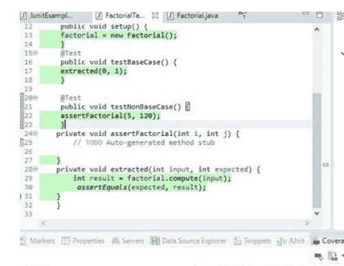
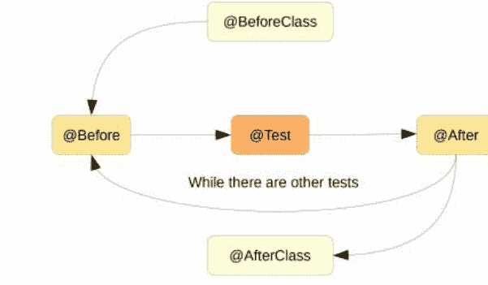
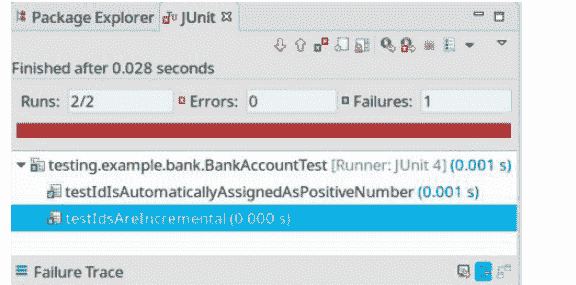
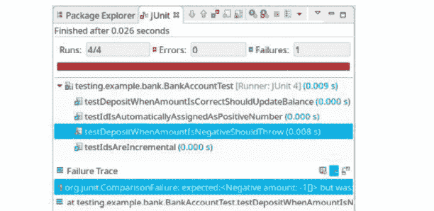
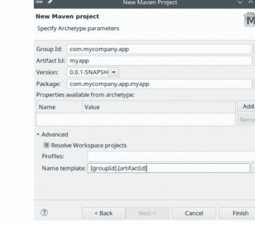
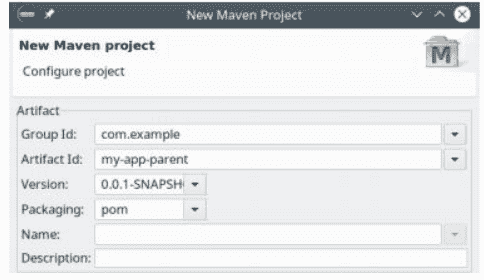
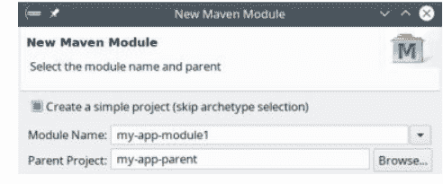
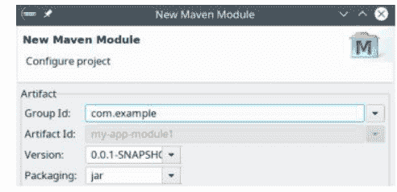

# Java 开发者的测试驱动开发指南

## 关于作者

George 是一位软件工程师和顾问。他在软件开发和自动化测试方面拥有丰富经验。他目前在意大利大学攻读计算机科学博士。此外，他曾在多家公司工作过……

## 测试驱动开发导论

测试驱动开发（TDD）是一种软件开发方法，在编写实际代码之前先编写测试。这种方法确保了代码的设计良好且易于维护。

## 3.1 循环：红-绿-重构

TDD 循环包含三个主要阶段：

- 红：编写一个失败的测试。
- 绿：编写最少代码使测试通过。
- 重构：清理代码并改进结构，同时确保测试通过。

## 3.2 测试：黑盒测试与白盒测试

测试主要分为两种类型：黑盒测试和白盒测试。黑盒测试关注软件的功能，而不关心其内部结构。白盒测试则关注内部逻辑和结构。

### 3.2.1 白盒测试

白盒方法是在了解产品如何实现并能够访问代码的情况下进行测试的方法。这种方法通常由开发者执行，因为他们了解代码。然而，如果这些测试由行业专家或至少由开发代码的人执行，效果会更好，因为自己测试自己的产品很难发现代码方面的问题。

### 3.2.2 黑盒测试

黑盒方法是测试人员通常使用的方法。它假设不知道功能是如何实现的，只关注它能做什么，因此其视角与终端用户关注的是系统的功能以及规范中提供的需求。这种方法的缺点是，它往往导致对所有场景的覆盖不足，因此可能会留下某些潜伏漏洞，直到后期的开发才被检测到。这种方法的示例仅包括等价划分、边界值分析、因果表、探索测试、错误猜测测试、状态图等。

### 3.2.3 灰盒

这种方法是一种中间方法，在实践中，你大致知道功能是如何实现的以及使用了哪些数据结构。通过这种方式，你可以进行比黑盒测试更具针对性的测试，但显然，由于不知道全部代码，测试的效果将不如白盒技术。

## 3.3 JUnit

在计算机科学中，`JUnit` 是一个用于 Java 语言的单元测试框架。`JUnit` 的经验对于测试驱动开发（TDD）理念的增长至关重要，它是统称为 xUnit 的单元测试框架家族之一。

该框架目前是 5 版本，由 3 个子项目/模块组成，需要 Java 8 或更高版本。版本 4 与版本 3 相比带来了结构性变化，并且与之不兼容。构成框架的类在版本 3 和 4 中属于不同的包；版本 3.8 以前为 `junit.framework`，从 4 开始为 `org.junit`。

- 每个测试都由一个带有 `@Test` 注解的公共方法表示。
- 每个测试方法验证单一场景 – 使用 SUT（被测系统）的一部分（例如调用 SUT 类上的方法）。
- 验证包括检查输出（或结果）是否符合预期。

## 4 个阶段

- **Setup（准备）**：为测试 SUT 准备环境：
  - 创建 SUT 的实例（此实例通常称为“固件” fixture）。
  - 准备测试环境。
- **Exercise（执行）**：在固件上调用我们想要测试的方法。
- **Verify（验证）**：验证结果是否符合预期。

> 重要：一个测试应该验证单一行为。如果一个方法有 5 种可能的行为，那么编写 5 个测试方法。

- **Teardown（清理）**： 清理以将执行环境恢复到执行之前的状态（例如清理数据库、删除某些文件）。这样，后续测试就不会受到影响。在我们的示例中，此阶段是不需要的。

## 3.4 JUnit 测试类

执行过程由我们在下面看到的注解驱动：

| 注解 | 用法 |
| --- | --- |
| `@Test` | 用于标记测试方法 |
| `@Before` | 用于标记在运行测试用例之前运行的方法（例如，打开数据库连接或数据流） |
| `@After` | 用于标记在运行测试用例后运行的方法（关闭之前打开的资源） |
| `@BeforeClass` | 类似于 `@Before` 但仅在测试运行的开始时运行 |
| `@AfterClass` | 类似于 `@After` 但仅在测试执行结束时运行 |
| `@Ignore` | 用于避免运行测试（避免使用注释） |

图 1：注解

## 用于断言的方法

定义在 `org.junit.Assert` 中的静态方法：

- `assertEquals(expected, actual)` - 使用 `equals`
- `assertSame(expected, actual)` - 使用 `==`
- `assertTrue(expression)`, `assertFalse(expression)`
- `assertNull(expression)`, `assertNotNull(expression)`
- 等等。

如果断言失败，测试将以失败状态终止。如果在测试期间抛出异常，测试将以错误状态终止。否则，它将成功。

我们需要记住，每个测试方法都必须在隔离的是可执行的，绝对不要编写依赖于其他方法副作用的测试方法，因为 `JUnit` 没有规定执行顺序。执行顺序可以指定，但不要仅仅依靠它来让测试运行。

来自 `JUnit` 运行器的 javadoc 显示——“默认运行器实现保证了测试类的实例将在运行测试之前立即构造，并且运行器不会保留对测试用例实例的引用，通常它们可以被垃圾回收。”

你无法确定 `JUnit` 是否重用同一个实例来执行测试方法。例如，考虑下面的程序：

```java
package junit.example;

import static org.junit.Assert.assertEquals;

import org.junit.Test;

public class JUnitWrongExample {

    private int count = 1;

    @Test
    public void test1() {
        count++;
        assertEquals(2, count);
    }

    @Test
    public void test2() {
        count++;
        assertEquals(2, count);
    }
}
```

两个测试中应该有一个失败，不是吗？不，它们都成功了。

## 3.5 使用 JUnit 进行测试驱动开发

单元测试指定并验证小段代码的功能。生成更多代码将取决于多少代码能让单元测试通过。然后通过重构将简化生产代码和测试代码。

创建一个新的 Java 项目，例如 `junit.example`。

在项目内部创建一个新的源文件夹 `tests`，我们将在其中编写所有的 `JUnit` 测试。（测试应与实际代码分开，生产代码将写在源文件夹 `src` 中）：右键点击项目，New -> Source Folder。

由于我们将从零开始使用 TDD，我们将在 `tests` 文件夹中编写测试，并在 Eclipse 工具在 `src` 文件夹中创建要实现的类和方法。

创建测试 `FactorialTest`：右键点击 `tests` 文件夹，选择 New -> JUnit Test Case，在对话框中使用这些设置：

点击 Finish，系统会要求将 `JUnit` 添加到构建路径中（接受请求）：

记住，测试用例中的每个测试方法都应该测试 SUT 的特定场景。由于我们正在实现一个递归函数，我们必须开始处理递归的边界情况。对于阶乘，边界情况是输入 0。

在测试用例 `FactorialTest` 内部，我们编写第一个测试方法：

```java
@Test
public void testCase() {
    Factorial factorial = new Factorial();
}
```

测试失败是因为类 `Factorial` 尚不存在。使用快速修复创建该类（你可以悬停在错误上，点击编辑器标尺上的标记，或者更好地使用快捷键 `Ctrl + 1` 以快速访问快速修复）：

`Factorial` 类必须创建在 `src` 文件夹中：

现在测试通过编译。在测试中，我们现在调用 `Factorial` 对象的 `compute` 方法，传递一个整数并将结果保存到整数变量中：

```java
@Test
public void testCase() {
    Factorial factorial = new Factorial();
    int result = factorial.compute(0);
}
```

再次，测试将无法编译，因为类中没有该方法。我们将使用快速修复创建它：

```java
public int compute(int i) {
    // TODO 自动生成的方法存根
    return 0;
}
```

保存文件并通过编译。

Eclipse 通过返回默认值实现了该方法。让我们用“验证”阶段完成测试。我们编写一个断言检查结果是否为 1（0 的实际值应为 1）：

我们预期测试失败，并通过运行测试来验证：右键点击 `FactorTest.java` 并选择 Run As -> JUnit Test。

提示：当一个包包含多个 `JUnit` 测试用例时，你可以右键点击包并选择 Run As -> JUnit Test 来执行所有。同样，如果一个项目包含多个带有测试用例的包，你可以对项目使用相同的上下文菜单执行它们。

`JUnit` 将执行类中的所有测试方法并在“JUnit”视图中报告结果：

测试由于我们预料的原因失败了：我们预期 1 但结果是 0（失败会报告预期值和实际值）。记住，先让测试失败至关重要，否则我们无法正确测试 SUT 的行为。

现在我们必须在 `Factorial` 类中编写代码仅为了让这个特定的测试成功：

让我们再次运行测试，这次测试如我们预期的那样成功了。`JUnit` 视图将显示“绿条”：所有测试均已通过（在我们案例中，目前有一个测试）：

我们考虑非基础情况的情况，即递归情况。因此，我们必须编写另一个测试方法。

不要受到复制粘贴之前测试的诱惑：测试也必须是整洁的代码，我们必须避免复制粘贴。这两个测试有什么共同点？给定 `compute` 方法一个输入，它们期望一个特定的输出。因此，让我们重构之前的测试，为第二个测试提供一些可重用的代码。

首先，SUT（被测试系统）对象应该是测试类的一个字段，并在每个测试之前之前重新创建（记住每个测试必须能够独立执行；在这个示例中，`Factorial` 类是无状态的，所以重用同一个实例没有问题，但未来我们可以让 `Factorial` 有状态——例如，我们可以缓存结果）。此类字段应该在带有 `@Before` 注解的方法中初始化。

我们将使用 Eclipse 工具进行重构。

在 `FactorialTest` 类中添加私有变量：

```java
public class FactorialTest {
    private Factorial factorial;

    @Before
    public void testTestCase() {
        Factorial factorial = new Factorial();
        int result = factorial.compute(0);
        assertEquals(1, result);
    }
}
```

我们创建一个带有 `@Before` 注解的方法（使用代码辅助功能来输入注解，这样会自动插入相应的导入语句）；方法的名称并不重要，但我们使用一个有意义的名字：

```java
public class FactorialTest {
    private Factorial factorial;

    @Before
    public void setup() {}

    @Test
    public void testTestCase() {
        Factorial factorial = new Factorial();
        int result = factorial.compute(0);
        assertEquals(1, result);
    }
}
```

将字段的初始化从测试方法移动到设置方法：

```java
import org.junit.Before;
import org.junit.Test;

public class FactorialTest {
    private Factorial factorial;
    @Before
    public void setup() {
        factorial = new Factorial();
    }

    @Test
    public void testTestCase() {
        int result = factorial.compute(0);
        assertEquals(1, result);
    }
}
```

现在我们使用“提取方法”：选择 `testTestCase` 方法的主体，右键点击，Refactor Method...（快捷键 `Shift+Alt+M`）

在对话框中，我们为新方法选择一个名称，例如 `assertFactorial`（因为我们在此测试类中使用它，所以将其设为私有）：

现在我们将一个方法中的表达式转换为方法的新参数（这将添加一个新方法，并在每个调用处都将原始表达式作为参数添加）。

我们希望为新方法参数化，带一个输入参数（传递给 `compute`）和一个预期输出参数（传递给 `assertEquals`）。必须转换为的表达式是：

```java
import org.junit.Before;
import org.junit.Test;

public class FactorialTest {
    private Factorial factorial;
    @Before
    public void setup() {
        factorial = new Factorial();
    }
    @Test
    public void testBaseCase() {
        extracted();
    }
    private void extracted() {
        int result = factorial.compute(0);
        assertEquals(1, result);
    }
}
```

在这个例子中，输入参数是 0，另一个要转换的表达式是 1。

在 `assertFactorial` 方法中选择 "0"，右键点击 Refactor → Introduce Parameter...，并为新参数指定一个名称，例如 input：

对 "1" 执行相同的操作并指定预期值。重构后的最终结果应该是：再次运行测试以确保没有破坏任何内容。现在我们可以为非基础情况编写新测试。


```java
import static org.junit.Assert.assertEquals;

import org.junit.Before;
import org.junit.Test;

public class FactorialTest {
    private Factorial factorial;
    @Before
    public void setUp() {
        factorial = new Factorial();
    }
    @Test
    public void testBaseCase() {
        extracted(0, 1);
    }
    private void extracted(int input, int expected) {
        int result = factorial.compute(input);
        assertEquals(expected, result);
    }
}
```

例如，对于输入 5，我们期望是 120。注意新测试只有一行代码且是可读的：

```java
@Test
public void testBaseCase() {
    extracted(5, 120);
}
```

运行所有测试。由于我们的方法总是返回 1，预期新测试失败。通过严格遵循 TDD，我们应该修改方法使所有测试通过（见下文解释）：

```java
public int compute(int i) {
    return 120;
}
```

运行所有测试：新测试通过了，但之前的测试将失败。注意：由于单元测试必须快速，运行所有测试不需要花费太多时间，因此不会影响你的生产力。我们现在应该修改方法使所有测试通过。这样做的一种简单方法是：现在所有测试通过了。我们刚刚执行的流程哪里错了：

```java
public int compute(int i) {
    if (i <= 0) {
        return 1;
    }
    return 120;
}
```

尽管遵循了 TDD，但这种实现没有意义：

```java
@Test
public void testBaseCase() {
    assertEquals(5, factorial.compute(4));
}
```

这将导致我们的愚蠢的阶乘实现失败，至少对于非基础情况。此外，它正确地指定了阶乘的行为。让我们修复 `compute` 实现使所有测试通过：

```java
public int compute(int i) {
    if (i <= 0) {
        return 1;
    }
    return i * compute(i-1);
}
```

编写带有预期异常的测试更好的方法是使用 JUnit 特有的机制（另见 JUnit 文档，https://github.com/junit-team/junit4/exceptiontesting）：

```java
@Test(expected = IllegalArgumentException.class)
public void testNegativeInput() {
    assertFactorial(-1, 0);
}
```

如果在执行期间没有抛出指定类型的异常，则此测试将失败。

## 3.6 重构单元测试

单元测试的巨大优点之一是它们允许你安全地对代码进行重构和结构调整，因为当你破坏了代码时，你会获得即时反馈。由于你不断地（而且确实在）重构代码，它会变得更简单、更模块化，并且更容易扩展和维护。但测试本身呢？随着时间的推移，你开发的测试代码库可能会比主线代码还要大。

重构之后，还有一个隐藏的奖励：在许多情况下，你会发现或创建出可以重用的方法。例如，一个使用 XPath 验证生成的 XML 文档内容的断言。当你发现此类代码时，将其提取到“测试库”中，供你的下一个项目使用。

## 3.7 代码覆盖率

在计算机科学中，代码覆盖率是一种用于描述在运行特定测试套件时，程序源代码的执行程度的指标。代码覆盖率（以百分比表示）高的程序，在测试期间执行了更多的源代码，这表明与低代码覆盖率的程序相比，它包含未被检测到的软件漏洞的概率较低。

有几个工具可以计算代码覆盖率。在 Java 中，最常用的是 JaCoCo (Java Code Coverage)，http://www.eclemma.org/jacoco/。

该工具执行 Java 应用程序并提供一份报告，列出应用程序期间执行的所有代码行。如果有分支指令（如 if-then else），它还会说明在程序运行期间是否执行了所有分支。如果我们运行的应用程序是一个测试套件，我们就能获得应用程序在测试期间执行的部分。如果测试编写得正确，这将告诉我们应用程序的哪些部分经过了测试。

Eclipse 的 JaCoCo 插件是 EclEmma：http://www.eclemma.org/

使用更新站点 http://update.eclemma.org/ 并安装“EclEmma Java Code Coverage”。从第 3 版本开始，EclEmma 是 Eclipse 的官方项目，因此也可以从 Eclipse 的主更新站点获取。

注意：如果你安装了“Eclipse IDE for Java Developers”包，那么 EclEmma 已经安装在你的 Eclipse 中。

```
Declarations
> Project
> tests
> JUnit-example
> Find Bugs
> src
> Working Sets...
> JUnit-test.java
> JRE System Library > Console PIT Mut
> default
Run As
> Definition As
> Cover As > JUnit Test
> classpath
> .gitignore
```

测试将像以前一样执行，但这次 JaCoCo 将跟踪已执行的指令，并在“Coverage”（覆盖率）视图中显示报告。Java 编辑器也会相应着色：

- “绿色”表示已覆盖（已执行）
- “红色”表示未覆盖
- “黄色”表示某些分支未执行（例如在 if-then else 中）

在我们的示例中，`Factorial` 类将是绿色：

注意，如果从未执行过 `testNegativeInput`，测试类中的该测试将显示红色：

这是 JaCoCo 的局限性，它不将抛出异常的语句视为已执行。这不是问题，因为测试类应该排除在代码覆盖率之外：我们必须关注 SUT（被测单元）类。在 EclEmma 中，这种排除可以在测试的 Run Configuration（运行配置）的“Coverage”选项卡中配置，你可以通过排除测试目录来精炼分析范围：

再次运行覆盖率，你会发现测试将不再包含在报告中。一旦配置正确，你可能希望将覆盖率（及测试）的启动配置保存到 Eclipse 项目中（记住，否则启动配置默认设置在工作区中）：在“Common”选项卡中，指定“Shared file”并指定项目内部的目录（例如项目文件夹的根目录）：

将保存一个 `FactorialTest.launch`（一个 XML 文件）。从现在起，你使用该启动项运行带代码覆盖率的测试（通过该文件的右键菜单）。如果你在另一个...中导入该项目




## 4.1 结构

测试的典型结构包含以下部分：

- 1. 设置（Setup）：在此阶段，我们为测试创建环境。在单元测试中，这通常对应于创建 SUT（被测单元）。此阶段建立了执行任何测试活动之前的状态。
- 2. 执行（Exercise）：在此阶段，我们与 SUT 交互（例如调用实例方法），并可能从中获取结果，或在其他实例中产生某些副作用。
- 3. 验证（Verify）：在此阶段，我们验证结果实际上符合预期行为，通常使用某些断言。这可能包括检查 SUT 被调用方法的返回值是否符合预期。或者，我们通过对测试固具的已改变状态进行断言，来验证被调用方法的副作用是否符合预期。
- 4. 清理（Teardown）：在此阶段，我们清理环境，将其恢复到执行测试前的状态。例如，如果我们创建了一些文件，我们应该在这个阶段将它们删除。

```text
assertEquals(expected, actual): 此方法有多个针对不同类型的重载版本。它依赖于 `equals` 方法来比较两个表达式。
assertSame(expected, actual): 与上述相同，但它使用 == 比较对象引用。
assertTrue(expression), assertFalse(expression), assertNull(expression), assertNotNull(expression) 的含义非常直观。
```


这提供了额外的错误信息，因为在失败时，JUnit 会自动报告预期值和实际值。相反，如果你直接提供一个布尔表达式（例如使用 `assertTrue`），那么提供一个比默认错误消息更好的失败信息可能是有用的，因为默认错误消息只会说明断言失败了。

如果断言失败，测试将以“失败（failure）”终止。如果在测试期间抛出异常，测试将以“错误（error）”终止。否则，测试将成功。

通常情况下，每个单元测试应该只测试 SUT（被测试单元）的单一行为。请记住，一个测试方法中有多个断言，如果其中一个失败，测试方法将立即终止，后续的断言将不会执行。然而，在某些情况下，为了验证同一个行为，必须在同一个测试方法中编写多个断言。总结来说，一个测试方法应该执行并验证单一场景和行为，但允许编写多个断言。

JUnit 遵循“全或全无”的哲学：如果测试方法中的某个断言失败，该方法就会失败，整个测试用例失败；如果该测试用例是测试套件的一部分（即在同一次运行运行多个用例），那么整个测试将被标记为失败。

JUnit 为设置（setup）和拆除（teardown）阶段提供了额外的方法注解，当这些阶段具有所有测试共有的行为时，它们非常有用。

以下注解必须与 `public static void` 方法配合使用：

*   `@BeforeClass` 被注解的方法在类中任何一个测试方法运行之前仅执行一次。
*   `@AfterClass` 被注解的方法在类中所有测试运行完毕后仅执行一次。

以下注解必须与 `public void` 方法配合使用：

*   `@Before` 被注解的方法在每个单独的测试方法之前执行。
*   `@After` 被注解的方法在每个单独的测试方法之后执行，即使发生失败或错误也是如此。

JUnit 测试的生命周期可以用下图表示。



JUnit 在测试生命周期期间只考虑注解。然而，最佳实践是给注解的方法起一个非常有意义的名字。这对于测试方法来说尤为关键：它们的名称应该描述测试正尝试验证的内容。

每个测试方法都必须与其他测试方法独立执行。这意味着一个测试方法绝不能依赖于其他方法的可能的副作用。事实上，设置和拆除阶段的目的就是让每个测试彼此相互独立。此外，JUnit 不保证测试方法是按照预定义的顺序执行的。最后，JUnit 不一定会重用同一个测试用例类的实例来运行其所有方法。因此，测试用例类的状态（即它的字段）永远不应该被视为标准程序中的对象状态。

## 4.2 示例

在源文件夹 `src` 中我们创建此类（你首先需要创建包 `testing.example.bank`）：

```java
package testing.example.bank;
public class BankAccount {
    private int id;
    private double balance = 0;
    private static int lastId = 0;

    public BankAccount() {
        this.id = ++lastId;
    }

    public int getID() {
        return id;
    }

    public double getBalance() {
        return balance;
    }

    public void deposit(double amount) {
        if (amount < 0) {
            throw new IllegalArgumentException("Negative amount: " + amount);
        }
        balance += amount;
    }

    public void withdraw(double amount) {
        if (amount < 0) {
            throw new IllegalArgumentException("Negative amount: " + amount);
        }
        balance -= amount;
    }
}
```

Listing 4.1 BankAccount

你可以通过以下几种方式运行测试用例：

*   右键点击资源管理器中的 `BankAccountTest` 并选择“运行 As -> JUnit”
*   右键点击编辑器中的 `BankAccountTest.java` 并选择“运行 As -> JUnit”
*   使用快捷键（取决于操作系统，在 Linux 上可以是 F11 或 Shift+Alt+X）。

让我们运行这个测试用例，看看它是如何工作的。完成后，你将被要求将 JUnit 添加到构建路径：


首先，在 `testing.example.bank` 包中创建此类：

```java
package testing.example.bank;

import static org.junit.Assert.*;
import org.junit.Test;

public class BankAccountTest {
    @Test
    public void test() {
        fail("Not yet implemented");
    }
}
```

Listing 4.2 BankAccountTest.java

让我们删除当前的测试方法，并在 `UnitTest` 中编写我们的第一个测试方法。例如，我们想验证 `id` 是自动分配且为正数：

```java
public void testIdIsAssignedPositiveNumber() {
    // 设置
    BankAccount bankAccount = new BankAccount();
    // 验证
    assertTrue("Id should be positive", bankAccount.getId() > 0);
}
```

Listing 4.3 PositiveNumber.java

按照上述方法运行该测试用例，现在 JUnit 视图应该显示绿色条，表示我们的测试成功了。请记住传递给 `assertTrue` 的第一个参数是一个在断言失败时显示的描述性错误消息。

让我们验证自动分配的 ID 是递增的：

```java
@Test
public void testIdsAreIncremental() {
    assertTrue("Id should be incremental",
    new BankAccount().getId() < new BankAccount().getId());
}
```

Listing 4.4 testIdsAreIncremental.java

你可能想以另一种形式编写上面的测试，直接断言 ID 的值：

```java
// 错误版本！
// 仅当它是第一个执行的测试时才有效
@Test
public void testIdsAreIncremental() {
    assertEquals(1, new BankAccount().getId());
    assertEquals(2, new BankAccount().getId());
}
```

Listing 4.5 testIds.java

用于生成增量 ID 的计数器，该计数器在执行测试时不会重置。如果它不是第一个执行的测试，它将会失败。



```java
@Test
public void testDepositWhenAmountIsCorrectShouldIncreaseBalance() {
    // 设置
    BankAccount bankAccount = new BankAccount();
    // 执行
    bankAccount.deposit(10);
    // 验证
    assertEquals(10, bankAccount.getBalance(), 0);
}
```

Listing 4.6: testDeposit.c

在这个示例中，没有必要测试计数器的实际值，只需验证 ID 是增量的[且]对象被创建了就足够了。如果你确实需要断言 ID 的实际值，那么你将不得不在 `BankAccount` 中添加一个重置静态计数器的机制。请注意，为了测试，这将需要修改 `BankAccount` 类的接口。我们稍后会回到这个问题。目前让我们继续测试这个类。

让我们为存款的“正例”情况编写一个测试，即传递的参数有效的情况：在这种情况下，我们有执行阶段，在该阶段调用被测试的方法，然后验证阶段将包括检查余额是否正确更新：

测试通过。

请注意，我们为测试方法选择了一个长名称，应该显式地表达该测试验证了什么。测试名称遵循以下约定：提到被测试方法的名称、测试的特定条件以及预期结果。因此，方法的名称可以读作：

测试 deposit 方法：当金额正确时，它应该增加余额。此外，在比较两个 `double` 时，我们需要使用适用于 `double` 值的 `assertEquals` 版本，它需要第三个参数：

*   delta：预期值和实际值之间的最大差值，在此范围内两个数字仍被视为相等。

由于我们在这里没有使用小数，也没有对这些值进行任何高级数学运算，因此我们指定 `0` 为 delta。

### 4.2.1 异常测试

现在我们为传递金额无效的情况编写一个测试。主是在 `try-catch` 块内部使用负参数执行方法调用；捕获到的异常是 `IllegalArgumentException`，因为这是我们的 SUT（被测系统）在这种情况下应该抛出的异常。在方法调用后，我们没有进入 `catch` 块，那么我们的测试必须失败，因为预期的异常没有抛出。在 `catch` 块中，我们验证异常的消息是否是正确的（这确保了我们的 `BankAccount` 抛出了异常）。验证余额没有变化也同样重要。

```java
//Test
public void testDepositWhenAmountIsNegativeShouldThrow() {
    // setup
    BankAccount bankAccount = new BankAccount();
    try {
        // execute
        bankAccount.deposit(-1);
        fail("Expected an IllegalArgumentException to be thrown");
    } catch (IllegalArgumentException e) {
        // verify
        assertEquals("Negative amount: -1", e.getMessage());
        assertEquals(0, bankAccount.getBalance(), 0);
    }
}
```

Listing 4.7: ShouldThrow.c

```java
13 }
14 }
```

该消息将告诉你传递给第一个断言的两个字符串是不同的。如果你双击“失败追踪”（Failure Trace）中的顶行，将弹出一个对话框，突出显示差异（此对话框仅在比较字符串且失败时可用）：



选择“失败追踪”中的元素，双击-...


对话框将显示差异：

```java
assertEquals("Negative amount: -1", e.getMessage());
```

Listing 4.8: testDeposit.c


```java
@Test
public void testDepositWhenAmountIsCorrectShouldIncreaseBalance() {
    // 设置
    BankAccount bankAccount = new BankAccount();
    // 执行
    bankAccount.deposit(10);
    // 验证
    assertEquals(10, bankAccount.getBalance(), 0);
}
```

Listing 4.6: testDeposit.c

在这个示例中，没有必要测试计数器的实际值，只需验证 ID 是增量的且对象被创建了就足够了。如果你确实需要断言 ID 的实际值，那么你将不得不在 `BankAccount` 中添加一个重置静态计数器的机制。请注意，为了测试，这将需要修改 `BankAccount` 类的接口。我们稍后会回到这个问题。目前让我们继续测试这个类。

让我们为存款的“正例”（happy case）情况编写一个测试，即传递的参数有效的情况：在这种情况下，我们有执行阶段，在该阶段调用被测试的方法，然后验证阶段将包括检查余额是否正确更新：

测试通过。

请注意，我们为测试方法选择了一个长名称，应该显式地表达该测试验证了什么。测试名称遵循以下约定：提到被测试方法的名称、测试的特定条件以及预期结果。因此，方法的名称可以读作：

测试 `deposit` 方法：当金额正确时，它应该增加余额。此外，在比较两个 `double` 时，我们需要使用适用于 `double` 值的 `assertEquals` 版本，它需要第三个参数：

- delta：预期值和实际值之间的最大差值，在此范围内两个数字仍被视为相等。

由于我们在这里没有使用小数，也没有对这些值进行任何高级数学运算，因此我们指定 `0` 为 delta。

### 4.2.1 异常测试

现在我们为传递金额无效的情况编写一个测试。主是在 `try-catch` 块内部使用负参数执行方法调用；捕获到的异常是 `IllegalArgumentException`，因为这是我们的 SUT（被测系统）在这种情况下应该抛出的异常。在方法调用后，我们没有进入 `catch` 块，那么我们的测试必须失败，因为预期的异常没有抛出。在 `catch` 块中，我们验证异常的消息是否是正确的（这确保了我们的 `BankAccount` 抛出了异常）。验证余额没有变化也同样重要。

```java
//Test
public void testDepositWhenAmountIsNegativeShouldThrow() {
    // setup
    BankAccount bankAccount = new BankAccount();
    try {
        // execute
        bankAccount.deposit(-1);
        fail("Expected an IllegalArgumentException to be thrown");
    } catch (IllegalArgumentException e) {
        // verify
        assertEquals("Negative amount: -1", e.getMessage());
        assertEquals(0, bankAccount.getBalance(), 0);
    }
}
```

Listing 4.7: ShouldThrow.c

```java
13 }
14 }
```

该消息将告诉你传递给第一个断言的两个字符串是不同的。如果你双击“失败追踪”（Failure Trace）中的顶行，将弹出一个对话框，突出显示差异（此对话框仅在比较字符串且失败时可用）：


选择“失败追踪”中的元素，双击...

对话框将显示差异：

```java
assertEquals("Negative amount: -1", e.getMessage());
```

## 4.3 使用 PIT 进行变异测试

```java
public class PasswordValidatorTest {
    private PasswordValidator passwordValidator;

    @Before
    public void init() {
        this.passwordValidator = new PasswordValidator();
    }

    @Test
    public void shouldNotBeNull() {
        assertFalse(this.passwordValidator.isValidPassword(null));
    }

    @Test
    public void shouldNotEmpty() {
        assertFalse(this.passwordValidator.isValidPassword(""));
    }

    @Test
    public void shouldNotBeSmallerThanThree() {
        assertFalse(this.passwordValidator.isValidPassword("ab"));
    }

    @Test
    public void shouldBeGreaterOrOrEqualToThree() {
        assertTrue(this.passwordValidator.isValidPassword("abcd"));
    }
}
```

绿色：所有测试均成功通过。

100% 代码覆盖率。

假设如果测试如果捕获到 Bug，它就是健壮的，那么如果代码覆盖率达到 100%，我们可以得出我们的测试是不健壮的结论。那么，我们如何知道测试套件是不健壮的呢？我们如何理解如何加强它？答案只有一个：让我们运行变异测试并杀死变异体（mutants）。

在代码中手动引入更改并不是可行的做法；每种语言都有工具可以自动创建变异体，并为每个变异体运行测试套件，以识别有多少变异体生存。在 Java 中，事实标准是 PIT：http://pitest.org/。PIT 对编译生成的字节码应用变异，并为每个变异执行测试套件。安装它非常简单（下面是将其集成到你的 maven 项目中，但在 PIT 网站你也可以找到将其集成到 Gradle 的文档。

```xml
<build>
  <plugins>
    <groupId>org.pitest</groupId>
    <artifactId>pitest-maven</artifactId>
    <version>1.1.10</version>
  </plugins>
</build>
```

默认情况下，PIT 在你的整个代码中引入变异。由于执行变异测试是一项昂贵的操作，我们也可以配置 PIT 仅在特定的包或类中插入变异。

```xml
<plugin>
  <groupId>org.pitest</groupId>
  <artifactId>pitest-maven</artifactId>
  <version>LATEST</version>
  <configuration>
    <classes>
      <param>com.your.package.root.want.to.mutate</param>
    </classes>
    <targetTests>
      <param>com.your.package.root</param>
    </targetTests>
  </configuration>
</plugin>
```

现在让我们在示例中启动 PIT。在项目文件夹中直接启动 PIT 目标即可：

```bash
mvn org.pitest:pitest-maven:mutationCoverage
```

PIT 将执行变异测试，并在 `target/pit-reports` 中创建结果的 html 报告。这些报告对于衡量我们测试的健壮性以及如何加强测试的建议非常有用。这里是我们变异测试的结果。

## Pit 变异覆盖率报告

### 项目摘要

| 类数量 | 行覆盖率 | 变异覆盖率 |
| --- | --- | --- |
| 1 | 100% 9/9 | 88% 7/8 |

### 按包划分

| 名称 | 类数量 | 行覆盖率 | 变异覆盖率 |
| --- | --- | --- | --- |
| it.itancoders | 1 | 100% 9/9 | 88% 7/8 |

如你所见，变异覆盖率告诉我们已经创建了 8 个变异体并对其进行了测试。8 个变异体中有 7 个被杀死（或至少至少有一个测试失败了）。有一个变异体存活了下来，我们的测试套件是不健壮的。让我们详细查看报告，以了解更多关于该存活变异体的信息。

PIT 在变异测试期间执行的分析细节非常棒：

- 显示了变异体上的变异类型。
- 显示了在变异体上执行的测试。
- 用红色显示了变异测试期间更改且未通过测试的行。它还用红色突出了存活变异体的变异类型。在我们的示例中，存活的变异体源于控制密码长度的条件的变异。通过对密码长度检查引入决策变异（将大于替换为严格大于），我们的测试没有失败，因此变异体存活了。

从这些报告中可以推导出测试是不健壮的，该条件上的一个大 Bug 可能无法被我们的单元测试检测到（在文章开头尝试在该条件上插入 Bug 时我们已经理解了这一点）。我们该如何修复测试中的这一漏洞呢？让我们加强我们的测试套件吧。正如测试理论研究所示，当你对一个在两个极端情况范围内有效的属性编写单元测试时，必须提供以下测试场景：

- 属性在允许极端情况之外的测试用例。
- 属性在允许范围之内的情况。

### PasswordValidator.java

```java
package it.itancoders;

public class PasswordValidator {
    public boolean isValidPassword(String s) {
        if (s == null) {
            return false;
        }
        if (s.length() >= 3) {
            return true;
        } else {
            return false;
        }
    }
}
```

### 变异

1. 否定条件 - KILLED
2. 替换整数大小 (x 1/0) - KILLED
3. 否定条件 - KILLED
4. 边界 - SURVIVED
5. 否定条件 - KILLED
6. 替换整数大小 (x 1/0) - KILLED
7. 否定条件 - KILLED
8. 允许的极端情况 - KILLED

## 4.4 模拟 (MOCKING)

`portfolio.setStockService(...)` - 将 stockService 模拟对象赋值给 portfolio（投资组合）。

`portfolio.getMarketValue()` - 投资组合使用模拟的 stock 服务返回其股票的市值。

在深入介绍 Mockito 框架的细节之前，让我们来看一个实际应用示例。在这个例子中，我们创建了 Stock Service 的模拟对象以获取某些股票的虚拟代理，并对 Java 类 `Portfolio` 进行了单元测试。

下面将以分步的方式详细讨论该过程。

### 步骤 1 - 创建一个表示股票的 JAVA 类。

文件：Stock.java

```java
1 public class Stock {
2 private String stockId;
3 private String name;
4 private int quantity;
5 
6 public Stock(String stockId, String name, int quantity){
7 this.stockId = stockId;
8 this.name = name;
9 this.quantity = quantity;
10 }
11 
12 public String getStockId() {
13 return stockId;
14 }
15 
16 public void setStockId(String stockId) {
17 this.stockId = stockId;
18 }
19 
20 public int getQuantity() {
21 return quantity;
22 }
23 
24 public String getTicker() {
25 return name;
26 }
27 }
```

列表 4.10：Stock.java

### 步骤 2 - 创建一个接口 StockService 以获取股票价格。

文件：StockService.java

```java
1 public interface StockService {
2 public double getPrice(Stock stock);
3 }
```

列表 4.11：StockService.java

### 步骤 3 - 创建一个 Portfolio 表示任何客户的投资组合。

文件：Portfolio.java

```java
1 import java.util.List;
2
3 public class Portfolio {
4 private StockService stockService;
5 private List<Stock> stocks;
6
7 public StockService getStockService() {
8 return stockService;
9 }
10
11 public void setStockService(StockService stockService) {
12 this.stockService = stockService;
13 }
14
15 public List<Stock> getStocks() {
16 return stocks;
17 }
18
19 public void setStocks(List<Stock> stocks) {
20 this.stocks = stocks;
21 }
22
23 public double getMarketValue(){
24 double marketValue = 0.0;
25
26 for(Stock stock:stocks){
27 marketValue += stockService.getPrice(stock) *
28 stock.getQuantity();
29 }
30 return marketValue;
31 }
```

列表 4.12：Portfolio.class

### 步骤 4 - 测试 Portfolio 类

让我们通过向其注入 stockservice 的模拟对象来测试 `Portfolio` 类。模拟对象将由 Mockito 创建。

文件：PortfolioTester.java


```java
package com.tutorialpoint.mock;
import java.util.ArrayList;
import java.util.List;
import static org.mockito.Mockito.*;
public class PortfolioTester {
    Portfolio portfolio;
    StockService stockService;

    public static void main(String[] args) {
        PortfolioTester tester = new PortfolioTester();
        tester.setUp();
        System.out.println(tester.testMarketValue() ? "pass" : "fail");
    }

    public void setUp() {
        // 创建待测试的投资组合对象
        portfolio = new Portfolio();

        // 创建股票服务的模拟对象
        stockService = mock(StockService.class);

        // 将 stockService 设置为投资组合
        portfolio.setStockService(stockService);
    }

    public boolean testMarketValue() {
        // 创建要添加到投资组合的股票列表
        List<Stock> stocks = new ArrayList<Stock>();
        Stock googleStock = new Stock("1", "Google", 10);
        Stock microsoftStock = new Stock("2", "Microsoft", 100);

        stocks.add(googleStock);
        stocks.add(microsoftStock);

        // 将股票添加到投资组合
        portfolio.setStocks(stocks);
        // 模拟股票服务的行为以返回
        // 各股票的值
        when(stockService.getPrice(googleStock)).thenReturn(50.00);

        when(stockService.getPrice(microsoftStock)).thenReturn(1000.00);

        double marketValue = portfolio.getMarketValue();
        return marketValue == 100500.0;
    }
}
```

列表 4.13：PortfolioTester.java

## 步骤 5 - 验证结果

使用 `javac` 编译器按照如下所示编译类：

```
C:\Mockito_WORKSPACE>javac Stock.java StockService.java Portfolio.java PortfolioTester.java
```

现在运行 `PortfolioTester` 查看结果：

```
C:\Mockito_WORKSPACE>java PortfolioTester
```

验证输出：

Pass

在这里我们将创建一个使用 `CalculatorService` 执行基础数学运算（如加法、减法、乘法和除法）的数学应用程序。

我们将使用 Mockito 来模拟 `CalculatorService` 的虚拟实现。此外，我们大量使用了注解来展示它与 JUnit 和 Mockito 的兼容性。

下面将以分步的方式详细讨论该过程。

### 步骤 1 创建一个名为 CalculatorService 的接口以提供数学函数

文件：CalculatorService.java

```java
public interface CalculatorService {
    public double add(double input1, double input2);
    public double subtract(double input1, double input2);
    public double multiply(double input1, double input2);
    public double divide(double input1, double input2);
}
```

（注：此处根据后续逻辑补全了结构）

### 步骤 2 创建一个 JAVA 类来表示 MathApplication

文件：MathApplication.java

```java
public class MathApplication {
    private CalculatorService calcService;

    public void setCalculatorService(CalculatorService calcService){
        this.calcService = calcService;
    }

    public double add(double input1, double input2){
        return calcService.add(input1, input2);
    }
    // ... 后续内容省略
}
```

## 4-5 MOCKITO - 添加行为

```java
    public double subtract(double input1, double input2){
        return calcService.subtract(input1, input2);
    }
    public double multiply(double input1, double input2){
        return calcService.multiply(input1, input2);
    }
    public double divide(double input1, double input2){
        return calcService.divide(input1, input2);
    }
```

Listing 4.19: MathApplication.class

### 步骤 3 测试 MathApplication 类

让我们测试 `MathApplication` 类，向其注入 `calculatorService` 的 mock（模拟对象）。Mock 将由 Mockito 创建。

文件：MathApplicationTester.java

```java
import static org.mockito.Mockito.when;
import org.junit.Assert;
import org.junit.Test;
import org.junit.runner.RunWith;
import org.mockito.InjectMocks;
import org.mockito.Mock;
import org.mockito.runners.MockitoJUnitRunner;

// @RunWith 将运行器（runner）附加到测试中以初始化测试数据
@RunWith(MockitoJUnitRunner.class)
public class MathApplicationTester {
    // @InjectMocks 注解用于创建并注入 mock 对象
    @InjectMocks
    MathApplication mathApplication = new MathApplication();

    // @Mock 注解用于创建被注入的 mock 对象
    @Mock
    CalculatorService calcService;

    @Test
    public void testAdd() {
        // 定义 calc service 相加两个数字的行为
        when(calcService.add(10.0,20.0)).thenReturn(30.0);
        // 测试加功能
        Assert.assertEquals(mathApplication.add(10.0, 20.0),30.0);
    }
}
```

Listing 4.20: MathApplicationTester.java

## 步骤 4 执行测试用例

在 Mockito WORKSPACE 中创建一个名为 `TestRunner` 的 java 类来执行测试用例。

文件：TestRunner.java

```java
import org.junit.JUnitCore;
import org.junit.runner.Result;
import org.junit.runner.notification.Failure;

public class TestRunner {
    public static void main(String[] args) {
        Result result = 
        JUnitCore.runClasses(MathApplicationTester.class);

        for (Failure failure : result.getFailures()) {
            System.out.println(failure.toString());
        }

        System.out.println(result.wasSuccessful());
    }
}
```

Listing 4.21: TestRunner.java

```
C:\Mockito_WORKSPACE>javac CalculatorService.java MathApplication.java MathApplicationTester.java TestRunner.java
```

现在运行 `TestRunner` 以查看结果：

```
C:\Mockito_WORKSPACE>java TestRunner
```

验证输出：

true

## 4.6 MOCKITO - 验证行为

Mockito 可以确保 mock 方法是否使用所需的参数被调用。这是通过使用 `verify()` 方法实现的。查看以下代码片段：

```java
// 测试加功能
Assert.assertEquals(calcService.add(10.0, 20.0), 30.0);

// 验证是否调用了相同参数的 calcService 方法
verify(calcService).add(10.0, 20.0);
```

示例 - 使用相同参数的 `verify()`。

### 步骤 1 创建一个名为 CalculatorService 的接口以提供数学函数

文件：CalculatorService.java

```java
public interface CalculatorService {
    public double add(double input1, double input2);
    public double subtract(double input1, double input2);
    public double multiply(double input1, double input2);
    public double divide(double input1, double input2);
}
```

Listing 4.22: CalculatorService.java

### 步骤 2 创建一个 JAVA 类来表示 MathApplication

文件：MathApplication.java

```java
public class MathApplication {
    private CalculatorService calcService;

    public void setCalculatorService(CalculatorService calcService){
        this.calcService = calcService;
    }

    public double add(double input1, double input2){
        return calcService.add(input1, input2);
    }

    public double subtract(double input1, double input2){
        return calcService.subtract(input1, input2);
    }

    public double multiply(double input1, double input2){
        return calcService.multiply(input1, input2);
    }

    public double divide(double input1, double input2){
        return calcService.divide(input1, input2);
    }
}
```

Listing 4.23: MathApplication.java

### 步骤 3 测试 MathApplication 类

让我们测试 `MathApplication` 类，向其注入 `calculatorService` 的 mock。Mock 将由 Mockito 创建。

## 文件：MathApplicationTester.java

```java
import static org.mockito.Mockito.when;
import org.junit.Assert;
import org.junit.Test;
import org.junit.runner.RunWith;
import org.mockito.InjectMocks;
import org.mockito.Mock;
import org.mockito.runners.MockitoJUnitRunner;
// @RunWith 将运行器（runner）附加到测试类以初始化测试数据
@RunWith(MockitoJUnitRunner.class)
public class MathApplicationTester {
    // @InjectMocks 注解用于创建并注入 mock 对象
    @InjectMocks
    MathApplication mathApplication = new MathApplication();

    // @Mock 注解用于创建被注入的 mock 对象
    @Mock
    CalculatorService calcService;

    @Test
    public void testAdd() {
        // 添加 calc service 相加两个数字的行为
        when(calcService.add(10.0,20.0)).thenReturn(30.0);
        // 测试加功能
        Assert.assertEquals(mathApplication.add(10.0, 20.0),30.0, 0);
    }
}
```

Listing 4.24: MathApplicationTester.java

## 4-7 MOCKITO - 期望调用

```java
//为 calc 服务添加添加两个数字的行为
when(calcService.add(10.0,20.0)).thenReturn(30.00);
```

```java
//测试加法功能
Assert.assertEquals(mathApplication.add(10.0, 20.0), 30.00);
```

代码列表 4.28: MathApplicationTester.java

### 第 4 步 执行测试用例

在 `C:\Mockito_WORKSPACE` 中创建一个名为 `TestRunner` 的 java 类来执行测试用例。

File: TestRunner.java

```java
import org.junit.runner.JUnitCore;
import org.junit.runner.Result;
import org.junit.runner.notification.Failure;
public class TestRunner {
    public static void main(String[] args) {
        Result result = JUnitCore.runClasses(MathApplicationTester.class);
        for (Failure failure : result.getFailures()) {
            System.out.println(failure.toString());
        }
        System.out.println(result.wasSuccessful());
    }
}
```

代码列表 4.29: TestRunner.java

## 4.7 MOCKITO - 期望调用

Mockito 针对特定方法可以调用的次数提供了特殊检查。假设 `MathApplication` 应该调用一次 `CalculatorService.serviceUsed()` 方法，那么它不应该被多次调用 `CalculatorService.serviceUsed()`。

如下所示创建 `CalculatorService` 接口。


### 第 5 步 - 验证结果

使用 `javac` 编译器编译所有内容如下：

```bash
C:\Mockito_WORKSPACE\javac CalculatorService.java MathApplication.java MathApplicationTester.java TestRunner.java
```

现在运行 Test Runner 查看结果：

```bash
C:\Mockito_WORKSPACE\java TestRunner
```

验证输出。

```
tAdd(MathApplicationTester);
Argument(s) are different! Wanted:
calcService.add(10.0, 20.0);
-> at MathApplicationTester.test(MathApplicationTester.java:32)
Actual invocation has different arguments:
calcService.add(10.0, 20.0);
-> at MathApplication.add(MathApplication.java:10)
false

//为 calc 服务添加添加两个数字的行为
when(calcService.add(10.0, 20.0)).thenReturn(30.0);

// 限制方法调用次数为 1，不允许少于或多于调用
verify(calcService, times(1)).add(10.0, 20.0);
```

**File: CalculatorService2.java**

```java
1 public interface CalculatorService {
2 public double add(double input1, double input2);
3 public double subtract(double input1, double input2);
4 public double multiply(double input1, double input2);
5 public double divide(double input1, double input2);
6 }
```

**代码列表 4.30: CalculatorService2.java**

### 示例

#### 第 1 步 创建一个名为 CalculatorService 的接口以提供数学函数

**File: CalculatorService2.java**

```java
1 public interface CalculatorService {
2 public double add(double input1, double input2);
3 public double subtract(double input1, double input2);
4 public double multiply(double input1, double input2);
5 public double divide(double input1, double input2);
6 }
```

**代码列表 4.31: CalculatorService2.java**

#### 第 2 步 创建一个 JAVA 类来表示 MathApplication

**File: MathApplication2.java**

```java
public class MathApplication {
    private CalculatorService calcService;

    public void setCalculatorService(CalculatorService calcService) {
        this.calcService = calcService;
    }

    public double add(double input1, double input2) {
        return calcService.add(input1, input2);
    }

    public double subtract(double input1, double input2) {
        return calcService.subtract(input1, input2);
    }

    public double multiply(double input1, double input2) {
        return calcService.multiply(input1, input2);
    }

    public double divide(double input1, double input2) {
        return calcService.divide(input1, input2);
    }
}
```

**代码列表 4.32: MathApplication2.java**

#### 第 3 步 测试 MathApplication 类

让我们通过注入 `calculatorService` 的 mock 对象来测试 MathApplication 类。Mock 由 Mockito 创建。

**File: MathApplicationTester2.java**

```java
import static org.mockito.Mockito.verify;
import static org.mockito.Mockito.when;
import static org.mockito.Mockito.times;
import static org.mockito.Mockito.never;
import org.junit.Assert;
import org.junit.Test;
import org.junit.runner.RunWith;
import org.mockito.InjectMocks;
import org.mockito.Mock;
import org.mockito.runners.MockitoJUnitRunner;

// @RunWith 在测试类中激活一个运行器以初始化测试数据
@RunWith(MockitoJUnitRunner.class)
public class MathApplicationTester2 {

    // @InjectMocks 注解用于创建并注入 mock 对象
    @InjectMocks
    MathApplication mathApplication = new MathApplication();

    // @Mock 注解用于创建 mock 对象
    @Mock
    CalculatorService calcService;

    @Test
    public void testAdd() {
        //为 calc 服务添加添加两个数字的行为
        when(calcService.add(10.0, 20.0)).thenReturn(30.0);

        // 测试加法功能
        Assert.assertEquals(mathApplication.add(10.0, 20.0), 30.00);

        // 限制方法调用次数为 1，不允许少于或多于调用
        verify(calcService, times(1)).add(10.0, 20.0);
    }
}
```

**代码列表 4.33: MathApplication2.java**

#### 第 4 步 执行测试用例

在 `C: Mockito WORKSPACE` 中创建一个名为 `TestRunner` 的 java 类来执行测试用例。

**File: TestRunner.java**

```java
import org.junit.runner.JUnitCore;
import org.junit.runner.Result;
import org.junit.runner.notification.Failure;
public class TestRunner {
    public static void main(String[] args) {
        Result result = JUnitCore.runClasses(MathApplicationTester.class);
        for (Failure failure : result.getFailures()) {
            System.out.println(failure.toString());
        }
        System.out.println(result.wasSuccessful());
    }
}
```

**代码列表 4.34: TestRunner.java**

## 4.8 MOCKITO - 变动调用

Mockito 提供了以下方法来改变期望的调用次数。

- `atLeast(min)`：期望至少调用 min 次

### 第 5 步 - 验证结果

使用 `javac` 编译器编译所有内容如下：

```bash
C:\Mockito_WORKSPACE\javac CalculatorService.java MathApplication.java MathApplicationTester.java TestRunner.java
```

现在运行 Test Runner 查看结果：

```bash
C:\Mockito_WORKSPACE\java TestRunner
```

验证输出。

```
true
```

- `atLeastOnce()`：期望至少调用一次
- `atMost(max)`：期望最多调用 max 次

### 示例

#### 第 1 步 创建一个名为 CalculatorService 的接口以提供数学函数

**File: CalculatorService4.java**

```java
public interface CalculatorService {
    public double add(double input1, double input2);
    public double subtract(double input1, double input2);
    public double multiply(double input1, double input2);
    public double divide(double input1, double input2);
}
```

**代码列表 4.35: CalculatorService4.java**

#### 第 2 步 创建一个 JAVA 类来表示 MathApplication

**File: MathApplication4.java**

```java
public class MathApplication4 {
    private CalculatorService calcService;

    public void setCalculatorService(CalculatorService calcService) {
        this.calcService = calcService;
    }

    public double add(double input1, double input2) {
        return calcService.add(input1, input2);
    }

    public double subtract(double input1, double input2) {
        return calcService.subtract(input1, input2);
    }

    public double multiply(double input1, double input2) {
        return calcService.multiply(input1, input2);
    }

    public double divide(double input1, double input2) {
        return calcService.divide(input1, input2);
    }
}
```

**代码列表 4.36: MathApplication4.java**

#### 第 3 步 测试 MathApplication 类

让我们通过注入 `calculatorService` 的 mock 对象来测试 MathApplication 类。Mock 由 Mockito 创建。

**File: MathApplicationTester.java**

```java
import static org.mockito.Mockito.verify;
import static org.mockito.Mockito.when;
import static org.mockito.Mockito.atLeastOnce;
import static org.mockito.Mockito.atLeast;
import static org.mockito.Mockito.atMost;
```

## 4.8 MOCKITO - 变体调用

```java
MathApplication mathApplication = new MathApplication();
//Mock 注解用于创建要被注入的 mock 对象
@Mock
CalculatorService calcService;

@Test
public void testAdd() {
    //为 calc service 添加两个两个数字的行为
    when(calcService.add(10.0, 20.0)).thenReturn(30.0);

    // 为 calc service 添加减去两个数字的行为
    when(calcService.subtract(20.0, 10.0)).thenReturn(10.0);

    // 测试加法功能
    Assert.assertEquals(mathApplication.add(10.0, 20.0), 30.0, 30.0);
    Assert.assertEquals(mathApplication.add(10.0, 20.0), 30.0, 30.0);
    Assert.assertEquals(mathApplication.add(10.0, 20.0), 30.0);

    // 测试减法功能
    Assert.assertEquals(mathApplication.subtract(20.0, 10.0), 0.0);

    // 检查至少调用 1 次
    verify(calcService, atLeastOnce()).subtract(20.0, 10.0);

    // 检查 add 函数是否至少被调用 2 次
    verify(calcService, atLeast(2)).add(10.0, 20.0);

    // 检查 add 函数最多被调用 3 次
    verify(calcService, atMost(3)).add(10.0, 20.0);
}
```

> **列表 4.37: MathApplicationTester.java**

#### 步骤 4 执行测试用例

在 `C: Mockito WORKSPACE` 中创建一个名为 `TestRunner` 的 java 类来执行测试用例。

**文件: TestRunner4.java**

## 4.9 MOCKITO - 异常处理

```java
1 import org.junit.runner.JUnitCore;
2 import org.junit.runner.Result;
3 import org.junit.runner.notification.Failure;
4
5 public class TestRunner {
    public static void main(String[] args) {
      Result result =
      JUnitCore.runClasses(MathApplicationTester.class);

      for (Failure failure : result.getFailures()) {
        System.out.println(failure.toString());
      }

      System.out.println(result.wasSuccessful());
    }
}
```

**列表 4.38: TestRunner4.java**

### 步骤 5 - 验证结果

使用 java 编译器如下所示编译类：

```cmd
C:\Mockito_WORKSPACE\java CalculatorService4.java MathApplication4.java MathApplicationTester4.java TestRunner4.java
```

现在运行 Test Runner 查看结果：

```cmd
C:\Mockito_WORKSPACE\java TestRunner4
验证输出。
```

```
true
```

## 4.9 MOCKITO - 异常处理

Mockito 提供了模拟一个 mock 抛出异常的能力，因此可以测试异常处理。请查看以下代码片段。

```java
//添加抛出异常的行为
doThrow(new RuntimeException("divide operation not implemented"))
.when(calcService).add(10.0,20.0);
```

## 4.9 MOCKITO - 异常处理


在这里我们为 mock 对象添加了异常语句。`MathApplication` 使用 `calcService` 的 `add` 方法，每当 `calcService.add(double)` 方法被调用时，mock 就会抛出 `RuntimeException`。

### 示例

#### 步骤 1 创建一个名为 CalculatorService 的接口以提供数学函数

文件：`CalculatorService5.java`

```java
public interface CalculatorService5 {
    public double add(double input1, double input2);
    public double subtract(double input1, double input2);
    public double multiply(double input1, double input2);
    public double divide(double input1, double input2);
}
```

列表 4.39: `CalculatorService5.java`

#### 步骤 2 创建一个 JAVA 类来表示 MathApplication

文件：`MathApplication5.java`

```java
public class MathApplication {
    private CalculatorService calcService;

    public void setCalculatorService(CalculatorService calcService) {
        this.calcService = calcService;
    }

    public double add(double input1, double input2) {
        return calcService.add(input1, input2);
    }

    public double subtract(double input1, double input2) {
        return calcService.subtract(input1, input2);
    }

    public double multiply(double input1, double input2) {
        return calcService.multiply(input1, input2);
    }

    public double divide(double input1, double input2) {
        return calcService.divide(input1, input2);
    }
}
```

列表 4.40: `MathApplication5.java`

#### 步骤 3 测试 MathApplication 类

通过向其注入 `calculator-Service` 的 mock 来测试 `MathApplication` 类。

文件：`MathApplicationTester5.java`

```java
import static org.mockito.Mockito.doThrow;

import org.junit.Assert;
import org.junit.Test;
import org.junit.runner.RunWith;
import org.mockito.InjectMocks;
import org.mockito.Mock;
import org.mockito.runners.MockitoRunner;

// @RunWith 启动一个类来初始化测试数据
@RunWith(MockitoRunner.class)
public class MathApplicationTester5 {

    // @Mock 用于创建要被注入的 mock 对象
    @Mock
    CalculatorService calcService;

    MathApplication mathApplication = new MathApplication();

    // @InjectMocks 用于将 mock 注入目标对象
    @InjectMocks
    MathApplication mathApplicationApp;

    @Test(expected = RuntimeException.class)
    public void testAdd() {
        // 添加抛出异常的行为
        doThrow(new RuntimeException("divide operation not implemented"))
                .when(calcService).add(10.0, 20.0);

        // 测试加法功能
        Assert.assertEquals(mathApplication.add(10.0, 20.0), 30.0, 30.0);
    }
}
```

列表 4.41: `MathApplicationTester.java`

#### 步骤 4 执行测试用例

在 `C: Mockito WORKSPACE` 中创建一个名为 `TestRunner` 的 java 类来执行测试用例。

文件：`TestRunner.java`

```java
import org.junit.runner.JUnitCore;
import org.junit.runner.Result;
import org.junit.runner.notification.Failure;

public class TestRunner {
    public static void main(String[] args) {
        Result result = JUnitCore.runClasses(MathApplicationTester.class);

        for (Failure failure : result.getFailures()) {
            System.out.println(failure.toString());
        }

        System.out.println(result.wasSuccessful());
    }
}
```

列表 4.42: `TestRunner4.java`

#### 步骤 5 - 验证结果

使用 `javac` 编译器如下所示编译类：

```cmd
C:\Mockito_WORKSPACE\javac CalculatorService4.java MathApplication4.java MathApplicationTester4.java TestRunner4.java
```

现在运行 Test Runner 查看结果：

```cmd
C:\Mockito_WORKSPACE\java TestRunner4
```

验证输出。

```text
testAdd(MathApplication5): Add operation not implemented

false
```

## 4.9 MOCKITO - 异常处理

### 创建 MOCK

Mockito 提供了模拟一个 mock 抛出异常的能力，因此可以测试异常处理。请查看以下代码片段。

```java
// 添加抛出异常的行为
doThrow(new RuntimeException("divide operation not implemented"))
        .when(calcService).add(10.0, 20.0);
```

我们为 mock 对象添加了异常语句。`MathApplication` 使用 `calcService` 的 `add` 方法，每当 `calcService.add(double)` 方法被调用时，mock 就会抛出 `RuntimeException`。

### 示例

#### 步骤 1 创建一个名为 CalculatorService 的接口以提供数学函数

文件：`CalculatorService5.java`

```java
public interface CalculatorService5 {
    public double add(double input1, double input2);
    public double subtract(double input1, double input2);
    public double multiply(double input1, double input2);
    public double divide(double input1, double input2);
}
```

列表 4.39: `CalculatorService5.java`

#### 步骤 2 创建一个 JAVA 类来表示 MathApplication

文件：`MathApplication5.java`

```java
public class MathApplication {
    private CalculatorService calcService;

    public void setCalculatorService(CalculatorService calcService) {
        this.calcService = calcService;
    }

    public double add(double input1, double input2) {
        return calcService.add(input1, input2);
    }

    public double subtract(double input1, double input2) {
        return calcService.subtract(input1, input2);
    }

    public double multiply(double input1, double input2) {
        return calcService.multiply(input1, input2);
    }

    public double divide(double input1, double input2) {
        return calcService.divide(input1, input2);
    }
}
```

列表 4.40: `MathApplication5.java`

#### 步骤 3 测试 MathApplication 类

通过向其注入 `calculator-Service` 的 mock 来测试 `MathApplication` 类。

文件：`MathApplicationTester5.java`

```java
import static org.mockito.Mockito.doThrow;

import org.junit.Assert;
import org.junit.Test;
import org.junit.runner.RunWith;
import org.mockito.InjectMocks;
import org.mockito.Mock;
import org.mockito.runners.MockitoRunner;

// @RunWith 启动一个类来初始化测试数据
@RunWith(MockitoRunner.class)
public class MathApplicationTester5 {

    // @Mock 用于创建要被注入的 mock 对象
    @Mock
    CalculatorService calcService;

    MathApplication mathApplication = new MathApplication();

    // @InjectMocks 用于将 mock 注入目标对象
    @InjectMocks
    MathApplication mathApplicationApp;

    @Test(expected = RuntimeException.class)
    public void testAdd() {
        // 添加抛出异常的行为
        doThrow(new RuntimeException("divide operation not implemented"))
                .when(calcService).add(10.0, 20.0);

        // 测试加法功能
        Assert.assertEquals(mathApplication.add(10.0, 20.0), 30.0, 30.0);
    }
}
```

列表 4.41: `MathApplicationTester.java`

## 4.11 MOCKITO - 顺序验证

```java
public void setUp() {
    mathApplication = new MathApplication();
    calcService = mock(CalculatorService.class);
    mathApplication.setCalculatorService(calcService);
}
```

```java
@Test
public void testAddAndSubtract() {
    // 设置数字相加的行为（stub）
    when(calcService.add(20.0, 10.0)).thenReturn(30.0);

    // 设置数字减法的行为
    when(calcService.subtract(20.0, 10.0)).thenReturn(10.0);

    // 测试减法功能
    Assert.assertEquals(mathApplication.subtract(20.0, 10.0), 10.0);

    // 测试加法功能
    Assert.assertEquals(mathApplication.add(20.0, 10.0), 30.0);

    // 验证是否调用了 calcService
    verify(calcService).add(20.0, 10.0);
    verify(calcService).subtract(20.0, 10.0);
}
```

Listing 4.45: `MathApplicationTester.c`

#### 步骤 4 执行测试用例

在 `C: Mockito WORKSPACE` 中创建一个名为 `TestRunner` 的 java 类来执行测试用例。

文件：`TestRunner.java`

## 4.11 MOCKITO - 顺序验证

Mockito 提供了 `InOrder` 类，它可以负责处理 mock 对象在执行过程中方法调用的顺序。

### 示例

#### 步骤 5 - 验证结果

使用 `javac` 编译器如下编译类：

```bash
C:\Mockito_WORKSPACE\javac CalculatorService6.java MathApplication6.java MathApplicationTester6.java TestRunner6.java
```

现在运行 Test Runner 查看结果：

```bash
C:\Mockito_WORKSPACE\java TestRunner6
```

验证输出。

```text
true
```

### 语法

```java
// 为单个 mock 创建一个 inOrder 验证器
InOrder inOrder = inOrder(calcService);
```

```java
// 以下代码将确保先调用 add，然后调用 subtract。
inOrder.verify(calcService).add(20.0, 10.0);
inOrder.verify(calcService).subtract(20.0, 10.0);
```

#### 步骤 1 创建一个名为 CalculatorService 的接口以提供数学函数

文件：`CalculatorService.java`

```java
public interface CalculatorService {
    public double add(double input1, double input2);
    public double subtract(double input1, double input2);
    public double multiply(double input1, double input2);
    public double divide(double input1, double input2);
}
```

> Listing 4.46: `CalculatorService.c`

#### 步骤 2 创建一个 JAVA 类来表示 MathApplication

文件：`MathApplication.java`

```java
public class MathApplication {
    private CalculatorService calcService;

    public void setCalculatorService(CalculatorService calcService) {
        this.calcService = calcService;
    }
}
```


```java
public double add(double input1, double input2) {
    return calcService.add(input1, input2);
}

public double subtract(double input1, double input2) {
    return calcService.subtract(input1, input2);
}

public double multiply(double input1, double input2) {
    return calcService.multiply(input1, input2);
}

public double divide(double input1, double input2) {
    return calcService.divide(input1, input2);
}
```

Listing 4.47: MathApplication.c

### 步骤 3 测试 MathApplication 类

让我们通过注入 `calculatorService` 的 mock 对象来测试 `MathApplication` 类。Mock 将由 Mockito 创建。

在这里我们通过 `when()` 向 mock 对象添加了两个 mock 调用：`add()` 和 `subtract()`。然而在测试期间，我们在调用 `add()` 之前调用了 `subtract()`。当我们使用 Mockito 创建 mock 对象时，方法的执行顺序并不重要。通过 `InOrder` 类，我们可以确保调用顺序。

文件：MathApplicationTester.java

```java
import static org.mockito.Mockito.mock;
import static org.mockito.Mockito.verify;
import static org.mockito.Mockito.when;
import static org.mockito.Mockito.inOrder;

import org.junit.Assert;
import org.junit.Before;
import org.junit.Test;
import org.junit.runner.RunWith;
import org.mockito.InOrder;
import org.mockito.runners.MockitoJUnitRunner;

// @RunWith 将运行器附加到测试类以初始化测试数据
@RunWith(MockitoJUnitRunner.class)
public class MathApplicationTester {

    private MathApplication mathApplication;
    private CalculatorService calcService;

    @Before
    public void setUp() {
        mathApplication = new MathApplication();
        calcService = mock(CalculatorService.class);
        mathApplication.setCalculatorService(calcService);
    }

    @Test
    public void testAddAndSubtract() {
        // 设置数字相加的行为
        when(calcService.add(20.0,10.0)).thenReturn(30.0);

        // 设置数字减法的行为
        when(calcService.subtract(20.0,10.0)).thenReturn(10.0);

        // 测试功能
        Assert.assertEquals(mathApplication.add(20.0, 10.0),30.0,0);

        // 测试减法功能
        Assert.assertEquals(mathApplication.subtract(20.0,10.0),10.0);

        //为单个 mock 创建 inOrder 验证器
        InOrder inOrder = inOrder(calcService);

        // //将确保先调用 add，然后调用 subtract。
        inOrder.verify(calcService).subtract(20.0,10.0);
        inOrder.verify(calcService).add(20.0,10.0);
    }
}
```

Listing 4.48: MathApplicationTester.c

### 步骤 4 执行测试用例

在 C: Mockito WORKSPACE 中创建一个名为 TestRunner 的 java 类来执行测试用例。

文件：TestRunner.java

```java
import org.junit.runner.JUnitCore;
import org.junit.runner.Result;
import org.junit.runner.notification.Failure;

public class TestRunner {
    public static void main(String[] args) {
        Result result = JUnitCore.runClasses(MathApplicationTester.class);

        for (Failure failure : result.getFailures()) {
            System.out.println(failure.toString());
        }

        System.out.println(result.wasSuccessful());
    }
}
```

Listing 4.49: TestRunner.c

## 4.12 MOCKITO - 回调

Mockito 提供了 `Answer` 接口，允许进行泛型桩（stubbing）。

### 示例

#### 步骤 1 创建一个名为 CalculatorService 的接口以提供数学函数

文件：CalculatorService.java

```java
public interface CalculatorService {
    public double add(double input1, double input2);
    public double subtract(double input1, double input2);
    public double multiply(double input1, double input2);
    public double divide(double input1, double input2);
}
```

### 语法

```java
// 设置数字相加的行为
when(calcService.add(20.0,10.0)).thenAnswer(new Answer<Double>() {
    @Override
    public Double answer(InvocationOnMock invocation) throws Throwable {
        //获取传递给 mock 的参数
        Object[] args = invocation.getArguments();
        //获取 mock
        Object mock = invocation.getMock();
        //返回结果
        return 30.0;
    }
});
```

#### 步骤 2 创建一个 JAVA 类来表示 MathApplication

文件：MathApplication.java

```java
public class MathApplication {
    private CalculatorService calcService;

    public void setCalculatorService(CalculatorService calcService){
        this.calcService = calcService;
    }

    public double add(double input1, double input2) {
        return calcService.add(input1, input2);
    }

    public double subtract(double input1, double input2) {
        return calcService.subtract(input1, input2);
    }

    public double multiply(double input1, double input2) {
        return calcService.multiply(input1, input2);
    }

    public double divide(double input1, double input2) {
        return calcService.divide(input1, input2);
    }
}
```

Listing 4.50: CalculatorService.c

#### 步骤 3 测试 MathApplication 类

让我们通过注入 `calculatorService` 的 mock 对象来测试 `MathApplication` 类。Mock 将由 Mockito 创建。

当我们使用 `Mockito.createStrictMock()` 创建 mock 对象时，方法的执行顺序是重要的。

```java
import org.junit.Assert;
import org.junit.Before;
import org.junit.Test;
import org.junit.runner.RunWith;
import org.mockito.InOrder;
import org.mockito.runners.MockitoJUnitRunner;

// @RunWith 将一个运行器附加到测试类上以初始化
// 测试数据
@RunWith(MockitoJUnitRunner.class) public class MathApplicationTester8 {

    private MathApplication mathApplication;
    private CalculatorService calcService;

    @Before
    public void setUp() {
        mathApplication = new MathApplication();
        calcService = mock(CalculatorService.class);
        mathApplication.setCalculatorService(calcService);
    }

    @Test
    public void testAdd() {
        //添加数字相加的行为
        when(calcService.add(20.0,10.0)).thenAnswer(new Double() {
            @Override
            public Double answer(InvocationOnMock invocation) throws Throwable {
                //获取传递给 mock 的参数
                Object args = invocation.getArguments();

                //获取 mock 对象
                Object mock = invocation.getMock();

                //返回结果
                return 30.0;
            }
        });

        // 测试相加功能
        Assert.assertEquals(mathApplication.add(20.0, 10.0), 30.0);
    }

}
```

Listing 4.52: MathApplicationTester.java

#### 步骤 4 执行测试用例

在 Mockito WORKSPACE 中创建一个名为 TestRunner 的 java 类来执行测试用例；

文件：TestRunner8.java

```java
import static org.mockito.Mockito.mock;
import static org.mockito.Mockito.verify;
import static org.mockito.Mockito.when;
import static org.mockito.Mockito.inOrder;

import org.junit.Assert;
import org.junit.Before;
import org.junit.Test;
import org.junit.runner.RunWith;
import org.mockito.InOrder;
import org.mockito.runner.JUnitRunner;
import org.junit.runner.JUnitCore;
import org.junit.runner.Result;
import org.junit.runner.notification.Failure;

public class TestRunner8 {
    public static void main(String[] args) {
        Result result = JUnitCore.runClasses(MathApplicationTester.class);

        for (Failure failure : result.getFailures()) {
            System.out.println(failure.toString());
        }

        System.out.println(result.wasSuccessful());
    }
}
```

Listing 4.53: TestRunner8.java

#### 步骤 5 - 验证结果

使用 `javac` 编译器如下编译类 -

```cmd
C:\Mockito_WORKSPACE>javac CalculatorService8.java MathApplication8.java MathApplicationTester8.java TestRunner8.java
```

现在运行 Test Runner 以查看结果 -

```cmd
C:\Mockito_WORKSPACE>TestRunner8
```

验证输出。

true

## 5

## 第三部分

## 5.1 MAVEN

到为止，我们一直使用 Eclipse 来编译和运行测试。我们还通过通过修改项目类路径来管理项目的依赖。

当我们需要额外的库（即 JAR 包）时，我们会转向 Eclipse。如果库是 Eclipse 本身的一部分（例如 JUnit），非常简单。否则，我们必须从 Internet 手动下载 JAR，并通过设置类路径将它们添加到 Eclipse 的项目中心。无论如何，在 Eclipse 中将 JAR 添加到文件类路径都是很容易。JAR 下载过程中最困难的问题是处理传递性依赖，即依赖的依赖（递归的）。

处理传递性依赖可能会变成一场噩梦，因为我们需要手动修复它们。首先，你需要知道你想要使用的库所需要的外部 JAR。然后，你也必须下载它们，直到依赖被解决并在你的文件项目中可用。

到为止，我们很幸运，因为外部 JAR 没有进一步的依赖（或者它们有，但这些是该 JAR 的一部分）。无论如何，这种手动方法都需要花费一些精力。记住，对于 Log4j，我们必须下载一个 zip 文件，解压文件，然后只需要我们真正需要的 JAR。

我们选择将 JAR 直接添加到项目本身中。在团队工作时，必须手动管理这些依赖这一事实上是很容易出错的。然而，我们可以使用 Maven 来解决这个问题。


# Maven

当我们需要额外的库（即 JAR 包）时，我们会转向 Eclipse。如果库是 Eclipse 本身的一部分（例如 `JUnit`），非常简单。否则，我们必须从 Internet 手动下载 JAR，并通过设置类路径将它们添加到 Eclipse 的项目中心。无论如何，在 Eclipse 中将 JAR 添加到文件类路径都是很容易。JAR 下载过程中最困难的问题是处理传递性依赖，即依赖的依赖（递归的）。

处理传递性依赖可能会变成一场噩梦，因为我们需要手动修复它们。首先，你需要知道你想要使用的库所需要的外部 JAR。然后，你也必须下载它们，直到依赖被解决并在你的文件项目中可用。

到为止，我们很幸运，因为外部 JAR 没有进一步的依赖（或者它们有，但这些是该 JAR 的一部分）。无论如何，这种手动方法都需要花费一些精力。记住，对于 `Log4j`，我们必须下载一个 zip 文件，解压文件，然后只需要我们真正需要的 JAR。

我们选择将 JAR 直接添加到项目本身中。在团队工作时，必须手动管理这些依赖这一事实上是很容易出错的。然而，我们可以使用 Maven 来解决这个问题。

## 5.1 MAVEN

到为止，我们一直使用 Eclipse 来编译和运行测试。我们还通过修改项目类路径来管理项目的依赖。

### 5.1.1 导入 Maven 项目

一个 Maven 项目是配置在 `pom.xml` 文件中的。显然，没有 Eclipse 项目元数据的痕迹，因此 Eclipse 无法直接打开这种类型的 Maven 项目。然而，得益于 M2E 插件，Eclipse 能够导入 Maven 项目并自动推导出你的项目元数据。

### 5.1.2 使用 archetype 从 Eclipse 中创建 Maven 项目

你也可以直接从 Eclipse 使用 archetype 创建 Maven 项目。显然，Eclipse 也会自动将项目导入到工作区并生成其元数据，就像在上一节发生的那样。

选择 `File` -> `New Project` ... -> `Maven` -> `Maven Project` 并为创建的项目选择不同的位置。确保勾选框取消勾选选择架构型（archetype selection）并点击“下一步”。第一次执行时，必须从互联网下载巨大的可用架构型列表。在“过滤器（Filter）”框中输入 `maven-archetype-quickstart`。确保取消勾选“仅显示最新版本的 Archetype”，并选择“Group ID”为 `org.apache.maven.archetypes` 且“Version”为 `1.1` 的项（与我们从命令行创建项目时使用的版本相同）。然后提供 `groupId` 和 `artifactId`。如果你在 Eclipse 中导入了从命令行创建的项目，必须提供一个不同的 `artifactId`。事实上，与前一节一样，默认情况下，M2 会创建一个与文件 `artifactId` 名称同名的 Eclipse 项目。

通常情况下，你可以通过选择不同的“名称模板（Name template）”为 Eclipse 项目名称指定不同的方案。例如，在下面的截图中，我们选择 `com.mycompany.app` 作为 `groupId`，选择 `myapp` 作为 `artifactId`，但我们选择了模板 `[groupId][artifactId]`，这样 Eclipse 项目的名称将是 `com.mycompany.app.myapp`，而不是默认的 `myapp`。注意，你还可以为创建的示例 Java 文件指定 Java 包名。



图 3：创建 Maven 项目

点击完成（Finish）并验证项目已以预期的名称创建并导入 Eclipse。

### 5.1.3 Java 设置

在编写本文时，Maven 项目默认自动配置为兼容 Java 5。Eclipse 自动使用此默认值来配置项目元数据。事实上，无论是在导入的项目还是在 Eclipse 中创建的项目中，你都可以看到 Java 设置 `J2SE-1.5`。这同样反映在项目的 Java 编译器级别中：在当前设置下，你只能使用 Java 5 中存在的特性。

一旦创建了 Eclipse 项目元数据，Eclipse 不会自动同步保留 `pom.xml` 中的项目元数据和设置。

因此，你可以通过项目的属性更改 Eclipse 项目的 Java 编译设置（右键点击项目并选择 `Properties` -> `Java Build Path`，并在 "Libraries" 选项卡中编辑 "JRE System Library"），但随后当我们想用 Maven 构建 Java 项目时，将使用默认的 Java 5 编译设置。

解决方案是反其而之。首先，让我们修改 `pom.xml` 以启用 Java 8 编译器（记住我们已经在使用 JDK 8），通过在 `pom.xml` 文件中添加两个属性（我们将在属性部分查看更多 Maven 属性的详情）：


# 5.1 MAVEN: 101

```xml
<properties>
  <project.build.sourceEncoding>UTF-8</project.build.sourceEncoding>
  <!-- 将 Java 编译级别改为 8 -->
  <maven.compiler.source>1.8</maven.compiler.source>
  <maven.compiler.target>1.8</maven.compiler.target>
</properties>
```

图 4：Java 设置

然后我们强制 Eclipse 从修改后的 `pom.xml` 更新项目元数据：右键点击项目并选择 Maven -> Update project...，在对话框中，确保选中了想要更新的项目，并勾选了 "Update project configuration from pom.xml" 复选框。你会看到 Eclipse 已通过将 Java 编译级别设置为 8 (JavaSE-1.8) 更新了项目元数据。

## 5.1.5 依赖：POM

项目依赖定义在 `pom.xml` 根级别的 `dependencies` 部分中，每个依赖都在一个独立的 `dependency` 元素中。这些元素中的每一个都必须提供坐标和添加范围（`scope`）。

`scope` 会影响依赖可用的类路径（`classpath`）以及依赖的传递性。

默认情况下，范围被设置为 `compile` - 该依赖将在项目的所有类路径中可用，并传播到依赖项目中。这意味着该添加对你的项目将是传递依赖。测试代码指示了一个应用程序本身不需要但仅用于测试的依赖：它仅在构建测试阶段和执行阶段可用。此外，此作用域不是传递的。

例如，在我们创建的架构型项目 `pom.xml` 中，有如下内容：

```xml
<dependencies>
  <dependency>
    <groupId>junit</groupId>
    <artifactId>junit</artifactId>
    <version>3.8.1</version>
    <scope>test</scope>
  </dependency>
</dependencies>
```

图 5：依赖：POM

因此，该项目使用 JUnit 3.8.1 进行测试。回想在 JUnit 章节“保持测试代码与主代码分离”节中，我们配置了 Eclipse 项目的类路径，使得某些依赖仅用于测试。在 Maven 中，这是通过上述的 `scope` 概念管理的。上述提到的两个区域是我们目前需要的。关于可用范围的更多完整细节，请参考 http://maven.apache.org/guides/introduction/Introduction-to-dependency-Mechanism.html。

## 5.1.6 SNAPSHOT

如果我们使用版本号以 `-SNAPSHOT` 结尾的依赖，说明我们正在使用处于开发中的版本：该版本尚未正式发布。它的实现不被视为最终版，也不一定稳定。开发者可以在一天内发布多个不同的快照。Maven 在一段时间后会检查新的快照。

- 更新快照：`-U`
- 从命令行
- 从 Eclipse

## 5.1.7 m2e

Maven 集成到 Eclipse 中是 Maven 和 Eclipse 编译器之间的桥梁。当向 `pom.xml` 中添加依赖或更改现有依赖的版本时，只需在 Eclipse 中保存 `pom.xml` 文件，即可自动激活类路径的更新，随后如果新的 JAR 包未缓存，则会下载。

现在我们可以在项目中使用 JUnit 4 而无需进一步配置。

在 m2e 偏好（Preferences -> Maven）中，你可以指定在下载依赖时是否自动下载 JAR 源。这允许你通过展开 "Maven Dependencies" 节点或在依赖的 Java 类型中浏览来获取供检查的依赖源码。如果未设置此偏好，当你第一次尝试检查依赖类型时，源码仍会自动下载（因此在第一次打开依赖的 Java 类型时会有延迟）。

## 5.1.8 属性

我们在将 Java 编译级别切换到版本 8 时已经使用过属性部分。Maven 属性是键值对，用于定义值，并可以用于 POM 的其他部分。在 `<properties>` 部分中，属性的定义语法如下：

```xml
<key>value</key>
```

定义属性也会隐式地覆盖可能存在的、具有相同键的属性。许多 Maven 插件会读取 POM 中定义的属性，或者对这些属性使用默认值。如果你知道某个插件会读取给定键的属性，那么在 `<properties>` 部分中为该属性指定一个值就可以配置插件的行为。

正如我们在 Java 设置中所做的那样，预先知道 Maven 编译器遵循 `<maven.compiler.source>` 和 `<maven.compiler.target>` 属性，我们可以通过为这些属性提供值来配置编译级别。通常情况下，可以通过指定其某些参数的值来配置一个 Maven 插件。如果没有指定可选参数的值，则假设该参数使用默认值。然而，如果对某个参数考虑了用户属性，则用户属性具有更高的优先级。例如，对于 Maven 编译器插件，`<maven.compiler.source>` 是对应参数 `<source>` 的用户属性。

例如，我们可以为 JUnit 版本定义一个新属性，并将其作为相应依赖的版本：

```xml
<properties>
  <junit.version>4.13</junit.version>
</properties>
<dependencies>
  <dependency>
    <groupId>junit</groupId>
    <artifactId>junit</artifactId>
    <version>${junit.version}</version>
    <scope>test</scope>
  </dependency>
</dependencies>
```

## 5.1.9 资源

我们已经在 JUnit 章节中看到过 Java 资源的概念。例如，放置在 `src/source` 文件夹根下的配置文件 `log4j2.xml` 是我们应用程序的资源，也就是说，应用程序运行需要某些数据，并且可以访问这些数据。资源在运行时必须在类路径可用。

在那个章节，我们直接将资源文件 `log4j2.xml` 放在 `src/source` 文件夹中。Eclipse 会自动将源文件夹输出中的任何数据文件（即非 Java 源码）复制到输出文件夹中。我们在 `tests/source` 文件夹中还有另一个资源文件 `log4j2.xml`，供测试使用。测试资源的优先级高于 `src` 目录下的同名文件。

Maven 促进了源 Java 文件与资源文件的分离，无论是主代码还是测试代码。默认情况下，主资源应该放置在 `src/main/resources` 目录，测试资源应该放置在 `src/test/resources` 目录。Maven Java 项目的 POM 隐式地配置了这些目录；如果它们不存在，则会被忽略。

例如，在我们用构架创建的项目中，在 `src/main` 和 `src/test` 中创建 `resources` 目录。然后在两个目录中都创建任何文本文件。它们将自动复制到对应的输出文件夹中，分别是 `target/classes` 和 `target/test-classes`。

```
target
└── classes
    ├── afile.txt
    ├── com
        └── mycompany
            └── app
                └── App.class

└── test-classes
   ├── afile.txt
   ├── com
       └── mycompany
           └── app
               └── myapp
                   └── AppTest.class
```

注意，虽然 Eclipse 会自动复制此类资源文件，但相应的源文件夹并没有被标记为源目录。只需通过 `Maven → Update Project…` 更新 Eclipse 项目即可。

这样做还有一个好处，可以更新 Eclipse 项目中资源文件夹内文件的编码（再次，从 `pom.xml` 中获取设置）。再次，`src/test/resources` 会被着色为测试的源文件夹。

## 5.1.10 Maven 项目示例

在 POM 中，我们将资源的编码和 Java 编译设置指定为属性，正如我们已经所见的那样：

```xml
<project>
  <modelVersion>4.0.0</modelVersion>
  <groupId>com.id.bank-example</groupId>
  <artifactId>artifactId</artifactId>
  <version>0.0.1-SNAPSHOT</version>
  <properties>
    <project.build.sourceEncoding>UTF-8</project.build.sourceEncoding>
    <maven.compiler.source>1.8</maven.compiler.source>
    <maven.compiler.target>1.8</maven.compiler.target>
  </properties>
</project>
```

保存文件，等待 Eclipse 下载这些依赖（如果尚未缓存），项目将进行编译。让我们运行 Main 应用程序。我们没有看到 Log4j 的任何输出，因为我们没有指定任何配置文件。这样的文件是作为资源文件的良好选择。让我们从原始示例的 `src` 文件夹将 `log4j2.xml` 复制到此项目的 `src/main/resources` 中。

现在应用程序运行了，信息正确地记录在控制台上。

现在将测试代码从项目复制到 `src/test/java` 文件夹。代码无法编译，因为该项目既没有 JUnit 也没有 Assertj。我们从 Assertj 的主页 https://assertj.github.io/doc/assertjcore-quick-start 找到了 Assertj 的 Maven 坐标，并且已经知道如何添加 JUnit：

```xml
<dependency>
  <groupId>junit</groupId>
  <artifactId>junit</artifactId>
  <version>4.13</version>
  <scope>test</scope>
</dependency>
<dependency>
  <groupId>org.assertj</groupId>
  <artifactId>assertj-core</artifactId>
  <version>3.15.0</version>
</dependency>
```

## 5.1.11 使用 Maven 构建

在本节中，我们将看到如何使用 Maven 进行构建。到目前为止，我们在 Eclipse 中创建并开发了项目。然而，现在来看看如何使用 Maven 构建。在构建期间将执行以下任务：

- 下载依赖（如果尚未缓存）
- 主代码（即 `src/main/java`）将被编译，使用阶段 `compile`
- 测试代码（即 `src/test/java`）将被编译，使用阶段 `test`
- 运行测试并记录结果
- 创建只有主代码的 JAR

执行的完整任务集要复杂得多，稍后将详细介绍。当然，如果任何任务出现问题，整个构建将中断并标记为失败。正如之前概述的，所有生成的文件将创建在 `target`（称为构建目录）。你可以安全地删除此目录，它将在下次构建时重建。

## 5.1.12 Maven 生命周期

最后，为了理解 Maven 构建如何工作，从而能够配置 Maven 项目，只需理解 Maven 生命周期的概念，该概念可以总结如下：

- Maven 生命周期是一个有序列表，包含
- 阶段（Phases），每个阶段关联到
- 插件提供的目标（Goals）
- Maven 插件具有绑定某些阶段的目标；某些插件目标默认绑定到特定阶段；否则可以在 POM 的插件配置中显式绑定到特定阶段。

Maven 提供了 3 个内置生命周期：

- `clean`：移除之前构建的所有产物
- `default`：生成构建的所有制品
- `site`：生成带有文档和报告的网站（例如，单元测试结果和代码覆盖率）

我们不会处理 `site` 生命周期，我们将不再进一步讨论它。例如，`clean` 生命周期定义了这 3 个阶段：

- `pre-clean`
- `clean`
- `post-clean`

当你请求 Maven 执行某个阶段时，该阶段只有在执行了相应周期中所有之前的阶段之后才会执行。执行一个阶段对应于执行绑定到该阶段的所有插件目标。这些目标按照插件绑定其目标的顺序执行。例如，如果我们执行 `mvn clean`，首先执行 `pre-clean` 阶段（即绑定到该阶段的所有目标），然后执行 `clean` 阶段。

注意命令行传递的 `clean` 是 `clean` 生命周期中的 `clean` 阶段，而不是 `clean` 生命周期的名称。

最有趣的周期当然是 `default` 生命周期，大部分工作都在这里完成（编译、测试、打包）。这个周期包含 20 多个阶段。我们现在来看主要阶段并总结它们的意图：

- **validate**：验证 `pom.xml` 文件并检查所有必要信息是否可用。
- **initialize**：初始化构建，包括创建和设置目录以及设置属性。
- **generate-sources**：生成任何作为编译一部分的所需的源代码。（如果你使用额外的工具生成 Java 代码，这非常有用。）
- **generate-resources**：生成将成为最终产物的一部分（并在测试中使用）的资源。
- **process-resources**：将资源复制到它们的构建目录。
- **compile**：编译主源代码。
- **process-classes**：处理在编译阶段生成的字节码，例如用于代码增强。
- **generate-test-sources,..., test-compile, process-test-classes**：与上述阶段相同，但目标是测试资源和测试代码。
- **test**：使用单元测试框架运行测试。
- **prepare-package**：为打包产物做准备。
- **package**：获取编译后的代码并按其可分发格式打包（例如 JAR、WAR、EAR）。
- **pre-integration-test**：执行集成测试前所需的操作（例如设置环境）。
- **integration-test**：处理并部署产物（如果需要），以便运行集成测试。
- **post-integration-test**：执行集成测试后所需的操作（例如清理环境）。
- **verify**：验证包的有效性以及项目的整体有效性（通常包括验证结果）。
- **install**：将打包好的产物安装到本地仓库（下载的产物缓存在此，例如在主目录下的 `.m2` 子目录中），供其他项目作为依赖。
- **deploy**：将打包好的产物部署到远程仓库。

一些标准 Maven 插件具有默认绑定到特定阶段的目标（goals）。对于默认生命周期，绑定取决于打包类型。通过运行此 Maven 命令来执行这些绑定：

```bash
mvn help:describe -Dcmd=<phase name>
```

例如，

```bash
mvn help:describe -Dcmd=clean
[INFO] 'clean' 是 'clean' 生命周期中的一个阶段，它包含以下阶段：
* pre-clean: 未定义
* clean: org.apache.maven.plugins.maven-clean-plugin:2.5:clean
* post-clean: 未定义
```

这表明没有插件目标绑定到 `pre-clean` 阶段，并且 `maven-clean-plugin` 插件的 `clean` 目标绑定到了 `clean` 阶段。正如你所想象的，`maven-clean-plugin` 插件的 `clean` 目标会清理构建目录，删除 `target` 目录。

## 5.1.13 使用命令行运行 Maven

为了从命令行运行 Maven，我们必须使用它的二进制文件 `mvn`。如果我们在 Maven bank-example 示例项目的根目录下运行此命令，可以看到此输出：

在调用 Maven 时可以指定多个阶段。例如，通过以下命令，我们首先执行 `clean`（在执行完 `clean` 生命周期的之前的阶段之后），然后执行 `compile` 阶段（在执行完 `default` 生命周期的之前的阶段之后）：

```bash
mvn clean compile
```

我们可以看到几个目标的执行情况：

- `maven-clean-plugin` 插件的 `clean` 目标绑定到了 `clean` 阶段（我们之前已经见过），
- `maven-resources-plugin` 的 `resources` 目标（绑定到默认生命周期的 `process-resources` 阶段），
- `maven-compiler-plugin` 的 `compile` 目标（绑定到默认生命周期的 `compile` 阶段）。

从输出中我们可以验证，`maven-resources-plugin` 的 `resources` 目标将我们从 `src/main/resources` 的 `log4j2.xml` 复制到输出文件夹 `target/classes`，而 `maven-compiler-plugin` 的 `compile` 目标将 `src/main/java` 中的 Java 文件编译到输出文件夹 `target/classes`。

当我们调用 `test` 阶段时，生命周期中之前的所有阶段都将被执行（包括之前运行中看到的），特别是测试资源会被复制到输出文件夹 `target/test-classes`，`src/test/java` 中的 Java 文件被编译到输出文件夹 `target/test-classes`，最后运行单元测试（将在输出目录 `target/surefire-reports` 中生成一份已执行测试的报告）。


我们可以看到，由于没有调用 `clean` 阶段，主源之前生成的 Java 类仍然在那里，因此它们不会被重新编译。`maven-resources-plugin` 和 `maven-compiler-plugin` 有特定的目标用于复制测试资源和编译测试代码，并绑定到默认生命周期的相应阶段。`maven-surefire-plugin` 的 `test` 目标绑定到默认生命周期的 `test` 阶段，负责执行测试。当 Java 源码被编译时，Maven 使用当前已安装的 JDK 中的默认 Java 编译器。例如，JDK 的版本必须至少等于 POM 中指定的编译级别。相反地，请记住 Eclipse 使用它自己的编译器来编译 Java 源码。事实上，Eclipse 不需要 JDK，JRE 就够了。Maven 使用的 Java 编译器是可以更改的：请参考 http://maven.apache.org/plugins/maven-compiler-plugin/javac.html。

```
mvn clean
[INFO] Scanning for projects...
[INFO] --- (com.example:bank-example) ---
[INFO] --- maven-compiler-plugin:2.5:clean @ bank-example
[INFO] Deleting bank-example/target
[INFO] BUILD SUCCESS
```

```
mvn clean compile
[INFO] Scanning for projects...
[INFO] --- (com.example:bank-example) ---
[INFO] Building bank-example 0.1-SNAPSHOT
[INFO] --- maven-compiler-plugin:2.5:clean @ bank-example
[INFO] Deleting bank-example/target
[INFO] --- maven-resources-plugin:2.6:resources @ bank-example
[INFO] Using "UTF-8" encoding to filtered resources.
[INFO] Copying 1 resource
[INFO] --- maven-compiler-plugin:2.5:compile @ bank-example
[INFO] Using "UTF-8" encoding to filtered resources..
[INFO] --- maven-compiler-plugin:3.1:compile @ bank-example
[INFO] Changes detected - recompiling the module!
[INFO] Copying 3 source files to target/classes
```

（注：此处根据上下文逻辑微调了示例块中可能存在的重复或错误描述，以保持翻译一致性）

## 5.1 Maven

`<groupId>:<artifactId>:<version>:<goal>`

版本可以省略。在这种情况下，版本将从 POM 中该插件的配置中获取（同时也会考虑父 POM，请见“父项目与模块”章节）。如果没有找到配置，则将使用最新版本。

`<groupId>:<artifactId>:<goal>`

对于标准的 Maven 插件，可以忽略组 ID（group）：

`<artifactId>:<goal>`

如果一个插件有多个具有相同名称并绑定到同一阶段的 goal（即执行单元，我们将在稍后在“配置 Maven 插件”章节中看到），你可以指定该目标单次执行的 `<goal>` id。

`<groupId>:<artifactId>:<goal>@<id>`

此外，如果一个构件 ID（artifactId）中包含“maven”和“plugin”字样，且被连字符（“-”）包围，则可以通过仅指定前缀来使用更短的形式。例如，与其指定 `maven-compiler-plugin`，我们只需指定 `compiler`。

这是基于 Maven 插件命名的命名约定：

```
maven-${prefix}-plugin
  用于由 Apache Maven 团队维护的官方插件
${prefix}-maven-plugin
  用于其他团队开发的插件
```

在命令行中指定 goal 意味着独立于任何阶段仅执行该 goal。例如，以下命令仅编译 Java 源代码（将其与 `mvn compile` 的执行进行比较）：

```
mvn compiler:compile
```

也就是说，它只执行了 `maven-compiler-plugin` 的 `compile` goal。

当然，在命令行上可以混合使用阶段（phases）和目标（goals）。当你需要显式运行某个插件的 goal 时（该 goal 默认未绑定到任何阶段），这尤为有用。请注意，某些插件的 goal 可以自动调用整个阶段。例如 `maven-surefire-report-plugin` 插件的 `report` goal，它会自动执行默认生命周期的阶段。

此类插件还提供了 `report-only` goal，它不会执行 `test` 任务，而是假设测试已经运行过。网站默认会在 `target/site` 目录下生成，因为此类网页内容旨在包含在 `site` 生命周期期间生成的网站中。事实上，由此插件生成的网页内容依赖于 `maven-site-plugin` 的 `site` goal 生成的图像和 CSS 文件（这些 goal 默认绑定到 `site` 生命周期的阶段）。如果我们希望对测试页面有良好的渲染，我们需要图像和 CSS 文件。如果我们不想执行整个 `site` 生命周期，可以只调用 `maven-site-plugin` 的 `site` goal，只需指定我们不需要生成整个网站。这可以通过向属性 `generateReports` 传递值 `false` 来实现。例如，我们运行测试、生成带有测试结果网页的 goal 以及生成图像和 CSS 文件的 goal：

```
mvn test surefire-report:report-only \
site:site -DgenerateReports=false
```

打开 `target/site/surefire-report.html` 文件即可查看运行测试后生成的网页。

在这种情况下，我们使用了 `maven-surefire-report-plugin` 和 `maven-site-plugin` 的默认版本；这些默认值是当前 Maven 安装的一部分。我们可以通过指定插件的显式版本，使用完整语法来调用 goal（在接下来的示例中，我们指定了 `maven-site-plugin` 的 `3.7.1` 版本）：

```
mvn test surefire-report:report-only \
org.apache.maven.plugins:maven-site-plugin:3.7.1:site -DgenerateReports=false
```

### 5.1.15 在 Eclipse 中运行 Maven

Eclipse 插件 `m2` 也提供了直接从 Eclipse 运行 Maven 构建的工具。默认情况下，使用 m2 插件嵌入的 Maven 版本，因此你无需在系统中安装 Maven 即可从 Eclipse 运行 Maven 构建。这可以通过 `Maven -> Installations` 属性进行配置，以便你使用安装在系统中的 Maven 分发版。Maven 项目的 `Run As` 菜单有许多子菜单，用于指定要执行的阶段、激活的配置以及其他配置。

## 5.2 Maven 打包

### 5.2.1 jar

POM 中的 `packaging` 元素定义了生成的构件类型。默认是 `jar`。如果没有指定，默认为 `jar`。这是 Java 项目最常用的打包类型。

### 5.2.2 pom

`pom` 打包类型用于不产生构件、但用于聚合模块的项目。这对于多模块项目很有用。

### 5.2.3 war

`war` 打包类型用于 Web 应用。它生成一个可以部署到 Web 服务器的归档文件。

### 5.2.4 ear

`ear` 打包类型用于企业级应用。它生成一个包含多个 `war` 文件和其他模块的企业包。

### 5.2.5 父项目与模块

`parent` 元素允许继承另一个 POM 的配置。这对于避免在所有项目中重复配置很有用。

```xml
<parent>
  <groupId>...</groupId>
  <artifactId>...</artifactId>
  <version>...</version>
  <relativePath>../pom.xml</relativePath>
</parent>
```

如果当前项目的 `groupId` 和 `version` 与父项目相同，则可以省略它们。例如，我们可以只需写：

```xml
<parent>
  <groupId>com.mycompany.app</groupId>
  <artifactId>my-app-parent</artifactId>
  <version>1.0.0-SNAPSHOT</version>
  <relativePath>../pom.xml</relativePath>
</parent>
<groupId>com.mycompany.app</groupId>
<artifactId>my-app</artifactId>
<version>1.0.0-SNAPSHOT</version>
```

如果父 POM 位于当前项目的父目录下，则不需要指定 `relativePath`。在这种情况下，我们可以只需写：

```xml
<parent>
  <groupId>com.mycompany.app</groupId>
  <artifactId>my-app-parent</artifactId>
  <version>1.0.0-SNAPSHOT</version>
</parent>
<groupId>com.mycompany.app</groupId>
<artifactId>my-app</artifactId>
<version>1.0.0-SNAPSHOT</version>
```

### 5.2.6 创建父项目和模块项目

我们现在将创建一个父项目和两个模块项目。为了简单起见，模块项目将位于父文件夹的两个子目录中。

选择文件（File）→ 新项目（New Project)…→ Maven → Maven 项目，并为创建的项目选择一个不同的位置。确保勾选了跳过原型选择（skip archetype selection）复选框并点击“下一步”（Next）。

提供 groupId 和 artifactId，例如 com.example 和 my-app-parent，然后确保选择 pom 作为“打包方式（Packaging）”，并点击“完成”（Finish）。



生成的 pom.xml 将非常精简：

```xml
<project>
  <modelVersion>4.0.0</modelVersion>
  <groupId>com.example</groupId>
  <artifactId>my-app-parent</artifactId>
  <version>0.1-SNAPSHOT</version>
  <packaging>pom</packaging>
</project>
```

父项目还包含一个空的 src/site 目录；由于我们不会为项目创建站点，你可以删除该文件夹。

现在我们创建第一个模块。按照惯例，当选中一个文件夹时，Eclipse 可以在上下文菜单操作时推断默认设置。由于我们要创建一个父项目的模块，我们选择已创建的父项目，并使用上下文菜单 New项目（New Project）→ Maven → Maven 模块（注意是“Module”，而不是“Project”）。

我们指定“模块名称（Module Name）”，例如 my-app-module。注意“父项目（Parent Project）”已经填充完毕。或者，也可以在工作区当前打开的 Maven 项目中选择另一个父项目。我们跳过原型选择：



在下一页，groupId 将根据指定的父项目自动推断。artifactId 对应之前指定的“模块名称”，且无法更改。



点击“完成”（Finish），Maven 模块被创建。在此过程中，父项目的 pom.xml 已使用新创建的模块进行了更新：

```xml
<project>
  <modelVersion>4.0.0</modelVersion>
  <groupId>com.example</groupId>
  <artifactId>my-app-parent</artifactId>
  <version>0.1-SNAPSHOT</version>
  <packaging>pom</packaging>
  <modules>
    <module>my-app-module</module>
  </modules>
</project>
```

模块项目的 pom.xml 引用了父项目。注意，由于模块位于父项目的子目录下，不需要指定路径信息。groupId 和 version 继承自父 POM，不再重复出现：

```xml
<project>
  <modelVersion>4.0.0</modelVersion>
  <parent>
    <groupId>com.example</groupId>
    <artifactId>my-app-parent</artifactId>
    <version>0.1-SNAPSHOT</version>
  </parent>
  <artifactId>my-app-module</artifactId>
</project>
```

我们在父 POM 中创建了 `<properties>` 和 `<dependencies>` 部分。现在父项目的 POM 如下：

```xml
<project>
  <modelVersion>4.0.0</modelVersion>
  <groupId>com.example</groupId>
  <artifactId>my-app-parent</artifactId>
  <version>0.1-SNAPSHOT</version>
  <packaging>pom</packaging>
  <modules>
    <module>my-app-module</module>
  </modules>
  <properties>
    <project.build.sourceEncoding>UTF-8</project.build.sourceEncoding>
    <!-- 将 Java 编译级别改为 1.8 -->
    <maven.compiler.source>1.8</maven.compiler.source>
    <maven.compiler.target>1.8</maven.compiler.target>
  </properties>
  <dependencies>
    <dependency>
      <groupId>junit</groupId>
      <artifactId>junit</artifactId>
      <version>4.1.3</version>
      <scope>test</scope>
    </dependency>
  </dependencies>
</project>
```

我们刷新了 Maven 项目。我们可以从父项目开始此操作：右键点击父项目并选择 Maven -> 更新项目（Update Project...），在对话框中确保同时选中了父项目和模块项目，并勾选“从 pom.xml 更新项目配置（Update project configuration from pom.xml）”复选框。

尽管在父项目中指定了 Java 编译器设置，但模块项目也会继承此设置。

我们在模块项目的 src/main/java 中添加一个 Java 类，并在 src/test/java 中添加一个用例类（例如由 Maven 原型创建的）。尽管模块 POM 没有声明 JUnit 为测试依赖，但测试仍然可以编译：因为它继承了父 POM 中的 JUnit 依赖。

现在我们可以按照上述步骤创建另一个模块项目 my-app-module2。同样，该子模块也将继承父 POM 的所有配置。


注意，在 Eclipse 中，你既可以从模块项目本身也可以从模块项目的子文件夹访问模块项目的源码。

“项目资源管理器（Project Explorer）”视图允许以分级方式查看项目，从而避免重复文件夹：从菜单选择“分级（Hierarchical）”。

在本节中，我们添加了依赖。为了避免重复此类信息并保持一致性，我们使用父属性。一旦保存了此 POM，在 Eclipse 中，让我们查看模块的有效 POM：


```xml
<project>
  <modelVersion>4.0.0</modelVersion>
  <parent>
    <groupId>com.example</groupId>
    <artifactId>my-app-parent</artifactId>
    <version>0.1-SNAPSHOT</version>
  </parent>
  <artifactId>my-app-module</artifactId>
  <dependencies>
    <dependency>
      <groupId>com.example</groupId>
      <artifactId>my-app-parent</artifactId>
      <version>0.1-SNAPSHOT</version>
    </dependency>
  </dependencies>
</project>
```

从命令行可以通过以下方式获取有效 POM：

```bash
mvn help:effective-pom
```

在 Eclipse 中，m2e 编辑提供了一个专门的标签页（当然是只读的），例如，让我们检查 `my-app-module` 的有效 POM：

- `groupId` 和 `version` 与父 POM 相同；
- 属性以及 JUnit 依赖都被继承；
- 存在许多配置；
- 所有路径都是绝对路径（源和输出目录）；
- `<modules>` 部分没有从父 POM 继承。

## 5.3 Maven 插件

```java
package org.app.module2;

public class App {
    public static void main(String[] args) {
        org.app.module1.App.main(args);
    }
}
```

### 5.3 Maven 插件

在之前的节中，我们看到某些 Maven 插件已经过配置，其目标绑定到 Maven 的生命周期。这些配置继承自超级 POM（super POM）。我们也看到无论是否经过配置，都可以直接执行插件的目标。

如果我们要在项目 POM（或多模块项目的父 POM）中配置 Maven 插件，必须在以下部分进行：

```xml
<build>
  <plugins>
  </plugins>
</build>
```

每个插件均在 `<plugin>` 元素中配置。

插件的配置通常包括指定：

- 其 Maven 坐标。
- 可选的配置，即传递给插件的参数，位于 `<configuration>` 元素中；这些元素的形状为 `<key>value</key>`。
- 目标到生命周期阶段的绑定；通过 `<executions>` 元素内的 `<execution>` 元素指定。

每个 `<execution>` 都可以根据需要具有不同的配置（否则所有 `<execution>` 都使用主 `<configuration>`）。

### 5.3 配置 Maven 插件

同一个目标可以配置为在不同的阶段以不同的配置运行多次。每个执行都可以被分配一个 `<id>`（参见[关于在运行 Maven 目标时指定 id 规范的运行 Maven 目标]章节）。当多个执行项绑定到同一个阶段时，它们将按照 POM 中指定的顺序进行执行；继承自父 POM 的执行项将首先执行。

因此，插件配置通常如下所示：

```xml
<plugin>
  <groupId>...</groupId>
  <artifactId>...</artifactId>
  <version>...</version>
  <executions>
    <execution>
      <id>...</id>
      <phase>绑定到该目标的阶段</phase>
      <goals>
        <goal>插件目标（plugin goal）</goal>
      </goals>
      <configuration>
        ... 仅适用于本次执行的配置
      </configuration>
    </execution>
    <execution>
      ... 如上所示
    </execution>
  </executions>
  <configuration>
    ... 所有执行通用的配置
  </configuration>
</plugin>
```

注意，插件目标可能有一个默认阶段；在这种情况下，如果没有指定阶段，`<execution>` 元素中提到的目标将在其默认阶段运行。当配置一个插件时，继承自父 POM 的相同插件的可能配置将在当前项目中进行合并。在继续之前，让我们看一眼我们其中一个 Maven 项目中 `maven-compiler-plugin` 的默认配置。我们可以通过查看“有效 POM（Effective POM）”来检查这一点。

注意由于这是一个标准的 Maven 插件，因此省略了 `groupId`。没有显式的 `<configuration>`，因此使用了默认配置值：

```xml
<plugin>
  <artifactId>maven-compiler-plugin</artifactId>
  <version>3.1</version>
  <executions>
    <execution>
      <id>default-compile</id>
      <phase>compile</phase>
      <goals>
        <goal>compile</goal>
      </goals>
    </execution>
    <execution>
      <id>default-testCompile</id>
      <phase>test-compile</phase>
      <goals>
        <goal>testCompile</goal>
      </goals>
    </execution>
  </executions>
</plugin>
```

（记住，此插件还考虑了我们用于指定 Java 编译级别的用户属性）。然后，`compile` 目标绑定到 `compile` 阶段，`testCompile` 目标绑定到 `test-compile` 阶段。

在本节的剩余部分，我们将看到一些 Maven 插件配置的示例。

#### 5.3.1 配置 Maven 编译器插件

配置 Java 编译设置的另一种方法是配置 `maven-compiler-plugin`，传递与我们之前使用的用户属性相对应的参数。

在我们已经配置为 Java 8 的 Maven 项目之一中，让我们移除之前设置的属性。

在 Eclipse 中，当更改 POM 中像 `maven-compiler-plugin` 这样的插件配置时，你会得到如下错误：

所以我们必须更新项目。尽管我们使用了不同的方法来配置它，但 Java 编译级别仍然是 1.8。

如果我们想在多模块项目的所有项目中使用某个插件，我们可以在父 POM 中配置该插件：所有子模块将继承此类配置。

### 5.3 配置 Maven 插件

```xml
<plugin>
  <artifactId>maven-compiler-plugin</artifactId>
  <version>3.1</version>
  <executions>
    <execution>
      <id>default-compile</id>
      <phase>compile</phase>
      <goals>
        <goal>compile</goal>
      </goals>
      <configuration>
        <source>1.8</source>
        <target>1.8</target>
      </configuration>
    </execution>
    <execution>
      <id>default-test-compile</id>
      <phase>test-compile</phase>
      <goals>
        <goal>testCompile</goal>
      </goals>
    </execution>
  </executions>
  <configuration>
    <source>1.8</source>
    <target>1.8</target>
  </configuration>
</plugin>
```

#### 5.3.2 创建源码和 Javadoc

对于发布在远程仓库的开源项目，除了标准的二进制 JAR 构件之外，发布包含源码的 JAR 和包含 Javadoc 的 JAR 是最佳实践。这是通过分别使用两个标准的 Maven 插件实现的：`maven-source-plugin` 和 `maven-javadoc-plugin`。

注意，这两个插件除了生成带有源码和 Javadoc 的 JAR 之外，还将这两个额外的 JAR “附加（attach）”为当前项目的构件。通过这样，这两个额外的 JAR 也将在相应的生命周期阶段被安装和部署。

在多模块项目中，我们可以在父 POM 中配置这两个插件，这样子模块将自动包含这些配置。

这种做法是在 `package` 阶段配置这些插件，以便子模块将包含这些配置。

对于源码，我们配置如下：

```xml
<plugin>
  <groupId>org.apache.maven.plugins</groupId>
  <artifactId>maven-source-plugin</artifactId>
  <version>3.0</version>
  <executions>
    <execution>
      <id>attach-sources</id>
      <phase>package</phase>
      <goals>
        <goal>jar</goal>
      </goals>
      <configuration>
        <!-- 包含源码的配置 -->
      </configuration>
    </execution>
  </executions>
</plugin>
```

注意，由于没有指定阶段，`<execution>` 元素中提到的目标将在其默认阶段运行。

对于 Javadoc，如果我们在 `package` 阶段运行 Maven 构建，那么生成的 JAR 子模块将包含额外的 Javadoc：

（注：此处原文示例代码似乎不完整，已根据翻译逻辑保留上下文结构）

注意，由于没有指定阶段，插件的 `jar` 目标默认绑定到 `package` 阶段。

对于 Javadoc，现在，如果我们在 `package` 阶段运行 Maven 构建，那么生成的 JAR 子模块将包含额外的 Javadoc：

### 5.3 配置 Maven 插件

```xml
<plugin>
  <groupId>org.apache.maven.plugins</groupId>
  <artifactId>maven-javadoc-plugin</artifactId>
  <version>3.0</version>
  <executions>
    <execution>
      <id>attach-javadoc</id>
      <phase>package</phase>
      <goals>
        <goal>jar</goal>
      </goals>
    </execution>
  </executions>
</plugin>
```

Javadoc HTML 文件生成在 `target/apocs` 目录下，然后它们被打包到 JAR 中。你可以浏览它们。

#### 5.3.3 配置 JAR

让我们使用 `maven-archetype-quickstart` 创建一个新项目，如之前所示。我们使用 `company.app` 作为 `groupId`，`my-app` 作为 `artifactId`，`1.0-SNAPSHOT` 作为 `version`。

```java
package company.app;

public class App {
  public static void main(String[] args) {
    System.out.println("Hello World!");
  }
}
```

通过 `mvn package` 为此项目创建 JAR。现在我们尝试从命令行运行 Java 应用程序，运行生成的 `target/my-app-1.SNAPSHOT.jar`：

确实，生成的 JAR 内部的 `META-INF/MANIFEST.MF` 默认没有主类信息。在这种情况下，为了运行 Java 应用程序，我们需要更加显式：我们将 JAR 添加到类路径并指定主类的完全限定名：

```bash
java -cp target/my-app-1.SNAPSHOT.jar company.app.App
```

这一次主方法正确执行了。

然而，当创建一个带有主类的 JAR 时，最好将此信息添加到生成 JAR 的 manifest 中，这样我们就可以直接运行 JAR，正如我们之前尝试的那样。

这只是配置 `maven-jar-plugin` 的问题。该插件已经配置了其目标绑定到 `package` 阶段（查看“有效 POM”）。我们只需要配置它，以便在生成的 JAR 中添加主类的完全限定名，这是通过指定 `<manifest>` 元素中的 `<className>` 完成的：

```xml
<build>
  <plugins>
    <plugin>
      <artifactId>maven-jar-plugin</artifactId>
      <version>2.4</version>
      <configuration>
        <archive>
          <manifest>
            <className>com.company.app.App</className>
          </manifest>
        </archive>
      </configuration>
    </plugin>
  </plugins>
</build>
```

再次，我们的配置仍然与继承的配置合并，因此 `jar` 目标仍然绑定到 `package` 阶段（查看“有效 POM”）。

让我们再次运行 `mvn package`，这次我们可以直接运行 JAR 包了：

```bash
java -jar <fullpath>/target/my-app-1.0-SNAPSHOT.jar

Hello World!
```

#### 5.3.4 插件管理

`<build>` 部分中的 `<pluginManagement>` 部分与 `<dependencyManagement>` 部分的目的相同（请参见“依赖管理”章节），但它是针对插件的。

对于插件来说，这更加有用，因为 Maven 仍然会合并继承自父 POM（包括超类 POM）的配置以及当前 POM 的配置，并同时考虑 `<pluginManagement>` 和 `<plugins>` 中的配置。

在“配置 Maven 编译器插件”章节中，我们看到了如何在 `maven-compiler-plugin` 中直接配置 Java 编译级别。我们可以在 `<pluginManagement>` 中进行这一点：

```xml
<build>
  <pluginManagement>
    <plugins>
      <plugin>
        <artifactId>maven-compiler-plugin</artifactId>
        <configuration>
          <source>1.8</source>
          <target>1.8</target>
        </configuration>
      </plugin>
    </plugins>
  </pluginManagement>
</build>
```

注意，在这种情况下我们甚至不需要指定插件的版本，因为在合并继承的插件配置后，版本会自动获取。

### 5.3 配置 Maven 插件

#### 5.3.5 PIT Maven 插件

我们看到运行此类工具可能需要一些时间，因此在 Maven 构建中，我们可能想通过显式指定插件目标（goal）来偶尔运行它。然而，我们在 `<pluginManagement>` 中一次性配置该插件，指定要变异的类 (`targetClasses`)、使用变异器运行的测试 (`targetTests`) 以及许多额外参数，如要应用的变异器。关于插件配置的更多信息，请访问 http://pitest.org/quickstart/maven/。正如我们在“变异测试”章节“缩小变异”节中预期的那样，PIT Maven 插件允许我们利用 PIT 本身的高级配置功能，在 Maven 构建期间缩小变异测试过程。

对于 Maven `bank-example`，我们可以如下配置插件：


```xml
<build>
  <pluginManagement>
    <plugins>
      ...
      <plugin>
        <groupId>org.pitest</groupId>
        <artifactId>pitest-maven</artifactId>
        <version>1.4.10</version>
        <configuration>
          <targetClasses>
            <!-- 排除 testing.example.bank.Main *-->
          </targetClasses>
          <mutators>
            <param>testing.example.bank.*</param>
            <mutator>DEFAULTS</mutator>
          </mutators>
          <mutationThreshold>80</mutationThreshold>
        </configuration>
      </plugin>
    </plugins>
  </pluginManagement>
</build>
```

我们指定了变异类的模式（排除没有测试的 `Main` 类）以及要执行的测试模式。此外，我们只启用了默认变异器。最后，通过使用 `<mutationThreshold>` 指定了杀死的变异的阈值。这代表了为了成功构建而必须杀死的变异体百分比。如果模式低于阈值，Maven 构建将失败。

我们现在可以使用以下命令从 Maven 运行 PIT：

```bash
mvn test org.pitest:pitest-maven:mutationCoverage
```

PIT 的 Web 报告可以在 `target/pit-reports` 目录下找到；每个报告都创建一个带有日期和时间的子目录中。

### 5.3.6 配置 JaCoCo Maven 插件

在“代码”章节中，我们使用了 JaCoCo 进行代码覆盖，特别是它在 Eclipse EclEmma 中的集成。在本节中，我们使用 JaCoCo 及其 Maven 插件 `org.jacoco:jacoco-maven-plugin` 来跟踪代码覆盖并创建代码覆盖报告。

这还允许我们进一步对 Maven 插件的执行和配置进行实验。在那个章节中，我们看到 JaCoCo 通过使用自定义 Java agent 实现代码覆盖。EclEmma 通过此 Java agent 为 JUnit 测试提供了一个特殊的运行配置，然后在报告中显示结果。

其核心思想是使用 JaCoCo 及其 Maven 插件来跟踪代码覆盖率并创建代码覆盖报告。这还允许我们进一步对 Maven 插件的执行和配置进行实验。在那个章节中，我们看到 JaCoCo 通过使用自定义 Java agent 实现代码覆盖。EclEmma 通过此 Java agent 为 JUnit 测试提供了一个特殊的运行配置，然后在报告中显示结果。

（注：原文此处后续段落存在重复，已按要求完成翻译并保持逻辑）

## 5.4 MAVEN PROFILES

Maven profiles（配置方案）是一种机制，允许你根据某些标准激活部分配置（包括属性、插件甚至模块）。Profiles 定义在 `<profiles>` 中，每个配置都有一个 id。

当 profile 被激活时，其内容将按照定义顺序合并到“有效 POM”（Effective POM）中。否则，未激活的 profile 将被忽略。任何 profile 可以在命令行上通过 `-P` 选项显式激活。在 Eclipse 的 Maven 构建配置中，有一个“Profiles”字段，可以在其中列出要激活的 profile 的 id。

当项目需要在不同环境中构建时，一些激活策略非常有用。

此激活规则基于当前的 Java 版本，例如对于 JDK 9 或更高版本：

```xml
<activation>
  <jdk>[1.9,)</jdk>
</activation>
```

此激活规则基于当前的操作系统，例如在 Mac 上运行时：

```xml
<activation>
  <os>
    <family>mac</family>
  </os>
</activation>
```

我们可以使用 profile 按需激活特定的插件。让我们以目前开发的 Maven 示例为例。我们可以有一个用于激活 JaCoCo 插件的 profile（已在 `<pluginManagement>` 部分中配置），以及另一个将 PIT Maven 插件的 `mutationCoverage` 目标绑定到 `verify` 阶段的 profile。这是非常有用的，因为覆盖测试和变异测试通常会增加构建时间，因此可能想按需激活它们，而不是每次构建都运行。

简单的激活策略是以下一种：

这将默认激活一个 profile。但请注意，所有默认激活的 profile 在通过命令行或其激活规则显式激活另一个 profile 时，会自动被去激活。

```xml
<profiles>
  <profile>
    <id>jacoco</id>
    <build>
      <plugins>
        <plugin>
          <!-- configured in pluginManagement -->
          <groupId>org.jacoco-maven-plugin</groupId>
          <artifactId>jacoco-maven-plugin</artifactId>
        </plugin>
      </plugins>
    </build>
  </profile>
  <profile>
    <id>mutation-testing</id>
    <build>
      <plugins>
        <plugin>
          <!-- configured also in pluginManagement -->
          <groupId>org.pitest</groupId>
          <artifactId>pitest-maven</artifactId>
          <executions>
            <execution>
              <goals>
                <goal>mutationCoverage</goal>
              </goals>
              <phase>verify</phase>
            </execution>
          </executions>
        </plugin>
      </plugins>
    </build>
  </profile>
</profiles>
```

一种解决方案是根据系统属性**未**定义这一事实指定其 `<activation>`。例如，这使得系统属性 `skipCoverage` 完全未定义时，jacoco 配置处于激活状态。因此，除非系统属性 `skipCoverage` 被定义，否则此配置实际上默认是激活的：

```xml
<profile>
  <id>jacoco</id>
  <activation>
    <!-- 当系统属性 "skipCoverage" 完全未定义时激活，此时默认隐式激活 -->
    <property>
      <name>skipCoverage</name>
    </property>
  </activation>
</profile>
```

现在，如果你运行 `verify`，jacoco 配置将处于激活状态。如果你运行 `verify -DskipSkipCoverage` 或 `verify -DskipCoverage=<any value>`，jacoco 配置将被取消激活。

或者，我们可以如下所示定义 `<activation>`：

```xml
<profile>
  <id>jacoco</id>
  <activation>
    <!-- 当系统属性 "skipCoverage" 完全未定义或定义的值不为 "true" 时激活，因此默认隐式激活 -->
    <property>
      <name>skipCoverage</name>
      <value>!true</value>
    </property>
  </activation>
</profile>
```

XML 中的注释应该是清晰的：如果你运行 `verify`，jacoco 配置将处于激活状态。如果你运行 `verify -DskipCoverage=<any value different from true>`，它也将处于激活状态。如果你运行 `verify -DskipCoverage` 或 `verify -DskipCoverage=true`，它将被取消激活。

## 5.5 MAVEN DEPLOY

默认生命周期的最后一个阶段是 `deploy`，其目的是将你的产物复制到远程 Maven 仓库，以便与其他开发者共享。

可以指定部署仓库，同时也支持部署到本地文件系统。

部署到 Maven Central 是共享你的 Java 项目的最佳解决方案。这需要遵循一个（长的）流程，该流程在此描述 https://central.sonatype.org/pages/ossr-guide.html。该流程的长度仅涉及初始设置：首次发布之后，部署只是运行 `deploy` 阶段（需要良好的网络）的问题。此过程包括在 POM 中指定多个信息，以及通过 GPG 配置产物的数字签名配置。

注意，部署快照版本（snapshot versions）与部署最终版本（final versions）不同。快照产物将使用时间戳和构建次数替换 `SNAPSHOT`。此外，快照产物旨在定期被删除，而正式发布的产物旨在永久保留。`deploy` 阶段不在本书的讨论范围内。

## 5.6 MAVEN WRAPPER

如果你想从命令行运行 Maven 构建，你需要在系统中安装 Maven。这对于每个参与同一项目的团队成员以及持续集成服务器都是必须的，我们将在“持续集成（Continuous Integration）”章节中看到它。Maven Wrapper，https://github.com/takari/maven-wrapper 提供了一种简单的方法，确保你的 Maven 项目的每个用户都拥有运行 Maven 构建所需的所有内容，并强制使用特定的 Maven 版本。

该包装器由一个 shell 脚本 `mvnw`（用于 Linux 和 Mac 等类 Unix 系统）和一个批处理脚本 `mvnw.cmd`（用于 Windows）组成。这些脚本将首先检查当前系统中是否已安装特定版本的 Maven；如果没有，它们将默认下载并安装到主目录下的 `.m2/wrapper/dists` 子目录。然后，脚本将从上述安装目录运行 Maven。

这些脚本通过运行以下 Maven 命令创建，通常从你的 Maven 项目或多模块项目的根目录运行（当然，在创建包装器时至少需要 Maven）：

```bash
mvn -N io.takari:maven-wrapper
```

此命令将在当前目录下创建上述脚本以及一个小 JAR 包 `.mvn/wrapper/maven-wrapper.jar`。

现在，为了使用 Maven 构建项目，与其运行 `mvn` 命令，不如运行 `./mvnw` 命令（位于脚本所在的目录）。第一次运行时，Maven 二进制文件将下载并解压到你的主目录 `.m2/wrapper/dists`。该 JAR 包用于引导下载。包装器的另一个优势是它可以强制使用特定版本，使得任何使用包装器的人都会使用该 Maven 版本。由于每个 Maven 版本都带有默认插件版本，因此使用特定的 Maven 版本意味着使用这些插件（除非 POM 指定了版本，正如我们在插件管理中所看到的）。

特定的 Maven 版本硬编码在 `.mvn/wrapper/maven-wrapper.properties` 文件的下载 URL 中。要切换包装器到另一个 Maven 版本，只需更改该文件中的版本。否则，可以在创建包装器时通过命令行参数 `-Dmaven=<maven version>` 指定版本，例如：

```bash
mvn -N io.takari:maven-wrapper -Dmaven=3.6.0
```

## 6 持续集成

持续集成在现代软件开发领域是一种日益广泛采用和实践的方法，它减少了 Bug 的产生，并有利于许多开发者组件的正确集成。

CI 流程的典型工作流可以总结如下：持续集成（缩写为 CI）是一种软件开发实践，涉及每天多次将所有更改集成到整个应用程序或项目中。这种集成旨在自动构建，以验证编译是否成功，并运行所有应用程序测试。如果某个组件为应用程序引入了 Bug，在该组件首次集成到应用程序时就会被检测到。

- 更改推送到远程 VCS 仓库；
- 推送通知 CI 服务器，服务器获取推送的更改到其仓库，构建整个应用程序并运行所有测试；
- CI 服务器通知开发者构建和测试的结果。

虽然完整的集成构建可能需要几分钟，但开发者可以在服务器构建时继续工作。

除了构建和运行测试之外，CI 构建过程通常还会执行额外的检查，例如创建代码覆盖率报告，并使用代码质量工具进行进一步的代码分析（见“质量”章节）。同样，在开发过程中，通常会跳过这些额外步骤，因为它们需要时间。这些步骤被委托给 CI 服务器处理，并将作为其报告的一部分。这些报告通常存储在数据库中，并通过某些网页页面提供给开发者。这些报告的历史记录将被保留，以便对项目关系进行某些统计。

在书中，我们实现了以下 CI 流程：

### GitHub

作为 Git 仓库托管主机（见“Git”章节，“GitHub”节）

### Travis CI

(https://travis-ci.com/) 作为 CI 服务器，它将使用 Maven 来构建和测试我们的项目。默认情况下，Travis 提供了可用的 Linux 发行版，可以在 Travis 网站上找到它们；正如我们在本章中将看到的，我们也可以在 macOS 上在 Travis 上构建项目。

### Coveralls

(https://coveralls.io/) 用于存储代码覆盖率历史和统计数据。

### SonarCloud

(https://sonarcloud.io/) 用于执行代码质量分析（这将在单独的章节中描述，即“代码质量”章节）

所有工具对于公共开源项目都是免费提供的。此外，它们都设置为可以相互操作。只需在这些服务上创建免费账户并将其链接以实现 CI 流程即可：

- 我们将代码推送到 GitHub 上的 Git 仓库；
- 这触发 Travis CI 上的构建；
- 项目完成；
- 运行带有代码覆盖率的测试；
- 代码覆盖率结果发送到 Travis；
- 在 SonarCloud 上进行代码质量分析；
- 所有远程服务的结果将传回 GitHub，并将用于这些结果来注释文件提交，并可能对 PR 进行相应的注释（包括失败结果）。

## 6.1 示例

首先，我们需要一个示例来对上述详细的 CI 流程进行实验。像往常一样，我们将保持示例极其简单，专注于关注工具和 CI 流程。

在 Eclipse 中使用 `maven-archetype-quickstart` 骨架（如之前所做）创建一个 Maven 项目。你可以在工作区中创建它，因为它之后会被自动移动到 git 仓库内部。

我们将 POM 保持在最小范围内（当我们不更改 Java 编译级别时，我们像往常一样只更改 JUnit 版本）：


```xml
<project>
  <modelVersion>4.0.0</modelVersion>
  <groupId>com.examples</groupId>
  <artifactId>myproject</artifactId>
  <version>0.0.1-SNAPSHOT</version>
  <packaging>jar</packaging>

  <properties>
    <project.build.sourceEncoding>UTF-8</project.build.sourceEncoding>
  </properties>

  <dependencies>
    <dependency>
      <groupId>junit</groupId>
      <artifactId>junit</artifactId>
      <version>4.13</version>
      <scope>test</scope>
    </dependency>
  </dependencies>
</project>
```

列表 6.1: pom.xml

SUT `com.examples.myproject` 和对应的测试用例非常简单：

```java
package com.examples.myproject;

public class App {
  public String sayHello() {
    return "Hello";
  }
}
```

列表 6.2: App.java

```java
package com.examples.myproject;

import static org.junit.Assert.*;
import org.junit.Before;
import org.junit.Test;

public class AppTest {
    private App app;

    @Before
    public void setup() {
        app = new App();
    }

    @Test
    public void testSayHello() {
        assertEquals("Hello", app.sayHello());
    }
}
```

列表 6.3: AppTest

将 Eclipse 项目添加到新的 Git 仓库，我们将此项目添加到新的 Git 仓库中。我们把该 Git 仓库命名为 `github-travis-coversalls-example`。我们在“Git”章节，“在 GitHub 上创建仓库”节中看到，我们在 GitHub 上创建一个 Git 仓库（名称与本地 Git 仓库相同），并推送我们的本地仓库。

## 6.2 Travis CI

首先，登录 Travis CI - 访问 `https://travis-ci.com/`。

## 6.3 使用 Coveralls 进行代码覆盖率

```xml
10 <goals>
11 <!-- 默认绑定到 "initialize" 阶段 -->
12 <goal>prepare-agent</goal>
13 <!-- 默认绑定到 "verify" 阶段 -->
14 <goal>report</goal>
15 </goals>
16 </execution>
17 </executions>
18 </plugin>
19 </plugins>
20 </pluginManagement>
21 <build>
```

列表 6.5: dep.c

然后我们创建一个特定的配置方案：

```xml
1 <profiles>
2 <profile>
3 <id>jacoco</id>
4 <build>
5 <plugins>
6 <plugin>
7 <!-- 在 pluginManagement 中配置 -->
8 <groupId>org.jacoco</groupId>
9 <artifactId>jacoco-maven-plugin</artifactId>
10 </plugin>
11 </plugins>
12 </build>
13 </profile>
14 </profiles>
```

列表 6.6: dep1.c

然后我们首先通过本地运行（从命令行或从 Eclipse 中）来检查其运行是否符合预期：

`mvn clean verify -Pjacoco`

我们验证了 XML 报告 `jacoco.xml` 是否已在 `target/site/jacoco/jacoco.xml` 中生成。提交并推送新分支。在 Travis 上，我们验证了构建仍然正常工作，尽管我们没有在 `.travis.yml` 中启用 `jacoco` 配置方案。

## 6.4 使用 Coveralls 进行代码覆盖率

现在我们通过修改脚本部分，在 Travis 构建中启用该配置方案：

```yaml
script:
  - mvn -f com.examples.myproject/pom.xml clean verify -Pjacoco
```

提交并推送。我们验证了在 Travis 构建期间使用了 JaCoCo。我们应该在最后看到类似下面的内容：

```
[INFO] ... jacoco-maven-plugin:0.8.5-report (default) @ myproject ...
[INFO] Loading execution data file ... com examples.myproject/target/jacoco.exec
[INFO] Analyzed bundle 'myproject' with 1 classes
```

现在我们配置 `coversalls-maven-plugin`。我们同样在 `<pluginManagement>` 部分中配置它，因为我们计划直接从 Maven 命令行运行它的目标 `coversalls:report`：

```xml
<build>
  <pluginManagement>
    <plugins>
      ...
      <plugin>
        <groupId>org.eluder.coversalls</groupId>
        <artifactId>coversalls-maven-plugin</artifactId>
        <version>4.3.0</version>
      </plugin>
    </plugins>
  </pluginManagement>
</build>
```

> 列表 6.7: Plug.c

`coversalls:report` 将扫描项目以寻找 `jacoco.xml` 文件。默认情况下，它会为每个 Maven 模块搜索 `project.outputDirectory/jacoco/jacoco.xml`。由于这是 JaCoCo 报告的默认输出路径，且我们没有在配置中自定义此类路径，因此应该没有问题。否则，如果 `jacoco.xml` 生成在不同的文件夹中，则必须使用 `<jacocoReport>` 元素对 `coversalls-maven-plugin` 进行配置，例如：

```xml
<jacocoReports>
  <jacocoReport>jacoco.xml 的自定义路径</jacocoReport>
</jacocoReports>
```

> 列表 6.8: Path.c

最后，我们在 Travis 构建配置脚本中调用此插件的目标：

```yaml
- mvn -f com.examples.myproject/pom.xml clean verify -Pjacoco coversalls:report
```

提交并推送。

现在，在 Travis 日志的最后，我们应该能看到类似下面的内容：

```
1 INFO 正在启动 的 Coveralls 任务 (...)
2 INFO 正在处理覆盖率报告
3 .github-travis-coversalls-example/com.example
4 es.myproject/target/site/jacoco/jacoco.xml
5 INFO 为 1 个源文件收集了代码覆盖率指标，代码跨 7 天：
7 INFO - 2 个相关列表
8 INFO - 2 行已覆盖
9 INFO - 0 行未覆盖
10 INFO 正在提交代码覆盖率数据到 API
11 INFO https://coversalls.io/jobs/...
12 INFO *** Coveralls 可能需要几小时来更新实际
13 覆盖率数字
14 或任务
15 INFO 如果你在报告中看到问号，请耐心等待
```

列表 6.9: Result.c

我们可以访问我们的 Coveralls 网页，或者直接在日志中找到 URL。Coveralls 显示任务的覆盖率结果，并记录覆盖率趋势。

### 6.4.1 徽章

Travis 和 Coveralls 都提供了可以在 GitHub 上显示的徽章，例如仓库根目录下的 `README.md`（使用 Markdown 编写，访问 GitHub 项目页面时会自动渲染）。这些徽章分别显示项目的构建状态和代码覆盖率状况。

在 Travis 上，点击“build passing”，弹出的窗口允许我们选择嵌入到任何文件中的（在此处选择“Markdown”）的代码：

| 文件 | 更改 | 源码更改 | 覆盖率变化 |
|---|---|---|---|
| src/example/main.js | | | 100% |
| src/example/helper.js | | | 50% |
| src/example/utils.js | | | 0% |
| src/example/test.js | | | 0% |

## 7 Docker

“构建、传输并随处运行任何应用”，这是开源容器平台的口号，它为基于硬件组件仿真的虚拟机提供了一种灵活且成本的替代方案。在我们的 Docker 教程中，我们将深入探讨两种虚拟化技术的区别，并通过清晰的步骤指南介绍该开源项目。

### 7.0.1 容器：极低开销的虚拟化

当应用程序封装在传统的硬件虚拟化中，是通过虚拟机监控程序实现的，它在宿主机系统与各个虚拟机之间充当了抽象层。每个虚拟机系统都被构建为一个完整的机器。

在基于容器的虚拟化中，不需要复制完整的虚拟机系统：应用程序在容器内部启动，容器共享相同的内核（宿主系统的内核），但在用户空间内作为隔离进程运行。

基于容器的虚拟化的巨大优势在于，具有不同要求的应用程序可以相互隔离运行，而无需提供独立的客系统开销。为了实现这一点，容器技术利用了 Linux 内核的两个基本功能：控制组和内核命名空间。

Cgroups 限制进程对内存、CPU 和 I/O 资源的访问，从而防止某个进程所需的资源影响正在运行的其他进程。

命名空间将进程及其子进程限制在它们所基于的系统的有限部分。为了封装进程，Docker 在五个不同的领域使用了命名空间：

- 系统标识符 (UTS)：在基于容器的虚拟化中，使用 UTS 命名空间是为了为每个容器提供自己的主机名和域名。
- 进程标识符 (PID)：每个 Docker 容器都使用自己的命名空间来标识进程。在容器外部执行的进程从内部是不可见的。通过这种方式，同一宿主机系统中封装在容器内的进程可以相同的 PID 而不会产生冲突。
- 进程间通信 (IPC)：IPC 命名空间隔离容器内的进程，防止与容器外部的进程进行通信。
- 网络区域 (NET)：通过网络命名空间，你可以为每个容器分配单独的网络资源，如 IP 地址和路由表。
- 文件系统挂载点 (MNT)：得益于命名空间，隔离的进程永远看不到主机的整个文件系统，而是看到一部分，这部分通常对应于该容器的特定镜像。

在 0.8.1 版本之前，Docker 的进程隔离基于 Linux 容器 (LXC)，但从 0.9 版本开始，用户可以访问 Docker 自行开发的容器格式：Libcontainer。这允许你在各种平台上使用 Docker，并在不同的宿主机系统运行相同的容器。通过这种方式，为 Windows 和 macOS 提供 Docker 版本也变得可能了。

### 7.0.2 可扩展性、高可用性和可移植性

容器技术不仅是更关注资源节省传统硬件虚拟化的替代方案：容器还允许在不同的平台和各种基础设施上使用，而无需专门针对相应宿主机系统的硬件和软件配置进行适配。

Docker 使用所谓的镜像作为容器的可移植副本。镜像包含了单个应用程序，包括在封装进程期间所需的所有库以及所有二进制文件和配置文件，从而最大限度地减少了对宿主机系统的请求。通过这种方式，容器可以轻松地在 Linux、Windows 或 macOS 系统之间移动，而无需重新配置。只需安装 Docker 平台，它将作为一个抽象层。Docker 是构建可扩展、高可用 (HA) 软件架构的理想基础。Docker 实际上被用于 Spotify、Google、eBay 或 Zalando 等公司的生产系统。

### 7.0.3 Docker：结构与功能

Docker 是所有为用户提供基于容器的虚拟化技术项目中最受欢迎的软件。该开源平台基于三个基本组件：要运行容器，用户只需要 Docker Engine 和特殊的 Docker 镜像，这些镜像要么引用自 Docker Hub，要么可以独立创建。

### 7.0.4 Docker 镜像

与虚拟机类似，Docker 容器基于镜像。镜像是一个不可编辑的模板，包含了 Docker Engine 创建容器所需的所有信息。作为容器的可移植副本，Docker 镜像被描述为一个文本文件，也称为 Dockerfile。如果要在系统上启动容器，首先需要加载带有相应镜像的包，只要本地尚不存在该镜像。上传的镜像提供了运行期间所需的数据系统以及所有参数。正在运行的容器可以被视为镜像的一个正在进行中的进程。

### 7.0.5 Docker Hub

Docker Hub 是一个基于云的存储库注册中心，或者通俗地说，类似于 Docker 库。该在线服务分为公共和私有部分。公共部分为用户提供了独立开发以及与社区共同开发镜像的机会。这里有大量来自 Docker 开发团队和成熟的开源项目的官方镜像。上传到注册中心私有部分的镜像不是公开可见的，但可以进行共享，例如与公司内部的人员或你的朋友、熟人共享。

## 7.1 Docker 入门

首先，按照此处 `https://docs.docker.com/install/` 上的说明安装 Docker 社区版 (CE)。在本书中我们使用 Linux，安装取决于所使用的发行版。

当从命令行运行时，Docker 命令的格式如下：

```
docker <command> <arguments>
```

如需获取帮助（即特定命令的格式和接受的命令行参数），只需输入：

```
docker <command> --help
```

在 Linux 中，Docker 命令必须以超级用户身份运行，例如在 Ubuntu 中使用 `sudo`，除非你将用户添加到 Docker 组，例如使用：

```
sudo usermod -a docker $USER
```

第一次运行此命令时，将下载（并在本地缓存）最新版本的 hello-world 镜像，然后启动运行该镜像的容器。该镜像仅用于打印一个 hello。

之后，你需要注销并重新登录。然后你就可以用自己的用户运行 Docker 了。

容器使用 `run` 命令和镜像名称执行。让我们运行：

```bash
1 $ docker run --name my-ubuntu-container -it ubuntu /bin/bash
2 root@...# touch aFile.txt
3 root@...# exit
```

现在，我们可以尝试通过指定名称来运行同一个容器：

```bash
1 $ docker run --name my-ubuntu-container -it ubuntu /bin/bash
2 docker: Error response from daemon: Conflict.
3 The container name "my-ubuntu-container" is already in use...
```

但这样做行不通，因为 `run` 会创建一个与现有容器同名的新容器。如果你意图是保留之前的容器，我们必须显式地使用 `docker restart` 命令，并使用 `docker attach` 将终端附加到正在运行的容器。让我们运行这些命令并验证之前创建的文件仍然在容器中：

```bash
1 $ docker restart my-ubuntu-container
2 $ docker attach my-ubuntu-container
3 root@...# ls aFile.txt
4 aFile.txt
5 root@...# exit
```

实际上，如果我们对持久化 Docker 容器生成和使用的数据感兴趣，上述策略并不是推荐的。事实上，解决方案是使用**卷**，卷是由一个或多个容器使用的特殊目录，且不受 Docker 文件系统的限制。卷在容器创建时初始化，它们可以被多个容器共享和复用。即使在容器被删除时，它们依然存在：Docker 永远不会删除卷，也不会进行垃圾回收。

容器可以通过 `docker rm` 命令删除，由于与容器相关的数据持久化应该由卷处理，容器应该被认为是瞬时的。一旦停止，容器仍然存在于你的文件系统中。因此，通常容器（除非是为了卷设计的）在启动时应该带有 `--rm` 参数，这会在退出时自动删除容器。


你可以使用语法 `-v <host dir>:<container dir>` 将本地目录挂载为数据卷。现在，`<host dir>` 被挂载到容器的 `<container dir>` 目录下。主机和容器将共享该目录的内容。例如：

## 7.2 DOCKER 与 JAVA 应用程序

例如：

- `docker run --name myvolume -v /directory ubuntu`

创建一个名为 `myvolume` 的容器，并在容器的 `/directory` 目录下有一个卷。由于我们没有指定要执行的命令，该命令在创建后会返回。现在，这个容器的卷可以被其他几个容器使用：

- `docker run -it --volumes-from myvolume ubuntu /bin/bash`

在容器中执行 Ubuntu Bash，使用容器 `myvolume` 的卷。在这个新容器中，我们将发现与 `myvolume` 共享的 `/directory` 目录。因此，写入 `/directory` 目录的内容将持久化在 `myvolume` 容器的卷中。即使没有容器在运行，`/directory` 目录也不会被删除。只有当容器 `myvolume` 被删除时，该目录才会被删除。

- `docker run --rm -it -v "$PWD/mydir:/directory" ubuntu /bin/bash`

写入容器 `/directory` 的内容将最终位于本地文件系统中当前目录下的 `mydir` 目录。`$PWD` 是代表当前目录的环境变量。

在本节中，我们将看到如何对应用程序进行 Docker 化，即为应用程序创建一个 Docker 镜像。在我们的案例中，这是一个 Java 应用程序。

为了保持简单并专注于 Docker，我们将使用通常的类型（archetype）创建一个 Maven 项目，并使用生成的初始 Java 内容。也就是说，我们的 Java 应用程序将是一个“Hello World”。

```xml
<project>
  <modelVersion>4.0.0</modelVersion>
  <groupId>com.example.groupId</groupId>
  <artifactId>hellodocker</artifactId>
  <version>0.0.1-SNAPSHOT</version>
  <packaging>jar</packaging>
</project>
```

```xml
<properties>
  <project.build.sourceEncoding>UTF-8</project.build.sourceEncoding>
  <maven.compiler.source>1.8</maven.compiler.source>
  <maven.compiler.target>1.8</maven.compiler.target>
</properties>

<dependencies>
  ... 照常的 JUnit
</dependencies>
</project>
```

### 列表 7.1: com.examples.txt

让我们运行 Maven 构建以创建 JAR 包：`target/hellodocker-0.0.1-SNAPSHOT.jar`。在“Maven”章节的“配置生成的 jar”节中，我们学习了如何配置生成的 JAR 以包含带有主方法的类信息；在“创建 Fatjar”节中，我们也学习了如何将所有依赖包含在 JAR 中。对于这个没有外部依赖的非常简单的示例，我们依赖于默认生成的 JAR。

```bash
java -cp target/hellodocker-0.0.1-SNAPSHOT.jar com.examples.hellodocker.App
```

### 7.2.1 Dockerfile

Dockerfile 是一个文本文件，其中包含了使用 `docker build` 命令创建 Docker 镜像的指令。该文件的语法在此处记录：https://docs.docker.com/engine/reference/builder/。在本书中，我们只使用了语法中的一小部分：

#### FROM

定义我们镜像的基础镜像（回想镜像会重用其他镜像的层）；基础镜像应该提供软件。

#### COPY

将源文件从上下文（context）复制到文件系统中。

#### RUN

执行命令；例如，这通常用于安装程序。

#### CMD

执行容器时运行的默认命令。可以从命令行覆盖。

Dockerfile 的指令只能访问上下文的目录，上下文会被递归处理，其所有内容会被发送到 Docker 主机进行构建。

现在让我们为我们的 Java JAR 构建 Docker 镜像。第一个可能的尝试（我们稍后会看到它并不是最优）可以是从 Ubuntu 镜像开始（最新的，或通过指定 bionic 标签对应 18.04）。随后我们将从 Ubuntu 仓库安装 openjdk8-jdk 包。最后，我们将 JAR 文件从目标目录复制到容器目录，并指定默认命令，即运行 JAR 中的主类。

对于我们的 Java 应用程序，初始的 Dockerfile 可能是：

```dockerfile
FROM ubuntu:bionic
RUN apt-get update && \
apt-get install -y openjdk8-jdk && \
apt-get clean
```

```dockerfile
# 只是确保现在可以在容器中运行 Java
```

```dockerfile
RUN java -version
```

```dockerfile
COPY /target/hellodocker-0.0.1-SNAPSHOT.jar /app/app.jar
```

```dockerfile
CMD ["java", "-cp", "/app/app.jar", "com.examples.hellodocker.App"]
```

## 7.2 DOCKER 与 JAVA 应用程序

我们的 Java 应用（注意执行命令是如何被拆分为字符串的）。总结来说，Dockerfile 中的上述所有指令都将在构建镜像期间执行，而不是在容器中运行镜像时。唯一的例外是 `CMD`，它不会在构建镜像期间执行：它将作为在容器中运行此镜像时执行默认命令。

我们使用 `docker build` 命令构建镜像，通过 `-t` 参数指定镜像名称（后面跟着名称和可选的 `name:tag` 格式），并将上下文路径（context path）作为最后一个参数。我们在项目的根目录下运行该命令，该目录是 Dockerfile 创建的地方，目标文件也生成在那里（记住 `COPY` 命令的源相对于上下文目录）。因此，上下文是当前目录“.”。不需要指定 Dockerfile 的路径，因为默认情况下，它是从执行 `docker build` 命令的目录读取的。

```
$ docker build -t java-hello-world .
Step 1/5 FROM ubuntu:bionic
  download the ubuntu:bionic image if not already downloaded...
Step 2/5 RUN apt-get update && \\
apt-get install -y openjdk-8-jdk && \\
apt-get clean
run the apt commands, these will take a while:
the Ubuntu repositories are updated, all the packages are downloaded
and finally installed
Step 3/5 RUN java-version
--> Running in 3944341d56ea
openjdk version "1.8.0_191"
OpenJDK Runtime (build)
1.8.0.191-b12-0.ubuntu.16.04.1-b12
OpenJDK JDK 64-Bit Server VM (build 25.191-b12, mixed mode)
Step 4/5 COPY /target/hellodocker-0.0.1-SNAPSHOT.jar /app/app.jar
Step 5/5 CMD "java", "-cp", "/app/app.jar",
  "com.examples.hellodocker.App"

Successfully built ...
Successfully tagged java-hello-world:latest
```

列表 7.3：Dockerfile 示例

我们可以通过运行以下命令来手动测试镜像：

```
$ docker run --rm java-hello-world
Hello World! 
: rm.txt
```

列表 7.4：构建

如果我们再次尝试构建镜像，将会发现 Docker 足够智能，能够理解自上次构建以来 Dockerfile 中没有发生任何变化，它将通过重用层来重新构建镜像：它甚至不会再次执行 `apt` 命令，也不会打印 Java 版本：

```
$ docker build -t java-hello-world
..\nStep 2/5 : RUN apt-get update && \\
apt-get install -y openjdk-8-jdk && \\
apt-get clean
--> Using cache
Step 7/5 : RUN java -version
--> Using cache
Step 4/5 : COPY /target/hellodocker-0.0.1-SNAPSHOT.jar /app/app.jar
--> Using cache
..
```

列表 7.5：dockerbuild.txt

但请注意，Docker 还会跟踪 `COPY` 命令源文件可能发生的变化：如果我们重新构建了 Java JAR，那么 Docker 构建镜像时将重新执行从 `COPY` 开始的所有步骤。这将确保我们构建的镜像始终包含最新版本的 JAR。

此外，即使是更改 Dockerfile 中 `RUN` 命令的空格也会导致这些缓存失效。例如，将：

```
..\nRUN apt-get update && \\
apt-get install -y openjdk-8-jdk && \\
apt-get clean
..
```

```
6
7 into
8
9
10 ...
11 RUN apt-get update && apt-get install -y openjdk-8-jdk && \
12 apt-get clean
13
```

列表 7.6：apt-get.txt 将使构建重新执行 `apt` 命令以及 Dockerfile 中的所有后续步骤。

我们在上述 Dockerfile 中采用的方法（即从通用 Linux OS 镜像开始并安装所需的软件）可能并非最优。事实上，我们应该立即查找是否有已经可用的 Docker 镜像可以作为我们的基础镜像。由于我们要将 Java 应用 Docker 化，我们需要一个已经安装了 Java 的 Docker 镜像。事实上，我们可以从 OpenJDK 的官方 Docker 镜像 `openjdk` 开始。由于我们的 Java 应用针对 Java 8，我们指定标签为：

```
1 FROM openjdk:8
2
3 COPY /target/hellodocker-0.0.1-SNAPSHOT.jar /app/app.jar
4
5 CMD "java", "-cp", "/app/app.jar", "com.examples.hellodocker.App"
```

列表 7.7：com.examples.hellodocker.txt 再次构建镜像并验证它是否仍然工作。

```
1 $ docker build -t java-hello-world .
2 Sending content to Docker daemon 29.18kB8
3 Step 1/3 : FROM openjdk:8
4 8: Pulling from library/openjdk
5 ... the first time, the openjdk image is downloaded ...
6 Status: Downloaded newer image for openjdk:8
7 Step 2/3 : COPY /target/hellodocker-0.0.1-SNAPSHOT.jar /app/app.jar

8 Step 3/3 : CMD "java", "-cp", "/app/app.jar",
9 "com.examples.hellodocker.App"
10 ...
11 Successfully built ...
12 Successfully tagged java-hello-world:latest
13
14
15 $ docker run --rm java-hello-world
16 Hello World!
```

列表 7.8：docker-build.txt

记住，上下文目录将递归发送到 Docker 宿主机进行构建。在本示例中，目标目录的内容和源码将被发送。对于这个项目来说，这不是一个大问题，因为发送的内容仍然很（在 `docker build` 的输出中可以看到它小于 30kB）。

## 8 DOCKER

我们可以看到镜像已构建完成，并且在验证阶段容器执行正常，在屏幕上打印了预期的字符串并成功退出。容器 ID 以简写的形式标识其打印输出。当然，该 ID 在不同构建之间是不同的。当插件构建 Docker 镜像时，位于 `dockerFileDir` 下的所有文件和目录都会被添加到构建上下文（build context）。实际上，此插件并没有考虑 `.dockerignore`。你可以查看插件存储构建文件的目标子目录：

- target/docker
- build.timestamp
- Java-hello-java
- build
- Dockerfile
- tmp
- docker-build.tar
- work

你可以验证 `docker-build.tar` 包含了我们项目根目录的所有内容。该插件的文档提供了几种解决方案来完善构建上下文的内容。在我们的示例中，只需在 `dockerFileDir` 目录（即项目根目录）中放置 `.maven-dockerinclude` 文件，仅列出用于构建的文件即可：

target/*.jar

再次运行构建。它仍然成功了，但现在 `.tar` 文件只包含 JAR（以及 Dockerfile）。

在包含此节之前，让我们回到 Dockerfile，特别是这条命令：

```
COPY /target/hellodocker-0.0.1-SNAPSHOT.jar /app/app.jar
```

从我们的系统拷贝到镜像的 JAR 名称是硬编码的，最重要的是，它包含了构件（artifact）的版本。如果我们更改了 POM 中的版本，也应该记得更改 Dockerfile 中的版本，否则构建将失败。

在这个特定的示例中，简单使用形如 `*.jar` 的通配符就足够了。然而，让我们看看 Dockerfile 的另一个功能，它允许我们更具通用性。

我们使用 `ARG` 指令，它声明了一个要在 Dockerfile 剩余部分使用的变量。该变量的值必须在构建时通过 `--build-arg <varname>=<value>` 传递：

```
1 FROM openjdk:8
2 ARG jarToCopy
5 COPY /target/$jarToCopy /app/app.jar
7 CMD ["java", "-cp", "/app/app.jar", "com.examples.hellodocker.App"]
```

现在，当我们构建镜像时，必须为 `jarToCopy` 传递一个值：

```
1 docker build --build-arg jarToCopy=hellodocker-0.0.1-SNAPSHOT.jar \
2   -t java-hello-world
```

虽然在命令行中这样做很繁琐，但在 Maven 中，我们可以使用标准属性来引用生成的构件：`project.artifactId-version.jar`。然后我们在从 Maven 构建时，使用 `docker-maven-plugin` 的 `<args>` 元素：

```
1 1 ...
2 <build>
3 <dockerFileDir>${project.basedir}</dockerFileDir>
4 <args>
5 
6 <jarToCopy>${project.artifactId}-${project.version}.jar</jarToCopy>
7 </build>
8  ...
```

列表 8.3: project.basedir.txt

如果我们更改了项目版本，甚至是标识符，我们的 Dockerfile 仍然有效。

## 9

## 集成测试

为了建立这种信心，我们必须有一个自动化回归测试框架。对于回归测试，从 API 级别应该有很多执行的测试，但这里我们将涵盖两类主要的测试。

## 单元测试

其中任何给定的测试都覆盖程序的最小单元（函数或过程）。它可能接受也不接受某些输入参数，也可能返回或不返回某些值。

## 集成测试

将单个单元一起测试，以检查所有单元是否按预期方式相互作用。

将单元测试和集成测试分开也是重要的，特别是在编译执行期间。此外，单元测试必须在任何代码更改后运行，而在集成测试期间，运行频率可能较低，特别是如果它们的运行时间比单元测试长得多。通常，集成测试在 CI 服务器上执行。

最后，如果单元测试失败，那么运行集成测试通常是没有意义的——集成测试也应该失败，因为如果单个组件在孤立和模拟（mocked）环境中运行不正常，那么它们在集成在一起并与外部服务交互时很可能会失败。


正如我们在本章的示例中看到的，集成测试并不非要测试整个应用程序：只要使用了某些真实的依赖项，我们就认为该测试是集成测试。

注意，我们仍然使用 JUnit 来编写集成测试。名称中的“Unit”（单元）并不是为了将 JUnit 仅限于单元测试。

集成测试除了外部组件外，应该连接我们的组件（例如，我们类的对象）。集成测试必须在文件测试涉及的单个组件通过单元测试经过充分测试后编写。因此，已知单个组件在孤立状态下运行正常，现在它们正被一起测试。集成测试通常预期立即成功，因为它们验证了已经测试过的组件仍然能够协同工作。

## 9.0.1 示例

为了熟悉集成测试，我们将在模型-视图-控制器（MVC）架构中共同实现一些简单的交互类。

在本章中，我们不实现“视图”部分：我们将关注控制器，它充当视图和模型数据存储之间的桥梁。我们将在用户界面测试章节中实现视图。

正如在模拟章节中所做的那样：我们使用仓库模式来访问数据库。在章节中，我们使用 Mockito 并对其方法进行存桩以进行单元测试。唯一的领域类是 `Student`：

```java
package com.examples.school.model;

public class Student {
    private String id;
    private String name;

    public Student() {}

    public Student(String id, String name) {
        this.id = id;
        this.name = name;
    }

    // getters, setters, equals, hashCode, toString...
}
```

仓库接口如下：

```java
package com.examples.school.repository;

import java.util.List;

public interface StudentRepository {
    List<Student> findAll();
    Student findById(String id);
    void save(Student student);
    void delete(String id);
}
```

视图接口如下：

```java
package com.examples.school.view;

import java.util.List;

public interface StudentView {
    void showAllStudents(List<Student> students);
    void showError(String message, Student student);
    void studentAdded(Student student);
    void studentRemoved(Student student);
}
```

最后，我们有控制器的实现：

```java
package com.examples.school.controller;

public class SchoolController {
    private StudentView studentView;
    private StudentRepository studentRepository;

    public SchoolController(StudentView studentView, StudentRepository studentRepository) {
        this.studentView = studentView;
        this.studentRepository = studentRepository;
    }

    public void allStudents() {
        studentView.showAllStudents(studentRepository.findAll());
    }

    public void newStudent(Student student) {
        Student existingStudent = studentRepository.findById(student.getId());
        if (existingStudent != null) {
            studentView.showError("Already existing student with id " + student.getId(), existingStudent);
        }
        studentRepository.save(student);
        studentView.studentAdded(student);
    }

    public void deleteStudent(Student student) {
        if (studentRepository.findById(student.getId()) == null) {
            studentView.showError("No existing student with id " + student.getId(), student);
            return;
        }
        studentRepository.delete(student.getId());
        studentView.studentRemoved(student);
    }
}
```

列表 9.4: SchoolController.java

因此，控制器通过委托数据库操作（读和写操作）来处理用户请求，并通过委托视图将结果呈现给用户。

```java
private StudentRepository studentRepository;
@Mock
private StudentView studentView;
@InjectMocks
private SchoolController schoolController;
@Before
public void setUp() throws Exception {
    MockitoAnnotations.initMocks(this);
}
@Test
public void testAllStudents() {
    List<Student> students = asList(new Student());
    when(studentRepository.findById("1")).thenReturn(students);
    schoolController.allStudents();
    verify(studentView).showAllStudents(students);
}

@Test
public void testNewStudentWhenStudentDoesNotAlreadyExist() {
    Student student = new Student("1", "test");
    when(studentRepository.findById("1")).thenReturn(null);
    schoolController.newStudent(student);
    InOrder order = inOrder(studentRepository, studentView);
    order.verify(studentRepository).save(student);
    order.verify(studentView).studentAdded(student);
}

@Test
public void testNewStudentWhenStudentAlreadyExists() {
    Student student = new Student("1", "test");
    Student existingStudent = new Student("1", "name");
    when(studentRepository.findById("1")).thenReturn(existingStudent);
    schoolController.newStudent(student);
    verify(studentView);
    showError("Already existing student with id 1", existingStudent);
    verifyNoMoreInteractions(ignoreStubs(studentRepository));
}

@Test
public void testTestDeleteStudentWhenStudentExists() {
    Student studentToDelete = new Student("1", "test");
    when(studentRepository.findById("1")).thenReturn(studentToDelete);
    schoolController.deleteStudent(studentToDelete);
    InOrder inorder = inOrder(studentRepository, studentView);
    inorder.verify(studentRepository).delete("1");
    inorder.verify(studentView).studentRemoved(studentToDelete);
}

@Test
public void testDeleteStudentWhenStudentDoesNotExist() {
    Student student = new Student("1", "test");
    when(studentRepository.findById("1")).thenReturn(null);
    schoolController.deleteStudent(student);
    verify(studentView);
    showError("No existing student with id 1", student);
    verifyNoMoreInteractions(ignoreStubs(studentRepository));
}
```

列表 9.5：SchoolControllerTest.java

在 `testNewStudentWhenStudentAlreadyExists` 测试中，我们在验证与仓库之间没有更多交互时使用了 Mockito 的 `ignoreStubs`。如果没有这个 API，验证将会失败，因为我们实际上在控制器中通过调用存根方法 `findById` 与仓库进行了交互。通过使用 `ignoreStubs`，我们让 Mockito 在执行验证时忽略对该存根方法的调用。

## 9.1 带有数据库的单元测试

现在我们想使用 MongoDB 编写一个 `StudentRepository` 的实现，即 `StudentMongoRepository`。

我们之前在 Docker 章节的 Docker 网络节中部分使用过该数据库。MongoDB（https://www.mongodb.com/）是一个 NoSQL 数据库。它是面向文档的，而不是像关系型数据库那样依赖于表和关系。我们在本章中使用它是因为它的设置简单。例如，MySQL 或 PostgreSQL 不需要任何配置。由于本章的重点是集成测试，而不是数据库编程，使用这种 NoSQL 数据库允许我们专注于本章的主题，而不会在数据库层面花费太多时间。正如我们在上一节所预想的，让我们跳过数据库编程中进一步高级的信息，例如事务和自动主键管理。实现基于数据库的应用程序需要一些调整，这些我们在书中不会看到。

这里我们只使用 MongoDB 的基本功能（我们已经在之前的章节中使用过 MongoDB 来演示一个 Docker 案例）。为了让代码易于理解，让我们也简单介绍一下 Mongo 的 Java API。

首先，我们需要在 Mongo 的 Java API 中添加以下内容：

```xml
<dependency>
  <groupId>org.mongodb</groupId>
  <artifactId>mongo-java-driver</artifactId>
  <version>3.9.1</version>
</dependency>
<dependency>
  <!-- 需要查看 Mongo Java Driver 日志 -->
  <groupId>ch.qos.logback</groupId>
  <artifactId>logback-classic</artifactId>
  <version>1.2.3</version>
</dependency>
```

列表 9.6：dependency.xml

需要日志依赖来查看与数据库通信的日志。我们必须创建一个 `MongoClient` 对象。`MongoClient` 代表与 MongoDB 服务器通信的客户端。该类有几个构造函数，例如接受 MongoDB 服务器的主机、端口（默认 27017）等。

```java
// 创建与服务器的连接
MongoClient mongo = new MongoClient(mongoHost);
```

然后，我们必须通过提供名称来访问数据库，然后访问集合，集合基本上对应于 SQL 数据库中的表（不存在的数据库和集合会被动态创建，无需任何模式）：

```java
MongoDatabase db = MongoClient.getDatabase("mydb");
MongoCollection<Document> collection = db.getCollection("examples");
```

```java
// 创建与服务器的连接
MongoClient mongoClient = new MongoClient(mongoHost);
MongoDatabase db = MongoClient.getDatabase("school");
MongoCollection<Document> collection = db.getCollection("student");
Document doc = new Document("id", "id").append("name", "student");
collection.insertOne(doc);
collection.find().first();
```

列表 9.7：connection.java

让我们创建一个实现 `StudentRepository` 的 `StudentMongoRepository`，驱动程序包含了类中声明的所有接口。我们希望将 `MongoClient` 传递给构造函数，以便从外部创建并注入到 `StudentMongoRepository`。这允许我们根据意愿配置 `MongoClient`，例如为了测试目的。

```java
package examples.school.repository;

import org.bson.Document;
import com.mongodb.MongoClient;
import com.mongodb.client.MongoCollection;

public class StudentMongoRepository implements StudentRepository {
    public static final String SCHOOL_DB_NAME = "school";
    public static final String STUDENT_COLLECTION_NAME = "student";
    private MongoCollection<Document> studentCollection;

    public StudentMongoRepository(MongoClient client) {
        studentCollection = client.getDatabase(SCHOOL_DB_NAME)
                                .getCollection(STUDENT_COLLECTION_NAME);
    }
}
```

列表 9.8：StudentMongoRepository.java

### 9.1.1 集成测试

现在我们开始编写集成测试。我们知道按照约定，单元测试类应该提到 SUT 并以 `Test` 结尾。对于集成测试，约定是使用后缀 `IT`（代表 Integration Test），而不是 `Test`。我们将遵循这一约定。

### 9.1.2 集成测试文件夹

将集成测试放在独立的源文件夹中可能是好事。这允许我们良好地组织测试，并且在 Eclipse 中，可以在不同的开发阶段运行所有单元测试和所有集成测试。通常，集成测试的源文件夹是 `src/it/java`。因此我们在项目中创建此文件夹。

遗憾的是，Maven 不会自动处理此类源文件夹。我们必须使用 Build Helper Maven Plugin（https://www.mojohaus.org/build-helper-maven-plugin/）手动添加。这是一个非常有用的插件，提供了许多目标来辅助 Maven 生命周期。我们使用 `add-source` 目标为项目添加另一个测试源文件夹（我们将该目标绑定到 `generate-test-sources` 阶段，该阶段在编译和运行测试之前执行）：


```xml
<plugin>
  <groupId>org.codehaus.mojo</groupId>
  <artifactId>build-helper-maven-plugin</artifactId>
  <version>3.0.0</version>
  <executions>
    <execution>
      <id>add-test-source</id>
      <phase>generate-test-sources</phase>
      <goals>
        <goal>add-test-source</goal>
      </goals>
    </execution>
  </executions>
  <configuration>
    <sources>
      <source>src/it/java</source>
    </sources>
  </configuration>
</plugin>
```

```xml
<sources>
  <source>src/it/java</source>
</sources>
</configuration>
</execution>
</executions>
</plugin>
```

列表 9.9: build-helper-maven-plugin.txt

然后我们从 Eclipse 中更新 Maven 项目；新文件夹现在将被处理为测试源文件夹。

## 9.1.3 Docker 与容器

Testcontainers 库（https://www.testcontainers.org/）提供了多种机制，允许直接从 JUnit 测试中启动丢弃的 Docker 容器实例。它还提供了几个额外的模块，用于运行带有 MySQL 和 PostgreSQL 等主流数据库的容器。当没有此类特定模块（例如我们案例中的 MongoDB）时，我们仍然可以使用 `GenericContainer` 运行通用容器。

我们首先需要在 POM 文件中添加此测试依赖：

```xml
<dependency>
  <groupId>org.testcontainers</groupId>
  <artifactId>testcontainers</artifactId>
  <version>1.10.5</version>
  <scope>test</scope>
</dependency>
```

列表 9.10: testcontainers.txt

为了演示，让我们开始在 `src/it/java` 文件夹下使用 Testcontainers 为 `StudentMongoRepositoryTestcontainersIT` 编写一个集成测试：

```java
package com.examples.school.repository.mongo;

import org.junit.ClassRule;
import org.testcontainers.containers.GenericContainer;
...

public class StudentMongoRepositoryTestcontainersIT {
```

## 9.1 带有数据库的单元测试

```java
@SuppressWarnings("rawtypes")
@ClassRule
public static final GenericContainer mongo =
    new GenericContainer("mongo:4.2.3")
    .withExposedPorts(27017);

private MongoClient client;
private StudentMongoRepository studentRepository;
private MongoCollection<Document> studentCollection;

@Before
public void setup() {
    client = new MongoClient(
        new ServerAddress(mongo.getContainerIpAddress(),
        mongo.getMappedPort(27017)));
    studentRepository = new StudentMongoRepository(client);
    MongoDatabase database = client.getDatabase(SCHOOL_DB.NAME);
    // 确保我们始终从一个干净的数据库开始
    studentCollection = database.getCollection(STUDENT_COLLECTION_NAME);
}

@After
public void tearDown() {
    client.close();
}

@Test
public void test() {
    // 只是检查我们是否可以连接到容器
}
```

列表 9.11: StudentRepositoryTestcontainersIT.java

`GenericContainer` JUnit 规则将在执行所有测试之前在容器中执行指定的镜像，并在所有测试完成后自动停止并移除容器。我们配置这样一个容器，例如暴露端口。我们分别通过 `getContainerIpAddress` 和 `getMappedPort` 获取容器的 IP 和容器映射到宿主机随机端口的端口。然后，我们使用这些信息创建一个 `MongoClient`，它将连接到运行在容器中的真实服务器。初始的伪测试只是验证我们是否可以连接到数据库服务器。

现在我们可以编写访问真实 MongoDB 服务器的测试了。

重复之前所有的单元测试没有意义。单元测试旨在测试被测系统（SUT）的所有路径，例如对于 `findById`，包括找到文档和未找到文档的情况。集成测试则可以简单地测试正向用例。事实上，正如金字塔模型所规定的，集成测试应该少于单元测试。在我们的示例中，我们有 4 个集成测试，每个方法只测试正向路径，以及有 6 个单元测试：

```java
@Test
public void findAll() {
    addStudentToDatabase("1", "test1");
    addStudentToDatabase("2", "test2");
    assertThat(studentRepository.findAll())
.containsExactly(
new Student("1", "test1"),
new Student("2", "test2"));
}

@Test
public void findById() {
    addStudentToDatabase("1", "test1");
    addStudentToDatabase("2", "test2");
    assertThat(studentRepository.findById(2))
.isEqualTo(new Student("2", "test2"));
}

// testSave 和 testDelete 类似
```

列表 9.12: testAll.java

## 9.1.4 使用 Maven 进行测试

正如我们所知，单元测试的插件是 `surefire`，其测试目标自动绑定到 `test` 阶段。在此阶段，只应该执行单元测试。

Maven 在其默认生命周期中有 4 个阶段，并有一个用于集成测试的特定插件 `maven-failsafe-plugin`。这些是集成测试涉及的 4 个阶段：

### pre-integration-test

用于设置集成测试环境，例如启动集成测试所需的服务器。

### integration-test

实际运行集成测试的地方。

### post-integration-test

用于清理集成测试环境，例如停止集成测试使用的服务器。

### verify

检查集成测试结果的地方。

正如文档所示，这些阶段在 `package` 之后执行，而 `package` 反而在 `test` 之后执行。因此，它们在单元测试成功执行后才会执行。`failsafe` 这个名字是因为如果集成测试失败，构建不会立即失败（与 `surefire` 不同）。因此，当它失败时，是以一种“安全”的方式进行的。如果构建在集成测试失败时就停止，那么在 `integration` 阶段期间，`post-integration-test` 阶段将不会执行，且在 `pre-integration-test` 中启动的额外资源将继续运行。相反，在集成测试失败的情况下，它会在 `verify` 阶段进行失败。

现在我们可以编写访问真实 MongoDB 服务器的测试了。

重复之前所有的单元测试没有意义。单元测试旨在测试 SUT 的所有路径，例如对于 `findById`，包括找到文档和未找到文档的情况。集成测试则可以简单地测试正向用例。事实上，正如金字塔模型所规定的，集成测试应该少于单元测试。在我们的示例中，我们有 4 个集成测试，每个方法只测试正向路径，以及有 6 个单元测试：

现在运行 `mvn test` 只运行单元测试，而 `mvn verify` 也会运行集成测试。

```xml
<plugin>
  <groupId>org.apache.maven</groupId>
  <artifactId>maven-failsafe-plugin</artifactId>
  <version>22.1</version>
  <executions>
    <execution>
      <goal>integration-test</goal>
      <goal>verify</goal>
    </execution>
  </executions>
</plugin>
```

列表 9.13: integration-test.txt

## 9.1.5 结合 Docker 和 Maven 的测试

让我们为 `StudentController` 编写一些测试。在这些测试中，控制器旨在与真实的 Repository 实现交互，即 `MongoRepository`。为了演示起见，我们在这些集成测试中未使用 Testcontainers。

如果我们有 `StudentView` 的实现，也可以让控制器与该实现交互。目前，我们还没有这样的实现，因此我们仍然模拟视图。在任何情况下，集成测试并不一定对 SUT 的所有依赖使用真实实现。

此类集成测试的初始部分如下（记得我们将此类放在 `src/it/java`）：

```java
package com.examples.school.controller;
...
public class SchoolControllerIT {
    @Mock
    private StudentView studentView;

    private StudentRepository studentRepository;
    private SchoolController schoolController;

    @Before
    public void setUp(){
        Mockito.initMocks(this);
        studentRepository = new StudentMongoRepository(new MongoClient("localhost"));
        // 通过 repository 清空数据库
        for (Student student : studentRepository.findAll()) {
            studentRepository.delete(student.getId());
        }
        schoolController = new SchoolController(studentView,
            studentRepository);
    }
}
```

列表 9.14: SchoolControllerIT.java

在 `@Before` 方法中，我们通过传递 `MongoClient` 来创建一个 `StudentMongoRepository`，以连接到在本地默认端口运行的真实服务器。我们使用仓库与数据库交互，例如确保我们始终从一个空集合开始。注意，除了创建 `MongoClient`，此测试忽略了数据库结构的更多细节：我们的控制器仅与 `StudentRepository` 实现交互。

仓库还用于为我们的控制器集成测试准备上下文，例如填充数据库。回想之前，如果我们正在测试一个从数据库读取数据的 SUT 方法，我们不能通过调用 SUT 调用写入的方法向数据库中插入测试元素。后者可能尚未实现，大部分

## 9.1 使用数据库的单元测试

始终，我们必须独立于同一被测系统（SUT）的其他方法来测试某个方法的逻辑。

如之前所做的，我们不在集成测试中重复控制器的单元测试。相反，集成测试可以仅测试正向用例。在我们的示例中，将 3 个集成测试，每个测试对应一个控制器的方法，仅测试正向路径，而不是 5 个单元测试：

```java
@Test
public void testAllStudents() {
    Student student = new Student("1", "test");
    studentRepository.save(student);
    schoolController.allStudents();
    showAllStudents(asList(student));
}
```

```java
@Test
public void testNewStudent() {
    Student student = new Student("1", "test");
    schoolController.newStudent(student);
    verify(itemView).added(student);
}
```

```java
@Test
public void deleteStudent() {
    Student studentToDelete = new Student("1", "test");
    studentRepository.save(studentToDelete);
    schoolController.deleteStudent(studentToDelete);
    verify(itemView).removed(studentToDelete);
}
```

列表 9.15: testAllStudents.java

注意，我们使用 Mockito 来验证控制器的预期行为，并与真实数据库交互。现在，这些测试需要与 MongoDB 服务器通信。如果我们从 Eclipse 运行它们，我们的责任是先启动一个 Docker 容器（这在使用 Testcontainers 时不需要），并将容器的端口发布到本地系统。例如：

```bash
docker run -p 27017:27017 --rm mongo:4.2.3
```

列表 9.16: docker-run.txt

现在我们可以运行这些新的集成测试并验证它们是否成功。在 Eclipse 中运行这些测试时，手动启动 Docker 容器是可以的；但在 Maven 构建时，必须在运行集成测试之前启动容器（至少在该集成测试用例运行之前）。同样，在集成测试之后必须停止容器，无论测试是否成功。

为了实现这一点，我们需要配置 `docker-maven-plugin`（在 Docker 章“从 Maven 构建 Docker 镜像”节中引入），将其 `start` 和 `stop` 目标分别绑定到 `pre-integration-test` 和 `post-integration-test` 阶段。此外，我们像在 Docker 章中做的那样配置 MongoDB 的镜像。这次，我们不构建任何 Docker 镜像。

```xml
<plugin>
  <groupId>org.apache.maven.plugins</groupId>
  <artifactId>docker-maven-plugin</artifactId>
  <version>0.2.2</version>
  <configuration>
    <images>
      <image>mongo:4.2.3</image>
    </images>
    <run>
      <ports>
        <port>27017:27017</port>
      </ports>
    </run>
  </configuration>
  <executions>
    <execution>
      <id>docker:start</id>
      <phase>pre-integration-test</phase>
      <goals>
        <goal>start</goal>
      </goals>
    </execution>
    <execution>
      <id>docker:stop</id>
      <phase>post-integration-test</phase>
      <goals>
        <goal>stop</goal>
      </goals>
    </execution>
  </executions>
</plugin>
```

列表 9.17: pre-integration-test.txt

注意，我们必须显式将容器端口 27017 发布到本地端口 27017，因为我们的的器的集成测试将连接到该端口。

如果我们现在运行：

```bash
mvn clean verify
```


# 9.1.6 Travis CI 中的集成测试

一旦设置好 Maven 构建，在 Travis 中运行此构建只需创建 `.travis.yml` 文件并设置 Travis 添加此示例的 GitHub 仓库。这一过程已经在“持续集成”章中说明过。在“Docker 章‘在 Travis CI 中使用 Docker’节”中，我们已经了解了如何在 Travis 中启用 Docker（目前仅支持 Linux 环境）。

随后 Travis 配置文件如下：

```yaml
language: java
jdk: openjdk8

services:
  docker

## 跳过安装步骤
install: true

cache:
  directories:
    - $HOME/.m2

script:
  mvn -f com.examples.school/pom.xml clean verify
```

列表 9.19: travisYml

# 10. 图形界面测试

在软件工程中，图形界面测试是确保产品符合规格的过程。

## 10.1 你检查什么？

GUI 测试基本上涉及：

- 检查尺寸、位置、宽度
- 检查错误信息
- 检查对齐
- 检查字体
- 检查颜色
- 检查图像
- 检查按钮
- 检查功能
- 检查分辨率

## 10.2 测试中的挑战

在软件工程中，进行回归测试时常见的问题是应用程序 GUI 频繁变化。如果没有关于 GUI 变化的文档，要测试并识别这是一个问题还是增强是非常困难的。

## 10.3 GUI 工具

以下是流行的 GUI 测试工具列表：

- Ranorex
- Selenium
- QTP
- Cucumber
- SilkTest
- TestComplete
- Squish GUI Tester

## 10.4 考虑使用 BDD 框架

现在让我们来看一个简单的例子。假设我们想编写一个非常小的测试，来验证 `blazedome.com` 网站上的基本工作流。尝试浏览一下这个场景并理解它的功能：

```java
HomePage homePage = new HomePage();
homePage.open();
homePage.waitUntilPageLoaded();
Assert.assertEquals(homePage.getTitle(), "BlazeDemo");
Assert.assertEquals(homePage.getTitle(), "Welcome to the Simple Travel Agency!");
FlightsPage flightsPage = homePage.findFlights("Boston", "New York");
List<String> foundFlights = flightsPage.getFlights();
Assert.assertTrue(foundFlights.size() > 0);
```

列表 10.1: homePage.java

这很简单，对吧？但让我们想象一下如果你是经理——阅读此类测试对你来说有多容易？或者假设你是一个新团队成员，你喜欢通过查看现有测试来理解它们的功能。你会喜欢查看这样的测试吗？或者你可能乐意看到像这样编写的相同测试：

第二个例子是同一个测试，但使用了最著名的 BDD 框架之一——Cucumber，使用 Gherkin 行导语言以 BDD 风格编写。

即使你不倾向于在人类可读的测试文件中编写测试，也有很多选项可以将 BDD 模型应用到你的测试中，无论它们使用哪种编程语言。例如，你可以自己在代码中放置 BDD 风格的注释：

```java
@Test
public void someTest() {
    // given
    Something something = getSomething();
    // when
    something.doSomething();
    // then
    assertSomething();
}
```

列表 10.2: someTest.java

设计模式是软件设计中常见问题的可重用解决方案。我们可以说，每个模式都是针对特定问题的特定解决方案的实例，无论使用什么编程语言或范式。作为设计模式的补充，我们还有设计原则。设计原则为你提供了构建良好且易于维护的软件时需要遵循的指南或规则。模式适用于特定问题，而设计原则无论上下文如何都适用。

这与 UI 自动化测试有什么关系？正如之前讨论的，UI 测试是一条艰辛且危险的道路，充满了各种陷阱。但我有一个好消息。你不是在这条路上旅行的第一个驾驶员。这就是为什么有这么多陷阱，而且没有人曾绕过你。你可以将设计模式和原则看作强大的导航员。一个告诉你通常如何安全地驾驶（设计原则），而另一个则就如何处理挡住道路的每个特定陷阱给出清晰的指令（设计模式）。

在本节中，我想谈论两种模式：页面对象模式（Page Objects pattern），它已成为测试自动化工程师中最流行的 UI 自动化模式；以及屏幕模式（Screen pattern），它组织并改进了页面对象模式。

页面对象模式的概念几乎是在 10 年前引入的。它的目的是让 UI 自动化测试具有一致性，避免代码重复，提高可读性，并为页面交互组织代码。在创建 Web 测试期间，你总是需要与网页和 Web 元素（按钮、输入元素、图像等）进行交互。页面对象模式获取了这一需求，并在此应用了面向对象的编程原则，强制你将所有页面和元素作为对象进行交互。

例如，如果你需要点击按钮，你不需要担心在测试中如何获取此按钮，因为它已经在页面对象中处理好了。你应该拥有你正在查找的页面对象，它内部应该包含了你正在查找的按钮对象。你只需要使用该按钮对象的引用并对其应用“点击”动作即可。你可以这样考虑所有页面和 Web 元素：

Travel The Word 首页

## 欢迎来到简单旅行社！

这是一个你可以用 Blazemeter 测试的简单站点！

查看我们本周的目的地！海滩

选择你的出发城市：

巴黎

选择你的目的地：

布宜诺斯艾利斯

测试航班

对象

对象

对象

对象

...

测试

测试

测试

对于你需要交互的每个页面和元素，你应该创建一个单独的对象，它将作为你测试中该 Web 元素的引用。这是一个没有使用页面对象模式编写的测试示例：

```java
WebDriver WebDriver = driver;
driver.navigate().to("blazemeter.com");
String heading = driver.findElement(By.cssSelector(HEADING_ELEMENT)).getText();
Assert.assertEquals(heading, "Welcome to the Simple Travel Agency!");
Assert.assertEquals(driver.getTitle(), "BlazeDemo");
Select flightsFromSelectElement = new Select(driver.findElement(By.cssSelector(FLIGHT_FROM_SELECT)));
Select flightsToSelectElement = new Select(driver.findElement(By.id(FLIGHT_TO_SELECT)));
flightsFromSelectElement.selectValue("Boston");
flightsToSelectElement.selectValue("New York");
driver.findElement(By.cssSelector(FIND_FLIGHTS)).click();
Assert.assertTrue(webDriver.findElements(By.cssSelector(FLIGHTS.ROW.ELEMENTS)).size > 0);
```

列表 10.3: webDriver.java

如果我们应用页面对象模式并重构同一个测试，我们将看到完全不同的画面：

```java
homePage.open();
homePage.waitUntilPageLoaded();
Assert.assertEquals(homePage.getTitle(), "BlazeDemo");
Assert.assertEquals(homePage.getTitle(), "Welcome to the Simple Travel Agency!");
homePage.findFlights("Boston", "New York");
Assert.assertTrue(flightsPage.getFlights().size() > 0);
```

列表 10.4: homePage.java

你可以在项目中找到页面对象模式的测试示例，位于 `src/test/java/pageobject/FindFirstPageObject.java`。只需亲自尝试一下即可。

总结来说，页面对象带来了这些益处：

- 通过提供页面和元素的交互，使你的测试更加清晰易于阅读
- 组织代码结构
- 避免重复（我们不应多次指定相同的定位器）
- 节省大量的维护时间

如果你想让测试更简洁、更具可维护性，可以引入另一个高级别的抽象——步骤（steps）或关键词（keywords）。在不同的框架中，你可能会看到这些模块的不同名称，但原理是相同的。步骤（关键词）形成了可以在任何测试中使用的模块。一旦编写了这些步骤模块，你只需要在测试中对它们建立引用即可。

例如，如果我们创建一个与网站上航班搜索相关的模块，那么测试将如下：

```java
flightsSearchSteps.openHomePage();
flightsSearchSteps.verifyThatHomePageIsOpen();
flightsSearchSteps.verifyThatTitleAndHeadingIsCorrect();
flightsSearchSteps.searchFlightsBetween("Boston", "New York");
assertThat(flightsSearchSteps.foundFlights().size(), greater(0));
```

列表 10.5: openHomePage.java

这一原则，因为页面类（page classes）可能包含数百个执行许多不同动作的函数。

不用担心，我们不会详细介绍每个原则的含义。你可以浏览网络上的许多文章来获得了解（例如，你可以从 wiki 开始）。但你只需要知道，为了在使用页面对象模式（Page Objects pattern）时遵循 SOLID 原则，我们应该关注如何跨页面和网页元素的动作，并定期进行额外的代码重构以保持框架的可维护性。

引入剧本模式（Screenplay Pattern），它是从零开始为遵循 SOLID 原则而设计的。简之，Screenplay 是用于验收测试（包括 UI 测试）的设计模式，它可以让你轻松地遵循 SOLID 原则。我推荐查看这篇文章，它将为你提供剧本模式及其在 UI 自动化中用法的极佳解释。但你可以回顾我们之前的同一个测试，只是使用剧本模式编写，并亲身体验其中的差异：

```java
givenThat(yuri).wasAbleTo(Start.withHomePage());
then(yuri).should(
    seeThat(Application.information,
    displays("title", isEqualTo("BlazeDemo")),
    displays("heading", isEqualTo("Welcome to the Simple Travel Agency!"))
);
then(yuri).attemptsTo(
    SearchFlights.betweenCountries("Boston", "New York")
);
then(yuri).should(
    seeThat(
        TheFlights.displayed(),
        hasSize(greaterThan(0))
    )
);
```

列表 10.6: withHomePage.java

你可以在我们的测试项目中找到一个完全可运行示例，该示例是按照这些实践实现的。它位于 `/src/test/java/ui/screen/FindFlightsPlayExampleTest.java`。

应用程序的行为取决于许多因素，如工作速度、你的机器能力或应用程序服务器的当前负载。由于这些因素，你无法总是预测加载特定页面或网页元素需要多少时间。这就是为什么你可能想要添加超时，并暂停脚本执行至少一段时间以进行处理。

如果你不知道如何正确地处理这个问题，你将永远无法看到 UI 自动化测试的稳定性。

假设在测试中，我们将打开首页并验证主页的标题。这非常简单。你只需要实现两个函数：一个是打开页面的函数，另一个是验证标题元素是否存在并具有正确值的函数。但如果我们知道应用程序可能需要 7-8 秒才能启动呢？

Selenium，我们常用的浏览器自动化工具，运行速度非常快，老实说甚至比你还快。它可以在毫秒内打开页面，并在应用程序仍在启动时尝试获取标题元素的文本。在这种情况下……请**千万不要**写这样的代码：

```java
driver.openHomePage();
Thread.sleep(5000);
driver.verifyThatTitleAndHeadingTextIsCorrect();
```

这是破坏 UI 自动化测试稳定性的最大杀手。为什么？

我们浪费了时间，因为你知道在 95% 的情况下，应用程序应该在 7-8 秒内运行。因此，我们每次都会损失 2-3 秒的执行时间。

如果某天由于网络缓慢，应用程序加载了 10.5 秒怎么办？我们将得到失败的测试。但当你第二天尝试在本地运行时，它又运行得完美。这就是你通过这种等待方式可能会遇到的问题的另一个示例。

这是你如何使用 Selenium 在 Java 中指定隐式等待（implicit wait）。

```java
WebDriver driver = new FirefoxDriver();
driver.manage().timeouts().implicitlyWait(5, TimeUnit.SECONDS);
```

列表 10.7: FirefoxDriver.java

那么显式等待（explicit wait）是什么？显式等待的设计是为了某些网页元素或动作的加载时间比其他部分长得多的情况。如果你的应用程序运行方式是启动需要很长时间（7-8 秒），但在之后运行得非常快！那么指定隐式等待为 10 秒甚至 15 秒是没有意义的，因为只有你的应用程序加载慢。对于这种情况，你可以使用显式等待，它会在指定时间内等待特定条件。

以下是我们如何使用显式等待的思想重写之前的示例：

```java
uri.openHomePage();
withTimeout(15, TimeUnit.SECONDS).waitFor(MAIN_HEADING_LABEL);
uri.verifyThatTitleAndTextIsCorrect();
```

在这种情况下，我们也没有浪费任何时间，脚本将在找到预期元素后立即继续执行。

很清楚对吧？不像你想象的那么简单……Selenium 官方网站显示了这条非常重要的提示：

你可以参考这篇文章以及这里来了解为什么只使用显式等待是更好且足够的。

我们见过许多自动化框架，它们在其他机器上运行它们需要投入大量精力，这与用于创建框架的机器不同。这是一个非常糟糕的做法，因为它不允许新工程师或其他团队成员在不挣扎于配置困扰的情况下运行测试。如果你需要在 CI 服务器上运行测试呢？如果你的 UI 测试自动化框架不是可移植的，那将是一项棘手的任务。这就是为什么我们有一些可以帮助你避免此类问题的建议。

同样的原则适用于 web driver。

# 11. 端端测试 (END-TO-END TESTING)

端端测试是一种软件测试方法，用于从开始到结束验证整个软件，以及其与外部接口的集成。端端测试的目的是对整个软件进行依赖关系、数据完整性以及与其他系统、接口和数据库通信的测试，以执行完整的生产场景。

除了软件系统，它还验证了来自其他上游/下游系统的批/数据处理。因此，“端到端”通常在功能测试和系统测试之后执行。端端测试也称为链测试（Chain Testing）。

## 11.1 为什么要进行端端测试

端端测试验证完整的系统流，通过检测问题和增加子系统的测试覆盖来增加信心。现代软件系统是复杂的，并与多个可能与当前系统不同的子系统相互连接。任何子系统的故障都可能导致整个系统的崩溃，这是一个主要风险，但可以通过端端测试来避免。

## 11.2 端端测试流程

下面的图提供了端端测试流程的概述。

端端测试涉及的主要活动包括：

- 研究端端测试需求


- 测试环境搭建和硬件/软件需求

## 11.1 为什么要进行端到端测试

描述所有系统及其子系统的流程。

所有系统的角色和职责描述

测试方法论和标准

端到端需求跟踪和测试用例设计

每个系统的输入和输出数据

### 11.1.2 如何创建端到端测试用例？

端到端测试设计框架由三部分组成：

- 构建用户函数
- 构建条件
- 构建测试用例

让我们详细查看：

#### 构建用户函数

在构建用户函数过程中，应完成以下活动：

- 列出系统功能及其相互关联的组件
- 列出每个功能或逻辑的输入数据、操作和输出数据
- 识别函数之间的关系
- 确定函数是否可以复用或是独立的

例如 - 考虑这样一种场景：你登录了自己的银行账户，并向另一个银行的某个账户（第三方子系统）转账某些资金。

- 登录银行系统
- 检查账户中的余额
- 从你的账户转账某些金额到另一个银行账户（第三方子系统）
- 检查你最新的账户余额
- 退出应用程序

#### 根据用户函数构建条件

在构建条件过程中，执行以下活动：

为定义的每个用户函数构建一组条件。条件包括顺序、时机和数据条件。例如 - 检查更多条件，如：

- 登录页面
    - 无效的用户名和密码
    - 使用有效的用户名和密码进行检查
    - 密码强度检查
    - 错误信息检查
- 余额金额
    - 检查 24 小后的当前余额。（如果转账到不同的银行）
    - 如果转账金额大于当前余额，检查错误信息

#### 构建测试场景

为定义的用户函数构建测试场景（Scenario）。在这种情况下：

- 登录系统
- 检查银行余额
- 转账银行余额

#### 构建多个测试用例

为定义的每个场景构建一个或多个测试用例。测试用例可以将每个条件作为一个单独的测试用例。

#### 端到端测试指标：

以下是用于端到端测试的许多指标之一：

- **测试用例准备状态**：显示相对于计划的进度。
- **每周测试进度**：提供每周的测试完成百分比详细信息 - 针对计划测试的失败、未执行和已执行情况。
- **缺陷状态和详情**：显示每周开放和关闭的缺陷百分比。此外还有根据严重程度和优先级的每周缺陷分布。
- **环境可用性**：测试的“运行”总小时数 / 每天计划测试的总小时数。

## 12

第 4 部分

## 12.1 代码质量-SONARQUBE

代码质量是软件质量交付中极其重要的参数，影响着软件组织的整体成功。确保交付软件的最高质量至关重要，因为代码质量定义了软件的安全性、可靠性和稳定性。

在任何开发过程中，确保软件的高质量绝对应该是目标。如果团队中的每个人都下心交付质量并对此负责，那么目标一定可以实现。

代码质量取决于许多不同的属性和需求，主要由业务需求决定并排序。

### 12.1.1 待衡量的关键方面

测试的典型结构由以下 3 个主要阶段组成。为了衡量更高质量的关键特征是：

- **可靠性**：可靠性衡量了系统在特定运行期间内无故障运行的概率。它与缺陷数量和软件的可用性有关。
- **可维护性**：可维护性衡量了系统维护的难易程度。它与代码库的大小、一致性、结构和复杂性有关。确保源代码的可维护性取决于许多因素，如可测试性和理解性。
- **可测试性**：可测试性衡量了软件的可测试程度。它取决于软件的可测试化程度。
- **可移植性**：可移植性衡量了软件在不同环境下的可用性。
- **复用性**：复用性衡量了代码是否可以被重复使用。模块化和低耦合的代码是易于复用的。

### 12.1.2 如何提高代码质量

一旦衡量了代码质量，就可以采取步骤来改进它。让我们讨论一些提高代码质量的方法：使用静态代码分析器。

- 1. **代码审查前的代码分析**：在开发开始时就对代码进行分析是非常重要的。越早发现缺陷，解决起来就越容易。
- 2. **代码审查最佳实践**：良好的代码审查有助于提高整体质量。我们将很快详细讨论。
- 3. **重构遗留代码**：通过重构提高现有代码质量的一种方法。

代码审查是软件开发过程中的一个阶段，作者由另一个程序员检查代码以检查错误、格式异常或与系统不一致之处，这些在集成过程中可能会产生更大的问题。

代码审查是验证设计和实现的最常用程序。

代码审查是高效解决方案的重要组成部分。它创建一致的代码并实现更好的 QA 测试。通过在审查阶段减少错误和修复问题，程序员可以更高效地设计符合需求的定制解决方案。

代码审查主要检查以下四点：

- 1. 代码问题
- 2. 与整体设计的一致性
- 3. 文档质量
- 4. 符合编码标准和项目要求

审查的主要目的是通过集体检查代码进行知识传递，建立软件质量的共同责任。

维护一致代码标准的另一个优点是，专家和测试人员更容易理解源代码。

持续接受审查的代码允许开发者学习更可靠的技术和最佳实践，从而实现健壮的集成和功能。

代码审查可以通过两种方式进行：

#### 同行评审

主要关注功能、设计以及针对陈述问题的修复方案的有效性。评审人员检查代码中的以下内容：

- 功能完成情况
- 潜在副作用
- 可读性和可维护性
- 一致性
- 性能
- 异常处理
- 简单性
- 现有代码的复用

#### 外部评审

与同行评审不同，因为它解决不同类型的问题。具体来说，外部评审关注如何提高代码质量、推广最佳实践并消除“代码异味”。外部评审检查代码中的：

## 12.2 SONARQUBE

`SonarQube` 是 `SonarSource` 开发的基于 Web 的开源平台，用于衡量和分析源代码质量。代码质量分析使您的代码更可靠、易读。

它使用 `Java` 语言实现，并通过插件分析约 20 种不同语言的代码，包括 `c/c++`、`PL/SQL`、`Cobol` 等。有超过 50 个插件可以扩展 `SonQube` 的功能。

## 12.3 静态代码分析的核心概念

代码审查通常从使用静态分析工具对源代码进行静态分析开始。基于软件指标会分析各种关键统计。

- 1. **代码异味（Code Smell）**：它描述了修复所有可维护性问题/代码异味的估计工作量。这是一个编程概念，反映了如果未寻求长期和最佳解决方案，而是为了短期考虑便利性而实现功能，那么必须完成的额外开发工作。
- 2. **技术债（Technical Debt）**：它描述了修复所有可维护性问题/代码异味的估计工作量。这是一个编程概念，反映了如果未寻求长期和最佳解决方案，而是为了短期考虑便利性而实现功能，那么必须完成的额外开发工作。
- 3. **代码覆盖率（Code coverage）**：它描述了经过测试的代码占的程度。
- 4. **缺陷/错误（Bugs）**：它是代码中的一个问题。
- 5. **漏洞（Vulnerabilities）**：它是代码中可以被利用攻击的缺陷。

`SonarQube` 是一个对源代码进行静态分析的开源平台。它提供有关代码质量的报告，并可以与各种 `CI/CD` 流线集成。

## 12.3 静态代码分析的核心概念

`SonarQube` 提供代码质量的分析。它提供各种指标的报告，包括：

- 缺陷（Bugs）
- 漏洞（Vulnerabilities）
- 代码异味（Code Smells）
- 技术债（Technical Debt）
- 覆盖率（Coverage）
- 复杂度（Complexity）

这些指标帮助开发者识别代码中可以改进的。通过使用 `SonarQube`，团队可以长期维护高质量的代码库。
