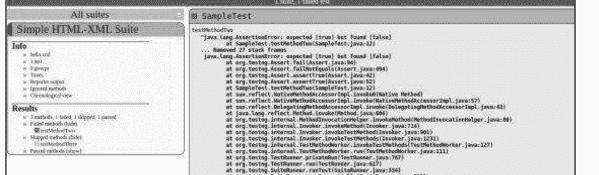
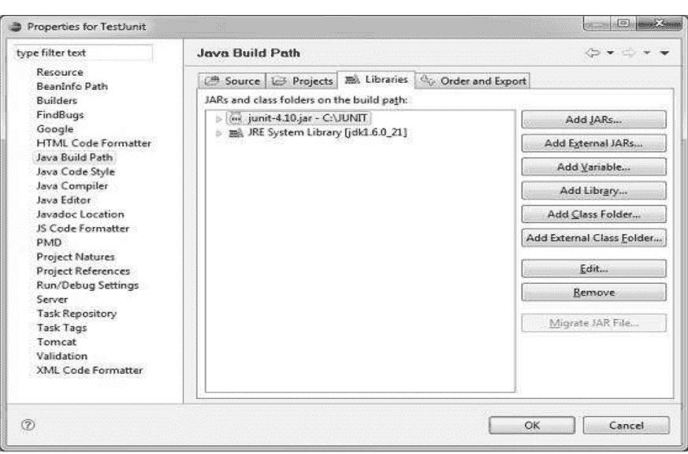
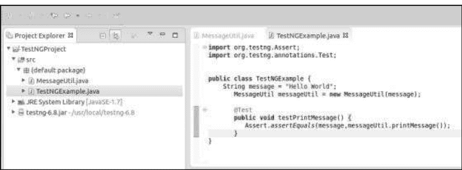
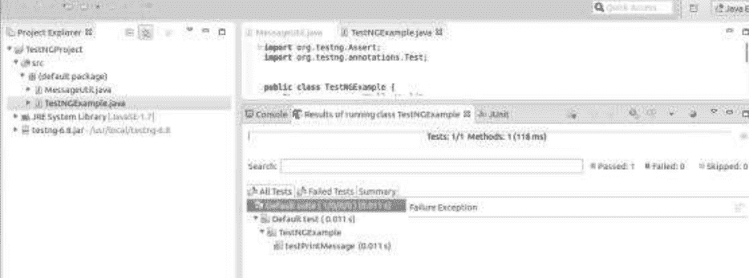

# TestNG：Java 测试框架

## 关于教程

TestNG 是一个基于 JUnit 和 NUnit 开发的测试框架，然而，它引入了一些新功能，使其更加强大且更易于使用。

TestNG 设计用于涵盖所有类型的测试：单元测试、功能测试、端到端测试、集成测试等，它需要 JDK 5 或更高版本。

本教程提供了对 TestNG 框架的良好理解，以便测试企业级应用，并确保其健壮性和可靠性。

## 目标读者

本教程旨在为希望通过简单易懂步骤学习 TestNG 框架特性并在实践中实现它的软件专业人士。

## 前提条件

在继续学习本教程之前，你应该对 Java 编程语言、文本编辑器和程序执行有基础了解。由于你将使用 TestNG 处理所有层级的 Java 项目测试，如果你具有软件开发和软件测试流程的先验知识，将非常有帮助。

## 1. 概述

测试是检查应用程序功能以确保其运行符合需求的过程。单元测试出现在开发者层面，通过采取充分的措施对每一个实体（类或方法）进行测试，以确保最终产品满足需求。

JUnit 促使开发者理解测试的用处，特别是与其他任何测试框架相比，单元测试的用处。通过利用一种相当简单、务实且严谨的架构，JUnit 已经“感染”大量的开发者。查看我们关于 JUnit 的教程可以以很好地了解它的功能。同时，JUnit 也有一些缺点，列举如下：

- 起初设计仅用于启用单元测试，现在被用于各种测试。
- 无法进行依赖性测试。
- 配置控制较差（`setUp`/`tearDown`）。
- 具有侵入性（强制你扩展类并以特定方式命名你的方法）。
- 静态编程模型（迫使你进行不必要的重新编译）。
- 在复杂项目中管理不同的测试套件可能非常困难。

### 什么是 TestNG？

根据其文档，TestNG 的定义如下：

> TestNG 是一个受 JUnit 和 JUnit 启发的测试框架，但引入了一些新功能，使其更强大且更易用。

TestNG 是一个开源自动化测试框架；NG 意味着 NextGeneration（下一代）。TestNG 与 JUnit（尤其是 JUnit 4）类似，但它不是 JUnit 的扩展。它的灵感源于 JUnit。它的设计比 JUnit 更好，特别是在进行集成测试时。TestNG 的创建者是 Cedric Beust。

消除了旧框架的大多数局限性，TestNG 让开发者能够编写更灵活、更强大的测试。由于因为它大量借鉴了 Java 注解（在 JDK 5.0 中引入）来定义测试，它还向你展示如何在真实的生产环境中使用 Java 语言的这一新特性。

## TestNG 特性

- 支持注解。
- TestNG 使用更多的 Java 和面向对象特性。
- 支持集成类的测试（例如，默认情况下，无需为每个测试方法创建新的测试类实例）。
- 将编译时的测试代码与运行时配置/数据信息分离。
- 灵活的运行时配置。
- 引入了“测试分组”。一旦你编译了测试，你可以要求 TestNG 运行所有“前端”测试，或者“快速”、“慢速”、“数据库”测试等。
- 支持依赖测试方法、并行测试、负载测试和部分失败。
- 灵活的插件 API。
- 支持多线程测试。

## 2. 环境

TestNG 是一个用于 Java 的框架，因此首要要求是在你的机器上安装 JDK。

### 系统要求

| 项目 | 要求 |
| :--- | :--- |
| JDK | 1.5 或更高版本 |
| 内存 | 无最低要求 |
| 磁盘空间 | 无最低要求 |
| 操作系统 | 无最低要求 |

### 步骤 1：验证你机器上的 Java 安装

打开控制台并根据你系统上安装的操作系统执行 `java` 命令。

| OS | 任务 | 命令 |
| :--- | :--- | :--- |
| Windows | 打开命令控制台 | `c:\> java -version` |
| Linux | 打开命令终端 | `$ java -version` |
| Mac | 打开终端 | `machine:~ joseph$ java -version` |

让我们验证所有操作系统的输出：

| OS | 输出 |
| :--- | :--- |
| Windows | `java version "1.7.0_25" Java(TM) SE Runtime Environment (build 1.7.0_25-b15) Java HotSpot(TM) 64-Bit Server VM (build 23.25-b011, mixed` |
| Linux | `java version "1.7.0_25" Java(TM) SE Runtime Environment (build 1.7.0_25-b15) Java HotSpot(TM) 64-Bit Server VM (build 23.25-b001, mixed mode)` |
| Mac | `java version "1.7.0_25" Java(TM) SE Runtime Environment (build 1.7.0_25-b15) Java HotSpot(TM) 64-Bit Server VM (build 23.25-b001, mixed mode)` |

如果你没有 Java，请从 `http://www.oracle.com/technet/java/javase/downloads/index.html` 安装 Java 开发包 (SDK)。在本教程中，我们假设安装的版本为 Java 1.7.0_25。

### 步骤 2：设置 Java 环境

将 `JAVA_HOME` 环境变量指向机器上安装 Java 的基础目录位置。例如，

| OS | 输出 |
| :--- | :--- |
| Windows | 将环境变量 `JAVA_HOME` 设置为 `C:\Program Files\Java\jdk1.7.0_25`。 |
| Linux | `Export JAVA_HOME=/usr/local/java-current` |
| Mac | `Export JAVA_HOME=/Library/Java/Home` |

将 Java 编译器位置添加到系统路径 `Path` 中。

| OS | 输出 |
| :--- | :--- |
| Windows | 附加字符串 `C:\Program Files\Java\jdk1.7.0_25` |

```java
/*
public double getMonthlySalary() {
    return monthlySalary;
}
/**
 * @param monthlySalary the monthlySalary to set
 */
public void setMonthlySalary(double monthlySalary) {
    this.monthlySalary = monthlySalary;
}
/**
 * @return the age
 */
public int getAge() {
    return age;
}
/**
 * @param age the age to set
 */
public void setAge(int age) {
    this.age = age;
}
```

`EmployeeDetails` 类用于：

- 获取/设置员工姓名的值。
- 获取/设置员工每月工资的值。
- 获取/设置员工年龄的值。

在 `C:\TestNG_WORKSPACE` 中创建一个 `EmpBusinessLogic.java`，其中包含业务逻辑。

```java
public class EmpBusinessLogic {
    // 计算员工的年薪
    public double calculateYearlySalary(EmployeeDetails employeeDetails){
        double yearlySalary=0;
        yearlySalary = employeeDetails.getMonthlySalary() * 12;
        return yearlySalary;
    }
    // 计算员工的奖金金额
    public double calculateAppraisal(EmployeeDetails employeeDetails){
        double appraisal=0;
        if(employeeDetails.getMonthlySalary() < 10000){
            appraisal = 500;
        }else{
            appraisal = 1000;
        }
        return appraisal;
    }
}
```

`EmpBusinessLogic` 类用于计算：

- 员工的年薪。
- 员工的奖金金额。

现在，我们在 `C:\TestNG_WORKSPACE` 中创建一个名为 `TestEmployeeDetails.java` 的 TestNG 类。TestNG 类是一个包含至少一个 TestNG 注解的 Java 类。该类包含要测试的测试用例。TestNG 测试可以通过 `@BeforeXXX` 和 `@AfterXXX` 注解进行配置（配置我们的执行过程），这允许在某个点之前和之后执行某些逻辑。

```java
import org.testng.Assert;
import org.testng.annotations.Test;

public class TestEmployeeDetails {
    EmpBusinessLogic employeeBusiness = new EmpBusinessLogic();
    EmployeeDetails employee = new EmployeeDetails();

    @Test
    public void testCalculateAppraisal() {
        employee.setName("Rajeev");
        employee.setAge(25);
        employee.setMonthlySalary(8000);
        double appraisal = employeeBusiness.calculateAppraisal(employee);
        Assert.assertEquals(500, appraisal, 0.0, "500");
    }

    // 检查年薪测试
    @Test
    public void testCalculateYearlySalary() {
        employee.setName("Rajeev");
        employee.setAge(25);
        employee.setMonthlySalary(8000);
        double salary = employeeBusiness.calculateYearlySalary(employee);
        Assert.assertEquals(96000, salary, 0.0, "8000");
    }
}
```

`TestEmployeeDetails` 类用于测试 `EmpBusinessLogic` 类的方法。它执行以下操作：

- 测试员工的年薪。
- 测试员工的奖金金额。

在运行测试之前，你必须使用一个特殊的 XML 文件配置 TestNG，该文件通常命名为 `testng.xml`。该文件的语法非常简单，内容如下所示。在 `C:\TestNG_WORKSPACE` 中创建此文件。

```xml
<?xml version="1.0" encoding="UTF-8"?>
<!DOCTYPE suite SYSTEM "http://testng.org/testng-1.0.dtd">
<suite name="Suite">
  <test name="test">
    <classes>
      <class name="TestEmployeeDetails"/>
    </classes>
  </test>
</suite>
```

上述详细说明如下：

- `suite` 标签代表一个套件。
- `test` 标签代表一次测试执行。
- `class` 标签代表 TestNG 类。

## 4. 基础注解

JUnit 3 通过方法名前缀来指示方法，但注解被正式引入 Java 语言。这是 TestNG 支持的注解列表：

| 注解 | 描述 |
| :--- | :--- |
| `@BeforeSuite` | 每个套件之前运行一次。 |
| `@AfterSuite` | 每个套件之后运行一次。 |
| `@BeforeClass` | 每个类之前运行一次。 |
| `@AfterClass` | 每个类之后运行一次。 |
| `@BeforeTest` | 每个测试之前运行一次。 |
| `@AfterTest` | 每个测试之后运行一次。 |
| `@BeforeGroups` | 每个组之前运行一次。 |
| `@AfterGroups` | 每个组之后运行一次。 |
| `@BeforeMethod` | 每个方法之前运行一次。 |
| `@AfterMethod` | 每个方法之后运行一次。 |
| `@DataProvider` | 标记为测试方法提供数据的方法。 |
| `@Factory` | 标记为返回 TestNG 用测试对象的方法。 |
| `@Listeners` | 在测试类上定义监听器。 |
| `@Parameters` | 说明如何向 `@Test` 方法传递参数。 |
| `@Test` | 标记类或方法为测试的一部分。 |

### 使用注解的优势

使用注解的一些优势如下：

- TestNG 通过查找注解来识别它感兴趣的方法。因此，方法名不受任何模式或格式的限制。
- 我们可以向注解传递参数。
- 注解是强类型的，因此编译器会立即标记错误。
- 测试类不再需要继承任何内容（例如 `TestCase`）。

## 5. 执行过程

本章解释了 TestNG 方法的执行过程。它解释了方法的调用顺序。这里是 TestNG API 方法的执行过程示例。

在 `C:\TestNG_WORKSPACE` 中创建一个名为 `TestngAnnotation.java` 的 Java 类来测试注解。

使用以下命令编译 TestNG：

```bash
javac C:\TestNG_WORKSPACE\EmployeeDetails.java EmpBusinessLogic.java TestEmployeeDetails.java
java -cp "C:\TestNG_WORKSPACE" org.testng.Test testng.xml
```

运行后，你将在控制台看到测试结果，并在 **test-output** 文件夹中看到漂亮的 HTML 报告。

```java
@BeforeMethod
public void beforeMethod() {
    System.out.println("in beforeMethod");
}

@AfterMethod
public void afterMethod() {
    System.out.println("in afterMethod");
}

@BeforeClass
public void beforeClass() {
    System.out.println("in beforeClass");
}

@AfterClass
public void afterClass() {
    System.out.println("in afterClass");
}

@BeforeTest
public void beforeTest() {
    System.out.println("in beforeTest");
}

@AfterTest
public void afterTest() {
    System.out.println("in afterTest");
}

@BeforeSuite
public void beforeSuite() {
    System.out.println("in beforeSuite");
}

@AfterSuite
public void afterSuite() {
    System.out.println("in afterSuite");
}
```

接下来，我们在 `C:\TestNG_WORKSPACE` 中创建文件 `testng.xml` 来执行注解。

```xml
<?xml version="1.0" encoding="UTF-8"?>
<!DOCTYPE suite SYSTEM "http://testng.org/testng-1.0.dtd">
<suite name="Suite1">
  <test name="test1">
    <classes>
      <class name="TestngAnnotation"/>
    </classes>
  </test>
</suite>
```

使用 `javac` 编译测试用例类。


```bash
C:\TestNG_WORKSPACE\javac TestngAnnotation.java
```

现在，运行 `testng.xml`，它将运行提供的 Test 类中定义的测试用例。

```bash
C:\TestNG_WORKSPACE\java org.testng.testng.TestNG testng.xml
```

验证输出。

```
in beforeSuite
in beforeTest
in beforeClass
in beforeMethod
in test case 1
in afterMethod
in beforeMethod
in test case 2
```


```
in afterMethod
in afterClass
in afterTest
in afterSuite

=================================================
Suite
Total tests run: 2, Failures: 0, Skips: 0
====================================================
```

根据上面的输出，执行步骤如下：

- 首先，`beforeSuite()` 方法只执行一次。
- 最后，`afterSuite()` 方法只执行一次。
- 即使是 `beforeTest()`、`beforeClass()`、`afterClass()` 和 `afterTest()` 方法也只执行一次。
- `beforeMethod()` 方法为每个测试用例执行，但在执行测试用例之前执行。
- `afterMethod()` 方法为每个测试用例执行，但在执行测试用例之后执行。
- 在 `beforeMethod()` 和 `afterMethod()` 之间，执行每个测试用例。

# 6. 执行测试

使用 `TestNG` 类执行测试用例。该类是 TestNG 框架中运行测试的主入口点。用户可以创建自己的 `TestNG` 对象并以多种方式调用它，例如：

- 在现有的 `testng.xml` 上。
- 在完全通过 Java 创建的 `testng.xml` 上。
- 通过直接设置测试类。

你还可以定义包含或排除的组、分配参数等。命令行参数为：

- `-outputdir`：指定输出目录。
- `-testclass_name`：指定一个或多个类名。
- `-testjar jar_name`：指定包含测试的 jar 包。
- `-sourcedir src1;src2`：分隔的源目录列表（仅当使用 javadoc 注解时使用）。
- `-target`
- `-groups`
- `-testrunfactory`
- `-listener`

> 我们在下面的示例中为现有的 `testng.xml` 创建 `TestNG` 对象。

## 创建类

创建一个待测试的 java 类，例如 `C:\TestNG_WORKSPACE` 中的 `MessageUtil.java`。

```java
/*
* 此类在控制台上打印给的消息。
 */
public class MessageUtil {

    private String message;
```


```java
// Constructor
//@param message 要打印的消息
public MessageUtil(String message){
    this.message = message;
}

// 打印消息
public String printMessage(){
    System.out.println(message);
    return message;
}
```

## 创建测试用例

- 创建一个 java 测试类，例如 `SampleTest.java`。
- 在你的测试类中添加测试方法 `testPrintMessage()`。
- 在 `testMessage()` 上添加 `@Test` 注解。
- 使用 TestNG 的 `assertEquals` API 实现测试条件。

在 `C:\>TestNG_WORKSPACE` 中创建一个名为 `SampleTest.java` 的 java 测试类。

```java
import org.testng.Assert;
import org.testng.annotations.Test;

public class SampleTest {

    String message = "Hello World";
    MessageUtil messageUtil = new MessageUtil(message);

    @Test
    public void testPrintMessage() {
        Assert.assertEquals(message, messageUtil.printMessage());
    }
}
```


## 创建 testng.xml

接下来，在 `C:\TestNG_WORKSPACE` 中创建 `testng.xml` 文件以执行测试用例。该文件捕获你的整个测试。该文件允许在一个文件中描述你所有的测试套件及其参数（例如，`testng.xml` 将只运行你的测试）。

```xml
<?xml version="1.0" encoding="UTF-8"?>
<suite name="Sample test">
  <test name="Sample test">
    <classes>
      <class name="SampleTest" />
    </classes>
  </test>
</suite>
```

使用 `javac` 编译测试用例。

```bash
C:\TestNG_WORKSPACE>javac MessageUtil.java SampleTest.java
```

现在，运行 `testng.xml`，它将运行 `<test>` 标签中定义的测试用例。

```bash
C:\TestNG_WORKSPACE>java -cp "C:\TestNG_WORKSPACE" org.testng.TestNG testng.xml
```

验证输出。

```
Hello World
Sample test
Total tests run: 1, Failures: 0, Skips: 0
================================
```

# 7. 套件测试 (SUITE TEST)

测试套件是为了测试软件程序的测试用例集合。在 TestNG 中，你不能在源代码中定义套件，而是由一个 XML 文件表示。它允许对运行的测试进行灵活配置。套件可以包含一个或多个测试，并由 `<suite>` 标签定义。`<suite>` 是 `testng.xml` 的根标签。它描述一个测试套件，由多个 `<test>` 部分组成。

下表列出了所有 `<suite>` 属性：

| 属性 | 说明 |
| :--- | :--- |
| name | 套件名称。这是一个强制属性。 |
| verbose | 运行的详细程度。 |
| parallel | TestNG 是否应不同的线程运行此套件。 |
| thread-count | 如果启用并行模式使用的线程数（会被忽略）。 |
| annotations | 你在测试使用的注解类型。 |
| timeout | 应用于此测试找到的所有测试方法的默认超时时间。 |

在本章中，我们将展示一个包含两个测试类 `Test1` & `Test2` 的示例，使用 Suite 运行。

## 创建类

创建一个待测试的 java 类，例如 `C:\TestNG_WORKSPACE` 中的 `MessageUtil.java`。

```java

/*

* 此类在控制台上打印给的消息。

 */

public class MessageUtil {

    private String message;

    // 构造函数

    // @param message 要打印的消息

    public MessageUtil(String message) {

        this.message = message;

    }

    // 打印消息

    public String printMessage() {

        System.out.println(message);

        return message;

    }

    // 在消息中添加 "Hi!"

    public String salutationMessage() {

        message = "Hi!" + message;

        System.out.println(message);

        return message;

    }

}

```

### 创建测试用例类

在 `C:\>TestNG_WORKSPACE` 中创建一个名为 `Test1.java` 的 java 类文件。

```java

import org.testng.Assert;

import org.testng.annotations.Test;

public class Test1 {

    String message = "Manisha";

    MessageUtil messageUtil = new MessageUtil(message);

    @Test

    public void testPrintMessage() {

        System.out.println("Inside testPrintMessage()");

        Assert.assertEquals(message, messageUtil.printMessage());

    }

}

```


在 `C:\>TestNG_WORKSPACE` 中创建一个名为 `Test2.java` 的 java 类文件。

```java

import org.testng.Assert;

import org.testng.annotations.Test;

public class Test2 {

    String message = "Manisha";

    MessageUtil messageUtil = new MessageUtil(message);

    @Test

    public void testSalutationMessage() {

        System.out.println("Inside testSalutationMessage()");

        message = "Hi!" + "Manisha";

        Assert.assertEquals(message,messageUtil.salutationMessage());

    }

}

```

现在，我们在 `C:\>TestNG_WORKSPACE` 中编写 `testng.xml`，它将包含如下 `<suite>` 标签：

```xml

<?xml version="1.0" encoding="UTF-8"?>

<!DOCTYPE suite SYSTEM "http://testng.org/testng-1.0.dtd">

<suite name="Suite1">

  <classes>

    <class name="Test1" />

  </classes>

</test>

<test name="exampletest2">

```


```xml

<classes>

  <class name="Test2" />

</classes>

</test>

</suite>

```

`Suite1` 包含 `exampletest1` 和 `exampletest2`。

使用 `javac` 编译所有 java 类。

```bash
C:\TestNG_WORKSPACE\javac MessageUtil.java Test1.java Test2.java
```

现在，运行 `testng.xml`，它将运行在提供的 Test 类定义的测试用例。

```bash
C:\TestNG_WORKSPACE\java -cp "C:\TestNG_WORKSPACE" org.testng.TestNG testng.xml
```

验证输出结果。

```
InsidePrintMessage()
Manisha
InsideSalutationMessage()
Hi!Manisha
====================================================
Suite1
Total tests run: 2, Failures: 0, Skips: 0
======================================================
```

你也可以检查 `test-output` 文件夹。在 `Suite1` 文件夹下，你可以看到创建的两个 html 文件：`exampletest1.html` 和 `exampletest2.html`，它们看起来如下：

| 测试通过/失败/停止: | 1/0/0 |
| 开始于: | Wed Aug 14 19:17:02 IST 2013 |
| 总耗时: | 已用时间 (1 ms) |
| 包含的组: | |
| 排除的组: | |

鼠标悬停在方法名上查看类名

| 测试方法 | 通过的测试 | 时间 (秒) | 实例 |
| --- | --- | --- | --- |
| subclass/message | | 0 | |
| test class: Test | | | Test@4622522 |

有时，会出现我们的代码尚未准备好而编写的测试用例方法/代码失败的情况。在这种情况下，注解 `@Test(enabled = false)` 有助于禁用此测试用例。

如果一个测试方法被标记为 `@Test(enabled = false)`，那么该未准备好的测试用例将被跳过。

现在，让我们来看看 `@Test(enabled = false)` 的实际效果。

## 创建类

在 `C:\TestNG_WORKSPACE` 中创建一个要测试的 java 类，例如 `MessageUtil.java`。

```java

/**

 * 此类在控制台上打印给定的消息。

 */

public class MessageUtil {

    private String message;

    // 构造函数

    // @param message 要打印的消息

    public MessageUtil(String message){

        this.message = message;

    }

    // 打印消息

    public String printMessage(){

        System.out.println(message);

        return message;

    }

    // 在消息中添加 "Hi!" 

```


```java

public String salutationMessage(){

    message = "Hi!" + message;

    System.out.println(message);

    return message;

}

```

### 创建测试用例类

- 创建一个 java 测试类，例如 `IgnoreTest.java`。
- 为你的测试类添加测试方法 `testMessage()` 和 `testSalutationMessage()`。
- 在方法 `testPrintMessage()` 上添加注解 `@Test(enabled = false)`。

```java

import org.testng.Assert;

import org.testng.annotations.Test;

public class IgnoreTest {

    String message = "Manisha";

    MessageUtil messageUtil = new MessageUtil(message);

    @Test(enabled = false)

    public void testPrintMessage() {

        System.out.println("Inside testPrintMessage()");

        message = "Manisha";

        Assert.assertEquals(message, messageUtil.printMessage());

    }

    @Test

    public void testSalutationMessage() {

        System.out.println("Inside testSalutationMessage()");

    }

}

```

# 组组

组也可以包含其他组。这些组被称为元组（MetaGroups）。例如，你可能想定义一个包含 `checkintest` 和 `functest` 的组。让我们如下所示修改我们的 `testng.xml` 文件：

```xml
<xml version="1.0" encoding="UTF-8"?>
```


<!DOCTYPE suite SYSTEM "http://testng.org/testng-1.0.dtd">

<suite name="Suite1">

  <test name="test1">

    <groups>

      <define name="all">

        <include name="functest"/>

        <include name="checkintest"/>

      </define>

    </groups>

    <run>

      <include name="all"/>

    </run>

    <classes>

      <class name="GroupTestExample" />

    </classes>

  </test>

</suite>

```

执行上述 `testng.xml` 将执行所有三个测试，并给你以下结果：

| 在 testPrintMessage() 内部 | .com |
| :--- | :--- |
| 在 testSalutationMessage() 内部 | tutorialpoint.com |
| 在 testExitMessage() 内部 | www.tutorialpoint.com |
| ================================================= | |
| Suite1 | |

总运行测试数: 3，失败: 0，跳过: 0
====================================

## 排除组

你可以使用下所示的 `<exclude>` 标签来忽略某个组：

```xml
<?xml version="1.0" encoding="UTF-8"?>
<!DOCTYPE suite SYSTEM "http://testng.org/testng-1.0.dtd">
<suite name="Suite1">
<test name="test1">
<groups>
<define name="all">
<exclude name="functest"/>
<include name="checkintest"/>
</define>
<run>
<include name="all"/>
</run>
</groups>
<classes>
<class name="GroupTestExample" />
</classes>
</test>
</suite>
```

# 10. 异常测试

TestNG 提供了一个追踪代码异常处理的选项。你可以测试代码是否抛出了预期的异常。在这里，`expectedExceptions` 参数与 `@Test` 注解一起使用。现在，让我们看看 `@Test(expectedExceptions)` 的实际用法。

## 创建类

创建一个要测试的 java 类，例如 `C:\TestNG_WORKSPACE` 下的 `MessageUtil.java`。在 `printMessage()` 方法内部添加一个错误条件。

```java
/*
* 此类在控制台上输出打印给定的消息。
*/
public class MessageUtil {
    private String message;

    // 构造函数
    //@param message 将要打印的消息
    public MessageUtil(String message){
        this.message = message;
    }

    // 打印消息
    public void printMessage(){
        System.out.println(message);
        int a =0;
        int b = 1/a;
    }

    // 向消息中添加 "Hi!"
    public String salutationMessage() {
        message = "Hi!" + message;
        System.out.println(message);
        return message;
    }
}
```

## 创建用例类

- 创建一个 java 测试类，例如 `ExpectedExceptionTest.java`。
- 在 `testWithMessage` 测试用例中添加预期的异常 `ArithmeticException`。

在 `C:\TestNG_WORKSPACE` 中创建一个名为 `ExpectedExceptionTest.java` 的 java 类文件。

```java
import org.testng.Assert;
import org.testng.annotations.Test;

public class ExpectedExceptionTest {
    String message = "Manisha";
    MessageUtil messageUtil = new MessageUtil(message);

    @Test(expectedExceptions = ArithmeticException.class)
    public void testPrintMessage() {
        System.out.println("Inside testPrintMessage()");
        messageUtil.printMessage();
    }

    @Test
    public void testSalutationMessage() {
        System.out.println("Inside testSalutationMessage()");
        message = "Hi!" + "Manisha";
        Assert.assertEquals(message,messageUtil.salutationMessage());
    }
}
```

## 创建测试运行

在 `C:\TestNG_WORKSPACE` 中创建 `testng.xml` 以执行测试用例。

```xml
<?xml version="1.0" encoding="UTF-8"?>
<!DOCTYPE suite SYSTEM "http://testng.org/testng-1.0.dtd">
<suite name="Suite1">
  <test name="test1">
    <classes>
      <class name="ExpectedExceptionTest" />
    </classes>
  </test>
</suite>
```

使用 `javac` 编译 `MessageUtil` 和测试用例类。

```bash
C:\TestNG_WORKSPACE>javac MessageUtil.java ExpectedExceptionTest.java
```

现在，运行测试 Runner，它将运行提供的 Test 类中的测试用例。

```bash
C:\TestNG_WORKSPACE>java -cp "C:\TestNG_WORKSPACE" org.testng.TestNG testng.xml
```

验证输出。`testPrintMessage()` 测试用例将通过。

```
Inside testPrintMessage()
Manisha
Inside testSalutationMessage()
Hi! Manisha
================================================
Suite1
总运行测试数: 2，失败: 0，跳过: 0
================================================
```

# 11. 依赖测试

有时，你可能需要按照特定顺序调用测试用例中的方法，或者你可能想在方法之间共享一些数据和状态。TestNG 支持这种依赖关系，因为它支持方法之间显式依赖关系的声明。

TestNG 允许你通过以下方式指定依赖关系：

- `dependsOnMethods`
- `dependsOnGroups`

## 依赖方法

TestNG 允许你通过 `@Test` 注解在方法之间指定依赖关系。

## 依赖组

TestNG 允许你通过 `@Test` 注解在方法与组之间指定依赖关系。

## 组依赖

TestNG 允许你通过 `groups` 属性在测试类之间指定依赖关系。

## 创建用例类

- 创建一个 java 测试类，例如 `DependencyTestUsingAnnotation.java`。
- 在测试类中添加测试方法 `testPrintMessage()`、`testSalutationMessage()` 和 `initEnvironmentTest()`，并将它们添加到 "init" 组中。
- 在 `testSalutationMessage()` 方法的 `@Test` 注解中添加属性 `dependsOnMethods={"init.*"}`。

在 `C:\TestNG_WORKSPACE` 中名为 `DependencyTestUsingAnnotation.java` 的 java 类。

```java
import org.testng.annotations.Test;
import org.testng.Assert;

public class DependencyTestUsingAnnotation {
    String message = "Manisha";
    MessageUtil messageUtil = new MessageUtil(message);

    @Test(groups = { "init" })
    public void testPrintMessage() {
        System.out.println("Inside testPrintMessage()");
        message = "Manisha";
        Assert.assertEquals(message, messageUtil.printMessage());
    }

    @Test(dependsOnGroups = { "init.*" })
    public void testSalutationMessage() {
        System.out.println("Inside testSalutationMessage()");
        message = "Hi!" + "Manisha";
        Assert.assertEquals(message, messageUtil.salutationMessage());
    }

    @Test(groups = { "init" })
    public void initEnvironmentTest() {
        System.out.println("This is initEnvironmentTest");
    }
}
```

在此示例中，`testSalutationMessage()` 被声明为依赖于任何匹配正则表达式 "init.*" 的组，这保证了 `testPrintMessage()` 和 `initEnvironmentTest()` 方法在 `testSalutationMessage()` 执行之前总是会被调用。

如果被依赖的方法失败，且你对它有硬依赖（`alwaysRun=false`，这是默认值），则依赖于它的方法不会被标记为 FAIL（失败），而是 SKIP（跳过）。跳过的的方法将在最终报告中被报告（在 HTML 中显示为非红色非绿色的颜色），这很重要，因为跳过的方法并不一定是失败。

## 创建 testing.xml

在 `C:\TestNG_WORKSPACE` 中创建 `testing.xml` 以执行测试用例。

```xml
<?xml version="1.0" encoding="UTF-8"?>
<!DOCTYPE suite SYSTEM "http://testng.org/testng-1.0.dtd">
<suite name="Suite1">
  <test name="test1">
    <classes>
      <class name="DependencyTestUsingAnnotation" />
    </classes>
  </test>
</suite>
```

使用 `javac` 编译 `MessageUtil` 和测试用例类。

```bash
C:\TestNG_WORKSPACE>javac MessageUtil.java DependencyTestUsingAnnotation.java
```

现在运行 `test.xml`，它将在会在执行 `initEnvironmentTest()` 方法之后运行 `testSalutationMessage()` 方法。

```bash
C:\TestNG_WORKSPACE>java -cp "C:\TestNG_WORKSPACE" org.testng.TestNG test.xml
```

验证输出结果。

```
This is initEnvironmentTest
```


```
Inside testPrintMessage()
Manisha
Inside testSalutationMessage()
Hi!Manisha

============================================
Suite1
Total tests run: 3, Failures: 0, Skips: 0
============================================
```

## dependsOnGroups 与 dependsOnMethods

- 使用组（groups）时，我们不再暴露于重构问题。只要我们不修改 `dependsOnGroups` 或 `groups` 属性，测试将一直保持正确的依赖关系继续运行。

- 每当需要在依赖图中添加新方法时，我们所做的就是将其放在正确的组中，并确保它依赖于正确的组。我们不需要修改任何其他方法。


# 12. 参数化测试

TestNG 提供的另一个有趣功能是**参数化测试**。在大多数情况下，你会遇到业务逻辑需要数量差异巨大的测试用例场景。参数化测试允许开发人员使用不同的值多次运行同一个测试。

TestNG 允许你通过两种不同的方式将参数直接传递给测试方法：

- 通过 `testng.xml`
- 通过 Data Providers

## 使用 testng.xml 传递参数

通过这种技术，你在 `testng.xml` 文件中定义简单参数，然后在源文件中引用这些参数。让我们有一个示例来演示如何使用这种技术传递参数。

### 创建用例类

- 创建一个 Java 测试类，例如 `ParameterizedTest1.java`。
- 在你的测试类中添加测试方法 `parameterTest()`。该方法接收一个字符串作为输入参数。
- 为此方法添加注解 `@Parameters("myName")`。该参数将从 `testng.xml` 传递值，我们将在下一步骤中看到。

在 `C:\TestNG_WORKSPACE` 中创建一个名为 `ParameterizedTest1.java` 的 Java 类文件。

```java
import org.testng.annotations.Parameters;
import org.testng.annotations.Test;

public class ParameterizedTest1 {

    @Test
    @Parameters("myName")
    public void parameterTest(String myName) {
        System.out.println("Parameterized value is : " + myName);
    }
}
```


### 创建 testng.xml

```xml
<?xml version="1.0" encoding="UTF-8"?>
<!DOCTYPE suite SYSTEM "http://testng.org/testng-1.0.dtd">
<suite name="Suite1">
  <test name="test1">
    <parameter name="myName" value="manisha"/>
    <classes>
      <class name="ParameterizedTest1" />
    </classes>
  </test>
</suite>
```

我们也可以在 `<test>` 级别定义参数。假设我们在 `<suite>` 和 `<test>` 级别都有 `myName`。在这种情况下，适用作用域规则。

使用 `javac` 编译测试用例。

```bash
C:\TestNG_WORKSPACE>javac ParameterizedTest1.java
```

现在运行 `testng.xml`。

```bash
C:\TestNG_WORKSPACE>java -cp "C:\TestNG_WORKSPACE" org.testng.TestNG testng.xml
```

验证输出结果。

```
Parameterized value is : manisha

============================================
Suite1
Total tests run: 1, Failures: 0, Skips: 0
============================================
```


## 使用 DataProviders 传递参数

当你需要传递从 Java（属性文件或数据库等）创建的复杂对象或参数时，可以使用 DataProviders。

Data Provider 是一个带有 `@DataProvider` 注解的方法。该注解有一个字符串属性：`name`。如果没有提供名称，数据提供者的名称默认为方法名。数据提供者返回数组。

以下演示了如何使用数据提供者。第一个示例是关于 Integer 的 `@DataProvider`。

### 示例 1

这里 `@DataProvider` 使用 Integer。

#### 创建类

创建一个 `PrimeNumberChecker`。该类检查数字是否为素数。在 `C:\TestNG_WORKSPACE` 中创建它。

```java
public class PrimeNumberChecker {
    public Boolean validate(final Integer primeNumber) {
        for (int i = 2; i < primeNumber / 2; i++) {
            if (primeNumber % i == 0) {
                return false;
            }
        }
        return true;
    }
}
```


#### 创建用例类

- 创建一个 Java 测试类，例如 `ParamTestWithDataProvider.java`。
- 定义方法 `primeNumbers()`，它是使用 `@DataProvider` 注解定义的。该方法返回对象数组。
- 在你的测试类中添加测试方法 `parameterTest()`。该方法接收一个 Integer 和一个 Boolean 作为输入参数。该方法验证参数是否为素数。
- 为此方法添加注解 `@Test(dataProvider = "test1")`。属性 `dataProvider` 映射到 "test1"。

```java
import org.testng.Assert;
import org.testng.annotations.BeforeMethod;
import org.testng.annotations.DataProvider;
import org.testng.annotations.Test;

public class ParamTestWithDataProvider {
    private PrimeNumberChecker primeNumberChecker;

    @BeforeMethod
    public void initialize() {
        primeNumberChecker = new PrimeNumberChecker();
    }

    @DataProvider(name = "test1")
    public static Object[][] primeNumbers() {
        return new Object[][] {
            { 2, true },
            { 6, false },
            { 19, true },
            { 22, false },
            { 23, true }
        };
    }

    @Test(dataProvider = "test1")
    public void parameterNumberChecker(Integer primeNumber, Boolean expected) {
        Assert.assertEquals(primeNumberChecker.validate(primeNumber), expected);
    }
}
```

#### 创建 testng.xml

在 `C:\TestNG_WORKSPACE` 中创建一个 `testng.xml` 以执行测试用例。

```xml
<?xml version="1.0" encoding="UTF-8"?>
<!DOCTYPE suite SYSTEM "http://testng.org/testng-1.0.dtd" >
<suite name="Suite1">
  <test name="test1">
    <classes>
      <class name="ParamTestWithDataProvider" />
    </classes>
  </test>
</suite>
```

使用 `javac` 编译 TestNG 用例类。

```bash
C:\TestNG_WORKSPACE>javac ParamTestWithDataProvider.java PrimeNumberChecker.java
```

现在，运行 `testng.xml`。

```bash
C:\TestNG_WORKSPACE>java -cp "C:\TestNG_WORKSPACE" org.testng.TestNG testng.xml
```

验证输出。


```
2 true
6 false
19 true
22 false
23 true

===========================================
Suite1
Total tests run: 5, Failures: 0, Skips: 0
=========================================
```

### 示例 2

在这里，`@DataProvider` 将 Object 作为参数传递。

#### 创建 Java 类

在 `C:\TestNG_WORKSPACE` 中创建一个 Java 类 `Bean.java`，这是一个带有 get/set 方法的简单对象。

```java
public class Bean {
    private String val;
    private int i;
    public Bean(String val, int i){
        this.val=val;
        this.i=i;
    }
    public String getVal() {
        return val;
    }
    public void setVal(String val) {
        this.val = val;
    }
    public int getI() {
        return i;
    }
    public void setI(int i) {
        this.i = i;
    }
}
```


#### 创建测试用例类

- 创建一个 Java 测试类，例如 `ParamTestWithDataProvider2.java`。
- 定义方法 `primeNumbers()`，通过注解定义为数据提供者（`dataProvider`）。该方法返回对象数组。
- 在测试类中添加测试方法 `testMethod()`。该方法接收一个对象 `bean` 作为参数。
- 为此方法添加注解 `@Test(dataProvider = "test1")`。属性 `dataProvider` 映射到 "test1"。

在 `C:\TestNG_WORKSPACE` 中创建一个名为 `ParamTestWithDataProvider2.java` 的 Java 类。

```java
import org.testng.annotations.DataProvider;
import org.testng.annotations.Test;

public class ParamTestWithDataProvider2 {
    @DataProvider(name = "test1")
    public static Object[][] primeNumbers() {
        return new Object[][] { { new Bean("hi I am the bean", 111) } };
    }

    @Test(dataProvider = "test1")
    public void testMethod(Bean myBean) {
        System.out.println(myBean.getVal() + " " + myBean.getI());
    }
}
```

#### 创建 testng.xml

在 `C:\TestNG_WORKSPACE` 中创建 `testng.xml` 以执行测试用例。

```xml
<?xml version="1.0" encoding="UTF-8"?>
<!DOCTYPE suite SYSTEM "http://testng.org/testng-1.0.dtd" >
<suite name="Suite1">
  <test name="test1">
    <classes>
      <class name="ParamTestWithDataProvider2" />
    </classes>
  </test>
</suite>
```


使用 `javac` 编译测试用例类。

```bash
C:\TestNG_WORKSPACE>javac ParamTestWithDataProvider2.java Bean.java
```

现在，运行 `testng.xml`。

```bash
C:\TestNG_WORKSPACE>java -cp "C:\TestNG_WORKSPACE" org.testng.TestNG testng.xml
```

验证输出。

```
hi I am the bean 111
==========================================
Suite1
Total tests run: 1, Failures: 0, Skips: 0
==========================================
```

# 13. 运行 JUNIT 测试

现在你已经理解了 TestNG 及其各种测试，你现在可能正在担心如何重构你的 JUnit 代码。不用担心，因为 TestNG 提供了一种从 JUnit 迁移到 TestNG 的方法。

## 创建用例类

在 `C:\TestNG_WORKSPACE` 中创建一个 Java 类，例如 `SampleTest.java`。


```java
import org.testng.Assert;
import org.testng.annotations.Test;

public class SampleTest {
    @Test
    public void testMethodOne() {
        Assert.assertTrue(true);
    }

    @Test
    public void testMethodTwo() {
        Assert.assertTrue(false);
    }

    @Test(dependsOnMethods="testMethodTwo")
    public void testMethodThree() {
        Assert.assertTrue(true);
    }
}
```

上述用例类包含三个测试方法，其中 `testMethodOne` 和 `testMethodThree` 在执行时会通过，而 `testMethodTwo` 通过向 `Assert.assertTrue` 方法传递 `false` 布尔值而导致失败，该方法用于测试中的真值条件判断。

## 创建自定义日志类

在 `C:\TestNG_WORKSPACE` 中创建另一个名为 `CustomListener.java` 的新类。

```java
import org.testng.ITestResult;
import org.testng.TestListenerAdapter;

public class CustomListener extends TestListenerAdapter{
    private int m_count = 0;

    @Override
    public void onTestFailure(ITestResult tr) {
      log(tr.getName()) + "--Test method failed\n";
    }

    @Override
    public void onTestSkipped(ITestResult tr) {
      log(tr.getName()) + "--Test method skipped\n";
    }

    @Override
    public void onTestSuccess(ITestResult tr) {
      log(tr.getName()) + "--Test method success\n";
    }

    private void log(String string) {
      System.out.print(string);
      if (+m_count % 40 == 0) {
        System.out.println("");
      }
    }
}
```


上述类继承了 `ListenerAdapter`，它实现了带有空方法的 `ITest`。因此，不需要重写接口中的其他方法。如果你愿意，也可以直接实现该接口。

## 创建 testng.xml

在 `C:\TestNG_WORKSPACE` 中创建 `testng.xml` 以执行用例。

```xml
<?xml version="1.0" encoding="UTF-8"?>
<suite name="Simple Logger Suite">
  <listeners>
    <listener class-name="CustomListener" />
  </listeners>
  <test name="Simple Logger test">
    <classes>
      <class name="SampleTest" />
    </classes>
  </test>
</suite>
```


使用 `javac` 编译 `SampleTest` 和 `CustomListener` 类。

```bash
C:\TestNG_WORKSPACE>javac CustomListener.java SampleTest.java
```

现在，运行 testng。

```bash
C:\TestNG_WORKSPACE>java -cp "C:\TestNG_WORKSPACE" org.testng.TestNG testng.xml
```

验证输出结果。

```
testMethodOne--Test method success
testMethodTwo--Test method failed
testMethodThree--Test method skipped

============================
Simple Logger Suite
Total tests run: 3, Failures: 1, Skips: 1
============================
```

我们创建了一个自定义日志类，它实现了 `ITestListener` 接口并将其作为监听器挂载到 TestNG 测试套件中。该监听器类的方法会在 TestNG 启动、测试开始、测试失败等被调用。可以实现多个监听器并将它们添加到测试套件的执行中，TestNG 会调用所有附加到测试套件的监听器。

日志监听器主要用于我们需要在测试执行时查看测试执行的连续状态。

## TestNG

## 自定义报告器

在本节中，我们将通过示例介绍编写自定义报告器并将其附加到 TestNG 的方法。要编写自定义报告器类，我们的扩展类应该实现 `IReporter` 接口。让我们开始创建一个带有自定义报告器的示例。

## TestNG

## 简单的 HTML-XML 套件

总运行测试数：3，失败：1，跳过：1

现在，请进入 `C:\TestNG_WORKSPACE\test-output` 文件夹。在你的默认网络浏览器中打开 `index.html`。你将看到以下 HTML 报告：



现在，用系统上的 XML 编辑器打开 `C:\TestNG_WORKSPACE\test-output\testing-results.xml`，你将看到 XML 文件中的内容：

此 XML 文件没有任何关联的属性。文档显示如下：


```xml
<?xml version="1.0" encoding="UTF-8"?>
<testsuite name="SimpleTest" failed="1" skipped="0" started="2023-03-27T17:13:32" finished="2023-03-27T17:13:32">
  <testcase name="testAssertion" failed="1" skipped="0" started="2023-03-27T17:13:32" finished="2023-03-27T17:13:32">
    <failure>
      <method name="testAssertion" class="org.testng.internal.InvokerMethod" instance="org.testng.internal.InvokerMethod$InstanceMethod" invocation-duration="6" started="2023-03-27T17:13:32">
      <message>expected [true] but found [false]</message>
      java.lang.AssertionError: expected [true] but found [false]
	at org.testng.Assert.expected(Assertion.java:62)
	at org.testng.Assert.expected(Assertion.java:62)
	at org.testng.internal.InvokerMethod.invoke(InvokerMethod.java:168)
	at org.testng.internal.InvokerMethod$InstanceMethod.invoke(InvokerMethod.java:135)
	at org.testng.internal.InvokerMethod$InstanceMethod.invoke(InvokerMethod.java:135)
	at org.testng.internal.TestNG.invokeMethod(TestNG.java:1570)
	at org.testng.internal.TestNG.invokeMethod(TestNG.java:1570)
	at org.testng.internal.TestNG.invokeMethod(TestNG.java:1570)
	at org.testng.internal.TestNG.invokeMethod(TestNG.java:1570)
	at org.testng.internal.TestNG.invokeMethod(TestNG.java:1570)
	at org.testng.internal.TestNG.runMethods(TestNG.java:1638)
	at org.testng.internal.TestNG.runMethods(TestNG.java:1638)
	at org.testng.internal.TestNG.runMethods(TestNG.java:1638)
	at org.testng.internal.TestNG.runTests(TestNG.java:1706)
	at org.testng.internal.TestNG.runTests(TestNG.java:1706)
	at org.testng.internal.TestNG.runTests(TestNG.java:1706)
	at org.testng.internal.TestNG.runTests(TestNG.java:1706)
	at org.testng.internal.TestNG.runTests(TestNG.java:1706)
	at org.testng.internal.TestNG.runTests(TestNG.java:1706)
	at org.testng.internal.TestNG.runTests(TestNG.java:1706)
	at org.testng.internal.TestNG.runTests(TestNG.java:1706)
	at org.testng.internal.TestNG.runResults(TestNG.java:1780)
	at org.testng.internal.TestNG.runResults(TestNG.java:1780)
	at org.testng.internal.TestNG.runResults(TestNG.java:1780)
	at org.testng.internal.TestNG.runResults(TestNG.java:1780)
	at org.testng.internal.TestNG.runResults(TestNG.java:1780)
	at org.testng.internal.TestNG.runResults(TestNG.java:1780)
	at org.testng.internal.TestNG.runResults(TestNG.java:1780)
	at org.testng.internal.TestNG.runResults(TestNG.java:1780)
	at org.testng.internal.TestNG.runResults(TestNG.java:1780)
	at org.testng.internal.TestNG.runResults(TestNG.java:1780)
	at org.testng.internal.TestNG.runResults(TestNG.java:1780)
	at org.testng.internal.TestNG.runResults(TestNG.java:1780)
	at org.testng.internal.TestNG.runResults(TestNG.java:1780)
	at org.testng.internal.TestNG.runResults(TestNG.java:1780)
	at org.testng.internal.TestNG.runResults(TestNG.java:1780)
	at org.testng.internal.TestNG.runResults(TestNG.java:1780)
	at org.testng.internal.TestNG.runResults(TestNG.java:1780)
	at org.testng.internal.TestNG.runResults(TestNG.java:1780)
	at org.testng.internal.TestNG.runResults(TestNG.java:1780)
	at org.testng.internal.TestNG.runResults(TestNG.java:1780)
	at org.testng.internal.TestNG.runResults(TestNG.java:1780)
	at org.testng.internal.TestNG.runResults(TestNG.java:1780)
	at org.testng.internal.TestNG.runResults(TestNG.java:1780)
	at org.testng.internal.TestNG.runResults(TestNG.java:1780)
	at org.testng.internal.TestNG.runResults(TestNG.java:1780)
	at org.testng.internal.TestNG.runResults(TestNG.java:1780)
	at org.testng.internal.TestNG.runResults(TestNG.java:1780)
	at org.testng.internal.TestNG.runResults(TestNG.java:1780)
	at org.testng.internal.TestNG.runResults(TestNG.java:1780)
	at org.testng.internal.TestNG.runResults(TestNG.java:1780)
	at org.testng.internal.TestNG.runResults(TestNG.java:1780)
	at org.testng.internal.TestNG.runResults(TestNG.java:1780)
	at org.testng.internal.TestNG.runResults(TestNG.java:1780)
	at org.testng.internal.TestNG.runResults(TestNG.java:1780)
	at org.testng.internal.TestNG.runResults(TestNG.java:1780)
	at org.testng.internal.TestNG.runResults(TestNG.java:1780)
	at org.testng.internal.TestNG.runResults(TestNG.java:1780)
	at org.testng.internal.TestNG.runResults(TestNG.java:1780)
	at org.testng.internal.TestNG.runResults(TestNG.java:1780)
	at org.testng.internal.TestNG.runResults(TestNG.java:1780)
	at org.testng.internal.TestNG.runResults(TestNG.java:1780)
	at org.testng.internal.TestNG.runResults(TestNG.java:1780)
	at org.testng.internal.TestNG.runResults(TestNG.java:1780)
	at org.testng.internal.TestNG.runResults(TestNG.java:1780)
	at org.testng.internal.TestNG.runResults(TestNG.java:1780)
	at org.testng.internal.TestNG.runResults(TestNG.java:1780)
	at org.testng.internal.TestNG.runResults(TestNG.java:1780)
	at org.testng.internal.TestNG.runResults(TestNG.java:1780)
	at org.testng.internal.TestNG.runResults(TestNG.java:1780)
	at org.testng.internal.TestNG.runResults(TestNG.java:1780)
	at org.testng.internal.TestNG.runResults(TestNG.java:1780)
	at org.testng.internal.TestNG.runResults(TestNG.java:1780)
	at org.testng.internal.TestNG.runResults(TestNG.java:1780)
	at org.testng.internal.TestNG.runResults(TestNG.java:1780)
    </failure>
  </testcase>
</testsuite>
```

## TestNG

TestNG 默认会在测试执行时生成多种报告。这些报告主要包括 TestNG HTML 报告、TestNG 邮件报告、TestNG XML 报告以及 JUnit 报告文件。这些文件可以在输出文件夹（在本例中为 `test-output`）下找到。

在运行测试时，可以通过将属性 `setDefaultListeners` 设置为 `false` 来禁用默认报告生成。可以使用 Ant 或 Maven 等构建工具设置该属性。

## JUnit 报告

JUnit 是被许多 Java 应用用作测试框架之一。默认情况下，JUnit 测试为其执行生成简单的报告 XML 文件。这些 XML 文件可以根据测试需求生成任何自定义报告。我们还可以使用 XML 文件生成 HTML 报告。Ant 有一个实用任务，可以将 JUnit XML 文件作为输入并生成 HTML 报告。

TestNG 默认为任何测试执行生成 JUnit XML 报告（`test-output` 文件夹）。可以使用这些 XML 报告文件作为输入生成 JUnit HTML 报告。让我们来看例子。

## 创建测试用类

在 `C:\>TestNG_WORKSPACE` 中创建一个 Java 类，例如 `SampleTest.java`。

```java
import org.testng.Assert;
import org.testng.annotations.Test;

public class SampleTest {
    @Test
    public void testMethodOne(){
        Assert.assertTrue(true);
    }

    @Test
    public void testMethodTwo(){
        Assert.assertTrue(false);
    }

    @Test(dependsOnMethods={"testMethodTwo"})
    public void testMethodThree(){
        Assert.assertTrue(true);
    }
}
```

前面的测试类包含三个测试方法，其中 `testMethodOne` 和 `testMethodThree` 在执行时将通过，而 `testMethodTwo` 通过向 `Assert.assertTrue` 方法传递一个虚假的布尔值而失败，该方法用于测试中的真值条件判断。

## 创建 testng.xml

在 `C:\TestNG_WORKSPACE` 中创建 `testng.xml` 以执行用例。

```xml
<?xml version="1.0" encoding="UTF-8"?>
<suite name="Simple Suite">
  <test name="Simple test">
    <classes>
      <class name="SampleTest" />
    </classes>
  </test>
</suite>
```

使用 `javac` 编译 `SampleTest` 类。

```
C:\TestNG_WORKSPACE\javac SampleTest.java
```

现在，运行 `testng.xml`。

```
C:\TestNG_WORKSPACE>java -cp "C:\TestNG_WORKSPACE" org.testNG.TestNG testng.xml
```

验证输出。

```
=============================================
Simple Suite
Total tests run: 3, Failures: 1, Skips: 1
=============================================
```

## TestNG

既然我们已经通过上述执行获取了 JUnit XML 报告，让我们创建一个简单的 Ant 构建配置 XML 文件，为测试执行生成 HTML 报告。

在 `C:\TestNG_WORKSPACE` 文件夹下创建一个名为 `build.xml` 的新文件。

```xml
<project name="TestNG_WORKSPACE" default="junit-report" basedir=".">
<!-- 设置属性变量指向相应的目录 -->
<property name="junit-xml-dir" value="${basedir}/test-output/junitreports"/>
<property name="report-dir" value="${basedir}/html-report" />

<!-- 生成 html 报告的 Ant 目标 -->
<target name="junit-report">
  <!-- 删除并重建 html 报告目录 -->
  <delete dir="${report-dir}" failonerror="false"/>
  <mkdir dir="${report-dir}" />
  <mkdir dir="${report-dir}/JUnit" />
  <!-- 生成 html 报告的 Ant 任务 -->
  
  <junitreport todir="${report-dir}/JUnit">
    <fileset dir="${junit-xml-dir}">
      <include name="**/*.xml" />
    </fileset>
    <report format="noframes" todir="${report-dir}/JUnit" />
  </junitreport>
</target>
</project>
```

前面的 XML 定义了一个简单的 Ant `build.xml` 文件，它包含一个名为 `junit-report` 的特定 Ant 目标，执行时会生成 JUnit 报告。测试会在以下目录查找 JUnit 报告 XML 文件


output/junitreports。对于 Ant 配置文件，默认执行目标配置为 `junit-report`。

打开命令提示符窗口，在命令提示符中进入 `C:\TestNG_WORKSPACE` 目录并运行命令：

```
C:\TestNG_WORKSPACE> ant
```

执行后，将在配置的目录 `/html-report/JUnit` 中生成一个 JUnit HTML 报告。在默认浏览器中打开名为 `junit-noframes.html` 的文件。你将看到以下 HTML 报告：

## 单元测试结果


在这里，我们看到了如何使用 TestNG 生成的 JUnit XML 报告并通过 Ant 生成 HTML 报告。使用这种方法可以生成两种报告：框架（frames）和无框架（no-frames）。

如果报告生成配置为框架，则会为每个类生成多个文件，主报告将通过链接连接到它们。无框架（no-frames）报告包含所有测试执行结果的单一文件。这可以通过向 Ant 报告任务的 `format` 属性提供相应的值来配置。

# 15. 使用 ANT 插件

在本章中，我们将演示如何使用 ANT 运行 TestNG。按照下面的步骤操作：

## 步骤 1：下载 Apache Ant

下载最新版本的 Apache Ant。

| OS | 压缩包名称 |
|---|---|
| Windows | `apache-ant-1.8.4-bin.zip` |
| Linux | `apache-ant-1.8.4-bin.tar.gz` |
| Mac | `apache-ant-1.8.4-bin.tar.gz` |

## 步骤 2：设置 Ant 环境

将 `ANT_HOME` 环境变量指向机器上存储 ANT 库的基目录。假设我们已将 Ant 库存储在 `apache-ant-1.8.4` 文件夹中。

| OS | 输出 |
|---|---|
| Windows | 设置环境变量 `ANT_HOME` 为 `C:\Program Files\Apache Software Foundation\apache-ant-1.8.4` |
| Linux | `export ANT_HOME=/usr/local/apache-ant-1.8.4` |
| Mac | `export ANT_HOME=/Library/apache-ant-1.8.4` |

按照如下方式将 Ant 编译器位置添加到系统路径 `Path`：

| OS | 描述 |
|---|---|
| Windows | 在系统变量 `Path` 的末尾添加字符串 `%ANT_HOME%\bin` |
| Linux | `export PATH=$PATH:$ANT_HOME/bin/` |
| Mac | 不需要。 |

## 步骤 3：下载 TestNG 压缩包

从 www.testng.org 下载所需的 jar 文件。

| OS | 包名 |
|---|---|
| Windows | `testng-6.8.jar` |
| Linux | `testng-6.8.jar` |
| Mac | `testng-6.8.jar` |

## 步骤 4：创建项目结构

- 在 `C:\TestNG_WORKSPACE` 中创建 `TestNGWithAnt` 文件夹。
- 在 `C:\TestNG_WORKSPACE\TestNGWithAnt` 中创建 `src` 文件夹。
- 在 `C:\TestNG_WORKSPACE\TestNGWithAnt` 中创建 `test` 文件夹。
- 在 `C:\TestNG_WORKSPACE\TestNGWithAnt` 中创建 `lib` 文件夹。
- 在 `C:\TestNG_WORKSPACE\TestNGWithAnt\src` 中创建 `MessageUtil` 类。

```java
/*
 * 该类在控制台上打印给定的消息。
 */
import org.testng.Assert;
import org.testng.annotations.Test;

public class MessageUtil {
    private String message;

    public MessageUtil(String message){
        this.message = message;
    }

    @Test
    public void testMessage(){
        System.out.println(message);
    }

    @Test
    public void testSalutationMessage(){
        System.out.println("Hi!" + message);
    }
}
```


```
test:
[testng] Running:
[testng] C:\TestNG_WORKSPACE\TestNGWithAnt\src\testng.xml
[testng]
[testng] Inside testPrintMessage()
[testng] Inside testsSalutationMessage()
[testng] Hi!Manisha
[testng]
[testng] ==================================================================
[testng] Plug ANT test Suite
[testng] Total tests run: 2, Failures: 0, Skips: 0
[testng] ==================================================================
[testng]

BUILD SUCCESSFUL
Total time: 1 second
```

# 16. 在 Eclipse 中配置 TestNG

要在 Eclipse 中配置 TestNG，请按照以下步骤操作：

## 步骤 1：下载 TestNG 压缩包

从 www.testng.org 下载最新的 TestNG jar 文件。

| OS | 压缩包名称 |
|---|---|
| Windows | `testng-6.8.jar` |
| Linux | `testng-6.8.jar` |
| Mac | `testng-6.8.jar` |

我们假设您已经将上述 JAR 文件复制到了 `C:\>TestNG` 文件夹。

## 步骤 2：设置 Eclipse 环境

- 打开 eclipse -> 右键点击项目并进入 property -> Build Path -> Configure Build Path，并使用 Add External Jar 按钮在 libraries 中添加 `testng-6.8.jar`。

## TestNG



我们假设您的 Eclipse 内置了 TestNG 插件；如果没有，请通过更新站点（update site）获取最新版本。

- 在 Eclipse IDE 中，选择 Help / Software updates / Find and Install。
- 搜索要安装的新功能。
- New remote site。
- 对于 Eclipse 3.4 及以上版本，输入 `http://beust.com/eclipse`。
- 对于 Eclipse 3.3 及以下版本，输入 `http://beust.com/eclipse1`。
- 确保 URL 旁边的复选框已勾选并点击 Next。
- Eclipse 将引导您完成后续过程。

现在，您的 Eclipse 已经准备好开发 TestNG 测试用例了。

## 步骤 3：在 Eclipse 中验证 TestNG 安装

- 在 Eclipse 的任意位置创建一个名为 `TestNGProject` 的项目。
- 在项目中创建一个类 `MessageUtil` 以进行测试。

```java
/**
 * 此类在控制台上打印给定的的消息。
 * */
public class MessageUtil {
```


## TestNG

```java
private String message;

// 构造函数
//@param message 要打印的消息
public MessageUtil(String message){
    this.message = message;
}

// 打印消息
public String printMessage(){
    System.out.println(message);
    return message;
}
```

在项目中创建一个测试类 `TestNGExample`。

```java
import org.testng.Assert;
import org.testng.annotations.Test;

public class TestNGExample {
    String message = "Hello World";
    MessageUtil messageUtil = new MessageUtil(message);

    @Test
    public void testPrintMessage() {
        Assert.assertEquals(message,messageUtil.printMessage());
    }
}
```

项目结构应该如下：



最后，通过右键点击程序并选择作为 TestNG 运行来验证程序的输出。

验证结果。


