# 节俭享乐的艺术：少花钱享受更多生活的指南

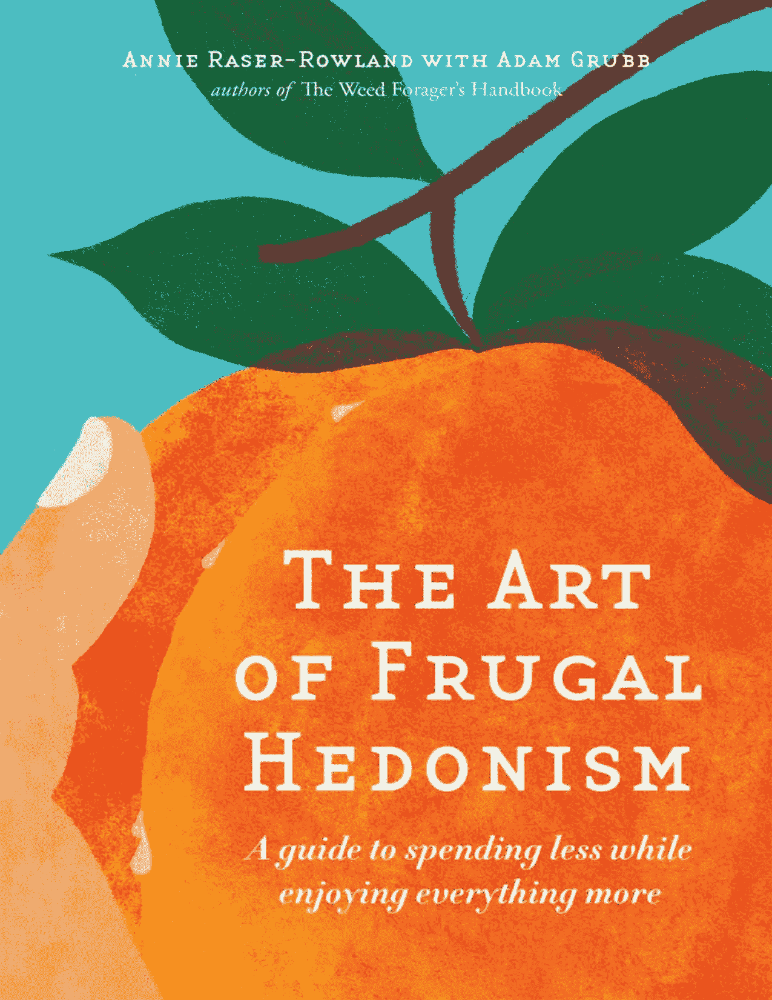

# 致谢

我们对许多接受采访的受访者表示感谢：Su Dennett, Belinda Kerrison, Lawrence Hamilton, Isobel Harper, Danny Renehan, Meg Ulman, Patrick Jones, Srinath Baba, Peter Lalor, Joh M., Jack 和 Lois Monaghan, Trish Harris, Ibby E. Okinyi, Nadia Faragaab, Toby Mclaughlin 和 Taryn Ellis。

感谢在手稿演变过程中对部分提供反馈的人。Davina, Danny, Lucy, Sam, Hermann, Brooke, Nan, Marilyn, Taryn, Saskia, Shultz, Michael, 特别感谢 Frances Rowland，她反复阅读读，并提供了大量详尽且实用的建议（即使在这些建议被无意忽略时也保持了风雅）。

- 序言
- 关于本书

# 序言 Clive Hamilton

这是一个极棒的主意，一本展示了节俭生活也可以如此快乐的书。

- 你怀疑自己的某些消费对你的健康产生了不愉快的负面影响。
- 你可以享受最简单的事物，却觉得如果你想成为一个完整的社会成员，以某些方式花钱几乎是义务的。
- 你觉得需要完成的付薪工作没有给生活的其他部分留出足够的时间或精力。
- 你意识到自己生活在这样一个物质丰富、便利的社会里是多么幸运，这在人类历史的大部分时间里是无法想象的……
- ……但你有时也会被这种社会带来的无尽选择和期望而感到不知所措。感到困惑的是，你为了参与现代生活而本应做的每件事，正日益被认为在同时破坏着我们所知的地球未来。真糟糕。

如果你仍在试图弄如何处理这些感受，请让这本书成为你的入门读物，让你过上更少依赖消费舒适的生活，更多地关注从人性的最核心部分中提取最大的快乐。

如果你已经开始为了这些感受而改变生活，请让这本书成为你的伴侣，帮助你锻造一种既有深度快乐也有廉价快乐的生存。让它成为你“华丽节约”生活的锦囊妙计。每每当你觉得自己那样生活的决心需要一些鼓励时，让它就在那里。或者每每当你需要一个迷人而博学的小家伙（谦虚地咳！）来帮助你那些不那么节约的朋友接受你的生活方式时。

节约通常被认为是穿粗麻衣殉道者的领域，任何能买得起市上所有美好东西的正常人都不应该对此感兴趣。我们的作者想对此提出异议。我们保持节约的最大动力之一就是享乐主义。

**hedonism / hēdnɪzəm/** 对快乐的追求或奉献，特别是对感官快乐的追求。

然而，这种奉献可以有许多形式，但在消费享乐主义的祭坛上过度狂热地崇拜，真的会让你忽略其他种类。

成为一个“节约享乐主义者”需要一些练习。如果你习惯了按写着“奶酪”的按钮就有奶酪出来，你可能会对必须走到奶酪山、在与奶酪矿工寒暄之后获得奶酪而感到不满。但想象一下，那块奶酪的味道会多好得多！更不用说其他好处了，比如你结实的小腿、通往山路的美景，以及你与一群才华横溢的奶酪矿工之间的愉快友。这正是节约享乐主义的核心：感知更多维的快乐光谱，并据此生活。

## 关于你的作者

我们都是作为模糊的中产阶级孩子长大的，这在20世纪70年代和80年代意味着生活得比现在要节约得多。更多的泥土，更少的屏幕，几乎没有外卖，更多步行上学的路，头发更蓬松的父母。

回顾自己的青少年时代时，你的作者安妮（Annie）意识到，她已经对奢侈浪费表现出了不寻常的态度。她记得她在第一间合租公寓里的某个下午。她那时刚高中毕业，在一家塑料回收工厂上凌晨五点的班。整整一个星期，她每天都带好一套换的衣服准备在下班后穿，每件衣服都是同一种愤怒的钴蓝色，是从不同的二手店任务搜寻来的。她会走出工厂，走在西澳正午的阳光下，穿过工业区走向海洋，在那里她为自己能够通过伪装融入巨大的蓝天和倒映的海洋而感到狂喜。在那周的最后一天，回收线产生了一个像蛤壳一样的钴蓝色池体。她坐着火车把它带回家，整个下午都快乐地陷在后院茂盛的银草中。当她摇晃杯里蓝色糖水中的冰块发出叮当声时，她凝视着天空，试图消除任何自我存在感。她记得当时在想：“这是放靡的巅峰。”

你的合作者亚当（Adam）记得小时候他很清楚地认为，火上烤的三明治比任何其他类型的晚餐都好吃。当他的父母找到了更好的工作、家里搬了家时，他对廉价快乐的热情得到了证实。他们非常怀念那座破旧的旧农场，对那栋闻起来有油漆味的、无菌且昂贵的新房子完全不为然，尽管他很快就发现了一个可以捉青蛙的池塘，所以一切终归还好。后来，当他进入青春期变得有些古怪时，他坚持要买配光师那里现货中最便宜的“老年人眼镜”，拒绝了父母提供的更时尚的镜框。他也从未想过要辆汽车作为毕业礼物。

## 关于你的作者以及这本书

亲爱的读者，随着我们年龄增长，你的作者注意到，在我们不可置信的富裕社会里，许多人尽管过得很好，却在难以充分享受生活。越来越多地，那些人就是我们——尽管我们有一个良好的起点。我们发誓不妥协。我们要把这种趋势扼杀在芽中。如果有需要避免的棘手陷阱，我们会避免！如果有需要反抗的平庸洗脑，我们会反抗！我们想要过得精彩！我们想要保持健康、好奇并对快乐充满活力！而且我们想在不花很多钱的情况下做到。逐渐，我们变得越来越精通，以至于人们开始问这样的问题：

Q. 你好。请告诉我是如何做到工作这么少，却做了这么多酷事情的？

Q. 你们的秘密到底是什么？你应该找时间过来坐坐，给我一些如何少花钱的建议。

Q. 你一周到底花多少钱？

Q. 为什么你们不写一本书关于如何节约又能过好生活呢？

所以我们来到了这里。为了到达这里，我们调查了我们节约享乐主义朋友的习惯并记录下来。我们寻找了在资源转化为快乐方面比我们更好的文化或时代，并捕捉了他们的话。我们对所学的内容进行了提炼，将其洒在一些事实和数据之上，并展示了我们在少花钱的同时过好生活的策略。

## 1. 创造你自己的常规

这是一个寒冷的周二早晨，R家的闹钟响响了。R先生和R太太不情愿地从睡梦中挣脱，去叫醒两个儿子。他们开启暖气，匆忙洗热水澡、剃须、吹头发，然后穿上洗干净的衣服。他们用咖啡机制作咖啡，从冰箱里拿出果汁和牛奶，倒进杯子里淋在麦片上。R太太把昨晚带回的工作文件夹装进两厢车，出发上班。她在路上买了一杯额外的外带咖啡，因为她经历了一个流汗且不安的夜晚，直到凌晨4点发现电毯还开着。

当车里的暖气开始变得闷热时，他把冰淇淋和巧克力酱吐在了自己身上。等他们回到家把脏衣服放进洗衣机时，已经是下午晚晚了，R 先生意识到他甚至忘了买那条新狗窝，他本打算替换 Fido 那条越用越旧的窝。孩子们在房间里看 DVD，R 先生把衣服放入烘干机，并在洗碗机里装满了早餐餐具。然后，他在网上预订了周末庆祝 R 太太 40 岁生日去悉尼的机票，并等妻子回家，这样她就可以去健身房，并在回路上顺便买条狗窝。

R 太太忘记了直接回来的承诺，中途停下来买东西，买了一些特殊的儿童多装组合，并无意中在一条漂亮的丝绸裙上花了比她整周赚得更多的钱。她不确定自己会不会穿，也知道自己需要瘦一点才能穿得合，但它确实美极了。在妻子晚归后，R 先生匆忙忙地去健身房，结果忘记了鞋。他不想回去，决定在路上买新双鞋——考虑到他坚持健身计划执行得很好，他也许值得升级一下。锻炼完后，他拿了一瓶电解质饮料一根蛋白棒，回到家里。每个人都很累，所以他们决定点泰式外卖当晚餐（把剩下的烤羊肉扔了），调高暖气，开始享受一个舒适的夜晚。

你认为这一天是奢侈的吗？在描述的这一天，R 家庭显然并不觉得自己在过着高品质生活——或者说过着满意的生活。他们只是在努力度过另一天，而这种方式在数亿人看来是*正常*的。

两百年前，R 家庭每个成员在这一天消耗的资源对普通人来说是无法追踪的，甚至对教皇和国王来说都是挑战。单从能源消耗来看，即使在最近的 1950 年，社会经济地位相似的家庭在典型一天中的用量也只有这个数字*不足半*。

| | 1950年 | (2000/2010年代) |
|---|---|---|
| 人均居住面积 | 27 m² | 83 m² |
| 仅住一人的家庭百分比 | 10% | 25% |
| 每人道路车辆行驶里程 | 4,900 km | 16,200 km |
| 在家准备食物的百分比 | 75% | 50% |
| 有空调的房屋百分比 | 10% | 87% |
| 电影院爆米花典型供应分量 | 3 杯 | 16 杯！ |
| 家庭债务（占家庭年收入的比例） | 约 50% | 约 200% |

一些来自美国的数据供你思考。在其他英语国家的人变得过于自大之前，你们的数据看起来也没好到哪。

奇迹的是，那些 1950 年的中产阶级人士并没有在清醒时间里抱怨这种痛苦的匮乏——他们觉得和今天的 R 家庭一样人很正常。事实上，有一项美国研究表明，1950 年的公民自认为比现代人更快乐。

这种对比说明了，我们对“财富”和“适度消费”的概念在多大程度上是通过与周围的人比较来定义的。即使是那些最不认同“攀比阔邻（keeping up with the Joneses）”这句话的人，也无法不根据同龄人所做的以及大众（和社交）媒体建议人们所做的某种模糊标准来衡量自己。

收入增加而幸福感下降的现象，被称为**伊斯特林悖论（Easterlin paradox）**。

再次考虑我们上面强调的消费变化。我们务实的作者提到这些，并不是为了让我们陷入个人和文化的负罪感中。绝非如此。我们提到它们是因为我们认为承认所谓的“正常”具有完全任意性是非常令人释放的（！）——这实际上为我们建立自己的正常扫清了道路。突然，我们觉得可以自由地在那个范围内跳舞，无论这种享乐主义（Frugal Hedonist）把我们带何方……

“享受（Relish）”是一个值得思考的词。它听起来几乎是不可理喻的，因为它暗示了过度的感官刺激。我们务实的作者认为，这种对生活乐趣的充分投入是我们节俭盔甲中最精良的技能。

人类充满了神经末梢。为什么要浪费它们呢？Annie 记得小时候她和好朋友在散装食品店里来来去，手伸进装干豆的大桶里，感受不同品种有多好玩。她似乎记得自己可能被要求……

拥有一个身体。部分时候，她看着姐姐走在碎石小径上，渴望着感受那些潮湿的石子在脚下碎裂的感觉。她发誓要原谅生命中所有得罪过她的人，只要某种更高的力量能给她几分钟钟的嘴巴，这样她就能捡起一把碎石，在舌尖上翻滚。她想象着尝到所有不同的矿物质，感受着碎石尖利的角和光滑的平面在她的上腭上滑动。她为为这种感官过载的想法本身感到欣喜若狂，随后又因为这种感觉再也无法属于她而陷入极度愤怒。

这段文字非常适合用来做闭关。在最后两天里，Annie 在小房间里和周围活动完全没有困难，因为她——是的——尝了碎石，仔细研究了半小时花生的感官属性，并实验了如何品味窗外树上掉落的半烂芒果的香气。她还练习了单臂俯卧撑。

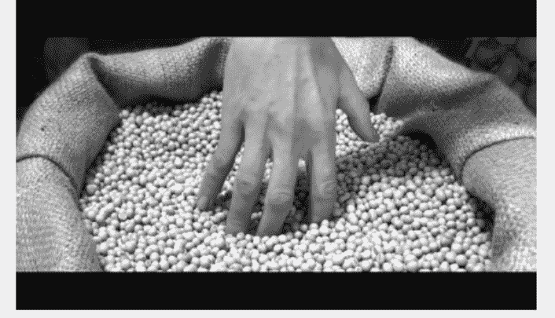

> ...但这究竟那位略带电影感的、享受生活的少女安米莉（Amélie）的手，还是你那谦卑的合著者 Annie 手？

一些正念老师建议，你可以从每天三次停止你正在做的任何事情五分钟开始，开启通往深度感官参与的之旅。带着从容不忙的好奇心观察周围以及置身身体的感受。观察脚与地面的接触，以及头部支撑在脊柱顶部的感觉。

尝试去感受你胸中的心脏和肺部，它们正以那种持续且有帮助的方式扩张和收缩。

其他实践者建议用葡萄干进行练习，你花两分钟关注它外观、纹理和气味的每一个细节，然后花另外两分钟吃掉它。我们的作者个人更偏爱金橘。金橘身上真的有很多学问。

- 这对你来说真实吗（向讨厌双关梗的读者表示歉意）？嗯，这方面也有证据。埃塞克斯大学的研究人员将陌生人配对讨论“有意义”的话题。在有一半的配对中，一部手机被被放在房间里，小心地放在附近书桌的一本书上。房间里有手机的人报告说，信任感、共情能力和整体关系质量剧减了。那并不是他们的手机，手机甚至没开，但即使参与者没有主意识地注意到手机的存在，它仍然影响了他们的连接感。其中一个假设是，手机在潜意识里暗示了其他社交连接的可能性，这导致我们无法完全地投入到此时此刻。

“但是什么？！”当你读到这条建议的标题时，愤愤地嘟囔道，“反物质主义难道不是减少购买的基石吗？”提高你对消费品的重视听起来确实像是一条通往节约的奇异路径，但请听我们解释。即使你目前过着只有一个小背包的游牧生活，你可能也拥有一些帮助你烹饪、吃饭、洗澡、睡觉、工作和游戏的物品。如果你想避免替换这些物品时涉及的持续消费，你就会认可它们的价值，维护它们，并且从一开始就购买足够耐用且可修复的物品。（另请参见“11. 警惕虚假节约”）。

很显然，对吧？但这已不再是标准的做法了。我们的文化实际上似乎变得有些反感喜爱物品：照顾物件是是太刻板了！这很不时髦。你是否曾经因为提醒朋友在使用后用油布擦拭你借给他们的修剪剪刀片而感到有些不酷？或者因为向你的室友提到在电机开始过热之前关闭搅拌机可以让它用得更久而感到害羞？

由于有这么多廉价的替代品来替换坏掉的廉价品，我们中的许多人已经失去了照顾它们最基本的知识，反而几乎将“不费麻烦”的快感崇拜化。作为一种文化，我们看了很多詹姆斯·邦德电影，其中的英雄们在执行任务时炸毁豪华汽车和手机，不理会它们似乎是理所当然的。社会有一种暗示，展示我们是怎样的人意味着对物质的琐碎方面（如照顾它们）表现出一种“我有很多更重要的事情要忙”的粗不在焉。我们的作者认为这有点差劲。

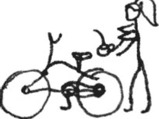

所以定期给你的自行车链上油

这里有一个建议。也许在看了那部詹姆斯·邦德电影后，看一遍《疯狂的石头》来平衡一下，这部电影让你觉得像可乐水瓶这样美丽实用的东西竟然存在。看着你厨房桌上那把略显过时的椅子，对其事实感到震惊：人类收集从热带树木渗出的汁液来制成椅子腿上橡胶的橡胶。巨大的机器从地球深处拉出制作框架的金属，将其加热到发光，以便将其挤压成正确的形状。古老的油脂在颜料和催化剂的作用下疯狂搅拌，直到变成那个模塑的塑料座椅。将同样的思考应用在你墙上的时钟、架子上的面包和冰箱里的芝士蛋糕上。

要为你竟然拥有这些东西感到震撼，它们有着令人惊叹的努力和资源背景。保持敬畏！心怀感激。然后照顾好它们——反正这种做法早晚会再次风靡。

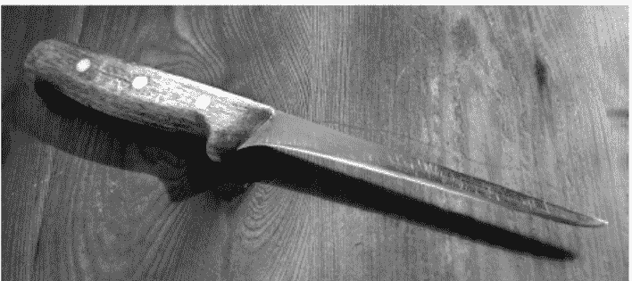

四十年的磨砺——绝对是有价值的东西。

究竟是先有节约，还是先有那个有很多兴奋要做的事情的蛋？在我们作者的情况下，无疑是那个兴奋的蛋。没有什么比拥有想要追求的激情更能成为节约的动力了。让我们拆解一下：

1. 通过减少消费，你有更多的钱花在做真正想做的事情上。
2. 通过减少消费，你拥有了减少付费工作的选择，给你更多时间去做你真正想做的事情。（即使这恰好是追求你真正想做的付费工作。）

> ! 你可以兼顾一点 1 和一点 2，并两者兼得。

当 Annie 还是个派对狂时，她决定虔诚地爱番茄三明治。她没有去酒吧，而是吸引朋友坐下来。尽管收入微薄，但储蓄确实缓慢地积累了起来。多到她有自由去花几年美好的时间攀爬那些火山。

所以，拥有更多如何安排自己时间的自由，是减少支出的极佳副作用之一。万岁万岁！让我们都去海滩吧！现在让我们去看电影吧！或者连续看三部。现在让我们睡到十一点，然后花一整天读《燕子》。

而我们像亚马逊人一样，吃着奶酪和饼干，对流逝的青春感到感怀，并流下眼泪。现在呢？当没有人强迫我们做某事时，下一步该怎么办？是的，你发现了这个漏洞；自由，当我们习惯了它，可能是非常令人令畏的。如果你已经有了处理这种情况的经验，请跳过本提示的剩余部分。如果你感到一丝存在主义的恐惧，请继续阅读。

这个困境为什么会存在？从从小起，社会就鼓励我们放下为了事物本身而做某事的冲动（“内在”动机），转而为了外部原因去做我们所做的大部分事情。作为一个孩子，你肯定是一个内在动机驱动的学习者，清醒时的大部分时间都在痴迷于世界，并发明出无尽的冒险，以探索这一切是如何运作的。然而很快，学校教育变成了你为了外部动机而做的事：分数和惩罚。

工作生活随后继续强化了这种为了外部动机而行事的模式。更重要的是，围绕就业构建生活不仅是获得动力和结构的捷径，也是获得社会和个人认可的捷径。一旦适应了这套设定，人们会发现，尽管他们可能思念假期并渴望更多的“空闲时间”，但当他们获得这些时间时，脑子里并没有充满如何度过这些时间的想法。这很好。如果你不指望会有时间去做，却不断构思你想做的事，那种生活将是非常压力巨大的。

亲爱的读者，我们有一个建议：如果你确实改变了生活方式以获得对自己时间的控制，然后发现自己自己在没有外部压力的情况下不愿采取行动，请对自己宽容一段时间。如果你感到自己与对学习的渴望深度脱节，而你与生活跳恰恰舞的内在动机已经消失殆尽，请做好感到一丝无聊和迷茫的准备。

大多数人需要大量的恢复时间，利用他们节俭生活方式换来的任何空闲时间，来追赶积压的生活维护活动（看牙医、清理储物室），并在家里闲逛、睡午睡和直接从罐子里吃花生酱。

一个老练的“节俭享乐主义者”（Frugal Hedon）的标志之一是，人们不断问他们如何能休那么久的假。节俭享乐主义者倾向于觉得合适就工作多久，然后决定出发用一年时间徒步蒙古。这完全会让别人感到一点不爽，因为这个节俭享乐主义者最初可能只是在兼职。而且通常看起来很享受工作——也许是因为他们是根据兴趣选择工作的，而不是根据工作能赚多少钱。

让我们认识这对夫妇，他们无疑对自己不寻的工作/生活比例引发了许多困惑的问题。我们认为他们最近的冒险完美证明了，拥有自己热爱的事业如何成为节俭生活的惊人动力……

Meg 和 Patrick 有两个孩子（Zeph，11 岁和 Woody，1 岁）和一只杰克罗森梗犬。全家人（包括狗）最近花了一年的时间骑自行车从澳大利亚东部南部向北一路往返。在整个 6000 公里的行程中，他们尽可能通过采集、狩猎和闲谈来获取食物。这段旅程是为了在一起度过一段不可思议的时光，但也为了证明一个家庭可以在几乎不需要钱的情况下旅行，而不依赖化石燃料或工业食品系统。正如你们的作者热衷于分享廉价享受生活的技巧一样，他们写了一本关于自己经历的书——详情请参见我们的“更多资源”部分。

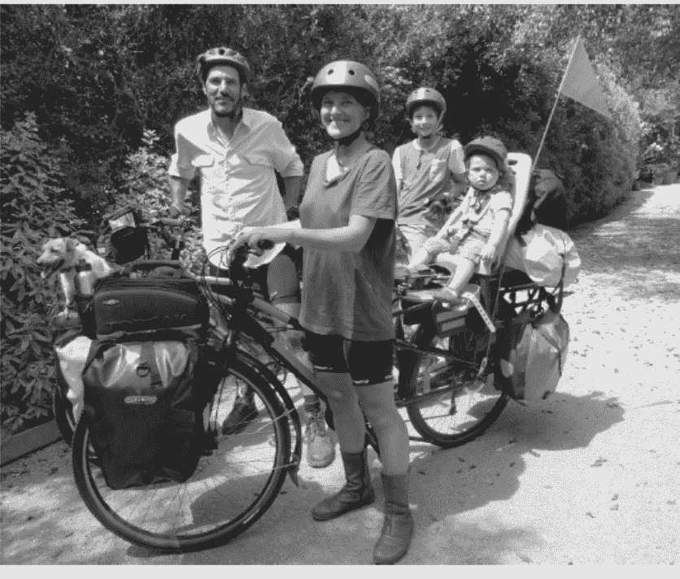

# 节俭享乐主义：重新校准生活的艺术

## 放弃汽车，拥抱自由

他们没有办信用卡来支付这趟旅行，也没有进行任何加班。事实上，一段时间以来他们几乎没有时间做有薪工作，他们忙于创作艺术、生宝宝、写论文，并为他们所在的小型乡村镇的几个社区组织投入了无数小时。他们能够如此慷慨地投入时间（并去冒险），是因为好几年来，他们全家的年度支出约为 20,000 澳元——大约是澳大利亚家庭平均水平的四分之一。

他们是如何做到的？放弃汽车是一个非常关键步骤。Meg 说：“Patrick 在 RACV [州汽车协会] 网站上看到，不买车每年可以节省 13,500 美元……我们有两辆，所以这一下就有近三万块钱。”他们用简单的食材烹饪，自己种蔬菜和鸡蛋，并采集野生食物。他们住在一间不显眼的房子里，在二手商店购物。他们对时间、能量和镇上社区多余农产品的慷慨回馈到了他们身上，他们对自己的多少需求最终竟然是由当地的“赠品经济”满足的感到惊奇。他们描述了在儿子 Woody 出生后的几个月里，“每当我们离开家回来时，总会有东西等着我们。衣服、食物，几乎是新手父母需要的一切。”

Patrick 说：“随着收入减少，生活变得好多了。”Meg 同意：“自由并不是最初的动力，”（指他们开始削减的原因），但“它已成为主要的驱动力。对我来说，我们放弃得越多，我就越想放弃。”

## 垃圾桶里的宝藏与浪费的真相

就躲在垃圾桶里的绿色毛茸茸生物而言，在我们看来，坏鬼奥斯（Oscar the Grouch）非常讨人喜欢，但他并不是你能在垃圾桶里找到的唯一好事。澳大利亚人扔掉了带回家的 20% 的食物——那是五袋购物袋里有一袋！加工商和零售商在食物到达消费者之前也浪费了几乎一样多的量。同样，美国种植或进口的所有食物中，有惊人的 40% 被丢弃了。我们扔掉的不只是食物。例如，在美国，每年收集约 1.5 亿吨未回收的市政垃圾。与其想出一个等同于蓝鲸排成一排长度的视觉方案，我们可以说这简直多得离谱。

你们的作者实际上非常热爱自然，尽管有蚊子、蚂蛭和夏天那种炎热的沙尘大风，但自然并没有浪费的概念。人类社会直到最近才对浪费没有多少概念。即使是我们祖父母那代也几乎不扔任何东西——这显示出整个过程是多么地没有必要。随后出现了瓶装水、一次性餐具、单份装奶酪和饼干零食、导致一半变质的面包和牛奶、颗粒板家具、每年都会过时的技术，以及文化警察告诉我们的同样过时的衣服。我们的祖父母可能在天堂里调大了巴里·曼纽的音量，以挡住下面超负荷工作的垃圾车的喘息声。

不要太温柔，读者。通过对浪费产生过敏反应，你不仅可以减少自己在这种荒诞局面中的作用，还能省下一笔惊人的钱！我们个人在低收入朋友中观察到，他们厌恶浪费的程度是决定他们周末是否还剩余现金的因素之一。

## 成为不浪费者的三个阶段

成为一个不浪费者的这一过程有三个重要的阶段。

### 第一阶段：审视准备购买的任何东西

首先，看看你**准备购买的任何东西**，并评估它是否有极具有**变成垃圾的潜力**。例如：

*   任何制作得糟糕的东西。
*   一种新类型的保湿乳或果酱，“仅仅是想试一试看”，尽管事实上你已经有了充足的保湿乳或果酱。
*   任何一次性的物品。
*   又或者在你已有的五条黑裤之外，再买一条剪裁略有不同的黑裤。
*   任何非常合乎潮流的物品。

你可能听过以下建议，因为我们有许多人仍然忘记了这样做：“在你去买菜之前，先检查你家里已经有什么……”这不仅仅是为了避免冰箱里最后多出三罐蛋黄酱，更是为了购买能补充你已有食物的物品。如果这包括一根快速枯萎的茄子和一些需要处理的菲塔奶酪，再加上冷冻室里的几块平饼和花园里的迷迭香，你可以在购物清单上加上大力和番茄酱，这样就可以把它们做成披萨。如果你买的某东西比需要的多，把一半放在冷冻室里——敲响邻居的门问问他们是否想要剩下的。如果你只需要某样东西的一点，而且知道自己可能会让剩下的在储藏室里干掉，不如考虑根本不要买（！）。

### 第二阶段：评估即将丢弃之物的实用潜力

其次，看看你正要扔掉的任何东西，评估它的实用潜力。如果它对某人可能有价值，找个捐赠的地方，或者在村里的口口相传传出它闲置了（也许可以使用专门广告此类物品的优秀网站——详情请参阅我们的“资源”部分）。和朋友一起尝试换装活动——它们会非常好玩，每个人带走的都是自己喜欢的东西，而减少了不需要的东西。旧衣服可以放入抹布袋中用于清洁或制作物品。罐子洗干净后用于罐子发挥用场的地方。旧蔬菜可以做汤；酸牛奶可以做煎饼（事实上是最好吃的煎饼）；旧水果切掉任何坏掉的部分进行炖煮。

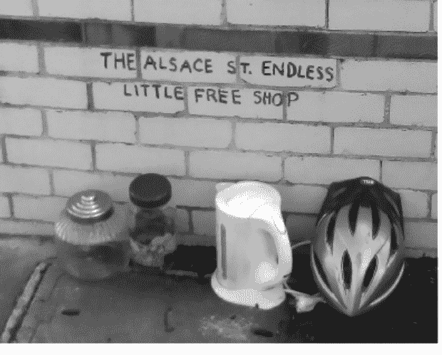

延续我们果酱的主题，不要扔掉那个还有最后厘米甜味的罐子——往里倒一点温水摇一摇让它松动，然后在炖水果时加进去。然后涂在那些煎饼上。没错！一点剩余的咖喱或炒菜可以加入米饭，再配上一些额外的蔬菜和一个煎蛋，奇迹发生！晚餐，2.0 版本！坚硬的面包可以切成块，烤一下后丢进沙拉、汤或意面中。当一个人呆呆地望着空处看不见任何价值时，一个节俭享乐主义者看到了一顿丰盛晚餐的可能。关于这一点，请参考“与食谱保持开放关系”。

这种策略并不总是能带来质量最好的装备——尽管它同样可能让你得到一些真正的宝贝——但它有点像一张道德和财务上的“无赦金牌”。如果某东西在你拯救它之前注定会变成垃圾，你就不需要担心它的制造状况，或者它是否是一项“值得的投资”。而且，如果路上出现了更好的……你只需把它放回街上……

> **警告**：下文中提到的几种情况涉及在标准供应渠道之外操作。如果你打算这样做，尊重你的来源是极其重要的，不要为其他可能也在使用这些资源的人破坏事情。这通常意味着：不要留下混乱，不要把所有东西都据为己有，并对任何质疑你所做的人保持礼貌。

### 第三阶段：无耻之鸟有虫吃

无耻之鸟有虫吃。如果你准备抛弃“别人会怎么想？”这个因素，通过那些本会浪费的物品来满足生活的机会就会真正展开。我们的作者认为浪费是愚蠢的，而明智是有趣的，所以我们倾向于将其抛之脑后，直接行动。

我们从垃圾桶中救出了高质量的食物盛宴（更不用说我们数不清的许多啤酒）。我们吃过极佳的路杀动物（在检查了新鲜度且没有疾病后）。我们从桥下铲走了所有的袋装鸽子粪（这是曾点缀芦笋地最优质的肥料之一）。我们从路边绿植中收集了大量的落栗子（导致冷冻室里存了足够多的，我们整个冬天都在吃栗子）。

我们有一个朋友从当地有机商店收集可堆肥的垃圾，商店节省了处理费用，而他在自己的花园里处理。作为感谢，他们现在还会送给他即将过期的乳制品，他把任何不能使用的送掉。我们还有另一个朋友在任何活动结束时加入，所有剩余的美食即将被倒进垃圾桶时。作为感谢，他们现在也会送给他即将过期的乳制品，他把任何不能使用的送掉。

## 世外桃源：有意识地重新校准

当我们注意到这种效应如此容易发生时，自然而然会开始思考如何有意识地而非偶然地去利用它们。

这是一个多么精妙的微小机制啊！你可以尝试重新校准什么是“奖励”或“出游”。假装自己正处于战时配给状态，连续一周只吃家里简陋的家常便菜——你会想要计划自己的餐点，可能还会为食材进行一次初期的购物。然后在这段期间定个日子去出去吃冰淇淋。那次远足就会魔术般变成一次巨大的奖励！穿上你最棒的夏装去执行，细细品味每一口，让整个活动尽可能得久。

想象一下，自己被校准得如此细腻，以至于一根黄瓜都能成为你最喜欢的食物。阿妮塔·迪亚曼特的《红帐篷》（*The Red Tent*）是关于创世记中雅各唯一的生女儿迪娜的虚构传记。在某一次，迪娜发现自己正身处埃及的炎热中，远离她美索不达米亚的家：

> 我吃到了令人惊叹的……橙色果肉的瓜和粉色果肉的瓜，那里总有吃不完的枣……但最棒的还是黄瓜，我能想象出的最美味的食物，青绿而甜。即使在烈日的阳光下，一根黄瓜也用月亮般的清凉吻着舌尖。

一旦你的舌头实现了“黄瓜之悟”，为什么不尝试重置你与科技的关系呢？你可以尝试自我禁欲 48 小时不使用所有信息和娱乐技术（警告你，许多这样做的人会对这一天突然多出这么多额外时间感到深感震惊）。当你再次打开那台笔记本电脑时，你可能会发现，自己会对发现明天天气如何这种心加速的“全知感”感到满足。安妮曾把自己当成实验的小白鼠，在两周内不使用任何电子技术和人造光。结束时，她惊讶地发现自己对自然光的氛围变得如此敏锐——阳光在各种应用场景中的闪烁、流光、光泽和光芒，成了每一天深邃的纹理元素。

我们还可以对自己的预期按钮按下重置键。如果你每天午餐都打算买外卖，你可能被校准为认为只有从店里买来的午餐才值得期待。相反，尝试不要总是带便当，你会逐渐忘记商店橱窗里油腻腻的陈列，并会极其期待打开装有烤肉晚餐剩菜的饭盒。

利用你身心这种慷慨的灵活性，正是“节俭享乐主义者”（*Frugal Hedonists*）终身坚持的事情。正如狂热的放纵者以寻求日益堕落的体验来满足日益贪婪的胃口而闻名，频繁做出节约的选择为我们赋予了更敏锐的味蕾。现代优先生活的基本蓝图是常态化的过度丰饶和过度刺激，并在当后果变得过于令人痛苦时，穿插着绝望的逃离尝试。这些尝试通常表现为爆发式的节制（如节食），或崩溃（如疾病，或在泳池边躺两周、喝醉的假期）。节俭享乐主义反转了这种模式，它将消费的优雅自足常态化，然后艺术性地点缀上被刻意放弃的丰饶。它利用了不同生存模式的不同风味，并将它们相互对比，从而从每种模式中提取更多的快乐。

> “每架飞机上的每个人都应该不断地感叹：‘噢我的天，哇！你正在飞。你正……你正坐在天空中的椅子上！但这可不怎么回不去。’而且‘它闻起来真的很香’。你知道的，重点在于：人们说航班有延误。延误。真的吗？从纽约到加州只要五个小时。在以前这需要三十年，而且你们中的许多人会在路上死掉，生个孩子。当你到达那里时，你面对的是一群完全不同的人。现在，你你看场电影，上个厕，就到家了。” —— 路易·凯（Louis C. K.）

我们的一位作者最近坐在一架飞机上，几个乘客对坐在天空中的椅子感到非常兴奋——他们是孩子。当他们开始大喊“我们要离开地面啦！我们真的在飞飞啦！我们要进入云朵里啦！”时，其他乘客在座位上挪动身体，不确定是否该感到恼。然后他们开始微笑，伸长脖子向窗外看了一会儿，并对整个局面感到短暂的喜悦和惊呆。

显然，我们目前为止提出的建议是针对相当小规模的重新校准（尽管你可能会对产生的连锁反应感到惊讶）。如果你渴望更伟大的，为什么不尝试重新校准你对“中间”的基本概念呢？你可以从沉迷那些刻意生活在低消费极端的人开始，例如那些不带钱旅行的人，或吃“免费主义食者”（*freegan*）风格食物的人。也许看一些观察普通现代人生活方式和资源使用预期的纪录片。深入了解历史人的生活，他们对便利和舒适的定义比现代人更有包容性（更多请见“10. 浪漫化时代”）。看看那些让孩子们兴奋的事物，并质疑自己对“卓越”的感知是否已变得狭隘。偶尔进行这种精神之旅可以是一次振奋的现实检查，也是一种清新的平衡。

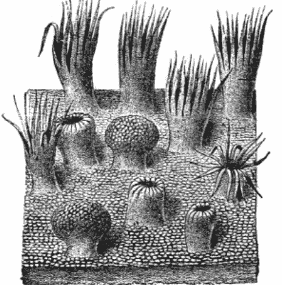

这是《格氏解剖学》（1918）中所想象的味蕾。

它们看起来确实已经准备好狂欢了。

## 与食谱保持开放关系

但无论如何，所有华丽的东西都是这样发明的！意大利农民 Z 并不是决定将未熟葡萄汁挤在肉上，以便以后将其装在小瓶中作为“果酸”（verjuice）进行销售，并为美食食品公司赚取大量资金。农民 Z 这样做是因为他们意识到自己的晚餐如果带一点酸味会更好吃，而手里又没有其他酸性东西。你们的作者发现，我们越是依赖偶然性，我们自己的菜就越能升华境界。栗子的收获和未成熟的果实催成了一道极佳的羊肉、栗子和酸苹果炖。对伯爵红茶的渴望引发了在普通茶中浸泡一枝迷迭香的实验，结果发现味道超级棒。

我们确实使用食谱来学习。一个好技巧是找到三个与你想要的东西类似的食谱。然后看看它们在何处重叠，并给你一个大致的比例概念。例如，我们花园里有很多荨麻和土豆，还有一些哈罗米芝士（haloumi）需要使用，于是我们查了几道面团（gnocchi）的食谱，以感受比例和核心制备技术。（如果我们已经没有那三个面团食谱都要求的面粉，我们就会直接用这些食材做一顿煎盘菜了。）食谱也适合尝试全新的口味组合，用更具艺术感的方式处理你手头现有的食材——有人想吃绿番茄派吗？但基本上，正如归于查理·帕克（Charlie Parker）的话说：“精通你的乐器，精通音乐，然后忘记所有狗屁事，尽管弹吧。”当你有朋友来吃晚餐，而你满怀自信做出一个含有维米酱（Vegemite）的肉汁，且完全相信没人注意到时，你就知道自己达到了境界。

如果你来自一个非崇拜维米酱的国家（可以使用 Marmite 或 Promite）

好了，我们知道在这里放一个食谱很讽刺，但管他的呢……

### 维米酱肉汁食谱

**材料：**

*   黄油（或猪脂、酥油或油）
*   洋葱，极细碎（可选，但如果你不用它，在第 5 步末尾加入一些大蒜或蘑菇很不错）
*   普通面粉（如果使用玉米粉，用量要少得多，并在放入有油的锅中前与少量水混合成光滑的糊状）
*   用骨头/肉/蔬菜渣熬制的汤头，或者水加半块汤块……或者直接用白开水
*   维米酱（或一大勺酱油）
*   一些旧红酒（或红酒醋）
*   迷迭香或百里香或两者皆有，切碎
*   盐和胡椒

**步骤：**

1.  用中火在煎锅中融化一块黄油，轻轻煎炒洋葱直到非常软，然后将其从锅中取出。
2.  在锅中融化一小块黄油，然后离火。
3.  将一勺面粉慢慢加入黄油中搅拌成糊（面糊 roux）。
4.  将锅放回小火，快速开始搅拌加入一些汤头，直到它变得像奶油一样的稠度。
5.  加入约一茶匙维米酱、少许酒、迷迭香以及一些盐和胡椒。
6.  边搅拌边煮约 5 分钟，直到变得浓稠美味。

## 广告的陷阱与精神自卫

全球每年在公关和广告上的支出超过 50 万亿美元。如果你住在美国、英国或澳大利亚，你个人身上会被花费大约 1000 美元（按 2013 年价值计算）。我们乐意为广告商省去这些不必要的麻烦，因为我们认为这些手段对我们没什么作用，直接接受一张支票就好。或者是等值的威士忌。

虽然推销你的产品远非新现象，但“推销专家”们不仅花了几十年来精炼他们的阴险艺术，而且目前可用的总额是天文数字。例如，在德国，单是在线广告的支出就是整个宣传机器预算的七倍（根据通胀调整）。很少有人否认这种为了说服人们进入一个腐败系统的力量。

广告商知道，仅仅推广产品的吸引力属性——并不有效。更有力的是，无论多么显眼或秘密地，暗示你并不拥有你应得的一切，或者你应该拥有的一切，这样是可以接受的。他们通过暗示存在这样一种生活，对你个人而言，他们拥有那些可以售卖的东西。主妇们拥有一个稳固的生活（因为更诚实的生活方式让你产生共鸣），可爱的袜子（因为你是一个俏皮的女性），巨大的电视（因为你认真对待娱乐），或者昂贵的啤酒（因为你欣赏品质的投入）（以及地区特色）。复杂的心理学被用来确保营销活动玩弄你最珍贵的愿景，让你觉得生活应该是更多的。谁能责怪身体落入了这种针对脆弱内心和不安全感的诱惑呢……

（注：原文后续存在大量由于 OCR 错误导致的重复乱码，译文已根据逻辑剔除重复部分，保留了核心内容的连贯性。）

报纸，拿掉任何目录并把它们直接放入回收桶。最后，我们强烈建议避免任何种类的生活方式杂志或像鬼一样的插页。关于为什么这样做很有帮助，更多信息就方便地位于我们的下条建议中。

这简直就是生活不是吗！在周日的早晨，翻阅着易于消化的生活类媒体页面，一边品尝上面的荷兰油酱。有时，当你浏览那些充满了引人入胜的你本可以拥有和行事的页面时，你会察觉到一股肾上腺素流入你的血液……但你可能并不会这样做。

你所扫视的那些专栏中的语言会引起你的共鸣，让你觉得写这些东西、做这些事、拥有这些东西并过着这种生活的人是“你自己的人”；觉得你们“懂”彼此。理所当然，你应该按照他们似乎设定的标准来衡量自己。你随口说出“时间贫困”和“购物疗法”之类的词汇也是合理的，因为他们确实如此。

问题是，他们并不是你。事实上，他们大多数时候甚至不是“他们自己”，而只是试图满足预期语调的作家，吐出关于某家拥有获奖装饰的埃塞俄比亚融合菜馆的描述，或者一系列海洋动物形状的绝佳手包。与此同时，他们继续过着不完美的生活，吃意大利面，提着一个带有一个磨损带子的旧布包逛商店，就像我们所有人一样。

很少有人真的去做了媒体所暗示人们会做的大事，那些努力跟上脚步的人也是如此。但生活类新闻很容易让你觉得，世界上有一群人正毫不费力地穿着着、度假、运动、进食并以特定的合适方式思考，而人类天性不想与所有人的进度严重脱节。你们作者的建议是避开这种同化影响。相反，花你的周日早晨去读读关于圈养食人鱼的奇闻轶事吧。

在拒绝阅读生活类杂志时，你可能会尝试的样本面部表情。右第二个是一只宠物豹朱安（Julian），它对媒体文化完全毫无。

无论你如何自信地穿行于世，身后留下一片被无视广告的凌乱痕迹，总会有一些碎片粘在你的袜子上。要完全逃避广告对生活方式的浪漫化诱惑，终究仅靠意志力是不可能的。而且你绝对不想通过拒绝浪漫来实现这一点。

大多数广告都带有一种潜意识信息，即我们都拥有自我创造的力量，而他们所卖的东西可以帮助我们实现这一点。这只能通过其他的浪漫愿景来取代他们建议的自我浪漫愿景来应对。你甚至可以称其为“自我管理广告”。

我们去哪里寻找这些其他愿景？看看你周围的人，那些在力量、知足和格调方面带给你灵感的人，这是一个很好的开始。但为什么不把网撒得大一点呢？看看历史。看看小说。如果看其他动物最能让你浪漫化你想成为那种“悠闲、无忧且只喝融化水来解渴”的状态，那就去看它们吧。

虽然你们两位作者都声称拥有某些令人印象深刻的童年极客背景，但 Annie（Annie）才是（而且仍然是）一个认证的图书馆极客。所以，让我们让她对小说的精神塑造力量发抒一会儿吧：

我记得青少年时期第一次读到恩内斯特·沙克莱顿的南极之旅时。探险队如何通过变得更有精神、更有创意来弥补匮乏的配给和艰苦的旅行条件，令我着迷并陶醉。然后我看到了《追踪》（Tracks），罗宾·戴维森（Robin Davidson）关于 20 世纪 70 年代骑骆驼穿越澳洲干旱内陆独自旅行的记录。然后《鲁滨逊漂流记》，即使在穿得最精致的人内心，也能点燃用椰子做一个碗的欲望。与此同时，我沉迷于以精明的中世纪农民为主角的侦探小说，并一直在读约翰·斯坦因贝克关于尘盆时代的经典著作。

我最近重读了罗尔德·达尔的《玛蒂达》。玛蒂达是一个天才儿童，出生在一个残酷、富有且愚蠢的家庭，她的家人并不欣赏她的才华。蜜小姐（Miss Honey），玛蒂达亲切的老师，却很欣赏。在一个场景中，玛蒂达访问了蜜小姐的家。在厨房里，水槽上方没有龙头，一个架子和一个柜子是唯一的家具。架子上有一个普鲁姆斯炉子和一个煎锅。蜜小姐让玛蒂达去井边打水，然后问：

> “我想你以前没做过那个吧？”
>
> “没有过，”玛蒂达说。“很有趣。你怎么弄够洗澡的水呢？”
>
> “我不洗，”蜜小姐说，“我站着洗。我接一桶水，放在这个小炉子上加热，然后脱光衣服，把自己洗干净。”
>
> “你真的是那样做的吗？”玛蒂达问。
>
> “当然了，”蜜小姐说，“直到以前，英国的每个穷人都是这样洗的。而且他们没有普鲁姆斯炉。他们得在壁炉的火上加热水。”
>
> “你穷吗，蜜小姐？”

“是的，”蜜小姐说，“非常穷。这是一个很好的小炉子对吧？”普鲁姆斯炉正发着强有力的蓝色火焰燃烧，锅里的水开始冒泡了。尽管这个场景是为了描述蜜小姐的贫穷，但它在我心中燃起了对她简单生活的病态羡慕。我生命中曾有某些时期必须加热水来洗澡，但总来说，这种在缺失时简单事物价值倍增的感觉是蕴含在这段文字中的：对普鲁姆斯炉子效率的惊叹，对面包和茶的品味。她还找到了一个小面包。

### 节约传奇者的酒吧：罗宾逊·克鲁索、埃比鸠鲁鲁、欧内斯特·沙克尔顿和蜜蜜小姐。

现在，谁来买第一轮？

听好了，这非常重要。也许它本应该直接放在最前面，紧接着“节约”的定义之后。因为这实际上是该定义的一个子条款：如果买起来很便宜，但是以牺牲他人或某物为代价，那就是**虚假节约**，这不公平。工厂化养殖的鸡蛋、遥远国家疲惫妇女制作的无完没了的新衣、最终在大西洋北部漂浮像地毯一样的一次性剃须刀“超值装”。你明白我的意思了。

购买廉价的一次性物品或质量低劣、很快就需要更换的东西，不仅是“虚假节约”（因为这会导致以后花费更多钱），而且因为这让我们都生活在一个非常非享乐主义的垃圾场里。一个例子可能是那些只卖 2.99 美元但实际上不是开罐器，只是形状像开罐器的东西。或者所有在商店里看起来很时尚的家具，但天气潮湿一过来就变得糟糕。当某个部分因为有人多看了它一眼就掉时，你甚至无法将其钉回去，因为胶板已经失去了结构完整性。你会对这些劣质物品感到愤怒和疲惫，把它扔进车库阴暗的角落，希望它能魔术般消失，然后出去买另一个柜子。

这个公式也适用于健康。如果你作为主食食的廉价面包被剥夺了营养，导致你免疫系统下降，导致病假次数增加并被迫服用昂贵的补充剂，那它就不真的是廉价面包了，不是吗？

用心生产的食品，其价格标签与工业化食品相比可能看起来很贵。但请考虑一下：现代第一世界公民在储备食品储备上花费的收入百分比，与历史上任何其他文化相比都要高，而我们似乎仍然觉得花得太贵了*。在商店里决定购买时，我们大多数人会比较竞争产品之间的价格。如果有机酸奶贵几美元，那可能感觉太贵了。然而，审视这几美元的视角通常是扭曲的，考虑到我们大多数人与我们之后在稍晚些时候买一个麦芬和咖啡的钱、回家的路上在酒店花的钱，或者晚上在网上买手机流量、音乐会票或机票的钱相比时，根本不会注意到这笔钱。我们的作者曾对购买有机坚果纠结了一会儿，因为价格差异似乎是天文数字。但一旦我们想通了，仍然认为对于一颗生长良好的坚果来说这是一个公道的价格，于是我们改变了选择。现在我们吃的坚果变少了，但它们看起来更精美了。

过去的人们几乎不浪费任何一点食物，因为他们为此支付了可观的金额。这些高价格更准确地反映了生产食品的真实“成本”：当年的农场都是小规模且有机时，农民使用方法保护土壤和水质健康，如果他们想在当地耕作，这些方法是可以被当地维持的；他们将这种生态维护成本与其他生产成本一起传递下去。在过去的几十年里，大规模工业化农业日益地将这些成本（如表土流失、碳排放和化肥污染）推迟给穷人和后代来处理。如果我们停止在食品上浪费钱，并将这些钱花在给农民提供更好的报酬上，这意味着他们不需要为了生存而使用具有破坏性的系统。

当一个商人银行家花 300,000 美元购买一个破旧的旧运动或音乐纪念品时，是因为那个物体中嵌入了一个他们喜欢回味的故事。同样，当我们购买那些带有真实关怀和远见卓识生产的商品时，它们伴随着充满丰富正向反馈回路的背景故事，这些故事想起来感觉极了，这使得购买行为看起来像是一次更大、更令人满意的体验。以此类推，如果你购买那些生产过程依赖于持续破坏或痛苦的物品，你就是在为一段压抑的背景故事买单，你可能会最终阻隔任何对……的认知……留下没有任何故事，和一个感觉相当单调的产品。你还被迫在脑海中创造黑暗的禁忌角落，这无疑是华丽而广阔的奇奇和连接感的阻碍。这真是一个不小的牺牲！

简而言之？我们这些愚蠢的人在试图通过购买需要我们花更多钱去更换的垃圾，或者导致我们在糟糕的星球上拥有糟糕的健康来省钱时，其实是在自欺欺人——因为我们最初想做的是少花钱并过好生活。整体性思维等等。让我们开始行动吧。

- 想心安理得地用餐，但又没有钱钱做？别再发愁了！通过将你的可持续性资金集中在高价值食品上（并调整你的饮食以使用这些食物），你仍然可以让你摄入的食物中有很大比例来自伦理来源。

- 例如，我们的作者发现，我们的有机胡萝卜、土豆、洋葱、芜根、甜根和南瓜全年都相当便宜。找出你当地的等品是什么——如果你能回答“我住的地方有机芒果和番石荔通常非常便宜”，我们正式地讨厌你。

当你看着周围的消费社会无休止地大噬自己时，内心可能会升起一丝嫉妒的情绪——当你偶尔可以把限制抛诸脑后，却无需承受持续过度消费带来的任何伤害时，你真的感觉自己占了这两边的便宜。我们的一位作者喜欢通过偶尔熬夜到深夜，一边看英式谋杀案破悬疑剧，一边用威士忌浸泡巧克力饼干来满足这种需求。当然，也有键盘选项可以选择。我们的一位朋友是家族里的一个养蚝户，她有时会带一大堆未达到商业重量标准的生蚝回家，分给散坐在花园草席上的客人们，直到没人能吃得下一颗生蚝为止。

单一食材的过剩实际上似乎会让过剩变得更加过度，这一因素使得季节性礼物成为消费盛宴的完美起点。当我们的棕榈树上次产量超过我们自己能吃掉的所有时，我们举办了一场香蕉派对。我们将花园里一半盆栽搬进来营造出一片丛林，贴了一些猴子的图片，并要求客人穿黄色衣服并带上可以与香蕉搭配的东西。最终，我们吃着法式火焰甜点、格调鸡和香蕉花生酱三明治，伴随着夏威夷音乐，人们人们分享着关于香蕉的奇奇冷知识，并对他们与这种黄色弯曲水果的个人关系发表了惊人的诗意感叹。

物质过剩的文化活动也可以是有好处的。想想万圣节讨要糖和复活节寻蛋——后者至少大人也像孩子一样可以参加。不要仅仅落入在节日前整整一个月都进行节日主题购物的陷阱，正如零售商们现在如此直言不讳地鼓励的那样。毕竟，过度消费的冲动只有在你的生活其他方面物质匮乏时才会变得有价值。在这种背景下，它们提供了打破所有规则的醉意，并获得了应有的光彩。它们还能让我们在回到正常生活后感到相当宽慰……只要胃痛消失的话。

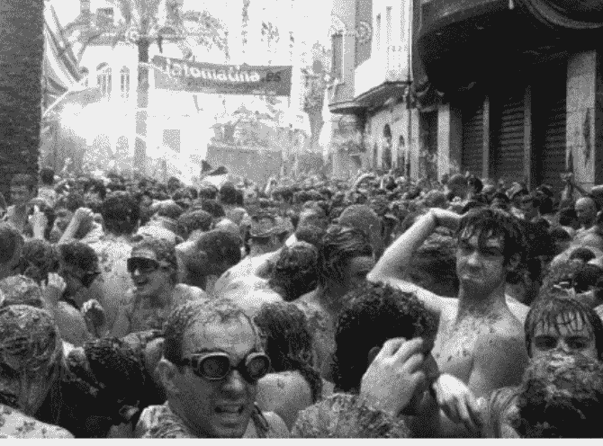

### 番茄节（La Tomatina）

番茄节（La Tomatina）是位于瓦伦西亚自治区布尼奥尔镇的年度番茄大战，它是世界上最大的食物大战，估计每天有 15 万颗番茄在全天范围内被砸成果泥。这种浪费的狂热并非全年过剩文化的延伸。它实际上发生在一个地区，那里的居民在日常生活中对资源几乎没有选择不节约（该地区的人均收入在根据购买力调整后，大约只有美国的一半）。

节日活动在夏季最后一个星期三举行，以“火腿游戏”（palo jamón）开始：在这场游戏中，狂欢者试图从涂满油的柱子上推倒火腿，而观众在欢呼跳舞。火腿一触碰，载着番茄的卡车进入广场，战斗开始了。经过一小时激烈的番茄投掷后，街道变成了一条红色的河流。水管标志着战斗的结束，身上涂着厚厚一层参与者们被冲洗干净。

大多数传统文化都将节日日和其他物质过剩的狂欢活动纳入了历法。也许他们理解了为奢华场合投入某些资源的价值，以反转人类历史上绝大多数时间里作为日常生活必要模式的物质保守主义。可能我们心理上对这类事件的渴望可以一直追溯到狩猎采集社会中，大型狩猎后会涌入的极其充足的肉类。据记载，仍然以这种方式生活的群体在猎物带回家的那一天会进行马拉松式的舞蹈。

我们很确定，派对经常与丰富联系在一起，部分是因为填饱肚子感觉很好，但宴会和狂欢可能还有进一步的功能。将你过度消费的场合变成一场盛大的狂欢或一种有意识的仪式，会使它们在你的记忆中脱颖而出，作为你心理的强有力证明，证明你拥有“足够的”（正如给予也是如此——参见“49. 给予”）。看起来，现代富裕文化中特征性的肆意消费似乎是对“永远不够”的感觉的反应。因此，讽刺的是，在生活中点缀一些强调过度的标点符号，可能是防御渴望每一个向你走来的糖果或闪亮商品的极佳手段。

是的，他们现在有这种专家了。

我们是习惯的生物，而且这是一个非常具有适应性的特征。心理过程消耗了大量的（历史上）珍贵的千焦，因此进化设计使我们倾向于选择即使是有缺陷的自动行为，也不愿反复花费时间和精力去思考在每一个特定情况下做什么是好的。

要让这些根深蒂固的行为面面并不总是容易的。仿佛当你试图改变一个微小习惯时，你进化的大脑因千焦而对你大吼大叫的声音还不够，请考虑这一点：虽然自律现在被讨论得像是一个基本的性格组成部分，但直到我们进化的最后几个世纪里，它并没有发挥太大作用。当你的基本活动对于为你提供食物和住所来说是绝对必要的时……

-   * 此外，如果我们毫无疑问地采纳一整套文化行为模板，我们甚至可以节省创建我们真正想要的习惯时所需的初始脑力能量。难怪我们觉得被迫着只能“顺其流”！*

-   **这里有一条说明：** 正如你可能不会在同一天既进行前所未有的举铁，**又**去参加摔跤比赛一样，在任何特定领域真正发力你的意志力肌肉都会消耗你每日的额度，尽管从长远来看你正在锻炼意志力健身。所以，如果你发誓要在今晚晚餐前完成纳税申报，就不要计划同时也跳过甜点了，因为你可能没有足够的自律力同时处理数字计算和节制饮食。

我们的意思是不是永远不买，而是几乎永远不买。通常情况下，那些卖饮料的家伙收你的钱大部分是为了瓶子和品牌，或者如果你在咖啡馆或餐厅，则是服务费。如果你所在地区的自来水是可以饮用的，瓶装水就是荒谬的（不仅从财务角度考虑），而碳酸饮料和果汁基本上就是糖。它们的费用往往是你餐费的一半，而且还增加了几乎没有营养的热量。

相反，在包里带一瓶水，水少了就去最近的水龙头处加水。如果你在正餐，不要只因为服务员说“……喝点什么？”就自动在菜单上找点东西。只有在你真的想喝的时候点饮料，否则要一杯水。人们通常对这种方式能省下多少钱感到震惊，而且几乎没有痛苦感。

我们个人喜欢留出的例外是那些替代外食的仪式感饮料。也许是日落时分在户外桌旁随手买的葡萄酒，买这瓶酒让你可以坐下来观察一会儿路的人群。

更广泛地说对于酒精，在家里喝（或在朋友的门廊，或者铺在合宜地点的野餐垫上）显然更便宜，特别是如果你喜欢自己酿造。如果我们计划喝几杯，你们的作者倾向于避开酒馆或酒吧，转而选择这些“青少年”场所——那时很有趣，现在也很有！我们还强烈建议买一条二手的围巾之类的东西，这样你在喝廉价金酒时就能感觉很奢华。

| 食物 | 饮料 |
|---|---|
| 非常高级的餐厅 | 主菜 $54 | 最便宜的葡萄酒 $23 |
| 高档餐厅 | 主菜 $26 | 最便宜的葡萄酒 $9 |
| 潮酷咖啡馆 | 午餐 $17.50 | 新榨果汁 $6.50 |
| 越南汤店 | 大份汤 $9.80 | 果汁 $3.50 |
| 便利商店 | 三明治 $5 | 中份软饮料 $4.40 |
| 快餐餐店 | 汉堡 $4.80 | 中份软饮料 $2.75 |

以上是澳大利亚墨尔本的一些场所的实际样本价格。我们无话可说了！

接下来的内容相当俏皮。你们狡猾的作者准备在“不要买饮料”这个标题下偷偷加入一个完全额外的节约策略。它实际上是整书中顶尖的省钱策略之一，但我们怀疑如果它自我介绍的话，你们可能会避开阅读：如果你真的想少花钱，就少外食。

这一代人比以前的人外食更多，为了这种特权投入巨额资金（并通过外食的食材构成和分量大小导致了目前的体重和食物浪费危机）。如果你是厨手，在蒸汽和香料的创意云雾中在家烹饪，产生的菜肴至少和外食的一样好吃，而且价格只有十分之一。少外食也让你在偶尔外出时，这变得更是一种奖励。找几个你真正喜欢的廉价地方，这样你的每一分钱都花得值——比如一家面条制作新鲜且在周晚上有买一送一优惠的面条店，你可以此当成一种活动。

我们已经赞美过午便餐了，所以现在不再提它了，但不要忘记带零食！如果你知道自己要在外面待很长时间，就在包里放一些耐放的食物，如苹果和一些坚果，这样你就不用被迫花钱买便利店的小盒昂贵甜味酸奶了。上述所有建议中内在的态度转变是：默认情况下，食物来自家里，而在其他地方获取是一种刻意的放纵，而不仅仅是你想吃时发生的事情。这种心态转变带来的节省可能是巨大的。这直接有助于你减少工作时间，并有时间去体验更多不需要花几个小时搜索 Urbanspoon 的经历……

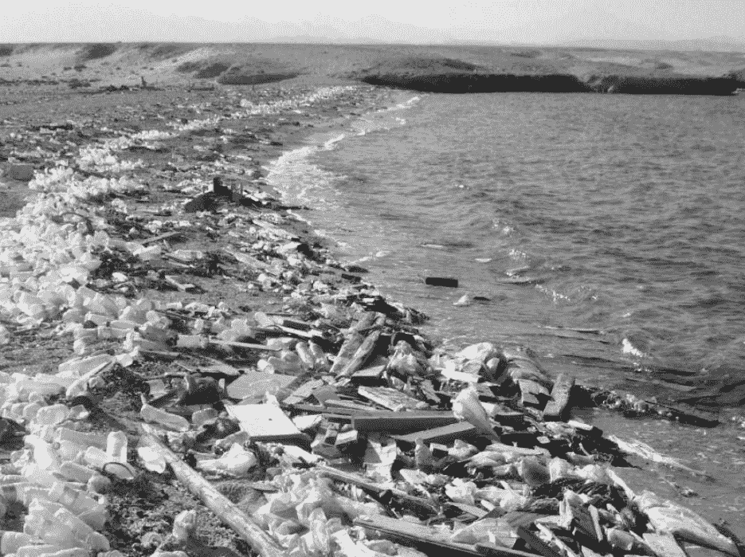

### 撇开污染问题，想象你被困在荒岛上。谁会发现你瓶里的信息？

如果你经常外食，尝试减少时可能会产生戒断反应，但很有可能你缺失的不是食物，而是“第三空间”因素。这个巧妙的词汇描述了一个既不是工作场所也不是家，而是第三类地方。

#### 感觉像在异地家乡

我们愿意赌上五十个我们极少挥霍的美元，如果世界上有更多像这样的地方，全球一半的心理学家都会破产。

这本书涉及很多方面，其中一个无疑是金钱。大多数关于改善你与金钱关系的书都会告诉你，你得对自己的收入和支出制定预算并制作电子表格。对于对于那些正深陷债务泥潭或陷入某种其他形式的财务困境的人来说，这无疑是必须的。如果你是那种经常盯着钱包那像皮革一样的褶缝看，纳闷钱都去到哪儿了，而且去得那么快！的人，我们也建议你将其作为一种具有启示性的短期实验。如果你属于这两类人中的一种，你可能已经在考虑、甚至相当担心金钱了。

我们带给你的极好消息是，对于那些已经将极简消费化为本能的人来说，金钱是他们很少考虑的事情。这是我们作者在与“节俭享乐主义者”朋友聊天时观察到的令人震惊的常数之一——不知为何，我们曾某种程度上被这种刻板印象所吸引：一个坐着肮脏蜡烛残芯旁、整夜数着硬币的吝啬守鬼。

这种运作方式太奇妙了：你基于一个普遍原则，即你不会为了娱乐去购物，你大部分只是买你真正需要或价值的东西。你修理、改造、借用和分享物品，购买时令新鲜农产品，带便当（我们在这里就停下，以免在书的某句话里就转述了整本书——就像某种概念上的俄罗斯套娃），而剩余的钱似乎就在那里轻轻地积累。

这实际上是生活在第一世界文化中一个极具开发价值的悖论。我们的工资是为了提供一种超出基础的“基本生活水平”，所以如果你能擅长根据基本需求生活，你最终拥有的钱多到不知道该怎么用！然后你就会想出用它们来做什么，那部分也非常棒。

想钱听起来很烦人很无聊。担心钱看起来一点也不好玩。根据研究，它破坏了许多关系，提高了血压以及各种其他可怕的事情。就个人而言，我们更乐愿崇拜我们的自行车，吃烤土豆，拥有两条（好吧，三条）牛仔裤，并在温暖气候的地方度非常长的假期。

我们通过沙发客网站认识了劳伦斯。他说几乎可以修理任何东西，当第一次在午夜后出现时，他履行诺言，立即开始修理亚当的旧自行车灯，甚至成功地重新布线了一个微小的破碎灯泡。那个灯泡大约值50美分。显然，劳伦斯不喜欢浪费。而且他有一种巧云威式的资源利用冲动。事实证明，劳伦斯的生活几乎完全不花钱。他用精湛的水管、电气和木工技能换取食宿以及任何需要的其他东西。如果不是因为他对冷笑话那种近乎病态的热爱（“还有其他种类吗？”P·庞德斯·美国问。“他可真是个双关语的大师，但她可不是，”安妮欢快地打趣道），他将是一个完美的房客。

劳伦斯走向了节俭中那些很少被认可的益处的极端：一种充满了各种令人满意的微型挑战的生活。审视你的废木料、玻璃碎片和锡片堆，构思如何建造你向往已久的温室。爱你的生命中第一只袜子并将其填满，感觉你刚刚把某东西变成了有用的东西。掌握自制面包的炼金术。（在我们的“资源”部分找到帮助你完成所有这些及更多事情的链接！）

我们注意到，这种成就似乎会让解决问题的人产生一种愉悦/自豪的感觉，这与解决数独或在电脑游戏中升到下一级非常相似。只不过额外的好处是，你知道你刚刚做了一些真实的东西。

想钱听起来很烦人很无聊。担心钱看起来一点也不好玩。根据研究，它破坏了许多关系，提高了血压以及各种其他可怕的事情。就个人而言，我们更乐愿崇拜我们的自行车，吃烤土豆，拥有两条（好吧，三条）牛仔裤，并在温暖气候的地方度非常长的假期。

几乎任何人都能找到适合生长欧芹、薄荷、小葱和韭苔的地方。但对于地中海草本（如迷迭香、百里香、牛至、月桂和），只有当你每天能给它们提供至少五个小时阳光时，再去尝试。

如果刚好有一朵乌云顽固地笼罩着你的园艺天赋，仍然有一类植物是你很擅长种植的：杂草。这并不像看起来那样是一种诅咒，因为大多数叶类杂草本身就是极佳的食用蔬菜。苋、蒲公英、锦葵、马齿——即使你不知道它们的名字，也可能认出这些全球通用的突发植物。它们大多数在数千年来一直用于传统烹饪，而且实际上比农作物更有营养。

这种精妙而有趣的技能是搜寻野味，因此我们专门为这个主题写了一本书（《杂草采集者手册》）。作为额外的回报，如果你把通过这种方式补充饮食养成一种习惯，你可能会发现自己也开始了智人基本的“游荡与采摘”本能了，而这种方式比另一双你并不需要的鞋要诚实得多。在与祖先洞穴自我的连接中，你可能会发现自己与周围社区建立了更亲密的联系。对野外食物的追求不仅让你对季节有了更敏锐的感知，还能带你进入从未去过的花园或郊区的角落。

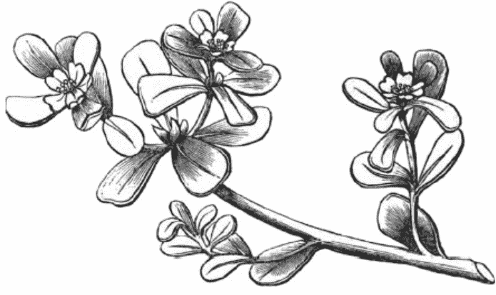

这里有一个我们最喜欢的品种，用来敞开你的胃口：马齿菜（Portulaca oleracea）。

像墨西哥人一样使用它，炒成鸡蛋；或者像希腊人一样，与番茄、红洋葱和欧芹一起做简单的沙拉。

有一次，当我们一个杂草丛生的空空地上采集食用杂草时，我们作者们感到精疲力竭，忍不住停下来在温暖的夏日草地上打盹。亚当决定用一个大废弃行李箱当椅子，然后在它意想不到的舒适怀抱中睡着睡了——这是一种模糊而神奇的体验，唯一的微小瑕疵是后来醒来感到有些不知所措、寒冷且被遗弃，因为安妮早已回家了。安妮反驳说亚当看起来那么平静，她绝不可能吵醒他，而且，这是一个很不错的社区，她烤箱里还有要检查的食物，而且这个轶事到底有什么意义呢？（我们现在可以说，共同创作有时是一个充满挑战的过程……）

爸爸从市场之行带回了礼物！有一条发带、一根弹弓橡胶和一根硬糖，小艾莉丝和萨缪尔仔细地分着。这确实是令人兴奋的收获，就像爸爸描述的杂货店收养的那只孤儿袋鼠一样令人兴奋。孩子们接连地提问，关于它是怎么喝奶的、睡在哪里、尾巴有多长，以及它有没有毛。答案被贪婪地收藏起来，以备日后思考。

大多数人喜欢获得新东西的感觉，但忘记了这种感觉可以同样来自发现，也可以来自消费。一个迷人的事实、一个轶事、学习某种技能、拥有一次从未过的经历、听一些八卦——任何能扩展我们对所处宇宙认知的事物。

# 沉浸好奇心

渴望新奇或刺激吗？不要再买一件衬衫或翻遍报纸寻找新的咖啡馆了。相反，学习你花园里三种植物的名字以及它们拉丁名称的含义。利用互联网自学一个舞步。读读你一直想结识的作家的作品。参加公共建筑的免费导览。请一位口才流利的朋友给你讲述他们的童年。除了书中提示“5. 讨厌浪费”中列出的方法外，找出酸奶的五个用途。去图书馆了解你所在社区、街道，甚至可能是你房子过去住客的历史。连续两周每晚拍一张天空照片，看看它是如何变化的。画一张你猫的肖像……用你的脚趾。

沉浸好奇心不仅是获得那种“感觉”的一种廉价方式，更是一种深层的享乐主义。随着你知识的积累，你开始感觉到周围的世界是一座浓密而宏伟的教堂，由跳动着的、互连的功能和故事组成。此外，当你积累这些财富时，你可以全心地投入其中，因为你知道它们不需要衣柜空间，也不需要还贷款！

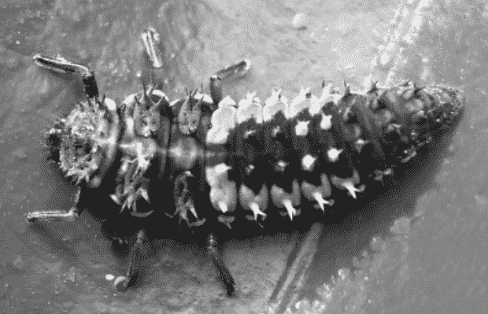

这是一只小瓢虫！它没有它的父母漂亮，但它确实吃了很多蚜虫。

知识在其他方面也可以代替物质商品的作用。我们这些作者更希望有人带着一个关于某事的、热腾腾的精彩故事来下午茶，而不是拎着一袋丹麦酥，我们确信许多人也有同感。将你的想法或发现转化为可以讲述的内容，不仅能娱乐和丰富你的听众，也能为你（即讲述者）本身帮助你理清并巩固这些想法。你被迫对脑子中的信息进行一些排序，记录下它们最关键、最具吸引力的细节。你可能会发现几个想要填补的缺失环节，甚至是一个你获得的启示。整个过程是一门值得培养的艺术。

沉浸好奇心可以简单到每次遇到不认识的词就去查字典。然而，它会驱使你走向远方，进入体验的世界。进行一次长途骑行、吃一整颗哈瓦辣椒、尝试赤足跑步或参加午夜弥撒，这一切是因为你好奇这些事物是什么样的。研究反复表明，经历带来的快乐比物质更多且更持久。（更多信息请参见我们在“37. 搞清楚你真正喜欢把钱花在什么”下的框。）

追求体验性的好奇心可能是昂贵的，这也是我们这些作者有时会忽视节约的领域。我们曾花过大价去坐热气球旅行，和世界级专家一起上一个短期课程，或者去看一场震撼心灵的剧场。但我们对此分钱都不后悔，不仅是因为我们满足好奇心所做的事情是免费的，还因为好奇心避免了我们为了寻找刺激和新奇而浏览新购物的昂贵冲动。

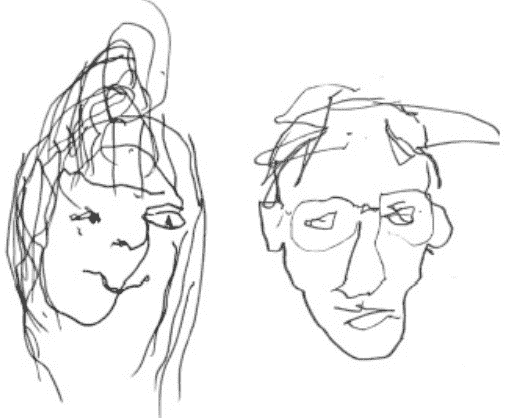

我们没有猫，所以这里有一些我们用脚趾画的彼此的照片。

# 能量奴隶

在资源有限的情况下，不过度消费仅仅是出于礼貌。我们假设你，亲爱的读者，已经对这种情况有了相当的了解，并且在思考那些似乎在不停运转的工业和经济巨大齿轮时，可能曾感到一阵瘫痪的毁灭感向你袭来——这些齿轮正在吞噬数百万年甚至亿万年积累下的所有闪亮、充满能量和肥沃的储备。

尽管有这种意识，我们大多数人仍然难以在个人习惯与“糟糕”之间建立联系：以任何直观的方式建立这种联系。这并不意外，因为支持我们消费的供应和处置链条现在在很大程度上是遥远或隐藏的。在人类历史的大部分时间里，我们习惯了这样的社会和环境：当我们行为不负责任、贪婪或懒惰时，生活就会变得糟糕：邻居躲避我们；我们的作物歉收；我们的房屋化为灰烬；我们的动物死亡；我们的饮用水被污染。随着时间的推移，我们开始信任这种机制，它告诉我们“如果生活真的很愉快，那么我们做的事情一定不会太坏”。现在，在这个扭曲的设定下，这种设定让我们能够舒适且反复地做着懒惰、贪婪的事——造成了真正无法想象的伤害——我们只是无法相信自己的行为可能有严重问题，因为我们的生活条件是如此的该死。

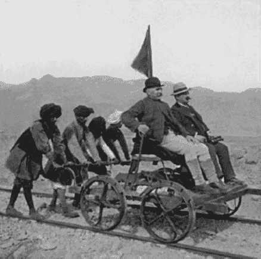

如果你是一个普通的英语国家西方人，且要用人体力量来维持你现在的生活方式（例如依靠奴隶），你需要多少个人？答案是：大约 114 个健康的奴隶需要全天候地工作，才能移动你的汽车、加热你的房屋并为你的家用电器供电。坦率地说，那些迷人的煤矿和油井意味着我们不需要担心这些“能源奴隶”的福利或起义之类的烦人事情。另一方面，化石燃料也并非真的廉价……

不过，亲爱的读者，别被欺骗了。在个人消费方面，因果关系就像当年你那可怜的高中化学老师一样真实：他向粉末碘和锌中滴入水，试图博取你受荷尔蒙驱动的注意力，导致紫色烟雾极快地喷涌而出，那对你当时心性多变的青少年审美来说极具吸引力！以下是三个小个人行为的例子，它们正累积地造成着毁灭性的破坏。然而，所有这些行为可以在不影响我们极高生活标准的情况下被改变。（这些数据来自我们作者的家乡澳大利亚，但美国和英国的统计数据也大体相同。）

- 澳大利亚城市超过三分之一的汽车行程在三公里以内。其中许多是去超市。每当我们允许自己这种驾驶方式（而不是步行、骑行，或计划每周通过一次完成购物，而不是四次）时，我们就产生了不必要的二氧化碳和污染物。你知道的，那些物质正在导致反季节的干旱、洪水、火灾和飓风，并让每个人患上呼吸系统疾病。
- 我们许多人习惯性地在冬天不必要地将恒温器调高几度，在夏天调低（另见“44. 适应季节”），向大气中排放了更多的二氧化碳和污染物。整个冬天都穿毛衣和开衫可能有点烦恼，但失去所有的作物（如果你是农场主），再也没有冰可以站（如果你是极地熊）同样令人苦恼。
- 作为一个国家，我们不仅吃东西，而且平均每年扔掉约 135 公斤食物。（更多信息请参见“5. 厌恶浪费”。）这通过多种习惯发生，如不吃剩菜、为食谱购买一次性食材，以及在餐厅用餐，那里夸张的份量迫使可怜的食客在盘中留下食物。这些食物等同于数百万吨肥料和合成农药，更不用说加工、包装和运输所使用的所有水资源、石油和其他资源。

并不是我们中的任何一个人选择出生在这个扭曲的境地，这里的一切安排都在鼓励我们不断过度消耗地球资源。但这并不意味着我们无能为力。例如采用节俭享乐主义者那种更精简的消费习惯。我们越早这样做，留下的破坏就越少，留给后世那种“拥有所有猴子、树木和小白鲸的完整星球”级别的快乐就越多。

> 这本书中关于浪费食物的内容似乎有很多重复。这是因为对于澳大利亚人来说，我们大约有 28% 的个人温室气体排放是由购买的食物的生产和分配造成的（相比之下，家庭使用的电力、天然气加热和其他能源仅占 6%）。我们一半以上的个人用水也归功于食品系统。事实上，这些数字是低估的，因为在评估食物的资源成本时，它们没有包括开车去商店或家中的冷藏和烹饪。

# 减少工作

有时我们作者们喜欢把节俭视为一种让每个人获得曾是机械化和省力设备预期结果的方式：更多的空闲时间。在上世纪的大部分时间里，对此非常乐观。考虑到一些简化日常任务并增加舒适度的精妙发明的问世——电灯、吸尘器、速干伸缩织物……这看起来确实很有可能。人类曾想：“我们现在再也不用借着烛光缝纫而坏了眼睛了，夺回曾经花在扫地上的时间，并穿着灵活的衣服像羚羊一样移动了！”

相反，我们遇到了一个悖论：我们让事情变得更简单、更快，然后就此发展出了不断升级的常态消费预期标准，以及更多迎合这些标准的行业。这意味着我们要做的工作依然和以前一样多。

减少消费不仅让你，也让你的同类工作更少。想象一下当你买了一台洗衣机——多么不起眼的发明，你买了一台耐用的优质产品。你爱它，只在衣服脏了时洗涤，只在满载时使用，并使用极少量的环保洗衣剂。

你并没有给自己省钱，但你减少了那些开采原材料、制造、销售和配送洗衣机的人的工作。你还为水处理厂的人、清理海洋污染的人以及在垃圾场处理白色家电的人节省了时间。通过你所有的消费选择产生这种影响！

与 80 年代科幻作品中预言的烟雾缭绕的城市景观不同，50 年代的科幻转向了绿水青山点缀着透明房屋、水晶蓝天空的愿景。在这里，减少工作可以帮助我们回到乌托邦理想。数据表明，工作时间越长的家庭碳足迹越大。压力状态会让人们以更密集的方式行为（出行更快、外出用餐、进行更多便利购物）。工作时间越长的国家碳足迹越大——因为构成这些国家的压力型家庭，也因为更多的活动需要更多的资源消耗。

就像生态健康一样，人类健康也会因为埋头苦干而逐渐侵蚀。（而且天知道，你的 50 年代科幻乌托邦西装如果额头上刻着焦虑……或二型糖尿病，看起来就不好看了。）长时间工作与压力增加有关——压力现在被认为对我们的身心如此有害，以至于著名调查员乔治·P·克尼估计它可能占美国医疗支出的一半以上。以强度工作文化闻名的日本人，甚至为过劳死有一个专门的词：过劳死。

1914 年，亨利·福特发现工业革命留下的“时间越长越好”的遗产（见我们的下一条建议“23. 学习工作历史”）实际上损害了他的制造工厂的生产力。他缩短了工作时间，随之而来的利润令人惊叹。现代生产力研究不断证实了福特的发现。他们建议企业客户确保员工经常休息、使用分配的假期并且不带工作回家，这一切都是为了生产力。奇怪的是，现在似乎没有人愿意听了。自 70 年代以来，英语国家的工作时间一直在增加；周末已成为一个危险的概念，每周 55 小时工作加上无薪加班是许多职业的常态。许多欧洲国家已经反对这种全投入的工作周。例如，德国或荷兰的平均工人每年工作比美国同事少整整 400 小时。这就像额外获得了十个标准工作周的假期时间。尽管如此，德国仍然成功成为世界第四大经济体。

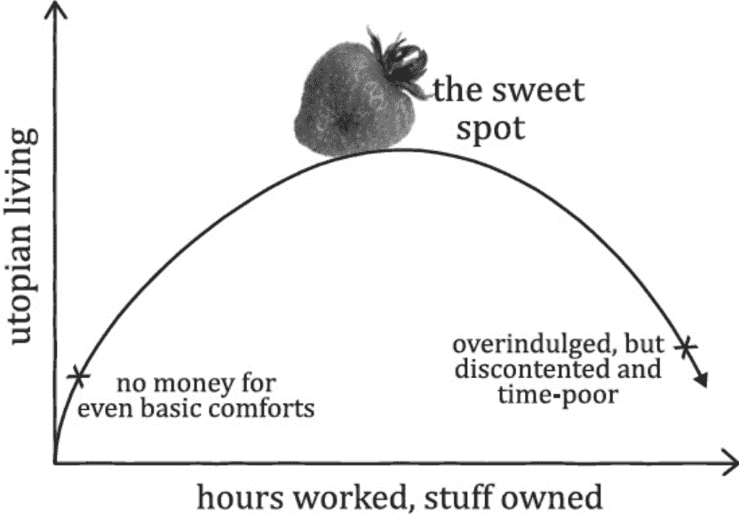

“节俭享乐主义者”认为，由于生活太好而感到受苦是荒谬的。

那么，如果这甚至不是完成工作的最佳方式，而且它导致社会背离我们对健康、生活方式和环境的最乌托邦愿景，我们为什么每周都在盲目跟随这种工作狂热的趋势？我们为什么不挠着脑袋说：“等一下，我想要那种机器让我们都少干活的版本，好吗？”

如此巨大的问题很少有单一答案。一个罪魁祸首无疑源于我们创造的这种文化，它将工作生活显得微不足道等同于是一个小失败者。这看起来确实是一个糟糕的局面——涉及到地位时，我们脆弱的心理倾向于无休止地不断加码，这意味着我们几乎不可能对所取得的成就感到满足。因此，我们努力、生产，却没有停下来考虑我们努力的成果究竟有多必要。

另一个因素可能是那些“权势者”的阴暗操纵。一些文化评论家认为，由于生活被工作主导的人口更加顺从，政府倾向于将政策向这一目标倾斜——无论是有意还是无意。而且与我们的政治领袖一起打高尔夫球的企业执行官们也有类似的议程。正如人气博主大卫·凯因（David Cain）所说：“保持空闲时间的稀缺意味着人们会为便利、满足以及任何他们能买到的解脱支付高昂代价。这让他们继续看电视及其广告。”

当然，还有“经济”。这个庞然大物也许经常被提到的理由，解释了为什么我们必须继续“创造就业”、努力工作并购物——无论是否有工作需要做或是否有我们需要购买的东西。问题在于，“经济”要求荒谬的事情：在资源有限的星球上实现无止境增长。是的，如果我们都开始减少工作，“经济”将会遭受痛苦。即使是压力疾病导致的医院就诊人数下降也会对 GDP 产生负面影响，正如为了办公室灯光和复印机 24 小时运转而开采的资源减少一样……

要点在于，经济活动作为衡量人类成功和幸福的尺度从一开始就有致命缺陷，所以让我们不要根据它的需求来塑造我们对工作的态度。让我们根据我们真正需要做的工作（以维持我们一些简单的舒适）来塑造它——即那些在七十年前看起来是奢侈的种类。你好，1950 年代的梦想：人们在花园里闲荡着，喝着由那些奇妙的新奇设备冷却的饮料，穿着柔软的织物，一边玩着脚一边读哲学。（抱歉，没有机器人女佣。）

> ### 我们本该通向何处 vs. 我们最终落在了何处
>
> 在 20 世纪的中叶，我们将拥抱技术进步所带来的自由的假设并不仅限于科幻小说的想象。
>
> 1930 年，进化生物学家朱利安·赫胥黎（Julian Huxley）预测了双日工作制。“人类能消费的量仅此而已，不会更多了……当我们达到世界在两天内生产出所有所需商品时（这不可避免地会发生），我们必须缩减对商品的生产，并将注意力转向如何处理我们新拥有的闲暇这一大问题。”他的同代人约翰·梅纳德·凯恩斯（John Maynard Keynes）同样对这一切闲暇意味着什么感到担心：“人类将面临……如何利用从紧迫的经济负担中解脱出来的自由，如何利用科学和复利为他赢来的闲暇。”在他 1956 年的总统竞选演说中，德怀特·D·艾森豪威尔（Dwight D. Eisenhower）描述了一个未来，在那个未来，“闲暇……将是充裕的，这样所有人都能发展精神、反思、艺术的生活，充分实现世界上美好事物的。”1965 年美国参议院一个小组委员会预测，到 2000 年，美国人的工作时间将减少。
>
> “为了闲适而休闲。”哪种翻译都暗示了在古希腊，工作本身并不被视为具有巨大内在价值的事物。

## 关于逃避工作的一种现代污名

是将其与旧欧洲阶级制度中享有特权的娱乐贵族联系在一起。中世纪的下层阶级在意识形态上，似乎并不更有动力于那些不必要的工作。虽然在农业条件（或你的封建领主）恶劣的地方，劳作确实艰辛且漫长，但也有迹象表明，农民的生活可能相当欢快。

例如，15 世纪法国的记录显示，平均每四天就有一天官方假期，而且这种假期通常意味着农民的狂欢节庆。在 14 世纪的埃塞克斯，估计临时劳工每年的工作时间不超过 120 天，这并不是因为缺乏机会。埃伦·赖希在《街头跳舞：集体喜悦的历史》中写道：“从 15 世纪开始的时期可以被看作……一场漫长的户外派对，中间穿插着阵阵苦役。”

手工艺人似乎也对非必要的劳动没有任何道德上的负罪感；随着工业时代的齿轮开始转动，这一事实让虔诚的人们感到痛苦。贸易评论员约翰·霍格顿在 1681 年叹道，织布工和丝袜制造者一旦“他们的作品卖出高价”，就不再投入劳动了，并描述他们“只要手里有一分钱，大部分时间都待在酒馆或玩九钉游戏……”

让我们到此为止，让晕头转向的大脑休息一下！我们不知道你们怎么想，我们的作者实际上对“只做够支付基本需求的工作”这一概念感到有些不以为然，并将时间视为一种可以塑造的弹性物质——甚至像我们一样可以无止境地浪费。我们挣扎着想要摆脱“持续的成就是衡量价值生活的关键”这种观念。但如果事实并非如此呢？我们在历史中的调情暗示，成就可能是一种被夸大的、相对现代的习惯。也许花更多时间去观察这个世界，在我们自己迷人的内心进行越野探险，并享受其他人类的内心，也是件好的。

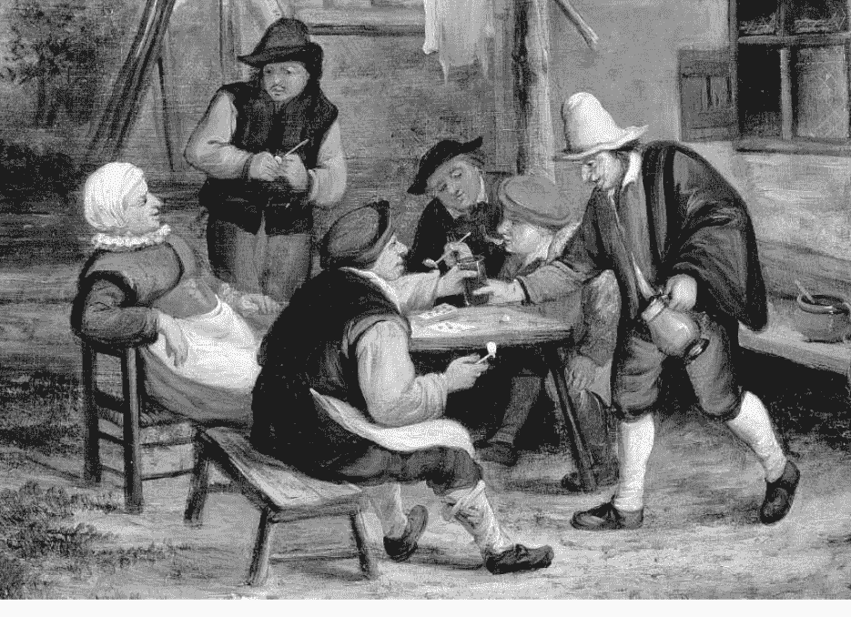

亲爱的读者，我们是第一个承认某些工作感觉像是对时间的极佳利用的人。我们通过许多真正有意义的事情赚了钱；这些事情让我们受到学习和思考的刺激、结识迷人的人、创造我们感到自豪的事物、前往不常去的地方。但我们并不认为任何人应该在从不质疑整个方程式的情况下，就把生命的大部分花在工作上。因此，我们建议从黑板前后退一步，更好地观察那些写在上面的历史故事以供你沉思。将你自己和它们一起放进调酒壶里，将它们的球体与你的球体混合在一起。然后思考一下。

- 即使你热爱你的工作，如果你觉得不是被困每周工作 x 小时、每年工作 x 周、无休止，你可能会更热爱它。
- 如果你*不*热爱你的工作，减少工作时间可以让你欣赏它的优点——社交性、它让你保持健康的方式，或者它带你去原本不会去的地方。即使是一份你认为讨厌的工作，当你减少它的时间有时也可能变得有趣——你其实并不讨厌那份工作，而是讨厌它主导你生活的程度。
- 减少工作几乎总是能帮你省钱。你可能会减少与工作相关的支出（交通、你在其他地方不穿的衣服、一个你觉得必不可少的最新 iPad）。你可能会减少在缓解压力方面的支出（瑜伽课程、补偿性酒精或治疗账单）。你可能可以放弃一些“忙碌的触发因素”，比如频繁的外卖、省时家电，甚至是一辆车。

当然，缩减工作生活并不总是像要求少上几个班那么简单。对于某些人来说，这需要进行严肃的人生调整：重组或职位共享你的角色、自愿降职或改变职业。如果你被沉重的房贷或车贷还款所累，可能意味着要搬到较小的房子，或者公共交通更好的地区。

# 带上袋子

呃，我们不确定自己需要多少包，但当我们出去时，我们可能需要一个。如果我们买了东西，就可以把它放进包里。如果我们什么都没买，就不需要包了。但如果我们确实需要某些东西，有包比没有好。所以，当我们出门时，我们应该带一个包。这是应对可能发生的任何情况的一种简单方法。

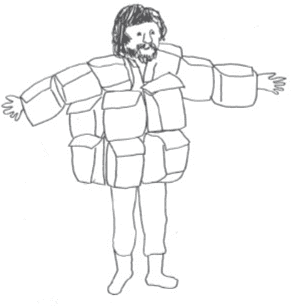

> ### 没有这些东西，生活其实很好。

当她在逛街时，她列了一份清单：

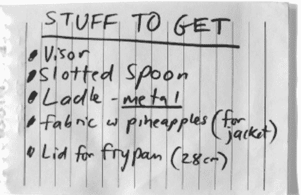

走向收银台时，安妮对购买这些厨具产生了反感。她脑子里有一个小声音在说：“没有这些东西，生活一直很好，为什么要买？”她把厨具放回架子上，空手离开了商店，这种感觉意外地好。那两个厨具总共只要 1.98 美元，所以绝对不是价格阻止了她的购买。而是意识到自己并不需要它们带来的愉悦轻盈感。

我们在现代生活中会花费大量的精力来统计我们可能缺乏什么。大多数人脑子里都带着一个意识或无意识的“如果……更好”清单，并不断对其进行更新和修订。发现你的生活到为止过得很好，甚至可能很不错，仅仅依靠你已经拥有的东西，这会是巨大的解脱。

这种提问的方式绕过了人类大脑中一些常见的错误。在大多数情况下，购买新物品确实会让生活的某些方面变得更容易或更美好，而我们大脑在预期这一点时并没有考虑购买的全部价格——等等。

所以，下次你想买某东西时（无论是漏勺还是整个新厨房），你想要问自己的问题可能不是“这会让我的生活更好吗？”，而是“到目前为止，没有它我的生活过得糟糕吗？”

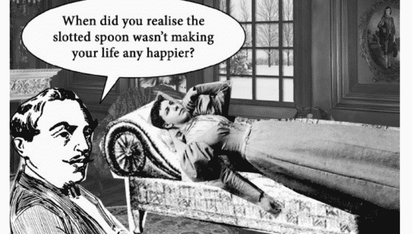

停顿一下，感受上一次进步带来的快乐峰值。相比之下，仅仅是问自己第二个问题的这个行为就能让你感到更快乐，因为你会惊讶地发现自己的生活实际上是多么优越！

让这种心理过程发生的关键步骤是，在购买某物品的想法与实际行动之间留出一点时间。如果你只是在*想*自己应该买某东西，你可以随时随地通过这个过滤器。如果你已经身处商店，正由于即将发生的冲动购物而肾上腺素飙升，请深呼吸，远离那个刻的投掷物/鞋子/木鸭/奶泡器，然后继续过你的生活。如果一周后仍然坚信自己应该买那个“欲望之物”？那就回去买吧。但很可能到那时你已经忘记了它，并投入到了更有趣的事情中。

> 我们倾向于认为，如果我们有能力，改进的不仅仅是我们的装备。人类有一种强烈的冲动，对我们文化认为“好”的任何事情说“是”，从一次晋升（即使我们已经觉得工作忙不可开交）到一次去巴塞罗纳参加会议的费用全包旅行（即使我们已经忙得无法自理）。“节俭享乐主义”在某种程度上在于注意到何时“少即是多”，这在活动领域同样适用于消费领域。如果你已经太忙了，除非你能放弃一个现有的承诺，否则不要增加新的承诺。如果你已经热爱生活，检查一下对另一个吸引的项目说“是”是否会从你世界中某些不显眼的方面偷走重要时间。这关乎事物之间的空间，正如关乎事物本身一样，伙计……

作者意识到这每年发生一次，但我们认为重新定义圣诞节是有用的，因为它非常有代表性：如果圣诞节可以通过节约来改进，那么任何事情都可以。

自从 Annie 告诉她认识的所有人她想要任何圣诞礼物也不买礼物已经过去十年了。她对最后的一位奶奶留了例外，奶奶年纪大到可能不会理解（而且年纪大到自己经历过很多节约时光，这使她能够真正欣赏像一盒土耳其糖这样的小礼物）。那些选择远离圣诞消费狂热的快乐灵魂通常会对孩子采取类似的例外，但保持礼物的谦虚，里面装满了小小的宝藏：亮片包、一本书、新奇的小摆件（螺旋吸管、放大镜、巧克力硬币）或手工材料——非常适合让大人们一整天放松，而圣诞袜里的内容可以被探索和使用。

觉得消费主义是怪诞的，但仍然想送些什么？那么只送非物质的礼物怎么样？（比如按摩券、某种课程，或下午的专业家庭大扫服务）。我们认识一圈朋友，他们决定在圣诞节向慈善机构捐款，而不是互相送礼物。如果你想保持简单并远离无意义的象征性物品，为什么不挑选一些全年最好的自制果酱和酸菜作为礼物呢？人们喜欢酸菜！这些款点还有保质期长的优点，意味着它们不会产生在圣诞节期间吃更多食物的义务感。

对许多人来说，节日食物是另一个引发消费压力的领域，而“完美的圣诞晚餐”变成了一场精疲力竭的购物和准备马拉松，导致（通常）女主人忙于把一连串菜端上桌，以至于她几乎没有坐下来享受。在大多数人觉得自己平时已经吃得太多的时代和文化中，这种过度供应几乎毫无意义。

在日常饮食非常简陋且几乎没有款待食物的时代，人们带着正当的喜悦期待盛宴，通常包括更多的动物蛋白，以及像干果和蜂蜜这样高能量的奢侈品。但我们生活在一个时代，肉类每天在全国成千上万个冰箱里腐烂，汉堡和奶昔被吃了一半就被扔掉，而干果被视为零食饼干的优良替代品。这种过度之上的过度会导致更多的圣诞压力，因为试图在节日季节各种工作派对和家庭聚会上抵抗过度放纵的尝试，会无缝地转化为内疚和沮丧的决心，即要多去健身以减掉“假期小肚子肉”。

替代方案是什么？如果你正在招待客人，你可以关注质量而非数量，以避免最后产生一大堆过剩食物。做一份易于准备的饭，让你能陪伴客人，并且不会让你埋没在洗碗堆里。

- 拒绝那些对你没有用的传统。
- 简化菜单。
- 关注质量而非数量。
- 优先考虑连接而非完美。
- 如果你正在招待客人，你可以关注质量而非数量，以避免最后产生一大堆过剩食物。做一份易于准备的饭，让你能陪伴客人，并且不会让你埋没在洗碗堆里。

或许有比煮玉米粥更好的迎接晨明的方式了。在干了三个小时锄头活后，伴随着没完没了的开笑话和对政治的争论（中途被一个从我们身后森林里出来的男人打断了，他砍了三根巨大的木杆要送给我们，因为他今天早晨在森林里看到了狼，而我们又饿了，可能需要抵御它们），我们走回房子吃午饭。

一位贫困的老妇人在房子前等着。显然她曾出身于名门，但现在他们都去世了，所以她每天到处走动向不同的人讨要施舍。她爬不上台阶，于是我们将桌子搬到室，带上我们的炒卷心、洋葱和玉米粥一起吃。我们沿着街道走回（一路上还有更多的打趣），继续我们的锄活，但一场暴雨突然席卷而来，我们收起工具冲回房子，整理上个季节的种子，一边聊天一边听收音机里嘈杂的流行歌曲，持续了几个小时。

邻居的小儿子穿过泥地跑来宣布，我们需要检查一下正在为我们修理的犁铧进度。我们在高高举起的帆布下冲洗了路，在商定如何进行维修后，我们陷入了一场关于小镇见闻的闲谈，关于下一次洋葱节需要多少位小提琴手，以及今年的樱桃什么时候成熟。事实上，也许铁匠想用樱桃酒来作为修理犁铧的报酬？我们是否应该现在就回家拿一些样本给他，帮他做做决定？我们回去了，大家一起喝了一些樱桃酒，铁匠还带来了罂粟籽蛋糕配酒。当我们终于离开时，他建议我们可能需要帮助来从阁楼里拉干草。我们接受了他的提议，在我们完成工作后，他扫了一推车的食物，用来喂养那只留在我们空闲马厩里的马。

我们拜访了村尾的一位女士（沿途中还有更多的打趣），她显然种着最好的蔬菜幼苗。不可思议的是，我们只停留了足够收集幼苗的时间，便帮她劝说她那个酒鬼丈夫回床，为她劈了一些木柴（因为大家都知道丈夫对这些事毫无用处），并和她探讨了酒精瘾的本质，以及事实上没有他在，她把一切处理得更好。

我们花了几个疯狂的小小时试图在天黑前将那 500 棵番茄幼苗全部入土，恰好赶在喂、水并关好所有动物之前。我们没面包了，所以在洗完澡换上更暖的衣服后，我们漫步在村子里。村里点缀着黄色灯光的窗户，伴随着溪流因雨水暴涨而出的潺声。我们在那个既是商店又是酒吧的柜台旁逗了半小时，跟进还没听到的当日见闻，并听角落里的一个老头讲述关于树木在根部周围聚集的故事。

我们带着面包离开，还带了一些糖给山上那些在这个季节为我们照看羊的牧羊人。如果这场雨持续下去，上山的路会变得泥泞不堪，所以最好明天带着他们羊羊需要的防蜱药去上山。他们会感激糖，还有从我们花园里摘的一些洋葱，用来搭配他们给我们的所有新鲜奶酪。回到家里，我们喝了一大啤酒，聊天、做饭、吃饭、睡觉。

舒服得就像一个富有的人去上班，然后和几个朋友出去吃晚饭并看电影一样。

考虑到这段叙述发生的文化和地点，你可能认为这段叙述与自己的生活大部分无关。但亲爱的读者，请继续读下去，有三个可以精确遵循的建议：如何将实用与社交相结合，而不是完全通过购买力获取所有所需，可以帮助创造一种充满节俭与多样性的生活方式，无论你住在哪里……

## 礼品经济与互惠

在社交性的商务和物物交换之外，存在着一种更不正式的非正式经济。又称礼品经济、互惠、社会信用。在这里，你为他人做力事，主要是因为觉得`这样做是对的`，但可能也潜意识里觉得“善有善报”。

这种互惠关系可以是直接且有意识的（例如，带一袋多余的苹果作为谢意，送给帮你找回丢失小狗的邻居），也可能是更加微妙且无意识的。也许你有一个朋友，当他需要时，你借过一把电锯。某天，你提到你的旧电脑报废了，而他正好计划要升级，于是他决定早点行动，把他的旧笔记本电脑送给了你，而不是尝试挂在 eBay 上卖。很有可能，他并没有意识上将此看作是对多年来借电锯的回报，而是因为你在他大脑中占据了一个与“慷慨”相关的记忆，他觉得帮助你让他感觉很好。

我们的作者注意到流行着一种普遍的假设：能够支付任何所需的费用，但不需要依赖任何人，是一种**最理想的状态**。但正如许多事情一样，过量即成毒：适程度的财务独立是便利的，但如果让金钱成为满足需求和欲望的主导模式，你就会开始错过大量的生活体验。你还可能变成一个孤独的愤青者。

### 场景 1a
你的家人正在搬家，但你既没有汽车，也没有预算请搬家公司。你组织了三个不同的朋友，让他们在一周内分别帮你帮一两个小忙。你确保自己的厨具在第一晚就到位，并煮了一大锅炖菜，每晚上你都和刚刚帮完你的朋友一起吃晚餐，坐在新客厅里临时凑的家具上。

这些朋友中，有一位审美极佳，当你向她倒上第二杯你买的酒以表示感谢时，灵感迸发，她建议了几个巧妙的方法，可以让你廉价又轻松地布置你的新家。另一个朋友坚持要在晚饭后留下来帮你拆箱子，在偶然发现你的童年相册后，你竟然开始给孩子们讲述你他们那个年纪时的故事——他们听得甚至非常入迷。到周末结束时，你所有的东西都搬好了，由于有这么多在这里吃吃乐的人，这间房子已经感觉像家了。

### 场景 1b
你的家人正在搬家，你聘请了搬家公司来运所有的东西。

### 场景 2a
你正开车穿过一个小小镇的主街，寻找通往最近搬到那里的朋友家的路口。那里几乎看不到路标，于是你停在一个坐在长椅上的老人旁，他手里拿着一个纸箱，里面是一只公鸡。他告诉你想找的那条街在哪里，在你们聊天时，他用浑浊的眼睛回忆起这座小镇曾有一位住在那条街上的古怪市长，他进口了三头驯鹿，还会为它们上鞍让他的三胞胎女儿在草坪上骑行。你对这个当地趣闻感到自豪，带着这个新故事作为礼物继续前往你朋友家。

### 场景 2b
你正开车穿过一个小小镇的主街，去你朋友家。你使用汽车的 GPS 定位了街道。你开车到达那里。

### 场景 3a
你要去偏远地区露营几天。你租了一辆车去那里，并借了朋友的一个冰桶（这种物品也被称为“cooler”，或者更生动地称为“chilly bin”）。你觉得没必要自己也买一个，因为你的露营旅行大部分时间都是徒步和在背包里用餐。旅行结束后，当你把冰桶还给主人时，他被你对那片美景的描述所启发，决定几周后自己也去一次。你同意为他的旅行借睡垫，当你顺路送过去时，他家里有一位客人，在蒙特利尔的一所大学工作——而那里恰好是你明年考虑申请工作的地方。他滔出一大堆关于这座城市的建议，其中一些帮助你对如何搬迁做了更好的决定。对于那个露营地，它成了你朋友在世界上最喜欢的地方之一，他永远温暖地将你与他发现那里联系在一起。

### 场景 3b
你要去偏远地区露营几天，你开车去 Kmart 买了一个冰桶来装你那些容易坏掉的食物。

通过不将金钱作为需求的自动解决方案，我们被迫依赖他人，从而默认性地导致了体验的多样化。我们还被激励去成为社交的人，也要成为公平的人，因为如果不通过表现可靠来维护我们的人际关系，我们将缺乏从周围那里获得帮助所需的社会信用。

## 伊皮鸠鲁的真相

坐在花园里可能很美，但坐在花园里知道你的堆肥正帮助那些南瓜生长得蓬勃，看着蜜蜂授粉那些将变成你所食之苹果的花朵，那是完全另一个层面的美好。模糊功能性关系与社交关系之间的界限，创造了一种同样丰富且复杂的感受，即作为一个照顾你且你照顾的生态系统的一部分。我们喜爱的让我们愉悦；我们需要的是珍贵的。

> 关于伊皮鸠鲁的真相

伊皮鸠鲁是一位古希腊哲学家，生活于公元前 341 年至 270 年。对于大多数人来说，他的名字往往伴随着浓郁奶酪的气味、酒壶的摇晃声以及对奢华的联想。记录告诉我们他确实偏爱奶酪，并主张充分享受感官世界的快乐，但这种方式与其现代名声所暗示的过度放纵完全不同。事实上，他坚信简单的餐食提供的快乐与奢华的餐食一样，“不要因为渴望未拥有的而毁了已拥有的。”

相反，陪伴被他视为至关重要的：“智慧为我们提供的使完全快乐的所有物中，最伟大的是友谊。”伊皮鸠鲁认为人们不应该独自进，应该生活在一个朋友圈子里，他们互相滋养思想，在日常生活中互相帮助，在困难时期互相支持。他坦诚地描述友谊始于需求点，或对互利利益的希望，但随后变成了对生命中拥有另一个人的纯粹快乐。他也认为，没有相互需求元素的友谊是有些空虚的。

行了，看看那精干的脸骨，告诉我们这不像一个只需要加水的葡萄酒和大麦饼就能过得很快乐的人吗？

伊皮鸠鲁并不是一个只会空谈高深理论的人，他在雅典外创建了“园林”（The Garden），一个避风港，那些对他的哲学感兴趣的人（包括女性——邻居们会怎么说！）可以在那里按照他的学说共同生活。追求梦想显然让他获益良，尽管晚年患了严重的肾结石导致无法排尿，但他似乎从未对自己的痛苦抱怨，甚至在世上最后一天给朋友写了一封信，描述他的心理状态是“幸福的”。

* 显然，这对你的身体来说也是正确的。许多关于社交联系性的研究表明，感觉自己是一个强大和社会功能性社区的一员——准备好了——可以提高你的抗体反应，降低质醇（压力荷尔蒙）水平，改善睡眠，减缓生理衰老，改善心脏手术后的恢复，减少抑郁、死亡率、发病率和肥胖。太棒了！

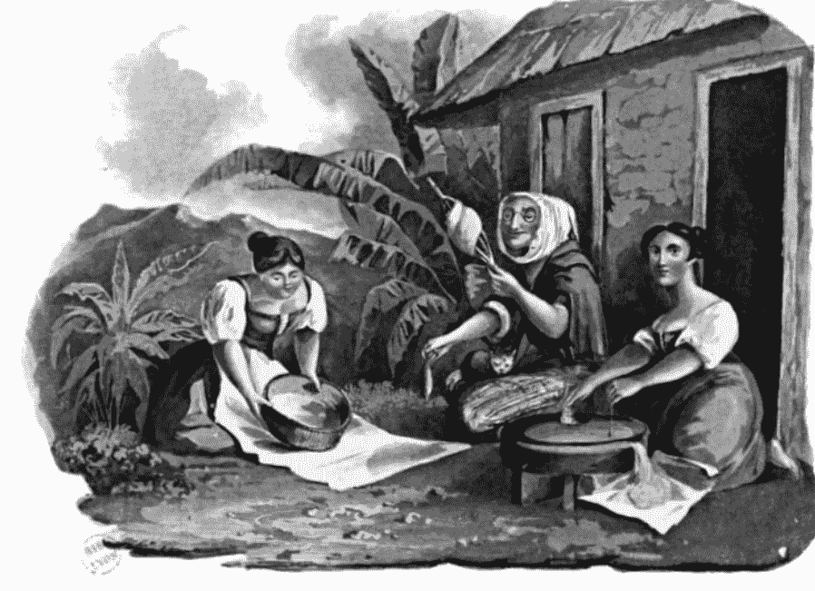

选自威廉·科姆《马德里岛史》（1821年）的彩色版画

这实际上是一次启示：当我们的作者意识到，坐在一起一边用手做些事情一边和人们聊天，感觉比单纯地坐那里聊天要好一倍。更棒的是，这个实用的发现恰好在我们通往更有意识的自给自足旅程中的一个低谷。

我们开始注意到，那些曾如此兴奋地围着我们房屋的所有产食植物，在经历了无尽的秋叶和蚯蚓粪的呵护下，已经长得极其健康，产出的食物远超我们能吃掉的量。我们送掉了一些，交换了一些，然后开始尝试保存剩下的。这花费了`几个小时`。在某些情况下是整整的一天——为了剥掉果树上的果、修补任何鸟啄的洞、将全部炖煮并装罐。在闷热的厨房里度过的最初几次——将西番茄煮成酸豆酱、装罐山桃、摘下罗勒枝做成青勒酱以冷冻、以及切开橄榄进行腌制——是相当愉快的。放一本有声书，一边忙碌。当安妮·安妮听完 CD 碟片上的《战争与和平》时，她已经开始思念你了，你知道的，渴望某种生活。那种有人的生活。

她对家庭食物生产的乐趣变得非常愤世俗，直到有一天，她去邻居家喝茶时，随手带了一筐需要剥壳的蚕豆。（新鲜的蚕豆非常好吃且易于冷冻：在它们只有指甲盖大时采摘，这样就不用剥两次壳；将煮过的豆与橄榄油、菲塔奶士、柠檬汁、盐和胡椒混合后轻蒸即可。）经过一小时闲闲聊天，他们不仅掌握了生活中的动态，并商好了要分担的堆肥运输细节，而且所有的蚕豆都剥完了，竟然没人注意到。

多么伟大的发现！随后是各种杏子装罐午餐！聚会的夜晚，一边喝着苹果酒一边撕碎旧电话簿并唱卡拉 OK 变成了高频活动！魔鬼可能会为无闲的人找事做：但根据我们的观察，他非常乐意让这些事属于体力性的农活类：在桌子上放一堆豌豆等剥壳，空手的伙伴们对它们的渴望就像看到一碗盐炒花生一样。这就是为什么人们会抽烟？为什么在派对上需要手里抓着饮料？我们所有人可能都缺氧，但我们也能手动修复吗？

当手忙碌时，谈话会变得格外顺畅。也许我们用拳头和手指摆出的形状有助于在大脑中产生共鸣的形状，将思想引向更新颖的方向。也许这种有一种背景活动同时叙述空间的感觉，恰好消除了对话中恰合适的压力，让一种更从容的节奏发展出来。也许这是一个简单的事实：在人类历史很长一段时间里，我们的大部分对话时间与长夜的木工、缝纫和编织有关——这些都是 DIY 人类文化中的小型手工任务，在白天结束后，人们可以在火光或灯光下以一种陪伴的方式带入室内。

## 社交框架活动

人们喜欢提供社交框架的活动。在与他人共处的同时应对挑战或完成任务，是生活中最基本的快乐之一。保龄馆和棋盘游戏；盖房活动和酿啤酒。我们的作者习惯性地将生产性时间与社交时间混合。在最小尺度上，实现这一点涉及到随手准备一些缝补材料、种子分类或其他简单的手工作，以便在与意料之外的访客聊天时闲着打工。在更大的尺度上，它涉及一切，从制作番茄酱的日子（传统意大利家庭闻名的那类），到“极客之夜”，一群朋友聚在一起研究一个话题。

# 人们喜欢提供社交框架的活动

在与他人共处的同时应对挑战或完成任务，是生活中最基本的快乐之一。保龄馆和棋盘游戏；盖房活动和酿啤酒。我们的作者习惯性地将生产性时间与社交时间混合。在最小尺度上，实现这一点涉及到随手准备一些缝补材料、种子分类或其他简单的手工作，以便在与意料之外的访客聊天时闲着打工。在更大的尺度上，它涉及一切，从制作番茄酱的日子（传统意大利家庭闻名的那类），到“极客之夜”，一群朋友聚在一起研究一个话题。

*选自威廉·科姆《马德里岛史》（1821年）的彩色版画*

这实际上是一次启示：当我们的作者意识到，坐在一起一边用手做些事情一边和人们聊天，感觉比单纯地坐那里聊天要好一倍。更棒的是，这个实用的发现恰好在我们通往更有意识的自给自足旅程中的一个低谷。

我们开始注意到，那些曾如此兴奋地围着我们房屋的所有产食植物，在经历了无尽的秋叶和蚯蚓粪的呵护下，已经长得极其健康，产出的食物远超我们能吃掉的量。我们送掉了一些，交换了一些，然后开始尝试保存剩下的。这花费了`几个小时`。在某些情况下是整整的一天——为了剥掉果树上的果、修补任何鸟啄的洞、将全部炖煮并装罐。在闷热的厨房里度过的最初几次——将西番茄煮成酸豆酱、装罐山桃、摘下罗勒枝做成青勒酱以冷冻、以及切开橄榄进行腌制——是相当愉快的。放一本有声书，一边忙碌。当安妮·安妮听完 CD 碟片上的《战争与和平》时，她已经开始思念你了，你知道的，渴望某种生活。那种有人的生活。

她对家庭食物生产的乐趣变得非常愤世嫉俗，直到有一天，她去邻居家喝茶时，随手带了一筐需要剥壳的蚕豆。（新鲜的蚕豆非常好吃且易于冷冻：在它们只有指甲盖大时采摘，这样就不用剥两次壳；将煮过的豆与橄榄油、菲塔奶酪、柠檬汁、盐和胡椒混合后轻蒸即可。）经过一小时闲聊，他们不仅掌握了生活中的动态，并商好了要分担的堆肥运输细节，而且所有的蚕豆都剥完了，竟然没人注意到。

多么伟大的发现！随后是各种杏子装罐午餐！聚会的夜晚，一边喝着苹果酒一边撕碎旧电话簿并唱卡拉 OK 变成了高频活动！魔鬼可能会为无闲的人找事做：但根据我们的观察，他非常乐意让这些事属于体力性的农活类：在桌子上放一堆豌豆等剥壳，空手的伙伴们对它们的渴望就像看到一碗盐炒花生一样。这就是为什么人们会抽烟？为什么在派对上需要手里抓着饮料？我们所有人可能都缺氧，但我们也能手动修复吗？

当手忙碌时，谈话会变得格外顺畅。也许我们用拳头和手指摆出的形状有助于在大脑中产生共鸣的形状，将思想引向更新颖的方向。也许这种有一种背景活动同时叙述空间的感觉，恰好消除了对话中恰合适的压力，让一种更从容的节奏发展出来。也许这是一个简单的事实：在人类历史很长一段时间里，我们的大部分对话时间与长夜的木工、缝纫和编织有关——这些都是 DIY 人类文化中的小型手工任务，在白天结束后，人们可以在火光或灯光下以一种陪伴的方式带入室内。

# 疯狂的定义

疯狂的定义无疑会包括“极度丧失视角”和“反复否定生活的潜力”等特质。用这些标准衡量，消费文化：失败了。记者乔治·蒙比亚特（George Monbiot）是这样说的：

> 如果我们的先祖被要求预测在一个物质繁荣、大多数宗教和文化禁忌失去效力的时代会发生什么，有多少人会猜到我们最喜欢的活动将不再是激烈的政治会议、戴面具的争吵、哲学辩论、狩猎野猪或冲浪巨浪，而是购物和看着别人假装自己很快乐？有多少人会预见到一场全国性的对话——在公共和私下——围绕着三个“R”展开：翻新、食谱和度假胜？有多少人会猜到，拥有难以想象的财富和自由的人们，会花时间购买洋葱眼镜和小麦草榨汁机？人生而自由，却处处受连锁店的束缚。

这让你觉得稍微突破一下感觉很不错，不是吗？

# 节俭社交

节俭社交的另一个需要一定定力和活力的方面，是所有那些你被要求带菜、送礼物或穿特定类型服装的场合。这类活动可能会让你那种经过“节俭享乐主义调整”的“特殊”定义被大众文化如此有力地吞噬，以至于你被误导冲向超市，带回更多的饼干和蘸酱，结果这些东西在晚上结束时只有半吃被丢在桌子上。或者逛遍商店，去猜一个你从未见过的四岁小孩生日想要什么礼物。花大钱买一双极其不自然的鞋子，以至于你永远、永远不会穿它们。

没有什么比被这些情况束缚在世俗传统更无聊、更恼人的，那么为什么干脆不这样做呢？礼物？只有当你真心想要且确实能想出那个人想要的东西时才送。衣服？穿一件让你感觉舒服的衣服，如果你不想买，别让任何人逼你购物。食物？幸运的是，我们被大众营销的通用产品所淹没，以至于文化正在转而重新欣赏独特性和手工制品。尽管去上你亲手摘的核桃、从花园里新鲜采摘的沙拉，或者你英雄式地从街尽头那棵荒树上救下鸟类啄食的无花果。你知道这些东西是多么珍贵，你也可以以此眼光将它们呈现给他人。

足够的勇气制定自己的游戏计划可能很难，但它也可以成为力量的源泉。产生疑问时，提醒自己为什么做出你所做的决定，并为它们感到自豪。任何有能力的人都会对你对生活的喜爱感到很有趣。随着你的满足感变得清晰，你周围的人的心灵和生活，过了一段时间，你可能会发现自己并没有你最初感觉的那么疏离主流——因为主流已经向你方向迈了几步。

> * 这个对鞋子有要求的活动也许是一场婚礼吗？甚至是你自己的。如果是这样，请考虑这一点：根据一本婚礼杂志的研究，2014年澳大利亚的一场婚礼的平均花费是65,482美元。这笔钱足够一起旅行六个月到三年，创造惊人的终生共同记忆。或者在十二年的婚姻中，每周支付一晚的育儿嫂费用和一瓶香槟。我们说，留点给自己，办个便宜的吧。

# 33. 廉价旅行

如果日常生活压力很大，休假和离开家通常意味着一件事：尽可能少做事。你渴望休息和充电，并在有时间注意时观察美。这意味着你渴望更昂贵的住宿、更少挑战的体验以及田园诗般的环境。

如果你的生活没有那么压力，并且有时间沉浸在美中并享受元素，那么你在旅行时通常追求的是对比、趣味和冒险——而这一切都可以廉价得多地找到。

节俭旅行的奇妙之处在于，它迫使你与访问的每一个地方变得更加亲密。你身处异国他乡。乘坐廉价的当地巴士而不是旅游观光巴士，体验每一站都会上车的各种尤克里里街艺人和罗望子小贩。诚然，巴士行驶得更慢且拐弯很多，但它给了你机会去真正吸收风景，或者瞥一眼你可能永远不会走过的街道。你在廉价的当地小吃摊用餐，而不是游客餐厅。你不仅发现了对酸甜鲶鱼的热爱，还学了一些地区方言，每当你尝试用时都能让全场大笑。

你想访问所在州的一个国家公园。与其住在度假村里每天绕道一个不同的景点，你决定进行一次为期四天的徒步，沿途露营。你不仅变得更健康，每晚都能睡上美妙的十小时，而且日出而作意味着当你每天从帐篷向外看时，可以偷偷监视觅食的动物。你在偏僻的瀑布中沐浴，这对你疲惫流水的肌肉来说感觉极了。你注意到景观的逐渐变化，并在土壤颜色改变或地平线上闪烁着湖泊时感到兴奋。在途中，你顺着一条小径进入一个偏远的峡谷，在那里你在数百只彩虹蜻蜓的陪伴下游泳。

你一直想去法国。与其在旅游巴士和酒店之间跳跃三周，你使用一个房屋交换网站，找到一个迷人的村庄住了三个月。不在的主人留下了他们的车，以及足够供你全家人出游的自行车。你度过了一段疯狂的田园诗时光，熟悉了所有的当地地标和美食特色，然后出发远行，在测试你进步的法语的同时，探索附近的一些城市。当要在回程的行李箱里塞进绝对违禁数量的卡干奶时，你意识到你已经将那个村庄的一部分永远地留在了心里。

节俭旅行中总有一些困难的时刻。你偶尔会感到冷/热/迷路/疲惫/吃到一些无法识别的东西。但正是这些部分让你意识到自己比想象中要坚强。`而且这些是故事故事来源。`此外，那些认为全程无故障且舒适旅行的人，往往对一顿淡的饭感到恼，而不是节俭旅行者对坐错了五小时巴士感到恼。也许最重要的是，虽然昂贵的旅行提供了更高基础水平的“愉悦”，但它很少像节俭旅行那样慷慨地提供兴奋或启示的时刻。

也许并不意外，节俭享乐主义者在定义“旅行”时相当宽容。你们的作者认为，旅行最终在于与日常生活创造对比，从而刷新你的精神并让时间显得宽广。

去年夏天，我们两个“旅行”了十二小时。我们搭火车去离公园最近的小镇，步行10公里，发现自己处在一片宁静、炎热的景观中，那里有小植物、宝石昆虫和一条可以游泳的慢河。我们在灼热的沙地上赤脚走路，睡得更多，读读故事。当背包空了带的食物后，我们装满了那些让当地公园护林员头疼的野橄榄，再次出发。我们感到不可思议地焕然一新，而且多了一年的橄榄。

去年夏天，我们两个“旅行”了十二小时。我们在星光开始消散时到达线路上的终点火车站，让当天的第一班火车将我们带回城市。这次冒险非常有趣、愉快且几乎免费——每人回程票只需3.20美元。当我们回来时，感觉自己已经离开了好几天。它也给了我们40公里的腿部锻炼，并在之后的几周里让生活显得更加宏伟且充满无限可能。并非所有形式的节俭旅行都适合每个人。了解你保持快乐和健康的基本需求，并选择符合这些要求的旅行配置。例如，我们有一位旅行朋友什么都吃，并且乐意睡在任何地上，但需要安静才能睡好觉。她提议睡在帐篷里而不是舒适（但嘈闹）的房间里，让她的工作交换房主感到意外，并寻找了那些是退休的地质学教授，而不是我们同龄的夜生活爱好者。关键在于找到一种既符合你的喜好又符合你限制的旅行方式。对于可能帮助你发现这些限制的网站，请参见我们的“更多资源”部分。

> 提示：不要过度使用相机，它们会阻挡你的视线和这种感受。

# 化妆品与清洁剂

化妆品和清洁剂公司让我们相信，如果我们不经常使用它们大块状的产品，我们的朋友都会抛弃我们，而且我们会患上各种传染病。我们的作者怀疑，它们在提供建议时，考虑的是自己的利润率，而不是我们的最大利益。

到我们青少年时期，我们大多数人已经深信，需要大量的沐浴露、面巾、护垫、肤质精华、脚部除臭剂和漱口水来防止自己变得令人厌恶。然后还要用厨房湿巾、表面喷雾剂、缝隙漂白剂和空气清新剂来保护我们丑陋的家。伙计们，这完全是一个骗局。即使是肥皂、洗衣液和洗洁精等基础物品，通常也可以用建议用量的四分之一达到完全相同的效果，而所有其他东西都是没必要的。

如果你在办公室工作并坐公交上班，你可能不需要在穿一天后洗衣服。嘿，穿一天后你甚至可能都不需要洗澡，尤其是如果你通过你的“节俭享乐主义”生活得相当健康的话。别误会，我们并不像其他人那样不喜欢身上的异味，但我们实验了一番，发现保持清洁并没有那么复杂。

据说牛仔们相信，洗得太多会消耗你的活力。实际上，我们怀疑这个“事实”是从某部早已被遗忘的午场电影中听到的，但有趣的是，现代研究已经开始支持这种迷信了。请看脚注！

大多数人都知道碳酸氢钠和白醋在家庭清洁方面的妙用，但这里还有一些你可能还没有注意到的节俭居家卫生贴士：

- 在阳光充足或有风的日子里把衣服晾起来，而不是洗它们。（对于那些没有实际污垢、只需要稍微清新一下的衣服）。我们模糊地记得曾有一个祖母告诉我们这被称为“日光洗”，听起来还像个神奇的奖励。
- 用报纸擦窗户和镜子。先揉皱几张报纸，将它们浸入一桶水里，用它们用力擦。然后拿一两张干的纸以抛光的动作擦拭窗户。它们会变得非常光亮。显然墨水里有门道。
- 灰烬。如果你家里产生任何灰烬，任何有油的地方都可以，比如烤盘、烤箱或洗完水池。只需把较细的部分舀进容器里，把湿刷子浸进去，然后洗洗。我们知道这听起来很奇怪，但这实际上是灰烬的传统用途，而且确实有效。
- 准备一个抹布袋。纸巾太疯狂了。将布料剪成正方形方便使用，用后随你喜欢扔掉或洗掉。旧毛巾、床单或棉质衬衫都是完美的选择。
- 播放响亮的音乐，全身投入到体力劳动和运动中。
- 接受汤姆·霍德金森（Tom Hodkinson）在他《如何自由》中的建议：“如果你想要更干净的房子，只需关掉灯点燃蜡烛。电光是敌人。”他建议避免浅色床单，除非你有佣人团队，并放弃白色或层压家具而选择木质。这真是个干脆的人。

> * 你现在可能注意到我们对脚注有不当的热爱，但现在你会觉得在这件事上放过我们了，因为这确实是一件宝贝：卫生产品广告中喜欢警告我们的许多“细菌”本质上对人类健康和幸福无害！我们与这些小家伙共生进化，它们帮助在我们身体周围完成各种我们自己细胞不擅长的工作。而且任务非常多。我们的皮肤每平方英寸含有约5000万细菌。我们胃肠道中的细菌细胞比人体内的细胞还要多十倍——至少对健康人来说是这样。证据表明，鼓励身体健康的多样性可以改善口气和体味、皮肤健康、维持健康体重、免疫系统功能和消化道健康。细菌多样性不足甚至可能导致焦虑和自闭症谱系障碍。

# 35. 关于调品的微小评论

你可以买用油和醋浸制的东西。你也可以买调味油和醋。两者都买就太荒唐了！留下那罐刺酸豆的醋或那罐浸制某某物的油，并用它们烹饪。如果这让你感到更开心，就把它倒进新瓶子里并贴上“刺酸豆浸白酒醋”。

总的来说，节俭的美食家限制购买昂贵的预制产品。

# 36. 把事情简单化

在查看环保产品目录之前，先探索你其他的节俭方案！黄金法则是改变你的行为，从源上避免或减少消费的需求。下一个是

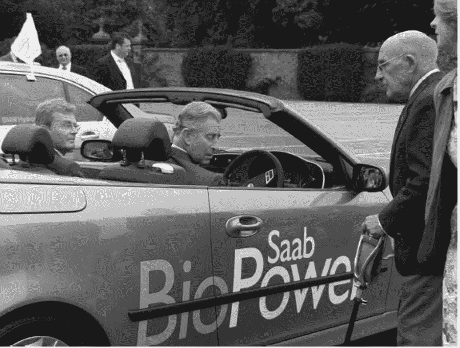

2007年，查尔斯王子试驾了一辆可以使用高达85%乙醇燃料的萨宾BioPower敞篷车。几个月前，地球政策研究所曾报告，“给一辆运动用途车的25加仑油箱加一次乙醇，所需的粮食就足够一个人吃一整年。”教训是：想要找到任何比单纯减少消费更真实的替代方案都是罕见的。

这里也存在一种讽刺，为了帮助你不买东西而去买东西。通常情况下，更有趣的事情是让自己掌握知识，让你能够利用已有的物品。在启动一个新项目之前，先做一点研究以熟悉底层原理，然后将这些知识应用到制作酸菜、育种或任何其他事情上。知识是真正的自给自足。旧罐子非常有帮助。

这样一来，如果你发现自己终究并不那么喜欢制作酸菜，也没有什么大损失。相反，如果你发现自己非常喜欢装番茄，并且已经连续三年在烤箱里消毒的罐子里装过了，甚至可能借了朋友的保鲜工具进行试用，那么在网上买一套二手设备可能是一个明智决定。

## 超级食物

你可能会觉得，为椰子水、维生素、螺旋藻能量棒和枸杞粉花大笔钱对你那种节约的生活方式来说是一个值得的例外；是对你健康的投资。你可能错了。不要忘记，健康食品的分销商也是公司，他们通常非常努力地围绕一些非常微小的、经过挑选的研究制造大量的媒体炒作。如果你有需要修复的特定缺陷，也许可以去那里。除此之外，我们大多数人的更好做法可能是：满怀兴致地吃多样化的新鲜、完整食物，同时不要过量，多运动，并过得真正开心。

## #37. 弄清楚你真正喜欢花钱买什么

冰淇淋、冰淇淋、旅行、冰淇淋、威士忌、冰淇淋。冰淇淋。但人人有异。全面的节约对于某些性格类型来说是一个极具成就感的挑战，但对于这本书的许多读者来说，对消费习惯进行良好的、严格的观察，将导致你在这里进行更深熟的调整，在那的地方进行无痛的搭配，并在恰当的位置进行毫不掩饰的优先级排序。

你希望你的作者使用荒谬的假名来通过例子讨论我们自己的几个朋友吗？我很乐意效劳。

**鲁弗·斯克伯和珍·多尔** 都在兼职。他们的工作虽然不是梦想工作，但属于他们选择的领域。他们不怎么休假，可能是因为他们没有过度工作，并且非常喜欢书籍、激烈的对话，以及待在花园里喝葡萄酒。有时在戏水池里。有时在打飞镖时。

他们可能不会自己提名为特别节约，但他们选择了进化出一种最小化成本并最大化快乐的生活习惯，而不是通过增加工作。他们非常适应电脑，通过通过廉价获取大量书籍、电影等来省钱。他们还喜欢利用技能来修理和改进他们的电脑、音频设备、手机以及家里的任何电器设备。他们用组件组装了一些技术产品，从而能花更少的钱获得更好标准的设备。

他们在自行车方面也有类似的技能，他们骑自行车去往任何地方，并保持其良好状态。他们没有车。他们购买极少的衣服和家居配件，看重捡来的家具和简单、时尚的衣服。

他们对食物和饮料充满热情，并有一个小但产量极高的蔬菜园，提供更高质量的新鲜食材。他们腌了一些东西，如柠檬和洋葱，并不是为了省钱，而是为了能拥有最好的腌洋葱和腌柠檬——尽管这确实省了钱。他们自己酿造啤酒，因为他们喜欢研究如何制作出色的啤酒，这样他们就可以大方地分享了。

他们也为那些经历的体验感到快乐。

> 金钱最快乐的用途是……体验。

研究现在支持了大多数哲学家们一直以来暗示的观点：体验比物质是更好的投资。

对跨社会科学数据的概述发现，一旦基本需求得到满足，“我们物质存量的增加对心理或身体健康几乎没有产生可衡量的收益”，尽管我们的预期相反。相反，体验确实能带来回报。

### 38. 释放你的放纵

购买无必要物品的欲望是非常强烈的——它感觉像是从构成生活大部分部分的功能性活动游行中获得的一种自由宣言；就像在面对过量工作和忧虑时所拥有的闲适与轻松。这种购买行为确实可能带来一些可以享受的事物，但它往往只是试图创造一种“放纵 vs. 功能性”的新型生活比例的拙劣尝试。亦或是通过获得具有成本（从而隐含了价值意义）的物品来为生活增加“价值”。

讽刺的是，许多此类为了享乐的购买实际上导致了后期需要更多的功能性活动。可能是橱子和抽屉需要无休止的清洁，因为它们堆满了没穿过的衣服，这些衣服需要分类/折叠/洗涤/缝补或送到慈善捐赠箱；肚子上多出来的赘肉似乎要求增加健身房计划；更大的房子需要更多的清洁和维修。在最基础的层面上，可能仅仅是一张信用卡账单，需要你加班更多才能才能还清。

轻快地生活是完全另一回事。它涉及到对发生的坏事持某种哲学态度，使它们不会主宰你的思想或观点。或者保留在转瞬即逝的时刻发现快乐的能力。或者意识到，在他人面前以及自己的内心保持放纵、自发或好玩，这是一种完全的自由，你可以随心所欲地给自己和周围的人。这些才是对日常生活中枯燥元素真正的自由宣言：不要将其与放纵性消费混淆。

生命苦短。那么，为什么不把对不平凡且自在生活的渴望投入到鞋子的购买中呢？

### 39. 限制选择负担

在一个阴雨天，作者安妮（Annie）决定这是一个非常适合看电影的下午，于是她穿过暴雨敲响了邻居的门。她知道这位邻居拥有数百部电影作品，心想他的收藏中一定有能合她胃口的东西。当她扫描那些看似无穷无尽的选项时，她开始感到眼花缭乱，而且对其中任何一部的兴趣越来越小。在浪费了大量时间后，她离开了，借走了几部看起来不错的电影。她每部只看了十二到二十分钟，每部都决定自己并不真的感兴趣，但也许另一部才是她想要的。她感到像个失败者，因为发现选择如此困难，而且无法享受她所选择的任何一个。她清楚地记得在长途大巴上遇到二流电影时曾非常享受，而当时她只拥有一台只有一个频道的电视。发生了什么变化？她想回邻居家里看看是否还有其他她真正想要的，但对她可爱的邻居拥有如此庞大的电影收藏感到一种不理性的烦躁。整个过程反正还是有些疲惫。她抱抱狗，转而睡了一觉。

这个故事的精髓让你觉得熟悉吗？也许当你在街上试图决定吃什么时会产生共鸣。你想吃泰国菜、披萨还是黎巴嫩菜？泰国菜最接近，披萨更便宜，黎巴嫩菜似乎更健康。焦虑感倍增，你正和你的伴侣就晚餐的相对优劣进行着一场异常紧张的对话……现在想象一下，在读完了一个由孤独的美学天文学家写的感人小说后，你正快要入睡了。你很确定你应该对我们在星空面前的渺小产生一些漫性的诗意思考，但你却在想你今天买的那双新鞋。我应该买那种稍微粗一点的吗？那个鞋头形状配你的任何裤子吗？我到底该选黑色的吗？黑色更百搭，但你又喜欢棕色的缝线细节……

少量的选择是很棒的。大量的选择会让你对所选的任何东西产生持久的不满，无论它有多令人满意——毕竟，你可能没有选择最佳选项！根据心理学家、《选择悖论》的作者巴里·舒尔茨（Barry Schwartz）来说，当选择充裕时，我们觉得结果不尽好是因为我们做了糟糕的决定，因为并不是没有好的选项可供。因此，选择的“奢侈”往往伴随着做出正确选择的压力，这可能导致焦虑和后悔。更糟糕的是，研究表明，不断评估和在选项之间做决策的过程——正如我们在富裕社会中整天做的那样——会产生严重的精神疲劳。（午后昏睡？也许不是因为碳水化合物。你只需要换一个饮料+面包种类+馅料潜在组合更少的三明治店！）

**节俭享乐主义者**的最好消息是，通过减少消费，你每天必须面对的消费决策范围会骤减。如果你总是自己调沙拉酱，你永远不会发现自己站在超市里忧郁地盯着架子上的 93 种类。如果你购买二手产品，并乐于随遇而安，你永远不会发现自己站在宜家的收银台队前，痛苦地纠结不决，考虑是否要在太晚之前冲回去把那套毛巾换成深蓝色的。如果你通常用回收的零件组装你的自行车，你永远不会纠结复古巡游者车还是意大利公路赛车更能反映你的个人风格。如果你已经决定现在的浴室完全足够，你永远不会发现自己连续六小时在网上浏览淋浴帘目录寻找它。

| 姓名 | 年金 | 电话号码 |
| :--- | :--- | :--- |
| AXA Life | 12- | |
| Allianz Global | | |
| American | | |
| American Century | | |
| American Life | | |
| United | | |
| Athene USA | | |
| BlackRock, Inc. | | |
| CLS Group | | |
| Columbia Management | | |
| Commonwealth Annuity | | |
| Deutsche Asset & Wealth Management | | |
| Dimensional Funds | | |
| Federated Funds | | |
| Fidelity Investments | | |
| Fidelity Security Life | | |
| First Investors Corporation | | |
| Franklin Templeton Investments | | |
| GWN Securities, Inc. | | |
| Great American Insurance Group | | |
| Great-West Life and Annuity | | |
| Guggenheim Investments | | |
| Hartford Life Insurance Company | | |
| Horace Mann | | |
| ING Life Insurance and Annuity | | |
| Invesco Distributors, Inc | | |
| ISC Group, Inc. | | |

这不只是你的感觉；看到这样的列表，人们的眼睛都会模糊。研究发现，每给员工多提供 10 个退休基金选择，会有额外的 2% 的人放弃做出选择。

这并不是什么坏事。施尔茨（Schwartz）认为，追求完美的选择——即使在像大学这样的重大决策上——“是痛苦的根源”。研究表明，我们这些倾向于在选择上投入大量精力和研究的人，实际上每花一钱获得的快乐反而更少，而且整体满意度也较低——尽管我们通常能选出一个稍微优越的选项。这可能部分是因为，在经过仔细权衡利弊之后，我们变得倾向于期待完美，然而完美永远是一个概念，绝非现实。虽然这种效应对于极度周全的消费者来说被放大了，但它适用于大多数选择丰富的社会；由于可用选择太多，我们产生了一种幻觉，认为自己应该总能得到想要的东西，而在没得到时就会感到被占便宜和沮郁。

“节约享乐主义者”并不期待完美。节约享乐主义者期待生活是一场多彩的旅程，充满了快乐、挣扎、喜悦、冒险、无聊、顿悟、爱，以及在商店里淋成雨、在火炉旁，有时吃到略微干枯的面包并不介意，有时吃到新鲜采摘的树莓并感到欣喜若狂。他将大多数商店和餐厅视为景观中的巨型肿块，以避免在自己的潜在消费品清单上增加更多候选者。她意识到，尽管无限的选择承诺了自由，但它也将我们困在一系列无尽的精细决策中，我们觉得这些决策必须做得很好才能获得成功并准确反映我们的身份。因此，她做出宽泛的决策，以让她的大脑免受这种筋疲力竭的现实。这种宽泛的决策可以大，也可以小。我们认识一个家庭，他们多年前就决定永远不在超市购物。我们的大多数朋友不会考虑去买瓶装水——这并不是一种持续的虔诚行为，他们只是把这作为一种用水的方式从雷达中剔除了。有些人识别出少数适合自己的身体和清洁产品，并且不再留心寻找其他选择。其他人则有“下午6点后不玩手机不用电脑”的规则（目的是消除“要不要再挤时间工作一会儿”的持续选择）。就个人而言，你们的作者很难确定我们唯一的一成不变的决策，尽管这些决策在某个阶段可能是有意识的，但关键点在于它们随着时间的推移演变成了习惯，变得完全正常且毫不费力。我们不买杂志或报纸，不买外卖咖啡，不打车（除非是紧急情况），不去理发店。我们根本不会想到去买像预调好的煎饼糊、免洗擦脸巾、管装酸奶、空气清新剂，或者有着令人沮郁背景的蛋类或肉类，或者是里面装了很多小袋薯片的大袋装薯片。

一旦你简单的互动规则成为你的本能，它们通常不需要严格遵守。例如，你们的作者通常不会从大型连锁店买快餐，但在过去的五年里确实买过两次。有一次，这看起来似乎是我们在读完一本关于采集食物的书后立即能做出的最违常的事；另一次我们被困在高速公路旁，无其他选择。我们对这些例外感到很好——没有义务对于那些你已经决定没有它们会得更好的消费选择抱持教条主义。关键点在于不要让它们每天在你的大脑里作乱，叫嚣着要你对它们的相对吸引力和价值进行评估。想象这样一个时代，你只是买了一瓶写着“牛奶”字样的牛奶，你再也不需要对牛奶想其他别的了。这就是我们某种程度上在伪装的东西。很轻松，不是吗？

## 40. 不要做一个自命的凡包

这个建议的标题听起来令人脸脸地没教养。但并不不可爱。

这恰恰是重点所在。

现在可获得的消费品无限多样，结果之一是，我们倾向于关注那些在——对于一个洞穴人看来——几乎相同产品之间最细微的界限。无论是可口可乐对百事乐，还是剪裁略有不同的牛仔裤，我们看到差异的能力定义了我们是一个“有品味味的人”。但这确实会阻碍我们了解自己到底喜欢什么。

在对食物和饮料有眼光方面，有充分证据表明，当我们认为自己能区分相似款式时，我们是在自欺欺人。例如，2011年，英国教授理查德·怀斯曼（Richard Wiseman，曾是一名舞台魔术师）安排了57个人品尝从3.78英镑的红酒到30英镑的香槟等葡萄酒。当参与者被要求猜测某特定葡萄酒的价格是低于5英镑还是高于10英镑时，他们的回答准确性并不比抛硬币高！

令人尴尬的是，专业品酒师的表现也好不到哪儿去。在法国的一项研究中，所有54位葡萄酒专家都没有注意到他们正在品尝两种完全相同的白葡萄酒——其中一种被用无味的染料染成了红色。他们用“蜂蜜”、“荔枝”和“稻草”等词汇描述白葡萄酒，而用“煤炭”、“树莓”和“丁香”等词描述染红的葡萄酒。我们对味道的评估也会随着饥饿、房间温度、音乐、情绪和活动而变化。当然，还有文化价值观……

三十年前，现在对除了完美的浓缩咖啡以外任何东西都感到恐惧的人群，完全有能力享受一杯溶咖啡。冰生菜曾是沙拉碗的合法常客，而现在只有异教徒（或者，令人困惑的是，那些前卫复古食物运动中的人）被发现正在享受那种冰般的脆爽。

反正，“优越”味道的观点本身就站不住脚，因为我们对气味和味道的敏感度——无论我们认为它们是否愉快——人与人之间差异很大。我们每个人大约400个受体，但除了同生胎外，几乎没有两个人拥有相同的组合。所以，也许如果你仍然是一个秘密的溶咖啡饮用，你对不完美的事物有着钦佩的能力。

我们曾与一位长期与唐综合症患者住在一起的年轻女士聊天。她告诉我们，当她离开时，她发现朋友们在对事物进行“酷”或“正确”筛选上投入了大量精力，这令人窒息。唐综合症患者只是喜欢任何让他们快乐的事。

* 你们的作者坦然承认这个人是一个完全虚构的人物。我们只是想把自己的话归功于一个好听得多的名字。

### 41. 自我驱动

时速表上的那个指针确实可以达到令人向往的每小时 240 公里（150 英里）。但你的汽车平均速度到底有多快？我们在这里不仅仅是指那些被堵在交通堵中的时刻。为了真正计算我们车辆的“有效速度”，我们需要把在办公室花费的所有小时都算进去，以涵盖燃料、注册费和其他运行成本……而在此期间，速度表一直停在零上。一项澳大利亚的研究计算出，每驾驶一辆丰田陆酷洋泽的一小时，车主平均需要工作 1.5 小时来支付这些费用。该研究还指出，如果车主必须为汽车的“外部性”付费——即那些由社会承担的成本，如二氧化碳排放、交通拥堵和交通事故成本——他们每在方向盘后坐一小时就需要额外工作 0.6 小时。这使得陆酷洋泽的有效速度变成了每小时 9 公里（5.7 英里）。所以一点也不方便，对吧？顺便说一下，自行车由于其购买、运行和外部性成本要低得多，速度相对较快，达到了每小时 18 公里（11 英里）。

在澳大利亚，一辆中级较新汽车的年度注册、运行和折旧成本约为 12,000 美元。这还不包括所有的停车罚单。让我们慷慨地估计，对于旧车来说，较低的折旧成本可以将这一数字直接降到 7,000 美元。即使是这个底线数字，你也可以每周乘坐 20 次出租车，每年支付 14 周的租车费加价值百元的汽油，而且依然能盈余。作为进一步对比，亚当（Adam）在写本文时一年的总交通成本为 610 美元，其中包括一次大保养的自行车、每周公共交通以及多次往乡的火车旅行。所以，即使给自行车加上一点折旧费，在我们假设的七千美元中，仍然留下一笔很方便的零花钱。

我们认识的一些朋友，保罗（Paul）和尼基（Nikki），计算出了另一种交通配置。他们不喜欢在想带孩子去某处时被强迫，所以买了一辆“货运”自行车——像一个成人三轮车，前面有一个托盘，深度足够装下两个幼儿或一大堆购物物品。它的效果非常好，以至于他们几乎废掉了汽车。但他们仍然想留着以备偶尔出行。因此，他们使用一个名为“Car Next Door”的网络与邻居共享汽车。汽车共享是一项快速增长的业务。美国最大的网络是 Zipcar，其联合创始人罗宾·查（Robin Chase）说：“每辆 Zipcar 替代了 15 辆私家车。而且每位驾驶者的行驶里程减少了约 80%，因为他们是实时一次性支付全部费用。”所以当保罗受当地委员会要求参加“设计你的梦想街景”比赛时，他发现自己在计算，如果他街道上的所有居民都加入共享汽车网络，他们之间只需要大约六辆车：“我们的街道长 200 米，宽 8 米。那是 1,600 平方米的空间。……所以我的梦想改造？把整条路挖开，除了两端各两个可以停放五辆共享汽车的停车场和一些访客车位。根据我的计算，这将能够种植 150 多棵果树和坚果树以及伴植物，这应该能为街道提供大部分的[易腐]食物。”如果汽车共享继续目前的轨迹，这类愿景很快听起来可能变得非常理智。

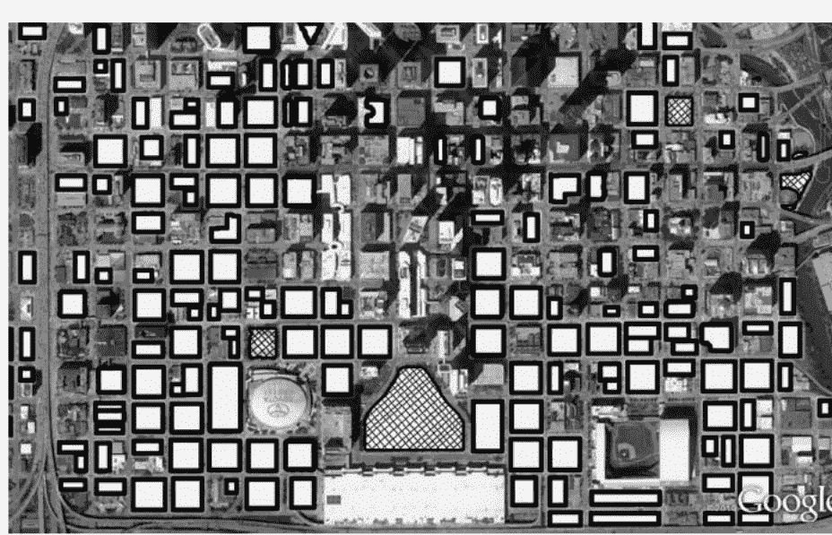

德克萨斯州休斯顿的停车场和公园。黑边框白框是空地或停车场。阴影区域是公园（带有树木和草地的那种）。

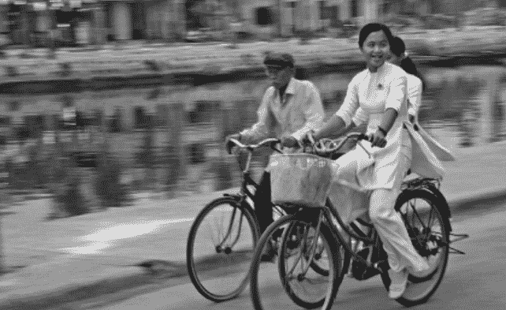

### 赞美步行

> “步行……是身体对地球的衡量。”
>
> ~ 瑞贝卡·索尔尼特（Rebecca Solnit），《漫游》

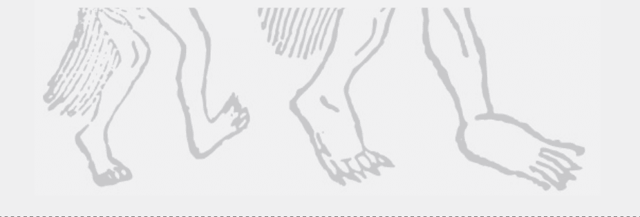

- 2013年英国的一项研究发现，骑自行车上班的人平均病假天数是开车族的一半。丹麦的一项研究显示，开车、坐公交或火车上学的孩子在注意力测试中的表现不如步行或骑车上学的孩子。

### 42. 房子要小

诚然，他是一个逃犯的银行劫匪，而非人类幸福专家，但格雷高里·大卫·罗伯茨（Gregory David Roberts）的一句话“我有时认为，我们的幸福程度与房子的大小成反比”非常值得深思。（这句话写在他半自传小说《香檀树》（*Shantaram*）中，是他在孟孟买贫民窟生活多年后的感悟）。

如果你曾在一个帐篷里住过很长时间，你可能会同意没有稳定的居住空间确实有一些缺点。你每天都要花费大量时间重新整理物品，以便烹饪、洗涤、穿衣和睡觉。在每次使用并在几个月重新塞回背包后，仅仅能有一个架子来放你的麦片就很很棒了。此外，有一个隐蔽的地方晾衣服，以及一个远离风雨的地方来存放写作、绘画和其他创作材料也是极好的了。但在此之后，收益往往会迅速递减。东西意味着精力，而在这一点上，没有哪里比房子更甚。

房子是“拥有了它，我的生活会更好”的哥斯拉级；是“如果我住得简陋，人们会觉得我生活过得不好”的金刚级；它是占有与维护负担的巨兽；更是开支上的绝对歌利亚巨人。澳大利亚的平均每笔住房贷款约为30万美元。加上利息，这意味着在典型的25年内要偿还大约两倍的资金。此外，近期对居住环境的一些研究表明，拥有一个更理想的房子对整体幸福感并没有明显影响。所以，把“搬进更好的房子”从你的待办清单上划掉吧！住进便宜的房子，把省下的钱花在减少工作、去滑雪，或者帮助将鹦鹉从灭绝边缘拯救回来。

我们的作者既有租房也有买房的经验，对于租房的自由是否值得换取所有权及其带来的责任的安全感，我们仍犹豫不决。因为如果你选择卖掉房子，偿还房贷的财务负担可能是值得的，但清洁、整理、维护以及那种似乎为了让房子变得更好而无休止工作的倾向，这种身体上的束缚会吞噬你的生活。

作为节俭的享乐主义者，我们鼓励并赞赏照顾和珍惜事物的欲望，并通过创造性且充满活力的劳动来改善它们。将这种方法应用于房子的唯一问题是，它们太大了。所以，也许最好的办法是住更小的房子。这当然并不难。澳大利亚、美国和加拿大的住房面积在过去七十年里通胀得厉害，以平均一套新房的面积现在是西欧大部分地区新建房屋的二到三倍。人均面积数据同样令人震惊。

## 理想家庭住房概念的转变

如果我们的作者曾买房的初衷是拆除旧房，那目的几乎肯定是为了建造一间更小的房子并拥有更大的花园，而不是相反。或者我们可能会在一个共享花园里建造两间独立的小型房屋，并将其中一间出租。许多让小户居住空间更具吸引力的因素同样适用于租房：价格低廉、暖气和照明成本更低、更易清洁、需要维护的物品堆积较少、没有足够的空间容纳全套家庭娱乐系统（而这会消磨你走向世界社交的动力）……

在较小空间的生活方式数胜许多：合租、在别人的后院租一间单层小屋、在乡村地块盖一间小木屋、出租你居住并拥有的房屋的一半、搬到公寓/单元/更小的房子，或者干脆花几年旅行。

无论你选择哪种方案，与拥有大量空闲空间的多卧室住宅相比，它自然会有一些细微的不便。但除了我们上面提到的优点，它还会带来一些难以预见的惊喜。例如，与室友共享资源并从他们身上发现新事物——比如发现爱上室内足球，或者从他们身上发现新事物……

## 44. 顺应季节

“适应”这个词其实可能有点平庸。不如说预判季节的降临，然后当它们终于到来时，跳上几个让你在被发现时会感到羞涩的喜悦之跃；当你厌倦它们的习性时，咬牙切齿，然后原谅它们（或提醒自己）它们独特的魅力和不可或缺。只要不要试图忽视它们或将它们抹平。

Annie记得她的地理老师说过，文化很大程度上是由景观塑造的——但景观是由什么构成的呢？天气。还有一点构造板块活动。大量的天气。天气在数万年间雕刻地球，并为它披上（或装上）植被和水域。丛林对苔原，季风对暴风雪；它们听起来可能有点像娱乐性摔跤盛宴中的对战名单，但它们远大于任何此类文化碎片——它们是文化的创造者。给它们一些尊重吧。

天气应该是生活的绝佳增强剂之一。如果我们把建筑和汽车的冷热调节到同样的温度运行，我们就剥夺了这种风味——那种蜷缩在羊毛衫里，在沙发上盖着毯子、喝着热巧克力度过整个夜晚的胎儿感；那种在第一个真正的春日敞开门窗，让温暖土地和茉莉的花香涌入的感觉；那种在夏日午后，吃掉一块西瓜时，上唇上的咸汗被微风舔去的感觉。

在一个理想社会中，你的作者认为当天气变得极端时，我们应该都会放下工具。人们抱怨温度过高的一半原因在于没法做任何事情：如果酷热变成了一个让商店和学校关门、或者让人打盹、或是懒洋洋地喝着冰茶（或金汤杜松酒）聊天的机会，那么它可能会受到更温暖（！）的欢迎。如果冬日的黑暗变成了一个在壁炉旁讲故事的长夜，以及十小时的睡眠让我们的身体赶上细胞修复并补充我们的梦想，那么它可能会成为一年中向往的宁静，而不是令人恐惧的磨难。

真的想省点钱吗？

你意识到自己到底有多有光彩了吗，亲爱的读者？大约就像一个100瓦的灯泡——这就是一个普通人体在静止时释放的能量。加上烹饪和电器（冰箱、电脑、灯）产生的热量，在温和气候下，在所有门窗和窗帘紧闭且有几个人做晚餐的情况下，一个晚上你就能让房间变得非常舒适。如果这还不够，尝试在碰到那个温度旋钮之前先上衣服。

同时，让你的身体适应寒冷的月份会加速你的代谢，所以你即使什么都不做也能消耗热量。这应该为此拍个广告！尽管如此，如果是一个寒冷的夜晚，你真的想依靠那副体魄，就起来每半小时做几次俯卧撑。身体暖起来的额外奖励会让你的胸肌重获愉悦。额外的体能也能帮助你的身体更好地调节温度。

在夏天，白天期间保持门、窗户和窗帘关闭（等黄昏降临后立即把它们打开），喝着冰饮，并使用风扇，就可以以空调费的一小部分成本让你保持凉爽。

暖气和空调？将温度设定在你仍然感到一丝微暖或微凉的地方，你的身体会更好地适应季节。你的毛孔在寒冷或干燥的天气中收缩以减少出汗。它们需要几周时间才能正常运作，但如果你把时间花在炉炉般的温度下，就做不到。你的内部恒温器似乎也会调整：限制对暖气和空调的使用，尽管在极端温度的前几周里，你可能像其他人一样抱怨天气，但一个月后，你可能会惊讶地听到人们谈论它是多么难以忍受。显然，这种方法也会为你节省资金。

让季节的蔬菜和水果变得更美味。

## 凉拌西瓜、芦笋与罗勒

- 2汤匙优质橄榄油，留作淋用
- 1 个中等洋葱，切碎
- 2瓣大蒜
- 1 茶匙百香叶
- 1 叶月桂叶
- 8 个小西瓜， 2 杯芦笋（去掉粗大的硬茎——可以腌制）
- 盐味
- 5 杯水
- 3汤匙碎罗勒
- 现磨黑胡椒

1. 在大锅中加热橄榄油。加入洋葱、大蒜和盐，中火炒至软透。加入百香叶和月桂叶，炒至闻香；约1分钟。加入西瓜片和芦笋，加盐调味，偶尔搅拌煮软；约8分钟。加入3杯水煮沸，然后离火。弃掉月桂叶，拌入罗勒。
2. 用搅拌机将汤搅拌至光滑。冷藏至少3小时，直到完全变凉。
3. 用盐和胡椒调调味。盛入浅碗中，根据喜好装饰几片芦笋叶和西瓜片。淋上橄榄油并撒上碎胡椒即可。

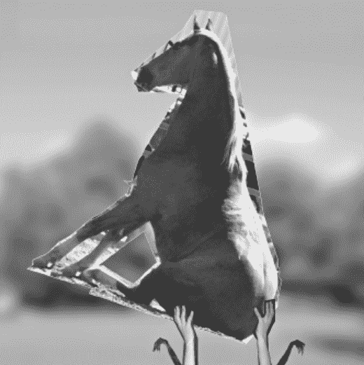

尽管长袜子小姐（Pippi Longstocking）从海盗父亲那里继承了一箱金子，但她仍然明白，穿上不匹配的袜子和补丁裙看起来更有型，因为这就是她的行事风格。

遗憾的是，版权法阻止我们向你展示她的装扮，所以这里有一张她马的照片。

你可能已经猜到了接下来的内容——毕竟你已经读了这本书的四分之五了，而且没有人能一直保持变幻莫测。没错，我们要宣布，节约并不是风格的阻碍，甚至可以提升风格！让我们跳过关于二手店是个性化时尚灵感宝库的部分吧，因为我们确定奥普拉·温斯瑞曾就这个主题做过专题节目。对于一些衣橱里的节俭行家来说，二手服装市场确实是一个无价的盟友，无论是慈善商店、在线交易、与朋友交换，还是像亚当那件帅气的衬衫那样；在暴雨中于乡村小路旁的树丛里发现的衣服（顺便说一下，那是一件完美无瑕的1200支拉夫·劳伦……安妮的眼睛在五十步外就发现了在风中飘飘的品质）。

无论如何，穿得好主要取决于你如何将这些东西组合在一起。如果你会一点缝纫，或者和会缝纫的朋友交换人情，你就能从随处而来的碎片中变出花来。在搭配中偶尔加入一件时髦的单品，可以帮你散发出一种深谙世俗的气质（如果那是你追求的追求）。即使对于那些负担得起更多花费的人来说，这通常也是一种胜出的衣橱策略——穿着从头到脚最新的时尚装通常看起来像是你用力过度了。类似的风格崩塌也经常发生在那些在刻苦的人造晒、脱毛、发型、无休止的健身和美甲脚趾护理计划上过度用力的人身上。这类人有时会被发现正穿着一双不合脚的鞋，在不优雅和不自信中僵硬地走着，引来他们本想留下印象的人的嘲笑冷笑。

这就是“节俭享乐主义者”关注外表时真正特别的额外奖励所在。你不仅看起来不像在用力过度，你自己的习惯和心态往往会赋予你挺拔的姿态、迷人的体魄、嘴角不会下垂的嘴以及眼中闪烁的小小火花。没有任何装扮在没有这些的情况下看起来那么好。

> ### 节俭的劲头
>
> 科学已经证明了。这非常迷人。这是因为生活得不那么贪婪会让你保持活力和灵动。向人们展示同性恋成员的相同照片，然后用不同的方式描述照片中的人物，如“储蓄者”或“消费者”。观众会根据这些描述对同一个人的吸引力给出截然不同的评分。你猜得没错，节俭主义者——在2014年密歇根大学的一项研究中——平均吸引力高出36%！根据报告，“储蓄者”被认为具有更强的通用自控力，这增加了他们的浪漫和身体吸引力……对储蓄者的偏好不受参与者年龄或关系状况的影响，并且在控制参与者性别后，这种偏好依然存在。
>
> 所以，在第一次约会上大花大钱可能会适得其反。我们建议，通过要求打包剩菜来增加浪漫情调吧。

## 46. 拯救（省下）孩子

我们的作者并不是父母。我们和孩子一起待过很多时间，其中一人甚至曾专业地从事过几年的保育工作，但我们并不假装自己足够理解为人父母的挑战，以至于在书中大谈我们自己的节俭育儿主意。相反，我们选择了我们自己也是节俭长大的事实，并且有许多拥有迷你小跟班的节俭享乐主义者朋友，也有足够的证据证明孩子并不是廉价生活的不可逾越的障碍。我们询问了这些朋友中的一些关于他们带孩子时的首要节俭策略。以下是他们的建议：

- 尽早投入是有价值的。如果人生中有一个阶段可以让你尽可能地腾出精力——即使是赚取微薄的收入或让房子荒废——那也是孩子出生的前五年。这并不是要让你必须溺爱他们并像保姆一样时刻围着他们转。这是为了让你能花极长的时间来做饭，这样你的孩子就可以帮助你并开始建立和享受厨房技艺。这是为了让你有足够的精力在他们晚上骑着三轮车在人行道上上来时留半只眼睛看着他们，而不是由于精疲力竭而把他们丢在电视前的草地上。这是为了让你有时间和他们一起看广告，并笑道“人们的这些傻事有多疯狂！”是时候和他们一起躺在草地上，看着一队的蚂蚁搬着巨大的碎屑，让他们那一点小好奇心感染你——并通过你待在那儿的快乐来告诉他们，那种好奇心是值得投入的时间。这将帮助你培养出一个能力强、顽强，并且在创造和消费中都能发现乐趣的孩子……长远来看会让生活变得更便宜、更轻松。
- 给孩子固定金额的零用钱。向他们解释如何用这些钱现在买些东西，或者存起来买更大的东西。然后让他们自己做选择。每年增加金额以及他们被要求自己购买的物品，并增加一些小建议。

**做好心理准备。** 当孩子们开始尝试在社会和同伴中定义自己的身份时，买东西往往会成为他们想要用来帮助这一过程的工具。首先，提醒自己，从事后来看，大多数人都会反思在节俭的环境下长大是一件非常好事——尽管你的孩子现在可能深信自己正遭受无法忍受的匮乏，但那种感觉不太可能持续多久。其次，如果你在这个阶段最终没有做出一些妥协，也不要因此自责：育儿本身已经足够艰难了。第三，如果你对自己似乎养出的那个“消费狂魔”感到恐惧，请用这样一个事实安慰自己：通过与他们讨论问题，你教会了后代要学会质疑、要思考。你模范了你希望他们拥有的价值观，所以一旦他们站稳脚跟，很可能会变成一个优秀的成年人。

**最后，把生孩子作为更加** 节俭享乐（Frugally Hedonic）的理由。他们让你用充满新奇奇迹的眼睛观察世界，他们本身就是完全迷人的生物，活在当下，而你已经做到了其中的很大一部分。他们还以此嘲弄了任何追求物质完美的尝试，这倒也方便。

谈另一个完全的话，每个人都应该对自己是否想要后代、以及如果想要，要多少次感到坦然。当然，这与决定是否买新辆车完全是两码事，但生孩子的压力，或者为了“陪陪第一个孩子”而生第二个孩子的压力，与围绕其他生活方式预期的社会压力有共同之处。在一个人口过剩的时代，人们却因为因为没有孩子而感到必须防御，这是一种糟糕的状况。如果这是你内心深处真正的渴望，那是一回事了。但如果不是，你还有许多其他精彩的人生体验可以拥有，也有许多向世界贡献的方式。

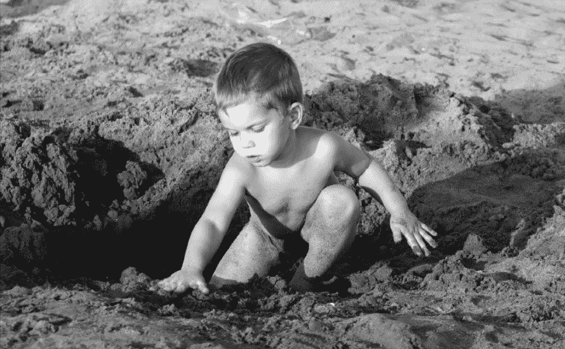

## 47. 不要因为你妥协了就放弃

亲爱的读者，我们非常支持对事物的尽情享受，并且对自我惩罚并不感兴趣。我们认为，即使你有一次节俭后的挥霍，坚持这种方法也是明智之举。作为一个节俭享乐者，略带讽刺的额外好处是，如果你偶尔发现自己对奢侈消费产生渴望，并且经过权衡后决定放纵自我，你就可以这样做，而不会产生那种侵扰许多人的消费后懊悔。毕竟，这是一次稀有的事件，而且你的银行余额和腰围（想象你渴望的是那份热糖果圣代冰）都处于良好状态。

奇怪的是，我们还发现，如果你权衡了自己的渴望，然后决定仅用你意志的力量让它烟飞云灭地消失，那种感觉几乎就像是一场魔术，而且比妥协本身要感觉棒极了。

## 48. 在奶奶面前低头，走在曲线前面

节俭主义的一个刻板印象是那些在物质过剩成为常态之前长大的老年人，他们直到今天仍在收集茶包反复使用，用胶带修补塑料袋，并用醋洗头。

他们经历过那种行为是具有高度功能性的时代，特别是如果他们年纪足够大，还记得大萧条的话。但在富裕时代保留这些习惯，他们会招来居高临下的微笑，甚至是嘲笑。

在这些书中，我们的作者们并没有纠结节俭的伦理或环境原因。我们开始写这本书是因为人们不断问我们，为什么我们似乎在省这么多钱的同时总是玩得很开心，我们认为这是一个值得回答的问题。但随着时间的推移，这个问题很可能变得越来越重要：人口增长、资源限制和动不定的全球经济很快就会迫使我们大多数人减少消费。在很多情况下，是大幅度减少。

所以，难道可能出现“蔑视之煎饼”的翻转吗？挥霍可能会取代节俭，成为那种令人尴尬的过时模式吗？

在一个高消费、浪费行为日益被认为是功能失调的未来，试图坚持高消费、浪费的行为可能会让人们被标记为嘲笑的对象。或者更糟。与过度消费相关的形容词——贪婪、被宠坏、自私、吝啬——比任何形容极度节俭者的词都要犀利得多。资源限制时代是一个更加明显一个人的浪费是另一个人的匮乏的时代。因此，生活在不断的过剩中可能会让你变得非常不受欢迎。

趋势：已经不受欢迎，而且很可能变得更加如此……

- 夏天夏天 24 小时开启空调的人，这意味着路人（考虑到他们是在街上走，而不是在恒温汽车里开车，他们并没有使用任何化石燃料）会被每个空调出风口喷出的额外热风冲击。这些人还为其他所有人提高了整个区域的温度。
- 开着巨大的 SUV 接送孩子往返学校的人（而不是步行、骑行或乘坐一辆合适的车辆拼车），为了图方便而耗尽了我们日益枯竭的石油供应，将废气排在交通堵期间坐在他们后面的每个骑行者的脸上，这意味着等我们都老了，可能除了劈柴生火之外，再也没有办法可以烧一壶水喝了。
- 接受外卖食物和饮料的塑料餐具、塑料袋和纸板托盘，然后在吃完十分钟后就把所有东西塞进垃圾桶的人，这意味着在未来的日子里，我们中没有人能长久地拥有高功能性塑料制品（如密封食品盒）这种简单的奢侈。或者说，无法再拥有这种快乐了。

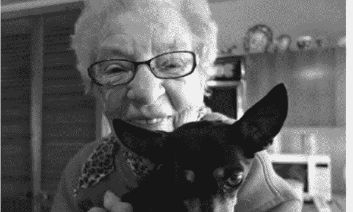

我们并没有在这一主题上深入。。在奶奶面前低头吧！给你认识的老人带上一杯热饮，问问他们在物质匮乏时期是如何快乐的。他们知道一生中会发生多少变化，他们也许能帮助你理解。

## 49. 给一些东西

无论是金钱、帮助、时间还是物品，给予都证明了你有足够的余地，而不是让你陷入不足的心态。这能让你在你的节俭中感到优雅和满足。而且它帮助了他人。

事实上，给予并不意味着去救济站或国际援助，它可能意味着花更多时间倾听和照顾虚弱或孤独的家人，或者把园果交给邻居。或者投入足够的精力帮助朋友度过灵魂的漫长隧道。当你不再被每周工作四十小时和一堆信用卡债务困扰时，你有更多的精力处理这些事情。

有些人发现，送出实际现金可以让他们诚实地评估自己到底需要多少（以及他们相对富有）。亚当有一个朋友生活简单、勇敢旅行，数学讲师，他将收到的工资视为不扭曲经济的偶然反映。每笔工资都存入一个他帮助建立的印度学校的银行账户。他说：“从我的角度来看，那我的钱，所以我怎么能留着它？我不想要它——我不得不找到一种令满意的支出方式。在我的情况下，那可能意味着去一次长途旅行，但我已经那样做了。我还能用它干什么？买一个华丽的新搅拌机？如果我有这么多钱，我得考虑如何最好管理它，而我不想想那个。”

如果这种转变发生，亲爱的读者，这能帮助你在这个压力中保持快乐，你更有可能不会因为在经济衰退时去购物而感到沮伤。（而且这样做时，你更有可能让自己保持健康和快乐！）

# 给予是最好的药

> 马克·吐温曾说过：“让自己快乐起来最好的方法是努力让别人快乐起来”，你的作者认为这完全有道理，

考虑到你必须跳出自己自我批判的内心独白，真正关注他人并为他们加油。事实上，在社区担任志愿者，或仅仅为家人朋友提供支持，被证明与寿命延长、痛苦减轻以及意义感增加有关。加利福大学的一项研究发现，在降低死亡率方面，为至少两个组织担任志愿者的益处与每周运动四次一样。20世纪 80年代的一项研究甚至发现，仅仅是看着特蕾修女做慈善活动就能增加旁观者的免疫系统抗体。在多项研究中，结果表明，照顾或为他人花钱比照顾自己或为自己花钱能带来更多的健康和快乐益处。

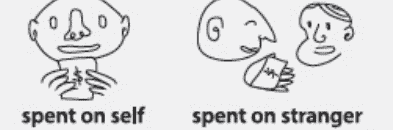

| | 花在自己身上 | 花在陌生身上 |
|---|---|---|
| $5 | 与之前相同 | 更快乐 |
| $20 | 与之前相同 | 更快乐 |

学生们分到了装有5 美元或20 美元的信封，并被指示将这些钱花在自己身上或陌生人身上（例如请陌生人喝咖啡）。第二天，将钱花在陌生人身上的人表示感到更快乐，而将钱花在自己身上的人则感觉没有变化（无论给他们多少钱）。

## 50. 在文化自助餐上尽情享受

文化反弹总有一种用力过头的倾向。诚然，当一名农民确实有很多不喜欢的地方。想想迷信、茅草顶、头虱以及 17 世纪的人口密度。但当成为中产阶级的可能性显现时，我们可能稍微过度兴奋了，在热情中抛弃了许多非常有价值的东西。例如，在家里种食物。邻居们会怎么说呢？！“你买不起超市的食物吗？”因此，上世纪郊区的兴起看到每个有能力的人都放弃了蔬菜地，转而经营一片草坪；而在以前，草坪是仅留给英式入口的炫耀符号。

现在我们正处于工业化中产阶级实验运行了少数代人的节点。我们这些特权国家的公民沉浸在家庭娱乐中，沉溺于家用电器海洋、室内设计、装瓶斐济泉水、超市购物和生活教练中。谁能否认这是一段奇异而奇的旅程呢？但这段旅程充满了愚蠢和被动的快感，让我们注意力变短，导致焦虑和抑郁的合法及非法药物使用率高涨、青少年自杀、肥胖、存在主义危机，以及太多让人分心的可爱动物 YouTube 视频，至于让人难以专心生活。（尽管——你可能看过那只顽皮的灵猴夹耳朵的视频吗？那才是没有生活最糟糕的。）

但我们离题了。作者想表达的观点是，对于一个节俭享乐主义者来说，对与中产阶级生活和现代技术相关的一切鄙视是愚蠢的——重演我们全盘拒绝农民文化时所犯的错误。历史的奢侈在于，我们可以观察人类不同化身中哪些是有效的，哪些无效，并据此采取文化混合的方法。

亚当曾与一位经验丰富的西新布内亚部落成员通信了一段时间，他说他唯一喜欢现代世界的就是互联网。我们没那么极端。我们会在清单上增加：录制音乐、轻便帐篷、手持搅拌器、一串小彩色灯、自行车、偶尔的飞行旅行和运动鞋。从其他时代，我们将汲取积极活动的生活方式、为了奢华的沉思与交谈、如何在景观中识别食物、没有屏幕的时间，以及寻找安静的草地凹地，头枕在手臂上睡个午觉。等等。

列出你自己的清单。真正评估你认为现代文化中哪些是有效的且值得的，以及你认为其他时代和其他人做得更好（或者没有他们反而过得更好）。思考如何根据你的评估创建一个“奇美幻兽式”的生活。也许你会搬到一个小公寓，戒掉电视，晚上开始写信件和参加业余马戏团，每年花六个月时间骑自行车旅行，驮包里装着一袋燕麦，穿着顶级技术能提供的最好的轻便雨衣。也许你将成为一个现代僧侣学者，白天在温暖、光线充足的图书馆里进行深度且虔诚的研究，晚上在汤车上帮助喂养饥饿的人，然后在安静的午夜高速公路上踩滑板回家，啃着野山羊肉干。当我们这样做时，我想在我们装饰着金色闪光的厨房里，和你一起坐在用太阳能驱动的笔记本电脑上听着北欧合成流行音乐……

## 51. 抬头，思考星座。低头，思考岩浆。

有时当你感到被自己生活的细节淹没时，是时候为你的近视收拾行李箱，并送它去度假了。

抬头。那里有比你多得多的物质，它们喷射出发光的光柱，塌入涡流，汇聚成气球，然后破碎成炽热的雨。它是无尽的、永恒的、熵增的、生成性的，并且在最与宗教无关的意义上是神圣的。

低头。那里是所有巨大峡谷、锯齿山峰和裂谷那巨大的磨损、移动、熔化的熔炉。那里有水分、矿物质和有机碎片组成的炼金术三位一体，它们拥有诞生新生命的力量，并构成了你骨骼的成分、细胞外基质的结构以及血液的粘度。

记住你在哪里以及你，不应该是感到自己是一个微小尘子的终点。你是由这些物质、星光和岩浆织而成的，安说它正带着风范移动着，微微微笑，梦幻。亚当说它正以令人印象深刻的方式移动着，带着某种疯狂感，是一个正在展开的故事中的参与者。是发现了化石燃料并用音乐创造了全球文明的裸人猿。

并不是说你可以一直记住这些。但在脑海中开辟一个小角落来记住它们，每当你想要把事情重新放回去时，就可以走进去。去那里可以让你感到巨大的情感贯穿身体。它也可能让你变得不那么焦虑，也许带有一点欣快。听起来有点像是一个节俭享乐主义者。

# 更多资源

## 真实与想象的生活方式，帮助你重新校准

- 《绿谷纪事》(Tales from the Green Valley) (Lion Television for BBC Two, 2005)。一个历史学家和考古学家团队重现了 1620 年代农场一年的生活，尽管困难，但他们很喜欢它。事实上，他们一定非常喜欢，因为其中几个人后来又制作了关于其他时代乡村生活的系列节目。Annie坦言：她看过了每一个系列，有些还看了几遍。

- 萨缪尔·亚历山德的《熵》(Entropia by Samuel Alexander) (The Simplicity Institute, 2013)。必须有人足够勇敢才写出它：这与其说是小说，不如说是对可持续社会可能面的一种尝试。

- 转型运动（Transition movement）是一个全球网络，人们创建正在转向低能耗、更基于社区的生活方式的街道和城镇。他们的网站充满了资源：`www.transitionnetwork.org`。

- 《欢迎拉各斯》(Welcome to Lagos) (BBC, 2010)。一部出色的三部迷你剧，讲述了尼日利亚拉各斯贫民窟的人们如何生活。让你同时感到被过度宠坏、心怀感激并深受。

- 《超级大胖子进入战时》(The Supersizers Go... Wartime) (第一季，第一集。BBC Two, 2008)。两个痴迷的英国人吃二战时期时期配给盒里的食物。因为他们是演员，所以在吃这种简陋的饮食时不得不发出很多“呸”的声音，但因为他们是演员，这也非常幽默，并且有很多有趣的内容。

关于在战争期间人们如何变得更健康、社会纽带如何变得更紧密，以及奖励如何变得更加……

- 《动物、蔬菜、奇迹》（Barbara Kingsolver 著，HarperCollins 2007）。Kingsolver 的天才之处在于，她能够将某些人看来可能是具有威胁性的左翼环保价值观，通过一种方式呈现出来，清楚地看出这些价值观与经典的保守价值观有多大的共同点：自力更生、节俭、深厚的家庭和社区纽带。这本书记录了一个家庭尝试几乎完全从自己的农场获取食物的一年。她的小说也值得读，并且倾向于巧妙地将惊人的生态问题包装在初看起来像是易于吸收的“机场小说”中。

- 《木匠的小小屋》（《大设计蓝》第 9 季第 13 集，Fremantle Media, 2003）。许多人提到过这个故事对他们影响有多大。它讲述了一个关于英国英国木工的故事，他在森林里顶着帐篷生活了 10 年等待规划许可后，最终建造了一座令人惊叹的手工制房屋。

- 《袋鼠生活》（Dolly Freed 著，Universe Books, 1978）。由一位 19 岁的火药女孩撰写。Dolly 解释了“如何懒惰、骄傲、痛苦且诚实，过好生活并享受闲暇”。我们不同意她说的某些观点，她的一些建议在当今并不适用，但其中充满了感染力的态度，以及许多关于“如何剥兔子”之类的自给自足技巧。

## 质疑文化

- 《富足症：当拥有永远不够》（Clive Hamilton 和 Richard Denissen 著，Allen & Unwin, 2005）。对现代澳大利亚过度消费现象的定性且具有指责性的概述，充满了令人大大震惊的数据，说明了我们不断膨胀的消费预期。同时也审视了可以让事物回归正轨的改变，包括政治和个人层面。（还有一本美国书籍和相关的纪录片也叫《富足症》，以更幽默的方式探讨了过度消费的负面影响。尽管现在看起来有点过时，但其内容仍然完全相关。）

- 《丰富：真正财富的新经济学》（Juliet Schor 著，Penguin Press HC, 2010）。深入探讨了当前的经济模式注定失败，以及我们如何重构劳动和闲暇来创建一个不失败的模式。对于增长在多大程度上是幻象，书中提出了有趣的观点。

- 《无神论者的宗教：非信徒宗教用途指南》（Alain de Botton 著，2012）。一项引人入胜的研究，探讨宗教如何利用仪式和定期接触各种象征性艺术（从建筑到文学、音乐到绘画）来帮助提醒信徒他们想要如何表现以及他们渴望成为谁。这本书主张在世俗社会中使用同样的机制，使我们能够在面对琐碎的干扰时，更容易对自己的最好愿景保持忠实。

- 《灯泡阴谋论》（Cosima Dannoritzer 编剧并导演，2010）。一部关注计划性过时以及公司如何让我们尽可能多、尽可能久购买的其他不愉快层面的纪录片。如果你对大企业的彻底腐败有任何怀疑，这部片将治愈你的疑虑。

## 金钱

- 《你的金钱或生活：转变金钱关系并实现财务独立的 9 个步骤》（Vicki Robin 和 Joe Dominguez 著，Penguin, 2008）是一本美国书籍，旨在帮助你进行深度的生活审计，以便你弄清楚在哪里最有用地减速。即使你不想让你的财务价值观通过书中的九步评估计划，阅读所有关于真实时薪以及我们真正想要与我们花钱方式之间矛盾的中间部分仍然是的。

> 《快乐金钱：更明智消费的科学》（Elizabeth Dunn 和 Michael Norton 著，Simon & Schuster, 2013）是一场基于研究的消费之旅，展示了五种我们可以改变消费方式来让自己变得更快乐的方法。非常聪明，极可能改变生活。

- 有效利他中心（Centre for Effective Altruism）帮助你弄清楚如何最好捐款。`www.centreeffectivealtruism.org`。他们的项目之一“随心所愿”（Giving What You Can）包含一个“我有多富有？”的计算器，这有助于了解我们相对于全球平均人口的财富程度如何：`www.givingwhatwecan.org/get-involved/how-rich-am-i`

## 工作……以及不要做那么多

> 《如何闲散：懒者的宣言》（Tom Hodkinson 著，Harper Perennial, 2007）是一份充满魅力且散漫的减少产出的号召，充满了鼓舞人的历史案例以及热爱懒惰的文学和哲学名人的引言。

- 新经济基金会（The New Economics Foundation）：21 小时：`www.neweneconomics.org/publications/entry/21-hours` 。回到 NE 主页查看整个网站也是值得的。

- 新美国梦中心（Centre for a New American Dream）在一系列精美的信息图中展示了缩短工作日的益处。`www.newdream.org/resources/infographics-shorter-workweek` 。再次，这整个网站有很多好东西。

## 食物

- 《节俭之味》（Arabella Forge 著，Skyhorse Publishing, 2011）详细介绍了了如果方法得当，吃上更好吃、更有营养的食物实际上可以更便宜——包含了食谱。

- 迈克尔（Michael Pollan）的一系列与食物相关的书籍《杂食者的困境》、《为食物辩护》、《食物规则》、《当你烹饪时》（全均由 Penguin 出版）非常有助于燃你的热情去真正欣赏你所食的食物。

- 《发酵的艺术》（Sandor Katz 著，Chelsea Green, 2012）是一本发酵指南。

- 《翻找垃圾的艺术与科学》（John Hoffman 著，Breakout, 1992）。他直言不讳，触及了几乎所有形式

- 《食物》（Ruth Hertzberg, Annie Vaughan 著，New South Books, 2013）是一本关于食物的指南。

## 住房

- 一个关于微型好网站：`www.tinylife.com`

- 看家（House sitting）：有本地网络，只需在网上搜索“house sitting”即可。

- 改造（Retrofitting）：这个澳大利亚网站关注可持续建筑的不同方面。`www.yourhome.gov.au`

## 个人交通

- 共享共享：有很多共享网络，但没有很好的中央目录。最好的办法是在网上搜索“car-sharing”和你的城市名称。有两种不同的模式：标准商业模式，车队分布在郊区，但由公司统一拥有；点对点模式，邻里的人租赁自己的车。

- 拼车：有拼车或行程共享网络用于共享旅程。传统上，拼车用于预先安排长途旅行的路费或日常通勤。最近，智能手机技术为更自发的行程以及类似出租的距离提供了可能，即实时行程共享。

## 旅行

> 《免费旅行的艺术：一个节俭家庭冒险》（Patrick Jones 和 Meg Ulman 著，New South Books, 2015）。正如在“你有很多随自由做的事情”中所提到的。

- **Couchsurfing** 是一个让旅行者住在他们那里的网络。接待其他旅行者在你旅行时更有可能接待你。`www.couchsurfing.org`

- **WWOOF**（有机农场全球志愿者）是一个松散的组织网络，连接旅行者与房主。旅行者可以用农场劳动换食物和住宿。访问区域网络请：`www.wwo.net`

- **HelpX** (`www.helpx.net`) 和 **Workaway** (`www.workaway.info`) 是与 WWOOF 类似的网络，但也列出了许多与农业无关的与农业或园艺有关。所以，如果你不想干铲子活，你可以寻找招建筑工、保姆、练习语言等等的地方。他们还有在线系统的优势，可以对房主进行评分和评价。

- **Warm Showers** 类似于自行车游客版的 Couchsurfing。`www.warmshowers.org`

- **换宿（House-swaps）**。对于较长的逗留，你通常可以获得免费住宿，有时作为照顾宠物等的回报。一个网站是：`www.homeexchange.com`

- 它非常有名。**Airbnb** 是人们出租住宿的地方，包括在他们外出时出租自己的房子。它满足各种预算的需求。`www.airbnb.com`

- **搭便车（Hitchhiking）** 是我们最喜欢的出行方式之一。这个页面（在 Wikitravel 上）——一个优秀的免费旅行信息协作来源——充满了出色的建议：`www.wikitravel.org/en/Tips_for_hitchhiking.`

- **Hitchwiki** 充满了用户生成的信息，涵盖每个城镇的建议以及搭便车点的互动地图和经验分享。`www.hitchwiki.org`

- **Sleeping in Airports** 是一份用户生成的指南——正如你可能推测的那样——关于在机场睡觉的。`www.sleepinginairports.net`

## 共享与免费物品

- **StreetBank** 是一个与邻居分享工具和其他物品的网站。`www.streetbank.com`

- **Freecycle** 是一个当地小组网络，人们在其中提供不再需要的免费物品。`www.freecycle.org`

## 维修/制作物品

- **Instructables** 拥有数千个 DIY 项目和修理教程，从面霜配方到拖拉机修理无有包。`www.instructables.com`

- **iFixit** 是一个互相帮助修理东西的在线社区。规模虽小但正在增长。`www.ifigit.com`

- **Repair Café**（维修咖啡）是一个全球性的场所网络，你可以在那里找到工具并修理损坏的物品——它们始于阿姆斯特丹，现在已有750 多处，尽管目前阶段在澳大利亚只有几家。`www.repaircafe.org`

## 随机趣闻

- Barry Schwartz 写的《选择的悖论》（Paradox of Choice，Echo, 2003）。关于过多的消费者选择如何令我们感到不快乐的非常有趣的视角。

- Charles Duhig 写的《习惯的力量：我们在生活和商业中为何这样做这样做》（The Power of Habit: Why We Do What We Do in Life and Business）。一本关于习惯形成细节的极具可读性的书籍。尽管书中某些章节旨在改进商业实践，但它提供了许多如何改变个人习惯的有用线索。

- Jonathon Haidt 写的《幸福假说》（The Happiness Hypothesis，Basic Books, 2006）。一本关于幸福科学的佳作。

## 素材来源

我们对所有根据知识共享许可协议发布免费材料以供重复使用的创作者们深表谢意。我们使用的素材列在下方。除非另有说明，书中的图片要么是我们自己的，要么属于公有领域。

## 有很多想用自由做的事

“家庭中的艺术家”照片经 Meg Ulman 和 Patrick Jones 许可复印。

## 重新校准你的感官

飞机照片由 Arcturus 按照 CC BY-SA 3.0 许可发布于 `commons.wikimedia.org`。

## 别再读那些杂志了

面部表情照片裁剪自：

- 脸部 1：Andy Miah 在 flicker.com 上按照 CC BY-SA 2.0 许可。
- 脸部 3：Tony Crescibe 在 flicker.com 上按照 CC BY-SA 2.0 许可。

## 浪漫化其他时代

出自 Roald Dahl 作品《玛蒂达》的引言版权所有 © 1988 Roald Dahl。经 Viking Children's Books（Penguin Young Readers Group 旗下，Penguin Random House LLC 分支）在美国和加拿大的许可，并经 Jonathan Cape Ltd 和 Penguin Books Ltd 在世界其他地区的许可。

## 享受过剩

# 图片版权声明

## 听从习惯科学家的

健美运动员照片由 Dalston 按照 CC BY-SA 3.0 许可发布于 sk.wikipedia.org。

## 寻找免费的第三空间

公共广场照片由 Nsaum75 在 en.wikipedia.org 上按照 CC BY-SA 3.0 许可。

## 种植自己的蔬菜

巨龟照片由 5of7 在 flicker.com 上按照 CC BY-SA 2.0 许可。

## 满足你的好奇心

小瓢虫照片由 Alsdake 在 commons.wikimedia.org 上按照 CC BY-SA 3.0 许可。

## 别做一个自私的 %*$#

Aps 照片由 Martin Steiger 在 commons.wikimedia.org 上按照 CC BY-SA 4.0 许可。

## 重定义圣诞

“典型的美国场景”照片由 Kim Love 在 flickr.com 上按照 CC BY-SA 2.0 许可。

纸蛋糕照片由 Bugeater3 在 commons.wikimedia.org 上按照 CC BY-SA 3.0 许可。

## 需要他人的人是世界上最幸运的人

伊壁鸠鲁胸像由 Marie-Lan Nguyen 在 commons.wikimedia.org 上按照 CC BY 2.5 许可。

## 简化事情

查尔斯王子照片由 Revolve-Rally 在 flickr.com 上按照 CC BY-SA 2.0 许可。

休斯顿停车场照片数据源于 PhotoLith，发布于 forum.skyscraperpage.com（我们通过 Google 街景核实了其准确性）。自行车手照片由 Jean-Marie Hullot 在 fotopedia.com 上按照 CC BY 3.0 许可。

## 房子少一点

小屋照片由 Jocelyn Kinghorn 在 flickr.com 上按照 CC BY-SA 2.0 许可。大房子照片由 WikiCats 在 en.wikipedia.org 上按照 CC BY-SA 3.0 许可。

## 关于风格的说明

Pippi 的马合剪辑中的坐马照片由 Jean (7326810@N08) 在 flickr.com 上按照 CC BY 2.0 许可。

## 向保姆低头并领先潮流

奶奶 Nessie 的照片由 Ben Grubb 拍摄。

## 许可密钥

- `CC BY` = 知识共享署名许可
- `CC BY-SA` = 知识共享署名-相同方式许可

详细信息请见 `www.creativecommonscommons.org`

# 作者简介

## Annie Raser-Rowland

Annie 在报税报表上填写“主业”一栏时可能会写下“园艺师”，但她认为自己首先是一个审美者。（她通常也会在“收入”一栏写下非常小的数字，却认为自己极其富有。）她从感官世界中获得巨大的快乐，并将在不破坏它的前提下享受它视为作为人的主要目标。她热衷于帮助他人这样做，放弃了艺术创作，转而教人们如何可持续地食自足。她曾在多个国家从事永续农业项目，合著了《澳大利亚野草采集者手册：食用与药用杂草指南》，并在墨尔本 CERES 环境公园的苗圃工作期间，向无数人提供过让小毛毛虫远离西兰花的建议。在空闲时，她寻找山爬，为她那只可以食用的狗画画，并在当地公园读侦探小说。

## Adam Grubb

Adam 在成年后的大部分时间里自愿过着节约的生活，包括长期极低开支——每年少于 2000 美元。他喜欢这种挑战。此外，这给了他时间去做无偿工作，例如他多年资助能源新闻网站 EnergyBulletin.net（现为 Resilience.org）。他还是全球生态快闪（permablitz）运动的联合创始人之一，并在墨尔本的 Triple R 电台主持名为“绿色世界末日”的每周节目。在职业计酬方面，他在澳大利亚墨尔本的 Very Edible Gardens 公司担任永续农业设计师和教育者，他与 Dan Palmer 共同经营。此外，他有时也会让 Annie 怂恿他一起写书。

# 相关书籍推荐

## 自由旅行的艺术：一场节俭家庭冒险

**作者：Patrick Jones 和 Meg Ulman**

Patrick、Meg 和他们的家人经营了幸福且可持续的生活。但在 2013 年底，他们发现自己渴望冒险：一场公路旅行。

但他们的公路旅行却与众不同。带着 Zephyr（10岁）、Woody（1岁）和他们的狗，他们开启了一场为期一年的澳大利亚东海岸自行车骑行，从达尔斯福德（Dalesford）到约克角角（Cape York）折返。

他们的目标是低成本生活——游击露营、狩猎和采集。他们曾在澳洲社区度过时光，加入反水力压裂的封锁行动，记录了食用植物，并在国家最危险的高速公路上躲避超速卡车。《自由旅行的艺术》是一个关于打破规则的伦理生活的非凡故事。

## 永续农业先驱：来自新边疆的故事

**编辑：Caroline Smith 和 Kerry Dawborn**

这些引人入胜的故事描述了普通人如何找到勇气拥抱世界问题，超越恐惧，通过解决方案和实际行动来改变并赋能他人，成为受启发的变革推动者。

这部选集是永续农业出版物中令人启发的补充，对任何关注社会和变化的人都具有吸引力。

该书的核心信息之一是，普通人不必等待专家和政府的领导。永续农业先驱们的经历说明，我们都可以变得勇敢且富有创意。我们都有工具来赋能自己，而不是简单地拖入我们感到无法逃脱的洪流中。

## 永续农业：原则与路径

**作者：David Holmgren**

永续农业的共同创始人 David Holmgren 的开创性著作《原则与路径》（*Principles and Pathways*）汇集并整合了 25 年的思考与教学，展示了理解和执行一组简单设计原则的全新方式。

这与我们如何重新组织生活、社区和景观的每个方面都相关，以创造性地适应塑造人类命运的生态现实。

对于普通读者来说，这本书为一系列环境问题提供了新颖视角，并展示了永续农业远不仅仅是一个园艺系统。对于任何认真感兴趣于理解可持续设计和文化基础的人来说，这本书都是必读之作。

## 复古郊：减速主义者的韧性未来指南

**作者：David Holmgren**

*RetroSuburbia*（复古郊）解释并说明了那些已经在通往韧性未来道路上的人，利用永续农业伦理和原则所应用的模式、设计和行为策略。

它为那些通过更系统、全家庭方法改造其房屋、花园和生活安排的人所面临的问题提供了设计解决方案。

它包含了一些经过证明的设计规范和提示，引用了技术来源和案例研究，但它更多是一本战略指南，而非技术手册。

有关此书的更多信息，请访问 [RetroSuburbia.com](http://RetroSuburbia.com)

[HOLMGREN.COM.AU](http://HOLMGREN.COM.AU) 均有供应

---

您通往知识与文化的门户。人人皆享。

- z-library.se
- singlelogin.re
- go-to-zlibrary.se
- single-login.ru

官方 Telegram 频道

Z-Access

https://wikipedia.org/wiki/Z-Library
