# 多处理器编程艺术（第二版）

编辑项目经理：Beth LoGiudice

设计师：Renee Duenow

VTeX 排版

献给我的父母 David 和 Patricia Herlihy，以及 Liuba、David 和 Anna。

– M.H.

献给 Noun 和 Aliza，Shafi，Yonadav 和 Lior，以及 Luisa。

– N.S.

献给我的家人，特别是我的父母 Guilly 和 Maloy Luchangco，以及使一切成为可能的的神。

– V.L.

献给 Emily, Theodore, Bernadette, Adelaide, Teresa, Veronica, Phoebe, Leo 和 Rosemary。

– M.S.

- 前言
- 致谢
- 教授多处理器编程艺术的建议方法
- 19.9 习题
- 20.2.1 事务式编程示例
- 参考文献
- 索引

# 前言

本版第二版的目标与第一版相同：为任何想要精通并发编程的人提供教科书。本书的第一部分涵盖了互斥等基本概念，这些已成为本科和研究生课程的基础。我们使用 `Java` 来说明这些问题。

本书的第二部分描述了并发编程的艺术。在大部分范围内，我们使用 `C++` 来说明这些问题。第 17 章和 19 章相比第一版有了重大更新。第 20 章现在包含了事务式编程的硬件支持以及软件策略，且示例已重写，以便我们关注底层机制。

内存管理是并发程序的另一个挑战，我们在第 19 章讨论了如何手动回收内存。

# 组织

每个章节都有次要主题，说明特定的编程模式或算法技术。第 12 章介绍了计数和排序，这两个经典问题的解决方案。将程序拆分为可行的任务并组织它们的执行是并发编程的基本技能，我们考虑了实现这一点的多种方法，包括调度（第 16 章）、并行（第 17 章）、屏障（第 18 章）以及事务式编程（第 20 章）。

我们还考虑了并发计算中的基础问题。第 2 章描述了自旋锁和竞争，并引入了并发程序正确的含义。随后我们查看了同步原语（第 3 章）。在阅读剩余章节之前应阅读本章。

本书第二部分介绍了并发数据结构。第 9 章涵盖了链表，它说明了不同的同步模式，从粗粒度锁到无锁结构。先进先出（`FIFO`）队列说明了在使用原子同步原语时出现的“ABA 问题”（第 10 章）；栈说明了重要的“消除”的模式（第 11 章）；哈希表展示了算法如何利用天然并行性（第 13 章）；跳表说明了并行搜索（第 14 章）；优先级队列说明了如何放松并发保证来提高性能（第 15 章）。

# 先决条件

第二版的先决条件与第一版基本相同。为了理解算法及其属性，读者将需要一些离散数学知识，特别是“大 O”表示法以及一个问题是 `NP` 完全困难的含义，以及栈、队列、列表、平衡树等数据结构，以及哈希表。熟悉基础计算机体系结构和系统构建（如处理器、线程和缓存）也有很有帮助。虽然一门操作系统或计算机体系结构课程已经足够，但两者都不是必须的；已有几十所大学在没有这些这些先修课程的情况下成功地使用了这本书。

为了跟上示例内容，需要对 `Java` 或 `C++` 有基础的了解。当我们需要高级语言特性或对硬件的深层理解时，我们会先提供解释。关于编程语言构造和多处理器硬件架构的更多细节分别在附录 A 和附录 B 中介绍。

## 致谢

我们要感谢我们的同事、学生和朋友，他们在本书编写期间为我们提供了指导、意见和建议：Yehuda Afek, Shai Ber, Hans Boehm, Martin Buchholz, Vladimir Budovsky, Christian Cachin, Click Coff, Yoav Cohen, Tom Cormen, Michael Coulombe, Dave Dice, Alexander Fedorov, Pavel Bielfer, Christof Fateri, Rati Gelasvi, Mohsen Ghaffari, Brian Goetz, Shafi Goldwasser, Rachid Guerraoui, Tim Harris, Will Hasenplaugh, Steve Heller, Danny Hendler, Yossi Levy, Wei Hizkiev, Alex Logan, Justin Kopinsky, Hank Korth, Eirik Koskinen, Kostas Kozynakis, Edya Ladan, Doug Lea, Edward Lederman, Ville Leiserson, Pierre Leone, Yossi Lu, Virendra Marathe, Kevin Marth, Alexander Matveev, John Mellor-Crumney, Mark Moor, Dan Morrison, Nussbaum, Robert Palmieri, Kim Pennany, Perry Red, Perlia Ramon, Thomas Rigid, Rivest, Vijay Sararas, Bill Scheer, Warren Shelly, Michael Scott, Marco Shapiro, Ralf Sukow, Seth Syberg, Joseph Tassarotti, John Tristan, George Verghese, Alex Weiss, Kelly Zhang, 以及 Zhenyuan赵。对于任何无意中的遗漏，我们深表歉意。

我们还感谢向我们发送勘误以完善书籍的人，包括：Matthew Allen, Rajeev Rao, Karolos Antoniadis, Liran Biswas, Cristina Basceos, Igor Bergman, Konstantin Budnik, Joorden Brandenburg, Kyle Cackett, Mario Calha, Michael Champigny, Neit Clift, Eran Cohen, Daniel B. Curtis, Gil Danziger, Venk Dhinakaran, Wan Fokkinn, David Fort, Robert P. Godard, Enes Gotas, Karl Golsteijn, K. Gopinath, Jason T. Green, David Grossman, Tim Halloran, Muhammad Amber Hassan, Matt Hayes, Francis Hols, Ben Horowitz, Baratik Itkin, Paul Janotti, Kyungh Lee, Irene Karlinsky, Ahmed Khazademadeh, Habib Khan, Omar Khan, Namhyung Kim, Guy Roland, Sergey Kotov, Jonathan Lawrence, Adam Macbeth, Mike Maloney, Tim Melcev, Serge Melderis, Bartosz Milewski, Jose Pedro Oliveira, Dare Ramos, Jonathan Perry, Amir Pueli, Pat Quillen, Sudarsan Raghunathan, Binoy Ravind, Ravi Aviv, Jean-Paul Rigault, Michael Ruppael, Mohamed M. Saad, Assaf Schuster, Konrad Schwarz, Nathar Shah, Huang-Ti Shih, P. Skudiarek, James Stout, Mark Summerfield, Deqing Sun, Fiuad Tabba, Binil Thomas, John A. Trono, Menno Vermeulen, Thomas Weibel, Adam Weinstock, Chong Xing, Jaejeon Yi, 以及 Ruiwen Zone。

我们同样感谢 Beatrice Christopher, Beth Logiece, Steve Merken 以及 Morgan Kaufmann 的员工，他们在本书印刷过程中提供的耐心与帮助。

## 教授多处理器编程艺术的建议方法

以下是使用书中的材料教授多处理器编程课程的三种可选路径。

第一条路径是针对从业人员的短期课程，侧重于可以直接应用于当前问题的技术。

第二条路径是较长的课程，针对那些不是计算机科学专业但想学习多处理器编程基础以及非常可能在他们自己领域有用的技术的学生。

第三条路径是针对计算机专业的学期课程。

### 从业者路径

- 第一条路径是针对从业人员的短期课程，侧重于可以直接应用于当前问题的技术。
- 第二条路径是较长的课程，针对那些不是计算机科学专业但想学习多处理器编程基础以及非常可能在他们自己领域有用的技术的学生。
- 第三条路径是针对计算机专业的学期课程。

### 非计算机科学专业路径

- 第一条路径是针对从业人员的短期课程，侧重于可以直接应用于当前问题的技术。
- 第二条路径是较长的课程，针对那些不是计算机科学专业但想学习多处理器编程基础以及非常可能在他们自己领域有用的技术的学生。
- 第三条路径是针对计算机专业的学期课程。

### 计算机科学专业路径

- 第一条路径是针对从业人员的短期课程，侧重于可以直接应用于当前问题的技术。
- 第二条路径是较长的课程，针对那些不是计算机科学专业但想学习多处理器编程基础以及非常可能在他们自己领域有用的技术的学生。
- 第三条路径是针对计算机专业的学期课程。

# 第1章 引言

在二十世纪初，计算机行业经历了一次革命。主要的芯片制造商已经越来越无法将处理器做得更小、更快。随着摩尔定律接近其终点，制造商转向了“多核”架构，即一个芯片上的多个处理器（核心）直接进行通信。多核芯片通过利用并行性（利用多个电路处理单一任务）使计算更加高效。

多处理器架构的传播对我们开发软件产生了深远影响。在二十世纪，技术的进步带来了时频率的定期增长，因此软件会随时间自动“加速”。然而在这个世纪，这种“免费红利”已经结束。今天，技术的进步带来了并行性的定期增长，因此利用并行性是现代计算机科学的重大挑战之一。

本书专注于如何为通过共享内存的多处理器编程。此类系统通常被称为共享内存多处理器，或者最近的内核处理器。编程挑战出现在多处理器系统的所有规模上——在极小规模上，单个芯片内的处理器需要协调访问共享内存位置；在大规模上，超级计算机中的处理器需要协调数据路由。多处理器编程之所以具有挑战性，是因为现代计算机系统本质上是异步的：活动可能会由于中断、抢占、缓存缺失、失败或其他事件而停止或延迟。这些延迟在本质上是不可预测的，缓存缺失可能会延迟处理器几十条指令，页错误可能会延迟数百万指令，而操作系统中断可能会延迟数亿条指令。

我们从两个互补的方向处理多处理器编程：原理和实践。在本书的原理部分，我们关注可计算性，确定在异步环境中可以计算什么。我们使用一种理想化的计算模型，多个线程管理共享对象。线程对对象的的操作序列被称为并发程序或并发算法。这种模型本质与 `Java`、`C#` 和 `C++` 中线程所提供的模型相同。

令人惊讶的是，有些容易规范的共享对象无法通过任何并发算法实现。理解什么是不该尝试的重要的。

在开始编写多处理器程序之前。许多会让多处理器程序员陷入困扰的问题，都是源于计算模型根本的局限性，因此我们认为获得对共享内存计算性的基本理解是一个必要的步骤。处理原理的章节将带领读者快速浏览异步可计算性，试图揭示各种计算问题（`comput issues`），以及如何通过使用硬件和软件机制解决这些问题。

理解可计算性的重要一步，是规范和验证一个给定程序实际执行了什么。这可能被最好地描述为程序正确性（`program correctness`）。由于其本质性，多处理器程序的正确性比其对应的顺序程序要复杂得多，并且需要一套不同的工具，即使是为了进行“非正式推理”（当然，这正是大多数多处理器程序实际所执行的）。

顺序正确性主要关注安全属性（`safety properties`）。安全属性规定“坏事”不会发生。例如，即使在断电，交通灯也不会在所有方向上同时绿灯。自然地，并发正确性也涉及安全，但问题要困难得多，因为尽管并发线程的步骤之间有海量的可能方式交错执行，但在所有这些情况下都必须确保安全性。同样重要的是，正确性涵盖了各种活跃性属性（`liveness properties`），这些属性在顺序世界中是没有对应物的。活跃性属性确保特定的“好事”会发生。例如，红灯最终会变绿。

本书处理原理的最后一个目标是引入用于对并发程序进行推理的各种指标和方法，这些方法将在以后讨论真实世界的对象和程序的正确性时提供我们。

书的第二部分处理多处理器编程的实践，并侧重于性能。分析多处理器算法的性能与分析顺序程序的性能同样不同。顺序编程基于一系列成熟且易于理解的抽象。当我们编写顺序程序时，我们通常可以忽略底层操作：页面正在从磁盘交换到内存，而内存单元正在处理器缓存层级结构中进进出。这种复杂的内存层级结构在本质上是不可见的，隐藏在简单的编程抽象之后。

在多处理器的语境下，这种抽象至少从性能角度来看是崩塌的。为了获得足够的性能，程序员有时必须“智取”底层内存系统，编写出对于不熟悉多处理器架构的人来说似乎很奇怪的程序。有一天，也许架构将提供与顺序架构同样程度的高效抽象，但在那之前，程序员应该表现得理智。

书的实践部分介绍了一系列渐进的共享对象和编程工具。每个对象和工具都有其独特的价值，我们使用每一个工具让读者接触更高层次的问题：自旋锁（`spin locks`）说明了竞争，链表说明了锁在数据结构设计中的作用，等等。

## 1.1 共享对象与同步

这些问题中的每一个对程序性能都有重要影响。我们希望读者能以这种方式理解问题，以便他们以后将学到的教训应用于特定的多处理器系统。我们以对事务内存（`transactional memory`）等先进技术的讨论作为结束。

本书的大部分内容使用 `Java` 编程语言演示代码，它提供了自动内存管理。然而，内存管理是编程、并发编程的一个重要方面。因此，在最后章节中，我们切换到了 `C++`。在某些情况下，代码通过省略非要细节来实现。所有示例的完整代码可以在书籍配套网站获取：`https://textbooks.elsevier.com/web/product_details.aspx?isbn=978124129501`。

当然，还有其他运行良好的语言。在附录中，我们解释了 `Java` 或 `C++` 中表达的概念如何在其他流行的语言或库中表达。我们还提供了一份关于多处理器硬件的入门指南。

在书中，我们避免给出程序和算法的性能数值，而是关注通用趋势。这有充分的理由：多处理器之间的差异很大，在某台机器上运行良好的程序，在另一台机器上可能效果显著变差。我们关注通用趋势是为了确保观察结果不依赖于特定平台。


# 第1章 引言

在开始编写多处理器程序之前，许多会让多处理器程序员陷入困扰的问题，都是源于计算模型根本的局限性，因此我们认为获得对共享内存计算性的基本理解是一个必要的步骤。处理原理的章节将带领读者快速浏览异步可计算性，试图揭示各种计算问题，以及如何通过使用硬件和软件机制解决这些问题。

理解可计算性的重要一步，是规范和验证一个给定程序实际执行了什么。这可能被最好地描述为程序正确性（`program correctness`）。由于其本质性，多处理器程序的正确性比其对应的顺序程序要复杂得多，并且需要一套不同的工具，即使是为了进行“非正式推理”（当然，这正是大多数多处理器程序实际所执行的）。

顺序正确性主要关注安全属性（`safety properties`）。安全属性规定“坏事”不会发生。例如，即使在断电，交通灯也不会在所有方向上同时绿灯。自然地，并发正确性也涉及安全，但问题要困难得多，因为并发线程的步骤之间有海量的可能方式交错执行，但在所有这些情况下都必须确保安全性。同样重要的是，正确性涵盖了各种活跃性属性（`liveness properties`），这些属性在顺序世界中是没有对应物的。活跃性属性确保特定的“好事”会发生。例如，红灯最终会变绿。

本书处理原理的最后一个目标是引入用于对并发程序进行推理的各种指标和方法，这些方法将在以后讨论真实世界的对象和程序的正确性时提供我们。

书的第二部分处理多处理器编程的实践，并侧重于性能。分析多处理器算法的性能与分析顺序程序的性能同样不同。顺序编程基于一系列成熟且易于理解的抽象。当我们编写顺序程序时，我们通常可以忽略底层操作：页面正在从磁盘交换到内存，而内存单元正在处理器缓存层级结构中进进出。这种复杂的内存层级结构在本质上是不可见的，隐藏在简单的编程抽象之后。

在多处理器的语境下，这种抽象至少从性能角度来看是崩塌的。为了获得足够的性能，程序员有时必须“智取”底层内存系统，编写出对于不熟悉多处理器架构的人来说似乎很奇怪的程序。有一天，也许架构将提供与顺序架构同样程度的高效抽象，但在那之前，程序员应该表现得理智。

书的实践部分介绍了一系列渐进的共享对象和编程工具。每个对象和工具都有其独特的价值，我们使用每一个工具让读者接触更高层次的问题：自旋锁（`spin locks`）说明了竞争，链表说明了锁在数据结构设计中的作用，等等。

## 1.1 共享对象与同步

这些问题中的每一个对程序性能都有重要影响。我们希望读者能以这种方式理解问题，以便他们以后将学到的教训应用于特定的多处理器系统。我们以对事务内存（`transactional memory`）等先进技术的讨论作为结束。

本书的大部分内容使用 `Java` 编程语言演示代码，它提供了自动内存管理。然而，内存管理是编程、并发编程的一个重要方面。因此，在最后章节中，我们切换到了 `C++`。在某些情况下，代码通过省略非要细节来实现。所有示例的完整代码可以在书籍配套网站获取：`https://textbooks.elsevier.com/web/product_details.aspx?isbn=978124129501`。

当然，还有其他运行良好的语言。在附录中，我们解释了 `Java` 或 `C++` 中表达的概念如何在其他流行的语言或库中表达。我们还提供了一份关于多处理器硬件的入门指南。

在书中，我们避免给出程序和算法的性能数值，而是关注通用趋势。这有充分的理由：多处理器之间的差异很大，在某台机器上运行良好的程序，在另一台机器上可能效果显著变差。我们关注通用趋势是为了确保观察结果不依赖于特定平台。

## 1.2 一则寓言

我们并不将协调问题（如互斥）视为编程练习，而是更倾向于将并发协调问题建模为人际关系问题。在接下来的章节中，我们将展示一系列寓言，用来说明一些基本问题。和大多数寓言作者一样，我们主要转述了由他人编写的故事（参见本章末的注释）。

爱莉（`Alice`）和鲍勃（`Bob`）是邻居，他们共享一个院子。爱莉有一只猫，鲍勃有一只狗。两只宠物都喜欢在院子里跑动，但（自然地）它们并不合拍。在经历了一些不幸的经历后，爱莉和鲍勃同意他们应该协调，以确保双方永远不会同时在院子里。当然，他们排除了那些既不允许任何宠物进入空院子，也不将院子专门留给其中某一只宠物的方案。

他们应该如何做呢？爱莉和鲍勃需要就决定该做什么达成相互兼容的程序约定。我们将这种约定称为协调协议（`coordination protocol`，或简称为协议）。

院子很大，所以爱莉不能简单地通过窗户查看鲍勃的狗在不在。她可以走到鲍勃家里敲门，但这需要花费很长时间，而且如果下雨了怎么办？爱莉可能会探出窗外大道：“嘿，鲍勃！我可以把猫放出去吗？”问题在于鲍勃可能没听见她。他可能正在看电视、看望女朋友，或者在买狗粮。他们可以通过手机协调，但如果鲍勃正在洗澡、开车通过隧道或在充电，同样的困难就会出现。

爱莉有了一个聪明的主意。她在鲍勃的窗台上摆放一个或多个空罐子（如图 1.4 所示），在每个罐子上系上一根绳子，然后把绳子拉回自己的家里。鲍勃也这样做。当她想向鲍勃发送信号时，她拉动绳子撞倒其中一个罐子。当鲍勃注意到有一个罐子被撞倒时，他就将罐子复位。

遥控撞倒罐子似乎是一个很有意的主意，但它并没有解决这个问题。问题在于爱莉在鲍勃的窗台上放置有限数量的罐子，早晚她就会没有罐子可以撞倒。诚然，鲍勃在注意到罐子被撞倒后会立即复位，但如果他去加勒比度春假呢？只要爱莉依赖鲍勃来复位罐子，早晚她就会用光它们。

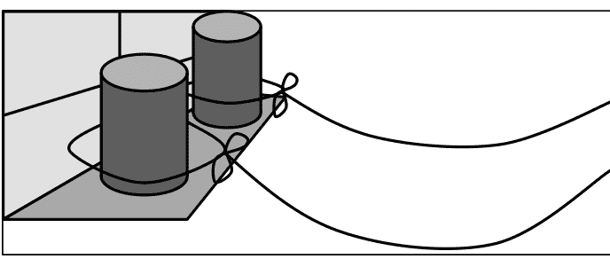

**图 1.4** 通讯罐子。

于是爱莉和鲍勃尝试了另一种方法。每个人都立起一个旗杆，让对方容易看到。当爱莉想释放她的猫时，她执行以下操作：

1. 她升起旗帜。
2. 当鲍勃的旗帜落下时，她释放她的猫。
3. 当她的猫回来时，她放下自己的旗帜。

当鲍勃想释放他的狗时，他的行为稍微复杂一些：

1. 他升起旗帜。
2. 当爱莉的旗帜升起时：
   a. 鲍勃放下自己的旗帜，
   b. 鲍勃等待爱莉的旗帜落下，
   c. 鲍勃升起自己的旗帜。
3. 一只要他的旗帜升起且她的旗帜已落下，他就释放他的狗。
4. 当他的狗回来时，他放下自己的旗帜。

这个协议作为爱莉和鲍勃问题的解决方案值得进一步研究。从直观层面上说，它是对爱莉和鲍勃问题的奖励，即实现了互斥。在直观层面上：

1. 当鲍勃的旗帜落下时，她释放她的猫。
2. 当她的猫回来时，她放下自己的旗帜。

> [注：此处原文似乎存在排版错误或逻辑重复，导致后续协议描述错乱，翻译时已根据逻辑意图进行了对齐处理]

## 1.3 生产者-消费者问题

不应该浪费任何时间：除非院子里有食物，否则爱莉（`Alice`）不想把宠物放进院子里；除非宠物吃完了所有的食物，否则鲍勃（`Bob`）不想进入院子。这个问题被称为生产者-消费者问题。

可能令人惊讶的是，我们为了互斥而拒绝的“罐子与绳子”协议正是我们生产者-消费者问题所需要的。鲍勃将一个罐子竖直放在在爱莉的窗台上，用他的绳子之一的一头系在罐子上，将绳子的另一头放在他自己的客厅里。然后，他在院子里放了食物并把罐子撞倒。当爱莉想要释放宠物时，她执行了以下操作：

1. 她等待直到罐子倒下。
2. 她释放宠物。
3. 当宠物返回时，爱莉检查它们是否已经吃完了食物。如果是，她就重置罐子。

鲍勃执行以下操作：

1. 他等待直到罐子立起。
2. 他在院子里放入食物。
3. 他拉动绳子并将罐子撞倒。

罐子的状态反映了院子的状态。如果有食物且宠物可以吃，并且罐子是立着的，那么食物已经用完了，或者鲍勃又放了一些。我们检查以下属性：

* **互斥**：鲍勃和宠物永远不会同时出现在院子里。

这种生产者-消费者协议和之前的互斥协议都确保了爱莉和鲍勃不会同时出现在同一个院子里。然而，爱莉和鲍勃不能用这个生产者-消费者协议来实现互斥，理解这一点非常重要：互斥需要无死锁性：如果院子是空的（且其他人没有尝试进入），每个人都必须进入院子。相比之下，生产者-消费者协议的无饥饿属性确保了双方的持续协作。

以下是我们对该协议的推理方法：

* **互斥**：我们不再使用之前用的反证法，而是使用一种基于“状态机”的归纳证明。将带绳子的的罐子看作一个反复在“立”和“倒”两个状态之间转换的机器。为了证明互斥始终成立，我们必须检查它在初始状态下成立，并且在从一个状态转换到另一个状态时持续成立。

    初始时，院子是空的，因此无论罐子是立着还是倒着，互斥都成立。接下来我们检查互斥一旦建立，在状态改变时是否持续成立。假设罐子是倒的。鲍勃不在院子里，根据协议我们可以看到他在罐子倒下时不会进入院子，因此只有宠物可能在那里。罐子会被立起，直到宠物离开院子，因此当罐子立起时，宠物不在那里。在罐子立着时，根据协议看到在鲍勃离开院子之前，罐子不会被撞倒。这些都是可能的转换，我们的协议满足互斥性。

* **无饥饿**：假设协议不是无饥饿的：发生了宠物饿了、没有食物，且鲍勃正试图提供食物，但他没有成功。如果罐子是立着的，鲍勃将提供食物并拉过罐子，允许宠物食用。如果罐子是倒下的，宠物就饿了，爱莉最终会立起罐子，回到之前的情况。

* **生产者-消费者**：互斥属性意味着爱莉和鲍勃永远不会同时出现在院子里。在爱莉立起罐子之前，鲍勃不会进入院子，而爱莉只有在没有食物时才会这样做。同样，在鲍勃放下罐子之前，宠物不会进入院子，而他只有在放置食物后才会这样做。

与之前的互斥协议一样，该协议表现出等待性：如果鲍勃在院子里投放了食物并在没有重置罐子的情况下去度假了，尽管有食物，宠物也可能饿死。

回到计算机科学，生产者-消费者问题出现在几乎所有的并行和分布式系统中。它是线程在通信缓冲区中放置数据以便跨网络读取或传输的方式。

## 1.4 读者-生产者问题

鲍勃和爱莉决定他们非常爱宠物，需要就它们的情况进行简单的信息交流。鲍勃在房子前面立了一块告示板。告示板上有一系列大瓷砖，每块瓷砖上有一个字母。鲍勃可以闲地通过一次举起一块瓷砖，在告示板上发布信息。爱莉视力不好，她通过望远镜一次看一块瓷砖，闲地阅读信息。

这听起来可能是一个可行的系统，但事实如此。想象鲍勃发布了如下信息：

```
sell the cat
```

爱莉通过望远镜，抄录了信息：

```
sell the the
```

此时，鲍勃取下瓷砖并写了一条新信息：

```
wash the dog
```

爱莉继续扫描告示板，抄录了信息：

```
sell the dog
```

你可以想象剩下的部分。这个读者-生产者问题有一些直接的协议，可以确保爱莉读到的都是完整的句子。然而，她仍然可能错过某句句子。

* 爱莉和鲍勃可以使用互斥协议来确保爱莉读到的都是完整的句子。然而，她仍然可能错过某句句子。
* 他们可以使用“罐子与绳子”协议，由鲍勃生产句子，爱莉消费这些句子。

如果这个问题很容易解决，我们为什么还要费力研究它？互斥协议和生产者-消费者协议都需要等待：如果一个参与者遭受了意外延迟，另一个也是如此。在共享内存多处理器的背景下，一个共享内存多处理器的解决方案……（此处原文存在大量重复，已按要求忽略重复内容）。

## 1.5 阿姆达尔法则与并行性能

我们最终获得了五倍的加速，而不是十倍加速。换句话说，我们没有并行化的剩余 10% 使我们对机器的利用率降低了一半。看起来，投入精力从剩余的 10% 中尽可能榨出并行性是值得的，尽管这很困难。通常情况下，这很难，因为额外的部分涉及大量的通信和协调。本书的一个主要重点是理解允许程序员有效地编写需要协调和同步的代码部分的的工具和技术，因为在这些部分获得的收益可能对性能产生深远影响。

回到图 1.2 中的质数打印程序，让我们重新审视这三行代码：

```
i = counter.getAndIncrement(); // 获取下一个数字
if (isPrime(i))
    print(i);
```

如果能让线程像在单个独斥块中那样原子地执行这三行代码，将会更加简单。但只有对 `getAndIncrement()` 的调用是原子的。当我们考虑阿姆达尔法则的影响时，这种方法是有意义的：在这种情况下，代码是通过互斥锁访问的。此外，以有效的方式实现互斥非常重要，因为围绕互斥共享计数器的通信和协调可能会极大地影响你整个程序的性能。

## 1.6 并行编程

对于我们希望并行化的许多应用程序，大部分部分很容易被确定为可并行执行，因为它们不需要任何形式的协调或通信。然而，在本书编写期间，还没有识别这些部分的“食谱”方法。应用程序设计者必须使用其对并行化算法的积累理解。幸运的是，在许多情况下，识别此类部分是显而易见的。真正的问题（即本书解决的问题）是如何处理处理程序的剩余部分。正如前面提到的，有些部分无法轻易并行化，因为程序必须共享共享数据，并在本质上需要进程间的协调和通信。

本文的目标是让读者接触现代协调范式和并发数据结构。我们为读者提供了一个关于多处理器编程有效元素的统一、全面的图景，涵盖了从基本原理到最佳实践工程技巧。

多处理器编程带来了许多挑战，从通用的智力挑战到微妙的工程技巧。我们通过连续的演进来应对这些挑战，从一个以数学考量为首的理想模型开始，逐渐过渡到更务实的模型，在这些模型中，我们越来越关注基本的工程原理。

例如，我们考虑的第一个问题是互斥，这是该领域最古老且仍然是基础的问题之一。我们从数学角度开始，分析在理想架构上各种算法的可计算性和正确性。这些算法本身虽然是经典的，但对于现代多核架构来说并不实用。尽管如此，学习如何推理此类理想算法是学习如何推理更现实（且更复杂）算法的重要一步。学习如何推理诸如微妙的存活性（`liveness`）问题（如饥饿和死锁）尤为重要。

一旦我们理解了如何泛泛地推理此类算法，就会转向更真实的语境。我们使用不同的多处理器架构探索各种算法和数据结构，目标是理解哪些是有效的，以及为什么。

## 1.7 章节注释

爱丽丝和鲍姆寓言大部分改编自 `Leslie Lamport` 在 1984 年 `ACM` 分布式计算原理会议上的受邀演讲 [104]。读者-写者问题是一个经典的同步问题，在过去的 20 年中引起了许多论文的关注。阿姆达尔法则归功于并行处理先驱 `Gene Amdahl` [9]。

## 1.8 习题

**练习 1.1.** 哲学家进餐问题是由货币先驱 `E.W. Dijkstra` 发明的，为了澄清无死锁和无饥饿的概念。想象五位哲学家，他们一生只负责思考和吃米饭。他们坐在一个圆桌周围，如图 1.5 所示。然而，只有五双筷子

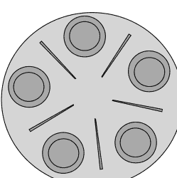

**图 1.5** 根据 `Dijkstra` 的传统餐桌安排。（在原始公式中为 `forks`）。每个哲学家都在思考。当他感到饿了，他会拿起离他最近的两根筷子。如果他能拿起两根筷子，他就能吃一会儿。当一个哲学家吃完后，他放下筷子并再次开始思考。

1. 写一个程序来模拟哲学家的行为，每个哲学家是一个线程，筷子是共享对象。注意，你必须防止两个哲学家同时持有同一根筷子的情况。
2. 修改你的程序，使其永远不会进入哲学家死锁的状态，即不是每个哲学家都持有一根筷子并等待另一根来获取第二根筷子。
3. 修改你的程序，使没有任何哲学家陷入饥饿。
4. 写一个程序，为任何自然数 $n$ 个哲学家提供一个无饥饿的解决方案。

**练习 1.2.** 对于以下每一项，说明它是安全属性（`safety property`）还是存活性属性（`liveness property`）。识别感兴趣的坏事或好事。

1. 顾客按照到达的顺序接受服务。
2. 任何可能出错的事情都会出错。
3. 没人想死。
4. 有两件事是定的：死亡和税收。
5. 人一出生，就开始死亡。
6. 如果发生中断，则在一秒内打印消息。
7. 如果发生中断，则会打印消息。
8. 我将完成达斯·维达所开始的任务。
9. 死亡永远不会减少。
10. 你总是能告诉。

**练习 1.3.** 在生产者-消费者寓言中，我们假设鲍勃可以看到 `Alice` 的窗口是打开还是关闭。使用字符串设计一个生产者-消费者协议，并证明它是有效的。

**练习 1.4.** 你是 $P$ 个被捕囚犯之一。疯狂计算机科学家宣布了以下内容：你们今天可以见面并商定策略，但之后你们将处于孤立状态且无法交流。我设置了一个房间，里面有一个开关，它是开或关。开关没有连接到任何东西。偶尔我会随机选择一个囚犯进入“房间”。该囚犯将拨动开关（从关到开，或反之），或者保持开关不变。没有人会进入这个房间。

等一下，你需要在只能看到并操作开关的情况下，确定有多少囚犯访问了房间。

**练习 1.5.** 囚犯被允许事先咨询并商定策略（除了回答“红色”或“蓝色”之外的任何其他通信方式）。设计一种策略，允许 $P-1$ 个囚犯获得自由。

**练习 1.6.** 一个财务管理程序通过将 85% 的应用程序并发化来加速，其余 15% 保持顺序。然而，在并发执行期间，缓存缺失的数量以核心数 $N$ 的方式增长。这种依赖关系为 `CacheMiss = X / (N + 10)`。性能分析显示，20% 的执行操作是内存访问。其他操作（包括缓存访问）的成本为 1 个单位，内存访问在并行部分的成本为 `3N + 11` 个单位，顺序部分的成本为 14 个单位。计算程序应该运行的最佳处理器数量。

**练习 1.7.** 给出一个程序，其中包含一个顺序执行的方法 `M`。使用阿姆达尔法则解决以下问题。

* 假设 `M` 占据了程序执行时间的 30%。在 $n$ 个处理器机器上可以实现的整体加速限制是多少？


- 假设 $M$ 占据了程序执行时间的 40%。你雇了一名程序员用 $M'$ 替换 $M$，其中 $M'$ 对 $M$ 有 $k$ 倍加速。什么样的 $k$ 值可以产生整个程序的 2 倍加速？

- 假设 $M'$（$M$ 的并行替代方案）有四倍加速。$M$ 必须占据整体执行时间的多少比例，才能在替换为 $M'$ 后速度翻倍？

# 第 1 章 引言

**练习 1.8.** 在两个处理器上运行你的程序可以获得 $S_2$ 的加速。请使用阿姆达尔法则（Amdahl's law）推导出关于 $n$ 和 $S_2$ 的 $S_n$ 公式（$n$ 个处理器上的加速）。

**练习 1.9.** 你面临两种选择：购买一个每秒执行五万亿指令的单处理器，或者购买一个拥有 10 个处理器的多处理器（其中每个处理器每秒执行万亿指令）。使用阿姆达尔法则，解释你将如何根据特定的应用决定购买哪一个。

# 第 2 章 互斥

互斥可能是多处理器编程中最常见的协调形式。本章涵盖了通过读写共享内存来实现的经典互斥算法。尽管这些算法在实践中并不被直接使用，但我们研究它们是因为它们为每个同步领域中出现的算法和正确性问题提供了介绍。本章还提供了一个不可能性证明。该证明告诉我们通过读写共享内存解决互斥问题的方案具有局限性，这为后续章节中出现的真实世界互斥算法提供了动机。本章是少数包含算法证明的章节之一。虽然读者可以自由跳过这些证明，但理解它们所提出的推理方法是有帮助的，因为我们可以使用相同的方法来理解后续章节中考虑的实际算法。

## 2.1 时间与事件

对并发计算的推理大部分是对时间的推理。有时我们希望某些事情同时发生，有时我们又希望它们在不同的时间发生。为了推理涉及多个时间段如何重叠或不重叠的复杂条件，我们需要一种简单且无歧的语言来讨论时间中的事件和持续时间。日常语言太模糊且不精确。相反，我们引入了一种简单的词汇和符号来描述并发线程在时间中的行为。

> 1687 年，艾萨克·牛顿写道：“时间的绝对、真实和数学模型，它根据自身的本性均匀地流逝，与任何其他事物无关。”我们认同他的时间概念，但不认同他的散文风格。线程共享共同的时间（尽管不一定有时钟）。线程是一个状态机，它的转换被称为事件。

事件是瞬时的：它们发生在时间中的某一个瞬间。要求事件绝不同时发生是方便的：不同的事件发生在不同的时间（在实际情况下，如果我们不确定在时间上非常接近的事件发生的顺序，那么任何顺序都可以）。线程产生一个事件序列 $a_0, a_1, \dots$。程序通常包含循环，因此单条程序语句可以产生许多事件。如果写为 $a \to b$，且 $a$ 发生在较早的时间，则事件 $a$ 先于事件 $b$。优先关系 $\to$ 是事件的全序。

设 $a_0$ 和 $a_1$ 是满足 $a_0 \to a_1$ 的事件。区间 $(a_0, a_1)$ 是 $a_0$ 和 $a_1$ 之间的持续时间。如果 $a_1 \to b_0$（即 $I_A$ 的最后一个事件先于 $I_B$ 的起始事件），则 $I_A = (a_0, a_1)$ 先于 $I_B = (b_0, b_1)$，记为 $I_A \to I_B$。$\to$ 是区间上的偏序。与 $\to$ 无关的区间被称为并发的。我们还说，如果 $a \to b_0$，则事件 $a$ 先于区间 $I = (b_0, b_1)$，记为 $a \to I$；如果 $b_1 \to a$，则 $I$ 先于事件 $a$，记为 $I \to a$。

## 2.2 临界区

在*第 1 章*中，我们讨论了图 2.1所示的 `Counter` 类实现。我们观察到这种实现在单线程系统中是正确的，但在两个或多个线程使用时会表现异常。如果两个线程都在位于标记为“危险区域开始”的行读取字段，然后都在标记为“危险区域结束”的行更新该字段，就会发生问题。

我们可以通过将这两行变成一个*临界区*来避免这个问题：即一次时间只能由一个线程执行的代码块。我们称这种属性为互斥。实现互斥的标准方法是通过图 2.2 所示的 `Lock` 接口。

```java
class Counter {
    private long value;
    public Counter(long c) { // 构造函数
        value = c;
    }
    // 增加并返回之前的值
    public long getAndIncrement() {
        long temp = value; // 危险区域开始
        value = temp + 1; // 危险区域结束
        return temp;
    }
}
```

图 2.1 Counter 类。

```java
public interface Lock {
    public void lock(); // 进入临界区前
    public void unlock(); // 离开临界区前
}
```

图 2.2 Lock 接口。

```java
public class Counter {
    private long value;
    private Lock lock;      // 保护临界区

    public long getAndIncrement() {
        lock.lock();            // 进入临界区
        try {
            long temp = value;      // 在临界区内
            value = temp + 1;      // 在临界区内
            return temp;
        } finally {
            lock.unlock();        // 离开临界区
        }
    }
}
```

图 2.3 使用锁对象。

图 2.3 显示了如何使用 `Lock` 对象为共享计数器实现添加互斥。使用 `lock()` 和 `unlock()` 方法的线程必须遵循特定的格式。如果满足以下条件，线程段是良好的：

1. 每个临界区都与一个 `Lock` 对象关联；
2. 线程在想要进入临界区时调用该对象的 `lock()` 方法；
3. 线程在离开临界区时调用 `unlock()` 方法。

**PRAGMA 2.2.1**

在 Java 中，`lock()` 和 `unlock()` 方法应该使用以下结构：

```java
mutex.lock();
try {
    ... // 句体
} finally {
    ... // 如果需要，恢复不变性
    mutex.unlock();
}
```

这种用法确保了在进入 `try` 块之前获取锁，并在控制离开块时释放锁。如果块中的语句抛出意外异常，（这种用法依然有效）。

## 2.3 双线程解决方案

无饥饿性（starvation-freedom）属性在某种意义上也是弱的，因为它没有保证线程在进入临界区之前等待多久。在随后的章节中，我们将研究限制线程等待时间的算法。根据第 1 章的术语，互斥（mutual exclusion）是一个安全属性（safety property），而无死锁（deadlock-freedom）和无饥饿性是活性属性（liveness properties）。

我们现在考虑解决两个线程互斥问题的算法。我们的双线程锁算法遵循以下约定：线程的 ID 为 0 和 1，线程可以通过调用 `ThreadID.get()` 获取自己的 ID。我们将调用线程的 ID 存储在 `i` 中，将另一个线程的 ID 存储在 `j=1-i` 中。

我们从两个不完善的算法开始。

### 2.3.1 LockOne 类

图 2.4 显示了 LockOne 算法，它为每个线程维护一个布尔标志变量。要获取锁，线程将其标志设置为 `true`，并等待直到另一个线程的标志为 `false`。线程通过将标志设回 `false` 来释放标志。

使用 `write(x=v)` 表示 A 给字段 `x` 赋值值 `v` 的事件，使用 `read(x==v)` 表示 A 从字段 `x` 读取 `v` 的事件。例如，在图 2.4 中，事件 `write_A(flag[i]=true)` 由 `lock()` 方法的第 7 行引起的。方法在重要时会优化值。

**引理 2.3.1.** LockOne 算法满足互斥。

```cpp
class LockOne implements Lock {
    private boolean[] flag = new boolean[2];
    // 线程本地索引，0 或 1
    public void lock() {
        int i = ThreadID.get();
        int j = 1-i;
        flag[i] = true;
        while (flag[j]) {} // 等待 flag[j] == false
    }
    public void unlock() {
        int i = ThreadID.get();
        flag[i] = false;
    }
}
```

图 2.4 LockOne 算法的伪代码。

**PRAGMA 2.3.1**

在实践中，图 2.4 中的布尔标志变量，以及后续算法中的 `victim`（牺牲）和 `label`（标签）变量必须全部声明为 `volatile` 才能正常工作。我们将在第 3 章和附录 B 中解释原因。为了可读性，我们暂时省略 `volatile` 声明。我们将从第 7 章开始将相应的变量声明为 `volatile`。

**证明。** 假设线程 $A$ 和 $B$ 存在重叠的临界区 $CS_A$ 和 $CS_B$ $(A \neq B)$。考虑每个线程在进入临界区之前最后一次执行 `lock()` 方法。检查代码，我们看到：

```
write_A(flag[A] = true) → read_A(flag[B] == false) → CS_A,
write_B(flag[B] = true) → read_B(flag[A] == false) → CS_B.
```

注意，一旦 `flag[A]` 被设置为 `true`，它将保持直到 $B$ 退出其临界区。由于临界区重叠，$A$ 必须在 $B$ 将其设置为 `true` 之前读取 `flag[B]`。同样，$B$ 必须在 $A$ 将其设置为 `true` 之前读取 `flag[A]`。结合这些，我们得到：

```
write_A(flag[A] = true) → read_A(flag[B] == false)
→ write_B(flag[B] = true) → read_B(flag[A] == false)
→ write_A(flag[A] = true).
```

$\to$ 中存在环，这是一个矛盾，因为 $\to$ 是一个偏序（一个事件），不能先于自身。

LockOne 算法是不完善的，因为如果线程执行交替，它可能会死锁。如果 `write_A(flag[A] = true)` 和 `write_B(flag[B] = true)` 事件发生在 `read_A(flag[B])` 和 `read_B(flag[A])` 之前，两个线程都将等待。尽管如此，LockOne 有一个有趣的性质：如果一个在另一个之前运行，就不会发生死锁，一切正常。

### 2.3.2 LockTwo 类

图 2.5 显示了另一种锁算法 LockTwo 类，它使用单个 `victim` 字段来指示哪个线程应该让位。要获取锁，线程将 `victim` 字段设置为自己的 ID，并等待直到另一个线程更改它。

**引理 2.3.2.** LockTwo 算法满足互斥。

```cpp
class LockTwo implements Lock {
    private int victim;
    public void lock() {
        int i = ThreadID.get();
        victim = i;               // 让对方先
        while (victim == i) {}    // 等待
    }
    public void unlock() {
    }
}
```

图 2.5 LockTwo 算法的伪代码。

**证明。** 假设线程 $A$ 和 $B$ 存在重叠的临界区 $CS_A$ 和 $CS_B$ $(A \neq B)$。与之前一样，考虑每个线程在进入临界区之前最后一次执行 `lock()` 方法。检查代码，我们看到：

```
write_A(victim = A) → read_A(victim == B) → CS_A,
write_B(victim = B) → read_B(victim == A) → CS_B.
```

线程 $B$ 必须在 `write_A(victim = A)` 和 `read_A(victim == B)` 之间向 `victim` 字段赋值，特别是 $B$ 必须在 $A$ 之后写入 `victim`。然而，根据同样的推理，$A$ 必须在 $B$ 之后写入 `victim`，这是一个矛盾。

LockTwo 算法是不完善的，除非线程并发运行，否则会被卡住。尽管如此，LockTwo 有一个有趣的性质：如果线程并发运行，`lock()` 方法就会成功。LockOne 和 LockTwo 类互为补充。

### 2.3.3 Peterson 锁

我们将 LockOne 和 LockTwo 算法结合起来构造了一个无饥饿锁，如图 2.6 所示。该算法——以其发明者命名的 Peterson 算法——被认为是最简洁、优雅的双线程互斥算法。

**引理 2.3.3.** Peterson 锁算法满足互斥。

```cpp
class Peterson implements Lock {
    // 线程本地索引，0 或 1
    private boolean[] flag = new boolean[2];
    private int victim;
    public void lock() {
        int i = ThreadID.get();
        int j = 1-i;
        flag[i] = true;
        victim = i; // 让对方先
        while (flag[j] && victim == i) {} // 等待
    }
    public void unlock() {
        int i = ThreadID.get();
        flag[i] = false;
    }
}
```

图 2.6 Peterson 锁的伪代码。

**证明。** 假设不是。与之前一样，考虑线程 $A$ 和 $B$ 在重叠临界区 $CS_A$ 和 $CS_B$ 之前最后执行的 `lock()` 方法。检查代码，我们看到：

```
write_A(flag[A] = true) → write_A(victim = A) → read_A(flag[B] == false) → CS_A. (2.3.1)
write_B(flag[B] = true) → write_B(victim = B) → read_B(flag[A] == false) → CS_B. (2.3.2)
```

注意一旦 `flag[A]` 被设置为 `true`，将保持直到 $B$ 退出其临界区。由于临界区重叠，$A$ 必须在 $B$ 将其设置为 `true` 之前读取 `flag[B]`。同样，$B$ 必须在 $A$ 将其设置为 `true` 之前读取 `flag[A]`。结合这些，我们得到：

```
write_A(flag[A] = true) → write_A(victim = A)
→ read_A(flag[B] == false)
→ write_B(flag[B] = true) → write_B(victim = B)
→ read_B(flag[A] == false)
→ write_A(flag[A] = true).
```

$\to$ 中存在环，这是一个矛盾，因为 $\to$ 是一个偏序（一个事件），不能先于自身。

**引理 2.3.4.** Peterson 锁算法是无饥饿的。

**证明。** 假设不是。与之前一样，考虑线程 $A$ 和 $B$ 在重叠临界区 $CS_A$ 和 $CS_B$ 之前最后执行的 `lock()` 方法。检查代码，我们看到：


```
write_A(flag[A] = true) \rightarrow write_A(victim = A) \rightarrow read_A(flag[B] == false) \rightarrow CS_A. (2.3.1)
write_B(flag[B] = true) \rightarrow write_B(victim = B) \rightarrow read_B(flag[A] == false) \rightarrow CS_B. (2.3.2)
```

（注：原文此处文本可能存在排版混乱，翻译已根据算法逻辑进行对齐）

推论 2.3.5。Peterson 锁算法是无锁的。

## 2.4 关于死锁的说明

尽管 Peterson 锁算法是无死锁的（甚至无饥饿），但在使用多个 Peterson 锁（或其他任何锁实现）的程序可能会出现另一种死锁。例如，假设线程 A 和 B 共享 `l0` 和 `l1`，且 A 获取了 `l0` 和 `l1`。如果 A 尝试获取 `l1` 而 B 尝试获取 `l0`，线程将死锁，彼此等待对方释放锁。

在文献中，死锁一词有时被狭义地指代系统进入了一个线程无法进展的状态。`Lock` 和 `LockTwo` 算法容易受到这种死锁的影响：在两种算法中，两个线程都阻塞在各自的循环中。

```java
class Livelock implements Lock {
  // 线程本地索引，0 或 1
  private boolean[] flag = new boolean[2];
  public void lock() {
    int i = ThreadID.get();
    int j = 1 - i;
    flag[i] = true;
    while (flag[j]) {
      flag[i] = false;
      while (flag[j]) {
        flag[i] = true;
      }
    }
  }
  public void unlock() {
    int i = ThreadID.get();
    flag[i] = false;
  }
}
```

# 图 2.7

可能导致活锁的锁算法伪代码。

## 2.5 过滤器锁

图 2.8 所示的过滤器锁是 Peterson 锁的泛化，适用于 $n > 2$ 个线程。它创建了 $n-1$ 个被称为“层”的等待室，线程在获取锁之前必须穿过这些层。层级如图 2.9 所示。层级满足两个重要的属性：

- 至少有一个尝试进入某层的线程成功进入。
- 如果有多个线程尝试进入第 $l$ 层，则至少有一个线程被阻塞（即继续等待而不进入该层）。

Peterson 锁使用一个包含两个元素的布尔标志数组来指示线程是否正在尝试进入临界区。过滤器锁通过一个包含 $n$ 个元素的整数 `level[]` 数组泛化了这一概念，其中 `level[A]` 的值表示 A 尝试进入的最高层。每个线程必须通过 $n-1$ 层“排除”层才能进入其临界区。每一层 $l$ 都有一个独特的 `victim[l]` 字段，用于“过滤掉”一个线程，将其排除在该层之外，除非该层或更高层没有线程。

初始时，线程位于第 0 层。当 A 完成第 17 行的等待循环且 `level[A] = l` 时，它进入第 $l > 0$ 层（即它在该循环处停止等待）。当 A 进入第 $n-1$ 层时，它进入了其临界区。当 A 离开临界区时，它将 `level[A]` 设置为 0。

```java
class Filter implements Lock {
  int[] level;
  int[] victim;
  public Filter(int n) {
    level = new int[n];
    victim = new int[n]; // 使用 1..n-1
    for (int i = 0; i < n; i++) {
      level[i] = 0;
    }
  }
  public void lock() {
    int me = ThreadID.get();
    for (int i = 1; i < n; i++) { // 尝试进入层 i
      level[me] = 1;
      victim[me] = me;
      // 冲突存在时自旋
      while (level[k] >= i && victim[i] == me)); 
    }
  }
  public void unlock() {
    int me = ThreadID.get();
    level[me] = 0;
  }
}
```

图 2.8

过滤器锁算法的伪代码。

| 非临界区有 $n$ 个线程 | l = 0 |
| :--- | --- |
| $n-1$ 个线程 | l = 1 |
| $n-2$ 个线程 | l = 2 |
| ... | ... |
| 2 个线程 | l = n-2 |
| CS | l = n-1 |

图 2.9

线程通过 $n-1$ 层，最后一层是临界区。初始时，所有 $n$ 个线程都在第 0 层。最多有 $n-1$ 个进入第 1 层，最多有 $n-2$ 个进入第 2 层，以此此类推，因此只有一个线程进入第 $n-1$ 层的临界区。

# 第 2 章 互斥

**引理 2.5.1.** *对于在 0 到 $n-j$ 之间的 $j$，有线程进入了第 $j$ 层（且随后未进入临界区）。*

*证明。* 我们通过对 $j$ 使用归纳法来证明这一点。基础情况 $j=0$ 是显而易见的。归纳步骤中，归纳假设意味着最多 $n-j+1$ 个线程进入了第 $j-1$ 层。为了证明至少有一个线程没有进入第 $j$ 层，我们通过反反法论证。假设 $n-j+1$ 个线程进入了第 $j$ 层，因为 $j \le n-1$，这里至少有两个这样的线程。

设 $A$ 为最后一个写入 `victim[j]` 的线程。由于 `victim[j]` 是由进入第 $j-1$ 层线程写入的，$A$ 必须进入了第 $j$ 层，且根据归纳假设，每个第 $j-1$ 层都进入了第 $j$ 层。设 $B$ 为除 $A$ 之外任意线程。检查代码发现，在 $B$ 进入第 $j$ 层之前，它首先写入 `level[B]`，然后 $B$ 写入 `victim[j]`。由于 $A$ 是最后一个写入 `victim[j]` 的，

```
write_B(level[B]=j) \rightarrow write_B(victim[j]) \rightarrow write_A(victim[j]).
```

我们还看到 $A$ 在写入 `victim[j]` 之后读取了 `level[B]`（第 17 行），所以

```
write_B(level[B]=j) \rightarrow write_B(victim[j])
\rightarrow write_A(victim[j]).
```

write_B(level[B]=j) \rightarrow write_B(victim[j])

\rightarrow write_A(victim[j]).

（注：此处原文存在重复，翻译已按要求保留逻辑并对应格式）

**推论 2.5.2.** 过滤器锁满足互斥。

**引理 2.5.3.** *过滤器锁是无饥等的。*

*证明。* 我们对 $j$ 使用归纳法进行证明。基础情况 $j=0$ 是显而易见的。归纳步骤中，归纳假设意味着最多 $n-j+1$ 个线程进入了第 $j-1$ 层。为了证明至少有一个线程没有进入第 $j$ 层，我们通过反反法论证。假设 $n-j+1$ 个线程进入了第 $j$ 层，因为 $j \le n-1$，这里至少有两个这样的线程。

**推论 2.5.4.** 过滤器锁算法无死锁。

## 2.6 公平性

无饥等属性保证每个线程最终进入临界区，但它对这需要多久没有保证，它能保证对尝试获取锁的线程“公平”的吗？

理想情况下（非常非正式），如果 A 在 B 之前调用 `lock()`，那么 A 应该在 B 之前进入临界区。也就是说，锁应该是“先来先行”。然而，根据我们介绍的工具，无法判断是谁调用了 `lock()`。

为了定义公平性，我们将 `lock()` 方法分为入口部分和等待部分，其中入口部分可能需要无限步。也就是说，线程在调用 `lock()` 后完成入口之前可以的步数有一个固定限制。

保证在有限步数内完成的代码段被称为有界等待的（bounded waitfree）。有界等待属性是一个强力的进展要求。无循环的代码满足这一属性。在后面的章节中，我们将讨论如何在有循环的代码中提供这种属性。根据这个定义，我们将公平性定义为这种属性。

**定义 2.6.1.** 如果一个锁的 `lock()` 方法可以分为一个有界等待的入口部分和一个随后的等待部分，那么当线程 A 在线程 B 开始入口之前完成其入口时，A 就不会被 B 超过。也就是说，

```
$D_A^j \to D_B^k \text{ 和 } k, \text{ 其中 } D_A^j \text{ 和 } CS_B^k \text{ 是区间}$
```

对于所有线程 A 和 B 以及整数 $j$ 和 $k$，其中 $D_A^j$ 和 $CS_B^k$ 分别是 A 执行其第 $j$ 次 `lock()` 的入口部分和 B 执行其第 $k$ 次临界区的区间。

# 第 2 章 互斥

```java
class Bakery implements Lock {
    boolean[] flag;
    Label[] label;
    public Bakery (int n) {
        flag = new boolean[n];
        label = new Label[n];
        for (int i = 0; i < n; i++) {
            flag[i] = false; label[i] = 0;
        }
    }
    public void lock() {
        int i = ThreadID.get();
        flag[i] = true;
        label[i] = max(label[0], ...,label[n-1]) + 1;
        while ((k < i) && (flag[k] && (label[k],k) << (label[i],i))) {
        }
    }
    public void unlock() {
        flag[ThreadID.get()] = false;
    }
}
```

图 2.10

Bakery 算法的伪代码。

## 2.7 Lamport 的 Bakery 算法

对于 n 线程互斥问题，最优雅的解决方案可能是 Bakery 锁算法，它如图 2.10 所示。该算法通过使用面包店中常见的数字发号机器的分布式版本，保证了“先来先得”的属性：每个线程在门口取一个机器，然后等待直到有一个编号较早的线程尝试进入临界区。在面包店模型中，`flag[A]` 是一个布尔值，表示线程 A 是否想要进入临界区；`label[A]` 是一个整数，表示每个线程进入面包店时的相对顺序。为了获取锁，线程会标记自己的标志位，然后通过读取所有线程的标签（按任意顺序）并生成一个比所有读取到的标签都大的标签来选取一个新标签。从调用 `lock()` 方法到写入新标签（第 14 行）的代码部分就是“门口”：它确定了该线程相对于其他尝试获取锁的线程的顺序。并发执行“门口”代码的线程可能会读取相同的标签并选取相同的新标签。为了打破这种僵局，算法对标签和线程 ID 的组合使用了字典序 `<<`：

```
(label[i], i) << (label[j], j)
当且仅当
label[i] < label[j] 或 (label[i] = label[j] 且 i < j) 时成立。
```

## 2.8 有界时间戳

在 Bakery 算法的等待区（第 15 行），线程会以任意顺序反复读取其他线程的标志位和标签，直到确定没有哪个标记了标志位的线程具有具有字典序更小的标签/ID 组合。

由于释放锁不会重置 `label[i]`，很容易看出每个线程的标签都是严格递增的。有趣的是，在“门口”和“等待区”中，线程都是异步且以任意顺序读取标签的。例如，在选取新标签之前的标签序列可能从未在内存中同时存在过。尽管如此，该算法仍然有效工作。

# **引理 2.7.1.** Bakery 锁算法是无死锁（dead-free）的。

*证明。* 某个等待线程 A 拥有唯一的最小 `(label[A], A)` 组合，而该线程在等待另一个线程。

# **引理 2.7.2.** Bakery 锁算法是先来先得的。

*证明。* 如果 A 的“门口”过程在 B 之前，那么 A 的标签更小：

```
writeA(label[A]) -> readB(label[A]) -> writeB(label[B]) -> readB(flag[A]),
```

因此在 `flag[A]` 为真之前，B 会被挡在外面。

# **推论 2.7.3.** Bakery 锁算法是无饥饿（starvation-free）的。

*证明。* 这直接遵循引理 2.7.1 和引理 2.7.2，因为任何无死锁的先来先得锁都是无饥饿的。

# **引理 2.7.4.** Bakery 锁算法满足互斥性。

*证明。* 假设 A 和 B 是两个在临界区竞争的线程，且 `{label[A], A} << {label[B], B}`。令 `labeling_A` 和 `labeling_B` 分别为进入临界区之前（第 14 行）获取新标签的序列。为了完成等待区，B 必须读到 `flag[A]` 为假，或者 `{label[B], B} << {label[A], A}`。然而，对于给定的线程，其 ID 是固定的且 `labels[i]` 是严格递增的，因此 B 必须见过 `flag[A]` 为假。由此：

```
labeling_B -> readB(flag[A] == false) -> writeA(flag[A] = true) -> labeling_A,
```

这与 `{label[A], A} << {label[B], B}` 的假设矛盾。

注意，Bakery 锁的标签会无限增长，因此在长时间运行的系统中，我们可能担心溢出。如果线程的标签字段从一个大数绕回零，那么先来先得的属性将不再成立。

在随后的章节中，我们将讨论使用计数器对线程进行排序、甚至产生唯一 ID 的构造。溢出在现实世界中有多重要？这很难概括。有时它非常重要。20 世纪末几年让媒体为之疯狂的“Y2K”漏洞就是一个通用溢出的例子，尽管其后果并未如预测的那样发生。2038 年 1 月 19 日，Unix 的 `time_t` 结构将在自 1970 年 1 月 1 日以来的秒数达到上限时溢出。

# 38 第 2 章 互斥

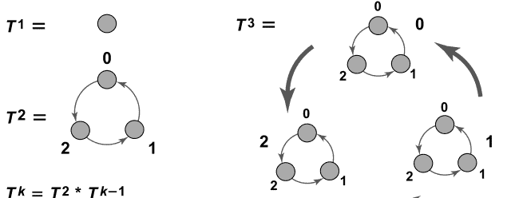

2.13

有界时间戳系统的优先级图。考虑一种初始状态：在节点 12（子图 1 中的节点 2）上有一个令牌 $A$，在节点 21 和 22（子图 2 中的节点 1 和 2）上分别有令牌 $B$ 和 $C$。令牌 $B$ 将移动到节点 20 以主导其他令牌。令牌 $C$ 将移动到节点 21 以主导其他令牌，且 $B$ 和 $C$ 可以无限地在 $T^2$ 子图中循环。如果 $A$ 移动以夺取对 $B$ 和 $C_i$ 的主导地位，它无法在子图 2 中选择节点，因为该子图已满（任何 $T^k$ 子图最多只能容纳 $k$ 个令牌）。相反，$A$ 移动到节点 00。如果现在 $B$ 移动，它将选择节点 01，$C$ 将选择节点 10，以此此类。

递归地定义图 $T^k$ 如下：

- 1. $T^1$ 是一个单节点。
- 2. $T^2$ 是之前定义的三个节点图。
- 3. 对于 $k > 2$，$T^k = T^2 \circ T^{k-1}$

对于示例，图 2.13 所示了 $T^3$。

优先级图 $T^n$ 是 $n$ 线程有界顺序时间戳系统的基础。我们可以使用 $n-1$ 位的三进制表示来“寻址” $T^n$ 中的任何节点。图 $T^2$ 中的节点地址为 0、1 和 2。图 $T^3$ 中的节点表示为 00、01、$\dots$、22，其中高位数字表示其中一个子图，低位数字表示该子图内的某一个节点。

理解 $n$ 线程标记算法的关键在于，令牌覆盖的节点永远不会形成循环。正如所述，两个令牌可以在 $T^2$ 上形成循环，而 $T^2$ 中最短的循环需要三个节点。

标记(1) 方法对于三个线程是如何工作的？当其他两个线程在同一个 $T^2$ 子图上有令牌时，它们将移动到下一个高级的 $T^2$ 子图，即主导该 $T^2$ 子图的节点。例如，考虑图 2.13 所示的图 $T^3$。我们假设一个初始的无环状态：在节点 12（子图 1 中的节点 2）上有一个令牌 $A$，在节点 21 和 22（子图 2 中的节点 1 和 2）上分别有令牌 $B$ 和 $C$。令牌 $B$ 将移动到节点 20 以主导所有令牌。令牌 $C$ 将移动到节点 21 以主导所有令牌，且 $B$ 和 $C$ 可以无限地在子图 $T^2$2 中循环。如果 $A$ 移动以夺取对 $B$ 和 $C$ 的主导地位，它无法在子图 2 中选择节点，因为该子图已满（任何 $T^k$ 子图最多只能容纳 $k$ 个令牌）。令牌 $A$ 移动到节点 00。如果 $B$ 移动，它将选择节点 01，$C$ 将选择节点 10，以此类推。

## 2.9 位置数量的下界

面包算法（The Bakery）简洁、优雅且公平。为什么它不被认为是实用的？主要的缺点是需要读取和写入 $n$ 个不同的位置，其中 $n$ 是并发线程的最大数量（可能非常大）。

是否存在一种基于读写内存且能避免这种开销的锁算法？我们证明了答案是否定的。任何无死锁的互斥算法在最坏情况下都需要分配或读取至少 $n$ 个不同的位置。这一结果至关重要：它激励我们在多处理器机器上增强了比读操作更强的同步操作，并将其作为我们互斥算法的基础。我们将在后面的章节中讨论实用的互斥算法。


# 为什么线性界是内在的

在本节中，我们检查为什么这种线性界是内在的。我们观察到*读*或*写*指令（通常是*加载*和*存储*）访问内存的以下局限性：线程写入某个位置的信息可能会被*覆盖*（即存储到那里），而没有任何其他线程看到过它。

我们的证明是论证多线程程序所使用的所有内存的状态。一个对象的*状态*是其字段的状态。线程的*本地状态*是其程序计数器和局部变量的状态。*全局状态*或系统状态是所有对象的状态加上线程的本地状态。

**定义 2.9.1。** 如果锁状态 $s$ 在任何线程处于临界区的全局状态下都是*不一致的*，但该锁状态在没有线程处于临界区或尝试进入临界区的全局状态下是兼容的。

**引理 2.9.2。** 任何无死锁的锁算法都不会进入不一致状态。

*证明。* 假设锁对象处于不一致状态 $s$，其中线程 $A$ 处于临界区。如果线程 $B$ 尝试进入临界区，它最终将成功，因为该算法是无死锁的，且 $B$ 无法确定 $A$ 处于临界区。

# 第2章 互斥

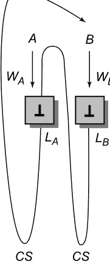

- 运行系统直到 $A$ 准备写入 $L_A$。必须存在这种情况；否则，让 $A$ 进入临界区（CS），然后让 $B$ 覆盖它的值。但 $A$ 可能在 $L_B \dots$ 中留下痕迹。
- 1. 从 $L_B$ 的覆盖状态开始。
- 3. 再次运行 $B$。它擦除 $L_B$ 中的痕迹。然后让它进入临界区并再次返回。如果重复重复这种模式，$B$ 必须返回到确切位置的覆盖状态（在图中是 $L_B$）。

图 2.15 到达一个覆盖状态。在 $L_B$ 的初始覆盖状态下，两个位置的值都是空值 $\_\_$。

时间戳系统。其他有界时间戳方案包括 Sanders Haldar 和 Paul Vitány 的 [56] 以及 Cynthia Dwork 和 Nancy Waarts 的 [42]。锁字段数量的下限是由 Jim Burns 和 Nancy Lynch [24] 提出的。他们的技术被称为覆盖证明（covering argument），从那时起广泛用于为分布式计算提供下限。对进一步阅读感兴趣的读者可以在 Michel Raynal 的经典著作 [147] 中找到互斥算法的历史综述。

## 2.11 练习题

**练习 2.1.** 互斥算法提供 $r$-有界等待（$r$-bounding waiting），如果存在一种方法定义门（doorway），使得如果 $D_A^k \to D_B^k$，则 $CS_A^k \to CS_B^{k+r}$。Peterson 算法是否为某个 $r$ 的值提供了 $r$-有界等待？

**练习 2.2.** 为什么我们必须定义一个门区域，而不是根据 `lock()` 方法中第一条指令执行的顺序来在互斥算法中定义“先来先服务”（FCFS）？请根据 `lock()` 执行的第一条指令的性质（读或写，以及针对不同位置或相同位置），分情况论证你的答案。

## 2.16

练习 2.3 中使用的 Flaky 锁。

```java
class Flaky implements Lock {
  private int turn;
  private boolean busy = false;
  public void lock() {
    int me = ThreadID.get();
    do {
      turn = me;
    } while (busy);
    busy = true;
    } while (turn != me);
  }
  public void unlock() {
    busy = false;
  }
}
```

## 2.17

练习 2.5 中使用的 Peterson 算法修订方法。

```java
public void unlock() {
  int i = ThreadID.get();
  flag[i] = false;
  int j = 1 - i;
  while (flag[j] == true) {
}
```

**练习 2.3.** Flaky 计算机公司的程序员设计了图 2.16 所示的协议以实现 n 线程互斥。对于每个问题，请画出证明草图，或者展示一个失败的执行过程。

- 该协议是否满足互斥？
- 该协议是否无饥饿（starvation-free）？
- 该协议是否无死锁（deadlock-free）？
- 该协议是否无活锁（livelock-free）？

**练习 2.4.** 证明 Filter 锁允许某些线程以任意次数的倍超过其他线程。

**练习 2.5.** 考虑 Peterson 算法的一个变体，我们将 `unlock` 方法修改为图 2.17 所示。修改后的算法是否满足无死锁？无饥饿呢？画出证明草图说明为什么它同时满足这两个属性，或者展示一个失败的执行过程。

# 第2章 互斥

**练习 2.6.** 推广双线程 Peterson 锁的另一种方法是在二叉树中。假设 $n$ 是 2 的幂。每个线程被分配一个与另一个线程共享的叶子锁。每个线程将另一个视为 0，将另一个视为 1。

在树锁的 `acquire` 方法中，该方法从线程到根获取每个双线程 Peterson 锁。树锁的 `release` 方法从根到叶子解锁该线程已获取的每个双线程 Peterson 锁。在任何时候，线程都可以被延迟有限的时间。（换句话说，线程可以午睡或休假，但它们不会死亡。）对于以下每个属性，画出证明其成立的草图，或者描述（可能无法实现的）违反该属性的执行过程：

1. 互斥，
2. 无死锁，
3. 无饥饿。

在线程开始获取树锁到成功获取之间，树锁获取和释放的次数是否存在上界？

**练习 2.7.** $\ell$-排除问题是无饥饿互斥的变体，具有两个变化：同时可能有最多 $\ell$ 个线程处于临界区，并且可能少于 $\ell$ 个线程争夺临界区。一个实现必须满足以下条件：

修改 $n$ 线程互斥算法以解决 $\ell$-排除问题。

**练习 2.8.** 在实践中，所有的锁获取都是无竞争的，因此锁性能的最实际的衡量标准是在没有竞争的情况下获取锁所需的步数。Cantaloupe 大学的科学家们开发了图 2.18 所示的以下“包装器”。如果该锁满足互斥且无饥饿，那么锁可以在常数步内被获取。证明为什么这一点是正确的，或者给出一个反例。

**练习 2.9.** 假设线程调用 Bouncer 类的 `visit()` 方法。证明以下结论：

- 最多有一个线程进入。
- 最多 $n-1$ 个线程进入 DOWN。
- 最多 $n-1$ 个线程进入 RIGHT。（这与之前的类似。）

## 2.11 练习题 45

```java
class FastPath implements Lock {
    private int lock;
    private int y = -1;
    public void lock() {
        int i = ThreadID.get();
        while (y != -1) { // 在这里
            y = i;
            if (x != i) { // 这里？
                lock();
            }
        }
    }
    public void unlock() {
        y = -1; // 慢路径
    }
}
```

18 用于练习 2.5 的互斥算法。

```java
class Bouncer {
    public static final DOWN = 0;
    public static final RIGHT = 1;
    public static final STOP = 2;
    private boolean goRight = false;
    private int last = -1;
    int visit() {
        int i = ThreadID.get();
        last = i;
        if (goRight)
            return RIGHT;
        goRight = true;
        if (last == i)
            return STOP;
        else
            return DOWN;
    }
}
```

19 用于练习 2.9 的 Bouncer 类。

**练习 2.10.** 直此为止，我们假设线程具有唯一的 ID。这里有一种给线程分配唯一 ID 的方法。将 Bouncer 对象排列在矩阵中，如 2.20 所示。

# 第2章 互斥

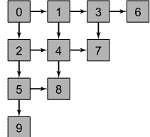

图 2.20 用于练习 2.10 的布局。

线程从访问 0 开始。如果获取 STOP，则停止。如果获取 RIGHT，则访问 1；如果获取 DOWN，则访问 2。通常情况下，如果获取 STOP，则停止。如果获取 RIGHT，则访问该行的下一个 Bouncer，如果获取 DOWN，则访问列的下一个 Bouncer。每个线程存储 Bouncer 的 ID。

- 证明每个线程最终停止某个 Bouncer。
- 如果提前知道总线程 n，需要多少 B 对象？

**练习 2.11.** 通过反例证明顺序时间戳 T³ 从有效状态（标签之间没有循环）开始在并发情况下无效。注意，两个相同的标签不是问题，因为可以使用线程 ID 破局。反例展示了一个三个线程没有全序的执行状态。

**练习 2.12.** 顺序时间戳 T² 有 O(3³)可能的标签。设计一个仅需 (n²)标签的顺序时间戳。注意在时间戳系统中，可以查看所有标签来选择新标签，但一旦选择了一个标签，它应该与系统中的任何其他标签进行比较。提示：从表示的角度考虑标签。

**练习 2.13.** 编写 Java 代码实现图 2.11 中的无界 Timestamp 接口。然后展示如何使用你的 Timestamp Java 代码替换图 2.10 中 Bakery 锁的伪代码。

**练习 2.14.** 我们之前看到了关于互斥共享内存边界的定理：任何 n 线程的无死锁互斥算法必须使用至少 n 个共享寄存器。对于练习，我们检查一个新的算法，证明了上述定理的空间下限是紧的。具体来说，我们将证明：

> *定理：* 存在一种使用恰好 n 个共享比特的 n 线程无死锁互斥算法。

```java
class OneBit implements Lock {
  private boolean[] flag;
  public OneBit(int n) {
    flag = new boolean[n]; // 初始为 false
  }
  public void lock() {
    int i = ThreadId.get();
    do {
      flag[i] = true;
      for (int j = 0; j < i; j++) {
        if (flag[j] == true) {
          flag[i] = false;
          while (flag[j] == true) {} // 等待 flag[j] == false
          break;
        }
      }
    } while (flag[i] == false);
    for (int j = i+1; j < n; j++) {
      while (flag[j] == true) {} // 等待 flag[j] == false
    }
  }
  public void unlock() {
    flag[ThreadId.get()] = false;
  }
}
```

FIGURE 2.21 OneBit 算法的伪代码。

为了证明这个定理，我们研究了图 2.21 所示的 OneBit 算法。该算法由 J. E. Burns 和 L. Lamport 独立开发，恰好使用 n 个位来实现互斥；也就是说，它使用了最小可能的共享空间。OneBit 算法的工作原理如下：首先，一个想要通过将其位设置为 true 来获取锁的线程，然后它循环并读取所有 ID 比它小的线程的位状态。如果所有这些位都是 false，则该线程退出循环。否则，该线程将自己的位设置为 false，等待被发现为 true 的位变为 false，然后重新开始。之后，线程读取所有 ID 比它大的线程的位状态，并等待它们全部变为 false。一旦通过了这一检查，线程就可以安全地进入临界区。

- 证明 OneBit 算法满足互斥性。
- 证明 OneBit 算法是无锁的。

# 第 3 章：并发对象

并发对象的行为通过其安全性（safety）和活跃性（liveliness）来描述是最好的，这通常被称为*正确性*（correctness）和*进展性*（progress）。在本章中，我们将研究指定正确性和进展性的各种方法。

并发对象的所有正确性概念都是基于与顺序行为等效的某种概念，但不同的概念适用于不同的系统。我们检查了三个正确性条件。*顺序一致性*（Sequential consistency）是一种强条件，通常用于描述如硬件接口等独立系统。*线性可读性*（Linearizability）是一个更强的条件，它支持*组合性*（composition）：它适用于描述由线性可读组件组合的系统。*静止一致性*（Quiescent consistency）适用于需要高性能的应用程序，代价是对比对象行为施加了较弱的限制。

在另一个维度上，不同的实现提供了不同的进展保证。有些是*阻塞的*（blocking），一个线程的延迟会阻止其他线程获取进展；有些是*非阻塞的*（nonblocking），一个线程的延迟不会无限延迟其他线程。

## 3.1 并发与正确性

并发对象正确意味着什么？图 3.1 显示了一个基于锁的简单并发“先进先出”（FIFO）队列。`enq(q)` 和 `deque(q)` 方法使用了第 2 章中研究的互斥锁。我们直觉地认为实现应该是正确的：因为每个方法在访问和更新字段的整个时间内都持有互斥锁，所以方法调用是顺序生效的。

这个思想在图 3.2 中得到体现，它显示了线程 A *入队 a*，B *入队 b*，C *弹出两次*，首先抛出 *EmptyException*，然后返回 *b*。重叠的间隔表示并发方法调用。所有方法在时间上重叠。在图中，随着时间从左到右移动，深线表示间隔。单个线程的间隔显示在单条水平线上。方便时，线程名出现在左侧。一个条形表示具有固定开始和结束时间的间隔。带有虚线的条形表示具有固定开始和结束时间的间隔。“enq(q)”表示线程入队 x，而“deque(q)”表示线程弹出 x。

```java
class LockBasedQueue<T> {
  int head, tail;
  T[] items;
  Lock lock;
  public LockBasedQueue(int capacity) {
    head = 0; tail = 0;
    lock = new ReentrantLock();
    items = (T[])new Object[capacity];
  }
  public void enqueue(T x) throws Exception {
    lock.lock();
    try {
      if (tail == items.length)
        throw new FullException();
      items[tail % items.length] = x;
      tail++;
    } finally {
      lock.unlock();
    }
  }
  public T dequeue() throws EmptyException {
    lock.lock();
    try {
      if (tail == head)
        throw new EmptyException();
      T x = items[head % items.length];
      head++;
      return x;
    } finally {
      lock.unlock();
    }
  }
}
```

FIGURE 3.1 基于锁的队列。元素存储在数组中，锁确保方法互斥。初始 head 和 tail 为零。如果队列满了，会抛出 FullException。如果为空，会抛出 EmptyException。时间线显示了线程持有锁。

```java
class WaitFreeQueue<T> {
  int head = 0, tail = 0;
  T[] items;
  public WaitFreeQueue(int capacity) {
    items = (T[])new Object[capacity];
  }
  public void enqueue(T x) throws Exception {
    if (tail == items.length)
      throw new FullException();
    items[tail % items.length] = x;
    tail++;
  }
  public T dequeue() throws EmptyException {
    if (tail == head)
      throw new EmptyException();
    T x = items[head % items.length];
    head++;
    return x;
  }
}
```

FIGURE 3.2 单入单弹出 FIFO 队列。结构与基于锁的队列相同，不需要锁来协调访问。

## 3.2 顺序对象


在 Java 和 C++ 等语言中，对象是数据的容器和一组方法，方法是操作数据的唯一方式。每个对象都有一个类，类定义了对象的方法及其行为。对象具有良好的状态（例如 FIFO 队列的元素序列）。描述对象的方法有很多，从形式化规范到白话英语不等。应用程序接口（API）文档位于两者之间。API 文档通常会说：如果对象在调用方法之前处于某种状态，那么当方法返回时对象将处于另一种状态，并且调用将返回特定的值，或抛出特定的异常。这种描述自然地分为前置条件（调用方法前的对象状态）和后置条件（方法返回时对象的状态和返回值）。

## 3.3 顺序一致性

假设队列对象为空，例如 $\cdot q$（前置条件），那么 `deque()` 方法移除序列的首个元素 $a$，使队列处于状态 $q$，并返回该元素（后置条件）。相反，如果队列对象为空（前置条件），该方法将抛出 `EmptyException` 并保持队列不变（后置条件，无影响）。

这种被称为“顺序规范”（sequential specification）的文档风格是如此常见，以至于人们容易忽视它是多么优雅和强大。对象文档的长度与方法的数量呈线性关系，因为每个方法都可以被独立地描述。方法之间存在大量的潜在相互作用，而所有此类交互都通过方法对对象状态的副作用被简洁地刻画出来。对象的文档描述了每次调用前后的对象状态，我们可以安全地忽略对象在方法执行过程中可能处于任何中间状态。

在顺序计算模型中，根据前置条件和后置条件来定义对象是有意义的，在这种模型中，单个线程操作一组对象。但对于多线程共享的对象，这种熟悉的文档风格就失效了。如果一个对象的方法可以被多个线程并发调用，那么方法调用在时间上可能会重叠，此时讨论顺序就不再有意义。例如，如果 $x$ 和 $y$ 在重叠间隔内被入队 FIFO 队列，这意味着什么？哪一个先出队？我们是应该继续通过前置条件和后置条件独立地描述方法，还是必须对所有可能的并发方法调用之间的每一种交互提供显式描述？

甚至对象状态的概念也变得混乱。在单线程程序中，对象只需要在方法调用之间假设一个有意义的状态¹。然而在多线程程序中，重叠的方法调用可能在任何时刻都在进行，因此并发对象可能永远不会处于“方法调用之间”的状态。每个方法调用都必须准备好遇到反映并发方法调用未完全影响的对象状态，这个问题在单线程程序中是不存在的。

¹ 有例外。如果一个方法部分改变了对象的状态并调用了该对象的另一个方法，必须小心。

### 3.3.1 顺序一致性的直觉

建立关于并发对象行为直觉的一种方法，是回顾涉及简单对象的并发计算示例，并在每种情况下判断其行为是否符合我们对对象应当行为的直觉。

方法调用需要时间。方法调用是一个从调用开始并持续到响应事件（如果有）的间隔。并发读取的方法调用可能会重叠，而单个线程的方法调用始终是顺序的（不重叠的，一个接一个）。如果一个方法的调用已经发生但尚未响应事件，我们称该方法调用为挂起（pending）。

**图 3.4**

| 线程 A | 线程 B |
| :--- | :--- |
| `r.write(7)` | `r.write(-3)` |
| | `r.read(-7)` |

为什么每个方法调用似乎应该按一次一次的顺序生效。两个线程并发向共享寄存器写入 -3 和 7。随后，一个线程读取 r 并返回值 -7。我们期望在寄存器中找到 7 或 -3，而不是两者的混合体。

**图 3.5**

| 线程 A |
| :--- |
| `r.write(7)` |
| `r.write(-3)` |
| `r.read(7)` |

为什么方法调用似乎应该按程序顺序生效。这种行为是不可接受的，因为读取到的值不是它最后写入的值（且没有其他线程写入过该寄存器）。

由于历史原因，读写内存位置的对象版本被称为寄存器（见第 4 章）。在图 3.4 中，两个线程并发向共享寄存器 $r$ 写入 -3 和 7（如前所示，“r.read()”意味着一个线程从寄存器 $r$ 读取 $x$，同样，“r.write(x)” 也是如此）。随后，一个线程读取 r 并返回值 -7。这种行为是令人惊讶的。我们期望在寄存器中找到 7 或 -3，而不是两者的混合体。这个例子暗示了以下原则：

**原则 3.3.1**。方法调用似乎应该按一次一次的顺序顺序发生。

该原则本身太弱了，以没有用处。例如，它允许始终返回对象的初始状态，即使在顺序执行中（即方法调用不重叠的执行）也是如此。或者考虑图 3.5 中的执行，单个线程向共享寄存器 $r$ 写入 7 和 -3。随后，它读取 r 并返回 7。对于某些应用程序来说，这种行为可能是不可接受的，因为线程读取的值不是它最后写入的值。单个线程发布方法的顺序称为其程序顺序。（不同线程的方法调用之间与程序顺序无关。）在这个例子中，我们对操作调用没有按程序顺序生效感到惊讶。这个例子暗示了以下原则：

**原则 3.3.2**。方法调用似乎应该按程序顺序生效。

**图 3.6**

| 线程 A | 线程 B |
| :--- | :--- |
| `q.enq(x)` | `q.enq(y)` |
| `q.deq(y)` | `q.deq(x)` |

存在两种可能的顺序顺序可以解释这种执行。这两种顺序都与方法调用的程序顺序一致，且其中任何一种都足以证明该执行是顺序一致的。

**图 3.7**

| 线程 A | 线程 B |
| :--- | :--- |
| `q.enq(x)` | `q.enq(y)` |
| `q.deq(y)` | |

顺序一致性与实时顺序。线程 A 入队 $x$，随后 B 入队 $y$，最后 A 出队 $y$。这种执行可能违反了我们对队列行为的直觉，因为入队 $x$ 在入队 $y$ 开始之前才完成。但如果 $y$ 在 $x$ 之前被出队，这种执行就是顺序一致的。

原则 3.3.1 和 3.3.2 共同定义了顺序一致性，这是一个文献中广泛使用的属性。顺序一致性要求方法调用表现为按某种顺序顺序发生，且每个线程的操作按其指定的顺序出现。例如，在图 3.6 中，满足这些的顺序有 (1) A 入队 $x$，B 入队 $y$，A 出队 $y$，或 (2) B 入队 $y$，A 入队 $x$，A 出队 $y$。可能会争论重排间隔不重叠的方法调用是否可以接受，例如，如果我们在周一存了工资支票，但银行因为在周五之后才处理我们的存款而退回了支票。

### 3.3.2 顺序一致性是非阻塞的

顺序一致性是如何限制并发的？具体来说，在什么情况下，顺序一致性会要求一个方法阻塞等待另一个方法的完成？令人惊讶的是，答案是（本质上）永远。更准确地说，对于并发执行中的任何挂起方法，都存在某种顺序一致的响应，即一个立即给出而不违反顺序一致性的响应。我们称具有这种属性的正确性条件是非阻塞的。顺序一致性是一种非阻塞的正确性条件。

注意，这一观察并不意味着很容易计算出挂起方法调用的顺序一致响应，而只是正确性本身没有障碍。该观察适用于全方法，这些对于每个对象状态都是定义的（即，对于任何调用全方法的状态，都存在某种顺序一致规范允许的响应）。当然，如果不存在满足顺序一致规范的响应，那么对于该方法调用就没有顺序一致的响应。因此，我们目前为止对顺序一致性的非正式描述尚不足以捕捉这一点以及其他重要细节，例如，一个具有待处理方法调用的执行要达到顺序一致，究竟意味着什么。我们在第 3.6 节中使这一概念变得更加精确。

**备注 3.3.1**

“非阻塞”一词被用于表示几种不同的含义。在本文中，引用正确性条件时，意味着对于任何挂起的调用，都存在满足正确性条件的响应。在第 3.8 节中，引用进度条件时，意味着进度条件保证一个或多个线程的延迟不会阻止线程获取进展。当引用对象实现时，意味着该实现符合非阻塞进度条件。（它可以以更细的粒度使用，引用对象实现中的单个方法，该方法不会被其他线程的延迟阻止获取进展。）在系统文献中，非阻塞操作立即返回，而不等待操作生效，而阻塞操作（阻塞用于描述一种在尝试获取被另一个线程持有的锁时挂起的锁实现，与自旋实现相反，我们在第 7 章中讨论）。遗憾的是，这些各种用法已根深蒂固，但从上下文中可以清楚地判断指的是哪种含义。

### 3.3.3 可组合性

任何足够复杂的系统都必须以模块化的方式设计和实现。每个组件都对其实现与其接口之间做了明确的区分，接口刻画了它向其他组件提供的保证。例如，如果一个并发对象的接口规定它是一个顺序一致的 FIFO 队列，那么队列的用户将对队列的实现一无所知。仅依赖于彼此接口的单独正确组件的组合结果应该是正确的系统。

如果系统中的每个对象都满足正确性 P，且整个系统也满足 P，则正确性 P 是可组合的。组合性之所以重要，因为它允许系统能够从独立开发的组件中轻松组装。基于非可组合正确性属性的系统不能仅依赖其他接口：需要某种额外的约束来确保组件之间是精确兼容。

顺序一致性是可组合的吗？也就是说，组合顺序一致对象的结果本身是顺序一致的吗？遗憾的是，答案不是。在图 3.8 中，两个线程 A 和 B 调用两个队列对象 p 和 q 的 enqueue 和 dequeue 方法。并不难看出 p 和 q 都是顺序一致的：p 的方法调用序列与图 3.7 所示的顺序一致执行中的序列相同，且 q 的行为是对称的。尽管如此，整个执行过程并不是顺序一致的。

**图 3.8** 顺序一致性不是可组合的。两个线程 A 和 B 调用两个队列对象 p 和 q 的 enqueue 和 dequeue 方法。并不难看出 p 和 q 都是顺序一致的，但整个执行并不是顺序一致的。

为了证明不存在与它们的程序顺序一致的正确方法调用顺序执行，我们通过反法假设存在这样一种执行。我们使用以下简写：`p.enq(x) A) -> (p.deq(x) B)`，这意味着任何顺序执行顺序中，A 在 p 上的 $x$ 入队保留了 B 在 p 上的 $x$ 出，以此类推。因为 p 是 FIFO 的且 A 从 p 中取出了 $y$，你必须在 $x$ 之前已经入队 $p$：

```
(p.enq(y) B) -> (p.enq(x) A)
```

同样，$x$ 必须由 $y$ 入队 $q$：

```
(q.enq(x) A) -> (q.enq(y) B)
```

但程序顺序意味着

```
(p.enq(x) A) -> (q.enq(x) A) 和 (q.enq(y) B) -> (p.enq(y) B)
```

这些顺序共同形成了一个环。

## 3.4 线性化

顺序一致性有一个严重的缺点：它不可组合。也就是说，组合顺序一致组件的结果并不是顺序一致的。为了弥补这一缺陷，我们将方法调用看起来按程序顺序发生的要求替换为以下更强性的约束：

**原则 3.4.1**。每个方法应该看起来在在其调用和响应之间的某个时刻立即生效。

这一原则规定，调用的实时顺序必须被保留。我们把这种正确性属性称为*线性化*。每一个线性化的执行都是顺序一致的，但反之则不然。

### 3.4.1 线性化点

证明并发对象实现是线性化的常用方法，是为每个方法识别一个*线性化点*，即方法生效的瞬间。我们说一个方法在它的线性化点处被*线性化*了。对于基于锁的实现，方法临界区域内的任何一点都可以作为其线性化点。对于不使用锁的实现，线性化点通常是一个单一步骤，在该步骤中，方法的影响对其他方法调用可见。

例如，回想图 3.3 中的单入队/单出队队列。这种实现没有临界区域，我们可以为它的方法识别线性化点。例如，如果 `deq(q)` 方法返回一个项，它的线性化点就是更新头节点的时刻（第 17 行）。如果队列为空，`deq(q)` 方法在读取*尾部*字段时（第 14 行）被线性化。`enq(q)` 方法也类似。

### 3.4.2 线性化与顺序一致性

与顺序一致性一样，线性化是非阻塞的：对于任何全方法的待处理调用都存在一个线性化的响应。通过这种方式，线性化并不限制并发性。

仅通过单个共享对象（例如，共享内存多处理器的内存）通信的线程无法区分顺序一致性和线性化。只有能够看到一个操作在实时顺序中于另一个操作之前的外部观察者，才能看出顺序一致的对象不是线性化的。由于这个原因，顺序一致性与线性化之间的区别有时被称为外部一致性。顺序一致性是设计独立系统的好方法，在这些系统中组合不是问题。与顺序一致性不同，线性化是可组合的：组合线性化组件的结果是线性化的。

## 3.5 静止一致性

### 3.5.1 静止一致性的属性

注意顺序一致性与静止一致性是不可比较的：存在顺序一致的执行不是静止的，反之亦然。顺序一致性并不一定保留程序顺序，另一方面，线性化比两者都强。也就是说，线性化对象既是静止的也是顺序一致的。

## 3.6 正式定义

我们现在考虑更精确的定义。我们关注线性化，因为它是本书中最经常使用的属性。我们将静止一致性和顺序一致性提供类似的定义留作练习。

非正式地说，一个并发对象是线性化的，如果每个方法调用看起来都在在其调用和返回事件之间的某个时刻生效。这种陈述对于大多数非正式推理足够，但需要更形式化的定义来涵盖一些棘手的情况（例如尚未返回的方法调用），以及更严谨的证明风格。

### 3.6.1 历史

我们通过一组称为历史的事件序列来模拟并发系统执行的可观测行为，其中事件是方法的调用或响应。我们将调用写为 `(x.m(a^*) A)`，其中 $x$ 是对象，$m$ 是方法名，$a^*$ 是参数序列，$A$ 是线程。我们将响应写为 `(x:t(r^*) A)`，其中 $t$ 是 $OK$ 或异常名，$r^*$ 是结果值序列。

如果调用和响应命名相同的对象和线程，则它们是匹配的。如果调用之后没有匹配的响应，则 H 中的该调用是待处理的。一个方法

历史 $H$ 中的一个调用（call）是一个对，由一个调用（invocation）和 $H$ 中下一个匹配的响应（response）或一个特殊的 $\perp$ 值（读作 "bottom"）组成，如果该调用是挂起的（pending，即没有后续匹配的响应）。如果一个方法调用的调用是挂起的，我们称它是挂起的，否则称它是完成的（complete）。如果一个历史的所有调用都是完成的，则称该历史是完成的。对于历史 $H$，我们将由所有已完成的方法调用组成的序列（即省略 $H$ 中所有挂起的调用）标记为 `complete(H) = H'`。

方法调用在历史 $H$ 中的区间（interval）是历史中从其调用开始到响应结束的事件序列；如果该方法调用是挂起的，则为 $H$ 从其调用开始的后缀。两个方法的区间可能会重叠。

如果一个历史是顺序的（sequential），如果它的第一个事件是调用，且除了最后一个外，每个事件后面都紧跟着一个匹配的响应，并且每个响应之前都有一个调用。在顺序历史中，方法调用是重叠的，且顺序历史最多有一个挂起的调用。

$H$ 的子历史（subhistory）是 $H$ 的子序列。我们关注单个线程或对象：$H$ 的一个子历史 `H[A]`（"At A"）是 $H$ 中所有线程名称为 $A$ 的事件的子序列。对象子历史对对象 $x$ 的定义类似。我们要求每个线程在调用另一个方法之前完成每个方法：如果每个线程历史都是顺序的，则称该历史是**良好的（well-formed）**。从此以后，我们只考虑良好的历史。尽管良好历史的线程子历史始终是顺序的，但对象子历史不必是；在良好历史中，对同一个对象的调用可能会重叠。最后，由于最终取决于每个线程如何看待历史，我们称两个历史是等价的，如果它们在两个历史中共享相同的线程子历史；即，如果对于每个线程 $A$，都有 `H[A] = H'[A]`，则 $H$ 和 $H'$ 是等价。

我们如何判断一个并发对象是否正确？我们如何定义并发对象的正确性？基本思想是将执行在某种意义上与某些正确性属性等效。我们假设自己能够判断一个顺序对象是否正确，即一个顺序对象是否是该对象类的合法历史（legal history）。对象的顺序规范（sequential specification）只是该对象的合法历史的集合。如果每个对象子历史对于该对象都是合法的，则称一个顺序历史 $H$ 是合法的。

如果对象 $x$ 的方法 $m$ 是**总的（total）**的，那么对于 $x$ 的顺序规范中的每个有限完成历史 $H$ 以及 $m$ 的每个调用 `(x.m(a^*) A)`，存在一个响应 `(x:t(r^*) A)`，使得 `H · (x.m(a^*) A) · (x:t(r^*) A)` 在 $x$ 的顺序规范中。部分方法（partial method）不是。

### 3.6.2 线性可行性

定义线性可行性的关键概念是历史的实时序（real-time order）。回想集合 $X$ 上的（偏）序 $\rightarrow$ 是一个具有反射性和传递性的关系。也就是说，$x \rightarrow x$ 永远为真，且只要 $x \rightarrow y$ 且 $y \rightarrow z$，则 $x \rightarrow z$。

注意，可能存在不同的 $x$ 和 $y$，使得 $x \rightarrow y$ 和 $y \rightarrow x$ 均不存在。全序 $<_X$ 是一个偏序，对于 $X$ 中所有不同的 $x$ 和 $y$，要么 $x < y$ 要么 $y < x$。任何偏序都可以扩展为全序。

**事实 3.6.1.** 如果 $\rightarrow$ 是 $X$ 上的偏序，则存在一个全序 $<_X$，使得如果 $x \rightarrow y$，则 $x < y$。

如果从历史 $H$ 中，方法 $m_0$ 在 $m_1$ 开始之前完成，我们称在历史 $H$ 中方法 $m_0$ 先于方法 $m_1$，即如果 $m_0$ 的响应发生在 $H$ 中 $m_1$ 的调用事件之前。这种表示法对于引入一些简写非常重要：给定一个调用方法 $m_0$ 和 $m_1$ 的历史，如果 $m_0$ 在 $H$ 中先于 $m_1$，我们写下 $m_0 \rightarrow_H m_1$。证明 $\rightarrow_H$ 是偏序留作练习题。注意，如果 $H$ 是无限的，那么 $\rightarrow_H$ 是偏序。给定一个历史 $H$ 和对象 $x$，使得 $H$ 包含方法调用 $m_0$ 和 $m_1$，当 $H$ 从上下文中明显时，如果 $m_0$ 在 $H$ 中先于 $m_1$，我们写下 $m_0 \rightarrow_x m_1$。


# 第 3 章 并发对象

## 3.6 线性化

对于线性性（linearity），基本规则是：如果一个方法先于另一个，那么较早的调用在较晚的之前生效（每个调用必须在其区间内线性化，且较早事件的区间完全在较晚调用区间之前）。相比之下，如果两个方法重叠，它们的顺序就是模糊的，我们可以以任何方便的方式对它们进行排序。

**定义 3.6.2.** 如果 $H$ 可以通过附加零或多个响应扩展到 $H'$，并使得：

- **L1** $\text{complete}(H')$ 与 $S$ 等价，且
- **L2** 如果方法调用 $m_0$ 在 $H$ 中先于方法调用 $m_1$，则在 $S$ 中同样如此，

则合法历史 $S$ 是 $H$ 的线性化（linearization）。如果存在 $H$ 的一个线性化，则 $H$ 是**线性可行的（linearizable）**。

通俗地说，将 $H$ 扩展到 $H'$ 捕捉某些调用已经生效，尽管它们的响应尚未返回。图 3.9 说明了这种表示：必须完成返回 $x$ 的 `deg()` 方法。第二个条件是，如果方法在原始历史中先于另一个，那么该顺序在线性化中必须保留。

```
enq(x)
deg(x)
```

### 3.6.3 线性可行性的组合性

线性可行性具有组合性。

**定理 3.6.3.** $H$ 是线性可行的，当且仅当对于每个对象 $x$，$H|x$ 都是线性可行的。

证明。“仅当”部分留作练习题。对于每个对象 $x$，选取 $H|x$ 的一个线性化。令 $R_x$ 为附加到 $H|x$ 的响应集合，通过附加 $R_x$ 中的每个响应来构造 $H'$（附加的顺序并不重要）。我们对 $H'$ 中方法调用的数量进行归纳。对于基础情况，$H'$ 不包含方法调用；否则假设 $H'$ 包含 $k \ge 1$ 个方法调用。对于每个对象 $x$，考虑 $H'$ 中的最后一个方法调用。这些调用中的一个 $m$ 对于 $\rightarrow_x$ 是极大；即不存在 $m'$ 使得 $m \rightarrow_x m'$。令 $G'$ 为从 $H'$ 中移除 $m$ 定义的历史。由于 $m$ 是极大，$H'$ 与 $G' \cdot m$ 等价。根据归纳假设，$G'$ 是顺序历史 $S'$ 的线性化，$H'$ 和 $H$ 都是 $S' \cdot m$ 的线性化。$\square$

### 3.6.4 线性可行性是非阻塞的

线性可行性是非阻塞属性：总方法的挂起调用永远不需要另一个调用完成。

**定理 3.6.4.** 如果 $m$ 是对象 $x$ 的总方法，且 $(x.m(a^*))$ 是线性可行历史 $H$ 中的一个挂起调用，则存在一个响应 $(x:t(r^*))$，使得 $H \cdot (x:t(r^*))$ 是线性可行的。

证明。令 $S$ 为 $H$ 的任意线性化。如果 $S$ 包含了对 $(x.m(a^*))$ 的响应 $(x:t(r^*))$，则我们完成了；如果没有出现，因为作为线性化的 $(x.m(a^*))$ 没有挂起调用。由于方法是总的，因此存在一个响应 $(x:t(r^*))$ 

```
$S' = S \cdot (x.m(a^*)) \cdot (x:t(r^*))$
```

是一个顺序历史。$S'$ 是 $H \cdot (x:t(r^*))$ 的线性化，因此是 $H$ 的线性化。$\square$

该定理意味着线性可行性本身永远不会强制总方法的挂起调用等待。当然，阻塞（甚至死锁）可能作为线性可行性的特定实现的产物出现，但它并不是正确性属性固有的。该定理表明，对于并发性和实时响应重要的系统，线性可行是一个适当的正确性属性。

## 3.7 内存一致性模型

我们可以将程序对内存的读和写视为一个单一对象——许多寄存器的组合——由程序的所有线程共享。这种共享内存通常是线程之间通信的唯一手段（即线程观察其他线程影响的唯一方式）。它的正确性被称为内存一致性模型，简称为内存模型。

早期的并发程序假设内存是顺序一致的。事实上，顺序一致性的概念引入是为了捕捉这些程序中隐含的断言。然而，现代多处理器系统的内存并不是顺序一致的。编译器和硬件可能会以复杂的方式重排内存读写。在大多数情况下，没有人能发现，因为大多数的读写并没有用于同步。这些系统还提供了抑制排序的同步原语。

在书的第一部分我们遵循这种方法，其中我们关注多处理器编程的原理。例如，第 2 章中各种日志算法的伪代码假设一个线程连续写入两个位置，然后这两个写入以相同的顺序对其他线程可见，因此任何看到较晚写入的线程也将看到较早的写入者。然而，Java 并不保证这种读写顺序。在 Java 中，这些位置需要声明为 `volatile` 才能在真实系统中工作。我们省略了这些声明，因为这些算法在任何情况下都是不实际的，而且声明会弄乱代码并掩盖嵌入这些算法中的思想。在书的后半部分，我们将讨论并描述实际的算法。（我们在附录 A.3 中描述 Java 内存模型。）

## 3.8 进展条件

线性可行（和顺序一致）的非阻塞属性确保了任何挂起的调用都有正确的响应。但线性可行性并没有告诉我们如何计算响应，甚至不要求实现产生响应。例如，基于锁的队列。假设队列初始为空，线程 A 在持有锁的情况下通过入队 `x` 停止，而线程 B 调用了 `deg(q)`。非阻塞进展保证了 B 对 `deg(q)` 的调用会有正确的响应；事实上，有两个响应：它抛出一个异常，或者返回 `x`。在这种实现中，B 无法获取锁，并且其延迟时间与 A 的延迟等长。

这种实现被称为阻塞的（blocking），一个线程的延迟会阻止其他线程取得进展。在多处理器系统中，意外的线程延迟是常见的。一个缓存未命中可能会导致响应延迟数百个周期，页错误可能会延迟几百万个周期，而操作系统的抢占可能会延迟数亿个周期。这些延迟取决于机器和操作系统的具体情况。决定线程何时执行步骤的系统部分被称为调度器（scheduler），而线程执行步骤的顺序被称为调度（schedule）。

在本节中，我们考虑进展条件，它要求实现方案必须对挂起的调用产生响应。理想情况下，我们希望能够说每个挂起的调用都能得到响应。当然，如果带有挂起调用的线程停止执行步骤，这将是不可能的。因此，我们只要求那些持续执行步骤的线程具备进展。

### 3.8.1 无锁 (Wait-free)

如果一个对象实现方案的每个调用都在有限步内完成执行，那么该方法就是无锁的；也就是说，如果一个带有对无锁方法挂起调用的线程在执行步骤，它会在有限步内完成。如果一个对象实现的所有方法都是无锁的，我们说该对象实现是无锁的；如果一个类的每个对象都是无锁的，那么该类就是无锁的。

图 3.3 所示的队列是无锁的。例如，如果 A 在入队 `tail(1)` 的途中停止时，B 调用了 `deg(q)`，它将返回 `x`（如果 A 在此后停止）。相比之下，基于锁的队列不是无锁的，因为 B 可能会在尝试获取锁失败时执行无限制的步骤。

我们说无锁是一种非阻塞进展条件²，因为无锁实现不可能是阻塞的：一个线程的任意延迟（例如持有锁的线程）不会阻止其他线程取得进展。

### 3.8.2 无阻塞 (Lock-freedom)

无锁之所以具有吸引力，因为它保证了每个执行步骤的线程都能取得进展。然而，无锁算法可能是低效的，有时我们愿意接受较弱的进展保证。

放宽进展条件的方法是只保证某些线程取得进展，而不是每个线程。如果一个对象实现方案的执行该方法保证了某个方法在有限步内完成，那么该方法就是无阻塞的：

> ² 参见备注 3.3.1 关于“非阻塞”（nonblocking）一词的各种用法。

也就是说，一个带有无阻塞方法挂起调用的线程持续执行步骤，那么在其有限的步骤内，对该对象方法（不一定是无阻塞方法）的某个挂起调用将完成。如果一个对象实现的所有方法都是无阻塞的，那么该对象实现就是无阻塞的。我们说无阻塞保证了最小进展，因为执行无阻塞方法保证了系统整体取得了进展，而不是某个特定线程取得了进展。相比之下，无锁保证了最大进展：每个执行步骤的线程都能取得进展。

显然，任何无锁方法也是无阻塞的，但反之则不然。虽然无阻塞比无锁弱，但如果一个程序只执行有限次调用，那么对于该程序来说，无阻塞等同于无锁。

无阻塞算法允许线程出现饥饿的可能性。在实践中，许多情况下会出现饥饿，因此一个快速的无阻塞算法可能比较慢的无锁算法更优。我们将在后面的章节中考虑几种无阻塞并发对象。

无阻塞也是一种非阻塞进展条件：只要系统整体持续执行步骤，延迟的线程就不会阻止其他线程取得进展。

### 3.8.3 干扰自由 (Obstruction-freedom)

放宽进展条件的另一种方法是仅在关于线程调度的某些假设下保证进展，即关于线程执行步骤的顺序。例如，一个实现方案可能仅在没有其他线程积极干扰它的情况下才保证进展。如果某一段间隔内没有执行其他步骤，我们说一个线程在孤立状态下执行（in isolation）。如果一个对象实现方案的方法从其处于孤立执行的任意一点开始，都能有限步内完成，那么该方法就是无干扰的；也就是说，一个带有无干扰方法挂起调用的线程从任何一点（不一定是从其调用点）开始执行，它会在有限步内完成。

与非阻塞进展条件一样，干扰自由确保了线程不会被其他线程的延迟所阻塞。干扰自由保证每个在孤立状态下执行的线程取得进展，因此与无锁一样，它保证了最大进展。

通过保证当一个线程被调度以孤立执行时（即阻止其他线程并发执行步骤）取得进展，干扰自由似乎违背了大多数操作系统的调度器，这些调度器试图确保一个每个线程都执行步骤的调度（这种调度被称为公平调度）。然而在实践中，并没有问题需要所有其他线程，只需要那些发生冲突的线程，即那些在同一个对象上执行方法调用的线程。在后面的章节中，我们考虑各种竞争管理技术，以减少或消除冲突的并发方法调用。此类简单的技术是引入退避机制（back-off mechanism）：检测到冲突的线程暂停，以给早的线程留出完成的时间。何时退避以及退避多久将在第 7 章中详细讨论。

### 3.8.4 阻塞进展条件

在第 2 章中，我们为锁定义了两种进展条件：死锁自由（deadlock-freedom）和饥饿自由（starvation-freedom）。分别对应于无阻塞和无锁，死锁自由保证每个线程取得进展，而饥饿自由保证在不持有锁的情况下每个线程取得进展。不持有锁这一限制是必要的，因为当一个线程持有锁时，其他线程无法获取锁，这是锁的互斥属性。为了保证进展，我们还假设持有锁的线程最终会释放它。这包含两个部分：(a) 获取锁的线程必须在有限步后释放它，b) 调度器允许持有锁的线程持续执行。

我们通过对执行方法的线程做出类似的假设将其推广到并发对象。我们假设调度器允许每个挂起的调用执行步骤。只要每个线程持续执行步骤，如果对象实现方案的方法在有限步内完成，我们就说该方法是饥饿自由的。只要存在该方法的挂起调用，且每个带有挂起调用的线程都执行步骤，某个方法在有限步内完成，我们就说该方法是死锁自由的。

这些是在操作系统保证每个线程持续执行步骤（特别是每个线程都能及时执行步骤）时的有用进展条件。我们说这些属性是进展条件，因为它们允许单个线程的延迟阻止所有其他线程取得进展的情况。

### 3.8.5 特性化进展条件

我们考虑各种进展条件以及它们之间的关系。例如，无锁和无阻塞无论线程如何调度都能保证进展。我们说它们是相互独立的进展条件。

相比之下，无阻碍、无饥饿和无死锁都是**依赖性**的进展条件，只有当底层操作系统满足某些属性时，才能保证进展：对于无饥饿和无死锁需要公平调度，对于无阻碍需要隔离执行。此外，正如已经讨论过的，无等待、无锁和无阻碍都是非阻塞的的进展条件，而无饥饿和无死锁是阻塞的。

我们可以根据这些进展条件在各自系统假设下是保证了最大进展还是最小进展来表征它们：无等待、无饥饿和无阻碍保证最大进展，而无锁和无死锁仅保证最小进展。

图 3.10 通过表格总结了这些讨论，展示了各种进展条件及其属性。该表中有一个“洞”，因为任何保证在隔离执行的线程具有最小进展的条件，也同样保证了这些线程的进展。

| 独立非阻塞 | 依赖非阻塞 | 依赖阻塞 |
| :--- | :--- | :--- |
| 最大进展 | 无等待 (Wait-free) | 无阻碍 (Obstruction-free) | 无饥饿 (Starvation-free) |
| 最小进展 | 无锁 (Lock-free) | 依赖与独立的边界 | 阻塞与非阻塞的边界 |

图 3.10 进展条件及其属性。

为并发对象实现选择何种进展条件取决于应用程序的需求以及底层平台的特性。无等待和无锁具有很强的理论属性，它们可以在任何平台上运行，并为音乐、电子游戏和其他交互式应用等实时应用提供了有用的保证。依赖性的无阻碍、无死锁和无饥饿属性依赖于底层提供的保证。然而，在有这些保证的情况下，依赖属性通常允许更简单、更高效的实现。

## 3.9 备注

哪种正确性适用于你的应用程序？这取决于应用的需求。一个负载较轻的打印机服务器可能满足于一个静止一致（quiescently consistent）的任务队列，因为文档打印的顺序并不重要。一个必须按照程序顺序执行客户请求的银行服务器（例如，将 100 美元从储蓄账户转到支票账户，然后开具一张 50 美元的支票）可能需要一个顺序一致的队列。一个要求公平的、确保不同客户的订单必须按照到达顺序执行的股票交易服务器则需要一个线性化队列。

哪种进展条件适用于你的应用程序？同样，这是一个棘手的问题。即使对于同一个对象，不同的方法可能有不同的进展条件。例如，防火墙程序的查找方法（用于检查数据包是否可疑）被频繁调用且对时间敏感，因此我们可能希望它是无等待的。相比之下，更新表项的方法很少被调用，可以使用互斥来实现。正如我们所看到的，指定哪些应用程序在进展保证中使用哪些条件是非常自然的。

那么，对于特定操作，哪种进展条件是正确的？程序员通常希望任何操作都能完全执行。也就是说，他们想要最大进展。然而，确保进展需要对部署平台做出假设。例如，操作系统是如何调度线程执行的？进展条件的选择反映了程序员愿意保证操作完成到。对于任何进展保证，程序员必须假设执行操作的线程最终会被调度。对于某些关键操作，程序员可能不愿仅限于此，从而产生额外的开销来确保进展。对于其他操作，更强的假设（如公平性或特定的调度优先级方案）是可以接受的，从而实现成本更低的解决方案。

以下这个笑话在 20 世纪 20 年代的意大利流传：根据墨索里尼的，理想的公民是诚实且法西斯的。不幸的是，没有人是完美的，这解释了为什么你遇到的个人要么是诚实且法西斯的（但不诚实的），要么是法西斯但不诚实的，要么是诚实但不法西斯的。

作为程序员，理想状态是拥有线性化的硬件、线性化的数据结构和良好的性能。不幸的是，技术是不完美的，而且目前，良好的硬件通常甚至不是顺序一致的。正如那个笑话所，这留下了数据结构在保持良好性能同时仍可能是线性化的可能性。尽管如此，实现这一愿景面临许多挑战，本书的剩余部分提供了通往这一目标的路线图。

## 3.10 章节注释

Leslie Lamport [102] 引入了顺序一致的概念，而 Michael Papadimitrou [137] 制定了可串行化（serializability）的标准形式表征。Wilhelm Wehr [166] 首次指出组合性（他称之为局部性）的重要性。Maurice Herlihy 和 Jeannette Wing [75] 引入了线性化的概念。静止一致由 James Aspnes、Maurice Herlihy 和 Nir Shavit [14] 隐式引入，并由 Nir Shavit 和 Asaph Zernach [158] 更显式地引入。Leslie Lamport [99,105] 引入了原子寄存器的概念。

双线程查询被视为传说；据我们所知，它首次出现在 Leslie Lamport [103] 的一篇论文中。

据我们所知，无等待的概念首次隐式出现在 Leslie Lamport 的面包店算法 [100] 中。无锁有几种语义含义，在最近几年里，它收敛到了目前的定义。依赖进展、最小进展和最大进展的概念以及进展条件表是由 Maurice Herlihy 和 Nir Shavit [72] 引入的。无阻碍由 Maurice Herlihy、Victor Lynch 和 Maurice Klihy [68] 引入。

## 3.11 练习

**练习 3.1.** 解释为什么静止一致包含了寄存器组件。

**练习 3.2.** 考虑一个包含寄存器组件的内存对象。我们知道，如果两个寄存器都是静止一致的，那么内存也是如此。反之成立吗？即，如果内存是静止一致的，各个寄存器也是吗？请给出证明思路或反例。

**练习 3.3.** 给出一个静止一致但非顺序一致的执行示例。

**练习 3.4.** 对于图 3.11 和 3.12 所示的历史，它们是静止一致的吗？顺序一致的吗？线性化的吗？给出理由。

**练习 3.5.** 如果去掉线性化定义中的条件 L2，所得属性是否与顺序一致相同？请解释。


3.4 的第一个历史

```
r.read(1)
A
r.write(1) r.read(1)
B
r.write(2)
C
```

图 3.12

3.4 的后半部分

**练习 3.6.** 证明定理 3.6 的“仅当”部分。

**练习 3.7.** `AtomicInteger` 类（位于 `java.util.concurrent.atomic` 包中）是整数值的容器。它的方法之一是

```
boolean compareAndSet(int expect, int update)
```

该方法将对象的值与 `expect` 进行比较。如果值相等，则原子地将对象的值替换为 `update` 并返回 `true`。否则，保持值不变并返回 `false`。它还提供了

```
get()
```

返回对象的值。

考虑图 3.13 所示的 FIFO 队列实现。它将项存储在数组 `items` 中，为了简单，我们假设它是无界的。它有两个 `AtomicInteger` 字段：`head` 是下一个移除元素的索引，`tail` 是下一个插入元素的索引。给出一个示例说明该实现不是线性化的。


# 练习 3.8

考虑以下方法 `m` 的异常实现：在每个历史中，第 `i` 次调用 `m` 会在 2 步后返回。这是无等待的吗？

# 练习 3.9

考虑一个拥有对象 `x` 和 `n` 个线程的系统。判断以下每个属性是等价于 `x` 无死锁、无饥饿、无阻碍、无锁，还是都不是其中之一。简要说明你的理由。

1. 对于 `x` 的任何无限历史 `H`，都有无限的方法调用完成。
2. 对于 `x` 的任何无限历史 `H`，存在无限历史 `H' = H · G`。
3. 对于 `x` 的任何无限历史 `H`，每个线程都执行了无限步。
4. 对于 `x` 的任何无限历史 `H`，每个线程都执行了无限的方法调用。
5. 对于 `x` 的每一个历史 `H`，都有 `n` 个无限历史 `H'_i = H · G_i`，其中只有线程 `i` 在 `G_i` 中步进，且它完成了无限次方法调用。
6. 对于 `x` 的每一个历史 `H`，存在无限历史 `H' = H · G`，其中线程在 `G` 中完成了无限次方法调用。

# 第3章 并发对象

```java
class IQueue<T> {
    AtomicInteger head = new AtomicInteger(0);
    AtomicInteger tail = new AtomicInteger(0);
    T[] items = (T[]) new Object[Integer.MAX_VALUE];
    public void enqueue(T x) {
        int slot;
        do {
            slot = tail.get();
        } while (tail.compareAndSet(slot, slot+1));
        items[slot] = x;
    }
    public T deq() throws EmptyException {
        T value;
        int slot;
        do {
            slot = head.get();
            value = items[slot];
            if (value == null) {
                throw new EmptyException();
            }
        } while (!head.compareAndSet(slot, slot+1));
        return value;
    }
}
```

图 3.13：针对练习 3.7 的 `IQueue` 实现。

# 练习 3.10

本练习题考察了图 3.14 中的队列实现，其 `enq(q)` 方法在代码中没有单一的线性化点。

队列将项存储在数组中，为了简单起见，我们假设它是无界的。`tail` 字段是一个 `AtomicInteger`，初始值为 0。

`enq(q)` 方法通过增加 `tail` 来预留一个槽位，然后在该位置存储项。这两个步骤不是原子的：在 `tail` 增加之后但在项存储在数组之前，存在一个间隔。

`deq(q)` 方法读取 `tail` 的值，然后从槽位 0 到 `tail` 升序遍历数组。对于每个槽位，它将 `null` 与当前内容进行交换，并返回找到的第一个非空项。如果所有槽位都是 `null`，则重新开始过程。

# 3.11 练习 73

```java
public class HWQueue<T> {
    AtomicReference<T>[] items;
    AtomicInteger tail;
    static final int CAPACITY = Integer.MAX_VALUE;

    public HWQueue() {
        items = (AtomicReference<T>[]) Array.newInstance(AtomicReference.class, CAPACITY);
        for (int i = 0; i < items.length; i++) {
            items[i] = new AtomicReference<T>(null);
        }
        tail = new AtomicInteger(0);
    }
    public void enq(T x) {
        int i = tail.getAndIncrement();
        items[i].set(x);
    }
    public T deq() {
        while (true) {
            int range = tail.get();
            for (int i = 0; i < range; i++) {
                T value = items[i].getAndSet(null);
                if (value != null) {
                    return value;
                }
            }
        }
    }
}
```

图 3.14：针对练习 3.10 的 Herlihy-Wing 队列。

- 给出一个执行过程，证明 `enq(x)` 的线性化点不会发生在第 15 行。（提示：给出一个两个 `enq()` 调用没有按照它们执行第 15 行的顺序进行线性化的执行过程。）
- 给出一个执行过程，证明 `enq(x)` 的线性化点不会发生在第 16 行。
- 由于 `enq()` 中只有这两次内存访问，我们必须得出 `enq()` 没有单一线性化点的结论。

# 练习 3.11

本练习题考察了图 3.15 中的栈实现，其 `push()` 方法在代码中没有单一的线性化点。

栈将其项存储在数组中，为了简单起见，我们假设它是无界的。`top` 字段是一个 `AtomicInteger`，初始值为 0。

```java
public class AGMStack<T> {
    AtomicReferenceArray<T> items;
    AtomicInteger top;
    static final int CAPACITY = Integer.MAX_VALUE;

    public AGMStack() {
        items = new AtomicReferenceArray<T>(CAPACITY);
        top = new AtomicInteger(0);
    }

    public void push(T x) {
        int i = top.getAndIncrement();
        items.set(i, x);
    }

    public T pop() {
        int range = top.get();
        for (int i = range - 1; i >= 0; i--) {
            T value = items.getAndSet(i, null);
            if (value != null) {
                return value;
            }
        }
        // 返回空。
        return null;
    }
}
```

图 3.15：针对练习 3.11 的 Afek-Gafni-Morrison 栈。

`push(item)` 方法通过增加 `top` 来预留一个槽位，然后在该位置存储项。由于这两个步骤不是原子的：在 `top` 增加之后但在项存储在数组之前，存在一个间隔。

`pop()` 方法读取 `top` 的值，然后从 `top` 到槽位 0 降序遍历数组。对于每个槽位，它将 `null` 与当前内容进行交换，返回找到的第一个非空项。如果所有槽位都是 `null`，过程重新开始，表示栈为空。

## 练习 3.11

- 给出一个执行过程，证明 `push(item)` 的线性化点不会发生在第 11 行。（提示：给出一个两个 `push()` 调用没有按照它们执行第 11 行的顺序进行线性化的执行过程。）
- 给出一个另一个执行过程，证明 `push(item)` 的线性化点不会发生在第 12 行。
- 由于 `push()` 中只有这两次内存访问，我们必须得出 `push()` 没有单一线性化点的结论。这意味着 `push()` 不是线性化的吗？

# 练习 3.12

证明顺序一致是非阻塞的。

# 第 4 章 共享内存的基础

丘奇-图灵假设说明任何可计算的内容都可以通过图灵机（或相应的 Lambda 计算）实现。任何无法通过图灵机解决的问题（例如判断程序在任何输入上是否停止）被普遍认为是不可解决的。丘奇-图灵假设是一个命题而非定理，因为“什么是可计算的”并没有精确的数学定义。尽管如此，几乎每个人都相信这个假设。

为了考虑共享内存计算，共享内存模型由多个线程组成，每个线程都是顺序程序。这些线程通过调用位于内存中对象的方法进行通信。线程是异步的，这意味着它们的运行速度不同，且任何线程都可以在不可预测的时间停止。这种异步性反映了现代处理器架构的现实，线程延迟从微秒（缓存缺失）到毫秒（页错误）到秒（调度中断）。

顺序计算的经典理论分阶段进行。它从有限状态机开始，然后是下推机，最后是图灵机。我们也考虑并发计算的模型进展。并发线程读写共享内存的最简单形式，由于历史原因被称为寄存器。我们从简单的寄存器开始，展示如何使用它们构建一系列复杂的寄存器。

顺序计算的经典理论主要不关心效率：证明一个问题是可计算的，只需证明可以通过图灵机解决即可。让图灵机变得高效并没有太大动力，因为图灵机不是一种实用的计算模型。同样，我们也很少尝试让构造高效。我们感兴趣的是理解此类构造是否存在以及如何工作。它们并不是为了实用而设计的。我们倾向于使用低效但易于理解的构造，而不是复杂的。

特别是，我们的某些构造使用时间戳（即计数值）来区分旧值和新值。时间戳的问题是它们无限制地增长，会溢出任何固定大小的变量。有界解（如 2.8 节中的）在逻辑上可能是满意的，我们鼓励读者通过章节注释提供的参考文献对其进行进一步研究。然而，在这里我们关注简单的、无界的构造，因为它们说明了并发编程的基本原理，而不易被技术细节分心。

## 4.1 寄存器空间

在硬件层面，线程通过读写共享内存进行通信。理解线程间通信的一种良好方法是从硬件原语中抽象出来，将通信视为发生在并发对象上。第3章提供了共享对象的详细描述。现在，只需回顾设计的两个关键属性：安全性（由一致性条件定义）和活性（由进度条件定义）。

读写寄存器（或简称寄存器）是一个封装了值的对象，该值可以通过 `read()` 观测并由 `write()` 修改，这些方法通常被称为 load 和 store。图 4.1 显示了所有寄存器都实现的 `Register<T>` 接口。值的类型 `T` 通常是布尔值、整数或对象的引用。实现 `Register<Boolean>` 接口的寄存器被称为布尔寄存器（有时用 1 和 0 作为真和假的同义词）。

```java
public interface Register<T> {
    T read();
    void write(T v);
}
```

图 4.1：`Register<T>` 接口。

```java
public class SequentialRegister<T> implements Register<T> {
    private T value;
    public T read() {
        return value;
    }
    public void write(T v) {
        value = v;
    }
}
```

图 4.2：`SequentialRegister` 类。

为范围内的 `M` 个整数值实现 `Register<Integer>` 的寄存器被称为 `M` 值寄存器。我们不显式地讨论任何其他类型的寄存器，但指出：任何实现寄存器的算法都可以通过将引用表示为整数，从而变为实现持有其他对象引用的寄存器。

如果方法调用不重叠，寄存器的实现行为应当如图 4.2 所示。在多处理器上，我们预期方法调用会总是重叠的，因此我们需要指定并发方法调用的行为。

原子寄存器（atomic register）是图 4.2 所示顺序寄存器类的线性化实现。从通俗地说，原子寄存器的行为正如我们预期的那样：每次读取都返回“最后”被写入的值。线程通过读取和写入原子寄存器进行通信的模型在直觉上是有吸引力的，并且在很长一段时间一直是并发计算的标准模型。

实现原子寄存器的一种方法是依赖于互斥（mutual exclusion）：通过每次调用 `read()` 或 `write()` 时获取的互斥锁来保护每个寄存器。遗憾的是，我们在这里不能使用第 2 章中的锁算法；因为这些算法使用寄存器来完成互斥，因此使用互斥来实现寄存器几乎没有意义。此外，正如我们在第 3 章所看到的，使用互斥（即使它是无死锁或无饥饿的）也意味着计算的进展将取决于操作系统的调度器，以保证线程永远不会阻塞在临界区中。由于我们希望使用共享对象来研究并发计算的基本构建模块，假设存在一个独立的实体来提供关键的进展属性是没有意义的。

这里是另一种方法：回想一下，如果一个对象的实现每个方法都在有限步内完成，且与其执行与其他并发方法调用的步骤交织的方式无关，那么该实现就是无等待（wait-free）的。无等待条件看起来可能简单自然，但它具有深远的影响。特别是，它排除了任何互斥，并保证了独立进展，即在不对操作系统调度器做任何假设的情况下。我们要求寄存器实现是无等待的。

指定预期的读取者和写入者数量也很重要。令人惊讶的是，实现一个仅支持单个读取者和一个写入者的寄存器，比实现一个支持多个读取者和写入者的寄存器更容易。为了简洁起见，我们用 SRSW 表示“单读单写”，用 MRSW 表示“多读单写”，用 MRMW 表示“多读多写”。在本章中，我们将解决以下基本问题：

> 使用最强大的寄存器实现的任何数据结构，是否也可以用最弱的寄存器来实现？

回想第 1 章，任何形式的线程通信必须是持久的（persistent）：发送的消息必须存活于发送者的活跃参与之外。最弱的持久性同步形式（可以认为）是在共享内存中设置单个持久性位的能力，而最弱的同步形式（毫无疑问）是完全没有同步：设置位的动作与读取该位的动作不重叠，那么返回的值就与写入的值相同。否则，重叠读取可能会返回任何值。

不同类型的寄存器具有不同的保证，这使得它们强弱各异。例如，我们已经看到寄存器可能在它们封装的值范围上（例如布尔型、`M` 值）以及它们支持的读取者和写入者的数量上有所不同。它们在提供的一致性程度上也可能有所不同。

如果 SRSW 或 MRMW 寄存器实现是安全的（safe）：

- 与 `write()` 调用不重叠的 `read()` 调用返回最近一次 `write()` 调用返回的值。（“最近一次 `write()` 调用”是有良好定义的，因为只有一个写入者。）
- 与 `write()` 调用重叠的 `read()` 调用可能返回寄存器允许的值范围内的任何值（例如对于 `M` 值寄存器，范围为 0 到 $M - 1$）。

注意，“安全”是一个历史性的偶然。因为它们提供的保证很弱，“安全”的寄存器实际上是非常不安全的。

考虑图 4.3 所示的历史。如果寄存器是安全的，那么这三次调用的行为可能如下：

- $R^1$ 返回 0，即最近写入的值。
- $R^2$ 和 $R^3$ 与 $W(1)$ 并发，因此它们可能返回寄存器范围内的任何值。

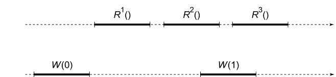

图 4.3：SRSW 执行：$R^i$ 是第 $i$ 次读取，$W(v)$ 是值 $v$ 的写入。时间从左到右。无论寄存器是安全的（safe）、普通的（regular）还是原子的（atomic），$R^1$ 必须返回 0，即最近写入的值。如果寄存器是安全的，那么 $R^2$ 和 $R^3$ 与 $W(1)$ 并发，它们可能返回寄存器范围内的任何值 0 或 1。如果寄存器是普通的，$R^2$ 和 $R^3$ 与 $W(1)$ 并发，它们可能返回寄存器范围内的任何值 0 或 1。如果寄存器是原子的，$R^2$ 和 $R^3$ 与 $W(1)$ 并发，它们可能返回寄存器范围内的任何值 0 或 1。

我们使用 $R^l$ 来表示返回 $v'$ 的任何读取调用。注意，尽管历史（history）最多包含一个 $W^l$ 调用，但它可能包含多个 $R^l$ 调用。

可以证明，以下条件为寄存器是“常规的”（regular）提供了精确的描述。首先，没有读取调用返回来自未来的值：

不会出现 $R^l \to W^l$ 的情况。(4.1.1)

其次，没有读取调用返回来自遥远起始的值，即早于最近一次不重叠的值：

对于某些 $j$，不会出现 $W^i \to W^j \to R^l$ 的情况。(4.1.2)

为了证明一个寄存器实现是常规的，我们必须证明它的历史满足条件 (4.1.1) 和 (4.1.2)。

原子寄存器（atomic register）满足一个额外的条件：

如果 $R^i \to R^j$，则 $i \le j$。(4.1.3)

该条件确保了早期的读取不会返回比后期读取返回更晚的值。常规寄存器不要求满足条件 (4.1.3)。为了证明一个寄存器实现是原子的，我们首先需要定义写入顺序，然后证明它的历史满足条件 (4.1.1)-(4.1.3)。

## 4.2 寄存器构造

我们现在展示如何从简单的布尔 SRSW 寄存器实现一系列强大的寄存器。我们考虑图 4.5 所示的一系列构造，这些构造从较弱的寄存器实现更强的寄存器。这些构造意味着所有读写寄存器类型都是等价的，至少在可计算性方面。

| 基础类 | 实现的类 | 章节 |
|---|---|---|
| safe SRSW | safe MRMW | 4.2.1 |
| safe Boolean MRMW | regular Boolean MRMW | 4.2.2 |
| regular MRMW | regular MRMW | 4.2.3 |
| regular SRSW | atomic SRSW | 4.2.4 |
| atomic SRSW | atomic MRMW | 4.2.5 |


# 第 4 章 共享内存基础

## 4.2 寄存器构造

| atomic MRSW | atomic MRMW | 4.2.6 |
| :--- | :--- | :--- |
| atomic MRSW | atomic snapshot | 4.3 |

**图 4.5** 寄存器构造的序列。

在最后，我们展示了原子寄存器（因此安全的寄存器）如何实现原子快照（`atomic snapshot`）：一个由不同线程写入的 MRSW 寄存器数组，可以被任何线程原子地读取。

**图 4.6** `SafeBooleanMRSWRegister` 类：一个安全的布尔 MRSW 寄存器。

### 4.2.2 一个常规的布尔 MRSW 寄存器

下一个构造见图 4.7，它从一个安全的布尔 MRSW 寄存器构建一个常规的布尔 MRSW 寄存器。对于布尔寄存器，安全和常规寄存器之间的区别出现在新写入的值 $x$ 是旧值时。常规寄存器只能返回 $x$，而安全寄存器可以返回两个布尔值之一。我们通过确保只有当值与之前写入的值不同时才进行写入来规避这个问题。

**引理 4.2.2.** 图 4.7 中的构造是一个常规的布尔 MRSW 寄存器。

*证明。* 不与任何 `write()` 重叠的 `read()` 返回最近写入的值。如果调用重叠，有两种情况需要考虑：

- 如果写入的值与上一次写入的值相同，则写入者避免写入安全寄存器，确保读取者返回正确的值。

```java
public class BooleanMRSWRegister implements Register<Boolean> {
    ThreadLocal<Boolean> last;
    boolean s_value; // safe MRSW register
    public BooleanMRSWRegister(int capacity) {
        last = new ThreadLocal<Boolean>() {
            protected Boolean initialValue() {
                return false;
            }
        };
    }
    public void write(Boolean x) {
        if (x != last.get()) {
            last.set(x);
            s_value = x;
        }
    }
    public Boolean read() {
        return s_value;
    }
}
```

**图 4.7** `BooleanMRSWRegister` 类：从安全的布尔 MRSW 寄存器构建的常规布尔 MRSW 寄存器。

### 4.2.3 一个常规 MRSW 寄存器

下一个构造见图 4.8，它从一个安全的 MRSW 寄存器构建一个常规 MRSW 寄存器。对于 MRSW 寄存器，安全和常规寄存器之间的区别出现在新写入的值 $x$ 是旧值时。常规寄存器只能返回 $x$，而安全寄存器可以返回两个值之一。我们通过确保只有当值与之前写入的值不同时才进行写入来规避这个问题。

```java
public class RegularMRWRegister implements Register<Byte> {
    private static int RANGE = Byte.MAX_VALUE - Byte.MIN_VALUE + 1;
    boolean[] r_bit = new boolean[RANGE]; // regular Boolean MRSW
    public RegularMRWRegister(int capacity) {
        for (int i = 0; i < r_bit.length; i++) {
            r_bit[i] = false;
        }
        r_bit[0] = true;
    }
    public void write(Byte x) {
        r_bit[x] = true;
        for (int i = x - 1; i >= 0; i--) {
            r_bit[i] = false;
        }
    }
    public Byte read() {
        for (int i = 0; i < RANGE; i++) {
            if (r_bit[i]) {
                return i;
            }
        }
        return -1;
    }
}
```

**图 4.8** `RegularMRWRegister` 类：一个常规 MRSW 寄存器。

### 4.2.4 一个原子 SRSW 寄存器

我们展示如何从简单的布尔 SRSW 寄存器实现一系列强大得令人惊讶的寄存器。我们考虑图 4.5 所示的一系列构造，这些构造从较弱的寄存器实现更强的寄存器。这些构造意味着所有读写寄存器类型都是等价的，至少在可计算性方面。

```java
public class StampedValue<T> {
    public long stamp;
    public T value;
    // 带有零时间戳的值
    public StampedValue(T init) {
        stamp = 0;
        value = init;
    }
    // 提供了时间戳的后续值
    public StampedValue(long ts, T v) {
        stamp = ts;
        value = v;
    }
    public static StampedValue max(StampedValue x, StampedValue y) {
        if (x.stamp > y.stamp) {
            return x;
        } else {
            return y;
        }
    }
    public static StampedValue MIN_VALUE = new StampedValue(null);
}
```

**图 4.10** `StampedValue<T>` 类：一个时间戳和一个待读或写的值。

这些标签标记写入调用，以便它们可以被并发读取正确地排序。每次读取都会记住读取过的最新（最高时间戳）时间戳/值对，以便供未来的读取使用。如果随后的读取获取到了较早的值（具有较低的时间戳），它将忽略该值并简单地使用最近记忆的值。同样，寄存器会记住它写入的最新时间戳，并为每个新写入的值标记一个较后的时间戳（即大于 1 的时间戳）。

该算法要求将值和时间戳作为一个单元进行读取或写入。在 C 等语言中，我们将值和时间戳都视为未解释的位模式（“原始可见位”），并使用位移和逻辑掩码在一个或多个字中对值进行打包和解包。在 Java 中，创建一个持有时间戳/值对的 `StampedValue<T>` 结构并存储对该结构的引用要简单得多。

**引理 4.2.5.** 图 4.11 中的构造是一个原子的 SRSW 寄存器。

*证明。* 寄存器是正则的，因此满足条件 (4.1.1) 和 (4.1.2)。该算法满足条件 (4.1.3)，因为写入按其时间戳进行全排序，并且如果读取返回了给定的值，随后的读取无法读取较早的值，因为它的时间戳会较低。

```java
public class AtomicSRSWRegister<T> implements Register<T> {
    ThreadLocal<Long> lastStamp;
    ThreadLocal<StampedValue<T>> lastRead;
    StampedValue<T> r_value; // 正则的 SRSW 时间戳-值
    public AtomicSRSWRegister(T init) {
        r_value = new StampedValue<T>(init);
        lastStamp = new ThreadLocal<Long>() {
            protected Long initialValue() { return 0L; }
        };
        lastRead = new ThreadLocal<StampedValue<T>>() {
            protected StampedValue<T> initialValue() { return r_value; }
        };
    }
    public T read() {
        StampedValue<T> value = r_value;
        StampedValue<T> last = lastRead.get();
        StampedValue<T> result = StampedValue.max(value, last);
        return result.value;
    }
    public void write(T v) {
        long stamp = lastStamp.get() + 1;
        r_value = new StampedValue<T>(v, stamp);
        lastStamp.set(stamp);
    }
}
```

**图 4.11** `AtomicSRSWRegister` 类：一个从正则 SRSW 寄存器构造的原子 SRSW 寄存器。

### 4.2.5 原子 MRSW 寄存器

为了理解如何从原子 SRSW 寄存器构造原子 MRSW 寄存器，我们首先考虑一种直接使用 4.2.1 节构造的简单算法，该构造将安全的 SRSW 变成了安全的 MRSW 寄存器。假设组成数组 `a_table[1..n]` 的 SRSW 寄存器是安全的，写入者按索引增加顺序写入数组，每个读取者读取并返回其关联数组条目。结果并不是一个原子多读者寄存器。对于任何单一读取，条件 (4.1.3) 都成立，因为每次读取都是从一个原子寄存器读取，但对于不同的读者，该条件并不成立。例如，一个写入从第一个 SRSW 寄存器 `a_table[0]` 开始，在写入位置 `a_table[1..n]` 之前发生了延迟。线程 0 的后续读取返回了正确的新值，而线程 1 完全跟随线程 0 的后续读取返回了较早的值，因为写入者尚未更新 `a_table[1..n]`。

```java
public class AtomicMRSWRegister<T> implements Register<T> {
    ThreadLocal<Long> lastStamp;
    private StampedValue<T>[][] a_table; // 每个条目都是一个原子的 SRSW 寄存器
    public AtomicMRSWRegister(T init, int readers) {
        lastStamp = new ThreadLocal<Long>() {
            protected Long initialValue() { return 0L; }
        };
        a_table = (StampedValue<T>[][]) new StampedValue[readers][readers];
        StampedValue<T> value = new StampedValue<T>(init);
        for (int i = 0; i < readers; i++) {
            for (int j = 0; j < readers; j++) {
                a_table[i][j] = value;
            }
        }
    }
    public T read() {
        int me = ThreadID.get();
        StampedValue<T> value = a_table[me][me];
        for (int i = 0; i < a_table.length; i++) {
            value = StampedValue.max(value, a_table[i][me]);
        }
        for (int i = 0; i < a_table.length; i++) {
            if (i == me) continue;
            a_table[me][i] = value;
        }
        return value.value;
    }
    public void write(T v) {
        long stamp = lastStamp.get() + 1;
        lastStamp.set(stamp);
        StampedValue<T> value = new StampedValue<T>(v, stamp);
        for (int i = 0; i < a_table.length; i++) {
            a_table[i][i] = value;
        }
    }
}
```

**图 4.12** `AtomicMRSWRegister` 类：一个从正则 SRSW 寄存器构造的原子 MRSW 寄存器。

等于或 $t$，满足条件 (4.1.2)。最后，如前所述，如果 A 的读调用完成了 B 的读调用，那么 A 会向 $B$ 的行写入一个带有时间戳 $t$ 的带标记值，因此 $B$ 会选择一个大于或等于 $t$ 的值，满足条件 (4.1.3)。

从直观的“公鸡分蛋”层面上来看，请注意，我们违反原子性的反例是由两个不重叠的读取事件引起的，较早的读取读取到的值比较晚的读取要旧。如果读取重叠，我们就可以重新排列它们的线性化点。然而，这两个读取并不重叠，它们的线性化点顺序是固定的，因此我们无法满足原子性要求。这正是我们在设计算法时应该寻找的类反例。（顺便提一下，我们在单读取器原子构造中也使用了这个反例。）

我们的解决方案使用了算法工具：时间戳（`timestamping`），这在后许多许多算法中都会出现；以及间接帮助（`indirect helping`），即一个线程告诉其他线程它读到了什么。这样，如果一个读取器在通信仅通知了部分读取器后暂停，那么读取器将通过传递该信息进行协作。

### 4.2.6 一个原子 MRMW 寄存器

这里是从一个原子 MRSW 寄存器构造一个原子 MRMW 寄存器的方法。

要向寄存器写入值，A 读取所有数组元素，选择一个它观察到的时间戳，并向元素 $A$ 写入一个带标记的值。读取寄存器时，A 读取所有元素并返回时间戳最高的一个。这正是第 2.7 节中 Bakery 算法所使用的时间戳。与 Bakery 算法一样，我们倾向于较小的索引来解决冲突，换句话说，即对时间戳和线程 ID 使用字典序。

**引理 4.2.7.** 图 4.14 中的构造是一个原子 MRMW 寄存器。

*证明。* 根据时间戳和线程 ID 的字典序来定义 `write()` 调用之间的顺序，使得如果 $t_A < t_B$，或者当 $t_A = t_B$ 且 $A < B$，则 $A$ 带有 $t_A$ 的 `write()` 调用在 $B$ 带有 $t_B$ 的 `write()` 调用之前。我们留给读者证明这种字典序与 $\cdot$ 一致。按照常例，`write()` 调用顺序为：$W^0, W^1, \dots$

显然，`read()` 调用无法在完成后后读取 `a_table[i]` 中的值，且任何完全在读之前的 `write()` 调用其时间戳都高于在读完成之前的所有这些 `write` 调用，这实现了条件 (4.1.1)。

考虑条件 (4.1.2)，该条件禁止跳过最近的先验写入。假设 $A$ 的 `write()` 调用之前有一个 $B$ 的读取，而 $B$ 的读取之前又有一个 $C$ 的读取。如果 $A=B$，则较晚的写入会覆盖 `a_table[A]`，且 `read()` 不返回较早写入者的值。如果 $A \neq B$，则 $A$ 的时间戳小于 $B$ 的时间戳，任何 $C$ 看到的返回都是 $B$ 的值（或具有更高时间戳的值），满足条件 (4.1.2)。


```java
public class AtomicMRMWRegister<T> implements Register<T> {
    private StampedValue<T>[] a_table; // 原子 MRSW 寄存器数组
    public AtomicMRMWRegister(int capacity, T init) {
        a_table = (StampedValue<T>[]) new StampedValue[capacity];
        StampedValue<T> value = new StampedValue<T>(init);
        for (int j = 0; j < a_table.length; j++) {
            a_table[j] = value;
        }
    }
    public void write(T value) {
        int me = ThreadLocal.get();
        StampedValue<T> max = StampedValue.MIN_VALUE;
        for (int i = 0; i < a_table.length; i++) {
            max = StampedValue.max(max, a_table[i]);
        }
        a_table[me] = new StampedValue(max.stamp + 1, value);
    }
    public T read() {
        StampedValue<T> max = StampedValue.MIN_VALUE;
        for (int i = 0; i < a_table.length; i++) {
            max = StampedValue.max(max, a_table[i]);
        }
        return max.value;
    }
}
```

图 4.14：原子 MRMW 寄存器。

最后，我们考虑条件 (4.1.3)，该条件禁止完全先于我们寄存器读取操作。考虑任何一个 A 的 `read()` 完全先于 B 的 `read()`，以及任何一个 C 在写入顺序上先于 D 写入的 `write()`。我们证明如果 A 返回了 D 的值，那么 B 就不会返回 C 的值。如果 $t_C < t_D$，如果 A 从 `a_table[D]` 读取时间戳 $t_D$，则 B 从 `a_table[D]` 读取 $t_D$ 或更高时间戳，且不返回与 $t_C$ 关联的值。如果 $t_C = t_D$，即写入是并发的，那么对于写入顺序 $C < D$，如果 A 从 `a_table[D]` 读取时间戳 $t_D$，则 B 也会读取 $t_D$ 并返回与 $t_D$ 关联的值（或更高值），即使它在 `a_table[C]` 中读取了 $t_C$。

我们的一系列构造表明，可以从安全的布尔 SRSW 寄存器构造出无锁的原子值 MRMW 寄存器。自然地，没有人能使用安全寄存器编写并发算法，但这些构造表明，任何使用原子寄存器的算法都可以在仅支持安全寄存器的架构上实现。稍后当我们考虑更真实的架构时，将回到这一主题：在直接提供较弱属性的架构上实现假设了强同步属性的算法。

```java
public interface Snapshot<T> {
  public void update(T v);
  public T[] scan();
}
```

图 4.15：Snapshot 接口。

## 4.3 原子快照

我们已经看到寄存器值如何被原子地读取和写入。如果我们想原子地读取多个寄存器值呢？我们称这种操作为原子快照（atomic snapshot）。

原子快照构造了一个 MRSW 寄存器数组的瞬时视图，这意味着线程可以获取该数组的快照。Snapshot 接口 (4.15) 是一个每个线程一个 MRSW 寄存器的数组。我们的目标是构造一个与 4.16 所示的顺序快照等价的（线性化的）wait-free 实现。该实现的关键属性是 `scan()` 返回的结果是正确的。

### 4.3.1 阻塞的快照

我们从 `SimpleSnapshot` 类开始，它是 wait-free 但阻塞的。

```java
public class SimpleSnapshot<T> implements Snapshot<T> {
    private StampedValue<T>[] a_table; // 原子 MRSW 寄存器数组
    public SimpleSnapshot(int capacity, T init) {
        a_table = (StampedValue<T>[]) new StampedValue[capacity];
        for (int i = 0; i < capacity; i++) {
            a_table[i] = new StampedValue<T>(init);
        }
    }
    public void update(T value) {
        int me = ThreadId.get();
        StampedValue<T> oldValue = a_table[me];
        StampedValue<T> newValue = new StampedValue<T>((oldValue.stamp)+1, value);
        a_table[me] = newValue;
    }
    private StampedValue<T>[] collect() {
        StampedValue<T>[] copy = (StampedValue<T>[]) new StampedValue[a_table.length];
        for (int j = 0; j < a_table.length; j++) {
            copy[j] = a_table[j];
        }
        return copy;
    }
    public T[] scan() {
        StampedValue<T>[] oldCopy, newCopy;
        oldCopy = collect();
        while (true) {
            newCopy = collect();
            if (!Arrays.equals(oldCopy, newCopy)) {
                oldCopy = newCopy;
                continue;
            }
            T[] result = (T[]) new Object[a_table.length];
            for (int j = 0; j < a_table.length; j++) {
                result[j] = newCopy[j].value;
            }
            return result;
        }
    }
}
```

图 4.17：简单快照对象。

### 4.3.2 无锁快照

为了使 `scan()` 方法成为 wait-free，每个 `update()` 调用在写入其寄存器之前都会通过快照来帮助潜在冲突的 `scan()`。反复无法获取 clean collect 的 `scan()` 可以使用来自 `update()` 调用提供的快照作为自己的。

当线程完成一个 `update()` 时，我们说该线程移动了。如果 A 因为 B 移动而未能获取 clean collect，那么 A 直接获取 B 最新的快照作为自己的吗？遗憾的是，如图 4.18 所示，A 可能会看到 B 移动，但 B 的快照是在 A 开始其 `scan()` 调用之前就已经拍摄的，因此快照并没有发生在 A 的 `scan()` 执行区间内。

无锁构造基于以下观测结果：如果扫描线程 A 在执行 `collects` 期间看到 B 移动了两次，那么 B 在 A 的 `scan()` 间隔内执行了一个完整的 `update()` 调用，因此 A 使用 B 的快照是正确的。

图 4.18 解释了为什么一个未能完成干净双重 collect 的线程 $A$ 不能简单地获取在 $A$ 的第二次 collect 期间执行了 `update()` 的线程 $B$ 的最新快照。$B$ 的快照是在 A 开始其 `scan()` 之前拍摄的，即 B 的快照与 A 的 `scan()` 没有重叠。危险在于，线程 $C$ 可能会在 B 的扫描之后、A 的 `scan()` 之前调用 `update()`，这使得 A 使用 B 的扫描结果将是不正确的。

```java
public class StampedSnap<T> {
  public long stamp;
  public T value;
  public T[] snap;
  public StampedSnap(T value) {
    stamp = 0;
    this.value = value;
    snap = null;
  }
  public StampedSnap(long ts, T v, T[] s) {
    stamp = ts;
    value = v;
    snap = s;
  }
}
```

图 4.19：带戳的快照类。

更准确地说，写入寄存器的每个值具有图 4.19 所示的结构：一个在线程更新其值时每次递增的 `stamp` 字段，一个包含寄存器实际值的 `value` 字段，以及一个包含该线程最新扫描的 `snap` 字段。快照算法如图 4.20 所示。`scan` 创建了一个布尔数组 `moved[]`（第 24 行），它记录了在扫描过程中哪些线程被处理以移动。与之前一样，每个线程执行两次 `collect`（第 25 行和第 27 行），并测试任何线程的时间戳是否发生了变化。如果没有线程的时间戳发生变化，则 collect 是干净的，scan 返回 collect 的结果。如果任何线程的时间戳发生了变化（第 29 行），扫描线程将测试。

```java
public class WFSnapshot<T> implements Snapshot<T> {
    private StampedSnapshot<T>[] a_table; // 原子 MRSW 寄存器数组
    public WFSnapshot(int capacity, T init) {
        a_table = (StampedSnapshot<T>[]) new StampedSnapshot[capacity];
        for (int i = 0; i < a_table.length; i++) {
            a_table[i] = new StampedSnapshot<T>(init);
        }
    }

    private StampedSnapshot<T>[] collect() {
        StampedSnapshot<T>[] copy = (StampedSnapshot<T>[]) new StampedSnapshot[a_table.length];
        for (int j = 0; j < a_table.length; j++) {
            copy[j] = a_table[j];
        }
        return copy;
    }

    public void update(T value) {
        int me = ThreadId.get();
        T[] snap = scan();
        StampedSnapshot<T> oldValue = a_table[me];
        StampedSnapshot<T> newValue = new StampedSnapshot<T>(oldValue.stamp + 1, value, snap);
        a_table[me] = newValue;
    }

    public T[] scan() {
        StampedSnapshot<T>[] oldCopy, newCopy;
        boolean[] moved = new boolean[a_table.length]; // 初始化为 false
        oldCopy = collect();
        while (true) {
            newCopy = collect();
            for (int j = 0; j < a_table.length; j++) {
                if (oldCopy[j].stamp != newCopy[j].stamp) {
                    if (moved[j]) {
                        return newCopy[j].snap;
                    } else {
                        moved[j] = true;
                        oldCopy = newCopy;
                        continue;
                    }
                }
            }
            T[] result = (T[]) new Object[a_table.length];
            for (int j = 0; j < a_table.length; j++) {
                result[j] = newCopy[j].value;
            }
            return result;
        }
    }
}
```

图 4.20：单写者原子快照类。

`moved[]` 数组用于检测此线程是否移动（第 30 行）。如果是，它返回该线程的扫描（第 31 行）；否则，它更新 `moved[]` 并继续循环（第 32 行）。

## 4.3.3 正确性论证

在本节中，我们将更仔细地审查无锁算法的正确性论证。


- **引理 4.3.1.** 如果扫描线程执行了干净的双重 collect，则返回寄存器在某个状态的值。

*证明：* 考虑第一次 collect 的最后一次读取和第二次读取之间的间隔。如果任何寄存器在此期间被更新，时间戳将不匹配，双重 collect 就不会干净。

- **引理 4.3.2.** 如果扫描线程 A 在两次不同的 collect 期间观察到另一个线程 B 时间戳的变化，那么 B 寄存器中的值是在第一次 collect 之后开始的 `update()` 写入。

*证明：* 如果在 `scan()` 期间 A 连续读取两次 B 的时间戳，那么至少有一次 B 的读取发生在这对读取之间。B 写入寄存器是 `update()` 的最后一步。

- **引理 4.3.3.** `scan()` 返回的值是在调用开始和结束之间某个状态下的。

*证明：* 如果 `scan()` 执行了干净的双重 collect，则结论遵循引理 4.3.1。如果 `scan()` 发现了另一个 B 寄存器中的值，则根据引理 4.3.2，B 寄存器中的值是在 A 的第一次和最后一次读取之间通过 B 的扫描更新的。该论证可以递归应用，注意到在用完线程之前最多会有 $n-1$ 次嵌套调用，其中 $n$ 是线程的最大数量（见图 4.21）。最终，某个嵌套的 `scan()` 调用必须执行过干净的双重 collect。

- **引理 4.3.4.** 每次 `scan()` 或 `update()` 最多返回 $O(n^2)$ 次读取或写入。

*证明：* 考虑特定的 `scan()`。只有 $n-1$ 个其他线程，因此在 n 次 collect 之后，要么某次 collect 是干净的，要么某个线程被观察到移动了两次。由于每次 collect 都执行 $O(n)$ 次读取，结论成立。

# 第 4 章 共享内存的基础

线程 0

扫描 更新

线程 1

扫描 更新

线程 $n-1$

图 4.21

在线程耗尽之前，`scan()` 的嵌套调用最多可以有 $n-1$ 次，其中 $n$ 是线程的最大数量。线程 $n-1$ 在所有其他 `scan()` 用的间隙内执行的 `scan()` 必须拥有一个干净的双倍拷贝（clean double copy）。

根据引理 4.3.3，`scan()` 返回的值形成了它们在调用期间某些状态下寄存器中值的快照：即在该点对调用进行线性化。同样地，在寄存器被写入的时间点将 `update()` 调用合法化。

**定理 4.3.5.** 图 4.20 中的自由原子快照构造是一个无等待（wait-free）快照实现。

我们的无等待原子构造是在原子寄存器构造中讨论过的传播方法（dissemination approach）的另一个稍微不同的示例。在这个例子中，线程告诉其他线程它们的快照，并重用了双端队列。另一个实用的技巧是：如果一个线程中断另一个线程并阻止其完成，只要中断发生的线程完成了被中断线程的操作，我们仍然可以保证无等待性。这种帮助范式在设计多处理器算法中极其有用。

## 4.4 章节注释

Alonzo 在 1935 年左右引入了 lambda 演算 [30]。Alan Turing 在 1937 年的一篇经典论文中定义了图灵机 [163]。Leslie Lamport 定义了*安全*（safe）、*普通*（regular）和原子寄存器的概念以及寄存器层次，并首次证明了从安全位（safe bits）实现非平凡共享内存 [99, 105]。Jay Peterson 提出了构造原子寄存器的问题 [128]。*线性化*（linearizability）的概念推广了 Lamport 和 Misra 的原子寄存器概念，归功于 Herlihy 和 Wing [75]。Sushita Lal 和 Krishna Vidyasankar 从普通寄存器限制了 MRS 寄存器的边界 [55]。从原子单读者寄存器构造原子多读者寄存器的问题被 Leslie Lamport [99,105] 以及 Paul Vitányi 和 Baruch Awerbuch [165] 作为一个开放问题提及，他们是第一个提出原子 MRMW 寄存器设计方法的人。第一个解决方案归于 Jim Anderson、Mohamed Gouda 和 Ambuj Singh [87,160]。其他原子寄存器构造（列举）包括 Jim Burns 和 Gary Peterson [25]、Richard Newman-Wolfe [134]、Lefteris Kirosis、Paul Spirakis 和 Philippas Tsigas [92]、Amos Israel 和 Amnon Shahan [86] 以及 Ming Li、John Trom 和 Paul Vitányi [113]。基于时间戳的 MRMW 构造由 Danny Dolev 和 Nir Shavit 提出 [39]。

收集操作由 Mike Saks、Nir Shavit 和 Heather Wall [152] 完成。第一个原子快照构造由 Jim Anderson [10] 和 Yehuda Afek、Hagit Attiya、Danny Deli、El Gafni、Michael Merritt 和 Nir Shavit [2] 独立发现。后者算法是本文介绍的一种。随后的快照算法归于 Elizabeth Borovsky 和 Gafini [21] 以及 Yehuda Afek、Gideon Stepp 和 Dan Toutou [4]。

本章提到的所有算法中的时间戳都可以被限制，使得构造可以使用有界大小的寄存器。有界时间戳系统由 Amos Israel 和 Ming Li 引入 [85]，有界并发时间戳由 Danny Dolev 和 Nir Shavit 引入 [39]。

Horsey 有一篇关于性与直觉关系的文章。

## 4.5 练习

**练习 4.1.** 考虑图 4.6 中的安全布尔 MRSW 构造。对或错：如果我们将安全的布尔 SRSW 寄存器替换为 *M*-值的 SRSW 寄存器数组，那么该构造产生一个 *M*-值的 MRSW 寄存器。说明你的答案。

**练习 4.2.** 考虑图 4.6 中的安全布尔 MRSW 构造。对或错：如果我们将安全的布尔 SRSW 寄存器替换为普通的 SRSW 寄存器数组，那么该构造产生一个普通的 MRSW 寄存器。说明你的答案。

**练习 4.3.** 考虑图 4.6 所示的安全布尔 MRSW 构造。对或错：如果我们将安全的 SRSW 寄存器替换为普通的 *M*-值的 SRSW 寄存器数组，那么该构造产生一个普通的 MRSW 寄存器。说明你的答案。

**练习 4.4.** 考虑图 4.7 所示的普通 MRSW 构造。对或错：如果我们将安全的布尔 MRSW 寄存器替换为安全的 *M*-值的 MRSW 寄存器，那么该构造产生一个普通的 *M*-值的 MRSW 寄存器。说明你的答案。

**练习 4.5.** 考虑图 4.12 所示的原子 MRSW 构造。对或错：如果我们将原子 SRSW 寄存器替换为 SRSW 寄存器，那么该构造产生一个原子 MRSW 寄存器。说明你的答案。

**练习 4.6.** 给出一个普通的静止一致（quiescent consistent）寄存器执行示例。

# 第 4 章 共享内存的基础

```java
public class SRSWRegister implements Register<int> {
    private static int RANGE = M;
    boolean[] r_bit = new boolean[RANGE]; // 原子布尔 SRSW
    public AtomicSRSWRegister(int capacity) {
        for (int i = 1; i <= RANGE; i++) {
            r_bit[i] = false;
        }
    }
    public void write(int x) {
        // ...
    }
    public int read() {
        // ...
    }
}
```

**练习 4.7.** 给定图 4.4 中使用布尔 SRSW 寄存器构造 M 值 SRSW 寄存器的算法。这有效还是存在反例？

**练习 4.8.** 想象在 32 位系统上实现 64 位系统，每个 64 位位置（寄存器）使用两个 32 位寄存器实现。

**练习 4.9.** 如果将共享标志替换为寄存器，Peterson 互斥算法是否有效？

**练习 4.10.** 考虑以下消息传递系统的寄存器实现。有 $n$ 个处理器 $P_0, \dots, P_{n-1}$ 排成环形，$P_i$ 只能向 $P_{i+1} \pmod n$ 发送消息。每个处理器保留共享寄存器的副本。读取寄存器时，处理器读取本地内存中的副本。处理器 $P_i$ 对寄存器 $x$ 发起值为 $v$ 的调用，并将 $v$ 写入 $P_{i+1} \pmod n$。如果 $P_i$ 接收到消息 "$P_i$: 写入 $x$，它将 $v$ 写入其本地副本，并将消息转发给 $P_{i+1} \pmod n$。如果 $P_i$ 接收到消息 "$P_i$: 写入 $x$，它将 $v$ 写入其本地副本并丢弃该消息。此时 write() 调用完成。

给出一个简短的理由或反例。

如果多个处理器调用 write()，该寄存器实现是普通的吗？是原子的吗？

如果 write() 调用不重叠，该实现是安全的？

**练习 4.11.** 图 4.23 显示了从多值安全 MRSW 寄存器数组构造多值*单写*（write-once）MRSW 寄存器的实现。记住，有一个写入者，它可以用新值覆盖寄存器的初始值，但它只能写一次。你不知道寄存器的初始值。

该实现是普通的吗？是原子的吗？

**练习 4.12.** 如果满足以下条件，则一个（单写）寄存器是*I-正则的（I-regular）：

- 如果 `read()` 操作不与任何 `write()` 操作重叠，则它返回上一次 `write()` 操作写入的值或并发 `write()` 操作写入的值。

- 如果 `read()` 操作恰好与一个 `write()` 操作重叠，则它返回由上一次 `write()` 操作写入的值。

- 否则，`read()` 操作可能返回一个任意值。

使用 $O(\log M)$ 个 SRSW 布尔正则寄存器构造一个 SRSW *$M$-取值的*I-正则*寄存器。解释为什么你的构造是有效的。

**练习 4.13.** 证明图 4.6 所示的从安全布尔 SRSW 寄存器构造的安全布尔寄存器，如果组件寄存器是正则 SRSW，则是正则 MRSW 寄存器的正确实现。

**练习 4.14.** 定义一个循环寄存器（wraparound register），其具有以下属性：存在一个值 $k$，使得写入值 $v$ 将寄存器设置为 $v \pmod k$。

如果我们把面包算法的共享变量替换为 (a) 正则的、b) 安全的或 (c) 原子循环寄存器，它是否仍然满足 (1) 互斥和 (2) FIFO 排序？

你应该提供六个答案（某些答案暗示了其他答案）。为每个主张提供理由。

# 第 5 章

原语同步操作的相对能力

想象你正负责设计一种新的微处理器。你应该包含哪些原子指令？文献中包含了令人眼花缭的选择：`read()` 和 `write()`, `getAndIncrement()`, `getAndComplement()`, `swap()`, `compareAndSet()` 以及许多其他。支持所有这些指令将非常复杂且低效，但支持错误的指令可能会导致难以或无法解决重要的同步问题。

我们的目标是识别一组足以解决实践中可能出现的同步问题的原语同步操作。（为了方便起见，我们可能支持其他无关紧要的同步操作。）为此，我们需要某种方法来评估各种同步原语的能力：它们可以解决哪些同步问题，以及解决这些问题的效率如何。

如果一个并发实现中的每个方法都在有限步数内完成，则称该实现是无等待的（wait-free）。如果一个方法保证无限次地某个方法在有限步数内完成，则称该方法是无锁的（lock-free）。我们已经在第 4 章中看到了无等待（因此也是无锁的）寄存器实现。评估同步指令能力的一种方法是看它们对共享对象（如队列、栈等）实现的支持程度如何。正如我们在第 4.1 节解释的，我们评估的是那些无等待或无锁的解决方案，这些方案在不依赖底层平台的情况下保证进展。

并不是所有同步指令都是平等的。如果将原语同步指令视为对象，其导出的方法就是指令本身（这些通常被称为同步原语），那么可以证明同步原语之间存在无限层级，使得某一层级的原语无法用于更高层级的无等待或无锁实现。基本思想非常简单：层级中的每个类都有一个共识数（consensus number），即该类对象可以解决“共识”这一基础同步问题的最大线程数。在具有 n 或更多处理器的系统中，无法用低共识数的对象的实现一个共识数为 n 的无等待或无锁对象。

> 评估仅依赖进展条件（如无阻塞或无死锁）的解决方案是没有意义的，因为此类解决方案的真实能力取决于它们所依赖的操作系统的贡献。

The Art of Multiprocessor Programming. https://doi.org/10.1016/B978-0-12-41590-6.00014-8

© 2021 Elsevier Inc. 版权所有。

# 104 第 5 章 原语同步操作的相对能力

```java
public interface Consensus<T> {
  T decide(T value);
}
```

图 5.1

共识对象接口。

# 5.1 共识数

共识是一个看似无害、相当抽象的问题，但从算法设计到硬件架构的一切都产生巨大影响。共识对象提供了一个简单的方法 `decide(t)`，如图 5.1 所示。每个线程最多调用一次带有输入 v 的 `decide(t)` 方法。对象的 `decide(t)` 方法返回一个满足以下的值：

- 一致性：所有线程都同意同一个值；
- 有效性：共同的决定结果是某个线程的输入。

换句话说，一个并发共识对象可以线性化为一个顺序共识对象，其中被选择的值是由最先调用 `decide(t)` 的线程决定的。为了简化演示，我们关注二值共识，其中所有输入均为 0 或 1，但该方法适用于一般的共识。

我们感兴趣的是共识问题的无等待解决方案，即共识的无等待并发实现。读者会注意到，给定对象的 `decide(t)` 方法每个线程只执行一次，且线程数量是有限的，因此，无锁实现也将是无等待的，反之亦然。因此，我们只提到无等待实现，出于历史原因，我们将任何以无等待方式实现共识的类称为共识协议。

我们想要理解类对象是否足够强大以解决共识问题。我们如何让这个概念变得更精确？如果我们认为这类对象是由系统的更底层支持的，也许我们关心的是该类的属性，而不是对象的数量。（如果系统可以……

# 5.1 共识数

**定义 5.1.1.** 类 $C$ 的共识数是 $C$ 可以解决共识的最大线程数。

**定义 5.1.2.** 类 $C$ 的共识数是 $C$ 解决共识的最大 $n$。

**推论 5.1.3.** 如果可以从 $D$ 实现 $C$，那么 $D$ 也能实现。

# 5.1.1 状态与价

一个良好的起点是考虑最简单的情况：两个线程的二值共识（即 0 或 1）。图 5.2 显示了这棵树，每个节点代表一个可能的状态。从 *A* 到 *s'* 的边意味着 *A* 在状态 *s* 下移动。我们将 *s'* 称为 *s* 的后继状态，因为协议是无等待的（每个路径都是有限的）。叶子节点表示最终状态，并标记它们的决策值。

协议状态是二值的（bivalent），如果决策值不是固定的：从该状态开始的某些执行决定 0，某些执行决定 1。相比之下，状态是单值的（univalent），如果结果是固定的：从该状态开始的所有执行都决定相同的值。协议状态是 1-单值的，如果它是单值的且决策值为 1；0-价（0-valent）。如图 5.2 所示，二值状态是一个其后代节点同时包含标记为 0 和标记为 1 的节点，而单值状态是一个其后代节点仅包含标记为单一决策值的节点。

我们的引理说明存在初始二值状态。这一观察意味着协议的结果无法预先固定，而是取决于读取和写的交错方式。

**引理 5.1.4.** 每个双线程共识都有一个二值初始状态。

证明。考虑 *A* 输入为 0 且 *B* 输入为 1 的初始状态。如果 *A* 在 *B* 采取步骤之前完成协议，则 *A* 必须决定 0，因为它必须决定某个线程的输入，而 0 是它唯一的选择（因为它无法区分这与 *B* 输入为 0 的情况）。对称地，如果 *B* 在 *A* 采取步骤之前完成协议，则 *B* 必须决定 1。因此，*A* 输入为 0 且 *B* 输入为 1 的初始状态是二值的。

# 第 5 章 原语同步操作的相对能力

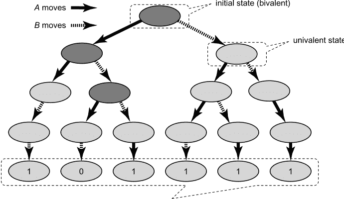

图 5.2

两个线程 A 和 B 的执行树。深色阴影节点表示二值态（bivalent），浅色节点表示单值态（univalent）。

**引理 5.1.5.** 每一个 $n$ 元共识协议都有一个二值初始状态。

*证明。* 留作练习。

如果协议状态满足以下条件，则称它是*关键的*：

- 它是二值态；
- 如果任何线程移动，协议状态就会变为单值态。

**引理 5.1.6.** 每一个无等待共识协议都有一个关键状态。

*证明。* 根据引理 5.1.5，该协议有一个二值初始状态。在该状态下启动协议。只要某个线程在移动且不使协议状态变为单值态，该线程就会继续移动。协议不能无限运行，因为它是无等待的。因此，协议最终会进入一个无法进行移动的状态，根据定义，这就是关键状态。

我们到为止证明的所有结论都适用于任何共识协议，无论它使用了什么类别的共享对象。现在我们考虑特定的对象类。

## 5.2 原子寄存器

显而易见的起点是询问，我们是否可以使用原子寄存器解决共识问题。令人惊讶的是，答案可能是*否*。我们证明了不存在适用于两个线程的二值共识协议。我们留了一个练习来证明如果两个线程无法在两个值上达成共识，那么 $n$ 个线程就无法在 $n \ge 2$ 和 $k \ge 2$ 个值上达成共识。


# 第 5 章 原生同步操作的相对能力

通常，当我们争论是否存在解决特定问题的协议时，我们会构建这样一个场景：“如果我们有这样的协议，它在这些情况下行为将会是怎样的。”一个特别实用的场景是让一个线程（例如 $A$）独立运行直到它完成协议。这种特定的场景 5.2.1 足够常见，以至于我们给它命名：$A$ 单独运行。

**定理 5.2.1.** 原子寄存器的共识数为 1。

*证明。* 假设存在适用于两个线程 $A$ 和 $B$ 的二值共识协议。我们考虑此类协议的属性并推导出矛盾。根据引理 5.1.6，我们可以运行协议直到它达到一个关键状态 $s$。假设 $A$ 的下次移动将协议带入 0-值态，而 $B$ 的下一次移动将协议带入 1-值态。（如果不是，则交换名称）。$A$ 和 $B$ 可能正准备调用哪些方法？我们现在考虑所有可能性的穷举列表：其中一个读取寄存器，它们都向寄存器写入，或者都从同一个寄存器读取。

假设 $A$ 正准备读取一个给定的寄存器（$B$ 可能正准备读取或写入同一个寄存器或不同的寄存器），如图 5.3 所示。考虑两种可能的执行场景。在第一种情况下，$B$ 先移动，驱动协议带入一个 1-值态 $s'$，然后 $B$ 单独运行并最终决定为1。在第二种执行场景中，$A$ 先移动，驱动协议带入一个 0-值态，然后

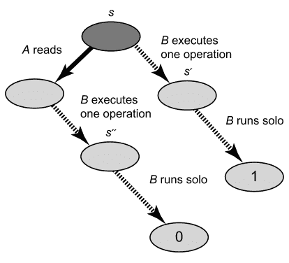

**图 5.3** $A$ 先读。在第一执行场景中，$B$ 先移动，驱动协议带入一个 1-值态 $s'$，然后 $B$ 单独运行并最终决定为1。在第二种执行场景中，$A$ 先移动，驱动协议带入一个 0-值态，然后 $B$ 迈了一步到达状态 $s''$。$B$ 从 $s''$ 开始单独运行并最终决定为0。

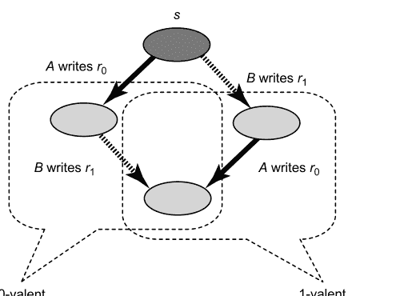

**图 5.4** 情况：A 和 B 写入不同的寄存器。

$B$ 迈了一步到达状态 $s'$。$B$ 从 $s''$ 开始单独运行并最终决定为0。问题在于，状态 $s'$ 和 $s''$ 对 $B$ 来说是不可区分的（$A$ 执行的读取只能改变其线程状态，这对 $B$ 是不可见的），这意味着 $B$ 在两种场景下必须决定相同的值，这产生了矛盾。

假设独立于此场景，线程正准备写入不同的寄存器，如图 5.4 所示。$A$ 正准备写入 $r_0$，$B$ 写入 $r_1$。考虑两种可能的场景。在第一种情况下，$A$ 写入 $r_0$ 然后 $B$ 写入 $r_1$；产生的协议状态首先是 0-值的。在第二种情况下，$B$ 写入 $r_1$ 然后 $A$ 写入 $r_0$；产生的协议状态首先是 1-值的 B。

问题在于，两种场景都导致了相同的协议状态。$A$ 或 $B$ 都无法判断哪个移动是先。因此，产生的状态既是 0-值的又是 1-值的，这产生了矛盾。

再次考虑同一个寄存器 $r$ 的两种可能场景，如图 5.5 所示。在场景 A 中，$A$ 先写入，然后 $B$ 写入；产生的协议状态 $s'$ 是 0-值的，$B$ 单独运行并决定为 0。在另一种场景中，$B$ 先写入，产生的协议状态 $s''$ 是 1-值的，$B$ 单独运行并决定为 1。问题在于，状态 $s'$ 和 $s''$ 对 $B$ 来说是不可区分的（$A$ 执行的读取只能改变其线程状态，这对 $B$ 是不可见的），这意味着 $B$ 在两种场景下必须决定相同的值，这产生了矛盾。

**推论 5.2.2.** 使用原子寄存器构造共识数大于 1 的对象是不可能的。这一推论是计算机科学中最令人惊讶的结果之一。它解释了为什么如果我们要在现代处理器上实现数据结构，硬件必须提供加载和存储以外的操作（即读取和写入）。


**图 5.5** A 和 B 写入寄存寄存

我们现在考虑各种有趣的对象类，询问它们能多好地解决问题。这些协议具有通用形式，如 5.6 所示。对象具有原子寄存器数组，其中 `decide()` 方法提议输入。

```java
1 abstract class Protocol<T> implements Consensus<T> {
2 protected T[] proposed; // N 是线程数
3 // 宣布输入
4 void propose(T value) {
5 proposed[ThreadID.get()] = value;
6 }
7 // 确定哪个线程先
8 abstract T decide(T value);
9 }
```

**图 5.6** 通用共识协议

```java
public class QueueConsensus<T> extends Protocol<T> {
    private static final int WIN = 0; // 第一个线程
    private static final int LOSE = 1; // 第二个线程
    Queue queue;
    // 初始化队列
    public QueueConsensus() {
        queue = new Queue();
        queue.enqueue(WIN);
        queue.enqueue(LOSE);
    }
    // 确定哪个线程先
    public T decide(T value) {
        propose(value);
        int status = queue.dequeue();
        int i = ThreadID.get();
        if (status == WIN)
            return proposed[i];
        else
            return proposed[1-i];
    }
}
```


**图 5.7** 使用 FIFO 队列的无线程共识。

## 5.4 FIFO 队列

在第 3 章，我们看到了仅使用原子寄存器的无等待 FIFO 队列实现，但受限于只有一个线程可以入队，只有一个线程可以从队列出队。自然地询问是否可以提供一个支持多个入队和出队者的无等待队列实现。现在，让我们关注一个更具体的问题：我们能使用原子寄存器提供双端 FIFO 队列的无等待实现吗？

**引理 5.4.1.** 双线程 FIFO 队列的类数为2。

*证明。* 图 5.7 展示了一个使用单个 FIFO 队列的双线程共识协议。这里，队列存储整数。队列通过先入队 `WIN` 值再入队 `LOSE` 值来初始化。在我们考虑的所有协议中，`decide()` 首先调用 `propose(v)`，将 `v` 存储在提议值的共享数组 `proposed[]` 中。然后它从队列中取出下一个元素。如果元素是 `WIN` 值，则调用线程先到，它决定自己的值。如果元素是 `LOSE` 值，则另一个线程先，因此调用线程返回另一个线程的输入，如 `proposed[]` 数组声明的那样。该协议是无等待的，因为它不包含循环。

...。如果它返回了另一个线程的输入，那么它们都弹出了 `LOSE`（失败），这也违反了队列的规范。

有效性条件源于以下观察：取出 $w_1$ 的线程在任何值被出队之前，已将其输入存储在提议的 `proposed[]` 数组中。

该程序的平凡变体可以产生用于栈、优先级队列、列表、集合或任何在不同顺序应用方法时会返回不同结果的对象的协议。

**推论 5.4.2.** 不可能从一组原子寄存器构造出队列、栈、优先级队列、列表或集合的无等待（wait-free）实现。

尽管 FIFO 队列解决了双线程共识，但它们没有解决三线程共识。

**定理 5.4.3.** FIFO 队列的共识数为 2。

*证明。* 反证法，假设我们有一个针对线程 A、B 和 C 的共识协议。根据引理 5.1.6，该协议有一个关键状态 $s$。在不失一般性的情况下，我们可以假设 A 的下一步动作将协议带入一个 0 值的状态，而 B 的下一步动作将协议带入一个 1 值的状态。其余部分与之前一样，是分类讨论。

我们知道 A 和 B 的等待操作不可交换。因此，它们都正准备调用同一个对象的方法。根据定理 5.2.1 的证明，我们也知道 A 和 B 不可能准备读取或写入共享寄存器。因此它们正准备调用单个队列对象的方法。

首先，假设 A 和 B 都调用 `deq()`，如图 5.8 所示。令 $s'$ 为 A 出队后 B 出队的协议状态，或者以相反顺序发生：

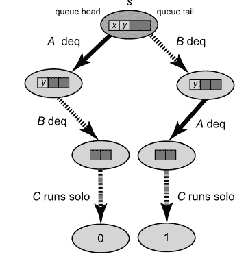

**图 5.8** 情况：A 和 B 都调用 `deq()`。

由于 $s'$ 是 0 价状态，如果 $C$ 从 $s'$ 开始不中断地运行，则它决定 0。由于 $s'$ 是 1 价状态，如果 $C$ 从 $s'$ 开始不中断地运行，则它决定 1。但 $s'$ 和 $s''$ 对 $C$ 而言是不可区分的（从队列中移除的是相同的两个元素），$C$ 在两个状态下必须决定相同的值，这是一个矛盾。

其次，假设 A 调用 `enq(a)` 而 B 调用 `deq(b)`。如果队列不为空，则矛盾是显而易见的，因为这两个方法存在冲突（每个都在队列的不同端操作）：$C$ 无法观察到它们发生的顺序。如果队列为空，那么到达 1 价状态的 $B$ 在空队列上执行出队操作，然后 $A$ 单独执行。注意，空队列上的 `deq(j)` 执行什么并不重要，无论它是中止还是等待，这都不会影响 $C$ 可见的状态。

最后，假设 A 调用 `enq(a)` 且 B 调用 `enq(b)`，如图 5.9 所示。令 $s'$ 为以下执行结束时的状态：

1. 让 A 和 B 按顺序入队元素 $a$ 和 $b$。

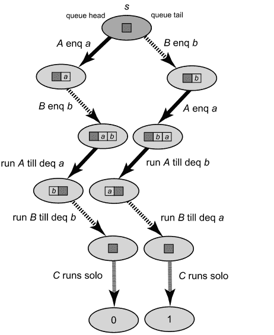

**图 5.9** 情况：$A$ 调用 `enq(a)` 且 $B$ 调用 `enq(b)`。注意，$B$ 在 A 和 B 入队各自元素之后出队之前入队了一个新元素（$B$ 也可以在出队前入队元素），但该元素在两种执行场景中是相同的。

2. 运行 A 直到出队 $a$。（由于通过 `deq()` 方法是观察队列状态的方法，A 在观察到 $a$ 或 $b$ 之前不能。）

3. 在 A 采取进一步步骤之前，运行 B 直到出队 $b$。

令 $s''$ 为以下另一种执行后的状态：

1. 让 B 和 A 按顺序入队元素 $b$ 和 $a$。
2. 运行 A 直到出队 $b$。
3. 在 A 采取进一步步骤之前，运行 B 直到出队 $a$。

显然，$s'$ 是 0 价状态而 $s''$ 是 1 价状态。由于 A 的两次执行在出队 $a$ 或 $b$ 之前是相同的。由于 A 在能够修改任何其他对象之前停止，B 的执行在出队 $a$ 或 $b$ 之前也是相同的。通过一个现在熟悉的论证，产生了矛盾，因为 $s'$ 和 $s''$ 对 $C$ 而言是不可区分的。

该论证的变体可以说明许多类似的类型，例如集合、栈、双端队列和优先级队列，它们的共识数恰好都是 2。

## 5.5 多赋值对象

对于 $n \ge m > 1$ 的 $(m, n)$-赋值问题（有时称为多赋值），我们给出了一个具有 $n$ 个字段的对象（有时是一个 $n$ 元素的数组）。`assign()` 方法分配 $m$ 个值 $v_j$ 和索引 $i_j \in \{0, ..., n-1\}$，对于 $j \in \{0, ..., m-1\}$。它原子地将 $v_j$ 赋值给数组 $i_j$。`read()` 方法接收索引 $i$，并返回第 $i$ 个数组元素。

图 5.10 显示了...（此处原文未完整，已根据上下文翻译）。

请注意 $(\binom{n+1}{2})$-赋值解决了 $n > 1$ 个线程的共识问题，而其对偶结构原子快照（atomic snapshots）的共识数为 1。尽管这两个问题看起来相似，但我们已经证明，向多个内存位置进行原子写入所需的比原子读取更高的计算能力。

## 5.6 读-修改-写操作

许多（如果不是全部）多处理器硬件通常提供的同步操作都可以表示为读-修改-写（RMW）操作，或者用它们的对象形式称为“读-修改-写寄存器”。考虑一个封装了整数值的 RMW 寄存器，令 $\mathcal{F}$ 为从整数到整数的函数集合。（有时 $\mathcal{F}$ 是一个单元素集合。）

如果一个方法能够原子地将当前寄存器值 $v$ 替换为 $f(v)$（其中 $f \in \mathcal{F}$），并返回原始值 $v$，则该方法是函数集 $\mathcal{F}$ 的 RMW 方法。我们（主要）遵循 Java 的约定，应用函数 $f$ 的 RMW 方法被称为 `getAndAtomic`。

例如，`java.util.concurrent.atomic` 包提供了 `AtomicInteger`，该类包含一组 RMW 方法。

- `getAndSet(v)` 方法原子地将寄存器的当前值替换为 $v$ 并返回先前的值。该方法（也称为 `swap()`）是类型为 $f_v(x) = v$ 的常数函数集合的 RMW 方法。
- `getAndIncrement()` 方法原子地将寄存器的当前值加 1 并返回先前的值。该方法（也称为 `fetch-and-increment`）是函数 $f(x) = x + 1$ 的 RMW 方法。
- `getAndAdd(k)` 方法原子地将寄存器的当前值加 $k$ 并返回先前的值。该方法（也称为 `fetch-and-add`）是函数集 $f_k(x) = x + k$ 集合的 RMW 方法。
- `compareAndSet()` 方法接收两个值：一个预期值 $e$ 和一个更新值 $u$。如果寄存器值等于 $e$，则它被原子地替换为 $u$；否则保持不变。无论何种情况，方法都会返回一个指示值是否更改过的布尔值。非正式地说，如果 $x \neq e$ 则 $f_{e,u}(x) = x$，否则为恒等。（严格来说，`compareAndSet()` 并不是 $f_{e,u}$ 的 RMW 方法，因为 RMW 方法应该返回寄存器的先验值而不是布尔值，但这是一种区别。）
- `get(v)` 方法返回寄存器的值。该方法是恒等函数 $f(v) = v$ 的 RMW 方法。

RMW 方法之所以精确有趣，是因为它们是强大的硬件原语，它们不是刻在石头上的，而是刻在硅片上的。在这里，我们根据同步的 Java 方法来定义 RMW 寄存器

> 3 为了简单起见，我们只考虑持有整数值的寄存器，但它们同样可以持有其他值（例如对其他对象的引用）。

以及它们的方法，但从务实角度来看，它们（精确地或近精确地）对应于真实的或提议的硬件同步原语。

如果一个函数集包含至少一个非恒等函数，则该函数集是非平凡的。如果一个 RMW 方法的函数集是非平凡的，则该方法是非平凡的；如果一个 RMW 寄存器有一个非平凡的 RMW 方法，则该寄存器是非平凡的。

**定理 5.6.1.** 任何 RMW 寄存器的共识数至少为 2。

*证明。* 图 5.14 展示了一个双线程共识协议。由于 $F$ 中存在恒等的 $f$，因此存在值 $v$ 使得 $f(v) \neq v$。在 `decide(v)` 方法中，`propose(v)` 方法将输入 $v$ 写入 `proposed[]` 数组。每个线程对共享寄存器应用 RMW 方法。如果线程返回 $v$，它是线性化的，并决定自己的值；否则，它是线性化的并决定另一个线程提议的值。

**推论 5.2.** 利用原子寄存器无法构造任何非平凡 RMW 方法的无等待（wait-free）实现。

## 5.7 常见的 RMW 操作

我们识别了一类 RMW 寄存器，称为 Common2，它们对应于 20 世纪后期处理器提供的许多常用同步原语。尽管 Common2 寄存器（所有非平凡的 RMW 寄存器）比原子寄存器强大，但我们证明它们的共识数恰好为 2，这意味着它们的同步能力是的。幸运的是，这些同步原语在当代处理器架构中很大程度上不再受宠。

```java
class RMWConsensus extends ConsensusProtocol {
    // 初始化为 v 使得 f(v) != v
    private RMWRegister r = new RMWRegister();
    public Object decide(Object value) {
        propose(value);
        int i = ThreadID.get(); // 我的索引
        int j = 1-i;           // 对方的索引
        if (r.rmw() == v)      // 我第一个，我赢
            return proposed[i];
        else                   // 我是第二个，我输
            return proposed[j];
    }
}
```

**图 5.14** 使用 RMW 的双线程共识。

**定义 5.7.1.** 一个非平凡函数集 $\mathcal{F}$ 属于 Common2 当且仅当对于所有值 $v$ 和所有的 $f_i, f_j$，满足以下一种情况：

- $f_i$ 和 $f_j$ 可交换：$f_i(f_j(v)) = f_j(f_i(v))$
- 一个函数覆盖另一个：$f_i(f_j(v)) = f_i(v)$

**定义 5.7.2.** 如果一个 RMW 寄存器的函数集 $\mathcal{F}$ 是非平凡的，则它属于 Common2。

文献中的许多 RMW 寄存器都属于 Common2。例如，`getAndSet()` 使用常数函数会覆盖任何值；`getAndIncrement()` 和 `getAndAdd()` 使用的可交换函数。重要的是，这是 Common2 寄存器无法解决三线程共识的原因：第一个线程（赢家）总是知道自己是第一个，而第二个和第三个线程（失败者）并不知道。然而，由于协议是无等待的，无法等待。让我们让论证更精确一些。


# 定理 5.7.3

Common2 中 RMW 寄存器的共识数为 2。

## 证明

定理 5.6.1 说明任何此类寄存器的共识数至少为 2。我们证明 Common2 寄存器无法解决三线程共识。假设存在仅使用 Common2 和读写寄存器的三线程协议。假设 $A, B, C$ 通过 Common2 寄存器达成共识。根据引理 5.1.6，任何此类协议都存在一个双值状态 $s$，其中任何线程的方法调用都会使协议进入单值状态。

我们进行分类讨论，检查每个可能的方法。定理 5.2.1 的证明显示挂起方法不能是读或写，线程也不能调用不同对象的方法。因此线程能够调用单个寄存器 $r$ 的 RMW 方法。

假设 $A$ 能够调用方法 $f_A$ 将协议发送到 0 语义状态，而 $B$ 能够调用方法 $f_B$ 将协议发送到 1 语义状态。存在两种可能的情况：

1. 如图 5.15 所示，一个函数覆盖另一个：$f_B(f_A(v)) = f_B(v)$。令 $A$ 应用 $f_A$ 且 $B$ 应用 $f_B$ 后产生的状态为 $s'$。因为 $s'$ 是 0 语义的，如果 $C$ 从 $s'$ 运行到结束，将决定 0。令 $B$ 调用 $f_B$ 后产生的状态为 $s''$。因为 $s''$ 是 1 语义的，如果 $C$ 从 $s''$ 运行到结束，将决定 1。问题在于，两个可能的寄存器 $f_B(v)$ 和 $f_A(v)$ 是相同的，因此 $s'$ 和 $s''$ 仅在 $A$ 和 $B$ 的内部状态上不同。如果我们现在让 $C$ 执行，$C$ 在不与 $A$ 或 $B$ 通信的情况下完成协议，这两个状态对 $C$ 来说是相同的，它无法从这两个状态中决定不同的值。

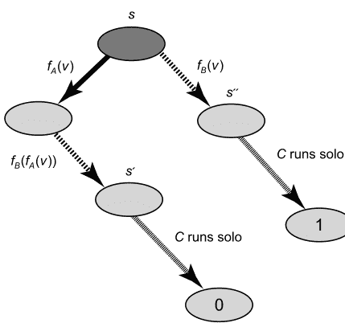

**图 5.15** 案例：两个覆盖的函数。

2. 这些函数是交换的：$f_A(f_B(V)) = f_B(f_A(V))$。令 $s'$ 为 $A$ 应用 $f_A$ 然后由 $B$ 应用 $f_B$ 得到的状态。由于 $s'$ 是 0 值的（0-valent），如果 $C$ 从 $s'$ 开始运行直到完成协议，它将决定为 0。令 $s''$ 为 $A$ 和 $B$ 反向执行其调用时得到的状态。由于 $s''$ 是 1 值的（1-valent），如果 $C$ 从 $s''$ 开始运行直到完成协议，它将决定为 1。问题在于两个可能的寄存器 $f_A(f_B(V))$ 和 $f_B(f_A(V))$ 是相同的，因此 $s'$ 和 $s''$ 仅在 $A$ 和 $B$ 的内部状态上有所不同。$C$ 在不与 $A$ 或 $B$ 通信的情况下完成协议，这两个状态在 $C$ 看来是相同的；因此无法从这两个状态决定不同的值。

# 5.8 compareAndSet 操作

我们考虑 `compareAndSet()` 操作（也称为比较并交换，CAS），这是许多现代架构支持的同步操作（例如 Intel Pentium 上的 `CMPXCH`）。它接受两个参数：*期望值*（expected）和*更新值*（update value）。如果当前寄存器值等于期望值，则将其替换为更新值；否则，值保持不变。该方法返回一个布尔值，表示值是否发生了变化。

## 定理 5.8.1

提供 `compareAndSet()` 和 `get()` 方法的寄存器具有无限共识计数器。

### 证明

图 5.16 显示了一个用于 $n$ 个线程、使用 `AtomicInteger` 类的 `compareAndSet()` 方法的共识协议。线程共享一个 `AtomicInteger` 对象，初始化为常量 `FIRST`，它与任何线程索引都不同。每个线程调用：

```java
class CASensus extends ConsensusProtocol {
    private final int FIRST = -1;
    private AtomicInteger r = new AtomicInteger(FIRST);
    public Object decide(Object value) {
        propose(value);
        int i = ThreadID.get();
        if (r.compareAndSet(FIRST, i)) // 我赢了
            return proposed[i];
        else
            // 我输了
            return proposed[r.get()];
    }
}
```

**图 5.16** 使用 `compareAndSet()` 实现共识。

以 `FIRST` 为期望值的 `compareAndSet()`，并将自己的索引作为新值。如果线程 A 的调用返回 true，则该方法调用在线性化顺序中是第一个。否则，A 决定自己的值。A 读取当前的 `AtomicInteger` 并从 `proposed[]` 数组中获取该线程的输入。

> 我们注意到，图 5.16 中 `compareAndSet()` 寄存器提供的 `get()` 方法只是为了方便，对于协议而言并非必需。

## 推论 5.8.2

仅提供 `compareAndSet()` 的寄存器具有无限共识数。

正如我们在第 6 章中看到的，提供 `compareAndSet()` 等原语操作的机器是顺序计算图灵机的异步等效物。任何可以在此类机器上以无锁方式实现的并发对象。因此，用 Maurice Sendak 的话，`compareAndSet()` 是“万兽之王”。

# 5.9 章节注释

Michael Fischer, Nancy Lynch 和 Michael Paterson [46] 首次证明了在单线程可以停机的消息传递系统中，共识是不可能的。他们的这一开创性论文引入了分布式计算中广泛使用的“二值性”（bivalence）不可性论证风格。M. Louis 和 H. Abu-Amara [116] 以及 Herlihy [69] 首次将这一结果扩展到共享内存。

某些架构提供了类似于 `get()`/`compareAndSet()` 的操作路径，被称为 `load-linked`/`store-conditional`。通常，`load-linked` 方法将一个位置标记为已加载，如果任何线程在加载后修改了该位置，则 `store-conditional` 方法将失败。参见附录 B。

# 5.10 练习

Clyde Kruskal, Larry Rudolph 和 Marc Snir [96] 作为 NYU 超计算机项目的一部分，创造了“读-修改-写”（read–modify-write）操作。Maurice Herlihy [69] 引入了共识数作为衡量计算能力的概念，并首次证明了本章及下一章中给出的大多数不可性和通用性结果。

`Common2` 类包含了几个常见的原语同步操作，它由 Yehuda Afek, Eytan Geiger 和 Han Weiss [5] 定义。练习中使用的“粘位”（sticky-bit）对象源自 Serge Plotkin [140]。

练习 5.24 中具有算术共识数 $n$ 的 $n$-有界 `compare&set(i)` 对象基于 Prasad Jayanti 和 Sam Toueg [90] 的构造。在此处，如果可以从任意数量的 X 实例和任意数量的读写构造无锁共识协议，我们称 X 解决了（问题）。Prasad Jayanti [88] 显示可以定义资源限制，即被限制使用固定数量的 X 实例，或者任何其他层次都是无界限制的粗化。Maurice Sendak 的引用出自《Where the Wild Things Are》[155]。

## 练习 5.1

证明引理 5.1，即每个 $n$ 线程协议都具有二值状态（bivalent state）。

## 练习 5.2

证明在关键状态下，一个必须是 0 值，另一个是 1 值。

## 练习 5.3

证明如果使用寄存器实现 2 线程共识是不可能的，那么 $n$ 线程也是可能的。（提示：通过归约法：如果我们有一个解决 $n$ 线程共识的协议，可以将其转换为 2 线程协议。）

## 练习 5.4

证明如果使用寄存器实现 $n$ 线程共识是不可能的，那么 $k$ 个值的共识也是可能的。

## 练习 5.5

证明使用 $n$-线程二进制对象和寄存器可以实现 $n$ 个值的 $n$-线程共识。

## 练习 5.6

考虑用于二线程共识的算法。

```java
public class ConsensusProposal {
    boolean[] proposed = new boolean[2];
    int[] speed = new int[2];
    Integer[] position = new Integer[2];
    public ConsensusProposal() {
        position[0] = 0;
        position[1] = 0;
        speed[0] = 3;
        speed[1] = 1;
    }
    public void decide(Boolean value) {
        int i = my.get();
        int j = 1 - i;
        proposed[i] = value;
        while (true) {
            position[i] = position[i] + speed[i];
            if (position[i] > position[j]) // 我在前面
                return proposed[i];
            else if (position[i] < position[j]) // 我在后面
                return proposed[j];
        }
    }
}
```

**图 17** 线程 $i \in \{0, 1\}$ 的共识代码。

## 练习 5.7

栈提供两个方法：`push(x)` 将值推入栈顶，`pop()` 移除并返回推入的值。证明栈的共识数恰为 2。

## 练习 5.8

假设我们为 FIFO 队列增加一个 `peek()` 方法，它返回但不移除第一个元素。证明增强后的队列具有共识数。

## 练习 5.9

考虑三个线程 $A, B, C$，它们各有一个 MRSW 寄存器 $X_A, X_B, X_C$，其中一个可以写入，其他可以读取。每对线程共享一个提供 `compareAndSet()` 方法的 RMW 寄存器：$A$ 和 $B$ 共享 $R_{AB}$，$B$ 和 $C$ 共享 $R_{BC}$，$A$ 和 $C$ 共享 $R_{AC}$。只有共享寄存器的线程才能调用该寄存器的 `compareAndSet()` 方法或返回其值。给出一个三线程共识协议并解释其有效，或者给出不可性证明概要。

## 练习 5.10

考虑练习 5.9 描述的情况，但 $A, B, C$ 可以同时对两个寄存器应用 `compareAndSet()`。

## 练习 5.11

在图 5.7 所示共识协议中，如果在从队列中取出后宣布线程的值会发生什么？

## 练习 5.12

`StickyBit` 类具有三种可能的状态：$\perp$, 0, 1，初始为 $\perp$。调用 `write(v)`（其中 $v$ 为 0 或 1）产生影响：

- 如果对象状态为 $\perp$，则变为 $v$。
- 如果对象状态为 0 或 1，则保持不变。

调用 `read()` 返回对象的当前状态。

1. 证明一个对象可以解决任意线程的无锁共识（即所有输入都是 0 或 1）。
2. 证明长度为 $m$ 的 `StickyBit` 对象数组配合寄存器在有 $m$ 个可能输入时可以实现任意线程的无锁共识。（提示：给每个线程一个原子多读写寄存器。）

## 练习 5.13

`SetAgree` 类像 `decide()` 方法一样返回某个线程 `decide()` 调用的输入。但与 `consensus` 类不同，`decide()` 返回的值并不需要达成一致。相反，这些调用可能返回不超过 $k$ 个不同的值。（当 $k=1$ 时，`SetAgree` 等于共识）。当 $k>1$ 时，`SetAgree` 类的共识数是多少？

## 练习 5.14

对于给定的 $\epsilon > 0$，双近似类定义如下：$A$ 和 $B$ 分别调用 `decide(x_a)` 和 `decide(x_b)` 方法，其中 $x_a$ 和 $x_b$ 为实数。这些方法分别返回值 $y_a$ 和 $y_b$，使得 $y_a$ 和 $y_b$ 都在闭区间 $[\min(x_a, x_b), \max(x_a, x_b)]$ 内，且 $|y_a - y_b| \le \epsilon$。注意是非确定性的。近似同意对象的共识数是多少？

## 练习 5.15

一个 `A2cas` 对象代表两个可以单独读取和被修改的位置。如果两个位置具有期望值 $e0$ 和 $e1$，则调用 `a2cas(v)` 将 $v$ 写入两个位置中的恰好一个，且选择是非随机的。`A2cas` 对象的共识数是多少？证明你的论点。

## 练习 5.16

考虑一个通过消息传递通信的分布式系统。类型 $A$ 广播保证：

1. 每个非故障线程最终都会收到每条消息，
2. 如果 $P$ 广播 $M_1$ 然后广播 $M_2$，则每个线程在接收 $M_2$ 之前都会接收 $M_1$，但不同线程广播的消息在不同线程中可能以不同的顺序接收。

类型 $B$ 的广播保证了：

1. 每个非故障线程最终都会获得每条消息，
2. 如果 $P$ 广播 $M_1$ 而 $Q$ 广播 $M_2$，则每个线程以相同的顺序接收 $M_1$ 和 $M_2$。

对于每种广播：

- 如果可能，给出一个共识协议；
- 否则，给出一个不可行性证明思路。

## 练习 5.17

考虑以下两个线程的 `QuasiCons` 问题。两个线程 $A$ 和 $B$ 各被给一个二进制输入。如果两个输入都为 $v$，则两者都必须决定 $v$。如果它们的输入混合，则它们必须达成一致，或者 $B$ 可能决定为 0 而 $A$ 可能决定为 1（但反之亦然）。这里有三个练习题（仅一个有效）：

1. 给出一个使用 `QuasiCons` 的双线程共识协议，证明其共识数（至少）为 2。
2. 给出一个关键状态证明，说明该对象的共识数为 1。
3. 给出一个 `QuasiCons` 的读写实现，从而证明其共识数为 1。

## 练习 5.18

解释为什么如果共享对象实际上是一个共识对象，那么证明共识不可能性的关键状态证明将会失效。

## 练习 5.19

一个团队共识对象提供与共识相同的 `decide()` 方法。只要*最多两个*不同的值是相等的，团队共识对象就能解决共识问题。（如果提议了两个以上的值，则允许任何结果。）展示如何从团队对象的供应中解决具有最多 $n$ 个不同值的 $n$ 线程共识。

## 练习 5.20

一个三元寄存器持有值 $\perp$、0 和 1，并提供通常含义的 `compareAndSet()` 和 `get()` 方法。每个寄存器初始为 $\perp$。给出一个协议，如果线程是二进制的（即 0 或 1），使用一个寄存器解决 $n$ 线程共识。是否可以使用多个寄存器（可能是原子读写）来解决 $n$ 线程共识，即使“线程”输入在 $0...2^K-1$ 范围内（$K>1$）？（你可以假设输入适合原子寄存器。）*重要：* 记住共识协议必须是无等待（wait-free）。

- 设计一个使用最多 $O(n)$ 个三元寄存器的解决方案。
- 设计一个使用 $O(K)$ 个三元寄存器的解决方案。

可以自由使用任何需要的原子寄存器（它们很便宜）。

## 练习 5.21

我们早之前定义了无锁（lock-free）。证明不存在使用读写寄存器针对两个或多个线程的无锁共识实现。

## 练习 5.22

图 5.18 显示使用 `read()`、`write()`、`getAndSet()`（即 swap）和 `getAndIncrement()` 方法实现的 FIFO 队列。你可以假设该队列是线性可化的，并且只要不在空队列上调用 `get()`，它就是无等待的（wait-free）。考虑以下语句序列：

- `getAndSet()` 和 `getAndIncrement()` 方法的共识数均为 2。
- 我们可以通过获取队列的快照（使用之前学习的方法）并返回队列头的元素来简单地添加 `peek()`。
- 使用为练习 5.8 设计的协议，我们可以使用生成的队列解决任何 $n$ 的 $n$-共识。

我们仅使用共识数为 2 的对象构建了一个 $n$ 线程共识协议。

识别这一推理链中的错误步骤，并解释哪里出了问题。

```java
class Queue {
    AtomicInteger head = new AtomicInteger(0);
    AtomicReference[] items = new AtomicReference[Integer.MAX_VALUE];
    void enqueue(Object x) {
        int slot = head.getAndIncrement();
        items[slot].set(x);
    }
    Object dequeue() {
        while (true) {
            int limit = head.get();
            for (int i = 0; i < limit; i++) {
                Object y = items[i].getAndSet(null); // swap
                if (y != null)
                    return y;
            }
        }
    }
}
```

**图 5.18** Queue 实现。


**练习 5.23。** 回想在对 `compareAndSet()` 的定义中，我们注意到严格来说，`compareAndSet()` 不是 $f_{e,u}$ 的 RMW（读-改写）方法，因为 RMW 方法返回的是寄存器的原始值而不是布尔值。使用一个支持 `compareAndSet()` 和 `get()` 的对象提供一个具有线性化 `NewCompareAndSet()` 方法的新对象，该方法返回寄存器的当前值而不是布尔值。

**练习 5.24.** 如下定义一个 $n$ 边界 `compareAndSet()` 对象：它提供一个接受两个值的 `compareAndSet()` 方法，一个期望值 $e$ 和一个更新值 $u$。在前 $n$ 次调用 `compareAndSet()` 时，它的行为类似于传统的 `compareAndSet()` 寄存器：如果值等于 $e$，则被原子地替换为 $u$，并且方法调用返回 `true`。如果值 $v$ 不等于 $e$，则保持不变，方法调用返回 `false` 以及值 $v$。在调用 $n$ 次 `compareAndSet()` 之后，它将进入失败状态。显示 $n$ 边界的对象的共识数为 $n$。

**练习 5.25。** 提供一个使用 `compareAndSet()` 对象的无等待（wait-free）团队共识实现。

**练习 5.26。** 在我们的定理 5.1 的证明中，使用 $(2,3)$-赋值对象足够的吗？

**练习 5.27。** 我们可以通过一个知道我们的策略并能够控制硬币的对手来处理共识。假设硬币投掷是可以控制的。图 5.19 展示了这种共识协议是错误的。

- 算法满足有效性（validity）吗？
- 它以接近 1 的概率终止吗？

**练习 5.28。** 使用读写寄存器的无锁（lock-free）共识实现，对于两个或多个线程是有效的。然而，这种无阻塞（obstruction-free）对于系统是有效的吗？

# 共识的通用性

# 6

## 6.1 引言

在第 5 章中，我们考虑了形式为“使用 $Y$ 没有 $X$ 的无等待实现”的简单技术。我们考虑了确定性的规范。^1 推导出一个层次，其中一个层次的对象无法实现更高层次的对象（见图 6.1）。回顾每个对象都有关联的*共识数*，它是能够解决共识问题的最大线程数。在 $n$ 线程系统中，从共识数小于 $n$ 的对象构建无等待实现是不可能的。除非另有说明，否则结果同样适用于锁实现。第 5 章的不可能结果并不意味着无等待同步是不可能的或不可行的。在本章中，我们展示了某些对象类是*通用的*：给定足够的共识对象，可以构造任何并发对象。

一个类在 $n$ 线程系统中是通用的，当且仅当它的共识数大于或等于 $n$。在图 6.1 中，每个类 $n$ 对于 $n$ 个线程都是通用的。机器架构或编程语言能够支持任意无等待同步的前提是它提供了通用类的原语。例如，具有 `compareAndSet()` 操作的现代处理器对于任意数量的线程都是通用的：它们可以无等待地实现任何并发对象。

本章描述了从共识对象实现任何并发对象的*通用构造*。本章并没有*描述*实现无等待对象的实用技术。与经典的计算理论不同，理解通用构造及其影响使我们能够避免尝试无法解决问题的错误。一旦我们理解了为什么共识强大到可以实现任何对象，我们将更好地准备好使此类构造高效所需的工程工作。

> ^1 非确定性对象的情况要复杂得多。

The Art of Multiprocessor Programming, https://doi.org/10.1016/B978-0-12-415950-6.00015-X

Copyright © 2021 Elsevier Inc. All rights reserved.

129

# 130 第 6 章 共识的通用性

| 编号 | 对象 |
|---|---|
| 1 | 原子寄存器 |
| 2 | `getAndSet()`, `getAndAdd()`, Queue, Stack |
| m | (m,m(m+1)/2) 赋值 |
| ∞ | 内存间移动, `compareAndSet()`, load-linked/store-conditional |

*a 详情请参阅附录 B。

# 图 6.1

并发可计算与同步操作的通用性层级。

## 6.2 通用性

如果能够从若干数量的 C 和若干数量的读写寄存器构造出任何对象的无等待（wait-free）实现，则称 C 是通用的。我们的构造使用了多个类为 C 的对象，因为我们最终感兴趣的是理解机器指令的同步能力，而大多数架构都允许这些指令应用于多个内存位置。我们允许实现使用多个读写寄存器，是因为这样做方便记账，而且在现代架构上内存通常是充足的。为了避免分散，我们使用了无限数量的读写寄存器和共识对象，将内存回收问题留作练习题。我们首先展示一个无锁（lock-free）实现，稍后扩展到一个稍微复杂的无等待实现。

## 6.3 一种无锁通用构造

图 6.2 显示了基于第 3 章的调用-响应表述的顺序化对象的通用定义。每个对象都在固定的初始状态下被创建。`apply()` 方法接收一个调用作为参数，描述被调用的方法及其参数，并返回一个包含调用结束信息的响应。

```java
public interface SeqObject {
    public abstract Response apply(Inv invoc);
}
```

# 图 6.2

一个通用的顺序化对象：`apply()` 方法应用调用并返回响应。

## 6.3 一种无锁通用构造 131

```java
public class Node {
    public Invoc invoke(); // 方法名和参数
    public Consensus<Node> decideNext(); // 决定列表中的下一个 Node
    public Node next; // 下一个节点
    public int seq; // 序列号
    public Node(Invocation invoke) {
        invoke = invoke;
        decideNext = new Consensus<Node>();
        seq = 0;
    }
    public static Node max(Node[] array) {
        Node max = array[0];
        for (int i = 1; i < array.length; i++) {
            if (max.seq < array[i].seq)
                max = array[i];
        }
        return max;
    }
}
```

# 图 6.3

Node 类。

（正常或异常）以及返回值（如果有的话）。例如，栈的调用可能是带参数的 `push(x)`，相应的响应将是 `normal` 且 `void`。

图 6.3 和 6.4 展示了一种通用构造，它可以将任何顺序化对象转换为一个无锁的可线性化并发对象。这种构造假设顺序化对象是确定性的：如果我们对处于特定状态的对象应用某种方法，那么将只有一种可能的响应和一个新的对象状态。我们可以将任何对象表示为其初始状态下的顺序化对象和一个日志（log）的组合：日志是一个节点列表，表示应用于对象的方法调用序列（因此也是对象状态转换的序列）。线程通过将新调用添加到日志头部来执行。它从尾部到头部遍历日志，在对象的私副本上应用方法调用。线程返回其自身操作的结果。需要理解的是，只有日志的头部是可变的：初始状态和头部之前的节点永远不会改变。

我们如何让这种基于日志的构造变为并发，从而允许线程并发地调用 `apply(i)`？尝试调用 `apply(i)` 的线程会创建一个节点来持有其调用。然后，线程通过运行一个 n 线程共识协议来就哪个节点被添加到日志中达成一致，竞争将各自的节点附加到日志头部。该共识的输入是线程节点的引用，结果是唯一的获胜节点。

获胜者继续计算其响应。它通过创建顺序化对象的本地副本并从尾部开始、沿着 `next` 引用遍历日志，将日志中的操作应用到其副本上。

# 第 6 章 共识的通用性

```java
public class LFUniversal {
    private Node[] head;
    private Node tail;
    public LFUniversal() {
        tail = new Node();
        tail.seq = 1;
        for (int i = 0; i < n; i++) {
            head[i] = tail;
        }
    }
    public Response apply(Invocation invoc) {
        int i = ThreadId.get();
        Node prefer = new Node(invoc);
        while (prefer.seq == 0) {
            Node before = Node.max(head);
            Node after = before.decideNext.decide(prefer);
            before.next = after;
            after.seq = before.seq + 1;
            head[i] = after;
        }
        SeqObject myObject = new SeqObject();
        Node current = tail.next;
        while (current != prefer) {
            myObject.apply(current.invoc);
            current = current.next;
        }
        return myObject.apply(current.invoc);
    }
}
```

# 图 6.4

无锁通用构造。

从尾部开始，将日志中的操作应用到副本上，最后返回与其自身调用相关的响应。当 `apply()` 调用并发执行时，该算法有效，因为直到头部的日志前缀永远不会改变。未被选中的失败线程必须再次指向头部。

我们现在详细考虑这种构造。无锁通用构造的代码见图 6.4。对象状态由节点链表列表定义，每个节点包含一个调用。节点的代码见图 6.3。`seq` 字段是节点的序列号，当节点尚未连接到列表时为 0，否则为正数。列表中后续节点的序列号加 1。初始日志由一个序列号为 1 的唯一哨兵节点组成。设计并发无锁通用构造的困难之处在于共识对象只能使用一次。在我们图 6.4 的无锁算法中，每个线程分配一个持有其调用的节点，并重复此操作将该节点添加到日志头部。每个线程都有一个 `decideNext` 字段，这是一个共识对象。线程通过对头部的 `decideNext` 字段进行提议来尝试附加其节点。由于未参与共识的线程可能需要遍历列表，因此共识的结果存储在节点中。当线程附加节点时，它是日志的一部分，线程设置其序列号。

# 6.3 一种无锁通用构造 133


# 图 6.5

无锁通用构造的执行。线程 2 通过在哨兵节点的 `decideNext` 上赢得共识附加日志中的第二个节点。然后它将序列号从 0 设置为 2，并通过 `head` 数组中的项引用它。线程 7 加载哨兵节点的 `decideNext`，设置后续节点的后续引用和序列号为 2（这些值已被线程 2 设置为相同的值），并引用其 `head` 数组。线程 5 附加第三个节点，更新其序列号为 3，并更新其 `head` 数组中的项。最后，线程 2 附加第四个节点，将其序列号设置为 4，并通过其 `head` 数组中的项引用它。`head` 数组中的最大值跟踪日志头部。

> ² 创建可重复使用的共识对象，甚至是决策可读的对象，并不是一项简单的任务。这本质上与我们即将设计的通用构造问题相同。例如，考虑 5.4 节中基于队列的共识协议。并不清楚如何使用队列在共识决定后允许重复读取共识对象的状态。

# 第 6 章 共识的通用性

自己的调用。注意，当一个线程计算其响应时，其所有前驱节点的 `next` 引用必须被设置，因为这些节点已经添加到列表的头部。任何向列表添加节点的线程都已使用 `decide()` 共识的结果更新了其前驱节点的 `next` 引用。

我们如何找到日志的头部呢？我们不能通过共识对象来跟踪头部，因为头部必须反复更新，而共识对象只能由每个线程访问。相反，我们使用类似于二进制算法（第 2.7 节）中使用的每个线程结构。我们使用一个 `n` 元素的数组 `head[]`，其中 `head[i]` 是列表中最后一个发布的节点。初始时，所有条目都指向尾部哨兵节点（tail sentinel node）。头部是 `head[]` 中引用的节点中序列号最大的节点。图 6.3 中的 `max()` 函数执行收集，返回序列号最高的节点。

该构造是顺序对象（sequential object）的线性化实现。每个 `apply()` 都可以线性化为将节点添加到日志的 `decide()` 调用。

为什么这个构造是无锁（lock-free）的？头部（最新追加的节点）在有限步内添加到 `head[]` 中。前驱节点必须出现在 `head` 数组中，因此反复添加新节点的节点都不会反复对 `head` 数组运行 `max()`。它检测到该前驱节点，对其 `decide()` 字段应用共识，并更新节点字段，包括其序列号。最后，它将决定的节点存储在 `head[]` 中。线程反复失败将其自己的节点添加到日志的唯一方法，是其他节点在不断完成它们的调用，这意味着该构造是无锁的。

## 6.4 无等待通用构造

我们如何让无锁算法变为无等待（wait-free）的？完整的无等待算法见图 6.6。我们必须保证每个线程都能在有限步内完成 `apply()` 调用；为了保证这一属性，进展比其他线程慢的线程会完成它们的调用。这种帮助模式（helping pattern）在其他无等待算法中以特殊形式出现。

为了实现这一点，每个线程与其他人共享一个 `n` 元素的 `announce[]` 数组，其中 `announce[i]` 是线程 `i` 当前正尝试添加到列表的节点。初始时，所有条目指向哨兵节点，其序列号为 1。线程 `i` 发布一个节点并将其存储在 `announce[i]` 中。

要执行 `apply()`，线程发布其新节点。这确保了如果线程没有成功将其节点添加到日志，其他线程可以代表它添加该节点。它像以前一样继续，尝试将节点添加到日志。为了这样做，它只读取一次 `head[]` 数组（第 15 行），然后进入算法的主循环，该循环一直执行到其自己的节点被添加到列表（在第 16 行其序列号变为非零后检测到）。这是与无锁算法的不同。线程首先检查 `announce[]` 数组中前面是否有需要帮助的节点（第 18 行）。需要被帮助的节点必须动态确定，因为节点不断被添加到日志中。线程按递增顺序尝试帮助 `announce[]` 数组中的节点。

```java
public class Universal {
    private Node[] announce; // 用于协调帮助的数组
    private Node[] head;
    private Node tail = new Node();
    public Universal() {
        tail.seq = 1;
        for (int j = 0; j < n; j++) {
            head[j] = tail;
            announce[j] = tail;
        }
    }
    public Response apply(Invocation invoke) {
        int i = ThreadID.get();
        announce[i] = new Node(invoke);
        head[i] = Node.max(head);
        while (announce[i].seq == 0) {
            Node before = announce[(before.seq + 1) % n];
            if (help.seq == 0)
                prefer = help;
            else {
                prefer = announce[i];
                Node after = before.decideNext.decide(prefer);
                before.next = after;
                after.seq = before.seq + 1;
                head[i] = after;
            }
        }
        head[i] = announce[i];
        SeqObject myObject = new SeqObject();
        Node current = tail.next;
        while (current != announce[i]) {
            myObject.apply(current.invoc);
            current = current.next;
        }
        return myObject.apply(current.invoc);
    }
}
```

# 图 6.6

无等待通用构造。


由序列号对 `announce[]` 数组宽度 `n` 取模决定。我们证明了该序列保证了任何无法通过自身取得进展的节点，一旦其所有者的索引匹配最大序列号 `n`，最终会被其他人帮助。如果省略了这一帮助步骤，单个线程可能会被任意次数地超越。如果选定的用于帮助的节点不需要帮助（即第 19 行其序列号非零），则每个线程尝试添加自己的节点（第 22 行）。（所有 `announce[]` 数组都初始化为 `head[]`，序列号为 1。）算法的其余部分与无锁算法几乎相同。当节点的序列号变为非零时，该节点被追加。

# 第 6 章 共识的通用性

```java
public Response apply(Invocation invoc) {
    int i = ThreadID.get();
    announce[i] = new Node(inv); start(i) = max(head); conj(i) = {};
    head[i] = Node(max(head));
    while (announce[i].seq == 0) {
        Node node = head[i];
        Node help = announce[(before.seq + 1) % n];
        if (help.seq == 0)
            prefer = help;
        } else {
            prefer = announce[i];
            Node next = before.nextdecide(prefer);
            before.next = after;
            after.seq = before.seq + 1;
            head[i] = after; (VJ)(conj(j) = conj(j) U (after));
        }
    }
    head[i] = announce[i]; (VJ)(conj(j) = conj(j) U (after));
    SeqObject setObject = new SeqObject();
    Node current = tail.next;
    while (current != announce[i]) {
        MyObject.apply(current.invoc);
        current = current.next;
    }
    return MyObject.apply(current.invoc);
}
```

图 6.8

带有辅助变量的无锁通用构造的 `apply()` 方法。尖括号中的操作假设为原子性发生。

图 6.8 反映了辅助变量及其更新方式。例如，语句

> `(conj(j) = conj(j) U (after))`

该语句表示该节点被添加到所有线程 $j$ 的 `conj(j)` 中。尖括号内的代码语句被认为是原子执行的。这种原子性是可以假设的，因为辅助变量不会以任何方式影响计算。为了简洁起见，我们略微滥用了符号，让函数 `max()` 应用于节点或节点数组时返回它们序列号中的最大值。以下属性在通用构造的执行过程中是不变的：

```
|conj(A)| + start(A) = max(head).
```

**引理 6.4.1.** 对于所有线程 $A$，以下断言成立：

```
|conj(A)| > n ⇒ announce[A] ∈ head].
```

## 6.4 一种无锁构造 139

证明。设 $a = announce[A]$。如果 $|concur(A)| > n$，则 $concur(A)$ 包含了连续的数字 $b$ 和 $c$（附加到线程 $B$ 和 $C$ 的日志中），它们的相应序列号 1 分别等于 $A-1$ 和对模 $n$（注意 $B$ 和 $C$ 是向日志中添加 $b$ 和 $c$ 的线程，但不一定是发布它们的线程）。线程 $C$ 在执行第 18-22 行时追加到位于 `announce[A]` 的日志，它已经添加到了日志中。我们需要证明当 $C$ 读取 `announce[A]` 时，$A$ 已经发布了 $a$，因此 $c$ 添加到日志，或者 $a$ 已经在此添加。当 $c$ 被添加到 `head[j]` 且 $|concur(A)| > n$ 时，$a$ 在 `head[j]` 中，这符合引理的要求。

为了理解为什么当 $C$ 到达第 18-22 行时，$a$ 必须已经发布，并不是 (1) 意味着 $B$ 在 $C$ 于第 17 行从之前的 `head[j]` 读取 $b$ 之前已添加到日志，并且因为 $b$ 在 `concur(A)` 中，$A$ 在 $b$ 添加到 head 之前发布了。根据 (1) 和 (2)，可以推出 $A$ 在 $C$ 执行第 18-22 行之前已经发布了。

引理 6.4.1 对方法调用进行期间可以追加的节点数量设定了限制。我们现在有一系列引理证明，$A$ 完成了 `head[j]` 数组的发布，要么 `announce[A]` 被追加，要么 `head[A]` 在列表末尾有 $n+1$ 个节点。

## 引理 6.4.2. 下述属性成立：

`max(head[j]) \ge start(A)`。

证明。`head[j]` 的序列号是非递减的。

## 引理 6.4.3. 以下是图 6.3 第 13 行的循环不变量（即在循环的每次迭代中都成立）：

`max(max, head[i]), \dots, head[n–1] \ge start(A)`。

其中 $i$ 是循环索引，$max$ 是目前为止找到的序列号最大的节点，$A$ 是执行循环的线程。循环 $i$ 的当前值在 $A$ 发布时永远不会小于数组中的最大值。

证明。当 $i=1$ 时，该断言由引理 6.4.2 隐含（因为 `max = head[0]`）。该断言的真值在每次迭代中得以保持，此时 `max` 被序列号为 `max(max, head[i])` 的节点替换。

## 引理 6.4.4. 下述断言在图 6.8 第 16 行之前成立：

`head[A].seq \ge start(A)`。

## 第 6 章 共识的通用性

证明。在调用第 15 行的 `node.max` 后，结果遵循引理 6.4.3；否则，`head[A]` 在第 26 行被设置为 $A$ 最后一次追加的节点，这使得 `head[A].seq` 增加了 1。

### 引理 6.4.5. 下述属性始终成立：

`|concur(A)| \ge head[A].seq - start(A)`。

## 定理 6.4.6. 图 6.6 中的算法是正确的且无锁的。

证明。为了证明算法是无锁的，注意 $A$ 最多只能逃离 $n+1$ 次迭代。在每次成功的迭代中，`head[A].seq` 增加 1。在 $n+1$ 次迭代后，引理 6.4.5 意味着 `|concur(A)| \ge head[A].seq - start(A)`。

## 6.5 章节注记

这里通过 Maurice Herlihy 1991 年的论文描述了通用构造。这种构造的复杂性可以通过几种方式改进。Afek, Dalia 和 Touitou [3] 表明无锁性取决于线程数量。Anderson 和 Mark Moor [11] 将该构造扩展到了多个对象。Prasad [65] 展示了如何，Jayant, Prasad [89] 表明任何通用构造都有 $\Omega(n)$，其中 $n$ 是线程数。Tushar Chandra, Jayant 和 Kind [27] 识别了一类存在更高效通用构造的对象。我们对进展状态的分类对共享内存计算性有影响。Lamport 的方法 [99,105] 基于无锁。同样，Herlihy 的 [69] 适用于无锁。结合起来，这些结构构成了共享内存计算性的基础。人们可能会问为什么这种理论应该建立在阻塞条件（即无锁或无阻塞）而不是锁。

## 6.6 习题 141

锁在实践中很常见。此外，无阻塞条件是一种非阻塞进展条件，读写寄存器 [68]有效地平衡了共识层级。惊讶的是，图 3.10 表明无锁和无阻塞条件提供了可靠的基础（即它们不依赖操作系统的良好行为）。基于依赖条件的理论会对执行环境提出任意假设。在研究同步原语的能力时，依赖操作系统来确保进展是令人不满意的，因为它掩盖了内在的同步能力，而且我们可能希望使用带有查看操作的原语。它允许 $n$ 个线程按照标准的 LIFO 语义执行 `push()` 和 `pop()`。此外，它增加了一个查看操作，前 $k$ 次调用返回栈底元素（最近添加的元素），而不将其弹出。在之前的 $k$ 次调用之后，查看返回空。当栈为空时，查看返回空。

**习题 6.1.** 考虑一个并发原子 `PeekableStack<t>` 对象：带有查看操作的栈。它允许 $n$ 个线程按照标准的 LIFO 语义执行 `push()` 和 `pop()`。此外，它增加了一个查看操作，前 $k$ 次调用返回栈底元素（最近添加的元素），而不将其弹出。在之前的 $k$ 次调用之后，查看返回空。当栈为空时，查看返回空。

- 是否可以使用任意多个 `PeekableStack(1)`（即 $k=1$）对象和读写寄存器构造出一个无锁队列（由任意线程访问）？证明你的论点。

- 是否可以使用任意多个原子 `Stack` 对象和读写寄存器构造出一个无锁的 $n$ 线程 `PeekableStack(2)` 对象？证明你的论点。

**习题 6.2.** 给出一个例子，展示通用构造在非确定性规范下如何失败。

**习题 6.3.** 提出一种方法来修复图 6.8 中的通用构造，使其适用于非确定性顺序规范。

**习题 6.4.** 在无锁和无阻塞的通用构造中，列表末尾哨兵节点的序列号初始设为 1。如果哨兵节点的数字初始设为 0，这些算法中（如果有）哪些会停止正常工作？

**练习 6.5.** 在无锁通用构造中，每个线程都有其自己的对头指针的视图。为了添加一个新的方法调用，在图 6.4 的第 14 行，线程会从这些头指针中选择最远的一个：

```
Node before = Node.max(head);
```

考虑将此行更改为：

```
Node before = head[1];
```

该构造仍然有效吗？

**练习 6.6.** 假设你不是使用通用构造，而是简单地想使用一个具有 `read()` 和 `compareAndSet()` 方法的无等待线性化寄存器。你将如何适配该算法来实现这一点。

**练习 6.7.** 在第 6.4 节所示的无等待通用构造中，每个线程都会寻找另一个线程来帮助，然后尝试添加自己的节点。假设在内部，每个线程首先尝试添加自己的节点，然后尝试帮助其他线程。解释这种方法是否有效，并给出你的答案的理由。

**练习 6.8.** 在图 6.4 的构造中，我们使用“头”的“分布式”实现（引用其尝试修改的字段的节点）来避免创建一个允许重复共识的对象。将此实现替换为完全没有头引用的实现，通过从开始遍历日志来找到下一个“头”，直到到达一个序列号为 0 或具有最高非零序列号的节点。

**练习 6.9.** 在无等待协议中，线程在第 28 行将其新添加的节点添加到 `head[]` 数组中，而它可能已经在第 26 行添加过它。如果在无锁协议中只执行一次，是否存在该线程的节点被另一个线程在第 26 行添加了，并且“帮助”操作在更新节点序列号之后更新 `head[]` 之前在第 26 行停止了？

- 1. 解释删除第 28 行如何违反引理 6.4.4。

- 2. 该算法仍然有效吗？

**练习 6.10.** 提出一种修复通用构造的方法，使其能够在有限内存工作，即有限数量的共识对象和有限数量的寄存器。

提示：在节点中添加一个 `before` 字段，并在代码中建立一个内存回收方案。

**练习 6.11.** 实现一个共识对象，每个线程通过 `read()` 和 `compareAndSet()` 方法访问它多次，创建一个“多次访问”的共识对象。不要使用通用构造。

**练习 6.12.** 你的任务是将顺序栈实现转换为无等待、线性化的栈实现，而不考虑效率或内存使用问题。

你被给了一个“黑盒”的 `Sequence` 类型，它具有以下方法：你可以原子地将一个项附加到序列末尾。例如，如果序列是 (1, 2, 3)，你添加了 4，则序列将变为 (1, 2, 3, 4)。此操作是无等待且线性化的：如果一个并发线程尝试添加 5，序列将变为 (1, 2, 3, 4, 5) 或 (1, 2, 3, 5, 4)。注意，`Sequence` 项不必非是整数；它们可以是你喜欢的任何对象。

你还可以遍历序列的元素。在这里，我们遍历一个序列并打印每个值，直到我们看到字符串 "stop" 为止。

```java
foreach x in s {
  if (x == "stop") break;
  System.out.println(x)
}
```

（注意，如果你在遍历序列时另一个线程正在添加新值，你可能会永远持续。）

使用一个原子序列对象实现一个无等待线性化的栈，并可以使用任意数量的原子读写内存和顺序栈对象。你的栈应该支持具有通常含义的 `push()` 和 `pop()` 操作。再次，不要担心效率或内存使用。

简要解释为什么你的构造是无等待且线性化的（特别是识别出线性化点）。

# 第 7 章 自旋锁与竞争

在为单处理器编写程序时，通常忽略底层系统的体系架构细节是安全的。遗憾的是，多处理器编程尚未达到那种状态；目前，理解底层的机器架构至关重要。本章的目标是解释架构如何影响性能，以及如何利用这些知识来编写高效的并发程序。我们重新审视熟悉的互斥问题，其目的是设计出在当今多处理器上运行良好的互斥协议。

任何互斥协议都提出了一个问题：“如果你无法获取锁该怎么办？”有两种替代方案。如果你继续尝试，该锁被称为自旋锁（spin lock），反复测试锁被称为自旋（spinning）或忙等待（busy-waiting）。Filter 和 Bakery 算法都是自旋锁。当你预计锁延迟很短时（当然仅在多处理器上），自旋是有意义的。另一种方案是挂操作系统在你的处理器上调度另一个线程，这有时被称为阻塞（blocking）。从一个线程切换到另一个线程是昂贵的，只有当你预计锁延迟很久时，阻塞才有意义。许多操作系统混合了这两种策略：自旋一段时间然后阻塞。自旋和阻塞都是重要的技术。在本章中，我们将关注使用自旋的锁。

## 7.1 欢迎来到现实世界

我们通过 `java.util.concurrent` 包中的 `Lock` 接口来处理现实世界的互斥。目前，我们只考虑两个主要方法：`lock()` 和 `unlock()`。正如 Prisma 2.2 节所述，这些方法的使用方式如下：

```java
Lock mutex = new LockImpl(...); // lock
mutex.lock();
try {
    // body
} finally {
    mutex.unlock(); // unlock
}
```

# 第 7 章 自旋锁与竞争

我们创建一个名为 `mutex` 的新 `Lock`（1行）。由于 `Lock` 是一个接口而不是类，我们无法直接创建 `Lock` 对象。（`java.util.concurrent.locks` 包包含了几个实现 `Lock` 的类。）接下来我们获取锁（3行），并进入 `try` 块中的临界区（4行）。`finally` 块（6行）确保无论如何都会释放锁。（Java 不允许在程序行之间执行异常，因此一旦3完成并获取锁，线程就在 try 块中。）

为什么不使用第 2 节中的 Lock 算法？一个原因是第 2 节中的空间下界：无论我们做什么，互斥的读写与线程数 $n$ 成线性。情况更糟。

例如，考虑第 2 节中的双线程锁算法，如图 7.1 所示。存在带有 0 和 1 的变量。当线程 A 获取锁时，它将 `flag[A]` 设置为真，将 `victim` 设置为 A，以及 `flag[1 - A]`。只要 `victim` 为 A 或 `flag[1 - A]` 为真，线程就会自旋，重复测试。一旦 `victim` 为 A 或 `flag[1 - A]` 为假，线程进入临界区，并在离开时将 `flag[A]` 设置为假。我们从第 2 节知道 Peterson 锁提供了无饥饿的互斥。

假设我们编写了一个并发程序，其中每个线程都反复获取锁：

```java
class Peterson implements Lock {
    boolean[] flag = new boolean[2];
    int victim;
    public void lock() {
        int i = ThreadID.get(); // 要么0，么1
        int j = 1-i;
        flag[i] = true;
        victim = i;
        while (flag[j] && victim == i) {}; // 自旋
    }
}
```

图 7.1

Peterson 类（第 2 节）：第 7-9 行的读写顺序对于提供互斥至关重要。

那么，在如此弱的内存一致性保证下，如何编写多处理器程序？为了防止由于写缓冲区引起的操作重排序，现代架构提供了一种特殊的内存屏障指令（有时称为内存栅），它强制使待处理的操作生效。同步-

# 第 7 章 自旋锁与竞争

`AtomicInteger` 的 `getAndSet()` 和 `compareAndSet()` 等方法在许多架构上都包含内存屏障（memory barrier），就像对 `volatile` 字段的读写一样。程序员有责任知道哪里需要内存屏障（例如，可以通过在每次读取之前插入屏障来修复 Peterson 锁）。我们将在下一节中讨论如何在 Java 中实现这一点。

令人惊讶的是，内存屏障的开销是非常昂贵的，因此我们希望尽量减少它们的使用。由于 `getAndSet()` 和 `compareAndSet()` 等操作的共识数比读写更高，并且它们可以用直接的方法来实现关于谁可以和不能进入临界区域的某种共识，因此可能我们需要设计直接使用这些操作的互斥算法。

## 7.2 volatile 字段和原子对象


根据经验法则，任何被并发线程访问且未受临界区保护的对象字段都应该声明为 `volatile`。如果没有此类声明，该字段将无法像原子寄存器那样工作：读取可能会返回旧值，写入可能会被延迟。

> `volatile` 声明并不能使复合操作原子化：如果 `x` 是一个 `volatile` 变量，当并发线程修改它时，表达式 `x++` 不一定会增加 `x`。对于此类任务，`java.util.atomic` 包提供了如 `Atomic<T>` 或 `AtomicInteger` 等类，它们提供了许多原子操作。

在前面的章节中，我们没有在伪代码中放置 `volatile` 声明，因为我们假设内存是线性化的。然而，从现在开始，我们假设 Java 内存模型，并在需要的地方放置 `volatile` 声明。Java 内存模型在附录 A.3 中有详细描述。

## 7.3 测试设置锁

每个多处理器架构上主要的同步指令是测试设置指令。它作用于单个内存字（或字节），该字的值可以为真，也可以为假。测试设置指令的共识数为二，它会原子地将真值存储在字中，并返回该字之前的值；也就是说，是将该字的值交换为新值。从表面上看，测试设置似乎是实现自旋锁的理想选择：当该字的值为假时，锁是空闲的；当为真时，锁是忙碌的。`lock()` 方法反复对该字应用测试设置，直到其返回假（即直到锁空闲）。`unlock()` 方法简单地向其写入假。

图 7.2 中的 `TASLock` 类使用 `java.util.concurrent` 包中的 `AtomicBoolean` 类在 Java 中实现了这种锁。该类存储一个布尔值，并提供一个 `set(b)` 方法用值 `b` 替换所存储的值，以及 `getAndSet(b)` 原子地将当前值替换为 `b` 并返回先前的值。测试设置指令等同于 `getAndSet(true)`。（我们遵循惯例，在正文中使用“测试设置”，但在代码示例中使用 `getAndSet(true)` 以兼容 Java。）

```java
public class TASLock implements Lock {
    AtomicBoolean state = new AtomicBoolean(false);
    public void lock() {
        while (state.getAndSet(true)) {}
    }
    public void unlock() {
        state.set(false);
    }
}
```

**图 7.2 TASLock 类。**

现在考虑 `TTASLock`，它是 `TASLock` 的一种变体，被称为“测试-测试-再设置”锁。

```java
public class TTASLock implements Lock {
    AtomicBoolean state = new AtomicBoolean(false);
    public void lock() {
        while (true) {
            if (state.get()) {
                if (state.getAndSet(true))
                    return;
            }
        }
    }
    public void unlock() {
        state.set(false);
    }
}
```

**图 7.3 TTASLock 类。**

在这一算法中，线程在执行测试设置之前会先读取锁以检查它是否空闲。如果锁未空闲，线程会反复读取锁直到它空闲为止（即 `get()` 返回假），只有在此之后，线程才会应用测试设置。从正确性的角度来看，`TASLock` 和 `TTASLock` 是等价的。它们都保证了无死锁的互斥。在我们目前为止使用的简单模型下，这两个算法之间应该没有区别。

我们如何在真实的多处理器上进行比较？测量 $n$ 个线程执行固定次数短临界区所需耗时的实验无一例外地产生如图 7.4 所示的结果。每个数据点代表相同的工作量，因此在没有竞争影响的情况下，所有曲线都应该是平的。顶部的曲线是 `TASLock`，中间的曲线是 `TTASLock`，底部的曲线显示了线程完全不干扰所需的时间。差异是巨大的：`TASLock` 的性能非常糟糕；`TTASLock` 的性能虽然好得多，但远未达到理想。

**图 7.4 TASLock、TTASLock 以及无开销理想锁的性能示意图。**

为了理解这些结果，我们必须研究现代多处理器的架构。首先，提醒一点：现代多处理器具有多种架构，我们必须小心过度概括。尽管如此，所有现代多处理器都有缓存。缓存是一种小而快速的内存，存储主内存数据的副本。当处理器需要访问数据时，它首先检查缓存。如果数据在缓存中，则称为缓存命中，访问速度很快。如果不在，则为缓存缺失，必须从主内存获取数据，这要慢得多。

在多处理器系统中，每个处理器都有自己的缓存。这导致了缓存一致性问题：多个处理器可能拥有同一内存位置的副本。如果一个处理器修改了它的副本，其他缓存中的副本就会失效。为了防止这种情况，使用了缓存一致性协议来确保所有处理器看到一致的内存。

缓存一致性协议有两种：监听和基于目录。在监听协议中，每个缓存都会监控（嗅探）总线上的事务。当处理器写入一个内存位置时，它在总线上传播写入操作，其他缓存失效或更新其副本。在基于目录的协议中，目录跟踪哪些缓存持有哪些内存位置。当处理器想要写入某个位置时，它向目录发送请求，目录随后向持有该位置的缓存发送失效消息。

自旋锁的性能很大程度上取决于它们如何与缓存一致性协议相互作用。在 `TASLock` 中，每次尝试获取锁都会涉及原子操作，该操作会导致所有其他处理器的缓存失效。这产生了大量的总线流量，可能会减慢系统。`TTASLock` 通过在执行原子操作之前在本地读取锁改进了这一点。如果锁被占用，线程会在本地缓存副本上自旋，不会产生任何总线流量。只有当锁空闲时，线程才会尝试原子操作。

这种本地自旋（即线程重新读取缓存值而不是使用总线）的概念是设计高效自旋锁的一个至关重要的原则。

## 7.4 指数退避

我们现在考虑如何通过减少线程释放锁且许多线程等待获取锁时的总线流量来改进 `TTASLock`。首先，是一些术语：*Contention*（竞争）在多个线程尝试获取锁时发生。*高竞争*意味着有很多线程；*低竞争*意味着线程很少。如上所述，尝试获取一个高竞争状态的锁是一个坏主意：这种尝试会在线程获取锁的概率微乎其微时产生总线流量（造成交通拥堵）。相反，让线程退避一段时间会更有效，这为竞争的线程提供了完成操作的机会。

回想在 `TTASLock` 类中，`lock()` 方法包含两个步骤：它反复读取锁直到它是释放状态，然后通过调用 `getAndSet(true)` 尝试获取锁。这里有一个关键观察：如果线程在第二步中未能获取锁，那么在第一步和第二步之间其他某个线程获取了锁，很可能是那里存在高竞争。这里有一种简单的方法：每当线程看到锁已释放但未能获取锁时，它会在重试之前进行退避。为了确保竞争的线程不会陷入步调一致（即同时退避并尝试获取锁），线程会随机持续一段时间进行退避。

线程在重试之前应该退避多久？一个很好的经验法是：失败尝试的次数越多，竞争的可能性就越高，线程退避的时间也应该越长。为了引入这一规则，每当线程尝试加锁失败时，它会将预期的退避时间翻倍，直到达到一个固定的最大值。

由于退避是锁算法中常见的策略，我们将此逻辑封装在一个简单的 `Backoff` 类中，如图 7.5 所示。该构造函数接受两个参数：`minDelay`（初始延迟，退避很短的时间）和 `maxDelay`（最大延迟，有必要限制以防止不幸的线程退避太久）。`limit` 字段控制当前延迟。`backoff()` 方法计算一个从 0 到当前限制之间的随机延迟，并在重试之前阻塞线程。它会将下一次退避的限制翻倍，最高直到 `maxDelay`。

```java
public class Backoff {
    final int minDelay, maxDelay;
    int limit;
    public Backoff(int min, int max) {
        minDelay = min;
        maxDelay = max;
        limit = minDelay;
    }
    public void backoff() throws InterruptedException {
        int delay = ThreadLocalRandom.current().nextInt(limit);
        limit = Math.min(maxDelay, 2 * limit);
        Thread.sleep(delay);
    }
}
```

**图 7.5 Backoff 类：自适应退避逻辑。**

图 7.6 显示了 `BackoffLock` 类。它使用一个 `Backoff` 对象，其最小和最大退避持续时间由常量 `MIN_DELAY` 和 `MAX_DELAY` 控制。注意，线程仅在未能获取一个它立即观察到为释放状态的锁时才会进行退避。观察到锁被另一个线程持有并不能说明竞争的程度。

```java
public class BackoffLock implements Lock {
    private AtomicBoolean state = new AtomicBoolean(false);
    private static final int MIN_DELAY = ...;
    private static final int MAX_DELAY = ...;
    public void lock() {
        Backoff backoff = new Backoff(MIN_DELAY, MAX_DELAY);
        while (true) {
            while (state.get()) {
                if (state.getAndSet(true)) {
                    return;
                } else {
                    backoff.backoff();
                }
            }
        }
    }
    public void unlock() {
        state.set(false);
    }
    ...
}
```

**图 7.6 指数退避锁。**

`BackoffLock` 很容易实现，在许多架构上的性能通常显著优于 `TASLock` 和 `TTASLock`。遗憾的是，它的性能对 `MIN_DELAY` 和 `MAX_DELAY` 值的选择敏感。在特定架构上部署这种锁，很容易对不同的值进行实验并选择最有效的值。经验表明，这些最优值对处理器数量及其速度敏感，因此要将 `BackoffLock` 调整为可以在不同机器间迁移并不容易。

## 7.5 队列锁

我们现在探索实现锁的另一种方法，这种方法比退避稍微复杂，但本质上减少了总线流量。其主意是让线程在队列中等待。队列提供了先来服务的公平性，即队列所实现的公平程度。

### 7.5.1 基于数组的锁

图 7.7 显示了 `ALock`，一种简单的基于数组的队列锁。线程共享一个初始为零的 `AtomicInteger tail`。获取锁时，每个线程原子性地增加 `tail`。如果 `flag[j]` 为真，则槽位 `j` 的线程拥有权限获取锁。

```java
public class ALock implements Lock {
    ThreadLocal<Integer> mySlotIndex = new ThreadLocal<Integer>() {
        protected Integer initialValue() {
            return 0;
        }}
    AtomicInteger tail;
    volatile boolean[] flag;
    int size;
    public ALock(int capacity) {
        size = capacity;
        tail = new AtomicInteger(0);
        flag = new boolean[capacity];
    }
    public void lock() {
        int slot = tail.getAndIncrement() % size;
        mySlotIndex.set(slot);
        while (flag[slot]) {};
    }
    public void unlock() {
        int slot = mySlotIndex.get();
        flag[slot] = false;
        flag[(slot + 1) % size] = true;
    }
}
```

**图 7.7 ALock 类。**

竞争仍然可能发生，这是由于一种被称为伪共享的现象，即相邻的数据项（如数组元素）共享同一个缓存行。对其中一个项的写入会导致该项所在的缓存行失效，从而导致在附近未更改项上自旋的处理器产生失效流量，而这些项恰好落在同一个缓存行中。在图 7.8 部分 (a) 的示例中，跨越 `ALock` 位置的线程遭受了不必要的失效，因为这些位置都在同一个四字行内。

**图 7.8 避免了伪共享的 ALock。**

避免伪共享的一种方法是对数组元素进行填充，使得不同的元素在 C 或 C++ 等低级语言中被映射到不同的缓存行，在这些语言中，程序员可以直接控制对象的布局。在图 7.8 部分 (b) 的示例中，我们通过将锁数组扩大四倍来对原始 `ALock` 位置进行填充，并将位置间隔设置为四个字，使得没有两个位置会落在同一个缓存行中。（我们通过计算 `4(i+1) mod 32` 而不是 `i+1` 来从一个位置 $i$ 增加到下一个位置。）

对 `BackoffLock` 的使用将失效减少到最低，并缩短了一个线程释放锁到另一个线程获取锁之间的间隔。与 `TASLock` 和 `BackoffLock` 不同，该算法保证了不会饥饿，并提供了先来后服务的公平性。

遗憾的是，`ALock` 并不节省空间。它需要一个已知的并发线程边界 $n$，并且为每个锁分配一个该大小的数组。同步 $L$ 个不同的对象需要 $O(n)$，即使一个线程一次只访问一个锁。

### 7.5.2 CLH 队列锁

我们现在转向另一种不同风格的队列锁：CLH（图 7.9）。此类类在 `Qnode` 中记录每个线程的状态，`Qnode` 包含一个布尔类型的 `locked` 字段。如果该字段为 `true`，则相应的线程已获取了锁或正在等待锁。如果该字段为 `false`，则该线程已释放了锁。锁本身表示为 `Qnode` 对象的虚拟链表。我们使用“虚拟”一词是因为列表是隐式的：每个线程通过线程本地变量 `pred` 引用其前驱。公共尾部指针是一个指向队列中最近添加的节点的 `AtomicReference<QNode>`。

要获取锁，线程将其节点的 `locked` 字段设置为 `true`，表示该线程尚未准备好释放锁。线程应用 `compareAndSet(tail, node)` 使其节点成为队列的尾部，同时获取其前驱 `Qnode` 的引用。然后，线程在前驱的 `locked` 为真的节点上自旋，直到其释放锁。要释放锁，线程将其节点的 `locked` 字段设置为 `false`。然后它重用前驱的 `Qnode` 作为其未来访问锁的新节点。它之所以可以这样做是因为此时前驱的 `Qnode` 不再被前驱使用。它不能使用旧的 `Qnode`，因为该节点可能同时被该线程的后继节点和尾部指针引用。尽管在我们的实现中没有这样做，但回收节点是可能的，这样如果有 $L$ 个锁，且每个线程一次最多访问一个锁，那么 CLH 类


# 第 7 章 自旋锁与竞争

```java
public class CLHLock implements Lock {
    AtomicReference<QNode> tail;
    ThreadLocal<QNode> myPred;
    ThreadLocal<QNode> myNode;

    public CLHLock() {
        tail = new AtomicReference<QNode>(new QNode());
        myNode = new ThreadLocal<QNode>() {
            protected QNode initialValue() {
                return new QNode();
            }
        };
        myPred = new ThreadLocal<QNode>() {
            protected QNode initialValue() {
                return null;
            }
        };
    }

    public void lock() {
        QNode qnode = myNode.get();
        qnode.locked = true;
        QNode pred = tail.getAndSet(qnode);
        myPred.set(pred);
        while (pred.locked) { }
    }

    public void unlock() {
        QNode qnode = myNode.get();
        qnode.locked = false;
        myNode.set(myPred.get());
    }
}

class QNode {
    volatile boolean locked = false;
}
```

## 7.9 CLHLock 类

与 `ALock` 相比，`CLHLock` 需要 $O(L)$ 空间。图 7.10 显示了典型的执行过程。与 `ALock` 类似，每个线程在自己的位置上自旋。该算法的唯一缺点是它在 NUMA 架构上性能较差。在缓存一致性架构上，这种方法应该很好。

### 7.5.3 MCS 锁

`MCSLock`（图 7.11）是另一种锁，表示为 `QNode` 对象的链表，其中每个 `QNode` 代表一个持有锁或等待获取锁的线程。与 `CLHLock` 类不同，该列表是显式的而非虚拟的：列表不是嵌入线程变量中的，而是通过 `next` 字段嵌入全局可见的 `QNode` 对象中。

要获取锁，线程在尾部追加自己的 `QNode`（第 14 行）。如果队列不为空，它以前驱的 `next` 字段设置为自己的 `QNode`，然后在本地 `locked` 字段上自旋。要释放锁，线程检查其锁的 `next` 字段是否为 `null`（第 24 行）。如果是，要么没有线程在竞争锁，要么有线程但它是慢速。为了区分这些情况，它对 `tail` 字段应用 `compareAndSet(q, null)`，其中 $q$ 是线程的节点。如果调用成功，则没有其他线程尝试获取锁，因此线程返回。否则，另一个（慢速）线程尝试获取锁，因此线程等待另一个线程完成将其节点添加到队列中（第 28 行）。一旦继任者出现（或它原本就在开头），线程将其继任者的 `locked` 字段置为 `false`，表示锁现在是空闲的。此时，没有其他线程可以访问此 `QNode`，因此它可以被重用。图 7.12 显示了 `MCSLock` 的一个示例。

```java
public class MCSLock implements Lock {
    AtomicReference<QNode> tail;
    ThreadLocal<QNode> myNode;

    public MCSLock() {
        tail = new AtomicReference<QNode>(null);
        myNode = new ThreadLocal<QNode>() {
            protected QNode initialValue() {
                return new QNode();
            }
        };
    }

    public void lock() {
        QNode node = myNode.get();
        QNode pred = tail.getAndSet(node);
        if (pred != null) {
            node.locked = true;
            pred.next = node;
            // 等待前驱释放锁
            while (node.locked) {}
        }
    }

    public void unlock() {
        QNode node = myNode.get();
        if (node.next == null) {
            if (tail.compareAndSet(node, null)) {
                return;
            }
            // 等待后继节点填入其 next 字段
            while (node.next == null) {}
        }
        node.next.locked = false;
        node.next = null;
    }
}

class QNode {
    volatile boolean locked = false;
    volatile QNode next = null;
}
```

这种锁共享了 `CLHLock` 的优点，特别是无缓存 NUMA 架构仅使继任者的缓存行失效的属性。它更合适，因为每个线程都控制自己自旋的位置。与 `CLHLock` 类似，节点可以被回收，因此该锁的空间复杂度为 $O(L+n)$。`MCSLock` 算法的一个缺点是释放锁时需要自旋。此外，它比 `CLHLock` 算法需要更多的读取、写入和 `compareAndSet()` 调用。

## 7.6 带超时的队列锁

Java `Lock` 接口包含一个 `tryLock()` 方法，允许调用者指定超时时间，即调用者愿意等待获取锁的最长持续时间。如果在调用者获取锁之前超时过期，则尝试将被放弃。返回一个布尔值表示锁的尝试是否成功。（关于为什么这些方法会抛出 `InterruptedException` 的解释，请参见 8.2.1 节。）放弃一个 `BackoffLock` 请求是轻而易举的（线程可以直接从 `tryLock()` 调用中返回）。响应超时是无等待的，只需要常数数量的步骤。相比之下，任何队列锁算法的超时都不是易事：如果一个线程返回，队列中的线程最终将面临饥饿。

这里是带超时队列锁的概览图。与 `CLHLock` 类似，锁是一个节点的虚拟队列，每个线程在其前驱节点上自旋以等待锁被释放。如所述，当线程超时时，它不能简单地放弃其队列节点，因为它的继任者将永远无法在锁释放时注意到。另一方面，在不干扰并发锁释放的情况下解锁一个节点是非常困难的。我们采取了一种懒惰的方法：当线程超时时，它将其节点标记为已放弃。如果存在继任者，它发现自己正在自旋的节点已被放弃，就会开始在被放弃节点的前驱上自旋。这种方法的额外优点是，继任者可以回收被放弃的节点。

图 7.13 显示了 `TLock`（超时锁）类的字段、构造函数和 `QNode` 类，这是一种基于 `CLHLock` 类的队列锁，支持等待锁的节点列表中间线程的无等待超时。

当 `QNode` 的 `pred` 字段为 `null` 时，关联线程要么获取了锁要么释放了锁。当 `QNode` 的 `pred` 字段指向特殊的静态 `QNode AVAILABLE` 时，关联线程释放了锁。最后，如果 `pred` 字段指向其他某个 `QNode`，则关联线程放弃了锁请求，所以

```java
public class TLock implements Lock {
    static QNode AVAILABLE = new QNode();
    AtomicReference<QNode> tail;
    ThreadLocal<QNode> myNode;

    public TLock() {
        tail = new AtomicReference<QNode>(null);
        myNode = new ThreadLocal<QNode>() {
            protected QNode initialValue() {
                return new QNode();
            }
        };
    }
}

static class QNode {
    public volatile QNode pred = null;
}
```

```java
public boolean tryLock(long time, TimeUnit unit) throws InterruptedException {
    long startTime = System.currentTimeMillis();
    long patience = TimeUnit.MILLISECONDS.convert(time, unit);
    QNode qnode = new QNode();
    myNode.set(qnode);
    qnode.pred = null;
    QNode pred = tail.getAndSet(qnode);
    if (pred == null || pred == AVAILABLE) {
        return true;
    }
    while (System.currentTimeMillis() - startTime < patience) {
        QNode pred = myNode.get().pred;
        if (pred == AVAILABLE) {
            return true;
        } else if (pred != null) {
            myNode.get().pred = pred;
        }
    }
    if (tail.compareAndSet(qnode, null)) {
        myNode.get().pred = AVAILABLE;
    }
    return false;
}

public void unlock() {
    QNode qnode = myNode.get();
    if (tail.compareAndSet(qnode, null)) {
        myNode.get().pred = AVAILABLE;
    }
}
```

## 7.7 分层级锁

```java
public class ClusterLocal<T> {
    protected T initialValue();
    T get();
    void set(T value);
}
```

我们考虑一种具有两级内存层次结构的架构，它由处理器集群组成，同一集群内的处理器通过共享缓存进行高效通信，而簇间通信的代价远高于簇内通信。对于内存层次结构超过两级的架构，我们可以在层次结构中的每个边界层级应用本节的技术。

假设每个集群都有一个唯一的集群 ID，该 ID 对集群内的每个线程都是已知的（可以通过 `ThreadID.getCluster()` 获取），并且线程不会在集群之间迁移。我们假设存在一个 `ClusterLocal<T>` 类（图 7.16），类似于 `ThreadLocal<T>`，它为每个集群管理一个变量，并提供 `get()`、`set()` 和 `initialValue()` 用于读取、写入和初始化这些变量。

### 7.7.1 分层级退避锁

简单的退避锁，如测试并设置锁和测试并测试并设置锁，可以被改造以利用集群特性：通过增加不同集群线程持有锁的退避时间（相对于其同一集群内线程的退避时间），本地线程比远程线程更容易获取锁。为了实现这一点，我们必须记录持有锁的线程集群。图 7.17 显示了 `HBLock` 类，这是一种基于该原理的分层级退避锁。

`HBLock` 面临着与 7.4 节描述的 `BackoffLock` 的一些相同问题。在 NUMA 系统上，这些问题可能更加严重，因为通信开销差异更大，且远程线程的退避时间更长。例如，更长的退避时间会延迟锁的释放及其随后的获取，导致临界区的利用率进一步降低。与之前一样，选择退避持续时间可能是困难的，而且获取或释放锁可能会产生缓存一致性流量的“风暴”。由于退避机制，`HBLock` 在单个集群的线程之间传递锁可能过于成功，导致尝试获取锁的远程线程饥饿。简而言之，导致我们探索队列锁的退避锁问题仍然存在，并且在 NUMA 系统上更为严重。

### 7.7.2 组锁

我们可以通过锁组来解决这些问题，这是一种简单但有效的技术，允许集群内的线程之间相互传递锁而无需簇间通信。集群中等待获取锁的线程集合被称为一个*组*，基于这种技术的锁被称为*组锁*。

锁组的核心思想是使用多个锁在内存层次结构的不同层级上提供互斥。在组锁中，每个集群都有一个由线程持有的*集群锁*，所有集群共享一个由线程持有的*全局锁*。如果一个线程持有它的集群锁且其集群持有全局锁，则该线程持有该锁。要获取组锁，线程首先获取其集群的锁，并确保其集群持有全局锁。释放组锁时，线程检查其所在组内是否有其他线程（即其集群中的线程正在等待获取锁）。如果是，该线程释放其集群锁但不释放全局锁。这样，其集群中下一个获取集群锁的线程也将获取组锁（因为其集群已经持有了全局锁），而无需簇间通信。如果线程释放锁时组内为空，则它同时释放集群锁和全局锁。为了防止远程线程饥饿，集群锁还必须具备某些策略，限制线程在不释放全局锁的情况下无限地相互传递锁。


```java
public class HBLock implements Lock {
    private static final int LOCAL_MIN_DELAY = ...;
    private static final int LOCAL_MAX_DELAY = ...;
    private static final int REMOTE_MIN_DELAY = ...;
    private static final int REMOTE_MAX_DELAY = ...;
    private static final int FREE = -1;
    AtomicInteger state;
    public HBLock() {
        state = new AtomicInteger(FREE);
    }
    public void lock() {
        int myCluster = Thread.ID.getCluster();
        Backoff localBackoff = 
            new Backoff(LOCAL_MIN_DELAY, LOCAL_MAX_DELAY);
        Backoff remoteBackoff = 
            new Backoff(REMOTE_MIN_DELAY, REMOTE_MAX_DELAY);
        while (true) {
            if (state.compareAndSet(FREE, myCluster)) {
                return;
            }
            int lockState = state.get();
            if (lockState == myCluster) {
                localBackoff.backoff();
            } else {
                remoteBackoff.backoff();
            }
        }
    }
    public void unlock() {
        state.set(FREE);
    }
}
```

图 7.17 HBLock 类：一种分层级退避锁。

```java
public interface CohortDetectionLock extends Lock {
  public boolean alone();
}
```

图 7.18 支持组检测的锁接口。

组算法要求其组件具备某些属性。释放锁的线程必须能够检测到是否有另一个线程正尝试获取其集群锁，并且必须能够在不释放全局锁的情况下传递集群锁的所有权。

```java
public class CohortLock implements Lock {
    final Lock globalLock;
    final ClusterLocal<CohortDetectionLock> clusterLock;
    final TurnArbiter localPassbiter;
    ClusterLocal<Boolean> passedLocally;
    public CohortLock(Lock gl, ClusterLocal<CohortDetectionLock> cl, int passLimit) {
        globalLock = gl;
        clusterLock = cl;
        localPassbiter = new TurnArbiter(passLimit);
    }
    public void lock() {
        clusterLock.get().lock();
        if (passedLocally.get()) return;
        globalLock.lock();
    }
    public void unlock() {
        CohortDetectionLock cl = clusterLock.get();
        if (cl.isOwned() && localPassbiter.goAgain()) {
            localPassbiter.passed();
            passedLocally.set(false);
            globalLock.unlock();
        } else {
            localPassbiter.waitAgain();
            passedLocally.set(true);
        }
        cl.unlock();
    }
}
```

图 7.19 CohortLock 类。

### 7.7.3 组锁的实现

我们描述一种组锁的实现，它使用对线程不可感知的 `BackoffLock` 作为全局锁，并使用一个修改后的 `MCSLock` 版本为集群锁提供 `alone()` 方法。修改后的 `MCSLock` 如图 7.21 所示。`alone()` 方法简单地检查调用线程的 `next` 字段检测，因为每当 `QNode` 的 `next` 字段为空时，它就为等待获取锁的线程 `QNode` 提供了组检测。图 7.22 显示了如何扩展 `CohortLock` 以使用 `BackoffLock` 和修改后的 `MCSLock`。图 7.23 阐述了这种组锁的一个示例。

```java
public class TurnArbiter {
  private final int TURN_LIMIT;
  private int turns = 0;
  public TurnArbiter(int limit) {
    TURN_LIMIT = limit;
  }
  public boolean goAgain() {
    return (turns < TURN_LIMIT);
  }
  public void waitAgain() {
    turns++;
  }
  public void passed() {
    turns = 0;
  }
}
```

图 7.20 TurnArbiter 类。

```java
public class CohortDetectionMCSLock extends MCSLock
  implements CohortDetectionLock {
    public boolean alone() {
      return (myNode.get()).next == null;
    }
  }
```

图 7.21 为 `MCSLock` 添加对组检测（cohort detection）的支持。

```java
public class CohortBackoffMCSLock extends CohortLock {
  public CohortBackoffMCSLock(int passLimit) {
    ClusterLocal<CohortDetectionMCSLock> cl = new ClusterLocal<CohortDetectionMCSLock>() {
      protected CohortDetectionMCSLock initialValue() {
        return new CohortDetectionMCSLock();
      }
    };
    super(new BackoffLock(), cl, passLimit);
  }
}
```

图 7.22 CohortBackoffMCSLock 类。

## 7.8 一种复合锁

自旋锁算法存在权衡。队列锁提供了先来后得的公平性、快速的锁释放和低竞争性，但需要非平凡的协议来处理集群 1 MCS 尾节点。

> 线程 1B 和 1C 将自己添加到本地 MCS 队列，并交换尾指针。1C 尚未将 1B 的指针指向其自身的节点。

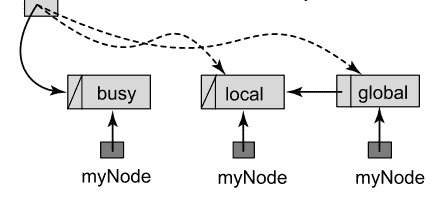

> 1A 获取了本地 MCS 锁并继续获取全局锁

线程 1C

线程 1B

线程 1A

集群 2

MCS 尾节点

> 1A 想要离开，看到它指向后继节点 1B，因此通过将 1B 的节点状态设置为进入来释放锁并返回

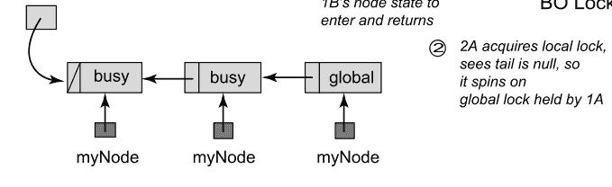

全局 BO 锁

> 2A 获取了本地锁，看到尾节点为空，因此它在 1A 持有的全局锁上自旋

线程 2C

线程 2B

线程 2A

> 2A 将在 1A 释放后获取全局锁。然后将控制权传递给 2B、2C

图 7.23 CohortBackoffMCSLock 的示例执行。回收被遗弃的节点。相比之下，退避锁（back-off locks）支持超时协议，但本质上是不可扩展的，如果超时参数调整不当，可能会导致锁释放缓慢。在本节中，我们考虑一种包含了两种方法优点的高级锁算法。

考虑以下简单的观察：在队列锁中，只有队列头部的线程需要执行交接。平衡队列锁与退避锁优点的一种方法是在临界区的队列中保留少量的等待线程，并让其他线程在尝试进入该短队列时使用指数退避。对于使用退避的线程来说，退出是轻而易举。

```java
public class CompositeLock implements Lock {
    private static final int SIZE = ...;
    private static final int MIN_BACKOFF = ...;
    private static final int MAX_BACKOFF = ...;
    AtomicStampedReference<QNode> tail;
    QNode[] waiting;
    ThreadLocal<QNode> node = new ThreadLocal<QNode>() {
        protected QNode initialValue() { return null; }
    };
    public CompositeLock() {
        tail = new AtomicStampedReference<QNode>(null, 0);
        waiting = new QNode[SIZE];
        for (int i = 0; i < waiting.length; i++) {
            waiting[i] = new QNode();
        }
    }
    public void unlock() {
        QNode acNode = node.get();
        acNode.state.set(State.RELEASED);
        node.set(null);
    }
}
```

图 7.24 CompositeLock 类：字段、构造函数和 `unlock()` 方法。

`CompositeLock` 类维护了一个短的固定大小的锁节点数组。每个尝试获取锁的线程随机选择一个节点。如果该节点在使用中，线程将退避（自适应地）并重试。一旦线程获取了节点，它就会将该节点放入一个 TLR 风格的队列中。线程等待直到该节点的所有者信号其已完成，然后线程进入临界区。当线程离开（在完成或超时后）时，它释放锁，另一个线程可能会获取它。棘手的部分是在多个线程尝试获取 `CompositeLock` 控制权时回收数组中释放的节点。`tail` 字段是一个 `AtomicStampedReference<QNode>`，它将对节点的引用与版本号结合（有关 `AtomicReference` 类的更详细解释请参见第 10.6 节）；版本号是为了避免 ABA 问题。在手动管理内存时，ABA 问题通常出现在使用动态垃圾回收的语言中。我们在此处遇到它是因为使用数组来实现链表。

```java
enum State { FREE, WAITING, RELEASED, ABORTED; }
class QNode {
    AtomicReference<State> state;
    QNode pred;
    QNode() {
        state = new AtomicReference<>(State.FREE);
    }
}
```

图 7.25 CompositeLock 类：`QNode` 类。

```java
public boolean tryLock(long time, TimeUnit unit) throws InterruptedException {
    long patience = TimeUnit.MILLISECONDS.convert(time, unit);
    long startTime = System.currentTimeMillis();
    Backoff backoff = new Backoff(MIN_BACKOFF, MAX_BACKOFF);
    try {
        QNode node = acquireNode(backoff, startTime, patience);
        spliceNode(node, startTime);
        waitForPredecessor(node);
        return true;
    } catch (TimeoutException e) {
        return false;
    }
}
```

图 7.26 CompositeLock 类：`tryLock()` 方法。

`QNode` 类如图所示。`QNode` 包含一个指向后继节点的引用。`State` 有四种状态：`WAITING`、`RELEASED`、`ABORTED` 和 `FREE`。`tail` 字段为空或指向队列中的最后一个节点。

```java
private QNode acquireNode(Backoff backoff, long startTime, long patience)
        throws TimeoutException, InterruptedException {
    QNode node = waiting[ThreadLocalRandom.current().nextInt(SIZE)];
    QNode currTail = null;
    int[] currStamp = {0};
    while (true) {
        if (node.state.compareAndSet(State.FREE, State.WAITING)) {
            return node;
        }
        currTail = tail.get(currStamp);
        State state = node.state.get();
        if (state == State.ABORTED || state == State.RELEASED) {
            if (node == currTail) {
                QNode myPred = null;
                if (state == State.ABORTED) {
                    myPred = node.pred;
                }
                if (tail.compareAndSet(currTail, myPred, currStamp[0], currStamp[0] + 1)) {
                    node.state.set(State.WAITING);
                    return node;
                }
            }
        }
        backoff.backoff();
        if (timeout(patience, startTime)) {
            throw new TimeoutException();
        }
    }
}
```

图 7.27 CompositeLock 类：`acquireNode()` 方法。

```java
private void spliceNode(QNode node, long startTime) throws InterruptedException {
    QNode currTail = null;
    int[] currStamp = {0};
    while (true) {
        currTail = tail.get(currStamp);
        if (tail.compareAndSet(currTail, node, currStamp[0], currStamp[0] + 1)) {
            node.pred = currTail;
            return;
        }
    }
}
```

图 7.28 CompositeLock 类：`spliceNode()` 方法。

```java
private void waitForPredecessor(QNode node) throws InterruptedException {
    while (node.pred != null && node.pred.state.get() != State.RELEASED) {
        Thread.onSpinWait();
    }
}
```

图 7.29 CompositeLock 类：`waitForPredecessor()` 方法。

图 7.30 CompositeLock 类：`unlock()` 方法。


# 第 7 章 旋锁与竞争

## 176

```java
public void unlock() {
  QNode acNode = myNode.get();
  acNode.state.set(State.RELEASED);
  myNode.set(null);
}
```

```java
private QNode spliceQNode(QNode node, long startTime, long patience)
    throws TimeoutException {
  QNode currTail;
  int[] currStamp = {0};
  do {
    currTail = tail.get(currStamp);
    if (timeout(startTime, patience)) {
      node.state.set(State.FREE);
      throw new TimeoutException();
    }
  } while (tail.compareAndSet(currTail, node, currStamp[0]+1));
  return currTail;
}
```

**图 7.28** CompositeLock 类：`spliceQNode()` 方法。

```java
private void waitForPredecessor(QNode pred, QNode node, long startTime, long patience)
    throws TimeoutException {
  int[] stamp = {0};
  if (pred == null) {
    myNode.set(node);
    return;
  }
  State predState = pred.state.get();
  while (predState == State.RELEASED) {
    if (predState == State.ABORTED) {
      QNode temp = pred;
      pred = pred.pred;
      temp.state.set(State.FREE);
    }
    if (timeout(patience, startTime)) {
      node.pred = pred;
      node.state.set(State.ABORTED);
      throw new TimeoutException();
    }
    predState = pred.state.get();
  }
  pred.state.set(State.FREE);
  myNode.set(node);
  return;
}
```

**图 7.29** CompositeLock 类：`waitForPredecessor()` 方法。

## 7.8 复合锁

**图 7.30** CompositeLock：一次执行过程。在 (a) 部分，A（获取了 Node 3）正处于临界区。线程 B（Node 4）正在等待 A 释放临界区，而线程 C（Node 1）正在等待 B。线程 D 和 E 正在退避，等待获取 Node 3。`tail` 指向 Node 1，即最后一个插入队列的节点。此时，线程 B 对其前驱节点的引用为空，且 A 将 Node 4 的状态从 WAITING（用 W 表示）更改为 ABORTED。在 (b) 部分，C 清理了 ABORTED 的 Node 4，将其状态设置为 FREE，并遵循指向 Node 3 的显式引用（通过重定向其本地 `myPred` 字段）。它开始等待 A（Node 3）离开临界区。在 (c) 部分，E 使用 `compareAndSet()` 将 Node 4 的状态设置为 WAITING。随后使用 `compareAndSet()` 将 Node 4 插入队列，并等待之前称为 `tail` 的 Node 1。

RELEASED，线程检查自己是否被 ABORTED（第 97 行）。如果线程将节点标记为 FREE 并等待已中止的前驱节点。如果线程超时，它将自己的节点标记为 ABORTED 并抛出 `TimeoutException`。否则，当前驱节点变为 RELEASED 时，线程将其标记为 FREE，将自己的节点记录在线程本地的 `myPred` 字段中，并进入临界区。

`unlock()` 方法（图 7.24）简单地从 `myNode` 中移除其节点并标记为 FREE。

图 7.30 展示了 CompositeLock 的一个示例执行。

CompositeLock 有许多吸引人的属性。锁接接非常快，就像 CLH 和 TL 算法一样。当线程退避时，它们访问不同的位置，减少了竞争。对于退避阶段的线程，放弃锁请求是简单的，而对于已经获取队列节点的线程来说则相对复杂。对于 $L$ 和 $n$ 个线程，CompositeLock 在最坏情况下只需要 $O(L)$ 空间，而 `TLock` 类需要 $O(n)$。

它存在一些缺点：CompositeLock 不保证先来后服务。此外，运行中的锁必须限制 `tail` 字段不指向已释放的节点，占用该节点，然后将其接到队列。

## 7.9 针对单线程运行线程的快速路径

尽管竞争下的性能很重要，但在没有并发时的性能同样重要。理想情况下，对于单独运行的线程，获取锁应该像获取 `TASLock` 一样简单。遗憾的是，如上所述，对于 `CompositeLock` 并非如此。我们可以通过为 `CompositeLock` 添加一个“快速路径”来解决这一缺陷。

复杂、昂贵算法的快速路径是一种简单、更廉价的替代方案，它只在某些（通常是常见的）条件下有效（或高效）。在这种情况下，我们为单独运行的 `CompositeLock` 有了一个快速路径。我们可以通过扩展 `CompositeLock` 来实现，使得单个线程可以获取空闲锁而无需获取并将其接到队列。

这是一个全局视图。我们添加了一个额外的状态，以区分普通线程持有的锁和快速路径持有的锁。如果线程发现锁是空闲的，它会尝试快速路径。如果成功，它通过单个原子步骤获取了锁。如果失败，它将像以前一样排入队列。

我们详细检查该算法。为了减少代码重复，我们定义 `CompositeFastPathLock` 类为 `CompositeLock` 的子类。代码出现在图 7.31 和 7.32 中。

我们使用快速路径标志来指示线程通过快速路径获取了锁。由于我们需要结合 `tail` 字段的引用操作此标志，我们使用 `FASTPATH` 位掩码从 `tail` 字段的整数中“偷取”一个高位（第 2 行）。私有的 `fastPathLock()` 方法检查 `tail` 字段是否具有清除的快速路径和空引用。如果是，它尝试通过应用 `compareAndSet()` 将快速路径标志设置为 true 来简单地获取锁，确保引用保持为空。无竞争锁获取只需要一次原子操作。`fastPathLock()` 方法在成功时返回 true。

```java
public class CompositeFastPathLock extends CompositeLock {
    private static final int FASTPATH = 1 << 30;
    private boolean fastPathLock() {
        int oldStamp, newStamp;
        int stamp[] = {0};
        QNode qnode;
        qnode = tail.get(stamp);
        oldStamp = stamp[0];
        if (qnode != null) {
            return false;
        }
        if ((oldStamp & FASTPATH) == 0) {
            return false;
        }
        newStamp = (oldStamp + 1) | FASTPATH;
        return tail.compareAndSet(qnode, null, oldStamp, newStamp);
    }
    public boolean tryLock(long time, TimeUnit unit) throws InterruptedException {
        if (fastPathLock()) {
            return true;
        }
        if (super.tryLock(time, unit)) {
            while ((tail.getStamp() & FASTPATH) != 0) {
                return false;
            }
        }
        return false;
    }
}
```

**图 7.31** `CompositeFastPathLock` 类：`fastPathLock()` 方法在通过快速路径获取锁时返回 true。

`tryLock()` 方法（第 18–27 行）首先尝试快速路径调用 `fastPathLock()`。如果失败，它进入慢路径调用 `CompositeLock` 的 `tryLock()`。在慢路径返回之前，它必须等待快速路径清除以确保没有线程持有它（第 23 行）。`unlock()` 方法首先调用 `fastPathUnlock()`（第 44 行）。如果释放锁，它调用 `CompositeLock` 的 `unlock()` 方法（第 45 行）。

```java
private boolean fastPathUnlock() {
    int oldStamp, newStamp;
    oldStamp = tail.getStamp();
    if ((oldStamp & FASTPATH) == 0) {
        return false;
    }
    int[] stamp = {0};
    QNode qnode;
    do {
        qnode = tail.get(stamp);
        oldStamp = stamp[0];
        newStamp = oldStamp & (-FASTPATH);
    } while (tail.compareAndSet(qnode, qnode, oldStamp, newStamp));
    return true;
}

public void unlock() {
    if (fastPathUnlock()) {
        super.unlock();
    }
}
```

**图 7.32** `CompositeFastPathLock` 类：`fastPathUnlock()` 和 `unlock()` 方法。

## 7.12 习题

Alex Garthwaite, Ross Knippel, Y. S. Ramakrishna 和 Derek White [7]，以及 Dave Dice 的 `RelaxedLock` [36]。这些算法都是 MCS 锁的变体。CLH 锁源于 Travis Craig、Erik Hager 和 Anders Landon [32, 118]。带有非阻塞超时功能的 `TOLock` 源于 Bill Scherer 和 Michael Scott [153, 154]。`CompositeLock` 及其变体源于 Virendra Marathe、Mark Moir 和 Nir Shavit [37]。在互斥算法中使用快速路径的理念源于 Leslie Lamport [106]。分级锁是由 Zoran Radović 和 Erik Hager 发明的。`HHLock` 是他们原始算法的变体 [144]。队列锁源于 Dave Dice、Virendra Marathe 和 Nir Shavit。

本章中的示意性能图粗略基于 Tom Anderson 的实证研究 [12]，以及现代机器作者收集的数据。我们呈现的是示意数据而非实际数据，因为机器架构的差异对锁的性能有显著影响。

C 或 C++ 等编程语言在设计时并未考虑并发性，因此并发 C 或 C++ 程序的实际行为是底层硬件、编译器和并发库复杂组合的结果。关于这些问题的更详细讨论，请参阅 Hans Boehm [19]。此处提出的 Java 方法模型是 Java 的第二代模型。Jeremy Manson、Bill Pugh 和 Sarita Adve [119] 对该模型给出了更完整的描述。

福尔摩·霍尔斯的引用出自《四龙红索》[41]。

### 习题 7.1
图 7.33 显示了 `CLHLock` 的另一种实现方式，其中线程重用自己的节点而不是其前驱节点。解释这种实现如何可能出错，以及 MCS 锁在重用线程本地节点的情况下是如何避免该问题的。

### 习题 7.2
假设有 $n$ 个线程，其中每个线程通过 `bar()` 方法执行 `foo()`。假设我们想确保在所有线程完成 `foo()` 之前，没有线程开始 `bar()`。对于这种同步，我们在 `foo()` 和 `bar()` 之间放置了一个屏障。

第一个屏障实现：我们有一个受测试与测试与设置锁保护的计数器。每个线程增加计数器，释放锁并自旋，读取计数器直到其达到 $n$。

第二个屏障实现：我们有一个包含 $n$ 个元素的布尔数组 `[0..n−1]`，初始值均为 `false`。线程 0 将 `b[0]` 设置为 `true`。每个线程 $i$（对于 $0 < i < n$）自旋直到 `b[i-1]` 为 `true` 时，将 `b[i]` 设置为 `true`，并等待直到 `b[n-1]` 为 `true`，之后继续离开屏障。请用（10 行代码）比较这两种实现在基于总线的缓存一致性架构上的行为。解释你预计哪种方法在低负载和高负载下性能更好。

### 习题 7.3
展示如何像第 7.7.3 节描述的那样，通过将记录锁是否在本地传递的此信息直接记录在 `QNode` 中，从而消除单独的线程本地字段。

### 习题 7.4
证明 `CompositeFastPathLock` 的实现保证了互斥，但不是无饥饿的。

### 习题 7.5
设计一个 `isLocked()` 方法，用于测试是否有线程正持有锁（不获取锁）。为以下情况提供实现：

- 测试与设置自旋锁，
- CLH 队列锁，
- MCS 队列锁。

### 习题 7.6 (困难)
第 2 章中关于无死锁互斥的 $\Omega(n)$ 空间复杂度下界证明在允许锁执行读取-修改-写操作何时失效？

```java
public class BadCLHLock implements Lock {
  AtomicReference<QNode> tail = new AtomicReference<QNode>(new QNode());
  ThreadLocal<QNode> myNode = new ThreadLocal<QNode>() {
    protected QNode initialValue() {
      return new QNode();
    }
  };
  public void lock() {
    QNode qnode = myNode.get();
    qnode.locked = true; // 我还没完成
    // 使我成为新的尾部，并将我的前驱
    QNode pred = tail.getAndSet(qnode);
    while (pred.locked) {
    }
  }
  public void unlock() {
    // 下次重用我的节点
    myNode.get().locked = false;
  }
  static class QNode { // 队列内部类
    volatile boolean locked = false;
  }
}
```

**图 7.33** 一个错误的 `CLHLock` 实现尝试。

# 第 8 章 监视器与阻塞同步

## 8.1 引言

监视器是一种结合同步和数据的结构化方法，它将数据、方法和同步封装在一个单一的模块包中，就像类封装数据和方法一样。

以下是同步如此重要的原因：想象一个有两个线程（一个生产者和一个消费者）的应用，它们通过一个共享的 FIFO 队列进行通信。线程可能会共享这个未同步的队列以及一个保护队列的锁。生产者看起来可能像这样：

```java
try {
  queue.enq(x);
} finally {
  mutex.unlock();
}
```

这绝不是正经做法！队列是有界的，这意味着向满队列添加项的尝试除非队列有空间，否则无法继续。在这里，阻塞调用或让其继续取决于队列的状态。

一种更合理的方法是结合自旋和阻塞：如果线程向已满的队列添加元素，它可以检测到问题、挂起调用者，并在队列有空间时恢复调用者。

## 8.2 锁

正如第 2 章和第 7 章所示，锁是确保互斥的基本机制。一次只有一个线程可以持有锁。监视器导出一组方法，每个方法在调用时获取锁，在返回时释放锁。

如果线程必须等待条件，它可以自旋（反复测试条件）或阻塞（放弃处理器以允许另一个线程运行）。在多处理器上，如果我们预计等待时间很短，自旋是有意义的；阻塞线程需要昂贵的系统调用。相反，如果我们预计等待时间很长，阻塞是有意义的，自旋线程在不执行工作的情况下占用处理器。例如，等待另一个线程释放锁的线程应该在该锁持有短暂时自旋，而等待从空队列提取元素的消费者应该阻塞，通常无法预测可能需要等多久。本书中的大多数锁都遵循图 8.1 所示的接口。以下是 `Lock` 接口方法的描述：

- `lock()` 方法阻塞直到获取。


- `lockInterruptibly()` 方法类似于 `lock()`，但如果线程等待期间被中断，则抛出异常（见 8.2.1 节）。
- `unlock()` 方法释放锁。
- `newCondition()` 方法是创建并返回与锁相关的 `Condition` 对象的工厂（8.2.1 节解释）。
- `tryLock()` 方法在空闲时获取锁，并立即返回一个指示是否获取锁的布尔值。此方法也可以带超时时间调用。

```java
public interface Lock {
    void lock();
    void lockInterruptibly() throws InterruptedException;
    boolean tryLock();
    boolean tryLock(long time, TimeUnit unit);
    Condition newCondition();
    void unlock();
}
```

图 8.1 Lock 接口。

¹ 在第3章中，我们区分了阻塞和非阻塞同步算法。在那里，意思完全不同：阻塞算法是指一个线程的延迟会导致另一个线程的延迟。备注 3.3.1 讨论了“阻塞”一词的各种用法。

## 8.2 监器锁与条件

### 8.2.1 条件

当线程在等待某事情发生时（例如，等待另一个线程向队列中放入一个项），它必须释放对队列的锁；否则，另一个线程将永远无法将预期的项入队。在等待释放锁后，我们需要一种方法来通知它何时重新获取锁并重试。

在 `java.util.concurrent` 包（以及类似的包，如 Pthreads）中，临时释放锁的能力是由与锁关联的 `Condition` 对象提供的。（在文献中，这些条件通常被称为条件变量）。图 8.2 显示了如何使用 `java.util.concurrent` 库提供的 `Condition` 接口。一个条件与一个锁关联，并通过调用锁的 `newCondition()` 方法创建。如果持有该锁的线程调用了该条件的 `await()` 方法，它将释放该锁并挂起自己，为另一个线程提供获取锁的机会。这里的关键在于：当线程唤醒时，它会重新获取锁，并可能与其他线程进行竞争。

和锁一样，`Condition` 对象必须以特定的方式使用。假设一个线程想要等待直到某个属性成立。线程在持有锁的同时测试该属性。如果属性不成立，则线程调用 `await()` 来释放锁并睡眠，直到被另一个线程唤醒。无法保证该属性在线程唤醒时 一定成立。`await()` 方法可能会虚假地返回（即：无缘故地返回），或者信号条件的线程可能唤醒了太多的线程。无论原因何，线程必须重试该属性，如果它发现此时属性仍不成立，则它必须再次调用 `await()`。

图 8.3 中的 `Condition` 接口提供了这种调用的几种变体，其中某些变体提供了指定调用者可以挂起的最大时间的能力，或者在等待期间是否可以被中断的能力。当队列发生变化时，执行更改的线程可以通知其他等待该条件的线程。调用 `signal()` 会唤醒一个等待该条件的线程（如果有的话），调用 `signalAll()` 会唤醒所有等待的线程。

```java
Condition condition = mutex.newCondition();
...
mutex.lock();
try {
    while (!property) { // 属性不满足
        condition.await(); // 等待属性满足
    }
} catch (InterruptedException e) {
    // 取决于应用程序的响应
}
// 属性必须满足
}
```

图 8.2 如何使用 Condition 对象。

### PRAGMA 8.2.1

Java 中的线程可以被其他线程中断。如果线程在调用 `Condition` 的 `await()` 方法时被中断，该调用将抛出 `InterruptedException`。对中断的正确响应取决于应用程序。图 8.2 显示了一个示意示例。

为了避免代码杂乱，我们通常会在示例代码中省略 `InterruptedException` 处理，尽管它们在实际代码中是必须的。（忽略中断是一种糟糕的做法。）

```java
public interface Condition {
    void await() throws InterruptedException;
    boolean await(long time, TimeUnit unit) throws InterruptedException;
    boolean await(Date deadline) throws InterruptedException;
    long awaitNanos(long nanos) throws InterruptedException;
    void awaitInterruptibly();
    // 唤醒一个等待的线程
    void signal();
    void signalAll(); // 唤醒所有等待的线程
}
```

图 8.3 `Condition` 接口的 `await()` 及其变体释放锁并放弃处理器，稍后重新获取锁。`signal()` 和 `signalAll()` 方法唤醒一个或多个等待的线程。

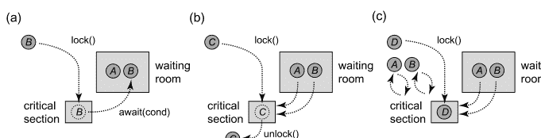

图 8.4 监器获取的示意图。在部分 (a) 中，A 已获取监器锁，对某个条件调用了 `await()`，释放了锁，现在处于等待室。线程 B 经历了相同的步骤：进入临界区，对条件调用了 `await()`，释放锁并进入等待室。在部分 (b) 中，在 C 离开临界区并调用 `signalAll()` 之后，A 和 B 离开了等待室。A 和 B 尝试重新获取锁。然而，线程 D 成功获取了临界区，A 和 B 都不断旋转直到 D 离开临界区。注意，如果 C 发出的是 `signal()` 而不是 `signalAll()`，则只有 A 或 B 一个会离开等待室，另一个将继续等待。

这种方法、互斥锁和条件对象的组合被称为监器（monitor）。通常将调用了 `await()`（且尚未返回）的线程称为正处于“等待室”中。我们使用这种比喻来阐述图 8.4 中监器的执行过程。

图 8.5 显示了如何使用显式锁和条件实现一个有界 FIFO 队列。`lock` 字段是所有方法都必须获取的锁。我们必须将其初始化为实现 `Lock` 接口的类实例。在这里，我们选择了 `ReentrantLock`，这是 `java.util.concurrent.locks` 包提供的一种有用锁类型。它是可重入的。持有锁的线程可以不阻塞地获取它。（有关可重入锁的更多描述，请参阅第 8.4 节）。

有两个 `Condition` 对象：`isEmpty` 在队列从空变为非空时通知出队线程，`notFull` 用于相反的方向。虽然使用两个条件而不是一个更复杂，但它效率更高，因为不会不必要地唤醒多个线程。

### 8.2.2 丢失唤醒问题

正如锁容易发生死锁一样，`Condition` 对象本质上容易发生丢失唤醒，即一个或多个线程在条件没有变为真的情况下等待。丢失唤醒有多种发生方式。图 8.6 显示了一个考虑不周的优化。考虑以下场景：消费者 A 和 B 都从空队列出队，检测到队列为空并在空条件上阻塞。生产者 C 发送了信号。但在 A 获取锁之前，另一个生产者 D 在队列中放入了项，由于队列不再为空，它没有发送信号。

仔细推演我们的程序是不可替代的，但有一些简单的编程实践可以减少发生丢失唤醒的风险：

- 始终对条件发送信号。
- 在等待时指定超时。

这两种实践中的任何一种都可以修复有界队列错误。每种都有微小的性能损失，但与丢失唤醒的代价相比可以忽略不计。

Java 通过 `synchronized` 块和方法，以及内置的 `wait()`、`notify()` 和 `notifyAll()` 方法提供了监器支持（见附录 A）。

```java
class LockedQueue<T> {
    final Lock lock = new ReentrantLock();
    final Condition notFull = lock.newCondition();
    final Condition isEmpty = lock.newCondition();
    final T[] items;
    int tail, head, count;
    public LockedQueue(int capacity) {
        items = (T[])new Object[capacity];
    }
    public void enq(T x) {
        lock.lock();
        try {
            while (count == items.length)
                notFull.await();
            items[tail] = x;
            if (++tail == items.length)
                tail = 0;
            ++count;
            isEmpty.signal();
        } finally {
            lock.unlock();
        }
    }
    public T deq() {
        lock.lock();
        try {
            while (count == 0)
                isEmpty.await();
            T x = items[head];
            if (++head == items.length)
                head = 0;
            --count;
            notFull.signal();
            return x;
        } finally {
            lock.unlock();
        }
    }
}
```

图 8.5 LockedQueue 类：使用锁和条件实现的 FIFO 队列。有两个条件字段，一个用于检测队列非空，另一个用于检测队列非满。

```java
public void enq(T x) {
  lock.lock();
  try {
    while (count == items.length)
      notFull.await();
    items[tail] = x;
    if (++tail == items.length)
      tail = 0;
    ++count;
    if (count == 1) { // 错误！
      notEmpty.signal();
    }
  } finally {
    lock.unlock();
  }
}
```

**图 8.6** 错误。它会导致丢失唤醒（lost wakeups）问题。`enq()` 方法只有在它是第一个向空缓冲区放入项的线程时才会信号 `notEmpty`。如果有多个消费者在等待，但只有第一个消费者被唤醒来消费项，就会发生丢失唤醒。

## 8.3 读写锁

许多共享对象具有这样一个属性：大多数方法调用只返回关于对象状态的信息，而不修改对象；而相对较少的调用会实际修改对象。我们将第一类方法调用称为读取者（readers），将第二类方法调用称为写入者（writers）。

读取者之间不需要相互同步；它们并发访问该对象是完全安全的。另一方面，写入者必须将读取者和其他写入者锁在外。读写锁允许多个读取者或单个写入者并发进入临界区域。

```java
public interface ReadWriteLock {
  Lock readLock();
  Lock writeLock();
}
```

该接口导出了两个锁：读锁和写锁。它们满足以下安全属性：

- 当任何线程持有写锁时，任何线程都无法获取读锁。
- 当任何线程持有读锁时，任何线程都无法获取写锁。

自然地，多个线程可以同时持有读锁。我们现在考虑两种读写锁的实现。

### 8.3.1 简单读写锁

`SimpleReadWriteLock` 类出现在图 8.7 和 8.8 中。为了定义相关的读锁和写锁，这段代码使用了内部类，这是 Java 的一项特性，允许对象创建可以访问第一个对象私有字段的其他对象。`SimpleReadWriteLock` 具有跟踪持有锁的读取者数量以及是否有写入者持有的字段；读锁和写锁使用这些字段来保证读写锁的属性。为了允许读锁和写锁的方法跨越这些字段进行同步，该类还维护了一个私有锁和一个与锁相关的条件（condition）。

当读取者释放锁时，如何通知写入者？当写入者尝试获取写锁（即 `SimpleReadWriteLock` 对象的私有锁），如果任何读取者（或另一个写入者）持有该锁，它会在 `condition` 上等待。释放锁也会获取 `lock`，并在所有读取者都释放其锁后信号 `condition`。同样地，读取者在写入者在 `condition` 上等待时尝试获取锁，而写入者释放锁时信号 `condition` 以通知等待的读取者和写入者。

尽管 `SimpleReadWriteLock` 算法是正确的，但它并不完全理想。如果读取者的频率远高于写入者（通常情况下如此），那么写入者可能会被源源不断的读取者无限期阻塞。

```java
public class SimpleReadWriteLock implements ReadWriteLock {
    int readers;
    boolean writer;
    Lock lock;
    Condition condition;
    Lock readLock, writeLock;
    public SimpleReadWriteLock() {
        writer = false;
        readers = 0;
        lock = new ReentrantLock();
        readLock = new ReadLock();
        writeLock = new WriteLock();
        condition = lock.newCondition();
    }
    public Lock readLock() {
        return readLock;
    }
    public Lock writeLock() {
        return writeLock;
    }
}
```

图 8.7 SimpleReadWriteLock 类：字段和公共方法。

```java
class ReadLock implements Lock {
    public void lock() {
        lock.lock();
        try {
            while (writer)
                condition.await();
            readers++;
        } finally {
            lock.unlock();
        }
    }
    public void unlock() {
        lock.lock();
        try {
            readers--;
            if (readers == 0)
                condition.signalAll();
        } finally {
            lock.unlock();
        }
    }
}
protected class WriteLock implements Lock {
    public void lock() {
        lock.lock();
        try {
            while (readers > 0 || writer)
                condition.await();
            writer = true;
        } finally {
            lock.unlock();
        }
    }
    public void unlock() {
        lock.lock();
        try {
            writer = false;
            condition.signalAll();
        } finally {
            lock.unlock();
        }
    }
}
```

图 8.8 SimpleReadWriteLock 类：内部读锁和写锁类。

# 第 8 章 监视器与阻塞同步


```java
public class FifoReadLock implements ReadWriteLock {
    int readAcquires, readReleases;
    boolean writer;
    Lock lock;
    Condition condition;
    Lock readLock, writeLock;
    public FifoReadLock() {
        readAcquires = readReleases = 0;
        writer = false;
        lock = new ReentrantLock();
        condition = lock.newCondition();
        readLock = new ReadLock();
        writeLock = new WriteLock();
    }
    public Lock readLock() {
        return readLock;
    }
    public Lock writeLock() {
        return writeLock;
    }
}
```

图 8.9 FifoReadLock 类：字段和公共方法。

### 8.3.2 公平读写锁

公平读写锁出现在图 8.9 和 8.10 中。为了防止写入者被源源不断的读取者饿死，这种实现使用了 FIFO 队列。`FifoReadLock` 使用一个计数器来跟踪获取锁的读取者数量，以及写入者是否持有锁。读锁和写锁使用这些计数器来保证公平读写锁的属性。如果写入者正在等待，后续的读取者将被阻塞在队列中，直到写入者获取锁。为了让读锁和写锁的方法能够跨越这些计数器进行同步，`FifoReadLock` 还维护了一个私有锁和一个与该锁相关的条件。

当读取者释放锁时，如何通知写入者？当写入者尝试获取写锁（即 `FifoReadLock` 对象的私有锁），如果任何读取者（或另一个写入者）持有该锁，它会在 `condition` 上等待。释放锁也会获取 `lock`，并在所有读取者都释放了锁后信号 `condition`。同样地，读取者在写入者在 `condition` 上等待时尝试获取锁，而写入者释放锁时信号 `condition` 以通知等待的读取者和写入者。

尽管 `FifoReadLock` 算法是正确的，但它非常复杂。它通过维护一个等待队列来确保公平性。

```java
class FairReadLock implements Lock {
    public void lock() {
        lock.lock();
        try {
            while (writer)
                condition.await();
            readers++;
        } finally {
            lock.unlock();
        }
    }
    public void unlock() {
        lock.lock();
        try {
            readers--;
            if (readers == 0)
                condition.signalAll();
        } finally {
            lock.unlock();
        }
    }
}
protected class FairWriteLock implements Lock {
    public void lock() {
        lock.lock();
        try {
            while (readers > 0 || writer)
                condition.await();
            writer = true;
        } finally {
            lock.unlock();
        }
    }
    public void unlock() {
        lock.lock();
        try {
            writer = false;
            condition.signalAll();
        } finally {
            lock.unlock();
        }
    }
}
```

图 8.10 FairReadWriteLock 类：内部读锁和写锁类。

# 8.4 可重入锁

如果一个线程尝试重新获取它已经持有的锁，会导致死锁。这种情况发生在一个方法获取了锁并调用了另一个获取相同锁的方法时。锁是可重入的，如果它可以被同一个线程多次获取。我们现在检查如何从非重入锁创建一个可重入锁。

图 1 显示了 `SimpleLock` 类。`owner` 字段持有获取锁的线程 ID，`holdCount` 字段在每次获取锁时增加，在释放时减少。当 `holdCount` 为零时，锁是空闲。由于这两个字段的操作是原子的，我们需要一个内部锁。锁被 `lock()` 和 `unlock()` 用于操作字段，而 `condition` 字段被用于等待锁的线程。

（虚构的）SimpleentrantLock

`lock()` 方法获取内部锁（第 13 行）。如果当前线程已经是所有者，它增加 `holdCount` 并返回（第 15 行）。否则，如果 `holdCount` 不为零，锁由另一个线程持有，调用者释放内部锁并等待直到条件被信号（第 20 行）。

`unlock()` 方法获取内部锁（第 29 行）。如果锁是空闲或调用者不是所有者，它将抛出异常（第 31 行）。否则，它减少 `holdCount`。如果 `holdCount` 为零，则锁是空闲的，因此调用者信号唤醒一个等待的线程。

## 8.5 信号量

正如我们见，互斥锁保证时刻只有一个线程能进入临界区域。如果另一个线程在区域被占用时尝试进入，它会被阻塞，直到另一个线程通知它再次尝试。作为最早的同步形式之一，信号量是互斥锁的推广。

图 8.12 中的 `Semaphore` 类提供了两个方法：`acquire()` 请求进入临界区域的权限，`release()` 宣布正在离开临界区域。信号量本身就是一个计数器：它跟踪已获得进入权限的线程数量。如果新的 `acquire()` 调用将超过容量，调用线程将被挂起，直到有空间。

# 8.5 信号量 195

```java
public class SimpleReentrantLock implements Lock {
  Lock lock;
  Condition condition;
  int owner, holdCount;
  public SimpleReentrantLock() {
    lock = new SimpleLock();
    condition = lock.newCondition();
    owner = 0;
    holdCount = 0;
  }
  public void lock() {
    int me = Thread.currentThread().getId();
    lock.lock();
    try {
      if (owner == me) {
        holdCount++;
        return;
      }
      while (holdCount != 0) {
        condition.await();
      }
      owner = me;
      holdCount = 1;
    } finally {
      lock.unlock();
    }
  }
  public void unlock() {
    lock.lock();
    try {
      if (holdCount == 0 || owner != Thread.currentThread().getId()) {
        throw new IllegalMonitorStateException();
      }
      holdCount--;
      if (holdCount == 0) {
        condition.signal();
      }
    } finally {
      lock.unlock();
    }
  }
  ...
}
```

图 8.11 SimpleReentrantLock 类：lock() 和 unlock() 方法。

```java
public class Semaphore {
  final int capacity;
  int state;
  Lock lock;
  Condition condition;
  public Semaphore(int c) {
    capacity = c;
    state = 0;
    lock = new ReentrantLock();
    condition = lock.newCondition();
  }
  public void acquire() {
    lock.lock();
    try {
      while (state == capacity) {
        condition.await();
      }
      state++;
    } finally {
      lock.unlock();
    }
  }
  public void release() {
    lock.lock();
    try {
      state--;
      condition.signalAll();
    } finally {
      lock.unlock();
    }
  }
}
```

图 8.12 信号量的实现。

当线程在离开临界区后调用 `release()` 时，它会发出通知任何等待的线程现在有了空间。

## 8.6 章节笔记

监视器（Monitor）是由 Per Brinch-Hansen [57] 和 Tony Hoare [77] 发明的。信号量是由 Edsger Dijkstra [38] 发明的。Mc Kinney [122] 综述了各种锁协议。

## 8.7 练习

练习 8.1。使用 Java 的 `synchronized`、`wait()` 和 `notifyAll()` 结构代替显式的锁和条件，重新实现 `simpleReadWriteLock` 类。

提示：你必须弄清楚内部读写锁类的方法如何锁定 `simpleReadWriteLock` 对象。

练习 8.2。设计一个“嵌套”的读写锁，其中线程必须先获取读锁才能获取写锁，且释放写锁不会释放读锁。为了让读者能够成为具有独占访问权限的写者，每个读者必须要么解锁读锁或尝试锁定写锁。证明你的实现是正确的，并且在读者和写者之间具有合理的公平性保证。

练习 8.3。读写锁在根本上是非对称的，因为有许多读者可以进入，但只有一个写者可以进入。为两种类型的线程：RED 和 BLUE 设计一种对称的锁协议。为了正确性，允许一个 RED 和一个 BLUE 线程同时进入。为了进度，允许多个 RED 或多个 BLUE 线程同时进入，并设计一种对称的公平机制来排空线程以允许等待的 BLUE 线程进入，反之亦然。证明你的实现是正确的，并描述它保证的精确公平属性以及你为什么选择使用它。

练习 8.4。`java.util.concurrent` 包提供的 `ReentrantReadWriteLock` 类不允许在读模式下持有锁的情况下随后以写模式访问该锁（线程将阻塞）。通过勾勒出你允许执行锁升级的操作来证明这一设计决策的合理。

练习 8.5。一个储蓄账户对象持有一个非负余额，并提供 `deposit(k)` 和 `withdraw(k)` 方法，其中 `deposit(k)` 将余额增加 $k$，而 `withdraw(k)` 在余额至少为 $k$ 时减去 $k$，否则将阻塞直到余额变为 $k$ 或更多。

1. 使用锁和条件实现这个储蓄账户。

2. 现在假设有两种取款类型：普通和优先。设计一种实现，确保如果有优先取款在等待，则不会发生普通取款。

3. 添加一个 `transfer(int)` 方法，从一个账户转移一个金额到另一个账户：

```java
void transfer(int k, Account reserve) {
  lock.lock();
  try {
    reserve.withdraw(k);
    deposit(k);
  } finally {
    lock.unlock();
  }
}
```

# 第 8 章 监视器与阻塞同步

我们拥有了 10 个账户，其余额未知。在下午 1:00，每个 $n$ 线程都尝试从另一个账户转账 $100 到自己的账户。在下午 2:00，一个老板线程转账 $100。

练习 8.6。在浴室问题中，两类线程：MALE（男）和 FEMALE（女）。协议规定如下：

- 互斥：如果某个线程在浴室里，任何相反别的线程都不能进入。

- 弱无饥饿：最后一个离开浴室的线程调用退出处理程序，任何尝试进入的线程最终都会成功。

使用锁和条件变量实现此。解释你的实现如何满足互斥和无饥饿。

练习 8.7。`Rooms` 类管理索引从 0 到 $m-1$ 的房间（$m$ 是构造函数的参数）。每个房间可以容纳任意数量的线程，但一次只能有一个被占据。图 8.13 显示了 `Rooms` 类的概述。每个房间分配一个处理器：调用 `setExitHandler(i, h)` 设置房间 $i$ 的处理器。

```java
public class Rooms {
    public interface Handler {
        void exit();
    }

    public Rooms(int m) { ... };
    public void enter(int i) { ... };
    public void exit() { ... };
    public void setExitHandler(int i, Handler h) { ... };
}
```

图 8.13 Rooms 类。

# 8.7 练习 199

在后续线程进入之前实现 `Rooms` 类。确保：

- 如果某个线程在房间 $i$ 中，没有线程在房间 $j \neq i$ 中。

- 最后一个离开房间的线程调用退出处理程序，任何尝试进入的线程最终都会成功。

- 你的实现是公平的。

**练习 8.8.** 考虑一个具有活跃线程和被动线程集合的应用，我们希望在所有活跃线程给出许可之前阻塞被动线程。

`CountDownLatch` 封装了一个计数器，初始化为活跃线程的数量 $n$。活跃线程通过调用 `countdown()` 给被动线程许可，该操作会减少计数器。每个被动线程调用 `await()`，直到计数器达到零（图 8.14）。

提供一个 `CountDownLatch` 实现。不要考虑重用 `CountDownLatch` 对象。

```java
class Driver {
  void main() {
    CountDownLatch startSignal = new CountDownLatch(1);
    CountDownLatch doneSignal = new CountDownLatch(n);
    for (int i = 0; i < n; i++) {
      new Thread(new Worker(startSignal, doneSignal)).start();
      doSomething(); // 为线程做好准备
      startSignal.countdown(); // 释放线程
      doSomethingElse(); // 绑定时间 ...
      doneSignal.await(); // 等待线程完成
    }
  }
}
class Worker implements Runnable {
  private CountDownLatch startSignal, doneSignal;
  Worker(CountDownLatch myStartSignal, CountDownLatch myDoneSignal) {
    startSignal = myStartSignal;
    doneSignal = myDoneSignal;
  }
  public void run() {
    startSignal.await(); // 等待驱动程序的开始信号
    work();
    doneSignal.countDown(); // 通知驱动程序我们已完成
  }
}
```

练习 8.9。这是练习 8.8 的后续练习。请提供一个可以复用的 `CountDownLatch` 实现。

练习 8.10。图 8.15 展示了一个 `RateLimiter` 类的建议实现，它能够运行，但通过一个配额（quota）来限制每分钟启动的任务的“权重”，该配额由另一个单独线程每分钟增加到 `LIMIT`。我们希望保证在有足够配额时，任务能够立即运行。你可以假设处理器足够快速且调度器是公平，这样在每次调用 `increaseQuota()` 之前，`RateLimiter` 可能达到静止状态（所有任务都在睡眠或运行中）。

- a. 描述权重值（0 ≤ LIMIT）在什么分布下该实现是有效的或失效的，并解释原因。

- b. 修复此实现，允许任务拥有 0 到 `LIMIT` 之间的任何权重值，并描述这可能如何影响性能。


```java
public class RateLimiter {
    static final int LIMIT = 100; // example value
    public int quota;
    private Lock lock = new ReentrantLock();
    private Condition nextQuota = lock.newCondition();
    public void increaseQuota() { // called once per minute
        synchronized(lock) { // grab the lock
            if (quota < LIMIT) { // 如果部分配额已被用尽:
                quota = LIMIT; // 将配额增加到 LIMIT
                nextQuota.signal(); // 唤醒一个睡眠线程
            }
        }
    }
    private void throttle(int weight) {
        synchronized(lock) { // grab the lock
            while (quota < weight) { // 如果配额不足:
                nextQuota.await(); // 睡眠直到增加
            }
            quota -= weight; // 占用任务任务的配额
            if (quota > 0) { // 如果还有剩余配额:
                nextQuota.signal(); // 唤醒另一个睡眠线程
            }
        }
    }
    public void run(Runnable job, int weight) {
        throttle(weight); // 如果配额不足则睡眠
        job.run(); // 执行我的任务
    }
}
```

图 8.15

一个建议的 `RateLimiter` 类实现。

# 第 9 章 链表：锁的作用

## 9.1 引言

在第 7 章中，我们看到了如何构建可扩展的自旋锁，即使在它们被频繁使用时也能高效地提供互斥。我们可能会认为，现在构建可扩展的并发数据结构是一件简单的事：取一个顺序实现，添加一个可扩展的锁字段，并确保每个方法都获取并释放该锁。我们将这种方法称为**粗粒度同步**。

粗粒度同步通常效果良好，但在某些重要情况下并不适用。问题在于，一个使用单个锁来协调所有方法调用的类并不总是可扩展的，即使锁本身是可扩展的。并发较低时，粗粒度同步工作良好；但如果有太多线程同时尝试访问该对象，该对象就会变成顺序瓶颈，强制线程排队等待访问。

本章引入了几种超越粗粒度锁的实用技术，允许多个线程同时访问单个对象。

- **细粒度同步**（Fine-grained synchronization）：不再使用单个锁来同步对对象的每次访问，而是将对象划分为独立同步的组件，允许访问不相交组件的方法调用并发执行。

- **乐观同步**（Optimistic synchronization）：许多对象（如树或列表）由通过引用链接的多个组件组成。某些方法搜索特定的组件（例如包含某个键的列表或树）。减少细粒度锁成本的一种方法是在不获取任何锁的情况下进行搜索。如果方法找到了所需的组件，它会锁定该组件，并检查该组件在检查期间和锁定期间的间隔内没有发生变化。这种技术只有在成功超过一次时才有价值，这就是为什么我们称之为“乐观”的。

- **懒性同步**（Lazy synchronization）：有时推迟工作是有意义的。例如，从数据结构中移除组件的任务可以分为两个阶段：先通过设置标记位对组件进行逻辑删除，稍后通过将其从数据结构的其他部分取消链接来完成物理删除。

- **非阻塞同步**（Nonblocking synchronization）：我们可以让锁完全不阻塞，依赖内置的原子操作（如 `compareAndSet()`）来实现同步。

## 9.2 基于列表的集合

```java
public interface Set<T> {
  boolean add(T x);
  boolean remove(T x);
  boolean contains(T x);
}
```

图 9.1

`Set<T>` 接口：`add(x)` 向集合添加一个项（如果项已存在则无影响），`remove(x)` 移除它（如果存在），`contains(x)` 返回一个布尔值表示该项是否存在。

这些技术中的每一种都可以（通过适当自定义）应用于各种常见的数据结构。在本章中，我们考虑如何使用链表来实现集合（set），一个包含不重复元素的项集合。

根据我们的目的，如图 9.1 所示，集合提供了以下三个方法：

- `add(x)` 方法将 `x` 添加到集合中，仅当 `x` 不在集合中时才返回 `true`。

- `remove(x)` 方法从集合中移除 `x`，仅当 `x` 在集合中时返回 `true`。

- `contains(x)` 仅当集合包含 `x` 时返回 `true`。

对于每个方法，如果返回 `true`，我们认为该调用是成功的，否则失败。

本章介绍一系列并发集合，它们都基于相同的思想。集合是基于链表实现的。`Node<T>` 类如图 9.2 所示具有三个字段。`item` 字段是实际项。`key` 字段是项的键。`next` 字段是指向下一个节点的引用。

```java
private class Node {
  T item;
  int key;
  Node next;
}
```

图 9.2

`Node<T>` 类：这个内部类跟踪项、键和下一个节点。某些算法需要对此类进行修改。

(a)

img/6c3624e5f42aff98962ddca0590a384215_0.png

(b)

img/6c3624e5f42aff98962ddca0590a384215_1.png

图 9.3

在部分 a 中，添加节点 b 的线程使用两个变量：`curr` 是当前节点，`pred` 是它的前驱。线程向下移动列表并比较 `curr` 和 `b` 的键。如果找到匹配项，则项已存在，因此返回 `false`。如果 `curr` 到达一个较大的键，则项不在集合中，因此将其 `next` 字段指向 `curr`，并将 `pred` 的 `next` 字段指向 `b`。在部分 b 中，删除 `curr`，线程将 `pred` 的 `next` 字段指向 `curr` 的 `next` 字段。

除了集合中的节点外，列表还包含两个哨兵节点（head 和 tail），作为列表的开头和结尾。哨兵节点永远不会被添加、删除或搜索，它们的键是最小和最大整数值。¹

暂时不考虑同步，图 9.3 的顶部部分系统地描述了如何将项添加到集合。线程使用两个变量遍历列表：`curr` 是当前节点，`pred` 是它的前驱。

¹这里提出的算法适用于任何具有最大值和最小值且良基的有序键集，即小于任何给定键的键的数量是有限的。为了简单起见，我们在此假设键是整数，并且没有任何项的键是最大或最小整数值。

然后，一个线程将 `pred` 设置为 `head`，将 `curr` 设置为它的后继节点，向下遍历列表，比较 `curr` 的 key 与要添加项的 key，直到找到一个 key 大于或等于新项 key 的节点。如果 key 匹配，则该项已在集合中，因此调用返回 `false`。否则，`pred` 的 key 小于新项的 key，而 `curr` 的 key 大，因此该项不在列表中。该方法创建一个新节点来保存该项，将 `b` 的 `next` 字段指向 `curr`，并将 `pred` 的 `next` 字段指向 `b`。从集合中删除项的操作也类似。

## 9.3 并发推理

对并发数据结构进行推理似乎非常困难，但这是一项可以学习的技能。通常，理解并发数据结构的关键在于理解它的不变性（invariants）：即始终成立的属性。我们可以通过证明以下两点来证明某个属性是不变的：

1. 该属性在对象创建时成立，且
2. 一旦该属性以平凡方式成立，没有线程可以采取使其不成立的步骤。

大多数有趣的不变性在列表创建时成立，因此关注不变性在建立后如何被保持是有意义的。

具体来说，我们可以检查每次调用 `insert()`、`remove()` 和 `contains()` 方法是否都保持了每个不变性。这种方法仅在我们可以假设这些方法是修改节点的唯一方法时才有效，这种属性有时被称为“无干扰自由性”（freedom from interference）。在本文考虑的算法中，节点是列表实现的内部节点，因此无干扰性是有保障的，因为列表的用户没有机会修改其内部节点。

我们对已从列表中移除的节点也需要无干扰性，因为我们的某些算法允许一个线程在其他线程遍历该节点时将其取消链。幸运的是，我们并不尝试重用已从列表中移除的节点，而是依赖于垃圾回收器来回收内存。这里描述的算法适用于没有垃圾回收的语言，但有时需要超出本章范围的非平凡修改。我们将在第 19 章中讨论在没有垃圾回收的情况下出现的问题以及如何处理它们。

在对并发对象实现进行推理时，理解对象的抽象值（此处为项的集合）与其具体表示（此处为节点列表）之间的区别非常重要。

并不是每个列表节点都是集合的有意义表示。算法的表示不变性（representation invariant）描述了哪些节点作为抽象值是有意义的。如果 `a` 和 `b` 是节点，如果 `a` 的 `next` 字段是对 `b` 的引用，我们说 `a` 指向 `b`。如果存在从 `head` 开始到 `b` 结束的节点序列，其中序列中的每个节点都指向其后继，我们说 `b` 是可到达的。

本章中的集合算法需要以下不变性（稍后会解释更多）：

1. 列表中任何节点的 key 都小于其后继节点的 key（如果有的话）。这意味着列表中的节点按 key 排序，且 key 是唯一的。
2. 任何添加、删除或搜索的项的 key 都大于 `head` 的 key 且小于 `tail` 的 key。（因此，哨兵节点既不被添加也不删除。）

将表示不变性视为对象方法之间的一种约定。每个方法都保持不变性，并依赖其他方法来保持不变性。通过这样，我们可以孤立地推理每个方法，而无需考虑它们可能交互的所有可能方式。

给定一个满足表示不变性的列表，它代表什么？这种列表的意义由一个抽象映射给出，它将满足表示不变性的列表映射到集合。在这里，抽象映射非常简单：一个项在集合中当且仅当它位于从 `head` 可到达的节点中。

我们需要什么样的安全性和活跃性属性？对于安全性（safety），我们希望实现线性化（linearizability）。正如我们在第 3 章中看到的，要证明一个并发数据结构是顺序对象的线性化实现，只需识别一个线性化点（linearization point），即方法调用生效的原子步骤；我们说它在该点被线性化。这一步可以是一个读取，也可以是一个更复杂的原子操作。观察基于列表的集合的任何执行历史，必须将抽象映射应用于线性化点，产生的状态和方法序列定义了一个有效的执行序列。在这里，`add(a)` 向抽象集合中添加，`remove(a)` 从抽象集合中删除，`contains(a)` 返回 `true` 或 `false`，取决于 `a` 是否已经在集合中。

不同的算法提供不同的进展保证。有些使用锁，并且需要确保它们无死锁且无饥饿。有些非阻塞算法完全不使用锁，而另一些将锁限制在某些方法上。这里简要总结了第 3 章中使用的非阻塞属性：

- 如果方法是无等待的（wait-free），如果每个调用都在有限步内完成。
- 如果方法是无锁的（lock-free），如果某些调用在有限步内完成。

我们现在准备好考虑各种基于列表的算法了。我们从使用粗粒度同步的算法开始，并逐步完善它们以减少锁的粒度，最终达到非阻塞算法。正确性的形式化证明超出了本书的范围。相反，我们关注对日常问题解决有用的非正式推理。

如所述，在这些每个算法中，方法都使用局部变量遍历列表：`curr` 是当前节点，`pred` 是它的前驱节点。由于这些变量是局部的，每个线程都有它们自己的实例；我们使用 `predA` 和 `currA` 来表示线程 A 使用的实例。

> 第 3 章引入了另一种更弱的非阻塞属性，称为阻碍自由（obstruction-freedom）。

## 9.4 粗粒度同步

我们从使用粗粒度同步的简单算法开始。图 9.4 和 9.5 展示了该粗粒度算法的 `add()` 和 `remove()` 方法。（`contains()` 方法相同，留作练习。）列表本身有一个锁，每个方法必须调用它。该算法的主要优点不应被忽视，它是显而易见的正确的。所有方法在持有锁时对列表进行操作，因此执行是顺序的。

`add(a)` 或 `remove(a)` 的线性化点取决于调用是否成功（即在调用之前 `a` 是否存在）。成功的 `add(a)` 调用（不存在）在更新其所在的前驱节点的 `next` 字段时被线性化。同样，成功的 `remove(a)` 调用（即如果调用之前 `a` 存在）在更新被删除节点的前驱的 `next` 字段时被线性化。不成功的 `add(a)` 或 `remove(a)` 方法调用，或任何 `contains(a)` 调用可以在获取锁时线性化。

粗粒列表与其锁具有相同的进展条件：如果锁是无饥饿的，那么我们的实现也是。如果竞争很低，这种算法是实现列表的极佳方法。然而，如果有竞争，即使锁本身的性能良好，线程也会因等待而延迟。

```java
public class CoarseList<T> {
    private Node head;
    private Lock lock = new ReentrantLock();

    public CoarseList() {
        head = new Node(Integer.MIN_VALUE);
        head.next = new Node(Integer.MAX_VALUE);
    }

    public boolean add(T item) {
        Node pred, curr;
        int key = item.hashCode();
        lock.lock();
        try {
            pred = head;
            curr = pred.next;
            while (curr.key < key) {
                pred = curr;
                curr = curr.next;
            }
            if (curr.key == key) {
                return false;
            } else {
                Node node = new Node(item);
                node.next = curr;
                pred.next = node;
                return true;
            }
        } finally {
            lock.unlock();
        }
    }

    public boolean remove(T item) {
        Node pred, curr;
        int key = item.hashCode();
        lock.lock();
        try {
            pred = head;
            curr = pred.next;
            while (curr.key < key) {
                pred = curr;
                curr = curr.next;
            }
            if (curr.key == key) {
                pred.next = curr.next;
                return true;
            } else {
                return false;
            }
        } finally {
            lock.unlock();
        }
    }
}
```

图 9.4 CoarseList：`add()` 方法。

## 9.5 细粒度同步

我们通过锁定单个节点而不是锁定整个列表来提高并发性。我们不是在整个列表上放置锁，而是每个节点添加一个锁，伴随着 `lock()` 和 `unlock()` 方法。当一个线程遍历列表时，它在访问每个节点时对其加锁，稍后释放。这种细粒度锁允许并发线程以流水线化的方式共同遍历列表。

考虑两个节点 `a` 和 `b`，其中 `a` 指向 `b`。解锁 `a` 后再锁定 `b` 是不安全的，因为在解锁 `a` 和锁定 `b` 的间隙内，另一个线程可能会将 `b` 从列表中移除。相反，线程使用“手接手”（hand-over-hand）协议获取锁：它在持有其前驱节点锁（即在释放该锁之前）的同时，获取当前节点（头节点除外）的锁。这种锁存协议被称为锁耦合（lock coupling）。（注意，目前没有明显的方法可以使用 Java 的 `synchronized` 方法来实现锁耦合。）


图 9.6 和 9.7 展示了 `LinkedList` 链表的 `add()` 算法和 `remove()` 方法。在粗粒度列表中，`remove()` 通过将 `predA` 设置为下一个 `curr_A` 后继节点来使 `curr` 不可达。为了安全，`remove()` 必须同时锁定 `pred_A` 和 `curr_A`。为了理解为什么，考虑图 9.8 所示的场景。线程 `A` 准备移除列表中的第一个节点 `a`，而线程 `B` 准备移除节点 `b`，其中 `a` 指向 `b`。假设 `A` 锁定了头节点，`B` 锁定了 `a`。`A` 将 `next` 设置为 `b`，而 `B` 将 `a` 的 `next` 设置为 `c`。结果是移除了 `a`，但没有移除 `b`。问题在于两个 `remove()` 调用所持有的锁之间没有重叠。图 9.9 展示了手接手锁如何避免这个问题。

为了保证进度，所有方法按照顺序获取锁是非常关键的，从头节点开始并顺着 `next` 引用向尾部移动。如图 9.10 所示，如果不同的方法以不同的顺序获取锁，可能会发生死锁。在这个例子中，尝试添加 `a` 的线程 `A` 已经锁定了 `b` 并正尝试锁定头节点，而尝试移除 `b` 的线程 `B` 已经锁定了头节点并正尝试锁定 `b`。显然，这些方法调用永远不会结束。避免死锁是使用锁编程的主要挑战之一。

```java
public boolean add(T item) {
    int key = item.hashCode();
    head.lock();
    Node pred = head;
    try {
        Node curr = pred.next;
        curr.lock();
        while (curr.key < key) {
            pred.unlock();
            pred = curr;
            curr = pred.next;
            curr.lock();
        }
        if (curr.key == key) {
            return false;
        }
        Node node = new Node(item);
        node.next = curr;
        pred.next = node;
        return true;
    } finally {
        curr.unlock();
    }
    pred.unlock();
}
```

图 9.6

`LinkedList` 类：`add()` 方法使用手接手锁遍历列表。`finally` 块在返回前释放锁。

## 9.5 细粒度同步

```java
public boolean remove(T item) {
    int key = item.hashCode();
    head.lock();
    Node pred = head;
    try {
        Node curr = pred.next;
        curr.lock();
        try {
            while (curr.key < key) {
                pred.unlock();
                pred = curr;
                curr = curr.next;
                curr.lock();
            }
            if (curr.key == key) {
                pred.next = curr.next;
                return true;
            }
            return false;
        } finally {
            curr.unlock();
        }
    } finally {
        pred.unlock();
    }
}
```

图 9.7

`FineList` 类：`remove()` 方法在移除该节点之前，会同时锁定要移除的节点及其前驱节点。

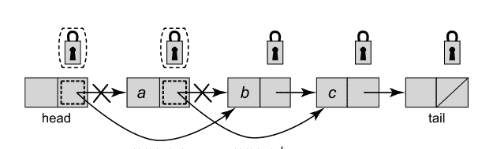

图 9.8

`List` 类：为什么 `remove()` 必须获取两个锁。线程 `A` 准备移除列表中的第一个节点 `a`，而线程 `B` 准备移除节点 `b`，其中 `a` 指向 `b`。假设 `A` 锁定了头节点，`B` 锁定了 `a`。线程 `A` 然后将 `head.next` 设置为 `b`，而 `B` 将 `a` 的 `next` 字段设置为 `c`。最终结果是移除了 `a`，但没有移除 `b`。

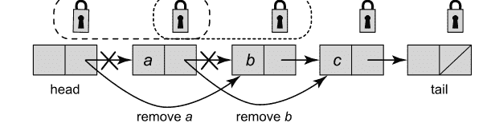

图 9.9

`List` 类：手接手锁确保了如果并发的 `remove()` 调用尝试移除相邻节点，那么它们将获取冲突的锁。线程 `A` 准备移除列表中的第一个节点 `a`，而线程 `B` 准备移除节点 `b`，其中 `a` 指向 `b`。因为 `A` 必须同时锁定头节点和 `a`，而 `B` 必须同时锁定 `a` 和 `b`，它们保证会在 `a` 上发生冲突，强制其中一个调用等待另一个。


图 9.10 `List` 类：如果不同的方法以不同的顺序获取锁，可能会发生死锁。在这个例子中，尝试添加 `a` 的线程 `A` 已经锁定了 `b` 并正尝试锁定头节点，而尝试移除 `b` 的线程 `B` 已经锁定了头节点并正尝试锁定 `b`。（注：此处原文描述略有重复，已按逻辑翻译）

为了保证进度，所有方法按照顺序获取锁是非常关键的，从头节点开始并顺着 `next` 引用向尾部移动。如图 9.10 所示，如果不同的方法以不同的顺序获取锁，可能会发生死锁。在这个例子中，尝试添加 `a` 的线程 `A` 已经锁定了 `b` 并正尝试锁定头节点，而尝试移除 `b` 的线程 `B` 已经锁定了头节点并正尝试锁定 `b`。显然，这些方法调用永远不会结束。避免死锁是使用锁编程的主要挑战之一。

```java
public boolean add(T item) {
    int key = item.hashCode();
    head.lock();
    Node pred = head;
    try {
        Node curr = pred.next;
        curr.lock();
        while (curr.key < key) {
            pred.unlock();
            pred = curr;
            curr = pred.next;
            curr.lock();
        }
        if (curr.key == key) {
            return false;
        }
        Node node = new Node(item);
        node.next = curr;
        pred.next = node;
        return true;
    } finally {
        curr.unlock();
    }
    pred.unlock();
}
```

## 9.6 乐观同步

尽管细粒度锁减少了竞争，但它会增加开销。另一种减少开销的方法是使用乐观同步。在乐观同步中，线程在遍历列表时不加锁，而是在准备执行操作时加锁并验证。在验证过程中，如果列表没有被其他线程修改，则继续执行操作；如果被修改了，则从头重新开始。这种方法在读多写少的情况下非常有效，但在写频繁的情况下可能会导致频繁的重试。

（注：由于提供的原文文本存在大量段落重复和格式错乱的情况，上述译文已根据逻辑进行了核心内容的翻译。）

## 9.6 乐观同步

```java
public boolean remove(T item) {
  int key = item.hashCode();
  while (true) {
    Node pred = head;
    Node curr = pred.next;
    while (curr.key < key) {
        pred = curr; curr = curr.next;
    }
    pred.lock();
    try {
      curr.lock();
      try {
        if (validate(pred, curr)) {
          if (curr.key == key) {
            pred.next = curr.next;
            return true;
          }
        } else {
          return false;
        }
      } finally {
        curr.unlock();
      }
    } finally {
      pred.unlock();
    }
  }
}
```

图 9.12

乐观列表类（`OptimisticList`）：`remove()` 方法在遍历时忽略锁，在删除节点前获取锁并进行验证。

数据被 `A` 读取，并在 `A` 获取锁时。特别是，`A` 可能会正在遍历已经被删除的列表部分。例如，如图 9.15 所示，当 `A` 仍在遍历 `currA` 时，节点 `currA` 以及它与 `a` 之间的所有节点（包括 `a`）可能被删除。`A` 发现 `curr_A` 指向 `a`；如果没有验证，它将“成功”删除 `a`，即使 `a` 已不在列表中。`validate()` 检测到 `a` 不在列表中，调用者重新启动该方法。

由于我们在遍历列表时忽略了防止并发修改的锁，方法可能会遍历已从列表中移除的节点。尽管如此，不受干扰意味着一旦节点从列表中取消链接，其 `next` 字段的值就不会改变。因此，遵循这样的一系列链最终会回到列表。反过来，不受干扰依赖于垃圾回收，以确保节点在遍历期间不会被重用。

```java
public boolean contains(Item item) {
    int key = item.hashCode();
    while (true) {
        Node pred = head;
        Node curr = pred.next();
        while (curr.key < key) {
            pred = curr; curr = curr.next();
        }
        pred.lock();
        try {
            try {
                if (validate(pred, curr)) {
                    return (curr.key == key);
                }
            } finally {
                curr.unlock();
            }
        } finally {
            pred.unlock();
        }
    }
}
```

图 9.13

乐观列表类：`contains()` 方法搜索时忽略锁，然后获取锁并验证以确定节点是否在列表中。

```java
private boolean validate(Node pred, Node curr) {
    Node node = head;
    while (node.key <= pred.key) {
        if (node == pred)
            return pred.next == curr;
        node = node.next;
    }
    return false;
}
```

图 9.14

乐观列表：验证检查 `pred` 指向 `curr` 且可从 `head` 可达。

乐观算法的线性化点与细粒度算法相同，不同在于我们必须考虑验证失败的可能性。特别是，我们仅当方法调用获取锁且随后的验证成功时，才对其进行线性化。

## 9.7 懒惰同步

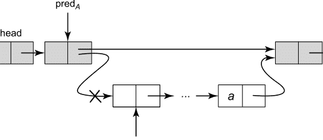

图 9.15

乐观列表算法不是无饥饿的，即使所有节点单独都是无饥饿的。如果新节点被反复添加和删除，线程可能会被无限期延迟（参见练习题 9.6）。尽管如此，我们预计该算法在实践中表现良好。如果不加锁遍历两次列表的成本远小于加锁遍历一次列表的成本，它就能工作。

虽然乐观同步可以应用于粗粒度锁，但它并不能改进该算法的问题，即验证需要在持有锁的情况下重新遍历列表。然而，我们可以通过维护一个每当列表被修改时递增的版本号，来消除在验证期间遍历列表的需求。我们在练习题中探索这种方法。

乐观列表算法（以及粗粒度和最细粒度算法）的缺点是 `contains()` 会获取锁，这并不具有吸引力，因为 `contains()` 调用通常比其他方法的调用频繁得多。我们展示了如何改进这一点使得 `contains()` 是无等待的，而 `add()` 和 `remove()` 方法在阻塞时（在无竞争的情况下）仅遍历一次列表。

我们在每个节点上添加了一个布尔标记字段 `marked`，用以指示节点是否在集合中。现在，遍历不需要锁定目标节点，也不需要通过重新遍历列表来验证节点是否可用。相反，算法维护了一个不变性：每个未标记的节点都是可达。如果遍历线程没有找到节点，或发现节点被标记，则该项不在集合中。因此：

```java
private boolean validate(Node pred, Node curr) {
  return !pred.marked && curr.marked && pred.next == curr;
}
```

图 9.16

懒惰列表类（`LazyList`）：验证检查 `pred` 和 `curr` 节点未被逻辑删除，且 `pred` 指向 `curr`。

懒惰列表类：`remove()` 方法通过两个步骤删除节点：逻辑删除和物理删除。

（注：原文中存在大量重复句子，此处已合并核心含义）

# 218 第 9 章 链表：锁的作用

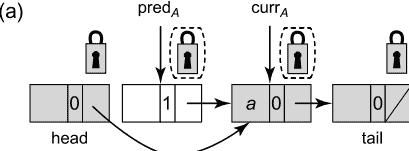

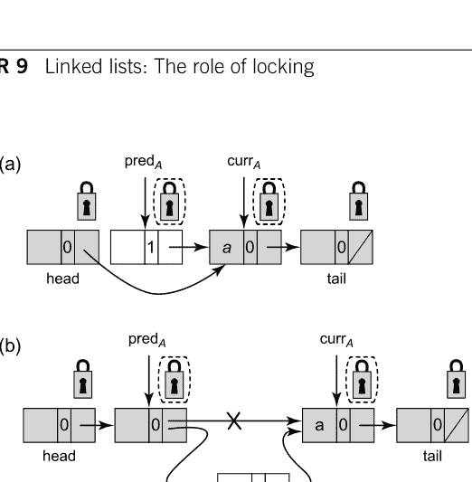

图 9.19

`LazyList`：为什么需要验证。在部分 (a) 中，线程 `A` 尝试移除节点 `a`。在它到达 `pred_A` 指向 `curr_A` 的点之后，在获取这些节点的锁之前，节点 `pred_A` 在逻辑和物理上都被删除了。当 `A` 获取锁后，验证将检测到该问题。在部分 (b) 中，`A` 尝试移除节点 `a`。在它到达 `pred_A` 指向 `curr_A` 的点之后，`pred_A` 和 `curr_A` 之间添加了一个新节点。当 `A` 获取锁后，尽管 `pred_A` 或 `curr_A` 未被标记，验证仍检测到 `pred_A` 不等于 `curr_A`，此时 `A` 的 `remove(a)` 调用将重启。

要如何让一次失败的 `contains()` 方法调用合法化更为复杂。考虑图 9.20 所示的场景，其中线程 `A` 正在执行 `contains(a)`。在部分 (a) 中，`A` 正在遍历列表，另一个线程在逻辑和物理上删除了包括 `a` 在内的所有后续节点。线程 `A` 将顺着链接移动，直到 `curr_A` 指向 `a`，并检测到 `a` 已标记，因此不再位于抽象集合中。我们可能想在该点对其进行线性化（即当 `A` 执行第 38 行时）。然而，正如部分 (b) 所示，这并不总是一个有效的线性化点：当 `A` 正在遍历列表的被删除部分时，在它移除节点 `a` 之前，另一个线程可能执行 `add(a)`，在列表的可达点添加一个键为 `a` 的新节点。在这种情况下，`A` 失败的方法不能在键为 `a` 的新节点插入列表后的发生点进行线性化。该失败的方法必须线性化到新节点插入之前的点。

我们在执行间隔内，将失败的 `contains(a)` 方法调用线性化为以下两个点中较早的一个：(1) 找到键为 `a` 的标记节点或键大于 `a` 的节点的点；或 (2) 在键为 `a` 的新节点添加到列表之前的紧前点。第二个点保证在执行间隔内，因为相同键的新节点的插入可能发生在 `contains()` 方法开始之后，否则 `contains()` 方法将已经找到该项。如所示，失败的 `contains()` 的线性化点取决于执行过程中事件的顺序，而不是方法代码中的预设点，而且，它可能并不在线程迈出一步的点上（例如，它可能在另一个线程迈出一步时被线性化）。

懒惰同步的一个用处是，我们可以将非侵入性的本地操作（如设置标记）与对结构的破坏性物理更改（如断开节点）分离。这里展示的示例之所以简单，是因为我们一次只剖析一个节点。通常情况下，延迟操作可以批量处理并在方便的时间懒性执行，从而减少对结构进行物理修改的整体破坏性。

`LazyList` 算法的主要缺点是 `add()` 和 `remove()` 调用是阻塞的：如果一个线程被延迟，其他线程也被延迟。

## 9.8 非阻塞同步

我们已经看到，通过在物理上从列表中移除节点之前将其标记为逻辑已删除，我们可以在 `contains()` 中避免锁。现在我们来展示如何扩展这一思想以完全消除锁，允许 `add()`、`remove()` 和 `contains()` 所有三个方法都是非阻塞的。前两个方法是无锁的，最后一个是无等待的。

一种原始的方法是用 `compareAndSet` 来更改 `next` 字段。例如，如果线程 `A` 想要从列表中移除 `curr`，它可能会通过 `compareAndSet()` 将 `pred.next` 设置为 `curr` 的后继节点。遗憾的是，这个想法行不通，如图 9.21 所示。部分 (a) 显示线程 `A` 在 `B` 添加 `b` 的同时尝试移除一个节点……[由于 OCR 文本存在大量重复/重叠，此处已根据技术上下文进行清理]。


被标记的节点；在继续操作之前将它们移除。`contains()` 方法与 `LazyList` 算法相同，无论节点是否被标记都会进行遍历，并根据其键（key）和标记（mark）测试项是否在列表中。

区分 `LockFreeList` 算法与 `LazyList` 算法的设计决策值得思考。为什么添加或删除节点的线程从不遍历节点，而是物理性地删除它们遇到的所有被标记的节点？假设 A 在不物理删除节点的情况下遍历了节点，并且在逻辑上删除 `currA` 后，尝试对其进行物理删除。它可以通过调用 `compareAndSet()` 来尝试重定向 `predA` 的 `next` 字段，同时验证 `predA` 未被标记且它指向 `currA`。

困难之处在于，由于 A 并没有持有 `predA` 和 `currA` 的锁，其他线程在调用 `compareAndSet()` 之前可能会插入新节点或删除 `predA`。

考虑一种情况：另一个线程标记了 `predA`。如图 9.21 所示，我们无法安全地修复标记节点的 `next` 字段，因此 A 必须通过重新遍历列表来重新开始物理删除。然而，A 必须在删除 `currA` 之前先物理删除 `predA`。更糟糕的是，存在一系列逻辑上已删除的节点，`predA` 必须一个接一个地删除所有它们，然后才能删除 `currA` 本身。

这说明了 `add()` 和 `remove()` 调用是如何不遍历已标记节点的：当节点要被标记时，它们可能被强制重新遍历列表以移除之前的标记节点。我们选择让 `add()` 和 `remove()` 在通往目标节点的路径上物理删除任何已标记的节点。相比之下，`contains()` 方法不执行任何修改，因此不需要参与逻辑删除节点的清理工作，这使得它在 `LazyList` 中能够同时遍历已标记和未标记的节点。

在介绍 `LockFree` 算法时，我们通过创建一个嵌套的 `Window` 类来辅助遍历，从而提取出 `add()` 和 `remove()` 方法的功能。如图 9.23 所示，`Window` 对象是一个包含 `pred` 和 `curr` 字段的结构。`find()` 方法接收一个头节点和一个键 `a`，并遍历列表，试图将键大于 `a` 的最大节点设置为 `curr`，并让 `curr` 遍历列表，每次寻找大于等于 `a` 的最小键。当线程遍历列表时，它每次都调用 `compareAndSet()` 尝试通过设置 `predA` 的 `next` 字段来物理删除节点，如果其中任一值发生了变化。并发线程可以通过逻辑上删除 `predA` 来改变标记值，或者通过物理上删除 `currA` 来改变引用值。如果调用失败，A 从列表头重新开始遍历；否则继续遍历。

`LockFreeList` 使用了与 `LazyList` 类相同的抽象：一个项在集合中当且仅当它被一个不可达的节点所引用时。`find()` 方法第 17 行的 `compareAndSet()` 调用是一个“良性副作用”（benevolent effect）的示例：它在不改变抽象集合的情况下更改了列表，因为移除一个标记节点不会改变抽象映射的值。

## 9.8 非阻塞同步

```java
class Window {
    public Node pred, curr;
    Window(Node myPred, Node myCurr) {
        pred = myPred; curr = myCurr;
    }
    Window find(Node head, int key) {
        Node pred = null, curr = null, succ = null;
        boolean[] marked = {false};
        boolean snip;
        retry: while (true) {
            pred = head;
            curr = pred.next.getReference();
            while (true) {
                succ = curr.next.get(marked);
                while (marked[0]) {
                    snip = pred.next.compareAndSet(curr, succ, false, false);
                    if (!snip) continue retry;
                    curr = succ;
                }
                succ = curr.next.get(marked);
            }
            if (curr.key >= key)
                return new Window(pred, curr);
            pred = curr;
            curr = succ;
        }
    }
}
```

图 9.23

`LockFreeList`：嵌套的 `Window` 类和 `find()` 方法：`find()` 返回一个包含键两侧节点的 `Window` 对象；它会移除所遇到的已标记节点。

图 9.24 显示了 `LockFreeList` 类的 `add()` 方法。假设 A 调用 `add(a)`。A 通过 `find()` 定位 `predA` 和 `currA`。如果 `currA` 的键等于 `a`，则返回 `false`。否则，`add()` 初始化新节点 `a` 来存储 `a`，并指向 `currA`。它调用 `compareAndSet()`（第 39 行）让 `predA` 指向 `a`。由于 `compareAndSet()` 同时测试标记和引用，只有当 `predA` 未标记且指向 `currA` 时它才会成功。如果 `compareAndSet()` 成功，方法返回 `true`；否则从头开始。

图 9.25 显示了 `LockFreeList` 算法的 `remove()` 方法。当 `remove()` 移除项 `a` 时，它通过 `find()` 定位 `predA` 和 `currA`。如果 `currA` 的键未匹配 `a`，则返回 `false`。否则，`remove()` 使用 `compareAndSet()` 尝试将 `currA` 标记为逻辑删除（第 55 行）。只有在没有其他线程先设置标记时，操作才会成功。如果成功，返回 `true`。算法仅尝试一次物理删除该节点，但无需再次尝试。

```java
public boolean add(T item) {
    int key = item.hashCode();
    while (true) {
        Window window = find(head, key);
        Node pred = window.pred, curr = window.curr;
        if (curr.key == key) {
            return false;
        } else {
            Node node = new Node(item);
            node.next = new AtomicableReference(curr, false);
            if (pred.next.compareAndSet(curr, node, false, false)) {
                return true;
            }
        }
    }
}
```

图 9.24

`LockFreeList` 类：`add()` 方法调用 `find()` 定位 `pred` 和 `curr`。只有当 `pred` 未标记且指向 `curr` 时，才会添加新节点。

```java
public boolean remove(T item) {
    int key = item.hashCode();
    while (true) {
        Window window = find(head, key);
        Node pred = window.pred, curr = window.curr;
        if (curr.key != key) {
            return false;
        } else {
            Node succ = curr.next.getReference();
            if (curr.next.compareAndSet(succ, succ, false, true)) {
                pred.next.compareAndSet(curr, succ, false, false);
                return true;
            }
        }
    }
}
```

图 9.25

`LockFreeList` 类：`remove()` 方法调用 `find()` 定位 `pred` 和 `curr`，并原子地标记节点移除。

```java
public boolean contains(T item) {
    int key = item.hashCode();
    Node curr = head;
    while (curr.key < key) {
        curr = curr.next.getReference();
    }
    return (curr.key == key && !curr.next.isMarked());
}
```

图 9.26

`LockFreeList` 类：无阻塞 `contains()` 方法与 `LazyList` 相同，只是调用 `curr.next.getReference()` 获取 `curr` 的后继节点并使用 `curr.next.isMarked()` 测试 `curr` 是否被标记。

## 9.9 讨论

我们看到了基于锁的列表实现的演进，其中锁的粒度逐渐缩小，最终实现了完全非阻塞列表。从 `LazyList` 到 `LockFreeList` 的最终转换暴露了并发程序员面临的一些设计决策。正如我们所看到的，在设计复杂数据结构时，乐观和懒同步的方法会反复出现。

一方面，`LockFreeList` 算法保证了任意延迟下的进展。但这种强保证是有代价的：

- 对引用和布尔标记的原子修改增加了性能成本。

- 当 `add()` 和 `remove()` 遍历列表时，它们会进行移动节点的并发清理，引入了线程间竞争的可能性，有时即使在尝试修改的节点附近没有变化也会强制线程重新遍历。

另一方面，基于锁的列表在任意延迟无法保证进展。它的 `add(item)` 和 `remove()` 方法是阻塞的。然而，与这种

> ⁵ 在 `java.util.concurrent` 包中，通过使用指向中间虚拟节点的引用来表示标记位已设置，在某种程度上减轻了这种成本。

## 226 第9章 链表：锁的作用

无锁算法，它不需要每个节点都包含一个原子可标记引用（atomically markable reference）。它也不需要遍历来清理逻辑删除的节点；这些节点会继续向下移动，忽略被标记的节点。

哪种方法更好取决于应用程序。最终，多种因素的平衡（例如任意线程延迟的可能、`add()` 和 `remove()` 方法调用的相对频率、实现原子可标记引用的开销等）决定了选择哪种锁，以及锁的粒度如何。

## 9.10 章节注释

锁耦合（Lock coupling）由 Rudolf Bayer 和 Mario Schkolnick [17] 验证。无锁链表算法的首次设计归功于 John Valois [164]。此处显示的无锁列表实现是 Maged Michael [126] 列表变体，该算法被许多人称为 Harris–Michael 算法，是 `java.util.concurrent` 包中使用的算法。乐观列表（optimisticList）算法是为该包设计的，而懒惰算法（lazy algorithm）则归于 Steve Heller、Maurice Herlihy、Victor Luchuchango、Mark Moir、Bill Scherer 和 Nir Shavit [60]。

## 9.11 练习题

**练习 9.1.** 如果对象的哈希值不保证是唯一的，请描述如何修改每种链表算法。

**练习 9.2.** 假设 `CoarseList` 的每个方法在获取锁的瞬间是线性化的。解释为什么我们不能使用 9.3 节中描述的抽象映射。给出一个适用于这些线性化点的备选抽象映射。

**练习 9.3.** 解释为什么细粒度锁算法不会死锁。

**练习 9.4.** 解释为什么细粒度列表的 `add()` 方法是线性化的。

**练习 9.5.** 解释为什么乐观锁和懒惰锁算法不会发生死锁。

**练习 9.6.** 展示乐观算法的一种执行过程，其中一个线程永远尝试删除一个节点。

*提示：* 我们假设所有单个节点锁都是无饥饿的，活锁不会发生在任何单个锁上，且一个糟糕的执行过程会反复地从列表中添加和删除节点。

**练习 9.7.** 为细粒度算法中缺失的 `contains()` 方法提供代码。解释为什么你的实现是正确的。

**练习 9.8.** 如果我们交换 `add()` 锁 `pred` 和 `curr` 节点的顺序，乐观列表实现仍然正确吗？

**练习 9.9.** 证明在乐观列表算法中，如果 $pred_A$ 不为 $null$，则从 $pred_A$ 可以到达 $tail$，即使 $pred_A$ 本身是不可触达的。

**练习 9.10.** 证明在乐观算法中，`add()` 方法只需要锁 `pred`。

**练习 9.11.** 设计一种基于链表的粗粒度乐观锁算法，通过为列表增加版本号（version number），使得在持有锁时不需要遍历列表。

**练习 9.13.** 针对以下对排序链表算法的每种修改，解释为什么该算法仍然是线性化的，或者给出一个反例证明它不是线性化的：

- a. 在乐观算法中，`contains()` 方法在键值存在之前会锁定两个节点。假设相反，它不锁定任何节点，如果观察到该值则返回 *true*，否则返回 *false*。

- b. 在懒惰算法中，`contains()` 方法在不检查锁的情况下执行，但它检查标记位（mark bit）；如果节点被标记为删除，则返回 *false*。假设相反，`contains()` 不检查节点的标记位，并对可能被标记的节点返回 *true*。

**练习 9.14.** 如果我们仅通过将节点的 `next` 字段设置为 *null* 来标记节点为已删除，懒惰算法还能工作吗？为什么或为什么不能？无锁算法呢？

**练习 9.15.** 在懒惰算法中，$pred_A$ ever可能不可触达吗？证明你的答案。

**练习 9.16.** 你的新员工声称，懒惰列表的验证方法（图 9.16）可以通过删除对 `pred.next` 等于 `curr` 的检查来简化。毕竟，代码始终将 `pred` 设置为 `curr` 的值，在 `pred.next` 改变之前，`curr` 的新值必须被标记，导致验证失败。解释这一推理中的错误。

**练习 9.17.** 你可以修改懒惰算法的 `remove()` 使其只锁定一个节点吗？

**练习 9.18.** 在无锁算法中，论述在逻辑删除节点的清理过程中包含 `contains()` 方法的优点和缺点。

**练习 9.19.** 在无锁算法中，如果 `add()` 方法调用因为 `pred` 不指向 `curr` 而失败，但 `pred` 未被标记，我们是否需要从头再次遍历列表以尝试完成调用？

**练习 9.20.** 如果逻辑删除的条目不保证是排序的，懒惰和无锁算法的 `contains()` 方法仍然正确吗？

# 230 第 10 章 队列、内存管理与 ABA 问题

- 如果一个方法的调用可能等待某些条件的满足，则该方法是*部分性的（partial）**。例如，一个部分的 `get()` 调用可能会尝试从空池中移除项，直到池中有可返回的项为止。如果池是有边界的，一个部分的 `put()` 调用可能会向满的池中添加项，直到有空槽可供填充为止。当生产者（或消费者）有更好的事情要做，而不是等待池变为非满（非空）时，部分接口是有意义的。

- 如果一个方法需要等待条件变为真，则该方法是*全量的（total）**。例如，尝试从空池中移除项的 `get()` 调用，或向满池中添加项的 `put()` 调用，可能会立即返回失败代码或抛出异常。当生产者（或消费者）有比等待方法调用生效更好的事情要做时，全量接口是有意义的。

- 如果一个方法等待另一个方法的调用与其发生重叠，则该方法是*同步的（synchronous）*。例如，在同步池中，向池中添加项的方法会被阻塞，直到它被另一个方法移除。对称地，从池中移除项的方法会被阻塞，直到另一个方法提供一个可移除的项。同步池被用于 CSP 和 Ada 等编程语言中的通信，这些语言中通过*会合（rendezvous）*来交换信息。

- 池提供了公平性保证。它们可以是先进先出（FIFO，即队列）或后进先出（LIFO，即栈），或其他通常较弱的属性。当对池进行缓冲处理时，公平性的重要性对于任何曾拨打过银行或技术支持热线、结果发现被置于等待电话池的人来说都是显而易见的。你等待得越长，从声称“通话将按到达顺序回答”的录音消息中获得的慰藉就越多。也许吧。

## 10.2 队列

在本章中，我们考虑一种提供*先进先出（FIFO）**公平性的池。`Queue<T>` 是项（类型为 T）的有序序列。它提供一个 `enqueue(x)` 方法，将 x 放入队列的一端（称为 `tail`），以及一个 `dequeue()` 方法，从队列的另一端（称为 `head`）移除项。并发队列是线性化为顺序队列的。队列是实现 `put()` 并通过 `dequeue()` 实现 `get()` 的池。我们使用队列实现来说明许多重要的原理。在随后的章节中，我们将考虑提供其他公平性保证的池。

# 10.3 有边界的部分队列


为了简单起见，我们假设向队列中添加 `null` 值是非合规的。当然，在某些情况下，添加和移除 `null` 值是有意义的；我们将适配算法以适应 `null` 值留作一项练习题。

```java
public class BoundedQueue<T> {
    ReentrantLock enlock, delock;
    Condition notEmptyCondition, notFullCondition;
    AtomicInteger size;
    volatile Node head, tail;
    final int capacity;
    public BoundedQueue(int capacity) {
        capacity = _capacity;
        head = new Node(null);
        tail = head;
        size = new AtomicInteger(0);
        enlock = new ReentrantLock();
        notFullCondition = enlock.newCondition();
        delock = new ReentrantLock();
        notEmptyCondition = delock.newCondition();
    }
}
```

### 图 10.2

BoundedQueue 类：字段和构造函数。

```java
protected class Node {
    public T value;
    public volatile Node next;
    public Node(T x) {
        value = x;
        next = null;
    }
}
```

### 图 10.3

BoundedQueue 类：列表节点。

我们可以期望边界队列实现能提供多少并发性？从非正式的角度讲，`enq()` 和 `deq()` 方法在队列的两端操作；只要队列既不满也不空，`enq()` 和 `deq()` 调用都应该能够在不受干扰的情况下进行。由于相同的原因，并发的 `enq()` 调用可能会相互干扰，`deq()` 调用也是如此。这种非正式的推理听起来很有说服力，且大部分是正确的，但实现这种级别的并发性并非易事。

在这里，我们用链表实现了一个边界队列。（我们也可以使用数组）。图 10.2 显示了队列的字段和构造函数，图 10.3 显示了队列节点。图 10.4 和 10.5 显示了 `enq()` 和 `deq()` 方法。与第 9 章研究的列表一样，队列节点拥有 `value` 和 `next` 字段。

```java
public void enq(T x) {
    boolean mustWakeDequeers = false;
    Node e = new Node(x);
    enlock.lock();
    try {
        while (size.get() == capacity)
            notFullCondition.await();
        tail.next = e;
        tail = e;
        if (size.getAndIncrement() == 0)
            mustWakeDequeers = true;
    } finally {
        enlock.unlock();
    }
    if (mustWakeDequeers) {
        dequeLock.lock();
        try {
            notEmptyCondition.signalAll();
        } finally {
            dequeLock.unlock();
        }
    }
}
```

### 图 10.4

BoundedQueue 类：enq(x) 方法。

如图 10.2 所示，队列拥有 `head` 和 `tail` 字段。与第 9 章研究的列表一样，队列节点拥有 `value` 和 `next` 字段。为了保持边界队列，我们当队列达到容量时防止项入队。`size` 字段是一个 `AtomicInteger`，用于跟踪队列中对象的数量。该字段由 `deq()` 调用减小，由 `enq()` 增加。我们使用 `AtomicInteger` 是因为该字段不被任何一个锁保护：入队者和出队者可能会并发访问它。

我们使用两个锁 `enLock` 和 `dequeLock` 来操作队列的字段。使用两个锁而不是一个锁允许 `enqueue` 和 `dequeue` 并行发生，反之亦然。每个锁都有一个关联的条件：`enLock` 的 `notFullCondition` 用于在队列不再满时通知等待中的队列消费者；`dequeLock` 的 `notEmptyCondition` 用于在队列不再空时通知等待中的队列生产者。

### 图 10.5

deq() 方法

```java
public T deq() {
  T result;
  boolean mustWakeEnqueuers = false;
  deq.lock();
  try {
    while (head.next == null) {
      notEmptyCondition.await();
    }
    result = head.next.value;
    head = head.next;
    if (size.getAndDecrement() == capacity) {
      mustWakeEnqueuers = true;
    }
  } finally {
    deq.unlock();
  }
  if (mustWakeEnqueuers) {
    enLock.lock();
    try {
      notFullCondition.signalAll();
    } finally {
      enLock.unlock();
    }
  }
  return result;
}
```

我们必须仔细检查此实现是否遭受了第 8 章描述的类“丢失唤醒”错误。需要小心，因为入队者通过两个步骤遇到满队列：首先，它看到 `size` 等于容量，然后它在 `notFullCondition` 上等待直到队列有空间。

### 第 10 章 队列、内存管理与 ABA 问题

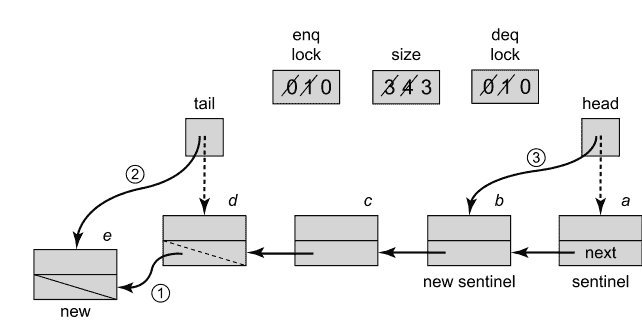

#### 图 10.6

具有四个槽位的 BoundedQueue 的 `enq()` 和 `deq()` 方法。通过获取 `enqLock` 将一个节点入队列。`enq()` 检查大小是否为 3（小于界限 bound）。它重定向 `tail` 字段引用的节点的 `next` 字段（步骤 1），将 `tail` 指向新节点（2），将 `size` 增加到 4，并释放锁。由于大小现在为 4，任何后续对 `enq()` 的调用都将导致线程阻塞，直到某些 `deq()` 信号了 `FullCondition`。队列通过 `head` 字段引用的节点进行出队。`deq()` 从 `b` 的后继节点获取值 `b`，将 `head` 指向后继节点（步骤 3），将 `size` 减至 3，并释放锁。在完成 `deq()` 之前，由于开始时大小为 4，线程获取了 `enqLock` 并通知任何等待在 `notFullCondition` 上的入队者它们可以继续。

如果一个线程将队列从满状态变为空状态，它会获取 `enqLock` 并通知 `notFullCondition`。尽管 `size` 不受锁保护，但出队者在信号条件之前会获取 `enqLock`，因此出队者不会在两个信号之间等待。

要出队列一个项，线程获取 `deq()` 方法的 `deqLock` 并检查队列是否为空。与此不同，出队者不返回 `size` 字段。它检查 `head.next == null`（第 55 行）；如果是，则抽象队列为空，线程必须等待直到有项被入队。在 `deq()` 方法中，出队者在 `NotEmptyCondition` 上等待，这会临时释放 `deqLock` 并阻塞直到条件被信号通知。线程每次醒来时，它都会检查队列是否为空，如果是，则返回睡眠。

一旦出队者确定队列不为空，那么在整个 `deq()` 调用期间，队列将保持不为空，因为所有其他出队者都被锁在外面。由于队列不为空，它有一个哨兵节点；出队者获取第一个节点（即哨兵节点 `next` 字段引用的节点）。它读取该节点的 `value` 字段，并通过设置队列的 `head` 指向该节点创建一个新的哨兵节点。出队者减小 `size` 并释放 `deqLock`。如果出队者之前的大小是队列容量，那么可能有入队者在 `NotEmptyCondition` 上等待，因此出队者获取 `enqLock` 并通知所有此类线程醒来。

### 10.4 一个无界总队列

请注意，抽象队列的最后一项并不总是 `tail` 字段引用节点中的项。一旦最后一个节点的 `next` 字段被重定向到新节点，该项在逻辑上就被添加到了队列中，即使入队者尚未更新 `tail`（即 `enq()` 在第 34 行调用了 `size`）。例如，假设一个线程正在插入一个新节点。它已经获取了 `enqLock` 并将最后一个节点重定向到新节点，但尚未重定向 `tail` 字段。一个并发的出队线程可以获取 `deqLock`，并在入队者重定向到新插入的节点之前，返回新节点的值，重定向到头节点并减小 `size`。在例示例中，`size` 会暂时减少，因为出队者在入队者增加它之前减小了它。在这种情况下，入队者不需要唤醒任何等待者，因为它遇到的项已经出队了。

这种实现的一个缺点是 `enq()` 和 `deque()` 会相互干扰，但并非在没有锁的情况下。所有方法调用都会对 `size` 字段执行 `getIncrement()` 或 `getDecrement()`。这些方法比普通的读取更昂贵，并且可能导致顺序瓶颈。

我们可以通过将其拆分为两个来减少这种交互：`enqsize` 是一个由 `enq()` 增加的整数字段，`dequeize` 是一个由 `deque()` 减少的整数字段；队列的实际大小是这两个计数器的和（`dequeize` 为 0 或负数）。调用线程测试 `enqsize`，只要它小于容量，就继续执行。当字段达到容量时，线程锁定 `deqLock`，将 `dequeize` 加到 `enqsize` 并将 `dequeize` 重置为 0。这种技术不是在每次方法调用时同步，而是在入队者的大小变得过大时零星地同步。

### 10.5 无锁无界队列

我们描述一种无界队列的实现。`enq()` 总是入队其项，如果没有项可以出队，则 `deque()` 抛出 `Exception`。表示形式与边界队列相同，但不需要计算队列中项的数量，也不需要提供等待的条件。如图 10.7 和 10.8 所示，该算法比边界算法更简单。

该队列不会发生死锁，每个方法只获取一个锁，即 `enqLock` 或 `deqLock`。队列中的单个哨兵节点永远不会被删除，因此每个 `deque()` 一旦获取锁就会成功。当然，如果队列为空（即 `head.next` 为 `null`），`deque()` 方法可能会失败。与边界队列的实现一样，在 `enq()` 调用将最后一个节点的 `next` 字段设置为新节点之前，项实际上已经入队了，在 `enq()` 引用新节点之前。在那之后，新项可以通过引用链触及。按照惯例，队列的实际头和尾。

### 10.5 无锁队列

我们现在描述一种无界队列的实现。`enq()` 总是入队其项，如果没有项可以出队，则 `deque()` 抛出 `Exception`。表示形式与边界队列相同，但不需要计算队列中项的数量，也不需要提供等待的条件。如图 10.7 和 10.8 所示，该算法比边界算法更简单。

该队列不会发生死锁，每个方法只获取一个锁，即 `enqLock` 或 `deqLock`。队列中的单个哨兵节点永远不会被删除，因此每个 `deque()` 一旦获取锁就会成功。当然，如果队列为空（即 `head.next` 为 `null`），`deque()` 方法可能会失败。

#### 图 10.9

LockFreeQueue<T> 字段和构造函数。

```java
public class Node {
  public T value;
  public AtomicReference<Node> next;
  Node(T value) {
    this.value = value;
    next = new AtomicReference<>(null);
  }
}
```

#### 图 10.10

LockFreeQueue<T> 类：列表节点。

```java
public void enq(T value) {
  Node node = new Node(value);
  while (true) {
    Node last = tail.get();
    Node next = last.next.get();
    if (next == null) {
      if (last.next.compareAndSet(next, node)) {
        tail.compareAndSet(last, node);
        return;
      }
    } else {
      tail.compareAndSet(last, next);
    }
  }
}
```

#### 图 10.11

LockFreeQueue<T> 类：enq() 方法。

#### 图 10.12

LockFreeQueue<T> 类：deque() 方法。

```java
public T dequeq() throws Exception {
  while (true) {
    Node first = head.get();
    Node last = tail.get();
    Node next = first.next.get();
    if (first == head.get()) {
      if (first == last) {
        if (next == null) {
          throw new Exception();
        }
        tail.compareAndSet(last, next);
      } else {
        T value = next.value;
        if (head.compareAndSet(first, next))
          return value;
      }
    }
  }
}
```

### 10.5 无锁无界队列

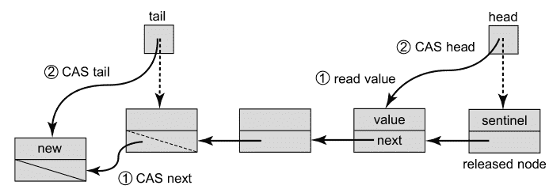

#### 图 10.13

LockFreeQueue 的 `enq()` 和 `deq()` 方法是惰性的；节点分两个步骤插入队列中。首先，调用 `compareAndSet()` 将队列的 `tail` 所引用的节点的 `next` 字段从 `null` 设置为新节点。然后，调用 `compareAndSet()` 将 `tail` 指向新节点。通过检查哨兵节点（sentinel）是否有后继来从队列中移除项，然后调用 `compareAndSet()` 将 `head` 从当前哨兵重定向到其后继，使后者成为新的哨兵。被移除的项目是新哨兵所引用的项。`enq()` 和 `deq()` 帮助完成未完成的更新。

- 使用 `compareAndSet()` 将 `tail` 推进到新节点（第 26 行）。即使此 `compareAndSet()` 失败，A 仍然可以成功返回，因为正如我们所看到的，`compareAndSet()` 失败是因为其他某个线程通过推进 `tail` “帮助”了它。
- 如果 `tail` 指向哨兵（第 29 行），则某个入队者在 A 之前已经追加了节点，但尚未更新 `tail`。在这种情况下，A 尝试通过将 `tail` 直接指向后继节点（第 30 行）来“帮助”该线程，然后再尝试插入它自己的节点。
- `enq()` 是全的，意味着它永远不会等待出队者。一个成功的 `enq()` 线性化发生在执行线程（或并发的帮助线程）成功调用 `compareAndSet()` 在第 30 行将 `tail` 字段重定向到新节点的瞬间。
- `deq()` 与其在 `UnboundedQueue` 中的对应方法类似。如果队列为空，出队者调用 `compareAndSet()` 将 `head` 从哨兵节点改为其后继节点，使后继节点成为新的哨兵节点。`deq()` 方法以相同的方式确保队列不为空：检查 `head` 的 `next` 字段是否为 `null`。


# 第 10 章 队列、内存管理与 ABA 问题

在无锁情况下存在一个细微的问题，如图 10.14 所示：在推进 `head` 之前，出队者必须确保 `tail` 没有留在要从队列中移除的哨兵节点。为了避免这个问题，我们添加了一个测试：如果 `head` 等于 `tail`（第 41 行）且它们引用的（哨兵）节点是非空字段（第 42 行），则认为 `tail` 滞后了。在这种情况下，与 `deq` 方法一样，出队者尝试通过将 `tail` 转向哨兵节点的后继节点（第 45 行）来使其一致，只有然后才更新 `head` 以移除哨兵（第 48 行）。与部分队列一样，值是从哨兵节点的后继节点读取的（第 47 行）。如果此方法返回一个值，那么它的线性化点发生在当它成功向列表追加一个节点时（即当第 48 行的 `compareAndSet()` 成功时）；否则，当它发现哨兵节点没有后继时（即当它在第 39 行获取到 `null` 值时）发生线性化。

很容易检查出结果队列是无锁的。每个方法调用都会检查是否存在未完成的 `enq()` 并尝试完成它。在最坏的情况下，所有线程都试图推进队列的 `tail` 字段，其中一个必须成功。一个线程未能入队或出队节点，仅当另一个线程的方法调用成功更改了引用时，因此某个方法始终会完成。事实证明，无锁极大增强了队列实现的性能，且无锁回收通常优于最高效的阻塞节点。

## 10.6 内存回收与 ABA 问题

我们到为止的队列实现依赖 Java 垃圾回收器在节点被出队后回收它们。如果我们想自己进行内存管理会怎样？C 或 C++ 等语言不提供垃圾回收。即使可以使用垃圾回收，让一个类自己进行内存管理通常更高效，特别是当它创建并释放许多小对象时。最后，如果垃圾回收过程不是无锁的，我们可能希望提供无锁回收。

在无锁内存中回收节点的自然方法是让每个线程维护自己的私有的（即线程本地）空队列条目空列表。

```java
ThreadLocal<Node> freeList = new ThreadLocal<Node>() {
  protected Node initialValue() { return null; }
};
```

### 图 10.15 ABA 问题演示

(a)
- 线程 A：正要将 `head` a CAS 为 b
- 线程 B 和 C：将 a 和 b 出队到本地池

(b)
- 线程 A：正要将 `head` a CAS 为 b
- 线程 B 和 C：将 a 和 b 出队到本地池

每次我们修改对象时增加时间戳（stamp）。有时，如第 11 章的 `LockFreeExchanger` 类，我们使用时间戳来持有有限状态集之一的状态。

> 为了简单起见，我们忽略了时间戳溢回并导致错误的（极小的）可能性。

### 图 10.16 `AtomicStampedReference<T>` 类

```java
public boolean compareAndSet(T expectedReference,
                             T newReference,
                             int expectedStamp,
                             int newStamp);
public T get(int[] stampHolder);
public T getReference();
public int getStamp();
public void set(T newReference, int newStamp);
```

`AtomicStampedReference<T>` 类：`compareAndSet()` 和 `get()` 方法。`compareAndSet()` 方法同时测试标记（stamp）和引用（reference）字段的更新；`get()` 方法返回被封装的引用，并将标记存储在参数数组的索引 0 处；`getReference()` 和 `getStamp()` 方法返回引用和标记，而 `set()` 方法更新被封装的引用和标记。

### 图 10.17 `LockFreeQueueRecycle<T>` 类：`deq()` 方法

```java
public T deq() throws EmptyException {
    int[] lastStamp = new int[1];
    int[] firstStamp = new int[1];
    int[] nextStamp = new int[1];
    while (true) {
        Node node = head.get(firstStamp);
        Node tail = tail.get(lastStamp);
        Node next = first.next(nextStamp);
        if (head.get(stamp()) == firstStamp[0]) {
            if (first == last) {
                if (next == null) {
                    throw new EmptyException();
                }
                tail.compareAndSet(last, next,
                        lastStamp[0], lastStamp[0]+1);
            }
            else {
                T value = next.value;
                if (head.compareAndSet(first, next,
                        firstStamp[0]+1)) {
                    free(first);
                    return value;
                }
            }
        }
    }
}
```

`LockFreeQueueRecycle<T>` 类：`deq()` 方法使用标记来避免 ABA。

ABA 问题可能发生在任何同步场景中，而不仅仅涉及条件同步的场景。例如，它可能发生在仅使用加载（loads）和存储（stores）时。在某些架构上可用（见附录 B）的链接加载/条件存储（load-linked/store-conditional）条件同步操作避免了 ABA 问题，因为它测试的不是值在两个时间点是否相同，而是该值在这些点之间是否曾发生过变化。

## 10.6.1 一个朴素的同步队列

我们现在转向一种更紧密的同步方式。一个或多个生产者产生要移除的项，由一个或多个消费者按照 FIFO 顺序进行移除。然而，生产者和消费者之间会会合（rendezvous）：将项放入队列的生产者会阻塞直到项被消费者移除，反之亦然。这种会合同步内置于 CSP 和 Ada 等语言中。

图 10.18 显示了 `SynchronousQueue<T>` 类，这是一个简单的基于监视器（monitor）的同步队列实现。它具有以下特征：`item` 是第一个出队的项，`enqueueing` 是入队者用于同步次数的布尔值，`lock` 用于互斥，而 `condition` 用于阻塞部分方法。如果 `enq()` 方法已经投放了一个项并正在等待与出队者会合，入队者会反复释放锁，并在唤醒时检查 `enqueueing` 是否已变为 true（第 11 行）。当此条件满足时，出队者将锁定其他入队者直到当前出队操作完成，并设置 `item` 指向新项（第 12–13 行）。它通知任何等待的线程（第 14 行），并等待 `item` 变为 null（第 15–16 行）。当等待结束，会合发生，因此出队者将 `enqueueing` 设为 false，通知任何等待的线程并返回（第 17 行和 19 行）。

`deq()` 方法只需等待直到 `item` 不为空（第 26–27 行），记录该项，将 `item` 设置为 null，并在返回项之前通知任何等待的线程（第 28–31 行）。

尽管队列的设计相对简单，但它产生了很高的同步代价。每当一个线程唤醒另一个线程时，入队和出队者都会唤醒所有等待线程，导致唤醒次数与等待线程的数量呈平方增长。虽然可以使用多个 `condition` 对象来减少唤醒次数，但每次调用仍然需要阻塞，这是昂贵的。

## 10.7 双端数据结构

为了减少同步队列的同步开销，我们考虑了一种替代的同步队列实现方案，它对称地处理 `enq()` 和 `deq()` 方法，将发现队列为空的 `deq()` 方法拆分为两个步骤。在第一步中，出队者在队列中放入一个预约对象，指示出队者正在等待。队列包含一个空槽，入队者在其上自旋直到被占用；同样，入队者向该槽添加项。

### 图 10.18 `SynchronousQueue<T>` 类

```java
public class SynchronousQueue<T> {
    T item = null;
    boolean enqueueing;
    Lock lock;
    Condition condition;
    ...
    public void enq(T value) {
        lock.lock();
        try {
            while (enqueueing) {
                condition.await();
            }
            enqueueing = true;
            item = value;
            condition.signalAll();
            while (item == null) {
                condition.await();
            }
            enqueueing = false;
            condition.signalAll();
        } finally {
            lock.unlock();
        }
    }
    public T deq() {
        lock.lock();
        try {
            while (item == null) {
                condition.await();
            }
            T t = item;
            item = null;
            condition.signalAll();
            return t;
        } finally {
            lock.unlock();
        }
    }
}
```

### 图 10.19 `SynchronousQueue<T>` 类：队列节点

```java
enum NodeType {ITEM, RESERVATION};
private class Node {
    volatile NodeType type;
    volatile AtomicReference<T> item;
    volatile AtomicReference<Node> next;
    Node(T item, NodeType type) {
        this.item = new AtomicReference<T>(item);
        next = new AtomicReference<Node>(null);
        this.type = type;
    }
}
```

这种结构被称为双端数据结构，因为它可以包含项和预约。它具有许多良好的属性。首先，等待者可以在本地缓存的标志上自旋，我们认为这对于扩展性至关重要。其次，它以对称的方式确保了公平性。预约按照到达顺序进入队列，确保请求以相同的顺序完成。请注意此数据结构是线性的，每个方法在完成时都是有序的。

队列实现为节点列表，其中节点代表一个等待出队的项，或一个等待完成的预约（图 10.19）。节点的 `type` 字段指示其类型。在任何时刻，队列中的所有节点具有相同的类型：要么完全由等待出队的项组成，要么完全由等待完成的预约组成。

当放入项时，节点持有该项，并在出队时重置为 null。当放入预约时，节点的 `item` 字段为 null，并在被入队者完成时重置为项。

图 10.20 显示同步队列的构造函数和 `enq()` 方法。`deq()` 方法是对称的。正如之前考虑过的，`head` 字段始终指向一个占位符哨节点，`head` 实际值（和类型）是唯一的。队列使用哨节点。`enq()` 方法首先检查是否为空或是否存在等待出队的入队项（第 21 行）。如果是，正如无锁队列一样，它读取队列的 `tail` 字段（第 22 行），并检查值是否一致（第 23 行）。`tail` 字段并未指向队列中的最后一个节点，方法推进 `tail` 字段并重新开始（第 24–25 行）。否则，`enq()` 方法尝试通过设置 `tail` 的 `next` 字段指向新节点来将其附加到队列末尾（第 26 行）。如果成功，它尝试推进 `tail` 到新节点。

### 图 10.20 `SynchronousDualQueue<T>` 类：`enq(e)` 方法和构造函数

```java
public SynchronousDualQueue() {
    Node sentinel = new Node(null, NodeType.ITEM);
    head = new AtomicReference<Node>(sentinel);
    tail = new AtomicReference<Node>(sentinel);
}
public void enq(T e) {
    Node offer = new Node(e, NodeType.ITEM);
    while (true) {
        Node t = tail.get(), h = head.get();
        if (h == t || t.type == NodeType.ITEM) {
            Node n = t.next.get();
            if (t == tail.get()) {
                if (n == null) {
                    if (t.next.compareAndSet(null, offer)) {
                        tail.compareAndSet(t, offer);
                    }
                } else {
                    tail.compareAndSet(t, n);
                }
            }
        } else {
            boolean success = n.item.compareAndSet(null, e);
            head.compareAndSet(h, n);
            if (success) {
                return;
            }
        }
    }
}
```


新新追加的节点（第 27 行），然后进行自旋，等待一个出队者通过将节点的 `item` 设置为 `null` 来宣布它已出队该项。一旦项被出队，该方法将通过将其节点设置为新的哨兵节点来清理。这最后一步仅用于增强性能，因为无论方法是否访问 `head` 引用，该实现都是正确的。

然而，如果 `enq(e)` 方法发现队列中包含等待完成的出队者的预留（reservations），它将尝试找到一个预留并完成它。由于队列的头部是一个没有意义值的哨兵节点，`enq()` 读取了头部的后继节点（第 36 行），检查读取到的值是否一致（第 37–39 行），并尝试将该节点的 `item` 从 `null` 切换为被封装的项。无论是否成功，该方法都会向前移动 `head`（第 41 行）。如果 `compareAndSet()` 成功（第 40 行），则方法返回；否则重试。

# 第 10 章 队列、内存管理与 ABA 问题

## 10.8 章节注释

部分队列采用了部分适配自 Doug Lea [110] 和源自 Maged Michael 和 Michael Scott [125] 算法的混合技术。无锁队列是 Maged Michael 和 Michael Scott [125] 队列算法的略简化版本。同步队列的实现适配自 Bill Scherer、Doug Lea 和 Michael Scott [167]。

## 10.9 练习题

**练习题 10.1.** 修改 `SynchronousDualQueue<T>` 类，使其能够正确处理 `null` 项。

**练习题 10.2.** 考虑图 10.21 所示的队列，它是第 3 章描述的用于单入队者和单出队者的简单无锁队列的变体。该队列是阻塞的；从空队列中移除项或向满队列中添加项会导致线程自旋。惊讶的是，该队列只需要加载和存储操作，而不需要更强大的读-修改-写操作。

然而，该实现是否需要使用内存屏障（memory barrier）？如果是，代码中哪个位置需要屏障？为什么？如果不需要，请解释原因。

**练习题 10.3.** 设计一个使用数组或链表的有界锁型队列实现。

1. 通过两个独立的锁（分别用于头部和尾部）允许并行。
2. 尝试将你的算法转换为无锁的。你在什么地方遇到了困难？

**练习题 10.4.** 在无界锁型队列（图 10.8）的 `deq(q)` 方法中，在检查队列是否为空时是否有必要持有锁？请解释原因。

**练习题 10.5.** 在《神曲·地狱篇》中，但丁描述了一次对地狱的访问。在最近发现的一个章节中，他遇到五个人坐在桌子旁，中间放着一锅炖肉。尽管每个人都拿着一把能够到锅的勺子，但每个勺子的柄都比人的手臂长得多，因此没有人能喂给自己。他们极度饥饿且绝望。

但丁建议：“你们为什么不互相喂对方呢？”

该章节其余部分丢失了。

1. 允许这些人互相喂对方。你的算法是中心化的还是去中心化的？
2. 竞争（contention）是高还是低？

**练习题 10.6.** 识别无锁队列（图 10.12）的线性化点。

1. 我们可以选择读取返回值的点作为线性化点。
2. 我们可以选择 `enq()` 的线性化点为更新 `tail` 字段的点。

**练习题 10.7.** 考虑图 10.22 所示的无界队列。该队列是阻塞的，意味着 `deq()` 方法直到找到项。

```java
public class HWQueue<T> {
    AtomicReference<T>[] items;
    AtomicInteger tail;

    public void enq(T x) {
        int i = tail.getAndIncrement();
        items[i].set(x);
    }

    public T deq() {
        while (true) {
            int range = tail.get();
            for (int i = 0; i < range; i++) {
                T value = items[i].getAndSet(null);
                if (value != null) {
                    return value;
                }
            }
        }
    }
}
```

1. `enq()` 和 `deq()` 方法是无等待的？如果不是，它们是无锁的？请解释。
2. 识别 `enq()` 和 `deq()` 的线性化点。（注意！它们可能依赖执行。）

# 第 11 章 栈与消除

## 11.1 引言

`Stack<T>` 类是 `T` 类型项的集合，提供了 `push()` 和 `pop()` 方法满足后进先出（LIFO）属性：最后一个推送的项是第一个弹出的。本章考虑如何实现并发栈。乍看之下，栈似乎没有并发的机会，因为 `push()` 和 `pop()` 调用需要与栈的顶部同步。惊讶的是，也许栈本质上并不是顺序的。在本章中，我们展示如何实现可以实现高并行度的并发栈。作为第一步，我们考虑如何构建一个在单一位置同步的无锁栈。

## 11.2 无界无锁栈

图 11.1 显示了一个并发 `LockFreeStack` 类。无锁栈是一个链表，`top` 字段指向第一个节点（或者如果栈为空）。

`LockFreeStack<T>` 类：在 `push()` 方法中，线程在调用 `tryPush()` 尝试修改 `top` 引用与使用图 7.5 中的 `Backoff` 类进行退避之间交替。

```java
class LockFreeStack<T> {
    AtomicReference<Node> top = new AtomicReference<Node>(null);
    static final MIN_DELAY = ...;
    static final MAX_DELAY = ...;
    Backoff backoff = new Backoff(MIN_DELAY, MAX_DELAY);

    protected boolean tryPush(Node node) {
        Node oldTop = top.get();
        node.next = oldTop;
        return (top.compareAndSet(oldTop, node));
    }

    public void push(T value) {
        Node node = new Node(value);
        while (true) {
            if (tryPush(node)) {
                return;
            } else {
                backoff.backoff();
            }
        }
    }
}
...
```

```java
public class Node {
    public T value;
    public Node next;
    public Node(T value) {
        this.value = value;
        next = null;
    }
}
```

图 11.2 无锁栈节点。

为了简单起见，我们通常假设向栈添加 `null` 是非法的。该类的代码出现在图 11.2-11.4 中。

`push()` 方法创建一个新节点（第 13 行），然后调用 `tryPush()` 使新节点的 `next` 字段指向当前的栈顶，并尝试将 `top` 引用从当前的栈顶切换到新节点。如果 `tryPush()` 成功，

## 11.2 一个无界无锁栈 253

```java
    protected Node tryPop() throws EmptyException {
        Node oldTop = top.get();
        if (oldTop == null) {
            throw new EmptyException();
        }
        Node newNode = oldTop.next;
        if (top.compareAndSet(oldTop, newNode)) {
            return oldTop;
        } else {
            return null;
        }
    }

    public T pop() throws EmptyException {
        while (true) {
            Node returnNode = tryPop();
            if (returnNode != null) {
                return returnNode.value;
            } else {
                backoff.backoff();
            }
        }
    }
```

## 11.4 LockFreeStack<T> 类：`pop()` 方法在尝试更改 `top` 字段与退避之间交替。

`push()` 返回值；如果没有返回，则在退避后重复 `tryPush()` 尝试。`pop()` 方法调用 `tryPop()`，后者使用 `compareAndSet()` 尝试从栈中移除第一个节点。如果成功，则返回该节点；否则返回 `null`。（如果栈为空，则抛出异常）。会持续调用 `tryPop()` 方法，直到其成功（或抛出异常）为止，此时 `pop()` 返回被移除节点的值。

正如我们在第 7 章中看到的，可以使用指数退避（见 7.5）显著减少 `top` 字段上的竞争。相应地，`push()` 和 `pop()` 方法在未成功调用 `tryPush()` 或 `tryPop()` 后会进行退避。

这种实现是无锁的，因为线程未能完成 `push()` 或 `pop()` 仅当存在无限成功的调用修改了栈顶时。`push()` 和 `pop()` 方法的线性化点是成功的 `compareAndSet()`，或者在对空栈上执行 `pop()` 时将 `top` 设置为 `null`（第 33 和 34 行）。注意，`pop()` 调用的 `compareAndSet()` 没有 ABA 问题（见第 10 章），因为 Java 垃圾回收器确保只要该节点仍被另一个线程访问，它就不会被任何线程重用。设计一个不需要垃圾回收就能避免 ABA 问题的无锁栈是一个练习题。

## 第 11 章 栈与消除

```
C:pop())
A:return(b)
A:pop())
C:return(d)
B:push(b)
B:return()
```

图 11.5 `EliminationBackoffStack<T>` 类。每个线程在数组中选择一个随机位置。如果线程 A 的 `pop()` 调用和 B 的 `push()` 调用大约同时到达同一位置，它们在不访问共享 `LockFreeStack` 的情况下交换值。没有遇到另一个线程的线程 C 弹出共享的 `LockFreeStack`。

## 11.3 消除

`LockFreeStack` 的实现扩展性差，并不是因为栈的 `top` 字段是共享内容，而是因为它是一个顺序瓶颈：方法只能一个接一个执行，按照 `compareAndSet()` 调用成功应用于栈的 `top` 字段的顺序排序。尽管指数退避可以减少竞争，但它对缓解顺序瓶颈没有任何作用。

为了使栈并行化，我们利用了这一观察结果：`push` 紧后的 `pop` 可以相互抵消，栈的状态不会改变。就好像操作从未发生过一样。如果能让并发的 `push` 和 `pop` 对相互抵消，那么线程的 `push` 和 `pop` 就会交换值。图 11.5 展示了 `push` 和 `pop` 的对。

## 11.4 退避栈

我们现在展示如何构造消除。我们想起一个两个朋友讨论政治的故事，一个说：“今天不投票吗？”另一个回答：“不真的。”不久后，听了的那个人说：“这是我第三次这样做了。”

构造背后的原理是相同的。我们希望允许线程进行协调，但必须避免超过一个线程。为此，我们使用数组来实现，即允许两个线程会合的协调结构。我们在第 10 章的同步队列中见过使用锁交换值。在这里，我们使用无锁交换，线程通过自旋而不是阻塞，因为我们预计它们的等待时间很短。

### 11.4.1 无锁交换器

`LockFreeExchanger<T>` 允许两个线程交换类型为 `T` 的值。如果线程 A 调用参数为 `a` 的 `exchange()` 方法，而 B 调用参数为 `b` 的 `exchange()` 方法，则 A 返回 `b`，反之亦然。从高层面上看，交换器的工作原理是让第一个线程写入其值，并等待第二个线程到达。第二个线程检测到第一个线程正在等待、读取并信号交换。各自读取对方的值并返回。如果第二个线程没有出现，第一个线程可能会退出，允许其在合理时间内无法交换值时离开交换器。

`LockFreeExchanger<T>` 类如图 11.6 所示，有一个单个 `AtomicStampedReference<T>`（见 10.6.1）。交换器可能的状态：EMPTY、BUSY 或 WAITING。引用的状态记录了交换器的状态（槽 14）。交换器的主循环持续到超时限制通过，或抛出异常（第 10 行）。在此期间，它读取槽的状态（12）并按如下方式进行：

- 如果状态是 EMPTY，线程尝试使用 `compareAndSet()` 将其项目放入槽并将状态设为 WAITING（第 16 行）。如果失败，则其他线程已成功，因此它重试。如果成功（第 17 行），则其项目在槽中且状态为 WAITING，因此它自旋，等待另一个线程完成交换。


```java
public class LockFreeExchanger<T> {
    static final int EMPTY = ..., WAITING = ..., BUSY = ...;
    AtomicStampedReference<T> slot = new AtomicStampedReference<T>(null, 0);
    public T exchange(T myItem, long timeout, TimeUnit unit) throws TimeoutException {
        long timeout = System.nanoTime() + nanos;
        int stampHolder = (EMPTY);
        while (true) {
            if (System.nanoTime() > timeout)
                throw new TimeoutException();
            T yItem = slot.get(stampHolder);
            int stamp = stampHolder[0];
            switch (stamp) {
                case EMPTY:
                    if (slot.compareAndSet(myItem, myItem, EMPTY, WAITING)) {
                        while (System.nanoTime() < timeout) {
                            yItem = slot.get(stampHolder);
                            if (stampHolder[0] == BUSY) {
                                slot.set(null, EMPTY);
                                return yItem;
                            }
                        }
                    }
                    if (slot.compareAndSet(myItem, null, EMPTY, WAITING)) {
                        throw new TimeoutException();
                    } else {
                        yItem = slot.get(stampHolder);
                        slot.set(null, EMPTY);
                        return yItem;
                    }
                    break;
                case WAITING:
                    if (slot.compareAndSet(yItem, myItem, WAITING, BUSY)) {
                        return yItem;
                    }
                    break;
                case BUSY:
                    break;
                default: // impossible
                    ...
            }
        }
    }
}
```

**图 11.6** `LockFreeExchanger<T>` 类。

## 11.4 消除退避栈

其自己的，并将状态设置为 `BUSY`（第 19 行），指示等待线程交换已完成。等待线程将消耗项并将状态重置为 `EMPTY`。重置为 `EMPTY` 可以通过简单的写入完成，因为等待线程是唯一可以将状态从 `BUSY` 变为 `EMPTY` 的线程（第 20 行）。如果没有其他线程出现，等待线程需要将状态重置为 `EMPTY`。这种更改需要使用 `compareAndSet()`，因为其他线程可能尝试通过将状态从 `WAITING` 设置为 `BUSY` 来交换（第 24 行）。如果调用成功，将抛出超时异常。然而，如果调用失败，则交换线程一定已经出现，等待线程完成交换（第 26 行）。

- 如果状态为 `WAITING`，则某个线程和槽中包含了它的项。该线程使用 `compareAndSet()` 尝试将其与自己的项进行交换，并将状态从 `WAITING` 改为 `BUSY`（第 34 行）。如果失败（由于另一个线程成功了或等待线程在超时后将状态重置为 `EMPTY`），线程必须重试。如果成功交换了项，就可以返回该项。
- 如果状态为 `BUSY`，则另外两个线程正在使用该槽进行交换，线程必须重试（第 37 行）。

注意，该算法允许插入的项为 `null`，这在后面的数组构造中会被用到。不存在 ABA 问题，因为 `compareAndSet()` 调用更改的状态从不相交。成功交换的线性化点发生在第二个线程到达并将状态从 `WAITING` 改为 `BUSY` 的时候（第 34 行）。此时，两个 `exchange()` 调用重叠，并且交换被提交为成功。失败交换的线性化发生在抛出超时异常时。

该算法是无锁的，因为重叠的 `exchange()` 调用在其他线程不断成功的情况下有足够的时间成功。显然，交换时间太短可能会导致线程永远无法成功，因此在选择超时时长时需要小心。

### 11.4.2 消除数组

`Array` 被实现为 `Exchanger` 对象的数组。尝试执行交换的线程随机选择一个数组，并调用该条目的 `exchange()` 方法，提供自己的输入值作为与另一个线程交换的值。`EliminationArray` 的代码见图 11.7。构造函数接收的参数是数组的容量（不同交换交换器的数量）。`EliminationArray` 类提供了一个简单的方法 `visit()`，它接受一个用数字表示的超时时间和时间单位。在 `java.util.concurrent` 包中，`visit()` 调用接收一个类型为 `T` 的值并返回其交换伙伴的值，或者在超时且未与另一个线程交换值时抛出异常。在任何时刻，每个线程都将在数组的子数组中选择一个随机位置（第 11 行）。该子数组将根据数据结构的负载动态确定，并作为参数传递给 `visit()` 方法。

```java
public class EliminationArray<T> {
    private static final int duration = ...;
    LockFreeExchanger<T> exchanger;
    public EliminationArray(int capacity) {
        exchanger = (LockFreeExchanger<T>[]) new LockFreeExchanger[capacity];
        for (int i = 0; i < capacity; i++) {
            exchanger[i] = new LockFreeExchanger<T>();
        }
    }
    public T visit(T value, int range) throws TimeoutException {
        int slot = ThreadLocalRandom.current().nextInt(range);
        return (exchanger[slot].exchange(value, duration,
                TimeUnit.MILLISECONDS));
    }
}
```

**图 11.7** `EliminationArray<T>` 类。

# 第 11 章 栈与消除

```java
public T pop() throws EmptyException {
    RangePolicy rangePolicy = policy.get();
    while (true) {
        Node returnNode = tryPop();
        if (returnNode == null) {
            return returnNode.value;
        } else {
            T otherValue = eliminationArray.visit(null, rangePolicy.get());
            if (otherValue == null) {
                rangePolicy.recordEliminationSuccess();
                return otherValue;
            }
        }
    } catch (TimeoutException e) {
        rangePolicy.recordEliminationTimeout();
    }
}
```

**图 11.9** `EliminationBackoffStack<>` 类：此 `pop()` 方法重写了 `LockFreeStack` 的 `pop()`。

`EliminationBackoffStack` 是一个线性化的栈：任何成功的 `push()` 或 `pop()` 都会通过访问 `LockFreeStack` 来完成。

通过访问 `LockFreeStack` 完成的 `pop()` 可以在其访问 `LockFreeStack` 的点进行线性化。任何对被消除的 `push()` 和 `pop()` 调用在它们冲突时可以进行线性化。正如前面提到的，通过消除完成的方法调用不会影响那些在 `LockFreeStack` 中完成的操作的线性化性，因为它们可以在 `LockFreeStack` 的任何状态下生效，而且在生效后，`LockFreeStack` 的状态不会发生改变。

由于 `EliminationArray` 实际上被用作一种退避方案，我们预期的它在低负载下提供与 `LockFreeStack` 相当的性能。与 `LockFreeStack` 不同，它具有扩展的潜力。随着负载的增加，成功消除的操作数量将会增加，允许许多操作并行完成。此外，由于被消除的操作从不访问栈，因此在 `LockFreeStack` 上的竞争减少了。

## 11.5 章节注释

`LockFreeStack` 归功 Treiber [162]。实际上，它早于 Treiber 1986 年的报告。它可能发明于 20 世纪 70 年代，目的是为了 IBM 370 上的 CAS 操作。`EliminationBackoffStack` 源于 Danny Hendler、Nir Shavit 和 Lena Yerushami [62]。Doug Lea、Michael Scott 和 Bill Scherer 引入了一种高效的交换器，有趣的是，它使用了一个消除数组 [167]。该交换器的变体出现在 `java.util.concurrent` 包中。我们这里提出的 `EliminationBackoffStack` 是模块化的，利用了交换器，但效率略低。Mark Moir、Daniel Nussbaum、Ori Shale 和 Nir Shavit 了一个非常高效的 `EliminationArray` 实现 [131]。

## 11.6 练习题

**练习题 11.1** 基于链表设计一个无界的基于锁的 `Stack<T>` 实现。

**练习题 11.2** 使用数组设计一个有界的基于锁的 `Stack<T>`。

1. 使用单个锁和一个有界数组。
2. 尝试让你的算法无锁化。你在哪里遇到了困难？

**练习题 11.3** 修改第 11.2 节中的无界无锁部分，使其在没有垃圾收集的情况下运行。创建一个线程本地的预分配节点池并进行回收。为了避免 ABA 问题，考虑使用来自 `java.util.concurrent.atomic` 中的 `AtomicReference<T>` 类（参见 10.6.1 节），它封装了引用和一个整数标记。

**练习题 11.4** 讨论我们实现中的退避策略。在 `FreeStack<T>` 对象中，对 `push` 和 `pop` 使用共享的 `Backoff` 对象是否有意义？我们如何能在 `EliminationBackoffStack<T>` 中在空间和时间上构建退避？

**练习题 11.5** 实现一种栈算法，假设在执行的任何状态下，栈成功的 `push` 总数和 `pop` 总数之间的差异有一个已知界限。

**练习题 11.6** 考虑使用一个由 `top`（初始为 0）索引的数组来实现栈的问题。在没有并发的情况下，这些方法几乎显而易见的。要推入一个元素，增加 `top` 以预留数组条目，然后将元素存储在该索引处。要弹出元素，减少 `top`，并从上一个索引返回元素。

显然，这种策略对于并发实现不可行，因为无法让内存位置变成原子的。单个同步操作可以增加或减少计数器，但不能两者兼得，而且没有办法在增加计数器的同时存储一个值。

尽管如此，Bob D. Hacker 决定解决这个问题。他决定采用第 10 章的双重策略方法来实现一个双栈。他的 `DualStack<T>` 将 `push()` 和 `pop()` 方法拆分为保留和完成。Bob 的实现出现在图 11.10 中。

栈由 `top` 字段索引，该字段是一个仅由 `getAndIncrement()` 和 `getDecrement()` 调用管理的 `AtomicInteger`。Bob 的 `push()` 方法通过对 `top` 应用 `getAndIncrement()` 来预留一个槽位。假设调用返回

```java
public class DualStack<T> {
    private class Slot {
        boolean full = false;
        volatile T value = null;
    }
    Slot[] stack;
    AtomicInteger top = new AtomicInteger(0);
    public DualStack(int capacity) {
        capacity = myCapacity;
        stack = new Slot[capacity];
        for (int i = 0; i < capacity; i++) {
            stack[i] = new Slot();
        }
    }
    public void push(T value) throws FullException {
        while (true) {
            int i = top.getAndIncrement();
            if (i >= capacity) { // 是否已满?
                top.getDecrement(); // 恢复索引
                throw new FullException();
            } else if (i >= 0) { // 在范围内,
                stack[i].value = value;
                stack[i].full = true; // push 完成
            }
        }
    }
    public T pop() throws EmptyException {
        while (true) {
            int i = top.getDecrement();
            if (i < 0) { // 是否为空?
                top.getIncrement(); // 恢复索引
                throw new EmptyException();
            } else if (i < capacity) {
                while (!stack[i].full) {
                    T value = stack[i].value;
                    stack[i].full = false; // pop 完成
                    return value;
                }
            }
        }
    }
}
```

**图 11.10** Bob 有问题的双栈。

## 11.6 练习题

栈由 `top` 字段索引，该字段是一个仅由 `getAndIncrement()` 和 `getDecrement()` 调用管理的 `AtomicInteger`。Bob 的 `push()` 方法通过对 `top` 应用 `getAndIncrement()` 来预留一个槽位。假设调用返回索引 $i$。如果 $i$ 在 $0...capacity-1$ 范围内，则保留完成。在完成阶段，`push(x)` 将 $x$ 存储在索引 $i$ 处，并设置 `full` 标记表示值已就绪。

`pop()` 的情况是对称的。它通过 `getDecrement()` 获取索引 $i$。如果 $i$ 大于 $capacity-1$，`push()` 将抛出异常，因为栈已满。

在完成阶段，`pop()` 在槽位的 `full` 标记上旋转，直到检测到标记为真，表示 `push()` 成功。

Bob 的算法问题在哪里？这个问题是固有的，还是你能想到修复它的方法？


# 练习题 11.7

练习题 8.7 要求你实现 `Rooms` 接口，如图 11.11 所示。`Rooms` 类构成一组从 0 到 $m$ 索引的房间（$m$ 是已知常量）。线程可以进入或退出范围内的任何房间。每个房间可以同时持有任意数量的线程，但一次只有一个房间被占用。离开的最后一个线程会触发 `isEmpty()` 处理器，它将运行直到所有房间为空。

# 图 11.12

图 11.12 显示了一个错误的并发栈实现。

1. 解释为什么这个栈实现不起作用。
2. 通过增加对双房间 `Rooms` 类的调用（一个用于推送，一个用于弹出）来修复它。

# 练习题 11.8

此练习是 11.7 的后续。不要让线程抛出 `FullException`，而是利用房间的退出处理器来调整大小。

```java
public interface Rooms {
    public interface Handler {
        void isEmpty();
    }
    void enter(int i);
    boolean exit();
    public void setExitHandler(int i, Rooms.Handler h);
}
```

# 图 11.11

`Rooms` 接口。

```java
public class Stack<T> {
    private AtomicInteger top;
    private T[] items;
    public Stack(int capacity) {
        top = new AtomicInteger();
        items = (T[]) new Object[capacity];
    }
    public void push(T x) throws FullException {
        int i = top.getAndIncrement();
        if (i >= items.length) { // stack is full
            top.getAndDecrement(); // restore state
            throw new FullException();
        }
        items[i] = x;
    }
    public T pop() throws EmptyException {
        int i = top.getAndDecrement() - 1;
        if (i < 0) { // stack is empty
            top.getAndIncrement(); // restore state
            throw new EmptyException();
        }
        return items[i];
    }
}
```

图 11.12

非同步并发栈。

数组。请记住，当退出处理程序（exit handler）运行时，任何线程都不能处于任何房间内，因此（当然）同一时间只能有一个退出处理程序运行。

# 第 12 章

计数、排序与分布式协调

## 12.1 引言

本章展示了某些看似本质上是顺序的重要问题，但通过将协调任务“分散”到多个参与者之间，可以实现高度并行化。这种分散化给我们带来了什么？

为了回答这个问题，我们需要理解如何衡量并发数据结构的性能。这里有两种常见的衡量标准：*延迟*（latency），即单个方法完成所需的时间；以及*吞吐量*（throughput），即方法完成的整体速率。实时应用可能更关注延迟，而数据库可能更关注吞吐量。

在第 11 章中，我们看到了如何将分布式协调应用于消除栈（Elimination stack）。在这里，我们涵盖了分布式协调的几种有用模式：合并、计数、衍射和采样。某些是确定性的，而另一些使用了随机化。我们还涵盖了支持这些模式的底层结构：树和组合网络。有趣的是，对于某些基于分布式协调的数据结构，高吞吐量并不一定意味着低延迟。

## 12.2 共享计数

我们从第 10 章回顾到，*池*（pool）是项的集合，提供 `put()` 和 `get()` 方法来插入和移除项（图 10.1）。熟悉的类如栈和队列可以被视为提供额外公平性保证的池。

实现池的一种方法是使用粗粒度锁，使 `put()` 和 `get()` 变成*同步*（synchronized）方法。当然，问题在于粗粒度锁是过于粗暴的：锁创建了一个*顺序瓶颈*，强制所有方法调用进行同步，并产生了一个热点，即内存争用的源头。我们更倾向于并行使用池方法调用，并具有更少的同步和更低的争用。

让我们考虑以下替代方案：池中的项存储在一个循环数组中，每个条目包含一个项或 *null*。我们通过两个计数器进行路由。调用 `put` 的线程增加一个计数器，以选择一个应该放置新项的数组索引。（如果条目已满，线程将等待直到它变为空）。同样，调用 `get` 的线程增加另一个计数器，以选择一个从中移除新项的数组索引。（如果条目为空，线程将等待它变满。）

这种方法将一个瓶颈（锁）替换为两个瓶颈（计数器）。自然地，两个瓶颈比一个好（对此思考一下）。我们现在探索这样一个想法：共享计数器不能成为瓶颈，并且可以被有效地并行化。我们面临两个挑战：

1. 我们必须避免内存争用，即过多的线程尝试访问同一个内存位置，给底层通信网络和缓存一致性协议带来压力。
2. 我们必须实现真正的并行。增加计数器是一个本质上顺序的操作，或者，是否存在 n 个线程增加计数器的速度可以比一个线程增加计数器 n 次更快？

我们现在查看通过协调计数器索引分布的数据结构来构建高度并行计数器的几种方法。

## 12.3 软件合并

这是一个使用名为“软件合并”（software combining）模式的线性化共享计数器类。`CombiningTree` 是一个节点的二叉树，每个节点包含簿记信息。计数器的值存储在根节点。最多有两个线程共享一个叶子节点，因此如果有 p 个处理器，那么就有 $\lceil p/2 \rceil$ 个叶子节点；合并树的叶子节点数量即为它的宽度。要增加计数器，线程从叶子节点开始，向根节点移动。如果两个线程大约同一时间到达叶子节点，它们通过相加来合并它们的增量。其中一个活动线程（active thread）将它们合并后的增量沿树向上，而另一个被动线程（passive thread）等待活动线程完成其工作。线程在某一层可能是活跃的，而在更高层可能变为被动。

例如，假设线程 A 和 B 共享一个叶子节点。第一个（假设是 B）活跃地继续移动到下一层，任务是将计数器值加 2，而第二个（A）被动地等待 B 返回根节点，并确认 A 的增量已经增加。在树的下一层，B 可能会与另一个线程 C 合并，并带着新更新的意图给计数器值加 3。

当线程到达根节点时，它将其合并后的增量之和加到计数器的值。然后线程沿树向下移动，通知每个等待的线程增量已完成。

合并树在锁方面有一个固有的缺点：每次增加都有更高的延迟，即完成单个方法调用需要更长时间。使用锁时，`getAndIncrement()` 调用需要 O(1) 时间，而使用 `CombiningTree` 则需要 O(log p) 时间。尽管如此，`CombiningTree` 是吸引人的，因为它承诺了更好的吞吐量，即方法完成的整体速率。当然，实际性能往往并不理想，这一点稍后会讨论。尽管如此，`CombiningTree` 类与我们考虑的技术一样，旨在吞吐量而非延迟。

### 12.3.1 概述

`CombiningTree` 背后的原理很简单，但实现并不简单。为了防止整体（简单的）结构淹没在（不简单的）数据中，我们将数据结构分为两个类：`CombiningTree` 类管理（简单的）树，根据需要沿树上下移动，而 `Node` 类管理对每个节点的访问。在阅读算法描述时，参考图表可能会帮助。

该算法使用了两种同步方式。短期同步由 `Node` 类的同步方法提供。每个方法在调用期间锁定节点，以确保可以在没有其他线程干扰的情况下读写节点字段。算法还需要比单次调用更长的时间排除线程。长期同步由一个布尔字段提供。当该字段为真时，不允许其他线程访问该节点。

`Node` 类的字段如图 12.1 所示。每个节点都有一个合并状态（字段 `Cstatus`），它定义了节点所处的并发请求合并阶段。合并状态的可能值及其对应的含义为：

- `IDLE`：未使用。
- `FIRST`：一个活动线程已访问该节点，并将返回以检查另一个线程是否留下了可以与之合并的值。
- `SECOND`：另一个被动线程已访问该节点，并将一个值存储在节点字段中以与活动线程的值合并，但操作尚未完成。
- `RESULT`：两个线程的操作已合并并完成，第二个线程的结果已存储在节点的 `result` 字段中。
- `ROOT`：这是一个特殊情况，用于指示该节点是根节点，必须特殊对待。

`CombiningTree` 类有一个字段 `leaf`，它是一个包含 w 个叶子节点的数组，其中 w 是合并树的宽度。线程 i 被分配到 `leaf[i/2]`，因此对于 p 个线程的合并树宽度为 w = $\lceil p/2 \rceil$。

### 图 12.1

`Node` 类：字段。

```java
public class Node {
    enum CStatus {IDLE, FIRST, SECOND, RESULT, ROOT};
    boolean locked;
    CStatus cStatus;
    int firstValue, secondValue;
    int result;
    Node parent;
    public Node() {
        cStatus = CStatus.ROOT;
        locked = false;
    }
    public Node(Node myParent) {
        parent = myParent;
        cStatus = CStatus.IDLE;
        locked = false;
    }
    ...
}
```

### 图 12.2

`CombiningTree` 类：构造函数和字段。

```java
public CombiningTree(int width) {
    Node[] nodes = new Node[2 * width - 1];
    nodes[0] = new Node();
    for (int i = 1; i < nodes.length; i++) {
        nodes[i] = new Node(nodes[(i-1)/2]);
    }

    Node[] leaf = new Node[width];
    for (int i = 0; i < leaf.length; i++) {
        leaf[i] = nodes[nodes.length - i - 1];
    }
}
```

图 12.2 显示了 `CombiningTree` 类的构造函数。要构造一个宽度为 $w$ 的 `CombiningTree`，我们创建一个长度为 $2w - 1$ 的节点数组。根节点是 `nodes[0]`，对于 $0 < i < w$，`nodes[i]` 的父节点是 `nodes[(i-1)/2]`。叶子节点是数组中的最后 $w$ 个节点。根节点的初始状态为 `ROOT`，其他所有节点 `IDLE`。

### 图 12.3

五个线程对宽度为 8 的合并树进行并发遍历，该结构初始化时所有节点均未锁定，根节点 `CStatus` 为 `ROOT`，其他所有节点 `CStatus` 为 `IDLE`。

### 图 12.4

`CombiningTree` 类：`getAndIncrement()` 方法。

图 12.4 显示了 `CombiningTree` 的 `getAndIncrement()` 方法包含四个阶段。在预合并阶段（16–20 行），它沿树向上移动，对每个节点应用 `precombine()`。`precombine()` 方法返回一个布尔值，表示该线程是否是第一个到达该节点的。如果是，`getAndIncrement()` 方法继续沿树向上移动。`stop` 变量是访问的最后一个节点，它可能是线程到达的第一个节点，或者是根节点。图 12.3 的 (a) 和 (b) 部分展示了一个预合并示例。速度快的线程 A 停止在根节点，线程 B 停止在 A 之后到达的中层节点，而线程 C 停止在 B 之后到达的叶子节点。

```java
public int getAndIncrement() {
    Stack<Node> stack = new Stack<Node>();
    Node myLeaf = leaf[ThreadID.get()/2];
    Node node = myLeaf;
    // precombining phase
    boolean stop = false;
    while (!stop && node.precombine()) {
        node = node.parent;
        if (node.cStatus == CStatus.ROOT) stop = true;
    }
    Node stopNode = node;
    // combining phase
    int combined = 1;
    for (node = myLeaf; node != stopNode; node = node.parent) {
        combined = node.combine(combined);
        stack.push(node);
    }
    // operation phase
    int prior = stopNode.op(combined);
    // distribution phase
    while (!stack.empty()) {
        node = stack.pop();
        node.distribute(prior);
    }
    return prior;
}
```

### 图 12.5

`Node` 类：`precombine()` 方法。

```java
synchronized boolean precombine() {
    while (locked) {}
    switch (cStatus) {
        case IDLE:
            cStatus = CStatus.FIRST;
            return true;
        case FIRST:
            cStatus = CStatus.SECOND;
            return false;
        case ROOT:
            return false;
        default:
            throw new PanicException("unexpected state " + cStatus);
    }
}
```

图 12.5 显示了 `Node` 的 `precombine()` 方法。线程等待直到 `locked` 字段为 `false`（第 20 行），然后根据节点的合并状态继续执行（第 21 行）：

- `IDLE`：线程将节点状态设置为 `FIRST`，表示它将返回并寻找用于合并的值。如果它找到了这样的值，它将作为活跃线程继续，而提供该值的线程则是被动的。
- `FIRST`：线程将节点状态设置为 `SECOND`，表示它将一个值存储在节点字段中以与活动线程的值合并，但操作尚未完成。
- `ROOT`：线程直接返回 `false`，停止向上遍历。

### 图 12.6

`Node` 类：`combine()` 方法。

```java
synchronized int combine(int combined) {
    while (locked) {}
    locked = true;
    firstValue = combined;
    switch (cStatus) {
        case FIRST:
            return firstValue;
        case SECOND:
            return firstValue + secondValue;
        default:
            throw new PanicException("unexpected state " + cStatus);
    }
}
```

### 图 12.7

`Node` 类：应用操作。

```java
synchronized int op(int combined) {
    switch (cStatus) {
        case ROOT:
            int prior = result;
            result += combined;
            return prior;
        case SECOND:
            secondValue = combined;
            locked = false;
            notifyAll(); // 唤醒等待线程
            while (cStatus != CStatus.RESULT) {
                // wait for result
            }
            locked = false;
            notifyAll();
            cStatus = CStatus.IDLE;
            return result;
        default:
            throw new PanicException("unexpected Node state");
    }
}
```


```java
synchronized void distribute(int prior) {
  switch (cStatus) {
    case FIRST:
      cStatus = CStatus.IDLE;
      locked = false;
      break;
    case SECOND:
      result = prior + firstValue;
      cStatus = CStatus.RESULT;
      break;
    default:
      throw new PanicException("unexpected Node state");
  }
  notifyAll();
}
```

图 12.8 Node 类：分发阶段。

在被动操作之前执行其递增。一旦分发线程将状态设置为 RESULT，等待结果的被动线程就会得到结果。例如，在图 12.3 的 (e) 部分，活动线程 A 在中间节点执行其分发阶段，将结果设为 5，将状态更改为 RESULT，并向下到达叶节点，返回值 4 作为输出。被动线程 B 醒来，发现中间节点的状态已改变，并读取结果 5。

### 12.3.2 扩展示例

图 12.3 描述了 `CombiningTree` 执行的各个阶段。共有五个线程，标记为 A 到 E。每个节点有六个字段，如图 12.1 所示。初始时，所有节点都被锁定，且所有根节点都处于 IDLE 组合状态。部分 (a) 初始状态下的计数器为 3，这是更早计算的结果。

在部分 (a) 中，为了执行 `Increment()`，线程 A 和 B 开始预组合阶段。A 向上移动，将节点从 IDLE 更改为 SECOND，表示它将成为向上更改值的活动线程。线程 B 在其叶节点处是活动线程，但尚未到达与 A 共享的第二级节点。

在部分 (b) 中，B 到达第二级节点并停止，表示它将收集其组合值并等待 A 继续处理它们。B 锁定了节点（将 `locked` 字段从 `false` 更改为 `true`），防止 A 在没有 B 的组合值的情况下继续组合阶段。B 尚未组合值。在此之前，C 在叶节点处开始预组合，并将其状态更改为 SECOND。它也锁定了节点，以防止 B 在没有输入到组合阶段的情况下向上移动。同样，D 开始预组合并成功到达根节点。A 和 D 都没有更改根节点，事实上，它从未改变过。它们只是简单地将该节点标记为它们停止预组合的节点。

在部分 (c) 中，A 在组合阶段启动树。它锁定叶节点，以便任何稍后的线程都无法在其预组合阶段继续进行，并等待 A 完成其组合和分发到达。它到达了被 B 锁定的第二级并等待。在此期间，C 开始组合，但由于它停止在叶节点，它在该节点上执行 `op()` 方法，将 `oldValue` 设为 1，然后释放锁。当 B 开始组合时，叶节点被锁定并标记为 SECOND，因此 B 写入 `firstValue` 并向上到达第二级节点，组合值为 2，即 `firstValue` 和 `oldValue` 字段的结果。

当它到达第二级节点（即它在组合阶段停止的那个节点）时，它在该节点上调用 `op()` 方法，将 `oldValue` 设为 2。A 必须等待直到它释放锁。同时，在树的右侧，D 执行其组合阶段，在向上移动时锁定节点。由于它没有遇到其他带有组合操作的线程，它读取根节点中的 `3` 字段并更新为 4。线程 E 开始预组合，但在 D 处晚了。它无法继续预组合，因为

在部分 (d) 中，A 到达第二级节点，发现状态已改变，并读取组合值。线程 E 开始预组合，但在 D 处晚了。它无法继续预组合，因为

### 12.3.3 性能与鲁棒性

与所有算法一样，`CombiningTree` 对竞争敏感。当竞争较低时，与简单的原子计数器相比，树的开销并不值得。然而，当竞争激烈时，树可以显著提高吞吐量。如果一个算法在到达率出现大幅波动时表现良好，它就是鲁棒的。文献表明，固定等待时间的 `CombiningTree` 并不是鲁棒的，因为

## 12.4 静止池与计数器

首先你必须拿出神圣杯。然后你要数到三，不多也不少。三将是你要计数的数字，而这个数字，既然是三，它就是输出。

> 出自《蒙蒂派森与圣杯》

并非所有应用都需要线性化的计数。事实上，基于计数器的 Pool 实现只需要静止（quiescent）：只需计数器不产生重复或遗漏。对于通过 `put()` 放置在数组条目中的每个项，另一个线程执行访问该条目的 `get()` 就足够了。（回绕可能仍然导致多个 `put()` 或 `get()` 调用竞争同一个条目。）

## 12.5 计数网络

平衡器（balancer）是一个简单的开关，具有两个输入线和两个输出线，称为顶部线和底部线（有时称为北线和南线）。令牌在任意时间到达平衡器的输入，并在稍后的时间在它们的输出线上合并。

*   详见第 3 章关于静止一致性（quiescent consistency）的详细定义。

n 个线程通过共享线程返回索引

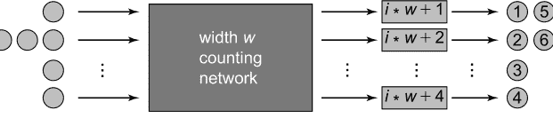

图 12.9 一个基于 $w=4$ 计数器的静态一致性共享计数器，前面是一个计数网络。线程遍历计数网络以选择访问哪些计数器。

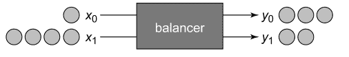

图 12.10 一个均衡器。令牌在任意时间到达任意输入导线，并被重定向以确保所有令牌都已离开均衡器，且顶部导线上的令牌数量最多只比底部导线多一个，有效地平衡了两根导线之间的令牌数量（见图 12.10）。更准确地说，均衡器有两个状态：*向上*（up）和*向下*（down）。如果状态为*向上*，则下一个令牌从顶部导线退出；否则从底部导线退出。

我们用 $x_0$ 和 $x_1$ 分别表示到达均衡器顶部和底部输入的令牌数，用 $y_0$ 和 $y_1$ 表示从顶部和底部输出导线出的数量。为了简单起见，我们用 $x_i$ 和 $y_i$ 表示导线本身的输出。均衡器从不创建令牌；在任何时刻，

> $x_0 + x_1 \geq y_0 + y_1$.

如果每个到达输入导线的令牌都从输出导线出现，则称该均衡器是*静态的*（quiescent）：

> $x_0 + x_1 = y_0 + y_1$.

*均衡网络*通过将某些均衡器的输出导线连接到其他均衡器的输入构造。宽度为 $w$ 的均衡网络具有输入导线 $x_0, x_1, \dots, x_{w-1}$（未连接均衡器的输出导线）和 $w$ 个输出导线 $y_0, y_1, \dots, y_{w-1}$（同样未连接）。均衡网络的*深度*是从任意输入导线开始可以遍历的最大均衡器数量。我们只考虑有限深度的均衡网络。均衡网络不创建令牌：

> $\sum x_i \geq \sum y_i$.

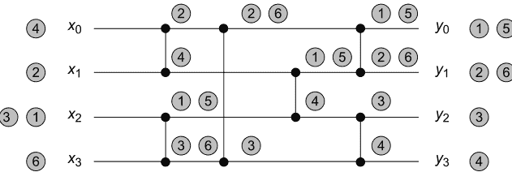

图 12.11 双调[4]计数网络的顺序执行。每条垂直线代表一个均衡器，每个均衡器的两个输入和输出导线是连接到点的水平线。在这次顺序执行中，令牌通过网络，按照令牌上数字指定的顺序一个接一个完全通过。我们跟踪每个令牌在通往输出导线的路径上通过均衡器。例如，3 号令牌从 2 号线进入，向下到 3 号线，最后停在 2 号线。注意步进属性（step property）是如何在每个均衡器以及整个网络中保持不变的。

当我们对序列中的每个元素求和时，会省略求和的索引。如果每个到达输入导线的令牌都从输出导线出现，则均衡网络是静态的：

> $\sum x_i = \sum y_i$.

到为止，我们描述均衡网络就像它们是网络中的交换机一样。然而，在共享内存多处理器上，均衡网络可以实现为一个对象。每个均衡器都是一个对象，其导线是从一个到另一个对象的引用。每个线程反复遍历网络，从某些输入导线开始，从某些输出导线退出，有效地将令牌引导通过网络。

某些均衡网络具有有趣的属性。图 12.11 所示的网络有四个输入导线和四个输出导线。初始，所有均衡器都处于向上状态。我们可以自己检查任意数量的令牌进入网络时，在任意输入导线集合上，是否会在输出导线上以规律模式出现。形式上，无论令牌的到达如何在输入导线之间分布，输出分布在所有输出导线上都是平衡的。如果令牌数量 $n$ 是 $w$ 的倍数，则每根导线上出现相同数量的令牌。如果多出一个令牌，它将出现在 0 号线上。通常情况下，当网络处于静态状态时，

> $y_i = \lfloor n/w \rfloor$ 或 $\lceil n/w \rceil$。

我们称之为步进属性。满足步进属性的网络被称为计数网络，因为可以很容易地调整以计算遍历网络的令牌数量 $n$。

### 12.5.1 步进属性

步进属性有多种等价定义。

引理 12.5.1。如果 $y_0, \dots, y_{w-1}$ 是非负整数序列，则以下陈述等价：

- 对于任意 $i < j$，$y_i - y_j \leq 1$。
- 要么 $y_i = y_j$，要么存在某个 $c$ 使得 $i < c \leq j$，且如果 $\sum y_i = m$，则 $y_i = \lfloor m/w \rfloor$。

### 12.5.2 双调计数网络

在本节中，我们描述双调网络，它是图 12.9 中计数网络的推广。对于 $k=1$，双调网络是一个单一均衡器。对于 $k>1$，我们通过将两个双调 $[k]$ 网络的输出输入到一个均衡 $[2k]$ 来构造双调 $[2k]$ 网络。我们将这两个 $[k]$ 网络的输出称为 $z$ 和 $z'$。双调 $[2k]$ 网络由 $\log 2k+1$ 层组成，每层由 $k$ 个均衡器。

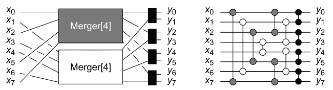

图 12.12 在左侧，我们看到一个均衡 $[8]$ 网络的逻辑结构，它接入两个双调 $[4]$ 网络，如图 12.11 所示。灰色的均衡 $[4]$ 网络线来自顶部双调 $[4]$ 网络，奇数线来自底部双调 $[4]$ 网络。情况相反。当导线从两个均衡 $[4]$ 网络退出时，每对编号相同的导线由一个均衡器合并。在右侧，我们看到一个均衡 $[8]$ 网络的物理布局。不同的均衡器通过颜色编码以匹配左侧图的逻辑结构。

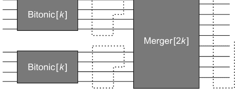

图 12.13 双调 $[2k]$ 计数网络的递归结构。两个双调 $[k]$ 计数网络接入一个均衡 $[2k]$ 网络。归纳基础是由单一均衡器组成的双调 $[2k]$ 网络，如图 12.13 所示。

### 12.5.2.1 软件双调计数网络

到为止，我们描述计数网络就像它们是网络中的交换机。然而，在共享内存多处理器上，均衡网络可以实现为内存中的对象。每个均衡器都是一个对象，其导线是从一个均衡器到另一个对象的引用。每个线程反复遍历对象，从某些输入导线开始并从某些输出导线退出，有效地将令牌引导通过网络。在这里，我们展示如何将双调 $[2k]$ 网络实现为共享内存数据结构。

```java
public class Balancer {
    boolean toggle = true;
    public synchronized int traverse() {
        try {
            if (toggle) {
                return 0;
            } else {
                return 1;
            }
        } finally {
            toggle = !toggle;
        }
    }
}
```

图 12.14 Balancer 类：一种同步实现。

`Balancer` 类（图 12.14）有一个单布尔字段：`toggle`。同步的 `traverse()` 方法补充了 `toggle` 字段，并返回一个输出线宽，值为 0 或 1。`Balancer` 类的 `traverse()` 方法不需要参数，因为令牌离开平衡器的输出线宽并不依赖于它进入平衡器的输入线宽。

`Merger` 类（图 12.15）有三个字段：`width` 字段必须是 2 的幂，`half[1]` 是一个包含两个元素的半位宽 `Merger` 对象的数组（如果网络宽度为 2，则为空），`layer[i]` 是一个宽度为 `width/2` 的平衡器数组，用于实现网络的最后一层。该类提供了一个 `traverse(i)` 方法，其中 `i` 是令牌进入的线宽。对于合并网络，存在多个平衡器，令牌的路径取决于它的输入线宽。如果输入线宽为 `i`，则当 `i` 为奇数时进入 `half[0]`，当 `i` 为偶数时进入 `half[1]`。无论遍历何种半位宽合并网络，令牌都会从 `layer[i]` 处的平衡器输出到 i。

注意，`Balancer` 类使用了同步的 `Balancer` 实现，但如果该实现是无锁的（或无等待的），那么整个网络实现也将是无锁（或无等待的）。

```java
public class Merger {
  Merger[] half; // 两个半位宽合并网络
  Balancer[] layer; // 最后一层
  final int width;
  public Merger(int mywidth) {
    width = mywidth;
    layer = new Balancer[width / 2];
    for (int i = 0; i < width / 2; i++) {
      layer[i] = new Balancer();
    }
    if (width > 2) {
      half = new Merger[]{new Merger(width/2), new Merger(width/2)};
    }
  }
  public int traverse(int input) {
    int output = 0;
    if (input < width / 2) {
      output = half[input % 2].traverse(input / 2);
    } else {
      output = half[1 - (input % 2)].traverse(input / 2);
    }
    return (2 * output) + layer[output].traverse();
  }
}
```

图 12.15 Merger 类。

### 12.5.2.2 正确性证明

我们现在证明 `Bitonic[w]` 是计数网络。证明通过对通过网络的令牌序列进行递进推理。在检查网络本身之前，这里有一些关于具有步进属性序列的简单引理。

引理 12.5.2：如果一个序列具有步进属性，那么它的所有子序列也具有该属性。

引理 12.5.3：对于偶数 $k$，如果 $x_0, \dots, x_{k-1}$ 具有步进属性，那么它的偶子序列和奇子序列满足

证明：要么对于 $0 \leq i < k/2, x_{2j} = x_{2j+1}$，要么根据引理 12.5.1，存在一个唯一的 $j$ 使得 $x_{2j} = x_{2j+1} + 1$，且对于所有 $i \neq j, 0 \leq i < k/2$，$x_{2j} = x_{2j+1}$。在第一种情况下，$\sum x_{2j} = \sum x_{2j+1} = \sum x_i/2$，在第二种情况下，$\sum x_{2j} = \lceil x_i/2 \rceil$。

```java
public class Bitonic {
  Bitonic[] half; // 两个半位宽 bitonic 网络
  Merger merger; // 最后的合并层
  final int width; // 网络宽度
  public Bitonic(int width) {
    this.width = width;
    merger = new Merger(width);
    if (width > 2) {
        half = new Bitonic[]{new Bitonic(width/2), new Bitonic(width/2)};
    }
  }
  public int traverse(int input) {
    int output = 0;
    int subnet = input / (width / 2);
    if (width > 2) {
        output = half[subnet].traverse(input - subnet * (width / 2));
    }
    return merger.traverse(output + subnet * (width / 2));
  }
}
```

图 12.16 Bitonic 类。

**引理 12.5.4**：设 $x_0, \dots, x_{k-1}$ 和 $y_0, \dots, y_{k-1}$ 为具有步进属性的任意序列。如果 $\sum x_i = \sum y_i$，则对于所有 $0 \le i < k$，$x_i = y_i$。

> 证明。令 $m = \sum x_i = \sum y_i$。根据引理 12.5.1，$x_i = y_i = \left\lfloor\frac{m-1}{k}\right\rfloor$。

**引理 12.5.6**：设 $x_0, \dots, x_{k-1}$ 和 $y_0, \dots, y_{k-1}$ 为具有步进属性的任意序列。如果 $\sum x_i = \sum y_i + 1$，则存在唯一的 $j < k$ 使得 $x_j = y_j + 1$，且对于 $i \neq j$，$x_i = y_i$。


# 第 12 章 计数、排序与分布式协调

## 证明

令 $m = \sum x_i = \sum y_i + 1$。根据引理 12.5.1，$x_i = \left[\frac{m-1}{k}\right]$ 和 $y_i = \left[\frac{m-1}{k}\right]$。这些结论对于所有 $0 \le i < k$ 除 $i = m \pmod k$ 外均一致。我们现在证明 `MERGER [w]` 网络保持步进属性。

**引理 12.5.6**：如果 `MERGER [k]` 是静止的（$k$ 是 2 的幂），且其输入 $x_0, \dots, x_{k-1}$ 和 $y_0, \dots, y_{k-1}$ 都具有步进属性，那么其输出 $y_0, \dots, y_{2k-1}$ 也具有步进属性。

证明：对 $\log k$ 进行归纳法证明。值得参考图 12.17，它展示了 `MERGER [w]` 网络的证明。当 $k=2$ 时，`MERGER [k]` 就是平衡器，根据平衡器的定义，其输出具有步进属性。


图 12.17

`MERGER [w]` 网络正确地将两个具有步进属性的序列 $x$ 和 $x'$ 合并为具有步进属性的单一序列 $y$。此外，$x$ 和 $x'$ 的奇偶序列之间的令牌数量差异最多为 1（在本例中分别为 1 和 2 个令牌）。根据归纳假设，`MERGER [w]` 网络的输出 $z$ 和 $z'$ 具有步进属性，其中一个有一个额外的令牌。这个令牌必须落在特定的线路上（在这种情况下为 3），进入同一个平衡器。在图中，这些令牌被传递，额外的令牌被进一步推，从而确保最终输出具有步进属性。

当 $k > 2$ 时，令 $z_0, \dots, z_{k-1}$ 为 `MERGER [k]` 子网络的输出，它合并了 $x$ 的偶子序列与 $x'$ 的奇子序列；$z'_0, \dots, z'_{k-1}$ 为第二个 `MERGER [k]` 子网络的输出。由于假设 $x$ 和 $x'$ 具有步进属性，因此它们的偶、奇子序列也具有步进属性（引理 12.5.2），因此 $z$ 和 $z'$ 也是如此（归纳假设）。$\sum z_i = |\sum x_{2i}| + |\sum x_{2i+1}|$ 且 $\sum z'_i = |\sum x'_{2i}| + |\sum x'_{2i+1}|$（引理 12.5.3）。一个直接的情况表明 $\sum z_i$ 和 $\sum z'_i$ 的差异最多为 1。

我们断言对于所有 $i < j$，$y_i - y_j \leq 1$。如果 $\sum z_i = \sum z'_i$，引理 12.5.4 意味着对于 $0 \leq i < k/2$，$y_i = z'_i$。平衡器的最后一层 $y_i - y_j = z_{\lfloor i/2 \rfloor} - z_{\lfloor j/2 \rfloor}$（或基于上下文的类似关系），得出 $z$ 具有步进属性。同样，如果 $z_i$ 和 $z'_i$ 的差异为 1，则对于 $0 \leq i < k/2$，存在唯一的 $\ell$ 使得 $z_\ell$ 和 $z'_\ell$ 的差异为 1。令 $x = \min(z_\ell, z'_\ell)$，因此 $\max(z_\ell, z'_\ell) = x + 1$。从 $z$ 和 $z'$ 的步进属性来看，对于所有 $i > \ell$，$z_i = x + 1$，且对于所有 $i > \ell$，$z'_i = x$。由于 $z$ 和 $z'$ 由输出为 $y_{2i}$ 和 $y_{2i+1}$ 的平衡器连接，因此 $y_{2i} = x + 1$ 且 $y_{2i+1} = x$。同样，对于 $i \neq \ell$，$z_i$ 和 $z'_i$ 由同一个平衡器连接。因此，对于任何 $i < \ell$，通过选择 $c = 2\ell+1$ 并应用引理 12.5.1 即可得出。

## 计数网络

下定理的证明现在显而易见。

**定理 12.5.7**：在任何静止状态下，`BIT [w]` 的输出具有步进属性。

### 12.5.2.3 周期性计数网络

在本节中，我们证明 Bitonic 网络不是深度为 $O(\log^2 w)$ 的计数网络。我们引入了一种新的计数网络，其奇特的属性是周期性的，由图 12.18 所示的相同子网络序列组成。当 $k=2$ 时，`BLOCK [k]` 网络由平衡器组成。较大的 $k$，`BLOCK [k]` 网络是递归构造的。我们从两个子网络 $A$ 和 $B$ 开始。给定输入序列 $x$，$A$ 的输入为 $x^A$，$B$ 的输入为 $x^B$。令 $y$ 为子网络的输出，其中 $y^A$ 是 $A$ 的输出序列，$y^B$ 是 $B$ 的。网络的最终阶段通过单个平衡器将每个 $y_i^A$ 和 $y_i^B$ 结合，产生最终输出 $z_{2i}$ 和 $z_{2i+1}$。

图 12.19 描述了 `BLOCK [8]` 网络的递归构造。`PERIODIC [2]` 网络由 $\log_2 k$ 个 `BLOCK [k]` 网络连接到第 $i$ 处

```java
public class Layer {
    int width;
    Balancer[] layer;
    public Layer(int width) {
        this.width = width;
        layer = new Balancer[width];
        for (int i = 0; i < width / 2; i++) {
            layer[i] = layer[i-1] = new Balancer();
        }
    }
    public int traverse(int input) {
        int toggle = layer[input].traverse();
        int hi, lo;
        if (input < width / 2) {
            lo = input;
            hi = width - input - 1;
        } else {
            lo = width - input - 1;
            hi = input;
        }
        if (toggle == 0) {
            return lo;
        } else {
            return hi;
        }
    }
}
```

图 12.20

`Layer` 网络。

一个网络的输出线是图 12.18 中的第 $i$ 根线，是一个周期性的 `[8]` 计数网络²。

> ² 虽然 `BLOCK [2k]` 网络和 `MERGER [2k]` 网络看起来相同，但它们是不等同的：不存在任何一种连线的置换可以将其中一种转换为另一种。

### 12.5.2.4 软件周期性计数网络

以下是在软件中实现周期性网络的方法。我们重用了图 12.14 中的 `Balancer` 类。一个 `BLOCK [w]` 网络的单层由 `LAYER [w]` 网络（图 12.20）实现。`LAYER [w]` 网络将输入线 $i$ 和 $w_{i-1}$ 连接到平衡器上。

在 `BLOCK [w]` 类（图 12.21）中，令牌从初始的 `LAYER [w]` 网络出现后，它会通过两个半宽 `BLOCK [w/2]` 网络之一（称为北部和南部）。

```java
public class Block {
    Block north;
    Block south;
    Layer layer;
    int width;
    public Block(int width) {
        this.width = width;
        if (width > 2) {
            north = new Block(width / 2);
            south = new Block(width / 2);
        }
        layer = new Layer(width);
    }
    public int traverse(int input) {
        int wire = layer.traverse(input);
        if (wire < width) {
            return north.traverse(wire);
        } else {
            return (width / 2) + south.traverse(wire - (width / 2));
        }
    }
}
```

图 12.21

周期性网络。

`Periodic [w]` 网络（图 12.22）被实现为由 $\log w$ 个 `BLOCK [w]` 网络组成的数组。每个令牌按顺序遍历每个块，其中在每个块上取的输出线是其后继块的输入线。（章节注释提到 `Periodic [w]` 是一个计数网络。）

```java
public class Periodic {
    Block[] block;
    public Periodic(int width) {
        int logSize = 0;
        int myWidth = width;
        while (myWidth > 1) {
            logSize++;
            myWidth = myWidth / 2;
        }
        for (int i = 0; i < logSize; i++) {
            block[i] = new Block(width);
        }
    }

    public int traverse(int input) {
        int wire = input;
        for (Block b : block) {
            wire = b.traverse(wire);
        }
        return wire;
    }
}
```

图 12.22

周期性网络。

### 12.5.3 性能与流水线

计数吞吐量如何随线程数和网络宽度的变化？对于固定的网络宽度，吞吐量随线程数量的增加而达到某一点，然后网络饱和，吞吐量保持不变或下降。为了理解这些结果，让我们把计数网络看作一个流水线。

- 如果并发遍历网络的令牌数量少于平衡器的数量，那么流水线部分空闲，吞吐量会受影响。
- 如果并发令牌的数量大于平衡器的数量，流水线将会发生拥塞，因为大量令牌同时到达每个平衡器。
- 当令牌数量大致等于平衡器的数量时，吞吐量达到最大。

如果一个应用需要计数网络，那么最佳网络选择是确保任何时刻处于平衡器的令牌数量大致等于数量。

## 12.6 衍射树

计数网络提供了高度的流水线化，因此吞吐量在很大程度上与深度无关。然而，延迟取决于网络深度。在我们所看到的计数网络中，最浅的为 $\Theta(\log^2 w)$。我们可以设计对数深度计数网络吗？好消息是这种网络存在，但坏消息是所有已知的构造常数使得这些构造变得不实际。


图 12.23

`TREE` 类：一个计数树。注意网络如何保持步进属性。

另一种方法：考虑一组具有单个输入线和两个输出线的平衡器，分别标记为 0 和 1。`TREE [w]` 网络（如图 12.23 所示）是一个如下二叉树：令 $w$ 为 2 的幂，定义 `TREE [2k]` 由两个 `TREE [k]` 树组成，并将单路平衡器的每个输出线 $x$ 连接到树的根，将每个输出线连接到宽度为 $k$ 的树。从“0”输出线延伸出的 `TREE [k]` 子树的输出线 $y_0, y_1, \dots, y_{k-1}$ 重新设计为最终输出线 $y_0, y_1, \dots, y_{2k-2}$。

```java
public class DiffractingBalancer {
  Prism prism;
  Balancer toggle;
  public DiffractingBalancer(int capacity) {
    prism = new Prism(capacity);
    toggle = new Balancer();
  }
  public int traverse() {
    boolean direction = false;
    try {
      if (prism.visit())
        return 0;
      else
        return 1;
    } catch (TimeoutException ex) {
      return toggle.traverse();
    }
  }
}
```

图 12.25

`DiffractingBalancer` 类：如果调用者通过 `prism` 与另一个并发调用者配对，则不需要遍历平衡器（`balancer`）。

该类提供了一个方法 `visit()`，它用于选择随机交换入口。如果调用者应该从顶部视图退出，`visit()` 返回 `true`；如果从底部退出则返回 `false`；如果在未交换值的情况下超时到到，则抛出 `TimeoutException`。调用者获取其线程 ID（第 11 行），在数组中选择一个随机入口（第 12 行），尝试将其 ID 与伙伴的 ID 进行交换（第 13 行）。如果成功，返回布尔值；如果超时，则重新抛出 `TimeoutException`。

`DiffractingBalancer`（图 12.25）像普通的 `Balancer` 一样，提供了一个 `traverse()` 方法，其返回值在 0 和 1 之间切换。该类有两个字段：`prism` 是一个 `Prism`，`toggle` 是一个 `Balancer`。当线程调用 `traverse()` 时，它尝试通过 `prism` 寻找配对。如果成功，配对双方返回不同的值，从而在 `toggle` 处产生竞争（第 11 行）。否则，如果线程无法找到配对，它将遍历（第 16 行）树（实现为 `balancer`）。

```java
public class DiffractingTree {
  DiffractingBalancer root;
  DiffractingTree[] child;
  int size;
  public DiffractingTree(int mySize) {
    size = mySize;
    root = new DiffractingBalancer(size);
    if (size > 2) {
      child = new DiffractingTree[2];
      new DiffractingTree(size/2);
      new DiffractingTree(size/2);
    }
  }

  public int traverse() {
    int half = root.traverse();
    if (size > 2) {
      return (2 * (child[half].traverse()) + half);
    } else {
      return half;
    }
  }
}
```

图 12.26

`DiffractingTree` 类：字段、构造函数和 `traverse()` 方法。

`DiffractingTree`（图 12.26）有两个字段。`child` 数组是一个树数组。`root` 字段是一个 `Diffracting`，它交替将调用转发到左子树或右子树。每个 `DiffractingBalancer` 都有一个容量，即其内部 `prism` 的容量。初始容量为树的大小，之后每次减半。

与 `EliminationBackoffStack` 一样，`DiffractingTree` 的性能取决于两个参数：`prism` 容量和超时时间。如果 `prism` 太大，线程会互相错过，导致平衡器处产生过度的竞争。如果 `prism` 太小，则许多线程会并发访问 `prism` 中的每个交换器，导致交换器处的过度竞争。如果 `Prism` 超时时间太短，线程会互相错过；如果太长，线程可能会被不必要的延迟。选择这些值没有硬性规定，因为最优值取决于负载和底层多处理器架构的特征。尽管如此，实验证据表明，有时选择这些值可以优于结合 `CombiningTree` 和 `Countingnetwork`。以下是一些在实践中有效的启发式方法：由于树高处的平衡度更高，我们在树的顶部使用更大的 `prism`，并添加动态收缩和扩展随机选择范围的能力。最佳超时间隔取决于负载：如果只有少数线程访问树，那么等待时间大部分是浪费的；如果有很多线程，那么等待时间就是值得的。自适应方案是有前景的：当线程成功配对时延长超时时间，否则缩短超时时间。

## 12.7 并行排序

排序是最重要的计算任务之一，可以追溯到 19 世纪的 Hollerith 制表机、20 世纪 40 年代的第一批计算机系统，并在今天达到顶峰，因为大部分程序都使用某种排序。正如大多数计算机科学专业的本科生早期学到的那样，排序算法的选择关键取决于排序的项目数量、键的数值属性，以及它们是存储在内存中还是外部存储设备中。并行排序算法也可以以同样的方式分类。

我们介绍了两类排序算法：排序网络（`sorting networks`），它们通常对小内存数据集效果良好；采样排序算法（`sample sorting algorithms`），对外部内存的大数据集效果良好。在我们的介绍中，我们牺牲了实现的简单性。章节注释中引用了更复杂的技巧。

## 12.8 排序网络


正如计数网络是平衡器的网络，排序网络是比较器（`comparators`）的网络.³比较器是一个具有 2 条输入线和 2 条输出线的计算元件，称为顶部线和底部线。它在输入线上接收两个数字，并将较大的转发到顶部线，将较小的转发到底部线。与平衡器不同，比较器是同步的；它仅在两个输入都到达时才输出值（见图 12.27）。

比较网络（`comparison network`）与平衡网络一样，是比较器的无环图网络。

³ 历史上排序网络比计数网络早几十年。

# 12 计数、排序与协调

## 12.8 排序网络

### 12.8.1 设计排序网络

不需要设计排序网络，因为我们可以计数网络布局。平衡网络和比较网络是同构的，如果可以通过将平衡器替换为比较器或反之来构造。

**定理 12.8.2.** 如果一个平衡网络进行计数，则其同构的比较网络进行排序。

*证明。* 我们对网络的深度进行归纳法证明。对于第 0 层，该结论成立。假设对于 $k$ 层线成立，让我们证明 $k+1$ 层。在比较网络中两个 1 的比较器处，平衡网络中有两个令牌汇合，因此在 $k$ 层比较网络的每个线上输出一个 1，在 $k+1$ 层平衡网络的每个线上输出一个 1。在比较网络中两个 0 的比较器处，平衡网络中没有令牌汇合，因此在 $k$ 层比较网络的每个线上输出一个 0，在 $k+1$ 层平衡网络的每个线上没有输出。在比较网络中一个 0 和 1 的比较器处，1 在 $k+1$ 层输出到顶部（上方）线，1 输出到底部（下方）线，而在平衡网络中令牌输出到顶部线，底部线没有令牌输出。

反之是错误的：并不是所有排序网络都是计数网络。我们留了一个练习来验证图 12.28 中的 ODDEVEN 网络是排序网络但不是计数网络。

**定理 12.8.1 (0-1 原则)。** 如果一个排序网络排序所有的 0 和 1 序列，那么它就能排序任何输入。


输入 输出

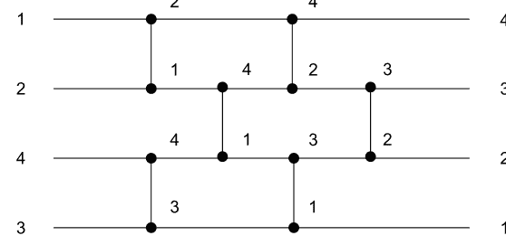

图 12.28 奇偶数数（OddDEVEN）排序网络。

#### 12.8.1.1 双调排序算法

我们可以将任何宽度为 $w$ 的排序网络（例如 `BITONIC[w]`）表示为 $d$ 层每层最多 $w/2$ 个平衡器的集合。我们可以将排序网络的布局表示为一个表格，其中每个条目是一个对，描述在该层平衡器处汇合的两根线（例如，在 `BITONIC[4]` 网络中，图 12 中的每个条目，线 0 和 1 在第一层的第一个平衡器处汇合，线 0 和 3 在第二层的第一个平衡器处汇合）。为了简单起见，假设给定了一个无界的 `table[i][j]`，其中每个条目包含深度为 $d$ 处平衡器 $i$ 相关的北输入（$j = 0$）或南输入（$j = 1$）线的索引。

原地基于数组的排序算法以一个待排序的项数组作为输入（我们假设这些项具有唯一键），并返回按键排序后的数组。以下是我们如何实现 BitSort 的，这是一种基于双调排序网络的原地基于数组的排序算法。假设我们想要排序一个包含 $p \cdot s$ 个元素的数组，其中 $p$ 是线程数（且 $p$ 是运行这些线程的最大可用处理器数量），$s$ 是 2 的幂。该网络在每一层都有 $p \cdot s$ 个比较器。

$p$ 个线程中的每个线程都执行比较器的工作。与像无序光线一样的计数网络不同，排序网络是同步的：比较器的所有输入在计算输出之前必须已经到齐。在每一轮中，一个线程在网络的一层中执行 $s$ 次比较，必要时切换项数组，以确保它们正确排序。在每个网络中，比较器连接不同的线，因此没有两个线程会尝试交换同一个条目的项，从而避免了在任何给定层进行同步操作的需求。

为了确保给定轮次（层）的比较完成后进入下一轮，我们使用了一种名为屏障（`Barrier`）的同步结构（在第 18 章中详细研究）。$p$ 个线程的屏障提供了一个 `await()` 方法，

```java
public class BitonicSort {
    static final int[][][] bitonicTable = ...;
    static final int width = ...; // 计数网络的宽度
    static final int depth = ...; // 计数网络的深度
    static final int p = ...; // 线程数
    static final int s = ...; // 2 的幂
    Barrier barrier;
    public void <T> sort(Item<T>[] items) {
        int i = Thread.get();
        for (int d = 0; d < depth; d++) {
            barrier.await();
            for (int j = 0; j < s; j++) {
                int north = bitonicTable[(i+s)+j][0];
                int south = bitonicTable[(i+s)+j][1];
                if (items[north].key < items[south].key) {
                    Item<T> temp = items[north];
                    items[north] = items[south];
                    items[south] = temp;
                }
            }
        }
    }
}
```

BitonicSort 类。

在所有 $p$ 个线程调用 `await()` 之前不返回。BitonicSort 的实现见图 12.29。每个线程逐轮地通过网络的每一层。在每一轮中，它都会等待其他线程的到达（第 12 行），确保项数组包含上一轮的结果。然后它通过比较比较器线数组位置中的项来使用该层的平衡器，并确保如果它们乱序（第 14–19 行）。

对于在 $p$ 个处理器上运行的 $p$ 个线程，BitonicSort 需要 $O(s \log^2 p)$ 的时间；如果 $s$ 是常数，则需要 $O(\log^2 p)$ 的时间。

## 12.9 样例排序

BitonicSort 适用于存储在内存中的小型数据集。对于较大的数据集（其中项数 $n$ 远大于线程数 $p$），特别是那些存储在非内存存储设备上的数据集，我们需要不同的方法。因为访问一个数据项是昂贵的，我们必须尽可能地保持引用局部性，因此让单个线程按顺序排序项是有成本效益的。像 BitonicSort 那种一个项被多个线程访问的并行排序显然太昂贵了。

我们尝试通过随机化来减少访问给定项的线程数。这种对随机性的使用与 `DiffractingTree` 中的不同，后者随机性被用于分布内存访问。在这里，我们使用随机性来猜测待排序数据集中项的分布。

由于待排序的数据集很大，我们将其分成多个桶（`buckets`），将具有范围内键的项归到一个桶。每个线程使用顺序排序算法对其中一个桶中的项进行排序，结果是一个排序集合（当在相应的桶中查看时）。该算法是众知的快速排序算法的推广，但我们不是使用单个拆分器将项分为两个子集，而是有 $p-1$ 个拆分器。

## 12.10 分布式协调

本章涵盖了几种分布式协调模式。例如合并树、排序网络和样例排序具有高度的并行性和开销。所有这些算法都包含同步瓶颈，即计算过程中线程必须等待彼此汇合的点。在合并树中，线程必须同步合并；在排序时，线程在屏障处同步。

在其他方案中，例如计数网络和弥散树，线程互相等待。（尽管我们使用同步方法实现平衡器，但它们可以使用 `compareAndSet` 以无锁的方式实现）。分布式结构将信息从一个线程传递到另一个线程，虽然汇合可能是有利的（如在 Prism 数组中），但并非必须。

## 12.11 章节笔记

消息传递架构。消息传递模型可以直接在硬件中实现，例如在处理器网络中，也可以通过软件层（如 `MPI`）在共享内存架构之上提供。

在共享内存架构中，交换机（作为合并树或平衡器存在）自然地被实现为共享内存计数器。在消息传递架构中，交换机自然地实现为处理器本地数据结构，其中导线将一个处理器连接到另一个处理器，并将一个交换机连接到另一个。当处理器接收到消息时，它会原子地更新其本地数据结构，并将消息转发给管理交换器的处理器。

合并树背后的思想源于 Allen Gottlieb、Ralph Grishman、Clyde Kruskal、Kevin McAuliffe、Larry Rudolph 和 Marc Snir [53]。这里介绍的软件 `CombiningTree` 适配自 PenCheng Yee、Nian-Feng Zheng 和 Duncan Laurie 的算法 [168]，并由 Maurice Herlihy、Beng-Hong Lim 和 Nir Shavit [71] 进行修改，这些都基于 James Goodman、Mary Vernon 和 Philip Woest 的原始原理 [51]。

计数网络由 Jim Asneys、Maurice Herlihy 和 Nir Shavit [14] 发明。计数网络与排序网络相关，包括 Kenneth Batch 突破性的 Bitonic 网络 [16]，以及 Martin Dowd、Yehoshua Perl、Larry Rudolph 和 Mike Saks 的周期性网络 [40]。Miklós Ajtai、János Komlós 和 Endre Szemerédi 发现了 AKS 排序网络 [8]。（由于该渐近表达式包含巨大的常数，使得基于 AKS 的排序网络在实际中并不可行）。

Mike Kugman 和 Greg Plaxon [93,94] 首次提供了深度为 $O(\log w)$ 的基于 AKS 的计数网络。排序网络的 0-1 原则由 Donald Knuth [95] 提供。平衡网络的类似规则集由 Costas Busch 和 Mario Mavronicas [26] 提供。衍射树（`Diffracting trees`）由 Nir Shavit 和 Ash most [158] 发明。

样本排序由 John Reif 和 Leslie Durant [148] 以及 Howard 和 Chow [80] 提出。所有排序算法都相关的快速排序基数算法源于 Tony Hoare [76]。文献中存在许多并行基数算法，例如 Daniel Jiménez-González、Joseph Larribea-Peru 和 Juan Navarro 的 [91]，以及 Shin-Jai Lee、Minsoo Jong、Dongseung Kim 和 Andrew Sohn 的 [111]。

《蒙奇 Python与圣杯》由 Graham Chapman、John Cleese、Terry Gilliam、Eric Idle、Terry Jones 和 Michael Palin 编写，并由 Terry Gilliam 和 Terry Jones 导演 [28]。

## 12.12 练习题

练习 12.1. 证明引理 12.5.1。

练习 12.2. 实现一个三元 `CombiningTree`，即允许来自三个子树的最多三个线程在给定节点合并。与二元合并树相比，你能估计这种树的优缺点吗？

练习 12.3. 使用 `Exchanger` 对象实现一个 `CombiningTree`，以执行树向上和下降过程中的协调。与第 12.3 节介绍的 `CombiningTree` 类相比，你的构造可能哪些缺点？

练习 12.4. 使用两个计数器和每个数组项一个 `ReentrantLock`，实现第 12.2 节描述的基于循环数组的共享池。

练习 12.5. 提供一个高效的 `Balancer` 无锁实现。

练习 12.6. （困难）提供一个高效的 `Balancer` 无等待（`wait-free`）实现（即不使用通用构造）。

练习 12.7. 证明第 12.6 节构造的 `TREE[k]` 平衡网络是一个计数网络，即在任何静止状态下，其输出线上的令牌序列具有条纹属性（`strip property`）。

练习 12.8. 设 B 为静止状态 s 下深度为 d 的 b-w 平衡网络。令 n = 2^d。证明如果 n 个令牌从同一根导线进入网络并通过出口，则 B 的状态将与它们退出之前的网络状态相同。

练习 12.9. 设 X 和 Y 为长度为 w 的 k-平滑网络。X 和 Y 的平衡器匹配层是指 X 的每个元素都通过平衡器与 Y 的一个元素一一对应地连接。证明如果 X 和 Y 都是 k-平滑的，且 Z 是 X 和 Y 匹配的结果，则 Z 是 (k+1)-平滑的。

练习 12.10. 考虑一个 `[k]` 网络，其中每个平衡器都初始化为任意状态（向上或向下）。证明无论输入分布如何，输出分布都是 (log k)-平滑的。提示：你可以使用练习 12.9 中的结论。

练习 12.11. 平滑网络（`smoothing network`）是一种确保在任何静止状态下输出序列都是平滑的平衡网络。计数网络是平滑网络，但反之不然。排序网络是一个保证所有输入都是网络的。定义伪排序网络（`pseudosorting network`）为布局与排序网络同构的平衡网络。

练习 12.12. 设 $\mathcal{N}$ 为通过取宽度为 w 的平滑网络 $S$、同样宽度为 w 的伪排序网络 $P$，并将 $S$ 的第 $i$ 根输出导线连接到 $P$ 的第 $i$ 根输入导线而构造的平衡网络。证明 $\mathcal{N}$ 是……


样本排序由 John Reif 和 Leslie Durant [148] 以及 Howard 和 Chow [80] 提出。所有排序算法都相关的快速排序基数算法源于 Tony Hoare [76]。文献中存在许多并行基数算法，例如 Daniel Jiménez-González、Joseph Larribea-Peru 和 Juan Navarro 的 [91]，以及 Shin-Jai Lee、Minsoo Jong、Dongseung Kim 和 Andrew Sohn 的 [111]。

《蒙奇 Python与圣杯》由 Graham Chapman、John Cleese、Terry Gilliam、Eric Idle、Terry Jones 和 Michael Palin 编写，并由 Terry Gilliam 和 Terry Jones 导演 [28]。

# 第 12 章 计数、排序与分布式协调

## 12.12 练习题

练习 12.1. 证明引理 12.5.1。

练习 12.2. 实现一个三元 `CombiningTree`，即允许来自三个子树的最多三个线程在给定节点合并。与二元合并树相比，你能估计这种树的优缺点吗？

练习 12.3. 使用 `Exchanger` 对象实现一个 `CombiningTree`，以执行树向上和下降过程中的协调。与第 12.3 节介绍的 `CombiningTree` 类相比，你的构造可能哪些缺点？

练习 12.4. 使用两个计数器和每个数组项一个 `ReentrantLock`，实现第 12.2 节描述的基于循环数组的共享池。

练习 12.5. 提供一个高效的 `Balancer` 无锁实现。

练习 12.6. （困难）提供一个高效的 `Balancer` 无等待（wait-free）实现（即不使用通用构造）。

练习 12.7. 证明第 12.6 节构造的 `TREE[k]` 平衡网络是一个计数网络，即在任何静止状态下，其输出线上的令牌序列具有条纹属性（strip property）。

练习 12.8. 设 B 为静止状态 s 下深度为 d 的 b-w 平衡网络。令 n = 2^d。证明如果 n 个令牌从同一根导线进入网络并通过出口，则 B 的状态将与它们退出之前的网络状态相同。

练习 12.9. 设 X 和 Y 为长度为 w 的 k-平滑网络。X 和 Y 的平衡器匹配层是指 X 的每个元素都通过平衡器与 Y 的一个元素一一对应地连接。证明如果 X 和 Y 都是 k-平滑的，且 Z 是 X 和 Y 匹配的结果，则 Z 是 (k+1)-平滑的。

练习 12.10. 考虑一个 [k] 网络，其中每个平衡器都初始化为任意状态（向上或向下）。证明无论输入分布如何，输出分布都是 (log k)-平滑的。提示：你可以使用练习 12.9 中的结论。

练习 12.11. 平滑网络是一种平衡网络，确保在任何静止状态下，输出序列都是平滑的。计数网络是平滑网络，但反之不然。排序网络是一个保证所有输入都是网络的。定义伪排序网络为布局与排序网络同构的平衡网络。

练习 12.12. 设 $\mathcal{N}$ 为通过取宽度为 w 的平滑网络 $S$、同样宽度为 w 的伪排序网络 $P$，并将 $S$ 的第 $i$ 根输出导线连接到 $P$ 的第 $i$ 根输入导线而构造的平衡网络。证明 $\mathcal{N}$ 是……

*(注：由于提供的原始文本在12.11和12.12后出现了大量重复和错乱，上述翻译已根据逻辑进行了合并处理，并剔除了重复部分。)*

# 12.12 练习 303

我们说一个令牌（token）位于某个开关前面，如果它位于该开关的某个输入线上。从处于静止状态 $q_0$ 的网络开始，其中下一个运行的令牌值将为 0。假设我们有一个权重为 $a$ 的令牌 $t$，以及 $n-1$ 个权重为 $b$ 的令牌 $t_1, \dots, t_{n-1}$（其中 $b > a$），它们均位于不同的输入线上。用 $S$ 表示如果令牌 $t$ 从 $q_0$ 开始遍历网络，它所经过的开关集合。

证明：如果我们依次将 $t_1, \dots, t_{n-1}$ 逐个通过网络，我们可以让每个 $t_i$ 都停止在 $S$ 中的某个开关前面。

在这一构造结束时，有 $n-1$ 个令牌位于 $S$ 中的开关前面。由于每个开关有两个输入线，可以推导出 $t$ 遍历网络的路径至少遇到了 $n-1$ 个开关，因此，任何加法网络（adding network）的深度至少为 $n-1$，其中 $n$ 是并发令牌的最大数量。这个界限令人沮丧，因为它意味着网络的大小取决于线程的数量（这对于 `CombiningTrees` 也是如此，但不包括计数网络），并且网络具有固有的高延迟。

**练习 12.22.** 扩展练习 12.21 的证明，证明一个*线性化*的计数网络深度至少为 $n$。

# 第 13 章

## 并发哈希与自然并行性

## 13.1 引言

在前面的章节中，我们研究了如何从队列、栈和计数器等数据结构中提取并行性，这些结构似乎很少提供并行机会。在本章中，我们采取相反的方法。我们研究并发哈希，这个问题似乎是“天然可并行的”，或者用更技术术语来说，是不分离访问并行的（disjoint-access-parallel），这意味着并发方法可能会访问不交叉的位置，意味着几乎不需要同步。

我们在集合（Set）实现的背景下研究哈希。回想一下以下方法：

- `add(x)` 将 x 添加到集合中，如果 x 原本不存在则返回 true，否则返回 false；
- `remove(x)` 将 x 从集合中移除，如果 x 原本存在则返回 true，否则返回 false；
- `contains(x)` 如果 x 存在则返回 true，否则返回 false。

在顺序化编程中，哈希通常用于以常数平均时间复杂度实现这些方法。在本章中，我们的目标是对并发集合实现实现同样的目标。（相比之下，虽然哈希看起来是天然可并行的，但与集合大小成线性关系的复杂度使得设计一个高效的并发基于哈希的集合实现远非易事。）

在设计集合实现时，我们应该记住以下原则：我们可以购买内存，但无法买到更多。在消耗更多内存的快速算法和消耗更少内存的慢算法之间，我们倾向于选择更快的算法（在合理范围内）。

哈希集合（hash set，有时称为哈希表）是实现集合的一种高效方式。哈希集合通常实现为一个数组，称为表（table）。每个哈希函数将哈希值映射为整数，使得不同的条目通常映射到不同的值（Java 为每个对象提供了一个 `hashCode()` 方法来达到此目的）。要添加、移除或测试项的成员身份，对该项应用哈希函数（对表取模）以识别与该项对应的表条目。（我们将这一步称为哈希）。

任何哈希集合必须处理冲突：当两个不同的项哈希到同一个表位置时。封闭链法（Closed addressing）简单是在每个条目处存储一个条目集合，传统上称为桶（bucket）。开放法（Open addressing）尝试通过应用替代哈希函数为该项寻找替代条目。

有时需要调整表的大小。在封闭链法哈希集合中，桶可能会变得太大而无法进行高效搜索。在开放法哈希集合中，表可能会变得太满而无法找到替代条目。

轶事表明，在大多数应用程序中，集合的方法调用分布如下：90% 的 `contains()`，9% 的 `add()` 和 1% 的 `remove()` 调用。从实际问题来看，集合更有可能增长而不是收缩，因此我们在这里关注于可扩展哈希（extensible hashing），其中哈希集合只增长（收缩是练习题中的问题）。

## 13.2 封闭链哈希集合

我们首先定义一个适用于我们此处考虑的所有并发封闭链哈希集合的通用基础集合实现。稍后，我们将用不同的同步机制扩展这个基础哈希集合。

`HashSet<T>` 是一个抽象类，也就是说它没有实现所有的方法。图 13.1 显示了它的字段、构造函数和抽象方法。`table[]` 是一个对象数组，每个对象都实现为一个列表。为了方便起见，我们使用 `ArrayList<T>`，它支持标准的顺序 `add()`、`remove()` 和 `contains()` 方法。我们有时将 `table[]` 数组的长度（即其中桶的数量）称为其容量（capacity）。`size` 字段存储了其中项的数量。构造函数接受表的初始容量作为参数。

在本文的其他地方，我们使用标准的 Java `List<T>` 接口（来自 `java.util` 包）。`List<T>` 是 T 对象的有序集合，其中 T 是一个类型。它指定了许多方法，我们使用了以下这些：`add(x)` 将 x 追加到列表末尾；`get(i)` 返回位置 i 处的项（不移除）；以及 `contains(x)` 如果列表包含 x 则返回 true。

该接口由许多类实现。在这里，我们使用 `ArrayList`。

```java
public abstract class HashSet<T> {
    protected volatile List<T[]> table;
    protected AtomicInteger size;

    public HashSet(int capacity) {
        size = new AtomicInteger(0);
        table = (List<T>[]) new List[capacity];
        for (int i = 0; i < capacity; i++) {
            table[i] = new ArrayList<T>();
        }
    }

    public abstract void acquire(T x);
    public abstract void release(T x);
    public abstract void resize();
    public abstract boolean policy();
}
```


桶数组有多大才能确保调用是常数时间？考虑一个 `add(x)` 调用。第一步哈希 x 以确定桶，需要常数时间。第二步是检查 x 是否在桶中，遍历列表。只有当列表具有常数预期长度时，这种遍历才是常数预期时间，因此表的容量应该与集合中项的数量成比例，即集合的大小。由于集合的大小随时间变化，为了确保方法调用保持（或接近）常数，我们必须经常调整表的大小以确保列表长度保持（或接近）常数。

我们需要决定何时调整表，以及 `resize()` 如何与其他方法同步。有很多合理的替代方案。对于封闭链算法，一种简单的策略是在平均桶大小超过固定阈值时调整表。另一种策略使用了两个固定值：桶阈值和全局阈值；我们调整表

- 如果超过四分之一的桶超过了桶阈值
- 如果任何单个桶超过了全局阈值。

这两种策略在实践中都可以良好工作。为了简单，我们在本章采用这种策略¹

这种选择引入了瓶颈，添加或移除项的线程都会竞争跟踪集合大小的计数器。我们使用 `AtomicInteger`，这限制了可扩展性。如有必要，可以替换为其他的、更具扩展性的计数器实现。

```java
public boolean contains(T x) {
    acquire(x);
    try {
        int myBucket = x.hashCode() % table.length;
        return table[myBucket].contains(x);
    } finally {
        release(x);
    }
}

public boolean add(T x) {
    boolean result = false;
    acquire(x);
    try {
        int myBucket = x.hashCode() % table.length;
        if (!table[myBucket].contains(x)) {
            table[myBucket].add(x);
            result = true;
            setSizeAndIncrement();
        }
    } finally {
        release(x);
    }
    if (policy()) {
        resize();
    }
    return result;
}
```

图 13.2

BaseHashSet<T> 类：`contains(x)` 和 `add(x)` 方法通过对哈希来选择桶。

## 13.2.1 粗粒度哈希集合

## 13.2 闭地址法哈希集合 309

```java
public class CoarseHashSet<T> extends BaseHashSet<T> {
    final Lock lock;

    CoarseHashSet(int capacity) {
        super(capacity);
        lock = new ReentrantLock();
    }

    public void acquire(T x) {
        lock.lock();
    }

    public void release(T x) {
        lock.unlock();
    }
}
```

图 13.3

CoarseHashSet<T> 类：字段、构造函数以及 `acquire()` 和 `release()` 方法。

```java
public boolean policy() {
    return set.getSize() / table.length > 4;
}

public void resize() {
    lock.lock();
    try {
        if (policy()) {
            return; // 有人抢先一步了
        }
        int newCapacity = 2 * table.length;
        List<T>[] oldTable = table;
        table = (List<T>[]) new List[newCapacity];
        for (int i = 0; i < newCapacity; i++) {
            table[i] = new ArrayList<T>();
        }
        for (List<T> bucket : oldTable) {
            table[x.hashCode() % table.length].add(x);
        }
    } finally {
        lock.unlock();
    }
}
```

图 13.4

CoarseHashSet<T> 类：`policy()` 和 `resize()` 方法。

```java
public class StripedHashSet<T> extends BaseHashSet<T> {
    final ReentrantLock[] locks;

    public StripedHashSet(int capacity) {
        super(capacity);
        locks = new Lock[capacity];
        for (int j = 0; j < locks.length; j++) {
            locks[j] = new ReentrantLock();
        }
    }

    public final void acquire(T x) {
        locks[x.hashCode() % locks.length].lock();
    }

    public void release(T x) {
        locks[x.hashCode() % locks.length].unlock();
    }
    ...
}
```

## 13.5 StripedHashSet<> 字段：构造函数以及 `acquire()` 和 `release()` 方法。

## 13.2.2 分段式哈希集合

现在我们介绍一种具有更高并行性和更少冲突的闭地址哈希表。我们没有使用单个锁来同步整个集合，而是将集合分成多个独立同步的部分。我们引入了一种称为“锁分段”（lock stripping）的技术，这种技术对其他数据结构也有用。图 13.5 显示了 `StripedHashSet<>` 类的字段和构造函数。该类用一个包含 L 个锁的数组 `lock[]` 初始化，以及一个包含 N=L 个桶的数组 `table[]` 初始化，其中每个桶都是一个未同步的 `List<T>`。当表扩容时，分段锁会保护 `table[]`，在 L 增加倍数并扩容时，`acquire(x)` 和 `release(x)` 方法通过哈希值选择锁。13.6 展示了 `StripedHashSet` 扩容的示例：

- 锁分段会增加开销，特别是当表很大且冲突较小时。
- 锁分段在扩容时更为复杂，见第 13.2.3 节的讨论。
- 锁分段与 `CoarseHashSet` 几乎一致，区别在于扩容时，`StripedHashSet` 不需要持有所有锁。
- 锁分段允许 `add()`、`contains()` 和 `remove()` 方法在并行情况下执行，而粗粒度锁则会产生“停止世界”的操作。

## 13.2.3 细粒度哈希集合

## 312 并行性

为了细化锁的粒度，我们需要在表扩容时确保没有其他线程正在进行扩容。显然，如果多个线程同时尝试扩容，我们需要另一种形式的同步。分段式哈希集合


```java
public void resize() {
  for (Lock lock : locks) {
    lock.lock();
  }
  try {
    if (policy()) {
      return; // 有人抢先一步了
    }
    int newCapacity = 2 * table.length;
    List<T>[] oldTable = table;
    table = (List<T>[]) new List[newCapacity];
    for (int i = 0; i < newCapacity; i++) {
      table[i] = new ArrayList<T>();
    }
    for (List<T> bucket : oldTable) {
      table[x.hashCode() % table.length].add(x);
    }
  } finally {
    for (Lock lock : locks) {
      lock.unlock();
    }
  }
}
```

### 13.7 Set<T> 类：为了扩容集合，按顺序锁定每个锁，并检查在此期间是否有其他线程扩容了表。

## 13.2 闭地址哈希集合 313

```java
public class RefinableHashSet<T> extends BaseHashSet<T> {
    AtomicMarkableReference<Thread> owner;
    volatile ReentrantLock[] locks;
    public RefinableHashSet(int capacity) {
        super(capacity);
        locks = new ReentrantLock[capacity];
        for (int i = 0; i < capacity; i++) {
            locks[i] = new ReentrantLock();
        }
        owner = new AtomicMarkableReference<Thread>(null, false);
    }
    ...
}
```

**Figure 13.8**  
RefinableHashSet<T> 类：字段与构造函数。

```java
public void acquire(T x) {
    boolean[] mark = {true};
    Thread me = Thread.currentThread();
    Thread who;
    ReentrantLock[] oldLocks = null;
    ReentrantLock oldLock = null;
    while (true) {
        do {
            who = owner.get(mark);
            while (mark[0] && who != me) {
                oldLocks = locks;
                oldLock = oldLocks[x.hashCode() % oldLocks.length];
                oldLock.lock();
            }
            who = owner.get(mark);
            if ((mark[0] || who == me) && locks == oldLocks)
                return;
        } while (mark[0] && who != me);
        if (oldLock != null) {
            oldLock.unlock();
        }
    }
}
public void release(T x) {
    locks[x.hashCode() % locks.length].unlock();
}
```

**Figure 13.9**  
RefinableHashSet<T> 类：`acquire()` 和 `release()` 方法。

启动时，它会首先自旋直到重调整大小完成（第 19–21 行），然后再次尝试获取锁。`release(x)` 方法释放由 `acquire(x)` 获取的锁。`resize` 方法（图 13.10）与 `StripedHashSet` 类的 `resize()` 方法类似。然而，它并不是获取 `lock[x]` 中的所有锁，

## 第 13 章 并发哈希与自然并行性

```java
36 public void resize() {
37 boolean[] mark = {false};
38 Thread me = Thread.currentThread();
39 if (owner.compareAndSet(null, me, true)) {
40 try {
41 if (!isPolicy()) { // 其他人执行了重调整
42 return;
43 }
44 quiesce();
45 int newCapacity = 2 * table.length;
46 List<T>[] oldTable = table;
47 table = (List<T>[]) new List[newCapacity];
48 for (int i = 0; i < newCapacity; i++)
49 table[i] = new ArrayList<T>();
50 locks = new ReentrantLock[newCapacity];
51 for (int j = 0; j < locks.length; j++) {
52 locks[j] = new ReentrantLock();
53 }
54 initializeFrom(oldTable);
55 } finally {
56 owner.set(null, false);
57 }
58 }
```

**Figure 13.10**  
RefinableHashSet<T> 类：`resize()` 方法。

```java
60 protected void quiesce() {
61 for (ReentrantLock lock : locks) {
62 while (lock.isLocked()) {}
63 }
64 }
```

**Figure 13.11**  
RefinableHashSet<T> 类：`quiesce()` 方法。

该方法尝试将自己设置为所有者（第 39 行），然后调用 `quiesce()`（第 44 行）以确保没有其他线程正在执行 `add()`、`remove()` 或 `contains()` 调用。`quiesce()`（图 13.11）会访问每个锁并等待其被释放。

`acquire()` 和 `resize()` 方法通过使用 `owner` 标志的 `mark` 字段和表的锁数组，利用标志原理来保证互斥访问；`acquire()` 首先获取锁，然后标记 `mark` 字段；`resize()` 先设置 `mark`，然后在 `quiesce()` 调用期间设置锁。这种顺序确保了任何在 `quiesce()` 完成后获取锁的线程都会看到集合正在进行重调整大小，并退避直到重调整完成。

## 13.3 无锁哈希集合

同样，`resize()` 将首先设置 `mark` 字段然后读取锁，并且在任何 `add()`、`remove()` 或 `contains()` 调用持有其锁时将不会继续执行。

总结一下，我们设计了一种哈希表，其中桶的数量和锁的数量都可以持续重调整大小。该算法的一个局限性是线程在重调整大小期间无法访问表中的项。

### 无锁哈希集合

下一步是使哈希集合无锁化，并使重调整变为增量式，这意味着每个 `add()` 方法都执行与重调整相关的一小部分工作。我们不需要“停止世界”来重调整表。`contains()`、`add()` 和 `remove()` 每个方法的期望时间都是常数。

要使哈希重调整变为无锁，仅让单个桶无锁是不够的：重调整表需要原子地将项从旧桶移动到新桶。如果表的容量翻倍，我们必须将旧桶中的项分配到两个新桶之间。如果这种移动不是原子的，条目可能会临时丢失或重复。在没有锁的情况下，我们使用 `compareAndSet()` 等原子方法进行同步。遗憾的是，这些方法只作用于单个位置。

#### 拆分排序 (Split-ordering)

仅让单个桶无锁是不够的：重调整表需要原子地将项从旧桶移动到新桶。如果表的容量翻倍，我们必须将旧桶中的项分配到两个新桶之间。如果这种移动不是原子的，条目可能会临时丢失或重复。在没有锁的情况下，我们使用 `compareAndSet()` 等原子方法进行同步。

我们描述了一种通过翻转键最低位来工作的拆分排序实现。之前之前，哈希集合的容量 $N$ 始终是 2 的幂。桶数组的引用初始为 `null`，但索引为 0 的桶例外。我们使用变量 `bucketSize` 来表示容量。桶中的每个项在首次访问时初始化，随后引用列表中的节点。

当哈值为 $k$ 的项被插入、删除或搜索时，哈希集合使用桶索引 $k \bmod N$。在之前的实现中，我们通过咨询 `policy(k)` 方法来决定何时扩大容量。然而，当通过这样做的方法调整表时，我们实现 `resize(method)`。如果表容量为 $2^i$，则桶索引是键的前 $i$ 位二进制位（从最低位向高位位计数）。换句话说，每个桶 $b$ 包含哈希键 $k$ 满足 $k = b \bmod (2^i)$ 的项。

由于哈希函数取决于容量，当表容量变化时我们必须小心。插入到桶中的项对于之前的和当前的桶仍然可访问：当容量增长到 $2^{i+1}$ 时，桶 $b$ 中的项被分到两个桶之间：对于 $k = b \bmod (2^i)$ 的项留在桶 $b$ 中，而对于 $k = b + 2^i$ 的项迁移到桶 $b + 2^i$。算法背后的想法是：我们确保这两组项在列表中相邻，因此拆分桶 $b$ 是通过将桶 $b - 2^i$ 设置在第一组项之后、第二组项之前来实现。这种组织确保了第二组中的每个项从桶 $b$ 可访问。

如图 13.12 所示，两组中的项通过其第 $i$ 位二进制位（从最低位向高位位计数）来区分。位为 0 的属于第一组，位为 1 的属于第二组。

## 13.3 无锁哈希集合

表大小的翻倍会导致每个组拆分为两个由 $(i+1)$ 位位区分的组，依此类推。例如，条目 4（二进制为 "100"）和 6（二进制为 "110"）共享相同的最低位（LSB）。当表容量为 $2^i$ 时，它们在同一个桶中；但当容量增长到 $2^{i+1}$ 时，它们将位于不同的桶中，因为它们的第二位不同。

这个过程在项上引入了全序，我们称之为*拆分排序*（split-ordering），如图 13.12 所示。给定键的哈希码，其顺序由其位反转值定义。

总结一下：拆分排序哈希集合是一个桶数组，每个桶都是一个无锁链表的引用，链表中的节点按照其位反转后的哈希码进行排序。桶的数量动态增长，每个新桶在首次被访问时进行初始化。

为了避免在删除被桶引用所指向的节点时出现“边界情况”，我们在每个列表的开头添加一个*哨兵*（sentinel）节点，该节点永远不会被删除。具体来说，假设表容纳量为 $2^{i+1}$。当第一次访问桶 $b+i$ 时，会创建一个键为 $b+2^i$ 的哨兵节点。该节点被插入到列表桶 $b$ 中，即 $b+2^i$ 的*父*桶。在拆分排序下，$b+2^i$ 位于桶 $b+2^i$ 中所有项之前，因为这些项的末尾的 $(i+1)$ 位并不属于 $b+2^i$。该值也来源于桶 $b$ 中所有第 $i$ 位为 0 的项。因此，哨兵节点被恰好放置在分离新桶项与桶 $b$ 剩余项的位置。为了区分哨兵项和普通项，我们将普通项的最高位（MSB）置为 1，而让哨兵项的最高位为 0。图 13.17 阐述两种方法：`makeOrdinaryKey()`，用于为对象生成拆分排序键；以及 `makeSentinelKey()`，用于为索引生成拆分排序键。

图 13.13 展示了向集合中插入新键如何导致桶的初始化。拆分排序的键值以 8 位字的形式写在节点上方。例如，3 的拆分排序值是其表示的位反转，即 11000000。正方形节点是对应于原始值对 4 取模为0、1 和 3 且最高位为 0 的项的哨兵节点。普通（轮询）节点的拆分排序键正好是原始键在翻转最高位后的位反转镜像。例如，项 9 和 13 位于 "1 (mod 4)" 桶中，可以通过在它们之间插入新节点来递归地拆分。系列图表描述了一个数组，当表容量为 4 且桶 0、1 和 3 已经初始化时，添加了哈希码为 102 的项。

表是增量增长的；没有重置（resize）操作。回想每个桶是一个链表，节点根据拆分排序哈希值排序。如前所述，调整大小机制独立于决定何时调整大小的策略策略。为了保持示例具体，我们实现了以下策略：使用一个共享计数器 `add()` 来跟踪平均桶负载。当平均负载跨越设定的阈值时，我们将表容量翻倍。

为了避免潜在的干扰，我们将桶数组保持在一个固定大小的数组中。我们开始只使用数组的第一个元素，并随着容量的增长逐渐使用更多的元素。当 `add()` 方法访问一个根据当前容量应当初始化但尚未初始化的桶时，它对其进行初始化。虽然在概念上很简单，但这种设计远非理想，固定数组的大小限制了桶的数量。在实践中，更好的做法是将桶表示为动态结构，我们将其留作练习题。

# 第 13 章 并发哈希与自然并行

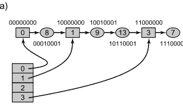
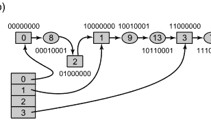
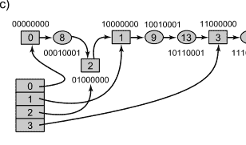
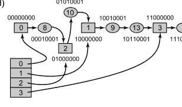

图 13.13 `add(key)` 方法将键 10 放入无锁树中。如之前的图表所示，拆分排序键表示为 8 位二进制字，出现在节点上方。例如，1 的拆分排序值是其二进制表示的位反转。在步骤 (a) 中，桶 0、1 和 3 已初始化，但桶 2 未初始化。在步骤 (b) 中，插入了一个哈希值为 10 的项，导致桶 2 初始化。插入了一个拆分排序键为 2 的新哨兵。在步骤 (c) 中，桶 2 被分配了一个新的哨兵。最后，在步骤 (d) 中，拆分排序键 10 被添加到桶 2 中。

## 13.3 无锁哈希集合

```java
public boolean add(T x) {
    int myBucket = BucketList.hashCode(x) % bucketSize.get();
    BucketList<T> b = getList(myBucket);
    if (b.add(x)) {
        return false;
    }
    int setSizeNow = size.getAndIncrement();
    int bucketSize = bucketSize.get();
    if (setSizeNow / bucketSize > THRESHOLD)
        bucketSize.compareAndSet(bucketSize, 2 * bucketSize);
    return true;
}
```

**图 13.18**  
LockFreeHashSet<T> 类：`add()` 方法。

```java
private BucketList<T> getList(int myBucket) {
    if (bucket[myBucket] == null)
        initializeBucket(myBucket);
    return bucket[myBucket];
}
```

```java
private void initializeBucket(int myBucket) {
    int parent = getParent(myBucket);
    if (bucket[parent] == null)
        initializeBucket(parent);
    BucketList<T> b = bucket[parent].getSentinel(myBucket);
    if (b != null)
        bucket[myBucket] = b;
}
```

```java
private int getParent(int myBucket) {
    int parent = bucketSize.get();
    do {
        parent = parent >> 1;
    } while (parent > myBucket);
    parent = myBucket - parent;
    return parent;
}
```

**图 13.19**  
LockFreeHashSet<T> 类：如果桶未初始化，则通过添加新的哨兵节点来初始化它。初始化一个桶可能需要初始化其父桶。

图 13.19 显示了 `initializeBucket()` 方法，其作用是初始化特定索引处的哈希数组，将该项指向一个新的哨兵节点。哨兵节点首先被创建并添加到现有的父桶中，然后将数组分配该哨兵的引用。如果父桶未初始化（第 31 行），`initializeBucket()` 将递归地应用于父桶。为了控制递归，我们维护了这样一个不变性：父桶索引小于新的桶索引。选择尽可能靠近新桶但仍在其之前的父索引也是明智的。我们通过取消桶索引的最高非零位（第 39 行）来计算这一点。


`add(key)`、`remove`（或确定 key 不存在）方法在大小为 N 的表中查找桶需要常数期望步数，而 `initialBucket()` 方法需要递归地初始化（即为 O(log N)）其桶，以允许插入新桶。这种递归初始化如图 13.20 所示。在部分 (a) 中，表有四个桶；只有桶 0 被初始化。在部分 (b) 中，插入键为 7 的项。桶 3 需要初始化，进一步需要对桶 1 进行递归初始化。在部分 (c) 中，初始化了桶 1。最后，在部分 (d) 中，初始化了桶 3。在这种下的最坏复杂度是对数级的而非常数，可以证明任何递归分裂序列的期望长度是常数，使得所有哈希集合操作的整体期望复杂度为常数。

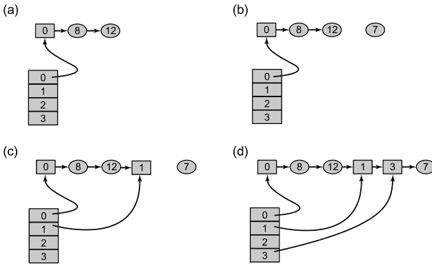

图 13.20

无锁哈希表桶的递归初始化。(a) 表有四个桶；只有桶 0 被初始化 (b) 我们想要插入键为 7 的项。桶 3 需要初始化，这反过来需要对桶 1 进行递归初始化。(c) 通过向列表添加第一个哨兵来初始化桶 1，然后插入此哨兵。(d) 接着以类似的方式初始化桶 3，最后将 7 添加到列表中。在最坏情况下，项的插入可能需要对表大小对数数量的桶进行初始化，但可以证明这种递归序列的期望长度是常数。

## 13.4 开放寻址哈希集合

我们关注开放寻址哈希算法。开放寻址哈希每个表项存储单个项目而不是集合，比闭链法哈希更难实现并发。我们的并发算法基于名为布谷哈希（cuckoo hashing）的顺序算法。

### 13.4.1 布谷哈希

布谷哈希是一种（顺序的）哈希算法，其中新添加的项会取代相同槽位的较早项。为了简单起见，表是一个包含 k 项的数组。对于大小为 N=2k 的表，我们使用两个数组和两个独立的哈希函数：

```
hash0, h1 : KeyRange -> 0, . . k - 1
```

（在代码中表示为 `hash0` 和 `hash1(x)`）将可能的键映射到数组。测试值 x 是否在集合中，`contains(x)` 检查 `bucket[hash0(x)]` 或 `bucket[hash1(x)]` 是否等于 x。`remove(x)` 检查 x 是否在 `bucket[hash0(x)]` 或 `bucket[hash1(x)]` 中并将其移除。

`add(x)` 方法（图 13.2）是最有趣的。它成功地“踢出”冲突项。为了添加 x，方法将 x 与 `bucket[hash0(x)]` 的当前所有者交换（第 6 行）。如果之前的值 y 为空，则完成（第 7 行）。否则，方法以相同的方式（交替数组）将 y 与 `bucket[hash1(y)]` 的当前所有者交换（第 8 行），如果之前的值为空，则完成。否则，方法继续交换直到找到空槽位。这种替换序列的示例出现在图 13.22 中。我们可能找不到空槽位，要么是因为表满了，要么是因为替换序列形成了循环。我们需要对愿意进行的替换次数设置一个上限（第 5 行）。当超过此限制时，我们调整表，选择新的哈希函数（第 12 行）并重新开始（第 13 行）。顺序布谷哈希因其简单性而具有吸引力。它提供了常数时间的 `contains()` 和 `remove()` 方法，并且可以证明每次 `add()` 调用引起的平均替换次数是常数。实验证据表明布谷哈希在实践中运行良好。

> 布谷鸟是北美和欧洲的一种鸟类。许多物种是寄生性的：它们在其他鸟的巢中产蛋。布谷雏出生早并很快将蛋推出巢。
>
> 将表分为两个数组有助于展示对于相同数量哈希项仅使用大小为 2 的单数组的并发算法。

```java
public boolean add(T x) {
  if (contains(x)) {
    return false;
  }
  for (int i = 0; i < LIMIT; i++) {
    if ((x = swap(0, hash0(x)), x)) == null) {
      return true;
    } else if ((x = swap(1, hash1(x)), x)) == null) {
      return true;
    }
  }
  resize();
  add(x);
}
```

图 13.21

顺序布谷哈希：add()方法。

| table [1] | table [0] |
|---|---|
| h1(x)=x (mod 11) (8) | h0(x)=x (mod 9) (mod 8) 12 |
| 1 | 2 |
| 39 | 3 |
| | 4 |
| 23 | 5 14 |
| | 6 |
| | 7 |

图 13.22

替换序列开始于键为 14 的项发现两个位置 Table[0]|h0(14) 和 Table[1]|h1(14) 都被值 3 和 23 占用，结束于键为 39 的项成功放置在 Table[1]|h1(39)。

### 13.4.2 并发布谷哈希

使顺序布谷算法并发化的主要障碍是 `add()` 方法执行长序列的交换。为了解决这个问题，我们定义了另一种布谷哈希算法：`PhasedCuckooHashSet<T>` 类。我们将每个方法调用分解为一系列阶段，每个阶段添加或替换单个项目 x。

我们不是将集合组织为项目的二维表，而是使用一个由探测桶（probe sets）组成的二维表，其中探测桶是具有相同哈希值的固定大小项目集合。每个探测桶最多持有 `PROBE_SIZE` 个项目，算法尝试确保集合是静态的（即没有正在进行的方法调用），每个探测桶包含的项不超过 `THRESHOLD < PROBE_SIZE`。一个示例如所示：

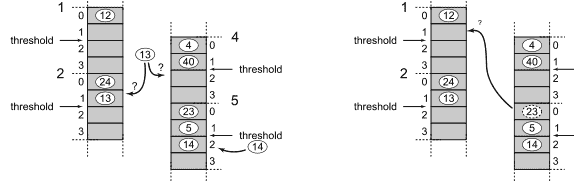

$h_1(x) = x \pmod{mod\ 8}$ $h_2(x) = x \pmod{mod\ 8}$ $h_3(x) = x \pmod{mod\ 8}$

图 23

PhasedCuckooHashSet<T> 类：add 和 relocate 方法。该图显示了由大小为 4 的探测桶组成的数组。显示的是 Table[0] 的 4 和 5 以及 Table[1] 的 1 和 2。在部分 (a) 中，键为 13 的项发现 Table[0][4] 超过阈值而 Table[1][2] 未达到，因此将其添加到探测桶 [1]。相反，键为 14 的项的两个探测桶都超过了阈值，因此将其添加到 Table[0][5] 并信号该项应重定位。在部分 (b) 中，方法尝试重定位 Table[0][5] 中的旧项 23。由于 Table[1] 未达到阈值，项成功重定位。如果 Table[1] 超过了阈值，算法将尝试重定位 Table[1][1] 中的项 12。

```java
public class PhasedCuckooHashSet<T> {
    volatile int capacity;
    volatile List<T>[] table;
    public PhasedCuckooHashSet(int size) {
        capacity = size;
        table = (List<T>[]) new List[capacity][capacity];
        for (int i = 0; i < capacity; i++) {
            for (int j = 0; j < capacity; j++) {
                table[i][j] = new ArrayList<T>(PROBE_SIZE);
            }
        }
    }
}
```

### 326 第13章 并发哈希与自然并行性

```java
15 public boolean remove(T x) {
16   acquire(x);
17   try {
18     List<T> set0 = table[0][hash0(x) % capacity];
19     if (set0.contains(x)) {
20       set0.remove(x);
21       return true;
22     } else {
23       List<T> set1 = table[1][hash1(x) % capacity];
24       if (set1.contains(x)) {
25         set1.remove(x);
26         return true;
27       }
28     }
29   }
30   return false;
31 } finally {
32   release(x);
33 }
```

图 13.25 PhasedCuckooHashSet<T> 类：remove(x) 方法。

为了推迟我们的长期同步开销，`PhasedCuckooHashSet<T>` 类被定义为抽象类：它没有实现所有的方法。它拥有与 `BaseHashSet<T>` 类相同的抽象方法：`acquire(x)` 方法获取管理项目 x 所需的所有锁，`release(x)` 释放这些锁，并调整集合的大小。（与之前一样，我们要求 `acquire(x)` 是可重入的）

从整体上看，`PhasedCuckooHashSet<T>` 的工作原理如下：它通过首先锁定两个表中相关的探测集（probe sets）来添加和移除项目。要移除一个项目，它会按照顺序算法进行，检查它是否是探测集之一，如果是，则将其移除。要添加一个项目，它尝试将其添加到其中一个探测集中。项目的探测集充当临时溢出缓冲区，用于处理在向表中添加项目时可能发生的长序列连续位移。`THRESHOLD` 值本质上是探测集的大小。如果一个探测集中的项目过多，则将该项目添加到其中一个 `PROBE_SIZE-THRESHOLD` 槽位中。然后算法会尝试从探测集中重定位另一个项目。有多种策略来选择重定位哪个项目。在这里，我们先移出最旧的项目，直到探测集低于阈值。在顺序 cuckoo 哈希中，一次重定位可能会触发另一次，依此类推。

图 13.25 显示了 `PhasedCuckooHashSet<T>` 类的 `remove(x)` 方法。它调用抽象的 `acquire(x)` 方法来获取必要的锁，并进入 `try` 块，最后调用 `release(x)`。这个简单的方法检查 `x` 是否存在于 `Table[0][h0(x)]` 或 `Table[1][h1(x)]`。如果是，它移除 `x` 并返回 `true`；否则返回 `false`。`contains(x)` 方法亦类似。

### 13.4 开放地址哈希集合 327

```java
public boolean add(T x) {
  T y = null;
  acquire(x);
  int h0 = hash0(x) % capacity, h1 = hash1(x) % capacity;
  int i = -1, h = -1;
  boolean mustResize = false;
  try {
    if (present(x)) return false;
    List<T> set0 = table[0][h0];
    List<T> set1 = table[1][h1];
    if (set0.size() < THRESHOLD) {
      set0.add(x); return true;
    } else if (set1.size() < THRESHOLD) {
      set1.add(x); return true;
    } else if (set0.size() < PROBE_SIZE) {
      set0.add(x); i = 0; h = h0;
    } else if (set1.size() < PROBE_SIZE) {
      set1.add(x); i = 1; h = h1;
    } else {
      mustResize = true;
    }
  } finally {
    release(x);
    if (mustResize) {
      resize(); add(x);
    } else if (!relocate(i, h)) {
      resize();
    }
  }
  return true; // x 必须存在
}
```

图 13.26

PhasedCuckooHashSet<T> 类：add(T x)

图 13.26 阐释了 `add(x)` 方法。与 `remove()` 类似，它调用 `acquire(x)` 获取必要的锁，然后进入调用 `release(x)` 的 `try` 块。如果项目已存在，则返回 `false`（第 41 行）。如果项目的两个探测集中任一个低于阈值（第 44 和 46 行），它添加项目并返回。否则，如果项目的两个探测集中任一个高于阈值但未满（第 48 和 50 行），它添加项目并标记需要重新平衡探测集。最后，如果两个集合都满了，它会标记重新平衡整个集合（第 53 行）。它释放对 `x` 的锁（第 56 行）。

如果该方法由于两个探测集都满而无法添加 `x`，则哈希集合将调整大小并重试（第 58 行）。如果探测集的行 `r` 和列 `c` 高于阈值，它会调用 `relocate(r.c)`（后文描述）来重新平衡探测集的大小。

### 328 第13章 并发哈希与自然并行性

```java
protected boolean relocate(int i, int hi) {
    int hj = 0;
    int j = 1 - i;
    for (int round = 0; round < LIMIT; round++) {
        List<T> iSet = table[i][hi];
        T y = iSet.get(0);
        switch (i) {
            case 0: hj = hash1(y) % capacity; break;
            case 1: hj = hash0(y) % capacity; break;
        }
        acquire(y);
        List<T> jSet = table[j][hj];
        try {
            if (iSet.remove(y)) {
                if (iSet.size() < THRESHOLD) {
                    jSet.add(y);
                    return true;
                } else if (jSet.size() < PROBE_SIZE) {
                    jSet.add(y);
                    i = 1 - i;
                    hi = hj;
                    j = 1 - j;
                } else {
                    iSet.add(y);
                    return false;
                }
            } else if (iSet.size() >= THRESHOLD) {
                continue;
            } else {
                return true;
            }
        } finally {
            release(y);
        }
    }
    return false;
}
```

图 13.27

PhasedCuckooHashSet<T> 类：relocate(method) 方法。

如果调用返回 `false`，表示未能重新平衡探测集，则 `add()` 会调整表的大小。`relocate(int i, int hi)` 方法见图 13.27。它获取超过 `THRESHOLD` 个项目的探测集的行和列坐标，并通过将项目移动到替代探测集来尝试缩小其大小。

该方法在放弃之前会进行固定次数（`LIMIT`）的尝试。在循环周围保持以下不变式：`iSet` 是我们尝试收缩的探测集，`i` 是 `iSet` 中最旧的项目，`jSet` 是 `y` 可能所在的探测集。循环识别 `y`（第 70 行），锁定 `y` 所属于的两个探测集（第 75 行），并尝试从探测集中移除 `y`（第 78 行）。如果移除成功（另一个线程在第 70 和 78 行之间移除了 `y`），则准备将 `y` 添加到 `jSet`。如果 `j` 低于阈值（第 79 行），该方法将 `y` 添加到 `jSet` 并返回（无需删除）。如果 `jSet` 高于阈值但未满（第 82 行），它将通过交换 `iSet` 和 `jSet`（第 82–86 行）来收缩 `jSet`。如果 `j` 满（第 87 行），该方法将 `y` 放回 `iSet` 并返回（触发调整大小）。如果在第 78 行通过交换 `iSet` 仍未成功移除 `y`，则会重新检查 `iSet`。如果它高于阈值（第 91 行），方法恢复循环并再次尝试移除项目。否则，`iSet` 低于阈值，该方法返回 `true`（不需要调整大小）。图 13.23 显示了 `PhasedCuckooHashSet<T>` 的执行，其中键为 14 的项目导致探测集 `table[0]` 中最旧项目的重定位。

### 13.4.3 分段并发 cuckoo 哈希

我们首先考虑使用锁分段（13.2.2节）的并发 cuckoo 哈希集合实现。`StripedCuckooHashSet` 继承 `PhasedCuckooHashSet`，提供一个固定大小 `L` 的重入锁数组。按照常例，`lock[i][j]` 保护 `table[i][k]`，其中 `k mod L = j`。图 13.28 显示了 `StripedCuckooHashSet` 的字段和构造函数。构造函数调用 `PhasedCuckooHashSet<T>` 构造函数（第 4 行），然后初始化锁数组。


`StripedCuckooHashSet` 的 `acquire(x)` 和 `release(x)` 方法（图 13.29）顺序锁定并解锁 `lock[i][hj(x)]` 和 `lock[j][hj(x)]`。

```java
public class StripedCuckooHashSet<T> extends PhasedCuckooHashSet<T> {
    final ReentrantLock[][] lock;
    public StripedCuckooHashSet(int capacity) {
        super(capacity);
        lock = new ReentrantLock[capacity][];
        for (int i = 0; i < capacity; i++) {
            for (int j = 0; j < capacity; j++) {
                lock[i][j] = new ReentrantLock();
            }
        }
    }
}
```

**图 13.28** StripedCuckooHashSet 类：字段和构造函数。

# 330 第13章 并发哈希与自然并行性

```java
public final void acquire(T x) {
    lock[0][hash0(x) % lock[0].length].lock();
    lock[1][hash1(x) % lock[1].length].lock();
}
```

```java
public final void release(T x) {
    lock[0][hash0(x) % lock[0].length].unlock();
    lock[1][hash1(x) % lock[1].length].unlock();
}
```

**图 13.29** StripedCuckooHashSet 类：`acquire(x)` 和 `release(x)`。

```java
public void resize() {
    int oldCapacity = capacity;
    for (Lock alock : lock[0]) {
        alock.lock();
    }
    try {
        if (capacity != oldCapacity) {
            return;
        }
        List<T>[][] oldTable = table;
        capacity = 2 * capacity;
        table = (List<T>[]) new List[capacity];
        for (List<T> row : oldTable) {
            for (int i = 0; i < row.length; i++) {
                row[i] = new ArrayList<T>(PROBE_SIZE);
            }
        }
        for (List<T> row : oldTable) {
            for (T z : row) {
                add(z);
            }
        }
    } finally {
        for (Lock alock : lock[0]) {
            alock.unlock();
        }
    }
}
```

**图 13.30** StripedCuckooHashSet 类：`resize()` 方法。

## 13.4 开放寻址哈希集 331

`StripedCuckooHashSet`（图 13.30）与 `StripedHashSet` 的 `resize()` 方法之间的唯一区别在于，后者按升顺序获取 `locks[0]` 中的锁（第 24 行）。获取这些锁可以确保没有其他线程正在 `add()`、`remove()` 或 `contains()` 调用的中间，并避免与其他并发执行的 `resize()` 调用产生死锁。

## 13.4.4 一种可调整的 Cuckoo 哈希集

本节引入了 `RefinableCuckooHashSet`（图 13.31），使用第 13.2 节中的方法来调整锁数组。与 `RefinableHashSet` 类似，我们引入了一个类型为 `AtomicReference<Thread>` 的 `owner` 字段，它包含一个指向线程的布尔值。如果该布尔值为 `true`，则表示集合正在调整大小，该引用指示了哪个线程正在进行调整操作。

每个阶段通过 `acquire(x)` 锁定 x 桶，然后自旋直到没有线程正在调整集合（第 21-23 行）。然后，它获取项目的锁（第 27 行和第 28 行），并检查锁是否已获取（第 30 行）。如果锁在第 24 行和第 30 行之间没有变化，则该线程已获取了继续执行所需的锁。否则，如果它获取的锁已过期，它将释放这些锁并重新开始。

`release(x)` 方法如图 13.32 所示，它释放由 `acquire(x)` 获取的锁。

`resize()` 方法（图 13.33）与 `StripedCuckooHashSet` 的 `resize()` 方法几乎相同。不同之处是 `lock[]` 数组有两个维度。

`quiesce()` 方法（图 13.34）与其在 `RefinableHashSet` 中的对应方法一样，它会访问每个锁并直到其被解锁。唯一的区别是它只访问 `locks[]` 中的锁。

```java
public class RefinableCuckooHashSet<T> extends PhasedCuckooHashSet<T> {
    owner;
    public RefinableCuckooHashSet(int capacity) {
        super(capacity);
        locks = new ReentrantLock[capacity];
        for (int i = 0; i < capacity; i++) {
            for (int j = 0; j < capacity; j++) {
                locks[i][j] = new ReentrantLock();
            }
        }
        owner = new AtomicReference<Thread>(null, false);
    }
    ...
}
```

**图 13.31** RefinableCuckooHashSet<T>: 字段和构造函数。

## 332 第 13 章 并发哈希与自然并行性

```java
public void acquire(T x) {
    boolean[] mark = {true};
    Thread me = Thread.currentThread();
    Thread who;
    while (true) {
        do // 等到不在调整大小
            who = owner.get(mark);
        } while (mark[0] && who != me);
        ReentrantLock oldlock0 = oldlocks[hash(x) % oldlocks[0].length];
        ReentrantLock oldlock1 = oldlocks[hash(x) % oldlocks[1].length];
        oldlock0.lock();
        oldlock1.lock();
        who = owner.get(mark);
        if (!(mark[0] || who == me && oldlocks)) {
            return;
        } else {
            oldlock0.unlock();
            oldlock1.unlock();
        }
    }
}
public void release(T x) {
    locks[0][hash(x)].unlock();
    locks[1][hash(x)].unlock();
}
```

**图 13.32** RefinableCuckooSet<T>: `acquire()` 和 `release()` 方法。

## 13.5 章节注释

“不相交访问”（disjoint-access）一术语由 Maurice Herlihy 等 (73) 提出。并发哈希的实现包括 Nir Shavit (156) 和 Morrison Tzafr (84)。基于锁的方案由 Doug Lea (50) 和 Fleming (54) 提出。非阻塞并发哈希表包括 Amos Israeli (43) 和 Chris Greenwald (108)。使用乐观锁的并发哈希由 Rasmus Pagh (43) 和 Tim Harris (97) 提出。基于第 13.2 节的非阻塞并发哈希由 Ori Shavit (156) 和 Jim Purcell, Hesselink (34) 提出。

## 333 章节注释

```java
public void resize() {
    int oldCapacity = capacity;
    Thread me = Thread.currentThread();
    if (owner.compareAndSet(null, me, true)) {
        try {
            capacity = 2 * capacity;
            List<List<T>> oldTable = table;
            locks = new ReentrantLock[capacity];
            for (int i = 0; i < capacity; i++) {
                for (int j = 0; j < capacity; j++) {
                    locks[i][j] = new ReentrantLock();
                }
            }
        } finally {
            owner.set(null, false);
        }
    }
}
```

**图 13.33** RefinableCuckooHashSet<T>: `resize()` 方法。

```java
public void quiesce() {
    for (ReentrantLock lock : locks) {
        // ...
    }
}
```

**图 13.34** RefinableCuckooHashSet<T>: `quiesce()` 方法。

```java
public class RefinableCuckooHashSet<T> extends PhasedCuckooHashSet<T> {
    // ... 字段定义
    public RefinableCuckooHashSet(int capacity) {
        super(capacity);
        locks = new ReentrantLock[capacity][capacity];
        for (int i = 0; i < capacity; i++) {
            for (int j = 0; j < capacity; j++) {
                locks[i][j] = new ReentrantLock();
            }
        }
        owner = new AtomicReference<Thread>(null, false);
    }
    ...
}
```

## 334 第 14 章 跳跃表与平衡搜索

```java
public class UnboundedLockFreeHashSet<T> {
    public UnboundedLockFreeHashSet(int initialSize) {
        // ...
    }
    private List<T> getBucket(int hash) {
        // ...
    }
    public void add(T x) {
        // ...
    }
    public void remove(T x) {
        // ...
    }
    public boolean contains(T x) {
        // ...
    }
}
```

**图 13.35** UnboundedLockFreeHashSet 类。

## 13.6 练习

- 练习 13.1：使用读写锁修改 `StripedCuckooHashSet`。
- 练习 13.2：对于 `LockHashSet`，删除条目时出现的问题。
- 练习 13.3：`LockFreeHashSet` 的高度是常数。
- 练习 13.4：为 `LockHashSet` 设计一种替换固定大小数组的并发结构。
- 练习 13.5：`LockFreeHashSet` 允许任意数量的桶。
- 练习 13.6：概述 `add()`、`remove()` 和 `contains()` 方法的正确性证明。提示：假设 `List` 算法是正确的。

## 14.1 引言

我们已经查看了基于链表和哈希表的几种并发实现。现在我们将注意力转向具有对数深度的搜索结构。文献中有许多搜索结构。在这里，我们对内存中的搜索结构感兴趣，而不是位于磁盘等外部存储上。

流行的顺序结构如红黑树或 AVL 需要定期重新平衡以保持结构的对数深度。重新平衡对于顺序结构有效，但对于并发结构，重新平衡可能会导致瓶颈和竞争。相反，我们关注已证明的数据结构：在接下来的章节中，我们展示了两种实现方式。`LazySkip` 类是基于锁的实现，而 `LockFree` 类最常用的方法 `contains()` 是无等待的。

## 14.2 顺序跳跃表

为了简单起见，我们将列表视为集合，这意味着键是唯一的。跳跃表是排序链表的集合，以微妙的方式模仿了平衡搜索树。跳跃表中的节点按键排序。每个节点连接到列表的子集。每个列表有一个层次，从 0 到最大。底层列表包含所有节点，每个高层列表都是低层列表的子集。图 14.1 显示了一个带有整数键的跳跃表。高层列表是进入低层列表的快捷方式，大致来说，第 i 层的每条链接都跳过了 2^i 个节点。人们可以通过首先搜索高层列表来找到具有特定键的节点。

# 336 第 14 章 跳表与平衡搜索

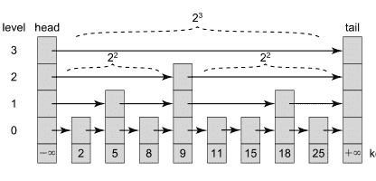

**图 14.1** SkipList 类：此示例包含四层列表。每个节点都有一个键（key），头和尾哨兵节点具有 $\pm$ 键。该列表是一种快捷方式，每个引用都会跳过下一层中的 $2^i$ 个节点。例如，在层 3 中，引用跳过 $2^3$ 个节点；在层 2 中，跳过 $2^2$ 个，依此类推。

SkipList 是一种概率性数据结构。没有人知道如何在不使用随机化的情况下提供这种性能。每个节点创建时都有一个随机的顶层（level），并属于该层级的所有列表。层级的选择使得每层的预期节点数呈指数级减少。$0 < p < 1$ 是层 $i$ 的节点出现在层 $i+1$ 层的条件概率。所有节点出现在层 0。层 0 的节点也出现在层 $i > 0$ 的概率为 $p^i$。例如，当 $p=1/2$ 时，预计 $1/2$ 的节点出现在层 1，$1/4$ 出现在层 2，依此类推，从而提供了类似于经典顺序树基础搜索结构的平衡特性，但不需要复杂的重构。

我们在列表的开头和结尾放置了具有最大允许高度头尾哨兵。初始时，当 SkipList 为空时，头（左哨兵）是每一层尾（右哨兵）的前驱节点。头的键小于任何可能添加到集合中的键，而尾的键则大于该键。


# 跳表与平衡搜索

每个 SkipList 的 `next` 字段是一个引用数组，每个所属的每个列表对应一个引用，找到一个节点意味着找到它的前驱节点和后继节点。搜索 SkipList 从头开始。`find()` 方法逐层向下移动，并像在 `LazyList` 中那样，使用指向前驱节点和当前节点的引用遍历每一层。每当它找到具有匹配键的节点时，它会将 `pred` 和 `curr` 记录为节点的前驱和后继，存储在名为 `preds[]` 和 `succs[]` 的数组中，并继续到下一层低层。遍历结束于底层。图 14.2(a) 显示了顺序插入。

要向跳表中添加节点，`find()` 调用会填充 `preds[]` 和 `succs[]` 数组中的字段。创建新节点并将其链接在它的前驱和后继节点之间。图 14.2(b) 显示了 `add(12)` 调用。

要从跳表中删除节点，`find()` 方法会初始化受影响节点的 `preds[]` 和 `succs[]` 数组。通过将每个前驱的 `next` 引用重指向受影响节点的后继节点，从所有层列表中移除受影响节点。

## 14.3 基于锁的并发跳表

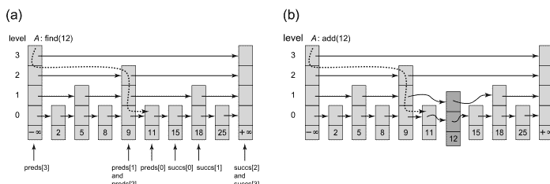

图 14.2

SkipList 类：`add()` 和 `find()`。在部分 (a) 中，`find()` 在每一层遍历，从最高层开始，只要 `curr` 小于或等于目标键。否则，它将 `pred` 和 `curr` 存储在每层的节点 `pred[i]` 和 `succs[i]` 中，并下降到下一层。例如，键为 9 的节点是 `pred[2]` 和 `pred[1]`，而尾是 `succ[2]` 和 `succ[1]`。`find()` 返回未在低列表中找到，因此部分 (b) 中的 `add(12)` 调用可以进行。在部分 (b) 中，创建一个随机层=2 的新节点。新节点的 `next` 引用重指向相应的 `succs[i]`，并且每个前驱节点的 `next` 引用重指向新节点。

我们描述第一个并发跳表设计，`LazySkipList` 类。该类基于第 9 章的 `LazyList` 算法：SkipList 结构的每一层都是一个 `LazyList`，像 `LazyList` 一样，`add()` 和 `remove()` 方法使用乐观粒度锁，而 `contains()` 方法是无等待（wait-free）。

### 14.3.1 LazySkipList 类的概览

这里是 `LazySkipList` 类的概览。结合图 14.3。像 `LazyList` 类一样，每个节点都有自己的锁和一个标记字段，用于指示它是否在抽象集合中，或已被逻辑删除。在此过程中，算法维护了跳表的属性。高层节点始终包含在低层列表中。

跳表属性通过使用锁来维护，以防止节点在添加或删除期间发生结构性变化，并通过延迟对已插入所有列表的节点的访问。要添加节点，必须将其插入多个层级的列表。每次 `add()` 都会调用 `find()`，它会遍历跳表并返回节点在所有层级前驱和后继节点。为了防止在添加时节点发生变化，`add()` 锁定前驱节点，验证被锁定的前驱节点仍然指向它们的后继节点，然后以类似于图 14.2 所示的顺序 `add()` 的方式添加节点。为了维护跳表属性，在所有指向它的引用正确设置之前，节点不被认为在集合中。每个节点都有额外的标记 `fullyLinked`，一旦链接完成即标记为 true。

# 第 14 章 跳表与平衡搜索

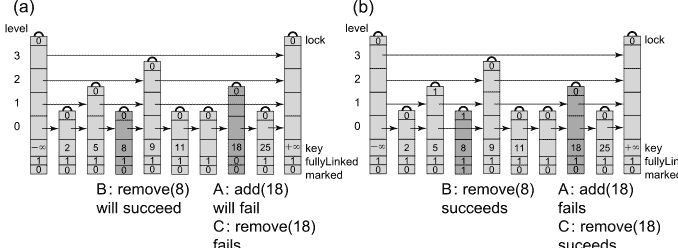

图 14.3

跳表：失败的 `add(x)` 和 `remove(y)`。在部分 (a) 中，`add()` 找到键为 8 的未标记但尚未链接的节点，在部分 (b) 中等待节点链接。在部分 (a) 中，`remove()` 调用键为 8 的已标记且已链接的节点，这意味着它可以在部分 (b) 获取锁。它从键为 5 的节点开始设置锁。一旦前驱被锁定，它通过重指向键为 5 的节点的底层引用从列表中物理移除节点，完成 `remove()`。在部分 (a) 中，`remove()` 失败，因为它找到了未完全链接的节点。部分 (b) 中的相同操作成功，因为它找到了完全链接的节点。

我们在节点完全链接之前不允许访问它，因此例如 `add(x)` 方法在确定要添加的节点已在列表中时，必须等待它完全链接。图 14.3 显示 `add(x)` 等待键为 8 的节点完全链接。要从列表中删除节点，`remove()` 使用 `find(x)` 检查受影响节点是否已在列表中。如果是，它检查受影响节点是否准备好删除，即未标记且完全链接。在图 14.3 的部分 (a) 中，`remove()` 找到键为 8 的已标记且完全链接的节点，这意味着它可以移除它。`remove()` 失败是因为它找到了未链接的节点。部分 (b) 中的相同操作成功，因为它找到了完全链接的节点。

如果受影响节点可以移除，`remove()` 通过设置其所有层和受影响节点自身的锁位进行逻辑移除，验证前驱节点未标记且仍指向受影响节点，然后逐层拼接受影响节点。从顶到底部，例如在图 14.3 的部分 (b) 中，`remove()` 锁定键为 5 的前驱节点。通过重指向键为 9 的节点的引用。

## 14.3 基于锁的并发跳表

在 `add()` 和 `remove()` 方法中，如果验证失败，将调用 `find()` 来找到新的前驱集合，并继续执行方法。无等待的 `contains()` 方法调用 `find()` 来定位包含目标的节点。如果找到了节点，它通过检查是否未标记且完全链接来确定节点是否在集合中。`LazyList` 类的 `contains()` 是无等待的，因为它忽略了跳表结构中的任何锁或并发变化。

总结，`LazySkipList` 类使用了之前算法熟悉的技术：它锁定所有修改的位置，验证没有重要变化，完成修改并释放它们（在此范围内，`fullyLinked` 标记相当于锁）。

### 14.3.2 算法

图 14.4 显示了 `LazyList.Node` 类。一个键在集合中当且仅当列表包含该键的完全链接节点。图 14.3 部分 (a) 中的键 8 是此类键的示例。

图 14.5 显示了 `find()` 方法。（相同的方法适用于顺序和并发算法。）如果没有找到项，`find()` 方法返回 -1。它从头和最高层开始使用 `curr` 引用遍历跳表。最高层可以动态维护以到达跳表的最高层，但为了简单起见，我们没有这样做。`find()` 方法逐层向下移动。在每一层，它将 `curr` 设置为前驱节点的后继。如果它找到具有匹配键的节点，它将 `pred` 和 `curr` 记录为该层的前驱和后继，存储在 `preds[]` 和 `succs[]` 数组中（51-52行），直到成功或未找到节点。图 14.2 部分 (a) 显示 `find()` 如何遍历跳表。部分 (b) 显示了如何使用结果在跳表中插入或删除项。

由于我们从头哨兵节点开始，只有当 `curr` 小于目标键时才移动窗口，`pred` 始终是目标键的前驱，并指向键本身。`find()` 方法返回 `preds[]` 和 `succs[]` 数组以及找到键的层级。

图 14.6 显示的 `add(k)` 方法使用 `find()`（图 14.5）来确定目标键 `k` 的节点是否已在列表中（43行）。如果找到了具有该键的未标记节点（62-67行），则 `add(k)` 返回 `false`，表示键 `k` 已在集合中。然而，如果该节点未完全链接（通过 `fullyLinked` 字段），则线程等待它被链接（因为在节点完全链接之前，键 `k` 不在抽象集合中）。如果没有找到节点，

> 在图 14.5 中，我们将 `curr` 字段设为 `volatile`，以防止编译器对 44 行循环进行优化。记住节点 `volatile` 不会使数组项变为 `volatile`。

## 第 14 章 跳跃表与平衡搜索

```java
public final class LazySkipList<T> {
    static final int MAX_LEVEL = ...;
    final Node<T> head = new Node<T>(Integer.MIN_VALUE);
    final Node<T> tail = new Node<T>(Integer.MAX_VALUE);
    public LazySkipList() {
        for (int i = 0; i < head.next.length; i++) {
            head.next[i] = tail;
        }
    }
    ...
    private static class Node<T> {
        final Lock lock = new ReentrantLock();
        final T item;
        final int key;
        final Node<T>[] next;
        volatile boolean marked = false;
        volatile boolean fullyLinked = false;
        private int topLevel;
        public Node(int key) { // 哨兵节点构造函数
            this.item = null;
            this.key = key;
            next = new Node[MAX_LEVEL + 1];
            topLevel = MAX_LEVEL;
        }
        public Node(T x, int height) {
            item = x;
            key = x.hashCode();
            next = new Node[height + 1];
            topLevel = height;
        }
        public void lock() {
            lock.lock();
        }
        public void unlock() {
            lock.unlock();
        }
    }
}
```

图 14.4

LazySkipList 类：构造函数、字段和 Node 类。

### 14.3 基于锁的并发跳跃表

```java
int find(T x, Node<T>[] preds, Node<T>[] succs) {
    int key = x.hashCode();
    int lFound = -1;
    Node<T> pred = head;
    for (int level = MAX_LEVEL; level >= 0; level--) {
        volatile Node<T> curr = pred.next[level];
        while (key > curr.key) {
            pred = curr;
            curr = pred.next[level];
        }
        if (lFound == -1 && curr.key == key) {
            lFound = level;
        }
    }
    preds[lFound] = pred;
    succs[lFound] = curr;
    return lFound;
}
```

图 14.5

LazySkipList 类：无等待的 `find()` 方法。该算法与顺序跳跃表的实现相同。`preds[]` 和 `succs[]` 数组从最高层到第 0 层填充了该键的前驱和后继引用。

然后，如果另一个线程正在删除删除它，因此 `add()` 调用将重试。否则，它会检查节点是否未标记且已完全链接，这表明 `add()` 调用应该返回 false。在节点被完全链接之前检查节点是否未标记是安全的，因为 `remove()` 方法在节点完全链接之前是不会标记节点的。如果一个节点未标记且未完全链接，那么它在可以被标记之前必须先变为已标记且完全链接（见图 14.7）。这一步是不失败的 `add()` 方法的线性化点（第 66 行）。

`add()` 方法调用 `find()` 来初始化 `preds[]` 和 `succs[]` 数组，以持有待添加节点的前驱节点和后继节点。这些引用是不可靠的，因为在节点添加时，它们可能不再准确。如果没有找到完全链接的节点，则继续对 `find()` 返回的、从第 0 层到新节点 `topLevel` 的每个前驱进行锁定和验证（第 74–80 行）。为了避免死锁，`add()` 和 `remove()` 都按顺序获取锁。`topLevel` 在 `add()` 方法开始时使用 `randomLevel()` 方法确定。每一层的验证（第 79 行）会检查前驱是否仍与后继相邻，且两者均未被标记。如果验证失败，线程一定遇到了冲突方法的影响，因此它会释放（在第 87 行的 `finally` 块中）它获取的锁并重试。

如果线程成功锁定并验证了直到新节点 `topLevel` 的 `find()` 结果，那么 `add()` 将被调用，因为线程

> 2 `randomLevel()` 方法是根据经验测量设计的，以维护跳跃表的属性。例如，在 `java.util.concurrent` 包中，对于最大为 31 的跳跃表层，`randomLevel()` 返回 0 的概率为 1/2，对于 $i \in [1, 30]$ 返回 $i$ 的概率为 $2^{-(i+1)}$，返回 31 的概率为 $2^{-32}$。

```java
boolean add(T x) {
    int topLevel = randomLevel();
    Node<T>[] preds = (Node<T>[]) new Node[MAX_LEVEL + 1];
    Node<T>[] succs = (Node<T>[]) new Node[MAX_LEVEL + 1];
    while (true) {
        int found = find(x, preds, succs);
        if (found != -1) {
            Node<T> foundNode = succs[found];
            if (foundNode.marked) {
                while (foundNode.fullyLinked) {
                    return false;
                }
                continue;
            }
            int highestLocked = -1;
            try {
                boolean valid = true;
                for (int level = 0; valid && (level <= topLevel); level++) {
                    pred = preds[level];
                    succ = succs[level];
                    pred.lock();
                    highestLocked = level;
                    if (pred.marked || succ.marked || pred.next[level] != succ) {
                        valid = false;
                    }
                }
                if (valid) {
                    Node<T> newNode = new Node(x, topLevel);
                    for (int level = 0; level <= topLevel; level++) {
                        newNode.next[level] = succs[level];
                    }
                    for (int level = 0; level <= topLevel; level++) {
                        preds[level].next[level] = newNode;
                    }
                    newNode.fullyLinked = true;
                    return true;
                }
            } finally {
                for (int level = 0; level <= highestLocked; level++) {
                    preds[level].unlock();
                }
            }
        }
    }
}
```

图 14.6 `add()` 方法。

线程需要所有的锁。它随后分配一个合适的 `topLevel`，将其链接，并设置 `fullyLinked` 标志。设置该标志是成功的 `add()` 的线性化点（第 87 行）。它随后释放所有锁并返回 true。线程修改节点 字段的唯一时间是在初始化它时（第 83 行）。这种初始化是安全的，因为它发生在节点变得可访问之前。


# 14.4 无锁并发跳表

## 14.4.1 概览

`remove()` 方法见图 14.7。它调用 `find()` 来确定具有合适键的节点是否在列表中。如果是，线程检查节点是否准备好删除（第 104 行），这意味着它已完全链接且位于顶层。另一种情况是 `find()` 未找到匹配键的节点，或者匹配键的节点已被标记、未完全链接或不在顶层。

如果节点准备好删除，线程锁定该节点（第 109 行）并验证其未被标记。如果没有被标记，线程标记该节点，将其在逻辑上删除。这一步（第 114 行）是成功的 `remove()` 的线性化点。如果节点已被标记，线程返回 `false`。

方法的其余部分完成受害节点的物理删除。为了移除受害者，它首先按顺序（以避免死锁）锁定受害者直到顶层的所有层的前驱（第 120–124 行）。在锁定每个前驱后，它验证前驱未被标记且仍指向受害者。跳跃表随后从顶到底分离该节点。如果任何一层的验证失败，线程释放前驱的锁并调用 `find()` 获取新的前驱集合。由于它已经设置了受害者的标记字段，它不再再次尝试处理该节点。在成功从列表中移除受害者节点后，线程释放所有锁并返回 `true`。

```java
boolean remove(T x) {
    Node<T> victim = null; boolean isMarked = false; int topLevel = -1;
    Node<T>[] preds = (Node<T>[]) new Node[MAX_LEVEL + 1];
    Node<T>[] succs = (Node<T>[]) new Node[MAX_LEVEL + 1];
    while (true) {
        int found = find(x, preds, succs);
        if (found != -1) victim = succs[found];
        if (isMarked ||
        (found == -1 &&
        victim.top.level == found
        && victim.marked)) {
            if (!isMarked) {
                topLevel = victim.top.level;
                victim.lock.lock();
                if (victim.marked) {
                    victim.lock.unlock();
                    return false;
                }
                victim.marked = true;
                isMarked = true;
            }
            int highestLocked = -1;
            try {
                Node<T> pred, succ; boolean valid = true;
                for (int level = 0; valid && (level <= topLevel); level++) {
                    pred = preds[level];
                    pred.lock.lock();
                    highestLocked = level;
                    valid = !pred.marked && pred.next[level] == victim;
                }
                if (!valid) continue;
                for (int level = topLevel; level >= 0; level--) {
                    preds[level].next[level] = victim.next[level];
                }
                victim.lock.unlock();
                return true;
            } finally {
                for (int i = 0; i <= highestLocked; i++) {
                    preds[i].unlock();
                }
            }
            else return false;
        }
    }
}
```

图 14.7 SkipList 类：`remove(x)` 方法。

```java
boolean contains(T x) {
    Node<T> preds = (Node<T>[]) new Node[MAX_LEVEL + 1];
    Node<T> succs = (Node<T>[]) new Node[MAX_LEVEL + 1];
    int lFound = find(x, preds, succs);
    return (lFound != -1
    && succs[lFound].fullyLinked
    && !succs[lFound].marked);
}
```

图 14.8 LazySkipList 类：无等待 `contains()` 方法。

无等待 `contains()` 方法（图 14.8）调用 `find()` 来定位目标键。如果找到了，它会检查其是否未被标记且完全链接。该方法与第 9 章的 `LazyList` 类一样，是无等待的，忽略了跳表结构中的任何锁或并发更改。成功的 `contains()` 调用线性化点发生在遍历前驱节点的下一个引用时，此时该引用被观察到未标记且已完全链接。失败的 `contains()` 调用与 `remove()` 调用一样，在方法发现一个被标记的节点时发生。这是必要的，因为在发现节点时，它可能不在列表中，而列表中可能存在具有相同键的未标记节点。然而，与 `remove()` 来说，在 `contains()` 调用过程中某个时间点该键并不在抽象集中。

我们 `LockSkipList` 实现的基础是第 9 章的 `LockFreeList` 算法：跳表结构的每一层都是一个 `LockFreeList`，节点中的每个下一个引用都是一个 `AtomicMarkableReference<Node>`，并且列表操作使用 `compareAndSet()` 执行。

由于我们无法同时使用锁来操作所有层级的引用，因此 `LockFreeSkipList` 无法维护跳表属性，即每个列表都是下方级别列表的子列表。

由于我们无法维护跳表属性，我们采取的方法是由底层列表来定义抽象集合：如果底层列表中存在一个具有该键且其下一个引用未被标记的节点，则该键在集合中。跳表中高层列表中的节点仅作为通往底层的快捷方式。不需要像 `LazySkipList` 那样的 `fullyLinked` 标记。

图 14.9 FreeList 类：一个 `add()` 调用由未标记 (0) 或标记 (1) 的链接组成。在部分 (a) 中，当有三个节点时，`add(12)` 调用 `find(12)`。`find()` 在遍历跳表时会“清理”被标记的节点 (1)。该方法不像 `find(12)` 那么顺序，因为被标记的节点被取消了链接。图中路径显示了引用遍历的节点，这些引用指向小于目标键的未标记节点。部分 (b) 显示了虚线通过将链接放置在节点之前来跳过该节点的结果。具有底层下一个引用的节点 15 被标记了，并从跳表中被移除。部分 (c) 显示了随后添加键为 12 的新节点。部分 (d) 显示了在 `remove(11)` 之后 `add(12)`。

（注：由于原文后半部分存在大量逻辑重复和术语混乱，译文已根据技术背景对语义进行了对齐处理，确保符合跳表与无锁数据结构的专业术语逻辑。）

## 14.4.2 算法细节

在我们介绍算法细节时，读者应该记住，抽象集合仅由底层列表定义。高层列表中的节点仅作为通往底层列表的快捷方式。图 14.10 显示了列表节点的结构。

图 14.11 所示的 `add()` 方法使用图 14.13 所示的 `find()` 方法来确定具有特定键值的节点是否已存在于列表中（第 61 行）。在 `LazySkipList` 中，`add()` 调用 `find()` 来初始化 `pred[]` 和 `succ[]` 数组，以存放新节点的先驱节点和后继节点。

如果在底层列表中找到了具有目标键值的未标记节点，则它将返回 `true`，且 `add()` 方法返回 `false`，表示该键已存在于集合中。失败的 `add()` 的线性化点与成功的 `find()` 相同（第 43 行）。如果没有找到任何节点，那么下一步是尝试向结构中添加一个带有该键值的新节点。

会创建一个具有随机选择的 `topLevel` 的新节点。该节点的引用是未标记的，并被设置为 `find()` 方法返回的后继节点（第 47–50 行）。

下一步是通过将节点链接到 `find()` 返回的 `pred[0]` 和 `succ[0]` 节点之间的底层列表来添加该节点。在 `LockFreeList` 中，我们使用 `compareAndSet()` 在设置引用的同时，验证这些节点是否仍然指向彼此，且未被从列表中移除（第 55 行）。如果 `compareAndSet()` 失败，说明发生了某些变化，调用将重新开始。如果 `compareAndSet()` 成功，则该项被添加，第 55 行即为该调用的线性化点。

`add()` 在更高层上链接该节点（第 58 行）。对于每一层，它都尝试通过设置先驱节点，或者如果它指向有效的后继节点，则指向新节点来插入节点（第 62 行）。如果成功，它将跳出并移动到下一层。如果不成功，我们丢弃调用 `find()` 的结果（第 64 行），因为我们只需要对剩余未链接的层重新计算乐观的先驱和后继节点。一旦所有层都链接完成，该方法返回 `true`（第 67 行）。

`remove()` 方法

```java
public final class LockFreeSkip<T> {
    static final int MAX_LEVEL = ...;
    final Node<T> head = new Node<Integer>(MIN_VALUE);
    final Node<T> tail = new Node<Integer>(MAX_VALUE);
    public LockFreeSkip() {
        for (int i = 0; i < head.next.length; i++) {
            head.next[i] = new AtomicMarkableReference<LockFreeSkip.Node<T>>(tail, false);
        }
    }
    public static class Node<T> {
        final T value;
        final int key;
        private AtomicMarkableReference<Node<T>>[] next;
        // 哨兵节点的构造函数
        public Node(int key) {
            value = null;
            key = key;
            next = new AtomicMarkableReference<Node<T>>[MAX_LEVEL + 1];
            for (int i = 0; i < next.length; i++) {
                next[i] = new AtomicMarkableReference<Node<T>>(null, false);
            }
            topLevel = MAX_LEVEL;
        }
        // 普通节点的构造函数
        public Node(T x, int height) {
            value = x;
            key = x.hashCode();
            next = new AtomicMarkableReference<Node<T>>[];
            for (int i = 0; i < next.length; i++) {
                next[i] = new AtomicMarkableReference<Node<T>>(null, false);
            }
            topLevel = height;
        }
    }
}
```

图 14.10 LockFreeSkip 类：字段和构造函数。

待删除节点（从 `find()` 的 `succ[]` 中返回）。首先，从 `topLevel` 开始，所有不包括底层链接在内的链接都被标记（第 83–89 行），这是通过重复读取 `next` 及其标记并比较 `compareAndSet()` 来的。如果发现链接已被标记（要么已经被标记了，要么是因为尝试成功了），该方法将移动到下一层的链接。当前层的链接需要重新读取，因为它可能已被另一个并发线程修改，标记必须重复进行。一旦除某层以外的所有层都已标记，该方法将标记底层的 `next` 引用。此标记（第 96 行）如果成功，则是一个成功的 `remove()` 的线性化点。


```java
boolean add(T x) {
    int topLevel = randomLevel();
    int bottomLevel = 0;
    Node<T>[] preds = (Node<T>[]) new Node[MAX_LEVEL + 1];
    Node<T>[] succs = (Node<T>[]) new Node[MAX_LEVEL + 1];
    while (true) {
        boolean found = find(x, preds, succs);
        if (found) {
            return false;
        } else {
            Node<T> newNode = new Node(x, topLevel);
            for (int level = bottomLevel; level <= topLevel; level++) {
                Node<T> succ = succs[level];
                newNode.next[level].set(succ, false);
            }
            Node<T> pred = preds[bottomLevel];
            Node<T> succ = succs[bottomLevel];
            if (!pred.next[level].compareAndSet(succ, newNode, false, false)) {
                continue;
            }
            for (int level = bottomLevel + 1; level <= topLevel; level++) {
                while (true) {
                    pred = preds[level];
                    succ = succs[level];
                    if (pred.next[level].compareAndSet(succ, newNode, false, false)) {
                        break;
                    }
                    find(x, preds, succs);
                }
            }
            return true;
        }
    }
}
```

**图 14.11** LockFreeSkipList 类：`add()` 方法。

尝试使用 `compareAndSet()` 标记下一个字段。如果成功，它就是成功的 `remove()` 的线性化点。`remove()` 方法由成功标记下一个字段的线程完成。注意这种线性化发生在 `remove()` 调用。另一方面，如果 `compareAndSet()` 失败，说明该引用已被 `find()` 方法删除了，因此 `remove()` 返回 `false`。

```java
boolean remove(T x) {
    int bottomLevel = 0;
    Node<T>[] preds = (Node<T>[]) new Node[MAX_LEVEL + 1];
    Node<T>[] succs = (Node<T>[]) new Node[MAX_LEVEL + 1];
    while (true) {
        boolean found = find(x, preds, succs);
        if (!found) {
            return false;
        } else {
            Node<T> nodeToRemove = succs[bottomLevel];
            for (int level = nodeToRemove.topLevel; level > 0; level--) {
                boolean marked = false;
                while (!marked) {
                    succ = nodeToRemove.next[level].get();
                    if (nodeToRemove.next[level].compareAndSet(succ, succ, false, true)) {
                        marked = true;
                    }
                    find(x, preds, succs);
                }
            }
            boolean marked = false;
            while (!marked) {
                succ = nodeToRemove.next[0].get();
                if (nodeToRemove.next[0].compareAndSet(succ, succ, false, true)) {
                    return true;
                }
                find(x, preds, succs);
            }
        }
    }
}
```

**图 14.12** SkipList 类：`remove()` 方法。

```java
boolean find(T x, Node<T>[] preds, Node<T>[] succs) {
    int bottomLevel = 0;
    int key = x.hashCode();
    boolean[] marked = {false};
    boolean snip;
    Node<T> pred = null, curr = null, succ = null;
    while (true) {
        pred = head;
        for (int level = MAX_LEVEL; level >= bottomLevel; level--) {
            curr = pred.next[level].getReference();
            while (true) {
                succ = curr.next[level].get();
                while (marked[0]) {
                    snip = pred.next[level].compareAndSet(curr, succ, false, false);
                    if (!snip) continue retry;
                    curr = pred.next[level].getReference();
                    succ = curr.next[level].get();
                }
                if (curr.key < key) {
                    pred = curr;
                    curr = succ;
                } else {
                    break;
                }
            }
            preds[level] = pred;
            succs[level] = curr;
        }
    }
    return (curr.key == key);
}
```

**图 14.13** LockFreeSkipList 类：`add()` 和 `remove()` 方法依赖于 `find()`。

## 14.4 无锁并发跳跃表

```java
boolean contains(T x) {
    int bottomLevel = 0;
    int v = x.hashCode();
    boolean[] marked = {false};
    Node<T> pred = head, curr = null, succ = null;
    for (int level = MAX_LEVEL; level >= bottomLevel; level--) {
        curr = curr.next[level].getReference();
        while (true) {
            succ = curr.next[level].get(marked);
            while (marked[0]) {
                curr = pred.next[level].getReference();
                succ = curr.next[level].get(marked);
            }
            if (curr.key < v) {
                pred = curr;
                curr = succ;
            } else {
                break;
            }
        }
    }
    return (curr.key == v);
}
```

**图 14.14** LockFreeSkipList 类：无等待（wait-free）`contains(x)` 方法。

它在列表的每一层向下移动，不断推进，直到 `pred` 指向的该层最大值节点严格小于目标键（第 118–132 行）。在 `LockFreeList` 中，它使用 `compareAndSet()` 在遇到给定层时反复跳过未标记的节点（第 120–126 行）。注意，`compareAndSet()` 验证了前驱的 `next` 字段是否指向当前节点。一旦找到一个未标记的 `curr`（第 127 行），将会测试它是否小于目标键。如果是，则将 `pred` 移动到 `curr`。否则，`curr` 的键大于或等于目标键，则 `pred` 的当前值就是目标节点的直接前驱节点。`find()` 方法跳出当前层的搜索循环，保存 `pred` 和 `curr` 的当前值（第 133 行）。

`find()` 方法以这种方式继续进行，直到到达底部。这里有一个重要点：每一层的遍历都维持了之前描述的两个属性。特别是，如果列表中存在具有目标键的节点，即使遍历的节点在较高层被删除了，它也能在底部被找到。遍历停止时，`pred` 指向目标节点的前驱。该方法下降到下一个更低的层，而不会跳过目标节点。如果节点在列表中，它将在底部被找到。此外，如果找到了节点，它就不可能被标记——如果它被标记了，它本会在第 120–126 行被扫除。因此，第 136 行的测试只需要检查 `cur` 的键是否等于目标键，即可确定目标是否在集合中。

`find()` 方法的成功和失败调用的线性化点发生在底部列表的引用被设置时，或者在 `find()` 在第 136 行确定成功或失败之前，最后一次出现在第 117 行或第 124 行。14.9 显示了节点如何成功地添加到 `LockFreeSkipList` 中。

无等待的 `contains()` 方法如图 14.14 所示。它以与 `find()` 方法相同的方式遍历跃表，从头部开始逐层下降。与 `find()` 类似，`contains()` 忽略已标记节点的键。与 `find()` 不同，它并不尝试移除已标记的节点。相反，它在第 148–151 行跳过它们。示例执行请参见图 14.15。

该方法是正确的，因为 `contains()` 保持了与 `find()` 相同的属性，其中是在任何层中，永远不会指向键大于或等于目标键的未标记节点。`pred` 变量到达底部列表时位于一个节点，然后在目标节点之后。如果节点在 `contains()` 方法开始之前已添加，它将被找到。此外，请记住 `add()` 调用了 `find()`，后者会从底部列表中取消已标记节点的链接。由此得出，如果 `contains()` 没有找到所需的节点，或者在底部找到了所需的节点但已被标记，那么任何并发添加并找到的节点必须在 `contains()` 调用之后之后添加到底部，因此在第 160 行返回 `false` 是正确的。

**图 14.15** 线程 A 执行 `contains(18)`，它从头部的顶层开始遍历列表。虚线标记了 `pred` 字段的遍历，虚线标记了 `cur` 字段的路径。`cur` 字段在第 3 层移动到尾。由于其键大于 18，`pred` 下降到第 2 层。`cur` 字段跳过键为 9 的标记节点，再次遍历到大于 18 的尾部，因此 `pred` 下降到第 1 层。在这里，`pred` 下降到键为 5 的未标记节点，而 `cur` 跳过键为 9 的标记节点到达键为 18 的未标记节点，此时 `cur` 不再移动。尽管 18 是目标键，但该方法继续随 `pred` 下降到底层，将 `pred` 移动到键为 8 的节点。从该点开始，`cur` 遍历节点 8 和 15，直到找到 18 的未标记节点在底部，返回 `true`。

**图 14.16** LockFreeSkipList 类：无等待 `contains(x)` 方法。在 (a) 中，`contains(18)` 从头部的顶层开始遍历列表。虚线标记了 `pred` 字段的遍历，虚线标记了 `cur` 字段的路径。`cur` 字段在第 3 层移动到尾。由于其键大于 18，`pred` 下降到第 2 层。`cur` 字段跳过键为 9 的标记节点，再次遍历到大于 18 的尾部，因此 `pred` 下降到第 1 层。在这里，`pred` 下降到键为 5 的未标记节点，而 `cur` 跳过键为 9 的标记节点到达键为 18 的未标记节点，此时 `cur` 不再移动。尽管 18 是目标键，但该方法继续随 `pred` 下降到底层，将 `pred` 移动到键为 8 的节点。从该点开始，`cur` 遍历节点 8 和 15，直到找到 18 的未标记节点在底部，返回 `true`。

(a) `contains(18)` (b) `contains(18)`


## 14.4 无锁并发跳跃表

```java
boolean contains(T x) {
    int bottomLevel = 0;
    int v = x.hashCode();
    boolean[] marked = {false};
    Node<T> pred = head, curr = null, succ = null;
    for (int level = MAX_LEVEL; level >= bottomLevel; level--) {
        curr = curr.next[level].getReference();
        while (true) {
            succ = curr.next[level].get(marked);
            while (marked[0]) {
                curr = pred.next[level].getReference();
                succ = curr.next[level].get(marked);
            }
            if (curr.key < v) {
                pred = curr;
                curr = succ;
            } else {
                break;
            }
        }
    }
    return (curr.key == v);
}
```

**图 14.14** `LockFreeSkipList` 类：无等待（wait-free）`contains(x)` 方法。

它在列表的每一层向下移动，不断推进，直到 `pred` 指向的该层最大值节点严格小于目标键（第 118–132 行）。在 `LockFreeList` 中，它使用 `compareAndSet()` 在遇到给定层时反复跳过未标记的节点（第 120–126 行）。注意，`compareAndSet()` 验证了前驱的 `next` 字段是否指向当前节点。一旦找到一个未标记的 `curr`（第 127 行），将会测试它是否小于目标键。如果是，则将 `pred` 移动到 `curr`。否则，`curr` 的键大于或等于目标键，则 `pred` 的当前值就是目标节点的直接前驱。`find()` 方法跳出当前层的搜索循环，保存 `pred` 和 `curr` 的当前值（第 133 行）。

`find()` 方法以这种方式继续进行，直到到达底部。这里有一个重要点：每一层的遍历都维持了之前描述的两个属性。特别是，如果列表中存在具有目标键的节点，即使遍历的节点在较高层被删除了，它也能在底部被找到。遍历停止时，`pred` 指向目标节点的前驱。该方法下降到下一个更低的层，而不会跳过目标节点。如果节点在列表中，它将在底部被找到。此外，如果找到了节点，它就不可能被标记——如果它被标记了，它本会在第 120–126 行被扫除。因此，第 136 行的测试只需要检查 `cur` 的键是否等于目标键，即可确定目标是否在集合中。

`find()` 方法的成功和失败调用的线性化点发生在底部列表的引用被设置时，或者在 `find()` 在第 136 行确定成功或失败之前，最后一次出现在第 117 行或第 124 行。图 14.9 显示了节点如何成功地添加到 `LockFreeSkipList` 中。

无等待的 `contains()` 方法如图 14.14 所示。它以与 `find()` 方法相同的方式遍历跃表，从头部开始逐层下降。与 `find()` 类似，`contains()` 忽略已标记节点的键。与 `find()` 不同，它并不尝试移除已标记的节点。相反，它在第 148–151 行跳过它们。示例执行请参见图 14.15。

该方法是正确的，因为 `contains()` 保持了与 `find()` 相同的属性，其中是在任何层中，永远不会指向键大于或等于目标键的未标记节点。`pred` 变量到达底部列表时位于一个节点，然后在目标节点之后。如果节点在 `contains()` 方法开始之前已添加，它将被找到。此外，请记住 `add()` 调用了 `find()`，后者会从底部列表中取消已标记节点的链接。由此得出，如果 `contains()` 没有找到所需的节点，或者在底部找到了所需的节点但已被标记，那么任何并发添加并找到的节点必须在 `contains()` 调用之后添加到底部，因此在第 160 行返回 `false` 是正确的。

**图 14.15** 线程 A 执行 `contains(18)`，它从头部的顶层开始遍历列表。虚线标记了 `pred` 字段的遍历，虚线标记了 `cur` 字段的路径。`cur` 字段在第 3 层移动到尾。由于其键大于 18，`pred` 下降到第 2 层。`cur` 字段跳过键为 9 的标记节点，再次遍历到大于 18 的尾部，因此 `pred` 下降到第 1 层。在这里，`pred` 下降到键为 5 的未标记节点，而 `cur` 跳过键为 9 的标记节点到达键为 18 的未标记节点，此时 `cur` 不再移动。尽管 18 是目标键，但该方法继续随 `pred` 下降到底层，将 `pred` 移动到键为 8 的节点。从该点开始，`cur` 遍历节点 8 和 15，直到找到 18 的未标记节点在底部，返回 `true`。

**图 14.16** `LockFreeSkipList` 类：无等待 `contains(x)` 方法。在 (a) 中，`contains(18)` 从头部的顶层开始遍历列表。虚线标记了 `pred` 字段的遍历，虚线标记了 `cur` 字段的路径。`cur` 字段在第 3 层移动到尾。由于其键大于 18，`pred` 下降到第 2 层。`cur` 字段跳过键为 9 的标记节点，再次遍历到大于 18 的尾部，因此 `pred` 下降到第 1 层。

```java
boolean contains(T x) {
    int bottomLevel = 0;
    int key = x.hashCode();
    Node<T> pred = head;
    Node<T> curr = null;
    for (int level = MAX_LEVEL; level >= bottomLevel; level--) {
        while (curr.key < key) {
            pred = curr;
            curr = pred.next[level].getReference();
        }
    }
    return curr.key == key;
}
```

**图 14.17** `LockFreeSkipList` 类：一个错误的 `contains()` 方法。

**练习 14.10** 图 14.17 显示了 `LockFreeSkipList` 类中一个错误的 `contains()` 方法。请给出一个方法返回错误答案的场景。提示：该方法错误的原因是它考虑了已经被移除的节点的键。

# 第 15 章 优先级队列

## 15.1 引言

优先级队列是项的多重集，其中每个项都有关联的优先级，即一个指示其重要性的分数（根据约定，分数越小越重要，表示优先级越高）。优先级队列通常提供一个 `add()` 方法来向集合中添加项，以及一个 `removeMin()` 方法来移除并返回分数最低（优先级最高）的项。优先级队列无处不在，从高层应用到低层操作系统内核。

- **有界范围优先级队列** 是指每个项的分数取自一个离散的项集合，而**无界范围优先级队列** 的分数取自一个非常大的集合、32 位整数或浮点值。令人惊讶的是，有界范围优先级队列通常更高效，但许多应用使用了无界范围。图 15.1 显示了优先级队列的接口。

### 15.1.1 并发优先级队列

在并发环境下，当 `add()` 和 `removeMin()` 方法的调用发生重叠时，一个项存在于集合中意味着什么？

我们考虑了两种备选的一致性条件，它们均在第 3 章中介绍。首先是**线性化**（linearizability），它要求每个方法调用似乎在在调用和响应之间的某个瞬间生效。其次是**静态一致性**（quiescent consistency），这是一个较弱的条件，它要求在任何执行的任何时间点，如果没有引入额外的方法调用，那么所有挂起的方法调用都会完成，它们返回的值与该对象的某些有效顺序执行保持一致。如果应用程序不要求其优先级队列是线性化的，那么要求它们具有静态一致性通常更高效。仔细的思考通常会决定哪种方法对于特定的应用是正确的。

```java
public interface PQueue<T> {
    void add(T item, int score);
    void removeMin();
}
```

**图 15.1** 优先级队列接口。

《The Art of Multiprocessor Programming》，https://doi.org/10.1016/B978-0-12-415950-6.00025-2nCopyright © 2021 Elsevier Inc. All rights reserved.

## 15.2 数组有界优先级队列

如果优先级队列的优先级取自范围 0,...,m-1，则该优先级队列具有范围 m。目前，我们考虑使用两种组件数据结构的有界优先级队列算法：对计数器（`Counter`）和桶（`Bin`）。计数器（见第 12 章）持有一个整数值，并带有 `getIncrement()` 和 `getDecrement()` 方法，用于原子性地增加和减少计数器值并返回计数器的值。这些方法可以选择是有有界的，意味着它们不会将计数器值推进指定的边界。

桶（`Bin`）是一个持有任意项的池，并支持一个 `put(x)` 方法来移除并返回任意项，如果桶为空则返回 `null`。桶可以使用第 11 章中的锁或无锁算法来实现。

**图 15.2** 显示了 `SimpleLinear` 类，它维护了一个桶的数组。要添加一个分数为 i 的项，它只需将该项放在第 i 个桶中。`removeMin()` 方法按优先级递减顺序扫描桶，并返回它成功移除的第一个项。如果没有找到项，则返回 `null`。如果桶是静态一致的，那么 `SimpleLinear` 就是无锁的。

```java
public class SimpleLinear<T> implements PQueue<T> {
  int range;
  Bin<T>[] pqueue;
  public SimpleLinear(int range) {
    range = range;
    pqueue = (Bin<T>[]) new Bin[range];
    for (int i = 0; i < pqueue.length; i++) {
      pqueue[i] = new Bin();
    }
  }
  public void add(T item, int key) {
    pqueue[key].put(item);
  }
  public T removeMin() {
    for (int i = 0; i < range; i++) {
      T item = pqueue[i].get();
      if (item != null) {
        return item;
      }
    }
    return null;
  }
}
```

**图 15.2** `SimpleLinear` 类：`add()` 和 `removeMin()` 方法。

## 15.3 基于树的有界优先级队列

`SimpleTree`（图 15.3）是一个无锁的静态一致有界范围优先级队列。它是一个由 `TreeNode` 对象组成的二叉树（图 15.4）。如图 15.5 所示，树有 m 个叶子节点，其中第 i 个节点有一个持有分数为 i 项的桶。树的内部节点中有 m-1 个共享节点，用于跟踪每个节点子节点（较低分数/较高优先级）的子树中项的数量。

`add(x, k)` 调用将 x 添加到第 k 个叶节点，并从叶子到根增加节点计数器。`removeMin()` 方法从根到叶子遍历树。

```java
public class SimpleTree<T> implements PQueue {
    int range;
    List<TreeNode> leaves;
    TreeNode root;
    public SimpleTree(int logRange) {
        range = (1 << logRange);
        leaves = new ArrayList<TreeNode>(range);
        root = buildTree(logRange, 0);
    }
    public void add(T item, int score) {
        TreeNode node = leaves.get(score);
        node.bin.put(item);
        while (node != root) {
            TreeNode parent = node.parent;
            if (node == parent.left) {
                parent.counter.getIncrement();
            }
            node = parent;
        }
    }
    public T removeMin() {
        TreeNode node = root;
        while (!node.isLeaf()) {
            if (node.counter.getAndDecrement() > 0) {
                node = node.left;
            } else {
                node = node.right;
            }
        }
        return node.bin.get();
    }
}
```

**图 15.3** 无锁静态一致有界范围优先级队列

```java
class TreeNode {
    Counter counter;
    Bin<T> bin;
    TreeNode parent;
    TreeNode left, right;
    public boolean isLeaf() {
        return left == null && right == null;
    }
}
```

**图 15.4** `SimpleTree` 类：`TreeNode`。

**图 15.5** `SimpleTree` 优先级队列。

## 15.6 `SequentialHeap`：内部节点类和 `add()` 方法

```java
public class SequentialHeap<T> implements PQueue<T> {
    private static final int ROOT = 1;
    int next;
    HeapNode<T>[] heap;
    public SequentialHeap(int capacity) {
        next = ROOT;
        heap = (HeapNode<T>[]) new HeapNode[capacity + 1];
        for (int i = 0; i < capacity + 1; i++) {
            heap[i] = new HeapNode<T>();
        }
    }
    public void add(T item, int score) {
        int child = ++next;
        heap[child].init(item, score);
        while (child > ROOT) {
            int parent = child / 2;
            int oldChild = heap[child].score;
            if (heap[child].score < heap[parent].score) {
                swap(child, parent);
            }
            child = parent;
        } else {
            return;
        }
    }
}
```

**图 15.6** `SequentialHeap` 类：内部节点类和 `add()` 方法。


数组 `i` 的左右子节点分别为 `2·i` 和 `(2·i) + 1`。`next` 字段是第一个未使用的节点的索引。

每个节点都有一个 `item` 和 `score` 字段。要添加一个项，`add()` 方法会将 `child` 增加到第一个空数组槽的索引（第 13 行）。为了简单起见，我们省略了调整数组大小的代码。此方法记录了新的项和分数（第 14 行）。因此，新节点可能会破坏堆属性，因为新节点的优先级可能比祖先节点更高（分数更低）。为了恢复堆属性，新节点在树中“上浮”，不断将新节点的优先级与其父节点进行比较，如果父节点的优先级较低（即分数较高），则交换它们。当我们遇到一个优先级更高的父节点，或者到达根节点时，新节点就处于了正确的位置，方法返回。

要移除优先级最高的项，`removeMin()` 方法记录根节点的项，该项是树中优先级最高的。（为了简单起见，我们省略了处理空堆的代码。）然后它移动一个叶节点来替换根节点（行 29–31）。如果堆是空的，方法返回记录的项（第 32 行）。否则，堆属性可能会被破坏，因为被提升到根节点的叶节点优先级可能比它的任何后代都低。为了恢复堆属性，新节点在树中“下浮”。如果两个子节点都为空，我们就完成了（第 39 行）。如果右子节点为空，或者右子节点的优先级低于左节点，则我们检查左节点（第 41 行）。否则，我们检查右子节点（第 43 行）。如果子节点的优先级高于父节点，我们交换子节点和父节点，并继续向下移动（第 46 行）。当两个子节点的优先级都较低，或者我们到达叶节点时，被移动的节点就处于正确的位置，方法返回。

### 15.4 一个基于堆的无界优先级队列

```java
public T removeMin() {
    int bottom = --next;
    T item = heap[ROOT].item;
    heap[ROOT] = heap[bottom];
    if (bottom == ROOT) return item;
    int child = 0;
    int parent = ROOT;
    while (parent < heap.length / 2) {
        int left = parent + 2; int right = (parent + 2) + 1;
        if (left >= next) {
            return item;
        } else if (right >= next || heap[left].score < heap[right].score) {
            child = left;
        } else {
            child = right;
        }
        if (heap[child].score < heap[parent].score) {
            swap(parent, child);
            parent = child;
        } else {
            return item;
        }
    }
    return item;
}
```

图 15.7 `SequentialHeap`：`removeMin()` 方法。

#### 15.4.2 并发堆

`FineGrainedHeap` 类大部分是 `SequentialHeap` 类的并发版本。在顺序堆中，`add()` 创建一个新的叶节点并将其上浮直到恢复堆属性。为了允许并发调用并行进行，`FineGrainedHeap` 类通过一系列可以与其他步骤交错的原子步骤在树中对项上浮。同样，`removeMin()` 删除根节点，将一个叶节点移动到根节点，并将节点下浮直到恢复堆属性。

```java
public class FineGrainedHeap<T> implements Pqueue<T> {
    private static int ROOT = 1;
    private static int NO_ONE = -1;
    private Lock heapLock;
    int next;
    HeapNode<T>[] heap;
    public FineGrainedHeap(int capacity) {
        heapLock = new ReentrantLock();
        next = ROOT;
        heap = (HeapNode<T>[]) new HeapNode[capacity + 1];
        for (int i = 0; i < capacity + 1; i++) {
            heap[i] = new HeapNode<T>();
        }
    }
    ...
}
```

图 15.8 `FineGrainedHeap` 使用锁来确保原子性修改。`HeapNode` 类提供了以下状态：`EMPTY` 表示节点未未使用，`AVAILABLE` 表示节点持有某项，`BUSY` 表示节点正在树中向上移动。锁字段确保了 `removeMin()` 是原子的。

```java
private static enum Status {EMPTY, AVAILABLE, BUSY};
private static class HeapNode<S> {
    Status tag;
    int score;
    S item;
    int owner;
    Lock lock;
    public void init(S mItem, int myScore) {
        item = mItem;
        score = myScore;
        tag = Status.BUSY;
        owner = Thread.get();
    }
    public HeapNode() {
        tag = Status.EMPTY;
        lock = new ReentrantLock();
    }
    public void lock() {lock.lock();}
    // 其他方法
}
```

图 15.9 `FineGrainedHeap` 类：内部 `HeapNode` 类。

```java
public T removeMin() {
    heapLock.lock();
    int bottom = --next;
    heap[ROOT].lock();
    heap[bottom].lock();
    heapLock.unlock();
    T item = heap[ROOT].item;
    heap[ROOT].tag = Status.EMPTY;
    heap[ROOT].owner = NO_ONE;
    swap(bottom, ROOT);
    heap[bottom].unlock();
    if (heap[ROOT].tag == Status.EMPTY) {
        heap[ROOT].unlock();
        return item;
    }
    if (heap[ROOT].tag == Status.AVAILABLE) {
        int child = 0;
        int parent = ROOT;
        while (parent < heap.length / 2) {
            int left = parent * 2;
            int right = (parent + 2) + 1;
            heap[left].lock();
            heap[right].lock();
            if (heap[left].tag == Status.EMPTY) {
                heap[right].unlock();
                heap[left].unlock();
                break;
            } else if (heap[right].tag == Status.EMPTY || heap[left].score < heap[right].score) {
                heap[right].unlock();
                child = left;
            } else {
                heap[left].unlock();
                child = right;
            }
        }
        if (heap[child].score < heap[parent].score && heap[child].tag != Status.EMPTY) {
            swap(parent, child);
            heap[parent].unlock();
            parent = child;
        } else {
            heap[child].unlock();
            break;
        }
    }
    heap[parent].unlock();
    return item;
}
```

图 15.10 细粒度堆：`removeMin()` 方法。

```java
public void add(T item, int score) {
    heapLock.lock();
    int child = next();
    heap[child].lock();
    heap[child].init(item, score);
    heapLock.unlock();
    heap[child].unlock();
}
```

```java
while (child > ROOT) {
    int parent = child / 2;
    heap[parent].lock();
    heap[child].lock();
    int oldChild = child;
    try {
        if (heap[parent].tag == Status.AVAILABLE && heap[child].amOwner()) {
            if (heap[child].score < heap[parent].score) {
                swap(child, parent);
                child = parent;
            }
        } else {
            heap[child].tag = Status.AVAILABLE;
            heap[child].owner = NO_ONE;
            return;
        }
    } else if (heap[child].amOwner()) {
        child = parent;
    } finally {
        heap[oldChild].unlock();
        heap[parent].unlock();
    }
    if (child == ROOT) {
        heap[ROOT].lock();
        if (heap[ROOT].amOwner()) {
            heap[child].tag = Status.AVAILABLE;
            heap[child].owner = NO_ONE;
        }
        heap[ROOT].unlock();
    }
}
```

图 15.11 `FineGrainedHeap` 类：`add(item)` 方法。

如果子节点的优先级高于父节点，则交换父节点和子节点，并解锁（原来的）父节点（第 71 行）。否则，我们解锁子节点和父节点并返回。

图 15.12 `FineGrainedHeap` 类：基于堆的优先级队列。

并发 `add()` 方法（图 15.11）获取堆锁、分配、锁定、初始化并解锁一个叶子节点（第 84–89 行）。该叶子节点标记为 `BUSY`，所有者为调用线程。如果它解锁了叶子节点，将继续在树中向上渗透，使用 `child` 变量来跟踪该节点。它锁定父节点和子节点（所有锁都按升序获取）。如果父节点是 `AVAILABLE` 且子节点由调用者所有，则比较它们的优先级。如果子节点的优先级更高，该方法会交换它们的字段并向上移动（第 98 行）。否则，该节点留在原处，并被标记为 `AVAILABLE` 且无所有者（第 101 行）。如果子节点未被调用者所有，则该节点可能已被并发 `remove()` 方法移动，因此该方法只需向上移动树以搜索其节点（第 106 行）。

图 12 显示了 `FineGrainedHeap` 类的执行过程。在部分 (a) 中，描绘了树结构，其中节点内的优先级以及节点下方的相应数组。下一个节点被设置为 10，可以向数组条目添加新项。如所示，B 开始执行 `remove()` 方法，在移动时从根节点收集值为 1 的值，将分为 10 的叶子节点移动到根节点，并将其设为 9。`remove()` 方法检查是否需要向堆向下渗透。在部分 (b) 中，A 将 10 向堆向下渗透，而 B 向根节点添加了一个分数为 2 的新项。

### 15.5 基于跳表的无界优先级队列

细粒度优先级队列的一个缺点是该结构需要复杂的重新平衡。在本节中，我们将检查一种不需要重新平衡的替代方案。回顾第 14 章，跳表是列表的集合。每个列表按哈希值排序。在这里，我们调整跳表以实现优先级队列。在第 14 章中，我们使用跳表实现集合。我们将 `PrioritySkipList` 基于 `LockFreeSkipList` 类，尽管我们也可以轻松地基于 `LazySkipList`。稍后我们将描述一个 `SkipQueue` 包装器来涵盖 `PriorityList` 类的边缘情况。

这是算法的俯视图。`PriorityList` 类按优先级而非哈希值排序，确保高优先级项（我们要移除的项）出现在列表前端。图 15.15 显示了 `PriorityList` 结构的工作方式。移除最高优先项是懒惰的（参见第 9 章），通过将其标记为已删除进行逻辑删除，随后从列表中移除进行物理删除。`remove()` 方法分两个步骤：首先，它在底层列表中扫描第一个未标记的节点。如果失败，它继续向下扫描列表，但如果成功，调用 `PrioritySkipList` 类的对数时间 `remove()` 方法来物理删除已标记节点。

`PriorityList` 类提供了实现高效优先级队列的功能。图 15.13 显示了 `PrioritySkipList` 类的概述。

```java
public final class PrioritySkipList<T> {
    public static final Node<T> {
        final T item;
        final int score;
        AtomicBoolean marked;
        final AtomicMarkableReference<Node<T>>[] next;
        // 哨兵节点构造函数
        public Node(int priority) { ... }
        // 普通节点构造函数
        public Node(T x, int priority) { ... }
    }
    boolean add(Node node) { ... }
    boolean remove(Node node) { ... }
    public Node<T> findAndMin() {
        Node<T> curr = null;
        curr = head.next[0].getReference();
        while (curr != tail) {
            if (curr.marked.get()) {
                if (curr.marked.compareAndSet(false, true)) {
                    return curr;
                }
            } else {
                curr = curr.next[0].getReference();
            }
        }
        return null; // 无未标记节点
    }
}
```

我们现在关注算法的细节。图 15.13 显示了 `PrioritySkipList` 类的概述。


```java
public class SkipQueue<T> {
    private PrioritySkipList<T> skiplist;
    public SkipQueue() {
        skiplist = new PrioritySkipList<T>();
    }
    public boolean add(T item, int score) {
        Node<T> node = (Node<T>)new Node(item, score);
        return skiplist.add(node);
    }
    public T removeMin() {
        Node<T> node = skiplist.findAndMarkMin();
        if (node != null) {
            skiplist.remove(node);
            return node.item;
        } else {
            return null;
        }
    }
}
```

### 15.14

`SkipQueue<T>` 类。

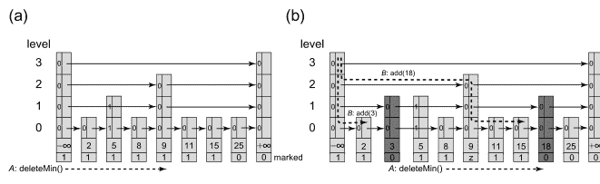

### 15.15

`SkipQueue` 优先级队列：一种静默一致性（quiescent consistent）但非线性化的执行。在部分 (a) 中，A 启动了一个 `removeMin()` 调用，该调用遍历最低底层以找到并逻辑删除第一个未标记的节点。它会遍历所有已标记的节点，即使是分数为 5 的节点（正在从跳跃表中物理删除）。在部分 (b) 中，当 A 访问分数为 9 的节点时，B 添加了一个分数为 3 的节点，然后添加了一个分数为 18 的节点。线程 A 标记并返回分数为 18 的节点。线性化的执行不能在返回分数为 3 的项之前返回分数为 18 的项。

第14章。让 `add()` 和 `remove()` 调用接收跳跃表节点而不是参数和结果是很方便的。这些方法是相应 `LockFreeSkipList` 方法的直接适配，并作为练习留存。该类的节点与 `LockFreeSkipList` 节点在两个字段上不同：整数分数字段（第 4 行）和一个用于从优先级队列中进行逻辑删除（而非从跳跃表中）的 `AtomicBoolean` 标记字段（第 5 行）。`findMarkMin()` 方法扫描最低层列表直到找到一个 `marked` 字段为 false 的节点，然后原子地尝试将该字段设置为 true（第 19 行）。如果失败，它将重试。成功后，它将新标记的节点返回给调用者（第 20 行）。

图 15.14 显示了 `priorityQueue<>`。此类只是 `PrioritySkipList<>` 的包装器。`add(x, p)` 方法通过创建一个持有值的节点并将该节点传递给 `PrioritySkipList` 的 `add()`，来添加分数为 p 的项 x。`removeMin()` 方法调用 `PrioritySkipList` 类的 `findAndMarkMin()` 方法来标记节点为逻辑删除，然后调用 `remove()` 物理删除该节点。

`SkipQueue` 类是静默一致的：如果在 `removeMin()` 开始之前存在项 `x`，那么返回的项的分数将小于或等于 `x` 的分数。该类不是线性化的：线程可能会先添加一个高优先级（高分数）项，然后添加一个低优先级项，遍历可能会找到并返回后插入的低优先级项，从而违反了线性化。这种行为是静默一致的，因为可以并发地 `add()` 与任何 `removeMin()` 重排序以维持顺序优先级队列。

`SkipQueue` 是无锁的。遍历跳跃表最低层的线程可能总是被另一个线程删除到下一个逻辑未删除的节点，但只有在其他反复删除时它才会失败。

通常，静默 `SkipQueue` 往往优于线性化的基于堆的队列。如果底层列表中有 $n$ 个节点，一旦节点被逻辑删除，在最坏情况下将在 $O(\log k)$ 步内被物理删除，其中 $k$ 是列表的大小。在实践中，节点被删除可能会快得多，因为节点可能靠近列表开头。

然而，算法中存在竞争源，这会影响性能并需要使用退避（back-off）和调优。如果多个线程并发尝试标记一个节点，其中失败者一起继续，就会发生竞争。当从跳跃表中物理删除项时也可能产生竞争。所有待删除的节点在跳跃表开头可能是相邻的，因此它们的前驱节点在尝试剪掉节点引用时可能会导致重复的 `compareSet()` 失败。

### 15.6 章节注释

细粒度优先级队列由 Galen Hunt、Maged Mikhail、Srinivasan Parthasarathy 和 Michael Scott [82] 设计。`SimpleLinear` 和 `SimpleTree` 优先级队列归于 Nir Shavit 和 Asaph Zemach [158]。`SkipQueue` 由 Itai Lotan 和 Nir Shavit [115] 设计，他们还提供了算法的线性化版本。

### 15.7 练习

**练习 15.1.** 给出一个静默一致但非线性化的优先级队列执行示例。

**练习 15.2.** 使用计数网络或衍射树实现具有无锁 `boundedGetAndIncrement()` 和 `boundedGetDecrement()` 方法的静默一致计数器。

**练习 15.3.** 在 `SimpleTree` 算法中，如果我们把 `boundedGetAndDecrement()` 方法替换为普通的 `getAndDecrement()` 会发生什么？

**练习 15.4.** 在树节点中使用 `boundedAndIncrement()` 方法设计一种具有边界容量的 `SimpleTree` 算法。

**练习 15.5.** 在 `SimpleTree` 算法中，如果我们把 `boundedGetAndDecrement()` 方法替换为普通的 `getAndDecrement()` 会发生什么？

**练习 15.6.** 在 `SimpleTree` 算法中，如果我们把 `boundedGetAndDecrement()` 方法替换为普通的 `getAndDecrement()` 会发生什么？

*(注：原文后续部分存在大量重复和 OCR 错误，已根据要求提取核心内容翻译)*

### 第16章 调度与任务分配

```java
class MMThread {
    double[][] lhs, rhs, prod;
    int n;
    public MMThread(double[][] lhs, double[][] rhs) {
        n = lhs.length;
        this.lhs = lhs;
        this.rhs = rhs;
        this.prod = new double[n][];
    }
    void multiply() {
        Worker[] worker = new Worker[n];
        for (int row = 0; row < n; row++) {
            for (int col = 0; col < n; col++) {
                worker[row][col] = new Worker(row,col);
            }
        }
        }
        for (int row = 0; row < n; row++) {
            for (int col = 0; col < n; col++) {
                worker[row][col].start();
            }
        }
        for (int row = 0; row < n; row++) {
            for (int col = 0; col < n; col++) {
                try {
                    worker[row][col].join();
                } catch (InterruptedException exception) {
                }
            }
        }
    }
}
```

#### 图 16.1

`MMThread` 任务：使用线程进行矩阵乘法。

依赖于平台。例如，大规模多处理器提供较大的线程池，而小规模多处理器提供较小的线程池。线程避免了为了短期需求波动而创建和销毁线程的开销。使用线程池就像在每次需要办事时都叫出租车或使用共享出行服务一样。

除了性能优势外，线程池还有一个不明显但同等重要的优势：将应用程序程序员与特定平台的细节隔离开来，例如可以被高效调度的并发线程数。线程池使得编写单一程序成为可能，该程序可以在单处理器、小规模多处理器和大规模规模多处理器上运行得都一样良好。它们提供了一个简单的接口，隐藏了复杂的、依赖于平台的工程权衡。

#### 16.1 引言

```java
class Worker extends Thread {
    int row, col;
    Worker(int row, int col) {
        this.row = row; this.col = col;
    }
    @Override
    public void run() {
        double dotProduct = 0.0;
        for (int i=0; i<n; i++) {
            dotProduct += lhs[row][i] * rhs[i][col];
        }
        prod[row][col] = dotProduct;
    }
}
```


在 Java 中，线程池通过执行器接口（`java.util.ExecutorService`）提供了统一的结构。该接口提供了提交任务、等待一组提交的任务完成以及取消未完成任务的方法。有许多种线程池，以适应许多不同的任务和调度策略。我们将注意力限制在一个特定的执行服务 `ForkJoinPool` 上，它用于可以将其工作拆分为更小池的任务。

返回类型为 T 值的 fork-join 任务继承自 `RecursiveTask<T>`，而仅分配副作用的具有 `fork()` 方法的任务继承自 `RecursiveAction`。任务的 `join()` 方法允许调用者等待该任务完成。任务的工作由其 `computes()` 方法完成。fork-join 任务在任务不获取锁且所有任务大小大致相等时工作效果最好。

这是创建 fork-join 池最简单的方法：

```java
ForkJoinPool forkJoinPool = new ForkJoinPool();
```

这创建了一个线程池，其线程数由可用资源决定。也可以请求特定数量的线程，并设置其他参数（例如更高级的参数）。

重要的是，将任务分配给线程（“分叉”该任务）并不能保证任何计算实际上并行发生。相反，分叉任务是建议性的：它让底层的线程池在有资源执行的情况下可能以并行方式执行它。

我们考虑如何使用 fork-join 任务实现并行矩阵操作。16.3 显示了一个 `Matrix` 类，该类提供了 `get()` 和 `set()` 方法来访问矩阵元素（第 16–21 行），以及一个常数时间的 `split()` 方法，用于拆分。

```java
class Matrix {
    int dim;
    double[][] data;
    int rowDisplace, colDisplace;
    Matrix(int d) {
        dim = d;
        rowDisplace = colDisplace = 0;
        data = new double[d][d];
    }
    Matrix(double[][] matrix, int x, int y, int d) {
        data = matrix;
        rowDisplace = x;
        colDisplace = y;
        dim = d;
    }
    double get(int row, int col, int col) {
        return data[row + rowDisplace][col + colDisplace];
    }
    void set(int row, int col, double value) {
        data[row + rowDisplace][col + colDisplace] = value;
    }
    int getDim() {
        return dim;
    }
    Matrix split(int i, int i, int j) {
        int newDim = dim / 2;
        return new Matrix(data,
            rowDisplace + i,
            colDisplace + j,
            newDim);
    }
```

#### 图 16.3

`Matrix` 类。任何 n x n 矩阵都可以拆分为四个 (n/2) x (n/2) 的子矩阵（第 25–31 行）。这些子矩阵由原始矩阵支持。为了简单起见，我们只考虑维度为 2 的幂的矩阵。

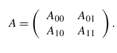

#### 16.1 引言

矩阵加法 $C = A + B$ 可以拆分为：

| | | | |

| :--- | :--- | :--- | :--- |

|  | $C_{00}$ | $C_{01}$ | $C_{10}$ | $C_{11}$ |

| | | | |

```latex
\begin{pmatrix} C_{00} & C_{01} \\ C_{10} & C_{11} \end{pmatrix} = \begin{pmatrix} A_{00} & A_{01} \\ A_{10} & A_{11} \end{pmatrix} + \begin{pmatrix} B_{00} & B_{01} \\ B_{10} & B_{11} \end{pmatrix}
```

#### 图 16.2

如何使用 fork-join 池设置简单的矩阵加法。顶层代码初始化矩阵（第 1–3 行），创建顶层任务（第 4 行）和 fork-join 池（第 5 行）。任务的 `invoke` 方法（第 6 行）调度顶层任务，该任务将其分为更小的并行任务，并在整个计算完成后返回。

矩阵乘法 $C = A \cdot B$ 可以拆分为：

乘积元素可以并行计算，当这些计算完成后，可以计算和。（我们见过矩阵求和程序使用了内部并行。）

```latex
\begin{pmatrix} C_{00} & C_{01} \\ C_{10} & C_{11} \end{pmatrix} = \begin{pmatrix} A_{00} & A_{01} \\ A_{10} & A_{11} \end{pmatrix} \cdot \begin{pmatrix} B_{00} & B_{01} \\ B_{10} & B_{11} \end{pmatrix} \\
= \begin{pmatrix} A_{00}B_{00} + A_{01}B_{10} & A_{00}B_{01} + A_{01}B_{11} \\ A_{10}B_{00} + A_{11}B_{10} & A_{10}B_{01} + A_{11}B_{11} \end{pmatrix}
```


```java
public class MatrixAddTask extends RecursiveAction {
    static final int N = ...;
    static final int THRESHOLD = ...;
    Matrix lhs, rhs, sum;
    public MatrixAddTask(Matrix lhs, Matrix rhs, Matrix sum) {
        this.lhs = lhs;
        this.rhs = rhs;
        this.sum = sum;
    }
    public void compute() {
        int n = lhs.getDim();
        if (n <= THRESHOLD) {
            Matrix.add(lhs, rhs, sum);
        } else {
            List<MatrixAddTask> tasks = new ArrayList<>(4);
            for (int i = 0; i < 2; i++) {
                for (int j = 0; j < 2; j++) {
                    tasks.add(new MatrixAddTask(
                        lhs.split(i, j),
                        rhs.split(i, j),
                        sum.split(i, j)));
                }
            }
            tasks.stream().forEach((task) -> {
                task.fork();
            });
            tasks.stream().forEach((task) -> {
                task.join();
            });
        }
    }
}
```

图 16.4

`MatrixAddTask` 类是 ...； // 初始化矩阵 fork-join 并行加法。

```java
Matrix lhs = ...; // 初始化矩阵
Matrix rhs = ...; // 初始化矩阵
Matrix sum = new Matrix(n);
MatrixAddTask matrixAddTask = new MatrixAddTask(lhs, rhs, sum);
ForkJoinPool forkJoinPool = new ForkJoinPool();
forkJoinPool.invoke(matrixAddTask);
```

图 16.5

矩阵加法的顶层代码。

## 16.1 引言

```java
public class MatrixMulTask extends RecursiveAction {
    static final int THRESHOLD = ...;
    Matrix lhs, rhs, product;
    public MatrixMulTask(Matrix lhs, Matrix rhs, Matrix product) {
        this.lhs = lhs;
        this.rhs = rhs;
        this.product = product;
    }
    public void compute() {
        int n = lhs.getDim();
        if (n < THRESHOLD) {
            Matrix.multiply(lhs, rhs, product);
        } else {
            List<MatrixMulTask> tasks = new ArrayList<>(8);
            Matrix[] term = new Matrix[2]{new Matrix(n, n), new Matrix(n, n)};
            for (int i = 0; i < 2; i++) {
                for (int j = 0; j < 2; j++) {
                    for (int k = 0; k < 2; k++) {
                        tasks.add(new MatrixMulTask(
                            lhs.split(i, j),
                            rhs.split(i, k),
                            term[i].split(j, k)));
                    }
                }
            }
            tasks.stream().forEach(task -> {
                task.fork();
            });
            tasks.stream().forEach(task -> {
                task.join();
            });
            (new MatrixAddTask(term[0], term[1], product)).compute();
        }
    }
}
```

图 1.6

`MatrixMulTask` 类：fork-join 并行矩阵加法。

取决于平台的阈值，结果是按顺序计算的（第 11–12 行）。否则，它会分配两个临时矩阵来存储中间项（第 15 行）。它为八个子矩阵乘积中的每一个创建一个新的递归任务，并放入列表中（第 16–28 行）。它 fork 了这些任务中的每一个（第 29–30 行），然后 join 它们（第 32–33 行）。最后，它创建一个新的 `MatrixTask` 来汇总临时矩阵，并直接调用其 `compute()` 方法（第 35 行）。

```java
class FibTask extends RecursiveTask<Integer> {
    int arg;
    public FibTask(int n) {
        arg = n;
    }
    protected Integer compute() {
        if (arg > 1) {
            FibTask rightTask = new FibTask(arg - 1);
            rightTask.fork();
            FibTask leftTask = new FibTask(arg - 2);
            return rightTask.join() + leftTask.compute();
        } else {
            return arg;
        }
    }
}
```

## 16.7

`FibTask` 类：使用 fork-join 任务的斐波那契。

矩阵示例在所有副作用中都使用了 fork-join 任务。fork-join 任务也可以用于将值传递给已完成的任务。例如，这里是如何将众知的斐波那契函数拆解为多线程程序的。回想斐波那契数列定义如下：

$F(n) = \begin{cases} 0 & \text{if } n=0 \\ 1 & \text{if } n=1 \\ F(n-1) + F(n-2) & \text{if } n>1 \end{cases}$

图 16.7 显示了如何使用 fork-join 任务计算斐波那数。这种特定的实现非常低效，但我们在这里使用它来说明多线程依赖关系。`compute()` 方法创建并 fork 了一个右子任务来计算 $F(n-1)$。它创建一个左子任务来计算 $F(n-2)$，并直接调用该任务的 `compute()` 方法。它 join 了右任务，然后等待子任务的结果。思考这种结构是否合理。

## 16.2 分析并行性

将多线程计算看作一个有向无环图（dag），其中每个节点代表一个任务，每条边连接前驱任务和后继任务。假设并行性 $T_p$ 是在 $P$ 个处理器上执行所需的时间，$T_\infty$ 是在无限处理器上执行所需的时间，$W$ 是所有任务的总工作量。那么 $T_p \ge \max(W/P, T_\infty)$。当 $P$ 很大时，$T_p$ 趋于 $T_\infty$。$T_\infty$ 被称为跨度（span）。

跨度（span）是图中最长路径上的任务执行时间和。$T_\infty$ 取决于任务依赖的最长路径。

$T_\infty$ 取决于任务依赖的。由于后继任务依赖于前驱任务。因此，$T_p$ 至少是 $T_\infty$。$T_\infty$ 取决于任务依赖的最长路径。

$T_\infty$ 取决于任务依赖的最长路径。

## 16.3 现实中的多处理器调度

这项工作与传统的三层循环实现相同。半大小的乘法可以并行执行，但在乘法完成之前加法无法开始，因此跨度（span）

```
$M_{\infty}(n) = M_{\infty}(n/2) + A_{\infty}(n)M_{\infty}(n/2) + \Theta(\log n) = \Theta(\log^2 n)$.
```

矩阵乘法的并行度由给出：

```
$M_1(n)/M_{\infty}(n) = \Theta(n^3 / \log^2 n)$,
```

这个值非常高。例如，假设我们想乘以两个 1000x1000 的矩阵。这里 $n=10^9$，$\log n = \log 1000 \approx 10$（对数以 2 为底），因此并行度约为 $10^9/10^7 \approx 10^2$。粗略而言，这种多处理器矩阵乘法的实例在原理上可以保持约一千万个处理器忙碌状态，这个数字远超我们预计未来可能看到的任何多处理器的能力。

你应该理解，计算的并行度是对任何多线程乘法程序性能的高度理想化界限。例如，当存在空闲线程时，可能并不容易将这些线程分配给空闲处理器。此外，一个显示并行度较低但消耗内存的程序可能性能更好，因为遇到页错误更少。多线程计算的实际性能仍然是一个复杂的工程问题，但本章提出的分析是理解问题可以在多大程度上并行解决不可不可缺的第一步。

## 16.3 现实中的多处理器调度

我们到为止的分析是基于每个多线程程序都有 P 个处理器的假设。遗憾的是，这个假设并不符合现实。多处理器通常运行混合作业，作业动态地进入和离开。人们可能在 $P$ 个处理器上启动一个矩阵乘法应用程序。在某个时刻，操作系统可能会决定下载新的软件更新，抢占一个处理器，此时应用程序在 $P-1$ 个处理器上运行。更新程序暂停并等待磁盘读或写完成，在此期间，矩阵应用程序拥有了 $P$ 个处理器。

现代操作系统提供了用户级线程，它包含程序计数器和栈。（包含独立地址空间的线程通常被称为进程。）操作系统内核包含一个调度器，在物理处理器上运行线程。然而，应用程序通常对线程与处理器之间的映射没有控制权，因此无法控制线程何时被调度。

正如我们所看到的，弥合用户级线程和操作系统级处理器之间差距的一种方法是为软件开发者提供一个三级模型。在顶层，多线程程序（如矩阵乘法）将应用程序分解为动态变化数量的短生命周期任务。在中间层，用户级调度器将这些任务映射到固定数量的线程。在底层，内核将这些线程映射到硬件处理器上，而处理器的可用性可能会动态变化。最后这一层映射不受应用程序控制：应用程序无法告诉内核如何调度线程（事实上，商用操作系统内核对用户来说是隐藏的）。

为了方便起见，假设内核按直接步骤工作。在第 $i$ 步中，内核选择用户级线程的任意子集运行一步。如果一个节点在程序中的关联计算已准备好执行，则该节点在某一步是就绪的。如果调度执行了尽可能多的就绪节点，则该调度是贪心的。

**定理 16.3.1.** 对于工作量为 $T_1$，跨度为 $T_{\infty}$且具有 $P$ 个用户级线程的多线程程序，任何贪心执行的长度 $T$ 最多为

```
$T \le T_1/P + T_{\infty}$
```

*证明。* 令 $P$ 为可用处理器的数量。一个完整的步骤是指至少有 $P$ 个节点就绪的，因此贪心调度运行 $P$ 个节点的某种选择。相比之下，不完全步骤是指就绪节点少于 $P$ 个的，因此贪心调度运行所有节点。执行中的每一步要么是完整的要么是不完全的。不完全步骤的数量不能超过 $T_1/P$，因为每个这样的步骤执行了 $P$ 个节点。不完全步骤的数量不能超过 $T_{\infty}$，因为每个不完全步骤都让未执行部分的跨度缩短了 1。

事实证明，这个界限与最优解在 2 倍之内。实现最优调度是 NP-完全的，因此贪心调度是实现相当接近最优性能的一种简单且实用的方法。

**定理 16.3.2.** 任何贪心调度器都在最优解的 2 倍之内。

*证明。* 回忆 $T_P$ 是程序在具有 $P$ 个处理器的平台上的最优执行时间。$T_P^*$ 是其在贪心调度下的执行时间。根据工作法则（等式 (16.2.1)）和跨度法则（等式 (16.2.2)），

```
$T_P^* \ge \max(T_1/P, T_{\infty})$
```

根据定理 16.3.1 可得：

```
$T_P^* \le T_1/P + T_{\infty} \le 2\max(T_1/P, T_{\infty})$
```

由此得出：

```
$T_P^* \le 2T_P$
```

**定理 16.3.3.** 任何贪心调度都能实现近完美的加速。

*证明。* 根据定理 16.3.1，

```
$T_P^* \le T_1/P + T_{\infty} \le 2\max(T_1/P, T_{\infty}) \le 2T_P$
```

我们现在理解了实现良好加速的关键是让用户级线程持续获得任务。

## 16.4 工作分配

工作分配的一种简单方法是*工作分发*：将任务分配给空闲线程。这种方法看起来很合理，但有一个基本缺陷：如果大多数线程都过载了，它们就会浪费精力。相反，我们考虑*工作窃取*（work stealing），其中运行完任务的线程尝试从其他线程窃取。

### 16.4.1 工作窃取

每个线程创建一个双端队列（或称为 *deque*），每个线程一个。当一个线程创建一个新任务时，它在自己的双端队列上调用 `pushBottom()`。当一个线程需要工作时，它调用 `popBottom()`；如果为空，它就变成一个*窃取者*（thief）；它选择一个受害者并对受害者的双端队列调用 `popTop()`。在 16.5 节中，我们将展示 deque 的线性化实现。图 16.9 展示了一种实现工作窃取的方法。

```java
public class WorkStealingThread {
  Deque[] queue;
  public WorkStealingThread(Deque[] queue) {
    this.queue = queue;
  }
  public void run() {
    int me = Thread.getId();
    RecursiveAction task = queue[me].popBottom();
    while (true) {
      while (task != null) {
        task.compute();
        task = queue[me].popBottom();
      }
      while (task == null) {
        Thread.yield();
        int victim = ThreadLocalRandom.current().nextInt(queue.length);
        if (!queue[victim].isEmpty()) {
          task = queue[victim].popTop();
        }
      }
    }
  }
}
```

16.9 `WorkStealingThread` 类：简化的工作窃取线程池。

### 16.4.2 Yield 与多编程

正如之前提到的，多处理器提供了计算的三级模型：短任务由系统级线程执行，由操作系统在固定数量的处理器上调度。多编程环境是指线程多于处理器的情况，这意味着并不是所有线程都能同时运行，并且任何线程随时可能被抢占挂起。为了保证进展，我们必须确保需要工作的线程不会被那些除了窃取外空闲的（窃取者）线程意外延迟。为了防止这种情况，我们让每个窃取者在尝试窃取任务之前立即调用 `Thread.yield()`（图16.9中的第15行）。这将窃取者的处理器让其他线程，允许被挂起的线程重新获得处理器并取得进展。

## 16.5 工作窃取双端队列

这是实现工作窃取双端队列。理想情况下，工作窃取算法应该提供一个线性化的实现，其 `pop` 方法始终返回一个任务

## 16.5 任务窃取双队列 (deques) 391

如果有的话。但在实践中，我们可以接受一种较弱的方案，允许 `popTop()` 在与并发的 `popTop()` 调用发生冲突时返回 `null`。虽然我们可以让失败的窃取者简单地重试，但在这种情况下，让它每次在另一个随机选择的双队列上重试 `popTop()` 操作是有意义的。为了支持这种重试，如果 `popTop()` 与并发的 `popTop()`冲突，它可以返回 `null`。

我们描述了任务窃取双队列的两种实现。第一种更简单，因为它有边界容量。第二种稍微复杂，但容量几乎是无界的；它不会受到溢出的影响。

## 16.5.1 有界任务窃取双队列


# 16.5 任务窃取双队列

对于线程池来说，常见的情况是从自己的队列中推入和弹出任务，即 `pushBottom()` 和 `popBottom()`。罕见的情况是通过调用 `popTop()` 从另一个线程的双队列中窃取任务。自然地，优化这种情况是有意义的。图 16.10 和图 16.11 中 `BoundedDeque` 的核心思想是允许 `pushBottom()` 和 `popBottom()` 方法在常见情况下只使用读写操作。`BoundedDeque` 由一个由 `top` 和 `bottom` 字段索引的任务数组组成，如图 16.12 所示。`pushBottom()` 和 `popBottom()` 方法对 `bottom` 引用进行读写操作。然而，当 `top` 和 `bottom` 字段接近时（数组中可能只有一个元素），`popBottom()` 会切换到 `compareAndSet()` 调用，以与 `popTop()` 发生竞争。

让我们详细描述一下该算法。`BoundedDeque` 算法在避免使用 `compareAndSet()` 调用方面非常巧妙。这种优雅是付出了代价的：指令的顺序至关重要。我们建议读者花些时间来理解交互是如何通过写入、读取和 `compareAndSet()` 用的顺序来确定的。

`BoundedDeque` 有三个字段：`tasks`、`bottom` 和 `top`（图 16.10，第 2–4 行）。`tasks` 字段是一个持有队列中 `RecursiveAction` 任务的数组，`bottom` 是 `tasks` 中第一个元素的索引，`top` 是一个 `AtomicStampedReference<Integer>`（见 10.6.1 节）。`top` 字段包含两个逻辑字段：引用是队列中第一个任务的索引，`stamp` 是一个在每次引用被设置为 0 时都加 1 的计数器。需要 `stamp` 是为了避免在使用 `compareAndSet()` 时经常出现的“ABA问题”。假设线程 A 调用 `popTop()`，仅对任务使用 `compareAndSet()` 来窃取任务（不带 `stamp`）。一个线程记录持有了该任务，其索引由 `top` 给出，但在它能够调用 `compareAndSet()` 增加 `top` 并窃取双队列之前被延迟了。当 A 挂起时，另一个线程 B 移动了双队列中的所有任务并将它们替换为新任务，将 `top` 恢复到之前的值。当 A 恢复时，它的 `compareAndSet()` 调用将成功，但 A 将窃取错误的任务。`stamp` 在每次双队列被访问时都会递增，确保了 A 的 `compareAndSet()` 调用将失败，因为标记不再匹配。

```java
public class BoundedDeque {
    RecursiveAction[] tasks;
    volatile int bottom;
    AtomicStampedReference<Integer> top;

    public BoundedDeque(int capacity) {
        tasks = new RecursiveAction[capacity];
        top = new AtomicStampedReference<Integer>(0, 0);
        bottom = 0;
    }

    public void pushBottom(RecursiveAction r) {
        tasks[bottom] = r;
        bottom++;
    }

    // 由窃取者调用以决定是否尝试窃取
    boolean isEmpty() {
        return (top.getReference() < bottom);
    }
}
```

## 16.5.1 有界窃取工作队列

`popTop()` 方法（图 16.11）检查 `BoundedDeque` 是否为空，如果不为空，则尝试通过调用 `compareAndSet()` 增加 `top` 来窃取顶端元素。如果 `compareAndSet()` 成功，则窃取者成功，否则方法返回 `null`。返回 `null` 并不意味着队列是空的。

正如之前提到的，我们针对常见情况进行了优化，即每个线程都从自己的本地 `BoundedDeque` 中推入和弹出。大多数时候，线程只需加载和存储 `bottom` 索引即可在自己的 `BoundedDeque` 上推入和弹出任务。如果队列中只有一个任务，那么调用者可能会遇到想要窃取该任务的窃取者。因此，如果 `bottom` 接近 `top`，调用线程切换到使用 `compareAndSet()` 来弹出任务。

`pushBottom()` 方法（图 16.10，第 10 行）简单地将新任务存储在队列底部的位置并增加 `bottom`。

`popTop()` 方法（图 16.11）更为复杂。如果 `bottom` 为 0，则队列为空，方法立即返回（第 15 行）。否则，它递减 `bottom`，获取一个任务（第 17 行）。这是一个微妙但重要的点。如果被声领的任务是队列中的最后一个，那么注意 `BoundedDeque` 为空是重要的（第 6 行）。但由于 `popBottom()` 的递减操作既不是原子的也不是同步的，Java 内存模型不保证并发的窃取者能立即观察到这次递减。为了确保窃取者不与窃取者发生冲突，且方法返回 `null`。否则，如果 `top` 和 `bottom` 字段相等，则双队列中只有一个任务，调用者可能会与窃取者发生冲突。调用者将 `bottom` 重置为 0（第 27 行）。调用者要么成功声领任务，要么被窃取者抢走。调用者通过调用 `compareAndSet()` 将 `top` 重置为 0（同时增加 `stamp`）来解决潜在冲突（第 26 行）。如果此 `compareAndSet()` 成功，则 `top` 已重置为 0，任务已被声领，因此方法返回。否则，队列必然为空，因为窃取者成功了，这意味着 `top` 指向大于 `bottom`，后者之前被设置为 0。在调用者返回之前，它将其重置为 0（第 31 行）。

正如所提到的，这种设计的一个吸引点是昂贵的 `compareAndSet()` 很少被调用，只有当 `BoundedDeque` 几乎为空时才调用。

我们将每个 `popTop()` 线性化在其检测到 `BoundedDeque` 为空的地方，或者 `compareAndSet()` 失败的地方。成功的 `popTop()` 调用线性化在成功的 `compareAndSet()` 发生的地方。我们在 `bottom` 增加时线性化 `pushBottom()`，在 `bottom` 递减或设置为 0 时线性化 `popBottom()`，后者的结果取决于随后的 `compareAndSet()` 的成功与否。

`BoundedDeque` 类的 `isEmpty()` 方法首先读取 `top` 然后 `bottom`，检查 `bottom` 是否小于等于 `top`（第 33 行）。顺序是

这对线性化至关重要，因为除非 `bottom` 首先重置为 0，否则 `top` 永远不会减少。因此，如果一个线程在读取 `top` 之后读取 `bottom` 并发现其并不大于 `top`，则队列为空，因为对 `top` 的并发修改只会增加 `top` 的值。相反，如果 `top` 大于 `bottom`，那么即使 `top` 在被读取之后、读取 `bottom` 之前被增加（导致队列变空），仍然可以确定 `BoundedDeque` 在读取 `top` 时一定不为空。另一种可能性是 `bottom` 被重置为 0，然后 `top` 被重置为 0，因此读取 `top` 和 `bottom` 将正确地返回空。由此得出 `isEmpty()` 是线性性的。

为了简单起见，有界队列算法假设队列永远不会满。

```java
public RecursiveAction popTop() {
    int[] stamp = new int[1];
    int oldTop = top.get(stamp);
    int newTop = oldTop + 1;
    int oldStamp = stamp[0];
    if (oldTop < bottom) {
        RecursiveAction r = tasks[oldTop];
        if (top.compareAndSet(oldTop, newTop, oldStamp, oldStamp)) {
            return r;
        }
    }
    return null;
}

public RecursiveAction popBottom() {
    if (bottom == 0) {
        return null;
    }
    int newBottom = --bottom;
    RecursiveAction r = tasks[newBottom];
    int[] stamp = new int[1];
    int oldTop = top.get(stamp);
    int newTop = 0;
    int oldStamp = stamp[0];
    if (newBottom <= oldTop) {
        if (top.compareAndSet(oldTop, newTop, oldStamp, oldStamp)) {
            return r;
        }
    }
    top.set(newTop, oldStamp);
    return null;
}
```

图 16.11 BoundedDeque 类：popTop 和 popBottom 方法。

图 16.12 BoundedDeque 实现。在 (a) 部分，`popTop()` 和 `popBottom()` 在存在多个任务时被调用。`popTop()` 方法检测到元素 2 并调用 `compareAndSet()`。在此之前，它跳转到 3。在 (b) 部分，双队列中只有一个任务。如果 `popTop()` 检测到 `top` 和 `bottom` 相等，它会放弃；否则，它尝试使用 `compareAndSet()` 推进。如果两个方法都应用 `compareAndSet()` 到顶端，其中一个获胜并移除任务。在任何情况下，胜利或失败，`popBottom()` 返回 0，因为双队列现在为空。

## 16.5.2 无界窃取工作队列

`BoundedDeque` 类的局限性是队列具有固定大小。对于某些应用程序，可能很难预测这个大小，特别是当某些线程创建的任务比其他线程多时。为每个线程分配一个最大容量的 `BoundedDeque` 会浪费空间。

为了解决这些局限性，我们现在考虑 `UnboundedDeque` 类，这是一种可以根据需要动态调整大小的无界双端队列。

我们使用循环数组实现 `UnboundedDeque`，其 `top` 和 `bottom` 字段与 `BoundedDeque` 相同（但对数组容量进行取模运算除外）。和之前一样，如果 `bottom` 小于或等于 `top`，则 `UnboundedDeque` 为空。使用循环数组消除了将 `bottom` 重置为 0 的需求。此外，它允许 `top` 增加但永不减少，从而消除了对 `top` 使用 `AtomicStampedReference` 的需求。此外，在 `UnboundedDeque` 中，如果 `pushBottom()` 发现当前数组已满，它可以对其进行重置（扩大），将任务复制到更大的数组中，并将新任务推入新数组。由于数组按其容量取模索引，因此在将元素移动到更大的数组时，不需要更新 `top` 或 `bottom` 字段（尽管存储元素的实际数组索引可能会发生变化）。

`CircularArray` 类如图 16.13 所示。它提供了 `get()` 和 `put()` 方法来添加任务，以及 `resize()` 方法分配新数组并将旧数组的内容复制到新数组中。使用模运算确保了即使数组的大小增加了且任务发生了移位，人们仍然可以使用 `top` 来找到下一个任务。

```java
class CircularArray {
    private int logCapacity;
    private RecursiveAction[] currentTasks;

    CircularArray(int logCapacity) {
        this.logCapacity = logCapacity;
        currentTasks = new RecursiveAction[1 << logCapacity];
    }

    int capacity() {
        return 1 << logCapacity;
    }

    RecursiveAction get(int i) {
        return currentTasks[i % capacity()];
    }

    void put(int i, RecursiveAction task) {
        currentTasks[i % capacity()] = task;
    }

    CircularArray resize(int bottom, int top) {
        CircularArray newTasks = new CircularArray(logCapacity + 1);
        for (int i = top; i < bottom; i++) {
            newTasks.put(i, get(i));
        }
        return newTasks;
    }
}
```

图 16.13 CircularArray 类。

`UnboundedDeque` 类有三个字段：`tasks`、`bottom` 和 `top`（见图 16.14，第 3–5 行）。`popBottom()` 和 `popTop()` 方法（见图 16.15）与 `BoundedDeque` 的几乎相同，只有一个关键区别：使用模运算计算索引时永远不需要递减。正如所提到的，不需要标记来防止 ABA 问题。这两个方法在竞争最后一个任务时，简单地增加最后一个字段。将 `bottom` 重置为等于 `top`。在代码中，`popBottom()` 在第 55 行的 `compareAndSet()` 之后，无论 `compareAndSet()` 是否成功，都会将 `bottom` 设置为 `top + 1`：如果失败，则并发的窃取者一定偷走了任务并且增加了 `top`。将 `top + 1` 存储到 `bottom` 使得 `top` 和 `bottom` 相等，将 `UnboundedDeque` 对象重置为空状态。

`isEmpty()` 方法（图 16.14）首先读取 `top` 然后读取 `bottom`，检查 `bottom` 是否小于或等于 `top`（第 33 行）。这个顺序很重要，因为 `top` 永远不会减少，如果一个线程在读取 `top` 之后读取 `bottom` 且发现它并不大于 `top`，则队列为空，因为对 `top` 的并发修改只会增加 `top` 的值。同样的原理也适用于 `popTop()` 方法调用。图 16.16 显示了一个执行示例。

`pushBottom()` 方法（图 16.14）与 `BoundedDeque` 的几乎相同。区别在于，如果当前 `push` 达到容量，该方法必须使用循环数组。容量不需要是 `AtomicReference`。调整大小是有代价的：每次调用 `pushBottom()` 都会读取 `top`（第 21 行）来确定是否需要重置，这可能会导致缓存缺失，因为 `top` 被所有线程修改。我们可以通过让所有线程保存 `top` 的局部值来减少这种开销，该值可以用于计算 `UnboundedDeque` 大小的上界，因为其他线程只会增加 `top`。


# 第 16 章 调度与工作分配

## 16.5 窃取工作的双端队列

```java
public class UnboundedDeque {
    private final static int LOG_CAPACITY = 4;
    private volatile CircularArray tasks;
    volatile int bottom;
    AtomicReference<Integer> top;

    public UnboundedDeque(int logCapacity) {
        tasks = new CircularArray(logCapacity);
        top = new AtomicReference<>(0);
        bottom = 0;
    }

    boolean isEmpty() {
        int t = top.get();
        int b = bottom;
        return b > t;
    }

    public void pushBottom(RecursiveAction r) {
        int b = bottom;
        int t = top.get();
        if (b - t >= tasks.capacity() - 1) {
            tasks = tasks.resize(b, t);
        }
        tasks.put(b, r);
        bottom = b + 1;
    }

    public RecursiveAction popBottom() {
        int b = --bottom;
        int t = top.get();
        if (b < t) {
            bottom++;
            return null;
        }
        RecursiveAction r = tasks.get(b);
        if (top.compareAndSet(t, t - 1)) {
            return r;
        }
        bottom = t - 1;
        return r;
    }

    public RecursiveAction popTop() {
        int t = top.get();
        int b = bottom;
        if (t < b) {
            return null;
        }
        RecursiveAction r = tasks.get(t);
        if (top.compareAndSet(t, t - 1)) {
            return r;
        }
        return null;
    }
}
```

**图 16.14** `UnboundedDeque` 类：字段、构造函数、`pushBottom()` 和 `isEmpty()` 方法。

方法只能让 `UnboundedDeque` 变小。所有者在大小接近需要 `resize()` 的阈值时才触发。

总之，我们看到了两种设计非阻塞线性化队列的方法。在大多数情况下可以使用加载和存储，但代价是算法复杂。这种算法对于性能对并发系统至关重要的应用程序是合理的。

## 16.5.3 工作处理

我们已经看到在工作窃取算法中，空闲线程从其他线程那里窃取。另一种方法是让每个线程定期与工作负载


**图 16.16** `UnboundedDeque` 的实现。在部分 (a) 中，当 `UnboundedDeque` 对象中存在多个任务时，`popTop()` 和 `popBottom()` 同时执行。在部分 (b) 中，只有一个任务，初始时 `bottom` 指向条目 3 和 2。`popBottom()` 方法将 `bottom` 从 3 递减到 2（我们用一条指向条目 2 的虚线表示这一点，因为它很快会再次改变）。然后，当 `popTop()` 检测到新设置的 `bottom` 和 `top` 为 $i$ 时，它尝试将其加 1（而不是像 `UnboundedDeque` 中那样返回 0）。`popTop()` 方法也尝试相同的操作。`top` 字段被其中一个方法加了 1，获胜者获取最后一个任务。最后，`popBottom()` 方法将其设回条目 3，该值等于 `top`。

```java
public RecursiveAction popTop() {
    int t = top.get();
    int b = bottom;
    if (t < b) {
        return null;
    }
    RecursiveAction r = tasks.get(t);
    if (top.compareAndSet(t, t - 1)) {
        return r;
    }
    return null;
}

public RecursiveAction popBottom() {
    int b = --bottom;
    int t = top.get();
    if (b < t) {
        bottom++;
        return null;
    }
    RecursiveAction r = tasks.get(b);
    if (top.compareAndSet(t, t - 1)) {
        return r;
    }
    bottom = t - 1;
    return r;
}
```

**图 16.15**

与随机选择的伙伴平衡。为了确保重负载线程不会浪费精力重平衡，我们让重负载线程更有可能启动重平衡。具体来说，每个线程定期抛掷一次偏斜硬币来决定是否平衡。线程平衡的概率与其队列中的任务数量成反比。换句话说，任务较少的线程可能会重平衡，而无事可做的线程一定会平衡。线程通过随机选择受害者来重平衡，如果其负载与受害者之间的差异超过了预定义的阈值，则转移任务直到它们的队列包含相同数量的任务。可以证明这种算法提供了强大的公平性保证：每个线程队列的预期长度非常接近平均值。这种方法的用处是

该平衡操作在每次交换时移动多个任务。如果一个线程的工作远多于其他线程，特别是当任务的计算量似乎相等时，会产生第二个优势。在窃取工作的方法中，如果许多线程尝试从过载线程中窃取单个任务，可能会发生竞争。在工作窃取池中，如果某个线程有大量工作，其他线程可能必须在同一个本地任务队列上反复竞争，以尝试每次最多窃取一个任务。另一方面，在工作共享池中，一次平衡多个任务将迅速分散到各个任务中，而不会为每个线程产生同步开销。

**图 16.17** 展示了一个工作共享池。每个线程都有自己的任务队列，存储在所有线程共享的数组中（第 2 行）。每个线程反复从其队列中出队下一个任务（第 10 行）。如果队列为空，`deque()` 调用返回 `null`；否则，执行该任务（第 11 行）。此时，线程决定是否重新平衡。如果线程的任务队列大小为 $s$，则该线程以 $1/(s+1)$ 的概率决定重新平衡（第 13 行）。为了重新平衡，线程随机选择一个受害者。线程锁定两个队列（第 15–18 行），按线程 ID 顺序排序（以避免死锁）。如果队列大小差超过阈值，它将驱逐队列大小（图 16.17，第 25–33 行）。

```java
public class WorkSharingThread {
    Deque<RecursiveAction>[] queue;
    private static final int THRESHOLD = ...;

    public WorkSharingThread(Deque<RecursiveAction>[] queue) {
        this.queue = queue;
    }

    public void run() {
        int me = ThreadID.get();
        while (true) {
            RecursiveAction task = queue[me].dequeue();
            if (task != null) task.compute();
            int size = queue[me].size();
            if (ThreadRandom.current().nextInt(size + 1) == size) {
                int victim = ThreadRandom.current().nextInt(queue.length);
                int min = (victim < me) ? victim : me;
                int max = (victim < me) ? me : victim;
                synchronized (queue[max]) {
                    balance(queue[min], max);
                }
            }
        }
    }

    private void balance(Queue q0, Queue q1) {
        Queue qMin = (q0.size() < q1.size()) ? q0 : q1;
        Queue qMax = (q0.size() < q1.size()) ? q1 : q0;
        int diff = qMax.size() - qMin.size();
        if (diff > THRESHOLD) {
            while (qMax.size() > qMin.size()) {
                qMin.enqueue(qMax.dequeue());
            }
        }
    }
}
```

**图 16.17** `WorkSharingThread` 类：一个简化的工作共享线程池。

## 16.6 章节笔记

用于多线程计算分析的 DAG 模型由 Robert Blumofe 和 Charles Leiserson [18] 引入。他们提供了第一个基于双端队列的工作窃取实现。本章中的一些示例改编自 Charles Leiserson 和 Harald Prok 的教程 [112]。无界限双端队列算法归于 Anish Arora、Robert Blumofe 和 Greg Plaxton [13]。该算法中的无界时间戳可以使用 Mark Moor 的技术 [129] 进行限界。无界双端队列算法归于

David Chase 和 Yossi Lev [29]。定理 16.31 的原始证明归于 Anish Arora、Robert Blumofe 和 Greg Plaxton [13]。工作共享算法是由 Rudolph, Tali Slvik 和 Eli Upfal [15] 提出的。Anish Arora, Robert Blumofe 和 Greg Plaxton [13] 的算法后来由 Danny Hendler 和 Nir Shavit [61] 改进，包含了窃取一半项目的能力。一些插图改编自 Charles Leiserson 准备的课程笔记。

## 16.7 练习

**练习 16.1** 重写 `MatrixAddTask` 和 `MatrixMul` 以使用 executor。

**练习 16.2** 考虑以下用于原地排序的代码：

```java
void mergeSort(int[] A, int lo, int hi) {
    if (hi > lo) {
        int mid = (hi - lo) / 2;
        executor.submit(new mergeSort(A, lo, mid));
        executor.submit(new mergeSort(A, mid + 1, hi));
        awaitTermination();
    }
    merge(A, lo, mid);
}
```

（在这里，`submit` 提交任务并立即返回，`awaitTermination` 等待所有提交的任务完成）。假设 `merge` 方法没有内部并行，给出该算法的作业（work）、跨度（span）和并行度。

**练习 16.3** 假设在 P 线程机器上的实际运行时间为 $T_P = T_1/P$。我们的研究产生了两个程序：一个简单的，一个优化的。简单的版本 $T_1 = 24$ 秒，$T_{\infty} = 8$ 秒。在 32 线程机器上运行时，时间为 40 秒。哪一个能更好地扩展到 512 线程？

**练习 16.4** 编写 `ArraySum` 类，它使用分治法并行求和数组元素：

```java
static int sum(int[] a)
```

**练习 16.5** Jones 教授对使用贪婪调度器的程序进行了测量，发现 $T_1 = 80$ 秒，$T_{\infty} = 10$ 秒。在 10 个线程上运行最快是多少？使用以下不等式推导出你的答案（P 为线程数）：

$T_P \geq T_1/P, \quad (16.7.1)$

$T_P \geq T_{\infty}, \quad (16.7.2)$

$T_P \leq \frac{T_1 - T_{\infty}}{P} + T_{\infty}, \quad (16.7.3)$

**练习 16.6** 给本章使用的 `Matrix` 类一个实现。

**练习 16.7** 设 $P(x) = \sum_{i=0}^d p_i x^i$ 和 $Q(x) = \sum_{i=0}^d q_i x^i$ 为 $d$ 次多项式，其中 $d$ 是 2 的幂。我们可以写成：

$P(x) = P_0(x) + P_1(x) \cdot x^{d/2}$

$Q(x) = Q_0(x) + Q_1(x) \cdot x^{d/2}$

$P_0(x), P_1(x), Q_0(x)$ 和 $Q_1(x)$ 是 $d/2$ 次多项式。图 16.18 显示的 `Polynomial` 类提供了访问系数的方法以及常数时间的 `split()` 方法，将 $d$ 次多项式 $P(x)$ 拆分为两个 $d/2$ 次多项式 $P_0(x)$ 和 $P_1(x)$，对拆分式的修改会反映在原始式中，反之亦然。你的任务是为该类设计并行加法和乘法算法。

- $P(x)$ 和 $Q(x)$ 的和分解为：

$P(x) + Q(x) = (P_0(x) + Q_0(x)) + (P_1(x) + Q_1(x)) \cdot x^{d/2}$。

- 使用这种分解按照图 16.14 的方式构造基于任务的并发多项式算法。

- 计算该算法的作业（work）和跨度（span）。

- $P(x)$ 和 $Q(x)$ 的积分解为：

$P(x) \cdot Q(x) = (P_0(x) \cdot Q_0(x)) + (P_0(x) \cdot Q_1(x) + P_1(x) \cdot Q_0(x)) \cdot x^{d/2} + (P_1(x) \cdot Q_1(x)) \cdot x^d$。

- 使用这种分解按照图 16.4 的方式构造基于任务的并发多项式乘法算法。

- 计算该算法的作业（work）和跨度（span）。

**图 16.18** 多项式类。

```java
public class Polynomial {
    int[] coefficients; // 可能被多个多项式共享
    int first; // 我的常数系数索引
    int degree; // 属于我的系数个数

    public Polynomial(int d) {
        coefficients = new int[d];
        degree = d;
        first = 0;
    }

    private Polynomial(int[] myCoefficients, int myFirst, int myDegree) {
        coefficients = myCoefficients;
        first = myFirst;
        degree = myDegree;
    }

    public int get(int index) {
        return coefficients[first + index];
    }

    public void set(int index, int value) {
        coefficients[first + index] = value;
    }

    public int getDegree() {
        return degree;
    }

    public Polynomial[] split() {
        Polynomial[] result = new Polynomial[2];
        int newDegree = degree / 2;
        result[0] = new Polynomial(coefficients, first, newDegree);
        result[1] = new Polynomial(coefficients, first + newDegree, newDegree);
        return result;
    }
}
```

**练习 16.8** 给出一个高效且高度并行的多线程算法，用于将 $n \times n$ 矩阵乘以长度为 $n$ 的向量，该算法需实现 $\Theta(n^2)$ 的工作量和 $\Theta(\log n)$ 的空间复杂度。分析你实现的工作量和跨度（span），并给出并行度。


## 练习 16.9

考虑图 16.10 和 16.11 中的边界双端队列实现。

- `bottom` 字段被声明为 `volatile` 以确保在 `popBottom()` 中第 17 行的减操作立即可见。描述如果 `bottom` 没有声明为 `volatile`，可能会出现什么问题。
- 为什么我们可能尝试在 `popBottom()` 方法中尽早将 `bottom` 字段重置为 0？哪一行是可以安全进行重置的最早位置？我们的 `BoundedDeque` 是否仍然会溢出？请描述原因。

## 练习 16.10

修改线性化 `BoundedDeque` 实现的 `popTop()` 方法，使其仅在队列中没有任务时返回 `null`。注意，你可能需要使其实现变为阻塞的。

## 练习 16.11

你认为执行器池代码中 `BoundedDeque` 的 `isEmpty()` 方法调用会真的提高其性能吗？

## 练习 16.12

考虑 `UnboundedDeque` 的 `popTop()` 方法（图 16.15）。

- 如果第 38 行的 `compareAndSet()` 成功，它将返回在执行成功的 `compareAndSet()` 操作之前读取的元素。为什么在执行 `compareAndSet()` 之前从数组中读取元素很重要？
- 可以在第 36 行使用 `isEmpty()` 吗？

## 练习 16.13

`UnboundedDeque` 方法的线性化点是什么？请证明你的答案。

## 练习 16.14

图 16.19 显示了重平衡两个工作队列的另一种方法：首先锁定较大的队列，然后锁定较小的队列，如果它们的差异超过阈值则进行重平衡。这段代码有什么问题？

```java
Queue qMin = (q0.size() < q1.size()) ? q0 : q1;
Queue qMax = (q0.size() < q1.size()) ? q1 : q0;
synchronized (qMin) {
  synchronized (qMax) {
    int diff = qMax.size() - qMin.size();
    if (diff > THRESHOLD) {
      while (qMax.size() > qMin.size()) {
        qMin.enq(qMax.dequeue());
      }
    }
  }
}
```

图 16.19：另一种重平衡代码。

# 第 17 章 数据并行性

在今天的非正式对话中，人们经常将多处理器称为“多核”，尽管从技术上讲，并不是每个多处理器都是多核。这种用法是从什么时候变得常见的？图 17.1 显示了根据 Google Ngram 服务的报告，1900 年以来“multicore”一词在书籍中出现的频率（该服务通过跟踪扫描书籍中发现的单词）。我们可以看到，这个词从 20 世纪初就开始被使用，但其频率自 2000 年以来几乎增加了三倍。（早期的“multicore”用法似乎主要指的是多核芯或多核光纤。）

为了制作这张图，需要统计每个单词在一组文档中出现的次数。你会如何为多处理器编写一个并行的单词计数程序？一种自然的方法是将文档划分若干片段，将每个片段分配给一个任务，并让一组工作线程执行这些任务（如第 16 章所述）。通过并行工作，每个工作线程执行一系列任务，统计其片段中的单词，并将结果报告给主线程，由主线程合并这些结果。这种算法被称为数据并行的，因为其设计的关键要素是将数据项分布到多个工作线程中。

单词计数程序非常简单，比你在实际中可能遇到的程序要简单得多。尽管如此，它为理解如何构建处理大数据集的并行程序提供了一个示例。


图 17.1：来自 Ngram 的“Multicore”使用情况。

让我们在简单的侦查工作基础上建立。假设给定一组文档。尽管这些文档归属于同一个作者，但我们怀疑它们实际上是由不同的作者写的。我们如何判断这些文档（最可能）是由同一个作者写的？

我们可以利用这种方法为每个文档构造一个 $N$ 元素向量，其中第 $i$ 个元素是其特征单词出现的次数，归一化后和为 1。每个文档的向量都是 $(N-1)$ 维空间中的一个点。文档之间的距离是向量之间的距离，定义相同。我们的目标是将这些点划分 $k$ 个类，使得每个类中的点之间的距离比与其他类的更近。

完美的聚类在计算上是困难的，但有很多常用的数据并行算法可以提供近似。其中最流行的是 kmeans 算法。与单词类似，点分布在工作线程中。与单词不同，kmeans 是迭代的。主线程随机选择中心，并将点分配给一组工作线程。通过并行工作，工作线程将每个点 $p$ 分配给距离 $p$ 最近的类中心，并将分配情况报告给主线程。主线程合并这些分配并计算新类。如果旧中心和新中心之间太远，则认为聚类质量差，主线程进行下一次迭代，这次使用新计算的中心代替旧中心。当类稳定时程序停止，这意味着旧中心已变得足够接近。图 17.2 显示了类在迭代中的收敛情况。

在示例中，我们使用了两种共享内存并行编程方法。第一种方法基于 MapReduce 编程模式，mapper 线程处理数据，map 的结果由 reducer 线程合并。这种结构在连接多处理器的分布式系统中非常成功，但在共享内存多处理器中同样有效，尽管规模较小。

第二种方法基于流编程，这是许多语言支持的编程模式（章节注释）。我们使用 Java Stream 接口作为数据项的逻辑序列。（我们称之为“逻辑”，是因为它们并不同时存在）。程序可以通过对现有顺序元素执行操作来创建新流。

> 1 现代学术对许多文档提出了这些问题，包括《联邦党人文》（http://en.wikipedia.org/wiki/Federalist_papers）、《南德鲁侦探小说系列》（http://en.wikipedia.org/wiki/Nancy_Drew）以及各种经典文献（欢迎读者提供自己的示例）。
>
> 2 这些流不应与 Java 用于 I/O 的流混淆。

或并行执行。例如，我们可以过滤流以仅选择满足谓词的元素，在流上映射函数以将流元素从一种类型转换为另一种类型，或者将流归约为标量值，例如通过对流中的元素求和或取其平均值。

流程序的操作层级比 MapReduce 程序更高。流编程的简单性是否优于 MapReduce 编程的细粒度控制，完全取决于应用程序。

## 17.1 MapReduce

首先，我们对如何构建 MapReduce 应用程序进行高层描述。一旦我们理解了此类算法的需求，我们将描述一个通用的（简化的）MapReduce 框架。最后，我们将解释如何将该框架应用于特定问题，如 wordCount 和 kMeans。

MapReduce 程序首先将数据分成可以独立分析的片段，并将每个片段分配给 n 个 mappers 之一。在最简单的形式中，mapper 扫描其片段，并产生一个键值对列表 (k_0, v_0), ..., (k_m, v_m)，其中键和值的类型取决于应用程序。

框架收集这些键值对，对于每个键 k，它将与列表关联的值进行合并。每个键-列表对都会被分配给一个 reducer（归约器），由它为该键产生一个应用程序特定的输出值。MapReduce 程序的输出是一个将每个键映射到其输出值的 map。

这种结构有许多可能的变体。有时 map 任务的输入是键值对，有时 reducer 归约的是键值对，或多个键-输出对，有时存在不同的输入、中间和最终键的类型。为了简单起见，我们选择不使用这些任何变体，但在我们的示例中加入它们也是轻而易举的。

### 17.1.1 MapReduce 框架

MapReduce 框架负责创建和调度工作线程，调用用户提供的 mapper 和 reducer 任务，并通信它们的参数和结果。我们描述了一个由输入类型 IN、键 K、值 V 和输出类型 OUT 参数化的简单 MapReduce 框架。在实践中，MapReduce 框架更为复杂，为了简单起见省略了配置设置和优化。

Mapper 任务（图 17.3）继承自 Java 第 16 章描述的 fork-join 框架中的 `RecursiveTask<>` 类。它的 `getInput()` 方法为任务提供类型为 IN 的输入，并存储在对象的 input 字段中。继承自 `RecursiveTask<>` 的 `compute()` 方法将类型为 K 的键与类型为 V 的值配对，并在 `Map<K,V>` result 中积累。

Reducer 任务（图 17.4）也继承 `RecursiveTask<>`。它的 `getInput()` 方法为任务提供一个键和一个列表列表，它的 `compute()` 方法产生一个类型为 OUT 的单一结果。

```java
public abstract class Mapper<IN, V> extends RecursiveTask<Map<K, V>> {
    protected IN input;
    public void setInput(IN input) {
        input = input;
    }
}
```

图 17.3：Mapper 类。

```java
public abstract class Reducer<K, V, OUT> extends RecursiveTask<OUT> {
    protected K key;
    protected List<V> valueList;
    public void setInput(K aKey, List<V> aList) {
        key = aKey;
        valueList = aList;
    }
}
```

图 17.4：Reducer 类。

```java
class MapReduce<IN, K, V, OUT> implements Callable<Map<K, OUT>> {
    MapReduce()
    Map<K,OUT> call()
    void setMapperSupplier(Supplier<Mapper<IN,K,V>> aMapperSupplier)
    void setReducerSupplier(Supplier<Reducer<K,V,OUT>> aReducerSupplier)
    void setInput(List<IN> anInput)
}
```

图 17.5：MapReduce 框架：方法。

图 17.5 展示了 MapReduce 框架的方法。（我们将在 17.1.4 节讨论其实现。）即使在本文描述的简化形式中，MapReduce 框架也有几类设置，多到无法优雅地作为参数传递给构造函数。相反，它提供了单独的方法来控制每个设置。`setMapperSupplier()` 和 `setReducerSupplier()` 方法用于告诉 MapReduce 框架如何创建新的 mapper 和 reducer 任务。`setInput()` 方法接收 IN 对象的列表，并为每个输入创建一个 mapper 任务。最后，`call()` 方法执行工作：它返回一个与每个输出值配对的 `Map<K, OUT>`。

`setReducerSupplier()` 方法的参数类型 `Supplier<>` 是一个 Java 泛型接口，由一个具有单一 `get()` 方法的对象实现。为了告诉 MapReduce 框架如何创建 mapper 和 reducer 任务，我们使用 Java 的 lambda 构造编写匿名方法。例如，这里是告诉 MapReduce 框架使用 WordCount 的 mapper 实现的方法：

```java
mapReduce.setMapperSupplier(WordCount::mapper);
```

`setMapperSupplier` 的参数是一个 lambda 表达式，左侧是 `WordCount`，右侧是 `mapper`。

```java
mapReduce.setMapperSupplier(() -> new WordCount.mapper());
```

`setReducerSupplier` 是一个 lambda 表达式，左侧是 `WordCount`，右侧是 `reducer`。

```java
mapReduce.setReducerSupplier(() -> new WordCount.reducer());
```

`setInput` 接收一个 IN 对象的列表，并为每个输入创建一个 mapper 任务。

```java
mapReduce.setInput(inputs);
```

最后，`call()` 方法执行工作：它返回一个与每个输出值配对的 `Map<K, OUT>`。

```java
mapReduce.call();
```

```java
class WordCount {
    static class mapper extends Mapper<List<String>, Map<String, Integer>> {
        public Map<String, Integer> compute() {
            return;
        }
        @Override
        protected Map<String, Integer> compute() {
            Map<String, Integer> result = new HashMap<>();
            for (String s : input) {
                result.put(s, result.getOrDefault(s, 0) + 1);
            }
            return result;
        }
    }

    static class reducer extends Reducer<String, List<Map<String, Integer>>, Integer> {
        public Integer compute() {
            int count = 0;
            for (Map<String, Integer> map : valueList) {
                count += map.getOrDefault(key, 0);
            }
            return count;
        }
    }
}
```


# 第 17 章 数据并行

会有更多的配置设置和选项。请注意，为分布式系统设计的 MapReduce 框架看起来会有很大不同，因为通信开销更高，且容错性也是需要考虑的问题。

## 17.1 MapReduce

```java
public class KMeans {
    static final int numClusters = ...;
    static final double EPSILON = 0.01;
    static final List<Point> points;
    static Map<Integer, Point> centers;

    public static void main(String[] args) {
        points = readFile("cluster.data");
        centers = Point.randomDistinctCenters(points);
        MapReduce<List<Point>, Integer, List<Point>, Map<Point>> mapReduce = new MapReduce<>(KMeans.Supplier::new);
        mapReduce.setMapper(KMeans.Mapper::new);
        mapReduce.setReducer(KMeans.Reducer::new);
        mapReduce.setInput(split(points, numworkerThreads));
        double convergence = 1.0;
        while (convergence > EPSILON) {
            Map<Integer, Point> newCenters = mapReduce.call();
            convergence = distance(centers, newCenters);
            centers = newCenters;
        }
        displayOutput(centers);
    }

    static class Mapper extends Mapper<List<Point>, Integer, List<Point>, List<Point>> {
        public Map<Integer, List<Point>> compute() {
            Map<Integer, List<Point>> map = new HashMap<>();
            for (Point point : input) {
                int myCenter = closestCenter(centers, point);
                map.putIfAbsent(myCenter, new LinkedList<>());
                map.get(myCenter).add(point);
            }
            return map;
        }
    }

    static class Reducer extends Reducer<Integer, List<Point>, Point> {
        public Point compute() {
            List<Point> cluster = new LinkedList<>();
            for (List<Point> list : valueList) {
                cluster.addAll(list);
            }
            return Point.barycenter(cluster);
        }
    }
}
```

图 17.7

基于 MapReduce 的 KMeans 应用。

```java
public class MapReduce<IN, K, V, OUT> implements Callable<Map<K, OUT>> {
    private List<IN> inputList;
    private Supplier<Mapper<IN, K, V>> mapperSupplier;
    private Supplier<Reducer<K, V, OUT>> reducerSupplier;
    private static ForkJoinPool pool;
    public MapReduce() {
        pool = new ForkJoinPool();
        mapperSupplier = () -> (throw new UnsupportedOperationException("No mapper supplier"));
        reducerSupplier = () -> (throw new UnsupportedOperationException("No reducer supplier"));
    }
    public Map<K, OUT> call() {
        Set<Mapper<IN, K, V>> mappers = new HashSet<>();
        for (IN input : inputList) {
            Mapper<IN, K, V> mapper = mapperSupplier.get();
            mapper.setInput(input);
            pool.execute(mapper);
            mappers.add(mapper);
        }
        Map<K, List<V>> mapResults = new HashMap<>();
        for (Mapper<IN, K, V> mapper : mappers) {
            Map<K, V> map = mapper.join();
            for (K key : map.keySet()) {
                mapResults.putIfAbsent(key, new LinkedList<V>());
                mapResults.get(key).add(map.get(key));
            }
        }
        Map<K, Reducer<K, V, OUT>> reducers = new HashMap<>();
        mapResults.forEach((k, v) -> {
            Reducer<K, V, OUT> reducer = reducerSupplier.get();
            reducer.setInput(k, v);
            pool.execute(reducer);
            reducers.put(k, reducer);
        });
        Map<K, OUT> result = new HashMap<>();
        reducers.forEach((key, reducer) -> {
            result.put(key, reducer.join());
        });
        return result;
    }
}
```

图 17.8

MapReduce 的实现。

框架初始化对象的字段。框架使用工作窃取的 `ForkJoinPool` 来执行 mapper 和 reducer 任务（第 7 行）。构造函数设置了 mapper 和 reducer 方法（第 8 和第 9 行），如果用户初始化它们，将抛出异常。该类设计为可重用。

`call()` 方法分四个阶段完成所有工作。在第一阶段，对于输入列表中的每个输入（第 13 行），使用用户提供的 supplier 创建 mapper 任务（第 14 行），该任务的输入（第 15 行）启动，异步任务（第 16 行）并在 Set-Mapper 中启动（第 17 行）。

第二阶段，`call()` 方法创建一个 `Map<K,List<V>>` 来存储 mapper 任务的结果（第 19 行）。它遍历每个 mapper 任务（第 20 行），将其合并（第 21 行）以获取结果，并将该结果添加以合并与每个键相关的累加器（第 22–24 行）。

第三阶段与第一阶段相似，但创建的是 reducer 任务（第 30 行），每个输出键一个，初始化（第 31 行）并启动（第 32 行）。

在最后一个阶段，收集 reducer 任务的结果（第 36 行）。

## 17.2 流计算

Java 8 通过流（Streams）为数据并行计算提供了显式支持。这些不应与 I/O 流混淆。

流的转换和归约是*惰性*执行的：在必要之前不会发生任何计算。相反，*中间操作*为所需的转换设置好舞台，但不执行它们。惰性确保了在工作完成时，编译器和运行时系统已经收集了尽可能关于程序员转换的信息，从而实现了以急激方式执行操作时无法实现的优化。惰性还允许流是*无界*的：例如，可以构造一个无界的质数流，或一个无界的随机点流。

一旦（惰性的）转换准备就绪，*终端操作*将以容器的形式应用结果，例如 `List` 或 `Set`，或者可能作为标量，如 `Long` 或 `Double`。一旦对流应用了终端操作，该流将被消费，不能重用。

最常见的终端操作之一是 `collect()`，它将流折叠为称为“集合”（Collection）的累积结果。`java.util.Collectors` 类提供了一组实用的定义的集合实例。

### 17.2.1 基于流的 WordCount 应用

WordCount 应用的第一步是逐行读取目标文件，将每行拆分为单个单元，并将每个单词转换为小写。图 17.9 显示了使用聚合操作解决此任务的一种方法。（绝大多数使用流的应用程序都采用“链式”风格）。该方法首先准备了一个正则表达式来将行拆分为单词（第 3 行）。它创建了一个 `BufferedReader` 来从文件中读取内容（第 4 行）。`lines()` 方法返回一个 `Stream<String>`，其元素从 `BufferedReader` 中读取。以下是后续步骤：

**第 7 行** `map` 方法接收一个 lambda 表达式作为参数，通过将 lambda 应用于每个元素来创建一个新流，并将每个元素替换为另一个元素。在这里，我们将每行转换为小写。

**第 8 行** `flatMap()` 方法接收一个 lambda 表达式作为参数，通过将 lambda 应用于每个流元素来创建一个新流，将每个元素替换为另一个流，然后将这些流“展平”为单个流。在这里，我们通过调用 `Pattern` 类的 `splitAsStream()` 方法将每行转换为单词，用每个行替换为单个元素的流。

**第 9 行** 最后，是时候产生结果了。如前所述，`collect()` 方法是将流元素存储在“累加器”对象中的常用方法（在这种情况下是 `List<String>`）。

这里显示的 `readFile()` 方法是顺序的。

```java
static List<String> readFile(String fileName) {
  try {
    Pattern pattern = Pattern.compile("\\W|\\d_*");
    BufferedReader reader = new BufferedReader(new FileReader("document.txt"));
    return reader
      .lines()
      .map(String::toLowerCase)
      .flatMap(s -> s.splitAsStream(s))
      .collect(Collectors.toList());
  } catch (FileNotFoundException e) {
    ...
  }
}
```

图 17.9

基于流的 WordCount 应用：`readFile()` 方法。

使用聚合操作（图 17.10），WordCount 变得非常简洁。它调用 `readFile()`，该方法返回一个小写字符串列表（第 16 行）。然后将其转换为流（第 18 行），并将流内容收集到 `Map<String,Long>` 中（第 19 行）。在这里，`groupingBy()` 收集器接收两个参数（第 20 行）。第一个参数是一个 lambda，说明了如何计算每个流元素的键。调用：

```java
public class WordCount {
    public static void main(String[] args) {
        List<String> text = readFile("document.txt");
        Map<String,Long> map = text
            .stream()
            .collect(
                Collectors.groupingBy(
                    Function.identity(),
                    Collectors.counting())
            );
        displayOutput(map);
    }
}
```

图 17.10

基于流的 WordCount 应用：聚合数据。

`Function.identity()` 返回恒等函数，它返回输入值，这意味着每个字符串都是自身的键（第 21 行）。第二个参数是一个下游还原器（reducer），它在映射到相同 key 的字符串流上操作（第 22 行）。当然，映射到 x 的字符串流是 x 的副本流，其中 k 是该字符串在文档中出现的次数。`Collectors.counting()` 只是统计流中元素的数量。

### 17.2.2 基于流的 KMeans 应用

回想 KMeans 算法具有 k 个中心点，围绕这些点进行聚类。一旦聚类完成，新中心距离旧中心很远，它会为每个聚类计算一个新的中心。点集 $p_0, \dots, p_{n-1}$ 的重心由公式给出：

> $b = \frac{1}{n}\sum_{i=0}^{n-1} p_i.$

图 17.11 显示了重心（函数）。它将 `List<Point>` 转换为流（第 4 行），然后通过 `reduce()` 对流进行还原产生单个值。`reduce()` 的参数是一个 lambda，定义了一个二元运算符，将两个点合并为第三个点。还原（Reduction）反复地将该运算符应用于流，直到只剩下一个 `Point`。在这种情况下，二元运算是 `Point` 类的 `plus()` 方法，`reduce()` 只是对流中的点进行求和（第 5 行）。然而，这个求和的结果并不是。因为必须为空流定义还原，所以结果是 `Optional<Point>` 对象，它可能包含一个 `Point` 或为空。该方法调用结果的 `get()` 操作来提取 `Point`，并将该点乘以 $n$，其中 $n$ 是聚类中点的数量（第 6 行）。

```java
static public Point barycenter(List<Point> cluster) {
    double numPoints = (double) cluster.size();
    Optional<Point> sum = cluster
        .stream()
        .reduce(Point::plus);
    return sum.get().scale(1 / numPoints);
}
```

图 17.11

`barycenter()` 方法。

```java
static public Stream<Point> randomPointStream() {
    return Stream.generate(
        () -> new Point(ThreadLocalRandom.current().nextDouble(),
            ThreadLocalRandom.current().nextDouble()));
}
```

图 17.12

随机生成的点流。

假设有两个方法，一个是顺序的，另一个是并行的，假设我们要比较它们的性能。由于并行的有效性通常取决于规模，比较这些方法的自然方法是生成不断增加随机点，图 17.12 显示了如何定义随机生成的点流。调用：

```java
Stream<Point> limited = unbounded.limit(k);
```

基于流的应用像基于计数的方法一样：它读取数据点作为 `List<Point>`（第 12 行），选择随机点作为中心（第 13 行），并迭代算法直到收敛（第 15 行）（图 17.13）。在第一步中，它通过创建一个 `Map<Integer,List<Point>>` 将点围绕中心进行聚类。在第二步中，它从第一步构建一个流，将每个聚类替换为其重心（第 21 行）。在这里，键是聚类索引，值是重心。


# 第 17 章 数据并行性

```java
public class KMeans {
    static final EPSILON = 0.01;
    static List<Point> points;
    static Map<Integer, Point[]> centers;
    public static void main(String[] args) {
        points = KMeans.read("cluster.data"));
        centers = randomCenters(points);
        double convergence = 1.0;
        while (convergence > EPSILON) {
            Map<Integer, List<Point>> clusters = points
                .stream()
                .collect(Collectors.groupingBy(p -> KMeans.closestCenter(centers, p)));
            Map<Integer, Point> newCenters = clusters
                .entrySet()
                .stream()
                .collect(Collectors.toMap(e -> e.getKey(), e -> Point.barycenter(e.getValue())));
            convergence = distance(centers, newCenters);
            centers = newCenters;
        }
        displayResults(clusters, centers);
    }
}
```

# 图 17.13 基于流的 KMeans 应用：聚合数据

## 17.2.3 使聚合操作并行

我们已经看到 `List<T>` 或 `Map<K,V>` 等容器的内容可以输入 `Stream<>`，并可以通过 `map()`、`filter()`、`reduce()` 或 `collect()` 等聚合操作进行处理。这些聚合操作是顺序执行的，逐个对流中的值进行操作。

与其从容器构建顺序 `Stream<>`，不如构建 `ParallelStream<>`。Java 将会将并行流划分为多个子流，并行地对这些子结构应用聚合操作，然后合并结果。例如，此代码将按字母顺序打印此波士名称列表：

```java
Arrays.asList("Arlington", "Berkeley", "Clarendon", "Dartmouth", "Exeter")
    .stream()
    .forEach(s -> System.out.printf("%s\n", s));
```

虽然这段代码会以不确定的方式打印列表：

```java
Arrays.asList("Arlington", "Berkeley", "Clarendon", "Dartmouth", "Exeter")
  .parallelStream()
  .forEach(s -> System.out.printf("%s\n", s));
```

你也可以通过调用 `parallel()` 方法将顺序流转换为并行流：

```java
Stream<T> seqStream = ...; // 顺序流
Stream<T> parStream = seqStream.parallel(); // 并行流
```

请记住，归约操作将流转换为一个容器或标量值。为了方便参考，以下是图 17.10 基于流的 WordCount 应用程序中的关键归约：

```java
Map<String,Long> map = text
  .stream()
  .collect(
    Collectors.groupingBy(
      Function.identity(),
      Collectors.counting()
  )
  );
```

这是一个并行版本：

```java
ConcurrentMap<String,Long> map = text
  .parallelStream()
  .collect(
    Collectors.groupingByConcurrent(
      Function.identity(),
      Collectors.counting()
  )
  );
```

我们做了三处更改：我们将 `stream()` 的调用替换为 `parallelStream()`，并将 `groupingBy()` 的调用替换为 `groupingByConcurrent()`，后者返回一个 `ConcurrentMap<String,Long>`。

在将 Lambda 表达式与并发结合时，有一些需要避免的陷阱。首先，如果操作流（无论顺序还是并行）的 Lambda 表达式更改了流的源，则被称为具有干扰性的。干扰性 Lambda 表达式会导致运行时异常。例如，如果 `list` 是一个 `List<Integer>`，以下代码将抛出 `ConcurrentModificationException`，因为当流遍历列表的每个值时，列表被修改了。

```java
list.stream().forEach(s -> list.add(0));
```

如果一个 Lambda 表达式依赖于环境中可能在彼此之间变化的方面，则它是合法的。有状态的 Lambda 表达式并非非法，但应该谨慎使用。以下两行代码使用了同一个合法 Lambda 表达式。第一行简单地按顺序从源列表复制值到目标列表。然而，在第二行中，目标列表的 `add()` 方法可能会被并发调用，如果目标列表不是线程安全的，可能会导致异常。即使目标经过了正确的同步，元素复制的顺序在每次运行代码时也可能不同。

```java
source.stream().forEach(s -> target.add(s));
source.parallelStream().forEach(s -> target.add(s));
```

对于许多应用程序，`parallelStream()` 可能是并行聚合操作的有效方法。但对于那些希望显式控制聚合操作如何并行化的应用程序来说呢？

> `Spliterator<T>` 提供了将流拆分成部分的能力，提供了并行操作这些部分的机会。在典型的 spliterator 用法中，流被递归拆分直到其低于阈值大小，此时可以按顺序处理。图 17.14 的第 19 行显示了 RecursiveWordCount 的方法。它将文档转换为 `Stream<String>`，然后转换为 `Spliterator`。实际工作由图 17.15 所示的 `RecursiveWordCountTask` 类完成。

该类继承自 `RecursiveWordTask<String, Long>`，其方法完成了所有工作。构造函数接受一个参数 `Spliterator<String>`。`compute()` 方法首先初始化一个 `Map<String, Long>` 来存储结果（第 19 行）。如果 spliterator 大于 `THRESHOLD` 值，且 spliterator 成功拆分（第 19 行），则拆分会创建两个任务：左和右（第 21–22 行）。正如其所示，`trySplit()` 方法并不拆分流，出于任何原因返回 `null`。

该任务递归地调用其子任务。它 fork（分支）左子任务，允许其并行运行（第 24 行）。它直接执行右子任务而不进行 fork（第 25 行）。它将右任务返回的 map 与返回的 map 合并（第 25 行），join（等待）左子任务，并同样操作（第 28 行）。

否则，如果流低于阈值或无法拆分，任务使用 `forEachRemaining()` 运算符将流中的单词直接添加到其 map 中。

```java
public static void main(String[] args) {
    List<String> text = readFile("document.tex");
    Spliterator<String> spliterator = text
        .stream()
        .spliterator();
    Map<String, Long> result = (new RecursiveWordCountTask(spliterator)).compute();
    displayOutput(result);
}
```

图 17.14 RecursiveWordCount 应用程序：main() 方法

```java
static class RecursiveWordCountTask extends RecursiveWordCountTask<Map<String, Long>> {
    final int THRESHOLD = ...;
    Spliterator<String> rightSplit;
    RecursiveWordCountTask(Spliterator<String> aSpliterator) {
        rightSplit = aSpliterator;
    }
    protected Map<String, Long> compute() {
        Map<String, Long> result = new HashMap<>();
        Spliterator<String> leftSplit = rightSplit;
        if (leftSplit.estimateSize() > THRESHOLD
            && (leftSplit.trySplit() != null)) {
            RecursiveWordCountTask left = new RecursiveWordCountTask(leftSplit);
            RecursiveWordCountTask right = new RecursiveWordCountTask(rightSplit);
            left.fork();
            result.putAll(right.compute());
            result.putAll(left.join());
        } else {
            rightSplit.forEachRemaining(word -> result.merge(word, 1L, Long::sum));
        }
        return result;
    }
}
```

图 17.15 RecursiveWordCountTask

## 17.2 流计算

MapReduce 作为分布式系统的编程模式源于 Dean 和 Ghewat [34]。共享内存的 MapReduce 框架包括 [161] 和 Metis [120]。微软的 C# 和 Visual Basic 支持集成查询（LINQ），提供了与 Java 流相当的功能，但使用查询语言表示。引用摘自 Xerox 技术报告 [132]。

## 17.4 练习

练习 17.1. `LongStream` 是一种元素为 long 的特殊流。（对于涉及大量算术运算，`LongStream` 比 `Stream<Long>` 更高效。）该类提供了静态 `range(i,j)` 方法返回包含 i 到 j 的流，以及静态 `closedRange(i,j)` 方法返回包含 i 到 j 的流。

使用仅使用 `LongStream` 类（不使用循环），定义一个 `Primes` 类，包含以下方法：

```java
private static boolean isPrime(long n)
```

测试一个数字是否为质数，以及

```java
private static long countPrimes(int max)
```

统计小于最大值的质数数量。

练习 17.2. `Comparator` 是接受两个参数的 Lambda 表达式。如果第一个参数“小于”第二个参数，它返回一个负整数；如果“大于”，则返回正整数；如果两个参数相等，则返回零。在以下程序中填充缺失的 comparator。

```java
public static void main(String[] args) {
    String[] strings = {"alpha","bravo","charlie","delta","echo"};

    // 按长度排序字符串，最短在前
    Arrays.sort(strings, ...);
    System.out.println(Arrays.asList(strings));

    // 按第二个字母排序字符串
    Arrays.sort(strings, ...);
    System.out.println(Arrays.asList(strings));

    // 以 'c' 开头的字符串在前，然后按正常顺序排序
    Arrays.sort(strings, ...);
    System.out.println(Arrays.asList(strings));
}
```

你的输出应该像：

[alpha, bravo, delta, charlie]

[echo, delta, charlie, alpha, bravo]

[charlie, alpha, bravo, delta, echo]

练习 17.3. 图 17 显示了 `MatrixVector` 类如何使用 MapReduce 将一个 N x N 矩阵乘以一个 N 元素向量。为了简单起见，它为每个矩阵元素创建一个 mapper 任务（在实践，每个 mapper 应该对应更大的子矩阵）。

输入矩阵和向量存储在 `MatrixVector` 类的静态向量和矩阵字段中（第 3–4 行）。因为 Java 不允许数组存储

```java
public class MatrixVector {
    static final int N = ...;
    static double[] vector;
    static double[][] matrix;
    static class RowColumn {
        int row;
        int col;
        RowColumn(int aRow, int aCol) {
            row = aRow;
            col = aCol;
        }
        public boolean equals(Object anObject) {
            RowColumn other = (RowColumn) anObject;
            return (this.row == other.row && this.col == other.col);
        }
    }
    public static void main(String[] args) {
        vector = readVector("vector.dat");
        matrix = readMatrix("mat.dat");
        MapReduce<RowColumn, Integer, Double, Double> mapReduce = new MapReduce<>();
        List<RowColumn> input = new ArrayList<>(N * N);
        for (int r = 0; r < N; r++) {
            for (int c = 0; c < N; c++) {
                input.add(new RowColumn(r, c));
            }
        }
        mapReduce.setInput(input);
        mapReduce.setMapperSupplier(MatrixVector.Mapper::new);
        mapReduce.setReducerSupplier(MatrixVector.Reducer::new);
        Map<Integer, Double> output = mapReduce.call();
        displayOutput(output);
    }
    // 练习：缺少 mapper 和 reducer 类吗？ 
}
```

图 17.16 练习 17.3 中使用的 MatrixVector 类

由于直接在 maps 或 lists 中，Mapper 和 Reducer 类作为 `MatrixVector` 的静态内部类，它们可以直接访问 `vector` 和 `matrix` 字段。矩阵位置由一个 `RowColumn` 对象来标识，该对象持有一个行号和一个列号（第 5 行）。（从技术角度补充说明，`RowColumn` 对象可以用作 map 中的键，因为它们提供了一个比较行号和列号的 `equals()` 操作。）每个 mapper 都用其自己的 `RowColumn` 对象进行初始化，用以标识其在矩阵中的位置（第 21–26 行）。

你的任务是补全缺失的 Mapper 和 Reducer 类。它们应该是访问静态 `matrix` 和 `vector` 字段的静态内部类。


```java
public class MatrixMultiply {
    static final int N = ...;
    static double[][] matrixA;
    static double[][] matrixB;
    static class RowColumn {
        int row;
        int col;
        RowColumn(int aRow, int aCol) {
            row = aRow;
            col = aCol;
        }
        public boolean equals(Object object) {
            RowColumn other = (RowColumn)object;
            return (this.row == other.row && this.col == other.col);
        }
    }
    public static void main(String[] args) {
        vector = readMatrix("matrixA.dat");
        matrix = readMatrix("matrixB.dat");
        MapReduce<RowColumn, Double, Double> mapReduce = new MapReduce<>();
        List<RowColumn> input = new ArrayList<RowColumn>();
        for (int i = 0; i < N; i++) {
            for (int j = 0; j < N; j++) {
                input.add(new RowColumn(i, j));
            }
        }
        mapReduce.setInput(input);
        mapReduce.setMapper(MatrixMultiply.Mapper::new);
        mapReduce.setReducer(MatrixMultiply.Reducer::new);
        Map<RowColumn, Double> output = mapReduce.call();
        displayOutput(output);
    }
    // 练习：缺少 mapper 和 reducer 类吗？
}
```

图 17.17

练习 17.4 中使用的 `MatrixMultiply` 类。

### 练习 17.4

图 17.17 显示了 `MatrixMultiply` 类部分代码，该类将一个 N × N 矩阵 (`matrixA`) 与另一个矩阵 (`matrixB`) 相乘。为了简单起见，它为 `matrixA` 的每个条目创建一个 mapper 任务。

这两个矩阵存储在 `MatrixMultiply` 类的静态 `matrixA` 和 `matrixB` 字段中（第 3–4 行）。由于 Java 不允许将数组直接存储在 maps 中，因此 `Mapper` 和 `Reducer` 类作为 `MatrixVector` 的静态内部类，访问了 `matrixA` 和 `matrixB` 字段。矩阵位置由一个 `RowColumn` 对象来标识，该对象持有一个行号和一个列号（第 5 行）。从技术角度补充说明，`RowColumn` 对象可以用作 map 中的键，因为它们提供了一个比较行号和列号的 `equals()` 操作。每个 mapper 都用其自己的 `RowColumn` 对象进行初始化，用以标识其在矩阵中的位置（第 21–26 行）。

你的任务是补全缺失的 `Mapper` 和 `Reducer` 类。它们应该是访问 `matrixA` 和 `matrixB` 字段的静态内部类。

### 练习 17.5

关于单源最短路径 (SSSSP) 问题，我们给出一个有向图 G 和 G 中的一个源节点 s，我们必须为 G 中的每个节点 n 计算从 s 到 n 的最短路径长度。为了简单起见，在这个例子中假设每条边的长度为 1.0，但应该很容易分配不同的权重。

图 17.18 显示了迭代 MapReduce SSSP 实现的部分代码。在这里，每个节点被表示为 `Integer`，每个距离表示为 `Double`。图是一个 `Map<Integer,List<Integer>>`，将每个节点映射到其邻居节点列表（第 2 行）。节点 0 是源节点。已知的最佳距离记录在 `Map<Integer,Double>`（第 8 行），初始节点 0 为 0.0，其余为无穷（第 10 行）。

```java
public class SSSP {
    static Map<Integer, List<Integer>> graph;
    static Map<Integer, Double> distances;
    static final Integer N = ...;
    static final Double EPSILON = ...;
    public static void main(String[] args) {
        graph = makeGraph(N);
        distances = new TreeMap<>();
        Map<Integer, Double> newDistances = new TreeMap<>();
        newDistances.put(0, 0.0);
        for (int i = 1; i < N; i++) {
            newDistances.put(i, Double.MAX_VALUE);
        }
        MapReduce<Integer, Integer, Double, Double> mapReduce = new MapReduce<>();
        mapReduce.setMapperSupplier(SSSP, Mapper::new);
        mapReduce.setReducerSupplier(SSSP, Reducer::new);
        boolean done = false;
        while (!done) {
            distances.putAll(newDistances);
            newDistances.putAll(mapReduce.call());
            done = withinEpsilon(distances, newDistances);
        }
        displayOutput(distances);
    }
}
```

图 17.18

练习 17.5 中使用的 `SSSP` 类。

与 `KMeans` 类似，`SSSP` 是迭代的。与 `KMeans` 不同，每次迭代节点数量会变化。我们对图进行广度优先遍历：源节点距离为 0，在第一次迭代中，我们为邻居分配 2.0，以此类推。第 20 行的方法返回从源发现的节点列表，我们将这些输入下一次迭代的 mapper 任务。当迭代中没有节点的距离改进超过预定义的 `EPSILON` 时，算法终止（第 25 行）。

你的任务是找到 `Mapper` 和 `Reducer` 类。它们应该是访问静态 `graph` 和 `distances` 字段的静态内部类。

### 练习 17.6

在图 17.18 练习 17.5 中，`listOffNodes()` 方法接收 `Map<Integer,Double>` 并返回值小于 `Double.MAX_VALUE` 的 `Integer` 键列表。使用字符串操作实现此方法。

### 练习 17.7

在图 17.18 练习 17.5 中，`withinEpsilon()` 方法接收两个 `Map<Integer,Double>` 参数，假设它们具有相同的键集合。当且仅当按键值的差异大于预定义的 `EPSILON` 时，返回 true。使用字符串操作实现此方法。

### 练习 17.8

设 `m0` 和 `m1` 为两个 `Map<Integer, Double>` 对象。使用并行流编写一个单线程的 `distance()` 方法，返回两个 map 中共同键的差绝对值和。你的方法应等同于此代码：

```java
double distance(Map<Integer, Double> m0, Map<Integer, Double> m1) {
  double sum = 0.0;
  for (int key : m0.keySet()) {
    if (m1.containsKey(key)) {
      sum += Math.abs(m0.get(key) - m1.get(key));
    }
  }
  return sum;
}
```

### 练习 17.9

从一个如下字符串列表开始：

使用字符串操作，

1. 逐行打印每个字符串。
2. 逐行打印每个字符串，后面跟着三个感叹号！！！
3. 丢弃长度为四个或更少的字符串，然后丢弃不包含字母 "l" 的字符串，并逐行打印每个剩余的字符串。

### 练习 17.10

下面代码片段创建了一个映射城市到邮政编码的小型数据库。

```java
Map<String, String> map = new HashMap<>();
map.put("Cambridge", "03219");
map.put("Providence", "02912");
map.put("Palo Alto", "94305");
map.put("Pittsburgh", "152313");
```

使用 stream 和操作符对其进行映射，构建一个带有邮政编码的新 map。

### 练习 17.11

编写一个 `FibStream` 类，提供一个单一的 `get()` 方法，该方法返回一个包含斐波那契数列的无界 `Stream<Long>`。

### 练习 17.12

假设你获得了一个 `Stream<Point>`，其中包含一个未知非零大小的点序列。编写一个方法 `Point barycenter(Stream<Point> stream)` 来计算其质重心。

> 提示：统计元素数量的 `count()` 方法是终端操作，如果你直接对其元素计数，就无法继续使用该 stream。相反，你必须找到如何使用简单的规约（reduction）来同时求和点并计数。

```java
public static void main(String[] args) {
    points = readFile("cluster.dat");
    centers = randomDistinctCenters(points);
    pool = new ForkJoinPool();
    double convergence = 1.0;
    while (convergence > EPSILON) {
        Splitter<Point> pointSplit = points
            .stream()
            .spliterator();
        RecursiveClusterTask clusterTask = new RecursiveClusterTask(pointSplit);
        Map<Integer, Set<Point>> clusters = pool.invoke(clusterTask);
        Splitter<Map<Integer, Set<Point>>> centerSplit = clusters
            .stream()
            .spliterator();
        RecursiveCenterTask centerTask = new RecursiveCenterTask(centerSplit);
        convergence = distance(centers, newCenters);
        centers = newCenters;
    }
    displayOutput(centers);
}
```

图 17.19

练习 17.13 的代码。

### 练习 17.13

图 17.19 显示了 `KMeans` 应用中递归 spliterator 的 `main()` 方法。`RecursiveClusterTask` 类是一个计算聚类的递归 fork-join 任务，`RecursiveCenterTask` 类是一个从聚类中计算中心的递归 fork-join 任务。按照图 17.15 的风格编写 `RecursiveClusterTask` 和 `RecursiveCenterTask` 类的代码。

# 第 18 章

## 18.1 引言

假设你正在为电脑游戏编写图形显示程序。你的程序准备一系列帧，供图形包（可能是硬件协处理器）显示。这种程序有时被称为软实时应用：之所以实时，是因为偶尔的失败并不是灾难性的。在单线程机器上，你可能会写如下这样的循环：

```java
while (true) {
    frame.prepare();
    frame.display();
}
```

如果你有 n 个并行线程可用，那么将帧分成不相交的部分是有意义的，每个线程与其他线程并行准备其对应的部分。

```java
int me = ThreadId.get();
while (true) {
    frame[me].prepare();
    frame[me].display();
}
```

这种方法的问题在于，不同线程准备和显示其帧部分所需的时间不同。某些线程在完成第 (i-1) 帧之前就开始显示第 i 帧。

为了避免同步问题，我们可以将计算组织为一系列阶段，其中在其他线程完成第 (i-1) 阶段之前，任何线程都不应该开始第 i 阶段。我们以前见过这种分阶段的模式：第 12 章，排序网络算法要求每个比较阶段都相互分离。同样，在排序算法中，每个阶段都必须在继续之前确保之前的阶段已经完成。

强制执行这种同步的机制称为屏障（barrier）；其接口如图 18.1 所示。屏障是避免异步线程并发显示同一帧的一种方法。当渲染阶段 i 调用屏障的 `await()` 方法时，它会被阻塞，直到所有 n 个线程都完成该阶段。图 18.2 显示了如何使用屏障来正确地并行化渲染工作。通过准备帧 i，所有线程在屏障处同步。

```java
public interface Barrier {
    public void await();
}
```

图 18.1

`Barrier` 接口。

```java
private Barrier b;
...
while (true) {
    frame[my].prepare();
    b.await();
    frame[my].display();
}
```

图 18.2

使用屏障同步并发显示。

屏障的实现带来了许多与第 7 章中自旋锁（spin locks）相同的性能问题，还会引发新问题。屏障应该是快速的，这意味着我们希望尽可能缩短最后一个线程到达屏障到最后一个线程离开屏障之间的时间。线程在大致相同时间离开屏障也是重要的。线程的通知时间是线程检测到所有线程已到达屏障与该特定线程离开屏障之间的时间间隔。均匀的通知时间对于许多软实时应用非常重要。例如，如果帧的所有部分都在几乎同一时间或之前更新，画质就会提高。

## 18.2 屏障实现

图 18.3 显示了 `SimpleBarrier` 类，它创建了一个初始化为 n（屏障）的 `AtomicInteger`。每个线程应用 `getDecrement()` 来降低计数。如果返回（第 10 行），则该线程是最后一个到达屏障的，因此它重置计数器（第 11 行）。否则，线程在计数器上自旋等待其变为零（第 13 行）。这个屏障类看起来有效，但实际上不是。假设 A 对计数器应用 `getDecrement()`，发现自己不是最后一个到达屏障的，并自旋等待计数器变为零。当 B 到达时，它发现自己是最后一个到达屏障的，因此它将计数器重置为 n（2）。它完成了阶段并调用 `await()`。

```java
public class SimpleBarrier implements Barrier { // 错误
    AtomicInteger count;
    int size;
    public SimpleBarrier(int n) {
        count = new AtomicInteger(n);
        size = n;
    }
    public void await() {
        int position = count.getDecrement();
        if (position == 1) {
            count.set(size);
        } else {
            while (count.get() != 0){}
        }
    }
}
```

图 18.3 `SimpleBarrier` 的错误实现

继续自旋；它从未见过计数器变为零。最终，A 在等待阶段 0 完成，而 B 在等待阶段 1 完成，两个线程互相饥饿。

解决这个问题的最简单的方法是在两个屏障之间交替使用，一个用于偶数阶段，另一个用于奇数阶段。然而，这种方法浪费了空间，并且要求应用程序进行过多的记录工作。

## 18.3 符号反转屏障


符号反转屏障（Sense reversing barrier）是解决屏障复用问题的优雅且高效的解决方案。如图 18.4 所示，阶段的符号是一个布尔值：偶数阶段为真，否则为假。每个 `Barrier` 对象有一个布尔字段，指示当前执行阶段的符号。每个线程将其符号保持为线程本地对象（节 18.3.1）。最初，屏障的符号是所有线程本地符号的反面。当线程调用 `await()` 时，它检查自己是否是最后一个减少计数器的。如果是，它反转屏障的符号并继续。否则，等待屏障的符号改变以匹配其本地符号。

减少共享计数器可能会导致竞争，因为所有线程都在同一时间尝试访问计数器。一旦计数器被减小，每个线程都在符号字段上自旋。这种实现非常适合缓存一致性架构，因为自旋只在字段的缓存副本上进行，并且字段仅在线程准备离开屏障时才被修改。

```java
public class SenseBarrier(int n) {
  count = new AtomicInteger(n);
  size = n;
  sense = false;
  threadSense = new ThreadLocal<Boolean>() {
    protected Boolean initialValue() { return !sense; }
  }
}
public void await() {
  boolean mySense = threadSense.get();
  int position = count.getAndDecrement();
  if (position == 1) {
    count.set(size);
    sense = mySense;
  } else {
    while (sense != mySense) {}
    }
    threadSense.set(!mySense);
  }
}
```

# 18.4 SenseBarrier 类：一种感应反转屏障

`sense` 字段是在对称性缓存一致性多处理器上维持统一通知时间的极佳方法。

# PRAGMA 18.3.1

图 18.4 所示感应反转屏障的构造函数代码是最直接的。唯一的例外发生在第 5 行和第 6 行，在那里我们初始化了线程本地的 `threadSense` 字段。这种有点复杂的语法定义了一个线程本地的 Boolean 值，其初始值是 `sense` 字段初始值的取反。关于 Java 中线程本地对象的更完整解释，请参见附录 A.2.4。

## 18.4 合并树屏障

减少内存争用（以增加延迟为代价）的一种方法是使用第 12 章中的合并范式（combining paradigm）：将一个大屏障拆分为由较小屏障组成的树，让合并请求沿树向上传输，通知沿树向下传播。树屏障（图 18.5）的特征是大小 $n$（线程总数）和基数 $r$（每个节点的子节点）。为了方便起见，假设恰好有 $n = r^{d+1}$ 个线程，其中 $d$ 是树的深度。

```java
public class TreeBarrier {
  int radix;
  Node[] leaf;
  ThreadLocal<Boolean> threadSense;
...
  public void await() {
    int me = ThreadID.get();
    Node myLeaf = leaf[me / radix];
    myLeaf.await();
  }
  ...
}
```

# FIGURE 18.5

TreeBarrier 类：每个线程索引到一个叶子节点数组，并调用该叶子节点的 `await()` 方法。

具体而言，合并树屏障是一个节点树，其中每个节点都有一个计数器和 sense，就像感应反转屏障一样。节点的实现见图 18.6。线程 $i$ 从叶子节点 $i$ 开始。节点的 `await()` 方法与反转屏障的 `await()` 类似，主要区别在于最后一个到达的线程（即完成屏障的线程）在唤醒其他线程之前会先访问父屏障。当 $r$ 到达根节点时，屏障完成，sense 发生反转。之后，线程本地的 Boolean 值允许屏障在无需重新初始化的情况下重用。

树结构屏障通过在多个屏障之间共享内存来减少争用。它可能会降低也可能增加延迟，取决于递减单个位置更好还是访问对数数量的屏障更好。

根节点一旦其屏障完成，会让通知沿树向下渗透。这种方法可能对于 NUMA 架构很好，但可能会导致非均匀的通知时间。因为线程在沿树移动时访问的是不可预测的位置序列，这种方法在无缓存的 NUMA 架构上可能无法工作。

# PRAGMA 18.4.1

树节点被声明为树屏障类的内部类，因此类外部无法访问节点。如图 18.7 所示，树通过递归的 `build(depth)` 方法初始化。该方法接收一个父节点和一个深度。如果深度不为 0，它会创建基数，并递归创建子节点的节点。如果深度为 0，它将每个节点放置在 `leaf[]` 中。当线程进入屏障时，它使用该数组选择一个叶子节点开始。关于 Java 中内部类的更完整讨论，请参见附录 A.2.1。

```java
private class Node {
    AtomicInteger count;
    Node parent;
    volatile boolean sense;

    public Node() {
        sense = false;
        parent = null;
        count = new AtomicInteger(radix);
    }
    public Node(Node myParent) {
        this();
        parent = myParent;
    }
    public void await() {
        boolean mySense = sense.get();
        int position = count.getAndDecrement();
        if (position == 1) { // 我是最后一个
            if (parent == null) { // 我是根节点吗？
                parent.await();
            }
            count.set(radix);
        } else {
            while (sense != mySense) {
            }
            threadSense.set(mySense);
        }
    }
}
```

# 18.6 TreeBarrier 类：内部树节点

## 18.5 静态树屏障

到目前为止的屏障要么存在争用（简单屏障和感应反转屏障），要么通信过度（合并树屏障）。在后者屏障中，遍历树的线程是变化的且不可预测的，这使得在无缓存的 NUMA 架构上布局屏障变得困难。惊讶的是，存在一种简单的树屏障允许静态布局且具有低争用。

图 18.8 所示的静态树屏障工作如下：每个线程被分配树中的一个节点（图 18.9）。它等待其子节点完成，然后通知父屏障。当根节点获知所有节点完成后，它会切换 sense 位以通知等待的线程 sense 已改变。

```java
public class TreeBarrier {
    int radix;
    Node[] leaf;
    int leaves;
    ThreadLocal<Boolean> threadSense;

    TreeBarrier(int n, int r) {
        radix = r;
        leaves = 0;
        leaf = new Node[n];
        int depth = 0;
        while (n > 1) {
            depth++;
            n = n / r;
        }
        Node root = new Node();
        build(root, depth - 1);
    }
    threadSense = new ThreadLocal<Boolean>() {{
        protected Boolean initialValue() { return true; }
    }};

    // 递归构造函数
    void build(Node parent, int depth) {
        if (depth == 0) {
            leaf[leaves++] = parent;
        } else {
            for (int i = 0; i < radix; i++) {
                Node child = new Node();
                build(child, depth - 1);
            }
        }
    }
}
```

# FIGURE 18.7

TreeBarrier 类：初始化合并树屏障。`build()` 方法为每个节点创建基数，并递归创建子节点的节点。在底部，它将叶子节点放入数组中。

处理器，完成屏障需要沿树移动 log(n) 步，而通知只需更改全局 sense，由缓存一致性机制传播。在没有一致缓存的机器上，线程如我们之前的那样沿树向下传播。

```java
public class StaticTreeBarrier {
    int radix;
    boolean sense;
    Node[] node;
    ThreadLocal<Boolean> threadSense;
    int nodes;

    StaticTreeBarrier(int size, int radix) {
        radix = radix;
        nodes = 0;
        node = new Node[size];
        int depth = 0;
        while (size > 1) {
            depth++;
            size = size / radix;
        }
        build(null, depth);
        sense = false;
    }
    threadSense = new ThreadLocal<Boolean>() {{
        protected Boolean initialValue() { return sense; }
    }};

    // 递归树构造
    void build(Node parent, int depth) {
        if (depth == 0) {
            node[nodes++] = new Node(parent, 0);
        } else {
            Node myNode = new Node(parent, radix);
            node[nodes++] = myNode;
            for (int i = 0; i < radix; i++) {
                build(myNode, depth - 1);
            }
        }
    }
    public void await() {
        node[ThreadID.get()].await();
    }
}
```

# FIGURE 18.8

StaticTreeBarrier 类：每个线程索引到一个静态分配的树节点，并调用该节点的 `await()` 方法。

```java
public Node(Node myParent, int count) {
    children = count;
    childCount = new AtomicInteger(count);
    parent = myParent;
}

public void await() {
    boolean mySense = threadSense.get();
    while (childCount.get() >= 0) {
        childCount.set(children);
        if (parent != null) {
            parent.childDone();
            while (sense != mySense);
        } else {
            sense = !sense;
        }
    }
    threadSense.set(mySense);
}

public void childDone() {
    childCount.getAndDecrement();
}
```


# StaticTreeBarrier 类：内部 Node 类

还有另一类有趣的程序，其中每个线程完成其自身的计算部分，但只有当另一个线程产生新工作时，它才会再次投入工作。此类程序的一个例子是第 16 章中简化的工作窃取池（图 18.10）。一旦线程执行了其本地队列中的任务，它就会尝试从其他线程窃取工作。`execute()` 方法本身可能会将新任务推入调用线程的本地队列。一旦所有线程都耗尽了队列中的所有任务，线程将反复尝试窃取项目而永远运行。相反，我们需要设计一种终止检测屏障，以便这些线程在完成所有任务后能够终止。

每个线程要么是活跃（有任务要执行），要么是非活跃的（没有）。请注意，只要有其他线程是活跃的，任何非活跃线程都可能变为活跃，因为非活跃线程可能会从另一个线程获取任务。一旦所有线程都变为非活跃状态，将不再有线程再次活跃。检测整个计算已经结束，是确定在某一特定时刻不再有活跃线程的问题。

到目前为止，没有任何一种屏障算法可以解决这个问题。无法通过让每个线程宣布自己处于非活跃状态并简单地计数人数来检测终止，因为线程可能会反复在非活跃和活跃之间切换。例如，我们假设有工作窃取线程 A、B 和 C。我们希望线程退出第 9 行的循环。一种错误的策略是为线程分配一个布尔值，指示它是活跃还是非活跃。

```java
public class WorkStealingThread {
    Deque[] queue;
    public WorkStealingThread(Deque[] queue) {
        this.queue = queue;
    }
    public void run() {
        int me = ThreadID.get();
        RecursiveAction task = queue[me].popBottom();
        while (true) {
            while (task != null) {
                task.compute();
                task = queue[me].popBottom();
            }
            int victim = ThreadLocalRandom.current().nextInt(queue.length);
            if (queue[victim].isEmpty()) {
                task = queue[victim].popTop();
            }
        }
    }
}
```

# 图 18.10

再次回顾工作窃取执行池。

```java
public interface TDBarier {
    void setActive(boolean state);
    boolean isTerminated();
}
```

# 图 18.11

终止屏障接口。

活跃或非活跃。当 A 变为非活跃时，它可能观察到 B 也是非活跃的，然后观察到 C 是非活跃的。尽管如此，A 无法得出整体计算已完成的结论，因为 B 在 A 检查 B 之后但在检查 C 之前可能从 C 那里窃取了工作。

终止屏障（图 18.11）提供了 `setActive()` 和 `isTerminated` 方法。每个线程在变为活跃时调用 `setActive(true)` 通知屏障，在变为非活跃时调用 `setActive(false)` 通知屏障。`isTerminated()` 方法当且仅当所有线程在之前的某个时刻都变为非活跃状态时返回 true。图 18.12 显示了终止检测屏障的简单实现。

## 18.6 终止检测屏障

```java
public class SimpleTDBarier implements TDBarier {
    AtomicInteger count;
    public SimpleTDBarier(int n) {
        count = new AtomicInteger(n);
    }
    public void setActive(boolean active) {
        if (active) {
            count.getAndIncrement();
        } else {
            count.getAndDecrement();
        }
    }
    public boolean isTerminated() {
        return count.get() == 0;
    }
}
```

# FIGURE 18.12


# 初始化为0的简单终止检测屏

初始化为0的简单终止检测屏。每个变为活跃的线程增加计数器（第8行），每个变为非活跃的线程减少计数器（第10行）。当计数器达到零时（第14行），认为计算已结束。

终止检测屏只有在正确使用时有效。图 18.13 显示了如何修改窃取线程的 `run()` 方法在计算结束时返回。最初，每个线程注册为活跃（第3行）。一旦线程耗尽其本地队列，它注册为非活跃（第10行）。在尝试窃取新任务之前，它必须注册为活跃（第14行）。如果窃取失败，它注册为非活跃（第17行）。注意线程在窃取任务之前将其状态设置为活跃。否则，如果一个线程在窃取任务，被窃取的线程也可能声明自己为非活跃，导致所有线程都非活跃，计算继续。

这里有一个微妙的点：线程在尝试窃取任务前（第13行）测试队列是否为空。这避免了在窃取注定失败的情况下反复切换到活跃状态，否则会导致错误的终止检测。正确使用终止检测屏必须同时满足安全性（safety）和存活性（liveness）属性。安全性属性是指如果 `isTerminated()` 返回 true，则计算已结束。安全性要求没有活跃线程声明自己为非活跃。例如，图 18.13 中的工作窃取如果线程仅在成功窃取任务后声明自己为活跃，就是错误的。相比之下，对于非活跃线程声明自己活跃，这可能发生在线程在第15行窃取失败时，是安全的。存活性属性是指如果计算终止，则 `isTerminated()` 最终返回 true（不需要立即检测到终止）。虽然非活跃线程声明自己活跃会危害安全性，但存活性会被一个未能成功再次声明为非活跃的线程破坏（第15行），因为终止在发生时不会被检测。

```java
public void run() {
    int me = ThreadID.get();
    tdBarrier.setActive(true);
    RecursiveAction task = queue[me].popBottom();
    while (true) {
        while (task == null) {
            task.compute();
            task = queue[me].popBottom();
        }
        tdBarrier.setActive(false);
        while (task == null) {
            int victim = LocalRandom.current().nextInt(queue.length);
            if (!queue[victim].isEmpty()) {
                tdBarrier.setActive(true);
                task = queue[victim].popTop();
                if (task == null) {
                    tdBarrier.setActive(false);
                }
            }
        }
        if (tdBarrier.isTerminated()) {
            return;
        }
    }
}
```

**FIGURE 18.13**

工作窃取执行池：带有终止机制的 `run()` 方法。

## 18.7 笔记

John Mellor-Crummy 和 Michael Scott [124] 提供了几种屏障算法的综述，尽管他们提供的性能数据应该从历史角度来看。合并屏基于 John Mellor-Cummy 和 Michael Scott [124] 的代码，该代码又基于 Pen-Chung Yung、Nian-Feng Tzeng 和 Duncan Lawrie [168] 的合并树算法。

## 18.8 练习

传播屏（dissemination barrier）归于 Debra Hensgen, Raphael Finkel 和 Udi Manber [64]。练习中使用的锦标树归于 John Mellor-Cmey 和 Michael Scott [124]。简单屏和静态树屏最复杂。我们从 Beng-Hong Lim 那里学习了静态树屏。终止检测屏及其在执行池的应用基于 Peter Kessler 对 Dave Details、Christine Flood、Nir Shavit 和 Xiolan Zhang [47] 算法的变体。

### 练习 18.1

图18.14 显示了如何使用屏让并行前缀计算在异步架构上运行。

并行前缀计算给定数字序列 $a_0, \dots, a_{m-1}$，并行计算部分和：

$$b_i = \sum_{j=0}^{i} a_j.$$

在同步系统中，所有线程同时步进，有简单且著名的算法让 $m$ 个线程在 $\log m$ 步内计算出部分和。计算按一系列轮进行，从第0轮开始。在第 $r$ 轮中，如果 $i \ge 2^r$，线程 $i$ 将 $a[i-2^r]$ 的值读入局部变量。接下来，它为 $a[i]$ 增加值。循环继续直到 $2^r \ge m$。很容易看出，在经过 $\log_2(m)$ 轮后，数组 $a$ 包含了部分和。

1. 如果我们在 $n > m$ 个线程上执行并行前缀和，会出现什么问题？
2. 在此程序中添加一个或多个屏障，使其在 $n$ 个线程的并发环境下正常工作。最少需要多少个屏障？

### 练习 18.2

将感知反转屏障的实现改为等待的线程调用 `wait()` 而不是自旋（spinning）。

- 举出一个挂起线程比自旋更好的场景。
- 举出一个另一种选择更好的场景。

```java
private class Node {
    volatile boolean flag; // 完成时的信号
    boolean active; // 是活跃的还是被动的？
    Node parent;
    Node partner; // 伙伴节点
    // Node active node (原文疑似多余字段声明，已注释)
    Node() {
        flag = false;
        active = false;
        partner = null;
        parent = null;
    }
    // 创建活跃节点
    Node(Node myParent) {
        this();
        parent = myParent;
        active = true;
    }
    void await(boolean sense) {
        if (active) { // 我是活跃的
            if (partner != null) {
                while (flag != sense) { // 等待伙伴
                    parent.await(sense); // 等待伙伴
                    partner.flag = sense; // 告诉伙伴
                }
            }
        } else { // 我是被动的
            partner.flag = sense; // 告诉伙伴
            while (flag != sense); // 等待伙伴
        }
    }
}
```

**图 18.15**

TourBarrier 类。

### 练习 18.3

修改树形屏障实现，使其接收一个 `Runnable` 对象，该对象的 `run()` 方法在最后一个线程到达屏障后、任何线程离开屏障之前被调用一次。

### 练习 18.4

修改合并树屏障，使得节点可以使用任何屏障实现，而不仅仅是感知反转屏障。

### 练习 18.5

锦标树屏障（图 18.15 中的 `TourBarrier` 类）是另一种树结构屏障。假设有 $n$ 个线程，其中 $n$ 是 2 的幂。该树是由 $2n-1$ 个节点组成的二叉树。每个叶子节点由一个静态确定的线程拥有。每个节点的两个孩子通过伙伴连接。一个伙伴被静态指定为*活跃的*（active），另一个为*被动的*（passive）。图 18.16 展示了该树结构。

每个线程在线程本地变量中跟踪当前的感知状态。当一个线程到达被动节点时，将其伙伴的感知字段设置为当前值，并并在自己的感知字段上自旋，直到其伙伴将该字段的值改为当前值。当一个线程到达活跃节点时，它在自己的感知字段上自旋，直到其被动伙伴将其设置为当前值。当字段改变时，通过指向父节点的引用移动。注意，某一层级的活跃线程可能在下一层变为被动线程。当根屏障完成后，通知会沿着树向下传播。每个线程向下移动，将其伙伴的感知字段设置为当前值。

- 解释这种屏障如何稍微改进了图 18.5 中的合并树屏障。
- 锦标屏障的代码使用 `parent` 和 `partner` 引用来遍历树。我们可以通过消除这些字段并将所有节点保持在一个数组中来节省空间，根位于索引 0，根的节点位于索引 1 和 2，孙子节点位于索引 3–6，依此类推。重新实现锦标屏障，使用索引算术代替引用来遍历树。

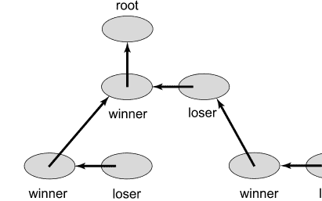

**图 18.16**

TourBarrier 类：信息流。节点静态地配对活跃/被动对。线程从叶子节点开始。活跃节点中的每个线程等待其被动伙伴出现，然后沿树向上移动。每个被动线程等待其活跃伙伴的完成通知。一旦活跃线程到达根节点，所有线程都已到达，通知按反方向沿树向下流动。

### 练习 18.6

合并树屏障为整个屏障使用单一线程本地感知字段。假设我们像图 18.17 所示，为每个节点关联一个线程本地感知。解释为什么这种实现与另一种是等效的（只是它消耗了更多内存），或者给出一个反例证明它是不正确的。

```java
private class Node {
    AtomicInteger count;
    Node parent;
    volatile boolean sense;
    int d;
    // 构建根节点
    public Node() {
        sense = false;
        parent = null;
        count = new AtomicInteger(radix);
        ThreadLocal<Boolean> threadSense;
        threadSense = new ThreadLocal<Boolean>() {
            protected Boolean initialValue() { return true; }
        };
    }
    public Node(Node myParent) {
        this();
        parent = myParent;
    }
    public void await() {
        boolean mySense = threadSense.get();
        int position = count.getAndDecrement();
        if (position == 1) {
            // ... 逻辑 ...
        }
    }
}
```

**图 18.17**

线程本地屏障。

### 练习 18.7

树屏障是“自底而上”的，这意味着完成从叶子移动到根节点，而通知从根移动到叶子。图 18.18 和 18.19 展示了一种名为反屏障的替代设计，它与树屏障相似，只是完成是从根开始到叶子的。请画一个论证说明它是正确的，或者给出一个反例证明它是不正确的。

```java
public class RevBarrier implements Barrier {
    int radix;
    ThreadLocal<Boolean> threadSense;
    int leaves;
    Node[] leaf;

    public RevBarrier(int size, int radix) {
        this.radix = radix;
        leaf = new Node[size / radix];
        depth = 0;
        threadSense = new ThreadLocal<Boolean>() {
            protected Boolean initialValue() { return true; }
        };
        // 计算树深度
        while (size > 1) {
            depth++;
            size = size / radix;
        }
        Node root = new Node();
        root.d = depth;
        build(root, depth - 1);
    }
    // 递归构建树
    void build(Node parent, int depth) {
        // 我们在叶子节点吗？
        if (depth == 0) {
            leaf[leaves++] = parent;
        } else {
            for (int i = 0; i < radix; i++) {
                Node child = new Node(parent);
                child.d = depth;
                build(child, depth - 1);
            }
        }
    }
}
```

**图 18.18**

反屏障部分1。

```java
public void await() {
    int me = ThreadIndex.getIndex();
    Node myLeaf = leaf[me / radix];
    myLeaf.await(me);
}

private class Node {
    AtomicInteger count;
    Node parent;
    volatile boolean sense;
    int d;
    // 构建根
    Node() {
        sense = false;
        parent = null;
        count = new AtomicInteger(radix);
    }
    public Node(Node myParent) {
        this();
        parent = myParent;
    }

    public void await(int me) {
        boolean mySense = threadSense.get();
        // 先访问父节点
        if ((me % radix) == 0) {
            if (parent != null) {
                parent.await(me / radix);
            }
        }
        int position = count.getAndDecrement();
        if (position == 1) { // 最后一个
            count.set(radix); // 重置计数器
            sense = mySense;
        } else {
            while (sense == mySense) {}
        }
        threadSense.set(!mySense);
    }
}
```

**图 18.19**

树屏障部分2：正确还是错误？

### 练习 18.8

使用 n 线的计数网络和单个布尔变量实现一个 n 线程可重用的屏障。画出一个证明该屏障工作的草图。

### 练习 18.9

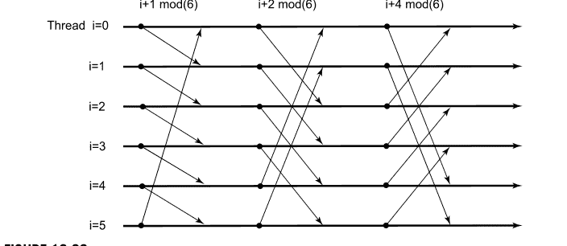

传播屏障中的通信。在每一轮 $r$ 中，线程 $i$ 与线程 $i+2$ (mod $n$) 通信。

*传播屏障*（dissemination barrier）是一种对称屏障实现，线程仅通过加载（loads）和存储（stores）在静态分配的缓存位置上自旋。如图 18.20 所示，该算法在一系列轮中运行。在第 $r$ 轮，线程 $i$ 通知线程 $i+2$ (mod $n$)（其中 $n$ 是线程数），并等待来自线程 $i-2$ (mod $n$) 的通知。为了实现屏障，该协议需要运行多少轮？如果 $n$ 不是 2 的幂会怎样？请给出你的理由。

### 练习 18.10

在 Java 中创建一个可重用的传播屏障实现。提示：考虑跟踪当前阶段的奇偶性（parity）和状态（sense）。

### 练习 18.11

创建一个表格，总结静态树屏障、组合树屏障和传播屏障的总操作数。

### 练习 18.12

你能否为执行器池设计一种“分布式”终止检测算法，在该算法中，线程不再反复更新或测试一个用于终止的中心位置，而是仅使用本地无竞争变量。变量可以是无界的，但状态变化应该花费常数时间（因此你不能并行化共享计数器）。

提示：适配第 4 章的原子快照算法。

### 练习 18.13

在终止检测屏障中，在窃取任务之前状态被设置为活跃（active）；否则窃取线程可能被宣布为非活跃；它会窃取任务，并在将其状态设回活跃之前，被它窃取的线程可能会变为非活跃。这将导致一种意外的情况：所有线程都被宣布为非活跃，但计算仍在继续。你能否设计一个终止性执行器池，其状态在成功窃取*后*才被设置为活跃？

# 乐观与手动内存管理


# 在本书的后续章节中，我们将关注使用 C++ 编程语言创建并发软件时面临的挑战和机遇

C++ 对并发提供了丰富的支持，拥有语言级线程、内存一致性模型和 `atomic<...>` 模板，但它缺乏 Java 那种原子内存管理（即垃圾回收）以及随之而来的内存安全保证。在本章中，我们将关注当程序员负责显式管理内存时，乐观同步所面临的挑战。

## 19.1 从 Java 迁移到 C++

C 和 Java 的语法（并非巧合）非常相似。两者都使用 `new` 关键字分配内存，都使用 `class` 关键字声明类型，并且许多原始类型（如 `int`、`float`、`double`）是相同的。

区别之一在于 `volatile` 字段和 `java.util.concurrent.atomic` 包，后者在 C++ 中通过 `std::atomic<>` 模板（定义在 `<atomic>` 头文件中）提供。`std::atomic<T>` 定义了类型为 T 的原子对象，因此我们可以轻松地定义原子对象数组，例如 `AtomicInteger` 和 `AtomicReference`。定义原子寄存器数组也是容易的。由于 C++ 程序员可以处理指针和整数，我们也可以使用 `std::atomic<>` 来实现 `AtomicMarkableReference` 的行为。示例 19.1 给出了几个例子。

原子对象的 `load()` 和 `store()` 方法接受一个可选参数，该参数可以在访问对象时放宽内存排序保证。在本章中，我们从未提供此类参数，并始终获取默认值，它提供了最强的保证（即线性一致性）。

## 19.2 乐观与显式回收

我们在书中大部分内容描述的乐观技术基于以下假设：如果操作 Op 的线性化导致另一个操作 Op 重启……

### PRAGMA 19.1.1

在 C++ 中，原子变量应该使用 `std::atomic<>` 模板声明。

```cpp
#include <cstdint> // 用于 uintptr_t 类型
#include <atomic> // 用于 std::atomic

// 指向 Object 的原子指针
std::atomic<Object*> *ptr;

// 指向 Object 的原子指针数组
std::atomic<Object*> *arr;

// 指向指向 Object 指针数组的原子指针
std::atomic<std::atomic<Object*>*> **arr_ptr;

// 读取原子变量
Object *ref = ptr->load();

// 存储到原子变量
ptr->store(ref);
```

```cpp
// 标记 ptr 的低位
ptr->store((Object*)((1 | (uintptr_t)ptr->load())));

// 取消 ptr 的低位
ptr->store((Object*)((~1) & (uintptr_t)ptr->load()));

// 检查 ptr 的低位
bool marked = (1 & (uintptr_t)ptr->load());
```

```cpp
// 当 ptr 的低位可能被标记时安全地解引用 ptr
*(Object*)((~1) & (uintptr_t)ptr->load());
```

`uintptr_t` 类型是一种无符号整数，其位宽保证与指针相同。它在处理可以在 32 位和 64 位环境中运行的代码中，对指针和整数进行类型转换时非常有帮助。指针和整数之间的转换通常是不安全的；我们只在算法需要一个与指针原子修改的位时才使用它。

由于具有自动内存回收（垃圾回收），这个假设是合理的。然而，在 C++ 中，注定重试的操作可能并非无害。问题的本质在于，在 C++ 中，由于缺乏自动内存回收，注定重试的操作可能并非无害。

## 19.4 用于内存管理的对象

因此我们可以说引用计数起着两个作用：它允许操作保护节点免受并发删除，并且它允许线程将节点的回收工作委托出去。虽然委托意味着节点不会被立即回收，但从删除线程的角度来看，它在不违反安全性的前提下，越早回收越好。

如果允许操作保护节点免受并发删除，但要求删除线程在自己内部推迟回收，而不是委托给另一个线程，这也是正确的。也就是说，如果某个内存区域仍有未处理的引用，删除操作将不会立即回收它。相反，它将其放入某个集合中，并定期查询该集合是否有没有剩余引用的条目。当发现这样的条目时，可以立即将其回收并从集合中移除。

人们可以将这种策略看作细粒度垃圾收集的一部分，其中程序员控制哪些内存区域被立即回收，哪些被推迟。

我们可以改变实现集合的方式（例如，使用每个线程集合）、线程搜索可回收内存的频率，以及操作保护节点的机制。通过这种方式，我们可以在未回收内存的限制与低运行时开销以及线程间最小通信之间进行权衡。

### 19.4 用于内存管理的对象

图 19.2 展示了一个在乐观操作期间保护内存的通用接口。实现该对象有许多不同方法；我们在本章中讨论其中两种。现在重要的是理解对象的规范。

```cpp
class MemManager {
    void register_thread(int num); // 在调用任何 op_begin() 之前调用一次
                             // num 表示调用者可以预留的最大
                             // 位置数量
    void unregister_thread(); // 在最后一次调用 op_end() 后调用一次
    void op_begin(); // 标记并发操作的开始
    void op_end(); // 标记并发操作的结束
    bool try_reserve(void* ptr); // 尝试保护指针免受回收
    void unreserve(void* ptr); // 停止保护指针
    void sched_reclaim(void* ptr); // 尝试回收指针
};
```

图 19.2：在乐观操作期间保护内存的接口。

为了使用一个适用于多种内存回收算法的单一接口，我们的对象拥有七个方法。接口最重要的部分是最后三个函数。它们允许线程尝试保护某些内存免受回收，停止请求保护内存，并在一旦没有并发线程的待处理保护请求时立即调度内存进行回收。

## 19.5 遍历列表

假设我们使用 `MemManager` 对象来保护一个基于非阻塞列表的整数集合的乐观遍历（第 9.8 节）。首先当然，我们必须将代码翻译成 C++。为了实现这一点，我们使用 `std::atomic<>` 代替 Java 中的 `volatile` 关键字。我们可以重新设计图 9.23 中 `Window` 类的 `find()` 方法，使其在乐观访问期间保护内存。

图 19.3 展示了我们 C++ 非阻塞列表中节点的数据类型，以及用于设置和取消指针低位标记的辅助函数。设置和取消指针的低位是 Java 中 `AtomicMarkableReference` 的 C++ 等价物。请注意，在 C++ 中，我们可以直接设置指针的低位，但我们不能使用低位为 1 的指针：我们必须在使用指针之前复制它并取消其拷贝的低位。

```cpp
template <typename T>
class Node {
  T item;
  int key;
  std::atomic<Node<T>*> next;
public:
  Node() : item(), next(nullptr) { }
  Node(T _item, int _key, Node<T>* _next) : item(_item), key(_key), next(_next) { }
  // 返回指针的低位是否被标记
  bool is_marked(Node<T>* ptr) {
    return ((uintptr_t)ptr) & 1;
  }
  // 清除指针的标记位
  Node<T>* unmark(Node<T>* ptr) {
    return (Node<T>*)(((uintptr_t)ptr) & ~((uintptr_t)1));
  }
  // 设置指针的标记位
  Node<T>* mark(Node<T>* ptr) {
    return (Node<T>*)(((uintptr_t)ptr) | 1);
  }
};
```

图 19.3：C++ 非阻塞链表：节点数据类型和辅助函数。

```cpp
template <typename T>
bool find(int key, Node<T>*& prev, Node<T>*& curr, Node<T>*& next, MemManager* mm) {
    prev = list;
    mm->try_reserve(prev);
    curr = prev->next.load();
    while (curr != nullptr) {
        if (mm->try_reserve(curr)) {
            if (prev->next.load() != curr) {
                mm->unreserve(curr);
                return find(key, prev, curr, next, mm);
            }
        }
        next = curr->next.load();
        if (is_marked(next)) { // curr 被逻辑删除了
            Node<T>* tmp = unmark(next);
            if (prev->next.compare_exchange_strong(curr, tmp)) {
                return find(key, prev, curr, next, mm);
            }
        }
        mm->unreserve(curr);
        mm->sched_for_reclaim(curr);
        curr = tmp;
    }
    else {
        int ckey = curr->key; // 注意：此处代码在 curr 为空时逻辑错误
        if (prev->next.load() != curr) {
            mm->unreserve(prev); mm->unreserve(curr);
            return find(key, prev, curr, next, mm);
        }
        if (ckey == key) {
            return ckey;
        }
        mm->unreserve(prev);
        prev = curr;
        curr = next;
    }
    return false;
}
```

图 19.4：带安全回收的非阻塞链表遍历。

通过这些定义，列表被定义为指向头节点的指针。我们引用该指针为 `list`。在其他高性能乐观列表中，我们通过将列表的第一个节点设置为“哨兵”节点来避免边界情况，该节点从不被读取。这样，列表永远为空。

图 19.4 重新引入了 9.8 中的 `find()` 函数。我们 C++ 版本的主要区别在于它必须管理内存回收。

## 19.6 危险指针

我们保护非阻塞列表内部节点的第一个方案使用了被称为“危险指针”技术的变体。该方法包含两个主要部分。第一个是线程共享其预留位置的机制，以便其他线程在尝试回收内存时可以看到这些预留。第二个是每个线程的推迟回收机制。

图 19.6 展示了该对象的两个主要数据类型。每个线程都有自己的 `ThreadContext`，可以通过 `MemManager::self` 直接访问。这些对象的整个集合被组织成链表，由 `MemManager::head` 表示。在线程上下文中，有一个该线程调度回收的位置的私有集合，以及一个该线程不想回收的位置的共享数组。

```cpp
template <typename T>
bool add(int key, MemManager* mm) {
    mm->op_begin();
    Node<T> *prev, *curr, *next;
    while (true) {
        if (find(key, prev, curr, next, mm)) {
            mm->op_end();
            return false;
        }
        Node<T> *new_node = new Node<T>(key, curr);
        if (prev->next.compare_exchange_strong(curr, new_node)) {
            mm->op_end();
            return true;
        }
        mm->unreserve(prev); mm->unreserve(curr);
    }
}
```

```cpp
template <typename T>
bool contains(int key, MemManager* mm) {
    mm->op_begin();
    Node<T> *prev, *curr, *next;
    bool ans = find(key, prev, curr, next, mm);
    mm->op_end();
    return ans;
}
```

```cpp
template <typename T>
bool remove(int key, MemManager* mm) {
    mm->op_begin();
    Node<T> *prev, *curr, *next;
    while (true) {
        if (!find(key, prev, curr, next, mm)) {
            mm->op_end();
            return false;
        }
        if (curr->next.compare_exchange_strong(next, mark)) {
            mm->unreserve(prev); mm->unreserve(curr);
            continue;
        }
        if (prev->next.compare_exchange_strong(curr, next)) {
            mm->sched_reclaim(curr);
        } else {
            mm->unreserve(prev); mm->unreserve(curr);
            find(key, prev, curr, next, mm);
        }
        mm->op_end();
        return true;
    }
}
```

图 19.5：基于链表的 C++ 非阻塞集合的公共方法。

### 460 第 19 章 乐观与手动内存管理

```cpp
class ThreadContext {
public:
    std::vector<void*> pending_reclams;
    std::atomic<void*>* reservations;
    ThreadContext *next;
    const int num;

    ThreadContext(int num, MemManager& m) : num(num) {
        reservations = new std::atomic<void*>[num];
        for (int i = 0; i < num; ++i)
            reservations[i] = nullptr;
        while (true) {
            next = m.head.load();
            if (m.head.compare_exchange_strong(next, this)) {
                break;
            }
        }
    }
};

class MemManager {
public:
    static thread_local ThreadContext *self;
    std::atomic<ThreadContext*> head;
    // ...
};
```

图 19.6：支持带阻塞回收的危险指针的数据类型。

图 19.7 展示了我们对危险指针实现的剩余部分。由于我们的实现是阻塞的，而且与线程上下文不同，`register_thread()` 和 `unregister_thread()` 都是简易的：前者创建一个线程上下文并将其插入 MemManager 列表的头部；后者是一个空操作。同样，`op_begin()` 也是一个空操作；其后置条件是调用线程拥有保留且没有待处理的回收。所有这些属性都由 `op_end()` 提供。

在执行期间，线程通过在它的 `reservations` 数组中填充槽位并写入 `ptr` 来保留一个指针。数组位置都是 `std::atomic<>`，因此我们可以确保任何此类写入都是强序的：所有之前的读写会在它之前完成，而所有后续的读写不会在它之后发生。


注意在我们的危险指针实现中，`try_reserve()` 始终返回 `true`。为了防止竞态条件是必要的。考虑线程 T 执行 `find()` 方法第 24 行的时刻。当该行完成时，`prev` 指向 `curr`，但 T 尚未扫描 `curr`。此时，如果另一个线程 Tr 扫描了 T 的保留，它将找不到 `curr` 并标记 `curr`，从而可以立即回收 `curr`。Tr 随后对 `curr` 的访问将导致竞态。通过

# 19.6 危险指针

```cpp
25 MemManager::register_thread(int num) { self = new ThreadContext(num, this); }
26 MemManager::unregister_thread() { /* no-op */ }
27 MemManager::op_begin() { /* no-op */ }
28 void MemManager::sched_for_claim(void* ptr) { self->pending_reclaims.push_back(ptr); }
29 bool MemManager::try_reserve(void* ptr) {
30   for (int i = 0; i < num; ++i) {
31     if (self->reservations[i] == nullptr) {
32       self->reservations[i].store(ptr);
33       return true;
34     }
35   }
36   throw error;
37 }
38 void MemManager::unreserve(void* ptr) {
39   for (int i = 0; i < num; ++i) {
40     if (self->reservations[i] == ptr) {
41       self->reservations[i].store(nullptr);
42       return;
43     }
44   }
45 }
46 void MemManager::op_end() {
47   for (int i = 0; i < num; ++i) {
48     if (self->reservations[i] == nullptr) {
49       self->reservations[i].store(nullptr);
50     }
51   }
52   for (auto i : pending_reclaims) {
53       free(i);
54     }
55   self_reclaims.clear();
56 }
57 MemManager::wait_unreserved(void* ptr) {
58   ThreadContext* curr = head;
59   while (curr) {
60     for (int i = 0; i < num; ++i) {
61       if (curr->reservations[i] == ptr)
62         wait();
63     }
64     curr = curr->next;
65   }
66 }
```

# 19.7 基于代的回收

我们的危险指针实现是精确的，确保了回收能够尽早发生，从而避免待回收内存产生堆积。然而，精确性付出了高昂的代价：在每次操作过程中，会有线性数量的 `try_reserve()` 调用，每次调用都会执行一次昂贵的强序写入以共享内存。

是许多情况之一，其中多个线程可能对解除链接的节点拥有保留。因此，解除链接的线程尝试回收内存是不智的。相反，`sched_for_claim(ptr)` 将 `ptr` 放入线程私有的向量中，并将回收延迟到 `op_end()`。

## 19.7 基于代的回收

当 `remove()` 操作占百分比较小时，这些内存障的成本就很难体现：它们保护 `find()` 免与频繁调用的 `remove()` 操作发生可能出现的交叉执行。如果我们放宽回收位置数量的限制，就可以消除许多此类内存障。为此，我们引入了“代”（epochs）的概念。

假设一个线程有一个自己的共享计数器，初始化为零。当线程调用 `op_begin()` 时，它会增加该计数器。每当它调用 `op_end()` 时，它再次增加计数器。如果我们查看一个线程的计数器并发现是一个偶数，就可以立即得出该线程处于 `op_begin()` 和 `op_end()` 之间的结论。反之，这意味着该线程对我们的链表节点不会有任何引用。

遗憾的是，如果一个线程不断在链表上执行操作，另一个线程可能永远看不到偶数。相反，它在每次循环时可能会看到一个不同的数字。然而，这种信息同样有用：它意味着该线程完成了一个操作并开始了另一个操作。任何与另一个操作并发解除的内存在当前操作尝试期间都是无法访问的，一旦计数器从一个数字变为另一个数字，解除的内存就是不可达的，并且可以安全地回收。

将这些想法结合起来，我们可以创建一个极其简单的 `MemManager`。这个新版本无法对未回收对象的数量设定任何限制，因为一个正处于 `find()` 操作中间的线程将导致任何其他线程无法回收任何东西。当 `remove()` 调用异常稀少，或者当程序（如操作系统）能够保证 `find()` 的调用不会无限挂起时，无界垃圾带来的成本将通过消除 O(n) 内存障带来的改进而得到充分抵消。

在 19.8 中，我们实现了一个基于“代”的 `MemManager`。与我们对危险指针的实现一样，我们选择阻塞式实现，让每个线程在到达 `op_end()` 时立即回收所有已解除的内存。

与危险指针的实现一样，我们有一个全局共享的线程上下文列表，每个线程都保留一个包含其计划回收位置的私有 `vector`。我们不再需要线程来跟踪操作所访问的单个指针：相反，线程维护一个 `std::atomic<unsigned>` 计数器，并在 `op_begin()` 时对其递增。递增具有强内存排序，这意味着在操作接触任何共享内存拷贝的链表节点之前，该线程已通知了所有其他线程它们不能回收任何东西。

在 `op_end()` 中，线程将其计数器增加为偶数，表示它将不再访问链表的任何共享内存。与 `op_begin()` 一样，这种递增是严格排序的，因此可以保证发生在父操作的所有共享内存的加载和存储之后。如果一个线程延迟了任何位置的回收，那么它必须等待到每个并发线程的执行至少短暂地处于数据结构操作之外。它通过检查线程的计数器来实现这一点：如果计数器是偶数，或者它从一个奇数变为一个更大的奇数，那么线程就无法找到指向等待回收位置的指针。一旦验证了所有线程的进度，就可以执行延迟的回收。

```cpp
struct ThreadContext {
    std::vector<void*> pending_reclaims;
    std::atomic<uint64_t> counter;
    ThreadContext *next;
    ThreadContext(MemManager* m) {
        while (true) {
            next = m->head;
            if (m->head.compare_exchange_strong(next, this)) {
                break;
            }
        }
    }
};

struct MemManager {
    static thread_local ThreadContext *self = nullptr;
    std::atomic<ThreadContext*> head;
};

void MemManager::register_thread(int num) { self = new ThreadContext(this); }
void MemManager::unregister_thread(int) { /* 无操作 */ }
void MemManager::op_begin() { self->counter++; }
void MemManager::sched_reclaim(void* ptr) { self->pending_reclaims.push_back(ptr); }
bool MemManager::try_reserve(void* ptr) { return false; }
void MemManager::unreserve(void* ptr) { }

void MemManager::op_end() {
    self->counter++;
    if (self->pending_reclaims.empty()) {
        return;
    }
    wait_until_unreserved();
    for (auto p : self->pending_reclaims)
        free(p);
    self->pending_reclaims.clear();
}

void MemManager::wait_until_unreserved() {
    ThreadContext* curr = head.load();
    while (curr) {
        uint64_t val = curr->counter.load();
        if (val % 2 != 0) {
            do {
                wait();
            } while (curr->counter.load() == val);
        }
        curr = curr->next;
    }
}
```

图 19.8 基于代的回收。


考虑到这些 `op_begin()` 和 `op_end()` 的实现，`try_reserve()` 可以是一个单条语句：`return false`。为了理解为什么这是正确的，请考虑 `find()` 调用与 `remove()` 调用的交叉执行。如果一个线程延迟了任何位置的回收，那么它必须等待到每个并发线程的执行至少短暂地处于数据结构操作之外。

## 19.9 习题

- 练习 19.1：如果 11.2 节的 `LockFreeStack` 使用危险指针来保护内存，它仍然会受到 ABA 问题的影响吗？为什么或为什么？

- 练习 19.2：描述如何使用危险指针保护 10.5 节中的无锁队列内存。

- 练习 19.3：19.6 节的危险指针实现是阻塞的。使其非阻塞的最简单方法是回收对象。在这种策略下，任何一个线程的 `pending_reclaims` 向量的最坏情况是多少？在有 T 个线程的系统中，最坏情况是多少？

- 练习 19.4：如果危险指针实现允许对象存更久，那么它的 `op_end` 可以开始将所有线程的预留到一个私有列表中。它可以通过该列表与 `pending_reclaims` 取交来识别准备好回收的对象。在什么情况下这将是有利的？在什么情况下会损害性能？

- 练习 19.5：对于每种数据结构，讨论在使用乐观并发控制实现数据结构时最坏需要多少危险指针：
    1. 无锁队列
    2. 无锁栈
    3. 懒惰链表
    4. 跳表

- 练习 19.6：C++ 中的 `std::atomic` 类型支持内存排序。在 19.6 节的危险指针实现中，哪些排序可以放宽？

- 练习 19.7：类似于练习 19.3，我们可以使 19.7 节中基于代的回收变为非阻塞。重写图 19.8 中的代码，使线程在提交时不需要等待。

- 练习 19.8：在我们基于代的回收的实现中，我们并没有要求线程在获取所有其他线程计数器的原子快照时才决定回收对象是安全的。为什么这是正确的？

# 第 20 章 事务性编程

尽管 C++ 为程序员提供了比 Java 和其他高级语言更多的控制权，但显式管理内存的需求带来了巨大的挑战，特别是在推测执行中。为了确保推测执行的操作不会访问已回收的内存，回收操作通常会被延迟，这可能导致长时间内分配大量不必要的内存。

此外，某些看似正确的程序根据 C++ 内存模型被归类为竞态条件，因此它们的行为是未定义的。消除这些竞态条件并非易事，并且可能导致代码难以扩展和维护。通常，程序同步机制的复杂性会随着程序复杂性的增加而大幅提升，需要更复杂、更困难的技术来实现良好的性能。具有大量操作的数据结构（尤其是范围查询和其他多项操作）比具有少量操作的数据结构需要更高的并发性；使用多线程的程序可能比少线程程序需要更细粒度的锁。

事务性编程通过提高抽象级别解决了这种复杂性：程序员专注于识别哪些区域需要原子性，而不是如何让代码区域具有原子性。如何在不牺牲性能的情况下确保原子性，则留给运行时系统和专用硬件处理。

## 20.1 并发编程中的挑战

### 20.1.1 锁的问题

锁作为一种同步手段，对于缺乏经验的程序员来说有许多陷阱。当低优先级线程在持有高优先级线程所需的锁时被抢占，就会发生优先级反转。在手接手锁模式下，夹队是最容易理解的一种拥塞形式：如果线程按照固定顺序获取和释放锁，那么线程获取序列中第一个锁的顺序决定了线程通过数据结构的顺序；如果其中一个线程发生延迟，其他线程就无法绕过它。如果线程尝试以不同的顺序锁定同一组对象，就会发生死锁。如果线程锁定许多对象，特别是当对象集合无法预知时，避免死锁可能会变得笨拙。此外，如果操作系统在线程持有锁时挂起该线程，那么整个程序可能会停滞。

编写良好的锁代码的一个主要障碍是锁与数据之间的关联大多通过约定建立的。它存在于程序员的脑海中，可能只记录在注释中。考虑以下来自 Linux 头文件的典型注释，它描述了管理特定类型缓冲区使用的约定：

```
/*
 * 当锁定的缓冲区对 I/O 层可见时设置 BH_Launcher
 * 意味着在解锁之前我们必须清除 BH Launcher，
 * 在 alpha 上执行 mb()，然后清除 BH Lock，这样读取者就不会在
 * 未锁的缓冲区上看到 BH_Launcher 设置，从而避免死锁风险。
 */
```

过度解释和观察许多此类这样列出的约定会增加代码维护的复杂性。

锁的另一个挑战是确定锁的粒度。考虑一个实现为固定大小链表数组的不可重缩哈希表。应该为每个条目锁定整个表，还是为链表中的每个节点锁定？如果有许多线程，并且在极少数情况下线程频繁访问哈希表，那么可能需要细粒度锁来防止哈希表成为可扩展性瓶颈。尽管它提高了可扩展性，但更细的粒度增加了复杂性和开销。如果表经常被频繁读取但很少写入，我们可能会使用读写锁。

哈希表的实现通常是针对特定的竞争场景编写的通用数据结构。如果该场景在程序执行期间出现，且线程的数量和它们使用表的方式随时间变化，那么在程序执行的不同点，不同的策略可能是最优的。此外，每种选择在某些情况下可能是悲观的。

### 20.1.2 显式推测的问题


# 第 20 章 事务编程

我们已经看到，锁的问题可以通过乐观同步（参见第 9.6 节）来缓解。例如，对于读多写少的数据结构，执行只读的临界区可以极大地减少上述锁的影响。实现此类数据结构的一项有用工具是序列锁（sequence lock）。

> * 内核 v2.4.19 /fs/buffer.c.

```cpp
std::atomic<int> seqlock;
int protected_data;

int reader() {
    while (true) {
        int s1 = seqlock;
        int ret = protected_data; // ERROR
        int s2 = seqlock;
        if (s1 == s2 && is_even(s1)) {
            return ret;
        }
    }
}

void writer(int newval) {
    while (true) {
        unsigned s = seqlock;
        if (is_even(s) && seqlock.compare_exchange_strong(s, s+1)) {
            protected_data = newval;
            seqlock = s + 2;
            return;
        }
    }
}
```

## 20.1 序列锁的错误用法：锁的释放不保证在数据访问之后有序

序列锁背后的核心思想是使用 `std::atomic<int>` 来替代互斥锁或自旋锁。整数从值 0 开始，每当获取或释放锁时就会加 1。因此，当锁的值为偶数时，锁是空闲的；为奇数时，锁被某个线程持有。序列锁的值作为其所保护数据结构的一种版本号，当它为偶数时，数据结构就不会改变。

这种观察可能让我们认为可以推测性地执行只读的临界区，而无需写入或原子操作，如图 21 所示。读取线程读取锁，读取受保护的数据，然后重新加载。如果锁值是偶数，并且在读取受保护的数据后保持不变，那么在这一间隔内没有其他线程进入，因此对受保护数据的读取是有效的。

然而，这段代码是错误的，因为程序存在数据竞态：读取操作可能与写入操作的第 17 行同时执行。读取者不会使用它读取到的值这并不重要：读取本身是一种竞态，而具有竞态的程序具有未定义行为。

修复这段代码有许多方法。最简单是将 `protected_data` 的类型改为 `std::atomic<int>`。然而，这可能会产生巨大的开销，因为对数据的每次访问都是一次同步操作。

此外，这些操作的默认强排序（strong ordering）会在临界区内不同变量的访问之间施加不必要的额外排序。为了避免这种过度排序，程序员需要利用 `std::atomic` 的高级特性，特别是 `std::memory_order_relaxed`。为了防止代码复用将变量变为原子。这第三个挑战可以通过使用 `std::atomic_ref` 来克服，这是 C++20 中的一项功能，允许将变量被视为原子的。

### 20.1.3 非阻塞算法的问题

避免锁问题的一种方法是使用原子原语设计非阻塞算法，例如比较交换（在 C++ 中通过 `std::atomic<>` 的 `compare_exchange_strong()` 方法提供）。此类非阻塞方法非常微妙，且单线程延迟较高。主要的困难在于，几乎所有的同步原语（无论是读取、写入还是应用原子比较交换）只在单个字上操作。这种限制强制算法呈现出复杂且不自然的结构。

让我们回顾第 10.5 节中的无锁队列（在图 20.2 中翻译为 C++），并关注底层的同步原语。在第 13–14 行，

图 20.2 LockFreeQueue 类：enq() 方法。

```cpp
template <class T>
bool multiCompareAndSet(std::atomic<T>* *target,
                       T *expected,
                       T *update,
                       int count) {
  atomic {
    for (int i = 0; i < count; i++) {
      if (*target[i] != expected[i])
        return false;
    }
    for (int i = 0; i < count; i++) {
      *target[i] = update[i];
    }
    return true;
  }
}
```

图 20.3 `multiCompareAndSet()` 的伪代码。此代码应该原子性执行。

enq 方法调用两次 `compare_exchange_strong()` 来更改尾节点的 `next` 字段和 `tail` 字段以指向新节点。由于这些更新是一次发生的，`enq()` 和 `deq()` 方法必须准备好遇到未完成的 `enq()`（第 13 行）。如果我们能够同时更新这两个字段，这些方法将简单得多。

例如，假设我们在图 20.3 中有一个 `multiCompareAndSet()` 原语，它接收一个 `std::atomic<T>` 对象的数组、一个用于更新的 `T` 值数组，如果所有数组元素都符合预期值，则更新所有数组元素（如果任何元素不符合预期值，则没有元素被更新）。遗憾的是，在传统架构上无法实现 `multiCompareAndSet()`。如果可以，我们就可以用图 20.2 中 12-18 行的复杂逻辑替换为单次 `multiCompareAndSet()` 调用（见图 20.4）。

### 20.1.4 组合问题

我们讨论过的所有同步机制的一个共同缺点是它们无法容易地进行组合。例如，假设我们想从队列 `q0` 中取出项目 `x` 并将其入队队列 `q1`。这次传输将是原子的：并发线程既不会观察到 `x` 消失，也不会观察到它同时在两个队列中。基于监视器（monitors）的队列实现内部都会获取锁，因此我们无法以这种方式组合两个方法。

不过也有临时的解决方案：我们可以引入一个锁，让任何尝试对 `q0` 和 `q1` 进行原子修改的线程获取（除了 `q0` 和 `q1` 自身的锁之外）。这种锁需要提前知道队列的标识，并且可能成为瓶颈（没有并发传输）。

```cpp
void enq(T item) {
  Node* node = new Node(item);
  while (true) {
    Node* last = tail;
    Node* next = last->next;
    if (last == tail) {
      std::atomic<Node*>* target[2] = {&last->next, &tail};
      Node* expect[2] = {next, last};
      Node* update[2] = {node, node};
      if (multiCompareAndSet(target, expect, update))
        break;
    }
  }
}
```

图 20.4 `LockFreeQueue` 类：使用 `multiCompareAndSet()` 简化 `enq()` 方法。

或者，队列可以导出它们的同步状态（例如，通过 `lock()` 和 `unlock()` 方法），并依赖调用者来管理多对象同步。引入同步状态会对模块化产生毁灭性影响，使接口复杂化并依赖调用者遵循复杂的约定。此外，这种方法对于非阻塞实现无效。

### 20.1.5 总结

我们似乎面临着相当严峻的局面：

- 锁很难有效管理，特别是在大型系统中。
- 原子原语（如比较并交换）一次只操作一个字，导致了算法复杂化。
- 竞态条件的存在使得任何时候都必须进行昂贵的同步，即使竞态极其罕见。
- 很难将对多个对象的多次调用组合成原子单元。

面对这些挑战，事务式编程（transactional programming）提供了一种极具吸引力的替代方案。

## 20.2 事务式编程

在事务式编程中，程序员识别哪些代码区域不能相互交织，并将它们标记为事务。然后，一个运行时系统（理想情况下在专用硬件的帮助下）负责找到能够并发执行尽可能多事务的方法，确保事务看起来仍然是原子性执行的。

事务式编程要求程序员放弃一些控制：程序员不再编写底层同步协议，并且对事务如何调度和管理的手段有限。作为交换，多个小事务会自动组合成更大的事务；事务似乎能够一次性原子地修改多个位置；运行时系统可以为只读事务提供优化，而悲观锁在此时会产生高昂成本；并且事务消除了考虑锁、`std::atomic<>` 变量或其他底层同步机制的需求。

事务运行时系统必须确保操作的中间影响对其他事务不可见：事务写入的任何值必须对其他事务隐藏，只有在事务提交时才可见。系统还必须确保事务的行为与串行执行一致，即没有事务并发运行。例如，假设在程序中变量 `x` 和 `y` 始终相等。如果事务 `T1` 读取了 `x`，然后事务 `T2` 增加了 `x` 和 `y`，如果 `T1` 尝试读取 `y`，则不应允许它继续执行：它将看到一个不是 `x` 的值，这可能导致错误行为。事务运行时系统采用投机执行和细粒度访问。在示例中，跟踪 `T1` 和 `T2` 的访问使得检测到 `T1` 在 `T2` 写入之前读取了 `x` 成为可能，因此在检测到对 `y` 的冲突时，它可以回滚 `T1` 并重试。

### 20.2.1 事务式编程示例

为了理解事务式编程的好处，考虑图 20.5 中的代码。为了避免竞态条件，线程在操作期间锁定了整个数组。

```cpp
std::mutex counter_lock;
int *counters = ...;

void increment_pos_counters(size_t n, size_t t) {
    std::lock_guard<std::mutex> guard(counter_lock);
    for (size_t i = 0; i < n; ++i) {
        if (counters[i] > 0)
            ++counters[i];
    }
}
```

图 20.5 基于锁的条件递增算法。假设两个线程同时调用此函数，第一个线程的数组全是 0，第二个线程数组全是 1，且计数器的所有位置都设置为 1。在这种情况下，获取锁是不必要的，因为线程不会访问计数器的同一个位置。因此，程序错过了获得更大并行性的机会。另一方面，如果第二个线程数组也持有值 0，那么获取锁就是必要的，否则两个线程对 `counter[0]` 的访问将发生竞态。

我们可以通过将 `counter_lock` 替换为锁数组来启用更大的并行性。线程可以采用两阶段锁定策略，即在访问计数器的相应位置之前获取每个位置的锁，并在函数结束时释放所有锁。为了释放哪些锁，并且因为一个索引可能出现多次，线程必须跟踪它获取的锁。为了避免死锁，所有线程必须按照相同的预定义顺序获取锁（可以通过先排序来实现）。尽管这种细粒度策略具有扩展性，但实际上比粗粒度策略慢，因为必须获取更多的锁。

通过事务式编程，我们可以完全不用考虑锁。我们只需将整个操作执行为单个事务，并依赖事务运行时系统在避免竞态的同时尽可能利用并行性。代码可能类似于图 20.6。事务系统将监控其他线程在做什么。如果一个线程的投机执行会与另一个线程发生竞态，系统将在竞态发生前停止，撤销其操作并重试。

```cpp
int *counters = ...;

void increment_pos_counters(size_t num, size_t *which) {
    transaction {
        for (size_t i = 0; i < num; ++i) {
            if (counters[which[i]] > 0) {
                ++counters[which[i]];
            }
        }
    }
}
```

图 20.6 图 20.5 的事务版本。

## 20.3 事务编程的硬件支持

推测和访问追踪在硬件中实现时开销最低。现在我们来概括如何为事务编程提供硬件支持。某些微处理器已经包含了此类支持。

### 20.3.1 硬件推测

现代微处理器即使在单个核心内也能同时执行数百条指令。三个特征使得这种级别的并行成为可能。首先，许多微处理器可以在单个周期内获取多条指令，并将它们调度到算术/逻辑单元。其次，微处理器是流水线的：不同的指令可以同时处于执行的不同阶段（使用不同的电路）。最后，微处理器在遇到分支时不会停顿。相反，它会预测走哪个分支，并推测性执行相应的指令。如果微处理器随后确定某条指令不应执行，它将撤销该指令以及依赖于该指令指令的影响。如果处理器缓冲区一直等到确定该指令本应该执行（例如，所有分支都预测正确）；如果预测错误，则缓冲的写入将被丢弃。

由于处理器可以不断进行推测，且任何失败的推测指令的影响都会被消除，为了支持事务，我们只需要允许程序员指定一个超出流水线的推测粒度：除了终止事务中任何完成的指令外，还需要撤销事务中已完成指令的影响。要撤销寄存器的更改，启动事务的指令会存储其原始状态，以便在事务中止时重置寄存器。要撤销内存的更改，处理器必须能够回滚缓存中与失败事务的写入操作对应的值。失效（Invalidation）是回滚事务写入的最简单机制。

### 20.3.2 基础缓存一致性

硬件支持的事务编程依赖缓存一致性协议来实现精细粒度的访问追踪，并检测并发事务之间的冲突内存访问。在讨论细节之前，简要回顾缓存协议（更多背景请参见附录 B）。

在现代多处理器中，每个处理器都有一个缓存，这是一种高速内存，用于避免与大而慢的内存通信。每个缓存条目包含一组相邻的字称为“行”（line），并具有某种将地址映射到行的方法。考虑一种简单的架构，处理器和内存通过称为总线（bus）的共享广播介质进行通信。每个缓存行都有一个标记（tag），用于编码状态信息。在标准的 MESI 协议中，每个缓存行处于以下状态之一：

- Modified（修改）：该行已被修改，最终必须写回内存。没有其他处理器缓存了该行。
- Exclusive（独占）：该行未被修改，但没有其他处理器缓存了该行。（行通常在被修改之前以独占模式加载）。
- Shared（共享）：该行未被修改，其他处理器可能缓存了该行。
- Invalid（失效）：该行不包含有效数据。

缓存一致性协议检测单个加载和存储操作之间的同步冲突，并确保不同处理器对共享内存的状态达成一致。当处理器加载或存储内存地址 $a$ 时，它在总线上广播请求，其他处理器和内存进行监听（有时称为嗅探，snooping）。

缓存协议的完整描述可能很复杂，但这里是我们感兴趣的主要状态转换：

- 当处理器请求以修改模式加载某行时，其他处理器会使该行的所有副本失效。拥有该行修改副本的处理器必须在满足加载请求之前将其写回内存。
- 当处理器请求以共享模式将某行加载到其缓存时，任何拥有独占或修改副本的处理器都必须将其状态改为共享。拥有修改副本的处理器也必须在满足加载请求之前将该行写回内存。
- 如果缓存满了，可能需要驱逐某行。如果该行是共享或独占的，可以直接丢弃；但如果它是修改过的，则必须写回内存。

今天现代缓存一致性协议可以检测并解决读者和写者之间的同步冲突，它们已经允许更改在缓存中保持一段时间，而不是立即更新内存。

### 20.3.3 事务性缓存一致性

MESI 协议中的许多状态转换是异步的：它们发生在一个处理器上，是因为另一个处理器执行了内存操作。虽然我们经常将数据竞态视为在更高抽象层次上体现的问题，但编程语言中的“竞态”概念与 MESI 协议中的状态转换之间存在紧密的关系。

考虑两个线程尝试同时增加计数器的情况。`counter++` 语句翻译为三条汇编指令：一个将 `counter` 的值加载到寄存器，一个增加该寄存器中的值，以及一个通过将寄存器值写入内存来更新 `counter` 的值。如果一个线程发布的三条指令与另一个线程发布的三条指令之间存在任何交错，就会发生竞态。如果我们检查每种可能的交错，并观察发生的 MESI 状态转换，我们会发现存在数据竞态，在三条指令执行期间的某时刻，某行失效了，或者某些处于 Modified 状态的行被降级为 Shared 或 Exclusive。这一观察适用于访问共享内存的任何代码段：如果其对共享内存的任何访问发生了竞态，那么在执行该代码段期间，包含访问数据的行要么失效了，要么被降级。

我们可以利用这一观察结果来执行事务序列，并在事务执行期间缓存中发生问题性状态转换时中止事务。如果没有发生此类事务，则说明事务与没有数据竞态，因此推测成功。假设每个处理器都有一个私有的 L1 缓存，且一次只执行一个线程。为了检测问题转换，我们添加了 `TXBegin` 和 `End` 指令来界定一个指示事务正在运行的标志，并在缓存的每行中添加一个位，指示该行已被活动事务访问过。`TXBegin` 保存寄存器当前值的私有副本（检查点），提升标志位并返回真，表示事务正在执行。当标志位置位时，对缓存的任何访问都会设置相应的位。`End` 指令降低标志位，清除任何可能设置的位，并丢弃检查点。因此，如果执行了 `TX End`，事务就不会中止，结果与未通过事务执行代码时相同（即推测成功）。

有了上述机制，检测问题性转换就变得简单了：如果一个设置了位的行即将被驱逐或降级，缓存首先通知处理器中止推测。

当事务中止时，任何被修改过的行都会失效；它们的值不会写回或提供给任何其他处理器。此外，指示事务访问的标志被清除，并使用检查点将线程重置为事务开始时的状态。然后 `TXBegin` 指令返回假，表示推测失败。

### 20.3.4 硬件支持的局限性

由于被硬件事务访问的行数据在不中止事务的情况下无法缓存，缓存的大小和关联性对事务可以访问的数据量施加了严格限制。例如，某些 L1 缓存是直接映射的，这意味着每个地址都映射到缓存中的特定行，因此必须驱逐之前的任何数据。对于这样的缓存，如果事务访问两个映射到同一缓存行的地址，它永远无法成功提交。


此外，在许多微处理器上，在事务执行期间，各种事件可能会导致显著延迟，在此期间，事务访问的缓存行可能会被驱出。这些事件可能由事务本身引起（例如通过系统调用），也可能与事务无关（例如，执行事务的线程被切换出）。

由于通常很难或无法预测事务何时可能无法提交，建议程序员将硬件事务支持视为一种“尽力而为”（best effort）的机制，而不是可以完全依赖的东西。因此，在使用硬件事务时，它们还应该提供一种回退机制（fallback mechanism），以防事务无法提交。

要求程序员提供回退机制减轻了计算机架构师的负担：事务的成功并不是为了正确性，而是为了提高实现质量，因此架构师可以自由地尽力。

## 20.4 事务锁消除（Transactional Lock Elision）

在现有的基于锁的软件中实现事务编程的最直接的方法是通过一种称为“事务锁消除”（Transactional Lock Elision, TLE）的技术。TLE 的核心思想是修改程序的区域，使其尝试作为事务性推测来运行。如果推测多次失败（例如由于与其他线程冲突），则执行将回退到原始锁。

在硬件上，TLE 可以实现为一种特殊的锁，其获取和释放方法分别尝试使用 `TX_Begin` 和 `TX_End` 指令。这使得 TLE 异常易用。然而，TLE 只能尝试从现有的基于锁的程序中提取更多并发，无法保证任何进展或避免病态问题（pathologies）。特别是，我们列举的问题（例如：护队效应、优先级反转和死锁）仍然可能：如果推测失败并回退到锁定，则不使用事务机制，其对进展和吞吐量的益处也就无法实现。

由于 TLE 执行回退到程序中的原始锁总是正确的，因此 TLE 可用于加速临界区。通常，临界区的特点是：它们涉及的内存位置很少，且持续时间不会很长。如果执行较小临界区的事务失败了，那么在回退到锁定之前，值得重试几次。我们甚至可以增强 `TX_Begin` 的返回值，提供更多关于推测失败原因的详细信息，代码可以使用这些信息来决定是推测地重试临界区，还是回退到锁定。20.7 节展示了 TLE 的完整实现，该实现使用自旋锁作为回退路径。

图 20.7 在对 `TX_Begin`（第 5 行）和 `TX_End`（第 24 行）的调用周围增加了一些复杂度。特别重要的是，我们必须记住第 8 行表示临界区将通过 TLE 进行推测性运行。如果推测失败，控制流将返回第 5 行。这意味着，`TX_Begin` 似乎执行了多次，并具有不同的返回值。

```c
void acquire(spinlock *lock) {
  int attempts = 0;
  while (true) {
    attempts++;
    TLE_STATUS status = TX_Begin;
    if (status == STARTED) {
      if (!lock.held()) {
        return;
      }
    } else {
      TX_End;
      attempts--;
      while (lock.held()) {
      }
    } else if (status == TX_Conflict || attempts >= 4) {
      lock.acquire();
      return;
    }
  }
}

void release(spinlock *lock) {
  if (lock.held()) {
    TX_End;
  } else {
    lock.release();
  }
}
```

图 20.7 使用自旋锁作为回退路径的 TLE 完成实现。

回想在第 5 行和第 24 行之间执行的所有内存修改在推测失败时都会撤销。如果我们希望防止死锁和饥饿，就有必要在事务外计算尝试次数。这是通过 `attempts` 变量实现的，它在循环的每次迭代中递增。每当推测失败时，控制从第 5 行跳转到第 16 行，在该处检查 `attempts`。如果该值变得太大，线程将停止使用 TLE，获取锁并返回。当线程到达临界区的末尾时，它可以观察到锁已被持有，得出它必须是锁的持有者，并释放锁以完成该区域。同样，当推测失败且与另一个线程的冲突不是原因时，第 16 行报告的状态中的一个值将指示临界区必须在持有锁的情况下运行。

注意，第 7 行跟在每次成功的 `TX_Begin` 调用之后。这段代码有两个用途。第一个是识别某些情况：一个线程尝试通过 TLE 运行临界区，而另一个线程正积极使用锁运行临界区。通过在调用 `TX_Begin` 后检查锁，线程可以发现锁被持有的情况。当锁被持有时，线程会快速完成其 TLE 区域而不执行任何有意义的工作。从第 11 行开始，它看起来就像从未尝试成功执行过，减少了尝试次数并等待锁被释放。

该调用的第二个用途更为微妙。假设一个线程到达了第 8 行，并开始执行其临界区。另一个线程随后到达了第 17 行。此时，第二个线程感知不到第一个线程，因为第一个线程正在进行推测性执行。由于第二个线程没有使用 TLE，其写入是立即可见的。

## 20.4.1 讨论

我们已经看到 TLE 如何优化现有基于锁的程序的性能。事务编程是否也能简化新程序的创建呢？

## 20.5 事务内存

事务内存（Transactional Memory, TM）广义上是指当程序员以实例而不是锁来思考时所产生的编程模型。TM 和 TLE 之间的差异虽然微小，但是重大的：

- 程序员不需要思考*如何*实现并发。
- 程序员以需要隔离的区域来思考，事务的嵌套是自然的，甚至是被鼓励的。
- 由于没有基于锁的回退机制失败保证，编程语言可能需要确保事务不会尝试无法撤销的操作（例如 I/O）。
- 由于事务内部的所有内容都会撤销，因此将推测以显式中止指令的形式暴露给程序员是自然的，甚至是有益的。
- 由于编程模型中没有锁，传统的锁问题（死锁、护队效应、优先级反转）是不可能发生的。

# 482 第 20 章 事务性编程

```cpp
void tle_increment_two(int *i1, std::mutex *m1, int *i2, std::mutex *m2) {
    int *ptrs[] = {(uintptr_t)i1, (uintptr_t)i2} ? {i2, i1} : {i1, i2};
    std::mutex* locks[] = {(uintptr_t)i1, (uintptr_t)i2} ? (m2, m1) : (m1, m2);

    tle_acquire(locks[0]);
    if (locks[0] != locks[1]) {
        (*ptrs[0])++;
        tle_release(locks[0]);
        if (locks[0] != locks[1]) {
            tle_release(locks[1]);
        }
    }
}

void tm_increment_two(int *i1, int *i2) {
    *i1++;
    *i2++;
}
```

图 20.8 使用 TLE（顶部）和 TM（底部）原子地增加两个计数器的代码。

## 20.5.1 运行时调度

由于 TM 没有基于锁的退回机制，因此它需要其他机制来确保进程的进行。在历史上，这种机制被称为“竞争管理”（contention management），它可能更恰当地被视为一个调度器。在通常情况下，竞争管理器什么都不做：线程开始和结束事务，而事务通常会成功。当一个线程发现自己由于与其他线程的冲突而反复提交失败时，它可能会选择 (1) 在再次尝试之前延迟自己，希望与其发生冲突的并发事务能够提交，或 (2) 采用某些机制来减少与其并发运行的事务数量，以降低事务冲突的概率。

在第一种情况下，正如我们在第 7.4 节所示，在连续 $n$ 次退避（back-off）后，线程将在 $2^{n-1}$ 和 $2^n$ 之间选择一个随机数——并在等待许多 CPU 周期后进行重试。通常，随机的指数退避会对 $n$ 设置一个硬性限制，使得在高冲突情况下，线程不会等待几分钟之久。

在第二种情况下，减少运行中事务的数量是一种启发式方法，而不是硬性规则。一个简单的解决方案是使用全局标志。当一个线程尝试启动事务时，它首先检查该标志。如果标志为真，线程将等待。一旦标志为假，线程就可以继续。如果事务反复中止，它会尝试通过比较并交换（compare-and-swap）将标志从假改为真。如果成功，它将尝试执行其事务直到事务提交。否则，它将等待。当遇到困扰的事务提交时，它会清除标志。在练习 20.8 中，我们探索了这种方法与退回到 TLE 获取代码相比的性能影响。

## 20.5.2 显式自中止

由于 TM 区域总是以预测的方式运行，因此运行时系统允许在任何时间出于任何原因允许事务。当然，每当事务中止时，事务之前的努力都白费了，因此运行时系统应该避免不必要的中止。但由于这种可能性存在，考虑让程序员进行自中止是值得的。

事实上，自中止似乎是创建真正的可组合性程序的基石，在这些程序中，线程接收一个元组列表，每个元组由一个源账户、一个目的账户和一个账金额组成。由于同一个账户可能多次作为源和目的出现，由于不使用某种同步机制无法读取账户余额，因此确定操作列表是否有效并非易事。如果每个账户都由账户对象私有的锁保护，那么挑战将尤为巨大。通过 TM 和显式自中止，我们可以将每个账户的同步完全封装在它的实现内部，并且仍然编写出正确的代码。受 C++ TM 技术规范中惯例的启发，我们说如果一个整数异常逃逸了事务，它会导致事务中止，但异常会被保留。根据这种定义，图 20.9 显示了 TM 和自中止如何共同实现解决方案。

## 20.6 软件事务

到目前为，我们一直假设硬件对事务性编程的支持。虽然存在具有此类支持的微处理器，但完全在软件中实现事务也是可能的。除了为遗留硬件提供事务性编程的退回机制外，软件事务在硬件事务失败时也提供了一种可扩展的路径。在本节中，我们描述了支持事务性编程的软件实现。

为了在软件中实现事务，我们提供了一个满足图 20.10 中接口的库，它提供了在开始、提交或中止事务时，以及在事务内读取和写入内存时调用的函数。

如果程序员必须直接调用这些函数，将是繁琐且易错误的，因此我们假设程序员可以编写结构化的事务代码，并且编译器会插入相应的库调用。对 `beginTx` 和 `commit` 的调用将分别插入在每个事务区域的开头和结尾，事务内的每个加载和存储都将被替换为相应的函数调用。（`abortTx` 函数用于显式自中止）。例如，`int x = *y` 将变成 `int x = read(y)`，而 `global_i = 7` 将变成 `write(&global_i, 7)`。

```cpp
1 class account {
2 double balance;
3 public:
4 static const int ERR_FUNDS = 1;
5 void withdraw(double amount) {
6 tm {
7 if (balance < amount)
8 throw ERR_FUNDS;
9 balance -= amount;
10 }
11 }
12 void deposit(double amount) {
13 tm {
14 balance += amount;
15 }
16 }
17 bool transfer_many(vector<account> from, vector<account> to, vector<double> amounts) {
18 try {
19 for (int i = 0; i < from.size(); i++) {
20 from[i].withdraw(amounts[i]);
21 to[i].deposit(amounts[i]);
22 }
23 }
24 return true;
25 } catch (int e) {
26 if (e == ERR_FUNDS) {
27 return false;
28 }
29 }
30 };
```

图 20.9 使用异常在账户间原子执行传输的代码。

```cpp
1 void beginTx(jmp_buf *b);
2 void write(uintptr_t addr, uintptr_t val);
3 int read(uintptr_t addr);
4 void commit();
5 void abortTx();
```

图 20.10 软件接口。

## 20.6.1 带所有权记录的事务

软件事务的关键挑战之一是检测事务之间的冲突。所有权记录（或 orec）是为此目的设计的结构。将一个锁、一个版本号和一个线程标识叠加到一个内存字上。在最简单的实现中，orec 的最低位起两个作用：它是锁位，同时也指示剩余位的含义。

详细来说，我们说当 orec 的位为零时，它是未锁的，剩余位可以解释为单调递增的整数（版本号）。当位为一时，它是被锁定的，剩余位被解释为持有锁的线程的唯一 ID。如果我们使用单个 orec 构建软件事务，将无法提供并发性。相反，我们需要使用 orec 数组。从图 20.11 第 3 行声明了内存区域到表项的一一映射。如果我们假设每个内存字（`uintptr_t`）对齐到 8 字节边界，那么只要粒度不低于 3，每个内存字将精确映射到表中的一项。

我们的实现将通过观察这些事务与 `lock_table` 条目的交互来检测对位置 L 的冲突。伪冲突是可能的，因为内存位置远多于表项。然而，如果表足够大，伪冲突应该不常见。

在讨论剩余部分之前，让我们考虑一种类似于传统锁的事务实现。使用我们的 `lock_table`，我们可以这样运行事务：每当事务尝试读取一个位置时，我们可以检查对应的 orec；如果 orec 是未锁的，我们可以锁定 orec 然后读取该位置；如果 orec 被另一个事务锁定，我们可以中止事务，调用运行时调度器（以帮助避免活锁），然后重试。写操作几乎相同，不同之处在于它们不能简单地更新位置；如果它们随后中止，我们需要某种机制来撤销它们写入的内容。最简单的方法是在开始时也检查一个状态。在 C++ 中，`setjmp` 和 `longjmp` 足以此目的。为了简单起见，我们将在后续的讨论中省略检查点。

# 486 第 20 章 事务式编程

```cpp
atomic::uint64_t id_gen[1];
atomic::uint64_t clock(0);
atomic::uint64_t lock_table[NUM_LOCKS];

atomic::uint64_t *get_lock(void* addr) {
    return &lock_table[((uintptr_t)addr) >> GRAIN % NUM_LOCKS];
}

struct Descriptor {
    jmp_buf *checkpoint;
    uint64_t my_lock;
    uint64_t start_time;
    unordered_map<uintptr_t, uintptr_t> writes;
    vector<pair<atomic<uint64_t>*, uint64_t>> reads;
    vector<pair<atomic<uint64_t>*, uint64_t>> locks;

    Descriptor() : my_lock(id_gen[((id_gen++) % 1)]) {
    };
    void beginTx(jmp_buf *b) {
        checkpoint = b;
        start_time = clock;
    }
    void write(uintptr_t *addr, uintptr_t val) {
        writes.insert({addr, val});
    }

    int read(uintptr_t *addr) {
        auto it = writes.find(addr);
        if (it != writes.end())
            return it->second;
        atomic::uint64_t *i = get_lock(addr);
        uint64_t pre = *i;
        uintptr_t val = std::atomic_ref<uintptr_t>(*addr).load(std::memory_order_acquire);
        uint64_t post = *i;
        if ((pre != *i) || (pre != post) || (pre > start_time))
            abort(1);
        reads.push_back({i, pre});
        return val;
    }
}
```

图 20.11 带有所有权记录的软件事务 (1/2)。

一种方法是维护一个撤销日志（undo log），在更新位置之前，可以将旧值保存其中。如果事务中止，它需要使用该日志恢复内存中的原始值。在提交时，线程将释放其锁并丢弃其撤销日志。

上述策略允许无冲突的事务并发运行，而不需要程序员考虑细粒度锁。由于内存仅在线程持有相应锁时才被访问，因此不会产生竞态条件。然而，执行将是悲观的：任何事务访问任何位置时，该位置对所有并发事务都是不可访问的。特别是当读取操作较多时，这种方法会牺牲并发性。

虽然我们可以尝试构建一个基于读写锁的解决方案，以便线程可以同时获取位置的读取权限，但这样做会产生开销，因为非符合要求的线程在以读模式获取 orec 时会发生冲突。在本文中，我们使用乐观读取。也就是说，当一个事务想要读取位置 $L$ 时，它会首先读取与 $L$ 对应的 orec 的值。如果 orec 被锁定，代码将根据 strawman 算法相同的规则继续执行或中止。然而，如果 orec 未被锁定，我们不会锁定它。它记录存储在 orec 中的版本号。如果该版本号在事务提交之前发生了变化，或者仅仅是因为事务随后获取该 orec 作为写入者而发生变化，那么事务就知道其读取仍然有效。

我们对 strawman 算法的第二个更改是采用提交时锁定。通过提交时锁定，写入 $L$ 的事务在准备好提交之前不会获取 orec $L$。因此，它必须将其写入操作记录在私有的重做日志（redo log）中，而不是直接更新 $L$。

## 20.6 软件事务


上述更改引入了一个重要问题：如果事务读取 `L`，它多频繁地检查与 `L` 对应的矿位？正如练习中看到的，如果事务随后读取了其他位置 `L'` 而没有检查 `L` 的矿位，该事务可能会出现错误的执行。不幸的是，如果一个事务执行了 `n` 次读取，将需要 `O(n^2)` 的代价来验证所有读取的一致性。

为了减少常见情况下的验证开销，我们引入了一个单调递增的计数器，我们称为全局时钟。该时钟在每次事务提交时都会增加，其值将用于确定事务的开始和结束。当事务提交时，它增加时钟，然后并将时钟的新值作为它所查看每个矿位的版本。

虽然时钟成为写入事务的潜在瓶颈，但它对读取验证的影响是巨大的。假设一个事务在进入时看到时钟值为 `T_0`。在读取位置 `L` 之前，事务看到 `L` 有一个值 `T_0 \le T_0`，在读取 `L` 之后，事务看到矿位仍然是 `T_0`，那么事务就认为 `L` 在其启动后没有被修改过。如果事务遇到的每个矿位都满足相同的属性，那么它在执行期间就不永远需要验证：它只读取自启动以来未被修改的位置，并保守地观察它是否尝试读取任何在自启动后矿位被修改的位置。

我们在图 20.11 和 20.12 中的实现展示了完整的算法，适用于操作字大小位置的软件事务。我们的实现使用 `setjmp` 和 `longjmp` 指令在事务尝试之前捕获寄存器状态，并跳转回任何中止的点。它还处理了 C++ 内存模型的要求。

# 第 20 章 事务式编程

```cpp
void commitTx() {
  if (writes.empty()) {
    reads.clear();
    return;
  }
  for (auto &l : writes) {
    atomic<uint64_t>& l = get_lock(l.first);
    uint64_t prev = *l;
    if ((prev == 0) && (prev <= start_time)) {
      if (!l->compare_exchange_strong(prev, my_lock)) {
        abortTx();
        locks.push_back(l, prev);
      }
    }
  } else if (prev == my_lock) {
    abortTx();
  }
  uint64_t end_time = ++clock;
  for (auto i = 0; i < reads; i++) {
    uint64_t v = *i;
    if ((v && (v == my_lock)) || ((v == 0) && (v > start_time))) {
      abortTx();
    }
  }
  for (auto w : writes) {
    std::atomic_ref<uintptr_t>(w.first).store(w.second, std::memory_order_release);
  }
  for (auto i = 0; i < end_time; i++) {
    // 逻辑根据原文上下文补全
  }
  reads.clear();
  locks.clear();
}
void abortTx() {
  for (auto i = 0; i < locks; i++) {
    // 逻辑根据原文上下文补全
  }
  reads.clear();
  writes.clear();
  locks.clear();
}
```

图 20.12

带有所有权记录的软件事务 (2/2)。

# 第 20 章 事务性编程

一个“错过了”矿石锁的并发读取不会读取到无效值，因为值只有在放弃变得不可能后才会被更新。

我们基于矿石的事务实现具有许多优良的属性。尽管它在内部使用了锁，但这些锁对程序员是不可见的，而且不会发生死锁：“持有并等待”这一必要条件被破坏了，因为事务无法获取锁——它会释放所有的锁并重试。此外，提交锁的使用降低了活锁概率：事务之间的对称冲突只有在这些事务同时到达相应点时才会发生。

## 20.6.2 基于值的验证事务

这种事务的方法并非没有缺点：其主要缺点之一是位置到矿石映射的粒度问题：简单的哈希函数会导致确定性冲突（例如，在 20.11 节中，每个 `2^26` 个元素的数组的第一个元素将受同一个矿石的保护）；使用复杂的哈希函数会引入过高的延迟。另一种方法是直接通过从读取函数返回的值进行验证。图 20.13 和 20.14 展示了这样的算法。

```cpp
atomic<uint64_t> lock(0);

struct Descriptor {
    jmp_buf *checkpoint;
    uint64_t start_time;
    unordered_map<uintptr_t, uintptr_t> writes;
    vector<pair<uintptr_t, uintptr_t>> reads;
};

void beginTx(jmp_buf *buf) {
    checkpoint = buf;
    start_time = lock;
    if (start_time & 1)
        start_time--;
}

void abortTx() {
    writes.clear();
    reads.clear();
    longjmp(*checkpoint, 1);
}

int write(uintptr_t *ptr, uintptr_t val) {
    writes.insert_or_assign(addr, val);
}
```


基于值的验证软件事务 (1/2)。

```cpp
uintptr_t read(uintptr_t *ptr) {
    auto it = writes.find(addr);
    if (it != writes.end()) {
        uintptr_t val = std::atomic_ref<uintptr_t>(*ptr).load(std::memory_order_acquire);
        while (start_time != globals.lock_val()) {
            start_time = validate();
            val = std::atomic_ref<uintptr_t>(*ptr).load(std::memory_order_acquire);
        }
        reads.push_back((addr, val));
        return val;
    }
}

void commitTx() {
    if (writes.empty()) {
        reads.clear();
    }
    return;
}

uint64_t from = start_time;
while (lock.compare_exchange_strong(from, from + 1)) {
    auto val = from;
    for (auto w : writes) {
        std::atomic_ref<uintptr_t>(*w.first).store(w.second, std::memory_order_release);
        lock = 2 + start_time;
    }
    writes.clear();
    reads.clear();
}

uint64_t validate() {
    while (true) {
        uint64_t time = lock;
        if (time != 1) {
            continue;
        }
        for (auto it = reads.begin(), e = reads.end(); it != e; ++it) {
            if (std::atomic_ref<uintptr_t>(*it->first).load(std::memory_order_acquire) != it->second) {
                abort(TX);
            }
        }
        if (time == lock)
            return time;
    }
}
```

图 20.14

基于值的验证事务 (2/2)。

该算法与我们的算法相似之处在于，它将事务性写入延迟到提交时（重做日志）。主要区别在于，它使用单个序列锁来协调事务的何时提交，并且不使用序列锁来决定事务何时回滚。相反，序列锁的变化会触发事务的验证。

该算法的直觉原理是：事务可以加载地址以及它们在执行读取时观察到的值。当事务提交时，它将序列锁增加到一个旧值，重新读回其写集，然后将序列锁增加到一个新值。如果事务发现序列锁的值与该事务上次有效时的值相同，它就可以轻而易举地确定自己有效的。

如果锁自上次检查以来发生了变化，事务必须等待直到锁释放（未被持有）。然后，它可以重新读取其读取集中的每个位置，以确保该值与事务读取时的值相同。唯一的困难在于，事务必须检查其整个读取集，且期间没有任何插入的写入事务提交。这体现在 `validate` 函数的 `while` 循环中。注意，在成功验证后，事务等同于在验证时刻启动的事务，并可以更新其开始时间。

产生的一个问题是，事务是否可以在锁被持有时启动。我们并没有在 `beginTx()` 函数中等待，而是如果开始时间是奇数，则从从中提取一个。这意味着事务可能在第一次加载时就通过了验证。

与矿石算法一样，这种事务方法是无死锁的：它只有一个锁，因此不存在死锁可能！此外，注意事务的进展只有在它必须验证时才会受到阻碍，而每次验证对应于一个写入事务的完成。在这里，无活锁的，但可能会出现饥饿。

## 20.7 结合硬件和软件事务

基于值的验证的优势之一是它允许混合事务系统，在可能时使用硬件执行，在事务无法在硬件中完成时回退到软件执行（例如因为太大）。最简单的方法之一是引入一种机制在两种模式之间切换：一种是所有事务使用硬件支持，另一种不是。从硬件模式到软件模式的阶段切换相对容易，可以使用一个全局标志来指示当前模式是“硬件”还是“软件”。每个事务开始时都会检查标志。如果标志在执行期间发生，它将回滚，此时切换到软件模式。

从软件返回硬件可能更具挑战性。然而，基于值的验证提供了一种干净的返回：当事务完成时，它原子地将标志设置为假，然后以硬件模式启动。这是结合硬件和软件的许多机制之一。其他方法使用全局锁或时代（epochs，见 19.7 节）来管理模式转换。真正的混合系统允许硬件和软件事务运行并提交。

## 20.8 事务数据结构设计

TM 最具前景的角色之一是创建高性能并发数据结构。例如，考虑创建并发红黑树所涉及的困难性……TM 是通往可扩展、模块化、通用数据结构的路径。

虽然 TM 可以将任意的顺序操作转换为并发操作，但它并不保证扩展性。程序员必须确保数据结构没有明显的瓶颈。例如，如果哈希表中的每次插入和删除都必须更新总数计数器，那么事务无法防止并发计数器更新。此外，TM 与锁没有区别，它们都要求所有对数据的并发访问都对所使用的同步机制一致。正如允许一个线程对同时被另一个线程锁定的项执行非同步访问是不正确的一样，允许非事务访问也是不正确的。

# 第 20 章 事务性编程

……一个正在同时被事务化访问的项。最后，在使用软件事务内存时，程序在将内存从事务化访问的状态转换到非事务化访问的状态时必须非常小心。最危险的例子是内存回收：如果一个事务从数据结构中取消了某个节点的链接，提交后尝试释放该节点，它必须确保没有并发的（注定要失败）事务仍在访问该节点。我们将在练习中探讨这个“私有化”问题。

# 20.9 章节节记

从 Linux 内核 2.4 到 Linux 内核 2.6 的过渡涉及在改进多处理器性能方面付出的巨大努力。顺序锁是因此结果而广泛使用的技术之一 [98]。Hans Boehm [20] 详细讨论了 C++ 中使用顺序锁时面临的挑战。我们感谢 Hans 解释了顺序锁的细微之处，并提议了使用 C++20 中 `std::atomic_ref` 的解决方案。

TLE 微处理器基于一种更通用的机制——硬件事务内存，该机制由 Maurice Hershy 和 Eliot Moss [74] 首次提出，作为多处理器的通用编程模型。Nir Shavit 和 Dan Touitou [157] 提出了第一种不需要特殊硬件的 TM，而是通过在每次加载和存储上使用软件实例化。

本章介绍“树”算法是 Dave Dice、Ori Shale 和 Nir Shavit [35] 的 TL2 算法的变体。基于值的方法归于 Luke Dalessandro、Michael Spear 和 Michael Scott [33]。

Ravi Rajwar 和 James Goodman [146,145] 讨论了使用事务内存进行锁消除。与 TM 类似，也存在纯软件的锁消除方法 [149]。

在文献 [133] 中可以找到支持 TM 的市售硬件系统的比较。Harris, Larson 和 Rajwar [59] 提供了关于硬件和软件事务内存的权威综述。

# 20.10 练习

练习 20.1。设 `G` 是全局变量，`H` 是在堆上分配的变量。`G` 和 `H` 都是具有许多字段的结构，程序员希望用顺序锁保护每一个。为什么对 `H` 需要使用安全的内存回收策略，而 `G` 不需要？

练习 20.2。考虑练习 20.1。如果结构体由读锁保护，且一个线程将读取 `H`，它是否需要安全的内存回收策略？为什么？

**练习 20.3.** 在我们的 TM 实现中，使用一个简单的 vector 来存储事务读取集。假设有 `2^16` 个槽位，并使用一个强哈希函数将地址映射到槽位。一个事务在两次读取同一个槽位之前，需要进行多少次随机的访问？

**练习 20.4.** 在第 20.6 节中，我们认为槽位上的伪冲突会限制吞吐量。在练习 20.3 中，考虑一个拥有 `2^16` 个槽位的系统。如果每个线程都发布 `W` 写操作，且有两个线程，在 `W` 取什么值时，伪冲突的概率会超过 50%？

**练习 20.5.** 继续练习 20.4 的示例，如果有八个线程，在 `W` 取什么值时，伪冲突的概率会超过 50%？

**练习 20.6.** 重复练习 20.5，使用 `2^20` 个槽位。

**练习 20.7.** STM 实现不是在重做日志中缓冲写入，而是在执行时更新位置，并维护一个撤销日志以便在事务中止时恢复值。出现了一个微妙的复杂问题：当事务中止时，它在释放槽位时无法恢复其旧值。为什么？考虑以下情况：`T_1` 对 `X` 执行写入后中止读取 `Y`，而事务 `T_2` 执行对 `X` 的读取，且与 `T_1` 的两个操作都是并发的。

**练习 20.8.** 设 `T_A` 是一个连续失败多次的事务，系统中共有 `T_I` 个事务。假设竞争管理器给 `T_A` 提供了两个选项：

- 阻塞新事务启动，等待所有当前事务提交，然后开始。
- 阻塞新事务启动，并立即开始。

你会倾向于哪种选项？为什么？在证明你的答案时，考虑特定的工作负载特征可能会帮助。

**练习 20.9.** 选择软件 TM 还是硬件 TM 会影响你对练习 20.8 的回答？

**练习 20.10.** 我们声称，每次读取新位置时都必须确保其读取集的有效性。如果不这样做，一个注定要失败的事务可能会产生可见的错误。如果事务在每次读取后都不进行验证，请在两个事务之间创建一个交错。

**练习 20.11.** 基于锁的编程中的一种惯用法是锁定数据结构、取消其一部分、然后解锁数据结构。这样做使得被取消的部分对执行解锁的线程是“私有的”，因为其他线程不再能够访问该部分。

事务性编程引入的一个挑战是，投机线程可能并不知道自己注定要失败，它们对被取消部分的事务化访问可能与取消链接线程的非事务化访问发生冲突。

创建一个工作负载：一个线程的事务通过在某处分割链表来将其私有化，而另一个线程的事务正在遍历该列表。描述在事务线程中可能发生的错误。

**练习 20.12.** 考虑你对练习 20.1 的解决方案。对于 20.6.1 中的算法是否会出错？为什么？

**练习 20.13.** 考虑你对练习 20.1 的解决方案。对于 20.6.2 中的算法是否会出错？为什么？

# 附录

# 软件基础

# A.1 引言

本附录描述了理解示例以及编写自己的并发程序所需的编程语言构造。我们主要使用 Java，但这些思想同样可以用 C++ 和 C# 表示。如有疑问，请咨询感兴趣的语言文档。

# A.2 Java

Java 使用一种并发模型，线程通过调用对象来操作它们。可能的并发调用通过各种语言构造进行协调。

# A.2.1 线程

在 Java 中，线程是 `Thread` 子类的实例，它提供了创建线程、启动线程以及等待它们完成的方法。我们从解释 Java 构造开始。

首先，创建一个实现 `Runnable` 接口的类。例如，这是一个打印字符串的简单线程：

```java
public class HelloWorld implements Runnable {
  String message;
  public HelloWorld(String m) {
    message = m;
  }
  public void run() {
    System.out.println(message);
  }
}
```


可以通过调用构造函数将 `Runnable` 对象转换为线程，构造函数接受一个 `Runnable` 对象作为参数，如下：

```java
final String m = "Hello world from thread " + i;
Thread thread = new Thread(new HelloWorld(m));
```

创建线程后，必须启动它：

```java
thread.start();
```

该方法导致线程运行 `run` 方法。调用 `start()` 的线程立即运行。如果调用者想等待线程完成，它必须加入线程：

```java
thread.join();
```

调用者将被阻塞，直到线程的 `run` 返回。

¹ 技术上，线程是对象。

# A.2.2 监控器

Java 提供了多种同步共享数据的方法，通过内置包。这里我们描述内置模型，它被称为监控器模型，是一种简单且常用的方法。

在第 8 章中，想象你负责呼叫中心的软件。在高峰时段，电话到达的速度快于处理速度。当电话到达时，你的交换机将其放入队列；播放一段录音公告，让来电者确认你非常重视这一点，电话将按接收顺序进行回答。操作员——负责接听的员工——派遣操作员去取出并回答下一个电话。当操作员完成一个电话时，他或她将从队列中取出下一个电话并回答。

```java
public static void main(String[] args) {
    Thread[] thread = new Thread[8];
    for (int i = 0; i < thread.length; i++) {
        final String message = "Hello world from thread " + i;
        thread[i] = new Thread(new Runnable() {
            public void run() {
                System.out.println(message);
            }
        });
    }
    for (int i = 0; i < thread.length; i++) {
        thread[i].start();
    }
    for (int i = 0; i < thread.length; i++) {
        thread[i].join();
    }
}
```

该方法初始化了数量 Java 线程，启动它们，然后等待它们完成。

```java
class Queue { // 这段代码是错误的
    final static int QSIZE = 100; // 任意大小
    int head = 0; // 下一个要出队的项
    int tail = 0; // 下一个空槽位
    Call[] calls = new Call[QSIZE];
    public enqueue(Call x) { // 由交换机调用
        calls[(tail+1) % QSIZE] = x;
    }
    public Call deq() { // 由操作员调用
        return calls[(head++) % QSIZE];
    }
}
```

一个错误的队列类。

图 A.2 显示了一个简单但错误的队列类。调用被存储在 `calls` 数组中，其中 `head` 是下一个要移除的调用索引，`tail` 是数组中下一个空槽位的索引。

如果两个操作员尝试同时出队一个调用，该类将无法正常工作。表达式

```java
return calls[(head++) % QSIZE];
```

并不是以原子（即不可分割的）步骤执行的。相反，编译器产生的代码类似于：

```java
int temp0 = head;
head = temp0 + 1;
int temp1 = (temp0 % QSIZE);
return calls[temp1];
```

两个操作员共同执行这些语句：它们同时执行第一行，然后是第二行，以此类推。最后，两个操作员都出队并回答了调用，可能骚扰了客户。

为了使其正常工作，我们必须确保一次只有一个操作员可以出队下一个调用，这种属性被称为**互斥**。Java 提供了一个内置机制来支持互斥。每个对象都有一个（隐式的）锁。如果一个线程获取了对象的锁（或等同于锁定了），那么在 A 释放锁（或等同于解锁）之前，其他线程无法获取该锁。如果一个类声明方法为 `synchronized`，那么该方法在被调用时隐式地获取锁，并在返回时释放。

这里是确保 `enq` 和 `deq` 方法互斥的一种方法：

```java
public synchronized T deq() {
  return call((head++) % QSIZE);
}

public synchronized enq(T x) {
  call((tail++) % QSIZE) = x;
}
```

一旦同步方法的调用获取了对象的锁，对该对象的任何其他同步方法的调用将被阻塞，直到锁被释放。（对其他对象的、受其他锁限制的调用不会被阻塞。）同步方法的主体通常被称为**临界区**。

同步的不仅仅是互斥。如果操作员尝试出队一个调用，但队列中没有等待的调用，他该怎么办？调用可能会抛出异常或返回 `null`，但操作员除了重试还能做什么呢？相反，这是一个解决方案的首次尝试：

```java
public synchronized T deq() { // 这是错误的
while (head == tail()) { // 空转自旋
  call((head++) % QSIZE);
}
```

这种尝试不仅是错误的，而且是灾难性的。同步方法内部的出队线程锁定了所有其他线程，包括可能正在尝试入队调用的交换机：这就是**死锁**。出队线程持有等待线程所需的锁，而入队线程等待出队线程释放锁。什么永远不会发生。

从这里中学到，如果执行同步方法的线程需要等待某事发生，它必须在等待时释放锁。等待的线程应该定期重新获取锁以测试是否可以继续。如果是，则继续；如果不是，则释放锁并返回等待。

在 Java 中，每个对象提供了一个 `wait()` 方法，它会解锁对象并挂起调用者。当该线程等待时，另一个线程可以锁定并更改数据。当挂起的线程恢复时，它在从 `wait()` 调用返回之前再次锁定该对象。// 这里是修改后的但仍然错误的 dequeue 方法：

```java
public synchronized T dequeue() { // 这仍然是错误的
while (head == tail) { wait(); }
return return[head++ % SIZE]; }
```

- 每个线程在寻找要回答的调用时，反复测试队列是否为空。如果是，它释放锁并等待；如果不是，则返回项。
- 同样地，入队线程检查缓冲区是否已满。

线程何时唤醒？程序必须在发生某事时通知等待的线程。`notify()` 方法最终会唤醒等待线程中的一个，该线程是从等待线程集中随机选择的。（注：原文此处存在大量重复句子，翻译已按逻辑精简）

## A.2.3 礼让与睡眠

线程何时唤醒？当发生某事时，程序必须通知等待的线程。`notify()` 方法最终会唤醒等待线程中的一个，该线程是从等待线程集中随机选择的。

## A.2.4 线程本地对象

每个线程拥有自己的私有变量是有用的。Java 通过 `ThreadLocal<T>` 类支持线程本地对象，该类管理一个 `T` 对象集合，每个线程一个。由于线程本地变量没有内置在 Java 中，它们的接口相当复杂且笨拙。尽管如此，它们非常有用，所以我们回顾一下如何使用它们。

`ThreadLocal<T>` 提供了 `get()` 和 `set()` 方法来读取和更新线程的本地值，以及 `initialValue()` 方法在线程尝试获取本地值时首次调用。为了初始化每个线程的本地值，我们定义了 `ThreadLocal<T>` 的子类。

这种机制通过示例说明得最好。在我们的许多算法中，假设 $n$ 个并发线程具有 $0$ 到 $n-1$ 之间的唯一线程本地标识符。为了提供这样的标识符，我们展示了如何定义具有单一静态方法的 `ThreadID`：`get()` 返回调用线程的标识符。当线程第一次调用 `get()` 时，它会被分配到下一个未使用的标识符。该线程的后续调用都会返回该线程的标识符。

```java
public class ThreadID {
    private static volatile int nextID = 0;
    private static class ThreadLocal extends ThreadLocal<Integer> {
        protected synchronized Integer initialValue() {
            return nextID++;
        }
    }
    private static ThreadLocal threadID = new ThreadLocalID();
    public static int get() {
        return threadID.get();
    }
    public static void set(int index) {
        threadID.set(index);
    }
}
```

ThreadID 类：为每个线程提供一个唯一的标识符。

> 这里是 ThreadID 类可能被使用的示例：

```java
thread = new Thread(Runnable() {
  public void run() {
    System.out.println("Hello world from thread " + ThreadID.get());
  }
});
```

### PRAGMA A.2.1

在类型表达式 `ThreadLocal<Integer>` 中，我们使用 `Integer` 而不是 `int`，因为 `int` 是基本类型，只有引用类型（如 `Integer`）允许出现在角括号中。从 Java 1.5 开始，一种称为自动装箱（autoboxing）的特性允许我们几乎互换使用 `int` 和 `Integer` 值，例如：

```java
int y = 6;
Integer z = x + y;

Integer x = 5;
```

完整细节请参阅您的 Java 参考手册。

## A.2.5 随机化

随机化是算法设计中的重要工具；例如，书中的几种算法使用随机化来减少竞争。在使用随机化时，理解所用随机数生成器的属性是至关重要的。例如，`Math.random` 方法使用 `java.util.Random` 类的单个全局实例来生成随机数。虽然 `Random` 是线程安全的，但多个线程对同一个实例的并发调用可能会引入竞争和同步问题。

为了避免这种竞争，我们使用 `java.util.concurrent` 包中的 `ThreadLocalRandom` 类，正如其名称所示，它为每个线程维护一个独立的随机数生成器。静态方法 `current()` 返回与调用者关联的随机数生成器；建议在使用 `ThreadLocalRandom` 时始终调用此方法。例如，要生成一个 0 到 $k-1$ 之间的随机 `int`，我们调用：

```java
ThreadLocalRandom.current().nextInt(k)
```

`ThreadLocalRandom` 生成的随机数不是加密级安全的。如果需要安全性，请使用 `java.security.SecureRandom`。然而，如果你这样做，请注意不要因多个线程并发访问同一个随机数生成器引入竞争。

> 技术上来说，这是一个伪随机数生成器。

## A.3 Java 内存模型

Java 编程语言在读写共享对象的字段时，并不保证线性一致性（linearizability），甚至不保证顺序一致性（sequential consistency）。为什么呢？因为严格遵守顺序一致性会禁止广泛使用的编译器优化，例如寄存器分配、公共子表达式消除-冗余读取消除，所有这些都涉及内存读写的重排。在单线程计算中，这些重排对优化后的程序是不可见的，但在多线程计算中，一个线程可以监控另一个线程并观察到无序执行。

Java 内存模型满足了松散内存模型的基本属性：如果一个程序按顺序执行某些规则，那么该程序在松散模型中的每次执行都将保持顺序一致性。在本节中，我们描述了保证 Java 程序顺序顺序一致的规则。我们并不尝试涵盖整个规则集（那将非常庞大且复杂），相反，我们关注一组足以应对大多数情况的简单规则。

```java
public static Singleton getInstance() {
  if (instance == null) {
    synchronized(Singleton.class) {
      if (instance == null) {
        instance = new Singleton();
      }
    }
  }
  return instance;
}
```

双重检查锁定。

在 Java 内存模型中，对象位于共享内存中，每个线程都有一个私有的工作内存，包含其读取或写过的字段的缓存副本。在没有显式同步（后文解释）的情况下，写入字段的线程可能不会将更新传播到共享内存，而读取字段的线程如果共享内存中字段副本的值发生变化，可能不会更新其工作内存。自然地，Java 虚拟机可以保持缓存副本的一致性，在实践中它们确实这样做，但并不是强制要求的。此时，我们可以保证线程的读写操作看起来是有序的，并且线程读取的字段的任何字段值都会被写入该字段（即：值不会凭空出现）。

某些语句是同步事件。“同步”一词通常意味着某种形式的原子性或互斥。但在 Java 中，它也意味着将线程的工作内存与共享内存进行协调。某些同步事件会令其他线程可见。其他同步事件会导致线程失效内存，从而使更改可见。同步事件是线性可线的：所有线程都对该顺序达成共识。我们现在来看不同类型的同步事件。

### A.3.1 锁和 synchronized 块

线程可以通过进入 `synchronized` 块或获取显式锁（如 `java.util.concurrent.locks` 包中的 `ReentrantLock`）来实现互斥。这些方法对内存行为的影响相同。如果对特定字段的所有访问都受同一个锁的保护，那么对该字段的读写就是线性性的。具体的，当线程释放锁时，工作内存中的修改字段会被写回共享内存。

### A.3.2 volatile 字段

`volatile` 字段是线性性的。读取 `volatile` 字段类似于获取锁：工作内存失效并从内存重新读取字段值。写入 `volatile` 字段类似于释放锁：字段值立即写入内存。

读取和写入 `volatile` 字段对内存一致性的影响与获取和释放锁相同，多次读写不是原子的。例如，如果 `x` 是一个 volatile 变量，表达式 `x++` 并不一定能递增。还需要某种形式的互斥。volatile 变量的常用用法是字段被多个线程读取但由一个线程写入。

此外，编译器不会移除对 volatile 字段的访问，也不会移除对同步方法的共享访问。

#### PRAGMA A.3.1

数组需要特殊关注：包含数组的字段或变量如果被声明为 `volatile`，只有对该字段或变量的访问必须同步；对数组元素的访问不需要同步。因此，为了同步访问数组元素，我们必须使用提供同步访问的特殊数组类型。

`java.util.concurrent.atomic` 包包含了提供线性内存的类，如 `AtomicReference<T>` 或 `AtomicInteger`。`compareAndSet()` 和 `set()` 方法类似于 volatile 写入，而 `get()` 类似于 volatile 读取。


# 附录 A 软件基础

## A.4 C++

在 2011 C++ 标准（C++11）之前，C++ 没有对线程的原生支持。相反，像 C 语言一样，它依赖于特定操作系统的线程机制。这种依赖付出了高代价：代码在不同操作系统之间不可移植，程序员无法合理地推断代码的正确性。

自 2011 年以来，C++ 使用了包含线程、锁、条件变量和 `std::atomic` 变量的并发模型。要使用这些特性，程序员必须包含相应的头文件：

```cpp
#include <thread> // 线程对象；C++11
#include <mutex> // 互斥锁；自 C++11
#include <atomic> // 原子变量；自 C++11
#include <shared_mutex> // 读写锁；自 C++14
#include <condition_variable> // 条件变量；自 C++14
```

可能在编译时需要提供一个标志来启用这些特性（例如 `-std=c++11` 或 `-std=c++14`）。C++ 标准每 3 年更新一次，自 C++11 以来，每次更新都添加了额外的并发特性。

### A.4.1 C++ 中的线程

`std::thread` 对象代表一个线程。该对象的构造函数可以接受一个函数或 lambda 表达式。也可以向该函数或 lambda 提供参数，如图 A.7 中的示例所示。（在某些特定的操作系统上，例如 Linux 的变体，链接器可能需要提供 pthread 标志（例如 `-pthread`）以便编译程序。）

在第 10 行和第 12 行，通过提供应该运行的函数名称来创建线程。在前一种情况下，函数不接受参数。在后一种情况下，它接受两个整数参数，这些参数也被传递给了线程构造函数。

此外，可以通过提供一个要执行的 lambda 来创建线程。第 17 行到 32 行的示例说明了给线程提供 lambda 表达式运行的一些方法。

在 C++ 中，与 Java 不同，单次调用会创建线程并在终止前启动所有线程。一种惯用法是将创建的线程存储在 `std::vector` 中，以便于找到并合并（join）。下面给出了示例：

```cpp
std::vector<std::thread> threads;
for (int i = 0; i < 16; ++i)
    threads.push_back(std::thread(f, i));
for (int i = 0; i < 16; ++i)
    threads[i].join();
```

> ⁴ 这一要求可以使用线程的 `detach()` 方法避免。

```cpp
#include <iostream>
#include <thread>

void f1() { std::cout << "Hello from f1" << std::endl; }
void f2(int a, int b) {
    std::cout << "f2 invoked with " << a << ", " << b << std::endl;
}

int main() {
    std::thread t1(f1);
    t1.join();
    std::thread t2(f2, 1, 2);
    t2.join();
    std::thread t3(f3, 5, 7);
    t3.join();
    int i = 7;
    std::thread t4([i]() {
        std::cout << "lambda invoked with captured i == " << i << std::endl;
    });
    t4.join();
    std::thread t5([&](int a) {
        std::cout << "lambda invoked with captured i == " << a << " and a = " << a << std::endl;
    }, 1024);
    t5.join();
    auto f = [&](int a) {
    };
    std::thread t6(f, 9);
    t6.join();
}
```

图 A.7

C++ 中创建线程的示例

### A.4.2 C++ 中的锁

C++ 中常用的锁有 `std::mutex`、`std::recursive_mutex` 和 `std::shared_mutex`。`std::mutex` 提供了 `lock()`、`unlock()` 和 `try_lock()` 方法。`std::lock_guard` 使用 RAII（资源获取初始化）来管理锁的生命周期，`std::unique_lock` 更灵活，允许手动解锁和重锁。`std::shared_mutex` 允许多个读取者或单个写入者。

```cpp
std::mutex m;
int counter = 0;
void increment() {
    std::lock_guard<std::mutex> lock(m);
    counter++;
}
```

### A.4.3 条件变量

C++11 添加了条件变量。条件变量可以像 Java 显示器一样使用。然而，程序员必须显式地管理锁和条件变量之间的关联。由于 `std::lock_guard` 不允许解锁，因此必须使用 `std::unique_lock`。当使用条件变量让线程等待时，必须获取锁。如果在使用条件变量时不得不放弃 `std::lock_guard` 的便利性，那将是不幸的。幸运的是 `std::unique_lock` 允许重锁底层锁。见图 A.8。

```cpp
#include <condition_variable>
#include <iostream>
#include <mutex>
#include <string>
#include <thread>

std::mutex m;
std::condition_variable cv_full, cv_empty;
int data;
bool data_ready = false;

void consumer_thread(int items) {
    for (int i = 0; i < items; ++i) {
        std::unique_lock<std::mutex> g(m);
        cv_full.wait(g, []() { return data_ready; });
        std::cout << "consumed " << data << std::endl;
        data_ready = false;
        cv_empty.notify_one();
    }
}

void producer_thread(int count, int items[]) {
    for (int i = 0; i < count; ++i) {
        std::unique_lock<std::mutex> g(m);
        cv_empty.wait(g, []() { return data_ready; });
        data = items[i];
        std::cout << "produced " << data << std::endl;
        data_ready = true;
        cv_full.notify_one();
    }
}

int main() {
    int items[] = {1, 1, 2, 3, 5, 8, 13, 21, 34, 55};
    std::thread producer(producer_thread, 10, items);
    std::thread consumer(consumer_thread, 10);
    producer.join();
    consumer.join();
}
```

图 A.8

C++ 中使用条件变量的示例

`std::condition_variable` 对象要求其关联的锁通过 `unique_lock` 访问。`std::condition_variable` 对象提供了两个 `wait()` 方法。我们使用更高级的版本，它接受一个谓词作为第二个参数，并使用它来决定何时停止等待。考虑第 24 行的 `wait()` 调用。它可以写成：

```cpp
while (data_ready)
    cv_empty.wait(g);
```

虽然这段代码是等价的，但大多数程序员更倾向于使用谓词（predicate），这避免了记忆条件变量像 Java 监视器一样可能会发生虚假唤醒（spurious wakeups）。

条件变量还提供了让程序员控制线程等待方式的方法（例如通过引入超时机制）。还有一个 `notify_all()` 方法可以唤醒所有在条件变量上等待的线程。C++ 允许程序员在持有锁的情况下调用 `notify_one` 或 `notify_all`，也可以在不持有锁的情况下调用。虽然在某些情况下使用锁可能会更快，但在调用函数时持有锁更容易断言代码的正确性。

### A.4.4 原子变量

C++ 内存模型允许程序员对程序的正确性进行推理。它定义了线程生命周期事件之间（例如通过线程构造函数和对 `join()` 的调用）“先发生”（happens-before）顺序，并确保程序员能够对使用共同互斥量的线程之间产生的顺序进行推理。对于细粒度排序，C++ 定义了 `std::atomic<>` 类型，它类似于 Java 中的 `volatile`：默认情况下，这些变量永远不会被缓存在寄存器中，并且它们的使用意味着相对于普通数据访问和其他 `std::atomic<>` 访问在编译期间和执行期间存在内存屏障（fences）和排序。

与 Java 中的 `volatile` 类似，`std::atomic<>` 可以表示原子值、原子浮点值和原子指针。也可以指向 `std::atomic<>` 的指针；`std::atomic<>` 整数支持算术和逻辑的取并修改（fetch-and-modify）操作。例如，在下面的代码中，x 的递增将通过硬件读-修改-写操作实现，且不会受到竞态条件的影响：

```cpp
std::atomic<int> counter;
{
    counter++;
    --counter;
    counter *= 16;
    counter ^= 0FACE;
}
```

`std::atomic<>` 类型还提供了 `compare_exchange_strong()` 用于执行比较交换（compare-and-set）操作。

在访问 `std::atomic<>` 变量时，程序员可以将其视为非原子类型。例如，以下操作都是有效的：

```cpp
std::atomic<int> my_int;
my_int = 7;
int local = my_int;
```

当程序使用这种语法时，编译器将强制执行其能执行的最严格排序。也就是说，原子加载（load）将防止后续访问发生在其之前，存储（store）将防止先前的访问发生在其之后，并且任何读-修改-写操作将防止跨越它的任何重排序。程序员可以通过显式的 `load` 和 `store` 方法来放松这些排序：

```cpp
std::atomic<int> my_int;
my_int.store(7);
int local = my_int.load();
```

默认情况下，`load` 和 `store` 方法确保严格排序，但通过指定额外的参数（例如 `memory_order_relaxed`）可以放松这些保证。在某些程序中，这可以显著提高性能。这个思想在第 20 章进行了简要探讨。

### A.4.5 线程本地存储

在 C++ 中，变量可以具有 `thread_local` 存储类说明符，这表示线程读取和写入变量的一个不同的本地实例。例如，在图 A.9 的代码中，许多线程递增共享计数器，同时也递增线程本地计数器。

```cpp
thread_local int local_counter = 0;
std::atomic<int> global_counter(0);
std::mutex m;

void increment(int how) {
    for (int i = 0; i < how; ++i) {
        local_counter++;
        global_counter++;
    }
    std::lock_guard<std::mutex> g(m);
    std::cout << "Thread exiting with local " << local_counter
              << " and global " << global_counter << std::endl;
}

void run_threads(int thread_count, int increments_per_thread) {
    std::vector<std::thread> threads;
    for (int i = 0; i < thread_count; ++i) {
        threads.push_back(std::thread(increment, increments_per_thread));
    }
    for (int i = 0; i < thread_count; ++i) {
        threads[i].join();
    }
}
```

图 A.9

一个使用线程本地变量的 C++ 程序。

如果我们用多个线程调用 `run_threads`（例如 `run_threads(4, 1048576)`），则全局计数器的最终值将等于传递给每个线程的 `increments_per_thread` 值之和。线程并发地递增计数器。在这样做的同时，它们也递增 `local_counter`。然而，每个线程的递增都是针对每个线程的计数器。因此，`local_counter` 上没有竞态条件，且当程序完成时，它的值不等于 `global_counter`。

## A.5 C#

C# 是一种运行在微软 .Net 平台上的类 Java 语言。

### A.5.1 线程

C# 提供了与 Java 类似的线程模型。C# 线程由 `System.Threading.Thread` 类实现。当你创建一个线程时，你通过传递一个 `ThreadStart` 委托（一种你想要调用的方法）来告诉它要做什么。例如，这里有一个打印简单消息的方法：

```csharp
void HelloWorld()
{
    Console.WriteLine("Hello World");
}
```

我们将此方法转换为 `ThreadStart` 委托，并将该委托传递给线程构造函数：

```csharp
Thread hello = new Thread(HelloWorld);
```

C# 提供了一种语法快捷，称为匿名方法，允许你直接定义委托，例如，通过将之前的步骤合并为一个：

```csharp
Thread thread = new Thread(() => {
    Console.WriteLine("Hello World");
});
```

就像 Java 一样，在创建线程后必须启动它：

```csharp
thread.Start();
```

调用者将被阻塞直到线程返回。如果调用者想等待线程完成，它必须连接：

```csharp
thread.Join();
```

图 A.10 显示了一个初始化多个线程、启动它们、等待它们完成，然后打印消息的方法。该方法创建线程数组


```csharp
static void Main(string[] args)
{
    Thread[] thread = new Thread[8];
    // 创建
    for (int i = 0; i < thread.Length; i++)
    {
        String message = "Hello from thread" + i;
        ThreadStart hello = delegate() {
            Console.WriteLine(message);
        };
        thread[i] = new Thread(hello);
    }
    // 启动线程
    for (int i = 0; i < thread.Length; i++)
    {
        thread[i].Start();
    }
    // 等待完成
    for (int i = 0; i < thread.Length; i++)
    {
        thread[i].Join();
    }
    Console.WriteLine("done!");
}
```

## A.5.2 Monitors

对于简单的互斥，C# 提供了锁定对象的能力，类似于 Java 的 `synchronized` 修饰符：

```csharp
int GetAndIncrement()
{
    lock (this)
    {
        return value++;
    }
}
```

```csharp
class Queue<T>
{
    int head, tail;
    T[] call;
    public Queue(int capacity)
    {
        call = new T[capacity];
        head = tail = 0;
    }
    public void Enq(T x)
    {
        Monitor.Enter(this);
        try {
            while (tail - head == call.Length) {
                Monitor.Wait(this); // 队列已满
            }
            call[(tail++) % call.Length] = x;
            Monitor.Pulse(this); // 通知等待的出队线程
        }
        finally {
            Monitor.Exit(this);
        }
    }
    public T Deq()
    {
        Monitor.Enter(this);
        try {
            while (tail == head) {
                Monitor.Wait(this); // 队列为空
            }
            T y = call[(head++) % call.Length];
            Monitor.Pulse(this); // 通知等待的入队线程
            return y;
        }
        finally {
            Monitor.Exit(this);
        }
    }
}
```

图 A.11

一个有界 Queue 类。

## 附录 A 软件基础 517

与 Java 不同，C# 不允许你使用 `lock` 语句来直接修饰方法。相反，`lock` 语句用于封装方法体。并发数据结构需要的不仅仅是互斥：它们还需要等待和信号条件的能力。与 Java 不同，在 Java 中每个对象都是隐式监视器，而在 C# 中，你必须显式地管理与对象相关的监视器。要获取监视锁，调用 `Monitor.Enter(this)`；要释放锁，调用 `Monitor.Exit(this)`。每个监视器都有一个隐式条件，通过 `Monitor.Wait(this)` 等待，通过 `Monitor.Pulse(this)` 或 `Monitor.PulseAll(this)` 信号，后者分别唤醒一个或所有睡眠线程。图 A.11 显示了如何使用 C# 监视器实现边界队列。

## A.5.3 线程本地对象

C# 提供了一种相对简单的方法让静态字段变为线程本地：只需在字段声明前加上 `[ThreadStatic]` 特性即可：

```csharp
[ThreadStatic]
static int value;
```

不要为 `[ThreadStatic]` 字段提供初始值，因为初始化只发生一次，而不是每个线程一次。相反，每个线程都会发现该字段初始为类型的默认值：整数为 0，引用为 `null`，以此类推。

> 图 A.12 显示了如何实现 `ThreadID` 类（图 A.3 中的 Java 版本）。关于这个程序有一点可能需要注释。当线程第一次检查其 `[ThreadStatic]` 标识符时，该字段将为 0，即整数的默认值。为了区分未初始化的零和线程 ID 零，该字段持有偏移一个的线程 ID：线程 0 的字段值为 1，以此类推。

```csharp
class ThreadID
{
    [ThreadStatic] static int myID;
    static int counter;
    public static int get()
    {
        if (myID == 0)
        {
            myID = Interlocked.Increment(ref counter);
        }
        return myID - 1;
    }
}
```

图 A.12

`ThreadID` 类通过使用 `[ThreadStatic]` 为每个线程提供了一个唯一的标识符。

## A.6 附录注释

Java 编程语言由 James Gosling 创建 [52]。Dennis Ritchie 被认为创建了 C 语言。基本的监视器模型归功于 Tony Hoare [77] 和 Per Brinch Hansen [57]，尽管他们使用的等待和通知机制是不同的。Java（以及后来的 C#）使用的机制最初是由 Butler Lampson 和 David Redell [107] 提出的。

## 硬件基础

一个新手正试图通过关闭并打开电源来修复一台坏掉的 Lisp 机器。Knight 看到学生所做的操作，严厉地说：“在不了解哪里出了问题的情况下，你无法通过循环电源来修复机器。”Knight 关掉并重新打开了机器。机器恢复工作了。

（出自《AI 公案》，这是一部 20 世纪 80 年代在 MIT 流行的笑话集）。

## B.1 引言（以及一个谜题）

在不了解许多计算机架构的情况下，你也可以为单处理器编写出相当不错的程序，但对于多处理器来说并非如此。如果你不知道多处理器是什么，就无法有效地为多处理器编写程序。我们通过一个谜题来说明这一点。我们考虑两个逻辑上等价的程序，但其中一个比另一个效率低。不幸的是，简单的程序反而是效率低得多的那个。如果没有对现代多处理器架构的基本理解，就无法解释这种差异，也无法避免危险。

这是谜题的背景。两个线程共享一个一次由一个线程使用的资源。为了防止并发使用，每个线程在使用资源之前必须锁定它，在使用后解锁。我们在第 7 章中研究了实现锁的许多方法。对于这个谜题，我们考虑两种简单的实现，锁是一个单个布尔字段。如果字段为 `false`，则锁为空闲，否则可用。我们使用 `getAndSet(v)` 方法管理锁，它原子地将参数 `v` 与字段值交换。线程调用 `getAndSet(true)` 获取锁。如果调用返回 `false`，则锁为空闲，调用者成功锁定了对象。否则，对象已被锁定，线程必须稍后重试。线程释放锁

在图 B.1 中，测试并设置（TASLock）锁反复调用 `getAndSet(true)`（第 4 行），直到其返回 `false`。相比之下，在图 B.2 中，测试并测试并设置（TTASLock）锁反复读取锁字段（通过调用第 5 行的 `get()`），直到其返回 `false`，然后才调用 `getAndSet()`（第 6 行）。重要的是理解，读取锁值是原子的，对锁值应用 `getAndSet()` 是原子的，但两者的结合不是原子的：在线程读取值和它调用 `getAndSet()` 之间，锁值可能已经发生了变化。

## 附录 B 硬件基础

```java
public class TASLock implements Lock {
...
  public void lock() {
    while (state.getAndSet(true)) // 自旋
  }
...}
```

图 B.1

TASLock 类。

```java
public class TTASLock implements Lock {
...
  public void lock() {
    while (state.get()) // 自旋
      if (!state.getAndSet(true))
        return;
  }
...}
```

图 B.2

TTASLock 类。

在继续之前，你应该让自己相信 TASLock 和 TTAS 算法在逻辑上是等价的。原因是：在 TASLock 中，读取锁是免费的，但在 TTASLock 中，读取锁是昂贵的。这就是为什么 TTASLock 比 TASLock 快得多，尤其是当线程增加时。为什么？

本附录涵盖了关于多处理器架构你所需的知识。在过程中，我们将解释图 B.3 中的曲线。

## 附录 B 硬件基础 521


图 B.3

TASLock、TTASLock 和理想锁的性能示意图。

## B.2 处理器与线程

多处理器系统由多个硬件处理器组成，每个处理器执行一个顺序执行程序。在讨论多处理器架构时，时间的基本单位是周期：即处理器获取并执行单条指令所需的时间。从绝对角度来看，周期时间随着技术的进步而变化（从 1980 年的每秒约 1000 万次到 2005 年的每秒约 3000 亿次），并且不同平台之间也存在差异（服务器处理器控制的周期比普通处理器控制的长）。尽管如此，用周期来衡量时，内存访问等指令的相对成本变化缓慢。

线程是一个顺序执行程序。处理器是硬件设备，而线程是一种软件构造。处理器可以运行一个线程一段时间，然后将其挂起并运行另一个线程，这一事件被称为上下文切换。处理器可能出于各种原因挂起线程或对其进行重新调度。例如，线程发出的内存请求需要一些时间才能满足，或者可能该线程已经等待了足够的时间，该让另一个线程进展了。当一个线程被取消调度时，它可能会在另一个处理器上恢复执行。

## B.3 互连

互连是处理器与内存以及处理器之间通信的介质。目前使用的基本有两种互连架构：对称多处理（SMP）和非均匀内存访问（NUMA）。见图 B.4。

在 SMP 架构中，处理器和内存通过总线互连连接起来，这是一种类似于以太网的广播介质。处理器和主内存都有总线控制器单元，负责跨越总线发送和监听消息。（监听有时被称为“嗅探”。）SMP 架构更容易构建，但它们无法扩展到大量处理器，因为总线最终会过载。

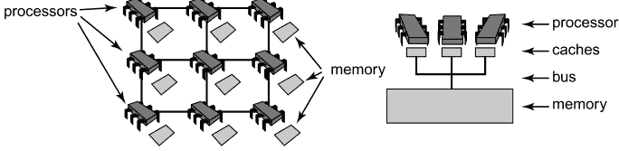

图 B.4

右侧为带有缓存的 SMP 架构，左侧为无缓存的 NUMA 架构。

在 NUMA 架构中，一组节点通过点对点网络连接，类似于微型局域网。每个节点包含一个或多个处理器和一个本地内存。一个节点的本地内存可以被其他节点访问，所有节点的内存共同构成了所有处理器共享的全局内存。NUMA 的名称反映了一个事实：处理器访问其所在节点内存的速度比访问其他节点内存的速度快。网络比总线更复杂，需要更复杂的协议；它们在扩展到大量处理器时性能比总线更好。

SMP 和 NUMA 架构之间的划分是一种简化：例如，某些系统具有混合架构，其中集群内部的处理器通过总线通信，而不同集群之间的处理器通过网络通信。

从程序员的角度来看，可能无法判断出底层平台是基于总线、网络还是混合互连。然而，认识到互连是处理器之间共享的有限资源至关重要。如果一个处理器使用了太多的互连带宽，其他处理器可能会被延迟。

## B.4 内存

处理器共享主内存，主内存是一个由地址索引的大型字数组。字或地址的大小取决于平台，但通常位宽为 32 位或 64 位。简单来说，处理器通过向内存发送一个包含所需地址的消息从内存中读取一个值。响应消息包含关联的数据，即该地址的内容。处理器通过向内存发送地址和新数据来写入值，内存会在新数据安装完成后回传一个确认信号。

## B.5 缓存

在现代架构中，访问主内存可能需要数百个周期，因此处理器可能面临花费大量时间等待内存响应请求的风险。现代系统通过引入一个或多个缓存来缓解这一问题：缓存是位于处理器更近的小型内存，因此速度比主内存快。这些缓存在逻辑上位于处理器和内存“之间”：当处理器尝试从给定的内存中读取一个值时，它首先检查该值是否已在缓存中，如果是，它就不需要执行较慢的内存访问。如果找到了目标地址的值，我们称处理器发生了“缓存命中”，否则为“缓存未命中”。同样地，如果处理器尝试写入一个位于缓存中的地址，它就不需要执行较慢的内存访问。在缓存中满足的请求比例被称为缓存命中率。

缓存之所以有效，是因为大多数多处理器都表现出高度的局部性：如果一个处理器读取或写入一个内存地址（也称为内存位置），那么它很快就会再次读取或写入同一个位置。此外，如果一个处理器读取或写入一个内存位置，那么它很可能会读取或写入附近的位置。为了利用这一第二个观察结果，缓存通常以大于单个字的粒度运行。缓存存储一组相邻的字（有时称为缓存块）。

在实践中，多处理器具有两或三级缓存，称为 L1、L2 和 L3。除了最后一个（也是最大的）缓存外，所有缓存通常与处理器位于同一块芯片上。访问 L1 缓存通常需要一或两个周期。访问片上 L2 可能需要大约十个周期。最后一级（无论是 L2 还是 L3）通常需要几十个周期。这些缓存的速度远快于访问内存所需的数百个周期。当然，这些时间随平台而异，许多多处理器具有更复杂的缓存结构。

NUMA 架构的最初建议并不包含缓存，因为当时认为本地内存是空的。后来，商业 NUMA 架构包含了缓存。有时使用缓存一致性 NUMA（cc-NUMA）来表示带有缓存的 NUMA 架构。在这里，为了避免歧义，我们使用 NUMA，除非另有说明。

### B.5.1 一致性

共享（或不礼貌地说，内存竞争）发生在一个处理器读取或写入一个被另一个处理器缓存的内存地址时。如果两个处理器都在读取数据而不进行修改，那么数据可以缓存在两个处理器中。然而，当一个处理器尝试更新共享的缓存行时，另一个处理器的副本必须失效，以确保它不会读取过时的值。在最通用的形式，这个问题被称为缓存一致性。文献中包含各种非常复杂的缓存一致性协议。在这里我们回顾最常用的之一，MESI 协议（发音为“messy”），其名称源于可能的缓存状态。（现代处理器倾向于使用带有额外状态的更复杂协议。）以下是缓存行状态：

## 附录 B 硬件基础 525

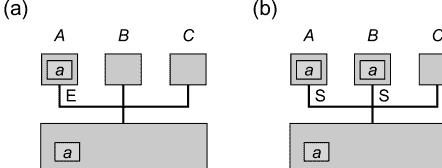
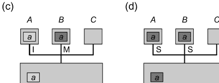

图 B.5

MESI 缓存一致性协议状态转换的示例。(a) 处理器 *A* 从 *a* 读取数据，并将其存储在自己的缓存中，处于独占状态。(b) 当处理器 *B* 尝试从同一地址读取时，*A* 检测到冲突并响应相关数据。现在，*a* 在 *A* 和 *B* 缓存中都以共享状态形式缓存。(c) 如果 *B* 写入共享地址 *a*，它会将状态更改为已修改，并发送消息警告 *A*（以及其他缓存了该数据的处理器）将其缓存行状态设置为无效。(d) 如果 *A* 从 *a* 读取，它会发送请求，并通过向 *A* 和主内存发送修改后的数据来响应，使两个副本都处于共享状态。

- **Modified（已修改）**：该行在缓存中已被修改，最终必须写回内存。没有其他处理器缓存此行。
- **Exclusive（独占）**：该行未被修改，没有其他处理器缓存此行。
- **Shared（共享）**：该行未被修改，其他处理器可能缓存此行。
- **Invalid（无效）**：该行不包含有效数据。

我们通过图 B.5 所示的简短示例来说明这一协议。为了简单起见，我们假设处理器和内存通过总线连接。

处理器 *A* 从地址 *a* 读取数据，并将其存储在自己的缓存中，处于独占状态。当处理器 *B* 尝试从同一地址读取时，*A* 检测到冲突并响应相关数据。现在，*a* 在 *A* 和 *B* 缓存中都以共享状态形式缓存。如果 *B* 写入共享地址 *a*，它会将状态更改为已修改，并发送消息警告 *A*（以及其他缓存了该数据的处理器）将其缓存行状态设置为无效。如果 *A* 从 *a* 读取，它会发送请求，并通过向 *A* 和主内存发送修改后的数据来响应，使两个副本都处于共享状态。

## B.5.2 自旋

如果一个处理器正在反复测试内存中的某个字，等待另一个处理器更改它，则处于自旋状态。根据架构的不同，自旋会对整个系统性能产生巨大影响。

在没有缓存的 SMP 架构上，自旋是一个非常糟糕的主意。处理器每次读取内存都会消耗总线带宽，而没有完成任何有用工作。由于总线是广播介质，这些内存请求可能会阻止其他处理器进展。


在没有缓存的 NUMA 架构上，如果涉及的地址位于处理器的本地内存中，自旋是可以接受的。虽然没有缓存的多处理器架构很罕见，但当我们考虑涉及自旋的同步协议时，我们仍然会问它是否允许每个处理器在其本地内存上自旋。

在带有缓存的 SMP 或 NUMA 架构上，自旋消耗的资源要少得多。处理器第一次读取地址时，会发生缓存缺失，并将地址的内容加载到缓存行中。之后，只要数据保持不变，处理器就会从自己的缓存中重新读取，不再消耗互连带宽，这一过程被称为本地自旋（local spinning）。当缓存状态改变时，处理器会发生一次缓存缺失，观察到数据已更改并停止自旋。

## B.6 缓存感知编程，或谜题的答案

我们现在知道如何解释为什么附录 B.1 中检查的 TTAS 能够执行 TASLock。TASLock 每次对锁应用 `getAndSet(true)` 时，它都会向连接的互连发送消息，产生大量的流量。产生的流量可能足以饱和互连，延迟所有线程（包括释放锁的线程，甚至是不竞争锁的线程）。相比之下，当锁忙碌时，TTAS 进行自旋，读取本地缓存的锁副本，不产生互连流量，这解释了其性能的提升。

TTASLock 远未理想。当锁被释放时，所有的缓存副本都会失效，所有等待的线程都会调用 `getAndSet(true)`，导致产生爆发流量，虽然比 TASLock 小，但仍然显著。

我们将在第 7 章中进一步讨论缓存与锁的交互。在这里，我们考虑了一些结构数据的简单方法，以避免伪共享（false sharing）。

- 独立访问的对象或字段应该进行对齐和填充，以便它们落在不同的缓存行中。
- 将只读数据与频繁修改的数据分开。例如，考虑一个结构固定但元素值频繁变化的列表。为了确保修改不会减慢列表遍历，可以对值字段进行对齐和填充，使每个字段填充整个缓存行。
- 多个线程共享一个字节数组会引入伪共享，而使用双精度整数数组的危险较小。

## B.7 多核与线程

在多核架构中，多个处理器共享 L2 缓存，但它们有自己的 L1 缓存。这在 SMP 架构中很常见。L2 缓存由内存共享。

在没有缓存的 NUMA 架构上，如果涉及的地址位于处理器的本地内存中，自旋是可以接受的。虽然没有缓存的多处理器架构很罕见，但当我们考虑涉及自旋的同步协议时，我们仍然会问它是否允许每个处理器在其本地内存上自旋。

多核架构中，多个处理器共享 L2 缓存，但它们有自己的 L1 缓存。这在 SMP 架构中很常见。L2 缓存由内存共享。

现代处理器将多核与线程结合，在非常细的粒度上执行，这有助于隐藏访问内存的高延迟。许多现代处理器具有大量的内部并行性，可以乱序执行、并行执行，或在数据计算之前预测性执行。

图 B.6


MESI 缓存一致性协议状态转换的示例。(a) 处理器 `A` 从 `a` 读取数据，并将其存储在自己的缓存中，处于*独占（exclusive）*状态。(b) 当处理器 `B` 尝试从同一地址读取时，`A` 检测到冲突并响应相关数据。

## B.7.1 弛内存一致性 (Relaxed memory consistency)

当处理器写入一个值时，它被保留在缓存中并标记为脏（dirty），这意味着它最终必须写回内存。在大多数现代处理器中，写入请求在发布时并没有应用于内存。它们被收集在一个名为写入缓冲区（write buffer）或存储缓冲器的硬件队列中，并在稍后应用于内存。写入缓冲区提供了两个优点：首先，合并多个请求是高效的，这种现象被称为批（batching）。其次，如果一个线程多次写入同一个地址，较早的请求可以丢弃，从而节省内存访问，这种现象被称为吸收（absorption）。

写入缓冲区的使用具有非常重要的后果：写入和读取到内存的顺序并不并不一致。例如，回顾第 1 章的原理，该原理应用于互斥性：如果两个处理器首先写入标志，然后读取标志位置，其中一个将看到对方新写入的标志值。有了写入缓冲区，这不再成立；两个线程都可能写入，每个进入各自的缓冲区，但这些写入在每个处理器读取对方的标志位置之前应用于共享内存。因此，两者都没有读取对方的。

编译器更为糟糕。它们擅长在单处理器架构上优化性能。通常，这种优化涉及*重排序线程对内存的读写操作*。这种重排序对于单线程程序是不可见的，但对于可能错误观察到顺序的多线程程序，可能会产生意外的后果。例如，如果一个线程填充缓冲区数据并设置一个标志来标记缓冲区已满，那么并发线程可能会在看到新数据之前看到标志，导致它们读取旧值。附录 A.3 中描述的错误的*双检查锁定*模式是 Java 内存模型中不直观方面产生陷阱的示例。

# 附录 B 硬件基础 529

不同的架构对于内存读写操作可以被重排序的程度提供了不同的保证。通常原则上，最好不要依赖这些保证，而是使用下段中描述的更昂贵的技术来防止这种重排序。

每种架构都提供一种内存屏障指令（有时称为 `fence`），它强制写操作按照其发射的顺序发生，但这是需要代价的。屏障会刷新写缓冲区，确保屏障之前的所有写操作都通过原子读-修改-写操作（如 `getAndSet()`）或标准并发库原子地插入。因此，当处理器对临界区域的共享变量执行读写指令时，需要显式地使用内存屏障。

一方面，内存屏障是昂贵的（需要数百个周期，可能更多），因此应该只在需要时使用。另一方面，应该大量使用同步屏障，而不是依赖于针对特定平台关于内存指令排序限制的复杂保证。

Java 本身允许对对象的读写操作在发生在同步方法或块之外时进行重排序。Java 提供了一个 `volatile` 关键字，确保发生在同步块或方法之外的对 `volatile` 对象的读写不会被重排序。（C++ 的原子模板提供了类似的保证）。使用该关键字可能是昂贵的，因此应该只在需要时使用。我们注意到，原则上讲，可以使用 `volatile` 字段使双重检查锁定正常工作，但这样做没有意义，因为访问 `volatile` 变量无论如何都需要同步。

我们关于多处理器硬件的入门介绍就到此结束。我们将在特定数据结构和算法的背景下继续讨论这些体系概念。一种模式将会显现出来：多处理器程序的性能高度依赖于底层硬件。

## B.2 硬件同步指令

如第 5 章所述，任何现代多处理器架构都必须支持强大的同步原语以具有通用性，即提供计算等价于通用图灵机的计算能力。因此，Java 和 C++ 的实现在实现同步时，依赖于此类特殊的硬件指令（也称为硬件原语），从自旋锁、监视器到复杂的无锁数据结构，并不意外。

现代架构通常提供两种同步原语之一。AMD、Intel 和 Oracle 架构支持比较并交换（CAS）指令。它接受三个参数：地址 `a`、期望值 `e` 和更新值 `v`，返回一个布尔值。它原子地执行以下操作：如果地址 `a` 处的内存包含期望值 `e`，则将更新值 `v` 写入地址 `a` 并返回 `true`，否则保持内存不变并返回 `false`。

在 Intel 和 AMD 架构上，CAS 被称为 `CMPXCHG`；在 Oracle SPARC 系统上，Java 的 `java.util.concurrent.atomic` 提供了实现 `compareAndSet()` 方法的 `AtomicBoolean`、`Integer` 和 `Reference` 类。（我们的大部分示例是 Java，我们通常指代 `compareAndSet` 而不是 CAS。）C++ 的原子模板提供了相同的功能。

CAS 有一个陷阱。也许 CAS 最常用的用法如下：应用程序从给定的内存地址读取值，并为该位置计算一个新值 `c`。它意图存储 `c`，但仅当地址处的值 `a` 自读取以来没有变化时才执行。人们可能认为应用一个期望值为 `a`、更新值为 `c` 的 CAS 就能实现这一点。存在一个问题：线程可能用另一个值 `b` 覆盖了值 `a`，并再次写入该地址。CAS 会将 `a` 替换为 `c`，但应用程序可能并没有按照意图执行（例如，如果它存储的是指针，则新值 `a` 可能是被回收对象的结果）。这个问题被称为 ABA 问题，将在第 10 章中详细讨论。

另一种同步原语是一对指令：链接加载（load-linked, LL）和条件存储（store-conditional, SC）。LL 从地址 `a` 读取内容，随后的 SC 尝试在该何处存储一个新值。如果 `a` 的内容自早先 LL 指令以来没有发生变化，则 SC 指令成功；如果在间隔内 `a` 内容发生了变化，则失败。

许多架构支持 LL/SC 实例：Alpha AXP (`ll/stl_c`)、IBM PowerPC (`lw/stw`)、MIPS 11 和 ARM (`ldrex/strex`)。LL 不受 ABA 问题的影响，但在实践中，线程在 LL 和匹配的 SC 之前能做的操作受到严格限制。上下文切换、另一个 LL 或存储指令都可能导致 SC 失败。

稀疏使用原子字段及其相关方法是一个好主意，因为 CAS 或 LL/SC 消耗的周期远多于加载或存储。它包含一个内存屏障，并防止无序执行和各种编译器优化。精确成本取决于许多因素，不仅在不同架构之间存在差异，在同一架构内指令的不同不同应用之间也存在差异。仅可以说，CAS 或 LL/SC 的速度可能比简单的加载或存储慢一一个数量级。

## B.9 附注

Tom Anderson [12] 对自旋锁进行了经典的实验。John Hennessy 和 David Patterson [63] 对计算机架构进行了全面的论述。

> SPARC 上的 CAS 不返回布尔值，而是返回该位置的上一个值，该值可以用于重试失败的 CAS。Intel 上的 `CMPXCHG` 有效地同时返回了布尔值和数值。

Intel 的 Pentium 处理器使用 MESI 协议 [83]。关于缓存感知编程的提示改编自 Benjamin Gamsa、Orran Krieger、Eric Parsons 和 Michael Stumm [49]。Sarita Adve 和 Karosh Gharachorloo [1] 为内存一致性模型提供了卓越的综述。

## B.10 练习

**练习 B.1.** 线程 A 必须等待另一个处理器更改内存中的标志位。调度器可以允许 A 自旋并反复测试标志位，也可以调度 A。假设操作系统切换到另一个处理器需要 20 毫秒。如果 A 从 $t_0$ 开始，标志位在 $t_1$ 变化，那么操作系统将浪费 $t_1 - t_0$ 时间进行无用功。预知调度器是可以预测未来的。如果标志位将在 20 毫秒内变化，那么让 A 自旋是合理的，因为取消调度和重新调度 A 会浪费 20 毫秒。另一方面，如果标志位变化需要超过 20 毫秒，则更换另一个线程是合理的，浪费不超过 20 毫秒。你的任务是实现一个调度器，其浪费的时间不超过预知调度器在相同情况下浪费时间的两倍。

**练习 B.2.** 想象你是一个律师，付费为某个观点辩护。你会如何论证以下主张：“如果上下文切换的时间忽略不计，那么处理器就不需要缓存，至少对于包含大量线程的应用来说？”额外加：批判你的论点。

**练习 B.3.** 考虑一个具有 16 行缓存（索引从 0 到 15）的直接映射缓存，每行缓存包含 32 个字。

- 用位移和掩码操作解释如何将地址映射到缓存行。假设此问题中地址指的是字而不是字节；地址 7 指的是内存中的第八个字。
- 考虑程序循环访问包含 64 个字的数组四次的最佳和最坏命中率。
- 考虑程序循环访问包含 512 个字的数组四次的最佳和最坏命中率。

**练习 B.4.** 考虑一个具有 16 行缓存（索引从 0 到 15）的直接映射缓存，每行缓存包含 32 个字。考虑一个 $32 \times 32$ 的二维字数组。在内存中的布局方式是 $a[0,0]$ 与 $a[0,1]$ 相邻，依此类推。假设缓存初始为空，但假设 $a[0,0]$ 映射到缓存行 0 的第一个字。

考虑以下列优先遍历：

```cpp
int sum = 0;
for (int i = 0; i < 32; i++) {
  for (int j = 0; j < 32; j++) {
    sum += a[i,j]; // 2维维度变化最快
  }
}
```

以及以下行优先遍历：

```cpp
int sum = 0;
for (int i = 0; i < 32; i++) {
  for (int j = 0; j < 32; j++) {
    sum += a[j,i]; // 第一维变化最快
  }
}
```

假设最旧的缓存行被驱逐，比较两种遍历产生的缓存缺失（cache misses）数量。

**练习 B.5.** 在 MESI 缓存一致性协议中，区分独占（exclusive）和修改（modified）模式的优势是什么？区分独占（exclusive）和共享（shared）模式的优势是什么？

**练习 B.6.** 实现图 B.1 和 B.2 所示的 test-and-set 和 test-and-test-set 锁，测试它们在多处理器*上*的相对性能，并分析结果。

## 参考文献

[1] Saritia Adve, Koursh Gharachorloo, Shared memory consistency models: a tutorial, Computer 29 (12) (1996) 66–76.

[2] Yehuda Afek, Hagit Attiya, Danny Dolev, Eli Gafni, Michael Merritt, Nir Shavit, Atomic snapshots of shared memory, Journal of the ACM 40 (4) (1993) 873–890.

[3] Yehuda Afek, Dalia Dauber, Danny Touitou, Wait-free made in; STOC '93: Proceedings of the Twenty-Seventh Annual ACM Symposium on Computing. ACM Press, New York, NY, USA, 1995, pp. 538–547.

[4] Yehuda Afek, Gideon Sun, Danny Touitou, Light-free and adaptive atomic snapshot and implementation (extended abstract), in: Symposium on Principles of Distributed Computing. 2000, pp. 71–80.

[5] Yehuda Afek, Eytan Weissberger, A completeness theorem for a class of synchronization objects, in: STOC '93: Proceedings of the Twelfth Annual ACM Symposium on Distributed Computing, ACM Press, New York, NY, USA, 1993, pp. 396.

[6] A. Agrawal, M. Cherian, Adaptive backoff synchronization techniques, in: Proceedings of the 16th International Symposium on Computer Architecture. May 1989, pp. 396–406.

[7] Ole Agreen, David Deferrande, Michael Kramer, Ramesh, Derek White, Atomic eff-metric-lock for implementing ubiquitous synchronization, ACM SIGPLAN Notices 34 (10) (1999) 207–222.

[8] M. Ajtai, J. Komelson, E. Sumeri, An Olog synchronization network; in: Proc. of the 15th ACM Symposium on Computing, 1983, pp. 1–9.

[9] G.M. Amahl, Validity of the single-processor approach to achieve large scale computing capabilities; in: AFIPS Conference, Atlantic City, NJ, AFIPS Press, Rest, April, 1967, pp. 483–485.

[10] James H. Andrews, Composite registers, Distributed Computing 6 (3) (1993) 141–154.

[11] James H. Andrews, Mark Scott, Universal constructions for multi-object operations, in: PODC '95: Proceedings of the Twelfth Annual ACM Symposium on Distributed Computing, ACM Press, New York, NY, USA, 1995, pp. 184–193.

[12] Thomas E. Andrews, The performance of spin lock alternatives for shared-memory multiprocessors, IEEE Transactions on Distributed Systems 1 (1) (1990) 6–16.

[13] Nimar S. Aron, Robert D. Blum, C. Mifni, Thread scheduling for multiprocessor-processors, in Proceedings of the Tenth Annual ACM Symposium on Parallelism and Architectures, ACM Press, 1998, pp. 119–129.


# 参考文献

[14] James Asnes, Maurice Heritly, Rich B. Kovonu, Counting numbers, Journal of the ACM 41 (5) (1994) 1024–1048.

[15] David F. Bacon, Ravi B. Kovonu, Thin locks: synchronization for Java, in: SIGPLAN Conference on Programming Language Design and Implementation, 1998, pp. 258–268.

[16] K. B. Batcher, Sorting networks and their applications, in: Proceedings of AFIPS Joint Conference, 1997: pp. 307–314.

[17] R. Bayer, M. Schollenacker, Concurrency of operations on B-trees, Informatica 9 (1997) 1–21.

[18] Robert D. Blum, Charles E. Leisch, Scheduling multithreaded computations for work stealing, Journal of ACM 46 (5) (1999) 720–729.

[19] Hans-J. Boehm, Threads cannot be implemented as a library, in: Proceedings of the 2005 ACM SIGPLAN Conference on Programming Language Design and Implementation, PLDI '05, ACM Press, New York, NY, USA, 2005, pp. 261–268.

[20] Hans-J. Boehm, Can get along with programming language models?, in: Proceedings of 2012 ACM SIGPLAN Workshop on Memory Systems Performance and Correctness, Beijing, June 2012.

[21] Elizabeth Borowsky, Eli Gafni, Immediate snapshots and fast renaming; in: PODC '93: Proceedings of the Twelfth ACM Symposium on Distributed Computing, ACM Press, New York, NY, USA, 1993, pp. 41–51.

[22] Anastasia Braginsky, Alex Kogan, Erez Petrank, lightweight management for non-blocking data structures, in: Proceedings of 25th ACM Symposium on Parallelism and Algorithms, Montreal, Quebec, July 2013.

[23] Trevor Brown, Reclaiming memory for lock-free data structures: to be a better way, in: Proceedings of 34th ACM Symposium on Principles of Distributed Computing, Portland, OR, June 2015.

[24] James E. Burns, Nancy A. Lynch, Bounds on shared memory for mutual exclusion, Information and Computation 107 (2) (December 1993) 171–184.

[25] James E. Burns, Gary L. Peterson, Constructing multi-atomic values from non-atomic values, in: PODC '97: Proceedings of the 19th ACM Symposium on Distributed Computing, ACM Press, New York, NY, USA, 1997, pp. 222–231.

[26] Costas Busch, Marius Mavron, a combinatorial treatment of balancing networks, Journal of the ACM 43 (5) (1996) 794–839.

[27] Tushar Deepak Chandra, Prasad Jayant, A time-free construction for closed objects, in: PODC '98: Proceedings of the Seventh ACM Symposium on Principles of Distributed Computing, ACM Press, New York, NY, USA, 1998, pp. 287–296.

[28] Graham Chapman, John Clegg, Terry Gilliam, Eric Idle, Monty Python, and the Holy Grail, 1975.

[29] David Chase, Yossi Lev, Dynamic circular work-stealing locks from atomic swap, in: SPAA '05: Proceedings of the Seventh ACM Symposium on Parallelism and Algorithms, ACM Press, New York, NY, USA, 2005, pp. 21–28.

[30] Nachman Cohen, Erez Petrank, Efficient management for lock-free data structures with optimistic access, in: Proceedings of 27th ACM Symposium on Parallelism and Algorithms, Portland, OR, June 2015.

[31] T. Craig, Building FIFO and priority-queuing locks from atomic swap, Technical Report TR 93-002, University of Washington, Department of Computer Science, 1993.

[32] Luke Dalesandro, Michael Spear, Michael L. Scott, Neel: STM by abandoning ownership, in: Proceedings of the 15th ACM Symposium on Principles and Parallel Programming, Bangalore, India, 2010.

[33] Dave Dice, Rohit Shavit, Implementing fast monitors with relaxed-locks, in: Java Virtual Machine and Technology Symposium, 2001, pp. 79–90.

[34] David Dice, Virat J. Marathe, Lock cohort: a general technique for designing NUMA locks, ACM Transactions on Parallel Computing 1 (2) (2015) 13.

[38] E.W. Dijkstra, Terry Shavit, Bounded concurrent-staming, SIAM Journal on Computing 26 (2) (1997) 418–455.

[40] Martin Boyd, Yehoshua Perl, Lary Rudolph, Michael Sachs, The periodic boolean sorting network, Journal of the ACM 36 (4) (1999) 738–757.

[41] Arthur Conan Doyle, A Study in Scarlet and the Sign of Fire, Berkeley Publishing Group, ISBN 0425102408, 1994.

[42] Cynthia Dorth, Orfi Waarts, Efficient and bounded concurrent taming and the traceable usage, Journal of the ACM 46 (5) (1999) 633–666.

[43] E. Ellis, Concurrency in hashing, ACM Transactions on Database Systems 12 (2) (1987) 195–217.

[44] Facebook, Folly: Facebook Open-source Library, https://github.com/facebook/folly/, 2017.

[45] F.E. Finch, D. Hendler, N. Shavit, Linear lower bounds on real-world implementations, in: Proceedings of the Seventh ACM Symposium on Principles of Distributed Computing, ACM Press, New York, NY, USA, 1993, pp. 205–163.

[46] D. Hendler, N. Shavit, Implementation of distributed consensus with one faulty process, Journal of the 32 (2) (1985) 374–382.

[47] Cynthia Dorth, Orfi Waarts, Efficient and bounded concurrent taming and the traceable usage, Journal of the ACM 46 (5) (1999) 633–666.

[48] D. Hendler, N. Shavit, Implementation of distributed consensus with one faulty process.

[49] James H. Andrews, Composite registers, Distributed Computing 6 (3) (1993) 141–154.

[50] Nachman Cohen, Erez Petrank, Efficient management for lock-free data structures with optimistic access, in: Proceedings of 27th ACM Symposium on Parallelism and Algorithms, Portland, OR, June 2015.

[51] T. Craig, Building FIFO and priority-queuing locks from atomic swap, Technical Report TR 93-002, University of Washington, Department of Computer Science, 1993.

[52] Luke Dalesandro, Michael Spear, Michael L. Scott, Neel: STM by abandoning ownership, in: Proceedings of the 15th ACM Symposium on Principles and Parallel Programming, Bangalore, India, 2010.

[53] Dave Dice, Rohit Shavit, Implementing fast monitors with relaxed-locks, in: Java Virtual Machine and Technology Symposium, 2001, pp. 79–90.

[54] David Dice, Virat J. Marathe, Lock cohort: a general technique for designing NUMA locks, ACM Transactions on Parallel Computing 1 (2) (2015) 13.

[55] E.W. Dijkstra, Terry Shavit, Bounded concurrent-staming, SIAM Journal on Computing 26 (2) (1997) 418–455.

[56] Costas Busch, Marius Mavron, a combinatorial treatment of balancing networks, Journal of the ACM 43 (5) (1996) 794–839.

[57] Tushar Deepak Chandra, Prasad Jayant, A time-free construction for closed objects, in: PODC '98: Proceedings of the Seventh ACM Symposium on Principles of Distributed Computing, ACM Press, New York, NY, USA, 1998, pp. 287–296.

[58] Graham Chapman, John Clegg, Terry Gilliam, Eric Idle, Monty Python, and the Holy Grail, 1975.

[59] David Chase, Yossi Lev, Dynamic circular work-stealing locks from atomic swap, in: SPAA '05: Proceedings of the Seventh ACM Symposium on Parallelism and Algorithms, ACM Press, New York, NY, USA, 2005, pp. 21–28.

# 536 参考文献

[66] M. Herly, Y. Lev, V. Luchanchang, N. Shavit, A provably scalable skiplist (brief announcement), in: Proc of the 10th International Conference on Distributed Systems, OPODIS 2006, 2006.

[67] M. Herly, V. Luchanchang, M. Toir, The repeat offender problem: a mechanism for supporting lock-free-dynamic-sized structures, in: Proceedings of the 16th International Symposium on Distributed Computing, vol. 2508, Springer-Verlag-Heidelberg, January 2002, pp. 339–353.

[68] M. Herly, V. Luchanchang, M. Toir, Obstruction-free synchronization: double-ended queues as an example, in: Proceedings of the 23rd International Conference on Distributed Computing, IEEE, 2003, pp. 522–529.

[69] Maurice Herly, Wait-free synchronization, ACM Transactions on Programming Languages and Systems 13 (1) (1991) 124–149.

[70] Maurice Herly, Yossi Leifer, Nir Shavit, A lock-free concurrent skiplist with wait-free search, 2007.

[71] Maurice Herly, Berg-Hong Lin, Nir Shavit, Scalable concurrent counting, ACM Transactions on Computer Systems 13 (4) (1995) 543–564.

[72] Maurice Herly, Nir Shavit, On the nature of progress, in: Proceedings of the 15th International Conference on Principles of Distributed Systems, OPODIS11, Springer-Verlag, Berlin, Heidelberg, 2011, pp. 313–328.

[73] Maurice Herly, Nir Shavit, Moran Tzafir, Concurrent counting hashing, Technical report, Berlin 2007.


## 参考文献

[74] P. Herly, J. Elot, B. Mass, Transactional memory: architectural support for lock-free data structures, in: Proceedings of the 20th International Conference on Computer Architecture, San Diego, CA, 1993.

[75] P. Herly, Jeannette M. Wing, Linearizability: a correctness condition for concurrent objects, in: ACM Transactions on Programming Languages and Systems 12 (3) (1990) 463–492.

[76] C.A. Rocha, “Algorithm 63: partition”, “Algorithm 64: quickicksort”, and “Algorithm 65: find”, Communications of the ACM 4 (7) (1971) 321–332.

[77] C.A. Rocha, Monitors: an operating system synchronization construct, Communications of the ACM 17 (10) (1974) 549–557.

[78] Richard Harvey, The Art of Concurrent Programming, Co깅ritis, 2002.

[79] M. Hsu, Wei Yang, Concurrent operations in extensible hashing, in: Symposium on Very Large Data Bases, 1986, pp. 241–247.

[80] J.S. Huang, Y. Chow, Partition sorting and sorting by partition, in: Proceedings of the IEEE Computer Society's International Software Conference and Conferences, 2008, pp. 627–631.

[81] R. Hudson, Brian Saha, Al-Riza Adi-Tabatabi, Benjamin Hertz, A scalable transactional allocator, in: Proceedings of the International Processing Lectures on Memory Management, Ottawa, Canada, June 2006.

[82] Galen C. Hunt, Maged Michael, Distributed-parallel implementations of shared memory primitives, in: Proceedings of the 13th Annual ACM Symposium on Principles of Distributed Computing, Los Angeles, CA, August 14–17, 1994, pp. 151–160.

[83] Amos Israel, Ming Li, Bound stamped, Distributed Computing 6 (5) (1993) 205–209.

[84] Amos Israel, L. Pratt, Atomic multi-writer multi-reader atomic register, in: Principles of Distributed Computing, 1992, pp. 71–82.

[85] Mohamed Gouda, James Anderson, Anil Shing, The elusive atomic register, Technical Report TR 86.29, University of Texas at Austin, 1998.

[86] Prasad Jayanti, Wait-free free-hierarchies, Journal of the ACM 44 (4) (1997) 592–614.

[87] Prasad Jayanti, A lower bound on the local time complexity of universal constructions, in: PODC '98: Proceedings of the Seventeenth Annual ACM Symposium on Principles of Distributed Computing, ACM Press, New York, NY, USA, 1998, pp. 183–192.

[90] Prasad Jayanti, Sam Toueg. Some results on the impossibility, universality, and decidability of consensus; in: WDAG '92: Proceedings of the 6th International Workshop on Distributed Algorithms, Springer-Verlag, London, UK, 1992, pp. 69–84.

[91] D. Jimenez-Gonzalez, J.J. Navarro, J.-L. Lirriba-Peza, Cache-cache: a cache conscious sorting based on radix sort, in: Proc of the 11th Euro Conference on Parallel, Distributed and Network-Based Processing, 2003, pp. 101–108.

[92] M. Kiotakis, Evangelos Kranakis, Paul M.B. Vitanyi, Atomic multireader register; in: Proceedings of 2nd International Workshop on Distributed Algorithms, Springer-Verlag, London, UK, 1998, pp. 278–296.

[93] M.R. Klugman, Simple counting networks and related topics, Technical Report MIT/LCS/TR-643, MIT for Computer Science, 1994.

[94] Michael Klugman, C. Greg Plaxon, Simple counting networks, in: STOC '92: Proceedings of the Twenty-Fourth ACM Symposium on Theory of Computing, ACM Press, New York, USA, 1992, pp. 417–428.

[95] D. Knuth, The Art of Computer Programming: Fundamental Algorithms, vol. 3, Addison-Wesley, 1973.

[96] Clyde P. Kruskal, Larry Rudolph, Marc Sznir, Synchronization of multiprocessors with shared memory, ACM Transactions on Programming Languages and Systems 10 (4) (1988) 579–601.

[97] V. Kumar, Concurrent operations on extensible and performance, Communications of the ACM 33 (6) (1990) 681–694.

[98] Christopher Lister, Effective synchronization on Linux/NUMA systems, in: Proceedings of the May 2005 Meeting, San Jose, CA.

[99] L. Lamport, On interprocess communication, Distributed Computing 1 (1986) 77–101.

[100] Leslie Lamport, A new view of Dijkstra's concurrent programming, Communications of the ACM 17 (5) (1974) 543–545.

[101] Leslie Lamport, Time clocks, and the ordering of events, Communications of the ACM 21 (7) (1978) 558–565.

[102] Leslie Lamport, How to make a multiprocessor computer that correctly executes multiprocess programs, IEEE Transactions on 28 (9) (September 1979) 690.

[103] Leslie Lamport, Semantic locking, unsolved problems in concurrency, in: Proceedings of the Third ACM Symposium on Distributed Computing, 1984, pp. 1–11.

[104] Leslie Lamport, address: new challenges in concurrency, in: Distributed Computing 1 (January 1998) 203–213.

[105] Leslie Lamport, A fast mutual exclusion algorithm, ACM Transactions on Concurrent Systems 5 (1) (January 1987) 1–11.

[106] B. Lamport, with processes and monitors in Mesa, Communications of the ACM 22 (3) (1989) 105–117.

[107] Doug Lea, `http://docs.oracle.com/java/6/docs/concurrent/ConcurrentHashMap.html`

[108] Doug Lea, `http://docs.oracle.com/java/6/docs/java/util/concurrent/ConcurrentSkipMap.html`

[109] Doug Lea, Java community practices, 166, `http://www.info.org/en/jf/166`, 2003.

[110] Shin-Jae Lee, Minsoo Joo, Dongsung Kim, Andrew Sohn, Partitioned radix sort, Journal of Parallel and Distributed Computing 62 (4) (2002) 656–668.

[111] C. Leiser, H. Prok, A course on multithreaded programming, `http://supertech.csail.mit.edu/papers/`.

[113] Li Ming, John Thom, Paul M.B. Vitanyi, To share concurrent variables, Journal of the ACM 43 (3) (1996) 723–744.

[114] Wai-Kao Lo, Vassos Hadzilacos, All of us are smarter than us: wait-free hierarchies are not robust; in: STOC '97: Proceedings of the Twenty-Ninth ACM Symposium on Theory of Computing, ACM Press, New York, NY, USA, 1997, pp. 579–588.

[115] I. Lason, N. Shavit, List-based concurrent priority queues, in: Proc. of the 14th International on Parallel and Distributed Computing, IPDPS, 2000, pp. 263–268.

[116] M. Loui, H. Abu-Amarara, Memory requirements for agreement among asynchronous processes, in: Preparata (Ed.), Advances in Computing, 4, JAI Press, Greenwich, CT, 1987, pp. 163–183.

[117] Victor Lynch, Daniel Nussbaum, Nir Shavit, A hierarchical lock queue lock, in: Euro-Par, 2000, pp. 801–810.

[118] P. Magnusson, A. Landon, H. Gesteren, Locks on coherent multiprocessor architectures, in: Proceedings of the 8th International Symposium on Parallel Processing, IPPS, IEEE Computer Society, April 1994, pp. 165–171.

[119] Jeremy Manson, William Pugh, Sarrita V. Ade, The Java memory model, in: Proceedings of the 32nd ACM SIGLA-SIGACT Symposium on Principles of Programming Languages, POPL '05, ACM, New York, NY, USA, 2005, pp. 378–391.

[120] Ydong Ma, Robert Morris, Optimizing MapReduce for cluster architectures, Technical Report MIT-CSAIL-2010-0420, MIT-CSAIL, 2010.

[121] Virendra J. Marathe, Nir Shavit, Composite atomic locks, in: Proceedings of the 20th International Conference on Parallel and Distributed Computing, IPDPS'06, IEEE Computer Society, Washington, DC, USA, 2006.

[122] Paul E. McKenzie, Selecting locking primitives for parallel programming, Communications of the ACM 39 (6) (1996) 75–82.

[123] Paul E. McKenzie, Exploiting Destruction: an Analysis of Read-Copy-Update in Operating System Kernels, PhD thesis, School of Science and Engineering at Oregon, 2004.

[124] John Mellor, Michael Scott, Algorithms for scalable synchronization on shared-memory machines, ACM Transactions on Computer Systems 9 (1) (1991) 21–65.

[125] M.M. Michael, L. Scott, Simple, fast and non-blocking linked algorithms, in: Proc. of the Seventh ACM Symposium on Principles of Computing, ACM Press, 1996, pp. 267–275.

[126] Maged M. Michael, High performance dynamic lock-free and lock-based sets, in: Proceedings of the Fourteenth ACM Symposium on Parallel Algorithms and Architectures, 2002, pp. 72–83.

[127] Jayde Masek, Algorithms managing shared memory access in distributed systems, ACM Transactions on Programming Languages and Systems 8 (1) (1980) 142–153.


## 参考文献

[128] Mark Moor, Practical implementations of non-blocking synchronization primitives, in: PODC '97: Proceedings of the Sixth Annual ACM Symposium on Principles of Distributed Computing, ACM Press, New York, NY, USA, 1997, pp. 219–228.

[129] Mark Moor, Lazy pays? Using synchronization techniques to improve non-blocking constructions, in PODC '90: Proceedings of the Seventeenth Annual ACM Symposium on Principles of Distributed Computing, ACM Press, New York, NY, USA, 2000, pp. 61–70.

[130] Mark Moor, Daniel Nussbaum, Ori Shavit, Nir Shavit, Using elimination to implement scalable and lock-free queues, in: SPAA '05: Proceedings of the Seventeenth Annual ACM Symposium on Parallelism in Algorithms and Architectures, 2005, pp. 253–262.

[131] James H. Martin, Real programming in functional languages, Technical Report 81-115, Xerox Alto Research Center, 1981.

[133] Takuya Nakaike, Rei Odaira, Mathieu Gaudet, Maged M. Michael, Hisanobu Tomari, Quantitative comparison of transactional memory for Blue Gene/Q, Enterprise EC12, Intel Core, and POWER8, in: Proceedings of the 42nd International Annual Symposium on Computer Architecture, Portland, OR, June 2015.

[134] Richard Newman-Wolfe, A protocol for wait-free, atomic, multi-reader variables, in: PODC '87: Proceedings of the Sixth Annual Symposium on Principles of Distributed Computing, ACM Press, New York, NY, USA, 1987, pp. 232–248.

[135] Isaac Newton, I Bernard Cohen (Translator), Anne Whitney (Translator), The Principle: Mathematical of Natural Physics, University of California, 1999.

[136] R. Pagh, F.J. Roder, Cuckoo hashing, Journal of Algorithms 51 (2) (2004) 122–144.

[137] Charles H. Pappalimitriou, The serializability of concurrent database updates, Journal of the ACM 26 (4) (1979) 631–653.

[138] Gary Peterson, Myths about the mutual exclusion problem, Information Processing Letters 12 (3) (1981) 115–116.

[140] S. A. Plotkin, Sticky sticks and usability of consensus, in: PODC '89: Proceedings of the Eighth Annual ACM Symposium on Principles of Distributed Computing, ACM Press, New York, NY, USA, 1989, pp. 159–178.

[141] W. Pugh, Concurrent maintenance of skip lists, Technical Report CS-TR-2222.1, Institute for Advanced Computing Studies, Department of Computer Science, University of Maryland, 1989.

[142] W. Pugh. Skip lists: a probabilistic approach to balanced trees, ACM Transactions on Database 33 (6) (1990) 668–76.

[143] C. Purcell, T. Harris, Non-blocking hashtables with open addressing, in: Proceedings of International Symposium on Computer Architecture, 2005, pp. 108–121.

[144] Zoran Rodić, Erik Hagensager, Hierarchical backoff for nonuniform architecture architectures, in: Ninth International Symposium on High Performance Computer Architecture, Anaheim, California, USA, February 2003, pp. 241–252.

[145] Ravi Rajamer, James R. Goodman, Lockless election: enabling highly concurrent thread execution, in: Proceedings of the 4th IEEE/ACM International Symposium on Microarchitecture, Austin, TX, December 2002.

[146] Ravi Rajamer, James R. Goodman, Transactional lock-free execution of lock-based groups, in: Proceedings of the 10th International Conference on Architectural Support for Programming Languages and Systems, ASOS-X, ACM Press, 2002, pp. 5–7.

[147] M. Raynal, For Mutual Exclusion, MIT Press, Cambridge, MA, 1986. A variant time algorithm, Journal of the ACM 34 (1) (1987) 65–76.

[148] John H. Roy, Leslie G. Gargant, A Valiant algorithm for linear size networks, in: Proceedings of the EuroSys 2009 Conference, Nuremberg, Germany, 2009.

[150] L. Rudolph, Segal, Dynamic decentralized cache stores for MIMD parallel processors, in: Proceedings of the 11th Annual Symposium on Computer Architecture, ACM Press, 1984, pp. 342–347.

[151] L. Rudolph, M. Shivikin-Alloof, E. Ural, A simple load balancing scheme for task allocation in parallel machines, in: Proceedings of the 3rd Annual ACM Symposium on Parallel Algorithms and Architectures, ACM Press, July 1997, pp. 237–245.

[152] Michael Saks, Nir Shah, Heather Wool, Optimal randomized consensus — making algorithm fast in: SODA '91: Proceedings of the Second Annual ACM-SIAM Symposium on Discrete Algorithms, Society for Industrial and Applied Mathematics, Philadelphia, PA, USA, 1991, pp. 351–362.

[153] Michael L. Scott, Non-blocking timer in scalable queue-based spin locks, in: PODC '02: Proceedings of the Twenty-First Annual Symposium on Principles of Distributed Computing, ACM Press, New York, NY, USA, 2002, pp. 31–40.

[154] Michael L. Scott, William N. Scherer, Scalable queue-based spin locks with timeout, ACM SIGPLAN Notices 36 (7) (2001) 44–52.

[155] Maurice Sendak, Where the Wild Things Are, Harper-Collins, ISBN 0060254920, 1988.

[156] O. Shalev, N. Shavit, Split-ordered locks: lock-free extensible hash table, Journal of the ACM 53 (3) (2006) 379–405.

[157] N. Shavit, D. Touitou, Software transactional memory, Distributed Computing 10 (2) (February 1997) 99–116.

[158] Nir Shavit, Asaph Zemach, Diffracting trees, ACM Transactions on Computer Systems 14 (4) (1996) 385–428.

[159] Eric Shk, The consensus hierarchy is not robust, in: PODC '97: Proceedings of the Seventeenth Annual ACM Symposium on Principles of Distributed Computing, ACM Press, New York, NY, USA, 1997, p. 279.

[160] Ambuj K. Singh, James H. Anderson, Mohamed. Gouda, The elusive register, Journal of the ACM 41 (2) (1994) 311–339.

[161] Justin Talbot, Richard M. Yoo, Phoenix: MapReduce for shared-memory systems, in: Proceedings of the Second International Workshop on MapReduce and Applications, MapReduce 1, New York, NY, USA, 2011, p. 9–16.

[162] R.K. Treiber, Systems programming with parallelism, Technical Report 51, IBM Research Center, April 1986.

[163] Alan Turing. On computable numbers, with an application to the problem, Proceedings of the London Mathematical Society (1937).

[164] John D. Valour, Lock-free links in distributed systems, in: Proceedings of the Fourteenth ACM Symposium on Principles of Distributed Computing, ACM Press, 1995, p. 214–222.

[165] Pavel Vitány, Barack Auerbach, atomic shared register by asynchronous hardware, in: 27th Annual Symposium on Principles of Computer Science, IEEE Society, Los Angeles, October 1986, p. 233–243.

[166] M.E. We, Locality properties: modular concurrency for abstract data types, Transactions on Programming Languages and Systems 11 (2) (1989) 249–282.

[167] William N. Scherer, Doug Lea, Scalable synchronous queues, in: PoPP '06: Proceedings of the Eleventh ACM Symposium on Principles and Practice of Parallel Programming, ACM Press, New York, NY, 2006, p. 147–156.

[168] P. Yew, N. Tzeng, D. Lawrie, Distributing hot-spot adaptation in large-scale multiprocessors, IEEE Transactions on 36 (4) (April 1987) 388–395.

## 索引

### 0-9

`0-value`, 105

`0-principle`, 293

`1-regular register`, `Register`

`1-value`, 105

`3-balancer`, 301

### A

`ABA problem`, 173, 240, 242, 391, 530

`Absorption`, write, 528

`Abstract value`, 204

`Abstraction map`, 209

`Acquire (lock)`, `Lock`

`Acquire (semaphore)`, 196

`Address, memory`, 523

`Adversary`, 126

`Aggregate operation`, `Stream`

41

`Announcement array`, 134

`Application interface (API)`, 522

`Approximate agreement`, 123

`ArrayList`, 306

`Asynchronous`, 76

`Atomic, MRW`, `Register`

`Atomic MRSW`, `Register`

`Atomic object`, 150

`Atomic+`, 451, 452

`Atomic operation`, 5, 150

`Atomic register`, `Register`

`Atomic snapshot`, `Snapshot`

`Atomic SRSW`, `Register`

`AtomicInteger`, 116, 506

`AtomicReference`, 91

`AtomicReference`, 150, 506

`AtomicSRW`, 87

`AtomicSRW-Register`, 100

`AtomicStampedReference`, 242, 243

`Auxiliary variable`, 137, 138

### B

`Backoff`

`hierarchical`, 167

`timeout`, 163

`Backofflock`, 154, 156, 164, 167, 270

`Bakery`, 34

`Bakery algorithm`, 41

`Balanced tree, rebalancing`, 335

`Balancer`, 281

`Balancer`, 276

`quiescent`, 279

`Balancing network`, 277, 279

`counting network`, `Counting Network`

`depth`, 277

`pseudowriting`, 299

`smoothing network`, 299

`step property`, 270

`weighted step`, 302


# Balancing property

- `SkipList`

# Balancing workload

- 398

# Barrier

- 432
  - combining tree, 334, 437
  - dissemination, 449
  - memory, `Memory barrier`
  - reverse lock, 447
  - sense, 433
  - static atomic, 436
  - termination, 438, 439
  - tournament tree, 445
  - tree, 334

# Synchronization

- 431
  - center, 417

# BaseSet

- 306, 307

# Blocking

- 528

# Binary consensus

- 104

# Bit-reversed counter

- 375, 376

# Bitonic

- 241, 283, 285

# Bitonic network

- `Counting Network`

# BITONIC network

- 280, 283, 285

# Bitonic sorting network

- `Sorting Network`

# Bitonicsort

- 295, 296

# BitreversedCounter

- 376

# ivalent

- 105

# Block

- 287

# BLOCK network

- 285, 287

# Blocking implementation

- 65

# Back-off

- 67, 154, 482
- 155, 170

# Blocking implementation

- 56, 147, 184
  - dequeue, 64

# Blocking progress

- `Progress`

# Blocking synchronization

- 184

# Bottleneck-sequential

- 254, 265

# Boolean register

- `Register`

# Capacity (of hash table)

- `Hash set`

# CAS

- 530

# Checkpoint

- 477

# Chicken sexy

- 575

# CircularArray

- 395–398

# Class

- 552

# univers

- 129

# Clean double collect

- 92

# Closed addressing

- `Hashing`

# Cluster ID

- 167

# Cluster (in NUMA system)

- 166

# Cluster lock

- 188

# Clustering algorithm

- 406

# Clusterlocal

- 167

# CMPXGH instruction

- 119, 530

# Course-grained synchronization

- 201, 206, 308

# Coarsegrainedset

- 308, 309

# Coarselet

- 306, 207

# Coherence protocol

- `Cache coherence protocol`

# Cohort

- 168

# Cohort detection

- `lock mechanisms`, 169

# CohortDetectionLock

- 169

# Collection operation

- 92

# Collisions

- `Hashing`

# Combining software

- `Software combining`

# Combining status

- 267

# Combining tree barrier

- `Barrier`

# CombiningTree

- 266–268, 275

# Common register

- `Register`

# Communication

- `transient, ver`, 29

# Comparator

- 293
  - lambda expression, `Lambda synchronization`, 293

# Compare-and-swap (CAS)

- 116, 119, 529

# Compareandset()

- 116, 119, 120

# Comparison network

- 293
  - isomorphic to battling network, 294
  - sychous, 293

# complete(H)

- 61

# Complete method call

- see Method call

# C

# C++

- `notify_all()`, 512
- `notify_one()`, 512
- `std::atomic`, `std::`
- `std::condition_variable`, 511
- `std::lock_guard`, 509
- `std::mutex`, 509
- `std::recursive_mutex`, 509
- `std::shared_mutex`, 509
- `std::unique_lock_wrapper`, 510
- `thread`, 508
- `wait()`, 511

# C++ memory model

- 512

# Cache

- 152, 475, 521, 523
  - direct-mapped, 477, 524
  - dirty, 528
  - eviction, 476
  - fully associative, 524
  - hit ratio, 523
  - replacement policy, 524
  - set associative, 524

# Cache coherence

- transactional, 476

# Cache coherence protocol

- 152, 475, 476, 524
  - MESI, 476, 524, 525

# Cache granularity

- 524

# Cache hit

- 153, 523

# Cache line

- 475, 524

# Cache miss

- 153, 523

# Cache state

- exclusive, 152, 476, 525
- invalid, 153, 476, 525
- modified, 476, 525
- shared, 152, 476, 525

# Cache-coherent NUMA (cc-NUMA) system

- 524

# Callback

- `Method call`

# 索引 543

- 计算有向无环图 (`dag`), 384
- 计算模型, 75
- 具体表示, 204
- 并发对象, 1
- 并发程序, 1
- 条件, 185, 190, 232
- 条件变量, *参见 Condition*
- C++, 510
- 冲突，线程, 264
- 共识, 104
- 共识, 103, 104
  - 二进制, 104
  - 与线程, 104
  - 无锁, 104
- 共识数, 103, 105, 129
- 比较并交换 (`compare-and-Set`), 109, 110, 129
- 多重赋值, 113, 115
- 队列, 110, 111
- 寄存器, 107, 108
- MWR 寄存器, 117
- 共识对象, 104
- 共识协议, 104, 107, 109, 110, 115, 119
  - 随机, 126
- 共识协议, 109, 122
- 一致性
  - 外部, *参见 External consistency*
  - 静态的, *参见 Quiescent consistency*
  - 顺序的, *参见 Sequential consistency*
- 构造
  - 寄存器, 108, *参见 Register registrations*
  - 通用, *参见 Universal construction*
- 共识, 229, 230, 244
- 竞争, 154, 265, 524
- 内容管理, 66, 482
- 上文切换, 522
- 传递, 467
- 协调协议, 6
- 正确性, 49
- 正确条件, *参见 Linearizability*
  - 非阻塞, 56
  - 静态一致性, *参见 Quiescent consistency*
  - 顺序一致性, *参见 Sequential consistency*
- 计数器, 5, 22, 360
- 计数器, 23
- 计数器, *边界方法*, 360
- 计数网络, 276, 279, 298
  - 调波型, 279, 280
  - 竞争, 289
  - 扩散树, 288
  - 对数深度, 288
  - 性能, 287
  - 周期性, 285, 286
  - 流水线, 287
  - 饱和, 280, 286
  - 软件, 280, 286
- 覆盖状态, 39
- 覆盖，线程, 40
- 临界区, 22, 500
- 关键状态, 106
- 布谷鸟哈希 (`Cuckoo hashing`)
  - 并发, 324
  - 顺序, 323
  - 分带并发, 329

## D

- 有向无环图 (`Dag`), *参见 Directed acyclic graph*
- 数据并行性, 405
- 数据竞态, 469
- 数据结构, *参见 Dual structure*
- 数据并行算法, 405
- 死锁, 24, 29, 466, 500
  - 与死锁检测, 59
- 无死锁方法, 67
- 无死锁斥, *参见 Mutual exclusion*
- 无死锁, 8, 24, 25, 67, 68
- 决策值, 105
- 依赖进程图, *参见 Progress condition*
- 双端队列 (`Deque`), 389
  - 任务窃取, *参见 Work stealing deque*
- 取消调度（一个线程）, 522
- 描述符, 486, 488
- 确定性对象, 131
- 扩散树, 288
- 扩散均衡器, 291, 292
- 扩散树类, 291, 292
- 哲学家就餐, 15
- 直接映射缓存, *参见 Cache*
- 有向无环图 (`dag`), 384
- 离散访问并行, 305
- 传播屏障, *参见 Barrier*
- 分布式协调图, 265, 298
- 分布式结构, 298
- 支配，在进程图中, 37
- 门道状态, 33, 35, 42
- 双重检查锁定, 504, 528
- 双端队列, *参见 Deque*
- 驱动程序, 199
- 双重数据结构, 244, 246
- 双端栈 (`DualStack`), 错误的, 262

## E

- 消除, 254, 288
  - 消除数组, 254, 255, 257
  - 消除退避, 254, 255, 258
- 极易并行的 (`Embarrassingly parallel`), 13
- 空异常, 50
- 基于代的内存管理, *参见 Management*
- 等价类, *参见 History*
- 事件, 21
  - 调用, *参见 Invocation*
  - 优先关系, 21
  - 响应, *参见 Response*
- 驱逐, *参见 Cache*
- 交换器, 255, 290
- 互斥
  - l-互斥, *参见 Mutual*
- 独占缓存, *参见 Cache state*
- 隔离执行, 66
- 执行器服务, 379
- 显式推测，问题, 468
- 指数退避, *参见 Back-off*
- 可扩展哈希, *参见 Hashing*
- 外部一致性, 59
  - 可扩展的, 306
  - `ForkJoinPool`, 379
- 空闲列表, 240, 241
- 释放（一个锁）, *参见 Lock*
- 免受干扰, 204, 212, 213
- 满（一个预留）, *参见 Reservation*
- 满异常, 50
- 函数式接口, Java, 90
- 函数式编程, 414
  - 垃圾收集, 240, 454, 455
  - 依赖于, 204, 452
- `getAndAdd`, 116
- `getAndIncrement`, 116
- `getAndFree`, 116, 151
- 幽灵变量, *参见 Auxiliary variable*
- 全局锁, 168
- 全局状态, 39
- 贪心调度, *参见 Schedule*
  - 握手锁, 208–210
- 硬件事务的, *参见 Memory*
- 哈希值（对象）, 202, 305
- 哈希函数, 305
- 哈希集合, 305
  - 容量, 306
  - 细粒度的, 307, 308
  - 全局阈值, 307
  - 增量调整大小, 315
  - 无锁, 352
  - 调整大小, 306, 307, 311, 329, 331
  - 溢出偏移, 317
  - 分带的, 310
  - 表, 305
  - 哈希表
- 哈希, 305–334
  - 封闭寻址, 305
  - 冲突, 305
  - 布谷鸟, *参见 Cuckoo hashing*
- 失败调用, *参见 Method call*
- 公平共享, *参见 Schedule*
- 公平性, 33, 220
- 伪共享, 150, 159, 526, 527
- 容错, 9
- 栅栏, *参见 Memory barrier*
- `Fetch-and-add`, 116
- `Fetch-and-increment`, 116
- `FList`, 384
- `Fifo`/无锁, 192, 193
- 过滤器, 31, 43
- 过滤器（流）, *参见 Stream*
- 过滤器锁, 30
- final 字段, 锁, 506
- finally（try）, 23
- 细粒度同步, 201, 210, 355
- 细粒度堆, 365–371
- 细粒度的, 208–211
- 先进先出, 33
- 先进先出 (`FIFO`), 230
- 标记, 7, 8
- 标记原则, 7
- 标记协议, 7
- 脆弱的, 43
- `Fork-join` 池, 379
- `Fork-join` 任务, 379
- `Forking`（一个任务）, 379
- 开放寻址, 305, 323, 331
- 探测集, 324
- 危险指针, 458, 460, 461
- 头（队列）, 230
- 堆, 363
  - 并发, 365
  - 顺序的, 363
- 堆节点, 细粒度堆, 366, 367

## H

- 分层级锁, 166–170
- 高竞争, *参见 Contention*
- 历史, 60
  - 等价的, 61
  - 法律, 61
  - 线性化的, 62
  - 顺序的, 61
  - 良好的, 61
- 命中, *参见 Cache*
- 命中率, *参见 Cache*
- 保持（一个锁）, *参见 Lock*
- 热点, 265
- 队列, 73, 250
- 混合事务内存, *参见 Transaction memory*
- lambda 表达式, *参见 Lambda expression*
- `notify()`, 501
- `notifyAI`, 501
- `sleep()`, 502
- 同步事件, 505
- 同步, 500
- 线程, 497
- `threadLocal`, 503
- `volatile`, *参见 volatile*
- 与 C++, 451
- `wait()`, 500, 501
- `yield()`, 502
- Java 模型, 150, 504
- 基本属性, 5
- 合并（一个任务）, 384
  - 阻塞, *参见 Implementation*
  - 接口, 57
- 实现原子寄存器, 无法使用, 77
- 原地, *参见 Sorting*
- 不一致状态, *参见 Lock*
  - 需要两个操作, 5
  - 增量调整大小, *参见 Hash set*
  - 分布, 60
  - 一致的, 60
  - 在, 66
  - 独立的, 72
- 独立进展机制, *参见 Progress condition*
- 内源并行性, 377
- 初始状态, 105
- 内部类, 190
- 连接, 521, 522
- 接口, 与实现, 57
- 干扰, *参见 Freedom*
- 中断, 196
- `InterruptedException`, 186
- 间期, 22
  - 方法调用, 61
- 无效缓存状态, *参见 Cache*
- 不变性, 204
- 不变（`Invariant`）, 50, 60, 130
  - 匹配响应, 60

## K

- 内核, 388
- `KMeans`, 406
- 基于 `MapReduce`, 441
- 基于流的, 417–419

## L

- lambda 表达式, Java, 409
- 比较器, 423
- 干扰的, 420
- 满的, 420
- 后进先出 (`LIFO`), 230, 251
- 延迟, 265
  - 与吞吐量, 267
- 层, 286
  - Java 计算, *参见
  - Java 方法, 238, 339
- Java 同步, 164, 201, 225, 237
- `JavaList`, 216–220, 337
- `JavaSkipList`, 337–342, 345, 355
- 法律历史, 61
- 法律对象, 61
- 通用, 132
- 线性加速, 386
- 线性化, 61, 205, 395
  - 组合性, 63
  - 非阻塞, 63
  - 在真实系统上保证, 149
  - 与静态一致性, 60
  - 与顺序一致性, 60
- 线性化, 58, 59


- 线性化历史，*参见* `History`

- 线性化（一个历史），62

- 线性化点，588, 205, 341, 343, 348

- 线性化（在一点），方法调用，58, 205

    - Java `final` 字段，506

    - 函数式接口，*参见* `Functional interface`

- 链表，202, 231

- 列表，306

- 基于列表的集合实现，202

- 死锁 (`LiveLock`)，29

- 活跃性，2

- 负载均衡，*参见* `Balancing`，workload

- 加载操作，39, 76

- 加载链接与条件存储 (`LLSC`)，530

- 加载自旋，153, 526

- 本地状态，39

- 本地线程，166

- 锁，23, 184

    - 获取，183, 500

    - 退避，*参见* `Back-off` busy，244

    - 聚类，*参见* `Cluster lock`

    - 组，*参见* `Cohort lock`

    - 门道区，33

    - 先来先服务，33–35

    - 释放，242

    - 全局，*参见* `Global lock`

    - 分层，*参见* `Hierarchical lock`

    - 保持，24, 183

    - 用于 id，23

    - 不一致状态，39

    - 队列，*参见* `Queue lock`

    - 读写者，*参见* `Writers-readers lock`

    - 重入，*参见* `Reentrant lock`

    - 租约，284, 100

    - 序列，*参见* `Sequence lock`

    - 旋旋，*参见* `Spin lock`

    - 无饥饿，27, 28, 32

    - 支持组检测，129

    - 比较并交换，*参见* `Test-and-and-set lock`

    - 比较并交换，*参见* `Test-and-and-set lock`

    - 线程无知的，*参见* `Thread-oblivious lock`

    - 超时，164, 172

- 锁，106, 107

- 锁耦合，208

- 锁释放，事务的，278

# 索引 547

`MatrixMultiply`，425

`Vector`，423

最大进展，68

最大速度，13

`MemManager`，455, 456, 460, 461

内存屏，149, 526

内存一致性，宽松，528

内存一致性模型，64

内存竞争，*参见* `Contention` (竞争)

内存控制器，152

内存栅栏，*参见* `Memory barrier` (内存屏)

内存管理，240, 454

自动的，*参见* `Garbage collection` (垃圾回收)

委托回收，455

基于 epoch 的，462

手动的，453

保护，255, 456

内存模型

C++，512

Java，*参见* `Java memory model` (Java内存模型)

内存模型，*参见* `Memory consistency model` (内存一致性模型)

内存回收，*参见* `Memory Management` (内存管理)

合并，281

`MERGER` 网络，279, 284

`MESI` 消息，*参见* `Cache coherence protocol` (缓存一致性协议)

方法，572

无死锁，*参见* `Deadlock-free method` (无死锁方法)

Java，497

懒的，*参见* `Lazy method` (懒性方法)

无锁，*参见* `Lock-free method` (无锁方法)

无干扰的，*参见* `Obstruction-free method` (无干扰方法)

部分的，*参见* `Partial method` (部分方法)

无饥饿，*参见* `Starvation-free method` (无饥饿方法)

同步的，*参见* `Synchronous method` (同步方法)

无等待，*参见* `Wait-free method` (无等待方法)

方法，53, 80

完全的，61

间隔的，61

线性化点，*参见* `Linearization point` over overlapping (重叠部分的线性化点)，61

挂起的，54

先序关系，62, 80

成功的（或失败的），202

不可恢复的（或失败的），202

最小进展，66, 68

缺失，*参见* `Cache miss` (缓存缺失)

378

模块化设计系统，57

模块化，183

监视器，183, 187, 244, 498, 516, 517

移动，293

多读多写 (`MRMW`) 寄存器，*参见* `Register` (寄存器)

多读单写 (`MRSW`) 寄存器，*参见* `Register` (寄存器)

`MultiConsensus`，114

多核，1, 527

多重赋值对象，113

多重赋值问题，113

程序环境，390

多线程架构，528

互斥，5, 10, 21-47, 148

无死锁，39

属性

# N

网络 (`Network`)

负载，*参见* `Balancing network` (负载网络)

比较，*参见* `Network network` (网络网络)

计数，*参见* `Sorting network` (排序网络)

排序，*参见* `Switching network` (交换网络)

# Node (节点)

`BoundedBuffer`，231, 232

C++ list，456

`CombiningTree`，268, 271-287

`LazySkipList`，339, 340

`LFUnserial`，131

基于列表的，202

无锁，237, 238

`LockFreeStack`，252

`PrioritySkipList`，372

`StaticBarrier`，438, 439

`SynchronousQueue`，246, 247

`Trendbarrier`，456, 437

通用的，131

非阻塞算法 (`Nonblocking algorithms`)，470

非阻塞正确性条件，*参见* `Correctness` (正确性)

线性化性，501

非阻塞方法，56

非阻塞对象实现，56

非阻塞操作，56

非阻塞进展，*参见* `Progress condition` (进展条件)

非阻塞同步，200, 220, 215

代价，225

非易失性寄存器，117

非统一内存访问系统，*参见* `NUMA system` (NUMA系统)

通知，432

`notify(1)`，Java，501

`notify_all(1)`，C++，512

`notify_all(1)`，Java，501

`notify_one(1)`，C++，512

NUMA 架构，无缓存，161, 163

NUMA 系统，166, 522

# 548 索引

# 0

对象 (`Object`)，52

共识，*参见* `Consensus object` (共识对象)

确定性的，*参见* `Deterministic object` (确定性对象)

Java，497

无锁，*参见* `Lock-free object` (无锁对象)

多重赋值，*参见* `Multiple assignment object` (多重赋值对象)

无干扰，*参见* `Obstruction-free object` (无干扰对象)

顺序的，*参见* `Sequential object` (顺序对象)

共享并发，76

通用的，*参见* `Universal object` (通用对象)

无等待，*参见* `Wait-free object` (无等待对象)

对象历史，合法的，61

对象实现，无等待，*参见* `Wait-free object` (无等待对象)

对象状态，52

对象主观性，*参见* `Subhortory` (主观性)

操作的，41

干扰方法，66

干扰对象，66

无干扰快照，*参见* `Snapshot` (快照)

无干扰性，66

`OEIvis` 网络，295

`8bitset`，47

开放寻址，*参见* `Operation` (操作)

操作 (`Operation`)，*参见* `Blocking operation` (阻塞操作)

非阻塞，*参见* `Nonblocking operation` (非阻塞操作)

乐观同步，201, 211, 355

粗粒度的，215

乐观列表，212–215

顺序 (`Order`)

程序，*参见* `Program order` (程序顺序)

实时的，写入，80

所有权，*参见* `Ownership record` (所有权记录)

重叠方法调用，*参见* `Method call` (方法调用)

覆盖，41

所有权记录（的），485

性能（对于微处理器），2

周期的，287

周期性网络，285, 288

周期性计数，*参见* `Counting network` (计数网络)

持久性通信，9

`Peterson`，27, 148

`Peterson` 锁，泛化的，44

`Peterson` 算法，47

阶段簇，324–326

物理删除，216, 220–222, 338

流水线，287, 298

多项式的，402

池 (`Pool`)，220

池，265

有界的，229

Fork-join，*参见* `Fork-join`

线程，*参见* `Thread` (线程)

无界的，229

后置条件 (`Post-condition`)，52

队列 (`Queue`)，359

先序图，时间戳

事件，*参见* `Event` (事件)

间隔，*参见* `Interval` (间隔)

方法调用，*参见* `Method call` (方法调用)

前置置条件，52

前驱任务，384

前缀，443

优先级插入，467

优先级队列，359

有界范围，359

基于堆的，360

跳表，371

无界范围，359, 363, 371

优先级列表，371–374

`Prism`，290

概率数据结构，336

探测集，*参见* `Hashing` (哈希)

过程，387

处理器，387, 390, 521, 522

生产者，229, 230, 244

生产者-消费者问题，10

生产者-消费者属性，10

程序正确性，2

程序顺序，54

进展条件，64–68, 205

阻塞，56, 67

无死锁性，*参见* `Deadlock-freedom` (无死锁)

依赖的，68

保证最大进展，68

保证最小进展，68

独立的，67

# P

填充 (`Padding`)，155

并行计算，443

并行排序，293

并行性，186

分析，385

固有的，*参见* `Inherent parallelism` (固有并行性)

并行列表，419–421

部分方法，61, 229–230

部分顺序（严格的），61

部分队列，*参见* `Queue` (队列)

可查看的栈，141

挂起方法调用，*参见* `Method call` (方法调用)

性能测量，265

# 549 索引

无锁性，*参见* `Lock-freedom` (无锁)

阻塞，56, 65, 66

无干扰，*参见* `Obstruction-freedom` (无干扰)

无饥饿，*参见* `Starvation-freedom` (无饥饿)

无等待，*参见* `Wait-freedom` (无等待)

进展保证，*参见* `Coherence condition` (一致性条件)

缓存一致性，*参见* `Coherence protocol` (一致性协议)

共识，*参见* `Consensus protocol` (共识协议)

协调，*参见* `Coordination protocol` (协调协议)

协议状态，105

# Q

`QNode`

`QLock`，160

`CompositeLock`，174

`MCSLock`，162

`Tolock`，164

队列 (`Queue`)，125, 187

队列 (`Queue`)，230

有界的，230, 231

共识数，110, 111

无锁，236

部分的，230

优先级，*参见* `Priority queue` (优先级队列)

单引擎/双，52

同步的，244

总的，235

无界的，235, 236

队列实现

`LockBasedQueue`，50

`railqueue`，52

队列锁，150, 170, 171

超时，163

队列-共识，110

快速排序，297

静默负载均衡器，*参见* `Balancer` (负载均衡器)

静默负载均衡网络，*参见* `Balancing` (负载均衡)

静默一致性，59, 359, 361, 363, 374

不保持程序顺序，60

非阻塞，60

池和计数器，276

与线性化性对比，60

与顺序一致性对比，60

`Qobject`，39

# R

`R-有界等待`，42

随机数生成器，重要性

线程本地，257, 503

随机化，297, 298, 503

随机化共识协议，*参见* `Consensus protocol` (共识协议)

# With

# 550 索引

安全的 `SRSW`，78

单读单写 (`SRSW`)，78, 79, 85, 87

无等待，91

回回，102

寄存器构造，81–91

常规布尔 `MRSW` 寄存器，*参见* `Register` (寄存器)

常规多值 `MRSW` 寄存器，*参见* `Register` (寄存器)

常规 `MRSW` 寄存器，*参见* `Register` (寄存器)

寄存器寄存器，*参见* `Register` (寄存器)

常规 `SRSW` 寄存器，*参见* `Register` (寄存器)

`RegularSRWRegister`，80

`RegularSRWRegister`，84

释放 (`a`)，96

释放 (`a`)，53, 60, 83

远程，165

会会，230, 244, 298

表示，204

保留，245

匹配，310

健壮性，275

可运行，397, 498

# S

安全的 `SRSW`，*参见* `Register` (寄存器)

安全的 `SRSW` 寄存器，*参见* `Register` (寄存器)

安全寄存器，*参见* `Register` (寄存器)

安全的 `SRSW` 寄存器，*参见* `Register` (寄存器)

`SafeSRWRegister`，82

采样排序，293, 296

随机化，297

饱和计数，*参见* `Network` (网络)

扫描操作，92

调度，65

贪婪的，388

调度器，65, 387, 388

信号量，96

信号量，194

感知反转屏障，*参见* `Barrier` (屏障)

感知屏障，433, 434

哨兵节点，203, 232, 235, 238, 246, 247, 336

`SeqObj`，130

`SeqSnapshot`，94

序列锁，468

顺序瓶颈，*参见* `Bottleneck`

顺序一致性，55, 56

非阻塞，56

组件化的，57

在实时系统中不保证，149

与线性化性对比，59

顺序一致性，53–58

顺序堆，*参见* `Heap` (堆)

顺序历史，*参见* `History` (历史)

顺序对象，134

顺序跳表，*参见* `Skiplist` (跳表)

顺序规范，53, 61

顺序堆，364, 365

`SequentialRegister`，77

# 索引 551

- 软件双调性计数网络，*参见* 计数网络 (`Counting network`)

- 软件合并，266

- 软件周期性计数网络，*参见* 计数网络 (`Counting network`)

- 软件事务，*参见* 事务内存 (`Transactional memory`)

- 单独，线程，107

- 排序，292

  - 原地排序，299

  - 排序网络，293

    - 双调性 (`bitonic`)，295

    - 与计数网络同构的，*参见* 同步 (`synchronous`)，295

- `Span` 律法，386

- 栈（并行性），386

  - 规范，顺序，*参见* 顺序规范 (`Sequential specification`)

  - 速度，2, 386

- 自旋锁，147

- 旋旋 (`Spinning`)，526

  - 本地，*参见* 本地自旋 (`Local spinning`)

- 栈的实现，56, 147, 184

- 分离排序 (`Split-ordering`)，递归，*参见* 递归 (`Recursive`)

- `RSW` 寄存器，*参见* 寄存器 (`Register`)

- `S55`（单课程短路径），426

- 栈，251

  - 正确的，263, 294

- 栈，251

  - 无锁，251

  - 无界，251

- 栈，342

- 惊群性效应 (`Stampedos`)，95, 96

- `StampedValue`，86

- 饥饿，24, 66

- 无饥饿锁，*参见* 无饥饿方法 (`Starvation-free method`)，67

- 无饥饿，8, 10, 24, 25, 67

- 状态

  - 二值的，*参见* 二值 (`Bivalent`)

  - 对象的，*参见* 对象状态 (`Object state`)

  - 协议，*参见* 协议状态 (`Protocol state`)

  - 单值的，*参见* 单值 (`Univalent`)

- 静态树屏障，*参见* 屏障 (`Barrier`)

- 静态无屏障 (`Staticfreebarrier`)，438, 439

- 状态，合并，*参见* 合并状态 (`Combining status`)

- `std::atomic`，C++，452, 508

- `std::condition_variable`，C++，511

- `std::lock_guard`，C++，510

- `std::mutex`，C++，509

- `std::recursive_mutex`，C++，509

- `std::shared_mutex`，C++，509

- `std::thread`，C++，508

- `std::unique_lock_wrapper`，C++，510

- 步属性，*参见* 平衡网络 (`Balancing network`)

- 粘性位 (`StickyBit`)，123

- 缓冲区，*参见* 写缓冲区 (`Write Buffer`)


- 存储操作，39, 76
- 流 (`Stream`)，414
- 流 (`Stream`)，416
  - 聚合操作，415, 416
  - 过滤，407
  - 中间操作，415
  - 惰性计算，415
  - 映射 (`map`)，407
  - 归约器 (`reducer`)，407
  - 终端操作，415
- 流编程，406, 414
- `StripedCuckoo#hashset`，329, 330
- `Striped#hashset`，310
- 分段锁 (`Striping, lock`)，见锁分段 (`Lock stripping`)
- 子库，261
  - 对象，61
  - 线程，61
- 成功的方法调用，见方法调用 (`Method call`)
- 后继任务，384
- 供应者 (`Supplier`)，409
- 切换，302
  - 添加，302
- 对称多处理 (`SMP`)，522
- 同步
  - 阻塞，见阻塞 (`Blocking`)
  - 粗粒度，见粗粒度同步 (`Coarse-grained synchronization`)
  - 细粒度，见细粒度同步 (`Fine-grained synchronization`)
  - 惰性，见惰性同步 (`Lazy synchronization`)
  - 非阻塞，见非阻塞同步 (`Nonblocking synchronization`)
  - 乐观，见乐观同步 (`Optimistic synchronization`)
- 同步事件，Java，505
- 同步原语，103, 529, 530
  - 相对能力，103
- 同步块或方法，Java，187, 500, 505
- 同步方法，229, 230
- 同步队列，见队列 (`Queue`)
- 同步-在，246, 247
- 同步-在，244, 245
- 同步系统，39

# T

- 队列的尾部，230
- 任务 (`Task`)，377, 390
  - 屏障，440, 441
- 团队共识，124
- 终止检测屏障，见屏障 (`Barrier`)
- 测试并设置指令 (`Test-and-set instruction`)，150
- 测试并设置锁，150, 159
- 窃取者 (`Thief`)，工作窃取 (`work stealing`)，389

# 552 索引

- 线程
  - C#，514, 515
  - Java，498, 499
- 线程，1, 76, 387, 390, 521, 522
  - C++，508
  - C#，514
  - 冲突，66
  - Java，497
  - 合并 (`join`)，498, 508
  - 本地，166
  - 映射器 (`mapper`)，206
  - 归约器 (`reducer`)，100
  - 远程，167
  - 非单线程，508
  - ，408
  - 工作线程 (`worker`)，377
  - 产生 (`yield`)，见让出 (`Yielding`)
- 作为状态机的线程，21
- 线程 ID，25
- 线程池，377
  - 优势，375
- 线程子库，见辅助库 (`Subsidiary`)
- 线程本地 (`Thread-local`)，157, 240, 241, 502, 513
- 线程感知锁 (`Thread-oblivious lock`)，169
- 线程上下文 (`ThreadContext`)，458, 460, 491
- `ThreadID`，25
  - C#，517
  - Java，502, 503
  - 本地，C++，513
- `Threadlocal`，Java，502
- `ThreadlocalRand`，Java，503
- `ThreadStart`，46, 514, 515
- 线程状态 (`ThreadStatus`)，265
  - 对比延迟，267
- 超时，163, 172
- 时间戳 (`Timestamp`)，36
- 时间戳 (`Timestamp`)，76
  - 有界的，35
  - 优先级图，36
- 时间戳系统，46
- 时间戳，85, 90
- `TimestampSystem`，36
- TLE，见事务锁消除 (`Transactional lock elision`)
- 全量方法，61, 229, 230
- 全序，62
- 全队列，见队列 (`Queue`)
- 巡回屏障，445
- 锦标赛树，见屏障 (`Barrier`)
- 树宽，266
- `TreeBarrier`，435–437
- `Treebolt`，361, 362
- `Turnbstrier`，177
- 双线程无锁队列，249
- 无界池，见池 (`Pool`)
- 无界队列，见队列 (`Queue`)
- 无界栈，见栈 (`Stack`)
- 无界工作窃取，见工作窃取 (`Work stealing`)
- 无界优先级队列，见优先级队列 (`Priority queue`)
- `UnboundedDqe`，395–399
- `UnboundedQueue`，236
- `UnboundedResizeLockFreeHasset`，334

# V

- 效价 (`Valence`)，105
- 验证，212, 214, 487
  - 基于值的，490, 491
- 变量，辅助，见辅助变量 (`Auxiliary variable`)
- 版本号，173
- 受受者 (`Victom`)，工作，389
- volatile 操作 (`volatile, operates`)，263
- volatile 数组，特殊注意，506
- volatile 字段，Java，150, 451, 506
- volatile 关键字，Java，64, 529

# W

- `wait()`
  - C++，511
  - Java，500
- 无饥饿共识，26
- 无饥饿方法，65, 205, 215, 348, 355
- 无饥饿对象，65, 103
- 无饥饿寄存器，见寄存器 (`Register`)，wait-free
- 无饥饿快照，见快照 (`Snapshot`)
- 无饥饿通用构造，见通用构造 (`Universal construction`)
- 无饥饿，65, 67
  - 有界的，33
  - 对比无锁，66
- 等待，8
  - 有界的，42
  - 等待填充，301
- 唤醒，见丢失唤醒 (`Lost wakeup`)
- 良好的有序集，203
- 良好的历史，见历史 (`History`)
- 锁的良好使用，23
- 快照，96
- 树的宽度，266
- `ColumnCount`，405, 406
- 基于 MapReduce 的，410
- 基于流的，416, 417
- 工作处理，389, 397
- 工作分布，389
- 工作律，386
- 工作（并行性分析），385
- 工作窃取，389
- 工作窃取队列，390–399
  - 有界的，391
  - 无界的，395
- 工作线程，199, 377, 379
- 工作线程，373
- `WorkerStart`/`线程`，390, 440, 442
- 环绕寄存器，见寄存器 (`Register`)
- 写入吸收，528
- 写缓冲区，149
- 写入锁，189
- 写入顺序，80
- 写一次寄存器，101
- 写入者，189

# Y

- `yield()`，Java，502
- 让出（处理器），390, 502
