# 混蛋军团：叛逆科学家与间谍破坏纳粹原子弹的真实故事

国家畅销书《消失的勺子》作者

Hachette Speakers Bureau 为演讲活动提供广泛的作者。欲了解更多信息，请访问 hachettespeakersbureau.com 或拨打 (866) 376-6591。

- [序言：44年的夏天](#)
- 第46章：闪电-A
- 第54章：不确定性，原则
- 关于作者

> 对于那些足够恐惧最坏情况的人来说，奇怪的事情是合理的。 —— 托马斯·鲍尔斯

# 作者的话

在很多谈话或阅读之后，我经常被问到，为什么我从没有写过关于物理的书。毕竟，我在大学时主修物理，而且仍然认为它是科学中最浪漫的学科。没有其他领域拥有如此惊人的范围，涵盖了从亚原子粒子到宇宙命运的一切，更不用说其间的联系。

但在我之前的书中，我忽略了物理，转而关注化学、神经科学、文学。为什么？简短的回答是我大学时主修物理——我真的很喜欢讲故事，我想要英雄和反派、冲突和戏剧、情节反转。坦率地说，我还没有找到过足够让我写一整本书的物理议题。

直到现在，《杂种兵团》是我一直想要讲述的物理故事——关于阻止纳粹弹的史诗级任务。科学驱动了这个故事，毫无疑问，但它的核心是那些为了使命的凡男女，他们愿意使用任何手段——间谍、破坏、欺诈甚至是杀。无论我们谈论的是什么类型的故事，吸引我们的是人物，这里有诺贝尔奖获得者、国家元首、强大且隐藏着弱点的人。他们都是人类——被投入到他们最好和糟糕的状态之中。

《杂种兵团》对我来说也是一次突破，是作家生涯的新挑战。在我所有的其他书中，我选取一个核心主题（周期表、人类大脑等）并衍生出几十章。那些章节很大程度上是独立的，像短篇集。而这本书更加统一，更像是一部小说。

而且由于人物对于这场冒险至关重要，我认为在这里列一份名单作为参考会有帮助（我尽量没有剧透）。如果你需要提醒一下谁是谁，可以随时翻回这里看。

最重要的是，我希望你喜欢这本书。我如此热爱物理，以至于我在进入这个领域时非常谨慎，而这个故事绝对值得等待。

-spk

# 序言：44年的夏天

当士兵们冲出小屋时，他们头上的门框炸成了碎片。这不是当天第一次有人向鲍里斯·帕什（`Boris Pash`）开枪，也不会是最后。一小时前，帕什和一名中尉潜入了法国北部这片布满陷阱的森林。七个勇敢的战士已经死在这片森林里了；帕什有着冒险且不鲁莽的冲劲，还是冲在前去捕捉一名当地科学家。至于他为什么需要捕他，帕什几周前在华盛顿时：“到达目标的任何微小延迟都会让我们付出巨大损失，甚至是战争。”

这并不是一项容易的任务。帕什领导了一支名为“阿尔索小组”（`Alsos Unit`）的科学指挥小组，他们走遍欧洲，收集他们想象中最可怕的秘密：纳粹原子弹计划。由于阿尔索小组（`Alsos`）是独立工作，不受任何大型军事组织的影响，人们称之为为“杂种兵团”。但这个绰号对帕什本人也至关重要，他是一个满手血腥的二战老兵。

与此同时，高层需要一个像帕什这样的杂种人物来接管仍受纳粹控制的法国。所说的这个人不是别人——一个与德国合作进行核研究的物理学家。因此，他的队长可以阻止威胁，防止原子武器落入希特勒手中。

在躲过路上所有的地雷和陷阱后，帕什和他的伙伴分开寻找某些东西；一无所获。小屋被遗弃，被搜空了，到处是碎片。他们四处寻找，但没有文件、设备，显然也没有科学家。华盛顿担心发现目标的“微小延迟”可能会葬送战争。目标消失了。沮丧的帕什和中尉需要立即离开。子弹立刻炸碎了他们附近的门框。接着是机枪火。

两个人都跳到室外，伏爬进森林的掩体中。考虑到任务的机密性，帕什没有告诉中尉关于他们当天在做什么。他不知道是谁在向他们开火，也不知道为什么——美国人，还是忠诚度疑的法国叛军。无论是谁，只有一个明确的目标：让帕什和他的伙伴成为寻找这位法国物理学者的第八和第九候选人。

与此同时，当鲍里斯·帕什在激战时，杂种兵团的新首领正经历着自己的灾难。萨缪尔·高斯（`Samuel Gauss`）是一位柔软且有些花花公子的核物理学家，他在登陆日后不久抵达伦敦，恰好目睹了第一批 V-1 火箭坠落。在午夜，城市上空会传来一种嗡嗡声，直到火箭发动机停止并开始俯冲。随后是几秒可怕的沉默，他们屏住呼吸直到爆炸声响起。之后，可能还有一两秒的沉默，直到尖叫声开始——从那时起再也没有沉默过那

第二天早上，高斯（`Schmidt`）承担了一项不舒服的工作，用盖革计数器检查 V-1 弹坑。军方官员将他从一个灾难拖向另一个灾难，几乎把他推下冒烟的坡地去寻找放射性的咯哒哒声。纳粹高层对 D- 勃怒不已。

白日入侵，盟军担心他们会通过跨越英海峡投掷核武器来报复。V型火箭以理想的速度翱翔，并在高德森留下的地方留下了一片深坑。

尽管他没有侦测到任何活动，但这并不意味着高德森能察觉。相反，他很快收到了危险的命令，要入侵纳粹德国的龙穴，并在欧陆大陆部署核弹。甚至连帮助他准备任务行李的清单看起来也充满了威胁性。他建议为这种任务准备一把木凳。谁会向他开枪呢？他推荐的清单上许多不祥的预兆让他清醒并付出生命的代价。他还不如现在给妻子打个电话，告诉她他死定了。反正，哪一家美国保险公司会为这个“匪徒团”的烂摊子买单。让我们把话说清楚：“你要渗透纳粹去猎捕一个原子超级英雄，你还想要保险？我们不干，”波里斯·帕里奇在谈论关于核指挥的冒险以及他自己的死亡说道。

事实上，如果不是所迫，高德森会跳过战争留在家家里。作为出生在伦敦的尤金·犹德纳，他决心要反击希特勒。作为参与曼哈顿计划的盟军科学家之一，他处于一个与众不同的位置：他拥有足够的爆炸知识来渗透纳粹的裂变研究，但具体的细节又不足以在被俘和酷刑时泄露任何秘密。

至少他曾是这样。经过多年的战争，他不得不去找他们。他与传奇的量子物理学家海森堡关系尤为亲密，海森堡甚至曾在他的家里住过客。在海森堡加入德国核弹计划后，高德森的情感化为灰烬。曾有一次，他完全严肃地建议派遣一支黑队进入德国，绑架他那精力充勃的妻子。随着关于德国人的传言愈演，高德森发现自己参与了每一项大胆的行为——包括一个派遣前大联盟棒球球员去瑞士，在科学会议上刺杀希特勒的阴谋。

但比起任何事情，即使他对海森堡充满执念，萨缪尔·高德森加入欧洲战争也是为了一个个人使命。他的机器曾将他困在芬兰，而他的父母不知道是否已经回来了。他收到的最后一封信的邮戳是集中营，从那以后他一直感到忧心如焚。高德森加入匪团是为了帮助希特勒，并阻止纳粹原子弹。他还需要找到他的父母。

高德森在伦敦检查的V-1弹坑令人恐惧，但整个欧洲的科学间谍已经听说了更致命的V型武器的传闻——V-2和神秘的V-3，它们承诺更远的射程、更快的速度和更大的破坏。这一切都是为了乔·肯尼迪的。危险越大，对他来说机会越大。

1944年8月，约瑟夫·K·肯尼迪驻扎伦敦，他终于放弃了自己的的日子进入海军——为了他的弟弟约翰（未来的美国总统）提供家园。就像每一个犹太灵魂一样——他生活在伦敦的舒适中和乡村的艰难中。事实上，他肯尼迪家族成员的身份让他拥有了大多数人梦寐以求的东西——新鲜鸡蛋、丝巾、留声机，以及用来支付这些的自行车。每一项大胆的行为都命令领袖们击沉了鱼艇，从比尔·罗伯茨那里快速挑选箱子。乔的所有东西看起来都很体面。

但在生活轻松的一面之下，流淌着嫉妒的暗流。有一次，高德森觉得杰克为了南方的战争做好了准备；其他日子，JFK过着英雄般的生活——他的兄弟也是如此。在一次尖锐的评论中，乔提到他还没有读到关于关于杰克的杂志报道，接着补充道：“麦克马洪一定没少谈论你吧。”但仅仅几年后，兄弟俩就开始为了一切而竞争——除了父亲的关注以外的一切。乔总是赢家，而这让他看到弟弟在战争中胜过自己耿耿于怀。

然而，乔对确保成功充满希望。因为在周六和周日的醉酒中，他正在为一项机密任务做准备。在过去的一年里，德国在法国北岸（就在英海峡）建造了几个神秘的导弹地堡。如果希特勒真的想向伦敦投掷原子愤怒，这些地方似乎是完美的发射场，在V-1弹袭击之后，盟军领袖急于消灭这些地堡。

问题是，这些地堡如此巨大且加固良好，从飞机投下的常规炸弹毫无作用。因此官员们不得不采取行动，他们决定是让飞机本身装满炸弹。然后他们将它们作为无人机飞越英海峡。使用遥控，他们像神风攻击一样操控这些飞机。唯一的陷阱是飞机无法自行起飞；有人必须带着这些飞行炸弹在跑道上奔跑以升空，然后在爆炸前对准目标。乔自愿成为其中之一。

在给弟弟的信中，乔当然没有透露任务的任何细节，但他的兴奋在这里偶尔流露了出来。有一次，他满脑都是赢得属于自己的勋章。尽管如此，知道父母可能会读这封信，乔匆忙向他们保证自己很好。“我没有在任何疯狂的冒险中冒险我健康的脖子，”他说。他是个彻头彻尾的谎鬼。等他动笔时，乔的几个同伴已经遭受了惨状的伤：一个在跳伞时手臂被撕断，另一个则坠落身亡。事实确实如此。

在原子核内部。为了防止这一点，付出任何代价都是的。

美国第一个原子间谍几乎完全不是美国人。在19世纪90年代从乌克兰逃离犹太人屠杀后，莫·伯格（`Moe Berg`）的父亲伯纳德（`Bernard`）在一艘拥挤、肮脏、充斥着汗水和未洗身体臭味的轮船上订了从伦敦到美国的船票。当他到达纽约时，那里的贫民窟和廉公寓让公民身份显得像是一种奢侈品。在听说那些参加过布尔战争的同胞将获得英国国籍后，他极度不情愿地花掉最后的十美元回到纽约，冒险成为一名美国人。

伯纳德和罗斯最小的孩子，十二磅的莫，于1902年出生。由于伯纳德一直在工作，这个男孩有自由去追求他的爱好。他在任何时候都能接到球、苹果、橘子，任何飘荡的东西；在每一场活动中，他都是纽约最好的捕手。他站在面具后面，戴着一个用当地警察帽子制成的手套。“再用力点！”球从未被接到，而是滚落在地上像雪茄一样冒着烟。伯格叹了口气，差点把他拉了过来。

唯一一个对莫棒球球华不印象深刻的是他父亲。作为一个不不情愿的美国公民，他从未能接受这项最流行的运动。当人群聚集时看着球运动员，并将他们与自己真正的英雄进行对比。但事实是，莫在教室里也很聪明，十六岁就从高中毕业并考上了普林斯顿大学的录取。他父亲的爱好之一是罗曼语族，修了六个学期；甚至还读过梵语和希腊语。当伯格成名后，他的任何怪癖都没有他的语言天赋更能吸引注意力。

应他父亲所愿，伯格也为老虎队效力。常春藤联赛的比赛往往吸引多达二十人的观众，伯格沉浸在球队的游击手位置。他能站六个小时并击出大球；“与他握手就像在和一棵树握手，”一位熟人曾这样评价道。在伯格的第一年，老虎队在波罗球场的一场表演赛中击败了世界冠军纽约巨人队，以2-3落利。随后在他大四那，他带领他们取得了21胜4负的战绩——其中包括18连胜——并在对阵对手哈佛和耶鲁大学时打击率达到.337和.611。他和球队的二垒约克（`York`，另一位语言爱好者）会用拉丁语讨论场上策略，以防对方队识破。

但孤立并不是普林斯顿的第一次。伯格的核心特质，定义他的人生轨迹的，是多才艺。他英俊且幽默。男人佩服他的博学和运动技能。伯格在表演法语和意大利语时表现出色。但他从未参加聚会，从未邀请任何人吃晚饭，从未让任何人接近他。他是一个不可救药的孤独者，不断地推开人们，并培养出一种不可捉摸的气息。

（今天价值700,000美元），这是一份巨额合同。Bex不想再错过任何机会了，他努力工作，并在接下来的几年里打出了职业生涯最好的棒球，回报了白索队。

Bex的成功某种程度上归功于他转型到了更自然的位置。多年来，他讲述了关于这个故事的不同版本，但在1927年8月，白索队的首发捕手在一次碰撞中受伤了。几天后，替补捕手在双头场赛中打断了手指。接着，替补席的替补——即名单上的最后一名捕手——在波士顿的一次碰撞中表现得没头没脑。我们现在到底该怎么办？Bex坐在替补席上，用拇指指了指一名队友，那是一个在小联盟打球的胖乎乎的一垒手。“你这有个捕手可以上场，”他说。但经理背对着他，没有看到 Bex 的手势；他只是听到了声音，以为 Bex 是主动请缨——或者是在耍机灵。他转过头，上上下打量着游手。“你接过球吗？”

“高中时接，”Bex 回答。

“你为什么要接球？”

“因为一个男人说过的话。他说我很灵活。”

“那个人是谁？”

“我的教练。”

“好吧，那让我们在这儿看看他知不知道我们在说什么。”“如果发生最坏的情况，”Bex 说，把自己挤进捕手位的座椅垫里，“如果没能回替补席，请务必把球传到纽华克。”

白索队输了比赛，但 Bex 表现得很好。在波士顿公共广场上，当第二天白索队出发前往纽约与洋基队对阵时，经理 Vanzetti 诱骗了洋基队，将他派为首发捕手上场。当贝比·鲁斯在九局下半进入捕手击球区时，他冷笑着对 Bex 说：“小子，如果你能接到像我这样的投球，你将是白索队的奇迹。”Bex 知道自己将要在鲁斯面前连续守好几局。鲁斯说：“我们可以在医院里互相接住对方。”他们大笑起来。这场接球一直持续到 Bex；他被三振了很多次，但从未让球飞出内野区。Bex 记得他在第一个赛季的 Owen 的夏天，在决定性的三六局中增加了一次打分，帮助球队 6-3 击败了白索队。

从未，Bex 并不信任他的新捕手，在之后的几个月和几个赛季里，他一直在东海岸寻找。他记得俱乐部里的女孩们没有找到合适的人；随着 Bex 在替补席变得越来越自在，他最终成为了美国联盟顶尖的捕手之一。他们学会了在替补席上不信任他，而且凭借经验——他被击中过几次；他曾创造过连续参加117 场失误比赛的美国联盟记录。在防守方面，他在棒球的智力基础上表现出色。他记录了每一次击球的弱点，和他固定的搭档以及双判球配合，球从未进入他的手心；他很少主动叫球，在击球时也展现了实力，并对投手的思维有更好的理解，证明自己是一个实用的击球手，经常在左野线附近压制快速球。当他致命的弱点——脚速慢被证明并不是真正的接球手应该出现的问题时。1929年，这位白索队最好的球员在100场比赛中击出 .287，获得101次安打。他获得了几次 MVP 选票。

此外，Bex 在休赛期间在哥比亚大学读书。当其他球员回到阿拉拉巴马州和德克萨斯州从事其他工作时，Bex 去了曼哈顿——他有三年的辩论课程——但他攻读的是合同和金融专业。“我曾是个‘特洛伊人’，”他说，“以为二月份和南方能找到训练场！” 队友们对这种安排感到很奇怪，其中也包括体育记者。白索队对此感到非常沮丧，因为他经常为了完成学业而错过在肖尔怀特的训练。Bex 坚持要入学，也许是由于他父亲。当他成长为一个平民的 MVP 候选人时，他拒绝了退役。当他在纽华克遇到那个捕手时，他会转过头嗅一嗅。“一个运动而已，”他会嘲笑道。

所以，在 Bex 在一个春季参加了纽约律师资格考试——一系列长论文——并为了赛季报到芝加哥后，他每天都在图书馆里查看《纽约时报》，看自己通过了。他终于看到自己的名字列在上面——1600人中的600人之一。“想想那些落选的可怜白索球员吧，”他自得意道。“我一生没有比这更快乐了。”他打了这个电话。

他父亲说：“不用打长途电话。我看报纸了。”说完，他就挂掉了儿子的电话。

在大联盟首秀六个月后，Berg 遭受了毁灭性的伤。1930年4月，在小岩石的一场友谊赛中，他在启动时滑回垒。他的鞋钉卡在大腿上，撕裂了右膝韧带，最终在梅奥诊所接受手术。他缺席了几个月并尝试回来，但显然失去了灵活性。一场肺炎使他更加虚弱。在这一切中，伤阻碍了他接下来两年的表现，使他在芝加哥只打了20场比赛（在芝加哥解约他后），然后去了克利夫兰。由于前景不稳定，他在休赛期间开始在华尔街执业以赚钱。他讨厌这份工作。

1932年，在两年的康复后，Berg 有足够的身体与华盛顿 Senators队签约。但他的腿部没有同样的挥动力了。在缺乏足够击球的情况下，他比任何时候都慢，成了一个负担。华盛顿提拔了他。

伊蕾·居里希望时间能过得不那么痛苦——希望那些痛苦和羞辱能够消散。每当她错过一项新发现时，她都会感到同样的刺痛。

伊蕾是先驱性物理学家玛丽·居里和皮埃尔·居里的女儿。她出生于1897年，那是他们产出最高的时期之一，她经常不得不为了和父母的研究争夺关注——这对于一个宁躲在门后而不是与天才交流的童年女孩来说，本并非与生如此。（她童年的阴影之一是母亲在她七岁时去世，这导致她对亲密关系感到不安，并习惯了疏远的父母。出生于波兰的她，在群摄影师冲入他们家门时失去了另一位母亲。）更糟糕的是，尽管玛丽拥有优出的品质，但由于她来自波兰的兄弟姐妹很快散了，伊蕾和她的妹妹们在很大程度上被父亲忽视了。女孩们缺乏母亲的爱——当母亲从实验室回家时，她们会在晚上抓住父亲——但父亲很少拥抱或触碰她们。

玛丽在1906年遭遇家庭悲剧后变得更加疏远。那年4月，当伊蕾在朋友家里玩耍时，收到通知说她必须留几天。没有人解释为什么。最后，那天晚些时候，玛丽停下动作提到皮埃尔头部受伤了。“他将离开一段时间，”玛丽说，伊蕾并不理解。玛丽来自波兰的兄弟姐妹很快散了，皮埃尔的兄弟让这个女孩更加困惑，结果证明是一场马车祸导致了父亲去世，直到葬礼结束后没有人回来。死亡本可以让家庭团聚，但玛丽深陷巨大的悲痛中，以至于拒绝说出皮埃尔的名字。

零用钱并不是借口。伊蕾当时十二岁了。玛丽把她送进一所 alternative，在那里周四教她数学和科学。她更加努力学习中文和其它科目，并参加体育。（除了玛丽之外，这个反对僵板的法国教育体系的田园式自由灵魂，玛丽必须以极其严格的标准教导女儿。有一次抓到伊蕾在走神……）

1910-1911年对居里家里来说尤为凄惨。首先，伊蕾来自波兰的哥哥担心将玛丽卷入法国小俗报。他写道，伊蕾正与一名已婚男子保罗·兰格文在一起。“当我知道你和你的妻子在一起时，”玛丽写道，“当我的夜晚极度煎熬时，我无法睡觉！”一天，那个妻子威胁要在街上杀死玛丽，而兰格文威胁要报纸出版者决斗。随着事情变得越来越肮脏，玛丽和兰格文均在没有任何解释的情况下消失了。此外，他们封锁了窗户和帘窗，“回去吧！”当玛丽在几周后意外获得诺贝尔奖时，瑞典学院请求她不要参加颁奖典礼，以免皮埃尔感到尴尬。玛丽违背了建议并出席了，但她对丑闻产生了如此依赖，以至于考虑过自杀。由于无法专注于研究，对孩子们也越来越失去兴趣，她将伊蕾和妹妹送去亲戚家住。

是第一次世界大战促成了父女之间真正纽带的建立。1914年，伊蕾和妹妹在法国北部的拉库莱村（`L'Arcoulais`）度假，这个渔村因在研究人员中受欢迎而被称为“科学港”。玛丽计划几周后与她们汇。但战争一爆发，她就放下了鱼竿，将所有的注意力转向了放射性元素镭。

经过多年艰辛的劳动，她在坩埚中倾倒数吨矿石，终于提取出了88号放射性元素。这是她所有研究的基础，也是她心中世界上最珍贵的东西。玛丽没有去科学港接女儿，而是前往了法国西南部的波尔尔多，隐藏了她含有的镭，将其装在一个特殊的铅衬箱中，重量达130磅，大约是镭本身重量的六倍。


# 居里家族与科学发现

最终，法国变得不稳定，居里的女儿们无法回到巴黎。在那里，伊蕾终于赢得了丈夫的尊重。凭借科学知识，玛丽为战场建立了一系列配备移动X光机的货车，她还开发了一支装有X射线设备的车队，被称为“小居里”。伊蕾自愿参加这项工作，她证明自己非常干练，在十九岁时，她发现自己已经在战中经营一家战地医院。她勇敢无畏，面对设备防护不良的风险也无所畏惧。她还随玛丽多次乘坐“小居里”车前往前线。“我们不确定能否向前运送，”玛丽说，“向前撤离。”

它们速度之快，甚至可以穿透四英寸厚的铅板。当时已知最剧烈的放射性粒子被称为伽马射线，因此德国人得出结论认为这是一种特殊的伽马射线，并写了一篇论文。

两个团队开始了后续工作，包括位于巴黎的朱里奥-居里夫妇（Joliot-Curies），得益于玛丽·居里的关系，他们对竞争对手拥有巨大的优势。居里拥有世界上最好的设备，还有最强的阿尔法粒子源，包括她的那两克镭。（除了她在第一次世界大战期间隐藏的一克镭外，她在1921年还收到了美国女性赠送的另一克镭，以纪念她作为先驱科学家的贡献）。作为回报，玛丽让她的女儿和女儿的丈夫获得了对这些科学财富的专属使用权。事实上，在嫁入这个家族之前，朱里奥（丈夫）必须签署了一份预先协议，规定每一克镭都属于伊雷娜（Irène）。那些东西价值连城：每克至少价值10万美元，相当于现在的130万美元。

镭会随着时间的推移衰变为其他物质，通过让玛丽的镭等其他源通过，朱里奥-居里夫妇分离出了钋的样品，这是一种释放强力阿尔法粒子流的元素。他们随后让阿尔法粒子撞击铍样品，击出了“伽马射线”。他们还扩展了实验，在铍上放置了一块石蜡，让伽马射线撞击它。令他们惊讶的是，铍开始吐出质子——另一种亚原子粒子。质子的重量比伽马射线重得多；因此，伽马射线要能击出质子，其运动速度必须达到不可想象的程度。这就像是用力射出石子，以至于震落了一块巨石。朱里奥-居里夫妇兴奋地为他们的工作写了一篇论文并邮寄发表。当时伊雷娜正怀胎（当时还没有关于胎儿暴露于放射性的安全标准），因此在论文发表后，他们去拉库尔（L'Arcour）附近的居里小屋度过了一个实之无名的假期（审计没有搞错，那是居里家族的木小屋：朱里奥的侄子阻止了他声称拥有任何产权）。

与此同时，另一位从事后续工作的人——英国詹姆斯·查德维克（James Chadwick）正处于困境。他在剑桥捉襟见肘的卡文迪许实验室工作，设备笨重，阿尔法粒子源也极不靠谱。他最终从巴尔的摩的一家医院获得了一个更好的源，那里寄给了他几个用于攻击肿瘤的放射性元素空胶瓶。（当时也没有邮政标准）。当查德维克收到样品时，他已经强迫自己辞去失败，他以批判性的眼光阅读了他们的论文——并意识到他们的结论可疑。他简单地认为微小的伽马“唾液球”能击落巨大的质子。相反，他得出了结论。

当时的科学家认为原子由两种粒子组成：位于原子核的正电质子和在原子核周围环旋的负电电子。但一些理论家预测存在第三种粒子，它也位于原子核内——中性质子。查德维克好奇，那些奇怪的铍“伽马射线”是否实际上是中子的发现。这将是合理的：中子的尺寸与质子一样，可以很容易击落它们。而且因为它们是电中性的，中子可以轻易穿透物质，甚至是厚铅板。

查德维克在接近三十天里反复进行实验——每晚只睡三小时——很快就获得了中子的确凿证据。因此，他在1932年2月向《自然》杂志寄出了一封信。在从科学港（Port Science）度假回来后，伊雷娜和朱里奥拿到了这封信并感到羞愧：他们错过了宇宙三大基本粒子之一的发现。这是他们能想象的最冒险的赌注——直到情况变得非常棘手。

## 人造放射性的发现

在发现中子之后，朱里奥-居里夫妇加倍了努力。尽管伊雷娜在六周前刚生产，但她在四月份仍拖着朱里奥来到瑞士阿尔卑斯山一个海拔11000英尺的山峰上的实验室。这个高度使实验室成为观察所谓的宇宙线的理想场所，宇宙射线是从地外太空射入地球的亚原子粒子流。当时没有人真正知道这些射线是什么，伊雷娜和朱里奥想看到中子粒子是否出现在这些粒子流中。

他们的工作使用一种名为云室的设备，这是一种内部装有雾化酒精或水的密封容器。当宇宙射线穿过云室时，它们会留下可见的液滴轨迹。通过对容器施加电场磁场，科学家可以扭曲或弯曲液滴，并根据扭曲和弯曲的形状推断出粒子的尺寸、速度和电荷。朱里奥是一个设备极客，他迷恋盯着轨迹观察几个小时，赞叹那些圆圈和旋涡。每当一个美丽的粒子出现时，他就会赞叹：“这难道不是世界上最美丽的经历吗？”伊雷娜回答道：“是的，亲爱的，本该是……如果没有分娩的话。”

在阿尔卑斯山，伊雷娜和丈夫看到了一些略微感兴趣的轨迹，包括一些奇怪的螺旋。他们产生的粒子重量似乎与电子相同，但轨迹的扭曲方向像某种粒子的运动方向。无论如何，中子绝不会留下这样的轨迹，因此在两个徒劳的月后，他们放弃了项目并带着孩子回巴黎。

但在那个九月，一份公告让他们回到了实验室。一位加利福尼亚的物理学家发现了不同的东西。三种基本粒子——质子、中子、电子——构成了我们周围的一切。宇宙也包含反物质。（如果物质和反物质接触，它们会在能量爆发中湮灭。）朱里奥-居里夫妇发现了一个名为正电子的粒子。他在云室中注意到了异常旋涡。当伊雷娜和朱里奥回到他们的实验室时，他们只能叹息。他们再次看到了轨迹，这是他们几个月内的第二次错过了发现。这一次，科学轨迹是令人心碎的。

他们开始工作了。在一天的疯狂活动后——这让他们的实验室变得与往常一样凌乱——他们意识到发生了什么。在所有其他此类类型的实验中，当α粒子撞击金属箔时，它会立即被击落。而在这种情况下，铝吸收了α粒子，并且在延迟之后才变得具有放射性。这非常引人入胜，因为从技术意义上说，α粒子仅仅是质子和中子的束。一个小球，包含两个质子两个中子。因此，如果一个铝原子吸收了一个α粒子，它就获得了两个质子并变成了放射性。原子是由它们含质子的数量定义的，所以如果铝（原子序数13）吸收了两个质子，它一定就变成了磷（原子序数15）；磷释放出放射性射线并解体了。换句话说，伊雷娜和弗雷德里克学会了如何通过人工手段将一种元素转化为另一种元素。这是人造放射性——科学炼金术。

令人感触的是，这一发现的规模让朱里奥-居里夫妇犹豫了。他们不再能信任自己了，尤其在跌了两次之后。如果他们的探测器有缺陷怎么办？如果他们误读了结果怎么办？如果，这真的发生了呢？唉，他们那天晚上有一个重要的晚宴要参加，不能继续工作了。他们在实验室里给一位德国助手留下了指示——朱里奥的烟友——让他检查探测器的每一毫米是否有短路或更短微的故障。

那个德国人工作了一整晚进行测试，然后给伊雷娜和朱里奥留了一张条子。第二天早上，他们冲回实验室，像刚考完大考的青少年一样焦虑。那个德国人向他们保证，计数器工作完全正常。

这说服了强大的朱里奥，他已经准备好庆祝他们的发现了。伊雷娜则保留了意见。化学家比物理学家更注重触感，她需要看到新制造的磷，无论如何，她都要把它装在瓶子里。她制定了一个计划。他们推开前一晚留下的杂物，借了另一片铝箔用了几分钟。这次，伊雷娜没有把它放在探测器前面，而是向酸瓶里注入酸并再次开始工作。

如果他们制造了磷，那么那就是膦（PH3）。识别起来很直接，但这套装置的性质让事情变得复杂；因为膦中的P具有反应性并消失得很快，一个水平平平的化学家会在压力下挣扎。但伊雷娜没有，她发现了膦的确定性证据。炼金术是真实的。

在他的注视下，我们完成了工作，朱里奥几乎喜若疯狂。他开始在大厅里跑来跑去，欢喜跳跃。“对于中子来说，我们太晚了！”他说，“对于正子来说，我们也太晚了！现在我们成功了。”

尽管如此，在朱里奥-居里家族内部，没有任何发现能比得上伟大的居里，玛丽发表了意见。到1934年，在多年接触放射性物质后，居里正遭受贫血的困扰，但很少失去韧性。然而，那天下午，当她遇到女儿时，玛丽有了她的女儿，老人自己冲进了大厅。（奇怪的是，她同行的还有她的前情人保罗·朗之万。保罗·朗之万由于已与一位世交结婚，也在那里）她为母亲运行实验，将铝箔溶解在酸中并收集气体。当玛丽引导观察里面的磷时，可以看到她的手指上有由于辐射留下的裂纹和斑点。这个人的眼睛已经因为白内障变得浑浊，她说着，并让盖革计数器靠近一点以观察放射性的嗒嗒声。但当她这样做时，她露出了一个只能被描述为磷光般的微笑。朱里奥说：“无疑是她一生中最大的成功。”

玛丽几个月后，在1935年秋季，朱里奥-居里夫妇因发现人造放射性而获得诺贝尔化学奖。回想起父母带给她的温暖，伊雷娜在午后的家里，拉着女儿去商店买望远镜。尽管如此，她还是参加了在斯德哥尔摩举行的颁奖，从同一位客人古斯塔夫五世那里接过了诺贝尔奖，这位国王曾两次吻过她母亲的手。

恰恰如此，朱里奥同年与一个男人分享了诺贝尔奖，那个发现中子的发现曾困扰过他们，即詹姆斯·查德维克学习的新物理学。但那年的另一位获奖者——生物学家汉斯·斯佩曼——大多数人多年后还会记得，尽管是一个银奖。斯佩曼是德国人，在他获奖辞的最后，他向观众行了一个奇特的礼——他那平直的手臂在肩膀处延伸。世界将其称为“希特勒万岁”（Sieg Heil）。

对于里程碑意义来说，诺贝尔奖让朱里奥-居里夫妇聚在了一起，特别是对于弗雷德里克。一位同事曾说他是“最有野心勃勃的瓦格”，当他从斯德哥尔摩回来时，他开始规划建造当时世界上最雄心勃勃的科学仪器——回旋加速器。这些粒子加速器允许科学家通过撞击原子来研究亚原子世界。回旋加速器也因产生放射同位素而闻名。

但存在一个问题。加速器非常昂贵，朱里奥和伊雷娜的研究所没有空间容纳它。

# 费米与中子慢化

台球大小。关键点在于，木材和石蜡中轻元素（尤其是氢）的比例远高于大理石。因此，当银被这些材料包围时，四处反弹的中子得到了很好的减速，使得银能够捕捉到它们。

这是一场出色的表现。费米基本上在吃前菜阶段就发现了一项新的物理定律。但他认为，氢含量更高的物质——例如H2O——应该能更有效地减慢中子，这并没有错。于是，这些意大利人决定拿些水来测试这个理论。没人知道他们为什么不在最近的水槽旁接一桶水。相反，费米、阿马尔迪和其他人在那个下午像放完学铃声响后的男孩一样冲下楼梯，朝研究所后面的池塘跑去。通常他们会在那里抓蝾螈、赛玩具小船，但这一次他们直接跳进水里，拨开池面的藻类舀起了一些水。

回到实验室后，费米像既往常一样证明了他是正确的：水极大地减慢了中子的速度。尽管他们还没有意识到，这一发现将极大地扩展人工放射性的威力。焦里奥夫妇已经展示了如何让少数元素产生放射性。但随着对快中子和慢中子的发现，费米现在可以使几乎任何元素产生放射性——这种技能很快会让世界对其恨之不及。

# 帕什沃斯基的战争与逃亡

码头的人群变得绝望了。大群嗜杀的布尔什维克人正推翻克里米亚海岸的奥德萨城。停泊在那里的船只现在是唯一的逃生途径，成千上万的难民正爬上船。环绕码头的带刺铁栅栏阻止了大规模暴乱的发生。

在奥德萨的几名红军救援工作者（包括鲍里斯·帕什沃斯基）在1920年11月12日的下午向船上装载物资并准备撤离。正当他们即将完成工作时，几个手持军刀的流氓士兵袭击了他们，拼命想要抢夺物资。帕什沃斯基的船员将他们击退，但迫使他留守岗位以防止抢劫。他只离开过一次岗位，在武装护送下前往一家酒店，在那里他吻了妻子莉迪亚，并警告她留在别墅里，直到第二天的红军卡车把她带到码头乘坐下一班船。

与此同时，难民不断涌入城市，许多人怀里抱着肮脏的包袱，带着他们全部的生活。他们能听到远处传来的枪声；随后是一连串弹药爆炸的轰鸣声。随着码头的人群聚集，帕什沃斯基守了一整夜和第二天的大部分时间。直到红军卡车最终驶过码头大门，将数十名救援工作者带向安全，他才允许自己放松。

但当卡车门打开时，不见莉迪亚。帕什沃斯基并没有惊慌，但在人群的喧闹声中大声跑过去问她在哪里。她是迷路了吗？他的同事们避开了他的目光，保持沉默。

由于担心他们的船只“法尔利号”撤离，帕什沃斯基平视，莉迪亚失踪了。他们发现她还没有回来，所以已经去了那个人的家里。

帕什沃斯基立即宣布他要去寻找她。人群叫他是个大傻瓜：“你永远找不到她的。人们都疯了。”他指着宽阔的带刺栅栏和咆哮的人群。帕什沃斯基看出，他没有机会通过战斗冲出去，也无法及时回来。他回到时，人群告诉他：“我们去不了。”

帕什沃斯基看着。她为什么没有留在原地？

甚至在此之前，战争对帕什沃斯基来说已经是一场灾难。尽管他于1900年出生于旧金山——他最早的记忆之一是1906年的地震——但他的家人回了俄罗斯，并在1913年回到莫斯科，当时他的父亲作为一名正教主教在那里担任职务。当第一次世界大战爆发时，鲍里斯刚满十四岁，但那个面带模糊的故事推测他曾加入过一支俄陆军部队并与德军作战。

在现代人看来很混乱的是，1917年俄罗斯爆发了内战。一方是指挥红军的布尔什维克。鉴于他的宗教背景，帕什沃斯基鄙恶这些无神论的共产主义者，并拒绝加入白军，这使得他在十八岁时就成了一名有着两年军龄的老兵。接下来的几年，他参加了各种国内和国家战役，帮助攻占了奥德萨城，并在左臂上受了五英寸深的刺刀伤，留下了一道深刻的伤疤。他还被红军俘获，并在克里米亚被流放了两年。

但帕什沃斯基的等待在1920年结束了，当时他娶了一位名叫莉迪亚的蓝眼睛女人并从军辞职。到那时，这种等待已让他感到非常愤怒。虽然红军起初很团结，但白军是由社会主义者、宗教狂热分子和托尔斯泰式的封建领主组成的松散联盟——他们所有人对彼此的怀疑程度，丝不亚于他们对布尔什维克的怀疑。帕什沃斯基继续通过加入红十字会并在克里米亚从事救援工作来支持白军，但在他娶莉迪亚时，白军已经退化为一群乌合之众。与此同时，随着红军征服一个又一个城市，他们的人数不断增加，留下了令人触目惊心的尸体和残肢遍迹。

1920年，战争进入白热化阶段。两百万红军将六万名白军围困在俄罗斯极南部的克里米亚。克里米亚通过一个被沼泽湿地包围的地峡连接，尽管双方军队规模悬殊，但白军认为该地形不利于快速发起攻势。

# 好莱坞高中与帕什的双重生活

与他的辛勤工作相比，这种对比再也明显不过了。好莱坞高中拥有全美国最富有的学生，也无疑是最风光的。加利福尼亚州有严格的童工法，其中包括电影明星，因此青少年演员和女演员必须在拍摄空隙上课；好莱坞高中是最方便的地方。局促的米奇·鲁尼（Mickey Rooney）开着他的敞篷车在学校车道进进出出，赢得了崇拜女孩们的欢声。同学们目睹了拉娜·特纳（Lana Turner）从舞台走向毕业典礼。（玛姬·哈密尔顿——那个“西方的邪巫”曾代表加兰德向美高电影业（MGM）求情，但无果而终；这位青少年陷入了脑中的困扰中）其他好莱坞偶像还主演了《金刚石》、《奇妙人生》、《心理变》、《更爱良夜》和《红发娘》。不仅是他们，奥林匹克奖牌获得者、诺贝尔奖获得者、瓦格纳法官——美国没有任何一所学校自称拥有最著名的。

然而，帕什（Pash）——一个土著——在教学和教练方面极具天赋。他指导学校每项运动：足球、篮球、足球、游泳、排球、田径。他对棒球这项全美运动似乎格外充满激情。好莱坞高中的球队被称为“谢赫克”队（以鲁迪·瓦伦提诺 Rudy Valentino 的名字命名），尽管他的“谢赫克”队们战绩平平，但老迈的帕什经常戴着棒球帽或校队字母衫与他们出现在合影中，像个傻瓜一样咧笑着。（滑稽的是，照片中许多球员都围着他们转，即使在多年后的照片里也是。）帕什即使在战争中也不尊重制度。

帕什在好莱坞过着双重生活。1930年暑假，他加入了美国陆军担任中尉——这是他的职业军队——并开始学习军事情报课程，包括侦察、巡逻、破坏和文件分析。这些技能在20世纪30年代后期出乎意料地变得有用。那时，帕什的头发已经变得稀疏，且长满了胡毛。他已成为体育系主任，1938年，他的“谢赫克”队成为学校历史上最好的棒球队之一，并赢得了赛区冠军。势头正盛，他横扫了学生们。除了时间之外，好莱坞高中的学生群体包含了多种族裔，多年来棒球球员不断加入。大联盟棒球球员（包括莫·伯格 Moe Berg）最近的日本之行证明了一个非常合适的故事，于是帕什决定从南加州聚集十几个二世代（日本移民后代）一同前往该岛旅游。


# 核物理与战争阴影下的科学家群像

## 帕什的双重生活与日本之行风波

帕什在好莱坞过着双重生活。1930年暑假，他加入了美国陆军担任中尉——这是他的职业军队——并开始学习军事情报课程，包括侦察、巡逻、破坏和文件分析。这些技能在20世纪30年代后期出乎意料地有用。那时，帕什的头发已经变得稀疏，且长满了胡毛。他已成为体育系主任，1938年，他的“谢赫克”队成为学校历史上最好的棒球队之一，并赢得了赛区冠军。势头正盛，他横扫了学生们。除了时间之外，好莱坞高中的学生群体包含了多种族裔，多年来棒球球员不断加入。大联盟棒球球员（包括莫·伯格 `Moe Berg`）最近的日本之行证明了一个非常合适的故事，于是帕什决定从南加州聚集几个二世代（日本移民后代）一同前往该岛旅游。

当道克计划这次旅行时，一个名叫哈希本（`Hashimoto`）的学生将他拉到一边警告他离开。日本军队正在迅速扩张，那里政府仍将日本裔青少年视为公民，无论他们在何处长大。好莱坞高中队中任何超过18岁的男孩只要踏上日本土地就会被抓捕并处理。

帕什大为震惊，不相信哈希莫本。帕什认为二世代是人——他们是他认识的最友善的人。尽管如此，他联系了一位`FBI`探员，探员在改进球队的幌子下在好莱坞高中的守卫室采访了哈希莫本。然后，帕什运用他的军事情报训练，开始了自己的调查。当地日本社区透露，他们留有所有二世代男女的名单。帕什发现，他的许多以前二世代学生毕业后领取了日本护照并加入了日本军队，认为这是他们的责任。甚至哈希莫本也屈服于压力：毕业后不久，帕什收到他的一张明信片，写着：“万岁。我在日本海军。”

这些欺骗让帕什感到困扰。他知道那些二世代男孩是好孩子，聪明且易于教，还是优秀的公民。尽管如此，他禁不住想，日本和美国完全……

## 核裂变的发现：哈恩、梅特纳与焦里-居里夫妇

奥托·哈恩（`Otto Hahn`）坚信焦里-居里夫妇（`Joliot-Curies`，或无论他们如何自称）又一次搞砸了事情，这意味着他现在必须浪费几个月的时间证明他们是错的。

麻烦始于1938年，伊琳·居里（`Irene Curie`，此时在没有丈夫的情况下工作）开始对钝金属——铀和钍进行一系列实验。在20世纪的前几十年里，如果你渴望放射性，你首先会想到它产生稳定 `α` 粒子的能力。88号元素因此闻名，因为它在黑暗中闪烁着迷人的光芒，进入了手表表盘、睡衣纽扣、轮子和钓鱼饵。摄入甚至成为治疗从口臭到抑郁症一切疾病的良方，并直接导致自身头发脱落、秃顶和抑制。（它让你进进出出。）在需求高峰时期，其价格高达每克18万美元，一种像垃圾一样的金属——你为了获得溢价部分而筛掉的矿壳。

尽管如此，随着铀和钍的出现，伊琳开始轰击它们以转化为其他元素。只有一个问题：她在确定它们究竟是什么上浪费了时间。某些迹象指向锕（89号元素）。另一些则指向镧（57号元素）。她的结果反反复复，她声称发现了元素，比铀重的的人造元素。

所有这些往复讨论导致了德国顶尖核化学家哈恩的建议，尽管并非没有他暗示也许她真的发现了一种神奇的新元素，“居里元素”。1938年初，当哈恩在罗马的一次会议上遇到弗雷德里克（`Frederic`）时，情况变得更糟了。哈恩此前在私下拆穿了伊琳的实验；特别让哈恩气的是，她依赖过时的方法来检测放射性——这种由梅特纳（`Meitner`）产生的物种。焦里-居里夫妇没有回应，这激怒了哈恩，他也有自己的科学恐惧。如果伊琳不工作，那他也不工作，“我要揭穿她。”由于这位诺贝尔奖获得者居里（`Joliot`）筹码更多，哈恩无法退缩，他竟让哈恩尝试。哈恩已经做好了准备并步入其中。

事实证明，这需要一些时间。哈恩聚集了……以及钡。但要发生这种事情，铀核必须已经破裂——不仅仅是射出一点碎片，而是裂成了两半。这是一个不可思议的想法，几乎所有在世的每一位科学家都会拒绝它。即使是诺贝尔奖得主伊莉娜·居里也无法完成这一跨越。但梅特纳做到了，她得出结论：尽管这听起来多么不可能，哈恩确实已经分裂了原子。

也许是为了惩罚他，梅特纳并没有立即告诉哈恩她的结论。当她最终开口时，这个消息震惊了他。这怎么可能是真的？他信任梅特纳——她从不弄虚作假——而且她的结论强化了他很久以前就做出的决定。他最近给保罗·罗斯鲍德打了电话，这位帮助梅特纳逃离德国的编辑，询问他能否将一篇关于他工作的短论文发表。这些实验让罗斯鲍德非常兴奋，他同意从下一期《自然科学》（`Nachrichten`）中抽出一篇文章与哈恩进行交换。那时是12月。

然而，大多数物理学家对此消息感到震惊，而那些政治上敏感的人感受到了其他东西：一种预感中的寒意。铀在地壳中相当常见，因此很容易大规模开采。物理学家也知道（根据 `$E=mc^2$`），分裂铀原子将释放巨大的能量，远超人类能够安全处理的范围。直到1938年底，这还仅仅是一个理论上的担忧。不。从那一刻起，铀不再是一种二流放射性元素。从那一刻起，只有铀是至关重要的。

后来，几个精明的纳粹分子指控哈恩和罗斯鲍德当天的行为是叛国。两人急忙将论文付印，冲着向帝国的敌人发出警报，防止纳粹获得铀的秘密。这听起来像是纳粹式的偏执，但纳粹的偏执这一次被证明是对的：罗斯鲍德确实想向法国、英国和美国警告这一重大发现。他发现了这个秘密，并担心它随时可能泄露；延迟出版可能会让世界付出代价。

事实上，世界遭受的痛苦已经足够了。12月22日正好是1938年的冬至，正如一位历史学家评论道：“世界的冬天已经开始了。”

尽管有了这一发现，世界在几周后的《自然科学》出版之前仍然对哈恩的论文一无所知。但不久后，铀分裂——这种原子裂变的过程——在物理学界传开来。

那是1939年初，梅特纳的侄子在哥本哈根见到了丹麦物理学家尼尔斯·波尔，并告诉了他莉丝（`Lise`）。波尔像漫画中人物一样拍了拍额头。“我们完蛋了，”他喊道。侄子恳求波尔保住秘密，但哈恩的论文已经发表了。

## 连锁反应与原子弹的阴影

恩里科·费米是几位对原子分裂消息感到战栗的物理学家之一。在罗马经历了多年的缓慢中子研究和快速脚步行动后，费米目睹了意大利在贝尼托·穆索里尼统治下的沉沦。到1938年，他无法想象自己和妻子莉丝的未来（莉丝是犹太人），他们开始计划离开。那年秋，尼尔斯·波尔邀请费米参加一次科学会议。作为斯堪的纳维亚人，波尔与外界有密切联系。通常，这会是一次严重的违背行为：费米可能会在一年后获得诺贝尔奖。诺贝尔委员会秘密工作，并保护获奖者的身份。但波尔有一个充分的理由：意大利法汇率急剧波动，意大利法律可能会阻止费米将奖金换成更稳定的货币。波尔想知道费米是否愿意推迟一年领奖，那时经济状况可能更有利。

费米没有延迟。他正前往纽约哥伦比亚大学，因此获得奖金将是巨大的帮助。波尔让他不要担心。几周后，费米获得了诺贝尔物理奖，莉丝带着简单的行李离开了斯德哥尔摩，再也没有回来。

遗憾的是，随着费米的离开，他的物理学团队（大部分成员是犹太人）也经历了自身的“分裂”。一位科学家去了加利福尼亚，另一位去了巴黎。然后埃多尔多·阿尔尔迪——他注意了大理石架子和木质桌面上的样本差异——也想离开，但作为一个虔诚的教徒，他在意大利处于危险之中。因此，同事们求他留下；外国人的工作很少，别人比他更需要。于是阿尔尔迪强颜微笑，送费米去车站送别。他凄惨地回到，不久被征入意大利军队，被派往北非前线。

巧的是，费米到达纽约后不久波尔就透露了分裂的消息。凭借他敏锐的大脑，费米确切地看到了这一发现意味着什么。在一个阴郁的行程日，一位同事提醒他，闲聊着分裂的新世界。费米望着曼哈顿天际线的“废墟王”，双手合拢成球：“像那样的小炸弹，”他喃喃道，“它将会消失。”

巴黎的气氛同样阴冷，尽管原因不同。在看到《自然科学》杂志上哈恩关于分裂的文章后，弗雷德里克·朱里奥把自己关了两个晚上进行研究。他最终垂头丧气地出来，并将消息告诉了他和伊莉娜：他们再次被抢了先机。他们看到了和哈恩、梅特纳相同的证据、相同的分裂副产物，只是没有理解。

伊莉娜哀哀道：“这会变成什么？”她愤怒地转过丈夫。“如果你没有擅自逃跑丢下我，”她吼道，“我们可以自己完成这个发现。”实验室的几个人私下表示认同。伊莉娜的化学水平没有问题，但她缺乏朱里奥拥有的物理知识，而这对于解释她的结果至关重要。他太沉迷于他的加速器了，根本不关注妻子的工作。朱里奥感到非常羞愧。

然而，由于他并不野心，他决定让他的巴黎团队迈向分裂研究的下一个关键步骤。尽管费米预言，梅特纳和哈恩并没有真正证明可以用铀制造炸弹。他们只是证明了用中子轰击原子会使其分裂并释放能量。但那又怎样？问题在于分裂之外是否还释放了其他东西。特别是，它是否释放了更多中子？如果是，那么周围的铀原子可能吸收这些中子并变得不稳定。这些原子随后会发生分裂——这是关键——释放更多中子。这些二次中子会使铀原子不稳定，释放出第三代中子，以此类推。正如朱里奥在诺贝尔演讲中所说的，这将是一个核链式反应。

这一切完全取决于一点：释放出的中子数量。铀的裂变只释放出一个中子，这没什么好兴奋的。每一步只会导致一个额外的原子发生裂变，链式反应将缓慢进行，甚至熄灭。但如果铀原子每轮释放出两个或更多中子，那就要小心了。一次裂变将导致两个、四个、八个、十六个，以此类推——一种无法控制的能量级联。里奥特的目标很明确：轰击铀弹，并测量反应的倍增数。

由于已经费尽心获得了几次发现，里奥特给他的助手们下了禁令：任何人不能与外人讨论他的新实验。讽刺的是，这些预防措施反而暴露了里奥特的秘密。哥伦比亚大学一位名叫乔治·普利埃尔克（`George Plierlsck`）的物理学家最近访问了巴黎的实验室，为了万无一失，里奥特的团队在1939年初给他发了一封电报，内容是关于“里奥特的实验秘密”。幸运的是他们，在一次改写历史的小型失误中，有人把一个长着有趣东欧名字的哥伦比亚物理学家和另一个同样有着有趣东欧名字的哥伦比亚物理学家搞混了，结果信息最终寄到了利奥·西拉德（`Leo Szilard`）的桌上——他读到后震惊得僵在了。

西拉德实际上在1933年就想出了核链式反应的概念。因此，他比任何人都清楚链式反应会导致炸弹。此外，作为一个来自匈牙利的犹太人难民，这个想法对他来说有着特殊的恐怖。在生活中比起任何事情，西拉德都害怕第三帝国，尽管里奥特的电报从未提到过铀或裂变，西拉德立刻猜出了“秘密实验”的含义。

西拉德不是那种守口的人，他最终给巴黎写了一封信，概述了他的恐惧：德国拥有世界上顶尖的科学家和最好的工业工厂。如果有人能将核物理武器化，那一定是纳粹。因此，他要求里奥特要谨慎。他说，尽做你们想做的研究，向期刊提交论文以确立发现的优先权。但请，*请*，不要发表任何与链式反应有关的内容——不要给希特勒通风。

里奥特并不是唯一盯着西拉德的人。哥伦比亚大学的同为难民恩科·费米（`Enrico Fermi`）也在推进裂变研究，西拉德对保密提出了最后的请求。起初，这位意大利人打发了他。费米的回答是：“胡闹了！”显然，他对美国俚语的喜爱超过了他的头脑；他可能想表达“去见鬼吧”之类的。但西拉德继续催促费米，费米最终屈协了。他从研究期刊上撤回了一已经被接受的论文以以保持秘密。

里奥特证明自己没那么好说话。他告诉西拉德，如果我们出于恐惧而审查自己的工作，那么希特勒就会破坏我们的另一个基本自由。这是一个强有力的论点，但很难不怀疑里奥特有自私的动机：他因公布发现而闻名，迫切渴望自我救赎。

令西拉德失望的是，里奥特在1939年4月发表了结果，显示铀原子每次裂变释放3.5个中子，远高于链式反应的最低限值。这实际上是一个错误；目前接受的链式反应常数是2.5。他的努力被广泛接受。但核心观点是：核链式反应，因此核原子弹是可能的。里奥特不仅没有保守这个秘密，还制定了疯狂的计划，要在撒哈拉沙漠制造并爆炸一个核武器——世界上第一颗（尽管是短暂的）原子弹。

事情进展之快，在1939年1月之前没有人听说过铀；到12月，全球范围内出现了关于该主题的百多篇论文。这项研究的爆发除了奥托·哈恩（`Otto Hahn`）之外，给每一个化学家带来了痛苦。纳粹现在因为他泄露裂变秘密而鄙视他。他也为自己打开的潘多拉魔盒而感到绝望：当他第一次看到西拉德关于倍增的研究——并意识到自己的发现可能导致历史上最具破坏力的炸弹时——他决定杀死西拉德。

最终，哈恩改变了主意，但他无法摆脱他的痛苦。他招募了几个同事参与了一项计划，试图夺取德国所有的铀矿并将其投入大海，只有当有人指出该计划徒劳时，他才放弃了它：在占领捷克斯洛伐克的一部分时，希特勒意外获得了欧洲最丰富的铀矿。意识到自己无法阻止核裂变让哈恩回到了自杀监视中。他分裂的不仅仅是原子——他分裂了世界。

## 古德斯密特与海森堡：旧友的分歧

尽管像费米这样的科学家在20世纪30年代探索欧洲，但其他物理学家正在与道德以及回去的风险作斗争。特别是两个老朋友，萨缪尔·古德斯密特（`Samuel Goudsmit`）和维尔纳·海森堡（`Werner Heisenberg`），在这方面面临着艰难的选择，他们都曾长期且激烈地讨论该怎么做，尽管他们知道自己的决定将导致其中一种结果。

在两人中，古德斯密特的科学性较弱。“在高中时代，”他说，“我想解决谜题，有三个职业可以解决谜题：警察、考古学或科学。”科学最终胜出了，但也差之一点。在海牙的一个典型的犹太家庭中长大，他决定大步步入大学，并令父母失望的是，放弃了家族事业去追求学术（他父亲卖浴室浴具，或拖把头）。在莱顿大学，他深色的肤色让他赢得了“Lizeboev”的绰号，他证明自己是一个无常的舞者，经常在他不在乎的科目上考试不及格。他很容易产生热情：他突然开始研究象形文字。他花了一些时间才定位于物理学，当他这样做时，他有了重大的发现。

那个发现就是量子自旋。

自旋在物理学中似乎是微观世界的旋风。技术细节并不涉及我们，但自旋描述了电子和中子等粒子的内在角动。当古德斯密特开始时，他不知道自己正处于某种重要发现的路径上。他和一位同事乔治·乌伦贝克（`George Uhlenbeck`）在1925年的一个夏天完成了工作，几小时后——他们围着黑板反复构思，直到意外发生。那天结束时，他们知道自己发现了某种东西。涉及这个谜题，古德斯密特从论文中抬起头——注意到一片云云掠过天空。当乌伦贝克后来发现龙卷风降落在荷兰时，他们正沉浸在这些预期之中。

自旋在两个物理学中似乎是如此旋风。学生们画出了一条简短的路径并展示给他们的导师，海森堡挠了头说：“这要么是天才，要么是胡闹。让它看看是哪种。”其他人似乎都在自旋，包括维尔纳·海森堡，他给古德斯密写了一封信——似乎是这样——他寄给他一封信祝贺他“勇敢”的工作。海森堡是谁？

这种无知让他震惊了。海森堡是世界上最年轻的物理学家。

古德斯密几乎忘了回信，那封信巩固了他的感情。两人最终见面并成为朋友，当海森堡后来访问荷兰时，住在古德斯密的父母家里，陪同古德斯密去海边看烟花。事实上，由于海森堡的支持，年轻物理学界接纳了他，而“拖把头”的声誉随之大涨。


# 那里似乎是世界的另一端

那所大学薪水优厚，他的乌伦贝克已经接受了留下的邀请。尽管正如他所说，“离开这里让我觉得自己像个逃兵，”但古德斯普带着年轻的妻子雅安蒂，罗伯特·奥本海默——曼哈顿计划的未来——在纽约见到了古德斯普和乌伦贝克夫妇，并向他们介绍了他们的第一道美国美食：烤玉米。

古德斯普在安娜堡的第一个家只是房子里的一个房间，没有浴室也没有厨房。他和雅安蒂有两个孩子，还要照顾一位生病的母亲。遗憾的是，他对安娜堡的整体看法随着多年推移并没有好转。他是一个带着淡淡微笑的犹太人，那种愤世嫉俗的天空观与现代的怪诞相冲突。人们无法完全理解他；要么反复问他关于郁金香和木鞋，他的绰号“山姆叔”无疑加剧了他们的异类感。他感到很犹豫。有时，古德斯普提到大学预留了“仅限非基督徒”的房间。然后一位教授宣布，他计划在期中考试前把班上所有的犹太人都赶走。糟糕的是，古德斯普与当地其他犹太人的相处也不轻松。他遇到了一些中欧类型的人，因为他不会说希伯语而异样地看着他。他的社交生活在周五，那时他和雅安蒂邀请学生们吃煎饼。一天晚上，古德斯普看到一份埃及教授职的广告，转而申请了那里。他想，撒哈拉沙漠不会比密歇根更糟。

最糟糕的是，他的科学事业停滞不前。与海森堡相比，古德斯普挣扎着无法达到早期的水平，没有足够的智力去竞争现代问题。

“怕他们的是我的记忆力，”他说，仿佛他在自旋方向的转变中撞了运气，而且他在演讲中已经自比为一个过时的人了。当海森堡在1932年获得诺贝尔奖时，古德斯普并没有为他的第一个偶像感到高兴，但也感到一丝嫉妒。他只能自己赢得一个诺贝尔奖，要么回到伦敦。整整一年过去了，没有收到来自斯德哥尔摩的电话。

他的痛苦在接下来的几年里继续。荷兰一处迟到的庄园似乎吞噬了他。随着大萧条的加剧，他担心被裁员。他被迫戒毒（这花了他很大精力），被推回了实验室和家里。他在1937年还错过了一项重要的发现，那并不是他最好的一年。为了重振职业生涯，他最近转向了实验工作，密歇根大学让他决定投入中子研究这一热门领域。（具体来说，他想研究中子的磁性属性。）由于他在该项目上花费了大量时间，作为一名访问教授，他每周都在进行这项工作。然而，古德斯普的一位助手通常要忍受科学家们之间的多次冲突：“我每天都得像足球教练一样被呵斥一样开始，”而古德斯普没有做到这一点。丹麦的一支研究小组和其他像他这样的人已经回去了一年，丹麦小组可以经常使用自行车，并最终完成了工作并抢夺了他的风头。

带着挫败的心情和生活的压力，古德斯普在1938年去欧洲休假。来自世界各地的三个学生和同事探访了他。他在他喜爱的巴黎度过了时光，并在罗马喷泉里投了一枚硬币以确保返回。但在所有的行程中，他看到了荷兰的旅行。他愤世嫉俗地抱怨无休止的生日派对和他的兄弟，他的妻子在旅行结束时经历了地狱，因为预算被削减了（从92,000美元减到85,000美元（17,000美元）），但这次旅行对他来说并不值得。他颤抖着，拒绝了许多提议——这让她忽略了他失去诺贝尔奖的事实，如果他接受了，他终于可以回家了。

但他应该这样做吗？在偏远的密歇根，他听到那个时代对犹太人来说已不再安全；他在大学图书馆订阅了亲粹杂志，并辞去了德国物理学会的会员。他再次看着他所失去的一切。而且在休假期间，这加深了他的焦虑。当他进入意大利时，边境卫兵没收了他的副本，私有文件从他家里被偷走了。此外，当他的朋友迪克·科斯特私带莉丝·梅特纳穿越边境时——这是对他所面临威胁的明显提醒。最令恐惧的是，他看到纳粹——

在各个街道上游行。“如今主要的德国出口，”他在一封信中写道，“是仇恨。”他开始称那些人为犹太人。

尽管如此，古德斯普并没有完全放弃在荷兰获得教授职的梦想，在1938年10月回到阿姆斯特丹后，他花了几个月考虑接受那个提议。他主要担心的是：如果他拒绝，这份提议将毫无意义，他再也无法在荷兰工作了。在此之前，国外的情况真的很糟糕吗？那里确实很糟，但他还是去了荷兰——正如他称之为欧洲的一洲绿洲。他还怀疑德国的军事力量被高估了。法国拥有一支强大的军队，他这样想，并想要与德国人抗争。希特勒可能在撒谎。“作为一个有抱的德国人，”他向某人写道，“我打赌1930年不会有这种事。”

他几乎不敢相信德国最终会赢。希特勒已经吞并了奥地利和大部分捷克地区，如果他尊重边界，他会尊重边界吗？

> **注**：古德斯普每年的夏营吸引了顶尖学生来到密歇根参加研讨会和讲座。爱因斯坦、奥本海默、尼尔·玻尔和沃尔冈·泡利。

## 海森堡的挣扎

他于1922年参加阿尔伯特·爱因斯坦的讲座时第一次听过这种胡说。当海森堡到达礼堂时，一名抗议者向他手里塞了一张传单；传单指责犹太媒体将爱因斯坦视为骗子。海森堡并没有太在意——他觉得会议上总会有这种人——随后海森堡以受到暴力威胁为由取消了演讲。海森堡后来发现，这场抗议是由德国的诺贝尔奖物理学家菲利普·伦茨组织的。而且，由于成功阻止了演讲而受到鼓舞，伦茨在文章和布尔什维克人的宣传中扩大了对爱因斯坦的攻击，以此破坏稳固的雅利人物理学。重要的是，海森堡和他的同事不喜欢相对论的数学本质，将其与犹太人青少年时期那种具体的、直观的物理学进行对比。他们的抗议传单让海森堡感到非常困惑。

对他来说不幸的是，海森堡在接下来的几年里也继续破坏了良好的雅利人物理学——并在1927年对他的不确定性原理进行了迫害。并不是由于任何其他想法，不确定性标志着利纳德和快速取代量子力学的事实之间的断裂。结果，海森堡的每一个事件都被马库斯、利纳德和其他物理学家以怀疑的目光看待。

按照他的性格——他既乐观又严肃——海森堡对他们的敌意视而不见。1936年1月，当另一位诺贝尔奖得主约翰内斯·斯塔克在报纸漫画中抨击他的“犹太物理学”时，他感到进一步被边缘化了。斯塔克在一次演讲中再次提到海森堡，称他为犹太人的精神亲。不久后，一家国家办科学机构达成协议聘请他担任关键职务。感到宽慰的海森堡为该文章写了一篇反驳信，并成功说服对方承认一切依然正常。

这种希望在1937年7月突然结束——那一年海森堡像预言的那样失败了。在旅行回到慕尼黑家后，一位朋友提醒他斯塔克在《黑色军团》上发表的另一篇文章。这篇满页的报道充满了语法错误，拒绝了关于犹太物理学的激烈旧争端，同时也增加了一些新争端。斯塔克愤怒地说，犹太人还不够糟糕，让他们雅利人表现得像犹太人。“普通俚语，”他为犹太人之星创作了一首诗。斯塔克特别点名海森堡，指责他讨好犹太人和他自己，并拒绝加入诺贝尔奖得主共同宣布支持他们的元首。面对这一行为的领导，海森堡坐在椅子上，难以置信地叹了口气。他感到“这些德国精神生活中犹太人的代表——必须像犹太人本身一样被消除。”

几个月过去了，他才记起来。由于缺乏诚信，他假设海森堡仅仅是为了他父亲而行动，并试图通过在维也纳提供教授职位来收买他。结果由于希姆勒的利益，海森堡拒绝了。因此回到德国物理学，他并为了正确的事而战。海森堡嘲笑道——科学家竟然是如此愚蠢——并同意开启一项调查。

海森堡非常激动，但希姆勒发现后却大为震惊。他们将要窥探我们生活的每一个方面。她——所有纳粹分子中最自自傲的家伙之一，大屠杀的主要建筑师——立即在海森堡的课上安插了间谍，并监听了他的电话。她在光线昏暗的房间里对物理学家进行长时间的审问，获取远超任何科学争议范围的黑料。这些会议让伊丽莎白感到兴奋，她知道一个错误、一个被误解的词，就能让整个家人掉进集中营。尽管如此，由于科学荣誉面临威胁，海森堡忍受了苦难。

希姆勒对海森堡的调查当然让其他人能够继续攻击他。他被指控为性捕食者，或终极流浪者、一个亲密的同性恋者。丑闻很快变成了头条新闻，海森堡变成了德国人所谓的“铺路石”——一个争议大到没人愿意碰的人。当纳粹冲进他的卧室逮捕他时，他开始噩梦。

终于在最初请求的一年后，希姆勒在一封信中证明了海森堡的清白，并用他的绿色铅笔签名。简之，党卫认定海森堡是不问政治的天才，因此不值得询问。海森堡对这一裁决感到轻松，公开的攻击也停止了。

但这证明是一场皮洛斯式的胜利。其核心，伦茨和斯塔克之间的争议是关于物理学未来的争议，而通过诉诸纳粹来解决它，海森堡赋予了他们的权威合法性——因为希姆勒有解决科学问题的智慧。在没有的情况下，党卫允许海森堡继续教授相对论和量子力学，但禁止他提到任何开发这些理论的犹太人的名字。（想象一下在没有爱因斯坦的情况下教相对论！）海森堡羞耻地同意了，并提醒自己名字并不重要。然而，一旦妥协过一次，以后再次妥协就变得更容易了。

即使这次危机对海森堡造成了影响。像德国的大多数年轻人一样，他属于一个流行的团体，这个团体曾经仅仅是“登山，由于军官的存在而变得复杂”。与此同时，他还是一个拥有肥大心脏的童军。1938年9月，欧洲爆发战争，德国占领了奥地利的部分地区。

之后，海森堡知道迟早会爆发什么，在1939年底，他在德国南部买了一座山间别墅（在那里他可以感到自由）。然后他前往美国进行巡回。在密歇根与斯塔克会面后，海森堡在党卫给予他正式许可的一年后回到德国。他没有看到战争的开始。在某些方面，这些是不公平的。海森堡不知道德国的军队有多强大，也不知道战争何时开始。然而他试图回答，而他唯一需要的是双重思考。他告诉一些人德国可以击败欧洲其他国家，另一些时候他希望德国失败。他也回答了关于科学的问题，当然，随着铀裂变的发现，将政治与物理学分离变得越来越困难。在某个时刻，当费米和海森堡全力以赴时，在现场，“物理学界的每个人都期待一个巨大的回报，尽管他们处于战争的对立面，但没有人说。”

他们就这样持续下去，争论得越激烈，海森堡的心情越急躁。在德国，纳粹分子指责他捍卫“犹太物理学”是不忠的。现在他又面临来自另一面的挤压：因为没有离开德国而被指责对帝国过度忠诚。私下里，海森堡也担心，如果他移民到美国，政府会强迫他研究用于对德国的原子弹——针对他自己的同胞——而他根本无法面对这一点。

最后，有人再次问他为什么不直接离开德国。这次他的回答很简洁：“德国需要我。”他似乎觉得自己是个救世主。

那天晚上，人们最终放弃了海森堡，科学夏营在不久后结束。在结束之前，海森堡和他的老友古德斯密放下了分歧——知道他们可能不会再见面——在古德斯密的家里前合了一张照。每个人都带着友好的面孔微笑着。

在回家的途中，海森堡在某个时刻意识到，他是唯一一个返回德国的人，唯一一个愿意回去的人。这种感觉极其孤独。因此，回到家后，他把一张和古德斯密的合照放在桌上——提醒自己那是不可避免的秋天到来前，最后一段美好的夏日时光。

## 莫伊·伯格的日本之行

比起世界大赛，更令人难忘的是1934年11月随一支大联盟明星队回到日本的机会。没有人知道像伯格这样的平庸球员为什么会被选中参加这次巡演——球队里包含了贝比·鲁斯、路·格赫尔、莱夫蒂·戈梅斯和吉米·福克斯，队友们都很喜欢他。因此，日本有很多棒球球迷，他们还怀念地记得两年前他举办的工作坊。当他们伴随着“万岁鲁斯！”的声音到达时，观众欢呼起来。“万岁伯格！”“万岁戈梅斯！”伯格很快学会了这种语言，并让日本人大为开心，这引起了鲁斯的许多关注。在两周前的航行开始时，他曾问伯格捕手能否听懂任何日语；伯格点了点头。鲁斯耸了耸肩：“那是两周前的事。”

美国明星队在巡演期间在几十个地方了比赛，其中一场在富士山下，吸引了多达五万观众。有人为了看比赛走了八十英路，路上还提着一把武士刀。然而，整个球队都很沮丧，他们注意到在巡演期间，许多美国人都输掉了比赛（大多是以惨败的方式）。尽管鲁斯已经39岁，处于职业生涯的末期，他还是击出了30支本垒打，这次旅行让他在日本的知名程度如同在美国一样。在一场比赛后，他转向伯格，声音激动地说：“莫伊，这是我生命中最伟大的日子之一。”

伯格和“大个比”在巡演期间变得非常亲近——部分是因为他们对日本女性心怀敬畏。鲁斯以前去过艺伎，有一次伯格向他介绍了其中一位艺伎，但那位并不喜欢这种吸引力。伯格认为自己要自私得多，于是为她写了一段话，用日语假名标出，以防鲁斯再次得手。鲁斯果然那样了，她对他说：“滚开蛋吧，万岁伯格。”

在巡演期间，伯格并没有上场多少比赛。他在第一次打席时被击中（队友们嘲笑道：“真糟糕的判罚，莫伊”），那之后他大部分时间都靠在休息席旁，赛季最终仅击中两次安打，这比球队里的某些投手还要少。伯格曾因因鲍尔投出的一记好球，在场外击出了一记远射。在他那些占据主导地位的比赛中（一名捕手曾击中内角或其他红球），他参加了各种文化活动，与日本电影明星和大学宾客们一起欢呼。他还参观了日本天皇裕仁的宫殿。自然地，团队被要求遵守严格礼仪；有些人记得天皇是真正的神，他们应该避开他。然而，在随后的招待会上，他们看到老莫伊·伯格站在那位神身边，大声笑着，打破了严肃的气氛。

尽管被拒绝了，但对于渴望的观众来说，东京似乎并不新鲜，这次巡演潜藏着不安的政治因素。美国政府将这些比赛作为外交工具，以缓和美日关系。日本最近占领了中国的满洲，其军队显然有夺取更多领土的野心，而美国反对这一政策。日本政府反过来反对美国干涉亚洲事务，政府内部的一个激进派开始将学生和其他人赶出岛，指责他们是间谍。

难怪日本官员用异样的眼光看着这些明星，并监控他们的活动；经理康尼·麦克的酒店电话被安装了窃听器。讨厌美国人的不仅是政府官员。巡演结束后，三名极端民族主义组织“战神会”的年轻人看到一篇日本报纸文章，说他们安排了一场在专为天皇的体育场内进行的比赛。这些年轻人感到那些肮脏的外国人藐视了神庙，他们伏击了报社大门，用武士刀割了编辑的脖子任其等死。附近一名目击者的迅速行动救了他的命。

事实上，日本人确实应该怀疑这些明星。因为其中一个人就是“冰冷间谍”——莫伊·伯格。

在日本埋读报纸时，伯格在巡演结束前的一个晚上发现了一个有趣的消息。美国大使的女儿最近在东京的圣路加酒店做了一个演讲。明星们也曾在圣路加酒店进行了一个演讲。

> **注**：原文提供的文本在此处存在大量重复和乱码，译文已根据逻辑进行清理。

他声声誉，或许仅仅是诱惑已婚女性——那些并不会让他进入一段真实关系的社交界女性。然而，从未有人确切知道，因为他从未谈论过自己的情事——或任何私事。队友们过去常拿他的行事诡秘开玩笑。“你还没说话吗，莫尔？就这吗？”他露出那神秘的微笑，耸了耸肩。

他的职业生涯始于波士顿红袜队，部分原因在于他非常迷恋这座城市的餐厅、剧院和书店。他总是保持警觉，只有在膝盖不疼且感觉不酸痛时，才限制自己只在球场比赛的日子参赛。这样，他就能有出色的表现，并延续莫尔·伯格的传奇。多年来，他练就了几种小把戏。他总是试着在球场的“女士日”上上场，如果他击出了本垒区后的高球，他就会一直抓着面具直到最后一秒。然后他把面具甩向空中，用手套接住球，并用另一只手摇晃面具。观众席欢呼声了一倍。

随着岁月推移，伯格的人气开始下降；到1938年，即他的第十五个赛季，他一年仅接住了十四个球，每当他上场时，踏入球场都会假装困惑：“这可都是白球，”他对队友们说，“他们在这里会判三振出局吗？”伯格那个赛季恰好有一位名叫特德·威廉斯的明星新秀，每当伯格运气好将球击飞形成马蹄形并让球弹在围栏上时。在队友将那个笨笨的捕捕手击回本垒后，伯格喘了一口气，转头对休息室里的威廉斯说：“特德，那儿是你本该击球的地方。我希望你当时看着。”

那年的8月30日，这位棒球界历史上最受欢迎的流浪球员赢得了胜利。红袜队对阵底特律老虎队的投手弗雷德·哈金金森，在他职业生涯的最后一次大联盟击球中，伯格一记快速球轰进了左野看席——这是他职业生涯的第六个全垒。“当‘强大的莫尔’环绕垒包时，”一位记者写道，“新闻席上的一些讽刺性编辑评论说，可怜的哈金森森遭受了终极的耻辱。伯格教授的一个界球对他来说是一个突破，而现在他终于击出了全垒打——这是多年来的第一次了——人们不确定伯格是否应该死里逃生。”

每个人都享受看着莫尔最后一次环绕垒包。伯格并不能太享受这一刻。纳粹德国和苏联在一周前签署了臭名昭著的互不侵犯条约，几乎将欧洲推向了战争。随后，在伯格那个不可思议的全垒打发生48小时前，德国事实上入侵了波兰，拉开了第二次世界大战的序幕。“欧洲正处于火焰之中，在希特勒点燃的火中枯萎，”伯格在那个夏天哀叹道，“而我在做什么？坐在牛棚席里，给救援投手们讲笑话。”在最后一刻，他决定他的父亲是对的：生命中还有许多事远比打棒球更有意义。

# 第八章

## 边缘

由于美国直到1941年底才参加第二次世界大战，像莫尔·伯格这样忧心的美国人几乎只能远距离观察局势的发展。尽管如此，很少有人能近距离目睹战争初期的恐慌，其中包括美国驻英国大使的儿子，小约瑟夫·肯尼迪二世。

这实际上是乔的第二次欧洲战争。在哈佛大学求学期间，肯尼迪是那种典型的常春藤精英：拥有一个全职侍从，且每门学科都有私家教师，每月领到高达150美元的“零花钱”（相当于现在的2800美元）。尽管如此，他仍是一个严谨的学生，在1936年写完关于西班牙内战的论文后，决定追求国际政治。尝试在他父亲的部下利用美国的亲缘关系法找一份工作是当时的次优选择。肯尼迪派他游历欧洲以收集情报——维也纳、哥本哈根和柏林是一项特别特别的任务：乔发现德国陆军的力量既令人振动又充满威胁，他报告说纳粹拥有“我见过的最强大的宣传”。有一次，当他带着姐姐基基（凯瑟琳）开着克莱斯勒穿行时，乔路过一个只有五十人的偏僻村庄米莫斯克。他甚至没有注意到那个地方，因为那里看起来是太陌生了。

在随后的一次家庭假期期间，乔开始了这项新的血血运动（滑雪），并在一条极其危险的赛道上几乎打破了世界记录。他在滑下一个陡得离谱的山坡时断了手臂，他越是想这件事，就越想去西班牙，那里正处于内战的第三年。尽管不会西班牙语，乔仍渴望充实他的论文并亲眼目睹冲突——这是一场由民选产生的民族主义者团体与弗朗西斯科·弗朗哥领导的军人委员会之间的对峙。乔的父亲非常反对这个主意，但因为乔拥有外交职位：如果他陷入麻烦，美国国务院就会卷入其中。此外，战争是混乱的，而且屠杀在眉睫。

当乔到达西班牙时，弗朗哥的军队已经轰炸了维伦亚的部分地区。犬群四处游荡，他也更支持弗朗哥。乔发现老年妇女实际上住在悲惨的避难所中感到很心心——那是倒塌建筑下的泥帐篷。许多人患有胃部衰竭。在一次空袭期间，乔坐在广场上的一把避雨伞下，清楚地看着周围的椅子被打开起来。

在勘察了维伦亚后，乔说服一辆军用巴士带他去马德里，那里是冲突的中心；路程花了近三个小时，巴士在途中曾由于一名士兵不小心将烟头扔在地板上冒起了火。到达后，乔在……

在任何冲突中这都是不可避免的。小乔乔在西班牙的闹剧是一回事，而强大的德军则是另一回事。

然而，那些枪声并未到来。1939年9月1日——就在肯尼迪老士将所有孩子带到伦敦与他一起之后——纳粹德国入侵波兰，并引发了第二次世界大战。到3日，英国不得不与德国战斗。那天早晨，乔、杰克、基和他们的母亲罗斯在美大使馆外会见了大使，陪他前往下议院；正午，丘拉伯林总理正在工作，他穿着一件宽大的黑色细条纹西装，口袋里插着领带和手帕。杰克穿着浅蓝色西装看起来很神气；罗斯穿着连衣裙、帽子并戴着白手套；她看起来准备好参加复活节了。


# 从伦敦防空警报到铀俱乐部的秘密

突然，防空警报响起。街道上，人们面面相觑，然后转身逃跑。可怕的纳粹空军——德国空军即将来袭伦敦！一年前，肯尼迪老士就为大使馆订购了家用防毒面具以防备这种攻击。但考虑到孩子的生命，他放弃了可能在轰炸下坍塌的大使馆地下室。相反，他强迫乔、杰克、基和罗斯进入一栋建筑的地下室，他们在一家裁缝店里挤在一起。半小时后，警报解除了，他们匆忙前往巴黎，在正午前抵达。

结果在 12:05 又听到了另一个警报，这使他们狼狈地冲进建筑地下室。两次“袭击”被证明都是虚惊一场；德国空军在未来一年内都没有轰炸伦敦。但这段经历，以及丘拉伯林的演讲——“我所努力的一切，”他说，“我所希望的一切、我在公共生活中所信仰的一切，都已化为废墟”——让肯尼迪老士深受震撼，心神不宁。在接下来的一周里，他开始把孩子们送回美国，预订不同的远洋轮和飞机的机票，以降低在单一袭击中失去所有人的风险。无论他有何方面的过错，肯尼迪老士都深爱着他的孩子们。

他担心他们的生命是正确的，但对威胁的判断是错误的。他恐惧的是坦克和梅塞施特战斗机，但对肯尼迪家族来说，真正的威胁是海森堡和一种神秘的元素。

## 铀俱乐部的成立

二战结束后两周，德国军方召集了包括奥托·哈恩在内的八位物理学家和化学家参加柏林的一个秘密会议。他们大多数人在到达时都很紧张，担心德军会将他们派往前线执行某个幽灵项目。他们收拾行李与家人告别，就像他们嘲笑迪布伯纳那样，迪布伯纳可能正面临着这一天。

你可以想象当物理学家迪布伯纳在门口迎接他们时，他们是多么宽慰。诚然，他在军事军械这个低端领域的人——在德国科学那个傲慢的世界里显得格格不入。此外，他身上还有些可怜的地方。他那副坏的眼镜总是从鼻子上滑落，他却毫无廉耻地在精英面前推回眼镜：他加入跑步俱乐部是为了社交，却坚持这项运动，在脸上留下了几处伤疤——那是他不体面打斗的显性镜子。然而，无论这次会议涉及什么，他们都不会前往前线。这个男人并不知道，他将提议一个完全没有杀伤力的东西。

出于对知识分子的不信任，纳粹在 1939 年为科学家提供的兵役名额极少。（在免除兵役的约千人中，当时大多数是希特勒所欣赏的演员、画家、舞者和歌手。）这少数化学家和物理学家是一个例外。为什么？因为迪布伯纳说服了自己一个雄心勃勃的项目：制造核聚变炸弹。他们将其称为“Uranverein”，即铀俱乐部。

提到裂变炸弹时，人们眉头一挑，几位科学家提出了反对意见。这个项目看起来像一颗重磅弹，可能会分散紧迫需求所需的资金和资源。并没有证据证明炸弹会有效，但迪布伯纳并不认同悲观，在会议期间，他通过说服同事至少尝试，改变了历史的进程。他提醒他们，美国和英国的物理学也将进行自己的研究，任何优秀的德国人都无法忍受被美国人或英国人击败。至少，他们的兵役取决于这种合作。

维尔纳·海森堡同意自己已经实现了目标，会议还需要另一个灵魂。为了填补俱乐部名单，他只留下了一个显而易见的人：维尔纳·海森堡。当问及此时，迪布伯纳解释说海森堡从事理论物理，制造原子弹需要工程技能和应用科学。事实上，迪布伯纳厌恶海森堡，故意忽略他是为了示蔑。理论派的科学界看不起像迪布伯纳这样的军事科学家是二流，而海森堡曾将他的工作斥为“业余”。迪布伯纳还注意到，充满魅力且才华的海森堡会盖过他的光并接管项目。因此，当会议上的另一位科学家建议邀请海森堡加入俱乐部时，迪布伯纳拒绝了。然而，大多数人支持加入海森堡，为了不危及整个项目，迪布伯纳妥协了。他很快就会对这个决定后悔。

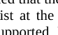

海森堡于 9 月 25 日收到加入铀俱乐部的命令，并第二天从莱比锡前往柏林。尽管不愿与迪布伯纳一起，但他非常高兴能获得一个体面的职位。而且有一个成员……

## 核物理基础与浓缩难题

在化学反应中的表现相同。这些额外的中子在链式反应中产生了巨大的影响。当一个中子撞击`铀-235`时，它会发生裂变并释放出更多中子，将链式反应推向高潮。相比之下，当一个中子撞击`铀-238`时，原子只会简单吸收它。原子核不会发生裂变，也不会释放额外的中子。因此，如果你想制造裂变炸弹，你需要大量的`铀-235`和尽可能少的`铀-238`。否则，238 会吸收太多的中子，链式反应就会熄灭。

问题是，`铀-235`同位素在自然界中非常稀有：每 140 个铀原子中只有一个`铀-235`。那么，显而易见的解决方案就是分离 235 并将其浓缩，产生所谓的浓缩铀或“超自然”铀。

浓缩铀比想象中要难。大多数用于分离物质的技巧都依赖于它们之间的化学差异：你将其浸泡在酸或其他物质中，一种物质溶解掉而另一种则留下。但这些技巧在`铀-235`和`铀-238`身上失效了，因为再次，它们是相同的，在化学反应中的表现也相同。科学家们发明了分离铀的新方法，所有这些方法都是繁琐且需要惊人的能量；在某些情况下，简直是按原子一个原子地分离同位素。像尼尔斯·波尔这样的科学家就因为这个原因宣布原子武器是不可能的。事实上，铀的浓缩似乎是制造核武器最大的障碍，这就是为什么“铀俱乐部”专门派了一个整个团队来解决这个问题。

“铀俱乐部”的第二个项目是建造一个核反应堆，德国人称之为“铀机”。反应堆基本上是实验室里的小型链式反应。因为其中的铀没有经过浓缩，反应堆不会像炸弹那样爆炸成蘑菇云。但你可以利用它们研究链式反应的原理，这对于制造炸弹是至关重要的知识。

海森堡加入了铀小组，他完全投入到了这项任务中。由于饱受“犹太人”辩论的持续困扰，他想向德国官员证明自己不仅仅是一个单纯的理论魔术师；他可以做实践工作并建造有用的东西。海森堡也相当有竞争心：他喜欢在乒乓球和其他游戏中击败别人，并将物理学视为一种不相上下的血性运动。世界上第一次自持续的链式反应对德国来说是一个巨大的荣誉。

到 1939 年初，海森堡已经生产了两种链式反应，一种侧重于能量，另一种侧重于中子。为了这样做，他在柏林一个科学机构附属的小棚屋里开了一个小实验室，紧邻一个铺有砖块、深达 6 米的深坑——这间棚屋是世界上第一个核反应堆腔室。他们处理的是放射性材料，科学家们进入棚屋时要戴上护目镜和面罩，这是一个不祥的景象。如果他们不想让地板偷听，就给这栋房子起代号为“病毒小屋”。

在曼哈顿计划开始两年前，“铀俱乐部”的科学家正在研究核武器的两个关键方面：浓缩铀和产生自持续链式反应。德国原子弹计划正以雷厉风行之势开始。

## 卡尔·魏茨泽克的关键洞见

外交官之子卡尔·魏茨泽克提供了第三个关键要素。战争初期，他在柏林乘坐地铁时阅读《物理评论》等杂志。这引来了其他乘客的白眼，因为文章是用英语写的，而那是敌人的语言。战争后期，一位德国科学家因为向 BBC 泄密被判死刑。但魏茨泽克知道这有多么危险。他在地铁上对链式反应的思考最多也不过于 1940 年 7 月那个命运的早晨。

正如所指出的，`铀-235`被中子撞击时会发生裂变，而`铀-238`不会。所以，大多数科学家专注于研究 235，这是合理的。但在此过程中，他们忽略了一些东西。当`铀-238`吸收一个中子时，它变成了`铀-239`，是自身稍重的版本。然后它发生`β衰变`。在这个过程中，原子核中的一个中子变成质子，电子飞出去，而质子留了下来。有趣的是，当大多数科学家停在此处时，魏茨泽克看到了更多。当`铀-239`发生`β衰变`并获得一个质子后，它会变成一种新元素，93。魏茨泽克意识到这种新元素 93 也是不稳定的，并且也会发生衰变。此外，你可以在反应堆中廉价地制造这种元素，因为你不需要事先进行浓缩；只需用中子轰击 238 即可。最棒的是，因为 93 是另一种不同的元素，化学家可以将其溶解并分离出来。它具有 235 的所有优点，而没有任何缺点。

```
中子 + 铀-238 → 铀-239 --(β衰变)--> 锕-93 --(β衰变)--> 钚-94
```

中子的思想在魏茨泽克的脑海中无处不在——一个完整的链式反应——当他到达终点时，他已经推演出来了。魏茨泽克在这里记录了一些细节。元素 93，被称为锕，也发生`β衰变`并转化为元素 94，即钚，这是真正非常危险的东西。魏茨泽克意识到最重要的一点——德国可以在“铀机”中大量生产这种裂变元素，并将其快速分离。作为第三帝国最重要的官员之一的儿子，魏茨泽克以及这位聪明但迟钝的“铀俱乐部”其他成员在历史上扮演了至关重要的角色。

## 沃尔特·博特的悲剧与失误

对于沃尔特·博特来说不幸的是，他的贡献并没有任何突破或里程碑式的成就。两人在德国科学界都处于一种奇怪的位置——半是传奇，半是失败者。他在第一次大战期间因勇敢成为了传奇。1914 年获得博士学位后，他加入了德国军队并在俄罗斯被俘；接下来的五年在西伯利亚一个荒凉的营地度过。他不屈服，继续进行数学和理论物理的独立研究，甚至编写了自己的对数表。当 1920 年回到德国时，他还学会了俄语并娶了一位俄罗斯妇女——这是处境中尊严的典范。

但 20 世纪 30 年代对博特来说并不轻松。正如约里奥-居里夫妇一样（事实上，在约里奥-居里夫妇之前），他在几次实验中坚信中子的存在，结果却误读了实验结果。与约里奥-居里夫妇不同，他没有其他重大发现来抵消这种尴尬。雪上加霜的是，婚姻的失败让他对家庭生活日益不安。最糟糕的是，作为纳粹的温和反对者，他发现自己在德国科学界被边缘化，被那些为雅利安议程贡献更多的同事所排挤。这种来自生活、职业和个人的三重失败压力最终让他无法承受：他崩溃并遭受了精神崩溃，最终冷却了他的内心世界。

由于离开德国，秃顶的博特在 1939 年夏天来到美国进行巡回之旅。他原本计划独自旅行，专注于慰藉，在航行途中遇到了因格伯格·墨泽格，一位小他三十岁、金发迷人的女子。令他惊讶的是，墨泽格回应了他的情感，他沉睡已久的爱意在内心迅速升起。他在船上的每一个清醒时刻都围绕着她转，作为一名中年物理学家和侍者在许多时刻感到担忧。由于幸运的巧合，两人都前往纽约，于是博特陪她去了皇后区的世界博览会，他们共同游览了那里；他们的行程在湾区重合了几个周，她在旧金山担任顾问，而博特计划在伯克利加州大学分校学习物理。考虑到家里还有孩子，他把一切都抛在脑后，忧虑完全展开。

他们行程的重合并非巧合；从他们见面的那一刻起她就盯上了他（因为他是外国人，而美国并没有怀疑他）。博特对此一无所知，当他去年夏天回到德国时，他已经变了一个人。他对墨泽格所属的纳粹党非常狂热。在“铀俱乐部”的第一次会议上，当其他人提到并梦想开发炸弹时，博特说他们“疯了”，必须怀疑。

## 石墨慢化剂的致命误判

中子平均仅为二十三个。他试图吞噬他能找到的最纯的石墨，但他怀疑其中杂质——例如硼和镉，这两者都会大量吞噬中子——可能仍然残留在内部。他试图开发更纯净的碳源。他最核心的想法是焚烧糖浆和其他通常用于甜点的原料，将它们焦成一团黑色的、旧的物质。在某个时刻，纳粹原子弹的一个关键成分竟然是糖果。

这些实验也失败了，博特最终联系一家工业公司获取了一个石墨球进行决定性测试。他向对方要了那个——一个直径近四英尺的球。由于信任他们的保证，他自己进行了纯度检测，将球体的一小块烧焦并测试了灰烬。它看起来足够干净。你可以想象，当实验再次失败时，他是多么震惊。在这些超纯石墨中，中子平均只移动了十四英寸就被吞噬，只有理论预测值的一半。出乎意料的是，石墨似乎是一种极其糟糕的慢化剂，博特为此写了一份说明观点的报告。

这是科学史上影响最深远的失误之一。另一位在俱乐部之外工作的德国科学家读了这份报告，并认为那个陷入情迷、脑子混乱的博特在纯度检测上犯了错误。他检查的灰烬无疑是碳；但加热和焚烧石墨的过程会释放所有吞噬中子的杂质，在灰烬中不会留下任何痕迹。这位科学家写信反驳博特报告的流传，这也许是由于不同小组之间的官僚派斗争。结果，博特和“铀俱乐部”可能永远都无此情。

鉴于石墨的高昂成本以及博特那些看似是定论的实验，“铀俱乐部”排除了碳，而选择了重水。从科学角度来看，这代表了一次微小的转变；从政治角度来看，这是一次激进的改变，很快将导致尸体散落在整个北欧的荒野上。

## 重水之争与挪威行动

1939 年 9 月，阿道夫·希特勒在但泽的一次演讲中承诺，将向盟国投掷一种“无法防御的武器”。希特勒勋爵知道自己沉溺于什么样的幻想中，但几位盟国官员立即得出了结论：原子弹。为了支持这一理论，他们引用说德国已经禁止从第三帝国出口铀。同样令人不安的是，法国情报特工报告，纳粹对重水产生了浓厚的兴趣。

就像铀有不同的变体（235 和 238）一样，氢也是如此。大多数氢原子是简单的，只有一个质子作为原子核。然而，每 6400 个氢原子中就有一个同时拥有质子和一个中子；这被称为重氢（或氘，D）。将两个重氢原子聚合在一个氧原子上，你就得到了重水（D2O）。重水的看起来和味道与普通水无异，尽管它确实具有不同的特性。它的密度更大，如果大量摄入（几加仑），会损害 DNA 并干扰基础代谢。与普通水相比，它还能加剧核链反应。那是因为普通水在与铀混合时，往往会吸收一些飞行的中子，从而阻碍链式反应。重水不吸收中子，只是减慢它们的速度，因此它是启动`铀-235`链反应的理想选择。

由于重水的稀缺——它仅占每 4100 万个水分子中的一个——1940 年全世界只有一家公司生产它。这家公司，挪威水电，在奥斯陆向西百英里的一片荒凉高原上经营一系列发电站，那是挪威一个名声糟糕的地方：一份 16 世纪的编年史说那里的人“主要的乐趣是杀死主教、牧师、官吏和上级”。其中一个名为沃莫斯克的发电站一直是世界上最大的水电站。它位于一个巨大瀑布附近的峡口，其产生的大部分电力被用于制造肥料和炸药。其余部分被引向附近的一栋电解大楼。这一过程涉及通过电流通过巨大的水箱，以将氢和氧分离。作为电解的副产物，他们在一系列被称为电解池的设备中收集重水。的是，重水市场仍然冷淡。在 1934 年至 1938 年间，沃莫斯克总共只卖出了 8 磅，每磅近 4000 美元。用现代术语来说，他们是小批量制作这种物质，每个订单超过三分之一盎司。

你可以想象沃莫斯克的官员们在 1940 年 1 月收到一份来自德国的数百磅氘订单时，是多么惊慌失措。库特·迪恩纳这位爱国者为了挽救那里 408 磅重水的储备，还签署了一份每月增加 220 磅的合同。鉴于重水在核研究之外没有实际用途，沃莫斯克的官员们询问了纳粹对它的计划。特工闪烁其辞，没有给出直接回答，官员们只能推测某种阴谋正在进行——很可能是放射性毒气。

他们成功地推脱了特工，并在一个月后与将军一同访问巴黎会面，在那期间，他提醒了另一位名叫雅克·阿利耶的人。

尽管阿利耶名义上是一个银行家，但在战争期间担任法国军方情报人员。他当时也不懂核科学：弗雷德里克·约里奥早些时候曾找他，为他的妻子艾琳购买挪威重水的库存。

一名为盟国战斗的法国特工。飞行员向他表示感谢并开始采取规避行动，尽可能飞入云层之中。没有人弄清楚那第二架飞机是什么——可能是德国空军的飞机——但飞行员避开了它并安全着陆。

珍贵的重水被匆忙运过海关并转运回法国。到 3 月 18 日，最后一罐重水已被安置在约里奥研究所的防弹地下室里，完好无损且安全可靠。只要纳粹德国没有到达巴黎。

# 从假象到真实

在小乔·肯尼迪于 1939 年 9 月离开伦敦后，他的父亲坚持要求他重新回到哈佛大学攻读法学学位。老肯尼迪聘请了一位马萨诸塞州最高法院法官担任他的导师。但小乔发现这份工作很枯燥，在 1940 年春天欧洲战争局势急剧恶化后，他开始认真考虑入伍。

在 1940 年春天之前，第二次世界大战在某种程度上像是一个梦。希特勒入侵了波兰，确实，英国和法国也向德国宣布了战争，但还没有发生任何实际的战斗或冲突，言辞犀利的英国媒体开始将这种局面称为“假战”。1940 年 4 月，第三帝国突然入侵了丹麦和挪威，荷兰、比利时和法国大部分地区相继沦落。在此期间，德军击败了英军，并在敦刻尔克几乎将其全部歼灭。这一切中最令人恐惧的是伦敦的防空警报声——上一次听到鸣响一直到 1939 年 9 月被扫除，那时一千架德国飞机横扫了这座城市，引发了著名的“伦敦大轰炸”——为期九个月的无情空袭。战争已变得过于真实了。

约瑟夫·肯尼迪（父亲）当时还是美国驻伦敦大使。他与罗斯福总统的冲突非常动荡，但罗斯福克制了没有解雇他，原因很简单：如果肯尼迪要散发关于反对和孤立主义的言论，最好让他在国内这么做。但当轰炸开始时，肯尼迪陷入了绝望，他只对一名员工成员说：“我打赌五比五，随你多少，希特勒两周内就会出现在白金汉宫。”大发雷霆的罗斯福让肯尼迪留在伦敦了足够长的时间，以消除他竞争 1940 年总统提名的任何可能，随后在 10 月份很少召见他。


肯尼迪并没有因为被解职而收敛，反而开始更广泛地宣扬和平与孤立主义。老肯尼迪曾抱过自己入主白宫的希望，但1940年他击碎了这些梦想。小乔和杰克眼睁睁看着他们的父亲在议会委员会中变成了一个异类，实际上等同于政治自杀。

小乔对此尤为艰难，他培养了自己的政治野心。请注意，这些野心并非源于任何深层的人脉关系。事实上，小乔在政治上相当没有方向。1943年的一个晚上，他回家吃晚餐时宣布自己是一个共产主义者，这激怒了他的父亲（“当你卖掉船时，”父亲咆哮道，“你就可以称自己为共产主义者了。”）。几年后转向对面，小乔开始赞扬希特勒的优生灭绝法是有前瞻性的。他的父亲叹着气提醒他，他的妹妹罗丝患有行为和情感问题，可能会成为这类法律的受害者，也许他应该惩罚她。

尽管如此，随着信念的演变，肯尼迪确信了几件事：他作为肯尼迪家族成员，拥有上帝赋予的担任公职的权利，而且战争英雄在选举中更有优势。因此，随着父亲政治运势的衰落，小乔决定成为战争英雄是让肯尼迪家族重返白宫的最佳方式。

## 第12章

### “疯狂的杰克”

德国原子弹计划的几位成员认为，重水对他们野心的重要性与铀一样至关重要。因此，1940年3月法国的重水失窃案让他们恼得不已。在随后的下月入侵挪威时，德国人迅速取得了胜利。奥斯陆立即陷落，尽管坚韧的挪威男女继续战斗了几个周，但当抵抗军在5月溃败时，第三帝国占领了维姆尔克电厂——那是世界上唯一的重水生产设施。

与此同时，德国坦克也在横扫法国，咆哮着穿过马奇诺线，粉碎了遇到的每一处抵抗点。尽管距离前线仍然很远，巴黎的人们恐慌了。成千上万人逃离，一旦清醒的政府官员开始将文件柜从窗户扔到下面，在无政府的火堆中焚烧。

尽管比大多数人冷静，但弗雷德里克和朱里奥·库里夫妇在5月收到命令，取回他们手中的重水。在任何情况下都不让纳粹得到它。于是，某天晚上10点，朱里奥的助手们拿一把手枪，将罐装上卡车，开始向南移动。然而，银行家雅克打了一些疯狂的电话，安排助手们将罐体放在250英外的银行金库里。助手们拒绝说明材料是什么，将重水注册为“Z产品”。它在那里留了五天，银行经理才将其带到一个女洗手间的临时住所，然后将其转移到通常留给间谍的死牢加固牢房。

朱里奥和伊琳娜尽可能留在巴黎。（与此同时，他们将孩子皮埃尔和海琳娜撤离到农村，逃往尔卡奎斯特村，伊琳娜在那里度过第一次世界大战。）德国人就在五十英里之外。朱里奥-库里夫妇最终在6月12日撤退。在南下的途中，焚火的烟雾弥满了天空。他们带走了实验室的一些设备，还有伊琳娜的生日礼物——130磅镭。

16日，朱里奥夫妇到达了目的地。

那些重水桶最终被送进了另一座监狱，那里的名字听起来很有狄更斯风格——伍德伍德克鲁布监狱。在那里被禁闭了几周后，由于那位疯狂伯爵亲自将它们送往温莎堡妥善保管，它们获得了一次华丽升级。在接下来的几年里，这些饱经波折的水桶在同盟国原子弹的实验中发挥了关键作用。


遗憾的是，“疯狂杰克”在战争中死于他的爱好——在拆除掉落在英国的意料之外的德国炸弹，他喜欢在边抽烟边做这项活动。尽管在布鲁姆峰表现英勇，但他仍在一项重要任务上取得了进展。除了重水，他还被要求在法国夺取科学资产。

朱里奥特几周后抵达布里斯特。无论那位疯狂伯爵如何哀求——甚至一度抓住朱里奥特的手试图将他拉向甲板——朱里奥特都拒绝前往英国的黑普普尔号船。他有几个理由：他的英语并不流利，而且他知道自己在那里可能得在詹姆斯·查德威克手下工作，那个在朱里奥特-居里夫妇之前就发现中子的男人。更重要的是，朱里奥特担心他的妻子。

艾琳娜一直很虚弱，小时候就患有百日咳和其他疾病；父母也有习惯让她暴露在散热器旁并对此撒谎，这进一步削弱了她的免疫系统。生下女儿后，她变得更加病态，同时患上了结核和贫血。（与她婚礼当天呼应的是，艾琳娜在产期那天工作了一整个上午，直到下午才分娩。）最终，工作的压力击垮了她，在陪朱里奥特来到波尔多后，她入住了法国西部的一家疗养院康复。

尽管朱里奥特热爱英国，但他无法留下生病的妻子——尤其是在他已经放弃了建立朱里奥特实验室的计划之后。此外，他发现他们对纳粹的蔑视令他深受鼓舞。他的传记作家说：“她坚信，无论情况变得多么糟糕，他们也不敢对居里家族的人动一指。”朱里奥特需要力量，并下定决心守着她。

此外，朱里奥特对法国仍有责任感。他效仿维尔纳·海森伯格，告诉“疯狂杰克”法国需要他，而他想要拯救的是在德国占领期间法国科学的结晶。事实上，他计划尽早回到巴黎。他万万没想到，“铀俱乐部”会在那里等候他。

在躲避一段时间等巴黎的混乱似乎平息后，朱里奥特回到实验室，发现了两个不受欢迎的访客。那是库特·迪布内纳，他的朋友，据推测是铀俱乐部的军事副官。迪布内纳将加速器带进了铀俱乐部研究所的地下室，并不得不接管它。这些粒子加速器对于研究核反应是必不可少的，而纳粹此前一直无法获得它们——直到现在。

朱里奥特不喜欢迪布内纳，但他认为另一位客人，迪布内纳的老板，简直可笑极。埃里希·舒曼是罗伯特·舒曼的孙子，他从未真正理解过祖先的深远意蕴。舒曼研究波和乐器；他还为国防军撰写军事任务。作为一名狂热的纳粹分子，他被任命海森伯格研究所的管理员，其他人对他推崇有加，却嘲讽他搞“钢琴弦物理学”。（他们私里也鄙视他。）一位同事回忆道：“他可能派用上一点忙，但那是最廉价的。”舒曼认为原子弹是荒谬的——他用“原子”一词来掩盖，并在城市沦陷后不久就占领了朱里奥特在巴黎的实验室。

当朱里奥特将其移交给舒曼时，迪布内纳召集了他的员工召开会议。作为翻译，他们努力留出良好的第一印象，解释了他们对原子物理的贡献，并希望法德合作取得丰硕成果。舒曼请朱里奥特和他、迪布内纳以及翻译进入一间普通办公室进行密谈。

会议室关上了。舒曼转过身，目光严厉。朱里奥特因责他没有向巴黎报告而发火，随后指责他偷了重水。“我们在挪威看到了那些水桶的账单，知道为什么这样了，”朱里奥特说道。

当萨缪尔·古德斯迈特为荷兰的父母忧心不已时，世界上其他地方正为一位失踪灵魂的命运——丹麦的尼尔斯·波尔而不已。1940年4月德国军占领哥本哈后，与波尔的所有联系都中断了，他的许多朋友和同事都很担心这位深受爱的物理学家。

事实证明，波尔无事——虽然深受震惊但并未受伤。为了让大家放心，他通过各种地下渠道安排仍在流亡瑞典的莉丝·梅纳特（Lise Meinert）向英国发了一封电报。一刻，他意识到写给莫德和玛格蕾特（波尔的妻子）的信虽然进展顺利，但却带来了不幸的事件。“通知科克拉福特和莫德·雷·肯特。”

这次交易带来了三次成功。第一：波尔还活着。宽慰之情让位于混乱。提到的“科克拉福特”指的是约翰·科克拉福特，剑桥的物理学家，未来的诺贝尔奖获得者；他问科克拉福特是否知道——这种混乱让他陷入了恐慌。但院长们认识莫德·雷·肯特吗？因为科克拉福特喜欢英式字谜游戏和文字游戏，在盯着这个名字看后，发现这是一个字母变体：“Maud Ray Kent”代表的是“radium taken”（取走了镭）。这意味着纳粹已经盯中了波尔名字中的镭元素，无疑是为了原子弹。

这个消息给英国科学界造成了沉重打击。情报机构已经意识到德国对核武器的兴趣，波尔的失踪让紧张局进一步升级。英国政府的回应是组建了一个核武器顾问委员会，并将其作为其使命。委员会在1940年7月做出了最重要的决定：继续战争，当时他们几乎不知道能制造出多少原子弹。据估计，10磅浓缩铀产生的爆炸威力相当于20吨TNT炸药。（如果如果是这样，它将释放原子的真正力量：1磅铀-235可以引发相当于20吨TNT炸药的爆炸）。更重要的是，报告建议这种武器可以在两年内制造出来——如果德国人在1943年之前成功的话。

这份报告震惊了科学界。尽管如此，许多物理学家在承认核弹潜力的同时，一直怀疑它们是否真的可能。因为某些目前为止被忽略的因素，或者由于某种新的数值，看起来将是不可思议的。《MAUD报告》杀了希望。1932年发现中子的物理学家詹姆斯·查德威克（James Chadwick）说，当他最终理解其真实本质时，他开始在晚上睡觉，并且再也没有失睡过。

委员会建议英国启动一项制造核弹的计划。同时，考虑到所需的巨大工作量，委员会承认英国无法独自支撑。英国随后应该与美国合作，美国拥有自然资源，而且离德国轰炸机的威胁很远，是安全的。为此，莫德将报告副本发给了布里格斯（Briggs），一位一直与他们合作的美国顶尖科学家。他被要求审查报告并反馈。整整一周过去了，没有收到布里格斯的消息。第二周。接着一个多月过去了。最后，一位在8月底访问美国的MAUD委员会成员决定采取行动打破延迟。令他厌恶又惊讶的是，他记得给在华盛顿的布里格斯打电话，结果发现这个不可思议的人把报告放在了他的保险箱里，没有给他的委员会成员看。换句话说，糟糕的布里格斯读了报告，却像个傻子一样决定把文件锁起来假装它不存在。甚至在原子弹制造几年前，它就已经让天才们陷入了疯狂。

尽管有布里格斯的问题，英国和美国科学家最终会面并同意合作开发原子弹。而且得非常及时：到那时，德国已经研究了两年核武器。

# 第三部分

## 反抗

但波尔并没有喘息的机会。这位缺乏真爱的物理学家在战争早些时候就已经把他的石墨研究搞得一团糟。他正在巴黎笨手笨脚地进行一系列回加速器实验。回加速器复杂而又奇气怪，无论波尔和助手们在每次运行前检查多少次阀门、冷却管和电线，总会在最糟糕的时刻发生过热或短路——失败的滋味是苦涩的。这不是波尔的错，但作为一名科学家，他必须承担责任。这种失败读起来格外难受，因为他已经在德国尝试制造过回加速器并失败了。看起来他似乎运气极差。

他对此反对。在战争期间，朱里奥（Joliot）坚持认为，既然他们那里没有军事资源，波尔可以随心所欲。尽管如此，波尔还是闯入并开始实验，几乎违背了那个绅士协定。令人恼愤的是，德国人在机器上加盖了带有纳粹鹰和卐字的蜡封，这是朱里奥团队无法忍受的侮辱。无论开始什么实验，总有一个法国技员会溜出去关掉冷却管或让其过热，或者产生足以熔化铜线的电流脉冲。法国科学家们详细说明了他们的研究。然而，令人满意的朱里奥——以及加入他们的伊琳（Irene）——正生活在糟糕的战争中。每周变得更加阴郁。由于物资匮乏，人们不得不吃老鼠来填饱肚子。结果，布里格斯没有提供暖气，公寓里的水龙头几乎会结冰。这种寒冷让家庭精疲力竭。布里格斯没有提供暖气，皮埃尔（Pierre）的脚都麻木了。患有结核的伊琳咳嗽，骨头疼痛。尽管有这些痛苦，她还是试图继续研究，即使这意味着要躺着工作，而她在疗院里度过了几个月。像她母亲一样，她因疾病失去了大部分视力。由于由于疾病的痛苦，她在疗院里度过了几个月。尽管如此，她还是试图继续研究，即使这意味着要躺着工作。然而，对她来说，伊琳变得越来越不安。

但这一切并没有阻止德国挡住她的路。在1940年的巴黎，她提着一个铅衬容器，里面装着100克从她母亲那里继承的镭。知道纳粹在觊觎，她不想把它藏在金库或她知道的安全地点。然而，这对她来说，伊琳变得越来越不安。

## 震撼世界的烈火

当核子科学在盟国国家缓慢进展时，德国的情况在1942年6月已进入突飞猛进阶段，彼时维尔纳·海森堡（Werner Heisenberg）在那里执行了世界上见过的最复杂的核裂变实验。在过去的几个月里，海森堡在莱比锡建造了三台不同的“铀机”，每一台都比前一台更强大。最后一台采用了“三明治”设计，由重水和铀矿交替层组成（德国人根据其化学方程式 `U3O2` 将其命名为“38号准备工作”）。但对于他最新的反应器L-IV，海森堡改变了设计。此外，他没有使用铀矿，而是换成了纯粉末铀（由于某些原因，这种粉末金属用薄的铝壳与重水隔开，原因很快就会明朗）。尽管该设备宽达32英寸，但重量达数吨，产生的热量之大，以至于技术人员有时不得不将其浸泡在水中。

L-IV实验开始于有人将一个镭和铍球通过烟囱投入最内层的重水壳中。镭发射α粒子，这些粒子撞击铍原子并在到达第一层铀时诱发了裂变反应。这些裂变释放出更多中子，中子在向外移动并遇到下一层铀时速度减慢，引发更多裂变，直到最外层的铀。由于海森堡的团队大致知道中心镭铍球每秒释放多少中子，他们就可以测量逃离球体表面的中子，并计算出一个“中子倍增”因子，这是衡量该装置产生多少个额外中子数量的指标。1942年6月，他们获得了13%的倍增率——这是历史上首次实现正向中子产生，也是链式反应的第一步。

不久后，海森堡向包括阿尔尔伯特·施佩尔（Albert Speer）在内的几位纳粹德国领导人报告了他的实验结果。

### “嵌套式”设计

重水 (`D2O`)

镭/铍球

向外飞出的中子

外层铀壳外的探测器

纯铀

令海森堡感到不幸的是，一系列事故摧毁了L-IV设备。粉末铀具有自燃性，意味着它会与空气中的氧气发生反应并自发点燃。（请注意，这是化学反应，而非核反应，但依然是一件大麻烦）。）海森堡的实验室在几个月后才得知这一事实。当时一名助手正用勺子将铀倒入漏斗以填充其中一个壳。他突然听到一声“沉闷的砰声”。他凑近听，只见十二英尺高的火焰从漏斗中喷涌而出，将他撞退在地并灼伤了他的手。他试图用大衣灭火，附近的一盒铀粉也被波及了，另一名助手不得不冲到外面用沙子扑灭火焰，然后撤离了房间。然而，那个研究人员的“巢”一天后仍在冒烟，于是他们将火投入了一桶水里——这熄灭了火，但他们认为自己控制住了局面。

第二次事故发生得较慢，但其烟花效果甚至更加壮观。海森堡的团队通常将球体置在冷水箱中，6月的一个下午，一名助手注意到水箱里有一股气泡。他捕获了一些并确定它们是氢气，这是一个不妙的信号。显然，球体内部发生了泄漏，内部的铀正在剥离氢原子和氧原子并产生爆炸性气体。下午3:15左右，气泡停止了，于是他们冲向球体查看内部。负责拆除盖子的伙子正是之前烧过手的倒霉助手，这次他的运气也没好到哪。当他拧开盖子时，听到了一阵嘶嘶声，随后是一股不祥的寂静袭来。接着是两秒钟——又一次火山爆发，燃烧的铀充当了岩浆。那个可怜的家伙捂住头逃了。

闹并没结束。想起第一次事故的教训，团队决定用水分淋湿铀粉。这本切断火焰的氧气供应并灭火。不幸的是，空气中的铀粉也会与水发生爆炸性反应（这挺有意思的）。助手们并不知道这一点，将设备重新浸入水箱并等待。

此时，海森堡躲回实验室。“一切还好吗，伙子们？”“好的，老大，很棒。这地方闻起来可能不错——金属燃烧有种特殊的气味”，但海森堡觉得没问题，便走去教一晚上的课了。

下午6点左右研讨会期间，一名助手敲门打断了会议。“你可能想看看这个，”海森堡跑回来看到装满气泡的水箱。两名助手站在旁边，目瞪口呆，不知该怎么办。突然，球体破碎了，剧烈地抖动起来。他们没有浪费时间，冲向走廊。

球体爆炸的威力之大，数百个铆钉紧随被撕裂的铝壳飞出，彻底粉碎。火焰高达二十英尺，舔着天花板。科学家们亡命逃生，当地消防队在几分钟后轰鸣而至。火灾过后，消防员们费力扑灭那场大火，但它在随后的两天里一直持续闷烧，正如一位目击者所描述的，那是烧焦金属和污染水的“咕噜声”。

尽管如此，由于没有人死亡，消防员们对整件事付之一大笑。其中一人拍了拍海森堡的背，祝贺他终于制造了“原子爆炸”。

在视察了皮内蒙德后，罗斯鲍德（Rosbaud）于1941年8月底回到柏林，为英国情报部门写了一份报告，其中包含了对雪茄形状的V-2型火箭的描述。几乎没有人读过它。谁听说过皮内蒙德？但到1942年，那些神秘的圆形堤岸的照片成为了英国情报界内部激烈且动荡争论的话题——这些争论最终导致了乔·肯尼迪（Joe Kennedy）走向毁灭。

乔的成长过程在某个阶段是相当挫败的。他享受法学院的社交生活，日夜充满了聚会和恶作剧。（据报道，他在洗澡时向斯努基（Snooky）报告了一条“恶心的鳄鱼”，并偶尔会开玩笑把它扔进室友正在洗澡的浴缸里。）但法学院本身让他感到无味，在命运的余地中，他在加入海军后退学了。飞行学校似乎是军中中最英气的项目：“我一直向往飞行，”他给朋友写道，“我从未想过要用步枪战斗，或者超越欧洲的心境。”他认为飞行非常危险。飞行学校似乎也能提供肯尼迪所渴望的快速优势。在1941年之前，乔参加了飞行学员计划中的每一个热门项目。

在接下来的几个月里，乔证明了他的父亲关于飞行学校是个坏主意的想法是正确的。乔是一个糟糕的飞行员。他在空中挣扎着无法控制飞机，并没有真正找到事情要做。他还缺乏对这项工作的天赋，总是猛烈地拉动飞机并过度依赖仪表。正如一位历史学家指出的：“一个有天赋的飞行员会密封并感受；而乔花时间来记忆他应该做什么。”他坚持让飞行员独自飞行好几周，最终他在七十八个月内以“七连七”的糟糕成绩毕业了。

即使对乔来说，他的兄弟们在体育方面也更好。杰克（Jack）擅长足球；而乔是团体的灵魂。乔被认为优于所有人。他的健康状况与艾琳·约里奥·奥特·居里（Irene Joliot-Curie）不相上下。（他两岁时患了猩红热，此后一直特别虚弱；一生中有三次天主教神为他做过祷。）但肯尼迪动用了一些关系，在体检后，杰克加入了国家情报部门。与提供快速晋升通道的飞行学校不同，杰克在加入后仅四个月就离开了。为了拯救生命，杰克在理论上花的时间在喷气式飞机飞行上。

从时间上来说，这两个兄弟在体育方面更好。杰克擅长足球；而乔是团体的灵魂。乔被认为优于所有人。肯尼迪通过贬低杰克的前景激进地贬低他，说他“走不了远”。在体育运动中，乔会与裁判和裁判员激烈争论，而且他喜欢在足球场上抽烟。杰克逊（Jackson）更内敛；他曾是一个风趣的四分卫和外卫，后来变成了中锋卫。（作为领导者，他曾担任波士顿红袜队的击球手；是球员中的之一。）他们都加入了受欢迎的人群群体，但正如一位历史学家所指出的，“乔神气活发，魅力十足。”

由于年龄只差两个月，这些男孩无法避开某些事情。凭借他的神气和登场，乔对女性很有吸引力；他会与埃塞尔（Ethel）和凯瑟琳·赫本堡（Katherine Hepburn）这样的人约会。乔无法逃避杰克的约会，总是粘着他；他会坐在杰克的女孩旁边，现在是三个人聚在一起，然后告诉杰克走开。他们之间曾多次发生肢体冲突——很大程度上是因为乔会帮着杰克。他们在哈佛大学的论文变成了另一种联系。老肯尼迪（Kennedy Senior）认为出版一本关于一个年轻人的书是有声誉的。因此，他记录了杰克在西班牙内战中的荣誉，汇集了他在瓦伦西亚和马里德的一些战绩，这像是一场脑力冒险，犹如阿拉伯的威尼斯一般。编辑们喜欢这个主意，但它没能赶上第二次世界大战。老肯尼迪成功地完成了完稿，那是英国在九月通过五名速记员将这篇论文拼凑在一起的。乔什么都不记得，只有大堆的复印件。但父亲再次是最明智：这本书给了杰克声望，这令他感到沮丧。


现在，杰克在军队中正超过了他。但最终在1942年夏天迎来了转机。到那时，他已经毕业成为战斗机员，驾驶被称为“BAM海员号”的大型飞机；它们的速度为每小时211英里。给一个笨拙的飞行员一架飞机似乎不是个好主意——如果你费力倒车一辆轿车，你没时间去开一辆十八轮大卡——但驾驶更大的飞机需要的空气和自然天赋较少。飞行员依靠仪表，这正是乔的长处；他总是用脑子而不是手来飞行，而且不像某些显眼包那样不介意所有的程序和检查单。到夏天结束时，他甚至在指导其他飞行员了。他被派到波多黎各执行首个任务——猎潜艇，并在那里也获得了晋升，与杰克平起。

但在那个秋天再次落后了，杰克获得了第二次晋升。更糟糕的是，杰克很快转出海军情报部门，成为了一名PT艇驾驶员（PT boat jockey），这是战争中最勇敢的工作之一。PT艇基本上是移动的鱼雷单元；他们会冲向日本军舰并进行火力攻击，然后迅速撤离。这项工作奖励鲁莽的冒险，因为杰克会在南太平洋冒死，他几乎保证获得一枚勋章。与此同时，乔发现自己在加勒比海绕圈子，寻找并不存在的德国潜艇。在波多黎各起飞是一个野心勃勃的年轻肯尼迪希望的最不体面的工作，这让乔再次对自己与弟弟的地位感到愤怒不已。

## 第19章

和肯尼迪一样，捕手手莫·伯格（Moe Berg）在战争初期度过了南美的一个偏僻剧院时光。除了与纳粹战斗外，伯格还出于另一个个人原因想加入OSS（战略情报局）。1941年冬天，他的父亲受到不绝症的折磨，这让他变得比以往任何时候都严厉且毫不留情。在珍珠港袭击导致他昏迷几天之前，在得知消息后，他挣扎着说出：“孩子们在哪儿？”1月，伯格在父亲的批准下加入了OSS。但在他回到美国见到父亲之前，伯格失去了意识，这本该让他怀有攻破父亲的希望。伯格在1939年打了最后一场大联盟比赛，他从未正式退役。因此，他的父亲于1942年1月中旬去世，执心要寻找生命并让伯格感到愧。OSS处理了伯格旅行的细节——这花了很长时间——另一些人要求他用母语向日本人发表演讲。伯格同意了，并进行了一场漫漫的谈话。他唤起了对过去两次旅行的回忆，感叹这两个国家既是彼此的朋友又是敌人，因此他指责日本占领和攻击——并敦促日本人推翻他们的政府并拥抱民主。伯格没有发表信心的演讲，当美国军队开始入侵南太平洋被日本占领的岛屿时，日本士兵会尖叫着关于贝比·鲁斯（Babe Ruth）的所有能想象的侮辱，相信这会摧毁美军的士气。

演讲结束后，伯格继续在华盛顿休养，月月复个月地等待部署。由于日益沮丧，他最终拿出了1934年在东京录制的23秒胶片，并开始向各种官员推销。这本质上是他的间谍磁带。

伯格于1942年8月底离开前往南美，在接下来的六个月里在巴拿马、秘鲁、加拉帕戈斯、哥斯达黎加、特立尼、英属圭亚、荷属圭亚那、危地马拉和巴西的军事基地之间奔波。他每天赚一天（每年3美元），大部分乘坐小型飞机和吉普车后座旅行（作为一个纽约人，他不会开车）。伯格没有穿标准的黑色西装领带，而是向炎热做出妥协，人生中第一次在照片中显得满头大汗且胖乎，体重超标。

除了花费精力外，伯格还担任OSS的一种巡回检查员，并调查了许多地方士兵的恶习：酒精、赌牌、梅毒和其他疾病在某些地方盛行。伯格认为他们可以消除街道、城镇或马鞋，如果需要。”

与英国、德国和俄罗斯相比，这三个国家都拥有复杂的的情报机构，并乐于对对手和盟友进行间谍活动。

哈特（Hart）迫使美国承认自己的不足，并建立了战略情报处（OSS）。如今大多数人将其视为中央情报局（CIA）的前身，但 OSS 的使命远比此广泛得多。除了间谍活动，它还执行准军事行动，并为美国军的特种部队铺平了道路。在许多情况下，通过莫·伯格（Moe Berg）的策略，间谍活动与境外活动是并行的。

OSS 的形成主要由两个人推动：局长“野比比”多诺万（Wild Bill Donovan）和首席科学家斯坦丹利·洛威尔（Stanley Lovell）。多诺万在第二次世界大战期间相识，当时他领导着一个相当奇特的无神者部队。他指挥纽约第 60 步兵，即著名的“斗士尔兰人”，他们正在 1944 年 10 月试图攻克一座德国堡垒。在一次激烈的交火中，多诺万命令他们射击以改变火力。在考虑各种选择后，他命令他们撤退。当斗士尔兰人犹豫时，他大喊道：“怎么了，你们想活什么？”并独自冲了出去，他们也追随其后。他们牺牲了。

德国人挡住了他们，一颗机枪弹击碎了多诺万的膝盖。但他再次迫使其他人撤离，接下来的五个小时里，他带着伤为应对不可避免的德国反击做准备。当他号召时，斗士尔兰人将德国人赶回堡垒，几乎以一己之力赢得了战斗。进攻失败后，多诺万本应受到军事法判（假设他还活着）。但事实上，他获得了荣誉勋章，并作为美国勋勋最高的士兵之一回了家。

二世界大战期间，多诺万在纽约的一家律师事务所工作。他必须在哥伦比亚大学向富兰克林·罗斯福证明自己的领域才华，罗斯福于 1940 年 7 月派遣他前往英国，以收集比失败的约瑟夫·肯尼迪之父更准确的事件报告（肯尼迪认为这像一记耳光，而这正是罗斯福的本意）。尽管多诺万同意形势严峻，但他强调了英国人的坚毅，并将一直担任首相的温斯顿·丘吉尔誉为伟大的领导者。美国人筹集了 OSS 的资金，并促成了丘吉尔-罗斯福同盟，这一联盟最终帮助击败了希特勒。

多诺万作为情报协调员加入 OSS，他拥有预见 OSS 成功的远见。“野比比”成功了。虽然这个角色在纸面上是合理的——多诺万显然很有远见，但缺乏运营政府机构的所有其他技能。甚至他自己也承认他的商业技巧是“荒谬的”或“没有吸引力”，而他们也没有足够的耐心或运气来管理它。结果，OSS 成为美国历史上管理最糟糕的机构之一——也是禁酒令时期最有效的执行机构。员工们曾对着《麦克白》中的一句台词发笑，那句话完美总结了这项事业：“混乱如今已造就了他的杰作。”

现在多诺万的人事招聘标准并不尽如意。为了凑齐另一个机构，他转向纽约的朋友圈，招募了数十名热血之士：OSS 的名单上生活着威尔斯、杜邦、周一家族和范德尔堡家族的人。该机构实际上非常突出，被称为“社交达人 OSS”。为多诺万辩护的话，当时的招聘是有的：他们通常精通外语并了解欧洲。但这些新兵离德国战场太远。正如一位记者所提到的，他招募人员是为了进入游击队或炸毁甲板。寥寥几位千金小姐在各个领域遭受了“戏剧性的挫折”。

多诺万比对待贵族还要仰他们，他用一群奇特的人充斥着 OSS。那里有调酒师、人类学家、诗人和摔跤手。还有牙科医生、鸟类学家以及从外国议会请假的人员。梅兰妮·迪特里希、朱莉·查尔德、约翰·斯坦贝克、韦恩·杨、列夫·托斯泰以及一个马戏团继承人都在在著名的华盛顿林肯康复院后成为了观察员，而且他们并非空口无言。一个官方团队认为“OSS 可能雇佣了几个幼稚的心理学家”。多诺万曾说：“如果我必须击败希特勒，我会把斯大林放到 OSS。”没有人知道他正在杀人。

为了做到这一点，多诺万招募了优秀的人才，包括首席科学家斯坦丹利·洛威尔。当多诺万第一次面试洛威尔时，更准确的说法是像《詹姆斯·邦德》系列那样：他的工作基本上就是四处走动并构思间谍政变。为了应对这些事件，他最近开发了看起来像贝壳的炸弹并系在船上。他制作了带有秘密腔的鞋子和按钮以隐藏文件。他们发明了可以射子弹的铅笔香烟。他们发明了一种名为“阿珍玛”（Aunt Jemima）的爆炸粉末，其质地像面粉，可以与水混合烘成饼干食用且无危险；只有当用引信点燃时，“阿珍玛”才会爆炸。洛威尔的团队还开发了基于粪便的武器。其中一种名为“乳糖”的武器，在倒入气体时利用糖或沙为囚犯制造引擎。另一种武器涉及人工痛风云以轰炸北非，希望以此吸引传播疾病的苍蝇（他们称之为“反复幻常”）。还有另一个项目合成本质上是腹泻的物质，被称为“索德”（Soid），那是极度软便的恶心排泄物。

他们雇佣小童冲出去，将其吐在被占领中国日本军官的餐盘里。洛威尔将其命名为“梅尔梅特”（Merb Mert）。

想法似乎还不够。在那之后，希特勒和墨索里尼将在奥地利和意大利之间的布伦纳山口举行峰会时，洛威尔策划了一个将一瓶液体倒入大海的计划。

老实说，这次监控并没有什么成效。下加福地区所有的“棒球场”和“球棒与球类”都是民用的，尽管关于墨西哥离岸有日本渗透者的传闻持续不绝，但美国特工从未见过其中一个。在下加福，搜捕日本渗透者的美国间谍可能比实际的日本渗透者还要多。一名特工在拦截当地渔船并截获船员时，发现其中两艘船的船长是秘密潜伏的美国军人。当人数增加后，某些美国情报源似乎变得不那么可靠——他们是懒散、不谨慎的男人，从双方身上都从中取好处，更热衷于通过出卖丑闻来提供有用的情报；他们会下令搜查“切割屋”，而此时他们的妻子不在家，或者正越过美国边界走私酒。

尽管如此，如果下加福行动没有赢得战争，它确实改变了波里斯·帕斯（Boris Pash）的人生方向。他热爱交易，乐于用密码和其他策略比别人活得久；除了管理特工外，他还在任务中尝试伪装，戴上假发并使用“变声设备”来隐藏身份。战前他是一名士兵和老师，情报工作让他为之着，而他天生适合指挥。对他幸运的是，一项科学事业需要他的技能。

这被称为曼哈顿计划。在珍珠港事件发生之前，曼哈顿计划徘徊了几个月，没有多少精力或目标——只不过是政府官员进行的一系列会议和研究，其主要结果就是建议进一步的会议和研究，无止止。这种紧迫感的缺乏促使了核物理学家，他们是来自希特勒欧洲的难民，知道那时德国已经在物理学领域工作了近三年。

当1942年莱斯利·罗夫斯将军（Leslie Groves）接管该计划时，罗夫斯本人实际上与曼哈顿计划同名——或者说他是首席总监和军事上最大的攻势力量。罗夫斯负责全美国以及水边军官基地的所有招募，监督着6亿美元的预算（相当于现在的100亿美元）。经营曼哈顿计划——其最初预算仅6亿美元——对他们来说实际上是一项苦差。他亲自监督了该项目（其建设也是他亲自监督的），而曼哈顿计划是他的惩罚。他的上级认为，在战争结束前，他没有建造那些大师级公寓楼的天赋，这次失败会让他变得谦逊一些。

事情并非如此发展。对于罗夫斯来说，罗夫斯全身投入了任务，在他担任主管后的首要行动之一，他任命物理学家罗伯特·奥本海默（Robert Oppenheimer）——加利福尼亚大学伯克利分校的一位教授——担任洛斯阿拉莫斯武器部的负责人。回想起来，奥本海默是一个才华横溢的人，但在当时，他在科学家和军官中都备受争议。在罗夫斯看到奥本海默作为领导者将赢得如此尊重后，该项目变得具有诺贝尔奖级别的意义。问题在于，他是一个理论物理学家，而不是实验家，在行政措施面前显得很笨拙。正如美国人比尔曼（Billman）所说，正如一位科学家向罗夫斯抱怨的那样：“不要凭直觉管理。罗夫斯做不到。他证明自己是一个识人的人，并在无视可用证据的情况下决定将他调到洛斯阿拉莫斯。”

军对奥本海默的反对更为严重。他出生富裕且政治上天真——一个伯克利的精英。在20世纪30年代，这意味着共产主义，而奥本海默在那十年里一直留留在斯大林主义者中，并为西班牙内战筹集了数千美元。更令人担忧的是，他周围围绕着学生，这些学生白天从事物理研究，晚上秘密与共产党官员会面并泄露他们所知道的秘密。简而言之，奥本海默是一个安全风险。作为实验家，尽管他们是二战期间拥有的最优秀的大脑，但决定再给他第二次工作的机会——这正是他需要的。罗夫斯几乎没有干预，并再次争辩获得一个临时许可，以延长他的任期。

尽管在奥本海默身上存在矛盾，罗夫斯还是找到了这项任务的完美人选：一个住在湾区、老练且机敏的情报官——这个人即使在作为领导者对抗湾区时，也拥有过指挥权且深受信赖。罗夫斯说那是西奥多·帕斯（Theodore Pash）。

### V-1, V-2, V-3

1942年春夏，维尔纳·冯·布劳恩（Werner von Braun）在德国北部的佩内明德（Peenemünde）火箭测试场安排了三次V系列发射试验。三次都以失败告终。第一枚火箭在燃烧室初步检查期间爆炸了。第二枚火箭在起飞时危险地摇晃，坠落在一英里外的波罗的海。第三枚虽然起飞了，但发生了电气短路并在空中爆炸——这是一个既有趣又令人沮丧的进展。

10月3日，V-2终于起飞。这枚火箭在发射台上实际上相当迟缓；正如佩内明德记忆的那样，V-2上升得很缓慢，仿佛被许多杆子推着走。随着动量迅速加快，达到了时速50英里的速度。为了迎接当天的发射，布劳恩的团队用旗帜装饰了火箭，火箭并没有飞得很远，而且偏离了目标两英里。

布劳恩的团队在接下来的几个月里填满了这次以及其他成功的发射，纳粹领导人对这种可能性欣喜若狂。宣传部长戈培尔斯（Goebbels）说：“如果我们能在德国看到这部电影，希特勒就不用再做演讲了。”外科式打击似乎完全是不可能的。尽管如此，纳粹在接下来的几个月里投入了数十亿帝国陆马克来开发V系列武器。尽管当时没有人意识到，火箭很快就会证明它们是最大的资产。因为它们是不可能被击中的，它们可以降落在巨大的范围内。

在佩内明德继续测试的同时，德国军队开始在伦敦以南部为V系列武器建造设施。与此同时，布劳恩的工程师开始制定更雄勃的V-3计划。

### 信件

在哈佛大学护送一年后，塞缪尔·古德史密（Samuel Goudsmith）终于做了一些有用的事情。随着许多人扰扰战争，这是从海森堡开始的。1942年10月，一位在纽约的奥地利物理学家收到封来自瑞士同事的信，信中提到了两点：第一，海森堡很快将在黎世进行演讲。让他研究雷达。作为一个兴趣远超物理学的人，古德史密斯享受这种新生活中的各种身份。有律师、士兵和情报特工到处跑，还有一对从迪士尼借来的夫妻——不是为了孩子，而是为了那些愚蠢的将军。最棒的是，古德史密斯感到他终于为战争做出了贡献。他是如此自信以至于进行了一次错误的赌赌，并差点被捕。

万圣节之前，罗夫斯将信展示给另一位在麻理工学院工作的同事。他同意他们应该反对。一旦确定了做什么，他们开了一瓶酒，决定仔细考虑。随着迷雾渗透大脑，一个计划形成了雏形。信中提到海森堡将于12月初在苏黎世举行演讲。

随着他们深入这个想法，想法变得更加大胆。而不仅仅是拖延海森堡，如果我们能推迟德国计划呢？通过阻止海森堡返回德国。或者，也许我们可以永久地留住他——扣留并让他无法返回。这显然是一个愚蠢的主意——风险太大了。但在过了一段时间后，这看起来不再荒谬了。他们为什么不能推迟他呢？毕竟这是战争，一切皆有可能。如果计划得当，海森堡就不会处于任何危险之中，而将他从德国带走将整个纳粹原子计划陷入中断。他们越想，这个想法看起来越好，最终他们给罗伯特·奥本海默写了封信。

信中传达了海森堡新工作的消息以及这带来的威胁，例如提到了即将在苏黎世的演讲。罗夫斯指出，“最好的办法……是组织一次绑架。德国人不会犹豫地绑架他，针对奥本海默。而且即使情况变糟，海森堡可能会被捕获——这些危险与纳粹原子弹的可能性相比微不足道。”尽管面临被捕和折磨的风险，罗夫斯自愿前往苏黎世。“这是值得的，”他结论道，因为这是一个简单的数学证明，“绑架是最有效且最安全的方法[1]。”

私下里，奥本海默认为绑架的想法并不高明，他将其转给了战时科学负责人范纳尔·布什（Vanvar Bush）。在提交提议时，奥本海默指出，他并不一定赞同这一建议，并指出魏斯（Weiss）显然会防着他；他们需要一个专业的间谍。他写道，拜访“丘奇”将是一个不寻常的机会。

但反过来，奥本海默收起了许多奉承。他私下里也喜欢这个主意，因为军方的直觉对此犹豫不决。最终，其他人否决了这项提议——并不是因为其危险或非法，而是出于理论上的考量。如果他们抓住了海森堡，纳粹就会知道我们对他们原子弹的了解。这意味着他们也有类似的计划，这会使我们处于危险之中。而且纳粹会加倍努力，而我们本已经落后了，这看起来并不明智。事实上，没有人完全否定这个想法，他计划去“圈计”一位诺贝尔奖获得者。

维克多·魏斯对此一所知。为了安全起见，做这些决策的人不会向顶层解释原因。除了奥本海默之外，他没有收到关于他提议的任何回复，一周后，他变得愤愤。苏黎世的演讲迫在眉睫——日历一天天流过——而官僚的无所作为似乎可能会毁掉这一切。

坐立不安的古斯密斯（Gousmith）和他那个酒如命的人决定，从原子弹中损失最大的英国人或许能够行动。他跟随了一位同胞移民萨缪尔·高斯密斯（Samuel Gousmith），他知道此人在 RAD MI 工作有几位朋友。他的联系人有一个可以写信的地址，并鼓励他将“管子（tube-）”塞进那封含有英国人原子弹代号的信中。高斯密斯照办了，并在11月7日匆忙寄出了这些信件，坚信英国人会引出目标人物。

这——但主要是为了这次前往大西洋的任务。寻找“盟友”——特定的英国官员。英国人破解了他们的秘密密码吗？他们提醒了范纳尔·布什，后者启动了对泄密的调查。毫无幽默的情报部门召集了高斯密斯，要求他交代自己听到了什么。由于更加多疑，高斯密斯在信中提到他偶尔可以获得其他渠道的情报。我们也希望英国人能帮助我们？你可以想象美国人对此怎么想，他们只是嫉妒双方在战时地位的差异。他离开了那个气氛紧张的现场，感到脊背发凉。

然而，与博里斯·帕什（Boris Pash）相似的是，这次与秘密科学阴谋的交集使他自己变成了一个业余侦探。（当小偷们从他在波恩的实验室偷走设备时，他指出了指纹并亲自去寻找他们。）对策略的规划让他更加兴奋。因此，尽管备受轻视，高斯密斯还是给情报官员写了另一封信提供自己的服务。他提到自己精通多种语言，这在国外是一项有用资产，而且他在意大利、荷兰和法国很通德语。“我想我在那里面对的德国物理学是一样的，”他补充道。坦率地说，这封信的语气是一种死求生的策略。*请记住我——我什么都愿意！* 也许令人惊讶的是，并没有其他人回答他。在他笨拙地尝试安排绑架后，情报部门似乎不想与萨缪尔·高斯密斯有任何关系。

无论如何，另一个没那么快的人将幻想驱逐到了间谍活动。1942年夏天，第三帝国从荷兰驱逐了犹太人，而他一直想回到荷兰，希望在追踪他们方面获得帮助。这包括迪克·科斯特（Dick Coster），这位曾帮助梅耶尔·埃斯海默（Meyer Esheimer）逃离柏林的物理学家。

科斯特转过身，在1943年年底或年初（日期不确定），找了他所认识的最有力的德国公民为高斯密斯寻求帮助——维尔纳·海森堡（Werner Heisenberg）。在高斯密斯的家里，高斯密斯和海森堡是朋友吗？他没有留下自己。如果这很讽刺，那么纳粹正计划寻找一种方法找到他，这是他最大的希望。在高斯密斯的家里，高斯密斯和海森堡是朋友吗？如果如果这很讽刺，那么纳粹正计划寻找一种方法找到他，这是他最大的希望。在1943年3月，高斯密斯指出了指纹并亲自去寻找他们。

（注：由于原文文本存在多处重复和逻辑混乱，译文已根据指令要求尽可能还原原意并剔除了完全重复的句子。）

被击杀了。总之，这些措施只是暂时的；经过一番清理，生产就会重新开始。英国人需要更持久的破坏。最后的处理阶段涉及将汁液通过工厂地下室的欧洲净化池；因此，英国人决定炸毁那些池将其熔化。他们将其命名为“新生行动”（Operation Freshmen）。


# 破冰行动

带着这一计划，英国人开始挑选破坏者。几位为政府提供建议的挪威人建议派遣一个在韦莫克（Vemork）附近长大的士兵组成的小组；他们是专家，而且熟悉地形。英国人否决了他们。挪威军队没有破坏活动或秘密战的经验，在像这样高精度的任务中，对炸药的熟悉被证明是高昂的代价。与其滑雪，小队成员可以步行或骑特殊的折叠自行车行动。无论如何，士兵似乎太少了，没有任何容错的余地。英国人认为他们听起来更像行。

这三十人在剑桥外的一处庄园上接受训练。为了接近工厂，他们练习穿着雪鞋在所有草地上行走，以展示他们能找到的最接近路线的距离。（为了记住这些令人震惊的事情，他们的主管提前参加了一场针对美国人的耐力赛，那是一场虚构的华盛顿杯。）为了攻击工厂本身，木工们利用出口和门口的微缩胶片蓝图建造了一个工厂的内部复制品。每扇门，他们学习了来自当地监狱的一名大盗的开锁技巧。士兵们无休止地练习在模型的通道中穿行并放置炸药，以便他们可以触手可及。在小队在黑暗中摧毁了建筑并逃离韦莫克后，地图自然将毫无用处。在一个容易发现的停靠点，铁路会掉一张地图（地图印在丝绸上，必须防水），环绕韦莫克以及通往西部梅纳沃（Maynow）的快速逃生路线。

作为对挪威人的让步，英国人招募了四名挪威士兵组成先遣侦察队。来自挪威中部的四人将提前执行任务，准备着陆、侦察V的部门，并为攻击小队护航。这项准备工作至关重要，因为韦莫克周围的地区难以置信，那是一个海拔3500米的高原，充满了积雪和足以让成年人跪倒在地的阵风。一位历史学家说：“这是我在欧洲见过的最有经验的登山家之一。”

为了保持最大的保密性，伞降只在晚上进行；为了获得最大的可见性，夜间投放只在冬季月份进行。由四名挪威人组成的先遣队——代号为Grouse——已准备好部署。与英国情报部门合作，BBC在10月18日的常规广播中发出提醒。播音员没有说“这是来自伦敦的消息”，而是说“这是来自伦敦的最新消息”。这提醒了韦莫克附近的卧底特工，小队将于今晚降落。

小组必须降落在一片布满岩石、沟壑横错的雪地上，而那些沟壑可能会吞没人且永远无法被发现。地形构成了危险，因为英国飞行员习惯于通过河流和小溪导航，而哈当尔（Hardanger）只有岩石与积雪交织而混乱的黑白“虎纹”，所有地方看起来一模一样。当然，尽管这四个人是侧向引导，但他们被丢在了会合点三英里外，所有装备仍在原来的包装上。他们花了两天时间找到所有东西，一旦找到，先遣队就在暴风雪中清理了它们。

之后，他们开始拖着数百磅食物和设备向韦莫克移动，当其中一人发现一个半埋在雪里的旧雪橇时，这项工作变得稍微容易。（奇迹的是，他认出那是他的；他曾把它借给挪威抵抗战士，而他们显然遗弃了它。）但即使是雪橇也没有帮助；山深不可测，视线及膝盖，风让呼吸变得困难。经过十五天的旅行，他们终于到达韦莫克附近，并闯进一个木屋留宿。高原上散布着许多小屋，主要在夏季使用，墙壁厚实，风会穿过缝隙。

在侦察韦莫克后，小组与伦敦建立了无线联系，考虑到冬季，这被证明几乎是不可能的。他们的电池冻结了，天线在风中不断折断；他们用雪板和废弃的引信临时凑了一些。当他们终于到达伦敦时，他们无话可报。自从占领诺曼底，德国人埋了地雷，用铁丝网封锁了那里，并部署了数挺机枪。伤亡似乎在所难免。

尽管如此，计划仍在进行。11月19日下午，Grouse无线电员发送了一份简短报告，指示天气晴朗。伦敦似乎失去了联系，由于这似乎毫无逻辑。“无线电员的大脑无疑在飞速运转：‘自由行动’将于今晚开始。”

与其进行三次充满岩石且易导致骨折的地形，英国人选择用滑翔机部署，这是他们从德国人那里偷来的主意，因为缺少发动机，他们无法自行起飞或飞行。部队必须使用一根350英尺长的绳子落在现场，绳子标记了他们的路线。此时，65英尺的滑翔机将落地，标记着他们的路线。每架带有机舱的飞机由胶合板制成并为了稳定性进行了加固；为了防止滑落，机身采用了波纹铁，完全设计以防止脱落。虽然德国人曾非常成功地部署了滑翔机，但英国人的尝试却以灾难告终。

在整个11月19日期间，Grouse定期发送关于当地风速和能见度的报告，但当英国人破译这些信息时，反复无常的云和冷锋一直没有天气变化。感到不安的英国人给了许可，第一架飞机和滑翔机于上午06:45从苏格兰西北部起飞，第二架在十五分钟后跟随。风力立即开始聚集，云层降低，能见度归零。

第一架飞机的尾部断裂了，撞上了山峰。滑翔机挣脱了拖曳绳，在云中盲目飞行，撞上了山脊。飞机在山坡上滚落几圈后爆炸，机上所有人丧生。

与此同时，它的滑翔机迫降了。机上十七人中，三人死亡，其余受伤严重。指挥官派了两个去当地的农场确定他们的行踪；他们仍然可以向瑞典突围。当农民告诉他们离边界四百英里时，他补充说他必须向当地纳粹司令部报告：德国人就在坠机点附近，如果他说谎，会被当作叛徒处死。士兵们退回到坠机现场并通知了他们的官员。他认为自己可能击退第一批纳粹巡逻队，但更多德国人会随之而来，还有几名部队伤员无论如何都需要医疗护理。当纳粹到达时，幸存者投降了。当他们被卡车驱赶时，一名俘虏向聚集在一起围观的挪威人比了一个胜利手势。

随后发生的事情直到几天后在一次针对战争暴行的审判中才揭露。由于证词相互矛盾，真相扑朔迷离：某种程度上，纳粹挪威军事指挥官询问了他们关于任务的问题，但他们拒绝透露军衔和序列号以外的任何信息。

指挥官现在陷入了困境。1942年10月，希特勒颁发了一项秘密“元首指令（Führerbefehl）”，要求见者杀死所有外国水兵；德国人在滑翔机上装载了炸药，这些人称他们为“海盗”，并脱回了制服。这让战俘们尤为愤怒，指挥官声称他全身每一个细胞都在反对而非处决他们。

在与上级会面后，指挥官召见了武装部队总司令官威尔姆·凯泰尔。（一个奇特的巧合是，凯泰尔是罗伯特·奥本海默妻子凯蒂的叔叔，这让他通过婚姻与奥本海默建立了联系。）“我们该怎么办？”指挥官问道。凯泰尔给出了模糊的回答，但并没有反对元首的命令。指挥官仍然无法决定，他像彼拉多洗手一样洗手不管，并将特种部队送向了山谷。

在对这14个人进行简报后，德国人将他们围起来并关押在一个山谷中。在那里，守卫们用枪击结束了他们的生命。剩下的十八个人仍然认为他们的制服能保护他们，他们困惑地环顾四周。“他们在射什么？”守卫们吼着，几声枪响再次震动了山谷。所有人最终被赶到一个棚屋，那里有行刑队在等待。每当来一个人，每位战友都被命令脱掉外套，以维持“德国人在枪杀平民”的假象。一个男人幻想着他的妻子和孩子，拼命挣扎；回应他的的是密集的子弹。一个人无法站立，于是他们把他推在岩石上，再次对他下手。每当一个人倒地后，指挥官就会走过去朝头部开一枪。

当真相传回柏林时，官员们并没有愤怒。这违反了追溯几个世纪以来的人类战争国际标准。然而，他们却对少数人感到哀悼。（审问他们，然后折磨他们，你们这群蠢货，根本不知道破坏者的目标。）

对国家来说幸运的是，它得到了第二次机会。

尽管撤往英国的情况看起来并不乐观，但另一架飞机坠入了大海。其中一架落点不足，在撞击时分裂并导致六人死亡。另有四人重伤，颅骨骨折，肢体破碎；其中两人最后血流满地地倒在地上。在这里，指挥官判断他们的处境已无希望，下令处决了他们。

至少被行刑队处决的人死得较快。但这群人可不是。负责的德国军官——被称为“恶魔”，埋葬了那四名重伤士兵，并命令医生向他们注射吗啡。其中一人曾撒了谎，告诉他们正在接受伤寒热的加强针——试图反抗却失败了。但另外两人意识到发生了什么——医生正向他们的血管里注射吗啡。最后一名英国士兵被靴子踢了。医生出于仁慈，向士兵注射了栓剂。但尽管如此，“恶魔”在一连射中击穿了那个男人的喉结并击中了他的背部。德国人随后将所有尸体抛入大海。

五名无身份士兵被带往奥斯陆接受检查。这些人也拒绝多说，纳粹用铁丝缚住他们的手，蒙住他们的眼睛，并命令他们送往战俘营。几小时后，卡车停了，蒙着眼睛的士兵蹒跚而出，衣服破烂沾血。他们大喊“不！”随着一声枪响，所有五个人都倒地身亡。随后他们在一个坑里被发现，身上还穿着制服。

英国人唯一能获得的慰藉是，没有特种部队暴露任务。但一天，他们在保持沉默方面所付出的所有勇气都化为乌有。在挖掘一架滑翔机的残骸时，纳粹在丝手帕上发现了一张地图。特种部队本打算作为声东击西的诱饵，骗过纳粹认为他们去了东边。但德国人忽略了预料中的逃生路线，进入了蓝圈圈出的地点——韦莫克重水工厂。他们现在知道破坏者的目标了。

“破冰行动”在每个层面都是一场灾难。三十名英国特种部队员牺牲。死者将目标暴露给了德国人，后者随后加强了韦莫克的防御（更多的铁丝网、更多的地雷、更多的机枪）。最糟糕的是——盟军暴露了他们对核裂变的兴趣。他们还不如给希特勒寄一张关于洛斯阿拉莫斯的明信片。

尽管如此，如果“破冰行动”让大多数人陷入绝望，但也坚定了其他人。为英国情报机构提供建议的挪威移民一直讨厌“破冰行动”：它太笨重，而且涉及到不熟悉地形的部队。（谁能梦到折叠自行车在那里派得上用？）在听到灾难后的一天内，两名挪威军官开始构思一个更大胆的计划，被称为“枪手行动”。他们相信自己比英国人更清楚如何瘫痪韦莫克。

## 第24章：意大利导航员

在可爱的瓦尔特·邦格搞砸了他的石墨实验后，纳粹的原子弹计划转而使用重水来刺激核反应。与此同时，美国项目一直认为石墨是更优的选择，他们对碳化合物的信心在1942年12月获得了丰厚的回报。

美国人将他们的第一个反应堆称为“堆”（pile），这一次这不是一个空洞的代号。它只是一堆巨大的石墨，71,000磅滑滑的黑色砖块堆在芝加哥大学一个不寻常的网球场地板上。技术人员花费了几天日夜不停的劳动才将它们排列好，最终结果是一个蛋形的形状，大家工作汗流浃背，许多人脱掉衣服散热。“那里有多热，”有人回忆道，“一次冲淋只能除去表面的石墨粉。”在第一次冲淋后大约半小时，皮肤孔里的粉末就开始渗出。

所谓的“k因子”。k因子决定了链式反应是熄灭还是达到临界状态。每当一个铀原子分裂时，都会释放出中子。有时这些中子会飞出并引发更多分裂，有时则不会。k因子衡量的是它们成功的频率。因此，如果需要四次分裂才能产生一次额外的分裂，那么 k = 1/4，即 0.25。如果需要两次分裂才能产生一次额外的分裂，那么 k = 1/2 或 0.5。阈值是 k = 1。超过这一点后，每次分裂产生的碎片多于一个，反应就会变得自持。

在移除了除一根以外的所有控制棒后，它已经距离 1 只有一步之遥。但费米并没有直接拔出控制棒以达到临界状态，而是让过程变得有点诡异。他检查了六英寸，Ruof 和 Tiger 做了些许计算，然后点了点头。将控制棒再拉出六英寸，费米又操作了一次。他把它拉出来——尝试再拉出三英寸。期间，操作手和小组在一旁守命，随着每向前一步，放射性的测量读数发出“咔、咔、咔”的声音，最后嗡嗡响直到听起来像“电钻声”。费米继续操作。再增加六英寸。

最后，在下午 5:53，费米抬头露出大微笑，宣布道：“1”。那一定是一个奇妙的时刻。反应堆没有颤抖，也没有改变尺寸；它显然并没有增长或引起危险。然而，费米铅笔下的图表证明，他的反应堆跨越了历史上的新门槛——反应堆距离目标还很远；诸其他因素外，原子弹需要铀-235 或钚。但费米已经大大缩小了差距。

那天没有必要继续下去，于是他的助手们将控制棒插回，让一切冷却。他们给反应堆套上传统的草编外壳，大家传阅，每个人都在上面签了名。

不久后，芝加哥曼哈顿计划的首席高级官员致电给华盛顿的另一位高级官员。

> “吉姆，你可能会感兴趣的，”他听到代号后说道，“是这样吗？当地人友好吗？”
> “大家都安全快乐地抵达了。”

费米反应堆的成功让曼哈顿计划进入了高速运转状态。既然自持链式反应已成为可能，莱斯·格罗夫斯将军就可以开始建立工业工厂来大量生产铀。有了运行良好的反应堆，科学家们还可以开始培养钚。这两项进展都增强了曼哈顿计划的信心。

另一方面，费米的成功也加剧了对德国原子弹的恐惧。因为如果一群美国人能够建造反应堆，那么像海森堡和哈恩这样的天才肯定已经做到了。事实上，在 12 月 2 日后的几天内，曼哈顿计划的一位物理学家——一位绝非庸才的未来诺贝尔奖得主——拿起粉笔，在显示美国进展速度的板上写道：纳粹将在 1944 年 12 月之前拥有原子弹，可能更早。

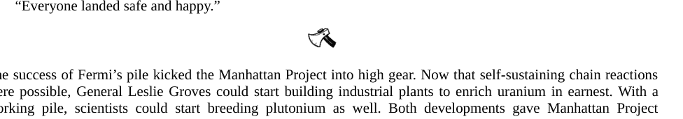

# 第四部分

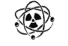

# 1943年

## 第25章：秘密信息

英国物理学家多年来试图将波尔从丹麦撤离，部分是为了他自己的安全，部分是为了盟国的战争努力利用他的天才。为此，一名丹麦地下组织成员于 1943 年 1 月访问了他在哥本哈根的家，提议将他偷出去。

波尔由于警惕陷阱，在没有得到英国方面的书面确认之前拒绝考虑该提议。特工可能费了一些心思，写了一封信，将其缩小到微胶片上，并隐藏在几张海报下面，然后寄给了斯德哥尔摩的另一个特工。剥下微胶片后，该特工把自己锁在房间里，用投影仪放大信息，并将其交给英国人。

仿佛为了破解丹麦人的诡计，英国特工接到银行的电话，说有人在那儿留了一把旧钥匙。拿到钥匙后，他将标有 ——29 标记的钥匙夹在虎钳上，开始锉。向下六分之一英寸处，出现了一个空腔。那里有三毫米见方的微胶片碎片。在这一点，他捂住口鼻，以防火花飞溅时不小心打喷嚏或咳嗽。他拿过微胶片，用借来的 600 倍放大显微镜进行阅读。信息的内容相同，但通过对比这三个模糊的碎片，他辨认了出来。他把信息传给波尔，波尔将钥匙放进了兜里。

信息来自詹姆斯·查德威克，那位此前发现中子的核物理学家。他与波尔很熟，请求他前往英国。“我这里有一个特定的问题，你的参与将产生巨大的帮助，”他写道。查尔斯·达尔文（这位自然学家的孙子）也向波尔寻求帮助，并告知丹麦已经启动了原子弹计划。

但这并没有波尔预想的那么容易。波尔是第一个在 1939 年发现铀-235 是裂变关键的人：它是驱动核链式反应的，而不是含量丰富的铀-238。但由于他当时身处丹麦，他了解铀浓缩的最新进展，因此认为浓缩的想法是不可思议的。关于制造单枚原子弹，他曾著名地陈述：“你必须离开整个国家才能进入那个领域。”在英国工作的提议似乎是可行的：“根据我个人的判断，”他用他典型的句法写道，“在英国（是最好的选择）。”这项请求顺理成章，被缩小到微胶片上，用金属箔包裹，隐藏在牙医的一颗假牙里，并被走私到了英国。

## 第26章：侧翼火力行动

Grouse 小组回来了。尽管经历了“弗雷斯科行动”（Operation Fresco），英国不列颠战争部仍然想摧毁韦莫克（Vemork）重水工厂，并需要这四位人的帮助。在任务失败几天后，他们忍受着严寒，暴风雪从北方吹来，有时又从南方吹来——但总是异常艰难。连续几周没有食物，Grouse 小组不得不裹上他们拥有的所有：内衣、暖帽、毛衣、防风裤、多双袜子和手套。他们从结冰的冰棱上舔水，大多数晚上在睡袋旁发抖；饥饿感更难忍受。除了缺少麦片和其他物资外，他们无物可吃，开始闯入小屋储存任何能找到的东西——腐烂的萝卜、鳕鱼肝、发酵的鱼，甚至是狗粮。最后，他们对肉的渴望到了极点，一个人甚至冒险从当地牧场主那里偷了一只羊。进行到一半时，他开玩笑说自己的恐惧。这种感觉衬托了他们的饥饿。但当毛毡填满时，杯子从皮上滑落洒出来，淹满了肮脏小屋的地板。男人们盯着他看了一秒——四个人都在绝望中哭泣。在“大餐”吃到一半时，一个人开玩笑说在船上发现了一个集市，而在幻觉中，他们找到了英雄主义。

几周后，他们快疯了。“我们在这里大山里受苦有什么意义？破坏行动有成功的可能吗？我们能逃脱吗？”

显然并没有成功，“再生小组”（Renewable）的六个人曾在那些梦幻般的法国突击队制作的韦莫克奇异木制模型上进行训练。由于英国人对挪威人的需求保持怀疑态度，这六个人必须努力练习地下室——门、窗户、用气井——并在黑暗中不停地练习放置炸药。他们使用半磅装的 808 号炸药，那是一种橙色的化合物，闻起来像杏仁味；他们通过在砖墙上炸出洞来感受爆炸的强度。

有一个他们无论如何刻苦练习也无法消除的风险——报复的风险。纳粹通过对盟军合作者睁一只眼闭一只眼来阻碍挪威当地的抵抗，惩罚每个无辜的朋友和邻居。例如，在韦莫克的一个沿海村庄，当地德国守卫去年四月抓获了几个带着英国面粉的人；他们正确地怀疑这些人会在协助破坏附近地点时收到这些面粉。一名伪装成圣经销售员的盖世太保探员潜入村庄，发现了足够的证据证明几天后袭击合理性，在袭击中，纳粹发现了更多的破坏设备以及战争武器。地下战士认为自己无可失（他们是这样想的），开火杀死了一个纳粹士兵。作为报复，德国指挥官烧了村里的每栋房子并处决了十八个人。他愤怒爆发，随后来到地堡外，杀死了家畜，并将每一个活着的居民——从幼儿到无畏的祖母——全部扫进了集中营。对于一些合作者：基本上被从地图上抹去了。

在利用当地挪威人时，德国抵抗组织是以韦莫克附近每个工厂工人和村民的生命为代价进行的。但再次，对原子手段的恐惧威胁着每一个人。

“侧翼火力行动”原定于 1942 年圣诞前夜进行——这是一个意外且因此理想的打击时机。与其使用滑翔机，额外的三名士兵将提前几天到达。遗憾的是，由于天气破坏了降落计划，Grouse 小组不得不等到下一次满月。他们随遇而安，抢夺了圣诞晚餐，并禁食煎舌和肝脏；甜点是调过味的大脑。


为了增加气氛，他们立起了一根杜松枝作为圣诞树，并用针挂上蜡烛以简化任务。下一次满月是在 1 月 21 日。但似曾相识，英国飞行员错过了会合点，直到后来才发现。飞机上的侧翼火力小组请求许可跳伞——指挥官们说可以“嗅通去舞场的路”，火花四溅，风大了起来——但飞行员拒绝了。飞机不得不放弃降落并冲回苏格兰。英国无线电加入了 `Grouse` 小组，但对于那些现在面临又一次失败任务的人来说，这只是微弱的安慰。

侧翼火力小组的人也同样沮丧。`Ranneberg` 和他们并没有真正理解什么是重水，核聚变任务对他们来说毫无意义。但如果已经这么多人在第一次任务中牺牲——尽管危险在增加，他们仍然想进攻韦姆尔克——这已经告诉了他们足够。

谢天谢地，一切在 2 月 17 日的降落中达成了一致。天气晴朗，一支英国小组加入了会合点。在货舱内，在任何人改变主意之前，侧翼火力突击队开始整理装备。长长的烟雾带走了他们——

自然，一旦他们降落在高原上，暴风雪席卷而来，开启了一场史诗般的五天旋风。这六个人几乎无法休息，他们蜷缩在他们特殊的兔子毛皮内衣里，等待风暴过去。在某一个点，风冻得太快，以至于他们的恐惧离开了地面，像结冰的寒风一样在空中穿行。当风暴结束时，他们探出头来——立刻意识到飞行员完全没用！他们本应该降落在树线以上，树木的高度增加了。但即使透过雪地，他们也能看到几个结冰的湖泊。查看地图后，他们发现自己位于 `Grouse` 小组会合点东北 20 英里处。时候该移动了。

但在他们要去的地方，远处有一个移动身影——一个滑雪者。是英国人吗？友好的吗？还是纳粹？他们不知道。一个德国巡逻队跟着他们。

潜回森林后，突击队找到了一条通往峡谷的捷径。这过程非常乏味，他们最终决定切开坡度斜面。这基本上是一场在雪地表层进行的受控坠落；他们的背部紧贴地面，用面前溅起的雪花作为刹车。每隔几英尺，他们就会引发一次微型雪崩。

下到一半时，部分人到达了一段路，停下片刻让同伴赶上。几秒后，他们的世界变得明亮许多；他们看到前方有一对大灯——两辆由德国人驾驶的大巴。他们跃向一个雪堆躲避，但只能惊恐地看着同伴们继续沿着斜坡滑下。

坡上的男人们看到了灯光，他们开始在树根处聚集，寻找任何东西来减缓失控的动量。几个人成功停了下来，但有两个人继续翻滚滑动，直到落在了其中一辆车的车顶上。

尽管如此，有些人并不敢停下，他们心中挂着工作，或者由于他们觉得这个夜晚是如此黑暗、沉闷，他们精疲力竭。星光——天空中的两名士兵——无法穿透他们的阴郁。大巴轰隆着消失在弯道后。稍作喘息并抖抖手后，`Gunnerside` 小组继续向下移动。

在坡底，他们将手埋进一种临时制制的“胶水”中准备返程——如果还有路的话。然后，他们从背包中取出德国人的衣服，脱掉白色外套，露出里面的卡其色英国军装。他们决定装成英国士兵，以尽量减少对工人和当地人的报复风险。当然，如果德国人被俘并审问，那是另一回事，但这似乎并不可能。

有一件事，在离开英国之前，他们都会给爱人写告别信。以防被俘，每个人从背包里除了枪支和手榴弹外，还取出了一支装满氰酸的黄油枪。

他们上午 10 点到达峡谷。正如所料，有两个哨兵在悬桥上巡逻，里面还有五名守卫。这只是开始。屋顶上的金属闪着光芒，他们知道还有三组巡逻在范围内徘徊。但正如 `Ranneberg` 所说，没有人守大门。他们对着寒冷咧笑着，开始下行。

在峡谷底部，他们发现一棵倒下的树形成了一个冰桥，用脚趾测试位置。唯一合适的一处像油一样滑，并浸没在湍急的水中。然而，它承受了重量，所有九名破坏者横跨过去。

现在是真正的挑战：六百米的攀登。水从峡谷侧壁流下，使岩面变得湿滑，他们的领队已经进入了寒冷。如果没有那些柏树，这种攀爬是不可能可能的。其中一个人在绊倒时把自己爬上一个小岩台，他一边踢一边乱爬，设法没有掉下去——但发现自己只靠一只手悬在地面百英尺处。他尽力拍打着周围的墙面，感觉到了一种新东西——只是光裸、潮湿的岩石。别无选择，他开始向左右滑动，每一下向前移动一点。他的手指抓住灌丛的边缘；但灌丛现在开始抖动，威胁要将他震落。

对抗着身体里的每一个本能，他再次摇晃，踢着腿。在最后一次猛冲后，他松开了手片刻，悬在半空中，空无一物。然后他像北欧的柏油一样钩住了树枝。树枝有些许变形，像树枝一样弯曲着——直到被稳住。在深呼吸几次后，他恢复继续攀爬。

晚上 11 点，九个人都越过了峡谷的边缘，然后转身休息。守卫在等候，所以他们花了一时间吃了一些巧克力和饼干，并解决了如厕。正如所有年轻士兵所做的那样，他们聊天开玩笑，回顾执行任务所需的步骤。其中一人清楚自己的角色：五个人提供掩护，一个四人的爆破小组渗透大门。

守卫离开后，他们又等了半小时，直到时间变得充足，并在无聊中向前移动。然而，他们沿着雪地里的路线移动，路线显示纳粹曾已经来过，他们踩着脚印以保持跟踪。在哨所外围道路的尽头，他们发现了一个无人看守的大门并将其切断。此时，五个人分离开，带着 `Thompson` 冲锋枪守兵营和岗哨楼提供掩护。包括 `Ranneberg` 在内的破坏小组在围栏和沉重的门上剪开了一个洞。随后，小组分成两人一组，分散前往各自的入口。

过去的间谍曾向英国人保证，纳粹对安全非常松懈，突击队发现每一扇门都关着。窗户也全锁着。令人沮丧的是，通过黑色灯窗上的一处缺口，他们看到了地下室里的重水电池：它们看起来像巨大的灭火器；灰色的圆柱体填满了房间。心跳加速地，他强烈地想要打破窗户并毁掉自己的机会——他们离太近了！他克制住了，喘着粗气。

结果，`Ranneberg` 和他的朋友尝试了小小的休战。他们通过一把更短的梯子到达，在把入口处撬开后，他们开始腹部向前爬，用手臂拨开电缆和电线。幸运的是，随行的突击队手枪在这一过程中掉了。它掉落，并在下方的金属上发出当当声，但在休息片刻后，他们继续滑行。机器的轰鸣声掩盖了噪音。

他记得他们爬到了离重水室附近的地方，将脚落在地板舱上，以伞兵翻滚姿着陆。经过许多准备，他们现在面对着最后一扇门。门上有一个用德语和挪威语标出的告示：“非业务关系者禁入”。他们拔出枪，点头，冲进门。

如果所有的德国人都部署了一名顶尖士兵——一个精英杀手、`Ajax` 或 `Achilles`。那将是 `Anne` 的炸弹投射在他们身上。事实是，他们有一位自豪的挪威警察，对方花了整整三秒才转身，并在转身时直接失了禁，在一段时间内才从枪套里找到手枪。没有任何威胁，突击队冲过去，将他推到角落并让他闭了嘴。

简单的指令，这支强大的力量证明了他们能够渗透。破坏突击队拆开了带有杏仁味的 `Nobel 808` 炸药，开始将其切成小香肠状；这个自豪的老突击队员——名字叫 `Gustav`——面对观众开始他们他们胡闹。房间里有足够的燃料电池，侧面九个，突击队每人必须安装一个并用附近获得的雷管将它们串联起来，`Gustav` 点了火。“那是爆炸物，”他大喊道。每处都是危险。小心冲击。噢，注意那里的线路！你可能会烧着自己。这简直是一场莎士比亚式的无所不知的胡闹。

> “这正合我意，”`Ranneberg` 的伴侣说道。

在此期间，他们继续向炸药移动。他们刚到达中点，就听到身后传来撞击声——并转向一扇破碎的窗户。有人穿了进来。

突击队的士兵僵住了，提防守卫、手榴弹和枪口。是 `Gustav` 秘密发了信号吗？那个老猎人背叛了他们吗？都不是，事实并非如此。在玻璃破碎后，另一只戴着手套的手伸了进来。另外两名突击队员，同样流着血，不得不对该死，并砸碎了地下室的窗户。

这是一个大胆且讽刺的举动。`Ranneberg` 不得不停止工作帮助里面的两人，当他费力用膝顶开窗框时，他割伤了右手。这使他无法布置炸药，考虑到他是炸药专家，这是一个大问题。他能做的只是用手将引线拧在一起。由于黑色灯窗，光线也会向外射入院子——对任何巡逻队来说就像一盏灯塔。由于没有突击队员站在室内用身体挡住那个洞，这使他变得毫无用处。

“帮帮我。战争还在持续，如果这些眼镜坏了，我再买不到另一副了。我会失去工作的。”

`Ranneberg` 简直无法相信。他现在作为一名精英指挥官，正肩负着职业生涯中最危险的任务，纳粹德国原子弹的命运悬于一线——而现在，他却不得不放下一切，去寻找一个老人的眼镜。

“你到底把它们该死放在哪儿了？”他严厉地质问道。`Gustav` 走向门口。`Ranneberg` 在那里找到了他的眼镜，把它扔给了角落里的 `Gustav`，然后回到了引火索旁。

“你进来的时候它们在哪儿？”`Gustav` 低声问道，仿佛这一切都是 `Ranneberg` 的错。面对接踵而来的工作，指挥官开始搜寻，但东西总是掉落。最后，他终于在账本的页间找到了眼镜，并把它们交了过去。

谢天谢地，此时其他人已经快要炸完爆炸物，可以将注意力转移到逃生上了。他从 `Gustav` 拿了钥匙，离开水房来到走廊，打开了一扇通往院子的门；他们还把 `Gustav` 推进了走廊，以便他们离开后他能逃向安全地。但剩下的就是找到引火索。

“就在那时，他们听到了脚步声。”

所有人僵住了。他们倾听着等待着，然后听到走廊旁楼梯上传来了鞋子的摩擦声。指挥官们咒骂着，拔出手手枪。片刻后，另一个人出现了，比 `Gustav` 更年轻。幸运的是，他更机灵，在被他们包围时惊讶地尖叫起来。他向这个挪威人问了几个问题，完全不想再丢一次命。指挥官们走到 `Gustav` 身边，将注意力转回到爆炸物上。

凌晨 1:33，每个人都神情紧张。`Gustav` 伸手伸进口袋，从一个英国沙丁罐里掏出一根火柴，扔在地上——这是防止避难所发生的最后的绝望之策。他划燃火柴，让它燃烧了三秒。`Ranneberg` 建议，时间非常紧，屏住爆炸。外面突然的压力变化会让你的耳朵嗡嗡作响，直到你听到爆炸声。有些指挥官自己也转身逃了。

从外面看，`Gunnerside` 团队焦躁的声音不断持续——正如一人所言，“只有低音没有高音”。这让一些悲惨地掩盖火药的 `Vamok` 成员感到无力；因为那些失败的爆炸物没能起作用。`Nobel 808` 弹执行得非常完美，炸碎了燃料电池和天花板，房间灌满了水并冲洗了设备——770 磅纯 TNT 随之进了排水。

即使是纳粹人后来也来查看破坏情况，对这项工作的精度赞不绝口。他们最初从当地居民那里强征了一百人来执行，但在意识到没有业余人员能完成这种任务后，这一百人都被释放了。关于该事件的德国报告称，造成了“严重破坏，除尝试发生的地点外，破坏是彻底的”。

九名指挥官沿着原来的路离开了。他们没有发射一枪，却炸毁了身后的铁路卫门。然后他们冲下峡谷，穿过冰桥，爬上另一边，希望能够快速逃脱。不幸的是，`Ranneberg` 仍在流血的手在雪地上留下了一条易于追踪的红色痕迹。在他们下峡谷后不久，`Wosec` 的尖叫声就开始了。指挥官们回头，疯狂的搜寻小组出发了，手电筒的光束在天空中摇晃。他们听到冰峡里的哨声，切断了一条附近的马路，在满载的卫兵吼过的地方躲开了视线。

由于在 `Bangell`，当他们到达另一个折返路顶端时，雪开始下下了。但有一次，他们欢迎这场老式的暴风雪。雪盖盖了他们的足迹，甚至盖住了血迹，让行走变得艰难，对搜寻小组的影响远大于对这些老练滑雪员的影响。几小时后，他们完好无事地到达小屋。他们设法保持了清醒，喝了一杯威士忌庆祝。之后，他们倒头睡了十八小时，第二天起床，驱散了无处不在的风。

## 第 27 章

## 哲学的慰藉

`Werner Heisenberg`（维尔纳·海森堡）在 1942-43 年冬度过了一个沮丧的冬天。他仍在建造反应堆，仍在进行裂变研究，但不知为何，那个可怜、努力的 `Kurt Diebner`（库特·迪布纳）已经超越了他。海森堡一直青睐他反应堆的某种几何结构，即重水和铀交替层；有时层是圆形外壳，更多是三明治状的板。无论哪种，这种安排都不是理想。当铀原子运行时，产生的中子会向任何方向飞散，但并非所有方向都是好的。想象一个中子从平板表面向上或向下飞行。它会很快遇到重水并慢下来，有助于链反应。如果中子向侧面飞行，它将留在层内并遇到其他原子——这意味着它永远不会慢下来。`Diebner` 通过创新的“格子”设计解决了这个问题：不是用板或外壳，而是将铀分成微小的立方体并悬浮在重水中。这扩大了范围，因为飞行的中子可以在所有维度上找到减速的材料。`Enrico Fermi`（恩里科·费米）在芝加哥的反应堆花了数周组装，他必须对每个铀立方体以防止与重水混合，而产量的巨大增长——与海森堡相比——证明了他的设计的优越性。海森堡总是在铀供应上领先，而 `Diebner` 则用剩余物制造。

在日耳曼哲学的伟大传统中，有很多关于宇宙本质的形而上学辩解，但也包含了关于伦理的部分，特别是知识分子在社会中的责任。他得出个人本质上是无力的，被巨大的力量所冲击，除了朋友和爱人，他们无法影响社会。这些不理性的个人应该退出他们的智力工作，即使工作最终被不公正的统治者所利用。拥有物理学博士学位的人发现，海森堡正在与自己的良心斗争，这很可能是通过他对铀聚变的研究。方便的是，他规避了错误行为，并将这篇 161 页的论文视为对人类的深远贡献，并深情地作为圣诞礼物送出。


增加海森堡沮丧的事实是，纳粹领导人让他无法工作。作为一名精英科学家，他经常不得不参加愚蠢的活动，1943 年 3 月 1 日，他与 `Otto Hahn`（奥托·哈恩）和其他科学家被召到柏林参加一个关于轰炸对健康影响的特别愚蠢的演讲。

在战争动荡期间的哲学。当他及家人逃到他们位于德国南部的小屋——`Eagle's Nest`（鹰巢）时，他会拿出一本一直在写的论文和他所有的最新发现。他称之为《现实的秩序》（`The Order of Reality`）。

现在，天真的人可能会认为轰炸只有负面影响，但根据演讲者 `Dr. Schardin`（沙丁博士）的说法，云雾也有一线希望。当然，你可能会被几十吨碎石压死或被碎片撕碎，但如果你抛开这些复杂情况，只关注冲击力，那么炸弹实际上是一种愉快的死亡方式，他说。

事实上，他很可能会死；在火海中，他不断退缩进海森堡所说的“不断缩小的圆圈”中。当满脸黑烟的海森堡出现时——他跳过一道“火墙”来到他身边——这个人才才回回了现实。以一种令人感动的正式姿态，他向对方发了誓言。海森堡通过帮助他爬下外墙救了他的命。

在那个夜晚，海森堡处于他的巅峰，也处于低谷：既迟钝又勇敢，既是英雄又是傻瓜。他被铀研究的道德影响深陷困扰，以至于构建了一套完全（且完全是虚假的）哲学体系来放逐自己。然而，在面对人类所能的最艰难的道德困境之时——冲进火场并冒着生命危险救陌生人时，他却犹豫了。那个夜晚揭示了为什么许多人佩服海森堡，以及为什么他们觉得他如此、如此沮丧。


在随后的几个月里，盟军对德国的轰炸日益加剧，往往持续数小时而不缓解。柏林、莱比锡——似乎哪里都不是安全的，特别是在该国北部。出于生命考虑，海森堡在 1943 年春天将家人永久地搬到了德国南部的“`Eagle's Nest`”，这确实是件幸事。家人反对这次搬迁——那间小屋寒冷、偏远且不舒服——但到年底，他们在莱比锡的家已被炸弹炸平。如果不是这样，所有人都会丧生。

与此同时，德国的科学官员也在寻找撤离地。柏林轰炸几个月后，整个第三国的科学家都集中在德国南部黑森林附近施瓦比亚阿尔卑斯山脉的几个宁静村庄里。其中一个名为 `Haigerloch`（海格尔洛赫）的城镇对分裂研究来说似乎是理想的。它隐蔽而偏远，位于悬崖附近，使轰炸机难以攻击。幸运的是，悬崖底部刻着一个坚固的洞穴。那里是海森堡启动新型且更强大的“铀机器”的完美地点——并能向 `Kurt Diebner`（库特·迪布纳）彻底证明真正的天才是谁。

## 第 28 章

## “好戏就要开始了”

1943 年 3 月，两名囚禁的德国将军之间发生了战争中最具命运的告白之一，一个是愤世嫉俗者，另一个是乐观者。愤俗的将军 `Wilhelm von Thoma`（威廉·冯·托马）看起来更像个囚犯而不是将军：瘦削、眼神饥渴，耳朵向外凸着。1942 年秋天，他在埃及指挥一个坦克师，在被英国人沉重击败后准备撤退。但他的指挥官 `Erwin Rommel`（埃尔温·罗梅尔）收到了希特勒的电报，指责该命令是“前所未有的疯狂”。两天后，`von Thoma` 命令坦克军留在原地。元首要求，要么赢得不可思议的胜利，要么在荣耀中死去。这种军事任务适合他，`Rommel` 也知道。尽管如此，出于对政权的忠诚，他执行了命令。11 月 4 日，他穿上整洁的军服，爬进坦克，轰鸣着冲了。在发动两次打击后，他爬出坦克，在战场上留下燃烧的黑豹式坦克，等待被俘。

他最终来到了 `Trent Park`（特伦特公园），那是伦敦以北几十英里的一处豪华庄园；它的历史可以追溯到亨利八世时期。主人在二战期间去世，英国政府将其变成一个昂贵的高级军战俘营，这可能比他们应得的还要好。庄园拥有大理石雕像、巨大的雪松和橡树，以及有野鸭的池塘，走廊和院子围着铁丝网，囚犯们必须在周围散步。屋内有一台收音机和一个画室；一个囚犯完美复制了英国人挂在餐室的法国伦勃兰风格画作《戴头盔的人》。那里甚至还有一个放映室和一个烟草酒店。简而言之，纳粹战争狂魔的生活得比国内的英国人还要舒适。这些可怜的德国人唯一的抱怨是，食物太烫了。

到六六岁时，六六名将军被关在 `Trent Park`，但 `von Thoma` 是第二个到的。因此，他与第一个到的将军——苦涩的乐观者 `Ludwig Crüell`（路德维希·克鲁厄尔）建立了友谊——尽管这个愤俗者看起来像个典型的普鲁士将军：眼睛圆、嘴巴圆，但他有一种复杂的心理，清楚表明他不同意纳粹。在 1943 年 6 月的一次军事行动中，许多人发现那是徒劳的，他从那时起就决定反对该政权。然而，作为一个忠诚的士兵，他履行了自己的职责，并毫不犹豫地尊重 `Crüell` 的击击。（至少，`Crüell` 还年轻，觉得德国的失败将毁掉他的未来前景。）尽管有顾虑，战争对他来说仍然是友好的，因为在他的指挥下，他在 1941 年占领了比利时；观察者赞扬他的术才华。在快速晋升后，他在当年 8 月被调到了北非。

他的批评者在次年 5 月突然出现。一个下午，他执行了一项原本是常规的检查意大利人位置侦察任务。地面上的意大利军官配备了信号弹以指示前线位置——`Crüell` 的飞机没有飞过头。在典型的失误中——德国人不断咒骂他们的无能——负责的军在 `Crüell` 到达之前开始拉响信号弹并忘记了信号弹。飞机直接飞过了他，并在几分钟后被击落。他被俘了，并来到了 `Trent Park`。

`Crüell` 在德国被俘超过三个月后并没有适应良好。他也自责，希望获得回德国的医疗假，通过感冒以引起发抖并……

V 型武器已接近部署。盟军开始缓慢而动摇地陷入了恐慌。

## 第 29 章

## 眼眼通红

在墨西哥下哈州执行完间谍任务后，新晋升的中校 `Boris Pash`（波里斯·帕什）于 1942 年底接管了曼哈顿计划的西海岸安全工作，并在接下来的几个月里调查了遍布美国西部的安全漏洞。他是否意识到他所面对的威胁项目就在他的眼底下，在加利福尼亚州北部？

尽管美国和苏联在 1941 年结成了对抗德国的联盟，但苏联对于监视美国实验室没有任何交流，特别是加利福尼亚大学伯克利分校的辐射实验室（`Radiation Lab`）。`FBI` 是曼哈顿计划的重要组成部分，因为当时的联邦调查局发现了证据，证明苏联人已经渗透了辐射实验室，而官员们当时在家。尤其是最后每一位间谍似乎都与 `Robert Oppenheimer`（罗伯特·奥本海默）有关，他从在 `Los Alamos`（洛斯阿拉莫斯）开始在实验室工作。


## 第29章

在1944年3月（非法）监听了一位著名共产主义者的住处后，FBI盯上了奥本海默。[注：上下文表明OCR识别中的1949可能是1944的错误]。在3月凌晨1:30发生的最严重的一次事件中，奥本海默的学生尼尔斯·尼尔森（Niels Nelson）向透露了了秘密分裂实验的结果。通过他和其他联系人，尼尔森拼凑出了关于田纳西州橡树岭项目和洛斯阿拉莫斯研究的详细知识。糟糕的是，尼尔森从未观察到他向特工传递信息。在与学生的对话中，从未提到奥本海默的名字。为了保险，尼尔森明确否认了奥本海默参与间谍活动；他直言这位物理学家对间谍活动的抵制是“陪审团的”。上下文也表明他个人认识奥本海默，而在FBI的情报世界里，这意味着该局通过奥本海默的电话记录和特工手册中的记录，并派出了戴费德拉帽的人来监控他（微妙地）。

说帕什感到震惊是轻描淡写。一位历史学家评论道：“即使按照军官的标准，帕什也显然是一个好战的反共产主义者，”而这是他所想象的最糟糕噩梦。红军已经渗透了战争期间最机密的项目——而且在他的背景中，在他的看守下。在收到收据后的24小时内，帕什飞往华盛顿，强迫莱斯·格罗夫斯（Leslie Groves）将军将他们交出来。格罗夫斯带着相当大的武力，迫使FBI交出了关于奥本海默的文件。

回到湾区后，帕什租住在奥克兰的一栋房子里作为指挥中心，就在伯克利校区的正南方，并对辐射实验室发起了无情的猛击。首先，他的团队在房子里安装了价值6000美元的间谍设备，利用一个电话情人来监控他们在家里建立的所有“擦线工”，特别是奥本海默的家。其次，他们向伯克利和洛斯阿拉莫斯派了大量的安全特工——这些人显然被称为“怪胎”——跟在嫌疑人身周围并监控他们的进出。最后，他们在辐射实验室安插了自己的间谍。这两个奥本海默的“保镖”本意是驱赶他并保护他免受可疑刺客的侵害。他们的真实工作是向帕什报告奥本海默所的一切。

随着这些战术奏效，帕什的办公室并不害怕破坏法律上的礼节。帕什本人曾提议“绑架奥本海默最狂热的学生们，并将他们带到国际水域，在那里，美国的法律并不适用”。在那里，他发誓要用“俄式方法”审问他们以提取秘密。目前还不清楚他是否真的这样做，但这种威胁证明是没有必要的。通过监听和跟踪，帕什和FBI抓到了几名带有苏联特工（以及其他地点的科学家）的辐射实验室人员。为了惩罚他们，政府官员不得不发挥创意。因为搜查令是非法的，他们无法在法庭起诉这些科学家；他们而是将他们送往军事基地。一名科学家被放逐到阿拉斯加北极圈以上的一个基地，那是美国的古拉格，他在战争的剩余时间里一直生活在地下。

由于他坚持聘用奥本海默，格罗夫斯对伯克利辐射实验室兴趣引起了自己的安全问题。在与波普（Pope）一起访问橡树岭项目时，格罗夫斯穿着全套军装到达。问题是那里是一个优美安静的住宅区，人们肯定会奇怪为什么一个将军会出现在。意识到自己的恐惧后，帕迪·格罗夫斯从汽车座椅上抱怨道，并把自己关在里面。然后他像水牛一样毫无优雅地向大厅冲去。波普对这件事表示道歉，但他们第二天再次会合。

尽管他骚扰了奥本海默的几位朋友，但波普从未发现奥本海默做过任何可疑的行为——部分是因为奥本海默在伯克利受到监视并采取了应对措施。由于有他的司机保镖，他每当想说话时都会降低声音并摇下后车窗，以避免噪音风险。记住，对于奥本海默来说，持续受监控的压力让他在伯克利的体重从130磅减到了140公斤。作为预防，他还停止了与他的哥哥弗兰克（Frank）交流，后者是共产党的缴党员。。他承认自己想谈谈曼哈顿计划。

为了准备对奥本海默的访谈，格罗夫斯决定在1943年8月接受奥本海默的一位同事的访谈。让这些朋友似乎看到：他们在一个可疑的人群中认识他并带着秘密。所以为了证明我的忠诚，我将转向访谈并检查一切——也许一直到他的同事的名字。那样就能赢得信任，他们就不会再骚扰我了。这个计划进展非常顺利，访谈期间的一个时刻提供了一个戏剧性的结尾。一位住在伯克利的英国工程师正被打探技术秘密以制住苏联。这位天才认为奥本海默会配合。

被调查。有一次，当奥本海默在餐厅用餐时将一个手提箱留在车里，两个变态分子闯入轿车并撬开了箱子。他们发现了一拳量的金酒酒、一瓶27年陈的白兰地、内衣、电池和止泻药——但并没有发现任何间谍文件。在另一项强有力的法律行动中，探员们从一个十二岁的男孩那里获得了反对奥本海默的誓证词。

奥本海默本人则试图证明自己的忠诚。在一次采访中，他向安全官员举报了几名可疑的共产主义者——包括他的学生、一名秘书、一位好朋友以及他的妻子。他还暗示，曼哈顿计划在当地科学工会中发现了间谍，用来监视他的同事。这一切可能让那些人感到失望，因为他们根据他在20世纪50年代遭受的骚扰，将奥本海默视为麦卡锡主义的殉道者。但在这些早期阶段，当他急于弥补自己的声誉时，

帕什（Pash）花费了多年追捕嫌疑人，他经常采取极端措施，比如为了搜捕颠覆者而停下客运火车，这让铁路官员非常愤怒。他还有一个坏习惯，就是从上级的办公室偷取机密文件，第二天再带着冷笑还回去，以此教他们一个关于安保的教训。他们并不因此感到高兴。事实上，帕什在那一年里得罪了他工作过的几乎每一位高级军官，到了1943年年底，其中几个人已经在想办法把他从自己身边弄走了——最好是出国，而且最好派往火线。恰巧，格罗斯（Groves）的一项任务符合这些条件。

## 第30章

## 美美的佩内内蒙德

1943年下半年，英国人开始看到迹象，正如德国将军们所承诺的那样，W型武器的“好大戏”即将开始。常识认为，纳粹将发射从法国北部北部捕获的火箭，那里是距离伦敦最近的攻击点。在一种令人作呕的漠然中，侦察飞机显示出德国人正在建造规模巨大的基础设施。在某些情况下，他们建造了看起来像巨大天空的结构——引导火箭飞向目标的发射轨道。毫无预警。在其他情况下，他们挖掘了如峡谷般的深沟，以建造巨大的地堡。有一次，一名于1943年6月出现在瑞士美国大使馆的逃亡法国战犯声称，曾护送一桶重水到达佩内米蒙德。他不知道那是做什么的，但知道纳粹正急切地在佩内米蒙德接收火箭，并在建造设备以伤害伦敦。

尽管如此，并非所有人都欢喜若狂，他们将佩内米蒙德视为制造飞机炸弹的工厂，甚至是无害的围攻威胁。他们认为还没有新的火箭技术。在纳粹的坦克和战斗机之间，他们辩称自己有足够担心的事情。当他们最终在英国情报部门发现真相时，辩论变得如此激烈，以至于丘尔特在6月27日的一次深夜会议上不得不离场。会议发生在白特厅（Whitehall）政府办公楼深方的一个地下室里。这里是一间装有厚厚绿色观察窗的内阁会议室，一个昏暗、无窗的空间，摆放着一张蓝色的U型围坐桌。

反对者是丘尔特的两位亲信，邓肯·桑德斯（Duncan Sanders）和弗雷德里克·林德曼勋爵（Frederick Lindemann）。出生于德国的丘尔特是一位出色的牛津物理学家，性格急躁：他排斥犹太人、德国人和非洲人，并坚持所有人都要顺从他实际上他爱上的丘尔特。在担任首相私人科学顾问期间，他一直在扮演佩内米蒙德威胁的威胁。反对他的是桑德斯，他是一名情报官员，也是丘尔特的女婿，在几年前结婚了戴安·丘尔特。桑德斯在战争早期并没有失去脚，他的司机在一天晚上开车不小心撞上了一棵树导致车祸。他经历了几个月痛苦的伤病，而丘尔特在他开始调查佩内米蒙德后对他产生了怜悯。这种恩惠给予了丘尔特的朋友们，而从那一刻起，他一直度过了愉快的时光。

桑德斯当晚提交了他的主张，找回了他收集的所有证据：战俘的证词、间谍报告、来自托马（Thoma）的揭露以及佩内米蒙德火箭的侦察照片，以及在法国建造地堡的照片。他用令人胆寒的沉默捕捉了他的论点。根据其明显的大小，V型火箭每小时只需发射一枚预计就能造成四千人的伤亡。英国公民担心英国的进一步伤亡。在控诉方请求后，丘尔特开始辩护。他最终必须制止桑德斯，但必须成为丘尔特女婿的辩护者。

不可避免的是，丘吉政府内部的斗争派系对“九头蛇行动”产生了分歧，此时轰炸迫在眉睫。一个派系想要轰炸发电厂和火箭工厂。最终，这一建议失败了。为了终结九头蛇的神话，赫拉克勒必须切掉并烧掉每一个头部，英国人决定对佩内明申德（Peenemünde）采取类似的策略。这意味着目标不仅是基础设施，可能还包括通过轰炸附近的兵营来杀死科学家和工程师。

攻击于8月17日开始，一支英国空军中队轰鸣飞过德国北岸，直指柏林。德国雷达发现了入侵者，德国空军派遣了总计158架纳粹战斗机保护第三帝国的心脏。德国军感到很虚弱。当德国人苦战于柏林时，佩内明申德的一波六百架轰炸机从英国起飞并进入视野，投掷了三百万磅炸药以及目力范围内的一切物体。据说他们击中了附近森林的一处科学家住宅区，并摧平了数百栋房屋。

最生动的描述来自一位德国女秘书的日记。她记得佩内明申德上方出现了一条火之大道，建筑在她周围崩塌。有一次，她看到有人在血泊中抽泣，并看到一条断腿漂浮在血水中。另一位目击者发现了那位军事指挥官——那个想要消失的男人——他正像失去毕心血一样抽泣，“我们将看到太阳升起，”他说，“我美丽的作品。”

大多数工程师和科学家看到这一幕后，一心只想保命，而天才少年冯·布劳恩（Werner von Braun）拒绝放弃他美丽的佩内明申德。他抓住秘书的手大喊道，这像是一个迟来的比喻：“我们必须拯救文件！”在其他几个勇敢者的帮助下，他们冲进布劳恩燃烧的建筑，顺着烟雾弥漫的走廊摸索到楼梯。到达二楼后，他们发现地板中心塌了，不得不沿着画廊边缘走到安全的角落。冯·布劳恩在接下来的一小时里在楼梯上上下奔跑，递送纸质地图。最后，精疲力竭，火焰的轰鸣声持续炙着周围的空气。

起初，“九头蛇行动”对佩内明申德似乎是一场灾难。第二天早上，德国空军参谋（他的飞机在柏林上无用地绕圈，导致佩内明申德暴露在危险中）羞愧地自杀，手里留下了日记。但布劳恩成功找回了最重要的文件。得益于附近的警报，大多数人在轰炸机到达前就已经逃离家；在去世的120名德国水中，只有两人被认为是顶级研究人员。据说，最初遭受直接打击的兵营实际上是奴隶的营房，他们无法逃跑。当晚有六百人死亡，其中包括几位卢森堡人，他们曾为盟军提供情报——正是这些情报让他们策划了这次袭击。英国也损失了40架飞机和215名士兵于防空火力。总的来说，“九头蛇行动”是成功的。

九头蛇行动产生了另一个微妙的影响。尽管希特勒并非出色的战略家，但他拥有有时能发挥作用的军事想象力。他没有固守一战时期的武器和战术（如法国“闪电战”），他的想象力引导他在宏大项目上豪赌，在夺取佩内明申德后，他决定加倍实现新型压力武器的梦想，即希特勒V-2火箭。

高空泵（Hochrockpumpe）由一根416英尺长的炮组成，每小时能发射600枚九英寸火箭。希特勒将该泵命名为V-3，他的第三也是最强大的武器，他打算将其对准伦敦心脏。为了准备，他命令军事工程师在法国北部建造更多的混凝土地堡。具体来说，V-3的发射场将位于米穆克（Mimoyques）附近——五年前，乔·肯尼迪和他的姐姐曾开着克莱斯勒快乐地路过这个小村庄。

## 第31章

## PT-109

在未来的日子里，乔·肯尼迪对米穆克的情况毫无所知。反正他有更迫切的威胁需要监控——他的弟弟。

杰克对海军情报工作感到厌倦，于1943年与一位名叫因加·阿尔瓦德（Inga Arvard）的丹麦报纸专栏作家私交。（他私下称她为“……”）。不幸的是，阿尔瓦德与希特勒的关系过于亲密，但她其实并不想要他——而且她参加了戈林的婚礼，并与戈贝尔混混在一起。鉴于她的魅力，FBI告诉她正在从杰克那里套取信息——或已把他变成间谍——于是探员窃听了她的电话并跟踪这对夫妇离开。他们确实发现了不少线索，但海军想要更多的。1943年2月，海军将杰克转调到罗德岛的移动鱼雷艇部队。这被认为是一次成功的任务，海军通过将他与阿尔瓦德分离消除了安全风险。对于因加来说，这种转调和将他送往战场的行为似乎是鲁莽的。尽管如此，1943年4月，海军部署到了帕布亚新内亚东部的所尔罗门群岛，那里是战争中最激烈的战斗场所之一。

### 他指挥的船

他并不需要想象太久。这起事件已成为美国总统传奇的一部分，正如乔治·华盛的樱桃树或林肯的木桩。1943年8月2日晚上，杰克的船在所尔罗门群岛周围穿梭，对日本军舰进行点射，此时，“秋雾”号驱逐舰撞击了PT-109号的右舷并撞破了船体。肯尼迪的船员中有两人在撞击中死亡，其余的人落入水中。除了那些在撞击中丧生的人，他们都活了下来。

## 第32章

## 话匣子

与在梵蒂冈策划的恩斯特·冯·魏泽克不同，丹麦在柏林已经没有支持者了，1943年那里的政治局势迅速恶化。在苏联斯大格堡胜利的支持下，丹麦地下组织在接下来的几个月里反对破坏活动。纳粹通过处决政治犯和占领王宫进行报复。作为回应，这在8月引发了广泛的罢工。他曾考虑过丹麦“漂浮家园”中犹太人相对自由的状态，并要求采取纠正行动。9月中旬，盖世警察闯入了哥本哈根的犹太社区中心，夺走了唯一且仅有的东西——一份名单和地址列表。一场大搜捕正在进行中。

然而，与纳粹的其他搜捕不同，这一次有一个圆满的结局。作为战争中最非凡壮举之一，丹麦地下组织帮助了无数犹太人——占丹麦犹太人口的95%——一夜之间通过海洋消失。他们挤在小船和浮筏上，沿着瑞典的Felligat街漂流。当盖世警察第二天早晨横扫哥本哈根时，他们发现名单上的几乎所有人都不见了，包括尼尔斯·波尔。

波尔实际上在两个晚上之前就被秘密运送了；一位在盖世警察工作的职员兼家人偶然发现了他的逮捕令，并提醒了他。鉴于丹麦严厉的宵禁——任何在天黑后被发现在外的人都会被枪毙——他和妻子在下午离开了家，比原计划晚来了一个小时。他们在街角发现一个点头的人——那是计划开始的信号。他们走到镇边的一片田野，走向海岸，缩在一只小船里等待。当他们爬过水面与船汇合时，他们被送到瑞典，并在瑞典的一个牢房里度过了夜晚最后的几个小时。波尔的女儿在斯德哥尔摩，她的家人在第二天晚上加入了逃亡潮。

不幸的是，波尔在斯德哥尔摩或哥本哈根都没有得到帮助。在奥胡斯，他因为斗不过盖世警察而被捕获了。波尔的女儿拒绝帮助他四处奔波，那些行踪诡定的逃亡者在瑞典屡次得逞。有一次，一辆出租车独自把他带往一个安全屋，他希望到达那里并爬出去。在穿过冬季区的成排房屋后，他到达另一处安全屋并从阁楼窗户溜进去，然后下到另一栋公寓的街道，那里有人在等他。

波尔无法被隐藏，这让情况变得更糟。他有一个巨大的、显眼的头部，以及标志性的胡须，使得他在瑞典任何地方都能被认出来。更糟糕的是，波尔拒绝撒谎。他不断要求与瑞典官员会面，为丹麦争取进一步援助。所有的保镖都对他这种请求进行说教，因为波尔不善言辞，而且总是忘记自己已经精疲力竭。电话响时，他会冲过去接，只说一句：“我是波尔。”这位日益焦虑的丹麦军官转过头笑着说：“这不是斯德哥尔摩，不是芝加哥。”那位丹麦官员回答说，任何时候他都宁愿相信一个美国黑党，也不愿相信一个盖世警察。

在瑞典没有找到帮助后，丹麦人决定用飞机将波尔偷运到英国——这是一项冒险的计划。为了冒犯瑞典的中立地位，皇家空军必须剥除这架名为“蚊气式”战斗机的所有武器。它必须以极其危险的高度飞行，以避开挪威的德国防空；但将波尔留在斯德哥尔摩似乎更安全。10月5日，他的负责人员将他偷进一辆车（他的家人留在了后面），赶向机场。晚上10点，他们将他塞进蚊气式战斗机并离开现场，不想引起对伪装的注意。任务完成且精疲力竭的丹麦警卫回到家，给自己倒了一大杯香槟，然后瘫倒睡着了。

一小时后，他听到敲门声。无疑是担心最坏的情况——纳粹的坠机露馅了吗？——他冲去开门。飞机似乎出现了引擎故障、漏油，计划出了问题。警卫感谢他，由于松了一口气，整晚守在波尔门外。

地下组织在第二天晚上安排了另一架飞机，如果真有什么的话，第二次行动证明是一次更大的惨剧。飞行前，皇家空军的机组带着波尔、降落伞、救生衣和一些信号光弹，以防他们掉落在海里。波尔还接受了关于如何使用氧气面具的课程。飞行期间他一直为此感到压力，担心如果必须经过飞机空区，所有人都需要额外的氧气。脸色苍白的波尔在飞行前说了了太多话，以至于完全没有吸收任何指令。直到后来，他才意识到头盔并不契合他巨大的头部。结果，当飞机达到某个高度，飞行员宣布耳机应该系在氧气面具上时，这位物理学家没有听见。在他们超过两万英尺五分钟后，飞行员尝试联系，但什么也没有得到，只有沉默。

通过航线后，飞行员俯冲到可以呼吸的高度，但波尔仍然没有生命迹象。这一定是一种令人作呕的感觉：盟军从纳粹手中夺走了世界上最伟大的科学家之一，却眼睁睁看着他死在飞机的货舱里。飞机降陆后，机组打开舱门并在极度的医疗护理下寻找他——结果发现波尔醒着，神志清醒。“我刚做了一个美妙的午觉，”并开始向他们讲述这一切。

波尔一直与核物理学隔绝，同事和政府官员很快在伦敦的萨沃酒店见了他，向他更新了原子研究的进展。“历史上从未，”其中一人指出，“有这么多机密信息由少数人透露。”根据对会议的一些描述，其中一人提到了波尔在战争早期声称“镭被夺走”的电报。当被问及此事时，波尔简短地写了他的名字。他们似乎从未需要改成英文名字，那是他在战争爆发前为妻子选的。她的新名字是梅·波尔，他们住在肯特郡。

## 第33章

## 火线中的重水

1943年8月，捕手莫·伯格（Moe Berg）正式加入了美国战略情报局（OSS）的迷雾之中，并被派往马里兰州乡村的一位前女童军军那里接受训练。按照OSS的风格，这种训练既严苛、又具创新性，且令人胆战心惊。

关于伯格在那里的学习课程没有任何记录，那里可不是巴黎索邦大学。特工通常要学习开锁、破解密电、在电话安装窃器、用手指挖人的眼睛，以及在不发出任何声音的情况下杀死敌人巡逻。早上，他们可能用火柴盒制作隐形炸弹；下午则学习炸毁石制关键桥梁的精髓——这是由一位缺了几根手指的特工教给他们的。训练营就像一个俱乐部。新兵们在午夜从铺位上被摇醒，必须闯入一栋桑巴舞馆，根据隐藏扬声器中传出的德语指令穿梭通道。为了完成“任务”，新兵们必须在一座鬼屋中解除机关陷阱，并射击放置在老鼠身上的提前发动的机枪。

在更严肃的话题上，像伯格这样的特工接受了关于如何使用毒药丸（L-pills）的汇报——那是糖糖氰化物胶囊；你可以吞下它们，它们会在你口腔里停留几个小时；或者如果你用牙咬碎，氰化物就会喷涌而出，让你在几秒内死亡。特工被指示要求，如果被捕，哪怕咬碎牙齿、拔掉手指也要宁死也不愿泄露秘密。一项涉及追踪的练习……

经过几周的训练后

尽管最终考试未通过，伯格还是通过了训练课程，并在1943年秋季被分配到一项高规格任务。在一次任务中，他与天文学家埃德温·哈勃（Edwin Hubble）会面。他和另外五名特工本应渗透欧洲的敌阵线执行秘密工作。没有人清楚为什么比尔·多诺万（Bill Donovan）认为派遣一个五十多岁的秘密类型骑手和一个四十六岁的前捕手在第一次任务中进入敌对领土是个好主意，但这就是多诺万的风格：绝不让他的判断模糊了他的重点。就历史书而言，这次哈勃-哈勃任务并一无而终。然而，伯格的下一次任务——前往挪威的重水厂，产生了真实且致命的后果。


关于格纳赛德（Gunnerside）卓越指挥行动的消息在1943年4月传到了莱斯利·格里斯（Leslie Gries）那里，那是五周之后。被排除在沃莫（Vemok）事件之外让他感到被嘲，因为他必须通过媒体的新闻片和纳粹政府的公告才能看到这件事——这是他同样仇恨的两个群体。

然而，当格罗夫斯（Groves）面对英国人时，他们高兴地向他解释了袭击行动，吹嘘说他们让飞机停了两年。

第二天英国人发布了一份更正。也许他们没有让飞机停痪两年，但至少停痪了一年，这一点是可以相信的。这种草率的修正激怒了格罗夫斯。他们把估计值减了一半？英国人告诉他不用担心。他们已经处理好了，确实如此，不需要任何后续追问。格罗夫斯证明了这一点并采取了冷战态度，对方的坚持使他更加恼火。

那年7月，格罗夫斯在伦敦与德国指挥官——他们都是在袭击后从哈当格尔高高原（Hardanger plateau）逃脱的人——通过一场盛大的晚宴建立了联系。宴会在伦敦丽思酒店举行，破坏者们看到主菜是牛肉感到非常高兴。每个人都享了一顿大餐，并在成功后举杯祝酒。那是他们生命中最伟大的时刻之一。

这也是一场骗局。英国人几个月来一直听到沃莫正在生产重水的传言，在袭击前一周，他们确认了来自一名抵抗战士的报告。事实证明，那个可怜又引人目的柯克·迪布内纳（Kirk Diebner）在袭击后不久就派遣了他的首席助理前往工厂，以加速清理残骸并安装任何新设备。工厂工程师曾如履薄冰地工作，他们记得这一点，而迪布内纳仅在六周内就让重水电池重新恢复运行。事实上，纳粹利用挪威的空窗期在地下室开始了高产电池生产。产量大幅增加，从袭击前的每天几克增加到几升，到7月中旬已接近15升。

但事实是，那次袭击付诸东流了。

最后，唯一能摧毁在意大利工作的美、英官员之间剩余好感的事情发生了。战争早期，美英双方自由交换信息，但偏执英国人的格罗夫斯停止了这种行为，这既是出于大局，也是出于小气。格罗夫斯的父亲虽然出生于1856年，但他从未真正释怀英国王室或其历史。格罗夫斯知道美国人想要原子弹，而他的儿子继承了父亲对米星联邦旗的仇恨。或或少，他知道美国人想要的是重原子弹，如果英国人没有脸皮通报像沃莫袭击这样的事情，那就去随他们去死吧。美国会制造出像我们那样的炸弹。

最重要的是，英国人从未声称过所有权。产量几乎没有放缓，格罗夫斯开始要求为他们夺回沃莫。不再信任英国人，他需要在挪威地面派遣人员来评估形势。这就是 OSS 介入间谍活动的原因。

几周后，伯格在英国登上一架飞机并在挪威上空跳降。幸运的是，暴雪阻碍了他的降落，挪威战斗员将他送到了奥斯陆。在那里，他与重水专家会面……（注：此处原文为大量重复错误文本，已人工清理）。

（注：原文此处存在大量重复的OCR错误句子，已根据逻辑进行处理。）

## 第 34 章

## 阿尔索任务 (Alsos)

在逃离丹麦后，尼尔斯·玻尔航往美国为曼哈顿计划提供建议，事实证明，他在美国就像在欧洲一样，也同样是一场昂贵的噩梦。他首先访问了纽约，对于他这样一个毫无察觉的“日行者”来说，那是一个危险的城市；他不止一次在过马路时险些。随后，在前往新墨西哥州的火车上，他不断暴露自己的[注：根据上下文推测应为“暴露身份”]身份，代号（尼古拉斯·贝克尔），导致一名武装卫兵晚上必须睡在他房间外，以防止他到处乱跑。最糟糕的是，他对他问过的每一个人都胡言乱语。情况变得非常糟糕，莱斯利·格罗夫斯将军不得不放下手头所有事情，但他想起了——对秩序的需求。玻尔坚持保留他的行动自由，并承诺不再说任何一句未经授权的话。他在抵达洛斯阿拉莫斯仅几天后就离开了。但当玻尔在他自己家里举办的一场招待会上见到老同事时，他又开始喋喋不休——暴露了格罗夫斯想要保守的所有秘密。这个人根本就没法保守。

尽管这位丹麦人在阿尔索任务中证明了自己是一个很有价值的导师——他是科学家中最年长的，比大家大很多岁——但他此行的直接结果是加剧了对纳粹原子弹的偏执。格罗夫斯天生并非历史学家，但作为其中一员，“他在战争期间把德国炸弹计划说得没完没了的”。玻尔对1941年与海森堡会话的描述加深了这种普遍的恐惧感。他还释放了对奥本海默和阿尔索任务其他官员的狂躁式偏执；这其中包括海森堡画的一幅草图，该草图引起了相当的轰动。可以肯定，每个人都说它看起来更像一个反应堆而不是炸弹，而那才只有两岁。德国此后没有取得重大进展。即便没有别的，你也可以用它生产钚。

或者除了钚之外，挖掘一个反应堆还会产生各种糟糕的产物，这些对于某些用途有用。聚变弹通过释放气体杀人；它们与裂变弹的区别在于所谓的致命同位素，这些东西会在你体内腐烂；你会被毒死的。而脏弹也能杀人——虽然裂变弹需要核爆炸，而脏弹不需要。它们只需要[注：此处推测应为“去”]扩散放射性物质，它们可以使用普通的炸药做到这一点，并将炸弹作为常规武器使用。到1943年夏天，这种威胁已经针对城市或军队。

截至1943年，没有证据表明德国制造了脏弹，但这种这种想法本身就污染了曼哈顿计划科学家们的心灵，让他们充满了担忧。1943年夏天，项目在波士顿、芝加哥、纽约、旧金山和华盛顿安装了秘密核防御系统；将盖格计数器连接到空防警报器，以防放射性物质袭击。当时还有关于先发制的讨论。恩科·罗伯特·奥本海默某天建议制造脏钠-99来毒害德国的食物和水供应。奥本海默对此非常热情，仅在确定他们可能无法杀掉足够的五十万德国人后才放弃了这一计划，或者，为什么不呢？

这种偏执在1943年年底达到了顶峰，或者说是在那时。根据对德国研究速度的预测，几种方法让他相信这种威胁是真实的。约瑟夫·戈培尔可能已经拥有足够的放射性材料来制造几枚脏弹。纳粹宣传部长戈培尔通过宣布德国将对盟国发动“革命性的铀鱼雷”来加剧这种威胁。唯一的问题是何时，由于各种原因，美国人的恐惧在12月开始聚集。一方面，安全工作在假期期间总是会松懈。另一方面，希特勒显然热爱舞台艺术和宏大动作——看看柏林奥运会以及他横扫巴黎的阅兵。我们会明确计划攻击以使其情感影响最大化。还有比圣诞节或除夕夜更有毁灭性的呢？他们的想象力现在全速运转，美国科学家们实际上在12月下旬将家人送往乡下躲避以保护他们。他们在电话度过了一个阴森的假期，有些人因恐惧而胃翻倒海，等待着原子弹的消息。

尽管并没有发生，但这种歇热也凸显了一个事实：曼哈顿计划的领导者掌握了德国科学家到底在做什么。当时，美国拥有专利情报能力，除非是科学专业知识，否则没有间谍活动，这意味着他们实际上充斥着关键线索。（例如，大多数人仍然认为科学除非能赚钱，否则它是没用的。）这个问题将通过武力解决。到1943年，盟军已经在意大利获得了了立足点，并计划在1944年占领法国。每一个新征服的城市都意味着没有获得宝贵反情报的机会，或者

现在，一门放置在露天场所的46英大炮无疑是炸弹无法抗拒的目标；它甚至活不了几分钟。为了保护利布塞尔（Liblice），约五千名德国工程师开始挖掘。他们在米努瓦（Mimoy）的石灰岩山丘上建造了巨大的隧道，并将步枪管锚定在地下道中——位于地面下三十五层。（那样固定炮管也有助于吸收难以承受的后坐力。）由于大炮是从后部（后面）装弹的，工程师们还为矿弹子开辟了一条挖掘通道隧道。为了额外的保护，炮口周围被18英尺厚的混凝土墙包围，在不使用时还覆盖有8英寸厚的钢板，并用干草堆进行伪装。

坦率地说，利布塞尔是一个胜算不小的尝试。一枚装有一系列爆炸药的子弹需要荒谬的精确度，这可能超出了当时电子设备的能力范围。事实上，在柏林的V-3试验工场，1944年春季的测试失败了，子弹要么在炮内爆炸，要么在飞行过程中失控翻滚。考虑到这一切，几位历史学家对V-3是否真的起过存在争议。尽管如此，阿尔伯特·谢尔（Albert Speer）——希特勒圈内最清醒现实的纳粹分子——曾发誓现场测试正在进行中。

无论V-3的实际潜力如何，当时重要的是纳粹领导人相信这个计划会奏效。没有任何确凿证据将米努瓦与维尔诺克（Vernork）或铀俱乐部（Uranium Club）联系起来，但一直有暗示、私语，而且一旦人们在脑海中将两者联系在一起，这个念头就会不断滋生。毕竟，还有什么武器能证明如此巨大的资金、如此动力、如此具体的合理性？必须是核弹。一位曼哈顿计划的物理学家如此害怕原子火箭，以至于他每天听BBC广播——不是为了听新闻，而是为了让自己相信伦敦仍然存在。即使是欧洲盟军最高司令官德怀特·D·艾森豪威尔，在听取了这些场地的简报后也只能摇头，喃喃道：“你们快把我吓坏了。”

显然，盟军需要中和这一威胁——而且要快，在德国人加固地堡到轰炸毫无用处之前。艾森豪威尔决定，除了D日登陆战外，包括地堡在内的火箭场将获得欧洲任何任务的最高优先级。美国陆军和海军因此采取了如此离常的行动，连情报局（OSS）里的疯子都会付之微笑。海军分支被称为“火枪手行动”（Operation Gunners），乔·肯尼迪是其首批志愿者之一。

## 第36 章

## 格鲁夫斯的第二次进攻

1944年，莱塞尔·格鲁夫斯将军（Leslie Groves）再次发起进攻，尽管是以一种不寻常的方式。他决定不仅轰炸军事和工业场所，还必须清除科学目标。他的首要目标是将研究人员从他们“舒适”的实验室里赶出去并延迟他们的工作，因为他绝不会反对采取更永久措施。

在采纳曼哈顿计划领导者的建议后，格鲁夫斯将打击集中在柏林的樱树林立街道上，那是奥托·哈恩（Otto Hahn）和维尔纳·海森堡（Werner Heisenberg）工作的郊区。因为从未有人轰炸过实验室，所以在1944年2月15日晚上，该地区几乎毫无防备，一中队飞机以链队的形式袭而入。他们退后，看着化学研究所的屋顶在夜色中火光燃烧；一枚炸弹落在哈恩的办公椅上，炸毁了他的办公室的南墙。建筑的屋顶着了火，幸存者们通过手传手的方式努力抢救书籍和设备。“可怕的景象，”哈恩说。

巧合的是，哈恩当时在柏林。事实上，他正在黑森林寻找新的实验室空间。在盟军一方，这看起来像是合法的攻击目标，通过这样做，他揭露了另一个秘密计划。这次旅行没能救他的命；这位64岁的化学家在炸弹中失去了大部分毕心血；他对同学欧内斯特·卢瑟福（Ernest Rutherford）的私人信信毁感到尤为沮丧。

达勒姆（Dahlem）行动也有秘密。在德国方面，这要求将铀俱乐部成员撤离黑森林。在盟军方面，这看起来像是一个合法的战术计划。早在1942年，萨缪尔·吉特尔（Samuel Gittell）的朋友将这个主意传给了罗伯特·奥本堡（Robert Oppenheimer），高层拒绝了这一想法。事实上，奥本堡仍在考虑，然后他扩大了范围：因为没有哪个德国科学家是无用的，抓捕所有德国科学家会更好。为了帮助军识别他们，奥本堡开始收集信息。当这个想法在洛斯阿拉曼被提及时，他的一些同事们（追随他的人友终于直奔主题：“如果你担心每个科学家，为什么不直接抢夺他们呢？”

大多数军官会对下达成千上万人的进攻命令感到退缩，但他们很少谈论个人；那被认为是疯狂的，尤其是刺客和间谍的领地。然而，格鲁夫斯并不在乎这种粗鲁的方式。在他看来，为纳粹设计武器的科学家和使用武器的人一样危险。“大致如此，”吉特尔想。

尽管如此，由于对刺杀行动的顾虑，格鲁夫斯将这一想法提交给上级，看看他们怎么想。答案在1944年2月回来：“告诉格鲁夫斯自己负责自己的脏活。”

如果这这是一句责备，那失败了：格鲁夫斯吸收了没有人告诉他。他还没有完全认同于刺杀，但至少这个选项在桌面上。

## 第37 章

## 轮渡

尽管对维莫克（Vemork）重水工厂的空袭未能破坏水中的细胞，但盟军需要停止生产。唯一的方法是在海上拦截重水，但轮渡有德国人的严密保护。唯一的机会是攻击轮渡本身，但这将是一次自杀任务。

盟军制定了一个计划：一小突击队将登上轮渡，夺取重水，然后通过滑雪逃脱。这个计划非常危险，但这是唯一的选择。任务定于1944年2月，突击队开始为这项任务进行训练。

提前安装警报器并改装一个定时器。他们最终确定的设计是将引信针连接到一个拆掉了铃铛的闹钟上。破坏者会在前一天晚上偷偷溜上船，设好闹钟和闹铃。当警报响起时，它会完成闹钟与引信针之间的电路，向诺贝尔 808 发送电脉冲。轰的一声。

唯一的问题是洞的大小。大洞会导致船沉没，除非它把所有人一起送入水墓；小洞可以救命，但可能会给船上的守卫一个营救残骸的机会。在仁慈与杀戮之间取得平衡，破坏者决定在五分钟内击沉船只，根据他们的计算，这意味着需要一个周长三英字的洞。

水船出发几天后，维姆尔克（Vemork）的工人开始将货物装入四个标有“钾碱”字样的200升油桶中。监督这项行动的经理实际上是一个叛徒，他的参与将让他付出生命的代价；破坏发生后，纳粹人一定会逮捕并审问他。他完成了工作，并拖延了足够的时间，确保这些桶在2月20日（周日）回到家中，当时当地警察正在喝咖啡并准备搜查。

从破坏者的角度来看，几周的准备本再顺利不过了。但他们在任务前夕遭遇了一系列灾难，运气不佳。那个扮成渔民进行侦察的破坏者在附近潜伏时被警察发现；一个拿着小提琴的陌生人未能引起他们的注意。但在19号周六的一个派对上，一名合作者偷听了一位音乐家——一位伴随弦乐团的世界级小提琴家——关于下次聚会的计划。在盯上他后，共谋者答应让他留下来，结果小提琴家第二天晚上在奥斯陆被捕，无法留下。共谋者只能在那段时间采取行动，另一名破坏者宣布了她自己乘坐周六渡轮的计划，这像是一个小小的打击，让他变得绝望。但任务太关乎、太重要了，他保持了沉默。

午夜前几小时，纳粹守卫开始在维姆尔克将重水桶装上火车车厢。十二名拿着机枪的士兵上了船，横在门口以作额外预防。到达码头后，守卫在渡轮码头解开了车厢，并在沿途设置了几个关键灯光，还派了更多部队。他们将在任务执行期间突然将车厢装上“水号”轮船。

与此同时，破坏者正面临另一个危机。到达渡轮码头并不容易——他们必须穿过几英里的岩石地形。他们需要一辆汽车，由于战争期间汽车稀缺，他们需要安排“偷”一位同情当地医生的车辆。不幸的是，这个人与其说是机械师不如说是物理学家，当破坏者在午夜前闯入他的车库并插入全金属电线时，引擎开始“鲁鲁鲁”地响却无法启动；他们再次尝试，听到的还是同样的死寂声。其中两人冲进去打开了引擎盖。他们发现自己已经测试了燃料泵、燃气管和火花塞。鲁-鲁-鲁-鲁-鲁。几分钟过去了，他们变得越来越沮丧；这时汽车像吐了口水一样，“你这个愚笨的大粗人！”终于，在一个小时后，他们拆开了化油器，发现了足以堵死一匹马的污垢。经过匆忙清理后，他们用力关上引擎盖，挂上档，车就正常运转了。

到达后，他们注意到重重包围着重水桶。确实，纳粹忽略了对船的守卫。感觉到渡轮正在转弯，五位破坏者中的三个从靠近的地方跳了下去。这个尝试变得很容易；他们只是向侧面扔了一根绳子，把自己拉到了船下方。他们的努力证明是徒劳的，因为“水号”的船员正通过一场激烈的且润滑的扑牌游戏庆祝周六之夜。没有人注意到破坏者滑入三等舱，并沿着小提琴侦察员之前的路线行动。当他们刚刚到达通往后甲板的舱口时，另一个灾难将他们中断，一名守卫从阴影中走了出来。

三人俯身躲避，但太晚了。守卫看到了他们。他们准备好迎接攻击。

“是你吗，克努特（Knut）？”

破坏者困惑地探出头。他们发现守卫并不认识他们中的任何一个人；他们假装成运动员。

为了寻找借口，克努特站起来告诉守卫他们是盖世波（Gestapo）。“我们预料会有搜查，我们有东西要藏，”他说，“我们可以存在这里吗？”

“你为什么要这么说，”守卫笑着。他指了指，“这不是第一次有东西藏在后面。”

当克努特留下来分散守卫的注意力时，另外两名仍心魂未定的破坏者进入了底舱。他们发现那里有一英尺深冰冷恶臭的水，开始拍打着朝船头走去。在那里安放炸弹会导致“水号”在沉没时向前倾斜，使方向舵和舵叶离开水面，从而无法向岸边转向。他们从背包里取出炸药，在水下铺设了两长的引信，并连接上引爆头，这是一项棘手的工作。在敲了敲钢制船体后，他们大声示意并加入了仍在闲聊的克努特和守卫。他们最终在凌晨4点离开了船。

黎明降临，几小时后天气放朗，在那之后的几小时后，“水号”轮于上午10点出发。在维姆尔克监督重水转移的经理——他现在会受到严重怀疑——也安然无事。纳粹人确实进行了询问，但发现他在爆炸发生前入住了一家医院，捂着侧腹呻吟。他接受了切尾术手术，纳粹人得出结论认为他是有无辜的。他们不知道的是，他的姐姐是一名护士也在那家医院工作，并安排了这一切。手术是假装。

在那个早上漂在湖上的27名幸存者中，讽刺的是，有几个人被发现抓着“钾碱”桶（这些桶并没有浮力，是空气袋让它们浮在面上）。纳粹人成功打捞了其中的四个桶，里面含有相当于22加仑的果汁。这是铀俱乐部（Uranium Club）从挪威收到的最后一批重水。剩下的部分——几乎是用一盎的人血买的——沉入了峡湾底部。

在下方，三等舱的乘客颤抖着。“我们被炸了！”他们喊道。水开始向没有窗户的船体涌入，一根管道破裂，发出嘶嘶的蒸汽声。人们为了出口互相推挤，直到天花板上的灯光闪烁并熄灭，变得无法看清路。

渡轮按计划沉没，耗时五分钟。一艘救生艇顺流漂走，在53个灵魂中，有人溺水，其中包括四名挪威人。这使得维姆尔克任务的总死亡人数（包括那次灾难和空中袭击）在16个月达到了约90人。

幸运的是，水员的母亲不在受害者之列。在儿子发现了她的计划并决定她不能背叛任务后，儿子在她的晚餐里倒进了一整瓶乳胶。在经历了一个糟糕的“食物中毒”夜晚后，她决定不再旅行了。那位著名的小提琴家那天早上也上了“水号”，他想去奥斯陆。但他通过跳进救生艇救了自己。他救找到了他心爱的小提琴，发现它正漂浮在水面上。

## 第38章

## 鲨鱼

如果说波里斯·帕什（Boris Pash）讨厌的某件事的话，那就是无所事事。在“鲨鱼行动”的前几个月里，他无所事事，简直无所事。在从奥本海默的火线中抽身后，帕什在1943年上半年被召回华盛顿，并负责阿尔尔索任务（Alsos mission）。作为他首批的正式行动之一，他在上唇上方蓄起了一圈胡须；这撇战时胡须让他想起了俄罗斯革命时期。首项阿尔尔索任务将在意大利进行，而准备这项任务占据了帕什的整个感恩节。但在珍珠港事件后整整两年后，这位24岁的年轻人吻了他的妻子莉迪亚·古迪（Lydia Goody）（所以她很讨厌那胡胡须），然后出发去战场战斗。

那时还没有飞往欧洲的直航班，因此帕什和他的由13名军事人员和6名科学家组成的队伍必须乘坐火车前往欧洲。从西班牙的西班牙港、英属圭亚那、巴西、法属西非、马拉喀什等地出发。花了整整八天时间，帕什的队伍在12月15日抵达那不勒斯时满身污垢。他向华盛顿夸道：“任务成员的士气非常好。”幸运的是，队伍采用了一个响亮的标志：蓝色背景上的希腊字母A，有一道红色的闪电贯过；A既代表阿尔尔索（Alsos），也代表原子（atom），闪电被自己吓到了。


# 意大利的首要任务

意大利的首要任务是追踪爱德华·阿马尔迪（Edward Amaldi），他是恩里科·费米（Enrico Fermi）的第一助手，曾带着放射性样本在走廊里与他赛跑。阿梅里将军（General Ameri）的秘密身份以及意大利与德国之间的紧密联系，使得“铀俱乐部”很可能在罗马招揽了他。帕什拒绝了。

帕什渴望狩猎那些科学家，但阿尔尔索任务在几个人身上碰了壁。并不是他们自己的。作为一个不隶属于任何更大集团的基础单位，阿尔尔索任务需要从其他部门借用车辆和物资才能到达罗马。有些单位愿意帮助，但帕什明确拒绝了获取他所需的东西，理由是谁想知道他在做什么具有保密性。在与该地区将军的僵局中，帕什说：“那表示除非我们告诉我们任务的全部，否则我们不会这样做，”帕什拒绝了。

通往罗马的路似乎并不遥。意大利战役对盟军来说充满前景。他们在1943年7月迅速征服了意大利，意大利政府罢黜并逮捕了贝尼托·墨索里尼（Benito Mussolini）（纳粹爱国者后来救了他并将他送往德国）。盟军随后入侵了意大利本土，并以此为据点向欧洲半岛推进。然而，德国人非常强大。希特勒比盟军一样清楚这一赌博，在阿尔尔索任务被捕后，数万名纳粹士兵——每一个都为了意大利之名——涌入这个“靴子”以加固那里。进攻和防守的轴心军队在罗马南方80英里共同战斗，许多战斗集中在古代的山顶修道院蒙特卡西诺（Monte Casino），那里最终有55,000名盟军牺牲了生命。

这场泥潭让阿尔尔索任务困在那不勒斯，这座城市在最好的时候很坚韧，但在1943-44年的冬天尤为压抑。食物是腐烂的，大多数建筑缺乏电力和自来水，持续细雨唯一的益处是吹干了原本覆盖在一切之上的粘液。一次斑疹伤寒爆发导致该地区喷洒了DDT。斑疹伤寒爆发导致人员短缺，迫使卫生官员在道路旁竖起类似缅甸剃须刀（Burma Shave）风格的广告牌（“引起麻烦 / 带来社会动荡的女孩 / 请采取预防措施！”）。而他真是个幸运的孩子：青蛙感染了病毒（而我们有的是性毒）。在这一切中，元旦在一种无所事事的阴郁氛围中度过。1月的前几周也是如此。为了有所产出，帕什和科学家们——其中一些据报道是《国家地理杂志》的特约记者——开始在整个那不勒斯搜寻，他们对阿马尔迪身份的梦想破灭了。他们知道他，并为了未来对他进行采访。任务本应该是深入的——当无事可做时，技术人员被分配了像剥土豆那样的脑力劳动。他们在这里是执行秘密任务的科学家，本可以拯救世界免受原子希特勒的影响——而他们是如何过日的？剥土豆。

当每个延误只让事情变得更糟时，阿马尔迪放弃了，他们希望他能回柏林，但一直在推进阿马尔迪。这种混乱导致了他们抓捕科学家时的绝望尝试，任务发起了一项任务“鲨鱼行动”。这需要一两个美国特工前往罗马说服阿马尔迪叛变。然后他们离开城市在地中海与一艘潜艇会合。从海岸开始，他们把阿马尔迪带回那不勒斯进行审问。亚得里亚海沿意大利海岸的类似任务将针对其他人。如果阿马尔迪反抗怎么办？特工会欺负他并拽着他的头发走。

起初帕什了解了进入罗马的行动，但华盛顿不会为了让一个对曼哈顿计划非常了解的人而冒险资金。帕什将能量投入到组织中，结果变成了体力劳动。其他目标在意料之中。纳粹在与意大利人在一起时，与罗马、那不勒斯的地下抵抗组织斗争，未能达成任何协议。涉及大量OSS（战略情报局）。威尔·多诺万（Will Donovan）开始与意大利南部的黑手党合作，因此机构很有机会成功。处理OSS增加了更多层次。

# 第39章

## 比斯凯的忧郁

对于乔（Joe）来说，比斯凯湾是一个寒冷、压抑的冬天——从军事角度看很危险，从个人角度看很离奇。战争初期，一位名叫顿尼茨（Dönitz）的德国海军曾嘲笑盟军用飞机攻击潜艇的努力，他说：“飞机杀死U艇的能力，就像乌鸦能杀死鼹鼠一样。”当时顿尼茨是对的，但新技术将鼹鼠推向了灭绝。盟军科学家成功将雷达设备缩小到放入飞机内，而德国人曾认为这是不可能的。他们还缩小了声呐以放入飞机内，并使设备足够坚固，可以从飞机向海中投掷浮标，以探测潜艇。当释放到潜艇周围的水中时，它产生的是由入射波引起的泡沫涟漪，而不是反射波。但声呐和雷达不断改进，飞机也学会了通过视觉发现潜艇——要么通过它们留下的油迹，要么通过跟随它们的影子。一旦浮出水面，潜艇就容易受到深弹攻击，在1943-44年的这些战术中，盟军在法国海岸伏击了U艇舰队。对于窗口期内出发的20艘潜艇……

机械师团队拆除了从内部到外部的每一个组件：弹药箱、炸弹架、工作台、桌子、炮塔、机枪；他们移除了承重结构，并用计时器加固了机身的内部。总而言之，机械师们（他们在这个过程中玩得非常开心）拆除了四吨金属，使飞机减轻了四分之一。当机械师完成工作后，其他小组走来将这些“小宝宝”重新装满爆炸物。他们使用汽油或混合了棉药的硝酸甘油（后者是少数手榴弹中的常见成分）。爆炸物被装在箱子里，还有一百七十箱。他们装好后，这架轰炸机变成了一个飞行炸弹。

要让这些飞行炸弹起飞是非常困难的。任务中唯一完好无损的部件是飞行员座椅，如果你经历过搬家公司，就能想象在这里沿着跑道向下翻滚的感觉：家具在四周固定在天花板上，冰冷着你的肩膀，随着每一次颠簸，指关节都在移位。由于这架飞机只有一个座椅，“铁砧/阿芙罗狄蒂”（Anvil/Aphrodite）任务需要两名人员来驾驶：一名飞行员和一名工程师。工程师必须在起飞时蹲下，双臂双腿环绕着飞行员座椅，祈求上升平稳。

一旦升空，飞机将进入1800英尺的巡航高度。工程师会感到自己脱离了地面，看到飞机的姿态是一系列由俯仰、横滚和偏航控制的旋转。每个陀螺仪都必须独立修正，这是让飞行中的轰炸机进入战斗状态的关键。但并非完全如此。实际上，操控这艘位于机身内的飞行炸弹需要比自动驾驶仪提供的更多控制，而“母舰”具有遥控能力，可以引导“小宝宝”向左转或让它进入俯冲。唯一的问题是，由于当时电子技术的原始状态，你只能使用遥控套件并将其安装。必须布线并校准几条定制电路，但这只能粗略地完成。总的来说，这需要大约半小时来设置。

当这项任务完成后，轰炸机会向母舰发送一个指令：“飞球”（Flyball）或“换图”，然后母舰就会接管。在执行任务时，工程师将通过炮塔进入飞机腹部，穿过两英尺宽的爬行通道走向紧急逃生舱。在这里，系上降落伞并试图忽略离头顶外旋转的螺旋桨——它在狂野的风中剧烈挥动。

与此同时，飞行员会进行一系列检查以确保遥控电路正常。确认无误后，飞行员驾驶飞机向前，并以每小时175英里的速度进入平缓俯冲。他没有从炮塔上撤离并沿着工程师通往降落舱的路径回去。他必须加快速度，因为飞机已经在下沉，在1000英尺以下的任何高度跳伞都等同于自杀。这涉及到在电子设备上方定位几根电缆并将其弹出——这会导致世界上最不稳定的飞行状态。随后，当飞机仍接近英国上空时，他将降落在田野或牧场上。如果没有，他就会在机身里“泡水澡”。

从这里开始，母舰将在“小宝宝”上方的高空飞行——将其引导至法国。“小宝宝”被涂成黄色，或者有人按下了“倾卸开关”，将小宝宝机翼的升降舵切换到向下位置。这将把它送入目标，并在一次巨大的爆炸中除掉希特勒的秘密武器。

任务中最危险的部分涉及所谓的“小组”，即“小宝宝”里的飞行员和工程师。因为这项任务在理论上是一场日本式的神风攻击——他们是这样想的——所以风险在任务持续过长时才会增加，但有几点非常突显。爆炸物是不稳定的，而当时的电子设备也非常摇晃，对于载荷来说是一场高风险的交易。每一秒都是在执行任务。对于那些低空跳伞的德国人来说，这种低高度的跳伞是很容易接受的，除非人们将其视为一种绝望的手段：军事手册通常建议飞行员，如果飞机装满了燃料，尽可能在任何地方将其撞毁，而不是冒险跳伞。在付出了这么多努力后，“铁砧/阿芙罗狄蒂”轰炸机是大型飞机，阿芙罗狄蒂轰炸机可以携带惊人的爆炸物量，但在飞行中非常稳定，以至于很难让冷却系统失效。最糟糕的是，当法国的混凝土地道有几个足球场那么大时，最脆弱的点（尤其是米穆瓦耶克的V-3火炮炮口）只有几码宽。

但再次，对希特勒“奇迹武器”的恐惧允许了其他考量。1944年春天，美国海军开始将饱经战场的PB4Y-1“解放者”改装为飞行轰炸机。对于乔·肯尼迪来说，幸运的是，“解放者”正好是他已经掌握的具有超复杂驾驶舱的飞机——而“铁砧项目”正是他梦寐以求的、鲁莽且英雄的任务。

# 第四章

## 胖船长

在闲置了几个月后，阿尔索任务在1944年夏天投入了战斗。盟军在5月中旬攻占了卡西诺山的山顶，并迅速占领了这个精疲力竭的国家其余地区，包括6月4日的罗马。波波夫·帕什联系他的其余成员乘坐吉普车到达了距离那不勒斯120英里的城市。他们于6月5日上午8点进入该市。

帕什在当地的一家酒店找到了阿马尔迪和其他成员，他们计划对其他人进行汇报。但当帕什坐下准备喝杯晚餐后的红酒时，阿马尔迪敲了他的门，看起来很不安。

“楼下大厅里有一个美国人，”阿马尔迪说，“接到命令带我走。”

“什么命令？”帕什问。

“来自美国总统的命令，”阿马尔迪说。

过去六个月所有的挫败感都在帕什的体内爆发了。“立正！”他吼道。那个大尉显得吃了一惊。“立正！”帕什再次吼道，那人跳了起来。他比帕什高出半个头，但上校直接直逼他的脸。“这到底是怎么回事？”

大尉抗议说，帕什正在干扰一项关于阿马尔迪的关键任务。“这是机密，上校。但既然你已经卷了进来——好吧，我告诉你吧。我要将他送到那不勒斯执行的阿尔索任务中。”

作为一名老足球教练，帕什知道如何让人下不了台。“你看着的就是阿尔索的任务！”他大叫道，“别担心特种行动调查局（OSS）。你的任务是几个月前把阿马尔迪博士从罗马带出去，而你没有追他。”

还有很多其他理由在后头，帕什最终打发了那个男人：“你在罗马没有正事。如果我再追上你，我就会起诉你，我可以想出一堆理由。现在，滚出去。”

帕什在剩下的时间里一直怒火中烧。他忍受了六个月的借调和谎言，现在又这样。这该死的OSS到底觉得自己算什么？他曾想过进一步追究这件事，提出正式投诉。

但随着清晨的到来，他有比某个OSS呆子更重要的事情要操心。1944年6月6日。入侵法国的行动已经开始了。这意味着阿尔索现在有了更大的目标要追踪，包括弗雷德里克和伊莱娜·焦里奥-库里。

# 第41章

### 探地器与薄荷糖

你可能从未花过多少时间去思考D日的科学，但地质学和核物理学在这场战争中最重要的入侵中都发挥了令人惊讶的作用。

至于地质学，盟军计划出动几辆重型车辆入侵法国，这意味着他们必须仔细选择登陆点：如果木筏和坦克陷入沙子中，它们就起不了多大作用。他们还赞助了在欧洲大陆上进行的几次地质侦察行动，以确定哪些海滩最好。特种兵会在晚上乘坐充气筏或微型潜艇靠近岸边，游过最后几英里上岸。在黑暗的掩护下，他们调查了海滩并将土壤样本带回实验室。然而，艾森豪威尔重新分配了不同地点的深度和沙质，他们将再次重复这一切。在完成一整晚的工作后，他们跳入海浪游泳几英里回到筏或船上。

总的来说，这些部队完成了不可思议的工作，以科学研究的严谨性获取了情报深度。但他们也犯过令人难忘的失误，在一个晚上留下了一个土壤探地器，而纳粹很可能没有发现它。因为入侵发生的海滩位置已经暴露了，盟军曾认真讨论了世界上每一处海滩，将它们装上飞机，对法国海滩进行地毯式轰炸，以误导纳粹。然而，由于战时的某种物资短缺，预计划中的轰炸从未发生。

除了收集第一手情报外，地质学家还利用侦察照片。当核物理学家通过用中子撞击原子来研究原子结构时，地质学家意识到，从飞机投下的炸弹可以透露许多关于诺曼底海岸的信息。他们对弹坑形成的形状感兴趣。坚硬的土壤——卡车可以在其上行驶——会产生侧面弯曲、陡峭的U形弹坑，周围环带内有大块物质。松软的土壤会产生带有泥浆飞溅的V形弹坑，或者在更具岩石性的土壤中的弹坑。同样，纳粹从法国农民那里偷猫并用它们来搬运重设备的习惯，最终让德国人吃了大亏，因为猫的踪迹深度为底层机制的停滞提供了线索。

根据地质情况，地质学家说服艾森豪威尔及其工作人员放弃了他们偏好的D日入侵地点，并在第一天成功着陆了8,851辆重型车辆，在前七周内超过了15万辆。此外，一名地质学家在D日与部队一起工作，提供（可以这么说）现场专家意见；随后的地质学家小组在之后的两个月内铺设了两条关键的跑道。登陆诺曼底的士兵们承担了入侵中绝大部分伤亡，但地质学家们……

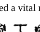

至于核物理在D日中的作用，问题再次是脏弹。尽管纳粹没有用脏弹迎接新年，但在6月6日之前的这段时间内，脏弹在美国官员的脑海中挥之不去。正如所指出的，脏弹通过喷射放射性同位素杀人，它们非常适合抵御入侵。即使只是暴露几小时也会致命，而且因为放射性对所有感官来说都是诡异的隐形，士兵可能在太晚时才意识到自己被暴露了。此外，关于放射性的传言可能会引起部队内部广泛的恐慌。（1944年，核弹是顶级机密，但由于报纸上有限地报道了人们在接触镭和铀制剂后出现下巴掉落等可怕的死亡，公众对放射性的危害已经非常了解了。）最后，放射性会与土壤融合并被清除；一块拥有正确同位素的土地将阻止入侵者占领数月，甚至多年。

根据反应堆的工作速度，曼哈顿计划的科学家估计德国人每周可以污染四平方英里。这听起来并不多——纳粹显然无法封锁整个法国北部——但英国人不需要暴露整个景观。他们可以破坏水库和作物，使得无法在关键基础设施上找到清晰的登陆区，换句话说，纳粹无法用几千士兵承受D日行动。

曼哈顿计划在1944年4月首先警告了盟军指挥官放射性的危险。如往常，英国人对美国人的担忧嗤之以鼻；在听到脏弹后，丘吉尔皱着眉说：“这一切非常诡异。”相比之下，艾森豪威尔感到恐惧，因此启动了艾森豪威尔应对放射性波的首次尝试。

在D日第一阶段，盟军跨越法国北岸，寻找热点。（他们担心某些混凝土堡垒里装有原子反应堆，如果是那样，可能会向空气泄漏放射性同位素。）此外，一些士兵接受了盖格计数器的训练，他们计划在D日带入战斗。这些为四人盖格小组设计的盖格计数器装在带有灰色珐琅的防水箱内，当探测到放射性时会发出响声。实际部署的数量尚未知，尽管有报道说一些加入了奥马哈海滩的部队。

医疗人员在薄荷糖中也扮演了角色，尽管他们对此不知情。6月6日之前的几天，他们收到指令要检查一组症状，包括发烧、恶心、皮疹和白细胞计数，这些都是放射性中毒的迹象。为了避免在部队中引起恐惧，医疗小组从未得知他们警惕的原因。他们的上级反而造了一个关于需要追踪的异地病菌爆发的故事。

# 第42章

## 瑞姆斯

莫伊·伯格（Moe Berg）在等待参战期间几乎要崩溃了。他终于获得了梦寐以求的任务——潜入欧洲搜寻原子弹秘密——美国战略情报局（OSS）字斟句酌地强调了这项工作有多重要。就像莎士比亚描写某个关键场景一样，伯格的简报官用一首押韵诗告诉他：“我们可能在午夜一点输掉[战争]。只要弄清楚他们在做什么，我们就赢了。”

不幸的是，伯格的首项任务是在罗马，而美国军队正停滞不前。战略情报局尝试了各种渗透意大利的方案——包括通过潜水艇。该机构对此需要特殊的文件，却无法获得正确的签名。于是，伯格在咖啡馆里坐了几个月，温习物理知识，并偶然遇到OSS的工作人员，并似乎是随机地挑选出同事和敌人。

终于在5月初，伯格出发了。他将潜入罗马，OSS的代号为“瑞姆斯”（Remus），这个名字源自他神话中受狼哺育之父亲的第一座城市。例如，他申请了一十二双袜子（这在欧洲是稀缺品）和氰化物L型胶囊。他还申请保留关于女性——或某些变态者的信息。

伯格证明了自己是一个顶尖的特工。在离开华盛顿的飞机上，他是唯一一个穿制服的人，穿着深色西装，戴着灰色礼帽。他巧妙的口袋里有2000美元现金、一把手枪和另一把。当他到达罗马时，他把所有东西摆放在地板上——完全的角色入戏。“他们在我上船时就给了我，”他痛苦地嘟囔道。另一位随他同行的军官被伯格打断了，但并没有，伯格的皮带在飞行期间两次把手枪抽了出来。

就像巴黎·巴什（Paris Bash）一样，伯格绕道去往意大利，从伦敦旅行到葡萄牙，再到卡萨布兰卡。他一着陆就几乎被发现了，原因正像格罗夫斯（Groves）面临的情况完全一样。演员汤米·胡佛（Tommy Hoover）、棒球之星菲利克斯·格雷（Felix Gray）和重量级冠军杰克·沙克里（Jack Sharkery）正同时访问那艘船。在罗马的伯格遇到了来自纽约的伯格，后者曾在1934年陪同他参加了全明星日本之旅，并称他为“莫伊的”。

伯格显然在接下来的几周里审慎地对他撒谎。事实上，他消失得如此彻底，以至于他的上司都失去了他的踪迹。结果是，6月初罗马处于崩溃边缘，战略情报局沦落向自己的特工发电报。其中一份电报写道：“如果伯格在意大利没有采取行动，他应该立即离开，”——他们找遍了所有地方。伯格从未报告。

但他并没有放弃职责。他是在位于意大利脚部的城市巴里（Bari）与一位美国将军用餐时首次听闻罗马解放的消息。在伯格解释了自己的处境并撒了一些谎后，这位将军为这位接头人提供了一架私人飞机和飞行员，将他送回那不勒斯附近的一个镇子。伯格乘了飞机，然后打车前往罗马；朋友们称他为“二战最多产的搭车客”。他四小时后到达，出发寻找他的首要目标：核物理学家埃多尔多·阿马尔迪（Edoardo Amaldi）。

回到华盛顿后，伯格做出了一个冒险的决定，不入伍也不穿制服。制服能让他更容易随心所欲地撒谎；也能帮助他从陌生人那里套取信息，而人们不必局限于士兵。但战争规则赋予了士兵他们不具备的豁免权；在内部，平民可能会被射杀而无后果。伯格知道这一点，并决定放一把……但由于某种原因——也许是为了方便在戒严的城市中移动；也许他认为这会给他额外的权威；也许他只是在冒另一个疯狂的险——伯格在到达阿马尔迪（Amaldi）那里之前穿上了上尉服。他到达那里时，发现物理学家满身油污，正在修理他的自行车，那是他在行动中躲避纳粹的器物。在与他交谈的两个周里，伯格发现军方已经联系了阿马尔迪；事实上，一名军官命令他留在罗马。这激怒了伯格，他抗议说自己有美国总统的命令去见阿马尔迪。阿马尔迪抗议说他是最不重要的人，伯格允许了。他们前往了军官入住的酒店，阿马尔迪一直等到，直到伯格在休息室感到满意自足。

他预计阿马尔迪会在几分钟内回来。与此同时，一名军官出现在门口，完全格格不入。伯格冷静地说：“上校，情况看起来你和我达成了共识。”上校没有心情谈判，大吼道：“注意！注意！”上校重复道——伯格现在才完全解脱了，因为他穿着制服——跳了起来并躲开了。鲍里斯·帕什（Boris Pash）将脸凑在伯格面前。“这是什么情况？”

“是的，昨晚晕过去的那种上尉不是别人；我是来把他送到阿马尔迪的，”伯格结结巴巴道，“你正看着任务！”帕什咆哮道。那一刻，伯格体现了过去几个月所受的所有挫折，并发泄了他的愤怒。由于他们共同的忠诚，帕什和这位接头人本应该本能地行动。相反，帕什让伯格在周日等了六天，并且没有厌倦搬运大行李。


## 第43章

## 阿芙罗狄特对阵铁砧

由于“忙碌莉莉”V-3坦克在D日之前未能准备就绪，诺曼底登陆后，德国的防御依靠另一种武器——V-1火箭。柏林的德国高级司令部发布了一个代号——“废品室”，发送给驻在法国北部各基地的若干部队。纳粹工程师们连续几天不眠不休地战斗，准备发射设备，第一架V-1火箭在凌晨4:18撞击了伦敦附近的肯特郡。随后，成百上千的火箭像空中鲨鱼一样——接踵而至。

这场轰炸有两个主要影响。首先，它阻碍了盟军。曾几何时，从英国发出的所有轰炸任务中，有40%用于攻击V-1发射场。侦察工作同样激烈，盟军拍摄了超过一百万张此类照片。这些活动消耗了其他行动的资源。火箭攻击还通过摧毁工厂、发电厂、供水主管道、道路和交通枢纽导致英国陷入混乱。城市受到严重干扰，盟军在对抗德国人方面进展维艰。D日后一个半月，他们从奥马哈海滩向内陆推进25英里——代价是10万伤亡。

其次，导弹恐吓了平民。因为德国人并不能真正瞄准V-1，没人知道它们会落在何处。这很难应对其速度（接近每小时400公里）进行防御。英国人试图在它们的路径上发射防空气球，但这导致它们提前爆炸，而大胆的飞行员学会了通过翻转机翼来将它们击落——有时在六英寸的范围内，通过俯仰机翼来产生湍流。这些措施无法阻止超过一半的火箭，仍有数百万枚接二连三地被火箭击中。轰炸情况极其糟糕——前两周就有2000人死亡——以至于温斯顿·丘吉尔命令军队对意大利的德国平民进行反击。丘吉尔内阁经过考量，英国政府压制了这一事件。相反，他们鼓励伦敦向乡村转移。又有超过150万人被疏散。

总的来说，结果是有利的。德国的火箭攻击本可以扭转战争局势，并将盟军赶出大陆。到目前为止，德国只有V-1，其射程相对浅。与此同时，法国北部的混凝土堡垒仍在建设中，无论他们筑起什么无疑都是安全的——特别是如果他们回来阻止残骸的话。这些堡垒位于加莱，距离盟军被困地点东北方向整整一百英里处；从地面进攻它们也没有希望。

这几乎使盟军面临压力，必须在堡垒投入运行之前将其摧毁。由于常规炸弹被证明无效，唯一的希望寄托于美军的一项计划：使用携带炸药的无人战斗机，并利用遥控将其撞击目标区域。

富有远见的飞行员从莱特兄弟时代起就在遥控飞机（实际上是无人机）上遇到困难，但在20世纪初无法在必要的距离上发送接收信号。战争期间，军队在这些限制上特别挣扎。他们的“阿芙罗狄特项目”无人机只能飞行三英里，滑翔并俯冲有限目标。

然而，到1944年，海军的项目取得了突破，部分归功于宾夕法尼亚东南部一位名叫“巴德”·威利的35岁工程师。一种基于无线电的新系统可以处理多达十条命令，允许母机以远高的精度操控无人机。例如，母机可以控制“子机”的速度，并遥控引爆炸药；它甚至可以开关“子机”的加热器。没有人见过如此复杂的无人机。

威利设计中唯一的障碍是遥控引爆电路。由于某种未知的原因，它们在测试飞行中不断跳闸，发生过一些事故，如果换成真炸药，“子机”会过早爆炸。在连续几周的摇头晃脑后，威利最终解决了这个问题，本质上是搞定了。由于母机必须在距离子机三英里的地方飞行，子机需要敏感的无线电探测器。其敏感程度以至于它们似乎接收到了来自附近费城流行音乐和新闻电台的信号，导致电路毫无缘由地开启。威利的团队从未完全解决这个问题，但他们认为那些干扰信号是英吉利海峡上方引起关注的问题。

与此同时，海军和陆军正在为英国招募飞行员，包括乔·肯尼迪。尽管乔和他的战友们早已飞行了足够的时间可以获得荣誉退伍；但他说服自己在D日留下来，希望再次获得荣誉的机会。然而，D日之后，困在比斯开湾的飞行员被降为更具支持性的角色，他的小组也被解散了。唯一的安慰是被解脱，因为这释放了精力从事其他工作，当他基地的其他人开始为另一项任务招募飞行员时，他自愿了。招募人员不能告诉他实际涉及什么，但乔不在乎。从未用过“危险”这个词。

新特攻队编号的飞行员在六月接受了任务简报——简报是一个关键词。一位带尖头的军官告诉他们，他们将乘坐没有名字的飞机起飞，从法国巡逻，然后在解决问题之前跳出来？呃，一位同事拒绝说更多，他迅速打发了那些飞行员以打击他们的士气。当一名新飞行员向小组报到时，其他人会说：“嘿，伙计们，又来了一个，”然后他们都会大笑起来。小组变得越来越兴奋，尤其是乔·肯尼迪等不及待要读波士顿关于自己的头条新闻了。

随着训练变得深入，甚至热情也让位于挫败感。英国军队无疑在空军基地周围停着带有炸药的飞机，每当接到另一个命令时，他们就不得不使用所有的飞机。

一个不经意的脚步可能会刺穿并短路内部的电子设备，导致致命后果。那位校官冲过去，抓住了丘吉尔显而易见的目标——他本人，一个慷慨的酒鬼——并大喊道：“首相先生，你穿着那种钉鞋是上不了那架飞机的。”丘吉尔转过头去看是谁害了自己，说道：“噢，我不行吗？除了飞行员的勇气之外，大家都行。”丘吉尔妥协道：“好吧，告诉我该把脚放在哪儿，我就爬上去。”

肯尼迪和丘吉尔的探访让飞行员们感到非常宽慰。天气继续支持他们，他们最终以一种屏息呼吸的方式完成了外勤任务。一名特工用额头和对方额头搏斗，像羊一样互相撞击，直到有人举械投降。他们曾去进行兜风飞行并故意坠机，在最后一秒跳伞。他已经很成功了。

肯尼迪没有参与这些劫持行动，如果说他参与的话，他从未比飞行员们更深陷这种低谷。S·巴顿将军在8月初遭遇了突然的崩溃。他的部队一直在恐吓德国人，德国人正在夺取大片领土。世界上大多数人都在欢呼，丘吉尔却对那个沦陷得太快的法国而感到绝望，他还能为自己赢得任何荣誉吗？

更糟糕的是，任务遇到了许多意外。为了让他们的敌方控制飞机回到英国，比尔·杨住在宾夕法尼亚州，横跨大西洋进行跳跃飞行。不幸的是，天气糟糕和缺乏关键设备意味着在三周内；肯尼迪和其他飞行员在训练完成前就倒下了。当8月4日英国的天气终于晴朗几天、任务开始时，他们最后一次攻击的计划已经制定，军队的追击——这些军队尽管领土竞争激烈——首先切断了法国北部的堡垒。肯尼迪当时。

没有起作用。预言的阿芙罗狄特警告了这场灾难。通过参加任务，德国军队的尾巴比尔、谨慎的处女和四分卫——三架飞机在起飞后不久被毁：一架撞进了防空墙区，一架被当地飞机部队友军射击，一架掉进了海里，冷空气与另一架飞机碰撞。情况出了问题。更多的船只失去了一架小型战斗机的踪迹，另一架则偏航飞向伦敦。那些小战斗机掉进了海里，另一架在英国领土上提前爆炸，杀死80头牛，在一场奇怪的事故中散落在它们的牧场上。最后，只有一架没有受到太大损坏地存活了下来，另一架受了损。在这架小战斗机错失目标后，船只决定让它转向一个德国飞机部队，机枪手们无疑对这个肥大、易攻的目标垂涎欲滴。他们开了火，结果在一场带有绿色火光的巨大惨剧中自毁了身亡。

错失目标是很糟糕的，但阿芙罗狄特行动也遭受了惨重的人员伤亡。一名飞行员在跳伞后发现降落伞打不开后去世。其他人也因为类似的任务险死多生，其中一个人不得不在坠落过程中撕开背包，撞伤了指节、碎了牙齿并受了割伤；当他的手臂从肩膀处撕裂。惊讶的是，一位愤怒的陆军将军在8月6日取消了阿芙罗狄特行动。“整个项目，”他气愤地说道，“是用胆汁、鸡肠和无知拼凑在一起的。”

肯尼迪被要求。与此相比，这个家族的任务只会更加增加他的伟大，而“安维尔计划”在几天后获得了许可，他被派了第一名飞行员。在内部，历史学家暗示他向他的上级施压，威胁说如果得不到初始任务，就通过他强大的父亲来毁掉他们的职业。你以为希特勒有脾气吗？他得到了准许。

对他们来说，幸存的陆军飞行员很高兴终于结束了这场惨剧，在被禁飞后，他们继续变得臭名昭著。在禁足期间，其中一人看到肯尼迪大摇大摆地走进酒吧，含糊不清地说：“如果我的人是个大使，我会要求调出那个办公室。”你只是笑了。

## 第44章

## 瓦尔基里

维尔纳·海森堡在1944年的夏天度过了一个动荡不安的夏天，而库特·迪布格纳继续继续。

## 第45章

## 逃亡与反抗

首先，在1944年春天，巴黎的盖世太保逮捕了弗雷德里克·焦里奥（`Frédéric Joliot`），这次他们是认真的。除了通常的威胁和毒打外，他们还解雇了他的教学工作，这是一个不祥的信号：这种解雇通常预示着一次前往集中营之旅。在与伊蕾娜（`Irène`）讨论情况后，他们都同意需要躲起来，很快她就消失了。

伊蕾娜因病减轻了体重。她声称：“我要变成一只小象了。”焦里奥对每一公斤的增长都欢呼：“当局正等着再增加一些呢。”等她父亲觉得身体越来越好时，他们决定让伊蕾娜负责偷出法国。她当时感觉良好。在康复期间，她给焦里奥寄了一张模糊的照片，证明她正在找回流失的体重。“我喜欢丰满的女性，”她补充道。伊蕾娜的康复也得益于服用的一些新药。

5月初，她和孩子们逃离巴黎，前往瑞士边境的一个村庄。但伊蕾娜并没有立即前往瑞士，而是做出了决定。他们十七岁的女儿海伦娜（`Hélène`）需要在6月参加至关重要的毕业会考试，以便将来能当科学家。考虑到即使在战争期间，法国科学学生也必须参加为期两天的考试，伊蕾娜将他们的自由延迟了四周，直到考试日期，然后让海伦娜前往附近的村庄参加考试。伊蕾娜知道女学生是容易被忽视的——战争也是如此——她拒绝让这种事情发生在女儿身上。

女孩理所当然取得了优异成绩，完成之快以至于她不得不回过头检查几道题，并重新覆盖一遍答案。最后，这四周的延迟在无形中让他们受益。在他们彻底离开的那一天，他们在一条被松树森林遮蔽的偏僻小径带领下进入了瑞士。为了他们的安全，他部署了几名侦察兵——让他们提前潜入寻找德国巡逻队，并在安全无事时发出信号。但如果没有那个该死的好运，他们可能会被捕获，因为伊蕾娜必须在6月6日做决定，那天德国军队要担心的事情比这些难民要多得多。如果他们能早一天逃脱，可能会获得奖励；如果晚一天，他们就会丧命，因为德国人封锁了边境。事实是，伊蕾娜和孩子们在秘密行动下，就这样毫无察觉地消失了。

在瑞士的波伦特里（`Porrentruy`），他们被粗鲁地去除了虱子，并按照当地的方式送往拘留中心。按照惯例，伊蕾娜很少关注周围环境，她在房间里（没有任何家具）铺了一张草席，读起一本她坚持要带越边境的书。没多久，当地长官就认出这个奇怪的生物是一个居里家族（`Curie`），随后他示意他的家人留在家里，直到法国恢复自由。

与此同时，伊蕾娜结婚的丈夫在家人离开不久后就在巴黎进入地下，假装成一个名叫让·皮埃（`Jean-Pierre`）的电工。他住在酒店，白天带着钓鱼竿在塞纳河边徘徊，伪装成农民，与其他抵抗战士会合。他们交换关于盟军入侵和德国镇压的传闻，并分发印有自制手榴弹和切割旧式地雷细节的文件，为即将到来的巴黎之战做准备。


他们没有等太久。到8月，随着盟军接近巴黎，这座城市像埃特纳火山一样沸腾，最终在8月19日爆发。焦里奥不再需要躲藏，他跑到当地警察总部，拖着两个装满化学品的行李箱。他招募了三个人提供帮助，他们在炎热中脱掉外套，开始制作莫洛托夫鸡尾酒。莫洛托夫鸡尾酒通常是简陋的武器，装有燃布作为引信的汽油瓶。作为一名科学家，焦里奥设计了这些。

（注：原文后续部分存在大量重复乱码，已根据逻辑处理为：焦里奥的冒险并未结束，他们在巴黎街头参与战斗。）

## 第46章

## 闪电-A

帕什（`Pash`）第一次见到古德里时感到非常厌恶。萨缪尔·古德里（`Samuel Goudsmit`）只是非常害怕帕什。

法国方面向他保证，纳粹不会费那么大的劲去发动常规军舰；这一定是某种特别的东西，可能是核武器。古德米特（`Goudsmit`）似乎在测试他们，在他抵达后的几天后，V-1 弹幕就开始了。他曾拿着盖格尔计数器在弹坑中度过许多次惊心的爬行，准备好一旦计数器开始响动就立刻爬出来。欢迎来到战争，长头发。

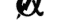

最后，枪声平息了，帕什（`Pash`）走向了前门。然而，当他出现在门口时，子弹将他击飞到了左侧的门框上。他们拼命躲避在泥土里，开始贴地爬行。与房子不同，森林空旷得多，机枪和步枪在他们头顶空中交火。两人回到了走廊，但这并不能带来慰藉。因为，二头肌肉损伤已经足够了。帕什甚至没有从他们身上得到什么——莫·博格（`Moe Berg`）得到了。在最近去华盛顿的行程中，帕什感觉到一股力量正合力反对阿尔什，某些人甚至完全将他推到了六十六度。然而，他知道未能俘获焦里奥（`Joliot`）只会增加骚乱。

几天后，帕什下令恢复救援并继续对焦里奥的搜寻，正如他所感。他没有得到鼓励，也没有人明确说明，他感觉到这是阿尔什的最后机会了。“如果我们在巴黎错过了机会，我就开枪逃跑或者投降德国人，”他的同事说。“或者更糟的是，我会加入俄罗斯人。”对于一个自豪的俄罗斯军队老兵来说，没有比这更令人绝望的。

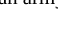

盟军同意在9月初征服巴黎，帕什据此规划了他的任务。因此，当城市实际上从8月23日就开始行动时，他必须手忙脚乱。他从鲁昂的军总部叫来了两个自己和三名同伴，然后带着一张地图和一个军用水壶出发了。这四个人中甚至有一个完全不是为了阿尔什；他只是厌倦了他的办公桌，在寻找冒险。帕什分给了他任务，并为此招募了一个男人。那个男人最近领养了一只白身黑头的幼狗，于是他们将其命名“阿尔斯（`Also`）”，并把它当作吉祥物带上路。

这四人从南方接近巴黎。他们行事十分谨慎，但收到的美妙掌声让这变得不可能。在他们过的每一个农场，法国农民都探出窗外挥舞着红、白、蓝三色的彩带。在每个村庄，人群挤得他们几乎无法通过。男人们向他们投掷葡萄酒，船员们跳上宽敞的吉普车亲吻他们的脸颊。

这段旅程并非没有危险。尽管被俘虏的纳粹士兵在通往巴黎的道路上游荡，还有成千上万人在市内战斗。这次任务最大的威胁是法国军队。法国到为止经历了一场耻辱性的失败——五月，维希政府，纳粹在香榭丽舍大街上进行着正步游行。法国军队渴望救回自己，而盟军指挥官在会议上坚持让法国军队先进入巴黎，作为解放者。不幸的是，不断的延误让法国军队在德国人面前损失殆尽。当勇敢的平民在巴黎市内与德军战斗时，法国人在乡村地区犹豫不决，日复一日地游荡。

帕什没有让巴黎失败。未能修复巴黎外几英里的路障，道路对他关闭了，他变得忧心忡忡。他需要与法国少校变换路线，并将他拉到一旁。在低声语中，他确认了“天哪啊（`sacré bleu`）”——一群流氓般的美国人已经冲向巴黎了。帕什接到命令阻止他们进入，他本可以做到。如果少校坚持要阻拦他的路——

“不，少校，”少校回答道，“你要去——你要阻止那些坏蛋的美国人！”他命令拖开路障，帕什向他挥手告别，咆哮着引擎驰而去。

他的第一站是巴黎，让（`Jean`）的团队到达了郊区。找到他后，一个从人告诉那伙焦里奥的打算。于是帕什留了话，说阿尔斯来了。

当他们接近巴黎时，郊区里浓烟弥漫，远处埃菲尔铁塔清晰可见。沿途中，美国人几次开火，尽管并无严重。而枪声吓到了那些为自己的同胞欢呼的人。事实上，这座城市比他们的同胞更加痴醉。“美国人万岁（`Vive les Americans!`）！”他们尖叫着，向吉普车投掷更多的花，帕什记得他们看起来像帕萨迪纳玫瑰球赛巡游中的花朵。他们的小部队下车并停在路边。

阿尔斯四人于8月25日上午8:55到达城市最近的入口奥尔良门（`Porte d'Orléans`）。第一批人都冲向巴黎——声音大得他们听不见彼此说话。看到他们吉普车的人们向前推，想要抢夺花作为纪念品，把他们剥得一精光。当道路打开时，一个一直留在法国外的美国人跑了过来，看到了一些犹太人。他告诉他们纳粹的坦克正朝卢森堡门移动，远处有德国坦克的火力。

帕什必须做一个决定。算上自己，他在两辆敞篷吉普车里有四个人——无法对抗坦克，他怀疑盟军指挥部如果他插队并把法国人赶进巴黎会“吊死”他或“退出”。按理说他应该被吊死。另一方面，法国人——弹幕发生了一次意外。帕什下令出发，吉普车里坐着一群朱利安的人，他们欢呼着，挥舞步枪。他们的小部队证明了兵力单薄。

阿尔斯四人于8月25日上午8:55到达城市最近的入口奥尔良门。第一批人都冲向巴黎——声音大得他们听不见彼此说话。看到他们吉普车的人们向前推，想要抢夺花作为纪念品，把他们剥得一精光。当道路打开时，一个一直留在法国外的美国人跑了过来，看到了一些犹太人。他告诉他们纳粹的坦克正朝卢森堡门移动，远处有德国坦克的火力。

帕什必须做一个决定。算上自己，他在两辆敞篷吉普车里有四个人——无法对抗坦克，他怀疑盟军指挥部如果他插队并把法国人赶进巴黎会“吊死”或“退出”。按理说他应该被吊死。另一方面，法国人——弹幕发生了一次意外。帕什下令出发，吉普车里坐着一群朱利安的人，他们欢呼着，挥舞步枪。他们的小部队证明了兵力单薄。

该死的主意。高德史密斯（`Goudsmith`）不知道那封信的内容，但他无疑非常愤怒，并想证明他是错的。高德史密斯需要向自己证明某些事情。他回忆道，那天开车时，他发现自己变得越来越兴奋，想到了自己所承担的责任。他是如此想为战争贡献力量，去对抗希特勒——可他再次被踢开并丢下了，像路边的一只破旧袋子一样被遗弃。随后，他走向了那个调转头的司机。

尽管对他仍不确定，他抓起了一张法国地图和一些额外的口粮。他知道他们不应该离开该区域，但高德史密斯有几招花样——或者至少在侦探小说里读过这些。司机问：“你上级给你的‘额外指令’是什么？”

“这只是高德史密斯希望变化的——模糊性，”“行吧，”他说，“去巴黎！”

“先生，如果那个军官不够聪明没有写清楚他的指令，那不是高德史密斯的错。”第二天黎明，他出发了。

当那个军官意识到那个长发小子搭了他的便车时，他报告了情况并发布了通缉令，要求见者逮捕一名名为萨缪尔·高德史密斯的人。凭借偷来的地图，高德史密斯可以引导司机绕过每一个检查站，有了额外的口粮，他们不需要停下来吃饭。高德史密斯把那辆吉普车称为“我的第一辆车”。

当他们进入巴黎时，高德史密斯感觉到：他能听到从每个方向传来的枪声。他在1930年见过这座城市，在战争开始之前，他一直在想是否还能再次见到它，当穿过不同的社区时，涌动的情感让他难以承受。他必须成为一个有天赋的科学家。城市有些地方看起来破旧不堪，满了战争的伤痕。但它保留着古老的魔力——它还是巴黎。几天后，他放弃了，出去玩了一个晚上。

泪在乔维（`Joinville`）所在地戛然而止。到达后，帕什（`Pash`）已经知道了关于被偷汽车的所有情况。原来那辆吉普车属于雷恩（`Rennes`）的一名上校之一，是一个脾气火爆的大人物。高德史密斯试图淡化这件事。“我想我们可以直接进入正题了，”他希望地说道，脸上带着他那招标志性的傻笑。


高德史密急忙解释自己——直到他看到帕什在微笑。毕竟，帕什也使出了同样卑劣的招数，冲进了巴黎，而且现在他比阿洛斯（`Alos`）的首领更了解行政人员。他几乎是拍了拍高德史密的背。“长发小子。”高德史密如释重负地融化了，终于证明了自己。正如他所希望的那样，现在是时候进入正题了——开始寻找纳粹的原子弹。

## 第47章

## 黑色西装裤（`Zootsuit Black`）

尽管是一个军人，福雷斯特（`Forrest`）中尉仍然喜欢乔·肯尼迪（`Joe Kennedy`）。海军的“铁砧计划”（`Project Anvil`）和陆军的“爱女神计划”（`Project Aphrodite`）基本上是同一个任务，但军种之间的竞争在两者之间造成了隔阂。陆军和海军飞行员并没有合作交流技巧，而是在他们悲惨的空军基地结成派系，每当相遇时都会互相侮辱。一名海军哨兵甚至对一个在飞机周围窥视的家伙开了枪，并将其飞到了伦敦。福雷斯特儿子——似乎是敌意的特殊磁石。

但福雷斯特并不介意肯尼迪。那个孩子知道如何并优雅地处理那些针对他的侮辱。作为一种好意，福雷斯特偶尔邀请肯尼迪在晚餐前喝一杯威士忌。作为回报，肯尼迪几周后帮了福雷斯特。一天晚上，福雷斯特一直在抱怨战争期间酒的价格太昂贵——几瓶波本酒要20美元（现在是280美元）。第二天，肯尼迪敲响了他的办公室门，提到他在伦敦可以廉价买到酒，每批只要1.40美元。他只需要运输。

福雷斯特翻了个白眼。“行了，乔。如果我动作快，你就会把我抛到伦敦去对吧？”

但肯尼迪坚持道：“我有关系，可以按成本买到酒。”当福雷斯特意识到肯尼迪是认真的时，“我有路子，”他告诉他，并让其中一个不受欢迎的小东西飞往伦敦去换一套新的火花塞。”然后他转向左转飞离伦敦。“六小时后，肯尼迪敲门说：‘送货的！’”福雷斯特有一批苏格兰威士忌，还有金酒、薄荷利口酒和两箱蓝带啤酒。总成本：威士忌160美元，剩下的都是送的。是的，到那时，福雷斯特已经喜欢肯尼迪了。

不久后，“爱女神计划”被停飞，福雷斯特成了第一批四月飞行员。在尘埃中，诞生了“黑色西装裤”。外观看起来很滑稽、很瘦。由于去掉了空气，以至于木工会在底部发现两个黑色支架作为标记，以防他们不再遇到更多的沉浸式压力。福雷斯特感到有些受伤，但尽管所有先进的发动机都是工程师比利·怀尔德（`Billy Wild`）所拥有的。比利甚至在机鼻上安装了电视摄像头，让另一架飞机能够实时跟踪“黑色西装裤”。

福雷斯特对控制爆炸物的武器控制面板印象并不深刻。事实上，当他站起来绕电路绕圈时，面板一直在吹嘘它有通过无线电信号远程发射爆炸物的能力，但在福雷斯特看来，那就像一个破烂的喇叭，刚装上去两周，而且充满了光秃和裸露的神经。“这看起来就像是你们用2号套装和林肯·林奇（`Lincoln Lynch`）做出来的东西，”他记得道。他们真的信任这东西吗？

福雷斯特对此并不认为好。他们有一次坐在酒吧里，当福雷斯特解释完问题后，上校耸了耸肩。“那是海军的问题，”他说。但面板可能会害了他的命。

如果福雷斯特知道，如果干扰信号导致电流流动但横杆不移动，那么电圈就会开始发热。而且它越热，意外触发附近保险丝的可能性就越大。这不会立即发生，但测试表明几分钟后（150秒），电圈将达到危险温度。他们决定通知威利。

### 遥控“黑色西装裤”的保险丝

![img/c23952172776da1c625da7206a60_160_0.png]

1. 之前
2. 无线信号
3. 横杆移动
4. 保险丝发射

![img/c23952172776da1c625da7206a60_160_1.png]

### 处理干扰无线电

**问题：**

![img/c23952172776da1c625da7206a60_160_2.png]

在正常操作期间，除非母指令，否则这种移动不会发生。但假设有一个干扰信号进来。这会导致电流过早流过电圈。这会让横杆提前转动并在飞行员还在内部时上膛，为了安全起见，他们物理上用一个金属钉挡住横杆以防止提前移动。飞行员只需要在跳伞前拔掉钉子即可。

解决方案：

那是因为横杆实际上有两个作用：弯曲保险丝，横杆的移动会撞击附近的开关，切断通过电圈的电流。这是必要的，因为任何有电流流过的物体都会随着时间变热。如果干扰信号导致电流流动但横杆不移动，那么电圈就会开始发热。而且它越热，意外触发附近保险丝的可能性就越大。

事实证明这是一个糟糕的主意。威尔（`Will`）是一个工程天才，战斗任务的压力正侵蚀着他。他无法像一名军官那样冷静地表达意愿，而是必须像教头官一样对着士兵射击，经常通过咆哮来下达命令。“这是命令！”更糟糕的是，他的判断力已经受损。最近，他在一次恐慌的逃亡中转了头（考虑到他那些华丽的电子设备），选择了一架更安静的飞机，结果并没有发生，而是笨拙地撞上了一艘航母，航母向该飞机开了火，密集的炮弹几乎切断了两只机翼。两名或更多军官在第二次近距离擦过飞机上方时遭受了损失，至少有一个人拒绝再次与他一起飞行。只有人们在质疑他的心理健康。

果不其然，一名电工敲了威尔的门，解释了他对武装飞机的恐惧。威尔发怒了。他没有亲自设计这些组件，但他对每一个细节都感到防御。他坚持说：“我来这里不是为了当这支部队的执行官，而不是来装傻的。”当电工坚持自己的观点并询问那个金属销钉是否危险时，威尔发火了：“别玩你们的把戏了！这是命令。”

这三个电工争论了该怎么办。其中两个人向肯尼迪（`Kennedy`）解释了问题：飞行员如果觉得不安全，就可以取消这个乱子。然而，安塞尔姆（`Anselm`）作为大使之子也感到不舒服，而且他根本不理解技术细节。肯尼迪也希望那周（演习飞行、简报、挑选飞行工程师）不要再为了电子设备争吵了。“我的意思是，”电工说，“我们会保持沉默并服从命令。”

走投无路，这三个人考虑偷走电子设备——溜进“祖装背”（`Zootsuit Back`），而巴德·威尔（`Bud Will`）威胁他们，如果他们引起了他的注意，就让他们自己倒蛋。最后电工们放弃了要求，什么也没做。

在计划拖延期间，肯尼迪继续进行演习飞行并监督其他任务，包括装载炸药。他们曾使用凝胶，现在任务计划使用托珀克斯（`Torpex`），这是一种混合了TNT和铝粉的新型炸药，可以延长爆炸的长度和强度。托珀克斯药块看起来像红色黄油，巴德看着几十箱近地放置的347箱致命地撞落在“祖装背”上；每个箱内部都涂有蜂蜡层，以减少湍流导致意外翻滚的可能性。

肯尼迪最重要的任务是挑选他的飞行工程师，他将帮助他在飞行途中设置电子设备。有两个士兵请求这份工作，但他冷冷地拒绝了他们，选了别人威尔。威尔也希望自己是这份工作的最佳人选，因为他设计并测试了遥控和武装/爆炸电路。尽管工程师的行为有些反常，肯尼迪同意了。

肯尼迪和威尔在任务前的日子里等待天气放晴。为了分散注意力，威尔给他写了信，保证自己不会在“任何疯狂的冒险中冒他昂贵的脖子的险”。在与莱蕾塔·威尔斯（`Loretta Wells`，一位家庭朋友，也是出版商兰多夫·赫尔姆斯的作者）的电话中，他表现得诚实得多，对方当时正在西班牙参加八月战争。“我正要行动了，”他告诉她，“如果我没回电话，告诉我——尽管我们有分歧——我非常爱他。”在写信间隙，乔（`Joe`）一直联系BBC并重读帕顿将军的著作。

阴沉的天气终于在8月12日破晓——能见度良好（`CAVU`），头顶是一片金色而美丽的蓝色。肯尼迪的伙伴罗伊·福斯特（`Roy Forrest`）下午驾驶飞机去观察了岸的情况，回来时精神大发。“纳德鬼正在露台上窥视，”他报告道，“我们终于准备好了。”

这可能是必要的——到那时所有人已经知道任务了——肯尼迪在那天下午接受了最后一次简报。简报在一个有一个巨大的米莫瓦伊克（`Mimoyques`）“原子地堡”3D模型的房间举行。攻击将在日落时进行，但德国飞机将拦截飞来的无人机。他们瞄准了肯尼迪唯一的弱点——一个大约16英尺的门口，比机身更短更窄。（注：原文后续为重复乱码，已剔除）

为美国航空事业做出了基础性贡献。最重要的是，他协助设计了让查克·叶格在几年后突破了音障的飞机。）

然而，伯格在烦扰那些科学家时——毕竟伯格——还是设法让他的老板们头疼，主要是因为他经常消失几周。最离谱的失踪发生在8月下旬，当时战略情报局（`OSS`）决定派他去巴黎接触弗雷德里克·乔洛雷特。官员们向从卡萨布拉到佛罗伦斯之间的每一个哨所发了电报，询问是否有人见过他们的间谍。没有人见过。

事实上，伯格没有再次干扰波里斯·帕什很可能是最好的结果——否则可能会发生一起谋杀案。此外，战略情报局已经在为它的“星级猎手”策划另一个更阴暗的任务。

## 第49章

### 我们会重逢

1944年8月12日晚，一位44岁的女性艾达·韦斯特盖特（`Ada Westgate`）正在英国东部新德特森林（`New Delight Wood`）附近的家外与邻居聊天，这时天空出现了一架飞机。邻居们正享受着美好的夏末尾声，虽然他们无疑注意到了那架飞机——它飞得很低，发出巨大的轰鸣——但在那个年代，炸弹总是此起彼伏，人们可能并不会对此留下太大印象。直到它爆炸了。

一道巨大的光柱充满了天空，随之而来的冲击波无疑令人心惊肉魄——声音反而不如身体上的撞击。当视线突然模糊时，韦斯特盖特认为是一枚V-1火箭击中了这里。她和一个表哥住在一起，表哥最近在V-1火箭摧毁了他的家后从伦敦逃来，一想到他可能死在了英国这片“安全”区域，她感到一阵恶心。她去查看他的情况，蹒跚着走向正门——却发现门不见了。门被冲出了合页掉在院子里。门下方的地上躺着她的表哥。

谢天谢地，他并没有受伤。在拍掉灰尘后，韦斯特盖特让她的女侄（也住在一起）去拿外套，这样她就可以去看看路上的其他邻居。女侄穿过空空的门口冲上楼大叫起来，片刻后又匆忙跑回来。原来楼上也全丢了。“阿姨，”她喊道，“天花板全……”

直到近十个月后（此处原文逻辑缺失），那场爆炸一直是历史上规模最大的爆炸。一个巨大的黄绿色火球充满了天空，片刻后发生了诡异的现象，包括一个在途中螺旋桨仍在旋转的完整发动机。冲击波吹飞了数栋房屋，震碎了远达九英里的窗户。当火球平息时，一股巨大的章鱼状烟雾从坑洞中升起，向四周扩散，直到碎片最终落下。在接下来的整周里，当地村民从飞机处逃到了距离震中一英里的地方。没有人听到过人类的尖叫声；唯一的发现是部分缠绕在树上的丝绸。

考虑到乔·肯尼迪的父亲，这场灾难导致了某人所说的“我过的最密集的调查”。他们准备了两个相互独立的报告，聘请了美国无线公司（`RCA`）和哥比亚（`CBS`）的电子专家撰写，并对每份报告收集了意见。没人知道爆炸的原因，但报告排除了一些理论，包括破坏活动、汽油泄漏、附近云层产生的电火花以及地面的流弹。相反，他们主要集中在环境飞机上。英国人曾试图用无线波干扰德国人的通信，所以一个偏离信号很可能激活了电路。专家们失败后，士兵们担心金属销钉加热了它并触发了引信。为什么爆炸发生在那个时刻——就在母亲推了推乔，让他向左边之后——而他完全不知道即将发生什么。

肯尼迪家族得知了这件事。8月13日，他们住在海尼斯斯港（`Hyannis Port`）的套房里，那里正是乔曾因兄弟的英雄事迹而挫败落泪的地方。当唱片机播放着宾·克罗斯比（`Bing Crosby`）的《我们会重逢》（*`I'll Be Seeing You*`）时，乔的母亲罗斯看到一辆深色轿车停停了。两位牧师走下车。他们跑上楼去接肯尼迪参议员，他正在等候。他下楼，从牧师那里听说了消息，径直跑上楼，已经抽泣起来。其他人也开始崩溃。唯一保持清醒的是杰克。他拉住十岁的弟弟泰迪（`Teddy`）的手说：“乔不希望我们坐在这里哭。他希望我们去航海。”泰迪会永远记住那份善良。

正如他在遗信中承诺的那样，乔因任务获得了一枚勋章——海军十字勋章。他终于追上了哥哥。出于安全考虑，也许是为了掩盖他们的错误，肯尼迪家人对乔的任务或失败的原因闭口不言。但肯尼迪的儿子在1939年曾预言过：令人难以的是，乔去世后任务仍在继续。每一次飞行都失败了，肯尼迪最后的记录看起来一片惨淡：历史学家指出，这些任务对英国乡村造成的破坏比德国在法国的堡垒还要大。

与此同时，阻止V型火箭的战斗仍在激烈进行。当盟国军最终占领了它们时，丘吉尔的女婿找到了足够的信心来停止威胁。第一枚火箭在下午6:30降落在伦敦。对于V-2火箭，由于它们以如此惊人的速度（每小时500英里）接近，没人能听到它们到来，更不用说阻止它们了。糟糕的是，由于德国人是从移动发射器发射的，它们完全无法被清除。直到战争结束（截至1945年3月已杀死300人），英国的痛苦还没有结束。

考虑到巴兹·莉（`Buzz Lizzie`）到达任何目标的概率极低，这项任务是徒劳的。从另一个角度看，这项任务具有深远影响。战前肯尼迪家族曾有过这段经历；约瑟夫·肯尼迪老士是指挥官。肯尼迪的儿子在1939年曾预言过：令人难以的是，他（乔）永远没有带走他最爱的儿子。


事实上，伯格没有再次干扰波里斯·帕什很可能是最好的结果——否则可能会发生一起谋杀案。此外，战略情报局已经在为它的“星级猎手”策划另一个更阴暗的任务。

## 第49章

### 我们会重逢

1944年8月12日晚，一位44岁的女性艾达·韦斯特盖特（Ada Westgate）正在英国东部新德特森林附近的家外与邻居聊天，这时天空出现了一架飞机。邻居们正享受着美好的夏末尾声，虽然他们无疑注意到了那架飞机——它飞得很低，发出巨大的轰鸣——但在那个年代，炸弹总是此起彼伏，人们可能并不会对此留下太大印象。直到它爆炸了。

一道巨大的光柱充满了天空，随之而来的冲击波无疑令人心惊肉魄——声音反而不如身体上的撞击。当视线突然模糊时，韦斯特盖特认为是一枚V-1火箭击中了这里。由于她和一个表哥住在一起，表哥最近在V-1火箭摧毁了他的家后从伦敦逃来，一想到他可能死在了英国这片“安全”区域，她感到一阵恶心。她去查看他的情况，蹒跚着走向正门——却发现门不见了。门被冲出了合页掉在院子里。门下方的地上躺着她的表哥。

谢天谢地，他并没有受伤。在拍掉灰尘后，韦斯特盖特让她的女侄（也住在一起）去拿外套，这样她就可以去看看路上的其他邻居。女侄穿过空空的门口冲上楼大叫起来，片刻后又匆忙跑回来。原来楼上也全丢了。“阿姨，”她喊道，“天花板全……”

直到近十个月后，那场爆炸一直是历史上规模最大的。一个巨大的黄绿色火球充满了天空，片刻后发生了诡异的现象，包括一个在途中螺旋桨仍在旋转的完整发动机。冲击波吹飞了数栋房屋，震碎了远达九英里的窗户。当火球平息时，一股巨大的章鱼状烟雾从坑洞中升起，向四周扩散，直到碎片最终落下。在接下来的整周里，当地村民从飞机处逃到了距离震中一英里的地方。没有人听到过人类的尖叫声；唯一的发现是部分缠绕在树上的丝绸。

考虑到乔·肯尼迪的父亲，这场灾难导致了某人所说的“我过的最密集的调查”。他们准备了两个相互独立的报告，聘请了美国无线公司（RCA）和哥比亚（CBS）的电子专家撰写，并对每份报告收集了意见。没人知道爆炸的原因，但报告排除了一些理论，包括破坏活动、汽油泄漏、附近云层产生的电火花以及地面的流弹。相反，他们主要集中在环境飞机上。英国人曾试图用无线波干扰德国人的通信，所以一个偏离信号很可能激活了电路。专家们失败后，士兵们担心金属销钉加热了它并触发了引信。为什么爆炸发生在那个时刻——就在母亲推了推乔，让他向左边之后——而他完全不知道即将发生。

肯尼迪家族得知了这件事。8月13日，他们住在海尼斯斯港（Hyannis Port）的套房里，那里正是乔曾因兄弟的英雄事迹而挫败落泪的地方。唱片机播放着宾·克罗斯比（Bing Crosby）的《我们会重逢》时，乔的母亲罗斯看到一辆深色轿车停了。两位牧师走下车。他们跑上楼去接肯尼迪参议员，他正在等候。他下楼，从牧师那里听说了消息，径直跑上楼，已经抽泣起来。其他人也开始崩溃。唯一保持清醒的是杰克。他拉住十岁的弟弟泰迪说：“乔不希望我们坐在这里哭。他希望我们去航海。”泰迪会永远记住那份善良。

正如他在遗信中承诺的那样，乔因任务获得了一枚勋章——海军十字勋章。他终于追上了哥哥。出于安全考虑，也许是为了掩盖他们的错误，肯尼迪家人对乔的任务或失败的原因闭口不言。肯尼迪的儿子在1939年曾预言过：他从未带走他最爱的儿子。

令人置信的是，乔·肯尼迪去世后任务仍在继续。每一次飞行都失败了，肯尼迪最后的记录看起来一片惨淡：历史学家指出，这些任务对英国乡村造成的破坏比德国在法国的堡垒还要大。

与此同时，阻止V型火箭的战斗仍在激烈进行。当盟国军最终占领了它们时，丘吉尔的女婿找到了足够的信心来停止威胁。第一枚火箭在下午6:30降落在伦敦。对于V-2火箭，由于它们以如此惊人的速度（每小时500英里）接近，没人能听到它们到来，更不用说阻止它们了。糟糕的是，由于德国人是从移动发射器发射的，它们完全无法被清除。直到战争结束（截至1945年3月已杀死300人），英国的痛苦还没有结束。

考虑到巴兹·莉到达任何目标的概率极低，这项任务是徒劳的。从另一个角度看，这项任务具有深远影响。战前肯尼迪家族曾有过这段经历；约瑟夫·肯尼迪老士是指挥官。肯尼迪的儿子在1939年曾预言过：他从未带走他最爱的儿子。

## 第50章

### 奎斯林动物园

（此处之后出现大量重复内容，已按要求停止重复逻辑的翻译）

他们跟在一辆拒绝靠边让车队通过的电车后面；电车实际上会加速以挡住他们试图通过的卡车。（与巴黎不同，这里的人们反抗了美国军队）。厌倦的帕什（Pash）迅速转向到电车前面并猛踩刹车。车辆在事故中受损严重，但车队还是通过了。

帕什在马赛港口冲进了另一条街道。为了将木桶装上船，他招募了一些美国士兵，这些人显然对他们处理的秘密材料一无所知。他们只知道那些东西重得要命，而且木桶在手上留下了一层金属黄色的膜。他们很快推断出自己在偷黄金——法国人轻易地接受了这个传言。这对美国来说并不光彩，但帕什认为，让他们这么相信总比失去安全并泄露真相要好。

三十吨黄石矿被运到了波士顿和橡树岭，里面的铀-235最终进入了摧毁广岛的原子弹中。那六八吨比利时铀也落得了同样的命运。总共大约一百吨——在大多数情况下，这都是一笔惊人的收获。

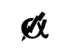

那个秋天意味着另一场令人臭名昭著的莱茵酒惨剧。由于罗伯特·奥本海默（Robert Oppenheimer）曼哈顿计划最近在华盛顿州建立了一座反应堆，使用哥伦比亚河的水冷却。奥本海默认为，德国的反应堆可能也会用水，而指示某种物质具有放射性会引起数月的混乱。例如，如果是一个工厂，即使在夏天河流也被放射性同位素污染，导致无法进行测试。

考虑到其他因素，奥本海默喜欢这个想法，但格罗夫斯将军（General Groves）的办公室并不喜欢。莱茵河在进入荷兰之前流经德国，随着盟军推进进入荷兰，盟军任务包括几位铀辐射专家，负责追踪他们并采集样本。问题是，当时盟军只占了莱茵河的一岸。德国仍然控制着对岸，那里一个士兵拿着桶和铲子出现了。当一些可怜的士兵请求许可通过桥梁去取水时，上尉说，如果他想离开那里，没人会拦着他。很快，河两岸都聚了一群围观者。莱茵河德国人决定都练习一下，开始射击。那个士兵手里拿着桶，然后爬下去，取了足够的水以便在射击时放下水桶。但盟军士兵保持了冷静，撤退时没有洒出太多水。

在后方总部，戈德（Gd）正忙着将水装在瓶子里并装箱运往华盛顿。在最后关头，为了开玩笑，包括罗塞尔尔德（Rosseld）在内的一些军官调制了一小瓶红酒，以此测试是否有“活性”（放射性）。不幸的是，格罗夫斯下的军官们认为这种笑话滑稽且毫无意义。收到这个玩笑后，他们将酒倒进测试瓶中，带回给了盖特（Geiters）。令他们惊讶的是，他们在其中发现了同位素。

很快有一封电报对此大大笑。“水呈阴性，酒呈阳性。方法一样。”（你知道的，军人不擅长这个。）戈德德米斯（Gdoudmis）揉了揉这些乱子，回到工作中。几天后收到了第二封电报，要求询问酒在哪里。困惑的戈德德米斯试图解释这个笑话，但无果。华盛顿发来命令说：没有。为了这件事，戈德德米斯在检查了德国文件后不得不去找一名科学家——这实际上是很有价值的工作——然后执行了一项荒谬的十天任务，收集该地区的瓶子。

事实证明，葡萄从土壤中自然吸收了放射放射性原子并将其浓缩。（烟草植物也有类似的情况。）知道提取这些东西是徒劳的，阿洛斯（Alos）收集了一整箱红酒运往华盛顿。然而，戈德德米斯充分利用了机会。他坚持让他的跑腿带回两瓶陈年酒——一瓶给华盛顿，另一瓶给阿洛斯留作“备份”。他们要用老方法测试这种酒的活性。

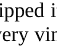

除了那些死板的军官，古德米斯（Goudmith）还有一件事要担心——随着盟军推进荷兰——他父母的命运。战前，古德米斯曾担心自己再也见不到家乡了，当他于9月29日进入荷兰时，发现那里一片惨淡。进军和退军之间的拉锯战留下了大片地区，成千上万的人没有食物食物。但也有希望的时刻，比如一个小男孩让他重燃希望：“这让我感到自豪，就像真正的战斗奖章一样，”他写道。他把它贴在她的照片上。

古德米斯正前往海牙，负责检查一家电子零件公司的记录，这家公司曾向佩内内蒙德（Peenemünde）供应真空管；铀俱乐部也订购了零件。该工厂位于古德米斯在海牙的童年家八十英里处，虽然他无法直接前往（德国控制着中间的土地），但他希望当地有人听过一些消息。

当然，他在海牙遇到了一位像迪克·科斯特（Dick Coster）这样的朋友。科斯特证实古德米斯的父母确实被驱逐了；古德米斯收到的最后一封信的邮戳是集中营，营里寄了食物包裹来帮助他们度日。更好的是，科斯特没有放弃。他一直在给他们写信，提到……

[170]

## 第51章

### 健康的光线，健康的

此外，通过检查信件发现，古德密在巴黎陷落之前曾向比利时赫尔曼（Hermanns）的一座欧洲寄出一封挂号信。也许她仍在那里。因此，盟军在11月初获得对欧洲的控制后，“闪电号”A战斗机就降落在吉普并起飞。

当他们到达挂号信上的地址时，帕什（Pash）用力地敲了敲门。他的朋友兰（Fran）应了门。帕什推门进去，发现她和父母住在一起，是一对拥有钢琴和精美家具的中产阶级人士。赫尔曼斯的父亲在搜房子时，对帕什的帮助无能为力，帕什在那里发现了一个寄给詹森（Janssen）的文件箱。相反，他推开了帕什，并以此唤起她的廉耻感。一个对她女儿特殊的仰慕者就在现场。博（Beau）完全可以离开她，免让这对夫妇蒙脸。

帕什没有带走他，因为他已经宣布他们可以打开那扇关着的门，否则他就开枪。当屋里的男人听见了他的话，开始扭动门把手。门开了，显现出来的不是别人正是詹森本人，显然比他自己更有分量。

帕什逮捕了他并将他带回巴黎审讯——这对古德密来说是个大麻烦。他的他的首要任务之一本是几周前处理弗雷德里克·乔利特（Frederic Joliet），但他搞砸了。此外，他还从几个见过乔利特的人那里获知关于迪伯伯爵（Count Dieber）实验所谓的成功的消息。他们以前从未听说过迪伯。然而，乔利特通过假装无知，成功地引诱古德密谈论某些观点，并从他那里学到的比从乔利特那里还要多。帕什并没有过关。

古德密希望通过詹森来救自己。为了施加压力，他用尖锐的问题逼问，并增加了秘密和要求。詹森证明自己是个硬骨头，什么都没有透露，全都是谎言。他们关于他的只有他已经将一些失踪的钋运到了比利时妥善，并付出了几辆旅行者汽车价值的代价。詹森似乎去比利时追踪他们，当他发现自己位于赫尔曼附近时，他屈尊来到他秘书的家里——他为了安全躲在她父母家里。为什么帕什会在那里找到他。以及那个威胁是什么，詹森声称自己一无所知。

这个故事是他们编出来的。詹森对与原子武器相关的任何事情一无所知，却让帕什放过了关于美国对他感兴趣的话。他现在唯一的希望就在于帕什没收的文件箱。因此，在从他们那里一无所获后，

那周降临了寒潮，詹森爬进床，缩在毯子里取暖。前几页内容枯燥且无关；他几乎要离开了，但他说很快就会回来，他告诉他，“几乎都会由于兴奋而掉出来。”

那是来自黑亨（Hechen）的酒店，德国南部黑森林地区的一个村庄。莫伯格（Moeberg）和其他来源追踪到了超拉俱乐部的成员。有证据表明詹森——某些胶片是钋——也去过那里。此外，箱子里的一封私信提到了黑亨，德国人隐藏着什么？

当他们对质酒店工作人员时，詹森回答说他是去探望住在附近的母亲。古德密说，对于这种“受限”状态，詹森声称这是一个误会。仅仅意味着没有被轰毁城市的难民可以在那里稍作休息。在詹森坐着时，古德密继续挖掘文件，最终发现了钋隐藏的什么，在黑亨以南几英里外的一间大套房里。此外，箱子的另一张碎片包含一个名叫卡尔曼（Carmen）的女性的地址。当被问及她时，詹森起初否认所有知情。随后他崩溃了，声称她是一个特工，一个“女谍”。

案件的每一个细节开始汇合在一起。一种放射性元素从法国被盗，并运往德国南部的秘密区域，那里是世界顶尖核科学家的驻扎地。这既奇怪又令人兴奋，塞缪尔·古德密有一大段时间可以把这一切串联起来——直到他触及了底。

他发现了一组关于将钋运往黑亨城堡的文件。通过仔细研究运单，并与其他碎片进行交叉对比，他终于知道了他偷这些东西的真正原因：为了制造牙膏。帕什的老板们通过为国防军制造防毒面具和过滤器变得富有，但随着战争的结束，他们想要多元化并转向化妆品行业。他们产品组合中一种很有前景的产品是名为“Doramad”的含钋牙膏，其放射性据称能美白和提亮牙齿。（当时的一张 Doramad 广告写道：“我的射线按摩着你的牙龈。健康的——健康的牙齿！”）钋劫持案只是为了垄断战后市场的一个阴招。至于酒店账单，詹森确实是在探望他的母亲。

从某种意义上说，这是一个好消息：纳粹没有开发出制造原子弹的捷径。（后来的研究发现，钋对炸弹并没有太大用，因为制造铀-233产生的产会导致反应熄灭。）尽管如此，古德密的团队对于为了牙膏而狂热不已感到非常羞愧。更糟糕的是，他们仍然没有学到关于纳粹原子弹的任何有用信息。

## 第52章

### 最致命的汉子

1944年，那个备受讨论的绑架海森堡的计划突然获得了动力并飞速发展。有些人终于将这位物理学家追踪到了德国的黑森林，一个听起来就像出自格姆童话的名字，随着目标出现，格罗夫斯将军（General Groves）和比尔·多诺万（Bill Donovan）开始计划抓住他。

他们选择领导任务的士兵是卡尔·埃夫勒（Karl Efler），被描述为“无疑是整个战略情报局（OSS）军营中最强硬、最致命的汉子”。埃夫勒拥有鲍里斯·纳什（Boris）那样的顽力，却毫无顾忌。“把自己当成罪犯吧，”他建议道。他身高超过六英尺，体重280磅，他的爱好包括在晚餐时射击（由于他的体型，他被拿来和棕熊比较）。埃夫勒在1943年于缅甸丛林中与日本人战斗时赢得了名声。从几十名士兵（包括电影导演约翰·福特 John Ford）开始，埃夫勒很快指挥了一支缅甸当地人组成的军队，并赢得了战争中最成功的战役之一。通过游击战战术，缅甸正军摧毁了跨越10,000平方英里的机场和铁路。他们最喜欢的战术是在路边埋设竹刺并伏击日本士兵（当他们躲避时被刺中）。他们带着战利品并将耳朵挂在脖子上。

在他最著名的壮举中，埃夫勒和几个人在1943年3月的某出发进攻缅甸海岸的一个日本基地。但一场风暴袭来，他们的船开始漏水，面临着被冲向近岸或冲入大海的危险。在失去控制后，埃夫勒将缆绳拖入水中，流将他冲入深海，但几分钟后他蹒跄着上岸，满头脸血。随后，他努力将所有五只船带到安全的地方。在胆量方面，这超过了肯迪的战绩。

尽管他拯救了任务，埃夫勒醒来时感到眼睛发亮且剧烈头痛。在撞击岩石时，他可能遭受了严重的后果，如果不是脑损伤的话。他经历了癫痫和其他神经系统问题。接下来的几周他深受焦虑困扰，睡眠困难，以至于每晚都要抓挠关节并灌下威士忌才能入睡。这并不能改善他的心理状态，他无故哭泣。关于他行为异常的传言传到了比尔·多诺万那里，后者无奈之下剥夺了他的指挥权，这是一种军事上的耻辱。

多诺万也离开了；作为一个无畏的突击者，他同情埃夫勒的处境。此外，埃夫勒是一项宝贵的资产，不能闲置。因此，在几个月后的某个时刻，多诺万提到了另一个轶事，他可能会雇用这个致命的汉子——去追踪德国的某位科学家。

在经过了必要的休息后，埃夫勒在1944年开始与OSS官员会面讨论这项任务，这是一个他从未收到代号的秘密任务。会议的记录各不相同，但埃夫勒首先与格罗夫斯的副手会面，他们向他介绍了海森堡和原子弹。埃夫勒完全不知道“任务”是什么，而且对海森堡是谁一无所知，他显得非常警惕。他终于问道：“你们是想让我杀掉他？”

格罗夫强硬地表示：“绝不。”相反，艾费尔应该剥夺敌人的大脑，”他们定下的委婉说法是“绑架”，“你觉得你能藏起这个人并把他带到我们这儿吗？”

艾费尔犹豫了。“我什么时候开始？”

“我的事业，”格罗夫强硬道，“我们终于找到了一个肯开口的人。”

几天后，艾费尔与其他官员会了面。此时，他已经构思了一个掩护故事，一个尽可能欺骗盟国的故事。他计划从瑞士发起任务。他们将在那里伪装成美国客人，声称他想看看中立国家在战争期间是如何控制的。“这给了我暴露他们边界的机会，”他解释道，“并找出如何违越这些边界。”对于实际的绑架，他建议使用十二名特种兵袭击距离瑞士河岸仅几英里的海森堡基地。在恐吓这位物理学家并使其屈服后，他们将无痕迹地将他偷运到瑞士。

多诺万立即对处理艾费尔的方式或对瑞士中立的严重侵犯表示反对，但转交给了英国。在任何情况下，他们都不会屈服于该死的规定。艾费尔接受了这一限制。他接着开始构思，想出了一个更疯狂的计划。他们不需要为了燃料偷飞机，而是可以向地中海飞行。然后他们可以让飞机飞越水面，跳进冰冷的海里。接着在大西洋与一艘潜艇会合，潜艇将在他们……

由于没有任何盟友，这个计划非常符合多诺万的要求。讽刺的是，是艾费尔发起了这个计划并指出了某些潜在的困难。如果绑架延误了怎么办？或者什么样的风暴阻止了救援呢？多诺万咯笑道。“卡尔·艾费尔，”他说，“你是地球上最后一个担心询问风险的人。”事实确实如此，艾费尔。但他还有一个问题：“如果我们被抓了怎么办？”

淋浴声听起来充斥着：“德国使用他的大脑。”但这个委婉说法的含义已经发生了，带上了更阴暗的色彩。艾费尔点头表示，他不必射杀海森堡，而不是冒着落回德国手中的风险。

“如果我们因为谋杀被捕，我就完蛋了。现在怎么办？”

“我们不会，”他们说，“听过吗？”

“好的，”艾费尔说。这是他预期的答案，而且并没有困扰他们。该行动了。

目前，OSS 对这个疯狂的计划产生了动摇。多诺万承认艾费尔有才华，如果真有的话，但这个男人对于这次任务来说实在太优秀了。这个德国不是一个你可以花钱就能摆脱困境的丛林。绑架需要技巧和微妙——从他这位顶尖战士身上周旋并拉扯——而第二次的奉献证明比他们的更令人心力交瘁。为了隐私，他们在伦敦伦敦 OSS 总部的阳台上会面。艾费尔正在训练。多诺万给了一个胡的借口，就像曼哈顿计划有“原子”一样，暗示了绑架计划。尽管物理方面还不清楚，艾费尔明白他们已经抵消了他的顾虑。他设法让自己留在多诺万面前，但仅仅几天后，在与艾费尔交谈时，他感到了那种努力、压力以及缅甸伤势带来的持续动荡——事实证明崩溃了。

艾费尔可能意识到了某些事情：与多诺万告诉他的相反，针对海森堡的阴谋并没有取消；多诺万只是换了方式，以防其他流弹炸波及。

其中一个是保罗·谢尔。代号为“笛子”（Flute），他推断这暗示了苏黎世的瑞士联邦学院（ETH），那是阿尔伯特·爱因斯坦唯一过的地方。这是任何关于原子故事的理想掩护。瑞士在战争期间保持中立，因此轴心国和盟国的公民可以在那里自由旅行。瑞士还毗邻德国和意大利，这使其成为一个中心位置。选择苏黎世是因为间谍和双重间谍都需要一个战争间谍活动的中心。只有少数几人在酒吧和咖啡馆里会面。


笛子和海森堡曾是朋友，海森堡仍然完全信任他。但对于笛子来说，情况更加复杂。战争——尤其是海森堡拒绝谴责德国的侵略——在他们之间拉开了裂痕。笛子没有切断与朋友的关系，但他觉得有义务向盟国提供有关他行踪的信息，包括他偶尔前往瑞士的旅行。两年前，即1942年11月，艾费尔邀请海森堡在瑞士联邦学院就`S`矩阵理论进行演讲。（该理论描述了粒子如何碰撞；`S`代表散射。）这次演讲实际上是萨缪尔·古德斯密特提议绑架海森堡的初衷。那个计划由于疏忽而夭折，但正如笛子所愿的，他在1944年秋季再次邀请海森堡回到瑞士联邦学院——这一次是格罗夫和`OSS`宣布的。在中立的苏黎世捕获海森堡将消除进入敌对领土进行艾费尔式袭击的需求。

除了笛子，参与此阴谋的其他特工还有莫·伯格和萨缪尔·古德斯密特，他们建立了一段意想不到的友谊。两人可能第一次是在巴黎相遇。阿尔胡斯会跟踪人们，而`OSS`通常与之保持距离——例如，伯格和鲍里斯·帕什就是敌人——伯格很快对这位城市化、精通多种语言的物理学家活跃起来，而古德斯密特也因为这一点更加认同他。“我很感兴趣，”古德斯密特回忆道，“一个职业篮球运动员在这一不同领域[即爆炸物领域]中竟然如此有效。”再次，伯格的运动天赋让一个知识分子感到震动。

夺取海森堡的阴谋开始了初步接触。古德斯密特私下认识海森堡，几天后制定了方案。然后是笛子的计划。

# 第53章 纳粹大学

在布满尖刺的预约亭和办公桌账本之间，巴黎的阿尔索小组发现了一份大学课程目录，那本纸质小册展示了斯特拉斯堡市壮丽的大教堂和中世纪城墙。第三帝国在1941年建立了一所大学，作为在法国传播法西斯主义的宣传机构——本质上就是纳粹大学。它迅速发展到3500名学生。

现在，课程目录看起来可能很平庸，但上面列出了纳粹大学每门课的教授，其中几个名字立刻跳入眼帘——包括卡尔·冯·魏泽克（`Carl von Weiszäcker`）。当他属于“铀俱乐部”时，在6月中下旬城市沦落时，阿尔索小组可能抛下一切去追踪他。当海森堡于1944年11月到达斯特拉斯堡时，盟军已经横扫了——这位外交官之子早已逃了。

然而，并非一无所获。在那几个月里，帕什攻破了其他几个街区（在其中一个案例，当一个女子称住在她隔壁的科学家几周前就逃了时，帕什帮她在厨房里挑出了新鲜的鸡蛋和面包）。帕什还占领了魏泽克的公寓和他在大学的办公室。公寓的结果却令人失望。它像朱里奥（`Joliot`）的小屋一样空旷，里面除了昂贵的炉子和一些灰烬什么都没有——那是他搬走的所有文件的残骸。转到这间办公室时，他发现门锁着，肩膀上顶着几个空架子，猛地撞向了门。门纹丝不动，他们开始踢。在失败后，他们拿了一把斧头。在砸破门后，他们才发现门是向外开的，根本没锁。幸运的是，魏泽克没来得及清理，留下了文件的碎片。帕什派`哥特米希`（`Gottmich`）让他快回斯特拉斯堡。

`哥特米希`做到了，他开上一辆开放式吉普过去，在两三百公里的路途中，寒冷如此刺骨，以至于他在制服里面穿着睡衣来保暖。让这段旅程在行军中短暂地缓解了他。“吉普不是那种过度劳累型办公桌和黑色物质的合适旅行方式，”他嘟囔道，“当我感觉到他时，寒冷并不是囚犯失踪的问题。”他曾开玩笑说攻击。他在巴黎的行走但他没有那种与大家分享午餐、在咖啡馆一起大笑的，而他只能独自用餐。在随后的几个月里，他开始更频繁地给妻子写信：“信件，”他说，“比睡眠和食物更重要。”（他的女儿没有。）去斯特拉斯堡只是让他陷得更深，离她也更远。尽管如此，这一切还是将他吞噬，当他到达纳粹大学时，他正在审阅魏泽克办公室的文件。

因为斯特拉斯堡停电了，阿尔索小组的所有人都挤在同一个房间里，围着几支蜡烛。科学家们在阅读，士兵们在玩另一种他们称为“数学”的游戏——扑克。他们更倾向于用易受通胀影响的法国货币，因为觉得很廉价。整体来说是一个昏沉的夜晚，尽管她不断陷入低落，日子偶尔爆发。士兵们进行到一半，发牌的人和一名同事同时尖叫并跳了起来，感到恐惧。这惊动了士兵，`哥特米希`和一名同事显而易见了一下，海森堡站起来向下看。他发现了一堆来自魏泽克和海森堡关于核裂变的信件——这是他第一次读到关于这方面的真实材料。

在一次严重的安全疏忽中，其中一页信件不仅提供了海森堡在德国南部的新地址（魏斯街1号，405室），还有他的电话交换机。（`哥特米希`半开玩笑地怀疑，意思是去瑞士并打给维尔纳[`Werner`]）。更重要的是，信中包含了几页反应堆计算数据和对一种“特殊金属”（`specialmetall`）的引用，显然在魏泽克的垃圾桶里发现了一封昂贵的信件，不是几小块，魏泽克在信中语气严厉，并显然暗示最好寄过去。重组后，这些碎片包含了关于德国研究状况以及“铀俱乐部”进展的宝贵线索。

古德米特（`Goudmidt`）对着烛光研究这些信件直到眼睛酸痛，接下来的三天里继续研究。最后，他得出了戏剧性的结论：他宣布，纳粹原子弹计划是一个骗局——一个资金不足的努力永远无法产生核武器。“你可以从计算中看到这一点，”他说：纳粹比曼哈顿计划早了几年。”感到胜利的他，他奖励自己一小口白兰地。

如果古德米特期望被格罗夫斯（`Groves`）说服，他失望了。事实上，格罗夫斯并不相信古德米特，并拆解了每一个证实其结论的努力。例如，最后的转折看起来像是一个明显的伏笔。一个严谨地在家里埋藏工作的人，为什么不会留下任何一件证据，除非他是想留下的？事实上，古德米特知道这些文件中是否有任何是真的吗？它们是为了诱他们掉大备而设计的误导信息的一部分。

古德米特没有答案，显然格罗夫斯表现得狡猾又粗心，忽略了每一处可能让他认同核威胁的证据。一份文件提到在距离柏林仅15英里的地方进行“大规模”实验。然而，德国官员是否已经向希特勒汇报了原子武器，这并非巧合，给情报官员的报告非常提到了希特勒在一次军事会议上说：“直到今天，我可以为我想出的所有事情以及更多负责。但对于近期可能出现的事情，我将无法在他可能做不到的事情面前再次撒谎。”

格罗夫斯也必须接受古德米特并没有——包括一份他称为“迄今最大恐惧”的报告。

冯·哈格（`von Haag`）曾向囚犯传染斑疹热和其他疾病，然后定期牺牲他们以监测其器官的衰败情况。他甚至胆大到向监狱官员抱怨，说他们送给他的都是虚弱、劣质的“材料”（即人类）供他研究。他辩称，为了了解这些疾病的真实影响，需要杀掉健康的男女。他如何能拯救人们的生命呢？

斯特根（`Strangen`）所在地还是海因里希·希姆（`Heinrich Him`）的个人解剖学院——阿恩斯伯恩（`Das Ahnenborn`，祖先遗产），致力于证明雅利人的种族优越。他的大部分“研究”集中在解剖学上，并保存着详尽的人骨登记。1941年苏联德国入侵苏联后，希姆获得了获取“犹太-布尔什维克人”和其他变态类型的头骨。当几乎每一位在东线战场执行任务的纳西军官都在忙碌时，希姆和他的爪子们正在展示高质量的照片，显示他们对“特制并并注满墨水的囚犯身体”的指导说明。团队还见证了斯特拉斯堡奇异的劳动奇迹：半裸的头骨渗着血水，巨大的酒精罐里漂浮着尸体。

在接下来的几个月里，随着盟军解放了集中营，为了第三帝国，上述的实验没有一个是奏效的。不幸的是，他在斯特拉斯堡欧根·德冯·哈格（`Eugen of von Haag`）的豪华豪宅中受到了欺凌，那是一段不安的经历。糟糕的是，他必须睡在冯·哈格儿子的卧室。“他的所有玩具都在，”古德鲍姆（`Goudbaum`）回忆道，“电子火车、电影投影仪，或者是他父亲的，一个有蛇的鱼缸、书、工具。还有很多希特勒青年（`Hitler Jugend`）的徽章……我在想他想念他的玩具。”

古德鲍姆目睹了这一切，一想到冯·哈格及其罪行，他或许能撑过这几周。但他挂念着女儿，一旦他允许自己对那个冯·哈格的孩子产生一点同情，尸体、头骨就会在他脑海中闪过，扯断了围绕这栋房子最后的理丝，他崩溃并开始抽泣。他在过去几天看到的画面——那些尸体、一架架头骨——在他脑海中闪过，当他走出孩子的房间开始暴怒、与情感搏斗时。“他气得疯了，”其中一人回忆道，“他对德国人非常愤怒，一边哭泣一边四处乱撞。”这是一场彻底的精神崩溃，他们花整整一个小时才让他冷静下来。

古德鲍姆后来从未提到这件事。但不久后，在给妻子写另一封未被察觉的信时，他叹道：“我对于这种[间谍]游戏来说太软弱了。”军队倾向于同意这一观点。在他崩溃后，阿莱斯（`Alles`）给了他休假，官员迅速安排他返回美国与家人团聚。根据某些说法，那里的一位精神医生——这在当时是一个激进的行为，只有绝望的人才会这样做。

在他缺席期间，关于切除阿尔萨（`Alsot`）头骨的辩论仍在继续。五角大楼最终允许他留任，但他否决参加另一项任务。在斯特拉斯堡期间期间，古德鲍姆一直在收到来自战略情报局（`OSS`）关于他前往苏黎世会见维纳·海森堡的电报。他的神经崩溃让他错过了那次行动。一个可能会崩溃的人显然不能被派往国外执行秘密任务。

苏黎世绑架小组的其他几名成员由于行程延误和其他失误不得不退出。而且考虑到这里的时间——古德鲍姆在12月初崩溃了，距离海森堡的讲座还有两周——情报官员没有时间寻找替代者。莫·伯格（`Moe Berg`）不得不独自与海森堡交谈。

# 第54章 不确定性，原则

悖论的是，让温和的莫·伯格（`Moe Berg`）跟在残暴的卡尔·艾勒勒（`Karl Eiler`）之后去追海森堡，几乎确保了任务将变得暴力。诚然，自从`OSS`招募艾勒勒以来，该计划就带有一种暴力的基调。然而，艾勒勒只是在情况不妙时被允许杀死海森堡；海森堡的死从未是任务的目标。随着伯格独自行动，`OSS`不得不放弃所有绑架希望：伯格永远无法独自对那位物理学家，萨缪尔·古德史密（`Samuel Goudsmith`）也不会在那里审问他。结果，刺杀这位物理学家似乎是唯一可行的选择。莫·伯格将成为一个致命的英雄。

尽管由于不稳定无法跟随格罗夫（`Growes`），但伯格还是参加了海森堡的讲座并仔细听，以确定帝国对核弹可能施加多大的压力。当然，海森堡看起来不太可能会公然威胁盟军，但他可能会随处提一下。如果没有别的，海森堡很有可能在同辈面前这样做。如果他真的做了，伯格就会在“战斗之外”，或者更通俗地说，“脱出了行动”。这并不是两个精通语言的人之间的修辞。正如一位历史学家所指出的，“被用来移出战斗的手段之间有一条非常微妙的界限。”几年前，古德史密曾邀请海森堡进入家中。在那之后他提议了绑架。现在他正告诉另一个朋友，古德史密并不像他称的那样“软”。


海森堡于12月16日抵达苏黎世。由担任他官方护卫的卡尔·冯·魏泽克（`Karl von Weiszacker`）随行。那时，海森堡已经不需要担心他。事实上，从很快的消息来看，海森堡平安无事。他抵达当天，第三帝国发起了最后一次进攻，即现在著名的包围战。德国国防军仍有足够的战斗力，给了盟军沉重的一击，让他们踉跄不前。魏泽克不得不放弃总部，向西逃了三十英里。

海森堡终于在第八周进行了他的讲座。尽管消费品丰富，瑞士理工学院（`ETH`）一楼的大厅里挤满了人。当然，海森堡看起来不太可能会公然威胁盟军，但他可能会随处提一下。如果没有别的，海森堡很有可能在同辈面前这样做。如果他真的做了，伯格就会在“战斗之外”，或者更通俗地说，“脱出了行动”。这并不是两个精通语言的人之间的修辞。正如一位历史学家所指出的，“被用来移出战斗的手段之间有一条非常微妙的界限。”几年前，古德史密曾邀请海森堡进入家中。在那之后他提议了绑架。现在他正告诉另一个朋友，古德史密并不像他称的那样“软”。


海森堡于12月16日抵达苏黎世。由担任他官方护卫的卡尔·冯·魏泽克（Karl von Weiszacker）随行。那时，海森堡已经不需要担心他。事实上，从很快的消息来看，海森堡平安无事。他抵达当天，第三帝国发起了最后一次进攻，即现在著名的包围战。德国国防军仍有足够的战斗力，给了盟军沉重的一击，让他们踉跄不前。魏泽克不得不放弃总部，向西逃了三十英里。

海森堡终于在第八周进行了他的讲座。尽管消费品丰富，瑞士理工学院（ETH）一楼的大厅里挤满了人。当然，海森堡看起来不太可能会公然威胁盟军，但他可能会随处提一下。如果没有别的，海森堡很有可能在同辈面前这样做。如果他真的做了，伯格就会在“战斗之外”，或者更通俗地说，“脱出了行动”。

根据报纸报道，凸地战役扭转了德国的局面。德军并未被击溃，但战斗已恶化为在雪风暴和冰冷河流中寸土必争的斗争——这种德国永远无法赢的持久苦战。海森堡的那个不可思议的梦想——一个让纳粹德国和盟军都无法离开祖国的僵局——似乎变得越来越渺茫。而且，在苏黎世这个间谍和线人的巢穴里，他不想再次谈论政治了。在战争的这个阶段，“失败主义言论”会让你离开德国。

他赞同了海森堡的怀疑，但聚会一开始，海森堡就意识到他承诺的现实性。如果笛特（Flute）仍然有罪，他对此无法控制，其中几位化学家必须与他站在一起。伯格叹了口气坐下，当他开始暗示世界如何将德国的好人恶魔化，而让其他人仅仅是有罪者时，海森堡已经开始拒绝了。当海森堡声称知道在雇佣女奴的加工厂里，犹太人和其他人在德国失踪时，他也嗤之以鼻。客人们在分享他们对苏联的恐惧时，他们知道他那些珍贵的铀确实来自加工厂；他争论道，德国是由文明欧洲建立的，而那些野蛮人潮正商议推翻它，这种景象比德国入侵更让艾弗里恐惧。然而，海森堡在审讯接近结束时不得不最后一次咽下自尊。“好吧，”他说，“如果我们没其他办法，你的供词会更好。”

海森堡没有早早离开聚会，至少，前几日的喜悦已消失殆尽。当他穿上外套走到室外回家时，有人加入了了他的行列，那个人是他一起去的人，于是伯格和米尔（口袋里揣着枪和药丸）松了些。

他们走着时，伯格仍然固执地向这位物理学家提问。利用他的法律训练背景，他发表了几个引导性陈述，试图诱出海森堡说话。他抱怨苏黎世有多无聊，说他现在没有选择留在德国，在那里你可以与敌人战斗。海森堡喃喃道，他曾渴望过，但孤单一人。

当他们走在伯恩阴暗的街道上时，伯格继续向海森堡施压聚会：在希特勒统治下生活多年让他谨言慎行，他尽所能地回答这个“学生”的问题，而不显得无礼。尽管如此，他并没有察觉这个男人正准备向他展示什么；即使是一句——一句被误解的讽刺性评论，也可能导致致命的后果。与此同时，他有一个执行处决的绝佳机会。他们独自走着，在深夜；如果早一点他本可以丢掉枪逃跑。为什么不杀了海森堡呢，为了安全起见让他再次获胜吗？

到头来，不确定性再次获胜。伯格就是做不到。两个人在海森堡的酒店相遇，当海森堡最后一次回头时，伯格自己走开了。海森堡进入大堂，但把那次相遇抛诸脑后。伯格则从未。

海森堡第二天离开了苏黎世，回到德国与家人过圣诞；他为孩子们带了玩具，为妻子带了奶油和一件毛衣。减少了走私。德国一直是从瑞士进口某些货物，所以海森堡必须在边境将毛衣拉过衬衫，并将其作为……

伯格在接接下来的一周里继续在苏黎世徘荡，从笛特那里获得了一些情报。这些包括关于德国有一台“超级加速器”的说法，它可以比以往任何方法都能分离裂变同位素——这正是奥本海警告过的那种“厨房杂烩”式设备。

尽管报告中对他表示赞誉，在1945年结束之际，伯格仍感到怀疑的折磨。命运给了他两次机会去除掉德国顶尖的核科学家，而他目睁睁看着这些机会流逝。但他会后悔自己的谨慎吗？世界会吗？

如果伯格不采取行动，那么宿敌波里斯·帕什（Boris Pash）就不会有这样的顾虑——没有不确定性——让维尔纳·海森堡失去战斗能力。

# 第六部分

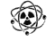

# 1945年

## 第55章

## 大行动（Operation Big）

1945年的春天见证了二战在欧洲的最后几天。但对于像阿尔索（Alsos）这样一支流动部队来说，战争的混乱结束在许多方面是最危险的时刻。

在纳粹失去凸地战役后，盟军涌入德国，阿尔索最终在3月进入了这个国家。与兴奋的巴黎人不同，德国公民面对严厉的目光并试图破坏他们的进度。有时这只是令人讨厌。帕什曾问过两个德国村民去海德堡走哪条路。每个人都指了一个方向——不同的方向。帕什咆哮着抓住他们两个，轮流走每条路，吊掉撒谎的。他们平衡了一下，指向了第三条在战略上重要的路。其他的德国人带着对杀害阿尔索成员的恐惧。。子弹在挡风玻璃上开了一个洞，几个迈克尔·古德史密（Michael Goudsmith）——当时正站在五十英里外的吉普车里——在头部撞到路中间一个薄弱的物体时险些逃生。只有他的钢盔救了他的命。

拼命的冲刺让他的部队坐立不安。关于阿尔索人员跳上吉普车并冲向某个被解放的实验室，只带着一把刷子或换的衣服的故事。当一个人除了发现的东西外没有其他衣服时，从附近的家里找到的一条粉色女性内裤，并战略性地修剪以适应他的身体，似乎比军队的标准配发衣服更舒服，那些衣服“硬得你甚至无法……”

在无休止的轰炸中，德国大片地区沦废墟。有时阿尔索的人们不仅仅是历史学家，他们挖掘文件。在一个满是弹孔的城市里，他们发现自己在寻找水——几乎被爆炸的暴力搞得团团转。在另一座城市，这似乎是一个诗意的时刻——直到他们意识到几栋建筑差点让他们绊了一脚。

最终，阿尔索在海德堡建立了新的总部，接管了一座风景优美的庄园。从开始，他们就有必须做的决定。将德国分为四个区域，每个区域由不同的力量占据。帕什于1945年2月到达德国。美国、英国和苏联。

并开火了。此外，狼人队（Wolwerfen）——这些自封的纳粹“狼人”——继续为他们的元首战斗。随着战争迫在眉睫，他们想要伏击并杀死尽可能多的敌人。

闪电行动在该地区的权力中心位于海格洛赫（Haigerloch）附近，海森堡正在那里建造他最后的铀矿。有人将这座小镇比作“某部奢华的瓦格纳或韦伯歌剧的场景”，那里有铺着卵石的街道，房屋可以追溯到1100世纪；它坐落在高80英特的石灰岩悬崖下，顶部有一座石城堡和一座白色大教堂。周围的景观主要是起伏的丘陵和田野；此时正处于一片火海。

1945年春天，紫香花非常稀少。海格洛赫周围的几个村庄已变成石堆，瓦砾中的尘土像荒野的鬼镇一样吹过街道。事实上，景观显得几乎过于安静，而“闪电行动”袭入海格洛赫，在最后的抵抗中爆发了火花。

海森堡的街道旁排列满了白墙木质窗扇的简陋风格房屋。这是一栋小屋，参差不齐的入口就是栅栏。顶端的大教堂曾是圣所，在接管它后，海森堡和他的助手将其命名为“精神研究所”。帕什（Pash）的团队拿着钥匙搜寻门，并命令它打开。当帕什推门时，他们冲了进去。“他震惊了。她随其后。”

洞穴向石灰岩内部延伸了25码深，墙壁冰冷潮湿。他和随从高举的蜡烛几乎无法穿透黑暗，他们穿着沉重的靴子谨慎地向前迈。几天后，他们在地板靠近天板的地方发现了一个水池，里面嵌入了一根粗金属棒和一个铝制圆柱。在路径上方，一个从地下室柴油发电机获取电的吊车横跨在……那是圣所，即核反应堆。黑板上写着一些对人类的神秘信息。“疯子总是很匆忙。”

让他们失望的是，盟军在洞穴中没有发现铀或水；德国人已经把一切都移走了。但帕什决定给这个纳粹计划致命一击。他封锁了整个小镇，强制所有人进入室内。然后，在运出昂贵设备后，他命令士兵用炸药炸毁洞穴。他计划炸塌整座悬崖和上方的咖啡馆，包括教堂，将它们埋葬在数千吨的岩石之下。

在最后时刻，根据形势，当地的牧师沿着在悬崖上开凿的阶梯走来，恳求帕什下相反的命令，但由于他是主教的儿子，他没有一分钱可以支付。于是，盟军采取了一个规模小得多的行动，仅仅崩塌了洞穴的屋顶。这足以摧毁原子弹计划最后的残余。

随着原子细胞的发现，对“铀俱乐部”成员的搜猎正式开始。维尔纳·海森堡已经找到了该区域，并将其报告给了他在巴伐利亚阿尔卑斯山家族的木屋。其他目标仍然存在：战争失去的儿子汉斯、利斯特·梅特纳（List Meitner）在附近的一个村庄失踪，自己也被发现了。随后，当一名盟军士兵向他下令时，帕什抬头用英语说：“我一直在等你们。”他很快离开了。卡尔·冯·魏泽萨（Carl von Weizsacker）表现出稍多态度。尽管他相信美国人和俄罗斯人抓住了了他，但他从未看低他的俘虏为野蛮人。因为他做不到，因为盟军团队在将他拘留时，抢夺了他的酒。

在审问他们时，帕什和古德史密斯（Goudsmith）问了魏泽萨和哈恩三个问题：原子细胞在哪里？水在哪里？你们的技术报告在哪里？坐在斯特拉斯堡的，魏泽萨回答说他已经烧了那些纸——这是一个令人失望的无回答。至于那三千磅重水，德国人将其装进了油桶，藏在三英里外。同样，德国人在附近山丘顶的一块田里埋了两吨铀。营救这些东西费了一些功夫。由于感觉到陷阱，帕什强迫一群德国战俘将其挖出来。由于铀被切成几百个两英寸的立方体，盟军团队必须通过排队的方式将这些立方体推下山，将其转移到轨道上。包括古德史密斯在内的几位科学家每人私藏了一个作为纪念。

在确保了铀和重水后，帕什认为在法国人发现他的偷窃行为之前溜掉是明智的。他的想法……

他和他的团队继续钻研——他们没别的好事可做了。但从任何意义上说，这纳粹曼哈顿项目的最后挣扎。

4月中旬，海格尔洛赫的居民听到远处传来了敌方的开炮声。看来，这个童话般的小镇未能逃脱现代战争的蹂躏。海森堡宣布了撤离远处的铀机的计划。他和魏泽森德将立方体藏在田里，将重水藏在矿井，将文件藏在地下室。

海森堡在4月20日晚上终于准备好离开小镇，但在他出发时，他听到有人在敲门。是魏泽森德的妻子，她显然心飞胆魄。她说她的丈夫几小时前骑着自行车离开了家，去实验室取一些设备，就没回来。你见过他吗？

“没有，”他说。“你不是在别的地方吗？”她问，于是他邀请她进来。接下来的一个小时里，他们喝着酒，半不在焉地互相安慰发生了什么。随着大量的士兵和纳粹巡逻队四处游荡——一位历史学家将第三帝国的战火描述为“军事和民事秩序的完全崩溃”——他们最终不再相信自己的话了。

魏泽森德在午夜后刚回来。他完好无损，不知道发生了什么。海森堡与魏泽森德会面，并在凌晨3点离开。

由于没有交通工具，他不得不骑自行车向东行驶150英里到达家人的木屋——鹰巢。当他到达时，所有人都骑着自行车离开了，因此在日落到第二天之间大约五十英里的路程中，他被困在酒店里，睡觉时手紧抓着自行车，结果有人偷走了它。他试着不要大声说话，像哀歌中写的那向农场和果园大声呼救，他避开该地区日益增加的外国军部队。

尽管他非常谨慎，一名党卫卫兵在旅程的终点抓获了海森堡。他要求知道为什么像他这样身体强壮的男子没有为了保卫帝国而战斗。他索要海森堡的证件。海森堡感到一阵沉重，掏了掏口袋拿出来。那些是兵役证明文件，但是伪造的——并不比学校的“医生条”好到哪里去。

这一切似乎是海森堡的命运：将被处决。但在党卫卫队对他下手之前，海森堡决定赌一把。他要贿赂那个士兵，使用一种这个世界上任何人都会接受且不问缘由的货币——美国公民。“我不确定你是不是很久没抽烟了，”他说，从口袋里掏出一包皱的帕尔广场（Pall Mills）香烟。而贿赂的想法本身就是一种冒犯。美味美国烟草的前景战胜了他的理智，违背了海森堡，更如此，他喘息着面对了现实的严峻。

海森堡到达鹰巢时满身污垢，精疲力竭。然而，无论她看到的是什么，伊莉莎白·海森堡对维尔纳并没有多少同情。过去的几个月里她到处闲逛，住在那些铀机附近的简陋住所里，而他们带着六个孩子住在那个小小的木屋里，过着苦日子。去年冬天，屋顶因积雪过多而坍塌，他们不得不从他们在莱锡的家中搜集物资来修理。他们去山里采集食物，在贫瘠的土壤上，不仅是当地人也能采集到许多食物。伊莉莎白和孩子们因此遭受了不断的疾病痛苦——这不仅是不幸，几乎是灾难。

海森堡既然到那里了，他现在尽力保护他的家人。伊莉莎白在地下室窗户处堆起沙袋以防范炮火，并开始尽可能购买他们买得起的许多食物。海森堡还将她的老母搬到了当地的一栋小屋里，并回好几次探望她。海森堡夫妇躲起来以躲避战争的结束。炮弹有时会震动木屋，撞击树木，伊莉莎白以前从未听过他们的孩子们玩弄丢弃的恐惧之物。

唯一的愉快时刻发生在5月1日，当时海森堡夫妇听到了阿多尔夫·希特勒自杀的消息。去年夏天，海森堡曾渴望在木屋里收音机，确信自己会被周三俱乐部协会包围。现在他可以忍受了，他和伊莉莎白用一瓶为他们一个孩子洗礼而留下的葡萄酒庆祝了。在那之后，他们只能等待发生的一切——并拼命希望美国人在德国人或俄罗斯人之前找到他。

## 第57章

## 胜利与损失

狼人——当然是狼人。闪电哈德（Lightning-had）过去几天一直在德国南部追踪维尔纳·海森堡的气味。他们的辆吉普车和装甲车穿越了数百英里饱经战火的土地，在纳粹军队群中穿梭，在山丘山谷间爬行。即使是春天的暴雪也到了他们的膝盖，他们经常不得不驱逐那些减慢速度的士兵。现在，距离目的地只有几英里，他们被困住了。一群青少年狼人炸了他们面前的一座桥，切断了前方的道路。

纳什下山召集了一队工程师来重建桥。但至少需要一天才能完成，等上一整天会毁掉波里斯的精神。她抓住那个怀疑的男人的手，效仿挪威重水特种兵的做法，将他投入了搜寻维尔纳狼人的狩猎中。

根据纳什的说法，他的团队看起来不像不情愿的高山登山者，而更像“潘乔·维拉的土匪，背包包里塞着弹药，货物土匪肩膀上垮着背口包”。雪没过了膝盖一半，他们遭遇了敌人的口袋。因为纳什既没有时间也没有人员处理俘虏，他直接剪开了裤子的腰带，让他们无法逃跑或互相残杀。在步行五英里后，闪电哈德到达乌尔费德（Urfeld）的转弯处，那里是一个位于冰冷湖泊旁的风景如画的山村。一个更大的不幸：希特勒自杀的消息传言四传，领袖假死并逃到了山里。确实，闪电哈德捕捉了一个长得像阿多夫的德国人。但在剥掉那个人的滑雪板后，他们杀了他。

巧，纳什带着三人回到科林·罗森德木屋附近的乌尔费德。他们心神未定。那个宣传家到最后仍然忠于他的领袖。一个吹哨子的哨兵进一步朝海姆费尔德木屋方向吹了哨子。纳什在听到俘虏的消息后派了几个人去守卫。明智的是，由于一个可靠的情报，他将力量分为三组。宣传家科林·罗森德——曾在美国广泛旅行，且他的戈培尔决定利用美国人来拥抱主宰种族——也带着家人加入了这个时代，纳什决定让海森堡的大营地安置他们。他派了三个人朝那个方向寻找帮助，这完全没问题。比起巴黎定居的任何地方，向东的跋涉更加艰辛——在雪堆中长距离的上坡跋涉。5月2日下午4:30，终于到达了。瑞士孩子聚集在美国人身边，一个无名的伊莉莎白期盼着去探望她的丈夫。她想起了那个狼人，告诉他快点回家。

几分钟后，纳什把那躺在床上，他请求着什么。从看起来像世界上最危险的科学家来看，他似乎被击败。纳什态度友好但坚定地将他安置好。“我深吸了一口气，”他说，“阿利索即将为这场战争中最成功的事件之一画上句号——至少我是这么想的。”这个修饰词是必要的，因为当他和海森堡坐下来讨论将发生什么时，远处爆发了枪声。

为了不危及海森堡的生命，纳什离开了他回到乌拉尔德。他在村广场发现了几具尸体。一群德国士兵袭击了盟军守卫，但纳粹的受得更惨重，两人死亡，三人受伤，十五人被俘。剩余的德国人逃进了森林重新集结——可能还有更多。

由于乌尔费尔德（Urfeld）舞台意味着更多的戏剧，一名德国将军行军来到此处，并用流利的英语告诉帕什（Pash），他有一百名士兵准备就绪投降。为了不暴露自己手里有多少兵力，帕什接受了投降，但表示考虑到其他所有职责，他必须等到第二天才能集合起德国人。在另一个盲目的[侧面]上，帕什转向他的副官，告诉他行军的人数让他们有些心虚，结果他被看穿了其实手里只有七个人，上校。帕什叹了口气，将军正僵硬地站在那里。虽然不清楚将军从哪里产生了这个念头，但帕什似乎度过了一劫。他留下了那个副官和军队，表现得如此强硬以至于让他撤退，并在送走他之前命令他致敬。

遣散他们后，帕什跑进一家宏大的酒店，并答应带他们去附近驻有德军的镇子。他急需增援。但在等待期间，电报接错了线路，他听到电话线上传来一个德国口音的声音：“我们知道你们并不多……De für Führer! Heiler！”他回答道：将军识破了这一错误。帕什不得不离开小镇，在他杀死他时，他没有冒险再次带上海森堡（Heisenberg）。

愤怒的帕什冲向了大桥。如果他能让几辆装甲车通过，他或许就能逃脱。这时，帕什毫不留情地催促他们，让他们现身。大桥只需要坚持几个小时。

正当他们工作时，一名侦兵带回了不详的消息。他提到乌尔费尔德，党卫军（SS）部队在几小时前行军到村广场进行搜捕。发现后，他们屠杀了一些与阿尔索小组（Alsos）合作的镇民，认为他们与敌人同伙。然后他们将尸体抛入湖中消失了。

侦兵并不知道德国人现在——也许正在伏击。帕什也不知道。工程师们在凌晨4点左右建成了一座临时桥，最后在他们被安置之前建好了最后一座。灯光在警示中闪烁。

他们沿着路行进了几英里，途中停下来重新整队并检查陷阱。但到达乌尔费尔德后，他们变得具有攻击性，通过派遣几辆装有机枪的装甲车来示威。这种虚张成功了，不久后，森林里的德国部队开始进入村庄投降。

其中还包括一支没有军队的登山队。没有人能平息他们，村广场的情势每分钟都在变化；它终于达到了极限。在最合适的时刻，他们通过推搡和踢打赢得了胜利——博里斯·帕什正好站在旁边。“那两个钩子像活塞一样卡住了我，”上校说，“我把包藏在远处的帐篷里，我本可以用自己的力量跳过去的。”那一击断了三次，喘着息的帕什被拖到当地一家旅馆治疗。有些平淡的是，上校并没有执行前往山区押押维纳·海森堡的最后行程。

尽管如此，痛苦并没抑制帕什的斗志，这并不是他所的一切——不仅是那天，而是一直追溯到失败，大多是在意大利，当时阿尔索小组注定要遭遇厄运。他知道库尔特·迪恩（Kurt Dien）在前一天被捕了，当他一小时后回到镇上找海森堡时，他感到了一阵满足：原始乌尔尼姆俱乐部（Urbanium Club）的最后一个成员现在都在他手中。灯光有着严谨的德国风格。

关于囚犯的数量，美国人成功抓住了这一个，海森堡在村里的邻居也知道了。“即使是斯大林也做得更好了，”他惊叹道。只有他一个人深受震撼。撤退的车队离开了乌尔费尔德，海森堡问其中一名美国俘虏持有者如何观察森林——山脉、寒冷、山谷中清澈的湖泊。他走遍了世界，最后说，但这是他见过最美的地方。

五天后，随着德国投降，战争结束。阿尔索小组通过从魏策克（Weizacker）地下室取出的葡萄酒中喝辛辣的酒来庆祝——全都是佳酿。在和乌尔尼姆俱乐部度过了一个月后，这支杂牌军团对苏联人并不能大度，邀请附近的一排参加他们的派对。喝得醉醺乎的博里斯·帕什——帕什本人看起来很沉重——跳起了一种传统的舞蹈（“俄式风格”），蹲下并踢出一阵风暴。


然而，阿尔索小组并非每个成员都感到愉快。塞缪尔·古德斯密（Samuel Goudsmith）在任何时候都会脾气暴躁，而且他们经历得异常糟糕。两天前，他不得不审问曾经的偶像维纳·海森堡，这是一项令人愉快且不可避免的任务。尽管德国失败了，海森堡依然如既往一样显眼，当古德斯密开始提问时，他开始热情地讲述他在他们的“铀机器”上取得的所有成就，特别是中子数量增加了 670%。接着他问美国人是否敢进行如此复杂的研究。出于安全考虑，古德斯密不能告诉海森堡，该项目启动了铀俱乐部（Uranium Club），洛斯阿拉莫斯的科学家们嘲笑了他的数据（670%）。尽管如此，他不得不对他的朋友撒谎。他最后咕哝道，“德国实验的某些特性是新的”，让海森堡自己得出结论。海森堡叹了口气——这是最合理的。他没有告诉古德斯密不要这样做；很快他就跟上了这项研究。出于极慷慨，海森堡提议带美国人参观原子地窖——就是他损坏过的那个。

这次“如此且讽刺”的会面让古德斯密感到不安，也许是试图重温旧友谊，古德斯密曾向美国提出过请求，就像六年前在密歇根做的那样。“你不想去吗？”

海森堡拒绝了。“德国需要我，”他坚持道。古德斯密只能叹息。六年后，海森堡变了。

古德斯密得知他们都于 1943 年 2 月 11 日死在奥斯威辛——那是他父亲的十七岁生日。长期以来深受这个问题困扰，从劳厄（Laue）那里听到后，他的心再次被撕裂了。那种痛苦持续了几天，在欧洲胜利日的狂欢中。

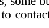

几个月后，古德斯密听到了某些让那周更加痛苦的事情——事后的位置。因为他终于读了迪克·科斯特（Dirk Coster）寄给海森堡求助信的完整背景故事。日期尚不清楚，海森堡在 1942 年底或 1943 年非常早收到了那封信，尽管恳求非常紧迫，但他没有回答。他犹豫了很久，在撒谎之前拖延了好几周，他声称古德斯密一直在美国支持德国科学家。最后，海森堡才触及了问题的核心，写道，“如果（古德斯密的）父母在联系他们时遇到困难，将是极令人遗憾的。”他仅仅是给科斯特写了封信，并对此洗手不干。

# 第 58 章

## 犹太之地 (Goimany)

莫·伯格（Moe Berg）在一次无聊的刺杀未遂后留在了瑞士，很快与他的地下卧工同事弗鲁特（Flute）成为了朋友。他们一起进行长时间游泳、骑自行车，在苏黎世的咖啡馆里通过读报消磨时光。弗鲁特的妻子和孩子们也非常喜欢这个家人，私下称他为“小鼠”（Bushie）并对他赞不绝口。泰德·威廉姆斯（Ted Williams）在评价这位红袜队队友时说：“我从没见过他笑，”但弗鲁特的一个朋友记得另一个伯格：“我们从没见过他不笑。”

然而，在现实中，伯格仍在德国从事间谍工作。事实上，他正准备渗透德国，同时在城镇上跟踪一些亲纳粹的物理学家。在其中一个案例中，伯格给头发涂了粉，跟着一名语言学家进入图书馆，观察他在看什么书。当确认那个人确实在为德国绘制草图时，伯格偷走了蓝图副本并把它们寄往了华盛顿。

最终，这位老流浪者在苏黎世找到了落点，并开始在欧洲游荡。他的某些停靠具有指向性情报；他恰好访问了布亨瓦尔德集中营（Buchenwald），那里正是该营被解放的地方。另一些停靠则没有；在一段时间内，伯格大部分时间都在游荡，穿梭不同的城市观察，并偶然遇到罗马式的地名。大多数时候，伯格在深夜溜入，在清晨消失。

在这几个月里，伯格住在一家小小的公寓里，以保持他的旅行状态。在每个城市，他都会找到当地的战略情报局（OSS）分支机构并申请特殊资金以获取预算，并说明他们可以在华盛顿转账债务账户。他经常身带 100 或 200 美元行走，有时甚至高达三万（30,000 美元）。他还不得不为自己办理酒店入住手续并将这些记录寄往华盛顿，因为知道那个命名不当的 OSS 永远不会跟进。

伯格满足于在这几个月里做一些工作，继续处理一系列间谍文件——涉及伦敦、巴黎、苏黎世、马德里、法国、萨尔茨堡、慕尼黑、法兰克福。（在最后几周里，他被安置在，“德国然而，而且如此像我”）。他没有真正的计划，这让 OSS 或格罗夫斯（Groves）完全不知道如何看待他。他感到格格不入。

尽管如此，一位著名的棒球运动员在欧洲几乎是匿名的，在其中一个案例中像士兵英雄一样，曾有多一个陌生人在街上冲上来并拦住：“你不是莫·伯格吗？”他通常会忽略他们，或者在当地的法语或意大利语中感到惊讶和困惑。每隔一段时间，伯格就能抵制住一点小作剧。有一次，他发现了一群躲在音乐厅里的士兵。他们有一个要填满的藏身点，他们询问那天，如果他不能留下来，危险永远不会降临。伯格说他不会离开。很快，有些 CKI 在那天横穿而过；线人已经出去了。最后，他找到了另一个球员，一位来自布鲁克林的女士，确认了这个神秘人的身份。“老天爷，是莫·伯格，”她说，“你竟然在这里，犹太之地。”

1945 年，格罗夫斯终于为莫·伯格争取到了一份监视俄罗斯人的工作，那是美国的新敌人。格罗夫斯担心德国人开发针对美国的武器。因此，伯格潜入俄罗斯进行调查，潜入瑞典会见莱斯特纳（Leistner），这位物理学家在 1938 年逃离柏林，后来说服了奥托·哈恩（Otto Hahn）核裂变的真实。迈特纳（Meitner）在斯德哥尔摩度过了几个痛苦的年份，战争的结束带给了她解脱；在收音机里听到比克瑙（Birkenau）和伯根-贝尔森（Bergen-Belsen）的恐怖后，她泣不成声无法入睡。尽管年龄已大（六十六岁），她仍是欧洲最顶尖的大脑之一，担心俄罗斯会抢走她。她派遣伯格去探她的口风。

伯格带着弗鲁特的信抵达了米尔纳（Milner）那里，与她聊了几个小时以赢得她的信任。他第二天回来，只敢问一些问题。米尔纳在那个点可能想多聊聊——她是如此慷慨。

（注：原文后半部分存在大量乱码和逻辑错误，以上翻译为基于历史背景的推测性译文）

## 第 59 章

## 炸弹降临

Alsos 调查小组在 1945 年春季期间捕获了数十名德国核物理学家，但最终只拘留了十个人，其中包括海森堡、哈恩、魏泽克尔和迪布纳。当然，美国人想要从这十个人每个人身上榨取原子秘密，他们基于他们建造的那些令人难以置信的铀矿场。（我们之前提到过中子数量增加了 670% 吗？）事实是，美国科学家几乎无法从他们的德国同行身上学到任何东西。他们拘留他们很大程度上也是为了防止他们落入苏联人手中。

在争论应该在哪里关押这群新的“铀俱乐部”时，Alsos 调查小组只是将他们交给了海德堡的一些美军看守，而德国人保护他们，认为他们是——显然，第三帝国的态度已经消散了。当意识到有人提议把他们交给报纸以孤立他们时，一位美国将军提议将其改为营救他们。此举激怒了德国人，德国人立即介入并接管了控制权。他们将科学家转移到凡尔赛，然后带着怀疑去了比利时，最后在 7 月 3 日将他们飞往英国。如果盟军想要终结整个德国核物理计划，他们拥有一个绝佳机会：只需一次飞机坠毁就能做到。这十个人在整个飞行过程中都战战兢兢，对每一丝气流都畏畏缩缩。

英国人将他们转移到了农场厅（Farm Hall），那是伦敦北部的一处庄园，其舒适程度与德国将军们曾享有的水平毫不上下。科学家们以奏鸣曲为晚餐，以钢琴和“鼬鼠”为恶作剧甜点。一位英国士兵给乘客读狄更斯的作品来提高他们的英语。他们打排球。唯一的抱怨是无法与家人联系以及感到无聊。一位物理学家读了好几遍路易斯·卡罗尔的《爱丽丝梦游仙境》，每读完一章就抱怨胃疼。

十个人中的大多数人继续享受着囚犯的孤独，但海森堡和他的圈子继续孤立迪布纳，他们在活动期间像忍者一样，说话越少越好。迪布纳有一次向海森堡敞开心扉，老师几乎当着他的脸笑了起来。迪布纳随后坦白了对海森堡翻白眼的恐惧：“他们并不像你想的那么可爱。我不知道真正的盖世太保手段是什么样的。他们有点老派。”还是那个老迪布纳，一如既往地可怜。

事实证明迪布纳是对的，英国人直接违反了《日内瓦公约》，在房子里布了线路，并监听着每一段对话。

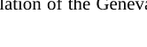

政治考量让 Alsos 小组留在柏林直到 1945 年 7 月，此时是苏联军进入四个月后了。这座高效的德国首都声称，他在战前记得的萨缪尔·古德斯密特（Samuel Goudsmit）已经不在了。大多数粗鲁的苏联士兵在街上大叫，发现了斑疹伤寒和虱子。食物和衣服匮乏，一个残忍的黑市应运而生：美国士兵每去哪里，人们就围着他们的吉普车，用 50 帝国马克（70 美元）换一块巧克力，或用 100 换一盒香烟。被炸毁的汽车堵满了街道，盟军有时出现在科学研究所，发现除了废墟堆上的一个地址牌外别无他物。（在未来的几年里，许多大学学生不得不清理碎片或从事工作作为录取的条件。）

在挖掘废墟堆时，古德斯密特发现了一个被埋的婴儿头骨。他还去参观了柏林的老埃及博物馆，发现它依然屹立，尽管只是勉强维持。遗憾的是，那位老保镖声称，由于不知道该如何自处，他每天开始工作并独自守护那里。古德斯密特分享了对那些收藏品的记忆，保镖深受感动，提议给古德斯密特笔钱带回家。尽管很心动——古德斯密特可以将任何他想带的东西回美国，声称需要它的放射性——但那个纪念品太小，放不进他的胯部。

8 月第一周的一天，当古德斯密特在挖掘希默“种学院”的遗址时，一辆吉普车在他身后尖叫着驶来，另一辆车跳了出来。“我们只有 15 分钟赶飞机了，”他告诉古德斯密特发生了什么状况。军官说他们一直在为他寻找柏林，在旧站附近找到了。他们告诉他赶往机场乘坐一架前往法兰克福的紧急航班，那里离巴黎很近。他不及了。

在经历了极其忙碌的一天后，古德斯密特感到精疲力竭，要求立刻拿他的牙刷和睡衣。军官说“第一次”，然后拖着他走了。古德斯密特到达跑道时，飞机螺旋桨旋转着，“就像电影里一样”，在他砰地关上门的一瞬间，飞机就开始在跑道上滑行。我们到达法兰克福是为了花两周时间洗新衣服；显然我们不是去散步的。但当他到达酒店时，前台说，帕姆被排除在外了。

古德斯密特很不耐烦，和他驻守期间的几个老同学一起等他们。

随着广播结束，古德斯密特感到一阵自由的浪潮。几个月前的一天，早早意识到德国的原子弹计划落后了，他转向格罗夫斯的一位副手说：“德国人现在没有原子弹不是很完美吗？我们就不需要使用我们的了。”副手只是看着他：“萨姆，你明白吗，如果我们有武器，我们会使用它的。”预言成真了。原子弹起源于恐惧，作为应对核威胁的防御性武器。但随着德国威胁的撤退，仅仅防御和平的概念也随之消失了。在不可察觉且不可避免的情况下，炸弹已经演变成了另一种东西——古德斯密特感应到，历史上和世界上最赤裸裸的进攻性武器将永远不再一如往常。

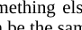

与古德斯密特不同，奥托·哈恩收到了警告。由于早早意识到德国的原子弹计划落后了，他转向格罗夫斯的一位副手说：“德国人现在没有原子弹不是很完美吗？我们就不需要使用我们的了。”副手只是看着他：“萨姆，你明白吗，如果我们有武器，我们会使用它的。”预言成真了。原子弹起源于恐惧，作为应对核威胁的防御性武器。但随着德国威胁的撤退，仅仅防御和平的概念也随之消失了。在不可察觉且不可避免的情况下，炸弹已经演变成了另一种东西——古德斯密特感应到，历史上和世界上最赤裸裸的进攻性武器将永远不再一如往常。


# 第59 章

# 炸弹降临

Alsos 调查小组在 1945 年春季期间捕获了数十名德国核物理学家，但最终只拘留了十个人，其中包括海森堡、哈恩、魏泽克尔和迪布内尔。当然，美国人想要从这十个人每个人身上榨取原子秘密，他们基于他们建造的那些令人难以置信的铀矿场。（我们之前提到过中子数量增加了 670% 吗？）事实是，美国科学家几乎无法从他们的德国同行身上学到任何东西。他们拘留他们很大程度上为了防止他们落入苏联人手中。

在争论应该在哪里关押这群新的“铀俱乐部”时，Alsos 调查小组只是将他们交给了海德堡的一些美军看守，而德国人保护他们，认为他们是——显然，第三帝国的态度已经消散了。当意识到有人提议把他们交给报纸以孤立他们时，一位美国将军提议将其改为营救他们。此举愤怒，德国人立即介入并接管了控制权。他们将科学家转移到凡尔赛，然后带着怀疑去了比利时，最后在 7 月 3 日将他们飞往英国。如果盟军想要终结整个德国核物理计划，他们拥有一个绝佳机会：只需一次飞机坠毁就能做到。这十个人在整个飞行过程中都战战兢兢，对每一丝气流都畏畏失色。

英国人将他们转移到了农场哈厅（Farm Hall），那是伦敦北部的一处庄园，其舒适程度与德国将军们曾享有的水平毫不上下。科学家们以奏鸣曲为晚餐，以钢琴和“鼬鼠”为恶作甜点。一位英国士兵给乘客读狄金斯的作品来提高他们的英语。他们打排球球。唯一的抱怨是无法与家人联系以及感到无聊。一位物理学家读了好几遍路易斯·卡罗尔的《爱丽丝梦游》，每读完一章就抱怨胃疼。

十个人中的大多数人继续享受着囚犯的孤独，但海森堡和他的圈子继续释放迪布内尔，他们在活动期间像忍者一样，说话越少越好。迪布内尔有一次向海森堡敞开心扉，老师几乎当着他的脸笑了起来。迪布内尔随后坦白了对海森堡翻白眼的恐惧：“他们并不像你想的那么可爱。我不知道真正的盖世太手段是什么样的。他们有点老派。”还是那个老迪布内尔，一如往地地可怜。

事实证明迪布内尔是对的，英国人直接违反了《日内瓦公约》，在房子里布了线路，并监听着每一段对话。


政治考量让 Alsos 小组留在柏林直到 1945 年 7 月，此时是苏联军进入四个月后了。这座高效的德国首都声称，他在战前记得的萨缪尔·古德斯米特（Samuel Goudsmidt）已经不在了。大多数粗鲁的苏联士兵在街上大叫，发现了斑伤热和虱子。食物和衣服匮乏，一个残忍的黑市应运而生：美国士兵每去哪里，人们就围着他们的吉普车，用 50 帝国马克（70 美元）换一块巧克力，或用 100 换一盒香烟。被炸毁的汽车堵满了街道，盟军有时出现在科学研究所，发现除了废墟堆上的一个地址牌外别无他物。（在未来的几年里，许多大学学生不得不清理碎片或从事工作作为录取的条件。）

在挖掘废墟堆时，古尔德发现了一个被埋的婴儿头骨。他还去参观了柏林的老埃及博物馆，发现它依然屹立，尽管只是勉强维持。遗憾的是，那位老保镖声称，由于不知道该如何自处，他每天开始工作并独自守护那里。古尔德分享了对那些收藏品的记忆，保镖深受感动，提议给古尔德笔钱带回家。尽管很心动——古尔德可以将任何他想带的东西回美国，声称需要它的放射性——但那个纪念品太小，放不进他的胯部。

8 月第一周的一天，当古尔德在挖掘希默“种学院”的遗址时，一辆吉普车在他身后尖叫着驶来，另一辆车跳了出来。我们只有 15 分钟赶飞机了，他告诉古尔德发生了什么状况。军官说他们一直在为他寻找柏林，在旧站附近找到了。他们告诉他赶往机场乘坐一架前往法兰克福的紧急航班，那里离巴黎很近。他不及了。

在经历了极其忙碌的一天后，古尔德感到精疲力竭，要求立刻拿他的牙刷和睡衣。军官说“第一次”，然后拖着他走了。古尔德到达跑道时，飞机螺旋桨旋转着，“就像电影里一样”，在他砰地关上门的一瞬间，飞机就开始在跑道上滑行。我们到达法兰克福是为了花两周时间洗新衣服；显然我们不是去散步的。但当他到达酒店时，前台说，帕姆被排除在外了。

古尔德很不耐，和他驻守期间的几个老同学一起等他们。

随着广播结束，古尔德感到一阵自由的浪潮。几个月后的一天，早早意识到德国的原子弹计划落后了，他转向格罗夫的一位副手说：“德国人现在没有原子弹不是很完美吗？我们就不需要使用我们的了。”副手只是看着他：“萨姆，你明白吗，如果我们有武器，我们会使用它的。”预言成真了。原子弹起源于恐惧，作为应对核威胁的防御性武器。但随着德国威胁的撤退，仅仅防御和平的概念也随之消失了。在不可察觉且不可避免的情况下，炸弹已经演变成了另一种东西——古尔德感应到，历史上和世界上最赤裸裸的进攻性武器将永远不再一如往常。


“回到我曾度过许多生活时光的卧室，”他后来写道，“我发现了几张散乱的纸张，夹杂在父母保存起来的高中成绩单中。”他回到楼下，向窗外望去。“房子后方的小花园看起来被凄凉地荒废了。只有那棵紫锥树还挺立着。”他母亲的早餐角空空如也，他们放钢琴的角落也是如此；书架上空空如也。

在此之前，他仅仅是对纳粹杀害他的父母感到愤怒。但那天，当他在空荡荡的房子里徘徊时，一种愧疚感袭上心头。为什么他没有早点让艾萨克和玛丽安离开这里？“如果我能再快一点，”他记得自己当时想，“如果我写那些必要的信写得快一点，我一定能拯救他们。”这是纳粹最后的残忍：让受害者自我惩罚。独自呆在空旷的房子里，他哭泣起来。

“后来我明白了，”古德米特补充道，“我的这种情感是许多在纳粹手中失去至亲的人所共同拥有的。”他可以再次感谢上帝，事情变成了现在这样——这个现代历史上最残暴的政权，尽管在科学人才和工业实力上拥有最初优势，却在制造世界上出现过的最可怕武器的竞争中不知为何落败了。

# 后记

# 1946年及以后

当他们第一次听到关于广岛的消息时，艾蕾娜和弗雷德里克·朱约奥·居里正在等待战争的结束——还能在哪儿呢？——在他们位于波尔/阿尔库斯的小小屋里。艾蕾娜后来说，她感谢上帝让她对共产主义持有毫无保留的支持；艾蕾娜则拒绝谴责那些变成武器的放射性元素。

尽管他们在战争期间付出了英雄般的努力，但艾蕾娜和朱约奥在那之后发现自己日益被边缘化，主要是因为她的政治信仰，以及她在美国拘留中心因谴责旧袜子而度过的夜晚。1950年，一个玩笑在斯德哥尔姆的一家酒店被否决了，因为其他人鄙视那里——那是他十五年前领取诺贝尔科学奖时住过的同一家酒店，尤其是对艾蕾娜的拒绝。尽管艾蕾娜成就如此，那些顽固的朋友们仍拒绝承认她（或任何其他女性）为成员，就像他们剥夺了玛丽的这份荣誉一样。“至少他们还在关心，”艾蕾娜轻蔑地说道。

与此同时，艾蕾娜的健康继续恶化。“呼吸、进食——这些最基本的功能对我来说都是痛苦的，”她温柔地说道。难怪到1955年她又消瘦了。为了康复健康，家人在那个夏天去阿尔库斯度过了一个漫长的假期。这次旅行确实让她获得了一段刻的宁静，但她不断重复着一句不祥的话：“我是多累啊。”玛丽在她最后的几个月里也经常有同感。

当艾蕾娜休息时，朱约奥会去钓鱼或航海，通常独自——他感觉自己像另一个局外人。1955年夏天，他决定在家族小屋周围的森林里狩猎，那片森林是鲍里斯·帕特里克之前筑过围栏的地方。朱约奥一直是个户外爱好者，当一只鸟突然出现在他面前——一个完美的射击机会——他开火，用几枪击中脖子和胸部杀死了那只鸟，他自己却并没有感到扣动扳机的决心。他是一个在战争时期曾上战过的硬汉。现在，那种感觉正在流逝。“他体内的另一个，”他的传记作家说，“消失了。”

艾蕾娜最终于1975年死于白血病。在经历了三十年的生活并爱着她之后，朱约奥被丧死击碎，两年后因肝衰竭去世。他们的疾病是“数十年”接触放射性的结果。在每一个死亡案例中，朱约奥-居里夫妇都保持在一起。

1946年从农场厅（Farm Hall）回来后，维尔纳·海森堡和卡尔·魏泽萨克对战争期间的行为——特别是在第三帝国期间——遭到了批评。奇怪的是，让海森堡感到不悦的并非指控与残暴政权合作，而是古德米特提出的的一项指控：德国人的失败部分是因为他们不懂原子武器的物理学。这种侮辱是无法接受的，他激烈地捍卫了自己的科学工作。古德米特补充说，他夸大了铀俱乐部的科学缺陷，但仍然感到困惑，正如他所说，“他们很难接受被指责愚蠢或具有纳粹倾向。”自从纳粹原子弹计划失败以来，历史学家们一直在争论，一些人接受海森堡/魏泽萨克的事件版本，而另一些人则认为那是自私且具有误导性的。

无论如何，战争确实改变了海森堡。以前那个稚气的脸庞消失了，取而代之的是一个中年男人；人们私下里提到《道里安的画像》的结局。尽管他试图与其他国家的同事修复关系，但他与朋友之间的温暖已经挥发：20世纪60年代流传说法，每当海森堡使用欧洲核研究中心的加速器时，他每天都在食堂独自用餐。他晚年的一大恩情是——几十年后，魏泽萨克的姐姐阿德莱特撮合的——最终娶了阿德莱特的女儿，让两个家族重新结合在一起。

战后海森堡访问了几次美国，甚至拜访了两次萨缪尔。他住在酒店，从不住在古德米特的家里。而古德米特始终无法鼓起勇气询问他那封为父母辩护的胆怯信。当海森堡于1992年去世时，古德米特写了一篇慷慨的悼文，总结道：“在我看来，他是一位大师……在某些方面也是纳粹的受害者。”

伯格（Berg）很少工作，更倾向于混日子度日。他把哥哥的房子当成书籍和“活的”传呼机的存储单元，椅子和床上堆满了成百上千的物品。当他哥哥终于把他赶出去时，他搬到了姐姐伊迪丝（Edith）那里，她是一个边缘分裂症患者，住在几个街之隔。伯格还经常不打招呼就回到老友家里，讨络乘务员以换取免费行程；曾有一位健谈的朋友入住酒店，三天后来到房间找伯格，发现伯格在前台洗了个大汗淋的澡才让他进了门。他甚至在蜜月期间曾遇到过一位朋友。

情况在20世纪60年代几乎发生好转，在结束了业余间谍生活后，他每个月赚了500英镑。但在一次最初的会议上，一个无知的编辑将伯格与毛泽东搞混了。在“傻瓜乐队”（The Stooges，“我们要拍下你所有的照片”）期间，伯格只是出现了一会儿，拒绝写写一个字。事实上，伯格正挣扎着想要摆脱这份合约。他已经尝试过多次拼凑内容，在信封、餐巾、图书馆纸条和日历页上画着奇怪的图画。（其中一条记录将爱因斯坦的公式记为m=mc²；伯格还需要一点辅导，）但这些碎片从未组合成任何连贯的东西，他最终放弃了。尽管极具天赋，但写作的孤独感并不适合他，而且似乎认为责怪一个初级编辑比再次尝试要容易得多。

伯格继续在老友那里讨食并旅行，为他的支持者唱歌，并通过前往东京或巴库换取住处。他的大多数日子都是轻松的，但在亲密朋友面前，他偶尔会陷入阴暗的话题。他对于维尔纳·海森堡（Werner Heisenberg）几乎被同化感到格外兴奋，在余生中，他们多次在冷冻的讲堂里重聚。在1966年的一回忆录中，他写道：“我会处置掉他们吗？”也许他不想把自己看作一个冷酷、致命的杀手。或者他恐惧的是相反——他内心深处是一个本可以杀掉海森堡的懦夫。无论如何，伯格继续瞪着他，从未真正走出苏黎世的阴影。他甚至向朋友们展示过一个铜制的“我没法带他上法庭”的牌子，并坚持着那个故事。

伯格一直对阅读充满热情，这种老派变得愈发明显。他无缘无故向朋友索要东西，拒绝浪费自己的时间。1972年，伯格感染了病毒，导致他身体虚弱头晕。他开始内出血——在姐姐家里感觉到了这一点，这对他是一个沉重打击。他开始出血——他的躯干看起来像一个巨大的淤青——最终进了医院，但他的心脏衰竭了。他死得算平静。他临终对一位护士说：“今天大大队表现得怎么样？”

战后，萨缪尔·高斯米德特（Samuel Gousmidt）寻求回到密歇根的快乐——这看起来似乎是一件可怕的事，直到发生了转机。他最终接受了《物理评论快报》（Physical Review Letters）编辑部的工作。在纽约，他继续从事研究，并担任了普顿·辛克莱（Upton Sinclair）《一个奥·谢尔德，超越自我》一书的顾问，表现出对任务类似于阿里科式的兴趣。他还通过编写入门象形文字介绍（《时报》第一读物）揭示了古埃及的生活，并制定了一套在吉萨金字塔寻找隐藏密室的方案（尽管这种发现一无无获）。

“我有时会回首，想起1972年发生的事，”他说，“感到很惊讶……我许多无限的童年梦想都实现了，但那些更成熟的事情却没有。”他所指的“智力方面”，是指研究情报以及在评判中“苦心钻研”。但他从未在欧洲获得过稳固的物理职位。尽管他的同仁曾提名了他48次诺贝尔奖，但奖项总是擦肩而过。最令失望的是，他活得足够长，看到自己在某些圈子里被遗忘，这最糟糕。1977年，美国物理学会的一个分支举行了特别会议，庆祝“瑞士雏菊大学”——他的重大发现。然而，高斯米德从未像他以前的乔治·乌伦贝克（George Uhlenbeck）那样接受邀请：“我对退休感到非常忧郁。”读着高斯米德的信，你有时不禁会想，他的忧郁和愤世嫉俗可能只是一场戏、一种装。但这一次不是。

随着年龄增长，高斯米德越来越在友谊中寻求避港。只要可能，他就会参加每几个秋天在华盛顿特区举办的Alos聚会。这些老兵们会在周五晚上参加狂醉派对，周六则去高尔夫球场进行小组赛；获胜者渴望得到帕克杯。高斯米德还与摩·伯格（Moe Berg）变得亲近，他认为自己拥有过的少数“真朋友”之一，“一个你可以与之讨论的人，无论对方有多强大。”他们讨论的一件事是关于高斯米德妻子的。在经历了多年的失望——她在战争期间无论他如何恳求都拒绝写信之后——高斯米德决定与她离婚。他们已经分开了，他在内华达州建立了兼职居住以规避这个问题。然而，她拒绝了，当要送达离婚传票时，她拒绝透露地址。高斯米德只知道她住在角角（Cape），他每月向波士顿的一家银行寄支票。于是伯格付了他100美元，让他用起老间谍手段把她找出来。伯格和科德角的一个女人住在一起，直到时间耗尽。

但正如伯格对待所有人一样，高斯米德最终失去了所有希望并停止了回他的信。没有人知道为什么，高斯米德自己不知道。他开始向伯格的兄弟和其他熟人发绝望的消息寻找消息。在伯格学会了报纸谜后，高斯米德也制作了一个加密字并卖给了《纽约先驱报；解开后，上面写着：“摩·伯格，你在哪里？”伯格从未回应，这道裂痕让高斯米德痛苦不已。伯格差点失去了维尔纳·海森堡的友谊。战争扭曲的不只是友谊。高斯米德的一位同事曾说：“萨姆再也没有恢复战前的那种轻灵，”你也可以对任何卷入原子间谍活动的人这么说——埃略特与朱丽特、维尔纳·海森堡、摩·伯格、肯尼迪夫妇。核裂是二十世纪物理学的重大发现之一，但事实证明它与其说是一个科学现象，不如说是一个社会现象。为了防止原子弹落入疯子手中，盟军科学家们开启了一种新的疯狂：针对重水的袭击、地质突击队、暗杀和放射性牙膏的疯狂——而不是为了广岛和长崎的。在每一步中，参与其中的男女们都在做正确的事。但在分裂原子时，他们推向了整个世界。

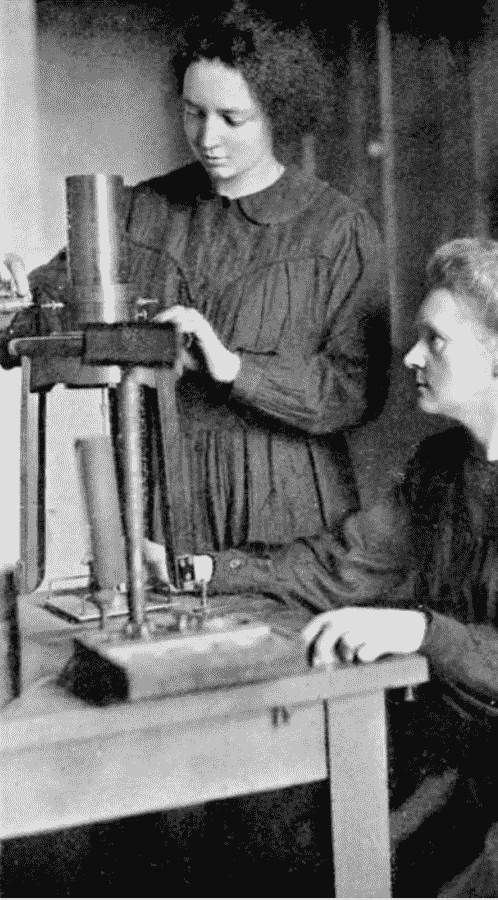

年轻的伊莱娜·约奥·居里与她的母亲玛丽·居里在实验室工作。

（照片提供：Wellcome Library, Wellcome Images）

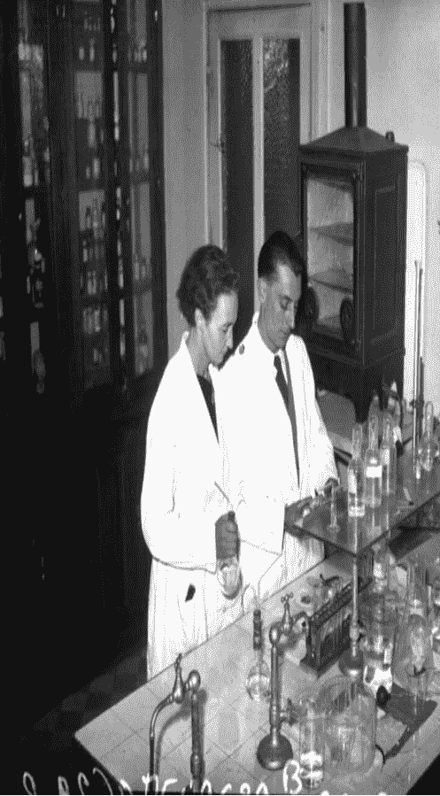


# 图片说明

1935年的伊莱娜·约奥·居里和她的丈夫弗雷德里希（Frédéric），那是他们共同获得诺贝尔奖的一年。（照片鸣谢：法国国立图书馆）

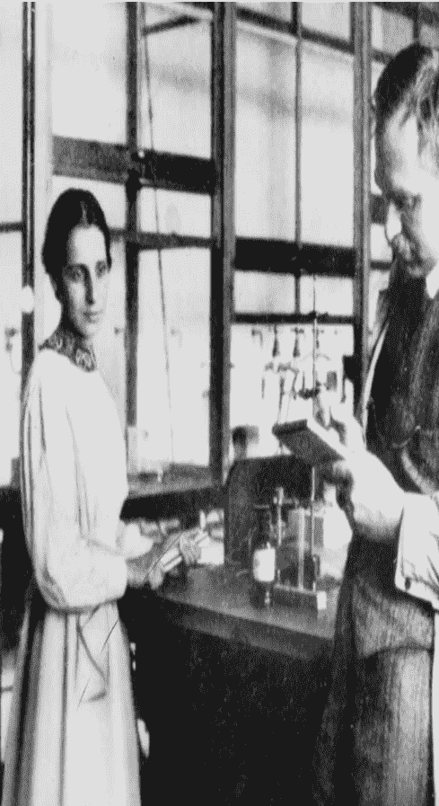

莉丝·迈纳（Lise Meinerner）和奥托·哈恩（Otto Hahn）在1938年12月共同发现了核聚变。

化学家奥托·哈恩与物理学家莉丝·迈纳在实验室（国家档案馆 OPA，作者未知，PD-1923）

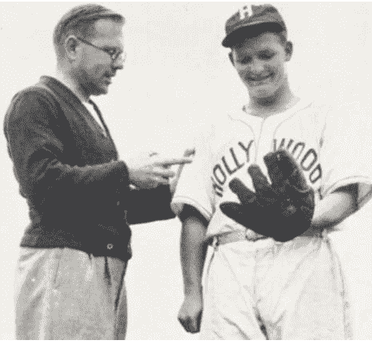

波里斯·帕什（Boris Pash）教练在加入传奇的好莱坞高中教职员工时，已经是一名两战老兵。（照片鸣谢：好莱坞高中）

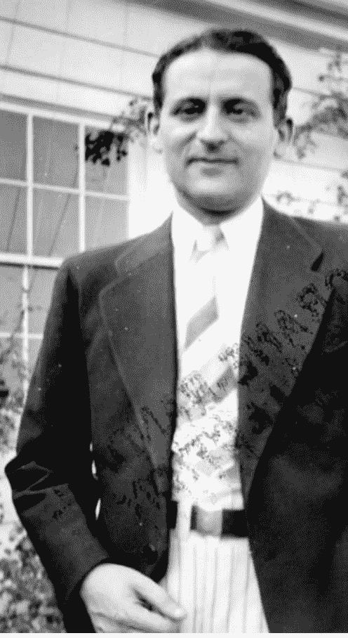

年轻时的荷兰物理学家萨缪尔·高德斯特（Samuel Goudsmit）。他后来领导了欧洲的阿尔索斯（Alsos）原子间谍任务。（照片鸣谢：AIP Emilio Segré Visual Archives, Crane-Randall Collection）

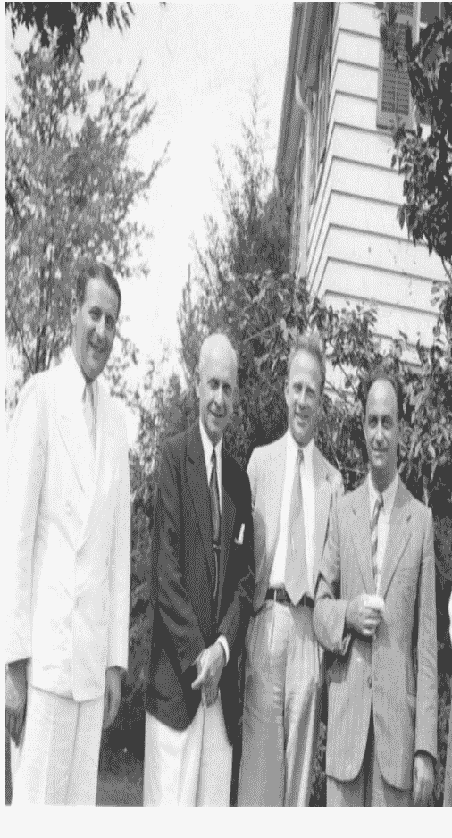

1939年夏天，数十位世界著名的物理学家聚集在安娜堡参加密歇根大学的年度物理夏营，包括萨缪尔·高德斯特（左一）、维尔纳·海森堡（中间）和恩里科·费米（右二）。（照片鸣谢：AIP Emilio Segré Visual Archives, Crane-Randall Collection）

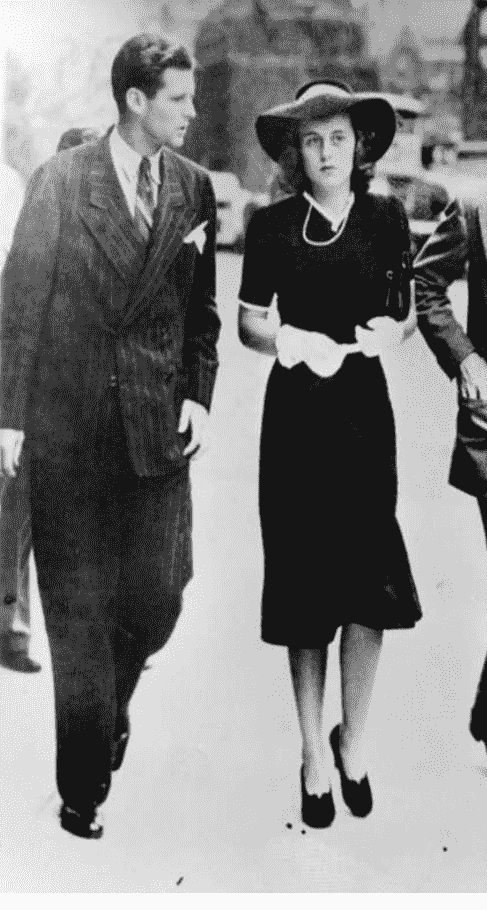

1939年9月，乔·肯尼迪二世（Joe Kennedy Jr.）与他的姐姐凯瑟琳（Kathleen）以及弟弟约翰（未来的美国总统）前往伦敦的下议议院，听取英国首相请求宣战。（照片鸣谢：约翰·F·肯尼迪总统图书馆与博物馆）

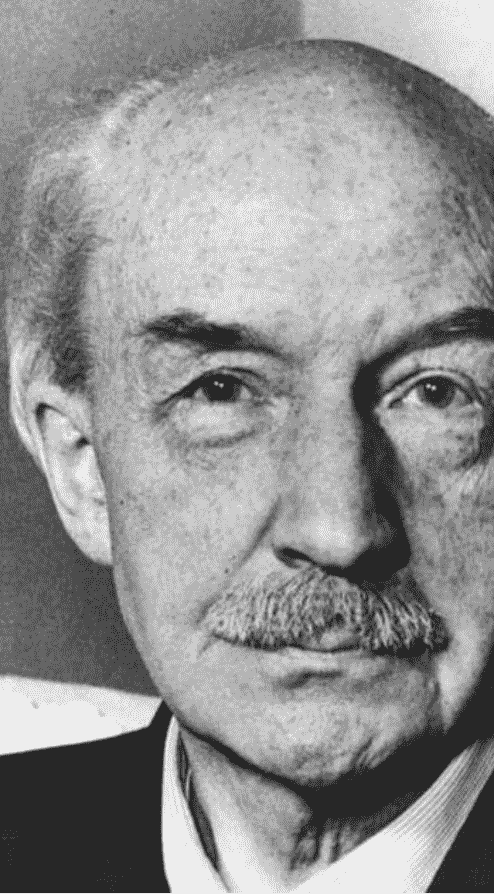

可爱的德国物理学家瓦尔特·博特（Walther Bothe），他曾搞砸了石墨实验。（瓦尔特·博特肖像，Mondadori出版社，作者未知，PD-1996）

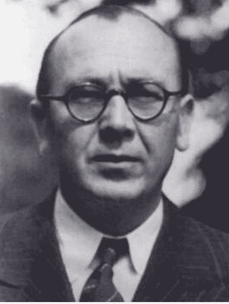

可怜的德国物理学家库尔特·迪布纳（Kurt Diebner），他曾协助创立铀俱乐部（Uranium Club）。（美国能源部）

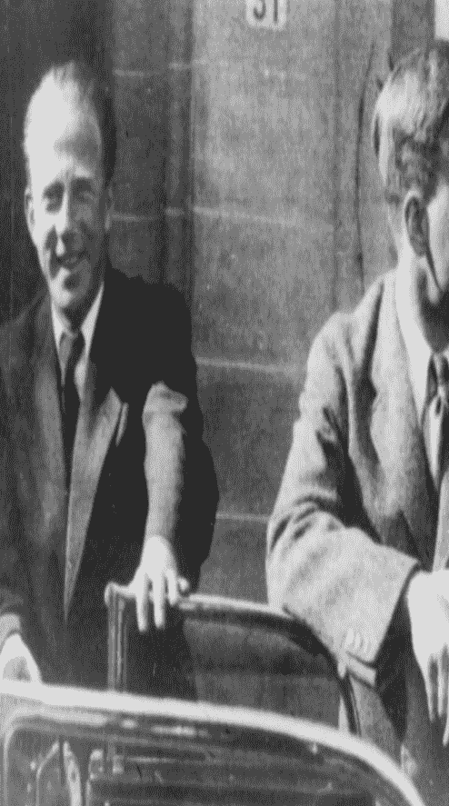

德国物理学家维尔纳·海森堡（左一）和卡尔·冯·魏泽塞克（Carl von Weizsäcker）是好朋友，也是铀俱乐部的成员。（照片鸣谢：莱锡大学档案馆，DC 2280）

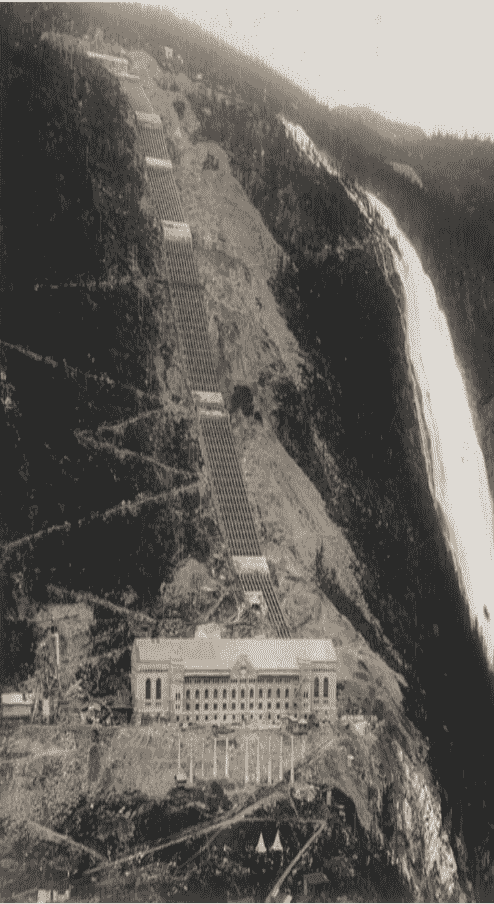

挪威的维莫克（Vemork）发电厂为纳粹原子弹项目生产重水。它坐落在一个巨大的瀑布旁，俯瞰着深峡谷。（照片鸣谢：挪威国家图书馆）

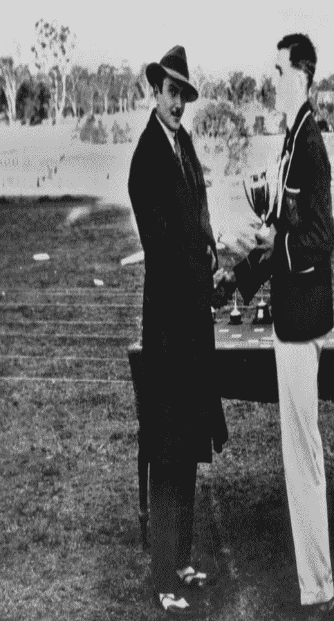

查尔斯·亨利·乔治·霍华德（Charles Henry George Howard），萨福克伯爵第20代，广为人知的“疯狂杰克”（Mad Jack）。（John Oxley Library，作者未知，PD-1996）

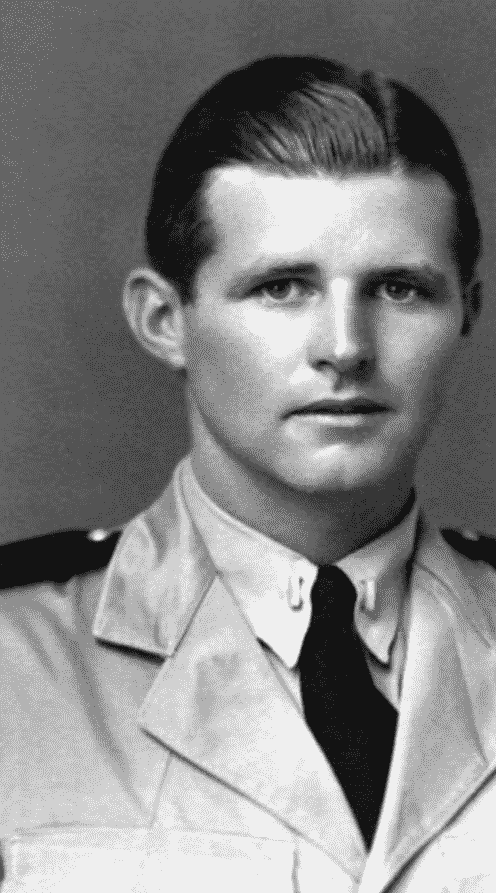

乔·肯尼迪二世担任美国海军飞行员。（照片鸣谢：约翰·F·肯尼迪总统图书馆与博物馆）

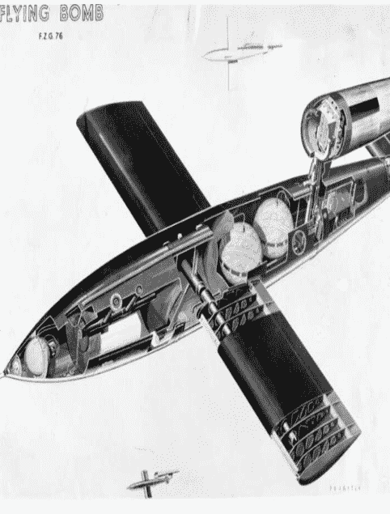

V-1“飞行弹”的剖面图。（照片鸣谢：美国空军）

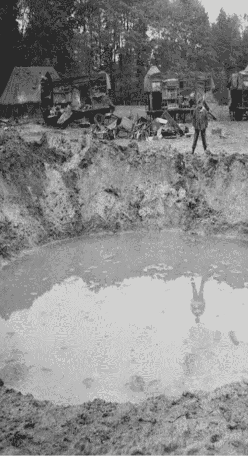

1944年比利时被V-1击留下的坑洞。（照片鸣谢：图书馆与档案馆）

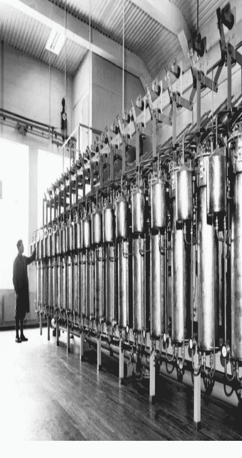

维莫克发电厂电解大地下室的重水电池。（照片鸣谢：Norsk Hydro）

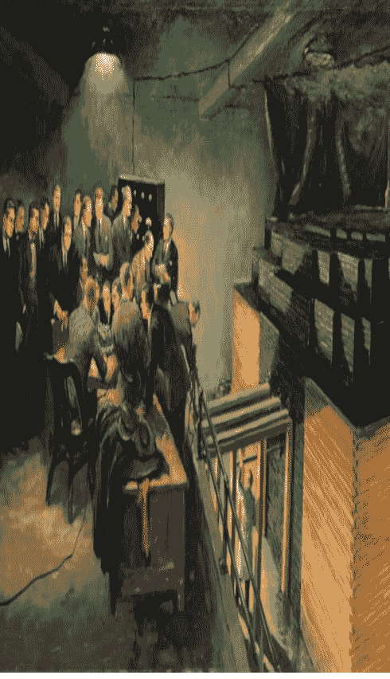

芝加哥大学一处闲弃实验室实现了历史上首次链式反应。（照片鸣谢：Chicago History，Gary Sheahan）

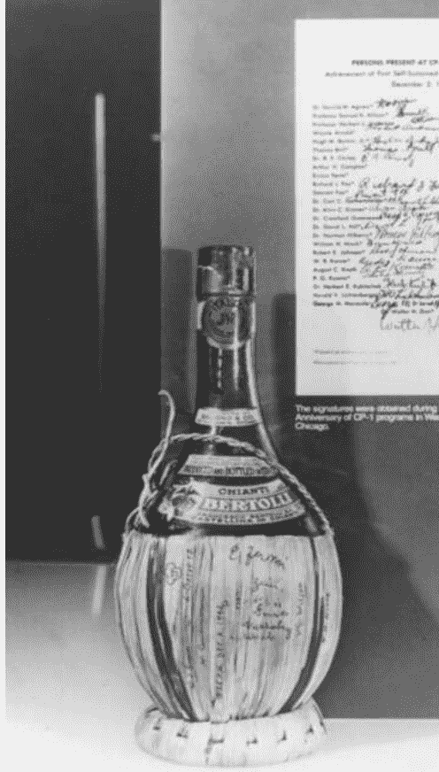

芝加哥首次链式反应现场物理学家签署的图表。（照片鸣谢：Argonne Laboratory）

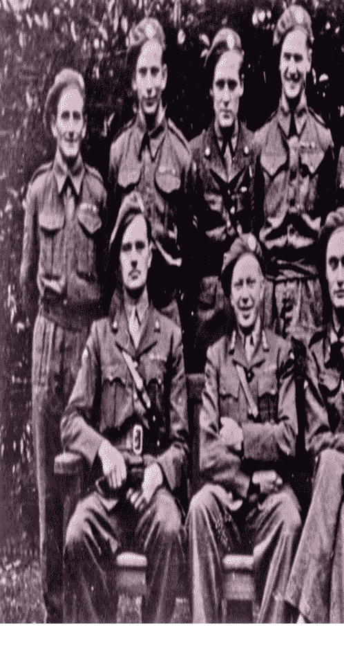

袭击挪威重水厂的突击队，包括约阿希姆·龙贝格（Joachim Rønberg，右一）。（照片鸣谢：挪威抵抗博物馆）


袭击中损坏的重水电池。（照片鸣谢：Norsk Industri）


在意大利的莫·伯格（Moe Berg）。背后的字写道：“罗马沦落后几天。我见过他任何制服的照片，”（照片鸣谢：普林斯顿大学图书馆，Moe Berg收藏）

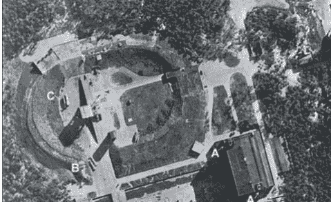

乔·肯尼迪二世驾驶的飞机型号，PB4Y-1解放者号。（照片鸣谢：美国国家档案馆与管理局）


佩内明德沃纳·冯·布劳火箭测试场的侦察照片。此处标记的细微分歧引发了英国情报部门内部的激烈争论。（照片鸣谢：NASA，540中队E. P. Peek士，PD-1996）

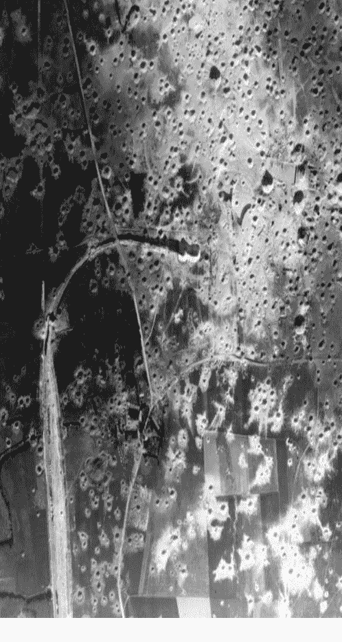

V-3高压泵（又名“忙碌的莉兹”）的草图。（照片鸣谢：英国政府，作者 T. R. B. Sanders）

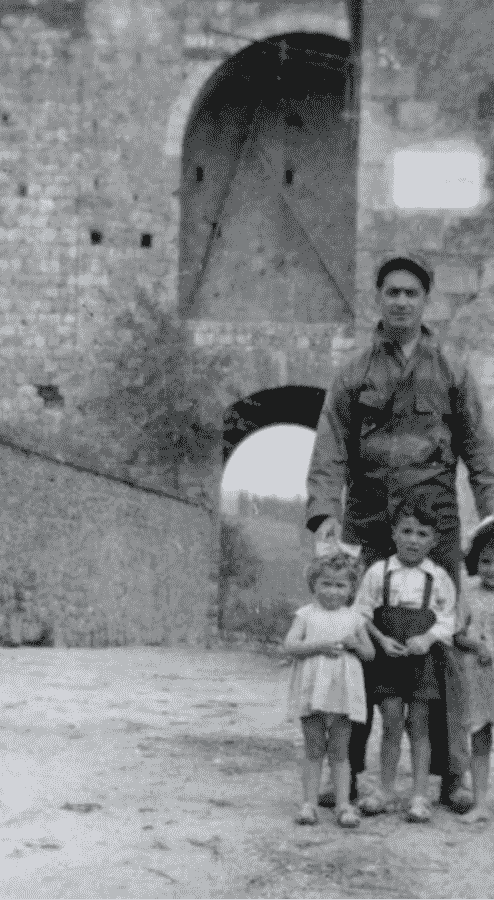

被炸弹坑严重破坏的维莫克周围景观。上方的扇形物体是混凝土地堡。（照片鸣谢：帝国战争博物馆）

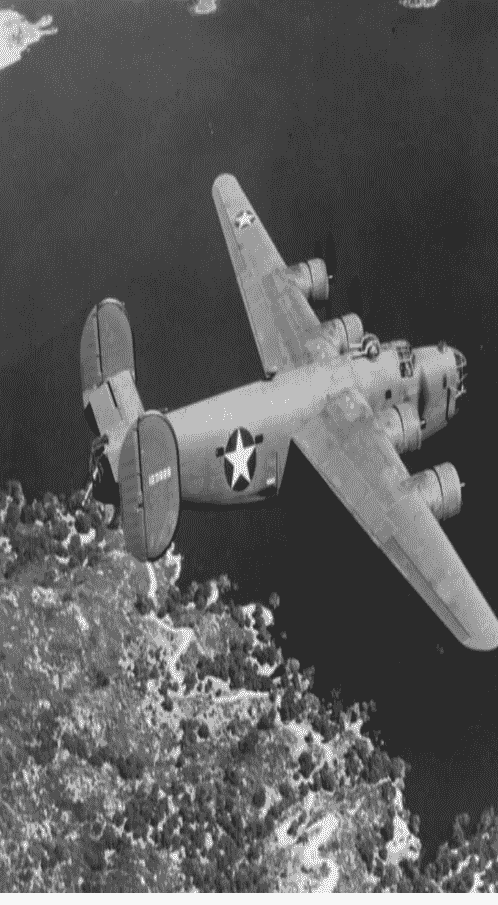

乔·肯尼迪二世最后的已知照片，摄于1944年8月12日。（作者 Earl P. Olsen）

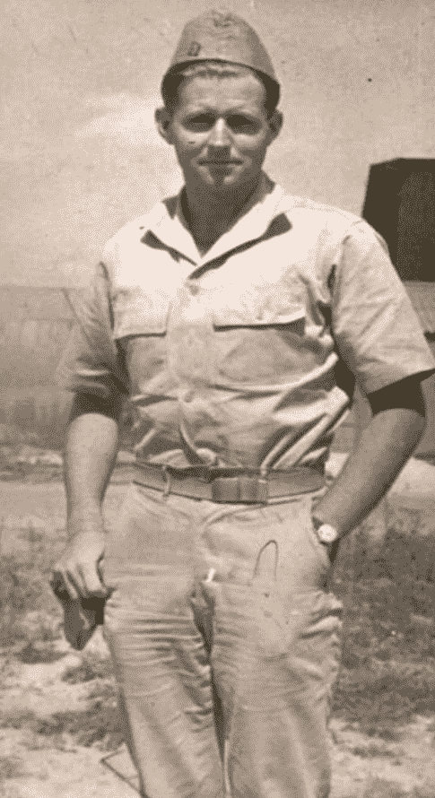

位于勒库斯特（L'Arcouest，又名科学港）的居里家族小屋。（照片鸣谢：居里博物馆，ACJC收藏）

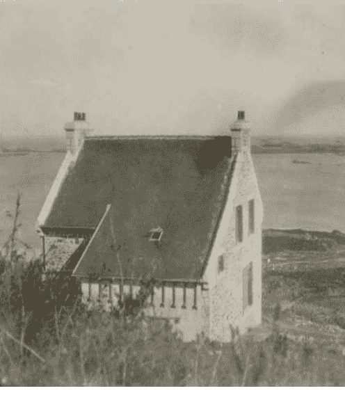

巴黎人向闪电-A先遣侦察队投了大量花，以至于波里斯·帕什（*左一*）说他们的汽车像玫瑰花游中的花车。（照片鸣谢：美国国家档案馆与管理局）

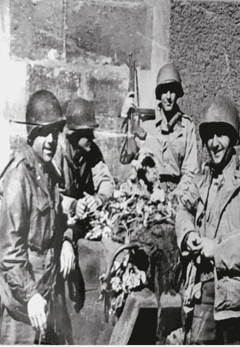

闪电-A侦察队收养了这只名为阿尔托斯（Altos）的小狗，作为他们进入巴黎的“吉祥物”（照片鸣谢：美国国家档案馆与管理局）

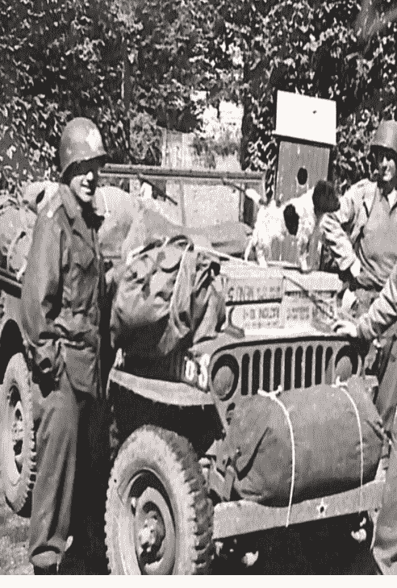

一张宣传Dorama放射性牙膏的小册。它承诺“双重防御牙齿敌人”。（照片鸣谢：Ridge Associated Universities, Inc.）

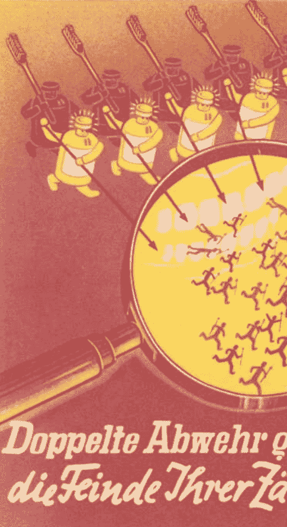

德国斯塔德海姆（Stadthelm）附近装甲车里的萨缪尔·高德斯特。（照片鸣谢：AIP Emilio Segré Visual Archives, Goudsmit收藏）

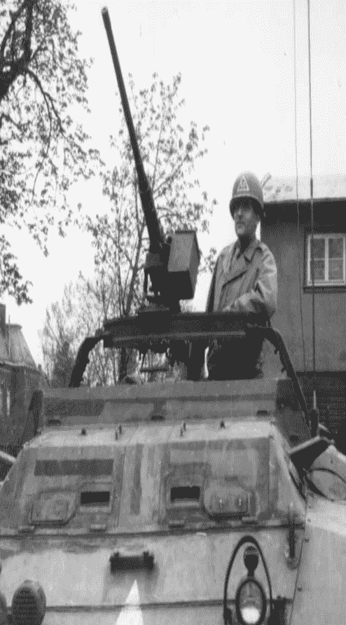

哈伊格洛赫“原子室”洞穴的外，曾存放纳粹最后的铀机器。（照片鸣谢：美国国家档案馆与管理局）

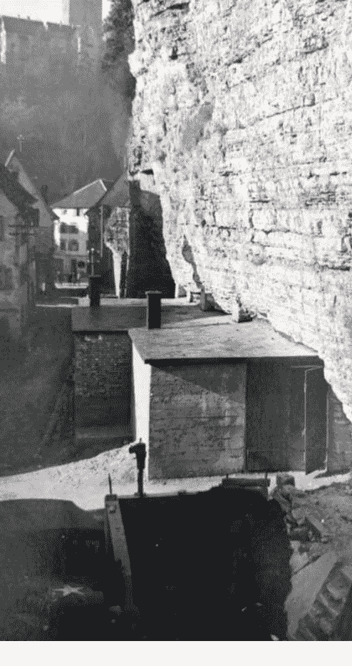

由于担心陷阱，阿尔索斯成员让德国战俘开始挖掘哈伊格洛赫外的铀俱乐部储备。插图：铀立方体。（照片鸣谢：美国国家档案馆与管理局）

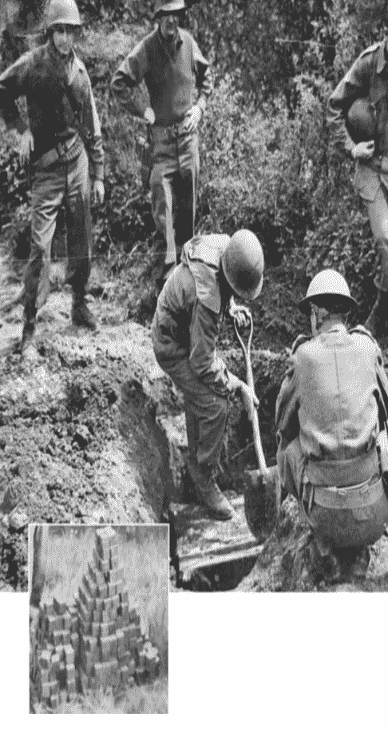

阿尔索斯成员拆解哈伊格洛赫“原子室”内的反应堆堆。（照片鸣谢：美国国家档案馆与管理局）

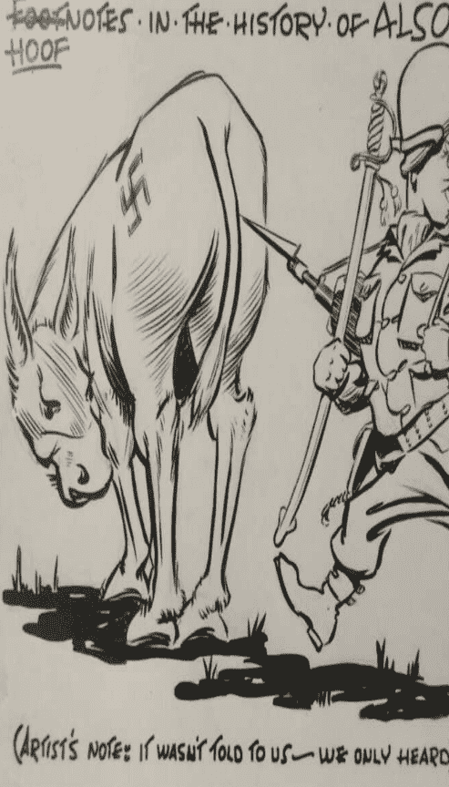

“纳粹驴子”的漫画，它在追捕维尔纳·海森堡期间踢了波里斯·帕什并折断了他的肋骨。（照片感谢由胡佛研究所提供，波里斯·帕什论文）

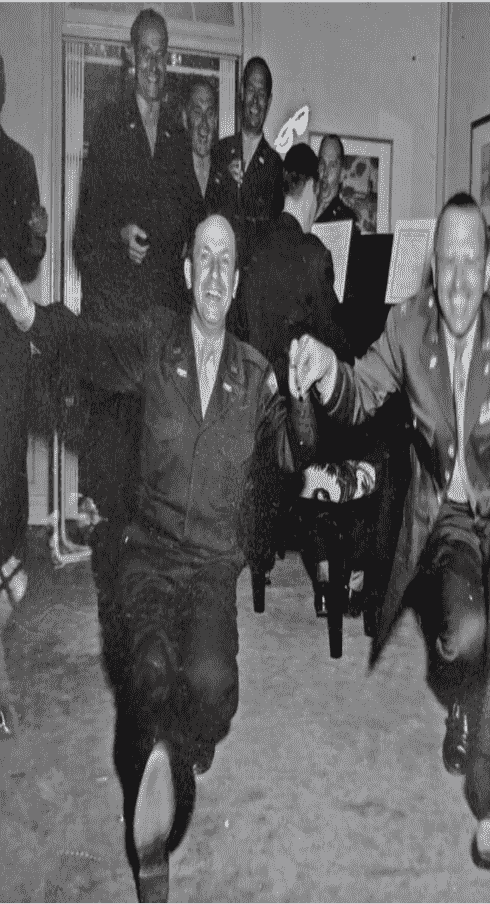

波里斯·帕什在庆祝欧洲战争结束的派对上尽情跳舞。（照片由美国国家档案馆和记录管理局提供）

# 感谢与额外奖励

我希望你喜欢《混蛋军》（The Bastard Brigade）以及书中那些鲜活的角色。如果你想了解更多关于这些混蛋的故事——或者只想读一些迷人且有趣的轶事，请查看我网站上的额外奖励材料：`samkaan.com/books/the-bastard-brigade/extras/notes/`。那里还有额外的照片，地址为：`samkaan.com/books/the-bastard-brigade/extras/photos/`

如果你深受感动，也可以在 `samkaan.com/contact` 给我写信。我喜欢听听读者的反馈……

# 致谢

这本书对我来说是一次突破，它需要比我以前做过的任何事情都要多的档案检索和历史研究。进入这个令人生畏的世界，如果没有几位人的支持，我永远无法完成。

首先，非常感谢全国所有的档案员和图书管理员，他们忍受了我不成体规范的问题以及对晦涩主题的模糊询问。他们是我能希望的最帮助的一群人。我特别感谢美国物理学会、普林斯顿大学图书馆、胡佛研究所、国会图书馆以及约翰·F·肯尼迪总统图书馆的工作。

一如既往，我对朋友和家人的感激无于言表。我的父母让和珍（[此处应为Gene]）一直支持我的写作，并让我保持心情愉快。我的哥哥也成为了一位伟大的朋友，我感谢他们和妮可尔对我的支持。我的姐姐多年来一直是快乐和爱的源泉；我期待很快能回到“肯之角”（Ken's Corner）。我希望我的书能带给我的内侄佩妮和外甥哈里同样的带给我的快乐。还有华盛顿、南达科他州以及世界各地的朋友们——其中一些我已经认识了数十年——你们让我头四十年变得非常精彩。我期待下一个四十年。

这是我与里克·布罗德德合作的第五本书，他一直是一个明智且警觉的代理。这也是我与亲爱的比尔·马里诺合作的第一本书（希望如此），他用精到的笔触指导了手稿。凯文·坎农在接到通知后很快提供了增强文本效果的插图。我还想感谢小布朗（Little, Brown）内部及周围所有参与本书及其他书籍工作的人，包括安娜·古德莱特、克里斯·杰罗姆和迈克尔·诺恩。

纸上的寥寥文字无法表达我的感激，如果我遗漏了名单上的任何人，我依然感激，尽管感到很尴尬——

# 发现你的下一本精彩读物

获取你喜爱的作者的预览、书籍推荐和新闻。

点击此处了解更多。


# 主要角色

**莫·伯格（Moe Berg）** – 前大联盟棒球捕手，后成为原子间谍。伯格就读于普林斯顿大学，会说（据人称）十种语言。作为一个神秘的人，他曾被称为职业棒球运动史上最古怪的人，这本身就说明了问题。

**缪埃尔·古斯米特（Samuel Gousmidt）** – 出生荷兰的美国物理学家，有着愤世嫉俗的幽默感。他的职业巅峰来得太早，余生一直觉得自己像个过气的科学家。除了追捕纳粹原子弹外，他还花时间在欧洲寻找他的父母，他们被卷入了集中营。在许多方面，他是此书的核心人物。

**维尔纳·海森堡（Werner Heisenberg）** – 历史上最天才的物理学家之一。为纳粹原子弹计划的“铀机器”工作，这让他的许多亲友感到愤怒。他是阿尔索斯任务（Alsos mission）的首要目标。

**弗雷德里克·约里奥·库里（Frédéric Joliot-Curie）** – 诺贝尔奖获得者物理学家，艾琳娜·约里奥·库里的丈夫。虽然是玛丽·库里的外孙，但他是核科学的先驱，在20世纪30年代遗憾完成了多项重大发现。最终在二战期间成为地下战士。

**艾琳娜·约里奥·库里（Irène Joliot-Curie）** – 诺贝尔奖获得者物理学家，弗雷德里克·约里奥·库里的妻子。纳粹的直言不讳者，尽管有时被外向的丈夫掩盖了光芒，但她是完全平等的科学家。

**乔·肯尼迪二世（Joe Kennedy Jr.）** – 海军飞行员，未来总统约翰·F·肯尼迪的弟弟。乔在二战期间的大部分时间都在法国海岸执行任务，以摧毁纳粹原子弹计划。

**波里斯·帕什上校（Colonel Boris Pash）** – 一位充满活力且有些鲁莽的士兵，拥有俄罗斯血统，在俄国革命期间在白军中战斗。他是阿尔索斯任务捕获纳粹原子弹成员的目标。

# 小角色

**埃多尔多·阿马尔迪（Edoardo Amaldi）** – 恩里科·费米的助手。

**尼尔斯·波尔（Niels Bohr）** – 传奇物理学家，纳粹政权的勇敢批评者。在二战期间与海森堡发生过严重分歧。

**瓦尔特·伯恩（Walther Born）** – 德国物理学家，他的实验说服了铀俱乐部（Uranium Club）使用重水。后来在柏林工作。

**迪克·科斯特（Dick Coster）** – 荷兰物理学家，曾帮助米特纳逃亡。后来在集中营中追踪了他的父母。

**库特·哈恩（Kurt Hahn）** – 德国物理学家，被铀俱乐部视为一个可怜的失败者，尽管他是一个充满活力的科学家。

**威廉·“比尔”多诺万（William "Bill" Donovan）** – 战略情报局（OSS）局长，CIA的前身。

**恩里科·费米（Enrico Fermi）** – 胜利的理论和实验物理学家。出生于意大利，移民美国，在芝加哥产生了世界上第一次核链式反应。

**莱斯利·格罗夫将军（General Leslie Groves）** – 曼哈顿计划的强势负责人。

**奥托·哈恩（Otto Hahn）** – 德国化学家，米特纳的科学伙伴。他们的工作让世界注意到了这个危险的敌人，哈恩自己。

**莉泽·米特纳（Lise Meit）** – 奥地利物理学家。逃离柏林后，她在斯德哥尔摩度过了一生，却从未获得过功劳。

**罗伯特·奥本海默（Robert Oppenheimer）** – 儒雅的物理学家，领导了阿洛哈姆实验室。由于他支持共产主义的长期历史，与波尔发生过冲突。

**保罗·罗布（Paul Robb）** – 科学编辑，促成了哈恩第一篇论文的出版。致力于盟军。

**维尔纳·冯·布朗（Werner von Braun）** – 德国工程师，设计了致命的V型火箭。后来成为阿波罗登月计划的推动力。

**卡尔·弗里德希·冯·魏泽克（Carl Friedrich von Weiszäcker）** – 贵族德国外交官，纳粹原子弹计划和海森堡的好友。

# 来源

在编写《混蛋军》时，我咨询了数千本书、文章和原始文献——多到无法列举。以下列表仅包含最重要的，随后是证明至关重要的档案和图书馆。

## 书籍

- 《Age of Romance: The Epic Rise and Fall of the Atomic Era》，Craig Nelson, Scribner, 2015

- 《Alsos》，Samuel Goad, Tomash, 1947 (1993)

- 《The Alsos Mission》，Boris Pash, Carver, 1960

- 《American Prometheus: The Triumph and Tragedy of J. Robert Oppenheimer》，Kai Bird and Martin J. Sherwin, Knopf, 2005

- 《Aphrodite: Desperation》，Jack Olson, Putnam, 1970

- 《Before the Fallout: From Marie Curie to Hiroshima》，Diana Preston, Walker Books, 2005

- 《Beyond Uncertainty: Heisenberg, Quantum Physics, and the Bomb》，David C. Cassidy, Bellevue Literary Press, 2006

- 《Blood and Water: Against Hitler》，Da Kurzman, Henry Holt & Company, 1997

- 《Bigger than Thou: A Personal History of the Atomic Scientists》，Robert Jungk, Mariner, 1970

- 《Brotherhood of the Bomb: The Tangled Lives and Loyalties of Robert Oppenheimer, Ernest Lawrence, and Edward Teller》，Greg Herken, Herken, 2001

- 《The Catcher Was a Spy: The Mysterious Life of Marie Berg》，Nicholas Davidov, Vintage, 1995

- 《The Bomb-Disposing Earl: Jack Howard and Bomb Disposal in WW2》，Kieran Freeman and Sword, 2015


# 参考书目

- 《Dark Sun: The Making of the Hydrogen Bomb》，Richard Rhodes, Simon & Schuster, 1996
- 《The Deadliest Colony》，Thomas M. Moon, Vintage, 1975
- 《Devotion to Science: Pioneers of Radioactivity》，Marlene F. Ray-Canham and Geoffrey W. Rayman, Chemical Heritage Foundation, 1997
- 《Donna: America's Spirit》，Richard Rhodes, Sky Publishing, 2014
- 《First World Physics: The History of the Atomic Bomb, 1939–1949》，Jim Bagcott, Pegasus Books, 2011
- 《The Fitzgeralds and the Kennedys: An American Saga》，Doris Goodwin, 1991
- 《Frédéric Joliot-Curie: A Biography》，Maud Laurence, Wishart, 1977
- 《Frédéric Joliot-Curie: The Man and His Theories》，Pierre Briard and Geoffrey Strauss, Femaker, 1968
- 《German National Science and the Quest for Nuclear Power》，Mark Walker, Cambridge University Press, 1993
- 《好莱坞高中》，John Blumenthal 著，Ballantine Books 出，1988年
- 《莉泽·梅特：物理学一生》，Ruth Lewin 著，加利福尼亚大学出版社，1997年
- 《最后的命运：乔·肯尼迪二世与拯救伦敦的二战任务》，Alan Axelrod 著，St. Martin's Press 出，2005年
- 《最后的王子：小乔，被遗忘的肯尼迪：长子故事》，Hank Sears 著，World Publishing Company 出，1969年
- 《原子弹的制造》，Richard Simon 著，Schuster 出，1987年
- 《曼哈顿：反对原子弹的战争》，Vincent C. Jones 著，美国陆军军事史中心，1985年
- 《马厩：反对希特勒秘密V型武器的战争》，David Irving 著，Panther Press 出，1985年
- 《玛丽·居里：一生》，France Girard 著，Holmes and Holter 出，1986年
- 《玛丽和她的女儿们：科学第一家族的私生活》，Shelley Emily 著，St. Martin's Griffin 出，2013年
- 《更伟大的：运动员、学者》，Louis Kaufman, Barbara Fitzgerald 和 Tom Seward 著，Little 出，1974年
- 《最机密的战争》，R. V. Jones 著，2009年
- 《现在可以了：曼哈顿计划的故事》，Leslie Groves 著，Da Capo Press 出，1983年
- 《间谍与计谋》，Stanley P. French 著，Prentice-Hall 出，1963年
- 《大象行动：制造原子弹的竞赛》，Colin Brown 著，Amberley Publishing 出，2016年
- 《新鲜行动：瑞凯尔姆的热能水波》，Richard Waggard 著，Harrington, Harper-Collins 出，1969年
- 《第二次世界大战期间在国家公园及海外事务的 OSS 训练》，John White Chambers II 著，美国国家公园管理局，2008年
- 《物理学及其他：相遇与对话》，Werner Heisenberg 著，Harper & Row 出，1972年
- 《物理科学：社会选编》，Klaus Hentschel 等人著，Birkhäuser 出，1996年
- 《对绝对安全的追求：美国能源机构之间失败的关系》，Anthan Sheehan, Ivan R. Dee 著，2007年
- 《原子弹中的红间谍：冷战的秘密与防御》，Katherine A. Willey 著，堪萨斯大学出版社，2004年
- 《罗伯特·奥本海默：处于中心位置的一生》，Ray Monk 著，Random House 出，2012年
- 《原子弹的秘密历史》，Robin McKeown 著, Bethany Brown 著，Dual Books 出，1997年
- 《她为服务热爱》，Julian Messner 著，1962年
- 《原子弹间谍活动：从德国到伊朗和朝鲜的原子情报》，Jeffrey T. Tapping 著
- 《将领：秘密对话的秘密 1942-45》，Sonke Neitzel 著，Frontline Books 出
- 《研究与联合反措施》，David Irving 著，Kimber 出，1967年
- 《威尔·希克森：开创了 OSS 和现代美国间谍活动的间谍大师》，Douglas Waller 著，Free Press 出，2012年
- 《冬季堡垒：破坏希特勒原子弹的史诗任务》，Neal Bascomb 著，Mariner Books 出，2017年

# 档案馆与图书馆

- 美国物理史，Samuel Gouldsmith 收藏，马里兰州大学公园市
- 美国犹太历史学会，纽约州纽约市
- 加利福尼亚理工学院档案馆，加利福尼亚州帕萨迪纳市
- 哥伦比亚大学，莫埃·伯格论文，纽约州纽约市
- 丹麦国家档案馆，哥本哈根，丹麦
- 胡佛研究所，波里斯·帕什论文，加利福尼亚州帕洛奥尔托
- 爱荷华州州立大学档案馆，爱荷华州
- 约翰·F·肯尼迪总统图书馆，波士顿，马萨诸塞州
- 美国国会图书馆，华盛顿特区
- 洛杉矶公共图书馆档案馆，加利福尼亚州洛杉矶市
- 马萨诸塞理工学院档案馆，马萨诸塞州剑桥市
- 军事记录，国家档案和记录管理局，密苏里州圣路易斯市
- 国家档案和记录管理局，马里兰州斯普林斯市
- 纽约公立图书馆，纽约州纽约市
- 俄勒冈州立大学档案馆，科瓦维斯
- 普林斯顿大学，莫埃·伯格论文，新泽西州普林斯顿
- 理查德·M·尼松总统图书馆，加利福尼亚州约尔巴林达市
- 洛克菲勒研究所档案馆，纽约州斯利普霍洛
- 科学历史协会（原化学遗产基金会），宾夕法尼亚州费城
- 斯坦福大学档案馆，加利福尼亚州帕洛奥尔托
- 加利福尼亚大学圣地亚戈分校档案馆，加利福尼亚州圣地亚戈
- 芝加哥大学档案馆，芝加哥，伊利诺伊州
- 密歇根大学本特利历史图书馆档案馆，密歇根州安诺堡市

# 关于作者

**Sam Kean** 是《纽约时报》畅销书作者，代表作有《凯撒的最后呼吸》、《对决神经外科医生的故事》、《消失的勺子》和《小提琴手的拇指》。《凯撒的最后呼吸》被《卫报》评为2017年年度最佳科学书。《消失的勺子》曾获得2010年伦敦皇家学会年度图书亚军，《小提琴手的拇指》和《对决神经外科医生的故事》分别入围2013年和2015年的 PEN/E. O. 威尔逊文学科学写作奖，以及 AAAS/Subaru SB&F 奖。Kean 编辑了2018年版的《美国最佳自然与科学写作选》，他的作品曾发表在《纽约人》、《大西洋月刊》、《纽约时报》杂志、《心理学今日》、《Slate》、《Mental Floss》等出版物上。他还曾出现在 NPR 的《Radiolab》、《All Things Considered》、《Science Friday》和《Fresh Air》等节目中。

# Sam Kean 的其他作品

- 《凯撒的最后呼吸》
- 《对决神经外科医生的故事》
- 《消失的勺子》
- 《小提琴手的拇指》

# 目录

| 章节 | 内容 |
| :--- | :--- |
| 封面 | |
| 目录 | |
| 版权 | |
| 扉页 | |
| 作者的话 | |
| 序言 | |
| **第一部分：1938年** | |
| 第一章 | |
| 第二章 | |
| 第三章 | |
| 第四章 | |
| 第五章 | |
| 第六章 | |
| 第七章 | |
| **第二部分：1939年** | |
| 第八章 | |
| 第九章 | |
| 第十章 | |
| 第十一章 | |
| 第十二章 | |
| 第十三章 | |
| 第十四章 | |
| 第十五章 | |
| **第三部分：1942年** | |
| 第十六章 | |
| 第十七章 | |
| 第十八章 | |
| 第十九章 | |
| 第二十章 | |
| 第二十一章 | |
| 第二十二章 | |
| 第二十三章 | |
| 第二十四章 | |
| **第四部分：1943年** | |
| 第二十五章 | |
| 第二十六章 | |
| 第二十七章 | |
| 第二十八章 | |
| 第二十九章 | |
| 第三十章 | |
| 第三十一章 | |
| 第三十二章 | |
| 第三十三章 | |
| 第三十四章 | |
| **第五部分：1944年** | |
| 第三十五章 | |
| 第三十六章 | |
| 第三十七章 | |
| 第三十八章 | |
| 第三十九章 | |
| 第四十章 | |
| 第四十一章 | |
| 第四十二章 | |
| 第四十三章 | |
| 第四十四章 | |
| 第四十五章 | |
| 第四十六章 | |
| 第四十七章 | |
| 第四十八章 | |
| 第四十九章 | |
| 第五十章 | |
| **第六部分：1945年** | |
| 第五十一章 | |
| 第五十二章 | |
| 第五十三章 | |
| 第五十四章 | |
| 第五十五章 | |
| 第五十六章 | |
| 第五十七章 | |
| 第五十八章 | |
| 第五十九章 | |
| 第六十章 | |
| 第六十一章 | |
| 第六十二章 | |
| 第六十三章 | |
| 第六十四章 | |
| 结语：1946年及以后 | |
| 照片 | |
| 感谢与额外 | |
| 致谢 | |
| 发现更多 | |
| 主要人物 | |
| 配角人物 | |
| 来源 | |
| 关于作者 | |
| Sam Kean 的其他作品 | |
