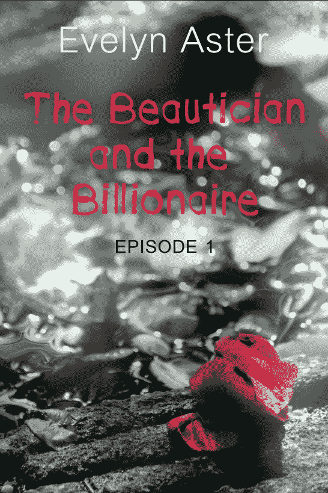
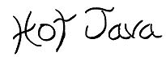
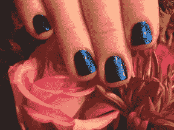
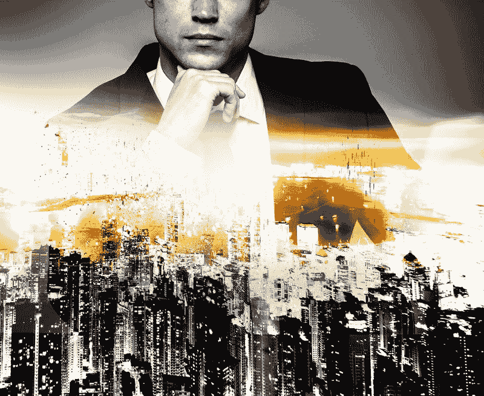
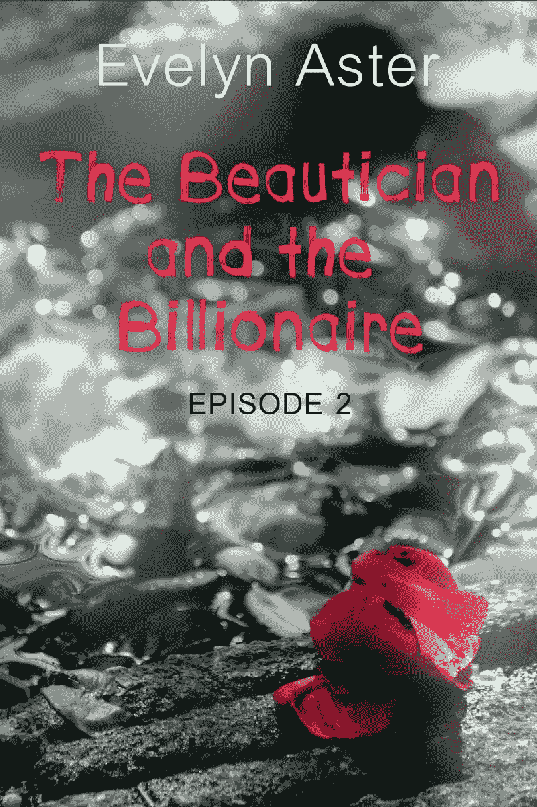
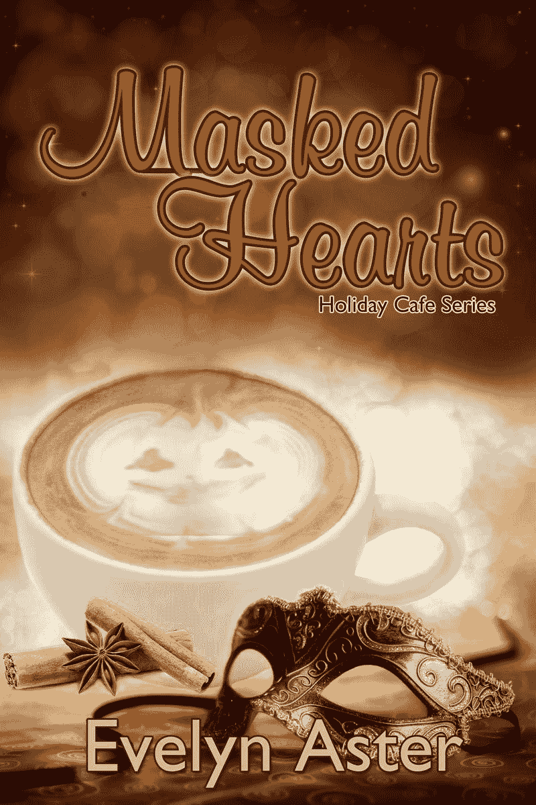

# 美容师与亿万富翁 · 第一集 · 交易

## 第一章

### 交易

***

evelynaster@aol.com

## 谢谢

感谢我的 Hot Java 团队帮助我完成了这次创作。这过程很有趣！同时也感谢 Adoro 的 Christine Marie Sanchez 和 Julie Schober Photos。

### 说明

这是一个连载故事，每集大约 10,000 字。它首次出现在我的博客上，所以我保留了之前使用的图片并添加了新的。每个月发布一个新章节，直到故事结束。祝阅读愉快！

***

## 1| 康纳（Conor）

[Can Stock Photos]

阳光射入纽约某摩天大楼 36 层的角的办公室。康纳·格里辛（Conor Grishin）在会议开始前关掉了空调，看着罗伊·拉鲁奇（Roy LaRouche）手指滑过领口，扯着领带。谈判即将变得有趣了。

罗伊说：“船的路线已经经过董事会批准——”

“但那是你的建议。一个月内有三艘船被海盗劫持，不仅看起来很难看，对公司来说也是巨大的损失。”

罗伊松开领带时，荧光灯在他光秃秃脑门上闪烁。“我们只确定有两艘。第三艘——”

“很可能也被被海盗劫持了。你让我损失了数大笔钱。”

罗伊肥厚的手指终于松开了领带。他跳了起来，把领带从领口处扯出来扔在桌子上。“这他妈的房间怎么这么热？你完全可以把那该死的空调公司买下来，让他们的维修工随时待命，真妈的。这比在这儿跟我纠结我的那些船要更有时间利用价值。我也亏了钱，你知道吗。”

康纳将手掌按在桌面上，张开手指。冷静的掌控让他赢得了第一个十亿。尽管在围捕猎物时他的脉搏加速了，但他知道自己表现得足够淡定。“你不再是你公司的大股东了。也许是你发起的，但现在我拥有它。你欠我那些丢失的船的补偿。”

“我欠你的并不比我欠其他股东的多。这种破事会发生。我会在明年把损失的货物补回来。”

“你现在就得补偿我，否则我就收购你的股份。我不认为你想被按按现在的股价出售。”

罗伊瘫回椅子上。汗水顺着他的脸两边流下，他的脸红得像康纳在汉普普顿庄园里盛开的玫瑰一样。

如果康纳真的动怒了，他会直接开除罗伊完事了，但尽管面临目前的亏损，罗伊仍然是个出色的 CEO。康纳真正想要的不是钱——而是艺术。罗伊拥有一幅康马里特（Magritte）的作品，康纳非常想收藏。他计划为了这幅画进行谈判。

他盯着罗伊，眨了一下眼睛。他想先看看罗伊能提供什么。在另外一次交易中，他因为说话太快而错过了奥基（O’Keeffe）的作品。

“你认为对于你造成的股价下跌，什么样的交易才公平？”

“妈的，我没有那种流动资产。”

“我有的是钱。”

罗伊的眼睛睁大了。他把手伸进口袋，掏出最新的智能手机。

康纳收藏艺术品并不是什么秘密。他看着罗伊轻点屏幕，预料会看到来自罗伊那规模小得多但非常有品味的收藏品。

但多年年来第一次，惊喜给了他一记。屏幕上显示的不是画，而是一个女人对着康纳微笑。

“这是我的大女儿，玛丽（Marie）。她正是你这样一个年轻大亨所需要的。无论你去哪里，都可以让她挽着你的手臂。从你妻子去世已经过去三年了吧？玛丽会帮你走出阴影。”

康纳想把手机摔碎，把碎片插进罗伊的屁股。他讨厌别人提起艾莉丝（Elise）。要么带着同情，要么给出如何走建议。他这两者都不想要。他直视罗伊。“你在卖你的女儿？”

“不！完全不是。她好几次无意中提到过对你感兴趣。我是在做媒合，不是在卖她。看看她。她喜欢旅行和滑雪——”罗伊在手机屏幕上滑动了几次，向康纳展示他女儿在欧洲各地的自拍照——埃菲尔铁塔、帕特农神庙，甚至是莫斯科广场。她美得像杂志封面一样。

罗伊滑到另一个女人的照片。她眼神温顺，棕色头发从脸颊散开，皮肤细腻纯净——比玛丽的瓷质皮肤更有健康色。

罗伊忘了马里特画的事。

“那是谁？”康纳不喜欢自己声音的沙哑。

“什么？”罗伊抬起手机。“噢，抱歉。那是查丽丝（Charisse）。”

康纳从罗伊手里接过手机，将屏幕滑回玛丽。他猜不出照片是在哪里拍的，她似乎蜷缩在软垫扶椅上。她看起来很难过，带着很深层的情绪，不只是今天过得不好。自己的忧伤触及了她的忧伤，并莫名地想要尽一切办法让她开心。

“你不想要她。”罗伊的声音打破了康纳的思绪，让他差点跳了起来。“她是我最小的女儿，不喜欢富名流的生活。她只是喜欢服务他人。”

“你什么意思？”尽管不想，他还是把目光从查丽丝的照片上移开。

“查丽丝做什么的？”

罗伊叹了口气拿回手机。“她是个美容师。她靠打理别人生活。”

“她是为谁工作吗？”

罗伊在回答前略微迟疑了一下。“我想她是为我工作。我是她的房东。她坚持要付房租。我本可以免费给她空间，但查丽丝不行。她必须自己闯一条路。”

“所以你拥有她工作的建筑建筑？”康纳问。

“呃，是的。”

又是迟疑。罗伊在某些事情上撒了谎。

“她的美容店叫什么名字？”

沉默是他的回答。他转回椅子。罗伊对他皱了皱眉。这是一种奇怪的父爱保护：把自己的大女儿卖掉，却唯独不卖夏莉丝（Charisse）。康诺自责道。他并不想买她。但他可以买下那栋楼，而且如果她工作能力够强，就可以成为他的新造型师。他不喜欢最近头发的感觉。太干了，还是怎么的。

最后，罗伊开口道：“是玛夏莉丝（Ma Charisse）。”他的声音柔和了，“这是对她名字的双关语，我的宝贝。”

康诺咬紧牙关，试图平息血液中的涌动。他想再次看一眼她的照片，看看她的美色。不。他要去查看她的店和那栋楼，而不是她本人。

“在哪栋楼里？还有什么其他的？”

“该死，我不知道其他店的情况。我雇了别人来处理租赁合同。”

“是哪栋楼？”

两个男人面面相，康诺知道罗伊不想让他靠近夏莉丝。这了什么鬼？她的工作真的那么让他感到丢脸吗，还是说有别的什么？

最后，罗伊给了他一个`西 16 街（West 16^(th) street）`的地址。

康诺用尽了练过的克制才保持了冷静。他拥有那栋楼。罗伊在租赁合同上撒了谎。他还撒了什么谎，又为什么？他知道一点：罗伊只会给他更多的谎。起初只是对一幅画的简单追求，现在已变得引人入胜得多。

“我会看看那栋楼。如果我喜欢，我就用它来抵消股票的损失。”

“一整栋楼？那可比我赔给你的贵得多。”

确实如此。康诺享受看着罗伊局促不安的样子。他讨厌被欺骗。他会观察一段时间，然后要求要那幅马里特（Magritte）和另一幅画，以此补偿罗伊掩盖的任何烂事。

“你完全可以把剩下的股票卖给我。”

罗伊站起身，推开椅子。“离夏莉丝的沙龙店远点。你去那里是为了楼，不是为了我女儿。”

“是你先提出用你的大女儿来换取货物损失的，不是我。”

罗伊憋嗦着吐了几句咒骂，转身大步走出办公室，随手关上了门。

康诺叫来助理去查询该房产并确认其所有权。他只记得在`西 16 街（West 16^(th)``拥有一栋，确定就是那一个。他的助理回了电说他是对的。他把店地址发给了司机。是时候去见见夏莉丝，看看他是否能弄明白罗伊为什么要对她的生意撒谎了。

## 2 | 夏莉丝

### 克里斯汀·玛丽·桑切斯美甲设计

咖啡的香气与玛夏莉丝使用的洗发水和护发水的香草香气诱人地混合在一起。夏莉丝为顾客按摩头皮上的洗发水，她轻吸了一口气道：“我懂，吧？”

“我的意思是，她怎么可能觉得开着我丈夫的法拉利去兜风，就像她在那个该死的《费里斯·布勒假期》里那样是个好主意呢？”塔雅（Tanya）说道，在空中挥动着红色的指甲，像是一个愤怒的小火花。

“我不敢相信她竟然会尝试那种事。去年她还是个好学生呢。”

“不是吗？永远不要孩子。孩子只会让你疯掉。”

尽管她继续洗着头，夏莉丝子宫的一阵绞袭来来去去——那是对她去年流产的提醒。她抿住嘴，压制住向客户倾诉的欲望。顾客来不是为了听她的问题的。她们是来讲述她们自己的问题的。“我要给你冲头了。我听不见水声，所以稍等一下。”

她拉出喷头并按下开关。至少现在一提到孩子，她的眼睛里不再流出泪来。她以前真是个软蛋。

夏莉丝为塔雅洗了头，涂了护发素并再次冲洗。塔雅喋喋不断的聊天让夏莉丝没有陷入太深的阴郁。她引导塔雅走向她的座位，全程都在听更多关于那个叛逆女儿的故事。

镀金的线框反射着沙龙中心水晶吊灯的光芒，让夏莉丝脸上露出一丝微笑——在这里，她是成功的。六把奶油色的沙龙理发椅，每边三把，带有鸢尾花图案，此刻都坐满了顾客，当然，除了她的那一把。每把椅子后面都站着一位造型师，或者用她对那些工作的女性的称呼“女士们”，她们对顾客说的任何话都热烈点头。有一张古董办公桌守在前面，由一个 19 岁的女孩负责，她一只手拿着手机贴耳朵，另一只手在电脑上点击日程程序。

她的沙龙是完美的。

夏莉丝撇开了关于流产的记忆。尽管个人生活中经历了悲剧，她还是让“玛夏莉丝”变成了一家新秀的沙龙。她打算一直保持现状。沙龙处于上升期，总比过了巅峰期要好。

“我确定你的孩子会好的。他们爱你的。它们可能在二十五到三十岁之间才会意识到这一点。”

“你自己可能也就二十五岁左右。那是你决定你妈妈还好的时候吗？”

夏莉丝走向柜台拿起剪刀和梳子。避开个人问题，她背对着塔雅，脸避开了镜子。“我一直是我爸爸的女孩，但只是因为妈妈在我小时候就消失了。”

“你需要染一下根吗？我今天早上看到白发了。”夏莉丝用手指理过塔雅的头发。“不，不。你上周染过。如果你这周再染，你的头发会变成一团糟糟的。”

“发生什么了？你还好吗？被抢劫了吗？”玛莉丝推开门大道进来，伴随着门铃的当响。风吹了进来，让吊灯的水晶晃动，倒影在墙上跳动。

“你在说什么鬼？”夏莉丝问。

玛莉丝从她的普拉达包里掏出戴着宝石外壳的智能手机。“爸爸说现在就过来。他说很紧急。”玛莉丝穿着古驰高跟鞋在地瓷砖上走过去。

夏莉丝给了她的第一个员工莉提一个哀求的眼神，意思是“请回去工作。”

莉提转过头面对客户开始喋喋不已。其他造型师很快也跟了上来。

Charisse 的剪刀剪得更快了。偶尔稍微礼貌地请求一下又不会害死 Marie。Charisse 并不介意帮姐姐理发，但 Marie 总是认为她会这样做。

Marie 走向候候区坐下，在走到垫子的一半时僵住了。“噢，我的天呐。真不敢相信。康纳·格里辛（Conor Grishin）刚下车。”

Tanya 站起身转身面向窗户。Charisse 差些剪到了她的头皮，但好在及时移开了剪刀。她把剪刀和梳子放进围裙口袋，转过头发现理发店里的所有人都在盯着窗外。

她叹了口气。她甚至没有看窗户一眼，而是从柜台上拿起一瓶水开始喝。当整个店都在目睹她父亲的相亲努力时，所有的造型工作都要暂停。看起来 Marie 似乎和曼哈顿的一半 CEO 都约过会，无论他们的年龄大小。她不知道爸爸为什么这么急于把 Marie 嫁出去。Marie 对这种婚姻制度毫无兴趣。

但亿万富翁是一个新高度。也许他会令 Marie 爱得神迷颠倒，从此他们幸福地生活在一起。

“噢天呐我的天呐我的天呐，”Marie 在胸前局搓着手说道，“我今天看起来像个鬼。你能在五秒钟内帮我修好妆吗？”

Charisse 把水瓶放回柜台，发出了姐姐般的笑。Marie 的黑色长发被打理得完美无缺，她的珠宝有点显眼，但这就是 Marie 的风格。她的薄丝吊带心为里面的实心背心增添了优雅，牛仔裤是名牌，剪裁很好，非常衬她的长腿。

Charisse 走过去抱了抱姐姐。“冷静点。你美极了。他很快就会爱上你，而且很可能是那个说服你尝试婚姻的人。”

Tanya 说：“你看起来棒极了。你爸爸是在给你介绍康纳·格里辛 吗？”

“噢，谢谢你们。你们人都太贴了。”Marie 像防晒霜吸收白皙皮肤一样吸收着所有的赞美。“那一定是爸爸说的那个‘紧急情况’。你早早认识他吗？” Marie 转向 Charisse。

Charisse 耸了耸肩。“你更了解他的社交圈。”

“他过来了！”接待员尖叫道。她跑回座位，这似乎是所有人回到原位的信号。Tanya 坐了回去，Charisse 转动了椅子，这样只要 Marie 站在原地，Tanya 就能通过镜子看到发生了什么。

Marie 深吸了几次气。Charisse 继续修剪 Tanya 的头发。只有当门上的铃铛作响时，Charisse 才意识到，她爸爸让康纳·格里辛来见 Marie 这件事很奇怪。他尽可能想把妈妈 Charisse 留个秘密。他认为做发型师太低她的身份了。

接待员开始说些什么，但被 Marie 打断了她：“康纳·格里辛？终于见到你真好。我是 Marie·拉鲁奇（Marie LaRouche）。我相信是我父亲派你来这儿。”

在镜子里，Charisse 看到 Marie 伸出手想握手。她看不到康纳，但 Marie 的手空留在空中太久了。她蔚蓝色的甲油随着她伸手的时间延长，似乎变得颜色深了。他怎么敢那样冷落她的姐姐，尤其是如果他还是被安排来相亲的？最后，Charisse 看到一只手伸了出来，手腕覆盖着贵的袖扣。

当他们握手时，康纳说道：“是的，你父亲叫我来的。但我我是来和 Charisse 说话的，不是你。”

他说想和 Charisse 而不是 Marie 说话时，仿佛理发店所有人共同屏住了呼吸。但 Charisse 没有听到，因为他叫她名字的方式，就像她想象中法国男人在情人耳边呢语一样。

Marie 破了魔咒：“Charisse？她跟这有什么关系？”

“你父亲说她能给我剪一个很好的发型。”

仅仅是因为她有经验，Charisse 才没有让剪刀直接掉在 Tanya 头上。她在转身之前，成功地把剪刀放进了围裙口袋。

噢。我的。天。凭着法国所有国王之名，他太帅了。杂志封面根本体现不出他的魅力。他深邃的五官为他那双犀利的蓝宝石眼睛提供了完美的构图。她本该说他是完美的，除了她讨厌他的头发。他留的是一种很流行的款式——顶部短但滑稽的背头头，就像《西装精英》（`Suits`）里的哈维·史派特一样。

但她忽略了他的头发，因为他的眼神中带着惊讶，仿佛他发现自己也被她吸引得和他一样。

接着她眨了眨眼。

他眼中的欲望消失了，取而代之的是冷静的商务表情，她想起自己为什么发誓永远再也不和穿西装的人约会了。

她希望自己有这种如此快速变得冷酷的能力，但这种红晕产生的能量转化成了紧张。理发店里的所有人都在看着她。她讨厌在四超过四个人的情况下说话，实际上她只有一对一时最自在。她老爸为什么要送他来这里？

意识到大家都在等她说话，她说：“我是 Charisse。我，嗯，现在有一位客人。如果你愿意坐坐下来跟我姐姐聊天，我很快就来。”她试图在声音里强装自信，但听起来是断断续续且刺耳的，并不流畅。

“我很乐意等，”Tanya 站了起来，“我没什么重要的事。”

感觉理发店里的每个人都在盯着她。那些视线变成了一股实实在在肩膀上的重量，压垮了她所有的自信。

Marie 说话了，将深色的头发从脸上拨开滑到肩后。这是一个 Charisse 见过很多男人为此垂口水的动作，但康纳连 Marie 都没有看一眼。

Charisse 皱起眉。她讨厌别人对她的家人无礼。

她扬起下巴说：“你的发型让你看起来像个傻逼。”

## Julie Schober 照片

玛丽发出了像猫卡住脖子一样的局促声。夏莉丝对姐姐的辩护转如闪电，瞬间变成了对侮辱客户的羞愧。她没敢环顾沙发店的四周。她确定所有人都在盯着她看。“真的非常抱歉，格里辛先生。女士们都很喜欢男士这种发型。只有我这样。我确定玛丽说得对——你一定拥有纽约最棒的发型师。”

康纳似乎对她的无礼无动于色。事实上，他的职业脸孔已经转为了好笑。“我不确定这个了。让我们看看你怎么给我剪头发吧。”

夏莉丝目大口呆地，惊讶于他竟然还想让她给自己造型。她强迫自己进入工作模式，将毛巾围好在他脖子上，并塞进他松散披在肩上的围斗下面。她用力抖了一下围斗，说道：“请跟我去洗头池。”

她依然没有环顾沙发店，而是领着他走向更隐蔽的后方区域。至少在这里会是一对一的——没有玛丽，没有塔雅，也没有其他女性盯着看和偷听。

倾听……也许她可以让他开口。除了造型，倾听是她最擅长的事。她需要回到状态。

她翻遍脑海，试图回忆玛丽告诉过她关于他的事。夏莉丝关注名人八卦，但她并不关注商界，至少现在不再关注了。没有什么特别引人注目，除了他的妻子在几年前去世了。那绝对不是一个好的开头的话题。她应该就从今天所了解的情况开始。

“所以，你是怎么认识我父亲的？”

“我拥有他的公司。”

他们靠近洗头池，在隔开沙发店的产品架后面。夏莉丝转过身来。“你就是去年把他买掉的那个混蛋？”

夏莉丝猛地捂住嘴巴。她到底是怎么了？尽管她听过父亲又一遍一遍抱怨被收购了，但她不应该咒他的口，尤其是他可以因为那些丢失的船只而开除她的父亲。“再次向你道歉。我和人说话时会很紧张会说些蠢话，但我今天真的完全不在状态。”

他的脸再次恢复了那种职业性的防御，不再看起来那么好笑。该死。她真的搞砸了。

他说：“这并不蠢。我确实是个混蛋。”他坐在椅子上，向后滑动，直到脖子靠在洗头池的弯曲边缘上。“但既然你们的店很忙，我猜你平时不是这样对客户的。”

她脸红了。“不，完全不是。等一下，我给你洗头。”庆幸自己这一刻冷静了下来，她拉出喷头并按下扳机。在手腕上测试过温度后，她将水淋在他的头上。他的眼睛睁睁着，但脸部肌肉似乎放松了。她屏住呼吸，看着那愚蠢的造型被冲掉。金钱和惊人的基因——难怪玛丽想和他约会。谢天谢地她绝了西装。她永远竞争不过玛丽的。

当夏莉丝关掉水时，他说：“办起这里一定不容易。我喜欢这种凡尔赛式的风格。你有合伙人吗？”他问道。

当他提到凡尔赛时，她笑了。她曾试图模仿那里来设计她的工作室，但以前从未有人注意到。他的声音又变了——听起来充满了好奇，而不是戒备。在她回答之前，她挤了洗发水在手心里，搓揉直到洗发水起泡沫，然后用手指滑过他的头皮。

温暖从她的指尖一直传到核心。她必须制止自己不要惊讶地跳起来。她洗过成百上千个头，从未有过如此的连接。当她的手指按压他的皮肤时，她不需要他开口就知道哪里最舒服，她应该最主要把精力集中在何处。该死，这全错了。她是一个发型师，不是按摩师。她应该只是给他进行普通的洗头和冲洗。

她瞥了一眼他的脸，发现他闭上了眼睛，卸下了防面具。他看起来很脆弱，像是一个能够展现柔情的人。

她记得他问了她一个问题，心想这正是找回职业素养的方法。“我有一个沉默合伙人。你去过凡尔赛吗？我觉得那里很美。”

他在说话之前实际上叹了口气，好像他和她一样沉浸在这一时刻。“那里的花园是我地球上最喜欢的地方。”他的声音再次变化。听起来带有一种梦幻，又像是在低语秘密。她觉得自己触到了对他很重要的东西，决定不通过提更多问题来打破这种奇怪的亲密感。

她微微抬起他的头部以洗发根。他放松了许多，头变得很重。当她慢条斯理时，他的嘴唇微启，享受着这种近乎信任的反应。大多数西装男在陌生人面前从不会如此放松备。

在隔板的另一侧，她听到吹风机声盖过了聊天声。至少大家都回到工作状态了。她想玛丽是否正在外面重做她的头发和化妆。

她轻轻将他的头按回洗头池。

塔雅坐在候客区的一把椅子上，膝上放着杂志，但并没有打开。随着剧情的进展，她的眼睛几乎闪烁着喜悦的光芒。空调吹在她湿漉漉的头发上，她现在一定觉得冷透了。至少理发店的其他人没有那样那么直白地盯着他们。

玛丽站在理发位旁，转动椅子让`Conor`坐下。“发生什么事了？`Charisse`烫到你了吗？我总是告诉她热水器温度调得太高了。”

`Charisse`咬了咬唇。`Conor`已经生气了——也许是因为他睡着了，也许是因为她叫他是个混蛋——但无论如何，`Charisse`想通过和`Marie`争吵来让情况恶化。

“水很完美。我都能闻到这里的咖啡味了。我要怎么做才能喝上一杯？”`Conor`坐在椅子上，看起来离变狼还有一个月亮的距离。

“`Mei`，请给`Grishin`先生倒一杯咖啡。需要奶油和糖吗？”

“黑的。”

前台跑回咖啡机旁。连`Marie`似乎也对试图和他调情产生了动摇。

“你应该立刻送过来，”他生硬地说道。

也许是他的咖啡因摄入不足，所以他才睡着了。“`Mei`总是会立刻提供咖啡或水的，但我怕`Marie`打断了她，然后你又那么急着要剪头发。”`Charisse`在心里拍了拍自己，没有指出他刚把顾客从她的椅子上踢开。

她从抽屉里拿出一把新梳子和剪刀开始工作。尽管他看起来像在忍怒，但他没有再发表评论。至少他无法对咖啡抱怨了。这是她理发店成功的秘诀之一。

`Mei`很快拿着精美的瓷杯咖啡出现了。`Charisse`看着他抿了一口，手中的梳子停在了半空中。他的眼中闪过一丝惊讶，怒气消散了。

“你还应该提供巧克力。”

连句咖啡的赞美都没有。“巧克力？”

“是的，这样你的客户就会感觉自己置于`路易十四`的宫廷之中。”

“那真是个主意，”`Marie`赞叹道，她以前从未对凡尔赛主题发表过评论。“你可以买那种小块的黑巧克力。难怪你是个万富翁。”

`Charisse`缩了缩脸。`Marie`太用力了。不过她也不能真的怪她；自从他坐下以后，就没看过`Marie`一眼。

`Conor`喝光了一半杯，把它放在台上。他是怎么做到没烫着嘴的？

`Conor`说：“那么，你打算改进我这个在全球范围内受过培训、拥有十年经验的发型师？”

`Charisse`也曾在欧洲的几个地方受过培训，但她什么都没说。她屏住呼吸，说：“嗯，我真的觉得你的脸型更适合像`乔治·克鲁尼`那样的经典发型——”

“你是说我老了吗？”

“不，完全不是。”天哪，大多数男人都喜欢这种比较。“`克里斯·埃文斯`是更好的例子。”

“谁？”

“`美国队长`。”

`Conor`坐直了些。`Charisse`感到肩膀的肌肉放松了。她花时间解释了为什么他的旧发型不适合他，以及为什么经典款会更好。

“但老款式代表的是‘力量’，”`Conor`反驳道。

“也许你二十岁的时候需要一个代表‘力量’的发型，但你现在多大了，三十吗？”

“三十三岁。”

“你需要一个内敛的发型，一种能表达出‘我掌控着你’的感觉，而不是像个没安全感的小男孩一样大声叫叫。”

`Charisse`抿起嘴等待他的回应。他太难以捉摸了。

`Charisse`的目光转向了`Marie`。这是否是一种微妙的威胁，暗示如果她没做好，爸爸可能会丢工作？当然，`Marie`并不知道`Conor`买下了他们爸爸的股份。爸爸从未告诉过他们。

`Marie`笑了起来：“噢，`Conor`，那太好笑了。`Charisse`讨厌任何和办公室或西装有关的东西。职场会把她生吞活了。”

`Conor`依然透过镜子盯着`Charisse`。“我不知道。我有一个CEO，可以向你学两手。”

`Charisse`无视了他的诱饵。“好吧，随你决定，`Grishin`先生。我可以给你你喜欢的旧发型，也可以换我觉得你应该尝试的新发型。”

“给我弄新的。”

`Marie`溜回了候客区，坐在`Tanya`旁边。`Charisse`为她感到同情；显然`Conor`来这里不是为了约`Marie`出去。也许爸爸只是派她来的，希望他们能聊得来。

剪刀剪得快速而利落。`Charisse`投入了工作中，甚至没有试着引导他说话。他不是来向她倾诉所有的苦恼的。

当她剪完头发后，她说道：“这种发式的最好的地方在于不需要太多的定型产品。只需要用手指理一遍就行。”她演示了一下，并打开了吹风机。

最后，她取下了毛巾和围裙，掸掉他肩膀上的灰尘，转过椅子让他看镜子。`Charisse`看着他的效果不禁赞叹。顺滑。精致。

Charisse叹了口气说：“是，但你很会应场。”

Marie笑着说：“我挺会的，不是吗？但我真的很担心没和康纳（Conor）约成会。你给他洗头的时候发生了什么？他出来的时候看起来像头头野兽。”

Charisse在上用粉霜底底时，目光一直落在Marie的颧骨上。他们没有谈论过康纳，除非是Marie一次又一遍地说她正在和一个亿万富翁约会。Charisse现在并不太想开始谈起他。

“拜了，”Marie催道，“老实说，看他进理发店时看你的眼神，我觉得他会约你出去的。”

Charisse脸红了，回想起自己对他进门时的反应——还有之后的洗头环节。但他是Marie的类型，不是她的。

“我的天呐，”Marie说，“你喜欢他。”

Charisse直视着她：“不，我不喜欢。你知道我发誓过不再穿西装了。”

“他约你出去了吗，然后你拒绝了他？”

Charisse不想告诉她康纳在椅子上睡着的事。况且，她并不完全确定那是不是让他心心的原因。“没有。他告诉我他去年买下了老爸的股份，我骂他是个老鼠王。”

Marie抿了抿嘴，脸因愤怒而显得扭曲。“那个混蛋。”

“噢，我不知道。我觉得我对他有点严厉了——”

“我说的是老爸。”

Charisse本正用刷子扫着腮红，但停顿了。“Marie！注意你的嘴！老爸对你做了什么？”

“真的吗？”Marie抢过刷子涂上自己的腮红。“我还以为这只是个约会呢，该死的。”

“你在说什么呢？”

Marie丢掉刷子，翘起睫毛涂上睫毛膏后回答道：“我不敢相信在乔什（Josh）身上发生了这一切之后，你还能这么天真。我看起来怎么样？”

Charisse打量了她一眼。愤怒似乎让Marie容光焕发。“一如既往。”

门铃响了。Marie穿着黑色细高跟走出卧室，回头喊道：“我去确保老爸不丢工作。别等我了。”

Charisse很困惑，跟着她走了出去，本以为Marie开门时会看到一个司机。

“噢！”Marie转过身，露出了门口的康纳。

Charisse屏住了呼吸。他穿着一套剪裁极其合体的黑色西装，完美贴合他流畅的身线。钴蓝色的领带与他的眼睛相衬，即使在公寓柔和的光线下也闪着光。他的头发看起来没有凌乱，就像离开Ma Charisse家时一样。当看到他手里拿着一朵白玫瑰时，她的目光停住了。

“晚上好，”他对Marie说。

“呃，嗨。我没想到你会上来。”

他递过花。“我想亲自送这个。我很抱歉上次见面时对你很无礼。”

哇。这可能是Charisse看过的最优雅的道歉了。

Marie直起腰板，Charisse看到她收起了职业面具。“谢谢。我去把它插进水里，你不进来坐会儿？我相信你记得Charisse的，”她走开了。

Conor看到她时眉毛一挑。一股暖意从Charisse的内心散开来。

Conor说：“我没意识到你会在这里。我本该也为你带一朵的。我不应该像那样对你发火。”

Charisse往前走了一步。客厅很小，但因为Marie的信托基金，最近换了Restoration Hardware的家具。米色和红色构成了色调，让房间显得温暖而宜人。

“没事的，”Charisse说，脸上泛起红意。“我对你说了些不该说的话。”

“我觉得你说的恰恰当。”

他的目光穿透了她，她希望自己是去参加鸡尾派会而不是陪她姐姐。她想不出任何回应，希望Marie从厨房里喊些什么打破这一刻的紧张气氛。

Conor说：“我在汉普顿（Hamptons）的房子种玫瑰。我明天一定给你送一打。”

Charisse在金色的凉鞋里蜷起脚趾。他种玫瑰？嗯，可能是一个园艺师种的，但还是很出乎意料。

她在情绪失控前紧了咬牙关。她不想和康纳有任何关系。他是为了Marie才来的。“别担心，”她低声说。正当Marie回房间时，她强迫自己看向地板。

“你太贴心了，”Marie说。她走向康纳，吻了他的脸颊。

Charisse依然紧盯着地板。她不想看他们是多么完美的一对。

“别等我吃晚餐，”Marie说。“这些事可能会很晚。”

“没问题，”Charisse说。

“你们住在一起吗？”康纳问。

Charisse抬头看向他的问题，但回答的是Marie。“是的，但我我是最糟糕的室友。准备好了吗？”

Conor多看了Charisse一秒钟，然后向Marie伸出手臂让她挽。他们在一起看起来简直极了。

当门在身后关上时，Charisse躺在沙发上，把腿架在扶手上，陷进软垫里。他汉普顿豪宅里的白玫瑰。她倒很想看看——但她不想那出现在他和Marie的婚礼上。

“我喜欢你家人这种直来直去的方式，”他说，下决心让自己从情感中抽离出来。

她向前迈步，仿佛那是一种邀请。她的乳头擦过他外套的翻领。“人们喜欢议论新情侣，但他们不知道对我们该说什么。多亏了我那才华的姐姐，你有了新的面貌，而且身边多了一个女人，这是你好几个月没有过的了。你需要把这个形象做足。”

尽管他决定不带她上床，他的阴茎还是勃胀了。但提到`Charisse`时，怒火冲上脑头。他拉开她放在领带的手，吼道：“去给自己拿杯酒。”

她后退了一步，仿佛被他扇了一个耳光。他觉得自己确实打了一样。她转身走向吧台。他转过头，盯着窗外逐渐暗暗的海湾。

这一切都是`Charisse`的错。那双手，那不可思议的手，抚平了他建立的每一道屏障，让他不受情感干扰地度过一天。`Charisse`不应该拥有`Elise`那种魔力。永远不应该有人能匹配`Elise`。

他本该跳过理发直接洗完头就离开。但他习惯了回报那些给他带来痛苦的人。预约结束时，某种感觉告诉他，约`Marie`出会是对`Charisse`的一种打击。于是他表现得像个混蛋蛋。他对`Marie`毫无兴趣。他找错了姐姐。内疚感再次袭上心。他应该直接把`Marie`带回家的。

他转向房间，看到她正和一个完全不认识的男人大笑调情。什么鬼？她是他的约会对象。她码该至少维持一个晚上体面。

他大步走向他们，瞪了那个男人，对`Marie`露出虚假的微笑。“我能和你聊聊吗？”

他抓住她的胳肘，不等她回答就带她回到了窗边。他嘶斯道：“你到底在干什么？”

“你管我的死？你完全忽视了我，这让我看起来像个糟糕的约会对象。我可是个很好的约会对象，我不需要你毁掉我的名声，不管我是不是富翁。”

“那忽视你让我看起来怎么样？”

“像个傻瓜。”

他权衡着她的话。过去一年，社交邀请断绝了。人们已经厌倦了他的哀悼。他有权有钱，但大部分是通过人脉建立的。如果他的社交网络停滞，他的财富也会随之停滞。

他低声说：“你是对的。我一直是个混蛋。让我们表现得体一段时间，然后带你回家，到时候我们两个的名声都会因此更好。”

她露出一种侧目的冷笑，随后抓起他的翻领，将他拉向自己的身体亲吻。当她的手滑过他的背部抓住他的臀股时，他的阴茎硬了。她紧贴着他，但当他伸手环住她时，她退开了。

“这是一个良好的开始，”她说，“我们先该和谁聊聊？”

他强迫欲望的灼烧感消退。他虽然禁欲三年了，但也没有怎么寻求性爱。没有情感依恋，那比自淫好不到哪去。但他直觉得`Marie`会不同。

不。他不会那样做。他等会儿会把`Marie`送回回家，然后向`Roy`要回`Magritte`。他不会提拥有那栋建筑的事字，也不会问为什么`Roy`是`Charisse`沙龙的沉默合伙人。

他的思绪飘回到`Charisse`的触碰。他想成为她的伙伴。她已经证明了自己有商业头脑。她只需要在某些地方做调整，就能让她的沙龙成为纽约的焦点。

他在想什么？即使作为商业伙伴，和`Charisse`相处也会是一场灾难。

他把注意力回到`Marie`身上。“我们去聊聊Sandoval家族吧。他有大量的资金压在我的其中一家公司里。”

她笑了，仿佛终于捕获了猎物。他伸出手让她牵。当她把手穿过他的肘窝时，他内心一阵疑惑。`Charisse`是他真正渴望的姐姐，但`Marie`拥有他无法否认自己想要的资产。

而且现在`Marie`在他身边，而`Charisse`在公寓里，可能还在认为他是个混蛋。

# *

Conor把手机放进口兜，靠在白色皮沙发上，`Marie`为了去喝更多酒而丢下了他。他已经喝得多了，但偶尔放松一下感觉真他妈的舒服。`Marie`对Sandoval家族施了魔力，接着又是Tan家族。他重新建立了社交，生意交易将会进行得更顺畅。

她的臀部摇入视线，让他的裤子比之前紧了许多。再做做爱也是好的。

她拿着另一杯加冰威士忌坐在他身边的沙发上。“要喝几杯才会放松下来？”她问道，身体前倾，展示出胸前的曲线。

他伸手揽住她的肩膀。“相信我，我现在感觉已经很放松了。”

“你是我见过最古板的醉鬼。这是你整晚唯一对我做的第一个动作，而且很无力。”

他凑身过去，嗅着她身上身上迷人的香水味。说话时，他的嘴唇掠过她的耳朵。“我不认为在我的出柜派对上在沙发上做你合适。”

Marie笑了起来。她把手放在他的大腿上向上滑动，直到拇指正贴他的蛋丸。“你的出柜派对？”

他并未气馁，轻柔地吻过她的脸颊，一路向下移到耳根下方。汽车驶入车流，让她不由得向他靠拢，但她立刻缩了回来。

“你今天去玛·夏莉丝做什么？”她问道。

他呻吟了一声。她一直在用酒灌他，是为了让他回答问题，而不是为了让他上床。他挪了挪身体，试图让自己清醒一点，或者至少保持神志清醒。

“什么？”

“你今天去玛·夏莉丝做什么？那里可不是什么给亿万翁花花子准备的地方。”

他猛地甩开她的手。他不该让她把最后那一口烈酒灌进嘴子里的。“我不是妈死的花花子。”

她转过身，完全面对着他。“我不是在羞辱你。只是那里看起来不像你会去的地方。”

他的脑海中闪过无数种回答。他还没醉到会脱口说自己去见她妹妹，但已经快到程度了。“你爸爸在海上丢掉了一些船。他欠我的。”守实话总是最稳妥的。

“那我妹妹的美发店跟这有什么关系？”

如果他清醒一点，就能看穿她想要什么。难道她知道她父亲把她卖了了？他之前一直和她玩得很开心，并没有考虑过罗伊在约会之后会怎么说。罗伊会认为这笔交易已经完了吗？

他向她又拉开了距离。“你父亲提议用你工作的那栋大楼作为损失的补偿。”

看着玛丽的脸从审视转为困惑，他感到很成就感。也许他们现在平起平坐了。

“大楼？”她问道。

她一定知道罗伊并不拥有那栋楼。

“当我在那里检查时，他说我应该去你妹妹那里剪个头。”

玛丽眯起眼睛。“那我呢？他告诉我要在那儿见我吗？”

康纳叹了口气，靠在椅背上，手臂垂在两侧。“没有。听着，我知道我在美发店时是个混蛋，但我本以为我们在聚派对上玩得很愉快。但如果我搞错了，我就送你回家。”

为了回答他的问题，她将一条腿跨在他的膝上。她跨坐在他身上，压在他胯意识的部位上，正正如他在派对上想象过的那样。他们贪婪地亲吻着，仿佛从沙发上的那一刻起直到现在，从未有过任何中断。

他把手放在她的大腿上，顺着裙摆向上滑动，手指扣住她的臀部，环绕到了她的屁股。当他将她按压时，他向上顶去，希望她已经已经拉开了他的裤链。

她松开了他的嘴，向后仰起头。她的手指穿过他的头发，就像夏莉丝帮他洗头时那样。他的思绪飘回了洗手池旁椅子上的那一刻，当时夏莉丝剥剥落了他所有的防备，让他感到脆弱，却比三年来任何时候都觉得更有活力。

玛丽在他身上磨蹭，但手指依然留在他的头发里，让他的思绪回到了美发店。

“老天夏莉丝，你的手就像魔法。”

接着，那只手消失了，直到一个耳光直接抽在他的脸上。

康纳的脸火辣辣的。“对不起。”

玛丽从他腿上滑下来，一直挪到门口。“带我回家。”

他转头盯着她，神智清醒了一些。“我没那个意思。”

“去你妈的。”

他按下对讲机，让司机带他们去玛丽的公寓。他进入时夏莉丝站起来的画面充斥了他的脑海。他想再次见到她，但那是不可能的。而且，他和玛丽度过得挺心的。

“我在派对上确实玩得很开心。你是人群中脱俗的艺术家。”

“你为什么不直接去找夏莉丝？”

“她叫我老鼠混蛋，而你没有。”玛丽望向窗外。“也许她是对的。”

康纳深吸了一口气，然后又吐出来。他的阴茎像被抽了鞭子——她想要他，她又不要，她想要他，她给了他耳光。愤怒开始反噬他的情感。她在派对上表现很好，但他不需要维持这些人脉。他可以放掉所有人，依然能比第三世界国家富有。他一定喝了十杯酒，她指望什么？他本可以叫任何名字；他本可以给她打电话。

死的。他为什么刚才没有叫住她？

在康纳内心翻腾的长久沉默后，玛丽问道：“所以那栋大楼你打算怎么办？”

他脸部肌肉紧绷，恢复了伪装。他坐起来，整理了一下衣服，转向玛丽。“通常我会接手它，翻新它，然后提高租金——”“你不能对夏莉丝那样。”

康纳带着醉意和挫败的情绪反驳道。“你到底在保护她什么？从我来看，夏莉丝自己完全可以应付。”

你什么意思？老爸怎么保护她的？他太醉了，玩不起这个游戏。他一直试图顾玛丽的感受，但这只会让情况变得更糟。“在你父亲提大楼之前，他想让我带你出去约会。他给我看了你的照片，我还看到你妹妹的照片。当我问起她时，他试图让我忘记她。”

“那个混蛋。我就知道。所以这就是你约我的真正原因。”

“所以去约一个穷困的艺术家，或者一个没那么有钱的人吧。你有多的是钱。”

“不管别人怎么说，男人都不喜欢比他们有钱的女性。这是常态。”

玛丽看起来精疲力竭，不仅是因为一次糟糕的约会，更是因为多年来一直在约那些她最终从未喜欢的男人。

“休息一段时间吧。”

“我可能确实应该休息。但你呢？已经过去一年了。”

查莉丝转过身，将双膝抱在胸前。尽管她曾想象过自己和康纳在一起，但这种再次开始约会的建议让她感到胃里一阵翻江倒海，早些时候吃的炒菜几乎要吐出来。

“我做不到。”

玛丽把一只手放在在她的肩膀上。尽管玛丽在发型和美甲上事对他视为理所当然，但她也有这种姐妹般同情的时刻。“你不像我这么执着于金钱。世界上有很多男人等着你。”

查莉丝摇了摇头，快速地眨着眼睛。过去的痛苦仍能让她不知所措。她看到自己躺在病床上，血液重新流回血管。“

我无法想象再次信任任何人。我当时几乎就死掉了。”

玛丽叹了口气，俯身亲了吻她的头顶。“是时候读读奥斯汀了。《傲慢与偏见》还是《理性和情感》？”

查莉丝无法回答。她太沉浸在过去了。

“那就看《傲慢与偏见》吧。我知道你有多喜欢达西。”

查莉丝露出一丝微小的微笑。达西本是个坏蛋，结果却是个身穿闪光甲的骑士。她希望现实世界也能是那样。

***

## 8 | 交易

#### [Can Stock Photos]

康纳隔着桌盯着罗伊。空调又关掉了，罗伊的脸已经像太阳下的西红柿一样通红。

罗伊说：“我听说你和玛丽昨晚一起出去了。”

“那和丢失的货物没关系。”

罗伊在椅子上挪了挪位置，拉了拉领口。“那么，你觉得那栋楼怎么样？挺烂透的。你不该在那上面浪费时间。”

“我喜欢那栋楼。它维护得很好。查莉丝在她在那楼的那个小角落里确实挤满了客人。”

“‘小’是关键。像你这样的人，应该在曼哈顿更好的地区拥有一栋更高的楼。”

“这对查莉丝来说已经足够了。”康纳等罗伊再次扯掉领带，但他没有那样做。相反，他双手按在扶手上，用力紧握，直到指关节发白。

罗伊说：“我听说你是个艺术收藏家。我有几幅画可能对你感兴趣。”

康纳直视着他。他把掌放在桌子上说：“有意思，这正是我以为你昨天会向我提供的东西。但我现在对这栋楼更感兴趣。让你的律师把文件发给我，我会让我的律师加入我们，这样你就可以把它转让给我。”

罗伊再次在椅子上挪了挪位置。他的眼角抽动了一下。“我恐怕那方面有问题。真的吗？我实际上并没有拥有它。”

罗伊跳了起来。“你拥有那栋楼？你为什么让我白忙活？还有那该死的空调是怎么回事？都过去了一天了。”这次他扯下外套扔在椅子上，而不是扯领带。“你为什么要向我提供一栋你并不拥有的楼？我从来没向你提过那该死的楼。是你先提起这个话题的。因为你说她是房东。我不理解这一点。我对比玛丽来说是个很不错的约会对象。但没关系。查莉丝对美容院很有天赋。我想接手你的沉默股份。你到底是怎么发现的？是玛丽告诉你的吗？是查莉说的，不过她没说这门生意不卖。你可以得到我的三幅画，我们就此两清了。” 

罗伊越是想留住查莉丝，康纳就越想要得到。他对美妆行业一无所知，但查莉丝懂。她可以教他。他们可以合作将查莉丝的店扩展到不同的地点。这将是一次新的挑战。不。我要查莉丝的合同。你弄丢了船，然后骗了我。我想让你明白你再也无法对我撒谎了。”罗伊抓起他的外套。“你会付出代价的。我会夺回我的公司并买回查莉丝。好吧，在那一天到来之前，我期待与你的女儿合作。”罗伊离开办公室时口出一连咒骂，砰地关上了门。康纳靠在椅子上。他在早餐前就已经把和玛丽那次灾难性的约会抛出脑后，但他无法停止思考查莉丝。时间像一个难以捉摸的梦依然缠绕着他。他的心想要忠于伊丝，但她在他脑海中的身影正在消失。已经多年了。也许他应该尝试向前看。他答应过查莉丝一打玫瑰却没有送。也许现在他们要成为生意伙伴了，他应该多送一些。

***

## 偷我的心

#### 融化我的心！请通过评价《美容师与万富翁》第一集来帮助传播浪漫。在我的博客上免费继续故事！[第二集已经开始！](https://evelynaster.wordpress.com/2015/09/14/the-beautician-and-the-billionaire-episode-2-the-contract/) (https://evelynaster.wordpress.com/2015/09/14/the-beautician-and-the-billionaire-episode-2-the-contract/)

](https://evelynaster.wordpress.com/2015/09/14/the-beautician-and-the-billionaire-episode-2-the-contract/) (https://evelynaster.wordpress.com/2015/09/14/the-beautician-and-the-billionaire-episode-2-the-contract/)

#### 阅读我的小说！

#### 点击封面阅读《假日咖啡馆》系列的第一部：假面心

](https://www.smashwords.com/books/view/484604) (https://www.smashwords.com/books/view/484604)

点击封面阅读我的《职场浪漫》系列的第一部：职场之火

 *(http://www.amazon.com/Corporate-Fire-Romance-Book-ebook/dp/B00W8XDFC)*

***

## 十月即将到来：

## 感心

### 1 | 苹果派拿铁加弹糖

哈德森并不是一个典型的咖啡馆型人。他喝黑咖啡，不加任何花里哨的东西，比如蒸牛奶或纯蔗糖。从摩托车上盯着假日咖啡馆，他觉得菜单上可能没有提供普通咖啡的可能性各占五五。一个从草堆里伸出来的草人迎接着进入的顾客，路边摆满了南瓜。玻璃门上画的丰角溢出了混合着焦糖的鲜奶油。

随便吧。他是来这里跟踪的，而跟踪必须像狙击一样：躲在猎物去的地方，然后就没完没了地等下去。至少室内的桌子比他在阿富汗背后躲过的任何岩石都要好得多。

他摘下头盔，把它挂在车把上。当走向门口时，他告诉自己收起那种跟踪者的姿态。那是军队，而这里是平民区。他并不变态——不真的。他只是没别的好地方可以去。

他推开门，他喝过的最棒五杯咖啡的气味交织在一起，钻进他的鼻腔。该死，也许为了这一刻这趟旅行就值了。

深吸一口气后，他走向柜台，一个穿着朝圣女装、戴着帽子的瘦弱女孩说：“我能为您提供什么？”

他笑了笑，肩膀放松了十几毫米。她一定是那个叫`Chloe`的人。他被警告过她有时会穿戏服。他开始点点黑咖啡，然后想起他发过誓如果来这里这里一定要尝试一下。他掏出`phone`，打开了记录的`notes`。“呃，我想要一杯`Apple Pie Latte`，加一份太糖糖浆。”

`Chloe`挑起眉毛，盯着他。“真的吗？”

“是啊，这很奇怪吗？”他的脉搏加快了，但多年的训练让他很容易压制住。

“不，我只是只有另一个客户会点加一份太糖糖浆。”

他的脸发烫了。他已经暴露了。他甚至还查了`phone`确认了名字和一切。冷静点。她又不会把他的脑袋炸掉。不如试着打听点信息。“是`Stacy`吗？”

“是！你认识她？”

“算吧。她告诉我如果我来这个小镇就试试这个。”这听起来很正常。

“来得真巧，因为我们在万圣节之后刚开始做这个。”

“是，她在发给我的信息里一直为此倒计时。那正是我退伍的同一天。”

“噢，太酷了。我会为你做一份完美的。”

他付了钱，坐在一张与收银台垂直的吧台旁。那里有几个人坐在那里，插着`laptops`和`phones`。他把`phone`放在柜台上，以免显得太突兀。环顾了一下整个咖啡馆，他看到房间后方的壁炉里燃着燃火。一对情侣在旁边的沙发上依偎着，让他咬了咬牙移开目光。温暖让他想脱掉皮夹克，但他把手枪插在腋下。他的旅馆不是存放枪械的地方，这里也不是显摆武器的地方。他本该把枪留在家的，但在退伍时，没有枪他感觉就像裸体一样。

他注意到`Chloe`正在用余光评估他。也许如果和`Stacy`没戏，他可以和她约会。嗯，也许不。从她身上感觉到一种奇怪的感觉，就像她是在评估商品而不是欣赏。

咖啡馆天花板很高，一侧有一个阁楼。`Stacy`可能就在上面。他看了看`phone`上的时间，决定`5:05`下班后来这里有点早了，除非她的银行就在附近。他点开了`Words with Friends`应用。不错。几小时前他收到了她的信息，还有她的词：`turgid`（肿胀的）。他的阴茎硬了，就好像那个词是一个建议。如今她的每个词对他都是这种影响。毫无疑问，他需要一场痛快。她那小小的图标让他很难看出她除了是一个迷人的女商人之外的真实模样。

`Chloe`把一杯加了奶油、淋了焦糖的混合饮料推到他面前，他说：“所以你最近在这里见过`Stacy`吗？”

“我通常在周五见到她，但如果那周很糟，我今天就能见到。”

今天是周四。他不想对任何人诅咒一个糟糕的一周，但他忍不住希望她能出现。他还没胆子告诉他要来这个小镇。他点击她的`message`。“我没料到你在陪女朋友时会有动作。我希望一切都好。”

他把`phone`放在柜台上，喝了一口拿铁，准备好迎接甜得发腻的体验。他停顿了一下，然后口中了更多这种美妙的液体。那是奶奶做的苹果派，而且味道独特。他把杯子放在台上，空手握成拳。这本该是他多年以来最棒的感恩节，在经历了多年沙漠里的军队食物，而且他可能在晚餐吃完之前就被击杀。

他陷入了自怜的黑暗中，但当身后的门打开时跳了出来。

“嘿，`Stacy`！”`Chloe`喊道。

他转头去看。噢，妈。他甚至没有尝试放慢脉搏。她不是那种超级模特般的美女，但她是完美的。她长长的棕发像波浪一样落在肩头。她有一张心心脸，红唇看起来似乎没有涂口红。她穿着职业裙，臀部带着性十足的摆动走向柜台；她笑了，尽管眼睛看起来很疲惫。

“这周过得不好？”`Chloe`问。

“现在是十一月。”她陈述就像是完整的解释，然后继续道，“工作还可以，但我的姐姐们因为我坚持今年要举办感恩节而大闹。你能不能，求你了，求你把节日咖啡馆的山桃派配方给我吧？”

`Hudson`见到这个只通过文字交流的女人感到着迷。他希望她能看他一眼，但他不知道自己该说什么。

`Chloe`举起手。“我告诉过你了，我没有权限这样做。去买一个吧。”她看起来并不生气，只是有点无奈。

“我买不了任何东西。奶奶要来了。”她从包里掏出一张名片。“把这个给任何一个可以给我配方的人……我乐意付费。”

`Chloe`接过名片，把它塞进裙子口袋，说：“你有访客了。”

当`Hudson`意识到自己要被介绍时，他的脖部肌肉紧了紧。她比他想象的还要火。

“噢，真的吗？我今天没打算见任何人。”

`Chloe`朝着`Hudson`点了点头。他笨拙地站起来迎接`Stacy`的目光。她惊讶的表情带回了所有的跟踪者念头。他本该告诉她要来的。该死，他本该先问问或者干脆别来。

然后她笑了。“`Hudson`？”

他一定点了点头，因为她拥抱了他。就这样那样。就像他们是真正的朋友，而不是网络游戏里的相识。

斯 acy 坐在他身边。他的心跳加速，这让他知道自己还活着，并没有死在那个所谓的“欢迎士兵归家”的天堂。他本应该直接来这里开始的。“很抱歉我没告诉你。我当时并不确定自己会落到哪里。我骑着摩托车出发，然后就来到了这里。”

“我很高兴终于见到你，但我知道你一直期待见到你的女朋友。我希望她没有注意到我们的调闹并产生醋意。我的意思是，是你先挑事的，但那只是开玩笑。”

“是我先挑事的？是你。” 酷，他可以用开玩笑式的争论来拖延话题。

“我当时用`cock`这个词是公鸡的意思。是你在那之后发了第一句脏话的。”

“你给一个士兵发`cock`这个词，还指望他会想到公鸡吗？是你先动动手的。”

他们相视一笑，她低下头，透过浓密的睫毛向上望向他。她是那种完美的女人，足以让他忘记不仅是那段破裂的关系，还有战争。克洛伊（Chloe）把拿铁咖啡推给她，然后走开了。Stacy 说道：“你想坐在壁炉旁的沙发上吗？那里更舒服。”

他看去，那对拥偎的情侣已经离开了。他点了点头，心想更愿意待在她家的沙发上，但他想得太快了。他应该庆幸她没有跑掉。他跟着她走到沙发旁，比起看路，更多在盯着她的臀部。也许如果他想这么快就找个新女人，那么分手是最好的选择。又也许斯 acy 真的如此不可或。又也许他已经太久没有做爱了。

她坐在火炉旁沙发的角落，给他留了离她近中间部分或离她远的末端。他决定坐在中间部分最边缘的位置，这样就不会挤到她，他们又可以舒服地聊天。她把拿铁放在咖啡几上，他又又喝了一口，然后把自己的也放在她旁边。

“你喜欢吗？还是说这对一个士兵来说太娘娘了？”

“别告诉我的连队，我觉得它棒极了。它就像我奶奶做的苹果派。”

“我懂吧？我奶奶总会在派皮上淋上焦糖。太好吃了。”

“她应该在感恩节时带过来。”

她正要喝口拿铁，但她又把它放回桌子上说：“不，那个苹果派是我另一个奶奶做的——是那种典型的奶奶，会烤派、缝制被垫的那种。她几年前去世了。”

他下意识地从她的膝上拿过她的手并握住。“我很抱歉。”

她看起来很吃惊，但随后手指回住了他的手。“谢谢。那个感恩节要来的奶奶让我觉得我好像做什么都不对。但我只是刚买了房，我想向她证明我是一个能干的成年人，而不是一个每当我想帮忙做晚餐就打碎碗筷的小孩。”

“我恐怕在菜谱上帮不上什么忙。我已经九年没做饭了。”

“没关系。如果真有那样，我有整个互联网可以效劳。”她停顿了一下，但看的是他们交握的手，而不是看他。他的动作确实太快了，但在这一整天都在努力防止突发噪音把他带回战争之后，能顺从某种感觉也是一种解脱。“既然你在这里并握着我的手，我必须知道发生了什么。你对我有什么期待？”

他在正喝水时被她住了，他用手背擦了擦嘴。“你为什么觉得我对你有什么期待？”

“你大老远来到这里是有原因的。根据我们交流过的话，我不知道你是怎么看待我的。我还是不敢相信你正坐在我身边。我只是想弄清楚，你把我当成稳妥的选择，还是一个可以诉苦的肩膀。”

把胳肘支在沙发背上，用拳托着脸。她和他见过的任何女性都不同。是一个真正的“把底牌摊在面上”的人。“如果告诉你我把你当成一个可能的可能，你会感到意外吗？回家是一场灾难。你比奥斯汀的任何人都给我的欢迎更温暖。而且，是的，既然你提到了，我脑子里确实闪过上床的念头，但你绝不是什么稳妥的选择。”

她似乎评估了一会儿的情况，也将手肘撑在沙发上说：“那么到底发生了什么？”

他深吸了一口气做准备。他知道在分手的程度上，他的遭遇很糟糕，但背叛比没在一起更糟糕。告诉别人这件事或许可能会让他感觉有些不一样。“所以，我在经历了一场该死的漫长飞行后到达机场，准备好久以来第一次见到克莱尔（Claire）。结果她在那里，还真我哥科尔顿（Colton）在一起。”

Stacy 眼睛大了。“我希望这没朝着我想的那样发展。”

他继续说道，想快点讲完故事。“她给了我一个最快的拥抱，就像一秒钟的事，没有亲吻。连脸颊都没有。我哥给了我一个更长的拥抱，然后没完没了地说他有多高兴我能平安度过战争，就像在去行李转盘的路上一样。我一直试图让克莱尔跟我说话，甚至跟我眼神交流，但她就是不看我。接着在车上，科尔顿告诉我的。他们要结婚了。克莱尔一个字都没说。她让科尔顿说了所有的话。”他重重地叹了口气。说完了。结束了。他打了个冷颤，仿佛还能感觉到克莱尔冷意的回响，但他的心对她已经不再有温度了。

Stacy 加紧了握着他的手。他的血液为她沸腾，他记得过去一年她发给他的所有信息。“没可能，他们就那样丢给你？”

“我不知道他们还能做得多好，但他们绝对没做得更糟糕了。”

“那你怎么做的？”

“我不知道该怎么办或说什么。我只是像个白痴一样坐在那里。当我们到达我父母家时，我留下了晚饭，基本上忽略了科尔顿和克莱尔，然后带着随身包骑着车离开了。当我来到这里时，我想，即使你让我滚离你远点，那至少也是合理的。”

让他惊讶的是，她凑近脸，脸离他只有几英寸。“我不会那样的。我怕士兵是我的弱点。你花了那么多时间为国家效力，所以我至少得请你吃晚餐。”

他拨开她眼前的一缕乱发，把它别到耳后。考虑到他们现在完全是陌生人，现在吻她太快了，但她似乎并没有在克制。

这时，她的手机响了。

***

40

***
