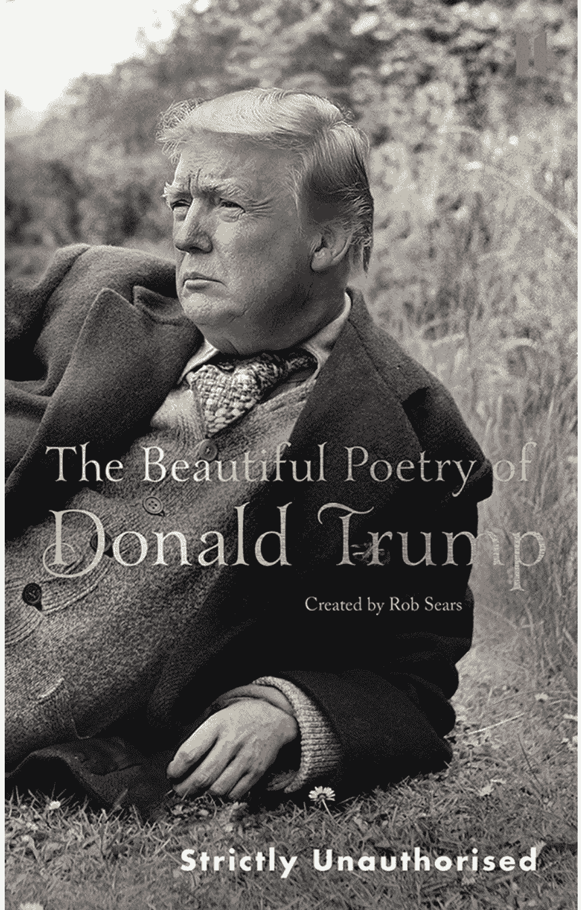

# 唐纳德·特朗普的优美诗歌

## 1 2017年1月20日在美国第45任总统在华盛顿特区的就职演说

世界的人们，谢谢你们¹

## 致谢

## 编辑者的话

有一个鲜为人知的替代事实是，第45任总统唐纳德·J·特朗普长期以来一直是一位卓越的诗人。这本书旨在纠正文学界对这一疏忽，并以以前未见的形式展示他最精彩、最能揭示本质的话语。无论是论述政治、性别问题还是他自己的卓越，特朗普的诗绝非如此简单。事实上，它们棒极了。它们揭示了特朗普敏感和害羞的一面，这可能会引发对这个人的重新评估。虚假媒体对唐纳德·特朗普提出的指控之一是他的英语使用懒散且重复，也许表明是一个头脑且缺乏想象力的思考者。但考虑一下《我最喜欢的两个词》（第117页）；《每个人爱我》中出现了十二次“爱”（第45页）；《一个优美、简单的生活》中出现了十二次“优美”（第3页）。有人指控认为，特朗普漫漫的言语风格证明了大脑的混乱。“头发慢慢干透了”，“我的思想很开阔”，“准备好迎接兴奋吧”以及“虚假新闻，伙计们”（第53、55、95和61页）展示了现代芭蕉或莱林式的精准与简洁。此外还有俳句（“小马可”、“可怜的罗西”、“琳·泰德”、“疯狂的麦格珍·凯利”、“狡猾的希拉里”、“低能量的杰布”、“变态的维纳”、“傻瓜的糖”、“巴拉克·奥巴马（又名巴里·索特罗）”、“疯疯的格伦·贝克”、“普京总统”、“失败的喜剧演员比尔·马赫”、“愚蠢的伊丽莎白·沃伦”以及“口很脏的参议员约翰·麦恩”——第49、81、47、75、25、99、13、39、6、33、109和93页）。它们都是正式的5-7-5节拍——这是一位具有极高自律和力量的作家的见证。在对某些诗歌进行浅层阅读时，批评者可能只能听到他们所认为的那个特朗普的声音。“照片式记忆；我有最好的措辞；好基因；我真的很富有；坏汉子们”和“我是最华丽的抱怨者”（第87、111、91、5和31页）是令人振奋的自夸。另一些诗歌在愤怒上是元初的，仿佛他凌晨4点在白炽火的怒火中醒来，为了把他们挖进马尔阿拉拉戈庄园去担心他性殖器的大小。特朗普在诗歌中完全暴露了他的脆弱，如“我想变好；发生什么了？；以及带有讽刺的“我赢了！”（第101、119页等）。在这里，我们窥见了真正的悲剧——一个与生就必须面对对自身缺陷的意识的人——这很难不动容。然而，他从未屈服于自恋。“我所要求的只有公平；我的手是正常的手，看看我最近被对待的方式”以及“我是世界上最不种族歧视的人”（第35、57、103、115和11页），破碎系统的不公以及偏见新闻报道对国家的影响驱动着特朗普走向诗歌。> 梦想“我喜欢阅读”和“我不知道”（第113、107和121页）探索了特朗普内心最深、最不为人知的部分。“我是那个无辜（纯洁）的！”（第97页）标志着对形而上诗学的探索；实际上，这是一封给整个宇宙的情书。尽管有趣的是，特朗普在任何诗歌中未被提及，但我们也可以看到特朗普更传统的浪漫形象显现出来，例如“高中里的火辣小女孩”（第67页）和“看看这个宝宝”（第51页），而另外两首诗歌幽默地评论了性别关系问题，特朗普可能比他表现出的更懂（“尊重女性，我爱女性，我珍惜女性”以及“女性拥有历史上最伟大的成就之一”——第41和79页）。

然而，这本书纠正的关于DJT最大的误解，可能是他认为金钱和权力是终极目的。事实上，正如威尔尔德·奥文将他的战争经历融入诗歌，西尔维亚·普拉斯拉斯在自己的抑郁中发现黑暗的美，特朗普能够将他作为赢者的独特经历转化为24K的诗篇。他并不是为了几十亿财富而建立巨大的房地产帝国；他这样做是为了写出如“给自己享受生活能提供的非常非常最好的生活”和“我们必须把他们除掉”（第71和27页）。他去华盛顿不是为了被恐惧；他这样做是为了将他的经历炼化为。

## 诗作

- 1 正在发生，2016年10月12日
- 2 给予所有的尊重，MSNBC，2016年3月29日
- 3 在弗吉尼亚州关于“杰拉德·R·福特号”航空母舰的演讲，2016年12月17日
- 4 在费城共和党人退隐会议上的演讲，2017年1月26日
- 5 安德森·库珀360，CNN，2016年7月5日
- 6 爱荷华州马斯卡廷的竞选集会，CSPAN，2016年1月25日
- 7 推广环世界小姐选秀的推特，2012年12月7日
- 8 国会山关键要的听证会，CSPAN，2015年2月27日
- 9 《奥雷莱利因素》，福克斯新闻，2016年4月28日
- 10 国家新闻俱乐部午餐，CSPAN，2014年5月31日
- 11 《汉尼迪》，福克斯新闻，2015年7月15日
- 12 《汉尼迪》，福克斯新闻，2015年8月15日
- 13 酒店开业，CSPAN，2016年10月27日

## 一种美丽而简单的生活¹

漂亮的自行车²

美丽的航空母舰³

美丽的煤炭⁴

“曲的希拉里”撒的美丽的谎言⁵

漂亮的帽子⁶

美丽的女性⁷

漂亮的坦克⁸

漂亮的悍姆机车⁹

漂亮的铜管¹⁰

漂亮的汽车工厂¹¹

漂亮的海军陆战队队员¹²

我以前从未见过长得这么漂亮的剪刀¹³

- 1 在特朗普大厦宣布竞选总统，2015年6月16日
- 2 推广他的“埃尔斯福德”水晶收藏的推特，2011年9月13日
- 3 接受《德梅因斯注册报》采访，2015年6月1日
- 4 在南卡罗来州希尔顿角头的演讲，2015年12月30日
- 5 《花花公子》采访，2004年
- 6 祝贺拉什·林姆鲍广播生涯26周年的推特，2014年8月5日
- 7 分享营销黄金法则的推特，2013年3月21日

## 我真的很有钱¹

我为我新的水晶收藏感到非常自豪²

我有一家古驰商店，价值比罗姆尼还高³

我每年订购数千台电视⁴

有六个人除了分拣我的邮件什么都不做⁵

抱歉了，讨厌者和失败者⁶

金者制定规则⁷

- 1 在接受《华盛顿时报》采访时解释为何考虑竞选总统，2013年6月10日
- 2 美国空军反性侵部门负责人因性侵犯被捕的推特，2013年5月7日
- 3 批评纽约时尚周的推特，2013年9月15日
- 4 批评《时尚风采》的推特，2012年4月9日
- 5 在拉斯维加斯特朗普国际酒店接受《纽约时报》采访，2011年5月1日
- 6 批评美国邮政局的推特，2013年2月6日

## 这个国家正在彻底完蛋^1

似乎我们的国家已经不像以前了^2

纽约时尚周真的很糟糕，曾经是那么华丽和令人兴奋³

《时尚风采》杂志曾是我最喜欢的杂志之一，现在正经营得很糟糕⁴

很多人都在换这种非常长的推杆杆。非常不耐看⁵

我们贫穷、太贫穷的国家⁶

- 1 批评巴拉克·奥巴马的推特，2012年10月17日
- 2 批评巴拉克·奥巴马的推特，2012年10月15日
- 3 批评巴拉克·奥巴马的推特，2014年6月6日
- 4 在佛罗里达州日出斯的集会，2016年8月11日

## 巴拉克·胡赛因·奥巴马（又名巴里·索特罗）¹：俳句

不是你认为的那²

最糟糕的总统³

ISIS的创始人⁴

- 1 《福克斯朋友》，2011年5月9日
- 2 在《Talk1300 AM》采访，2011年4月14日
- 3 提及老虎格尔·伍德斯不忠的推特，2013年3月20日
- 4 在与拉里·王的采访中回答问题，1999年10月7日
- 5 新闻发布，2015年9月3日
- 6 《花花公子》采访，2004年
- 8 约翰森·凯佩哈特文章的注释，由凯佩哈特推特，2015年7月8日

## 我是最不种族主义的人者¹

我一直和黑人保持良好关系²

在老虎格尔·伍德斯期间我保持了坚强³

奥普拉，我爱她。她是我的首选⁴

坎耶·韦斯特——我爱他

我觉得艾米纳姆极了，我的名字在歌曲里比嘻哈还多⁶

你才是种族主义者⁸

- 1 批评安东尼·维纳纳的推特，2013年3月18日
- 2 在福克斯新闻接受格蕾塔·苏利文的采访，2013年7月24日
- 4 批评安东尼·维纳纳的推特，2013年7月24日

## 变态的安东尼·维纳纳：俳句

非常病的小家伙²

一个大喊大叫的人³

他不会改变⁴

- 1 批评希拉里·克林顿的推特，2015年12月21日
- 2 提及威尔·史密斯红毯事件的推特，2012年5月21日
- 3 在密歇根州圣奥古斯丁的集会，2016年10月24日
- 4 批评莎拉·杰西卡·帕克的推特，2012年10月26日
- 5 推特，2017年2月2日
- 6 在《霍华德·斯特恩节目》中讨论女性美，2005年
- 7 与克里斯·马修斯的对话，2016年4月22日

## 让美国再次伟大 (MAGA)!

威尔·史密斯扇了那个“记者”，做得很好²

我们将修复我们的系统³

莎拉·杰西卡·帕克投了“世界上最有性感的女人”——我同意⁴

我们必须把“恶”排除在我们的国家之外⁵

胸很平的人很难⁶

我们要让美国伟大⁷

- 1,3,5,6,7,10 《New Day》，2015年8月1日
- 2 CNN 市民会议，2016年4月12日
- 4 CNN 特辑，2016年3月3日
- 8 在弗吉尼亚州阿尔伯马尔庄园的竞选停靠，2015年7月14日

## 我是最华丽的抱怨者

我拥有东海岸最大的葡萄酒庄²

我抱怨³

我们生产最顶级的葡萄酒⁴

因为我想赢⁵

我因没赢感到不开心⁶

我是一个抱怨者⁷

很多种类的酒⁸

我是一个抱怨者，我会一直抱怨抱怨，直到我赢⁹

我会赢的¹

- 1 提及美国总统辩论的推特，2016年10月21日
- 2 《学徒制》，2004季季

## 我赢了！

好吧，我们确实经历了一些灾难，但这是最糟糕的²

- 1 共和党提名接受演说，2016年7月21日
- 2 总统就职宣誓，2017年1月20日
- 3 在特朗普大厦宣布竞选总统，2015年6月16日，提及时任国务卿约翰·凯里的腿部受伤
- 4 《拉里·王直播》，1999年10月8日
- 5 针对切尔的推特，2012年11月13日
- 6 在南卡罗来州希尔顿角头的演讲，2015年12月30日

## 我做出这个承诺

我，唐纳德·约翰·特朗普，庄严宣誓，我将忠实履行美国总统的职责，并尽我所能维护、保护并捍卫美国宪法²

我承诺我永远不会参加自行车赛³

我将不会重命名白宫⁴

我承诺不谈论你那些没效果的大型整形⁵

我承诺了。谢谢⁶

- 1 推特，2013年8月8日
- 2 提及苹果公司股价下跌的推特，2014年1月28日
- 3 在特朗普大厦宣布竞选总统，2015年6月16日
- 4 在新罕布什州普利茅茅的竞选集会，CSPAN，2016年2月7日
- 5 《汉尼迪》，福克斯新闻，2016年2月29日

## 我是最好的

我预测了苹果股票的下跌²

我将建造一道伟大的、巨大的墙³

我建造的楼有94层高⁴

我的手不是——它们很小²

- 1 批评希拉里·克林顿的推特，2016年5月7日
- 2 在密歇根州格兰拉皮德的演讲，2015年12月21日
- 3 拉斯维加斯的美国总统辩论，2016年10月19日
- 4 广告密歇根州沃伦集会的推特，2016年10月31日

## 曲曲的希拉里：俳句

她被骗了，她输了²

一个可怕糟糕的女人³

是时候清理沼泽了⁴

- 1 在接受《Circa》采访时提及ISIS，2016年8月7日
- 2 批评安东尼·维纳纳的推特，2012年7月6日
- 3 在接受肖·汉尼迪采访时回答ISIS战士，2017年1月26日
- 4 接受《纽约时报》采访，2016年11月23日
- 5 在华盛顿特区的演讲，2016年4月27日
- 6 提及特朗普大厦餐厅，特朗普餐厅的推特，2012年11月29日

## 我们必须得除掉它们

鼬鼠很难除掉²

它们不穿制服。它们是狡猾、肮脏的老鼠³

这是真正意义上的18个月残酷⁴

但我们赢了⁵

特朗普餐厅刚刚获得了最高的卫生检查等级⁶

- 1 在特朗普国际酒店参加国会领导层午会的演讲，2017年1月19日
- 2 退伍军人事务听证会，2017年3月17日
- 3 与特蕾莎·梅的新闻发布会，2017年1月27日
- 4 推特，2013年9月18日

## 我们拥有迄今为止组建的任何内阁中智商最高的¹

我今天任命了退伍军人事务管理局局长大卫·舒尔金²

凯利将军将在国土安全部表现得出色³

本·阿弗莱在蝙蝠侠的角色上将取得巨大的成就⁴

- 1 2016年10月20日于内华达州立拉斯维加斯大学举行的总统大辩论
- 2 现场市政厅活动，今日，NBC，2016年4月21日
- 3 现场市政厅活动，今日，NBC，2016年4月21日
- 4 《汉尼蒂》，福克斯新闻，2016年8月27日
- 5 《面对媒体》，MSNBC，2016年1月10日
- 6 国议会山山的关键听证会，2015年12月30日
- 7 MSNBC，2016年3月12日
- 8 推特，2013年5月17日

## 坏蛋们¹

我识过一些坏小子²

我参加过一些派对³

他们想造成严重的伤害⁴

我见过，也观察过那些用枪发生的事情⁵

我认识很多硬汉，但他们并不聪明⁶

我们对付的是像动物一样的人⁷

但他们是我最喜欢的人——远超他人！¹⁸

- 1 2015年11月16日关于俄罗斯对伊斯兰国进行空袭的推特
- 2 《早晨乔伊斯》，MSNBC，2015年12月18日
- 3 2016年7月27日推特，声称得到了弗拉基米尔·普京的赞扬
- 4 2015年12月17日在俄亥俄州哥伦布举行的集会上，收到了来自“一位在本国及国际范围内备受推崇的人士”给予的“极大的荣誉”

## 普京总统：¹一首俳句

是一位强大的领导者²

说“特朗普是个天才”³

备受推崇⁴

- 1 2015年8月30日在田纳西州纳什维尔向共和党助理协会国家联邦发表演讲后
- 2 《本周》，ABC新闻，2015年7月19日
- 3 《内部政治》，CNN，2017年1月11日
- 4 2013年12月8日批评巴拉克·奥巴马的推特
- 5 2016年5月24日在新墨西哥州阿尔伯克基集会上的评论，针对希拉里·克林顿的忠者埃德·伦德尔关于“丑陋女人”的言论

## 我要求的仅仅是公平¹

人们不断攻击我的头发²

我觉得这非常不公平³

奥巴马说他从未见过他的叔叔奥斯卡⁴

想象一下如果我说了这句话会怎样？

我会被处以电椅⁵

- 1 2016年6月1日CNN《约翰·伯曼与克里斯汀·罗曼斯早晨》
- 2 2016年1月2日批评杰布·布什共和党总统候选人竞选活动的推特
- 3 2016年12月21日《今晚娱乐节目》，CBS
- 4 2015年9月21日批评卡莉·菲奥里纳的推特
- 5 2012年2月27日批评莎莎·巴伦·科恩的推特
- 6 2015年5月30日批评乔·斯图尔特的推特
- 7 2016年8月25日NBC《新闻3现场》
- 8 2016年12月10日关于阿兰·糖与皮尔斯·摩根冲突的推特
- 10 2016年12月6日批评阿兰·糖的推特

## 这些人是失败者¹¹

杰布·布什能量低且呆板²

罗茜·奥唐纳尔令人从胃里作呕³

卡莉·菲奥里纳生意很糟糕⁴

莎莎·巴伦·科恩是个白痴⁵

乔·斯图尔特是个笑话，并不聪明⁶

切尔是个某种失败者⁷

阿兰·糖——皮尔斯·摩根认为你不既聪明也不富有⁸

这些人人是失败者⁹

感谢真实的阿兰·糖¹⁰

- 1 2012年12月6日批评阿兰·糖的推特
- 2 2013年5月10日批评阿兰·糖的推特
- 3 2013年5月11日批评阿兰·糖的推特
- 4 2012年12月7日批评阿兰·糖的推特

## 愚蠢的糖：¹一首俳句

无法被捕获²

高举圣经却在撒谎³

他是个胆小⁴

- 1 2015年10月12日新罕布什尔州无解会议
- 2 《霍华德·斯特恩秀》回顾特朗普在玛丽亚婚礼上的评论
- 3 2012年8月27日支持推特

## 我尊重女性，我爱女性，我珍惜女性¹

阴道很贵²

不再道歉了！³

- 1 2016年5月6日批评伊丽莎白·沃伦和希拉里·克林顿竞选的推特
- 2 2016年6月10日侮辱伊丽莎白·沃伦的推特
- 3 2016年7月27日致电NBC新闻提到伊丽莎白·沃伦的血统问题
- 4 2016年5月6日质疑伊丽莎白·沃伦血统的推特

## 傻傻的伊丽莎白·沃伦：¹一首俳句

嘴巴很毒²

我们叫她波肯塔斯³

我说她是个骗子⁴

- 1 2015年7月8日与安德森·库珀的采访
- 2 2016年4月8日与鲍勃·伍德德和罗伯特·科斯塔斯的采访
- 3 2016年5月20日在新泽西州劳伦斯维尔对支持者的讲话
- 4 2016年2月21日与CNN的采访
- 5 2016年4月4日CNN《华盛顿本周》
- 6 2015年9月30日CNN《今晚新闻》，唐·莱蒙
- 7 2004年12月13日《纽约杂志》
- 8 2015年7月24日MSNBC《早晨乔伊斯》
- 9 2016年1月25日福克斯新闻，媒体动态
- 10 2015年9月4日MSNBC《第一视角》
- 11 2015年10月9日ABC《美国早晨》
- 12 2016年1月24日NBC《面对媒体》
- 13 2016年2月19日CNN《安德森·库珀360》市政厅
- 14 2015年8月15日在爱荷华州览会上关于人们如何回应其移民政策的发言
- 15 2016年3月22日威胁特德·克鲁斯的推特

## 每个人都爱我¹

汤姆·布雷迪爱我²

纽约人爱我³

纽约州北部，我是有史以来最受欢迎的人⁴

机车手爱我⁵

你知道谁爱我吗？茶党党，福音教徒⁶

如果我多花十五倍的时间陪他们，我的孩子也会爱我⁷

退伍军人爱我⁸

非裔美国人爱我⁹

亚洲人爱我¹⁰

许多西班牙裔爱我¹¹

大多数保守派爱我¹²

社会爱我¹³

你会爱我的¹⁴否则我就揭你妻子的底！¹⁵

- 1 2016年4月1日批评特德·克鲁斯的推特
- 2 2016年1月25日批评特德·克鲁斯的推特
- 3 2016年2月13日批评特德·克鲁斯的推特
- 4 2016年2月9日在新罕布什尔州曼彻斯特集会上提到一名观众

## 撒谎的特德：¹一首俳句

一个神经质的人²

高举圣经却在撒谎³

他是个懦包夫⁴

- 1 2016年2月28日批评马可·鲁比奥的推特
- 2, 3 2016年2月26日批评马可·鲁比奥的推特
- 4 2016年8月25日推特，实际上是在描述希拉里·克林顿的一场演讲

## 小马可：¹一首俳句

没有总统风范²

像舞台上的小男孩³

非常短且满口谎言⁴

- 1 2016年11月5日在佛罗里达州坦帕的演讲
- 2 2016年8月2日在弗吉尼亚州劳登登县的演讲
- 3 2017年5月1日中断在CBS《国家面面》的采访

- 4, 5 在《霍华德·斯特恩秀》采访中讨论扩展家庭
- 6 2015年9月27日在《60分钟》上对当前墨西哥边界栏的评论

# 看看这个宝宝¹

这是一个伟大的、美丽的宝宝¹

它年轻、美丽且健康²

我爱婴儿²

多漂亮的宝宝²

...2够了³

把那个婴儿带出去²

我喜欢孩子⁴

我不会采取任何照顾措施⁵

它们很丑，又小又没用⁶

- 1 2004年《花花公子》采访
- 2 2015年9月11日与阿拉巴马共和党的电话会议

# 头发慢慢干¹

这是一个需要18个月到两年的过程²

- 1 2016年12月11日福克斯新闻周日
- 2 2016年2月19日针对苹果公司加密立场的推特
- 3 唐纳德·特朗普（2016），《再次伟大：如何修复我们破碎的美国》，Threshold出版社，西蒙与叔锡：纽约，第96页

# 我很开放¹

我同时使用iPhone和三星手机²

伟大的领导者必须灵活³

- 1 2017年1月16日批评主流媒体的推特
- 2 2012年10月22日批评BBC的推特
- 3 2016年8月19日批评《纽约时报》的推特
- 4 2017年2月16日发布会，关于与俄罗斯关系的新闻报道
- 5 2016年10月4日批评CNN的推特
- 6 2016年10月16日批评《周六晚间秀》的推特
- 7 2015年9月27日《60分钟》采访

# 非常不诚实的媒体¹

BBC处于一片混乱之中²

失败的《纽约时报》一天比一天更糟³

泄露是绝对真实的。新闻是假的⁴

- 1. 在 ABC 新闻接受采访，ABC，2017年1月25日
- 2. 在拉斯维加斯的演说中提到对中国商品征税的计划，2011年4月28日
- 3. 在《60分钟》节目中接受采访，CBS，2015年9月27日
- 5. 支持对恐怖分子嫌疑人使用剥夺睡眠法的推特，2014年12月11日
- 6. 带有视频链接的推特，特朗普与朱莉亚娜·兰齐合唱卡莉·雷·杰普森的《Call Me Maybe》翻唱，2012年9月6日
- 7. 在科罗拉多州丹佛的竞选集会，2016年8月1日

# 酷刑有效吗？¹

“听着，你们这些混蛋们²”

“并不是所有事都是美好的³”

“水刑⁴”

“剥夺睡眠⁵”

我唱着《Call me maybe》⁶

我不是说这很愉快，但我自己

- 1. 在田纳西州纳什维尔的支持者集会，2017年3月15日
- 2. WWE 名人堂领奖演讲，2013年4月6日
- 3. 新闻发布会，2015年11月3日

# 伙计们，假新闻¹

一切始于摔角狂 4 号²

那是由民主人策划的³

- 1. 2 条批评格伦·贝贝克的推特，2016年1月21日
- 3. 批评格伦·贝贝克所属的 TheBlaze 网络的推特，2015年12月16日
- 4. 批评格伦·贝贝克的推特，2015年10月29日

# 疯狂的格伦·贝贝克¹：首俳句

哭泣的迷失灵魂²

被福克斯电视台像狗一样解雇了³

精神病病人⁴

- 1. 威斯康星州杰恩斯维尔镇民会议，2016年3月29日
- 2, 3. 白宫新闻发布会，2017年2月16日
- 4. “超级周二二”之晚的胜利演讲，2016年3月15日
- 5. 南卡罗来纳州沃尔特伯勒勒的竞选集会，2016年2月17日

# 必须必须停止这种愚蠢的行为¹

你们知道铀是什么吧，对吧²

它是一种叫做核武器的东西，以及其他很多用铀制造的很多事情，包括一些坏事³

我必须向这些人人解释，他们根本不懂基础物理、基础数学，随你们想怎么称它都行⁴

我的意思是，他们很愚蠢⁵

- 1. 在《霍华德·斯特恩秀》中讨论失去处女，1997年
- 2. 推特，2013年4月21日
- 3. 在《芝加哥论坛报》中被引用为对两个14岁的女孩说过过的话，1992年12月
- 4. 在《学徒导师》节目中对布兰德·罗德里克说，2013 季
- 5. 《纽约人》，1997年5月19日
- 6. 赢得佛罗里达州、伊利诺伊州和北卡罗来纳州初选后的演讲，2016年3月15日

## 高中小女孩¹

我是一个非常有同情心的人（智商非常高）²

想想看，几年后我就和你约会了³

那一定是个很优美的画面，你跪下膝盖⁴

过来，让我给你看生活是如何运作的。⁵⁶

- 1. 国会山之关键听证会，2015年12月30日
- 2. 《瑞切尔·麦多洛秀》，CNBC，2017年5月26日
- 3. 在爱荷华州的梅因斯的竞选演讲，2015年12月11日

# 拿石油，拿石油，拿石油$^¹

你们听够了，我会拿走石油$^²

我知道，那是原油$^³

- 1. 出现在特朗普牛排的广告中，2007年
- 2. 在福克斯商业频道《玛丽亚的早晨》采访中，提到与中国国家主席习近平在马-阿·拉戈的晚餐，2017年4月12日
- 3. 推广马-阿·拉戈肉饼的推特，2011年12月29日
- 4. 在百货大公司推广唐纳德·J·特朗普签名服装系列的推特，2014年6月26日
- 5. 《奥雷雷利因素》。福克斯新闻，2016年4月28日
- 6. 声明，白宫网站，2017年1月20日
- 7. 特朗普首次对国会的演说，2017年2月28日
- 8. 推特，2014年4月15日
- 9. 在与玛利亚·巴蒂罗莫的采访中提到他对韩国的计划，福克斯商业频道，2017年4月12日
- 10. 推广多伦多国际项目的推特，2012年11月2日
- 11. 祝贺安德烈·里德推特，2014年7月29日

# 享受生活所提供的最好、最好的生活^¹

你们听说了，我会拿走石油$^²

我知道，它是粗油的³

- 1. 出现在特朗普牛排的广告中，2007年
- 2. 在福克斯商业频道《玛丽亚的早晨》采访中，提到与中国国家主席习近平在马-阿·拉戈的晚餐，2017年4月12日
- 3. 推广马-阿·拉戈肉饼的推特，2011年12月29日
- 4. 在百货大公司推广唐纳德·J·特朗普签名服装系列的推特，2014年6月26日
- 5. 《奥雷雷利因素》。福克斯新闻，2016年4月28日
- 6. 声明，白宫网站，2017年1月20日
- 7. 特朗普首次对国会的演说，2017年2月28日
- 8. 推特，2014年4月15日
- 9. 在与玛利亚·巴蒂罗莫的采访中提到他对韩国的计划，福克斯商业频道，2017年4月12日
- 10. 推广多伦多国际项目的推特，2012年11月2日
- 11. 祝贺安德烈·里德推特，2014年7月29日

# 享受生活所提供的最好、最好的生活^¹

世界上最棒的蛋糕²

最棒的肉饼³

在百货大公司以最廉的价格购买衬衫⁴

先进的武器系统⁵

精美的战斗机⁶

最棒的枪支⁷

最棒的⁸

值得的！¹⁰

- 1. 2005年
- 2. 2017年

# 你可以做任何事¹

你们知道铀是什么吗，对吧²

它是一种叫做核武器的东西，以及其他很多用铀制造的很多事情，包括一些坏事³

我必须向这些人解释，他们根本不懂基础物理、基础数学，随你们想怎么称它都行⁴

我的意思是，他们很愚蠢⁵

- 1. 在《霍华德·斯特恩秀》中讨论失去处女，1997年
- 2. 推特，2013年4月21日
- 3. 在《芝加哥论坛报》中被引用为对两个14岁的女孩说过过的话，1992年12月
- 4. 在《学徒导师》节目中对布兰德·罗德里克说，2013 季
- 5. 《纽约人》，1997年5月19日
- 6. 赢得佛罗里达州、伊利诺伊州和北卡罗来纳州初选后的演讲，2016年3月15日

## 高中小女孩¹

我是一个非常有同情心的人（智商非常高）²

想想看，几年后我就和你约会了³

那一定是个很优美的画面，你跪下膝盖⁴

过来，让我给你看生活是如何运作的。⁵⁶

- 1. 国会山之关键听证会，2015年12月30日
- 2. 《瑞切尔·麦多洛秀》，CNBC，2017年5月26日
- 3. 在爱荷华州梅因斯的竞选演讲，2015年12月11日

# 拿石油，拿石油，拿石油$^¹

你们听够了，我会拿走石油$^²

我知道，那是原油的³

- 1. 出现在特朗普牛排的广告中，2007年
- 2. 在福克斯商业频道《玛丽亚的早晨》采访中，提到与中国国家主席习近平在马-阿·拉戈的晚餐，2017年4月12日
- 3. 推广马-阿·拉戈肉饼的推特，2011年12月29日
- 4. 在百货大公司推广唐纳德·J·特朗普签名服装系列的推特，2014年6月26日
- 5. 《奥雷雷利因素》。福克斯新闻，2016年4月28日
- 6. 声明，白宫网站，2017年1月20日
- 7. 特朗普首次对国会的演说，2017年2月28日
- 8. 推特，2014年4月15日
- 9. 在与玛利亚·巴蒂罗莫的采访中提到他对韩国的计划，福克斯商业频道，2017年4月12日
- 10. 推广多伦多国际项目的推特，2012年11月2日
- 11. 祝贺安德烈·里德推特，2014年7月29日

# 享受生活所提供的最好、最好的生活^¹

世界上最棒的蛋糕²

最棒的肉饼³

在百货大公司以最廉的价格购买衬衫⁴

先进的武器系统⁵

精美的战斗机⁶

最棒的枪支⁷

最棒的⁸

值得的！¹⁰

- 1. 2005年
- 2. 2017年

# 你可以做任何事¹

你们知道铀是什么吗，对吧²

它是一种叫做核武器的东西，以及其他很多用铀制造的很多事情，包括一些坏事³

我必须向这些人解释，他们根本不懂基础物理、基础数学，随你们想怎么称它都行⁴

我的意思是，他们很愚蠢⁵

- 1. 在《霍华德·斯特恩秀》中讨论失去处女，1997年
- 2. 推特，2013年4月21日
- 3. 在《芝加哥论坛报》中被引用为对两个14岁的女孩说过过的话，1992年12月
- 4. 在《学徒导师》节目中对布兰德·罗德里克说，2013 季
- 5. 《纽约人》，1997年5月19日
- 6. 赢得佛罗里达州、伊利诺伊州和北卡罗来纳州初选后的演讲，2016年3月15日

+ 1 《华尔街日报》，2016年1月24日
+ 2 给NBC新闻的即兴电话，2015年11月24日
+ 3 就职演说，2017年1月20日

# 照相式记忆¹

我拥有世界上最强大的记忆²

我们国家被遗忘的男士们将不再被遗忘³

+ 1 与克里斯·华莱斯的采访，《福克斯新闻周日》，福克斯新闻，2015年10月18日
+ 2 在希尔顿海角的演讲，提及全球变暖的危险，南卡罗来纳州希尔顿海角，2015年12月30日
+ 3 在共和党犹太人联盟关于他对全球变暖担忧的发言，2015年12月7日
+ 4 特朗普与家人共同签名给巴拉克·奥巴的信，敦促其就气候变化协调全球行动，2009年12月6日
+ 5 推特，2013年9月10日
+ 6 抱怨弗吉尼亚州的一场竞选镇民会议上房间太热，2016年7月26日

他们说不要用发胶，它对臭氧层有害；²

全球变暖是我们最大的威胁；³

如果我们现在不采取行动，从科学上无可否认的是，人类和我们的地球将面临灾难性且不可逆的后果。⁴

太无聊了！⁵

尝试打开空调⁶

+ 1 推特，2014年11月25日
+ 2, 3, 4 《纽约时报》采访，2009年3月29日
+ 5 阿拉巴马州动员集会，《CNN晚间》，CNN，2015年8月21日
+ 6 《福克斯新闻特别报告》，2015年10月6日
+ 7 推特，2013年6月29日
+ 8 与沃尔夫·布利泽的采访，CNN，2016年3月21日
+ 9 在纪录片《卡尔施塔特之王》中提及他的德国根源，西蒙·温德尔，2014年
+ 10 在特朗普大厦宣布竞选总统，2015年6月16日
+ 11 推特，2014年9月28日
+ 12 爱荷荷华州马斯卡廷市的竞选集会，2016年1月25日

# 优基因¹

“人人生而平等”²

噢，事实并非如此³

有些人聪明，有些人不聪明⁴

我们相信基因这一套吗？我的意思是，我相信⁵

我天生拥有优基因⁶

聪明的（伟大的）大脑⁷ 大小的手，⁸ 德国血统⁹

我们有愚蠢的人¹⁰

他们无法改变自己生就残废的事实¹¹

慢马出不不了快马¹²

+ 1 批评约翰·麦因的推特，2016年10月11日
+ 2 批评约翰·麦因的推特，2015年7月16日
+ 3 批评约翰·麦因的推特，2017年2月9日
+ 4 艾荷华州艾姆斯的论坛，2015年7月18日

# 满口脏话的约翰·麦因议员¹：一首俳句

最后毕业²

不知道如何获胜³

不是战争英雄⁴

+ 1 关于《名义学徒》决赛的推特，2011年5月20日
+ 2 推特，2014年9月5日
+ 3 在《玛丽亚的早晨》中提到就巧克力蛋糕对中国习近平主席说的话，2017年4月12日
+ 4 推特，2013年3月25日

# 准备好迎接一些刺激¹

中国将在2020年之前完成59个新的主题公园²

我们刚刚发射了59枚导弹³

放烟花！⁴

+ 1 批评梅格珍·凯莉的推特，2015年8月10日
+ 2 南卡罗来纳州希尔顿海角的竞选集会，2015年12月30日
+ 3 与美联社在白宫的采访，2017年4月23日
+ 4 “政治与蛋”活动，新罕布什州，2015年11月
+ 5 在Reddit“提问我”中问题的回答，2016年7月27日
+ 6 推特，2015年2月4日

# 我是无辜（纯洁）的人¹

我热爱宇宙²

这一切的宏大³

太空太棒了⁴

老实说，我觉得NASA太极了⁵

延伸、寻找和探索⁶

+ 1 批评杰布·布什共和党总统竞选竞的推特，2016年3月23日
+ 2 批评杰布·布什共和党总统竞选竞的推特，2016年1月2日
+ 3 南卡罗来纳州的共和党辩论，2016年2月14日
+ 4 批评杰布·布什共和党总统竞选竞的推特，2016年2月17日

# 能量低（没劲）杰布¹：一首俳句

能量低“呆板”²

说他会脱裤子³

他想看起来很酷⁴

+ 1 在南卡罗来纳州沃尔特伯勒关于外交政策的演讲，2016年2月17日
+ 2 在田纳西州纳维尔共和党协会大会上的演讲，2015年8月29日
+ 3 提及杰布·布什口号“杰布能解决问题”的推特，2015年11月1日
+ 4, 5 对CNN杰克·塔珀采访的报告，2015年6月19日
+ 6 拉斯维加斯的集会，2015年10月8日
+ 7 国会山关键听证会，CSPAN，2015年10月9日
+ 8 《好莱坞热录音带》发布后的脸声明，2016年10月7日

# 我想做一个好人¹

我真的很想做一个好人，我是一个好人²

我从没想过杰布是个骗子³

其实我那天重重打了他，感觉很糟糕……我说，我为什么要

重重打他？⁴

我觉得他是个完美的人⁵

我叫鲁比奥轻量级⁶

他可能是个好人。我并不了解他⁷

我说过并做过让我后悔的事⁸

+ 1 与《华盛顿邮报》编辑部的会议，2016年3月21日
+ 2 与沃尔夫·布利泽的采访，CNN，2016年3月21日
+ 3 推广“点金手”的推特，2015年4月6日

# 我的手正常¹

我买的尺寸小²

五个手指代表成功³

+ 1 气候协议，2017年6月6日
+ 2 关于爱荷华州共和党总统候选人民调数据的推特，2016年3月24日
+ 3 推特，2015年9月1
+ 4 推特，2014年1月25日
+ 6 推特，2013年5月27日

# 巴黎并不好¹

那里真的很冷³

执行情况⁴

我们现在就要全球性的⁵

+ 1 与塔克·卡尔森的采访，《福克斯新闻》，2017年3月17日
+ 2 推特，2015
+ 3 赢得佛罗里达州、伊利诺伊州和北卡罗来纳州初后的演说，2016年3月30日
+ 4 1 2015年11月

# 一个梦¹

特朗普巴拿马提供精致美食、五个泳池和豪华套房²

在那些房间里，你可以在最奇怪的地方发现摄像头³

我正看着……我们到处都有电视机⁴

你看到这些看起来不可思议的女性⁵

世界顶尖模特在桌子上被搞定⁶

然后，突然，摄像头转动了⁷

突然，我看到了她⁸

斯蒂芬·鲍德温的母亲⁹

她完全改变了外貌⁸

她现在有一对巨大的假乳⁸

一只黑色的左手和看起来完全不同的身体¹⁰

那个鼻子是一块橡胶¹¹

她说：¹²

我喜欢你的马土豆。¹³

真奇怪¹⁴

- 1. 对海岸警卫队学员的毕业演讲，2017年5月17日
- 2. 推文，2015年12月10日
- 3. 在艾荷华州德莫因斯的演讲，2015年12月11日
- 4. 推文，2016年5月30日
- 5. 与首席执行官和商业领袖的白宫座谈会，CSPAN，2017年4月4日
- 6. 推文，2016年2月27日

# 看看我最近被对待的方式^1

我本应该是《时代周刊》的年度人物^2

就像我本应该获得《学徒》的艾美奖一样3

我本应该轻松赢得特朗普大学案^4

我本应该赢得纽约州州，但我没赢^5

我几乎每年都被美国国税务局（I.R.S.）不公平地审计⁶

历史上没有任何政客——我可以非常肯定地说——受到的待遇比我更糟

或者说更不公平^7

- 1 在密歇根州诺维市的演讲，2016年9月30日
- 2 《学徒》第一季第一集
- 3 《学徒》第二季第一集
- 4 《学徒》第三季第一集
- 5 《学徒》第四季第一集
- 6 《学徒》第五季第一集
- 7 《学徒》第六季第一集
- 8 《学徒》第七季第一集
- 9 《学徒》第八季第一集
- 10 《学徒》第九季第一集
- 11 《学徒》第十季第一集
- 12 《学徒》第十一季第一集
- 13 《学徒》第十二季第一集
- 14 《学徒》第十三季第一集
- 15 《学徒》第十四季第一集
- 16 解雇 FBI 局长詹姆斯·科米的信，2017年5月9日

# 我最喜欢的两个词¹

你被开除了²

你被开除了³

你被开除了⁴

你被开除了⁵

你被开除了⁶

你被开除了⁷

你被开除了⁸

你被开除了⁹

你被开除了¹⁰

你被开除了¹¹

你被开除了¹²

你被开除了¹³

你被开除了¹⁴

你被开除了¹⁵

你特此被终止¹⁶

- 1 在新罕什尔州的胜利演讲，2016年2月9日
- 2 在特朗普大厦的总统竞选宣布，2015年6月16日
- 3 在艾荷华州牛顿的竞选集会上提到叙利亚难民，2016年11月11日
- 4, 5
- 6 第一次
- 3 在艾荷华州牛顿的竞选集会上提到叙利亚难民，2016年11月11日
- 4, 5 推文，2016年3月29日。那是一支笔。
- 6 第一次独自白宫记者会，2017年2月16日
- 7 推文，2013年3月10日
- 8 在南卡罗来纳州蒙特普利斯斯的竞选集会，关键国会山听证会。2015年12月8日
- 9 《花花公子》采访，1990年3月

# 发生了什么？发生了什么？1

我的家人喜欢我吗？²

女性在哪里？³

为什么这个记者在我离开新闻发布会时碰我？⁴

她手里拿着什么？⁵

我不知道该拿哪个麦克风？⁶

我的头发——我应该换一下吗？⁷

我有点像，我是什么？⁸

# 你必须成为一切

我可以是个杀杀手，也可以是个好人²

我可以非常军事化。高军衔！¹³

我可以比任何人都更有总统风范⁴

你得说，我涵盖了方方面⁵

我是护生者⁶

我是一个乐于社交的人⁷

我是一个王⁸

我是一个冠军⁹

我也非常是一个恐菌患者¹⁰

我是一个反击者¹¹

我是总统，而你不是¹²

我是一个非常坚信学术的人¹³

我是麦莉·赛勒斯的捍卫者¹⁴

麦莉，不要让他们让你沮丧）¹⁵

我是一个字迹分析师¹⁶

我是世界上最伟大的 140 字句子作家¹⁷

我是你的声音¹⁸

我就是我的样子¹⁹

## 注释与来源

- 1 新闻发布会，2017年4月4日
- 2 在艾荷华州牛顿的竞选集会上提到叙利亚难民，2016年11月11日
- 3 与首席执行官和商业领袖的白宫座谈会，CSPAN，2017年4月4日
- 4, 5
- 6 推文，2016年3月29日。那是一支笔。
- 7 第一次独自白宫记者会，2017年2月16日
- 8 推文，2013年3月10日
- 9 在南卡罗来纳州蒙特普利斯斯的竞选集会，关键国会山听证会。2015年12月8日
- 10 《花花公子》采访，1990年3月
- 11 演讲，20 2017
- 12 推文，221111
- 13 1 1111, 26, 2017
- 14 会议,,,2211
- 15 111111,, 2017
- 16 解雇 FBI 局长詹姆斯·科米，2017年5月9日
- 17 演讲，2017
- 18 与唐·莱蒙关于如何准备辩论的采访，CNN，2015年7月28日
- 19, 11
- 20 推文，22，2013
- 21 10, and 2011, 2011, 2011, 2011, 11, 11
- 22 11, 11, 11, 11
- 23 11, 2011
- 24 11, 2011
- 25 11, 2011, 2011, 2011, 2011, 2011, 11, 11
- 26 11, 2011
- 27 11, 2011
- 28 11, 2011
- 29 11, 2011
- 30 11, 2011
- 31 11, 2011
- 32 11, 2011
- 33 11, 2011
- 34 11, 2011
- 35 11, 2011
- 36 11, 2011
- 37 11, 2011
- 38 11, 2011
- 39 11, 2011
- 40 11, 2011
- 41 11, 2011
- 42 11, 2011
- 43 11, 2011
- 44 11, 2011
- 45 11, 2011
- 46 11, 2011
- 47 11, 2011
- 48 11, 2011
- 49 11, 2011
- 50 11, 2011
- 51 11, 2011
- 52 11, 2011
- 53 11, 2011
- 54 11, 2011
- 55 11, 2011
- 56 11, 2011
- 57 11, 2011
- 58 11, 2011
- 59 11, 2011
- 60 11, 2011
- 61 11, 2011
- 62 11, 2011
- 63 11, 2011
- 64 11, 2011
- 65 11, 2011
- 66 11, 2011
- 67 11, 2011
- 68 11, 2011
- 69 11, 2011
- 70 11, 2011
- 71 11, 2011
- 72 11, 2011
- 73 11, 2011
- 74 11, 2011
- 75 11, 2011
- 76 11, 2011
- 77 11, 2011
- 78 11, 2011
- 79 11, 2011
- 80 11, 2011
- 81 11, 2011
- 82 11, 2011
- 83 11, 2011
- 84 11, 2011
- 85 11, 2011
- 86 11, 2011
- 87 11, 2011
- 88 11, 2011
- 89 11, 2011
- 90 11, 2011
- 91 11, 2011
- 92 11, 2011
- 93 11, 2011
- 94 11, 2011
- 95 11, 2011
- 96 11, 2011
- 97 11, 2011
- 98 11, 2011
- 99 11, 2011
- 100 11, 2011
- 101 11, 2011
- 102 11, 2011
- 103 11, 2011
- 104 11, 2011
- 105 11, 2011
- 106 11, 2011
- 107 11, 2011
- 108 11, 2011
- 109 11, 2011
- 110 11, 2011
- 111 11, 2011
- 112 11, 2011
- 113 11, 2011
- 114 11, 2011
- 115 11, 2011
- 116 11, 2011
- 117 11, 2011
- 118 11, 2011
- 119 11, 2011
- 120 11, 2011
- 121 11, 2011
- 122 11, 2011
- 123 11, 2011
- 124 11, 2011
- 125 11, 2011
- 126 11, 2011
- 127 11, 2011
- 128 11, 2011
- 129 11, 2011
- 130 11, 2011
- 131 11, 2011
- 132 11, 2011
- 133 11, 2011
- 134 11, 2011
- 135 11, 2011
- 136 11, 2011
- 137 11, 2011
- 138 11, 2011
- 139 11, 2011
- 140 11, 2011
- 141 11, 2011
- 142 11, 2011
- 143 11, 2011
- 144 11, 2011
- 145 11, 2011
- 146 11, 2011
- 147 11, 2011
- 148 11, 2011
- 149 11, 2011
- 150 11, 2011
- 151 11, 2011
- 152 11, 2011
- 153 11, 2011
- 154 11, 2011
- 155 11, 2011
- 156 11, 2011
- 157 11, 2011
- 158 11, 2011
- 159 11, 2011
- 160 11, 2011
- 161 11, 2011
- 162 11, 2011
- 163 11, 2011
- 164 11, 2011
- 165 11, 2011
- 166 11, 2011
- 167 11, 2011
- 168 11, 2011
- 169 11, 2011
- 170 11, 2011
- 171 11, 2011
- 172 11, 2011
- 173 11, 2011
- 174 11, 2011
- 175 11, 2011
- 176 11, 2011
- 177 11, 2011
- 178 11, 2011
- 179 11, 2011
- 180 11, 2011
- 181 11, 2011
- 182 11, 2011
- 183 11, 2011
- 184 11, 2011
- 185 11, 2011
- 186 11, 2011
- 187 11, 2011
- 188 11, 2011
- 189 11, 2011
- 190 11, 2011
- 191 11, 2011
- 192 11, 2011
- 193 11, 2011
- 194 11, 2011
- 195 11, 2011
- 196 11, 2011
- 197 11, 2011
- 198 11, 2011
- 199 11, 2011
- 200 11, 2011

# 我是总统，而你不是

我是一个非常坚信学术的人

我是麦莉·赛勒斯的捍卫者

麦莉，不要让他们让你沮丧

我是一个字迹分析师

我是世界上最伟大的 140 字句子作家

我是你的声音

我就是我的样子

## 注释

1. 新闻发布会，2017年4月4日
2. 在艾荷华州牛顿的竞选集会上提到叙利亚难民，2016年11月11日
3. 与首席执行官和商业领袖的白宫座谈会，CSPAN，2017年4月4日
4. 推文，2016年3月29日。那是一支笔。
5. 第一次独自白宫记者会，2017年2月16日
6. 推文，2013年3月10日
7. 在南卡罗来纳州蒙特普利斯斯的竞选集会，关键国会山听证会。2015年12月8日
8. 《花花公子》采访，1990年3月
9. 解雇 FBI 局长詹姆斯·科米，2017年5月9日
10. 演讲，2017
11. 与唐·莱蒙关于如何准备辩论的采访，CNN，2015年7月28日
12. 推文，22，2013
13. 10, and 2011, 2011, 2011, 2011, 11, 11
14. 11, 11, 11, 11
15. 11, 2011
16. 11, 2011
17. 11, 2011, 2011, 2011, 2011, 2011, 2011, 11, 11
18. 11, 2011
19. 11, 2011
20. 11, 2011
21. 11, 2011
22. 11, 2011
23. 11, 2011
24. 11, 2011
25. 11, 2011
26. 11, 2011
27. 11, 2011
28. 11, 2011
29. 11, 2011
30. 11, 2011
31. 11, 2011
32. 11, 2011
33. 11, 2011
34. 11, 2011
35. 11, 2011
36. 11, 2011
37. 11, 2011
38. 11, 2011
39. 11, 2011
40. 11, 2011
41. 11, 2011
42. 11, 2011
43. 11, 2011
44. 11, 2011
45. 11, 2011
46. 11, 2011
47. 11, 2011
48. 11, 2011
49. 11, 2011
50. 11, 2011
51. 11, 2011
52. 11, 2011
53. 11, 2011
54. 11, 2011
55. 11, 2011
56. 11, 2011
57. 11, 2011
58. 11, 2011
59. 11, 2011
60. 11, 2011
61. 11, 2011
62. 11, 2011
63. 11, 2011
64. 11, 2011
65. 11, 2011
66. 11, 2011
67. 11, 2011
68. 11, 2011
69. 11, 2011
70. 11, 2011
71. 11, 2011
72. 11, 2011
73. 11, 2011
74. 11, 2011
75. 11, 2011
76. 11, 2011
77. 11, 2011
78. 11, 2011
79. 11, 2011
80. 11, 2011
81. 11, 2011
82. 11, 2011
83. 11, 2011
84. 11, 2011
85. 11, 2011
86. 11, 2011
87. 11, 2011
88. 11, 2011
89. 11, 2011
90. 11, 2011
91. 11, 2011
92. 11, 2011
93. 11, 2011
94. 11, 2011
95. 11, 2011
96. 11, 2011
97. 11, 2011
98. 11, 2011
99. 11, 2011
100. 11, 2011
101. 11, 2011
102. 11, 2011
103. 11, 2011
104. 11, 2011
105. 11, 2011
106. 11, 2011
107. 11, 2011
108. 11, 2011
109. 11, 2011
110. 11, 2011
111. 11, 2011
112. 11, 2011
113. 11, 2011
114. 11, 2011
115. 11, 2011
116. 11, 2011
117. 11, 2011
118. 11, 2011
119. 11, 2011
120. 11, 2011
121. 11, 2011
122. 11, 2011
123. 11, 2011
124. 11, 2011
125. 11, 2011
126. 11, 2011
127. 11, 2011
128. 11, 2011
129. 11, 2011
130. 11, 2011
131. 11, 2011
132. 11, 2011
133. 11, 2011
134. 11, 2011
135. 11, 2011
136. 11, 2011
137. 11, 2011
138. 11, 2011
139. 11, 2011
140. 11, 2011

# 致谢

感谢 Paula Amaral, Frankie Leong 和 Danny Kwong；感谢 Trump Twitter Archive, Trump Archive 和 American Presidency Project；感谢 Curtis Brown 的 Gordon Wise 和 Niall Harman；感谢 Hannah Knowles, Rona Williamson 和 Canongate 的所有人；以及感谢 Belinda Sears, John Sears, Tom Sears, Claire Chesser 和 Grace McGeoch。
