# 第一章：编程基础

也许你拿起这本书是因为你对构建事物充满热情，并想尝试开发自己的游戏。或者，也许你的脑海中潜藏着能够改变我们所知世界的精彩游戏创意。

无论如何，如果不成为一名程序员，你将无法走远。本章将致力于构建你所需的大部分基础知识，以便你成长为一个深思熟虑、成功的 Java 程序员，编写高效代码的同时构建出色的游戏。由于在第二章之前我们不会执行真实的程序，所以你现在不需要电脑！

## 什么是编程？

在基础层面，编程就是指令计算机执行以 `code` 形式提供的一系列任务。让我们来看一些示例代码，看看程序员可以提供什么样的指令。先不要担心每个符号和每行代码背后的含义。我们将在整书中详细回顾这些内容。现在，目标是理解其逻辑。阅读描述性的绿色文字，这些：

```java
***** 列表 1.1 *****
int a = 5;
int b = 6;
int result = a + b;
```

在基础层面，编程就是指令计算机执行以 `code` 形式提供的一系列任务。让我们来看一些示例代码，看看程序员可以提供什么样的指令。先不要担心每个符号和每行代码背后的含义。我们将在整书中详细回顾这些内容。现在，目标是理解其逻辑。阅读描述性的绿色文字，这些：

```
***** 列表 1.2 *****
if (a > b) {
    System.out.println("a is greater");
}
```

在基础层面，编程就是指令计算机执行以 `code` 形式提供的一系列任务。让我们来看一些示例代码，看看程序员可以提供什么样的指令。以下是：

```
***** 列表 1.3 *****
String message = "Hello";
System.out.println(message);
```

## 什么是编程？

在基础层面，编程就是指令计算机执行以 `code` 形式提供的一系列任务。让我们来看一些示例代码，看看程序员可以提供什么样的指令。先不要担心每个符号和每行代码背后的含义。我们将在整书中详细回顾这些内容。现在，目标是理解其逻辑。阅读描述性的绿色文字，这些：

```java
***** 列表 1.4 *****
for (int i = 0; i < 10; i++) {
    System.out.println(i);
}
```

## 什么是编程？

在基础层面，编程就是指令计算机执行以 `code` 形式提供的一系列任务。让我们来看一些示例代码，看看程序员可以提供什么样的指令。先不要担心每个符号和每行代码背后的含义。我们将在整书中详细回顾这些内容。现在，目标是理解其逻辑。阅读描述性的绿色文字，这些：

```java
***** 列表 1.5 *****
int addNumbers(int x, int y) {
    return x + y;
}
```

## 什么是编程？

在基础层面，编程就是指令计算机执行以 `code` 形式提供的一系列任务。让我们来看一些示例代码，看看程序员可以提供什么样的指令。先不要担心每个符号和每行代码背后的含义。我们将在整书中详细回顾这些内容。现在，目标是理解其逻辑。阅读描述性的绿色文字，这些：

```java
***** 列表 1.6 *****
class HelloWorld {
    public static void main(String[] args) {
        System.out.println("Hello, World!");
    }
}
```

## 什么是编程？

在基础层面，编程就是指令计算机执行以 `code` 形式提供的一系列任务。让我们来看一些示例代码，看看程序员可以提供什么样的指令。先不要担心每个符号和每行代码背后的含义。我们将在整书中详细回顾这些内容。现在，目标是理解其逻辑。阅读描述性的绿色文字，这些：

```java
***** 列表 1.7 *****
List<String> list = Arrays.asList("apple", "banana", "cherry");
for (String item : list) {
    System.out.println(item);
}
```


Java^(TM) 是 Oracle 和/或其关联公司的注册商标

# 第一章：编程基础

也许你拿起这本书是因为你对构建事物充满热情，并想尝试开发自己的游戏。或者，也许你的脑海中潜藏着能够改变我们所知世界的精彩游戏创意。

无论如何，如果不成为一名程序员，你将无法走远。本章将致力于构建你所需的大部分基础知识，以便你成长为一个深思熟虑、成功的 Java 程序员，编写高效代码的同时构建出色的游戏。由于在第二章之前我们不会执行真实的程序，所以你现在不需要电脑！

## 什么是编程？

在基础层面，编程就是指令计算机执行以 `code` 形式提供的一系列任务。让我们来看一些示例代码，看看程序员可以提供什么样的指令。先不要担心每个符号和每行代码背后的含义。我们将在整书中详细回顾这些内容。现在，目标是理解其逻辑。阅读描述性的绿色文字，这些：

```java
***** 列表 1.1 *****
int a = 5;
int b = 6;
int result = a + b;
```

在基础层面，编程就是指令计算机执行以 `code` 形式提供的一系列任务。让我们来看一些示例代码，看看程序员可以提供什么样的指令。先不要担心每个符号和每行代码背后的含义。我们将在整书中详细回顾这些内容。现在，目标是理解其逻辑。阅读描述性的绿色文字，这些：

```
***** 列表 1.2 *****
if (a > b) {
    System.out.println("a is greater");
}
```

在基础层面，编程就是指令计算机执行以 `code` 形式提供的一系列任务。让我们来看一些示例代码，看看程序员可以提供什么样的指令。以下是：

```
***** 列表 1.3 *****
String message = "Hello";
System.out.println(message);
```

在基础层面，编程就是指令计算机执行以 `code` 形式提供的一系列任务。让我们来看一些示例代码，看看程序员可以提供什么样的指令。先不要担心每个符号和每行代码背后的含义。我们将在整书中详细回顾这些内容。现在，目标是理解其逻辑。阅读描述性的绿色文字，这些：

```java
***** 列表 1.4 *****
for (int i = 0; i < 10; i++) {
    System.out.println(i);
}
```

在基础层面，编程就是指令计算机执行以 `code` 形式提供的一系列任务。让我们来看一些示例代码，看看程序员可以提供什么样的指令。先不要担心每个符号和每行代码背后的含义。我们将在整书中详细回顾这些内容。现在，目标是理解其逻辑。阅读描述性的绿色文字，这些：

```java
***** 列表 1.5 *****
int addNumbers(int x, int y) {
    return x + y;
}
```

在基础层面，编程就是指令计算机执行以 `code` 形式提供的一系列任务。让我们来看一些示例代码，看看程序员可以提供什么样的指令。先不要担心每个符号和每行代码背后的含义。我们将在整书中详细回顾这些内容。现在，目标是理解其逻辑。阅读描述性的绿色文字，这些：

```java
***** 列表 1.6 *****
class HelloWorld {
    public static void main(String[] args) {
        System.out.println("Hello, World!");
    }
}
```

在基础层面，编程就是指令计算机执行以 `code` 形式提供的一系列任务。让我们来看一些示例代码，看看程序员可以提供什么样的指令。先不要担心每个符号和每行代码背后的含义。我们将在整书中详细回顾这些内容。现在，目标是理解其逻辑。阅读描述性的绿色文字，这些：

```java
***** 列表 1.7 *****
List<String> list = Arrays.asList("apple", "banana", "cherry");
for (String item : list) {
    System.out.println(item);
}
```

当创建一个新变量时，我们必须声明两个要素：变量的`data type`（数据类型）和`variable name`（变量名）。在大多数情况下，我们还会使用赋值运算符 `assignment operator`——等号 `=` 为变量分配一个初始值。有两种方法：第一方法是赋值一个 `literal value`（字面量），例如图 1-1 所示的‘J’。第二方法是赋值一个计算值为值的 `expression`（表达式），例如图 1-1 中所示的 `35 + 52`（该表达式在赋值之前会被求值）。

图 1-1 变量声明示例

赋值运算符（`=`）**并不**表示相等。这非常重要。正如其名称所示，我们使用赋值运算符将一个值（等号右侧）`assign` 给一个变量（等号左侧）。例如，考虑以下两行代码：

```
int a = 5;
a = a + 10;
```

在这种情况下，你并不是在声明 `a` 和 `a + 10` 之间存在矛盾的相等关系。你只是将 `a + 10` 的值赋值给已有的变量 `a`。为了区分这种区别，通常做法是将等号读作“获取”（gets）。那么，图 1-1 就可以读作：“int num 获取了表达式 35 + 52 的结果”。

作为一个练习，请查看列表 1.03 中的六行代码，并尝试大声读出每一行的内容和含义。记住区分 `literal values`（字面量）和 `expressions`（表达式）（如果你忘记了它们是什么，请回看图 1-1）。第一行应该读作：“short num 获取了 15”。记住，这意味着：“声明一个类型为 short、名为 `num` 的新变量，并为其赋值字面量 `literal value` 15。”

```
***** Listing 1.03 *****
1       short numberOfLives = 15;
2       long highScore = 2113531543 - 21542156; // 使用了表达式
4       float pi = 3.14159f;
5       char letter = 'J';
6       String J = "James";
7       boolean characterIsAlive = true;
```

### 变量名与字面量

注意，当我们描述字符和 `Strings`（字符串）时，我们使用‘ ' 和 “ ” 来区分字面量与同名的变量。例如，在列表 1.03 中，变量名 `J` 指的是“James”，而字面量‘J’指的是它本身。

### 初始化或不初始化

在上述每个示例中，我们都在 `declaration`（声明）期间通过初始值对变量进行了 `initialized`（初始化）。然而，正如我在在本节开头提到的，在声明变量时进行初始化（分配初始值）本身并不是 `obligatory`（强制）的。例如，我们可以这样做：

```
int a, b, c;
a = 5;
b = 6;
c = 7;
```

上面的第一行声明了三个名为 `a`、`b` 和 `c` 的整数。没有显式地分配初始值。接下来的几行分别用值 5、6 和 7 初始化了三个整数。

虽然这种做法 `is`（允许）的，但我们通常会像之前在列表 1.03 中做的那样，在声明变量的同时完成初始化。

### 关键点

#### 声明变量

当我们创建一个新变量时，我们是将一个值存储在计算机的内存中供以后使用。我们可以通过变量名来引用这个值。

一个类比是将变量想象成一个盒子。当我们输入 `int a = 5` 时，我们是在告诉 `Java Virtual Machine`（Java 虚拟机）创建一个合适大小的盒子并填入我们的值。

#### 引用变量

一旦创建了变量，我们在引用它时就不应再声明它的类型。提供变量名即可。

#### 复制值


考虑以下代码：

```
int x = 5; // 一个名为 x 的新整数
int z = x;  // 将 x 的值赋值给新整数 z
z = z + 5;  // 将 z 增加 5
[End of Program]
```

你能告诉我程序结束时`x`和`z`的值是多少吗？如果你说的是 5 和 10，那么你是正确的！

如果不是，别担心！许多初学者误读了这段代码的第二行。在代码的第 2 行，我们**并没有**在说`int x`和`int z`指向同一个盒子（变量）。相反，我们正在创建一个名为`int z`的新盒子，并给它一份`int x`内容的副本。

这对我们意味着什么？这意味着当我们在第三行将`z`增加 5 时，`z`变成了 10 但`x`保持为 5。

## 全都是比特位（关于位和字节的简要讨论）

在继续之前，值得详细说明我们究竟是如何在变量内部存储值的。我之前提到过不同的基本类型具有不同的位大小。例如，我告诉过你`int`有 32 位，而`long`有 64 位。你可能在想，位（bits）到底是什么？

一个`bit`（位）简单来说指的是一个二进制数字。换句话说，如果你有一个只有 0 和 1 的二进制数，每个数字就是一个位。取八个这样的位（例如 10101001），你就得到了一个`byte`（字节）。

关于位，你需要记住的是：位越多，能够表示的数字越多。为了说明这一点，让我问一个问题：一个十进制数字可以表示多少个数？当然是十个（0, 1, 2, 3, 4, 5, 6, 7, 8 和 9）。两个数字呢？一百个（00 到 99）。我们看到每增加一个数字，就能表示十倍的数字。二进制数字也是如此，只不过每增加一个位只能表示两倍的数字。

位在计算中非常重要，因为我们使用的机器是由可以开启或关闭的微型电路组成的。数据表示的挑战正源于此。我们无法`directly`（直接）用这些电路表示像“hello”这样的单词。我们必须使用某种表示方法。

### 数据类型转换

在 Java 中，可以从一种类型转换为另一种类型。例如，我们可以转换一个`int`值。因为`long`变量持有 64 位，可以轻松容纳较小类型`int`（32 位）的所有数据。但如果我们尝试将一个 64 位的`long`数字挤进 32 位的`int`中会发生什么？我们面临丢失精度的风险。在将其放入`int`之前，必须移除这 64 位中的 32 位。

结论是：如果你是从较小类型转换为较大类型，那么是安全的。如果你是从较大类型转换为较小类型，你应当留心，以防丢失数据。我们将在本书的后续部分介绍究竟如何从一种类型转换为另一种类型。

- `print((2 + 5) % 3 * 4);` - 输出: "4"

## 关系/布尔运算

我们现在将查看用于在两个值之间进行比较的关系运算符。注意在以下示例中，算运算是在关系运算之前执行的。以下所有操作都会产生一个真或假值（布尔值）。

图 1-4：关系运算符用于确定值之间的比较关系。

### 关键点

**赋值 vs. 比较**

注意`==`运算符与`=`运算符不同。前者（`==`）用于比较两个值并输出真假值。后者（`=`）用于将值赋值给变量。

下面的列表 1.04 显示了这些关系运算符运行的一些额外示例。我为每个`print`语句标记了标签，以便你可以看到对应的输出。

```
***** Listing 1.04 *****
01      print(1 == 2); // #1 (等于)
02      print(!(1 == 2)); // #2 (print #1 的反反)
03
04      int num = 5;
05      print(num < 5); // #3 (小于)
06
07      boolean hungry = true;
08      print(hungry); // #4 
09      print(hungry == true); // #5 (等于 print #4)
10      print(hungry == false); // #6 
11      print(!hungry); // #7 (等于 print #6)
```

列表 1.04 的输出所示：

```
 false
true
false
true
true
false
false 
```

接下来的几节将假设你已经理解了关系运算符是如何工作原理，因此请确保你理解每一行打印内容发生了什么。仔细查看列表 1.04 中的示例 #5 和 #6，并理解我们如何省略`==`运算符。

## 条件运算符

两个主要的条件运算符是`||`（或）运算符和`&&`（与）运算符。如果运算符两侧的**任意**一个布尔值为真，则`||`（或）运算符将评估为真。只有当运算符两侧的**双方**尔值均为真时，`&&`（与）运算符才会评估为真。

假设我们想要判断一个给定的数字是否为正偶数。为此，我们必须检查两个条件。首先，我们必须确保该数字是正数。其次，我们必须检查该数字是否能被二除。列表 1.05 提供了我们可能编写用于此此的代码示例：

```
***** Listing 1.05 *****
01      // 忘记在将结果赋值给变量之前
02      // 计算 = 运算符的右侧。
03      int number = 1353; 
04      boolean isPositive = number > 0; // 评估为 true
05      boolean isEven = number % 2 == 0; // 评估为 false
06      print(isPositive && isEven); // 输出 false
07      print(isPositive || isEven); // 输出 true
```

## 函数（在 Java 中被称为方法）

让我们结合目前学到的所有内容，讨论编程中一个非常重要的方面：函数。函数是一组规则。具体来说，函数应该接受一个值并输出相应的的结果。以数学函数为例：

我们可以在 Java 中定义一个非常的函数。以下函数将接受一个 float 输入，将该值赋值给变量`x`，并输出操作结果：`3*x + 2`。

```
***** Listing 1.06 : A Java Function*****
01       float firstFunction (float x) {
02               return 3*x + 2;
03       }
```

现在，让我们仔细观察 Java 函数（由于下一章将的原因，也称为方法）是如何写的。要编写 Java 函数，你首先要声明返回值的类型。你还给函数取了一个名字，例如`firstFunction`。在函数名后的括号之间，你列出所有必要的输入。

左、右大括号`{ }`将表示你的函数开始和结束的地方。如果你在可视化方面有困难，想象用大括号作为对角线在每个函数周围画一个矩形会有帮助，如图 1-5 所示。这可以帮你快速确定每个函数的开始和结束。

图 1-5：深入观察函数是如何编写的。

列表 1.07 显示了我们如何在代码内部使用函数。注意，我们假设名为`firstFunction`的函数定义在代码的其他地方，并且它的行为与列表 1.06 中的描述完全一致。

```
***** Listing 1.07 : Using a Function*****
01      // 步骤 1\.声明一个名为 input 的新 float
02      float input = 3f; 
03      // 步骤 2\.声明一个名为 result 的新 float 并用
04      // firstFunction(input) 返回的值初始化它
05      float result = firstFunction(input); 
06      // 步骤 3\.打印结果
07      print(result);
```

列表 1.07 的输出：

```
 11.0 
```

### 函数调用概述

列表 1.07 的 05 行发生了魔法。让我们讨论这里到底发生了什么。像既往一样，我们必须首先评估赋值运算符的右侧。评估此表达式涉及调用列表 1.06 中定义的函数。当`firstFunction`被调用（或触发）时，我们的程序将进入列表 1.06 中的函数定义，传入参数`input`。在`firstFunction`中，`input`的值被接受并复制到名为`x`的临时局部变量中，函数将`3*x + 2`的值返回给调用者（第 5 行）。这个返回的值可以存储为变量，正如我们使用`result`所做的那样。程序继续打印返回的值。

### 关于参数的更多信息

函数可以接受多个输入，甚至没有输入。在函数定义中，你必须列出你希望函数接受的所有输入，通过为每个所需的输入声明一个临时局部变量。这些所需的输入可以被称为参数，示例在列表 1.08 中所示。

```
***** Listing 1.08 : Function Declarations*****
01       // 需要三个整数输入。
02       int getScore(int rawScore, int multiplier, int bonusScore) {
03          return rawScore * multiplier + bonusScore;
04       }
05
06       // 不需要输入。
07       float getPi() {
08          return 3.11592f;
09       }
```

每当你调用函数时，你必须传入列出的所有参数。例如，列表 1.08 中的`getScore`需要三个整数变量。你必须传入适当的值，否则你的程序无法运行。同样，`getPi`函数在不传入任何参数时才能工作。

正如之前提到的，当我们传递变量作为参数给函数时，只有它的值对函数可见的。这意味着下面的两个列表 1.09 和 1.10 将打印相同的值，15700（来自列表 1.08 第 3 行的公式）。

```
***** Listing 1.09 : Calling getScore Using Variables*****
01      int num1 = 5000;
02      int num2 = 3;
03      int num3 = 700;
04      print(getScore(num1, num2, num3));
```

```
***** Listing 1.10 : Calling getScore Using Hardcoded Literal Values*****
01      print(getScore(5000, 3, 700));
```

在列表 1.09 中，我们使用变量调用`getScore`函数。注意，由于我们按值传递参数，参数的变量并不重要。它们不需要与函数定义内部的局部变量匹配。列表 1.10 没有使用变量，而是直接发送硬编码字面量。

当然，在我们编写的大多数游戏中，`getScore`等函数的参数会根据用户的表现和游戏风格而变化，因此我们通常会避免硬编码字面量。

### 函数总结

总结一下，使用函数我们必须做两件事：首先，我们必须声明它的定义（如列表 1.06 所示）。其次，我们必须调用该函数（如列表 1.07 所示）。当我们希望函数访问某些外部值时，我们会传入一个参数。函数返回的值具有特定类型，在声明函数定义时必须显式指出，我们可以使用相应的变量类型和赋值运算符来存储此值。

让我们再看一个函数：

```
***** 列表 1.11：还活着吗？*****
01      boolean isAlive (int characterHealth) {
02              return characterHealth > 0;
03      }
```

作为一个练习，请尝试回答以下问题（答案在下文）：

1. 列表 1.11 中函数的名称是什么？

2. 列表 1.11 中的函数返回什么类型的值？

3. 列表 1.11 中的函数有几个输入？

4. 列出函数所有输入参数名称。

5. `isAlive(5)`的求值结果是 True（真）还是 False（假）？

6. `isAlive(-5)`的求值结果是 True（真）还是 False（假）？

7. `isAlive(0)`的求值结果是 True（真）还是 False（假）？

如果你感到迷茫，不要绝望！完全理解函数可能需要一些时间。如果函数还不完全清晰，当你在本章看到更多示例并在第 2 章开始编写自己的函数时，它们会变得更有意义。

上述问题的答案是：i: `isAlive`，ii: `boolean`，iii: 一个，iv: `characterHealth`，v: true, vi: false 以及 vii: false。

## 控制流部分 1 – If 和 Else 语句

现在我们将控制控制（也称为“流程控制”），指的是代码行执行的顺序。回想代码执行的基本规则：代码从上到下执行。在最简单的程序中，我们的代码确实会以线性方式从上到下执行。然而在任何实用的程序中，我们很可能会看到根据某些条件被跳过甚至重复的代码行。让我们来看一些示例。

### If-Else 块

if-else 块用于在代码中创建分支或多条路径。例如，我们可以检查诸如`characterLevel > 10`之类的条件来决定角色的称号，如图 1-6 所示。根据`characterLevel`的值，我们的游戏将执行不同的指令。你可以在下面的图 1-6 中看到三条路径。

图 1-6：包含 if 语句、else-if 语句和 else 语句的 if-else 

我们可以创建比上述示例分支更多或更少的 if-else 块。事实上，我们甚至可以将 if 语句嵌套在另一个 if 语句内部，以允许“内部”分支。

### If, Else-if 和 Else

每当你写下单词`if`，你就开始了一个新的 if-else 块，如图 1-6 中的示例所示。你可以写一个没有任何 else-if 或 else 语句的 if 块。这完全可以。

在你开始一个新的 if-else 块之后，每个额外的`else-if`都表示一个新的分支。`else`语句是你的“放弃”分支，它将为你处理所有剩余的情况。

在给定的 if-else 块中，你只能选择一个分支。在图 1-6 中，注意如果角色的等级是 11，`if`和`else-if`语句中的条件似乎都满足了。你可能会认为这会导致`characterTitle`变成“King”（国王），然后迅速变为“Knight”（骑士）。然而，并没有发生，因为你的代码在 if-else 块内部只能选择一个分支，如图 1-7 所示。

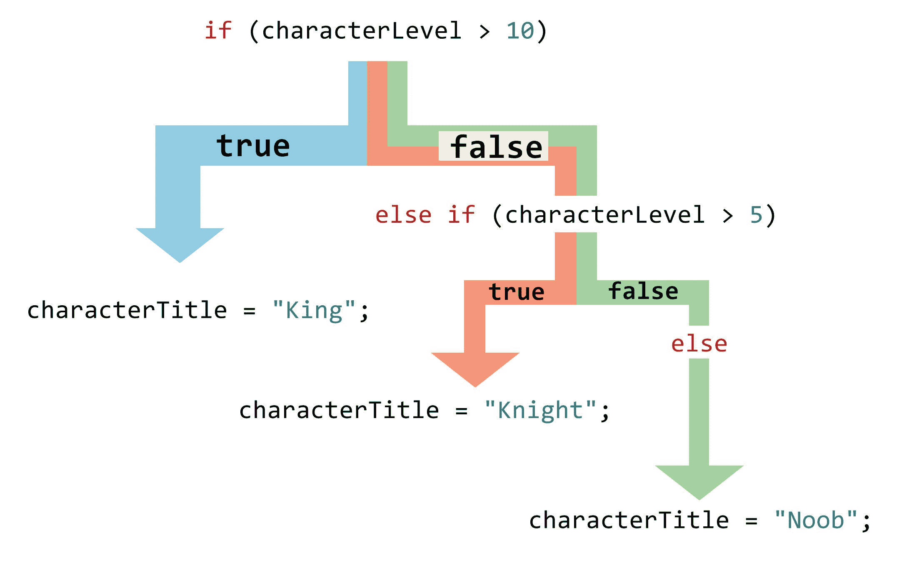

图 1-7：包含 if 语句、else-if 语句和 else 语句的 if-else 

### 函数与 If-Else 块

函数回来了！事实证明，通过使用 if-else 块可以让我们的函数更强大。if-else 块的工作方式与以前一样，但由于现在我们将它们封装在函数内部，这意味着我们有更多的大括号需要担心。看看你是否可以查看下面的示例函数，并确定哪个左大括号对应哪个右大括号。

```
***** 示例 1*****
String theUltimateAnswer(boolean inBinary) {
   String prefix = “The answer to life the universe and everything:”;
   if (inBinary) {
      return prefix + 101010;
   } else {
      return prefix + 42;
   }
}

***** 示例 2*****
boolean isLessThanTen(int num) {
   if (num < 10) {
      return true;
   } else {
      return false;
   }
}

***** 示例 3*****
boolean isEven(int num) {
   if (num % 2 == 0) {
      return true;
   } else {
      return false;
   }
}

***** 示例 4*****
String desertSecurity(boolean hasGun, boolean hasRobots) {
        if (hasGun) {
        return "I've got a bad feeling about this";
        } else if (hasRobots) {
                return "These are droids we are looking for.";
        } else {
                return "Move along.";
```

### 嵌套 If-Else

现在我们已经掌握了通过大括号来确定每个块的开始和结束，让我们更进一步。假设我们想在一个通用的结构中嵌套 if 语句：

```
***** 列表 1.12：可以看电影吗？不完整）*****
01 boolean canWatch(int age, int minimumAge, boolean fakeID, boolean withParent) {
02      if (fakeID) {
03         return true;
04      } else if (withParent) {
05         return true;
06      } else {
07         // 嵌套的 if 语句在这里。
08      }
09 }
```

```
***** 列表 1.13：内部分支*****
if (age >= minimumAge) {
   return true;
} else {
   return false;
}
}
```

现在，将列表 1.12 和列表 1.13 组合在一起得到列表 1.14：


***** 列表 1.14：可以看电影吗？完整）*****

```
01 boolean canWatch(int age, int minimumAge, boolean fakeID, boolean withParent) {
02       if (fakeID) {  
03          return true;
04       } else if (withParent) {
05          return true;
06       } else {
07          if (age >= minimumAge) {
08             return true;
09          } else {
10             return false;
11          }      
12       }
13 }
```

### 简化布尔语句

虽然列表 1.14 中的代码运行完美，但我们可以像列表 1.15 所示对其进行一些清理。

***** 列表 1.15：可以看电影吗？（简化 #1）*****

```
01 boolean canWatch(int age, int minimumAge, boolean fakeID, boolean withParent) {
02      if (fakeID || withParent) {  // 两种情况合并到了 if 语句中。
03         return true;
04      } else {
05         if (age >= minimumAge) {
06            return true;
07         } else {
08            return false;
09         }      
10      }
11 }
```

***** Listing 1.16 : 我能看电影吗？(简化 #2)*****

```
01 boolean canWatch(int age, int minimumAge, boolean fakeID, boolean withParent) {
02      if (fakeID || withParent || age >= minimumAge) {  
03         return true;
04      } else {
05         return false;
06      }
07 } 
```

信不信，我们可以通过完全移除 `if-else` 块并直接返回 `(fakeID || withParent || age >= minimumAge)` 的值来进一步简化代码，如列表 1.17 所示。

***** Listing 1.17 : 我能看电影吗？(简化 #3)*****

```
01 boolean canWatch(int age, int minimumAge, boolean fakeID, boolean withParent) {
02      return (fakeID || withParent || age >= minimumAge);  
03 }
```

编写这样的整洁代码可以让你（以及你的合作者）更高效地工作，而无需处理像列表 1.14 中那样复杂的逻辑。在本书接下来的部分，我们将介绍更多编写整洁代码的技术。

## 控制流部分 2 – While 和 For 循环

在上一节中，我们讨论了使用 `if` 和 `else` 块来对代码进行分支。现在我们将检查两种类型的循环：`while` 循环和 `for` 循环。循环允许我们执行重复任务。循环对我们来说特别重要，因为游戏没有循环无法运行！

### While 循环

假设我们要写一个函数，打印到给定输入 `n` 的所有正整数。解决这个问题的策略（算法）如下：

1. 创建一个新的整数并将其初始化为 1。
2. 如果这个整数小于或等于给定输入 `n`，则打印它的值。
3. 将整数加 1。
4. 重复步骤 2 和 3。

我们已经学习了如何执行该算法的前三步了。让我们写下我们已经知道的内容：

***** Listing 1.18 : 计数器（不完整）*****

```
01 ????? countToN(int n) {
02   int counter = 1; // 1\. 创建一个新的整数，将其初始化为 0。
03   if (counter <= n) { // 2\. 如果这个整数小于或等于输入
04      print(counter); // 打印值
05      counter = counter + 1; // 3\. 将整数加 1
06   }
07 } 
```

我们必须解决代码中的两个问题。首先，我们的函数返回类型应该是什么（由列表 1.18 第 1 行的问号表示）？应该是 `int` 吗？实际上，在我们的情况下，我们甚至没有返回语句；这个函数没有产生任何我们可以使用的结果。当我们不返回任何值时（如上一个函数所示），我们称返回类型为 `void`。

其次，我们如何让这段代码重复执行步骤 2 和 3 呢？其实非常简单。我们使用 `while` 循环——只要满足某个条件，循环就会一直运行。在我们情况下，我们做的只需要将单词“`if`”替换为单词“`while`”。完成的函数在列表 1.19 所示：

***** Listing 1.19 : 计数器（完整）*****

```
01 void countToN(int n) {
02   int counter = 1; // 1\. 创建一个新的整数，将其初始化为 0。
03   while (counter <= n) { // 2\. 如果这个整数小于或等于输入
04      print(counter); // 打印值
05      counter = counter + 1; // 3\. 将整数加 1
06   }
07 }
```

让我们逐行查看函数（列表 1.19）：

* 第 1 行声明了函数的返回类型（`void`）、名称（`countToN`）和输入（`n`）。
* 第 2 行声明了一个名为 `counter` 的新整数并赋值为 1。
* 第 3 行开始了一个 `while` 循环，只要满足条件 `(counter <= n)`，循环就会一直运行。
* 第 4 行打印变量 `counter` 的当前值。
* 第 5 行将 `counter` 加 1。

当我们到达第 5 行的末尾时（第 6 行的大括号表示循环的结束），我们的代码将再次执行第 3 行！这会一直重复，直到 `counter` 大于 `n`，此时我们跳出 `while` 循环。为了看到运行效果，让我们从代码的其他地方调用此函数。

```
 print(“Initiate counting!”);
countToN(5); // 使用参数 5 调用我们的 countToN() 函数。
```

相应的输出如下框所示：

```
 Initiate counting!
1
2
3
4
5
Counting finished! 
```

`while` 循环就是这些了！只需要取一个 `if` 语句并把“`while`”单词丢进去，你的代码就会重复执行任务！

##### 关键点

While 循环

只要给定的条件为真（`true`），`while` 循环就会继续迭代。如果我们有一个始终为真的条件，例如 `while (5 > 3)` ……，那么我们的 `while` 循环将永远不会终止。

### For 循环

只要给定的条件为真（`true`），`for` 循环就会继续迭代。如果我们有一个始终为真的条件，例如 `while (5 > 3)` ……，我们的 `for` 循环将永远不会终止。

当你知道循环应该运行次数时，`for` 循环通常比 `while` 循环更简洁。1.19 中的计数器可以重写为 1.20。

***** Listing 1.20 : 计数器（for 版本）*****

```
01 void countToN(int n) {
02   for (int i=1; i<=n; i++) {
03      print(i); 
04   }
05 }
```

一旦你掌握了语法，写 `for` 循环比写 `while` 循环快得多。

## 辅助轮已经收走了！

如果你已经走到了这里，恭喜你！你已经迈向进入美丽、复杂且偶尔令人沮丧的编程世界的重要一步。但你必须写一些 Java 代码。

# 第 2 章：开始 Java

第 1 章完全是为了为你成为 Java 程序员做准备。在本章中，你将编写 Java 程序（包括一个简单的游戏），并学习如何将游戏的角色、道具和其他实体表示为 Java 对象。

## 面向对象编程

Java 是一种面向对象的语言。在面向对象的范式中，我们以对象的形式表示数据，以帮助我们构思和交流想法。例如，在构建视频共享网络应用程序时，我们可能通过创建一个 `User` 对象来表示每个用户账户（以及它的所有数据，如用户名、密码、上传的视频等）。每个上传的视频可以使用 `Video` 对象表示，其中许多视频可以组合在一个 `Playlist` 对象中。

面向对象编程允许我们将相关数据组织在一起，从而编写整洁、健壮且易于读写的代码。为了探索这个想法，我们将编写第一个程序。

##### 关键点

访问书籍的配套网站

书中的所有代码示例、错误说明以及额外的奖励内容都可以在本书的配套网站获得：[jamescho7.com](https://jamescho7.com)

Java 的安装可能有点复杂。在本章的任何时候如果你迷了方向，请访问配套网站。有视频指南帮助你完成初始的 Java 设置。

## 设置开发环境

在我们编写简单的 Java 程序和构建令人兴奋的游戏之前，我们必须在机器上安装一些软件。不幸的是，这有点枯燥且耗时，但一旦我们的第一个程序运行起来，一切都是值得的！

## 安装 Eclipse

我们将使用一个集成开发环境（IDE）来编写 Java/Android 应用程序。IDE 只是一个工具的高级名称，它可以帮助你轻松地编写、构建和运行程序。

我们将使用的 IDE 称为 `Eclipse`，它是一款强大的开源软件。然而，我们不会安装纯净的 `Eclipse`，而是下载 Google 修改过的版本：Android 开发者工具 (ADT) 软件包。让我来解释一下这些术语的含义。

为了构建 Android 应用程序，你必须安装 Android SDK（软件开发包）。通常情况下，你需要从 `Eclipse` 独立下载它，并使用插件（一种为 `Eclipse` 提供额外功能的加载项）将其集成；然而，Google 让这个过程变得简单得多，它允许你直接下载一个包含 `Eclipse` 和 Android SDK 的包—— ADT 软件包。请按照以下步骤操作，为你的机器进行 Java/Android 开发做好准备：

* 要下载 ADT 软件包，请访问以下网站：[`developer.android.com/sdk/index.html`](http://developer.android.com/sdk/index.html)
* 你将看到一个与图 2-1 所示类似的页面。


图 2-1 Android SDK 下载页面

一旦进入此页面，点击“Download Eclipse ADT”按钮。该网站会自动检测你的操作系统，以便你下载正确的版本。

* 你随后将看到以下屏幕：

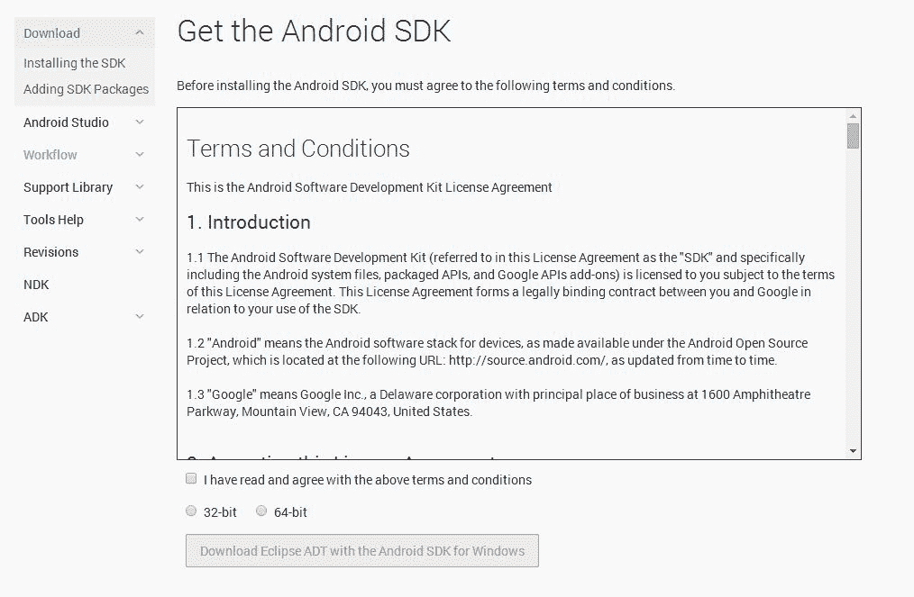
图 2-2: 32 位或 64 位

你将根据你的操作系统类型下载 32 位或 64 位版本。不确定你拥有的是哪个版本吗？以下是查看方法：

### 在 Windows 上检查操作系统类型

在 Windows 上，右键点击 `我的电脑` 并点击 `属性`。或者，你也可以导航到 `控制面板` 并搜索 `系统`。你将看到一个如图 2-3 所示的窗口。

如果你的机器是 32 位的，你将看到 `32 位操作系统` 或 `x86 基于处理器`。否则，你应该看到 `64 位操作系统`。请记住此版本，并下载相应的 ADT 版本。

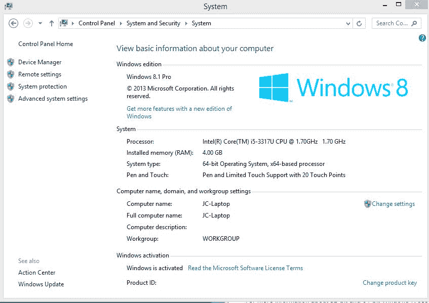
图 2-3: Windows 系统信息

### 在 Mac OS X 上检查操作系统类型

要检查你拥有的是 32 位还是 64 位的操作系统，你必须检查你的处理器类型。下方链接的页面将告诉你如何确定和解释这些信息：[`support.apple.com/kb/HT3696`](http://support.apple.com/kb/HT3696)

记住你的操作系统版本并下载相应的 ADT 版本。

* 下载将是一个较大的 `.zip` 文件（在编写时约为 350 MB）。你只需将文件解压到你认为方便的文件夹中即可。你不需要安装它。

解压后，你应该看到两个文件夹和一个名为 `SDK Manager` 的文件。你现在只需要关注 `eclipse` 文件夹，因为我们直到后面的章节才会开始处理 Android 开发。

### 安装 Java 开发包

Eclipse 是使用 Java 构建的。这意味着你需要在计算机上安装 Java 运行环境 (JRE) 以在你的机器上运行它。由于我们将既要运行 Java 程序又要开发 Java 程序，因此我们将安装 JDK（Java 开发包），它包含了 JRE 和开发工具。

1. 要安装 JDK，请访问以下页面：[`www.oracle.com/technetwork/java/javase/downloads/index.html`](http://www.oracle.com/technetwork/java/javase/downloads/index.html) 

   截至本文写作，JDK 的最新版本是 `JDK 8`。出于兼容性考虑，我们将使用 `JDK 7`，以免在 Android 开发中遇到问题。

   向下滚动直到看到 `Java SE 7uNN`，其中 `NN` 是 Java 7 最新的 2 位更新数字。在下方的图 2-4 所示，当前版本是 `Java SE 7u55`。最新版本将取决于你阅读这本书的时间。

   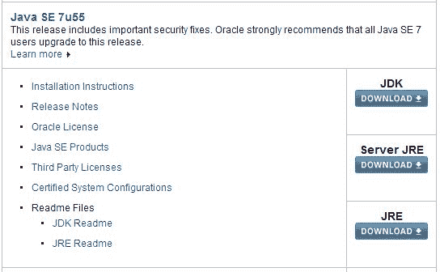
   图 2-4: Java SE 7 下载框

2. 点击 `JDK` 下方的 `DOWNLOAD` 按钮。你将被引导到如图 2-5 所示的框中

   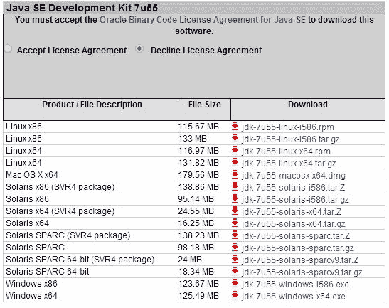
   图 2-5: JDK 7 下载页面

3. 勾选 `Accept License Agreement` 并下载适用于你操作系统的 JDK 版本。在这里，`x86` 指 32 位，`x64` 指 64 位。如果你忘记了这些信息，请参考上一节的第 3 步。

4. 一旦下载完成，使用默认设置安装文件。

### 打开 Eclipse

现在我们已经下载了所有必要文件，导航到解压后的 `ADT Bundle` 文件夹并打开 `eclipse` 文件夹。进入文件夹后，启动 eclipse 应用程序（在 Windows 上称为 `eclipse.exe`）。

如果你看到关于未定义 `PATH` 变量的错误，这意味着 Eclipse 无法找到 JRE。

“New Java Class”对话框将会打开。我们只需提供类名 `FirstProgram`，保持其他所有设置不变，然后点击 `Finish`，忽略关于默认包的警告即可。

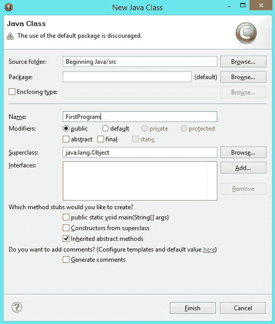
图 2-13：新建 Java 类对话框

我们的 `FirstProgram` 类将在编辑器（Editor）窗口中自动打开。如果没有打开，请双击左侧包资源管理器（Package Explorer）中的 `FirstProgram.java` 文件。

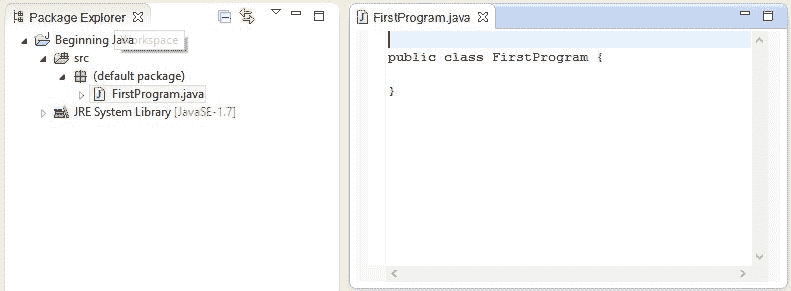
图 2-14：我们的第一个类

Eclipse 将为生成一些基础代码——如列表 2.01 所示。注意，我为这段代码添加了一些额外的注释，以解释每行代码的作用——除非你手动添加，否则这些注释不会出现在你的代码中！

***** Listing 2.01 FirstProgram.java*****

```
01      public class FirstProgram {  // 表示类的开始
02                      // 方法写在这里！
03      } // 表示类的结束
```

请密切注意大括号：`{` 和 `}`。前者表示类 `FirstProgram` 的开始，后者表示类的结束。我们这些大括号之间编写代码。大括号让初学 Java 的程序员感到非常头疼，因此在接下来的几个示例中，我将通过标记它们来帮助你。你应该留意大括号，并习惯看到大括号之间的关系。

#### 主方法 (Main Method)

Java 程序从 `main` 方法开始。`main` 方法被称为 Java 程序的起点。当你构建并执行程序时，你在 `main` 方法中提供的任何指令都将是第一个执行的代码。在 `FirstProgram` 类内部（大括号之间）添加以下代码段。

***** Listing 2.02 The Main Method*****

```
        public static void main(String[] args) {
                    // 这是你程序的起点。
        } // main 方法结束 
```


`public`、`static`、`String[]` 和 `args` 这几个单词让初次学习 Java 的程序员感到非常困惑。我们很快就会回到这些单词上。现在，专注于我们已知的三件事：方法名、方法参数（输入）和返回类型。

参考列表 2.02 中的代码，正如你所猜的那样，方法名是 `main`。它接收一个参数——一组 `String` 对象——我们给它命名为 `args`（这个名字来自惯例。如果你觉得开心，可以把它命名为 `rabbits`！）。返回类型正如关键字 `void` 所示，是空（；我们没有在 `main` 方法中提供任何结果或输出。

你在 Eclipse 中的程序现在应该看起来像图 2-15 所示。

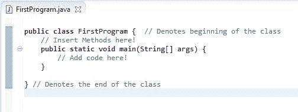

图 2-15：添加主方法

如果你在此处遇到困难，我建议你访问该书籍的配套网站 [jamescho7.com](http://jamescho7.com)。那里有一个视频指南可以帮助你顺利地启动并运行！

## 声声你好 (Saying Hello)

学习新编程语言时，传统的做法是在控制台打印“Hello, world”。这具有重要意义，原因有二：首先，如果你能成功地做到这一点，你就知道你的机器已经为开发配置妥当（即我们的 IDE 和 Java 安装在后台运行良好）。其次，这意味着你已经在新环境中执行了第一行代码，你准备好进入下一个阶段了！

在第 1 章中，你学习了可以使用 `print()` 函数来打印内容。遗憾的是，Java 没有这种简单的 `print` 函数，由于它是面向对象的设计（我们很快就会探索）。相反，我们必须使用：`System.out.println()`，其中最后两个字母是小写的 `LN`，单词 line 的缩写。

在你的 `main` 方法中（大括号之间）添加以下行代码，记住 `println()` 的拼写是 `LN` 而不是 `IN`。

```
System.out.println("Hello, world! I am now a Java programmer");
```

你完成后的类现在应该像列表 2.03 所示。

```
***** FirstProgram.java – Hello World! *****

01 public class FirstProgram {  // 表示类的开始
02              
03      public static void main(String[] args) {  // main 方法开始
04              System.out.println("Hello, world! I am now a Java programmer");
05      } // main 方法结束
06
07 } // 表示类的结束
```

注意，我们使用缩进来表示层级结构。`FirstProgram` 类包含一个 `main` 方法，它缩进了一次。相反，`main` 方法包含我们的 `println` 语句，它缩进了两次。这种格式允许我们快速确定代码行如何形成结构，以及每个部分的开始和结束位置。

## 执行 Java 程序 (Executing Java Programs)

要执行程序，我们只需在项目的 `src` 文件夹（或我们的 `FirstProgram` 类）上右键点击（Mac 上按 Control 点击），点击 `Run As > Java Application`，如图 2-16 所示。

当你运行程序时，控制台（Console）应该弹出（如图 2-17 所示）并显示消息“Hello, world! I am now a Java programmer”。如果由于某种原因它没有出现，你可以通过点击 `Window` 菜单并选择 `Show View > Console` 来显示。


图 2-16：运行应用程序


图 2-17：控制台显示 FirstProgram 的输出

成功！如果你能得到这个结果，恭喜你！你编写了第一个 Java 程序。如果你在显示方面遇到困难，请访问本书的配套网站 jamescho7.com。那里有一个视频指南将引导你完成步骤并确保你能这样做。

## 解释魔法——编译器与 JVM (Explaining the Magic)


图 2-18：Java 魔法？

在我们点击运行按钮和出现“Hello, world?”之间发生了什么？难以相信，背后发生了很多事情。当源代码被编写时，它被我们的 Java 编译器编译，这意味着代码经过了错误检查并转换为机器可以理解的语言。这台机器被称为 JVM（Java 虚拟机），它执行了我们的代码，并在控制台上打印了所需的文本。

`JVM` 正如名是一个虚拟机。它运行在操作系统之上，能够执行 Java 指令。使用这种虚拟机的优势在于你可以在一个操作系统（如 Windows 或 Mac）上编写跨平台的 Java 代码并在另一个操作系统上运行。

## 构建简单的计算器程序 (Building a Simple Calculator Program)

现在我们已经热了身，让我们回到第 1 章中讨论过的概念，并构建一个简单的计算器程序。让我给你一些独立设置新 Java 程序的机会：

1. 创建一个新的 Java 项目（命名为 `SecondProject`）。
2. 在 `src` 文件夹中创建一个新类（命名为 `SimpleCalculator`）。
3. 创建一个 `main` 方法。

如果在任何时候遇到困难，你应该参考之前的章节。一旦你遵循了上述步骤，你应该会得到类似于列表 2.04 的内容。

```
***** Listing 2.04 The SimpleCalcualtor class *****

public class SimpleCalculator {

        public static void main(String[] args) {

        }

}
```

我们计算器应用背后的原理将很简单。我们将创建两个 `float` 变量代表我们的两个操作数。我们将创建第三个变量来表示我们想要执行的操作。

我们将使用一个整数来表示我们的操作，遵循以下规则：

1. 加法
2. 减法
3. 乘法
4. 除法

我们的源代码将检查并使用三个变量的值来产生请求的算术结果。请将以下代码添加到你的 `SimpleCalculator` 类中。新代码位于第 04 到 31 行。

```
***** Listing 2.05 *****

01 public class SimpleCalculator {
02      
03   public static void main(String[] args) {
04      float operand1 = 5;
05      float operand2 = 10;
06      int operation = 1;
07
08      if (operation == 1) { 
09
10              // Addition
11              System.out.println(operand1 + " + " + operand2 + " =");
12              System.out.println(operand1 + operand2);
13
14      } else if (operation == 2) {
15
16              // Subtraction
17              System.out.println(operand1 + " - " + operand2 + " =");
18              System.out.println(operand1 - operand2);
19
20      } else if (operation == 3) {
21
22              // Multiplication
23              System.out.println(operand1 + " * " + operand2 + " =");
24              System.out.println(operand1 * operand2);
25
26      } else {
27
28              // Division
29              System.out.println(operand1 + " / " + operand2 + " =");
30              System.out.println(operand1 / operand2);
31      }
32
33   }
34 }
```

运行程序！你应该得到以下输出：

```
 5.0 + 10.0 =
15.0 
```

花一点时间查看一下代码。让我们确保我们可以逐行步进代码，并描述正在发生什么。

我们首先声明两个名为 `operand1` 和 `operand2` 的新 `float` 变量，并将它们初始化为值 5 和 10。我们声明了第三个变量 `operation`，并为其赋值为 1。

之后，我们有一系列 `if` 语句，它们测试 `operation` 变量的值以确定要执行正确的操作。当 `if` 语句满足条件时，会执行两个 `System.out.println()` 语句，打印出我们看到的结果。注意这里，我们通过使用加运算符 `+` 将字符串与 `float` 值进行拼接（组合）。

现在，如果我们想计算 `25 * 17` 的值，我们需要修改什么呢？我们只需要将 `operand1` 的值改为 25，`operand2` 改为 17，并将 `operation` 改为 3，如代码列表 2.06 所示。

```
***** Listing 2.06 The Modified SimpleCalcualtor class  *****

public class SimpleCalculator {

public static void main(String[] args) {

                float operand1 = 5;

                float operand2 = 10;

                int operation = 1;

                float operand1 = 25;

                float operand2 = 17;

                int operation = 3;

                if (operation == 1) { 

                        // Addition

                        System.out.println(operand1 + " + " + operand2 + " =");

                        System.out.println(operand1 + operand2); 

                } else if (operation == 2) {

                        // Subtraction

                        System.out.println(operand1 + " - " + operand2 + " =");

                        System.out.println(operand1 - operand2);

                } else if (operation == 3) {

                        // Multiplication

                        System.out.println(operand1 + " * " + operand2 + " =");

                        System.out.println(operand1 * operand2);

                } else {

                        // Division

                        System.out.println(operand1 + " / " + operand2 + " =");

                        System.out.println(operand1 / operand2);

                }

        }

}
```

再次运行程序，我们应该看到：

```
 25.0 * 17.0 =
425.0 
```

我们的 `SimpleCalculator` 现在并不好用。每当我们想要执行简单的计算时，它要求我们修改代码。更好的解决方案是让程序用户为我们提供 `operand1`、`operand2` 和 `operation` 的所需值。事实证明 Java 为我们提供了实现的方法，但这要求我们先理解如何操作对象，因此我们暂时暂缓这个讨论。

## 构建一个简单的计数程序

在下一个示例中，我们将利用在第 1 章中讨论过的 `for loop` 来打印数字 5 到 12 之间所有的偶数。这是一个简单的演示示例，但掌握复杂的 `for loop` 语法是非常重要的。

创建一个名为 `CountingProject` 的新 Java 项目，创建一个名为 `EvenFinder` 的新类，并按照代码列表 2.07 所示添加 `main` 方法。

```
***** Listing 2.07 The EvenFinder class *****

01 public class EvenFinder {

02

03      public static void main(String[] args) {

04              int startingNum = 5;

05              int endingNum = 12;

06                      

07              for (int i = startingNum; i < endingNum + 1; i++) {

08                      

09                      // Execute following code if i < endingNum + 1

10              

11                      if (i % 2 == 0) {

12                              System.out.println(i + " is an even number.");

13                      } else {

14                              System.out.println(i + " is an odd number.");

15                      }

16                              

17                      // Repeat for loop

18              }

19      }

20 }
```

运行程序，你应该看到以下输出：

```
 5 is an odd number.
6 is an even number.
7 is an odd number.
8 is an even number.
9 is an odd number.
10 is an even number.
11 is an odd number.
12 is an even number. 
```

回想一下 `for` 循环包含三个部分。我们首先初始化计数器变量 `i`。然后我们提供一个终止条件，它表示“运行循环直到该条件不再满足”。最后，我们提供一个计数器的递增规则。

在之前的例子中，计数器从 5 开始，只要它的值小于 `endingNum + 1` 就会增加。当 `i` 等于 `endingNum + 1` 时，循环终止（循环体不再执行），程序结束。

`class` 为创建 Java 对象提供了一个模板。一个常见的类比是将 `class` 描述为蓝图。以下是一个 `Phone` 类的可能样子：

```
***** Listing 2.08 An Example Phone Class *****

01  public class Phone {

02

03      // These variables describe the Phone object's state

04      boolean poweredOn;

05      boolean playingMusic;

06      String phoneManufacturer;

07      double androidVersionNumber;

08

09      // These methods are the Phone object's behaviors

10      void togglePower() {

11              if (poweredOn) {

12                      System.out.println("Powering off!");

13                      poweredOn = false;

14                      playingMusic = false;

15              } else {
```


16                      `System.out.println("Powering on!");`

17                      `poweredOn = true;`

18              }

19      } // ends togglePower method

20

21      void `playMusic()` {

22              if (`poweredOn`) {

23                      `System.out.println("Playing music!");`

24                      `playingMusic = true;`

25              }

26      } // ends playMusic method

27

28      void `upgrade(double newVersion)` {

29              if (`newVersion > androidVersionNumber`) {

30                      `androidVersionNumber = newVersion;`

31           } else {

32                      `System.out.println("Upgrade failed!");`

33          }

34      } // ends upgrade method

35

36  } // ends class

```

列表 2.8 所示的这个 `Phone` 类是创建单个 `Phone` 对象的蓝图。它告诉我们对象为了成为一个 `Phone` 对象需要哪些属性（状态和行为）。我们将通过代码来探索这意味着了什么，并在稍后的章节中讨论类与对象关系的影响。

### 关键点

#### 关于命名规范的简要说明

你可能已经注意到，我们在为类、变量和方法命名时遵循了一些规范。这些是您应该学习并遵循的约定俗规则。让我们详细介绍这些规则。类名、变量名和方法名应该始终单词（多个单词组合成一个）。在为类命名时，我们使用所谓的大驼峰命名法（UpperCamelCase），即每个单词的首字母都大写。在本书中，类名用**粗体、等宽字体**编写。以下是正确的类名（注意它们都是名词）：

```
Game    DragonKnight    SimpleCalculator    MathHelper
```

在为变量和方法命名时，我们使用驼峰命名法（camelCase）。我们将名称的第一个单词小写，并将后续每个单词的首字母大写。在本书中，变量和方法名用普通等宽字体编写。以下是正确的变量和方法名（注意变量名是名词，而方法名是动词）：

```
versionNumber    drawCharacter()          addNum()    failingStudent
```

## 对象操作

我们现在来练习操作 Java 对象。创建一个名为 `BasicObjects` 的新 Java 项目。然后，创建一个名为 `World` 的新类，并为它提供一个简单的“Hello, world!”主方法，如列表 2.09 所示。

```
***** Listing 2.09 - World.java*****

public class World {

        public static void main(String[] args) {

                System.out.println(“Hello, world!”);

        }

}
```

`World` 类将代表一个小的虚拟世界，我们可以在其中填充对象。它也将是我们程序的入口（我们运行以启动程序的类），因此需要 `main` 方法。

在同一个 `src` 文件夹中，创建第二个名为 `Phone` 的类，如图 2-20 所示。

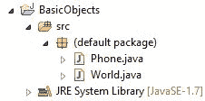

图 2-20：BasicObjects 的类结构

将列表 2.08 中的 `Phone` 类复制到 Eclipse 中的 `Phone.java` 文件中。`Phone` 类**不应该**有 `main` 方法。`Phone` 类的目的仅仅是存储有关虚拟设备的信息；它只是一个虚拟手机的表示，仅此而已。`Phone` 和 `World` 类共同构成一个程序，在本书中我们的程序通常只有一个 `main` 方法——这意味着启动它们的方法只有一种。

你能预测如果我们运行这个包含两个类的程序会发生什么吗？`World` 类的代码会运行吗？`Phone` 类的代码会运行吗？只有一种方法可以发现。右键点击 `src` 文件夹（Mac 上按 Control + 点击）并将项目作为 Java 应用程序运行启动程序。你应该看到以下输出：

```
Hello, world!
```

我们的项目有两个类，但 Eclipse 能够找到包含 `main` 方法的类（`World.java`）并运行它。尽管 `Phone` 类中有很多代码，但其中没有任何代码对我们的输出产生任何影响，因为我们从未要求 `main` 方法使用 `Phone` 类来执行任何行为。让我们改变这一点。

## 创建新的对象变量

我们将使用 `Phone` 类作为蓝图来创建一个新的 `Phone` 对象变量。要做到这一点，我们使用以下语法：

```
Phone myPhone = new Phone();
```

创建对象变量遵循与我们之前创建基本类型变量时相同的模式。我们首先声明类型（`Phone`），然后分配一个名称（`myPhone`），最后赋值值。

语法上的差异出现在最后一步。为了创建一个新的 `Phone` 对象，我们必须使用 Java 的内置关键字 `new` 并声明我们用于创建 `Phone` 对象的蓝图，即 `Phone` 类。让我们将上述代码添加到列表 2.10 的第 5 行 `main` 方法中。

```
***** Listing 2.10 - World.java (Updated)*****

01  public class World {

02              

03      public static void main(String[] args) {

04                      System.out.println("Hello, world!");

05                      Phone myPhone = new Phone();

06              }

07  }
```

我们将在书中后面讨论 `new` 关键字的影响以及当我们声明 `Phone()` 时究竟发生了什么。

## 赋值和访问状态

现在我们可以访问 `Phone` 对象了！`myPhone` 代表使用 `Phone` 类创建的单个 `Phone` 对象。它与未来可能使用我们的蓝图（`Phone` 类）创建的任何其他 `Phone` 对象都是独立的实体。我们使用“实例”来描述这种现象。

为了详细说明，让我们思考当我们在工厂批量生产智能手机时发生了什么。我们使用相同的蓝图创建成千上万台设备，但它们都是独立的。它们各自拥有属性和行为，这意味着关闭一台设备不会影响使用相同蓝图制造的其他手机。从同一个类创建的每个对象都是该类的独立实例，并接收描述对象状态的各种变量的副本。这些变量被称为*实例变量*。

我们现在可以开始修改 `myPhone` 的状态并调用它的行为。让我们首先为我们的单个 `Phone` 对象状态分配一些初始值，如列表 2.11 所示（第 6 到第 9 行）：

```
***** Listing 2.11 - World.java (Updated #2)*****

01  public class World {

02              

03      public static void main(String[] args) {

04              System.out.println("Hello, world!");

05              Phone myPhone = new Phone();

06              myPhone.poweredOn = true;

07              myPhone.playingMusic = false;

08              myPhone.phoneManufacturer = "Samsung";

09              myPhone.androidVersionNumber = 4.4;

10      }

11  }
```

请注意我们是如何访问属于我们的 `Phone` 对象的实例变量的。要从对象中检索特定变量，我们使用`点运算符`（dot operator）。点运算符用于指示所有关系。例如，`myPhone.poweredOn` 指的是属于 `myPhone` 对象的 `poweredOn` 变量。

现在我们已经为 `Phone` 对象的变量分配了一些初始值，`myPhone` 是一个描述性数据的集合。如果有人可以访问我们的 `myPhone` 对象，他或她可以通过打印这些值来准确了解 `myPhone` 的当前状态，如列表 2.12（第 11 至 15 行）所示：

```
***** Listing 2.12 - World.java (Updated #3)*****

01  public class World {

02              

03      public static void main(String[] args) {

04              System.out.println("Hello, world!");

05              myPhone = new Phone();

06              myPhone.poweredOn = true;

07              myPhone.playingMusic = false;

08              myPhone.phoneManufacturer = "Samsung";

09              myPhone.androidVersionNumber = 4.4;

10              

11              System.out.println("myPhone's state:");

12              System.out.println("Powered on: " + myPhone.poweredOn);

13              System.out.println("Playing music: " + myPhone.playingMusic);

14              System.out.println("Manufacturer: " + myPhone.phoneManufacturer);

15              System.out.println("Version: " + myPhone.androidVersionNumber);

16      }

17  }
```

再次运行程序。你应该能看到以下输出：

```
Hello, world!

myPhone's state:

Powered on: true

Playing music: false

Manufacturer: Samsung

Version: 4.4
```

如你所见，我们能够将有意义的数据分组成一个包——一个名为 `myPhone` 的 `Phone` 对象。`myPhone` 现在是一个复杂的信息集合。我们将在接下来的章节中探索这如何有用。

## 调用对象的行为

在上一节中，我们讨论了如何分配和访问创建的对象的状态（变量）。接下来，将讨论*方法*（methods），并学习如何调用对象的行为。

调用方法也需要我们使用点运算符。我们使用点运算符来引用属于特定对象的方法。在列表 2.12 显示的 `main` 方法底部添加两行代码：

```
myphone.togglePower();

myphone.upgrade(4.5);
```

如果我们回顾自己的 `Phone` 类，会发现 `togglePower` 方法检查 `boolean poweredOn` 的当前值，并将其反转（true 变为 false，false 变为 true）。由于由于我们在创建对象时 `myPhone` 初始是开启电源的，因此我们预计 `myPhone` 现在将关闭电源。我们还可以预测 `myPhone` 的 `androidVersionNumber` 已经从 4.4 变为了 4.5。

为了测试这一点，我们将再次打印 `myPhone` 对象的状态，在 `main` 方法底部添加一些打印语句，如列表 2.13 所示：

```
***** Listing 2.13 - Printing myPhone’s State*****

01  public class World {

02              

03      public static void main(String[] args) {

04              System.out.println("Hello, world!");

05              Phone myPhone = new Phone();

06              myPhone.poweredOn = true;

07              myPhone.playingMusic = false;

08              myPhone.phoneManufacturer = "Samsung";

09              myPhone.androidVersionNumber = 4.4;

10                      

11              System.out.println("myPhone's state:");

12              System.out.println("Powered on: " + myPhone.poweredOn);

13              System.out.println("Playing music: " + myPhone.playingMusic);

14              System.out.println("Manufacturer: " + myPhone.phoneManufacturer);

15              System.out.println("Version: " + myPhone.androidVersionNumber);

16                      

17              myPhone.togglePower();

18              myPhone.upgrade(4.5);

19              

20              // include “\n” to skip a line when printing.

21              System.out.println("\nmyPhone's NEW state:");

22              System.out.println("Powered on: " + myPhone.poweredOn);

23              System.out.println("Playing music: " + myPhone.playingMusic);

24              System.out.println("Manufacturer: " + myPhone.phoneManufacturer);

25              System.out.println("Version: " + myPhone.androidVersionNumber);

26      }

27  }
```

对应的输出是：

```
Hello, world!

myPhone's state:

Powered on: true

Playing music: false

Manufacturer: Samsung

Version: 4.4

Powering off!

myPhone's NEW state:

Powered on: false

Playing music: false

Manufacturer: Samsung

Version: 4.5
```

正如预期的那样，我们的手机已经关闭了电源，版本号现在是 4.5。我们能够调用 `myPhone` 的行为来执行特定的操作以修改 `myPhone` 的状态。

## 隐藏我们的变量

注意，到为止我们能够通过两种不同的方式修改 `Phone` 对象的状态。我们可以使用点运算符*直接*访问它的变量并分配显式值，还可以利用 `Phone` 对象提供的行为来*间接*修改我们的 `Phone` 对象的状态。

如果我们能够*直接*进入我们的 `myPhone` 对象并提取和修改其信息，我们就说该对象的变量是暴露的。从现在起，我们将克制暴露变量的行为，因为出于许多原因这可能会产生问题。

例如，如果有人尝试给变量分配一个*非法*（或不合逻辑）的值会怎样？以下代码会被我们的 Java 程序接受，但如果我们以后扩展此程序，且这些值实际上对某些其他功能至关重要，那么可能会在以后引起问题。

```
myPhone.androidVersionNumber = -10;     // 版本应该是正数

myPhone.poweredOn = false;              // 这没问题

myPhone.playingMusic = true;            // 关机时不应该播放音乐
```


让我们记住上述原则，并尝试改进我们的程序。首先，我们将 Java 内置关键字 `private` 作为修饰符添加到所有 `Phone` 对象的变量中，如代码列表 2.14 所示（第 04 到 07 行）。

```
***** Listing 2.14 - 隐藏 Phone 类中的变量 *****

01  public class Phone {

02

03      // 这些变量描述了 Phone 对象的状态

04      private boolean poweredOn;

05      private boolean playingMusic;

06      private String phoneManufacturer;

07      private double androidVersionNumber;

08

09      // 这些方法是 Phone 对象的行为

10      void togglePower() {

11              if (poweredOn) {

12                      System.out.println("Powering off!");

13                      poweredOn = false;

14                      playingMusic = false;

15              } else {

16                      System.out.println("Powering on!");

17                      poweredOn = true;

18              }

19       // ends togglePower method

20

21      void playMusic() {

22              if (poweredOn) {

23                      System.out.println("Playing music!");

24              }

25      } // ends playMusic method

26      

27      void upgrade(double newVersion) {

28              if (newVersion > androidVersionNumber) {

29                      androidVersionNumber = newVersion;

30           } else {

31                      System.out.println("Upgrade failed!");

32          }

33      } // ends upgrade method

34

35  } // ends class
```

将我们的变量设置为 `private` 意味着其他类将不再能够直接访问它们，这意味着这些变量不再暴露。正因如此，你会在 `World` 类中看到错误出现，如图 2-21 所示（你无法从不同的类直接引用一个 `private` 变量）。

你的程序目前存在我们所谓的编译时错误（即在代码编译期间发生的错误——请复习图 2-18 及随后的讨论）。带有编译时错误的程序将永远不会运行。JVM 甚至不会接受它。让我们像代码列表 2.15 所示删除所有导致错误的行（删除所有带有删除线的行）。

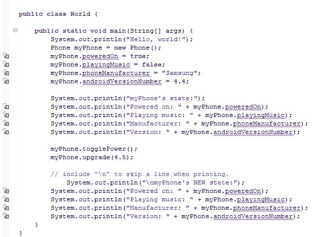

图 2-21: 灾难性错误？

```
***** Listing 2.15 - World.java – 移除错误 *****

01  public class World {

02              

03      public static void main(String[] args) {

04              System.out.println("Hello, world!");

05              Phone myPhone = new Phone();

06              myPhone.poweredOn = true;

07              myPhone.playingMusic = false;

08              myPhone.phoneManufacturer = "Samsung";

09              myPhone.androidVersionNumber = 4.4;

10              

11              System.out.println("myPhone's state:");

12              System.out.println("Powered on: " + myPhone.poweredOn);

13              System.out.println("Playing music: " + myPhone.playingMusic);

14              System.out.println("Manufacturer: " + myPhone.phoneManufacturer);

15              System.out.println("Version: " + myPhone.androidVersionNumber);

16              

17              myPhone.togglePower();

18              myPhone.upgrade(4.5);

19              

20              // include “\n” 以在打印时跳过一行。

21              System.out.println("\nmyPhone's NEW state:");

22              System.out.println("Powered on: " + myPhone.poweredOn);

23              System.out.println("Playing music: " + myPhone.playingMusic);

24              System.out.println("Manufacturer: " + myPhone.phoneManufacturer);

25              System.out.println("Version: " + myPhone.androidVersionNumber);

26      }

27  } 
```

在执行此清理时，我们从程序中删除了两个功能。我们不再能为 `Phone` 对象的变量分配初始值，也不再访问这些变量来打印它们。我们可以通过在 `Phone` 类内部提供执行这些任务的方法，以更高效的方式找回这些功能。

让我们在 `Phone` 类中添加两个新方法 `initialize()` 和 `describe()`，如代码列表 2.16 所示，并为 `playingMusic` 和 `androidVersionNumber` 变量提供初始值（代码列表 2.16 的第 05 和 07 行）：

```
***** Listing 2.16 - Phone.java – 更新后 *****

01  public class Phone {

02

03      // 这些变量描述了 Phone 对象的状态

04      private boolean poweredOn;

05      private boolean playingMusic = false;

06      private String phoneManufacturer;

07      private double androidVersionNumber = 4.4;

08

09      // 这些方法是 Phone 对象的行为

10      void initialize(boolean poweredOn, String phoneManufacturer) {

11              this.poweredOn = poweredOn;

12              this.phoneManufacturer = phoneManufacturer;

13      }

14

15      void togglePower() {

16              if (poweredOn) {

17                      System.out.println("Powering off!");

18                      poweredOn = false;

19                      playingMusic = false;

20              } else {

21                      System.out.println("Powering on!");

22                      poweredOn = true;

23              }

24      }

25

26      void playMusic() {

27              if (poweredOn) {

28                      System.out.println("Playing music!");

29              }

30      }

31

32      void upgrade(double newVersion) {

33              if (newVersion > androidVersionNumber) {

34                      androidVersionNumber = newVersion;

35           } else {

36                      System.out.println("Upgrade failed!");

37          }

38      }

39

40      void describe() {

41              System.out.println("\nPhone's state:");

42              System.out.println("Powered on: " + poweredOn);

43              System.out.println("Playing music: " + playingMusic);

44              System.out.println("Manufacturer: " + phoneManufacturer);

45              System.out.println("Version: " + androidVersionNumber);

46      }

47

48  } // ends class
```

让我们讨论 `describe` 方法（代码列表 2.16 的第 40 到 46 行）：你会注意到它执行了我们在 `World` 类中执行的打印行为。这次我们不需要使用点操作符，因为是在同一个类内部访问变量。

但在某些情况下，你确实需要使用点操作符。仔细查看 `initialize()` 方法（代码列表 2.16 的第 10 到 13 行）：

```
 void initialize(boolean poweredOn, String phoneManufacturer) {

                this.poweredOn = poweredOn;

                this.phoneManufacturer = phoneManufacturer;

}
```

`initialize()` 方法接受两个输入：一个名为 `poweredOn` 的布尔值和一个名为 `phoneManufacturer` 的字符串。该方法的功能只是初始化我们没有提供默认值的变量：`poweredOn` 和 `phoneManufacturer`。

注意我们在这里使用了点操作符。使用 `this` 关键字可以让我们的程序知道我们指的是该对象的*实例*——即正在调用 `initialize()` 方法的当前 `Phone` 对象。这就是我们如何区分属于*对象*的 `poweredOn` 变量和属于*方法*的 `poweredOn` 变量（从参数接收）的方式。

现在我们已经创建了两个允许我们访问 `Phone` 对象私有变量的方法，让我们修改我们的 `World` 类，使其像代码列表 2.17 中高亮显示的第 06、07 和 10 行那样调用这些方法。


图 2-22: 同名不同所有

```
***** Listing 2.17 - World.java – Calling the New Methods  *****

01  public class World {

02

03      public static void main(String[] args) {

04              System.out.println("Hello, world!");

05              Phone myPhone = new Phone();

06              myPhone.initialize(false, "Samsung");

07              myPhone.describe();

08              myPhone.togglePower();

09              myPhone.upgrade(4.5);

10              myPhone.describe();

11      }

12  } 
```

对应的输出是：

```
 Hello, world!

Phone's state:

Powered on: false

Playing music: false

Manufacturer: Samsung

Version: 4.4

Powering on!

Phone's state:

Powered on: true

Playing music: false

Manufacturer: Samsung

Version: 4.5 
```

## 区分类和对象

理解类和对象之间的区别对我们来说非常重要，让我们回顾一下。对象只是数据的集合——它们由一组描述变量和方法之间关系的位（bits）组成。类则是用于创建这些对象的蓝图。

为了说明这一点，让我们假设你正在玩乐高（玩乐高永远不会太老）。你拿出一份说明书并开始建造一艘飞船。说明书包含了你创建飞船所需的所有信息：你需要建造的翅膀数量、需要添加的加农数量等。你使用此说明书建造的每一个乐高模型都是**飞船，但说明书本身**不是**飞船——它是一个蓝图。

类和对象之间也存在类似的关系。虽然类描述了对象的状态和行为（为了拥有该类型的对象需要哪些属性），但类本身**不是**对象。

## 对象是独立的

让我们回顾一下实例（instances）和对象独立性的概念。使用一个类，你可以创建任意数量的对象。例如，你可以创建一个 `Spaceship` 类，并使用它来 `instantiate`（创建实例）五十个 `Spaceship` 对象。这些 `Spaceship` 对象中的每一个都被称为 `Spaceship` 类的实例。实例是更“通用”的类的“实体”表示，就像乐高套装是其各自说明书的实体表示一样。

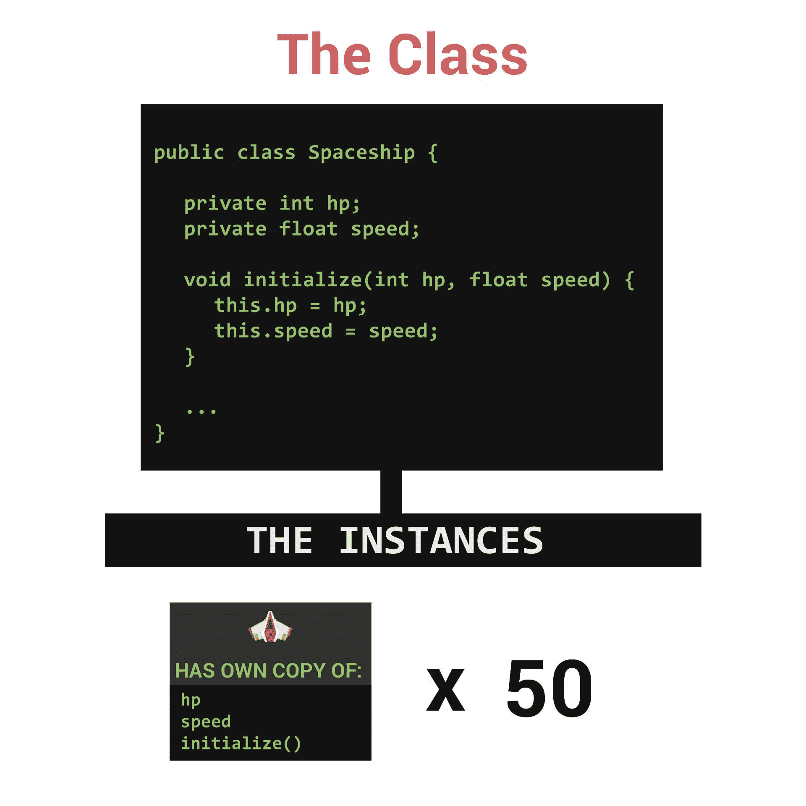

图 2-23: 飞船：类 vs 实例

就像现实中的对象一样，同一类的不同实例之间是独立的。扩展五十个 `Spaceships` 的例子，你可以修改 `Spaceship` 类的一个 `instance`（单个 `Spaceship` 对象），而其他四十九个将不会受到影响。

## 使用 Java API 中的对象

现在，让我们暂停编写自己的类，来体验一些 Java 自带的成品类。使用现有的编程语言而不是自己编写的优势在于，你可以获取现有的代码，并将其实现到你自己的项目中。幸运的是，Java 类对其包含的变量有详尽的文档，说明它们应该如何初始化以及执行什么行为，这样我们就可以将它们整合到程序中，专注于项目特有的重要问题。

你可以通过以下链接访问 Java SE 7 的完整 Java 文档：[`http://docs.oracle.com/javase/7/docs/api/`](http://http://docs.oracle.com/javase/7/docs/api/)

## 练习字符串

让我们使用我们熟悉的类 `String` 来练习使用 Java 文档。创建一个名为 `FunWithStrings` 的新 Java 项目，并创建一个名为 `StringTester` 的新类，包含一个 `main` 方法，如列表 2.18 所示。

```
***** Listing 2.18 - StringTester.java – Empty  *****

01  public class StringTester {

02

03      public static void main(String[] args) {

04              

05      }

06

07  }
```

`String` 类（隐藏在 Java 库深处）允许我们在自己的代码中创建 `String` 对象。让我们初始化一个 `String` 对象。`String` 类提供了初始化它们的方法。


***** Listing 2.19 - StringTester.java – Updated *****

```
01  public class StringTester {
02
03      public static void main(String[] args) {
04              String s = new String("this is a string");
05              String s2 = "this is also a string"; 
06
07              char ch = s.charAt(2);
08              System.out.println("The third character is " + ch);
09      }
10  }
```

`String` 类（隐藏在 Java 库深处）允许我们在自己的代码中创建 `String` 对象。让我们初始化一个 `String` 对象。`String` 类提供了初始化它们的方法。

***** Listing 2.20 - Printing Characters from a String *****

```
01  public class StringTester {
02
03      public static void main(String[] args) {
04              String s = new String("this is a string");
05              String s2 = "this is also a string"; 
06
07              char ch = s.charAt(2);
08              System.out.println("The third character is " + ch);
09      }
10  }
```

对应的输出是：

```
 The third character is i 
```

我鼓励你尝试 Javadocs 中列出的其他方法。能够使用 Javadocs 是一项重要的技能。就像所有其他值得做的事情一样，你只有通过练习才能变得更好。请记住以下几点：

1. 返回类型：（这决定了你需要用什么类型的变量来存储结果）。
2. 方法名：（你必须完全按照显示的方式进行拼写。方法名是区分大小写的）。
3. 输入参数：（为了让方法工作，你必须始终提供所需的参数。这涉及到提供正确数量和正确类型的值）。
4. 一些方法要求类型为 `CharSequence` 的输入。当你遇到此类方法时，你可以提供一个 `String`。这是因为一种名为“多态性”（polymorphism）的有趣属性（即对象以多种形式存在的能力），我们将在下一节中详细讨论它。

## 对象的更多练习 – 模拟骰子

在我们的下一个项目中，我们将模拟一个六面骰子的投掷。骰子出现在许多现代桌游游戏中，因为它们增加了不可预测的元素。在本节中，我将向你展示如何在 Java 程序中模拟随机性。


图 2-26: 标准骰子

我们首先创建一个名为“DiceProject”的新 Java 项目。在内部，创建一个名为 `DiceMaker` 的新类，并像往一样给它提供一个 `main` 方法。

要生成随机数，我们必须使用 Java 库中一个名为 `Random` 的内置类。我们使用熟悉的对象创建语法创建一个新的 `Random` 对象，如列表 2.22 第 4 行所示。

***** Listing 2.22 - Dicemaker.java *****

```
01  public class DiceMaker {
02
03      public static void main(String[] args) {
04              Random r = new Random();
05      }
06
07  }
```

你应该会注意到 Eclipse 提示你在创建 `Random` 对象的行上存在错误，如图 2.27 所示。

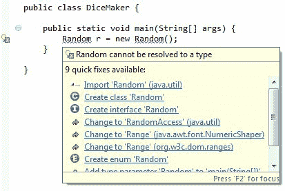

图 2-27: Random 无法解析为类型

当你将鼠标悬停在 `Random` 单词上，会显示以下错误信息：“Random cannot be resolved to a type”。这只是在告诉你编译器无法创建 `Random` 类型的对象，因为它不知道 `Random` 位于何！

要修复这个问题，我们必须通过提供完整地址让编译器知道可以在哪里找到 `Random`。所需的 `Random` 类可以在地址 `java.util.Random` 找到（其格式类似于 `UnitedKingdom.London.221BBakerSt`）。让我们像列表 2.23 第 1 行所示导入此类：

***** Listing 2.23 - Importing java.util.Random *****

```
01 import java.util.Random;
02
03 public class DiceMaker {
04
05       public static void main(String[] args) {
06               Random r = new Random();
07       }
08
09 }
```

现在我们已经告知计算机 `Random` 类的位置，我们就可以调用它的方法了。我们感兴趣的方法是 `nextInt()` 方法，它接受一个整数并返回一个 0（包含）到所接受整数（不包含）之间的值。

例如：`r.nextInt(6)` 将随机生成这些数字之一：0, 1, 2, 3, 4, 5。

如果我们想生成数字 1 到 6，只需简单地在结果上加 1，如列表 2.24 第 7 和第 8 行所示：

***** Listing 2.24 - Simulating a Dice *****

```
01  import java.util.Random;
02
03  public class DiceMaker {
04
05      public static void main(String[] args) {
06              Random r = new Random();
07              int randNum = r.nextInt(6) + 1;
08              System.out.println("You have rolled a " + randNum);
09      }
10
11  }
```

当你运行程序时，你将看到以下结果之一：

* You have rolled a 1
* You have rolled a 2
* You have rolled a 3
* You have rolled a 4
* You have rolled a 5
* You have rolled a 6

`Random` 类的一些应用场景？你可能会选择在英雄杀死怪物决定掉落物品时实现一个随机数生成器。你还可能使用随机数生成器来生成类似 Minecraft 游戏中的地图。可能性是无限的。

### java.util.Random 有多随机？

我们使用的 `Random` 类模拟了随机性，但它并没有实现真正的随机。尽管它看起来在生成随机数字，但它实际上遵循一个产生理论上可预测结果的公式。我们将这种现象称为*伪随机*（pseudo-random）。这对于我们编写的游戏可能没有影响，但这是一个很有趣的话题。你可以放心地预期从长远来看，随机数生成器将产生所有可能性的均匀分布。

```
ArrayList playerNames = new ArrayList(); 
```

我们使用 `add()` 方法向 `ArrayList` 对象中插入对象：

```
playerNames.add("Mario");
playerNames.add("Luigi");
...
playerNames.add("Yoshi"); 
```

如你所见，这是一个包含 `String` 对象的 `ArrayList`。你可以通过调用 `get()` 方法通过从零的索引从 `ArrayList` 中检索一个对象（在本例中为 `String`），注意数组的方括号 `[]` 不适用于 `ArrayList`：

```
playerNames.get(2);     // 将检索到 “Luigi” (某种程度上是); 
```

从理论上讲，我们可以将各种类型的对象放在单个 `ArrayList` 中，而不论其类型如何；然而，这并没有什么用，因为一旦你这样做，你可能不知道在例如索引 152 处是哪种特定类型的对象。如果你不知道它是什么类型的对象，你就不知道它拥有哪些方法。请看下面的示例：

```
someArrayList.get(152);         // 这是什么类型的对象？ 
```

我们从 `someArrayList` 中提取了第 153 个对象（记住索引是从零开始的）。问题是，我们对这个对象一无知。它可能是一个美味的 `Sushi` 对象，甚至是一个危险的 `Bomb`。想象一下如果我们这样说的后果会怎样：

```
Monster hungryOne = new Monster();
Object unknown = someArrayList.get(152);        //该 Object 实际上是一个 Bomb
hungryOne.eat(unknown);                         // hungryOne 认为它是 Sushi
// Boom! 
```

事实上，现代 Java 允许通过添加以下符号 `<Type>` 来限制 `ArrayList` 仅持有一种类型的对象：

```
ArrayList<String> playerNames = new ArrayList<String>();
playerNames.add("Mario");               // 运行！
Bomb b = new Bomb();
playerNames.add(b);             // 产生类型不匹配错误 
```

现在我们知道，从 `playerNames` 中检索的任何对象都保证是 `String`，我们可以对其调用 `String` 方法：

```
 // 来自 playerNames 的任何对象将始终是 String
String nameZero = playerNames.get(0); 
System.out.println(nameZero.length()); 
```

### 与基本数据类型配合 ArrayList

你不能直接将基本数据类型插入 `ArrayList`。事实上，以下操作是不允许的：

```
ArrayList<int> numbers = new ArrayList<int>(); // 不允许 
```

为了规避这一限制，你可以简单地使用内置的包装类——每个基本数据类型的对象版本。这些包括用于 `int` 的 `Integer`、用于 `char` 的 `Character` 等。要此操作，你首先创建 `ArrayList` 并将包装类声明为类型：

```
ArrayList<Integer> numbers = new ArrayList<Interger>(); 
```

它的初始大小为零：

```
System.out.println(numbers.size());     // 打印零 
```

接下来，只需调用 `add()` 方法并传递你想要放入 `ArrayList` 的 `int` 值即可。这些值将自动封装在 `Integer` 对象中。

```
int myNum = numbers.get(1);
System.out.println(myNum);      // 打印 3 
```

### 在循环中使用 ArrayList

在看到 `ArrayList` 实际运行之前，很难体会它们有多强大，所以让我们尝试一个示例。

我们将编写一个包含两个类的简单程序。第一个类将是我们的入口点，我们在其中存储 `main` 方法并创建 `ArrayList`。第二个类是一个代表人的自定义类。

我们首先创建一个名为 `Groups` 的新 Java 项目。在内部，创建一个名为 `ListTester` 的新类并给它一个 `main` 方法，如列表 2.25 所示。

***** Listing 2.25 - ListTester.java *****

```
01  public class ListTester {
02
03      public static void main(String[] args) {
04              
05      }
06
07  }
```

现在，在同一个项目中创建第二个类并命名为 `Person`。添加以下变量和方法（列表 2.26）：

***** Listing 2.26 - Person.java *****

```
01  public class Person {
02              
03      private String name;
04      private int age;
05
06      public void initialize(String name, int age) {
07              this.name = name;
08              this.age = age;
09      }
10
11      public void describe() {
12              System.out.println("My name is " + name);
13              System.out.println("I am " + age + " years old"); 
14      } 
15
16  }
```

我们的 `Person` 类描述了一个新 `Person` 对象的蓝图。具体来说，它说明 `Person` 对象的状态由两个实例变量描述：`name` 和 `age`。我们没有为 `name` 和 `age` 提供默认值，并且必须调用 `initialize()` 方法来提供这些值。一旦我们的 `Person` 对象有了名称和年龄，我们就可以调用 `describe()` 方法。

***** Listing 2.27 - ListTester.java (Updated) *****

```
01  public class ListTester {
02
03      public static void main(String[] args) {
04              
05              Person p = new Person();
06              p.initialize("Marty", 40);
07              p.describe();
08      }
09  }
```

现在让我们创建多个 `Person` 对象并将它们组合在 `ArrayList` 中。

***** Listing 2.28 - Creating the ArrayList and Adding First Loop *****

```
01  import java.util.ArrayList;
02  import java.util.Random;
03
04  public class ListTester {
05
06      public static void main(String[] args) {
07              
08              ArrayList<Person> people = new ArrayList<Person>();
09              Random r = new Random();
10                      
11              for (int i = 0; i < 5; i++) {
12                      Person p = new Person();
13                      p.initialize("Person #" + i, r.nextInt(50));
14                      people.add(p);
15              }
16      }
17  }
```

为了查看它是如何工作的，我们可以尝试再次遍历循环并调用 `describe()` 方法，如列表 2.29 所示（第 17 至 20 行）。

***** 列表 2.29 - 添加第二个循环 *****

```
01  import java.util.ArrayList;
02  import java.util.Random;
03
04  public class ListTester {
05
06      public static void main(String[] args) {
07                      
08              ArrayList<Person> people = new ArrayList<Person>();
09              Random r = new Random();
10                      
11              for (int i = 0; i < 5; i++) {
12                      Person p = new Person();
```


以下是排版后的 Markdown 文档：

```
13                      p.initialize("Person  #" + i, r.nextInt(50));

14                      people.add(p);

15              }

16                      

17              for (int i = 0; i < people.size(); i++) {

18                      Person p = people.get(i);

19                      p.describe();

20              }

21

22      }

23

24  }
```

对应的输出如下（年龄可能由于随机生成而不同）：

```
 My name is Person  #0

I am 29 years old

My name is Person  #1

I am 1 years old

My name is Person  #2

I am 4 years old

My name is Person  #3

I am 21 years old

My name is Person  #4

I am 47 years old 
```

你可能在奇怪为什么我们让第 17 到 20 行的第二个循环运行了 `people.size()` 次，而不是 5 次。这两个值是相同的，采用任何一种解决方案都会产生相同的结果；然而，上面的示例是一个更灵活的循环，因为我们不需要硬编码循环运行的次数。根据 `ArrayList` `people` 的大小，我们的第二个 `for` 循环将运行适当的次数。这意味着我们可以将上层循环（向 `ArrayList` 添加元素的循环）的运行次数从 5 改为 8，而底层循环不需要更改，因为 `people.size()` 也会增加到 8：

```
***** 列表 2.30 - 迭代 8 次 *****

01      import java.util.ArrayList;

02      import java.util.Random;

03

04      public class ListTester {

05

06              public static void main(String[] args) {

07                      

08                      ArrayList<Person> people = new ArrayList<Person>();

09                      Random r = new Random();

10                      

11                      //for (int i = 0; i < 5; i++) {

12                      for (int i = 0; i < 8; i++) {        

13                              Person p = new Person();

14                              p.initialize("Person  #" + i, r.nextInt(50));

15                              people.add(p);

16                      }

17                      // people.size() 现在是 8!

18                      for (int i = 0; i < people.size(); i++) {

19                              Person p = people.get(i);

20                              p.describe();

21                      }

22

23              }

24

25      }
```

对应的输出如下（年龄可能由于随机生成而不同）：

```
 My name is Person  #0

I am 27 years old

My name is Person  #1

I am 27 years old

My name is Person  #2

I am 20 years old

My name is Person  #3

I am 28 years old

My name is Person  #4

I am 5 years old

My name is Person  #5

I am 49 years old

My name is Person  #6

I am 2 years old

My name is Person  #7

I am 26 years old 
```

上面的示例演示了我们如何使用循环快速创建多个对象，并将它们组合在一个 `ArrayList` 中。我们还学习了可以通过遍历 `for` 循环来快速检索 `ArrayList` 的所有成员并调用它们的方法。

## 第 2 章总结

在之前的示例中，我们的程序由一个或两个小类组成。随着本书的深入，我们将编写具有更多类类的程序。事实上，我们的一些游戏将轻松地包含十个以上的类，每个类都在游戏架构中承担某些角色。仔细研究上一个示例，如果你有任何遗留问题，请访问本书的配套网站 `jamescho7.com`。发布你关于书的任何问题，我会尝试解决它们。

我们在本章中涵盖了大量内容，这些概念将在书中反复出现。记忆这种新语言的语法是很困难的，但关键在于实践。现在花点时间学习本章示例的源代码（可在 `jamescho7.com` 上获得），运行程序，进行创造性的实验，最重要的是，尝试理解我们讨论过的话题。如果你能理解本章的核心概念，你将在后面的章节中获益更多。如果你遇到任何困难，请务必在我们的论坛发帖！我们会积极监控并回答你可能遇到的任何问题。

如果你准备好继续了，请随我进入第 3 章，我们将讨论继承和接口。

# 第 03 章：对象设计

我们已经学习了对象编程的基础并掌握了创建对象的基本语法。在本章中，我们将探索对象设计。

## 构造函数

我们将通过回顾一个重要的概念来引入更复杂的话题。首先如列表 3.01 所示创建 `World` 类：

```
***** 列表 3.01 - World.java *****

1  public class World {

2

3       public static void main(String[] args) {

4                       

5               }

6  }
```

我们还将如列表 3.02 所示创建一个名为 `Coder` 的类：

```
***** 列表 3.02 - Coder.java *****

1  public class Coder {

2       private String name;

3       private int age;

4 

5       public void initialize(String name, int age) {

6               this.name = name;

7               this.age = age;

8       }

9 

10      public void writeCode() {

11              System.out.println(name + " is coding!");

12      }

13

14      public void describe() {

15              System.out.println("I am a coder");

16              System.out.println("My name is " + name);

17              System.out.println("I am " + age + " years old");

18      }

19

20 }
```

你的项目现在应该具有图 3-1 所示的设置。


图 3-1 构造函数项目

在继续之前，让我们确保理解 `Coder` 类。`Coder.java` 是创建 `Coder` 对象的蓝图。在这个蓝图中，我们声明了 `Coder` 对象应该有两个描述状态的变量：表示名称的 `String` 和表示年龄的整数。

与其他对象一样，我们的 `Coder` 对象将具有行为。`initialize()` 方法允许我们用提供的值初始化 `Coder` 对象的实例变量。`writeCode()` 方法将打印指示我们的 `Coder` 对象正在编码的内容。`describe()` 方法将以易读的形式列出所有实例变量的值。

### 变量接收默认值

回到 `World` 类并创建一个 `Coder` 对象的实例，让它描述自己。你的代码应该像列表 3.03 所示：

```
***** Listing 3.03 - World.java (updated) *****

1  public class World {

2

3       public static void main(String[] args) {

4               Coder c = new Coder();

5               c.describe();

6       }

7

8  }
```

当我们第一次声明新的 `Coder` 对象时，它的实例变量还没有被初始化（这意味着它们保留了每种变量类型的默认值）。运行 `World` 类，我们得到以下输出：

```
 I am a coder

My name is null

I am 0 years old 
```

如上所示，`int` 的默认值为零。一个空的对象引用变量（指向对象的变量）的默认值为 `null`，意味着“空无”。这仅仅意味着你的对象引用变量不包含任何值。

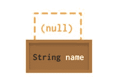

图 3-2 空的对象引用变量

### 避免 Java 异常

在继续之前，我想指出一个导致许多 Java 程序意外终止的非常常见的错误：`NullPointerException`（空指针异常）。这种运行时错误（在程序执行期间发生的错误）发生在你尝试调用属于空对象变量的方法时。请看以下示例：

```
 String a;       // 等同于 String a = null;

a.length(); 
```

如果你在 `main` 方法中运行这段代码，你将得到以下错误（并附带发生错误的行号）：

```
 Exception in thread "main" java.lang.NullPointerException 
```

每当你遇到这个错误消息时，解决方案是找到并并将所有仍在使用的对象变量初始化为 `null` 值。

### 使用方法初始化 Coder 对象

为了避免任何潜在的 `NullPointerException`，我们现在将使用其 `initialize()` 方法来初始化新 `Coder` 的实例变量（如列表 3.04 的第 7 行所示）。

```
***** Listing 3.04 - Initializing the Coder and Its Instance Variables *****

1 public class World {

2 

3       public static void main(String[] args) {

4               Coder c = new Coder(); // 初始化变量 c

5               c.describe();

6               System.out.println("");         // 为了可读性插入空行

7               c.initialize("Bill", 59);  // 初始化 c 的实例变量

8               c.describe();

9       }

10

11 }
```

当我们运行列表 3.4 时，我们得到以下输出：

```
 I am a coder

My name is null

I am 0 years old

I am a coder

My name is Bill

I am 59 years old 
```

### 使用自定义构造函数初始化 Coder 对象

在之前的章节中，我们学习了使用以下语法来创建对象：

```
 Coder c = new Coder(); 
```

上述代码行中等号右侧的部分是用来调用所谓的“默认构造函数”的方法，它仅为我们在变量 `c` 中创建一个新的 `Coder` 对象实例。Java 还允许使用自定义构造函数，它像方法一样，可以接受接收并供对象使用的值。为了看到它的效果，让我们关注以下这两行代码：

```
 Coder c = new Coder(); // 使用默认构造函数  

...

c.initialize(“Bill”, 59); 
```

自定义构造函数允许我们将代码简化为如下形式：

```
 Coder c = new Coder(“Bill”, 59); 
```

为了实现这一点，我们必须首先在 `Coder` 类中声明所需的自定义构造函数，如下所示：

```
 public Coder(String name, int age) {

        this.name = name;

        this.age = age;

} 
```

构造函数看起来与方法相似，但它有一些巨大的区别。首先，构造函数没有返回类型（甚至没有 `void`）。其次，构造函数的名称必须与其周围的类完全相同。尽管有这些差异，请注意我们的构造函数接受参数并将它们分配给 `Coder` 对象的实例变量，就像 `initialize()` 方法所的那样。我们现在可以将此构造添加到 `Coder` 类的体中，并移除 `initialize()` 方法，如下所示：

```
 public class Coder {

        private String name;

        private int age;

        public Coder(String name, int age) {

                this.name = name;

                this.age = age;

        }

        public void initialize(String name, int age) {

                this.name = name;

                this.age = age;

        }

        public void writeCode() {

                System.out.println(name + " is coding!");

        }

        public void describe() {

                System.out.println("I am a coder");

                System.out.println("My name is " + name);

                System.out.println("I am " + age + " years old");

        }

}
```

你可以将构造函数认为一种要求——一种创建该对象的规则。它是在说：“如果你想创建我的对象，你必须向我提供我请求的输入！”

在创建你自己的构造函数时，你只是指定了只有在提供了名称和年龄值时才能创建 `Coder` 对象。正因为如此，我们再也使用熟悉的语法创建 `Coder` 对象了：

```
 Coder c = new Coder();  // 不再起！ 
```

让我们对 `World` 类进行修改以反映这一变化，如列表 3.05 所示。

```
***** Listing 3.05 - Calling the Custom Constructor *****

public class World {

        public static void main(String[] args) {

                Coder c = new Coder();

                c.describe();

                System.out.println(""); // 为了可读性插入空行

                c.initialize("Bill", 59);

                Coder c = new Coder("Bill", 59);

                c.describe();

        }

}
```

运行代码我们得到：

```
 I am a coder

My name is Bill

I am 59 years old 
```


#### 关键要点

代码执行的基本规则

- 构造函数提供了在对象创建期间初始化实例变量的手段
- 构造函数与`new`关键字一起使用
- 如果你选择不创建构造函数，Java 会提供一个默认构造函数
- 所有构造函数的名称必须与类名相同
- 你可以拥有任意数量的构造函数，但每个构造函数必须有一组独特的参数。

### Getter 和 Setter（访问器和设置器）

构造函数允许在对象创建时初始化其实例变量，但之后对你之后检索或修改这些值帮助不大。此外，由于我们使用`private`修饰符来隐藏变量，我们没有办法直接完成这两项任务。事实上，以下操作将导致错误：

```
// World 类内部的某处...
Coder c3 = new Coder("Mark", 30);
String c3Name = c3.name; // 不能从另一个类引用私有变量
c3.age = 25; // 不能从另一个类修改私有变量
```

我们如何绕过这些限制呢？我们可以将`Coder`类的实例变量标记为`public`，但由于第 2 章讨论的原因，我们不想这样做。相反，我们可以在`Coder`类内部创建访问器方法。我们将讨论两种：

1. *getter 方法*（获取方法）返回所请求的隐藏变量值的**副本**（但保持隐藏变量不变）。通过这样做，我们可以保护实例变量免受未经授权的更改，同时提供对变量值的访问。
2. *setter 方法*（设置方法）允许其他类修改隐藏变量的值，前提是它们遵循你在 setter 方法中设定的规则。

让我们来看看这些访问器方法的作用。在`Coder`类中添加以下 getter 和 setter 方法：`getAge()`、`setAge()`、`getName()`和`setName()`（如列表 3.06 的第 26 到 48 行所示）。

```java
***** Listing 3.06 - 为 Coder.java 添加 Getter 和 Setter 方法 *****

01  public class Coder {
02
03      private String name;
04      private int age;
05
06      public Coder(String name, int age) {
07              this.name = name;
08              this.age = age;
09      }
10
11      public void writeCode() {
12              System.out.println(name + " is coding!");
13      }
14
15      public void describe() {
16              System.out.println("I am a coder");
17              System.out.println("My name is " + name);
18              System.out.println("I am " + age + " years old");
19      }
20
21      public String getName() {
22              return name;
23      }
24
25      public int getAge() {
26              return age;
27      }
28
29      public void setName(String newName) {
30              if (newName != null) {
31                      name = newName;
32              } else {
33                      System.out.println("Invalid name provided!");
34              }
35      }
36
37      public void setAge(int newAge) {
38              if (newAge > 0) {
39                      age = newAge;
40              } else {
41                      System.out.println("Invalid age provided");
42              }
43      }
44  }
```

我们的两个 getter 方法向该方法的调用者返回`name`和`age`变量的值。这意味着任何能够访问（或引用）`Coder`对象的类都可以调用其 getter 方法，并窥探`Coder`实例变量的值。“值”（Values）是这里的关键词。我们提供的不是访问实例变量原始副本的权限，而是访问存储在它们中的“值”。

我们的两个 setter 方法允许其他类修改`Coder`对象的实例变量，但我们可以通过提供一套规则来保护这些实例变量免受非法或无效的更改。在列表 3.06 中，我们的 setter 会拒绝非正年龄值和空名称值。

让我们在`World`类中测试我们的 getters 和 setters，如列表 3.7 所示，在第 08 和 09 行调用它们：从`World.java`调用 Getter 和 Setters

```java
***** Listing 3.07 *****

01  public class World {
02      public static void main(String[] args) {
03
04              Coder c = new Coder("Bill", 59);
05              c.describe();
06              System.out.println(""); // 为了可读性的空行
07
08              String cName = c.getName();
09              int cAge = c.getAge();
10
11              System.out.println(cName + ", " + cAge);
12              System.out.println(""); // 为了可读性的空行
13              c.setName("Steve");
14              c.setAge(-5); // 这将被我们的 setter 方法拒绝
15
16              c.describe();
17      }
18
19  }
```

打印结果如下：

```
I am a coder
My name is Bill
I am 59 years old
Bill, 59
I am a coder
My name is Steve
Invalid age provided!
```

在上一个例子中，我们能够一种方法保持`Coder`对象的实例变量私有，同时允许外部通过我们的公共访问方法来检索（get）和修改（set）这些隐藏变量。这允许我们保留通过使用私有变量所获得的安全性，同时也允许我们访问和修改所需的值。注意，我们的 setter 方法可以拒绝无效参数，因为我们能够阻止`World`类将`Coder`对象的年龄改为 -5。

## 接口 (Interface)

接下来我们将讨论一种使用我们所谓的“接口”（interface）将对象分组到各种类别的方法。接口是一个抽象（abstract）类别，描述了属于该类别的对象的本质组件。为了最好理解这一点，我们将学习一个示例。

接口类似于类，但它有一些显著的区别。以下是一个`Human`接口可能的样子（不要担心在 Eclipse 中跟上操作）：

```java
***** Listing 3.08 - Human 接口 *****

public interface Human {
        public void eat();
        public void walk();
        public void urinate(int duration);
}
```

如列表 3.8 所示，接口包含各种没有方法体的抽象方法。这些没有实体的抽象方法告诉你属于`Human`类别的对象**必须**能够做什么，但它们没有指定这些动作必须如何执行。

为了探索接口到底是什么，让我们暂时离开代码。在你的脑海中，创建一个关于“作为人”意味着什么的想法（你不需要表现得太哲学！）。接着，看看以下列表，并告诉我每个人是否都符合你对人性的想法：你的邻居、你最好的朋友以及你自己。

你可能对所有这些人都回答了“是”。这是因为当我要求你形成一个人性的概念时，你并没有感知到一个具体的人类。相反，你形成了某种规则——关于人类如何与其世界相互作用的观点——并用此来判断各种人的人性。

接口大抵如此。列表 3.08 中的`Human`接口并不用于创建单个的`Human`对象。相反，它定义了一种交互模式，说明了`Human`对象在你的程序中应该如何行为。它提供了一系列基本要求，你必须满足这些要求才能创建更具体的`Human`类型的版本，例如列表 3.09 所示的`King`类。

```java
***** Listing 3.09 - Human 接口 *****

public class King implements Human {
        public void eat() {
        System.out.println("The King eats.");
        }
        public void walk() {
        System.out.println("The King walks.");
        }
        public void urinate(int duration) {
        System.out.println("The King urinates for " + duration + " minutes.");
        }
        public void rule() {
        System.out.println("The King reigns.");
        }
}
```

研究`King`类与`Human`接口之间的关系，你会注意到三点：首先，该类声明它实现了`Human`，这是我们程序员指定让`King`类属于`Human`类别的方式。其次，`King`类声明了 Human 接口中的所有方法，并为每个先前的抽象方法提供了具体的方法体。第三，该类还有一个额外的方法`rule()`，使其区别于通用的`Human`。

接口是一个约束性合约。如果一个对象选择实现一个接口，它就同意实现接口的每个抽象方法。这一切意味着什么？这意味着一个`King`对象无论多想远离厕所，都必须实现`Human`接口的所有抽象方法，包括`urinate()`，因为国王毕竟是人。如果他放弃这一要求，愤怒的 JVM 将向他发出红色的错误信息。

## 多态 (Polymorphism)

你可能疑惑为什么我们定义一个简单的`King`类需要同时创建一个接口和一个类。你可能在告诉自己，在目前阶段，`Human`接口并没有起太大作用，而你是完全正确的。使用接口允许我们创建一个对象类别，但在学习多态之前，我们很难理解这对我们的程序意味着什么。看看以下方法。

```java
public void feed(Human h) {
        System.out.println("Feeding Human!");
        h.eat();
}
```

```
// 同一程序的其他地方
King kong = new King();
Villain baddie = new Villain();
Professor x = new Professor();
SushiChef chef = new SushiChef();
// 任何人类都可以被喂：
feed(kong); // 王是人类
feed(baddie); // 恶棍是人类
feed(x); // 教授是人类
feed(chef); // 寿司师是人类
```

这只是`多态`（polymorphism）作用极一个微不足道的例子，它只是描述与`多种`类型对象交互的`通用方法`的一种高级方式。我们接下来的章节中将在更实际的情况下探索接口和多态。

## 继承 (Inheritance)

在设计对象类别时，你可能会发现另一种名为`继承`的模式可以为你提供更多控制。继承描述了这样现象：一个类继承了另一个类的变量和方法。在这种情况下，继承者被称为子类（或子类），而祖先被称为超类（或父类）。

与使用接口相比，继承的优势在于你可以重用代码。记住，每个实现接口的类都必须为接口中声明的每一个抽象方法提供完整的实现。使用上一节的例子，这意味着`King`、`Villain`、`Professor`和`SushiChef`类**都**拥有它们自己的`eat()`、`walk()`和`urinate()`方法。在这种情况下，继承是强大的，因为它允许相似的类共享方法和变量。我们将使用一个假设的角色扮演游戏示例来说明这一点。

在创建一个 RPG 时，你可能会有一个名为`Hero`的类代表玩家角色，如列表 3.10 所示。

```
***** 列表 3.10 - Hero 类 *****

01 public class Hero {
02      protected int health = 10; // 我们将在本节稍后讨论'protected'
03      protected int power = 5;
04      protected int armor = 3;
05
06      public void drinkPotion(Potion p) {
07        health += p.volume(); // 等于 health = health + p.volume();
08      }
09
10      public void takeDamage(int damage) {
11        int realDamage = damage - armor;
12        if (realDamage > 0) {
13            health -= realDamage; // 等于 health = health – realDamage.
14        }
15      }
16
17      // ....更多方法
18
19 }
```

在创建`Hero`之后，你后来决定你的 RPG 将通过实现一个独特的类系统来与竞争脱颖而出，玩家将在从未过的`Warrior`（战士）、`Mage`（法师）和`Rogue`（盗贼）类之间进行选择。

接下来，正如任何体面的面向对象程序员所做的，你为这些角色类中的每一个创建一个独立的 Java 类，因为你的`Warrior`、`Mage`和`Rogue`每个都应该拥有不可思议的强大能力。你还决定，由于你所有的字符类首先都是一个通用`Hero`类的扩展，它们每个都应该拥有列表 3.10 中`Hero`类的所有变量和方法。这就是继承大显身手的地方。

看看列表 3.11 到 3.13。

```
***** 列表 3.11 - Warrior 类 *****

public class Warrior extends Hero {
        //      ....其他变量和方法
        public void shieldBash() {
                ....
        }
}
```

```
***** 列表 3.12 - Mage 类 *****

public class Mage extends Hero {
        //      ....其他变量和方法
        public void useMagic() {
                ....
        }
}
```

```
***** 列表 3.13 - Rogue 类 *****

public class Rogue extends Hero {
        //      ....其他变量和方法
        public void pickPocket() {
                ....
        }
}
```

注意，我们使用`extends`关键字来表示继承。这是恰当的，因为这三个类都是超类`Hero`的扩展。在继承中，每个子类都接收到来自超类的**所有**非私有变量和方法的副本（列表 3.10 中的`protected`变量与私有变量相似，因为外部类无法访问它们；但是，与私有变量不同，它们在继承过程中是可以被子类访问的）。

继承的益处在我们应用多态时最为明显，多态允许我们在像下面这样的方法中使用`Hero`的任何子类：

```
// 无论类别如何，都会攻击任何 Hero
public void attackHero(Hero h, int monsterDamage) {
        h.takeDamage(monsterDamage);
}
```


## 图形（Graphics）

基于文本的程序很容易构建，但基于文本的游戏已经过时了。在本节中，我们将讨论如何使用 Java 类库中的类——特别是来自 `javax.swing` 包的类来创建一个图形用户界面（GUI）。你会发现虽然添加简单的用户界面是直接的，但 GUI 是一个巨大的课题。我将只提供快速介绍——你为了创建一个窗口并显示基于 Java 的游戏所需的必备知识。如果你想学习更多关于 Swing 和创建专业应用程序，请访问以下教程：

[`docs.oracle.com/javase/tutorial/uiswing/TOC.html`](http://docs.oracle.com/javase/tutorial/uiswing/TOC.html)

### JFrame 简介

在 Java 中开发图形应用程序时，我们首先创建一个名为 `JFrame` 的窗口对象（从 `javax.swing.JFrame` 导入）。窗口内部有一个内容面板（content pane，想象成窗格），我们可以向其中添加各种元素。

内容面板的默认布局是 `BorderLayout`。这允许你将 UI 元素放在图 3-3 所示的五个区域之一。


图 3-3 Windows 8 JFrame 及其内容面板

图 3-3 所示的五个区域中的每个只能包含一个元素，这意味着 `BorderLayout` 只支持五个元素；这对我们来说并不是问题，因为我们真正需要的名为 `JPanel` 的元素。

`JPanel` 对象是一个简单的空容器，可以添加到 `BorderLayout` 的任一区域。我们可以将玩家应该看到的所有内容画在一个 `JPanel` 上，就像在画布上画画一样。例如，考虑图 3-4 所示的截图。截图来自 TUMBL 游戏的开发版本——我开发的第一个游戏之一。你看到的从得分、暂停按钮到角色和强化道具的一切都画在了一个 `JPanel` 上。

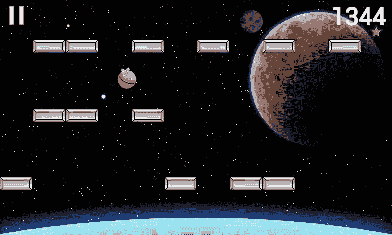

图 3-4 TUMBL 早期版本的截图

### 解释坐标系

当我们处理计算机图形时，我们将使用基于像素的 X, Y 坐标系。此外，我们还将左上角的像素视为原点 (0, 0)。这意味着在分辨率为 1920 像素乘以 1080 像素的屏幕上，右下角的像素坐标为 (1919, 1079)。

### 创建 JFrame

现在我们已经讨论了构建图形应用程序所需的所有内容。是时候操作了。

创建一个名为 `FirstGraphics` 的新 Java 项目，并创建一个名为 `FirstFrame` 的类，包含一个 `main` 方法。然后我们将通过在 `main` 方法中添加以下代码行来创建一个 `JFrame` 对象（确保导入了 `javax.swing.JFrame`）：

```
JFrame frame = new JFrame("My First Window");
frame.setDefaultCloseOperation(JFrame.EXIT_ON_CLOSE);
frame.setSize(480, 270);
frame.setVisible(true);
```

此时，你的 `FirstFrame` 类应该看起来像列表 3.14 所示。

```
***** 列表 3.14 - FirstFrame 类 *****
01 import javax.swing.JFrame;
02
03 public class FirstFrame {
04
05      public static void main(String[] args) {
06              JFrame frame = new JFrame("My First Window");
07              frame.setDefaultCloseOperation(JFrame.EXIT_ON_CLOSE);
08              frame.setSize(480, 270);
09              frame.setVisible(true);
10      }
11
12 }
```

运行 `FirstFrame` 类，你应该看到与图 3-5 类似的内容。

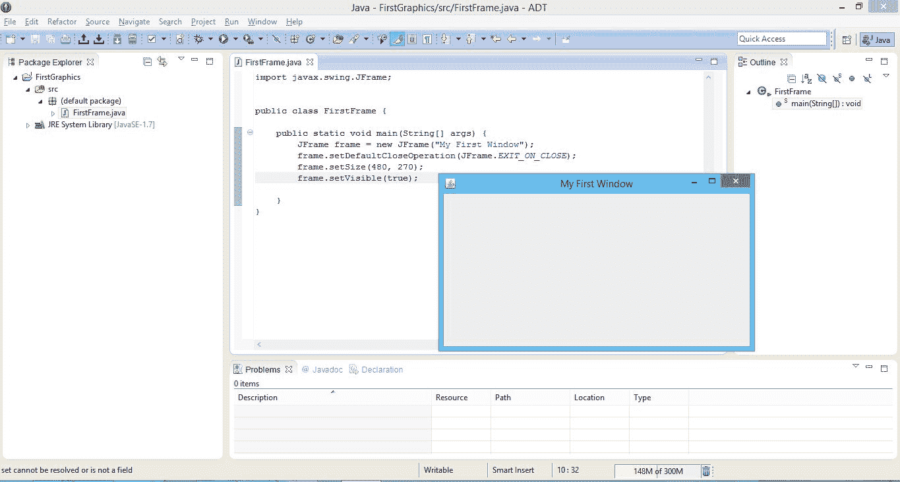

图 3-5 我的第一个窗口

注意出现了一个标题为“My First Window”的窗口。显然，内容面板（图 3-5 中的灰色区域）目前是空的。

在之前节节的非图形化示例中，我们的程序在 `JVM` 执行完最后一行代码后就会终止。图形化应用程序的行为并非如此。正如窗口的存在所示，即使在执行完最后一行代码后，`JFrame` 也会持续存在。让我们点击退出按钮来终止程序。

让我们确保理解定义 `JFrame` 的这四行代码（列表 3.14 中的第 06 行到第 09 行）。在第 06 行，我们使用自定义构造函数创建了一个名为 `frame` 的新 `JFrame` 对象。这允许我们设置窗口的标题。

接下来在第 07 行，我们指定了当窗口关闭时应该发生什么。我们希望在用户关闭窗口时终止整个程序，因此我们从 `JFrame` 类中将一个名为 `EXIT_ON_CLOSE` 的公共 `int` 传递给 `setDefaultCloseOperation()` 方法（记住使用点运算符来访问另一个类中的公共方法和变量）。

第 08 行简单地告诉窗口调整大小，使其宽度为 480 像素，高度为 270 像素。一旦完成，我们在第 09 行调用 `setVisible()` 方法，使框架显示在我们的屏幕上。

### 添加 JPanel

现在我们已经有了一个 `JFrame`，是时候向它的内容面板中添加内容了。为了做到这一点，我们将创建一个名为 `MyPanel` 的新类。该类将通过使用继承创建 `JPanel` 的自定义版本，因此我们必须扩展 `JPanel` 并导入 `java.swing.JPanel`。

将列表 3.15 所示的代码复制到你的 `MyPanel` 类中。我们运行程序后将进行讨论！不要忘记像第 01 行、02 行和 04 行所示添加正确的导入。

```
***** 列表 3.15 - MyPanel 类 *****
01 import java.awt.Color;
02 import java.awt.Graphics;
03
04 import javax.swing.JPanel;
05
06 public class MyPanel extends JPanel {
07
08      @Override
09      public void paintComponent(Graphics g){
10              g.setColor(Color.BLUE);
11              g.fillRect(0, 0, 100, 100);
12
13              g.setColor(Color.GREEN);
14              g.drawRect(50, 50, 100, 100);
15
16              g.setColor(Color.RED);
17              g.drawString("Hello, World of GUI", 200, 200);
18
19              g.setColor(Color.BLACK);
20              g.fillOval(250, 40, 100, 30);
21      }
22
23 }
```

现在我们必须回到 `FirstFrame` 类，构造 `MyPanel` 实例并将其添加到内容面板的一个区域。这是通过在 `main` 方法的底部添加以下代码来实现的：

```
MyPanel panel = new MyPanel(); // 创建新的 MyPanel 对象。
frame.add(BorderLayout.CENTER, panel); // 将面板添加到 CENTER（中心）区域。
```

更新后的 `FirstFrame` 类看起来应该与列表 3.16 完全相同（注意第 01 行上的导入语句）：

```
***** 列表 3.16 - FirstFrame 类 *****
01 import java.awt.BorderLayout;
02
03 import javax.swing.JFrame;
04
05 public class FirstFrame {
06
07      public static void main(String[] args) {
08              JFrame frame = new JFrame("My First Window");
09              frame.setDefaultCloseOperation(JFrame.EXIT_ON_CLOSE);
10              frame.setSize(480, 270);
11              frame.setVisible(true);
12
13              MyPanel panel = new MyPanel();  // 创建新的 MyPanel 对象
14              frame.add(BorderLayout.CENTER, panel);  // 将面板添加到 CENTER 区域
15      }
16 }
```

运行 `FirstFrame`，你将看到与图 3-6 所示类似的屏幕。

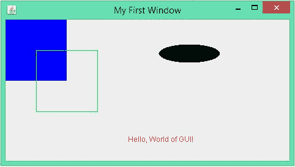

图 3-6 更新后的 FirstFrame 类输出

### 解释术语

在我们讨论发生了什么之前，我们首先需要了解发生了什么。

……该类将通过使用继承创建 `JPanel` 的自定义版本，因此我们必须扩展 `JPanel` 并导入 `java.swing.JPanel`。

将列表 3.15 所示的代码复制到你的 `MyPanel` 类中。我们运行程序后将进行讨论！不要忘记像第 01 行、02 行和 04 行所示添加正确的导入。

```
***** 列表 3.15 - MyPanel 类 *****
01 import java.awt.Color;
02 import java.awt.Graphics;
03
04 import javax.swing.JPanel;
05
06 public class MyPanel extends JPanel {
07
08      @Override
09      public void paintComponent(Graphics g){
10              g.setColor(Color.BLUE);
11              g.fillRect(0, 0, 100, 100);
12
13              g.setColor(Color.GREEN);
14              g.drawRect(50, 50, 100, 100);
15
16              g.setColor(Color.RED);
17              g.drawString("Hello, World of GUI", 200, 200);
18
19              g.setColor(Color.BLACK);
20              g.fillOval(250, 40, 100, 30);
21      }
22
23 }
```

现在我们必须回到 `FirstFrame` 类，构造 `MyPanel` 实例并将其添加到内容面板的一个区域。这是通过在 `main` 方法的底部添加以下代码来实现的：

```
MyPanel panel = new MyPanel(); // 创建新的 MyPanel 对象。
frame.add(BorderLayout.CENTER, panel); // 将面板添加到 CENTER（中心）区域。
```

更新后的 `FirstFrame` 类看起来应该与列表 3.16 完全相同（注意第 01 行上的导入语句）：

```
***** 列表 3.16 - FirstFrame 类 *****
01 import java.awt.BorderLayout;
02
03 import javax.swing.JFrame;
04
05 public class FirstFrame {
06
07      public static void main(String[] args) {
08              JFrame frame = new JFrame("My First Window");
09              frame.setDefaultCloseOperation(JFrame.EXIT_ON_CLOSE);
10              frame.setSize(480, 270);
11              frame.setVisible(true);
12
13              MyPanel panel = new MyPanel();  // 创建新的 MyPanel 对象
14              frame.add(BorderLayout.CENTER, panel);  // 将面板添加到 CENTER 区域
15      }
16 }
```


运行`FirstFrame`，你将看到与图 3-6 所示类似的屏幕。


图 3-6 更新后的 FirstFrame 类输出

### 解释术语

在我们讨论发生了什么之前，我们首先需要了解发生了什么。

（注：由于提供的原文在“Explaining the Terms”后中断，此处翻译已按原文内容结束。）

请确保你再次梳理代码，理解我们是如何创作出即使是毕加索也会感到自豪的杰作的。

## 里程碑

通过这个例子，我们结束了第 3 章和第 1 单元。如果你一直坚持到现在，你已经学习了编程的基础知识，掌握了基础的`Java`并学习了高级面向对象的设计概念。Java 游戏开发在前方等着你，它预示着巨大的挑战和更大的兴奋。

在继续之前，我想提醒你一下，`Java`是一门巨大的编程语言。虽然我已经尝试向你介绍了你在开发 Java 和 Android 游戏时可能遇到的所有概念，但我完全没有展现这门语言的魅力。如果你对学习更多关于 Java 并更深入地探索所有这些概念感兴趣，你有责任给自己找一本专门介绍 Java 的好书。我最喜欢的一本书是 Kathy Sierra 和 Bert Bates 写的《Head First Java》（浅出 Java）。

其次，我想再次提醒你，你在这段旅程中并不孤单。如果你在任何概念上遇到困扰，想学习更多或只是想聊聊，请随时访问书籍的配套网站`jamescho7.com`。我很乐意讨论你可能有的任何问题或疑虑。

现在，深呼吸。是时候进入 Java 游戏开发的世界了……

# 第 04 章：搭建基础

我们花了很多时间讨论 Java 语法和面向对象设计，但我们还没有看到这些概念如何转化为动态游戏。在本章中，我们将通过构建一个游戏开发框架来运用所学知识。这将作为我们第一个游戏的基础，我们将在第 5 章构建这个游戏。

编写游戏看起来像是一项艰巨的任务；你可能花费几个月的时间学习 Java，但仍然不知道从何处开始，因为在调用基础函数和构建交互式游戏应用程序之间，似乎存在着一种无法跨越的鸿沟。本章将教你确切如何跨越这个鸿沟。一旦你意识到 Java 游戏和任何其他 Java 程序一样由类组成，你就会发现这并不是一项艰巨的任务。

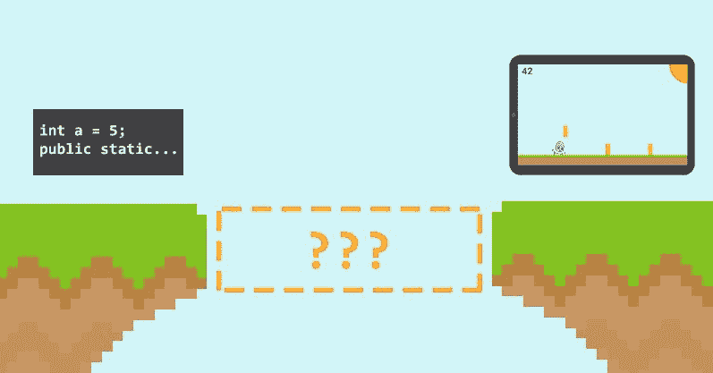

图 4-1 无法跨越的鸿沟

## Java 游戏开发——概览

将 Java 游戏分为三个组成部分来思考会有帮助：

* **游戏开发框架**：一组与游戏无关的类，将帮助你执行每个游戏都需要执行的任务，例如实现游戏屏幕和处理玩家输入。
* **游戏特定类**：代表角色、强化道具、关卡等的 Java 类。
* **资源**：贯穿游戏使用的图像和音频文件。

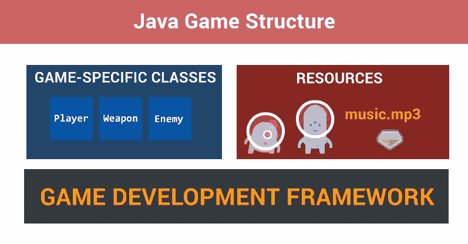

图 4-2 Java 游戏的三个组成部分

## 学习构建游戏

在我们开始之前，我认为让你理解我编写第 2 单元（第 4、5 和 6 章）的目标非常重要，这样你就能确切地知道可以期待什么。

首先，我的目标是教你如何从零开始构建 Java 游戏。我将带你了解创建游戏开发框架和编写游戏特定类背后的思考过程，同时分享一些准备资源的技巧。

其次，我希望巩固你对面向对象设计和编程的理解。具体来说，我希望你在离开第 2 单元时，能够清晰地理解模块化类是如何组合成一个连贯应用程序的。这将为你在第 3 单元构建 Android 应用程序和游戏做好准备。

我希望你通过这个单元培养另一项额外技能。你可能会发现，在很多情况下，为了制作最好的游戏，与现有的游戏开发框架合作比自己构建要容易得多。这是因为市上有许多开源游戏开发框架，你可以将其整合到项目中，以便用更短的时间构建更令人惊的游戏。因此，我的希望是你会学会如何利用现有的游戏开发框架来构建你想要的游戏。

## 构建游戏开发框架

### 游戏开发框架的作用

有很多**每个**游戏都必须能够执行的任务。例如，每个游戏都应该加载图像并将它们绘制到屏幕上。此外，每个游戏都需要允许某种用户交互。

游戏开发框架的作用是提供执行此类任务的可重用类，这样你作为游戏程序员，就可以专注于编写决定你游戏成败的特定游戏代码。

因此，我们将从创建一个简单的游戏开发框架开始，它将作为我们在这本书中构建的每个 Java 游戏的起点。这个游戏开发框架在经过几次修改后，甚至可以可以作为我们在第 3 单元中构建的 Android 游戏的起点。

### 什么是良好的游戏开发框架？

创建游戏开发框架没有正确的方法。某些框架（如我们在本章中构建的）由少于十个类编写。其他框架（例如不断增长、社区驱动的`libGDX`）提供了数百个类。作为一名独立开发者，你可能会开发一个小型的游戏开发框架，并随着时间的推移不断完善（如我们在第 5 章和第 6 章中所做的），因为你会发现自己不断需要相同的功能。

尽管创建游戏开发框架没有正确的方法，但一个良好的游戏开发框架应该是灵活的。你应该能够在不同的视角下构建回合制益智游戏和实时动作游戏，而无需对框架进行大量的修改或牺牲性能。

### 核心术语

在我们构建游戏之前，你必须熟悉一些术语。

* 有一是区分游戏和普通程序的一点是使用**游戏循环**。游戏循环是在游戏整个生命周期内持续运行的代码块，每次执行两个重要任务：它首先更新游戏逻辑，移动角色，处理碰撞等。其次，它获取这些更新并将渲染（绘制）图像到屏幕上。
* `FPS (每秒帧数)`是指屏幕上图像替换以产生运动错觉的速率。这与游戏循环直接相关，因为渲染调用的频率就是我们游戏的`FPS`。

### 设计我们的框架

我们在本章中构建的框架将非常简单。我们将创建属于三类的七个类。阅读这些类的基本概述，如图 4-3 所示。如果某些解释不明，请在我们构建框架时返回查看，那时它们应该更有意义。

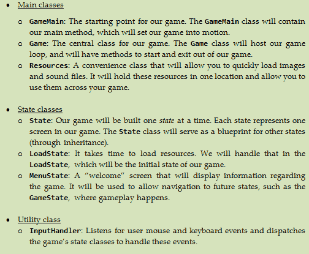

图 4-3 游戏框架概述

### 下载源代码

完整的源代码（带注释）可以在`jamescho7.com`下载。如果你在这一部分的任何一点遇到代码问题，我建议下载完整代码并进行对比。

### 启动框架

说完了——是时候开始编码了！打开 Eclipse 并创建一个名为`SimpleJavaGDF`的新 Java 项目。

接下来，我们将通过右键点击`src`文件夹（Mac 上使用 Ctrl + 点击）并选择 New -> Package 来创建类的分组（即包），如图 4-4 所示。

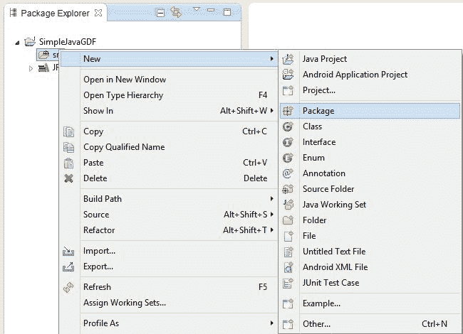

图 4-4 创建新包

在新 Java Package 对话框的 Name 字段中，输入以下内容：

```
com.jamescho.game.main
```

你的对话框应该像图 4-5 所示。

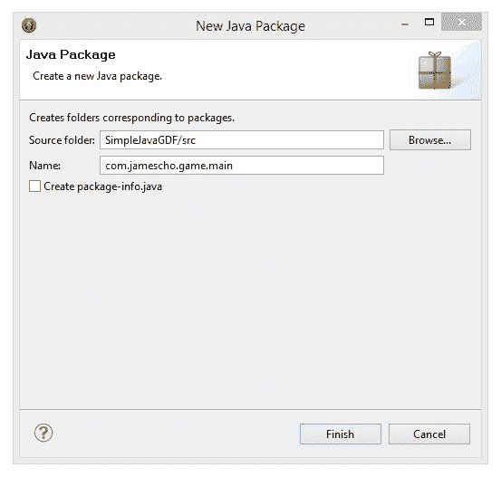

图 4-5 添加包名

点击“完成”，你的新包应该出现在包管理器（Package Explorer）的`src`文件夹下。重复这些步骤创建另外四个名为如下包：

1. `com.jamescho.game.model`
2. `com.jamescho.game.state`
3. `com.jamescho.framework.util`
4. `resources`

完成后，你的项目现在看起来应该像图 4-6 所示。

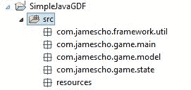

图 4-6 我们的五个包

### 包的讨论

Java 包（package）是一个包含相关文件的文件夹。例如，`com.jamescho.framework.util`指向项目主`src`文件夹内部的一个文件夹，路径为`…/com/jamescho/framework/util`。

我们在图 4-3 中讨论过的类将按如下方式添加到这些包中：

* `com.jamescho.framework.util`包将包含我们的工具类（Utility class）。
* `com.jamescho.game.main`包将包含我们的主类（Main classes）。
* `com.jamescho.game.state`包将包含我们的状态类（State classes）。

我们的两个包对于每个游戏是**特定**的。

* `com.jamescho.game.model`包将包含表示我们游戏中各种对象的类。在下一节之前我们将保持此包为空，在下一节中我们将使用我们的框架构建游戏。
* `resources`包将包含我们在游戏中使用的图像和声音文件。

### 创建我们的类

现在包已经设置好了，我们将开始创建类。如果在跟随我的说明时在任何一点你迷路了，请继续阅读。我将包含一个完整的代码列表，显示我们修改的每个类的最新状态。

我们的计划是创建一个`GameMain`类，实例化一个`JFrame`对象，并在内容面板中填充一个`Game`实例（该类将继承自`JPanel`）。如果你需要复习这些术语，请参考图 4-7。如果你需要更多复习，我建议在继续之前重读第 3 章关于继承（Inheritance）和图形（Graphics）的章节。

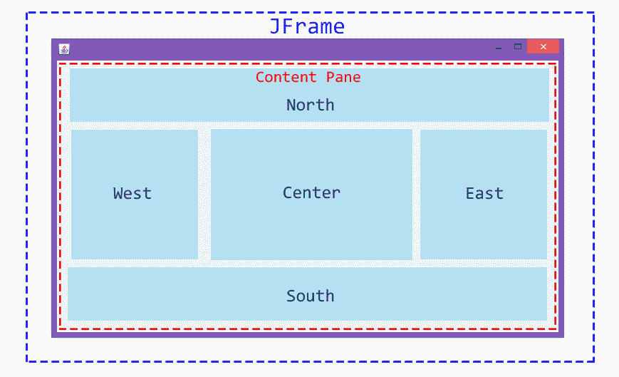

图 4-7 一个 Jframe 及其内容面板

现在，在`com.jamescho.game.main`中创建两个类，如图 4-8 所示。第一个类命名为`GameMain`，第二个命名为`Game`。

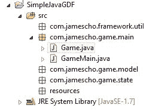

图 4-8 将 GameMain 和 Game 添加到 com.jamescho.game.main 包中。

### 在 GameMain 中创建 JFrame

我们现在打开`GameMain`类，添加`main`方法，创建一些变量并初始化一个表示我们游戏窗口的新`JFrame`对象，如列表 4.01 所示。

**警告！**

从现在开始起，书籍可能不会显式地告诉你导入新类，例如列表 4.01 第 03 行所示的`javax.swing.JFrame`。如果你在尝试使用某个类时遇到错误，请通过对比提供的代码列表来双击你的导入语句（import statements）。

还要注意，同一列表中的第 06 行在本书被拆分成了两行。在你的机器上输入代码时，你应该将此类行写在一行内。

```
***** Listing 4.01 GameMain.java (incomplete) *****

01 package com.jamescho.game.main;

02

03 import javax.swing.JFrame;

04

05 public class GameMain {

06      private static final String GAME_TITLE = "Java Game Development Framework (Chapter 4)";

07      public static final int GAME_WIDTH = 800;

08      public static final int GAME_HEIGHT = 450;

09      public static Game sGame;

10

11      public static void main(String[] args) {

12              JFrame frame = new JFrame(GAME_TITLE);

13              frame.setDefaultCloseOperation(JFrame.EXIT_ON_CLOSE);

14              frame.setResizable(false); // 防止手动调整窗口大小

15              frame.setVisible(true);

16      }

17

18 }
```

在我们讨论代码之前，让我们运行程序以确保它工作正常。你应该得到一个像这样的窗口（根据操作系统会有细微不同）：


图 4-9 一个空的 JFrame 窗口（在 Windows 8 中）

我们的`JFrame`目前看起来很小，但一旦我们开始向其内容面板添加内容，它应该正确调整大小。让我们先关闭`JFrame`并讨论代码。再次查看列表 4.01，你会发现在`main`方法中调用的所有方法都是自解释的。（如果你忘记了其中某些方法的作用，请参考列表 3.16）。让我们花点时间谈谈这些变量。

### `static`关键字

注意列表 4.01 中，`GameMain`的所有变量都被标记为`static`。`static`一词表示这些变量**不是**实例变量，而是类变量。这意味着这些变量**不**属于任何特定实例；它们属于类，因此可以在不实例化`GameMain`的情况下进行访问。要了解更多关于`static`关键字的信息，请参考附录 A。

### `final`关键字

有些内容在游戏过程中不应该改变。以下变量在我们的游戏过程中不会改变：

```
final String GAME_TITLE = "Java Game Development Framework (Chapter 4)";

final int GAME_WIDTH = 800;
```

为了让这一点更清晰，我们首先使用`final`关键字来防止更改这些值。

### 为 Game 创建一个构造函数

现在，打开`Game`类并扩展`JPanel`，如列表 4.02 所示。

```
***** Listing 4.02 Game Class (incomplete) *****

01 package com.jamescho.game.main;

02

03 import javax.swing.JPanel;

04

05 @SuppressWarnings("serial")

06

07 public class Game extends JPanel {

08

09 }
```

通过扩展`JPanel`，`Game`变成了`JPanel`的类型。我们的`Game`类现在可以添加到`JFrame`的内容面板中。

注意

`@SuppressWarnings("serial")`告诉 Eclipse 不要给出关于序列化版本 ID（serial ID）的警告，它是用于通过序列化（serialization）保存对象的。序列化超出了本书的范围，因此我们将忽略这个警告。

接下来，我们将创建几个实例变量并提供一个用于初始化它们的构造函数。将以下代码添加到你的`Game`类中，使其像列表 4.03 所示（每当我们使用新类型类时，练习检查导入语句）：

```
***** Listing 4.03 Game Class (incomplete) *****

01 package com.jamescho.game.main;

02

03 import java.awt.Color;

04 import java.awt.Dimension;

05 import java.awt.Image;

06

07 import javax.swing.JPanel;

08

09 @SuppressWarnings("serial")

10

11 public class Game extends JPanel {

12      private int gameWidth;

13      private int gameHeight;

14      private Image gameImage;

15

16      private Thread gameThread;

17      private volatile boolean running;

18

19      public Game(int gameWidth, int gameHeight) {

20              this.gameWidth = gameWidth;

21              this.gameHeight = gameHeight;

22              setPreferredSize(new Dimension(gameWidth, gameHeight));

23              setBackground(Color.BLACK);

24              setFocusable(true);

25              requestFocus();

26      }

27

28 }
```


查看列表 4.03 中的五个实例变量（第 12 行到第 17 行），你可能会看到一些陌术语。我们以前从未遇到过 `Image` 和 `Thread` 类型，也没有见过 `volatile` 关键字。我们很快就会讨论这些内容。让我们先跳过它们，继续讨论构造函数。

记住，当对象被首次创建时，它的构造函数会被调用。`Game` 的构造函数请求两个值：称为 `gameWidth` 和 `gameHeight` 的整数。这些值将是我们的 Java 游戏窗口内容的像素宽度和像素高度。在构造函数的前两行中，我们使用这些值来初始化两个同名的实例变量（我们稍后会需要这些值）。

接下来，我们调用了四个属于 `JPanel` 的方法（通过继承可用），如列表 4.03 的第 22 到 25 行所示。

这些方法中的第一个要求我们的 `Game` 对象调整为 `gameWidth` x `gameHeight` 指定的尺寸。我们通过传递一个方法所需的新 `Dimension` 对象来调用 `setPreferredSizeSize()` 方法（第 22 行）。这个 `Dimension` 对象简单地将我们的宽度和高度值存储在一个地方。

其次，我们使用来自 `Color` 类的 `BLACK` 常量将 `Game` 的背景颜色设置为黑色（第 23 行）。

第 24 和第 25 行允许我们开始接收用户输入（键盘和鼠标事件的形式）。我们首先将 `Game` 标记为可获取焦点（focusable），然后请求获取焦点。这这意味着键盘事件和按钮现在对我们的 `Game` 对象可用了。

### 将游戏添加到 JFrame

现在是时候将一个 `Game` 实例添加到我们的 `JFrame` 中了。返回 `GameMain`，用新的 `Game` 实例初始化 `sGame`，然后通过将以下**加粗**所示的代码行添加到 `main` 方法中将其添加到我们的框架中（完整类列表见列表 4.04）：

```java
public static void main(String[] args) {
    ...
    sGame = new Game(GAME_WIDTH, GAME_HEIGHT);
    frame.add(sGame);
    frame.pack();           
    frame.setVisible(true);
}
```

运行代码，你将看到我们的 `JFrame` 现在有了正确的尺寸，如图 4-10 所示。

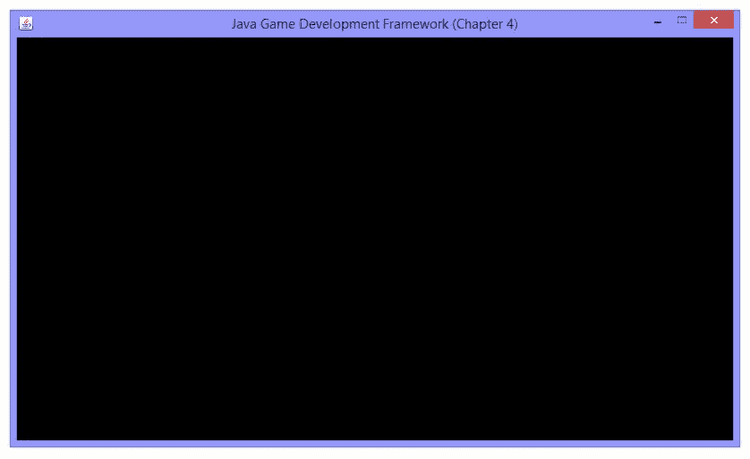

图 4-10 带有 Game 实例的 JFrame

让我们讨论一下我们所做的更改。`frame.add(sGame)` 是 `frame.add(BorderLayout.CENTER, sGame)` 的另一种表达方式，我们在第 3 章中讨论过。`frame.pack()` 告诉我们的 `JFrame` 对象调整大小以适应其内容的建议尺寸（该尺寸是使用每个组件的 `setPreferredSizeSize()` 方法设置的）。

通过关闭窗口退出程序。我们现在几乎完成了 `GameMain` 类。完整类重现于列表 4.04 中：

```java
***** 列表 4.04 GameMain 类 (已更新) *****
01 package com.jamescho.game.main;
02
03 import java.awt.BorderLayout;
04
05 import javax.swing.JFrame;
06
07 public class GameMain {
08      private static final String GAME_TITLE = "Java Game Development Framework (Chapter 4)";
09      public static final int GAME_WIDTH = 800;
10      public static final int GAME_HEIGHT = 450;
11      public static Game sGame;
12
13      public static void main(String[] args) {
14              JFrame frame = new JFrame(GAME_TITLE);
15              frame.setDefaultCloseOperation(JFrame.EXIT_ON_CLOSE);
16              frame.setResizable(false); 
17              sGame = new Game(GAME_WIDTH, GAME_HEIGHT);
18              frame.add(sGame);
19              frame.pack();           
20              frame.setVisible(true);
21      }
22
23 }
```

#### 向项目添加图像文件

现在我们暂停代码，向我们的项目添加几个图像文件。在浏览器中访问 `jamescho7.com/book/chapter7/`，并将以下图像文件下载到项目之外的任何文件夹（或者，使用提供的名称和大小创建两个自己的图像）：


`iconimage.png` (20px x 20px) – 将作为 `JFrame` 的图标图像

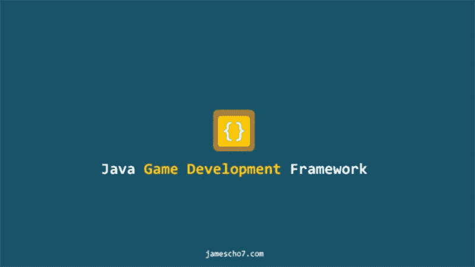

`welcome.png` (800px x 450px) – 将作为框架的欢迎界面

我们将这些图像文件添加到资源（resources）包中。要这样做，只需打开包含这两个文件的文件夹，并将文件拖动到 Package Explorer 中的 resources 包中。你将看到一个 `File Operation` 对话框。确保你选择了 `Copy files`，如图 4-11 所示，并按下 OK。这确保了即使这些图像从原始位置删除，我们的项目也能访问这些图像。

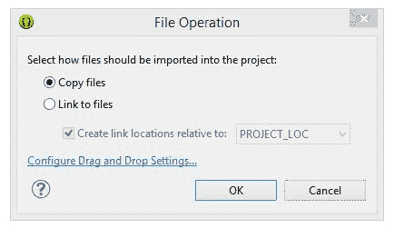

图 4-11 向我们的项目复制文件

你的项目现在应该包含我们的两个图像文件，如图 4-12 所示。

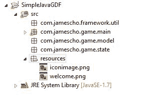

图 4-12 添加了图像的 resources 包

#### 创建 Resources 类

现在我们有了一些资源，我们需要一个类来管理它们。我们将创建一个 `Resources` 类，它将允许我们快速地从资源包中加载图像和声音文件，并将它们存储起来。在 `com.jamescho.game.main` 中创建此类，如图 4-13 所示。


图 13 创建 Resources 类

我们的 `Resources` 类将拥有三个方法。第一个方法 `load()` 将是一个公共方法，用于加载游戏资源。为了实现这一点，它将使用两个辅助方法：`loadSound()` 和 `loadImage()`。

```java
***** 列表 4.05 Resources 类 *****
01 package com.jamescho.game.main;
02
03 import java.applet.Applet;
04 import AudioClip;
05 import java.awt.image.BufferedImage;
06 import java.net.URL;
07
08 import javax.imageio.ImageIO;
09
10 public class Resources {
11      public static void load() {
12              // To-do
13      }
14
15      private static AudioClip loadSound(String filename) {
16              URL fileURL = Resources.getResource("/resources/" + filename);
17              return Applet.newAudioClip(fileURL);
18      }
19
20      private static BufferedImage loadImage(String filename) {
21              BufferedImage img = null;
22              img = ImageIO.read(Resources.class.getResourceAsStream("/resources/" + filename));
23              return img;
24      }
25
26 }
```

你会在 `loadImage()` 中看到一个错误，如图 4-14 所示。现在忽略它。我们稍后会修复它。


图 11 loadImage() 中的异常

### Try 块

现在让我们来修复图 4-14 中的那个错误。将鼠标悬停在错误消息上，你将看到对错误的解释。


图 4-15 错误由于未处理的异常

编译器告诉我们 `ImageIO.read(…)` 可能会抛出 `Exception`（错误），我们必须提供一种处理错误的方法。要这样做，我们将选择 `Surround with try/catch` 选项。你的方法将如下所示更新，你看到的可能是 `IOException` 而不是 `Exception`，但这完全没问题！在这里任何选择都是可以的：

```java
private static BufferedImage loadImage(String filename) {
    BufferedImage img = null;
    try {
        img = ImageIO.read(Resources.class
                        .getResourceAsStream("/resources/" + filename));
    } catch (Exception e) {
        // TODO 自动生成的 catch 块
        e.printStackTrace();
    }
    return img;
} 
```

每当我们调用一个可能会失败的方法（例如 `ImageIO.read()`）时，都必须将其封装在 `try/catch` 块中，将有风险的方法放在 `try` 块内，并在 `catch` 块中处理错误。我们将保留 `e.printStackTrace()`，它会告诉我们发生了什么错误，以及错误发生在代码的哪个位置。

在这种情况下，常见的异常是我们的游戏无法找到请求的文件，因此让我们在 `catch` 块中添加一条适当的错误信息，将 `//TODO` 行替换为以下代码，以便我们能够识别出现问题的文件：

```java
System.out.println("Error while reading: " + filename);
```

我们的 `Resources` 类现在应该像列表 4.06 所示。

```java
***** Listing 4.06 The Resources Class (Updated with Try/Catch Block) *****
01 package com.jamescho.game.main;
02
03 import java.applet.Applet;
04 import java.applet.AudioClip;
05 import java.awt.image.BufferedImage;
06 import java.net.URL;
07
08 import javax.imageio.ImageIO;
09
10 public class Resources {
11      public static void load() {
12              // To-do
13      }
14
15      private static AudioClip loadSound(String filename) {
16              URL fileURL = Resources.class.getResource("/resources/" + filename);
17              return Applet.newAudioClip(fileURL);
18      }
19
20      private static BufferedImage loadImage(String filename) {
21              BufferedImage img = null;
22              try {
23                      img = ImageIO.read(Resources.class.getResourceAsStream("/resources/" + filename));
24              } catch (Exception e) {
25                      System.out.println("Error while reading: " + filename);
26                      e.printStackTrace();
27              }
28              return img;
29      }
30 }
```

### 从 resources 包加载图像文件

现在我们将开始将两个图像文件 `welcome.png` 和 `iconimage.png` 加载到项目中。这只需要两个简单的步骤。

我们首先为每个文件创建适当的 `public static` 变量。由于我们处理的是图像文件，我们将按照下例所示创建两个 `BufferedImage` 变量。注意，我们使用逗号在同一行中声明相同类型的多个变量。

```java
....
public class Resources {
    public static BufferedImage welcome, iconimage;
    public static void load() {
        // To-do
    }
....
```

其次，我们必须在 `load()` 方法内部初始化这两个变量，通过调用带有所需文件名的适当辅助方法来实现，如下例所示：

```java
....
public class Resources {
    public static BufferedImage welcome, iconimage;
    public static void load() {
        welcome = loadImage("welcome.png");
        iconimage = loadImage("iconimage.png");
    }
....
```

请确保每个 `String` 参数都与目标文件的名称完全匹配。你完成后的类应该像列表 4.07 所示：

```java
***** Listing 4.07 The Resources Class (Complete) *****
01 package com.jamescho.game.main;
02
03 import java.applet.Applet;
04 import java.applet.AudioClip;
05 import java.awt.image.BufferedImage;
06 import java.net.URL;
07
08 import javax.imageio.ImageIO;
09
10 public class Resources {
11              
12      public static BufferedImage welcome, iconimage;
13              
14      public static void load() {
15              welcome = loadImage("welcome.png");
16              iconimage = loadImage("iconimage.png");
17      }
18
19      private static AudioClip loadSound(String filename) {
20              URL fileURL = Resources.class.getResource("/resources/" + filename);
21              return Applet.newAudioClip(fileURL);
22      }
23
24      private static BufferedImage loadImage(String filename) {
```


```
26              BufferedImage img = null;
27              try {
28                      img = ImageIO.read(Resources.class.getResourceAsStream("/resources/" + filename));
29              } catch (Exception e) {
30                      System.out.println("Error while reading: " + filename);
31                      e.printStackTrace();
32              }
33              return img;
34      }
35
36 }
```

我们稍后会测试这个类。

## 检查点 #1

让我们看看目前为止我们在框架中完成了哪些工作。这对我们来说很重要，这样我们就不会在自己的代码中迷失。图 4-16 显示了我们目前的进展。

注意，如果你在此时处理任何一个类时遇到问题，可以在`jamescho7.com/book/chapter4/checkpoint1`下载源代码。

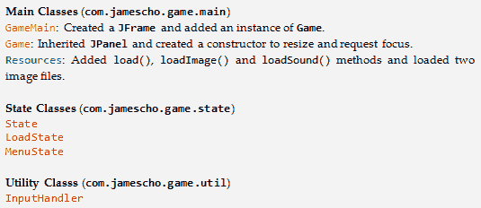

图 4-16 类列表与注释

我们在主类方面取得了很大进展。在接下来的几页中，我们将开始并完成`state classes`（状态类）。

## 定义“状态”

在整个游戏过程中，玩家会经过多个屏幕。他或她可能从主菜单开始，进入设置界面，返回菜单界面，然后进入游戏界面。

为了将此功能整合到我们的框架中，我们将为游戏中的每个屏幕创建一个 Java 类。我们将这些类命名为`states`。（遵循这一想法，菜单界面将由`MenuState`类表示，游戏界面将由`PlayState`类表示，依此类推）。

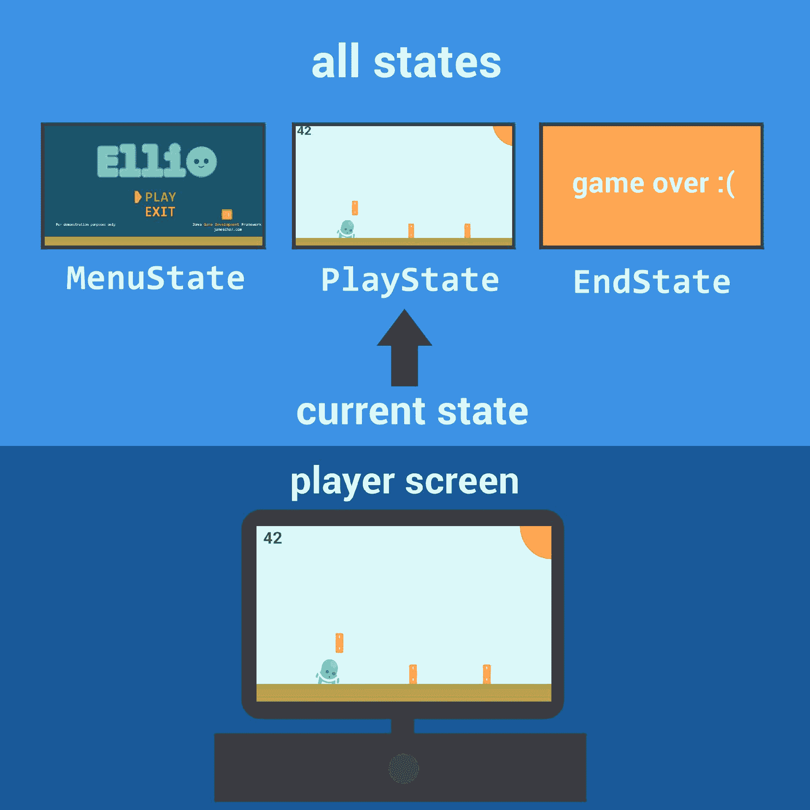

图 4-17 表示状态

### 创建状态类

在`com.jamescho.game.state`包中，创建一个名为`State`的类。当我们创建其他状态类（子类）时，该类将作为一个通用模板（即父类）。因此，`State`**不会**代表游戏中的实际屏幕。

为了表示这种间接角色，我们将在类声明中添加`abstract`关键字将此类标记为抽象类，如列表 4.08 所示。

```
***** Listing 4.08 Adding the abstract Keyword *****
01 package com.jamescho.game.state;
02
03 public abstract class State {
04
05 }
```

### 关于抽象类的更多信息

抽象类与接口非常相似。它包含了抽象方法（没有方法体的方法），任何继承自抽象类的类必须实现这些方法。这意味着抽象的`State`类（父类）可以声明抽象方法，为我们将创建的所有状态对象（子类）提供一个公共结构。

让我们通过在每个状态对象中添加我们需要实现的六个抽象方法来查看它是如何工作的。将列表 4.09 第 9 行到第 19 行的代码添加到`State`中（注意导入语句）。

```
***** Listing 4.09 Adding Abstract Methods to the State Class *****
01 package com.jamescho.game.state;
02
03 import java.awt.Graphics;
04 import java.awt.event.KeyEvent;
05 import java.awt.event.MouseEvent;
06
07 public abstract class State {
08
09      public abstract void init();
10
11      public abstract void update();
12
13      public abstract void render(Graphics g);
14
15      public abstract void onClick(MouseEvent e);
16
17      public abstract void onKeyPress(KeyEvent e);
18
19      public abstract void onKeyRelease(KeyEvent e);
20
21 }
```

这六个方法中的每一个都将在游戏过程中的非常特定的时刻被调用。

- `init()`方法将在转换到新游戏状态时调用。它是初始化在整个游戏状态中使用的任何游戏对象的绝佳位置。
- 当前状态的`update()`方法将在游戏循环的每一帧调用。我们用它来更新游戏状态内的每个游戏对象。
- 当前状态的`render()`方法将在游戏循环的每一帧调用。我们用它将游戏图像渲染到屏幕上。
- 当前状态的`onClick()`方法将在玩家点击鼠标时调用。它通过参数接收有关此鼠标事件的信息。
- 当玩家按下按键时，当前状态的`onKeyPress()`方法会被调用。它接收有关按键事件的信息，例如被按下按键的标识。我们使用此方法来对游戏进行更改（例如移动角色）。
- 当玩家释放键盘按键时，当前状态的`onKeyRelease()`方法会被调用。它接收有关按键事件的信息，例如被释放的按键标识。我们使用此方法来对游戏进行更改（例如停止移动的角色）。

### 为什么我们使用抽象类

与接口不同，抽象类允许我们在声明抽象方法的同时声明具体方法，以实现由其子类共享的行为。换句话说，抽象类允许你结合继承和接口的特性！

在我们的框架中，`State`必须是一个抽象类而不是一个简单的接口，因为我们稍后将实现一些具体方法来执行共享行为，例如切换到另一个屏幕。这在在本章的后续部分将更有意义。

### 创建 LoadState 类

让我们通过使用`State`作为模板来创建`LoadState`类，从而发挥它的作用。这个类将代表我们游戏的加载界面，其中我们将要求`Resources`类加载我们所有的游戏资源。

在包`com.jamescho.game.state`内部创建`LoadState`类，并如图 4-18 所示扩展`State`。

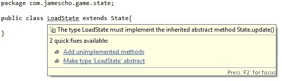

图 4-18 扩展`State`

与实现接口一样，你必须实现继承抽象类中所有的抽象方法。选择“添加未实现方法”快速修复，你的代码随后看起来就会像列表 4.10 所示。

```
***** 列表 4.10 添加未实现方法后的 LoadState 类 *****
01 package com.jamescho.game.state;
02
03 import java.awt.Graphics;
04 import java.awt.event.KeyEvent;
05 import java.awt.event.MouseEvent;
06
07 public class LoadState extends State {
08
09      @Override
10      public void init() {
11              // TODO Auto-generated method stub
12      }
13
14      @Override
15      public void update() {
16              // TODO Auto-generated method stub
17      }
18
19      @Override
20      public void render(Graphics g) {
21              // TODO Auto-generated method stub
22      }
23
24      @Override
25      public void onClick(MouseEvent e) {
26              // TODO Auto-generated method stub
27      }
28
29      @Override
30      public void onKeyPress(KeyEvent e) {
31              // TODO Auto-generated method stub
32      }
33
34      @Override
35      public void onKeyRelease(KeyEvent e) {
36              // TODO Auto-generated method stub
37      }
38
39 }
```

现在我们已经创建了类并扩展了我们的模板，我们需要开始实现该类的行为。

在`LoadState`的`init()`方法中，我们将要求`Resources`类加载我们所有的游戏资源。在`init()`方法中添加以下代码行并导入`com.jamescho.game.main.Resources`：

```
Resources.load();
System.out.println("Loaded Successfully");
```

你可以让其他方法为空。我们不会在`LoadState`中执行任何更新或渲染任何图像，并且将忽略通过键盘或鼠标发生的任何用户交互。你的`LoadState`现在看起来应该像列表 4.11 所示。

```
***** 列表 4.11 LoadState.java *****
01 package com.jamescho.game.state;
02
03 import java.awt.Graphics;
04 import java.awt.event.KeyEvent;
05 import java.awt.event.MouseEvent;
06
07 import com.jamescho.game.main.Resources;
08
09 public class LoadState extends State{
10
11      @Override
12      public void init() {
13              Resources.load();
14              System.out.println("Loaded Successfully");
15      }
16
17      @Override
18      public void update() {
19              // TODO Auto-generated method stub
20      }
21
22      @Override
23      public void render(Graphics g) {
24              // TODO Auto-generated method stub
25      }
26
27      @Override
28      public void onClick(MouseEvent e) {
29              // TODO Auto-generated method stub
30      }
31
32      @Override
33      public void onKeyPress(KeyEvent e) {
34              // TODO Auto-generated method stub
35      }
36
37      @Override
38      public void onKeyRelease(KeyEvent e) {
39              // TODO Auto-generated method stub
40      }
41
42 }
```

这就是目前我们需要做的一切了！接下来，我们将进入`Game`类并将`LoadState`设置为游戏的初始状态。

### 设置当前状态

打开`Game`类，并声明以下实例变量（导入`com.jamescho.game.state.State`）：

```
private volatile State currentState;
```

我们的游戏一次显示一个状态。`currentState`变量将是我们的框架跟踪当前状态的方式。现在我们添加一个接受任何`State`对象的方法，调用其`init()`方法并将其设置为`currentState`。按照列表 4.12 所示添加`setCurrentState()`。

```
***** 列表 4.12 添加 setCurrentState() *****
public void setCurrentState(State newState) {
    System.gc();
    newState.init();
    currentState = newState;
}
```

注意：调用`System.gc()`是为了清理占用空间的未使用对象。`gc`代表“garbage collector”（垃圾回收）。我们将在稍后讨论它的重要性。

现在我们可以创建任意数量的`State`对象，并简单地传递到`Game`对象的`setCurrentState()`方法中。当游戏开始时，我们希望初始状态是`LoadState`。让我们在一个新的`addNotify()`方法中设置它，如 4.13 中的第 38-42 行所示：

```
***** 列表 4.13 设置初始状态 *****
01 package com.jamescho.game.main;
02
03 import java.awt.Color;
04 import java.awt.Dimension;
05 import java.awt.Image;
06
07 import javax.swing.JPanel;
08
09 import com.jamescho.game.state.LoadState;
10 import com.jamescho.game.state.State;
11
12 @SuppressWarnings("serial")
13
14 public class Game extends JPanel {
15      private int gameWidth;
16      private int gameHeight;
17      private Image gameImage;
18
19      private Thread gameThread;
20      private volatile boolean running;
21      private volatile State currentState;
22
23      public Game(int gameWidth, int gameHeight) {
24              this.gameWidth = gameWidth;
25              this.gameHeight = gameHeight;
26              setPreferredSize(new Dimension(gameWidth, gameHeight));
27              setBackground(Color.BLACK);
28              setFocusable(true);
29              requestFocus();
30      }
31
32      public void setCurrentState(State newState) {
33              System.gc();
34              newState.init();
35              currentState = newState;
36      }
37
38      @Override
39      public void addNotify() {
40              super.addNotify();
41              setCurrentState(new LoadState());
42      }
43
44 }
```


注意我在`addNotify()`方法上方添加了`@Override`注解。这是因为`addNotify()`是一个被`Game`类继承的现有方法。当我们的`Game`对象被成功添加到`GameMain`内部的`JFrame`时，会自动调用`addNotify()`。它是设置图形、游戏状态和输入的安全地方。

注意`super`（来自 4.13 的第 40 行）指向父类。`super.addNotify()`随后调用`JPanel`的`addNotify()`方法。你经常会在重写的子类方法中看到父类的方法。

通常情况下，当父类的原始方法在后台执行重要任务时，我们会这样做，否则如果我们用子类的重写方法来替换该方法，这些任务将无法被调用。

现在运行你的程序！当我们的`Game`实例被添加到`JFrame`中时，我们的`LoadState`对象被初始化为`currentState`。此时，`LoadState`的`init()`方法被调用，这意味着我们的资源将开始加载，正如控制台上显示的友好信息所示，如图 4-19 所示。

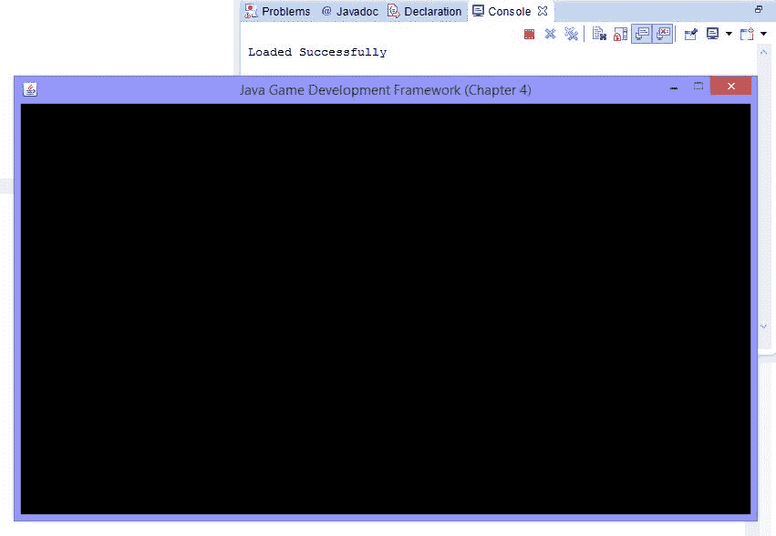

图 4-19 加载成功

### 过渡到 MenuState

我们的程序声称资源已加载，但在我们显示某些图像之前，我们无法确定这一点。让我们让`LoadState`在加载资源后过渡到一个名为`MenuState`的新状态，并在该状态在屏幕上显示图像。

首先，我们需要为`LoadState`提供一种过渡到其他状态的方法。我们可以在`LoadState`内部实现一个新方法，通过调用`Game`对象的`setCurrentState()`方法来实现状态切换。这种方法的缺点是，每个状态类都需要能够过渡到另一个状态类，因此我们必须寻找更高效的解决方案。

再次打开`State`类，定义以下具体方法，该方法将通过继承供此抽象父类的任何子类使用（位于列表 4.14 的第 23 到 25 行，像往常一样检查是否有新的导入语句——提示：第 07 行）：

```
***** Listing 4.14 Adding the setCurrentState() method to State.java *****

01      package com.jamescho.game.state;

02

03      import java.awt.Graphics;

04      import java.awt.event.KeyEvent;

05      import java.awt.event.MouseEvent;

06

07      import com.jamescho.game.main.GameMain;

08

09      public abstract class State {

10              
11              public abstract void init();

12

13              public abstract void update();

14

15              public abstract void render(Graphics g);

16

17              public abstract void onClick(MouseEvent e);

18

19              public abstract void onKeyPress(KeyEvent e);

20

21              public abstract void onKeyRelease(KeyEvent e);

22              

23              public void setCurrentState(State newState) {

24                      GameMain.sGame.setCurrentState(newState);

25              }

26

27      } 
```

`setCurrentState()`方法接受一个目标`State`对象并将其传递给`Game`对象的`setCurrentState()`方法（该对象存储在`GameMain`类的变量`sGame`中）。每当我们想要过渡到新状态时，都可以从任何状态类（例如`LoadState`）调用此方法。

让我们通过在`com.jamescho.game.state`中创建`MenuState`类来测试。一旦你创建了新类并扩展了`State`（如果你忘记了如何操作，请参见图 4-18），请按照列表 4.15 所示实现`init()`和`render()`方法。确保你注意导入语句。应该导入正确的`Resources`类。

```
***** Listing 4.15 The full MenuState Class *****

01 package com.jamescho.game.state;

02

03 import java.awt.Graphics;

04 import java.awt.event.KeyEvent;

05 import java.awt.event.MouseEvent;

06

07 import com.jamescho.game.main.Resources;

08

09 public class MenuState extends State {

10

11      @Override

12      public void init() {

13              System.out.println("Entered MenuState");                

14      }

15

16      @Override

17      public void update() {

18              // Do Nothing

19      }

20

21      @Override

22      public void render(Graphics g) {

23              // 在 x = 0, y = 0 处将屏幕上绘制 Resources.welcome

24              g.drawImage(Resources.welcome, 0, 0, null);             

25      }

26

27      @Override

28      public void onClick(MouseEvent e) {

29              // To do

30      }

31

32      @Override

33      public void onKeyPress(KeyEvent e) {

34              // Intentionally ignored

35      }

36

37      @Override

38      public void onKeyRelease(KeyEvent e) {

39              // Intentionally ignored

40      }

41

42 } 
```

我们稍后会详细讨论`g.drawImage(...)`方法。现在，回到`LoadState`类。我们将在`update()`方法内部添加一条语句过渡到新的`MenuState`，如下所示：

```
 ....

public class LoadState extends State {

....

        @Override

        public void update() {

                setCurrentState(new MenuState());    // 这是新的一行！

        }

.... 
```

这将允许我们在调用`LoadState.update()`方法时从`LoadState`过渡到`MenuState`。

现在，你可能在奇怪，为什么我们在调用`render()`方法时，程序还没有显示图像，尽管我们在`MenuState`方法中调用了它？

这是因为在调用`render()`方法（包括`update()`、`onKeyPress()`和`onKeyRelease()`）之前，我们需要添加游戏的核心：游戏循环。我们将在后续的检查点执行此操作。

## 检查点 2

让我们再次查看进度。图 4-20 遵循相同的规则。


图 20 自检查点 1 期间的更改

**注意**：如果你在此处遇到任何类方面的问题，可以从`jamescho.com/chapter4`下载源代码。

我们快完成了！让我们再次返回`Game`，将在那里实现游戏循环并连接新的`InputHandler`对象。然后我们将为`JFrame`添加一个酷炫的图标，就可以构建我们的第一个图形游戏了。

打开`Game`类。在列表 4.03 中，我们添加了三个在此之前忽略的实例变量：`gameImage`、`gameThread`和`running`。我们将利用`Thread`和`boolean`变量来实现游戏循环。将下所示的`initGame()`方法添加到`Game`中（暂时忽略错误）。然后，在`addNotify()`内部调用这个新方法。

```
 ....

@Override

public void addNotify() {

        super.addNotify();

        setCurrentState(new LoadState());

        initGame();

}

private void initGame() {

        running = true;

        gameThread = new Thread(this, "Game Thread");

        gameThread.start();

}

.... 
```

`initGame()`将我们的`running`初始化为`true`（我们稍后会讨论`volatile`）。然后，我们使用一个接受两个参数的构造函数来初始化`gameThread`变量。第一个参数是让新`Thread`完成的任务。第二个参数是新`Thread`的名称。此时此刻由于我们的代码中有一个错误，如图 4-22 所示。

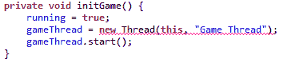

图 4-22 线程构造器中的错误

鼠标悬停在红色线条上，我们看到了图 4-23 所示的错误，以及一系列建议的快速修复列表。

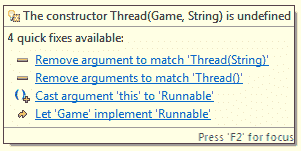

图 4-23 给我一个 Runnable！

快速修复建议似乎该构造函数的第一个参数应该是`Runnable`类型的变量，而不是`Game`（记住关键字`this`指的是调用`Thread`构造函数的`Game`实例）。诚然，Java 文档描述了`Thread`的以下构造函数：

```
 Thread (Runnable target, String name) 
```

要解决这个问题，我们需要理解什么是`Runnable`对象。回想线程需要一个指令列表来执行。这个列表可以用`Runnable`对象的形式提供。

现在我们从哪里获取这个`Runnable`对象呢？事实证明`Runnable`是一个 Java 内置接口。这意味着我们可以在`Game`类中实现`Runnable`，这将允许我们将`Game`的实例（使用关键字`this`）传递给`Game Thread`的构造器，如图 4-22 所示。让我们通过将图 4-24 所示的`implements…`声明添加到我们的`Game`类来实现此：

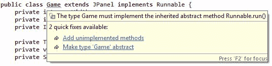

图 4-24 Game 实现 Runnable 接口

由于我们正在实现一个接口，必须实现它所有的抽象方法。选择“添加未实现的方法”（Add unimplemented methods）。

这将自动添加如列表 4.16 所示的`run()`方法，它展示了此时你的`Game`类应该的样子。

```
***** Listing 4.16 Implementing the run() method *****

01 package com.jamescho.game.main;

02

03 import java.awt.Color;

04 import java.awt.Dimension;

05 import java.awt.Image;

06

07 import javax.swing.JPanel;

08

09 import com.jamescho.game.state.LoadState;

10 import com.jamescho.game.state.State;

11

12 @SuppressWarnings("serial")

13

14 public class Game extends JPanel implements Runnable {

15      private int gameWidth;

16      private int gameHeight;

17      private Image gameImage;

18

19      private Thread gameThread;

20      private volatile boolean running;

21      private volatile State currentState;

22

23      public Game(int gameWidth, int gameHeight) {

24              this.gameWidth = gameWidth;

25              this.gameHeight = gameHeight;

26              setPreferredSize(new Dimension(gameWidth, gameHeight));

27              setBackground(Color.BLACK);

28              setFocusable(true);

29              requestFocus();

30      }

31              
32      public void setCurrentState(State newState) {

33              System.gc();

34              newState.init();

35              currentState = newState;

36      }

37      
38      @Override

39      public void addNotify() {

40              super.addNotify();

41              setCurrentState(new LoadState());

42              initGame();

43      }

44              
45      private void initGame() {

46              running = true;

47              gameThread = new Thread(this, "Game Thread");

48              gameThread.start();

49      }

50

51      @Override

52      public void run() {

53              // TODO Auto-generated method stub

54      }

55              
56 }
```

实现`Runnable`及其抽象的`run()`方法使得`Game`能够被当作`Runnable`对象使用。因此，我们在`initGame()`方法中的错误消失了，如图 4-25 所示。

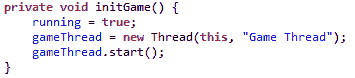

图 4-25 作为 Runnable 的 Game

基于此，你可能猜到`Game`的`run()`方法与`gameThread`有关，你的猜想是正确的。

`gameThread`需要一个任务来执行，而`run()`方法就是该任务。当我们如图 4-25 所示调用`gameThread.start()`时，我们正在要求我们的`gameThread`执行。

### 实现游戏循环

现在我们添加了游戏线程，是时候添加游戏循环了。我们将重点关注`run()`方法。

在`run()`方法内部，添加下所示的`while`循环以及一个退出命令。正如你看到的，当游戏循环结束时，我们的游戏也应该终止。

```
 ....

        @Override

        public void run() {

                while (running) {

                }

                // running 变为 false 时立即结束游戏。

                System.exit(0);

        }
```


游戏循环在`running`变为`false`时停止，这意味着要结束游戏，我们需要将`running`的值改为`false`，稍后会详细讨论。

在游戏循环体内，我们将执行两个任务：更新和渲染。更新将非常简单。我们只需要让`currentState`调用它的`update()`方法。然而，渲染将更加复杂，需要三个步骤才能完成。

为了渲染我们的游戏，我们将依靠一种称为双缓冲的技巧。与其一次一次将图像直接绘制到屏幕上，不如准备一个离屏空白图像，并将所有的图像都绘制到上面，最后每帧将完成的场景绘制到屏幕上。因此，我们必须完成的三个步骤是：

1. 准备一个离屏空白图像。
2. 将`currentState`的场景（`currentState`中所有的游戏对象）渲染到此游戏图像。
3. 将完成的离屏图像绘制到屏幕上。

双缓冲允许我们减少不需要的画面撕裂和闪烁。我们在这里不讨论这些细节。只需说双缓冲虽然需要更多的代码时间，但它改善了游戏体验。

是时候添加我们的代码了。在游戏循环内部添加加粗粗的四行代码，并如下所示定义一个名为`prepareGameImage()`的新方法（导入`Graphics`）：

```
 ....

        @Override

        public void run() {

                while (running) {

                        currentState.update();

                        prepareGameImage();

                        currentState.render(gameImage.getGraphics());

                        repaint();                      

                }

                // 当 running 变为 false 时立即退出游戏。

                System.exit(0);

        }

        private void prepareGameImage() {

                if (gameImage == null) {

                        gameImage = createImage(gameWidth, gameHeight);

                }

                Graphics g = gameImage.getGraphics();

                g.clearRect(0, 0, gameWidth, gameHeight);

        }

....
```

在我们游戏循环内部添加的四行代码中，更新了`currentState`，然后调用三个方法来处理渲染所需的步骤。在`prepareGameImage()`中，我们通过创建并初始化`gameImage`变量（宽度为`gameWidth`，高度为`gameHeight`）来准备一个离屏图像。接下来，在每一帧中，我们使用一个相同大小的矩形清除此图像，以清除上一帧绘制到屏幕上的所有图像。这确保了上一帧的图像不会渗透到当前帧中。每一帧都会重新开始。

### 帧率与计时机制

游戏依靠快速切换的静态图像（帧）来提供动画幻。因此，游戏性能通常用FPS（每秒帧数）衡量。通常，FPS越高，图形和游戏体验越流畅。

在我们的框架中，FPS等于游戏循环每秒的迭代（重复）次数。这是因为在每次迭代中，我们都会更新并渲染一次游戏，刷新一次屏幕。因此，下面的方程是理解我们游戏的很好方式。

```
 update + render = one iteration of game loop = one frame
```

我们的框架目标是达到约60 FPS。这对于确保流畅的游戏体验足够了。因此，我们希望游戏循环每秒迭代大约60次，这意味着每次迭代执行需要大约0.017秒（17毫秒）。处理这种问题有复杂的方法，我们稍后会讨论，但现在我们将保持极其简单。

我们基于这样一个假设：对于我们在这个框架上构建的大多数游戏，更新和渲染将在极短的时间（2-3毫秒）完成。当然，这会根据系统和游戏的不同而异，这就是为什么我们将在未来讨论一种更好的计时机制。现在，在每次更新和渲染之后，我们将让游戏线程睡眠14毫秒。加上2-3毫秒的更新和渲染时间，每次迭代总计将耗时约17毫秒。

注意：由于我们的游戏循环是无限的（它会一直运行，直到我们通过将`running`设置为false来告诉它终止），我们的游戏线程将占用计算机大部分的CPU时间。让游戏线程睡眠允许我们的CPU花费时间执行其他任务，例如处理用户输入。

要实现这种由睡眠驱动的计时机制，我们只需要在`run()`方法中添加以下代码（如蓝色文本所示）：

```
 ...

@Override

public void run() {

while (running) {

                currentState.update();

                prepareGameImage();

                currentState.render(gameImage.getGraphics());

                repaint();                      

                try {

                        Thread.sleep(14);

                } catch (InterruptedException e) {

                        e.printStackTrace();

                }

        }

        System.exit(0);

}

...
```

注意，我们只是调用了一个简单的静态方法`Thread.sleep()`来让我们的游戏线程睡眠14毫秒。我们必须将其放在try-catch块中，因为它可能会抛出异常（特别是`InterruptedException`类型，它是`Exception`的一种。如果不熟悉，请参见图4-15以及后续关于try/catch块的讨论）。

我们的游戏循环已经完成，它应该大约每17毫秒运行一次。如你所见，这种计时机制非常有限，我们将在接下来的章节中对其进行修改。

### 退出游戏

我们的`Game`类几乎完成了。我们只需要再添加几个方法。第一个方法轻而易之。这是一个在我们想要游戏退出时调用的简单方法。它会将布尔值`running`的值设置为false，使我们的游戏循环终止。在`Game`类中添加以下方法：

```
 public void exit() {

        running = false;

}
```

### 修复绘制 (Paint)

记得我们必须执行三个步骤来渲染游戏。我们已经成功创建了一个名为`gameImage`的空离屏图像并填充了图像，但现在我们必须将此图像绘制到屏幕上。

为了实现这一点，我们在游戏循环内部调用了`repaint()`，但这仅仅是请求程序调用`Game`对象的`paintComponent()`方法，该对象是一个`JPanel`（参见第3章的理解`MyPanel`）。

目前，`Game`还没有自定义的`paintComponent()`方法，我们必须在其中实际执行将`gameImage`绘制到屏幕的操作。让我们如下所示重写它：

```
 @Override

protected void paintComponent(Graphics g) {

        super.paintComponent(g);

        if (gameImage == null) {

                return;

        }

        g.drawImage(gameImage, 0, 0, null);

}
```

在我们的`paintComponent()`方法中，我们首先检查`gameImage`是否为空，因为我们不想在它不存在的情况下绘制它。如果是，我们就调用`return`，这在`void`方法中仅仅是结束方法。下一次调用`prepareGameImage()`和`repaint()`时，这个`gameImage`就不应该为空。

`paintComponent()`的参数是一个指向`Graphics`对象的引用`g`，你可以将其想象为设备屏幕上的画布。我们将使用`g`将离屏的`gameImage`绘制到坐标`x = 0`, `y = 0`（游戏窗口的左上角）上

注意：`g.drawImage(…)`的第三个参数是一个`ImageObserver`对象，允许你判断图像是否已完全加载。我们将在框架中不它，因此可以安全地传递`null`。

更新后的`Game`类位于列表4.17。

```java
***** Listing 4.17 Game 类 (更新版) *****

01 package com.jamescho.game.main;

02

03 import java.awt.Color;

04 import java.awt.Dimension;

05 import java.awt.Graphics;

06 import java.awt.Image;

07

08 import javax.swing.JPanel;

09

10 import com.jamescho.game.state.LoadState;

11 import com.jamescho.game.state.State;

12

13 @SuppressWarnings("serial")

14

15 public class Game extends JPanel implements Runnable {

16      private int gameWidth;

17      private int gameHeight;

18      private Image gameImage;

19

20      private Thread gameThread;

21      private volatile boolean running;

22      private volatile State currentState;

23

24      public Game(int gameWidth, int gameHeight) {

25              this.gameWidth = gameWidth;

26              this.gameHeight = gameHeight;

27              setPreferredSize(new Dimension(gameWidth, gameHeight));

28              setBackground(Color.BLACK);

29              setFocusable(true);

30              requestFocus();

31      }

32

33      public void setCurrentState(State newState) {

34              System.gc();

35              newState.init();

36              currentState = newState;

37      }

38

39      @Override

40      public void addNotify() {

41              super.addNotify();

42              setCurrentState(new LoadState());

43              initGame();

44      }

45

46      private void initGame() {

47              running = true;

48              gameThread = new Thread(this, "Game Thread");

49              gameThread.start();

50      }

51

52      @Override

53      public void run() {

54              while (running) {

55                      currentState.update();

56                      prepareGameImage();

57                      currentState.render(gameImage.getGraphics());

58                      repaint();                      

59

60                      try {

61                              Thread.sleep(14);

62                      } catch (InterruptedException e) {

63                              e.printStackTrace();

64                      }

65              }

66              System.exit(0);

67      }

68

69      private void prepareGameImage() {

70              if (gameImage == null) {

71              gameImage = createImage(gameWidth, gameHeight);

72              }

73              Graphics g = gameImage.getGraphics();

74              g.clearRect(0, 0, gameWidth, gameHeight);

75      }

76

77      public void exit() {

78              running = false;

79      }

80

81      @Override

82      protected void paintComponent(Graphics g) {

83              super.paintComponent(g);

84              if (gameImage == null) {

85                      return;

86              }

87              g.drawImage(gameImage, 0, 0, null);

88      }

89 }
```

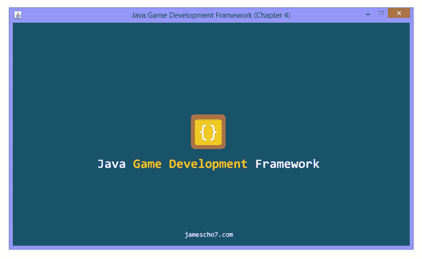

图4-26 我们的第一张图片！

运行你的代码，你应该能看到如图4-26所示的图片。我们终于让某些图形显示出来了。为了完成我们的框架，我们还有最后件事必须完成，那就是添加响应用户输入的能力。

### 处理玩家输入

回想一下，我们的每个状态类中都实现了处理键盘和鼠标输入的方法；然而，目前在这些态的`onClick()`、`onKeyPress()`和`onRelease()`方法中添加代码将不会产生任何效果。就如`init()`、`update()`和`render()`方法一样，这些方法并不是被自动调用的。我们必须确保在玩家与我们的游戏交互时，调用`currentState`的输入方法，这就是`InputHandler`类派上用场的地方。

在`com.jamescho.framework.util`内部，创建一个名为`InputHandler`的新类，将其指定为在玩家与游戏交互时被通知的类。为了实现这一点，我们必须在此类中实现两个Java内置接口`KeyListener`和`MouseListener`，并将该类的实例附加到`Game`上。

如列表4.18所示更新我们的类声明以开始第一步，注意`implements`和`import`语句：

```java
***** Listing 4.18 实现 KeyListener 和 MouseListener  *****

01 package com.jamescho.framework.util;

02

03 import java.awt.event.KeyListener;

04 import java.awt.event.MouseListener;

05

06 public class InputHandler implements KeyListener, MouseListener {

07

08 }
```


将鼠标悬停在类声明中的错误上（如图 4-27 所示），并选择 `Add unimplemented methods`（添加未实现的方法）。

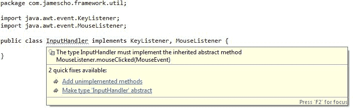

图 4-27 实现抽象方法

这将自动向你的类中添加 `mouseClicked()`、`mouseEntered()`、`mouseExited()`、`mousePressed()`、`mouseReleased()`、`keyPressed()`、`keyReleased()` 和 `keyTyped()` 方法。我们只关心其中三个：`mouseClicked()`、`keyPressed()` 和 `keyReleased()`，因为它们足以实现我们游戏中的任何用户交互。

正如这些名称所示，`mouseClicked()`、`keyPressed()` 和 `keyReleased()` 分别在玩家点击鼠标按钮、按下键或释放键时被调用。当这些方法被调用时，我们的 `InputHandler` 的角色是让游戏的 `currentState` 调用它自己的 `onClick()`、`onKeyPress()` 和 `onRelease()` 方法。这种关系在图 28 中详细说明。

**注意：**

你可以通过阅读 `KeyListener` 和 `MouseListener` 接口的 Java 文档找到有关接口方法何时调用的更多信息：

`KeyListener`: [`docs.oracle.com/javase/7/docs/api/java/awt/event/KeyListener.html`](http://docs.oracle.com/javase/7/docs/api/java/awt/event/KeyListener.html)
`MouseListener`: [`docs.oracle.com/javase/7/docs/api/java/awt/event/MouseListener.html`](http://docs.oracle.com/javase/7/docs/api/java/awt/event/MouseListener.html)

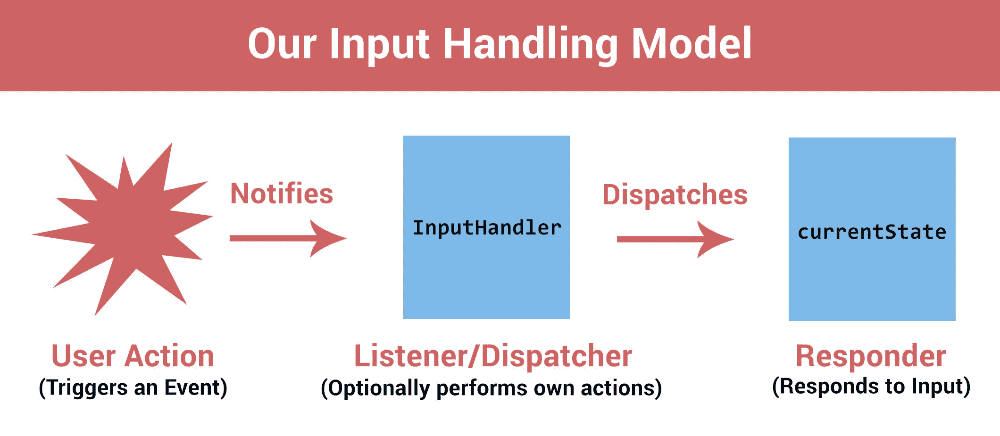

图 4-28 输入处理模型

`InputHandler` 需要知道游戏的 `currentState` 是什么以便调用其输入相关方法，因此我们将创建一个实例变量，并在游戏状态更改时更新它。在 `InputHandler` 类中添加以下实例变量，确保导入了 `com.jamescho.game.state.State`。

```java
private State currentState;
```

如下所示创建一个相应的 setter 方法：

```java
public void setCurrentState(State currentState) {
    this.currentState = currentState;
}
```

现在让我们向 `mouseClicked()`、`keyPressed()` 和 `keyReleased()` 方法添加一些代码。具体来说，我们将要求游戏的 `currentState` 调用它同名的三个方法版本，如列表 4.19 的第 20、45 和 50 行所示，这反映了 `InputHandler` 的最终版本。

***** Listing 4.19 InputHandler 类 *****

```java
01 package com.jamescho.framework.util;
02
03 import java.awt.event.KeyEvent;
04 import java.awt.event.KeyListener;
05 import java.awt.event.MouseEvent;
06 import java.awt.event.MouseListener;
07
08 import com.jamescho.game.state.State;
09
10 public class InputHandler implements KeyListener, MouseListener {
11
12      private State currentState;
13              
14      public void setCurrentState(State currentState) {
15              this.currentState = currentState;
16      }
17              
18      @Override
19      public void mouseClicked(MouseEvent e) {
20              currentState.onClick(e);
21      }
22
23      @Override
24      public void mouseEntered(MouseEvent e) {
25              // 什么都不做
26      }
27
28      @Override
29      public void mouseExited(MouseEvent e) {
30              // 什么都不做                   
31      }
32
33      @Override
34      public void mousePressed(MouseEvent e) {
35              // 什么都不做
36      }
37
38      @Override
39      public void mouseReleased(MouseEvent e) {
40              // 什么都不做
41      }
42
43      @Override
44      public void keyPressed(KeyEvent e) {
45              currentState.onKeyPress(e);
46      }
47
48      @Override
49      public void keyReleased(KeyEvent e) {
50              currentState.onKeyRelease(e);
51      }
52
53      @Override
54      public void keyTyped(KeyEvent arg0) {
55              // 什么都不做
56      }
57
58 }
```

我们对 `InputHandler` 类的工作已经完成。接下来，我们将把 `InputHandler` 的实例挂载到游戏中。

### 挂载 InputHandler

作为 `JPanel` 的子类，`Game` 继承了两个允许我们监听用户输入的方法。这两个方法是 `addKeyListener(KeyListener l)` 和 `addMouseListener(MouseListener l)`。这两个方法分别接受任何实现了 `KeyListener` 和 `MouseListener` 接口的类实例。我们已经有一个同时实现了这两个接口的类（`InputHandler`），所以这将会非常简单！

在 `Game` 中调用 `addKeyListener()` 和 `addMouseListener()` 时，我们将传入一个 `InputHandler` 实例作为参数。该对象将被设置为我们 `JPanel` 的键盘和鼠标监听器，因此当玩家与我们的游戏进行交互时，它将收到通知（以其方法被调用的形式）。

打开 `Game` 类并添加以下实例变量（记得导入 `com.jamescho.framework.util.InputHandler`）：

***** Listing 4.17 Game 类（已更新） *****

```java
private InputHandler inputHandler;
```

在一个名为 `initInput()` 的新方法中对其进行初始化，该方法定义如下：

```java
private void initInput() {
    inputHandler = new InputHandler();
    addKeyListener(inputHandler);
    addMouseListener(inputHandler);
}
```

接下来，我们将像在下方加粗所示的那样，在 `addNotify()` 方法中调用此方法。这将初始化我们的 `inputHandler` 并将其设置为 `Game` 的键盘和鼠标监听器：

```java
@Override
public void addNotify() {
    super.addNotify();
    initInput();  // 这是新添加的一行！
    setCurrentState(new LoadState());
    initGame();
}
```

最后，我们将在 `setCurrentState()` 方法内部添加一行代码，为我们的 `inputHandler` 设置 `currentState` 变量，如下加粗所示：

```java
public void setCurrentState(State newState){
    System.gc();
    currentState = newState;
    newState.init();
    inputHandler.setCurrentState(currentState);    // 这是新添加的一行！
}
```

到此我们就完成了输入处理和 `Game` 类的编写，它现在看起来应该如列表 4.20 所示：

***** Listing 4.20 完成的 Game 类 *****

```java
001 package com.jamescho.game.main;
002
003 import java.awt.Color;
004 import java.awt.Dimension;
005 import java.awt.Graphics;
006 import java.awt.Image;
007
008 import javax.swing.JPanel;
009
010 import com.jamescho.framework.util.InputHandler;
011 import com.jamescho.game.state.LoadState;
012 import com.jamescho.game.state.State;
013
014 @SuppressWarnings("serial")
015
016 public class Game extends JPanel implements Runnable {
017     private int gameWidth;
018     private int gameHeight;
019     private Image gameImage;
020
021     private Thread gameThread;
022     private volatile boolean running;
023     private volatile State currentState;
024             
025     private InputHandler inputHandler;
026
027     public Game(int gameWidth, int gameHeight){
028             this.gameWidth = gameWidth;
029             this.gameHeight = gameHeight;
030             setPreferredSize(new Dimension(gameWidth, gameHeight));
031             setBackground(Color.BLACK);
032             setFocusable(true);
033             requestFocus();
034     }
035
036     public void setCurrentState(State newState){
037             System.gc();
038             newState.init();
039             currentState = newState;
040             inputHandler.setCurrentState(currentState);
041     }
042
043     @Override
044     public void addNotify() {
045             super.addNotify();
046             initInput();
047             setCurrentState(new LoadState());
048             initGame();
049     }
050             
051     private void initInput() {
052             inputHandler = new InputHandler();
053             addKeyListener(inputHandler);
054             addMouseListener(inputHandler);
055     }
056             
057     private void initGame() {
058             running = true;
059             gameThread = new Thread(this, "Game");
060             gameThread.start();
061     }
062
063     @Override
064     public void run() {
065             while (running) {
066                     currentState.update();
067                     prepareGameImage();
068                     currentState.render(gameImage.getGraphics());
069                     repaint();
070             
071                     try {
072                             Thread.sleep(14);
073                     } catch (InterruptedException e) {
074                             e.printStackTrace();
075                     }       
076             }
077             
078             // 当 running 为 false 时立即结束游戏
079             System.exit(0);
080     }
081
082     private void prepareGameImage() {
083             if (gameImage == null) {
084                     gameImage = createImage(gameWidth, gameHeight);
085             }
086             Graphics g = gameImage.getGraphics();
087             g.fillRect(0, 0, gameWidth, gameHeight);
088     }
089
090     public void exit() {
091             running = false;
092     }
093
094     @Override
095     protected void paintComponent(Graphics g) {
096             super.paintComponent(g);
097             if (gameImage == null) {
098                     return;
099             }
100             g.drawImage(gameImage, 0, 0, null);
101     }
102
103 }
```

现在，尝试在 `MenuState` 类的 `onClick()`、`onKeyPress()` 和 `onKeyRelease()` 方法中添加一些打印语句，当你运行程序并使用键盘和鼠标与欢迎界面交互时，你应该如图 4.29 所示看到这些输出。

```java
public static void main(String[] args) {
    JFrame frame = new JFrame(GAME_TITLE);
    frame.setDefaultCloseOperation(JFrame.EXIT_ON_CLOSE);
}
```


`frame.setResizable(false);` // Prevents manual resizing of window

`sGame = new Game(GAME_WIDTH, GAME_HEIGHT);`

`frame.add(sGame);`

`frame.pack();`

`frame.setVisible(true);`

`frame.setIconImage(Resources.iconimage);` // This is the new line!

}

....

```

接下来，运行框架，你应该能看到你的图标（图 4-31 显示了在 Windows 8 上的效果）。


图 4-31 设置图标图像

注意：第 4 章的完整框架可以在 `jamescho7.com/book/chapter4/complete` 下载。

现在，我们完成了！在接下来的章节中，我们将对框架进行一些改进，但现在，是时候构建游戏了。请快速浏览一下后续关于许可信息的说明，并在下一节中与我一起加入。

### 关于许可和代码复用的说明

此框架提供给你供随心意愿使用，不受任何限制。你可以修改框架、重新发布代码，甚至在无需获得我或出版商许可的情况下构建商业游戏。你只需要在每个发行版本中创建一个名为 `LICENSE.txt` 的文本文件并包含以下许可（可以在 `jamescho7.com/book/license` 下载）：

`The MIT License (MIT)`

`Copyright (c) 2014 James S. Cho`

`特此免费授予一项免费许可，使任何获得本软件及相关文档文件（下文简称“软件”）副本的人，均可不受限制地处理该软件，包括但不限于使用、复制、修改、合并、发布、分发、分许可和/或销售软件副本的权利，并允许向其提供软件的人执行此类操作，但须满足以下条件：`

`上述版权声明和本许可声明应包含在软件的所有副本或主要部分中。`

`本软件按“现状”提供，不提供任何形式的明示或暗示保证，包括但不限于对销销性、特定用途的适用性和不侵权的权的保证。在任何情况下，作者或版权持有者均不对任何索赔、损害或其他责任负责，无论是在合同诉讼、侵权诉讼或其他诉讼中，还是由于软件或对软件的使用或其他处理而引起的。`

## 从这里开始

这一长长的章节带你了解了一个简单游戏开发框架的设计和开发，该框架将成为我们在接下来几章节中构建的游戏的基础。这是我们在本书中构建的第一个正式应用程序，我们能够在实际场景中看到许多 Java 概念。

现在我们已经有了初始的游戏开发框架，是时候构建游戏了。请在第 5 章中加入我的行列，我们将让这个框架运行起来。这将是一段有趣的旅程。

# 第 5 章：保持简单

开始游戏开发时一个常见的陷阱是对想要构建的内容过于具体。有抱负的开发者想要制作一个拥有沉浸式故事的伟大游戏，并认为他们每个人都会喜欢。他们对角色长什么样、会做什么、与谁战斗、游戏在何地以及何时发生等都有自己的想法。他们学习了一门编程语言并直接冲向游戏开发的挑战，结果却发现自己的雄心过早地变得过于宏大。

这一章的核心是从小开始。我不会教你如何构建你梦想中的游戏，但我会教你如何使用现有的游戏开发框架来构建一个简单的游戏。我将引导你设计并实现每个游戏对象，以帮助你成为一名更好的程序员。到本章结束时，你可能会意识到在发布开创性作品之前还有很长的路要走，但你将对开发过程有更深入的，并且你从零开始完成了你的第一个游戏。

## 游戏开发：高层概述

我们的游戏将是 Pong 的克隆，名为 LoneBall，它将挑战玩家通过按下方向下的方向键来控制两个挡板，让球尽可能左右弹跳，而球的速度会随机加速或减速。玩家每次成功救球得 1 分，每次漏球扣 3 分！转折之处在于挡板将始终以相反的方向移动，这意味着右侧挡板的移动方向与你按下的方向键相反。最终产品的截图见图 5-1。

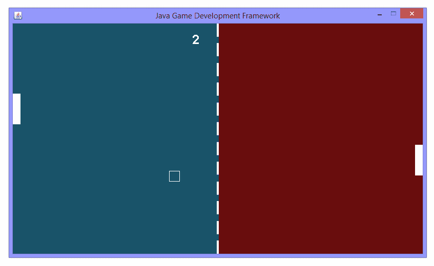

图 5-1 LoneBall 截图

尽管我们的游戏很简单，但它将捕捉游戏开发的许多重要方面。你将学习如何编写类来表示游戏对象，如何检测和处理碰撞，如何响应玩家输入更新对象，如何在屏幕上渲染它们以及更多。这些技能可能会被用于你构建的每一个游戏，因此，在没有华丽图形和外围功能干扰的情况下学习它们是至关重要的。

### 类

我们将通过创建一个 `Paddle` 类并实例化两次来表示我们的挡板。我们还将创建一个 `Ball` 类的实例来代表我们的方形“球”，它将封装球在屏幕上移动和弹跳所需逻辑。这些对象中的每一个都存在于我们命名为 `PlayState` 的游戏状态中并与之交互，该状态的作用是在处理玩家键盘输入的同时更新并渲染对象。

面向对象编程的优势之一是它的可扩展性。我们可以轻松添加新类和功能，而不影响我们的整个应用程序。在我们构建游戏时，我们可能会发现框架缺少了一一两个在游戏开发过程中可能很有用的功能（例如易于生成随机数生成），我们将根据需要添加这些功能。现在你已经读了概述，是时候开始构建了。

## 准备 LoneBall 项目

### 复制框架

在我们所有的游戏开发项目中，我们总是从复制我们的游戏开发框架开始。这使我们能够立即开始构建游戏，而必担心重写我们在第 4 章中编写与游戏无关的代码。

打开 Eclipse。如果你可以访问第 4 章末尾的游戏开发框架，请通过右键点击它（Mac 上按 Ctrl + 点击），按复制（Copy），然后将其粘贴回包资源管理器（Package Explorer）并命名为新名称 `LoneBall`。一旦你完成此操作，并且你的项目中包含了图 5-2 所示的所有类，你就可以开始了。

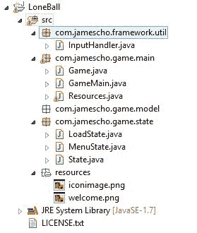

图 5-2 LoneBall 项目

注意：如果你在计算机上没有该框架，可以在 `jamescho7.com/book/chapter4/complete` 下载 .zip 格式的版本。要将下载的框架导入你的工作空间，请将 .zip 文件解压到方便的文件夹中。接下来，右键点击包资源管理器（Mac 上按 Ctrl + 点击），点击导入（Import），在 General 下选择 Existing Projects into Workspace 作为你的导入源，浏览到解压文件的文件夹，选择所有项目并按完成（Finish）。你的包资源管理器现在应该显示游戏开发框架的项目。如果你在执行这些步骤时遇到任何问题，请在 jamescho7.com 的论坛发帖寻求帮助！

现在我们的游戏开发框架已经准备就绪，下一步是打开 `GameMain`并将 `JFrame` 窗口名称更改为 LoneBall（第 5 章）。这是通过如列表 5.01 所示修改 `GAME_TITLE` 常量的值来实现的。

```

*****  5.01 GameMain 类 *****

package com.jamescho.game.main;

import javax.swing.JFrame;

public class GameMain {

    public static final String GAME_TITLE = "Java 游戏开发框架（第 4 章)";

    public static final String GAME_TITLE = "LoneBall（第 5 章)";

    public static final int GAME_WIDTH = 800;

    public static final int GAME_HEIGHT = 450;

    public static Game sGame;

        public static void main(String[] args) {

                JFrame frame = new JFrame(GAME_TITLE);

                frame.setDefaultCloseOperation(JFrame.EXIT_ON_CLOSE);

                frame.setResizable(false);

                sGame = new Game(GAME_WIDTH, GAME_HEIGHT);

                frame.add(sGame);

                frame.pack();

                frame.setVisible(true);

                frame.setIconImage(Resources.iconimage);

        }

}

```

让我们确保我们的框架已经成功复制并且名称已更改。将项目作为 Java 运行。你应该能看到图 5-3 显示的窗口（注意窗口标题）：

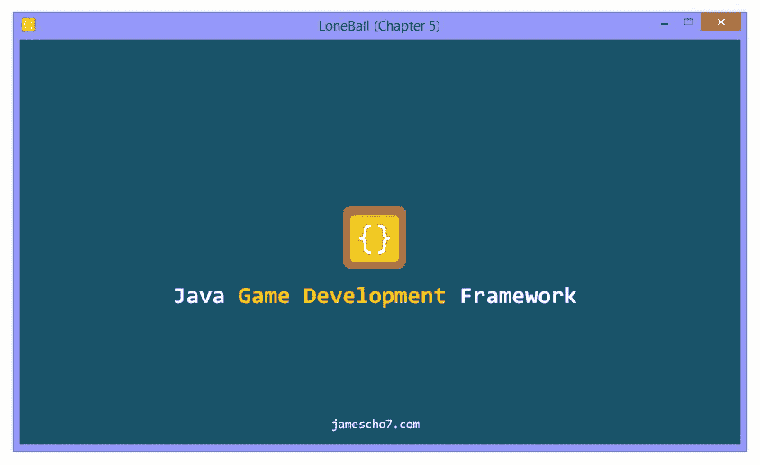

图 5-3 LoneBall JFrame

## 添加和加载资源

我们准备好开始添加一些内容了。我们要做的第一件事是添加整个开发过程中需要的所有资源。在编写代码之前准备好所有资产，将方便我们快速开发游戏，而无需在图形/声音编辑程序与 Eclipse IDE 之间来回切换。

我已经创建了 LoneBall 的资产并将它们上传到了书籍的配套网站上。你现在可以将这些内容下载到你的项目中，并将这些新资源加载到 `Resources` 类中。

以下资源（图像和声音文件）可以在 `jamescho7.com/book/chapter5` 下载。你也可以通过创建具有适当尺寸和类型的 图像及声音文件来使用自己的资源。


`bounce.wav`（持续时间：< 1 秒）——当球反弹离开挡板时播放。


`hit.wav`（持续时间：< 1 秒）——当球反弹离开墙时播放。


`iconimage.png` (32px x 32px) —— 用于 `JFrame` 的图标图像。

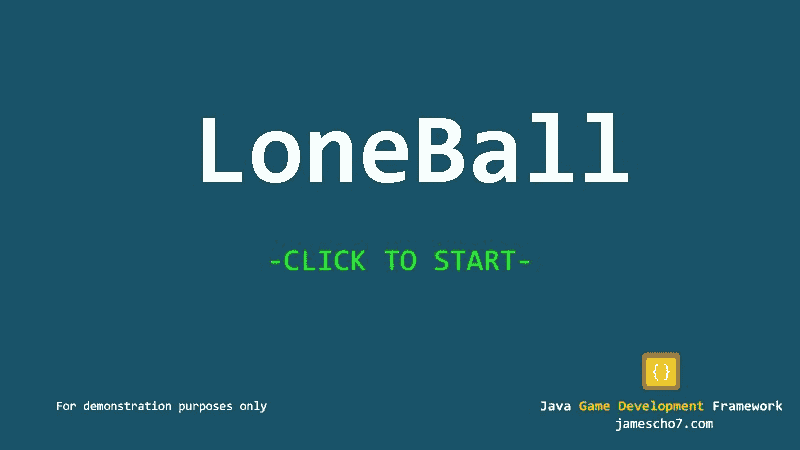

`welcome.png` (800px x 450px) —— 用于 LoneBall 的新欢迎界面。


`line.png` (4px x 450px) —— 用于两种背景颜色之间的分割线。

下载这五个文件并将它们添加到项目的 resources 程序包中，覆盖任何现有文件。现在你的你的程序包应该与图 5-4 所示完全一致。

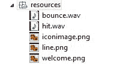

图 5-4 添加资源文件

注意：如果你想使用自己的资产，我建议使用 GIMP 或 Photoshop 来准备你的游戏图像。这里使用的声音文件是使用 `www.bfxr.net` 上的免费在线工具创建的（你对使用 `bfxr` 产生的任何内容拥有完全权利，因此无须担心许可问题）。

接下来，我们将新的资源文件加载到我们的 `Resources` 类中。这分两步完成。首先，声明以下静态变量（`welcome` 和 `iconimage` 可能已经为你声明过了）：

```

 public static BufferedImage welcome, iconimage, line;

public static AudioClip hit, bounce; 

```

接下来，在 `load()` 方法中初始化新创建的变量，所示。我们使用 `loadImage()` 处理图像文件，使用 `loadSound()` 处理声音文件：

```

 ....

public static void load() {

        welcome = loadImage("welcome.png");

        iconimage = loadImage("iconimage.png");

        line = loadImage("line.png");

        hit = loadSound("hit.wav");

        bounce = loadSound("bounce.wav");

}

.... 

```

我们还将创建两个静态 `Color` 对象来表示我们的蓝色（RGB: 25, 83, 105）和红色（RGB: 105, 13, 13）背景颜色，这些将在我们的其他类中使用。按照所示添加相应的静态变量（导入 `java.awt.Color`）：

```

 public static Color darkBlue, darkRed; 

```

在 `load()` 方法中所示所示它们：

```

 ....

public static void load() {

        welcome = loadImage("welcome.png");

        iconimage = loadImage("iconimage.png");

        line = loadImage("line.png");

        hit = loadSound("hit.wav");

        bounce = loadSound("bounce.wav");

        darkBlue = new Color(25, 83, 105); // 构造函数接受 RGB

        darkRed = new Color(105, 13, 13); // 构造函数接受 RGB

}

.... 

```

完成的 `Resources` 类如列表 5.02 所示（检查你的导入语句）：

```

***** 5.02 完成的 Resources 类 *****

01 package com.jamescho.game.main;

02

03 import java.applet.Applet;

04 import java.applet.AudioClip;

05 import java.awt.Color;

06 import java.awt.BufferedImage;

07 import java.net.URL;

08

09 import javax.imageio.ImageIO;

10

11 public class Resources {

12      public static BufferedImage welcome, iconimage, line;

13      public static AudioClip hit, bounce;

14

15      public static Color darkBlue, darkRed;

16              

17      public static void load() {

18              welcome = loadImage("welcome.png");

19              iconimage = loadImage("iconimage.png");

20              line = loadImage("line.png");

21              hit = loadSound("hit.wav");

22              bounce = loadSound("bounce.wav");

23              darkBlue = new Color(25, 83, 105); // 构造函数接受 RGB

24              darkRed = new Color(105, 13, 13); // 构造函数接受 RGB

25      }

26              

27      public static AudioClip loadSound(String filename) {

28              URL fileURL = Resources.class.getResource("/resources/" + filename);

29              return Applet.newAudioClip(fileURL);

30      }

31              

32      public static BufferedImage loadImage(String filename) {

33         BufferedImage img = null;

34          try {

35              img = ImageIO.read(Resources.class.getResource("/resources/" + filename));

36         } catch (Exception e) {

37              System.out.println("Error while reading: " + filename);

38              e.printStackTrace();

39         }

40         return img;

41      }

42 }

```

现在资源已经加载，让我们再次运行游戏以查看更改（注意新的欢迎界面和图标）：


图 5-5 LoneBall 欢迎界面

## 实现游戏

### 添加 PlayState

我们的资源都准备好了，现在是时候添加 `PlayState` 类，它将作为 LoneBall 的游戏屏幕。在 `com.jamescho.game.state` 中创建此类，并扩展 `State`（我们的每个新屏幕都需要这样做）。Eclipse 会立即“生气”（显示错误消息）并要求你添加未实现的方法。执行此快速修复，你的类将与列表 5.03 所示：

```

***** 5.03 PlayState 类（初始状态） *****


`package com.jamescho.game.state;`

`import java.awt.Graphics;`

`import java.awt.event.KeyEvent;`

`import java.awt.event.MouseEvent;`

`public class PlayState extends State{`

```
        @Override

        public void init() {

                // 待实现方法 stub

        }

        @Override

        public void update() {

                // 待实现方法 stub

        }

        @Override

        public void render(Graphics g) {

                // 待实现方法 stub

        }

        @Override

        public void onClick(MouseEvent e) {

                // 待实现方法 stub

        }

        @Override

        public void onKeyPress(KeyEvent e) {

                // 待实现方法 stub

        }

        @Override

        public void onKeyRelease(KeyEvent e) {

                // 待实现方法 stub      

        }

}
```

我们在新状态中要做的第一件事是添加代码来渲染背景（请参考图 5-1）。回想一下，渲染类似于用刷画。在绘制任何形状之前，你必须选择一种颜色，而且你先绘制的任何内容都将出现在之后在其上方绘制的任何内容的下方。这意味着背景必须在其他任何内容之前绘制，因为我们希望它位于球和球板的下方。

为了给 `LoneBall` 绘制背景，我们首先用深蓝色填充整个屏幕，然后绘制一个覆盖屏幕右半部分的红色矩形（顺序非常重要）。最后，我们将在屏幕中心绘制 `line.png` 以轻松地实现虚线效果（见图 5-1）。

注意：为了绘制虚线，我们也可以通过渲染多个白色矩形来代替渲染 `.png` 文件。这种替代方法可以为我们节省一些内存，因为我们少了一个需要处理的图像，但它会消耗更多的代码。这种权衡在游戏编程中很常见，你必须在优化（更快的程序）和工作效率（更快的程序员）之间寻求平衡。通用的规则是，只有在通过识别程序中的瓶颈并改进它们时，才有必要进行优化。

将下方所示的代码添加到 `PlayState` 的 `render()` 方法中，并导入 `com.jamescho.game.main.GameMain` 和 `com.jamescho.game.main.Resources`：

```
 ....

import java.awt.event.MouseEvent;

import com.jamescho.game.main.GameMain;

import com.jamescho.game.main.Resources;

....

@Override

public void render(Graphics g) {

        // Draw Background

        g.setColor(Resources.darkBlue);

        g.fillRect(0, 0, GameMain.GAME_WIDTH, GameMain.GAME_HEIGHT);

        g.setColor(Resources.darkRed);

        g.fillRect(GameMain.GAME_WIDTH / 2, 0, GameMain.GAME_WIDTH / 2,

                        GameMain.GAME_HEIGHT);

        // Draw Separator Line

        g.drawImage(Resources.line, (GameMain.GAME_WIDTH / 2) - 2, 0, null);

}

....
```

这段代码自言其懂，因此我将让你自己检查这些添加的内容。请记住，在绘制图形时，屏幕的原点 `(0, 0)` 位于屏幕的左上角。

如果你卡住了，请记住用于绘制矩形的四个参数是 `x`、`y`、`width` 和 `height`，其中 `(x, y)` 是要绘制图像或矩形左上角的坐标。在绘制图像的情况下，第一个参数是待绘制的图像，接下来两个参数是 `x` 和 `y` 值。在本书，最后一个参数将始终为 `null`。（作为最后的提示，`Resources.Line` 的宽度为 `4px`，这与从 `x` 坐标减去 2 有关）。

注意：我们通过 `GameMain.GAME_WIDTH` 和 `GameMain.GAME_HEIGHT` 变量访问游戏的宽度和高度。

### 过渡到 PlayState

现在我们已经有一个可以渲染背景的 `PlayState` 了，让我们通过打开 `MenuState` 并并在点击鼠标时要求过渡到 `PlayState` 来确保它可以正常工作。这只需要在 `onClick()` 方法中添加一行代码，如列表 5.04 的第 28 行所示。

```
***** 列表 5.04 从 MenuState 到 PlayState  *****

01 package com.jamescho.game.state;

02

03 import java.awt.Graphics;

04 import java.awt.event.KeyEvent;

05 import java.awt.event.MouseEvent;

06

07 import com.jamescho.game.main.Resources;

08

09 public class MenuState extends State{

10

11      @Override

12      public void init() {

13              System.out.println("Entered MenuState");

14      }

15

16      @Override

17      public void update() {

18              

19      }

20

21      @Override

22      public void render(Graphics g) {

23              g.drawImage(Resources.welcome, 0, 0, null);     

22      }

25

26      @Override

27      public void onClick(MouseEvent e) {

28              setCurrentState(new PlayState());

29      }

30

31      @Override

32      public void onKeyPress(KeyEvent e) {

33              

34      }

35

36      @Override

37      public void onKeyRelease(KeyEvent e) {

38                      

39      }

40

41 }
```

运行程序。运行程序。看到屏幕后点击鼠标。它将显示蓝色背景的虚线效果。


图 5-6 MenuState 到 PlayState

### 设计球板

现在我们有一个可以渲染背景的 `PlayState`，让我们确保它工作正常，通过打开 `MenuState` 并在点击鼠标时要求它过渡到 `PlayState`。这只需要在 `onClick()` 方法中添加一行代码。

（注：工程师注：由于你提供的原文中从 "Transitioning into PlayState" 之后的内容实际上是关于“设计球板”的重复且乱序的描述，上述翻译已严格遵循你提供的原文文本顺序进行处理，以确保不漏译。）

与创建变量一样，向自己提问可以帮助你确定需要为游戏对象创建哪些方法：我的游戏对象应该能够做什么？

每个球板（paddle）都需要能够增加速度、减少速度、更新位置以及更新其边界框（bounding box）。我们将按照下文所述创建用于执行这些行为的方法。

**加速/减速方法**：为了改变每个球板的速度，我们将实现 `accelUp()`、`accelDown()` 和 `stop()`。这些方法将适当更新更新球板的 y 轴速度（分别设置为负值、正值和零）。

**更新方法**：`update()` 方法将根据每个球板当前的位置和速度为其确定一个新位置。我们还会创建一个名为 `updateRect()` 的方法，它将简单地移动我们的边界框，以保持其与球板对象对齐。

## 创建 Paddle 类

我们在上一个节中概述了 `Paddle` 类，现在让我们来写一些代码。

### 添加变量

在 `com.jamescho.game.model` 包中，创建 `Paddle` 类。然后，创建如下所示的实例变量和构造函数，确保导入了 `java.awt.Rectangle`：

```
package com.jamescho.game.model;

import java.awt.Rectangle;

public class Paddle {

        private int x, y, width, height, velY;

        private Rectangle rect;

        public Paddle(int x, int y, int width, int height) {

                this.x = x;

                this.y = y;

                this.width = width;

                this.height = height;

                rect = new Rectangle(x, y, width, height);

                velY = 0;

        }

}
```

我们的构造函数将接受 `x`、`y`、`width` 和 `height` 值来初始化 `Paddle` 的坐标和维度，并创建一个相同坐标和维度的新边界框。最后，我们将初始 y 轴速度设置为零。

### 添加方法

如列表 5.05 所示（第 18 行至 37 行），在 `Paddle` 中添加 `update()`、`updateRect()`、`accelUp()`、`accelDown()` 和 `stop()` 方法。

```
***** 列表 5.05 带有五个方法的 Paddle 类 *****

01 package com.jamescho.game.model;

02

03 import java.awt.Rectangle;

04

05 public class Paddle {

06      private int x, y, width, height, velY;

07      private Rectangle rect;

08

09      public Paddle(int x, int y, int width, int height) {

10              this.x = x;

11              this.y = y;

12              this.width = width;

13              this.height = height;

14              rect = new Rectangle(x, y, width, height);

15              velY = 0;

16      }

17              

18      public void update() {

19              y += velY;

20              updateRect();

21      }

22

23      private void updateRect() {

24              rect.setBounds(x, y, width, height);

25      }

26

27      public void accelUp() {

28              velY = -5;

29      }

30

31      public void accelDown() {

32              velY = 5;

33      }

34

35      public void stop() {

36              velY = 0;

37      }

38

39 }
```

注意：如果方法会被其他类调用，请始终将它们保持为 `public`。否则，请将其保持为 `private`。在上面的示例中，`updateRect()` 是只在同类的 `update()` 方法内部调用的方法，因此它保持为 `private`。

这五个方法代码非常简单。我们的 `update()` 方法只是每帧将 `velY` 加到 `y` 上。这样做的效果是将球板移动到 `y + velY` 的 y 轴（如果你需要对此进行详细说明，请参见附录 B）。`update()` 方法还调用了 `updateRect()` 方法，该方法获取球板更新后的坐标并将边界框移动到相同的位置。

三个加速/减速方法 `accelUp()`、`accelDown()` 和 `stop()` 只是将 `velY` 改为适当的值：分别为 -5、5 和零。

注意这里，移动速度将是每帧 5 或 -5 像素，取决于方向（如果球板未移动，则为零）。如果我们想将移动速度改为 4 或 -4 呢？那么我们必须对代码中的两个处进行更改（在 `accelUp()` 和 `accelDown()` 方法内部）。这在 LoneBall 中很容易；然而在更复杂的游戏类中，像这样简单的更改可能需要你修改 10 行代码（或更多）。如果你正在编写这样的游戏类，你可能会认为这种更改是不值得的。这是糟糕的。你的代码应该帮助你实现你对游戏的愿景，而不是限制它！让我们探索如何减少依赖性，以便我们将来能够避免这个陷阱。

### 使用常量减少依赖性

通过声明如下所示的 `final static` 变量在 `Paddle` 中创建一个新常量：

```
....

public class Paddle {

        private int x, y, width, height, velY;

        private Rectangle rect;

        private final static int MOVE_SPEED_Y = 4; // 这是新行
```

接下来，修改 `accelUp()` 和 `accelDown()` 方法的实现，使用该常量而不是硬编码的值：

```
***** 列表 5.06 使用常量 *****

01 package com.jamescho.game.model;

02

03 import java.awt.Rectangle;

04

05 public class Paddle {

06      private int x, y, width, height, velY;

07      private Rectangle rect;

08      private final static int MOVE_SPEED_Y = 4;

09

10      public Paddle(int x, int y, int width, int height) {

11              this.x = x;

12              this.y = y;

13              this.width = width;

14              this.height = height;

15              rect = new Rectangle(x, y, width, height);

16              velY = 0;

17      }

18      public void update() {

19              y += velY;

20              updateRect();

21      }

22

23      private void updateRect() {

24              rect.setBounds(x, y, width, height);

25      }

26

27      public void accelUp() {

28              velY = -MOVE_SPEED_Y;

29      }

30

31      public void accelDown() {

32              velY = MOVE_SPEED_Y;

33      }

34

35      public void stop() {

36              velY = 0;

37      }

38

39 }
```


现在，如果我想修改球板的速度，我只需要将常量`MOVE_SPEED_Y`值改为所需的值，因为`accelUp()`和`accelDown()`方法会自动获取更改的值！通过将`MOVE_SPEED_Y`添加到类中，我们减少了依赖于速度值的代码行。

这种更改现在看起来可能微不足道，但尽可能减少依赖性会让维护你的代码变得更加愉快。这些好处意味着，如果你去休假并在几周后回到代码面前，你不需要推敲自己的代码来思考如何进行简单的更改。当然，在团队环境中，这意味着其他人可以查看你的代码并轻松地添加、修改或删除功能，而无需了解诸如哪些方法必须同时更改等不便细节。

## 添加 Getter 方法

我们`Paddle`类的实例变量都是`private`的。这意味着其他类不能非法地修改我们球板的`x`和`y`位置（`x`不应该改变，且`y`应该只在`Paddle`的`update()`方法内部更改）。这保护了我们的变量，但也意味着`PlayState`无法访问`x`和`y`值以便在正确的位置和正确的尺寸上渲染`Paddle`对象。

我们将通过创建五个 getter 方法来完成`Paddle`类，以便其他类可以查看我们`Paddle`对象的实例变量，但不能修改它们。这五个 getter 如下所示：

```
package com.jamescho.game.model;

import java.awt.Rectangle;

public class Paddle {

        ....

        public void stop() {

                velY = 0;

        }

        public int getX() {

                return x;

        }

        public int getY() {

                return y;

        }

        public int getWidth() {

                return width;

        }

        public int getHeight() {

                return height;

        }

public Rectangle getRect() {

                return rect;

        }

}
```

我们的`Paddle`类现在已经完成了！我们现在可以实例化该类并根据需要创建`Paddle`对象了。

## 在 PlayState 中实现 Paddle 对象

如图 5-1 所示，我们的游戏需要两个挡板对象。打开`PlayState`类并声明以下变量（导入`com.game.model.Paddle`）：

```
private Paddle paddleLeft, paddleRight;

private static final int PADDLE_WIDTH = 15;

private static final int PADDLE_HEIGHT = 60;
```

在`init()`方法内部，如下所示初始化我们的两个新`Paddle`变量：

```
@Override

public void init() {

        paddleLeft = new Paddle(0, 195, PADDLE_WIDTH, PADDLE_HEIGHT);

        paddleRight = new Paddle(785, 195, PADDLE_WIDTH, PADDLE_HEIGHT);

}
```

这两个挡板应该创建在坐标（`x = 0, y = 195`）和（`x = 785, y = 195`）。提供的`x`位置将`paddleLeft`放置在屏幕左侧，将`paddleRight`放置在屏幕右侧。

给定的`y`值表示每个挡板左上角应该的位置，以便让它们保持垂直居中。这些值仅通过取 225（垂直中心点）减去 30（挡板高度的一半）计算得出。

注意：目前，只有当游戏分辨率保持为 800 x 450 时，我们的两个挡板才会居中（这在`GameMain`中设置）。我们可以通过使用`GameMain`的`GAME_WIDTH`和`GAME_HEIGHT`常量推导出`x`和`y`坐标来消除对屏幕分辨率的依赖，但我们暂时保留硬编码的值以保持简单。

### 渲染挡板

为了确保我们已经在正确的坐标上初始化了两个挡板，让我们在屏幕上绘制它们。在`PlayState`的`render()`方法中添加下面所示的代码行（相应导入`java.awt.Color`）：

```
@Override

public void render(Graphics g) {

        // 绘制背景

        g.setColor(Resources.darkBlue);

        g.fillRect(0, 0, GameMain.GAME_WIDTH, GameMain.GAME_HEIGHT);

        g.setColor(Resources.darkRed);

        g.fillRect(GameMain.GAME_WIDTH / 2, 0, GameMain.GAME_WIDTH / 2,

                        GameMain.GAME_HEIGHT);

        // 绘制分割线

        g.drawImage(Resources.line, 398, 0, null);

        // 绘制挡板

        g.setColor(Color.white);

        g.fillRect(paddleLeft.getX(), paddleLeft.getY(), paddleLeft.getWidth(),

                        paddleLeft.getHeight());

        g.fillRect(paddleRight.getX(), paddleRight.getY(), paddleRight.getWidth(),

                        paddleRight.getHeight());

}
```

这三行代码简单地在每个挡板存储的坐标处绘制了两个白色矩形。这些绘制调用位于`render`方法的底部，因此挡板会在背景之后（即在背景之上）绘制。

尝试运行游戏。你应该看到两个垂直居中的挡板紧贴窗口的左侧和右侧，如图 5-9 所示。

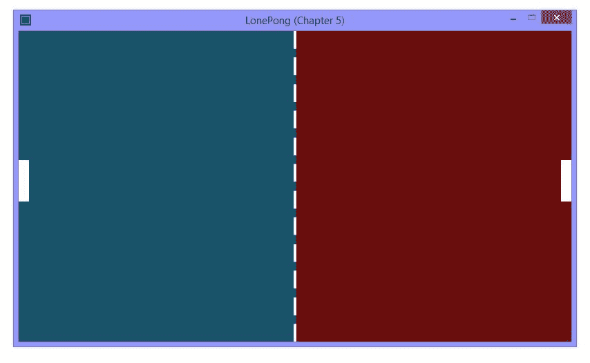

图 5-9 渲染挡板

### 处理玩家输入

我们希望当玩家按下向上和向下方向键时，挡板能够移动。得益于我们的框架，我们可以轻松地使用`onKeyPress()`和`onKeyRelease()`方法来实现这一点。

当游戏检测到按按下或释放时，我们的两个与输入相关的方法会自动（相应地）被调用。注意这些方法具有相同的参数：（`KeyEvent e`）。传递的`KeyEvent`对象存储了有关触发方法的按键信息，你可以通过调用其`getKeyCode()`方法来获取这些信息。

这意味着，为了确定按下或释放了哪个键，你需要将`e.getKeyCode()`的值与代表每个键盘按钮的不同常量进行比较（这些常量定义在`KeyEvent`类中，前缀为`VK_...`）。

与其他解释一样，当你看到它运行时，这会变得更有意义。通过添加下面所示的行，更新你在`PlayState`中的`onKeyPress()`和`onKeyRelease()`方法：

```
....

@Override

public void onKeyPress(KeyEvent e) {

        if (e.getKeyCode() == KeyEvent.VK_UP) {

                paddleLeft.accelUp();

                paddleRight.accelDown();

        } else if (e.getKeyCode() == KeyEvent.VK_DOWN) {

                paddleLeft.accelDown();

                paddleRight.accelUp();

        }

}

@Override

public void onKeyRelease(KeyEvent e) {

        if (e.getKeyCode() == KeyEvent.VK_UP || 

                        e.getKeyCode() == KeyEvent.VK_DOWN) {

                paddleLeft.stop();

                paddleRight.stop();

        }

}

....
```

我们的`onKeyPress()`方法只关心两个键：`VK_UP`（向上键）和`VK_DOWN`（向下键）。如果按下了其中一个键，它会相应地调用挡板的`accelUp()`和`accelDown()`方法。注意我们让`paddleLeft`向按下键的方向移动，而让`paddleRight`向相反方向移动。

`onKeyRelease()`方法同样关心相同的键。在相反的情况下，无论释放的是`VK_UP`还是`VK_DOWN`，它都会通过停止两个挡板来做出反应。

尝试运行你的代码并按下向上向下方向键。什么都不会发生！这是因为虽然我们更改了每个挡板的`velY`属性，但我们没有允许挡板更新。让我们改变这一点。

### 通过委托挡板

在`PlayState`的`update()`方法中要求每个挡板更新自己，如下所示：

```
@Override

public void update() {

        paddleLeft.update();

        paddleRight.update();

}
```

注意我们的`update()`方法将更新工作委托给了另外两个对象。它本身做的工作很少。这种模式被称为“委托”，你会发现它在维护对象层级结构时非常有用。在这个例子中，`PlayState`代表整个游戏屏幕，并包含各种对象，包括`paddleLeft`和`paddleRight`。你更新`PlayState`，`PlayState`内部的一切也会随之更新。`PlayState`内部的每个对象协同工作。这是一个强大的模式。有了这个更改，你的`PlayState`现在应该看起来像列表 5.07：

XYZ

再次运行代码。如果你按下向上键和向下方向键，你的球板应该开始向相反的方向移动！然而，有一个 Bug。当你到达屏幕的顶部或底部时，球板将直接穿过窗口，如图 5-10 所示。

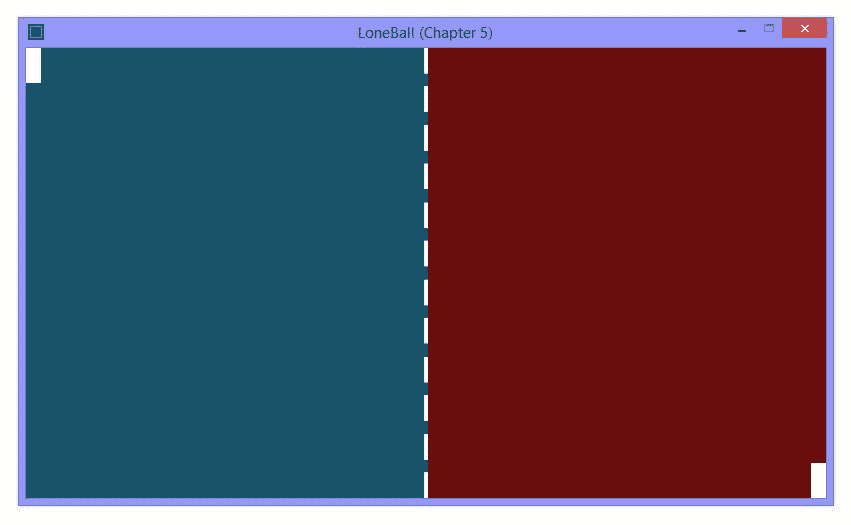

图 5-10 我们的第一个 Bug！

### 修复 Bug

严格来说，这其实并不是一个 Bug。我们从未告诉过球板永远不要离开屏幕。为了实现这一点，我们需要对`Paddle`类中的`update()`方法进行细小的修改，如下（根据需要导入`GameMain`）：

```
public void update() {

        y += velY;

        if (y < 0) {

                y = 0;

        } else if (y + height > GameMain.GAME_HEIGHT) {

                y = GameMain.GAME_HEIGHT - height;

        }

        updateRect();

}
```

这个更改做了什么？在更新了球板的`y`位置后，我们现在检查球板是否离开了屏幕。这可能发生在`y`小于零时（意味着球板的顶部离开了屏幕顶部），或当`y + height`大于游戏高度时（意味着球板的底部离开了屏幕底部）。一旦检测到球板移动到窗口之外，我们只需要在同一帧内（在`update()`结束之前）更正它的`y`位置。

我们在同一帧内纠正碰撞有一个重要的原因。`render()`方法永远不会在`update()`方法完成之前被调用。这意味着通过在每次`update()`迭代的结束时解决碰撞，我们确保了玩家永远不会看到球板离开屏幕（即使它的`y`位置临时离开了窗口！）。

再次运行游戏，你的球板将保持在屏幕上。

### 实现得分系统

在这一阶段，我们已经实现了球板，现在必须实现一个得分系统。在`PlayState`中声明以下变量来表示分数（需要导入`java.awt.Font`）：

```java
int playerScore = 0;

Font scoreFont;
```

`scoreFont`是一个允许自定义外观的字体实例。在`init()`方法中初始化它：

```java
@Override

public void init() {

        paddleLeft = new Paddle(0, 195, PADDLE_WIDTH, PADDLE_HEIGHT);

        paddleRight = new Paddle(785, 195, PADDLE_WIDTH, PADDLE_HEIGHT);

        scoreFont = new Font("Serif", Font.BOLD, 25);

}
```

对字体的使用与处理颜色类似。在`render()`方法中，我们将首先设置`scoreFont`，然后将其绘制到屏幕上：

```java
@Override

public void render(Graphics g) {

        // Draw Background

        g.setColor(Resources.darkBlue);

        g.fillRect(0, 0, GameMain.GAME_WIDTH, GameMain.GAME_HEIGHT);

        g.setColor(Resources.darkRed);

        g.fillRect(GameMain.GAME_WIDTH / 2, 0, GameMain.GAME_WIDTH / 2,

                        GameMain.GAME_HEIGHT);

        // Draw Separator Line

        g.drawImage(Resources.line, (GameMain.GAME_WIDTH / 2) - 2, 0, null);

        // Draw Paddles

        g.setColor(Color.white);

        g.fillRect(paddleLeft.getX(), paddleLeft.getY(), paddleLeft.getWidth(),

                        paddleLeft.getHeight());

        g.fillRect(paddleRight.getX(), paddleRight.getY(), paddleRight.getWidth(),

                                      paddleRight.getHeight());

        // Draw UI

        g.setFont(scoreFont); // 设置当前字体
```

`drawString()`方法期望的参数是`String`, `int`, `int`。这个错误是预期的。解决方案是在请求绘制之前将`playerScore`转换为`String`。一种方法是调用以下方法：

```java
String playerScoreStr = String.valueOf(playerScore);
```


上述`String`类的静态方法接受一个整数并返回它的`String`副本。我个人并不喜欢它。更巧妙的方法涉及简单的拼接：

```java
String playerScoreStr = "" + playerScore;
```

这种方法将整数附加到空字符串之后，从而产生该整数的`String`版本。这种方法更快且更容易记忆。将此修复程序添加到你的方法中：

再次运行程序，你应该能看到图 5-1 所示的渲染分数。由于我们还没有开始对其递加，它将保持为 0。

## 实现 RandomNumberGenerator 类

在创建`Ball`类之前，我们将添加一个新类，该类允许我们快速生成随机数。回顾第 62 页至 64 页，你会记得生成随机数时需要执行以下步骤：

* 创建一个新的`Random`对象。
* 导入`java.util.Random`。
* 调用`nextInt(int n)`方法，该方法会生成一个 0（包含）到`n`（不包含）之间的随机数。

这种方法的问题在于，我们必须在生成随机数之前创建一个新的`Random`对象，而创建新的`Random`对象会消耗内存。创建十个甚至一百个`Random`对象是完全没问题的，但请记住，我们写的每行代码都在游戏循环内部执行（每秒约 60 次）。这意味着，如果我们在`Paddle`的`update()`方法内部创建`Random`对象，那么我们每秒都会得到 60 个新的`Random`对象。当然，有办法通过在仅在需要时调用的方法（例如`init()`）内部创建`Random`对象来解决这个问题，但这并不能解决为每个偶尔需要访问随机数的对象都创建一个新`Random`对象的问题。

如果我们的框架能提供一种无需每次创建新`Random`对象就能生成随机数的方法，将非常方便。如果我们能生成两个任意数字之间的数字，而不仅仅是 0 和`n`，那就更棒了。等等，你是一个程序员，所以你可以添加这个功能！在`com.jamescho.framework.util`内部，创建一个名为`RandomNumberGenerator`的类，并按照列表 5.08 所示实现它：

```java
*****  5.08 RandomNumberGenerator 类 *****

01 package com.jamescho.framework.util;

02

03 import java.util.Random;

04

05 public class RandomNumberGenerator {

06

07      private static Random rand = new Random();

08

09      public static int getRandIntBetween(int lowerBound, int upperBound) {

10              return rand.nextInt(upperBound - lowerBound) + lowerBound;

11      }

12

13      public static int getRandInt(int upperBound) {

14              return rand.nextInt(upperBound);

15      }

16 }
```

该类有一个单一的静态`Random`对象名为`rand`，它将在整个应用程序中共享。`rand`在类的两个方法中用于生成随机数（如果你需要关于`static`的帮助，请参附录 A）。我让你自己推导出逻辑，必要时回顾第 62 页至 64 页。

注意，这两个方法都是公共（public）且静态（static），这意味着框架内的其他类可以访问它们，而无需实例化新的`Random`对象或新的`RandomNumberGenerator`对象！换句话说，你可以如下所示轻松地生成随机数：

```java
 .... // 框架中的其他地方

import com.jamescho.framework.util.RandomNumberGenerator;

....

System.out.println(RandomNumberGenerator.getRandIntBetween(-10, 11));

....
```

示例**加粗**的代码行将生成一个 -10（包含）到 11（不包含）之间的随机整数，甚至不需要你创建一个新的`Random`对象。我们将在整个`Ball`类以及未来的游戏中使用`RandomNumberGenerator`。

## 设计 Ball 类

我们可以整天推着挡板，但那样有什么趣呢？让我们通过添加球来给游戏增加一些动感。和我们的挡板一样，我们首先概述将要创建的类（注意与`Paddle`类的相似之处）！

### Ball 类中的变量

坐标和尺寸：我们将创建`x`、`y`、`width`和`height`变量，类似于`Paddle`类中的变量。

边界框（Bounding Box）：我们的球还将使用`Rectangle`类创建一个边界框。这允许我们检查与两个挡板的碰撞。

速度（Velocity）：球也像挡板一样有一个`velY`变量；但它也会水平方向上移动。这要求我们添加第二个名为`velX`的速度变量。

### Ball 类中的方法

更新方法：与`Paddle`类一样，`Ball`类将拥有`update()`和`updateRect()`方法，用于计算球及其边界框的新位置。`update()`方法将使用一个名为`correctYCollisions()`的辅助方法，该方法将检查并解决与屏幕顶部和底部的碰撞（回想一下，相同的功能直接添加到`Paddle`类的`update()`方法中）。

杂杂方法：`Ball`类将具有三个公共方法，当特定事件发生时通知我们的`PlayState`，并允许状态做出相应反应。例如，我们将有一个名为`isDead()`方法，如果球撞到了游戏屏幕的左侧或右侧，它将返回`true`。一旦发生这种情况，我们的球就被认为死亡。玩家将失去 3 分，球将重置。为了实现这一点，我们将实现一个`reset()`方法，它会将球返回屏幕中心。我们还将添加一个`onCollideWith()`方法，当球发生碰撞时触发它。

## 创建 Ball 类

我们已经知道了需要的变量和方法，让我们在`com.jamescho.game.model`中开始创建类。

### 添加变量

声明以下变量：

```java
private int x, y, width, height, velX, velY;

private Rectangle rect;
```

通过添加以下构造函数来初始化它们：

```java
public Ball(int x, int y, int width, int height) {

                this.x = x;

                this.y = y;

                this.width = width;

                this.height = height;

                this.velX = 5;

                this.velY = RandomNumberGenerator.getRandIntBetween(-4, 5);

                rect = new Rectangle(x, y, width, height);

        }
```

注意我们通过调用其`getRandIntBetween()`方法使用了`RandomNumberGenerator`类。由于它在不同的包中，我们必须导入`com.jamescho.framework.util.RandomNumberGenerator`。确保也导入`Rectangle`。

### 添加更新方法

接下来，添加`update()`方法及其两个辅助方法（相应导入`GameMain`和`Resources`）：

```java
public void update() {

                x += velX;

                y += velY;

                correctYCollisions();

                updateRect();

        }

        private void correctYCollisions() {

                if (y < 0) {

                        y = 0;

                } else if (y + height > GameMain.GAME_HEIGHT) {

                        y = GameMain.GAME_HEIGHT - height;

                } else {

                        return;

                }

                velY = -velY;

                Resources.bounce.play();

        }

        private void updateRect() {

                rect.setBounds(x, y, width, height);

        }
```

你已经在`Paddle`类中见过这三个方法的大部分内容，但有些事情值得讨论：

* 正如预期，我们的`update()`方法将使用两个速度变量更新`x`和`y`值。
* `correctYCollisions()`的逻辑遵循了一种有趣的模式。我们首先检查球是否超出了屏幕顶部或底部并对其进行修正。如果发现球没有离开窗口，我们只需调用`return`结束方法。这意味着接下来的两行代码只有在球离开了窗口时才调用（这表示与顶部或底部墙发生了碰撞，因此我们反转球并播放弹跳声）。

```java
velY = -velY;

Resources.bounce.play();
```

在`Ball`类内部声明另外三个方法，如下所示：

```java
 public void onCollideWith(Paddle p) {

                if (x < GameMain.GAME_WIDTH / 2) {

                        x = p.getX() + p.getWidth();

                } else {

                        x = p.getX() - width;

                }

                velX = -velX;

                velY += RandomNumberGenerator.getRandIntBetween(-2, 3);

        }

        public boolean isDead() {

                return (x < 0 || x + width > GameMain.GAME_WIDTH);

        }

        public void reset() {

                x = 300;

                y = 200;

                velX = 5;

                velY = RandomNumberGenerator.getRandIntBetween(-4, 5);

        }
```

当游戏判断球与两个挡板中的一个发生碰撞时，就会调用`onCollideWith()`方法。与`PlayState`中的`onKeyPress()`方法一样，`onCollideWith()`方法接收一个触发它的挡板对象的引用。

在`onCollideWith()`内部，我们可以检查球当前位于屏幕的左侧还是右侧，以确定它是击中了左侧挡板还是右侧挡板。然后我们使用这些信息，通过将球移动到挡板边界框之外（即左侧挡板的右侧或右侧挡板的左侧）来解决碰撞。一旦解决了碰撞，我们就让球继续移动，使其发生水平偏转，并随机修改`velY`。

`isDead()`方法检查两个条件：球是否击中了屏幕的左侧或右侧。如果发生了其中任何一个事件，该方法将向调用者返回`true`。我们将在`PlayState`中调用此方法，以判断球何时离开游戏区域并做出相应的响应。

`reset()`方法将由`PlayState`响应球的死亡而调用。它简单地将球移动到初始位置并赋予它一个随机速度。

### 添加 Getter 方法

我们将为`Ball`类创建与`Paddle`相同的 getter 方法，如下所示：

```java
 public int getX() {

                return x;

        }

        public int getY() {

                return y;

        }

        public int getWidth() {

                return width;

        }

        public int getHeight() {

                return height;

        }

        public Rectangle getRect() {

                return rect;

        }
```

我们的`Ball`类现在完成了。如果你遇到错误，请将其与列表 5.09 进行对比，该列表显示了完整的类。

```java
***** 列表 5.09 Ball 类（已完成） *****

01      package com.jamescho.game.model;

02

03      import java.awt.Rectangle;

04

05      import com.jamescho.framework.util.RandomNumberGenerator;

06      import com.jamescho.game.main.GameMain;

07      import com.jamescho.game.main.Resources;

08

09      public class Ball {

10              private int x, y, width, height, velX, velY;

11              private Rectangle rect;

12              

13              public Ball(int x, int y, int width, int height) {

14                      this.x = x;

15                      this.y = y;

16                      this.width = width;

17                      this.height = height;

18                      velX = 5;

19                      velY = RandomNumberGenerator.getRandIntBetween(-4, 5);

20                      rect = new Rectangle(x, y, width, height);

21              }

22              

23              public void update() {

24                      x += velX;

25                      y += velY;

26                      correctYCollisions();

27                      updateRect();

28              }

29

30              private void correctYCollisions() {

31                      if (y < 0) {

32                              y = 0;

33                      } else if (y + height > GameMain.GAME_HEIGHT) {

34                              y = GameMain.GAME_HEIGHT - height;

35                      } else {

36                              return;

37                      }

39

39                      velY = -velY;

40                      Resources.bounce.play();

41              }

42

43              private void updateRect() {

44                      rect.setBounds(x, y, width, height);

45              }

46
```


```java
public void onCollideWith(Paddle p) {
    if (x < GameMain.GAME_WIDTH / 2) {
        x = p.getX() + p.getWidth();
    } else {
        x = p.getX() - width;
    }
    velX = -velX;
    velY += RandomNumberGenerator.getRandIntBetween(-2, 3);
}

public boolean isDead() {
    return (x < 0 || x + width > GameMain.GAME_WIDTH);
}

public void reset() {
    x = 300;
    y = 200;
    velX = 5;
    velY = RandomNumberGenerator.getRandIntBetween(-4, 5);
}

public int getX() {
    return x;
}

public int getY() {
    return y;
}

public int getWidth() {
    return width;
}

public int getHeight() {
    return height;
}

public Rectangle getRect() {
    return rect;
}
```

## 在 PlayState 中实现球对象

添加球所需的步骤与添加挡板相同。我们将声明并初始化它，让它更新，然后渲染它。

### 声明和初始化球

首先声明新球实例变量，以及一个表示直径的常量（不要忘记导入语句 `com.jamescho.game.model.Ball`）。`PlayState` 类的更改如下：

```java
....
import com.jamescho.game.model.Ball;
import com.jamescho.game.model.Paddle;

public class PlayState extends State {
    private Paddle paddleLeft, paddleRight;
    private static final int PADDLE_WIDTH = 15;
    private static final int PADDLE_HEIGHT = 60;
    private Ball ball;
    private static final int BALL_DIAMETER = 20;
....
```

接下来，在 `init()` 方法内部初始化 `ball` 变量：

```java
@Override
public void init() {
    paddleLeft = new Paddle(0, 195, PADDLE_WIDTH, PADDLE_HEIGHT);
    paddleRight = new Paddle(785, 195, PADDLE_WIDTH, PADDLE_HEIGHT);
    scoreFont = new Font("SansSerif", Font.BOLD, 25);
    ball = new Ball(300, 200, BALL_DIAMETER, BALL_DIAMETER);
}
```

这将球放置在任意位置 (300, 200)，宽高等于 `BALL_DIAMETER` 常量的值（记住我们的球实际上是一个正方形）。

### 更新球

接下来，我们将再次进行委托，通过在 `PlayState` 的 `update()` 方法中要求球进行更新。

```java
@Override
public void update() {
    paddleLeft.update();
    paddleRight.update();
    ball.update();
}
```

### 渲染球

最后，通过向 `render()` 方法中添加下方所示粗体代码来绘制球：

```java
@Override
public void render(Graphics g) {
    // 画背景
    g.setColor(Resources.darkBlue);
    g.fillRect(0, 0, GameMain.GAME_WIDTH, GameMain.GAME_HEIGHT);
    g.setColor(Resources.darkRed);
    g.fillRect(GameMain.GAME_WIDTH / 2, 0, GameMain.GAME_WIDTH / 2, GameMain.GAME_HEIGHT);
    // 画分割线
    g.drawImage(Resources.line, 398, 0, null);
    // 画挡球板
    g.setColor(Color.white);
    g.fillRect(paddleLeft.getX(), paddleLeft.getY(), paddleLeft.getWidth(), paddleLeft.getHeight());
    g.fillRect(paddleRight.getX(), paddleRight.getY(), paddleRight.getWidth(), paddleRight.getHeight());
    // 画球
    g.drawRect(ball.getX(), ball.getY(), ball.getWidth(), ball.getHeight());
    // 画用户界面
    g.setFont(scoreFont);
    g.drawString("" + playerScore, 350, 40);
}
```

注意，我们将 `ball` 画在 `paddles` 之上，但这是随机的，因为 `ball` 和 `paddles` 永远不应该产生视觉上的重叠。

完成这些更改后，你的 `PlayState` 应该与列表 5.10 所示。

```java
***** 列表 5.10 PlayState 类（更新后） *****
01 package com.jamescho.game.state;
02
03 import java.awt.Color;
04 import java.awt.Font;
05 import java.awt.Graphics;
06 import java.awt.event.KeyEvent;
07 import java.awt.event.MouseEvent;
08
09 import com.jamescho.game.main.GameMain;
10 import com.jamescho.game.main.Resources;
11 import com.jamescho.game.model.Ball;
12 import com.jamescho.game.model.Paddle;
13
14 public class PlayState extends State{
15
16      private Paddle paddleLeft, paddleRight;
17      private static final int PADDLE_WIDTH = 15;
18      private static final int PADDLE_HEIGHT = 60;
19      
20      private Ball ball; 
21      private static final int BALL_DIAMETER = 20; 
22
23      private int playerScore = 0;
24      private Font scoreFont;
25              
26      @Override
27      public void init() {
28              paddleLeft = new Paddle(0, 195, PADDLE_WIDTH, PADDLE_HEIGHT);
29              paddleRight = new Paddle(785, 195, PADDLE_WIDTH, PADDLE_HEIGHT);
30              scoreFont = new Font("SansSerif", Font.BOLD, 25);
31              ball = new Ball(300, 200, BALL_DIAMETER, BALL_DIAMETER);
32      }
33
34      @Override
35      public void update() {
36              paddleLeft.update();
37              paddleRight.update();
38              ball.update();
39      }
40
41      @Override
42      public void render(Graphics g) {
43              // 画背景
44              g.setColor(Resources.darkBlue);
45              g.fillRect(0, 0, GameMain.GAME_WIDTH, GameMain.GAME_HEIGHT);
46              g.setColor(Resources.darkRed);
47              g.fillRect(GameMain.GAME_WIDTH / 2, 0, GameMain.GAME_WIDTH / 2,
48                                      GameMain.GAME_HEIGHT);
49                      
50              // 画分割线
51              g.drawImage(Resources.line, (GameMain.GAME_WIDTH / 2) - 2, 0, null);
52                      
53              // 画挡球板
54              g.setColor(Color.white);
55              g.fillRect(paddleLeft.getX(), paddleLeft.getY(), paddleLeft.getWidth(),
56                              paddleLeft.getHeight());
57              g.fillRect(paddleRight.getX(), paddleRight.getY(), paddleRight.getWidth(),
58                              paddleRight.getHeight());
59                      
60              // 画球
61              g.drawRect(ball.getX(), ball.getY(), ball.getWidth(), ball.getHeight());
62
63              // 画用户界面
64              g.setFont(scoreFont); // 将 scoreFont 设置为当前字体
65              g.drawString("" + playerScore, 350, 40);
66
67      }
68
69      @Override
70      public void onClick(MouseEvent e) {
71              // TODO 自动生成的方法存根
72      }
73
74      @Override
75      public void onKeyPress(KeyEvent e) {
76              if (e.getKeyCode() == KeyEvent.VK_UP) {
77                      paddleLeft.accelUp();
78                      paddleRight.accelDown();
79              } else if (e.getKeyCode() == KeyEvent.VK_DOWN) {
80                      paddleLeft.accelDown();
81                      paddleRight.accelUp();
82
83      }
84
85      @Override
86      public void onKeyRelease(KeyEvent e) {
87              if (e.getKeyCode() == KeyEvent.VK_UP || 
88                              e.getKeyCode() == KeyEvent.VK_DOWN) {
89                      paddleLeft.stop();
90                      paddleRight.stop();
91              }
92              
93
94 }
```

遗憾的是，我们的游戏还没有完工。运行代码，你会发现 `ball` 永远不会与 `paddles` 碰撞，并且会消失在虚空中（通过窗口侧面）。让我们修复它。

## 处理碰撞：球与挡球板以及球与边界

为了完成我们的游戏，我们必须做三件事：

* 检查 `ball` 是否与左侧 `paddle` 碰撞并做出相应响应。
* 检查 `ball` 是否与右侧 `paddle` 碰撞并做出相应响应。
* 检查 `ball` 是否与屏幕的左侧或右侧碰撞并做出相应响应。

第三种情况可以通过调用 `ball.isDead()` 来检查。要处理前两种情况，在 `PlayState` 声明此新方法：

```java
private boolean ballCollides(Paddle p) {
    return ball.getRect().intersects(p.getRect());
}
```

此辅助方法通过判断 `ball` 和 `paddle` 的边界框是否相交，来检查 `ball` 与给定的 `paddle` 是否碰撞。

接下来，让我们通过对 `PlayState` 中的 `update()` 方法进行如加粗所示的更改来处理这三种碰撞情况。注意，我们调用了两次 `ballCollides()` 和了一次 `ball.isDead()`：

```java
@Override
public void update() {
    paddleLeft.update();
    paddleRight.update();
    ball.update();
    if (ballCollides(paddleLeft)) {
        playerScore++;
        ball.onCollideWith(paddleLeft);
        Resources.hit.play();
    } else if (ballCollides(paddleRight)) {
        playerScore++;
        ball.onCollideWith(paddleRight);
```


```
Resources.hit.play();
} else if (ball.isDead()) {
    playerScore -= 3;
    ball.reset();
}
```

让我们讨论一下对`update()`方法的更改。如果`ball`碰到任何一个`paddle`，我们现在调用`ball.onCollideWith()`，这将处理球的反射。我们还使用自增`++`运算符增加分数（记住`playerScore++`等同于`playerScore = playerScore + 1`），并播放`hit`。

如果`ball`碰到屏幕左侧或右侧，我们现在从分数中减 3 并重置`ball`，以便游戏能够循环进行。

## 运行最终产品

这完成了`PlayState`类，`LoneBall`也已经完整实现。运行游戏并确保一切正常！如果你的代码遇到问题，可以在此处找到完整源代码：`jamescho7.com/chapter5/complete`。

## 游戏

在让你享受游戏之前，我将教你如何在 Eclipse 中执行另一项任务。你希望人们能够在没有源代码或没有 IDE 的情况下享受你的游戏。最简单的方法是将项目导出为`.jar`文件，该文件可以在大多数安装了 Java 7 或 8 的机器上运行。

导出可运行的`.jar`文件非常简单。只需在 Package Explorer 中右键点击项目并选择 Export（导出）。导出窗口将弹出，此时你应当如图 5-11 所示，选择 Java 类别下的`Runnable JAR file`。

点击 Next \>，你将看到图 5-12 所示的屏幕：

确保启动配置（Launch configuration）已设置为在`LoneBall`项目中运行`GameMain`类，选择一个导出目标（将目标路径复制到剪贴板），然后按`Finish`。这应该在该目录下创建一个可运行的`.jar`文件。

注意：

图 5-12 中启动配置框中显示的数字 (7) 在你的机器上可能不同。该数字表示`LoneBall`项目中的此`GameMain`类是我电脑上最近运行的同名类中的第 7 个。你的数字可能低至 (2)，或者直接显示为`GameMain - LoneBall`。

## 运行游戏

退出 Eclipse。我们不再需要它来执行游戏了。要执行新创建的`.jar`文件，打开命令行解释器（Windows 上的 Command Prompt，Mac 上的 Terminal）并输入以下命令：

```bash
java -version
```

这应该显示一个与图 5-13 类似的界面，告诉你的电脑上安装了什么版本的 Java（我的显示为`1.7.0_55`，意味着 Java 7 更新 55）。

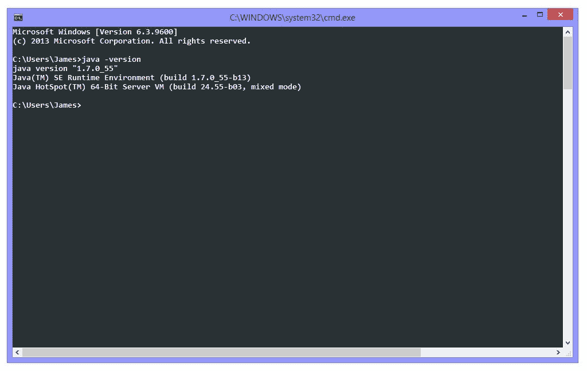

图 5-13 Java 版本命令

注意：

如果你收到错误`java: Command not found`，说明你的终端找不到 Java 安装。要修复此问题，请按照下方链接中的说明：[`docs.oracle.com/javase/tutorial/essential/environment/paths.html`](http://docs.oracle.com/javase/tutorial/essential/environment/paths.html)

下一步很简单，前提是你已经在上一节复制了 JAR 文件的导出目标。如果你还没有，也没关系。这依然简单。

在命令行中输入`java –jar`命令，后跟你的导出目标（在 Windows 上可以通过右键点击并选择`Paste`来粘贴）：

```bash
java -jar INSERT_YOUR_EXPORT_DESTINATION_HERE
(e.g. java -jar C:\Users\James\Desktop\LoneBall.jar)
```

如果你没有复制导出目标，只需在 Explorer 或 Finder 中找到你的 JAR 文件，并在输入相同命令后将其拖入终端（不要忘记 –jar 之后的空格）。这会自动打印出它的完整路径。

一旦执行了该命令，你应该就能看到图 5-14 所示的 LoneBall 窗口弹出了！它的运行方式就像在 Eclipse 中一样，但现在是从一个封装好的、可共享的`.jar`文件执行的。

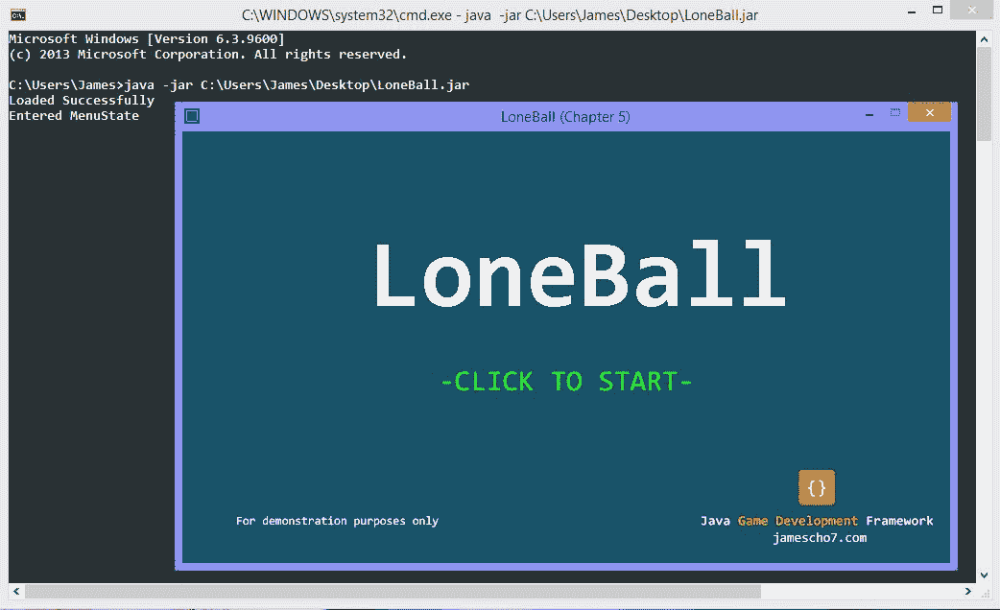

图 5-14 Loneball 正在运行！

# 在继续之前

在进入第 6 章之前，有几件事你应该做：首先，尽情地玩你的新游戏，并回顾你在过去两个章节中编写的代码。确保你理解每个类是如何编写的以及为什么要这么写，然后画一张类之间如何相互作用的图。

接下来，学习书籍配套网站`jamescho7.com/book/samples/`上的一些示例游戏项目。玩这些游戏并剖析它们的类和方法。阅读代码是提高水平的一种极方法，特别是当你花时间分析时。

最后，确保你理解每个类是如何编写的以及为什么要这么写，然后画一张类之间如何相互作用的图。

为了视觉化与帧率无关的移动，想象你构建了之前描述的同一个横向滚动游戏，不同的是`Player`对象在`update()`内部的移动速度不再是 3，而是 180 与`delta`的乘积，其中`delta`是自上一次迭代`update()`以来过的秒数。这样做的效果是创建一个独立于帧率的恒定速度。如果帧率降低，`delta`将增加，`velocity`也随之增加。在这种情况下，`Player`将始终以每秒 180 像素的速度移动。

Ellio 要求玩家的移动必须精确。因此，我们将通过添加与帧率无关的移动来改进我们的框架。

## 动画

我们框架的第二个限制是它无法创建和显示动画。在 LoneBall 中，我们可以使用静态图像作为球和拍子，但在我们的无限运行游戏中，即使是像 Ellio 这样的外星人也需要看起来像是在真实跑步。我们将创建一组类来实现这一新功能。

## 更改规划：高层概述

- **游戏循环**：我们将修改游戏循环，以添加时间测量功能，原因如下：
    - 测量`update`和`render`步骤的持续时间允许我们计算游戏应该睡眠多久以保持恒定的帧率。
    - 拥有时间测量允许我们的状态类实现与帧率无关的移动，这样在 FPS 下降时，我们可以保持游戏速度恒定。
    - 动画需要知道当前帧已过去了多少时间，以决定何时过渡到下一帧。
- **状态类**：我们必须修改状态类的`update()`方法，使其能够接收有关自上一个帧以来流逝时间的信息，从而实现与帧率无关的移动。
- **动画**：我们的游戏将整合动画。我们将创建一个`Frame`类和一个`Animation`类来实现此目标。

## 在开始之前需要了解的方法

### Math.max()

`Math.max()`是一个属于`Math`类的方法（注意它是静态的）。它确定并返回你作为参数传递的两个数字中的较大值。例如，如果你调用：

```
System.out.println(Math.max(-1, 5));
```

...结果值将是 5。

为什么这个方法是静态的？这是因为`Math.max()`的行为**不应该**跨`Math`实例改变——所有`Math`对象都应该以完全的方式执行`max()`方法（事实上，`Math`内部的所有方法都是静态的，你无法实例化该类）。关于静态方法的更多信息，请参附录 A。

### System.nanoTime()

为了实现动画和帧率无关的移动，我们需要一种方法来测量游戏循环每次迭代之间经过的时间。此功能可以使用 Java 的内置方法`System.nanoTime()`实现。在讨论该方法的作用之前，让我们先学习一下如何使用它：

```
long before = System.nanoTime();
for (int i = 0; i < 100; i++) {
    System.out.println(i);
}
long after = System.nanoTime();
System.out.println("循环运行花费了 " + (after - before) + " 纳秒!");
```

在上面的示例中，`System.nanoTime()`方法帮助我们测量 for 循环打印一百个数字所需的时间。这之所以有效，是因为`System.nanoTime()`方法返回了自某个任意固定时间点以来经过的纳秒数（秒的十分之一）。由于这个时间点是固定的，任何后续对`System.nanoTime()`的调用保证返回一个比上一次调用更大的值，其差值为两次调用之间经过的纳秒数。因此，用`long after`减去`long before`可以得到精确的时间测量值。

**注意**：

关于`System.nanoTime()`的一点是用作参考点的固定时间点是任意的且可能发生变化。因此，它不能用于测量当前时间。如果你感兴趣确定确定程序中的当前时间，请查看`System.currentTimeMillis()`方法。

## 更新游戏循环

现在我们已经规划了更改并学习了将要使用的方法，让我们开始编码。

**注意**：

如果你在修改`Game`类时迷失了方向，请查看第 199 页的列表 6.01。你也可以访问书籍的配套网站 `jamescho7.com/book/chapter6/`

### 修复计时机制

如所述，当前版本的游戏循环以不同的间隔迭代。某些迭代耗时 15 毫秒，而另一些则 17 或 19 毫秒。我们将使这个间隔一致，将其固定在 17 毫秒。为了理解我们将要做的特定更改，让我们先为了简单起见将游戏循环分解为一系列阶段：

**我们的游戏循环（简化版）：**

- 更新 (Update)
- 渲染 (Render)
- 睡眠 (Sleep)
- 重复 (Repeat)

由于目标是让游戏循环每 17 毫秒迭代一次，`update`、`render`和`sleep`步骤总共应该占据 17 毫秒。

我们无法修改`update`和`render`调用完成所需的毫秒数（该值取决于游戏中对象的数量和操作系统的随机性）；但是，我们可以修改`sleep`的持续时间。例如，如果`update`和`render`步骤耗时 15 毫秒完成，我们可以睡眠 2 毫秒（总共 17 毫秒）。另一方面，如果`update`和`render`步骤耗时 3 毫秒完成，我们可以睡眠 14 毫秒（同样总共 17 毫秒）。

我们现在知道要修复计时机制，必须知道`update`和`render`方法执行所需的时间。打开你游戏开发项目中的`Game`类（可选地创建一个名为`SimpleJavaDF2`的副本），并进行下所示更改：

```
@Override
public void run() {
   // 这些变量每次迭代的总和为 17
   long updateDurationMillis = 0; // 测量包括更新和渲染
   long sleepDurationMillis = 0; // 测量睡眠
   while (running) {
        long beforeUpdateRender = System.nanoTime();
        currentState.update();
        prepareGameImage();
        currentState.render(gameImage.getGraphics());
        repaint();
        updateDurationMillis = (System.nanoTime() - beforeUpdateRender) / 1000000L;
        sleepDurationMillis = Math.max(2, 17 - updateDurationMillis);
        try {
                Thread.sleep(14);
                Thread.sleep(sleepDurationMillis);
        } catch (InterruptedException e) {
                e.printStackTrace();
        }
   }
   System.exit(0);
}
```

最后，我们将睡眠时间计算为`17 - updateDurationMillis`，并让线程睡眠该长度。如果`updateDurationMillis`大于 17，该值可能为负，因此我们使用`Math.max()`方法来强制将睡眠时间至少 2 秒。如果这让你感到困惑，请考虑以下代码块：

```
for (int updateTime = 0; updateTime < 20; updateTime++) {
    long sleepTime = Math.max(2, 17 - updateTime);      
    System.out.println(sleepTime);
}
```

这模拟了当`updateTime`范围从 0 到 20（大于 17 的值）时，`sleepTime`会发生的情况。写下循环每次迭代中`sleepTime`取的值，这样在这种情况下调用`Math.max()`方法的目的就会一而易见了。

### 计算 Delta

现在我们已经有了计时机制，可以计算游戏循环每次迭代的持续时间。这个值我们将称为`delta`，它仅仅是`updateDurationMillis`和`sleepDurationMillis`之和。`delta`将传递到`currentState`的`update`方法中，用于动画和帧速率无关移动。

在你的游戏循环中添加下面的代码行：

```
@Override
public void run() {
   long updateDurationMillis = 0;
   long sleepDurationMillis = 0;
   while (running) {
        long beforeUpdateRender = System.nanoTime();
        long deltaMillis = updateDurationMillis + sleepDurationMillis;  // 新的一行
        currentState.update();
        prepareGameImage();
        currentState.render(gameImage.getGraphics());
        repaint();
        updateDurationMillis = (System.nanoTime() - beforeUpdateRender) / 1000000L;
        sleepDurationMillis = Math.max(2, 17 - updateDurationMillis);
        try {
                Thread.sleep(sleepDurationMillis);
        } catch (InterruptedException e) {
                e.printStackTrace();
        }
   }
   System.exit(0);
}
```

大多数情况下，新创建的`deltaMillis`的值应该是 17 毫秒，但如果`updateDurationMillis`花费的时间异常长，这个数字可能会更高。

### 允许帧速率无关的移动

我们现在有了`deltaMillis`值，现在必须使用它来实现帧速率无关的移动。但首先，我们要稍微清理一下游戏循环。它看起来有点乱。

我们将通过创建一个新方法来“重构”我们的代码（在不修改其行为的情况下重组代码的写法）。使用鼠标在循环内部选择以下四行代码：

```
currentState.update();
prepareGameImage();
currentState.render(gameImage.getGraphics());
repaint();
```

我们可以手动创建一个新方法，将这四行代码复制到新方法中，并用该方法的调用替换原始的四行，但有一种更简单（更快速）的方法。

右键点击选中的四行代码（Mac 上使用`Ctrl + Click`），并选择`Refactor > Extract Method`（重构 > 提取方法），如图 6-2 所示。

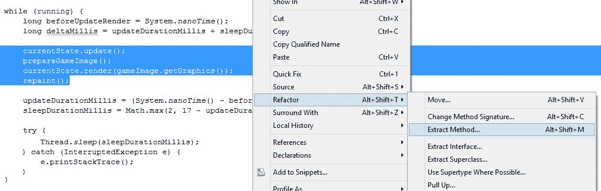

图 6-2 通过提取进行重构

为新方法输入名称`updateAndRender`，如图 6-3 所示。访问权限保持`private`。我们只会在游戏循环内部调用该方法。

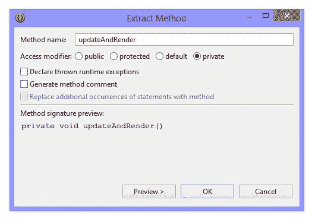

图 6-3 新方法名称

一旦你点击确定，Eclipse 将自动重构你的代码，如图 6-4 所示！


图 6-4 重构后的代码

我们还没有完成。上方两个橙色矩形内的代码必须稍作修改。首先，我们需要将`deltaMillis`的值作为参数传递给`updateAndRender()`方法，如下：

```
updateAndRender();
updateAndRender(deltaMillis);
```


接下来，`updateAndRender()` 方法需要更改以接受这个新参数，并且我们将该参数传递到 `currentState.update()` 方法中！通过这样做，我们的每个状态的 `update()` 方法都将访问自上一次 `update()` 迭代以来的时间，原因正如我们讨论过的那样。我倾向于让这个值以秒为单位，因此我们将除以 `1000f`（这允许我们稍后用每秒像素表示移动，而不是每毫秒像素）。你必须做的更改如下所示：

```
private void updateAndRender(long deltaMillis) {
    currentState.update(deltaMillis / 1000f);
    prepareGameImage();
    currentState.render(gameImage.getGraphics());
    repaint();
}
```

你将在更新后的方法内部看到一个错误，如图 6-5 所示：


图 6-5 `updateAndRender()` 中的错误

这个错误告诉我们 `State` 类内部的 `update()` 方法不接受数值参数。我们很快就会修复它。

## 在循环外声明变量

现在我们已经建立了 delta 计算，可以讨论一下为什么我们之前在游戏循环之外声明 `updateDurationMillis` 和 `sleepDurationMillis`。

为了理解这一点，你应该知道在循环内部声明的变量只在当前迭代中可访问。它们的值无法在下一次迭代中访问。`updateDurationMillis` 和 `sleepDurationMillis` 声明在循环之外是因为我们需要计算 delta。记住这一点，看看游戏循环。这些计时变量将更有意义了。

## 切换到主动渲染

目前，我们通过三个步骤来执行渲染。首先，我们准备一张空白图像，用 `currentState` 的内容填充它，然后使用 `repaint()` 将图像绘制到屏幕上（这请求调用 `paintComponent()`）。

在上述步骤中，第三步是被动的。同样，我们请求调用 `paintComponent()`，但 JVM 并不一定要听我们的——无法保证 `paintComponent()` 一会被调用。当我们有动画时，精确计时的绘制是非常重要的，所以我们必须修复这个问题。

我们将采用所谓的“主动渲染”（active rendering），这会提高我们游戏的性能并使其渲染更具可预测性。在主动渲染时，我们不仅仅是请求渲染——而是直接告诉它渲染。这其实很简单。与其调用有时会触发 `paintComponent()` 的 `repaint()`，我们创建一个总是会被调用的新方法。该方法与 `paintComponent()` 非常相似，如下：

```
private void renderImage(Graphics g) {
    if (gameImage != null) {
        g.drawImage(gameImage, 0, 0, null);
    }
    g.dispose();
}
```

将此新方法添加到 `Game` 类中，并移除现有的 `paintComponent()` 方法。

接下来，在 `updateAndRender()` 中简单替换对 `repaint()` 的调用，如下：

```
private void updateAndRender(long deltaMillis) {
    currentState.update(deltaMillis / 1000f);
    prepareGameImage();
    currentState.render(gameImage.getGraphics());
    repaint();
    renderGameImage(getGraphics());
}
```

`getGraphics()` 方法返回我们 `JPanel` 的 `Graphics` 对象（记住 `Game` 类继承自 `JPanel`），拥有它允许我们在 `JPanel` 上进行绘图。我们通过作为参数将其传递给我们的 `renderImage()` 方法。

每当我们完成对自己请求的 `Graphics` 对象的操作时，建议手动释放该对象，正如之前在 `renderImage()` 方法中所示。

## 审查代码

我们已经在 `Game` 类中完成了所有需要的调整，结合了计时、增量计算和活动渲染。你 get 这一行上仍然应该有一个错误：

```
currentState.update(deltaMillis / 1000f);
```

我们将在下一步修复这个错误。完整的 `Game` 类重现在列表 6.01 中以供参考：

```
***** Listing 6.01 The Game class (Completed) *****

001 package com.jamescho.game.main;
002
003 import java.awt.Color;
004 import java.awt.Dimension;
005 import java.awt.Graphics;
006 import java.awt.Image;
007
008 import javax.swing.JPanel;
009
010 import com.jamescho.framework.util.InputHandler;
011 import com.jamescho.game.state.LoadState;
012 import com.jamescho.game.state.State;
013
014 @SuppressWarnings("serial")
015
016 public class Game extends JPanel implements Runnable{
017     private int gameWidth;
018     private int gameHeight;
019     private Image gameImage;
020
021     private Thread gameThread;
022     private volatile boolean running;
023     private volatile currentState;
024
025     private InputHandler inputHandler;
026
027     public Game(int gameWidth, int gameHeight){
028         this.gameWidth = gameWidth;
029         this.gameHeight = gameHeight;
030         setPreferredSize(new Dimension(gameWidth, gameHeight));
031         setBackground(Color.BLACK);
032         setFocusable(true);
033         requestFocus();
034     }
035
036     public void setCurrentState(State newState) {
037         System.gc();
038         newState.init();
039         currentState = newState;
040         inputHandler.setCurrentState(currentState);
041     }
042
043     @Override
044     public void addNotify() {
045         super.addNotify();
046         initInput();
047         setCurrentState(new LoadState());
048         initGame();
049     }
050
051     private void initInput() {
052         inputHandler = new InputHandler();
053         addKeyListener(inputHandler);
054         addMouseListener(inputHandler);
055     }
056
057     private void initGame() {
058         running = true;
059         gameThread = new Thread(this, "Game Thread");
060         gameThread.start();
061     }
062
063     @Override
064     public void run() {
065
066         long updateDurationMillis = 0; // Measures update AND render
067         long sleepDurationMillis = 0; // Measures sleep
068
069         while (running){
070             long beforeUpdateRender = System.nanoTime();
071             long deltaMillis = updateDurationMillis + sleepDurationMillis;
072
073             updateAndRender(deltaMillis);
074
075             updateDurationMillis = (System.nanoTime() - beforeUpdateRender) / 1000000L;
076             sleepDurationMillis = Math.max(2, 17 - updateDurationMillis);
077
078             try {
079                 Thread.sleep(sleepDurationMillis);
080             } catch (InterruptedException e) {
081                 e.printStackTrace();
082             }
083         }
084         System.exit(0);
085     }
086
087     private void updateAndRender(long deltaMillis) {
088         currentState.update(deltaMillis / 1000f);
089         prepareGameImage();
090         currentState.render(gameImage.getGraphics());
091         renderGameImage(getGraphics());
092     }
093
094     private void prepareGameImage() {
095         if (gameImage == null) {
096             gameImage = createImage(gameWidth, gameHeight);
097         }
098         Graphics g = gameImage.getGraphics();
099         g.fillRect(0, 0, gameWidth, gameHeight);
100     }
101
102     public void exit() {
103         running = false;
104     }
105
106     private void renderGameImage(Graphics g) {
107         if (gameImage != null) {
108             g.drawImage(gameImage, 0, 0, null);
109         }
110         g.dispose();
111     }
112 }
```

## 更新 State 类

我们必须对 `State` 类进行一些小的修改，以利用 `Game` 类中的 `delta` 计算。这个 `delta` 值通常为 17 毫秒（对应 60 FPS）；但由于 `State` 是一个抽象父类，我们也必须对子类进行修改。让 `update()` 方法能够接收表示自上一次迭代以来经过时间的 float 值。

以下代码显示了 `State` 类的更新：

```java
***** Listing 6.02 The State (Updated) *****

package com.jamescho.game.state;

import java.awt.Graphics;
import java.awt.event.KeyEvent;
import java.awt.event.MouseEvent;
import com.jamescho.game.main.GameMain;

public abstract class State {
    public abstract void init();
    public abstract void update();
    public abstract void update(float delta);
    public abstract void render(Graphics g);
    public abstract void onClick(MouseEvent e);
    public abstract void onKeyPress(KeyEvent e);
    public abstract void onKeyRelease(KeyEvent e);
    public void setCurrentState(State newState) {
        GameMain.setCurrentState(newState);
    }
}
```

现在 `LoadState` 和 `MenuState` 都继承自 `State`，因此我们必须如列表 6.03 和 6.04 所示更改它们的 `update()` 方法。

```java
***** Listing 6.03 The LoadState Class (Updated) *****

package com.jamescho.game.state;

import java.awt.Graphics;
import java.awt.event.KeyEvent;
import java.awt.event.MouseEvent;
import com.jamescho.game.main.Resources;

public class LoadState extends State {
    @Override
    public void init() {
        Resources.load();
        System.out.println("Loaded Successfully");
    }

    @Override
    public void update() {
    }

    public void update(float delta){
        setCurrentState(new MenuState());
    }

    @Override
    public void render(Graphics g) {
        // TODO-generated method stub
    }

    @Override
    public void onClick(MouseEvent e) {
        // TODO-generated method stub
    }
}
```


完成这些更改后，我们项目中的所有错误都应该消失了。

## 添加随机数生成器

在继续之前，我们的框架应该包含来自第 5 章的`RandomNumberGenerator`类。检查你的`com.jamescho.framework.util`包，查看你是否拥有了该类。如果没有，可以在代码 5.08 中找到该类。在继续之前，将该类添加到`com.jamescho.framework.util`包中。完成更改后，你当前的项目结构应该与图 6-6 所示：


图 6-6 Ellio: 项目结构，检查点 1

**注意：**

如果你在此时的任何一个类上遇到问题，你可以在 `jamescho7.com/book/chapter6/checkpoint1` 下载源代码。

## 添加动画

现在我们的`State`类已经可以访问增量值（delta values），我们可以将动画整合到框架中。不过，在开始编写类之前，我们首先需要理解什么是动画。

正如我确定你听过很多次的，动画是一种幻觉。它是一系列连续绘制的静态图像，旨在欺骗我们大脑看到运动。这些图像中的每一帧都被称为`frame`，且每一帧持续特定的时间。我们将使用这个概念来创建一个`Animation`类和一个`Frame`类。

### 设计并实现 Frame 类

我们的`Frame`对象应该是一个简单的类，包含一张图像及其持续时间（显示的时间）。因此，`Frame`应该为这些属性中的每一个准备一个实例变量。我们将这两个变量设为私有，并提供公共的访问器（getters）以便访问。

创建一个名为`com.jamescho.framework.animation`的新包，它很快将包含我们的`Animation`和`Frame`类。在包内创建`Frame`类，并按照代码 6.05 所示实现。

```
***** 代码 6.05 Frame 类（已完成） *****

package com.jamescho.framework.animation;

import java.awt.Image;

public class Frame {

        private Image image;

        private double duration;

        public Frame(Image image, double duration) {

                this.image = image;

                this.duration = duration;

        }

        public double getDuration() {

                return duration;

        }

        public Image getImage() {

                return image;

        }

}
```

`Frame`类非常简单。由于这里没有新需要讨论的内容，我们将转向更难的部分。

### 设计 Animation 类

`Animation`类是关联帧的集合。例如，如果我们需要七帧来制作一个行走循环动画，其中每帧的持续时间为 0.1 秒，我们可以像图 6-7 所示对其进行绘图。


图 6-7 行走动画

研究该图表及其五个变量三分钟。你可能能够从中领会到我们的动画策略。如果你想检查你的预测，请继续读下去！

对于每个动画，我们将创建一个包含多个帧（图像和相应的持续时间）的数组。使用每帧的持续时间值，我们可以确定何时应该从一帧切换到另一帧。例如，`frame 0`应该在`currentTime`为 0.1 秒时结束，`frame 1`应在 0.2 秒时结束，以此此类推。这些结束时间值存储在第二个名为`frameEndTimes`的并行数组中。在继续之前，请确保你可以在图 5-7 中看到这种关系。

**注意：**

“并行数组”一词表示两个数组中的元素之间存在某种关系，例如`frame[5]`处的元素与`frameEndTimes[5]`处的元素之间。在这种情况下，`frame[5]`应该在`frameEndTimes[5]`给出的时间结束，此时`frame[6]`将成为当前帧。

在我们的实现中，我们将为每个所需的动画创建一个`Animation`对象，例如用于行走的动画。接下来，我们将使用来自游戏循环的增量值来更新此动画，使得动画的`currentTime`变量每帧增加正确的秒数。通过使用`currentTime`来确定`currentFrameIndex`（应该显示的帧的索引），我们的`Animation`将能够使用`g.drawImage(...)`渲染它自己。

### 实现 Animation 类

现在我们已经讨论了`Animation`类的逻辑，让我们开始实现它，从变量开始。在`com.jamescho.framework.animation`包中创建`Animation`类，并声明以下实例变量：

```
private Frame[] frames;

private double[] frameEndTimes;

private int currentFrameIndex = 0;

private double totalDuration = 0;

private double currentTime = 0; 
```

我们将创建一个构造函数来接收`Frame`对象的数组，并将使用该数组来创建并行的`frameEndTimes`数组。`totalDuration`也可以通过遍历`frames`来确定，而`currentTime`和`currentFrameIndex`将稍后在`update()`方法内部增加。

添加所示构造函数：

```
public Animation(Frame... frames) {

        this.frames = frames;

        frameEndTimes = new double[frames.length];

        for (int i = 0; i < frames.length; i++) {

                Frame f = frames[i];

                totalDuration += f.getDuration();

                frameEndTimes[i] = totalDuration;

        }

} 
```

你会注意到这个构造函数有一个类型为`Frame...`的单参数。`...`是 Java 中指定变数量参数的方法。这意味着构造函数可以接受任意数量的`Frame`对象，所示（这只是一个示例）：

```
Frame f1 = new Frame(...); // 构造调用

Frame f2 = new Frame(...);

Frame f3 = new Frame(...);

Frame f4 = new Frame(...);

Frame f5 = new Frame(...);

Animation anim = new Animation(f1, f2, f3);

Animation anim2 = new Animation(f4, f5);
```

再次参考`Animation`构造函数。注意当构造函数接收这种变数量的`Frame`对象时，帧被封装成一个数组以便使用。我们将此数组赋值为`frames`变量的值。

在构造函数内部，我们还创建一个名为`frameEndTimes`的双精度数组。由于此数组应该与`frames`数组并行，我们赋予它相同的长度。然后我们使用`for`循环确定每帧的结束时间以及所有帧的`totalDuration`。如果这个逻辑让你困惑，请参考图 6-7，并根据图表自己推过一遍构造函数。

变量已经就绪并初始化。接下来，我们只需要添加四个方法：`update()`、`wrapAnimation()`、`render()`以及第二个`render()`，如下所示（相应导入以消除错误）：

```
public synchronized void update(float increment) {

        currentTime += increment;

        if (currentTime > totalDuration) {

                wrapAnimation();

        }

        while (currentTime > frameEndTimes[currentFrameIndex]) {

                currentFrameIndex++;

        }

}

private synchronized void wrapAnimation() {

        currentFrameIndex = 0;

        currentTime %= totalDuration; // 等于 cT = cT % tD

}

public synchronized void render(Graphics g, int x, int y) {

        g.drawImage(frames[currentFrameIndex].getImage(), x, y, null);

}

public synchronized void render(Graphics g, int x, int y, int width, int height) {

        g.drawImage(frames[currentFrameIndex].getImage(), x, y, width, height, null);

}
```

**注意：**

`synchronized`关键字用于确保动画在多线程环境中准确更新。它被用于表示一个方法应该完整地执行。这这也是我们在书中不会深入涉及的高级课题。

我们有两个同名但参数不同的渲染方法。在 Java 中，这被称为方法重载（overloading）。通常，同名方法允许你以不同的方式执行相同的行为。在示例中，`render(Graphics g, int x, int y)`方法允许你在`x`和`y`处绘制动画的当前帧图像，但它并不允许你指定图像的大小。相比之下，`render(Graphics g, int x, int y, int width, int height)`则允许你指定图像大小。

`update()`方法是执行重要操作的地方。该方法有两个职责：首先，它跟踪`currentTime`（动画运行了多长时间）并处理不规则情况；其次，它通过将更新后的`currentTime`值与`frameEndTimes`数组进行比较，确定`currentFrameIndex`。

为了实现这些步骤，该方法接收一个参数——名为`increment`的浮点数值。这是来自游戏循环的增量（delta）。然后用该值增加`currentTime`。如果`currentTime`的值大于`totalDuration`，我们就知道动画已经完成。在这种情况下，我们的`Animation`类选择通过调用`wrapAnimation()`方法来重复动画。

当`currentTime`超过`totalDuration`时调用的`wrapAnimation()`方法会将`currentFrameIndex`重置为零，并计算新的`currentTime`为`currentTime % totalDuration`。模运算符（`%`）的作用是计算溢出，即在重置动画之前，我们处于动画结束之后经过了多少秒。

`Animation`和`Frame`类现在已经完成。完整的`Animation`类在下方的列表 6.06 中复制。

```
***** Listing 6.06 The Animation Class (Completed)  *****

01 package com.jamescho.framework.animation;

02

03 import java.awt.Graphics;

04

05 public class Animation {

06      private Frame[] frames;

07      private double[] frameEndTimes;

08      private int currentFrameIndex = 0;

09

10      private double totalDuration = 0;

11      private double currentTime = 0;

12      public Animation(Frame... frames) {

13              this.frames = frames;

14              frameEndTimes = new double[frames.length];

15

16              for (int i = 0; i < frames.length; i++) {

17                      Frame f = frames[i];

18                      totalDuration += f.getDuration();

19                      frameEndTimes[i] = totalDuration;

20              }

21      }

22

23      public synchronized void update(float increment) {

24              currentTime += increment;

25

26              if (currentTime > totalDuration) {

27                      wrapAnimation();

28              }

29

30              while (currentTime > frameEndTimes[currentFrameIndex]) {

31                      currentFrameIndex++;

32              }

33      }

34

35      private synchronized void wrapAnimation() {

36              currentFrameIndex = 0;

37              currentTime %= totalDuration; // equal to cT = cT % tD

38      }

39

40      public synchronized void render(Graphics g, int x, int y) {

41              g.drawImage(frames[currentFrameIndex].getImage(), x, y, null);

42      }

43
```


```java
public synchronized void render(Graphics g, int x, int y, int width, int height) {
    g.drawImage(frames[currentFrameIndex].getImage(), x, y, width, height, null);
}
```

我们的框架现在的状态比第 5 章时要好得多。让我们开始构建 *Ellio*。

注意：如果你在此时对任何一个类遇到问题，可以去 `jamescho7.com/book/chapter6/checkpoint2` 下载源代码。

## Ellio: 优化至关重要

Ellio 是一个简单的双按钮游戏，但这种无尽跑酷（infinite runner）的性质使得我们需要讨论优化。

### 内存管理问题

到目前为止，我们很大程度上忽略了内存使用；我们随心所欲地创建对象，假设机器会有足够的内存（RAM）来根据我们需要的时间将这些存储为变量。当我们开始为 Android 开发时，这个假设并不总是成立的。移动设备的内存通常比计算机小，而且这些内存往往在多个应用程序之间共享。这使得内存管理成为你在开发游戏时应该积极考虑的重要问题，我们将从 *Ellio* 开始这一过程。

如果你再次查看图 6-1，你会发现 Ellio 必须避开从右侧出现的一系列黄色块。让我问你这个问题：对于已经离开屏幕左侧的黄色块，我们应该怎么办？这些块不再可见，因此保留它们意味着它们将无缘地占用内存。继续浪费处理能力来更新和渲染它们将意味着我们的游戏会随着时间的推移而变慢。

你可能已经通过回答这个问题：“我们应该销毁未使用的块。”虽然这听起来是个好主意，但那意味着我们必须创建一组新的块来替换被销毁的块。这出于几个原因是不利的。为了理解为什么，让我们讨论一些可以让我们的游戏运行更快的优化技术。

### 优化技术

- **最小化 CPU 负载**：随着你增加每帧 CPU 必须执行的操作，你可能会降低帧率。尽量最小化 CPU 负载，只进行绝对必要的计算。例如，只有在可能发生碰撞时才检查碰撞（这涉及许多 `if` 语句）。
- **避免对象创建**：你可以做的最重要的事情之一就是避免在循环内部创建新对象。事实上，只有在绝对必要时才使用 `new` 关键字！记住，我们的 `update` 和 `render` 方法是在游戏循环内部调用的，这意味着如果你每次迭代都创建一个对象，每秒就会产生 60 个新对象。这会很快耗尽你的内存。你问内存耗尽了怎么办？垃圾回收。

### 认识垃圾回收

看下面的循环：

```java
for (int i = 0; i < 1000000; i++) {
    Random r = new Random();
    System.out.println(r.nextInt(5));
}
```

在循环的每次迭代中，我们创建一个新的 `Random` 对象并将其赋值给变量 `r`。随着循环迭代，我们失去了对上一次迭代的 `Random` 对象的访问。这些丢失的 `r` 对象留在 RAM 中占用宝贵的空间，你无法找回。它们完全没有用处。

当 JVM 意识到你开始耗尽内存时，它会调用垃圾回收。在不进行拟人化的情况下，你可以将垃圾回收想象为一个自主的“实体”，它可以确定内存中的哪些对象仍然可用（它是自主的，因为你无法控制这个过程）。不再使用的对象（例如上述循环中的 `Random` 对象）会被丢弃，为新对象创建新的内存空间。

### 恐惧垃圾回收

垃圾回收是一个很棒的工具。它自动为你完成内存管理工作；然而，自主垃圾回收可能是一个诅咒。每当垃圾回收运行时，你的机器都会投入处理能力来执行垃圾回收任务（识别并移除不必要的对象）。

如果你的玩家正准备进行一次重要的跳跃，而垃圾回收启动了会发生什么？FPS 会下降，游戏会卡顿并变慢，你的玩家在没有任何错的情况下死去。通过避免创建对象来保护你的玩家免受垃圾收集的影响！

## 内存管理与 Ellio

回到那个问题：“我们应该如何处理那些离开屏幕左侧的黄色方块？”答案是重用它们。将它们发送回右侧，让它们再次尝试碰到 Ellio。在 Ellio 中，这意味着我们可以创建五组方块并无限使用它们，而不是每隔几帧就创建一个新的方块。

## Ellio：高层概述

我们已经讨论了为了让 Ellio 运行尽可能流畅而你需要注意的一些问题。让我们应用这些原则来创建我们的游戏。

### 类

主类：我们的游戏开发框架允许我们通过创建新的模型类和状态类来轻松创建 Ellio。在大多数情况下，我们可以保持在框架之外！我们只需要对 `GameMain` 进行一个简单的更改来配置游戏标题，并在 `Resources` 类内部加载我们的新资源。

状态类：我们将修改 `MenuState` 以显示如图 6-8 所示的选择项。我们将新创建两个状态类：`PlayState` 和 `GameOverState`。`PlayState` 将处理游戏玩法。一旦玩家失败（在无限奔跑游戏中，每个人最终都会失败），我们将过渡到 `GameOverState` 来显示分数。

模型类：我们将创建三个模型类：`Cloud`、`Block` 和 `Player`。每个 `Cloud` 对象将代表在空中翻滚的 `Cloud` 图像（见图 6-1），每个 `Block` 对象将代表一堆可以通过跳跃或躲避避开的黄色方块。单一 `Player` 实例将代表外星人 Ellio。


图 6-8 Ellio：MenuState 截图

## 准备 Ellio 项目

### 复制框架

打开 Eclipse，并复制游戏开发框架项目（包含我们在本章中做的所有更改）。将该副本命名为 Ellio。你的项目应该出现在包资源管理器（Package Explorer）中，如图 6-9 所示：


图 6-9 Ellio：包资源管理器

注意：

如果你在计算机上没有该框架权限，可以在 `jamescho7.com/book/chapter6/checkpoint2` 下载 `.zip` 格式的相应版本。要将下载的框架导入到你的工作区，请遵循第 5 章开头提供的说明。

我们将做的第一件事是更改游戏的名称。打开 `GameMain`，并通过修改如代码列表 6.07 所示的 `GAME_TITLE` 的值，将 `JFrame` 窗口的名称更改为 `Ellio`（第 6 章）。

```java
package com.jamescho.game.main;

import javax.swing.JFrame;

public class GameMain {
    public static final String GAME_TITLE = "Ellio (Chapter 6)";
    public static final int GAME_WIDTH = 800;
    public static final int GAME_HEIGHT = 450;
    public static Game sGame;

    public static void main(String[] args) {
        JFrame frame = new JFrame(GAME_TITLE);
        frame.setDefaultCloseOperation(JFrame.EXIT_ON_CLOSE);
        frame.setResizable(false);
        sGame = new Game(GAME_WIDTH, GAME_HEIGHT);
        frame.add(sGame);
        frame.pack();
        frame.setVisible(true);
        frame.setIconImage(Resources.iconimage);
    }
}
```

运行程序，并检查 Ellio (第 6 章) 是否正确作为 `JFrame` 窗口的标题显示。

## 添加和加载资源

对于 Ellio 的美术作品，我们将使用一些美丽的公领域图像，这些图像可以无限制地使用。除了我创建或修改的少数图像外，这些图像都是由 Kenney 创建的，他是一位出色的程序员和艺术家，他免费提供了数千个资产（图像、声音和字体）！请根据你的意愿使用这些资产。署名归处是可选的，但我希望你在项目中包含 Kenney 的名字，并与他人分享他那惊人的作品。

注意：

如果你想看到更多 Kenney 的免费资产，请通过以下链接访问他的网站：`http://www.kenney.nl/assets`。如果你想支持 Kenney 的工作，请捐赠！你将获得他所有作品的访问/更新。更多信息请参见 `http://kenney.itch.io/kenney-donation`。

以下资源（图像和声音文件）可在 `jamescho7.com/book/chapter6` 下载。你也可以通过创建具有适当尺寸和类型的图像和声音文件来使用自己的资源。


`iconimage.png` (32px x 32px) – 用于作为 `JFrame` 的图标图像。


`welcome.png` (800px x 450px) – 用于作为 Ellio 的新欢迎屏幕。


`selector.png` (25px x 45px) – 用于作为 `MenuState` 中的选择箭头。


`cloud1.png` (128px x 71px) – 用于背景。


`cloud2.png` (128px x 71px) – 用于背景。


`runanim1.png` (72px x 97px) – 用于 Ellio 跑步动画的一部分。


`runanim2.png` (72px x 97px) – 用于 Ellio 跑步动画的一部分。


`runanim3.png` (72px x 97px) – 用于 Ellio 跑步动画的一部分。


`runanim4.png` (72px x 97px) – 用于 Ellio 跑步动画的一部分。


`runanim5.png` (72px x 97px) – 用于 Ellio 跑步动画的一部分。


`duck.png` (72px x 97px) – 用于显示躲避中的 Ellio。


`jump.png` (72px x 97px) – 用于显示跳跃中的 Ellio。


`grass.png` (800px x 45px) – 用于在 `PlayState` 中绘制草地。


`block.png` (20px x 50px) – 用于在 `PlayState` 中绘制障碍物。


`onjump.wav` (Duration: < 1 sec) – 当 Ellio 跳跃时播放。使用 bfxr 创建。


`hit.wav` (Duration: <1 sec) – 当玩家被方块击中时播放。使用 bfxr 创建。

下载（或创建）这 16 个文件并将它们添加到你的项目资源包中，覆盖任何现有文件。你的资源包应该与图 6-10 所示相同。


图 6-10 为 Ellio 项目添加资源文件

接下来，将在我们的 `Resources` 类中加载新的资源文件。这是分两步完成的。首先，声明以下静态变量（`welcome` 和 `iconimage` 可能已经为你声明）：

```java
public static BufferedImage welcome, iconimage, block, cloud1, cloud2,
        duck, grass, jump, run1, run2, run3, run4, run5, selector;
public static AudioClip hit, onjump;
```

接下来，在 `load()` 方法中如所示初始化新创建的变量。我们使用 `loadImage()` 处理图像文件，使用 `loadSound()` 处理声音文件。

```java
public static void load() {
    welcome = loadImage("welcome.png");
    iconimage = loadImage("iconimage.png");
    block = loadImage("block.png");
    cloud1 = loadImage("cloud1.png");
    cloud2 = loadImage("cloud2.png");
    duck = loadImage("duck.png");
    grass = loadImage("grass.png");
    jump = loadImage("jump.png");
    run1 = loadImage("run_anim1.png");
    run2 = loadImage("run_anim2.png");
    run3 = loadImage("run_anim3.png");
    run4 = loadImage("run_anim4.png");
    run5 = loadImage("run_anim5.png");
    selector = loadImage("selector.png");
    hit = loadSound("hit.wav");
    onjump = loadSound("onjump.wav");
}
```

### 注意：

变量名并不总是与对应的文件名一致。请务必双检查两者以避免错误！

我们还将创建一个静态的 `Color` 对象来表示我们的天空颜色（RGB: 25, 83, 105）。如所示添加相应的静态变量（导入 `java.awt.Color`）：

```java
public static Color skyBlue;
```

在 `load()` 方法中如**加粗**所示初始化 `skyBlue`：

```java
public static void load() {
    welcome = loadImage("welcome.png");
    iconimage = loadImage("iconimage.png");
    block = loadImage("block.png");
    cloud1 = loadImage("cloud1.png");
    cloud2 = loadImage("cloud2.png");
    duck = loadImage("duck.png");
    grass = loadImage("grass.png");
    jump = loadImage("jump.png");
    run1 = loadImage("run_anim1.png");
    run2 = loadImage("run_anim2.png");
    run3 = loadImage("run_anim3.png");
    run4 = loadImage("run_anim4.png");
    run5 = loadImage("run_anim5.png");
    selector = loadImage("selector.png");
    hit = loadSound("hit.wav");
    onjump = loadSound("onjump.wav");
    skyBlue = new Color(208, 244, 247);
}
```

我们最后需要做的是创建跑步动画。首先，如所示声明静态变量（导入 `com.jamescho.framework.animation`）：

```java
public static Animation runAnim;
```


我们将使用`Animation`类的构造函数来初始化`runAnim`，该构造接受任意数量的`Frame`参数。为了达到所需的跑步效果，我们将按照顺序将`run1`、`run2`、`run3`、`run4`、`run5`、重复的`run3`以及同样重复的`run2`作为`Frame`对象添加，每个持续时间为`.1`秒。要实现上述描述，请首先导入我们的`Frame`类（确保导入的是`com.jamescho.framework.animation.Frame`，而不是`java.awt.Frame`），并在`load()`方法的底部添加以下内容：

```
Frame f1 = new Frame(run1, .1f);
Frame f2 = new Frame(run2, .1f);
Frame f3 = new Frame(run3, .1f);
Frame f4 = new Frame(run4, .1f);
Frame f5 = new Frame(run5, .1f);
runAnim = new Animation(f1, f2, f3, f4, f5, f3, f2);
```

完成后的`Resources`类在列表 6.08 中（请双检查你的导入项，确保导入的`Frame`类来自**我们的**框架，而不是 Java 的 AWT 包）：

```
*****  6.08 Resources 类（已完成）  *****

01 package com.jamescho.game.main;
02
03 import java.applet.Applet;
04 import java.applet.AudioClip;
05 import java.awt.Color;
06 import java.awt.image.BufferedImage;
07 import java.net.URL;
08
09 import javax.imageio.ImageIO;
10
11 import com.jamescho.framework.animation.Animation;
12 import com.jamescho.framework.animation.Frame;
13
14 public class Resources {
15      public static BufferedImage welcome, iconimage, block, cloud1, cloud2,
16                              duck, grass, jump, run1, run2, run3, run4, run5, selector;
17      public static AudioClip hit, onjump;
18      public static Color skyBlue;
19      public static Animation runAnim;
20
21      public static void load() {
22              welcome = loadImage("welcome.png");
23              iconimage = loadImage("iconimage.png");
24              block = loadImage("block.png");
25              cloud1 = loadImage("cloud1.png");
26              cloud2 = loadImage("cloud2.png");
27              duck = loadImage("duck.png");
28              grass = loadImage("grass.png");
29              jump = loadImage("jump.png");
30              run1 = loadImage("run_anim1.png");
31              run2 = loadImage("run_anim2.png");
32              run3 = loadImage("run_anim3.png");
33              run4 = loadImage("run_anim4.png");
34              run5 = loadImage("run_anim5.png");
35              selector = loadImage("selector.png");
36              hit = loadSound("hit.wav");
37              onjump = loadSound("onjump.wav");
38              skyBlue = new Color(208, 244, 247);
39      }
```

更新：我们的`Player`对象的`update()`方法承担了许多职责。其中两个项可能对你感兴趣。

- 如前所述，我们希望`Ellio`在有限的时间内下蹲，然后再站起来。这一行为将实现在`update()`方法内部。
- 由于`Ellio`可以跳跃，我们需要某种重力机制将`Ellio`带回地面。这也将实现在`update()`方法内部。

### 创建 Player 类及其变量

在`com.jamescho.game.model`包中，创建`Player`类。声明我们将要使用的变量，并在构造函数内部初始化变量，如列表 6.09 所示（记得导入你使用的任何类）：

```
*****  6.09 Player 类（变量和构造函数） *****

01      package com.jamescho.game.model;
02
03      import java.awt.Rectangle;
04
05      public class Player {
06              private float x, y;
07              private int width, height, velY;
08              private Rectangle rect, duckRect, ground;
09
10              private boolean isAlive;
11              private boolean isDucked;
12              private float duckDuration = .6f;
13
14              private static final int JUMP_VELOCITY = -600;
15              private static final int ACCEL_GRAVITY = 1800;
16
17              public Player(float x, float y, int width, int height) {
18                      this.x = x;
19                      this.y = y;
20                      this.width = width;
21                      this.height = height;
22
23                      ground = new Rectangle(0, 405, 800, 45);
24                      rect = new Rectangle();
25                      duckRect = new Rectangle();
26                      isAlive = true;
27                      isDucked = false;
28                      updateRects(); // 这会报错。
29              }
30
31              // 更多方法
32
33      }
```

注意：

一旦你按照所示创建了类，你得到一个关于`updateRects()`的错误。暂时忽略它。我们将很快创建此方法来设置`rect`和`duckRect`的初始位置。

你之前遇到过大部分`Player`的变量。变量`x`、`y`、`width`、`height`和`velY`处理玩家的位置和移动。我们在这里将`x`和`y`声明为`float`，以便允许玩家的速度具有小数值。这很重要，因为我们很快将使用`delta`值缩放速度值，以实现与帧率无关的移动。

`Rectangle`对象`rect`和`duckRect`代表图 6-12 中的主矩形和下蹲矩形。为了方便以后使用，我们创建了第三个名为`ground`的`Rectangle`，它代表草地的边界矩形，位于`(x=0, y=405)`，宽度和高度分别为 800 和 45（见图 6）。通过创建创建第三个`Rectangle`，我们可以轻松判断玩家是否站在地面上。这告诉我们玩家是否能够跳跃（或下蹲）。

正如其名，`isAlive`布尔值将跟踪玩家是否存活。一旦该值变为`false`，`PlayState`将采取行动结束游戏并过渡到`GameOverState`。

`isDucked`布尔值与`duckDuration`变量协同工作。当按下按下方向键时，`isDucked`将变为`true`，`duckDuration`（为 0.6 秒）将在每帧开始递减。一旦过了 0.6 秒（当`duckDuration`为零时），我们将`duckDuration`重置为`.6`，并通过将`isDucked`设置回`false`让玩家站起来。

为了处理跳跃，我们采用了一种简单的技术。当按下空格键时，我们通过将`velY`设置为负值将玩家向上发送。为了应用重力，我们在每帧中加速`velY`（使其值变正）。这导致玩家快速向上移动，减速并再次掉落。

两个常量`JUMP_VELOCITY`和`ACCEL_GRAVITY`将决定玩家跳跃的高度和掉落的速度。

### 添加方法

`Player`类需要更新位置、处理碰撞和下蹲的方法。在下方添加它们：

```java
public void update(float delta) {
    if (isDucked && duckDuration > 0) {
        duckDuration -= delta;
    } else {
        isDucked = false;
        duckDuration = .6f;
    }
    if (!isrounded()) {
        velY += ACCEL_GRAVITY;
    } else {
        velY = 0;
    }
    y += velY * delta;
}

public void updateRects() {
    rect.setBounds((int) x + 10, (int) y, width - 20);
    duckRect.setBounds((int) x, (int) y, width, 20);
}

public void jump() {
    if (isrounded()) {
        jump.play();
        velY = JUMP_VELOCITY;
    }
}

public void duck() {
    if (isrounded()) {
        isDucked = true;
    }
}

public void pushBack(int dX) {
    hit.play();
    x -= dX;
    if (x < -width / 2) {
        isAlive = false;
    }
    rect.setBounds((int) x, (int) y, width, height);
}

public boolean isrounded() {
    return rect.intersects(ground);
}
```

当上述五个方法被添加后，你将在`updateRects()`方法内部遇到一个错误，如图 6-13 所示。忽略它，我们稍后会讨论。


在浮点数值值或变量前面添加`(int)`可以让你将其转换为整数。此过程被称为强制类型转换（casting），其效果是将浮点数值的值取整（或向下舍入）到最近的较小整数值。

按照惯例，当你可能丢失精度或信息时，强制类型转换是必须的。在将一个浮点数——例如`3.14`——转换为整数`3`的情况下，你会丢失两个小数位的精度。你必须通过显式添加`(int)`来承认这种风险。然而，当从整数转换为浮点数时，则不需要强制类型转换。将整数`3`转换为浮点数`3.00`不会导致精度损失，因此你从数据丢失中是安全的。你不需要添加`(float)`。

现在你已经知道如何将浮点数转换为整数了，请修复你的`updateRects()`方法中的错误。如果你遇到困难，解决方案见下方，其中更改部分已用**粗体**标出：

```
public void updateRects() {
    rect.setBounds((int) x + 10, (int) y, width - 20, height);
    duckRect.setBounds((int) x, (int) y + 20, width, height - 20);
}
```

### 注意：

对变量进行强制转换不会改变变量的原值；它只是创建了一个修改后的副本。请考虑以下情况：`float pi = 3.14f;`

`int rottenPi = (int) pi;`

如果你执行这两行代码，`pi`的值将保持为`3.14f`。`rottenPi`的值将是`3`（强制转换总是向下舍入到最近的较小整数值）。

### 讨论`duck()`、`jump()`和`pushBack()`方法

让我们通过讨论剩余的方法来完成对方法的讨论。`duck()`方法非常简单。它检查`Ellio`当前是否处于地面（grounded）。如果他不在地面，意味着他正处于跳跃状态，因此我们什么都不做。如果他在地面上，我们将布尔值`isDucked`设置为`true`。在整个游戏过程中，`PlayState`将访问此值以决定为我们的`Player`绘制哪种图像（蹲下、跑步或跳跃）。

当玩家按下空格键时，会调用`jump()`方法。为了让`Ellio`跳跃，该方法在将其向上发送之前会首先检查`Ellio.Grounded()`。跳跃时，我们将`isDucked`设置为`false`并重置`duckDuration`，以指示玩家不再蹲下。

`pushBack()`方法在`Ellio`与方块碰撞时调用，它接受一个名为`dX`的参数。这个`dX`值是玩家碰撞时应被击退的像素量。击退之后，如果我们判断玩家超过半部分位于屏幕外，我们将`isAlive`设置为`false`，向`PlayState`发出游戏结束的信号。

### 添加 Getter 方法

为了完成`Player`类，我们只需要提供公共的 getter 方法，以便我们的`PlayState`能够访问`Player`对象的变量用于渲染和碰撞检测等其他任务。在你的`Player`类中添加以下 getter 方法：

```
public boolean isDucked() {
    return isDucked;
}

public float getX() {
    return x;
}

public float getY() {
    return y;
}

public int getWidth() {
    return width;
}

public int getHeight() {
    return height;
}

public int getVelY() {
    return velY;
}

public Rectangle getRect() {
    return rect;
}

public Rectangle getDuckRect() {
    return duckRect;
}

public Rectangle getGround() {
    return ground;
}

public boolean isAlive() {
    return isAlive;
}

public float getDuckDuration() {
    return duckDuration;
}
```

完成的`Player`类在列表 6.10 中。

```
***** 列表 6.10 Player 类（完成）  *****

001 package com.jamescho.game.model;
002
003 import java.awt.Rectangle;
004
005 public class Player {
006     private float x, y;
```


## Player 类代码

```java
007     private int width, height, velY;

008     private Rectangle rect, duckRect, ground;

009

010     private boolean isAlive;

011     private boolean isDucked;

012     private float duckDuration = .6f;

013

014     private static final int JUMP_VELOCITY = -600;

015     private static final int ACCEL_GRAVITY = 1800;

016

017     public Player(float x, float y, int width, int height) {

018             this.x = x;

019             this.y = y;

020             this.width = width;

021             this.height = height;

022

023             ground = new Rectangle(0, 405, 800, 45);

024             rect = new Rectangle();

025             duckRect = new Rectangle();             

026             isAlive = true;

027             isDucked = false;

028             updateRects(); 

029     }

030

031     public void update(float delta) {

032             if (isDucked) {

033                 duckDuration -= delta;

034             } else {

035                 duckDuration = .6f;

036             }

037

038             if (!Grounded()) {

039                 velY += ACCEL_GRAVITY * delta;

040             } else {

041                 velY = 0;

042             }

043

044             y += velY * delta;

045             updateRects();

046     }

047

048     public void updateRects() {

049             rect.setBounds((int) x + 10, (int) y, width - 20, height);

050             duckRect.setBounds((int) x, (int) y + 20, width, height - 20);

051     }

052

053     public void jump() {

054             if (Grounded()) {

055                 velY = JUMP_VELOCITY;

056             } else {

057                 isDucked = false;

058                 duckDuration = .6f;

059             }

060     }

061

062     public void duck() {

063             if (Grounded()) {

064                 isDucked = true;

065             }

066     }

067

068     public void pushBack(int dX) {

069             x -= dX;

070             if (x < -width / 2) {

071                 isAlive = false;

072             }

073     }

074

075     public boolean Grounded() {

076             return rect.intersects(ground);

077     }

078

079     public boolean isDucked() {

080             return isDucked;

081     }

082

083     public float getX() {

084             return x;

085     }

086

087     public float getY() {

088             return y;

089     }

090

091     public int getWidth() {

092             return width;

093     }

094

095     public int getHeight() {

096             return height;

097     }

098

099     public int getVelY() {

100             return velY;

101     }

102

103     public Rectangle getRect() {

104             return rect;

105     }

106

107     public Rectangle getDuckRect() {

108             return duckRect;

109     }

110

111     public Rectangle getGround() {

112             return ground;

113     }

114

115     public boolean isAlive() {

116             return isAlive;

117     }

118

119     public float getDuckDuration() {

120             return duckDuration;

121     }

122 }
```

## 设计并实现云朵

参考图 6-1，你会注意到背景中有两个漂亮的云朵图像。它们是为了为我们的游戏营造深度感（同时也出于审美考虑）。

### 注意

这是视差滚动（parallax scrolling）的一种简单实现，它通过让距离相机的物体以比远处物体更快的速度滚动，从而在二维游戏中产生深度幻觉。

这些云朵需要用位置表示，并且向左移动（你应该考虑我们将要创建的变量）。当云朵移出屏幕时，我们将它们的位置重置到右侧，以便它们能够重新进入屏幕。

根据上述描述，`Cloud` 类的实现非常简单。在 `com.jamescho.game.model` 中创建 `Cloud` 类，并按照列表 6.11 所示实现（注意导入语句）。

```java
***** Listing 6.11 The Cloud class (Completed) *****

package com.jamescho.game.model;

import com.jamescho.framework.util.RandomNumberGenerator;

public class Cloud {

        private float x, y;

        private static final int VEL_X = -15;

        public Cloud(float x, float y) {

                this.x = x;

                this.y = y;

        }

        public void update(float delta) {

                x += VEL_X * delta;

                if (x <= -200) {

                        // Reset to the right

                        x += 1000;

                        y = RandomNumberGenerator.getRandIntBetween(20, 100);

                }

        }

        public float getX() {

                return x;

        }

        public float getY() {

                return y;

        }

}
```

`Cloud` 类的 `update()` 方法接收一个 `delta` 值，`Player` 内部的 `update()` 方法也是如此。这允许我们为云朵实现与帧率无关的移动。这看起来可能毫无意义（即使云朵的速度依赖于帧率，游戏也不会崩溃），但人们在玩游戏时会注意到这些细节，即使是这些微小的细节你也应该始终留心。

请注意，当云不再可见时，我们通过将其移动到右侧任意 1000 像素处并赋予一个随机的 `y` 位置来重置它。一旦重置，云朵将继续向左滚动，作为"新"云朵再次出现在屏幕上，并向左侧消失以重复这一过程。这就是对象复用的体现。

## 设计与实现 Block 类

`Block` 类的背后的逻辑比 `Cloud` 类的逻辑稍微复杂一点，但并不多少。`Block` 将共享 `Cloud` 的许多属性，例如位置。每个 `Block` 对象的行为将与 `Cloud` 对象类似，都会向左滚动并在右侧重置。在重置时，我们将使用 `RandomNumberGenerator` 类来决定 `Block` 应该是上块（通过下蹲来躲避）还是下块（通过跳跃躲避）。

然而，`Block` 对象可以做而 `Cloud` 对象不能做的一点是与玩家碰撞。我们将创建一个边界矩形（就像我们在 `LoneBall` 中为 `Ball` 做的那样），并用它来检查与 `Player` 边界矩形的碰撞。此逻辑将在 `PlayState` 内部处理。

在我们的游戏中，所有 `Block` 对象协同工作非常重要。因此，`update()` 方法内部使用的速度值将从 `PlayState` 传入，以确保每个 `Block` 对象具有相同的速度。如列表 6.12 所示，在 `com.jamescho.game.model` 中创建 `Block` 类。

```java
***** Listing 6.12 The Block class (Completed) *****

01 package com.jamescho.game.model;

02

03 import java.awt.Rectangle;

04

05 import com.jamescho.framework.util.RandomNumberGenerator;

06

07 public class Block {

08      private float x, y;

09      private int width, height;

10      private Rectangle rect;

11      private boolean visible;

12

13      private static final int UPPER_Y = 275;

14      private static final int LOWER_Y = 355;

15

16      public Block(float x, float y, int width, int height) {

17              this.x = x;

18              this.y = y;

19              this.width = width;

20              this.height = height;

21              rect = new Rectangle((int) x, (int) y, width, height);

22              visible = false;

23      }

24

25      // Note: Velocity value will be passed in from PlayState!

26      public void update(float delta, float velX) {

27              x += velX * delta;

28              if (x <= -50) {

29                      reset();

30              }

31              updateRect();

32      }

33

34      public void updateRect() {

35              rect.setBounds((int) x, (int) y, width, height);

36      }

37

38      public void reset() {

39              visible = true;

40              // 1 in 3 chance of becoming an Upper Block

41              if (RandomNumberGenerator.getRandInt(3) == 0) {

42                      y = UPPER_Y;

43              } else {

44                      y = LOWER_Y;

45              }

46

47                      x += 1000;

48      }

49

50      public void onCollide(Player p) {

51              visible = false;

52              p.pushBack(30);

53      }

54

55      public float getX() {

56              return x;

57      }

58

59      public float getY() {

60              return y;

61      }

62

63      public boolean isVisible() {

64              return visible;

65      }

66      public Rectangle getRect() {

67              return rect;

68      }

69 }
```

在 `com.jamescho.game.state` 包下创建 `GameOverState` 类。继承 `State`（`com.jamescho.game.state.State`），并添加未实现的方法。你的 `GameOverState` 现在看起来应该像所示：

```java
package com.jamescho.game.state;

import java.awt.Graphics;

import java.awt.event.KeyEvent;

import java.awt.event.MouseEvent;

public class GameOverState extends State {

        @Override

        public void init() {

                // TODO Auto-generated method stub

        }

        @Override

        public void update(float delta) {

                // TODO Auto-generated method stub

        }

        @Override

        public void render(Graphics g) {

                // TODO Auto-generated method stub

        }

        @Override

        public void onClick(MouseEvent e) {

                // TODO Auto-generated method stub      

        }

        @Override

        public void onKeyPress(KeyEvent e) {

                // TODO Auto-generated method stub

        }

        @Override

        public void onKeyRelease(KeyEvent e) {
```


我们需要创建两个新变量：一个用于分数，另一个用于字体。如所示声明它们，并导入`java.awt.Font`：

```
private String playerScore;
private Font font;
```

在下所示的自定义构造函数中初始化这些变量。注意，以下构造函数接受一个`playerScore`整数。如所述，在构造`GameOverState`时，该值将从`PlayState`传递进来。

```
public GameOverState(int playerScore) {
    this.playerScore = playerScore + ""; // Convert int to String
    font = new Font("SansSerif", Font.BOLD, 50);
}
```

接下来，我们将使用这两个变量在屏幕上显示分数，以及一些额外信息。在你的`render()`方法中添加下所示的代码（导入`java.awt.Color`和`com.jamescho.game.main.GameMain`）：

```
@Override
public void render(Graphics g) {
    g.setColor(Color.ORANGE);
    g.fillRect(0, 0, GameMain.GAME_WIDTH, GameMain.GAME_HEIGHT);
    g.setColor(Color.DARK_GRAY);
    g.setFont(font);
    g.drawString("GAME OVER", 257, 175);
    g.drawString(playerScore, 385, 250);
    g.drawString("Press any key.", 240, 350);
}
```

最后，我们更新`onKeyPress()`方法，以便任何按键按下都会带我们进入`MenuState`：

```
@Override
public void onKeyPress(KeyEvent e) {
    setCurrentState(new MenuState());
}
```

完成的`GameOverState`类如列表 6.13 所示。

```
*****  6.13 GameOverState 类（已完成） *****
01 package com.jamescho.game.state;
02
03 import java.awt.Color;
04 import java.awt.Font;
05 import java.awt.Graphics;
06 import java.awt.event.KeyEvent;
07 import java.awt.event.MouseEvent;
08
09 import com.jamescho.game.main.GameMain;
10
11 public class GameOverState extends State {
12
13      private String playerScore;
14      private Font font;
15
16      public GameOverState(int playerScore) {
17              this.playerScore = playerScore + ""; // Convert int to String
18              font = new Font("SansSerif", Font.BOLD, 50);
19      }
20
21      @Override
22      public void init() {
23              // TODO Auto-generated method stub
24      }
25
26      @Override
27      public void update(float delta) {
28              // TODO Auto-generated method stub
29      }
30
31      @Override
32      public void render(Graphics g) {
33              g.setColor(Color.ORANGE);
34              g.fillRect(0, 0, GameMain.GAME_WIDTH, GameMain.GAME_HEIGHT);
35              g.setColor(Color.DARK_GRAY);
36              g.setFont(font);
37              g.drawString("GAME OVER", 257, 175);
38              g.drawString(playerScore, 385, 250);
39              g.drawString("Press any key.", 240, 350);
40      }
41
42      @Override
43      public void onClick(MouseEvent e) {
44              // TODO Auto-generated method stub
45      }
46
47      @Override
48      public void onKeyPress(KeyEvent e) {
49              setCurrentState(new MenuState());
50      }
51
52      @Override
53      public void onKeyRelease(KeyEvent e) {
54              // TODO Auto-generated method stub
55      }
56
57 }
```

### MenuState

如图 6-8 所示，我们将在菜单屏幕中实现一个选择箭头，允许玩家进入游戏或退出。这创建了一个很酷的效果，但背后的代码非常简单。为了表示当前选中的选项（`PLAY`或`EXIT`），我们将创建一个名为`currentSelection`的整数并将其初始化为 0。当玩家按下上下方向键时，`currentSelection`的值将在 0 和 1 之间切换（0 表示向上，1 表示向下）。`currentSelection`的值将用于在每一帧决定绘制箭头的位置。如果`currentSelection`值为 0，我们在`PLAY`按钮旁边绘制箭头；如果`currentSelection`值为 1，我们在`EXIT`按钮旁边绘制箭头。当按下空格键或回车键时，我们将根据`currentSelection`执行操作。对于`PLAY`，这将进入即将创建的`PlayState`；对于`EXIT`，我们将调用`exit()`方法终止游戏。在`com.jamescho.game.state`中打开`MenuState`类，并按照列表 6.14 所示修改以完全描述的功能。需要对导入语句、`init()`、`render()`和`onKeyPress()`方法进行修改。

```
***** 6.14 MenuState 类（已完成） *****
01 package com.jamescho.game.state;
02
03 import java.awt.Color;
04 import java.awt.Font;
05 import java.awt.Graphics;
06 import java.awt.event.KeyEvent;
07 import java.awt.event.MouseEvent;
08
09 import com.jamescho.game.main.GameMain;
10 import com.jamescho.game.main.Resources;
11
12 public class MenuState extends State{
13
14      private int currentSelection = 0;
15
16      @Override
17      public void init() {
18              // Do Nothing
19      }
20
21      @Override
22      public void update(float delta){
23              // Do Nothing
24      }
25
26      @Override
27      public void render(Graphics g) {
28              g.drawImage(Resources.welcome, 0, 0, null);
29              if (currentSelection == 0) {
30                      g.drawImage(Resources.selector, 335, 241, null);
31              } else {
32                      g.drawImage(Resources.selector, 335, 291, null);
33              }
34      }
35
36      @Override
37      public void onClick(MouseEvent e) {
38              // Do Nothing
39      }
40
41      @Override
42      public void onKeyPress(KeyEvent e) {
43              int key = e.getKeyCode();
44
45              if (key == KeyEvent.VK_SPACE || key == KeyEvent.VK_ENTER) {
46                      if (currentSelection == 0) {
47                              setCurrentState(new PlayState());
48                      } else if (currentSelection == 1) {
49                              GameMain.sGame.exit();
50                      }
51              } else if (key == KeyEvent.VK_UP) {
52                      currentSelection = 0;
53              } else if (key == KeyEvent.VK_DOWN) {
54                      currentSelection = 1;
55              }
56      }
57
58      @Override
59      public void onKeyRelease(KeyEvent e) {
60              // Do Nothing
61      }
62
63 }
```

## 设计并实现 PlayState

我们在`MenuState`的`onKeyPress()`方法中遇到了一个错误，因为`PlayState`类尚未创建。在`com.jamescho.game.state`包下创建此类。继承`State`（`com.jamescho.game.state.State`），并添加未实现的方法。

```java
package com.jamescho.game.state;

import java.awt.Graphics;
import java.awt.event.KeyEvent;
import java.awt.event.MouseEvent;

public class PlayState extends State{
    @Override
    public void init() {
        // TODO Auto-generated method stub
    }

    @Override
    public void update(float delta) {
        // TODO Auto-generated method stub
    }

    @Override
    public void render(Graphics g) {
        // TODO Auto-generated method stub
    }

    @Override
    public void onClick(MouseEvent e) {
        // TODO Auto-generated method stub
    }

    @Override
    public void onKeyPress(KeyEvent e) {
        // TODO Auto-generated method stub
    }

    @Override
    public void onKeyRelease(KeyEvent e) {
        // TODO Auto-generated method stub
    }
}
```

### PlayState 的变量

作为游戏的核心状态，`PlayState`需要许多变量。按照如下所示声明它们（在本节中，我不会显式告诉你需要导入哪些类！请自己练习这样做）：

```java
private Player player;
private ArrayList<Block> blocks;
private Cloud cloud, cloud2;
private Font scoreFont;
private int playerScore = 0;
private static final int BLOCK_HEIGHT = 50;
private static final int BLOCK_WIDTH = 20;
private int blockSpeed = -200;
private static final int PLAYER_WIDTH = 66;
private static final int PLAYER_HEIGHT = 92;
```

这些变量的作用由它们的命名指示。请仔细研究。注意，我们使用的是`Blocks`的`ArrayList`，而不是五个`Block`变量。如果你需要复习`ArrayList`，请参考第 2 章的讨论（第 66 页）！

**注意：**

游戏的难度不应该是静态的。通过让`blockSpeed`更快（使其更负），我们将使游戏随着时间的推移变得越来越难。然而，并没有使用某种计时器，而是在每一帧简单地将`playerScore`变量加 1，并使用该值来确定难度。每 500 帧（即当`playerScore`能被 500 整除时），我们将让方块移动得更快。

### 初始化变量

通过对你的`init()`方法进行以下更改来初始化新创建的变量：

```java
@Override
public void init() {
    player = new Player(160, GameMain.GAME_HEIGHT - 45 - PLAYER_HEIGHT,
                            PLAYER_WIDTH, PLAYER_HEIGHT);
    blocks = new ArrayList<Block>();
    cloud = new Cloud(100, 100);
    cloud2 = new Cloud(500, 50);
    scoreFont = new Font("SansSerif", Font.BOLD, 25);
    for (int i = 0; i < 5; i++) {
        Block b = new Block(i * 200, GameMain.GAME_HEIGHT - 95,
                                BLOCK_WIDTH, BLOCK_HEIGHT);
        blocks.add(b);
    }
}
```


变量的初始化非常直接，所以我留给你自己去研究这个方法。注意 `(x, y)` 坐标是通过实验确定的。如果你在 `for` 循环上卡住了，请尝试弄清楚 `for` 循环会运行多少，并确定每个新 `Block` 对象的 `(x, y)` 坐标将是什么。你应该能在 `x` 值中看到一个模式。（提示见图 6-15）。

### 添加用户输入

回想 Ellio 将采用一个 2 按钮控制方案。这很容易添加！更改你的 `onKeyPress()` 方法，使其看起来如下：

```java
@Override
public void onKeyPress(KeyEvent e) {
    if (e.getKeyCode() == KeyEvent.VK_SPACE) {
        player.jump();
    } else if (e.getKeyCode() == KeyEvent.VK_DOWN) {
        player.duck();
    }
}
```

### 更新 PlayState

现在我们已经初始化了变量，必须在每一帧中更新它们。查看下面的代码，并对你的 `update()` 方法进行所示的更改：

```java
@Override
public void update(float delta) {
    if (!player.isAlive()) {
        setCurrentState(new GameOverState(playerScore / 100));
    }
    playerScore += 1;
    if (playerScore % 500 == 0 && blockSpeed > -280) {
        blockSpeed -= 10;
    }
    cloud.update(delta);
    cloud2.update(delta);
    Resources.runAnim.update(delta);
    player.update(delta);
    updateBlocks(delta); // 应该会报错
}
```

暂时忽略关于 `updateBlocks()` 的错误。你会发现 `update()` 方法非常简单。我们检查玩家是否死亡，增加分数，让 `blockSpeed` 更快（在满足某些条件的情况下），并更新游戏对象。

你第一次看到的是动画（`Resources.runAnim`）正在被更新。通过将 `delta` 传递给动画的 `update()` 方法，它开始遍历帧。如果我们每帧都调用此方法，请求 `Resources.runAnim` 渲染，稍后将绘制正确的帧。

我们将创建一个单独 `updateBlocks()` 方法，因为它需要多个步骤。将此方法添加到你的代码中：

```java
private void updateBlocks(float delta) {
    for (Block b : blocks) {
        b.update(delta, blockSpeed);
        if (b.isVisible()) {
            if (player.isDucked() && b.getRect().intersects(player.duckRect())) {
                b.onCollide(player);
            } else if (!player.isDucked() && b.getRect().intersects(player.rect())) {
                b.onCollide(player);
            }
        }
    }
}
```

**注意：**

上一个示例中的语法被称为 `foreach` 循环：

```java
for (Blocks b: blocks) {
    ....
}
```

它一次遍历块中的每一个元素。它等同于：

```java
for (int i = 0; i < blocks.size(); i++) {
    Block b = blocks.get(i);
    ....
}
```

在 `updateBlocks()` 方法内部，我们使用 `foreach` 循环遍历 `ArrayList blocks` 中的每个 `Block` 对象。这样每个 `Block` 都得到了更新。注意，由于实现期间的原因，向每个 `Block` 对象传递了相同的 `blockSpeed`。

在更新方块后，我们检查它们是否与玩家碰撞。在方块可见的情况下，碰撞只在两种条件下可能发生（从这种通用情况开始。如果方块不可见，则不需要检查碰撞。这样做根据我们对优化的讨论减少了 CPU 的工作量！）：

- 如果玩家蹲下且他的 `duckRect` 与方块碰撞。
- 如果玩家没有蹲下且他的 `rect` 与方块碰撞。

如果检测到碰撞，我们简单地调用 `b.onCollide(player)`。

### 渲染 PlayState

在更新每个游戏对象后，我们必须在适当的位置将它们渲染到屏幕上。在 `render()` 中添加以下代码：

```java
@Override
public void render(Graphics g) {
    g.setColor(Resources.skyBlue);
    g.fillRect(0, 0, GameMain.GAME_WIDTH, GameMain.GAME_HEIGHT);
    renderPlayer(g);
    renderBlocks(g);
    renderSun(g);
    renderClouds(g);
    g.drawImage(Resources.grass, 0, 405, null);
    renderScore(g);
}
```

与其在一个方法中调用所有的单独渲染和绘制调用，不如我们将事情分成更小的块。在你的 `render` 方法下方添加这些新方法：

```java
private void renderScore(Graphics g) {
    g.setFont(scoreFont);
    g.setColor(Color.GRAY);
    g.drawString("" + playerScore / 100, 20, 30);
}

private void renderPlayer(Graphics g) {
    if (player.isGrounded()) {
        if (player.isDucked()) {
            g.drawImage(Resources.duck, (int) player.getX(), (int) player.getY(), null);
        } else {
            Resources.runAnim.render(g, (int) player.getX(), (int) player.getY(), 
                player.getWidth(), player.getHeight());
        }
    } else {
        g.drawImage(Resources.jump, (int) player.getX(),
            (int) player.getY(), player.getWidth(), player.getHeight(), null);
    }
}

private void renderBlocks(Graphics g) {
    for (Block b : blocks) {
        if (b.isVisible()) {
            g.drawImage(Resources.block, (int) b.getX(), (int) b.getY(), BLOCK_WIDTH, 
                BLOCK_HEIGHT, null);
        }
    }
}

private void renderSun(Graphics g) {
    g.setColor(Color.orange);
    g.fillOval(715, -85, 170, 170);
    g.setColor(Color.yellow);
    g.fillOval(725, -75, 150, 150);
}

private void renderClouds(Graphics g) {
    g.drawImage(Resources.cloud1, (int) cloud.getX(), (int) cloud.getY(), 100, 60, null);
    g.drawImage(Resources.cloud2, (int) cloud2.getX(), (int) cloud2.getY(), 100, 60, null);
}
```

`PlayState` 的完整源代码如列表 6.15 所示。请自己仔细过一遍主 `render()` 方法以及由 `render()` 调用的辅助方法。你之前已经调用过大部分相同的绘制调用，所以理解起来会很容易。如果你遇到困难，图 6-1 可能能帮助回答一些问题。记住，大多数 `(x, y)` 坐标都是通过实验或数学方法确定的。

**列表 6.15 PlayState 类（已完成）**

```java
001 package com.jamescho.game.state;
002
003 import java.awt.Color;
004 import java.awt.Font;
005 import java.awt.Graphics;
006 import java.awt.event.KeyEvent;
007 import java.awt.event.MouseEvent;
008 import java.util.ArrayList;
009
010 import com.jamescho.game.main.GameMain;
011 import com.jamescho.game.main.Resources;
012 import com.jamescho.game.model.Block;
013 import com.jamescho.game.model.Cloud;
014 import com.jamescho.game.model.Player;
015
016 public class PlayState extends State {
017
018     private Player player;
019     private ArrayList<Block> blocks;
020     private Cloud cloud, cloud2;
021     private Font scoreFont;
022     private int playerScore = 0;
023     private static final int BLOCK_HEIGHT = 50;
024     private static final int BLOCK_WIDTH = 20;
025     private int blockSpeed = -200;
026     private static final int PLAYER_WIDTH = 66;
027     private static final int PLAYER_HEIGHT = 92;
028
029     @Override
030     public void init() {
031         player = new Player(160, GameMain.GAME_HEIGHT - 45 - PLAYER_HEIGHT, PLAYER_WIDTH, PLAYER_HEIGHT);
032         blocks = new ArrayList<Block>();
033         cloud = new Cloud(100, 100);
034         cloud2 = new Cloud(500, 50);
035         scoreFont = new Font("SansSerif", Font.BOLD, 25);
036         for (int i = 0; i < 5; i++) {
037             Block b = new Block(i * 200, GameMain.GAME_HEIGHT - 95, BLOCK_WIDTH, BLOCK_HEIGHT);
038             blocks.add(b);
039         }
040     }
041
042     @Override
043     public void update(float delta) {
044         if (!player.isAlive()) {
045             setCurrentState(new GameOverState(playerScore / 100));
046         }
047         playerScore += 1;
048         if (playerScore % 500 == 0 && blockSpeed > -280) {
049             blockSpeed -= 10;
050         }
051         cloud.update(delta);
052         cloud2.update(delta);
053         Resources.runAnim.update(delta);
054         player.update(delta);
055     }
056 }
```

### 运行游戏

在最后一个状态完成后，我们的游戏现在已经完成了。尝试运行你的项目！如果你遇到错误，请通过阅读错误信息来识别问题。它们应该告诉你在哪个类的哪一行代码上出了问题。如果你需要帮助解决错误，请在书籍配套网站的论坛上发布。

**注意：**

如果你此时对任何类有疑问，可以从 `jamescho7.com/book/chapter6/complete` 下载源代码。

## 另一段旅程的开始

恭喜你！你到达了第二单元的结束。到目前，你可能对 Java 和面向对象的编程感到更加熟悉了。在拥有两个游戏和一个游戏开发框架之后，希望你已经得到了一些你问题的答案，并开始看到这条道路通向何方。

你现在已经准备好开始 Android 开发了。进入这个新世界，你可能会感觉像第一次来到地球的 Ellio 一样；你将接触一系列新主题、一些令你困惑的 Android 词汇，以及许多初眼看起来完全莫名其妙的代码。然而，在本书的指导下经过一些练习后，你将轻松地克服这些障碍，成为一名成功的 Android 游戏开发者。所以，拿起你最近的 Android 设备（如果你有一个的话），翻页吧！让我们和这个绿色机器人一起玩得开心吧。

# 第 7 章：开始 Android 开发

在之前的两个单元中，你学习了 Java 及其应用。现在，是时候进入移动应用开发的世界了。本章将向你介绍 Android——世界上最流行的移动操作系统（也许这正是你读这本书的原因）。我们将暂时离开游戏开发，来构建一个 Android 应用程序，研究它的结构并学习它的基础组件。这将为我们的第 8 章和第 9 章做好准备，在那些章节中，我们将应用之前讨论的所有内容，在 Android 平台上构建一个游戏。

## Android：新世界中的相同语言

Android 在其 API（应用程序编程接口）中提供了数百个类，允许开发者使用 Java 语言快速构建强大、功能丰富且用户友好的应用程序。这意味着你会在这个新世界中如鱼得水，因为不需要学习新的编程语言或熟悉陌生的 IDE；然而，你会发现 Android 开发，怎么说呢，与 Java 开发相当不同。

### Android 开发的挑战

成为 Android 开发者意味着你还有一些额外需要担心的事情，而这些大部分都围绕着兼容性问题。

构建 Android 应用程序或游戏时，你必须考虑到 Android 运行在从汽车、智能手表到平板电脑和冰箱的所有设备上（真的！）。让事情变得复杂的是，这些类别的设备都有不同的形状和尺寸；在底层，它们涵盖了整个技术规格范围。

兼容性问题并不止于此。尽管 Google 为其操作系统发布及时更新，但 Android 的开源特性和可定制性意味着，设备制造商和移动网络供应商有能力在操作系统到达消费者手中之前对其进行大量修改（通常会注入臃肿的预装软件，导致 Android 体验被稀释）。作为开发者，这些挑战意味着你必须编写既能在旧版本 Android 上运行也能在新版本上良好运行的代码。

在最近的历史中，Google 一直通过让最新版本的 Android 对旧设备更友好来努力对抗碎片化，因此 Android 开发的未来似乎更加明亮。尽管如此，设备制造商将资源花在构建最新设备而不是维护其旧设备更新，这一事实意味着，在可预见的未来，你在构建 Android 应用程序时需要考虑目标设备的版本限制。


注意：要了解更多关于 Android 碎片化以及按版本号、屏幕尺寸和密度的设备分布，请访问以下 URL 中的 Android 仪表板：[`developer.android.com/about/dashboards/index.html`](https://developer.android.com/about/dashboards/index.html)

### Android 开发的乐趣

我希望我没有把你吓跑离开 Android 开发，因为你很快就会体验到，它的乐趣远大于挑战（而且极其有趣）。

Android 平台灵活且多功能，它的应用程序具有令人愉悦的交互性——正如你对一个用“冰淇淋三明治”等甜点命名其主要版本的操作系统所预期的那样。Android 开发者可以构建事件驱动的应用程序，为用户提供或丰富某些体验，当用户在使用具有有益功能的应用程序时，他们会带着微笑进行点击和拖拽。

此外，Android 开发的门槛很低。截至本书时，只需支付 25 美元的一次性费用即可在 Google Play 注册开发者账户，开始向世界分享你的作品！这意味着那些认真构建和分享实用应用的人可以在不花费巨资的情况下做到。没有什么比看到陌生人拿着智能手机玩你制作的游戏更棒的事情了。有了 Android，这是一个真正的可能。

## 你好，Android：你的第一个 Android 应用程序

现在你已经接触了 Android，让我们来构建第一个应用程序。

### 创建一个新的 Android 应用程序

在第 2 章中，我们下载了 ADT 束，其中包含了 Eclipse 和 Android SDK。到目前为止，我们完全忽略了安装包中的 Android 组件，但现在不再如此。右键点击你的 `Package Explorer`（Mac 上使用 `Ctrl + Click`），选择 `New > Other`。这将打开图 7-1 所示的对话框。


图 7-1 新项目向导

在 Android 组下，选择 `Android Application Project` 并点击 `Next`。

注意：随着 Android 新版本的发布，以下步骤可能会发生变化。如果你由于重大差异而无法跟进，请参考本书的配套网站，那里将有最新信息：`http://jamescho7.com /book/chapter7/`

在我们填入 `New Android Application` 对话框的值之前，让我们先谈谈它们的含义。

* `Application Name`（应用程序名称）指的是当你将项目上传到 Google Play 商店时显示的名称。
* `Project Name`（项目名称）将显示在此应用程序的 `Package Explorer` 中。
* `Package Name`（包名）应该是唯一标识符（两个具有相同 `Package Name` 的应用程序无法上传到 Play Store）。惯例是使用反向域名表示法。如果你有一个 `example.com` 的网站，你的包名应该是 `com.example.firstapp`。如果没有网站，可以使用你的名字。
* `Minimum Required SDK`（最低要求 SDK）指定了用户安装你的应用程序必须的 Android 版本。这是 Play Store 中的一个过滤器（例如，`Minimum Required SDK` 为 2.3 的应用不会出现在运行 2.2 或以下设备上）。
* `Target SDK`（目标 SDK）应该指定应用已知兼容的最新 Android 版本。这应该是最新版本。
* `Compile With`（编译版本）选项允许你在编写代码时选择 Android 版本。每个 Android 版本都会增加或删除方法和类，因此建议使用最新版本。

现在知道了每个字段的含义，请按照图 7-2 所示填写信息。


图 7-2 新 Android

注意：为 `Target SDK` 和 `Compile With` 选择最新的 `API` 版本。在写作时，这是 4.4。你可能有更更新的版本。

点击 `Next`。这将带你进入配置屏幕（图 7-3）。


图 7-3 配置 Android 项目

取消勾选 `Create custom launcher icon`（创建自定义启动图标）（我不会向你演示如何使用此向导制作图标，但如果你想冒险，可以尝试）。其他选项保持不变，如图 7-3 所示。再次点击 `Next`，选择 `Blank Activity` 选项（如图 7-4 所示）。


图 7-4 创建空白 Activity

最后点击一次 `Next`。你应该看到图 7-5 所示的对话框。


图 7-5 为 Activity 和布局命名

确保两个输入框中的值 `Activity Name` 和 `Layout Name` 与图 7-5 所示相同。我们稍后会讨论这些术语的具体含义！

点击 `Finish`，你应该可以在 `Package Explorer` 中看到新创建的 Android 项目，以及一个名为 `appcompat` 的项目。你的编辑器可能还会显示一个“Hello World!”应用程序，如图 7-6 所示。


图 7-6 已 FirstApp

退出 `MainActivity.java` 和 `activity_main.xml` 等任何编辑器窗口。如你所见，系统已经自动为我们创建了一个“Hello world!”应用程序，但这毫无趣味。我们将自己创建一个“Hello, Android”应用！

在教你如何如何在 Android 设备上打印那些无处不在的词汇之前，请花些时间查看一下你刚刚创建的项目。它包含许多目录和文件。研究这些目录和文件的图标，并尝试打开你的 Android 4.4.2 层级结构（版本可能有所不同）以及其中的 `android.jar`。查看 `res/values` 文件夹，看看你能否理解其内容。最后，将此项目与普通的 Java 项目进行比较，并问自己：有哪些相同之处？有哪些不同之处？

## 在 Android 应用项目中导航

让我们快速讨论一下 Android 应用项目的结构。图 7-7 显示了我们新应用的所有主要目录以及一些辅助文件。


图 7-7 FirstApp 的文件结构

当你创建一个新的 Android 项目时，Android 开发工具默认会包含许多文件，但你只需要处理其中的少数几个。某些文件可以完全忽略，因为它们会自动为你进行管理。

### 核心内容

在几乎每一个 Android 应用程序中，你都会涉及到以下组件：

`src` 文件夹是存放所有源代码的地方，就像我们的 Java 项目一样。你大部分时间都将花在 `src` 文件夹中开发 Android 应用，创建表示屏幕和数据的类。

`assets` 文件夹主要用于存储你希望在整个应用程序中访问的文件。以后，我们将把游戏的图像和声音存储在这个文件夹中。

`res` 文件夹是 `resources`（资源）文件夹。你可以在其中存储从图像到预定义的 GUI 布局的任何内容，以控制应用程序的外观。`res` 文件夹允许你包含同一个文件的多个版本。例如，你可以提供多种语言的文本数据，Android 将根据用户设备的语言设置来使用正确的一个！

`AndroidManifest.xml` 是一个至关重要的配置文件，允许 Android 操作系统了解你应用程序的关键细节。在这里，你可以选择显示哪种图像作为应用的图标，在安装期间请求哪些权限（例如发送短信或访问互联网的能力）等。

### 其他重要内容

你应用程序项目中的许多文件和文件夹不需要触碰。在大多数情况下，可以忽略它们。尽管如此，最好你对对这些文件所扮演的角色有一个基本的了解（至少为了知道不该去去乱动它们）。

首先是 `gen` 文件夹，它包含了自动生成的 Java 类，这些类都输出了相同的警告：

```
/* AUTOMATICALLY GENERATED - DO NOT MODIFY */
```

`gen` 文件夹包含了自动生成的 Java 类，这些类都输出了相同的警告。`gen` 文件夹包含了自动生成的 Java 类，这些类都输出了相同的警告。`gen` 文件夹包含了自动生成的 Java 类，这些类都输出了相同的警告。`gen` 文件夹包含了自动生成的 Java 类，这些类都输出了相同的警告。`gen` 文件夹包含了自动生成的 Java 类，这些类都输出了相同的警告。

```xml
<smartphone>
    <screen name = "super screen HD powered by A.W.E.S.O.M.E. technology"/>
    <processor 
            name = "quad-core beast: even-more-extreme edition"
            speed = "3.5 ghz" />
</smartphone>
```

注意，XML 元素可以拥有属性。例如，`processor`元素具有 `name` 和 `speed` 属性。还需要注意，如果元素不包含其他元素，你可以使用以下语法关闭元素：

```xml
<element......../>
```

### 布局 (Layouts)

为了为 `Activity` 创建 GUI（图形用户界面）表示，我们创建一个所谓的布局。这些布局文件使用 XML 文件创建，显式地指定你的 `Activity` 内部应该包含哪些 GUI 元素以及它们应该如何行为。布局 XML 文件看起来如下：


在上面的示例布局中，我们有一个 `LinearLayout`，这是一种按垂直线性顺序排列内容的布局类型。在 `LinearLayout` 内部，我们有两个 `TextView` 元素，它们是显示文本的 GUI 组件。

使用像这样的 XML 布局文件，Android 系统将为每个 `Activity` 创建一个指定的布局，并在屏幕上创建每个元素。看看上方符号 `<` 和 `>` 的位置，尝试猜测每个属性是如何修改元素的，并尝试想象整个布局在 Android 屏幕上可能看起来什么样。特别注意每个元素的宽度。正确答案在图 7-11 所示。


图 7-11 示例布局解决方案

让我们来解释一下这个解决方案。每个 GUI 元素都需要宽度和高度（使用属性 `android:layout_width` 和 `android:layout_height` 指定），并且有两个允许的值：`match_parent` 和 `wrap_content`。前者正如其名所示，它使元素的宽度等等于其容器的宽度。后者将使元素的宽度仅达到包裹其内容所需的宽度。

**注意：**

宽度和高度描述了该元素在布局内部应占据多少空间，而不改变内容的大小！

我们的主容器 `LinearLayout` 匹配其父容器的宽度和高度，父容器是整个屏幕（减去标题和通知栏等某些 UI 元素）。这通过图 7-11 中所有黑色区域显示。第一个 `TextView` 的宽度和高度都是 `wrap_content`，这意味着它只会占据显示其内容所需的区域，不再更多。这通过图 7-11 中的白色区域清晰可见。另一方面，第二个 `TextView` 的宽度是 `match_parent`，因此它将占据其父容器（`LinearLayout`）的整个宽度。这通过图 7-11 中同样显示的深灰色区域得到证明。

**注意：**

在旧版本的 Android 中，使用 `fill_parent` 代替 `match_parent`。你在阅读其他人的示例代码时可能会偶尔遇到这个值。

### 碎片 (Fragments)

Fragments 在 Honeycomb (Android 3.0) 中引入，它们允许在构建应用程序 GUI 时具有更高的灵活性。在 Fragments 出现之前，每个 `Activity` 只能有一个 XML 布局。有了 Fragments 之后，你可以拥有多个可交换的布局，甚至显示多列。图 7-12 显示了一些示例。

构建 Fragments 是一个稍微高级一点的话题。由于我们在游戏内部不需要 Fragments，因此我们在这里不会讨论它们。如果你想了解更多关于 Fragments 的信息，我推荐阅读 Bill Phillips 和 Brian Hardy 写的书籍 *Android Programming: The Big Nerd Ranch Guide*


图 7-12 Fragment 示例（未经修改重制自 http://developer.android.com/guide/components/fragments.html，并根据知识共享 2.5 署名许可协议中描述的条款使用）。

### AndroidManifest.xml

记得 `AndroidManifest.xml` 文件是一个配置文件，它向系统揭示有关应用程序的基本信息。FirstApp 的 Manifest 如下列表 7.01 所示：

```xml
***** Listing 7.01 FirstApp: AndroidManifest.xml  *****
<?xml version="1.0" encoding="utf-8"?>
<manifest xmlns:android="http://schemas.android.com/apk/res/android"
    package="com.jamescho.firstapp"
    android:versionCode="1"
    android:versionName="1.0" >

    <uses-sdk
        android:minSdkVersion="9"
        android:targetSdkVersion="21" />

    <application
        android:allowBackup="true"
        android:icon="@drawable/ic_launcher"
        android:label="@string/app_name"
        android:theme="@style/AppTheme" >
        <activity
            android:name="com.jamescho.firstapp.MainActivity"
            android:label="@string/app_name" >
            <intent-filter>
                <action android:name="android.intent.action.MAIN" />
                <category android:name="android.intent.category.LAUNCHER" />
            </intent-filter>
        </activity>
    </application>
</manifest>
```

让我们讨论一下 `AndroidManifest.xml` 内部的一些标签。最大的元素 `Manifest` 元素具有属性 `xmlns:android`……它指定了文档的命名空间。将其视为一个导入语句，允许你在整个文档中使用 Android 相关术语。`Manifest` 元素允许设置三个重要的属性：

* `package` 属性用于指定包名（在 `src` 内部）。
* `android:versionCode` 每当你更新应用时，都应该递增 1。初始版本应为 `versionCode` 1，第二个版本应为 2，依此类推。此值被系统用于更新。
* `android:versionName` 可以遵循你设定的任何规则。此值显示给用户，系统不用于任何其他用途。

`Manifest` 元素包含一个 `uses-sdk` 元素，允许你更改最小 SDK 版本和目标 SDK 版本（请复习图 7-2）。


图 7-13 res 文件夹

`AndroidManifest` 的核心是 `application` 元素，它允许你配置应用程序图标、主题、标签（显示名称）和其他属性。注意在下方的示例中，我们使用 `@` 符号来指定某些属性的值：

```xml
android:icon="@drawable/ic_launcher"
android:label="@string/app_name"
android:theme="@style/AppTheme"
```

`@` 表示这些属性都引用了 `res` 文件夹内现有文件或文件夹的值。`ic_launcher` 文件是 `drawable` 文件夹中的一个图像文件（暂时忽略多个 drawable 文件夹），而 `app_name` 和 `AppTheme` 分别是 `string.xml` 和 `styles.xml` XML 文件中的两个项目。相关文件如图 7-13 所示。

`application` 元素包含了构成我们应用程序的所有 `Activity`。每当我们在应用程序内部创建一个新的 `Activity` 时，都必须在 `application` 元素内部声明它。由于目前我们的应用程序中只有一个 `Activity`，因此我们有一个 `activity` 元素：


`android:name` 属性要求你指定 `Activity` 所在的位置（在这种情况下，可以在 `com.jamescho.firstapp` 内部的 `MainActivity` 类找到）。`android:label` 允许你选择一个显示在标题栏的名称。你可以在整个应用程序中保持此名称一致，也可以根据每个 `Activity` 进行变化。

`intent-filter` 元素及其内容元素 `action` 和 `category` 用于指定当用户从应用抽屉点击应用图标时，应该启动哪个 `Activity`。即使你只有一个 Activity，该元素也是必须的，并且在多 Activity 应用中需要它来指定启动的 Activity。

注意：

关于在 `Manifest` 内部使用的各种标签的详细信息，请参阅官方 Android API 指南：http://developer.android.com/guide/topics/manifest/manifest-intro.html

# 重写 Hello, World

我们已经涵盖了基础知识，现在让我们写一些代码吧。回想一下创建 `FirstApp` 时，我们创建了一个空白 Activity（参见图 7-3 和 7-4）。在图 7-5 所示的对话框中，我们分别将该 Activity 及其布局命名为 `MainActivity` 和 `activity_main`。

我们将删除这两个文件，并手动重建 Activity 及其布局。


图 7-14 需要删除的文件

## 创建 MainActivity

进入 `src` 文件夹，打开你应用的包（`com.jamescho.firstapp`），通过右键点击 `MainActivity.java`（Mac 上按 Ctrl + 点击）并选择“删除”。同样打开 `res/layout` 文件夹并删除 `activity_main.xml`。

现在我们有了一个空白起点，让我们重新创建我们的“Hello, World”应用程序。首先创建一个名为 `MainActivity` 的新 Java 类（在 `com.jamescho.firstapp` 内部）。为了让这个类成为一个 Activity，我们必须像所示扩展 `Activity` 类，并导入 `android.app.Activity`。

```
package com.jamescho.firstapp;

import android.app.Activity;

public class MainActivity extends Activity {

}
```

注意：

虽然每当我们创建一个新的 Activity 时，我们通常需要向 `Manifest` 中添加一个新的 activity 元素，但对于 `MainActivity` 我们不需要这样做，因为我们从未从 `Manifest` 中移除过对 `MainActivity` 的现有引用——参见代码列表 7.01。

通过扩展 `Activity` 并在 `Manifest` 中注册该类，我们允许 `MainActivity` 以有趣的方式与 Android 系统进行交互。例如，由于之前提到的 action 和 category 标签，`MainActivity` 将是用户启动应用程序时第一个启动的屏幕。此外，当 `MainActivity` 创建时，Android 系统会自动调用我们 Activity 内部的一个名为 `onCreate()` 的方法，我们可以将其视为 `MainActivity` 的“主方法”。

## 添加 onCreate()

你可能会查看我们的 `MainActivity` 类并说：“这里没有 `onCreate()`！” 恰相反，有的！`onCreate()` 方法继承自 `Activity` 类（记住 `MainActivity` 扩展了 `Activity`）。尽管我们看不见它，但 `MainActivity` 通过其超类拥有了该方法（其父类拥有 `onCreate()` 的动作实现）。为了向此方法添加自定义功能，我们可以在子类中如所示对其进行重写：

```
package com.jamescho.firstapp;

import android.app.Activity;
import android.os.Bundle;

public class MainActivity extends Activity{
        @Override
        protected void onCreate(Bundle savedInstanceState) {
                super.onCreate(savedInstanceState);
                // 在此处编写你自己的代码。  
        }

}
```

如前所述，当 `MainActivity` 首次创建时，Android 系统会自动调用此方法；我们重写该方法是为了为我们的 Activity 提供某种初始化。`onCreate()` 接收一个类型为 `Bundle` 的参数（因此我们导入了 `android.os.Bundle`），它可以用于在 Activity 重建时（例如旋转屏幕时）保留存储的变量值。你不需要理解 `Bundle` 的作用。

注意我们在方法体内部调用了 `super.onCreate(...)`，这会进入父类并调用其 `onCreate()` 的实现。这个强制性调用会在后台处理一些与系统相关的任务。

## 创建布局

在 `onCreate()` 方法内部，我们必须调用一个名为 `setContentView(int layoutResId)` 的方法将 XML 布局附加到我们的 Activity。为了实现这一点，我们必须先创建一个布局。

右键点击 `res/layout` 文件夹（Mac 上按 Ctrl + 点击），选择 New（新建）> Other（其他）。在 Android 分类下选择 Android XML Layout File（如图 7-15 所示），并点击 next（下一步）。


图 7-15 创建 Android XML 布局文件

在下一个对话框中，输入文件名 `activity_main`，选择 `LinearLayout` 作为根元素（如图 7-16 所示）并点击 finish（完成）。


图 7-16 创建线性布局

完成这些操作后，你将看到 XML 布局编辑器窗口。查看此窗口的左下角，你会注意到你当前处于 Graphical Layout（图形布局）标签页中（参见图 7-17）。此模式向你显示你当前正在编辑的 XML 布局的图形预览，可以通过 `activity_main.xml` 标签访问（如图 7-17 所示）。


图 7-17 在图形布局和 XML 视图之间切换。

在我们向空白布局添加任何内容之前，让我们通过选择 `activity_main.xml` 标签来查看其 XML 内容。你应该能看到标准编辑器显示以下 XML 文档：

```
***** 代码列表 7.02 activity_main.xml (以垂直 LinearLayout 作为根元素) *****
<?xml version="1.0" encoding="utf-8"?>
<LinearLayout xmlns:android="http://schemas.android.com/apk/res/android"
    android:layout_width="match_parent"
    android:layout_height="match_parent"
    android:orientation="vertical" >

</LinearLayout>
```

注意 `activity_main.xml` 包含一个 `LinearLayout` 元素，我们之前将其选择为新 XML 布局的根元素。

## 添加小组件

返回 Graphical Layout。在屏幕左侧，你会找到 `Palette`（调色板）。在里面，你会发现几十可以在屏幕上尝试的小组件！要将其中一个添加到你的布局（以及你的 Activity）中，你只需将其拖放到布局的预览界面中即可。

我们感兴趣的小组件称为 `TextView`。选择它，将其拖到布局预览屏幕上并将其吸附到屏幕的左上角。你的预览应该像图 7-18 所示。

注意：

如果在遵循这些步骤时出错，只需点击有问题的组件并按下 Delete 键，然后再次尝试。


图 7-18 LinearLayout + TextView

拖动 `TextView` 会自动修改 XML 布局。要查看更改，请返回图 7-17 所示的 `activity_main.xml` 标签。你的 XML 现在应该像代码列表 7.03 所示：

```
***** 代码列表 7.03 activity_main.xml (添加了 TextView) *****
<?xml version="1.0" encoding="utf-8"?>
<LinearLayout xmlns:android="http://schemas.android.com/apk/res/android"
    android:layout_width="match_parent"
    android:layout_height="match_parent"
    android:orientation="vertical" >
        <TextView
                android:id="@+id/textView1"
                android:layout_width="wrap_content"
                android:layout_height="wrap_content"
                android:text="TextView" />

</LinearLayout>
```

比较代码列表 7.02 和 7.03 的 XML 内容。你会看到 `TextView` 元素已添加到现有的 `LinearLayout` 根元素内部。现在是你的挑战。尝试通过修改 `activity_main.xml` 内部的一行，让我们的 XML 布局显示“Hello, Android!”。解决方案见代码列表 7.04。

```
***** Listing 7.04 Hello Android! *****
<?xml version="1.0" encoding="utf-8"?>
<LinearLayout xmlns:android="http://schemas.android.com/apk/res/android"
    android:layout_width="match_parent"
    android:layout_height="match_parent"
    android:orientation="vertical" >
        <TextView
                android:id="@+id/textView1"
                android:layout_width="wrap_content"
                android:layout_height="wrap_content"
                                android:text="Hello, Android!"
                android:text="TextView" />

</LinearLayout>
```

我们已经创建了 `MainActivity` 类和一个简单的 XML 布局。你能预测一下如果我们现在运行应用程序会发生什么吗？结果显示，我们只会得到一个代表 `MainActivity` 类的空白屏幕，如图 7-19 所示。


图 7-19 为什么是空的？

我们得到这个结果是因为我们从没有向 `MainActivity` 中填充 `activity_main.xml` 的内容！如之前提到的，在调用 `setContentView(...)` 之前，`MainActivity` 只是一个空的 Java 类。

## `setContentView(...)` 方法

`setContentView(...)` 方法允许我们向视图中添加内容。它接受一个参数——指向 XML 布局的引用。问题是，XML 布局并不是一个 Java 文件。我们不能像实例化 Java 类那样实例化它，并将引用传递给 `setContentView()`。相反，我们必须使用其 ID 获取布局。

回想一下 `gen` 文件夹中的 `R.java` 文件会自动为添加到 `res` 文件夹的资源创建一个 Java 变量。在我们的案例中，`R` 自动创建了一个名为 `R.layout.activity_main` 的 ID。这个 ID 可以用来取取我们的 XML 布局！

注意：

当 Eclipse 首次启动时，它需要一些时间来完全加载您的 Android 应用项目（Android Application Project）。当 Eclipse 尝试构建应用程序并寻找所需的库时，会出现一些错误。有些人会变得不耐烦并尝试导入 `android.R` 来消除某些错误，但在删除该导入语句之前，这会导致编译器错误！请务必等待所有内容完全加载，并且**永远不要**在类类声明中添加 `import android.R`！

如列表 7.05 所示，在 `onCreate()` 方法内部调用 `setContentView()`。

```
***** Listing 7.05 MainActivity + R.layout.activity_main *****
package com.jamescho.firstapp;

import android.app.Activity;
import android.os.Bundle;

public class MainActivity extends Activity{
        @Override
        protected void onCreate(Bundle savedInstanceState) {
                super.onCreate(savedInstanceState);
                setContentView(R.layout.activity_main); 
        }

}
```

我们的“Hello, Android!”应用程序现在完成了。让我们运行它吧！

# 运行 Android

## 使用模拟器

ADT 自带了一个内置模拟器，它对于在更改屏幕尺寸、内存等的情况下测试应用非常有用。若要在模拟器上测试我们的应用程序，请在包管理器（Package Explorer）中右键点击 `FirstApp` Android 项目（Mac 上按 Ctrl + 点击），并点击 `Run As > 1 Android Application`。

如果您没有在计算机上设置任何开发设备，将弹出一个对话框，显示：“未找到兼容的目标。您是否要添加新的 Android 虚拟设备？”选择 Yes，将出现一个如图 7-20 所示的新对话框。


图 7-20 Android 设备选择器

选择 `Launch a new Android Virtual Device` 单选按钮并点击 `Manager…` 按钮。这两个选项在图 7-21 中被高亮。


图 7-21 启动新的 Android 虚拟设备

当 Android 虚拟设备管理器（Android Virtual Device Manager）对话框出现时，切换到 Device Definitions（设备定义）选项卡，选择 `Galaxy Nexus` 并点击 `Create AVD...`，如图 7-22 所示。这将允许我们创建一个模拟 Google 旧旗舰设备的虚拟设备。


图 7-22 启动新的 Android 虚拟设备

一旦出现 `Create new AVD` 对话框，将 `Skin` 选项应切换到 `HVGA`（如图 7-23 所示）。保持其他设置不变，点击 OK。


图 7-23 创建新的 AVD

注意：

如果收到错误信息说“No system images installed...”，请参见：http://jamescho7.com/book/chapter7 中的“已知问题”。

我们的虚拟 `Galaxy Nexus` 现在已准备就绪！返回 Android 设备选择器（图 7-20）并点击 `Refresh`。您的新 AVD 现在可以用于启动应用程序了，如图 7-24 所示。


图 7-24 启动应用程序

您将在控制台（Console）中看到一系列消息，类似于下面所示：


```
[Chapter 7 - FirstApp] ------------------------------
[Chapter 7 - FirstApp] Android Launch!
[Chapter 7 - FirstApp] adb is running normally.
[Chapter 7 - FirstApp] Performing com.jamescho.firstapp.MainActivity activity launch
[Chapter 7 - FirstApp] Automatic Target Mode: launching new emulator with compatible AVD 'AVD_for_Galaxy_Nexus_by_Google'
[Chapter 7 - FirstApp] Launching a new emulator with Virtual Device 'AVD_for_Galaxy_Nexus_by_Google'
[Chapter 7 - FirstApp] New emulator found: emulator-5554
[Chapter 7 - FirstApp] Waiting for HOME ('android.process.acore') to be launched...
[Chapter 7 - FirstApp] HOME is up on device 'emulator-5554'
[Chapter 7 - FirstApp] Uploading Chapter 7 - FirstApp.apk onto device 'emulator-5554'
[Chapter 7 - FirstApp] Installing Chapter 7 - FirstApp.apk...
```

模拟器也将启动并显示如图 7-25 所示的启动动画：


图 7-25 可怕的启动动画

现在离开您的电脑，给自己泡杯咖啡，十分钟后再回来。这个启动过程可能花费很长时间。

注意：

如果您没有物理设备并想缩短启动时间，我建议学习以下链接中的模拟器快照：http://tools.android.com/recent/emulatorsshots

一旦启动完成，您应该能够在应用抽屉（App Drawer）中找到 `FirstApp`，如图 7-26 所示。


图 7-26 打开 FirstApp

打开 `FirstApp`。如果您看到如图 7-27 所示的屏幕，恭喜！您刚刚在 Android 工具的极少帮助下，创建了自己的“Hello, Android”应用程序。

注意：

如果您在此处对任何类或 `.xml` 文件遇到问题，您可以在 jamescho7.com/chapter7/checkpoint1 下载源代码。

## 调试 FirstApp

如果您遇到问题，请按照下面列出的步骤操作以诊断您的问题：

- 检查 `com.jamescho.firstapp` 中是否有 `MainActivity` 类，并仔细对比列表 7.05。代码中不应有错误。
- 确保 `activity_main.xml` 位于 `res/layout` 中，且其内容与列表 7.04 一致。
- 双击检查 `AndroidManifest.xml`，仔细对比列表 7.01。
- 如果仍有任何顽固错误，请查看任何红色错误消息并在您喜爱的搜索引擎上搜索解决方案。
- 在书籍配套网站的论坛发布您的问题。
- 如果所有方法都失败，在继续之前通过提供的链接下载源代码。

## 使用物理设备

如果您有可用的 Android 设备，测试应用程序将容易得多。按照下面列出的步骤设置您的设备：

1. 将设备从计算机上拔下。
2. 为您的设备下载最新的 USB 驱动程序。为此，请咨询 xda-developers.com 论坛或参考您的硬件制造商网站。
3. 检查设备上安装的 Android 版本。在大多数设备上，可以在 `Settings`（设置）应用下的 `About phone`（关于手机）中查看此信息，如图 7-28 所示。
4. 按照设备 Android 版本提供的说明，在设备上启用 `USB Debugging`（USB 调试）。
   - 如果你使用的是 Android 4.2 或更高版本，点击 `Build number`（编译号，如图 7-28 所示）七次。`Developer options`（开发者选项）现在将在设备上启用。返回主设置，选择 `Developer options` 并启用 `USB debugging`。
   - 如果你使用的是 Android 4.0.x 到 4.1.x，请按照上述相同步骤操作，但跳过点击 `Build number` 的步骤。
   - 在较旧 Android 版本上，打开 `Settings`，选择 `Applications`（应用程序）并检查 `Development settings`（开发设置）以启用 `USB debugging`。
5. 将设备连接到计算机。如果设备上弹出对话框询问是否允许 USB 调试，选择“始终允许来自此计算机”并点击确定。


图 7-28 检查你的 Android 版本

设备已就绪！返回 Eclipse 并作为 Android 应用程序运行项目。将出现 Android Device Chooser（Android 设备选择器），如图 7-29 所示。选择连接的设备并点击确定。你的应用将开始在设备上运行（如果设备上出现任何安全对话框，请阅读它们并根据需要授予权限）。

从现在起，你的设备将被计算机识别。当你更改应用程序或创建新应用时，只需作为 Android 应用程序运行项目即可使用你的设备进行测试。Android Device Chooser 将出现并允许你在设备上启动应用。

注意：

你可以在 Android Device Chooser 中开启“Use same device for future launches”（后续启动使用相同设备）选项来加速此过程。


图 7-29 Android 设备选择器

## Activity 生命周期

`Activity` 是 Android 应用的构建模块。当用户与 `Activities` 交互并在不同屏幕之间切换时，它们会被适时地创建、隐藏、暂停或销毁。这种从一个状态到另一个状态的转换可以通过学习 Activity 生命周期来理解，如图 7-30 所示。

你不需要背诵 Activity 生命周期。你只需要知道 `Activity` 会通过各种阶段，并且你可以选择在它进入特定状态时接收通知。例如，如果你想在你的 `Activity` 准备暂停时接收通知，你只需重写 `onPause()` 方法。如果你想知道 `Activity` 何时从暂停状态恢复，你只需重写 `onResume()` 方法。

注意：

记住，当我们从父类继承一个方法并更改其行为时，会使用 `override`（重写）一词。

### 为什么 Activity 生命周期很重要

我们之所以希望在 `Activity` 进入某些状态时接收通知，与 Android 的多任务处理能力有关。Android 用户经常出于各种原因在应用程序之间切换。当这些变化发生时，你的应用程序能够收到通知是最好的，这样它就可以决定何时让路、何时保存数据以及何时显身。


图 7-30 Activity 生命周期

例如，如果有人正在玩我们的游戏并接到了电话，我们可能希望游戏暂停。因此，我们会重写 `onPause()` 或 `onStop()` 方法并将游戏挂起。当玩家返回游戏时，Android 系统会调用 `onResume()` 或 `onRestart()`。重写这些方法允许我们立即恢复游戏。

在继续之前，请从标记为 `Activity is launched`（Activity 已启动）的椭圆开始沿着箭头学习 Activity 生命周期。尝试用手指移动线条，画出 `Activity` 在典型使用过程中可能经过的一些状态序列。每当你到达橙色椭圆（应用进程被杀死或 Activity 关闭）时，必须从顶部重新开始。

通过这个练习，你会发现即使你的 `Activity` 进入了某个状态，某些方法也不能保证会被调用。例如，当你的 `Activity` 进程由于内存不足被杀死时，`onDestroy()` 将不会调用。因此，保存用户进度不应发生在 `onDestroy()` 内部，以防止由于应用程序强制终止导致的数据丢失。在设计游戏时，我们需要记住这些点。

## Views

`View` 对象是用于构建应用用户界面的交互式视觉组件。你之前已经见过一些 `View` 对象的示例。在 FirstApp 的 `activity_main.xml` 中，我们创建了一个 `LinearLayout`，它是 `View` 的类型。它是另一个 `View`——`TextView` 的父视图。

在 `Activity` 内部调用 `setContentView()` 方法时，我们传入 `View` 对象的引用——通常是一个布局。在这个布局内部，我们可以添加各种 `Views`，如 `Button` 和 `ImageView`。这些 `Views` 中的每一个都有一些独特的特征，使其与其他视图区分开来。

### 事件处理

`Views` 可以以各种方式响应事件。例如，`Button` 可以响应触摸事件并触发某些操作。`TextView` 可以在用户更改其内容时执行操作。

### 绘制 Views

`View` 需要是可见的（毕竟它被称为“View”视图而不是“Hide”隐藏）。我们处理的每个 `View` 都会有一个名为 `onDraw()` 的方法，该方法将由 Android 系统调用以渲染特定的视图。

## 响应事件并启动 Activity

现在你已经了解了 Activities 和 Views，让我们为 FirstApp 添加第二个 Activity。为此，我们将遵循以下步骤：

1. 创建一个新的 `Activity` 类并在 `AndroidManifest` 中注册它。
2. 为新创建的 `Activity` 提供内容视图。
3. 在 `MainActivity` 中创建一个 `Button` 以跳转到新 Activity。

注意：

我们是在基于之前的章节创建的 FirstApp 项目。如果你没有工作版本，请在继续之前从 jamescho.com/checkpoint1 下载副本。

### 创建 SecondActivity 类

我们的第一个任务是创建一个简单的 Activity，显示蓝色背景和洋红色正方形。Activity 的截图如图 7-31 所示：


图 7-31 在蓝色背景上显示方形

在 FirstApp 的 `com.jamescho.firstapp` 包中创建 `SecondActivity` 类。接下来，扩展 `Activity`（导入 `android.app.Activity`）并重写 `onCreate()` 方法（导入 `android.os.Bundle`），如列表 7.06 所示。

```
***** Listing 7.06 SecondActivity
package com.jamescho.firstapp;

import android.app.Activity;
import android.os.Bundle;

public class SecondActivity extends Activity {

        @Override
        protected void onCreate(Bundle savedInstanceState) {
                super.onCreate(savedInstanceState);
        }
}
```

每当我们在 Android 应用中创建一个新的 `Activity` 时，必须在 `AndroidManifest` 中注册它。打开 `AndroidManifest.xml`，并在 application 元素添加以下元素：

```xml
<activity
        android:name="com.jamescho.firstapp.SecondActivity"
        android:label="SecondActivity"
        android:screenOrientation="landscape" >
</activity>
```

完成此步骤后，你的 Manifest 应如列表 7.07 所示（注意：你的 API 数字可能会有所不同）：

```
***** Listing 7.07 在 Manifest 中注册 SecondActivity  *****
```


注意，我们请求新添加的 Activity 以横屏模式显示（而不是手机设备默认的竖屏模式）。我们还通过 `android:label` 属性提供了一个独立于应用程序名称的 Activity 名称。

现在 `SecondActivity` 已经创建并注册，让我们为它提供一个内容视图（Content View）。为此，我们将创建一个自定义的 View 对象，它将填充整个屏幕并让一个正方形跟随你的指尖。

在 `com.jamescho.firstapp` 包中，创建一个名为 `CustomView` 的类，并继承自 `View`（导入 `android.view.View`）。完成后，你将看到图 7-32 所示的错误：


图 7-32 需要构造函数！

我们面临的问题是，为了实例化 `CustomView`，我们必须同时实例化它的父类——`View` 类（根据继承关系，`CustomView` **是一个** `View`）。更复杂的是，`View` 类只能通过三个允许的自定义构造函数之一进行实例化，因此我们必须在 `CustomView` 内部提供一个显式的构造函数来构造 `View` 超类。我们将调用的构造函数签名是 `View(Context)`。请在你的类中添加以下 `CustomView` 构造函数，并导入 `android.content.Context`。

```
public CustomView(Context context) {
        super(context); // 调用 View(Context)
}
```

注意，此构造函数调用了 `super(context);`，这是用于调用超类构造函数的语法。这意味着——当使用上述构造函数实例化 `CustomView` 时——它将通过调用 `View` 的构造函数之一自动将自己实例化为 `View` 的子类。

该构造函数的唯一参数 `Context` 对象存储了有关应用程序的信息。当它被传递给 `View` 类的构造函数时，新创建的 `View` 实例将知道有关应用程序的重要细节（例如其 Target SDK 版本）。

### 向 CustomView 中添加变量

我们的 `CustomView` 将绘制一个粘人的正方形来跟随用户的手。为了表示这个正方形，我们将创建一个 `Rect` 对象（一种内置的矩形对象，将 `x`、`y`、`width` 和 `height` 值存储为 `left`、`top`、`right` 和 `bottom`）。为了给这个 `Rect` 对象赋予颜色，我们将创建一个 `Paint` 对象，它用于为绘制到屏幕上的元素设置样式。

在你的类中添加以下导入语句：

```
import android.graphics.Color;
import android.graphics.Paint;
import android.graphics.Rect;
```

接下来，声明以下变量：

```
private Rect myRect;
private Paint myPaint;
private static final int SQUARE_SIDE_LENGTH = 200;
```

现在我们在构造函数内部初始化 `Rect` 和 `Paint` 对象，如下：

```
myRect = new Rect(30, 30, SQUARE_SIDE_LENGTH, SQUARE_SIDE_LENGTH);
myPaint = new Paint();
myPaint.setColor(Color.MAGENTA);
```

此时，你的 `CustomView` 应该与代码列表 7.08 所示的。


***** 列表 7.08 `CustomView` 类（已更新） *****

```java
package com.jamescho.firstapp;

import android.content.Context;
import android.view.View;

import android.graphics.Color;
import android.graphics.Paint;
import android.graphics.Rect;

public class CustomView extends View{

        private Rect myRect;
        private Paint myPaint;
        private static final int SQUARE_SIDE_LENGTH = 200;

        public CustomView(Context context) {
                super(context); 
                myRect = new Rect(30, 30, SQUARE_SIDE_LENGTH, SQUARE_SIDE_LENGTH);
                myPaint = new Paint();
                myPaint.setColor(Color.MAGENTA);
        }

}
```

### 绘制 `CustomView`

为了定义我们的 `CustomView` 如何绘制自己，我们必须重写 `Activity` 中的 `onDraw(Canvas)` 方法。在你的 `CustomView` 类中添加以下方法（导入 `android.graphics.Canvas`）：

```java
@Override
protected void onDraw(Canvas canvas) {
        canvas.drawRGB(39, 111, 184);
        canvas.drawRect(myRect, myPaint);
} 
```

重写的 `onDraw()` 方法只是将 `Canvas`（我们应用程序中可以绘制的区域）填充为颜色（R = 39, G = 111, B = 184）——一种简单的蓝色。然后它调用 `canvas.drawRect(...)`，该方法将引用 `myRect` 的坐标和尺寸，在 `Canvas` 上的正确位置绘制它（使用 `myPaint` 中指定的样式）。

### 处理触摸事件

为了指定检测到触摸事件时应该发生什么，我们必须重写 `onTouchEvent(MotionEvent)` 方法。在你的 `CustomView` 类中添加以下方法（导入 `android.view.MotionEvent`）：

```java
@Override
public boolean onTouchEvent(MotionEvent event) {
        myRect.left = (int) event.getX() - (SQUARE_SIDE_LENGTH / 2);
        myRect.top = (int) event.getY() - (SQUARE_SIDE_LENGTH / 2);
        myRect.right = myRect.left + SQUARE_SIDE_LENGTH;
        myRect.bottom = myRect.top + SQUARE_SIDE_LENGTH;
        invalidate();
        return true; // 表示触摸事件已处理。
} 
```

`onTouchEvent()` 方法接收一个 `MotionEvent` 对象，该对象揭示了触发此方法的触摸事件信息。因此，我们可以使用 `event.getX()` 和 `event.getY()` 方法确定玩家触摸的 X 和 Y 坐标。使用这两个值，我们更新 `myRect` 的位置，使其居于玩家触摸位置中心。

调用 `invalidate()` 的目的是让 Android 系统知道我们的 `CustomView` 发生了变化，应该再次调用它的 `onDraw()` 方法。这达到了 `myRect` 更新到新位置后刷新屏幕的效果。

添加了 `onDraw()` 和 `onTouchEvent()` 方法后，`CustomView` 就完成了。完整的类代码显示在列表 7.09 中。

***** 列表 7.09 `CustomView` 类（已完成） *****

```java
package com.jamescho.firstapp;

import android.content.Context;
import android.view.MotionEvent;
import android.view.View;

import android.graphics.Canvas;
import android.graphics.Color;
import android.graphics.Paint;
import android.graphics.Rect;

public class CustomView extends View{

        private Rect myRect;
        private Paint myPaint;
        private static final int SQUARE_SIDE_LENGTH = 200;

        public CustomView(Context context) {
                super(context); 
                myRect = new Rect(30, 30, SQUARE_SIDE_LENGTH, SQUARE_SIDE_LENGTH);
                myPaint = new Paint();
                myPaint.setColor(Color.MAGENTA);
        }

        @Override
        protected void onDraw(Canvas canvas) {
                canvas.drawRGB(39, 111, 184);
                canvas.drawRect(myRect, myPaint);
        }

        @Override
        public boolean onTouchEvent(MotionEvent event) {
                myRect.left = (int) event.getX() - (SQUARE_SIDE_LENGTH / 2);
                myRect.top = (int) event.getY() - (SQUARE_SIDE_LENGTH / 2);
                myRect.right = myRect.left + SQUARE_SIDE_LENGTH;
                myRect.bottom = myRect.top + SQUARE_SIDE_LENGTH;
                invalidate();
                return true; 
        } 

}
```

### 设置新的 `CustomView`

现在我们必须返回 `SecondActivity` 并将 `CustomView` 设置为它的内容视图。为此我们只需调用 `setContentView()`，传入一个 `CustomView` 实例而不是布局 ID。完成的 `SecondActivity` 类在列表 7.10 中。

***** 列表 7.10 `SecondActivity`（已完成） *****

```java
package com.jamescho.firstapp;

import android.app.Activity;
import android.os.Bundle;

public class SecondActivity extends Activity {

        @Override
        protected void onCreate(Bundle savedInstanceState) {
                super.onCreate(savedInstanceState);
                setContentView(new CustomView(this));
        }
}
```

注意我们传递 `this`（`SecondActivity` 的当前实例）作为 `CustomView(Context)` 构造函数的参数。这是允许的，因为 `Activity` 是 `Context` 的子类，因此存储了新实例 `CustomView` 所需的应用程序信息。

### 创建按钮

正如我们在 Manifest 中说的那样，我们的应用程序有两个 Activity：`MainActivity` 和 `SecondActivity`。目前，我们要求 `MainActivity` 在用户启动应用程序时启动（参见 Manifest 内部的 `action` 和 `category` 元素）。然而，一旦 `MainActivity` 运行，它没有办法启动 `SecondActivity` 并让接管。为了解决这个问题，我们将在 `MainActivity` 内部创建一个新的 `Button`（它是一个 `View`）。

在编辑器界面中打开 `activity_main.xml`，并在现有的 `TextView` 元素下方添加以下 `Button` 元素：

```xml
<Button
        android:id="@+id/button1"
        android:layout_width="wrap_content"
        android:layout_height="wrap_content"
        android:text="Take me away!" />
```

列表 7.11 显示了更新后的 `activity_main.xml` 文件。

***** 列表 7.11 `activity_main.xml`（已更新） *****

```xml
<?xml version="1.0" encoding="utf-8"?>
<LinearLayout xmlns:android="http://schemas.android.com/apk/res/android"
    android:layout_width="match_parent"
    android:layout_height="match_parent"
    android:orientation="vertical" >
    <TextView
        android:id="@+id/textView1"
        android:layout_width="wrap_content"
        android:layout_height="wrap_content"
        android:text="Hello, Android" />
    <Button
        android:id="@+id/button1"
        android:layout_width="wrap_content"
        android:layout_height="wrap_content"
        android:text="Take me away!" />
</LinearLayout>
```

注意，我们创建了一个 id 为 `button1` 的新 `Button`。我们现在可以通过切换到图形化布局（Graphical Layout）标签（如图 7-33 所示）来预览更改。


图 7-33 `activity_main.xml` 的图形布局，显示了 `Button`

我们的 `Button` 现在出现在屏幕上，但到目前为止它什么都没做！为了提供某种操作，我们必须在 `MainActivity` 类内部引用该 `Button` 并挂载一个被称为 `OnClickListener` 的对象。

### 设置 `Button` 的 `OnClickListener`

`Activity` 有一个名为 `findViewById(int id)` 的方法，它将返回一个 `View` 对象，其 ID 与传递给方法的 `int` 参数匹配。当我们创建 `Button` 时，我们分配了 `button1` 的 ID，因此我们可以像下面所示在我们的 `MainActivity` 内部引用它（别忘记 import 语句）：

```java
package com.jamescho.firstapp;

import android.app.Activity;
import android.os.Bundle;
import android.widget.Button;

public class MainActivity extends Activity{
        @Override
        protected void onCreate(Bundle savedInstanceState) {
                super.onCreate(savedInstanceState);
                setContentView(R.layout.activity_main); 
                Button button1 = (Button) findViewById(R.id.button1);
        }
} 
```

注意，我们必须将返回的 `View` 对象强制转换为 `Button`，以便将其存储为 `Button` 对象而不是通用的 `View` 对象。

一旦我们获取了 `Button`，就必须为它提供一个 `OnClickListener`。通过向你的 `MainActivity` 添加如下所示的更改来实现 `OnClickListener`（注意新的 import 语句）：

```java
package com.jamescho.firstapp;

import android.app.Activity;
import android.os.Bundle;
import android.view.View;
import android.view.View.OnClickListener;
import android.widget.Button;

public class MainActivity extends Activity implements OnClickListener{
        @Override
        protected void onCreate(Bundle savedInstanceState) {
                super.onCreate(savedInstanceState);
                setContentView(R.layout.activity_main); 
                Button button1 = (Button) findViewById(R.id.button1);
                button1.setOnClickListener(this);
        }

        @Override
        public void onClick(View v) {

        }

} 
```

如你所见，`OnClickListener` 是一个带有一个方法的接口：`onClick()`。当你将 `OnClickListener` 实例注册为按钮的 `OnClickListener` 时，每当按钮被点击时，该实例的 `onClick()` 方法就会被调用。

### 可选：匿名内部类

在不改变你自己的代码的情况下，请看下面的示例，它展示了实现 `OnClickListener` 的另一种替代方案：


```java
***** Listing 7.12 Alternative Syntax for OnClickListener (Example Only!)  *****
package com.jamescho.firstapp;

import android.app.Activity;
import android.os.Bundle;
import android.view.View;
import android.view.View.OnClickListener;
import android.widget.Button;

public class ExampleActivity extends Activity {
        @Override
        protected void onCreate(Bundle savedInstanceState) {
                super.onCreate(savedInstanceState);
                setContentView(R.layout.activity_main);
                Button button1 = (Button) findViewById(R.id.button1);
                button1.setOnClickListener(new OnClickListener() {

                        @Override
                        public void onClick(View v) {

                        }
                });
        }
} 
```

在开发 Android 应用时，你可能会遇到列表 7.12 所示的语法。提供图 7-34 是为了帮助你查看各个组件。图 7-34 帮助你看到 `onCreate()` 内部的各个部分。


图 7-34 匿名内部类

在开发 Android 应用时，你可能会遇到列表 7.12 所示的语法。图 7-34 是为了帮助你看到 `onCreate()` 内部的各个组件。

在开发 Android 应用时，你可能会遇到列表 7.12 所示的语法。图 7-34 是为了帮助你看到 `onCreate()` 内部的各个组件。

在开发 Android 应用时，你可能会遇到列表 7.12 所示的语法。图 7-34 是为了帮助你看到 `onCreate()` 内部的各个组件。

在开发 Android 应用时，你可能会遇到列表 7.12 所示的语法。图 7-34 是为了帮助你看到 `onCreate()` 内部的各个组件。

在开发 Android 应用时，你可能会遇到列表 7.12 所示的语法。图 7-34 是为了帮助你看到 `onCreate()` 内部的各个组件。

在开发 Android 应用时，你可能会遇到列表 7.12 所示的语法。图 7-34 是为了帮助你看到 `onCreate()` 内部的各个组件。

在开发 Android 应用时，你可能会遇到列表 7.12 所示的语法。图 7-34 是为了帮助你看到 `onCreate()` 内部的各个组件。

在开发 Android 应用时，你可能会遇到列表 7.12 所示的语法。图 7-34 是为了帮助你看到 `onCreate()` 内部部分。

### 启动新 Activity

当 `Button` 被按下时，新创建的 `onClick()` 方法将被调用。我们将使用它跳转到新屏幕。按照列表 7.13 所示实现 `onClick()`，导入 `android.content.Intent`。

```java
***** Listing 7.13 MainActivity (Completed) *****
package com.jamescho.firstapp;

import android.app.Activity;
import android.content.Intent;
import android.os.Bundle;
import android.view.View;
import android.view.View.OnClickListener;
import android.widget.Button;

public class MainActivity extends Activity implements OnClickListener{
        @Override
        protected void onCreate(Bundle savedInstanceState) {
                super.onCreate(savedInstanceState);
                setContentView(R.layout.activity_main); 
                Button button1 = (Button) findViewById(R.id.button1);
                button1.setOnClickListener(this);
        }

        @Override
        public void onClick(View v) {
                Intent intent = new Intent(MainActivity.this, SecondActivity.class);
                startActivity(intent);  
        }
} 
```

在 Android 中，`Intent` 对象用于从一个 Activity 切换到另一个。在我们的示例中，我们实例化一个新的 `Intent` 对象，将 `MainActivity` 的当前实例（源）和目标 `SecondActivity` 传入构造函数。一旦我们将 `Intent` 传递给 `startActivity()`，`SecondActivity` 将被实例化并设置为当前 Activity！运行应用程序，行为应该如图 7-35 所示。


图 7-35 调用 `startActivity()`

**注意：** 如果你此时对任何类或 .xml 文件遇到问题，可以从 **jamescho7.com/book/chapter7/complete** 下载源代码。

## LogCat：调试基础

在你开发 Android 应用程序和游戏时，你无疑会多次图 7-36 所示的对话框。图 7-36 中显示的错误信息表示你的应用程序发生了某些错误。要查看有关此致命错误的详细日志消息，我们使用一个名为 `LogCat` 的工具。

要在 Eclipse 中显示 `LogCat`，请点击 `Window > Show View > Other`。当 `Show View` 对话框打开时，搜索 `LogCat` 并选择非弃用的版本（如图 7-37 所示）。


Figure 7-36 遗憾的是....

你应该注意到 `LogCat` 现在已停靠在 Eclipse 屏幕底部，靠近控制台的地方。点击 `LogCat` 标签可以打开 `LogCat`，并可以对其进行最大化以便方便查看，如图 7-38 所示。

下当你的应用程序再次崩溃时，切换到 `LogCat` 行，看看你是否能找到描述问题的错误消息。在图 7-38 中，你可以看到我的应用已经崩溃，并且 `LogCat` 正在打印出一堆红色的错误消息。


Figure 7-37 显示 LogCat


Figure 7-38 LogCat 标签（最大化）

查看图 7-38 中的一些错误消息，我们可以看到以下内容：

```
 android.content.ActivityNotFoundException: Unable to find explicit activity class {com.jamescho.firstapp/com.jamescho.firstapp.SecondActivity}; have you declared this activity in your AndroidManifest.xml? 
```

该错误消息很明显，我尚未在 `Manifest` 中注册 `SecondActivity`。修复此错误后，我的应用程序运行得完美。像这样的错误消息可以帮助你调试代码并修复损坏的代码。我们将在稍后详细讨论 `LogCat`。

# 迈向 Android 游戏开发

我们已经拆解了一个 Android 应用程序，研究了它的构建模块，并创建了包含用户交互的自己的应用程序。接下来，我们将注意力转向 Android 游戏开发。正如我们在处理 Java 时所的那样，我们将构建一个 Android 游戏开发框架，作为我们未来游戏的的基础。不久之后，你将在自己的智能手机上玩自己的 Android 游戏，并与世界分享你的创作！

XYZ

# 第 8 章：Android 游戏框架

这就是乐趣开始的地方。本章将把你从构建 Java 游戏开发框架和简单 Android 应用程序中获得的知识结合，引导你完成 Android 游戏开发框架的设计与实现。

回想我们 Java 游戏开发框架的总体架构。你会记得我们的框架是一个接一个模块地构建的——我们从 `JFrame` 开始，添加了 `JPanel`，实现了一个游戏循环，挂载了输入处理器等等。你将在我们的 Android 游戏开发框架中发现所有这些组件的对应物。事实上，通过细小的更改，我们为 Java 游戏开发框架编写的大多数类将直接翻译到我们新的游戏开发框架中。

通过阅读本章，你将学到的远不仅仅是如何组合一个 Android 游戏开发框架。你将开始欣赏 Java 类的模块化、可扩展性和可重用性，并真正理解我们为什么使用面向对象的编程。

## 理解通用原则

在我们创建 Android 游戏开发框架时，这些是我们将遵循的原则。

1.  本章的目标是创建一个 Android 游戏开发框架，提供第 2 单元中 Java 游戏开发框架中实现的所有功能。我们将专注于简单性和易用性。

2.  我们框架的核心架构将保持 Java 游戏开发框架不变，但特定的实现可能会发生变化，因为许多基于 Java 的类在 Android 中不可用。

3.  由于我们是为移动平台开发，我们将通过最小化内存占用来强调性能。我们只在绝对必要时才实例化新对象，尽可能复用现有对象。

## 构建 Android 游戏框架

### 设计我们的框架

正如之前提到的，我们将维护 Java 游戏开发框架的核心架构。Android 框架的概述如图 8-1 所示。当你阅读它时，请将其与图 4-3 进行比较以查看其对应之处。


Figure 8-1 Android 框架概述

### 解释更改

尽管我们将使用 Java 编程语言来构建此框架，但许多 Java 类在 Android 中是不可用的。例如，`java.awt` 和 `javax.swing` 包（以前处理我们的图形和输入）并不包含在 Android 库中。因此，必须依赖 Android 特有的代码来实现这些内容。这要求我们修改之前依赖于此类包的所有类。

**注意：**在本章构建的框架完整源代码可以在以下链接找到：jamescho7.com/book/chapter8/complete。如果你遇到困难，下载完整源文件并查看特定组件如何融入整个框架可能会对你有帮助。该框架的架构与第 2 单元的框架非常相似，因此你会发现它很容易理解。

### 创建项目

我们从创建一个名为 `SimpleAndroidGDF` 的 Android 应用程序开始。在 Eclipse 中，右键点击 Package Explorer（Mac 上按 Ctrl + 点击）并选择 `New > Android Application Project`。

在 `New Android Application` 对话框中，输入图 8-2 所示的名字。将你的 `Minimum Required SDK` 设置为 `API 9`，并在 `Target SDK` 和 `Compile With` 选项中选择最新的 SDK 版本。截至本文写作，SDK 的最新版本是 `API 21`。你的版本可能更高。保持 `Theme` 选项为 None 并点击 `Next`。


Figure 8-2 新 Android 应用程序

如图 8-3 所示，取消勾选“Create launcher icon”和“Create activity”。我们将提供自己的图标和 Activity。保持其余设置不变（如图 8-3 所示）。你的工作空间位置将根据你的设置而不同。

### 创建 GameMainActivity

现在我们的项目已经创建，我们必须创建 `GameMainActivity`——这是我们 Android 应用程序的起点。`GameMainActivity` 将作为绘制我们游戏的屏幕，正如我们在第 7 章看到的，它托管一个自定义的 `SurfaceView`。

创建一个名为 `com.jamescho.simpleandroidgdf` 的新包（这与图 8-2 所示的包名匹配），并如图 8-4 所示添加名为 `GameMainActivity` 的新类。

在 `GameMainActivity` 中，扩展 `Activity` 并如列表 8.01 所示覆盖 `onCreate()` 方法。


Figure 8-3 继续创建新的 Android 应用程序


Figure 8-4 创建 GameMainActivity

```
***** Listing 8.01 GameMainActivity *****
package com.jamescho.simpleandroidgdf;

import android.app.Activity;
import android.os.Bundle;

public class GameMainActivity extends Activity {
        @Override
        protected void onCreate(Bundle savedInstanceState) {
                super.onCreate(savedInstanceState);
        }

} 
```

### 注册 Activity

现在我们的 Activity 已经创建，我们必须在 `AndroidManifest.xml` 中声明它。打开 `AndroidManifest.xml`，切换到名为 `AndroidManifest.xml` 的编辑器标签，并如下所示声明新 Activity（注意：你的 SDK 版本可能不同）：

```xml
<manifest xmlns:android="http://schemas.android.com/apk/res/android"
    package="com.example.simpleandroidgdf"
    android:versionCode="1"
    android:versionName="1.0" >

    <uses-sdk
        android:minSdkVersion="9"
        android:targetSdkVersion="21" />

    <application
        android:allowBackup="true"
        android:icon="@drawable/ic_launcher"
        android:label="@string/app_name"
        android:theme="@style/AppTheme" >

       <activity 
            android:screenOrientation="sensorLandscape"
            android:name="com.jamescho.simpleandroidgdf.GameMainActivity"
            android:label="@string/app_name"
            android:theme="@android:style/Theme.NoTitleBar.Fullscreen" >
            <intent-filter>
                <action android:name="android.intent.action.MAIN" />
                <category android:name="android.intent.category.LAUNCHER" />
            </intent-filter>
        </activity>

    </application>

</manifest> 
```


在我们的 `Manifest` 中，我们把新的 `GameMainActivity` 设置为启动 `Activity`，这样它就成为了我们应用程序的起点。注意，我们将 `android:screenOrientation` 设置为“sensorLandscape”，这允许玩家水平握持手机，并以左侧或右侧朝上的方式使用它。另请注意，我们还使用 `android:theme` 属性来移除标题栏，并使用内置样式 `@android:style/Theme.NoTitleBar.Fullscreen` 将我们的应用程序设置为全屏。这样做的效果是消除了图 8-5 中红色标记的区域，为我们提供了宝贵的屏幕空间，可以用于显示更多的游戏内容。


图 8-5 标题栏和通知栏

### 运行你的应用程序

现在，尝试通过右键点击 `SimpleAndroidGDF` 项目（Mac 上使用 Ctrl+点击）并选择 `Run As` > `1 Android Application` 来运行你的应用程序。你可以在模拟器或物理设备上运行（如果需要任何一种选项的帮助，请参阅第 7 章）。一旦应用程序运行，你应该应该看到一个完全空白的屏幕！不要惊慌。这是正确的行为，你正在看到 `GameMainActivity` 的空内容。

### 单 Activity 游戏

如你所知，Android 应用程序通常使用多个 `Activity`，通过使用 `Intents` 从一个屏幕切换到另一个。然而，在我们的游戏开发框架中，我们只有一个 `Activity`（`GameMainActivity`），并将依赖一个动态的 `SurfaceView`，它将显示当前选择的状态（`LoadState`、`PlayState` 等）。这与我们在 Java 游戏开发框架中使用的模式相同。

使用单个 `Activity` 可以保持我们的游戏占用空间较小，并让我们对 Android 生态系统中的游戏行为（由多个同时运行的 `Activity` 组成）拥有最大的控制权。使用 `SurfaceView` 使我们在绘制图形时具有灵活性，允许我们像以前使用 `JPanel` 那样绘制像素级的艺术品。

### 创建 GameView

现在我们将创建一个自定义的 `SurfaceView` 并将其附加到我们的 `Activity` 上。在 `com.jamescho.simpleandroid.gdf` 内部创建一个名为 `GameView` 的新类，如列表 8.02 所示。

```
***** Listing 8.02 GameView (Incomplete) *****
package com.jamescho.simpleandroidgdf;

import android.content.Context;
import android.view.SurfaceView;

public class GameView extends SurfaceView {
        public GameView(Context context, int gameWidth, int gameHeight) {
                super(context);
        }

}
```

我们将在稍后使用 `gameWidth` 和 `gameHeight` 值，所以现在先留着它们。

一旦创建了 `GameView`，可能会（也可能不会）看到图 8-6 所示的错误：


图 8-6 缺少构造函数

图 8-6 中的警告说明，Android 开发者工具会对每个自定义视图使用以下构造函数之一：`(Context)` 或 `(Context, AttributeSet)` 或 `(Context, AttributeSet, int)`。由于我们的 `GameView` 只有一个 `(Context, int, int)` 构造函数，我们需要提供以下构造函数来使此警告消失：

```
 package com.jamescho.simpleandroidgdf;

import android.content.Context;
import android.view.SurfaceView;

public class GameView extends SurfaceView {
        public GameView(Context context, int gameWidth, int gameHeight) {
                super(context);
        }

        public GameView(Context context) {      // 新的构造函数！
                super(context);
        }

} 
```

这个新添加的构造函数完全是为了我们的工具准备，不会影响我们的代码。

### 将 GameView 设置为内容视图

现在我们已经有了一个自定义的 `SurfaceView`，我们将将其设置为 `Activity` 的内容。首先导航到 `GameMainActivity` 并声明以下类变量，导入 `android.content.res.AssetManager`：

```
 public static final int GAME_WIDTH = 800;
public static final int GAME_HEIGHT = 450;
public static GameView sGame;
public static AssetManager assets; 
```

变量 `GAME_WIDTH`、`GAME_HEIGHT` 和 `sGame` 的作用与它们在 Java 游戏框架中的作用相同。由于我们现在已经有了自定义的 `SurfaceView`，我们将将其设置为 `Activity` 的内容。通过 `assets` 从文件夹加载文件。在 `Activity` 的 `onCreate()` 方法中，我们现在初始化 `sGame` 和 `assets` 然后调用 `setContentView(sGame)` 来设置我们的新 `GameView`。这在列表 8.03 中所示，它包含了完整的 `GameMainActivity` 类。

```
***** Listing 8.03 GameMainActivity *****
package com.jamescho.simpleandroidgdf;

import android.app.Activity;
import android.content.res.AssetManager;
import android.os.Bundle;

public class GameMainActivity extends Activity {

        public static final int GAME_WIDTH = 800;
        public static final int GAME_HEIGHT = 450;
        public static GameView sGame;
        public static AssetManager assets;

        @Override
        protected void onCreate(Bundle savedInstanceState) {
                super.onCreate(savedInstanceState);
                assets = getAssets();
                sGame = new GameView(this, GAME_WIDTH, GAME_HEIGHT);
                setContentView(sGame);
        }

}
```

**注意**：如果你在此处的任何类遇到问题，可以在 jamescho7.com/book/chapter8/checkpoint1 下载源代码。

## 讨论 GameView 的组件

目前，我们的 `GameView` 仅仅是一个空白的画布。在我们开始构建 `GameView` 之前，让我们先讨论它的作用。

`GameView` 就像它的对应类 `Game` 一，包含了我们的游戏循环。在这个游戏循环中，`GameView` 将执行以下操作：接受玩家输入、更新当前状态并渲染当前状态。为了完成这些任务，`GameView` 需要一些辅助类。

### 当前状态

如前，`GameView` 将管理一组状态类。这与 `Game` 类的实现几乎完全相同。

### 处理输入

由于我们在使用 Android 设备，我们的 `GameView` 需要响应触摸事件。为了实现这一点，我们为它提供一个 `OnTouchListener`（而不是键盘或鼠标监听器）。这将涉及以下步骤：

1. 创建 `InputHandler` 类。

2. 实现 `OnTouchListener` 接口。

3. 将 `InputHandler` 实例设置为 `GameView` 的 `OnTouchListener`

每当玩家触摸 `GameView` 时，`InputHandler` 就会收到通知。

### 处理绘制

回想在 Java 中绘制是由 `Graphics` 类处理的。如果你想在 `Image` 对象上绘制图像，你必须获取该 `Image` 对象的 `Graphics` 对象并调用它的绘制方法。

在单元 2 中，为了将 Java 游戏开发框架中的图像显示在屏幕上，我们创建了一个名为 `gameImage` 的空离屏 `Image`。在每一帧中，我们将此 `gameImage` 的 `Graphics` 对象传递给当前状态，由状态请求 `Graphics` 对象绘制相应的图像。最后，我们获取准备好的 `gameImage` 并将其绘制到屏幕上。

在 Android 中，我们遵循相同的模式，但略有不同。我们使用 `Bitmap` 类代替 `Image` 类，并用 `Canvas` 类替换 `Graphics` 类。

为了执行绘制，我们将创建一个名为 `gameImage` 的空离屏 `Bitmap`。在每一帧中，我们将此 `gameImage` 的 `Canvas` 对象提供给当前状态，由该状态告诉接收到的 `Canvas` 绘制相应的图形。一旦 `gameImage` 准备就绪，我们将其绘制到屏幕上（更准确地说，绘制到 `GameView` 的 `Canvas` 对象上，随后随后会被绘制到屏幕上）。

### Canvas 与内存管理

`Canvas` 类提供了许多与 `Graphics` 类平行的绘制方法。例如，`Canvas` 类有一个 `drawBitmap()` 方法用于绘制图像（`Graphics` 有一个类似的 `drawImage()` 方法）。

尽管与 `Graphics` 有许多相似之处，但 `Canvas` 有一个局限性：它的许多绘制调用需要一个 `Rectangle` 对象作为参数，而不是整数位置和尺寸值。这意味着，如果你想根据游戏对象的 `x` 和 `y` 位置以及宽度和高度来绘制游戏对象，你必须将这些值封装在一个 `Rectangle` 对象中并将其传递给 `Canvas`。

由于这一局限性，我们可以采取两种直接路径来实现游戏的图形绘制：

1. 我们可以在每个游戏对象的渲染调用内部创建一个新的 `Rectangle` 对象，使用游戏对象的 `x`、`y`、`width` 和 `height` 值，并将其传递给 `Canvas` 的绘制方法。

2. 我们可以为每个游戏对象创建一个单一的 `Rectangle` 对象，通过更新其 `x`、`y`、`width` 和 `height` 值并将其传递给 `Canvas` 的绘制方法，在每一帧中复用它。

第一种方法很棒——如果你喜欢玩卡顿的游戏的话。过度的对象分配是你最大的敌人。如果我们在每个渲染游戏对象的每次渲染调用（即每帧）中都创建一个新的 `Rectangle` 对象，那么每个游戏对象每秒产生 60 个新的 `Rectangle` 对象（假设为 60 FPS）。在内存有限的 Android 设备上工作时，这将迅速填满堆（内存中存储新对象的区域），导致垃圾回收器频繁介入并清理任何无用的 `Rectangle` 对象以释放内存。每当这种情况发生时，你的游戏就会卡顿。这导致了糟糕的性能和糟糕的游戏体验。

第二种方法更好——我们限制了创建的 `Rectangle` 数量。假设我们有大约 10-50 个游戏对象，这意味着我们只需要几十个 `Rectangle` 对象，它们本身可能不会触发垃圾回收。在许多游戏中，这种方法运行得非常完美——特别是当游戏对象的边界矩与绘制其图像时使用的 `x`、`y`、`width` 和 `height` 值匹配时，在这种情况下你可以使用边界矩来检查碰撞并绘制图像。然而，在边界框与游戏对象图形未完美对齐的游戏中（例如 Ellio），我们需要手动进入每个类，创建一个新的 `Rectangle` 并在游戏对象的位置或宽度变化时更新它。这降低了程序员的效率，因为你需要做更多工作。

最好的方法是间接的：在你的状态和 `gameImage` 的 `Canvas` 对象之间创建一个中间人类。这个类我们将命名为 `Painter`，它通过代表状态及其游戏对象执行创建和更新 `Rectangle` 的工作，使 `Canvas` 的行为更像一个 `Graphics` 对象。当你看到它实际运行时，你会发现这非常有意义。

### 屏幕分辨率 vs 游戏分辨率

区分屏幕分辨率（screen resolution）和游戏分辨率（game resolution）这两个术语非常重要。屏幕分辨率描述的是物理设备的像素宽度和高度。而游戏分辨率则描述的是游戏的宽度和高度。

在 Java 游戏开发框架中，我们的屏幕分辨率和游戏分辨率是相同的。我们创建了一个大小为 800 x 450 的游戏图像并填充了一个等大小的窗口。然而，在开发 Android 程序时，这两个分辨率可能不同，因为不同的设备具有不同的屏幕尺寸和分辨率。

在第 8 章和第 9 章中，我们不会将游戏分辨率与屏幕分辨率匹配，而是设置 800 x 450 的固定游戏分辨率（这在 `GameMainActivity` 中完成）。在执行渲染时，我们将创建一个大小为 800 x 450 的游戏图像并对其进行适当缩放（对于高分辨率屏幕进行放大，对于低分辨率屏幕进行缩小）。

这种方法既有优点也有缺点。优点是，我们可以假设所有的 Android 设备都具有 800 x 450 的相同分辨率。我们可以基于此假设构建游戏，游戏在每台设备上的表现都是相同的。

显而易见的缺点是，并非所有 Android 设备实际上具有 800 x 450 的屏幕分辨率。这意味着，虽然游戏在每个屏幕分辨率上的表现相同，但视觉效果可能不同。游戏在 800 x 450 的屏幕上看起来是像素级的，在 1600 x 900 的屏幕上会丢失细节，以此类推。如果设备的屏幕宽高比例（宽与高的比例——我们的游戏为 16:9）与我们的游戏完全不同，游戏将发生不拉伸。

对于大多数情况，我发现优点大于缺点。使用上述方法构建的游戏在许多设备上看起来良好。在附录 C 中，你将找到示例项目的链接，它们展示了更灵活的解决方案。

## 构建 State、InputHandler 和 Painter 类

现在我们已经详细讨论了 `GameView`，让我们开始构建它的各个组件。

### Painter

在 `com.jamescho.framework.util` 中创建一个新包，并如列表 8.04 所示创建一个新的 `Painter` 类。


```java
***** Listing 8.04 Painter 类 (Completed) *****
01 package com.jamescho.framework.util;
02
03 import android.graphics.Bitmap;
04 import android.graphics.Canvas;
05 import android.graphics.Paint;
06 import android.graphics.Rect;        
07 import android.graphics.RectF;
08 import android.graphics.Typeface;
09
10 public class Painter {
11
12      private Canvas canvas;
13      private Paint paint;
14      private Rect srcRect;
15      private Rect dstRect;
16      private RectF dstRectF;
17
18      public Painter(Canvas canvas) {
19              this.canvas = canvas;
20              paint = new Paint();
21              srcRect = new Rect();
22              dstRect = new Rect();
23              dstRectF = new RectF();
24      }
25
26      public void setColor(int color) {
27              paint.setColor(color);
28      }
29
30      public void setFont(Typeface typeface, float textSize) {
31              paint.setTypeface(typeface);
32              paint.setTextSize(textSize);
33      }
34
35      public void drawString(String str, int x, int y) {
36              canvas.drawText(str, x, y, paint);
37      }
38
39      public void fillRect(int x, int y, int width, int height) {
40              dstRect.set(x, y, x + width, y + height);
41              paint.setStyle(Paint.Style.FILL);
42              canvas.drawRect(dstRect, paint);
43      }
44
45      public void drawImage(Bitmap bitmap, int x, int y) {
46              canvas.drawBitmap(bitmap, x, y, paint);
47      }
48
49      public void drawImage(Bitmap bitmap, int x, int y, int width, int height) {
50              srcRect.set(0, 0, bitmap.getWidth(), bitmap.getHeight());
51              dstRect.set(x, y, x + width, y + height);
52              canvas.drawBitmap(bitmap, srcRect, dstRect, paint);
53      }
54
55      public void fillOval(int x, int y, int width, int height) {
56              paint.setStyle(Paint.Style.FILL);
57              dstRectF.set(x, y, x + width, y + height);
58              canvas.drawOval(dstRectF, paint);
59      }
60 }
```

该类的目的是使我们 Android 框架中的渲染过程与我们的 Java 框架相似。请注意，我们的 `Painter` 类的方法与我们从 `Graphics` 类中熟悉的方法非常相似。这意味着 `Painter` 对象可以像 Java `Graphics` 对象一样使用，它将负责将你的绘图调用转换为 `Canvas` 绘图调用的工作。

`Painter` 类内部的 `Canvas` 对象将属于 `gameImage`。要在我们的 `gameImage` 上渲染图像，我们只需要让 `Painter` 进行绘制即可。在 `GameView` 中，这个 `gameImage` 将绘制到屏幕上。

`Paint` 对象用于各种样式选项。我们用它来设置 `TypeFace`（字体）、字体大小、绘制的多边形的颜色等。有关 `Paint` 类的更多信息，请参阅 Android API 参考中的 `Paint` 类：

[`developer.android.com/reference/android/graphics/Paint.html`](http://developer.android.com/reference/android/graphics/Paint.html)

请注意 Java AWT 中的 `Rectangle` 类 (`java.awt.Rectangle`) 已被 Android 的等效类 `Rect` (`android.graphics.Rect`) 和 `RectF` (`android.graphics.RectF`，用于存储基于浮点的位置而不是基于整数的位置)。

**注意：**

`android.graphics.Rect` 和 `android.graphics.RectF` 的构造函数与 `java.awt.Rectangle` 不同。

`java.awt.Rectangle` 使用参数 `(int x, int y, int width, int height)` 创建。

Android 的 `Rect` 对象使用参数 `(int left, int top, int right, int bottom)` 创建。

`Rect.set(...)` 和 `RectF.set(...)` 使用相同的约定来更改现有 `Rect` 对象的位置。

我在这里不会详细介绍具体的 `Canvas` 绘图调用，因为它们大多是自解释的。如需对所有使用的方法进行完整讨论，请访问 Android API 参考中的 `Canvas` 类：

[`developer.android.com/reference/android/graphics/Canvas.html`](http://developer.android.com/reference/android/graphics/Canvas.html)

### 状态

创建一个名为 `com.jamescho.game.state` 的新包，并按照列表 8.05 所示创建一个名为 `State` 的新类。

```java
***** Listing 8.05 State (Completed) *****
package com.jamescho.game.state;

import android.view.MotionEvent;

import com.jamescho.framework.util.Painter;
import com.jamescho.simpleandroidgdf.GameMainActivity;

public abstract class State {

        public void setCurrentState(State newState) {
                GameMainActivity.setCurrentState(newState);
        }

        public abstract void init();

        public abstract void update(float delta);

        public abstract void render(Painter g);

        public abstract boolean onTouch(MotionEvent e, int scaledX, int scaledY);
}
```

完成后，你将拥有 `com.jamescho.game.state` 包，并且 `State` 类将如列表 8.05 所示。完成后，`GameView` 处中的错误应该消失了。注意，`State` 类与 Unit 2 中的版本几乎相同，仅有以下变化：

*   `render()` 方法的参数已更新为 `Painter`。

*   所有的键盘和鼠标输入已被移除，并替换为 `onTouch()`。该方法将在 `State` 类中实现，并在玩家触摸时由 `InputHandler` 调用。

完成此操作后，`GameView` 应该如列表 8.06 所示：

```java
***** Listing 8.06 GameView (Updated) *****
package com.jamescho.simpleandroidgdf;

import com.jamescho.game.state.State;

import android.content.Context;
import android.view.SurfaceView;

public class GameView extends SurfaceView {
        public GameView(Context context, int gameWidth, int gameHeight) {
                super(context);
        }

        public GameView(Context context) {
                super(context);
        }

        public void setCurrentState(State newState) {
                // TODO

        }

}
```

让我们回到列表 8.05 中的 `State` 类。

### InputHandler

在 `com.jamescho.framework.util` 包中，按照列表 8.07 所示创建 `InputHandler` 类。

```java
***** Listing 8.07 InputHandler *****
package com.jamescho.framework.util;

import android.view.MotionEvent;
import android.view.View;
import android.view.View.OnTouchListener;

import com.jamescho.game.state.State;
import com.jamescho.simpleandroidgdf.GameMainActivity;

public class InputHandler implements OnTouchListener {

        private State currentState;

        public void setCurrentState(State currentState) {
                this.currentState = currentState;
        }

        @Override
        public boolean onTouch(View v, MotionEvent event) {
                int scaledX = (int) ((event.getX() / v.getWidth()) * GameMainActivity.GAME_WIDTH);
                int scaledY = (int) ((event.getY() / v.getHeight()) * GameMainActivity.GAME_HEIGHT);
                return currentState.onTouch(event, scaledX, scaledY);
        }
} 
```

`InputHandler` 的角色自 Unit 2 以来保持不变。然而，我们没有实现 `KeyListener` 或 `MouseListener`，而是通过实现以下方法来实现 `OnTouchListener`：

```java
 public boolean onTouch(View v, MotionEvent event)... 
```

这允许我们将 `InputHandler` 实例设置为 `GameView` 的 `OnTouchListener`（我们稍后会这样做）。从那时起，每当玩家触摸屏幕时，我们的 `InputHandler` 的 `onTouch()` 方法就会被调用。如果我们响应了触摸事件，则返回 `true`，否则返回 `false`。

当 `onTouch()` 被调用时，它接收来自 Android 系统的两个参数：玩家交互的 `View` 以及触发 `onTouch()` 触摸动作的 `MotionEvent`。

使用 `event.getX()` 和 `event.getY()` 获取的 `x` 和 `y` 坐标相对于屏幕分辨率的坐标。对于我们的框架，我们希望这些值相对于游戏分辨率进行缩放。这在 `onTouch()` 内部，通过将事件坐标除以屏幕尺寸（`v.getWidth()` 和 `v.getHeight()`）并乘以游戏尺寸（`GameMainActivity.GAME_WIDTH` 和 `GameMainActivity.GAME_HEIGHT`）来实现。

注意：

如果你在此时对任何类操作时遇到问题，可以在 `jamescho7.com/book/chapter8/checkpoint2` 下载源代码。

## 添加资源

### res 文件夹

让我们暂时离开代码，开始添加一些完成我们的游戏开发框架所需的图像。打开你 Android 项目中的 `res` 文件夹，如图 8-9 所示。


图 8-9 res 文件夹

你会注意到有四个名为 `drawable` 的文件夹，每个都带有一个后缀。`Ldpi`、`mdpi`、`hdpi`、`xhdpi` 分别代表低、中、高和超密度。这些文件夹允许你创建相同图像的多个版本，以适应各种屏幕类型。根据运行应用程序的设备，Android 系统将决定使用的最佳资源。我们将利用这一特性提供一个在系列屏幕上看起来良好的图标图像。

注意：有关多个屏幕尺寸的更多信息，请访问以下页面：http://developer.android.com/guide/practices/screens_support.html

### 下载图像文件

在网页浏览器中访问 `jamescho7.com/book/chapter8/`，并将以下图像文件下载到项目之外的任何文件夹（或者，使用提供的名称和大小创建你自己的图像）：


### 添加图标图像

将四个图标图像拷贝到你的 `drawable` 文件夹中，如图 8-10 所示。你应该将 36 x 36 的图像放在 `ldpi` 文件夹中，将 48 x 48 的图像放在 `mdpi` 文件夹中，依此类推。


图 8-10 添加图标图像


图 8-11 移除原始 `ic_launcher` 图像后

现在将所有四个文件重命名为 `ic_launcher.png`，如图 8-12 所示（这是我们之前在 `Manifest` 中为图标指定的名称）。


图 8-12 重命名图标图像

现在我们的图标准备好了！在你的设备上运行应用程序（发送最新的构建版本）后，你应用程序的图标将如图 8-13 所示发生改变。当然，应用程序仍然不会执行任何操作。


图 8-13 更新的应用程序图标

### 添加欢迎图像

游戏内部使用的所有游戏相关图像和声音文件将放入 `assets` 文件夹。将下载（或创建）的 `welcome.png` 图像拷贝到 `assets` 文件夹中，如图 8-14 所示。


图 8-14 将 welcome.png 图像放在 assets 文件夹中

### 创建 Assets 类

在包 `com.jamescho.simpleandroidgdf` 中，按照代码清单 8.08 所示创建 `Assets` 类。我们之后会进行讨论。


# 8.08 Assets（已完成）

```java
package com.jamescho.simpleandroidgdf;

import java.io.IOException;
import java.io.InputStream;

import android.graphics.Bitmap;
import android.graphics.Bitmap.Config;
import android.graphics.BitmapFactory;
import android.graphics.BitmapFactory.Options;
import android.media.AudioManager;
import android.media.SoundPool;

public class Assets {

    private static SoundPool soundPool;
    public static Bitmap welcome;

    public static void load() {
        welcome = loadBitmap("welcome.png", false);
    }

    private static Bitmap loadBitmap(String filename, boolean transparency) {
        InputStream inputStream = null;
        try {
            inputStream = GameMainActivity.assets.open(filename);
        } catch (IOException e) {
            e.printStackTrace();
        }
        Options options = new Options();
        if (transparency) {
            options.inPreferredConfig = Config.ARGB_8888;
        } else {
            options.inPreferredConfig = Config.RGB_565;
        }
        Bitmap bitmap = BitmapFactory.decodeStream(inputStream, null, options);
        return bitmap;
    }

    private static int loadSound(String filename) {
        int soundID = 0;
        if (soundPool == null) {
            soundPool = new SoundPool(25, AudioManager.STREAM_MUSIC, 0);
        }
        try {
            soundID = soundPool.load(GameMainActivity.assets.openFd(filename), 1);
        } catch (IOException e) {
            e.printStackTrace();
        }
        return soundID;
    }

    public static void playSound(int soundID) {
        soundPool.play(soundID, 1, 1, 0, 1, 1);
    }
}
```

请查看`loadBitmap()`方法，它通过三个步骤执行图像加载。它首先通过打开`assets`文件夹中的图像文件来创建一个`InputStream`对象（用于从设备文件系统读取数据）。然后，它会创建一个`Options`对象，用于指定该图像在内存中的存储方式，最后使用`BitmapFactory`类创建一个新的`Bitmap`，并将`InputStream`和`Options`对象作为参数传递进去。

让我们进一步讨论一下`Options`对象。在 Android 中加载`Bitmap`时，你需要注意它的内存占用情况——即该`Bitmap`将占用多少 RAM。内存占用会随着图像的大小和质量而增加。为你的图像支持透明度也会增加内存消耗。

在将图像加载到内存中时，我们只需创建一个`Bitmap`变量并调用`loadBitmap()`方法，传入要加载的图像名称。`loadBitmap()`方法接受一个布尔值参数，允许你指定是否需要透明度。该值被用于确定`Bitmap`的配置应为`RGB_565`（不透明，内存消耗较低）还是`ARGB_8888`（透明图像，内存消耗较高）。

有关`Bitmap`配置的更多信息，以及学习如何计算每个`Bitmap`在运行时将占用的内存，请参阅以下页面：

[`developer.android.com/reference/android/graphics/Bitmap.Config.html`](http://developer.android.com/reference/android/graphics/Bitmap.Config.html)

## 从 assets 文件夹加载声音

短音频文件应该加载到 RAM 中。这允许你快速访问它们，从而在播放音效时，无需等待声音从文件系统中取取。

为了实现这一点，我们创建一个单一的`SoundPool`对象，它将作为每个加载到内存中的音频文件的管理器。`Assets`类的`loadSound()`方法接受一个文件名，打开请求的音频文件并将其加载到`SoundPool`中。此时，请求的音频文件将获得一个整数 ID，我们可以使用该 ID 通过`Assets`类中的`playSound()`方法来播放该声音。你将在下一章节中看到相关的示例。

关于`SoundPool`的更多信息以及我在调用其方法时提供的各种参数，请参阅：

[`developer.android.com/reference/android/media/SoundPool.html`](http://developer.android.com/reference/android/media/SoundPool.html)

**注意**：较大的音频文件（通常是音乐文件）可能会占用过多的 RAM 空间，应该从文件系统流式传输。我们将在单元 4 中讨论如何实现。

## 创建状态类

现在我们已经加载了欢迎图像，可以开始创建状态类了。首先在`com.jamescho.game.state`中创建`LoadState`类，扩展`State`类（`com.jamescho.game.State`）并添加未实现的方法，如图 8-15 所示。


图 8-15 创建`LoadState`类

然后，按照代码 8.09 所示填充方法体，并双检导入语句。

```java
***** Listing 8.09  LoadState (Completed) *****
package com.jamescho.game.state;

import android.view.MotionEvent;

import com.jamescho.framework.util.Painter;
import com.jamescho.simpleandroidgdf.Assets;

public class LoadState extends State {

    @Override
    public void init() {
        Assets.load();
    }

    @Override
    public void update(float delta) {
        setCurrentState(new MenuState());
    }

    @Override
    public void render(Painter g) {
    }

    @Override
    public boolean onTouch(MotionEvent e, int scaledX, int scaledY) {
        return false;
    }

}
```

`LoadState`请求`Assets`类加载我们的资源，并将当前状态设置为`MenuState`，我们接下来将创建它。

按照相同的步骤，在`com.jamescho.game.state`中创建`MenuState`类，扩展`State`，添加未实现的方法，并按照代码 8.10 所示填充`render()`方法：

```java
***** Listing 8.10  MenuState (Completed) *****
package com.jamescho.game.state;

import android.view.MotionEvent;

import com.jamescho.framework.util.Painter;
import com.jamescho.simpleandroidgdf.Assets;

public class MenuState extends State {

    @Override
    public void init() {
    }

    @Override
    public void update(float delta) {
    }

    @Override
    public void render(Painter g) {
        g.drawImage(Assets.welcome, 0, 0);
    }

    @Override
    public boolean onTouch(MotionEvent e, int scaledX, int scaledY) {
        return false;
    }

}
```

`MenuState`目前仅简单显示`Assets.welcome`图像。

**注意**：如果你在此时阶段的任何类上遇到问题，可以在 jamescho7.com/book/chapter8/checkpoint3 下载源码。

## 创建 GameView 类

我们所有的独立组件都就绪了，现在可以开始实现我们的`GameView`。这个类将与单元 2 中的`Game`类非常相似，不同在于包含了一些 Android 特有的代码。

### 声明变量

首先声明以下变量：

```java
private Bitmap gameImage;
private Rect gameImageSrc;
private Rect gameImageDst;
private Canvas gameCanvas;
private Painter graphics;

private Thread gameThread;
private volatile boolean running = false;
private volatile State currentState;

private InputHandler inputHandler;
```

如下所示更新你的导入语句：

```java
import android.content.Context;
import android.graphics.Bitmap;
import android.graphics.Canvas;
import android.graphics.Rect;
import android.view.SurfaceView;

import com.jamescho.framework.util.InputHandler;
import com.jamescho.framework.util.Painter;
import com.jamescho.game.state.State;
```

你之前已在我们的游戏开发框架中见过大部分这些变量，但有几个添加和更改值得注意。请记住，我们的绘制策略是创建一个离屏图像并在准备好后将其渲染到屏幕上。为此，`gameImage`返回一个值，这次是`Bitmap`。我们还创建了一个代表该`gameImage`的`Canvas`对象变量，将其传递给`Painter`。`Painter`将通过将请求的图像绘制到`gameCanvas`来处理`currentState`的绘制调用。之后将详细说明这一过程。

### 初始化图形变量

在构造函数内部，如下所示初始化五个图形相关的变量：

```java
...
public GameView(Context context, int gameWidth, int gameHeight) {
    super(context);
    gameImage = Bitmap.createBitmap(gameWidth, gameHeight, Bitmap.Config.RGB_565);
    gameImageSrc = new Rect(0, 0, gameImage.getWidth(), gameImage.getHeight());
    gameImageDst = new Rect();
    gameCanvas = new Canvas(gameImage);
    graphics = new Painter(gameCanvas);
}
...
```

`gameImage`使用`Bitmap`类的`createBitmap`方法初始化，该方法接受图像宽度、高度和配置。我们将宽度和高度设置为变量`gameWidth`和`gameHeight`，并将图像配置为`RGB_565`。`gameImage`将覆盖整个屏幕且不需要透明。

`Rect gameImageSrc`用于指定要绘制`gameImage`的区域。在我们情况下，我们想要绘制整个`gameImage`，因此传入了相应的参数。

`Rect gameImageDst`用于指定`gameImage`在绘制到屏幕时如何缩放。我们稍后会回来修改这个值。

`Canvas` `gameCanvas`是我们的`gameImage`的`Canvas`。要在我们的`gameImage`上绘制图像，我们必须在它的`Canvas`上进行绘制。我们并不直接进行操作，而是通过`Painter`类来完成，它会接收`gameCanvas`并根据当前状态的要求执行绘制调用。

此时，你的`GameView`类应该与列表 8.11 所示的内容一致。


```java
***** Listing 8.11  GameView (Incomplete) *****
package com.jamescho.simpleandroidgdf;

import android.content.Context;
import android.graphics.Bitmap;
import android.graphics.Canvas;
import android.graphics.Rect;
import android.view.SurfaceView;

import com.jamescho.framework.util.InputHandler;
import com.jamescho.framework.util.Painter;
import com.jamescho.game.state.State;

public class GameView extends SurfaceView {

  private Bitmap gameImage;
  private Rect gameImageSrc;
  private Rect gameImageDst;
  private Canvas gameCanvas;
  private Painter graphics;

  private Thread gameThread;
  private volatile boolean running = false;
  private volatile State currentState;

  private InputHandler inputHandler; 

  public GameView(Context context, int gameWidth, int gameHeight) {
        super(context);
        gameImage = Bitmap.createBitmap(gameWidth, gameHeight, Bitmap.Config.RGB_565);
        gameImageSrc = new Rect(0, 0, gameImage.getWidth(), gameImage.getHeight());
        gameImageDst = new Rect();
        gameCanvas = new Canvas(gameImage);
        graphics = new Painter(gameCanvas);
  }

  public GameView(Context context) {  
        super(context);
  }

  public void setCurrentState(State newState) {
        // TODO Auto-generated method stub

  }

}
```

### 添加 SurfaceHolder 回调

在处理像`SurfaceView`这样的表面时，我们必须小心不要过早开始渲染，也不要过晚停止渲染。Android 应用会在一个`Activity`与另一个之间切换，这意味着我们的`SurfaceView`可能会根据玩家的意愿被创建或销毁。

我们可以通过实现`SurfaceHolder`回调来选择在表面被创建和销毁时获得通知。为了做到这一点，我们必须通过添加下面的行来更新我们的导入语句：

```java
 import android.util.Log;
import android.view.SurfaceHolder;
import android.view.SurfaceHolder.Callback; 
```

接下来，在你的构造函数底部添加以下代码行：

```java
 public GameView(Context context, int gameWidth, int gameHeight) {
                super(context);
                ...
                graphics = new Painter(gameCanvas);

                SurfaceHolder holder = getHolder();
                holder.addCallback(new Callback() {

                });

} 
```

这节获取了我们`SurfaceView`的`SurfaceHolder`（一个允许我们访问`SurfaceView`表面的接口），并为其挂载了一个新的`Callback`实例。

**注意**：上述下划线的代码行构成了一个实现`Callback`接口的匿名内部类。这与我们在第 7 章中为按钮实现`OnClickListener`时使用的语法是相同的。

由于`Callback`是一个接口，我们必须像图 8-16 所示添加其未实现的方法。


图 8-16 实现 Callback 接口

让我们看看我们的回调是否工作正常。按照所示所示为`surfaceCreated()`和`surfaceDestroyed()`填充方法体：

```java
 SurfaceHolder holder = getHolder();
holder.addCallback(new Callback() {

        @Override
        public void surfaceCreated(SurfaceHolder holder) {
                Log.d("GameView", "Surface Created");
        }

        @Override
        public void surfaceChanged(SurfaceHolder holder, int format,
                int width, int height) {
                // TODO Auto-generated method stub
        }

        @Override
        public void surfaceDestroyed(SurfaceHolder holder) {
                Log.d("GameView", "Surface Destroyed");
        }

}); 
```

**注意**：`Log.d()`用于向 LogCat 打印调试消息。按照惯例，你传递调用该方法的类名和`String`消息。该方法的行为类似于`System.out.println()`。

如果你在`GameView`中遇到任何错误，请将你的导入语句、变量名和方法与列表 8.12 进行对比。

```java
***** Listing 8.12  GameView (Incomplete) *****
01 package com.jamescho.simpleandroidgdf;
02
03 import android.content.Context;
04 import android.graphics.Bitmap;
05 import android.graphics.Canvas;
06 import android.graphics.Rect;
07 import android.view.SurfaceView;
08 import android.util.Log;
09 import android.view.SurfaceHolder;
10 import android.view.SurfaceHolder.Callback;
11
12 import com.jamescho.framework.util.InputHandler;
13 import com.jamescho.framework.util.Painter;
14 import com.jamescho.game.state.State;
15
16 public class GameView extends SurfaceView {
17              
18      private Bitmap gameImage;
19      private Rect gameImageSrc;
20      private Rect gameImageDst;
21      private Canvas gameCanvas;
22      private Painter graphics;
23
24      private Thread gameThread;
25      private volatile boolean running = false;
26      private volatile State currentState;
27
28      private InputHandler inputHandler; 
29              
30      public GameView(Context context, int gameWidth, int gameHeight) {
31         super(context);
32         gameImage = Bitmap.createBitmap(gameWidth, gameHeight, Bitmap.Config.RGB_565);
33         gameImageSrc = new Rect(0, 0, gameImage.getWidth(), gameImage.getHeight());
34         gameImageDst = new Rect();
35         gameCanvas = new Canvas(gameImage);
36         graphics = new Painter(gameCanvas);
37                      
38         SurfaceHolder holder = getHolder();
39         holder.addCallback(new Callback() {
40
41                 @Override
42                 public void surfaceCreated(SurfaceHolder holder) {
43                 Log.d("GameView", "Surface Created");
44                 }
45
46                 @Override
47                 public void surfaceChanged(SurfaceHolder holder, int format,
48                         int width, int height) {
49                 // TODO Auto-generated method stub
50                 }
51
52                 @Override
53                 public void surfaceDestroyed(SurfaceHolder holder) {
54                 Log.d("GameView", "Surface Destroyed");
55                 }
56
57         }); 
58
59      }
60              
61      public GameView(Context context) {  
62         super(context);
63      }
64
65      public void setCurrentState(State newState) {
66             // TODO Auto-generated method stub
67      }
68
69 }
```

### 在 DDMS 视图中测试应用程序

现在我们将切换到一个新的 Eclipse 视图（Perspective）——一组预配置的视图标签可以帮助你完成特定任务。到目前为止，我们一直在 Java 视图中工作，如应用程序右上角所示（见图 8-17）。


图 8-17 当前视图（Eclipse 窗口右上角）

要切换到 DDMS 视图，点击图 8-17 所示的 DDMS 按钮。如果没有此按钮，点击打开视图按钮（图 8-17 中“Java”视图左侧的按钮）。你会看到如图 8-18 所示的窗口：


图 8-18 打开视图窗口

选择 DDMS 并点击确定。你会看到图 8-19 所示的 DDMS 视图。


图 8-19 DDMS 视图

现在连接物理 Android 设备或运行模拟器。你应该在左角的 Devices 窗口中看到设备显示为 Online，如图 8-20 所示。


图 8-20 Devices 视图

注意：如果你的物理设备显示 Offline（离线），尝试重新连接手机并验证是否为设备安装了最新的 USB 驱动程序。如果模拟器显示 Offline，请让它完全启动并再次检查。

现在运行你的应用程序。你的`Devices`视图将更新，并如图 8-21 所示在你的设备下列出应用程序。


图 8-21 应用程序运行

你会注意到屏幕底部的`LogCat`视图将开始更新，列出你的设备上发生的各种事件。这可能会让你有些无所措，因为你的设备后台正在发生很多事情。

由于我们目前只关心自己的应用程序，让我们添加一个过滤器。点击`LogCat`视图中`Saved Filters`旁的`+`按钮，如图 8-22 所示。


图 8-22 创建过滤器

选择一个`Filter Name`并如图 8-23 所示输入`Application Name`。这应该与`Devices`视图下列出的应用程序匹配。


图 8-23 Logcat 过滤器设置

一旦你创建并选择了过滤器，`LogCat`将显示所有来自你的应用程序的消息。寻找如图 8-24 所示、标签为 “GameView” 的 “Surface Created” 消息（这应该在你的应用程序首次执行时已经出现）。


图 8-24 Logcat（已过滤）

当你进入和退出应用程序时，你会发现以下消息相应地出现：


这证明了我们的`SurfaceHolder Callback`确实在工作，这些消息告诉我们，每当我们切换出应用程序时，我们的表面就会被销毁。另一方面，当我们第一次打开应用程序或切换回应用程序时，我们的表面就会被创建。我们将利用这些知识继续构建我们的`GameView`。

注意：你可以使用`DDMS`视图对设备进行截图、模拟电话或甚至检查其内存占用。有关`DDMS`视图的更多信息，请参阅官方文档：

http://developer.android.com/tools/debugging/ddms.html

### 设置输入

现在让我们将`InputHandler`实例作为`GameView`的`OnTouchListener`。返回 Java 视图，并在你的`GameView`类中添加以下方法：

```java
private void initInput() {
        if (inputHandler == null) {
                inputHandler = new InputHandler();
        }
        setOnTouchListener(inputHandler);
} 
```

`initInput()`方法首先检查`inputHandler`是否为`null`，并在必要时创建一个（这一步是必要的，因为每当我们的表面被创建时，都会调用`initInput()`——即当应用程序首次运行时或在暂停后恢复时。见下一段）。然后该方法将`inputHandler`设置为`GameView`的`OnTouchListener`。

在我们的`SurfaceHolder`的`Callback`的`surfaceCreated()`方法中调用新创建的方法，如下所示：


`holder.addCallback(new Callback() {`

```
@Override
public void surfaceCreated(SurfaceHolder holder) {
    Log.d("GameView", "Surface Created");
    initInput();
}

@Override
public void surfaceChanged(SurfaceHolder holder, int format,
        int width, int height) {
    // TODO Auto-generated method stub
}

@Override
public void surfaceDestroyed(SurfaceHolder holder) {
    Log.d("GameView", "Surface Destroyed");
}
```

`});`

注意：在 Android 游戏框架中，`surfaceCreated()` 方法的行为将类似于单元 2 中 `Game` 类的 `addNotify()` 方法。

## 设置初始状态

接下来，如下所示完成为空的 `setCurrentState()` 方法：

```
public void setCurrentState(State newState) {
    System.gc();
    newState.init();
    currentState = newState;
    inputHandler.setCurrentState(currentState);
}
```

我们将在初始化输入后调用此方法。导入 `LoadState` 类（`com.jamescho.game.state.LoadState`），并向回调中的 `surfaceCreated()` 方法中添加加粗所示的行。

```
public void surfaceCreated(SurfaceHolder holder) {
    initInput();
    if (currentState == null) {
        setCurrentState(new LoadState());
    }
}
```

与 `inputHandler` 一样，在创建新的 `LoadState` 之前，我们首先确保 `currentState` 为 `null`。这具有在应用程序暂停时保留 `currentState` 的效果。例如，如果用户在 `PlayState` 期间切换出我们的应用程序并在稍后返回应用程序，`currentState` 将保持为 `PlayState`。

## 实现游戏循环线程

现在我们将使用来自单元 2 的相同模式设置我们的游戏循环。这意味着我们将在单独的 `Thread`（`gameThread`）中执行游戏循环。让我们一步来。

1. 实现 `Runnable` 接口。你的类声明应该更改为包含“implements Runnable”，如下所示：

`public class GameView extends SurfaceView implements Runnable {`

2. 添加未实现的 `run()` 方法。

3. 如如下所示创建 `initGame()` 和 `pauseGame()` 方法：

```
private void initGame() {
    running = true;
    gameThread = new Thread(this, "Game Thread");
    gameThread.start();
}

private void pauseGame() {
    running = false;
    while (gameThread.isAlive()) {
        try {
            gameThread.join();
            break;
        } catch (InterruptedException e) {
        }
    }
}
```

`initGame()` 方法与 Java 游戏开发框架保持不变。`pauseGame()` 方法是新添加的。在内部，使用 `Thread.join()` 方法告诉 `gameThread` 在应用程序应该暂停时停止执行。我们将在游戏即将暂停时调用此方法——具体是在 `Callback` 的 `surfaceDestroyed()` 方法内部。

4. 如下示例所示在 `surfaceCreated()` 和 `surfaceDestroyed()` 中调用 `initGame()` 和 `pauseGame()` 方法，移除 `Log.d(...)` 语句并导入 `com.jamescho.game.state.LoadState`。

```
...
SurfaceHolder holder = getHolder();
holder.addCallback(new Callback() {

    @Override
    public void surfaceCreated(SurfaceHolder holder) {
        initInput();
        if (currentState == null) {
            setCurrentState(new LoadState());
        }
        initGame();
    }

    @Override
    public void surfaceChanged(SurfaceHolder holder, int format, int width,
            int height) {
        // TODO Auto-generated method stub
    }

    @Override
    public void surfaceDestroyed(SurfaceHolder holder) {
        pauseGame();
    }

});
...
```

在实现 `run()` 方法之前，让我们添加更新和渲染当前状态并将 `gameImage` 绘制到屏幕上的方法。

5. 向你的类中添加以下方法：

```java
private void updateAndRender(long delta) {
    currentState.update(delta / 1000f);
    currentState.render(graphics);
    renderGameImage();
}

private void renderGameImage() {
    Canvas screen = getHolder().lockCanvas();
    if (screen != null) {
        screen.getClipBounds(gameImageDst);
        screen.drawBitmap(gameImage, gameImageSrc, gameImageDst, null);
        getHolder().unlockCanvasAndPost(screen);
    }
}
```

`updateAndRender()` 方法与 Java 游戏框架相比保持不变，不同在于我们不再在每帧中调用 `prepareGameImage()`。`renderGameImage()` 方法有一些重大变化，但功能相同。让我们详细讨论一下 `renderGameImage()`。

### 绘制逻辑

所有的 `Canvas` 绘制操作都应该在以下方法之间进行：

```
Canvas screen = getHolder().lockCanvas();
// 在此处绘制
getHolder().unlockCanvasAndPost(screen);
```

`getHolder().lockCanvas()` 方法会锁定 `Canvas` 以进行绘制。这允许一次只有一个 `Thread` 进行绘制操作。`getHolder().unlockCanvasAndPost(screen)` 方法将解锁 `Canvas` 并结束绘制。

在这两个方法之间，我们验证了 `Canvas screen` 不为空。然后，我们使用 `screen.getClipBounds()` 方法检查屏幕边界，传入了我们之前创建的 `Rect` 对象 `gameImageDst`。这会告诉 `Rect` 对象屏幕有多大（`gameImageDst` 的 `left`、`top`、`right` 和 `bottom` 值将被更新为以匹配屏幕的尺寸）。有了这些信息，我们将 `gameImage` 绘制到屏幕上（使用 `gameImageSrc` 检索整个 `gameImage`，并使用 `gameImageDst` 将其缩放以适应屏幕——有关如何处理此点的提示，请参见 `Painter` 类）。

### 更新 `run()` 方法

6. 如下所示更新 `run()` 方法。它与单元 2 相比保持不变，例外是省略了 `System.exit(0)` 的调用：

```java
@Override
public void run() {
    long updateDurationMillis = 0;
    long sleepDurationMillis = 0;

    while (running) {
        long beforeUpdateRender = System.nanoTime();
        long deltaMillis = sleepDurationMillis + updateDurationMillis;
        updateAndRender(deltaMillis);

        updateDurationMillis = (System.nanoTime() - beforeUpdateRender) / 1000000L;
        sleepDurationMillis = Math.max(2, 17 - updateDurationMillis);

        try {
            Thread.sleep(sleepDurationMillis);
        } catch (Exception e) {
            e.printStackTrace();
        }
    }
}
```

现在我们的游戏循环已经完成，我们的 `GameView` 也已完整实现。如果你遇到错误，请将你的类与列表 8.13 中提供的完整类进行对比。


## 列表 8.13 `GameView`（已完成）

```java
package com.jamescho.simpleandroidgdf;

import android.content.Context;
import android.graphics.Bitmap;
import android.graphics.Canvas;
import android.graphics.Rect;
import android.view.SurfaceView;
import android.view.SurfaceHolder;
import android.view.SurfaceHolder.Callback;

import com.jamescho.framework.util.InputHandler;
import com.jamescho.framework.util.Painter;
import com.jamescho.game.state.LoadState;
import com.jamescho.game.state.State;

public class GameView extends SurfaceView implements Runnable {
            
  private Bitmap gameImage;
  private Rect gameImageSrc;
  private Rect gameImageDst;
  private Canvas gameCanvas;
  private Painter graphics;

  private Thread gameThread;
  private volatile boolean running = false;
  private volatile State currentState;

  private InputHandler inputHandler; 
            
  public GameView(Context context, int gameWidth, int gameHeight) {
    super(context);
    gameImage = Bitmap.createBitmap(gameWidth, gameHeight, Bitmap.Config.RGB_565);
    gameImageSrc = new Rect(0, 0, gameImage.getWidth(), gameImage.getHeight());
    gameImageDst = new Rect();
    gameCanvas = new Canvas(gameImage);
    graphics = new Painter(gameCanvas);
                    
    SurfaceHolder holder = getHolder();
    holder.addCallback(new Callback() {

            @Override
            public void surfaceCreated(SurfaceHolder holder) {
                    initInput();
                    if (currentState == null) {
                            setCurrentState(new LoadState());
                    }
                    initGame();
            }

            @Override
            public void surfaceChanged(SurfaceHolder holder, int format, int width, int height) {
                    // TODO
            }

            @Override
            public void surfaceDestroyed(SurfaceHolder holder) {
                    pauseGame();
            }

    });

  }
            
  public GameView(Context context) {
    super(context);
  }

  public void setCurrentState(State newState) {
    System.gc();
    currentState = newState;
    setCurrentState(currentState);
  }
            
  private void initInput() {
    if (inputHandler == null) {
            inputHandler = new InputHandler();
    }
    setOnTouchListener(inputHandler);
  }

  private void initGame() {
    running = true;
    gameThread = new Thread(this, "Game Thread");
    gameThread.start();
  }

  private void pauseGame() {
    running = false;
    while (gameThread.isAlive()) {
            try {
                    gameThread.join();
                    break;
            } catch (InterruptedException e) {
            }
    }
  }

  private void updateAndRender(long delta) {
    currentState.update(delta / 1000f);
    currentState.render(graphics);
    renderGameImage();
  }

  private void renderGameImage() {
    Canvas screen = getHolder().lockCanvas();
    if (screen != null) {
        screen.getClipBounds(gameImageDst);
        screen.drawBitmap(gameImage, gameImageSrc, gameImageDst, null);
        getHolder().unlockCanvasAndPost(screen);
    }
  }

  @Override
  public void run() {
    long updateDurationMillis = 0;
    long sleepDurationMillis = 0;

    while (running) {
        long beforeUpdateRender = System.nanoTime();
        long deltaMillis = sleepDurationMillis + updateDurationMillis;
        updateAndRender(deltaMillis);

        updateDurationMillis = (System.nanoTime() - beforeUpdateRender) / 1000000L;
        sleepDurationMillis = Math.max(2, 17 - updateDurationMillis);

        try {
            Thread.sleep(sleepDurationMillis);
        } catch (Exception e) {
            e.printStackTrace();
        }
    }
  }
}
```

### 创建 `Animation`、`Frame`、`RandomNumberGenerator` 类

为了完成我们的框架，我们需要引入 Java 框架中的工具和动画类。列表 8.14 到 8.16 包含了 `Animation`、`Frame` 和 `RandomNumberGenerator` 类的完整源代码。`Animation` 和 `Frame` 类应该添加到 `com.jamescho.framework.animation` 包中。`RandomNumberGenerator` 类应该添加到 `com.jamescho.framework.util` 包中。

```java
***** 列表 8.14 动画类（已完成） *****
package com.jamescho.framework.animation;

import com.jamescho.framework.util.Painter;

public class Animation {
        private Frame[] frames;
        private double[] frameEndTimes;
        private int currentFrameIndex = 0;

        private double totalDuration = 0;
        private double currentTime = 0;

        public Animation(Frame... frames) {
                this.frames = frames;
                frameEndTimes = new double[frames.length];

                for (int i = 0; i < frames.length; i++) {
                        Frame f = frames[i];
                        totalDuration += f.getDuration();
                        frameEndTimes[i] = totalDuration;
                }
        }

        public synchronized void update(float increment) {
                currentTime += increment;

                if (currentTime > totalDuration) {
                        wrapAnimation();
                }

                while (currentTime > frameEndTimes[currentFrameIndex]) {
                        currentFrameIndex++;
                }
        }

        private synchronized void wrapAnimation() {
                currentFrameIndex = 0;
                currentTime %= totalDuration;
        }

        public synchronized void render(Painter g, int x, int y) {
                g.drawImage(frames[currentFrameIndex].getImage(), x, y);
        }

        public synchronized void render(Painter g, int x, int y, int width,
                        int height) {
                g.drawImage(frames[currentFrameIndex].getImage(), x, y, width, height);
        }

}
```

`Animation` 类需要对它的两个 `render()` 方法进行细小的调整。我们不再使用 `java.awt.Graphics` 对象。相反，我们使用之前创建的 `Painter` 对象。

```java
***** 列表 8.15 帧类（已完成） *****
package com.jamescho.framework.animation;

import android.graphics.Bitmap;

public class Frame {
        private Bitmap image;
        private double duration;

        public Frame(Bitmap image, double duration) {
                this.image = image;
                this.duration = duration;
        }

        public double getDuration() {
                return duration;
        }

        public Bitmap getImage() {
                return image;
        }

}
```

`Frame` 不再存储 `Image`。相反，我们存储一个 Android 特有的 `Bitmap`。不需要进行其他更改。

```java
***** 列表 8.16 随机数生成器（已完成） *****
package com.jamescho.framework.util;

import java.util.Random;

public class RandomNumberGenerator {
        private static Random rand = new Random();

        public static int getRandIntBetween(int lowerBound, int upperBound) {
                return rand.nextInt(upperBound - lowerBound) + lowerBound;
        }

        public static int getRandInt(int upperBound) {
                return rand.nextInt(upperBound);
        }
}
```

`RandomNumberGenerator` 不需要任何更改。

## 结语

我们的 Android 游戏开发框架几乎完成了！它现在拥有与我们的 Java 游戏开发框架相同的功能。在进入第 9 章之前，我们将对代码进行最后的一项添加。

默认情况下，Android 设备在几秒钟没有被触摸时会关闭屏幕。某些应用程序（如视频播放器和游戏）不应该这样运行——它们应该始终保持屏幕开启，因为用户可能在不触摸屏幕的情况下主动消费媒体。为了在我们的框架中添加此功能，我们对 `GameMainActivity` 进行了简单的更改，如下方的下划线所示（导入了 `android.view.WindowManager`）：


```java
package com.jamescho.simpleandroidgdf;

import android.app.Activity;
import android.content.res.AssetManager;
import android.os.Bundle;
import android.view.WindowManager;

public class GameMainActivity extends Activity {

    public static final int GAME_WIDTH = 800;
    public static final int GAME_HEIGHT = 450;
    public static GameView sGame;
    public static AssetManager assets;

    @Override
    protected void onCreate(Bundle savedInstanceState) {
        super.onCreate(savedInstanceState);
        assets = getAssets();
        sGame = new GameView(this, GAME_WIDTH, GAME_HEIGHT);
        setContentView(sGame);
        getWindow().addFlags(WindowManager.LayoutParams.FLAG_KEEP_SCREEN_ON);
    }
}
```

**注意**：如果你在此时遇到任何类中的任何问题，你可以在 `jamescho7.com/book/chapter8/complete` 下载源代码。

在本章中，你应用了关于 Java 游戏开发和 Android 应用开发的知识，从零开始构建了一个 Android 游戏框架。你离成为 Android 游戏开发者又近了一步。在第 9 章中加入我，我们将通过构建一个完整的 Android 游戏来测试这个框架。

# 第 9 章：构建游戏

我们的 Android 游戏开发框架已经准备就绪，你离将创意推向市场供大众享受又近了一步。本章完全关于创建一个 Android 游戏、探索优化原则以及为你的应用程序发布做好准备。

我们将通过将现有的 Java 游戏——Ellio 移植到 Android 开始本书。由于我们的 Android 游戏框架是参考我们的 Java 游戏框架建模的，你会发现这个过程非常简单。在许多与游戏特定的类中，你只需要更改几行代码，通常是那些使用了 Android 库中不存在的类的代码行。

在本章的中部，我们将学习 Android 游戏开发的一些陷阱，并讨论优化游戏以遵循的原则。在本章结束时，你将能够制作自己的游戏并确保它们在各种 Android 设备上良好运行。

在结束 Android 游戏开发的讨论之前，我们将学习如何实现高分系统等功能，让玩家反复回到游戏。

## 准备项目

### 复制框架

让我们复制第 8 章的 Android 框架。将副本命名为 `EllioAndroid`。你的项目将如图 9-1 所示出现在包管理器中。


图 9-1 Ellio 项目结构

**注意**：如果你电脑上没有框架，可以在 `jamescho7.com/book/chapter8/complete` 下载 `.zip` 格式的版本。按照第 148 页提供的说明将下载框架导入工作空间。

让我们更改应用程序在 Android 设备上显示的名称。为此，打开 `AndroidManifest`。

在 `application` 标签下，你会看到 `android:label` 选项，它目前的值为 `@string/app_name`（这引用了 `res/values/string.xml` 中的现有字符串字面量）。这就是我们更改应用程序名称时需要修改的值。执行此操作最快的方法是在 `@string/app_name` 处输入字符串字面量例如“Ellio”，但 Android 不建议这样做。更好的方法是进入项目 `res` 文件夹下的 `values` 文件夹，并修改 `strings.xml` 中 `app_name` 元素的值。

打开 `res/values/string.xml`，通过选择 `strings.xml` 标签切换到文本编辑器（如图 9-2 所示）。


图 9-2 编辑 strings.xml

现在，如列表 9.01 所示，将文本 `SimpleAndroidGDF` 替换为 `Ellio`。

```xml
***** 列表 9.01 编辑 strings.xml（更新后） *****
<resources>

    <string name="app-name">SimpleAndroidGDF</string>
    <string name="app-name">Ellio</string>

</resources>
```

这看起来似乎是更改应用名称的一种迂回方法。为什么不直接在 `AndroidManifest` 中将其更改为“Ellio”呢？答案有两点。

第一个原因与本地化有关。正如在第 3 单元中提到的，`res` 文件夹允许我们提供同一文件的多个版本。这意味着我们可以为不同的语言提供第二个 `strings.xml`，并以用户的默认语言显示我们的游戏名称。

**注意**：关于 Android 本地化的更多信息，请参阅：

http://developer.android.com/guide/topics/resources/localization.html

第二个原因是是为了减少依赖。假设你对你的应用名称非常自豪，并在应用程序的每个地方都显示它（甚至在源代码中也使用）。一周后，你发现你的应用名称是他人的商标，并意识到你必须更改名称。

如果你在整个应用程序中使用名称的 `String` 字面量，你将不得不追踪每一个使用处并修改它以反映新的应用名称。相反，如果你选择使用 `@string/app_name`，你只需要修改单个文件中的一行 XML 代码——`strings.xml`。

## 下载并设置图标

我们将在 Android 上为 Ellio 使用自定义图标。请从 `jamescho7.com/book/chapter9` 下载以下图片。


将下载的图标放入相应的 `drawable` 文件夹中。你必须将所有下载的文件重命名为 `ic_launcher.png`（不带尺寸后缀）。如果在此过程中需要帮助，请参考图 8-10 至图 8-12。在过程结束时，你应该拥有：

- 一个位于 `drawable-ldpi` 且名为 `ic_launcher.png` 的图像，宽度和高度均为 36px。
- 一个位于 `drawable-mdpi` 名为 `ic_launcher.png` 的图像，宽度和高度均为 48px。
- 一个位于 `drawable-hdpi` 名为 `ic_launcher.png` 的图像，宽度和高度均为 72px。
- 一个位于 `drawable-xhdpi` 名为 `ic_launcher.png` 的图像，宽度和高度均为 96px。

## 下载资源

我们将重用第 6 章中的许多资源，并添加一些新资源。请从 `jamescho7.com/book/chapter9` 下载以下资源（图像和声音文件）。你也可以通过创建适当尺寸和类型的图像及声音文件来使用自己的资源。


将这些资源放入你的 `assets` 文件夹，覆盖任何现有文件（如 `welcome.png`）。在此步骤结束，你的 `assets` 文件夹应该与图 9-3 所示。


图 9-3 添加资源

## 加载资源

现在资源已经下载并就绪，让我们打开 `Assets` 文件夹并将它们加载到游戏中。在 `Assets` 类中声明以下静态变量来表示我们的图像文件：

```java
public static Bitmap welcome, block,
```

现在资源已经下载并就绪，让我们打开 `Assets` 文件夹并将它们加载到游戏中。在 `Assets` 类中声明以下静态变量来表示我们的图像文件：

```java
public static Bitmap welcome, block,
```

现在资源已经下载并就绪，让我们打开 `Assets` 文件夹并将它们加载到游戏中。在 `Assets` 类中声明以下静态变量来表示我们的图像文件：

```java
public static Bitmap welcome, block,
```

现在资源已经下载并就绪，让我们打开 `Assets` 文件夹并将它们加载到游戏中。在 `Assets` 类中声明以下静态变量来表示我们的图像文件：

```java
public static Bitmap welcome, block,
```

现在资源已经下载并就绪，让我们打开 `Assets` 文件夹并将它们加载到游戏中。在 `Assets` 类中声明以下静态变量来表示我们的图像文件：

```java
public static Bitmap welcome, block,
```

现在资源已经下载并就绪，让我们打开 `Assets` 文件夹并将它们加载到游戏中。在 `Assets` 类中声明以下静态变量来表示我们的图像文件：

```java
public static Bitmap welcome, block,
```

现在资源已经下载并就绪，让我们打开 `Assets` 文件夹并将它们加载到游戏中。在 `Assets` 类中声明以下静态变量来表示我们的图像文件：

```java
public static Bitmap welcome,
```

现在资源已经下载并就绪，让我们打开 `Assets` 文件夹并将它们加载到游戏中。在 `Assets` 类中声明以下静态变量来表示我们的图像文件：

```java
public static Bitmap welcome, block,
```

现在资源已经下载并就绪，让我们打开 `Assets` 文件夹并将它们加载到游戏中。在 `Assets` 类中声明以下静态变量来表示我们的图像文件：

```java
```

现在资源已经下载并就绪，让我们打开 `Assets` 文件夹并将它们加载到游戏中。在 `Assets` 类中声明以下静态变量来表示我们的图像文件：

```java
public static Bitmap welcome, block,
```

现在资源已经下载并就绪，让我们打开 `Assets` 文件夹并将它们加载到游戏中。在 `Assets` 类中声明以下静态变量来表示我们的图像文件：

```java
```

现在资源已经下载并就绪，让我们打开 `Assets` 文件夹并将它们加载到游戏中。在 `Assets` 类中声明以下静态变量来表示我们的图像文件：

```java
```

现在资源已经下载并就绪，让我们打开 `Assets` 文件夹并将它们加载到游戏中。在 `Assets` 类中声明以下静态变量来表示我们的图像文件：

```java
```

现在资源已经下载并就绪，让我们打开 `Assets` 文件夹并将它们加载到游戏中。在 `Assets` 类中声明以下静态变量来表示我们的图像文件：

```java
static welcome, block,
```

现在资源已经下载并就绪，让我们打开 `Assets` 文件夹并将它们加载到游戏中。在 `Assets` 类中声明以下静态变量来表示我们的图像文件：

```java
public static Bitmap welcome, block,
```

现在资源已经下载并就绪，让我们打开 `Assets` 文件夹并将它们加载到游戏中。在 `Assets` 类中声明以下静态变量来表示我们的图像文件：

```java
```

现在资源已经下载并就绪，让我们打开 `Assets` 文件夹并将它们加载到游戏中。在 `Assets` 类中声明以下静态变量来表示我们的图像文件：

```java
public static Bitmap welcome, block,
```

```java
***** Listing 9.03 Block 类 (Updated) *****

package com.jamescho.game.model;

import java.awt.Rectangle;

import android.graphics.Rect;

import com.jamescho.framework.util.RandomNumberGenerator;

public class Block {

    private float x, y;

    private int width, height;

    private Rectangle rect;

    private Rect rect;

    private boolean visible;

    private static final int UPPER_Y = 275;

    private static final int LOWER_Y = 355;

    public Block(float x, float y, int width, int height) {

        this.x = x;

        this.y = y;

        this.width = width;

        this.height = height;

        rect = new Rectangle((int) x, (int) y, width, height);

        rect = new Rect((int) x, (int) y, (int) x + width, (int) y + height);

        visible = false;

    }

    public void update(float delta, float velX) {

        x += velX * delta;

        updateRect();

        if (x <= -50) {

            reset();

        }

    }

    public void updateRect() {

        rect.setBounds((int) x, (int) y, width, height);

        rect.set((int) x, (int) y, (int) x + width, (int) y + height);

    }

    public void reset() {

        visible = true;

        // 1/3 的概率变成一个上方区块

        if (RandomNumberGenerator.getRandInt(3) == 0) {

            y = UPPER_Y;

        } else {

            y = LOWER_Y;

        }

        x += 1000;

        updateRect();

    }

    public void onCollide(Player p) {

        visible = false;

        p.pushBack(30);

    }

    public float getX() {

        return x;

    }

    public float getY() {

        return y;

    }

    public boolean isVisible() {

        return visible;

    }

    public Rectangle getRect() {

    public Rect getRect() {

        return rect;

    }

}
```

通过这几处更改，我们的 `Block` 类行为将与第 6 章中完全一致。

### 实现 Player 类

`Player` 类也使用了 `java.awt.Rectangle` 并需要进行同样的更改。列表 9.04 显示了更新后的 `Player` 类。

```java
***** Listing 9.04 Player 类 (Updated) *****

package com.jamescho.game.model;

import com.jamescho.simpleandroidgdf.Assets;

import android.graphics.Rect;

public class Player {

    private float x, y;

    private int width, height, velY;

    private Rect rect, duckRect, ground;
```


`private boolean isAlive;`

`private boolean isDucked;`

`private float duckDuration = .6f;`

`private static final int JUMP_VELOCITY = -600;`

`private static final int ACCEL_GRAVITY = 1800;`

```
public Player(float x, float y, int width, int height) {
        this.x = x;
        this.y = y;
        this.width = width;
        this.height = height;
        ground = new Rect(0, 405, 0 + 800, 405 + 45);
        rect = new Rect();
        duckRect = new Rect();
        isAlive = true;
        isDucked = false;
}
```

```
public void update(float delta) {
        if (duckDuration > 0 && isDucked) {
                duckDuration -= delta;
        } else {
                isDucked = false;
                duckDuration = .6f;
        }
        if (!isGrounded()) {
                velY += ACCEL_GRAVITY * delta;
        } else {
                y = 406 - height;
                velY = 0;
        }
        y += velY * delta;
        updateRects();
}
```

```
public void updateRects() {
        rect.set((int) x + 10, (int) y, (int) x + (width - 20), (int) y
                        + height);
        duckRect.set((int) x, (int) y + 20, (int) x + width, (int) y + 20
                        + (height - 20));
}
```

```
public void jump() {
        if (isGrounded()) {
                Assets.playSound(Assets.onJumpID);
                isDucked = false;
                duckDuration = .6f;
                y -= 10;
                velY = JUMP_VELOCITY;
                updateRects();
        }
}
```

```
public void duck() {
        if (isGrounded()) {
                isDucked = true;
        }
}
```

```
public void pushBack(int dX) {
        x -= dX;
        Assets.playSound(Assets.hitID);
        if (x < -width / 2) {
                isAlive = false;
        }
        rect.set((int) x, (int) y, (int) x + width, (int) y + height);
}
```

```
public boolean isGrounded() {
        return Rect.intersects(rect, ground);
}
```

```
public boolean isDucked() {
        return isDucked;
}
```

```
public float getX() {
        return x;
}
```

```
public float getY() {
        return y;
}
```

```
public int getWidth() {
        return width;
}
```

```
public int getHeight() {
        return height;
}
```

```
public int getVelY() {
        return velY;
}
```

```
public Rect getRect() {
        return rect;
}
```

```
public Rect getDuckRect() {
        return duckRect;
}
```

```
public Rect getGround() {
        return ground;
}
```

```
public boolean isAlive() {
        return isAlive;
}
```

```
public float getDuckDuration() {
        return duckDuration;
}
```

一个显著的变化是`isGrounded()`的实现。该方法仍然执行相同的任务，但现在使用静态方法`Rect.intersects(Rect a, Rect b)`来处理相交逻辑。同样注意，我们从`Assets`播放音频文件。如有必要，请参考`Assets.playSound()`。

## 实现状态类

我们的状态类大部分可以重用，但需要一些更改。现在，我们可以开始实现状态类了。

### 修改 MenuState

让我们从修改`MenuState`开始。我们将在图 9-5 中红色标记的区域添加两个交互式按钮。


图 9-5 按钮布局

这两个按钮将使用`Rect`对象实现。在每次触摸事件中，我们都会检查玩家的手指是否触碰了两个`Rect`对象之一，以确定正确的动作。

实现基于触摸的按钮有三种方法：

- 方法 #1：按钮可以在触摸按下（touch down）事件时触发（当手指首次触碰屏幕时）。
- 方法 #2：按钮可以在触摸释放（touch up）事件时触发（当手指离开屏幕离开时）。
- 方法 #3：按钮可以使用步骤 1 和步骤 2 的组合方法。只有当触摸按下事件和触摸释放事件在同一个按钮`Rect`内部同时发生时，按钮才会被触发。

方法 #1 不是我的首选方案。在某些情况下，交互元素应该在触摸按下事件时执行操作（例如点击空复选框时），但按钮不应该这样运行，原因有两个。

首先，玩家可能会在触摸事件期间改变主意。在手指按在`Play`按钮上，玩家可能会决定通过将手指滑出按钮外部来取消该事件。如果我们使用方法 #1 来实现按钮，这将是无法实现的。

实现方法 #1 意味着随后的触摸释放（touch up）事件（当玩家按下按钮后抬起手指）将由`PlayState`接收。这可能不是良好的行为，因为玩家并不期望从`MenuState`触发任何触摸事件在`PlayState`中执行操作。

方法 #2 更好，因为它允许玩家改变主意。玩家可以轻松地点击按钮，然后向外滑动并在其他处释放，以防止触发按钮的动作。方法 #2 的主要问题出现在：当玩家在一个按钮上按下手指，然后滑动并在另一个按钮上释放手指时。当发生这种模糊的操作时，我们可能应该取消触摸事件；然而，方法 #2 仅仅会将此视为对第二个按钮的普通按下。

方法 #3 是最佳解决方案，因为它兼具了方法 #1 和 #2 的优点，同时没有它们的局限性。方法 #3 允许玩家取消触摸事件，而无需担心在另一个按钮内部释放手指。更重要的是，方法 #3 允许我们跟踪按钮何时被按下和释放——这个属性可以用于显示标准的按钮图像和按钮按下状态图像。

让我们为`MenuState`实现方法 #3。尝试按照列表 9.05 所示更新你的`MenuState`。

```
***** Listing 9.05 MenuState（可工作的按钮） *****

package com.jamescho.game.state;

import android.graphics.Rect;
import android.util.Log;
import android.view.MotionEvent;
import com.jamescho.framework.util.Painter;
import com.jamescho.simpleandroidgdf.Assets;

public class MenuState extends State {
   // 为每个按钮声明一个 Rect 对象。
   private Rect playRect;
   private Rect scoreRect;

   // 声明布尔值来确定按钮是否被按下。
   private boolean playDown = false;
   private boolean scoreDown = false;

   @Override
   public void init() {
        // 在正确的坐标处初始化按钮 Rect。
        playRect = new Rect(316, 227, 484, 286);
        scoreRect = new Rect(316, 300, 484, 359);
   }

   @Override
   public void update(float delta) {
   }

   @Override
   public void render(Painter g) {
        g.drawImage(Assets.welcome, 0, 0);
        if (playDown) {
                g.drawImage(Assets.startDown, playRect.left, playRect.top);
        } else {
                g.drawImage(Assets.start, playRect.left, playRect.top);                 
        }
        if (scoreDown) {
                g.drawImage(Assets.scoreDown, scoreRect.left, scoreRect.top);
        } else {
                g.drawImage(Assets.score, scoreRect.left, scoreRect.top);                       
        }
   }

   @Override
   public boolean onTouch(MotionEvent e, int scaledX, int scaledY) {
        if (e.getAction() == MotionEvent.ACTION_DOWN) {
           if (playRect.contains(scaledX, scaledY)) {
                playDown = true;
                scoreDown = false; // 一时只能有一个按钮处于激活（按下）状态。
           } else if (scoreRect.contains(scaledX, scaledY)) {
                scoreDown = true;
                playDown = false; // 一时只能有一个按钮处于激活（按下）状态。                         
           }
        }
        if (e.getAction() == MotionEvent.ACTION_UP) {
           // 如果播放按钮激活且释放在 play 按钮内部：
           if (playDown && playRect.contains(scaledX, scaledY)) {
                // 按钮已释放。
                playDown = false;
                // 在此处执行操作！
                Log.d("MenuState", "Play Button Pressed!");
           // 如果分数按钮激活且释放在分数按钮内部：
           } else if (scoreDown && scoreRect.contains(scaledX, scaledY)){
                // 按钮已释放。scoreDown = false;
                // 在此处执行操作！
                Log.d("MenuState", "Score Button Pressed!");
           // 如果手指在其他任何地方释放：
           } else {
                // 取消所有操作。
                scoreDown = false;
                playDown = false;
           }
        }
        return true;
   }
}
```

现在在 DDMS 视图中运行你的应用程序，你应该能看到以下屏幕：


图 9-6 开始和分数按钮

现在当你按下这两个按钮时，检查 LogCat 输出。你会发现按钮的行为非常直观，完全在你预期的时刻精确打印 Log 语句。

列表 9.05 中的解决方案运行得完美。然而，问题在于：为了实现一个交互式按钮，我们必须创建一个新的`Rect`对象、一个相应的布尔值以及一系列用于渲染和逻辑处理的`if`语句。无论按钮看起来多么华丽，为一个按钮做这些工作工作量都很大。

优秀的程序员应该是“懒”的——并不是说他们拒绝工作，而是说他们应该减少努力并最大化输出。让我们在按钮上偷懒吧。我们如何才能在未来为`MenuState`、`PlayState`等状态更轻松地创建按钮？我们可以创建一个类来自己处理所有的逻辑！

### UIButton 类

在`com.jamescho.util`中创建一个名为`UIButton`的类，并如列表 9.06 所示实现它。

```
***** Listing 9.06 UIButton（完整） *****

package com.jamescho.util;

import android.graphics.Bitmap;
import android.graphics.Rect;

public class UIButton {
        private Rect buttonRect;
        private boolean buttonDown = false;
        private Bitmap buttonImage, buttonDownImage;

        public UIButton(int left, int top, int right, int bottom, Bitmap buttonImage,
buttonPressedImage) {
```


`buttonRect = new Rect(left, top, right, bottom);`

`this.buttonImage = buttonImage;`

`this.buttonDownImage = buttonPressedImage;`

```java
public void render(Painter g) {
    Bitmap currentButtonImage = buttonDown ? buttonDownImage : buttonImage;
    g.drawImage(currentButtonImage, buttonRect.left, buttonRect.top,
            buttonRect.width(), buttonRect.height());
}

public void onTouchDown(int touchX, int touchY) {
    if (buttonRect.contains(touchX, touchY)) {
        buttonDown = true;
    } else {
        buttonDown = false;
    }
}

public void cancel() {
    buttonDown = false;
}

public boolean isPressed(int touchX, int touchY) {
    return buttonDown && buttonRect.contains(touchX, touchY);
}
```

**注意**：`render()` 方法中的以下语法对你来说可能很陌生：

```java
currentButtonImage = buttonDown ? buttonDownImage : buttonImage;
```

在 Java 中，`?:` 被称为三元运算符。它用于替换简单的 `if-else` 块。使用三元运算符的语法始终如下：

```java
someVariable = someBooleanCondition ? a : b;
```

在上面的示例中，如果 `someBooleanCondition` 为真，`someVariable` 将取 `a` 的值；如果为假，则将取 `b` 的值。这意味着上面的示例等同于以下代码：

```java
if (someBooleanCondition) {
    someVariable = a;
} else {
    someVariable = b;
}
```

如你所见，三元运算符写起来容易得多（而且承认吧，非常优雅）！我们这些懒的程序员总是倾向于这种东西。

我们创建了一个 `UIButton` 类，它封装了创建按钮、处理按钮按下以及按钮渲染的所有逻辑。现在，让我们在 `MenuState` 中使用 `UIButton` 类来清理我们的代码吧！按照列表 9.07 所示重写你的 `MenuState`。仔细检查你的导入语句（`import`）。

```java
***** Listing 9.07 MenuState (Updated) *****

package com.jamescho.game.state;

import android.util.Log;
import android.view.MotionEvent;
import com.jamescho.framework.util.Painter;
import com.jamescho.framework.util.UIButton;
import com.jamescho.simpleandroidgdf.Assets;

public class MenuState extends State {
    private UIButton playButton, scoreButton;

    @Override
    public void init() {
        playButton = new UIButton(316, 227, 484, 286, Assets.start,
                Assets.startDown);
        scoreButton = new UIButton(316, 300, 484, 359, Assets.score,
                Assets.scoreDown);
    }

    @Override
    public void update(float delta) {
    }

    @Override
    public void render(Painter g) {
        g.drawImage(Assets.welcome, 0, 0);
        playButton.render(g);
        scoreButton.render(g);
    }

    @Override
    public boolean onTouch(MotionEvent e, int scaledX, int scaledY) {
        if (e.getAction() == MotionEvent.ACTION_DOWN) {
            playButton.onTouchDown(scaledX, scaledY);
            scoreButton.onTouchDown(scaledX, scaledY);
        }
        if (e.getAction() == MotionEvent.ACTION_UP) {
            if (playButton.isPressed(scaledX, scaledY)) {
                playButton.cancel();
                Log.d("MenuState", "Play Button Pressed!");
            } else if (scoreButton.isPressed(scaledX, scaledY)) {
                scoreButton.cancel();
                Log.d("MenuState", "Score Button Pressed!");
            } else {
                playButton.cancel();
                scoreButton.cancel();
            }
        }
        return true;
    }
}
```

通过这些改动，我们创建、渲染和处理按钮变得简单了。我们本可以进一步简化 `MenuState` 并从 `onTouch()` 方法中移除所有与按钮相关的逻辑，但我们暂时保留它们！尝试运行你的应用程序，并验证按钮的行为是否与之前相同。

我们现在将对 `onTouch()` 方法进行一些最后的更改，以便过渡到 `PlayState`，如下文高亮所示：

```java
@Override
public boolean onTouch(MotionEvent e, int scaledX, int scaledY) {
    if (e.getAction() == MotionEvent.ACTION_DOWN) {
        playButton.onTouchDown(scaledX, scaledY);
        scoreButton.onTouchDown(scaledX, scaledY);
    }
    if (e.getAction() == MotionEvent.ACTION_UP) {
        if (playButton.isPressed(scaledX, scaledY)) {
            playButton.cancel();
            Log.d("MenuState", "Play Button Pressed!");
            setCurrentState(new PlayState());
        } else if (scoreButton.isPressed(scaledX, scaledY)) {
            scoreButton.cancel();
            Log.d("MenuState", "Score Button Pressed!");
        } else {
            playButton.cancel();
            scoreButton.cancel();
        }
    }
    return true;
}
```

### 实现 PlayState

在 `com.jamescho.game.state` 中创建一个名为 `PlayState` 的新类并扩展 `State`。与 Java 版本的 `Ellio` 一样，`PlayState` 将处理我们 Android 游戏的所有游戏逻辑。`PlayState` 的实现相对于其 Java 版本会有一些微调：

- 所有对 `Graphics` 类的引用将被替换为 `Painter` 的引用。
- 所有对 `Resources` 类的引用将被替换为 `Assets` 的引用。
- 所有对 `Rectangle` 类的引用将被替换为 `Rect` 的引用。同样，`Rectangle` 的碰撞逻辑也需要更改。
- 所有对 `GameMain` 的引用将被替换为 `GameMainActivity` 的引用。
- 所有对 `java.awt.Color` 的引用将被替换为 `android.graphics.Color` 的引用。我们也可以在绘制形状和 `Strings` 之前，使用静态方法 `Color.rgb(int r, int g, int b)` 根据需要选择颜色。
- 不再需要 `Font` 类。我们将使用 `TypeFace` 代替。
- 键盘和鼠标输入方法将被 `onTouch()` 方法替换。

列表 9.08 包含了完成这些更改后应有的 `PlayState` 类。注意，尚未实现基于触摸的控制。

```java
***** Listing 9.08 PlayState (Incomplete) *****

package com.jamescho.game.state;

import java.util.ArrayList;
import android.graphics.Color;
import android.graphics.Rect;
import android.graphics.Typeface;
import android.view.MotionEvent;
import com.jamescho.framework.util.Painter;
import com.jamescho.game.model.Block;
import com.jamescho.game.model.Cloud;
import com.jamescho.game.model.Player;
import com.jamescho.simpleandroidgdf.Assets;
import com.jamescho.simpleandroidgdf.GameMainActivity;

public class PlayState extends State {
    private Player player;
    private ArrayList<Block> blocks;
    private Cloud cloud, cloud2;
    private int playerScore = 0;
    private static final int BLOCK_HEIGHT = 50;
    private static final int BLOCK_WIDTH = 20;
    private int blockSpeed = -200;
    private static final int PLAYER_WIDTH = 66;
    private static final int PLAYER_HEIGHT = 92;

    @Override
    public void init() {
        player = new Player(160, GameMainActivity.GAME_HEIGHT - 45 -
                PLAYER_HEIGHT, PLAYER_WIDTH, PLAYER_HEIGHT);
        blocks = new ArrayList<Block>();
        cloud = new Cloud(100, 100);
        cloud2 = new Cloud(500, 50);
        for (int i = 0; i < 5; i++) {
            Block b = new Block(i * 200, GameMainActivity.GAME_HEIGHT - 95,
                    BLOCK_WIDTH, BLOCK_HEIGHT);
            blocks.add(b);
        }
    }

    @Override
    public void update(float delta) {
        if (!player.isAlive()) {
            setCurrentState(new GameOverState(playerScore / 100));
        }
        playerScore += 1;
        if (playerScore % 500 == 0 && blockSpeed > -280) {
            blockSpeed -= 10;
        }
        cloud.update(delta);
        cloud2.update(delta);
        Assets.runAnim.update(delta);
        player.update(delta);
        updateBlocks(delta);
    }

    private void updateBlocks(float delta) {
        for (Block b : blocks) {
            b.update(delta, blockSpeed);
            if (b.isVisible()) {
                if (player.isDucked() && Rect.intersects(b.getRect(),
                        player.getDuckRect())) {
                    b.onCollide(player);
                } else if (!player.isDucked() && Rect.intersects(b.getRect(),
                        player.getRect())) {
                    b.onCollide(player);
                }
            }
        }
    }

    @Override
    public void render(Painter g) {
        g.setColor(Color.rgb(208, 244, 247));
        g.fillRect(0, 0, GameMainActivity.GAME_WIDTH, GameMainActivity.GAME_HEIGHT);
        renderPlayer(g);
        renderBlocks(g);
        renderSun(g);
        renderClouds(g);
        g.drawImage(Assets.grass, 0, 405);
        renderScore(g);
    }
}
```


### 实现触摸控制

实现触摸有许多方法。我们可以创建两个按钮：一个用于跳跃，另一个用于下蹲。这将会很容易，因为我们之前已经创建过`UIButton`。然而，滑动控制会更好！

在`PlayState`中添加以下实例变量：

```java
private float recentTouchY;
```

接下来，按照如下代码实现你的`onTouch()`方法：

```java
@Override
public boolean onTouch(MotionEvent e, int scaledX, int scaledY) {
    if (e.getAction() == MotionEvent.ACTION_DOWN) {
        recentTouchY = scaledY;
    } else if (e.getAction() == MotionEvent.ACTION_UP) {
        if (scaledY - recentTouchY < -50) {
            player.jump();
        } else if (scaledY - recentTouchY > 50) {
            player.duck();
        }
    }
    return true;
}
```

注意：每当你处理输入时确保返回`true`。为了完整性，这应该放在`if-else`语句内部，但为了简单我将其放在了外部。

尝试注释掉你`update()`方法中的以下加粗代码：

```java
if (!player.isAlive()) {
    setCurrentState(new GameOverState(playerScore / 100));
}
```

现在运行你的应用程序并尝试游戏！你应该可以使用滑动控制来躲避障碍，如图 9-7 所示。

根据你的喜好尝试并调整触摸控制。

注意：如果你在此处遇到任何类类的问题，可以在`jamescho7.com/chapter9/checkpoint3`下载源码。

### 实现 GameOverState

现在从`PlayState`的`update()`方法中取消注释这行代码：

```java
if (!player.isAlive()) {
    setCurrentState(new GameOverState(playerScore / 100));
}
```

现在在`com.jamescho.game.state`中创建`GameOverState`类，继承`State`并添加未实现的方法。记住我们需要一个自定义构造函数来接收表示玩家分数的整数，我们需要为此准备一个变量。如下所示：

```java
private String playerScore;

public GameOverState(int playerScore) {
    this.playerScore = playerScore + ""; // 将 int 转换为 String
}
```

现在添加以下导入语句：

```java
import android.graphics.Color;
import android.graphics.Typeface;
import android.view.MotionEvent;
import com.jamescho.framework.util.Painter;
import com.jamescho.simpleandroidgdf.GameMainActivity;
```

我们将实现我们的`render`方法，这与第 6 章中的`GameOverState`方法非常相似，如下所示：

```java
@Override
public void render(Painter g) {
    g.setColor(Color.rgb(255, 145, 0));
    g.fillRect(0, 0, GameMainActivity.GAME_WIDTH, GameMainActivity.GAME_HEIGHT);
    g.setColor(Color.DKGRAY);
    g.setFont(Typeface.DEFAULT_BOLD, 50);
    g.drawString("GAME OVER", 257, 175);
    g.drawString(playerScore, 385, 250);
    g.drawString("Touch the screen.", 220, 350);
}
```

最后，我们只需要监听触摸触摸事件并过渡到`MenuState`即可！

```java
@Override
public boolean onTouch(MotionEvent e, int scaledX, int scaledY) {
    if (e.getAction() == MotionEvent.ACTION_UP) {
        setCurrentState(new MenuState());
    }
    return true;
}
```

完整的`GameOverState`类显示在列表 9.09 中。

```java
***** Listing 9.09 GameOverState (Complete) *****
package com.jamescho.game.state;

import android.graphics.Color;
import android.graphics.Typeface;
import android.view.MotionEvent;
import com.jamescho.framework.util.Painter;
import com.jamescho.simpleandroidgdf.GameMainActivity;

public class GameOverState extends State {
    private String playerScore;

    public GameOverState(int playerScore) {
        this.playerScore = playerScore + ""; // 将 int 转换为 String
    }

    @Override
    public void init() {
    }

    @Override
    public void update(float delta) {
    }

    @Override
    public void render(Painter g) {
        g.setColor(Color.rgb(255, 145, 0));
        g.fillRect(0, 0, GameMainActivity.GAME_WIDTH, GameMainActivity.GAME_HEIGHT);
        g.setColor(Color.DKGRAY);
        g.setFont(Typeface.DEFAULT_BOLD, 50);
        g.drawString("GAME OVER", 257, 175);
        g.drawString(playerScore, 385, 250);
        g.drawString("Touch the screen.", 220, 350);
    }

    @Override
    public boolean onTouch(MotionEvent e, int scaledX, int scaledY) {
        if (e.getAction() == MotionEvent.ACTION_UP) {
            setCurrentState(new MenuState());
        }
        return true;
    }
}
```

现在，当玩家死亡时，将看到图 9-8 所示的屏幕。


图 9-8 不要惊慌

## 另一个里程碑

为了完善我们的游戏并实现高分系统（还记得`MenuState`中的那个分数按钮吗？），我们还有一些工作需要完成，但你已经完成了在 Android 中`Ellio`的核心实现！恭喜你达到了另一个里程碑。如果你目标是制作自己的 Android 游戏，现在你可以说你做到了。

我们的工作还没有结束，在制作出优秀的游戏之前，你还有很多需要学习的。接下来我们将花一些时间讨论优化原则——我们如何能让游戏在更多设备上运行得更好。在此之前，请休息一下应得的休息。你付出了很多努力，用清醒的头脑阅读接下来的章节会更好！

注意：

如果你在此时对任何类都遇到了问题，可以在`jamescho7.com/book/chapter9/checkpoint4`下载源代码。

## 让它运行更快：优化你的游戏

`Ellio`并不是对 Android 设备最消耗资源的游戏——我们在每帧中只执行了少量的 2D 渲染操作，并且通过执行少量的物理和碰撞相关的计算来保持 CPU 负载轻量。因此，在优化游戏和提高性能方面我们做的很少。

然而，在读完本章后，你不可避免地将构建比`Ellio`更大的游戏，这些游戏可能在图形和计算上更加密集。让我们通过讨论一些为了优化游戏而遵循的原则，确保你的游戏性能不会成为你的瓶颈。这是一个概念性的练习。你不需要跟随自己的代码进行操作（最后除）。

### 加载游戏：节省内存

如你所知，内存（RAM）是有限的。如果你不断向内存中填充数据，最终将耗尽内存。让我用一个例子来说明这一点，并讨论防止这种情况的方法。

假设你正在一个拥有 1 GB 总内存的 Android 设备上运行游戏。Android 作为一个多应用程序环境，可能只分配 16 MB 给你的应用程序使用。我们开始向 16 MB 的堆（存储对象的地方）填充两张图片，如下：

```java
Bitmap largeImage = loadImage("large.png"); // +4 MB
Bitmap largerImage = loadImage("larger.png"); // +8 MB
```

假设`largeImage`占用 4 MB 内存，`largerImage`占用 8 MB。在加载这两张大图片后，你的应用程序已经分配了内存的 75%（12 MB / 16 MB）。现在当你尝试加载另一张图片时会发生什么？

```java
Bitmap puppyPicture = loadImage("puppy.png");
```

无法容纳，我们得到了`OutOfMemoryException`。你的应用程序崩溃了，游戏变得无法运行。

注意：

此时内存已满。我们如何防止由位图引起的`OutOfMemoryException`？我们将讨论三种方法（从低消耗到高消耗）。

节省内存最简单的方法是缩小某些图片的尺寸——特别是那些允许模糊的图片。调整大小可以在外部应用程序（如 Gimp 或 Photoshop）中完成，或者你可以使用`BitmapFactory.Options.inSampleSize`在代码中实现。下面的示例显示了修改后的`Assets.loadBitmap()`方法，它使用名为`shouldSubsample`的第三方参数对图像进行采样。

```java
private static Bitmap loadBitmap(String filename, boolean transparency, boolean shouldSubsample) {
    InputStream inputStream = null;
    try {
        inputStream = GameMainActivity.assets.open(filename);
    } catch (IOException e) {
        e.printStackTrace();
    }
    Options options = new Options();
    if (shouldSubsample) {
        options.inSampleSize = 2;
    }
    if (transparency) {
        options.inPreferredConfig = Config.ARGB_888;
    } else {
        options.inPreferredConfig = Config.RGB_565;
    }
    Bitmap bitmap = BitmapFactory.decodeStream(inputStream, null, options);
    return bitmap;
}
```


注意 `inSampleSize` 必须是 2 的倍数。

节省内存的第二种方法是用 `Canvas` 类的几何绘制调用替换你的图片（或部分图片）。例如，取图 9-9 所示的图像（艺术来自 Kenney.nl）。


图 9-9 愤怒的人和漂浮的房子

与其在内存中存储整张图片，我们可以将其切分成多个部分，如图 9-10 所示。

现在，我们可以获取单独的图片，将其保存到资源文件夹中并单独绘制它们，注意到我们只需要水的一小部分，因为我们可以在屏幕上多次绘制同一张图像。

节省内存的第三方法是创建多个加载界面，以便在每个状态之间的转换过程中加载和卸载图像。让我们通过一个例子来讨论这个问题。

在 Ellio 中，我们一次性将所有图像加载到内存中。我们获取 `assets` 文件夹内的每一个图像文件，并使用 `Assets` 类为它们创建 `Bitmap` 对象。这使得我们只需要一个加载界面（它仅显示黑屏），它在整个游戏会话期间只需要运行一次。

从理论上讲，我们可以按状态来处理资源加载。`LoadState` 可以简单地加载 `MenuState` 需要的所有图像（忽略 `PlayState` 需要的图像）。然后，我们可以创建一个名为 `LoadPlayState` 的第二个加载界面，在其中我们将做三件事：

1. 使用 `Bitmap.recycle()` 方法卸载 `MenuState` 使用的所有图像。
2. 请求垃圾回收器清理内存：`System.gc()`。
3. 加载 `PlayState` 需要的所有图像，并切换到 `PlayState`。

注意：
关于实现多个加载界面的真实示例，请参阅：[jamescho7.com/book/samples](https://jamescho7.com/book/samples)。

正如你所看到的，在设置游戏时有很多方法可以节省内存。现在我们来讨论如何防止游戏期间的卡顿。

## 游戏期间：避免垃圾回收

在游戏期间，你可能会切换到 DDMS 视图并看到一系列 LogCat 消息：

```
dalvikvm  D  GC_FOR_MALLOC freed 33 objects / 21013 bytes in 8ms
dalvikvm  D  GC_EXPLICIT freed 281 objects / 1853 bytes in 7ms
```

上面的 `GC_FOR_MALLOC` 和 `GC_EXPLICIT` 消息意味着应用程序内部触发了垃圾回收。上述两次执行分别花了 8 毫秒和 7 毫秒。

这些是你在游戏期间应该注意的消息，因为它们可能表明你正在内存泄漏（为大量新对象分配空间，而不是重用现有对象）。

注意：
我们在从一个状态切换到另一个状态时，会显式地使用 `System.gc()` 请求垃圾回收，因此如果在这些转换期间看到 `GC_EXPLICIT`，请不要慌。

## 垃圾回收的问题

正如我们在第 6 章简要讨论过的，垃圾回收在游戏期间被认为是不好的，因为完成需要时间。在我们的游戏开发框架中，我们的目标是 60 FPS，或者每帧大约 17 毫秒。假设 Ellio 平均花费 13 毫秒来更新和渲染（这意味着有 4 毫秒的睡眠时间）。

如果垃圾回收器在某一帧中运行 15 毫秒会发生什么？这将导致只剩下 2 毫秒（17 - 15），我们必须在此期间尝试挤出价值 13 毫秒的更新和渲染调用。在这种情况下，游戏循环的这次迭代可能花费不是 17 毫秒，而是大约 30 毫秒。这段额外的时间就是玩家所说的卡顿。

## 避免内存分配

为了避免内存泄漏和调用垃圾回收器，请避免在游戏循环内部使用 `new` 关键字。远离如下的方法：

```
....

// 游戏循环调用的 update 方法。每帧调用一次。
public void update() {
        x += 10;
        y += 5;
        Rect boundingBox = new Rect(x, y, x + width, y + height);
        checkCollision(boundingBox, monster);
}
....
```

假设为 60 FPS，上述 `update()` 方法每秒将创建 60 个新的 `Rect` 对象，迅速填满你的内存，促使垃圾回收器来执行耗时的工作。更好的解决方案是如下：

```
... 
// 类和变量声明
private Rect boundingBox = new Rect(x, y, x + width, y + height);

...

// 游戏循环调用的 update 方法。每帧调用一次。
public void update() {
        x += 10;
        y += 5;
        boundingBox.set(x, y, x + width, y + height);
        checkCollision(boundingBox, monster);
} 
```

在上一个示例中，我们只创建了一次 `boundingBox` `Rect`。通过选择更新现有的 `Rect` 对象，我们避免了每帧都创建新对象。不再需要垃圾回收了。

## 寻找内存泄漏和跟踪分配

现在，当你注意到游戏期间有大量卡顿并在 LogCat 中看到垃圾回收消息时，你应该能够通过搜索游戏循环内部的 `new` 关键字来找到内存泄漏。然而，有时找到泄漏可能会稍微困难一些。看看 Ellio 的 `PlayState` 类中的 `renderScore()` 方法，复制如下：

```
private void renderScore(Painter g) {
        g.setFont(Typeface.SANS_SERIF, 25);
        g.setColor(Color.GRAY);
        g.drawString("" + playerScore / 100, 20, 30);
} 
```

起初，这个方法看起来完全无害。毕竟，我们没有分配任何新对象——或者真的如此？

字符串是对象。每当我们使用 `""` 创建一个新的 `String` 时，我们都在为内存中的一个对象分配空间。这意味着 `"" + playerScore / 100` 正在泄露内存！为了验证这一点，我将在 DDMS 视图下运行 Ellio 并选择它。请查看：[jamescho7.com/book/samples](https://jamescho7.com/book/samples) 之前的示例：

```
private void renderScore(Painter g) {
        g.setFont(Typeface.SANS_SERIF, 25);
        g.setColor(Color.GRAY);
        g.drawString("" + playerScore / 100, 20, 30);
} 
```

（注：此处发现原文文本中存在部分重复和逻辑混乱，已根据上下文进行翻译逻辑对齐）

*重新对齐翻译内容：*

我们可以按状态来处理资源加载。`LoadState` 可以简单地加载 `MenuState` 需要的所有图像（忽略 `PlayState` 需要的图像）。然后，我们可以创建一个名为 `LoadPlayState` 的第二个加载界面，在其中我们将做三件事：

1. 使用 `Bitmap.recycle()` 方法卸载 `MenuState` 使用的所有图像。
2. 请求垃圾回收器清理内存：`System.gc()`。
3. 加载 `PlayState` 需要的所有图像，并切换到 `PlayState`。

注意：
关于实现多个加载界面的真实示例，请参阅：[jamescho7.com/book/samples](https://jamescho7.com/book/samples)。

正如你所看到的，在设置游戏时有很多方法可以节省内存。现在我们来讨论如何防止游戏期间的卡顿。

## 游戏期间：避免垃圾回收

在游戏期间，你可能会切换到 DDMS 视图并看到一系列 LogCat 消息：

```
dalvikvm  D  GC_FOR_MALLOC freed 33 objects / 21013 bytes in 8ms
dalvikvm  D  GC_EXPLICIT freed 281 objects / 1853 bytes in 7ms 
```

上面的 `GC_FOR_MALLOC` 和 `GC_EXPLICIT` 消息意味着应用程序内部触发了垃圾回收。上述两次执行分别花了 8 毫秒和 7 毫秒。

这些是你在游戏期间应该注意的消息，因为它们可能表明你正在内存泄漏（为大量新对象分配空间，而不是重用现有对象）。

注意：
我们在从一个状态切换到另一个状态时，会显式地使用 `System.gc()` 请求垃圾回收，因此如果在这些转换期间看到 `GC_EXPLICIT`，请不要慌。

## 垃圾回收的问题

正如我们在第 6 章简要讨论过的，垃圾回收在游戏期间被认为是不好的，因为完成需要时间。在我们的游戏开发框架中，我们的目标是 60 FPS，或者每帧大约 17 毫秒。假设 Ellio 平均花费 13 毫秒来更新和渲染（这意味着有 4 毫秒的睡眠时间）。

如果垃圾回收器在某一帧中运行 15 毫秒会发生什么？这将导致只剩下 2 毫秒（17 - 15），我们必须在此期间尝试挤出价值 13 毫秒的更新和渲染调用。在这种情况下，游戏循环的这次迭代可能花费不是 17 毫秒，而是大约 30 毫秒。这段额外的时间就是玩家所说的卡顿。

## 避免内存分配

为了避免内存泄漏和调用垃圾回收器，请避免在游戏循环内部使用 `new` 关键字。远离如下的方法：

```
....

// 游戏循环调用的 update 方法。每帧调用一次。
public void update() {
        x += 10;
        y += 5;
        Rect boundingBox = new Rect(x, y, x + width, y + height);
        checkCollision(boundingBox, monster);
}
.... 
```

假设为 60 FPS，上述 `update()` 方法每秒将创建 60 个新的 `Rect` 对象，迅速填满你的内存，促使垃圾回收器来执行耗时的工作。更好的解决方案是如下：

```
... 
// 类和变量声明
private Rect boundingBox = new Rect(x, y, x + width, y + height);

...

// 游戏循环调用的 update 方法。每帧调用一次。
public void update() {
        x += 10;
        y += 5;
        boundingBox.set(x, y, x + width, y + height);
        checkCollision(boundingBox, monster);
} 
```

在上一个示例中，我们只创建了一次 `boundingBox` `Rect`。通过选择更新现有的 `Rect` 对象，我们避免了每帧都创建新对象。不再需要垃圾回收了。

## 寻找内存泄漏和跟踪分配

现在，当你注意到游戏期间有大量卡顿并在 LogCat 中看到垃圾回收消息时，你应该能够通过搜索游戏循环内部的 `new` 关键字来找到内存泄漏。然而，有时找到泄漏可能会稍微困难一些。看看 Ellio 的 `PlayState` 类中的 `renderScore()` 方法，复制如下：

```
private void renderScore(Painter g) {
        g.setFont(Typeface.SANS_SERIF, 25);
        g.setColor(Color.GRAY);
        g.drawString("" + playerScore / 100, 20, 30);
} 
```

起初，这个方法看起来完全无害。毕竟，我们没有分配任何新对象——或者真的如此？

字符串是对象。每当我们使用 `""` 创建一个新的 `String` 时，我们都在为内存中的一个对象分配空间。这意味着 `"" + playerScore / 100` 正在泄露内存！为了验证这一点，我将在 DDMS 视图下运行 Ellio 并选择它。请查看：[jamescho7.com/book/samples](https://jamescho7.com/book/samples) 之前的示例：

```
private void renderScore(Painter g) {
        g.setFont(Typeface.SANS_SERIF, 25);
        g.setColor(Color.GRAY);
        g.drawString("" + playerScore / 100, 20, 30);
} 
```

（注：此处发现原文文本中存在部分重复和逻辑混乱，已根据上下文进行翻译逻辑对齐）

...（省略）

```
***** Listing 9.11 renderBlocks() (Updated) *****

private void renderBlocks(Painter g) {
 for (int i = 0; i < blocks.size(); i++) {
    Block b = blocks.get(i);
   if (b.isVisible()) {
     g.drawImage(Assets.block, (int) b.getX(), (int) b.getY(), BLOCK_WIDTH, BLOCK_HEIGHT);
   }
 }
}
```

我建议你对 `PlayState` 类进行这两处修改，以获得最大的性能优化。

现在，我们已经充分讨论了如何优化我们的框架。如果你能记住上述原则，你将能够制作在各种设备上运行良好的高性能游戏。现在，让我们回到 Ellio 项目，并添加最后一个项新功能——高分系统。

**注意：**
如果你在此时阶段处理任何一个类时遇到问题，可以从 `jamescho7.com/book/chapter9/checkpoint5` 下载源代码。

## 实现高分系统

在许多移动游戏中，你可能希望记录设备上达到的历史最高分。实现这一点的最简单方法是使用 Android 的共享偏好设置（shared preferences）功能。

你可以将共享偏好设置视为数据仓库。你可以使用它来保存与应用程序相关的信息。保存的数据将持久化设备的文件的存储中，直到你的应用程序从设备上卸载。


图 9-15 存储 SharedPreferences

如图 9-15 所示，你必须以键值对的形式保存数据，你可以拥有任意数量的对。这意味着，要在共享偏好设置内部存储一个值，必须提供一个与该值关联的键，例如“Name”。稍后，该键将用于检索保存的值。

### 设计高分系统

为了实现高分系统，我们将历史最高分作为一个整数存储在应用程序的共享偏好设置中。当我们的 `GameMainActivity` 启动时，我们将从共享偏好设置检索保存的高分，并将其存储为普通整数。当玩家结束游戏并到达 `GameOverState` 时，我们将检查当前分数是否大于保存的高分。如果是，我们将当前分数替换高分并将其保存到共享偏好设置中。

### 提供访问方法

打开 Ellio 的 `GameMainActivity` 类并添加以下变量：

```
private static SharedPreferences prefs;
private static final String highScoreKey = "highScoreKey";
private static int highScore; 
```

添加相应的导入语句：

```
import android.content.SharedPreferences;
import android.content.SharedPreferences.Editor; 
```

`prefs` 变量将是我们应用程序 `SharedPreferences` 对象的引用。在 `prefs` 内部，我们将使用键 `highScoreKey` 存储 `highScore`。

在 `onCreate()` 方法中按所示初始化 `prefs` 和 `highScore` 变量。暂时忽略 `retrieveHighScore()` 显示的错误。

```
@Override
protected void onCreate(Bundle savedInstanceState) {
        super.onCreate(savedInstanceState);
        prefs = getPreferences(Activity.MODE_PRIVATE);          // 新行！
        highScore = retrieveHighScore();                        // 新行！
        assets = getAssets();
        sGame = new GameView(this, GAME_WIDTH, GAME_HEIGHT);
        setContentView(sGame);
        getWindow().addFlags(WindowManager.LayoutParams.FLAG_KEEP_SCREEN_ON);
} 
```

如你所见，我们可以通过调用 `getPreferences()` 方法来检索应用程序的共享偏好设置，传入常量 `Activity.MODE_PRIVATE`，以便只有我们的应用程序可以访问偏好的内容。

最后，声明以下提供访问共享偏好设置的方法：

```
public static void setHighScore(int highScore) {
        GameMainActivity.highScore = highScore;
        Editor editor = prefs.edit();
        editor.putInt(highScoreKey, highScore);
        editor.commit();
}
```


### 设置高分

现在我们已经创建了访问方法，保存高分非常简单。打开`GameOverState`并对其构造函数进行以下修改：

```
public GameOverState(int playerScore) {
    this.playerScore = playerScore + ""; // 将 int 转换为 String
    if (playerScore > GameMainActivity.getHighScore()) {
        GameMainActivity.setHighScore(playerScore);
    }
}
```

这些就是将高分保存到共享偏好设置所需的所有更改。确保你理解这三行代码。

我们将再进行一项额外更改，以便在获得高分的情况下`GameOverState`显示“HIGH SCORE”而不是“GAME OVER”。创建一个具有默认值“GAME OVER”的以下`String`变量：

```
private String gameOverMessage = "GAME OVER";
```

接下来，在构造函数内部添加如下所示的新行代码：

```java
public GameOverState(int playerScore) {
    this.playerScore = playerScore + ""; // 将 int 转换为 String
    if (playerScore > GameMainActivity.getHighScore()) {
        GameMainActivity.setHighScore(playerScore);
        gameOverMessage = "HIGH SCORE";         // 这是新的一行！
    }
}
```

最后，对`render()`方法进行如下修改。

```java
@Override
public void render(Painter g) {
    g.setColor(Color.rgb(255, 145, 0));
    g.fillRect(0, 0, GameMainActivity.GAME_WIDTH, GameMainActivity.GAME_HEIGHT);
    g.setColor(Color.DKGRAY);
    g.setFont(Typeface.DEFAULT_BOLD, 50);
    g.drawString("GAME OVER", 257, 175);
    g.drawString(gameOverMessage, 257, 175);
    g.drawString(playerScore, 385, 250);
    g.drawString("Touch the screen.", 220, 350);
}
```

`GameOverState`的完整更新类列表如列表 9.13 所示：

```java
***** Listing 9.13 GameOverState (Completed) *****

package com.jamescho.game.state;

import android.graphics.Color;
import android.graphics.Typeface;
import android.view.MotionEvent;
import com.jamescho.framework.util.Painter;
import com.jamescho.simpleandroidgdf.GameMainActivity;

public class GameOverState extends State {
    private String playerScore;
    private String gameOverMessage = "GAME OVER";

    public GameOverState(int playerScore) {
        this.playerScore = playerScore + ""; // 将 int 转换为 String
        if (playerScore > GameMainActivity.getHighScore()) {
            GameMainActivity.setHighScore(playerScore);
            gameOverMessage = "HIGH SCORE"; // 这是新的一行！
        }
    }

    @Override
    public void init() {
        // TODO Auto-generated method stub
    }

    @Override
    public void update(float delta) {
        // TODO Auto-generated method stub
    }

    @Override
    public void render(Painter g) {
        g.setColor(Color.rgb(255, 145, 0));
        g.fillRect(0, 0, GameMainActivity.GAME_WIDTH,
                        GameMainActivity.GAME_HEIGHT);
        g.setColor(Color.DKGRAY);
        g.setFont(Typeface.DEFAULT_BOLD, 50);
        g.drawString(gameOverMessage, 257, 175);
        g.drawString(playerScore, 385, 250);
        g.drawString("Touch the screen.", 220, 350);
    }

    @Override
    public boolean onTouch(MotionEvent e, int scaledX, int scaledY) {
        if (e.getAction() == MotionEvent.ACTION_UP) {
            setCurrentState(new MenuState());
        }
        return true;
    }
}
```

现在尝试运行您的应用程序并验证您是否能够设置高分，如图 9-16 所示：


图 9-16 高分

### 实现 ScoreState

我们将做的最后一件事是实现`ScoreState`类。在`com.jamescho.game.state`中创建它并继承`State`。我们将让它的行为与`GameOverState`相同，只是它将始终显示高分。作为一个练习，请尝试自己实现这个类。如果你需要帮助，列表 9.14 包含了我的实现。

```java
***** Listing 9.14 ScoreState (Completed) *****

package com.jamescho.game.state;

import android.graphics.Color;
import android.graphics.Typeface;
import android.view.MotionEvent;
import com.jamescho.framework.util.Painter;
import com.jamescho.simpleandroidgdf.GameMainActivity;

public class ScoreState extends State {
    private String highScore;

    @Override
    public void init() {
        highScore = GameMainActivity.getHighScore() + "";
    }

    @Override
    public void update(float delta) {
    }

    @Override
    public void render(Painter g) {
        g.setColor(Color.rgb(255, 145, 0));
        g.fillRect(0, 0, GameMainActivity.GAME_WIDTH,
                        GameMainActivity.GAME_HEIGHT);
        g.setColor(Color.DKGRAY);
        g.setFont(Typeface.DEFAULT_BOLD, 50);
        g.drawString(gameOverMessage, 257, 175);
        g.drawString(playerScore, 385, 250);
        g.drawString("Touch the screen.", 220, 350);
    }

    @Override
    public boolean onTouch(MotionEvent e, int scaledX, int scaledY) {
        if (e.getAction() == MotionEvent.ACTION_UP) {
            setCurrentState(new MenuState());
        }
        return true;
    }
}
```

现在打开`MenuState`并更新其`onTouch()`方法，以便在按下按钮时启动`ScoreState`：

```java
@Override
public boolean onTouch(MotionEvent e, int scaledX, int scaledY) {
    if (e.getAction() == MotionEvent.ACTION_DOWN) {
        playButton.onTouch(scaledX, scaledY);
        scoreButton.onTouch(scaledX, scaledY);
    }
    if (e.getAction() == MotionEvent.ACTION_UP) {
        if (playButton.isPressed(scaledX, scaledY)) {
            playButton.cancel();
            Log.d("MenuState", "Play Button Pressed!");
            setCurrentState(new PlayState());
        } else if (scoreButton.isPressed(scaledX, scaledY)) {
            scoreButton.cancel();
```

当玩家分数大于保存的高分时，将调用`setHighScore()`方法。要实际编辑共享偏好设置，我们必须通过`prefs.edit()`获取其`SharedPreferences.Editor`对象。我们将生成的`Editor`存储到`editor`变量中，并将整数`highScore`通过键`highScoreKey`存入编辑器。一旦我们调用`editor.commit()`，`Editor`对象将更改提交到共享偏好设置中，覆盖任何现有值。

`retrieveHighScore()`方法在应用程序启动时调用一次。它的值被存储在内存中作为`highScore`以便以后访问。此方法简单地检索与`highScoreKey`关联的整数。如果没有关联的值，我们使用默认值零。

`getHighScore()`方法是一个简单的静态 getter，它将检索当前的高分。此方法的存在允许我们无需进入文件系统即可检索高分，进入文件系统需要一点时间。

列表 9.12 显示了完整的`GameMainActivity`类。

```java
***** Listing 9.12 GameMainActivity (Completed) *****

package com.jamescho.simpleandroidgdf;

import android.app.Activity;
import android.content.SharedPreferences;
import android.content.SharedPreferences.Editor;
import android.res.AssetManager;
import android.os.Bundle;
import android.view.WindowManager;

public class GameMainActivity extends Activity {
    public static int GAME_WIDTH = 800;
    public static int GAME_HEIGHT = 450;
    public static GameView sGame;
    public static AssetManager assets;
    private static SharedPreferences prefs;
    private static final String highScoreKey = "highScoreKey";
    private static int highScore;

    @Override
    protected void onCreate(Bundle savedInstanceState) {
        super.onCreate(savedInstanceState);
        prefs = getPreferences(Activity.MODE_PRIVATE);
        highScore = retrieveHighScore();
        assets = getAssets();
        sGame = new GameView(this, GAME_WIDTH, GAME_HEIGHT);
        setContentView(sGame);
        getWindow().addFlags(WindowManager.LayoutParams.FLAG_KEEP_SCREEN_ON);
    }

    public static void setHighScore(int highScore) {
        GameMainActivity.highScore = highScore;
        Editor editor = prefs.edit();
        editor.putInt(highScoreKey, highScore);
        editor.commit();
    }

    private int retrieveHighScore() {
        return prefs.getInt(highScoreKey, 0);
    }

    public static int getHighScore() {
        return highScore;
    }
}
```


`Log.d("MenuState", "Score Button Pressed!");`

`setCurrentState(new ScoreState());` // 这是新的一行！

} else {

`playButton.cancel();`

`scoreButton.cancel();`

}

}

return true;

}

如有必要，你可以从 `jamescho7.com/book/chapter9/complete` 下载 Ellio 项目。

## 修改包名

打开你的 `AndroidManifest.xml` 并检查 `manifest` 元素（如列表 10.01 所示）。

```
***** Listing 10.01 manifest Element *****

<manifest xmlns:android="http://schemas.android.com/apk/res/android"

    package="com.jamescho.simpleandroidgdf"

    android:versionCode="1"

    android:versionName="1.0" >

...
```

注意，包名目前设置为 `com.jamescho.simpleandroidgdf`。我们必须将此包名更改为唯一值，以便我们能够在 Google Play 上发布游戏。

分配一个新的包名，例如 `com.yourname.ellio`。该包名将在你的游戏的 Google Play 列表目中公开可见，因此请务重选择。一旦你选择了新名称，请如列表 10.02 所示更新你的 `activity` 元素：

```
***** Listing 10.02 Updating the activity element *****

<activity 

                android:screenOrientation="sensorLandscape"

        android:name="com.jamescho.simpleandroidgdf.GameMainActivity"

        android:name="com.jamescho.ellio.GameMainActivity"

        android:label="@string/app_name"

        android:theme="@android:style/Theme.NoTitleBar.Fullscreen" >

        <intent-filter>

                <action android:name="android.intent.action.MAIN" />

                <category android:name="android.intent.category.LAUNCHER" />

        </intent-filter>

 </activity> 
```

接下来，你必须在 `Package Explorer` 中重命名 `com.jamescho.simpleandroidgdf` 包，将其赋予与 `manifest` 元素中更新后相同的包名。

**注意：** 确保使用你自己的名称，而不是 `com.jamescho.ellio`。否则，你将无法发布此应用程序。

## 创建 APK

在 `Package Explorer` 中选择你的 Android 项目，并选择 `File` > `Export`。你将看到 `Export` 对话框，如图 10-1 所示。


图 10-1 导出 Android 应用

打开 `Android` 文件夹，选择 `Export Android Application` 并点击 `Next`。你应该看到 `EllioAndroid` 被选为项目。再次点击 `Next`，你将看到图 10-2 所示的对话框。


图 10-2 导出 Android 应用

所有 Android 应用程序在共享之前必须经过数字签名。要开始此过程，只需在 `Keystore` 选择对话框中选择 `Create new keystore` 选项。我将在我的桌面创建一个名为 `EllioAndroid.keystore` 的密钥库。

**注意：** 密钥库（`keystore`）是密钥的集合，用于签名应用程序。请确保备份并安全地妥善此文件，因为你每次想要更新应用程序时都必须使用它。如果你丢失了 `keystore`，将无法对已发布的应用程序进行更改。

点击 `Next` 后，你将看到图 10-3 所示的对话框。你现在必须使用提供的表单创建一个密钥。将密钥视为身份验证的封印。使用密钥进行数字签名允许他人验证你对应用程序的作者身份。

- `alias` 是密钥的名称。在这种情况下，我将使用 `release`。
- `password` 是相应的密码。注意，此密码与 `keystore` 的密码不同。选择一个你记得住的密码！
- `validity` 指你密钥的有效期。推荐值为 30 年。

你还必须完成六个证书颁发者字段中的至少一个，以完成密钥创建过程，如图 10-4 所示。


图 10-3 创建密钥


图 10-4 创建密钥（已更新）

一旦你输入了所需的值，点击 `Next`，然后你将看到图 10-5 所示的屏幕，系统会要求你提供目标 `APK` 文件路径。选择你想要保存 `APK` 文件的位置，并点击 `Finish`。大功告成！你已成功创建了一个 `APK` 文件并用数字密钥对其进行了签名。你现在可以将 `APK` 文件分享给你的朋友们了，他们能够在他们的设备上安装你的游戏。


图 10-5 目标 APK

## 选择市场

你可能无法通过电子邮件分发应用来获得如此大的观众。然而，一旦你将游戏发布到如 `Amazon Appstore` 或 `Google Play` 等应用市场，你的游戏将向全球数百万用户开放。

由于 `Google Play` 预装在绝大多数 Android 设备上（并且因为 Google 提供的服务，如排行榜和成就集成），在 `Google Play` 上拥有开发者许可证是必不可少的。如果你想针对依赖于 `Samsung Apps` 和 `Amazon Appstore` 等私有市场的用户，你将不得不逐在这些平台上发布你的应用。

## 在 Google Play 上发布游戏

### 创建开发者账户

现在我将向你展示如何在 Google Play 上创建开发者账户。为此，你需要支付 25 美元的一次性费用。如果你现在不想支付，请继续阅读后续。

导航到 `https://play.google.com/publish/`。使用你想要关联到开发者账户的 Google 账户登录。如果你想以组织身份发布，Google 建议使用新账户而不是个人账户。


图 10-6 接受开发者协议

阅读文本，查看 `Google Play 分发协议`，同意条款并点击 `Continue` 进行支付。选择支付方式并完成你的账户详情。完成后，你应该进入 `Console`。如果不是，请使用提供的 URL 手动导航：`https://play.google.com/publish/`

你会看到图 10-7 所示的页面。


图 10-7 Google Console

### 创建应用程序

点击 `Add new application`，为应用程序命名然后点击 `Upload APK`，就可以开始上传我们在上一部分创建的 `APK` 文件了。当图 10-8 所示的屏幕时，点击 `Upload your first APK to Production`。


图 10-8 Ellio – Demo APK

按照提供的说明上传你的 `APK` 文件。一旦完成此步骤，你将收到一条消息，告知你的应用程序兼容多少设备。正如你注意到的，数千台设备支持 Ellio（这个数字主要取决于我们在 `AndroidManifest` 中选择的 `Minimum SDK` 值）。接下来，点击图 10-9 所示的 `Store Listing` 按钮。


图 10-9 Ellio 应用列表

在这里，你可以输入有关应用程序的详情，这些详情将用于 Google Play，帮助用户在下载之前了解更多关于你的游戏的信息。要了解每个字段的用途并提高你游戏的可见性，请查看以下页面：

`https://support.google.com/googleplay/android-developer/answer/4448378?hl=en`

产品详情信息以后可以更改。有些开发者每次发布新版本时都会更新它，以便用户了解正在进行的促销或更改。输入任何你希望出现在 Ellio 列表中的信息。

接下来，你必须提供一些图形资源，以便 Google 在 Play 商店的各个区域显示你的应用程序。这些包括一个高分辨率图标、各种截图，以及被 Google Play 团队选为精选应用的特色宣传图。你可以从该书的配套网站下载相应的资源：

`jamescho7.com/book/chapter10/`

最后，选择应用程序类型（游戏与应用）、类别和内容分级（目标受众），并提供用户可以联系到你的联系方式详情。你还必须提供隐私政策的 URL，或者勾选“暂不提交隐私政策 URL”。

一旦你完成了商店列点信息，请按照图 10-10 所示进入“定价与分发”（`Pricing & Distribution`）。


图 10-10 定价与分发

在这里，你可以设置应用程序的价格，并指定你的应用程序适用于哪些国家。你必须声明你的应用程序符合《Android 内容指南》，并确认你的应用程序将遵守各种法律。阅读此部分并根据你的意愿完成填写。

如果你成功完成了应用程序的 APK、商店列点以及定价与分发信息，你将在屏幕右上角看到以下按钮：


图 10-11 “准备好发布”按钮

要发布你的应用程序，点击该按钮并选择“发布此应用”（`Publish this app`）。随后你将看到你的应用出现在“所有应用”下，状态为“已发布”，并带有如图 10-12 所示的一些定价和安装信息。


图 10-12 Ellio 已发布！

几小时后（在某些情况下超过十小时），你的应用程序将通过 `play.google.com` 和 Play 商店应用可见。

### 更新游戏

现在你的游戏已经可以在网页上发布，数百万用户将能够访问你的应用程序！一旦他们下载了游戏，真正的测试就开始了。

很有可能，你的游戏存在会导致某些用户崩溃的 Bug。此外，你可能会认为应用缺少某个关键功能，并决定实现它。在本节中，你将学习如何更改应用程序并向 Google Play 上传新的 APK 文件，以便你的游戏用户可以获取最新的更新和错误修复。

#### 资源管理 Bug

我们仔细分析了代码以尽可能的减少内存泄漏，但我们的游戏仍在泄漏某些资源，这意味着当用户在使用完我们的应用程序后，我们的应用仍在内存中留下浮动对象。其中一些对象（例如我们的 `Bitmaps`）会在应用完成后由垃圾回收器释放。另一些对象，例如我们用于播放音效的 `SoundPool` 对象，在应用关闭后仍会消耗原生资源。我们应该在完成后显式地释放 `SoundPool` 对象。

注意：在 Android 3.0 之前，`Bitmaps` 并不总是自动被垃圾回收的。相反，你必须显式地调用 `Bitmap.recycle()` 方法，正如我们在接下来的讨论中对 `SoundPool` 对象所做的那样。更多信息请查看 Android 工程师创建的关于 Bitmap 分的 DevBytes 视频：`https://www.youtube.com/watch?v=rsQet4nBVi8`

作为负责任的 Android 开发者，我们希望尽量减少游戏对玩家设备的影响（以延长电池寿命并提高性能），因此在资源不再使用时提供一种释放资源的方法至关重要。

回想我们的游戏是作为单个 `Activity` 运行的。这允许我们利用对 `Activity` 生命周知识轻松管理资源（复习请参考图 7-30）。你会发现，释放资源的好地方是在另一个 `Activity` 进入前景时的 `onPause()` 方法。由于用户在切换到新应用后可能选择不返回游戏，我们的游戏应该通过释放资源让位。

在某些情况下，用户可能会返回我们的游戏，此时将需要已释放的资源。在这种情况下，我们将依靠 `onResume()` 方法来重新初始化已释放的资源。方便的是，在首次启动应用时也会调用 `onResume()`，因此我们不需要在对 `Assets` 类进行更改时，你就会看到这意味着。

#### 暂停游戏

当玩家切换到另一个 `Activity` 时，暂停游戏是一个良好的做法。如果玩家选择返回，他或她应该看到一个暂停屏幕等待玩家准备好。通过 `onPause()` 和 `onResume()`，我们也可以轻松实现此功能。

#### 在 Assets 和 State 中添加 onResume() 和 onPause()

让我们为 `Assets` 和 `State` 类添加 `onResume()` 和 `onPause()` 方法。由于 `Assets` 和 `State` 不是 `Activity` 的子类，这些新方法不会被 Android 系统自动调用。相反，当 `Activity` 的 `onResume()` 方法被调用时，我们将手动调用 `Assets.onResume()` 和 `currentState.onResume()`。这允许我们通知 `Assets` 类和 `currentState` `Activity` 的生命周期中发生了恢复或暂停事件。我们对 `onPause()` 执行同样的操作。

首先从你的 `Assets.load()` 方法中删除以下行。你将不再在 `load()` 方法内部加载任何声音。

```
hitID = loadSound("hit.wav");
onJumpID = loadSound("onjump.wav"); 
```

接下来，在同一类中添加以下两个方法：

```
public static void onResume() {

        hitID = loadSound("hit.wav");

        onJumpID = loadSound("onjump.wav");

}

public static void onPause() {

        if (soundPool != null) {

            soundPool.release();

            soundPool = null;

        }

}
```

当 `Activity` 暂停时，`GameMainActivity.onPause()` 会调用 `onPause()` 方法。由于不能保证 `soundPool` 将会被再次需要，我们显式地释放它（以释放原生资源）并将其设置为 `null`（以便垃圾回收器工作更轻松）。

每当 Android 系统调用 `GameMainActivity.onResume()` 方法时，我们都会调用 `onResume()` 方法。这发生在我们的 `Activity` 从暂停状态恢复时，或者我们的 `Activity` 首次启动时，因此我们不再需要在 `load()` 方法中加载声音。注意，我们不需要重新初始化 `soundPool`，因为我们 `loadSound()` 方法中的逻辑会自动为我们完成。

完成这些更改后，我们需要防止玩家在 `soundPool` 为 `null` 时调用 `playSound()`。对 `playSound()` 方法进行以下更改：

```
public static void playSound(int soundID) {

        if (soundPool != null) {

                soundPool.play(soundID, 1, 1, 1, 0, 1);

        }

}
```

更新后的 `Assets` 类位于代码列表 10.03。

```
Warning: 由于本章之前对 Manifest 进行了更改，你的包名可能与后续所有的代码列表不同。 
```

```java
*****  10.03 Assets (Updated) *****

01 package com.jamescho.ellio;

02

03 import java.io.IOException;

04 import java.io.InputStream;

05

06 import android.graphics.Bitmap;

07 import android.graphics.Bitmap.Config;

08 import android.graphics.BitmapFactory;

09 import android.graphics.BitmapFactory.Options;
```


## 10.4 更新 `Assets` 类

在`Assets`类中，我们需要添加`onResume()`和`onPause()`方法，以便在Activity生命周期中加载和释放资源。以下是完整的`Assets`类代码：

```java
import android.media.AudioManager;
import android.media.SoundPool;

import com.jamescho.framework.animation.Animation;
import com.jamescho.framework.animation.Frame;

public class Assets {

    private static SoundPool soundPool;
    public static Bitmap welcome, block, cloud1, cloud2, duck, grass, jump, run1, run2, run3, run4, run5, scoreDown, score, startDown, start;
    public static int hitID, onJumpID;
    public static Animation runAnim;

    public static void load() {
        welcome = loadBitmap("welcome.png", false);
        block = loadBitmap("block.png", false);
        cloud1 = loadBitmap("cloud1.png", true);
        cloud2 = loadBitmap("cloud2.png", true);
        duck = loadBitmap("duck.png", true);
        grass = loadBitmap("grass.png", false);
        jump = loadBitmap("jump.png", true);
        run1 = loadBitmap("run_anim1.png", true);
        run2 = loadBitmap("run_anim2.png", true);
        run3 = loadBitmap("run_anim3.png", true);
        run4 = loadBitmap("run_anim4.png", true);
        run5 = loadBitmap("run_anim5.png", true);
        scoreDown = loadBitmap("score_button_down.png", true);
        score = loadBitmap("score_button.png", true);
        startDown = loadBitmap("start_button_down.png", true);
        start = loadBitmap("start_button.png", true);

        Frame f1 = new Frame(run1, .1f);
        Frame f2 = new Frame(run2, .1f);
        Frame f3 = new Frame(run3, .1f);
        Frame f4 = new Frame(run4, .1f);
        Frame f5 = new Frame(run5, .1f);
        runAnim = new Animation(f1, f2, f3, f4, f5, f3, f2);
    }

    public static void onResume() {
        hitID = loadSound("hit.wav");
        onJumpID = loadSound("onjump.wav");
    }

    public static void onPause() {
        if (soundPool != null) {
            soundPool.release();
            soundPool = null;
        }
    }

    private static Bitmap loadBitmap(String filename, boolean transparency) {
        InputStream inputStream = null;
        try {
            inputStream = GameMainActivity.assets.open(filename);
        } catch (IOException e) {
            e.printStackTrace();
        }

        Options options = new Options();

        if (transparency) {
            options.inPreferredConfig = Config.ARGB_8888;
        } else {
            options.inPreferredConfig = Config.RGB_565;
        }
        Bitmap bitmap = BitmapFactory.decodeStream(inputStream, null, options);
        return bitmap;
    }

    private static int loadSound(String filename) {
        int soundID = 0;
        if (soundPool == null) {
            soundPool = new SoundPool(25, AudioManager.STREAM_MUSIC, 0);
        }
        try {
            soundID = soundPool.load(GameMainActivity.assets.openFd(filename), 1);
        } catch (IOException e) {
            e.printStackTrace();
        }
        return soundID;
    }

    public static void playSound(int soundID) {
        if (soundPool != null) {
            soundPool.play(soundID, 1, 1, 1, 0, 1);
        }
    }
}
```

## 更新 `State` 类

`State`类也需要`onResume()`和`onPause()`方法，以响应Activity的恢复和暂停事件。请记住`State`类是一个抽象超类，因此创建非抽象的`onResume()`和`onPause()`方法允许所有`State`子类选择性地重写`onResume()`和`onPause()`以提供某些功能。按照所示添加空的`onResume()`和`onPause()`方法。

```java
package com.jamescho.state;

import android.view.MotionEvent;
import com.jamescho.ellio.GameMainActivity;
import com.jamescho.framework.util.Painter;

public abstract class State {

    public void setCurrentState(State newState) {
        sGame.setCurrentState(newState);
    }

    public abstract void init();
    public abstract void update(float delta);
    public abstract void render(Painter g);
    public abstract boolean onTouch(MotionEvent e, int scaledX, int scaledY);

    public void onResume() {}
    public void onPause() {}
}
```

注意：我们刻意保持了`State.onResume()`和`State.onPause()`为空（这些方法应该由需要它的特定状态来重写），但你也可以为每个状态提供一些默认功能。

## 在 `GameView` 和 `GameMainActivity` 中添加 `onResume` 和 `onPause`

`GameMainActivity`无法访问状态（state）。因此，它必须要求`GameView`代替调用当前状态`onResume()`和`onPause()`。在你的`GameView`类中添加以下两个方法：

```java
public void onResume() {
    if (currentState != null) {
        currentState.onResume();
    }
}

public void onPause() {
    if (currentState != null) {
        currentState.onPause();
    }
}
```

最后，让我们进行最重要的更改。在`GameMainActivity`类中添加两个方法：

```java
@Override
protected void onResume() {
    super.onResume();
    Assets.onResume();
    sGame.onResume();
}

@Override
protected void onPause() {
    super.onPause();
    Assets.onPause();
    sGame.onPause();
}
```

让我们总结一下这些更改。通过为`Assets`类和`currentState`提供两个同名的方法，并在`GameMainActivity.onResume()`和`GameMainActivity.onPause()`中调用这些方法，我们允许了它们对Activity的`onResume()`和`onPause()`方法做出响应。

`Assets`类现在可以使用它的`onResume()`和`onPause()`方法来加载和释放某些资源。`currentState`现在可以重写`onResume()`和`onPause()`以提供某些功能。我们将接下来探讨这一功能。

注意：如果你在此时的任何类上遇到问题，可以从`jamescho7.com/book/chapter10/checkpoint1`下载源代码。

## 10.5 `PlayState`（已更新）

```java
package com.jamescho.game.state;

import java.util.ArrayList;
import android.graphics.Color;
import android.graphics.Rect;
import android.graphics.Typeface;
import android.view.MotionEvent;
import com.jamescho.framework.util.Painter;
import com.jamescho.game.model.Block;
import com.jamescho.game.model.Cloud;
import com.jamescho.game.model.Player;
import com.jamescho.simpleandroidgdf.Assets;
import com.jamescho.simpleandroidgdf.GameMainActivity;

public class PlayState extends State {

    private Player player;
    private ArrayList<Block> blocks;
    private Cloud cloud, cloud2;
    private int playerScore = 0;
    private static final int BLOCK_HEIGHT = 50;
    private static final int BLOCK_WIDTH = 20;
    private int blockSpeed = -200;
    private static final int PLAYER_WIDTH = 66;
    private static final int PLAYER_HEIGHT = 92;
    private float recentTouchY;

    // 用于跟踪游戏暂停状态的布尔值。
    private boolean gamePaused = false;

    // 暂停时显示的字符串；
    private String pausedString = "游戏暂停。点击继续.";

    @Override
    public void init() {
        player = new Player(160, GameMainActivity.GAME_HEIGHT - 45 - PLAYER_HEIGHT, PLAYER_WIDTH, PLAYER_HEIGHT);
        blocks = new ArrayList<Block>();
        cloud = new Cloud(100, 100);
        cloud2 = new Cloud(500, 50);
        for (int i = 0; i < 5; i++) {
            Block b = new Block(i * 200, GameMainActivity.GAME_HEIGHT - 95, BLOCK_WIDTH, BLOCK_HEIGHT);
            blocks.add(b);
        }
    }

    // 重写 State 中的 onPause()
    // 当 Activity 暂停时调用。
    @Override
    public void onPause() {
        gamePaused = true;
    }

    @Override
    public void update(float delta) {
        // 如果游戏暂停，则不进行任何更新。
        if (gamePaused) {
            return;
        }

        if (!player.isAlive()) {
            setCurrentState(new GameOverState(playerScore / 100));
        }

        playerScore += 1;
        if (playerScore % 500 == 0 && blockSpeed > -280) {
            blockSpeed -= 10;
        }

        cloud.update(delta);
        cloud2.update(delta);
        Assets.runAnim.update(delta);
        player.update(delta);
        updateBlocks(delta);
    }

    private void updateBlocks(float delta) {
        // 方法体继续...
    }
}
```


```java
for (int i = 0; i < blocks.size(); i++) {
    Block b = blocks.get(i);
    b.update(delta, blockSpeed);
    if (b.isVisible()) {
        if (player.isDucked() && Rect.intersects(b.getRect(), player.getDuckRect())) {
            b.onCollide(player);
        } else if (!player.isDucked() && Rect.intersects(b.getRect(), player.getRect())) {
            b.onCollide(player);
        }
    }
}
```

```java
@Override
public void render(Painter g) {
    g.setColor(Color.rgb(208, 244, 247));
    g.fillRect(0, 0, GameMainActivity.GAME_WIDTH, GameMainActivity.GAME_HEIGHT);
    renderPlayer(g);
    renderBlocks(g);
    renderSun(g);
    renderClouds(g);
    g.drawImage(Assets.grass, 0, 405);
    renderScore(g);
    // 如果游戏暂停，绘制额外的 UI 元素：
    if (gamePaused) {
        // 使用 ARGB 设置 ARGB 颜色。
        // 参随列表 10.05 的说明。
        g.setColor(Color.argb(153, 0, 0, 0));
        g.fillRect(0, 0, GameMainActivity.GAME_WIDTH, GameMainActivity.GAME_HEIGHT);
        g.drawString(pausedString, 235, 240);
    }
}
```

```java
private void renderScore(Painter g) {
    g.setFont(Typeface.SANS_SERIF, 25);
    g.setColor(Color.GRAY);
    g.drawString("" + playerScore / 100, 20, 30);
}
```

```java
private void renderPlayer(Painter g) {
    if (player.isGrounded()) {
        if (player.isDucked()) {
            g.drawImage(Assets.duck, (int) player.getX(), (int) player.getY());
        } else {
            Assets.runAnim.render(g, (int) player.getX(), (int) player.getY(), player.getWidth(), player.getHeight());
        }
    } else {
        g.drawImage(Assets.jump, (int) player.getX(), (int) player.getY(), player.getWidth(), player.getHeight());
    }
}
```

```java
private void renderBlocks(Painter g) {
    for (int i = 0; i < blocks.size(); i++) {
        Block b = blocks.get(i);
        if (b.isVisible()) {
            g.drawImage(Assets.block, (int) b.getX(), (int) b.getY(), BLOCK_WIDTH, BLOCK_HEIGHT);
        }
    }
}
```

```java
private void renderSun(Painter g) {
    g.setColor(Color.rgb(255, 165, 0));
    g.fillOval(715, -85, 170, 170);
    g.setColor(Color.YELLOW);
    g.fillOval(725, -75, 150, 150);
}
```

```java
private void renderClouds(Painter g) {
    g.drawImage(Assets.cloud1, (int) cloud.getX(), (int) cloud.getY(), 100, 60);
    g.drawImage(Assets.cloud2, (int) cloud.getX(), (int) cloud.getY(), 100, 60);
}
```

对 `GameState` 类进行这些更改后，你的游戏在按下主页时应该暂停，如图 10-13 所示。


图 10-13 已暂停

现在玩家接电话时不会受到惩罚。Ellio 将在动作中等待。

想要冒险一下？作为一个练习，尝试添加一个按钮可以在不切换 `Activity` 的情况下暂停游戏。提示：`UIButton` 可能大有用场。

### 添加音乐

Ellio 正在跳跃并发出很多声音，但空气却异常安静。让我们通过添加背景音乐让氛围变得活跃起来！

为了添加音乐，我们需要使用 `MediaPlayer` 类（`android.media.MediaPlayer`）。`MediaPlayer` 对象的行为与 `SoundPool` 对象非常相似，可以接受一个文件并在请求时播放。

记住，音乐与声音不同，因为它通常更长，因此需要更大的文件。我们不会将整个轨道放入内存，而是直接从文件系统流式传输。

再次打开你的 `Assets` 类，并导入以下内容：

```java
import android.content.res.AssetFileDescriptor;
import android.media.MediaPlayer;
```

接下来，声明一个新的 `MediaPlayer` 对象：

```java
public class Assets {
    private static MediaPlayer mediaPlayer;

    public static void load() {
        // ...
    }
}
```

`MediaPlayer` 对象在不再需要时应该被释放。对 `onPause()` 方法进行以下更改：

```java
public static void onPause() {
    if (soundPool != null) {
        soundPool.release();
        soundPool = null;
    }
    if (mediaPlayer != null) {
        mediaPlayer.stop();
        mediaPlayer.release();
        mediaPlayer = null;
    }
}
```

最后，让我们创建一个方法，允许通过提供 assets 文件夹中的音乐文件名来轻松播放音乐。添加列表 10.06 所示的 `playMusic()` 方法：

**Listing 10.06 playMusic()**

```java
public static void playMusic(String filename, boolean looping) {
    if (mediaPlayer == null) {
        mediaPlayer = new MediaPlayer();
    }
    try {
        AssetFileDescriptor afd = GameMainActivity.assets.openFd(filename);
        mediaPlayer.setDataSource(afd.getFileDescriptor(), afd.getStartOffset(), afd.getLength());
        mediaPlayer.setAudioStreamType(AudioManager.STREAM_MUSIC);
        mediaPlayer.prepare();
        mediaPlayer.setLooping(looping);
        mediaPlayer.start();
    } catch (Exception e) {
        e.printStackTrace();
    }
}
```

`playMusic()` 方法看起来很令人生畏（其底层实现也确实如此），但让我们尝试逐行理解它。在解释代码之前，请记住以下几点：

- `MediaPlayer` 对象像 `Activity` 一样有一个生命周期。它从空闲状态开始生命，在初始化并准备好之前无法播放音乐。
- 为了初始化 `MediaPlayer`，我们必须为它提供一个数据源。我们不能简单地给它一个文件名。我们必须提供音乐文件的描述符（这个概念超出了本书的范围，但可以将其想象为操作系统内部某个文件的某种整数表示），并告诉它要读取多少字节的数据。
- `MediaPlayer` 可用于许多用途（例如播放通知音或闹钟声）。我们将使用它来流式传输音乐，并明确说明这一点。

让我们详细讨论一下 `playMusic()`，从方法头开始。注意该方法接受两个参数：`String filename` 和 `boolean looping`。我们稍后会回到这些参数。

在方法体中，我们首先检查 `mediaPlayer` 是否为空，如果有必要则实例化一个。在实例化时，`mediaPlayer` 将处于空闲状态。接下来，我们获取音乐文件的描述符，并将其作为 `MediaPlayer` 对象的数据源提供，告诉它使用 `afd.getStartOffset()` 和 `afd.getLength()` 从头到尾播放。现在，`mediaPlayer` 处于初始化状态。接下来，我们告诉 `mediaPlayer` 它将流式传输音乐。但在它播放任何内容之前，我们必须调用 `prepare()` 让它准备以进入就绪状态。最后，我们将 `looping` 设置为 `boolean looping` 的值并告诉它开始播放。

需要一个 `catch` 块，因为如果你在错误的时间调用这些方法或提供无效的参数，其中许多方法可能会失败。

注意：如果你感到困惑，查看此处 URL 中 `MediaPlayer` 类的官方文档可能会有所帮助：`http://developer.android.com/reference/android/media/MediaPlayer.html`

让我们通过下载一个 mp3 文件作为我们的背景音乐进行播放，以确保一切运行正常。我最近发现了 Matt McFarland（`mattmcfarland.com`）——一位非常有才华的作曲家，他在自己的网站上提供高质量的免版税音乐。只要你在项目中注明他的出处并链接到他的网站，就可以在不支付许可费的情况下使用 Matt 的音乐！

我们将使用《Nintendo was Cool》这曲目（可以在 `mattmcfarland.com/song/nintendo-was-cool/` 上收听），因为它完美地捕捉了 Ellio 那种轻松、有节奏的感觉。在 Matt 的网站上免费下载该曲（以及许可信息），将其重命名为 `bgmusic.mp3`，并如图 10-14 所示添加到 assets 文件夹中。


图 10-14 添加音乐文件

让我们也下载一个带有适当音乐归属的新 `welcome.png`。你可以通过以下 URL 下载图 10-15 所示的图像：`jamescho7.com/book/chapter10/`


图 10-15 新的 welcome.png

由于我们将直接从文件系统流式传输音乐，因此不需要为新添加的 `bgmusic.mp3` 创建新变量。相反，在你的 `Assets.onResume()` 方法中添加以下加粗的代码：

```java
public static void onResume() {
    hitID = loadSound("hit.wav");
    onJumpID = loadSound("onjump.wav");
    playMusic("bgmusic.mp3", true);
}
```

现在，每当你的 `GameMainActivity` 的 `onResume()` 方法被调用时，Nintendo was Cool 将开始播放。这段音乐将持续循环，直到另一个 `Activity` 在屏幕上接管我们的游戏。运行你的游戏并确保此功能正常！

注意：如果你在此时对任何类都遇到问题，可以在 `jamescho7.com/book/chapter10/checkpoint2` 下载源代码。

这里有一个练习供你参考。复制你的项目，并尝试在 `MenuState` 中创建一个按钮，允许用户静音所有声音（你可能想使用 `UIButton` 类）。作为额外的挑战，看看你是否可以使用 `GameMainActivity` 的共享偏好（shared preferences）保存按钮的状态（静音或取消静音）。如果你卡住了，可以在 `jamescho7.com/book/chapter10` 找到解决方案。

### 向 Google Play 上传更新后的 APK

现在我们已经为 Ellio 添加了一些新功能，让我们把最新的 APK 上传到商店。但在之前，我们必须如所示更改 `AndroidManifest.xml` 中的版本信息：

```xml
<manifest xmlns:android="http://schemas.android.com/apk/res/android"
    package="com.jamescho.ellio"
    android:versionCode="1"
    android:versionName="1.0" >
    android:versionCode="2"
    android:versionName="1.1" >
```


正如第 7 章提到的，每次更新应用程序时，都应该将`versionCode`加 1。此值将用于判断一个版本相对于另一个版本是升级还是降级。`versionName`选项可以遵循你喜欢的任何约定。在这个例子中，我选择了 1.1，但 2.0 甚至 1.0001 都是有效的。

现在 Manifest 已更新，你必须再次将 Android 项目导出为 APK 文件。重复步骤，通过选择“使用现有密钥库”而不是“创建新密钥库”，确保使用相同的密钥库。否则你将无法更新 Developer Console 中的现有列表。

一旦 APK 准备就绪，登录 Developer Console，选择 Ellio 应用程序列表，进入 APK 页面并点击“将 APK 上传到生产环境”。上传完成后，你应该看到如图 10-16 所示的确认对话框。


图 10-16 保存 APK

点击保存，你的游戏最新版本将通过 Play Store 提供。对于开启了自动更新的用户，新版本将在设备下次检查更新时自动开始下载。

## 集成 Google Play 游戏服务

2013 年，Google 宣布了 Google Play 游戏服务——一种帮助开发者通过 Google 的 API 和基础设施添加社交功能来增强游戏的工具。得益于这项新服务，开发者现在可以在其游戏中添加全球排行榜、成就、实时多人游戏、任务等功能，而无需担心维护自己的服务器和编写支持网络的代码。

我将不会提供将 Google Play 服务集成到 Ellio 中的分步骤说明，因为 Google 在其开发者网站上已经提供了一些非常顶尖的指南。相反，我将为你提供相关概念的总体概述，让你能够通过一些示例项目进行自主实验，并分享展示了在 Ellio 中实现排行榜的完整源代码。

## 玩家视角

在学习如何集成游戏服务之前，让我们先来看一个实际运行的示例。我已经在 Ellio 中使用 Google Play 服务实现了一个排行榜。当玩家首次打开 Ellio 时，他们将看到图 10-17 所示的弹窗。


图 10-17 连接到 Google Play

一旦玩家成功登录，游戏将自动显示欢迎消息。此外，屏幕左上角会出现一个注销按钮，而分数（Score）按钮将显示一个 Google Play Games 图标，表示它现在已具有社交功能。这在图 10-18 中所示。

通过这个简单的变化，玩家的本地高分现在会被提交到 Google 服务器并与世界共享。当然，Ellio 只是一个人们不会为了之竞争的演示游戏，但这可能是一个非常令人兴奋的方式，鼓励玩家在你的未来游戏中花费更多时间战斗怪兽或创造记录。

欢迎访问`play.google.com/store/apps/details?id= com.jamescho.ellio`下载 Ellio 来亲眼查看排行榜！


图 10-18 欢迎玩家！


图 10-19 Ellio 排行榜

## 开发者视角

如前所述，Google 提供了关于如何将应用与 Google Play 游戏服务集成的分步骤说明。为了提供背景信息，让我向你简要概述一下涉及的不同组件，并讨论这些部分是如何组合在一起的。请记住，以下几仅用于概念理解。更多细节请参阅官方指南。

1. Google Play 游戏服务由 Google 服务器驱动。为了让我们能够使用这些服务，我们必须先下载 Google Play Services SDK，其中包含了允许我们与服务器通信的类。

2. 我们特别感兴趣的是 Google Play Services SDK 中包含的 Google Play 游戏服务 API。

3. 为了尽可能方便使用 Google Play 游戏服务 API，Google 提供了一个`BaseGameUtils`库。该库中的一个类被称为`BaseGameActivity`。该类应该作为`GameMainActivity`的父类，替换现有的`Activity`父类。

4. Google 分别处理游戏应用程序及其游戏服务。在开发者控制台（Developer Console）中，我们必须注册一个新的游戏服务并将其链接到我们的游戏应用程序。这允许我们的游戏服务在尝试连接时对游戏进行身份验证。

5. 第 4 步提到的新创建的游戏服务将接收一个 ID（称为`OAuth 2.0 client ID`）。我们必须将其添加到 Android 项目的`Manifest`中，以便我们的应用程序能够连接到正确的游戏服务。

6. 第 4 步和第 5 步中提到的开发者控制台游戏服务条目用于配置排行榜、成就和事件。例如，如果你想为 Ellio 添加一个在玩家达到 100 分时解锁的成就，你可以在开发者控制台的游戏服务中添加它。示例如图 10-20 所示。


图 10-20 添加新成就

7. 对于你添加到游戏服务的中的每个新任务、成就或排行榜，你都会收到一个类似`Ck5azno1lkn631km43`的 ID。该 ID 在你的应用内部用于引用特定的任务、成就或排行榜。例如，当 Ellio 玩家达到 100 分时，我们可以运行以下代码（该 ID 只是一个示例）：

```
Games.Achievements.unlock(getApiClient(), "Ck5azno1lkn631km43"); 
```

该 ID 用于指定你的游戏服务内部应当前用户解锁哪个成就。

## 自行实践：集成 Google Play 游戏服务

现在你已经对集成游戏服务所需采取的步骤有了大致了解，请遵循 Google 的指南对示例项目进行实验。

1. Android 游戏开发入门：
`developers.google.com /games/services/android/quickstart`

注意：
在注册新的游戏服务条目（`developers.google.com/games/services/console/enabling`）时，将被要求提供`SHA1`签名证书指纹。这是一个与签名应用程序时使用的密钥库（keystore）相关的唯一 ID。

只有当应用使用密钥库进行签名，且该密钥库的`SHA1`签名证书已在开发者控制台中对应的游戏服务条目注册时，你的应用才能与该游戏服务条目通信。

你需要意识到，当你使用`Eclipse`运行应用程序，它将使用调试密钥库签名。导出的 APK 将使用你指定的密钥库签名。

调试密钥库的签名证书可以在 Eclipse 的`Window > Preferences > Android > Build`中找到，如下：


使用发布密钥库导出应用时，会显示该密钥库的签名证书，如下：


2. Android 游戏开发入门：
`developers.google.com /games/services/android/leaderboards`

你还应该参考 Google Play 服务清单（developers.google.com/games/services/checklist）作为实现服务的规则。

### 下载源代码

带有排行榜实现的 Ellio 完整源代码，以及关于配置游戏项目和服务的详细说明，可以在`jamescho7.com/chapter10/complete`找到。记住，如果在运行过程中遇到任何问题，请在书籍配套网站`jamescho7.com`的论坛上告诉我。我会尽力帮助。

如果你已成功将 Google Play 服务集成到你的 Ellio 项目，恭喜你！现在你已经知道如何在 Play Store 上发布游戏、发布更新并集成云端功能。你已经具备了创建令人兴奋的游戏所需的技能和知识。当然，你需要花费大量时间进行练习和实验，才能制作出人们经常玩的游戏。在第 11 章，我们将讨论如何继续提高你的水平和游戏。

注意：
附录 C 总结了使用我们的 Android 游戏开发框架构建和发布游戏所需的所有步骤，涵盖了单元 3 和 4 的所有内容。

# 第 11 章：继续旅程

你已经到达了书籍的结尾。这意味着你从零构建了一个 Android 游戏，正如你所计划的那样，并在此学习了 Java 编程语言；然而，如果你计划继续从事游戏开发（我希望你这样做），旅程远远没有结束。

如你所知，游戏开发是一个极其广泛且复杂的领域。尽管我已尽力使这本书内容详尽，但仍有很多主题是我未能涵盖的。尽管如此，我希望——通过从头到尾读完这本书——你已经建立起了一个坚实的基础，并在此继续你开发伟大游戏的之旅。如果我工作得当，你现在将能够利用网络上丰富的资源来不断进步，从而开始构建那些具有 3D 图形、网络、人工智能、粒子特效、控制器支持以及其他能让玩家沉浸其中的迷人特性的游戏。

## 发布你的游戏！

在进入更高级、更新颖的话题之前，我建议你首先尝试使用游戏框架制作一个属于自己的完整 Android 游戏，并将其发布并与世界分享（分步骤概述请参阅附录 C）。本书的配套网站`jamescho7.com`将是学习如何实现某些功能和构建更好游戏的绝佳资源；你将能够访问书中所有的源代码，下载示例游戏项目进行逆向工程，并学习更多游戏开发知识。通过将你在书中学到的概念应用于构建你自己的产品，你将能够巩固自己的理解，并为进一步的学习做好准备。

## 额外资源

如果你正在寻找灵感，可以加入游戏开发者社区，如`java-gaming.org`。你将发现成千上万致力于构建高性能 Java 游戏的同行，并会意识到使用 Java 所取得的成就是没有限制的！

要了解更多关于 Android、Play Services 等信息，请通过以下 订阅 YouTube 上的 Android Developers 频道：

`youtube.com/channel/UCVHFbqXqoYvEWM1Ddxl0QDg` (XXXXXXXXXXXXXXXXXXXXXXXXXXXXXXXXXX)

你将经常发现相关的有趣的视频，并学习到可以用于改进我们的 Android 游戏开发框架的新信息。

我还想分享由我的独立游戏开发公司创建的教程网站。在`tuts.kilobolt.com`，我们提供了关于 Android、`libGDX`（下一节将详细介绍）和团队协作等主题的教程。


图 11-1 `tuts.kilobolt.com`

我们还在`forum.kilobolt.com`维护着友好的社区论坛，在人们遇到项目问题时提供帮助。此外，如果你感兴趣，你还可以找到一个开发者团队一起合作大型项目！所以，快去注册并向社区介绍你自己吧。如果能认识你，那就太棒了！

## 进阶

最终，你会想要离开简单的 2D Android 游戏去寻找更棒的游戏，并且你会觉得我们基础的 Android 游戏开发框架不再足够。为了提升到更高的层次，你可以采取两条大方向的路径。当然，这些只是概括，你可能会找到一条适合你自己的折中路径。

### 路径一：学习使用游戏引擎或游戏框架

如果你想制作精良度极高且功能惊艳的游戏，而又不想学习每一个细节在代码中是如何实现的，那么学习如何使用游戏引擎或流行的游戏框架是你的最佳选择。这意味着你可以将大部分开发时间花在构建游戏上，而不是为了构建游戏而准备框架。

我最喜欢的游戏引擎是`Unity`——这是一个跨平台引擎，允许你使用直观的用户界面构建 2D 和 3D 游戏。它让你能够通过拖放角色、添加华丽的光影效果，并在不写一行代码的情况下构建大型游戏关卡（当然，你可以添加自己的代码来让游戏行为完全符合你的预期）。`Unity`还带有一个资源商店（Asset Store），你可以在那里下载预制内容，如动画角色、粒子特效或环境，用于你自己的游戏。


图 11-2 `Unity` 2D 平台器演示

`Unity`可能最大的特性是它的跨平台性质。你可以在引擎中构建一次游戏，并部署到包括 iOS、Android、PC、Mac 和主机在内的多种平台。`Unity`确实需要`C#`（或 Boo 或`JavaScript`）知识；然而，`C#`与 Java 非常相似，在官方`Unity`网站的帮助下学习它不会太大困难，那里提供了大量的视频教程和详尽的文档来帮助你入门。关于这一点，请参考`unity3d.com/learn/tutorials /modules/beginner/scripting`。

全功能引擎的替代方案是游戏开发框架，如`libGDX` (`libgdx.com`)。选择这条路线意味着你需要投入更多工作来实现想要的结果，但在学习游戏是如何构建的这非常有帮助。如果你坚持使用 Java 并且乐于从头到尾通过代码编写游戏而不是使用 GUI 游戏编辑器，`libGDX`是完美的解决方案。

`libGDX`是一个开源的跨平台游戏开发框架，允许你构建运行在 Windows、Mac、HTML5、Android 和 iOS 等多种平台上的 Java 游戏。它是一个不断增长的项目，提供了数百个类供你在项目中使用，这意味着你不需要浪费时间和资源去编写工具类来解决每个游戏开发者在职业生涯中遇到过的问题。要开始使用`libGDX`，请查看官方 wiki：`github.com/libgdx/wiki`

### 路径二：学习游戏开发技术

也许你并不关心创作游戏内容，而更关心作为游戏程序员的成长。如果你对游戏开发的底层技术感兴趣并想了解更多驱动游戏的原理，以下是一些你可以考虑的：

* `OpenGL`（开放图形库）：如果你想在不依赖游戏框架的情况下进入高性能 2D 和 3D 移动游戏，自然的第一步是学习`OpenGL`。通过以下 URL 查看 OpenGL ES（适用于嵌入式系统的 OpenGL）指南：`developer.android.com/guide/topics/graphics/opengl.html`

* `Box2D`：你可能想在游戏中实现真实的物理效果，让你的游戏对象在屏幕上的反应更真实。你可以从零开始构建物理引擎，但已经有一个免费的开源解决方案，它出现在《愤怒鸟》和《迷》等游戏中。`Box2D`使用`C++`语言编写，这意味着你必须学习`C/C++`才能处理`Box2D`。关于这一点，官方手册是一个很好的起点：`box2d.org/manual.pdf`

  或者，你可以通过`libGDX`等游戏开发框架开始使用`Box2D`，它可以作为 Java 代码和`C++` `Box2D`代码之间的桥梁。关于更多信息，请参考以下 URL（建议在阅读此教程前具备`libGDX`基础）：`github.com/libgdx/libgdx/wiki/Box2d`

当然，要成为更好的游戏程序员，你需要成为更优秀的程序员。以下是一些关于提高技能的建议：

1. 练习解决问题。程序员每天都需要解决问题。因此，练习解决问题对于成为一名多才开发者至关重要。访问`codingbat.com`和`projecteuler.net`开始练习。

2. 多读代码。总会有比你优秀的人（也会有比你差的人）。找到你感兴趣的开源项目并研究他人如何处理特定问题。从别人的成功和失败中学习，并将这些知识融入到你自己的工作中。

3. **编写大量代码**。你可以整天阅读莎士比亚，但如果不加练习，你永远无法写出接近他的水平。创建许多小型项目，并每天尝试新事物。

4. **学习计算机是如何运作的**。如果你理解计算机运行的底层细节，你将能够更好地编写高层代码。这意味着你能够写出更高效的代码，这在游戏开发中至关重要。

5. a

选择学习技术可能是一条更艰难的路。它承诺的即时回报较少，且需要大量努力。但从长远来看，你将对游戏开发有更深入的理解。这意味着有一天你将能够编写自己的游戏引擎，修改现有的引擎以适应你的需求，并在时机成熟时让你的游戏变得更好。

## 结语

感谢阅读！我希望这本书对帮助你上手游戏开发有所帮助。现在是时候开启下一个任务了，继续构建吧！我期待未来有一天能玩到你的游戏。记得把所有的作弊代码推特给`@jamescho7`。

# 附录 A：关于静态（Static）

为了理解静态，我们将讨论我们在第 1 单元中遇到并忽略了`static`关键字的一种用法：`main`方法。但首先，作为回顾，问问自己要调用某个类的非静态方法（如列表 A.01 所示的方法），你必须采取哪些步骤。

```
***** 列表 A.01 一个非常简单的类 *****

public class SimpleClass {

private int age;

public void sayHello() {

System.out.println("Hello");

}

public void sayAge() {

System.out.println("My age is " + age);

}

public static void main(String[] args) {

// 这里应该写什么？

}

} 
```

如果你想调用`sayHello()`方法，`main`方法内部应该写什么？思考几秒并写下答案。

如果你想的是以下内容，那么你就错错了：

```
 public static void main(String[] args) {

        sayHello();

} 
```

请记住，如果你想使用属于`SimpleClass`的方法，必须先实例化该类。正确的答案如下：

```
 public static void main(String[] args) {

        SimpleClass simple = new SimpleClass();

        simple.sayHello();

} 
```


在列表 A.01 的情况下，实例化`SimpleClass`来调用其方法是非常简单的；但在某些情况下，情况并非如此。

## 静态（Static）的用途

`static`关键字适用于在在使用变量和方法之前无法实例化对象的情况。列表 A.01 中的`main`方法就是一个很好的例子。如果`main`方法不是`static`的，你该在何处实例化`SimpleClass`来调用它的`main`方法呢？你做不到。

当一个方法或变量不依赖于某个类实例的某个属性时，`static`关键字也有用。例如，在列表 A.01 中，`sayHello()`方法对所有`SimpleClass`实例都执行完全相同的行为。在这种情况下，将该方法设为`static`更好，这样你就无需创建对象实例即可使用该方法。

相比之下，`sayAge()`的实现取决于单个对象可修改的`age`变量。让它成为`static`是没有意义的，因为`SimpleClass`的每一个实例都应该有自己的年龄，因此有自己的`sayAge()`。

# 附录 B：运动的简单物理学

让我们复习一些基础物理概念，并讨论它们如何应用到游戏开发。我们将特别关注简单物体的二维运动。


图 b-1 位置示例（飞船艺术由 Kenney.nl 提供）

在图 B-1 所示的示例中，飞船的 x 位置为 2，y 位置为 3。请注意，我们使用左上角作为原点，x 和 y 向右下方向增加。计算机图形中的坐标系统通常是这样处理的。

速度（Velocity）是物体带符号的（+ 或 -）速率。给定的速度描述了物体的位置随时间变化的情况。

为了说明这一点，假设图 B-1 所示的飞船的 x 轴速度为每帧 3 像素，y 轴速度为每帧 1 像素。在图 B-1 之后的帧中（在 60 FPS 的情况下，大约 17 毫秒后），飞船将拥有新位置 (x = 5, y = 4)。注意，x 轴速度和 y 轴速度之间不相互影响。

加速度（Acceleration）描述了物体在给定时间内速度的变化。与速度一样，x 轴加速度与 y 轴加速度是相互独立的。

加速度最常用于实现游戏中的重力，并提供角色速度的平滑变化。如果你想让角色开始移动，考虑对加速度值而不是速度值增加。这将给你一个更自然的结果。

列表 B.01 提供了一个如何在游戏对象的`update()`方法中处理加速度、速度和位置的简单示例。

***** 列表 B.01 一个非常简单的类 *****

```
public class Spaceship {

   private float x,y;

   private float velX, velY;

   private float accelX, accelY;

   private Spaceship (float x, float y, float velX, float velY, float accelX, 

float accelY) {

        this.x = x;

        this.y = y;

        this.velX = velX;

        this.velY = velY;

        this.accelX = accelX;

        this.accelY = accelY;

    }

   private void update(float delta) {

        // 加速物体

        velX += accelX * delta;

        velY += accelY * delta;

        // 重新定位物体

        x += velX * delta;

        y += velY * delta;

   }

}
```

# 附录 C：7 步构建 Android 游戏

本附录将第 3 和第 4 单元涵盖的内容压缩成一个简单、可操作的指南。你可以根据方便不按顺序执行某些步骤。

## 步骤 1：设计你的游戏

开发游戏的最佳起点是离开电脑。我总是从一个简单的玩法想法开始——即作为玩家玩起来很有趣的东西。然后我记录下想法并画很多图，直到我有一个满意的设计。然后我开始列出我将需要的 Java 类，并开始编码。在设计和构建游戏时，使用迭代过程，根据实验不断设计和重新设计游戏。

这是你考虑是否以及如何变现游戏的好时机。这里有一个良好的资源：`developer.android.com/training/distribute.html`。

你还应该决定是否使用 Google Play 游戏。

## 步骤 2：下载最新的 Android 开发框架

访问`jamescho7.com/book/downloads`下载游戏开发框架的 Eclipse 项目。将其导入你的 Eclipse 工作区并根据需要重命名。

执行此操作后，你可能会看到大量的 Java 错误。这通常是因为你没有构建该项目所需的 Android 平台版本。简单的解决方法是右键点击你的项目（Mac 上使用 Ctrl 点击）并选择 Properties。接下来，如图 C-1 所示选择 Android 并选择最新的目标。点击 Apply 并按 OK。


图 c-1 选择目标

## 步骤 3：更新图标

打开`res/drawable`文件夹并替换图标图像。相应的图像分辨率如下：

*   LDPI: 36 x 36px
*   MDPI: 48 x 48px
*   HDPI: 72 x 72px
*   XHDPI: 96 x 96px

## 步骤 4：更新包名

你需要在三个不同的地方更改应用程序包名。首先，你应该将工作区中的`com.jamescho.simpleandroidgdf`包名更改所需的值。接下来，打开`AndroidManifest.xml`并更新 manifest 和 activity 标签以反映更改（需要更改的行在下方**加粗**显示）。

```xml
<manifest xmlns:android="http://schemas.android.com/apk/res/android"
        package="com.jamescho.simpleandroidgdf"
        ....    
                <activity
                        android:screenOrientation="sensorLandscape"
                        android:name="com.jamescho.simpleandroidgdf.GameMainActivity"
                        .... 
```

你也可以通过`Manifest`中的`android:label`属性来设置你的 Android 游戏名称。

## 步骤 5：构建游戏

此时，你需要构建你的游戏，并使用状态类和模型类作为你的构建组件。

选择游戏分辨率：为了简单起见并方便从 Java 到 Android，Ellio 使用了固定的`800 x 450`游戏分辨率。对于你的游戏，你可能想要一个更灵活的解决方案，使每个设备的游戏分辨率与其屏幕尺寸相等。要查看如何实现此点的示例，请参阅`jamescho7.com/book/samples`。

如果你不想创建自己的资源，以下资源可能会有所帮助：

* 艺术：`kenney.nl`
* 音乐：`mattmcfarland.com`
* 音效：`bfxr.net`

## 步骤 6：集成 Google Play 游戏（可选）

请参阅示例（`jamescho7.com/book/samples`）和 Google 官方指南来获取此过程的帮助。

* 简介：`developer.android.com/google/play-services/games.html`
* 入门：`developers.google.com/games/services/android/quickstart`
* Google Play 游戏质量清单：`developers.google.com/games/services/checklist`

## 步骤 7：部署并营销你的游戏！

将你的游戏导出为`APK`并将其上传到开发者控制台（`play.google.com/apps/publish/`）。接下来，利用社交媒体的力量向世界介绍你的游戏！此时，你应该积极听取用户反馈，并根据需要更新你的游戏。
