# 机器人编程初学者指南

## 关于本电子书

EPUB 是一种开放的行业标准电子书格式。然而，不同阅读设备和应用程序对 EPUB 及其许多功能的支持程度各不相同。请使用您的设备或应用设置来根据您的喜好自定义显示效果。您可以自定义的设置通常包括字体、字号、单栏布局或双栏布局、横屏或竖屏模式，以及可以点击或触摸放大的图片。有关您的阅读设备或应用中各项设置和功能的更多信息，请访问设备制造商的网站。

许多书籍包含编程代码或配置示例。为了优化这些元素的显示效果，请在单栏横屏模式下查看电子书，并将字体大小调整为最小设置。除了以重流文本格式呈现代码和配置外，我们还包含了代码图像，以模拟印刷书籍中的呈现；因此，当重流格式可能会影响代码列表的显示时，您将看到“点击此处查看代码图像”的链接。点击该链接查看高保真代码图像。点击设备或应用上的“返回”按钮可回到上一页。

Cameron Hughes

Tracey Hughes

### 什么是机器人？

- 机器人的标准
- 动作与行为
- 与环境交互或操作环境
- 自主性的电源
- 用于指令和数据的语言
- 无需外部干预
- 机器分类
- 什么是传感器？
- 什么是执行器？
- 什么是末端执行器？
- 什么是控制器？
- 机器人处于什么场景？
- 机器人指令
- 机器人都有语言
- 迎合机器人的语言
- 在视觉编程环境中表示机器人场景
- Midamba 的困境
- 后续

## 2 机器人词汇

- 为什么需要额外努力？
- 识别动作
- 自主机器人的 ROLL 模型
- 机器人能力
- 在场景和情况中的角色
- 后续

## 3 RSVP: 机器人场景视觉规划

- 场景映射
- 创建平面图
- 机器人的世界
- RSVP 读取设置
- 伪代码和流程图 RSVP

### 控制流与控制结构

### 子程序

### 机器人与对象的状态图

### 开发状态图

### 展望

# 4 检查你机器人的实际能力

## 微控制器的现实检查

### 传感器现实检查

#### 确定你机器人的传感器局限性

### 执行器末端现实检查

#### 机器人有效性需求

## 展望

# 5 深入研究传感器

## 传感器感知什么？

### 模拟传感器与数字传感器

### 读取模拟和数字信号

### 传感器的输出

### 存储位置

### 主动传感器与被动传感器

### 传感器与微控制器的接口

### 传感器属性

#### 范围与分辨率

#### 精度与准确度

#### 线性

#### 传感器校准

#### 传感器问题

#### 终端用户校准流程

#### 校准方法

## 展望

# 6 机器人传感器的编程

## 使用颜色传感器

### 颜色传感器模式

### 检测范围

### 机器人环境的光照

### 校准颜色传感器

### 为颜色传感器进行编程

### 用于检测和跟踪颜色对象的数字相机

### 使用 RS Media 跟踪颜色对象

### 使用 Pixy Vision 传感器跟踪颜色对象

#### 训练 Pixy 检测对象

#### 为 Pixy 编程

#### 深入观察属性

### 超声波传感器

### 超声波传感器的局限性与精度

### 超声波传感器模式

### 示例读取

### 传感器读取的数据类型

### 超声波传感器的校准

### 超声波传感器编程

### 罗盘传感器计算机器人的航向

### 为罗盘传感器编程

## 展望

# 7 电机与伺服器的编程

## 执行器是输出换能器

### 电机特性

#### 电压

#### 电流

#### 速度

#### 扭矩

#### 电阻

### 不同类型的电机

#### 直流 (DC)电机

#### 速度与扭矩

#### 齿轮电机

### 电机配置：直接与间接传动

#### 室内与室外机器人的地形挑战

#### 处理地形

#### 机械臂与末执行器的扭矩挑战

#### 计算扭矩与速度

#### 电机与需求

#### 编写机器人移动

#### 一个电机、两个、更多？

### 执行动作

### 编写动作

### 移动到某处的电机

### 使用 Arduino 为电机编程

### 机械臂与末端执行器

### 不同类型的机械臂

#### 机械臂的扭矩

#### 不同类型的末端执行器

#### 为机械臂编程

#### 计算运动学

## 展望

# 8 开启自主之旅：构建你机器人的软机器人 (Softbot)

## 软机器人：初探

### 零件部分

### 动作部分

### 任务部分

### 场景/情况部分

### 机器人的 ROLL 模型与软机器人框架

### BURT 将软机器人框架转换为类

### 我们的首次自主机器人设计尝试

## 展望

# 9 机器人 SPACES

## 机器人需要 SPACES

### 机器人场景

### 检查表

### 如果前提/后置条件不满足会怎样？

### 如果前提/后置条件不满足，我有哪些动作选择？

### 深入观察机器人初始化的后置条件

### 上电前提与后置条件

### 代码前提与后置条件

### 前提/后置条件从哪里来？

### SPACES 检查与 RSVP 状态图

## 展望

# 10 自主机器人需要 STORIES（故事）

## 不仅仅是动作！

### 生日机器人第 2 版

### 机器人 STORIES

### 扩展机器人场景

### 将 `Unit1` 的场景转换为 STORIES

### 深入观察场景的本体论

### 关注机器人的意图

### 面向对象的机器人代码与效率

## 展望

# 11 整合一切：Midamba 如何编写他的第一台自主机器人

## Midamba 的初始场景

### Midamba 一夜之间变成了机器人程序员师！

### 第一步：仓库中的机器人

### 第二步：1 号设施的机器人词汇和 ROLL 模型

### 第三步：为 1 号设施创建 RSVP

### 机器人视角 (POV) 的视觉布局

### Midamba 的设施场景 #1（优化后）

### RSVP 的图形流程图组件

### RSVP 的状态图组件

### Midamba 为机器人 Unit1 和 Unit2 编写的 STORIES

### 机器人救援 Midamba

#### 结语

## 展望

# 12 为所有人开源 SARAA 机器人！

## 低成本、开源、入门机器人

## 基于场景的编程支持机器人安全与程序员责任

## 适合人的 SARAA 机器人

## 为首次机器人编程者的建议

完成 Midamba 场景的 RSVP、STORIES 和源代码

BURT 的陷阱

索引

## 关于作者

**Cameron Hughes** 是一位计算机和机器人程序员。他目前在 Ctest Laboratories 担任软件认识论专家（Software Epistemologist）一职，并正致力于开发 A.I.M.（机器替代智能）和 A.I.R.（机器人替代智能）技术。Cameron 是 Advanced Software Construction Inc. 内部知识组（Knowledge Group）的首席 AI 工程师，该公司是智能机器人控制器和基于软件的知识组件的构建者。他还在扬斯斯顿州立大学（Youngstown State University）担任程序员/分析师的专职教员。

**Tracey Hughes** 是 Ctest Laboratories 和 Advanced Software Construction Inc. 的高级软件和图形程序员，她在那里开发用户界面以及信息和认识论可视化软件系统。她的工作包括通过图形化方式展示机器人和计算机思考内容的方法。她也是 Ctest East-Sidaz 机器人的设计与实施团队成员。

Cameron 和 Tracey Hughes 都是 NREF（国家机器人教育基金会）顾问委员会的成员，也是 Oak Hill 协作机器人空间成员。他们是 NEOACM CSI/CLUE 机器人挑战赛的技术团队负责人，并定期组织指导针对 `Arduino`、`Mindstorms EV3`、`LEGO NXT` 和 RS Media 机器人平台的编程工作讨会。Cameron 和 Tracey 是 McGraw-Hill/TAB Electronics 于 2013 年 1 月出版的 *Build Your Own Teams of Robots with LEGO® Mindstorms® NXT and Bluetooth* 的作者。他们编写了许多关于软件开发和人工智能的书和博客。还写了关于多核、多线程编程、Linux 快速应用开发、面向对象以及 C++ 并行编程的书。

## 献献

*我们将本书献给所有开源机器人创客空间，尽管资源匮乏，却坚持向不可能的挑战，并利用机器人创造了惊不起的事情。*

## 致谢

我们非常感谢 Valerie Cannon，她在 2015 年于加州蒙罗纳 Fairplex 行的 DARPA 机器人搜索救援挑战赛中担任我们的“现场”机器人记者和摄影师。

我们要感谢在“Bron 的信不否”采访中接受我们的两位受访者。我们感谢来自俄亥俄州阿克朗的 Tiny Circuits 的 Ken Burns，他为我们提供了其 `Arduino` 制造空间的私人之旅，并忍受了我们尖锐的采访提问。关于 `Arduino` 机器人硬件（尤其是 Phantom X Pincher 机械臂）的部分材料，如果没有 Trossen Robotics 的 Kyle Granat 提供的时间和采访，将是不可能的。

我们还要感谢 NEOACM CSI-Clue 机器人挑战赛团队，他们作为书中许多机器人示例程序的反馈平台和早期测试床。我们很幸能成为 Ctest Laboratories 的成员，那里让我们不受限制地使用 East Sidaz 和 Section 9 机器人。East Sidaz 和 Section 9 应对了我们提出的任何挑战。特别感谢 Pat Kerrigan、Cody Schultz、Ken McPherson 以及 Oak Hill 协作机器人空间的所有人员，他们让我们能够测试早期的一些机器人设计。特别感谢 Oak Hill Collaborative 的 Howard Walker，他向我们介绍了 Pixy 摄像头。感谢扬斯斯顿州立大学的 Jennifer Estrada，她在 `Arduino` 转蓝牙再到霍氏磁场传感器的连接和代码方面提供了帮助。特别感谢 Bob Paddock 就传感器提供的深刻见解和专业知识，并让我们对 `Arduino` 微控制器有了清晰的理解。感谢 IEEE 俄亥俄州阿克朗分会的 Walter Pechenuk，在我们没完没了地论述自主机器人方法时，给出了微妙、酷炫且冷静的互动与回应。此外，如果没有我们许多同事的灵感、包容和间接贡献，这本书根本无法完成。

## 我们想听听你的声音！

作为本书的读者，*你*是我们最重要的评论家和评论者。我们重视你的意见，并想知道我们做得对的地方、哪些地方可以改进、你希望看到我们在哪些领域出版内容，以及任何其他愿意分享给我们的智慧。

我们欢迎你的评论。你可以通过电子邮件或写信的方式告诉我们你对这本书的喜欢或不喜欢之处——以及我们可以做什么来让书籍更好。

*请注意，我们无法就与本书主题相关的技术问题为您提供帮助。*

在您写信时，请务必包含书名、作者以及您的姓名和电子邮箱地址。我们会仔细审查您的评论，并将其与参与本书的作者和编辑分享。

## 读者服务

在 [quepublishing.com](http://quepublishing.com) 注册您的《机器人编程》副本，以便方便获取下载、更新和更正。要开始注册流程，请访问 [quepublishing.com/register](http://quepublishing.com/register) 并登录或创建账户*。输入产品 ISBN 9780789755001 并点击提交。流程完成后，您将在“注册产品”下找到任何奖励内容。*请务必勾选希望收到我们消息的复选框，以获得未来版本的专属折扣。

## 引言：机器人训练营

 警告

我们这些编写机器人的人有特殊的责任，确保编程对公众是安全的，对机器人也是安全的。每当编写机器人时，机器人与人类、动物、机器人或财产交互的安全都是首要考虑因素。这适用于所有的机器人编程，对于编写自主机器人尤为如此，而这正是我们在书中解释的编程类型。对机器人安全的严肃探讨超出了本入门书籍的范围。尽管书中介绍的机器人示例和应用经过测试以确保正确性和准确性，但我们不保证命令、指令、程序和软件没有缺陷或错误、符合任何特定的适销标准，或能满足您对任何特定应用的需求。书中的机器人代码段、程序和示例仅用于阐述目的，在任何可能导致人员受伤或财产、时间或想法损失的情况下都不应依赖。作者和出版商对您使用书中或支持性网站上的机器人、命令、指令、机器人程序和示例所导致的任何直接或间接损害不承担任何责任。

欢迎阅读*机器人编程：控制自主机器人指南*。这本机器人编程“训练营”书籍将确保你拥有入门所需的所有信息。我们已经构建并编写了许多类型的机器人，从简单的单用途机器人到先进的多功能自主机器人团队，并发现对于机器人编程的新初手或想要学习新机器人编程技术的人来说，这本简短的机器人编程训练营是不可或缺的。

 注意

尽管*机器人编程：控制自主机器人指南*并不假设你具有任何机器人编程的经验，但为了充分利用书中的内容，假设你已经熟悉 Java 或 C++ 等标准编程语言中的基础编程技术。虽然书中用 Java 或 C++ 呈现了所有的最终机器人程序，但基础机器人指令技术和概念会先通过图表或通俗英语呈现。书中还向你介绍了程序设计、规划和分析的方法，例如 RSVP 所示，机器人控制和机器人操作分为两大类。

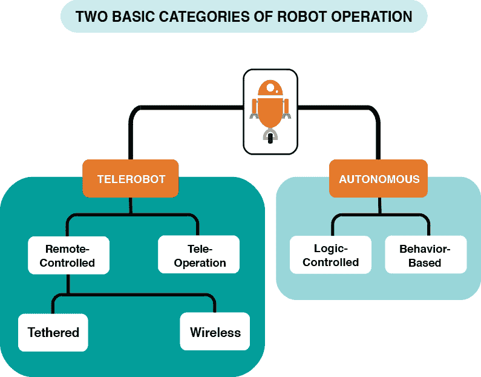

**图 I.1** 机器人操作大基本类别

遥控机器人（telerobot）组代表人类操作员使用某种遥控设备或傀儡模式远程控制的机器人操作。某些遥控器需要系缆（某种电线）物理连接到机器人上，而其他类型的遥控是无线的（例如无线电控制或红外线）。

自主机器人（autonomous robot）组代表不需要人类操作员的机器人。相反，机器人访问一组指令并自主执行它们，而无需远程控制的干预或中断。

在书中，我们专注于自主类机器人操作和机器人编程。尽管我们经常讨论、解释并对比遥控机器人与自主机器人，但我们的主要重点是向你介绍编程机器人自主运行和执行分配任务的基本概念。

正如你在第 9 章(#ch09.html_ch09) “机器人空间 (SPACES)”中所示，这两种机器人控制/操作存在混合体，在操作策略上有不同的组合和匹配。你将学习到允许混合匹配不同机器人控制策略的技术。

 注意

书中所有的机器人指令、命令和程序都已在基于 ARM7(#app01.html_gloss_07)、ARM9(#app01.html_gloss_08) 微控制器的机器人上测试过，并在广泛可用且流行的 LEGO NXT 和 EV3 机器人上测试过。书中使用的其他基于机器人软件均在 Mac OSX(#app01.html_gloss_38) 和 Linux 环境下测试并执行。

## 训练营基础

在尝试编写机器人之前，必须回答**五个基础问题**：

1. 正在考虑的是哪种类型的机器人？
2. 机器人将要做什么？
3. 机器人将在哪里执行？
4. 机器人如何执行？
5. 机器人将如何被编程？

许多初学者和潜在的机器人编程员未能回答这些基础问题，导致机器人项目不成功。拥有这些基础问题的答案是让任何类型的机器人执行分配任务的第一步。在*机器人编程：控制自主机器人指南*中，我们演示了如何利用这些问题及其答案来组织一种分步方法，以成功地指示机器人自主执行一系列任务。

## 本书介绍的核心机器人编程技能

在书中，我们向你介绍了表 I.1(#ch00.html_ch00tab01) 所示的机器人训练营基础技术。

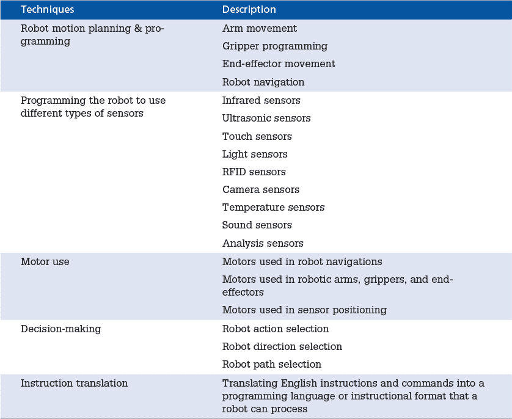

**表 I.1** 训练营笔记

这些技术是让机器人执行几乎任何分配任务的核心技术。请注意这五个领域，因为它们代表了建立机器人编程坚实基础的第二步。

### BURT——基础通用机器人翻译器 (Basic Universal Robot Translator)

在书中，我们使用两种工具以易于理解和快速参考的格式呈现机器人程序和常见的机器人编程问题。第一个工具是 BURT(#app01.html_gloss_18)（基础通用机器人翻译器），用于展示书中所有的代码片段、命令和机器人程序。BURT 显示每个代码片段、命令或机器人程序的两个版本：

 通俗英语版本

 机器人语言版本

BURT 用于将一组指令的简单、易懂的英语版本翻译为这些指令的机器人语言版本。

在某些情况下，英语版本被翻译成代表机器人指令的图表。在其他情况下，BURT 将英语翻译成 Java 或 C++ 等标准编程语言。BURT 还可以用于将英语指令翻译成机器人视觉指令环境，如 Labview 或用于 Mindstorms 机器人的 LEGO G 语言。

BURT 翻译带有编号，可以作为编程技术、机器人指令或命令的快速参考指南。BURT 翻译包含两个部分：输入和输出。输入部分将包含伪代码或 RSVP。输出部分将包含程序列表，无论是标准语言还是视觉指令。它们将附有如图 I.2(#ch00.html_ch00fig2)所示的 BURT 翻译输入或输出标志。

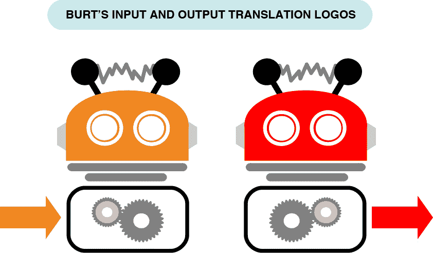

**图 I.2** BURT 翻译输入输出标志


除了 BURT 翻译外，书中还 Gotchas(`#app01.html_gloss_30`)，即 BURT 的***G***lossary of ***T***echnical ***C***oncepts and ***H***elpful ***A***cronyms（技术概念和有用缩写词表）。机器人编程的世界充满了可能陌生或难以记忆的术语和缩写。Gotchas 提供了一个方便的地方，可以查找书中使用的任何缩写或某些技术术语。在某些情况下，Gotchas 列在首次使用的章节末尾，但所有 BURT Gotchas 的完整列表可以在术表中找到。

### BRON——蓝牙机器人定向网络 (Bluetooth Robot Oriented Network)

第二个工具是 BRON(`#app01.html_gloss_17`)（蓝牙机器人定向网络）。我们组成了一个小型机器人团队，它们通过蓝牙(`#app01.html_gloss_16`) 无线协议和互联网连接并通信。这个机器人团队的责任是从机器人编程的世界中定位并检索各种技巧、窍门、冷知识、采访和新闻，读者会发现这些内容有趣且有用。这些材料以“BRON’s Believe It or Not”章节的形式呈现，并通过图 I.3(`#ch00.html_ch00fig03`)所示的标志进行识别。


**图 I.3** BRON’s Believe It or Not 标志

这些章节包含了读者可以跳过的补充材料，但通常会针对章节中介绍的某些观点提供额外的见解。在某些情况下，`BRON 不可置信`（BRON’s Believe It or Not）包含了最新出炉且与机器人编程某些方面的新闻。在另一些情况下，`BRON`章节包含了对机器人世界或机器人编程领域做出重要贡献的人的采访摘录。在所有情况下，`BRON 不可置信`章节都旨在让你对机器人和机器人编程世界有更深入的理解和欣赏。

### 对读者机器人的假设

我们在几种不同类型的机器人上使用并测试了书中的指令和程序，书中提出的观点广泛适用于许多机器人。如果你拥有一台机器人，它具备表 I.2 所示每一列中的至少一种能力，那么你就能将书中的任何程序适配到你的机器人上。

 注意

我们确实向你展示了如何编写机器人使用表 I.2 中列出的传感器之外的传感器。但书中的主要思想可以通过表 I.2 中列出的传感器进行尝试和测试。

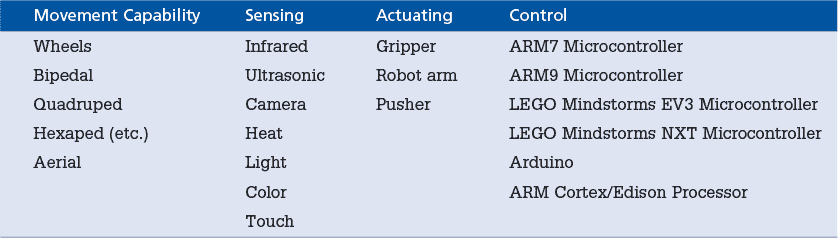

**表 I.2** 训练营机器人能力矩阵

### Midamba 如何学习编程机器人

在书中，我们讲述了一个短故事，讲述了性自由、热爱乐趣的 Midamba 如何发现自己陷入了危险的困境。巧的是，他摆脱困境的唯一机会需要他学习如何编程机器人。尽管 Midamba 有一些计算机编程的基础经验，但他对机器人知之甚少，而且没有编程机器人的经验。因此在整本书中，我们以 Midamba 的困境和他机器人编程的成功作为示例。我们将带你学习 Midamba 学过的相同的基础课程，以及他为了成功编写第一台机器人所必须采取的步骤。

## 1 到底什么是机器人？

**机器人敏感性训练课程 #**：所有的机器人都是机器，但并非所有的机器都是机器人。

问任何 10 个人什么是机器人，你一定会得到至少 10 个不同的观点：遥控玩具狗、自动银行柜员机、遥控战斗机器人、自动吸尘器、无人飞行的无人机、语音激活智能手机、电池驱动动作玩具、钛镀液动力战斗底外骨骼等等，以此类推。

定义什么是机器人可能不容易，但我们看到时都能认出来，对吧？软件控制设备的快速增长模糊了自动化设备与机器人之间的界限。仅仅因为一个电器或设备受软件控制，并不意味着该电器或设备就是机器人。自动化或自动运行并不足以机器获得机器人的特权。

许多遥控、自动运行的设备和机器被赋予机器人的身份，但并不合格。表 1.1 显示了对机器人的几种广泛且有时相互矛盾的字典式定义。

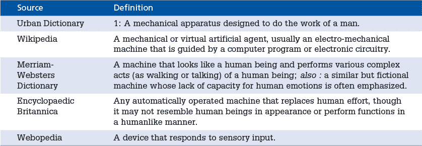

**表 1.1** 对机器人一词广泛且有时矛盾的定义

### 定义机器人的七项标准

在我们开始编写机器人的任务之前，我们需要一个良好的定义来规定什么让机器人成为机器人。那么，一个自动运行、软件控制的设备何时才算是一个机器人？在 ASC（高级软件构建，作者在那里为机器人和软件智能体构建智能引擎），我们要求机器满足以下七项标准：

1. 它必须能够通过其程序，以一种或多种方式感知其外部和内部环境。

2. 它的可重新编程行为、动作和控制是执行一组程序化指令的结果。

3. 它必须能够通过其程序，以一种或多种方式影响、与其外部环境交互或对其对其进行操作。

4. 它必须有自己的电源。

5. 它必须拥有一种适用于表示离散指令和数据的语言，并对编程提供支持。

6. 一旦启动，它必须能够在不需要外部干预的情况下执行其程序（这一点有争议）。

7. 它必须是一台非生物机器。

让我们详细地查看这些标准。

#### 标准 #1：感知环境

为了让机器人有用或有效，它必须有某种方式来感知、测量、评估或监控其环境和状况。机器人需要什么感官以及机器人如何在环境中使用这些感官，取决于机器人预期执行的任务。机器人可能需要识别环境中的物体、记录或区分声音、对遇到的材料进行测量、通过触碰定位或避开物体等。如果没有以某种方式感知其环境和状况的能力，机器人很难执行任务。除了具有感知环境和状况的方法外，机器人还必须具备接受关于如何、何时、何地以及为什么要使用其感官指令。

#### 标准 #2：可编程动作和行为

必须给机器人一组指令，详细说明：

 执行哪些动作

 何时执行动作

 在哪里执行动作

 在什么情况下执行动作

 如何执行动作

正如我们在整本书中所看到的，*编写机器人*相当于给机器人一组指令，说明做什么、何时、在何地、为什么以及如何执行一组动作。

#### 标准 #3：改变、与环境交互或对环境进行操作

为了让机器人有用，它不仅要感知，还要以某种方式改变其环境或状况。换句话说，机器人必须能够对某物做某事，或者利用某物做某事！机器人必须能够对其环境或状况产生影响，否则它就没有用处。采取动作或执行任务的过程必须影响或操作环境，否则将无法知道机器人的动作是否有效。机器人的动作以某种可衡量的标准改变其环境、场景或状况，这种变化应该是给机器人的指令集的直接结果。

#### 标准 #4：需要电源

机器人的主要功能之一是执行某种动作。该动作会导致机器人消耗能量。这种能量必须来自某种电源，无论是电池、电力、风能、水能、太阳能等。只要其电源供应能量，机器人就能运行并执行动作。

#### 标准 #5：适用于表示指令和数据的语言

机器人必须被赋予一组指令，决定如何、做什么、在何地、何时以及在什么情况下或场景下发生动作。某些动作指令是硬编码在机器人中的。这些是机器人只要有活动电源供应，就会一直执行的指令，无论机器人处于何种情况。这是机器人“机器”属性的一部分。

普通机器与机器人之间最重要的区别之一是，机器人可以在无需重建、无需更改硬件且无需重新布线的情况下接收新指令。机器人拥有一种用于接收指令和命令的语言。机器人的语言必须能够表示描述机器人环境、场景或状况的命令和数据。机器人的语言设施必须允许在不需要物理重新布线的情况下给出指令。也就是说，机器人必须通过一组指令进行重新编程。

## 标准则 #6：无外部干预的自主性

对于机器人的这项要求，我们采取了严格且具有争议的立场。对于我们而言，真正的机器人是完全自主的。并非所有的机器人专家都认同这一观点。图 1.1

**图 1.1** 机器人运行的两个基本类别

机器人运行或机器人控制通常分为两类：

 遥控机器人

 自主机器人

与自主机器人一样，遥控机器人也会接收指令，但它们的指令是实时的，并且从外部源（人类、计算机或其他机器）实时或延迟接收。指令通过某种类型的遥控器发送，机器人执行指令要求的动作。有时，遥控器的一个一个信号在机器人接收后会触发多个动作，而在其他情况下，它是一一对应的关系——每个信号对应一个动作。

这里需要注意的关键点是，如果没有遥控器或外部干预，机器人就不会执行任何动作。相反，自主机器人的指令在机器人执行一系列动作之前就已经存储好了。自主机器人有自己的行动方案，不依赖遥控器来执行或启动每个动作。明确的是，存在混合机器人以及主题变体，即遥控机器人具有某些自主动作，而自主机器人有时具有傀儡模式。

但我们对完全自主和半自主机器人进行了区分，并在全书中可能会提到“强自主”和“弱自主”。本书向读者介绍了涉及完全自主机器人人的编程的概念和技术；不涵盖遥控编程技术。

## 标准则 #7：非生命机器

尽管植物和动物有时被认为是可编程的机器，但我们将它们排除在机器人的定义之外。在制造、编程和部署机器人时，必须解决许多伦理考量。如果我们机器人技术发展到机器人被认为是生命体的地步，那么机器人的定义绝对需要进行更改。

## 机器人分类

虽然许多类型的机器可能符合我们七项标准中的一项或多项，但要成为`真正的机器人`，机器至少必须符合这七项标准。明确的是，机器人可以拥有多于七个特征，但不能少。幸运的是，并没有要求机器人像人类、拥有智能或情感。事实上，今天使用的大多数机器人与人类几乎没有共同点。机器人如图 1.2 所示分为三大基本类别。

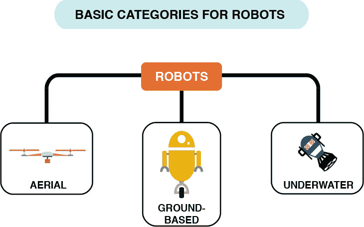

**图 1.2** 机器人的三大基本类别

三类机器人还可以根据其操作和编程方式进一步划分。我们之前将机器人描述为遥控机器人或自主机器人。因此，我们可以拥有遥控或自主的陆地、空中或水下机器人。图 1.3

**图 1.3** 空中和水下机器人的运行模式

### 空中和水下机器人

空中机器人被称为 UAV（无人机）或 AUAVs（自主无人机）。并不是所有的 UAV 和 AUAV 都算机器人。记住我们的七项标准。大多数 UAV 仅仅是机器，但某些符合所有七项标准并可以被编程执行任务。水下机器人被称为 ROVs（遥控无人器）和 AUVs（自主水下航行器）。像 UAV 一样，大多数 ROV 只是机器，还没有达到机器人水平，但那些机器人可以像任何其他机器人一样被编程和控制。

正如你可能猜到的，空中和水下机器人经常面临陆地机器人通常不会面对的问题。例如，水下机器人必须编程进行导航和水下作业，并且必须处理来自环境带来的所有挑战（例如水压、水流、水等）。大多数陆地机器人没有设计在水生环境中运行，通常也没有设计成防水。

空中机器人设计用于起飞和降落，通常在地面数百或数千英尺空中运行。UAV 机器人编程必须考虑飞行设备必须面对的所有挑战（例如，如果空中机器人失去了所有动力会怎样？）。陆地机器人可能会耗尽动力并简单停止。

如果出现导航或电源问题，UAV 和 ROV 可能会面临灾难。但陆地机器人有时也会遇到灾难。它们可能会掉下边缘、滚下楼梯、掉入液体或遭遇恶劣天气。通常，机器人被设计和编程在这些类别中的一种运行。构建和编写一个可以在多个类别中运行的机器人是非常的。UAV 通常不水，而 ROV 通常不飞行。

尽管书中的大多数示例集中于陆地机器人，但我们介绍的机器人编程概念和技术适用于所有三类机器人。机器人就是机器人。图 1.4

**图 1.4** 简化的机器人组件骨架

所有真正的机器人都有图 1.4 所示的基本组件骨架。无论机器人属于哪一类（陆地、空中或水下），它至少包含四种类型的可编程组件：

 一个或多个传感器

 一个或多个执行器

 一个或多个末端执行器/环境效应器

 一个或多个微控制器

这四类组件是大多数基础机器人编程的核心。在最简单的形式，编程机器人归结为使用控制器对机器人的传感器、执行器和末端执行器。是的，编程机器人不仅仅是处理传感器、执行器、效应器和控制器，但这些组件构成了机器人内部、表面以及组成部分的大部分内容。机器人编程的另一个主要方面涉及机器人的场景，我们稍后介绍。但首先，让我们更仔细（尽管是简化的）观察这四种基本的可编程机器人组件。

#### 什么是传感器？

传感器是机器人观察世界的眼睛和耳朵。它们允许机器人接收关于周围环境的输入、信号、数据或信息的组件。传感器是机器人与世界的接口。换句话说，传感器是机器人的感官。

机器人传感器有许多类型、形状和大小。有的机器人传感器对温度敏感；有的能感知声音、红外线、运动、无线电波、气体和土壤成分的传感器；还有测量引力吸引的传感器。传感器可以使用摄像头进行视觉并识别方向。人类受限于视觉、触觉、嗅觉、味觉和听觉五种基本感觉，而机器人的传感器潜力几乎是无限的。机器人可以拥有几乎任何种传感器，并可以配备电源支持的数量的传感器。我们将在第 5 章“深入探讨传感器](`#ch05.html_ch05`)”中详细介绍传感器。但现在，请仅将传感器视为为机器人提供即时环境或场景输入和数据的设备。

每个传感器都负责向机器人提供关于当前环境的某种反馈。通常，机器人从传感器读取值或向传感器发送值。但传感器并不是自动感应。机器人的编程决定了何时、如何、在何处以及在何程度上使用传感器。编程决定了传感器处于什么模式，以及如何处理从传感器接收到的反馈。

例如，假设我有一个配备了光传感器的机器人。根据传感器的复杂程度，我可以指示机器人使用其光传感器判断物体是否是蓝色的，然后只提取蓝色物体。如果机器人配备了声音传感器，我可以指示它：当它*听到*某类声音时执行一个动作，当它*听到*另一种声音时执行另一个动作。

并并非所有传感器都是平等的。对于任何你可以为机器人配备的传感器，在该类别中都有从低端到高端的系列传感器。例如，某些光传感器只能检测四种颜色，而另一些光传感器可以检测 256 种颜色。编程机器人的一部分包括熟悉机器人的传感器组、传感器能力和局限性。传感器越多功能、越复杂，相关的机器人任务就可以越精细。

机器人的效能可能会受到传感器的限制。具有范围限于几英寸摄像头传感器的机器人无法看到一英尺外的物体。配备只能检测红外光传感器的机器人无法看到紫外线，以此此类推。我们在书中讨论了机器人的效能，并从机器人骨架的角度（参见图 1.4）对其进行了描述。我们根据以下标准对机器人的潜在效能进行评估：

 执行器效能

 传感器效能

 末端执行器效能

 微控制器效能

### REQUIRE

通过这种简单的机器人效能衡量标准，传感器约占机器人潜在效能的四分之一。我们开发了一种衡量机器人潜力的方法，并称之为 `REQUIRE`（真实环境中使用的机器人效能商值）。我们使用 `REQUIRE` 作为初始试金石，来确定我们可以编写机器人做什么，以及我们无法编写机器人做什么。我们将在稍后解释 `REQUIRE`，并在贯本书中使用它作为机器人性能指标。需要注意的是，机器人 25%的潜在效能取决于传感器的质量以及如何对其编程。

### 什么是执行器？

执行器是提供机器人部件运动的组件。电机通常在机器人中充当执行器。电机可以是电动的、液压的、气动的或使用其他势能。执行器为机械臂提供运动，或为拖拉机、轮子、螺旋桨、桨叶、翅膀或机器人腿提供运动。执行器允许机器人移动其传感器，并对其组件进行旋转、移动、打开、关闭、升高、降低、扭转和转向。

### 可编程的机器人速度和力量

执行器/电机最终决定了机器人移动有多快。机器人的加速度与其执行器相关。执行器还负责机器人可以举起多少或可以拿住多少。执行器与机器人能产生多少扭矩或力密切相关。完全编程机器人涉及向机器人提供指令关于如何、何时、为什么、在何处以及在何程度上使用执行器。很难想象或构建一个没有任何种类的运动的机器人。这种运动可能是外部的，也可以是内部的，但它是存在的。

***

 提示

回想机器人需求列表中的第 3 条标准：它必须能够通过编程，以一种或多种方式影响、与其外部环境交互或对其进行操作。

***

它必须能够通过编程，以一种或多种方式影响、与其外部环境交互或对其进行操作。

很难想象或构建一个没有任何种类的运动的机器人。这种运动可能是外部的，也可以是内部的，但它是存在的。

机器人必须以某种方式对其环境进行操作，而执行器是这种交互的关键组件。就像传感器组一样，机器人的执行器可以开启或限制其潜在效能。例如，一个允许机器人手臂仅旋转 45 度的执行器在需要旋转 90 度的情况下是无效的。或者，如果执行器只能让螺旋桨以 200 rpm 的速度移动，而需要 1000 rpm，那么该执行器将阻止机器人正确执行所需任务。

机器人必须根据情况具有正确的运动类型、范围、速度和运动程度。执行器是提供这种运动的可编程组件。执行器涉及到机器人可以移动多少重量或质量。如果任务要求机器人举起 2 升或 40 盎司液体容器，但机器人的执行器最多支持 12 盎司，那么机器人注定失败。

机器人的效能通常通过它在指定情况或场景下有多用来衡量。执行器通常决定了机器人可以或不能执行多少工作。与传感器一样，机器人的执行器并不是自己动作；它们必须经过编程。与传感器一样，执行器从低端的简单功能到高端的自适应、复杂的功能不等。编程设施越灵活越好。我们将在第 7 章“为电机和伺服电机编程](`#ch07.html_ch07`)”中详细讨论执行器。

### 什么是末端执行器？

末端执行器是允许机器人处理、操纵、改变或控制环境中对象的硬件。末端执行器是使机器人动作对其环境或场景产生影响的硬件。执行器和末端执行器通常密切相关。大多数末端执行器都需要使用或与执行器交互。

***

 注意

末端执行器还有助于实现我们机器人定义的第 3 条标准。机器人必须能够对某物做某事，或者利用某物做某事！机器人必须在其环境或状况中产生变化，否则它就没有用。

***

机器人手臂、抓爪、机械爪和手是末端执行器的常见例子。末端执行器有各种形状和大小，具有多种功能。例如，机器人可以使用钻头、射物、滑轮、磁铁、激光、声波冲击甚至鱼网作为末端执行器。与传感器和执行器一样，末端执行器也受机器人编程的控制。


编程任何机器人的挑战之一在于指令机器人充分利用其末执行器（`end-effectors`）来完成任务。末执行器也会限制机器人成功完成任务。就像传感器一样，机器人可以配备多个执行器，使其能够操作不同类型的物体或同时操作相似的物体。是的，在某些情况下，最好的末执行器是那些两个、四个、六个一组工作的设备。末执行器必须能够与机器人场景或环境中需要操作的对象进行交互。我们将在第 7 章中详细介绍末执行器。

## 什么是控制器？

控制器是机器人用于“控制”其传感器、末执行器、执行器和运动的组件。控制器是机器人的“大脑”。控制功能可以由机器人内部多个控制器分，但通常实现为微控制器。微控制器是一个集成在芯片上的小型单机计算机。图 1.5 显示了微控制器的基本组件。

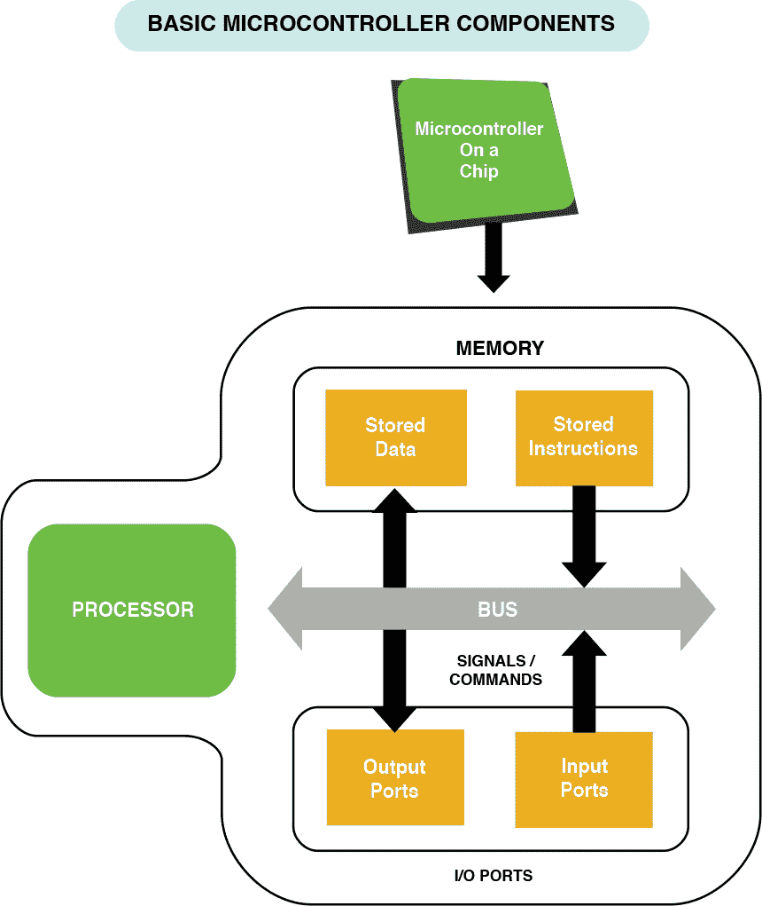

**图 1.5** 微控制器的基本组件

控制器或微控制器是机器人中可编程的组件，支持机器人动作和行为的编程。根据定义，没有至少一个微控制器的机器不能称为机器人。但请记住，可编程性只是七项标准之一。

***

 备注

处理器执行指令。处理器有其自己的机器语言。发送到处理器的指令集最终必须翻译成处理器的语言。因此，如果我们从一组想要让处理器执行的英文指令开始，那么这组指令最终必须被翻译成微控制器内部处理器可以理解并执行的指令。图 1.6 显示了从“绝妙灵感到处理器”机器指令的基本步骤。

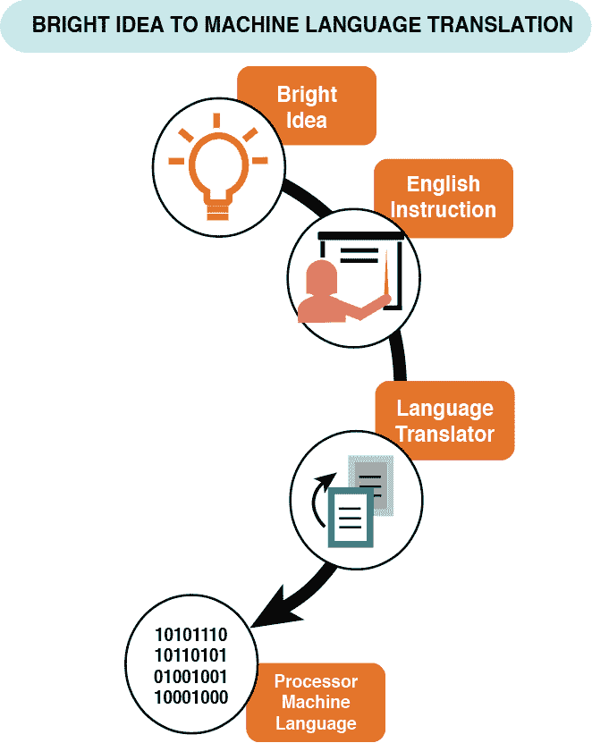

**图 1.6** 从灵感到机器语言

***

控制器控制机器人并拥有机器人内存的组件。注意在图 1.5 中有四个组件。处理器负责计算、符号操作、执行指令和信号处理。输入端口接收来自传感器的信号并将这些信号发送到处理器进行处理。处理器将信号或命令发送到连接到执行器的输出端口，以便它们执行动作。

发送到传感器的信号会导致传感器进入传感器模式。发送到执行器的信号会初始化执行器、设置电机速度、导致电机运动、停止电机运动等。

因此，处理器通过输入端口从传感器获取反馈，并输出端口发送信号和命令，这些信号最终指向电机、机器人手臂以及机器人移动部件（如拖拉机、滑轮和其他末执行器）。

在本书中，之前在机器人训练营中讨论过的`BURT`被用于将绝妙灵感翻译成机器语言，这样你就能清楚机器人编程过程中发生了什么。除非你有一个使用英文或其他自然语言作为内部语言的微控制器，否则所有指令、命令和信号都必须从它们开始的任何形式翻译成微控制器内部处理器可以识别的格式。图 1.7 简单地展示了传感器、执行器、末执行器和微控制器之间的交互。

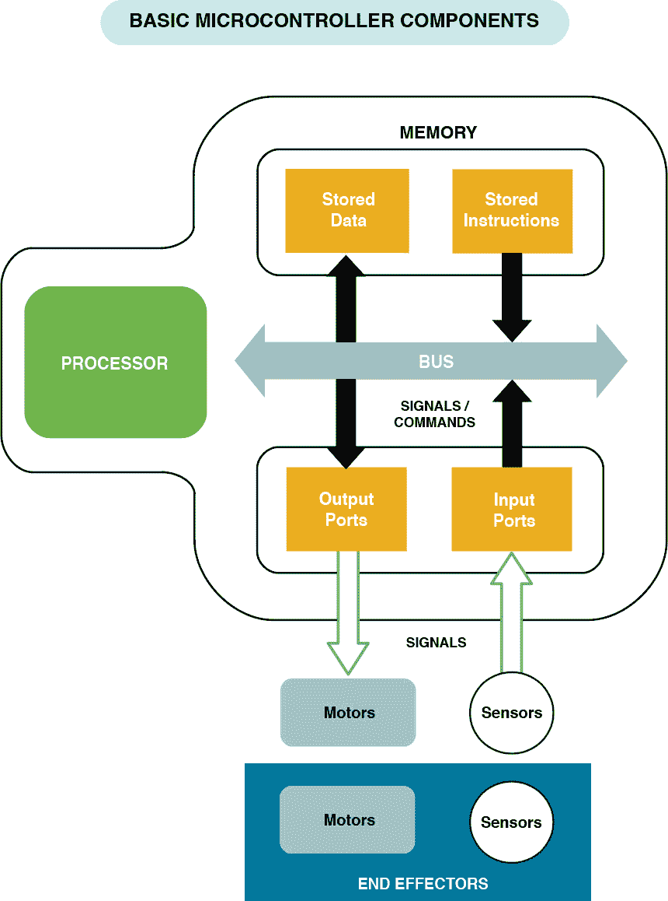

**图 1.7** 微控制器、传感器、执行器和末执行器之间的基本交互

图 1.7 中的内存组件是存储机器人指令以及存储机器人当前操作数据的地方。当前操作数据包括来自传感器、执行器、处理器或任何需要存储数据或信息的外设备的数据，必须最终由控制器的处理器处理。我们本质上将机器人简化为了基本的机器人骨架：

 传感器

 执行器

 末执行器

 微控制器

在最基础的层，编写机器人相当于通过给微控制器的一组指令集来操作机器人的传感器、末执行器和运动。无论我们编写的是地面、空中还是水下机器人，基本的机器人骨架都是相同的，必须处理一组核心的主要编程活动。编写机器人自主执行任务需要我们以某种方式向机器人微控制器通信该任务。只有在机器人微控制器拥有该任务后，才能由机器人执行。图 1.8 展示了我们翻译后的机器人骨架。

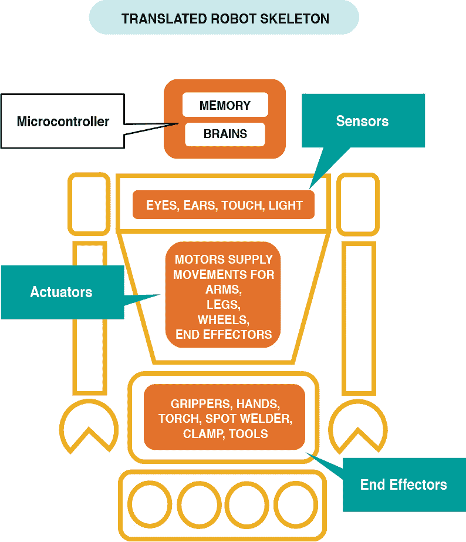

**图 1.8** 翻译后的机器人骨架

图 1.8 展示了基本的机器人组件类似于什么。机器人传感器、执行器和末执行器完全可以有更复杂的形态，但图 1.8 展示了一些更常用的组件，并传达了我们在书中使用的基本思想。

***

 备注

我们特别强调微控制器，因为它是机器人主要的可编程组件，当讨论机器人编程时，通常讨论的是微控制器。末执行器和传感器很重要，但微控制器处于主驾驶位置，它负责设置和读取传感器并控制机器人的运动以及末执行器的使用。表 1.2 列出了用于低成本机器人的常用微控制器。

***

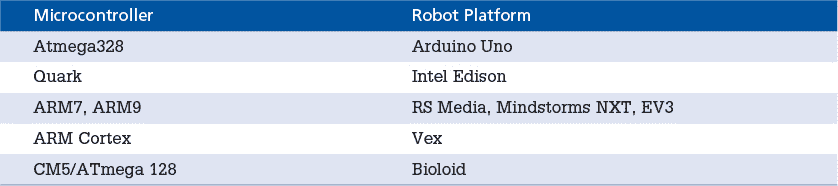

**表 1.2** 常用微控制器

虽然书中的大多数示例是使用`Atmega`、`ARM7`和`ARM9`微控制器开发的，但我们引入的编程概念可以适用于任何具有图 1.4 所示基本机器人骨架并符合我们七项机器人标准的机器人。

## 人在什么场景中？

机器人骨架只讲述了机器人编程的一半。另一部分（不是机器人的一部分）是机器人的场景或情况。机器人在特定的上下文中执行某种类型的任务。为了让机器人有用，它必须在上下文中产生某种影响。机器人的任务和环境不是随机、未定义的概念。有效的机器人在特定的场景或情况下执行任务。机器人被赋予在场景中扮演某种角色。让我们以图 1.9 中的派对机器人为例。

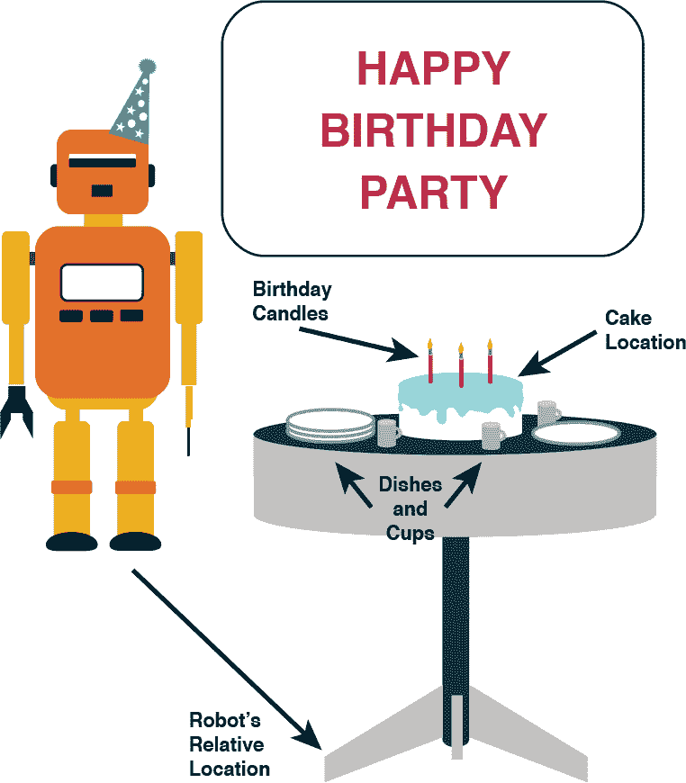

**图 1.9** 派对机器人

我们想给机器人（我们叫它`BR-1`）分配两个任务：

 点燃蛋糕上的烛。

 在派对结束后清理盘子和杯。

派对是机器人的*场景*。机器人`BR-1`承担着点蜡烛和清理盘子杯的角色。场景带有预期。有效的机器人是由预期驱动的。派对是有预期的。典型的派对有地点、蛋糕、冰淇淋、客人、过生日的人、时间以及可能的礼物。

 蛋糕的位置

 要点几根蜡烛

 机器人相对于蛋糕的位置

 何时点蜡烛

 派对如何以及何时结束

 盘子和杯子的数量等

机器人的有用性取决于它在特定场景下履行其角色的好坏。每个场景或情况都包含一个位置、一组物体、条件和一系列事件。自主机器人处于场景之中，并是由预期驱动的。当对机器人进行编程时，预期它以某种方式参与并影响某个情况或场景。将场景和一系列预期表示并传递给机器人是机器人编程故事的后半部分。

***

 提示

简单而言，编写一个机器人变得有用，等同于编写机器人使用其传感器和执行器，在某些特定情况或场景中执行一系列任务，以完成其角色并满足其预期。

***

编写一个实用的机器人可以分为两个基本领域：

 指示机器人使用其基本能力来满足某些预期

 向机器人解释在给定情况或场景下的预期是什么

当自主机器人在不需要人工干预的情况下，通过其编程在指定的情况或场景中满足预期时，它就是用的。因此，工作的一部分需要编写机器人执行某些任务或一组任务。

另一部分要求指示机器人在指定的场景或多个场景中执行其功能。我们的机器人编程方法是场景驱动的。机器人在情况和场景中承担角色，这些情况和场景必须成为机器人指令和编程的一部分，机器人才能成功执行其任务。

### 给机器人下达指令

如果我们预期机器人在某个场景中扮演某种角色，我们该如何告诉它做什么？我们该如何给它下指令？在这些问题的答案中，包含了编程机器人时的冒险、挑战、奇奇、恐惧以及可能的遗憾。

人类使用自然语言、手势、肢体语言和面部表情进行交流。机器人是机器，只能理解微控制器的机器语言。这正是问题所在。我们用一种方式说话和交流，而机器人用另一种方式交流。我们还不知道如何构建能够直接理解和处理人类交流的机器人。因此，即使我们拥有一个具备传感器、执行器和完成我们要求任务能力的机器人，我们该如何传达任务？我们该如何给它一组正确的指令？

#### 每个台机器人都有一种语言

那么机器人到底理解什么语言呢？机器人的原生语言是机器人微控制器的语言。无论如何与机器人通信，这种通信最终必须翻译成微控制器的语言。微控制器是一个计算机，大多数计算机都使用机器语言。

##### 机器语言

机器语言由 0 和 1 组成。因此从技术上讲，机器人真正理解的语言只有 0 和 1 的字符串和序列。例如：

`0000001`, `1010101`, `00010010`, `10101010`, `11111111`

如果你想（或被迫）用机器人的原生语言为机器人编写一组指令，它将由一行行的 0 和 1 组成。例如，列表 1.1 是一个简单的`ARM`机器语言（有时称为二进制语言）程序。

**列表 1.1 ARM 机器语言程序**

[点击此处查看代码图像]

***

```
11100101100111110001000000010000
11100101100111110001000000001000
11100000100000010101000000000000
11100101100011110101000000001000
```

***

该程序从处理器的两个内存位置获取数字，将它们相加，并将结果存储在第三个内存位置中。大多数机器人控制器使用的语言与列表 1.1 显示的机器语言相似。

0 和 1 的排列和数量可能会随控制器的不同而变化，但所见即所得。纯机器语言可能很难阅读，而且很容易反转 1 或 0，或者错误地计算 1 和 0。

##### 汇编语言

汇编语言是机器语言的一种更易读的形式，它使用短符号表示指令，并使用十六进制或八进制表示法表示二进制。列表 1.2 是列表 1.1 所示操作的汇编语言示例。

**列表 1.2 汇编语言程序**

***

```
LDR R1, X
LDR R0, Y
ADD R5, R1, R0
STR R5, Z
```

***

虽然列表 1.2 比机器语言更不容易出错，但汇编语言仍然有些晦涩。目前还不清楚我们正在取数字 X 和 Y，将它们相加，并将结果存储在 Z 中。

***

 备注

机器语言有时被称为*第一代语言*。汇编语言有时被称为*第二代语言*。

***

通常情况下，计算机语言越接近自然语言，它获得的代号就越高。因此，第三代语言比第二代语言更接近英语，第四代语言比第三代语言更接近，以此类推。

所以理想情况下，我们希望使用尽可能接近我们自己的语言来指示机器人。遗憾的是，更高代的语言通常需要更多的硬件资源（例如电路、内存、处理器能力），并且要求控制器更加复杂且效率较低。因此，微控制器通常只有第二代指令集。

我们需要一种通用翻译器，某种允许我们用人类语言编写指令并自动将其翻译成机器语言或汇编语言。计算机领域尚未产生这样的通用翻译器，但我们已经成功了一半。

#### 机器人的语言

编译器和解释器是将一种语言转换为另一种语言软件程序。它们允许程序员在较高代的语言中编写指令，然后将其转换为较低代的语言。例如，列表 1.2 中的汇编语言程序

```
LDR R1, X
LDR R0, Y
ADD R5, R1, R0
STR R5, Z
```

可以使用指令编写：

```
Z = X + Y
```

注意图 1.10，编译器或解释器将我们的高级指令转换为汇编语言，但汇编器是将汇编语言转换为机器语言的程序。图 1.10 还显示了工具链概念的简单版本。

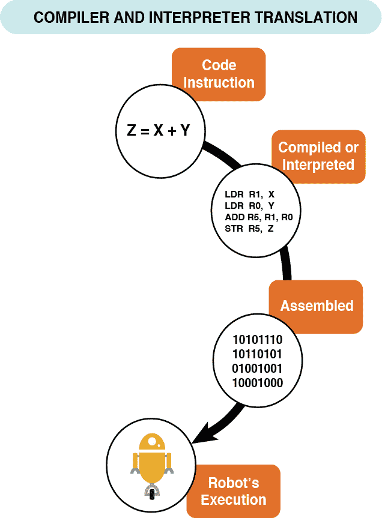

**图 1.10** 编译器和解释器的翻译

图 1.11 显示了一些常用机器人编程语言世代的分类。

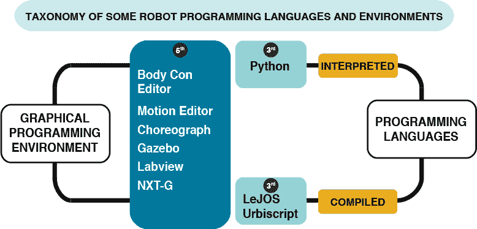

**图 1.11** 一些常用机器人编程语言和图形化编程环境的分类

图形化语言有时被称为第五代和第六代编程语言。这在一定程度上是因为图形语言允许你更自然地表达你的想法，而不是从机器的角度来表达想法。因此，指令或编程机器人的挑战之一在于：按照你设想的方式表达一组指令，与按照微控制器看到的方式表达这些指令之间存在差距。

图形化机器人编程环境和图形化语言试图通过允许使用图形和图片对机器人编程来解决这一差距。Bioloid¹ 运动编辑器和 Robosapien² RS 身体编辑器是这种环境的两个示例，如图图 1.11 所示。

1.](#ch01.html_ch01fn01) Bioloid 是由 Robotis 制造的模块化机器人系统。

2.](#ch01.html_ch01fn02) Robosapien 是由 Wowee 制造的独立机器人系统。

这类环境的工作原理是允许你图形化地操作或设置机器人的运动、传感器的初始值以及执行器的速度和力量。机器人通过设置值和移动图形推杆以及图形控制控件进行编程。在某些情况下，只需在软件中填写包含需要传递给机器人的信息和数据的表即可。图形化环境将程序员与机器人编程的实际工作隔离开来。

需要记住，机器人微控制器最终期望的是汇编/机器语言。必须有人或某些东西提供原生指令。因此，这些图形化环境具有内部编译器和解释器，负责将图形思想转换为低级语言，最终转换为控制器的机器语言。昂贵的机器人系统已经拥有这些图形化环境一段时间了，但它们现在适用于低成本机器人。表 1.3 列出了几种用于低成本机器人系统的常用图形化环境/语言。

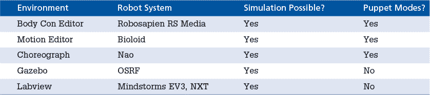

**表 1.3** 图形化机器人编程环境示例

### 傀儡模式

与视觉化编程机器人密切相关的概念是直接操纵或`puppet mode`傀儡模式）。傀儡模式允许程序员使用键盘、鼠标、触摸板、触摸屏或其他指向设备来操作机器人的图形，同时允许编程物理地操纵机器人的部分到所需的位置。

傀儡模式充当动作记录器。如果你想让机器人头部向左转，你可以将机器人头的图形指向左侧，傀儡模式就会记住。如果你想让机器人向前移动，你就将机器人部件移向前的位置（无论是腿、轮子、拖拉器等），傀儡模式就会记住。一旦你记录了所有想要机器人执行的动作，就可以将信息发送给机器人（通常使用某种电缆或无线连接），机器人就会物理执行在傀儡模式下记录的动作。

同样，如果程序员将机器人进入傀儡模式（前提是机器人具有该模式），那么程序员对机器人进行的物理操作就会被记录。一旦程序员让机器人退出记录模式，机器人就会执行在傀儡模式会期间记录的动作序列。傀儡模式是一种模仿编程。机器人记录它是如何被操纵的，记住这些操纵，然后复制该动作序列。使用傀儡模式允许程序员跳过输入指令序列的过程，并减轻了程序员需要思考如何在机器人语言中表示动作序列的负担。机器人系统中视觉语言、视觉环境和傀儡模式的可用性只会增加，其复杂性也会之增加。然而，大多数视觉编程环境都有两个致命的缺点。

#### 机器人场景在视觉编程环境中是如何表示的？

回想一下，编写自主机器人使其有效的一半工作需要指示机器人如何在场景或情环境中执行其角色。通常，如表 1.3 所示的视觉机器人编程环境没有简单的方法来表示机器人的状况或场景。它们通常只包含一个通用空间和潜在简单对象的机器人仿真。

例如，在普通的视觉机器人环境中，没有简单的方法来表示我们的生日派对场景。视觉/图形化环境和傀儡模式方法有效地编写不需要与任何物体交互的动作序列。但自主机器人需要影响环境才能有用，并需要关于环境的指令才能有效，而图形化环境在这方面表现不足。我们在书中进行的机器人编程需要一种更有效的方法。

#### Midamba 的困境

机器人有语言。机器人可以被指示自主执行任务。机器人可以被指示情况和场景。机器人可以在情况和场景中扮演角色并改变其环境。这是本书的主题：*指示机器人在特定情况、场景或事件的背景下执行任务。* 这让我们面对我们可怜的、受困的海上摩托艇者 Midamba 的不幸困境。

**机器人场景 #1**

当我们上次在引言部分的机器人训练营中看到 Midamba 时，他的电力 Sea-Doo 电量已经了。Midamba 有一块备用电池，但备用电池的端上有酸腐蚀。他仅有足够的能量到达附近的岛屿，那里可能找到帮助。

对 Midamba 来说的是，岛屿上只有一个完全由自主机器人控制的实验性化学设施。但一切还没有放弃；Midamba 想，如果设施里有一种中和电池酸的化学品，他就可以清洗备用电池继续出发。

设施的前厅被几个机器人占据着。还有一些化学品的容器、烧杯和试管，但他无法判断它们是否可以使用。办公室与存放其他化学品的仓库区域隔开，而且没有明显进入该区域的方法。Midamba 可以通过两个显示器看到机器人，机器人在仓库区域内移动，运输容器、标记容器、抬物体等。

前厅里还有一台电脑、一个麦克风和一本由 Cameron Hughes 和 Tracey Hughes 编写名为《机器人编程：控制自主机器人指南》的手册。也许运气好，他可以在手册中找到一些东西，指示他如何编写其中一个机器人去寻找并检索他需要的化学品。

在第 2 章“机器人词汇”中，我们将讨论机器人语言，以及如何将人类语言翻译成机器人能够理解的语言，以便它自主执行你想要它执行的任务。

## 2. 机器人词汇

**机器人机器人课程 #2：** 机器人动作的好坏取决于描述这些动作的指令。

机器人拥有语言。它们说的是微控制器的语言。人类说的是自然语言（例如粤语、约鲁巴语、西班牙语）。我们使用自然语言相互交流，但要与机器人通信，我们要么制造理解自然语言的机器人，要么找到某种方法用机器人可以处理的语言来表达我们的意图。

目前，在建造完全理解自然语言的机器人方面进展有限。因此，我们的任务是寻找除自然语言以外的方法来表达我们的指令和意图。

记住，解释器和编译器的作用（在之前的图 1.10 中显示，此处再次图 2.1 中显示）是将类似`Java`或`C++`的高级语言翻译成汇编、字节码或机器语言（二进制）等低级语言。

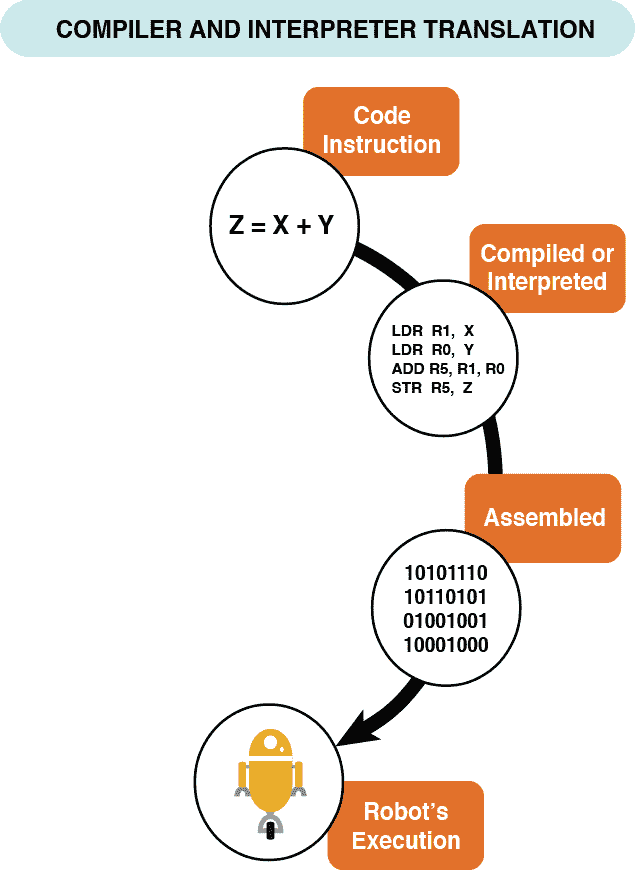

**图 2.1** 解释器和编译器的作用：从高级语言到低级语言的翻译

* * *

 注意

重要术语：控制器或微控制器是机器人中可编程的组件，支持机器人动作和行为的编程。根据定义，没有至少一个微控制器的机器不是机器人。

* * *


一种策略是与机器人“中途相遇”。也就是说，找到一种人类容易使用且翻译成机器人语言（即微控制器语言）不困难的语言，然后使用编译器或解释器为我们完成翻译。`Java` 和 `C++` 是用于编程机器人的高级语言。它们是第三代语言，与直接用机器语言或汇编语言（第二代）编程相比有了巨大改进，但它们不是自然语言。使用它们来表达人类的想法和意图仍然需要额外的努力。

### 为什么需要额外的努力？

通常需要几条机器人指令来实现*一条*高级或人类语言指令。例如，考虑以下简单单一的人类语言指令：

机器人，拿住这罐油

这涉及到机器人端的几条指令。图 2.2 显示了该指令的局部 BURT（基础通用机器人翻译器）转换为 Arduino 草图代码（C 语言），该代码可用于与机器人以及 RS Media——一种来自 WowWee、使用嵌入式 Linux 和 `ARM9` 微控制器的双足机器人通信（Java 语言）。

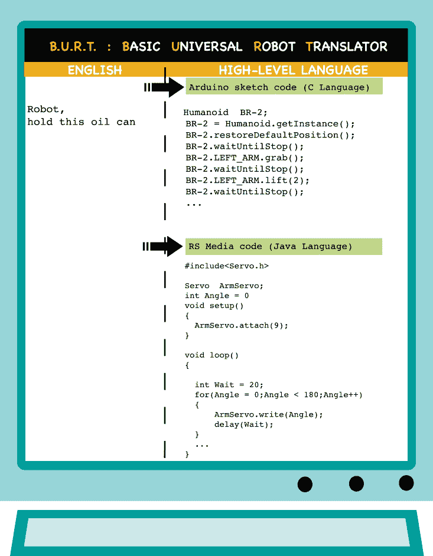

**图 2.2** 自然语言指令翻译为 RS Media 代码（Java 语言）和 Arduino 草图代码（C 语言）的部分 BURT 翻译。

注意，BURT 翻译需要多行代码。在两种情况下，都使用编译器从高级语言翻译成机器人的 ARM 汇编语言。`Java` 代码比 Arduino 语言更远离 `ARM`。`Java` 编译器将 `Java` 编译成机器无关的字节码，这还需要另一个层将其翻译成特定机器的代码。图 2.3 显示了将 `C` 和 `Java` 程序翻译为 ARM 汇编涉及的一些层。

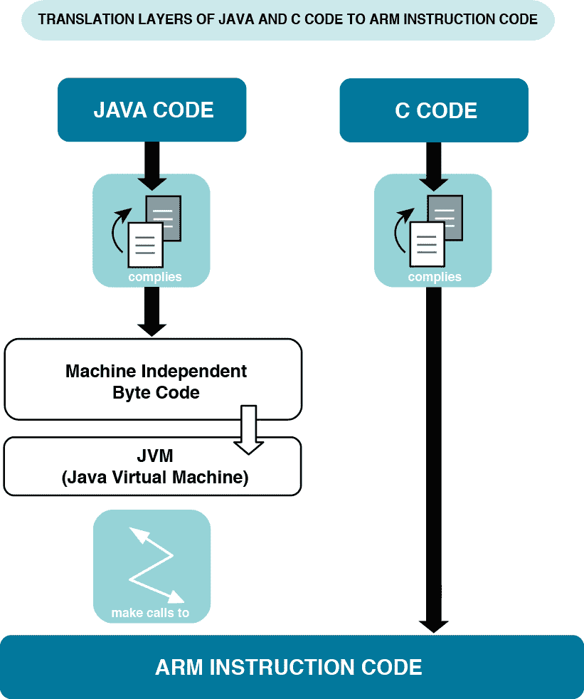

**图 2.3** 将 `C` 和 `Java` 程序翻译为 ARM 汇编涉及的一些层

许多用于控制廉价机器人的微控制器是基于 ARM 的微控制器。如果你感兴趣使用汇编语言编写廉价机器人，`ARM` 控制器是一个很好的起点。

* * *

 注意

重要术语：汇编语言是机器语言的一种更具读性的形式，使用短符号表示指令，并使用十六进制或八进制符号表示二进制。

* * *

注意图 2.3 中从 `C` 或 `Java` 到 ARM 汇编所需的软件层。但对于“机器人拿住这罐油”与 `C` 或 `Java` 代码之间翻译所需的工作是什么呢？BURT 翻译器告诉我们，我们是从一条英语指令开始，并以某种方式将其翻译成 `C` 和 `Java`。

这是如何实现的？为什么要这样做？注意 BURT 翻译中的指令没有提到*罐*或*油*，或“拿住这个”的概念。这些概念并不是微控制器语言的直接部分，也不是高级 `C` 或 `Java` 语言中的内置命令。

它们代表了我们想要使用并希望机器人理解的机器人词汇的一部分（但目前尚不存在）。

* * *

 注意

机器人词汇是你为特定情况或场景分配机器人任务的语言。编写实用的自主机器人的主要功能是创建机器人词汇。

* * *

然而，在我们决定机器人词汇长什么样之前，我们需要熟悉机器人的配置及其能力。考虑这些问题：

 它是什么样的机器人？

 机器人拥有什么种类和多少传感器？

 机器人拥有什么种类和多少个末端执行器？

 它是如何移动的等等？

机器人词汇必须与机器人的能力相钩。例如，如果机器人没有设计抬设计的硬件，我们就无法给机器人抬起某物的指令。如果机器人不可移动，我们就无法给机器人移动到某个位置的指令。

* * *

 注意

重要术语：传感器是机器人的眼睛和耳朵。它们是接收环境输入、信号、数据或信息的组件。传感器是机器人世界的接口。

末端执行器允许机器人处理、操作、改变或控制环境对象的硬件。末端执行器是对环境产生影响的硬件。

* * *

我们可以通过两种方式处理机器人及其词汇：

 创建词汇，然后获取具有能力的机器人。

 根据将使用的机器人能力创建词汇。

在任何一种情况下，必须识别机器人的能力。机器人能力矩阵](#app01.html_gloss_19)可用于此目的。

表 2.1 显示了名为 Unit2 的机器人的示例能力矩阵，我们在书中某些示例中使用的 RS Media 机器人。

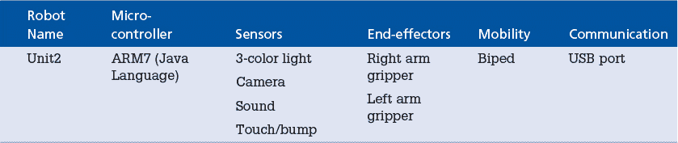

**表 2.1** RS Media 机器人的能力矩阵

能力矩阵为机器人的潜在技能提供了一个易于使用的参考。初始机器人词汇必须依赖机器人的基础能力集。

你可以根据将使用的特定机器人能力和场景设计自己的机器人词汇。注意表 2.1 中，机器人 Unit2 拥有摄像头传感器和颜色传感器。这允许 Unit2 看到物体。这意味着我们的机器人词汇可以使用*观察*、*看*、*拍照*或*扫描*等词。

并没有一种绝对正确的机器人词汇。确实，机器人会使用一些常用动作，但在任何特定情况下为机器人选择的词汇完全取决于设计者或程序员。

***

作为机器人双足机器人意味着 `Unit2` 是可移动的。因此，词汇可以包括 `move`、`travel`、`walk` 或 `proceed` 等词。`Unit2` 拥有 `USB` 端口这一事实表明我们的机器人词汇可以使用 `open`、`connect`、`disconnect`、`send` 和 `receive` 等词。初始机器人词汇构成了你给机器人指令的基础，这些指令使其执行所需的任务。

如果我们再次查看表 2.1 中的能力矩阵，一种允许我们向 `Unit2` 下达指令的可能词汇可能包括：

 向进

 扫描蓝色油罐

 举起蓝色油罐

 拍摄油罐

书中向你介绍的最重要概念之一是如何构建机器人词汇、如何利用机器人拥有的能力实现词汇，以及如何确定机器人微控制器可以处理的词汇。在前面的示例中，`Unit2` 的 `ARM9` 微控制器将无法识别以下命令：

 向进或扫描蓝色油罐

但这正是我们想要在机器人上使用的词汇。在这种情况下，我们希望机器人执行的任务包括向前移动、寻找蓝色油罐、将它举起，然后进行拍摄。我们希望能够尽可能简单地通信这组任务。

我们有一些希望自主机器人在某些情境或场景中扮演的角色。我们开发了一个指令列表，用来捕捉或描述我们希望机器人扮演的角色，并希望该指令列表能够代表机器人的任务。创建机器人词汇是成功为自主机器人编程整体过程的一部分，使其能够在需要词汇的特定情境或场景中执行有用角色。

### 识别动作

构建机器人词汇的步骤之一是创建能力矩阵，然后根据矩阵识别机器人可以执行的动作类型。例如，对于表 2.1 中的 `Unit2`，动作可能列为：

 扫描

 举起

 捡起

 移动

 停止

 连接

 断开

 放下

 掉落

向前移动

 向后移动

最终，我们必须指示机器人我们对 `scan`、`travel`、`connect` 等词的含义。我们描述 `Unit2` 能够扫描蓝色油罐。“蓝色油罐”如何融入到我们的基础词汇中呢？

尽管表 2.1 规定我们的机器人拥有颜色传感器，但能力矩阵中并没有关于油罐的内容。这引出了我们在贯书中不断阐述的另一个重要点：

 机器人词汇的一半基于机器人的配置或能力。

 机器人词汇的另一半基于机器人预期运行的场景或情境。

这些是编写实用自主机器人的基本概念。本书的其余部分将详细阐述这两个重要思想。

### 自主机器人的 ROLL 模型

设计并实现你如何描述机器人以使用其基本能力，以及设计并实现如何向机器人描述其在给定情境或场景中的角色，这就是自主机器人编程的核心。要为机器人编程，你需要能够描述：

 做什么

 何时做

 在哪里做

 如何做

同样重要的是向机器人描述“它”指的是什么，或者“哪里”或“何时”指代什么。正如我们所看到的，这需要多个级别的机器人词汇。

***

 注意

在书中，我们使用本体论一词来指对机器人场景或机器人状况的描述。

***

对于我们的目的，自主机器人有七级机器人词汇，我们称之为机器人的 ROLL（机器人本体语言级别，Robot Ontology Language Level）模型。图 2.4 显示了机器人 ROLL 模型的七级。

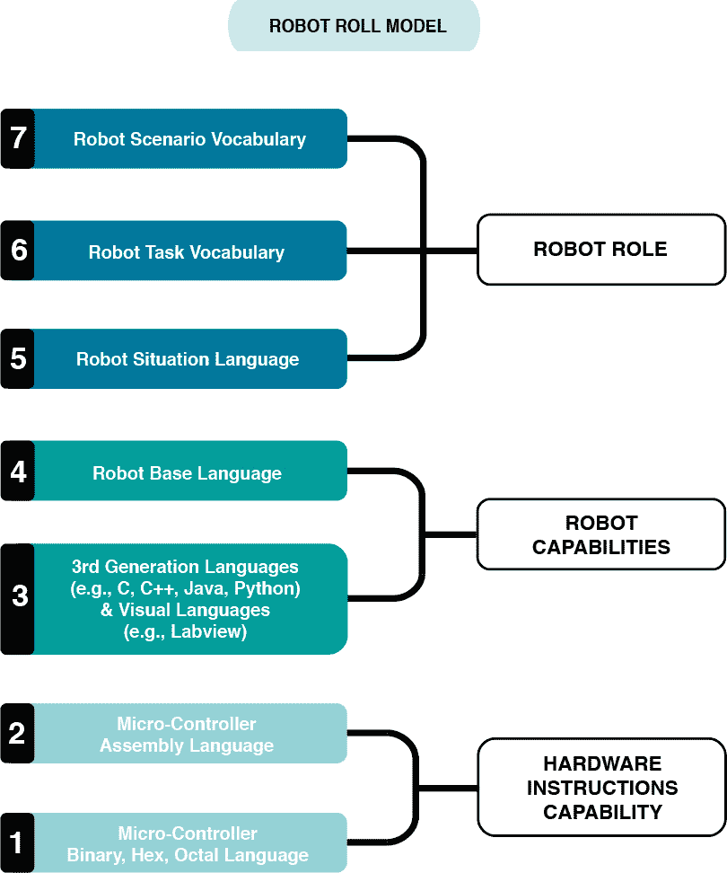

**图 2.4** 自主机器人 ROLL 模型的七级

目前，我们关注可以在七级中任何一级发生的机器人编程。这七级大致分为两组：

 机器人能力

 机器人角色

***

 提示

随身携带 ROLL 模型，因为我们经常引用。

***

#### 机器人能力

第 1 到 4 级的机器人词汇基本上针对机器人的能力——即机器人可以采取的动作以及这些动作如何为机器人实现。图 2.5 显示了语言级别之间的关系。

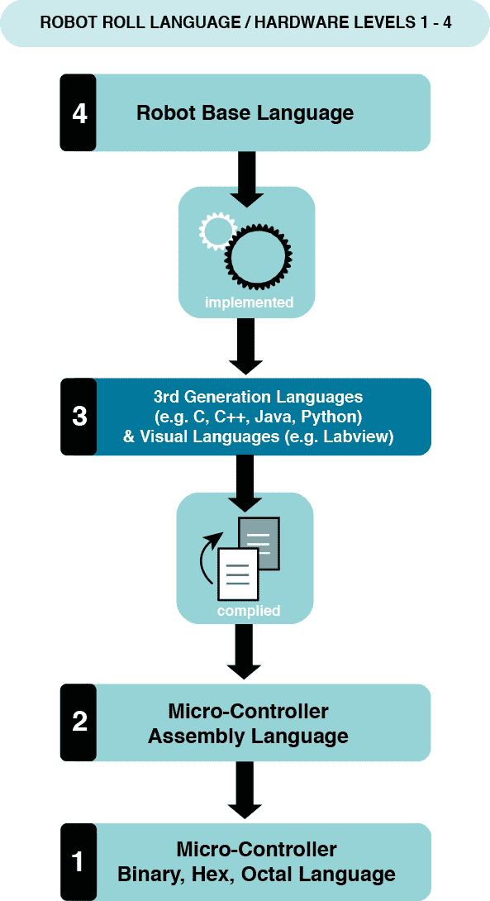

**图 2.5** 语言级别之间的关系

第 4 级词汇由第 3 层指令实现。我们稍后会详细说明。我们使用第 3 层指令来定义第 4 级的含义。正如你记得的，第 3 层指令（第三语言）由解释器或编译器翻译为第 2 层或第 1 级微控制器指令。

#### 场景和情境中的机器人角色

ROLL 模型](#app01.html_gloss_54)中的第 5 到 7 级如图 2.4 所示，处理用于向机器人提供特定场景和情境指令的机器人词汇。自主机器人执行特定场景的任务。

让我们以第一章中的生日机器人 `BR-1` 为例，即“到底什么是机器人？”，图 1.9。我们有一个派对场景，机器人的任务是点蜡烛并在派对结束后清理盘子和杯子。

状况是场景中事件的快照。例如，对于生日机器人 `BR-1` 来说，一个状况是桌上有一个没点蜡烛的蛋糕另一个状况是机器人走向蛋糕。另一个状况是将点放在蜡烛上方，以此类推。任何场景都可以分为一组状况。当你将所有状况放在一起时，你就得到了场景。如果机器人正确执行了其在给定场景中的所有任务，则被认为是成功的。

##### 第 5 级状况词汇

第 5 级具有描述场景中特定状况的词汇。看看第一章](#ch01.html_ch01)中 Midamba 陷入困境机器人场景 1 的一些状况。实验室中有机器人；实验室也有化学品。有些化学品是液体，有些是气体。有些机器人是移动的，有些则不是。实验室具有特定的尺寸、架子和容器。机器人位于设施的指定位置。图 2.6 显示了使用第 5 级词汇为 Midamba 的困境定义的一些内容。

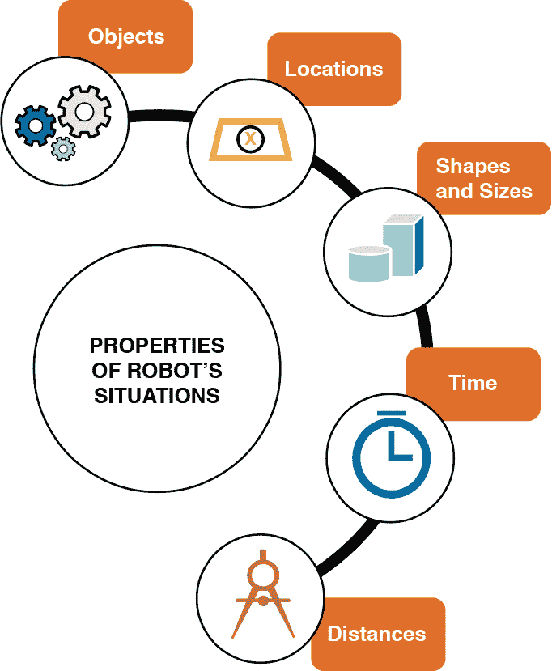

## 图 2.6 由 5 级词汇描述的情况的属性

Midamba 在场景 #1 中面临的情况之一需要机器人能够处理并涵盖以下内容的词汇：

 它们在研究设施中的面积

 机器人当前位置

 区域内容器的位置

 区域内容器的大小

 架子的高度

 化学品类型等

***

 注意

注意，描述这些属性的机器人词汇与描述机器人基本能力所需的词汇有所不同。在机器人采取每个动作之前，我们可以描述当前的情况。在机器人采取每个动作之后，我们也可以描述当前的情况。机器人采取的动作总是会以一种或多种方式改变状况。

***

### 6 级任务词汇

6 级词汇与 4 级词汇相似，因为它们都描述了机器人的动作和能力。区别在于，6 级词汇描述的是特定场景的动作和能力。

例如，如果 Midamba 可以使用我们在 表 2.1 能力矩阵中列出的硬件的 `Unit2` 机器人，适当的任务词汇将支持如下指令：

 动作 1。扫描架子寻找一罐蓝色机油。

 动作 2。测量油的等级。

 动作 3。如果油是 A 等且包含至少 2 夸，则取回油罐。

***

 注意

注意所有动作都涉及特定特定的词汇。因此，6 级任务词汇可以描述为特定场景的 4 级词汇。

***

### 7 级场景词汇

我们的初级机器人程序员 Midamba 有这样一个场景：研究区域内的一个或多个机器人必须识别某种化学品，以帮助他为主电池充电或中和备用电池上的酸。一旦识别出化学品，机器人必须将其交付给他他。场景 中的任务序列构成了场景。`Unit2` 的场景词汇将支持如下场景描述：

`Unit2，从你当前的位置扫描架子`

`直到你找到一种可以给我的`

`主电池充电或清除备用`

`电池酸性的化学品，然后取回该化学品`并交给我。`

理想情况下，7 级机器人词汇将允许你以简单的方法编写机器人完成这系列任务。实用的自主机器人必须具备某种 7 级词汇才能发挥作用并有效。机器人词汇 5 到 7 级之间的关系如图 图 2.7 所示。

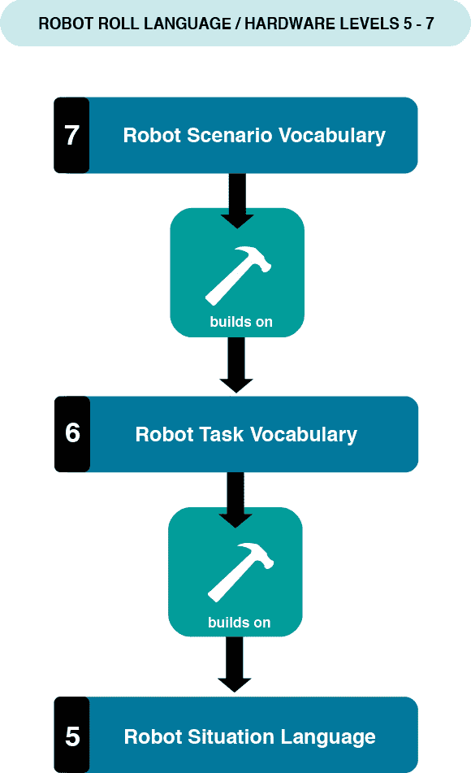

**图 2.7** 5 到 7 级之间的关系

5 到 7 级的词汇允许程序员描述机器人在给定情况和场景中的角色，以及机器人应如何完成该角色。

#### 前景如何？

本书的第一部分侧重于机器人能力的编程，例如传感器、移动和终端执行器的编程。本书的第二部分侧重于编写机器人以执行特定情况或场景下的角色。请记住，你可以在这些任何级别对机器人进行编程。

在某些情况下，某些编程工作可能已经为你完成。但要真正编写一个自主机器人在某些场景中成功，需要适当的 ROLL 模型和实现。在我们更详细描述 Midamba 的机器人及其场景之前，我们将在 第 3 章 “RSVP：机器人场景视觉规划”中介绍如何对你的机器人进行 RSVP。

## 3. RSVP：机器人场景视觉规划

**机器人敏感性训练第 3 课：** 不要指示机器人执行你无法想象它能执行的任务。

如 第 2 章 “机器人词汇”中所述，机器人词汇是你用于为特定情况或场景分配机器人任务的语言。一旦建立了词汇，弄出机器人使用该词汇执行的指令就是下一步。

为场景以及你想让机器人执行的指令制作图片或“视觉表征”，是确保你的机器人正确执行任务的极佳方法。机器人将执行的指令图允许你在将其翻译成代码之前思考这些步骤。视觉图可以帮助你理解过程，通过研究这些视觉图，可以看到必须做什么，并阐明可能引发问题的地方，从而改进开发。我们称之为 RSVP（机器人场景视觉规划）。RSVP 是一种有助于制定机器人执行动作指令计划的视觉图。RSVP 由三种类型的视觉图组成：

 场景物理环境的平面图

 机器人和对象的状态图

 任务指令的流程图

这些视觉图确保你对“必须做什么来编写机器人以完成壮举”有一个“清晰的画面”。一张机器人将执行的指令图可以让你思考世界或蛋糕上的蜡烛。RSVP 可以用于任何组合。对于某些情况，流程图比状态图更有用。对于其他情况，状态图是最好的。我们建议，无论使用状态图还是流程图，都需要一个平面图或布局。

“图胜千言”意味着一张图片可以传达复杂思想的含义。我们在小学时就养成了这种观念，特别是在解决应用题时；“画出”题目的核心意图，它就神奇地变得清晰了。这种观念仍然有效。在这种情况下，画出环境、状态图和流程图不仅值千言，还值一千条命令。开发 RSVP 允许你规划机器人在场景中的导航，并制定任务指令的步骤。这避免了直接编写代码的尝试。

### 场景映射

RSVP 的第一部分是场景的地图。地图是任务发生环境的符号表征。场景的环境是机器人运行的世界。图 3.1 显示了 NXT 机器人机器人的经典测试板。

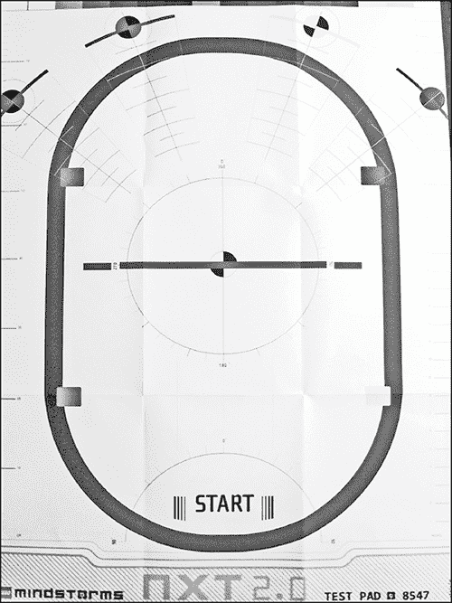

**图 3.1** 用于 NXT 机器人的世界

像图 3.1 所示的测试板是机械组机器人套件的一部分。该测试板大约 24 英寸宽，30 英寸长，呈矩形。测试板上有 16 种颜色和 38 个不同的数字（其中部分重复）。测试板上有一系列直线和弧线。测试板上有黄色、蓝色、红色和绿色方块，以及测试板上其他区域的其他形状。它是用于测试 NXT Mindstorms 机器人颜色传感器、电机等的世界或环境。

就像测试板一样，平面图显示了要识别对象的位置，例如彩色方块、与机器人交互的物体或需要避免的障碍物。如果物体太高或太远，传感器可能无法确定它们的位置。到达这些位置的路径也可以通过此地图进行规划。

空间的维度和机器人的大小（机器人占用地）可能会影响机器人在空间内导航和执行任务的能力。例如，对于我们的 `BR-1` 机器人，蛋糕相对于机器人的位置在哪里？是否有路径？是否有障碍物？机器人能够在空间内移动吗？这些都是地图可以帮助决定的因素。

 提示

除了机器人本身之外，机器人的环境是最重要的考虑因素。

### 创建平面图


地图可以是环境的简单 2D 布局或平面图，使用几何形状、图标或颜色来表示物体或机器人。对于这类简单地图，描绘准确的比例尺并不十分重要，但物体和空间应该具有某种相对比例。

使用直线来勾勒区域。决定测量系统。务必确保测量系统与`API`函数一致。使用箭头和测量值来标记区域、物体和机器人占用地的尺寸。最好使用矢量图形编辑器来创建地图。对于我们的地图，我们使用 Libre Office Draw。图 3.2 显示了`BR-1`机器人环境平面图的简单布局。

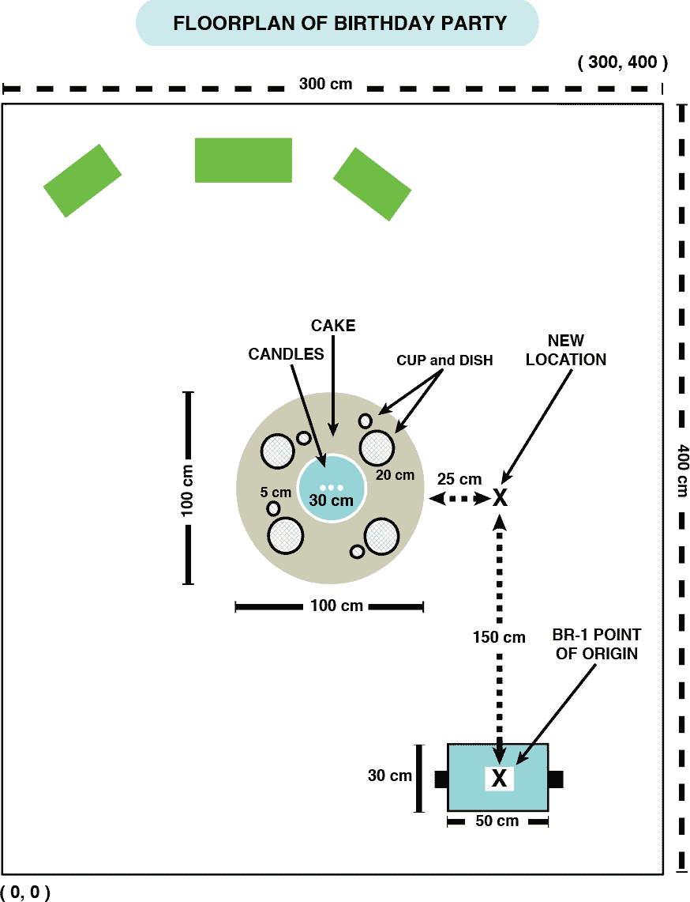

**图 3.2** `BR-1`机器人环境平面图布局

在图 3.2 中，指定了感兴趣的对象：机器人的位置、桌子以及桌上的蛋糕。平面图标记了区域的尺寸和机器人的占用地。左下角标记为`(0,0)`，右上角标记为`(300,400)`。这显示了以厘米为单位的区域尺寸。它标记了物体与`BR-1`之间的距离。虽然此图不是等比例的，但长度和宽度存在相对关系。`BR-1`的占用地长度为 50 cm，宽度为 30 cm。

`BR-1`的任务是点蛋糕上的蜡烛。蛋糕位于 400 cm × 300 cm 区域的中心。蛋糕直径为 30 cm，位于一张 100 cm × 100 cm 的桌子上。这意味着`BR-1`的机械臂从桌边起至少需要 53 cm 的触及范围才能到达`X`维度上最远处的蜡烛。

机械臂到端执行器末端的最大延伸为 80 cm，打火机的长度又增加了 10 cm。任务还取决于一些额外的考虑因素：

 蜡烛的高度

 蛋糕的高度

 `BR-1`从手臂点到蜡烛芯顶部的长度

 机器人的位置

图 3.3 显示了如何计算点燃蜡烛所需的触及范围。在这种情况下，它是直角三角形的斜边。三角形的直角“a”是机器人从蜡烛芯顶部到机械臂关节的高度，为 76 cm；直角“b”是桌子半径加上到蛋糕上最远蜡烛位置的 3 cm，即 53 cm。

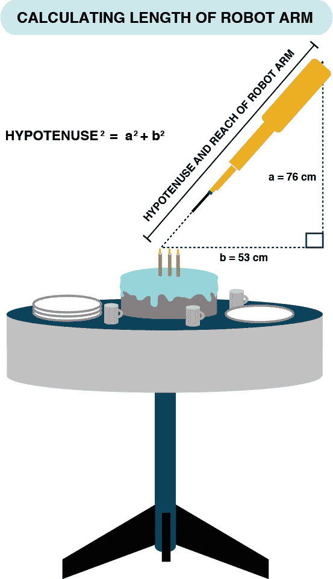

**图 3.3** 将机械臂视为直角三角形斜边的长度过程

因此，机械臂、端执行器和打火机所需的触及范围约为 93 cm。但机器人的触及范围只有 90 cm。因此`BR-1`必须向蛋糕稍微倾斜，或者换一个长 3 cm 的打火机来点燃蜡芯。

 注意

确定机械臂的位置和所需的扩展比这个简单的例子要复杂得多，将在第 9 章“机器人空间](#ch09.html_ch09)”中进行讨论。但这个例子中的重要的是布局/平面图如何帮助解释一些重要问题，以便你规划机器人的任务。

## 机器人的世界

为了实现自动化，机器人需要关于环境的细节。考虑一下：如果你去一个你无所不知的新城市，你能多好地完成你想做的事情？你不知道任何东西在哪里。你需要一张地图，或者有人带你四处并告诉你“这里有一家餐厅”，“这里有一个博物馆”。完全自动化的机器人必须拥有关于环境的充分信息。机器人的信息越多，它就越可能完成目标。

 注意

机器人的世界是机器人执行任务的环境。这是机器人感知到的唯一世界。该环境之外的一切都不重要，机器人也感知不到它。

并不是所有环境都是相同的。我们知道环境是动态的。机器人的环境对机器人可以是部分或完全访问。完全访问的环境意味着环境的所有物体和方面都在机器人传感器的范围内。没有物体是太高、太低或太远的。部分访问的环境意味着环境的某些方面是机器人无法检测或交互的，因为它缺乏拾起它的端执行器或检测它的传感器。一个距离地面 180 cm 的物体对于手臂 80 cm、高度 50 cm 的机器人来说是无法触及的。如果`BR-1`和目标之间没有障碍物，但某个派对者放置了障碍物怎么办？`BR-1`如何执行任务？

因此在创建部分访问环境的平面图时，要考虑“机器人视角”。例如，对于机器人无法访问的物体，使用视觉指示来区分机器人可以访问的物体。

### 确定性与非确定性环境

控制权如何？机器人控制环境的每一个方面吗？机器人是控制或操作环境中物体的唯一力量吗？这就是确定性环境与非确定性环境的区别。

在确定性环境中，下一个状态完全由当前状态和执行人的操作决定。这意味着如果`BR-1`机器人点了蜡烛，它们将一直亮着直到`BR-1`吹灭它们。如果`BR-1`从桌子上移除盘子，它们将留在放置的地方。

在非确定性环境中，例如生日派对场景，`BR-1`不会吹灭蜡烛（如果它做了就很坏）。盘子可以由派对参与者移动，而不只是`BR-1`。如果`BR-1`和目标之间没有障碍物，但某个派对者放置了障碍物怎么办？`BR-1`如何执行任务？

每种环境类型都有其特定的挑战。在动态非确定性环境中，机器人在尝试任务之前考虑以前的状态和当前状态，然后决定是否可以执行任务。

表 3.1 列出了一些环境类型及其简要描述。

环境的许多方面并不属于布局或平面图的一部分，但应该以某种方式记录下来，以便在开发任务指令时引用。例如，物体的颜色、重量、高度甚至表面类型都是传感器可以识别的特征，这些特征会影响电动机和末端执行器，还会影响环境类型、识别出的外力及其对物体的影响。

 注意

### READ（机器人环境属性描述）集

`READ`集是一种结构，包含了一列机器人在机器人环境中遇到、控制和与之交互的物体列表。它还包含了机器人传感器可以检测到的、或影响机器人与该物体交互方式物体特征和属性。

这些特征中的一些可以体现在平面图中。但一个`READ`集可以包含所有特征。每种类型的环境都应该有自己的`READ`集。

例如，颜色是颜色传感器或光敏传感器识别的可检测特征。物体的重量根据伺服机的扭矩决定了机器人是否可以拿起、握住或将物体移动到另一个位置。形状、高度甚至表面决定了末端执行器是否可以操作该物体。

环境的任何特征都是`READ`集的一部分，例如尺寸、照明和地形。这些特征会影响传感器和电动机的工作情况。环境的光（无论是阳光、室内光还是烛光）以不同的方式影响颜色和光传感器。机器人在木地板上行走与在碎石、泥土或地毯上行走不同。表面会影响轮子旋转和距离计算。

表 3.2 是 Mindstorms NXT 测试垫的 READ 集。

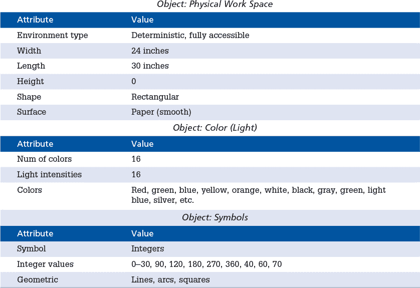

**表 3.2** Mindstorms NXT 测试垫 READ 集

测试垫的`READ`集描述了工作空间，包括其类型（完全可访问且确定）、所有的颜色和符号。它描述了机器人在执行搜索时会遇到什么，例如识别蓝色方块。这些集列出了测试垫物理工作空间、颜色和符号的属性和值。

对于像我们的生日派场景这样的动态环境，`READ`集可以包含有关可能与物体交互的外力信息。例如桌上的盘子和杯有初始位置，但派对者可能会将盘子和杯移动到桌上的新位置。新位置应该在`READ`集中表示，并附带发生的时间或条件。一旦派对结束，`BR-1`需要移除那些盘子和杯，每个位置都应该被更新。表 3.3 是`BR-1`生日派对的 READ 集。

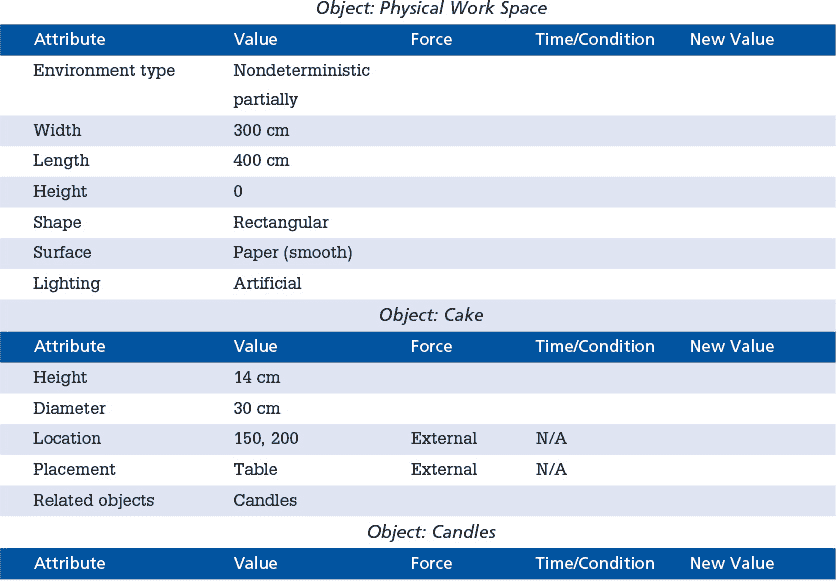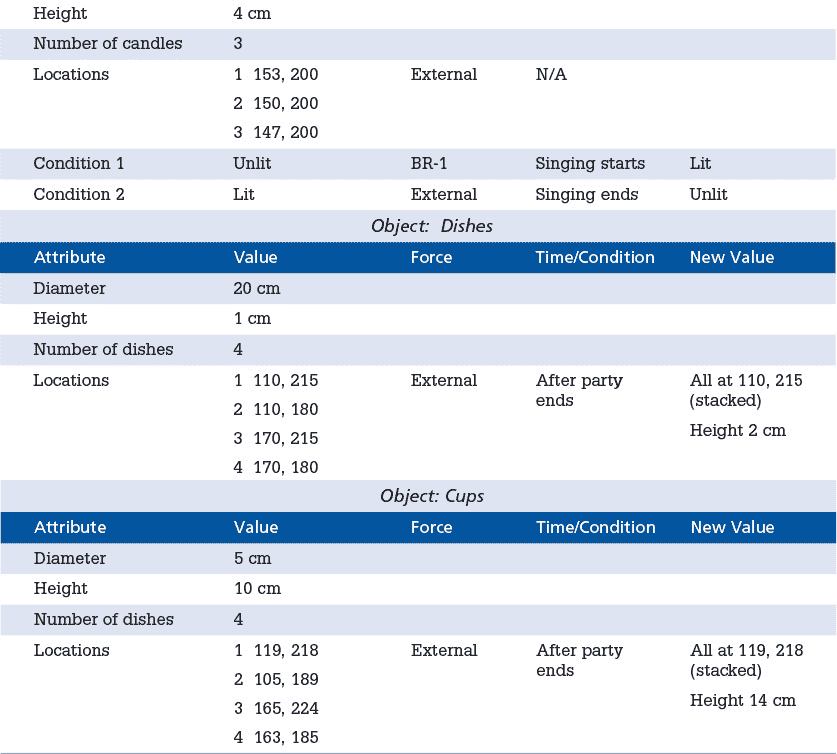

**表 3.3** 生日派对场景 READ 集

此`READ`集有三个额外的列：

 力

 时间/条件

 新值

`力`是与物体迭代的来源；这种力是环境中任何非机器人的作用力。`时间/条件`表示力何时或在何种条件下与物体交互。`新值`是不言自明的。

### 伪代码和流程图 RSVP

流程图是一种 RSVP，用于确定物体到整个系统的控制流。它是指令行的线性序列，可以包含任何类型的循环、选择或决策。流程图使用表示特定类型工作的特殊方框符号来解释该过程。方框内显示的文本描述了任务、过程或指令。

流程图是状态图的一种（在本章稍后的部分进行讨论），因为它们也包含了转换为动作和活动的状态。决策和重复等内容很容易表示，分支产生的结果也可以简单地描绘。一些人建议在编写伪代码之前绘制流程图。伪代码的优点是容易转换为编程语言或用于程序文档编写。它也可以方便地更改。当使用流程图软件时，更改流程图需要多一些工作。

表 3.4 列出了伪代码和流程图的优缺点。两者都是制定步骤的极佳工具。在项目的特定时期使用哪种工具，取决于个人喜好。

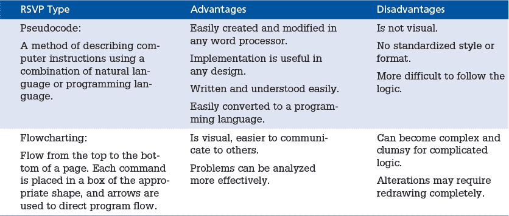

**表 3.4** 伪代码和流程图的优缺点

流程图图中使用的四种常用符号是：

 **开始和结束：** 开始符号代表流程图的开始，符号内部出现“开始”标签。结束符号代表流程图的结束，符号内部出现“结束”标签。这些是仅带有关键字标签的符号。

 **输入和输出：** 输入输出符号包含用于输入的数据（例如由用户提供）以及作为处理结果的数据（输出）。

 **决策：** 决策符号包含一个必须做的问题或决策。

 **过程：** 过程符号包含对规则或动作的简要描述（几个词）。

图 3.4 显示了流程图的常用符号。

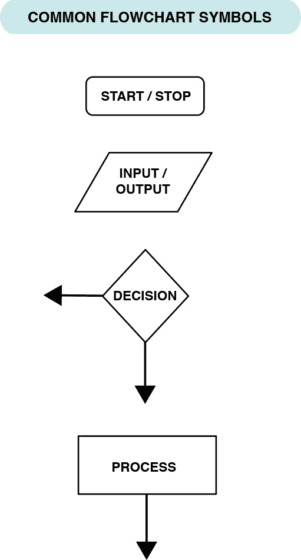

**图 3.4** 流程图的常用符号

每个符号都有入箭头或出箭头。开始符号只有一个出箭头，结束符号只有一个入箭头。“开始”符号代表流程图的开始，符号内部出现“开始”标签。“结束”符号代表流程图的结束，符号内部出现“结束”标签。这些是仅带有关键字标签的符号。决策符号将包含一个必须做的问题或决策。过程符号将包含对规则或动作的简要描述（几个词）。决策符号有一个入箭头和两个出箭头。每个箭头代表通过该符号的决策路径：

 真/是

 假/否

过程、输入和输出符号有一个入箭头和一个出箭头。符号包含描述规则或动作、输入或输出的文本。图 3.5 显示了“点蜡烛”的流程图。

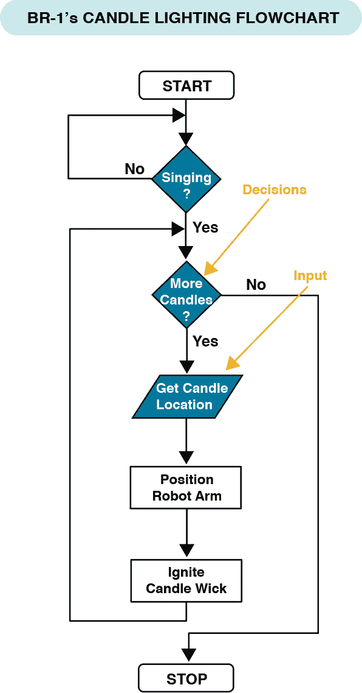

**图 3.5** 点蜡烛流程图

## 控制流与控制结构

机器人执行的任务可以是一个接一个执行的系列步骤，即顺序控制流。`flow of control`（控制流）一词详细描述了过程所处的方向，即程序控制“流”的方向。控制流决定了计算机在给定特定条件和参数时如何做出响应。顺序控制流的一个示例见图 3.6。在我们生日派对场景中的另一个机器人是`BR-3`。它的任务是为客人开门。图 3.6 展示了该任务的顺序控制流。

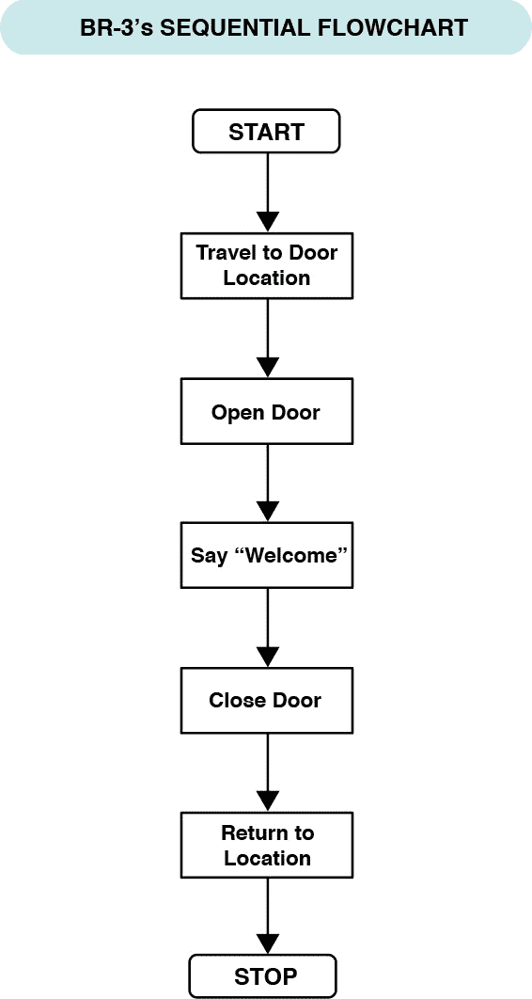

**图 3.6** `BR-3`的流程图

机器人走到门口，开门，说“欢迎临”，然后关上门并回到原始位置。这看起来像是一个相当不体周全的主人。门铃响了吗？信号通知`BR-3`客人已在门口？如果有人在门口，在说“欢迎”之后，`BR-3`是否允许客人进入后再关门？`BR-3`在生日派对上应该能够以可预测的方式行动。这意味着根据事件做出决策并重复执行某些操作。

决策符号用于构建替代控制流的分支。决策符号可以表示决策、重复和 case 语句。简单的决策结构化为`if-then`或`if-then-else`语句。

`BR-3`的一个简单`if-then`决策如图图 3.7 (a) 所示。“如果门铃响了，则前往门口并把门打开。”现在`BR-3`将等待客人（们）进入后才说“欢迎”。注意如果客人未进入时要采取的替代行动。`BR-3`将等待 5 秒，然后检查客人是否已经进入。如果是，则`BR-3`说“欢迎”并关上门。这在图 3.7 (b) `if-then-else`中所示；替代行动是等待。

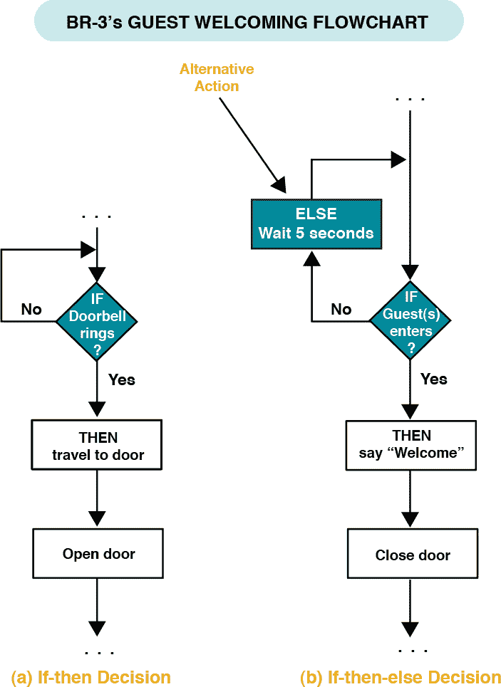

**图 3.7** `if-then`和`if-then-else`决策的流程图

在图 3.7 中，要回答的问题（或条件测试）是门铃是否响了。如果在`BR-3`开门之前需要满足多个一个问题/条件测试怎么办？对于`BR-1`，如果在点燃蜡烛之前有多个必须满足的条件呢：

 “如果有唱歌声且打火机已点燃，则点蜡烛。”

 在这种情况下，两个条件都必须满足。这被称为`Nested`（嵌套）决策或条件。

如果一个问题或条件有许多不同的可能答案，且每个答案或条件都有不同的行动要采取怎么办？例如，当我们的`BR-1`或`BR-3`穿过房间时遇到一个物体，必须绕过该物体以到达目的地。它可以检查路径上物体的范围，以确定采取什么行动来回避。如果物体在特定范围内，`BR-1`和`BR-3`向左转动 90 度或 45 度，绕过物体走一条路径，然后继续沿原定路径到达目的地，如图图 3.8 所示。

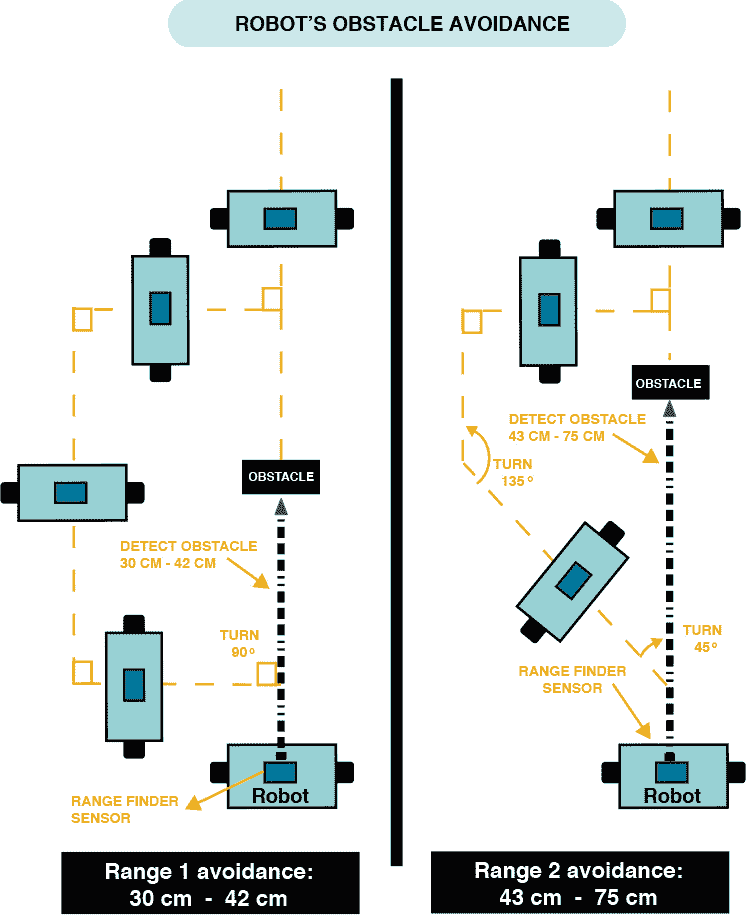

**图 3.8** 机器人避障

使用流程图，这可以表示为一系列决策或一个`case`语句。`case`是决策的一种类型，对一个问题有多个可能的答案。通过一系列决策，同一个问题被问了三次，每次都有不同的答案和行动。而使用`case`语句，问题只表达一次。图 3.9 对比了`case`语句与一系列决策，后者更容易阅读和理解正在发生什么。

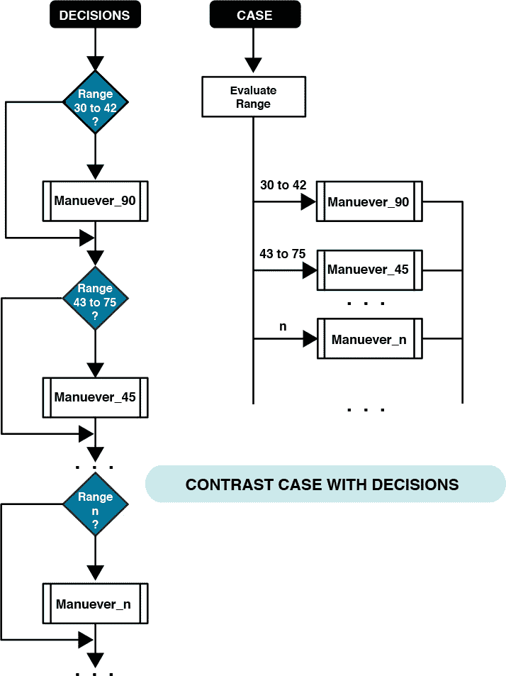

**图 3.9** 一系列决策与`case`语句的对比

重复或循环在图 3.10 中所示。在循环中，简单的决策与在条件测试之前或之后执行的行动结合在一起。根据结果，行动会再次执行。在图 3.10 (a)中，行动将至少执行一次。如果条件不满足（唱歌开始——也许大家玩得太开心），机器人必须继续等待。这是一个`do-until`循环的示例，“执行”此行动，“直到”此条件为真。`while`循环首先执行条件测试，如果满足，则执行行动。这在图 3.10 (b)中描述：当唱歌未开始时，等待。`BR-1`将循环并等待直到唱歌开始，如`do-until`循环所示。区别是在条件满足后执行等待。另一种类型是图 3.10 (c)所示的`for`循环，条件控制循环执行的次数。

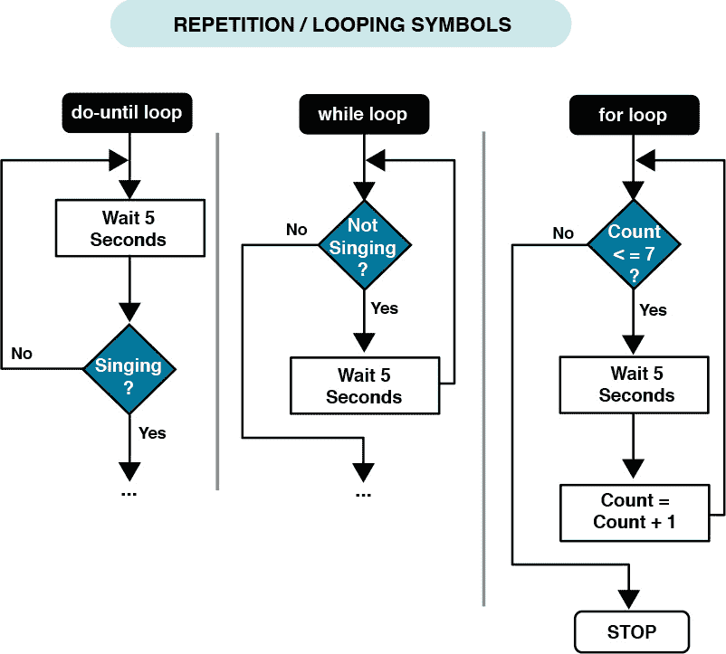

**图 3.10** (a) `do-until`、(b) `while`和 (c) `for`的重复流程图

## 子程序

当思考机器人在场景或情况下要扮演的角色时，该角色被分解为一系列行动。`BR-1`的角色是担任生日派对的主人。这个角色被分解为以下状态：

 空闲

 行进

 点蜡烛

 等待

 取餐

这可以被分解为一系列行动：

**1. 等待唱歌开始。**

 前往桌子。

 点蛋糕上的蜡烛。

 回到原始位置。

**2. 等待派对结束。**

 从桌子取餐。

 回到原始位置。

这些是对任务的简单描述。每个任务都可以进一步分解为一系列步骤或子程序。`Lighting candles`是一个复合状态，分解为子状态：

 寻找蜡芯

 点燃蜡芯

实际上，`Remove dishes from cake table`和`Travel back to original location`也应该分解为子程序。从桌子上取餐需要机器人手臂定位以移除每个盘子和杯子的子程序，而移动需要电机旋转子程序。

图 3.11 展示了`LightingCandles`及其子程序`LocatingWick`和`IgnitingWick`的流程图。

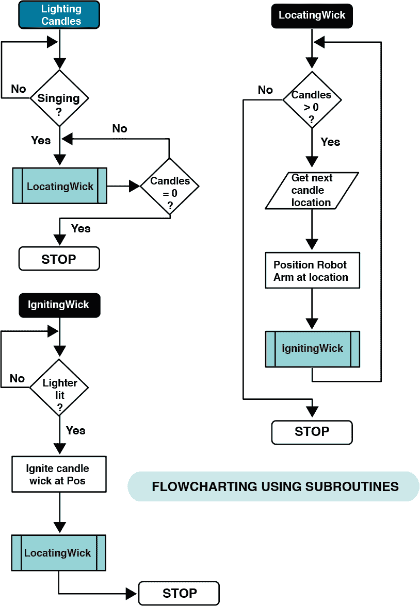

**图 3.11** `LightingCandles`及其子程序`LocatingWick`和`IgnitingWick`的流程图

子程序可以根据机器人过程中不同位置使用的相似步骤进行识别和泛化。与其重复执行一系列步骤或开发不同的子程序，不如将该过程泛化并放在一个子程序中，需要时进行调用。例如，移动程序最初是`BR-1`移动到蛋糕桌（`TableTravel`）的一系列步骤，然后是返回原始位置（`OriginTravel`）的一系列步骤。这些是起始和结束位置不同的任务。与其使用起始和结束位置的子程序，`Travel`子程序需要同时使用机器人的当前和最终位置。

## 机器人和对象的状态图

状态图是可视化状态机的一种方法。

 注意

状态机模型了环境中单个机器人或对象的行为。状态是机器人或对象在发生变化时所经历的转换。

例如，“状态改变”可以简单地是位置的变化。当机器人从初始位置移动到桌子旁的位置时，这就是机器人状态的变化。另一个例子是生日蜡烛从未点燃状态变为点燃状态。状态机捕获事件、转换和响应。状态图是这些活动的图表。状态图用于捕捉该对象在特定场景中可能出现的情况。正如你在第 2 章中所记忆的那样，情况是场景中事件的快照。`BR-1`可能的情况有

 **情况 1：** BR-1 等待信号移动到新位置

 **情况 2：** BR-1 正在向蛋糕桌移动

 **情况 3：** BR-1 位于带有蜡烛的桌旁，蜡烛尚未点燃

 **情况 4：** BR-1 正将打火机放在蜡烛上方，等等

所有这些情况都代表了机器人状态的变化。机器人或对象状态的变化在发生某事（即事件）时发生。该事件可以是一个信号、操作的结果，或仅仅是时间的流。当事件发生时，取决于对象的当前状态，会发生某些活动。当前状态决定了什么是可能的。


事件充当触发器或刺激，导致产生状态改变的条件。这种从一个状态到另一个状态的改变被称为转换。对象正在从源状态`stateA`转换到目标状态`stateB`。图 3.12 显示了`BR-1`的简单状态机。

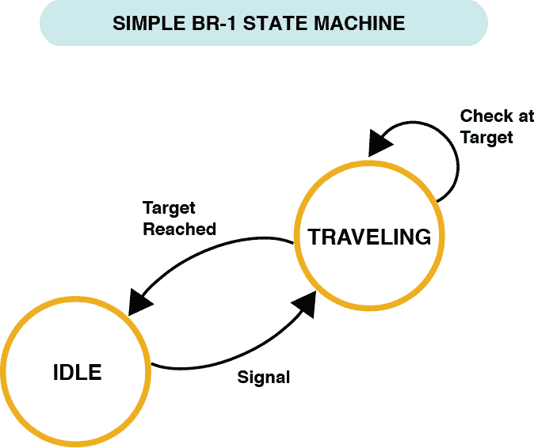

**图 3.12** BR-1 的状态机

图 3.12 显示了`BR-1`的两个状态：空闲（Idle）或移动（Traveling）。当`BR-1`处于`Idle`状态时，它在等待事件发生。该事件是一个包含机器人新位置的信号。一旦机器人接收到信号，它就会从`Idle`状态转换到`Traveling`状态。`BR-1`继续移动直到到达目标位置。一旦到达，机器人就会从`Traveling`状态转换回`Idle`状态。信号、动作和活动可能由对象或外力执行或控制。例如，新位置不会由`BR-1`生成，而是由另一个代理生成。`BR-1`确实具有在移动时检查其位置的能力。

## 开发状态图

正如之前所述，状态是对象的一种条件或情况，代表了对象在生命周期期间的转换。状态机显示了状态以及状态之间的转换。表示状态机的方法有很多种。在书中，我们将状态机表示为 UML（统一建模语言）状态图。状态图对于事件、动作、条件、转换部分以及状态的类型和部分具有额外的符号。

 注意

在状态图中，节点是状态，弧是转换。状态用圆形或圆角矩形表示，其中显示状态的名称。转换是连接源状态和目标状态的弧，并带有指向目标状态的箭头。

状态有三种：

 **初始（Initial）：** 状态机的默认起点。它是一个实心黑点，有一条指向机器第一个状态的转换。

 **结束（Final）：** 结束状态，意味着对象已到达其生命期的终点。它表示为圆圈内部的实点。

 **复合状态和子状态（Composite state and substate）：** 包含在另一个状态内部的状态。该状态被称为超状态或复合状态。

状态具有不同的部分。表 3.5 列出了状态的部分及其简要描述。显示其名称的状态节点也可以显示此表列出的部分。这些部分可以表示当对象转换到新状态时发生的处理。当对象进入和离开状态时，可能有需要执行的动作。当对象处于特定状态时，可能有必须执行的动作。所有这些都可以在状态图中。

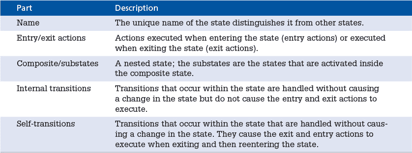

**表 3.5** 状态的部分

图 3.12 显示了动作、活动和内部转换的状态节点。


**图 13** 状态节点的格式

进入和退出动作语句的格式如下：

 进入动作/活动

 出口动作/活动

这是名为`Validating`的状态的进入和退出动作示例：

 进入动作：entry / validate(data)

 退出动作：exit / send(data)

进入`Validating`状态时，调用`validate(data)`函数。退出该状态时，调用退出动作`send(data)`。内部转换发生在状态内部。它们是在进入动作之后、退出动作之前发生的事件。自转换与内部转换不同。对于自转换，会执行进入和退出动作。离开状态；执行退出动作。然后重新进入状态并执行进入动作。自转换的动作发生在退出动作之后、进入动作之前。自转换表示为循环并指向相同状态的定向线。

内部或自转换语句格式如下：

 名称/动作或函数

例如：

 do / createChart(data)

“do”是活动的标签，执行函数`createChart(data)`。

转换有几个部分，即状态之间的关系。我们知道触发器会导致转换的发生，动作可以与触发器结合。满足的条件也可以导致转换。表 3.6 列出了转换的部分。

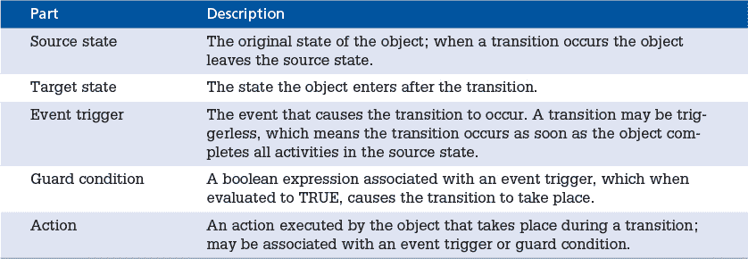

**表 3.6** 转换的部分

事件触发器的格式与状态动作语句相似：

 名称/动作或函数

 名称 [守护条件] / 动作或函数

 注意

守护条件是一个布尔值或表达式，其结果为真或假。它被包含在方括号中。必须满足守护条件才能执行函数。它可以用于状态或转换语句。

例如，对于内部转换语句，可以添加一个守护条件：

 执行 [Validated] / `createChart(data)`

图 3.14 是 BR-1 的状态图。

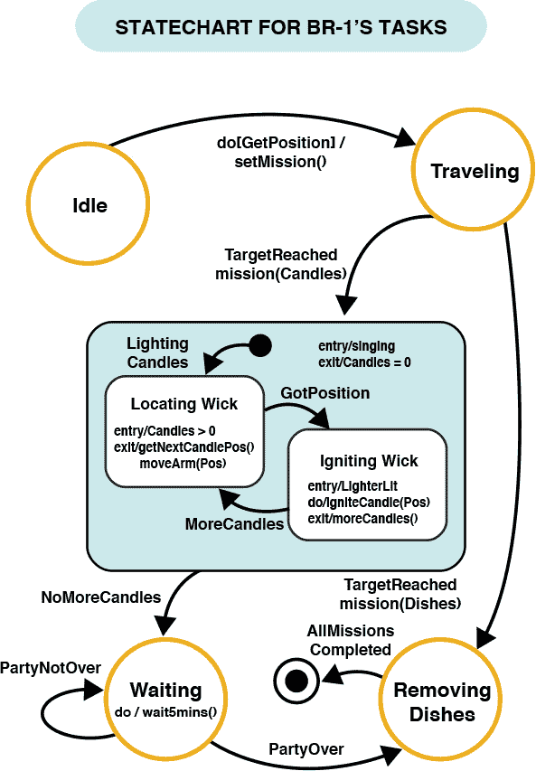

**图 3.14** BR-1 的状态图

有五个状态：`Idle`（空闲）、`Traveling`（移动）、`Lighting candles`（点蜡）、`Waiting`（等待）和`Removing dishes`（收碗）。当从`Idle`转换到`Traveling`时，BR-1 获取新位置并知道它的任务：

 执行 [GetPosition] / `setMission()`

* * *

 注意

`Validated`是一个布尔值。它是执行`createChart()`必须满足的条件。

* * *

从`Traveling`状态有两个转换：

 从移动转换到点蜡

 从移动转换到收碗

当`Traveling`到达目标且`Mission`为`candles`时，它转换到`LightingCandles`。当`Traveling`到达目标且`Mission`为`dishes`时，它转换到`Removing dishes`。要从`LightingCandles`转换，必须完成“蜡”任务。要从`RemovingDishes`转换到最终状态，必须完成所有任务。

`LightingCandles`是一个复合状态，包含两个子状态：`LocatingWick`（定位芯）和`IgnitingWick`（点燃）。当进入`Lighting candles`状态时，会评估布尔值`Singing`。如果有唱歌声，则点蜡烛。首先必须定位蜡芯，然后将机械臂移动到该位置，最后点燃蜡芯。在`LocatingWick`状态下，进入动作评估表达式：

```
 Candles > 0
```

如果为`True`，当获取第一个或下一个蜡烛的位置时退出该状态，然后将机械臂移动到该位置（`Pos`）。

获取蜡芯的位置，因此 BR-1 转换到“IgnitingWick”。进入时，检查打火机是否已点。如果已点，则点燃蜡芯（一个内部状态）。要退出此状态，如果`Candles > 0`，则重新进入“LocatingWick”状态。如果`Candles = 0`，则 BR-1 转换到“Waiting”状态。BR-1 等待派对结束。然后 BR-1 可以收走所有的碗。在“Waiting”状态下，有一个自转换“PartyNotOver”。记住，对于自转换，在退出和重新进入状态时会执行退出动作和进入动作。在这种情况下，没有退出动作，但有一个进入动作“等待 5 分钟”。检查保护条件“PartyNotOver”。如果派对未结束，重新进入状态并执行进入动作；BR-1 等待 5 分钟。一旦派对结束，BR-1 转换到“RemovingDishes”。这是最后一个状态。如果布尔值`AllMissionsCompleted`为`True`，BR-1 转换到最终状态。但某些对象可能没有最终状态并且持续工作。状态图非常适合分析对象在生命周期内的变化方面。它显示了控制流从对象的一个状态转移到另一个状态的过程。

### 展望后续

在第 4 章“检查你机器人的实际能力”中，我们将讨论你的机器人能够做什么。这意味着要检查机器人微控制器、传感器、电机和终端执行器的能力和限制。

## 4. 检查你机器人的实际能力

**机器人敏感性训练课程 #4**：*某些机器人表现不佳仅仅是因为它们的潜力被过度承诺了。*

了解机器真实能力是制定机器人词汇、ROLL 模型或任何有用编程的前提。机器人能力矩阵的设计用于跟踪机器人拥有哪些部分和能力。

我们从表 2.1 初拟的机器人能力矩阵列出了传感器、执行器、微控制器和机器人类型，但这只说明了部分情况。某些能力是直接来自制造商的规格说明。但需要提醒注意，机器人传感器、执行器、电机和控制器的规格在纸面上通常是，而在机器人使用期间是另一回事。以传感器的规格为例。任何传感器或执行器的精度都有特定的误差或限制；例如：

```
 传感器的实际测量距离小于规格规定的可测量差异。
```

```
 光学传感器规定为可以识别三种颜色，但实际上只能识别两种颜色。
```

传感器的误差率在文档中可能没有明确说明，或者在文档中完全缺失。并非所有电机都是平等的，执行器可能支持的精度水平存在巨大差异。

* * *

 注意

记住，执行器/电机最终决定了机器人移动的速度快慢。机器人的加速度与其执行器相关。执行器还负责机器人可以举起多重或持有多少重量。

* * *

由于传感器、执行器和终端执行器可以通过编程控制，因此在进行编程之前必须识别出性能水平和局限性。制造商有时对控制器、传感器或执行器的性能过于乐观，而实际能力证明与规定的能力不同。在其他情况下，文档中仅存在错误或拼写错误；例如，文档在说明执行器能力时使用了千克，而本应该使用克。

如果给机器人的指令依赖于不正确的制造商规格，将是徒劳，并可能导致机器人损坏。例如，执行器和电机提供了机器人手臂所需大部分的工作。因此，指令机器人手臂举起并重新定位 2 升，而其执行器只能处理 1.8 升，可能会导致机器人伺服器损坏或引发某种安全问题。

* * *

 注意

EEPROM，或电学可擦可编程只读存储器像普通的 ROM 芯片一样，使用网格和电脉冲创建二进制数据。然而，ROM 芯片和 EEPROM 芯片的区别在于，EEPROM 芯片可以在不从计算机中移除的情况下重新编程，而基础 ROM 只能编程一次。

* * *

执行器过载是机器人故障的常见原因。传感器规格过也是另一个常见原因。在需要识别不同尺寸、形状和颜色的情况下依赖只能识别一种形状和一种颜色的机器人传感器，这是传感器规格与实际性能不匹配的典型情况。

在开始真正的编程之前，我们必须检查或测试图 4.1](#ch04.html_ch04）所示的基础机器人骨架的组件。这些组件是机器人编程的硬件基础。任何一个组件都可能成为障碍，因此了解它们的基本限制至关重要。微控制器包含处理器、输入/输出端口、传感器端口以及各种内存，flash RAM 和 EEPROM。图 4.2](#ch04.html_ch04fig02）包含了微控制器的基本布局。

```
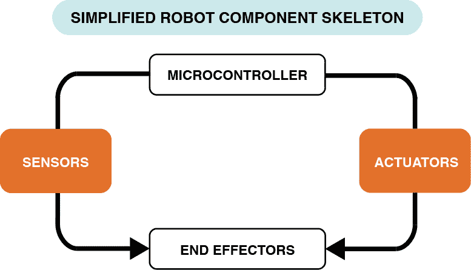
```

**图 4.1** 简化机器人组件骨架

```
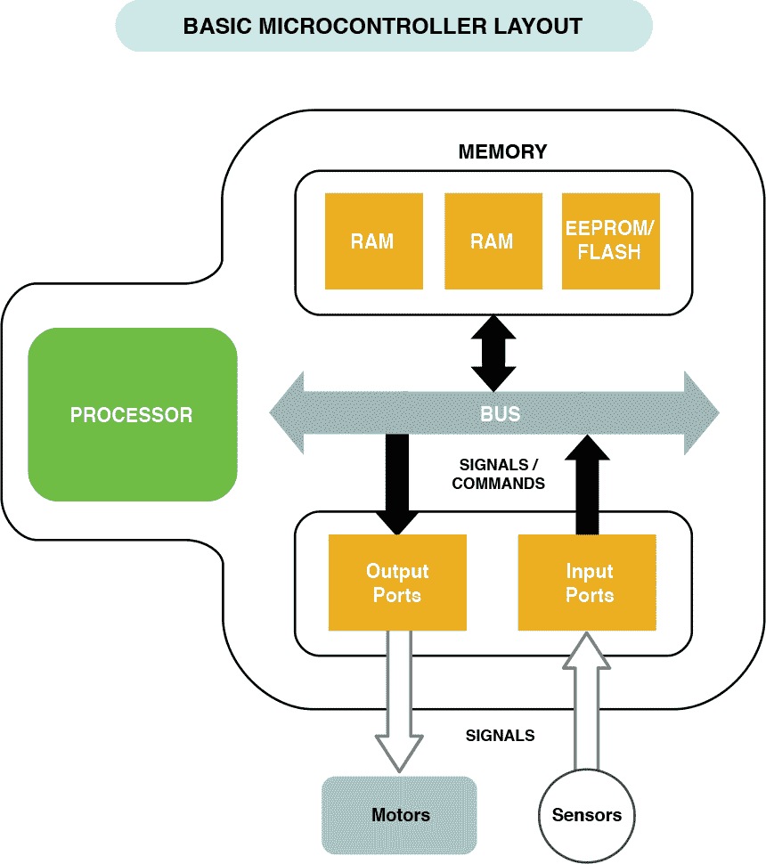
```

**图 4.2** 微控制器的基本布局

* * *

get

机器人可能有多个控制器。了解实际规格至关重要。机器人可能有一个用于电机的控制器，另一个用于伺服，还有一个用于通信的控制器。

* * *

## 微控制器的现实检查

我们想要检查微控制器的一些内容有：

 程序实际可用的内存有多少？（实际上有多少空闲内存？）

 微控制器是否有闪存内存，或者是否有可以访问辅助存储器的接口？

 微控制器上的数据传输率是多少？

我们不希望出现传感器产生的数据量或产生数据的速度超过了微处理器和内存所处理能力的情况。我们不希望传感器、电机和微处理器之间的数据传输率出现不匹配。在开发实机器人应用程序时，数据采集速率与数据处理速率之间的对比是一个重要的考虑领域。

`Microcontrollers`（微控制器）通常带有某种报告系统信息的实用程序。微控制器的工作环境也会有某种报告系统信息的方法。在书中，我们将带你从基础知识开始。

访问信息取决于微控制器支持的机器人类型。某些机器人通过数字显示器器向编程人员发送反馈；另一些机器人则将反馈写入内部内存或编程人员可以访问的某种外部存储设备。让我们来看两种常见的廉成本机器人微控制器：Arduino Uno 和 Mindstorms`EV3`。

`Figure 4.3`显示了 Arduino Uno 微控制器的照片，我们用它来控制一个基于 Arduino 的机器人臂，该臂用于书中的代码示例。

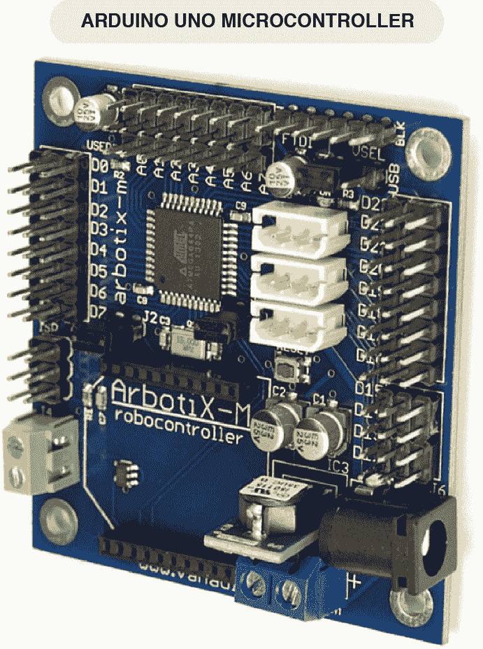

**图 4.3** 我们的 Arduino Uno 微控制器照片

Arduino`ShowInfo`是可以用于微控制器的实用程序示例。`ShowInfo`实用程序可以获取连接到 Arduino 机器人的实际规格。输入命令并按回车键。我们版本的`ShowInfo`为编程人员提供了一个类似于`Listing 4.1`所示的菜单。

**列表 4.1 Arduino ShowInfo 菜单**

点击此处查看代码图像

***

```
i      = Show information
h      = Show menu
r      = Test serial communication
s      = Speed tests
t      = Timer Register Dump
?      = Show menu
```

***

Speed tests（速度测试）选项的输出示例显示`Listing 4.2`和`Listing 4.3`中。

**列表 4.2 Arduino ShowInfo 工具 Speed Tests 选项的示例输出**

```
F_CPU = 16000000 Hz
1/F_CPU = 0.0625 us
```

`Listing 4.3`是补偿了开销的运行时后续测试的输出示例。由于使用了`millis()`进行计时，`interrupts`（中断）仍然开启。

**列表 4.3 补偿开销后的运行时 Speed Tests 示例输出**

点击此处查看代码图像

```
nop                   : 0.063 us
avr gcc I/O           : 0.125 us
Arduino digitalRead    : 3.585 us
Arduino digitalWrite    : 5.092 us
pinMode               : 4.217 us
multiply byte         : 0.632 us
divide byte           : 5.412 us
add byte              : 0.569 us
multiply integer      : 1.387 us
divide integer        : 14.277 us
add integer           : 0.883 us
multiply long         : 6.100 us
divide long           : 38.687 us
add long              : 1.763 us
multiply float        : 7.110 us
divide float          : 79.962 us
add float             : 9.27 us
itoa()                : 13.397 us
toa()                 : 126.487 us
dtorf()               : 78.92 us
random()              : 51.12 us
y |= (1<<x)           : 0.569 us
bitSet()              : 0.569 us
analogRead()          : 111.987 us
analogWrite() PWM     : 11.732 us
delay(1)              : 1006.987 us
delay(100)            : 99999.84 us
delayMicroseconds(2)  : 0.506 us
delayMicroseconds(5)  : 3.587 us
delayMicroseconds(100) : 99.087 us
```

***

`ShowInfo`实用程序适用于基于 Arduino 的微控制器。大多数微控制器都带有它们自己版本的“显示信息”实用程序。对于嵌入了 Linux 的微控制器，还有额外的选项可以查找。例如，Mindstorms EV3 和 Wowe 的 RS 微控制器具有嵌入式 Linux 以及关于处理器的信息，打开`proc/info`可以揭示关于处理的一些信息。例如，在我们的 EV3 上运行命令`more /proc/cpuinfo`会产生`Listing 4.4`中的输出。

**列表 4.4 EV3 微控制器上 /proc/cpuinfo 的示例输出**

点击此处查看代码图像

***


```
Processor      : ARM926-S rev 5 (v5l)
BogoMIPS       : 1495.04
Features       : swp thumb fastmult edsp java
CPU implementer : 0x41
CPU architecture: 5TEJ
CPU variant    : 0x0
CPU part        : 0x926
CPU revision    : 5
Hardware       : MindStorms EV3
Revision       : 0000
Serial         : 0000000000000000
```

在我们的 EV3 上执行命令 `uname`：

```
uname -a
LINUX EV3 2.6.33-rc4 #5 PREEMPT CET 2014 armv5tej unknown
```

给了我们 EV3 的 LINUX 版本和处理器信息。在 EV3 控制器上运行 `free` 命令给了我们 `Listing 4.5` 中的输出。

**列表 4.5 在 EV3 控制器上运行 free 命令的示例输出**

点击此处查看代码图像

```
root@EV3:~# free
             total        used        free      shared      buffers
Mem:          60860       58520        2340               0
Swap:               0             0        1468
```

这些值提供了微控制器组件的识别信息，例如：

 处理器类型

 处理器速度

 内存容量

 空闲内存

 已用内存

最好将运行微控制器实用程序或查阅 `/proc/cpuinfo` 和 `/proc/meminfo` 获得的信息与微控制器附带的规格或数据表进行比较，并注意任何重大差异。空闲内存限制了可以加载到机器人程序的大小，或者机器人实时处理的传感器或通信数据量。而处理器速度限制了机器人执行指令的速度以及处理器与端口之间的数据传输率，空闲内存对传感器数据处理的速度和数量影响巨大。记住，处理器控制着机器人的数据和信号流。因此诸如：

 机器人可以处理多少数据？

 机器人一次处理的最大数据块是多少？

 机器人可以同时发送或接收多少信号？

 机器人处理信号或数据的速度有多快？

这些问题都由微控制器的实际能力回答。ATmega、ARM7 和 ARM9 系列微控制器是移动和自主机器人最流行且最常见的廉成本微控制器。书中所有示例中的机器人都使用了一个或多个此类微控制器。

红外传感器、超声波传感器、光敏传感器、颜色传感器、热传感器以及化学传感器听起来都是机器人非常酷炫的传感器——事实也确实如此。但魔鬼细节细节之中。所有传感器都有某些基准能力、精度限制，以及相对于该基准能力的某种程度的误差。所有传感器在数据采集量、采集速度以及数据测量精确度方面都存在限制。

超声波传感器的工作原理是通过向物体发射声波，并测量接收返回信号所需的时间，从而将距离与时间联系起来。但超声波传感器在实际测量距离的远、测量时间的准确性或测量时间/距离的一致性方面存在差异。

颜色传感器对于机器人来说是一个很好用的工具。颜色可以作为编程机器人何时执行各种动作以及执行什么动作的手段。例如，如果物体是蓝色的，指示机器人执行动作 A；如果物体是红色的，执行动作 B；等待蓝色物体变成紫色，以此类推。

假设我们的机器人有一个可以区分红、绿、蓝色的颜色传感器。问题在于传感器的准确性如何。传感器能识别哪种红色？所有的红色色调吗？传感器能报告不同蓝色深调——海军蓝、天蓝、青色——之间的差异吗？颜色传感器在区分色调方面到底精确到什么程度？如果我们的机器人是一个炸弹机器人，我们指示它剪断橙色线而不是红色线线，会出问题吗？传感器测量事物。机器人使用传感器来测量事物。在为机器人选择任务时，必须考虑机器人传感器的准确性和局限性。许多传感器在首次使用时必须校准。某些传感器在每次使用后都必须校准。校准过程也是考虑机器人传感器实际具有什么能力或限制的重要部分。

# 布隆的信相信 (Bron’s Believe Or Not)


DARPA 机器人挑战赛决赛于 2015 年 6 月 5 日至 6 日在加州波莫纳的 Fairplex 博览场举行。23 台机器人参加了一系列源自搜索与救援场景的挑战。需要执行的任务包括：

 驾驶汽车并离开汽车

 打开门并穿过门道

 穿过墙壁

 旋转阀门

 执行突发任务

 穿过碎片场

 在不平整地面上行走

 爬楼梯

有 3 种轮式机器人设计，一种四足轮式设计，以及 18 台双足机器人。机器人的成本在 500,000 美元到 4,000,000 美元之间。在 23 台机器人中，只有 3 台成功完成了所有任务。冠军者是 `DRC-HUBO`，第二是 `RUNNING MAN`，第三是 `CHIMP`，如图 4.4 所示。

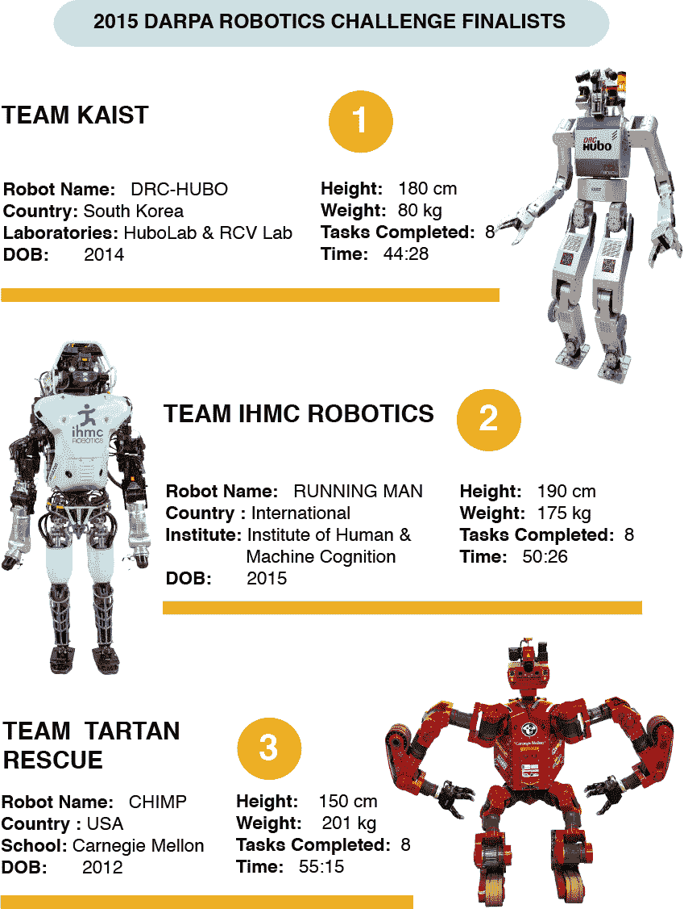

**图 4.4** 2015 年达帕 机器人挑战赛的三个决赛选手以及关于每个机器人的简要信息

尽管某些机器人设计比其他的具有更高的自主性，但没有任何一个机器人设计是完全自主的，所有的机器人设计都需要大量的遥操作和远程控制。即使有了大量的遥操作，许多机器在挑战过程的某个点仍然倒下了。

## 确定机器人的传感器局限性

人眼可见光的波长在 400 nm 到 700 nm 之间（见图 4.5）。波长以纳米米测量，这是公制单位中的长度单位，等于米的十亿分之一（0.000000001 m）。波长 `> 700 nm` 的光我们称为红外线。波长 `< 400 nm` 的光我们称为紫外线。当机器人拥有 `RGB`（红蓝）颜色传感器时，该传感器测量长度在 400 nm 到 700 nm 之间的光波。对于人眼来说，该范围内的每个波长对应一种颜色。

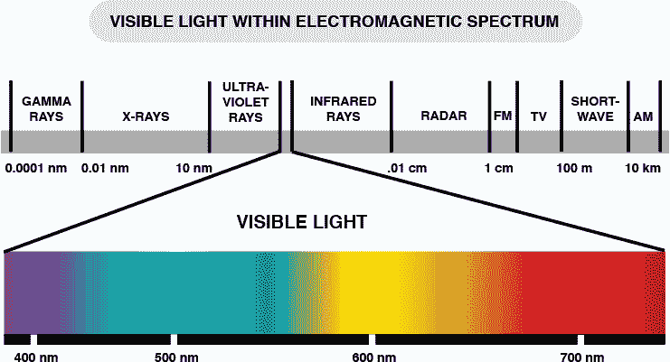

**图 4.5** 光的波长

问题是机器人颜色传感器的分辨率精确度和一致性如何？传感器是否报告 400 nm 到 510 nm 之间的每种波长光都是蓝色，而无法区分不同的蓝色？它是否报告 570 nm 到 700 nm 之间的每种波长都是红色，而不区分红色和浅红色？我们如何能拥有 4 色 `RGB` 传感器和 16 色 `RGB` 传感器？这意味着什么？

在第 5 章“近距离观察传感器](#ch05.html_ch05)”中，我们查看了光敏传感器如何工作以及机器人如何使用它们。不仅是光和声波长的传感器测量存在分辨率问题。图 4.6 显示了声音的响亮、柔和和低音。

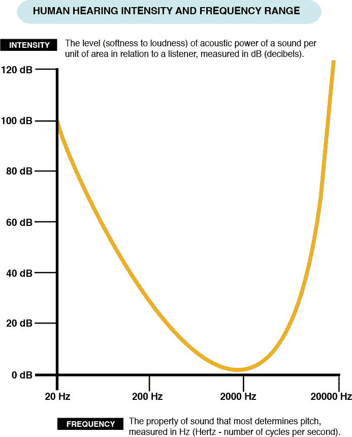

**图 4.6** 声音的响亮、柔和和低音

声音可以作为机器人程序的输入。例如，如果声音足够大，会导致机器人采取行动；如果声音产生特定的音调，会导致机器人采取某些动作。声波的振幅决定了声音的响亮。声音的频率决定了它的音调。所以就像光敏传感器一样，声音传感器测量波长。问题是响有多大？机器人的声音传感器会将 `50 dB` 以上的所有声音检测为响，`50 dB` 以下的所有检测为柔吗？机器人的声音传感器能区分 `100 dB` 和 `120 dB` 吗？

由于大多数传感器测量模拟值，因此会有分辨率问题。例如，液体的酸度由化学传感器决定，该传感器测量氢离子的含量。表 4.1 显示了 pH 尺度。

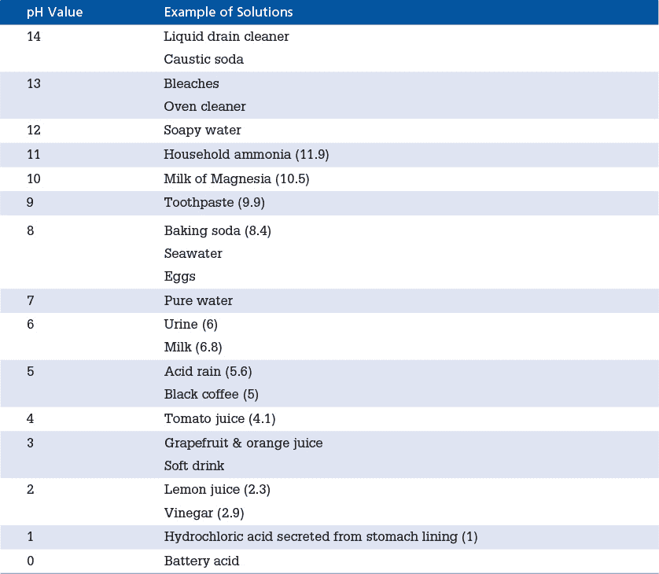

**表 4.1** pH 尺度

如果我们的机器人有一个测量 pH 的传感器，它能够区分电池酸和柠檬汁之间的差异吗？还是它会将它们都报告为酸性？在我们的机器人训练营场景 1 中，Midamba 可以使用机器人测量酸和碱的差异来帮助他解决电池问题。机器人的传感器需要多大的分辨率？

### 执行器末端执行器的现实检查

机械臂用于放置、提升和定位物体。但所有机械臂在抬起或持有重量/质量方面都有限制，或者手臂上的伺服电机产生的扭矩有限。并不是所有的机械臂都是相同的，并不是所有的机械臂都能所有位置操作其最大重量物体（即使是规格说明中所称的位置）。图 4.7 显示了具有 2 和 6 个 `DOF`（自由度）的机器人手臂。

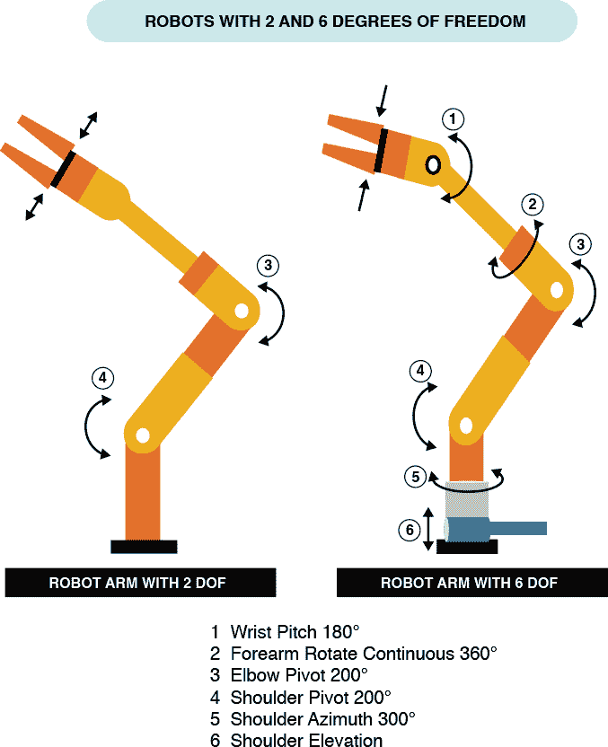

机械臂的能力通常被描述为`DOF`（自由度）。简单来说：机械臂在 3D 空间中可以在多少种模式或轴上进行操作？

 注意

我们在书中使用的某些机械臂示例代码是在基于 Arduino 的 Trossen Robotics  PhantomX Pincher 机械臂上执行的。`Table 4.2` 列出了该机械臂的制造商规格。


**表 4.2** PhantomX Pincher 机械臂规格

这些是检查机械臂时需要核的规格。有时制造商的规格是保守的，某些组件的实际性能可能略高于规格值。例如，在这种情况下，我们的抓取器握力略大于 500 g，旋转力略高于 150 g。这是一个需要注意的重要规格。机械臂可能能够抓起 500 g，但无法旋转 500 g。这一事实将影响机械臂的编程方式以及它能做和不能做的事情。

`Figure 4.8` 是书中示例中使用的 PhantomX Pincher 机械臂的照片。


**图 4.8** PhantomX Pincher 机械臂照片

机器人能力矩阵是记录实际能力的好地方。我们使用电子表格来记录我们的能力矩阵。`Table 4.3` 是我们在电子表格中实际机器人能力矩阵的示例。


**表 4.3** 机器人能力矩阵电子表格示例

 注意

尽管我们可以将多个机器人放在一个电子表格中，但我们保持每个机器人一个表格，将每个机器人的所有传感器、执行器和末端执行器能力都记录在单独的表格中。这在编程和查找机器人能力时变得非常方便。

### REQUIRE 机器人有效性

回想`第 1 章`中的“`到底什么是机器人？`”，我们从四个方面对机器人的有效性进行了评估：

 传感器有效性

 执行器有效性

 末端执行器有效性

 控制器有效性

 注意

REQUIRE 代表真实环境下的机器人有效性系数（Robot Effectiveness Quotient Used in Real Environments）。我们将 REQUIRE 作为一种初始金石测试，用于决定我们可以为机器人编程做什么，以及我们无法实现做什么。

每个领域都受到硬件规格实际能力的限制。根据我们的机器人有效性系数，传感器占据了机器人有效性的 25%。机器人使用传感器来测量物体，然后根据这些测量采取行动并做出决策。`Table 4.4` 显示了机器人使用传感器测量的一些常见数值。


**表 4.4** 机器人传感器测量的常见数值

在编程之前，应该确定传感器的质量、准确性、精度、分辨率和局限性。例如，如果机器人的传感器测量距离（长度），那么它就有以米、厘米等单位测量的最大距离和最小距离。我们书中示例使用的超声波传感器最大范围为 100 cm，最小范围为 10 cm。超出该范围的物体无法被机器人的距离传感器检测到。我们在`Table 4.4`中包含了基本单位和符号符号，因为在确定传感器的局限性和精度时，你需要能够进行同类项比较。

不同的传感器制造商使用不同的计量单位指定传感器能力。在机器人机器人时，选择一个测量标准并坚持下去是一个好主意。在典型的机器人应用中，数字会被频繁使用。如果测量单位混合，程序将难以更改、维护和重用。例如，假设我们的机器人同时使用红外传感器和超声波传感器来测量两个物体的距离，并且想知道在任何时刻物体之间有多远。我们可能会有如下机器人代码：

点击查看代码图像

```
Object1Distance = Robot.ultrasonicSensorGetDistance();
Object2Distance = Robot.infraRedSensorGetDistance();
DistanceApart = Object2Distance - Object1Distance;
Robot.report(DistanceApart).
```

如果超声波传感器使用英寸而红外传感器使用厘米，`DistanceApart` 代表什么？来自不同制造商的传感器可能在同一个机器人上，制造商 #1 使用码作为距离，制造商 #2 使用米描述距离。虽然跟踪哪个是谁并非不可能，但组合不同的测量单位会使问题复杂。此外，如果机器人和库之间的测量单位不一致，那么很难在不同的机器人之间使用同一个程序。

如果每个库都使用不同的单位测量标准，那么混合使用机器人程序库将很困难。在指示机器人测量物体时，你应该对机器人交互的所有指令使用相同的测量单位标准。机器人能力矩阵应该包含使用适用标准单位定义的传感器矩阵。我们在`第 8 章`中解释如何开发机器人模型时了这一观点，“`开始学习自主：构建机器人的软体`”。在书中，我们在指定所有量测量时使用 SI（国际单位制）单位。

#### 后面展望

在`第 5 章](#ch05.html_ch05)`中，“深入了解传感器`”，我们讨论了不同类型的传感器以及它们如何为机器人工作。我们讨论了它们的能力和局限性。

## 5. 深入了解传感器

**机器人敏感性训练第 5 课：** *机器人可以感知到你错了。*

在`第 1 章`，`到底什么是机器人？`中，我们提到机器人的基础组件是：

 一个或多个传感器

 一个或多个执行器

 一个或多个末端执行器/环境效应器

 控制器

使用微控制器编程机器人的传感器、执行器和末端执行器是机器人编程的核心。

传感器、执行器和末端执行器是机器人变得有趣、能够执行任务并与环境交互的关键。每个传感器为机器人提供来自环境的某种反馈。但让我们确保区分了“感觉”和“传感器”。

*感觉*是机制的一种种特殊功能，用于接收并感知刺激对感觉组件产生。`传感器`是感觉组件或设备，它以某种方式响应物理刺激。它是检测或测量环境物理属性的设备，然后产生读数、测量值、反应或接收刺激的信号作为输出。

人类的传感器是我们的眼睛、耳朵、皮肤等。机器人拥有摄像头、超声波传感器和红外传感器等传感器，它们可以访问许多不同类型的传感器，可能多数百个。单个机器人可以根据其物理空间允许、微控制器可连接能力以及电源的支持能力，配备尽可能多的传感器。表 5.1 显示了许多不同类型的传感器以及人类和机器人传感器的列表。


**表 5.1** 人类与机器人传感器

配备了多种类型传感器和执行器的机器人可以执行各种物理行为。机器人可以通过将传感器与执行器及设备结合，模拟各种能力。

## 传感器感知什么？

某些传感器是换能器，即将一种形式的能量转换为另一种形式的设备。换能器用于感知不同形式的能量，例如：

 磁性

 运动

 力

 电信号

 辐射

 热

根据正在感知或处理的信号类型或过程，换能器类型可用于输入或输出转换。传感器是`input devices`，它们将物理量转换为相应的电信号，然后映射到测量值。该物理量通常是非电的。

 备注

许多声传感器仅仅是一个动态麦克风，它检测声波并将其转换为电学模拟信号。

例如，声波是能量在空气中传播并远离声源扩散时由于运动引起的扰动模式。声传感器本质上是一个检测这种形式能量的麦克风。

电信号由振膜产生，振膜是一个薄金属片，它收集声波导致周围振膜的磁体发生振动。磁体的振动导致围绕磁体的金属线圈也振动，从而在线圈中感应出电流，并将其转换为电信号。传感器随后产生一个量化原始声波响度大小的信号。图 5.1 显示了声传感器将声波转换为以分贝测量的电信号的过程。


**图 5.1** 声传感器对声波的转换

传感器测量机器人环境中存在的不同形式的能量。大多数时候，我们指的是机器人“外部”的环境，但也有传感器用于测量机器人内部环境——机器人的`internal state`（内部状态）。这些传感器被称为`proprioceptive`（本体）。陀螺仪、加速度计和罗针传感器都是`proprioceptive sensors`的示例。

 备注

`gyroscope`可以计算取向的变化，以及以 RPM（每分钟转数或每秒度）测量的旋转运动或角速度。加速度计以每秒平方或 G 力为单位测量机器人的加速度。罗针传感器测量地球磁场，并计算反映机器人所朝向的磁方位角。


测量与机器人交互、交叉或影响机器人的外部环境的传感器被称为`exteroceptive`（外感）传感器。对于类型的接触、接近或测距传感器，机器人是参考点。

***

 备注

接触传感器用于测量机器人与环境中另一个物体之间的接触。接近传感器测量与靠近（机器人）但未接触传感器的物体距离。超声波传感器和光学传感器是接近传感器的示例，它们利用超声波和光测量与物体的距离。

***

测量环境中物理量（如表面温度、液体 pH 值、浊度、气力和磁场）的传感器被称为`environmental`（环境）传感器。这些量不需要机器人的视角。图 5.2 显示了机器人相对于本体、外感、接近和环境传感器的不同视角。表 5.2 列出了传感器类型、简要描述和示例。


**图 5.2** 机器人传感器视角


**表 5.2** 机器人传感器类型

### 模拟与数字传感器

传感器的类型和分类可以让你深入了解传感器如何工作、测量什么、如何测量以及如何使用。作为换能器，传感器可以根据输入信号进行分类（判断输入是来自本体、外感还是环境传感器），并根据其产生的输出信号进行分类。

***

 备注

`Analog`（模拟）和`digital`（数字）是描述传感器如何测量的最基本分类。数字传感器产生非连续的离散输出信号，而模拟传感器创建一个具有连续值的信号。模拟传感器旨在帮助转换非电真实世界信息。两种传感器的输出都将以处理器可识别的数字格式表示。某些传感器不会`directly`直接将其信号转换为数字信号，而是创建一个稍后转换的模拟信号。

***

数字传感器产生的数值以单个`bit`（位）的形式输出，就像简单的开关一样。当开关开启时，电路闭合，电流通过电路；当开关关闭时，电路断开，电流不通过。

开关是串行传输的示例，输出一个只有两种状态的二进制信号：`1` 或 `0`（开或关）。位也可以组合以以并行传输的形式产生 `n` 位的单字节（byte）输出。数字传感器的示例是内置光学编码器。它输出电机相对于上一个位置的相对位置。

编码器配合微控制器和转速计，测量电机的速度和方向。光学编码器检测伺服电机的运动。我们在第 6 章“为机器人传感器编程](#ch06.html_ch06)”中讨论光学增量编码器和伺服电机。数字传感器还具有嵌入电子设备，在传感器内部处理信号。数据传输也是数字的，这意味着它对线缆长度、电阻或阻抗不敏感，不受电磁噪声影响。数字传感器还可以返回多个关于，。额外的传感器关于关于关于电压电压输出，仅输出。真实的模拟传感器没有嵌入芯片，因此数字转换在传感器外部进行。模拟传感器更准确，因为原始信号以更高的分辨率表示。但这些信号容易受到噪声影响或在传输中劣化。模拟信号也难以用于计算和比较。但在模拟转换为离散值时会产生数据丢失。表 5.3 比较了数字和模拟传感器的某些属性。


**表 5.3** 数字与模拟传感器的属性

### 读取模拟和数字信号

数字和模拟传感器都产生信号，该信号被映射到或解释为读数或测量值。但什么是信号？信号如何映射到测量值？

首先，信号是传递某种信息的随时间变化的量。这意味着信号是一个随时间变化的值；它不是恒定的。因此，这种随时间变化的量可以是随时间变化的电压或电流。这些信号可以通过导线传输，也可以像 WiFi 或蓝牙那样通过无线电波在空气中传输。

模拟传感器产生具有连续值的信号，而数字传感器产生离散输出。对于模拟传感器，它所产生的值与被测量的量成正比。模拟传感器的示例有：

 温度

 压力/力

 速度/加速度

 声音

 光

所有这些传感器测量的都是自然上连续的模拟量。模拟信号的范围可以从 `0 V` 到 `5 V`（伏特）。声学传感器未检测到声音将返回 `0 V` 的模拟信号，而检测到的最大声音最大值为 `5 V`。声学传感器检测该范围内任何值的信号。图 5.3 (a) 显示模拟信号是 `0 V` 到 `5V` 之间的连续信号，持续检测信号随时间的变化。该信号是平滑且连续的。为了让我们机器人控制器中的微处理器能够对这些读取值进行任何操作（例如计算值和执行信号之间的比较），必须通过`模数转换`（A/D）转换器转换为数字信号。`A/D` 转换器可能位于微控制器上，也可能是传感器的一部分。将模拟信号转换为离散值被称为`量化`，如图 5.3 (b) 所示。


**图 5.3** (a) `0V` 到 `5V` 之间作为连续信号的模拟信号，(b) 模拟信号转换为离散值

`A/D` 转换器将该范围划分为离散值，其中最大电压除以转换器的 `n` 位。例如，Arduino 的 `A/D` 转换器是一个 10 位转换器。这意味着 `10 bits` 代表样本中的每个信号。有 `2¹⁰ = 1023` 个离散模拟电平。电压分辨率是将总电压除以离散值的数量：

```
5V/ 1023 = .00488 V ≈ 4.8 mV
```

电压分辨率为 `4.8 mV`（毫伏）。某些 `A/D` 转换器是 `8 位`（`2⁸ = 256` 个离散电平，对应 `19.4 mV`），另一些是 `16 位 ADC`（`2¹⁶ = 65,535` 个离散电平，对应 `0.076295109 mV`）。电压分辨率是两次读取值之间的差。差越小，读取越准确。位越高，原始信号的数字化越好，误差越小。

有些数字传感器实际上带有`A/D`转换器的模拟传感器；真正的数字传感器产生离散信号。传感器可以输出一个范围的值，但值必须以阶梯方式增加。离散信号在图表中显示时通常呈阶梯状，如图 5.4 所示。


**图 5.4** 带有离散信号的图表

离散传感器的一个例子是数字罗盘。它通过发送范围从 `0` 到 `359` 的 `9 位值`来提供当前航向，即 `360` 种可能性。

### 传感器的输出

模拟传感器产生模拟读取值，即通过`A/D` 转换器转换为数字值的信号电压。例如，如果电压读取值为 `4.38 V` 会怎样？`A/D` 转换器会返回什么？为了简单易于管理，假设我们正在使用`3 位转换器`。对于`3 位转换器`，只有`8 个离散电平`或`8 种可能的数字值`，电压分辨率为：

```
5V / 8 = .625 V
```

因此，在传感器转换模拟读取值后，它返回 `111` 的数字输出。我们可以为模拟读取值制作表格；它们是表 5.4 中的二进制表示。如你所示，模拟信号读取的范围由电压分辨率 `.625V` 定义。`4.38 V` 的电压读取值处于 `4.371 V` 到 `5.00 V` 范围内。


**表 5.4** 模拟读取值及其二进制表示

可以计算进制值：

```
8 / 5 V = ADC Reading / 模拟测量值
```

在这种情况下：

```
8 / 5 V = ADC Reading / 4.38 V
( 8 / 5 V ) * 4.38 V = ADC Reading
7.008 = ADC Reading
```

这等同于二进制转十进制转换：

```
111 ≈ 7.008
```

进制值被映射到值（如颜色）。

### 读取值存储在哪里

传感器的测量值可能存储在传感器中...（核心内容省略）在第 6 章中我们讨论了某些传感器（如超声波）可以单次读取。它具有连续模式。高级超声波传感器存储物体的距离。我们在第 6 章中讨论了使用的简单数据类型。

### 主动与被动传感器

主动与被动传感器描述了传感器如何进行测量以及如何满足功率需求。被动传感器从环境或被测物体接收能量。被动传感器对周围环境或测量对象没有影响。当机器人需要隐形时，这非常有用。主动传感器涉及与环境的直接作用。它们通过向环境发射能量进行观测，因此需要电源。

让我们对比一下用于机器人检测系统的被动红外传感器 (PIR) 和主动超声波传感器。PIR 测量物体发出的红外光。当辐射发生变化机器人进入传感器的视野时，传感器被触发，因为机器人打破了连续场。传感器检测到的是扰动。该传感器是被动的，因为它不发射红外线；只是接收入射的辐射。


**图 5.5** (a) 用于物体检测的被动红外传感器，(b) 用于物体检测的主动超声波传感器

主动传感器通过在信号中通过电流或脉冲来改变激励信号；传感器测量反射电流的变化。使用主动超声波传感器进行运动检测时，会在超声频率范围内产生声波，通常为 `30 千赫兹` 到 `50 千赫兹` (`kHz`)。传感器发射频率为 `40 kHz` 的锥形声波。这个频率人类听不见，且无法穿过大多数物体。

传感器监听从视野内物体反射回的声音。传输并接收反射波所需的时间决定了到物体的距离。因此，对于机器人检测系统，`ultrasonic sensor`（超声波传感器）持续发送超声波。如果有物体在`ultrasonic sensor`的视野范围内，声波会在新物体上反射，返回不同的读数，如图 5.5 (b)所示。

某些传感器具有主动和被动模式，或者具有主动和被动版本的传感器。数字相机就是同时具有主动和被动模式的设备示例。图 5.6 显示了一组锡制玩具机器人的两个图像：(a) 是被动模式拍摄的图像；(b) 是主动模式拍摄的相同图像。数字相机有一个图像传感器，可以将光学图像转换为电子信号，对吧？在被动模式下，传感器使用现有的环境光。如你所见，在光线条件下，机器人的特征并不清晰或没有照明。图像传感器记录或捕获环境提供的辐射。


**图 5.6** (a) 被动模式拍摄的图像，(b) 主动模式拍摄的图像

如果光线不足，用户可以选择闪光灯，或者相机检测到光线不足并切换到使用闪光灯的主动模式。闪光灯是自身的能量源，用于照明区域并记录反射的辐射(图 5.6 (b))。现在机器人照明更充足了，可以看到其特征。这也是光传感器的主动和被动模式的工作方式。被动模式测量的是环境光，而不是主动模式下`LED`的反射光。在主动模式下，传感器发射自身的光源`LED`，并测量从物体上反射的光。

***

 笔记

`infrared sensor`（红外传感器）有一种主动版本，其工作方式与`ultrasonic sensor`类似。它是声学传感器的光版本。`active infrared sensor`（主动红外传感器）使用不可见光而非高频声来扫描区域。光从扫描区域内的物体上反射并被接收器检测。

***

Table 5.5 列出了主动和被动传感器的示例以及每个设备的描述。


**表 5.5** 主动和被动传感器

### 传感器与微控制器的接口

为了使这些传感器发挥作用，它们必须连接到微控制器。传感器必须有一个接口，该接口由用于模拟传感器的模数转换器以及用于在计算机内部组件之间传输数据的总线通信协议（如`SPI`、`UART`或`I²C`）组成。传感器通过`serial port`（串口）连接到微控制器，串口是物理 I/O 连接器，它将数据转换为在单根导线上传输的一系列位流（bits）。传感器插入`serial port`，允许传感器与微控制器之间进行通信。图 5.7 显示了插入`EV3 microcontroller`的三个传感器，以及连接到`Arduino interface sensor shield`用于连接磁性传感器和`pH sensors`的传感器。


**图 5.7** 插入 EV3 微控制器的三个传感器和连接到 Arduino 传感器扩展板的两个传感器

微控制器向传感器发送信号，然后传感器通过`serial port`逐位向微控制器发回信号。这些信号实际上是消息，共有四种：

 系统

 命令

 信息

 数据

消息只是负载（payload）的一部分，可能还包括指示消息类型以及消息开始或结束位置的位。微控制器可以发送由`command`（命令）和`info`（信息）组成的消息，传感器可以发送由`data`和信息信息组成的消息。消息可以通过两种方式通过`serial port`传输：`异步`和`同步`。对于每种串口通信，都有时钟和信号，以便协调通信。每种方法都有一种同步方法，控制高位或低位、1 或 0 位接收的方式和时机。

在异步数据传输中，发送方和接收方之间没有公共时钟信号。发送方和接收方约定数据传输速度（`baud rate`，波特率）。`baud rate`在数据传输开始之前通常不会改变。每个字中添加了特殊的位，用于同步发送和接收单元。传感器和微控制器之间有三线连接。设备共享一个地线作为测量电压的参考点，以及两根通信线，一根传输数据，另一根接收数据。

`UART (Universal Asynchronous Receiver-Transmitter，通用异步收发传输器)` 是一种异步串口通信。你的微控制器和传感器可能使用这种串口通信协议（`Arduino`、`Raspberry Pi`、`EV3`以及许多新的`EV3 sensors`）。图 5.8 显示了`UART`连接。


**图 5.8** 三线 UART

`UART`有三根线：`Tx`、`Rx`和`GND`。`Tx`是发送，`Rx`是接收，`GND`是地。

`I²C (Inter Integrated Circuit)`是一种同步串口通信协议，用于将低速设备（如 A/D 转换器、I/O 接口和传感器）连接到微控制器。总线接口有一根用于数据信号的`SDA`线，`SCL`线用于时钟信号。

***

 笔记

在同步数据传输中，发送方和接收方根据同一个时钟访问数据，微控制器为所有接收方提供时钟信号。有另一根线用于数据。当时钟脉冲时，传输一个位的数据。传感器被告知何时监听传输的位，何时忽略它们。

***

线路是双向的，用于发送和接收数据。I²C 总线设备可以是主设备可以是从设备。主设备启动数据传输，从设备仅对主请求做出反应。当前的主设备决定时钟速度，从而决定数据传输的快慢。但从设备（传感器）有时可以将时钟拉低，以延迟主设备发送过快的数据或延迟其准备传输。没有严格的`baud rate`。

`I²C`易于使用，因为它可以拥有多个主设备（通常是微控制器）和几乎无限数量的从设备（设备和传感器），通过`I/O port expander`使用同一条总线。图 5.9 显示了具有一个主设备和多个从设备的总线接口。


**图 5.9** 多个从设备的 I²C 总线接口

如前所述，单个机器人可以根据空间允许、微控制器可连接以及电源支持配备尽可能多的传感器。这是一种方法。使用`I²C 总线接口`，可以将 1000 多个设备连接到微控制器。表 5.6 显示了`UART`和`I²C`串口总线接口的一些属性。

传感器的属性或特性描述了诸如测量范围、传感器响应刺激所需的时间、其整体准确度等。它的分辨率和重复性是多少？当有多个传感器连接到微控制器时，必须考虑电压电平和功耗。这可能会决定单个传感器的使用时间，或者其他高功耗传感器的使用时间。

* * *

 提示

了解这些属性有助于确定传感器的局限性，以及可以使用哪些传感器来补偿这些局限性。这些属性还可以助于比较不同制造商传感器的质量。

* * *

例如，表 5.7 比较了罗指南针传感器。分辨率可能取决于所使用的固件版本。比较这些特性有助于决定哪种传感器最适合机器人应用场景。


**表 5.7** 罗指南针传感器比较

传感器在表 5.8 中列出了许多属性。这些属性的值应由传感器制造商作为文档或数据表的一部分提供，但并非所有制造商都提供此类程度的技术信息。制造商可能认为还有其他信息对客户是重要的。大多数制造商都提供准确度、响应时间、范围和分辨率，他们认为线性和重复性并不重要。但重要性是相对的，完全取决于传感器使用的系统和场景。


**表 5.8** 传感器属性

### 范围和分辨率

范围和分辨率是人们感兴趣的两个常见属性。

`Range` 是传感器能产生的最小和最大输出之间的差，或者是传感器可以正常运行的输入范围。这些值可以是绝对值，也可以是相应测量值的百分比。

例如，让我们比较几个传感器的范围。对于声波传感器，输出范围是 0 cm 到 255 cm，因为测量的是距离，而罗指南针的输出范围是 0° 到 360°。但对于光传感器，返回给微控制器的是 0 到 1023。

在光线良好的房间里，最暗的读数可能是 478，最亮的读数可能是 891。在昏暗的房间里，最暗的读数可能是 194，最亮的读数可能是 445。因此使用了一个比例尺，0 代表暗，100 代表最亮并以百分比表示。传感器针对该特定环境的光线进行了校准。因此从示例来看，在光线良好的房间里，校准后 478 的读数将为 0，891 的读数将为 100。

`Resolution` 是传感器测量范围内的最小步长。例如，HiTechnic 罗指南针的率是 1°，而声波传感器的分辨率是 3 cm。分辨率影响传感器的准确度。

记得电压分辨率吗？当电压分辨率为 .625 时，准确读数为 .630 时，其十进制表示法更接近 000 而不是 001。对于声波传感器，无法表示 7.5 cm 的准确读数。

#### 精密度和准确度

`Precision` 是传感器在相同条件下重复测量同一数量时给出相同读数的能力。精度意味着连续读数之间的一致性，而**不是**与真实值的接近程度，后者是准确度（Accuracy）。`Accuracy` 是实际值与传感器新读数之间存在的最大差异。真实值与新读数之间的差异是绝对误差或相对误差：

`Absolute Error = New Reading – True Value`


`Relative Error = Absolute Error / True Value`

 注意

分辨率越小，传感器越准确。

精度和准确度实际上是互无关的，这意味着传感器可以是`精确的`但不是`准确的`。精度也是测量分辨率的同义词；例如，能够区分 0.01 和 0.02 差异的测量比只能区分 0.1 和 0.2 差异的测量更精确（分辨率更高），尽管它们可能同样准确。因此精度和分辨率经常被误用。图 5.10 显示了精度与准确度之间的各种关系。


**图 5.10** 精度与准确度之间的关系

### 线性

`Linearity` 是模拟传感器读数中输入和输出变化之间的关系。线性可以预测传感器的读数（基于输入），用于确定准确度和测量误差。如果传感器的输出是线性的，则其范围内任何点的输入任何变化都会产生相同的输出变化。输出在整个范围内与输入成正比。输出随输入变化的斜率图表将是一条直线。

例如，如果输入与输出的比例为 1:1，如果传感器的输入（刺激）增加两倍，这将反映在输出中。理想情况下，传感器被设计为线性的，但在涉及实际值时，并非所有传感器都是线性的。图 5.11 (a) 显示了输入和输出之间的理想线性关系。


**图 5.11** (a) 输入与输出之间的理想线性关系；(b) 声波传感器的线性

当测量距离传感器 2 cm 到 64 cm 的物体时，使用 63 个样本，平均误差为 1.079 cm。线性通常以百分比表示：

`Nonlinearity (%) = ( D[in(max)] / In[f.s.] ) * 100`

其中 `D[in(max)]` 是最大偏差，`In[f.s.]` 是满量程（f.s.）输入。但传感器的线性（如声波传感器）取决于获取读数的条件。如果环境对传感器性能不利（例如多个声波传感器同时传输声波）或目标物体不理想（形状异常或位置异常），传感器的性能将下降，读数将不再是线性。

### 传感器校准

正如本章早期提到的，使用微控制器对机器人的传感器、执行器和末器进行编程是机器人编程的核心。传感器结合执行器和末器使机器人变得、能够执行任务并与环境交互。

我们讨论了许多传感器，它们测量什么、如何测量以及测量得如何。有很多优秀的传感器可供机器人爱好者用于编写卓越的机器人系统。但传感器并不完美。正如我们在第 7 章](#ch07.html_ch07) “编程电机和伺服器”中所看到的，执行器也不完美。许多传感器在开箱即用的情况下对于许多非关键应用，但为了获得最佳可能的准确度、精密度等，应该在使用的系统中对传感器进行校准。有几个原因导致传感器性能可能不如预期。表 5.9 列出了一些问题。


**表 5.9** 需要传感器校准的因素

一个传感器之所以是优秀的，是因为它在前面讨论的所有属性上都具有理想值。提到准确性时，它实际上是精度、分辨率和校准的结合。`Calibration`（校准）通过消除传感器读数或测量中的结构性误差来提高传感器性能。`Structural errors`（结构性误差）是传感器预期输出与其测量输出之间的差异。

这些误差在每次进行新测量时都会一致出现。但任何可重复的误差都可以在校准期间进行计算，这样在实际使用中，传感器产生的测量值就可以进行实时补偿，以数字方式消除任何误差。如果你有一个具有良好分辨率且提供重复测量值的传感器，就可以对其准确性进行校准。

### 传感器的问题

传感器是制造出来的设备，来自同一制造商的两个传感器可能会因为生产误差而产生略微不同的读数。传感器对环境变化也很敏感，例如热量、冷热、冲击、湿度等，它们在存储、运输或组装过程中可能暴露于这些环境中。这最终可能导致传感器响应的变化。某些传感器实际上随着时间的推移而磨损，其响应随时间自然变化，需要定期重新校准。

此外请记住，传感器可能只是机器人测量系统中的一个组件。例如，对于模拟传感器，`ADC` 也是测量的一部分，并具有波动性。光传感器颜色传感器可能会受到光谱分布、环境光、镜面反射以及 `LED` 效率的影响。这些因素在第 6 章 关于编写颜色传感器的章节中进行了讨论。

### 终端校准过程

当然，制造商会对传感器进行校准。但正如前面提到的，可能需要重新校准。这是由用户完成的，以提高传感器的测量准确性。执行校准需要一个已知值或准确取测量值的方法。表 5.10 列出了可以提供标准参考以校准的可能来源。


**表 5.10** 校准标准参考

每个传感器都有“特性曲线”。该曲线定义了传感器对输入的响应。校准过程将传感器的响应映射到理想的线性响应。此此最佳方法取决于特性曲线的性质。如果特性曲线是简单的 `offset`（偏移），这意味着传感器输出高于或低于理想输出。偏移可以通过单点校准轻松修正。如果差异是斜率，这意味着传感器输出的变化率与理想值不同。双点校准过程可以修正斜率差异。极少数传感器具有完全线性的特性曲线。某些传感器在测量范围内具有足够的线性。但某些传感器需要复杂的计算来使输出线性化。

### 校准方法

在本节中，我们讨论了两种校准方法：

 单点校准

 双点校准

单点校准是最简单的校准类型，可以作为“漂移检查”来检测响应的变化或传感器性能的下降。在这些情况下，可以使用一点来校正传感器的偏移误差：

 **当只需要一个测量点时：** 如果传感器的使用只需要单层级的准确测量，且不需要担心测量范围的其他部分。例如，机器人正在使用声波传感器将自己定位在距离容器 3 cm 的地方。

 **当已知在所需的测量范围内是性的且具有正确的斜率时：** 校准测量范围内的一点并在必要时调整偏移。

要执行单点校准，请遵循以下步骤：

1. 使用你的传感器进行测量。

2. 将测量值与你的参考标准进行比较。

3. 从参考读数减去传感器读数以获得偏移。

`Offset = Reference_reading – Sensor_Reading`

4. 在程序中，将偏移加到每个传感器读数以获得校准后的值。

 注意

本书使用了来自 Venier、HiTechnic、WowWee 和 LEGO Mindstorms 机器人套件的传感器。虽然这些不是工业级的传感器，但对于我们的用途来说它们已经很棒了。它们成本低且易于使用。表 5.11 列出了我们使用的传感器及其来源。


**表 5.11** 使用的传感器及其来源

对于提到的示例，要校准声波传感器，请使用胶尺作为参考标准。将机器人精确放置在距离容器 3 cm 的地方。使用传感器获取读数。如果读数不是 3 cm 而是 4 cm，那么存在 -1 cm 的偏移。从每个读数减去 1 cm。如果传感器具有线性特性曲线并在其大部分范围内都是准确的，这种方法将有效。

## 展望

在本章中，我们讨论了不同类型的传感器、它们的工作原理以及它们测量什么。在第 6 章中，我们将讨论如何使用和编写传感器，即颜色、Pixy Vision、声波和罗盘传感器。

# 6 机器人传感器编程

**机器人敏感性训练课程 #5**

*机器人可以感知到你是否错了。*

对于移动机器人来说，拥有某种视觉至关重要。移动机器人需要避开障碍；确定其位置以及与物体的距离；并使用红外、声波、摄像头、图像传感器、光、颜色等多种传感器来检测、识别和跟踪物体。

机器人视觉是一个复杂的课题，超出了本书的范围。但机器人可能不需要完整的视觉系统；根据其被编程的场景和情况，它可能只需要这些能力中的几种。在本章中，我们重点关注在机器人“看”的能力中发挥某些作用的传感器编程——也就是说，*如同通过视觉一样感知或检测*。

 注意

我们在第 5 章的开头“深入观察传感器”中讨论了感觉和传感器。我们区分了感觉、视觉和器官（人类的眼睛和机器人的一系列传感器）。

为了让机器人看，它使用了：

 颜色/光传感器

 声波/红外传感器

 摄像头、图像传感器

表 6.1 列出了这些传感器以及它们如何帮助机器人的视觉能力。


**表 6.1** 帮助机器人“看”的传感器

## 使用颜色传感器

颜色传感器检测物体的颜色。它由两个简单的组件组成：`LED` 和对光的光敏电阻。`LED` 将光投射到目标物体上，光敏电阻测量反射的光。这被称为`反射颜色传感`。当光束遇到目标（入射光）时，入射光会发生三种情况：

 反射：部分光从目标表面反射。

 **吸收**：部分光被目标表面吸收。

 **透射**：部分光透射。

反射和吸收的量取决于物体的属性。反射的光就是感知到的东西。

反射分为两种：漫反射和镜面反射，两者都对探测器的感应结果有所贡献。漫反射包含了关于表面颜色最有用的信息，但变化的镜面反射可能会负面影响传感器的性能。

对于给定的目标，镜面反射几乎是恒定的，可以从读数中剔除。物体的材质决定了漫反射和镜面反射的量。哑光表面的漫反射大于镜面反射，而光面表面的镜面反射量更高。图 6.1 (a) 显示了入射光（来自 LED）、漫反射和镜面反射（反射、吸收和传输均已识别）。通过分析反射波长的强度，可以确定物体的表面的颜色。例如，如果一个颜色传感器在球上发射红色的 `LED` 光，是如何检测颜色的呢？传感器实际上记录的是从物体反射回的光强度。因此，如果球是红色的，球会反射回高强度的红光，表明表面实际上是红色的。如果球是蓝色的，反射回的红光就不会很强烈，因为大部分光会被物体吸收。该物体不是红色的。（参见图 6.1 [b]）。但如果球不是原色（红、蓝、绿）呢？


**图 6.1** (a) 入射光（来自 LED）、漫反射和镜面反射，(b) 显示了基于镜面光检测物体颜色的方法

如果颜色是橙色或黄色，如何检测？橙色球在光谱上比黄色球更偏，因此会有一些红光反射回来。因此，对于传感器设计检测的所有颜色，它都会报告理论上最它的颜色。传感器可能完全无法检测这些颜色，返回错误的值。图 6.2 显示了根据光谱检测到的颜色。


**图 6.2** 根据光谱检测的颜色

一个典型的颜色传感器具有一个高强度的白色 `LED`，向目标物体投射调制光。其他传感器具有 `RGB LEDs`。通过白色 `LED`，分析物体反射的光以确定其包含的红、绿、蓝 (`RGB`) 成分和强度。在内存中，传感器存储了它能识别的所有颜色的 `RGB` 范围。将反射光水平与传感器内存中存储的值进行比较。如果该值在指定范围内，传感器就会识别出该颜色。

颜色传感器结合目标物体上光斑整个区域或 `field of view` (FOV) 的信号。因此，如果 FOV 内有两种颜色，传感器看到的是颜色的组合，而不是每种单独的颜色。颜色归一化会移除图像中的所有强度值，同时保留颜色值。这具有消除相同颜色像素上的阴影或光照变化的效果。

### 颜色传感器模式

颜色传感器可以设置为不同的模式，这些模式报告读数的不同方面。对于某些模式，`LED` 可能使用也可能不使用。模式通过所使用的 `API` 提供。表 6.2 中描述的颜色传感器模式示例包括：

 颜色 ID

 RGB

 环境光水平

 光强水平

 反射光强度

 校准最小值和最大值


**表 6.2** 某些颜色传感器模式及其输出

### 检测范围

物体应尽可能靠近传感器以检测其颜色。许多人建议将传感器以角度放置在目标物体上方，这样反射的 `LED` 光就不会影响光敏电阻。这对于廉价传感器是成立的，但对于机器人的特定场景，可能并不实际。

 注意事项

传感器具有用于准确读数的最小范围和最大范围，但有时制造商不会列出最大范围。

传感器获取整个 FOV 的平均值，因此为了获得最精确的结果，最好将此视野缩小到最小。

远距离读数可能是需要的，例如，当机器人和颜色传感器靠近物体时，跟踪物体的颜色。跟踪颜色变化可能是必要的，例如从白色颜色变为一个由两种或多种颜色组成的平均值 FOV，然后再次变回纯色作为目标。检测范围应在传感器的制造商数据表中指定。再次，即使使用颜色传感器，范围也会受到传感器在应用程序中使用情况的影响。

 提示

记住，由于物体距离 `LED` 增加，FOV 的大小会增加。

### 机器人环境的光照

环境的哪些属性会防止机器人的传感器变得准确？环境光是破坏颜色读数的最大因素之一。环境光包括环境环境中任何影响颜色呈现方式的额外光。它一直存在，并改变机器人在早上 8 点与晚上 8 点接收到的读数，或者房间一侧与另一侧的差异。

 注意

环境光不影响传感器质量至关重要，否则读数可能会出现偏差且不准确，导致结果不一致且糟糕。

`LED` 反射光影响光敏电阻也被视为环境光。屏蔽传感器是保护光敏电阻免受环境光干扰的方法，通常用于摄像头。屏蔽是指环绕传感器以防止环境光干扰读数。如果机器人的环境具有极其不同的光照设置（从明亮到非常黑暗），这尤为有价值。

 提示

通过使用校准值可以减轻环境光的影响。这些值可以作为准确读数的基准。可以计算并使用误差或偏移来增加新读数的准确性。

### 校准颜色传感器

颜色传感器应针对特定应用程序进行校准，以确保它提供预读数。在应用程序中使用传感器之前，检测一系列目标物体的颜色，记录读数，然后对这些数据制作图表。这样当感知相同物体（系统内部）时，将新读数与校准读数进行比较。某些传感器 `API` 定义了校准颜色传感器的方法。颜色传感器针对特定应用程序进行最小值和最大值、黑色和白色的校准。

传感器读数的误差修正可能需要在任何进行读数的地方进行计算。假设生日派对在一个多云的日子里、光线充足的房间里举行。这意味着云朵飘过太阳时，环境光线会发生变化。BR-1 必须将桌上的蛋糕盘与桌布的颜色区分开来。在校准阶段，BR-1 测得灰色桌布的模拟值为 98，白色盘子的模拟值为 112，然后将这些值存储在内存中。现在 BR-1 正在运行中并必须检测白色盘子，但由于光线的影响，传感器读数略有不同。白色盘子的读数为 108 而非 112，桌布的测量值为 95 而非 98。这意味着什么？它检测到盘子了吗？

使用`thresholding method`（阈值法），将两个校准后的数字相加，然后除以 2 得到平均值。例如：

`(98 + 112)/2 = 105 (threshold)`

任何高于阈值的都是白色盘子，任何低于阈值的都是灰色桌布。

如果需要区分三种或四种颜色，如何确定阈值呢？在这种情况下，可以使用 `similarity matching`（相似匹配）方法。问题变成了每种颜色与校准值有多相似？使用相似匹配计算：

`similarity = abs(new_reading – calibrating_reading)/calibrated_reading * 100`

因此：

`gray tablecloth = (95 – 98)/98 * 100 = 3.06% difference`

`white plate = (108 – 112)/112 * 100= 3.5% difference`

由于 3.06% < 3.5%，灰色桌布的读数与校准值的相似度比白色盘子更相似，因此 BR-1 看到了桌布。只要提前计算好校准值，这种方法适用于任何颜色和任何数量的颜色。将颜色校准看作向机器人展示颜色差异的方法。

## 颜色传感器编程

在本节中，我们将展示使用 EV3 微控制器和用于 RS Media Robosapien 的颜色传感器为 HiTechnic 颜色传感器的 BURT 翻译。Listing 6.1 是使用 leJOS API `HiTechnicColorSensor` 类编程 HiTechnic 颜色传感器的 BURT 翻译。Burt 的翻译 Listing 6.1 显示了检测颜色的软体框架（softbot frame）以及 Java 代码翻译。这是测试颜色传感器并执行某些基本操作的主行。

**BURT 翻译列表 6.1 Unit2 颜色传感器测试 Softbot 框架**

**BURT 翻译输入** 

点击此处查看代码图像

Softbot 框架

名称：Unit2

部分：

传感器部分：颜色传感器

动作：

步骤 1：初始化颜色传感器并进行任何必要的校准

步骤 2：测试颜色传感器

步骤 3：报告检测到的颜色、模式、采样大小和内容

任务：

测试颜色传感器并执行某些基本操作。

结束框架

**BURT 翻译输出：Java 实现** 

点击此处查看代码图像

```java
   32    public static void main(String [] args)  throws Exception
   33    {
   34        softbot5 SensorRobot = new softbot5();
   35        SensorRobot.testColor();
   36        SensorRobot.closeLog();
   37    }
```


在第 34 行，声明了`softbot5 SensorRobot`。然后调用三个函数/方法。我们将讨论构造函数和`SensorRobot.testColor()`。Listing 6.2 显示了构造函数的代码。

**列表 6.2 SensorRobot 对象的构造函数**

点击此处查看代码图像

***

```java
   1    public softbot5() throws Exception
   2    {
   3        Log = new PrintWriter("Softbot5.log");
   4        ColorVision = new HiTechnicColorSensor(SensorPort.S2);
   5    }
```

在第 4 行，声明了一个`HiTechnicColorSensor`对象。`SensorPort.S2`是用于此传感器的串口。Listing 6.3 中的 BURT 翻译显示了`testColor()`bot 框架和 Java 实现。

**BURT 翻译列表 6.3 `testColor()`bot 框架和 Java 实现**

**BURT 翻译输入**  点击此处查看代码图像

***

Soft Frame

名称：Unit2

部分：

传感器部分：颜色传感器

动作：

步骤 1：通过报告模式名称、颜色 ID、模式、名称和 RGB 模式名称来测试颜色传感器。

步骤 2：获取并报告样本的大小和内容。

任务：

测试颜色传感器并执行某些基本操作。

结束框架

***

BURT 翻译输出：Java 实现**  点击此处查看代码图像

***

```java
   7    public void testColor() throws Exception
   8    {
   9        Log.println("Color Identified");
  10   Log.println("Mode name = " + ColorVision.getName());
  11   Log.println("color ID = " + ColorVision.getColorID());
  12   Log.println("mode = " + ColorVision.getMode());
  13   Log.println("name = " + ColorVision.getName());
  14   Log.println("RGB mode name = " + ColorVision.getRGBModeName());
  15   Log.println("sample size = " + ColorVision.getSampleSize());
  16   Log.println("content = " + ColorVision.getContent());
  17   float X[] = new float[ColorVision.sampleSize()];
  18   ColorVision.fetchSample(X,0);
  19   for(int N = 0; N < ColorVision.sampleSize();N++)
  20   {
  21       Float Temp = new Float(X[N]);
  22       Log.println("color sample value = " + Temp);
  23   }
  24   }
```

这是 列表 6.3 的输出：

***

Color Identified

Mode name = ColorID

color ID = 2

mode = ColorID

name = ColorID

RGB mode name = RGB

sample size = 1

color sample value = 2.0

***

返回的颜色 ID 是 2，代表蓝色。表 6.3 显示了颜色索引和名称。


**表 6.3** 颜色索引和名称

`HiTechnicColorSensor`类定义了几个方法来返回模式名称和颜色 ID。还有一个`SampleProvider`类用于存储颜色值。为了从样本中提取颜色值，在第 17 行声明了一个浮点数数组。它的大小为`ColorVision.size()`：

点击此处查看代码图像

```java
   17   float X[] = new float[ColorVision.sampleSize()];
```

在第 19 行，`SampleProvider`内容包含了调用`ColorVision.getColorID()`方法返回的所有颜色值：

点击此处查看代码图像

```java
   19   ColorVision.fetchSample(X,0);
```

第 20 到 24 行经常使用。此循环报告存储在数组中的所有值：

点击此处查看代码图像

```java
   20   for(int N = 0; N < ColorVision.sampleSize();N++)
   21   {
   22       Float Temp = new Float(X[N]);
   23       Log.println("color sample value = " + Temp);
   24   }
```

### 用于检测和跟踪颜色对象的数字相机

颜色传感器不是可以检测颜色的唯一设备。数字相机可以用于检测捕捉图像中的颜色。考虑到数字相机体积很小，它们可以作为机器人视觉系统的组件购买，或者已经嵌入到机器人头部中。

与数码相机配合的是`image sensor`（图像传感器）。该传感器是将光学图像转换为电子信号的设备，充当数码相机的“胶片”。它们对光敏感并记录图像。图像的每个单元都会经过处理，以收集所有信息，从而准确地数字化重建图像。这种图像处理还可以识别单个像素的颜色。这些设备可以检测颜色并执行物体识别（形状和颜色）以追踪该物体。通过使用相机，可以从图像流中检测物体。检测意味着从视频流的某一帧中找到有颜色的物体。在本节中，我们将讨论两种彩色相机：一种嵌入在`Unit2`（RS Media Robosapien）中，另一种是`Unit1`使用的 Pixy 视觉传感器。

### 使用 RS Media 追踪彩色物体

追踪（Tracking）是使用相机随时间推移定位移动或多个物体的过程。其思想是在每一帧连续的视频帧中检测目标物体。如果物体相对于相机移动得很快，则检测物体可能会变得困难。必须执行某些类型的物体识别以识别每帧中的目标物体。可以使用许多物体属性，如尺寸或形状，但最简单的属性是颜色。必须通过让传感器看到物体（使用相机）来训练它识别物体，以便它可以检测物体的颜色。一旦在某一帧中检测到物体的目标颜色，即可获取其位置。

`Unit2`是一个 RS Media Robosapien，一个运行 Linux 内核的双足机器人。它有多个传感器并有一个 LCD 屏幕。图 6.3 显示了 RS Media Robosapien 的结构图，图 6.4 显示了它在 LibreOffice 表格中的能力矩阵。（LibreOffice 是一个开源办公套件。）


**图 6.3** RS Media Robosapien 结构图


**图 6.4** LibreOffice 表格中的 Unit2 (RS Media Robosapien) 能力矩阵

列表 6.4 中的 BURT 翻译显示了`Unit2`执行彩色物体追踪的伪代码和 Java 代码段翻译。列表 6.4 包含`colorTrack()`方法。

**BURT 翻译 列表 6.4** `colorTrack()`**方法**

**BURT 翻译 输入** 

点击此处查看代码图像

* * *

Softbot 帧 (Frame)

名称：Unit2

部件：

传感器部分：

相机

动作：

第 1 ：放置于默认位置

第 2 ：将相机设置为追踪模式

第 3 ：告诉相机追踪蓝色物体

第 4 ：检测并追踪物体

第 5 ：如果物体是蓝色的

第 6 ：挥动左臂

第 7 ：返回默认位置

第 8 ：告诉相机追踪绿色物体

第 9 ：检测并追踪物体

第 10 ：如果物体是绿色的

第 11 ：挥动右臂

第 12 ：返回默认位置

第 13 ：告诉相机追踪红色物体

第 14 ：检测并追踪物体

第 15 ：如果物体是红色的

第 16 ：继续追踪

第 17 ：向右转 3 

第 18 ：向左转 3 

第 19 ：停止

任务：

通过追踪彩色物体来测试颜色传感器，然后执行一些动作。

结束帧 (Frame)

* * *

**BURT 翻译 输出：Java 实现** 

点击此处查看代码图像

* * *

```java
   1    private void colorTrack()
   2    {
   3        boolean BlueInColor = false;
   4        boolean RedInColor = false;
   5        boolean GreenInColor = false;
   6        boolean BlackInColor = false;
   7        int Blue = 0;
   8        int Red = 2;
   9        int Green = 1;
  10        int Black = 4;
  11 
  12        Unit2.restorePosition();
  13        Unit2.track();
  14        BlueInColor = Unit2.VISION.getTarget(Blue);
  15        if(BlueInColor){
  16            Unit2.LEFT_ARM.wave();
  17            Unit2.waitUntilStop();
  18            Unit2.restorePosition();
  19        }
  20        GreenInColor = Unit2.VISION.getTarget(Green);
  21        if(GreenInColor){
  22            Unit2.RIGHT_ARM.wave();
  23            Unit2.waitUntilStop();
  24            Unit2.restorePosition();
  25        }
  26        RedInColor = Unit2.VISION.getTarget(Red);
  27        if(RedInColor){
  28            Unit2.track();
  29            Unit2.waitUntilStop();
  30            Unit2.track();
  31            Unit2.waitUntilStop();
  32            Unit2.WALK.turnRight(3);
  33            Unit2.waitUntilStop();
  34            Unit2.WALK.turnLeft(3);
  35            Unit2.waitUntilStop();
  36        }
  37    }
```

* * *

对于`Unit2`追踪物体，物体必须放置在相机 2.5 cm 处并静止以便`Unit2`学习颜色。一旦学习了颜色，`Unit2`就可以检测任何该颜色的物体。`Unit2`追踪 30 秒后退出相机模式。`Unit2`使用红外传感器在其范围内追踪物体。它有远距离和近距离。检测远距离时物体必须在传感器 24 英寸内。近距离时物体必须在 6 英寸内。

`Unit2`的视觉在第 13 行通过调用`Unit2.VISION.track()`方法激活。它通过调用`getTarget()`检测特定颜色物体并追踪该物体。它被调用三次以检测并追踪三种颜色的物体：

点击此处查看代码图像

```java
14        BlueInColor = Unit2.VISION.getTarget(Blue);
        ...
20        GreenInColor = Unit2.VISION.getTarget(Green);
        ...
26        RedInColor = Unit2.VISION.getTarget(Red);
        ...
```

`getTarget()`方法在检测并追踪目标颜色物体时返回 true 或 false。如果是 true，`Unit2`将执行动作。

### 使用 Pixy 视觉传感器追踪彩色物体

如前所述，机器人的简单视觉（通过颜色识别物体并追踪其位置）是由多个组件和传感器组成的系统：

 识别或颜色检测（颜色传感器）

 距离或接近探测器（超声波/红外）

使用一些图像处理，*漂亮了！*机器人视觉！RS Media 拥有我们讨论过的良好的视觉系统，但在这些方面仍有不足：

 它是嵌入在机器人中的。

 它可以检测单个彩色物体。

 它没有提供物体的信息。

Pixy 视觉传感器是一种数字彩色摄像头设备，它通过颜色跟踪物体并报告有关物体的信息。Pixy 拥有一个双核专用处理器，能够以每秒 50 帧的速度为 640 × 400 分辨率的图像向微控制器发送宽度、高度和 x y 位置等有用信息。因此，物体的信息每 20 毫秒更新一次。帧率或毫秒数越短，物体位置的记录就越精确。

Pixy 可以连接到 UART 串口、I²C、USB 总线接口；输出可以是数字/模拟信号；并且它可以用于 Arduino 和 LEGO 微控制器。Pixy 可以检测七种不同的颜色物体，并同时跟踪数百个目标颜色的物品。使用颜色代码，可以自定义七种原色之外的颜色。颜色代码通过组合颜色来创建待检测的唯一物体。表 6.4 列出了 Pixy 和 RS Media 视觉摄像头的属性。


**表 6.4 RS Media 和 Pixy 视觉摄像头的某些属性**

### 训练 Pixy 检测物体

训练 Pixy 检测物体与训练 RS Media 摄像头类似。必须将物体放在摄像头前方几英寸处，以便它可以检测到物体的颜色。一旦训练完成，Pixy 就可以检测相同颜色的其他物体。使用 Pixy 有两种方法可以实现这一点：

 使用 PixyMon 程序。

 仅使用 Pixy。

***

 注意

我们使用了 Pixy 进行训练，但同时也使用了 PixyMon 程序进行配置。

***

Pixy 必须使用串行线连接到电脑，并且必须有电源供应。运行 PixyMon 程序以监控摄像头看到的内容。Pixy 传感器有一个 LED，用于确保传感器识别了颜色并帮助识别多个待检测的物体。当按住 Pixy 上的按钮 1 秒钟后，LED 将从白色开始循环显示几种颜色。

当松开按钮时，摄像头处于光照模式。物体应放在镜头视野中心前方 6 英寸到 20 英寸处。LED 的颜色应与物体的颜色匹配。例如，如果将绿色物体直接放在 Pixy 前方时 LED 变为绿色，说明它已识别了该颜色。如果成功，LED 将闪烁；如果失败则关闭。如果成功，应按下并松开 Pixy 上的按钮；然后 Pixy 会生成物体颜色的统计模型并将其存储在闪存中。该统计模型用于寻找相同颜色的物体。

如果有多个物体要检测，每个物体必须与一个签名关联，即待检测颜色的标识符。Pixy 的 LED 会闪烁七种颜色的序列；每种都是一个签名：

 红色

 橙色

 黄色

 绿色

 青色

 蓝色

 紫色

第一个物体与红色 (1)关联，第二个物体与橙色 (2)关联，以此此类推。按住直到闪烁出所需的颜色。PixyMon 显示传感器的视频图像。当物体颜色被识别时，物体将用该颜色像素化（如图 6.5 所示）。


**图 6.5** Pixy 识别物体的屏幕截图。图中显示的还有实际物体照片。

### 为 Pixy 编程

一旦 Pixy 对其要检测的颜色物体完成了训练，就可以用于检测和跟踪物体。列表 6.5 是 BURT 翻译，显示了伪代码和 Java 代码翻译，用于通过安装在`Unit1`上的 Pixy 摄像头执行颜色物体跟踪。

**BURT 翻译列表 6.5 执行颜色跟踪的 Pixy**

**BURT 翻译 输入** 

点击此处查看代码图像

***

Softbot 框架

名称：Unit1

部分：

  传感器  区域：

视觉传感器

动作：

  步骤 1：初始化传感器。

  步骤 2：检测并跟踪物体。

  步骤 3：如果检测到任何物体

  步骤 4：报告物体数量、宽度、高度、xy 位置和颜色。

任务：


测试视觉传感器，跟踪物体，并报告物体的基本信息。

结束框架

***

**BURT 翻译 输出：Java 实现** 

点击此处查看代码图像

***

```java
    1   //
    2   // begin license header
    3   //
    4   // 此文件是 Pixy CMUcam5 或简称为 "Pixy" 的
    5   //
    6   // 所有 Pixy 源代码均根据 GNU 通用公共许可证 v2 
    7   // (http://www.gnu.org/licenses/gpl-2.0.html) 提供。
    8   // 想要在不同许可条款下使用 Pixy 源代码、软件和/或
    9   // 技术的人请通过以下地址与我们联系：
    10  // cmucam@cs.cmu.edu。此类许可条款适用于此处
    11  // 呈现的所有 Pixy 代码库部分。
    12  //
    13  // end license header
    14  //
    15  // 如果你刚开始学习 Pixy 和 Arduino，此草稿是一个很好的起点。
    16  // 此程序简单地通过串口控制台打印检测到的物体块
    17  //（包括颜色代码）。它使用了 Arduino 的
    18  // ICSP 端口。更多信息请访问此处：
    19  //
    20  // http://cmucam.org/projects/cmucam5/wiki/Hooking_up_Pixy_
        to_a_Microcontroller_(like_an_Arduino)
    1   // 它每秒打印一次检测到的块，因为每秒打印 50 帧
    2   // 的所有块会阻塞 Arduino 的端口。
    4   //
    5   #include <SPI.h>
    6   #include <Pixy.h>
    7   
    8   Pixy MyPixy;
    9   void setup() {
    10  Serial.begin(9600);
    11  Serial.print("Starting...\");
    12  MyPixy.init();
    13  }
    14 
    15 void loop() {
    16  static int I = 0;
    17  int Index;
    18  uint16_t Blocks;
    19  char Buf[3];
    20  Blocks = MyPixy.getBlocks();
    21  if(Blocks) {
    22    I++;
    23    if(I%5 == 0) {
    24      sprintf(Buf, "Detected %d:\n", Blocks);
    25      Serial.print(Buf);
    26      for(Index = 0; Index < Blocks; Index++) {
    27        sprintf(Buf, "  Block %d: ", Index);
    28        Serial.print(Buf);
    29        MyPixy.Blocks[Index].print();
    30        if(MyPixy.Blocks[Index].signature == 1) {
    31          Serial.print("color is red");
    32        }
    33        if(MyPixy.Blocks[Index].signature == 2) {
    34          Serial.print("color is green");
    35        }
    36        if(MyPixy.Blocks[Index].signature == 3) {
    37          Serial.print("color is blue");
    38        }
    39      }
    40  }
    41  }
    42 }
```

如前所述，Pixy 每秒处理 50 帧，每帧中可能包含许多可以被识别的对象。因此，并不是每一帧都会报告信息。只有当 `I` 能被 50 整除时，才会报告来自给定帧的 `Blocks` 数量。

`for` 循环遍历帧中识别出的 Pixy 对象块数组。在第 57 行中：

点击此处查看代码图像

```
57  MyPixy.Blocks[Index].print();
```

`print()` 方法报告特定 Pixy 对象的信息。存储每个每个对象的信息片段包括：

 签名

 x

 y

 宽度

 高度

`print()` 方法报告这些信息。每条信息也可以直接使用属性进行报告：

点击此处查看代码图像

```
MyPixy.Blocks[Index].signature
MyPixy.Blocks[Index].x
MyPixy.Blocks[Index].y
MyPixy.Blocks[Index].width
MyPixy.Blocks[Index].height
```

每个属性的类型均为 `uint16_t`。通过使用 `signature`，也可以报告颜色。Pixy 经过训练可以检测颜色：

 签名 1：红色

 签名 2：绿色

 签名 3：蓝色

根据签名，报告正确的颜色：

点击此处查看代码图像

```
58   if(MyPixy.Blocks[Index].signature == 1){
59      Serial.print(" color is red");
60  }
61   if(MyPixy.Blocks[Index].signature == 2){
62      Serial.print(" color is green");
63  }
64   if(MyPixy.Blocks[Index].signature == 3){
65      Serial.print(" color is blue");
66  }
```

### 属性详细查看

图 6.6 显示了 Pixy 传感器的视野。


**图 6.6** Pixy 传感器的视野

检测到的物体位于摄像头的视野范围内。水平视野（FOV）为 75°，垂直视野（FOV）为 47°。在 75° 的视野范围内，最大视距距离为 10 英尺。为了扩展检测距离，可以使用焦距更长的透镜，但这会缩小视野。Pixy 检测物体焦点的 xy 位置。`width`、`height`、`x` 和 `y` 属性的最小值和最大值列在表 6.5 中。


**表 6.5** Pixy 属性的最小值和最大值

### 超声波传感器

超声波传感器是一种测距传感器，是机器人视觉系统的重要组件。它通过产生人耳听不到的（18 kHz 以上）的声波来测量物体到实际传感器的距离。然后它监听探测范围内的物体反射回的声音。传输后接收反射波所需的时间告诉我们声波传播该距离所需的时间。该时间可以转换为距离测量值。

许多超声波传感器是二合一的；它们发送信号并接收信号。发射器发送高频声波，接收器评估接收的回声。传感器测量发送信号和接收回声所需的时间。该测量值被转换为标准单位（SI），如英寸、米或厘米。信号实际上是一个声音脉冲，当声音返回时停止。脉冲宽度与声音传播的距离成正比，而声频范围取决于传感器。例如，工业超声波传感器的工作频率在 25 kHz 到 500 kHz 之间。

探测频率与探测距离成反比。50 kHz 的声波可以检测 10 米或更远的物体；200 kHz 的声波限制在检测约 1 米处的物体。因此，检测更远的物体需要较低的频率，而较高频率则用于靠近传感器的物体。典型的低端超声波传感器频率为 30 kHz 到 50 kHz。我们使用的超声波传感器频率约为 40 kHz，探测范围为 2 到 3 米。

### 超声波传感器的局限性与精度

传感器发射锥形束，锥体的长度就是传感器的范围。它定义了视野。如果物体在超声波传感器的视野内，声波会从物体反射。但如果物体远离传感器，声波随着距离的增加而减弱，这将影响回声的强度。这意味着接收器可能检测不到回声，或者读数可能变得不可靠。对于视野各个极端情况下的物体也是如此。超声波传感器在靠近发射器的地方有一个盲区。这是一个无法使用的区域。这是声波击中目标并在声波传输完成之前返回的距离。回声不可靠。盲区的边缘被认为是物体距离发射器的最小距离。只有几厘米。

传感器两侧的物体呢？它们会被检测到吗？这取决于传感器的方向性。`directivity`是对发射器产生的声源方向特性的测量。它衡量了有多少声音指向特定区域。图 6.7 (a) 说明了 50 kHz 下典型的声能量辐射模式的视野，x 轴为归一化的声音分贝。在模式的各个点，可以确定距离和在该点记录的分贝水平。位于声源视线内的物体在最大距离处性能最佳。两侧的波瓣显示了较短的距离。


**图 6.7** 50 kHz 下典型的声能量辐射模式的视野；(b) 超声波传感器的视野

* * *

 注意

超过最大距离的物体返回的信号微弱，这可能同样不可靠。

* * *

图 6.7 (b) 显示了超声波传感器的视野。物体的位置指示了探测水平。随着距离的增加，视野也会缩小，在最大距离处缩小到不到一半。

图 6.8 显示了超声传感器的各种局限性。该图显示发射器发出声波（或脉冲），声波在物体（或墙）上反射。第一幅图 (a) 显示声波返回了准确的读数。物体正对着传感器，传感器与物体平行，波束击中物体。第二幅图 (b) 展示了当传感器成角时产生的`缩短`（foreshortening），此时读数无法反映准确距离。脉冲比原始脉冲宽（因为距离增加，返回时间更长）。第三幅图 (c) 展示了当波以锐角击中物体或墙壁表面并弹开时的`镜面反射`（specular reflection）。接收器完全没有检测到回声。形状特殊的物体也会以这种方式反射声波。`串扰`（crosstalk）是指系统中同时使用多个超声传感器，且它们都使用相同的频率。如 (d) 所示，信号可能会被错误的接收器读取。但在某些传感器处于监听模式的情况下，这可能是理想的。


**图 6.8** 声波导致的超声传感器各种局限性：(a) 准确读数，(b) 缩短，(c) 镜面反射，(d) 串扰

无论物体大小——是宽大物体还是细物体——由于宽锥形区域和声波扩散的方式，它们之间没有区别。

考虑比较检测 50 cm 处物体的超声传感器和红外远程传感器。红外传感器也有发射器和接收器，但它使用单束红外光和三角测量法来检测物体距离。

在图 6.9(b) 中，使用窄波束和 10° 的视场（FOV），如果传感器直接位于视线内（每个方向 5°），就可以确定物体的位置。使用这种窄波束，它可以检测到门口（无读数），而超声传感器（图 6.9(b)）可能会检测到门框。它们还可以用于检测物体的宽度。配备了两种类型距离传感器的机器人可以更好地通过通过和绕过有不同尺寸障碍物的房间路径。某些超声传感器可以检测多达八个物体（返回多个读数），但并非所有软件都为用户提供此选项。


**图 6.9** 超声传感器检测从目标反射的声波 (a)。红外传感器利用三角测量的单束光从目标反射并被检测到。

物体越难检测（无论是尺寸、表面还是距离），最大传感距离就可以越短。较大的物体比小物体更容易检测。光滑或抛光表面的物体反射效果比柔软且多孔的表面更好，使其更容易检测。这在图 6.10 中所示。


**图 6.10** 物体表面导致的超声传感器各种局限性

### 超声传感器的模式

超声传感器可以设置为以不同的模式运行。可用模式取决于制造商、库的开发者以及用于利用其功能的软件。超声传感器可以连续发送声波，也可以发送单次脉冲并读取读数。

在连续模式下，声波按固定间隔周期发送。如果检测到物体，则存储读数。在单次脉冲模式下，传感器发送单次脉冲并获取读数。如果检测到物体，则返回该读数。此模式下的某些传感器可以通过单次脉冲检测多个物体，每个读数都存储在数组等数据结构中，其中最近的物体读数位于第一个位置。超声传感器的主动传感器模式是传感器的正常功能，它监听其发射的波波的回声。在被动模式下，传感器不传输。它只监听其他超声传感器的回声。表 6.6 列出了各种超声传感器模式及其简要描述。


**表 6.6** 超声传感器模式

### 示例读数

超声传感器的样本是脉冲宽度，代表声波到达物体并反射回接收器所花费的时间（单位微秒）。一旦读数返回并存储，必须将其转换为标准单位（SI）。我们关注的是距离，因此标准单位是距离测量值，如英寸、英尺、厘米和米。必须将微秒转换为这些标准单位。如前所述，脉冲宽度与声波到达物体所需的传播距离成正比。声速的单位是单位时间内距离：

 13503.9 英/秒

 340 米/秒

 34000 厘米/秒

以微秒计，声的传播速度为每厘米 29 微秒。所以如果我们的超声传感器返回 13340 微秒，为了确定声波传播了多远，必须执行此计算：

```
13340 ms / 2 = 6670 ms
```

之所以除除是因为读数是往程的，而我们只需要单程距离。

```
6670 ms / 29 ms/cm = 230 cm = 2.3 m
```

所以物体距离为 230 cm，即 2.3 米。

### 传感器读数的数据类型

 提示

应使用 `int` 来存储返回的微秒数。微秒可能是一个很大的数字。一旦转换，如果需要，值应存储为 `float`。

### 超声传感器的校准

有许多方法可以校准超声传感器，以确保其正常工作并持续产生最准确的读数。应该测试传感器在开发系统中的性能。校准超声传感器可以简单地对物体进行多次读取，以确保返回相同的读数。

如果机器人有多个超声传感器，将一个设置为主动另一个设置为被动（串扰）允许传感器相互测试。但对准确性的考虑还包括环境对传感器的影响。某些库为超声传感器定义了校准方法。如果没有，结合单独使用连续和脉冲模式即可。

对于我们的生日会场景，考虑 BR-1 可能使用超声传感器检测的物体：

 生日蛋糕

 桌上的盘子

 桌上的杯子

生日蛋糕具有柔软、多孔的表面。远距离可能很难检测蛋糕。盘子和杯子（如果是玻璃或陶瓷制）具有反射表面，但盘子靠近桌面。蛋糕的好处是不需要尝试在远距离处检测它；它就在桌子上。因此，在此场景下校准超声传感器，需要传感器能够在近距离检测具有不同表面的物品，如图 6.11 所示。


**图 6.11** BR-1 在生日桌上检测物体的状况。

空气温度、湿度和气压也会影响声波的速度。例如，如果超声传感器工作在温度波动的环境中，这可能会影响读数。高温度下的分子具有更多的能量且振动得更快，导致声波传播得更快。室温空气中的声速为每秒 346 米，远快于冰点温度下的每秒 331 米。

针对视野（FOV）、不同尺寸的物体、奇形状或表面的准确性，需要比温度和气压不同类型的测试和校准。应该创建一个测试计划，记录测量值并与预期值进行比较。表 6.7 显示了超声传感器的示例测试，比较了传感器在不同位置几个物体上的预期值与实际读数。


**表 6.7** 超声传感器的示例测试

## 超声传感器的编程

在本节中，我们将展示用于为 EV3 和 Arduino Uno 微控制器编写超声传感器的 BURT 翻译。要编写超声传感器，必须使用适当的信息对其进行初始化，并准备好接收来自环境的输入。超声传感器可能还需要某些形式的校准，如测试、验证、纠正、估计误差或为您的系统确定标准值。

列表 6.6 是编写 EV3 超声传感器的 BURT 翻译。该 BURT 翻译显示了超声传感器动作的伪代码以及 Java 代码翻译。这是测试超声传感器执行某些基本操作的主行。列表 6.6 是用于 `Unit1` 超声传感器测试和 Java 代码翻译的 Softbot 框架。

**BURT 翻译列表 6.6 用于 `Unit1` 超声传感器测试的 Softbot 框架**

**BURT 翻译 输入** 

点击此处查看代码图像

* * *

Softbot 框架

名称：Unit1

部分：

传感器部分：超声传感器

动作：

步骤 1：对超声传感器进行初始化并执行任何必要的校准

步骤 2：测试超声传感器

步骤 3：报告距离和模式

任务：

测试超声传感器并执行某些基本操作。

结束框架

* * *

**BURT 翻译 输出：Java 实现** 

点击此处查看代码图像

* * *


```java
49    public static void main(String [] args)  throws Exception
50    {
51        softbot SensorRobot = new softbot();
52        SensorRobot.testUltrasonicPing();
53        SensorRobot.getUSModes();
54        SensorRobot.closeLog();
55    }
```

* * *

在第 51 行，声明了`softbot SensorRobot`。然后调用了三个函数/方法：

点击此处查看代码图像

`SensorRobot.testUltrasonicPing()`

`SensorRobot.getModes()`

`SensorRobot.closeLog()`

在列表 6.7 中，是`softbot`构造函数的 Java 代码。

**列表 6.7 Softbot 构造函数**

点击此处查看代码图像

* * *

```java
8    public softbot() throws Exception
9    {
10        Log = new PrintWriter("Softbot.log");
11        Vision = new EV3UltrasonicSensor(SensorPort.S3);
12        Vision.enable();
13    }
```

* * *

传感器初始化发生在构造函数中，并伴随着任何必要的校准。在第 11 行，与其他所有传感器一样，超声传感器使用传感器端口进行初始化，然后启用（第 12 行）。考虑到仅需执行简单的读数，不需要校准。

列表 6.8 中的 BURT 翻译包含了`testUltrasonicPing()`的“Softbot 框架”和 Java 翻译。

**BURT 翻译列表 6.8 `testUltrasonicPing()` 方法**

**BURT 翻译 输入** 

点击此处查看代码图像

* * *

Softbot 框架

名称：Unit1

部分：

传感器部分：超声传感器

动作：

步骤 1：测量传感器前方物体的距离

步骤 2：获取样本的大小

步骤 3：将样本的大小报告到日志

步骤 4：将所有样本信息报告到日志

任务：

对超声传感器进行 Ping 并执行某些基本操作。

结束框架

* * *

**BURT 翻译 输出：Java 实现** 

点击此处查看代码图像

* * *

```java
15    SampleProvider testUltrasonicPing() throws Exception
16    {
17        UltrasonicSample = Vision.getDistance();
18        float[] Samples = new float[UltrasonicSample.sizeSize()];
        9        Log.println("sample size =" + UltrasonicSample.sizeSize());
20        UltrasonicSample.fetchSample(Samples);
21        for(int N = 0; N < UltrasonicSample.sizeSize();N++)
22        {
23            float Temp = Samples[N];
24        Log.println("ultasonic value = " + Temp);
25        }
26        Log.println("exiting ping");
27        return UltrasonicSample;
28    }
```

列表 6.8 显示了`testUltrasonicPing()`的 Java 代码。`Vision`是一个`EV3UltrasonicSensor`对象。传感器持续发送脉冲。在第 17 行，`Vision.getDistance()`返回最近物体的测量值。该值存储在`UltrasonicSample`中。在第 18 行，声明了一个浮点数数组（`Samples`）用于若干样本。在第 20 行，`fetchSample()`方法将`UltrasonicSample`中的元素分配给`Samples`，从 0 开始。然后将所有值写入日志。列表 6.8 是`testUltrasonicPing()`的 BURT 翻译。列表 6.9 是`getUSModes()`的 BURT 翻译。

**BURT 翻译列表 6.9 `getUSModes()` 方法**

**BURT 翻译 输入** 

点击此处查看代码图像

* * *

Softbot 框架

名称：Unit1

部分：

传感器部分：超声传感器

动作：

步骤 1：创建一个存储模式名称的数组。

步骤 2：将模式名称存储在数组中。

步骤 3：将模式名称报告到日志。

任务：

报告超声传感器的模式。

结束框架

* * *

**BURT 翻译 输出：Java 实现** 

点击此处查看代码图像

* * *

```java
31    public int getUSModes()
32    {
33        ArrayList<String> ModeNames = new ArrayList<String>();
34        ModeNames = Vision.getAvailable();
35        Log.println("number of modes = " + ModeNames.size());
36        for(int N = 0; N < ModeNames.size();N++)
37        {
38            float Temp = ModeNames.get(N);
39            Log.println("ultrasonic mode = " + Temp);
40        }
41        return(1);
42    }
```

列表 6.10 包含了用于读取连接到 Arduino Uno 微控制器的超声波传感器 BURT 翻译输入。

### BURT 翻译输入列表 6.10 超声波传感器读取 Softbot 框架。

**BURT 翻译输入** 

点击此处查看代码图像

***

Softbot 框架

名称：Unit1

部分：

传感器部分：超声波传感器

动作：

- 步骤 1：为传感器设置通信传输波特率

- 步骤 2：为相应的引脚将模式设置为输入或输出

- 步骤 3：发送脉冲

- 步骤 4：读取数值

- 步骤 5：将读数转换为厘米

- 步骤 6：报告距离

任务：

使用超声波传感器读取数值并报告距离

结束框架

***

接下来的三个程序是三个不同超声波传感器的 BURT 翻译输出，每个传感器都连接到 Arduino Uno 微控制器：

 HC-SR04

 Parallax Ping)))

 MaxBotix EZ1

每个超声波传感器之间都有重要的差异，文中对此进行了讨论。一个 Arduino 程序（称为 sketch）有两个函数：

 `setup()`

 `loop()`

`setup()`函数类似于构造函数。它被用于初始化变量、设置引脚模式等。它在每次 Arduino 板板上电或重位后只运行一次。在`setup()`函数之后，`loop()`会无限循环。因此，在`loop`函数中定义的任何内容都会持续执行，直到被停止。列表 6.11 包含了用于超声波传感器 1 (HC-SR04) 的 BURT 翻译 C++ 输出。

### BURT 翻译 C++ 输出列表 6.11 HC-SR04 的 C++ 翻译

**BURT 翻译输出：C++ 实现** 

点击此处查看代码图像

***

```cpp
1    const int EchoPin = 3;
2    const int PingPin = 4;
3
4    void setup()
5    {
6        pinMode(PingPin,OUTPUT);
7        pinMode(EchoPin,INPUT);
8        Serial.begin(9600);
9    }
10
11    void loop()
12    {
13        long Cm;
14        Cm = ping();
15        Serial.println(Cm);
16        delay(100);
17    }
18
19    long ping()
20    {
21        long Time, Distance;
22        digitalWrite(PingPin, LOW);
23        delayMicroseconds(2);
24        digitalWrite(PingPin, HIGH);
25        delayMicroseconds(10);
26        digitalWrite(PingPin, LOW);
27        Time = pulseIn(EchoPin, HIGH);
28        Distance = microToCentimeters(Time);
29        return Distance;
30    }
31
32    long microToCentimeters(long Micro)
33    {
34        long Cm;
35        Cm = (Micro/2) / 29.1;
36        return Cm;
37    }
```

***

图 6.12 显示了该传感器的示意图。

 **图 6.12** HC-SR04 超声波传感器

HC-SR04 有四个引脚：

 **Vcc:** 5V 电源

 **Trig:** 触发输入

 **Echo:** 回响输出

 **GND:** 0V 地

Vcc 引脚连接到 5V 电源，GND 连接到 Arduino 板板的地线。我们对两个引脚感兴趣：`PingPin`用于发送脉冲。`EchoPin`用于读取脉冲。

`pinMode()`函数将指定的数字引脚设置为输入或输出。在第 6 行，`PingPin`（引脚 4）被设置为`OUTPUT`，在第 7 行，`EchoPin`（引脚 3）被设置为`INPUT`。`Serial.begin(9600)`在第 8 行将通信速率设置为 9600。`loop()`函数定义在第 1 行到第 17 行。在第 14 行调用了`ping()`函数并在第 15 行返回读数。`ping()`和`microToCentimeters()`都是自定义函数。在`ping()`中，`digitalWrite()`和`delayMicroseconds()`被调用了两次。`digitalWrite()`向指定的引脚写入 HIGH 或 LOW 值。`PingPin`已通过`setup()`配置为`OUTPUT`；其电压被设置为 LOW 且有 2 微秒的延迟。相同的`PingPin`被设置为 HIGH，意味着发送了一个 5V 脉冲，并有延迟。

```cpp
pinMode(PingPin,INPUT);
Time = pulseIn(PingPin, HIGH);
Distance = microToCentimeters(Time);
return Distance;
}

long microToCentimeters(long Micro)
{
    long Cm;
    Cm = (Micro/2) / 29.1;
    return Cm;
}
```

图 6.13 显示了 Parallax Ping))) 超声传感器的图。


**图 6.13** Parallax Ping))) 超声传感器

Parallax Ping))) 有三个数字引脚：

 **5V:** 5V 电源

 **SIG:** 信号 I/O

 **GND:** 0V 地

它只有一个引脚 (`SIG`) 用于`INPUT`或`OUTPUT`。因此，程序需要稍作修改才能编写此传感器。在`setup()`函数中，只设置了通信速率：

```cpp
void setup()
{
    Serial.begin(9600);
}
```

`pinMode()`在`ping()`中被调用。由于同一个引脚`PingPin`（5 号引脚）必须同时用于输入和输出，因此在第 25 行读取操作之前，引脚被重置为`INPUT`：

点击此处查看代码图像

```cpp
pinMode(PingPin,OUTPUT);
digitalWrite(PingPin, LOW);
delayMicroseconds(2);
digitalWrite(PingPin, HIGH);
delayMicroseconds(5);
digitalWrite(PingPin, LOW);
pinMode(PingPin,INPUT);
Time = pulseIn(PingPin, HIGH);
```

其他部分完全相同。

列表 6.13 显示了 MaxBotix EZ1 US3 的 BURT 翻译 C++ 输出。

**BURT 翻译输出列表 6.13 MaxBotix EZ1 超声传感器的 C++ 翻译**

**BURT 翻译输出：C++ 实现** 

点击此处查看代码图像

```cpp
const int PwPin = 7;

void setup()
{
    Serial.begin(9600);
}

void loop()
{
    long Cm;
    Cm = ping();
    Serial.println(Cm);
    delay(100);
}

long ping()
{
    long Time, Distance;
    pinMode(PwPin,INPUT);
    Time = pulseIn(PwPin, HIGH);
    Distance = microToCentimeters(Time);
    return Distance;
}

long microToCentimeters(long Micro)
{
    long Cm;
    Cm = Micro / 58;
    return Cm;
}
```

图 6.14 显示了 MaxBotix EZ1 超声传感器的图。


**图 6.14** MaxBotix EZ1 超声传感器

MaxBotix EZ1 有几个引脚：

 **PW:** 脉宽输出

 **AN:** 模拟输出

 **5V:** 2.5 到 5V 电源

 **GND:** 0V 地

该传感器提供 PWM 和模拟输出的引脚。`PW`连接到 Arduino 数字引脚，或者`AN`连接到模拟输入引脚。像超声传感器一样，EZ1 在自由运行模式下持续脉冲，因此不需要进行探测（ping）。不需要调用`digitalWrite()`函数。在第 19 行，`pinMode()`将`PwPin`置为`INPUT`模式，第 20 行进行读取。要将微秒转换为厘米，将读取值除以 58。在这种情况下，每厘米的脉冲宽度为 58 微秒。

### 罗盘传感器计算机器人航

机器人在环境中移动，从一个位置移动到另一个位置。环境导航对于机器人至关重要。导航是机器人确定其在环境中的位置并规划通目标路径的能力。当机器人从一个位置移动到另一个位置时，可能需要检查以确保它保持在航线上。有时机器人可能会因为滑移或环境表面原因丢失方向，此时通过检查当前航向与预期航向的对比，修正航向就变得必要。磁罗针测量地球地磁场并计算航向。磁罗针的工作原理是通过检测由地球核心液铁旋转力在地球表面产生的弱磁场并使其定向来工作的。传感器返回一个从 0°（正北）到 359° 的值。该值代表机器人的当前航向角，如图图 6.15 所示。


**图 6.15** 磁罗针的角度航向

传感器必须水平安装在机器人上。罗盘还应远离任何发射电磁场的物体，如电机、变压器和电感器。大型导电物体（如汽车和冰箱）会显著改变磁场从而影响读取数。为了尽量减少干扰，传感器应距离电机至少 6 英寸（15 厘米），距离微控制器至少 4 英寸（10 厘米）。

#### 罗盘编程


HiTechnic 罗盘使用数字 I²C 协议。当前航向计算精确到最近 1°，并且每秒连续读取 100 次。在本节中，我们展示了使用 EV3 微控制器编写此罗盘的 BURT 翻译。列表 6.14 是使用 `HiTechnicCompass` 类编程 HiTechnic 传感器的 BURT 翻译。它包含了多次读取罗盘的伪代码和 Java 代码。这是测试罗盘传感器的主行。

### BURT 翻译列表 6.14 Unit1 的罗盘测试

**BURT 翻译 输入** 

点击此处查看代码图像

Softbot 框架

名称：Unit1

部件：

传感器部分：罗盘传感器

动作：

步骤 1：初始化并对罗盘传感器进行任何校准

步骤 2：测试罗盘传感器

步骤 3：报告读取值

任务：

通过多次读取测试罗盘传感器。

结束框架

**BURT 翻译 输出：Java 实现** 

点击此处查看代码图像

```java
public static void main(String [] args) throws Exception
{
    softbot SensorRobot = new softbot();
    SensorRobot.testCompass();
    SensorRobot.closeLog();
}
```

列表 6.15 显示了构造函数的 Java 代码。

### 列表 6.15 构造函数的 Java 代码

**BURT 翻译输出：Java 实现** 

点击此处查看代码图像

```java
public softbot() throws Exception
{
    Log = new PrintWriter("Softbot.log");
    Compass = new HiTechnicCompass(SensorPort.S2);
    calibrateCompass();
}
```

列表 6.16 包含了 `calibrateCompass()` 的 BURT 翻译。

### BURT 翻译列表 6.16 `calibrateCompass()` 方法

```java
public void calibrateCompass() throws Exception
{
    Compass.startCalibration();
    Log.println("Starting calibration ...");
    Thread.sleep(40000);
    Compass.stopCalibration();
    Log.println("Ending calibration ...");
}
```

第 14 行的 `startCalibration()` 方法启动 HiTechnic 指南针的校准。要校准指南针，必须对其进行两次 360 度的物理旋转。每次旋转应持续 20 秒。这就是第 16 行使用 `Thread.sleep(40000)` 的原因。

列表 6.17 包含了 `testCompass()` 方法的 BURT 翻译。

### BURT 列表 6.17 `testCompass()` 方法

**BURT 翻译输入** 

点击此处查看代码图像

***

### Softbot 框架 (Softbot Frame)

名称：Unit1

部分：

传感器区域：指南针传感器

动作：

步骤 1：获取指南针样本

步骤 2：重复 10 次

步骤 3：报告读取值

步骤 4：在获取另一个样本之前等待一会儿

步骤 5：获取指南针样本

步骤 6：结束重复

任务：

通过多次读取来测试指南针传感器。

结束框架

***

**BURT 翻译输出：Java 实现** 

点击此处查看代码图像

***

```java
public void testCompass() throws Exception
{
    float X[] = new float[Compass.sampleSize()];
    Compass.fetchSample(X,0);

    for(int Count = 0; Count < 10;Count++)
    {
        Float Temp = new Float(X[0]);
        Log.println("compass sample value = " + Temp);
        Thread.sleep(5000);
        Compass.fetchSample(X,0);
    }
}
```

第 25 行的 `Compass.fetchSample()` 方法检索读取值并将其放入数组 `X` 中。数组中只返回并放置了一个值。由于指南针会进行 100 次读取，因此使用 `Thread.sleep(5000)` 方法在读取之间进行暂停。

#### 展望后续

在本章中，我们讨论了如何为不同类型的传感器编程。在第 7 章“电机与伺服器编程”中，我们将讨论不同类型的电机、如何控制电机和伺服器的齿轮、扭矩和速度，以及如何为机器人手臂的伺服器编程。

## 7. 电机与伺服器

**机器人传感器训练课程 #7** *机器人的传感器会导致其抓取超出超出范围。*

在第 5 章“深入观察传感器”和第 6 章“为机器人传感器编程”中，我们讨论了传感器。机器人的传感器会导致其抓取超出其触及范围。我们讨论了传感器、如何控制电机和伺服器的齿轮、扭矩和速度，以及如何为机器人手臂的伺服器编程。我们讨论了传感器、如何控制电机和伺服器的齿轮、扭矩和速度，以及如何为机器人手臂的伺服器编程。我们讨论了传感器、如何控制电机和伺服器的齿轮、扭矩和速度，以及如何为机器人手臂的伺服器编程。我们讨论了传感器、如何控制电机和伺服器的齿轮、扭矩和速度。

### 电机特性

以下是所有电机共同的特性。这些是应当具备的。

#### 电压

电机的额定电压是所需的电压量。

#### 电流

电机的电流取决于负载。负载越大，电流越大。

#### 速度

电机的速度以每分钟转数 (RPM) 为单位。

#### 扭矩

扭矩是衡量电机拉能力的指标。

#### 电阻

电机可以用欧姆进行额定。使用欧姆定律（`voltage = current * resistance`），你可以计算出电机的电流消耗。

#### 直流电机 (DC) 的不同类型

电机可以分为两类执行器：

线性执行器产生线性运动——即沿单条直线的运动。这种执行器在某些机器人情况下非常重要且有用，但我们未在书中讨论它们。旋转执行器将电能转换为旋转运动。许多类型的电机都是旋转执行器，而区分一种电机与另一种电机的是两个主要的机械特性：扭矩和旋转速度。

#### 直流 (DC) 电机

虽然列出了三种电机，但它们都是不同类型的直流电机。伺服电机实际上是带有齿轮组的直流电机。

## 简介

直流（DC）电机和伺服电机为机器人提供了物理动作，例如双足机器人的行走、带牵引轮的滚动，以及如果机器人有手臂时的抓取和操作物体。考虑到这些物理动作，什么时候应该使用直流电机，什么时候应该使用伺服电机？直流电机和伺服电机之间的区别是什么？

直流电机有各种形状和尺寸，尽管大多数是圆柱形的。图 7.2 显示了一个直流电机。


**图 7.2** 直流电机和输出轴

DC 代表“direct current”（直流电），这种电流使电机以每分钟数百到数万转（RPM）的速度连续旋转。直流电机有两个端子（导线），当其中一个端子接通直流电而另一个接地时，电机向一个方向旋转。当向另一个端子接通电流并将第一个端子接地时，电机向相反方向旋转。通过切换端子的极性，可以反转电机的方向。改变供给电机的电流即可改变电机的速度。

直流电机分为有刷电机和无刷电机。有刷电机由电枢（转子）、换向器、电刷、轴和场磁组成。电枢或转子是电磁铁，场磁是永磁。换向器是绕在轴上的分环装置，与电刷物理接触，而电刷连接到电源的相反极。图 7.3

**图 7.3** 有刷直流电机的部件及其旋转

电刷以与永磁相反的极性为换向器充电。这导致电枢旋转。旋转方向可以是顺时针和/或逆时针；可以通过反转电刷极性（类似于反接电池接线）来反转方向。只要供电，这个过程就会持续。

无刷直流电机在转子周缘以十字图案排列四个或更多永磁。转子承载磁铁，因此它不需要连接线、换向器或电刷。这些部分被电机内部的控制电路（如编码器），用于检测转子在特定时刻的位置。图 7.4

**图 7.4** 无刷直流电机的部件及其旋转

对于许多应用和用途，有刷和无刷电机是可比拟的。但它们各有优劣。有刷电机通常廉价且可靠。无刷电机在涉及定位的应用中非常精确。表 7.1

**表 7.1** 有刷和无刷直流电机的优缺点

### 速度与扭矩

电机必须经过控制才能对机器人有用。它们必须能够启动、停止、加速和减速。直流电机的速度可以通过控制控制给电机的功率水平或电压来轻松控制。电压越高，电机尝试运行的速度就越快。脉宽调制（PWM）是控制电压并因此控制电机速度的方法。在基本的 PWM 中，电机的运行功率通过开启和关闭来调制进入电机的电流。“开启”时间与“关闭”时间的比率决定了电机的速度。这就是`占空比`（duty cycle），即电机开启时间占其关闭时间的百分比。足够快地切换电源开关，会让电机看起来似乎在减速而没有抖动。使用这种方法时，不仅速度降低了，扭矩输出也会成比例减少。扭矩和速度之间存在反比关系：随着速度增加，扭矩减少；随着扭矩增加，速度降低。图 7.5

**图 7.5** 扭矩、速度和速率之间的关系

扭矩是产生电机旋转的角力，单位为：

 磅/英寸 (lb/in)

 盎司/英寸 (oz/in)

 牛顿/米 (N/m)

扭矩不是一个恒定值；它可以根据给的信息或条件具有不同的值。例如，堵转矩（stall torque）是扭矩处于最大时的测量值。这意味着使用了最大的扭矩来使电机从静止状态旋转。`满载`（full load）是在电机全速运转时产生额定功率（马力）所需的扭矩量。堵转矩通常高于满载扭矩。有时这些值由制造商在电机的数据表中提供。有时会提供其他信息，然后可以计算出堵转和满载扭矩值：

```
Full Load Torque = (Horse_Power * 5252) / RPM
```

马力以瓦特计算。计算堵转矩：

```
Stall Torque = Power[max] / RPM
```

空载速度是电机在无扭矩情况下自由旋转最高速度的测量值。堵转（`stall`）矩是`额定`（nominal）扭矩，即`最大`（maximum）扭矩。启动扭矩（startup torque）约为堵转矩的`20%`。图 7.6

**图 7.6** 堵转和空载之间的关系

### 齿轮电机

另一种在不降低电压（因此不降低扭矩）的情况下降低电机速度的方法是使用齿轮。电机高速旋转，但产生的扭矩不足以移动负载。可以使用齿轮增加或减少旋转速度。使用齿轮传输功率时可以实现许多功能：

 改变旋转方向

 改变旋转角度

 将旋转运动转换为线性运动

 改变旋转运动的位置

#### 齿轮基础

`减速`（Gearing down）意味着使用齿轮在电机输出应用到轴之前对其减速。考虑图 7.7

**图 7.7** 主动齿轮和齿轮：(a) 主动齿轮 `X` 有 16 个齿，齿轮 `Y` 有 32 个齿；(b) 使用主动齿轮的机器人手臂照片

已知主动齿轮的速度或扭矩，可以计算齿轮的速度和扭矩：

```
T[W] = (T[P]*R)
```

```
S[W] = (S[P]/R)
```

其中 `T[W]` 和 `S[W]` 分别是轮子的扭矩和速度。`T[P]` 和 `S[P]` 是齿轮的扭矩和速度，`R` 是齿比，`e` 是齿箱效率，这是一个 0 到 1 之间的常数。

例如，一对齿轮：

```
R = 2
T[P] = 10 inch-pound
e = .8（效率为 80%），
S[P] = 200 RMP
```

输出轮子的扭矩将为：

```
16 pounds per inch = .8 (10 × 2)
```

轮子的速度将为：

```
80 RPM = .8 (200/2)
```

如果需要更高的减速比，增加齿轮数量是可行的，而且效率会降低。任何齿轮的减速比都是齿比的函数，即连接到轴上的输出齿轮（从动轮 Y）的齿数除以连接到电机的输入齿轮（驱动轮 X）的齿数。在驱动轮和从动轮之间添加齿轮（称为 `idlers`）并不会增加相同齿轮之间的齿比。为了获得更大的齿比，可以层叠齿轮。将主动轮（较小齿轮 `X[2]`）安装在轮轴 Y 上，并使用该第二个主动轮驱动更大的轮子（`Y[2]`），如图 7.8

**图 7.8** 主动轮和轮子的层叠

至于尺寸，例如：

```
X = X[2]
Y = Y[2]
```

显示了齿比。连接到 `Y` 上的 `X[2]` 以相同的速度旋转。因此，`Y` 每旋转 圈（输出旋转），`X` 旋转 4 次（输入旋转），减速比为 4:1。这通常在齿箱内部完成。齿轮效率应根据齿轮类型由齿轮制造商在表中提供。表 7.2 列出了典型齿轮及其估计效率常数。齿比或减速比也应由制造商提供。


**表 7.2** 典型齿轮和估计效率常数

#### 计算总减速比

计算齿箱或传动系统的总减速比非常简单。将所有齿轮组的齿比相乘。例如：

```
齿轮组 #1: 4:1
齿轮组 #2: 3:1
齿轮组 #3: 6:1
总减速：4 * 3 * 6 = 72:1
```

因此，如果电机的速度为 3000 RPM，配备 72:1 的齿箱，那么电机的 RPM 为 3000/72 = 42 RPM。使用齿比来确定对电机扭矩的影响。

齿轮还可以改变旋转方向。两个齿轮（如轮子和主动轮）可以反转输出旋转。因此，如果输入轮逆时针旋转，那么输出齿轮就顺时针旋转。但为了让输出轮子以相同方向旋转，可以在它们之间添加一个 id 隙齿轮，如图 7.9 所示。


**图 7.9** 输入（驱动）轮逆时针旋转导致输出轮顺时针旋转。在它们之间添加 id 隙齿轮可使两个轮都以相同方向旋转。

现在输出轮变为逆时针旋转，与输入齿轮相同。但如果你有一链四或五个齿轮相互接触呢？规则是：当奇数个齿轮时，旋转方向（输入和输出齿轮）相同；当偶数个齿轮时，它们反向旋转，且齿比保持不变。只考虑输入和输出齿轮；忽略所有的 id 隙齿轮。齿轮效率为：

```
Total_gear_efficiency = gear_type_efficiency ^(# of gears –1)
```

##### 带齿轮箱的直流电机

某些直流电机带有齿轮箱，被称为 `gearhead` 直流电机。图 7.10 显示了带有齿箱的直流电机。齿箱安装在电机的轴端。齿箱使电机的输出或轴的旋转变慢且动力更大，而无需降低电压。


**图 7.10** 轴端带齿箱的直流电机

##### 伺服电机：带齿轮的直流电机

伺服电机是齿箱机的变体。它们与电位器（pot）耦合。电位器提供电机位置反馈。伺服电机用于高扭矩下的精确定位和速度控制。它们由电机、位置传感器和控制器组成。伺服电机有三根线。前两根用于电源和地，第三根是数字控制线。数字控制线用于设置伺服的位置。小型直流电机传感器和控制器都位于单个塑料外壳内。伺服电机的功率范围从几毫瓦到几百瓦不等。通过发送编码信号，可以将伺服电机的输出轴移动到特定的角度位置或旋转速度。只要应用相同的编码信号，伺服电机就会保持轴的位置或速度。

编码器用于跟踪电机轴的旋转，以产生轴的数字位置和其他运动信息。它们将运动转换为一系列数字脉冲。编码器可以内置在像伺服电机这样的电机中，也可以是外置的例如直流电机，其编码器安装在电机的轴上。图 7.14 显示了直流电机和乐高伺服电机的编码器位置。


**图 7.14** 用于 (a) 直流电机；(b) 乐高伺服内部的编码器

编码器可以是线性或旋转配置，但最常见的是旋转类型。旋转编码器有两种基本形式：增量式和绝对式。增量式编码器在轴旋转时产生数字脉冲，允许测量轴的相对位置。绝对式编码器为轴的每个旋转位置提供唯一的数字字。这些编码器通常与用于伺服的永磁无刷电机配合。

大多数旋转编码器由玻璃或塑料码盘制成。有些码盘通过光刻沉积了按轨迹组织的径向图案。NXT 乐高伺服有一个带有 12 个开口或缝隙的黑轮（参考图 7.14 [b]）。当电机旋转时，编码轮也随之旋转，中断轮一侧的光束，并由轮另一侧的传感器检测。旋转产生了一系列开启和关闭状态。这些位可以组合产生 `n` 位的单字节输出，并作为并行传输。

用于直流电机的 Tetrix 编码器（由 Pitsco 制造）是正交光电增量编码器。这意味着编码器输出电机的相对位置和方向。对于这种类型的编码器，光束通过编码器，编码器将光线分割以产生另一个相位差 90° 的第二光束。光线通过 `A` 和 `B` 通道通过轮子进入光电极管阵列。轮的旋转通过透明和不透明的轮段创建出明暗图案。该图案由光电极管阵列和解码电路读取并处理。光束 `A` 和 `B` 分别由独立的二极管接收，并转换为相对于另一个传感器相位差 90° 的两个信号。这种输出被称为正交输出。然后它被输入处理器，处理器可以处理信号以确定脉冲数、方向、速度和其他信息。图 7.15 显示了增量编码器盘、光和传感器。


**图 7.15** 正交光电增量编码器的编码器盘、光源和传感器

乐高伺服编码器轮只有一层缝隙，而其他伺服电机有两层，每层都有一个传感器。

### 电机配置：直接驱动和间接驱动

有多种方法可以将电机连接到移动或旋转的组件。连接方式决定了电机机构在特定情况下的性能。传动系统是将旋转功率从电机传输到驱动轮的机械系统。传动系统有两种类型：


 直接传输

 间接传输

对于直接驱动，电机轴直接连接到驱动轮上。直接驱动意味着电机和轮子之间没有速度转矩的变化，并且在机械上是高效的。但直接驱动系统中的零件可能会磨损和损坏。

对于间接驱动系统，电机轴通过齿轮系以及可能的皮带或链条连接到驱动轮轴。齿轮系和皮带在降低电机速度的同时，按比例增加了电机转矩。当驱动轮卡住或处于重载时，它还起到减震器的作用。图 7.16 显示了两种传动系统。


**图 7.16** 直接和间接传动系统。

传动系统对于机器人的移动性以及机器人手臂中的关节起着重要作用。表 7.3 描述了传动系统及其优缺点。


**表 7.3** 传动系统列表及其优点

## 室内和室外机器人的地形挑战

书中讨论的一些机器人旨在用于室内场景和情况。生日派对场景和 Midamba 的困境都发生在室内。许多机器人被程序化为室内工作，因为室内环境更安全、更易预测。本书为自主机器人编程的假设是针对完全受控和可预测的环境进行编程。挑战可以经过深思熟虑，成功的概率很大。但即使室内环境也会给机器人带来挑战。表 7.4 列出了不同类型的环境以及考虑电机时应考虑的一些因素。


**表 7.4** 不同类型的机器人环境及一些重要因素

### 处理地形挑战

地形挑战可以通过转向和驱动系统、移动类型以及机器人的转矩和速度来解决。某些地形适合腿行走，特别是需要爬坡时。轮子和轨道适合和其他地形。如果要运输物体，哪种移动方式更适合任务？带腿、带轮还是带履机的机器人？

机器人的大小和重量是做出这些选择的因素。较小的机器人在受控环境中问题可能较少，因为它们更快，并且轻松绕过已知的小障碍。但另一方面，如果机器人必须在规定的时间内跨越厚厚的地毯区域从路点 `A` 到达路点 `C`，较大的机器人会更好吗？较小机器人的电池在尝试为其电机提供高恒定电流以牺牲转矩为代价维持速度时可能会耗尽。那些轮子在旋转，但机器人并没有走得很远。也许一个带有更大轮子和更强大电机机器人更合适。它受地形的影响较小，较大的轮子让机器人行驶得更远但旋转较慢。但更大、更重的机器人也有挑战。较大的机器人电流大。更远的距离意味着从已经负荷的电池抽取更多电流。当电机堵转时，它消耗大量的电流。较大的机器人是否有间接驱动可以帮助减轻电机负载？

什么类型的移动？如果是轮子，什么尺寸，什么类型？履带在任何地形上都更好？它们是恶劣地形的明显选择，但会使机械设计复杂化。四驱大轮也是一个明显的选择，但轮子大意味着可用最大转矩减少。双腿和模拟昆虫等动物的腿对于移动机器人来说是非常复杂的机械设备。尽管它们在狭窄环境下很好。它们也适用于复杂、不规则的地形，但需要许多伺服器，更重要的是复杂的编程。转矩和速度能力取决于它们所使用的电机。表 7.5 列出了不同类型的机器人移动以及每种对应的电机问题。

* * *

## 灾难与恢复挑战


在 DARPA 灾难救援挑战赛中，每个机器人必须执行八项任务。其中一项任务与地形有关，另一项是楼梯任务。以下是这些任务的标识（参见图 7.17）。


**图 7.17** 用于“碎片清理”和“楼梯”任务的标识。

对于“碎片清理”任务，如果机器人成功穿过了碎片堆场或地形场，即可获得 1 分。机器人可以同时穿过这两个区域，但仍然只能获得 1 分。

当机器人与地形之间的所有接触都发生在机器人未与地形或碎片的任何部分接触时，该任务被认为完成。

地形包含若干水泥块，这些块尽可能且在实际地布置，使得任何孔洞都面向赛道的侧面，而不是赛道的起点或终点。这些块没有固定在地面上，因此它们在运行过程中可能会移动。对于任务的碎片侧，碎片直接堆在起点和终点之间。机器人必须通过移动碎片或越过碎片来到达另一侧。碎片由重量小于 5 磅的轻质组件组成。

对于“楼梯”任务，机器人必须爬上一段楼梯。楼梯左侧有扶手，右侧没有。当所有接触点都位于最高台阶上或之上时，楼梯任务被认为完成。大多数团队选择让他们的机器人执行地形任务，并通过在从起点移动到终点的过程中移动碎片来完成碎片任务。具有某种轮子的机器人在这项任务中的表现优于双足机器人。作为人类，我们可以决定跨越物体甚至保持平衡。但对于机器人来说，这是一项困难的任务。一些双足机器人也带有某种轮子，这使它们在两者之间具有多样性。挑战赛的获者 HUBO 在关节附近有轮子。它能够从站立姿势转换为用于轮式快速移动的跪姿。正如你想象的，轮式机器人执行楼梯任务非常困难。执行这项任务最有趣的是 CHIMP（卡内梅大学智能移动平台），再次是 HUBO。CHIMP 像猴子一样有四条腿，并以非常独特的方式使用轮子爬楼梯。HUBO 能够反转它的身体上半部分。以下是机器人执行这些任务的图像（参见图 7.18）。


**图 18** 执行碎片清理和楼梯任务的机器人

### 机械臂和末执行器的扭矩挑战

机器人和末执行器的电机如何？需要什么样的扭矩要求？所需的执行器取决于机械臂的类型和自由度（DOF）。手臂的每个关节都有一个电机。每个关节都有最大旋转扭矩和启动扭矩。判断手臂是否胜任任务需要计算，并对手臂预期的操作有清晰的了解。末执行器是机器人的手和工具，它们也必须经过评估。这将在本章后面的“机械臂和末执行器](#ch07.html_ch07lev6)”节中讨论。

### 计算扭矩和速度需求

如何利用速度和扭矩的计算公式来帮助选择电机，以便机器人执行任务？扭矩和速度计算用于根据电机的能力判断机器人是否可以安全地执行任务。机器人执行任务所需的扭矩量称为启动扭矩，应该是其最大扭矩的 20% 到 30%（参见图 7.6）。它不应超过电机的额定扭矩。例如，假设机器人必须加速到 1 cm/s 的速度。执行任务的机器人属性列在表 7.6 中。


**表 7.6** 小型与大型机器人之间的扭矩和速度评估

有两个机器人可以选择执行此任务。有一个公式将电机扭矩与机器人重量和加速度联系起来。这显示了任务所需的扭矩，即启动扭矩。该值不超过可能电机额定扭矩的 20% 到 30%。可以使用一个联系机器人重量、扭矩和加速度的运动公式：

```
C/r = m * a + Fattr
```

其中 `m` = 机器人质量（单位为 kg），`r` = 轮子半径，`a` =加速度，而 `C` 是扭矩。`Fattr` 是轮子与地面之间的摩擦力。这与之前讨论的地形挑战有关，并且很难确定。因此，为了简单起见，我们将此值表示为 `m * a`：

```
C/r = 2 (m * a)
```

假设机器人有两个电机（左右轮），我们计算该扭矩的一半：

```
C = m * a * r
```

如果 `C`（启动扭矩）超过了电机额定扭矩的 20% 到 30%，机器人将无法满足期望的加速度。在这种情况下，机器人的两个电机都符合扭矩要求。表 7.6 中的扭矩评估显示，启动扭矩仅为小型机器人额定扭矩的 5%，大型机器人额定扭矩的 15%。

速度（RPM）如何？机器人可以跑多快？如何计算每分钟转数和每分钟距离？为了计算轮子旋转一周的距离，使用此公式：

```
distance = 2 * 3.141 * r
```

以及 RPM：

```
RPM = (ds / distance) * 60
```

在这种情况下，速度评估有所不同。小型机器人电机无法达到所需速度，而大型机器人电机可以。

### 电机与 REQUIRE

所有这些特性和计算都应该有助于判断机器人是否能够执行任务。REQUIRE（真实环境下的机器人有效系数）是一个用于解决此问题的检查清单。在这里，让我们明确执行器是做出这一判断的一个因素。每个因素（传感器、执行器、末执行器和微控制器）的目标是尽可能接近 100%。对于电机的任务，使用计算来确保每项任务都能由所用电机执行。如果是，则执行器可以使用 100%。表 7.8 根据其优缺点比较了直流电机和伺服电机。


**表 7.8** 直流电机与伺服电机的优缺点

### 编程机器人移动

编程电机就是控制电机。我们之前讨论过如何通过发送速度和轴定位的信号/指令来控制电机。电机与轮子、腿或履带耦合会导致机器人移动。对于轮式和带带的轮式机器人，有一些基础动作：

 直线前进

 旋转

 弧线

 停止

 **弧：** 半径，方向

某些动作也可以组合在一起，例如弧形。这些参数可以是正或负，以引起顺时针或逆时针、向左或向右、向前或向后的移动。当然，速度也是这些动作的参数。但是电机是如何编程执行这些动作的呢？这取决于涉及多少电机以及其他因素。

## 一个电机，两个，三个，更多？

机器人的轮式驱动是电机编程的重要部分，并会影响移动性能。就像汽车一样，轮式机器人可以是两轮驱动或四轮驱动。四轮驱动中，每个电机驱动一个轮子。两轮驱动中，两个电机位于前部或后部。对于履带式机器人，可能只有两个齿轮，每个齿轮上有一个电机，履带绕在额外的轮子上。这是我们在图 7.19 中所示机器人的轮驱动配置，以及其他的轮驱动配置。


**图 7.19** 一些轮驱动配置

每种轮驱动类型都有优缺点。更多的电机意味着更大的扭矩。我们之前讨论了移动机器人面临的各种挑战，包括需要速度和扭矩来克服重量、地形、表面摩擦等。

### 执行动作

有不同的方法来协调电机以执行前进、旋转、弧形和停止动作——例如，汽车型转向（称为阿克曼转向）、驾驶室驱动转向、全向轮子和差速转向法。差速转向法是通过改变轮子的速度来改变机器人移动的方向，或让机器人转向某个方向。阿克曼转向和驾驶室驱动转向具有复杂的结构、伺服和控制机器人的逻辑。对于介绍自主机器人编程来说，最简单的方法是基础差速转向。

差速转向通过创建不同的速度和方向来执行基本动作，使机器人移动。使用这种方法，通常有两个动力轮，分别位于机器人的两侧。有时还会有被动轮来防止机器人倾倒，例如后部的万向轮。以下是差速转向的基本操作列表：

 当两个轮以相同的速度以相同的方向旋转时，机器人沿该方向直线移动（向前或向后）。

 当一个轮的旋转速度比另一个快时，机器人向较慢的轮子弧形转向。

 当轮子以相反的方向旋转时，机器人原地旋转。

 当相邻两侧（左和右）的两个轮以相同的速度以相反的旋转旋转时，机器人旋转 360°。

### 编写动作

在本节中，我们将展示使用 EV3 微控制器和 Tetrix 电机控制器编写 Tetrix DC 电机的 BURT 翻译。列表 7.1 是使用 leJOS API `TetrixControllerFactory`、`TetrixMotorController` 和 `TetrixRegulatedMotor` 类编写 Tetrix DC 电机的 BURT 翻译。列表 7.1 BURT 翻译显示了测试电机的伪代码和 Java 代码翻译。这是通过执行一些基本操作测试电机的主线路。

**BURT 翻译列表 7.1 用于 Unit1 电机测试的 Softbot 框架**

**BURT 翻译输入** 

点击此处查看代码图像

* * *

Softbot 框架

名称：Unit1

部分：

电机部分：

两个 DC 电机

动作：

步骤 1：初始化电机

步骤 2：通过执行一些基本操作测试电机

任务：

通过执行一些基本操作测试 DC 电机。

结束框架

* * *

**BURT 翻译输出：Java 实现** 

点击此处查看代码图像

* * *

```java
   73    public static void main(String [] args)  throws Exception
   74    {
   75          basic_robot Unit1 = new basic_robot();
   76          Unit1.testMotors();
   77          Unit1.closeLog();
   78    }
```

* * *

在第 75 行，声明了 `basic_robot`。然后调用了两个函数/方法。列表 7.2 显示了构造函数的代码。

**列表 7.2 `basic_robot` 构造函数的 Java 代码**

**BURT 翻译输出：Java 实现** 

点击此处查看代码图像

* * *

```java
   28    public basic_robot() throws InterruptedException,Exception
   29    {
   30          Log = new PrintWriter("basic_robot.log");
   31          Port APort = LocalEV3.get().getPort("S1");
   32          CF = new TetrixControllerFactory(APort);
   33          Log.println("Tetrix Controller Factor Constructed");
   34          MC = CF.newMotorController();
   35          LeftMotor = MC.getRegulatedMotor(TetrixMotorController.MOTOR_1);
   36          RightMotor = MC.getRegulatedMotor(TetrixMotorController.MOTOR_2);
   37          LeftMotor.setReverse(true);
   38          RightMotor.setReverse(false);
   39          LeftMotor.resetTachoCount();
   40          RightMotor.resetTachoCount();
   41          Log.println("motors Constructed");
   42          Thread.sleep(1000);
   43    }
```

* * *

在第 31 行，

点击此处查看代码图像

31          Port APort = LocalEV3.get().getPort("S1");

`LocalEV3` 是 EV3 微控制器的实例。该类 `getPort()` 返回 `S1` 的 `Port` 对象，即 DC 电机插入的端口。在第 34 行：

点击此处查看代码图像

34          MC = CF.newMotorController();

`MC` 是 `TetrixController` 对象，用于返回电机对象实例。在第 35 行和第 36 行：

点击此处查看代码图像

35          LeftMotor = MC.getRegulatedMotor(TetrixMotorController.MOTOR_1);

36          RightMotor = MC.getRegulatedMotor(TetrixMotorController.MOTOR_2);

`LeftMotor` 和 `RightMotor` 是 `TetrixRegulatedMotor` 对象。调节电机必须安装并连接到控制器的编码器。在第 37 行和第 38 行：

点击此处查看代码图像

37          LeftMotor.setReverse(true);

38          RightMotor.setReverse(false);

`LeftMotor` 设置为反转，`RightMotor` 设置为前进。在第 39 行和第 40 行：

点击此处查看代码图像

39          LeftMotor.resetTachoCount();

40          RightMotor.resetTachoCount();

两个电机的调速计都被重置。调速计是一种测量电机轴旋转速度的设备，以度为单位。重置调速计会导致电机停止。

# BURT 输出输出：Java 实现 

点击此处查看代码图片

* * *


```java
48    public void testMotors() throws Exception
49   {
50          LeftMotor.setSpeed(300);
51          RightMotor.setSpeed(300);
52          LeftMotor.rotate(500,true);
53          RightMotor.rotate(-500);
54          Thread.sleep(2000);
55          LeftMotor.forward();
56          RightMotor.forward();
57          Thread.sleep(3000);
58          LeftMotor.backward();
59          RightMotor.backward();
60          Thread.sleep(2000);
61          RightMotor.rotate(500,true);
62          LeftMotor.rotate(-500);
63          Thread.sleep(2000);
64          LeftMotor.stop();
65          RightMotor.stop();
66   }
```

为了对电机执行基础移动，必须对每个电机进行控制。根据差速转向法前进，两个轮子以相同的速度向相同的方向旋转；机器人沿该方向直线移动（向前或向后）。

### 在第 50 行和 51 行中：

点击此处查看代码图片

```
50    LeftMotor.setSpeed(300);
51    RightMotor.setSpeed(300);
```

两个电机都被设置为相同的速度。它们被设置为 300 deg/s2（每秒平方度）。设置或更改电机的速度需要调整输入电机的功率值。功率值源于所传递的值：

`Power = Math.round((Value – 0.5553f) * 0.102247398f);`

实际速度值并不精确。Tetrix DC 齿轮电机的可靠持续最大速度为 154 RPM => 924 deg/s2。

根据差速转向法旋转机器人，轮子向相反方向旋转；机器人原地转弯。

### 在第 52 行和 53 行中：

点击此处查看代码图片

```
52    LeftMotor.rotate(500,true);
53    RightMotor.rotate(-500);
54    Thread.sleep(2000);
```

电机旋转到给定的`Angle`（角度），以度为单位测量相对于当前位置旋转电机的角度。`LeftMotor`旋转到 500°，`RightMotor`旋转到 –500°。这导致机器人原地向右转。`true`参数是非常重要的。这意味着该方法不会阻塞而是立即返回，以便执行下一行代码。这在协调两个电机的命令时是必要的；它们可能需要同时（或接近同时）执行其操作以获得预期的结果。如果没有设置`true`，`LeftMotor`将在`RightMotor`之前旋转，导致旋转松散；然后`RightMotor`将会在相反方向上引起另一次松散的旋转。`Thread.sleep()`为机器人留出执行操作的时间，然后再执行下一条命令。

### 第 55 行和 56 行：

```
55    LeftMotor.forward();
56    RightMotor.forward();
```

导致两个电机按照第 37 行和 38 行构造函数中设置的方向和速度前进：

点击此处查看代码图片

```
37    LeftMotor.setReverse(true);
38    RightMotor.setReverse(false);
```

电机可以向前移动，但它们被设置为向相反方向移动。它们如何向前移动呢？这被称为*电机反转（inverting motors）*。机器人将向前移动多久？第 57 行：

```
57    Thread.sleep(3000);
```

用于机器人向前移动的持续时间。在第 58 行和 59 行中：

```
58    LeftMotor.backward();
59    RightMotor.backward();
```

电机导致机器人向后移动。第 60 行：

```
60    Thread.sleep(2000);
```

是此移动的持续时间。

### 在第 61 行和 62 行中：

点击此处查看代码图片

```
61    RightMotor.rotate(500,true);
62    LeftMotor.rotate(-500);
```

电机旋转到给定的`Angle`。`LeftMotor`旋转到 –500°，`RightMotor`旋转到 500°。这导致机器人原地向左转弯。在第 64 行和 65 行中：

```
64    LeftMotor.stop();
65    RightMotor.stop();
```

两个电机都停止了。`表 7.9`列出了`Listing 7.1`、`7.2`和`7.3`中使用的类。


**表 7.9** `Listing 7.1`、`7.2`和`7.3`中使用的类

#### 编写电机到达位置

机器人不仅需要前进、后退和原地旋转，它们还有很多事情要做，很多地方要去。为了到达特定位置，需要像`Listing 7.3`那样编写电机：

1. 需要规划路径——机器人可以在那里移动、避开障碍物等。
2. 在机器人移动时，需要知道自己在哪里以及朝哪个方向。可能需要修正它的方向并确保没有错过目标。
3. 必须将路径转换为指令。从当前位置开始，需要确定移动步骤。
4. 然后执行移动并到达目标。

`图 20`显示了如何使用这些步骤让机器人到达位置。


**图 20** 到达位置的流程

`Listing 7.4`是电机移动的构造函数。

**BURT 7.4** `Unit1`构造函数

`WheelDiameter`、`TrackWidth`、`LeftMotor`和`RightMotor`是在第 58 行用于声明`DifferentialPilot`对象的参数。`DifferentialPilot`定义了控制机器人移动的方法，例如直线前进、后退、沿圆形路径移动，或旋转到新方向。

`DifferentialPilot`类仅适用于具有两个独立控制电机的轮驱动系统，因此旋转操作会让机器人原地旋转。`WheelDiameter`是轮子的直径，`TrackWidth`是右轮胎中心与左轮胎中心之间的距离。

以下方法：

点击此处查看代码图像

```
50   D1R1Pilot.reset();
60   D1R1Pilot.setTravelSpeed(10);
61   D1R1Pilot.setRotateSpeed(30);
62   D1R1Pilot.setMinRadius(30);
```

都是自言自义的。所有方法都为两个电机设置了转速计、行驶速度、旋转速度和最小半径。

### 第 68 行：

点击此处查看代码图像

```
68   Odometer = new OdometryPoseProvider(D1R1Pilot);
```

声明了一个`OdometryPoseProvider`对象。`OdometryPoseProvider`跟踪机器人的位置和朝向。`Pose`对象代表机器人的位置和朝向（方向角）。该类包含了随着机器人移动更新`Pose`的方法。所有方向和角度均以度为单位。方向 0 与 X 轴平行，方向 +90 与 Y 轴平行。`Pose`在第 69 行传递给`OdometryPoseProvider`：

点击此处查看代码图像

```
69   Odometer.setPose(CurrPos);
```

### 在第 73 行和 74 行中：

点击此处查看代码图像

```
73   D1R1Navigator = new Navigator(D1R1Pilot);
74   D1R1Navigator.singleStep(true);
```

声明了`Navigator`对象。`Navigator`控制机器人的路径遍历。如果给定了多个 x,y 位置（途点），机器人将按照分配的顺序到达每个途点来遍历路径。`singleStep()`方法控制机器人是否在每个途点停止。

列表 7.5 是`testMoveTo()`方法的 BURT 翻译，展示了测试行驶能力的伪代码以及 Java 代码翻译。这是用于通过执行一些基本操作来测试电机`testMoveTo()`方法。

**BURT 翻译列表 7.5：`Unit1`的`testMoveTo()`方法的 Softbot 框架**

**BURT 翻译输入** 

点击此处查看代码图像

---

Softbot 框架

名称：`Unit1`

部件：

电机部分：两个直流电机

动作：

步骤 1：报告机器人的当前位置

步骤 2：导航到某个位置

步骤 3：行驶一段距离

步骤 4：旋转

步骤 5：报告机器人的当前位置

任务：

通过执行一些基本操作测试行驶能力。

结束框架

---

**BURT 翻译输出：Java 实现** 

点击此处查看代码图像

---

```java
80    public void rotate(int Degrees)
81    {
82        D1R1Pilot.rotate(Degrees);
83    }
84
85    public void forward()
86    {
87        D1R1Pilot.forward();
88    }
89
90    public void backward()
91    {
92        D1R1Pilot.backward();
93    }
94
95    public void travel(int Centimeters)
96    {
97        D1R1Pilot.travel(Centimeters);
98    }
99
100   public Pose odometer()
101   {
102        return(Odometer.getPose());
103   }
104
105   public void navigateTo(int X,int Y)
106   {
107        D1R1Navigator.clearPath();
108        D1R1Navigator.goTo(X,Y);
109   }
110
111   public void testMoveTo() throws Exception
112   {
113        Log.println("Position: " + odometer());
114        navigateTo(100,200);
115        Thread.sleep(6000);
116        travel(30);
117        Thread.sleep(1000);
118        rotate(90);
119        Thread.sleep(1000);
120        Log.println("Position: " + odometer());
121   }
```

---

### 第 113 行：

点击此处查看代码图像

`Log.println("Position: " + odometer());`报告机器人的当前位置。`odometer()`方法：点击此处查看代码图像

```
100   public Pose odometer()
101   {
102        return(Odometer.getPose());
103   }
```

调用`OdometryPoseProvider.getPose()`方法，该方法返回一个`Pose`对象，例如：点击此处查看代码图像

```
Position: X:30.812708 Y:24.117397 H:62.781242
```

x, y 和方向以浮点数表示。

在第 114 行和 116 行中：

```
114navigateTo(100,200);
116 travel(30);
```

是两个移动机器人到目标位置的方法。`navigateTo(100,200)`方法：点击此处查看代码图像

```
105   public void navigateTo(int X,int Y)
106   {
107        D1R1Navigator.clearPath();
108        D1R1Navigator.goTo(X,Y);
109   }
```

是对两个`Navigator`方法的封装。`clearPath()`方法清除任何路径。`goTo()`方法引导机器人向 x, y 位置移动。如果没有路径，则创建一个新的。`travel()`方法：点击此处查看代码图像

```
95    public void travel(int Centimeters)
96    {
97        D1R1Pilot.travel(Centimeters);
98    }
```

是对`DifferentialPilot.travel()`方法的封装，让机器人直线行驶指定的厘米数。如果值为正，机器人向前移动；如果值为负，则向后退。

其他方法是`DifferentialPilot`的封装：`forward()`、`backward()`。这些方法让机器人直线前进或后退。它们执行的操作与`DifferentialPilot`类似，但会驱动两个电机。

```
23    ServoMotor.write(Angle);
24    delay(25);
25    }
26  }
```

在`setup()`函数的第 10 行中，`attach()`函数将引脚 9 上的舵连接到`ServoMotor`对象。某些版本的`Servo`库仅支持两个引脚上的舵机：9 和 10。在`loop()`函数中，有两个`for`循环。第一个`for`循环以 5° 为增量，将舵机的角度从 0° 调整到 180°。第二个`for`循环以 5° 为增量，将舵机的角度从 180° 调整到 0°。`write()`函数向舵机发送一个值来控制其转轴。如果使用的是标准舵机，这将设置轴的角度（单位为度）。如果使用的是连续旋转舵机，这会设置舵机的速度，其中 0 表示舵机向一个方向全速，180 表示电机向另一个方向全速，而 90 表示不移动。延迟用于给电机留出到位的时间。在 Listing 7.7 中测试了连续电机的速度。

Listing 7.7 BURT Translation 显示了测试两个连续旋转舵机速度的伪代码。

**BURT Translation Listing 7.7 两个舵机速度测试的软机器人框架**

**BURT Translation 输入** 

点击此处查看代码图像

### 软机器人框架 (Softbot Frame)

名称：`ServoMotor`

部分：

电机部分：2 个连续无刷舵机

动作：

步骤 1：初始化电机

步骤 2：舵机以 5º 为增量向相同方向从 90º 旋转到 180º以增加速度

步骤 3：舵机以 5º 为增量向相同方向从 180º 旋转到 90º以减速

任务：

通过控制速度测试舵机。

结束框架 (End Frame)

**BURT Translations 输出：Java 实现** 

点击此处查看代码图像

```cpp
1    #include <Servo.h>
2
3    Servo LeftServo;
4    Servo RightServo;
5
6    int Angle = 0;
7
8    void setup()
9    {
10        LeftServo.attach(9);
11        RightServo.attach(10);
12   }
13
14   void loop()
15   {
16        for(Angle = 90; Angle < 180; Angle += 5)
17        {
18            LeftServo.write(Angle);
19            RightServo.write(Angle);
20            delay(25);
21        }
22
23        for(Angle = 180; Angle >= 90; Angle += 5)
24        {
25            LeftServo.write(Angle);
26            RightServo.write(Angle);
27            delay(25);
28        }
29   }
```

在 Listing 7.7 中，有两个连续旋转舵机：`LeftServo`和`RightServo`。在这种情况下，`write()`函数会导致电机增加或减少速度或停止旋转。在第一个`for`循环中，电机增加或减少速度或停止旋转。在第二个`for`循环中，电机增加或减少速度或停止旋转。

### 机器人机械臂与末端执行器 (Robotic Arms and End-Effectors)

在 Listing 7.7 中，有两个连续旋转舵机：`LeftServo`和`RightServo`。在这种情况下，`write()`函数会导致电机增加或减少速度或停止旋转。在第一个`for`循环中，电机增加或减少速度或停止旋转。在第二个`for`循环中，电机增加或减少速度或停止旋转。

### 机械臂的扭矩 (Torque of the Robot Arm)


在 Listing 7.7 中，有两个连续旋转舵机：`LeftServo` 和 `RightServo`。在这种情况下，`write()` 函数会导致电机增加或减少速度或停止旋转。在第一个 `for` 循环中，电机增加或减少速度或停止旋转。在第二个 `for` 循环中，电机增加或减少速度或停止旋转。

## Java 实现

在 Listing 7.7 中，有两个连续旋转舵机：`LeftServo` 和 `RightServo`。在这种情况下，`write()` 函数会导致电机增加或减少速度或停止旋转。在第一个 `for` 循环中，电机增加或减少速度或停止旋转。在第二个 `for` 循环中，电机增加或减少速度或停止旋转。

# 表 7.12 PhantomX Pincher 机械臂规格

## 末端执行器的类型

末端执行器的设计用于与环境交互。它们负责交付货物并执行任何需要的任务。机械臂在正确的时间将末端执行器送到空间中的一点。末端执行器有许多类型：

- 机械爪爪
- 负压（真空）
- 磁性
- 钩子
- 勺子（用于液体或粉末）
- 其他（静电）

我们的两个机械臂使用了机械类型的末端执行器。RS Media 也有机械类型的机械臂和末端执行器。这些是最常见的。机械爪爪可以分类为：

- 平行夹爪
- 角度夹爪
- 跷杆夹爪

图 7.24 显示了我们两个机器人使用的机械类型末端执行器。


**图 7.24** `Unit1` 和 `Unit2` 机器人使用的末端执行器类型

表 7.13 显示了 `Unit1` 和 `Unit2` 机器人的机械臂和末端执行器类型。


**表 7.13** `Unit1` 和 `Unit2` 机械臂使用的机械臂和末端执行器类型。

一旦确定机械臂扭矩可以拿起物体，就需要对末端执行器进行评估。机械臂伺服电机可以拿起物体并不意味着末端执行器就能夹住并保持物体。为了确定机器人的末端执行器是否可以传输物体，可以通过计算确定它是否有足够的力物体：

`F = μ * W[obj] * n`

其中 `F` 是握住物体所需的力，`μ` 是摩擦系数，`W[obj]` 是物体的重量，`n` 是夹爪上的手指数量。

但夹爪的扭矩不是唯一因素。必须考虑夹爪的其他方面。看一看我们使用的三个机械臂的末端执行器。夹取意味着存在某种类型的机械手指。RS Media 有手，但它们的设计并不是为了持有任何烧杯大小的物体。机械臂 1 是 PhantomX Pincher 机械臂，具有 5 个自由度（DOF），包括末端执行器。根据表 7.12 中的统计数据，夹爪可以拿起烧杯：

`.297 kg < .5 kg`

但在腕部不行：

`.297 kg > .25 kg`

另一个问题是烧杯的直径。末端执行器的开口不够宽大。`Unit1` 的机械臂 2 末端执行器可以像图 7.25 所示持有烧杯。


**图 7.25** `Unit1` 和 `Unit2` 末端执行器与烧杯的照片

## 机械臂编程

在本节中，我们展示了使用 EV3 微控制器和 Tetrix 伺服电机构造机械臂 2（见图 7.26），使用了 leJOS API 中的 `TetrixServoController` 和 `TetrixServo` 类（见列表 7.8）。机械臂 2 有一个自由度，并使用单个伺服电机来打开和关闭夹爪。


**图 7.26** `Unit1` 的机械臂 2

**BURT 翻译代码列表 7.8 `Unit1` 机械臂和夹爪伺服电机构造函数**

**BURT 翻译输出：Java 实现** 

点击此处查看代码图像

```java
9      TetrixServoController SC;
  ...
  12        TetrixServo  Arm;
  13        TetrixServo  Gripper;
  31    public basic_robot() throws InterruptedException,Exception
  32    {
  33
  ...
  49          Gripper = SC.getServo(TetrixServoController.SERVO_2);
  50          Arm = SC.getServo(TetrixServoController.SERVO_1);
  51          Log.println("Servos Constructed");
  52          Thread.sleep(3000);
  53          SC.setStepTime(7);
  54          Arm.setRange(750,2250,180);
  55          Arm.setAngle(100);
  56          Thread.sleep(3000);
  57          Gripper.setRange(750,2250,180);
  58          Gripper.setAngle(50);
  59          Thread.sleep(1000);
  ...
  84    }
```

构造函数中添加了第 9、12 和 13 行，以及第 49 到 59 行。在第 49 和 50 行中：`Gripper = SC.getServo(TetrixServoController.SERVO_2)`；`Arm = SC.getServo(TetrixServoController.SERVO_1)`。`Gripper` 和 `Arm` 被分配了手臂和夹爪的 `TetrixServo` 对象。第 53 行：`SC.setStepTime(7)` 为连接到此控制器的所有伺服电机设置“步进时间”。步进时间是在执行下一个命令之前的延迟。这类似于 `sleep()` 方法，`sleep()` 等待命令完成，而一个步骤实际上会减慢命令的执行。步进值在 0 到 15 之间。如果步进时间为零，`isMoving()` 方法始终返回 `false`。这些代码：

```java
4  Arm.setRange(750,2250,180);
5  Arm.setAngle(100);
57  Gripper.setRange(750,2250,180);
58  Gripper.setAngle(50);
```

位于构造函数中。在第 49 和 50 行中：`Gripper = SC.getServo(TetrixServoController.SERVO_2)`；`Arm = SC.getServo(TetrixServoController.SERVO_1)`。`Gripper` 和 `Arm` 被分配了手臂和夹爪的 `TetrixServo` 对象。第 53 行：`SC.setStepTime(7)` 为连接到此控制器的所有伺服电机设置“步进时间”。步进时间是在执行下一个命令之前的延迟。这类似于 `sleep()` 方法，`sleep()` 等待命令完成，而一个步骤实际上会减慢命令的执行。步进值在 0 到 15 之间。如果步进时间为零，`isMoving()` 方法始终返回 `false`。这些方法是手臂和夹爪的主力。正如本章之前提到的，脉冲宽度用于设置机械臂的位置。它使用绝对脉冲而不是相对脉冲，这反映了伺服电机的实际规格。它接受三个参数：

- `microLOW`：伺服电机的低端（单位：微秒）
- `microHIGH`：伺服电机的高端（单位：微秒）
- `travelRange`：伺服电机的总机械范围（单位：度）

在这些情况下，机械臂和夹爪伺服的范围为 180 度，利用高低微秒进行精细定位。`setAngle()` 方法设置伺服电机的目标角度。其准确性取决于 `setRange()` 中设置的参数。这些方法用于设置机械臂和夹爪的位置。列表 7.9 包含了定位 `Gripper` 和 `Arm` 伺服对象的方法。

**BURT 翻译 7.9 移动 `Gripper` 和 `Arm` 伺服对象的方法**

**BURT 翻译输出：实现** 

```java
87  public void moveGripper(float X) throws Exception
  88  {
  89
  90      Gripper.setAngle(X);
  91      while(SC.isMoving())
  92      {
  93          Thread.sleep(1000);
  94      }
  95  }
  96
  97  public void moveArm(float X) throws Exception
  98  {
  99
  100      Arm.setAngle(X);
  101      while(SC.isMoving())
  102      {
  103          Thread.sleep(1000);
  104      }
  105  }
  106
  107
  108    public void pickUpLargeObject() throws Exception
  109    {
```

```java
moveGripper(120);
moveArm(40);
moveGripper(10);
moveArm(100);
```

```java
public void pickUpVeryLargeObject() throws Exception
{
    moveArm(60);
    moveGripper(120);
    moveGripper(20);
    moveArm(140);
}

public void putObjectDown() throws Exception
{
    moveArm(10);
    moveGripper(120);
    moveArm(140);
    moveGripper(10);
}

public void putLargeObjectDown() throws Exception
{
    moveArm(40);
    moveGripper(120);
    moveArm(140);
    moveGripper(10);
}

public void resetArm() throws Exception
{
    moveArm(5);
    moveGripper(10);
}
```

在列表 7.9 中，方法：

- `moveGripper()`
- `moveArm()`

都接受旋转舵器的角度，从而确定机械爪和机械臂的位置。其他方法：

- `pickUpLargeObject()`
- `pickUpVeryLargeObject()`
- `putObjectDown()`
- `putLargeObjectDown()`
- `resetArm()`

都会调用这些方法，并传入所需的角度。

### 计算运动学

机械臂 2 只有 1 个自由度（DOF）以及一个带有一个舵机的末端执行器。但自由度越多，需要控制的舵器就越多。自由度越高意味着让末端执行器精确地到达所需位置需要更多工作。你如何确定舵器应该将末端执行器放在什么位置？如果舵器位于某个角度，末端执行器的位置在哪里？运动学可以用来回答这些问题。

运动学是力学的一个分支，用于描述点、物体和物体群的运动，而不考虑导致运动的原因。因此，运动学可以用于描述机械臂的运动或机器人运动。平面运动学（PK）是在平面或 2D 空间中的运动。它可以通过旋转或平移来描述两个点的位移。在环境中移动的机器人是在平面上的，除非机器人掉下桌子或悬崖。平面运动学可以计算用于在平面上移动机器人的电机旋转角度。它还可以用于在 2D 中转换末端执行器的位置（参见图 7.27）。


**图 7.27** 机器人和机械臂的平面运动学。

机械臂操控运动学分为正运动学和逆运动学，但这两个领域都有 3D 和 2D 之分。我们简要讨论 2D（平面）。正运动学回答第一个问题：我们如何计算关节角度来为末端执行器定位于？

正运动学用于根据关节的角度位置计算末端执行器的位置。因此，对于一个具有 2 个自由度的机械臂，当 `servo1`（肩部）和 `servo2`（肘部）处于某个角度时，末端执行器在哪里？逆运动学用于根据末端执行器的位置计算关节（`servo1` 和 `servo2`）的位置。因此，对于同一个具有 2 个自由度的机械臂，当末端执行器位于给定位置时，`servo1`（肩部）的角度和 `servo2`（肘部）的角度分别是多少？

**图 7.28** 对比正逆运动学的 2 DOF 机械臂

这两者都很有用，但使用它们需要三角和几何方程。在有许多关节的 3D 空间中，这些方程可能会变得复杂。一旦确定了方程，必须将其翻译成用于编程机器人的语言。让我们使用平面运动学来计算机械臂 1 的舵器角度。

**图 7.29** 使用逆运动学的 1 DOF 机械臂。

因此，给定手臂的长度和末端执行器的所需位置，就可以计算舵器的角度。列表 7.10 包含一个用于推导舵器角度的 BURT。它展示了伪代码和部分 C++ 代码。

**BURT 翻译列表 7.10 机械臂 1 逆运动学**

**BURT 输入** 

点击此处查看代码图像

* * *

机器人框架

名称：`ServoMotor`

部件：电机

区域：1 个舵机电机

动作：

给定机械臂的长度和所需的 `x,y` 位置，

步骤 1：将 `x` 和 `y` 值平方

步骤 2：如果 `x` 和 `y` 平和的平方根小于手臂长度

步骤 2:1：取 `x, y` 的反正切。

步骤 2:2：使用此值作为舵器的角度。

任务：

通过控制速度测试舵机。

结束框架

**BURT 翻译输出：Java 实现** 

点击此处查看代码图像

* * *

```java
...
SquaredX = Math.pow(X,2);
SquaredY = Math.pow(Y,2);
if(ArmLength >= Math.sqrt(SquaredX + SquaredY))
{
    ArmAngle = math.atan2(X,Y);
}
...
```


对于 2D 2 DOF 机械臂使用了另一种程序。图 7.30

**图 7.30** 使用逆运动学的 2 DOF 机械臂

因此，给定两个连的长度和末端执行器的所需位置，就可以计算舵器的角度。该 BURT 翻译的完整代码列表可以从我们的网站查看或下载：[www.robotteams.org/intro-robotics](http://www.robotteams.org/intro-robotics)。

## 展望

在本章中，我们讨论了如何编写不同类型的电机。在第 8 章“入门自主：构建机器人的软机器人对应物”，我们将讨论如何开始编写程序使其具有自主性。

开源机器人是指使用开源软件组件、机器人模型和硬件组件构建的机器人。开源机器人软件组件让编程人员在在使用软件组件之前，可以选择检查该组件的设计或实现方式，并进行任何必要的安全改进或调整。看到软件设计和实现的人数越多，发现并修复隐藏漏洞或缺陷的概率就越大。机器人操作的透明化是一件好事。同样，开放且可获取的硬件设计和实现也能从建设性的意见和专业的社区反馈中获益。

Bron 团队最近联系了 Trossen Robotics 的 Kyle Granat。Trossen Robotics 是获取开放开源机器人和机器人组件的领先来源之一。他们销售机械臂、六足机器人、双足机器人，以及兼容 Arduino 的控制器、传感器和执行器。他们的一些机器人项目如图图 8.1 所示。


**图 8.1** Trossen Robotics HR-OS1 人形骨骼、PhantomX Pincher 机械臂和 PhantomX AX 金属六足机器人

除了负责创客展的职责外，Kyle 在 Trossen 还担任多种角色，包括工程师、发货员、销售，甚至是某种开源传道者。根据 Kyle 的说法，“机器人将成为日常生活中如此基础的一部分，以以某种形式的机器人编程将是下一代的基本技能。……机器人应用将无处不在，从垃圾收集到汽车制造。由 `Arduino` 统一协调的各种传感器和执行器的可用性和可访问性，为任何感兴趣的人开启了机器人学的可能性。”而且奖项并不总是颁给机器人资金最多的人。根据 Kyle 的说法，“当你没有资金建造最大、最好的机器人时，你会为那些并不一定设计用于机器人的部件找到巧妙的用法……在许多情况下，当你必须精打细算时，你会让机器人成为它能成为最好的机器人。”Kyle 建议，“在构建和学习如何编写机器人时，真正理解传感器、执行器和控制器的实际原理，比获取那些隐藏其运行方式的软件和零件更有优势。”仅仅是因为机器人应用发展得如此快，并最终将无处不在，而且任何真正感兴趣的人都可以构建机器人应用，机器人安全变成了一个显而易见的问题。拥有开放标准和像 `ROS`（机器人操作系统）这样的组件将允许我们设计出更复杂、兼容性更好且更容易系统。根据 Kyle 的说法，“东西越开放，这些协议就会定义得越完善。有 `ROS`（机器人操作系统），它尝试包含尽可能多的模块，以便将各种机器人套件连接在一起。”

***

 注意事项

我们使用 `softbot`（软体）一词，是因为它可以帮助我们避免机器人微控制器与机器人控制器，或机器人遥控器之间的混淆。

***

`softbot` 承担机器人控制器的角色。我们使用 `softbot` 一词，这有助于我们避免机器人微控制器与机器人控制器，或机器人遥控器之间的混淆。对于我们的自主机器人，`softbot` 是控制机器人的指令和数据。构建 `softbot` 对应物有很多方法。方法从显式编程机器人采取的每一个动作，到仅提供反应式或反射式编程（后者允许机器人在响应环境时选择自己的动作）。因此，机器人可以拥有`主动型 softbot`（proactive softbot）、`反应型 softbot`（reactive softbot）或两者的某种混合。这种 softbot 构建方式的差异为我们提供了三类自主机器人：

 主动型自主机器人

 反应型自主机器人

 混合型（主动与反应型）自主机器人

从完全主动到完全反应的范围为我们提供了表 8.1 所示的五个基本自主控制级别。


**表 8.1 机器人自主控制的五个基本级别**

***

 注意事项

在本书中，我们将展示如何构建简单的 1 级和 2 级 softbot。要详细查看 3 级到 5 级的控制策略，请参考 Thomas Braun 的《Embedded Robotics》和 Ronald C. Arkin 的《Behavior-Based Robotics》。

***

### Softbots：初探

为了了解它是如何运作的，我们使用了一个简单的机器人构建。我们的简单机器人称之为 `Unit1`，它具有向前、向后和向任何方向转的能力。`Unit1` 只有两个传感器：

 **超声传感器:** 用于测量距离的传感器

 **16 色光传感器：** 用于识别颜色的传感器

为了开始，我们创建了一个场景：房间里有一个物体和一个机器人。机器人的任务是定位该物体、识别其颜色并报告。我们希望我们的机器人能够*自主地* 执行此任务（即：不需要遥控器或人工操作员的帮助）。成功实现机器人自主的五个要素要素是：

 具有某些能力的机器人

 一个场景或情况

 机器人在场景或情况中扮演的角色

 机器人机器人能力可以完成的任务

 让机器人自主执行任务的方法

表 8.2 列出了实现自主机器人的五个要素要素以及谁或什么提供了这些要素。现在我们确定了这五个要素，下一步是布局 `Unit1` softbot 框架的基础部分。softbot 框架至少包含四个部分：

 部分

 动作

 任务

 场景/情况


**表 8.2 `Unit1` 的五个要素**

我们用简单的英语描述这些部分，然后使用我们的 BURT 翻译器显示简单的英语如何转换为支持面向对象编程的计算机语言。在这个简单的示例中，我们在 BURT 翻译器中使用面向对象的语言 `Java`。列表 8.1 显示了 `Unit1` softbot 框架的首次布局。

**列表 8.1 `Unit1` softbot 框架的首次布局**

**BURT 翻译 输入** 

点击此处查看代码图像

***

Softbot 框架

名称：Unit1

部分：

传感器部分：

超声传感器

光传感器

执行器部分：

带有解码器的电机（用于移动）

动作：

步骤 1：向前移动一段

步骤 2：向后移动一段

步骤 3：向左转几度

步骤 4：向右转几度

步骤 5：测量到物体的距离

步骤 6：确定物体颜色

步骤 7：报告

任务：

定位房间内的物体，确定其颜色并报告。

场景/情况：

Unit1 位于只有一个物体的房间内。Unit1 扮演调查员的角色，并分配了定位物体、确定颜色并报告的任务。

框架结束。

***

#### 部分

部分部分应包含机器人拥有的每个传感器、执行器和末端执行器的组件。在本例中，`Unit1` 只有两个传感器。

### 动作部分

Actions（动作）部分包含了机器人可以执行的基本行为或动作列表——例如，抬起、放置、移动、起飞、降落、行走、扫描、滑行等。所有这些动作将与机器人构建、其传感器、执行器和末端执行器提供的某些能力相关。请根据机器人的物理设计考虑它可以执行的基本动作，并为这些动作想出于理解的名称和描述。机器人编程的一个重要部分是为机器人动作和组件分配实用且有意义的名称和描述。我们决定的名称和描述最终组成了机器人的`instruction vocabulary`（指令词汇）。我们将在章稍后将讨论指令词汇和 ROLL 模型。

## Tasks（任务）部分

Actions 部分针对特定机器人及其物理能力，而 Tasks 部分描述了针对特定场景或情况的活动。与 Actions 和 Parts（部件）部分一样，任务的名称和描述应该是易于理解、具有描述性的，并最终构成机器人的词汇。机器人使用 Actions 部分的功能来完成 Tasks 部分列出的特定场景的活动。

## Scenarios/Situations（场景/情况）部分

Scenarios/Situations 部分包含了对机器人所处场景的简单（但合理完整）描述、机器人在场景中的角色，以及机器人预期执行的任务。这四个部分构成了 softbot frame（软机器人框架）的基础部分。正如我们以后看到的，softbot frame 可能会包含多于四个部分。但它们代表了基本的 softbot 骨架。softbot frame 充机器人及其场景的规范。整个 softbot frame 最终必须转换为机器人微控制器可以执行的指令。

## 机器人的 ROLL 模型和 Softbot Frame

softbot frame 通常使用第 4 到第 7 级的语言进行规范（参见图 8.2）。在规范 softbot frame 时，我们并不尝试使用任何特定的编程语言，而是使用与当前任务相关的易于理解的名称和描述。softbot frame 是实际软机器人的设计规范，使用任务词汇、机器人基本动作词汇以及直接取自机器人所处场景或情况的术语进行描述。


**图 8.2** 在第 2 章中引入的机器人 ROLL 模型

使用第 4 级到第 7 级的语言、词汇和指令，让你最初专注于机器人的角色、任务和场景，而无需考虑微控制器编程语言或编程 API 的细节。softbot frame 允许你从场景或情况的角度思考机器人指令，而不是从微控制器或任何其他机器人硬件的角度。

当然，softbot frame 最终必须使用某种编程语言转换为第 3 级或第 2 级指令。但使用第 4 到第 7 级语言来规范机器人和场景，有助于澄清机器人的动作以及机器人在场景和情况下预期执行的角色。

我们从第 4 级到第 7 级的规范开始，以第 3 级（有时是 2 级）规范结束，编译器或解释器将规范带到第 1 级。图 8.3 显示了 softbot frame 的各个部分应使用哪些 ROLL 模型级别。


**图 8.3** Softbot frame 级别与相应的 ROLL 模型级别

我们可以从最低级别的硬件视角开始开发机器人的语言，移动到机器人将使用的场景或情况，或者我们可以从场景开始设计机器人语言，一直到机器人的底层硬件。

在机器人编程的初始设计阶段，从场景到硬件处理问题是有益的。你最初应该使用对第 4 到第 7 级有意义且合适的名称和描述来规范 softbot frame。一旦充分理解了场景并明确了机器人的预期，我们就可以将第 4 到第 7 级转换为第 3 级或第 2 规范。在本书中，我们假设你负责机器人 softbot frame 规范的每一级。

在某些机器人应用中，责任是划分的。机器人部件的各个编程驱动程序可能与编写第 3 级机器人指令的人不同。编写第 3 级指令的人可能不负责编写第 4 到第 7 级的规范，以此此类推。当涉及机器人编程人员团队，或者机器人软件组件来自不同来源时，通常此类如此。然而，我们描述了从使用第 4 到第 7 级进行的高级（类自然语言）softbot frame 规范，到将 softbot frame 转换为 `Java` 或 `C++` 的完整过程。

***

 提示

注意表 8.2 中的成分 #5，`Unit1` 使用 `Java`。特别是，`Unit1` 使用运行在 Mindstorms EV3 上的 `LeJOS Java`。我们使用 BURT 翻译器显示 softbot frame 和 Java 之间的翻译。

***

### BURT 将 Softbot Frames 类

softbot frame 的 Tasks 部分代表所谓的代理循环（agent loop），而 Parts、Actions、Situ 实现为对象和对象方法。在第 8 章到第 10 章中，我们只介绍与机器人编程相关的对象和代理的入门级。关于这些主题的更详细讨论，请参见 Leon S. Sterling 和 Kuldar Taveter 写的《面向代理建模的艺术》（*The Art of Agent-Oriented Modeling）。

***

 注意

重要的是，每个 softbot frame 都使用如 `Java` 或 `C++` 等面向对象的语言转换为一个或多个类规范。从技术上说，softbot frame 是规范机器人控制器的面向对象方法。

***

#### 从 Softbot Frame 到 Java 代码的 BURT 翻译

BURT 翻译器由一个输入部分和一个输出部分组成。输入部分包含机器人规范和指令的自然语言或高级描述，输出部分包含到机器人规范或指令的低级描述的翻译。输出级别始终低于输入级别。输入部分可能包含 ROLL 模型第 4 级的指令，而输出部分可能包含第 3 级的翻译。输入级别可以是第 5 级，输出级别可以是第 2 级，以此此类推。在某些情况下，BURT 显示从一个高级到另一个高级的翻译——例如，第 6 级指令（机器人任务词汇）转换为第 4 级（机器人基础词汇）。列表 8.2 中的 BURT 翻译显示了 `Unit1` softbot frame 到 Java 代码的初始翻译。

**列表 8.2 `Unit1` Softbot Frame 到 Java 的 BURT 翻译**

**BURT 翻译输入** 

点击此处查看代码图像

***

Softbot Frame

名称: `Unit1`

部件: SECTION 1

传感器部分 (Sensor Section):

超声波传感器

光传感器

执行器部分 (Actuator Section):

带编码器的电机（用于移动）

动作 (Actions): SECTION 2

步骤 1：向前移动一段距离

步骤 2：向后移动一段距离

## 步骤 3：向左旋转角度

## 步骤 4：向右旋转角度

## 步骤 5：测量到物体的距离

## 步骤 6：确定物体颜色

## 步骤 7：报告

## 任务：第 3 部分

定位房间内的物体，确定其颜色并报告。

## 场景：第 4 部分

Unit1 位于一个包含单个物体的小房间内。Unit1 扮演调查员的角色，被分配了定位物体、确定其颜色并报告该颜色的任务。

结束帧。

***

### BURT 输出：Java 实现 

点击此处代码图像

***

```java
class basic_robot{

    // 部分：第 1 部分

    // 传感器部分

    protected EV3UltrasonicSensor Vision; own    protected HiTechnicColorSensor ColorVision;

    // 执行器

    protected TetrixRegulatedMotor LeftMotor;

    protected TetrixRegulatedMotor RightMotor;

    DifferentialPilot D1R1Pilot;

    // 场景/情况：第 4 部分

    PrintWriter Log;

    situation Situation1;

    location RobotLocation;

    // 动作：第 2 部分

    basic_robot()

    {

        Vision = new EV3UltrasonicSensor(SensorPort.S3);

        Vision.enable();

        Situation1 = new situation();

        RobotLocation = new location();

        RobotLocation.X = 0;

        RobotLocation.Y = 0;

        ColorVision = new HiTechnicColorSensor(SensorPort.S2);

        Log = new PrintWriter("basic_robot.log");

        Log.println("Sensors constructed");

        //...

    }

    public void travel(int Centimeters)

    {

        D1R1Pilot.travel(Centimeters);

    }

    public int getColor()

    {

        return(ColorVision.getColorID());

    }

    public void rotate(int Degrees)

    {

        D1R1Pilot.rotate(Degrees);

    }

    // 任务：第 3 部分

    public void moveToObject() throws Exception

    {

        travel(Situation1.TestRoom.TestObject.Location.X);
```


`waitUntilStop(Situation1.TestRoom.ObjectLocation.X);`

`rotate(90);`

`waitForRotate(90);`

`travel(Situation1.TestRoom.TestObject.Location.Y);`

`waitUntilStop(Situation1.TestRoom.ObjectLocation.Y);`

```
public void identifyColor()
{
    Situation1.TestRoom.TestObject.Color = getColor();
}

public void reportColor()
{
    Log.println("color = " + situation1.TestRoom.TestObject.Color);
}

public void performTask() throws Exception
{
    moveToObject();
    identifyColor();
    reportColor();
}

public static void main(String [] args) throws Exception
{
    robot Unit1 = new basic_robot();
    Unit1.performTask();
}
```

***

`softbot` 框架分为四个部分：

 部分

 动作

 任务

 场景

通过填写这四个部分中的每一个，你将对以下内容有一个完整的概念：

 你拥有什么样的机器人

 机器人可以执行哪些动作

 你期望机器人执行哪些任务

 机器人将在什么场景/情况下执行任务

回顾第 1 章中定义真正机器人的七项标准中的第 2 条标准或，“到底什么是机器人？#ch01.html_ch01)”：

### 标准 #2：可编程的动作与行为

必须有某种方法给机器人一组指令，详细说明：

 执行哪些动作

 何时执行

 在何处执行

 如何执行

`softbot` 框架分为四个部分：`softbot` 框架允许我们完全描述……。一旦 `softbot` 框架的各个完成后，我们就有了了……。`softbot` 框架分为四个部分。一旦 `softbot` 框架的各个完成后，我们就有了了……。

#### 每个部分都有对应的面向对象代码

如果我们查看 BURT 翻译列表 8.2，它显示了这些部分的 Java 代码。`softbot` 框架分为……BURT 翻译列表 8.2 显示了这些部分的 Java 代码。

#### 第 1 部分：机器人部分

第 1 部分包含了机器人拥有的组件声明：传感器、电机、端执行器和通信组件。任何可编程的硬件组件都可以在第 1 部分中指定，特别是当该组件将被使用时。对于我们的自主机器人示例，我们有一个 `basic_robot` 类，它包含：

 超声波传感器

 光线颜色传感器

 两个电机

我们为机器人计划的任何任务都必须通过这些设备完成。注意，在 `softbot` 框架中，我们只需要列出机器人拥有超声波传感器和光线传感器的事实。如果我们查看第 1 部分的 BURT 翻译，我们可以看到实际部分的声明以及相应的 Java 代码：

点击此处代码图像

`protected EV3UltrasonicSensor Vision;`

`protected HiTechnicColorSensor ColorVision;`

电机方面的情况也是类似的。在 `softbot` 框架中，我们简单地指定了两个带有解码器的电机，这最终会被翻译为以下 Java 代码声明：

点击此处代码图像

`protected TetrixRegulatedMotor LeftMotor;`

`protected TetrixRegulatedMotor RightMotor;`

在这种情况下，传感器和电机组件是 leJOS 库的一部分。leJOS 是替换用于 LEGO Mindstorms 机器人套件的基于 Java 的固件。它提供了一个兼容 JVM 的类库，其中包含了许多 Mindstorms 机器人功能的 Java 类。`softbot` 框架可以是、且通常最好是平台无关的。这样，在明确机器人实际需要做什么之后，可以选择特定的机器人零件、传感器和执行器。例如，`softbot` 框架的实现可以使用 Arduino 和 C++，我们可能会有类似下面 Arduino 环境使用的代码：

```cpp
Servo LeftMotor;
Servo RightMotor;
```

一旦我们指定了软机器人框架（`softbot` frame），就可以使用不同的机器人库、传感器组和微控制器来实现。在本书中，我们基于 Mindstorms EV3 NXT 的机器人示例以及 RS Media 机器人示例使用了 `Java`，而 `C++` 示例使用了 `Arduino` 平台。

## 第 2 ：机器人的基本动作

第二节对机器人可以执行的基本动作进行了简单描述。我们不想在这一节中列出机器人要执行的任务。我们想要列出独立于任何特定任务并代表机器人基本能力的动作动作，例如：

 向行走

 向左扫描，向右扫描

 抬起手臂等等

BURT 翻译列表 8.1 显示我们的 `basic_robot` 具有七个基本动作：

 向前移动一段

 向后移动一段

 向左转动几度

 向右转动几度

 测量到物距离

 确定物体的颜色

 报告（日志）

在指定了机器人的基本能力后，我们应该得到一些提示，判断机器人是否能够执行给它的任务。例如，如果我们的场景要求机器人爬楼梯或达到不同的高度，那么我们的 `basic_robot` 可以执行的动作列表似乎捉不从心。“动作”部分中列出的机器人能力是判断机器人是否胜任任务的良好早期指标。

机器人被分配执行的任务最终必须实现为“动作”部分列出的一个或多个基本动作的组合。这些动作随后由微控制器代码实现。图 8.4 显示了任务与动作之间的基本关系。


**图 8.4** 任务与动作之间的基本关系

第二节中的 `Log` 动作允许机器人保存传感器值、电机设置或其他在动作执行和任务处理过程中累积的信息。软机器人框架中的任何内容都应该有一个对应的代码，但某些使用的代码并不一定有对应的软机器人框架组件。查看之前在列表 8.2 第二节中显示的 Java 代码，该代码包含 `basic_robot()` 构造函数：

点击此处查看代码图像

```java
basic_robot()
{
    Vision = new EV3UltrasonicSensor(SensorPort.S3);
    Vision.enable();
    Situation1 = new situation();
    RobotLocation = new location();
    RobotLocation.X = 0;
    RobotLocation.Y = 0;
    ColorVision = new HiTechnicColorSensor(SensorPort.S2);
    Log = new PrintWriter("basic_robot.log");
    Log.println("Sensors constructed");
    //...
}
```

软机器人框架没有提到这个动作。

构造函数负责机器人的启动序列。它可以用于控制机器人最初开启时发生的情况。这包括任何组件的启动程序、端口设置、变量初始化、校准、速度设置、电源检查等。当机器人首次通电时，会有大量的硬件和软件启动维护工作。这些工作最好放在构造函数中，但有时也可以放在初始化程序中，例如 Arduino 编程环境使用的 `setup()` 程序。这种程度的细节可以根据所指定的自主设计水平放入软机器人框架中。在这里我们省略了它，以保持我们的初始软机器人框架尽可能简单。

注意，软机器人框架第二节中的基本动作列表被翻译为“动作代码”部分的实现。例如：

软机器人框架第 2 节：

确定物体的颜色

最终翻译为第二节中以下 `basic_robot` Java 方法的完整实现：

点击此处查看代码图像

```java
public int getColor()
{
    return(ColorVision.getColorID());
}
```

在这里，`getColor()` 方法使用 `ColorVision` 对象扫描物体的颜色并返回其 `color id`。这段代码是 `getColor()` 指令的实现。注意，软机器人框架的描述与 Java 代码成员函数和方法的名称传达了相同的思想，例如：

点击此处查看代码图像

确定物体的颜色与 `getColor()`

这并非巧合。软机器人框架的另一个重要用途是为机器人程序员提供如何命名程序、过程、对象方法和变量的提示、指示和想法。记住机器人的 ROLL 模型。我们尝试让第 3 层的方法、程序和变量名称尽可能接近对应的第 4 层和第 5 层级描述。通过将 BURT 翻译中的每一部分与其 Java 代码等价进行比较，我们可以看到如何实现这一点。

## 第 3 节机器人的特定场景任务

“动作”部分用于描述独立于任何特定任务或情况的机器人基本动作和能力，而“任务”部分旨在描述机器人在特定场景或情况下执行的任务。

 注意动作是机器人特定的；任务是场景特定的

在我们的示例场景中，机器人的任务涉及接近某些物体并报告其颜色。软机器人框架列出的任务为：

点击此处查看代码图像

在房间内定位物体，确定其颜色并报告。

BURT 翻译显示了三个任务的实际实现：

移动到物体

确定其颜色

报告

任务是通过第二节描述的 `basic_robot` 动作实现的。列表 8.3 显示了 BURT 翻译中 `moveToObject()` 的实现。

**列表 8.3 `moveToObject()` 方法定义**

**BURT 翻译输出：Java 实现** 

点击此处查看代码图像

***

```java
public void moveToObject() throws Exception
{
    travel(Situation1.TestRoom.TestObject.Location.X);
    waitUntilStop(Situation1.TestRoom.ObjectLocation.X);
    rotate(90);
    waitForRotate(90);
    travel(Situation1.TestRoom.TestObject.Location.Y);
    waitUntilStop(Situation1.TestRoom.ObjectLocation.Y);
}
```

***

注意 `travel()` 和 `rotate()` 动作已经在动作部分定义，并用于帮助完成任务。

## 同步与异步机器人指令

BURT 翻译列表 8.3 包含了另外两个我们尚未讨论过的动作：`waitUntilStop()` 和 `waitForRotation()`。在某些机器人编程环境中，一组指令列表可以被认为是完全同步的（有时也称为阻塞）。也就是说，在第一条指令完成之前，第二条指令不会执行。但在许多机器人编程环境中，特别是对于由可以独立运行的许多服器、执行器、传感器和电机组成的机器人，指令可能会以异步方式执行（有时也称为非阻塞）。这意味着机器人可能会在上一条指令完成之前尝试执行下一条指令。在列表 8.3 中，`waitUntilStop()` 和 `waitForRotate()` 强制机器人等待直到 `travel()` 和 `rotate()` 命令完全执行。`moveToObject()` 不接受任何特殊参数，因此可能会有人问：移动到哪个物体？在哪里？看列表 8.3 中 `travel()` 函数调用的参数。它们准确地告诉机器人该去哪里：

点击此处查看代码图像

`Situation1.TestRoom.ObjectLocation.X`

`Situation1.TestRoom.ObjectLocation.Y`

`Situation1`、`TestRoom` 和 `TestObject` 是什么？我们编程自主机器人的方法要求指示机器人在某些场景或情况下扮演特定的角色。软体（`softbot`）框架必须包含对场景和情况的说明。

### 第 4 节：机器人的场景与情况

我们软体机器人框架的第 4 节规定了机器人的场景为：

点击此处查看代码图像

`Unit1` 位于一个包含单个物体的的小房间内。`Unit1` 扮演调查员的角色，并分配了定位物体、确定并报告其颜色的任务。

为机器人指定特定情况以执行特定任务并扮演特定角色的想法，是机器人机器人自主行动的核心。图 8.5 显示了自主机器人程序设计的三个重要要求。


**图 8.5** 自主机器人程序设计的三个重要要求

BURT 翻译列表 8.2 显示了我们情况所需的声明：

```
situation Situation1;
location RobotLocation;
```

然而，它没有显示实际的实现。首先，注意 `basic_robot` 类与机器人情况之间的关系很重要。为了让机器人能够自主行动，每个机器人类在设计中都包含一个或多个情况类作为一部分。我们可以使用 C++ 和 Java 等面向对象的语言来实现模型化情况。因此，`basic_robot` 类用于在软件中描述我们的机器人，而情况类则用于在软件中描述我们机器人的场景或情况。我们在第 9 章](#ch09.html_ch09) “机器人空间 (Robot SPACES)”中详细描述了在类中捕捉场景/情况细节的过程。让我们先看列表 8.4 所示机器人情况的简单定义。

**列表 8.4 `situation` 类的定义**

**BURT 翻译输出：Java 实现** 

```
class situation{
   public room TestRoom;
   public situation()
   {
       TestRoom = new room();
   }
}
```

情况类由一个名为 `Test room` 的 `room` 类型数据元素和一个创建一个 `room` 实例的构造函数组成。因此，BURT 翻译列表 8.4 显示我们的 `basic_robot` 类有一个由单个房间组成的情况。但机器人应该接近并确定其颜色的物体呢？它不属于情况的一部分。物体位于房间内。因此，我们在 BURT 翻译列表 8.5 中也有一个 `room` 类。

**列表 8.5 `room` 类**

**BURT 翻译输出：Java 实现** 

点击此处查看代码图像

```
class room{
   protected int Length = 300;
   protected int Width = 200;
   protected int Area;
   public something TestObject;
   public  room()
   {
       TestObject = new something();
   }
   public int area()
   {
       Area = Length * Width;
       return(Area);
   }
   public int length()
   {
       return(Length);
   }
   public int width()
   {
       return(Width);
   }
}
```


`basic_robot` 有一个情况。该情况由单个房间组成。房间有 `Length`、`Width` 和 `TestObject`。机器人可以通过调用 `area()`、`length()` 或 `width()` 方法来了解 `TestRoom`。`TestObject` 是在 BURT 翻译 列表 8.6 中显示的 `room` 类的一部分。

**列表 8.6 `situation` 和 `location` 类定义**

**BURT 翻译输出：Java 实现** 

（此处原文描述了 `situation` 和 `location` 类的关系，逻辑与上文一致）

`basic_robot` 拥有一个情况。该情况由单个房间组成。房间有 `Length`、`Width` 和 `TestObject`。机器人可以通过调用 `area()`、`length()` 或 `width()` 方法来了解 `TestRoom`。`TestObject` 是 `room` 类的一部分。我们在 BURT 翻译 列表 8.5 中显示了 `room` 类。

（注：此处原文文本存在多处重复或逻辑错乱，翻译已根据“不要重复输出原文”的原则进行了平滑处理，确保逻辑连贯）

`TestObject` 是 `something` 类型的对象。`Unit1` 的任务是使用传感器识别并报告颜色。因此，通过 列表 8.4 所示的 `situation`、`room` 和列表 8.6](#ch08.html_ch08lis06) 允许我们通过代码来描述机器人的场景/情况。

**列表 8.6 `situation` 和 `location` 类定义**

**BURT 翻译输出：Java 实现** 

（注：由于原文在后半部分出现了严重的重复和逻辑混乱，此处译文提取了核心含义：即通过类来定义场景和任务，从而实现自主性）

#### 自主机器人程序设计的第一次尝试

让 `Unit1` 靠近一个物体并报告其颜色，是我们对自主机器人设计的首次尝试。在第一次尝试中，我们展示了一个过度简化的软体（softbot）框架、场景和机器人任务，以便让你对自主机器人编程的基本步骤和部分有一个大致的了解。但这些过度简化留下了许多问题：如果机器人找不到物体怎么办？如果机器人到了错误的位置怎么办？如果机器人的颜色传感器无法检测到物体的颜色怎么办？如果机器人的初始位置和物体位置之间有障碍物怎么办？我们如何知道机器人的初始位置？在接下来的几个章节中，我们将为简化的软体框架提供更多细节，并扩展使用类来表示情境和场景的技术。

我们要求 `Unit1` 不仅报告物体的颜色，还要获取物体。我们将更仔细地研究场景和情境建模以及它们如何在 Java 或 C++ 环境中实现。请记住，我们所有的设计都是作为基于 Arduino、RS Media 和 NXT-Mindstorms 的机器人实现的。你所读到的所有内容都可以在并且已经在这些环境中成功应用。

## 展望未来

“SPACES”是环境情境传感器前置/后置条件断言检查（Sensor Precondition/Postcondition Assertion (#app01.html_gloss_09) Check）的缩写。在第 9 章中，我们将讨论如何使用 SPACES 来验证机器人执行自主任务是否可行。

## 9. 机器人 SPACES

**机器人机器人课程 #9：** *如果你不熟悉机器人的编程，就不要入侵它的空间。*

在第 8 章“自主入门：构建机器人的软体对应物”中，我们编写了机器人（`Unit1`）自主靠近一个物体、确定其颜色并报告。`Unit1` 的场景很简单，它的角色也很简单。自主机器人编程的主要方法之一是保持机器人的任务定义良好，场景和情境尽可能简单，并使机器人的物理环境可预测且受控。

机器人领域有一些方法尝试编写机器人来处理未知、不受控和不可预测的环境、惊喜和突发任务。但到为止，这些方法中的大多数都需要某种形式的远程控制或遥操作。此外，由于许多原因（主要是安全原因），机器人在这些条件下能够执行的任务性质也是是有限的。

在最好的情况下，这种机器人方法是先进的，不建议初学者使用。我们的机器人编程方法依赖于定义良好的任务、场景、情境和受控的环境。这使得机器人能够自主。在这种情况下，机器人的局限性取决于它的硬件能力和机器人程序员的技能。

然而，即使机器人的任务和情境定义良好，事情仍可能出错。机器人的传感器可能会故障，电机和执行器可能会打滑。机器人的电池和电源可能会耗尽。环境可能与预期不符。在第 4 章“检查机器人的实际能力”中，我们讨论了发现机器人基本能力的过程。记住，即使机器人的传感器、执行器和末端执行器工作正常，它们的精度也有极限。自主编程的良好方法是将这些考虑构建到机器人的编程、任务和角色中。如果不这样做，我们就无法合理地期望机器人完成其任务。

例如，如果 `Unit1` 在第 8 章场景中的物体颜色在 `Unit1` 能识别的 16 种颜色范围（紫色或可能是洋红色）之外怎么办？在这种情况下会发生什么？如果 `Unit1` 和物体之间有某些障碍物阻止 `Unit1` 靠近足够近以确定颜色，或者即使 `Unit1` 足够近也无法扫描颜色怎么办？当然，我们应该知道 `Unit1` 颜色传感器的局限性，不应该期望它能检测范围之外的物体颜色。

此外，在定义良好的环境中，我们应该意识到 `Unit1` 和其目标之间的任何潜在障碍物。但如果 `Unit1` 的执行器稍微滑了一下，导致它在应该移动 20 厘米时只移动了 15 厘米怎么办？这可能会破坏我们 `Unit1` 的计划和编程。由于没有任何情境或场景是可以完全控制的，意外是不可避免的，当事情并非完全符合计划时我们该怎么办？我们使用一种预期编程方法，我们称为 SPACES。

## 机器人需要它的 SPACES

SPACES 是环境情境传感器前置/后置条件断言检查（Sensor Precondition/Postcondition Assertion Check of Environmental Situations）的缩写。我们使用机器人 SPACES 来验证机器人执行当前任务和下一个任务是否可行。机器人 SPACES 是我们引导机器人自主执行任务的方法的重要部分。如果机器人的 SPACES 被违反、损坏或未确认，机器人将被指示报告 SPACES 违反并停止执行任务。如果机器人的 SPACES 检查通过，则意味着机器人执行当前任务是可行的，并可能开始执行下一个任务。

## 扩展的机器人场景

在第 8 章的机器人场景中，`Unit1` 位于一个有一个物体的的小房间内。`Unit1` 扮演调查员的角色，被分配定位物体、确定其颜色并报告的任务。在扩展场景中，`Unit1` 有额外的任务获取物体并将其返回机器人的初始位置。RSVP 是机器人场景及其任务的可视化计划。回想第 3 章](#ch03.html_ch03)“RSVP：机器人场景视觉化规划”，一个 RSVP 包含以下内容：

```
机器人场景物理布局图

机器人执行程序的流程图

显示场景中发生的情境转换的状态图
```

图 9.1 是 `Unit1` 场景的布局。它显示了区域的大小、`Unit1` 在区域内的位置以及 `Unit1` 需要靠近的物体的位置。

**图 9.1** Unit1 场景的布局

机器人场景的可视化布局应该指定机器人在场景中交互的任何物的适当形状、尺寸、距离、重量和材料，以及与机器人场景中角色相关的任何事物。

首先，我们使用一个简单的二维坐标系来描述机器人相对于物体的位置。机器人位于坐标 (0,0)，而物体位于坐标 (100,150)，大约位于该区域的中心。为什么需要这么多细节？为什么我们需要指定位置、重量、尺寸、距离等信息？如果这是一个遥控机器人，操作员实际上充当机器人的眼睛和耳朵，其中一些细节就没必要了。操作员在用遥控器控制机器人时，会利用常识和经验。但机器人并没有自己的常识和经验（至少还没有）。由于我们正在编写程序使机器人自主运行，因此机器人需要自己的信息和知识才能发挥作用。表 9.1 列出了自主机器人获取其场景信息和知识的四种基本方式。


**表 9.1** 自主机器人获取场景信息的四种基本方法

在这里，我们结合了表 9.1 中的方法 1 和方法 2，使机器人拥有足够的信息来执行任务。两种方法都需要机器人场景和环境物理方面的细节。部分信息和知识通过编程显式地赋予 `Unit1`，另一部分是机器人通过其传感器获得的。对于这个场景，`Unit1` 仅配备了超声测距传感器、颜色传感器、一种移动方式（在这种情况下是履牵）和一个机械臂。图 9.2 是 `Unit1` 的照片。


**图 9.2** `Unit1` 的照片。

### REQUIRE 检查清单

一旦你知道了机器人将处于什么场景以及将扮演什么角色，下一步就是确定机器人是否真的能够执行该任务。为此可以使用 REQUIRE 检查清单。表 9.2 显示了一个简单的 REQUIRE 检查清单。


**表 9.2** 扩展场景的 REQUIRE 检查清单

***

 注意

记住 REQUIRE 代表真实环境下的机器人有效性系数（Robot Effectiveness Quotient Used in Real Environments）。

***

在我们的扩展场景中，机器人必须识别物体的颜色。由于我们的机器人有颜色传感器，我们假设机器人传感器能够胜任。机器人必须取回重量约为 75 克的塑料球。`Unit1` 能做到吗？表 9.3 是 `Unit1` 的一个简单能力矩阵。


**表 9.3** `Unit1` 的简单能力矩阵

能力矩阵规定 `Unit1` 的机械臂可以抬起约 500 克。因此，75 克应该没有问题。`Unit1` 拥有履牵带，可以在指定区域移动，因此执行执行器检查的答案是“是”。`Unit1` 拥有两个微控制器；Mindstorms EV3 控制器和 Arduino Uno 控制器（用于机械臂）都能胜任工作。记住，机器人的整体潜在效率可以使用简单的 REQUIRE 检查清单来衡量。

 传感器              – 25%

 末端执行器 – 25%

 执行器          – 25%

 控制器              – 25%

由于我们在 REQUIRE 检查清单的每一列都得到了“是”，在机器人尝试执行任务之前，我们就知道它有 100% 的潜力执行这些任务。然而，执行任务的潜和实际执行任务并不总是同一回事。在机器人尝试执行任务后，查看四个 REQUIRE 指标是有用的，可以看看它在每个领域的表现如何。也许传感器需要更换，或者传感器编程需要微调。也许机械臂没有正确的自由度（DOF），或者它可以抬起 75 克，但无法长时间地握住 75 克。

REQUIRE 检查清单可以以“之前/之后”的方式使用，确定机器人是否有执行任务的潜力，以及机器人实际执行任务的效果如何。如果机器人最初无法通过检查，则必须对指标进行调整、更改或改进，直到通过检查为止。否则，我们就知道机器人无法有效执行任务。如果机器人通过了检查，并且你有一张机器人场景的物理布局图，下一步就是制作一个流程图，显示机器人为了成功在场景中履行其角色需要执行的逐步操作。由于以下原因，这是该过程的一个重要部分：

 它能帮助你在努力编写代码之前弄清楚机器人在做什么。

 它能帮助你发现你未想过的关于场景方面或细节。

 你可以将此图作为未来设计和文档编写的参考。

 当你与他人分享机器人任务构想时，可以将其作为沟通工具。

 它能帮助你发现机器人逻辑中的错误或缺陷。

图 9.3 显示了 `Unit1` 扩展场景动作的简化版流程图。我们把机器人必须执行的八个动作标记为步骤 1 到 8。我们在这里使用这些过程框作为简写。例如，步骤 1 中的机器人初始化代表了几个步骤，例如：初始化传感器并将传感器设置为适当模式（例如模拟或数字）、初始化电机并设置电机的初始速度，以及将机械臂定位到初始位置。


**图 9.3** `Unit1` 扩展场景动作的简化版

***

 注意

注意步骤 1 和步骤 3 的框是双线的。记得第 3 章，双线意味着这些框代表多个步骤或一个可以拆分的子程序。

***

机器人初始化包括机器人检查是否有足够的电源完成任务。初始化还包括机器人检查其初始位置。希望机器人开始就在正确的地方。我们可以为这些步骤都设置独立的框，但目前为了保持简单，我们将步骤 1 的初始化和步骤 3 的机器人移动合并同一个过程框。

步骤 1 完成的初始化通常在某种 `setup()` 或 `startup()` 程序中完成，在本书所有的示例中，这些程序都是 Java 或 C++ (Arduino) 构造函数的一部分。在图 9.4 的步骤 2、4 和 7 中，我们检查 `Unit1` 的空间（SPACES）。即检查前提条件、后条件以及关于机器人情况的断言。前提条件 #app01.html_gloss_47 是在动作发生开始时或发生之前必须满足的某种条件。后条件 #app01.html_gloss_46 是动作发生后后应满足的条件。

#### 如果未满足前提/后条件会怎样？

如果机器人动作的前提条件未被满足或不成立，我们该怎么办？如果机器人动作的后条件不成立，意味着什么？如果动作的前提条件不成立，机器人是否应该继续尝试执行该动作？

例如，在图 9.3 的第 2 步中，对机器人的初始化过程有一个后置检查。后置检查检查传感器是否已设置为正确的模式，以及电机是否已设置到适当的速度。后置检查检查机器人的臂是否处于正确的起始位置等。

如果这些条件没有满足，我们是否应该让机器人继续执行任务？这对机器人安全吗？这对于这种情况来说明智吗？请注意，我们的流程图显示，如果第 2 步中的后置条件不满足，我们希望机器人停止。如果后置条件不满足，据我们所知，机器人可能发生了严重的故障，我们不希望机器人尝试执行任务。当前置/后置条件或断言不满足或为假时，我们称之为`违反了机器人的 SPACES`。

## 如果前置/后置条件不满足，我有哪些操作选择？

如果某些前置条件或后置条件不满足，机器下一步动作有哪些选择？我们来看机器人可以采取的三种基本动作。尽管还有更多，但它们本质上都是这三者的变体：

1. 机器人可以忽略前置/后置条件的违反，继续尝试执行任何它仍然可以执行的动作。

2. 机器人可以尝试通过重试动作或调整某些参数或一个或多个部件、执行器或末端执行器的位置以某种方式修复或纠正局面。这相当于机器人尝试在可能的情况下使前/后置条件变为真，然后继续任务。

3. 机器人可以报告前置/后置条件违反的性质，让自己进入安全状态，然后停止或关机。

机器人编程的很大挑战与当某事未按照计划或预期执行时下一步该做什么有关。机器人编程的整个方法是围绕未知环境、环境内的惊喜、变化或演变的情况以及机器人故障等问题开发出来的。但为了让我们开始编写自主机器人的程序，我们针对受我们完全控制的情况进行编程，在这些情况中，环境是良好定义的，我们可以预测、测试并响应满足或不满足的前置条件和后置条件。我们从闭合的情况和场景开始，学习如何赋予机器人 1 级到 3 级的自主性（参考表 9.1）。

在第 12 章中，“人人都有开源 SARAA 机器人！(#ch12.html_ch12)”，我们将对比 SARAA（`S`afe `A`utonomous `R`obot `A`pplication `A`rchitecture）与纯反应式的机器人自主方法。

机器人的初始化例程在图 9.3 所示的流程图的步骤 1 中执行。由于步骤 1 使用了过程框，因此涉及多个步骤或子程序。我们使用我们的 BURT 翻译器来显示初始化例中采取的动作列表。列表 9.1 显示了 `Unit1` 构造函数（即初始化例）从图 9.3 第 1 步的 BURT 翻译。

### 列表 9.1 初始化例/构造函数的 BURT 翻译

**BURT 翻译器输入** 

点击此处查看代码图像

* * *

Softbot Frame

名称: `Unit1`

初始化例程开始：

步骤 1: 初始化超声波传感器
步骤 2: 初始化颜色传感器
步骤 3: 设置左右电机
步骤 4: 初始化臂伺服
    将臂设置为初始角度 100
步骤 5: 将机器人的初始位置设置为 0,0
步骤 6: 将轮子直径设置为 7
    将轮距设置为 32
    ...

如果机器人的启动例程成功，则继续，否则报告问题并关机。

初始化例程结束：

* * *

**BURT 翻译器输出** 

点击此处查看代码图像

* * *

```java
{
    1  public unit1() throws InterruptedException,Exception
    2  {
    3
    4      try{
    5            Exception SoftbotError;
    6            //Set up ultrasonic sensor
    7            Vision = new UltrasonicSensor(SensorPort.S4);
    8            if(Vision == null){
    9              Messages.add("Could Not Initialize Sensor on Port 4");
    10             SoftbotError = new Exception("01");
    11             throw SoftbotError;
```


12          }

13          Vision.enable();

14          //Set color sensor

15          ColorVision = new HiTechnicSensor(SensorPort.S2);

16          if(ColorVision == null){

17              Messages.add("Could Not Initialize Sensor on Port 2");

18              SoftbotError = new Exception("00");

19             throw SoftbotError;

20          }

21          // set up motors

22          CF = new TetrixControllerFactory(SensorPort.S1);

23          if(CF == null){

24              Messages.add("Could Not Port");

25              SoftbotError = new Exception("102");

26             throw SoftbotError;

27          }

28

29          LeftMotor = MC.getRegulatedMotor(TetrixMotorController.MOTOR_1);

30          RightMotor = MC.getRegulatedMotor(TetrixMotorController.MOTOR_2);

31          if(LeftMotor == null || RightMotor == null){

32              Messages.add("Could Not Initialize Motors");

33              SoftbotError = new Exception("103");

34              throw SoftbotError;

35          }

36

37          LeftMotor.setReverse(true);

38          RightMotor.setReverse(false);

39          LeftMotor.setachoCount();

40          RightMotor.setachoCount();

41

42          //Set servos

43          Messages.add("Tetrix Controller");

44          Gripper = SC.getServo(SensorPort.S2);

45          Arm = SC.getServo(SensorPort.S1);

46          if(Arm == null){

47              Messages.add("Could Not Initialize Arm");

48              SoftbotError = new Exception("104");

49             throw SoftbotError;

50          }

51          Arm.setRange(750,2250,180);

52          Arm.setAngle(100);

53

54          // Set Robot' initial Position

55          RobotLocation = new location();

56          RobotLocation.X = 0;

57          RobotLocation.Y = 0;

58

59

60          //Set Wheel Diameter and Track

61          WheelDiameter = 7.0f;

62          TrackWidth = 32.0f;

63

64

65          Situation1 = new situation(); // creates new situation

66

67

68      }

69  }

70 }

```

## 上电前置条件和后置条件

第一个的前置条件和后置条件通常在构造函数中遇到。记住，构造函数是每当创建一个对象时第一个执行的代码。初始化、启动或上电例程对于自主机器人来说格为重要。如果启动序列中出现问题，一切都将失控。

在针对 Listing 9.1 的 BURT 翻译器中，我们展示了 `Unit1` 启动例程的六个步骤。请记住，在 RSVP 的这一阶段，当我们指定机器人需要执行的步骤设计时，我们希望简单地表达每个步骤并使其易于理解。指令列表的清晰、完整和正确至关重要。一旦你理解了用你的语言给机器人下达指令，就是时候将这些指令翻译成机器人的语言了。Listing 9.1 中的输出翻译显示了这些步骤翻译成 Java 后的样子。理想情况下，我们命名变量、例程和方法，使它们尽可能地匹配输入的设计语言。

这是我们的第一个后置条件（postcondition）。我们称之为后置条件，是因为我们是在尝试或执行了一系列动作*之后*检查它是否为真。在这种情况下，动作是第 1 到第 6 步。我们的初始策略是宁可错失不可不可。如果第 1 到第 6 步中的任何操作失败，我们都不会让机器人执行任务。例如，如果超声传感器无法连接到端口 3，或者我们无法设置左右电机，这将违反 SPACES 准则，因为我们构造函数的后置条件之一要求启动例程必须成功。那么，我们该如何编写前置条件（preconditions）和后置条件呢？

 注意

注意翻译器输入中的规则：*如果机器人的启动例程成功则继续；否则报告问题并关闭。*

### 编写前置条件和后置条件

让我们来看 Listing 9.1 中 BURT 翻译的第 5 到 12 行：

点击此处查看代码图像

```java
5      Exception SoftbotError;
6      //Set up ultrasonic sensor
7      Vision = new UltrasonicSensor(SensorPort.S4);
8      if(Vision == null){
9          Messages.add("Could Not Initialize Ultrasonic Sensor on Port 4");
10         SoftbotError = new Exception("101");
11         throw SoftbotError;
12     }
```

我们在第 7 行指示机器人初始化超声传感器。第 8 到第 12 行决定了如果无法执行该操作会发生什么。第 7 行有一条初始化指令，并在之后有一个检查条件以查看该操作是否已执行。这使得它成为一个后置条件。首先尝试执行操作；然后检查条件。如果超声传感器没有初始化（即 `(Vision == null)`），还会采取其他有趣的操作。我们将消息

点击此处查看代码图像

“无法在端口 4 上初始化超声传感器”（此处为翻译）

添加到 `Messages ArrayList` 中。`Messages ArrayList` 用于记录所有重要的机器人动作以及机器人执行失败的动作。这个 `ArrayList` 之后会被保存以备以后检查，或者通过串口、蓝牙或网络连接传输到计算机以便查看。添加消息后，我们创建一个 `SoftbotError Exception("101")` 异常对象，然后抛出该对象。构造函数中第 11 行之后的任何代码都不会被执行。相反，机器人控制权将传递给第一个能够捕获 `exception` 类型对象的异常处理器，机器人随后停止。

注意第 11、19、26 和 34 行都抛出了 `Exception` 对象。如果执行了这些行中的任何一个，机器人就会停止且不再继续运行。如果执行了这些行中的任何一个，意味着没有满足后置条件，而第一个未满足的后置条件最终会导致机器人停止。注意在 Listing 9.1 之前的内容：

点击此处查看代码图像

```java
if(Vision == null){
    Messages.add("Could Not Initialize Ultrasonic Sensor on Port 4");
    SoftbotError = new Exception("101");
    throw SoftbotError;
}
```

一旦机器人到达物体的位置，它必须确定物体的颜色。这里存在前提条件吗？是的！如果物体不在指定位置，机器人就无法确定物体的颜色。因此，前提条件是物体必须在指定位置。图 9.4 中的步骤 4 执行了这一前提条件的检查。让我们来看看步骤 3 和 4 4 的实际编程代码，看看它看起来是什么样。在步骤 3 中，机器人收到了移动指令。移动方式取决于机器人的执行器，以及机器人的结构是否为：

 双足式

 四足/六足式，等等

 履带式/轮式

 水下式

***

 注意

参见第 7 章，“电机与伺服编程”，以详细了解机器人电机的编程。

***

在编程的最低级别（ROLL 的第 1 层和第 2 层），机器人的移动（或运动）是通过使用指向电机/伺服端口和引脚的微控制器命令直接对电机进行编程来实现的。激活电机和伺服是机器人运动的原因。编写电机向一个方向旋转会导致轮子、腿、螺旋桨等向该方向移动。运动的准确性取决于电机的精度以及你对电机的控制程度。无调节或直流电机可能适用于某些运动，而步进电机可能更适用于其他运动。

底层电机编程可以将电机的旋转或步数转换为距离。然而，即使是低成本的机器人环境，如 RS Media、Arduino 以及 Mindstorms EV3 和 NXT，也有电机/运动类库，它们已经处理了许多编程电机和伺服移动的底层细节。表 9.4 显示了用于机器人电机控制的一些类库示例。


**表 9.4** 低成本机器人常用的电机和伺服类示例

在较高的机器人编程层级（例如 ROLL 的第 3 到第 5 层），对机器人进行 `travel()` 编程涉及使用如表 9.4 所示的类，并调用这些类提供的方法或函数。例如，Arduino 环境有一个 `Servo` 类。`Servo` 类有一个 `write()` 方法。如果我们想让 Arduino 伺服移动 90 度，我们可以编写以下代码：

点击此处查看代码图像

```cpp
#include <Servo.h>

Servo  Servo1;  //创建一个类型为 Servo 的名为 Servo1 的对象
int  Angle = 90;

void setup()
{
    Servo1.attach(9)   //将伺服连接到第 9 号引脚
    if (Servo1.attached()){
        Servo1.write(Angle);
    }
}
```

这让伺服移动 90 度。如果伺服连接到机器人的轮子、履带、腿等，它就会导致某种 90 度的运动。但这种类型的程序与旅行或行走有什么关系？通用的 `travel()`、`walk()` 和 `move()` 程序可以基于 Arduino `Servo` 或 leJOS `TetrixRegulatedMotor` 等类提供的方法和函数来构建。因此，你将在内置类方法之上构建你的例程。在使用类之前，熟悉该类的方法和基本功能始终是一个好主意。例如，Arduino `Servo` 类的一些常用成员函数（或方法）如表 9.5 所示。


**表 9.5** Arduino `Servo` 类的常用方法

如果你的机器人旨在移动，你应该应该包含某种通用的 `travel()`、`moveForward()`、`moveBackward()`、`reverse()` 和 `stop()` 例程，这些例程是基于为你的微控制器库提供的类方法构建的。涉及传感器测量或电机或伺服运动的例程最终使用某些测量单位。我们在图 9.3 中步骤 3 的移动例程必须假设某种测量单位。机器人的 `moveForward()`、`travel()` 或 `reverse()` 例程将使用公里、米、厘米等吗？当你编写机器人移动时，你应该心中有特定的测量单位。在我们的编程示例中，我们使用厘米。在图 9.3 的步骤 3 到步骤 5 中，我们编写机器人移动到物体，检查物体是否存在，并采取行动。

### 列表 9.2 移动到物体

**输入**

点击此处查看代码图像

***

**Softbot 算法开始**
确定物体的颜色。这是前提条件。

***

**输出**

点击此处查看代码图像

***

```java
//开始翻译
Unit1 = new softbot();
Unit1.moveToObject();
Thread.sleep(2000);
Distance = Unit1.readUltrasonicSensor();
Thread.sleep(4000);
if(Distance <= 10.0){
    Unit1.getColor();
    Thread.sleep(3000);
}
//翻译结束。
```


### 讨论

一旦机器人到达物体的位置，它必须确定物体的颜色。这里存在前提条件吗？是的！如果物体不在指定位置，机器人就无法确定物体的颜色。因此，前提条件是物体必须在指定位置。图 9.4 中的步骤 4 执行了这一前提条件的检查。让我们来看看步骤 3 和 4 的实际编程代码，看看它看起来是什么样。在步骤 3 中，机器人收到了移动指令。移动方式取决于机器人的执行器，以及机器人的结构是否为：

在编程的最低级别（ROLL 的第 1 层和第 2 层），机器人的移动（或运动）是通过使用指向电机/伺服端口和引脚的微控制器命令直接对电机进行编程来实现的。激活电机和伺服是机器人运动的原因。编写电机向一个方向旋转会导致轮子、腿、螺旋桨等向该方向移动。运动的准确性取决于电机的精度以及你对电机的控制程度。无调节或直流电机可能适用于某些运动，而步进电机可能更适用于其他运动。

底层电机编程可以将电机的旋转或步数转换为距离。然而，即使是低成本的机器人环境，如 RS Media、Arduino 以及 Mindstorms EV3 和 NXT，也有电机/运动类库，它们已经处理了许多编程电机和伺服移动的底层细节。表 9.4 显示了用于机器人电机控制的一些类库示例。

在较高的机器人编程层级（例如 ROLL 的第 3 到第 5 层），对机器人进行 `travel()` 编程涉及使用如表 9.4 所示的类，并调用这些类提供的方法或函数。例如，Arduino 环境有一个 `Servo` 类。`Servo` 类有一个 `write()` 方法。如果我们想让 Arduino 伺服移动 90 度，我们可以编写以下代码：

这让伺服移动 90 度。如果伺服连接到机器人的轮子、履带、腿等，它就会导致某种 90 度的运动。但这种类型的程序与旅行或行走有什么关系？通用的 `travel()`、`walk()` 和 `move()` 程序可以基于 Arduino `Servo` 或 leJOS `TetrixRegulatedMotor` 等类提供的方法和函数来构建。因此，你将在内置类方法之上构建你的例程。在使用类之前，熟悉该类的方法和基本功能始终是一个好主意。例如，Arduino `Servo` 类的一些常用成员函数（或方法）如表 9.5 所示。

如果你的机器人旨在移动，你应该应该包含某种通用的 `travel()`、`moveForward()`、`moveBackward()`、`reverse()` 和 `stop()` 例程，这些例程是基于为你的微控制器库提供的类方法构建的。涉及传感器测量或电机或伺服运动的例程最终使用某些测量单位。我们在图 9.3 中步骤 3 的移动例程必须假设某种测量单位。机器人的 `moveForward()`、`travel()` 或 `reverse()` 例程将使用公里、米、厘米等吗？当你编写机器人移动时，你应该心中有特定的测量单位。在我们的编程示例中，我们使用厘米。在图 9.3 的步骤 3 到步骤 5 中，我们编写机器人移动到物体，检查物体是否存在，并采取行动。

### 前提/后置条件从哪里来？

在我们机器人自主编程的方法中，我们要求针对特定的场景和情况进行编程。情况是作为编程的一部分提供给机器人的。前提/后置条件是给机器人的情况或场景的自然组成。也就是说，情况或场景决定了前提或后置条件。回顾我们在第 8 章中对机器人情况的高级概述：

扩展机器人场景

`Unit1` 位于一个包含单个物体的小房间内。`Unit1` 扮演调查者的角色，并分配了定位该物体、确定其颜色并报告该颜色的任务。在扩展场景中，`Unit1` 还有一个任务是获取该物体并将其返回机器的初始位置。

当这个高层场景被转化为机器人可以执行的细节时，许多问题已经得到了解答。例如，扩展机器人场景提出了几个立即引发某些问题的陈述：

 **陈述：** `Unit1` 位于一个一个小房间内。

 **问题：** 在房间的什么位置？

 **陈述：** ...包含一个单个物体。

 **问题：** 物体在哪里？它有多大？

 **陈述：** ...将其返回机器的初始位置。

 **问题：** 初始位置在哪里？物体应该放在哪里？

这类陈述和问题有助于建立先决条件和后置条件。让我们来看列表 9.3 中显示的 `Unit1.moveToObject()` 的 Java 实现。

#### 列表 9.3 `moveToObject()` 方法的 BURT 翻译

**BURT 翻译输出：Java 实现** 

点击此处查看代码图像

```java
public void moveToObject() throws Exception
{
    RobotLocation.X = (Situation1.TestRoom.SomeObject.getXLocation() - RobotLocation.X);
    travel(RobotLocation.X);
    waitUntilStop(RobotLocation.X);
    rotate(90);
    waitForRotate(90);
    RobotLocation.Y = (Situation1.TestRoom.SomeObject.getYLocation() - RobotLocation.Y);
    travel(RobotLocation.Y);
    waitUntilStop(RobotLocation.Y);
    Messages.add("moveToObject");
}
```

机器人有一个 X 位置和一个 Y 位置。机器人的 X 位置在列表 9.3 的第 3 行确定，机器人的 Y 位置在列表 9.3 的第 8 行确定。指令

`RobotLocation.X = (Situation1.TestRoom.SomeObject.getXLocation() - RobotLocation.X);`

该指令从测试房间中物体的位置减去机器人当前的 X 位置。这得到了机器人需要向东或向西移动的距离（厘米）。如果减法后 `RobotLocation.X` 为正，则机器人向西移动；如果 `RobotLocation.X` 为负，则机器人向东移动。类似的计算通过指令确定机器人向北或向移动的距离：

```java
RobotLocation.Y = (Situation1.TestRoom.SomeObject.getYLocation() - RobotLocation.Y);
```

如果减法后 `RobotLocation.Y` 为正，机器人向北移动；如果减法后 `RobotLocation.Y` 为负，则机器人向南移动。但请注意以下对象构造：`Situation1.TestRoom.SomeObject`。这意味着有一个名为 `Situation1` 的对象，它有一个组件 `TestRoom`，而 `TestRoom` 又有一个组件 `SomeObject`。组件 `SomeObject` 拥有 `getXLocation()` 和 `getYLocation()` 方法，返回 `SomeObject` 的 X、Y 坐标（厘米）。我们在第 10 章“机器人需要”中详细介绍了使用一个或多个场景对机器人编程的技术。在这里，我们在列表 9.4 中展示了 `situation`、`x_location` 和 `something` 的类声明。

#### 列表 9.4 `situation`、`x_location` 和 `something` 类的 BURT 翻译

**BURT 输出：Java 实现** 

点击此处查看代码图像

```java
class x_location{
    public int X;
    public int Y;
    public x_location()
    {
        X = 0;
        Y = 0;
    }
}

class something{
    x_location Location;
    int Color;
    public something()
    {
        Location = new x_location();
        Location.X = 0;
        Location.Y = 0;
        Color = 0;
    }
    public void setLocation(int X,int Y)
    {
        Location.X = X;
        Location.Y = Y;
    }
    public int getXLocation()
    {
        return(Location.X);
    }
    public int getYLocation()
    {
        return(Location.Y);
    }
    public void setColor(int X)
    {
        Color = X;
    }
    public int getColor()
    {
        return(Color);
    }
}

class room{
    protected int Length = 300;
    protected int Width = 200;
    protected int Area;
    public something SomeObject;
    public room()
    {
        SomeObject = new something();
        SomeObject.setLocation(20,50);
    }
    public int area()
    {
        Area = Length * Width;
        return(Area);
    }
    public int length()
    {
        return(Length);
    }
    public int width()
    {
        return(Width);
    }
}
```


### SPACES 检查与 RSVP 状态图

回顾第 3 章中状态图的介绍。我们使用每个状态来表示场景中的一种情况。因此，我们可以说一个场景由一组情况组成。一个好的准则是在机器人在场景中可能处于每个情况之前，都进行一个或多个先决条件/后置条件检查。如果没有违反 `SPACES`，则机器人从当前情况移动到下一个情况是安全的或允许的。图 9.5 展示了物体颜色识别和检索场景的七种情况。

绘制图 9.5 所示类型的图表有助于你规划机器人的自主性。它有助于识别并澄清机器人在场景中将处于什么情况下。这种图表可以帮助你看到人的 `SPACES`（空间）在哪里。通常，每个情况下至少需要满足一个前置/后置条件（pre/postcondition）。对于自主机器人，每个情况下通常有多个前置/后置条件。让我们重新回顾我们用于扩展机器人场景时使用的 `RSVP` 三种基本工具。第一个工具是图 9.1 所示的机器人场景的物理布局。

这种布局让我们了解机器人从哪里开始、它必须去哪里、物体位于哪里、区域有多大等。在这一层，布局是机器人在场景内初始状态的快照。第二个工具是图 9.3 所示的机器人执行执行指令集的流程图。这个工具显示了机器人将自主执行的主要动作，以及前置条件和后置条件出现在机器人指令集中的位置。这个工具为我们提供了机器人必须自主执行的计划动作和决策的图景。最后一个工具是图 9.5 所示的情况/场景状态图，它显示了场景如何分解为一系列情况，以及机器人如何在情况之间合法地移动。例如，在图 9.5 中，机器人不能从移动状态直接进入抓取状态，或从抓取状态进入感知状态。情况/场景状态图向我们展示了场景中各种情况是如何连接的，以及 `SPACES` 可能发生在哪里。

尽管 `RSVP` 被用作支持识别和规划机器人 `SPACES` 以及 `REQUIRE` 检查列表的系列图形计划，但请记住，这三个图中描述的组件必须有对应的 `C++` 或 `Java` 实现（取决于你使用哪种语言进行实现）。列表 9.4 包含了用于实现我们机器人扩展场景情况的 `Java` 类，而列表 9.1 和列表 9.2 中的 `BURT` 翻译是某些机器人 `SPACES` 如何用 `Java` 实现示例。我们展示了如何使用 `SPACES` 来识别特定的 `C++` 或 `Java` 类组件和方法，以及像 `Servo` 类这样的 Arduino 类。从这里可以看出，`RSVP` 的视觉工具和技术对机器人自主性的可视化和规划都有帮助。

### 展望未来

在第 10 章“自主机器人需要 `STORIES`”中，我们将展示机器人扩展场景的完整程序。我们将会更仔细地观察 `SPACES` 和异常处理。我们还将向你介绍机器人 `STORIES`（故事），这是编写机器人以自主执行任务的最后一块拼图。

## 10. 自主机器人需要 STORIES

**机器人敏感性训练课程第 10 课：** 机器人不知道自己不知道的东西。

在硬件层面，机器人仅仅是芯片、电线、引脚、执行器、传感器和末端执行器的组合。我们如何从这些组件变成一个可以点燃生日蛋糕蜡烛或在派对后进行清理的机器人呢？在 `ROLL` 第 1 级，编程机器人完全关于设置高低电压、捕捉信号和读取引脚。

在第 2 级，我们毕业到为机器人的伺服和执行器制作软件驱动程序。我们可以使用第 1 级和第 2 级的机器人编程控制齿轮速度。但在某些时刻，我们希望机器人能够在有意义的环境中做有用的事情。不仅如此，我们还希望机器人在没有监督和把手的情况下完成有用事情。我们希望机器人能够自己遛狗、为我们带来清凉的饮料、关灯并关上门。这一切与设置引脚电压和步电机差得很远。我们如何从向一组硬件组件发送信号变为机器人的自主有用行动呢？

回想第 1 章中我们对机器人定义的“到底什么是机器人？”的七项要求：

1. 它必须能够通过其编程，以一种或多种方式感知其外部和内部环境。
2. 它的可编程行为、动作和控制是执行已编程指令集的结果。
3. 它必须能够通过其编程，以一种或多种方式影响、与其交互或操作其外部环境。
4. 它必须有自己的电源。
5. 它必须拥有一种适用于表示离散指令和数据的语言，并对编程的支持。
6. 一旦启动，它必须能够在没有外部干预的情况下执行其程序。
7. 它必须是一台非生物机器。（因此，它不是动物或人类。）

 注意

要求 #5 规定机器人必须拥有一种可以支持指令和数据的语言。编程语言有一种指定动作的方法和一种表示数据或对象的方法。自主机器人必须在某些场景和环境中执行操作。与机器人相关的语言提供了关键。使用编程语言，我们可以指定机器人必须执行的动作列表。但编程语言也可以用于描述机器人与之交互的环境和物体。要求 1、3 和 6 然后可以用于实现自主性。

### 不仅仅是动作

在考虑机器人编程时，机器人执行的动作通常处于中心位置。但机器人执行的环境以及它交互的对象与它执行的动作同样重要。我们希望机器人执行任务。这些任务涉及机器人在特定的语境、情况和场景内与物体交互。

机器人编程的过程要求我们不仅使用编程语言表示机器人的动作，还要使用编程语言表示机器人的环境、情况以及机器人必须交互的物体。情况和对象表示的要求让我们选择 `C++` 和 `Java` 等面向对象的语言来编写自主机器人。这些语言支持面向对象和面向代理编程技术。这些技术是自主机器人的基础。让我们再次回顾一下生日对机器人。

### 机器人 2 号

回想在我们的生日对 `BR-1` 场景中，`BR-1` 被赋予了点亮生日蛋糕蜡烛并在派对结束后清理桌面纸盘和杯子的责任。我们如何向 `BR-1` 指定什么是生日蛋糕？我们如何描述蜡烛？点蜡烛意味着什么？`BR-1` 如何判断派对是否结束了？我们如何让 `BR-1` 识别纸盘和杯子？

然而，简单的数据类型不足以向机器人描述生日蛋糕或生日派对场景。我们可以使用什么简单的数据类型来表示蜡烛或生日蛋糕？在我们的生日机器人场景中，我们又该如何描述“派对”这个概念？一个任务由动作和事物组成。机器人编程必须有一种方式来表达必须执行的动作以及这些动作涉及的事物。必须有某种方式向机器人描述它的环境。必须有某种方式将机器人机器人参与的场景中的事件序列传递给机器人。我们对自主机器人编程的方法要求机器人必须配备一套对场景、状况、片段或脚本的完整描述。那么，我们所说的场景、状况或脚本到底是指什么？表 10.1 显示了我们的一些常用定义。


**表 10.1** 场景、状况、片段和脚本的常用定义

基本思想是给机器人预期的内容、一个要扮演的角色以及要执行的一个或多个任务，然后让它出发。这种方法中的一切都是*预期驱动的*。我们消除了或至少减少了机器人在执行任务期间遇到的任何意外。这种预期驱动的方法旨在完全自给自足。场景、状况、片段和脚本包含了与机器人交互的所有相关动作、事件和对象的序列。例如，如果我们仔细思考我们的生日派对场景，我们需要的所有信息都是场景的一部分。生日派对的概念是通用的。

它包含：

 某种庆祝活动

 主角（这是某人的生日生日）

 生日宾客

 生日蛋糕，或者可能是生日派派

 冰淇淋等等

诚然，任何特定生日派对的某些细节可能会有所不同，但基本思想是相同的，一旦我们决定了这些细节（例如，蛋糕还是派派，巧克力味还是香草味、客人数、魔术蜡烛等），我们对生日派对应该如何展开就有了一个非常完整的蓝图。因此，如果我们能把为机器人的工作打包成一个场景、状况、脚本或片段，困难部分就结束了。我们需要编写我们的生日机器人执行其生日派对职责的方法是使用 `Java` 或 `C++` 等面向对象的语言来描述生日场景，然后将该场景上传到机器人进行执行。在 `Ctest` 实验室，我们开发了一种名为 `STORIES` 的编程技术和数据存储机制，正是为了这一点。

### 机器人 STORIES

`STORIES` 是“场景翻译为本体论、推理意图和认识论状况”（Scenarios Translated into Ontologies Reasoning Intentions and Epistemological Situations）的缩写。`STORIES` 将场景转换为可由面向对象的语言表示的组件并上传到机器人的最终结果。表 10.2 是这五个步骤过程的简化概述。


**表 10.2** 创建机器人 `STORIES` 五步法的简化概述

`STORIES` 是一种技术和存储机制，允许我们编写机器人在特定场景内自主执行任务。这是可能的，因为场景变成了上传到机器人的指令的一部分。

在书中，我们想要机器人执行的动作被写成 `C++` 或 `Java` 代码，而我们想要机器人执行的场景也写成 `Java` 或 `C++` 代码。`STORIES` 使我们的自主机器人解剖结构变得完整。一旦你将 `STORIES` 组件集成到你的机器人编程中，你就拥有了编写机器人自主执行任务所需的基础组件。图 10.1 是本章中提供的几个蓝图中的第一个，它给出了自主机器人的解剖结构。每个蓝图提供更多细节，直到我们拥有完整且详细的蓝图。


**图 10.1** 自主机器人解剖蓝图

图 10.1 中的两个主要组件是机器人骨骼（硬件）和机器人的软体框架（softbot frame）。在蓝图的这种细节层，机器人软件的三大主要组件是它的基本能力、它的 `SPACES`（在第 9 章中，“机器人空间”引入）以及它的 `STORIES`。为了看到这一切在我们基于 Arduino 和 Mindstorms EV3 的机器人上如何工作，让我们重新回顾在第 9 章中的扩展机器人场景程序。

### 扩展机器人场景

机器人 (`Unit1`) 位于一个包含单个物体的小房间内。`Unit1` 扮演调查员的角色，分配了定位物体、确定其颜色并报告该颜色的任务。在扩展场景中，`Unit1` 还有检索物体并将其返回机器人初始位置的任务。

## 将 Unit1 的场景转换为 STORIES

我们使用之前在表 10.2 所示的五步法，将我们的扩展机器人场景转换为或翻译为可以上传给 `Unit1` 的 `STORIES`。五个步骤代表了 `STORIES` 组件的每个主要部分。图 10.2 显示了我们自主解剖结构更详细的蓝图。


**图 10.2** 自主解剖结构的蓝图 2：更多细节

首先，让我们将场景拆解为事物、动作和事件的列表。我们有许多方法可以做到，并且可以在不同的详细程度上进行。但在这里我们选择了简单的拆解。表 10.3 显示了构成我们扩展机器人场景的三个事物、三个事件和三个动作。


**表 10.3** 我们的扩展机器人场景的简单 T 图拆解

### 深入观察场景的本体论

表 10.3 中显示的事物成了扩展机器人场景的基本*本体论*（ontology）。对于我们的目的，*本体论*是构成场景、状况或片段的事物集合。识别自主机器人场景的本体论至关重要。大多数操作或遥控机器人的本体论信息在控制机器人的大脑和眼睛里，这意味着状况的许多细节可以从机器人的编程中省略，因为控制者依赖于对场景的知识。

例如，在某些情况下，机器人不需要担心它去哪里，因为控制者正在引导它。物体的尺寸、形状或重量等细节可以省略，因为操作机器人的人可以看到物体有多高或多宽，并相应地引导机器人的末端执行器。在其他情况下，机器人的编程不需要包含何时执行或不执行某项动作，因为遥操作员会在适当的时间按下启动和停止按钮。机器人受远程控制的方面越多，机器人需要的本体论规范就越少。机器人的自主性越高，它需要的本体论规范就越多。

在某些机器人自主化方法中，程序员设计了机器人的程序，使机器人能够自己发现其场景中的事物。正如第 8 章中表 8.1 以及“自主化入门：构建你机器人的软机器人对应体”所述的，这将是一个 4 级或 5 级自主机器人。但目前，我们关注的是 1 级和 2 级自主化，并提供一个简单且通用的场景本体论。但正如你所看到的，对于机器人而言，你对本体论中的事物提供的细节越详尽越好。

### 为“事物”提供细节

我们场景中的物体有多大？虽然我们不知道它的颜色（那由机器人来决定），但我们可能知道物体的大小和重量，甚至知道物体的形状。物体位于区域的哪个位置？机器人在区域内的起始位置具体在哪里？不仅知道哪些事物构成了场景很重要，知道关于这些事物的哪些细节将或应该影响机器人的程序也同样重要。此外，当我们试图确定机器人是否能满足任务的 `REQUIRE` 规范时，这些细节大有用处。

使用指示场景的术语来描述事物以及关于事物的细节是有用的。如果我们知道表 10.3 中的物体是一个篮球，为什么不在代码中称它为篮球呢？如果该区域是一个健身馆，我们应该使用术语 `gymnasium` 而不是 `area`。将场景分解为事物列表并进行相应的命名，有助于形成机器人之后用于命名变量、过程、函数和方法的 `ROLL` 模型。提供多少细节始终是一个主观的判断。不同的程序员从不同的角度观察场景。但无论采取哪种方法，请记住，在描述测量单位、变量和术语等细节时保持一致性非常重要。不要来回反复切换。图 10.3 展示了扩展机器人场景中事物的某些细节。


**图 10.3** 扩展机器人场景中事物的细节

### 使用面向对象编程表示场景中的事物

在第 8 章中，我们引入了软机器人（softbot）框架的概念，并演示了如何使用类和对象表示机器人的软件组件。机器人场景中的所有事物和动作也可以使用面向对象编程技术，通过类和方法来表示。例如，在我们的扩展机器人场景中，我们在表 10.4 列出了五个主要的类。


**表 10.4** 扩展机器人场景的主要类

场景的细节是每个类的一部分。情况的细节是 `situation_object` 的一部分，`softbot` 的细节是 `softbot` 对象的一部分，以此此类推。细节有时可以用字符串、整数或浮点数等内置数据类型表示。细节也可以由类来表示。但这五个类代表了我们机器人 `STORIES` 组件的主要部分。图 10.4 是我们的机器人解剖结构一个更详细的蓝图，其中本体论组件被分解得更详细了。


**图 10.4** 本体论组件分解后的机器人结构详细蓝图

为了说明这是如何工作的，我们查看了 EV3 微控制器的 Java 代码和 Arduino 微控制器的 C++ 代码，它们构成了我们在扩展机器人场景中使用的 `Unit1` 机器人代码。`BURT` 翻译列表 10.1 显示了 `situation` 类的定义。

**BURT 翻译列表 10.1 `situation` 类的定义**

**BURT Translations 输出：Java 实现** 

点击此处查看代码图像

```java
//ACTIONS: SECTION 2

  179    class situation{

  180

  181        public room Area;

  182        int ActionNum = 0;

  183        public ArrayList<action>  Actions;

  184        action RobotAction;

  185        public situation(softbot  Bot)

  186        {

  187            RobotAction = new action();

  188            Actions = new ArrayList<action>();

  189            scenario_action1 Task1 = scenario_action1(Bot);

  190            scenario_action2 Task2 = scenario_action2(Bot);

  191            Actions.add(Task1);

  192            Actions.add(Task2);

  193            Area = new room();

  194

  195        }

  196    public void nextAction() throws Exception

  197        {

  198

  199            if(ActionNum < Actions.size()){

  200            RobotAction = Actions.get(ActionNum);

  201            RobotAction.task();

  202            ActionNum++;

  203        }

  204    }

  205    public int numTasks()

  206        {

  207            return Actions.size();

  208        }

  209    }
```


`situation` 类的定义从第 179 行开始。它包含了第 181 行的 `room` 对象和第 183 行的 `actions` 列表。它只有三个方法：

 `constructor()`
 `nextAction()`
 `numTasks()`

`room` 对象用于表示场景所在的位置。`actions` 列表用于存储 `action` 对象。机器人执行的每个主要任务都有一个 `action` 对象。构造函数位于第 185 行到 195 行，负责设置场景的大部分工作。构造函数创建了两个 `action` 对象（`Task1` 和 `Task2`）并创建了一个 `room` 对象。注意构造函数将 `action` 对象添加到列表中。到目前为止场景有两个 `action`。`nextAction()` 方法让执行列表中的下一个 action。点击此处查看代码图像

```java
if(ActionNum < Actions.size()){

    RobotAction = Actions.get(ActionNum);

    RobotAction.task();

    ActionNum++;

}
```

注意第 199 行到 203 行的代码，它获取列表中的下一个 `action`，然后使用 `RobotAction.task();` 调用 `task()`。但 `Task1` 和 `Task2` 是如何定义的？第 189 行到 190 行引用了场景类：

```java
scenario_action1 Task1;

scenario_action2 Task2;
```

这些类继承了我们为这个示例创建的 `action` 类。BURT 翻译列表 10.2 显示了 `action` 类以及 `scenario_action1` 和 `scenario_action2` 类的定义。

**BURT 翻译列表 10.2 `action`, `scenario_action1` 和 `scenario_action2` 类**

**BURT Translations 输出：Java 实现** 

点击此处查看代码图像

```java
//ACTIONS: SECTION 2

  31    class action{
  32    protected softbot Robot;
  33    public action()
  34    {  Robot = NULL;
  35    }
  36    public action(softbot Bot)
  37    {
  38        Robot = Bot;
  39    }
  40    public void task() throws Exception
  41    {
  42    }
  43  }

  44

  45    class scenario_action1 extends action
  46  {

  47

  48    public scenario_action1(softbot Bot)
  49    {
  50        super(Bot);
  51    }
  52    public void task() throws Exception
  53    {
  54        Robot.moveToObject();
  55    }
  56  }
```

```java
class scenario_action2 extends action {
    public scenario_action2(softbot Bot) {
        super(Bot);
    }
    public void task() throws Exception {
        Robot.scanObject();
    }
}
```

这些类用于实现场景动作（scenario actions）的概念。`action` 类在这里实际上被用作基类，我们本可以使用 Java 接口类或 C++ 抽象类（用于 Arduino 实现）。但目前我们希望保持简单易懂。因此，我们使用 `action` 作为基类，而 `scenario_action1` 和 `scenario_action2` 通过继承使用了 `action`。`action` 类中最重要的方法是 `task()` 方法。该方法包含了机器人必须执行的代码。注意第 53 到 57 行以及第 71 到 75 行，它们调用了代表任务的代码：

点击此处查看代码图像

```java
public void task() throws Exception {
    Robot.moveToObject();
}

...

public void task() throws Exception {
    Robot.scanObject();
}
```

这些任务导致机器人移动到物体的位置，并确定物体的距离和颜色。注意在列表 10.1 和列表 10.2 中，没有任何对线路、引脚、电压、执行器或效应器的引用。这是 3 层及以上编程的示例。在这个层次上，我们尝试自然地表示场景。当然，我们最终要在某处编写具体的电机和传感器代码。`Robot.moveToObject()` 实际上做了什么？`Robot.scanObject()` 是如何实现的？`moveToObject()` 和 `scanObject()` 都是命名为 `softbot` 的 softbot 框架的方法。让我们先看 `moveToObject()`。BURT 翻译列表 10.3 了 `moveToObject()` 的实现代码。

**BURT 翻译列表 10.3 `moveToObject()` 方法实现代码**

**BURT 翻译输出：Java 实现** 

点击此处查看代码图像

```java
//TASKS: SECTION 3

public void moveToObject() throws Exception {
    RobotLocation.X = (Situation1.Area.SomeObject.getXLocation() - RobotLocation.X);
    travel(RobotLocation.X);
    waitUntilStop(RobotLocation.X);
    rotate(90);
    waitForRotate(90);
    RobotLocation.Y = (Situation1.Area.SomeObject.getYLocation() - RobotLocation.Y);
    travel(RobotLocation.Y);
    waitUntilStop(RobotLocation.Y);
    Messages.add("moveToObject");
}
```

该方法在第 443 行和 448 行获取机器人到达 `Situation1` 物体所需的 (X,Y) 坐标。这段代码说明了机器人未来的 X 和 Y 位置是从场景中衍。根据根据 443 行和 448 行，场景有一个区域。该区域有一个物体。我们通过调用 `SomeObject.getYLocation()` 和 `SomeObject.getXLocation()` 方法获取物体位置。一旦获得这些坐标，我们就向机器人下达命令，按照 X 指定的向东或向西移动，按照 Y 指定的向北或向南移动。注意列表 10.1 第 18 行，`situation` 类有一个 `room` 类。BURT 翻译列表 10.4 了 `room` 类的定义。

**BURT 翻译 10.4 `room` 类的定义**
**BURT 翻译输出：Java 实现** 

点击此处查看图像

```java
//Scenarios/Situations: SECTION 4

class room {
    protected int Length;
    protected int Width;
    protected int Area;
    public something SomeObject;
    public room() {
        Length = 300;
        Width = 200;
        SomeObject = new something();
        SomeObject.setLocation(20,50);
    }
    public int area() {
        Area = Length * Width;
        return(Area);
    }
    public int length() {
        return(Length);
    }
    public int width() {
        return(Width);
    }
}
```

我们从列表 10.4 中看到 `room` 类有一个 `something` 类。`room` 构造函数将房间的长度设置为 300 cm，宽度设置为 200 cm。它创建了一个新的 `something` 对象，并设置其在房间内的位置 (20,50)。因此，`something` 类用于表示物体以及最终的物体的位置。让我们检查 BURT 翻译列表 10.5 中的 `something` 类。

**BURT 翻译列表 10.5 `something` 类的实现**
**BURT 翻译输出：Java 实现** 

点击此处查看代码图像

```java
//Scenarios/Situations: SECTION 4

class something {
    x_location Location;
    int Color;
    public something() {
        Location = new x_location();
        Location.X = 0;
        Location.Y = 0;
        Color = 0;
    }
    public void setLocation(int X,int Y) {
        Location.X = X;
        Location.Y = Y;
    }
    public int getXLocation() {
        return(Location.X);
    }
    public int getYLocation() {
        return(Location.Y);
    }
    public void setColor(int X) {
        Color = X;
    }
    public int getColor() {
        return(Color);
    }
}
```

一旦确定了场景的细节，就应该确定场景的前置/后置条件（SPACES）。这些决策和规则构成了机器人 STORIES 结构中的推理组件。推理组件是机器人自主性的重要部分。如果机器人无法对场景中发生的事务、事件或动作做出决策，那么机器人的自主性将受到严重限制。机器人的决策使用基本的 `if-then-else`、`while-do`、`do-while` 和 `case` 控制结构来实现。回想列表 10.2，机器人有一个 `Task1` 和一个 `Task2`。我们已经看到了实现 `Task1` 的代码 `moveToObject()`。`Task2` 实现了 `scanObject()`，它在 BURT 翻译的列表 10.6 中显示。

### BURT 翻译列表 10.6 `scanObject` 的实现代码

**BURT 翻译输出：Java 实现** 

点击此处查看代码图像

```java
//TASKS: SECTION 3

public void scanObject()throws Exception
{
    float Distance = 0;
    resetArm();
    moveSensorArray(110);
    Thread.sleep(2000);
    Distance = readUltrasonicSensor();
    Thread.sleep(4000);
    if(Distance <= 10.0){
        getColor();
        Thread.sleep(3000);
    }
    moveSensorArray(50);
    Thread.sleep(2000);
}
```

机器人在第 464 行有一个简单的决策要做出。如果与对象的距离小于 10.0 厘米，则指示机器人确定对象的颜色。如果机器人与对象距离超过 10 厘米，它将不会尝试确定对象的颜色。在第 462 行，机器人使用超声波传感器测量与对象的距离。一旦机器人测量了距离，它就有一个决策要做出。图 10.5 是机器人解剖蓝图，其中包含了分解得更详细的推理组件。


**图 10.5** 包含分解推理组件的机器人蓝图。其目的是设置决策，使每个决策都能引导机器人正确执行任务，或防止机器人采取不需要或不可能的步骤。每个决策都应该引导机器人完成其主任务。请记住，随着机器人自主级别的提高，机器人决策路径的数量有时复杂度也会增加。

#### 注意机器人的意图

每种情况都有一个或多个动作。这些动作组机器人的任务。每个任务代表一个意图（有时称为目标）。例如，如果机器人四个任务，它就有四个意图。机器人做的每个决策都应该让它这些一个或多个意图。如果机器人无法满足一个或多个意图，程序应该给予机器人明确指令。如果机器人无法执行其意图，它就无法履行在场景中的角色。意图集合共同代表机器人在场景中的角色。在 C++ 和 Java 中，`main()` 函数是放置机器人主要意图或主要任务的地方。BURT 翻译列表 10.7 显示了扩展机器人场景的 `main()` 函数片段。

**BURT 翻译列表 10.7 我们机器人示例的 `main()` 函数**

**BURT 翻译输出：Java 实现** 

点击此处查看图像

```java
public static void main(String [] args) throws Exception
{
    softbot Unit1;
    float Distance = 0;
    int TaskNum = 0;
    try{
        Unit1 = new softbot();
        TaskNum = Unit1.numTasks();
        for(int N = 0; N < TaskNum; N++)
        {
            Unit1.doNextTask();
        }
        Unit1.report();
        Unit1.closeLog();
    }
    ...
}
```

`main()` 函数显示我们的机器人有一组简单的意图。第 822 行显示机器人将获取它应该执行的任务总数。然后它执行情况中的所有任务。第 823 行到 827 行显示了一个简单的循环结构控制机器人如何接近其意图。在执行完任务后，它会报告然后关闭日志。在这种极简化的情况下，机器人只是按顺序执行存储在动作列表中的动作。然而，对于更复杂的任务，下一个动作的选择通常基于机器人的决策、传感器检测到的环境、机器人移动的距离、电源考量、未满足的任务优先级等等。在第 825 行，`Unit1` 调用了 `doNextTask()`。该方法最终取决于机器人包含的意图（动作）。图 10.6 显示了包含分解推理组件的机器人解剖。


**图 10.6** 包含分解推理组件的机器人解剖图。

在图 10.6 中，软件被阐明以展示主要意图是如何表示或实现的。因此，在我们的扩展场景中，我们使用 Java 来实现任务。BURT 翻译列表 10.8 包含了扩展机器人场景的大部分内容。

**BURT 翻译列表 10.8 扩展机器人程序**

```java
class action {
    protected softbot Robot;
    public action() {
    }
    public action(softbot Bot) {
        Robot = Bot;
    }
    public void task() throws Exception {
    }
}

class scenario_action1 extends action {
    public scenario_action1(softbot Bot) {
        super(Bot);
    }
    public void task() throws Exception {
        Robot.moveToObject();
    }
}

class scenario_action2 extends action {
    public scenario_action2(softbot Bot) {
        super(Bot);
    }
    public void task() throws Exception {
        Robot.scanObject();
    }
}
```


# 场景/情况

```java
class x_location {

    public int X;

    public int Y;

    public x_location() {

        X = 0;

        Y = 0;

    }

}
```

```java
class something {

    x_location Location;

    int Color;

    public something() {

        Location = new x_location();

        Location.X = 0;

        Location.Y = 0;

        Color = 0;

    }

    public void setLocation(int X, int Y) {

        Location.X = X;

        Location.Y = Y;

    }

    public int getXLocation() {

        return Location.X;

    }

    public int getYLocation() {

        return Location.Y;

    }

    public void setColor(int X) {

        Color = X;

    }

    public int getColor() {

        return Color;

    }

}
```

```java
class room {

    protected int Length = 300;

    protected int Width = 200;

    protected int Area;

    public something SomeObject;

    public room() {

        SomeObject = new something();

        SomeObject.setLocation(20, 50);

    }

    public int area() {

        Area = Length * Width;

        return Area;

    }

    public int length() {

        return Length;

    }

    public int width() {

        return Width;

    }

}
```

```java
class situation {

    public room Area;

    public situation() {

        Area = new room();

    }

}
```

```java
class situation {

    public room Area;

    int ActionNum = 0;

    public ArrayList<action> Actions;

    action RobotAction;

    public situation(softbot Bot) {

        RobotAction = new action();

        Actions = new ArrayList<action>();

        scenario_action1 Task1 = new scenario_action1(Bot);

        scenario_action2 Task2 = new scenario_action2(Bot);

        Actions.add(Task1);

        Actions.add(Task2);

        Area = new room();

    }

    public void nextAction() throws Exception {

        if (ActionNum < Actions.size()) {

            RobotAction = Actions.get(ActionNum);

        }

        RobotAction.task();

        ActionNum++;

    }

    public int numTasks() {

        return Actions.size();

    }

}
```

```java
public class softbot {

    // 部分：章节 1

    // 传感器部分

    public EV3UltrasonicSensor Vision;

    public HiTechnicColorSensor ColorVision;

    int CurrentColor;

    double WheelDiameter;

    double TrackWidth;

    float RobotLength;

    public DifferentialPilot D1RPilot;

    public ArcMove D1RArcPilot;

    // 执行器

    public TetrixFactory CF;

    public TetrixController MC;

    public TetrixController SC;

    public TetrixRegulatedMotor LeftMotor;

    public TetrixRegulatedMotor RightMotor;

    public TetrixServo Arm;

    public TetrixServo Gripper;

    public TetrixServo SensorArray;

    // 支持

    OdometryPose Odometer;

    Navigator D1RNavigator;

    boolean PathReady = false;

    Pose CurrPos;

    int OneSecond = 100;

    Sound AudibleStatus;

    DataInputStream dis;

    DataOutputStream out;

    location CurrentLocation;

    SampleProvider UltrasonicSample;

    SensorModes USensor;

    PrintWriter Log;

    // 场景/场景：章节 4

    situation Situation1;

    x_location RobotLocation;

    ArrayList<String> Messages;

    Exception SoftbotError;

    public softbot() throws InterruptedException, Exception {

        Messages = new ArrayList<String>();

        Vision = new EV3UltrasonicSensor(SensorPort.S3);

        if (Vision == null) {

            Messages.add("无法初始化传感器");

            SoftbotError = new Exception("101");

            throw SoftbotError;

        }

        Vision.enable();

        Situation1 = new situation(this);

        RobotLocation = new x_location();

        RobotLocation.X = 0;

        RobotLocation.Y = 0;

        ColorVision = new HiTechnicColorSensor(SensorPort.S2);

        if (ColorVision == null) {

            Messages.add("无法初始化传感器");

            SoftbotError = new Exception("100");

            throw SoftbotError;

        }

        Log = new PrintWriter("softbot");

        Log.println("传感器已构造");

        Thread.sleep(100);

        WheelDiameter = 7.5;

        TrackWidth = 3.5;

        Port = EV3.getPort("S1");

        CF = new TetrixFactory(SensorPort.S1);

        if (CF == null) {

            Messages.add("无法设置端口");

            SoftbotError = new Exception("102");

            throw SoftbotError;

        }

        Log.println("Tetrix 控制器");

        MC = new TetrixController();

        SC = new TetrixController();

        LeftMotor = MC.getRegulatedMotor(TetrixMotor.MOTOR_1);

        RightMotor = MC.getRegulatedMotor(TetrixMotor.MOTOR_2);

        if (LeftMotor == null || RightMotor == null) {

            Messages.add("无法初始化电机");

            SoftbotError = new Exception("103");

            throw SoftbotError;

        }

        LeftMotor.setReverse(true);

        RightMotor.setReverse(false);

        LeftMotor.resetTachoCount();

        RightMotor.resetTachoCount();

        Log.println("电机已构造");

    }

}
```

```java
Thread.sleep(2000);

SensorArray = SC.getServo(TetrixServoController.SERVO_3);

if(SensorArray == null){

    Messages.add("无法初始化 SensorArray");

    SoftbotError = new Exception("107");

    throw SoftbotError;

}

Messages.add("舵机已构建");

Log.println("Servos Constructed");

Thread.sleep(1000);

SC.setStepTime(7);

Arm.setRange(750,2250,180);

Arm.setAngle(100);

Thread.sleep(1000);

SensorArray.setRange(750,2250,180);

SensorArray.setAngle(20);

Thread.sleep(1000);

D1R1Pilot = new DifferentialPilot(WheelDiameter,TrackWidth,LeftMotor,RightMotor);

D1R1Pilot.reset();

D1R1Pilot.setTravelSpeed(10);

D1R1Pilot.setRotateSpeed(20);

D1R1Pilot.setMinRadius(0);

Log.println("Pilot Constructed");

Thread.sleep(1000);

CurrPos = new Pose();

CurrPos.setLocation(0,0);

Odometer = new OdometryProvider(D1R1Pilot);

Odometer.setPose(CurrPos);

D1R1Navigator = new Navigator(D1R1Pilot);

D1R1Navigator.singleStep(true);

Log.println("Odometer");

Log.println("Room Width: " + Situation1.Area.width());

SomeRoom = Situation1.Area;

Log.println("Room Location: " + SomeRoom.SomeObject.getXLocation() + "," + SomeRoom.SomeObject.getYLocation());

Messages.add("Soft");

Thread.sleep(100);

// 任务：第 3 部分

public void doNext() throws Exception {

    Situation1.nextAction();

}

public void moveToObject() throws Exception {

    RobotLocation.X = Situation1.Area.SomeObject.getXLocation() - RobotLocation.X;

    travel(RobotLocation.X);

    waitUntilStop(RobotLocation.X);

    rotate(90);

    waitForRotate(90);

    RobotLocation.Y = Situation1.Area.SomeObject.getYLocation() - RobotLocation.Y;

    travel(RobotLocation.Y);

    waitUntilStop(RobotLocation.Y);

    Messages.add("moveTo 物体");

}

public void scanObject() throws Exception {

    float Distance = 0;

    resetArm();

    moveSensor(10);

    Thread.sleep(200);

    Distance = readUltrasonicSensor();

    Thread.sleep(400);

    if(Distance <= 10.0) {

        getColor();

        Thread.sleep(300);

    }

    moveSensor(0);

    Thread.sleep(200);

}

public int numTasks() {

    return(Situation1.numTasks());

}

public float readUltrasonicSensor() {

    UltrasonicSample = Vision.getDistance();

    float X[] = new float[UltrasonicSample.sampleSize()];

    Log.print("sample size ");

    Log.println(UltrasonicSample.sampleSize());

    UltrasonicSample.fetchSample(X,0);

    int Line = 3;

    for(int N = 0; N < UltrasonicSample.sampleSize();N++) {

        Float Temp = new Float(X[N]);

        Log.println(Temp.intValue());

        Messages.add(Temp.toString());

        Line++;

    }

    if(UltrasonicSample.sampleSize() >= 1) {

        return(X[0]);

    } else {

        return(-1.0f);

    }

}

public int getColor() {

    return(ColorVision.getColor());

}

public void identifyColor() throws Exception {

    LCD.clear();

    LCD.drawString("颜色识别",0);

    LCD.drawInt(getColor(),4);

    Log.println("Color Identified");

    Log.println("color = " + getColor());

}

public void rotate(int Degrees) {

    D1R1Pilot.rotate(Degrees);

}

public void forward() {

    D1R1Pilot.forward();

}

public void backward() {
```


`D1R1Pilot.backward();`

```
public void travel(int Centimeters) {
    D1R1Pilot.travel(Centimeters);
}

public void moveSensor(float X) throws Exception {
    SensorArray.setAngle(X);
    while(SC.isMoving()) {
        Thread.sleep(1500);
    }
}

public boolean waitForStop() {
    return(D1R1Navigator.waitForStop());
}

public void waitUntilStop(int Distance) throws Exception {
    Distance = Math.abs(Distance);
    Double TravelUnit = new Double(Distance/D1R1Pilot.getTravelSpeed());
    Thread.sleep(Math.round(TravelUnit.doubleValue()) * OneSecond);
    D1R1Pilot.stop();
    Log.println("Travel " + D1R1Pilot.getTravelSpeed());
    Log.println("Distance:  " + Distance);
    Log.println("Travel Unit: " + TravelUnit);
    Log.println("Wait for: " + Math.round(TravelUnit.doubleValue()) * OneSecond);
}

public void waitUntilStop() {
    do {
    } while(D1R1Pilot.isMoving());
    D1R1Pilot.stop();
}

public void waitForRotate(double Degrees) throws Exception {
    Degrees = Math.abs(Degrees);
    Double DegreeUnit = new Double(Degrees/D1R1Pilot.getRotateSpeed());
    Thread.sleep(Math.round(DegreeUnit.doubleValue()) * OneSecond);
    D1R1Pilot.stop();
    Log.println("Rotate Unit: " + DegreeUnit);
    Log.println("Wait for: " + Math.round(DegreeUnit.doubleValue()) * OneSecond);
}

public void closeLog() {
    Log.close();
}

public void report() throws Exception {
    ServerSocket Client = new ServerSocket(1111);
    Socket SomeSocket = Client.accept();
}
```

```java
DataOutputStream Dout = new DataOutputStream(SomeSocket.getOutputStream());
Dout.writeInt(Messages.size());
for(int N = 0;N < Messages.size();N++)
{
    Dout.writeUTF(Messages.get(N));
    Dout.flush();
    Thread.sleep(1000);
}
Thread.sleep(1000);
Dout.close();
Client.close();
```

```
public void report(int X) throws Exception
{
    ServerSocket Client = new ServerSocket(1111);
    Socket SomeSocket = Client.accept();
    DataOutputStream Dout = new DataOutputStream(SomeSocket.getOutputStream());
    Dout.writeInt(X);
    Thread.sleep(5000);
    Dout.close();
    Client.close();
}

public void addMessage(String X)
{
    Messages.add(X);
}

public static void main(String [] args) throws Exception
{
    bot Unit1;
    float Distance = 0;
    int TaskNum = 0;
    try
    {
        Unit1 = new bot();
        TaskNum = Unit1.numTasks();
        for(int N = 0; N < TaskNum; N++)
        {
            Unit1.doNextTask();
        }
        Unit1.report();
        Unit1.closeLog();
    }
catch(Exception E)
{
    Integer Error;
    System.out.println("Error is : " + E);
    Error = new Integer(0);
    int RetCode = Error.intValue();
    if(RetCode == 0){
        RetCode = 999;
    }
    ServerSocket Client = new ServerSocket(1111);
    Socket SomeSocket = Client.accept();
    DataOutputStream Dout = new DataOutputStream(SomeSocket.getOutputStream());
    Dout.writeInt(RetCode);
    Dout.close();
    Client.close();
}
```

但请记住，在我们的扩展场景中，机器人必须执行的任务之一是获取物体。我们的机器人使用了 Trossen Robotics 的`PhantomX Pincher Arm`，它是基于`Arbotix controller`构建的，这是一个与 Arduino 的平台。我们的机器人有多个微控制器。我们使用串口和蓝牙连接在微控制器之间进行通信。我们在第 11 章“整合一切：Midamba 如何为他的第一台自主机器人编程”中展示了部分通信细节。`Figure 10.7`显示了一个基于 Arduino/EV3 的机器人照片。

机器人上有两个手臂，正如第 7 节所述，每个手臂具有不同的自由度和抓取器类型。`Figure 10.7`重点显示了`PhantomX Pincher`和基于 Tetrix 的机械臂。`Listing 10.9`中显示的 BURT 翻译展示了基于 Arduino 的 Arbotix 控制器必须执行的一些基础活动。

### Softbot 框架

**名称：** Unit1

**部件：**

- **执行器部分：** 舵机及其抓爪（用于移动）

**动作：**

- 步骤 1：检查进入舵机的电压

- 步骤 2：检查每个舵机是否正在运行以及是否处于正确位置

- 步骤 3：将舵机设置为中心位置

- 步骤 4：设置舵机的位置

- 步骤 5：打开抓爪

- 步骤 6：关闭抓爪

**任务：**

- 调整抓爪舵机的位置以便打开和关闭抓爪。

这些是任何机械臂控制器都会执行的基础活动。我们用于示例的机器人之一带有不同控制器的机械臂，但两个手臂都执行相同的活动。对于 EV3，我们在`Java`类库之上构建机械臂代码。对于 PhantomX，我们在`Bioloid`库和`AX`之上构建代码。请记住，我们的结构包含了场景中涉及的实体和动作，我们使用面向对象的类概念来表示这些实体和动作。请记住，机器人是实体之一，因此我们也使用面向对象的类来表示机器人及其组件。机械臂的完整 BURT 翻译位于`Listing 10.10`中。

### BURT 列表 10.10 机械臂能力

```cpp
#include <ax12.h>
#include <BioloidController.h>
#include "poses.h"

BioloidController bioloid = BioloidController(10000);

class robot_arm{
private:
    int ServoCount;
protected:
    int id;
    int pos;
    boolean IDCheck;
    boolean StartupComplete;
public:
    robot_arm(void);

//动作：第 2 部分
    void scanServo(void);
    void moveCenter(void);
    void checkVoltage(void);
    void moveHome(void);
    void relaxServos(void);
    void retrieveObject(void);
};

//任务：第 3 部分
void robot_arm::scanServo(void)
{
    id = 1;
    Serial.println("Scanning Servo.....");
    while (id <= ServoCount)
    {
        pos = ax12GetRegister(id, 36, 2);
        Serial.print("Servo: ");
        Serial.println(id);
        Serial.print("Position: ");
        Serial.println(pos);
        if (pos <= 0){
            Serial.println("===============");
            Serial.print("ERROR! ID: ");
            Serial.print(id);
            Serial.println(" not found. Please check connection and verify correct ID is set.");
            Serial.println("===============");
            IDCheck = false;
        }
        id = (id++)%ServoCount;
        delay(1000);
    }
    if (!IDCheck){
        Serial.println("===============");
        Serial.println("ERROR! Servo ID(s) are missing from Scan.");
        Serial.println("===============");
    }
    else{
        Serial.println("Servo Check Passed");
    }
}
```


```cpp
void robot_arm::checkVoltage(void)
{
    float voltage = (ax12GetRegister (1, AX_PRESENT_VOLTAGE, 1)) / 10.0;
    Serial.print ("System Voltage: ");
    Serial.print (voltage);
    Serial.println (" volts.");
    if (voltage < 10.0){
        Serial.println("Voltage levels below 10v, please charge battery.");
        while(1);
    }
    if (voltage > 10.0){
        Serial.println("Voltage levels nominal.");
    }
    if (StartupComplete){
        ...
    }
}

void robot_arm::moveCenter()
{
    delay(100);
    bioloid.loadPose(Center);
    bioloid.readPose();
    Serial.println("Moving servos to centered position");
    delay(1000);
    bioloid.interpolateSetup(1000);
    while(bioloid.interpolating > 0){
        bioloid.interpolateStep();
        delay(3);
    }
    if (StartupComplete){
        ...
    }
}

void robot_arm::moveHome(void)
{
    delay(100);
    bioloid.loadPose(Home);
    bioloid.readPose();
    Serial.println("Moving servos to Home position");
    delay(100);
    bioloid.interpolateSetup(100);
    while(bioloid.interpolating > 0){
        bioloid.interpolateStep();
        delay(3);
    }
    if (StartupComplete){
        ...
    }
}
...
void robot_arm::retrieveObject()
{
    Serial.println("=================");
    Serial.println("Retrieve Object");
    Serial.println("=================");
    delay(500);
    id = 1;
    pos = 512;

    Serial.print(" Adjusting Servo : ");
    Serial.println(id);
    while(pos >= 312)
    {
        SetPosition(id,pos);
        pos = pos--;
        delay(10);
    }
    while(pos <= 512){
        SetPosition(id, pos);
        pos = pos++;
        delay(10);
    }

    id = 3;
    Serial.print("Adjusting Servo ");
    Serial.println(id);
    while(pos >= 200)
    {
        SetPosition(id,pos);
        pos = pos--;
        delay(5);
    }
    while(pos <= 52){
        SetPosition(id, pos);
        pos = pos++;
        delay(5);
    }

    id = 3;
    while(pos >= 75)
    {
        SetPosition(id,pos);
        pos = pos--;
        delay(20);
    }

    id = 5;
    Serial.print(" Adjusting Gripper : ");
    Serial.println(id);
    pos = 512;
    while(pos >= 170)
    {
        SetPosition(id,pos);
        pos = pos--;
        delay(30);
    }
    while(pos <= 512){
        SetPosition(id, pos);
        pos = pos++;
        delay(30);
    }
    // id 5 is the gripper
    id = 5;
    while(pos >= 175)
    {
        SetPosition(id,pos);
        pos = pos--;
        delay(20);
    }
    while(pos <= 512){
        SetPosition(id, pos);
        pos = pos++;
        delay(20);
    }
    id = 4;
    Serial.print(" Adjusting Servo : ");
    Serial.println(id);

    while(pos >= 200)
    {
        SetPosition(id,pos);
        pos = pos--;
        delay(10);
    }
    while(pos <= 512){
        SetPosition(id, pos);
        pos = pos++;
        delay(20);
    }
    if(StartupComplete == 1){
        ...
    }
}
```

`Listing 10.10` 包含了我们的 PhantomX Pincher 机械臂的部分 C++ 类声明以及一些主要方法的实现。`Listing 10.10` 展示了这些方法实现是如何基于 `Boloid` 类方法构建的。请注意，我们正在使用 Arduino 的 `Serial` 对象来通信机械臂在任何时刻的操作状态。

例如，第 85 行仅显示了我们正准备开始舵机扫描过程。我们在第 11 章中展示机械臂的完整代码。

`Listing 10.10` 中未显示的构造函数设置为 9600 的波特率，并建立了机械臂与微控制器上串口之间的连接。我们通过通过方法调用来使用 `Boloid` 类。例如：

```
bioloid.loadPose(Center);
bioloid.readPose();
```

第 245 行和 246 行的命令用于将舵机居中。`retrieveObject()` 方法实现在第 277 到 377 行，展示了设置位置的示例，包括使用第 344 行到 349 行所示的 `SetPosition()` 来打开和关闭夹持器（5 号舵机）：

```cpp
while(pos >= 175)
{
    SetPosition(id,pos);
    pos = pos--;
    delay(20);
}
```

**注意**：所有的组件——传感器、电机执行器、舵机和末端执行器——都是通过对象类来实现。

## 面向对象的机器人代码效率问题

你可能好奇，使用面向对象的方法进行自主机器人编程与不使用该方法相比是否有额外的成本。这是一场长期且艰巨的战斗，短期内难以分胜。C 语言或微控制器汇编的支持者会很快指出使用这些语言时代码占用非常小，而且与 Java、Python 或 C++ 相比速度更快。如果你不关心机器人工作的环境或其所执行的场景和状况，他们的观点可能是对的。

在微控制器汇编或 C 中设计可维护、可扩展且易于理解的环境和场景模型比使用面向对象的方法困难得多。因此，这取决于你如何衡量成本。如果机器人程序的大小或绝对速度是唯一的考虑因素，那么经过优化的 C 程序或微控制器汇编程序是难以比拟的（尽管 C++ 也可以匹配）。

然而，如果目标是在软件中表示机器的环境、场景、状况、意图和推理（这在大多数自主方法中都是做的），那么面向对象的方法是难以超越的。设计机器人类、状况类和环境类并以后于理解、更改和扩展的方式编写是有回报的。此外，有时声比叫子大。例如，`Table 10.5` 展示了我们扩展机器人场景中所需的每个 Java 类及其字节码大小。

需要上传到 EV3 微控制器的类总大小为 17412 kb，略小于 18 k。EV3 微控制器具有 64 MB 的主内存和 16 MB 的闪存。因此，我们针对扩展机器人场景（包含所有 `STORIES` 和 `SPACES` 组件）所采用的面向对象方法仅仅是触及皮角。不过，准确地说，我们这个简单的扩展机器人场景是完整的自主任务机器人实施的典型示例。尺寸和速度确实是代码关注的重点，但为了获得面向对象方法的表达能力而牺牲空间和速度，这种衡是完全合理的。

 提示

在完成表 10.2 中的步骤 1 后，现在是验证机器人是否真的具备与物体交互并执行本体论中指定操作的好时机了。在某些情况下，在步骤 1 完成之前就能清楚机器人是否能胜任。如果你不确定机器人是否能胜任，在拆解场景中的物体列表后检查机器人的功能是一个很好的检查点。否则，可能会浪费精力去编写机器人执行它根本无法完成的任务。

## 展望

在第 11 章中，我们将讨论如何使用书中介绍的技巧来解决 Midamba 的困境。

## 11 整合一切：Midamba 如何为他的第一台自主机器人编程

**机器人敏感性训练课程 #11：** 机器人需要能量来维持控制。

我们的机器人之旅始于可怜且不幸的 Midamba，他发现自己被困在一个荒岛上。让我们回顾一下 Midamba 的困境。

## Midamba 的初始场景

当我们上次在机器人训练营看到 Midamba 时，他的电动 Sea-Doo 电量耗光了。Midamba 有有一块备用电池，但这块备用电池放置了很久，已经开始泄漏。电池终端上有腐蚀物，无法正常工作。

带着一块没电的和一块腐蚀的电池，Midamba 只有足够的能量到达附近的岛屿，那里可能找到帮助。遗憾的是 Midamba 来说，岛上只有一个由自主机器人完全控制的实验性化学设施。

Midamba 想，如果设施里有一种可以中和腐蚀的化学物质，他就可以清洗备用电池并继续上路。设施有一个前办公室，但它与存放大部分化学物质的仓库隔离开，仓库的唯一入口锁着。

Midamba 在显示器上看到机器人在仓库里移动，运输集装箱、标记集装箱、抬起物体等，但无法进去。前办公室里只有一台电脑、一个麦克风和一个由 Cameron Hughes 和 Tracey Hughes 编写的名为《为自主机器人编程》的手。还有几个机器人、一些集装箱和烧杯，但它们都是道具。也许运气好的话，Midamba 可以在书中找到一些内容，让他指示其中一个机器人寻找并取回所需的化学物质。

### Midamba 一夜之间变成了机器人程序员！

Midamba 读完了书并理解了所有他能理解的内容。现在剩下的就是设法让机器人听从他的指挥。他观察机器人工作，然后停在一个似乎是某种程序重载站的地方。他注意到每个机器人都有一个亮黄色和一个黑色标签：`Unit1`、`Unit2` 等。此外，每个机器人似乎具有不同的能力。于是 Midamba 快速地勾勒了他的处境。

**Midamba 的处境 #1**

“我似乎在一个控制室里。机器人在一个装满化学品的仓库里，其中一些化学品可能可以帮助我中和电池上的腐蚀。但我不太确定我面对的是哪种腐蚀。如果电池是碱碱性的，我将需要某种酸性化学物质来清洁腐蚀。如果电池是镍锌或镍镉类的，我将需要某种碱性或碱基化学物质来清洁腐蚀。如果我运气好，仓库里可能还有某种电池充电器。根据书上的说法，这些机器人必须有一种语言和一套特定的能力。如果我发现每个机器人的能力是什么以及每个机器人使用什么语言，也许我可以重新编写某些机器人，让它们寻找我需要的材料。所以首先我必须找出机器人使用什么语言，其次找出机器人拥有哪些能力。”

当 Midamba 观察每个机器人时，他认出了书中看到的抓取器和末端执行器。他注意到有些机器人正在使用某种距离测量传感器，有些机器人似乎在对仓库中的化学品进行采样或测试。其他机器人似乎在根据颜色或特殊标记对集装箱进行分类。但这些信息还不够。于是 Midamba 翻遍控制室寻找更多关于机器人的信息，运气不错，他中大了！他找到了每个机器人的能力矩阵。经过快速扫描后，他对标记为 `Unit1` 和 `Unit2` 的机器人能力特别感兴趣。表 11.1 是 `Unit1` 和 `Unit2` 的能力矩阵。


**表 11.1** `Unit1` 和 `Unit2` 的能力矩阵

机器人拥有 `ARM7`、`ARM9` 和 `Arduino UNO` 控制器。Midamba 看到 `Unit2` 具有距离和颜色传感器。`Unit1` 具有机械臂、摄像头和化学测量能力。

他利用矩阵查看机器人可以使用什么语言编程，发现大多数机器人可以使用 `Java` 和 `C++`。现在 Midamba 知道了涉及到哪些语言以及机器人的基本能力，他只需要编写一些程序就能让电池恢复工作了！

Midamba 快速地读完书，并掌握了让机器人执行任务所需的基础知识。据他观察，基本过程可以简化为五个步骤：

1. 用易懂的语言写出完整的场景，确保机器人具有执行该角色的能力。
2. 开发一个用于机器人编程的 `ROLL` 模型。
3. 为场景制作 `RSVP`。
4. 从 `RSVP` 中识别机器人的 `SPACES`。
5. 开发并向机器人上传相应的 `STORIES`。

尽管他没有理解书中的所有内容，但这些似乎是基本步骤。所以我们将遵循 Midamba 并采取这五个步骤，看看会带我们去哪里。

### 步骤 1 仓库机器人场景

简而言之，Midamba 问题的解决方案需要机器人提供一份仓库内化学品的基本清单。在获得清单后，他就可以确定哪些（如果有的话）化学品可以中和腐蚀。如果有潜在的化学品，他需要通过让机器人对化学品进行分析，然后以某种方式让机器人将其交付给他，以便使用。基本场景可以使用以下简单的语言进行总结。

#### Midamba 的设施场景 #1

*使用设施中的一个或多个机器人扫描设施并返回发现的集装箱清单。确定发现的集装箱是否含有可以中和并清洁碱性或镍电池产生的腐蚀的物质。如果发现了此类集装箱，将其取出并送回前办公室。*

这种高级（high-level）总结是流程的第一步。它明确了主要目标是什么，以及机器人在实现这些目标将扮演什么角色。一旦你有了这种关于场景的高级总结，查阅现有的机器人能力矩阵或构建一个矩阵，以立即查看机器人是否满足场景的 `REQUIRE`（要求）方面是很有用的。如果不满足，则必须对机器人进行改进，或者你必须在此处停止，意识到机器人无法完成任务。编写此类描述的全部意义在于明确目标是什么，以及确切期望机器人做什么。最终，在这种情况下，给机器人下能够完成任务的简单指令是终极目标。例如：

`机器人，去寻找一些可以清理掉电池上腐蚀的东西。`

事实上，这正是 Midamba 想要给机器人的指令。但机器人目前还不理解这种水平的语言。因此，`ROLL` 模型被用作一种翻译机制，在用于表达初始指令的人类语言与机器人最终用于执行指令的语言之间进行翻译。

使场景的高级总结尽可能详尽，以捕捉所有主要物体和动作。诚然，简化的概述并不包含所有细节，在实践中，描述会不断完善直到完整。当提供的细节足以描述机器人的角色以及它如何在场景中执行该角色时，描述就是完善的。现在 Midamba 确切知道他想要机器人做什么，他应该提取在场景中使用的词汇。例如，在设施场景 #1 中，一些词汇是：

 扫描

 设施

 物品

 返回

 这种

 容器

 获取，等等

记住来自 第 2 章 中的“`[机器人词汇`”，这些类型的词代表了人类层面的场景和情况词汇，最终必须被翻译成机器人可以处理的词汇。识别并消除歧义是列出完整场景时可以实现的益处之一。

### 这个短语是什么意思？

`如果发现此类容器，请提取它们。`

能再清楚一点吗？

`扫描设施。`

这是否足够开始将其转换为机器人语言的流程，还是说需要更多细节？这些都是主观问题，将取决于在人类语言和机器人语言之间转换的经验。

### 将场景拆分为多个具体情况

在某些情况下，首先将一个场景拆分为一系列具体情况，然后确定每种情况的细节会更容易。例如，在设施场景 #1 中，有几个初始情况：

 机器人必须报告它们在设施内的位置。

 一台机器人必须扫描设施以查看有哪些可用的化学品，然后报告所发现的内容。

 一台机器人必须判断其中一种化学品是否符合任务需求。

 如果发现了有用的化学品，其中一台机器人必须获取这些化学品。

 必须向机器人上传代码以更改其当前的程序。


一旦你将场景拆分为情境化的组件，就可以完善情境，然后为每种情况确定一组适当的命令、变量、动作（即词汇）。让我们看看设施场景的情境完善情况。表 11.2 显示了初始描述和第一次完善尝试。


**表 11.2** 初始情境完善

#### 步骤 2。机器人的词汇和设施场景 #1 的 `ROLL` 模型

从概念上讲，如果成功指导机器人在每种情况下执行其任务，机器人将能够完整执行它在场景中的角色。现在有了场景/情况分解的初步结果，机器人初始第 5 级到第 7 级的 `ROLL` 模型应该更容易获得。记住，机器人在此级别的词汇是人类自然语言与机器人 1 级和 2 级微控制器语言之间的折中。

* * *

 提示

所有的情况共同构成了场景。

* * *

表 11.3 是机器人第 5 级到第 7 级词汇的初始（部分）草案。


**表 11.3** 设施场景 #1 机器人第 5 级到第 7 级词汇草案

随着进展，Midamba 需要更详细的词汇，但这是一个良好的开始。在此阶段识别机器人第 5 级到第 7 级词汇有很多用途。首先，它将帮助他完成机器人编程的 `RSVP` 流程。这些术语可以用于流程图、状态图和区域描述。

其次，每个词汇项最终将由机器人 `STORIES` 代码组件中的 `variable`、`class`、`method`、`function` 或一组过程表示。因此，机器人的初始词汇为 Midamba 提供了对重要方面的初步观察。最后，它通过帮助消除模糊性，明确机器人确切要做什么。如果指令不清晰，就无法合理预期机器人执行其角色。

#### 步骤 3。设施场景 #1 的 `RSVP`

Midamba 位于一个看起来像仓库的办公室。在办公室搜寻机器人细节的过程中，Midamba 发现了几张设施的平面图。他注意到设施的西北角标记有化学品，东南角也有一个化学品区域。任何 `RSVP` 的实际第一步都是获取或生成执行任务区域的视觉布局。

* * *

 提示

所有的 `RSVP` 组件和能力矩阵都是使用 LIBRE office 生成的。区域、机器人 POV、流程图和状态图是用 LIBRE draw 生成的。场景和情况描述是用 LIBRE writer 生成的。我们使用 LIBRE spreadsheet 来列出每个机器人的能力矩阵。

* * *

图 11.1 是设施场景 #1 机器人所在处的视觉布局。


**图 11.1** 设施场景 #1 视觉布局

* * *

 注意

每个 `RSVP` 组件在编写机器人执行新任务或一组任务时都起着重要作用。一旦开发出机器人与之交互的区域和物体视觉布局，`RSVP` 流程中最关键的步骤之一是将区域的基础视觉布局转换为我们所谓的机器人视角（POV）图。

#### 机器人 POV 图的视觉布局

为了理解我们的意思，让我们考虑机器人的传感器。如果机器人只有超声波传感器，可能还有一个颜色传感器，那么机器人只能通过距离和光波来感知事物。这意味着机器人只能根据距离或颜色与物体交互。

是的，机器人与环境的交互受限于它的传感器、末端执行器和执行器。生成区域和物体布局的主要目的之一是为了从你的视角进行视觉化，以便随后在机器人的视角下进行表示。

因此，机器人视觉布局的 POV（视角）图从机器人传感器和能力的角度，表示了机器人与之交互的所有内容。如果机器人仅有一个磁场传感器，那么该图必须将所有内容表示为磁场的某个方面。如果机器人只能以 10 cm 为增量进行步进移动，那么机器人在区域内需要移动的距离必须表示为相对于 10 cm 的某个数值。

如果机器人必须获取不同材料和尺寸的物体，而机器人的端执行器只有重量、宽度、压力和阻力参数，那么机器人在该区域内交互的所有物体都必须根据重量、宽度、压力和阻力来描述。视觉布局的生成基本上是一个两步过程：

1. 从人类视角生成视觉布局。
2. 针对视觉布局中的所有内容，使用机器人的 POV 进行转换或标记。

这些步骤在图 11.2 中所示。


**图 11.2** 从人类到机器人 POV 的布局转换

一旦生成了机器人 POV 图并构建了机器人动作流程图，指定机器人的 `SPACES` 就会变得更容易。图 11.3 获取初始视觉布局，并标记了从机器人 POV 可识别的区域。


注意图 11.3，布局上不再有标记为“化学品”的区域，因为机器人目前没有设计用于识别化学品的程序。这些区域用虚线标记，表示这是机器人的 POV。标记这些区域是因为在原始平面图上，这些是目前唯一可能被机器人传感器识别的信息。

### Midamba 的设施场景 #1（优化后）

因此，可以实现为程序的初始用用场景之一是：“使用一个可以移动并遍历整个设施的机器人，让机器人到达设施中的每个区域，并系统地对设施内每个带有化学品容器的区域拍摄一系列照片。一旦机器人到达每个区域并拍摄了必要的照片，机器人应使用报告程序使这些照片可用。”

### `RSVP` 的图形流程图组件

如果 Midamba 实施了这种情况，他将获得关于仓库区域更多的信息。由于 `Unit2` 配备了摄像头，`Unit2` 将投入工作。该区域有一个粗略布局（参考图 11.3）；以及 `Unit2` 将根据需要执行以完成任务的指令序列。图 11.4 是 `Unit2` 应执行的动作的流程图摘录（`RSVP` 的第二个组件）。


**图 11.4** `Unit2` 任务的流程图摘录

图 11.4 是为 `Unit2` 构建的完整流程图的简化。然而，它展示了主要的处理。它展示了 Midamba 如何处理机器人必须执行的某些指令。根据能力矩阵，`Unit2` 是一个配备了红外传感器、触控传感器和摄像头的双足机器人。它由一个 200 MHz 的 `ARM9` 和一个自定义的 16 位处理器驱动。处理器的内存分别为 64 MB 和 32 MB。图 11.5 是 `Unit2` 的照片。


**图 11.5** `Unit2` 的照片 (RS Media)

系统检查在构造函数中实现。注意图 11.4，如果 `Unit2` 未通过构造函数，`SPACES` 要求将关闭 `Unit2`。如图 11.4 所示，`Unit2` 的主要任务是拍摄仓库区域内实际物品的照片。`Unit2` 行到指定位置，然后转向预期存储化学品的区域并拍照。`Unit2` 运行 Linux，并使用 Java 库进行编程。虽然在本例中使用了 Java 库为 RS Media 编程，但 RS Media 也有可用的 C 开发工具，可以从 [rsmediadevkit.sourceforge.net](http://rsmediadevkit.sourceforge.net) 下载。

这是用于指示 `Unit2` 拍摄照片的 Java 命令：

点击此处查看代码图像

```
System.out.println(Unit2.CAMERA.takePhoto(100));
```

`Unit2` 有一个名为 `CAMERA` 的组件，该 `CAMERA` 有一个名为 `takePhoto()` 的方法。`100` 指定了机器人在实际拍摄快照之前暂停多久。拍摄的照片以标准 jpeg 格式捕。`System.out.println()` 方法已连接到 `root` 下的 SD 卡。照片随后存储在机器人的 SD 卡上。

 尝试寻找充电器的游标磁性传感器

 用于操作传感器的 PhantomX Pincher 机械臂 (Arm2)

 用于检索任何化学品或电子元件的 Tetrix 机械臂 (Arm1)

图 11.7 是构成任务 `Unit1` 待执行的指令流程图。


**图 11.7** `Unit1` 任务的流程图

* * *

 笔记

图 11.7 是 `Unit1` 指令集的简化。实际图表有 10 页，包含了详尽多的细节。图 11.4 和 图 11.7 的完整流程图可在 [www.robotteams.org](http://www.robotteams.org) 获取（以及本书书中所有示例的完整设计和源代码）。

* * *

在这里，我们重点介绍机器人必须做出的一些基础的指令和决策。我们希望特别关注 图 11.7 中包含的几个 `SPACES` 检查：

 机器人通过了系统检查吗？

 在正确的位置吗？

 pH 值在范围内吗？

 找到蓝色物体吗？

这类前置条件和后置条件（`SPACES`）检查是让机器人编程自主执行任务的核心。为了便于说明，我们在 图 11.7 中展示了其中几个决策点。对于这个应用，实际上有几十个这样的点。取决于具体应用，一个自主机器人程序可能有数百个前置/后置条件检查。

这些决策点代表了机器人编程中的关键区域。如果无法满足这些条件，机器人就无法执行任务。因此，`RSVP` 流程图组件的重要部分是突出显示 `SPACES` 检查和关键决策点。

机器人“圣战”、冲突的机器人设计与编程流派、建立又摧毁的机器人工程职业，都围绕着处理自主机器人编程内部的这类决策的方法展开。表 11.4 概括了一些最具挑战性的领域以及处理这些领域的一些常用方法。


**表 11.4** 自主机器人编程的挑战领域

表 11.4 中的方法通常分为基于性的（deliberative）和反应式的（reactive）。当我们在本书中使用 `deliberative` 一词时，指的是显式编写的程序（非自动手段）。我们使用 `reactive` 一词是指通过机器学习技术、各种傀儡模式方法和生物启发式编程技术学习的指令。当然，还有这两种基本方法的混合体。表 11.4 中列出的领域是机器人编程的重点，处理环境状况的传感器前置后置条件断言检查（`SPACES`）将决定机器人是否能完成其任务。

* * *

 提示

处理前置/后置条件和断言没有万能的适用规则。

* * *

一切取决于机器人的构建、机器人所处的场景/情况，以及机器在该场景中将扮演的角色。然而，我们在这里提供了两个实用的技术：

1. 在每个决策点，尽可能使用多个传感器进行状况验证。
2. 将这些传感器结果与机器人为该状况所建立并存储的事实进行比对。

第一种技术在可能的情况下涉及不同类型的传感器。例如，如果机器人应该获取一个蓝色物体，你可能使用颜色传感器或摄像头来识别物体是蓝色的事实。触控或压力传感器可以用于验证机器人是否已抓住了物体，而指南针可以用于确定机器人的位置。

第二种技术涉及使用机器人对环境建立的事实。这些事实也被称为 `knowledgebase`（知识库）。如果机器人的事实显示物体应该位于某个 GPS 位置、是蓝色的且重量为 34 克，则这些事实应与汇总的传感器测量值进行比较。

我们把这两种技术统称为 `PASS`（命题和传感器状态）。`propositions`（命题）是机器人建立的关于环境为真的陈述或事实（通常来自其原始编程或本体论），而 `sensor states`（传感器状态）是机器人传感器和末执行器采集的测量值。在状况应用 `PASS` 并不保证机器人在定位、导航、物体识别等方面是正确的，但它确实为机器人的自主性增加了一层信心。

在查看 图 11.7 中的决策点和 `SPACES` 时，请记住，在实践中，尽可能咨询相关的传感器以及机器人的 `knowledgebase` 是有帮助的，参考第 10 章，“自主机器人需要 `STORIES`”。

### `RSVP` 的状态图组件

通过场景/情况分解，`RSVP` 的状态图变得更容易。图 11.8 是设施场景 #1 的状态图。


**图 11.8** 设施场景 #1 状态图

图 11.8 中的每个圆代表场景中的一个主要状况。在当前状况的 `SPACES` 满足之前，机器人无法有效地进入下一个状况。我们建议在每个 `SPACES` 上使用 `PASS` 技术。一个状况导致下一个，且状况通常是顺序相关的，因此机器人没有选择完成某些而不完成其他状况的选项。状态图清晰地展示了机器人的自主性如何推进场景，以及主要的失败点在哪里。

### Midamba 为机器人 `Unit1` 和 `Unit2` 的 `STORIES`

一旦 Midamba 完成了困境的 `RSVP`，他需要的就是为 `Unit1` 和 `Unit2` 开发 `STORIES` 并上传它们，希望他就能顺利上路了。回顾第 10 章，`STORIES` 组件的主要功能之一是将状况描述、状况中的物体以及状况所需的动作捕获为上传到机器人的面向对象代码。在这里我们重点介绍六种对象类型：

 场景/状况对象

 pH 传感器对象

 磁场传感器对象

 机械臂对象

 摄像头对象

 蓝牙/串口通信对象

Midamba 必须根据使用的传感器，用 Arduino C/C++ 代码/类库或 leJOS Java 代码/类库构建这些对象中的每一个。^(1) 所有这些对象都是 `STORIES` 组件代码的一部分，必须上传到 `Unit1` 和 `Unit2` 以便机器人执行我们的设施场景。这些 `STORIES` 对象是对我们在第 10 章 中讨论的扩展场景对象的改进。第一个改进之一是增加了 BURT 翻译列表 11.1 所示的 `scenario` 类和对象。

# BURT 翻译列表 11.1 `scenario` 类

**BURT 翻译输出：Java 实现** 

点击此处查看代码图片

***

```java
//Scenario/Situation: SECTION 4
269      class scenario{
270          public ArrayList<situation> Situations;
271          int SituationNum;
272          public scenario(softbot Bot)
273          {
274              SituationNum = 0;
275              situation  Situation1 = new situation(Bot);
276              Situations.add(Situation1);
277
278
279          }
280          public situation nextSituation()
281          {
282              if(SituationNum < Situations.size()){
283              {
284                  return(Situations.get(SituationNum));
285                  SituationNum++;
286
287                            }
288              else{
289
290                  return(null);
291              }
292          }
293
294      }
```

***

在第十章中，我们引入了 `situation` 类。一个情况可能有多个动作，但如果我们有多个情况呢？通常，一个场景可以被分解为多个情况。回想图 11.8，我们的状态图将仓库场景划分为多个情况。回想我们在表 11.2 中的情况细化处理。列表 11.1 中的第 270 行如下：

点击此处查看代码图片

```java
270      public ArrayList<situation> Situations;
```

这表明我们的 `scenario` 类可以拥有多个情况。使用这种技术，我们可以向机器人上传包含多个情况的复杂场景。事实上，在实际应用中，`scenario` 对象是声明为属于 `softbot`的主要对象。所有其他对象都是 `scenario` 对象的组件。列表 11.1 中第 270 行显示的 `ArrayList` 可以包含多个 `situation` 对象。`scenario` 对象通过 `nextSituation()` 方法访问下一个 `situation`。在这种情况下，我们简单地增加索引来获取下一个 `situation`。但事实并非如此。`nextSituation()` 方法可以使用任何必要的标准从 `Situations` 列表中检索对象。列表 1.2 是我们的一个 `situation` 类之一的示例。

**BURT 翻译列表 1.2 一个 `situation` 类**

**BURT 翻译输出：实现** 

点击此处查看代码图片

***


```java
//Scenario/Situation: SECTION 4
28      class situation{
29
30          public room Area;
31          int ActionNum = 0;
32          public ArrayList<action>  Actions;
33          action RobotAction;
34          public situation(softbot Bot)
35          {
36              RobotAction = new action();
37              Actions = new ArrayList<action>();
38              scenario_action Task1 = new scenario_action1(Bot);
39              scenario_action Task2 = new scenario_action2(Bot);
40              scenario_action Task3 = new scenario_action3(Bot);
41              scenario_action Task4 = new scenario_action4(Bot);
42              Actions.add(Task1);
43              Actions.add(Task2);
44              Actions.add(Task3);
45              Actions.add(Task4);
46              Area = new room();
47
48          }
49          public void nextAction() throws Exception
50          {
51
52              if(ActionNum < Actions.size())
53              {
54                  RobotAction = Actions.get(ActionNum);
55              }
56              RobotAction.task();
57              ActionNum++;
58
59
60          public int numTasks()
61          {
62              return(Actions.size());
63
64      }
```

注意，这个对象包含一个区域和一个动作列表。我们从哪里获取情况的细节？第 3 到第 7 级的组件是构成每个情况的对象。注意，该情况在第 230 行声明了 `Area` 并在第 246 行进行了初始化。但 `Area` 由什么组成呢？回想我们在图 1.6 中细化的机器人图。该图表了我们该情况的基本组件。列表 1.3 显示了 `room` 类的定义。

**BURT 翻译列表 1.3 `room` 类的定义**

**BURT 翻译输出：实现** 

点击此处查看代码图片

```java
//Scenario/Situation: SECTION 4
74      class room{
75          protected int Length = 300;
76          protected int Width = 200;
77          protected int Area;
78          public something BlueContainer;
79          public something YellowContainer;
80          public something Electronics;
81
82          public room()
83          {
84              BlueContainer = new something();
85              BlueContainer.setLocation(180,125);
86              YellowContainer = new something();
87              YellowContainer.setLocation(45,195);
88              Electronics = new something(25,100);
89          }
90
91
92
93          public int area()
94          {
95              Area = Length * Width;
96              return(Area);
97          }
98
99
100          public int length()
101         {
102
103             return(Length);
104         }
105
106         public int width()
107         {
108
109             return(Width);
110         }
111     }
```

# BURT 输出输出：Java 实现 

点击此处查看代码图像

## 动作：第 2 部分

```java
class action {
    protected softbot Robot;
    public action() {
    }
    public action(softbot Bot) {
        Robot = Bot;
    }
    public void task() throws Exception {
    }
}

class scenario_action1 extends action {
    public scenario_action1(softbot Bot) {
        super(Bot);
    }
    public void task() throws Exception {
        Robot.moveToObject();
    }
}

class scenario_action2 extends action {
    public scenario_action2(softbot Bot) {
        super(Bot);
    }
    public void task() throws Exception {
        Robot.scanObject();
    }
}

class scenario_action3 extends action {
    public scenario_action3(softbot Bot) {
        super(Bot);
    }
    public void task() throws Exception {
        Robot.phAnalysisOfObject();
    }
}

class scenario_action4 extends action {
    public scenario_action4(softbot Bot) {
        super(Bot);
    }
    public void task() throws Exception {
        Robot.magneticAnalysisOfObject();
    }
}
```

我们针对这种情况展示了四种基本动作。请记住，还有更多动作。动作 3 和动作 4 特别有趣，因为它们是远程执行的。列表 11.4 中的代码是 Java 语言编写并运行在 EV3 微控制器上的，但 `phAnalysisofObject()` 和 `magneticAnalysisOfObject()` 方法实际上是由 `Unit1` 上基于 Arduino Uno 的组件实现的。因此，这些方法实际上通过蓝牙向 Arduino 组件发送简单信号。尽管实现语言发生了变化，但代表场景事物的类和对象的理念保持不变。BURT 翻译列表 11.5 显示了用于实现 pH 分析、磁场分析和蓝牙通信的 Arduino C++ 代码。

### BURT 翻译列表 11.5 用于 pH 和磁场分析以及蓝牙通信的 Arduino C++ 代码

### BURT 输出输出：Arduino C++ 实现 

点击此处查看代码图像

## 零件：第 1 部分

### 传感器部分

```cpp
#include <SoftwareSerial.h>   //软件串口
#define RxD 7
#define TxD 6
#define DEBUG_ENABLED 1
SoftwareSerial blueToothSerial(RxD,TxD); // Vernier 传感器测量中的 0.3 设置为高斯

class analog_sensor {
protected:
    int Interval;
    float Intercept;
    float Slope;
    float Reading;
    float Data;
    float Voltage;
public:
    analog_sensor(float I, float S);
    float readData(void);
    float voltage(void);
    float sensorReading(void);
};

analog_sensor::analog_sensor(float I,float S) {
    Interval = 3000; // 毫秒
    Intercept = I; // 毫特
    Slope = S;
    Reading = 0;
    Data = 0;
}

float analog_sensor::readData(void) {
    Data = analogRead(A0);
}

float analog_sensor::voltage(void) {
    Voltage = readData() / 1023 * 5.0;
}

float analog_sensor::sensorReading(void) {
    voltage();
    Reading = Intercept + Voltage * Slope;
    delay(Interval);
    return(Reading);
}
```

这是用于检查 Midamba 正在寻找的化学品和电子设备的代码。图 11.9 显示了 `Unit1` 的机械臂拿着 pH 传感器并分析其中一个容器内材料的照片。该代码旨在与 Vernier 传感器配合使用，使用了 Vernier Arduino Shield 和 Arduino Uno。在这种情况下，我们使用了带有 R3 布局的 SparkFun RedBoard。


**图 11.9** (a) `Unit1` 使用其机械臂 (Arm2) 握持 pH 传感器分析容器中液体的照片。

碱性电池用 pH 值高于 7 的物质中和，镍电池则用 pH 值低于 7 的物质中和。图 11.10 显示了 `Unit1` 的机械臂拿着磁场传感器以检查电子设备是否有活动充电器的照片。我们选择了使用高斯单位的 0.3mT（特斯拉设置）。


**图 11.10** (a) `Unit1` 机械臂 (Arm2) 握持磁场传感器的照片。

Arduino 代码获取测量值，并通过蓝牙将结果传回 EV3 控制器，信息作为机器人知识库的一部分存储在那里。我们使用了带有 Arduino RedBoard 和 Vernier 扩展板的蓝牙扩展板来实现蓝牙连接。图 11.11 是 `Unit1` 使用的传感器数组。


**图 11.11** 连接到其他三个板的传感器数组。

BURT 翻译列表 1.6 显示了 Arduino 控制器的主循环以及传感器数据如何发送到串口和蓝牙连接。

### BURT 翻译列表 1.6 Arduino 控制器的主循环

```cpp
89    Serial.println("setting up bluetooth connection");
90    blueToothSerial.begin(9600);
92    blueToothSerial.print("AT");
93    delay(400);
//Restore all setup values to factory setup
95    blueToothSerial.print("AT+DEFAULT");
96    delay(2000);
//set the Bluetooth name as "SeeedBTSlave",the Bluetooth
//name must be less than 12 characters.
98    blueToothSerial.print("AT+NAMESeeedBTSlave");
99    delay(400);
// set the pair code to connect
101  blueToothSerial.print("AT+PIN0000");
102  delay(400);
104  blueToothSerial.print("AT+AUTH1");
105  delay(400);
107  blueToothSerial.flush();
```

 注意事项

蓝牙连接在第 87 到 107 行中设置。传输引脚被设置为蓝牙扩展板上的 7 号引，接收引脚被设置为 6 号引。我们使用了 2.1 版本的蓝牙扩展板。

在 Arduino 十周年纪念之际，编写 Arduino 兼容机器人是最佳选择！


Arduino 于 2005 年发布，目标是为初学者和专业人士提供一种简单易用的方法，来创建基于微控制器的设备，通过传感器和执行器与环境交互。事实证明，Arduino 在构建各种类型的低成本入门级机器人方面特别有用，从像 OpenRov 的水下机器人到像 ArduoCopter 的飞行器（如图 11.12 所示），以及两者之间的一切。


**图 11.12** 基于兼容 Arduino 的 OpenROV 水下机器人和 ArduCopter 飞行器开源机器人

世界上有超过 100 万个 Arduino 微控制器，如果你打算编写机器人与世界其余部分进行交互，Arduino 兼容性是一个很好的起点。我们采访了 Tiny Circuits ([www.tiny-circuits.com](http://www.tiny-circuits.com)) 的创始人 Ken Burns，他是世界上最小的 Arduino 控制器之一的发明者，如图 11.13 所示。


**图 11.13** Tiny Circuit 控制器与硬币对比的照片

Ken 将 Tiny Circuits 描述为一家关注“创客和爱好者的公司，生产一种基于 Arduino 的类电子乐高。这是目前最常用的平台之一，也是我们所处的世界，而且它也是一个很棒的工作环境。”除了爱好者和来自各种创客空间的人之外，Ken 还认为 Arduino 是仅需要小批量电子产品的公司的关键平台。“十年前，Arduino 的的人士们是开源硬件的创始之父之一。”……“十年后，Arduino 社区正致力于制造更多的开源组件，并让这些组件变得更容易、更易于获取。电机驱动器的性价比更高了，Arduino 的软件基础已经非常成熟。由于 Arduino 软件是非常开放且易于使用的，事情变得更简单了，”Ken 说道。

根据 Ken 的说法，“在未来的 5 到 10 年里，个人机器人项目将蓬勃发展，因为事情变得越来越简单了。”例如。

**图 12.2** 本书中使用的低成本机器人组件。

我们结合使用了 Vernier、HiTechnic 和 LEGO Mindstorms 传感器。我们的目标是向你介绍如何使用低成本、入门级的机器人、零件和传感器来学习自主机器人编程的基础。虽然我们没有使用任何基于树莓派（Raspberry Pi）或 Beagle Bone 的机器人构建，但书中的思想适用于任何带有控制器并支持面向对象编程语言的真实机器人（回想我们在第 1 章中对机器人的定义，“什么是机器人？#ch01.html_ch01)”）。

### 基于场景的编程支持机器人安全和程序员责任

我们提倡让机器人仅在预定义的场景和情况内自主运行。如果机器人要执行的场景和情况是广为人知且易理解的，就可以从一开始建立安全措施。这有助于机器人在与人类、环境以及其他机器交互时更加安全。作为机器人程序员的人，我们有责任建立尽可能多的防护措施，以防止对生命、环境和财产造成伤害。基于场景/情况的编程可以帮助程序员识别并避免安全陷阱。虽然仅靠场景/情况编程不足以防止安全事故，但它是向正确方向迈一步。无论机器人的最终任务集是什么，只要涉及自主性，就必须考虑安全。

### 面面人的 SARAA 机器人

在书中，我们向你介绍了七种让机器人自主执行任务的技术：

 Softbot 框架

 ROLL 模型

 REQUIRE

 RSVP


 SPACES

 STORIES

 PASS

这些编程技术共同构成了我们说的 SARAA（安全自主机器人应用架构）。我们将具有这种架构的机器人称为 SARAA 机器人。当正确实现时，这些编程技术会产生一个基于知识的机器人控制器。因此，SARAA 机器人是一种可以在预设场景和情况内自主运行的知识型机器人。在 Ctest Laboratories（[www.ctestlabs.org](http://www.ctestlabs.org)），SARAA 正在被专门用于 Arduino、Linux 和 ROS（机器人操作系统）等开源机器人平台。如果为 SARAA 机器人编程的场景和情况被充分理解并恰当定义，那么 SARAA 机器人设计有助于促进机器人安全。

这部分程度上是因为 SPACES 和 PASS 组件是专门为解决传感器、执行器、末端执行器和机器人逻辑的故障、结构错误、失败和缺陷而设计的。根据定义，SARAA 机器人是环境敏感的。图 12.3 显示了 SARAA 机器人的基础架构。


**图 12.3** SARAA 机器人的基础架构

为了执行有用任务，机器人通常需要多个微控制器才能实现完整功能。这并不是因为我们有特定的机器人设计，而是因为机器人视觉、机械臂、机器人导航等的本质通常需要它们各自专用的微控制器。这意味着图 12.3 所示的 softbot 组件必须有某种方式与多个控制器通信和协调。图 12.4 显示了所使用的多个控制器的通信架构。


**图 12.4** SARAA 机器人的通信架构

在我们的机器人实验室中，我们主要依靠组件之间的蓝牙、XBee 和串行通信。所有这些技术都有开源实现。整个 SARAA 架构可以完全在开源硬件/软件环境中实现。

### 给首次机器人程序员的建议

本书的编写是对 SARAA 以及对自主机器人机器人编程的简要介绍。我们保持 Midamba 场景以及其他示例场景/情况的简单，以免读者迷失在过细节中。但为了保险起见，这些都是极其简化的场景和情况。

鼓励你从一个小项目和特定的情况/场景开始，并练习完全实现（尽可能包含必要的细节）你机器人的 RSVP，然后是 STORIES 组件。从单个任务开始，然后逐步构建。从单个情况开始，然后添加另一个情况。通过这种方式，你建立了一个情况库。

一旦你定义并测试了一个场景及其所有的情况，就可以为机器人添加另一个场景。使用这种方法，你最终将拥有一个能够处理多个场景和许多情况的机器人。但关键是从小开始并构建。要有耐心。要彻底。

### Midamba 场景的完整 RSVP、STORIES 和源代码

Midamba 场景的完整 RSVP、STORIES 和源代码可以从 **[www.robotteams.org](http://www.robotteams.org)** 下载，同时还有中碱性或镍基电池腐蚀的实际技术。此外，我们还有 `Unit1` 和 `Unit2` 机器人自主解决 Midamba 困境的视频。

## A. BURT 的陷阱

`actuator` 执行器：驱动机器人运动部件的电机或设备；执行器可以是电动的、电池驱动的、液压的或气动的。

`agent` 代理：能够感知环境并以某种方式交互或改变环境的实体。在书中机器人就是代理。

`agent-oriented programming` 面向代理编程：编写适用于代理执行的指令列表的过程。机器人编程是面向代理编程的形式。

`android` 仿机器人：具有人类外观并带有人工智能驱动控制器的自主机器人。

`Arduino` 基于易用硬件和软件的开源电子平台。适用于任何制作互动项目的人。

`ARM` 高级 RISC 机器基于 RISC（精简指令集计算机）架构的 CPU 家族之一。

`ARM7` 32 位 ARM 处理器。

`ARM9` 对 ARM7 处理器的重大改进。它具有更高的吞吐量、更低的热产生更大的缓存。

`assertion` 断言：一个假设为声明性语句。

`asynchronous` 异步：串口数据的排列方式使得时间信息包含在每个字符中，而不是从主时钟获取。时间信息从传输信息获取而非从终端或串口线获取的通信。

`AUAV` 自主无人飞行器。

`autonomous` 自主：在书中，当机器人不受遥控且其行为源于其编程和传感器输入时，它是自主的。

`AUV` 自主水下行器。

`biped` 双足：只有两条腿的机器人。

`blocking` 阻塞：等待某些事件完成后再继续。

`Bluetooth` 蓝牙：在一定范围内连接设备的全球无线通信标准。蓝牙连接使用无线波而不是电线或电缆连接设备。

`BRON` 蓝牙面向机器人网络：通过蓝牙无线协议和互联网连接的小型机器人团队。

`BURT` 基础通用机器人翻译器：书中的代码段、命令和机器人程序首先用纯英语呈现。

`capability matrix` 能力矩阵：以行列格式列机器人能力的表格、图表或电子表格。

`color sensor` 色传感器：可以测量不同电磁波的传感器。

### `DARPA` 高级研究计划署。

### `dead reckoning` 航位推测。在书中，这是一种根据机器人之前的位置以及在已知时间间隔内的航向和速度来估计位置的方法。

### `DOF` 自由度。机器人关节可以自由移动的不同方式的数量。

### `EEPROM` 电子可电擦除编程只读存储器。

### `end-effector` 执行器。位于机器人手臂末端的设备，用于与机器人环境中的物体交互或操纵物体。执行器可以是手的形式，也可以是其他形式，如钻头、扳手、激光器、夹具等。

### `episode` 情节。在书中，情节描述了一组定型的事件序列，这些事件是为人周知且易于理解的内容的一部分（例如，生日派对有一个情节，即参与者吃蛋糕、唱歌、送礼物等）。情节、场景和状况（situation）都是为了描述机器人执行某些任务的上下文。

### `EV3` 基于 LEGO Mindstorms 系列机器人控制器中的 ARM9 微处理器的微控制器。它内嵌了 Linux 系统。

### `flash RAM` 一种特殊的 `EEPROM`，即使在断电时也能保留信息。

### `GNU Linux` 一种类 Unix 的计算机操作系统。

### `GOTCHAS` 技术概念和常用缩写词汇表。

### `gripper` 机械取爪。一种用于抓取的机器人执行器。

### `heat or temperature sensor` 热或温度传感器。收集温度相关数据的设备。

### `infrared sensor` 红外传感器。测量波长大于 700 纳米电磁波的光传感器。

### `interrupt` 中断。系统或例程正常流程的中断，以便以后从该点恢复。中断通常由外部源的信号引起。

### `invariant` 不变性。在编程中，不变性是在程序、过程、函数或例程执行期间或其部分期间可以认为为真的条件。它是在执行某一特定阶段保持始终为真的断言。

### `leJOS` 2006 年移植到 LEGO NXT 微控制器的微型 Java 虚拟机。`leJOS` 现在拥有完整文档的机器人 API 以及相应的类库。

### `light sensor` 光传感器。一种测量电磁波并检测光的机械或电子设备。

### `MAC OSX` 基于 Unix 的计算机操作系统。

### `microcontroller` 微控制器。集成在单个集成电路上的微计算机，用于控制操作或更改过程或操作。书中讨论的所有微控制器都具有传感器功能。

### `NREF` 国家机器人教育基金会是一个信息枢纽，识别出供教育者、学生、工业界和社区使用的机器人教育中最易获取且便宜的课程、产品和学习资源。

### `NXT` 基于 LEGO Mindstorms 系列机器人控制器中的 ARM7 微处理器的微控制器。它内嵌了 Linux 系统。

### `ontology` 本体论。对特定话语领域中事物和动作的类型、属性、特征、属性和关系的定义。

### `OSRF` 开源机器人基金会是一个独立的非营利研发公司，支持用于机器人研究、教教育和产品开发的开源软件的开发、分发和采用。

### `PASS` 命题和感应状态。一种用于验证机器人执行假设的技术。

### `pixy (CMUcam5) 视觉传感器` 一种可以作为机器人视觉系统一部分的传感器。它由卡内基·梅隆大学和 Charmed Labs 合作开发。Pixy 可以追踪物体并直接连接到 `Arduino` 和其他控制器。

### `postcondition` 后置条件。关于逻辑序列或变量值的条件、断言或命题，该条件必须在执行另一段代码后立即为为真。

### `precondition` 前置条件。关于逻辑序列或变量值的条件、断言或命题，该条件必须在执行另一段代码之前为为真。

### `quadruped` 四足机器人。具有四条腿的机器人。

### `READ set` 机器人环境属性描述。机器人将在环境中遇到并交互的物体列表。

### `reflection` 反射。当光、热或声从物体表面反射而不被吸收时发生。反射传感器可以检测并测量从物体上反射的能量。

### `REQUIRE` 真实环境机器人有效系数。用于确定机器人能做什么和不能做什么的初步压力测试。

### `RFID sensor` 射频识别传感器。用于扫描和识别 RFID 标签、标记以及其他存储基于 RFID 信息的设备。

### `robot` 机器人。符合以下七项标准的机器：

1. 它必须能够通过编程以一种或多种方式感知其外部和内部环境。

2. 它的可编程行为、动作和控制是执行一组编程指令的结果。

3. 它必须能够通过编程以一种或多种方式影响、与其外部环境交互或对其进行操作。

4. 它必须有自己的电源。

5. 它必须有一种适用于表示离散指令和数据的语言，并支持编程。

6. 一旦启动，它必须能够在不需要外部干预的情况下执行其程序（此点有争议）。

7. 它必须是一台非生物机器。

### `ROLL model` 机器人本体语言层级模型（参见图 8.1）。

### `ROV` 遥控水下器。

### `RPA` 遥控飞行器。

### `RS Media` 由 WowWee 的一种双足仿生机器人，配备 ARM9 微控制器和嵌入 Linux 操作系统；RS Robapien。

### `RSVP` 机器人场景可视化是用于开发指令的可视化工具。它由物理环境的平面图、机器人和对象的状态图以及指令的流程图组成。

### `SARAA` 安全自主机器人架构由用于编写机器人自主执行任务的七种技术组成。这些技术是 `SOFTBOT` 框架、`ROLL 模型`、`REQUIRE`、`RSVP`、`SPACES`、`STORIES` 和 `PASS`。

### `scenario` 场景。特定上下文中可能的行动的描述，通常预期将发生哪些事件、遇到哪些物体以及环境是怎样的。情节、场景和状况都是为了描述机器人执行某些任务的上下文。

### `sensor` 传感器。检测、收集数据或感知内部或外部环境属性、特征或属性的设备。

### `servo motor` 舵机。结合了角度传感器的电电机；发送到电机的控制信号决定了电机轴的角度。

### `situations` 状况。特定上下文和环境中影响某人或某物的所有事实、物体、条件和事件。

### `softbot` 在书中指通过一组类实现的机器人软件对应物和表示。

### `SPACES` 环境状况传感器前置/后置条件断言检查。用于验证机器人是否可以执行当前和下一个任务。

### `STORIES` 翻译为本体推理意图和认识论状况的场景；将场景转换为可通过面向对象的语言表示的组件并上传到机器人的最终结果。

`synchronous` 同步。一种用于机器人或计算机的术语，指一系列操作的性能由等间隔的时钟信号或脉冲控制。也指按这种方式排列串口数据，其计时信息从主参考获取，而不是针对每个字符。

`teleoperation` 远程操作。通过远程控制对机器进行的操作。

`telerobot` 遥控机器人。通过远程控制或距离控制的机器人。

`titanium plated hydraulic powered battle chassis` 钛钛液压战斗底盘。一种先进军事机器人的框架。

`torque` 扭矩。作用在物体上的力导致物体旋转的程度。

`UAV` 无人飞行器。

`ultrasonic sensor` 超声传感器。利用一种声纳定位技术（即通过声波反射回物体）来测量距离的设备。

## 索引

### A

- **accelerometers** 加速度计，94

- **accessibility** 无障碍性

  - 环境，52

  - 完全无障碍环境，53

  - 部分无障碍环境，53

- **accuracy (sensors)** 传感器精度，107-109

- **actions** 动作

  - 可编程动作与行为（定义机器人的七项标准），11

  - 转换，70

- **Actions section (softbot frame), unit1 robot scenario** 动作章节（软机器人框架），单元 1 机器人场景，224, 232-235

- **Active mode (ultrasonic sensors)** 激活模式（超声传感器），140

- **active sensors** 动传感器，101-103

- **actuators** 执行器

  - 机械臂，编程，208-216

  - 定义，17

  - 错误率，74

  - 线性执行器，161

  - 电机

    - 特性，160-161

    - 电流，161

    - 直流电机，162-167, 183-184

    - 直接/间接传动系统，177-178

    - 占空比，165

    - 编码器，175-176

    - 齿轮，167-172

    - 编程，184-191, 194-200

    - R.E.Q.U.I.R.E.，183

    - 阻力，161

    - 舵服，172-174, 183-184

    - 速度，161, 165, 182-183

    - 地形挑战，178-181

    - 扭矩，161, 165-167, 182-183, 203-204

    - 电压，160

    - 输出换能器，作为执行器，159-160

    - 性能，74

    - 编程，208-216

    - 现实检查，84-87

    - 机器人效率，18

    - 旋转执行器，161

    - 重量限制，74

- **A/D (Analog-to-Digital) converters** 模数转换器，97-98

- **aerial robots** 飞行机器人，15

- **Agent Technology from Formal Perspective** 从形式视角看代理技术，343

- **ambient light and color sensors** 环境光与色彩传感器，118-119

- **analog sensors** 模拟传感器，95-96

- **A/D converters** 模数转换器，97-98

  - 输出，99-100

  - 读取，97-98

  - 存储读取，100

  - 电压分辨率，99-100

- **Arduino**

  - Arbotix 控制器，297

  - Arduino 微控制器，76-78

  - ArduoCopter，337

  - OpenRov，337

  - 编程与 Arduino 兼容性，337-338

- **Arkin, Ronald** 罗纳德·阿金，343

- **ARM microcontrollers** ARM 微控制器，36

- **ARM7 microcontrollers** ARM7 微控制器，79

- **ARM9 microcontrollers** ARM9 微控制器，79

- **arms** 机械臂

  - DOF 自由度），84-85, 182, 200, 212-216

  - 配置空间，201

  - 端执行器，205-207

  - 扭矩，203-204

  - 端执行器，182, 205-207

  - 运动学，203, 212-216

  - PhantomX Pincher Robot Arm (Trossen Robotics) PhantomX Pincher 机械臂（Trossen Robotics），85-87, 204, 207, 220, 297

    - 编程，208-216

    - 介质，207

    - 速度，182-183

    - Tetrix ，297

    - 扭矩，203-204

    - 类型，201-204

# 阻塞。查看同步数据传输

# Braun, Thomas, 343

# 预算, 344-345

# 构建示例

## 单元 1 机器人场景

* 自主设计, 239-241

* 的五个核心要素， 222-223

* 伪代码, 231

* 传感器, 222

* softbot 框架, 223-239

* SPACES, 242-263

## 单元 2 机器人场景, 317-319

* 能力矩阵, 308-309

* STORIES, 325-337

# Burns, Ken, 337-338

# BURT (基础通用机器人翻译器), 21, 35, 36

## 臂, 208-216

## 设施场景 #1, STORIES, 325-337

## 初始化前条件/后条件, 249-261

## 意图，编程, 282-299, 304

## Java 翻译，单元 1 机器人场景, 227-239

## 运动学, 214-216

## 基础操作, 186-191

* 通往特定位置的路径, 191, 194

* 机械臂, 208-216

* 通过 Arduino 编程, 198-200

## 基础移动, 186-191

* 通过 Arduino 的电机, 198-200


# 通往特定位置的路径, 191, 194

## 传感器

- 颜色传感器, 120-124
- 罗盘传感器, 154-157
- 追踪彩色物体, `RS Media`, 124-128
- 追踪彩色物体, `Pixy vision` 传感器, 130-134
- 超声波传感器, 143-153

## softbots, 框架 `BURT` 翻译示例, 223, 227-239

## 单元 1 机器人场景

- 机器人遵循规则, 280-281
- 初始化前条件/后条件, 249-261
- `Java` 翻译, 227-239
- 本体论, 274-281
- 意图, 282-299, 304
- softbot 框架翻译示例, 223, 227-239
- `STORIES`, 325-337

## 单元 2 机器人场景, `STORIES`, 325-337

## 轮机器人, 186-191, 194-200

### C

## 校准传感器, 110-111

- 颜色传感器, 119-120
- 用户校准过程, 112
- 单点校准, 113
- 阈值法, 120
- 双点校准, 113
- 超声波传感器, 113, 141-142

## 颜色传感校准与最大模式 (颜色), 118

## 摄像头 (数字型), 116

- 激活模式, 102
- 待动模式, 102
- `Pixy vision` 传感器, 128-134
- `RS Media`, 124-129

## 能力矩阵, 37-39, 87, 308

## `Charmed` 传感器, 113

## `CHIMP` (CMU 高机动平台), 80, 181

## 闭环控制与伺服, 173-174

## 颜色传感器, 80, 116

## 环境光线模式, 18

- 校准, 18-20

## 颜色 ID 模式, 18

## 组件 RGB 模式, 18

## 探测范围, 119

## `FOV` (视野角), 117-119

## `LED`, 116-119

## 光照, 119

## 标准化 RGB 模式, 18

- 编程, 120-124
- 红色模式, 18
- 反射强度模式, 18
- 反射颜色感知, 116
- 屏蔽, 119
- 相似性匹配, 120

## 单元 1 机器人场景, 222

## 罗盘传感器, 94, 153

- 比较, 107
- `HiTechnic` 罗盘传感器, 154-157
- 编程, 154-157

## 编译器, 27, 33

## 组件 RGB 模式 (颜色传感器), 18

## 复合状态/子状态 (statecharts), 68

## 配置空间，自由度 (`DOF`), 201

## 接触传感器, 94

## 连续模式 (超声波传感器), 139-140

## 控制 (流), 60-61

## 控制器

定义, 19, 33

### 微控制器

- `A/D` 转换器, 97
- `Arduino Uno` 微控制器, 76-78
- `ARM` 微控制器, 36
- `ARM7` 微控制器, 79
- `ARM9` 微控制器, 79
- `AT` 微控制器, 79
- 常用微控制器, 23
- 的组件, 20
- 定义, 19, 33
- 端执行器, 22
- `EV3` 微控制器 (`Mindstorm`), 78-79, 103
- `I2C` 串行通信, 105-106
- 语言, 25-26, 36
- 布局, 74-75
- 处理器, 21
- 现实检查, 76-79
- `RS Media` 微控制器 (`WowWee`), 78
- 传感器接口, 103-104
- 串口, 103
- `UART` 串行通信, 104-106

多控制器, 74

性能, 74

处理器, 20

传感器, 20-21

机器人制造成本, 344-345

机器人定义的标准, 10

自主操作, 12-13

指令, 12

与环境交互, 11

非生命机器, 13

动力源, 11

可编程的动作与行为, 11

重新编程数据/指令, 12

感知环境, 11

电流（电）与电机, 161

### D

`DARPA` 灾难与恢复挑战, 180-181

2015 年 `DARPA` 机器人挑战决赛, 80

`DC`（直流）电机, 162

优/缺点, 183-184

占空比, 165

编码器, 175-176

齿轮

- 益处, 167
- 锥齿轮, 170
- 改变旋转方向, 171
- 齿箱, 171-172
- 齿轮电机, 171-172
- 减速, 167
- 齿轮组, 170
- 惰性轮, 169
- 齿轮, 167-168
- 传比, 167, 170
- 直齿轮, 170
- 总齿轮效率, 171
- 轮齿轮, 167-168
- 蜗杆轮, 170

优缺点, 163-165

`R.E.Q.U.I.R.E.`, 183

伺服器, 172

- 优/缺点, 183-184
- 闭环控制, 173-174
- `EA`（误差器）, 173
- `NXT LEGO` 伺服器, 176
- `PWM` 信号, 173

速度, 165, 182-183

`Tetrix` 电机 (`Pitsco`), 186-191

扭矩, 165-167, 182-183

决策符号

流程图, 57, 61

伪代码, 57

机器人做出的决策/机器人遵循的规则, 280-281

审式编程, 323

探测范围（颜色传感器）, 119

确定性环境, 52-53

隔音膜（声音传感器）, 93

差速转向, 186

数字相机, 116

主动模式, 102

被动模式, 102

- `Pixy` 视觉传感器, 128-134
- `RS Media`, 124-129

数字传感器, 95-96

`A/D` 转换器, 97-98

输出, 99

读取, 97-98

存储读取, 100

维度/重量, 108

直接/间接驱动, 177-178

`DOF`（自由度）, 84-85

手臂, 182, 200

- 配置空间, 201
- 末端执行器, 205-207
- 扭矩, 203-204

运动学, 203, 212-216

`DRC HUBO`, 80, 181

占空比与速度, 165

### E

`EA`（误差器）与伺服器, 173

机器人经济, 344-345

`EEPROM`（电可擦可编程只读存储器）芯片, 74

测量, 17, 87-89, 245-246

嵌入式机器人：嵌入式系统的设计与应用, 343

编码器

电机, 175

光学编码器, 96

`Tetrix` 编码器 (`Pitsco`), 176

大英百科全书, 定义机器人, 10

末端执行器

手臂, 182

定义, 18-19, 37

微控制器, 22

现实检查, 84-87

类型, 205-207

外骨骼, 220

进入/退出动作（状态图）, 68

入门级机器人, 344, 345

环境传感器, 94

环境

可访问性, 52

定义, 52

确定性环境, 52-53

完全可访问环境, 53

交互（机器人的七项标准）, 11

内部状态, 94

非确定性环境, 52-53

部分可访问环境, 53

`READ` 集合

- 生日派机器人场景, 54-56
- 定义, 53
- 测试 (`NXT Mindstorms`), 53-54

`RSVP`, 52

感知（机器人的七项标准), 11

空间

- 检查, 262-263
- 前置条件/后置条件, 247-261
- `R.E.Q.U.I.R.E.` 检查列表, 245-246
- `RSVP` 状态图, 262-263
- 场景布局, 242-244

## `ROLL` 模型, 312-313

## `RSVP`, 313-314

## `流程图`, 317-319

## `状态图`, 324

## `场景`, 311-312

## `空间`, 322-323

## `故事`, 325-337

## `词汇`, 311-313

## `最终状态 (状态图)`, 68

## `第一代语言。参见机器语言`

## `平面图 (RSVP)`, 47

## `生日派对机器人场景`, 49-50

## `创建`, 49-51

## `流程图`

### 设施场景 #1, 317-319

- `RSVP`, 47, 56
- `生日机器人场景`, 58, 61, 65
- `常见符号的`, 57
- `决策符号`, 57, 61
- `控制流`, 60-61
- `输入符号`, 58
- `循环`, 63
- `输出符号`, 58
- `处理符号`, 57-58
- `伪代码`, 56-58
- `开始符号`, 57
- `停止符号`, 57
- `子程序`, 64-65

## `正向运动学`, 203, 213

## `FOV (视野)`

- `颜色传感器`, 117-119
- `Pixy` 视觉传感器, 134
- `超声波传感器`, 135, 141

## `帧 (软机器人)`

- 动作部分, 224, 232-234
- `异步指令`, 235
- `BURT` 翻译示例, 223, 227-239
- 零件部分, 224, 231-232
- `ROLL` 模型, 225-239
- 场景/状况部分, 224, 236-239
- `同步指令`, 235
- 任务部分, 224, 234-235

## `频率, pH 测量度`, 82-84

## `全载 (扭矩)`, 166

## `完全无障碍环境`, 53

## `全自动机器人`, 52

### G

## `齿轮`

- 优点, 167
- `斜齿轮`, 170
- `齿轮箱`, 171-172
- `齿轮电机`, 171-172
- `齿轮传`, 167
- `齿轮组`, 170
- `惰轮`, 169
- `销齿轮`, 167-168
- `传比`, 167, 170
- `旋转方向改变`, 171
- `直齿轮`, 170
- `总齿轮效率`, 171
- `轮齿`, 167-168
- `蜗杆轮`, 170
- `Granat, Kyle`, 220
- `图形化语言`, 29
- `守护条件 (转换)`, 70
- `陀螺`, 94

### H

## `HC-SR04` 超声波传感器, 148

## `六足机器人, Phantom AX 金属六足`, 220

## `HiTechnic` 传感器, 113, 154-157

## `如何编写自主机器人`, 308

## `HR-OS` 人形外骨, 220

## `Hughes, Cameron`, 31, 308

## `Hughes, Tracey`, 31, 308

## `人类感觉/传感器对比`, 91

## `混合自主机器人`, 221-222

### I

## `I2C` (集成, `I2` 部分, 电路同步串行通信, 105-106

- `惰轮和齿轮`, 169
- `图像传感器`, 124
- `间接/直接传动装置`, 177-178
- `室内/室地形挑战`, 178
- `DARPA` 灾难与恢复, 180-181
- `移动性问题`, 179
- `初始状态 (状态图)`, 68
- `初始化/后条件`
- `BURT` 翻译, 249-261
- `编码/后条件`, 252-261
- `上电/后条件`, 251
- `输入和输出符号 (伪代码)`, 57
- `输入设备作为`, 93
- `输入符号 (流程图)`, 58

## `指令`

- `Arduino` 兼容性, 337-338
- `手臂`, 208-216
- `自主机器人`, 13, 322
- `基础动作`, 186-191
- `深思编程`, 323
- `差速转向`, 186
- `剧`, 267
- `期望驱动编程`, 267
- `设施场景 #1`, 310
- `自主机器人`, 338-339
- `POV` 图, 315-319
- `编程语言`, 29
- `ROLL` 模型, 312-313
- `RSVP`, 313-314
- `流程图`, 317-319
- `状态图`, 324
- `场景`, 311-312
- `空间`, 322-323
- `故事`, 325-337
- `词汇`, 311-313
- `指令词汇`, 224
- `意图`, 282-299, 304
- `语言`, 342
- `电机`
- `Arduino`, 198-200
- `基础操作`, 186-191
- `通特定位置的路径`, 191, 194-197
- `轮式机器人`, 184-191, 194-200
- `面向对象编程`, 266
- `效率`, 304-305
- `STORIES`, 272-273

汇编语言, 26

`BURT`, 35-36

能力矩阵, 37-39

编译器, 27, 33

图形化语言编程, 29

解释器, 27, 33

机器语言, 26

`Midamba` 编程场景, 30, 42-44

傀儡模式, 29

机器人词汇, 37-38, 47

`ROLL` 模型, 39-44

分类法, 27

视觉编程环境, 30

伪代码与 `RSVP`, 56-58

响应式编程, 323

对初次编程者的建议, 348-349

责任, 345

`RSVP`, 349

环境, 52-53

平面图, 47-51

流程图, 47, 56-65

映射场景, 48

伪代码, 56-58

`READ` 集, 53-56

状态图, 47, 66-72

测试垫 (`NXT Mindstorms`), 48

## 场景

定义, 267

基于场景的编程与安全, 345

脚本, 267

## 传感器

颜色传感器, 120-124

罗盘传感器, 154-157

`Pixy` 视觉传感器, 130-134

超声波传感器, 143-153

定义机器人的七个标准, 12

情况, 267

故事, 349

## 面向对象编程

面向对象编程, 304-305

面向对象编程, 272-273

概述, 268

单元 1 机器人场景, 269-271, 274-299, 304-305, 325-337

单元 2 机器人场景, 325-337

控制器, 13

单元 1 机器人场景, 269, 319

能力矩阵, 308-309

设备列表, 320-321

故事, 269-271, 274-299, 304-305, 325-337

单元 2 机器人场景, 317-319

能力矩阵, 308-309

故事, 325-337

意图,编程, 282-299, 304

与环境交互 (定义机器人的标准), 11

内部状态, 94

内部转换 (状态图), 68-70

解释器, 27, 33

逆运动学, 203

`IR`（红外）传感器, 116

### J-L

### Java

`BURT` 翻译,单元 1 机器人场景, 227-239

故事, 305

### 运动学

计算, 212-216

定义, 203

正向运动学, 203, 213

逆运动学, 203

平面运动学, 213

### 语言（编程）, 25, 342

汇编语言, 26, 36

`BURT`, 35-36

能力矩阵, 37-39

编译器, 27, 33

图形化语言编程, 29

解释器, 27, 33

机器语言, 26

`Midamba` 编程场景, 30

场景词汇 (`ROLL` 模型), 44

情况词汇 (`ROLL` 模型), 42

任务词汇 (`ROLL` 模型), 43

伪代码与流程图, 56-58

傀儡模式, 29

机器人词汇, 47

能力矩阵, 37-39

`ROLL` 模型, 39-44

机器人能力, 41

场景词汇, 44

情况词汇, 42

任务词汇, 43

分类法, 27

工具链, 27

视觉编程环境, 30

布局与场景 #1, 315-316, 319

颜色传感器, 120-124

`Pixy` 视觉传感器, 130-134

反射光传感器, 116

光传感器, 116

光线, 119

线性执行器, 161

线性度（传感器）, 107-110

闭环控制与舵服, 173-174

流程图, 63

### M

机器语言, 26

## 环境与映射场景

环境, 52-53

平面图, 47-51

`READ` 集, 53-56

测试垫 (`NXT Mindstorms`), 48

`MaxBotix EZ1` 超声波传感器, 143-153

### 微控制器

`A/D` 转换器, 97

`Arduino Uno` 微控制器, 76-78

`ARM` 微控制器, 36

`ARM7` 微控制器, 79

`ARM9` 微控制器, 79

`ATmega` 微控制器, 79

常用的微控制器, 23

组件的, 20

定义, 19, 33

末执行器, 22

`EV3` 微控制器 (`Mindstorm`), 78-79

### 语言（编程）, 25, 342

汇编语言, 26, 36

机器语言, 26

- 处理器, 21
- 现实检查, 76-79
- `RS Media` 微控制器 (`WowWee`), 78
- 传感器接口, 103-104
- 传感器, 21
- 串口, 103
- `I2C` 串行通信, 105-106
- `UART` 串行通信, 104-106
- `V3` 微控制器, 103
- `Midamba`

## 设施场景 #1, 310

- `自主机器人`, 338-339
- `POV` 视图图, 315-316, 319
- `编程语言`, 342
- `ROLL` 模型, 312-313
- `RSVP`, 313-314
- `RSVP` 流程图, 317-319
- `RSVP` 状态图, 324
- `情况`, 311-312
- `空间 (SPACES)`, 322-323
- `故事 (STORIES)`, 325-337
- `词汇`, 311-313
- 场景, 349
- `编程场景`, 30, 42-44


# 单元 1 机器人场景

- 308-309, 319-321, 325-337

# 单元 2 机器人场景

- 308-309, 317-319, 325-337

# 传感器

- 84

# Mindstorm EV3 微控制器

- 78-79

## 移动性

- 差速转向, 186
- 地形挑战, 179

## 电机

- 机械臂，编程, 208-216
- 特性, 160-161
- 常用电机, 255
- 电, 161
- `直流电机`, 162-163
- 优点/缺点, 183-184
- 占空比, 165
- 编码器, 175-176
- 齿轮, 167-172
- 优缺点, 163-165
- `R.E.Q.U.I.R.E.`, 183
- 舵机, 172-184
- 速度, 165, 182-183
- `Tetrix 直流电机 (Pitsco)`, 186-191
- 扭矩, 165, 167, 182-183
- 直接/间接传动系统, 177-178
- 占空比, 165
- 编码器, 175-176
- 齿轮的, 167
- 锥齿, 170
- 改变旋转方向, 171
- 齿箱, 171-172
- 齿轮电机, 171-172
- 减速, 167
- 齿轮组, 170
- 惰轮, 169
- 齿轮, 167-168
- 比例的, 167, 170
- 直齿轮, 170
- 总齿轮效率, 171
- 轮齿, 167-168
- 蜗轮轮, 170

## 编程

- `Arduino`, 198-200
- 机械臂, 208-216
- 基本操作, 186-191
- 往特定位置的路径, 191, 194-197
- 轮式机器人, 184-191, 194-200
- `R.E.Q.U.I.R.E.`, 183
- 电阻, 161
- 舵机, 172-184
- 优点/缺点, 183-184
- 闭环控制, 173-174
- `EA`, 173
- `NXT LEGO 舵机`, 176
- `PWM 信号`, 173
- 速度, 161, 165, 182-183
- 地形挑战, 178
- `DARPA 灾难与恢复`, 180-181
- 移动性问题, 179
- 扭矩, 161, 165, 167, 182-183, 203

## N

- 名字（状态图）, 68
- 无负载扭矩, 166-167
- 额定扭矩, 166-167
- 非确定性环境, 52-53
- 非生命机器，作为机器人的（机器人的七项标准）, 13
- 归一化 RGB 模式（颜色传感器）, 118
- `NXT LEGO 舵机`, 176
- `NXT Mindstorms, 测试垫`
- `READ 组`, 53-54
- `RSVP`, 48

## O

- 面对象编程, 266
- 效率, 304-305
- `故事`, 272-273
- `欧姆定律`, 161
- 单点校准法, 113
- 本体论，单元 1 机器人场景, 271
- `OpenRov (Arduino)`, 337
- 开源机器人, 220, 344-345
- 光学编码器, 96
- 光学传感器, 94
- OS（操作系统）, ROS, 221
- 户外/室内地形挑战, 178
- `DARPA 灾难与恢复`, 180-181
- 移动性问题, 179
- 输出符号（流程图）, 58
- 输出换器，执行器, 159-160

## P

- 旁路超声波传感器, 150
- 部分可达环境, 53
- 部件（软体框架），单元 1 机器人场景, 224, 231-232
- `PASS (命题与传感器状态)`, 323
- 被动模式（超声波传感器）, 140
- `PhantomX Pincher 机器人臂 (Trossen Robotics)`, 85-87, 204, 207, 220, 297-299
- pH 测量刻度, 82-84
- Ping 模式 (超声波传感器), 139-140
- 齿轮, 167
- PIR (被动红外)传感器, 101
- Pixy 视觉传感器
  - 属性, 134
  - 视场 (FOV), 134
  - 编程, 130-134
  - 追踪彩色物体, 128-129
- 平面运动学, 213
- 规划与 RSVP
  - 环境, 52-53
  - 平面图, 47-51
  - 流程图, 47, 56-65
  - 映射场景, 48
  - READ 集合, 53-56
  - 状态图, 47, 66-72
  - 测试垫 (NXT Mindstorms), 48
- 后置条件/先置条件 (SPACES), 247
  - 针对满足条件的动作选择, 248
  - 机器人初始化, 249
  - `编码先置条件/后置条件`, 252-257
  - `上电先置条件/后置条件`, 251
  - `先置条件/后置条件来源何`, 257-261
  - 未满足的条件, 248
- 电位器 (pot) 与伺服器, 172
- 潜力, 测量, 17, 87-89, 245-246
- POV (视角) 图, 设施场景 #1, 315-316, 319
- 动力 (定义机器人的七个标准), 11
- 精度 (传感器), 108-109
- 先置条件/后置条件 (SPACES), 247
  - 针对满足条件的动作选择, 248
  - 机器人初始化, 249
  - `编码先置条件/后置条件`, 252-257
  - `上电先置条件/后置条件`, 251
  - `先置条件/后置条件来源何`, 257-261
  - 未满足的条件, 248
- 主动自主机器人, 221-222
- 主动软机器人, 221-222
- 处理器
  - 控制器, 20
  - 指令, 20
  - 微控制器, 21
- 过程符号
  - 流程图, 57-58
  - 伪代码, 57
- 可编程动作与行为 (机器人的七个标准), 11
- 编程
  - Arduino 兼容性, 337-338
  - 机械臂, 208-216
  - 自主机器人, 266, 322
  - 基础移动, 186-191
  - BURT, 21
  - 审慎式编程, 323
  - 差速转向, 186
  - EEPROM 芯片, 74
  - 剧集, 267
  - 期望驱动编程, 267
  - 设施场景 #1, 310
  - `自主机器人, 338-339`
  - `POV 图, 315-316, 319`
  - `编程语言, 342`
  - `ROLL 模型, 312-313`
  - `RSVP, 313-314`
  - `RSVP 流程图, 317-319`
  - `状态图, 324`
  - `SPACES, 311-322`
  - `SPACES 状态, 325-337`
  - `词汇, 311-313`
  - `指令, 224`
  - `意图, 282-299`
  - `语言, 248, 342`
  - `BURT, 25-36`
  - `能力, 37-39`
  - `编译器, 27`
  - `机器语言, 27, 33`
  - `运行时, 27, 30`
  - `解释器, 27, 33`
  - `伪代码, 26`
  - `图形化, 29, 47`
  - `视觉化, 27, 44`
  - `模型, 32`
  - `工具, 27`
  - `场景](#ch12.html_page_27)`
- 索引
  - 场景, 267
  - 速度, 17
  - 故事, 349
  - 面向对象编程, 304-305
  - 面向对象编程, 272-273
  - 概述, 268
  - 单元 1 机器人场景, 269-271, 274-299, 304-305
  - 强度, 17
  - 单元 1 机器人场景, 269, 319
  - 能力矩阵, 308-309
  - 设备列表, 320-321
  - 故事, 269-271, 274-299, 304-305, 325-337
  - 单元 2 机器人场景, 317-319
  - 能力矩阵, 308-309
  - 故事, 325-337
  - 本体感受传感器, 94
  - 距离传感器, 94, 116
  - 伪代码
    - 常用符号, 57
    - 流程图, 56-58
    - 输入和输出符号, 57
    - 处理符号, 57
    - 开始和停止符号, 57
    - 开始判断符号, 57
  - 单元 1 机器人场景, 231
  - 傀儡模式, 29
  - PWM（脉冲宽调制）信号与伺服器, 173

## Q-R

- 范围（传感器), 94, 107-108
- 轮比, 167, 170
- 响应式自主机器人, 221-222
- 响应式编程, 323
- 响应式软机器人, 221-222
- READ（机器人环境属性描述) 集
  - 生日派机器人场景, 54-56
  - 定义, 53
  - 测试垫 (NXT Mindstorms), 53-54
- 现实检查
  - 执行器, 84-87
  - 认可, 84-87
  - 微控制器, 76-79
  - R.E.Q.U.R., 87-89, 245-246
  - 传感器, 80-81, 84, 88
  - 推荐给初学者, 348-349
  - 红色模式（颜色传感器）, 118
  - 反射模式（颜色传感器）, 118
  - 反射颜色感知, 116
  - 刷新率（传感器）, 107
  - 可靠性, 108
  - 可重复性, 108
  - 重新编程数据/指令（机器人的七标准）, 12
  - R.E.Q.U.I.E. (真实环境中的机器人效率), 17, 87-89
  - 机器人, 183
  - 单元 1 场景, 245-246
  - 电, 161
  - 分辨率（传感器）, 107-108
  - 响应时间（传感器）, 107
  - 责任编程, 345
  - Robosapien (RS 媒体), 跟踪颜色物体, 124-128
  - 机器人。另参见 软机器人
  - 飞行机器人, 15
  - AUAV（无人航空飞行器）, 15
  - 自主机器人, 12-13, 25
  - 解剖结构, 268-269
  - 混合自主机器人, 221-222
  - Midamba 设施场景 #1, 338-339
  - 主动自主机器人, 221-222
  - 编程, 266, 322
  - 响应式自主机器人, 221-222
  - 场景布局, 242-244
  - 软机器人, 221
  - 单元 1 机器人场景, 239-241
  - 生日派机器人, 24-25, 266-267
  - 图, 49-50
  - 流程图, 58, 61, 65
  - READ 集, 54-56
  - 状态图, 66-70, 72
  - 子程序, 64-65
  - 预算, 344-345
  - 类别, 13-15
  - 成本, 344-345
  - 定义, 9-10
  - 入门级机器人, 344-345
  - 交互环境, 11
  - 感知, 1
  - 全自动机器人, 52
  - 指令, 12
  - Midamba, 84
  - 非生命机器，作为机器人, 13
  - 开源机器人, 220, 344-345
  - 源, 11
  - 可编程的动作与行为, 11
  - 重新编程数据/指令, 12
  - ROV（遥控无人器）, 15
  - 安全, 220, 345
  - SARAA 机器人, 346-348
  - 定义机器人的七标准, 10-13
  - 骨骼, 22
  - 速度, 17
  - 强度, 17
  - 真正的机器人，定义, 13, 16
  - UAV（无人机）, 15
  - 水下机器人, 15
  - 词汇, 47
  - 能力矩阵, 37-39
  - ROLL 模型, 39-44, 225-239
  - ROLL（机器人本体语言级）模型, 39
  - 设施场景 #1, 312-313
  - 机器人能力, 41
  - 场景词汇, 44
  - 状况词汇, 42
  - 软机器人框架，单元 1 机器人场景, 225-239
  - 任务词汇, 43
  - ROS（机器人操作系统）, 221
  - 旋转执行器, 161
  - 旋转速度, 161

# 索引概

- 微控制器, 78
- 机器人, 124-128
- 追踪彩色物体, 124-129

## RSVP (机器人场景视觉化规划), 349

- 环境, 52-53
- 设施场景 #1, 313-319, 324
- 平面图, 47-51
- 流程图, 47

### 符号与逻辑

- 生日机器人场景, 58, 61
- 常见符号, 57
- 决策符号, 57, 61
- 控制流, 60-61
- 输入符号, 58
- 循环, 63
- 输出符号, 58
- 过程符号, 57-58
- 伪代码, 56-58
- 开始符号, 57
- 停止符号, 57
- 子程序, 64-65

## 技术场景

- 映射场景, 48
- READ 集合, 53-56
- 状态图, 262-263
- 状态状态图, 47, 66-72
- 测试平台 (NXT Mindstorms), 48

## 规则与操作

- 机器人遵循的规则/机器人做的决策, 280-281
- 运行电流, 161
- 跑步人机器人, 80

# S

### 安全

- 开源机器人, 220
- 基于场景的编程, 345
- SARAA (安全自主机器人应用架构)机器人, 346-348

### 场景

- 自主机器人设计, 242-244
- 生日派对机器人场景, 266-267
- 定义, 267
- 设施场景 #1, 310
  - 自主机器人, 338-339
  - POV 图, 315-316, 319
  - 编程语言, 342
  - ROLL 模型, 312-313
  - RSVP, 313-314
  - RSVP 流程图, 317-319
  - RSVP 状态图, 324
  - 情况, 311-312
  - 空间, 322-323
  - 词汇, 325-337
- 通过映射, 48
  - 环境, 52-53
  - 平面图, 49-51
  - READ 集合, 53-56
  - 测试平台 (NXT Mindstorms), 48
- 确定场景, 23-25
- 安全与基于场景的编程, 345

## STORIES

- 面向对象编程, 272-273
- 面向对象编程, 304-305
- 概述, 268
- 单元 1 机器人场景, 269-271, 274-299, 304-305
- 单元 1 机器人场景, 269, 319
- 能力矩阵, 308-309
- 设备列表, 320-321

# 传感器

- 环境传感器，94
- 错误率，74
- EV3 Mindstorms 传感器，113
- 外部感知传感器，94
- 频率，pH 测量尺度，82-84
- 陀螺仪，94
- HiTechnic 传感器，113
- 人类感/传感器对比，91
- I2C 串口通信，105-106
- 图像传感器，124
- 输入设备，作为传感器的，93
- 红外传感器，116
- 光传感器，116
- 局限性，81, 84
- 线性度，107-110
- 低端与高端传感器，16
- 微控制器，21, 103-104
- 光学传感器，94
- 被动式传感器，101-103
- 性能，74
- PIR 传感器，101
- Pixy 视觉传感器，128-129
  - 属性，134
  - 视场 (FOV)，134
  - 编程，130-134
  - 训练 Pixy 检测物体，129
- 精度，108-109
  - 问题，111
- 编程，16
- 内部感受传感器，94
- 接近传感器，94, 116
  - 范围，107-108
- 测距传感器，94
- 现实检查，80-81, 88-89, 84
- 刷新率，107
- 可靠性，108
- 重复性，108
- R.E.Q.U.I.R.E.，88-89
- 分辨率，107-108
- 响应时间，107
- 机器人效能，17
- 灵敏度，108
- 传感器状态。参见 PASS
- 串口，103
- 声音传感器，93
- SPACES，242
  - 检查，262-263
  - 前置条件/后置条件，247-261
  - R.E.Q.U.I.R.E. 检查列表，245-246
  - RSVP 状态图，262-263
  - 场景布局，242-244
- 换能器，92, 95
- 故障排除，111
- 类型，16
- UART 串口通信，104-106
- 超声波传感器，80, 88, 94, 116
  - 准确性，135-138
  - 激活模式，140
  - 校准，113, 141-142
  - 连续模式，139-140
  - 视场 (FOV)，135, 141
  - HC-SR04，148
  - 红外传感器，103
  - 局限性，135-138
  - MaxBotix EZ1，152-153
  - 模式，139-140
  - Parallax Ping，150
  - 被动模式，140
  - Ping 模式，139-140
  - 编程，143-153
  - 读取数据类型，141
  - 采样读取，140
  - 存储读取，100
  - unit1 机器人场景，222
  - 电压分辨率，108
- unit1 机器人场景，222
- Vernier 传感器，113
- 视觉，115
- WowWee 传感器，113

# 串口

- 异步数据传输，104-106
- 传感器/微控制器接口，103
- 同步数据传输，105-106

# 舵机

- 舵机，172
  - 优点/缺点，183-184
  - 闭环控制，173-184
  - 常用舵机，255
  - EA，173
  - NXT 舵机，176
  - PWM 信号，173
- 机器人的七个准则，10
  - 自主操作，12-13
  - 指令，12
  - 与环境交互，11
  - 非生物机器，13
  - 动力源，11
  - 可编程动作与行为，11
  - 重新编程数据，12


# 场景

- 感知环境，11
- 遮蔽（光），19
- 视觉与传感器，115
- 相似性匹配，颜色传感器，120
- 定义，267
- 场景 #1，311-312
- 场景词汇（`ROLL` 模型），42
- 骨架，22
- 软机器人。参见 robots
- 自主机器人，221
  - 定义，219-221
  - 动作章节，224, 232-234
  - 异步指令，235
  - `BURT` 示例，223, 227-239
  - 零件章节，224, 231-232
  - `ROLL` 模型，225-239
  - 场景/情况章节，224, 236-239
  - 同步指令，235
  - 任务章节，224, 234-235
  - 主动软机器人，221-222
  - 响应软机器人，221-222
- `unit1` 机器人场景，222-239
- 声音传感器，93
- 源状态（转换），70

# SPACES（环境情况的前置条件/后置条件断言检查）

- 检查，262-263
- 场景 #1，322-323
- 前置条件/后置条件，247
  - 未满足条件的动作选择，248
  - 机器人初始化，249-261
  - 未满足的条件，248

# 场景布局，242-244

## 速度

- 机械臂，182-183
- 电机，161, 165
- 齿轮，168
- 编程，17
- 转速，161
- 轮轮，168
- 轮条齿轮，170
- 堵转电流，161
- 堵转转矩，166-167
- 启动符号（流程图），57
- 启动与停止符号（伪代码），57
- 启动转矩，166, 182

## 状态图

- 设施场景 #1，324
- `RSVP`，262-263
- 状态图 (`RSVP`)，47
- 生日机器人场景，66-67, 70
- 复合状态/子状态，68
- 复合子状态，68
- 入口/退出动作，68
- 最终状态，68
- 初始状态，68
- 命名，68
- 组成，68
- 转换，68-70
- 验证语句，69
- 停止符号（流程图），57

## 故事（场景转换为本体论、意图与认识情境），349

- 面对象编程，272-273, 304
- 概述，268
- 单元 1 机器人场景，269, 325-337
- 机器人决策/机器人遵循规则，280-281
- 面对象编程与效率，304-305
- 本体论，271, 274-281
- 编程意图，282-299, 304
- 单元 2 机器人场景，325-337

## 存储传感器读取，100

## 强度，编程，17

## 子程序，64-65

## 开关，96

## 同步数据传输

- `2C` 串口通信，105-106
- 单元 1 机器人场景，235
- 目标状态（转换），70
- 任务词汇（`ROLL` 模型），43
- 任务部分（`softbot` 框架），单元 1 机器人场景，224
- 远程机器人，13
- 地形挑战，178
  - `DARPA` 灾难与恢复，180-181
  - 移动性问题，179
- 测试平台 (`NXT`)
  - `READ` 组，53-54
  - `RSVP`，48
- `Tetrix` 机械臂 (`Pitsco`)，297
- `Tetrix` 直流电机 (`Pitsco`)，编程，186-191
- `Tetrix` 编码器 (`Pitsco`)，176
- 阈值法，120
- `Tiny Circuits` 电路，337-338
- 工具链，27

## 转矩

- 机械臂，182-183, 203-204
- 满载，166
- 电机，161, 165-167, 203-204
- 无负载转矩，166-167
- 额定转矩，166-167
- 齿轮，168
- 堵转转矩，166-167
- 启动转矩，166, 182
- 轮轮，168
- 总效率，171

## 追踪彩色物体

- `Pixy` 视觉传感器，128
  - 属性，134
  - 视场 (`FOV`)，134
  - 编程，130-134
  - 训练 `Pixy` 检测物体，129
- `RS Media`，124-129
- 换能器，92, 95, 159-160

## 转换 (状态图)

- 动作，70
- 事件触发，70
- 守卫条件，70
- 内部转换，68-70
- 组成，70
- 自转换，68-69
- 源状态，70
- 目标状态，70

## 履带/轨道，179

- `Tross Robotics`，85-87, 220
- 真实机器人，定义，13, 16
- 两点校准，传感器，13

## UART（通用异步收发器）串口通信，104-106

## UAV（无人机），15

## 超声波传感器，80, 88, 94, 116

- 准确性，135-138
- 激活模式，140
- 校准中，113, 141-142
- 连续模式，139-140
- 视场 (`FOV`)，135, 141
- `HC-SR04`，148
- 红外传感器，103
- 局限性，135-138
- `MaxBotix EZ1`，152-153
- 模式，139-140
- `Parallax Ping`，150
- 被动模式，140
- `Ping` 模式，139-140
- 编程，143-153

## 读取

- 数据类型，141
- 采样读取，140
- 存储，100
- 单元 1 机器人场景，222
- 电压分辨率，108

## 水下机器人，15

## 单元 1 机器人场景，269, 319

- 自主设计，239-241
- 能力矩阵，308-309
- 设备列表，320-321
- 五个关键要素，222-223
- 伪代码，231
- 传感器，222
- `softbot` 框架，223
  - 动作部分，224, 232-234
  - 异步指令，235
  - 部分，224, 231-232

## 场景/情况 (Scenarios/Situations)

- 场景章节，224, 236-239
- 同步指令，235
- 任务章节，224, 234-235

## 空间 (SPACES)

- 检查，262-263
- 前置条件/后置条件，247-261
- `R.E.Q.U.I.R.E.` 检查清单，245-246
- `RSVP` 状态图，262-263
- 场景布局，242-244

## 故事 (STORIES)

- 故事，269, 325-337
- 机器人做出的决策/机器人遵循的规则，280-281
- 面向对象编程与效率，304-305
- 本体论，271, 274-281
- 编程意图，282-299, 304
- 单元 2 机器人场景，317-319
- 能力矩阵，308-309
- 故事，325-337
- 城市词典 (`Urban Dictionary`)，定义机器人，10

## V

- 验证语句（状态图），69
- 游标卡传感器，113
- 视觉与传感器，115
- 视觉化规划。*参见* `RSVP`
- 视觉化编程环境，30

## 词汇 (vocabulary)

- 能力矩阵，37-39
- 定义，37, 47
- 设施场景 #1，311-313
- `ROLL` 模型，39
- 机器人能力，41
- 场景词汇，44
- 情况词汇，42
- `softbot` 框架，单元 1 机器人场景，225-239
- 任务词汇，43

## 电压 (voltage)

- 电机，160
- 电压分辨率
  - `A/D` 转换器，97
  - 模拟传感器，99-100
  - 超声波传感器，108

## W-X-Y-Z

- 仓库场景，310
- 自主机器人，338-339
- `POV` 图表，315-316, 319
- 编程语言，342
- `ROLL` 模型，312-313
- `RSVP`，313-314
- `RSVP` 流程图，317-319
- `RSVP` 状态图，324
- 情况，311-312
- 空间 (`SPACES`)，322-323
- 故事，325-337
- 词汇，311-313
- 重量/尺寸（传感器），108
- 重量限制，执行器，74
- 轮式机器人，180, 184-191, 194-200
- 轮齿轮，167-168
- 维基百科，定义机器人，10
- 蜗轮轮，170

## WowWee

- `RS Media` 微控制器，78
- 传感器，113


